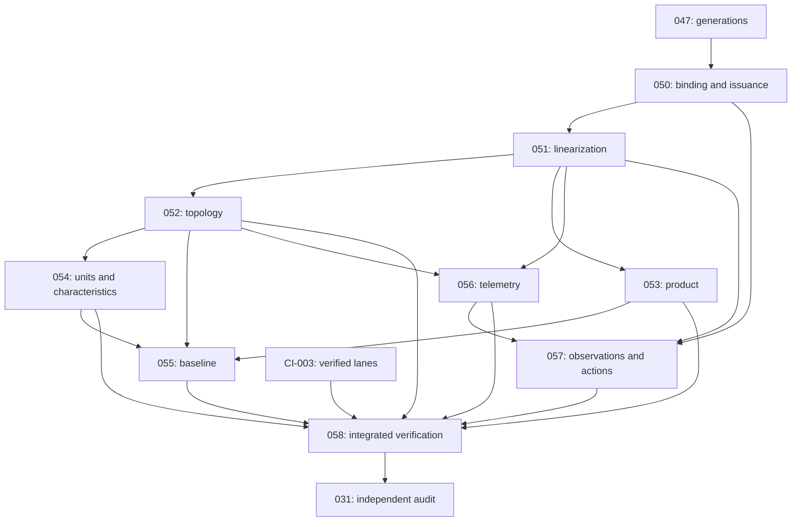

# HidraAPI — Canonical Technical Tasks and Reconciliation

## Status

CURRENT — owner-authorized initial canonical baseline, verified 2026-10-16. Accountable authority: repository owner; technical ownership follows the named bounded context. Source parent/applicability: `e0d6cfc15e9e5f57bbfe4ddf2992fb0026cd22f8`. TARGET and DEFERRED work is explicitly separated; unresolved acceptance is never implied by a registered task. No current production deployment or SITE acceptance is established.

This document owns technical definitions, implementation evidence, limitations, decisions and subsequent reconciliation. The owner explicitly authorized initial regeneration and the manifest registration of the two new documents. The adopted HAPI registry replaces historical HPR selection vocabulary within these three documents; original commits, migrations, task names in history and unchanged AGENTS.md are permanent evidence. The owner's explicit canonical transition takes precedence over the old identifier examples in AGENTS.md. No application, test, migration, runtime configuration, workflow, release or deployment change is selected by this operation.

## Audit baseline and evidence standard

Repository: https://github.com/CHOUABBIA-AMINE/HidraAPI . Main `e0d6cfc15e9e5f57bbfe4ddf2992fb0026cd22f8`, parent `aea3e497502c3e83a49fe4b7b2070b984d846bb0`, tree `92827aa8aed6afb490b12cf9669f9e9aad677b31`. The complete local Git recovery contains 1889 commits and 4862 tracked paths. Static extraction read all 4002 production Java files, 395 test Java files, 149 versioned SQL migrations and 218 tracked Markdown documents, including every line of the current roadmap, reconciliation and historical roadmap. This is full tracked-document recovery and deterministic source inventory; it is not an assertion that every possible runtime path or deleted historical document was behaviorally proven. Historical obligations lacking sufficient evidence stay explicit.

The POM is a single Maven application project, Java21 / Spring Boot4.1.1 / PostgreSQL/Flyway, with 24 package-level business modules. There is no Maven reactor-module split. MySQL drivers, Flyway dialect/constraint equivalence and actual MySQL testing are not established; do not promise portability or introduce a migration without explicit scope.

[Full CI #713](https://github.com/CHOUABBIA-AMINE/HidraAPI/actions/runs/38963564868), [Fast #41](https://github.com/CHOUABBIA-AMINE/HidraAPI/actions/runs/38963564846) and [Docs #358](https://github.com/CHOUABBIA-AMINE/HidraAPI/actions/runs/38963565130) succeeded on the exact source SHA. All seven Full jobs succeeded. The downloaded Full evidence artifact `12074507043` ZIP digest is `79a5ebd3d1f666674b0bf858416929f5f473ce0275200c0445b0e40ea2e1e511`; the runtime OpenAPI artifact `12073363664` digest is `82e8f5a0bbc6c4a2e49d3f5080b5bd6a0546c6bb659bbc0cb997fca17c04608e`. Both matched GitHub metadata. The existing source verifier independently reaggregated the downloaded raw files: **390 suites / 2148 tests / 0 failures / 0 errors / 0 skips**, with same-run partition/oracle equality. Fallback remains required and optimized adoption remains false. These figures apply only to this run and its mandatory greenfield selection; four retained historical upgrade classes are outside that selection.

Published OpenAPI source SHA matches main; JSON SHA256 `67b7213fe9440546fa8e1c41457e6f3b7e186e9844b71b1f6018db826b4000e6`; 244 paths, 263 operations and 231 schemas. The reviewed offline snapshot has its own older applicability and is preserved. OpenAPI operations below come from the downloaded runtime artifact, not inferred controller names. Existing tests validate their specific assertions; passing suites do not establish industrial calibration, universal workflow completeness, production deployment or every owner-isolation path. No new Maven/database/industrial run was performed for this documentation operation.

## Registry and historical reconciliation

Canonical registry: 25 retained functional phases and 921 tasks, globally sequential HAPI IDs independent of phase. Deterministic assignment uses natural-order legacy IDs plus explicitly identified new findings. No previously activated HAPI IDs were found. Every original task remains independent; semantic review, preflight, source implementation and closure remain distinct outcomes. Batch envelope IDs map to their member tasks, not a second implementation. Range/illustration markers and typographical IDs are explicitly accounted for in the ancillary mapping below.

Planning distribution: BLOCKED=51, COMPLETED=642, DEFERRED=127, IN_PROGRESS=4, REGISTERED_PENDING=1, SUPERSEDED=96. Implementation distribution: IMPLEMENTED=144, NOT_IMPLEMENTED=33, NOT_VERIFIABLE=248, PARTIAL=38, VERIFIED=458. 248 task scopes remain NOT_VERIFIABLE; their retained completion claims, where present, are historical planning facts and do not become verified implementation claims. Zero active exact duplicates were positively established for merger. Partial overlaps are reconciled through scoped successor/closure ownership, not by erasing original work. Five genuinely distinct successor/verification obligations are initially registered: ordinary-user activation, organization-scoped monitoring qualification, employee appointment lifecycle, accountable AI synthesis, and actual report execution.

All original scope/status/evidence records are reachable through exact-SHA references in each definition. The replaced active roadmap is preserved verbatim as a fenced historical source at the end of this file; the existing historical roadmap and reconciliation remain unchanged. This preserves technical detail and execution history without retaining competing dynamic task tables in ROADMAP/PHASES. Original legacy Planned/Blocked prose is not new execution authority.

## Execution and reconciliation rules

1. Next refreshes live main, governance, exact-SHA acceptance and the chosen task's source; selects one bounded HAPI obligation and stops after its commit/CI startup. Fail repairs the actual failed gate in responsible scope first. Status changes no structure. Reconcile writes technical findings here and synchronizes status fields only in ROADMAP/PHASES.
2. ROADMAP and PHASES are status-only after this initial owner-authorized adoption. IDs, titles, priority, phase membership, ordering, deliverable and dependency columns are structurally frozen. This document owns changing technical understanding, file plans, tests, limitations and evidence. Existing HPR exact messages remain available as legacy execution messages until a specific canonical package admits its message.
3. Parent closure tasks own only independent integrated acceptance. Child packages own their implementation. Absorb compatible newly found scope into its owning existing unfinished task; never reopen a completed preflight or semantic fix because a successor workflow is unfinished.
4. Proposed paths/endpoints below are explicitly TARGET candidates. DISCOVERY_REQUIRED identifies an unresolved exact placement or acceptance boundary, not a fabricated existing artifact. Before code, close only that task's remaining local registration/owner decision; do not repeat this complete audit. Unknown migration IDs stay unassigned until the live chain/writer DAG is inspected.
5. Any unavoidable new standalone task is proposed here first as **PENDING_BASELINE_APPROVAL**, outside the approved registry until explicit structural revision. That admission label is not an extra Planning Status. Do not insert it into the global or phase tables automatically.
6. Preserve source architecture, domain meaning, approved exception boundaries, append-only audit/revisions, no cross-module aggregate imports and immutable existing migrations. Synthetic fixtures suffice for software contracts; deployment calibration is supplied later. No autonomous OT actuation is authorized.
7. Publish main with expected-head guard, exact parent/tree/blob/diff verification and no branch/PR; confirm applicable exact-SHA CI queued/started, then stop. Deployment, releases and tags need their own selection.

## Current next eligible development package

**Current evidence reconciliation — 2026-10-17, Full733:** live `14e32abcd8b0de3f48f48389eddaf1fdd2b35416` passes Full733/Fast60/Docs382; independent raw verification confirms395 classes /2221 tests /zero failures, errors and skips. C3-REM-001's before-return actual-context/catalog correction and nine additional OIDC/handle/corruption cases have bounded source/CI acceptance. HAPI-575 section15 preserves the remaining C3-REM-002 through006 obligations; next implement the genuine directory qualified-reader and residual assurance package within the existing12-path envelope, after this checkpoint's Docs acceptance and a subsequent owner Next/Continue. Reuse live source and do not repeat accepted fixes. HAPI-575 stays PARTIAL / IN_PROGRESS; I/HAPI-581 and later stages remain blocked. Older pointers are historical and superseded by this record.

**Current evidence reconciliation — 2026-10-17, Full727:** live C3 implementation `ee9ad0d1102585f85fc3361d394f89da5f6a6569` passed Full727/Fast54/Docs375; independent raw evidence confirms 395 classes / 2212 tests / zero failures, errors and skips. Its complete registered acceptance remains incomplete. HAPI-575 section15 records C3-REM-001 through006, including the missing before-return origin/catalog postcondition and the remaining qualified-reader verification matrix. After this checkpoint's Docs acceptance and a subsequent owner Next/Continue, finish the existing C3 package in its admitted12-file envelope using the already registered implementation message. HAPI-575 remains PARTIAL / IN_PROGRESS; I/HAPI-581 and later owner/global publication work remain blocked. Earlier scheduling pointers are historical and superseded by this record.

**Current continuation update — 2026-10-17, C3 admission:** C2C is source/CI-accepted at `efd337bb7187a89cf9f5d5cbf91c86773eeb093c` (Full720/Fast47/Docs367; independently verified 2197 tests, zero failures/errors/skips). HAPI-575 section15 now registers the complete bounded C3 qualified fenced-reader/claim-interpretation package and exact implementation message. After this documentation checkpoint's Docs acceptance and a subsequent owner Next/Continue, implement that registered C3 package; no further preflight-only decomposition is selected. HAPI-575 stays PARTIAL / IN_PROGRESS; I–M and integrated H closure remain separate. Earlier scheduling paragraphs below are historical and superseded by this pointer and the dated task record.

**Current continuation — 2026-10-17:** C2B is source/CI-accepted at `3cb09e350fc969aa40fb44328046ec1e073e47cc` (Full718/Fast45/Docs364 and independent raw aggregate verification). HAPI-575 section15 now registers C2C genuine LDAP/AD capture as the next bounded implementation, after this checkpoint's Docs acceptance and a subsequent owner Next/Continue. HAPI-575 stays PARTIAL / IN_PROGRESS; C3 and later work remain separate. The following initial-baseline scheduling paragraph is retained as historical context and is superseded by this pointer and the dated task record.

**HAPI-575 (legacy HPR-P25-051H), P0 / IN_PROGRESS / PARTIAL:** C2A is now source/CI-accepted at HAPI-580; do not reexecute it. The next bounded H continuation is the C2B original verified claim-to-native issuance binding, with C2C genuine LDAP capture and C3 fenced-reader/evaluation still separate. First admit the exact C2B schema/writer-DAG/files/message from the current source seams listed in HAPI-575; do not make this a repeat of the full audit and do not implement the whole H umbrella automatically. Existing prerequisites HAPI-574 and HAPI-580 are completed/verified. CI-003C (HAPI-045) is independently eligible for evidence qualification, with fallback retained; ordinary-user policy decisions remain blocked. No code is executed by this baseline generation.

## Material capability findings

| Finding ID | Category / severity | Owner / phase | Evidence and affected legacy work | Corrective action, dependencies and verification |
|---|---|---|---|---|
| CAP-001 | API / HIGH | Topology / HPS-004,005 | SpringTopologyController and TopologyMapController; ENG-001/002/003/004/012; HPR-P25-052 | Preserve system/facility/map reads. Deliver distinct draft/graph/survey/publish/exchange packages after 051. Test exact filter chain, two companies, invalid incidence, CRS/units, old history, concurrent expected-head conflicts and OpenAPI consumer handoff. |
| CAP-002 | Security / HIGH | Identity, Party, Topology / HPS-002 | TrustedAuthenticationVerificationPort has no claim-evidence export; HPR-P25-051H through M; original OIDC receipt is source-implemented | Complete immutable native issuance binding, genuine authenticated LDAP source capture, fenced evaluation and multi-owner publication. Preserve unknown/deny fail-closed; run real transaction/expiry/revocation/ABA/CAS adversarial cases. Partial safe refusal is not a demonstrated bypass. |
| CAP-003 | Engineering / HIGH | Custody, Simulation, Topology / HPS-006,007,008,018 | Internal immutable revision repositories; HPR-P25-053/054/055 | Author supplied facts and exact source links before baseline freeze; distinguish installed unit/model/asset. Prove nine independent units, units/reference bases, immutability, rollback and historical reconstruction; no numerical qualification inferred. |
| CAP-004 | Functional / MEDIUM | Identity / HPS-001 | doc/roadmap/gaps.md ID-GAP-001; ordinary user activation not established | Register bounded qualification and owner onboarding choice. Prove single redemption, expiry, concurrent replay and restricted pre-activation access, preserving external-only accounts. This is uncertainty, not proof that all activation primitives are absent. |
| CAP-005 | Security / HIGH | Identity, Organization, Telemetry / HPS-002 | ID-GAP-002; scoped primitives do not prove complete station-monitoring isolation | Tie current organizational authority to authoritative station ownership. Prove direct IDs, filtered lists/counts/history/export/subscription denial after revocation/reassignment. Reuse 051/056; no second authorization engine. |
| CAP-006 | Functional / MEDIUM | Organization / HPS-003 | EmployeeAssignmentApplicationService creates assignments; reads expose history; ORG-GAP-003 | Add atomic close/transfer/correction and position occupancy under explicit acting/overlap policy. Preserve ResponsibilityAssignment's separate completed lifecycle. PostgreSQL concurrency and as-of authorization tests required. |
| CAP-007 | Verification / HIGH | Telemetry, Monitoring / HPS-010,016 | HPR-P25-056/057; create/read primitives exist | Qualify effective bindings, immutable ingestion provenance, freshness/UNKNOWN, replay, declared human actions and observed outcomes. Actual source feed/SITE data are separate; no causality inferred from correlation. |
| CAP-008 | Functional / MEDIUM | Analytics, Reporting / HPS-016,017 | AnalyticsApplicationService runProjection registers RUNNING; ReportingApplicationService.generateReportArtifact registers references | Add distinct synthesis and report execution successors; existing lineage fixes stay completed. Prove provider/render execution, redaction, denied evidence, exact inputs, output persistence, retries and human control. |
| CAP-009 | Integration / MEDIUM | Integration, Notification / HPS-011,022 | IntegrationApplicationService and NotificationApplicationService register exchange/attempt records | Preserve implemented record semantics. Actual protocol/provider runtime is NOT_VERIFIABLE unless independently demonstrated. Parked EXT MQTT/CPM work is retained; realtime transport is not a domain-event catalog. |
| CAP-010 | Architecture / MEDIUM | Platform / HPS-023 | POM has PostgreSQL only; domain import scan plus ArchitectureGuardrailTest | No forbidden direct framework imports were found in production domain source; current ArchUnit suite has 16 passing cases. Architecture exception Workbench remains explicit. No MySQL portability, complete aggregate purity proof or solver interchangeability claimed. |
| CAP-011 | DevSecOps / MEDIUM | Platform / HPS-024 | CI-003C, gate.json fallback_required=true, optimized_adoption_eligible=false | Preserve oracle and exact case/source/lifecycle/API/catalog equivalence. Finish representative/negative/cold-warm/cost evidence and explicit adoption decision; no speed claim from a green run. |
| CAP-012 | Engineering acceptance / HIGH | Simulation / HPS-019 | SteadyStateGasSolver and 32 passing bounded synthetic tests | Preserve existing internal synthetic steady-state solver. Operational transient, calibrated gas/liquid/equipment physics and NeqSim/DWSIM/pandapipes integrations remain deferred or unestablished. Do not reopen numerical scope here. |
| CAP-013 | Roadmap / MEDIUM | All owners | Completed preflights and stale historical dashboards | Retain completion in bounded document scope; reconcile source and exact CI separately. NOT_VERIFIABLE does not equal missing; a completed source fix does not certify a whole business workflow. |

## Significant capability classification

Implementation evidence is classified independently from CURRENT/PLANNED/DEFERRED applicability. IMPLEMENTED means a source path exists but the complete intended workflow is not independently qualified. Evidence navigation is the owning module inventory and related task definitions; these rows do not replace task acceptance.

| Capability | Source owner | Implementation Status | Applicability | Verified boundary and limitation |
|---|---|---|---|---|
| Local/LDAP/OIDC authentication and native issuance | identity | IMPLEMENTED | CURRENT | Real verification/receipt/binding paths and focused synthetic PostgreSQL tests exist; real directory/IdP SITE commissioning is separate. |
| Opt-in original OIDC verified claim receipt | identity | VERIFIED | CURRENT | HAPI-580: exact original decoder source, epoch consistency and one-use private receipt; seven new cases and preserved producer suites passed. Native persisted claim authority remains incomplete. |
| Route grants and current scoped permission exports | identity | IMPLEMENTED | CURRENT | Effective permission/route and scoped contracts exist. This does not establish every organization/station/data disclosure path. |
| Protected multi-owner publication authorization | identity/topology/party | PARTIAL | CURRENT | F/G and bounded generation/transaction primitives accepted; H through M and global publication/CAS integration unfinished. |
| Party country/address identity and organization hierarchy | party/organization | IMPLEMENTED | CURRENT | Current domain/query services preserve identity and basic hierarchy; country-code validation and reorganization qualification remain bounded unknowns. |
| Employee appointment timeline and transfer lifecycle | organization | PARTIAL | CURRENT | Employee timeline reads exist; atomic transfer/correction, overlap policy and position occupant history not established end to end. |
| Topology map and basic system/facility headers | topology | IMPLEMENTED | CURRENT | Public map and create APIs are in exact runtime OpenAPI; complete engineering editors are different obligations. |
| Immutable physical/station engineering revisions | topology | INTERNAL_ONLY | CURRENT | Internal owner ports/JDBC stores/codecs and tests exist; full protected public authoring/publication/history contract remains incomplete. |
| Survey/profile/pipe-section public authoring | topology | NOT_IMPLEMENTED | PLANNED | No current runtime create/revise/publish survey/profile writer; preserved map reads are not a replacement. |
| Installed-unit/configuration engineering | topology/assets | PARTIAL | PLANNED | Equipment, maintainable-asset and internal graph primitives exist; independent installed unit/model/source/effective incidence workflow remains open. |
| Manufacturer supplied characteristic revisions | simulation/party | INTERNAL_ONLY | CURRENT | Bounded immutable parameter records exist; full supplied-fact operator authoring/approval workflow is not public. |
| Gas-fluid supplied property revisions | custody | INTERNAL_ONLY | CURRENT | Bounded exact gas-fluid inputs/qualification exist; full multi-product operator publication/history API not established. |
| Frozen multi-owner engineering baseline | topology/custody/simulation | NOT_IMPLEMENTED | PLANNED | Independent stores are prerequisites, not a complete atomic manifest freeze/reconstruct API. |
| Asset/condition/work-order registration | assets | IMPLEMENTED | CURRENT | Commands, optimistic asset update and owner reference guards exist; physical maintenance execution is not inferred. |
| Telemetry history/latest/trend and trusted reading primitives | telemetry | IMPLEMENTED | CURRENT | Exact runtime GETs and trust/binding services exist; ingestion/replay/freshness workflow remains partial. |
| Configured ingestion-to-monitoring/action/outcome loop | telemetry/monitoring | PARTIAL | PLANNED | 056/057 preserve separate observation, authorized declared action and independently measured outcome obligations. |
| Alarm, shelving/suppression and notification records | alarm/notification | IMPLEMENTED | CURRENT | Alarm lifecycle and append-only notification attempt guards exist; actual external delivery/event producers are not inferred. |
| Incident/HSE/integrity/leak case governance | incident/hse/integrity/leakdetection | IMPLEMENTED | CURRENT | Owner-linked case/response/closure behavior exists. Calibrated CPM/leak computation and industrial risk validity remain separate. |
| Planning/nominations and revision approval | planning/workflow | IMPLEMENTED | CURRENT | Dedicated query and Workflow approval contracts with owner validation exist; dispatch optimization is not established. |
| Custody periods/tickets/discrepancy records | custody | IMPLEMENTED | CURRENT | Creation and lineage/owner guards exist; certified metrology/fiscal acceptance not established. |
| Workflow inbox/actions/transitions and approvals | workflow | IMPLEMENTED | CURRENT | Backend-owned available actions and owner approval contracts exist; engineering publish integration remains partial. |
| Risk scoring/approval evidence | risk | IMPLEMENTED | CURRENT | Structured scope, evidence, score/submit/approve and approved immutability exist; validity for actual industrial decisions needs owner-qualified inputs. |
| Analytics projection/metric/insight execution | analytics | PARTIAL | CURRENT | Source registers dataset/projection/metric/insight state and validates owners; no complete provider/computation chain is established from a run method name. |
| Report rendering and AI synthesis | reporting/analytics | PARTIAL | PLANNED | Report request/run/artifact lineage exists; actual reproducible rendering is a distinct successor. AI synthesis provider runtime is NOT_IMPLEMENTED in the audited owner interfaces. |
| Document upload/content and audit records | documents/audit | IMPLEMENTED | CURRENT | Published content transfer and audited references exist; typed engineering exchange remains distinct. |
| External protocol/provider and realtime business publishers | integration/notification/platform | NOT_VERIFIABLE | DEFERRED | Transport/metadata records exist. Actual MQTT/Sparkplug/CPM adapters and event catalog are not proven; retain parked targets and source limits. |
| Bounded synthetic steady-state gas solver | simulation | VERIFIED | CURRENT | SteadyStateGasSolver has 32 passing bounded synthetic cases; not a calibrated industrial/transient solver or operational GZ2 twin. |
| Transient/industrial gas-liquid and external engine runtime | simulation | NOT_IMPLEMENTED | DEFERRED | No current qualified NeqSim/DWSIM/pandapipes integration or transient runtime was established; existing engine-neutral targets are retained. |
| Domain dependency and verification guardrails | kernel/platform/all modules | VERIFIED | CURRENT | No forbidden direct domain imports found; exact-head ArchitectureGuardrailTest 16 cases plus source/report/API/catalog aggregate passed. Semantic completeness is separate. |
| MySQL database support | platform | NOT_IMPLEMENTED | DEFERRED | POM and migration/testing evidence are PostgreSQL-specific; additional target needs explicit justification and actual dialect/constraint proof. |
| Current production/SITE deployment and calibration | platform/operator | NOT_VERIFIABLE | DEFERRED | Historical P1 procedure/exercise records retained; no independent current deployment, live OT or operational calibration established. |

## HidraWEB engineering dependency reconciliation

Consumer repository is pinned to `46676deb70fd38b906bdb370f020f609d0a16c98`, tree `19e14dea9e82b523095fc43fa31f9b6ff9bc219e`; it is read-only in this operation. [Consumer gap register](https://github.com/CHOUABBIA-AMINE/HidraWEB/blob/46676deb70fd38b906bdb370f020f609d0a16c98/docs/roadmap/HidraAPI-Frontend-Backend-Gap-Register.md) and [consumer roadmap](https://github.com/CHOUABBIA-AMINE/HidraWEB/blob/46676deb70fd38b906bdb370f020f609d0a16c98/docs/roadmap/ULTIMATE_ROADMAP.md) retain their accepted historical artifact pins and F02/F03 blockers. The current backend runtime artifact was independently inspected here; this does not repin or accept a frontend contract. No accepted canonical HWEB-XXX migration was found; verified HWEB-Fxx legacy references are attributed as such.

| ENG obligation | Existing source / public runtime contract | Missing backend scope and owning HAPI tasks | Consumer / readiness and accepted evidence |
|---|---|---|---|
| ENG-001 Network graph authoring | Topology physical graph store; POST /api/v1/topology/pipeline-systems | HAPI-587, HAPI-588, HAPI-590 | HWEB-F02; PARTIAL, not editor-ready. Current backend OpenAPI establishes only listed existing operations; new editor schemas/grants require a later accepted runtime artifact and consumer tests. |
| ENG-002 Station connectivity | Station graph revision store; POST /api/v1/topology/facilities | HAPI-588, HAPI-600 | HWEB-F02/F04; PARTIAL. Current backend OpenAPI establishes only listed existing operations; new editor schemas/grants require a later accepted runtime artifact and consumer tests. |
| ENG-003 Survey routes/elevation | GET /api/v1/topology/map/geojson; internal physical input revisions | HAPI-589 | HWEB-F03; public authoring NOT_IMPLEMENTED, blocked. Current backend OpenAPI establishes only listed existing operations; new editor schemas/grants require a later accepted runtime artifact and consumer tests. |
| ENG-004 Pipe engineering properties | TopologyPhysicalNetworkRevision; no full public section writer | HAPI-589 | HWEB-F02/F03; PARTIAL/internal. Current backend OpenAPI establishes only listed existing operations; new editor schemas/grants require a later accepted runtime artifact and consumer tests. |
| ENG-005 Installed equipment identity | Topology Equipment; POST /api/v1/assets/maintainable-assets; PATCH /api/v1/assets/maintainable-assets/{assetId} | HAPI-599, HAPI-600 | HWEB-F04; independent installed identity incomplete. Current backend OpenAPI establishes only listed existing operations; new editor schemas/grants require a later accepted runtime artifact and consumer tests. |
| ENG-006 Manufacturer characteristics | SimulationEquipmentParameterRevision internal immutable storage; simulation metadata commands | HAPI-601, HAPI-602 | HWEB-F05; PARTIAL/internal, not solver-ready. Current backend OpenAPI establishes only listed existing operations; new editor schemas/grants require a later accepted runtime artifact and consumer tests. |
| ENG-007 Products/composition | CustodyGasFluidRevision internal storage; transfer-ticket public command is narrower | HAPI-594, HAPI-595, HAPI-596 | HWEB-F06; PARTIAL/internal. Current backend OpenAPI establishes only listed existing operations; new editor schemas/grants require a later accepted runtime artifact and consumer tests. |
| ENG-008 Engineering baseline | Independent exact owner revision stores, no accepted aggregate freeze API | HAPI-605, HAPI-606, HAPI-607 | HWEB-F07; PARTIAL source prerequisites. Current backend OpenAPI establishes only listed existing operations; new editor schemas/grants require a later accepted runtime artifact and consumer tests. |
| ENG-009 Telemetry-to-asset bindings | Telemetry point/source commands; GET readings/latest/trend; trusted reading/reference services | HAPI-611, HAPI-613, HAPI-615 | Monitoring consumer; PARTIAL; no new canonical frontend ID inferred. Current backend OpenAPI establishes only listed existing operations; new editor schemas/grants require a later accepted runtime artifact and consumer tests. |
| ENG-010 Engineering approval | Workflow available-actions/transitions and bounded owner security exports | HAPI-567, HAPI-590, HAPI-606 | HWEB-F02/F07; integrated engineering acceptance blocked. Current backend OpenAPI establishes only listed existing operations; new editor schemas/grants require a later accepted runtime artifact and consumer tests. |
| ENG-011 Engineering import/export | Documents transfer and audit export APIs have different ownership | HAPI-591, HAPI-608 | HWEB-F10; complete typed engineering contract NOT_IMPLEMENTED. Current backend OpenAPI establishes only listed existing operations; new editor schemas/grants require a later accepted runtime artifact and consumer tests. |
| ENG-012 Capability discovery | GET /api/v1/topology/capabilities and /api/v1/identity/me/permissions | HAPI-591, HAPI-592 | HWEB-F02 and editor consumers; per-editor completeness/grants incomplete. Current backend OpenAPI establishes only listed existing operations; new editor schemas/grants require a later accepted runtime artifact and consumer tests. |

## Canonical task definitions

Task definitions are grouped by primary HPS phase, then stable HAPI identifier. Current implementation evidence below is exact-source; original proposed paths remain historical or explicitly PROPOSED.

# HPS-001 — Identity and Authentication

<a id="hapi-011"></a>
## HAPI-011 — add ldap and local authentication roadmap

Phase: HPS-001 — Identity and Authentication

Legacy IDs: AUTH-001

Priority: P2

Implementation Status: VERIFIED

Planning Status: COMPLETED

Owning Module: `identity` (actual source owner; package modules are not separate Maven artifacts)

Dependencies: —

Cross-Repository Dependencies: None independently verified for this bounded task.

### 1. Objective

Establish initial execution memory

### 2. Existing Implementation

LOCAL/LDAP/AD/OIDC authentication, native issuance and bound-operation primitives exist; the opt-in original OIDC receipt has seven passing synthetic cases. These are phase context, not automatic completion evidence for this task. Task-specific current artifacts were matched to the exact tree:

- `docs/roadmap/authentication.md`

No current file is invented to make a historical allowlist appear complete. Artifact presence and a tested narrow method do not establish the whole business workflow.

### 3. Missing or Incomplete Capabilities

No successor implementation is selected for this completed bounded objective. It is a documentation/review/preflight outcome; broader application functionality remains separate.

### 4. Functional Requirements

Preserve the original bounded objective and verify its claimed output against current artifacts. Authenticate accountable local and enterprise identities and preserve genuine verification provenance.

Preserve explicit lifecycle, required values, invalid-reference rejection, supported catalog families and uncertainty semantics from the original bounded record. Optional fields are not silently defaulted into engineering facts. A follow-on capability never changes the meaning of a completed preflight.

### 5. Architecture and Domain Design

Bounded Context: `identity`; primary phase owns this obligation. Authorization decisions belong to HPS-002; never treat external groups as Hidra grants. Aggregate/invariant ownership follows the existing domain artifacts below; proposed aggregates must not duplicate another owner. Domain remains pure Java; application coordinates authorization/transactions through ports; REST and persistence/integration remain adapters.

- Domain ownership/invariants: DISCOVERY_REQUIRED for this task; reuse the exact owner inventory below before adding a proposed contract.
- Inbound ports: DISCOVERY_REQUIRED for this task; reuse the exact owner inventory below before adding a proposed contract.
- Outbound ports: DISCOVERY_REQUIRED for this task; reuse the exact owner inventory below before adding a proposed contract.
- Application services: DISCOVERY_REQUIRED for this task; reuse the exact owner inventory below before adding a proposed contract.
- Primary/secondary adapters: DISCOVERY_REQUIRED for this task; reuse the exact owner inventory below before adding a proposed contract.

### 6. Exact File-Level Execution Plan

**CREATE / MODIFY / DELETE:** none selected. Preserve the completed or superseded bounded outcome.

**PRESERVE / REUSE — current matched artifacts:**

- `docs/roadmap/authentication.md`

Historical-only/deleted proposed paths in the original record are not presented as current files. Recover replacements only if a concrete regression is established.

### 7. API Contracts

No new API is part of this bounded documentation/historical outcome. Existing owner operations are listed in the runtime contract inventory below; no proposed endpoint is relabeled as implemented.

### 8. Persistence and Transactions

Owner schema and existing mapped domain/persistence types are preserved. Flyway history is immutable; any new database requirement uses an additive migration whose actual filename/version remains DISCOVERY_REQUIRED until the live chain is checked. Enforce meaningful owned references, catalog family, immutable revision/digest, expected-version/uniqueness and concurrent-writer guarantees in the actual database as appropriate. Do not impose cross-module foreign aggregates or assume application pre-checks prevent races. PostgreSQL is current; MySQL equivalence is not established. Completed documentation work adds no schema requirement. Actual transaction/lock/time semantics in the original source record take precedence over this common preservation rule.

### 9. Security

Authenticate through the actual configured chain; authorize before revealing protected existence, count, history, export or payload. Preserve company/resource scope, current effective responsibility, DENY precedence, audit actor provenance and fail-closed unavailable/unknown evidence. Never trust caller-constructed actor/claim/permission evidence or stale grants. Keep industrial IT/OT segregation and human decision authority; no PLC/RTU command or autonomous actuation. Do not store raw IdP tokens, secrets or unrestricted personal/claim payloads.

### 10. Testing

Matched executed task-specific source suites:

- No task-specific executed suite was independently matched. The module-level exact-head suite inventory is recorded below; it does not automatically verify this whole objective.

For remaining code scope, add focused domain-invariant and application tests, actual request/DTO/error and authorization contract tests, fresh PostgreSQL/Flyway/JPA/constraint/rollback tests, relevant negative/replay/concurrency cases and architecture/mapper checks. Reuse existing module tests and add actual class/case/source hashes to the CI inventory only when those tests exist. A Docker skip is not database proof. Documentation/preflight tasks use actual documentation consistency/link/inventory checks without claiming Java behavior was newly executed. Full/Fast/Docs evidence must retain exact SHA/run/attempt and required case membership.

### 11. Acceptance Criteria

- Original bounded artifacts remain present or their stronger approved replacement is explicitly recorded.
- Source/document assertions and matched test/CI provenance remain independently reproducible; no broader workflow closure is inferred.

### 12. Dependencies and Blockers

Canonical prerequisites: —. This completed scope remains accepted within its recorded limits.

### 13. Deliverables

The bounded objective, exact owner contracts/artifacts, meaningful verification and source-linked acceptance record. No new source deliverable is selected for this retained task.

### 14. Evidence and History

Source applicability: `e0d6cfc15e9e5f57bbfe4ddf2992fb0026cd22f8`; exact-head Full #713 / Fast #41 / Docs #358 and raw report verification as described in the baseline. A cumulative passing run does not invent an unlocated original task commit.

- `ccaa8727f6a3dc659b5c5c99dda985cacc68b575` — exact registered-message commit; surviving paths matched to current tree.

Pinned task-definition/status/history references:

- [docs/roadmap/authentication.md:1397](https://github.com/CHOUABBIA-AMINE/HidraAPI/blob/e0d6cfc15e9e5f57bbfe4ddf2992fb0026cd22f8/docs/roadmap/authentication.md#L1397)

### 15. Current Reconciliation Record

Initial canonical adoption, 2026-10-16: Historical task retained independently; objective and record applicability are bounded by the pinned source. Current implementation/planning states above are independent. Doc/preflight completion is not completion of the associated application workflow.

No single stronger current disposition was independently extracted; original recorded evidence retains its dated applicability.

Future discoveries, refined exact file scope, accepted tests, blockers and decisions belong here. Retain prior evidence; synchronize only status fields into ROADMAP/PHASES. Newly standalone work stays PENDING_BASELINE_APPROVAL until authorized.

**Original task rows — quoted historical evidence, not competing current statuses:**

~~~~~~~~text
docs/roadmap/authentication.md:1397 | AUTH-001 | docs(authentication): add ldap and local authentication roadmap | Establish initial execution memory | Completed
~~~~~~~~

<a id="hapi-012"></a>
## HAPI-012 — refocus roadmap on authentication gaps

Phase: HPS-001 — Identity and Authentication

Legacy IDs: AUTH-001A

Priority: P2

Implementation Status: VERIFIED

Planning Status: COMPLETED

Owning Module: `identity` (actual source owner; package modules are not separate Maven artifacts)

Dependencies: —

Cross-Repository Dependencies: None independently verified for this bounded task.

### 1. Objective

Preserve correct Identity implementation and target runtime gaps

### 2. Existing Implementation

LOCAL/LDAP/AD/OIDC authentication, native issuance and bound-operation primitives exist; the opt-in original OIDC receipt has seven passing synthetic cases. These are phase context, not automatic completion evidence for this task. Task-specific current artifacts were matched to the exact tree:

- `docs/roadmap/authentication.md`
- `src/main/java/dz/sh/hidra/modules/identity/IdentityModule.java`
- `src/main/java/dz/sh/hidra/modules/identity/api/IdentityApi.java`
- `src/main/java/dz/sh/hidra/modules/identity/api/rest/IdentityRestApi.java`
- `src/main/java/dz/sh/hidra/modules/identity/api/rest/controller/IdentityAdministrationCommandController.java`
- `src/main/java/dz/sh/hidra/modules/identity/api/rest/controller/IdentityAdministrationQueryController.java`
- `src/main/java/dz/sh/hidra/modules/identity/api/rest/controller/IdentityAuthenticationController.java`
- `src/main/java/dz/sh/hidra/modules/identity/api/rest/controller/IdentityController.java`
- `src/main/java/dz/sh/hidra/modules/identity/api/rest/controller/IdentityOidcAuthorizationController.java`
- `src/main/java/dz/sh/hidra/modules/identity/api/rest/controller/SpringIdentityController.java`
- `src/main/java/dz/sh/hidra/modules/identity/api/rest/mapper/IdentityAuthenticationWebMapper.java`
- `src/main/java/dz/sh/hidra/modules/identity/api/rest/mapper/IdentityGeneratedRestMapper.java`
- `src/main/java/dz/sh/hidra/modules/identity/api/rest/mapper/IdentityRestMapper.java`
- `src/main/java/dz/sh/hidra/modules/identity/api/rest/request/IdentityAdministrationRequests.java`
- `src/main/java/dz/sh/hidra/modules/identity/application/IdentityApplicationServiceRegistry.java`
- `src/main/java/dz/sh/hidra/modules/identity/application/command/IdentityAdministrationCommands.java`
- `src/main/java/dz/sh/hidra/modules/identity/application/mapper/IdentityApplicationMapper.java`
- `src/main/java/dz/sh/hidra/modules/identity/application/model/VerifiedDirectoryIdentity.java`
- `src/main/java/dz/sh/hidra/modules/identity/application/port/in/IdentityAdministrationCommandUseCase.java`
- `src/main/java/dz/sh/hidra/modules/identity/application/port/in/IdentityAdministrationQueryUseCase.java`
- `src/main/java/dz/sh/hidra/modules/identity/application/port/out/IdentityProviderRepositoryPort.java`

No current file is invented to make a historical allowlist appear complete. Artifact presence and a tested narrow method do not establish the whole business workflow.

### 3. Missing or Incomplete Capabilities

No successor implementation is selected for this completed bounded objective. It is a documentation/review/preflight outcome; broader application functionality remains separate.

### 4. Functional Requirements

Preserve the original bounded objective and verify its claimed output against current artifacts. Authenticate accountable local and enterprise identities and preserve genuine verification provenance.

Preserve explicit lifecycle, required values, invalid-reference rejection, supported catalog families and uncertainty semantics from the original bounded record. Optional fields are not silently defaulted into engineering facts. A follow-on capability never changes the meaning of a completed preflight.

### 5. Architecture and Domain Design

Bounded Context: `identity`; primary phase owns this obligation. Authorization decisions belong to HPS-002; never treat external groups as Hidra grants. Aggregate/invariant ownership follows the existing domain artifacts below; proposed aggregates must not duplicate another owner. Domain remains pure Java; application coordinates authorization/transactions through ports; REST and persistence/integration remain adapters.

- Domain ownership/invariants: DISCOVERY_REQUIRED for this task; reuse the exact owner inventory below before adding a proposed contract.
- Inbound ports: `src/main/java/dz/sh/hidra/modules/identity/application/port/in/IdentityAdministrationCommandUseCase.java`, `src/main/java/dz/sh/hidra/modules/identity/application/port/in/IdentityAdministrationQueryUseCase.java`.
- Outbound ports: `src/main/java/dz/sh/hidra/modules/identity/application/port/out/IdentityProviderRepositoryPort.java`.
- Application services: DISCOVERY_REQUIRED for this task; reuse the exact owner inventory below before adding a proposed contract.
- Primary/secondary adapters: DISCOVERY_REQUIRED for this task; reuse the exact owner inventory below before adding a proposed contract.

### 6. Exact File-Level Execution Plan

**CREATE / MODIFY / DELETE:** none selected. Preserve the completed or superseded bounded outcome.

**PRESERVE / REUSE — current matched artifacts:**

- `docs/roadmap/authentication.md`
- `src/main/java/dz/sh/hidra/modules/identity/IdentityModule.java`
- `src/main/java/dz/sh/hidra/modules/identity/api/IdentityApi.java`
- `src/main/java/dz/sh/hidra/modules/identity/api/rest/IdentityRestApi.java`
- `src/main/java/dz/sh/hidra/modules/identity/api/rest/controller/IdentityAdministrationCommandController.java`
- `src/main/java/dz/sh/hidra/modules/identity/api/rest/controller/IdentityAdministrationQueryController.java`
- `src/main/java/dz/sh/hidra/modules/identity/api/rest/controller/IdentityAuthenticationController.java`
- `src/main/java/dz/sh/hidra/modules/identity/api/rest/controller/IdentityController.java`
- `src/main/java/dz/sh/hidra/modules/identity/api/rest/controller/IdentityOidcAuthorizationController.java`
- `src/main/java/dz/sh/hidra/modules/identity/api/rest/controller/SpringIdentityController.java`
- `src/main/java/dz/sh/hidra/modules/identity/api/rest/mapper/IdentityAuthenticationWebMapper.java`
- `src/main/java/dz/sh/hidra/modules/identity/api/rest/mapper/IdentityGeneratedRestMapper.java`
- `src/main/java/dz/sh/hidra/modules/identity/api/rest/mapper/IdentityRestMapper.java`
- `src/main/java/dz/sh/hidra/modules/identity/api/rest/request/IdentityAdministrationRequests.java`
- `src/main/java/dz/sh/hidra/modules/identity/application/IdentityApplicationServiceRegistry.java`
- `src/main/java/dz/sh/hidra/modules/identity/application/command/IdentityAdministrationCommands.java`
- `src/main/java/dz/sh/hidra/modules/identity/application/mapper/IdentityApplicationMapper.java`
- `src/main/java/dz/sh/hidra/modules/identity/application/model/VerifiedDirectoryIdentity.java`
- `src/main/java/dz/sh/hidra/modules/identity/application/port/in/IdentityAdministrationCommandUseCase.java`
- `src/main/java/dz/sh/hidra/modules/identity/application/port/in/IdentityAdministrationQueryUseCase.java`
- `src/main/java/dz/sh/hidra/modules/identity/application/port/out/IdentityProviderRepositoryPort.java`

Historical-only/deleted proposed paths in the original record are not presented as current files. Recover replacements only if a concrete regression is established.

### 7. API Contracts

No new API is part of this bounded documentation/historical outcome. Existing owner operations are listed in the runtime contract inventory below; no proposed endpoint is relabeled as implemented.

### 8. Persistence and Transactions

Owner schema and existing mapped domain/persistence types are preserved. Flyway history is immutable; any new database requirement uses an additive migration whose actual filename/version remains DISCOVERY_REQUIRED until the live chain is checked. Enforce meaningful owned references, catalog family, immutable revision/digest, expected-version/uniqueness and concurrent-writer guarantees in the actual database as appropriate. Do not impose cross-module foreign aggregates or assume application pre-checks prevent races. PostgreSQL is current; MySQL equivalence is not established. Completed documentation work adds no schema requirement. Actual transaction/lock/time semantics in the original source record take precedence over this common preservation rule.

### 9. Security

Authenticate through the actual configured chain; authorize before revealing protected existence, count, history, export or payload. Preserve company/resource scope, current effective responsibility, DENY precedence, audit actor provenance and fail-closed unavailable/unknown evidence. Never trust caller-constructed actor/claim/permission evidence or stale grants. Keep industrial IT/OT segregation and human decision authority; no PLC/RTU command or autonomous actuation. Do not store raw IdP tokens, secrets or unrestricted personal/claim payloads.

### 10. Testing

Matched executed task-specific source suites:

- No task-specific executed suite was independently matched. The module-level exact-head suite inventory is recorded below; it does not automatically verify this whole objective.

For remaining code scope, add focused domain-invariant and application tests, actual request/DTO/error and authorization contract tests, fresh PostgreSQL/Flyway/JPA/constraint/rollback tests, relevant negative/replay/concurrency cases and architecture/mapper checks. Reuse existing module tests and add actual class/case/source hashes to the CI inventory only when those tests exist. A Docker skip is not database proof. Documentation/preflight tasks use actual documentation consistency/link/inventory checks without claiming Java behavior was newly executed. Full/Fast/Docs evidence must retain exact SHA/run/attempt and required case membership.

### 11. Acceptance Criteria

- Original bounded artifacts remain present or their stronger approved replacement is explicitly recorded.
- Source/document assertions and matched test/CI provenance remain independently reproducible; no broader workflow closure is inferred.

### 12. Dependencies and Blockers

Canonical prerequisites: —. This completed scope remains accepted within its recorded limits.

### 13. Deliverables

The bounded objective, exact owner contracts/artifacts, meaningful verification and source-linked acceptance record. No new source deliverable is selected for this retained task.

### 14. Evidence and History

Source applicability: `e0d6cfc15e9e5f57bbfe4ddf2992fb0026cd22f8`; exact-head Full #713 / Fast #41 / Docs #358 and raw report verification as described in the baseline. A cumulative passing run does not invent an unlocated original task commit.

- `53d08eacdc67f0ad7ef8132531c69aa448881029` — exact registered-message commit; surviving paths matched to current tree.

Pinned task-definition/status/history references:

- [docs/roadmap/authentication.md:1398](https://github.com/CHOUABBIA-AMINE/HidraAPI/blob/e0d6cfc15e9e5f57bbfe4ddf2992fb0026cd22f8/docs/roadmap/authentication.md#L1398)

### 15. Current Reconciliation Record

Initial canonical adoption, 2026-10-16: Historical task retained independently; objective and record applicability are bounded by the pinned source. Current implementation/planning states above are independent. Doc/preflight completion is not completion of the associated application workflow.

No single stronger current disposition was independently extracted; original recorded evidence retains its dated applicability.

Future discoveries, refined exact file scope, accepted tests, blockers and decisions belong here. Retain prior evidence; synchronize only status fields into ROADMAP/PHASES. Newly standalone work stays PENDING_BASELINE_APPROVAL until authorized.

**Original task rows — quoted historical evidence, not competing current statuses:**

~~~~~~~~text
docs/roadmap/authentication.md:1398 | AUTH-001A | docs(authentication): refocus roadmap on authentication gaps | Preserve correct Identity implementation and target runtime gaps | Completed
~~~~~~~~

<a id="hapi-013"></a>
## HAPI-013 — align roadmap with dynamic provider routing

Phase: HPS-001 — Identity and Authentication

Legacy IDs: AUTH-001B

Priority: P2

Implementation Status: VERIFIED

Planning Status: COMPLETED

Owning Module: `identity` (actual source owner; package modules are not separate Maven artifacts)

Dependencies: —

Cross-Repository Dependencies: None independently verified for this bounded task.

### 1. Objective

Preserve OIDC, make provider-selection runtime routing explicit, add central provider routing and unified JWT plan

### 2. Existing Implementation

LOCAL/LDAP/AD/OIDC authentication, native issuance and bound-operation primitives exist; the opt-in original OIDC receipt has seven passing synthetic cases. These are phase context, not automatic completion evidence for this task. Task-specific current artifacts were matched to the exact tree:

- `docs/roadmap/authentication.md`

No current file is invented to make a historical allowlist appear complete. Artifact presence and a tested narrow method do not establish the whole business workflow.

### 3. Missing or Incomplete Capabilities

No successor implementation is selected for this completed bounded objective. It is a documentation/review/preflight outcome; broader application functionality remains separate.

### 4. Functional Requirements

Preserve the original bounded objective and verify its claimed output against current artifacts. Authenticate accountable local and enterprise identities and preserve genuine verification provenance.

Preserve explicit lifecycle, required values, invalid-reference rejection, supported catalog families and uncertainty semantics from the original bounded record. Optional fields are not silently defaulted into engineering facts. A follow-on capability never changes the meaning of a completed preflight.

### 5. Architecture and Domain Design

Bounded Context: `identity`; primary phase owns this obligation. Authorization decisions belong to HPS-002; never treat external groups as Hidra grants. Aggregate/invariant ownership follows the existing domain artifacts below; proposed aggregates must not duplicate another owner. Domain remains pure Java; application coordinates authorization/transactions through ports; REST and persistence/integration remain adapters.

- Domain ownership/invariants: DISCOVERY_REQUIRED for this task; reuse the exact owner inventory below before adding a proposed contract.
- Inbound ports: DISCOVERY_REQUIRED for this task; reuse the exact owner inventory below before adding a proposed contract.
- Outbound ports: DISCOVERY_REQUIRED for this task; reuse the exact owner inventory below before adding a proposed contract.
- Application services: DISCOVERY_REQUIRED for this task; reuse the exact owner inventory below before adding a proposed contract.
- Primary/secondary adapters: DISCOVERY_REQUIRED for this task; reuse the exact owner inventory below before adding a proposed contract.

### 6. Exact File-Level Execution Plan

**CREATE / MODIFY / DELETE:** none selected. Preserve the completed or superseded bounded outcome.

**PRESERVE / REUSE — current matched artifacts:**

- `docs/roadmap/authentication.md`

Historical-only/deleted proposed paths in the original record are not presented as current files. Recover replacements only if a concrete regression is established.

### 7. API Contracts

No new API is part of this bounded documentation/historical outcome. Existing owner operations are listed in the runtime contract inventory below; no proposed endpoint is relabeled as implemented.

### 8. Persistence and Transactions

Owner schema and existing mapped domain/persistence types are preserved. Flyway history is immutable; any new database requirement uses an additive migration whose actual filename/version remains DISCOVERY_REQUIRED until the live chain is checked. Enforce meaningful owned references, catalog family, immutable revision/digest, expected-version/uniqueness and concurrent-writer guarantees in the actual database as appropriate. Do not impose cross-module foreign aggregates or assume application pre-checks prevent races. PostgreSQL is current; MySQL equivalence is not established. Completed documentation work adds no schema requirement. Actual transaction/lock/time semantics in the original source record take precedence over this common preservation rule.

### 9. Security

Authenticate through the actual configured chain; authorize before revealing protected existence, count, history, export or payload. Preserve company/resource scope, current effective responsibility, DENY precedence, audit actor provenance and fail-closed unavailable/unknown evidence. Never trust caller-constructed actor/claim/permission evidence or stale grants. Keep industrial IT/OT segregation and human decision authority; no PLC/RTU command or autonomous actuation. Do not store raw IdP tokens, secrets or unrestricted personal/claim payloads.

### 10. Testing

Matched executed task-specific source suites:

- No task-specific executed suite was independently matched. The module-level exact-head suite inventory is recorded below; it does not automatically verify this whole objective.

For remaining code scope, add focused domain-invariant and application tests, actual request/DTO/error and authorization contract tests, fresh PostgreSQL/Flyway/JPA/constraint/rollback tests, relevant negative/replay/concurrency cases and architecture/mapper checks. Reuse existing module tests and add actual class/case/source hashes to the CI inventory only when those tests exist. A Docker skip is not database proof. Documentation/preflight tasks use actual documentation consistency/link/inventory checks without claiming Java behavior was newly executed. Full/Fast/Docs evidence must retain exact SHA/run/attempt and required case membership.

### 11. Acceptance Criteria

- Original bounded artifacts remain present or their stronger approved replacement is explicitly recorded.
- Source/document assertions and matched test/CI provenance remain independently reproducible; no broader workflow closure is inferred.

### 12. Dependencies and Blockers

Canonical prerequisites: —. This completed scope remains accepted within its recorded limits.

### 13. Deliverables

The bounded objective, exact owner contracts/artifacts, meaningful verification and source-linked acceptance record. No new source deliverable is selected for this retained task.

### 14. Evidence and History

Source applicability: `e0d6cfc15e9e5f57bbfe4ddf2992fb0026cd22f8`; exact-head Full #713 / Fast #41 / Docs #358 and raw report verification as described in the baseline. A cumulative passing run does not invent an unlocated original task commit.

- `acf9d503613a2fc6d415c537b54ea8e72e39a2e5` — exact registered-message commit; surviving paths matched to current tree.

Pinned task-definition/status/history references:

- [docs/roadmap/authentication.md:1399](https://github.com/CHOUABBIA-AMINE/HidraAPI/blob/e0d6cfc15e9e5f57bbfe4ddf2992fb0026cd22f8/docs/roadmap/authentication.md#L1399)

### 15. Current Reconciliation Record

Initial canonical adoption, 2026-10-16: Historical task retained independently; objective and record applicability are bounded by the pinned source. Current implementation/planning states above are independent. Doc/preflight completion is not completion of the associated application workflow.

No single stronger current disposition was independently extracted; original recorded evidence retains its dated applicability.

Future discoveries, refined exact file scope, accepted tests, blockers and decisions belong here. Retain prior evidence; synchronize only status fields into ROADMAP/PHASES. Newly standalone work stays PENDING_BASELINE_APPROVAL until authorized.

**Original task rows — quoted historical evidence, not competing current statuses:**

~~~~~~~~text
docs/roadmap/authentication.md:1399 | AUTH-001B | docs(authentication): align roadmap with dynamic provider routing | Preserve OIDC, make provider-selection runtime routing explicit, add central provider routing and unified JWT plan | Completed
~~~~~~~~

<a id="hapi-014"></a>
## HAPI-014 — inventory existing authentication runtime contracts

Phase: HPS-001 — Identity and Authentication

Legacy IDs: AUTH-002

Priority: P2

Implementation Status: IMPLEMENTED

Planning Status: COMPLETED

Owning Module: `identity` (actual source owner; package modules are not separate Maven artifacts)

Dependencies: —

Cross-Repository Dependencies: None independently verified for this bounded task.

### 1. Objective

Classify live provider DTOs, provider-selection contract, OIDC flow, Basic/in-memory path, JWT components, Identity models, persistence, and missing pieces

### 2. Existing Implementation

LOCAL/LDAP/AD/OIDC authentication, native issuance and bound-operation primitives exist; the opt-in original OIDC receipt has seven passing synthetic cases. These are phase context, not automatic completion evidence for this task. Task-specific current artifacts were matched to the exact tree:

- `docs/roadmap/authentication.md`
- `src/main/java/dz/sh/hidra/modules/identity/IdentityModule.java`
- `src/main/java/dz/sh/hidra/modules/identity/api/IdentityApi.java`
- `src/main/java/dz/sh/hidra/modules/identity/api/rest/IdentityRestApi.java`
- `src/main/java/dz/sh/hidra/modules/identity/api/rest/controller/IdentityAdministrationCommandController.java`
- `src/main/java/dz/sh/hidra/modules/identity/api/rest/controller/IdentityAdministrationQueryController.java`
- `src/main/java/dz/sh/hidra/modules/identity/api/rest/controller/IdentityAuthenticationController.java`
- `src/main/java/dz/sh/hidra/modules/identity/api/rest/controller/IdentityController.java`
- `src/main/java/dz/sh/hidra/modules/identity/api/rest/controller/IdentityOidcAuthorizationController.java`
- `src/main/java/dz/sh/hidra/modules/identity/api/rest/controller/SpringIdentityController.java`
- `src/main/java/dz/sh/hidra/modules/identity/api/rest/mapper/IdentityAuthenticationWebMapper.java`
- `src/main/java/dz/sh/hidra/modules/identity/api/rest/mapper/IdentityGeneratedRestMapper.java`
- `src/main/java/dz/sh/hidra/modules/identity/api/rest/mapper/IdentityRestMapper.java`
- `src/main/java/dz/sh/hidra/modules/identity/api/rest/request/IdentityAdministrationRequests.java`
- `src/main/java/dz/sh/hidra/modules/identity/application/IdentityApplicationServiceRegistry.java`
- `src/main/java/dz/sh/hidra/modules/identity/application/command/IdentityAdministrationCommands.java`
- `src/main/java/dz/sh/hidra/modules/identity/application/mapper/IdentityApplicationMapper.java`
- `src/main/java/dz/sh/hidra/modules/identity/application/model/VerifiedDirectoryIdentity.java`
- `src/main/java/dz/sh/hidra/modules/identity/application/port/in/IdentityAdministrationCommandUseCase.java`
- `src/main/java/dz/sh/hidra/modules/identity/application/port/in/IdentityAdministrationQueryUseCase.java`
- `src/main/java/dz/sh/hidra/modules/identity/application/port/out/IdentityProviderRepositoryPort.java`

No current file is invented to make a historical allowlist appear complete. Artifact presence and a tested narrow method do not establish the whole business workflow.

### 3. Missing or Incomplete Capabilities

No successor implementation is selected for this completed bounded objective. Preserve accepted source behavior; broader phase completion and SITE gates remain separate.

### 4. Functional Requirements

Preserve the original bounded objective and verify its claimed output against current artifacts. Authenticate accountable local and enterprise identities and preserve genuine verification provenance.

Preserve explicit lifecycle, required values, invalid-reference rejection, supported catalog families and uncertainty semantics from the original bounded record. Optional fields are not silently defaulted into engineering facts. A follow-on capability never changes the meaning of a completed preflight.

### 5. Architecture and Domain Design

Bounded Context: `identity`; primary phase owns this obligation. Authorization decisions belong to HPS-002; never treat external groups as Hidra grants. Aggregate/invariant ownership follows the existing domain artifacts below; proposed aggregates must not duplicate another owner. Domain remains pure Java; application coordinates authorization/transactions through ports; REST and persistence/integration remain adapters.

- Domain ownership/invariants: DISCOVERY_REQUIRED for this task; reuse the exact owner inventory below before adding a proposed contract.
- Inbound ports: `src/main/java/dz/sh/hidra/modules/identity/application/port/in/IdentityAdministrationCommandUseCase.java`, `src/main/java/dz/sh/hidra/modules/identity/application/port/in/IdentityAdministrationQueryUseCase.java`.
- Outbound ports: `src/main/java/dz/sh/hidra/modules/identity/application/port/out/IdentityProviderRepositoryPort.java`.
- Application services: DISCOVERY_REQUIRED for this task; reuse the exact owner inventory below before adding a proposed contract.
- Primary/secondary adapters: DISCOVERY_REQUIRED for this task; reuse the exact owner inventory below before adding a proposed contract.

### 6. Exact File-Level Execution Plan

**CREATE / MODIFY / DELETE:** none selected. Preserve the completed or superseded bounded outcome.

**PRESERVE / REUSE — current matched artifacts:**

- `docs/roadmap/authentication.md`
- `src/main/java/dz/sh/hidra/modules/identity/IdentityModule.java`
- `src/main/java/dz/sh/hidra/modules/identity/api/IdentityApi.java`
- `src/main/java/dz/sh/hidra/modules/identity/api/rest/IdentityRestApi.java`
- `src/main/java/dz/sh/hidra/modules/identity/api/rest/controller/IdentityAdministrationCommandController.java`
- `src/main/java/dz/sh/hidra/modules/identity/api/rest/controller/IdentityAdministrationQueryController.java`
- `src/main/java/dz/sh/hidra/modules/identity/api/rest/controller/IdentityAuthenticationController.java`
- `src/main/java/dz/sh/hidra/modules/identity/api/rest/controller/IdentityController.java`
- `src/main/java/dz/sh/hidra/modules/identity/api/rest/controller/IdentityOidcAuthorizationController.java`
- `src/main/java/dz/sh/hidra/modules/identity/api/rest/controller/SpringIdentityController.java`
- `src/main/java/dz/sh/hidra/modules/identity/api/rest/mapper/IdentityAuthenticationWebMapper.java`
- `src/main/java/dz/sh/hidra/modules/identity/api/rest/mapper/IdentityGeneratedRestMapper.java`
- `src/main/java/dz/sh/hidra/modules/identity/api/rest/mapper/IdentityRestMapper.java`
- `src/main/java/dz/sh/hidra/modules/identity/api/rest/request/IdentityAdministrationRequests.java`
- `src/main/java/dz/sh/hidra/modules/identity/application/IdentityApplicationServiceRegistry.java`
- `src/main/java/dz/sh/hidra/modules/identity/application/command/IdentityAdministrationCommands.java`
- `src/main/java/dz/sh/hidra/modules/identity/application/mapper/IdentityApplicationMapper.java`
- `src/main/java/dz/sh/hidra/modules/identity/application/model/VerifiedDirectoryIdentity.java`
- `src/main/java/dz/sh/hidra/modules/identity/application/port/in/IdentityAdministrationCommandUseCase.java`
- `src/main/java/dz/sh/hidra/modules/identity/application/port/in/IdentityAdministrationQueryUseCase.java`
- `src/main/java/dz/sh/hidra/modules/identity/application/port/out/IdentityProviderRepositoryPort.java`

Historical-only/deleted proposed paths in the original record are not presented as current files. Recover replacements only if a concrete regression is established.


**Pinned original bounded record — historical applicability:**

~~~~~~~~text
### AUTH-002 — Inventory existing authentication runtime contracts

Commit:

```text
chore(authentication): inventory existing authentication runtime contracts
```

Purpose: establish evidence before production changes.

Status:

```text
Completed — live inventory recorded in section 17A; no production implementation added.
```

Validation: documentation/source inspection only; evidence and result are recorded in section 17A.5.

---

~~~~~~~~

### 7. API Contracts

Reuse only actual owner operations from the runtime contract inventory below. DISCOVERY_REQUIRED for any new operation/schema: specify explicit request/response DTOs, field validation/units, 400 malformed/invalid input, 401 unauthenticated, non-disclosing 403/404 policy, 409 stale version/idempotency conflict, applicable availability errors and bounded pagination. Publish exact-SHA OpenAPI and verify consumer compatibility; never expose persistence entities.

### 8. Persistence and Transactions

Owner schema and existing mapped domain/persistence types are preserved. Flyway history is immutable; any new database requirement uses an additive migration whose actual filename/version remains DISCOVERY_REQUIRED until the live chain is checked. Enforce meaningful owned references, catalog family, immutable revision/digest, expected-version/uniqueness and concurrent-writer guarantees in the actual database as appropriate. Do not impose cross-module foreign aggregates or assume application pre-checks prevent races. PostgreSQL is current; MySQL equivalence is not established. Completed documentation work adds no schema requirement. Actual transaction/lock/time semantics in the original source record take precedence over this common preservation rule.

### 9. Security

Authenticate through the actual configured chain; authorize before revealing protected existence, count, history, export or payload. Preserve company/resource scope, current effective responsibility, DENY precedence, audit actor provenance and fail-closed unavailable/unknown evidence. Never trust caller-constructed actor/claim/permission evidence or stale grants. Keep industrial IT/OT segregation and human decision authority; no PLC/RTU command or autonomous actuation. Do not store raw IdP tokens, secrets or unrestricted personal/claim payloads.

### 10. Testing

Matched executed task-specific source suites:

- No task-specific executed suite was independently matched. The module-level exact-head suite inventory is recorded below; it does not automatically verify this whole objective.

For remaining code scope, add focused domain-invariant and application tests, actual request/DTO/error and authorization contract tests, fresh PostgreSQL/Flyway/JPA/constraint/rollback tests, relevant negative/replay/concurrency cases and architecture/mapper checks. Reuse existing module tests and add actual class/case/source hashes to the CI inventory only when those tests exist. A Docker skip is not database proof. Documentation/preflight tasks use actual documentation consistency/link/inventory checks without claiming Java behavior was newly executed. Full/Fast/Docs evidence must retain exact SHA/run/attempt and required case membership.

### 11. Acceptance Criteria

- Original bounded artifacts remain present or their stronger approved replacement is explicitly recorded.
- Source/document assertions and matched test/CI provenance remain independently reproducible; no broader workflow closure is inferred.

### 12. Dependencies and Blockers

Canonical prerequisites: —. This completed scope remains accepted within its recorded limits.

### 13. Deliverables

The bounded objective, exact owner contracts/artifacts, meaningful verification and source-linked acceptance record. No new source deliverable is selected for this retained task.

### 14. Evidence and History

Source applicability: `e0d6cfc15e9e5f57bbfe4ddf2992fb0026cd22f8`; exact-head Full #713 / Fast #41 / Docs #358 and raw report verification as described in the baseline. A cumulative passing run does not invent an unlocated original task commit.

- `6f6ca33f6deb2352b3f31d2b04112856c8442f1d` — exact registered-message commit; surviving paths matched to current tree.

Pinned task-definition/status/history references:

- [docs/roadmap/authentication.md:1400](https://github.com/CHOUABBIA-AMINE/HidraAPI/blob/e0d6cfc15e9e5f57bbfe4ddf2992fb0026cd22f8/docs/roadmap/authentication.md#L1400)
- [docs/roadmap/authentication.md:1434](https://github.com/CHOUABBIA-AMINE/HidraAPI/blob/e0d6cfc15e9e5f57bbfe4ddf2992fb0026cd22f8/docs/roadmap/authentication.md#L1434)

### 15. Current Reconciliation Record

Initial canonical adoption, 2026-10-16: Historical task retained independently; objective and record applicability are bounded by the pinned source. Current implementation/planning states above are independent.

No single stronger current disposition was independently extracted; original recorded evidence retains its dated applicability.

Future discoveries, refined exact file scope, accepted tests, blockers and decisions belong here. Retain prior evidence; synchronize only status fields into ROADMAP/PHASES. Newly standalone work stays PENDING_BASELINE_APPROVAL until authorized.

**Original task rows — quoted historical evidence, not competing current statuses:**

~~~~~~~~text
docs/roadmap/authentication.md:1400 | AUTH-002 | chore(authentication): inventory existing authentication runtime contracts | Classify live provider DTOs, provider-selection contract, OIDC flow, Basic/in-memory path, JWT components, Identity models, persistence, and missing pieces | Completed — live inventory recorded; no production code added
~~~~~~~~

<a id="hapi-015"></a>
## HAPI-015 — add provider-specific authentication request tokens

Phase: HPS-001 — Identity and Authentication

Legacy IDs: AUTH-003

Priority: P2

Implementation Status: IMPLEMENTED

Planning Status: COMPLETED

Owning Module: `identity` (actual source owner; package modules are not separate Maven artifacts)

Dependencies: —

Cross-Repository Dependencies: None independently verified for this bounded task.

### 1. Objective

Add/reuse distinct Spring Authentication request types for deterministic LOCAL, LDAP/AD, and OIDC routing

### 2. Existing Implementation

LOCAL/LDAP/AD/OIDC authentication, native issuance and bound-operation primitives exist; the opt-in original OIDC receipt has seven passing synthetic cases. These are phase context, not automatic completion evidence for this task. Task-specific current artifacts were matched to the exact tree:

- `src/main/java/dz/sh/hidra/platform/security/LdapAuthenticationToken.java`
- `src/main/java/dz/sh/hidra/platform/security/LocalAuthenticationToken.java`

No current file is invented to make a historical allowlist appear complete. Artifact presence and a tested narrow method do not establish the whole business workflow.

### 3. Missing or Incomplete Capabilities

No successor implementation is selected for this completed bounded objective. Preserve accepted source behavior; broader phase completion and SITE gates remain separate.

### 4. Functional Requirements

Preserve the original bounded objective and verify its claimed output against current artifacts. Authenticate accountable local and enterprise identities and preserve genuine verification provenance.

Preserve explicit lifecycle, required values, invalid-reference rejection, supported catalog families and uncertainty semantics from the original bounded record. Optional fields are not silently defaulted into engineering facts. A follow-on capability never changes the meaning of a completed preflight.

### 5. Architecture and Domain Design

Bounded Context: `identity`; primary phase owns this obligation. Authorization decisions belong to HPS-002; never treat external groups as Hidra grants. Aggregate/invariant ownership follows the existing domain artifacts below; proposed aggregates must not duplicate another owner. Domain remains pure Java; application coordinates authorization/transactions through ports; REST and persistence/integration remain adapters.

- Domain ownership/invariants: DISCOVERY_REQUIRED for this task; reuse the exact owner inventory below before adding a proposed contract.
- Inbound ports: DISCOVERY_REQUIRED for this task; reuse the exact owner inventory below before adding a proposed contract.
- Outbound ports: DISCOVERY_REQUIRED for this task; reuse the exact owner inventory below before adding a proposed contract.
- Application services: DISCOVERY_REQUIRED for this task; reuse the exact owner inventory below before adding a proposed contract.
- Primary/secondary adapters: DISCOVERY_REQUIRED for this task; reuse the exact owner inventory below before adding a proposed contract.

### 6. Exact File-Level Execution Plan

**CREATE / MODIFY / DELETE:** none selected. Preserve the completed or superseded bounded outcome.

**PRESERVE / REUSE — current matched artifacts:**

- `src/main/java/dz/sh/hidra/platform/security/LdapAuthenticationToken.java`
- `src/main/java/dz/sh/hidra/platform/security/LocalAuthenticationToken.java`

Historical-only/deleted proposed paths in the original record are not presented as current files. Recover replacements only if a concrete regression is established.


**Pinned original bounded record — historical applicability:**

~~~~~~~~text
### AUTH-003 — Provider-specific Authentication request tokens

Commit:

```text
feat(authentication): add provider-specific authentication request tokens
```

Precondition: AUTH-002 confirmed equivalent token types do not already exist.

Requirements:

```text
distinct LOCAL request token
distinct LDAP/AD request token
OIDC request/result adapter only where required
credentials erased where Spring contract permits
no business authorization logic
no persistence access
```

Status:

```text
Completed — LocalAuthenticationToken and LdapAuthenticationToken are distinct unauthenticated Spring request types. Both implement CredentialsContainer and erase the credential reference. No duplicate password-style OIDC request token was added because the existing browser OIDC/JWT resource-server path already provides the distinct external authentication result path.
```

Validation:

```bash
mvn -q test
```

Result:

```text
PASS — HidraAPI CI run 93 completed both repository tests and the acceptance `mvn -q test` step successfully for commit 2ef4ea234875205fd145661466a8ad9a607eff2f.
```

---

~~~~~~~~

### 7. API Contracts

Reuse only actual owner operations from the runtime contract inventory below. DISCOVERY_REQUIRED for any new operation/schema: specify explicit request/response DTOs, field validation/units, 400 malformed/invalid input, 401 unauthenticated, non-disclosing 403/404 policy, 409 stale version/idempotency conflict, applicable availability errors and bounded pagination. Publish exact-SHA OpenAPI and verify consumer compatibility; never expose persistence entities.

### 8. Persistence and Transactions

Owner schema and existing mapped domain/persistence types are preserved. Flyway history is immutable; any new database requirement uses an additive migration whose actual filename/version remains DISCOVERY_REQUIRED until the live chain is checked. Enforce meaningful owned references, catalog family, immutable revision/digest, expected-version/uniqueness and concurrent-writer guarantees in the actual database as appropriate. Do not impose cross-module foreign aggregates or assume application pre-checks prevent races. PostgreSQL is current; MySQL equivalence is not established. Completed documentation work adds no schema requirement. Actual transaction/lock/time semantics in the original source record take precedence over this common preservation rule.

### 9. Security

Authenticate through the actual configured chain; authorize before revealing protected existence, count, history, export or payload. Preserve company/resource scope, current effective responsibility, DENY precedence, audit actor provenance and fail-closed unavailable/unknown evidence. Never trust caller-constructed actor/claim/permission evidence or stale grants. Keep industrial IT/OT segregation and human decision authority; no PLC/RTU command or autonomous actuation. Do not store raw IdP tokens, secrets or unrestricted personal/claim payloads.

### 10. Testing

Matched executed task-specific source suites:

- No task-specific executed suite was independently matched. The module-level exact-head suite inventory is recorded below; it does not automatically verify this whole objective.

For remaining code scope, add focused domain-invariant and application tests, actual request/DTO/error and authorization contract tests, fresh PostgreSQL/Flyway/JPA/constraint/rollback tests, relevant negative/replay/concurrency cases and architecture/mapper checks. Reuse existing module tests and add actual class/case/source hashes to the CI inventory only when those tests exist. A Docker skip is not database proof. Documentation/preflight tasks use actual documentation consistency/link/inventory checks without claiming Java behavior was newly executed. Full/Fast/Docs evidence must retain exact SHA/run/attempt and required case membership.

### 11. Acceptance Criteria

- Original bounded artifacts remain present or their stronger approved replacement is explicitly recorded.
- Source/document assertions and matched test/CI provenance remain independently reproducible; no broader workflow closure is inferred.

### 12. Dependencies and Blockers

Canonical prerequisites: —. This completed scope remains accepted within its recorded limits.

### 13. Deliverables

The bounded objective, exact owner contracts/artifacts, meaningful verification and source-linked acceptance record. No new source deliverable is selected for this retained task.

### 14. Evidence and History

Source applicability: `e0d6cfc15e9e5f57bbfe4ddf2992fb0026cd22f8`; exact-head Full #713 / Fast #41 / Docs #358 and raw report verification as described in the baseline. A cumulative passing run does not invent an unlocated original task commit.

- `2ef4ea234875205fd145661466a8ad9a607eff2f` — exact registered-message commit; surviving paths matched to current tree.
- `91e2de7ed17cc609fd1b6630ca5926a9eed4ab86` — exact registered-message commit; surviving paths matched to current tree.
- `1cf6fba4c612d2b1df5d4052cd49bbb1a12e8618` — exact registered-message commit; surviving paths matched to current tree.

Pinned task-definition/status/history references:

- [docs/roadmap/authentication.md:1401](https://github.com/CHOUABBIA-AMINE/HidraAPI/blob/e0d6cfc15e9e5f57bbfe4ddf2992fb0026cd22f8/docs/roadmap/authentication.md#L1401)
- [docs/roadmap/authentication.md:1454](https://github.com/CHOUABBIA-AMINE/HidraAPI/blob/e0d6cfc15e9e5f57bbfe4ddf2992fb0026cd22f8/docs/roadmap/authentication.md#L1454)

### 15. Current Reconciliation Record

Initial canonical adoption, 2026-10-16: Historical task retained independently; objective and record applicability are bounded by the pinned source. Current implementation/planning states above are independent.

No single stronger current disposition was independently extracted; original recorded evidence retains its dated applicability.

Future discoveries, refined exact file scope, accepted tests, blockers and decisions belong here. Retain prior evidence; synchronize only status fields into ROADMAP/PHASES. Newly standalone work stays PENDING_BASELINE_APPROVAL until authorized.

**Original task rows — quoted historical evidence, not competing current statuses:**

~~~~~~~~text
docs/roadmap/authentication.md:1401 | AUTH-003 | feat(authentication): add provider-specific authentication request tokens | Add/reuse distinct Spring Authentication request types for deterministic LOCAL, LDAP/AD, and OIDC routing | Completed — LOCAL and LDAP/AD request tokens added; OIDC existing JWT/OIDC result path preserved; `mvn -q test` passed in CI run 93
~~~~~~~~

<a id="hapi-016"></a>
## HAPI-016 — add authentication request router

Phase: HPS-001 — Identity and Authentication

Legacy IDs: AUTH-004

Priority: P2

Implementation Status: IMPLEMENTED

Planning Status: COMPLETED

Owning Module: `identity` (actual source owner; package modules are not separate Maven artifacts)

Dependencies: —

Cross-Repository Dependencies: None independently verified for this bounded task.

### 1. Objective

Convert an explicit provider selection into the correct Authentication request without credential verification

### 2. Existing Implementation

LOCAL/LDAP/AD/OIDC authentication, native issuance and bound-operation primitives exist; the opt-in original OIDC receipt has seven passing synthetic cases. These are phase context, not automatic completion evidence for this task. Task-specific current artifacts were matched to the exact tree:

- `docs/roadmap/authentication.md`
- `src/main/java/dz/sh/hidra/modules/identity/domain/value/ProviderType.java`
- `src/main/java/dz/sh/hidra/modules/identity/infrastructure/security/IdentityAuthenticationRequestRouter.java`
- `src/main/java/dz/sh/hidra/platform/security/LdapAuthenticationToken.java`
- `src/main/java/dz/sh/hidra/platform/security/LocalAuthenticationToken.java`

No current file is invented to make a historical allowlist appear complete. Artifact presence and a tested narrow method do not establish the whole business workflow.

### 3. Missing or Incomplete Capabilities

No successor implementation is selected for this completed bounded objective. Preserve accepted source behavior; broader phase completion and SITE gates remain separate.

### 4. Functional Requirements

Preserve the original bounded objective and verify its claimed output against current artifacts. Authenticate accountable local and enterprise identities and preserve genuine verification provenance.

Preserve explicit lifecycle, required values, invalid-reference rejection, supported catalog families and uncertainty semantics from the original bounded record. Optional fields are not silently defaulted into engineering facts. A follow-on capability never changes the meaning of a completed preflight.

### 5. Architecture and Domain Design

Bounded Context: `identity`; primary phase owns this obligation. Authorization decisions belong to HPS-002; never treat external groups as Hidra grants. Aggregate/invariant ownership follows the existing domain artifacts below; proposed aggregates must not duplicate another owner. Domain remains pure Java; application coordinates authorization/transactions through ports; REST and persistence/integration remain adapters.

- Domain ownership/invariants: `src/main/java/dz/sh/hidra/modules/identity/domain/value/ProviderType.java`.
- Inbound ports: DISCOVERY_REQUIRED for this task; reuse the exact owner inventory below before adding a proposed contract.
- Outbound ports: DISCOVERY_REQUIRED for this task; reuse the exact owner inventory below before adding a proposed contract.
- Application services: DISCOVERY_REQUIRED for this task; reuse the exact owner inventory below before adding a proposed contract.
- Primary/secondary adapters: `src/main/java/dz/sh/hidra/modules/identity/infrastructure/security/IdentityAuthenticationRequestRouter.java`.

### 6. Exact File-Level Execution Plan

**CREATE / MODIFY / DELETE:** none selected. Preserve the completed or superseded bounded outcome.

**PRESERVE / REUSE — current matched artifacts:**

- `docs/roadmap/authentication.md`
- `src/main/java/dz/sh/hidra/modules/identity/domain/value/ProviderType.java`
- `src/main/java/dz/sh/hidra/modules/identity/infrastructure/security/IdentityAuthenticationRequestRouter.java`
- `src/main/java/dz/sh/hidra/platform/security/LdapAuthenticationToken.java`
- `src/main/java/dz/sh/hidra/platform/security/LocalAuthenticationToken.java`

Historical-only/deleted proposed paths in the original record are not presented as current files. Recover replacements only if a concrete regression is established.


**Pinned original bounded record — historical applicability:**

~~~~~~~~text
### AUTH-004 — Authentication request router

Commit:

```text
feat(authentication): add authentication request router
```

Convert an explicit provider selection into the correct Spring `Authentication` request. AUTH-002 confirmed no existing public `authType` DTO; do not invent a second provider taxonomy merely for routing.

Requirements:

```text
LOCAL -> LOCAL token
LDAP/ACTIVE_DIRECTORY -> LDAP token
OIDC -> existing OIDC initiation/completion path
unsupported/disabled type -> fail closed
no credential verification in router
no provider fallback
```

Status:

```text
Completed — IdentityAuthenticationRequestRouter lives in Identity infrastructure so ProviderType remains Identity-owned. LOCAL maps only to LocalAuthenticationToken; LDAP and ACTIVE_DIRECTORY map only to LdapAuthenticationToken. OIDC is deliberately rejected from the direct-credential route with an explicit instruction to use the existing external OIDC flow. All other provider types fail closed. The router performs no credential verification, persistence access, token issuance, or provider fallback.
```

Validation:

```bash
mvn -q test
```

Result:

```text
PASS — pull-request CI run 96 completed the repository test check and the acceptance `mvn -q test` step successfully for AUTH-004 before roadmap finalization.
```

---

~~~~~~~~

### 7. API Contracts

Reuse only actual owner operations from the runtime contract inventory below. DISCOVERY_REQUIRED for any new operation/schema: specify explicit request/response DTOs, field validation/units, 400 malformed/invalid input, 401 unauthenticated, non-disclosing 403/404 policy, 409 stale version/idempotency conflict, applicable availability errors and bounded pagination. Publish exact-SHA OpenAPI and verify consumer compatibility; never expose persistence entities.

### 8. Persistence and Transactions

Owner schema and existing mapped domain/persistence types are preserved. Flyway history is immutable; any new database requirement uses an additive migration whose actual filename/version remains DISCOVERY_REQUIRED until the live chain is checked. Enforce meaningful owned references, catalog family, immutable revision/digest, expected-version/uniqueness and concurrent-writer guarantees in the actual database as appropriate. Do not impose cross-module foreign aggregates or assume application pre-checks prevent races. PostgreSQL is current; MySQL equivalence is not established. Completed documentation work adds no schema requirement. Actual transaction/lock/time semantics in the original source record take precedence over this common preservation rule.

### 9. Security

Authenticate through the actual configured chain; authorize before revealing protected existence, count, history, export or payload. Preserve company/resource scope, current effective responsibility, DENY precedence, audit actor provenance and fail-closed unavailable/unknown evidence. Never trust caller-constructed actor/claim/permission evidence or stale grants. Keep industrial IT/OT segregation and human decision authority; no PLC/RTU command or autonomous actuation. Do not store raw IdP tokens, secrets or unrestricted personal/claim payloads.

### 10. Testing

Matched executed task-specific source suites:

- No task-specific executed suite was independently matched. The module-level exact-head suite inventory is recorded below; it does not automatically verify this whole objective.

For remaining code scope, add focused domain-invariant and application tests, actual request/DTO/error and authorization contract tests, fresh PostgreSQL/Flyway/JPA/constraint/rollback tests, relevant negative/replay/concurrency cases and architecture/mapper checks. Reuse existing module tests and add actual class/case/source hashes to the CI inventory only when those tests exist. A Docker skip is not database proof. Documentation/preflight tasks use actual documentation consistency/link/inventory checks without claiming Java behavior was newly executed. Full/Fast/Docs evidence must retain exact SHA/run/attempt and required case membership.

### 11. Acceptance Criteria

- Original bounded artifacts remain present or their stronger approved replacement is explicitly recorded.
- Source/document assertions and matched test/CI provenance remain independently reproducible; no broader workflow closure is inferred.

### 12. Dependencies and Blockers

Canonical prerequisites: —. This completed scope remains accepted within its recorded limits.

### 13. Deliverables

The bounded objective, exact owner contracts/artifacts, meaningful verification and source-linked acceptance record. No new source deliverable is selected for this retained task.

### 14. Evidence and History

Source applicability: `e0d6cfc15e9e5f57bbfe4ddf2992fb0026cd22f8`; exact-head Full #713 / Fast #41 / Docs #358 and raw report verification as described in the baseline. A cumulative passing run does not invent an unlocated original task commit.

- `a7d5787ef32379ea16010cb5d4110cb850369bf2` — exact registered-message commit; surviving paths matched to current tree.
- `e9045efcf72e9ae6c94c02a7f1f98c44b2c9d137` — exact registered-message commit; surviving paths matched to current tree.
- `166836b608901da229ddc012e6b1c675a9f4c644` — exact registered-message commit; surviving paths matched to current tree.
- `394232f220186c9bd8e7d277573363830de74106` — exact registered-message commit; surviving paths matched to current tree.
- `943890732264b045e5549dd93de5691a27502e46` — exact registered-message commit; surviving paths matched to current tree.
- `98963b3877db13f6cec7cb210ebb7c402f219ce9` — exact registered-message commit; surviving paths matched to current tree.
- `abca9fa980e577f74fcab2f8e8aad70668335e43` — exact registered-message commit; surviving paths matched to current tree.
- `ccd52a87377f650724142d180a97741577d856d2` — exact registered-message commit; surviving paths matched to current tree.

Pinned task-definition/status/history references:

- [docs/roadmap/authentication.md:1402](https://github.com/CHOUABBIA-AMINE/HidraAPI/blob/e0d6cfc15e9e5f57bbfe4ddf2992fb0026cd22f8/docs/roadmap/authentication.md#L1402)
- [docs/roadmap/authentication.md:1495](https://github.com/CHOUABBIA-AMINE/HidraAPI/blob/e0d6cfc15e9e5f57bbfe4ddf2992fb0026cd22f8/docs/roadmap/authentication.md#L1495)

### 15. Current Reconciliation Record

Initial canonical adoption, 2026-10-16: Historical task retained independently; objective and record applicability are bounded by the pinned source. Current implementation/planning states above are independent.

No single stronger current disposition was independently extracted; original recorded evidence retains its dated applicability.

Future discoveries, refined exact file scope, accepted tests, blockers and decisions belong here. Retain prior evidence; synchronize only status fields into ROADMAP/PHASES. Newly standalone work stays PENDING_BASELINE_APPROVAL until authorized.

**Original task rows — quoted historical evidence, not competing current statuses:**

~~~~~~~~text
docs/roadmap/authentication.md:1402 | AUTH-004 | feat(authentication): add authentication request router | Convert an explicit provider selection into the correct Authentication request without credential verification | Completed — Identity-owned router maps LOCAL and LDAP/AD deterministically, preserves OIDC external flow, rejects unsupported direct providers, and performs no credential verification; `mvn -q test` passed in PR CI run 96
~~~~~~~~

<a id="hapi-017"></a>
## HAPI-017 — compose authentication provider manager

Phase: HPS-001 — Identity and Authentication

Legacy IDs: AUTH-005

Priority: P2

Implementation Status: IMPLEMENTED

Planning Status: COMPLETED

Owning Module: `identity` (actual source owner; package modules are not separate Maven artifacts)

Dependencies: —

Cross-Repository Dependencies: None independently verified for this bounded task.

### 1. Objective

Register provider-specific strategies behind one AuthenticationManager/ProviderManager with no fallback

### 2. Existing Implementation

LOCAL/LDAP/AD/OIDC authentication, native issuance and bound-operation primitives exist; the opt-in original OIDC receipt has seven passing synthetic cases. These are phase context, not automatic completion evidence for this task. Task-specific current artifacts were matched to the exact tree:

- `docs/roadmap/authentication.md`
- `src/main/java/dz/sh/hidra/platform/configuration/HidraAuthenticationManagerConfiguration.java`
- `src/main/java/dz/sh/hidra/platform/security/LdapAuthenticationToken.java`
- `src/main/java/dz/sh/hidra/platform/security/LocalAuthenticationToken.java`

No current file is invented to make a historical allowlist appear complete. Artifact presence and a tested narrow method do not establish the whole business workflow.

### 3. Missing or Incomplete Capabilities

No successor implementation is selected for this completed bounded objective. Preserve accepted source behavior; broader phase completion and SITE gates remain separate.

### 4. Functional Requirements

Preserve the original bounded objective and verify its claimed output against current artifacts. Authenticate accountable local and enterprise identities and preserve genuine verification provenance.

Preserve explicit lifecycle, required values, invalid-reference rejection, supported catalog families and uncertainty semantics from the original bounded record. Optional fields are not silently defaulted into engineering facts. A follow-on capability never changes the meaning of a completed preflight.

### 5. Architecture and Domain Design

Bounded Context: `identity`; primary phase owns this obligation. Authorization decisions belong to HPS-002; never treat external groups as Hidra grants. Aggregate/invariant ownership follows the existing domain artifacts below; proposed aggregates must not duplicate another owner. Domain remains pure Java; application coordinates authorization/transactions through ports; REST and persistence/integration remain adapters.

- Domain ownership/invariants: DISCOVERY_REQUIRED for this task; reuse the exact owner inventory below before adding a proposed contract.
- Inbound ports: DISCOVERY_REQUIRED for this task; reuse the exact owner inventory below before adding a proposed contract.
- Outbound ports: DISCOVERY_REQUIRED for this task; reuse the exact owner inventory below before adding a proposed contract.
- Application services: DISCOVERY_REQUIRED for this task; reuse the exact owner inventory below before adding a proposed contract.
- Primary/secondary adapters: DISCOVERY_REQUIRED for this task; reuse the exact owner inventory below before adding a proposed contract.

### 6. Exact File-Level Execution Plan

**CREATE / MODIFY / DELETE:** none selected. Preserve the completed or superseded bounded outcome.

**PRESERVE / REUSE — current matched artifacts:**

- `docs/roadmap/authentication.md`
- `src/main/java/dz/sh/hidra/platform/configuration/HidraAuthenticationManagerConfiguration.java`
- `src/main/java/dz/sh/hidra/platform/security/LdapAuthenticationToken.java`
- `src/main/java/dz/sh/hidra/platform/security/LocalAuthenticationToken.java`

Historical-only/deleted proposed paths in the original record are not presented as current files. Recover replacements only if a concrete regression is established.


**Pinned original bounded record — historical applicability:**

~~~~~~~~text
### AUTH-005 — ProviderManager composition

Commit:

```text
feat(authentication): compose authentication provider manager
```

Register the supported provider strategies behind one `AuthenticationManager`/`ProviderManager`.

Each provider must support only the intended Authentication request type.

Do not use provider ordering as the primary provider discriminator.

Status:

```text
Completed — HidraAuthenticationManagerConfiguration now exposes one ProviderManager-backed AuthenticationManager for direct provider authentication. It registers only AuthenticationProvider beans that support exactly one of LocalAuthenticationToken or LdapAuthenticationToken, rejects a provider that claims both request types, and uses a fail-closed parent AuthenticationManager when no matching provider is installed. Existing bootstrap Basic authentication and the external OIDC/JWT path are preserved; no LOCAL, LDAP, or OIDC provider implementation was introduced early.
```

Validation:

```bash
mvn -q test
```

Result:

```text
PASS — pull-request CI run 104 completed the repository test check and the acceptance `mvn -q test` step successfully for AUTH-005 implementation commit 00cc471a916fea8882ed25f5d2c6297155899b2b.
```

---

~~~~~~~~

### 7. API Contracts

Reuse only actual owner operations from the runtime contract inventory below. DISCOVERY_REQUIRED for any new operation/schema: specify explicit request/response DTOs, field validation/units, 400 malformed/invalid input, 401 unauthenticated, non-disclosing 403/404 policy, 409 stale version/idempotency conflict, applicable availability errors and bounded pagination. Publish exact-SHA OpenAPI and verify consumer compatibility; never expose persistence entities.

### 8. Persistence and Transactions

Owner schema and existing mapped domain/persistence types are preserved. Flyway history is immutable; any new database requirement uses an additive migration whose actual filename/version remains DISCOVERY_REQUIRED until the live chain is checked. Enforce meaningful owned references, catalog family, immutable revision/digest, expected-version/uniqueness and concurrent-writer guarantees in the actual database as appropriate. Do not impose cross-module foreign aggregates or assume application pre-checks prevent races. PostgreSQL is current; MySQL equivalence is not established. Completed documentation work adds no schema requirement. Actual transaction/lock/time semantics in the original source record take precedence over this common preservation rule.

### 9. Security

Authenticate through the actual configured chain; authorize before revealing protected existence, count, history, export or payload. Preserve company/resource scope, current effective responsibility, DENY precedence, audit actor provenance and fail-closed unavailable/unknown evidence. Never trust caller-constructed actor/claim/permission evidence or stale grants. Keep industrial IT/OT segregation and human decision authority; no PLC/RTU command or autonomous actuation. Do not store raw IdP tokens, secrets or unrestricted personal/claim payloads.

### 10. Testing

Matched executed task-specific source suites:

- No task-specific executed suite was independently matched. The module-level exact-head suite inventory is recorded below; it does not automatically verify this whole objective.

For remaining code scope, add focused domain-invariant and application tests, actual request/DTO/error and authorization contract tests, fresh PostgreSQL/Flyway/JPA/constraint/rollback tests, relevant negative/replay/concurrency cases and architecture/mapper checks. Reuse existing module tests and add actual class/case/source hashes to the CI inventory only when those tests exist. A Docker skip is not database proof. Documentation/preflight tasks use actual documentation consistency/link/inventory checks without claiming Java behavior was newly executed. Full/Fast/Docs evidence must retain exact SHA/run/attempt and required case membership.

### 11. Acceptance Criteria

- Original bounded artifacts remain present or their stronger approved replacement is explicitly recorded.
- Source/document assertions and matched test/CI provenance remain independently reproducible; no broader workflow closure is inferred.

### 12. Dependencies and Blockers

Canonical prerequisites: —. This completed scope remains accepted within its recorded limits.

### 13. Deliverables

The bounded objective, exact owner contracts/artifacts, meaningful verification and source-linked acceptance record. No new source deliverable is selected for this retained task.

### 14. Evidence and History

Source applicability: `e0d6cfc15e9e5f57bbfe4ddf2992fb0026cd22f8`; exact-head Full #713 / Fast #41 / Docs #358 and raw report verification as described in the baseline. A cumulative passing run does not invent an unlocated original task commit.

- `2d35d961c912550b94b4b8c696f3e6388ca53285` — exact registered-message commit; surviving paths matched to current tree.
- `4707c9b8224ad0a6adf5d130af6bff70bbc249e4` — exact registered-message commit; surviving paths matched to current tree.
- `b8414df64aef6560ae435c23aef3c850edebeed8` — exact registered-message commit; surviving paths matched to current tree.
- `4a1d7fdd52ec0ba71e91cd74980ae857e271eec2` — exact registered-message commit; surviving paths matched to current tree.
- `d4bcf87192b3c338578de855ca4707893fd36d2d` — exact registered-message commit; surviving paths matched to current tree.
- `44f7a0e49236c5f1a0ddb2052bd58e032fdd0d39` — exact registered-message commit; surviving paths matched to current tree.
- `00cc471a916fea8882ed25f5d2c6297155899b2b` — exact registered-message commit; surviving paths matched to current tree.

Pinned task-definition/status/history references:

- [docs/roadmap/authentication.md:1403](https://github.com/CHOUABBIA-AMINE/HidraAPI/blob/e0d6cfc15e9e5f57bbfe4ddf2992fb0026cd22f8/docs/roadmap/authentication.md#L1403)
- [docs/roadmap/authentication.md:1536](https://github.com/CHOUABBIA-AMINE/HidraAPI/blob/e0d6cfc15e9e5f57bbfe4ddf2992fb0026cd22f8/docs/roadmap/authentication.md#L1536)

### 15. Current Reconciliation Record

Initial canonical adoption, 2026-10-16: Historical task retained independently; objective and record applicability are bounded by the pinned source. Current implementation/planning states above are independent.

No single stronger current disposition was independently extracted; original recorded evidence retains its dated applicability.

Future discoveries, refined exact file scope, accepted tests, blockers and decisions belong here. Retain prior evidence; synchronize only status fields into ROADMAP/PHASES. Newly standalone work stays PENDING_BASELINE_APPROVAL until authorized.

**Original task rows — quoted historical evidence, not competing current statuses:**

~~~~~~~~text
docs/roadmap/authentication.md:1403 | AUTH-005 | feat(authentication): compose authentication provider manager | Register provider-specific strategies behind one AuthenticationManager/ProviderManager with no fallback | Completed — central fail-closed ProviderManager composed for provider-specific LOCAL and LDAP request types; `mvn -q test` passed in PR CI run 104
~~~~~~~~

<a id="hapi-018"></a>
## HAPI-018 — normalize authenticated hidra principal

Phase: HPS-001 — Identity and Authentication

Legacy IDs: AUTH-006

Priority: P2

Implementation Status: IMPLEMENTED

Planning Status: COMPLETED

Owning Module: `identity` (actual source owner; package modules are not separate Maven artifacts)

Dependencies: —

Cross-Repository Dependencies: None independently verified for this bounded task.

### 1. Objective

Reuse/add one Hidra principal contract shared by LOCAL, LDAP/AD, and OIDC

### 2. Existing Implementation

LOCAL/LDAP/AD/OIDC authentication, native issuance and bound-operation primitives exist; the opt-in original OIDC receipt has seven passing synthetic cases. These are phase context, not automatic completion evidence for this task. Task-specific current artifacts were matched to the exact tree:

- `docs/roadmap/authentication.md`
- `src/main/java/dz/sh/hidra/modules/identity/domain/model/HidraPrincipal.java`
- `src/main/java/dz/sh/hidra/modules/identity/domain/model/IdentityProvider.java`
- `src/main/java/dz/sh/hidra/modules/identity/domain/model/Permission.java`
- `src/main/java/dz/sh/hidra/modules/identity/domain/value/ProviderType.java`
- `src/main/java/dz/sh/hidra/platform/security/AuthenticatedPrincipal.java`

No current file is invented to make a historical allowlist appear complete. Artifact presence and a tested narrow method do not establish the whole business workflow.

### 3. Missing or Incomplete Capabilities

No successor implementation is selected for this completed bounded objective. Preserve accepted source behavior; broader phase completion and SITE gates remain separate.

### 4. Functional Requirements

Preserve the original bounded objective and verify its claimed output against current artifacts. Authenticate accountable local and enterprise identities and preserve genuine verification provenance.

Preserve explicit lifecycle, required values, invalid-reference rejection, supported catalog families and uncertainty semantics from the original bounded record. Optional fields are not silently defaulted into engineering facts. A follow-on capability never changes the meaning of a completed preflight.

### 5. Architecture and Domain Design

Bounded Context: `identity`; primary phase owns this obligation. Authorization decisions belong to HPS-002; never treat external groups as Hidra grants. Aggregate/invariant ownership follows the existing domain artifacts below; proposed aggregates must not duplicate another owner. Domain remains pure Java; application coordinates authorization/transactions through ports; REST and persistence/integration remain adapters.

- Domain ownership/invariants: `src/main/java/dz/sh/hidra/modules/identity/domain/model/HidraPrincipal.java`, `src/main/java/dz/sh/hidra/modules/identity/domain/model/IdentityProvider.java`, `src/main/java/dz/sh/hidra/modules/identity/domain/model/Permission.java`, `src/main/java/dz/sh/hidra/modules/identity/domain/value/ProviderType.java`.
- Inbound ports: DISCOVERY_REQUIRED for this task; reuse the exact owner inventory below before adding a proposed contract.
- Outbound ports: DISCOVERY_REQUIRED for this task; reuse the exact owner inventory below before adding a proposed contract.
- Application services: DISCOVERY_REQUIRED for this task; reuse the exact owner inventory below before adding a proposed contract.
- Primary/secondary adapters: DISCOVERY_REQUIRED for this task; reuse the exact owner inventory below before adding a proposed contract.

### 6. Exact File-Level Execution Plan

**CREATE / MODIFY / DELETE:** none selected. Preserve the completed or superseded bounded outcome.

**PRESERVE / REUSE — current matched artifacts:**

- `docs/roadmap/authentication.md`
- `src/main/java/dz/sh/hidra/modules/identity/domain/model/HidraPrincipal.java`
- `src/main/java/dz/sh/hidra/modules/identity/domain/model/IdentityProvider.java`
- `src/main/java/dz/sh/hidra/modules/identity/domain/model/Permission.java`
- `src/main/java/dz/sh/hidra/modules/identity/domain/value/ProviderType.java`
- `src/main/java/dz/sh/hidra/platform/security/AuthenticatedPrincipal.java`

Historical-only/deleted proposed paths in the original record are not presented as current files. Recover replacements only if a concrete regression is established.


**Pinned original bounded record — historical applicability:**

~~~~~~~~text
### AUTH-006 — Normalized Hidra principal

Commit:

```text
feat(identity): normalize authenticated hidra principal
```

Preserve the existing technical `AuthenticatedPrincipal`/current-security-context adapter, but add the minimum Identity-owned normalized authenticated principal required to carry stable Hidra identity and authorization information across LOCAL, LDAP/AD and OIDC.

No provider-specific business model duplication and no transfer of User/Role/Permission ownership into platform.

Status:

```text
Completed — HidraPrincipal is an Identity-domain record that implements java.security.Principal without Spring dependencies. It carries stable Hidra user ID, Hidra username/display name, ProviderType, optional IdentityProvider linkage, and immutable Hidra-owned role/permission sets. Principal.getName() returns the stable Hidra user ID. The existing platform AuthenticatedPrincipal and current-security-context adapters remain unchanged.
```

Validation:

```bash
mvn -q test
```

Result:

```text
PASS — pull-request CI run 111 completed the repository test check and the acceptance `mvn -q test` step successfully for AUTH-006 implementation commit 17da3f61c338621bdd9fd641442877241abd239a.
```

---

~~~~~~~~

### 7. API Contracts

Reuse only actual owner operations from the runtime contract inventory below. DISCOVERY_REQUIRED for any new operation/schema: specify explicit request/response DTOs, field validation/units, 400 malformed/invalid input, 401 unauthenticated, non-disclosing 403/404 policy, 409 stale version/idempotency conflict, applicable availability errors and bounded pagination. Publish exact-SHA OpenAPI and verify consumer compatibility; never expose persistence entities.

### 8. Persistence and Transactions

Owner schema and existing mapped domain/persistence types are preserved. Flyway history is immutable; any new database requirement uses an additive migration whose actual filename/version remains DISCOVERY_REQUIRED until the live chain is checked. Enforce meaningful owned references, catalog family, immutable revision/digest, expected-version/uniqueness and concurrent-writer guarantees in the actual database as appropriate. Do not impose cross-module foreign aggregates or assume application pre-checks prevent races. PostgreSQL is current; MySQL equivalence is not established. Completed documentation work adds no schema requirement. Actual transaction/lock/time semantics in the original source record take precedence over this common preservation rule.

### 9. Security

Authenticate through the actual configured chain; authorize before revealing protected existence, count, history, export or payload. Preserve company/resource scope, current effective responsibility, DENY precedence, audit actor provenance and fail-closed unavailable/unknown evidence. Never trust caller-constructed actor/claim/permission evidence or stale grants. Keep industrial IT/OT segregation and human decision authority; no PLC/RTU command or autonomous actuation. Do not store raw IdP tokens, secrets or unrestricted personal/claim payloads.

### 10. Testing

Matched executed task-specific source suites:

- No task-specific executed suite was independently matched. The module-level exact-head suite inventory is recorded below; it does not automatically verify this whole objective.

For remaining code scope, add focused domain-invariant and application tests, actual request/DTO/error and authorization contract tests, fresh PostgreSQL/Flyway/JPA/constraint/rollback tests, relevant negative/replay/concurrency cases and architecture/mapper checks. Reuse existing module tests and add actual class/case/source hashes to the CI inventory only when those tests exist. A Docker skip is not database proof. Documentation/preflight tasks use actual documentation consistency/link/inventory checks without claiming Java behavior was newly executed. Full/Fast/Docs evidence must retain exact SHA/run/attempt and required case membership.

### 11. Acceptance Criteria

- Original bounded artifacts remain present or their stronger approved replacement is explicitly recorded.
- Source/document assertions and matched test/CI provenance remain independently reproducible; no broader workflow closure is inferred.

### 12. Dependencies and Blockers

Canonical prerequisites: —. This completed scope remains accepted within its recorded limits.

### 13. Deliverables

The bounded objective, exact owner contracts/artifacts, meaningful verification and source-linked acceptance record. No new source deliverable is selected for this retained task.

### 14. Evidence and History

Source applicability: `e0d6cfc15e9e5f57bbfe4ddf2992fb0026cd22f8`; exact-head Full #713 / Fast #41 / Docs #358 and raw report verification as described in the baseline. A cumulative passing run does not invent an unlocated original task commit.

- `50df7c5cc3ace5614115186f0309c397b1ca00ff` — exact registered-message commit; surviving paths matched to current tree.
- `d080340db8f6249ca2e93eb5eefdd97f48df8257` — exact registered-message commit; surviving paths matched to current tree.
- `0c66e2c5dd9c2e00d81c01eb3b6dce3189d389f0` — exact registered-message commit; surviving paths matched to current tree.
- `89718a7fa0cf245e947994a2184a8d7c3fdda111` — exact registered-message commit; surviving paths matched to current tree.
- `5378f20decc7161048d4dd7798d8a529cc6ac097` — exact registered-message commit; surviving paths matched to current tree.
- `e3c36b1b4ed322303c26f21ad29bb1db5a097049` — exact registered-message commit; surviving paths matched to current tree.
- `17da3f61c338621bdd9fd641442877241abd239a` — exact registered-message commit; surviving paths matched to current tree.

Pinned task-definition/status/history references:

- [docs/roadmap/authentication.md:1404](https://github.com/CHOUABBIA-AMINE/HidraAPI/blob/e0d6cfc15e9e5f57bbfe4ddf2992fb0026cd22f8/docs/roadmap/authentication.md#L1404)
- [docs/roadmap/authentication.md:1570](https://github.com/CHOUABBIA-AMINE/HidraAPI/blob/e0d6cfc15e9e5f57bbfe4ddf2992fb0026cd22f8/docs/roadmap/authentication.md#L1570)

### 15. Current Reconciliation Record

Initial canonical adoption, 2026-10-16: Historical task retained independently; objective and record applicability are bounded by the pinned source. Current implementation/planning states above are independent.

No single stronger current disposition was independently extracted; original recorded evidence retains its dated applicability.

Future discoveries, refined exact file scope, accepted tests, blockers and decisions belong here. Retain prior evidence; synchronize only status fields into ROADMAP/PHASES. Newly standalone work stays PENDING_BASELINE_APPROVAL until authorized.

**Original task rows — quoted historical evidence, not competing current statuses:**

~~~~~~~~text
docs/roadmap/authentication.md:1404 | AUTH-006 | feat(identity): normalize authenticated hidra principal | Reuse/add one Hidra principal contract shared by LOCAL, LDAP/AD, and OIDC | Completed — Identity-owned HidraPrincipal added with stable Hidra user identity, provider source, optional provider linkage, and Hidra roles/permissions; `mvn -q test` passed in PR CI run 111
~~~~~~~~

<a id="hapi-020"></a>
## HAPI-020 — add local credential model and port

Phase: HPS-001 — Identity and Authentication

Legacy IDs: AUTH-008

Priority: P2

Implementation Status: IMPLEMENTED

Planning Status: COMPLETED

Owning Module: `identity` (actual source owner; package modules are not separate Maven artifacts)

Dependencies: —

Cross-Repository Dependencies: None independently verified for this bounded task.

### 1. Objective

Add the proven-missing LOCAL credential domain/application contract

### 2. Existing Implementation

LOCAL/LDAP/AD/OIDC authentication, native issuance and bound-operation primitives exist; the opt-in original OIDC receipt has seven passing synthetic cases. These are phase context, not automatic completion evidence for this task. Task-specific current artifacts were matched to the exact tree:

- `docs/roadmap/authentication.md`
- `src/main/java/dz/sh/hidra/modules/identity/application/port/out/LocalCredentialRepositoryPort.java`
- `src/main/java/dz/sh/hidra/modules/identity/domain/model/LocalCredential.java`

No current file is invented to make a historical allowlist appear complete. Artifact presence and a tested narrow method do not establish the whole business workflow.

### 3. Missing or Incomplete Capabilities

No successor implementation is selected for this completed bounded objective. Preserve accepted source behavior; broader phase completion and SITE gates remain separate.

### 4. Functional Requirements

Preserve the original bounded objective and verify its claimed output against current artifacts. Authenticate accountable local and enterprise identities and preserve genuine verification provenance.

Preserve explicit lifecycle, required values, invalid-reference rejection, supported catalog families and uncertainty semantics from the original bounded record. Optional fields are not silently defaulted into engineering facts. A follow-on capability never changes the meaning of a completed preflight.

### 5. Architecture and Domain Design

Bounded Context: `identity`; primary phase owns this obligation. Authorization decisions belong to HPS-002; never treat external groups as Hidra grants. Aggregate/invariant ownership follows the existing domain artifacts below; proposed aggregates must not duplicate another owner. Domain remains pure Java; application coordinates authorization/transactions through ports; REST and persistence/integration remain adapters.

- Domain ownership/invariants: `src/main/java/dz/sh/hidra/modules/identity/domain/model/LocalCredential.java`.
- Inbound ports: DISCOVERY_REQUIRED for this task; reuse the exact owner inventory below before adding a proposed contract.
- Outbound ports: `src/main/java/dz/sh/hidra/modules/identity/application/port/out/LocalCredentialRepositoryPort.java`.
- Application services: DISCOVERY_REQUIRED for this task; reuse the exact owner inventory below before adding a proposed contract.
- Primary/secondary adapters: DISCOVERY_REQUIRED for this task; reuse the exact owner inventory below before adding a proposed contract.

### 6. Exact File-Level Execution Plan

**CREATE / MODIFY / DELETE:** none selected. Preserve the completed or superseded bounded outcome.

**PRESERVE / REUSE — current matched artifacts:**

- `docs/roadmap/authentication.md`
- `src/main/java/dz/sh/hidra/modules/identity/application/port/out/LocalCredentialRepositoryPort.java`
- `src/main/java/dz/sh/hidra/modules/identity/domain/model/LocalCredential.java`

Historical-only/deleted proposed paths in the original record are not presented as current files. Recover replacements only if a concrete regression is established.


**Pinned original bounded record — historical applicability:**

~~~~~~~~text
### AUTH-008 — LOCAL credential model and port

Commit:

```text
feat(identity): add local credential model and port
```

AUTH-002 proved no equivalent persistent credential model exists.

Do not put password hashes on ordinary User DTOs or expose Spring PasswordEncoder in the domain.

Status:

```text
Completed — LocalCredential is an Identity-domain record for the one-way password hash and credential metadata (id, stable Hidra user ID, credential status, password-change/create/update timestamps). LocalCredentialRepositoryPort is an application outbound port exposing save, findById, and findByUserId without Spring Data or PasswordEncoder dependencies. No plaintext password, persistence adapter, migration, authentication provider, or login API was introduced.
```

Validation:

```bash
mvn -q -DskipTests compile
```

Result:

```text
PASS — pull-request CI run 125 completed the acceptance `mvn -q -DskipTests compile` step successfully for AUTH-008 implementation commit 26585e8be08f43acd8dc8504421ae0b0fd1ff898.
```

---

~~~~~~~~

### 7. API Contracts

Reuse only actual owner operations from the runtime contract inventory below. DISCOVERY_REQUIRED for any new operation/schema: specify explicit request/response DTOs, field validation/units, 400 malformed/invalid input, 401 unauthenticated, non-disclosing 403/404 policy, 409 stale version/idempotency conflict, applicable availability errors and bounded pagination. Publish exact-SHA OpenAPI and verify consumer compatibility; never expose persistence entities.

### 8. Persistence and Transactions

Owner schema and existing mapped domain/persistence types are preserved. Flyway history is immutable; any new database requirement uses an additive migration whose actual filename/version remains DISCOVERY_REQUIRED until the live chain is checked. Enforce meaningful owned references, catalog family, immutable revision/digest, expected-version/uniqueness and concurrent-writer guarantees in the actual database as appropriate. Do not impose cross-module foreign aggregates or assume application pre-checks prevent races. PostgreSQL is current; MySQL equivalence is not established. Completed documentation work adds no schema requirement. Actual transaction/lock/time semantics in the original source record take precedence over this common preservation rule.

### 9. Security

Authenticate through the actual configured chain; authorize before revealing protected existence, count, history, export or payload. Preserve company/resource scope, current effective responsibility, DENY precedence, audit actor provenance and fail-closed unavailable/unknown evidence. Never trust caller-constructed actor/claim/permission evidence or stale grants. Keep industrial IT/OT segregation and human decision authority; no PLC/RTU command or autonomous actuation. Do not store raw IdP tokens, secrets or unrestricted personal/claim payloads.

### 10. Testing

Matched executed task-specific source suites:

- No task-specific executed suite was independently matched. The module-level exact-head suite inventory is recorded below; it does not automatically verify this whole objective.

For remaining code scope, add focused domain-invariant and application tests, actual request/DTO/error and authorization contract tests, fresh PostgreSQL/Flyway/JPA/constraint/rollback tests, relevant negative/replay/concurrency cases and architecture/mapper checks. Reuse existing module tests and add actual class/case/source hashes to the CI inventory only when those tests exist. A Docker skip is not database proof. Documentation/preflight tasks use actual documentation consistency/link/inventory checks without claiming Java behavior was newly executed. Full/Fast/Docs evidence must retain exact SHA/run/attempt and required case membership.

### 11. Acceptance Criteria

- Original bounded artifacts remain present or their stronger approved replacement is explicitly recorded.
- Source/document assertions and matched test/CI provenance remain independently reproducible; no broader workflow closure is inferred.

### 12. Dependencies and Blockers

Canonical prerequisites: —. This completed scope remains accepted within its recorded limits.

### 13. Deliverables

The bounded objective, exact owner contracts/artifacts, meaningful verification and source-linked acceptance record. No new source deliverable is selected for this retained task.

### 14. Evidence and History

Source applicability: `e0d6cfc15e9e5f57bbfe4ddf2992fb0026cd22f8`; exact-head Full #713 / Fast #41 / Docs #358 and raw report verification as described in the baseline. A cumulative passing run does not invent an unlocated original task commit.

- `d46e39192b2e7ceae425fd3b9802ad6df85c8cb0` — exact registered-message commit; surviving paths matched to current tree.
- `85327f96a64c8289031b48e446f3aa88fe72b69e` — exact registered-message commit; surviving paths matched to current tree.
- `dd93a44eff0392c27ccbd0b1ce8730ebcb1d2d55` — exact registered-message commit; surviving paths matched to current tree.
- `dfc5d1f72c34dae4a7bb4496c8bbc3980c3504cb` — exact registered-message commit; surviving paths matched to current tree.
- `51a9eb086c652638068e3dbc7a150100ca678857` — exact registered-message commit; surviving paths matched to current tree.
- `e68c1794ee609361d153a35e1e0b9f2f64f26c9d` — exact registered-message commit; surviving paths matched to current tree.
- `26585e8be08f43acd8dc8504421ae0b0fd1ff898` — exact registered-message commit; surviving paths matched to current tree.
- `e96aa0157dc39670883f3d50ddb0356d8f9d057f` — exact registered-message commit; surviving paths matched to current tree.

Pinned task-definition/status/history references:

- [docs/roadmap/authentication.md:1406](https://github.com/CHOUABBIA-AMINE/HidraAPI/blob/e0d6cfc15e9e5f57bbfe4ddf2992fb0026cd22f8/docs/roadmap/authentication.md#L1406)
- [docs/roadmap/authentication.md:1644](https://github.com/CHOUABBIA-AMINE/HidraAPI/blob/e0d6cfc15e9e5f57bbfe4ddf2992fb0026cd22f8/docs/roadmap/authentication.md#L1644)

### 15. Current Reconciliation Record

Initial canonical adoption, 2026-10-16: Historical task retained independently; objective and record applicability are bounded by the pinned source. Current implementation/planning states above are independent.

No single stronger current disposition was independently extracted; original recorded evidence retains its dated applicability.

Future discoveries, refined exact file scope, accepted tests, blockers and decisions belong here. Retain prior evidence; synchronize only status fields into ROADMAP/PHASES. Newly standalone work stays PENDING_BASELINE_APPROVAL until authorized.

**Original task rows — quoted historical evidence, not competing current statuses:**

~~~~~~~~text
docs/roadmap/authentication.md:1406 | AUTH-008 | feat(identity): add local credential model and port | Add the proven-missing LOCAL credential domain/application contract | Completed — Identity-owned LocalCredential and LocalCredentialRepositoryPort added without Spring PasswordEncoder/domain leakage or persistence implementation; `mvn -q -DskipTests compile` passed in PR CI run 125
~~~~~~~~

<a id="hapi-021"></a>
## HAPI-021 — add local credential persistence

Phase: HPS-001 — Identity and Authentication

Legacy IDs: AUTH-009

Priority: P2

Implementation Status: IMPLEMENTED

Planning Status: COMPLETED

Owning Module: `identity` (actual source owner; package modules are not separate Maven artifacts)

Dependencies: —

Cross-Repository Dependencies: None independently verified for this bounded task.

### 1. Objective

Add forward Flyway migration plus JPA repository/adapter for LOCAL password hashes

### 2. Existing Implementation

LOCAL/LDAP/AD/OIDC authentication, native issuance and bound-operation primitives exist; the opt-in original OIDC receipt has seven passing synthetic cases. These are phase context, not automatic completion evidence for this task. Task-specific current artifacts were matched to the exact tree:

- `docs/roadmap/authentication.md`
- `src/main/java/dz/sh/hidra/modules/identity/application/port/out/LocalCredentialRepositoryPort.java`
- `src/main/java/dz/sh/hidra/modules/identity/domain/model/LocalCredential.java`
- `src/main/java/dz/sh/hidra/modules/identity/infrastructure/persistence/adapter/JpaLocalCredentialRepositoryAdapter.java`
- `src/main/java/dz/sh/hidra/modules/identity/infrastructure/persistence/entity/LocalCredentialJpaEntity.java`
- `src/main/java/dz/sh/hidra/modules/identity/infrastructure/persistence/repository/LocalCredentialJpaRepository.java`
- `src/main/resources/db/migration/V20260915_001__create_identity_local_credential.sql`

No current file is invented to make a historical allowlist appear complete. Artifact presence and a tested narrow method do not establish the whole business workflow.

### 3. Missing or Incomplete Capabilities

No successor implementation is selected for this completed bounded objective. Preserve accepted source behavior; broader phase completion and SITE gates remain separate.

### 4. Functional Requirements

Preserve the original bounded objective and verify its claimed output against current artifacts. Authenticate accountable local and enterprise identities and preserve genuine verification provenance.

Preserve explicit lifecycle, required values, invalid-reference rejection, supported catalog families and uncertainty semantics from the original bounded record. Optional fields are not silently defaulted into engineering facts. A follow-on capability never changes the meaning of a completed preflight.

### 5. Architecture and Domain Design

Bounded Context: `identity`; primary phase owns this obligation. Authorization decisions belong to HPS-002; never treat external groups as Hidra grants. Aggregate/invariant ownership follows the existing domain artifacts below; proposed aggregates must not duplicate another owner. Domain remains pure Java; application coordinates authorization/transactions through ports; REST and persistence/integration remain adapters.

- Domain ownership/invariants: `src/main/java/dz/sh/hidra/modules/identity/domain/model/LocalCredential.java`.
- Inbound ports: DISCOVERY_REQUIRED for this task; reuse the exact owner inventory below before adding a proposed contract.
- Outbound ports: `src/main/java/dz/sh/hidra/modules/identity/application/port/out/LocalCredentialRepositoryPort.java`.
- Application services: DISCOVERY_REQUIRED for this task; reuse the exact owner inventory below before adding a proposed contract.
- Primary/secondary adapters: `src/main/java/dz/sh/hidra/modules/identity/infrastructure/persistence/adapter/JpaLocalCredentialRepositoryAdapter.java`, `src/main/java/dz/sh/hidra/modules/identity/infrastructure/persistence/entity/LocalCredentialJpaEntity.java`, `src/main/java/dz/sh/hidra/modules/identity/infrastructure/persistence/repository/LocalCredentialJpaRepository.java`.

### 6. Exact File-Level Execution Plan

**CREATE / MODIFY / DELETE:** none selected. Preserve the completed or superseded bounded outcome.

**PRESERVE / REUSE — current matched artifacts:**

- `docs/roadmap/authentication.md`
- `src/main/java/dz/sh/hidra/modules/identity/application/port/out/LocalCredentialRepositoryPort.java`
- `src/main/java/dz/sh/hidra/modules/identity/domain/model/LocalCredential.java`
- `src/main/java/dz/sh/hidra/modules/identity/infrastructure/persistence/adapter/JpaLocalCredentialRepositoryAdapter.java`
- `src/main/java/dz/sh/hidra/modules/identity/infrastructure/persistence/entity/LocalCredentialJpaEntity.java`
- `src/main/java/dz/sh/hidra/modules/identity/infrastructure/persistence/repository/LocalCredentialJpaRepository.java`
- `src/main/resources/db/migration/V20260915_001__create_identity_local_credential.sql`

Historical-only/deleted proposed paths in the original record are not presented as current files. Recover replacements only if a concrete regression is established.


**Pinned original bounded record — historical applicability:**

~~~~~~~~text
### AUTH-009 — LOCAL credential persistence

Commit:

```text
feat(identity): add local credential persistence
```

Requirements:

```text
forward-only Flyway migration
PostgreSQL-compatible schema
JPA entity/repository/adapter aligned with Identity infrastructure style
no modification of released migrations
no hash exposure/logging
```

Status:

```text
Completed — added forward-only V20260915_001 migration for hidra_identity_local_credential with one credential row per Hidra user, password hash storage, credential lifecycle metadata, user foreign key, and supporting indexes. Added LocalCredentialJpaEntity, LocalCredentialJpaRepository, and JpaLocalCredentialRepositoryAdapter implementing the existing LocalCredentialRepositoryPort. No released migration was modified, no plaintext password handling was added, and AUTH-010 authentication-provider behavior was not implemented.
```

Validation:

```bash
mvn -q test
```

Result:

```text
PASS — pull-request CI run 131 completed both repository and acceptance test checks successfully for AUTH-009 implementation commit 3e9bfa1a539fc545c8f75133978f023d8c01f743.
```

---

~~~~~~~~

### 7. API Contracts

Reuse only actual owner operations from the runtime contract inventory below. DISCOVERY_REQUIRED for any new operation/schema: specify explicit request/response DTOs, field validation/units, 400 malformed/invalid input, 401 unauthenticated, non-disclosing 403/404 policy, 409 stale version/idempotency conflict, applicable availability errors and bounded pagination. Publish exact-SHA OpenAPI and verify consumer compatibility; never expose persistence entities.

### 8. Persistence and Transactions

Owner schema and existing mapped domain/persistence types are preserved. Flyway history is immutable; any new database requirement uses an additive migration whose actual filename/version remains DISCOVERY_REQUIRED until the live chain is checked. Enforce meaningful owned references, catalog family, immutable revision/digest, expected-version/uniqueness and concurrent-writer guarantees in the actual database as appropriate. Do not impose cross-module foreign aggregates or assume application pre-checks prevent races. PostgreSQL is current; MySQL equivalence is not established. Completed documentation work adds no schema requirement. Actual transaction/lock/time semantics in the original source record take precedence over this common preservation rule.

### 9. Security

Authenticate through the actual configured chain; authorize before revealing protected existence, count, history, export or payload. Preserve company/resource scope, current effective responsibility, DENY precedence, audit actor provenance and fail-closed unavailable/unknown evidence. Never trust caller-constructed actor/claim/permission evidence or stale grants. Keep industrial IT/OT segregation and human decision authority; no PLC/RTU command or autonomous actuation. Do not store raw IdP tokens, secrets or unrestricted personal/claim payloads.

### 10. Testing

Matched executed task-specific source suites:

- No task-specific executed suite was independently matched. The module-level exact-head suite inventory is recorded below; it does not automatically verify this whole objective.

For remaining code scope, add focused domain-invariant and application tests, actual request/DTO/error and authorization contract tests, fresh PostgreSQL/Flyway/JPA/constraint/rollback tests, relevant negative/replay/concurrency cases and architecture/mapper checks. Reuse existing module tests and add actual class/case/source hashes to the CI inventory only when those tests exist. A Docker skip is not database proof. Documentation/preflight tasks use actual documentation consistency/link/inventory checks without claiming Java behavior was newly executed. Full/Fast/Docs evidence must retain exact SHA/run/attempt and required case membership.

### 11. Acceptance Criteria

- Original bounded artifacts remain present or their stronger approved replacement is explicitly recorded.
- Source/document assertions and matched test/CI provenance remain independently reproducible; no broader workflow closure is inferred.

### 12. Dependencies and Blockers

Canonical prerequisites: —. This completed scope remains accepted within its recorded limits.

### 13. Deliverables

The bounded objective, exact owner contracts/artifacts, meaningful verification and source-linked acceptance record. No new source deliverable is selected for this retained task.

### 14. Evidence and History

Source applicability: `e0d6cfc15e9e5f57bbfe4ddf2992fb0026cd22f8`; exact-head Full #713 / Fast #41 / Docs #358 and raw report verification as described in the baseline. A cumulative passing run does not invent an unlocated original task commit.

- `1e6539d81a3b598ef1b4f163ad2e359eacdccfb3` — exact registered-message commit; surviving paths matched to current tree.
- `df9645407da09e6cf58a9da43f97a61dcf04f47a` — exact registered-message commit; surviving paths matched to current tree.
- `5a5ba8fe8c5a1d62f4673f247be683259a67b030` — exact registered-message commit; surviving paths matched to current tree.
- `34da8ebec31109c9bfb87ecc0566835f1a80c7cb` — exact registered-message commit; surviving paths matched to current tree.
- `587230e3c2d39447220d1e768f62a0f92220ec52` — exact registered-message commit; surviving paths matched to current tree.
- `a5fae23b0d62372a3db4a313f1a95e04107ecea6` — exact registered-message commit; surviving paths matched to current tree.
- `3e9bfa1a539fc545c8f75133978f023d8c01f743` — exact registered-message commit; surviving paths matched to current tree.
- `ae0f82a77a82f4e3d2d04ff702096616bbde64c2` — exact registered-message commit; surviving paths matched to current tree.
- `43c47163fd74077d7cfd796bdc38593ba71f9e53` — exact registered-message commit; surviving paths matched to current tree.
- `d0bf04f88a8d549b50b245360271e3f9455e4145` — exact registered-message commit; surviving paths matched to current tree.

Pinned task-definition/status/history references:

- [docs/roadmap/authentication.md:1407](https://github.com/CHOUABBIA-AMINE/HidraAPI/blob/e0d6cfc15e9e5f57bbfe4ddf2992fb0026cd22f8/docs/roadmap/authentication.md#L1407)
- [docs/roadmap/authentication.md:1676](https://github.com/CHOUABBIA-AMINE/HidraAPI/blob/e0d6cfc15e9e5f57bbfe4ddf2992fb0026cd22f8/docs/roadmap/authentication.md#L1676)

### 15. Current Reconciliation Record

Initial canonical adoption, 2026-10-16: Historical task retained independently; objective and record applicability are bounded by the pinned source. Current implementation/planning states above are independent.

No single stronger current disposition was independently extracted; original recorded evidence retains its dated applicability.

Future discoveries, refined exact file scope, accepted tests, blockers and decisions belong here. Retain prior evidence; synchronize only status fields into ROADMAP/PHASES. Newly standalone work stays PENDING_BASELINE_APPROVAL until authorized.

**Original task rows — quoted historical evidence, not competing current statuses:**

~~~~~~~~text
docs/roadmap/authentication.md:1407 | AUTH-009 | feat(identity): add local credential persistence | Add forward Flyway migration plus JPA repository/adapter for LOCAL password hashes | Completed — forward-only PostgreSQL migration plus LocalCredential JPA entity, Spring Data repository, and application-port adapter added; `mvn -q test` passed in PR CI run 131
~~~~~~~~

<a id="hapi-022"></a>
## HAPI-022 — add database local authentication provider

Phase: HPS-001 — Identity and Authentication

Legacy IDs: AUTH-010

Priority: P2

Implementation Status: IMPLEMENTED

Planning Status: COMPLETED

Owning Module: `identity` (actual source owner; package modules are not separate Maven artifacts)

Dependencies: —

Cross-Repository Dependencies: None independently verified for this bounded task.

### 1. Objective

Replace ordinary in-memory LOCAL verification with persistent password verification behind LocalAuthenticationProvider

### 2. Existing Implementation

LOCAL/LDAP/AD/OIDC authentication, native issuance and bound-operation primitives exist; the opt-in original OIDC receipt has seven passing synthetic cases. These are phase context, not automatic completion evidence for this task. Task-specific current artifacts were matched to the exact tree:

- `docs/roadmap/authentication.md`
- `src/main/java/dz/sh/hidra/modules/identity/domain/model/HidraPrincipal.java`
- `src/main/java/dz/sh/hidra/modules/identity/domain/model/IdentityProvider.java`
- `src/main/java/dz/sh/hidra/modules/identity/domain/model/LocalCredential.java`
- `src/main/java/dz/sh/hidra/modules/identity/infrastructure/persistence/repository/UserJpaRepository.java`
- `src/main/java/dz/sh/hidra/modules/identity/infrastructure/security/LocalAuthenticationProvider.java`
- `src/main/java/dz/sh/hidra/platform/security/LocalAuthenticationToken.java`

No current file is invented to make a historical allowlist appear complete. Artifact presence and a tested narrow method do not establish the whole business workflow.

### 3. Missing or Incomplete Capabilities

No successor implementation is selected for this completed bounded objective. Preserve accepted source behavior; broader phase completion and SITE gates remain separate.

### 4. Functional Requirements

Preserve the original bounded objective and verify its claimed output against current artifacts. Authenticate accountable local and enterprise identities and preserve genuine verification provenance.

Preserve explicit lifecycle, required values, invalid-reference rejection, supported catalog families and uncertainty semantics from the original bounded record. Optional fields are not silently defaulted into engineering facts. A follow-on capability never changes the meaning of a completed preflight.

### 5. Architecture and Domain Design

Bounded Context: `identity`; primary phase owns this obligation. Authorization decisions belong to HPS-002; never treat external groups as Hidra grants. Aggregate/invariant ownership follows the existing domain artifacts below; proposed aggregates must not duplicate another owner. Domain remains pure Java; application coordinates authorization/transactions through ports; REST and persistence/integration remain adapters.

- Domain ownership/invariants: `src/main/java/dz/sh/hidra/modules/identity/domain/model/HidraPrincipal.java`, `src/main/java/dz/sh/hidra/modules/identity/domain/model/IdentityProvider.java`, `src/main/java/dz/sh/hidra/modules/identity/domain/model/LocalCredential.java`.
- Inbound ports: DISCOVERY_REQUIRED for this task; reuse the exact owner inventory below before adding a proposed contract.
- Outbound ports: DISCOVERY_REQUIRED for this task; reuse the exact owner inventory below before adding a proposed contract.
- Application services: DISCOVERY_REQUIRED for this task; reuse the exact owner inventory below before adding a proposed contract.
- Primary/secondary adapters: `src/main/java/dz/sh/hidra/modules/identity/infrastructure/persistence/repository/UserJpaRepository.java`, `src/main/java/dz/sh/hidra/modules/identity/infrastructure/security/LocalAuthenticationProvider.java`.

### 6. Exact File-Level Execution Plan

**CREATE / MODIFY / DELETE:** none selected. Preserve the completed or superseded bounded outcome.

**PRESERVE / REUSE — current matched artifacts:**

- `docs/roadmap/authentication.md`
- `src/main/java/dz/sh/hidra/modules/identity/domain/model/HidraPrincipal.java`
- `src/main/java/dz/sh/hidra/modules/identity/domain/model/IdentityProvider.java`
- `src/main/java/dz/sh/hidra/modules/identity/domain/model/LocalCredential.java`
- `src/main/java/dz/sh/hidra/modules/identity/infrastructure/persistence/repository/UserJpaRepository.java`
- `src/main/java/dz/sh/hidra/modules/identity/infrastructure/security/LocalAuthenticationProvider.java`
- `src/main/java/dz/sh/hidra/platform/security/LocalAuthenticationToken.java`

Historical-only/deleted proposed paths in the original record are not presented as current files. Recover replacements only if a concrete regression is established.


**Pinned original bounded record — historical applicability:**

~~~~~~~~text
### AUTH-010 — Database-backed LOCAL provider

Commit:

```text
feat(authentication): add database local authentication provider
```

Requirements:

```text
resolve existing Hidra User/provider binding
verify account state
load LOCAL credential
PasswordEncoder.matches(...)
return normalized HidraPrincipal
never query in-memory bootstrap on failed ordinary LOCAL credentials
no token issuance inside provider
```

Status:

```text
Completed — LocalAuthenticationProvider handles only LocalAuthenticationToken, resolves one ACTIVE LOCAL IdentityProvider plus the persisted Hidra User and LOCAL credential, rejects locked/non-active users and non-active credentials, verifies the submitted password using the existing PasswordEncoder, resolves Hidra-owned effective permissions, and returns an authenticated HidraPrincipal. Failed ordinary LOCAL credentials never consult InMemoryUserDetailsManager, and the provider does not issue tokens or record AUTH-011 login outcomes.
```

Validation:

```bash
mvn -q test
```

Result:

```text
PASS — pull-request CI run 138 completed repository and acceptance `mvn -q test` checks successfully for AUTH-010 implementation commit b659f11ff30fbb3ddf3971b51ea31b4ba834b73f.
```

---

~~~~~~~~

### 7. API Contracts

Reuse only actual owner operations from the runtime contract inventory below. DISCOVERY_REQUIRED for any new operation/schema: specify explicit request/response DTOs, field validation/units, 400 malformed/invalid input, 401 unauthenticated, non-disclosing 403/404 policy, 409 stale version/idempotency conflict, applicable availability errors and bounded pagination. Publish exact-SHA OpenAPI and verify consumer compatibility; never expose persistence entities.

### 8. Persistence and Transactions

Owner schema and existing mapped domain/persistence types are preserved. Flyway history is immutable; any new database requirement uses an additive migration whose actual filename/version remains DISCOVERY_REQUIRED until the live chain is checked. Enforce meaningful owned references, catalog family, immutable revision/digest, expected-version/uniqueness and concurrent-writer guarantees in the actual database as appropriate. Do not impose cross-module foreign aggregates or assume application pre-checks prevent races. PostgreSQL is current; MySQL equivalence is not established. Completed documentation work adds no schema requirement. Actual transaction/lock/time semantics in the original source record take precedence over this common preservation rule.

### 9. Security

Authenticate through the actual configured chain; authorize before revealing protected existence, count, history, export or payload. Preserve company/resource scope, current effective responsibility, DENY precedence, audit actor provenance and fail-closed unavailable/unknown evidence. Never trust caller-constructed actor/claim/permission evidence or stale grants. Keep industrial IT/OT segregation and human decision authority; no PLC/RTU command or autonomous actuation. Do not store raw IdP tokens, secrets or unrestricted personal/claim payloads.

### 10. Testing

Matched executed task-specific source suites:

- No task-specific executed suite was independently matched. The module-level exact-head suite inventory is recorded below; it does not automatically verify this whole objective.

For remaining code scope, add focused domain-invariant and application tests, actual request/DTO/error and authorization contract tests, fresh PostgreSQL/Flyway/JPA/constraint/rollback tests, relevant negative/replay/concurrency cases and architecture/mapper checks. Reuse existing module tests and add actual class/case/source hashes to the CI inventory only when those tests exist. A Docker skip is not database proof. Documentation/preflight tasks use actual documentation consistency/link/inventory checks without claiming Java behavior was newly executed. Full/Fast/Docs evidence must retain exact SHA/run/attempt and required case membership.

### 11. Acceptance Criteria

- Original bounded artifacts remain present or their stronger approved replacement is explicitly recorded.
- Source/document assertions and matched test/CI provenance remain independently reproducible; no broader workflow closure is inferred.

### 12. Dependencies and Blockers

Canonical prerequisites: —. This completed scope remains accepted within its recorded limits.

### 13. Deliverables

The bounded objective, exact owner contracts/artifacts, meaningful verification and source-linked acceptance record. No new source deliverable is selected for this retained task.

### 14. Evidence and History

Source applicability: `e0d6cfc15e9e5f57bbfe4ddf2992fb0026cd22f8`; exact-head Full #713 / Fast #41 / Docs #358 and raw report verification as described in the baseline. A cumulative passing run does not invent an unlocated original task commit.

- `ff408e44486b1f450cd7a0d261d5db54a4568fc1` — exact registered-message commit; surviving paths matched to current tree.
- `2744a7984740d3310747034aa9b2cc7a70e53bc3` — exact registered-message commit; surviving paths matched to current tree.
- `b11812cff92d197abeeacaa58c9635388a6fe1f2` — exact registered-message commit; surviving paths matched to current tree.
- `a9839edb03357fa8d342ae7164f63c79dfb54d89` — exact registered-message commit; surviving paths matched to current tree.
- `a592cfe5676509944594f02a48961aced2553349` — exact registered-message commit; surviving paths matched to current tree.
- `e2eda02a056ea5c5281142d4a9bc7cd156224adc` — exact registered-message commit; surviving paths matched to current tree.
- `b659f11ff30fbb3ddf3971b51ea31b4ba834b73f` — exact registered-message commit; surviving paths matched to current tree.
- `4bd606e6125eb57bdb2d1b937989ef941fe008cd` — exact registered-message commit; surviving paths matched to current tree.

Pinned task-definition/status/history references:

- [docs/roadmap/authentication.md:1408](https://github.com/CHOUABBIA-AMINE/HidraAPI/blob/e0d6cfc15e9e5f57bbfe4ddf2992fb0026cd22f8/docs/roadmap/authentication.md#L1408)
- [docs/roadmap/authentication.md:1714](https://github.com/CHOUABBIA-AMINE/HidraAPI/blob/e0d6cfc15e9e5f57bbfe4ddf2992fb0026cd22f8/docs/roadmap/authentication.md#L1714)

### 15. Current Reconciliation Record

Initial canonical adoption, 2026-10-16: Historical task retained independently; objective and record applicability are bounded by the pinned source. Current implementation/planning states above are independent.

No single stronger current disposition was independently extracted; original recorded evidence retains its dated applicability.

Future discoveries, refined exact file scope, accepted tests, blockers and decisions belong here. Retain prior evidence; synchronize only status fields into ROADMAP/PHASES. Newly standalone work stays PENDING_BASELINE_APPROVAL until authorized.

**Original task rows — quoted historical evidence, not competing current statuses:**

~~~~~~~~text
docs/roadmap/authentication.md:1408 | AUTH-010 | feat(authentication): add database local authentication provider | Replace ordinary in-memory LOCAL verification with persistent password verification behind LocalAuthenticationProvider | Completed — LOCAL requests now resolve the active LOCAL IdentityProvider and persisted Hidra User/LocalCredential, enforce account/credential state, verify via PasswordEncoder, and return HidraPrincipal without in-memory fallback or token issuance; `mvn -q test` passed in PR CI run 138
~~~~~~~~

<a id="hapi-023"></a>
## HAPI-023 — record local authentication outcomes

Phase: HPS-001 — Identity and Authentication

Legacy IDs: AUTH-011

Priority: P2

Implementation Status: IMPLEMENTED

Planning Status: COMPLETED

Owning Module: `identity` (actual source owner; package modules are not separate Maven artifacts)

Dependencies: —

Cross-Repository Dependencies: None independently verified for this bounded task.

### 1. Objective

Apply existing User lock/login state and AuthenticationEvent to LOCAL success/failure

### 2. Existing Implementation

LOCAL/LDAP/AD/OIDC authentication, native issuance and bound-operation primitives exist; the opt-in original OIDC receipt has seven passing synthetic cases. These are phase context, not automatic completion evidence for this task. Task-specific current artifacts were matched to the exact tree:

- `docs/roadmap/authentication.md`
- `src/main/java/dz/sh/hidra/modules/identity/application/service/LocalAuthenticationOutcomeApplicationService.java`
- `src/main/java/dz/sh/hidra/modules/identity/domain/model/AuthenticationEvent.java`
- `src/main/java/dz/sh/hidra/modules/identity/domain/value/AuthenticationProtocol.java`
- `src/main/java/dz/sh/hidra/modules/identity/infrastructure/security/LocalAuthenticationProvider.java`

No current file is invented to make a historical allowlist appear complete. Artifact presence and a tested narrow method do not establish the whole business workflow.

### 3. Missing or Incomplete Capabilities

No successor implementation is selected for this completed bounded objective. Preserve accepted source behavior; broader phase completion and SITE gates remain separate.

### 4. Functional Requirements

Preserve the original bounded objective and verify its claimed output against current artifacts. Authenticate accountable local and enterprise identities and preserve genuine verification provenance.

Preserve explicit lifecycle, required values, invalid-reference rejection, supported catalog families and uncertainty semantics from the original bounded record. Optional fields are not silently defaulted into engineering facts. A follow-on capability never changes the meaning of a completed preflight.

### 5. Architecture and Domain Design

Bounded Context: `identity`; primary phase owns this obligation. Authorization decisions belong to HPS-002; never treat external groups as Hidra grants. Aggregate/invariant ownership follows the existing domain artifacts below; proposed aggregates must not duplicate another owner. Domain remains pure Java; application coordinates authorization/transactions through ports; REST and persistence/integration remain adapters.

- Domain ownership/invariants: `src/main/java/dz/sh/hidra/modules/identity/domain/model/AuthenticationEvent.java`, `src/main/java/dz/sh/hidra/modules/identity/domain/value/AuthenticationProtocol.java`.
- Inbound ports: DISCOVERY_REQUIRED for this task; reuse the exact owner inventory below before adding a proposed contract.
- Outbound ports: DISCOVERY_REQUIRED for this task; reuse the exact owner inventory below before adding a proposed contract.
- Application services: `src/main/java/dz/sh/hidra/modules/identity/application/service/LocalAuthenticationOutcomeApplicationService.java`.
- Primary/secondary adapters: `src/main/java/dz/sh/hidra/modules/identity/infrastructure/security/LocalAuthenticationProvider.java`.

### 6. Exact File-Level Execution Plan

**CREATE / MODIFY / DELETE:** none selected. Preserve the completed or superseded bounded outcome.

**PRESERVE / REUSE — current matched artifacts:**

- `docs/roadmap/authentication.md`
- `src/main/java/dz/sh/hidra/modules/identity/application/service/LocalAuthenticationOutcomeApplicationService.java`
- `src/main/java/dz/sh/hidra/modules/identity/domain/model/AuthenticationEvent.java`
- `src/main/java/dz/sh/hidra/modules/identity/domain/value/AuthenticationProtocol.java`
- `src/main/java/dz/sh/hidra/modules/identity/infrastructure/security/LocalAuthenticationProvider.java`

Historical-only/deleted proposed paths in the original record are not presented as current files. Recover replacements only if a concrete regression is established.


**Pinned original bounded record — historical applicability:**

~~~~~~~~text
### AUTH-011 — LOCAL authentication outcomes

Commit:

```text
feat(identity): record local authentication outcomes
```

Reuse existing User login counters/lock state and AuthenticationEvent.

Never record the submitted password.

Status:

```text
Completed — LOCAL authentication outcomes are recorded through an Identity application service in independent transactions. Success resets failedLoginCount, updates lastAuthenticatedAt, preserves existing account/lock state, and records LOGIN_SUCCESS with AuthenticationProtocol.LOCAL. Failures against a resolved user increment failedLoginCount without inventing a new lockout threshold or duration, preserve existing lockedUntil/status, and record LOGIN_FAILED with sanitized reason codes. The submitted password is never passed to or persisted by the outcome recorder.
```

Validation:

```bash
mvn -q test
```

Result:

```text
PASS — pull-request CI run 146 completed repository and acceptance `mvn -q test` checks successfully for AUTH-011 implementation commit 1918492f9d6ba894571b1c1c403c5dbadf39b924.
```

---

~~~~~~~~

### 7. API Contracts

Reuse only actual owner operations from the runtime contract inventory below. DISCOVERY_REQUIRED for any new operation/schema: specify explicit request/response DTOs, field validation/units, 400 malformed/invalid input, 401 unauthenticated, non-disclosing 403/404 policy, 409 stale version/idempotency conflict, applicable availability errors and bounded pagination. Publish exact-SHA OpenAPI and verify consumer compatibility; never expose persistence entities.

### 8. Persistence and Transactions

Owner schema and existing mapped domain/persistence types are preserved. Flyway history is immutable; any new database requirement uses an additive migration whose actual filename/version remains DISCOVERY_REQUIRED until the live chain is checked. Enforce meaningful owned references, catalog family, immutable revision/digest, expected-version/uniqueness and concurrent-writer guarantees in the actual database as appropriate. Do not impose cross-module foreign aggregates or assume application pre-checks prevent races. PostgreSQL is current; MySQL equivalence is not established. Completed documentation work adds no schema requirement. Actual transaction/lock/time semantics in the original source record take precedence over this common preservation rule.

### 9. Security

Authenticate through the actual configured chain; authorize before revealing protected existence, count, history, export or payload. Preserve company/resource scope, current effective responsibility, DENY precedence, audit actor provenance and fail-closed unavailable/unknown evidence. Never trust caller-constructed actor/claim/permission evidence or stale grants. Keep industrial IT/OT segregation and human decision authority; no PLC/RTU command or autonomous actuation. Do not store raw IdP tokens, secrets or unrestricted personal/claim payloads.

### 10. Testing

Matched executed task-specific source suites:

- No task-specific executed suite was independently matched. The module-level exact-head suite inventory is recorded below; it does not automatically verify this whole objective.

For remaining code scope, add focused domain-invariant and application tests, actual request/DTO/error and authorization contract tests, fresh PostgreSQL/Flyway/JPA/constraint/rollback tests, relevant negative/replay/concurrency cases and architecture/mapper checks. Reuse existing module tests and add actual class/case/source hashes to the CI inventory only when those tests exist. A Docker skip is not database proof. Documentation/preflight tasks use actual documentation consistency/link/inventory checks without claiming Java behavior was newly executed. Full/Fast/Docs evidence must retain exact SHA/run/attempt and required case membership.

### 11. Acceptance Criteria

- Original bounded artifacts remain present or their stronger approved replacement is explicitly recorded.
- Source/document assertions and matched test/CI provenance remain independently reproducible; no broader workflow closure is inferred.

### 12. Dependencies and Blockers

Canonical prerequisites: —. This completed scope remains accepted within its recorded limits.

### 13. Deliverables

The bounded objective, exact owner contracts/artifacts, meaningful verification and source-linked acceptance record. No new source deliverable is selected for this retained task.

### 14. Evidence and History

Source applicability: `e0d6cfc15e9e5f57bbfe4ddf2992fb0026cd22f8`; exact-head Full #713 / Fast #41 / Docs #358 and raw report verification as described in the baseline. A cumulative passing run does not invent an unlocated original task commit.

- `6cb03e75365d4003de09c1e9f765299f6b041c03` — exact registered-message commit; surviving paths matched to current tree.
- `d89578e1f0e80fbae4036fd92e3c7a306ca6bb77` — exact registered-message commit; surviving paths matched to current tree.
- `75dd24eaaced9b6cb6b2d6a587e3e601c1decaba` — exact registered-message commit; surviving paths matched to current tree.
- `1e6cad4f03c452685f787f05e7df1170c3b24b6a` — exact registered-message commit; surviving paths matched to current tree.
- `8bd0266f15d2b7519797226af4099763a4fcf98f` — exact registered-message commit; surviving paths matched to current tree.
- `5a9b717480dcf12bb5e33970ce03046ce046b0d3` — exact registered-message commit; surviving paths matched to current tree.
- `1918492f9d6ba894571b1c1c403c5dbadf39b924` — exact registered-message commit; surviving paths matched to current tree.
- `cf61aed5b647e24a10b84f4158283815fb95369c` — exact registered-message commit; surviving paths matched to current tree.
- `f666a5366491d38a33cc052c9549f21409cb3c5e` — exact registered-message commit; surviving paths matched to current tree.

Pinned task-definition/status/history references:

- [docs/roadmap/authentication.md:1409](https://github.com/CHOUABBIA-AMINE/HidraAPI/blob/e0d6cfc15e9e5f57bbfe4ddf2992fb0026cd22f8/docs/roadmap/authentication.md#L1409)
- [docs/roadmap/authentication.md:1754](https://github.com/CHOUABBIA-AMINE/HidraAPI/blob/e0d6cfc15e9e5f57bbfe4ddf2992fb0026cd22f8/docs/roadmap/authentication.md#L1754)

### 15. Current Reconciliation Record

Initial canonical adoption, 2026-10-16: Historical task retained independently; objective and record applicability are bounded by the pinned source. Current implementation/planning states above are independent.

No single stronger current disposition was independently extracted; original recorded evidence retains its dated applicability.

Future discoveries, refined exact file scope, accepted tests, blockers and decisions belong here. Retain prior evidence; synchronize only status fields into ROADMAP/PHASES. Newly standalone work stays PENDING_BASELINE_APPROVAL until authorized.

**Original task rows — quoted historical evidence, not competing current statuses:**

~~~~~~~~text
docs/roadmap/authentication.md:1409 | AUTH-011 | feat(identity): record local authentication outcomes | Apply existing User lock/login state and AuthenticationEvent to LOCAL success/failure | Completed — LOCAL success resets failed-login count, updates last-authenticated state, and records LOGIN_SUCCESS; failures for resolved users increment failed-login count while preserving existing lock state and record sanitized LOGIN_FAILED events; submitted passwords are never recorded; `mvn -q test` passed in PR CI run 146
~~~~~~~~

<a id="hapi-024"></a>
## HAPI-024 — add ldap security infrastructure

Phase: HPS-001 — Identity and Authentication

Legacy IDs: AUTH-012

Priority: P2

Implementation Status: IMPLEMENTED

Planning Status: COMPLETED

Owning Module: `identity` (actual source owner; package modules are not separate Maven artifacts)

Dependencies: —

Cross-Repository Dependencies: None independently verified for this bounded task.

### 1. Objective

Add required LDAP dependency/configuration/TLS/timeouts without domain coupling

### 2. Existing Implementation

LOCAL/LDAP/AD/OIDC authentication, native issuance and bound-operation primitives exist; the opt-in original OIDC receipt has seven passing synthetic cases. These are phase context, not automatic completion evidence for this task. Task-specific current artifacts were matched to the exact tree:

- `docs/roadmap/authentication.md`
- `pom.xml`
- `src/main/java/dz/sh/hidra/platform/configuration/HidraLdapSecurityConfiguration.java`
- `src/main/java/dz/sh/hidra/platform/configuration/HidraLdapSecurityProperties.java`
- `src/main/resources/application.properties`

No current file is invented to make a historical allowlist appear complete. Artifact presence and a tested narrow method do not establish the whole business workflow.

### 3. Missing or Incomplete Capabilities

No successor implementation is selected for this completed bounded objective. Preserve accepted source behavior; broader phase completion and SITE gates remain separate.

### 4. Functional Requirements

Preserve the original bounded objective and verify its claimed output against current artifacts. Authenticate accountable local and enterprise identities and preserve genuine verification provenance.

Preserve explicit lifecycle, required values, invalid-reference rejection, supported catalog families and uncertainty semantics from the original bounded record. Optional fields are not silently defaulted into engineering facts. A follow-on capability never changes the meaning of a completed preflight.

### 5. Architecture and Domain Design

Bounded Context: `identity`; primary phase owns this obligation. Authorization decisions belong to HPS-002; never treat external groups as Hidra grants. Aggregate/invariant ownership follows the existing domain artifacts below; proposed aggregates must not duplicate another owner. Domain remains pure Java; application coordinates authorization/transactions through ports; REST and persistence/integration remain adapters.

- Domain ownership/invariants: DISCOVERY_REQUIRED for this task; reuse the exact owner inventory below before adding a proposed contract.
- Inbound ports: DISCOVERY_REQUIRED for this task; reuse the exact owner inventory below before adding a proposed contract.
- Outbound ports: DISCOVERY_REQUIRED for this task; reuse the exact owner inventory below before adding a proposed contract.
- Application services: DISCOVERY_REQUIRED for this task; reuse the exact owner inventory below before adding a proposed contract.
- Primary/secondary adapters: DISCOVERY_REQUIRED for this task; reuse the exact owner inventory below before adding a proposed contract.

### 6. Exact File-Level Execution Plan

**CREATE / MODIFY / DELETE:** none selected. Preserve the completed or superseded bounded outcome.

**PRESERVE / REUSE — current matched artifacts:**

- `docs/roadmap/authentication.md`
- `pom.xml`
- `src/main/java/dz/sh/hidra/platform/configuration/HidraLdapSecurityConfiguration.java`
- `src/main/java/dz/sh/hidra/platform/configuration/HidraLdapSecurityProperties.java`
- `src/main/resources/application.properties`

Historical-only/deleted proposed paths in the original record are not presented as current files. Recover replacements only if a concrete regression is established.


**Pinned original bounded record — historical applicability:**

~~~~~~~~text
### AUTH-012 — LDAP security infrastructure

Commit:

```text
feat(authentication): add ldap security infrastructure
```

Requirements:

```text
add only required Maven LDAP dependencies
externalized URL/base DN/search/filter/bind configuration
TLS/LDAPS production guard
connection/read timeout configuration
no company secrets committed
```

Status:

```text
Completed — added Spring LDAP core as the only LDAP dependency required for the technical connection seam. Added HidraLdapSecurityProperties and HidraLdapSecurityConfiguration, with LDAP disabled by default, externalized URL/base DN/user search/filter/bind settings, externalized bind password, configurable connection/read timeouts, and an enabled-only LdapContextSource. Enabled staging/production LDAP must use ldaps://. No directory credential verification, Hidra user mapping, LDAP AuthenticationProvider, company secret, or AUTH-013 behavior was introduced.
```

Validation:

```bash
mvn -q test
```

Result:

```text
PASS — pull-request CI run 153 completed repository and acceptance `mvn -q test` checks successfully for AUTH-012 implementation commit 4d62eb5f1530f4a4f20acb778a7740dfbf407f1a.
```

---

~~~~~~~~

### 7. API Contracts

Reuse only actual owner operations from the runtime contract inventory below. DISCOVERY_REQUIRED for any new operation/schema: specify explicit request/response DTOs, field validation/units, 400 malformed/invalid input, 401 unauthenticated, non-disclosing 403/404 policy, 409 stale version/idempotency conflict, applicable availability errors and bounded pagination. Publish exact-SHA OpenAPI and verify consumer compatibility; never expose persistence entities.

### 8. Persistence and Transactions

Owner schema and existing mapped domain/persistence types are preserved. Flyway history is immutable; any new database requirement uses an additive migration whose actual filename/version remains DISCOVERY_REQUIRED until the live chain is checked. Enforce meaningful owned references, catalog family, immutable revision/digest, expected-version/uniqueness and concurrent-writer guarantees in the actual database as appropriate. Do not impose cross-module foreign aggregates or assume application pre-checks prevent races. PostgreSQL is current; MySQL equivalence is not established. Completed documentation work adds no schema requirement. Actual transaction/lock/time semantics in the original source record take precedence over this common preservation rule.

### 9. Security

Authenticate through the actual configured chain; authorize before revealing protected existence, count, history, export or payload. Preserve company/resource scope, current effective responsibility, DENY precedence, audit actor provenance and fail-closed unavailable/unknown evidence. Never trust caller-constructed actor/claim/permission evidence or stale grants. Keep industrial IT/OT segregation and human decision authority; no PLC/RTU command or autonomous actuation. Do not store raw IdP tokens, secrets or unrestricted personal/claim payloads.

### 10. Testing

Matched executed task-specific source suites:

- No task-specific executed suite was independently matched. The module-level exact-head suite inventory is recorded below; it does not automatically verify this whole objective.

For remaining code scope, add focused domain-invariant and application tests, actual request/DTO/error and authorization contract tests, fresh PostgreSQL/Flyway/JPA/constraint/rollback tests, relevant negative/replay/concurrency cases and architecture/mapper checks. Reuse existing module tests and add actual class/case/source hashes to the CI inventory only when those tests exist. A Docker skip is not database proof. Documentation/preflight tasks use actual documentation consistency/link/inventory checks without claiming Java behavior was newly executed. Full/Fast/Docs evidence must retain exact SHA/run/attempt and required case membership.

### 11. Acceptance Criteria

- Original bounded artifacts remain present or their stronger approved replacement is explicitly recorded.
- Source/document assertions and matched test/CI provenance remain independently reproducible; no broader workflow closure is inferred.

### 12. Dependencies and Blockers

Canonical prerequisites: —. This completed scope remains accepted within its recorded limits.

### 13. Deliverables

The bounded objective, exact owner contracts/artifacts, meaningful verification and source-linked acceptance record. No new source deliverable is selected for this retained task.

### 14. Evidence and History

Source applicability: `e0d6cfc15e9e5f57bbfe4ddf2992fb0026cd22f8`; exact-head Full #713 / Fast #41 / Docs #358 and raw report verification as described in the baseline. A cumulative passing run does not invent an unlocated original task commit.

- `0fafe7b257e7942e4adb38befad5567d338f4232` — exact registered-message commit; surviving paths matched to current tree.
- `3bf90694535105782db4c4ea8ed08592cc8d2afe` — exact registered-message commit; surviving paths matched to current tree.
- `9e26e35c5d497c238673a716f573e8dbe3678add` — exact registered-message commit; surviving paths matched to current tree.
- `e66332c18487beae67157729ef685231697cc4bb` — exact registered-message commit; surviving paths matched to current tree.
- `bc61681c8ce4d37ffe143e6646a7978d0bc7ff7a` — exact registered-message commit; surviving paths matched to current tree.
- `c0e6163132b778a6415c9484211cd7787ea51991` — exact registered-message commit; surviving paths matched to current tree.
- `4d62eb5f1530f4a4f20acb778a7740dfbf407f1a` — exact registered-message commit; surviving paths matched to current tree.
- `555bd4e820f3584184a798a4b28cbb3438dc4ce1` — exact registered-message commit; surviving paths matched to current tree.
- `a237420597bb90e614c78ea7cab66665882bd552` — exact registered-message commit; surviving paths matched to current tree.
- `f68cb7603140ce29c2c5f85e5f389b4bb4c05b01` — exact registered-message commit; surviving paths matched to current tree.

Pinned task-definition/status/history references:

- [docs/roadmap/authentication.md:1410](https://github.com/CHOUABBIA-AMINE/HidraAPI/blob/e0d6cfc15e9e5f57bbfe4ddf2992fb0026cd22f8/docs/roadmap/authentication.md#L1410)
- [docs/roadmap/authentication.md:1786](https://github.com/CHOUABBIA-AMINE/HidraAPI/blob/e0d6cfc15e9e5f57bbfe4ddf2992fb0026cd22f8/docs/roadmap/authentication.md#L1786)

### 15. Current Reconciliation Record

Initial canonical adoption, 2026-10-16: Historical task retained independently; objective and record applicability are bounded by the pinned source. Current implementation/planning states above are independent.

No single stronger current disposition was independently extracted; original recorded evidence retains its dated applicability.

Future discoveries, refined exact file scope, accepted tests, blockers and decisions belong here. Retain prior evidence; synchronize only status fields into ROADMAP/PHASES. Newly standalone work stays PENDING_BASELINE_APPROVAL until authorized.

**Original task rows — quoted historical evidence, not competing current statuses:**

~~~~~~~~text
docs/roadmap/authentication.md:1410 | AUTH-012 | feat(authentication): add ldap security infrastructure | Add required LDAP dependency/configuration/TLS/timeouts without domain coupling | Completed — Spring LDAP core plus externalized URL/base/search/bind configuration, connection/read timeouts, enabled-only LdapContextSource, and staging/production LDAPS guard added; no secrets, credential verification, or LDAP AuthenticationProvider introduced; `mvn -q test` passed in PR CI run 153
~~~~~~~~

<a id="hapi-025"></a>
## HAPI-025 — add ldap credential verification adapter

Phase: HPS-001 — Identity and Authentication

Legacy IDs: AUTH-013

Priority: P2

Implementation Status: IMPLEMENTED

Planning Status: COMPLETED

Owning Module: `identity` (actual source owner; package modules are not separate Maven artifacts)

Dependencies: —

Cross-Repository Dependencies: None independently verified for this bounded task.

### 1. Objective

Implement AD/LDAP bind/search credential verification

### 2. Existing Implementation

LOCAL/LDAP/AD/OIDC authentication, native issuance and bound-operation primitives exist; the opt-in original OIDC receipt has seven passing synthetic cases. These are phase context, not automatic completion evidence for this task. Task-specific current artifacts were matched to the exact tree:

- `docs/roadmap/authentication.md`
- `src/main/java/dz/sh/hidra/modules/identity/application/model/VerifiedDirectoryIdentity.java`
- `src/main/java/dz/sh/hidra/modules/identity/application/port/out/LdapCredentialVerificationPort.java`
- `src/main/java/dz/sh/hidra/modules/identity/infrastructure/security/LdapCredentialVerificationAdapter.java`

No current file is invented to make a historical allowlist appear complete. Artifact presence and a tested narrow method do not establish the whole business workflow.

### 3. Missing or Incomplete Capabilities

No successor implementation is selected for this completed bounded objective. Preserve accepted source behavior; broader phase completion and SITE gates remain separate.

### 4. Functional Requirements

Preserve the original bounded objective and verify its claimed output against current artifacts. Authenticate accountable local and enterprise identities and preserve genuine verification provenance.

Preserve explicit lifecycle, required values, invalid-reference rejection, supported catalog families and uncertainty semantics from the original bounded record. Optional fields are not silently defaulted into engineering facts. A follow-on capability never changes the meaning of a completed preflight.

### 5. Architecture and Domain Design

Bounded Context: `identity`; primary phase owns this obligation. Authorization decisions belong to HPS-002; never treat external groups as Hidra grants. Aggregate/invariant ownership follows the existing domain artifacts below; proposed aggregates must not duplicate another owner. Domain remains pure Java; application coordinates authorization/transactions through ports; REST and persistence/integration remain adapters.

- Domain ownership/invariants: DISCOVERY_REQUIRED for this task; reuse the exact owner inventory below before adding a proposed contract.
- Inbound ports: DISCOVERY_REQUIRED for this task; reuse the exact owner inventory below before adding a proposed contract.
- Outbound ports: `src/main/java/dz/sh/hidra/modules/identity/application/port/out/LdapCredentialVerificationPort.java`.
- Application services: DISCOVERY_REQUIRED for this task; reuse the exact owner inventory below before adding a proposed contract.
- Primary/secondary adapters: `src/main/java/dz/sh/hidra/modules/identity/infrastructure/security/LdapCredentialVerificationAdapter.java`.

### 6. Exact File-Level Execution Plan

**CREATE / MODIFY / DELETE:** none selected. Preserve the completed or superseded bounded outcome.

**PRESERVE / REUSE — current matched artifacts:**

- `docs/roadmap/authentication.md`
- `src/main/java/dz/sh/hidra/modules/identity/application/model/VerifiedDirectoryIdentity.java`
- `src/main/java/dz/sh/hidra/modules/identity/application/port/out/LdapCredentialVerificationPort.java`
- `src/main/java/dz/sh/hidra/modules/identity/infrastructure/security/LdapCredentialVerificationAdapter.java`

Historical-only/deleted proposed paths in the original record are not presented as current files. Recover replacements only if a concrete regression is established.


**Pinned original bounded record — historical applicability:**

~~~~~~~~text
### AUTH-013 — LDAP credential verification adapter

Commit:

```text
feat(authentication): add ldap credential verification adapter
```

Implement the approved AD bind/search pattern.

Return a provider-neutral verified directory identity result; do not assign Hidra permissions in the LDAP adapter.

Status:

```text
Completed — LdapCredentialVerificationPort isolates the application layer from Spring LDAP and returns VerifiedDirectoryIdentity only after the configured LDAP user search resolves exactly one entry and LdapTemplate bind authentication succeeds. The supplied principal is escaped before filter substitution. The verified result carries a stable external subject plus normalized username/display/email/DN attributes, with AD objectGUID preferred and entryUUID/userPrincipalName/DN fallbacks. Submitted credentials are never returned, persisted, or logged. The adapter assigns no Hidra role/permission meaning and does not implement the AUTH-014 AuthenticationProvider.
```

Validation:

```bash
mvn -q test
```

Result:

```text
PASS — pull-request CI run 160 completed repository and acceptance `mvn -q test` checks successfully for AUTH-013 implementation commit 744f715fe916f19f9d7d43251c675dadb07db83b.
```

---

~~~~~~~~

### 7. API Contracts

Reuse only actual owner operations from the runtime contract inventory below. DISCOVERY_REQUIRED for any new operation/schema: specify explicit request/response DTOs, field validation/units, 400 malformed/invalid input, 401 unauthenticated, non-disclosing 403/404 policy, 409 stale version/idempotency conflict, applicable availability errors and bounded pagination. Publish exact-SHA OpenAPI and verify consumer compatibility; never expose persistence entities.

### 8. Persistence and Transactions

Owner schema and existing mapped domain/persistence types are preserved. Flyway history is immutable; any new database requirement uses an additive migration whose actual filename/version remains DISCOVERY_REQUIRED until the live chain is checked. Enforce meaningful owned references, catalog family, immutable revision/digest, expected-version/uniqueness and concurrent-writer guarantees in the actual database as appropriate. Do not impose cross-module foreign aggregates or assume application pre-checks prevent races. PostgreSQL is current; MySQL equivalence is not established. Completed documentation work adds no schema requirement. Actual transaction/lock/time semantics in the original source record take precedence over this common preservation rule.

### 9. Security

Authenticate through the actual configured chain; authorize before revealing protected existence, count, history, export or payload. Preserve company/resource scope, current effective responsibility, DENY precedence, audit actor provenance and fail-closed unavailable/unknown evidence. Never trust caller-constructed actor/claim/permission evidence or stale grants. Keep industrial IT/OT segregation and human decision authority; no PLC/RTU command or autonomous actuation. Do not store raw IdP tokens, secrets or unrestricted personal/claim payloads.

### 10. Testing

Matched executed task-specific source suites:

- No task-specific executed suite was independently matched. The module-level exact-head suite inventory is recorded below; it does not automatically verify this whole objective.

For remaining code scope, add focused domain-invariant and application tests, actual request/DTO/error and authorization contract tests, fresh PostgreSQL/Flyway/JPA/constraint/rollback tests, relevant negative/replay/concurrency cases and architecture/mapper checks. Reuse existing module tests and add actual class/case/source hashes to the CI inventory only when those tests exist. A Docker skip is not database proof. Documentation/preflight tasks use actual documentation consistency/link/inventory checks without claiming Java behavior was newly executed. Full/Fast/Docs evidence must retain exact SHA/run/attempt and required case membership.

### 11. Acceptance Criteria

- Original bounded artifacts remain present or their stronger approved replacement is explicitly recorded.
- Source/document assertions and matched test/CI provenance remain independently reproducible; no broader workflow closure is inferred.

### 12. Dependencies and Blockers

Canonical prerequisites: —. This completed scope remains accepted within its recorded limits.

### 13. Deliverables

The bounded objective, exact owner contracts/artifacts, meaningful verification and source-linked acceptance record. No new source deliverable is selected for this retained task.

### 14. Evidence and History

Source applicability: `e0d6cfc15e9e5f57bbfe4ddf2992fb0026cd22f8`; exact-head Full #713 / Fast #41 / Docs #358 and raw report verification as described in the baseline. A cumulative passing run does not invent an unlocated original task commit.

- `64ceacdb2e41df42e345d35a0929fda43a09067e` — exact registered-message commit; surviving paths matched to current tree.
- `8e1ed4ddcad31666c08cef9a4861e20acad3ad70` — exact registered-message commit; surviving paths matched to current tree.
- `514617e5dc3ae2d5985e8da6d581b570924b3bea` — exact registered-message commit; surviving paths matched to current tree.
- `03a8f5c245d256e06ec9752f7bdda5c8e75d6c57` — exact registered-message commit; surviving paths matched to current tree.
- `2fda1cfa2e58efdfcc36eafce7482c0f86cedce9` — exact registered-message commit; surviving paths matched to current tree.
- `0e2a7c8814948453e0b1f4a0b27bb17abe0ef1c9` — exact registered-message commit; surviving paths matched to current tree.
- `744f715fe916f19f9d7d43251c675dadb07db83b` — exact registered-message commit; surviving paths matched to current tree.
- `472d4ca58d87af62c199ab6e984c57e1afe93a6b` — exact registered-message commit; surviving paths matched to current tree.
- `c5be80a60633b1823f0e5e7e1f89ac728ed1c683` — exact registered-message commit; surviving paths matched to current tree.

Pinned task-definition/status/history references:

- [docs/roadmap/authentication.md:1411](https://github.com/CHOUABBIA-AMINE/HidraAPI/blob/e0d6cfc15e9e5f57bbfe4ddf2992fb0026cd22f8/docs/roadmap/authentication.md#L1411)
- [docs/roadmap/authentication.md:1824](https://github.com/CHOUABBIA-AMINE/HidraAPI/blob/e0d6cfc15e9e5f57bbfe4ddf2992fb0026cd22f8/docs/roadmap/authentication.md#L1824)

### 15. Current Reconciliation Record

Initial canonical adoption, 2026-10-16: Historical task retained independently; objective and record applicability are bounded by the pinned source. Current implementation/planning states above are independent.

No single stronger current disposition was independently extracted; original recorded evidence retains its dated applicability.

Future discoveries, refined exact file scope, accepted tests, blockers and decisions belong here. Retain prior evidence; synchronize only status fields into ROADMAP/PHASES. Newly standalone work stays PENDING_BASELINE_APPROVAL until authorized.

**Original task rows — quoted historical evidence, not competing current statuses:**

~~~~~~~~text
docs/roadmap/authentication.md:1411 | AUTH-013 | feat(authentication): add ldap credential verification adapter | Implement AD/LDAP bind/search credential verification | Completed — Identity application port plus provider-neutral VerifiedDirectoryIdentity contract and Spring LDAP adapter added; principal values are LDAP-filter escaped, search must resolve exactly one identity, credentials are verified by LDAP bind, and no Hidra permissions or AUTH-014 provider behavior is introduced; `mvn -q test` passed in PR CI run 160
~~~~~~~~

<a id="hapi-026"></a>
## HAPI-026 — add ldap authentication provider

Phase: HPS-001 — Identity and Authentication

Legacy IDs: AUTH-014

Priority: P2

Implementation Status: IMPLEMENTED

Planning Status: COMPLETED

Owning Module: `identity` (actual source owner; package modules are not separate Maven artifacts)

Dependencies: —

Cross-Repository Dependencies: None independently verified for this bounded task.

### 1. Objective

Route LDAP token through directory verification, ExternalIdentity mapping, Hidra account state, and HidraPrincipal

### 2. Existing Implementation

LOCAL/LDAP/AD/OIDC authentication, native issuance and bound-operation primitives exist; the opt-in original OIDC receipt has seven passing synthetic cases. These are phase context, not automatic completion evidence for this task. Task-specific current artifacts were matched to the exact tree:

- `docs/roadmap/authentication.md`
- `src/main/java/dz/sh/hidra/modules/identity/application/port/out/LdapCredentialVerificationPort.java`
- `src/main/java/dz/sh/hidra/modules/identity/domain/model/HidraPrincipal.java`
- `src/main/java/dz/sh/hidra/modules/identity/domain/model/IdentityProvider.java`
- `src/main/java/dz/sh/hidra/modules/identity/infrastructure/security/LdapAuthenticationProvider.java`
- `src/main/java/dz/sh/hidra/platform/security/LdapAuthenticationToken.java`

No current file is invented to make a historical allowlist appear complete. Artifact presence and a tested narrow method do not establish the whole business workflow.

### 3. Missing or Incomplete Capabilities

No successor implementation is selected for this completed bounded objective. Preserve accepted source behavior; broader phase completion and SITE gates remain separate.

### 4. Functional Requirements

Preserve the original bounded objective and verify its claimed output against current artifacts. Authenticate accountable local and enterprise identities and preserve genuine verification provenance.

Preserve explicit lifecycle, required values, invalid-reference rejection, supported catalog families and uncertainty semantics from the original bounded record. Optional fields are not silently defaulted into engineering facts. A follow-on capability never changes the meaning of a completed preflight.

### 5. Architecture and Domain Design

Bounded Context: `identity`; primary phase owns this obligation. Authorization decisions belong to HPS-002; never treat external groups as Hidra grants. Aggregate/invariant ownership follows the existing domain artifacts below; proposed aggregates must not duplicate another owner. Domain remains pure Java; application coordinates authorization/transactions through ports; REST and persistence/integration remain adapters.

- Domain ownership/invariants: `src/main/java/dz/sh/hidra/modules/identity/domain/model/HidraPrincipal.java`, `src/main/java/dz/sh/hidra/modules/identity/domain/model/IdentityProvider.java`.
- Inbound ports: DISCOVERY_REQUIRED for this task; reuse the exact owner inventory below before adding a proposed contract.
- Outbound ports: `src/main/java/dz/sh/hidra/modules/identity/application/port/out/LdapCredentialVerificationPort.java`.
- Application services: DISCOVERY_REQUIRED for this task; reuse the exact owner inventory below before adding a proposed contract.
- Primary/secondary adapters: `src/main/java/dz/sh/hidra/modules/identity/infrastructure/security/LdapAuthenticationProvider.java`.

### 6. Exact File-Level Execution Plan

**CREATE / MODIFY / DELETE:** none selected. Preserve the completed or superseded bounded outcome.

**PRESERVE / REUSE — current matched artifacts:**

- `docs/roadmap/authentication.md`
- `src/main/java/dz/sh/hidra/modules/identity/application/port/out/LdapCredentialVerificationPort.java`
- `src/main/java/dz/sh/hidra/modules/identity/domain/model/HidraPrincipal.java`
- `src/main/java/dz/sh/hidra/modules/identity/domain/model/IdentityProvider.java`
- `src/main/java/dz/sh/hidra/modules/identity/infrastructure/security/LdapAuthenticationProvider.java`
- `src/main/java/dz/sh/hidra/platform/security/LdapAuthenticationToken.java`

Historical-only/deleted proposed paths in the original record are not presented as current files. Recover replacements only if a concrete regression is established.


**Pinned original bounded record — historical applicability:**

~~~~~~~~text
### AUTH-014 — LDAP AuthenticationProvider

Commit:

```text
feat(authentication): add ldap authentication provider
```

Flow:

```text
LdapAuthenticationToken
 -> LDAP credential adapter
 -> stable external identity
 -> ExternalIdentity
 -> Hidra User
 -> Hidra account state
 -> existing Hidra authorization
 -> HidraPrincipal
```

No LOCAL fallback and no AD-group authorization shortcut.

Status:

```text
Completed — LdapAuthenticationProvider is enabled only with LDAP infrastructure, supports only LdapAuthenticationToken, verifies submitted directory credentials through LdapCredentialVerificationPort, requires exactly one active LDAP or ACTIVE_DIRECTORY IdentityProvider, resolves the verified stable subject to a LINKED ExternalIdentity and Hidra User, enforces locked/non-ACTIVE Hidra account state, resolves existing Hidra-owned effective permissions, and returns HidraPrincipal. Directory groups are not promoted to Hidra authorization, no LOCAL fallback exists, and no token/session/login endpoint behavior from later tasks was added.
```

Validation:

```bash
mvn -q test
```

Result:

```text
PASS — pull-request CI run 167 completed repository and acceptance `mvn -q test` checks successfully for AUTH-014 implementation commit fcb0a011536ef38b316fa8dd69343db03493f9ba.
```

---

~~~~~~~~

### 7. API Contracts

Reuse only actual owner operations from the runtime contract inventory below. DISCOVERY_REQUIRED for any new operation/schema: specify explicit request/response DTOs, field validation/units, 400 malformed/invalid input, 401 unauthenticated, non-disclosing 403/404 policy, 409 stale version/idempotency conflict, applicable availability errors and bounded pagination. Publish exact-SHA OpenAPI and verify consumer compatibility; never expose persistence entities.

### 8. Persistence and Transactions

Owner schema and existing mapped domain/persistence types are preserved. Flyway history is immutable; any new database requirement uses an additive migration whose actual filename/version remains DISCOVERY_REQUIRED until the live chain is checked. Enforce meaningful owned references, catalog family, immutable revision/digest, expected-version/uniqueness and concurrent-writer guarantees in the actual database as appropriate. Do not impose cross-module foreign aggregates or assume application pre-checks prevent races. PostgreSQL is current; MySQL equivalence is not established. Completed documentation work adds no schema requirement. Actual transaction/lock/time semantics in the original source record take precedence over this common preservation rule.

### 9. Security

Authenticate through the actual configured chain; authorize before revealing protected existence, count, history, export or payload. Preserve company/resource scope, current effective responsibility, DENY precedence, audit actor provenance and fail-closed unavailable/unknown evidence. Never trust caller-constructed actor/claim/permission evidence or stale grants. Keep industrial IT/OT segregation and human decision authority; no PLC/RTU command or autonomous actuation. Do not store raw IdP tokens, secrets or unrestricted personal/claim payloads.

### 10. Testing

Matched executed task-specific source suites:

- No task-specific executed suite was independently matched. The module-level exact-head suite inventory is recorded below; it does not automatically verify this whole objective.

For remaining code scope, add focused domain-invariant and application tests, actual request/DTO/error and authorization contract tests, fresh PostgreSQL/Flyway/JPA/constraint/rollback tests, relevant negative/replay/concurrency cases and architecture/mapper checks. Reuse existing module tests and add actual class/case/source hashes to the CI inventory only when those tests exist. A Docker skip is not database proof. Documentation/preflight tasks use actual documentation consistency/link/inventory checks without claiming Java behavior was newly executed. Full/Fast/Docs evidence must retain exact SHA/run/attempt and required case membership.

### 11. Acceptance Criteria

- Original bounded artifacts remain present or their stronger approved replacement is explicitly recorded.
- Source/document assertions and matched test/CI provenance remain independently reproducible; no broader workflow closure is inferred.

### 12. Dependencies and Blockers

Canonical prerequisites: —. This completed scope remains accepted within its recorded limits.

### 13. Deliverables

The bounded objective, exact owner contracts/artifacts, meaningful verification and source-linked acceptance record. No new source deliverable is selected for this retained task.

### 14. Evidence and History

Source applicability: `e0d6cfc15e9e5f57bbfe4ddf2992fb0026cd22f8`; exact-head Full #713 / Fast #41 / Docs #358 and raw report verification as described in the baseline. A cumulative passing run does not invent an unlocated original task commit.

- `5dca08e627e75ee5a688b0762f2d024b6ef413f8` — exact registered-message commit; surviving paths matched to current tree.
- `4cf1cb60b25a82f68668acc8ec088dd361890687` — exact registered-message commit; surviving paths matched to current tree.
- `ee4f480020ab04dee330b8ea990f0a072e78fcca` — exact registered-message commit; surviving paths matched to current tree.
- `c74a331a16e9ad4f4a7eadd1330a0dab6ca7ad4b` — exact registered-message commit; surviving paths matched to current tree.
- `e25aecf4cd689f4a8f23a576e3f99536204c0c46` — exact registered-message commit; surviving paths matched to current tree.
- `cb795cf00cec1814b7cf7f0214edb9d931e5c2d1` — exact registered-message commit; surviving paths matched to current tree.
- `fcb0a011536ef38b316fa8dd69343db03493f9ba` — exact registered-message commit; surviving paths matched to current tree.

Pinned task-definition/status/history references:

- [docs/roadmap/authentication.md:1412](https://github.com/CHOUABBIA-AMINE/HidraAPI/blob/e0d6cfc15e9e5f57bbfe4ddf2992fb0026cd22f8/docs/roadmap/authentication.md#L1412)
- [docs/roadmap/authentication.md:1856](https://github.com/CHOUABBIA-AMINE/HidraAPI/blob/e0d6cfc15e9e5f57bbfe4ddf2992fb0026cd22f8/docs/roadmap/authentication.md#L1856)

### 15. Current Reconciliation Record

Initial canonical adoption, 2026-10-16: Historical task retained independently; objective and record applicability are bounded by the pinned source. Current implementation/planning states above are independent.

No single stronger current disposition was independently extracted; original recorded evidence retains its dated applicability.

Future discoveries, refined exact file scope, accepted tests, blockers and decisions belong here. Retain prior evidence; synchronize only status fields into ROADMAP/PHASES. Newly standalone work stays PENDING_BASELINE_APPROVAL until authorized.

**Original task rows — quoted historical evidence, not competing current statuses:**

~~~~~~~~text
docs/roadmap/authentication.md:1412 | AUTH-014 | feat(authentication): add ldap authentication provider | Route LDAP token through directory verification, ExternalIdentity mapping, Hidra account state, and HidraPrincipal | Completed — LdapAuthenticationProvider handles only LdapAuthenticationToken, delegates credential verification to AUTH-013, resolves one active LDAP/AD IdentityProvider and LINKED ExternalIdentity, enforces Hidra user state and Hidra-owned effective permissions, and returns HidraPrincipal without LOCAL fallback or AD-group authorization shortcuts; `mvn -q test` passed in PR CI run 167
~~~~~~~~

<a id="hapi-027"></a>
## HAPI-027 — add unified hidra access token issuer

Phase: HPS-001 — Identity and Authentication

Legacy IDs: AUTH-015

Priority: P2

Implementation Status: IMPLEMENTED

Planning Status: COMPLETED

Owning Module: `identity` (actual source owner; package modules are not separate Maven artifacts)

Dependencies: —

Cross-Repository Dependencies: None independently verified for this bounded task.

### 1. Objective

Add JwtEncoder and issue one standardized Hidra JWT for all providers

### 2. Existing Implementation

LOCAL/LDAP/AD/OIDC authentication, native issuance and bound-operation primitives exist; the opt-in original OIDC receipt has seven passing synthetic cases. These are phase context, not automatic completion evidence for this task. Task-specific current artifacts were matched to the exact tree:

- `docs/roadmap/authentication.md`
- `src/main/java/dz/sh/hidra/modules/identity/application/model/IssuedAccessToken.java`
- `src/main/java/dz/sh/hidra/modules/identity/domain/model/HidraPrincipal.java`
- `src/main/java/dz/sh/hidra/modules/identity/infrastructure/security/HidraAccessTokenIssuer.java`
- `src/main/java/dz/sh/hidra/platform/configuration/HidraJwtDecoderConfiguration.java`
- `src/main/java/dz/sh/hidra/platform/configuration/HidraJwtEncoderConfiguration.java`
- `src/main/resources/application.properties`

No current file is invented to make a historical allowlist appear complete. Artifact presence and a tested narrow method do not establish the whole business workflow.

### 3. Missing or Incomplete Capabilities

No successor implementation is selected for this completed bounded objective. Preserve accepted source behavior; broader phase completion and SITE gates remain separate.

### 4. Functional Requirements

Preserve the original bounded objective and verify its claimed output against current artifacts. Authenticate accountable local and enterprise identities and preserve genuine verification provenance.

Preserve explicit lifecycle, required values, invalid-reference rejection, supported catalog families and uncertainty semantics from the original bounded record. Optional fields are not silently defaulted into engineering facts. A follow-on capability never changes the meaning of a completed preflight.

### 5. Architecture and Domain Design

Bounded Context: `identity`; primary phase owns this obligation. Authorization decisions belong to HPS-002; never treat external groups as Hidra grants. Aggregate/invariant ownership follows the existing domain artifacts below; proposed aggregates must not duplicate another owner. Domain remains pure Java; application coordinates authorization/transactions through ports; REST and persistence/integration remain adapters.

- Domain ownership/invariants: `src/main/java/dz/sh/hidra/modules/identity/domain/model/HidraPrincipal.java`.
- Inbound ports: DISCOVERY_REQUIRED for this task; reuse the exact owner inventory below before adding a proposed contract.
- Outbound ports: DISCOVERY_REQUIRED for this task; reuse the exact owner inventory below before adding a proposed contract.
- Application services: DISCOVERY_REQUIRED for this task; reuse the exact owner inventory below before adding a proposed contract.
- Primary/secondary adapters: `src/main/java/dz/sh/hidra/modules/identity/infrastructure/security/HidraAccessTokenIssuer.java`.

### 6. Exact File-Level Execution Plan

**CREATE / MODIFY / DELETE:** none selected. Preserve the completed or superseded bounded outcome.

**PRESERVE / REUSE — current matched artifacts:**

- `docs/roadmap/authentication.md`
- `src/main/java/dz/sh/hidra/modules/identity/application/model/IssuedAccessToken.java`
- `src/main/java/dz/sh/hidra/modules/identity/domain/model/HidraPrincipal.java`
- `src/main/java/dz/sh/hidra/modules/identity/infrastructure/security/HidraAccessTokenIssuer.java`
- `src/main/java/dz/sh/hidra/platform/configuration/HidraJwtDecoderConfiguration.java`
- `src/main/java/dz/sh/hidra/platform/configuration/HidraJwtEncoderConfiguration.java`
- `src/main/resources/application.properties`

Historical-only/deleted proposed paths in the original record are not presented as current files. Recover replacements only if a concrete regression is established.


**Pinned original bounded record — historical applicability:**

~~~~~~~~text
### AUTH-015 — Unified Hidra access-token issuer

Commit:

```text
feat(authentication): add unified hidra access token issuer
```

AUTH-002 confirmed that decoder/resource-server support exists and `JwtEncoder`/Hidra token issuance is missing.

Requirements:

```text
one token schema for LOCAL/LDAP/OIDC
stable Hidra user subject
issuer/audience/expiry/JTI
externalized signing material
compatibility with existing resource server
no authorization bypass through provider claims
```

Status:

```text
Completed — HidraAccessTokenIssuer accepts the normalized HidraPrincipal shared by LOCAL, LDAP/Active Directory, and OIDC and produces one Bearer JWT schema. The standard subject is the stable Hidra user ID; issuer, audience, expiry, issued-at, and JTI are present; configured roles and scope claims are populated only from HidraPrincipal roles/permissions; authentication type and provider linkage are metadata only. HidraJwtEncoderConfiguration signs HS256 tokens with the existing externalized HIDRA_JWT_HMAC_SECRET and enforces a minimum 32-byte secret. The HMAC resource-server decoder validates the dedicated Hidra token issuer while external JWK/issuer OIDC validation remains unchanged. No external IdP roles/groups are promoted, and no session/login endpoint behavior from AUTH-016 or later was implemented.
```

Validation:

```bash
mvn -q test
```

Result:

```text
PASS — pull-request CI run 174 completed repository and acceptance `mvn -q test` checks successfully for AUTH-015 implementation commit 5a28df47c5107a5c93d1c35c127429e5427a4cc4.
```

---

~~~~~~~~

### 7. API Contracts

Reuse only actual owner operations from the runtime contract inventory below. DISCOVERY_REQUIRED for any new operation/schema: specify explicit request/response DTOs, field validation/units, 400 malformed/invalid input, 401 unauthenticated, non-disclosing 403/404 policy, 409 stale version/idempotency conflict, applicable availability errors and bounded pagination. Publish exact-SHA OpenAPI and verify consumer compatibility; never expose persistence entities.

### 8. Persistence and Transactions

Owner schema and existing mapped domain/persistence types are preserved. Flyway history is immutable; any new database requirement uses an additive migration whose actual filename/version remains DISCOVERY_REQUIRED until the live chain is checked. Enforce meaningful owned references, catalog family, immutable revision/digest, expected-version/uniqueness and concurrent-writer guarantees in the actual database as appropriate. Do not impose cross-module foreign aggregates or assume application pre-checks prevent races. PostgreSQL is current; MySQL equivalence is not established. Completed documentation work adds no schema requirement. Actual transaction/lock/time semantics in the original source record take precedence over this common preservation rule.

### 9. Security

Authenticate through the actual configured chain; authorize before revealing protected existence, count, history, export or payload. Preserve company/resource scope, current effective responsibility, DENY precedence, audit actor provenance and fail-closed unavailable/unknown evidence. Never trust caller-constructed actor/claim/permission evidence or stale grants. Keep industrial IT/OT segregation and human decision authority; no PLC/RTU command or autonomous actuation. Do not store raw IdP tokens, secrets or unrestricted personal/claim payloads.

### 10. Testing

Matched executed task-specific source suites:

- No task-specific executed suite was independently matched. The module-level exact-head suite inventory is recorded below; it does not automatically verify this whole objective.

For remaining code scope, add focused domain-invariant and application tests, actual request/DTO/error and authorization contract tests, fresh PostgreSQL/Flyway/JPA/constraint/rollback tests, relevant negative/replay/concurrency cases and architecture/mapper checks. Reuse existing module tests and add actual class/case/source hashes to the CI inventory only when those tests exist. A Docker skip is not database proof. Documentation/preflight tasks use actual documentation consistency/link/inventory checks without claiming Java behavior was newly executed. Full/Fast/Docs evidence must retain exact SHA/run/attempt and required case membership.

### 11. Acceptance Criteria

- Original bounded artifacts remain present or their stronger approved replacement is explicitly recorded.
- Source/document assertions and matched test/CI provenance remain independently reproducible; no broader workflow closure is inferred.

### 12. Dependencies and Blockers

Canonical prerequisites: —. This completed scope remains accepted within its recorded limits.

### 13. Deliverables

The bounded objective, exact owner contracts/artifacts, meaningful verification and source-linked acceptance record. No new source deliverable is selected for this retained task.

### 14. Evidence and History

Source applicability: `e0d6cfc15e9e5f57bbfe4ddf2992fb0026cd22f8`; exact-head Full #713 / Fast #41 / Docs #358 and raw report verification as described in the baseline. A cumulative passing run does not invent an unlocated original task commit.

- `cdb26e74278d4a4052de8fcbc024a12f276c8afd` — exact registered-message commit; surviving paths matched to current tree.
- `db821aaf92fca4e7614f9bf842f21eab9c6a469f` — exact registered-message commit; surviving paths matched to current tree.
- `6d6f2fdd25aca4904e4e82c8e5152de37fb3f9c2` — exact registered-message commit; surviving paths matched to current tree.
- `c945faf5fdf8b6bff48d745e874af6b1c4886121` — exact registered-message commit; surviving paths matched to current tree.
- `0c8470619e72a58978b881e762074fd7f41dd0a9` — exact registered-message commit; surviving paths matched to current tree.
- `3133b83f486e3561c986832f7acbac1a6a0cbbe3` — exact registered-message commit; surviving paths matched to current tree.
- `5a28df47c5107a5c93d1c35c127429e5427a4cc4` — exact registered-message commit; surviving paths matched to current tree.
- `37ae052420a3f17db3ada9e7c99350c6b79e97d3` — exact registered-message commit; surviving paths matched to current tree.
- `389307e1176435dc66cc7f0b56a3dc43f1567b51` — exact registered-message commit; surviving paths matched to current tree.
- `702140bcacae909e1055d9e9397344c73eff92d0` — exact registered-message commit; surviving paths matched to current tree.
- `077a3bdd4a45507efea8a466ab325e5e4bcf9beb` — exact registered-message commit; surviving paths matched to current tree.
- `1c1bcb16858926641e6d4a6bb949eb2fb024ece5` — exact registered-message commit; surviving paths matched to current tree.

Pinned task-definition/status/history references:

- [docs/roadmap/authentication.md:1413](https://github.com/CHOUABBIA-AMINE/HidraAPI/blob/e0d6cfc15e9e5f57bbfe4ddf2992fb0026cd22f8/docs/roadmap/authentication.md#L1413)
- [docs/roadmap/authentication.md:1899](https://github.com/CHOUABBIA-AMINE/HidraAPI/blob/e0d6cfc15e9e5f57bbfe4ddf2992fb0026cd22f8/docs/roadmap/authentication.md#L1899)

### 15. Current Reconciliation Record

Initial canonical adoption, 2026-10-16: Historical task retained independently; objective and record applicability are bounded by the pinned source. Current implementation/planning states above are independent.

No single stronger current disposition was independently extracted; original recorded evidence retains its dated applicability.

Future discoveries, refined exact file scope, accepted tests, blockers and decisions belong here. Retain prior evidence; synchronize only status fields into ROADMAP/PHASES. Newly standalone work stays PENDING_BASELINE_APPROVAL until authorized.

**Original task rows — quoted historical evidence, not competing current statuses:**

~~~~~~~~text
docs/roadmap/authentication.md:1413 | AUTH-015 | feat(authentication): add unified hidra access token issuer | Add JwtEncoder and issue one standardized Hidra JWT for all providers | Completed — provider-neutral HidraAccessTokenIssuer now emits one JWT schema from HidraPrincipal with stable Hidra subject, issuer/audience/expiry/JTI, Hidra-owned roles/permissions, externalized HS256 signing material, and HMAC resource-server issuer compatibility; `mvn -q test` passed in PR CI run 174
~~~~~~~~

<a id="hapi-028"></a>
## HAPI-028 — complete authentication session lifecycle

Phase: HPS-001 — Identity and Authentication

Legacy IDs: AUTH-016

Priority: P2

Implementation Status: IMPLEMENTED

Planning Status: COMPLETED

Owning Module: `identity` (actual source owner; package modules are not separate Maven artifacts)

Dependencies: —

Cross-Repository Dependencies: None independently verified for this bounded task.

### 1. Objective

Reuse LoginSession and AuthenticationEvent for all provider paths

### 2. Existing Implementation

LOCAL/LDAP/AD/OIDC authentication, native issuance and bound-operation primitives exist; the opt-in original OIDC receipt has seven passing synthetic cases. These are phase context, not automatic completion evidence for this task. Task-specific current artifacts were matched to the exact tree:

- `docs/roadmap/authentication.md`
- `src/main/java/dz/sh/hidra/modules/identity/application/service/AuthenticationSessionLifecycleApplicationService.java`
- `src/main/java/dz/sh/hidra/modules/identity/application/service/LocalAuthenticationOutcomeApplicationService.java`
- `src/main/java/dz/sh/hidra/modules/identity/domain/model/AuthenticationEvent.java`
- `src/main/java/dz/sh/hidra/modules/identity/domain/model/LoginSession.java`
- `src/main/java/dz/sh/hidra/modules/identity/domain/value/AuthenticationProtocol.java`

No current file is invented to make a historical allowlist appear complete. Artifact presence and a tested narrow method do not establish the whole business workflow.

### 3. Missing or Incomplete Capabilities

No successor implementation is selected for this completed bounded objective. Preserve accepted source behavior; broader phase completion and SITE gates remain separate.

### 4. Functional Requirements

Preserve the original bounded objective and verify its claimed output against current artifacts. Authenticate accountable local and enterprise identities and preserve genuine verification provenance.

Preserve explicit lifecycle, required values, invalid-reference rejection, supported catalog families and uncertainty semantics from the original bounded record. Optional fields are not silently defaulted into engineering facts. A follow-on capability never changes the meaning of a completed preflight.

### 5. Architecture and Domain Design

Bounded Context: `identity`; primary phase owns this obligation. Authorization decisions belong to HPS-002; never treat external groups as Hidra grants. Aggregate/invariant ownership follows the existing domain artifacts below; proposed aggregates must not duplicate another owner. Domain remains pure Java; application coordinates authorization/transactions through ports; REST and persistence/integration remain adapters.

- Domain ownership/invariants: `src/main/java/dz/sh/hidra/modules/identity/domain/model/AuthenticationEvent.java`, `src/main/java/dz/sh/hidra/modules/identity/domain/model/LoginSession.java`, `src/main/java/dz/sh/hidra/modules/identity/domain/value/AuthenticationProtocol.java`.
- Inbound ports: DISCOVERY_REQUIRED for this task; reuse the exact owner inventory below before adding a proposed contract.
- Outbound ports: DISCOVERY_REQUIRED for this task; reuse the exact owner inventory below before adding a proposed contract.
- Application services: `src/main/java/dz/sh/hidra/modules/identity/application/service/AuthenticationSessionLifecycleApplicationService.java`, `src/main/java/dz/sh/hidra/modules/identity/application/service/LocalAuthenticationOutcomeApplicationService.java`.
- Primary/secondary adapters: DISCOVERY_REQUIRED for this task; reuse the exact owner inventory below before adding a proposed contract.

### 6. Exact File-Level Execution Plan

**CREATE / MODIFY / DELETE:** none selected. Preserve the completed or superseded bounded outcome.

**PRESERVE / REUSE — current matched artifacts:**

- `docs/roadmap/authentication.md`
- `src/main/java/dz/sh/hidra/modules/identity/application/service/AuthenticationSessionLifecycleApplicationService.java`
- `src/main/java/dz/sh/hidra/modules/identity/application/service/LocalAuthenticationOutcomeApplicationService.java`
- `src/main/java/dz/sh/hidra/modules/identity/domain/model/AuthenticationEvent.java`
- `src/main/java/dz/sh/hidra/modules/identity/domain/model/LoginSession.java`
- `src/main/java/dz/sh/hidra/modules/identity/domain/value/AuthenticationProtocol.java`

Historical-only/deleted proposed paths in the original record are not presented as current files. Recover replacements only if a concrete regression is established.


**Pinned original bounded record — historical applicability:**

~~~~~~~~text
### AUTH-016 — Authentication session lifecycle

Commit:

```text
feat(identity): complete authentication session lifecycle
```

Reuse `LoginSession` and `AuthenticationEvent` across all provider paths.

Do not store raw JWTs.

Status:

```text
Completed — AuthenticationSessionLifecycleApplicationService provides provider-neutral logical session start, touch/automatic expiry, explicit expiry, revocation, and logout using the existing LoginSession repository contract. Session persistence stores only lifecycle/client/correlation/provider metadata and never accepts or stores raw JWT values. LDAP/AD/OIDC normalized session starts record LOGIN_SUCCESS through the existing AuthenticationEvent repository; LOCAL success remains recorded by LocalAuthenticationOutcomeApplicationService from AUTH-011 to avoid duplicate LOGIN_SUCCESS events. Logout records a LOGOUT event with provider-derived AuthenticationProtocol. No dynamic login endpoint, token response orchestration, provider routing, or AUTH-017 behavior was introduced.
```

Validation:

```bash
mvn -q test
```

Result:

```text
PASS — pull-request CI run 181 completed repository and acceptance `mvn -q test` checks successfully for AUTH-016 implementation commit fb39522e817ddfd9ea2aa94ba1c525ed7f5f7ecc.
```

---

~~~~~~~~

### 7. API Contracts

Reuse only actual owner operations from the runtime contract inventory below. DISCOVERY_REQUIRED for any new operation/schema: specify explicit request/response DTOs, field validation/units, 400 malformed/invalid input, 401 unauthenticated, non-disclosing 403/404 policy, 409 stale version/idempotency conflict, applicable availability errors and bounded pagination. Publish exact-SHA OpenAPI and verify consumer compatibility; never expose persistence entities.

### 8. Persistence and Transactions

Owner schema and existing mapped domain/persistence types are preserved. Flyway history is immutable; any new database requirement uses an additive migration whose actual filename/version remains DISCOVERY_REQUIRED until the live chain is checked. Enforce meaningful owned references, catalog family, immutable revision/digest, expected-version/uniqueness and concurrent-writer guarantees in the actual database as appropriate. Do not impose cross-module foreign aggregates or assume application pre-checks prevent races. PostgreSQL is current; MySQL equivalence is not established. Completed documentation work adds no schema requirement. Actual transaction/lock/time semantics in the original source record take precedence over this common preservation rule.

### 9. Security

Authenticate through the actual configured chain; authorize before revealing protected existence, count, history, export or payload. Preserve company/resource scope, current effective responsibility, DENY precedence, audit actor provenance and fail-closed unavailable/unknown evidence. Never trust caller-constructed actor/claim/permission evidence or stale grants. Keep industrial IT/OT segregation and human decision authority; no PLC/RTU command or autonomous actuation. Do not store raw IdP tokens, secrets or unrestricted personal/claim payloads.

### 10. Testing

Matched executed task-specific source suites:

- No task-specific executed suite was independently matched. The module-level exact-head suite inventory is recorded below; it does not automatically verify this whole objective.

For remaining code scope, add focused domain-invariant and application tests, actual request/DTO/error and authorization contract tests, fresh PostgreSQL/Flyway/JPA/constraint/rollback tests, relevant negative/replay/concurrency cases and architecture/mapper checks. Reuse existing module tests and add actual class/case/source hashes to the CI inventory only when those tests exist. A Docker skip is not database proof. Documentation/preflight tasks use actual documentation consistency/link/inventory checks without claiming Java behavior was newly executed. Full/Fast/Docs evidence must retain exact SHA/run/attempt and required case membership.

### 11. Acceptance Criteria

- Original bounded artifacts remain present or their stronger approved replacement is explicitly recorded.
- Source/document assertions and matched test/CI provenance remain independently reproducible; no broader workflow closure is inferred.

### 12. Dependencies and Blockers

Canonical prerequisites: —. This completed scope remains accepted within its recorded limits.

### 13. Deliverables

The bounded objective, exact owner contracts/artifacts, meaningful verification and source-linked acceptance record. No new source deliverable is selected for this retained task.

### 14. Evidence and History

Source applicability: `e0d6cfc15e9e5f57bbfe4ddf2992fb0026cd22f8`; exact-head Full #713 / Fast #41 / Docs #358 and raw report verification as described in the baseline. A cumulative passing run does not invent an unlocated original task commit.

- `c930fe0dc9d67514ba01a6ff211a35b40e9272e3` — exact registered-message commit; surviving paths matched to current tree.
- `848ecc9b4d49c4c7bf0235af45c0a7fe06fbd876` — exact registered-message commit; surviving paths matched to current tree.
- `9be46d7ccb41b27041990becc7eed19a3c843fe6` — exact registered-message commit; surviving paths matched to current tree.
- `93e79e151606c23ea2280a0b397b257e400e48d8` — exact registered-message commit; surviving paths matched to current tree.
- `015a436111f79681e458f2365503c521aabde951` — exact registered-message commit; surviving paths matched to current tree.
- `d700394cef6fd158c647e20f10335815c8a82a66` — exact registered-message commit; surviving paths matched to current tree.
- `fb39522e817ddfd9ea2aa94ba1c525ed7f5f7ecc` — exact registered-message commit; surviving paths matched to current tree.

Pinned task-definition/status/history references:

- [docs/roadmap/authentication.md:1414](https://github.com/CHOUABBIA-AMINE/HidraAPI/blob/e0d6cfc15e9e5f57bbfe4ddf2992fb0026cd22f8/docs/roadmap/authentication.md#L1414)
- [docs/roadmap/authentication.md:1940](https://github.com/CHOUABBIA-AMINE/HidraAPI/blob/e0d6cfc15e9e5f57bbfe4ddf2992fb0026cd22f8/docs/roadmap/authentication.md#L1940)

### 15. Current Reconciliation Record

Initial canonical adoption, 2026-10-16: Historical task retained independently; objective and record applicability are bounded by the pinned source. Current implementation/planning states above are independent.

No single stronger current disposition was independently extracted; original recorded evidence retains its dated applicability.

Future discoveries, refined exact file scope, accepted tests, blockers and decisions belong here. Retain prior evidence; synchronize only status fields into ROADMAP/PHASES. Newly standalone work stays PENDING_BASELINE_APPROVAL until authorized.

**Original task rows — quoted historical evidence, not competing current statuses:**

~~~~~~~~text
docs/roadmap/authentication.md:1414 | AUTH-016 | feat(identity): complete authentication session lifecycle | Reuse LoginSession and AuthenticationEvent for all provider paths | Completed — provider-neutral AuthenticationSessionLifecycleApplicationService now starts, touches, expires, revokes, and logs out LoginSession records without storing raw JWTs; non-LOCAL successful sessions record LOGIN_SUCCESS, LOCAL success remains with AUTH-011 to avoid duplicates, and logout records provider-correct AuthenticationEvent metadata; `mvn -q test` passed in PR CI run 181
~~~~~~~~

<a id="hapi-029"></a>
## HAPI-029 — wire dynamic login endpoint

Phase: HPS-001 — Identity and Authentication

Legacy IDs: AUTH-017

Priority: P2

Implementation Status: IMPLEMENTED

Planning Status: COMPLETED

Owning Module: `identity` (actual source owner; package modules are not separate Maven artifacts)

Dependencies: —

Cross-Repository Dependencies: None independently verified for this bounded task.

### 1. Objective

Introduce and wire the direct LOCAL/LDAP provider-selection login boundary to router, AuthenticationManager, session, and token issuer

### 2. Existing Implementation

LOCAL/LDAP/AD/OIDC authentication, native issuance and bound-operation primitives exist; the opt-in original OIDC receipt has seven passing synthetic cases. These are phase context, not automatic completion evidence for this task. Task-specific current artifacts were matched to the exact tree:

- `docs/roadmap/authentication.md`
- `src/main/java/dz/sh/hidra/modules/identity/api/rest/controller/IdentityAuthenticationController.java`
- `src/main/java/dz/sh/hidra/modules/identity/api/rest/request/AuthenticationLoginRequest.java`
- `src/main/java/dz/sh/hidra/modules/identity/api/rest/response/AuthenticationLoginResponse.java`
- `src/main/java/dz/sh/hidra/modules/identity/application/model/DirectAuthenticationCommand.java`
- `src/main/java/dz/sh/hidra/modules/identity/application/port/in/AuthenticateDirectUserUseCase.java`
- `src/main/java/dz/sh/hidra/modules/identity/application/port/out/AccessTokenIssuerPort.java`
- `src/main/java/dz/sh/hidra/modules/identity/application/port/out/DirectAuthenticationPort.java`
- `src/main/java/dz/sh/hidra/modules/identity/application/service/AuthenticationSessionLifecycleApplicationService.java`
- `src/main/java/dz/sh/hidra/modules/identity/application/service/DirectAuthenticationApplicationService.java`
- `src/main/java/dz/sh/hidra/modules/identity/domain/model/HidraPrincipal.java`
- `src/main/java/dz/sh/hidra/modules/identity/domain/model/LoginSession.java`
- `src/main/java/dz/sh/hidra/modules/identity/domain/value/ProviderType.java`
- `src/main/java/dz/sh/hidra/modules/identity/infrastructure/security/HidraAccessTokenIssuer.java`
- `src/main/java/dz/sh/hidra/modules/identity/infrastructure/security/SpringDirectAuthenticationAdapter.java`
- `src/main/java/dz/sh/hidra/platform/configuration/HidraSecurityConfiguration.java`

No current file is invented to make a historical allowlist appear complete. Artifact presence and a tested narrow method do not establish the whole business workflow.

### 3. Missing or Incomplete Capabilities

No successor implementation is selected for this completed bounded objective. Preserve accepted source behavior; broader phase completion and SITE gates remain separate.

### 4. Functional Requirements

Preserve the original bounded objective and verify its claimed output against current artifacts. Authenticate accountable local and enterprise identities and preserve genuine verification provenance.

Preserve explicit lifecycle, required values, invalid-reference rejection, supported catalog families and uncertainty semantics from the original bounded record. Optional fields are not silently defaulted into engineering facts. A follow-on capability never changes the meaning of a completed preflight.

### 5. Architecture and Domain Design

Bounded Context: `identity`; primary phase owns this obligation. Authorization decisions belong to HPS-002; never treat external groups as Hidra grants. Aggregate/invariant ownership follows the existing domain artifacts below; proposed aggregates must not duplicate another owner. Domain remains pure Java; application coordinates authorization/transactions through ports; REST and persistence/integration remain adapters.

- Domain ownership/invariants: `src/main/java/dz/sh/hidra/modules/identity/domain/model/HidraPrincipal.java`, `src/main/java/dz/sh/hidra/modules/identity/domain/model/LoginSession.java`, `src/main/java/dz/sh/hidra/modules/identity/domain/value/ProviderType.java`.
- Inbound ports: `src/main/java/dz/sh/hidra/modules/identity/application/port/in/AuthenticateDirectUserUseCase.java`.
- Outbound ports: `src/main/java/dz/sh/hidra/modules/identity/application/port/out/AccessTokenIssuerPort.java`, `src/main/java/dz/sh/hidra/modules/identity/application/port/out/DirectAuthenticationPort.java`.
- Application services: `src/main/java/dz/sh/hidra/modules/identity/application/service/AuthenticationSessionLifecycleApplicationService.java`, `src/main/java/dz/sh/hidra/modules/identity/application/service/DirectAuthenticationApplicationService.java`.
- Primary/secondary adapters: `src/main/java/dz/sh/hidra/modules/identity/infrastructure/security/HidraAccessTokenIssuer.java`, `src/main/java/dz/sh/hidra/modules/identity/infrastructure/security/SpringDirectAuthenticationAdapter.java`.

### 6. Exact File-Level Execution Plan

**CREATE / MODIFY / DELETE:** none selected. Preserve the completed or superseded bounded outcome.

**PRESERVE / REUSE — current matched artifacts:**

- `docs/roadmap/authentication.md`
- `src/main/java/dz/sh/hidra/modules/identity/api/rest/controller/IdentityAuthenticationController.java`
- `src/main/java/dz/sh/hidra/modules/identity/api/rest/request/AuthenticationLoginRequest.java`
- `src/main/java/dz/sh/hidra/modules/identity/api/rest/response/AuthenticationLoginResponse.java`
- `src/main/java/dz/sh/hidra/modules/identity/application/model/DirectAuthenticationCommand.java`
- `src/main/java/dz/sh/hidra/modules/identity/application/port/in/AuthenticateDirectUserUseCase.java`
- `src/main/java/dz/sh/hidra/modules/identity/application/port/out/AccessTokenIssuerPort.java`
- `src/main/java/dz/sh/hidra/modules/identity/application/port/out/DirectAuthenticationPort.java`
- `src/main/java/dz/sh/hidra/modules/identity/application/service/AuthenticationSessionLifecycleApplicationService.java`
- `src/main/java/dz/sh/hidra/modules/identity/application/service/DirectAuthenticationApplicationService.java`
- `src/main/java/dz/sh/hidra/modules/identity/domain/model/HidraPrincipal.java`
- `src/main/java/dz/sh/hidra/modules/identity/domain/model/LoginSession.java`
- `src/main/java/dz/sh/hidra/modules/identity/domain/value/ProviderType.java`
- `src/main/java/dz/sh/hidra/modules/identity/infrastructure/security/HidraAccessTokenIssuer.java`
- `src/main/java/dz/sh/hidra/modules/identity/infrastructure/security/SpringDirectAuthenticationAdapter.java`
- `src/main/java/dz/sh/hidra/platform/configuration/HidraSecurityConfiguration.java`

Historical-only/deleted proposed paths in the original record are not presented as current files. Recover replacements only if a concrete regression is established.


**Pinned original bounded record — historical applicability:**

~~~~~~~~text
### AUTH-017 — Dynamic login endpoint

Commit:

```text
feat(authentication): wire dynamic login endpoint
```

AUTH-002 confirmed no current direct LOCAL/LDAP login DTO or endpoint exists. Introduce the first canonical direct-login boundary here and coordinate its provider-selection contract with HidraWEB; do not claim compatibility with a nonexistent endpoint.

The controller/application boundary may:

```text
validate request
convert selected provider type into Authentication request
authenticate through AuthenticationManager
create/update LoginSession
issue Hidra JWT
return safe principal/token response
```

It must not:

```text
query JPA repositories directly
perform LDAP binds directly
compare password hashes directly
assign roles
implement provider fallback
```

Status:

```text
Completed — the canonical direct-login boundary is POST /api/v1/identity/authentication/login. AuthenticationLoginRequest requires explicit ProviderType, principal, and credentials; validation rejects missing values and the existing router rejects OIDC/unsupported direct providers without fallback. The API depends only on AuthenticateDirectUserUseCase. DirectAuthenticationApplicationService orchestrates DirectAuthenticationPort, AccessTokenIssuerPort, and the existing AuthenticationSessionLifecycleApplicationService; SpringDirectAuthenticationAdapter owns the Spring Security router/AuthenticationManager bridge, while HidraAccessTokenIssuer implements the issuance port. Successful LOCAL/LDAP/AD login returns session id, Hidra bearer token lifecycle metadata, and normalized HidraPrincipal identity/roles/permissions. Submitted credentials are never returned or persisted. The endpoint is explicitly permitAll so unauthenticated callers can authenticate. OIDC browser PKCE completion remains untouched for AUTH-018.
```

Validation:

```bash
mvn -q test
```

Result:

```text
PASS — initial PR CI run 188 exposed and blocked an API-to-infrastructure architecture violation. The implementation was corrected with application ports/adapters; replacement PR CI run 197 completed repository and acceptance `mvn -q test` checks successfully for AUTH-017 implementation commit 6aab35936511036ffa445954c36d4b661eae107c.
```

---

~~~~~~~~

### 7. API Contracts

Reuse only actual owner operations from the runtime contract inventory below. DISCOVERY_REQUIRED for any new operation/schema: specify explicit request/response DTOs, field validation/units, 400 malformed/invalid input, 401 unauthenticated, non-disclosing 403/404 policy, 409 stale version/idempotency conflict, applicable availability errors and bounded pagination. Publish exact-SHA OpenAPI and verify consumer compatibility; never expose persistence entities.

### 8. Persistence and Transactions

Owner schema and existing mapped domain/persistence types are preserved. Flyway history is immutable; any new database requirement uses an additive migration whose actual filename/version remains DISCOVERY_REQUIRED until the live chain is checked. Enforce meaningful owned references, catalog family, immutable revision/digest, expected-version/uniqueness and concurrent-writer guarantees in the actual database as appropriate. Do not impose cross-module foreign aggregates or assume application pre-checks prevent races. PostgreSQL is current; MySQL equivalence is not established. Completed documentation work adds no schema requirement. Actual transaction/lock/time semantics in the original source record take precedence over this common preservation rule.

### 9. Security

Authenticate through the actual configured chain; authorize before revealing protected existence, count, history, export or payload. Preserve company/resource scope, current effective responsibility, DENY precedence, audit actor provenance and fail-closed unavailable/unknown evidence. Never trust caller-constructed actor/claim/permission evidence or stale grants. Keep industrial IT/OT segregation and human decision authority; no PLC/RTU command or autonomous actuation. Do not store raw IdP tokens, secrets or unrestricted personal/claim payloads.

### 10. Testing

Matched executed task-specific source suites:

- No task-specific executed suite was independently matched. The module-level exact-head suite inventory is recorded below; it does not automatically verify this whole objective.

For remaining code scope, add focused domain-invariant and application tests, actual request/DTO/error and authorization contract tests, fresh PostgreSQL/Flyway/JPA/constraint/rollback tests, relevant negative/replay/concurrency cases and architecture/mapper checks. Reuse existing module tests and add actual class/case/source hashes to the CI inventory only when those tests exist. A Docker skip is not database proof. Documentation/preflight tasks use actual documentation consistency/link/inventory checks without claiming Java behavior was newly executed. Full/Fast/Docs evidence must retain exact SHA/run/attempt and required case membership.

### 11. Acceptance Criteria

- Original bounded artifacts remain present or their stronger approved replacement is explicitly recorded.
- Source/document assertions and matched test/CI provenance remain independently reproducible; no broader workflow closure is inferred.

### 12. Dependencies and Blockers

Canonical prerequisites: —. This completed scope remains accepted within its recorded limits.

### 13. Deliverables

The bounded objective, exact owner contracts/artifacts, meaningful verification and source-linked acceptance record. No new source deliverable is selected for this retained task.

### 14. Evidence and History

Source applicability: `e0d6cfc15e9e5f57bbfe4ddf2992fb0026cd22f8`; exact-head Full #713 / Fast #41 / Docs #358 and raw report verification as described in the baseline. A cumulative passing run does not invent an unlocated original task commit.

- `8f38ad8ad34117dd5391c8f2c28689439087caf5` — exact registered-message commit; surviving paths matched to current tree.
- `6f4eef423ba2b76dcd8b29dd9caa00bd4cfa4f9b` — exact registered-message commit; surviving paths matched to current tree.
- `7b2b85fe5a785945f50515373b345a55debd2d3a` — exact registered-message commit; surviving paths matched to current tree.
- `33493dc1870a4d8b94513dfa23e3fb0242496601` — exact registered-message commit; surviving paths matched to current tree.
- `9a715a6a6b7b0fba79b9831db805a01d6ab59999` — exact registered-message commit; surviving paths matched to current tree.
- `5d884c065297564c45a00dc15be2847d0469f259` — exact registered-message commit; surviving paths matched to current tree.
- `6aab35936511036ffa445954c36d4b661eae107c` — exact registered-message commit; surviving paths matched to current tree.
- `bdc8c9f0e5f2aefe3210e08cbc34fc61795b06dc` — exact registered-message commit; surviving paths matched to current tree.
- `84c0393aada3bd27f94ed6b4cbb7de84af4394f7` — exact registered-message commit; surviving paths matched to current tree.
- `499cbbd745833e15a882b89bcdb0147982a4a17b` — exact registered-message commit; surviving paths matched to current tree.
- `5e4bf8ebe0ba8e2f2ec5ee3a24d857edc1dfb7f5` — exact registered-message commit; surviving paths matched to current tree.
- `1b62011c7e07b7b391f253dde23fb1522e596caf` — exact registered-message commit; surviving paths matched to current tree.
- `dfe67eb73c42357b0b40b688190d7f965130062d` — exact registered-message commit; surviving paths matched to current tree.
- `7b545a66e4303137e661a7b69219a2a3d73e789d` — exact registered-message commit; surviving paths matched to current tree.
- `23dedfa9b97369ce478e74c2a8eb00351833922f` — exact registered-message commit; surviving paths matched to current tree.
- `4922f6754bc503dff9d72605e16f8396b41a2159` — exact registered-message commit; surviving paths matched to current tree.
- `c5cea3b66d9dcc7e53dee8f5fa599a2d1b0f6adb` — exact registered-message commit; surviving paths matched to current tree.
- `8aa2d628f763ee22165631a69e66340607c8d6ee` — exact registered-message commit; surviving paths matched to current tree.
- `7dfd446533164d6accec94791e1dc2cb1e676371` — exact registered-message commit; surviving paths matched to current tree.

Pinned task-definition/status/history references:

- [docs/roadmap/authentication.md:1415](https://github.com/CHOUABBIA-AMINE/HidraAPI/blob/e0d6cfc15e9e5f57bbfe4ddf2992fb0026cd22f8/docs/roadmap/authentication.md#L1415)
- [docs/roadmap/authentication.md:1972](https://github.com/CHOUABBIA-AMINE/HidraAPI/blob/e0d6cfc15e9e5f57bbfe4ddf2992fb0026cd22f8/docs/roadmap/authentication.md#L1972)

### 15. Current Reconciliation Record

Initial canonical adoption, 2026-10-16: Historical task retained independently; objective and record applicability are bounded by the pinned source. Current implementation/planning states above are independent.

No single stronger current disposition was independently extracted; original recorded evidence retains its dated applicability.

Future discoveries, refined exact file scope, accepted tests, blockers and decisions belong here. Retain prior evidence; synchronize only status fields into ROADMAP/PHASES. Newly standalone work stays PENDING_BASELINE_APPROVAL until authorized.

**Original task rows — quoted historical evidence, not competing current statuses:**

~~~~~~~~text
docs/roadmap/authentication.md:1415 | AUTH-017 | feat(authentication): wire dynamic login endpoint | Introduce and wire the direct LOCAL/LDAP provider-selection login boundary to router, AuthenticationManager, session, and token issuer | Completed — POST /api/v1/identity/authentication/login now accepts explicit LOCAL/LDAP/ACTIVE_DIRECTORY provider selection, routes through application ports to the existing request router and fail-closed AuthenticationManager, creates the AUTH-016 logical session, issues the AUTH-015 Hidra bearer JWT, and returns safe normalized principal/session/token metadata; API-to-infrastructure coupling found by CI run 188 was corrected with hexagonal ports/adapters; `mvn -q test` passed in PR CI run 197
~~~~~~~~

<a id="hapi-030"></a>
## HAPI-030 — converge oidc completion on hidra token

Phase: HPS-001 — Identity and Authentication

Legacy IDs: AUTH-018

Priority: P2

Implementation Status: IMPLEMENTED

Planning Status: COMPLETED

Owning Module: `identity` (actual source owner; package modules are not separate Maven artifacts)

Dependencies: —

Cross-Repository Dependencies: None independently verified for this bounded task.

### 1. Objective

Ensure OIDC completion produces same Hidra principal/session/JWT result as LOCAL/LDAP while preserving current PKCE behavior

### 2. Existing Implementation

LOCAL/LDAP/AD/OIDC authentication, native issuance and bound-operation primitives exist; the opt-in original OIDC receipt has seven passing synthetic cases. These are phase context, not automatic completion evidence for this task. Task-specific current artifacts were matched to the exact tree:

- `docs/roadmap/authentication.md`
- `src/main/java/dz/sh/hidra/modules/identity/api/rest/controller/IdentityAuthenticationController.java`
- `src/main/java/dz/sh/hidra/modules/identity/api/rest/response/AuthenticationLoginResponse.java`
- `src/main/java/dz/sh/hidra/modules/identity/application/port/in/CompleteAuthenticatedPrincipalUseCase.java`
- `src/main/java/dz/sh/hidra/modules/identity/application/service/AuthenticationCompletionApplicationService.java`
- `src/main/java/dz/sh/hidra/modules/identity/application/service/DirectAuthenticationApplicationService.java`
- `src/main/java/dz/sh/hidra/modules/identity/domain/model/HidraPrincipal.java`
- `src/main/java/dz/sh/hidra/modules/identity/domain/model/LoginSession.java`
- `src/main/java/dz/sh/hidra/modules/identity/infrastructure/security/IdentityOidcJwtAuthenticationConverter.java`

No current file is invented to make a historical allowlist appear complete. Artifact presence and a tested narrow method do not establish the whole business workflow.

### 3. Missing or Incomplete Capabilities

No successor implementation is selected for this completed bounded objective. Preserve accepted source behavior; broader phase completion and SITE gates remain separate.

### 4. Functional Requirements

Preserve the original bounded objective and verify its claimed output against current artifacts. Authenticate accountable local and enterprise identities and preserve genuine verification provenance.

Preserve explicit lifecycle, required values, invalid-reference rejection, supported catalog families and uncertainty semantics from the original bounded record. Optional fields are not silently defaulted into engineering facts. A follow-on capability never changes the meaning of a completed preflight.

### 5. Architecture and Domain Design

Bounded Context: `identity`; primary phase owns this obligation. Authorization decisions belong to HPS-002; never treat external groups as Hidra grants. Aggregate/invariant ownership follows the existing domain artifacts below; proposed aggregates must not duplicate another owner. Domain remains pure Java; application coordinates authorization/transactions through ports; REST and persistence/integration remain adapters.

- Domain ownership/invariants: `src/main/java/dz/sh/hidra/modules/identity/domain/model/HidraPrincipal.java`, `src/main/java/dz/sh/hidra/modules/identity/domain/model/LoginSession.java`.
- Inbound ports: `src/main/java/dz/sh/hidra/modules/identity/application/port/in/CompleteAuthenticatedPrincipalUseCase.java`.
- Outbound ports: DISCOVERY_REQUIRED for this task; reuse the exact owner inventory below before adding a proposed contract.
- Application services: `src/main/java/dz/sh/hidra/modules/identity/application/service/AuthenticationCompletionApplicationService.java`, `src/main/java/dz/sh/hidra/modules/identity/application/service/DirectAuthenticationApplicationService.java`.
- Primary/secondary adapters: `src/main/java/dz/sh/hidra/modules/identity/infrastructure/security/IdentityOidcJwtAuthenticationConverter.java`.

### 6. Exact File-Level Execution Plan

**CREATE / MODIFY / DELETE:** none selected. Preserve the completed or superseded bounded outcome.

**PRESERVE / REUSE — current matched artifacts:**

- `docs/roadmap/authentication.md`
- `src/main/java/dz/sh/hidra/modules/identity/api/rest/controller/IdentityAuthenticationController.java`
- `src/main/java/dz/sh/hidra/modules/identity/api/rest/response/AuthenticationLoginResponse.java`
- `src/main/java/dz/sh/hidra/modules/identity/application/port/in/CompleteAuthenticatedPrincipalUseCase.java`
- `src/main/java/dz/sh/hidra/modules/identity/application/service/AuthenticationCompletionApplicationService.java`
- `src/main/java/dz/sh/hidra/modules/identity/application/service/DirectAuthenticationApplicationService.java`
- `src/main/java/dz/sh/hidra/modules/identity/domain/model/HidraPrincipal.java`
- `src/main/java/dz/sh/hidra/modules/identity/domain/model/LoginSession.java`
- `src/main/java/dz/sh/hidra/modules/identity/infrastructure/security/IdentityOidcJwtAuthenticationConverter.java`

Historical-only/deleted proposed paths in the original record are not presented as current files. Recover replacements only if a concrete regression is established.


**Pinned original bounded record — historical applicability:**

~~~~~~~~text
### AUTH-018 — OIDC completion to Hidra token

Commit:

```text
feat(authentication): converge oidc completion on hidra token
```

After external OIDC validation, route the mapped HidraPrincipal through the same session/token issuance path as LOCAL and LDAP while preserving the current authorization-code + PKCE browser security semantics.

Status:

```text
Completed — AuthenticationCompletionApplicationService is now the provider-neutral post-authentication seam for HidraPrincipal -> unified access token -> logical LoginSession. DirectAuthenticationApplicationService delegates to this shared seam after LOCAL/LDAP/AD credential authentication. POST /api/v1/identity/authentication/oidc/complete is intentionally protected rather than permitAll: the external OIDC bearer JWT must first be validated by the existing resource-server decoder and normalized by IdentityOidcJwtAuthenticationConverter. Only an OIDC HidraPrincipal can complete the endpoint. The completion response reuses AuthenticationLoginResponse and therefore returns the same session/token/principal shape as direct login. Browser authorization-code + PKCE remains owned by HidraWEB/external IdP; HidraAPI still does not implement an OAuth2 client callback or authorization-code/token exchange. AUTH-019 protected-bearer standardization was not implemented.
```

Validation:

```bash
mvn -q test
```

Result:

```text
PASS — pull-request CI run 204 completed repository and acceptance `mvn -q test` checks successfully for AUTH-018 implementation commit c87808ce41d77e89330776681d4583740ad035b6.
```

---

~~~~~~~~

### 7. API Contracts

Reuse only actual owner operations from the runtime contract inventory below. DISCOVERY_REQUIRED for any new operation/schema: specify explicit request/response DTOs, field validation/units, 400 malformed/invalid input, 401 unauthenticated, non-disclosing 403/404 policy, 409 stale version/idempotency conflict, applicable availability errors and bounded pagination. Publish exact-SHA OpenAPI and verify consumer compatibility; never expose persistence entities.

### 8. Persistence and Transactions

Owner schema and existing mapped domain/persistence types are preserved. Flyway history is immutable; any new database requirement uses an additive migration whose actual filename/version remains DISCOVERY_REQUIRED until the live chain is checked. Enforce meaningful owned references, catalog family, immutable revision/digest, expected-version/uniqueness and concurrent-writer guarantees in the actual database as appropriate. Do not impose cross-module foreign aggregates or assume application pre-checks prevent races. PostgreSQL is current; MySQL equivalence is not established. Completed documentation work adds no schema requirement. Actual transaction/lock/time semantics in the original source record take precedence over this common preservation rule.

### 9. Security

Authenticate through the actual configured chain; authorize before revealing protected existence, count, history, export or payload. Preserve company/resource scope, current effective responsibility, DENY precedence, audit actor provenance and fail-closed unavailable/unknown evidence. Never trust caller-constructed actor/claim/permission evidence or stale grants. Keep industrial IT/OT segregation and human decision authority; no PLC/RTU command or autonomous actuation. Do not store raw IdP tokens, secrets or unrestricted personal/claim payloads.

### 10. Testing

Matched executed task-specific source suites:

- No task-specific executed suite was independently matched. The module-level exact-head suite inventory is recorded below; it does not automatically verify this whole objective.

For remaining code scope, add focused domain-invariant and application tests, actual request/DTO/error and authorization contract tests, fresh PostgreSQL/Flyway/JPA/constraint/rollback tests, relevant negative/replay/concurrency cases and architecture/mapper checks. Reuse existing module tests and add actual class/case/source hashes to the CI inventory only when those tests exist. A Docker skip is not database proof. Documentation/preflight tasks use actual documentation consistency/link/inventory checks without claiming Java behavior was newly executed. Full/Fast/Docs evidence must retain exact SHA/run/attempt and required case membership.

### 11. Acceptance Criteria

- Original bounded artifacts remain present or their stronger approved replacement is explicitly recorded.
- Source/document assertions and matched test/CI provenance remain independently reproducible; no broader workflow closure is inferred.

### 12. Dependencies and Blockers

Canonical prerequisites: —. This completed scope remains accepted within its recorded limits.

### 13. Deliverables

The bounded objective, exact owner contracts/artifacts, meaningful verification and source-linked acceptance record. No new source deliverable is selected for this retained task.

### 14. Evidence and History

Source applicability: `e0d6cfc15e9e5f57bbfe4ddf2992fb0026cd22f8`; exact-head Full #713 / Fast #41 / Docs #358 and raw report verification as described in the baseline. A cumulative passing run does not invent an unlocated original task commit.

- `9556025d4ec11a4f706ef6180dab6f8ba0db69ef` — exact registered-message commit; surviving paths matched to current tree.
- `2c42fe1be81d7f1677f5012fe87c3c7f6550e188` — exact registered-message commit; surviving paths matched to current tree.
- `73fbd28c9f9b1561f04fec7632f5e131caaacb0d` — exact registered-message commit; surviving paths matched to current tree.
- `36568fd15ddfe56d39db82f991e214bf1258d8a7` — exact registered-message commit; surviving paths matched to current tree.
- `3dbaa2d4b8b9f15266ed55e7e83252d56bc0f98d` — exact registered-message commit; surviving paths matched to current tree.
- `e687900afb2e4126619e1fe4534431152a352e0d` — exact registered-message commit; surviving paths matched to current tree.
- `c87808ce41d77e89330776681d4583740ad035b6` — exact registered-message commit; surviving paths matched to current tree.
- `f2c49b93f2d1500ba9e9d2045d8ca39cabfaa24b` — exact registered-message commit; surviving paths matched to current tree.
- `0bae904ecc4c224dfe4c0b6e686bc15f0c4486dd` — exact registered-message commit; surviving paths matched to current tree.
- `feb98fc6962088121fd25b127a1f7d733c32e56b` — exact registered-message commit; surviving paths matched to current tree.
- `644761f015d7aacd08ac33dfdd05ce0e05e5b13b` — exact registered-message commit; surviving paths matched to current tree.

Pinned task-definition/status/history references:

- [docs/roadmap/authentication.md:1416](https://github.com/CHOUABBIA-AMINE/HidraAPI/blob/e0d6cfc15e9e5f57bbfe4ddf2992fb0026cd22f8/docs/roadmap/authentication.md#L1416)
- [docs/roadmap/authentication.md:2023](https://github.com/CHOUABBIA-AMINE/HidraAPI/blob/e0d6cfc15e9e5f57bbfe4ddf2992fb0026cd22f8/docs/roadmap/authentication.md#L2023)

### 15. Current Reconciliation Record

Initial canonical adoption, 2026-10-16: Historical task retained independently; objective and record applicability are bounded by the pinned source. Current implementation/planning states above are independent.

No single stronger current disposition was independently extracted; original recorded evidence retains its dated applicability.

Future discoveries, refined exact file scope, accepted tests, blockers and decisions belong here. Retain prior evidence; synchronize only status fields into ROADMAP/PHASES. Newly standalone work stays PENDING_BASELINE_APPROVAL until authorized.

**Original task rows — quoted historical evidence, not competing current statuses:**

~~~~~~~~text
docs/roadmap/authentication.md:1416 | AUTH-018 | feat(authentication): converge oidc completion on hidra token | Ensure OIDC completion produces same Hidra principal/session/JWT result as LOCAL/LDAP while preserving current PKCE behavior | Completed — externally validated OIDC HidraPrincipal now completes through the same provider-neutral session/token application path used by direct authentication; secured POST /api/v1/identity/authentication/oidc/complete issues the AUTH-015 Hidra bearer JWT and AUTH-016 LoginSession while preserving browser authorization-code + PKCE semantics and adding no OAuth callback/token exchange; `mvn -q test` passed in PR CI run 204
~~~~~~~~

<a id="hapi-032"></a>
## HAPI-032 — retire ordinary in-memory local authentication

Phase: HPS-001 — Identity and Authentication

Legacy IDs: AUTH-020

Priority: P2

Implementation Status: IMPLEMENTED

Planning Status: COMPLETED

Owning Module: `identity` (actual source owner; package modules are not separate Maven artifacts)

Dependencies: —

Cross-Repository Dependencies: None independently verified for this bounded task.

### 1. Objective

Remove InMemoryUserDetailsManager as ordinary LOCAL login only after DB path is proven

### 2. Existing Implementation

LOCAL/LDAP/AD/OIDC authentication, native issuance and bound-operation primitives exist; the opt-in original OIDC receipt has seven passing synthetic cases. These are phase context, not automatic completion evidence for this task. Task-specific current artifacts were matched to the exact tree:

- `docs/roadmap/authentication.md`
- `src/main/resources/application-dev.properties`
- `src/main/resources/application-test.properties`

No current file is invented to make a historical allowlist appear complete. Artifact presence and a tested narrow method do not establish the whole business workflow.

### 3. Missing or Incomplete Capabilities

No successor implementation is selected for this completed bounded objective. Preserve accepted source behavior; broader phase completion and SITE gates remain separate.

### 4. Functional Requirements

Preserve the original bounded objective and verify its claimed output against current artifacts. Authenticate accountable local and enterprise identities and preserve genuine verification provenance.

Preserve explicit lifecycle, required values, invalid-reference rejection, supported catalog families and uncertainty semantics from the original bounded record. Optional fields are not silently defaulted into engineering facts. A follow-on capability never changes the meaning of a completed preflight.

### 5. Architecture and Domain Design

Bounded Context: `identity`; primary phase owns this obligation. Authorization decisions belong to HPS-002; never treat external groups as Hidra grants. Aggregate/invariant ownership follows the existing domain artifacts below; proposed aggregates must not duplicate another owner. Domain remains pure Java; application coordinates authorization/transactions through ports; REST and persistence/integration remain adapters.

- Domain ownership/invariants: DISCOVERY_REQUIRED for this task; reuse the exact owner inventory below before adding a proposed contract.
- Inbound ports: DISCOVERY_REQUIRED for this task; reuse the exact owner inventory below before adding a proposed contract.
- Outbound ports: DISCOVERY_REQUIRED for this task; reuse the exact owner inventory below before adding a proposed contract.
- Application services: DISCOVERY_REQUIRED for this task; reuse the exact owner inventory below before adding a proposed contract.
- Primary/secondary adapters: DISCOVERY_REQUIRED for this task; reuse the exact owner inventory below before adding a proposed contract.

### 6. Exact File-Level Execution Plan

**CREATE / MODIFY / DELETE:** none selected. Preserve the completed or superseded bounded outcome.

**PRESERVE / REUSE — current matched artifacts:**

- `docs/roadmap/authentication.md`
- `src/main/resources/application-dev.properties`
- `src/main/resources/application-test.properties`

Historical-only/deleted proposed paths in the original record are not presented as current files. Recover replacements only if a concrete regression is established.


**Pinned original bounded record — historical applicability:**

~~~~~~~~text
### AUTH-020 — Retire ordinary in-memory LOCAL authentication

Commit:

```text
refactor(security): retire ordinary in-memory local authentication
```

Precondition: persistent LOCAL provider, unified login endpoint, and JWT path are proven.

Remove `InMemoryUserDetailsManager` as an ordinary user-login authority. Do not remove emergency/bootstrap capability until AUTH-021 exists.

Status:

```text
Completed — ordinary development and test startup no longer selects the Basic/InMemoryUserDetailsManager path. Both profiles now default to the standardized Hidra JWT resource-server flow, matching the proven protected-API contract from AUTH-019. The existing Basic/in-memory bootstrap mechanism was intentionally retained only when HIDRA_SECURITY_AUTHENTICATION_MODE=basic is explicitly selected, preserving emergency/bootstrap compatibility until AUTH-021 replaces it with persistent administrator provisioning. No persistent bootstrap user/credential provisioning or AUTH-021 behavior was introduced.
```

Validation:

```bash
mvn -q clean verify
```

Result:

```text
PASS — PR CI run 220 completed repository and acceptance clean verification successfully for AUTH-020 implementation commit cce77bfd8e7dc518258d7606fa6617b68c77be06.
```

---

~~~~~~~~

### 7. API Contracts

Reuse only actual owner operations from the runtime contract inventory below. DISCOVERY_REQUIRED for any new operation/schema: specify explicit request/response DTOs, field validation/units, 400 malformed/invalid input, 401 unauthenticated, non-disclosing 403/404 policy, 409 stale version/idempotency conflict, applicable availability errors and bounded pagination. Publish exact-SHA OpenAPI and verify consumer compatibility; never expose persistence entities.

### 8. Persistence and Transactions

Owner schema and existing mapped domain/persistence types are preserved. Flyway history is immutable; any new database requirement uses an additive migration whose actual filename/version remains DISCOVERY_REQUIRED until the live chain is checked. Enforce meaningful owned references, catalog family, immutable revision/digest, expected-version/uniqueness and concurrent-writer guarantees in the actual database as appropriate. Do not impose cross-module foreign aggregates or assume application pre-checks prevent races. PostgreSQL is current; MySQL equivalence is not established. Completed documentation work adds no schema requirement. Actual transaction/lock/time semantics in the original source record take precedence over this common preservation rule.

### 9. Security

Authenticate through the actual configured chain; authorize before revealing protected existence, count, history, export or payload. Preserve company/resource scope, current effective responsibility, DENY precedence, audit actor provenance and fail-closed unavailable/unknown evidence. Never trust caller-constructed actor/claim/permission evidence or stale grants. Keep industrial IT/OT segregation and human decision authority; no PLC/RTU command or autonomous actuation. Do not store raw IdP tokens, secrets or unrestricted personal/claim payloads.

### 10. Testing

Matched executed task-specific source suites:

- No task-specific executed suite was independently matched. The module-level exact-head suite inventory is recorded below; it does not automatically verify this whole objective.

For remaining code scope, add focused domain-invariant and application tests, actual request/DTO/error and authorization contract tests, fresh PostgreSQL/Flyway/JPA/constraint/rollback tests, relevant negative/replay/concurrency cases and architecture/mapper checks. Reuse existing module tests and add actual class/case/source hashes to the CI inventory only when those tests exist. A Docker skip is not database proof. Documentation/preflight tasks use actual documentation consistency/link/inventory checks without claiming Java behavior was newly executed. Full/Fast/Docs evidence must retain exact SHA/run/attempt and required case membership.

### 11. Acceptance Criteria

- Original bounded artifacts remain present or their stronger approved replacement is explicitly recorded.
- Source/document assertions and matched test/CI provenance remain independently reproducible; no broader workflow closure is inferred.

### 12. Dependencies and Blockers

Canonical prerequisites: —. This completed scope remains accepted within its recorded limits.

### 13. Deliverables

The bounded objective, exact owner contracts/artifacts, meaningful verification and source-linked acceptance record. No new source deliverable is selected for this retained task.

### 14. Evidence and History

Source applicability: `e0d6cfc15e9e5f57bbfe4ddf2992fb0026cd22f8`; exact-head Full #713 / Fast #41 / Docs #358 and raw report verification as described in the baseline. A cumulative passing run does not invent an unlocated original task commit.

- `5c405b6a35566ec57a99200bc157f82e02a59796` — exact registered-message commit; surviving paths matched to current tree.
- `a7cc8d0ac5337586d21e080ef9035fac6b19c92a` — exact registered-message commit; surviving paths matched to current tree.
- `ca2a3b2de959a802af68ddbcec373d7759a3e80b` — exact registered-message commit; surviving paths matched to current tree.
- `0eae00df0982132b0a15a80d31f4e31f7d9588a0` — exact registered-message commit; surviving paths matched to current tree.
- `bddc6bdb2011e7ce1c12326e3ff37e5c63c65728` — exact registered-message commit; surviving paths matched to current tree.
- `b9b765942069a3bac83f81727e944e397df8e666` — exact registered-message commit; surviving paths matched to current tree.
- `cce77bfd8e7dc518258d7606fa6617b68c77be06` — exact registered-message commit; surviving paths matched to current tree.
- `8a5c4e22081ab74734c2b9d6d7280198a5178c94` — exact registered-message commit; surviving paths matched to current tree.

Pinned task-definition/status/history references:

- [docs/roadmap/authentication.md:1418](https://github.com/CHOUABBIA-AMINE/HidraAPI/blob/e0d6cfc15e9e5f57bbfe4ddf2992fb0026cd22f8/docs/roadmap/authentication.md#L1418)
- [docs/roadmap/authentication.md:2085](https://github.com/CHOUABBIA-AMINE/HidraAPI/blob/e0d6cfc15e9e5f57bbfe4ddf2992fb0026cd22f8/docs/roadmap/authentication.md#L2085)

### 15. Current Reconciliation Record

Initial canonical adoption, 2026-10-16: Historical task retained independently; objective and record applicability are bounded by the pinned source. Current implementation/planning states above are independent.

No single stronger current disposition was independently extracted; original recorded evidence retains its dated applicability.

Future discoveries, refined exact file scope, accepted tests, blockers and decisions belong here. Retain prior evidence; synchronize only status fields into ROADMAP/PHASES. Newly standalone work stays PENDING_BASELINE_APPROVAL until authorized.

**Original task rows — quoted historical evidence, not competing current statuses:**

~~~~~~~~text
docs/roadmap/authentication.md:1418 | AUTH-020 | refactor(security): retire ordinary in-memory local authentication | Remove InMemoryUserDetailsManager as ordinary LOCAL login only after DB path is proven | Completed — development and test now default to the unified Hidra JWT path instead of server-wide Basic authentication; InMemoryUserDetailsManager remains only behind explicit `HIDRA_SECURITY_AUTHENTICATION_MODE=basic` selection as temporary emergency/bootstrap compatibility until AUTH-021; `mvn -q clean verify` passed in PR CI run 220
~~~~~~~~

<a id="hapi-033"></a>
## HAPI-033 — add safe local administrator bootstrap

Phase: HPS-001 — Identity and Authentication

Legacy IDs: AUTH-021

Priority: P2

Implementation Status: IMPLEMENTED

Planning Status: COMPLETED

Owning Module: `identity` (actual source owner; package modules are not separate Maven artifacts)

Dependencies: —

Cross-Repository Dependencies: None independently verified for this bounded task.

### 1. Objective

Provide controlled persistent LOCAL administrator provisioning without permanent in-memory fallback

### 2. Existing Implementation

LOCAL/LDAP/AD/OIDC authentication, native issuance and bound-operation primitives exist; the opt-in original OIDC receipt has seven passing synthetic cases. These are phase context, not automatic completion evidence for this task. Task-specific current artifacts were matched to the exact tree:

- `docs/roadmap/authentication.md`
- `src/main/java/dz/sh/hidra/bootstrap/LocalAdministratorBootstrapRunner.java`
- `src/main/java/dz/sh/hidra/modules/identity/application/port/in/BootstrapLocalAdministratorUseCase.java`
- `src/main/java/dz/sh/hidra/modules/identity/application/port/out/LocalPasswordHashPort.java`
- `src/main/java/dz/sh/hidra/modules/identity/application/port/out/RoleRepositoryPort.java`
- `src/main/java/dz/sh/hidra/modules/identity/application/port/out/UserRepositoryPort.java`
- `src/main/java/dz/sh/hidra/modules/identity/application/port/out/UserRoleGrantRepositoryPort.java`
- `src/main/java/dz/sh/hidra/modules/identity/application/service/LocalAdministratorBootstrapApplicationService.java`
- `src/main/java/dz/sh/hidra/modules/identity/domain/model/LocalCredential.java`
- `src/main/java/dz/sh/hidra/modules/identity/domain/model/UserRoleGrant.java`
- `src/main/java/dz/sh/hidra/modules/identity/infrastructure/persistence/adapter/JpaRoleRepositoryAdapter.java`
- `src/main/java/dz/sh/hidra/modules/identity/infrastructure/persistence/adapter/JpaUserRepositoryAdapter.java`
- `src/main/java/dz/sh/hidra/modules/identity/infrastructure/persistence/adapter/JpaUserRoleGrantRepositoryAdapter.java`
- `src/main/java/dz/sh/hidra/modules/identity/infrastructure/persistence/repository/RoleJpaRepository.java`
- `src/main/java/dz/sh/hidra/modules/identity/infrastructure/persistence/repository/UserRoleGrantJpaRepository.java`
- `src/main/java/dz/sh/hidra/modules/identity/infrastructure/security/SpringLocalPasswordHashAdapter.java`
- `src/main/java/dz/sh/hidra/platform/configuration/HidraSecurityConfiguration.java`
- `src/main/resources/application-dev.properties`
- `src/main/resources/application-production.properties`
- `src/main/resources/application-staging.properties`
- `src/main/resources/application-test.properties`
- `src/main/resources/application.properties`

No current file is invented to make a historical allowlist appear complete. Artifact presence and a tested narrow method do not establish the whole business workflow.

### 3. Missing or Incomplete Capabilities

No successor implementation is selected for this completed bounded objective. Preserve accepted source behavior; broader phase completion and SITE gates remain separate.

### 4. Functional Requirements

Preserve the original bounded objective and verify its claimed output against current artifacts. Authenticate accountable local and enterprise identities and preserve genuine verification provenance.

Preserve explicit lifecycle, required values, invalid-reference rejection, supported catalog families and uncertainty semantics from the original bounded record. Optional fields are not silently defaulted into engineering facts. A follow-on capability never changes the meaning of a completed preflight.

### 5. Architecture and Domain Design

Bounded Context: `identity`; primary phase owns this obligation. Authorization decisions belong to HPS-002; never treat external groups as Hidra grants. Aggregate/invariant ownership follows the existing domain artifacts below; proposed aggregates must not duplicate another owner. Domain remains pure Java; application coordinates authorization/transactions through ports; REST and persistence/integration remain adapters.

- Domain ownership/invariants: `src/main/java/dz/sh/hidra/modules/identity/domain/model/LocalCredential.java`, `src/main/java/dz/sh/hidra/modules/identity/domain/model/UserRoleGrant.java`.
- Inbound ports: `src/main/java/dz/sh/hidra/modules/identity/application/port/in/BootstrapLocalAdministratorUseCase.java`.
- Outbound ports: `src/main/java/dz/sh/hidra/modules/identity/application/port/out/LocalPasswordHashPort.java`, `src/main/java/dz/sh/hidra/modules/identity/application/port/out/RoleRepositoryPort.java`, `src/main/java/dz/sh/hidra/modules/identity/application/port/out/UserRepositoryPort.java`, `src/main/java/dz/sh/hidra/modules/identity/application/port/out/UserRoleGrantRepositoryPort.java`.
- Application services: `src/main/java/dz/sh/hidra/modules/identity/application/service/LocalAdministratorBootstrapApplicationService.java`.
- Primary/secondary adapters: `src/main/java/dz/sh/hidra/modules/identity/infrastructure/persistence/adapter/JpaRoleRepositoryAdapter.java`, `src/main/java/dz/sh/hidra/modules/identity/infrastructure/persistence/adapter/JpaUserRepositoryAdapter.java`, `src/main/java/dz/sh/hidra/modules/identity/infrastructure/persistence/adapter/JpaUserRoleGrantRepositoryAdapter.java`, `src/main/java/dz/sh/hidra/modules/identity/infrastructure/persistence/repository/RoleJpaRepository.java`.

### 6. Exact File-Level Execution Plan

**CREATE / MODIFY / DELETE:** none selected. Preserve the completed or superseded bounded outcome.

**PRESERVE / REUSE — current matched artifacts:**

- `docs/roadmap/authentication.md`
- `src/main/java/dz/sh/hidra/bootstrap/LocalAdministratorBootstrapRunner.java`
- `src/main/java/dz/sh/hidra/modules/identity/application/port/in/BootstrapLocalAdministratorUseCase.java`
- `src/main/java/dz/sh/hidra/modules/identity/application/port/out/LocalPasswordHashPort.java`
- `src/main/java/dz/sh/hidra/modules/identity/application/port/out/RoleRepositoryPort.java`
- `src/main/java/dz/sh/hidra/modules/identity/application/port/out/UserRepositoryPort.java`
- `src/main/java/dz/sh/hidra/modules/identity/application/port/out/UserRoleGrantRepositoryPort.java`
- `src/main/java/dz/sh/hidra/modules/identity/application/service/LocalAdministratorBootstrapApplicationService.java`
- `src/main/java/dz/sh/hidra/modules/identity/domain/model/LocalCredential.java`
- `src/main/java/dz/sh/hidra/modules/identity/domain/model/UserRoleGrant.java`
- `src/main/java/dz/sh/hidra/modules/identity/infrastructure/persistence/adapter/JpaRoleRepositoryAdapter.java`
- `src/main/java/dz/sh/hidra/modules/identity/infrastructure/persistence/adapter/JpaUserRepositoryAdapter.java`
- `src/main/java/dz/sh/hidra/modules/identity/infrastructure/persistence/adapter/JpaUserRoleGrantRepositoryAdapter.java`
- `src/main/java/dz/sh/hidra/modules/identity/infrastructure/persistence/repository/RoleJpaRepository.java`
- `src/main/java/dz/sh/hidra/modules/identity/infrastructure/persistence/repository/UserRoleGrantJpaRepository.java`
- `src/main/java/dz/sh/hidra/modules/identity/infrastructure/security/SpringLocalPasswordHashAdapter.java`
- `src/main/java/dz/sh/hidra/platform/configuration/HidraSecurityConfiguration.java`
- `src/main/resources/application-dev.properties`
- `src/main/resources/application-production.properties`
- `src/main/resources/application-staging.properties`
- `src/main/resources/application-test.properties`
- `src/main/resources/application.properties`

Historical-only/deleted proposed paths in the original record are not presented as current files. Recover replacements only if a concrete regression is established.


**Pinned original bounded record — historical applicability:**

~~~~~~~~text
### AUTH-021 — Safe LOCAL administrator bootstrap

Commit:

```text
feat(authentication): add safe local administrator bootstrap
```

Requirements:

```text
one-time/idempotent provisioning
persistent normal Identity User + LOCAL credential
no production default password
secret provided externally
cannot silently overwrite existing credential
fully auditable
```

Status:

```text
Completed — LocalAdministratorBootstrapApplicationService provisions a normal ACTIVE HUMAN Identity User, an ACTIVE BCrypt-hashed LocalCredential, and a global ACTIVE HIDRA_ADMIN UserRoleGrant inside a transaction. The HIDRA_ADMIN role is reused when active or created when absent. A rerun is a no-op only when the same username is already an ACTIVE user with an ACTIVE LOCAL credential and active administrator grant; any other pre-existing/incomplete state is rejected and never repaired, reset, or escalated silently. LocalAdministratorBootstrapRunner is disabled by default, requires an externally supplied nonblank password when enabled, and records successful creation through the existing append-only Audit use case in the same startup transaction without recording plaintext credentials. The temporary Basic/InMemoryUserDetailsManager authority retained through AUTH-020 is removed; JWT/direct LOCAL authentication remains the normal runtime path.
```

Validation:

```bash
mvn -q test
```

Result:

```text
PASS — PR CI run 229 completed repository and acceptance mvn -q test successfully for AUTH-021 corrected implementation commit 91e49d0ac13227d1075278616b1273c21c2d373e. Earlier run 227 correctly blocked final transactional classes that could not be proxied; both transactional classes were made proxy-compatible before validation passed.
```

---

~~~~~~~~

### 7. API Contracts

Reuse only actual owner operations from the runtime contract inventory below. DISCOVERY_REQUIRED for any new operation/schema: specify explicit request/response DTOs, field validation/units, 400 malformed/invalid input, 401 unauthenticated, non-disclosing 403/404 policy, 409 stale version/idempotency conflict, applicable availability errors and bounded pagination. Publish exact-SHA OpenAPI and verify consumer compatibility; never expose persistence entities.

### 8. Persistence and Transactions

Owner schema and existing mapped domain/persistence types are preserved. Flyway history is immutable; any new database requirement uses an additive migration whose actual filename/version remains DISCOVERY_REQUIRED until the live chain is checked. Enforce meaningful owned references, catalog family, immutable revision/digest, expected-version/uniqueness and concurrent-writer guarantees in the actual database as appropriate. Do not impose cross-module foreign aggregates or assume application pre-checks prevent races. PostgreSQL is current; MySQL equivalence is not established. Completed documentation work adds no schema requirement. Actual transaction/lock/time semantics in the original source record take precedence over this common preservation rule.

### 9. Security

Authenticate through the actual configured chain; authorize before revealing protected existence, count, history, export or payload. Preserve company/resource scope, current effective responsibility, DENY precedence, audit actor provenance and fail-closed unavailable/unknown evidence. Never trust caller-constructed actor/claim/permission evidence or stale grants. Keep industrial IT/OT segregation and human decision authority; no PLC/RTU command or autonomous actuation. Do not store raw IdP tokens, secrets or unrestricted personal/claim payloads.

### 10. Testing

Matched executed task-specific source suites:

- No task-specific executed suite was independently matched. The module-level exact-head suite inventory is recorded below; it does not automatically verify this whole objective.

For remaining code scope, add focused domain-invariant and application tests, actual request/DTO/error and authorization contract tests, fresh PostgreSQL/Flyway/JPA/constraint/rollback tests, relevant negative/replay/concurrency cases and architecture/mapper checks. Reuse existing module tests and add actual class/case/source hashes to the CI inventory only when those tests exist. A Docker skip is not database proof. Documentation/preflight tasks use actual documentation consistency/link/inventory checks without claiming Java behavior was newly executed. Full/Fast/Docs evidence must retain exact SHA/run/attempt and required case membership.

### 11. Acceptance Criteria

- Original bounded artifacts remain present or their stronger approved replacement is explicitly recorded.
- Source/document assertions and matched test/CI provenance remain independently reproducible; no broader workflow closure is inferred.

### 12. Dependencies and Blockers

Canonical prerequisites: —. This completed scope remains accepted within its recorded limits.

### 13. Deliverables

The bounded objective, exact owner contracts/artifacts, meaningful verification and source-linked acceptance record. No new source deliverable is selected for this retained task.

### 14. Evidence and History

Source applicability: `e0d6cfc15e9e5f57bbfe4ddf2992fb0026cd22f8`; exact-head Full #713 / Fast #41 / Docs #358 and raw report verification as described in the baseline. A cumulative passing run does not invent an unlocated original task commit.

- `5e7ec4dbb90742682c453d4c2c0b22e66c62e505` — exact registered-message commit; surviving paths matched to current tree.
- `f3962f6c7c471df8028c9cdf9680e468fba725cd` — exact registered-message commit; surviving paths matched to current tree.
- `502d8704b404372401b7fcdb1b2c65f2f172cb39` — exact registered-message commit; surviving paths matched to current tree.
- `f687a34d1dc631ec19b7ab4544761de6ad142378` — exact registered-message commit; surviving paths matched to current tree.
- `110748859b91f5a876d134742db4f15d8ee76097` — exact registered-message commit; surviving paths matched to current tree.
- `124308198d4d36763cfb6d8e92720352ebf837d1` — exact registered-message commit; surviving paths matched to current tree.
- `45efbcc1df330677b11e2763cc0a665c5c23375a` — exact registered-message commit; surviving paths matched to current tree.
- `f40233b6ae3632f82f87e52f1c4fd9c5246feaee` — exact registered-message commit; surviving paths matched to current tree.
- `91e49d0ac13227d1075278616b1273c21c2d373e` — exact registered-message commit; surviving paths matched to current tree.
- `5e5694df428d9cdbf10fbbb5db0447a9a510fb8f` — exact registered-message commit; surviving paths matched to current tree.
- `f6db4552ef7524d735e94867a0ed8f2b3bda55e2` — exact registered-message commit; surviving paths matched to current tree.
- `bac7536c373551e353b7b5e09b0fd4def01ceafd` — exact registered-message commit; surviving paths matched to current tree.
- `e27efb0c153237bb55446ff4ba4a557914f1ac49` — exact registered-message commit; surviving paths matched to current tree.
- `7e5c477cafb020a135dfbeb872fc53bea6ccf9ae` — exact registered-message commit; surviving paths matched to current tree.
- `4c88bbb19a1027b79e0523ef45df2b0e3532e562` — exact registered-message commit; surviving paths matched to current tree.
- `bbe03c3df90c0d7d91af3c328bf87fe82efd10d4` — exact registered-message commit; surviving paths matched to current tree.
- `c465ffc509df4df7213362d680f8f01401e5ad3e` — exact registered-message commit; surviving paths matched to current tree.
- `2abe2d1743f50f60ab372b242b3455f63747ce9c` — exact registered-message commit; surviving paths matched to current tree.
- `4ef475bd588223852027b250331ce471c569e977` — exact registered-message commit; surviving paths matched to current tree.
- `0521b7d8a698a628fc472f0b9ae0f9d2ac8defc5` — exact registered-message commit; surviving paths matched to current tree.
- `91502edb35cb315915981e61daa942679a22287e` — exact registered-message commit; surviving paths matched to current tree.
- `7e85fcc72cacc006f99fb2bc17141f5dd8dbd997` — exact registered-message commit; surviving paths matched to current tree.
- `13bccffee07e674810c1fa57f38385fbd2c21b34` — exact registered-message commit; surviving paths matched to current tree.
- `28b0e4a203ab2b9eb8095a12bdc8d579fe72f26f` — exact registered-message commit; surviving paths matched to current tree.
- `a4c99d49cda53017cafb29d32342ac871e9157f9` — exact registered-message commit; surviving paths matched to current tree.

Pinned task-definition/status/history references:

- [docs/roadmap/authentication.md:1419](https://github.com/CHOUABBIA-AMINE/HidraAPI/blob/e0d6cfc15e9e5f57bbfe4ddf2992fb0026cd22f8/docs/roadmap/authentication.md#L1419)
- [docs/roadmap/authentication.md:2117](https://github.com/CHOUABBIA-AMINE/HidraAPI/blob/e0d6cfc15e9e5f57bbfe4ddf2992fb0026cd22f8/docs/roadmap/authentication.md#L2117)

### 15. Current Reconciliation Record

Initial canonical adoption, 2026-10-16: Historical task retained independently; objective and record applicability are bounded by the pinned source. Current implementation/planning states above are independent.

No single stronger current disposition was independently extracted; original recorded evidence retains its dated applicability.

Future discoveries, refined exact file scope, accepted tests, blockers and decisions belong here. Retain prior evidence; synchronize only status fields into ROADMAP/PHASES. Newly standalone work stays PENDING_BASELINE_APPROVAL until authorized.

**Original task rows — quoted historical evidence, not competing current statuses:**

~~~~~~~~text
docs/roadmap/authentication.md:1419 | AUTH-021 | feat(authentication): add safe local administrator bootstrap | Provide controlled persistent LOCAL administrator provisioning without permanent in-memory fallback | Completed — explicitly enabled bootstrap now provisions a persistent ACTIVE HUMAN User, BCrypt-backed ACTIVE LocalCredential, active HIDRA_ADMIN role/global grant, and append-only audit event; fully provisioned reruns are idempotent while pre-existing or incomplete identity state fails closed without credential overwrite; bootstrap password has no repository default and the temporary Basic/InMemoryUserDetailsManager authority is removed; `mvn -q test` passed in PR CI run 229
~~~~~~~~

<a id="hapi-034"></a>
## HAPI-034 — cover dynamic provider routing

Phase: HPS-001 — Identity and Authentication

Legacy IDs: AUTH-022

Priority: P2

Implementation Status: VERIFIED

Planning Status: COMPLETED

Owning Module: `identity` (actual source owner; package modules are not separate Maven artifacts)

Dependencies: —

Cross-Repository Dependencies: None independently verified for this bounded task.

### 1. Objective

Verify provider-selection dispatch, supports contracts, unsupported type, and no fallback

### 2. Existing Implementation

LOCAL/LDAP/AD/OIDC authentication, native issuance and bound-operation primitives exist; the opt-in original OIDC receipt has seven passing synthetic cases. These are phase context, not automatic completion evidence for this task. Task-specific current artifacts were matched to the exact tree:

- `docs/roadmap/authentication.md`
- `src/main/java/dz/sh/hidra/modules/identity/domain/value/ProviderType.java`
- `src/main/java/dz/sh/hidra/platform/security/LdapAuthenticationToken.java`
- `src/main/java/dz/sh/hidra/platform/security/LocalAuthenticationToken.java`
- `src/test/java/dz/sh/hidra/modules/identity/infrastructure/security/IdentityAuthenticationRequestRouterTest.java`
- `src/test/java/dz/sh/hidra/platform/configuration/HidraAuthenticationManagerConfigurationTest.java`

No current file is invented to make a historical allowlist appear complete. Artifact presence and a tested narrow method do not establish the whole business workflow.

### 3. Missing or Incomplete Capabilities

No successor implementation is selected for this completed bounded objective. Preserve accepted source behavior; broader phase completion and SITE gates remain separate.

### 4. Functional Requirements

Preserve the original bounded objective and verify its claimed output against current artifacts. Authenticate accountable local and enterprise identities and preserve genuine verification provenance.

Preserve explicit lifecycle, required values, invalid-reference rejection, supported catalog families and uncertainty semantics from the original bounded record. Optional fields are not silently defaulted into engineering facts. A follow-on capability never changes the meaning of a completed preflight.

### 5. Architecture and Domain Design

Bounded Context: `identity`; primary phase owns this obligation. Authorization decisions belong to HPS-002; never treat external groups as Hidra grants. Aggregate/invariant ownership follows the existing domain artifacts below; proposed aggregates must not duplicate another owner. Domain remains pure Java; application coordinates authorization/transactions through ports; REST and persistence/integration remain adapters.

- Domain ownership/invariants: `src/main/java/dz/sh/hidra/modules/identity/domain/value/ProviderType.java`.
- Inbound ports: DISCOVERY_REQUIRED for this task; reuse the exact owner inventory below before adding a proposed contract.
- Outbound ports: DISCOVERY_REQUIRED for this task; reuse the exact owner inventory below before adding a proposed contract.
- Application services: DISCOVERY_REQUIRED for this task; reuse the exact owner inventory below before adding a proposed contract.
- Primary/secondary adapters: `src/test/java/dz/sh/hidra/modules/identity/infrastructure/security/IdentityAuthenticationRequestRouterTest.java`.

### 6. Exact File-Level Execution Plan

**CREATE / MODIFY / DELETE:** none selected. Preserve the completed or superseded bounded outcome.

**PRESERVE / REUSE — current matched artifacts:**

- `docs/roadmap/authentication.md`
- `src/main/java/dz/sh/hidra/modules/identity/domain/value/ProviderType.java`
- `src/main/java/dz/sh/hidra/platform/security/LdapAuthenticationToken.java`
- `src/main/java/dz/sh/hidra/platform/security/LocalAuthenticationToken.java`
- `src/test/java/dz/sh/hidra/modules/identity/infrastructure/security/IdentityAuthenticationRequestRouterTest.java`
- `src/test/java/dz/sh/hidra/platform/configuration/HidraAuthenticationManagerConfigurationTest.java`

Historical-only/deleted proposed paths in the original record are not presented as current files. Recover replacements only if a concrete regression is established.


**Pinned original bounded record — historical applicability:**

~~~~~~~~text
### AUTH-022 — Dynamic provider routing proof

Commit:

```text
test(authentication): cover dynamic provider routing
```

Status:

```text
Completed — IdentityAuthenticationRequestRouterTest proves deterministic explicit provider selection: LOCAL produces only LocalAuthenticationToken; LDAP and ACTIVE_DIRECTORY produce only LdapAuthenticationToken; OIDC is rejected from direct-credential routing; all other ProviderType values fail closed; and a missing provider selection is rejected. HidraAuthenticationManagerConfigurationTest proves supports-contract isolation, dispatches LOCAL/LDAP requests only to matching providers, rejects any provider claiming both Hidra request token types, rejects unsupported request types, and verifies a failed selected LOCAL provider never invokes the LDAP provider. No production behavior or AUTH-023+ provider integration coverage was added.
```

Validation:

```bash
mvn -q test
```

Result:

```text
PASS — PR CI run 239 completed repository mvn -q test successfully for AUTH-022 corrected implementation commit 4dba3e6cb138c388dbf9de248069052824e264a9. The same run also passed repository full verification, acceptance tests, acceptance clean verify, and deterministic OpenAPI publication. Earlier run 238 exposed only an over-specific assertion on Spring ProviderManager error text; the proof was corrected without changing production behavior.
```

---

~~~~~~~~

### 7. API Contracts

Reuse only actual owner operations from the runtime contract inventory below. DISCOVERY_REQUIRED for any new operation/schema: specify explicit request/response DTOs, field validation/units, 400 malformed/invalid input, 401 unauthenticated, non-disclosing 403/404 policy, 409 stale version/idempotency conflict, applicable availability errors and bounded pagination. Publish exact-SHA OpenAPI and verify consumer compatibility; never expose persistence entities.

### 8. Persistence and Transactions

Owner schema and existing mapped domain/persistence types are preserved. Flyway history is immutable; any new database requirement uses an additive migration whose actual filename/version remains DISCOVERY_REQUIRED until the live chain is checked. Enforce meaningful owned references, catalog family, immutable revision/digest, expected-version/uniqueness and concurrent-writer guarantees in the actual database as appropriate. Do not impose cross-module foreign aggregates or assume application pre-checks prevent races. PostgreSQL is current; MySQL equivalence is not established. Completed documentation work adds no schema requirement. Actual transaction/lock/time semantics in the original source record take precedence over this common preservation rule.

### 9. Security

Authenticate through the actual configured chain; authorize before revealing protected existence, count, history, export or payload. Preserve company/resource scope, current effective responsibility, DENY precedence, audit actor provenance and fail-closed unavailable/unknown evidence. Never trust caller-constructed actor/claim/permission evidence or stale grants. Keep industrial IT/OT segregation and human decision authority; no PLC/RTU command or autonomous actuation. Do not store raw IdP tokens, secrets or unrestricted personal/claim payloads.

### 10. Testing

Matched executed task-specific source suites:

- `src/test/java/dz/sh/hidra/modules/identity/infrastructure/security/IdentityAuthenticationRequestRouterTest.java` — exact-head oracle suite 5 cases, zero failures/errors/skips.
- `src/test/java/dz/sh/hidra/platform/configuration/HidraAuthenticationManagerConfigurationTest.java` — exact-head oracle suite 4 cases, zero failures/errors/skips.

For remaining code scope, add focused domain-invariant and application tests, actual request/DTO/error and authorization contract tests, fresh PostgreSQL/Flyway/JPA/constraint/rollback tests, relevant negative/replay/concurrency cases and architecture/mapper checks. Reuse existing module tests and add actual class/case/source hashes to the CI inventory only when those tests exist. A Docker skip is not database proof. Documentation/preflight tasks use actual documentation consistency/link/inventory checks without claiming Java behavior was newly executed. Full/Fast/Docs evidence must retain exact SHA/run/attempt and required case membership.

### 11. Acceptance Criteria

- Original bounded artifacts remain present or their stronger approved replacement is explicitly recorded.
- Source/document assertions and matched test/CI provenance remain independently reproducible; no broader workflow closure is inferred.

### 12. Dependencies and Blockers

Canonical prerequisites: —. This completed scope remains accepted within its recorded limits.

### 13. Deliverables

The bounded objective, exact owner contracts/artifacts, meaningful verification and source-linked acceptance record. No new source deliverable is selected for this retained task.

### 14. Evidence and History

Source applicability: `e0d6cfc15e9e5f57bbfe4ddf2992fb0026cd22f8`; exact-head Full #713 / Fast #41 / Docs #358 and raw report verification as described in the baseline. A cumulative passing run does not invent an unlocated original task commit.

- `16e436a7c3bd8663725b72a464e65459d53d14ec` — exact registered-message commit; surviving paths matched to current tree.
- `9457a73b1b887604e4628cec3f1ab4d666650d7d` — exact registered-message commit; surviving paths matched to current tree.
- `d43a9b3b6833b0e39c060c397552c802ce3219ec` — exact registered-message commit; surviving paths matched to current tree.
- `b703b5d4788305fe772d0990b02339b5b92dedf8` — exact registered-message commit; surviving paths matched to current tree.
- `4dba3e6cb138c388dbf9de248069052824e264a9` — exact registered-message commit; surviving paths matched to current tree.
- `115c31c68d1b8b8f56dbd4211a69f312f655030c` — exact registered-message commit; surviving paths matched to current tree.
- `dd48d95bc6e51f931c98f99b79336f94e94e42ea` — exact registered-message commit; surviving paths matched to current tree.

Pinned task-definition/status/history references:

- [docs/roadmap/authentication.md:1420](https://github.com/CHOUABBIA-AMINE/HidraAPI/blob/e0d6cfc15e9e5f57bbfe4ddf2992fb0026cd22f8/docs/roadmap/authentication.md#L1420)
- [docs/roadmap/authentication.md:2156](https://github.com/CHOUABBIA-AMINE/HidraAPI/blob/e0d6cfc15e9e5f57bbfe4ddf2992fb0026cd22f8/docs/roadmap/authentication.md#L2156)

### 15. Current Reconciliation Record

Initial canonical adoption, 2026-10-16: Historical task retained independently; objective and record applicability are bounded by the pinned source. Current implementation/planning states above are independent.

No single stronger current disposition was independently extracted; original recorded evidence retains its dated applicability.

Future discoveries, refined exact file scope, accepted tests, blockers and decisions belong here. Retain prior evidence; synchronize only status fields into ROADMAP/PHASES. Newly standalone work stays PENDING_BASELINE_APPROVAL until authorized.

**Original task rows — quoted historical evidence, not competing current statuses:**

~~~~~~~~text
docs/roadmap/authentication.md:1420 | AUTH-022 | test(authentication): cover dynamic provider routing | Verify provider-selection dispatch, supports contracts, unsupported type, and no fallback | Completed — focused router and ProviderManager tests prove LOCAL -> LocalAuthenticationToken, LDAP/ACTIVE_DIRECTORY -> LdapAuthenticationToken, OIDC/unsupported selections fail closed, providers may support only one Hidra request token type, selected-provider failure never invokes another provider, and unsupported request types are rejected; `mvn -q test` passed in PR CI run 239
~~~~~~~~

<a id="hapi-035"></a>
## HAPI-035 — cover local authentication

Phase: HPS-001 — Identity and Authentication

Legacy IDs: AUTH-023

Priority: P2

Implementation Status: VERIFIED

Planning Status: COMPLETED

Owning Module: `identity` (actual source owner; package modules are not separate Maven artifacts)

Dependencies: —

Cross-Repository Dependencies: None independently verified for this bounded task.

### 1. Objective

Unit/integration/API coverage for persisted LOCAL authentication

### 2. Existing Implementation

LOCAL/LDAP/AD/OIDC authentication, native issuance and bound-operation primitives exist; the opt-in original OIDC receipt has seven passing synthetic cases. These are phase context, not automatic completion evidence for this task. Task-specific current artifacts were matched to the exact tree:

- `docs/roadmap/authentication.md`
- `src/main/java/dz/sh/hidra/modules/identity/application/model/DirectAuthenticationCommand.java`
- `src/main/java/dz/sh/hidra/modules/identity/domain/model/HidraPrincipal.java`
- `src/main/java/dz/sh/hidra/modules/identity/domain/model/IdentityProvider.java`
- `src/main/java/dz/sh/hidra/modules/identity/domain/model/LocalCredential.java`
- `src/main/java/dz/sh/hidra/modules/identity/infrastructure/security/LocalAuthenticationProvider.java`
- `src/test/java/dz/sh/hidra/modules/identity/api/rest/controller/IdentityAuthenticationControllerLocalApiTest.java`
- `src/test/java/dz/sh/hidra/modules/identity/infrastructure/security/LocalAuthenticationIntegrationTest.java`
- `src/test/java/dz/sh/hidra/modules/identity/infrastructure/security/LocalAuthenticationProviderTest.java`

No current file is invented to make a historical allowlist appear complete. Artifact presence and a tested narrow method do not establish the whole business workflow.

### 3. Missing or Incomplete Capabilities

No successor implementation is selected for this completed bounded objective. Preserve accepted source behavior; broader phase completion and SITE gates remain separate.

### 4. Functional Requirements

Preserve the original bounded objective and verify its claimed output against current artifacts. Authenticate accountable local and enterprise identities and preserve genuine verification provenance.

Preserve explicit lifecycle, required values, invalid-reference rejection, supported catalog families and uncertainty semantics from the original bounded record. Optional fields are not silently defaulted into engineering facts. A follow-on capability never changes the meaning of a completed preflight.

### 5. Architecture and Domain Design

Bounded Context: `identity`; primary phase owns this obligation. Authorization decisions belong to HPS-002; never treat external groups as Hidra grants. Aggregate/invariant ownership follows the existing domain artifacts below; proposed aggregates must not duplicate another owner. Domain remains pure Java; application coordinates authorization/transactions through ports; REST and persistence/integration remain adapters.

- Domain ownership/invariants: `src/main/java/dz/sh/hidra/modules/identity/domain/model/HidraPrincipal.java`, `src/main/java/dz/sh/hidra/modules/identity/domain/model/IdentityProvider.java`, `src/main/java/dz/sh/hidra/modules/identity/domain/model/LocalCredential.java`.
- Inbound ports: DISCOVERY_REQUIRED for this task; reuse the exact owner inventory below before adding a proposed contract.
- Outbound ports: DISCOVERY_REQUIRED for this task; reuse the exact owner inventory below before adding a proposed contract.
- Application services: DISCOVERY_REQUIRED for this task; reuse the exact owner inventory below before adding a proposed contract.
- Primary/secondary adapters: `src/main/java/dz/sh/hidra/modules/identity/infrastructure/security/LocalAuthenticationProvider.java`, `src/test/java/dz/sh/hidra/modules/identity/infrastructure/security/LocalAuthenticationIntegrationTest.java`, `src/test/java/dz/sh/hidra/modules/identity/infrastructure/security/LocalAuthenticationProviderTest.java`.

### 6. Exact File-Level Execution Plan

**CREATE / MODIFY / DELETE:** none selected. Preserve the completed or superseded bounded outcome.

**PRESERVE / REUSE — current matched artifacts:**

- `docs/roadmap/authentication.md`
- `src/main/java/dz/sh/hidra/modules/identity/application/model/DirectAuthenticationCommand.java`
- `src/main/java/dz/sh/hidra/modules/identity/domain/model/HidraPrincipal.java`
- `src/main/java/dz/sh/hidra/modules/identity/domain/model/IdentityProvider.java`
- `src/main/java/dz/sh/hidra/modules/identity/domain/model/LocalCredential.java`
- `src/main/java/dz/sh/hidra/modules/identity/infrastructure/security/LocalAuthenticationProvider.java`
- `src/test/java/dz/sh/hidra/modules/identity/api/rest/controller/IdentityAuthenticationControllerLocalApiTest.java`
- `src/test/java/dz/sh/hidra/modules/identity/infrastructure/security/LocalAuthenticationIntegrationTest.java`
- `src/test/java/dz/sh/hidra/modules/identity/infrastructure/security/LocalAuthenticationProviderTest.java`

Historical-only/deleted proposed paths in the original record are not presented as current files. Recover replacements only if a concrete regression is established.


**Pinned original bounded record — historical applicability:**

~~~~~~~~text
### AUTH-023 — Persisted LOCAL authentication proof

Commit:

```text
test(authentication): cover local authentication
```

Status:

```text
Completed — LocalAuthenticationProviderTest exercises successful persisted BCrypt-backed LOCAL authentication plus wrong-password, locked-account, inactive-credential, unavailable-provider, supports-contract, sanitized failure-outcome, permission-resolution, and HidraPrincipal normalization behavior. LocalAuthenticationIntegrationTest uses PostgreSQL Testcontainers and the real Spring Identity infrastructure to persist a normal active user and LocalCredential, seed the active LOCAL provider in the migrated schema, authenticate through the real LocalAuthenticationProvider, and prove the persisted BCrypt hash and successful last-authenticated state update. IdentityAuthenticationControllerLocalApiTest proves the LOCAL API boundary forwards explicit provider selection, credentials, client metadata, and correlation ID into DirectAuthenticationCommand and returns the normalized Hidra session/token/principal response. No production behavior or AUTH-024+ LDAP/OIDC/JWT proof scope was added.
```

Validation:

```bash
mvn -q test
```

Result:

```text
PASS — PR CI run 248 completed repository mvn -q test successfully for AUTH-023 corrected implementation commit cbf1b00d6942e427c15842b4cab5f70436037dfe. The same run also passed repository full verification, acceptance tests, acceptance clean verify, and deterministic OpenAPI publication. Earlier runs 246 and 247 exposed only integration-fixture issues: the existing IdentityProvider String-to-jsonb JPA insert quirk and JdbcTemplate Instant type inference respectively; the test fixture was narrowed to direct migrated-table provider seeding with JDBC Timestamp values without changing production behavior.
```

---

~~~~~~~~

### 7. API Contracts

Reuse only actual owner operations from the runtime contract inventory below. DISCOVERY_REQUIRED for any new operation/schema: specify explicit request/response DTOs, field validation/units, 400 malformed/invalid input, 401 unauthenticated, non-disclosing 403/404 policy, 409 stale version/idempotency conflict, applicable availability errors and bounded pagination. Publish exact-SHA OpenAPI and verify consumer compatibility; never expose persistence entities.

### 8. Persistence and Transactions

Owner schema and existing mapped domain/persistence types are preserved. Flyway history is immutable; any new database requirement uses an additive migration whose actual filename/version remains DISCOVERY_REQUIRED until the live chain is checked. Enforce meaningful owned references, catalog family, immutable revision/digest, expected-version/uniqueness and concurrent-writer guarantees in the actual database as appropriate. Do not impose cross-module foreign aggregates or assume application pre-checks prevent races. PostgreSQL is current; MySQL equivalence is not established. Completed documentation work adds no schema requirement. Actual transaction/lock/time semantics in the original source record take precedence over this common preservation rule.

### 9. Security

Authenticate through the actual configured chain; authorize before revealing protected existence, count, history, export or payload. Preserve company/resource scope, current effective responsibility, DENY precedence, audit actor provenance and fail-closed unavailable/unknown evidence. Never trust caller-constructed actor/claim/permission evidence or stale grants. Keep industrial IT/OT segregation and human decision authority; no PLC/RTU command or autonomous actuation. Do not store raw IdP tokens, secrets or unrestricted personal/claim payloads.

### 10. Testing

Matched executed task-specific source suites:

- `src/test/java/dz/sh/hidra/modules/identity/api/rest/controller/IdentityAuthenticationControllerLocalApiTest.java` — exact-head oracle suite 1 cases, zero failures/errors/skips.
- `src/test/java/dz/sh/hidra/modules/identity/infrastructure/security/LocalAuthenticationIntegrationTest.java` — exact-head oracle suite 1 cases, zero failures/errors/skips.
- `src/test/java/dz/sh/hidra/modules/identity/infrastructure/security/LocalAuthenticationProviderTest.java` — exact-head oracle suite 8 cases, zero failures/errors/skips.

For remaining code scope, add focused domain-invariant and application tests, actual request/DTO/error and authorization contract tests, fresh PostgreSQL/Flyway/JPA/constraint/rollback tests, relevant negative/replay/concurrency cases and architecture/mapper checks. Reuse existing module tests and add actual class/case/source hashes to the CI inventory only when those tests exist. A Docker skip is not database proof. Documentation/preflight tasks use actual documentation consistency/link/inventory checks without claiming Java behavior was newly executed. Full/Fast/Docs evidence must retain exact SHA/run/attempt and required case membership.

### 11. Acceptance Criteria

- Original bounded artifacts remain present or their stronger approved replacement is explicitly recorded.
- Source/document assertions and matched test/CI provenance remain independently reproducible; no broader workflow closure is inferred.

### 12. Dependencies and Blockers

Canonical prerequisites: —. This completed scope remains accepted within its recorded limits.

### 13. Deliverables

The bounded objective, exact owner contracts/artifacts, meaningful verification and source-linked acceptance record. No new source deliverable is selected for this retained task.

### 14. Evidence and History

Source applicability: `e0d6cfc15e9e5f57bbfe4ddf2992fb0026cd22f8`; exact-head Full #713 / Fast #41 / Docs #358 and raw report verification as described in the baseline. A cumulative passing run does not invent an unlocated original task commit.

- `4ffaa056db6a88ea6ae3b6c3cc643362f166bbf3` — exact registered-message commit; surviving paths matched to current tree.
- `12093516066f6dba40be645657f560f5cefd2a9b` — exact registered-message commit; surviving paths matched to current tree.
- `16f48222d5cc1bface64f58acc0439381d49b8cf` — exact registered-message commit; surviving paths matched to current tree.
- `85aa56a3329249ee7add6a30222e0b6b7ef19468` — exact registered-message commit; surviving paths matched to current tree.
- `cbf1b00d6942e427c15842b4cab5f70436037dfe` — exact registered-message commit; surviving paths matched to current tree.
- `079b4b410f07cd884f749ca024da7577184e9281` — exact registered-message commit; surviving paths matched to current tree.
- `1b71323015c2c80d74f8f1c3bf1801b4a19eae45` — exact registered-message commit; surviving paths matched to current tree.
- `d224a49c0218303d5c22513e0b54bd7d00b234ec` — exact registered-message commit; surviving paths matched to current tree.
- `6055b361390d6c0dcbb65f1da6beb98684e02b65` — exact registered-message commit; surviving paths matched to current tree.

Pinned task-definition/status/history references:

- [docs/roadmap/authentication.md:1421](https://github.com/CHOUABBIA-AMINE/HidraAPI/blob/e0d6cfc15e9e5f57bbfe4ddf2992fb0026cd22f8/docs/roadmap/authentication.md#L1421)
- [docs/roadmap/authentication.md:2184](https://github.com/CHOUABBIA-AMINE/HidraAPI/blob/e0d6cfc15e9e5f57bbfe4ddf2992fb0026cd22f8/docs/roadmap/authentication.md#L2184)

### 15. Current Reconciliation Record

Initial canonical adoption, 2026-10-16: Historical task retained independently; objective and record applicability are bounded by the pinned source. Current implementation/planning states above are independent.

No single stronger current disposition was independently extracted; original recorded evidence retains its dated applicability.

Future discoveries, refined exact file scope, accepted tests, blockers and decisions belong here. Retain prior evidence; synchronize only status fields into ROADMAP/PHASES. Newly standalone work stays PENDING_BASELINE_APPROVAL until authorized.

**Original task rows — quoted historical evidence, not competing current statuses:**

~~~~~~~~text
docs/roadmap/authentication.md:1421 | AUTH-023 | test(authentication): cover local authentication | Unit/integration/API coverage for persisted LOCAL authentication | Completed — provider unit tests, PostgreSQL Testcontainers integration, and the LOCAL login API boundary prove persisted BCrypt credential verification, account/credential state enforcement, sanitized outcomes, normalized HidraPrincipal/response contracts, and successful persisted login-state update; `mvn -q test` passed in PR CI run 248
~~~~~~~~

<a id="hapi-036"></a>
## HAPI-036 — cover ldap authentication

Phase: HPS-001 — Identity and Authentication

Legacy IDs: AUTH-024

Priority: P2

Implementation Status: IMPLEMENTED

Planning Status: COMPLETED

Owning Module: `identity` (actual source owner; package modules are not separate Maven artifacts)

Dependencies: —

Cross-Repository Dependencies: None independently verified for this bounded task.

### 1. Objective

LDAP/AD adapter, mapping, outage, TLS, and end-to-end coverage

### 2. Existing Implementation

LOCAL/LDAP/AD/OIDC authentication, native issuance and bound-operation primitives exist; the opt-in original OIDC receipt has seven passing synthetic cases. These are phase context, not automatic completion evidence for this task. Task-specific current artifacts were matched to the exact tree:

- `.github/workflows/ci.yml`
- `docs/roadmap/authentication.md`
- `src/test/java/dz/sh/hidra/modules/identity/api/rest/controller/IdentityAuthenticationControllerLdapApiTest.java`
- `src/test/java/dz/sh/hidra/modules/identity/infrastructure/security/LdapAuthenticationProviderTest.java`
- `src/test/java/dz/sh/hidra/modules/identity/infrastructure/security/LdapCredentialVerificationAdapterTest.java`
- `src/test/java/dz/sh/hidra/platform/configuration/HidraLdapSecurityConfigurationTest.java`

No current file is invented to make a historical allowlist appear complete. Artifact presence and a tested narrow method do not establish the whole business workflow.

### 3. Missing or Incomplete Capabilities

No successor implementation is selected for this completed bounded objective. Preserve accepted source behavior; broader phase completion and SITE gates remain separate.

### 4. Functional Requirements

Preserve the original bounded objective and verify its claimed output against current artifacts. Authenticate accountable local and enterprise identities and preserve genuine verification provenance.

Preserve explicit lifecycle, required values, invalid-reference rejection, supported catalog families and uncertainty semantics from the original bounded record. Optional fields are not silently defaulted into engineering facts. A follow-on capability never changes the meaning of a completed preflight.

### 5. Architecture and Domain Design

Bounded Context: `identity`; primary phase owns this obligation. Authorization decisions belong to HPS-002; never treat external groups as Hidra grants. Aggregate/invariant ownership follows the existing domain artifacts below; proposed aggregates must not duplicate another owner. Domain remains pure Java; application coordinates authorization/transactions through ports; REST and persistence/integration remain adapters.

- Domain ownership/invariants: DISCOVERY_REQUIRED for this task; reuse the exact owner inventory below before adding a proposed contract.
- Inbound ports: DISCOVERY_REQUIRED for this task; reuse the exact owner inventory below before adding a proposed contract.
- Outbound ports: DISCOVERY_REQUIRED for this task; reuse the exact owner inventory below before adding a proposed contract.
- Application services: DISCOVERY_REQUIRED for this task; reuse the exact owner inventory below before adding a proposed contract.
- Primary/secondary adapters: `src/test/java/dz/sh/hidra/modules/identity/infrastructure/security/LdapAuthenticationProviderTest.java`, `src/test/java/dz/sh/hidra/modules/identity/infrastructure/security/LdapCredentialVerificationAdapterTest.java`.

### 6. Exact File-Level Execution Plan

**CREATE / MODIFY / DELETE:** none selected. Preserve the completed or superseded bounded outcome.

**PRESERVE / REUSE — current matched artifacts:**

- `.github/workflows/ci.yml`
- `docs/roadmap/authentication.md`
- `src/test/java/dz/sh/hidra/modules/identity/api/rest/controller/IdentityAuthenticationControllerLdapApiTest.java`
- `src/test/java/dz/sh/hidra/modules/identity/infrastructure/security/LdapAuthenticationProviderTest.java`
- `src/test/java/dz/sh/hidra/modules/identity/infrastructure/security/LdapCredentialVerificationAdapterTest.java`
- `src/test/java/dz/sh/hidra/platform/configuration/HidraLdapSecurityConfigurationTest.java`

Historical-only/deleted proposed paths in the original record are not presented as current files. Recover replacements only if a concrete regression is established.


**Pinned original bounded record — historical applicability:**

~~~~~~~~text
### AUTH-024 — LDAP/Active Directory authentication proof

Commit:

```text
test(authentication): cover ldap authentication
```

Status:

```text
Completed — LdapAuthenticationProviderTest proves successful LDAP and ACTIVE_DIRECTORY normalization through stable ExternalIdentity linkage to an active Hidra User, Hidra-owned effective permissions with no directory-group authority promotion, invalid credentials, missing mappings, inactive external identity, locked account, unavailable/ambiguous provider configuration, directory outage fail-closed behavior, and provider token support isolation. LdapCredentialVerificationAdapterTest proves submitted principals are LDAP-filter escaped, the configured search filter must contain the principal placeholder, AD objectGUID bytes normalize to a stable Base64 subject, directory identity attributes are normalized, and blank credentials fail before directory access. HidraLdapSecurityConfigurationTest proves production/staging require LDAPS and validates positive connection/read timeouts. IdentityAuthenticationControllerLdapApiTest proves the canonical direct-login API preserves explicit LDAP and ACTIVE_DIRECTORY provider selection, credentials, client metadata, correlation ID, and the normalized Hidra response contract. No production behavior or AUTH-025+ OIDC/JWT proof scope was added.
```

Validation:

```bash
mvn -q test
```

Result:

```text
PASS — PR CI run 257 completed repository mvn -q test successfully for AUTH-024 corrected implementation commit 60437b8660a7ff59f5fcd9513142fe5d118ef240. The same run also passed repository compile/full verification, acceptance compile/tests/clean verify, and deterministic OpenAPI publication. Earlier run 256 exposed only a test assertion that expected lower-case LDAP base-DN text although LdapContextSource preserves the configured DN casing; the assertion was corrected without changing production behavior.
```

---

~~~~~~~~

### 7. API Contracts

Reuse only actual owner operations from the runtime contract inventory below. DISCOVERY_REQUIRED for any new operation/schema: specify explicit request/response DTOs, field validation/units, 400 malformed/invalid input, 401 unauthenticated, non-disclosing 403/404 policy, 409 stale version/idempotency conflict, applicable availability errors and bounded pagination. Publish exact-SHA OpenAPI and verify consumer compatibility; never expose persistence entities.

### 8. Persistence and Transactions

Owner schema and existing mapped domain/persistence types are preserved. Flyway history is immutable; any new database requirement uses an additive migration whose actual filename/version remains DISCOVERY_REQUIRED until the live chain is checked. Enforce meaningful owned references, catalog family, immutable revision/digest, expected-version/uniqueness and concurrent-writer guarantees in the actual database as appropriate. Do not impose cross-module foreign aggregates or assume application pre-checks prevent races. PostgreSQL is current; MySQL equivalence is not established. Completed documentation work adds no schema requirement. Actual transaction/lock/time semantics in the original source record take precedence over this common preservation rule.

### 9. Security

Authenticate through the actual configured chain; authorize before revealing protected existence, count, history, export or payload. Preserve company/resource scope, current effective responsibility, DENY precedence, audit actor provenance and fail-closed unavailable/unknown evidence. Never trust caller-constructed actor/claim/permission evidence or stale grants. Keep industrial IT/OT segregation and human decision authority; no PLC/RTU command or autonomous actuation. Do not store raw IdP tokens, secrets or unrestricted personal/claim payloads.

### 10. Testing

Matched executed task-specific source suites:

- `src/test/java/dz/sh/hidra/modules/identity/api/rest/controller/IdentityAuthenticationControllerLdapApiTest.java` — exact-head oracle suite 2 cases, zero failures/errors/skips.
- `src/test/java/dz/sh/hidra/modules/identity/infrastructure/security/LdapAuthenticationProviderTest.java` — exact-head oracle suite 9 cases, zero failures/errors/skips.
- `src/test/java/dz/sh/hidra/modules/identity/infrastructure/security/LdapCredentialVerificationAdapterTest.java` — exact-head oracle suite 6 cases, zero failures/errors/skips.
- `src/test/java/dz/sh/hidra/platform/configuration/HidraLdapSecurityConfigurationTest.java` — exact-head oracle suite 5 cases, zero failures/errors/skips.

For remaining code scope, add focused domain-invariant and application tests, actual request/DTO/error and authorization contract tests, fresh PostgreSQL/Flyway/JPA/constraint/rollback tests, relevant negative/replay/concurrency cases and architecture/mapper checks. Reuse existing module tests and add actual class/case/source hashes to the CI inventory only when those tests exist. A Docker skip is not database proof. Documentation/preflight tasks use actual documentation consistency/link/inventory checks without claiming Java behavior was newly executed. Full/Fast/Docs evidence must retain exact SHA/run/attempt and required case membership.

### 11. Acceptance Criteria

- Original bounded artifacts remain present or their stronger approved replacement is explicitly recorded.
- Source/document assertions and matched test/CI provenance remain independently reproducible; no broader workflow closure is inferred.

### 12. Dependencies and Blockers

Canonical prerequisites: —. This completed scope remains accepted within its recorded limits.

### 13. Deliverables

The bounded objective, exact owner contracts/artifacts, meaningful verification and source-linked acceptance record. No new source deliverable is selected for this retained task.

### 14. Evidence and History

Source applicability: `e0d6cfc15e9e5f57bbfe4ddf2992fb0026cd22f8`; exact-head Full #713 / Fast #41 / Docs #358 and raw report verification as described in the baseline. A cumulative passing run does not invent an unlocated original task commit.

- `afd24cc1e4b35ca6c4477096ffbc97be849724d3` — exact registered-message commit; surviving paths matched to current tree.
- `b1294f5e83bb980cf11557e85ace083ec688999a` — exact registered-message commit; surviving paths matched to current tree.
- `77acdd3cfc8c395aa0366f24e2f5f62284f89f66` — exact registered-message commit; surviving paths matched to current tree.
- `82d6b7e2d409757a930faefd1f3709426dcf50b3` — exact registered-message commit; surviving paths matched to current tree.
- `656393f59fa238626720c83b9eadc94e07fcd1f1` — exact registered-message commit; surviving paths matched to current tree.
- `cd6fb12cc0d2766fba5837de14ba5ae0ba36438d` — exact registered-message commit; surviving paths matched to current tree.
- `5ec6c90d1ec240167162b75726a1a1e4808b28cd` — exact registered-message commit; surviving paths matched to current tree.
- `53af5446459d0cb619239bb7bc66cb80a8b39f96` — exact registered-message commit; surviving paths matched to current tree.
- `5106aca763e4e015e93b2c7ca719290eb3948f1b` — exact registered-message commit; surviving paths matched to current tree.
- `76d44758536cb5186cef030b4615c600f50c5f1d` — exact registered-message commit; surviving paths matched to current tree.
- `5f6edcc3a909da65c7a7e53b0268522815aafd50` — exact registered-message commit; surviving paths matched to current tree.
- `52b6ab6eb20206d433eb9f476250aa8c4bcffcc3` — exact registered-message commit; surviving paths matched to current tree.
- `60437b8660a7ff59f5fcd9513142fe5d118ef240` — exact registered-message commit; surviving paths matched to current tree.
- `6b276ebf9befe600982c6a799ffb49160639b335` — exact registered-message commit; surviving paths matched to current tree.
- `1a072cef9a32802b66ff527b97f06a3190e438bb` — exact registered-message commit; surviving paths matched to current tree.
- `988bbebd42f06303ec84342bb43b55659013a38e` — exact registered-message commit; surviving paths matched to current tree.
- `30cd0d3cb1c92a1118edea62e87c4514859a5658` — exact registered-message commit; surviving paths matched to current tree.
- `0b137570d50fa061d858fbda68f81eb4833bbabd` — exact registered-message commit; surviving paths matched to current tree.

Pinned task-definition/status/history references:

- [docs/roadmap/authentication.md:1422](https://github.com/CHOUABBIA-AMINE/HidraAPI/blob/e0d6cfc15e9e5f57bbfe4ddf2992fb0026cd22f8/docs/roadmap/authentication.md#L1422)
- [docs/roadmap/authentication.md:2212](https://github.com/CHOUABBIA-AMINE/HidraAPI/blob/e0d6cfc15e9e5f57bbfe4ddf2992fb0026cd22f8/docs/roadmap/authentication.md#L2212)

### 15. Current Reconciliation Record

Initial canonical adoption, 2026-10-16: Historical task retained independently; objective and record applicability are bounded by the pinned source. Current implementation/planning states above are independent.

No single stronger current disposition was independently extracted; original recorded evidence retains its dated applicability.

Future discoveries, refined exact file scope, accepted tests, blockers and decisions belong here. Retain prior evidence; synchronize only status fields into ROADMAP/PHASES. Newly standalone work stays PENDING_BASELINE_APPROVAL until authorized.

**Original task rows — quoted historical evidence, not competing current statuses:**

~~~~~~~~text
docs/roadmap/authentication.md:1422 | AUTH-024 | test(authentication): cover ldap authentication | LDAP/AD adapter, mapping, outage, TLS, and end-to-end coverage | Completed — provider, credential-adapter, security-configuration, and direct-login API tests prove LDAP/ACTIVE_DIRECTORY normalization, stable external identity linkage, Hidra account-state/permission ownership, invalid/unmapped/inactive/locked failure behavior, directory outage fail-closed behavior, LDAP filter escaping, AD objectGUID normalization, production/staging LDAPS enforcement, timeout validation, and explicit LDAP/AD API provider selection; `mvn -q test` passed in PR CI run 257
~~~~~~~~

<a id="hapi-040"></a>
## HAPI-040 — add ldap and provider deployment runbook

Phase: HPS-001 — Identity and Authentication

Legacy IDs: AUTH-028

Priority: P2

Implementation Status: VERIFIED

Planning Status: COMPLETED

Owning Module: `identity` (actual source owner; package modules are not separate Maven artifacts)

Dependencies: —

Cross-Repository Dependencies: None independently verified for this bounded task.

### 1. Objective

Document non-secret provider/TLS/configuration inputs and diagnostics

### 2. Existing Implementation

LOCAL/LDAP/AD/OIDC authentication, native issuance and bound-operation primitives exist; the opt-in original OIDC receipt has seven passing synthetic cases. These are phase context, not automatic completion evidence for this task. Task-specific current artifacts were matched to the exact tree:

- `docs/AUTHENTICATION_DEPLOYMENT_RUNBOOK.md`
- `docs/roadmap/authentication.md`
- `src/main/java/dz/sh/hidra/modules/identity/domain/model/IdentityProvider.java`

No current file is invented to make a historical allowlist appear complete. Artifact presence and a tested narrow method do not establish the whole business workflow.

### 3. Missing or Incomplete Capabilities

No successor implementation is selected for this completed bounded objective. It is a documentation/review/preflight outcome; broader application functionality remains separate.

### 4. Functional Requirements

Preserve the original bounded objective and verify its claimed output against current artifacts. Authenticate accountable local and enterprise identities and preserve genuine verification provenance.

Preserve explicit lifecycle, required values, invalid-reference rejection, supported catalog families and uncertainty semantics from the original bounded record. Optional fields are not silently defaulted into engineering facts. A follow-on capability never changes the meaning of a completed preflight.

### 5. Architecture and Domain Design

Bounded Context: `identity`; primary phase owns this obligation. Authorization decisions belong to HPS-002; never treat external groups as Hidra grants. Aggregate/invariant ownership follows the existing domain artifacts below; proposed aggregates must not duplicate another owner. Domain remains pure Java; application coordinates authorization/transactions through ports; REST and persistence/integration remain adapters.

- Domain ownership/invariants: `src/main/java/dz/sh/hidra/modules/identity/domain/model/IdentityProvider.java`.
- Inbound ports: DISCOVERY_REQUIRED for this task; reuse the exact owner inventory below before adding a proposed contract.
- Outbound ports: DISCOVERY_REQUIRED for this task; reuse the exact owner inventory below before adding a proposed contract.
- Application services: DISCOVERY_REQUIRED for this task; reuse the exact owner inventory below before adding a proposed contract.
- Primary/secondary adapters: DISCOVERY_REQUIRED for this task; reuse the exact owner inventory below before adding a proposed contract.

### 6. Exact File-Level Execution Plan

**CREATE / MODIFY / DELETE:** none selected. Preserve the completed or superseded bounded outcome.

**PRESERVE / REUSE — current matched artifacts:**

- `docs/AUTHENTICATION_DEPLOYMENT_RUNBOOK.md`
- `docs/roadmap/authentication.md`
- `src/main/java/dz/sh/hidra/modules/identity/domain/model/IdentityProvider.java`

Historical-only/deleted proposed paths in the original record are not presented as current files. Recover replacements only if a concrete regression is established.


**Pinned original bounded record — historical applicability:**

~~~~~~~~text
### AUTH-028 — Deployment runbook

Commit:

```text
docs(authentication): add ldap and provider deployment runbook
```

Status:

```text
Completed — docs/AUTHENTICATION_DEPLOYMENT_RUNBOOK.md records the current non-secret deployment contract for persistent LOCAL bootstrap, LDAP/Active Directory enablement and search behavior, immutable directory identity selection, staging/production LDAPS enforcement, external JVM trust requirements, OIDC browser/external-token validation inputs, Hidra-issued JWT signing/validation inputs, IdentityProvider/ExternalIdentity prerequisites, provider-selection behavior, deployment checks, diagnostics, and explicit secret-handling rules. The runbook is grounded in live application properties and authentication configuration; it introduces no production behavior, provider provisioning shortcut, external group-to-role mapping, or AUTH-029+ guardrail implementation.
```

Validation:

```text
Documentation/source inspection plus repository CI.
```

Result:

```text
PASS — PR CI run 293 completed repository compile/tests/full verification, acceptance compile/tests/clean verify, deterministic OpenAPI publication, and artifact upload successfully for AUTH-028 implementation commit 2c477be58e0fcf776f86837c6408f686599d2604.
```

---

~~~~~~~~

### 7. API Contracts

No new API is part of this bounded documentation/historical outcome. Existing owner operations are listed in the runtime contract inventory below; no proposed endpoint is relabeled as implemented.

### 8. Persistence and Transactions

Owner schema and existing mapped domain/persistence types are preserved. Flyway history is immutable; any new database requirement uses an additive migration whose actual filename/version remains DISCOVERY_REQUIRED until the live chain is checked. Enforce meaningful owned references, catalog family, immutable revision/digest, expected-version/uniqueness and concurrent-writer guarantees in the actual database as appropriate. Do not impose cross-module foreign aggregates or assume application pre-checks prevent races. PostgreSQL is current; MySQL equivalence is not established. Completed documentation work adds no schema requirement. Actual transaction/lock/time semantics in the original source record take precedence over this common preservation rule.

### 9. Security

Authenticate through the actual configured chain; authorize before revealing protected existence, count, history, export or payload. Preserve company/resource scope, current effective responsibility, DENY precedence, audit actor provenance and fail-closed unavailable/unknown evidence. Never trust caller-constructed actor/claim/permission evidence or stale grants. Keep industrial IT/OT segregation and human decision authority; no PLC/RTU command or autonomous actuation. Do not store raw IdP tokens, secrets or unrestricted personal/claim payloads.

### 10. Testing

Matched executed task-specific source suites:

- No task-specific executed suite was independently matched. The module-level exact-head suite inventory is recorded below; it does not automatically verify this whole objective.

For remaining code scope, add focused domain-invariant and application tests, actual request/DTO/error and authorization contract tests, fresh PostgreSQL/Flyway/JPA/constraint/rollback tests, relevant negative/replay/concurrency cases and architecture/mapper checks. Reuse existing module tests and add actual class/case/source hashes to the CI inventory only when those tests exist. A Docker skip is not database proof. Documentation/preflight tasks use actual documentation consistency/link/inventory checks without claiming Java behavior was newly executed. Full/Fast/Docs evidence must retain exact SHA/run/attempt and required case membership.

### 11. Acceptance Criteria

- Original bounded artifacts remain present or their stronger approved replacement is explicitly recorded.
- Source/document assertions and matched test/CI provenance remain independently reproducible; no broader workflow closure is inferred.

### 12. Dependencies and Blockers

Canonical prerequisites: —. This completed scope remains accepted within its recorded limits.

### 13. Deliverables

The bounded objective, exact owner contracts/artifacts, meaningful verification and source-linked acceptance record. No new source deliverable is selected for this retained task.

### 14. Evidence and History

Source applicability: `e0d6cfc15e9e5f57bbfe4ddf2992fb0026cd22f8`; exact-head Full #713 / Fast #41 / Docs #358 and raw report verification as described in the baseline. A cumulative passing run does not invent an unlocated original task commit.

- `2eed117dd61834800906f4e8a20f9e81edeffccc` — exact registered-message commit; surviving paths matched to current tree.
- `6d21ba622ff818e3fe4443960987bbcba2b79265` — exact registered-message commit; surviving paths matched to current tree.
- `64aa156b6e0940b2e8180a1fd9d54bbdf5e14d4f` — exact registered-message commit; surviving paths matched to current tree.
- `01f132cf760f3d9651e767cad20da3278ef8ce07` — exact registered-message commit; surviving paths matched to current tree.
- `e6407f296494d96dca4acb0e902b54317302cd59` — exact registered-message commit; surviving paths matched to current tree.
- `91a9cdb8e816cefb9844e24222b2eba3b4fff411` — exact registered-message commit; surviving paths matched to current tree.
- `2c477be58e0fcf776f86837c6408f686599d2604` — exact registered-message commit; surviving paths matched to current tree.

Pinned task-definition/status/history references:

- [docs/roadmap/authentication.md:1426](https://github.com/CHOUABBIA-AMINE/HidraAPI/blob/e0d6cfc15e9e5f57bbfe4ddf2992fb0026cd22f8/docs/roadmap/authentication.md#L1426)
- [docs/roadmap/authentication.md:2324](https://github.com/CHOUABBIA-AMINE/HidraAPI/blob/e0d6cfc15e9e5f57bbfe4ddf2992fb0026cd22f8/docs/roadmap/authentication.md#L2324)

### 15. Current Reconciliation Record

Initial canonical adoption, 2026-10-16: Historical task retained independently; objective and record applicability are bounded by the pinned source. Current implementation/planning states above are independent. Doc/preflight completion is not completion of the associated application workflow.

No single stronger current disposition was independently extracted; original recorded evidence retains its dated applicability.

Future discoveries, refined exact file scope, accepted tests, blockers and decisions belong here. Retain prior evidence; synchronize only status fields into ROADMAP/PHASES. Newly standalone work stays PENDING_BASELINE_APPROVAL until authorized.

**Original task rows — quoted historical evidence, not competing current statuses:**

~~~~~~~~text
docs/roadmap/authentication.md:1426 | AUTH-028 | docs(authentication): add ldap and provider deployment runbook | Document non-secret provider/TLS/configuration inputs and diagnostics | Completed — `docs/AUTHENTICATION_DEPLOYMENT_RUNBOOK.md` documents LOCAL bootstrap inputs, LDAP/AD connection/search/LDAPS/trust requirements, OIDC validation/linkage, Hidra JWT settings, provider prerequisites, deployment checks, diagnostics, and secret-handling rules; repository CI run 293 passed
~~~~~~~~

<a id="hapi-041"></a>
## HAPI-041 — add authentication architecture and secret guardrails

Phase: HPS-001 — Identity and Authentication

Legacy IDs: AUTH-029

Priority: P2

Implementation Status: VERIFIED

Planning Status: COMPLETED

Owning Module: `identity` (actual source owner; package modules are not separate Maven artifacts)

Dependencies: —

Cross-Repository Dependencies: None independently verified for this bounded task.

### 1. Objective

Enforce module boundaries, credential secrecy, and provider isolation

### 2. Existing Implementation

LOCAL/LDAP/AD/OIDC authentication, native issuance and bound-operation primitives exist; the opt-in original OIDC receipt has seven passing synthetic cases. These are phase context, not automatic completion evidence for this task. Task-specific current artifacts were matched to the exact tree:

- `docs/roadmap/authentication.md`
- `src/main/java/dz/sh/hidra/modules/identity/domain/model/Permission.java`
- `src/test/java/dz/sh/hidra/modules/identity/AuthenticationArchitectureAndSecretGuardrailTest.java`

No current file is invented to make a historical allowlist appear complete. Artifact presence and a tested narrow method do not establish the whole business workflow.

### 3. Missing or Incomplete Capabilities

No successor implementation is selected for this completed bounded objective. Preserve accepted source behavior; broader phase completion and SITE gates remain separate.

### 4. Functional Requirements

Preserve the original bounded objective and verify its claimed output against current artifacts. Authenticate accountable local and enterprise identities and preserve genuine verification provenance.

Preserve explicit lifecycle, required values, invalid-reference rejection, supported catalog families and uncertainty semantics from the original bounded record. Optional fields are not silently defaulted into engineering facts. A follow-on capability never changes the meaning of a completed preflight.

### 5. Architecture and Domain Design

Bounded Context: `identity`; primary phase owns this obligation. Authorization decisions belong to HPS-002; never treat external groups as Hidra grants. Aggregate/invariant ownership follows the existing domain artifacts below; proposed aggregates must not duplicate another owner. Domain remains pure Java; application coordinates authorization/transactions through ports; REST and persistence/integration remain adapters.

- Domain ownership/invariants: `src/main/java/dz/sh/hidra/modules/identity/domain/model/Permission.java`.
- Inbound ports: DISCOVERY_REQUIRED for this task; reuse the exact owner inventory below before adding a proposed contract.
- Outbound ports: DISCOVERY_REQUIRED for this task; reuse the exact owner inventory below before adding a proposed contract.
- Application services: DISCOVERY_REQUIRED for this task; reuse the exact owner inventory below before adding a proposed contract.
- Primary/secondary adapters: DISCOVERY_REQUIRED for this task; reuse the exact owner inventory below before adding a proposed contract.

### 6. Exact File-Level Execution Plan

**CREATE / MODIFY / DELETE:** none selected. Preserve the completed or superseded bounded outcome.

**PRESERVE / REUSE — current matched artifacts:**

- `docs/roadmap/authentication.md`
- `src/main/java/dz/sh/hidra/modules/identity/domain/model/Permission.java`
- `src/test/java/dz/sh/hidra/modules/identity/AuthenticationArchitectureAndSecretGuardrailTest.java`

Historical-only/deleted proposed paths in the original record are not presented as current files. Recover replacements only if a concrete regression is established.


**Pinned original bounded record — historical applicability:**

~~~~~~~~text
### AUTH-029 — Architecture and secret guardrails

Commit:

```text
test(authentication): add authentication architecture and secret guardrails
```

Protect boundaries and credentials with automated tests where practical.

Status:

```text
Completed — AuthenticationArchitectureAndSecretGuardrailTest supplements the repository-wide ArchUnit baseline with authentication-specific checks. Identity domain code is prohibited from Spring LDAP implementation dependencies; Identity REST controllers are prohibited from persistence/Spring Data dependencies; LDAP/OIDC normalization classes are prohibited from depending on external group/role/permission mapping models; platform code is prohibited from depending on Identity User/Role/Permission domain models; ordinary Identity API Java sources are scanned for password-hash exposure; production authentication bootstrap/JWT-HMAC/LDAP-bind secret properties must remain empty or environment placeholders; and text production sources/resources are rejected if they contain embedded PEM private-key material. No production behavior or AUTH-030 closure work was introduced.
```

Validation:

```bash
mvn -q clean verify
```

Result:

```text
PASS — pull-request CI run 300 completed repository compile/tests/full verification, acceptance compile/tests/clean verify, deterministic OpenAPI publication, and artifact upload successfully for AUTH-029 implementation commit aaf9691c941b2d3182cd2f9fb4975a7397ec53ed.
```

---

~~~~~~~~

### 7. API Contracts

Reuse only actual owner operations from the runtime contract inventory below. DISCOVERY_REQUIRED for any new operation/schema: specify explicit request/response DTOs, field validation/units, 400 malformed/invalid input, 401 unauthenticated, non-disclosing 403/404 policy, 409 stale version/idempotency conflict, applicable availability errors and bounded pagination. Publish exact-SHA OpenAPI and verify consumer compatibility; never expose persistence entities.

### 8. Persistence and Transactions

Owner schema and existing mapped domain/persistence types are preserved. Flyway history is immutable; any new database requirement uses an additive migration whose actual filename/version remains DISCOVERY_REQUIRED until the live chain is checked. Enforce meaningful owned references, catalog family, immutable revision/digest, expected-version/uniqueness and concurrent-writer guarantees in the actual database as appropriate. Do not impose cross-module foreign aggregates or assume application pre-checks prevent races. PostgreSQL is current; MySQL equivalence is not established. Completed documentation work adds no schema requirement. Actual transaction/lock/time semantics in the original source record take precedence over this common preservation rule.

### 9. Security

Authenticate through the actual configured chain; authorize before revealing protected existence, count, history, export or payload. Preserve company/resource scope, current effective responsibility, DENY precedence, audit actor provenance and fail-closed unavailable/unknown evidence. Never trust caller-constructed actor/claim/permission evidence or stale grants. Keep industrial IT/OT segregation and human decision authority; no PLC/RTU command or autonomous actuation. Do not store raw IdP tokens, secrets or unrestricted personal/claim payloads.

### 10. Testing

Matched executed task-specific source suites:

- `src/test/java/dz/sh/hidra/modules/identity/AuthenticationArchitectureAndSecretGuardrailTest.java` — exact-head oracle suite 8 cases, zero failures/errors/skips.

For remaining code scope, add focused domain-invariant and application tests, actual request/DTO/error and authorization contract tests, fresh PostgreSQL/Flyway/JPA/constraint/rollback tests, relevant negative/replay/concurrency cases and architecture/mapper checks. Reuse existing module tests and add actual class/case/source hashes to the CI inventory only when those tests exist. A Docker skip is not database proof. Documentation/preflight tasks use actual documentation consistency/link/inventory checks without claiming Java behavior was newly executed. Full/Fast/Docs evidence must retain exact SHA/run/attempt and required case membership.

### 11. Acceptance Criteria

- Original bounded artifacts remain present or their stronger approved replacement is explicitly recorded.
- Source/document assertions and matched test/CI provenance remain independently reproducible; no broader workflow closure is inferred.

### 12. Dependencies and Blockers

Canonical prerequisites: —. This completed scope remains accepted within its recorded limits.

### 13. Deliverables

The bounded objective, exact owner contracts/artifacts, meaningful verification and source-linked acceptance record. No new source deliverable is selected for this retained task.

### 14. Evidence and History

Source applicability: `e0d6cfc15e9e5f57bbfe4ddf2992fb0026cd22f8`; exact-head Full #713 / Fast #41 / Docs #358 and raw report verification as described in the baseline. A cumulative passing run does not invent an unlocated original task commit.

- `b4aa6d0fffd028d6c3d4163f9a71e8e982e707c3` — exact registered-message commit; surviving paths matched to current tree.
- `bc557f863a770d7b23d68894caff9195d53085d5` — exact registered-message commit; surviving paths matched to current tree.
- `fc849c2aa67992ac564ba221b64d01bae3243290` — exact registered-message commit; surviving paths matched to current tree.
- `fa0e3994599ad4571b8f3c136a0281d32414c9e2` — exact registered-message commit; surviving paths matched to current tree.
- `08b80de1fbd71012c652aa3e5d00171e3ac1d995` — exact registered-message commit; surviving paths matched to current tree.
- `cfea65c8a0f082b830d173dd0001616f381ac06f` — exact registered-message commit; surviving paths matched to current tree.
- `aaf9691c941b2d3182cd2f9fb4975a7397ec53ed` — exact registered-message commit; surviving paths matched to current tree.

Pinned task-definition/status/history references:

- [docs/roadmap/authentication.md:1427](https://github.com/CHOUABBIA-AMINE/HidraAPI/blob/e0d6cfc15e9e5f57bbfe4ddf2992fb0026cd22f8/docs/roadmap/authentication.md#L1427)
- [docs/roadmap/authentication.md:2352](https://github.com/CHOUABBIA-AMINE/HidraAPI/blob/e0d6cfc15e9e5f57bbfe4ddf2992fb0026cd22f8/docs/roadmap/authentication.md#L2352)

### 15. Current Reconciliation Record

Initial canonical adoption, 2026-10-16: Historical task retained independently; objective and record applicability are bounded by the pinned source. Current implementation/planning states above are independent.

No single stronger current disposition was independently extracted; original recorded evidence retains its dated applicability.

Future discoveries, refined exact file scope, accepted tests, blockers and decisions belong here. Retain prior evidence; synchronize only status fields into ROADMAP/PHASES. Newly standalone work stays PENDING_BASELINE_APPROVAL until authorized.

**Original task rows — quoted historical evidence, not competing current statuses:**

~~~~~~~~text
docs/roadmap/authentication.md:1427 | AUTH-029 | test(authentication): add authentication architecture and secret guardrails | Enforce module boundaries, credential secrecy, and provider isolation | Completed — authentication-specific architecture/secret tests protect Identity LDAP-domain isolation, controller persistence isolation, external-provider authorization mapping isolation, platform business-model ownership, API password-hash non-exposure, externalized authentication secret properties, and embedded private-key exclusion; repository CI run 300 passed
~~~~~~~~

<a id="hapi-042"></a>
## HAPI-042 — finalize authentication gap closure checklist

Phase: HPS-001 — Identity and Authentication

Legacy IDs: AUTH-030

Priority: P2

Implementation Status: VERIFIED

Planning Status: COMPLETED

Owning Module: `identity` (actual source owner; package modules are not separate Maven artifacts)

Dependencies: —

Cross-Repository Dependencies: None independently verified for this bounded task.

### 1. Objective

Record executable evidence and remaining optional cleanup

### 2. Existing Implementation

LOCAL/LDAP/AD/OIDC authentication, native issuance and bound-operation primitives exist; the opt-in original OIDC receipt has seven passing synthetic cases. These are phase context, not automatic completion evidence for this task. Task-specific current artifacts were matched to the exact tree:

- `docs/roadmap/authentication.md`
- `src/main/java/dz/sh/hidra/modules/identity/domain/model/HidraPrincipal.java`
- `src/main/java/dz/sh/hidra/modules/identity/domain/model/LocalCredential.java`
- `src/test/java/dz/sh/hidra/modules/identity/infrastructure/security/IdentityAuthenticationRequestRouterTest.java`
- `src/test/java/dz/sh/hidra/platform/configuration/HidraAuthenticationManagerConfigurationTest.java`

No current file is invented to make a historical allowlist appear complete. Artifact presence and a tested narrow method do not establish the whole business workflow.

### 3. Missing or Incomplete Capabilities

No successor implementation is selected for this completed bounded objective. It is a documentation/review/preflight outcome; broader application functionality remains separate.

### 4. Functional Requirements

Preserve the original bounded objective and verify its claimed output against current artifacts. Authenticate accountable local and enterprise identities and preserve genuine verification provenance.

Preserve explicit lifecycle, required values, invalid-reference rejection, supported catalog families and uncertainty semantics from the original bounded record. Optional fields are not silently defaulted into engineering facts. A follow-on capability never changes the meaning of a completed preflight.

### 5. Architecture and Domain Design

Bounded Context: `identity`; primary phase owns this obligation. Authorization decisions belong to HPS-002; never treat external groups as Hidra grants. Aggregate/invariant ownership follows the existing domain artifacts below; proposed aggregates must not duplicate another owner. Domain remains pure Java; application coordinates authorization/transactions through ports; REST and persistence/integration remain adapters.

- Domain ownership/invariants: `src/main/java/dz/sh/hidra/modules/identity/domain/model/HidraPrincipal.java`, `src/main/java/dz/sh/hidra/modules/identity/domain/model/LocalCredential.java`.
- Inbound ports: DISCOVERY_REQUIRED for this task; reuse the exact owner inventory below before adding a proposed contract.
- Outbound ports: DISCOVERY_REQUIRED for this task; reuse the exact owner inventory below before adding a proposed contract.
- Application services: DISCOVERY_REQUIRED for this task; reuse the exact owner inventory below before adding a proposed contract.
- Primary/secondary adapters: `src/test/java/dz/sh/hidra/modules/identity/infrastructure/security/IdentityAuthenticationRequestRouterTest.java`.

### 6. Exact File-Level Execution Plan

**CREATE / MODIFY / DELETE:** none selected. Preserve the completed or superseded bounded outcome.

**PRESERVE / REUSE — current matched artifacts:**

- `docs/roadmap/authentication.md`
- `src/main/java/dz/sh/hidra/modules/identity/domain/model/HidraPrincipal.java`
- `src/main/java/dz/sh/hidra/modules/identity/domain/model/LocalCredential.java`
- `src/test/java/dz/sh/hidra/modules/identity/infrastructure/security/IdentityAuthenticationRequestRouterTest.java`
- `src/test/java/dz/sh/hidra/platform/configuration/HidraAuthenticationManagerConfigurationTest.java`

Historical-only/deleted proposed paths in the original record are not presented as current files. Recover replacements only if a concrete regression is established.


**Pinned original bounded record — historical applicability:**

~~~~~~~~text
### AUTH-030 — Finalize authentication gap closure

Commit:

```text
docs(authentication): finalize authentication gap closure checklist
```

Record executable evidence that:

```text
explicit provider selection dynamically routes to intended provider
LOCAL authenticates against PostgreSQL-backed credentials
LDAP/AD authenticates through protected LDAP transport
OIDC remains functional and maps to Hidra identity
all providers normalize to HidraPrincipal
Hidra roles/permissions remain authoritative
all successful providers issue/produce the same Hidra JWT contract
ordinary in-memory LOCAL authentication is retired
no provider fallback exists
no secrets are committed
mvn -q clean verify passes
```

Do not mark items complete without evidence.

Status:

```text
Completed — executable evidence for every required authentication gap-closure criterion is recorded below, and AUTH-030 PR CI run 307 passed the required final repository and acceptance `mvn -q clean verify` gates.
```

Closure evidence checklist:

| Closure criterion | Evidence | Result |
|---|---|---|
| Explicit provider selection dynamically routes to the intended provider | AUTH-022 `IdentityAuthenticationRequestRouterTest` and `HidraAuthenticationManagerConfigurationTest`; CI run 239 | PASS — LOCAL, LDAP, and ACTIVE_DIRECTORY dispatch deterministically; OIDC direct-password routing and unsupported types fail closed |
| LOCAL authenticates against PostgreSQL-backed credentials | AUTH-023 provider/unit/API proof plus PostgreSQL Testcontainers integration; CI run 248 | PASS — persisted `LocalCredential` BCrypt hash is used by the real LOCAL provider |
| LDAP/AD authenticates through protected LDAP transport | AUTH-024 LDAP provider/adapter/configuration proof; CI run 257; AUTH-012 infrastructure baseline CI run 153 | PASS — directory verification/linkage is covered and staging/production enforce `ldaps://` with positive connection/read timeouts |
| OIDC remains functional and maps to Hidra identity | AUTH-025 OIDC normalization/API proof; CI run 270; existing OIDC contract remains protected | PASS — validated issuer+subject resolves through active provider + linked `ExternalIdentity` to Hidra User |
| All providers normalize to `HidraPrincipal` | AUTH-023, AUTH-024, AUTH-025 provider-specific proofs plus AUTH-026 unified JWT compatibility proof; CI runs 248, 257, 270, 279 | PASS — LOCAL, LDAP, ACTIVE_DIRECTORY, and OIDC converge on stable Hidra identity |
| Hidra roles/permissions remain authoritative | AUTH-027 authorization-ownership proof; CI run 286 | PASS — external OIDC claims and directory context cannot grant business permissions beyond Identity-owned effective permissions |
| All successful providers issue/produce the same Hidra JWT contract | AUTH-026 production encoder/decoder/converter compatibility proof; CI run 279 | PASS — common subject, issuer/audience/JTI, provider metadata, roles/scope reconstruction, and bearer factor verified across all provider sources |
| Ordinary in-memory LOCAL authentication is retired | AUTH-020 retirement; CI run 220; AUTH-021 persistent administrator bootstrap; CI run 229 | PASS — ordinary runtime no longer relies on `InMemoryUserDetailsManager`; bootstrap provisions normal persisted Identity state |
| No provider fallback exists | AUTH-022 routing/provider-manager proof; CI run 239 | PASS — failed selected LOCAL authentication does not invoke LDAP and unsupported/OIDC direct routes fail closed |
| No secrets are committed | AUTH-029 architecture/secret guardrails; CI run 300 and clean-tree CI run 305; AUTH-028 deployment runbook | PASS — secret-bearing properties remain externally supplied and production source/resource checks reject embedded private-key material |
| `mvn -q clean verify` passes for final closure | AUTH-030 PR CI run 307 on closure-documentation commit `ea29d1747f6f3dd2a5b0cb89cd0a12fa4003819e` | PASS — repository compile/tests/full `clean verify`, acceptance compile/tests/`clean verify`, deterministic OpenAPI publication, and artifact upload all succeeded |

Definition-of-done cross-check:

```text
Items 1-15 are backed by AUTH-002 through AUTH-029 implementation/test evidence recorded in this roadmap.
Item 16 is backed by AUTH-030 PR CI run 307, which passed the final repository and acceptance `mvn -q clean verify` gates.
All 16 definition-of-done items are therefore evidenced. No mandatory authentication gap remains open; section 20 items remain explicit optional/non-goal work requiring separate architecture decisions/roadmaps.
```

Validation:

```bash
mvn -q clean verify
```

Result:

```text
PASS — AUTH-030 PR CI run 307 completed repository compile/tests/full `mvn -q clean verify`, acceptance compile/tests/`mvn -q clean verify`, deterministic OpenAPI publication, and artifact upload successfully for closure-documentation commit `ea29d1747f6f3dd2a5b0cb89cd0a12fa4003819e`.
```

---

~~~~~~~~

### 7. API Contracts

No new API is part of this bounded documentation/historical outcome. Existing owner operations are listed in the runtime contract inventory below; no proposed endpoint is relabeled as implemented.

### 8. Persistence and Transactions

Owner schema and existing mapped domain/persistence types are preserved. Flyway history is immutable; any new database requirement uses an additive migration whose actual filename/version remains DISCOVERY_REQUIRED until the live chain is checked. Enforce meaningful owned references, catalog family, immutable revision/digest, expected-version/uniqueness and concurrent-writer guarantees in the actual database as appropriate. Do not impose cross-module foreign aggregates or assume application pre-checks prevent races. PostgreSQL is current; MySQL equivalence is not established. Completed documentation work adds no schema requirement. Actual transaction/lock/time semantics in the original source record take precedence over this common preservation rule.

### 9. Security

Authenticate through the actual configured chain; authorize before revealing protected existence, count, history, export or payload. Preserve company/resource scope, current effective responsibility, DENY precedence, audit actor provenance and fail-closed unavailable/unknown evidence. Never trust caller-constructed actor/claim/permission evidence or stale grants. Keep industrial IT/OT segregation and human decision authority; no PLC/RTU command or autonomous actuation. Do not store raw IdP tokens, secrets or unrestricted personal/claim payloads.

### 10. Testing

Matched executed task-specific source suites:

- `src/test/java/dz/sh/hidra/modules/identity/infrastructure/security/IdentityAuthenticationRequestRouterTest.java` — exact-head oracle suite 5 cases, zero failures/errors/skips.
- `src/test/java/dz/sh/hidra/platform/configuration/HidraAuthenticationManagerConfigurationTest.java` — exact-head oracle suite 4 cases, zero failures/errors/skips.

For remaining code scope, add focused domain-invariant and application tests, actual request/DTO/error and authorization contract tests, fresh PostgreSQL/Flyway/JPA/constraint/rollback tests, relevant negative/replay/concurrency cases and architecture/mapper checks. Reuse existing module tests and add actual class/case/source hashes to the CI inventory only when those tests exist. A Docker skip is not database proof. Documentation/preflight tasks use actual documentation consistency/link/inventory checks without claiming Java behavior was newly executed. Full/Fast/Docs evidence must retain exact SHA/run/attempt and required case membership.

### 11. Acceptance Criteria

- Original bounded artifacts remain present or their stronger approved replacement is explicitly recorded.
- Source/document assertions and matched test/CI provenance remain independently reproducible; no broader workflow closure is inferred.

### 12. Dependencies and Blockers

Canonical prerequisites: —. This completed scope remains accepted within its recorded limits.

### 13. Deliverables

The bounded objective, exact owner contracts/artifacts, meaningful verification and source-linked acceptance record. No new source deliverable is selected for this retained task.

### 14. Evidence and History

Source applicability: `e0d6cfc15e9e5f57bbfe4ddf2992fb0026cd22f8`; exact-head Full #713 / Fast #41 / Docs #358 and raw report verification as described in the baseline. A cumulative passing run does not invent an unlocated original task commit.

- `7b24dc122e52dd0c5471307e3611f2a3d999ae7d` — exact registered-message commit; surviving paths matched to current tree.
- `2681c81f35432f354d39a5cc599a4112b7590df4` — exact registered-message commit; surviving paths matched to current tree.
- `f3e71002f6f4bcc30c7e6388803253ff06ce0dc4` — exact registered-message commit; surviving paths matched to current tree.
- `7509a29584ed3548948ebcb3880f5a9951583279` — exact registered-message commit; surviving paths matched to current tree.
- `d0da9fb1d7f9136f2613ee023060ed2da33cab7b` — exact registered-message commit; surviving paths matched to current tree.
- `c5e8744d1c9a611eaf1d2f1b5920de370f18ac70` — exact registered-message commit; surviving paths matched to current tree.
- `6c778c65d3dc11819cc005da5871349b17815e7c` — exact registered-message commit; surviving paths matched to current tree.
- `ea29d1747f6f3dd2a5b0cb89cd0a12fa4003819e` — exact registered-message commit; surviving paths matched to current tree.
- `06fb803c567f97e685d0f664a8922e0a890cc480` — exact registered-message commit; surviving paths matched to current tree.
- `41ef2bdd10b637bd149fab164f0dfd87b7a7328a` — exact registered-message commit; surviving paths matched to current tree.
- `6de9a15ccd19985c248ed9e8f45f09466021eafc` — exact registered-message commit; surviving paths matched to current tree.

Pinned task-definition/status/history references:

- [docs/roadmap/authentication.md:1428](https://github.com/CHOUABBIA-AMINE/HidraAPI/blob/e0d6cfc15e9e5f57bbfe4ddf2992fb0026cd22f8/docs/roadmap/authentication.md#L1428)
- [docs/roadmap/authentication.md:2382](https://github.com/CHOUABBIA-AMINE/HidraAPI/blob/e0d6cfc15e9e5f57bbfe4ddf2992fb0026cd22f8/docs/roadmap/authentication.md#L2382)

### 15. Current Reconciliation Record

Initial canonical adoption, 2026-10-16: Historical task retained independently; objective and record applicability are bounded by the pinned source. Current implementation/planning states above are independent. Doc/preflight completion is not completion of the associated application workflow.

No single stronger current disposition was independently extracted; original recorded evidence retains its dated applicability.

Future discoveries, refined exact file scope, accepted tests, blockers and decisions belong here. Retain prior evidence; synchronize only status fields into ROADMAP/PHASES. Newly standalone work stays PENDING_BASELINE_APPROVAL until authorized.

**Original task rows — quoted historical evidence, not competing current statuses:**

~~~~~~~~text
docs/roadmap/authentication.md:1428 | AUTH-030 | docs(authentication): finalize authentication gap closure checklist | Record executable evidence and remaining optional cleanup | Completed — closure checklist fully evidenced; PR CI run 307 passed repository and acceptance `mvn -q clean verify` plus OpenAPI publication/artifact upload
~~~~~~~~

<a id="hapi-155"></a>
## HAPI-155 — scan identity domain models

Phase: HPS-001 — Identity and Authentication

Legacy IDs: HMC-010

Priority: P2

Implementation Status: VERIFIED

Planning Status: COMPLETED

Owning Module: `identity` (actual source owner; package modules are not separate Maven artifacts)

Dependencies: —

Cross-Repository Dependencies: None independently verified for this bounded task.

### 1. Objective

Scan all 15 identity model files.

### 2. Existing Implementation

LOCAL/LDAP/AD/OIDC authentication, native issuance and bound-operation primitives exist; the opt-in original OIDC receipt has seven passing synthetic cases. These are phase context, not automatic completion evidence for this task. Task-specific current artifacts were matched to the exact tree:

- `docs/roadmap/model-field-catalogue.md`
- `src/main/java/dz/sh/hidra/modules/identity/domain/model/AuthenticationEvent.java`
- `src/main/java/dz/sh/hidra/modules/identity/domain/model/AuthorizationDecision.java`
- `src/main/java/dz/sh/hidra/modules/identity/domain/model/AuthorizationDelegationGrant.java`
- `src/main/java/dz/sh/hidra/modules/identity/domain/model/ExternalRoleMapping.java`
- `src/main/java/dz/sh/hidra/modules/identity/domain/model/GroupRoleGrant.java`
- `src/main/java/dz/sh/hidra/modules/identity/domain/model/HidraPrincipal.java`
- `src/main/java/dz/sh/hidra/modules/identity/domain/model/IdentityProvider.java`
- `src/main/java/dz/sh/hidra/modules/identity/domain/model/LocalCredential.java`
- `src/main/java/dz/sh/hidra/modules/identity/domain/model/LoginSession.java`
- `src/main/java/dz/sh/hidra/modules/identity/domain/model/Permission.java`
- `src/main/java/dz/sh/hidra/modules/identity/domain/model/Role.java`
- `src/main/java/dz/sh/hidra/modules/identity/domain/model/RolePermissionGrant.java`
- `src/main/java/dz/sh/hidra/modules/identity/domain/model/User.java`
- `src/main/java/dz/sh/hidra/modules/identity/domain/model/UserPermissionGrant.java`
- `src/main/java/dz/sh/hidra/modules/identity/domain/model/UserRoleGrant.java`
- `src/main/java/dz/sh/hidra/modules/identity/domain/value/AuthenticationEventType.java`
- `src/main/java/dz/sh/hidra/modules/identity/domain/value/AuthenticationProtocol.java`
- `src/main/java/dz/sh/hidra/modules/identity/domain/value/AuthorizationDecisionValue.java`
- `src/main/java/dz/sh/hidra/modules/identity/domain/value/AuthorizationScope.java`
- `src/main/java/dz/sh/hidra/modules/identity/domain/value/ExternalMappingMode.java`
- `src/main/java/dz/sh/hidra/modules/identity/domain/value/ExternalMappingStatus.java`
- `src/main/java/dz/sh/hidra/modules/identity/domain/value/GrantEffect.java`
- `src/main/java/dz/sh/hidra/modules/identity/domain/value/GrantStatus.java`
- `src/main/java/dz/sh/hidra/modules/identity/domain/value/IdentityProviderStatus.java`
- `src/main/java/dz/sh/hidra/modules/identity/domain/value/LoginSessionStatus.java`
- `src/main/java/dz/sh/hidra/modules/identity/domain/value/PermissionStatus.java`
- `src/main/java/dz/sh/hidra/modules/identity/domain/value/ProviderType.java`
- `src/main/java/dz/sh/hidra/modules/identity/domain/value/RoleStatus.java`
- `src/main/java/dz/sh/hidra/modules/identity/domain/value/UserStatus.java`

No current file is invented to make a historical allowlist appear complete. Artifact presence and a tested narrow method do not establish the whole business workflow.

### 3. Missing or Incomplete Capabilities

No successor implementation is selected for this completed bounded objective. It is a documentation/review/preflight outcome; broader application functionality remains separate.

### 4. Functional Requirements

Preserve the original bounded objective and verify its claimed output against current artifacts. Authenticate accountable local and enterprise identities and preserve genuine verification provenance.

Preserve explicit lifecycle, required values, invalid-reference rejection, supported catalog families and uncertainty semantics from the original bounded record. Optional fields are not silently defaulted into engineering facts. A follow-on capability never changes the meaning of a completed preflight.

### 5. Architecture and Domain Design

Bounded Context: `identity`; primary phase owns this obligation. Authorization decisions belong to HPS-002; never treat external groups as Hidra grants. Aggregate/invariant ownership follows the existing domain artifacts below; proposed aggregates must not duplicate another owner. Domain remains pure Java; application coordinates authorization/transactions through ports; REST and persistence/integration remain adapters.

- Domain ownership/invariants: `src/main/java/dz/sh/hidra/modules/identity/domain/model/AuthenticationEvent.java`, `src/main/java/dz/sh/hidra/modules/identity/domain/model/AuthorizationDecision.java`, `src/main/java/dz/sh/hidra/modules/identity/domain/model/AuthorizationDelegationGrant.java`, `src/main/java/dz/sh/hidra/modules/identity/domain/model/ExternalRoleMapping.java`.
- Inbound ports: DISCOVERY_REQUIRED for this task; reuse the exact owner inventory below before adding a proposed contract.
- Outbound ports: DISCOVERY_REQUIRED for this task; reuse the exact owner inventory below before adding a proposed contract.
- Application services: DISCOVERY_REQUIRED for this task; reuse the exact owner inventory below before adding a proposed contract.
- Primary/secondary adapters: DISCOVERY_REQUIRED for this task; reuse the exact owner inventory below before adding a proposed contract.

### 6. Exact File-Level Execution Plan

**CREATE / MODIFY / DELETE:** none selected. Preserve the completed or superseded bounded outcome.

**PRESERVE / REUSE — current matched artifacts:**

- `docs/roadmap/model-field-catalogue.md`
- `src/main/java/dz/sh/hidra/modules/identity/domain/model/AuthenticationEvent.java`
- `src/main/java/dz/sh/hidra/modules/identity/domain/model/AuthorizationDecision.java`
- `src/main/java/dz/sh/hidra/modules/identity/domain/model/AuthorizationDelegationGrant.java`
- `src/main/java/dz/sh/hidra/modules/identity/domain/model/ExternalRoleMapping.java`
- `src/main/java/dz/sh/hidra/modules/identity/domain/model/GroupRoleGrant.java`
- `src/main/java/dz/sh/hidra/modules/identity/domain/model/HidraPrincipal.java`
- `src/main/java/dz/sh/hidra/modules/identity/domain/model/IdentityProvider.java`
- `src/main/java/dz/sh/hidra/modules/identity/domain/model/LocalCredential.java`
- `src/main/java/dz/sh/hidra/modules/identity/domain/model/LoginSession.java`
- `src/main/java/dz/sh/hidra/modules/identity/domain/model/Permission.java`
- `src/main/java/dz/sh/hidra/modules/identity/domain/model/Role.java`
- `src/main/java/dz/sh/hidra/modules/identity/domain/model/RolePermissionGrant.java`
- `src/main/java/dz/sh/hidra/modules/identity/domain/model/User.java`
- `src/main/java/dz/sh/hidra/modules/identity/domain/model/UserPermissionGrant.java`
- `src/main/java/dz/sh/hidra/modules/identity/domain/model/UserRoleGrant.java`
- `src/main/java/dz/sh/hidra/modules/identity/domain/value/AuthenticationEventType.java`
- `src/main/java/dz/sh/hidra/modules/identity/domain/value/AuthenticationProtocol.java`
- `src/main/java/dz/sh/hidra/modules/identity/domain/value/AuthorizationDecisionValue.java`
- `src/main/java/dz/sh/hidra/modules/identity/domain/value/AuthorizationScope.java`
- `src/main/java/dz/sh/hidra/modules/identity/domain/value/ExternalMappingMode.java`
- `src/main/java/dz/sh/hidra/modules/identity/domain/value/ExternalMappingStatus.java`
- `src/main/java/dz/sh/hidra/modules/identity/domain/value/GrantEffect.java`
- `src/main/java/dz/sh/hidra/modules/identity/domain/value/GrantStatus.java`
- `src/main/java/dz/sh/hidra/modules/identity/domain/value/IdentityProviderStatus.java`
- `src/main/java/dz/sh/hidra/modules/identity/domain/value/LoginSessionStatus.java`
- `src/main/java/dz/sh/hidra/modules/identity/domain/value/PermissionStatus.java`
- `src/main/java/dz/sh/hidra/modules/identity/domain/value/ProviderType.java`
- `src/main/java/dz/sh/hidra/modules/identity/domain/value/RoleStatus.java`
- `src/main/java/dz/sh/hidra/modules/identity/domain/value/UserStatus.java`

Historical-only/deleted proposed paths in the original record are not presented as current files. Recover replacements only if a concrete regression is established.


**Pinned original bounded record — historical applicability:**

~~~~~~~~text
## 19. HMC-010 — Identity module scan evidence

**Source commit:** `5e301857882b59e9e35ecc474e9c6537d89cc96a`  
**Module:** `identity`  
**Baseline model files:** 15  
**Scanned models:** 15  
**Declared fields/components:** 180  
**Zero-field models:** 0  
**Extraction exceptions:** 0

### Identity model index

| Model | Kind | Declared field count | Source path | Status |
|---|---|---:|---|---|
| AuthenticationEvent | record | 13 | `src/main/java/dz/sh/hidra/modules/identity/domain/model/AuthenticationEvent.java` | Extracted |
| AuthorizationDecision | record | 15 | `src/main/java/dz/sh/hidra/modules/identity/domain/model/AuthorizationDecision.java` | Extracted |
| AuthorizationDelegationGrant | record | 12 | `src/main/java/dz/sh/hidra/modules/identity/domain/model/AuthorizationDelegationGrant.java` | Extracted |
| ExternalRoleMapping | record | 10 | `src/main/java/dz/sh/hidra/modules/identity/domain/model/ExternalRoleMapping.java` | Extracted |
| GroupRoleGrant | record | 10 | `src/main/java/dz/sh/hidra/modules/identity/domain/model/GroupRoleGrant.java` | Extracted |
| HidraPrincipal | record | 7 | `src/main/java/dz/sh/hidra/modules/identity/domain/model/HidraPrincipal.java` | Extracted |
| IdentityProvider | record | 23 | `src/main/java/dz/sh/hidra/modules/identity/domain/model/IdentityProvider.java` | Extracted |
| LocalCredential | record | 7 | `src/main/java/dz/sh/hidra/modules/identity/domain/model/LocalCredential.java` | Extracted |
| LoginSession | record | 11 | `src/main/java/dz/sh/hidra/modules/identity/domain/model/LoginSession.java` | Extracted |
| Permission | record | 13 | `src/main/java/dz/sh/hidra/modules/identity/domain/model/Permission.java` | Extracted |
| Role | record | 10 | `src/main/java/dz/sh/hidra/modules/identity/domain/model/Role.java` | Extracted |
| RolePermissionGrant | record | 9 | `src/main/java/dz/sh/hidra/modules/identity/domain/model/RolePermissionGrant.java` | Extracted |
| User | record | 15 | `src/main/java/dz/sh/hidra/modules/identity/domain/model/User.java` | Extracted |
| UserPermissionGrant | record | 13 | `src/main/java/dz/sh/hidra/modules/identity/domain/model/UserPermissionGrant.java` | Extracted |
| UserRoleGrant | record | 12 | `src/main/java/dz/sh/hidra/modules/identity/domain/model/UserRoleGrant.java` | Extracted |

### Identity fields and declared Java types

| Model | Ordinal | Field | Declared Java Type |
|---|---:|---|---|
| AuthenticationEvent | 1 | id | String |
| AuthenticationEvent | 2 | userId | String |
| AuthenticationEvent | 3 | identityProviderId | String |
| AuthenticationEvent | 4 | externalIdentityId | String |
| AuthenticationEvent | 5 | externalSubject | String |
| AuthenticationEvent | 6 | eventType | AuthenticationEventType |
| AuthenticationEvent | 7 | protocol | AuthenticationProtocol |
| AuthenticationEvent | 8 | clientIp | String |
| AuthenticationEvent | 9 | userAgent | String |
| AuthenticationEvent | 10 | failureReason | String |
| AuthenticationEvent | 11 | riskScore | java.math.BigDecimal |
| AuthenticationEvent | 12 | occurredAt | Instant |
| AuthenticationEvent | 13 | correlationId | String |
| AuthorizationDecision | 1 | id | String |
| AuthorizationDecision | 2 | userId | String |
| AuthorizationDecision | 3 | permissionCode | String |
| AuthorizationDecision | 4 | resourceType | String |
| AuthorizationDecision | 5 | resourceReferenceId | String |
| AuthorizationDecision | 6 | scope | AuthorizationScope |
| AuthorizationDecision | 7 | decision | AuthorizationDecisionValue |
| AuthorizationDecision | 8 | reasonCode | String |
| AuthorizationDecision | 9 | reasonMessage | String |
| AuthorizationDecision | 10 | matchedGrantIds | String |
| AuthorizationDecision | 11 | matchedPolicyRuleIds | String |
| AuthorizationDecision | 12 | externalClaimsUsed | String |
| AuthorizationDecision | 13 | evaluatedAt | Instant |
| AuthorizationDecision | 14 | correlationId | String |
| AuthorizationDecision | 15 | requestId | String |
| AuthorizationDelegationGrant | 1 | id | String |
| AuthorizationDelegationGrant | 2 | delegatorUserId | String |
| AuthorizationDelegationGrant | 3 | delegateUserId | String |
| AuthorizationDelegationGrant | 4 | permissionId | String |
| AuthorizationDelegationGrant | 5 | roleId | String |
| AuthorizationDelegationGrant | 6 | scope | AuthorizationScope |
| AuthorizationDelegationGrant | 7 | approvedByWorkflowId | String |
| AuthorizationDelegationGrant | 8 | validFrom | Instant |
| AuthorizationDelegationGrant | 9 | validTo | Instant |
| AuthorizationDelegationGrant | 10 | status | DelegationStatus |
| AuthorizationDelegationGrant | 11 | createdAt | Instant |
| AuthorizationDelegationGrant | 12 | revokedAt | Instant |
| ExternalRoleMapping | 1 | id | String |
| ExternalRoleMapping | 2 | identityProviderId | String |
| ExternalRoleMapping | 3 | roleId | String |
| ExternalRoleMapping | 4 | externalRoleCode | String |
| ExternalRoleMapping | 5 | claimName | String |
| ExternalRoleMapping | 6 | mappingMode | ExternalMappingMode |
| ExternalRoleMapping | 7 | scope | AuthorizationScope |
| ExternalRoleMapping | 8 | status | ExternalMappingStatus |
| ExternalRoleMapping | 9 | createdAt | Instant |
| ExternalRoleMapping | 10 | updatedAt | Instant |
| GroupRoleGrant | 1 | id | String |
| GroupRoleGrant | 2 | groupId | String |
| GroupRoleGrant | 3 | roleId | String |
| GroupRoleGrant | 4 | scope | AuthorizationScope |
| GroupRoleGrant | 5 | grantReason | String |
| GroupRoleGrant | 6 | approvedByWorkflowId | String |
| GroupRoleGrant | 7 | validFrom | Instant |
| GroupRoleGrant | 8 | validTo | Instant |
| GroupRoleGrant | 9 | status | GrantStatus |
| GroupRoleGrant | 10 | createdAt | Instant |
| HidraPrincipal | 1 | userId | String |
| HidraPrincipal | 2 | username | String |
| HidraPrincipal | 3 | displayName | String |
| HidraPrincipal | 4 | authenticationType | ProviderType |
| HidraPrincipal | 5 | identityProviderId | String |
| HidraPrincipal | 6 | roles | Set<String> |
| HidraPrincipal | 7 | permissions | Set<String> |
| IdentityProvider | 1 | id | String |
| IdentityProvider | 2 | code | String |
| IdentityProvider | 3 | name | String |
| IdentityProvider | 4 | providerType | ProviderType |
| IdentityProvider | 5 | issuerUri | String |
| IdentityProvider | 6 | authorizationEndpoint | String |
| IdentityProvider | 7 | tokenEndpoint | String |
| IdentityProvider | 8 | jwksUri | String |
| IdentityProvider | 9 | directoryBaseDn | String |
| IdentityProvider | 10 | userSearchBase | String |
| IdentityProvider | 11 | groupSearchBase | String |
| IdentityProvider | 12 | usernameAttribute | String |
| IdentityProvider | 13 | emailAttribute | String |
| IdentityProvider | 14 | displayNameAttribute | String |
| IdentityProvider | 15 | externalIdAttribute | String |
| IdentityProvider | 16 | groupMembershipAttribute | String |
| IdentityProvider | 17 | syncEnabled | boolean |
| IdentityProvider | 18 | justInTimeProvisioningEnabled | boolean |
| IdentityProvider | 19 | status | IdentityProviderStatus |
| IdentityProvider | 20 | metadata | String |
| IdentityProvider | 21 | secretReference | String |
| IdentityProvider | 22 | createdAt | Instant |
| IdentityProvider | 23 | updatedAt | Instant |
| LocalCredential | 1 | id | String |
| LocalCredential | 2 | userId | String |
| LocalCredential | 3 | passwordHash | String |
| LocalCredential | 4 | credentialStatus | String |
| LocalCredential | 5 | passwordChangedAt | Instant |
| LocalCredential | 6 | createdAt | Instant |
| LocalCredential | 7 | updatedAt | Instant |
| LoginSession | 1 | id | String |
| LoginSession | 2 | userId | String |
| LoginSession | 3 | identityProviderId | String |
| LoginSession | 4 | externalIdentityId | String |
| LoginSession | 5 | startedAt | Instant |
| LoginSession | 6 | lastSeenAt | Instant |
| LoginSession | 7 | expiresAt | Instant |
| LoginSession | 8 | clientIp | String |
| LoginSession | 9 | userAgent | String |
| LoginSession | 10 | status | LoginSessionStatus |
| LoginSession | 11 | correlationId | String |
| Permission | 1 | id | String |
| Permission | 2 | code | String |
| Permission | 3 | nameAr | String |
| Permission | 4 | nameFr | String |
| Permission | 5 | nameEn | String |
| Permission | 6 | description | String |
| Permission | 7 | permissionDomain | String |
| Permission | 8 | resourceType | String |
| Permission | 9 | action | String |
| Permission | 10 | sensitive | boolean |
| Permission | 11 | status | PermissionStatus |
| Permission | 12 | createdAt | Instant |
| Permission | 13 | updatedAt | Instant |
| Role | 1 | id | String |
| Role | 2 | code | String |
| Role | 3 | nameAr | String |
| Role | 4 | nameFr | String |
| Role | 5 | nameEn | String |
| Role | 6 | description | String |
| Role | 7 | roleType | RoleType |
| Role | 8 | status | RoleStatus |
| Role | 9 | createdAt | Instant |
| Role | 10 | updatedAt | Instant |
| RolePermissionGrant | 1 | id | String |
| RolePermissionGrant | 2 | roleId | String |
| RolePermissionGrant | 3 | permissionId | String |
| RolePermissionGrant | 4 | effect | GrantEffect |
| RolePermissionGrant | 5 | conditionExpression | String |
| RolePermissionGrant | 6 | validFrom | Instant |
| RolePermissionGrant | 7 | validTo | Instant |
| RolePermissionGrant | 8 | status | GrantStatus |
| RolePermissionGrant | 9 | createdAt | Instant |
| User | 1 | id | String |
| User | 2 | username | String |
| User | 3 | emailAddress | String |
| User | 4 | displayName | String |
| User | 5 | userType | UserType |
| User | 6 | status | UserStatus |
| User | 7 | employeeReferenceId | String |
| User | 8 | lastAuthenticatedAt | Instant |
| User | 9 | failedLoginCount | int |
| User | 10 | lockedUntil | Instant |
| User | 11 | createdAt | Instant |
| User | 12 | activatedAt | Instant |
| User | 13 | suspendedAt | Instant |
| User | 14 | disabledAt | Instant |
| User | 15 | updatedAt | Instant |
| UserPermissionGrant | 1 | id | String |
| UserPermissionGrant | 2 | userId | String |
| UserPermissionGrant | 3 | permissionId | String |
| UserPermissionGrant | 4 | effect | GrantEffect |
| UserPermissionGrant | 5 | scope | AuthorizationScope |
| UserPermissionGrant | 6 | grantReason | String |
| UserPermissionGrant | 7 | approvedByWorkflowId | String |
| UserPermissionGrant | 8 | emergencyAccess | boolean |
| UserPermissionGrant | 9 | validFrom | Instant |
| UserPermissionGrant | 10 | validTo | Instant |
| UserPermissionGrant | 11 | status | GrantStatus |
| UserPermissionGrant | 12 | createdAt | Instant |
| UserPermissionGrant | 13 | revokedAt | Instant |
| UserRoleGrant | 1 | id | String |
| UserRoleGrant | 2 | userId | String |
| UserRoleGrant | 3 | roleId | String |
| UserRoleGrant | 4 | scope | AuthorizationScope |
| UserRoleGrant | 5 | grantReason | String |
| UserRoleGrant | 6 | approvedByWorkflowId | String |
| UserRoleGrant | 7 | validFrom | Instant |
| UserRoleGrant | 8 | validTo | Instant |
| UserRoleGrant | 9 | status | GrantStatus |
| UserRoleGrant | 10 | createdAt | Instant |
| UserRoleGrant | 11 | revokedAt | Instant |
| UserRoleGrant | 12 | revokedReason | String |

### HMC-010 reconciliation

```text
baseline model files = 15
extracted models     = 15
exceptions           = 0
declared fields      = 180
zero-field models    = 0
```

The scan records only declarations under `identity/domain/model`. Identity domain value types and Java collection element types referenced by record components remain declared field types; they are not independent model rows for this catalogue scope.

No application, infrastructure, API, JPA, Flyway, DTO, authentication-provider implementation, credential persistence mapping, or database column metadata was mixed into this module scan.

~~~~~~~~

### 7. API Contracts

No new API is part of this bounded documentation/historical outcome. Existing owner operations are listed in the runtime contract inventory below; no proposed endpoint is relabeled as implemented.

### 8. Persistence and Transactions

Owner schema and existing mapped domain/persistence types are preserved. Flyway history is immutable; any new database requirement uses an additive migration whose actual filename/version remains DISCOVERY_REQUIRED until the live chain is checked. Enforce meaningful owned references, catalog family, immutable revision/digest, expected-version/uniqueness and concurrent-writer guarantees in the actual database as appropriate. Do not impose cross-module foreign aggregates or assume application pre-checks prevent races. PostgreSQL is current; MySQL equivalence is not established. Completed documentation work adds no schema requirement. Actual transaction/lock/time semantics in the original source record take precedence over this common preservation rule.

### 9. Security

Authenticate through the actual configured chain; authorize before revealing protected existence, count, history, export or payload. Preserve company/resource scope, current effective responsibility, DENY precedence, audit actor provenance and fail-closed unavailable/unknown evidence. Never trust caller-constructed actor/claim/permission evidence or stale grants. Keep industrial IT/OT segregation and human decision authority; no PLC/RTU command or autonomous actuation. Do not store raw IdP tokens, secrets or unrestricted personal/claim payloads.

### 10. Testing

Matched executed task-specific source suites:

- No task-specific executed suite was independently matched. The module-level exact-head suite inventory is recorded below; it does not automatically verify this whole objective.

For remaining code scope, add focused domain-invariant and application tests, actual request/DTO/error and authorization contract tests, fresh PostgreSQL/Flyway/JPA/constraint/rollback tests, relevant negative/replay/concurrency cases and architecture/mapper checks. Reuse existing module tests and add actual class/case/source hashes to the CI inventory only when those tests exist. A Docker skip is not database proof. Documentation/preflight tasks use actual documentation consistency/link/inventory checks without claiming Java behavior was newly executed. Full/Fast/Docs evidence must retain exact SHA/run/attempt and required case membership.

### 11. Acceptance Criteria

- Original bounded artifacts remain present or their stronger approved replacement is explicitly recorded.
- Source/document assertions and matched test/CI provenance remain independently reproducible; no broader workflow closure is inferred.

### 12. Dependencies and Blockers

Canonical prerequisites: —. This completed scope remains accepted within its recorded limits.

### 13. Deliverables

The bounded objective, exact owner contracts/artifacts, meaningful verification and source-linked acceptance record. No new source deliverable is selected for this retained task.

### 14. Evidence and History

Source applicability: `e0d6cfc15e9e5f57bbfe4ddf2992fb0026cd22f8`; exact-head Full #713 / Fast #41 / Docs #358 and raw report verification as described in the baseline. A cumulative passing run does not invent an unlocated original task commit.

- `b51f502b4d82b151b047be3211242b9e49edbc32` — exact registered-message commit; surviving paths matched to current tree.

Pinned task-definition/status/history references:

- [docs/roadmap/model-field-catalogue.md:138](https://github.com/CHOUABBIA-AMINE/HidraAPI/blob/e0d6cfc15e9e5f57bbfe4ddf2992fb0026cd22f8/docs/roadmap/model-field-catalogue.md#L138)
- [docs/roadmap/model-field-catalogue.md:1123](https://github.com/CHOUABBIA-AMINE/HidraAPI/blob/e0d6cfc15e9e5f57bbfe4ddf2992fb0026cd22f8/docs/roadmap/model-field-catalogue.md#L1123)
- [docs/roadmap/model-field-catalogue.md:1338](https://github.com/CHOUABBIA-AMINE/HidraAPI/blob/e0d6cfc15e9e5f57bbfe4ddf2992fb0026cd22f8/docs/roadmap/model-field-catalogue.md#L1338)

### 15. Current Reconciliation Record

Initial canonical adoption, 2026-10-16: Historical task retained independently; objective and record applicability are bounded by the pinned source. Current implementation/planning states above are independent. Doc/preflight completion is not completion of the associated application workflow.

No single stronger current disposition was independently extracted; original recorded evidence retains its dated applicability.

Future discoveries, refined exact file scope, accepted tests, blockers and decisions belong here. Retain prior evidence; synchronize only status fields into ROADMAP/PHASES. Newly standalone work stays PENDING_BASELINE_APPROVAL until authorized.

**Original task rows — quoted historical evidence, not competing current statuses:**

~~~~~~~~text
docs/roadmap/model-field-catalogue.md:138 | HMC-010 | docs(catalogue): scan identity domain models | Scan all 15 identity model files. | **Completed** — 15/15 models, 180 fields/components, 0 zero-field models, 0 exceptions; pinned source `5e301857882b59e9e35ecc474e9c6537d89cc96a`.
~~~~~~~~

<a id="hapi-187"></a>
## HAPI-187 — remediate semantic review IdentityProvider

Phase: HPS-001 — Identity and Authentication

Legacy IDs: HMR-010

Priority: P2

Implementation Status: VERIFIED

Planning Status: COMPLETED

Owning Module: `identity` (actual source owner; package modules are not separate Maven artifacts)

Dependencies: —

Cross-Repository Dependencies: None independently verified for this bounded task.

### 1. Objective

remediate semantic review IdentityProvider

### 2. Existing Implementation

LOCAL/LDAP/AD/OIDC authentication, native issuance and bound-operation primitives exist; the opt-in original OIDC receipt has seven passing synthetic cases. These are phase context, not automatic completion evidence for this task. Task-specific current artifacts were matched to the exact tree:

- `docs/data definition/Identity.md`
- `docs/roadmap/identity.md`
- `docs/roadmap/model-semantic-remediation.md`
- `src/main/java/dz/sh/hidra/modules/identity/application/port/out/IdentityProviderRepositoryPort.java`
- `src/main/java/dz/sh/hidra/modules/identity/domain/model/IdentityProvider.java`
- `src/main/java/dz/sh/hidra/modules/identity/domain/value/IdentityProviderStatus.java`
- `src/main/java/dz/sh/hidra/modules/identity/domain/value/ProviderType.java`
- `src/main/java/dz/sh/hidra/modules/identity/infrastructure/integration/ExternalIdentityProviderClient.java`
- `src/main/java/dz/sh/hidra/modules/identity/infrastructure/integration/NoopExternalIdentityProviderClient.java`
- `src/main/java/dz/sh/hidra/modules/identity/infrastructure/persistence/adapter/JpaIdentityProviderRepositoryAdapter.java`
- `src/main/java/dz/sh/hidra/modules/identity/infrastructure/persistence/entity/IdentityProviderJpaEntity.java`
- `src/main/java/dz/sh/hidra/modules/identity/infrastructure/persistence/mapper/IdentityPersistenceMapper.java`
- `src/main/java/dz/sh/hidra/modules/identity/infrastructure/persistence/repository/IdentityProviderJpaRepository.java`
- `src/main/resources/db/migration/V20261004_010__hmr_010_identity_identity_provider.sql`
- `src/test/java/dz/sh/hidra/modules/identity/semantic/IdentityProviderSemanticRemediationTest.java`

No current file is invented to make a historical allowlist appear complete. Artifact presence and a tested narrow method do not establish the whole business workflow.

### 3. Missing or Incomplete Capabilities

No successor implementation is selected for this completed bounded objective. Preserve accepted source behavior; broader phase completion and SITE gates remain separate.

### 4. Functional Requirements

Preserve the original bounded objective and verify its claimed output against current artifacts. Authenticate accountable local and enterprise identities and preserve genuine verification provenance.

Preserve explicit lifecycle, required values, invalid-reference rejection, supported catalog families and uncertainty semantics from the original bounded record. Optional fields are not silently defaulted into engineering facts. A follow-on capability never changes the meaning of a completed preflight.

### 5. Architecture and Domain Design

Bounded Context: `identity`; primary phase owns this obligation. Authorization decisions belong to HPS-002; never treat external groups as Hidra grants. Aggregate/invariant ownership follows the existing domain artifacts below; proposed aggregates must not duplicate another owner. Domain remains pure Java; application coordinates authorization/transactions through ports; REST and persistence/integration remain adapters.

- Domain ownership/invariants: `src/main/java/dz/sh/hidra/modules/identity/domain/model/IdentityProvider.java`, `src/main/java/dz/sh/hidra/modules/identity/domain/value/IdentityProviderStatus.java`, `src/main/java/dz/sh/hidra/modules/identity/domain/value/ProviderType.java`.
- Inbound ports: DISCOVERY_REQUIRED for this task; reuse the exact owner inventory below before adding a proposed contract.
- Outbound ports: `src/main/java/dz/sh/hidra/modules/identity/application/port/out/IdentityProviderRepositoryPort.java`.
- Application services: DISCOVERY_REQUIRED for this task; reuse the exact owner inventory below before adding a proposed contract.
- Primary/secondary adapters: `src/main/java/dz/sh/hidra/modules/identity/infrastructure/integration/ExternalIdentityProviderClient.java`, `src/main/java/dz/sh/hidra/modules/identity/infrastructure/integration/NoopExternalIdentityProviderClient.java`, `src/main/java/dz/sh/hidra/modules/identity/infrastructure/persistence/adapter/JpaIdentityProviderRepositoryAdapter.java`, `src/main/java/dz/sh/hidra/modules/identity/infrastructure/persistence/entity/IdentityProviderJpaEntity.java`.

### 6. Exact File-Level Execution Plan

**CREATE / MODIFY / DELETE:** none selected. Preserve the completed or superseded bounded outcome.

**PRESERVE / REUSE — current matched artifacts:**

- `docs/data definition/Identity.md`
- `docs/roadmap/identity.md`
- `docs/roadmap/model-semantic-remediation.md`
- `src/main/java/dz/sh/hidra/modules/identity/application/port/out/IdentityProviderRepositoryPort.java`
- `src/main/java/dz/sh/hidra/modules/identity/domain/model/IdentityProvider.java`
- `src/main/java/dz/sh/hidra/modules/identity/domain/value/IdentityProviderStatus.java`
- `src/main/java/dz/sh/hidra/modules/identity/domain/value/ProviderType.java`
- `src/main/java/dz/sh/hidra/modules/identity/infrastructure/integration/ExternalIdentityProviderClient.java`
- `src/main/java/dz/sh/hidra/modules/identity/infrastructure/integration/NoopExternalIdentityProviderClient.java`
- `src/main/java/dz/sh/hidra/modules/identity/infrastructure/persistence/adapter/JpaIdentityProviderRepositoryAdapter.java`
- `src/main/java/dz/sh/hidra/modules/identity/infrastructure/persistence/entity/IdentityProviderJpaEntity.java`
- `src/main/java/dz/sh/hidra/modules/identity/infrastructure/persistence/mapper/IdentityPersistenceMapper.java`
- `src/main/java/dz/sh/hidra/modules/identity/infrastructure/persistence/repository/IdentityProviderJpaRepository.java`
- `src/main/resources/db/migration/V20261004_010__hmr_010_identity_identity_provider.sql`
- `src/test/java/dz/sh/hidra/modules/identity/semantic/IdentityProviderSemanticRemediationTest.java`

Historical-only/deleted proposed paths in the original record are not presented as current files. Recover replacements only if a concrete regression is established.


**Pinned original bounded record — historical applicability:**

~~~~~~~~text
#### HMR-010 — identity.IdentityProvider

- Source review: `HMSR-010`
- Exact commit: `fix(identity): remediate semantic review IdentityProvider`
- Status: **Completed** — provider code uniqueness is enforced before persistence and by a unique database index; provider name and timestamps are intrinsic domain invariants; active OIDC providers require an issuer and active OIDC issuer resolution is uniqueness-safe; at most one ACTIVE LOCAL provider and one ACTIVE LDAP/ACTIVE_DIRECTORY provider candidate may exist while inactive/deprecated history remains allowed.
- SCC: —
- Recorded upstream HMS dependencies: —
- HMSR correction count: 5
- Additive Flyway: `src/main/resources/db/migration/V20261004_010__hmr_010_identity_identity_provider.sql`
- Owner-contract prerequisite: No cross-module owner-contract prerequisite recorded by this HMSR correction.
- Exact write allowlist:
  - `docs/data definition/Identity.md`
  - `docs/roadmap/identity.md`
  - `docs/roadmap/model-semantic-remediation.md`
  - `src/main/java/dz/sh/hidra/modules/identity/application/port/out/IdentityProviderRepositoryPort.java`
  - `src/main/java/dz/sh/hidra/modules/identity/domain/model/IdentityProvider.java`
  - `src/main/java/dz/sh/hidra/modules/identity/domain/value/IdentityProviderStatus.java`
  - `src/main/java/dz/sh/hidra/modules/identity/infrastructure/integration/ExternalIdentityProviderClient.java`
  - `src/main/java/dz/sh/hidra/modules/identity/infrastructure/integration/NoopExternalIdentityProviderClient.java`
  - `src/main/java/dz/sh/hidra/modules/identity/infrastructure/persistence/adapter/JpaIdentityProviderRepositoryAdapter.java`
  - `src/main/java/dz/sh/hidra/modules/identity/infrastructure/persistence/entity/IdentityProviderJpaEntity.java`
  - `src/main/java/dz/sh/hidra/modules/identity/infrastructure/persistence/mapper/IdentityPersistenceMapper.java`
  - `src/main/java/dz/sh/hidra/modules/identity/infrastructure/persistence/repository/IdentityProviderJpaRepository.java`
  - `src/main/resources/db/migration/V20261004_010__hmr_010_identity_identity_provider.sql`
  - `src/test/java/dz/sh/hidra/modules/identity/semantic/IdentityProviderSemanticRemediationTest.java`
- Exact validation:
  - `./mvnw -q -DskipTests compile`
  - `./mvnw -q -Dtest=IdentityProviderSemanticRemediationTest test`
  - `./mvnw -q test`
  - `./mvnw -q clean verify`
- HMSR obligations:
  1. **Unique provider code:** the Identity DDD explicitly requires `IdentityProvider.code` to be unique and recommends `uk_identity_provider_code`. The live schema has only non-unique `ix_hidra_identity_provider_code`; the application repository port has no code lookup/uniqueness contract.
  2. **Required provider name:** `name` is required by the Identity DDD and is `NOT NULL` in JPA/schema, but the domain constructor accepts null/blank values and normalizes blank input to `null`.
  3. **Unambiguous OIDC issuer resolution:** the live OIDC converter calls an `Optional` repository method keyed by `(ProviderType.OIDC, issuerUri)`, which assumes at most one matching provider. The schema has no demonstrated uniqueness constraint for that lookup. The current runtime therefore needs either explicit provisioning/application validation for an unambiguous active OIDC issuer mapping or a deliberately different provider-selection contract.
  4. **Provider-specific activation validation:** provider-specific fields are intentionally optional at the generic record level, but an ACTIVE provider must have the metadata required by its runtime path. At minimum, an OIDC provider used by the current converter requires a usable issuer URI; LOCAL and LDAP/AD active-provider cardinality must remain governed so ambiguous configuration fails closed. These checks belong in provider administration/provisioning/runtime validation rather than as unconditional constructor rules across all provider types.
  5. **Required timestamps:** `createdAt` and `updatedAt` are persistence-required but not guarded by the domain constructor. The final baseline must retain one deliberate enforcement boundary for provider creation/update metadata.

~~~~~~~~

### 7. API Contracts

Reuse only actual owner operations from the runtime contract inventory below. DISCOVERY_REQUIRED for any new operation/schema: specify explicit request/response DTOs, field validation/units, 400 malformed/invalid input, 401 unauthenticated, non-disclosing 403/404 policy, 409 stale version/idempotency conflict, applicable availability errors and bounded pagination. Publish exact-SHA OpenAPI and verify consumer compatibility; never expose persistence entities.

### 8. Persistence and Transactions

Owner schema and existing mapped domain/persistence types are preserved. Flyway history is immutable; any new database requirement uses an additive migration whose actual filename/version remains DISCOVERY_REQUIRED until the live chain is checked. Enforce meaningful owned references, catalog family, immutable revision/digest, expected-version/uniqueness and concurrent-writer guarantees in the actual database as appropriate. Do not impose cross-module foreign aggregates or assume application pre-checks prevent races. PostgreSQL is current; MySQL equivalence is not established. Completed documentation work adds no schema requirement. Actual transaction/lock/time semantics in the original source record take precedence over this common preservation rule.

### 9. Security

Authenticate through the actual configured chain; authorize before revealing protected existence, count, history, export or payload. Preserve company/resource scope, current effective responsibility, DENY precedence, audit actor provenance and fail-closed unavailable/unknown evidence. Never trust caller-constructed actor/claim/permission evidence or stale grants. Keep industrial IT/OT segregation and human decision authority; no PLC/RTU command or autonomous actuation. Do not store raw IdP tokens, secrets or unrestricted personal/claim payloads.

### 10. Testing

Matched executed task-specific source suites:

- `src/test/java/dz/sh/hidra/modules/identity/semantic/IdentityProviderSemanticRemediationTest.java` — exact-head oracle suite 6 cases, zero failures/errors/skips.

For remaining code scope, add focused domain-invariant and application tests, actual request/DTO/error and authorization contract tests, fresh PostgreSQL/Flyway/JPA/constraint/rollback tests, relevant negative/replay/concurrency cases and architecture/mapper checks. Reuse existing module tests and add actual class/case/source hashes to the CI inventory only when those tests exist. A Docker skip is not database proof. Documentation/preflight tasks use actual documentation consistency/link/inventory checks without claiming Java behavior was newly executed. Full/Fast/Docs evidence must retain exact SHA/run/attempt and required case membership.

### 11. Acceptance Criteria

- Original bounded artifacts remain present or their stronger approved replacement is explicitly recorded.
- Source/document assertions and matched test/CI provenance remain independently reproducible; no broader workflow closure is inferred.

### 12. Dependencies and Blockers

Canonical prerequisites: —. This completed scope remains accepted within its recorded limits.

### 13. Deliverables

The bounded objective, exact owner contracts/artifacts, meaningful verification and source-linked acceptance record. No new source deliverable is selected for this retained task.

### 14. Evidence and History

Source applicability: `e0d6cfc15e9e5f57bbfe4ddf2992fb0026cd22f8`; exact-head Full #713 / Fast #41 / Docs #358 and raw report verification as described in the baseline. A cumulative passing run does not invent an unlocated original task commit.

- `eb19630bdedf5c74fd6a919683cd93a446522049` — exact registered-message commit; surviving paths matched to current tree.

Pinned task-definition/status/history references:

- [docs/data definition/Identity.md:714](https://github.com/CHOUABBIA-AMINE/HidraAPI/blob/e0d6cfc15e9e5f57bbfe4ddf2992fb0026cd22f8/docs/data definition/Identity.md#L714)
- [docs/roadmap/model-semantic-remediation.md:156](https://github.com/CHOUABBIA-AMINE/HidraAPI/blob/e0d6cfc15e9e5f57bbfe4ddf2992fb0026cd22f8/docs/roadmap/model-semantic-remediation.md#L156)
- [docs/roadmap/model-semantic-remediation.md:830](https://github.com/CHOUABBIA-AMINE/HidraAPI/blob/e0d6cfc15e9e5f57bbfe4ddf2992fb0026cd22f8/docs/roadmap/model-semantic-remediation.md#L830)

### 15. Current Reconciliation Record

Initial canonical adoption, 2026-10-16: Retained completed semantic remediation; legacy Planned/Blocked text is superseded by canonical reconciliation and current regression evidence. Current implementation/planning states above are independent.

No single stronger current disposition was independently extracted; original recorded evidence retains its dated applicability.

Future discoveries, refined exact file scope, accepted tests, blockers and decisions belong here. Retain prior evidence; synchronize only status fields into ROADMAP/PHASES. Newly standalone work stays PENDING_BASELINE_APPROVAL until authorized.

**Original task rows — quoted historical evidence, not competing current statuses:**

~~~~~~~~text
docs/roadmap/model-semantic-remediation.md:156 | HMR-010 | HMSR-010 | identity | IdentityProvider | — | — | fix(identity): remediate semantic review IdentityProvider | **Completed**
~~~~~~~~

<a id="hapi-257"></a>
## HAPI-257 — remediate semantic review User

Phase: HPS-001 — Identity and Authentication

Legacy IDs: HMR-063

Priority: P2

Implementation Status: VERIFIED

Planning Status: COMPLETED

Owning Module: `identity` (actual source owner; package modules are not separate Maven artifacts)

Dependencies: —

Cross-Repository Dependencies: None independently verified for this bounded task.

### 1. Objective

remediate semantic review User

### 2. Existing Implementation

LOCAL/LDAP/AD/OIDC authentication, native issuance and bound-operation primitives exist; the opt-in original OIDC receipt has seven passing synthetic cases. These are phase context, not automatic completion evidence for this task. Task-specific current artifacts were matched to the exact tree:

- `doc/model-remediation/RECONCILIATION.md`
- `docs/data definition/Identity.md`
- `docs/roadmap/identity.md`
- `docs/roadmap/model-semantic-remediation.md`
- `src/main/java/dz/sh/hidra/modules/identity/api/rest/request/CreateUserRequest.java`
- `src/main/java/dz/sh/hidra/modules/identity/api/rest/response/UserResponse.java`
- `src/main/java/dz/sh/hidra/modules/identity/application/command/CreateUserCommand.java`
- `src/main/java/dz/sh/hidra/modules/identity/application/dto/UserSummaryDto.java`
- `src/main/java/dz/sh/hidra/modules/identity/application/port/in/AuthenticateDirectUserUseCase.java`
- `src/main/java/dz/sh/hidra/modules/identity/application/port/in/CreateUserUseCase.java`
- `src/main/java/dz/sh/hidra/modules/identity/application/port/out/UserPermissionGrantRepositoryPort.java`
- `src/main/java/dz/sh/hidra/modules/identity/application/port/out/UserRepositoryPort.java`
- `src/main/java/dz/sh/hidra/modules/identity/application/port/out/UserRoleGrantRepositoryPort.java`
- `src/main/java/dz/sh/hidra/modules/identity/application/service/IdentityUserApplicationService.java`
- `src/main/java/dz/sh/hidra/modules/identity/domain/model/User.java`
- `src/main/java/dz/sh/hidra/modules/identity/domain/model/UserPermissionGrant.java`
- `src/main/java/dz/sh/hidra/modules/identity/domain/model/UserRoleGrant.java`
- `src/main/java/dz/sh/hidra/modules/identity/domain/value/UserStatus.java`
- `src/main/java/dz/sh/hidra/modules/identity/domain/value/UserType.java`
- `src/main/java/dz/sh/hidra/modules/identity/infrastructure/persistence/adapter/JpaUserPermissionGrantRepositoryAdapter.java`
- `src/main/java/dz/sh/hidra/modules/identity/infrastructure/persistence/adapter/JpaUserRepositoryAdapter.java`
- `src/main/java/dz/sh/hidra/modules/identity/infrastructure/persistence/adapter/JpaUserRoleGrantRepositoryAdapter.java`
- `src/main/java/dz/sh/hidra/modules/identity/infrastructure/persistence/entity/UserGroupMembershipJpaEntity.java`
- `src/main/java/dz/sh/hidra/modules/identity/infrastructure/persistence/entity/UserJpaEntity.java`
- `src/main/java/dz/sh/hidra/modules/identity/infrastructure/persistence/entity/UserPermissionGrantJpaEntity.java`
- `src/main/java/dz/sh/hidra/modules/identity/infrastructure/persistence/entity/UserRoleGrantJpaEntity.java`
- `src/main/java/dz/sh/hidra/modules/identity/infrastructure/persistence/mapper/IdentityPersistenceMapper.java`
- `src/main/java/dz/sh/hidra/modules/identity/infrastructure/persistence/repository/UserGroupMembershipJpaRepository.java`
- `src/main/java/dz/sh/hidra/modules/identity/infrastructure/persistence/repository/UserJpaRepository.java`
- `src/main/java/dz/sh/hidra/modules/identity/infrastructure/persistence/repository/UserPermissionGrantJpaRepository.java`
- `src/main/java/dz/sh/hidra/modules/identity/infrastructure/persistence/repository/UserRoleGrantJpaRepository.java`
- `src/main/java/dz/sh/hidra/modules/organization/application/contract/identity/IdentityEmployeeReferenceContract.java`
- `src/main/java/dz/sh/hidra/modules/organization/application/port/in/OperationalScopeQueryUseCase.java`
- `src/main/java/dz/sh/hidra/modules/organization/application/port/in/OrganizationAdministrationQueryUseCase.java`
- `src/main/java/dz/sh/hidra/modules/organization/application/port/out/OperationalScopeTargetResolverPort.java`
- `src/main/java/dz/sh/hidra/modules/organization/application/service/IdentityEmployeeReferenceQueryService.java`
- `src/main/resources/db/migration/V20261006_010__hmr_063_identity_user_uniqueness.sql`
- `src/test/java/dz/sh/hidra/ArchitectureGuardrailTest.java`
- `src/test/java/dz/sh/hidra/ForensicRemediationClosureTest.java`
- `src/test/java/dz/sh/hidra/modules/identity/semantic/UserIntegrityMigrationTest.java`
- `src/test/java/dz/sh/hidra/modules/identity/semantic/UserSemanticRemediationTest.java`

No current file is invented to make a historical allowlist appear complete. Artifact presence and a tested narrow method do not establish the whole business workflow.

### 3. Missing or Incomplete Capabilities

No successor implementation is selected for this completed bounded objective. Preserve accepted source behavior; broader phase completion and SITE gates remain separate.

### 4. Functional Requirements

Existing gate retained; no reopening/selection; future scope needs owner authorization

Preserve explicit lifecycle, required values, invalid-reference rejection, supported catalog families and uncertainty semantics from the original bounded record. Optional fields are not silently defaulted into engineering facts. A follow-on capability never changes the meaning of a completed preflight.

### 5. Architecture and Domain Design

Bounded Context: `identity`; primary phase owns this obligation. Authorization decisions belong to HPS-002; never treat external groups as Hidra grants. Aggregate/invariant ownership follows the existing domain artifacts below; proposed aggregates must not duplicate another owner. Domain remains pure Java; application coordinates authorization/transactions through ports; REST and persistence/integration remain adapters.

- Domain ownership/invariants: `src/main/java/dz/sh/hidra/modules/identity/domain/model/User.java`, `src/main/java/dz/sh/hidra/modules/identity/domain/model/UserPermissionGrant.java`, `src/main/java/dz/sh/hidra/modules/identity/domain/model/UserRoleGrant.java`, `src/main/java/dz/sh/hidra/modules/identity/domain/value/UserStatus.java`.
- Inbound ports: `src/main/java/dz/sh/hidra/modules/identity/application/port/in/AuthenticateDirectUserUseCase.java`, `src/main/java/dz/sh/hidra/modules/identity/application/port/in/CreateUserUseCase.java`, `src/main/java/dz/sh/hidra/modules/organization/application/port/in/OperationalScopeQueryUseCase.java`, `src/main/java/dz/sh/hidra/modules/organization/application/port/in/OrganizationAdministrationQueryUseCase.java`.
- Outbound ports: `src/main/java/dz/sh/hidra/modules/identity/application/port/out/UserPermissionGrantRepositoryPort.java`, `src/main/java/dz/sh/hidra/modules/identity/application/port/out/UserRepositoryPort.java`, `src/main/java/dz/sh/hidra/modules/identity/application/port/out/UserRoleGrantRepositoryPort.java`, `src/main/java/dz/sh/hidra/modules/organization/application/port/out/OperationalScopeTargetResolverPort.java`.
- Application services: `src/main/java/dz/sh/hidra/modules/identity/application/service/IdentityUserApplicationService.java`, `src/main/java/dz/sh/hidra/modules/organization/application/service/IdentityEmployeeReferenceQueryService.java`.
- Primary/secondary adapters: `src/main/java/dz/sh/hidra/modules/identity/infrastructure/persistence/adapter/JpaUserPermissionGrantRepositoryAdapter.java`, `src/main/java/dz/sh/hidra/modules/identity/infrastructure/persistence/adapter/JpaUserRepositoryAdapter.java`, `src/main/java/dz/sh/hidra/modules/identity/infrastructure/persistence/adapter/JpaUserRoleGrantRepositoryAdapter.java`, `src/main/java/dz/sh/hidra/modules/identity/infrastructure/persistence/entity/UserGroupMembershipJpaEntity.java`.

### 6. Exact File-Level Execution Plan

**CREATE / MODIFY / DELETE:** none selected. Preserve the completed or superseded bounded outcome.

**PRESERVE / REUSE — current matched artifacts:**

- `doc/model-remediation/RECONCILIATION.md`
- `docs/data definition/Identity.md`
- `docs/roadmap/identity.md`
- `docs/roadmap/model-semantic-remediation.md`
- `src/main/java/dz/sh/hidra/modules/identity/api/rest/request/CreateUserRequest.java`
- `src/main/java/dz/sh/hidra/modules/identity/api/rest/response/UserResponse.java`
- `src/main/java/dz/sh/hidra/modules/identity/application/command/CreateUserCommand.java`
- `src/main/java/dz/sh/hidra/modules/identity/application/dto/UserSummaryDto.java`
- `src/main/java/dz/sh/hidra/modules/identity/application/port/in/AuthenticateDirectUserUseCase.java`
- `src/main/java/dz/sh/hidra/modules/identity/application/port/in/CreateUserUseCase.java`
- `src/main/java/dz/sh/hidra/modules/identity/application/port/out/UserPermissionGrantRepositoryPort.java`
- `src/main/java/dz/sh/hidra/modules/identity/application/port/out/UserRepositoryPort.java`
- `src/main/java/dz/sh/hidra/modules/identity/application/port/out/UserRoleGrantRepositoryPort.java`
- `src/main/java/dz/sh/hidra/modules/identity/application/service/IdentityUserApplicationService.java`
- `src/main/java/dz/sh/hidra/modules/identity/domain/model/User.java`
- `src/main/java/dz/sh/hidra/modules/identity/domain/model/UserPermissionGrant.java`
- `src/main/java/dz/sh/hidra/modules/identity/domain/model/UserRoleGrant.java`
- `src/main/java/dz/sh/hidra/modules/identity/domain/value/UserStatus.java`
- `src/main/java/dz/sh/hidra/modules/identity/domain/value/UserType.java`
- `src/main/java/dz/sh/hidra/modules/identity/infrastructure/persistence/adapter/JpaUserPermissionGrantRepositoryAdapter.java`
- `src/main/java/dz/sh/hidra/modules/identity/infrastructure/persistence/adapter/JpaUserRepositoryAdapter.java`
- `src/main/java/dz/sh/hidra/modules/identity/infrastructure/persistence/adapter/JpaUserRoleGrantRepositoryAdapter.java`
- `src/main/java/dz/sh/hidra/modules/identity/infrastructure/persistence/entity/UserGroupMembershipJpaEntity.java`
- `src/main/java/dz/sh/hidra/modules/identity/infrastructure/persistence/entity/UserJpaEntity.java`
- `src/main/java/dz/sh/hidra/modules/identity/infrastructure/persistence/entity/UserPermissionGrantJpaEntity.java`
- `src/main/java/dz/sh/hidra/modules/identity/infrastructure/persistence/entity/UserRoleGrantJpaEntity.java`
- `src/main/java/dz/sh/hidra/modules/identity/infrastructure/persistence/mapper/IdentityPersistenceMapper.java`
- `src/main/java/dz/sh/hidra/modules/identity/infrastructure/persistence/repository/UserGroupMembershipJpaRepository.java`
- `src/main/java/dz/sh/hidra/modules/identity/infrastructure/persistence/repository/UserJpaRepository.java`
- `src/main/java/dz/sh/hidra/modules/identity/infrastructure/persistence/repository/UserPermissionGrantJpaRepository.java`
- `src/main/java/dz/sh/hidra/modules/identity/infrastructure/persistence/repository/UserRoleGrantJpaRepository.java`
- `src/main/java/dz/sh/hidra/modules/organization/application/contract/identity/IdentityEmployeeReferenceContract.java`
- `src/main/java/dz/sh/hidra/modules/organization/application/port/in/OperationalScopeQueryUseCase.java`
- `src/main/java/dz/sh/hidra/modules/organization/application/port/in/OrganizationAdministrationQueryUseCase.java`
- `src/main/java/dz/sh/hidra/modules/organization/application/port/out/OperationalScopeTargetResolverPort.java`
- `src/main/java/dz/sh/hidra/modules/organization/application/service/IdentityEmployeeReferenceQueryService.java`
- `src/main/resources/db/migration/V20261006_010__hmr_063_identity_user_uniqueness.sql`
- `src/test/java/dz/sh/hidra/ArchitectureGuardrailTest.java`
- `src/test/java/dz/sh/hidra/ForensicRemediationClosureTest.java`
- `src/test/java/dz/sh/hidra/modules/identity/semantic/UserIntegrityMigrationTest.java`
- `src/test/java/dz/sh/hidra/modules/identity/semantic/UserSemanticRemediationTest.java`

Historical-only/deleted proposed paths in the original record are not presented as current files. Recover replacements only if a concrete regression is established.


**Pinned original bounded record — historical applicability:**

~~~~~~~~text
#### HMR-063 — identity.User

- Source review: `HMSR-075`
- Exact commit: `fix(identity): remediate semantic review User`
- Status: **Completed — Batch 5; final CI pending**
- SCC: —
- Recorded upstream HMS dependencies: organization.Employee
- HMSR correction count: 3
- Additive Flyway: `src/main/resources/db/migration/V20261006_010__hmr_063_identity_user_uniqueness.sql`
- Owner-contract prerequisite: Existing candidate owner contract(s): organization:src/main/java/dz/sh/hidra/modules/organization/application/port/in/OperationalScopeQueryUseCase.java; organization:src/main/java/dz/sh/hidra/modules/organization/application/port/in/OrganizationAdministrationQueryUseCase.java; organization:src/main/java/dz/sh/hidra/modules/organization/application/port/out/OperationalScopeTargetResolverPort.java
- Exact write allowlist:
  - `docs/data definition/Identity.md`
  - `docs/roadmap/identity.md`
  - `docs/roadmap/model-semantic-remediation.md`
  - `src/main/java/dz/sh/hidra/modules/identity/api/rest/request/CreateUserRequest.java`
  - `src/main/java/dz/sh/hidra/modules/identity/api/rest/response/UserResponse.java`
  - `src/main/java/dz/sh/hidra/modules/identity/application/command/CreateUserCommand.java`
  - `src/main/java/dz/sh/hidra/modules/identity/application/dto/UserSummaryDto.java`
  - `src/main/java/dz/sh/hidra/modules/identity/application/port/in/AuthenticateDirectUserUseCase.java`
  - `src/main/java/dz/sh/hidra/modules/identity/application/port/in/CreateUserUseCase.java`
  - `src/main/java/dz/sh/hidra/modules/identity/application/port/out/UserPermissionGrantRepositoryPort.java`
  - `src/main/java/dz/sh/hidra/modules/identity/application/port/out/UserRepositoryPort.java`
  - `src/main/java/dz/sh/hidra/modules/identity/application/port/out/UserRoleGrantRepositoryPort.java`
  - `src/main/java/dz/sh/hidra/modules/identity/application/service/IdentityUserApplicationService.java`
  - `src/main/java/dz/sh/hidra/modules/identity/domain/model/User.java`
  - `src/main/java/dz/sh/hidra/modules/identity/domain/model/UserPermissionGrant.java`
  - `src/main/java/dz/sh/hidra/modules/identity/domain/model/UserRoleGrant.java`
  - `src/main/java/dz/sh/hidra/modules/identity/domain/value/UserStatus.java`
  - `src/main/java/dz/sh/hidra/modules/identity/domain/value/UserType.java`
  - `src/main/java/dz/sh/hidra/modules/identity/infrastructure/persistence/adapter/JpaUserPermissionGrantRepositoryAdapter.java`
  - `src/main/java/dz/sh/hidra/modules/identity/infrastructure/persistence/adapter/JpaUserRepositoryAdapter.java`
  - `src/main/java/dz/sh/hidra/modules/identity/infrastructure/persistence/adapter/JpaUserRoleGrantRepositoryAdapter.java`
  - `src/main/java/dz/sh/hidra/modules/identity/infrastructure/persistence/entity/UserGroupMembershipJpaEntity.java`
  - `src/main/java/dz/sh/hidra/modules/identity/infrastructure/persistence/entity/UserJpaEntity.java`
  - `src/main/java/dz/sh/hidra/modules/identity/infrastructure/persistence/entity/UserPermissionGrantJpaEntity.java`
  - `src/main/java/dz/sh/hidra/modules/identity/infrastructure/persistence/entity/UserRoleGrantJpaEntity.java`
  - `src/main/java/dz/sh/hidra/modules/identity/infrastructure/persistence/mapper/IdentityPersistenceMapper.java`
  - `src/main/java/dz/sh/hidra/modules/identity/infrastructure/persistence/repository/UserGroupMembershipJpaRepository.java`
  - `src/main/java/dz/sh/hidra/modules/identity/infrastructure/persistence/repository/UserJpaRepository.java`
  - `src/main/java/dz/sh/hidra/modules/identity/infrastructure/persistence/repository/UserPermissionGrantJpaRepository.java`
  - `src/main/java/dz/sh/hidra/modules/identity/infrastructure/persistence/repository/UserRoleGrantJpaRepository.java`
  - `src/main/resources/db/migration/V20261006_010__hmr_063_identity_user_uniqueness.sql`
  - `src/test/java/dz/sh/hidra/modules/identity/semantic/UserSemanticRemediationTest.java`
- Exact validation:
  - `./mvnw -q -DskipTests compile`
  - `./mvnw -q -Dtest=UserSemanticRemediationTest test`
  - `./mvnw -q test`
  - `./mvnw -q clean verify`
- HMSR obligations:
  1. **Enforce non-blank username at the authoritative Identity domain/application boundary.** Do not rely on the JPA/Flyway NOT NULL failure as the business validation mechanism.
  2. **Enforce DDD-declared username and nullable-email uniqueness in PostgreSQL.** Add concurrency-safe uniqueness matching `uk_identity_user_username` and unique-if-present email semantics; optional application duplicate checks may supplement but not replace database protection.
  3. **Validate populated `employeeReferenceId` through an Organization-owned Employee lookup/application contract.** Preserve the scalar reference and do not add a cross-module database FK.

~~~~~~~~

### 7. API Contracts

Reuse only actual owner operations from the runtime contract inventory below. DISCOVERY_REQUIRED for any new operation/schema: specify explicit request/response DTOs, field validation/units, 400 malformed/invalid input, 401 unauthenticated, non-disclosing 403/404 policy, 409 stale version/idempotency conflict, applicable availability errors and bounded pagination. Publish exact-SHA OpenAPI and verify consumer compatibility; never expose persistence entities.

### 8. Persistence and Transactions

Owner schema and existing mapped domain/persistence types are preserved. Flyway history is immutable; any new database requirement uses an additive migration whose actual filename/version remains DISCOVERY_REQUIRED until the live chain is checked. Enforce meaningful owned references, catalog family, immutable revision/digest, expected-version/uniqueness and concurrent-writer guarantees in the actual database as appropriate. Do not impose cross-module foreign aggregates or assume application pre-checks prevent races. PostgreSQL is current; MySQL equivalence is not established. Completed documentation work adds no schema requirement. Actual transaction/lock/time semantics in the original source record take precedence over this common preservation rule.

### 9. Security

Authenticate through the actual configured chain; authorize before revealing protected existence, count, history, export or payload. Preserve company/resource scope, current effective responsibility, DENY precedence, audit actor provenance and fail-closed unavailable/unknown evidence. Never trust caller-constructed actor/claim/permission evidence or stale grants. Keep industrial IT/OT segregation and human decision authority; no PLC/RTU command or autonomous actuation. Do not store raw IdP tokens, secrets or unrestricted personal/claim payloads.

### 10. Testing

Matched executed task-specific source suites:

- `src/test/java/dz/sh/hidra/ArchitectureGuardrailTest.java` — exact-head oracle suite 16 cases, zero failures/errors/skips.
- `src/test/java/dz/sh/hidra/ForensicRemediationClosureTest.java` — exact-head oracle suite 5 cases, zero failures/errors/skips.
- `src/test/java/dz/sh/hidra/modules/identity/semantic/UserIntegrityMigrationTest.java` — exact-head oracle suite 2 cases, zero failures/errors/skips.
- `src/test/java/dz/sh/hidra/modules/identity/semantic/UserSemanticRemediationTest.java` — exact-head oracle suite 2 cases, zero failures/errors/skips.

For remaining code scope, add focused domain-invariant and application tests, actual request/DTO/error and authorization contract tests, fresh PostgreSQL/Flyway/JPA/constraint/rollback tests, relevant negative/replay/concurrency cases and architecture/mapper checks. Reuse existing module tests and add actual class/case/source hashes to the CI inventory only when those tests exist. A Docker skip is not database proof. Documentation/preflight tasks use actual documentation consistency/link/inventory checks without claiming Java behavior was newly executed. Full/Fast/Docs evidence must retain exact SHA/run/attempt and required case membership.

### 11. Acceptance Criteria

- Original bounded artifacts remain present or their stronger approved replacement is explicitly recorded.
- Source/document assertions and matched test/CI provenance remain independently reproducible; no broader workflow closure is inferred.

### 12. Dependencies and Blockers

Canonical prerequisites: —. This completed scope remains accepted within its recorded limits.

### 13. Deliverables

The bounded objective, exact owner contracts/artifacts, meaningful verification and source-linked acceptance record. No new source deliverable is selected for this retained task.

### 14. Evidence and History

Source applicability: `e0d6cfc15e9e5f57bbfe4ddf2992fb0026cd22f8`; exact-head Full #713 / Fast #41 / Docs #358 and raw report verification as described in the baseline. A cumulative passing run does not invent an unlocated original task commit.

- `8047881d58b3e9bd5490daecc547eebece2cd901` — exact registered-message commit; surviving paths matched to current tree.

Pinned task-definition/status/history references:

- [doc/model-remediation/RECONCILIATION.md:98](https://github.com/CHOUABBIA-AMINE/HidraAPI/blob/e0d6cfc15e9e5f57bbfe4ddf2992fb0026cd22f8/doc/model-remediation/RECONCILIATION.md#L98)
- [doc/model-remediation/RECONCILIATION.md:13710](https://github.com/CHOUABBIA-AMINE/HidraAPI/blob/e0d6cfc15e9e5f57bbfe4ddf2992fb0026cd22f8/doc/model-remediation/RECONCILIATION.md#L13710)
- [doc/roadmap/history/ULTIMATE_ROADMAP_HISTORY.md:15450](https://github.com/CHOUABBIA-AMINE/HidraAPI/blob/e0d6cfc15e9e5f57bbfe4ddf2992fb0026cd22f8/doc/roadmap/history/ULTIMATE_ROADMAP_HISTORY.md#L15450)
- [doc/testing/REQUIREMENTS_TRACEABILITY.md:97](https://github.com/CHOUABBIA-AMINE/HidraAPI/blob/e0d6cfc15e9e5f57bbfe4ddf2992fb0026cd22f8/doc/testing/REQUIREMENTS_TRACEABILITY.md#L97)
- [docs/data definition/Identity.md:1419](https://github.com/CHOUABBIA-AMINE/HidraAPI/blob/e0d6cfc15e9e5f57bbfe4ddf2992fb0026cd22f8/docs/data definition/Identity.md#L1419)
- [docs/roadmap/model-semantic-remediation.md:229](https://github.com/CHOUABBIA-AMINE/HidraAPI/blob/e0d6cfc15e9e5f57bbfe4ddf2992fb0026cd22f8/docs/roadmap/model-semantic-remediation.md#L229)
- [docs/roadmap/model-semantic-remediation.md:3499](https://github.com/CHOUABBIA-AMINE/HidraAPI/blob/e0d6cfc15e9e5f57bbfe4ddf2992fb0026cd22f8/docs/roadmap/model-semantic-remediation.md#L3499)

### 15. Current Reconciliation Record

Initial canonical adoption, 2026-10-16: Retained completed semantic remediation; legacy Planned/Blocked text is superseded by canonical reconciliation and current regression evidence. Current implementation/planning states above are independent.

No single stronger current disposition was independently extracted; original recorded evidence retains its dated applicability.

Future discoveries, refined exact file scope, accepted tests, blockers and decisions belong here. Retain prior evidence; synchronize only status fields into ROADMAP/PHASES. Newly standalone work stays PENDING_BASELINE_APPROVAL until authorized.

**Original task rows — quoted historical evidence, not competing current statuses:**

~~~~~~~~text
docs/roadmap/model-semantic-remediation.md:229 | HMR-063 | HMSR-075 | identity | User | — | organization.Employee | fix(identity): remediate semantic review User | Completed — Batch 5; final CI pending
doc/model-remediation/RECONCILIATION.md:98 | HMR-063 | HMSR-075 | identity.User | COMPLETED — HPR-P2-008 | Nonblank username enforced in domain; PostgreSQL named username/email uniqueness, nullable-email semantics and fail-closed legacy preflight; optional Employee resolved through Organization-owned contract; no cross-module FK. V20261006_010 and focused tests added; final CI #604 passed.
doc/model-remediation/RECONCILIATION.md:13710 | HMR-063 | CI-confirmed implemented in existing 57-task ledger | COMPLETED_PRESERVED | Existing accountable owner retained; original dependency edges unchanged | All original scope retained; no new simulator deferral | Existing gate retained; no reopening/selection; future scope needs owner authorization
doc/testing/REQUIREMENTS_TRACEABILITY.md:97 | HMR-063 | HMSR-075 | [identity.User](../domain/SEMANTIC_DECISIONS.md#identity-user) | [UserSemanticRemediationTest](../../src/test/java/dz/sh/hidra/modules/identity/semantic/UserSemanticRemediationTest.java) | [V20261006_010__hmr_063_identity_user_uniqueness](../../src/main/resources/db/migration/V20261006_010__hmr_063_identity_user_uniqueness.sql); [IdentityEmployeeReferenceContract](../../src/main/java/dz/sh/hidra/modules/organization/application/contract/identity/IdentityEmployeeReferenceContract.java) | E1
doc/roadmap/history/ULTIMATE_ROADMAP_HISTORY.md:15450 | HMR-063 | CI-confirmed implemented in existing 57-task ledger | COMPLETED_PRESERVED | Existing accountable owner retained; original dependency edges unchanged | All original scope retained; no new simulator deferral | Existing gate retained; no reopening/selection; future scope needs owner authorization
~~~~~~~~

<a id="hapi-281"></a>
## HAPI-281 — remediate semantic review LoginSession

Phase: HPS-001 — Identity and Authentication

Legacy IDs: HMR-087

Priority: P2

Implementation Status: VERIFIED

Planning Status: COMPLETED

Owning Module: `identity` (actual source owner; package modules are not separate Maven artifacts)

Dependencies: —

Cross-Repository Dependencies: None independently verified for this bounded task.

### 1. Objective

remediate semantic review LoginSession

### 2. Existing Implementation

LOCAL/LDAP/AD/OIDC authentication, native issuance and bound-operation primitives exist; the opt-in original OIDC receipt has seven passing synthetic cases. These are phase context, not automatic completion evidence for this task. Task-specific current artifacts were matched to the exact tree:

- `doc/model-remediation/RECONCILIATION.md`
- `docs/data definition/Identity.md`
- `docs/roadmap/identity.md`
- `docs/roadmap/model-semantic-remediation.md`
- `src/main/java/dz/sh/hidra/modules/identity/api/rest/mapper/IdentityAuthenticationWebMapper.java`
- `src/main/java/dz/sh/hidra/modules/identity/application/model/AuthenticatedPrincipalInput.java`
- `src/main/java/dz/sh/hidra/modules/identity/application/port/out/LoginSessionRepositoryPort.java`
- `src/main/java/dz/sh/hidra/modules/identity/application/service/AuthenticationCompletionApplicationService.java`
- `src/main/java/dz/sh/hidra/modules/identity/application/service/AuthenticationSessionLifecycleApplicationService.java`
- `src/main/java/dz/sh/hidra/modules/identity/application/service/DirectAuthenticationApplicationService.java`
- `src/main/java/dz/sh/hidra/modules/identity/domain/model/HidraPrincipal.java`
- `src/main/java/dz/sh/hidra/modules/identity/domain/model/IdentityProvider.java`
- `src/main/java/dz/sh/hidra/modules/identity/domain/model/LoginSession.java`
- `src/main/java/dz/sh/hidra/modules/identity/domain/value/AuthenticationProtocol.java`
- `src/main/java/dz/sh/hidra/modules/identity/domain/value/LoginSessionStatus.java`
- `src/main/java/dz/sh/hidra/modules/identity/infrastructure/persistence/adapter/JpaLoginSessionRepositoryAdapter.java`
- `src/main/java/dz/sh/hidra/modules/identity/infrastructure/persistence/entity/LoginSessionJpaEntity.java`
- `src/main/java/dz/sh/hidra/modules/identity/infrastructure/persistence/mapper/IdentityPersistenceMapper.java`
- `src/main/java/dz/sh/hidra/modules/identity/infrastructure/persistence/repository/LoginSessionJpaRepository.java`
- `src/main/java/dz/sh/hidra/modules/identity/infrastructure/security/IdentityOidcJwtAuthenticationConverter.java`
- `src/main/java/dz/sh/hidra/modules/identity/infrastructure/security/LdapAuthenticationProvider.java`
- `src/main/resources/db/migration/V20261006_012__hmr_087_login_session_evidence.sql`
- `src/test/java/dz/sh/hidra/modules/identity/semantic/LoginSessionIntegrityMigrationTest.java`
- `src/test/java/dz/sh/hidra/modules/identity/semantic/LoginSessionSemanticRemediationTest.java`

No current file is invented to make a historical allowlist appear complete. Artifact presence and a tested narrow method do not establish the whole business workflow.

### 3. Missing or Incomplete Capabilities

No successor implementation is selected for this completed bounded objective. Preserve accepted source behavior; broader phase completion and SITE gates remain separate.

### 4. Functional Requirements

Existing gate retained; no reopening/selection; future scope needs owner authorization

Preserve explicit lifecycle, required values, invalid-reference rejection, supported catalog families and uncertainty semantics from the original bounded record. Optional fields are not silently defaulted into engineering facts. A follow-on capability never changes the meaning of a completed preflight.

### 5. Architecture and Domain Design

Bounded Context: `identity`; primary phase owns this obligation. Authorization decisions belong to HPS-002; never treat external groups as Hidra grants. Aggregate/invariant ownership follows the existing domain artifacts below; proposed aggregates must not duplicate another owner. Domain remains pure Java; application coordinates authorization/transactions through ports; REST and persistence/integration remain adapters.

- Domain ownership/invariants: `src/main/java/dz/sh/hidra/modules/identity/domain/model/HidraPrincipal.java`, `src/main/java/dz/sh/hidra/modules/identity/domain/model/IdentityProvider.java`, `src/main/java/dz/sh/hidra/modules/identity/domain/model/LoginSession.java`, `src/main/java/dz/sh/hidra/modules/identity/domain/value/AuthenticationProtocol.java`.
- Inbound ports: DISCOVERY_REQUIRED for this task; reuse the exact owner inventory below before adding a proposed contract.
- Outbound ports: `src/main/java/dz/sh/hidra/modules/identity/application/port/out/LoginSessionRepositoryPort.java`.
- Application services: `src/main/java/dz/sh/hidra/modules/identity/application/service/AuthenticationCompletionApplicationService.java`, `src/main/java/dz/sh/hidra/modules/identity/application/service/AuthenticationSessionLifecycleApplicationService.java`, `src/main/java/dz/sh/hidra/modules/identity/application/service/DirectAuthenticationApplicationService.java`.
- Primary/secondary adapters: `src/main/java/dz/sh/hidra/modules/identity/infrastructure/persistence/adapter/JpaLoginSessionRepositoryAdapter.java`, `src/main/java/dz/sh/hidra/modules/identity/infrastructure/persistence/entity/LoginSessionJpaEntity.java`, `src/main/java/dz/sh/hidra/modules/identity/infrastructure/persistence/mapper/IdentityPersistenceMapper.java`, `src/main/java/dz/sh/hidra/modules/identity/infrastructure/persistence/repository/LoginSessionJpaRepository.java`.

### 6. Exact File-Level Execution Plan

**CREATE / MODIFY / DELETE:** none selected. Preserve the completed or superseded bounded outcome.

**PRESERVE / REUSE — current matched artifacts:**

- `doc/model-remediation/RECONCILIATION.md`
- `docs/data definition/Identity.md`
- `docs/roadmap/identity.md`
- `docs/roadmap/model-semantic-remediation.md`
- `src/main/java/dz/sh/hidra/modules/identity/api/rest/mapper/IdentityAuthenticationWebMapper.java`
- `src/main/java/dz/sh/hidra/modules/identity/application/model/AuthenticatedPrincipalInput.java`
- `src/main/java/dz/sh/hidra/modules/identity/application/port/out/LoginSessionRepositoryPort.java`
- `src/main/java/dz/sh/hidra/modules/identity/application/service/AuthenticationCompletionApplicationService.java`
- `src/main/java/dz/sh/hidra/modules/identity/application/service/AuthenticationSessionLifecycleApplicationService.java`
- `src/main/java/dz/sh/hidra/modules/identity/application/service/DirectAuthenticationApplicationService.java`
- `src/main/java/dz/sh/hidra/modules/identity/domain/model/HidraPrincipal.java`
- `src/main/java/dz/sh/hidra/modules/identity/domain/model/IdentityProvider.java`
- `src/main/java/dz/sh/hidra/modules/identity/domain/model/LoginSession.java`
- `src/main/java/dz/sh/hidra/modules/identity/domain/value/AuthenticationProtocol.java`
- `src/main/java/dz/sh/hidra/modules/identity/domain/value/LoginSessionStatus.java`
- `src/main/java/dz/sh/hidra/modules/identity/infrastructure/persistence/adapter/JpaLoginSessionRepositoryAdapter.java`
- `src/main/java/dz/sh/hidra/modules/identity/infrastructure/persistence/entity/LoginSessionJpaEntity.java`
- `src/main/java/dz/sh/hidra/modules/identity/infrastructure/persistence/mapper/IdentityPersistenceMapper.java`
- `src/main/java/dz/sh/hidra/modules/identity/infrastructure/persistence/repository/LoginSessionJpaRepository.java`
- `src/main/java/dz/sh/hidra/modules/identity/infrastructure/security/IdentityOidcJwtAuthenticationConverter.java`
- `src/main/java/dz/sh/hidra/modules/identity/infrastructure/security/LdapAuthenticationProvider.java`
- `src/main/resources/db/migration/V20261006_012__hmr_087_login_session_evidence.sql`
- `src/test/java/dz/sh/hidra/modules/identity/semantic/LoginSessionIntegrityMigrationTest.java`
- `src/test/java/dz/sh/hidra/modules/identity/semantic/LoginSessionSemanticRemediationTest.java`

Historical-only/deleted proposed paths in the original record are not presented as current files. Recover replacements only if a concrete regression is established.


**Pinned original bounded record — historical applicability:**

~~~~~~~~text
#### HMR-087 — identity.LoginSession

- Source review: `HMSR-104`
- Exact commit: `fix(identity): remediate semantic review LoginSession`
- Status: **Completed — Batch 5; final CI pending**
- SCC: —
- Recorded upstream HMS dependencies: identity.IdentityProvider, identity.User
- HMSR correction count: 3
- Additive Flyway: not pre-authorized by HMR-002
- Owner-contract prerequisite: No cross-module owner-contract prerequisite recorded by this HMSR correction.
- Exact write allowlist:
  - `docs/data definition/Identity.md`
  - `docs/roadmap/identity.md`
  - `docs/roadmap/model-semantic-remediation.md`
  - `src/main/java/dz/sh/hidra/modules/identity/application/port/out/LoginSessionRepositoryPort.java`
  - `src/main/java/dz/sh/hidra/modules/identity/domain/model/LoginSession.java`
  - `src/main/java/dz/sh/hidra/modules/identity/domain/value/LoginSessionStatus.java`
  - `src/main/java/dz/sh/hidra/modules/identity/infrastructure/persistence/adapter/JpaLoginSessionRepositoryAdapter.java`
  - `src/main/java/dz/sh/hidra/modules/identity/infrastructure/persistence/entity/LoginSessionJpaEntity.java`
  - `src/main/java/dz/sh/hidra/modules/identity/infrastructure/persistence/mapper/IdentityPersistenceMapper.java`
  - `src/main/java/dz/sh/hidra/modules/identity/infrastructure/persistence/repository/LoginSessionJpaRepository.java`
  - `src/test/java/dz/sh/hidra/modules/identity/semantic/LoginSessionSemanticRemediationTest.java`
- Exact validation:
  - `./mvnw -q -DskipTests compile`
  - `./mvnw -q -Dtest=LoginSessionSemanticRemediationTest test`
  - `./mvnw -q test`
  - `./mvnw -q clean verify`
- HMSR obligations:
  1. **Add/preserve the DDD-required `sessionType` on the canonical LoginSession model and persistence contract**, reusing the established authentication-protocol vocabulary rather than inventing an unnecessary taxonomy.
  2. **Propagate `externalIdentityId` for externally authenticated sessions when an ExternalIdentity actually participated**, preserving optionality for LOCAL/system paths.
  3. **Add/preserve an explicit `endedAt` lifecycle timestamp and stop using `lastSeenAt` as a substitute for session termination time**; keep activity tracking separate if still required.

~~~~~~~~

### 7. API Contracts

Reuse only actual owner operations from the runtime contract inventory below. DISCOVERY_REQUIRED for any new operation/schema: specify explicit request/response DTOs, field validation/units, 400 malformed/invalid input, 401 unauthenticated, non-disclosing 403/404 policy, 409 stale version/idempotency conflict, applicable availability errors and bounded pagination. Publish exact-SHA OpenAPI and verify consumer compatibility; never expose persistence entities.

### 8. Persistence and Transactions

Owner schema and existing mapped domain/persistence types are preserved. Flyway history is immutable; any new database requirement uses an additive migration whose actual filename/version remains DISCOVERY_REQUIRED until the live chain is checked. Enforce meaningful owned references, catalog family, immutable revision/digest, expected-version/uniqueness and concurrent-writer guarantees in the actual database as appropriate. Do not impose cross-module foreign aggregates or assume application pre-checks prevent races. PostgreSQL is current; MySQL equivalence is not established. Completed documentation work adds no schema requirement. Actual transaction/lock/time semantics in the original source record take precedence over this common preservation rule.

### 9. Security

Authenticate through the actual configured chain; authorize before revealing protected existence, count, history, export or payload. Preserve company/resource scope, current effective responsibility, DENY precedence, audit actor provenance and fail-closed unavailable/unknown evidence. Never trust caller-constructed actor/claim/permission evidence or stale grants. Keep industrial IT/OT segregation and human decision authority; no PLC/RTU command or autonomous actuation. Do not store raw IdP tokens, secrets or unrestricted personal/claim payloads.

### 10. Testing

Matched executed task-specific source suites:

- `src/test/java/dz/sh/hidra/modules/identity/semantic/LoginSessionIntegrityMigrationTest.java` — exact-head oracle suite 2 cases, zero failures/errors/skips.
- `src/test/java/dz/sh/hidra/modules/identity/semantic/LoginSessionSemanticRemediationTest.java` — exact-head oracle suite 5 cases, zero failures/errors/skips.

For remaining code scope, add focused domain-invariant and application tests, actual request/DTO/error and authorization contract tests, fresh PostgreSQL/Flyway/JPA/constraint/rollback tests, relevant negative/replay/concurrency cases and architecture/mapper checks. Reuse existing module tests and add actual class/case/source hashes to the CI inventory only when those tests exist. A Docker skip is not database proof. Documentation/preflight tasks use actual documentation consistency/link/inventory checks without claiming Java behavior was newly executed. Full/Fast/Docs evidence must retain exact SHA/run/attempt and required case membership.

### 11. Acceptance Criteria

- Original bounded artifacts remain present or their stronger approved replacement is explicitly recorded.
- Source/document assertions and matched test/CI provenance remain independently reproducible; no broader workflow closure is inferred.

### 12. Dependencies and Blockers

Canonical prerequisites: —. This completed scope remains accepted within its recorded limits.

### 13. Deliverables

The bounded objective, exact owner contracts/artifacts, meaningful verification and source-linked acceptance record. No new source deliverable is selected for this retained task.

### 14. Evidence and History

Source applicability: `e0d6cfc15e9e5f57bbfe4ddf2992fb0026cd22f8`; exact-head Full #713 / Fast #41 / Docs #358 and raw report verification as described in the baseline. A cumulative passing run does not invent an unlocated original task commit.

- `c73cf5326156b0850c317195b41d4ecbc24a553a` — exact registered-message commit; surviving paths matched to current tree.

Pinned task-definition/status/history references:

- [doc/model-remediation/RECONCILIATION.md:122](https://github.com/CHOUABBIA-AMINE/HidraAPI/blob/e0d6cfc15e9e5f57bbfe4ddf2992fb0026cd22f8/doc/model-remediation/RECONCILIATION.md#L122)
- [doc/model-remediation/RECONCILIATION.md:13734](https://github.com/CHOUABBIA-AMINE/HidraAPI/blob/e0d6cfc15e9e5f57bbfe4ddf2992fb0026cd22f8/doc/model-remediation/RECONCILIATION.md#L13734)
- [doc/roadmap/history/ULTIMATE_ROADMAP_HISTORY.md:15474](https://github.com/CHOUABBIA-AMINE/HidraAPI/blob/e0d6cfc15e9e5f57bbfe4ddf2992fb0026cd22f8/doc/roadmap/history/ULTIMATE_ROADMAP_HISTORY.md#L15474)
- [doc/testing/REQUIREMENTS_TRACEABILITY.md:121](https://github.com/CHOUABBIA-AMINE/HidraAPI/blob/e0d6cfc15e9e5f57bbfe4ddf2992fb0026cd22f8/doc/testing/REQUIREMENTS_TRACEABILITY.md#L121)
- [docs/data definition/Identity.md:1427](https://github.com/CHOUABBIA-AMINE/HidraAPI/blob/e0d6cfc15e9e5f57bbfe4ddf2992fb0026cd22f8/docs/data definition/Identity.md#L1427)
- [docs/roadmap/model-semantic-remediation.md:258](https://github.com/CHOUABBIA-AMINE/HidraAPI/blob/e0d6cfc15e9e5f57bbfe4ddf2992fb0026cd22f8/docs/roadmap/model-semantic-remediation.md#L258)
- [docs/roadmap/model-semantic-remediation.md:4521](https://github.com/CHOUABBIA-AMINE/HidraAPI/blob/e0d6cfc15e9e5f57bbfe4ddf2992fb0026cd22f8/docs/roadmap/model-semantic-remediation.md#L4521)

### 15. Current Reconciliation Record

Initial canonical adoption, 2026-10-16: Retained completed semantic remediation; legacy Planned/Blocked text is superseded by canonical reconciliation and current regression evidence. Current implementation/planning states above are independent.

No single stronger current disposition was independently extracted; original recorded evidence retains its dated applicability.

Future discoveries, refined exact file scope, accepted tests, blockers and decisions belong here. Retain prior evidence; synchronize only status fields into ROADMAP/PHASES. Newly standalone work stays PENDING_BASELINE_APPROVAL until authorized.

**Original task rows — quoted historical evidence, not competing current statuses:**

~~~~~~~~text
docs/roadmap/model-semantic-remediation.md:258 | HMR-087 | HMSR-104 | identity | LoginSession | — | identity.IdentityProvider, identity.User | fix(identity): remediate semantic review LoginSession | Completed — Batch 5; final CI pending
doc/model-remediation/RECONCILIATION.md:122 | HMR-087 | HMSR-104 | identity.LoginSession | COMPLETED — HPR-P2-008 | AuthenticationProtocol sessionType and independent endedAt carried through domain/JPA/mapper; exact ExternalIdentity propagated from LDAP/OIDC through principal/input/completion; terminal lifecycle preserves lastSeenAt and prior termination; V20261006_012 requires explicit legacy protocol evidence; no inferred historical termination; focused tests added; final CI #604 passed.
doc/model-remediation/RECONCILIATION.md:13734 | HMR-087 | CI-confirmed implemented in existing 57-task ledger | COMPLETED_PRESERVED | Existing accountable owner retained; original dependency edges unchanged | All original scope retained; no new simulator deferral | Existing gate retained; no reopening/selection; future scope needs owner authorization
doc/testing/REQUIREMENTS_TRACEABILITY.md:121 | HMR-087 | HMSR-104 | [identity.LoginSession](../domain/SEMANTIC_DECISIONS.md#identity-loginsession) | [LoginSessionSemanticRemediationTest](../../src/test/java/dz/sh/hidra/modules/identity/semantic/LoginSessionSemanticRemediationTest.java) | [V20261006_012__hmr_087_login_session_evidence](../../src/main/resources/db/migration/V20261006_012__hmr_087_login_session_evidence.sql) | E1
doc/roadmap/history/ULTIMATE_ROADMAP_HISTORY.md:15474 | HMR-087 | CI-confirmed implemented in existing 57-task ledger | COMPLETED_PRESERVED | Existing accountable owner retained; original dependency edges unchanged | All original scope retained; no new simulator deferral | Existing gate retained; no reopening/selection; future scope needs owner authorization
~~~~~~~~

<a id="hapi-320"></a>
## HAPI-320 — review identity IdentityProvider

Phase: HPS-001 — Identity and Authentication

Legacy IDs: HMSR-010

Priority: P2

Implementation Status: VERIFIED

Planning Status: COMPLETED

Owning Module: `identity` (actual source owner; package modules are not separate Maven artifacts)

Dependencies: —

Cross-Repository Dependencies: None independently verified for this bounded task.

### 1. Objective

review identity IdentityProvider

### 2. Existing Implementation

LOCAL/LDAP/AD/OIDC authentication, native issuance and bound-operation primitives exist; the opt-in original OIDC receipt has seven passing synthetic cases. These are phase context, not automatic completion evidence for this task. Task-specific current artifacts were matched to the exact tree:

- `docs/roadmap/model-semantic-review.md`
- `src/main/java/dz/sh/hidra/modules/identity/application/port/out/IdentityProviderRepositoryPort.java`
- `src/main/java/dz/sh/hidra/modules/identity/domain/model/AuthenticationEvent.java`
- `src/main/java/dz/sh/hidra/modules/identity/domain/model/ExternalRoleMapping.java`
- `src/main/java/dz/sh/hidra/modules/identity/domain/model/HidraPrincipal.java`
- `src/main/java/dz/sh/hidra/modules/identity/domain/model/IdentityProvider.java`
- `src/main/java/dz/sh/hidra/modules/identity/domain/model/LoginSession.java`
- `src/main/java/dz/sh/hidra/modules/identity/domain/value/AuthenticationProtocol.java`
- `src/main/java/dz/sh/hidra/modules/identity/domain/value/IdentityProviderStatus.java`
- `src/main/java/dz/sh/hidra/modules/identity/domain/value/ProviderType.java`

No current file is invented to make a historical allowlist appear complete. Artifact presence and a tested narrow method do not establish the whole business workflow.

### 3. Missing or Incomplete Capabilities

No successor implementation is selected for this completed bounded objective. It is a documentation/review/preflight outcome; broader application functionality remains separate.

### 4. Functional Requirements

Preserve the original bounded objective and verify its claimed output against current artifacts. Authenticate accountable local and enterprise identities and preserve genuine verification provenance.

Preserve explicit lifecycle, required values, invalid-reference rejection, supported catalog families and uncertainty semantics from the original bounded record. Optional fields are not silently defaulted into engineering facts. A follow-on capability never changes the meaning of a completed preflight.

### 5. Architecture and Domain Design

Bounded Context: `identity`; primary phase owns this obligation. Authorization decisions belong to HPS-002; never treat external groups as Hidra grants. Aggregate/invariant ownership follows the existing domain artifacts below; proposed aggregates must not duplicate another owner. Domain remains pure Java; application coordinates authorization/transactions through ports; REST and persistence/integration remain adapters.

- Domain ownership/invariants: `src/main/java/dz/sh/hidra/modules/identity/domain/model/AuthenticationEvent.java`, `src/main/java/dz/sh/hidra/modules/identity/domain/model/ExternalRoleMapping.java`, `src/main/java/dz/sh/hidra/modules/identity/domain/model/HidraPrincipal.java`, `src/main/java/dz/sh/hidra/modules/identity/domain/model/IdentityProvider.java`.
- Inbound ports: DISCOVERY_REQUIRED for this task; reuse the exact owner inventory below before adding a proposed contract.
- Outbound ports: `src/main/java/dz/sh/hidra/modules/identity/application/port/out/IdentityProviderRepositoryPort.java`.
- Application services: DISCOVERY_REQUIRED for this task; reuse the exact owner inventory below before adding a proposed contract.
- Primary/secondary adapters: DISCOVERY_REQUIRED for this task; reuse the exact owner inventory below before adding a proposed contract.

### 6. Exact File-Level Execution Plan

**CREATE / MODIFY / DELETE:** none selected. Preserve the completed or superseded bounded outcome.

**PRESERVE / REUSE — current matched artifacts:**

- `docs/roadmap/model-semantic-review.md`
- `src/main/java/dz/sh/hidra/modules/identity/application/port/out/IdentityProviderRepositoryPort.java`
- `src/main/java/dz/sh/hidra/modules/identity/domain/model/AuthenticationEvent.java`
- `src/main/java/dz/sh/hidra/modules/identity/domain/model/ExternalRoleMapping.java`
- `src/main/java/dz/sh/hidra/modules/identity/domain/model/HidraPrincipal.java`
- `src/main/java/dz/sh/hidra/modules/identity/domain/model/IdentityProvider.java`
- `src/main/java/dz/sh/hidra/modules/identity/domain/model/LoginSession.java`
- `src/main/java/dz/sh/hidra/modules/identity/domain/value/AuthenticationProtocol.java`
- `src/main/java/dz/sh/hidra/modules/identity/domain/value/IdentityProviderStatus.java`
- `src/main/java/dz/sh/hidra/modules/identity/domain/value/ProviderType.java`

Historical-only/deleted proposed paths in the original record are not presented as current files. Recover replacements only if a concrete regression is established.


**Pinned original bounded record — historical applicability:**

~~~~~~~~text
## 23. HMSR-010 — identity.IdentityProvider review

**Decision:** REVISE  
**Review code:** HMSR-010  
**Dependency level:** 0  
**Bounded context:** identity  
**Confirmed upstream subject dependencies:** none  
**Confirmed direct dependents:** 4 — `identity.ExternalRoleMapping`, `identity.AuthenticationEvent`, `identity.HidraPrincipal`, `identity.LoginSession`  
**Transitive dependents:** 4  
**Unresolved/non-subject references:** 0

### 23.1 Semantic role and ordering rationale

`IdentityProvider` is the Identity-owned configuration/master record for one authentication or external identity source. It represents providers such as LOCAL, LDAP, Active Directory, OIDC, OAuth2, SAML2, Keycloak, Azure AD / Entra ID and Okta while preserving Hidra-owned authorization as the final authority.

It is Level 0 because it has no upstream dependency on another HMS subject model. Its subject dependents use the provider identity for external-role mapping, normalized principals, login-session provenance and authentication-event traceability.

Several Identity read/persistence models outside the 123 HMS subjects also depend on it, including `ExternalIdentity`, `ExternalGroupMapping`, `ExternalPermissionMapping` and `IdentitySynchronizationJob`. Those dependencies do not change the HMS subject graph.

### 23.2 Field semantics

| Field | Type | Mandatory / optional | Reviewed meaning |
|---|---|---|---|
| `id` | `String` | Mandatory | Stable provider identity and persistence primary key. |
| `code` | `String` | Mandatory | Stable provider business/configuration code; current Identity DDD requires uniqueness. |
| `name` | `String` | Mandatory | Human-readable provider display name. |
| `providerType` | `ProviderType` | Mandatory | Provider technology/source classification: `LOCAL`, `LDAP`, `ACTIVE_DIRECTORY`, `OIDC`, `OAUTH2`, `SAML2`, `KEYCLOAK`, `AZURE_AD`, or `OKTA`. |
| `issuerUri` | `String` | Provider-specific optional | Issuer URI for OIDC/SAML-style providers; current OIDC normalization resolves providers by issuer. |
| `authorizationEndpoint` | `String` | Provider-specific optional | OIDC/OAuth authorization endpoint metadata. |
| `tokenEndpoint` | `String` | Provider-specific optional | OIDC/OAuth token endpoint metadata. |
| `jwksUri` | `String` | Provider-specific optional | JWK-set endpoint metadata. |
| `directoryBaseDn` | `String` | Provider-specific optional | LDAP/AD directory base DN metadata. |
| `userSearchBase` | `String` | Provider-specific optional | LDAP/AD user-search base metadata. |
| `groupSearchBase` | `String` | Provider-specific optional | LDAP/AD group-search base metadata. |
| `usernameAttribute` | `String` | Provider-specific optional | Provider attribute used for username mapping. |
| `emailAttribute` | `String` | Provider-specific optional | Provider attribute used for email mapping. |
| `displayNameAttribute` | `String` | Provider-specific optional | Provider attribute used for display-name mapping. |
| `externalIdAttribute` | `String` | Provider-specific optional | Stable external identity attribute such as objectGUID/objectId/sub/NameID. |
| `groupMembershipAttribute` | `String` | Provider-specific optional | External group/role membership attribute such as `memberOf`, `groups`, or `roles`. |
| `syncEnabled` | `boolean` | Mandatory persisted state | Whether synchronization is enabled for the provider. |
| `justInTimeProvisioningEnabled` | `boolean` | Mandatory persisted state | Whether login-time creation/update may be performed under provider/mapping policy. |
| `status` | `IdentityProviderStatus` | Mandatory | Provider lifecycle: `ACTIVE`, `INACTIVE`, `FAILED`, or `DEPRECATED`. |
| `metadata` | JSON text / `jsonb` persistence | Optional | Non-secret provider metadata and mapping hints only. |
| `secretReference` | `String` | Optional | Reference to a vault/platform secret; never the secret value itself. |
| `createdAt` | `Instant` | Mandatory in persistence | Creation timestamp. |
| `updatedAt` | `Instant` | Mandatory in persistence | Last-update timestamp. |

The domain constructor already rejects blank `id` and `code`, rejects null `providerType` and `status`, trims textual values, and converts blank optional text to `null`.

### 23.3 Provider taxonomy versus authentication protocol

The existing provider taxonomy is intentional and must not be duplicated.

`ProviderType` identifies the configured source technology and distinguishes, for example, LDAP from Active Directory and OIDC from vendor-specific providers. `AuthenticationProtocol` is a separate authentication-event/session classification.

The current session lifecycle maps:

- `LOCAL -> LOCAL`;
- `LDAP` and `ACTIVE_DIRECTORY -> LDAP`;
- `OIDC`, `KEYCLOAK`, `AZURE_AD`, and `OKTA -> OIDC`;
- `OAUTH2 -> OAUTH2`;
- `SAML2 -> SAML2`.

This is semantically coherent and is not a duplicate-enum defect.

### 23.4 Active-provider runtime semantics

The Identity DDD requires external login/synchronization to use only ACTIVE providers. Current authentication paths enforce that rule fail-closed:

- LOCAL authentication requires exactly one ACTIVE `ProviderType.LOCAL` provider and rejects none/multiple candidates;
- LDAP/AD authentication requires exactly one ACTIVE provider among `LDAP` / `ACTIVE_DIRECTORY` and rejects none/multiple candidates;
- OIDC normalization resolves `ProviderType.OIDC + issuerUri`, then requires the provider to be ACTIVE;
- the OIDC path also requires a LINKED `ExternalIdentity` and ACTIVE Hidra `User`;
- external roles/groups/scopes do not directly become Hidra authorization; effective permissions remain Identity-owned.

The exactly-one active LOCAL/directory behavior is a runtime/deployment governance rule, not evidence for making provider type globally unique in the table. Inactive/deprecated historical provider records may coexist.

### 23.5 Persistence and dependency consistency

The live domain and JPA models agree on all 23 declared components.

The base Identity migration makes `id`, `code`, `name`, `provider_type`, `sync_enabled`, `just_in_time_provisioning_enabled`, `status`, `created_at`, and `updated_at` non-null. Provider-specific metadata fields remain nullable.

The schema currently creates ordinary indexes for provider `code`, `status`, and timestamps; no unique constraint for provider code was found.

`IdentityProviderRepositoryPort` exposes only `save` and `findById`. The infrastructure repository additionally exposes `findByProviderTypeAndIssuerUri` for OIDC resolution.

HRA-111 protects provider references for same-module persistence models, including external mappings and synchronization records, with FKs to `hidra_identity_provider(id)`. The four HMS subject dependents remain the graph-facing dependencies recorded by the review register.

### 23.6 Secret-safety boundary

The Identity DDD is explicit:

```text
Provider configuration must not contain secret values.
```

`secretReference` is therefore pointer metadata only. LDAP bind passwords, OAuth/OIDC client secrets, tokens, private keys, certificate private material and similar credentials belong in vault/platform secret management.

The current authentication deployment runbook follows that policy by keeping sensitive runtime inputs outside the repository/database. HMSR-010 does not redefine `secretReference` as credential storage and does not authorize secret material inside `metadata`.

Secret safety is primarily a provisioning/platform governance concern; arbitrary secret detection must not be guessed from string contents inside the domain record.

### 23.7 Required revisions

The model ownership and provider taxonomy are sound, but the target baseline cannot be APPROVED until these evidence-backed gaps are resolved:

1. **Unique provider code:** the Identity DDD explicitly requires `IdentityProvider.code` to be unique and recommends `uk_identity_provider_code`. The live schema has only non-unique `ix_hidra_identity_provider_code`; the application repository port has no code lookup/uniqueness contract.
2. **Required provider name:** `name` is required by the Identity DDD and is `NOT NULL` in JPA/schema, but the domain constructor accepts null/blank values and normalizes blank input to `null`.
3. **Unambiguous OIDC issuer resolution:** the live OIDC converter calls an `Optional` repository method keyed by `(ProviderType.OIDC, issuerUri)`, which assumes at most one matching provider. The schema has no demonstrated uniqueness constraint for that lookup. The current runtime therefore needs either explicit provisioning/application validation for an unambiguous active OIDC issuer mapping or a deliberately different provider-selection contract.
4. **Provider-specific activation validation:** provider-specific fields are intentionally optional at the generic record level, but an ACTIVE provider must have the metadata required by its runtime path. At minimum, an OIDC provider used by the current converter requires a usable issuer URI; LOCAL and LDAP/AD active-provider cardinality must remain governed so ambiguous configuration fails closed. These checks belong in provider administration/provisioning/runtime validation rather than as unconditional constructor rules across all provider types.
5. **Required timestamps:** `createdAt` and `updatedAt` are persistence-required but not guarded by the domain constructor. The final baseline must retain one deliberate enforcement boundary for provider creation/update metadata.

HMSR-010 does not change production Java, JPA, Flyway, authentication runtime, API/application contracts, tests, provider records or secret configuration.

### 23.8 Operational and security interpretation

For SONATRACH/TRC, `IdentityProvider` identifies the trusted authentication source used to establish who the user is. It does **not** transfer authorization authority to the external provider.

LDAP/AD groups, OIDC roles, Keycloak realm roles, Azure/Entra claims or Okta claims must be mapped explicitly into Hidra Identity structures. Hidra roles, permissions, scope validity and authorization decisions remain locally governed and auditable.

Provider failure or ambiguity must fail closed; it must never fall back silently from an external provider to LOCAL authentication.

### 23.9 Review conclusion

**REVISE.** `IdentityProvider` has the correct Identity ownership, 23-field shape, provider/status vocabulary, secret-reference semantics and runtime authorization boundary. Its four HMS subject dependencies are coherent.

The target baseline cannot mark it APPROVED while provider-code uniqueness, mandatory provider name and unambiguous/provider-specific activation rules are not consistently enforced across persistence/provisioning/runtime boundaries. HMS reconciliation must retain these obligations until an explicitly authorized Identity correction task resolves them or the target semantics are explicitly changed.

~~~~~~~~

### 7. API Contracts

No new API is part of this bounded documentation/historical outcome. Existing owner operations are listed in the runtime contract inventory below; no proposed endpoint is relabeled as implemented.

### 8. Persistence and Transactions

Owner schema and existing mapped domain/persistence types are preserved. Flyway history is immutable; any new database requirement uses an additive migration whose actual filename/version remains DISCOVERY_REQUIRED until the live chain is checked. Enforce meaningful owned references, catalog family, immutable revision/digest, expected-version/uniqueness and concurrent-writer guarantees in the actual database as appropriate. Do not impose cross-module foreign aggregates or assume application pre-checks prevent races. PostgreSQL is current; MySQL equivalence is not established. Completed documentation work adds no schema requirement. Actual transaction/lock/time semantics in the original source record take precedence over this common preservation rule.

### 9. Security

Authenticate through the actual configured chain; authorize before revealing protected existence, count, history, export or payload. Preserve company/resource scope, current effective responsibility, DENY precedence, audit actor provenance and fail-closed unavailable/unknown evidence. Never trust caller-constructed actor/claim/permission evidence or stale grants. Keep industrial IT/OT segregation and human decision authority; no PLC/RTU command or autonomous actuation. Do not store raw IdP tokens, secrets or unrestricted personal/claim payloads.

### 10. Testing

Matched executed task-specific source suites:

- No task-specific executed suite was independently matched. The module-level exact-head suite inventory is recorded below; it does not automatically verify this whole objective.

For remaining code scope, add focused domain-invariant and application tests, actual request/DTO/error and authorization contract tests, fresh PostgreSQL/Flyway/JPA/constraint/rollback tests, relevant negative/replay/concurrency cases and architecture/mapper checks. Reuse existing module tests and add actual class/case/source hashes to the CI inventory only when those tests exist. A Docker skip is not database proof. Documentation/preflight tasks use actual documentation consistency/link/inventory checks without claiming Java behavior was newly executed. Full/Fast/Docs evidence must retain exact SHA/run/attempt and required case membership.

### 11. Acceptance Criteria

- Original bounded artifacts remain present or their stronger approved replacement is explicitly recorded.
- Source/document assertions and matched test/CI provenance remain independently reproducible; no broader workflow closure is inferred.

### 12. Dependencies and Blockers

Canonical prerequisites: —. This completed scope remains accepted within its recorded limits.

### 13. Deliverables

The bounded objective, exact owner contracts/artifacts, meaningful verification and source-linked acceptance record. No new source deliverable is selected for this retained task.

### 14. Evidence and History

Source applicability: `e0d6cfc15e9e5f57bbfe4ddf2992fb0026cd22f8`; exact-head Full #713 / Fast #41 / Docs #358 and raw report verification as described in the baseline. A cumulative passing run does not invent an unlocated original task commit.

- `9157881cac013793dcfc61eb1fdd0af5a8e789ff` — exact registered-message commit; surviving paths matched to current tree.

Pinned task-definition/status/history references:

- [doc/domain/SEMANTIC_DECISIONS.md:62](https://github.com/CHOUABBIA-AMINE/HidraAPI/blob/e0d6cfc15e9e5f57bbfe4ddf2992fb0026cd22f8/doc/domain/SEMANTIC_DECISIONS.md#L62)
- [docs/roadmap/model-semantic-review.md:205](https://github.com/CHOUABBIA-AMINE/HidraAPI/blob/e0d6cfc15e9e5f57bbfe4ddf2992fb0026cd22f8/docs/roadmap/model-semantic-review.md#L205)
- [docs/roadmap/model-semantic-review.md:4149](https://github.com/CHOUABBIA-AMINE/HidraAPI/blob/e0d6cfc15e9e5f57bbfe4ddf2992fb0026cd22f8/docs/roadmap/model-semantic-review.md#L4149)

### 15. Current Reconciliation Record

Initial canonical adoption, 2026-10-16: Completed semantic review is documentation work; APPROVED/REVISE is the historical model verdict, not application completeness. Current implementation/planning states above are independent. Doc/preflight completion is not completion of the associated application workflow.

No single stronger current disposition was independently extracted; original recorded evidence retains its dated applicability.

Future discoveries, refined exact file scope, accepted tests, blockers and decisions belong here. Retain prior evidence; synchronize only status fields into ROADMAP/PHASES. Newly standalone work stays PENDING_BASELINE_APPROVAL until authorized.

**Original task rows — quoted historical evidence, not competing current statuses:**

~~~~~~~~text
docs/roadmap/model-semantic-review.md:205 | HMSR-010 | 0 | identity | IdentityProvider | — | — | 4 | 4 | 0 | REVISE | Completed | docs(model-review): review identity IdentityProvider
doc/domain/SEMANTIC_DECISIONS.md:62 | HMSR-010 | [identity.IdentityProvider](#identity-identityprovider) | REVISE | HMR-010
~~~~~~~~

<a id="hapi-355"></a>
## HAPI-355 — review identity ExternalRoleMapping

Phase: HPS-001 — Identity and Authentication

Legacy IDs: HMSR-045

Priority: P2

Implementation Status: VERIFIED

Planning Status: COMPLETED

Owning Module: `identity` (actual source owner; package modules are not separate Maven artifacts)

Dependencies: —

Cross-Repository Dependencies: None independently verified for this bounded task.

### 1. Objective

review identity ExternalRoleMapping

### 2. Existing Implementation

LOCAL/LDAP/AD/OIDC authentication, native issuance and bound-operation primitives exist; the opt-in original OIDC receipt has seven passing synthetic cases. These are phase context, not automatic completion evidence for this task. Task-specific current artifacts were matched to the exact tree:

- `docs/roadmap/model-semantic-review.md`
- `src/main/java/dz/sh/hidra/modules/identity/domain/model/ExternalRoleMapping.java`
- `src/main/java/dz/sh/hidra/modules/identity/domain/model/IdentityProvider.java`
- `src/main/java/dz/sh/hidra/modules/identity/domain/value/AuthorizationScope.java`
- `src/main/java/dz/sh/hidra/modules/identity/domain/value/ExternalMappingMode.java`
- `src/main/java/dz/sh/hidra/modules/identity/domain/value/ExternalMappingStatus.java`

No current file is invented to make a historical allowlist appear complete. Artifact presence and a tested narrow method do not establish the whole business workflow.

### 3. Missing or Incomplete Capabilities

No successor implementation is selected for this completed bounded objective. It is a documentation/review/preflight outcome; broader application functionality remains separate.

### 4. Functional Requirements

Preserve the original bounded objective and verify its claimed output against current artifacts. Authenticate accountable local and enterprise identities and preserve genuine verification provenance.

Preserve explicit lifecycle, required values, invalid-reference rejection, supported catalog families and uncertainty semantics from the original bounded record. Optional fields are not silently defaulted into engineering facts. A follow-on capability never changes the meaning of a completed preflight.

### 5. Architecture and Domain Design

Bounded Context: `identity`; primary phase owns this obligation. Authorization decisions belong to HPS-002; never treat external groups as Hidra grants. Aggregate/invariant ownership follows the existing domain artifacts below; proposed aggregates must not duplicate another owner. Domain remains pure Java; application coordinates authorization/transactions through ports; REST and persistence/integration remain adapters.

- Domain ownership/invariants: `src/main/java/dz/sh/hidra/modules/identity/domain/model/ExternalRoleMapping.java`, `src/main/java/dz/sh/hidra/modules/identity/domain/model/IdentityProvider.java`, `src/main/java/dz/sh/hidra/modules/identity/domain/value/AuthorizationScope.java`, `src/main/java/dz/sh/hidra/modules/identity/domain/value/ExternalMappingMode.java`.
- Inbound ports: DISCOVERY_REQUIRED for this task; reuse the exact owner inventory below before adding a proposed contract.
- Outbound ports: DISCOVERY_REQUIRED for this task; reuse the exact owner inventory below before adding a proposed contract.
- Application services: DISCOVERY_REQUIRED for this task; reuse the exact owner inventory below before adding a proposed contract.
- Primary/secondary adapters: DISCOVERY_REQUIRED for this task; reuse the exact owner inventory below before adding a proposed contract.

### 6. Exact File-Level Execution Plan

**CREATE / MODIFY / DELETE:** none selected. Preserve the completed or superseded bounded outcome.

**PRESERVE / REUSE — current matched artifacts:**

- `docs/roadmap/model-semantic-review.md`
- `src/main/java/dz/sh/hidra/modules/identity/domain/model/ExternalRoleMapping.java`
- `src/main/java/dz/sh/hidra/modules/identity/domain/model/IdentityProvider.java`
- `src/main/java/dz/sh/hidra/modules/identity/domain/value/AuthorizationScope.java`
- `src/main/java/dz/sh/hidra/modules/identity/domain/value/ExternalMappingMode.java`
- `src/main/java/dz/sh/hidra/modules/identity/domain/value/ExternalMappingStatus.java`

Historical-only/deleted proposed paths in the original record are not presented as current files. Recover replacements only if a concrete regression is established.


**Pinned original bounded record — historical applicability:**

~~~~~~~~text
## 58. HMSR-045 — identity.ExternalRoleMapping review

**Decision:** APPROVED  
**Review code:** HMSR-045  
**Dependency level:** 1  
**Bounded context:** identity  
**Confirmed upstream subject dependencies:** `identity.IdentityProvider`, `identity.Role`  
**Confirmed direct HMS subject dependents:** 0  
**Transitive HMS subject dependents:** 0  
**Unresolved/non-subject references:** 0

### 58.1 Semantic role and ordering rationale

`ExternalRoleMapping` maps one trusted external role/claim from an IdentityProvider to one internal Hidra Role.

The Identity DDD explicitly prefers external group mapping for common enterprise integration and reserves external role mapping for trusted role claims emitted by the external IDM.

It is Level 1 because both `identityProviderId` and `roleId` reference already-reviewed Identity HMS subjects.

### 58.2 Field semantics

| Field | Type | Reviewed meaning |
|---|---|---|
| `id` | `String` | Mandatory stable mapping identity. |
| `identityProviderId` | `String` | Mandatory same-module reference to IdentityProvider. |
| `roleId` | `String` | Mandatory same-module reference to internal Role. |
| `externalRoleCode` | `String` | Mandatory external role/claim value. |
| `claimName` | `String` | Optional claim-name selector. |
| `mappingMode` | `ExternalMappingMode` | Mandatory mapping policy: direct grant, local approval, or disabled. |
| `scope` | `AuthorizationScope` | Optional neutral authorization scope in the domain, persisted as type/reference/snapshot components. |
| `status` | `ExternalMappingStatus` | Mandatory mapping lifecycle state. |
| `createdAt` | `Instant` | Persistence-required creation timestamp. |
| `updatedAt` | `Instant` | Persistence-required update timestamp. |

The canonical constructor requires nonblank ID, IdentityProvider ID, Role ID and external role code, and requires non-null mapping mode and status.

### 58.3 IdentityProvider and Role integrity

The final schema requires both:

```text
identity_provider_id NOT NULL
role_id NOT NULL
```

HRA-111 installs and validates:

```text
identity_provider_id -> hidra_identity_provider.id
role_id              -> hidra_identity_role.id
```

Therefore both mandatory HMS dependencies are fail-closed at persistence.

No additional graph edge is needed.

### 58.4 External-claim semantics

The DDD defines `externalRoleCode` as the external role/claim value and optional `claimName` as the claim source such as `roles`, `realm_access.roles`, or `groups`.

The current model does not embed provider protocol details, credentials, tokens, or secret material.

No current DDD rule establishes a uniqueness key for role mappings, so HMSR-045 does not invent uniqueness across provider/claim/role combinations.

### 58.5 Mapping mode and approval semantics

The DDD defines:

```text
DIRECT_GRANT
REQUIRES_LOCAL_APPROVAL
DISABLED
```

as allowed mapping modes.

Current repository evidence does not state that `REQUIRES_LOCAL_APPROVAL` must store a Workflow approval identifier directly on ExternalRoleMapping. The Identity DDD uses explicit workflow references on other entities where required, but does not define one here.

HMSR-045 therefore preserves the mapping-mode semantics without inventing an approval-reference field or workflow dependency.

### 58.6 AuthorizationScope semantics

The domain represents scope as `AuthorizationScope`, while persistence stores:

```text
scope_type
scope_reference_id
scope_code_snapshot
```

The mapper deliberately converts between the domain value object and flattened persistence fields.

`AuthorizationScope` uses neutral references and defaults a null type inside a non-null scope object to `GLOBAL`; GLOBAL clears any reference/snapshot. A completely absent scope remains nullable through the persistence mapper.

This is consistent with the Identity boundary rule that Organization/Topology scope targets remain externally owned and must not become cross-module FKs.

No single HMS target is created from scoped references.

### 58.7 Lifecycle and eligibility rules deliberately not invented

`ExternalMappingStatus` is mandatory and persistence-aligned.

Current Identity DDD evidence does not establish:

- that only ACTIVE IdentityProviders may have stored mappings;
- that only ACTIVE Roles may be referenced;
- automatic deactivation when a provider or role changes status;
- mapping uniqueness constraints;
- mandatory local approval evidence stored on this model;
- mandatory claimName;
- mandatory scope for any mapping mode.

HMSR-045 therefore records none of those as production obligations.

### 58.8 Domain/JPA/Flyway alignment

The domain model has 10 components; JPA flattens the single `AuthorizationScope` value object into three columns, producing 12 persistence fields while preserving the same semantic state.

Required business fields align between domain and persistence:

```text
id
identityProviderId
roleId
externalRoleCode
mappingMode
status
```

Persistence additionally requires audit timestamps, which remain application/persistence metadata.

The mapper correctly reconstructs the domain scope from the flattened scope fields.

### 58.9 SONATRACH/TRC operational interpretation

For SONATRACH/TRC, ExternalRoleMapping supports controlled federation from enterprise IDM platforms such as Active Directory, Entra ID, Keycloak or other trusted providers into Hidra's internal RBAC model.

The mapping allows external role claims to resolve to internal Hidra roles while keeping authorization scope neutral and leaving Organization/Topology ownership outside Identity.

This separation prevents external directory structure from becoming an accidental organizational or asset master-data authority inside Hidra.

### 58.10 Review conclusion

**APPROVED.** `ExternalRoleMapping` has coherent provider/role dependencies, validated same-module FK protection, required external-claim semantics, explicit mapping modes, neutral scoped authorization representation, lifecycle status, and clean separation from external IDM protocol/secrets and foreign bounded-context ownership.

No evidence-backed production correction obligation remains for HMSR-045.

HMSR-045 does not modify production Java, JPA, Flyway, application/API contracts, tests, role mappings, identity providers, roles, or provisioned data.

~~~~~~~~

### 7. API Contracts

No new API is part of this bounded documentation/historical outcome. Existing owner operations are listed in the runtime contract inventory below; no proposed endpoint is relabeled as implemented.

### 8. Persistence and Transactions

Owner schema and existing mapped domain/persistence types are preserved. Flyway history is immutable; any new database requirement uses an additive migration whose actual filename/version remains DISCOVERY_REQUIRED until the live chain is checked. Enforce meaningful owned references, catalog family, immutable revision/digest, expected-version/uniqueness and concurrent-writer guarantees in the actual database as appropriate. Do not impose cross-module foreign aggregates or assume application pre-checks prevent races. PostgreSQL is current; MySQL equivalence is not established. Completed documentation work adds no schema requirement. Actual transaction/lock/time semantics in the original source record take precedence over this common preservation rule.

### 9. Security

Authenticate through the actual configured chain; authorize before revealing protected existence, count, history, export or payload. Preserve company/resource scope, current effective responsibility, DENY precedence, audit actor provenance and fail-closed unavailable/unknown evidence. Never trust caller-constructed actor/claim/permission evidence or stale grants. Keep industrial IT/OT segregation and human decision authority; no PLC/RTU command or autonomous actuation. Do not store raw IdP tokens, secrets or unrestricted personal/claim payloads.

### 10. Testing

Matched executed task-specific source suites:

- No task-specific executed suite was independently matched. The module-level exact-head suite inventory is recorded below; it does not automatically verify this whole objective.

For remaining code scope, add focused domain-invariant and application tests, actual request/DTO/error and authorization contract tests, fresh PostgreSQL/Flyway/JPA/constraint/rollback tests, relevant negative/replay/concurrency cases and architecture/mapper checks. Reuse existing module tests and add actual class/case/source hashes to the CI inventory only when those tests exist. A Docker skip is not database proof. Documentation/preflight tasks use actual documentation consistency/link/inventory checks without claiming Java behavior was newly executed. Full/Fast/Docs evidence must retain exact SHA/run/attempt and required case membership.

### 11. Acceptance Criteria

- Original bounded artifacts remain present or their stronger approved replacement is explicitly recorded.
- Source/document assertions and matched test/CI provenance remain independently reproducible; no broader workflow closure is inferred.

### 12. Dependencies and Blockers

Canonical prerequisites: —. This completed scope remains accepted within its recorded limits.

### 13. Deliverables

The bounded objective, exact owner contracts/artifacts, meaningful verification and source-linked acceptance record. No new source deliverable is selected for this retained task.

### 14. Evidence and History

Source applicability: `e0d6cfc15e9e5f57bbfe4ddf2992fb0026cd22f8`; exact-head Full #713 / Fast #41 / Docs #358 and raw report verification as described in the baseline. A cumulative passing run does not invent an unlocated original task commit.

- `592c8774d1a058523ef9b54aedae0e5ee0ddc052` — exact registered-message commit; surviving paths matched to current tree.

Pinned task-definition/status/history references:

- [doc/domain/SEMANTIC_DECISIONS.md:97](https://github.com/CHOUABBIA-AMINE/HidraAPI/blob/e0d6cfc15e9e5f57bbfe4ddf2992fb0026cd22f8/doc/domain/SEMANTIC_DECISIONS.md#L97)
- [docs/roadmap/model-semantic-review.md:240](https://github.com/CHOUABBIA-AMINE/HidraAPI/blob/e0d6cfc15e9e5f57bbfe4ddf2992fb0026cd22f8/docs/roadmap/model-semantic-review.md#L240)
- [docs/roadmap/model-semantic-review.md:9815](https://github.com/CHOUABBIA-AMINE/HidraAPI/blob/e0d6cfc15e9e5f57bbfe4ddf2992fb0026cd22f8/docs/roadmap/model-semantic-review.md#L9815)

### 15. Current Reconciliation Record

Initial canonical adoption, 2026-10-16: Completed semantic review is documentation work; APPROVED/REVISE is the historical model verdict, not application completeness. Current implementation/planning states above are independent. Doc/preflight completion is not completion of the associated application workflow.

No single stronger current disposition was independently extracted; original recorded evidence retains its dated applicability.

Future discoveries, refined exact file scope, accepted tests, blockers and decisions belong here. Retain prior evidence; synchronize only status fields into ROADMAP/PHASES. Newly standalone work stays PENDING_BASELINE_APPROVAL until authorized.

**Original task rows — quoted historical evidence, not competing current statuses:**

~~~~~~~~text
docs/roadmap/model-semantic-review.md:240 | HMSR-045 | 1 | identity | ExternalRoleMapping | — | identity.IdentityProvider, identity.Role | 0 | 0 | 0 | APPROVED | Completed | docs(model-review): review identity ExternalRoleMapping
doc/domain/SEMANTIC_DECISIONS.md:97 | HMSR-045 | [identity.ExternalRoleMapping](#identity-externalrolemapping) | APPROVED | —
~~~~~~~~

<a id="hapi-385"></a>
## HAPI-385 — review identity User

Phase: HPS-001 — Identity and Authentication

Legacy IDs: HMSR-075

Priority: P2

Implementation Status: VERIFIED

Planning Status: COMPLETED

Owning Module: `identity` (actual source owner; package modules are not separate Maven artifacts)

Dependencies: —

Cross-Repository Dependencies: None independently verified for this bounded task.

### 1. Objective

review identity User

### 2. Existing Implementation

LOCAL/LDAP/AD/OIDC authentication, native issuance and bound-operation primitives exist; the opt-in original OIDC receipt has seven passing synthetic cases. These are phase context, not automatic completion evidence for this task. Task-specific current artifacts were matched to the exact tree:

- `docs/roadmap/model-semantic-review.md`
- `src/main/java/dz/sh/hidra/modules/identity/application/port/out/UserRepositoryPort.java`
- `src/main/java/dz/sh/hidra/modules/identity/application/service/IdentityUserApplicationService.java`
- `src/main/java/dz/sh/hidra/modules/identity/domain/model/LocalCredential.java`
- `src/main/java/dz/sh/hidra/modules/identity/domain/model/UserPermissionGrant.java`
- `src/main/java/dz/sh/hidra/modules/identity/domain/model/UserRoleGrant.java`
- `src/main/java/dz/sh/hidra/modules/identity/domain/value/UserStatus.java`

No current file is invented to make a historical allowlist appear complete. Artifact presence and a tested narrow method do not establish the whole business workflow.

### 3. Missing or Incomplete Capabilities

No successor implementation is selected for this completed bounded objective. It is a documentation/review/preflight outcome; broader application functionality remains separate.

### 4. Functional Requirements

Preserve the original bounded objective and verify its claimed output against current artifacts. Authenticate accountable local and enterprise identities and preserve genuine verification provenance.

Preserve explicit lifecycle, required values, invalid-reference rejection, supported catalog families and uncertainty semantics from the original bounded record. Optional fields are not silently defaulted into engineering facts. A follow-on capability never changes the meaning of a completed preflight.

### 5. Architecture and Domain Design

Bounded Context: `identity`; primary phase owns this obligation. Authorization decisions belong to HPS-002; never treat external groups as Hidra grants. Aggregate/invariant ownership follows the existing domain artifacts below; proposed aggregates must not duplicate another owner. Domain remains pure Java; application coordinates authorization/transactions through ports; REST and persistence/integration remain adapters.

- Domain ownership/invariants: `src/main/java/dz/sh/hidra/modules/identity/domain/model/LocalCredential.java`, `src/main/java/dz/sh/hidra/modules/identity/domain/model/UserPermissionGrant.java`, `src/main/java/dz/sh/hidra/modules/identity/domain/model/UserRoleGrant.java`, `src/main/java/dz/sh/hidra/modules/identity/domain/value/UserStatus.java`.
- Inbound ports: DISCOVERY_REQUIRED for this task; reuse the exact owner inventory below before adding a proposed contract.
- Outbound ports: `src/main/java/dz/sh/hidra/modules/identity/application/port/out/UserRepositoryPort.java`.
- Application services: `src/main/java/dz/sh/hidra/modules/identity/application/service/IdentityUserApplicationService.java`.
- Primary/secondary adapters: DISCOVERY_REQUIRED for this task; reuse the exact owner inventory below before adding a proposed contract.

### 6. Exact File-Level Execution Plan

**CREATE / MODIFY / DELETE:** none selected. Preserve the completed or superseded bounded outcome.

**PRESERVE / REUSE — current matched artifacts:**

- `docs/roadmap/model-semantic-review.md`
- `src/main/java/dz/sh/hidra/modules/identity/application/port/out/UserRepositoryPort.java`
- `src/main/java/dz/sh/hidra/modules/identity/application/service/IdentityUserApplicationService.java`
- `src/main/java/dz/sh/hidra/modules/identity/domain/model/LocalCredential.java`
- `src/main/java/dz/sh/hidra/modules/identity/domain/model/UserPermissionGrant.java`
- `src/main/java/dz/sh/hidra/modules/identity/domain/model/UserRoleGrant.java`
- `src/main/java/dz/sh/hidra/modules/identity/domain/value/UserStatus.java`

Historical-only/deleted proposed paths in the original record are not presented as current files. Recover replacements only if a concrete regression is established.


**Pinned original bounded record — historical applicability:**

~~~~~~~~text
## 88. HMSR-075 — identity.User review

**Decision:** REVISE  
**Review code:** HMSR-075  
**Dependency level:** 4  
**Bounded context:** identity  
**Confirmed upstream subject dependencies:** optional `organization.Employee`  
**Confirmed direct HMS subject dependents:** 8  
**Transitive HMS subject dependents:** 8

### 88.1 Semantic role

`User` is the Identity-owned application security identity. It owns Hidra username, optional email/display snapshot, user type, account lifecycle status, authentication/lockout metadata and lifecycle timestamps.

It is explicitly not the employee master record. Organization owns Employee. External-provider subjects and provider-specific identity attributes belong to `ExternalIdentity`, and local password state belongs to `LocalCredential`.

### 88.2 Username requiredness

The Identity DDD explicitly defines:

```text
username | CODE | required
Unique username | username must be unique
```

and the JPA/Flyway schema declares `username NOT NULL`.

However, the live `User` record constructor validates only `id`, `userType` and `status`. It normalizes a blank username to null instead of rejecting it.

`IdentityUserApplicationService.createUser()` also passes `command.username()` directly into the aggregate without application-level validation.

Therefore a semantically invalid user can cross the domain/application boundary and fail only later at persistence.

The authoritative Identity write boundary must enforce non-blank username before persistence.

### 88.3 Username and email uniqueness

The Identity DDD explicitly requires:

```text
username must be unique
emailAddress should be unique if present
```

and its physical-index section names:

```text
uk_identity_user_username
uk_identity_user_email
```

The live Flyway table currently creates `hidra_identity_user` and ordinary indexes for status, employee reference and timestamps, but it does not create unique constraints/indexes for username or email.

`UserRepositoryPort` exposes `findByUsername(...)` but no database-enforced uniqueness guarantee, and the current create service performs no pre-save duplicate check.

For concurrency-safe identity semantics, username uniqueness must be enforced by PostgreSQL. Nullable email uniqueness should likewise follow the DDD's stated unique-if-present rule.

Application duplicate detection may improve errors, but it must not replace database uniqueness.

### 88.4 Employee boundary

`employeeReferenceId` is optional and explicitly defined by the Identity DDD as:

```text
Reference to organization.Employee.
Identity does not own employee fields.
```

The field is correctly stored as a scalar cross-context reference with an index rather than a database FK.

However, `createUser()` copies a populated employee reference directly from the command, and repository search found no Organization-owned employee lookup port used by Identity.

When populated, the employee reference should fail closed through an Organization-owned application/lookup contract. No cross-module database FK should be introduced.

HMSR-075 does not make employee linkage mandatory because SERVICE, SYSTEM, INTEGRATION and other legitimate non-employee users exist.

### 88.5 User type and account status

`UserType` defines:

```text
HUMAN
SERVICE
SYSTEM
INTEGRATION
BREAK_GLASS
```

`UserStatus` defines:

```text
REGISTERED
ACTIVE
SUSPENDED
DISABLED
LOCKED
```

These are Identity-owned security/lifecycle enums, not descriptive enterprise catalog taxonomies. Current evidence does not require catalog migration.

The active creation path correctly defaults missing user type to HUMAN and starts a new account as REGISTERED.

### 88.6 Credentials and external identity separation

The model contains no password hash, bind secret, provider subject, LDAP DN, AD GUID, Keycloak ID, Azure object ID or provider ID.

This matches the DDD's explicit separation:

```text
User                 -> Hidra security identity
LocalCredential      -> local password credential
ExternalIdentity     -> external provider linkage
platform/vault       -> provider secrets and technical protocol plumbing
```

No correction is required for credential/provider ownership.

### 88.7 Authentication and lockout metadata

`lastAuthenticatedAt`, `failedLoginCount` and `lockedUntil` are Identity-owned authentication/account metadata.

The model's `locked(at)` helper correctly considers both explicit LOCKED status and a future `lockedUntil`.

Current Identity DDD evidence does not define a minimum/maximum failed-login counter, timestamp ordering among account lifecycle fields, or a mandatory coupling such as LOCKED requiring `lockedUntil`.

HMSR-075 therefore does not invent those invariants.

### 88.8 Email and display semantics

`emailAddress` and `displayName` are optional.

The DDD describes email as required for human users unless an external provider does not supply one. That condition depends on provisioning/provider context not represented solely by the User record.

HMSR-075 therefore does not impose a universal HUMAN-email constructor invariant.

`displayName` remains snapshot/display state and must not become employee master data.

### 88.9 Grant eligibility boundary

The DDD states that only ACTIVE users should receive new grants except controlled emergency/break-glass flows.

That rule belongs to UserRoleGrant/UserPermissionGrant/Group membership/delegation write paths rather than User construction itself.

HMSR-075 records no duplicate production obligation here; the downstream grant models remain separately reviewable under their registered HMSR tasks.

### 88.10 Required revisions

Three evidence-backed obligations remain:

1. **Enforce non-blank username at the authoritative Identity domain/application boundary.** Do not rely on the JPA/Flyway NOT NULL failure as the business validation mechanism.

2. **Enforce DDD-declared username and nullable-email uniqueness in PostgreSQL.** Add concurrency-safe uniqueness matching `uk_identity_user_username` and unique-if-present email semantics; optional application duplicate checks may supplement but not replace database protection.

3. **Validate populated `employeeReferenceId` through an Organization-owned Employee lookup/application contract.** Preserve the scalar reference and do not add a cross-module database FK.

HMSR-075 does not modify production Java, JPA, Flyway, API/application contracts, tests, Identity users/credentials/external identities, Organization employee data, or provisioned data.

### 88.11 Review conclusion

**REVISE.** `User` is a coherent 15-field Identity-owned security aggregate with correct separation from Employee, LocalCredential, ExternalIdentity and platform/vault concerns. User type and status are appropriate Identity enums, and employee linkage is correctly non-relational across bounded contexts.

The target baseline cannot mark it APPROVED while required username semantics are not enforced before persistence, the DDD's username/email uniqueness rules are absent from the live database schema, and populated employee references are not owner-validated.

HMS reconciliation must retain these obligations until explicitly authorized Identity production corrections resolve them or stronger repository evidence changes the governing Identity DDD.

~~~~~~~~

### 7. API Contracts

No new API is part of this bounded documentation/historical outcome. Existing owner operations are listed in the runtime contract inventory below; no proposed endpoint is relabeled as implemented.

### 8. Persistence and Transactions

Owner schema and existing mapped domain/persistence types are preserved. Flyway history is immutable; any new database requirement uses an additive migration whose actual filename/version remains DISCOVERY_REQUIRED until the live chain is checked. Enforce meaningful owned references, catalog family, immutable revision/digest, expected-version/uniqueness and concurrent-writer guarantees in the actual database as appropriate. Do not impose cross-module foreign aggregates or assume application pre-checks prevent races. PostgreSQL is current; MySQL equivalence is not established. Completed documentation work adds no schema requirement. Actual transaction/lock/time semantics in the original source record take precedence over this common preservation rule.

### 9. Security

Authenticate through the actual configured chain; authorize before revealing protected existence, count, history, export or payload. Preserve company/resource scope, current effective responsibility, DENY precedence, audit actor provenance and fail-closed unavailable/unknown evidence. Never trust caller-constructed actor/claim/permission evidence or stale grants. Keep industrial IT/OT segregation and human decision authority; no PLC/RTU command or autonomous actuation. Do not store raw IdP tokens, secrets or unrestricted personal/claim payloads.

### 10. Testing

Matched executed task-specific source suites:

- No task-specific executed suite was independently matched. The module-level exact-head suite inventory is recorded below; it does not automatically verify this whole objective.

For remaining code scope, add focused domain-invariant and application tests, actual request/DTO/error and authorization contract tests, fresh PostgreSQL/Flyway/JPA/constraint/rollback tests, relevant negative/replay/concurrency cases and architecture/mapper checks. Reuse existing module tests and add actual class/case/source hashes to the CI inventory only when those tests exist. A Docker skip is not database proof. Documentation/preflight tasks use actual documentation consistency/link/inventory checks without claiming Java behavior was newly executed. Full/Fast/Docs evidence must retain exact SHA/run/attempt and required case membership.

### 11. Acceptance Criteria

- Original bounded artifacts remain present or their stronger approved replacement is explicitly recorded.
- Source/document assertions and matched test/CI provenance remain independently reproducible; no broader workflow closure is inferred.

### 12. Dependencies and Blockers

Canonical prerequisites: —. This completed scope remains accepted within its recorded limits.

### 13. Deliverables

The bounded objective, exact owner contracts/artifacts, meaningful verification and source-linked acceptance record. No new source deliverable is selected for this retained task.

### 14. Evidence and History

Source applicability: `e0d6cfc15e9e5f57bbfe4ddf2992fb0026cd22f8`; exact-head Full #713 / Fast #41 / Docs #358 and raw report verification as described in the baseline. A cumulative passing run does not invent an unlocated original task commit.

- `e44771307827088df88c46435d078de0c6f89df6` — exact registered-message commit; surviving paths matched to current tree.

Pinned task-definition/status/history references:

- [doc/domain/SEMANTIC_DECISIONS.md:127](https://github.com/CHOUABBIA-AMINE/HidraAPI/blob/e0d6cfc15e9e5f57bbfe4ddf2992fb0026cd22f8/doc/domain/SEMANTIC_DECISIONS.md#L127)
- [docs/roadmap/model-semantic-review.md:270](https://github.com/CHOUABBIA-AMINE/HidraAPI/blob/e0d6cfc15e9e5f57bbfe4ddf2992fb0026cd22f8/docs/roadmap/model-semantic-review.md#L270)
- [docs/roadmap/model-semantic-review.md:14290](https://github.com/CHOUABBIA-AMINE/HidraAPI/blob/e0d6cfc15e9e5f57bbfe4ddf2992fb0026cd22f8/docs/roadmap/model-semantic-review.md#L14290)

### 15. Current Reconciliation Record

Initial canonical adoption, 2026-10-16: Completed semantic review is documentation work; APPROVED/REVISE is the historical model verdict, not application completeness. Current implementation/planning states above are independent. Doc/preflight completion is not completion of the associated application workflow.

No single stronger current disposition was independently extracted; original recorded evidence retains its dated applicability.

Future discoveries, refined exact file scope, accepted tests, blockers and decisions belong here. Retain prior evidence; synchronize only status fields into ROADMAP/PHASES. Newly standalone work stays PENDING_BASELINE_APPROVAL until authorized.

**Original task rows — quoted historical evidence, not competing current statuses:**

~~~~~~~~text
docs/roadmap/model-semantic-review.md:270 | HMSR-075 | 4 | identity | User | — | organization.Employee | 8 | 8 | 1 | REVISE | Completed | docs(model-review): review identity User
doc/domain/SEMANTIC_DECISIONS.md:127 | HMSR-075 | [identity.User](#identity-user) | REVISE | HMR-063
~~~~~~~~

<a id="hapi-409"></a>
## HAPI-409 — review identity AuthenticationEvent

Phase: HPS-001 — Identity and Authentication

Legacy IDs: HMSR-099

Priority: P2

Implementation Status: VERIFIED

Planning Status: COMPLETED

Owning Module: `identity` (actual source owner; package modules are not separate Maven artifacts)

Dependencies: —

Cross-Repository Dependencies: None independently verified for this bounded task.

### 1. Objective

review identity AuthenticationEvent

### 2. Existing Implementation

LOCAL/LDAP/AD/OIDC authentication, native issuance and bound-operation primitives exist; the opt-in original OIDC receipt has seven passing synthetic cases. These are phase context, not automatic completion evidence for this task. Task-specific current artifacts were matched to the exact tree:

- `docs/roadmap/model-semantic-review.md`
- `src/main/java/dz/sh/hidra/modules/identity/domain/model/AuthenticationEvent.java`
- `src/main/java/dz/sh/hidra/modules/identity/domain/model/IdentityProvider.java`
- `src/main/java/dz/sh/hidra/modules/identity/domain/value/AuthenticationEventType.java`
- `src/main/java/dz/sh/hidra/modules/identity/domain/value/AuthenticationProtocol.java`

No current file is invented to make a historical allowlist appear complete. Artifact presence and a tested narrow method do not establish the whole business workflow.

### 3. Missing or Incomplete Capabilities

No successor implementation is selected for this completed bounded objective. It is a documentation/review/preflight outcome; broader application functionality remains separate.

### 4. Functional Requirements

Preserve the original bounded objective and verify its claimed output against current artifacts. Authenticate accountable local and enterprise identities and preserve genuine verification provenance.

Preserve explicit lifecycle, required values, invalid-reference rejection, supported catalog families and uncertainty semantics from the original bounded record. Optional fields are not silently defaulted into engineering facts. A follow-on capability never changes the meaning of a completed preflight.

### 5. Architecture and Domain Design

Bounded Context: `identity`; primary phase owns this obligation. Authorization decisions belong to HPS-002; never treat external groups as Hidra grants. Aggregate/invariant ownership follows the existing domain artifacts below; proposed aggregates must not duplicate another owner. Domain remains pure Java; application coordinates authorization/transactions through ports; REST and persistence/integration remain adapters.

- Domain ownership/invariants: `src/main/java/dz/sh/hidra/modules/identity/domain/model/AuthenticationEvent.java`, `src/main/java/dz/sh/hidra/modules/identity/domain/model/IdentityProvider.java`, `src/main/java/dz/sh/hidra/modules/identity/domain/value/AuthenticationEventType.java`, `src/main/java/dz/sh/hidra/modules/identity/domain/value/AuthenticationProtocol.java`.
- Inbound ports: DISCOVERY_REQUIRED for this task; reuse the exact owner inventory below before adding a proposed contract.
- Outbound ports: DISCOVERY_REQUIRED for this task; reuse the exact owner inventory below before adding a proposed contract.
- Application services: DISCOVERY_REQUIRED for this task; reuse the exact owner inventory below before adding a proposed contract.
- Primary/secondary adapters: DISCOVERY_REQUIRED for this task; reuse the exact owner inventory below before adding a proposed contract.

### 6. Exact File-Level Execution Plan

**CREATE / MODIFY / DELETE:** none selected. Preserve the completed or superseded bounded outcome.

**PRESERVE / REUSE — current matched artifacts:**

- `docs/roadmap/model-semantic-review.md`
- `src/main/java/dz/sh/hidra/modules/identity/domain/model/AuthenticationEvent.java`
- `src/main/java/dz/sh/hidra/modules/identity/domain/model/IdentityProvider.java`
- `src/main/java/dz/sh/hidra/modules/identity/domain/value/AuthenticationEventType.java`
- `src/main/java/dz/sh/hidra/modules/identity/domain/value/AuthenticationProtocol.java`

Historical-only/deleted proposed paths in the original record are not presented as current files. Recover replacements only if a concrete regression is established.


**Pinned original bounded record — historical applicability:**

~~~~~~~~text
## 112. HMSR-099 — identity.AuthenticationEvent review

**Decision:** APPROVED  
**Review code:** HMSR-099  
**Dependency level:** 5  
**Bounded context:** identity  
**Confirmed upstream subject dependencies:** optional `identity.User`; optional `identity.IdentityProvider`; optional external-identity trace reference  
**Confirmed direct HMS subject dependents:** 0  
**Transitive HMS subject dependents:** 0  
**Unresolved/non-subject reference count:** 1

### 112.1 Semantic role

`AuthenticationEvent` is Identity-owned security trace evidence for authentication outcomes.

The Identity DDD explicitly states that the event may be persisted by Identity and/or forwarded to Audit/SIEM. It is therefore historical security evidence, not mutable business-state ownership.

### 112.2 Required event invariants

The DDD requires:

```text
id
eventType
protocol
occurredAt
```

The live domain constructor rejects blank/null values for all four.

JPA/Flyway persist the corresponding required columns as non-null.

No gap exists between the DDD-required event core and the live domain/persistence contract.

### 112.3 Event and protocol taxonomies

`AuthenticationEventType` exactly matches the DDD vocabulary:

```text
LOGIN_SUCCESS
LOGIN_FAILED
LOGOUT
TOKEN_REFRESH
ACCOUNT_LOCKED
MFA_REQUIRED
MFA_FAILED
```

`AuthenticationProtocol` also matches the DDD vocabulary:

```text
LOCAL
LDAP
OIDC
SAML2
OAUTH2
API_TOKEN
SYSTEM
```

These values represent stable technical authentication semantics. Current evidence supports retaining them as enums rather than converting them to catalog-backed business taxonomies.

### 112.4 Optional identity references

`userId`, `identityProviderId`, and `externalIdentityId` are all optional in the governing DDD.

That optionality is semantically necessary for authentication evidence: failed or partially resolved authentication attempts may not have a fully resolved user or external identity.

Because `AuthenticationEvent` is historical security trace evidence, HMSR-099 does not force database foreign keys onto these optional identifiers merely because the referenced records are Identity-owned. Doing so could incorrectly prevent retention of security evidence when an identity/provider is unresolved or later retired.

The current scalar-reference shape is therefore acceptable.

### 112.5 External subject and request metadata

`externalSubject`, `clientIp`, `userAgent`, `failureReason`, and `correlationId` are optional snapshots/context according to the DDD.

The live model preserves those fields as optional scalar evidence and does not import provider/session implementation types.

That is consistent with the Identity boundary.

### 112.6 Risk score

`riskScore` is explicitly optional in the DDD.

The reviewed Identity DDD does not define a numeric range, normalization rule, mandatory precision rule beyond persistence type, or lifecycle condition under which it must be present.

HMSR-099 therefore does not invent a `0..1`, percentage, or other range constraint.

### 112.7 Application evidence

The live authentication implementation records events from both:

- persisted LOCAL authentication outcomes; and
- provider-neutral authentication session lifecycle operations.

LOCAL success/failure events and non-LOCAL success/logout events use the same canonical `AuthenticationEvent` domain type.

The authentication roadmap also records completed provider-routing, LOCAL, LDAP/AD, OIDC, normalized-principal, JWT compatibility, authorization-ownership, and architecture/secret guardrail proof. No current repository evidence shows a semantic contradiction in the `AuthenticationEvent` model itself.

### 112.8 Audit/SIEM boundary

The DDD allows AuthenticationEvent evidence to be forwarded to Audit/SIEM but does not make Audit the owner of the Identity event record.

HMSR-099 therefore preserves Identity ownership and does not introduce cross-module Audit database coupling.

Any forwarding mechanism remains an application/integration concern outside this model review.

### 112.9 Review conclusion

**APPROVED.** `AuthenticationEvent` matches the governing Identity DDD: its required event core is enforced, technical enums align exactly with the DDD, optional identity/provider/external-subject fields correctly support partially resolved and historical authentication evidence, and no unsupported business invariant needs to be invented.

No production correction obligation is recorded for HMSR-099.

HMSR-099 does not modify production Java, JPA, Flyway, API/application contracts, tests, Identity/Audit data, or provisioned data.

~~~~~~~~

### 7. API Contracts

No new API is part of this bounded documentation/historical outcome. Existing owner operations are listed in the runtime contract inventory below; no proposed endpoint is relabeled as implemented.

### 8. Persistence and Transactions

Owner schema and existing mapped domain/persistence types are preserved. Flyway history is immutable; any new database requirement uses an additive migration whose actual filename/version remains DISCOVERY_REQUIRED until the live chain is checked. Enforce meaningful owned references, catalog family, immutable revision/digest, expected-version/uniqueness and concurrent-writer guarantees in the actual database as appropriate. Do not impose cross-module foreign aggregates or assume application pre-checks prevent races. PostgreSQL is current; MySQL equivalence is not established. Completed documentation work adds no schema requirement. Actual transaction/lock/time semantics in the original source record take precedence over this common preservation rule.

### 9. Security

Authenticate through the actual configured chain; authorize before revealing protected existence, count, history, export or payload. Preserve company/resource scope, current effective responsibility, DENY precedence, audit actor provenance and fail-closed unavailable/unknown evidence. Never trust caller-constructed actor/claim/permission evidence or stale grants. Keep industrial IT/OT segregation and human decision authority; no PLC/RTU command or autonomous actuation. Do not store raw IdP tokens, secrets or unrestricted personal/claim payloads.

### 10. Testing

Matched executed task-specific source suites:

- No task-specific executed suite was independently matched. The module-level exact-head suite inventory is recorded below; it does not automatically verify this whole objective.

For remaining code scope, add focused domain-invariant and application tests, actual request/DTO/error and authorization contract tests, fresh PostgreSQL/Flyway/JPA/constraint/rollback tests, relevant negative/replay/concurrency cases and architecture/mapper checks. Reuse existing module tests and add actual class/case/source hashes to the CI inventory only when those tests exist. A Docker skip is not database proof. Documentation/preflight tasks use actual documentation consistency/link/inventory checks without claiming Java behavior was newly executed. Full/Fast/Docs evidence must retain exact SHA/run/attempt and required case membership.

### 11. Acceptance Criteria

- Original bounded artifacts remain present or their stronger approved replacement is explicitly recorded.
- Source/document assertions and matched test/CI provenance remain independently reproducible; no broader workflow closure is inferred.

### 12. Dependencies and Blockers

Canonical prerequisites: —. This completed scope remains accepted within its recorded limits.

### 13. Deliverables

The bounded objective, exact owner contracts/artifacts, meaningful verification and source-linked acceptance record. No new source deliverable is selected for this retained task.

### 14. Evidence and History

Source applicability: `e0d6cfc15e9e5f57bbfe4ddf2992fb0026cd22f8`; exact-head Full #713 / Fast #41 / Docs #358 and raw report verification as described in the baseline. A cumulative passing run does not invent an unlocated original task commit.

- `fd8ad49416fc9a7d08da6b574b2db8e40ac8efee` — exact registered-message commit; surviving paths matched to current tree.

Pinned task-definition/status/history references:

- [doc/domain/SEMANTIC_DECISIONS.md:151](https://github.com/CHOUABBIA-AMINE/HidraAPI/blob/e0d6cfc15e9e5f57bbfe4ddf2992fb0026cd22f8/doc/domain/SEMANTIC_DECISIONS.md#L151)
- [docs/roadmap/model-semantic-review.md:294](https://github.com/CHOUABBIA-AMINE/HidraAPI/blob/e0d6cfc15e9e5f57bbfe4ddf2992fb0026cd22f8/docs/roadmap/model-semantic-review.md#L294)
- [docs/roadmap/model-semantic-review.md:17519](https://github.com/CHOUABBIA-AMINE/HidraAPI/blob/e0d6cfc15e9e5f57bbfe4ddf2992fb0026cd22f8/docs/roadmap/model-semantic-review.md#L17519)

### 15. Current Reconciliation Record

Initial canonical adoption, 2026-10-16: Completed semantic review is documentation work; APPROVED/REVISE is the historical model verdict, not application completeness. Current implementation/planning states above are independent. Doc/preflight completion is not completion of the associated application workflow.

No single stronger current disposition was independently extracted; original recorded evidence retains its dated applicability.

Future discoveries, refined exact file scope, accepted tests, blockers and decisions belong here. Retain prior evidence; synchronize only status fields into ROADMAP/PHASES. Newly standalone work stays PENDING_BASELINE_APPROVAL until authorized.

**Original task rows — quoted historical evidence, not competing current statuses:**

~~~~~~~~text
docs/roadmap/model-semantic-review.md:294 | HMSR-099 | 5 | identity | AuthenticationEvent | — | identity.IdentityProvider, identity.User | 0 | 0 | 1 | APPROVED | Completed | docs(model-review): review identity AuthenticationEvent
doc/domain/SEMANTIC_DECISIONS.md:151 | HMSR-099 | [identity.AuthenticationEvent](#identity-authenticationevent) | APPROVED | —
~~~~~~~~

<a id="hapi-412"></a>
## HAPI-412 — review identity HidraPrincipal

Phase: HPS-001 — Identity and Authentication

Legacy IDs: HMSR-102

Priority: P2

Implementation Status: VERIFIED

Planning Status: COMPLETED

Owning Module: `identity` (actual source owner; package modules are not separate Maven artifacts)

Dependencies: —

Cross-Repository Dependencies: None independently verified for this bounded task.

### 1. Objective

review identity HidraPrincipal

### 2. Existing Implementation

LOCAL/LDAP/AD/OIDC authentication, native issuance and bound-operation primitives exist; the opt-in original OIDC receipt has seven passing synthetic cases. These are phase context, not automatic completion evidence for this task. Task-specific current artifacts were matched to the exact tree:

- `docs/roadmap/model-semantic-review.md`
- `src/main/java/dz/sh/hidra/modules/identity/domain/model/HidraPrincipal.java`
- `src/main/java/dz/sh/hidra/modules/identity/domain/model/IdentityProvider.java`
- `src/main/java/dz/sh/hidra/modules/identity/domain/model/LoginSession.java`
- `src/main/java/dz/sh/hidra/modules/identity/domain/value/ProviderType.java`

No current file is invented to make a historical allowlist appear complete. Artifact presence and a tested narrow method do not establish the whole business workflow.

### 3. Missing or Incomplete Capabilities

No successor implementation is selected for this completed bounded objective. It is a documentation/review/preflight outcome; broader application functionality remains separate.

### 4. Functional Requirements

Preserve the original bounded objective and verify its claimed output against current artifacts. Authenticate accountable local and enterprise identities and preserve genuine verification provenance.

Preserve explicit lifecycle, required values, invalid-reference rejection, supported catalog families and uncertainty semantics from the original bounded record. Optional fields are not silently defaulted into engineering facts. A follow-on capability never changes the meaning of a completed preflight.

### 5. Architecture and Domain Design

Bounded Context: `identity`; primary phase owns this obligation. Authorization decisions belong to HPS-002; never treat external groups as Hidra grants. Aggregate/invariant ownership follows the existing domain artifacts below; proposed aggregates must not duplicate another owner. Domain remains pure Java; application coordinates authorization/transactions through ports; REST and persistence/integration remain adapters.

- Domain ownership/invariants: `src/main/java/dz/sh/hidra/modules/identity/domain/model/HidraPrincipal.java`, `src/main/java/dz/sh/hidra/modules/identity/domain/model/IdentityProvider.java`, `src/main/java/dz/sh/hidra/modules/identity/domain/model/LoginSession.java`, `src/main/java/dz/sh/hidra/modules/identity/domain/value/ProviderType.java`.
- Inbound ports: DISCOVERY_REQUIRED for this task; reuse the exact owner inventory below before adding a proposed contract.
- Outbound ports: DISCOVERY_REQUIRED for this task; reuse the exact owner inventory below before adding a proposed contract.
- Application services: DISCOVERY_REQUIRED for this task; reuse the exact owner inventory below before adding a proposed contract.
- Primary/secondary adapters: DISCOVERY_REQUIRED for this task; reuse the exact owner inventory below before adding a proposed contract.

### 6. Exact File-Level Execution Plan

**CREATE / MODIFY / DELETE:** none selected. Preserve the completed or superseded bounded outcome.

**PRESERVE / REUSE — current matched artifacts:**

- `docs/roadmap/model-semantic-review.md`
- `src/main/java/dz/sh/hidra/modules/identity/domain/model/HidraPrincipal.java`
- `src/main/java/dz/sh/hidra/modules/identity/domain/model/IdentityProvider.java`
- `src/main/java/dz/sh/hidra/modules/identity/domain/model/LoginSession.java`
- `src/main/java/dz/sh/hidra/modules/identity/domain/value/ProviderType.java`

Historical-only/deleted proposed paths in the original record are not presented as current files. Recover replacements only if a concrete regression is established.


**Pinned original bounded record — historical applicability:**

~~~~~~~~text
## 115. HMSR-102 — identity.HidraPrincipal review

**Decision:** APPROVED  
**Review code:** HMSR-102  
**Dependency level:** 5  
**Bounded context:** identity  
**Confirmed upstream subject dependencies:** resolved `identity.User`; optional `identity.IdentityProvider` metadata  
**Confirmed direct HMS subject dependents:** 0  
**Transitive HMS subject dependents:** 0  
**Unresolved/non-subject reference count:** 0

### 115.1 Semantic role

`HidraPrincipal` is the Identity-owned normalized authenticated principal used after LOCAL, LDAP/Active Directory, or OIDC authentication succeeds.

The completed authentication roadmap explicitly defines this normalized runtime model so all providers converge on one stable Hidra security identity before session creation, token issuance, and protected-route authorization.

It is runtime domain state, not a persistent aggregate/table.

### 115.2 Governing principal contract

The authentication roadmap defines the conceptual principal shape as:

```text
userId
username
displayName
authenticationType
identityProviderId
roles
permissions
```

The live `HidraPrincipal` record matches that shape exactly.

No missing or surplus field creates a semantic contradiction with the governing authentication contract.

### 115.3 Stable Hidra identity

The roadmap requires the stable authenticated identity to be the Hidra user ID rather than a mutable LDAP username, email, distinguished name, or raw OIDC subject.

The live model enforces non-blank `userId` and implements `Principal.getName()` using that stable identifier.

`username` is also required as the normalized Hidra username, while `displayName` remains optional presentation metadata.

This matches the provider-normalization contract.

### 115.4 Authentication-source semantics

`authenticationType` is mandatory and uses the existing Identity `ProviderType` taxonomy.

The authentication roadmap explicitly requires reuse of the established provider taxonomy rather than creating a second authentication-source enum.

`identityProviderId` remains optional because the normalized principal contract allows provider metadata only when applicable.

No second provider taxonomy or protocol duplicate is needed.

### 115.5 Authorization ownership

The authentication roadmap is explicit that authentication providers answer only who authenticated, while Hidra Identity remains authoritative for roles, permissions, scopes, policies, and business authorization decisions.

The live principal stores normalized `roles` and `permissions` as immutable sets.

Completed authentication evidence further proves that OIDC/LDAP external roles, groups, scopes, permissions, wildcard-like claims, and administrator claims do not directly become Hidra business authority; only Identity-owned effective permissions/roles are propagated.

This is the correct semantic boundary for `HidraPrincipal`.

### 115.6 Immutability and normalization

The live constructor:

- requires non-blank `userId`;
- requires non-blank `username`;
- requires non-null `authenticationType`;
- normalizes optional text;
- removes blank role/permission values; and
- exposes roles/permissions as unmodifiable sets.

These semantics are appropriate for a normalized authenticated-principal snapshot.

### 115.7 Application and security integration

The live authentication flow consistently uses `HidraPrincipal` across:

- LOCAL authentication;
- LDAP/Active Directory authentication;
- OIDC normalization;
- provider-neutral authentication completion;
- LoginSession creation;
- Hidra JWT issuance; and
- Spring Security principal propagation.

Repository remediation has already isolated REST/web contracts from directly exposing this domain model where unnecessary, while retaining `HidraPrincipal` at the Identity/security boundary where it is semantically appropriate.

### 115.8 Persistence classification

No `HidraPrincipalJpaEntity`, repository port, or Flyway table exists or is required.

That is intentional: the principal is reconstructed from authenticated Identity state and authorization resolution, then used as runtime security context.

HMSR-102 therefore does not invent persistence for `HidraPrincipal`.

### 115.9 Review conclusion

**APPROVED.** `HidraPrincipal` matches the completed authentication roadmap's normalized-principal contract, preserves stable Hidra user identity, uses the canonical provider taxonomy, carries only Identity-owned effective roles/permissions, and is correctly treated as immutable runtime security state rather than persisted business data.

No production correction obligation is recorded for HMSR-102.

HMSR-102 does not modify production Java, JPA, Flyway, API/application contracts, tests, Identity/platform data, or provisioned data.

~~~~~~~~

### 7. API Contracts

No new API is part of this bounded documentation/historical outcome. Existing owner operations are listed in the runtime contract inventory below; no proposed endpoint is relabeled as implemented.

### 8. Persistence and Transactions

Owner schema and existing mapped domain/persistence types are preserved. Flyway history is immutable; any new database requirement uses an additive migration whose actual filename/version remains DISCOVERY_REQUIRED until the live chain is checked. Enforce meaningful owned references, catalog family, immutable revision/digest, expected-version/uniqueness and concurrent-writer guarantees in the actual database as appropriate. Do not impose cross-module foreign aggregates or assume application pre-checks prevent races. PostgreSQL is current; MySQL equivalence is not established. Completed documentation work adds no schema requirement. Actual transaction/lock/time semantics in the original source record take precedence over this common preservation rule.

### 9. Security

Authenticate through the actual configured chain; authorize before revealing protected existence, count, history, export or payload. Preserve company/resource scope, current effective responsibility, DENY precedence, audit actor provenance and fail-closed unavailable/unknown evidence. Never trust caller-constructed actor/claim/permission evidence or stale grants. Keep industrial IT/OT segregation and human decision authority; no PLC/RTU command or autonomous actuation. Do not store raw IdP tokens, secrets or unrestricted personal/claim payloads.

### 10. Testing

Matched executed task-specific source suites:

- No task-specific executed suite was independently matched. The module-level exact-head suite inventory is recorded below; it does not automatically verify this whole objective.

For remaining code scope, add focused domain-invariant and application tests, actual request/DTO/error and authorization contract tests, fresh PostgreSQL/Flyway/JPA/constraint/rollback tests, relevant negative/replay/concurrency cases and architecture/mapper checks. Reuse existing module tests and add actual class/case/source hashes to the CI inventory only when those tests exist. A Docker skip is not database proof. Documentation/preflight tasks use actual documentation consistency/link/inventory checks without claiming Java behavior was newly executed. Full/Fast/Docs evidence must retain exact SHA/run/attempt and required case membership.

### 11. Acceptance Criteria

- Original bounded artifacts remain present or their stronger approved replacement is explicitly recorded.
- Source/document assertions and matched test/CI provenance remain independently reproducible; no broader workflow closure is inferred.

### 12. Dependencies and Blockers

Canonical prerequisites: —. This completed scope remains accepted within its recorded limits.

### 13. Deliverables

The bounded objective, exact owner contracts/artifacts, meaningful verification and source-linked acceptance record. No new source deliverable is selected for this retained task.

### 14. Evidence and History

Source applicability: `e0d6cfc15e9e5f57bbfe4ddf2992fb0026cd22f8`; exact-head Full #713 / Fast #41 / Docs #358 and raw report verification as described in the baseline. A cumulative passing run does not invent an unlocated original task commit.

- `d9f7cbd277a7849ec84fdb6cb4dde441198e180c` — exact registered-message commit; surviving paths matched to current tree.

Pinned task-definition/status/history references:

- [doc/domain/SEMANTIC_DECISIONS.md:154](https://github.com/CHOUABBIA-AMINE/HidraAPI/blob/e0d6cfc15e9e5f57bbfe4ddf2992fb0026cd22f8/doc/domain/SEMANTIC_DECISIONS.md#L154)
- [docs/roadmap/model-semantic-review.md:297](https://github.com/CHOUABBIA-AMINE/HidraAPI/blob/e0d6cfc15e9e5f57bbfe4ddf2992fb0026cd22f8/docs/roadmap/model-semantic-review.md#L297)
- [docs/roadmap/model-semantic-review.md:17915](https://github.com/CHOUABBIA-AMINE/HidraAPI/blob/e0d6cfc15e9e5f57bbfe4ddf2992fb0026cd22f8/docs/roadmap/model-semantic-review.md#L17915)

### 15. Current Reconciliation Record

Initial canonical adoption, 2026-10-16: Completed semantic review is documentation work; APPROVED/REVISE is the historical model verdict, not application completeness. Current implementation/planning states above are independent. Doc/preflight completion is not completion of the associated application workflow.

No single stronger current disposition was independently extracted; original recorded evidence retains its dated applicability.

Future discoveries, refined exact file scope, accepted tests, blockers and decisions belong here. Retain prior evidence; synchronize only status fields into ROADMAP/PHASES. Newly standalone work stays PENDING_BASELINE_APPROVAL until authorized.

**Original task rows — quoted historical evidence, not competing current statuses:**

~~~~~~~~text
docs/roadmap/model-semantic-review.md:297 | HMSR-102 | 5 | identity | HidraPrincipal | — | identity.IdentityProvider, identity.User | 0 | 0 | 0 | APPROVED | Completed | docs(model-review): review identity HidraPrincipal
doc/domain/SEMANTIC_DECISIONS.md:154 | HMSR-102 | [identity.HidraPrincipal](#identity-hidraprincipal) | APPROVED | —
~~~~~~~~

<a id="hapi-413"></a>
## HAPI-413 — review identity LocalCredential

Phase: HPS-001 — Identity and Authentication

Legacy IDs: HMSR-103

Priority: P2

Implementation Status: VERIFIED

Planning Status: COMPLETED

Owning Module: `identity` (actual source owner; package modules are not separate Maven artifacts)

Dependencies: —

Cross-Repository Dependencies: None independently verified for this bounded task.

### 1. Objective

review identity LocalCredential

### 2. Existing Implementation

LOCAL/LDAP/AD/OIDC authentication, native issuance and bound-operation primitives exist; the opt-in original OIDC receipt has seven passing synthetic cases. These are phase context, not automatic completion evidence for this task. Task-specific current artifacts were matched to the exact tree:

- `docs/roadmap/model-semantic-review.md`
- `src/main/java/dz/sh/hidra/modules/identity/domain/model/AuthenticationEvent.java`
- `src/main/java/dz/sh/hidra/modules/identity/domain/model/LocalCredential.java`
- `src/main/java/dz/sh/hidra/modules/identity/infrastructure/security/LocalAuthenticationProvider.java`

No current file is invented to make a historical allowlist appear complete. Artifact presence and a tested narrow method do not establish the whole business workflow.

### 3. Missing or Incomplete Capabilities

No successor implementation is selected for this completed bounded objective. It is a documentation/review/preflight outcome; broader application functionality remains separate.

### 4. Functional Requirements

Preserve the original bounded objective and verify its claimed output against current artifacts. Authenticate accountable local and enterprise identities and preserve genuine verification provenance.

Preserve explicit lifecycle, required values, invalid-reference rejection, supported catalog families and uncertainty semantics from the original bounded record. Optional fields are not silently defaulted into engineering facts. A follow-on capability never changes the meaning of a completed preflight.

### 5. Architecture and Domain Design

Bounded Context: `identity`; primary phase owns this obligation. Authorization decisions belong to HPS-002; never treat external groups as Hidra grants. Aggregate/invariant ownership follows the existing domain artifacts below; proposed aggregates must not duplicate another owner. Domain remains pure Java; application coordinates authorization/transactions through ports; REST and persistence/integration remain adapters.

- Domain ownership/invariants: `src/main/java/dz/sh/hidra/modules/identity/domain/model/AuthenticationEvent.java`, `src/main/java/dz/sh/hidra/modules/identity/domain/model/LocalCredential.java`.
- Inbound ports: DISCOVERY_REQUIRED for this task; reuse the exact owner inventory below before adding a proposed contract.
- Outbound ports: DISCOVERY_REQUIRED for this task; reuse the exact owner inventory below before adding a proposed contract.
- Application services: DISCOVERY_REQUIRED for this task; reuse the exact owner inventory below before adding a proposed contract.
- Primary/secondary adapters: `src/main/java/dz/sh/hidra/modules/identity/infrastructure/security/LocalAuthenticationProvider.java`.

### 6. Exact File-Level Execution Plan

**CREATE / MODIFY / DELETE:** none selected. Preserve the completed or superseded bounded outcome.

**PRESERVE / REUSE — current matched artifacts:**

- `docs/roadmap/model-semantic-review.md`
- `src/main/java/dz/sh/hidra/modules/identity/domain/model/AuthenticationEvent.java`
- `src/main/java/dz/sh/hidra/modules/identity/domain/model/LocalCredential.java`
- `src/main/java/dz/sh/hidra/modules/identity/infrastructure/security/LocalAuthenticationProvider.java`

Historical-only/deleted proposed paths in the original record are not presented as current files. Recover replacements only if a concrete regression is established.


**Pinned original bounded record — historical applicability:**

~~~~~~~~text
## 116. HMSR-103 — identity.LocalCredential review

**Decision:** APPROVED  
**Review code:** HMSR-103  
**Dependency level:** 5  
**Bounded context:** identity  
**Confirmed upstream subject dependency:** mandatory `identity.User`  
**Confirmed direct HMS subject dependents:** 0  
**Transitive HMS subject dependents:** 0  
**Unresolved/non-subject reference count:** 0

### 116.1 Semantic role

`LocalCredential` is the Identity-owned persisted credential record for LOCAL username/password authentication.

It stores only the one-way password hash and credential lifecycle metadata. Plaintext credentials remain transient authentication input and do not belong in the domain record, DTO persistence, logs, events, or database.

### 116.2 User ownership and cardinality

`userId` is mandatory and identifies the owning Hidra `User`.

The live domain rejects blank `userId`, the JPA mapping makes it non-null and unique, and the forward AUTH-009 migration enforces both:

```text
UNIQUE (user_id)
FOREIGN KEY (user_id) REFERENCES hidra_identity_user(id)
```

This correctly models one LOCAL credential row per Hidra user and provides same-module fail-closed persistence integrity.

### 116.3 Credential secret semantics

The authentication roadmap requires:

```text
one-way adaptive hash only
no plaintext password persistence
no reversible password encryption
no password in DTOs/events/logs
no production default password
```

The live `LocalCredential` contains only `passwordHash`; it does not contain a plaintext password field.

The domain has no dependency on Spring `PasswordEncoder`. Hashing remains behind the technical/application seam, which preserves domain isolation.

### 116.4 Runtime verification

The live `LocalAuthenticationProvider` loads the credential by `userId`, requires credential status `ACTIVE`, and verifies the submitted password using the configured `PasswordEncoder.matches(...)`.

It also enforces active/locked User state, resolves Hidra-owned authorization, and never falls back to an in-memory user store on ordinary LOCAL authentication failure.

This behavior matches the completed authentication roadmap.

### 116.5 Credential status

The persisted credential status remains a string and the current LOCAL provider recognizes `ACTIVE` as the usable state.

The authentication roadmap does not define a richer canonical credential-status taxonomy requiring a domain enum. HMSR-103 therefore does not invent additional lifecycle values or force an enum conversion.

### 116.6 Timestamp classification

`passwordChangedAt` is optional credential metadata.

`createdAt` and `updatedAt` are database-required audit timestamps. Repository invariant architecture classifies generic audit timestamps as persistence-only metadata rather than automatically promoting them into domain constructor invariants.

The current shape is therefore consistent with the established invariant-classification policy.

### 116.7 Authentication evidence

Completed AUTH-023 integration evidence uses PostgreSQL-backed `LocalCredential` data and the real LOCAL provider to prove persisted BCrypt-backed authentication and successful account-state update behavior.

Authentication failure/success outcome recording is handled separately through the existing User/AuthenticationEvent flow, keeping credential storage focused on credential state rather than duplicating authentication-event evidence.

### 116.8 Review conclusion

**APPROVED.** `LocalCredential` matches the completed authentication architecture: Identity owns the credential, User ownership is protected and one-to-one, only a one-way password hash is persisted, password verification remains in technical infrastructure, and ordinary LOCAL authentication uses the persisted credential fail-closed.

No production correction obligation is recorded for HMSR-103.

HMSR-103 does not modify production Java, JPA, Flyway, API/application contracts, tests, Identity data, or provisioned data.

~~~~~~~~

### 7. API Contracts

No new API is part of this bounded documentation/historical outcome. Existing owner operations are listed in the runtime contract inventory below; no proposed endpoint is relabeled as implemented.

### 8. Persistence and Transactions

Owner schema and existing mapped domain/persistence types are preserved. Flyway history is immutable; any new database requirement uses an additive migration whose actual filename/version remains DISCOVERY_REQUIRED until the live chain is checked. Enforce meaningful owned references, catalog family, immutable revision/digest, expected-version/uniqueness and concurrent-writer guarantees in the actual database as appropriate. Do not impose cross-module foreign aggregates or assume application pre-checks prevent races. PostgreSQL is current; MySQL equivalence is not established. Completed documentation work adds no schema requirement. Actual transaction/lock/time semantics in the original source record take precedence over this common preservation rule.

### 9. Security

Authenticate through the actual configured chain; authorize before revealing protected existence, count, history, export or payload. Preserve company/resource scope, current effective responsibility, DENY precedence, audit actor provenance and fail-closed unavailable/unknown evidence. Never trust caller-constructed actor/claim/permission evidence or stale grants. Keep industrial IT/OT segregation and human decision authority; no PLC/RTU command or autonomous actuation. Do not store raw IdP tokens, secrets or unrestricted personal/claim payloads.

### 10. Testing

Matched executed task-specific source suites:

- No task-specific executed suite was independently matched. The module-level exact-head suite inventory is recorded below; it does not automatically verify this whole objective.

For remaining code scope, add focused domain-invariant and application tests, actual request/DTO/error and authorization contract tests, fresh PostgreSQL/Flyway/JPA/constraint/rollback tests, relevant negative/replay/concurrency cases and architecture/mapper checks. Reuse existing module tests and add actual class/case/source hashes to the CI inventory only when those tests exist. A Docker skip is not database proof. Documentation/preflight tasks use actual documentation consistency/link/inventory checks without claiming Java behavior was newly executed. Full/Fast/Docs evidence must retain exact SHA/run/attempt and required case membership.

### 11. Acceptance Criteria

- Original bounded artifacts remain present or their stronger approved replacement is explicitly recorded.
- Source/document assertions and matched test/CI provenance remain independently reproducible; no broader workflow closure is inferred.

### 12. Dependencies and Blockers

Canonical prerequisites: —. This completed scope remains accepted within its recorded limits.

### 13. Deliverables

The bounded objective, exact owner contracts/artifacts, meaningful verification and source-linked acceptance record. No new source deliverable is selected for this retained task.

### 14. Evidence and History

Source applicability: `e0d6cfc15e9e5f57bbfe4ddf2992fb0026cd22f8`; exact-head Full #713 / Fast #41 / Docs #358 and raw report verification as described in the baseline. A cumulative passing run does not invent an unlocated original task commit.

- `69a6a917748e537a1ae2a7ba00f1b810aca76394` — exact registered-message commit; surviving paths matched to current tree.

Pinned task-definition/status/history references:

- [doc/domain/SEMANTIC_DECISIONS.md:155](https://github.com/CHOUABBIA-AMINE/HidraAPI/blob/e0d6cfc15e9e5f57bbfe4ddf2992fb0026cd22f8/doc/domain/SEMANTIC_DECISIONS.md#L155)
- [docs/roadmap/model-semantic-review.md:298](https://github.com/CHOUABBIA-AMINE/HidraAPI/blob/e0d6cfc15e9e5f57bbfe4ddf2992fb0026cd22f8/docs/roadmap/model-semantic-review.md#L298)
- [docs/roadmap/model-semantic-review.md:18025](https://github.com/CHOUABBIA-AMINE/HidraAPI/blob/e0d6cfc15e9e5f57bbfe4ddf2992fb0026cd22f8/docs/roadmap/model-semantic-review.md#L18025)

### 15. Current Reconciliation Record

Initial canonical adoption, 2026-10-16: Completed semantic review is documentation work; APPROVED/REVISE is the historical model verdict, not application completeness. Current implementation/planning states above are independent. Doc/preflight completion is not completion of the associated application workflow.

No single stronger current disposition was independently extracted; original recorded evidence retains its dated applicability.

Future discoveries, refined exact file scope, accepted tests, blockers and decisions belong here. Retain prior evidence; synchronize only status fields into ROADMAP/PHASES. Newly standalone work stays PENDING_BASELINE_APPROVAL until authorized.

**Original task rows — quoted historical evidence, not competing current statuses:**

~~~~~~~~text
docs/roadmap/model-semantic-review.md:298 | HMSR-103 | 5 | identity | LocalCredential | — | identity.User | 0 | 0 | 0 | APPROVED | Completed | docs(model-review): review identity LocalCredential
doc/domain/SEMANTIC_DECISIONS.md:155 | HMSR-103 | [identity.LocalCredential](#identity-localcredential) | APPROVED | —
~~~~~~~~

<a id="hapi-414"></a>
## HAPI-414 — review identity LoginSession

Phase: HPS-001 — Identity and Authentication

Legacy IDs: HMSR-104

Priority: P2

Implementation Status: VERIFIED

Planning Status: COMPLETED

Owning Module: `identity` (actual source owner; package modules are not separate Maven artifacts)

Dependencies: —

Cross-Repository Dependencies: None independently verified for this bounded task.

### 1. Objective

review identity LoginSession

### 2. Existing Implementation

LOCAL/LDAP/AD/OIDC authentication, native issuance and bound-operation primitives exist; the opt-in original OIDC receipt has seven passing synthetic cases. These are phase context, not automatic completion evidence for this task. Task-specific current artifacts were matched to the exact tree:

- `docs/roadmap/model-semantic-review.md`
- `src/main/java/dz/sh/hidra/modules/identity/domain/model/IdentityProvider.java`
- `src/main/java/dz/sh/hidra/modules/identity/domain/model/LoginSession.java`
- `src/main/java/dz/sh/hidra/modules/identity/domain/value/AuthenticationProtocol.java`
- `src/main/java/dz/sh/hidra/modules/identity/domain/value/LoginSessionStatus.java`

No current file is invented to make a historical allowlist appear complete. Artifact presence and a tested narrow method do not establish the whole business workflow.

### 3. Missing or Incomplete Capabilities

No successor implementation is selected for this completed bounded objective. It is a documentation/review/preflight outcome; broader application functionality remains separate.

### 4. Functional Requirements

Preserve the original bounded objective and verify its claimed output against current artifacts. Authenticate accountable local and enterprise identities and preserve genuine verification provenance.

Preserve explicit lifecycle, required values, invalid-reference rejection, supported catalog families and uncertainty semantics from the original bounded record. Optional fields are not silently defaulted into engineering facts. A follow-on capability never changes the meaning of a completed preflight.

### 5. Architecture and Domain Design

Bounded Context: `identity`; primary phase owns this obligation. Authorization decisions belong to HPS-002; never treat external groups as Hidra grants. Aggregate/invariant ownership follows the existing domain artifacts below; proposed aggregates must not duplicate another owner. Domain remains pure Java; application coordinates authorization/transactions through ports; REST and persistence/integration remain adapters.

- Domain ownership/invariants: `src/main/java/dz/sh/hidra/modules/identity/domain/model/IdentityProvider.java`, `src/main/java/dz/sh/hidra/modules/identity/domain/model/LoginSession.java`, `src/main/java/dz/sh/hidra/modules/identity/domain/value/AuthenticationProtocol.java`, `src/main/java/dz/sh/hidra/modules/identity/domain/value/LoginSessionStatus.java`.
- Inbound ports: DISCOVERY_REQUIRED for this task; reuse the exact owner inventory below before adding a proposed contract.
- Outbound ports: DISCOVERY_REQUIRED for this task; reuse the exact owner inventory below before adding a proposed contract.
- Application services: DISCOVERY_REQUIRED for this task; reuse the exact owner inventory below before adding a proposed contract.
- Primary/secondary adapters: DISCOVERY_REQUIRED for this task; reuse the exact owner inventory below before adding a proposed contract.

### 6. Exact File-Level Execution Plan

**CREATE / MODIFY / DELETE:** none selected. Preserve the completed or superseded bounded outcome.

**PRESERVE / REUSE — current matched artifacts:**

- `docs/roadmap/model-semantic-review.md`
- `src/main/java/dz/sh/hidra/modules/identity/domain/model/IdentityProvider.java`
- `src/main/java/dz/sh/hidra/modules/identity/domain/model/LoginSession.java`
- `src/main/java/dz/sh/hidra/modules/identity/domain/value/AuthenticationProtocol.java`
- `src/main/java/dz/sh/hidra/modules/identity/domain/value/LoginSessionStatus.java`

Historical-only/deleted proposed paths in the original record are not presented as current files. Recover replacements only if a concrete regression is established.


**Pinned original bounded record — historical applicability:**

~~~~~~~~text
## 117. HMSR-104 — identity.LoginSession review

**Decision:** REVISE  
**Review code:** HMSR-104  
**Dependency level:** 5  
**Bounded context:** identity  
**Confirmed upstream subject dependencies:** mandatory `identity.User`; optional `identity.IdentityProvider`; optional external-identity trace reference  
**Confirmed direct HMS subject dependents:** 0  
**Transitive HMS subject dependents:** 0  
**Unresolved/non-subject reference count:** 1

### 117.1 Semantic role

`LoginSession` is the Identity-owned logical authentication-session record.

The governing Identity DDD explicitly states that it stores session metadata only and must not store access tokens or refresh tokens. Token internals remain platform/security infrastructure concerns.

### 117.2 Mandatory session core

The DDD requires:

```text
id
userId
sessionType
startedAt
status
```

The live domain enforces `id`, `userId`, `startedAt`, and `status`.

However, the canonical `LoginSession` model contains no `sessionType` field at all.

That is a direct target-model mismatch. The future production model must preserve the DDD-required authentication/session protocol classification rather than infer it only indirectly from the provider at selected runtime operations.

### 117.3 Session-type vocabulary

The DDD defines the session-type vocabulary as:

```text
LOCAL
LDAP
OIDC
SAML2
OAUTH2
API_TOKEN
SYSTEM
```

This aligns with the existing `AuthenticationProtocol` technical enum.

Future production reconciliation should therefore reuse the established protocol vocabulary unless stronger repository evidence requires a distinct session enum. HMSR-104 does not invent a duplicate taxonomy.

### 117.4 User integrity

`userId` is mandatory and same-module.

HRA-111 already protects it with:

```text
hidra_identity_login_session.user_id
  -> hidra_identity_user.id
```

The domain also rejects blank `userId`.

No further basic User-existence correction is required.

### 117.5 Provider and external-identity linkage

`identityProviderId` and `externalIdentityId` are optional because LOCAL/system sessions may not require both.

The authentication roadmap explicitly describes the reused `LoginSession` as carrying:

```text
user/provider/external-identity linkage
```

The live session-start path copies `principal.identityProviderId()` but always passes:

```text
externalIdentityId = null
```

Repository search found no later assignment of `externalIdentityId` during authentication completion.

Therefore LDAP/OIDC/other external sessions can lose the exact external-identity linkage even when authentication resolved through an `ExternalIdentity`.

The future production flow should propagate the resolved external-identity identifier when one actually participated, while keeping the field optional for LOCAL/system paths.

### 117.6 End-of-session timestamp mismatch

The DDD defines optional:

```text
endedAt
```

as the session end time.

The live domain/JPA/table contain `lastSeenAt` but no `endedAt`.

Logout, revoke, and expiry operations currently call `saveWithStatus(..., Instant.now())`, which writes the supplied timestamp into `lastSeenAt`.

That conflates “last activity observed” with “session ended at” and does not preserve the DDD's explicit end-time semantic.

Future production reconciliation must add/preserve an explicit `endedAt` lifecycle timestamp while retaining `lastSeenAt` only if the repository still needs activity tracking as a separate concern.

### 117.7 Expiry semantics

`expiresAt` is optional in the DDD.

The provider-neutral live session-start service currently requires a non-null expiry strictly after the start time because the current Hidra-issued JWT/session completion path always supplies an expiry.

That stronger application-path requirement does not require changing the DDD field to globally mandatory; other future session types such as SYSTEM/API_TOKEN may have different policies.

HMSR-104 therefore records no model defect for the optional DDD declaration itself.

### 117.8 Lifecycle status

`LoginSessionStatus` contains:

```text
ACTIVE
EXPIRED
REVOKED
LOGGED_OUT
```

This exactly matches the Identity DDD and remains an appropriate technical lifecycle enum.

No catalog conversion is required.

### 117.9 Token separation

The live model contains no access token, refresh token, token hash, or raw bearer material.

The application lifecycle service also explicitly operates without storing token values.

This correctly satisfies the Identity DDD boundary.

### 117.10 Required revisions

Three evidence-backed production obligations remain:

1. **Add/preserve the DDD-required `sessionType` on the canonical LoginSession model and persistence contract**, reusing the established authentication-protocol vocabulary rather than inventing an unnecessary taxonomy.
2. **Propagate `externalIdentityId` for externally authenticated sessions when an ExternalIdentity actually participated**, preserving optionality for LOCAL/system paths.
3. **Add/preserve an explicit `endedAt` lifecycle timestamp and stop using `lastSeenAt` as a substitute for session termination time**; keep activity tracking separate if still required.

HMSR-104 does not modify production Java, JPA, Flyway, API/application contracts, tests, Identity data, or provisioned data.

### 117.11 Review conclusion

**REVISE.** `LoginSession` has correct Identity ownership, protected mandatory User linkage, correct status vocabulary, and proper token-free session semantics.

The target baseline cannot mark it APPROVED while the DDD-required `sessionType` is absent, externally authenticated sessions do not preserve their resolved external-identity linkage, and the DDD's explicit `endedAt` semantic is missing while lifecycle transitions overwrite `lastSeenAt`.

HMS reconciliation must retain these obligations until explicitly authorized Identity production corrections resolve them or stronger repository evidence changes the governing Identity contract.

~~~~~~~~

### 7. API Contracts

No new API is part of this bounded documentation/historical outcome. Existing owner operations are listed in the runtime contract inventory below; no proposed endpoint is relabeled as implemented.

### 8. Persistence and Transactions

Owner schema and existing mapped domain/persistence types are preserved. Flyway history is immutable; any new database requirement uses an additive migration whose actual filename/version remains DISCOVERY_REQUIRED until the live chain is checked. Enforce meaningful owned references, catalog family, immutable revision/digest, expected-version/uniqueness and concurrent-writer guarantees in the actual database as appropriate. Do not impose cross-module foreign aggregates or assume application pre-checks prevent races. PostgreSQL is current; MySQL equivalence is not established. Completed documentation work adds no schema requirement. Actual transaction/lock/time semantics in the original source record take precedence over this common preservation rule.

### 9. Security

Authenticate through the actual configured chain; authorize before revealing protected existence, count, history, export or payload. Preserve company/resource scope, current effective responsibility, DENY precedence, audit actor provenance and fail-closed unavailable/unknown evidence. Never trust caller-constructed actor/claim/permission evidence or stale grants. Keep industrial IT/OT segregation and human decision authority; no PLC/RTU command or autonomous actuation. Do not store raw IdP tokens, secrets or unrestricted personal/claim payloads.

### 10. Testing

Matched executed task-specific source suites:

- No task-specific executed suite was independently matched. The module-level exact-head suite inventory is recorded below; it does not automatically verify this whole objective.

For remaining code scope, add focused domain-invariant and application tests, actual request/DTO/error and authorization contract tests, fresh PostgreSQL/Flyway/JPA/constraint/rollback tests, relevant negative/replay/concurrency cases and architecture/mapper checks. Reuse existing module tests and add actual class/case/source hashes to the CI inventory only when those tests exist. A Docker skip is not database proof. Documentation/preflight tasks use actual documentation consistency/link/inventory checks without claiming Java behavior was newly executed. Full/Fast/Docs evidence must retain exact SHA/run/attempt and required case membership.

### 11. Acceptance Criteria

- Original bounded artifacts remain present or their stronger approved replacement is explicitly recorded.
- Source/document assertions and matched test/CI provenance remain independently reproducible; no broader workflow closure is inferred.

### 12. Dependencies and Blockers

Canonical prerequisites: —. This completed scope remains accepted within its recorded limits.

### 13. Deliverables

The bounded objective, exact owner contracts/artifacts, meaningful verification and source-linked acceptance record. No new source deliverable is selected for this retained task.

### 14. Evidence and History

Source applicability: `e0d6cfc15e9e5f57bbfe4ddf2992fb0026cd22f8`; exact-head Full #713 / Fast #41 / Docs #358 and raw report verification as described in the baseline. A cumulative passing run does not invent an unlocated original task commit.

- `c344d915b1b96d9af7ed38176b388190b4448dff` — exact registered-message commit; surviving paths matched to current tree.

Pinned task-definition/status/history references:

- [doc/domain/SEMANTIC_DECISIONS.md:156](https://github.com/CHOUABBIA-AMINE/HidraAPI/blob/e0d6cfc15e9e5f57bbfe4ddf2992fb0026cd22f8/doc/domain/SEMANTIC_DECISIONS.md#L156)
- [docs/roadmap/model-semantic-review.md:299](https://github.com/CHOUABBIA-AMINE/HidraAPI/blob/e0d6cfc15e9e5f57bbfe4ddf2992fb0026cd22f8/docs/roadmap/model-semantic-review.md#L299)
- [docs/roadmap/model-semantic-review.md:18107](https://github.com/CHOUABBIA-AMINE/HidraAPI/blob/e0d6cfc15e9e5f57bbfe4ddf2992fb0026cd22f8/docs/roadmap/model-semantic-review.md#L18107)

### 15. Current Reconciliation Record

Initial canonical adoption, 2026-10-16: Completed semantic review is documentation work; APPROVED/REVISE is the historical model verdict, not application completeness. Current implementation/planning states above are independent. Doc/preflight completion is not completion of the associated application workflow.

No single stronger current disposition was independently extracted; original recorded evidence retains its dated applicability.

Future discoveries, refined exact file scope, accepted tests, blockers and decisions belong here. Retain prior evidence; synchronize only status fields into ROADMAP/PHASES. Newly standalone work stays PENDING_BASELINE_APPROVAL until authorized.

**Original task rows — quoted historical evidence, not competing current statuses:**

~~~~~~~~text
docs/roadmap/model-semantic-review.md:299 | HMSR-104 | 5 | identity | LoginSession | — | identity.IdentityProvider, identity.User | 0 | 0 | 1 | REVISE | Completed | docs(model-review): review identity LoginSession
doc/domain/SEMANTIC_DECISIONS.md:156 | HMSR-104 | [identity.LoginSession](#identity-loginsession) | REVISE | HMR-087
~~~~~~~~

<a id="hapi-556"></a>
## HAPI-556 — HPR-P25-044 historical bounded obligation

Phase: HPS-001 — Identity and Authentication

Legacy IDs: HPR-P25-044

Priority: P2

Implementation Status: NOT_VERIFIABLE

Planning Status: COMPLETED

Owning Module: `platform` (actual source owner; package modules are not separate Maven artifacts)

Dependencies: —

Cross-Repository Dependencies: None independently verified for this bounded task.

### 1. Objective

HPR-P25-044 historical bounded obligation

### 2. Existing Implementation

LOCAL/LDAP/AD/OIDC authentication, native issuance and bound-operation primitives exist; the opt-in original OIDC receipt has seven passing synthetic cases. These are phase context, not automatic completion evidence for this task. Task-specific current artifacts were matched to the exact tree:

- DISCOVERY_REQUIRED — no task-specific existing artifact was independently matched.

No current file is invented to make a historical allowlist appear complete. Artifact presence and a tested narrow method do not establish the whole business workflow.

### 3. Missing or Incomplete Capabilities

No successor implementation is selected for this completed bounded objective. Preserve accepted source behavior; broader phase completion and SITE gates remain separate.

### 4. Functional Requirements

Preserve the original bounded objective and verify its claimed output against current artifacts. Authenticate accountable local and enterprise identities and preserve genuine verification provenance.

Preserve explicit lifecycle, required values, invalid-reference rejection, supported catalog families and uncertainty semantics from the original bounded record. Optional fields are not silently defaulted into engineering facts. A follow-on capability never changes the meaning of a completed preflight.

### 5. Architecture and Domain Design

Bounded Context: `platform`; primary phase owns this obligation. Authorization decisions belong to HPS-002; never treat external groups as Hidra grants. Aggregate/invariant ownership follows the existing domain artifacts below; proposed aggregates must not duplicate another owner. Domain remains pure Java; application coordinates authorization/transactions through ports; REST and persistence/integration remain adapters.

- Domain ownership/invariants: DISCOVERY_REQUIRED for this task; reuse the exact owner inventory below before adding a proposed contract.
- Inbound ports: DISCOVERY_REQUIRED for this task; reuse the exact owner inventory below before adding a proposed contract.
- Outbound ports: DISCOVERY_REQUIRED for this task; reuse the exact owner inventory below before adding a proposed contract.
- Application services: DISCOVERY_REQUIRED for this task; reuse the exact owner inventory below before adding a proposed contract.
- Primary/secondary adapters: DISCOVERY_REQUIRED for this task; reuse the exact owner inventory below before adding a proposed contract.

### 6. Exact File-Level Execution Plan

**CREATE / MODIFY / DELETE:** none selected. Preserve the completed or superseded bounded outcome.

**PRESERVE / REUSE — current matched artifacts:**

- DISCOVERY_REQUIRED — no task-specific existing artifact was independently matched.

Historical-only/deleted proposed paths in the original record are not presented as current files. Recover replacements only if a concrete regression is established.

### 7. API Contracts

Reuse only actual owner operations from the runtime contract inventory below. DISCOVERY_REQUIRED for any new operation/schema: specify explicit request/response DTOs, field validation/units, 400 malformed/invalid input, 401 unauthenticated, non-disclosing 403/404 policy, 409 stale version/idempotency conflict, applicable availability errors and bounded pagination. Publish exact-SHA OpenAPI and verify consumer compatibility; never expose persistence entities.

### 8. Persistence and Transactions

Owner schema and existing mapped domain/persistence types are preserved. Flyway history is immutable; any new database requirement uses an additive migration whose actual filename/version remains DISCOVERY_REQUIRED until the live chain is checked. Enforce meaningful owned references, catalog family, immutable revision/digest, expected-version/uniqueness and concurrent-writer guarantees in the actual database as appropriate. Do not impose cross-module foreign aggregates or assume application pre-checks prevent races. PostgreSQL is current; MySQL equivalence is not established. Completed documentation work adds no schema requirement. Actual transaction/lock/time semantics in the original source record take precedence over this common preservation rule.

### 9. Security

Authenticate through the actual configured chain; authorize before revealing protected existence, count, history, export or payload. Preserve company/resource scope, current effective responsibility, DENY precedence, audit actor provenance and fail-closed unavailable/unknown evidence. Never trust caller-constructed actor/claim/permission evidence or stale grants. Keep industrial IT/OT segregation and human decision authority; no PLC/RTU command or autonomous actuation. Do not store raw IdP tokens, secrets or unrestricted personal/claim payloads.

### 10. Testing

Matched executed task-specific source suites:

- No task-specific executed suite was independently matched. The module-level exact-head suite inventory is recorded below; it does not automatically verify this whole objective.

For remaining code scope, add focused domain-invariant and application tests, actual request/DTO/error and authorization contract tests, fresh PostgreSQL/Flyway/JPA/constraint/rollback tests, relevant negative/replay/concurrency cases and architecture/mapper checks. Reuse existing module tests and add actual class/case/source hashes to the CI inventory only when those tests exist. A Docker skip is not database proof. Documentation/preflight tasks use actual documentation consistency/link/inventory checks without claiming Java behavior was newly executed. Full/Fast/Docs evidence must retain exact SHA/run/attempt and required case membership.

### 11. Acceptance Criteria

- Original bounded artifacts remain present or their stronger approved replacement is explicitly recorded.
- Source/document assertions and matched test/CI provenance remain independently reproducible; no broader workflow closure is inferred.

### 12. Dependencies and Blockers

Canonical prerequisites: —. This completed scope remains accepted within its recorded limits.

### 13. Deliverables

The bounded objective, exact owner contracts/artifacts, meaningful verification and source-linked acceptance record. No new source deliverable is selected for this retained task.

### 14. Evidence and History

Source applicability: `e0d6cfc15e9e5f57bbfe4ddf2992fb0026cd22f8`; exact-head Full #713 / Fast #41 / Docs #358 and raw report verification as described in the baseline. A cumulative passing run does not invent an unlocated original task commit.

- Independent original implementation commit identity was not matched for this bounded record; do not invent one.

Pinned task-definition/status/history references:

- [doc/model-remediation/RECONCILIATION.md:16610](https://github.com/CHOUABBIA-AMINE/HidraAPI/blob/e0d6cfc15e9e5f57bbfe4ddf2992fb0026cd22f8/doc/model-remediation/RECONCILIATION.md#L16610)
- [doc/roadmap/ULTIMATE_ROADMAP.md:6135](https://github.com/CHOUABBIA-AMINE/HidraAPI/blob/e0d6cfc15e9e5f57bbfe4ddf2992fb0026cd22f8/doc/roadmap/ULTIMATE_ROADMAP.md#L6135)
- [doc/roadmap/ULTIMATE_ROADMAP.md:9827](https://github.com/CHOUABBIA-AMINE/HidraAPI/blob/e0d6cfc15e9e5f57bbfe4ddf2992fb0026cd22f8/doc/roadmap/ULTIMATE_ROADMAP.md#L9827)

### 15. Current Reconciliation Record

Initial canonical adoption, 2026-10-16: Historical task retained independently; objective and record applicability are bounded by the pinned source. Current implementation/planning states above are independent.

Original bounded record status: DESIGN COMPLETE.

Future discoveries, refined exact file scope, accepted tests, blockers and decisions belong here. Retain prior evidence; synchronize only status fields into ROADMAP/PHASES. Newly standalone work stays PENDING_BASELINE_APPROVAL until authorized.

**Original task rows — quoted historical evidence, not competing current statuses:**

~~~~~~~~text
doc/roadmap/ULTIMATE_ROADMAP.md:6135 | HPR-P25-044 | DESIGN COMPLETE | Future runtime assigned 050–058; design is not executable completion
doc/roadmap/ULTIMATE_ROADMAP.md:9827 | HPR-P25-044 | Completed design — Docs #255 SUCCESS | Accepted provenance policy; runtime not established
doc/model-remediation/RECONCILIATION.md:16610 | HPR-P25-044 | Completed design — Docs #255 SUCCESS | Accepted provenance policy; runtime not established
~~~~~~~~

<a id="hapi-557"></a>
## HAPI-557 — HPR-P25-045 historical bounded obligation

Phase: HPS-001 — Identity and Authentication

Legacy IDs: HPR-P25-045

Priority: P2

Implementation Status: NOT_VERIFIABLE

Planning Status: COMPLETED

Owning Module: `platform` (actual source owner; package modules are not separate Maven artifacts)

Dependencies: —

Cross-Repository Dependencies: None independently verified for this bounded task.

### 1. Objective

HPR-P25-045 historical bounded obligation

### 2. Existing Implementation

LOCAL/LDAP/AD/OIDC authentication, native issuance and bound-operation primitives exist; the opt-in original OIDC receipt has seven passing synthetic cases. These are phase context, not automatic completion evidence for this task. Task-specific current artifacts were matched to the exact tree:

- DISCOVERY_REQUIRED — no task-specific existing artifact was independently matched.

No current file is invented to make a historical allowlist appear complete. Artifact presence and a tested narrow method do not establish the whole business workflow.

### 3. Missing or Incomplete Capabilities

No successor implementation is selected for this completed bounded objective. Preserve accepted source behavior; broader phase completion and SITE gates remain separate.

### 4. Functional Requirements

Preserve the original bounded objective and verify its claimed output against current artifacts. Authenticate accountable local and enterprise identities and preserve genuine verification provenance.

Preserve explicit lifecycle, required values, invalid-reference rejection, supported catalog families and uncertainty semantics from the original bounded record. Optional fields are not silently defaulted into engineering facts. A follow-on capability never changes the meaning of a completed preflight.

### 5. Architecture and Domain Design

Bounded Context: `platform`; primary phase owns this obligation. Authorization decisions belong to HPS-002; never treat external groups as Hidra grants. Aggregate/invariant ownership follows the existing domain artifacts below; proposed aggregates must not duplicate another owner. Domain remains pure Java; application coordinates authorization/transactions through ports; REST and persistence/integration remain adapters.

- Domain ownership/invariants: DISCOVERY_REQUIRED for this task; reuse the exact owner inventory below before adding a proposed contract.
- Inbound ports: DISCOVERY_REQUIRED for this task; reuse the exact owner inventory below before adding a proposed contract.
- Outbound ports: DISCOVERY_REQUIRED for this task; reuse the exact owner inventory below before adding a proposed contract.
- Application services: DISCOVERY_REQUIRED for this task; reuse the exact owner inventory below before adding a proposed contract.
- Primary/secondary adapters: DISCOVERY_REQUIRED for this task; reuse the exact owner inventory below before adding a proposed contract.

### 6. Exact File-Level Execution Plan

**CREATE / MODIFY / DELETE:** none selected. Preserve the completed or superseded bounded outcome.

**PRESERVE / REUSE — current matched artifacts:**

- DISCOVERY_REQUIRED — no task-specific existing artifact was independently matched.

Historical-only/deleted proposed paths in the original record are not presented as current files. Recover replacements only if a concrete regression is established.

### 7. API Contracts

Reuse only actual owner operations from the runtime contract inventory below. DISCOVERY_REQUIRED for any new operation/schema: specify explicit request/response DTOs, field validation/units, 400 malformed/invalid input, 401 unauthenticated, non-disclosing 403/404 policy, 409 stale version/idempotency conflict, applicable availability errors and bounded pagination. Publish exact-SHA OpenAPI and verify consumer compatibility; never expose persistence entities.

### 8. Persistence and Transactions

Owner schema and existing mapped domain/persistence types are preserved. Flyway history is immutable; any new database requirement uses an additive migration whose actual filename/version remains DISCOVERY_REQUIRED until the live chain is checked. Enforce meaningful owned references, catalog family, immutable revision/digest, expected-version/uniqueness and concurrent-writer guarantees in the actual database as appropriate. Do not impose cross-module foreign aggregates or assume application pre-checks prevent races. PostgreSQL is current; MySQL equivalence is not established. Completed documentation work adds no schema requirement. Actual transaction/lock/time semantics in the original source record take precedence over this common preservation rule.

### 9. Security

Authenticate through the actual configured chain; authorize before revealing protected existence, count, history, export or payload. Preserve company/resource scope, current effective responsibility, DENY precedence, audit actor provenance and fail-closed unavailable/unknown evidence. Never trust caller-constructed actor/claim/permission evidence or stale grants. Keep industrial IT/OT segregation and human decision authority; no PLC/RTU command or autonomous actuation. Do not store raw IdP tokens, secrets or unrestricted personal/claim payloads.

### 10. Testing

Matched executed task-specific source suites:

- No task-specific executed suite was independently matched. The module-level exact-head suite inventory is recorded below; it does not automatically verify this whole objective.

For remaining code scope, add focused domain-invariant and application tests, actual request/DTO/error and authorization contract tests, fresh PostgreSQL/Flyway/JPA/constraint/rollback tests, relevant negative/replay/concurrency cases and architecture/mapper checks. Reuse existing module tests and add actual class/case/source hashes to the CI inventory only when those tests exist. A Docker skip is not database proof. Documentation/preflight tasks use actual documentation consistency/link/inventory checks without claiming Java behavior was newly executed. Full/Fast/Docs evidence must retain exact SHA/run/attempt and required case membership.

### 11. Acceptance Criteria

- Original bounded artifacts remain present or their stronger approved replacement is explicitly recorded.
- Source/document assertions and matched test/CI provenance remain independently reproducible; no broader workflow closure is inferred.

### 12. Dependencies and Blockers

Canonical prerequisites: —. This completed scope remains accepted within its recorded limits.

### 13. Deliverables

The bounded objective, exact owner contracts/artifacts, meaningful verification and source-linked acceptance record. No new source deliverable is selected for this retained task.

### 14. Evidence and History

Source applicability: `e0d6cfc15e9e5f57bbfe4ddf2992fb0026cd22f8`; exact-head Full #713 / Fast #41 / Docs #358 and raw report verification as described in the baseline. A cumulative passing run does not invent an unlocated original task commit.

- Independent original implementation commit identity was not matched for this bounded record; do not invent one.

Pinned task-definition/status/history references:

- [doc/roadmap/ULTIMATE_ROADMAP.md:6136](https://github.com/CHOUABBIA-AMINE/HidraAPI/blob/e0d6cfc15e9e5f57bbfe4ddf2992fb0026cd22f8/doc/roadmap/ULTIMATE_ROADMAP.md#L6136)

### 15. Current Reconciliation Record

Initial canonical adoption, 2026-10-16: Historical task retained independently; objective and record applicability are bounded by the pinned source. Current implementation/planning states above are independent.

Original bounded record status: DESIGN COMPLETE.

Future discoveries, refined exact file scope, accepted tests, blockers and decisions belong here. Retain prior evidence; synchronize only status fields into ROADMAP/PHASES. Newly standalone work stays PENDING_BASELINE_APPROVAL until authorized.

**Original task rows — quoted historical evidence, not competing current statuses:**

~~~~~~~~text
doc/roadmap/ULTIMATE_ROADMAP.md:6136 | HPR-P25-045 | DESIGN COMPLETE | Future runtime assigned 050–058; design is not executable completion
~~~~~~~~

<a id="hapi-558"></a>
## HAPI-558 — HPR-P25-046 historical bounded obligation

Phase: HPS-001 — Identity and Authentication

Legacy IDs: HPR-P25-046

Priority: P2

Implementation Status: NOT_VERIFIABLE

Planning Status: COMPLETED

Owning Module: `platform` (actual source owner; package modules are not separate Maven artifacts)

Dependencies: —

Cross-Repository Dependencies: None independently verified for this bounded task.

### 1. Objective

HPR-P25-046 historical bounded obligation

### 2. Existing Implementation

LOCAL/LDAP/AD/OIDC authentication, native issuance and bound-operation primitives exist; the opt-in original OIDC receipt has seven passing synthetic cases. These are phase context, not automatic completion evidence for this task. Task-specific current artifacts were matched to the exact tree:

- DISCOVERY_REQUIRED — no task-specific existing artifact was independently matched.

No current file is invented to make a historical allowlist appear complete. Artifact presence and a tested narrow method do not establish the whole business workflow.

### 3. Missing or Incomplete Capabilities

No successor implementation is selected for this completed bounded objective. Preserve accepted source behavior; broader phase completion and SITE gates remain separate.

### 4. Functional Requirements

Preserve the original bounded objective and verify its claimed output against current artifacts. Authenticate accountable local and enterprise identities and preserve genuine verification provenance.

Preserve explicit lifecycle, required values, invalid-reference rejection, supported catalog families and uncertainty semantics from the original bounded record. Optional fields are not silently defaulted into engineering facts. A follow-on capability never changes the meaning of a completed preflight.

### 5. Architecture and Domain Design

Bounded Context: `platform`; primary phase owns this obligation. Authorization decisions belong to HPS-002; never treat external groups as Hidra grants. Aggregate/invariant ownership follows the existing domain artifacts below; proposed aggregates must not duplicate another owner. Domain remains pure Java; application coordinates authorization/transactions through ports; REST and persistence/integration remain adapters.

- Domain ownership/invariants: DISCOVERY_REQUIRED for this task; reuse the exact owner inventory below before adding a proposed contract.
- Inbound ports: DISCOVERY_REQUIRED for this task; reuse the exact owner inventory below before adding a proposed contract.
- Outbound ports: DISCOVERY_REQUIRED for this task; reuse the exact owner inventory below before adding a proposed contract.
- Application services: DISCOVERY_REQUIRED for this task; reuse the exact owner inventory below before adding a proposed contract.
- Primary/secondary adapters: DISCOVERY_REQUIRED for this task; reuse the exact owner inventory below before adding a proposed contract.

### 6. Exact File-Level Execution Plan

**CREATE / MODIFY / DELETE:** none selected. Preserve the completed or superseded bounded outcome.

**PRESERVE / REUSE — current matched artifacts:**

- DISCOVERY_REQUIRED — no task-specific existing artifact was independently matched.

Historical-only/deleted proposed paths in the original record are not presented as current files. Recover replacements only if a concrete regression is established.

### 7. API Contracts

Reuse only actual owner operations from the runtime contract inventory below. DISCOVERY_REQUIRED for any new operation/schema: specify explicit request/response DTOs, field validation/units, 400 malformed/invalid input, 401 unauthenticated, non-disclosing 403/404 policy, 409 stale version/idempotency conflict, applicable availability errors and bounded pagination. Publish exact-SHA OpenAPI and verify consumer compatibility; never expose persistence entities.

### 8. Persistence and Transactions

Owner schema and existing mapped domain/persistence types are preserved. Flyway history is immutable; any new database requirement uses an additive migration whose actual filename/version remains DISCOVERY_REQUIRED until the live chain is checked. Enforce meaningful owned references, catalog family, immutable revision/digest, expected-version/uniqueness and concurrent-writer guarantees in the actual database as appropriate. Do not impose cross-module foreign aggregates or assume application pre-checks prevent races. PostgreSQL is current; MySQL equivalence is not established. Completed documentation work adds no schema requirement. Actual transaction/lock/time semantics in the original source record take precedence over this common preservation rule.

### 9. Security

Authenticate through the actual configured chain; authorize before revealing protected existence, count, history, export or payload. Preserve company/resource scope, current effective responsibility, DENY precedence, audit actor provenance and fail-closed unavailable/unknown evidence. Never trust caller-constructed actor/claim/permission evidence or stale grants. Keep industrial IT/OT segregation and human decision authority; no PLC/RTU command or autonomous actuation. Do not store raw IdP tokens, secrets or unrestricted personal/claim payloads.

### 10. Testing

Matched executed task-specific source suites:

- No task-specific executed suite was independently matched. The module-level exact-head suite inventory is recorded below; it does not automatically verify this whole objective.

For remaining code scope, add focused domain-invariant and application tests, actual request/DTO/error and authorization contract tests, fresh PostgreSQL/Flyway/JPA/constraint/rollback tests, relevant negative/replay/concurrency cases and architecture/mapper checks. Reuse existing module tests and add actual class/case/source hashes to the CI inventory only when those tests exist. A Docker skip is not database proof. Documentation/preflight tasks use actual documentation consistency/link/inventory checks without claiming Java behavior was newly executed. Full/Fast/Docs evidence must retain exact SHA/run/attempt and required case membership.

### 11. Acceptance Criteria

- Original bounded artifacts remain present or their stronger approved replacement is explicitly recorded.
- Source/document assertions and matched test/CI provenance remain independently reproducible; no broader workflow closure is inferred.

### 12. Dependencies and Blockers

Canonical prerequisites: —. This completed scope remains accepted within its recorded limits.

### 13. Deliverables

The bounded objective, exact owner contracts/artifacts, meaningful verification and source-linked acceptance record. No new source deliverable is selected for this retained task.

### 14. Evidence and History

Source applicability: `e0d6cfc15e9e5f57bbfe4ddf2992fb0026cd22f8`; exact-head Full #713 / Fast #41 / Docs #358 and raw report verification as described in the baseline. A cumulative passing run does not invent an unlocated original task commit.

- Independent original implementation commit identity was not matched for this bounded record; do not invent one.

Pinned task-definition/status/history references:

- [doc/roadmap/ULTIMATE_ROADMAP.md:6137](https://github.com/CHOUABBIA-AMINE/HidraAPI/blob/e0d6cfc15e9e5f57bbfe4ddf2992fb0026cd22f8/doc/roadmap/ULTIMATE_ROADMAP.md#L6137)

### 15. Current Reconciliation Record

Initial canonical adoption, 2026-10-16: Historical task retained independently; objective and record applicability are bounded by the pinned source. Current implementation/planning states above are independent.

Original bounded record status: COMPLETED / ACCEPTED (recorded bounded scope).

Future discoveries, refined exact file scope, accepted tests, blockers and decisions belong here. Retain prior evidence; synchronize only status fields into ROADMAP/PHASES. Newly standalone work stays PENDING_BASELINE_APPROVAL until authorized.

**Original task rows — quoted historical evidence, not competing current statuses:**

~~~~~~~~text
doc/roadmap/ULTIMATE_ROADMAP.md:6137 | HPR-P25-046 | COMPLETED / ACCEPTED (recorded bounded scope) | 049 directly confirmed #666/#266; other accepted subsets retain original source/CI limits
~~~~~~~~

<a id="hapi-559"></a>
## HAPI-559 — Existing frozen seven-file task

Phase: HPS-001 — Identity and Authentication

Legacy IDs: HPR-P25-047

Priority: P2

Implementation Status: IMPLEMENTED

Planning Status: COMPLETED

Owning Module: `identity` (actual source owner; package modules are not separate Maven artifacts)

Dependencies: —

Cross-Repository Dependencies: None independently verified for this bounded task.

### 1. Objective

Existing frozen seven-file task

### 2. Existing Implementation

LOCAL/LDAP/AD/OIDC authentication, native issuance and bound-operation primitives exist; the opt-in original OIDC receipt has seven passing synthetic cases. These are phase context, not automatic completion evidence for this task. Task-specific current artifacts were matched to the exact tree:

- `.github/database-dictionary-ownership.json`
- `doc/database/DATA_DICTIONARY.md`
- `src/test/java/dz/sh/hidra/modules/identity/infrastructure/persistence/ProviderLinkSecurityGenerationPostgresIntegrationTest.java`

No current file is invented to make a historical allowlist appear complete. Artifact presence and a tested narrow method do not establish the whole business workflow.

### 3. Missing or Incomplete Capabilities

No successor implementation is selected for this completed bounded objective. Preserve accepted source behavior; broader phase completion and SITE gates remain separate.

### 4. Functional Requirements

Preserve the original bounded objective and verify its claimed output against current artifacts. Authenticate accountable local and enterprise identities and preserve genuine verification provenance.

Preserve explicit lifecycle, required values, invalid-reference rejection, supported catalog families and uncertainty semantics from the original bounded record. Optional fields are not silently defaulted into engineering facts. A follow-on capability never changes the meaning of a completed preflight.

### 5. Architecture and Domain Design

Bounded Context: `identity`; primary phase owns this obligation. Authorization decisions belong to HPS-002; never treat external groups as Hidra grants. Aggregate/invariant ownership follows the existing domain artifacts below; proposed aggregates must not duplicate another owner. Domain remains pure Java; application coordinates authorization/transactions through ports; REST and persistence/integration remain adapters.

- Domain ownership/invariants: DISCOVERY_REQUIRED for this task; reuse the exact owner inventory below before adding a proposed contract.
- Inbound ports: DISCOVERY_REQUIRED for this task; reuse the exact owner inventory below before adding a proposed contract.
- Outbound ports: DISCOVERY_REQUIRED for this task; reuse the exact owner inventory below before adding a proposed contract.
- Application services: DISCOVERY_REQUIRED for this task; reuse the exact owner inventory below before adding a proposed contract.
- Primary/secondary adapters: `src/test/java/dz/sh/hidra/modules/identity/infrastructure/persistence/ProviderLinkSecurityGenerationPostgresIntegrationTest.java`.

### 6. Exact File-Level Execution Plan

**CREATE / MODIFY / DELETE:** none selected. Preserve the completed or superseded bounded outcome.

**PRESERVE / REUSE — current matched artifacts:**

- `.github/database-dictionary-ownership.json`
- `doc/database/DATA_DICTIONARY.md`
- `src/test/java/dz/sh/hidra/modules/identity/infrastructure/persistence/ProviderLinkSecurityGenerationPostgresIntegrationTest.java`

Historical-only/deleted proposed paths in the original record are not presented as current files. Recover replacements only if a concrete regression is established.


**Pinned original bounded record — historical applicability:**

~~~~~~~~text
#### HPR-P25-047 — Existing frozen seven-file task

The complete original registration and acceptance requirements below remain binding.
Blockers 048/049 are resolved by accepted #665/#666; 047 is now COMPLETED / CI ACCEPTED
at c1f25af, exact-head Production #668 and Docs #268 SUCCESS. Exact CREATE: the registered generation SQL and
`src/test/java/dz/sh/hidra/modules/identity/infrastructure/persistence/ProviderLinkSecurityGenerationPostgresIntegrationTest.java`.
Exact UPDATE: the registered LOCAL generation test, `.github/database-dictionary-ownership.json`,
`doc/database/DATA_DICTIONARY.md`, this roadmap and reconciliation. DELETE none.
All production Java remains excluded. Preserve per-field generation/neutral classifications,
native/bulk/ORM/COPY/MERGE/UPSERT proofs, immutable IDs, overflow, FK/uniqueness, A/B/A,
concurrency, rollback and JSONB saves. The bounded LOCAL-test inventory/prefix correction
is already authorized; 049 preserves future JSONB full-chain compatibility.

Focused command remains exactly the seven-class registration selection below. DoD is
actual fresh/upgrade PostgreSQL16/JPA proof and authentic dictionary plus exact-head
full Production/Docs SUCCESS. Migration failure rolls back without partial guards; old
application rollback retains additive generated columns/guards. Generation transport,
bound token/session issuance and B2/B3 are 050/051, never bundled into 047.

~~~~~~~~

### 7. API Contracts

Reuse only actual owner operations from the runtime contract inventory below. DISCOVERY_REQUIRED for any new operation/schema: specify explicit request/response DTOs, field validation/units, 400 malformed/invalid input, 401 unauthenticated, non-disclosing 403/404 policy, 409 stale version/idempotency conflict, applicable availability errors and bounded pagination. Publish exact-SHA OpenAPI and verify consumer compatibility; never expose persistence entities.

### 8. Persistence and Transactions

Owner schema and existing mapped domain/persistence types are preserved. Flyway history is immutable; any new database requirement uses an additive migration whose actual filename/version remains DISCOVERY_REQUIRED until the live chain is checked. Enforce meaningful owned references, catalog family, immutable revision/digest, expected-version/uniqueness and concurrent-writer guarantees in the actual database as appropriate. Do not impose cross-module foreign aggregates or assume application pre-checks prevent races. PostgreSQL is current; MySQL equivalence is not established. Completed documentation work adds no schema requirement. Actual transaction/lock/time semantics in the original source record take precedence over this common preservation rule.

### 9. Security

Authenticate through the actual configured chain; authorize before revealing protected existence, count, history, export or payload. Preserve company/resource scope, current effective responsibility, DENY precedence, audit actor provenance and fail-closed unavailable/unknown evidence. Never trust caller-constructed actor/claim/permission evidence or stale grants. Keep industrial IT/OT segregation and human decision authority; no PLC/RTU command or autonomous actuation. Do not store raw IdP tokens, secrets or unrestricted personal/claim payloads.

### 10. Testing

Matched executed task-specific source suites:

- `src/test/java/dz/sh/hidra/modules/identity/infrastructure/persistence/ProviderLinkSecurityGenerationPostgresIntegrationTest.java` — exact-head oracle suite 13 cases, zero failures/errors/skips.

For remaining code scope, add focused domain-invariant and application tests, actual request/DTO/error and authorization contract tests, fresh PostgreSQL/Flyway/JPA/constraint/rollback tests, relevant negative/replay/concurrency cases and architecture/mapper checks. Reuse existing module tests and add actual class/case/source hashes to the CI inventory only when those tests exist. A Docker skip is not database proof. Documentation/preflight tasks use actual documentation consistency/link/inventory checks without claiming Java behavior was newly executed. Full/Fast/Docs evidence must retain exact SHA/run/attempt and required case membership.

### 11. Acceptance Criteria

- Original bounded artifacts remain present or their stronger approved replacement is explicitly recorded.
- Source/document assertions and matched test/CI provenance remain independently reproducible; no broader workflow closure is inferred.

### 12. Dependencies and Blockers

Canonical prerequisites: —. This completed scope remains accepted within its recorded limits.

### 13. Deliverables

The bounded objective, exact owner contracts/artifacts, meaningful verification and source-linked acceptance record. No new source deliverable is selected for this retained task.

### 14. Evidence and History

Source applicability: `e0d6cfc15e9e5f57bbfe4ddf2992fb0026cd22f8`; exact-head Full #713 / Fast #41 / Docs #358 and raw report verification as described in the baseline. A cumulative passing run does not invent an unlocated original task commit.

- Independent original implementation commit identity was not matched for this bounded record; do not invent one.

Pinned task-definition/status/history references:

- [doc/roadmap/ULTIMATE_ROADMAP.md:5011](https://github.com/CHOUABBIA-AMINE/HidraAPI/blob/e0d6cfc15e9e5f57bbfe4ddf2992fb0026cd22f8/doc/roadmap/ULTIMATE_ROADMAP.md#L5011)
- [doc/roadmap/ULTIMATE_ROADMAP.md:6138](https://github.com/CHOUABBIA-AMINE/HidraAPI/blob/e0d6cfc15e9e5f57bbfe4ddf2992fb0026cd22f8/doc/roadmap/ULTIMATE_ROADMAP.md#L6138)

### 15. Current Reconciliation Record

Initial canonical adoption, 2026-10-16: Historical task retained independently; objective and record applicability are bounded by the pinned source. Current implementation/planning states above are independent.

Original bounded record status: COMPLETED / CI ACCEPTED.

Future discoveries, refined exact file scope, accepted tests, blockers and decisions belong here. Retain prior evidence; synchronize only status fields into ROADMAP/PHASES. Newly standalone work stays PENDING_BASELINE_APPROVAL until authorized.

**Original task rows — quoted historical evidence, not competing current statuses:**

~~~~~~~~text
doc/roadmap/ULTIMATE_ROADMAP.md:6138 | HPR-P25-047 | COMPLETED / CI ACCEPTED | Production #668 and Docs #268 SUCCESS at c1f25af; generation transport remains later
~~~~~~~~

<a id="hapi-560"></a>
## HAPI-560 — HPR-P25-048 historical bounded obligation

Phase: HPS-001 — Identity and Authentication

Legacy IDs: HPR-P25-048

Priority: P2

Implementation Status: NOT_VERIFIABLE

Planning Status: COMPLETED

Owning Module: `platform` (actual source owner; package modules are not separate Maven artifacts)

Dependencies: —

Cross-Repository Dependencies: None independently verified for this bounded task.

### 1. Objective

HPR-P25-048 historical bounded obligation

### 2. Existing Implementation

LOCAL/LDAP/AD/OIDC authentication, native issuance and bound-operation primitives exist; the opt-in original OIDC receipt has seven passing synthetic cases. These are phase context, not automatic completion evidence for this task. Task-specific current artifacts were matched to the exact tree:

- DISCOVERY_REQUIRED — no task-specific existing artifact was independently matched.

No current file is invented to make a historical allowlist appear complete. Artifact presence and a tested narrow method do not establish the whole business workflow.

### 3. Missing or Incomplete Capabilities

No successor implementation is selected for this completed bounded objective. Preserve accepted source behavior; broader phase completion and SITE gates remain separate.

### 4. Functional Requirements

Preserve the original bounded objective and verify its claimed output against current artifacts. Authenticate accountable local and enterprise identities and preserve genuine verification provenance.

Preserve explicit lifecycle, required values, invalid-reference rejection, supported catalog families and uncertainty semantics from the original bounded record. Optional fields are not silently defaulted into engineering facts. A follow-on capability never changes the meaning of a completed preflight.

### 5. Architecture and Domain Design

Bounded Context: `platform`; primary phase owns this obligation. Authorization decisions belong to HPS-002; never treat external groups as Hidra grants. Aggregate/invariant ownership follows the existing domain artifacts below; proposed aggregates must not duplicate another owner. Domain remains pure Java; application coordinates authorization/transactions through ports; REST and persistence/integration remain adapters.

- Domain ownership/invariants: DISCOVERY_REQUIRED for this task; reuse the exact owner inventory below before adding a proposed contract.
- Inbound ports: DISCOVERY_REQUIRED for this task; reuse the exact owner inventory below before adding a proposed contract.
- Outbound ports: DISCOVERY_REQUIRED for this task; reuse the exact owner inventory below before adding a proposed contract.
- Application services: DISCOVERY_REQUIRED for this task; reuse the exact owner inventory below before adding a proposed contract.
- Primary/secondary adapters: DISCOVERY_REQUIRED for this task; reuse the exact owner inventory below before adding a proposed contract.

### 6. Exact File-Level Execution Plan

**CREATE / MODIFY / DELETE:** none selected. Preserve the completed or superseded bounded outcome.

**PRESERVE / REUSE — current matched artifacts:**

- DISCOVERY_REQUIRED — no task-specific existing artifact was independently matched.

Historical-only/deleted proposed paths in the original record are not presented as current files. Recover replacements only if a concrete regression is established.

### 7. API Contracts

Reuse only actual owner operations from the runtime contract inventory below. DISCOVERY_REQUIRED for any new operation/schema: specify explicit request/response DTOs, field validation/units, 400 malformed/invalid input, 401 unauthenticated, non-disclosing 403/404 policy, 409 stale version/idempotency conflict, applicable availability errors and bounded pagination. Publish exact-SHA OpenAPI and verify consumer compatibility; never expose persistence entities.

### 8. Persistence and Transactions

Owner schema and existing mapped domain/persistence types are preserved. Flyway history is immutable; any new database requirement uses an additive migration whose actual filename/version remains DISCOVERY_REQUIRED until the live chain is checked. Enforce meaningful owned references, catalog family, immutable revision/digest, expected-version/uniqueness and concurrent-writer guarantees in the actual database as appropriate. Do not impose cross-module foreign aggregates or assume application pre-checks prevent races. PostgreSQL is current; MySQL equivalence is not established. Completed documentation work adds no schema requirement. Actual transaction/lock/time semantics in the original source record take precedence over this common preservation rule.

### 9. Security

Authenticate through the actual configured chain; authorize before revealing protected existence, count, history, export or payload. Preserve company/resource scope, current effective responsibility, DENY precedence, audit actor provenance and fail-closed unavailable/unknown evidence. Never trust caller-constructed actor/claim/permission evidence or stale grants. Keep industrial IT/OT segregation and human decision authority; no PLC/RTU command or autonomous actuation. Do not store raw IdP tokens, secrets or unrestricted personal/claim payloads.

### 10. Testing

Matched executed task-specific source suites:

- No task-specific executed suite was independently matched. The module-level exact-head suite inventory is recorded below; it does not automatically verify this whole objective.

For remaining code scope, add focused domain-invariant and application tests, actual request/DTO/error and authorization contract tests, fresh PostgreSQL/Flyway/JPA/constraint/rollback tests, relevant negative/replay/concurrency cases and architecture/mapper checks. Reuse existing module tests and add actual class/case/source hashes to the CI inventory only when those tests exist. A Docker skip is not database proof. Documentation/preflight tasks use actual documentation consistency/link/inventory checks without claiming Java behavior was newly executed. Full/Fast/Docs evidence must retain exact SHA/run/attempt and required case membership.

### 11. Acceptance Criteria

- Original bounded artifacts remain present or their stronger approved replacement is explicitly recorded.
- Source/document assertions and matched test/CI provenance remain independently reproducible; no broader workflow closure is inferred.

### 12. Dependencies and Blockers

Canonical prerequisites: —. This completed scope remains accepted within its recorded limits.

### 13. Deliverables

The bounded objective, exact owner contracts/artifacts, meaningful verification and source-linked acceptance record. No new source deliverable is selected for this retained task.

### 14. Evidence and History

Source applicability: `e0d6cfc15e9e5f57bbfe4ddf2992fb0026cd22f8`; exact-head Full #713 / Fast #41 / Docs #358 and raw report verification as described in the baseline. A cumulative passing run does not invent an unlocated original task commit.

- Independent original implementation commit identity was not matched for this bounded record; do not invent one.

Pinned task-definition/status/history references:

- [doc/roadmap/ULTIMATE_ROADMAP.md:6139](https://github.com/CHOUABBIA-AMINE/HidraAPI/blob/e0d6cfc15e9e5f57bbfe4ddf2992fb0026cd22f8/doc/roadmap/ULTIMATE_ROADMAP.md#L6139)

### 15. Current Reconciliation Record

Initial canonical adoption, 2026-10-16: Historical task retained independently; objective and record applicability are bounded by the pinned source. Current implementation/planning states above are independent.

Original bounded record status: COMPLETED / ACCEPTED (recorded bounded scope).

Future discoveries, refined exact file scope, accepted tests, blockers and decisions belong here. Retain prior evidence; synchronize only status fields into ROADMAP/PHASES. Newly standalone work stays PENDING_BASELINE_APPROVAL until authorized.

**Original task rows — quoted historical evidence, not competing current statuses:**

~~~~~~~~text
doc/roadmap/ULTIMATE_ROADMAP.md:6139 | HPR-P25-048 | COMPLETED / ACCEPTED (recorded bounded scope) | 049 directly confirmed #666/#266; other accepted subsets retain original source/CI limits
~~~~~~~~

<a id="hapi-561"></a>
## HAPI-561 — HPR-P25-049 historical bounded obligation

Phase: HPS-001 — Identity and Authentication

Legacy IDs: HPR-P25-049

Priority: P2

Implementation Status: NOT_VERIFIABLE

Planning Status: COMPLETED

Owning Module: `platform` (actual source owner; package modules are not separate Maven artifacts)

Dependencies: —

Cross-Repository Dependencies: None independently verified for this bounded task.

### 1. Objective

HPR-P25-049 historical bounded obligation

### 2. Existing Implementation

LOCAL/LDAP/AD/OIDC authentication, native issuance and bound-operation primitives exist; the opt-in original OIDC receipt has seven passing synthetic cases. These are phase context, not automatic completion evidence for this task. Task-specific current artifacts were matched to the exact tree:

- DISCOVERY_REQUIRED — no task-specific existing artifact was independently matched.

No current file is invented to make a historical allowlist appear complete. Artifact presence and a tested narrow method do not establish the whole business workflow.

### 3. Missing or Incomplete Capabilities

No successor implementation is selected for this completed bounded objective. Preserve accepted source behavior; broader phase completion and SITE gates remain separate.

### 4. Functional Requirements

Preserve the original bounded objective and verify its claimed output against current artifacts. Authenticate accountable local and enterprise identities and preserve genuine verification provenance.

Preserve explicit lifecycle, required values, invalid-reference rejection, supported catalog families and uncertainty semantics from the original bounded record. Optional fields are not silently defaulted into engineering facts. A follow-on capability never changes the meaning of a completed preflight.

### 5. Architecture and Domain Design

Bounded Context: `platform`; primary phase owns this obligation. Authorization decisions belong to HPS-002; never treat external groups as Hidra grants. Aggregate/invariant ownership follows the existing domain artifacts below; proposed aggregates must not duplicate another owner. Domain remains pure Java; application coordinates authorization/transactions through ports; REST and persistence/integration remain adapters.

- Domain ownership/invariants: DISCOVERY_REQUIRED for this task; reuse the exact owner inventory below before adding a proposed contract.
- Inbound ports: DISCOVERY_REQUIRED for this task; reuse the exact owner inventory below before adding a proposed contract.
- Outbound ports: DISCOVERY_REQUIRED for this task; reuse the exact owner inventory below before adding a proposed contract.
- Application services: DISCOVERY_REQUIRED for this task; reuse the exact owner inventory below before adding a proposed contract.
- Primary/secondary adapters: DISCOVERY_REQUIRED for this task; reuse the exact owner inventory below before adding a proposed contract.

### 6. Exact File-Level Execution Plan

**CREATE / MODIFY / DELETE:** none selected. Preserve the completed or superseded bounded outcome.

**PRESERVE / REUSE — current matched artifacts:**

- DISCOVERY_REQUIRED — no task-specific existing artifact was independently matched.

Historical-only/deleted proposed paths in the original record are not presented as current files. Recover replacements only if a concrete regression is established.

### 7. API Contracts

Reuse only actual owner operations from the runtime contract inventory below. DISCOVERY_REQUIRED for any new operation/schema: specify explicit request/response DTOs, field validation/units, 400 malformed/invalid input, 401 unauthenticated, non-disclosing 403/404 policy, 409 stale version/idempotency conflict, applicable availability errors and bounded pagination. Publish exact-SHA OpenAPI and verify consumer compatibility; never expose persistence entities.

### 8. Persistence and Transactions

Owner schema and existing mapped domain/persistence types are preserved. Flyway history is immutable; any new database requirement uses an additive migration whose actual filename/version remains DISCOVERY_REQUIRED until the live chain is checked. Enforce meaningful owned references, catalog family, immutable revision/digest, expected-version/uniqueness and concurrent-writer guarantees in the actual database as appropriate. Do not impose cross-module foreign aggregates or assume application pre-checks prevent races. PostgreSQL is current; MySQL equivalence is not established. Completed documentation work adds no schema requirement. Actual transaction/lock/time semantics in the original source record take precedence over this common preservation rule.

### 9. Security

Authenticate through the actual configured chain; authorize before revealing protected existence, count, history, export or payload. Preserve company/resource scope, current effective responsibility, DENY precedence, audit actor provenance and fail-closed unavailable/unknown evidence. Never trust caller-constructed actor/claim/permission evidence or stale grants. Keep industrial IT/OT segregation and human decision authority; no PLC/RTU command or autonomous actuation. Do not store raw IdP tokens, secrets or unrestricted personal/claim payloads.

### 10. Testing

Matched executed task-specific source suites:

- No task-specific executed suite was independently matched. The module-level exact-head suite inventory is recorded below; it does not automatically verify this whole objective.

For remaining code scope, add focused domain-invariant and application tests, actual request/DTO/error and authorization contract tests, fresh PostgreSQL/Flyway/JPA/constraint/rollback tests, relevant negative/replay/concurrency cases and architecture/mapper checks. Reuse existing module tests and add actual class/case/source hashes to the CI inventory only when those tests exist. A Docker skip is not database proof. Documentation/preflight tasks use actual documentation consistency/link/inventory checks without claiming Java behavior was newly executed. Full/Fast/Docs evidence must retain exact SHA/run/attempt and required case membership.

### 11. Acceptance Criteria

- Original bounded artifacts remain present or their stronger approved replacement is explicitly recorded.
- Source/document assertions and matched test/CI provenance remain independently reproducible; no broader workflow closure is inferred.

### 12. Dependencies and Blockers

Canonical prerequisites: —. This completed scope remains accepted within its recorded limits.

### 13. Deliverables

The bounded objective, exact owner contracts/artifacts, meaningful verification and source-linked acceptance record. No new source deliverable is selected for this retained task.

### 14. Evidence and History

Source applicability: `e0d6cfc15e9e5f57bbfe4ddf2992fb0026cd22f8`; exact-head Full #713 / Fast #41 / Docs #358 and raw report verification as described in the baseline. A cumulative passing run does not invent an unlocated original task commit.

- Independent original implementation commit identity was not matched for this bounded record; do not invent one.

Pinned task-definition/status/history references:

- [doc/roadmap/ULTIMATE_ROADMAP.md:6140](https://github.com/CHOUABBIA-AMINE/HidraAPI/blob/e0d6cfc15e9e5f57bbfe4ddf2992fb0026cd22f8/doc/roadmap/ULTIMATE_ROADMAP.md#L6140)

### 15. Current Reconciliation Record

Initial canonical adoption, 2026-10-16: Historical task retained independently; objective and record applicability are bounded by the pinned source. Current implementation/planning states above are independent.

Original bounded record status: COMPLETED / ACCEPTED (recorded bounded scope).

Future discoveries, refined exact file scope, accepted tests, blockers and decisions belong here. Retain prior evidence; synchronize only status fields into ROADMAP/PHASES. Newly standalone work stays PENDING_BASELINE_APPROVAL until authorized.

**Original task rows — quoted historical evidence, not competing current statuses:**

~~~~~~~~text
doc/roadmap/ULTIMATE_ROADMAP.md:6140 | HPR-P25-049 | COMPLETED / ACCEPTED (recorded bounded scope) | 049 directly confirmed #666/#266; other accepted subsets retain original source/CI limits
~~~~~~~~

<a id="hapi-562"></a>
## HAPI-562 — Identity binding, issuance and operation reader

Phase: HPS-001 — Identity and Authentication

Legacy IDs: HPR-P25-050

Priority: P2

Implementation Status: IMPLEMENTED

Planning Status: COMPLETED

Owning Module: `platform` (actual source owner; package modules are not separate Maven artifacts)

Dependencies: —

Cross-Repository Dependencies: None independently verified for this bounded task.

### 1. Objective

Identity binding, issuance and operation reader

### 2. Existing Implementation

LOCAL/LDAP/AD/OIDC authentication, native issuance and bound-operation primitives exist; the opt-in original OIDC receipt has seven passing synthetic cases. These are phase context, not automatic completion evidence for this task. Task-specific current artifacts were matched to the exact tree:

- `src/main/java/dz/sh/hidra/modules/identity/application/model/AuthenticatedPrincipalInput.java`
- `src/main/java/dz/sh/hidra/modules/identity/application/model/IssuedAccessToken.java`
- `src/main/java/dz/sh/hidra/modules/identity/application/service/AuthenticationCompletionApplicationService.java`
- `src/main/java/dz/sh/hidra/modules/identity/application/service/AuthenticationSessionLifecycleApplicationService.java`
- `src/main/java/dz/sh/hidra/modules/identity/infrastructure/security/HidraAccessTokenIssuer.java`
- `src/main/java/dz/sh/hidra/modules/identity/infrastructure/security/TopologyCurrentActorQueryAdapter.java`

No current file is invented to make a historical allowlist appear complete. Artifact presence and a tested narrow method do not establish the whole business workflow.

### 3. Missing or Incomplete Capabilities

No successor implementation is selected for this completed bounded objective. Preserve accepted source behavior; broader phase completion and SITE gates remain separate.

### 4. Functional Requirements

Preserve the original bounded objective and verify its claimed output against current artifacts. Authenticate accountable local and enterprise identities and preserve genuine verification provenance.

Preserve explicit lifecycle, required values, invalid-reference rejection, supported catalog families and uncertainty semantics from the original bounded record. Optional fields are not silently defaulted into engineering facts. A follow-on capability never changes the meaning of a completed preflight.

### 5. Architecture and Domain Design

Bounded Context: `platform`; primary phase owns this obligation. Authorization decisions belong to HPS-002; never treat external groups as Hidra grants. Aggregate/invariant ownership follows the existing domain artifacts below; proposed aggregates must not duplicate another owner. Domain remains pure Java; application coordinates authorization/transactions through ports; REST and persistence/integration remain adapters.

- Domain ownership/invariants: DISCOVERY_REQUIRED for this task; reuse the exact owner inventory below before adding a proposed contract.
- Inbound ports: DISCOVERY_REQUIRED for this task; reuse the exact owner inventory below before adding a proposed contract.
- Outbound ports: DISCOVERY_REQUIRED for this task; reuse the exact owner inventory below before adding a proposed contract.
- Application services: `src/main/java/dz/sh/hidra/modules/identity/application/service/AuthenticationCompletionApplicationService.java`, `src/main/java/dz/sh/hidra/modules/identity/application/service/AuthenticationSessionLifecycleApplicationService.java`.
- Primary/secondary adapters: `src/main/java/dz/sh/hidra/modules/identity/infrastructure/security/HidraAccessTokenIssuer.java`, `src/main/java/dz/sh/hidra/modules/identity/infrastructure/security/TopologyCurrentActorQueryAdapter.java`.

### 6. Exact File-Level Execution Plan

**CREATE / MODIFY / DELETE:** none selected. Preserve the completed or superseded bounded outcome.

**PRESERVE / REUSE — current matched artifacts:**

- `src/main/java/dz/sh/hidra/modules/identity/application/model/AuthenticatedPrincipalInput.java`
- `src/main/java/dz/sh/hidra/modules/identity/application/model/IssuedAccessToken.java`
- `src/main/java/dz/sh/hidra/modules/identity/application/service/AuthenticationCompletionApplicationService.java`
- `src/main/java/dz/sh/hidra/modules/identity/application/service/AuthenticationSessionLifecycleApplicationService.java`
- `src/main/java/dz/sh/hidra/modules/identity/infrastructure/security/HidraAccessTokenIssuer.java`
- `src/main/java/dz/sh/hidra/modules/identity/infrastructure/security/TopologyCurrentActorQueryAdapter.java`

Historical-only/deleted proposed paths in the original record are not presented as current files. Recover replacements only if a concrete regression is established.


**Pinned original bounded record — historical applicability:**

~~~~~~~~text
#### HPR-P25-050 — Identity binding, issuance and operation reader

Source: accepted 044/045 policy; current `AuthenticationCompletionApplicationService`,
`AuthenticationSessionLifecycleApplicationService`, `AuthenticatedPrincipalInput`,
`IssuedAccessToken`, `HidraAccessTokenIssuer`, LOCAL/LDAP/OIDC provider paths and
`TopologyCurrentActorQueryAdapter`. Current token issuance precedes session save and
does not persist the selected immutable operation association. 046/047 generations alone
do not establish trustworthy transport or an authenticated session association.

Deliverable: the accepted `hidra_identity_operation_binding` format and DB tuple guards;
trusted monotonic version reads at successful authentication/completion; atomic logical
session + immutable issuer/jti binding issuance; Identity-owned exact operation reader;
session termination/immutable-field compatibility. LOCAL, LDAP, AD and OIDC provenance
and native audience/issuer/sub/jti/deadline agreement must follow 044/045 exactly.
Capture credentials/provider/link identity/generation from real trusted paths, not caller
JSON, profile snapshots, roles or correlationId. No retrospective binding of old tokens;
compatibility behavior for ordinary routes stays explicit, protected operations fail closed.

D1 closes exact new model/port/JDBC/migration/test paths and enumerates every affected
existing command/provider/session/issuer/reader/test file. Candidate UPDATE anchors are
the exact sources above, not authority to mutate them yet. CREATE list unresolved at D1;
UPDATE list unresolved at D1; DELETE none. Own immutable binding plus restrictive FKs,
canonical UUID and exact issuer/audience/time/nullability tuple validation, append/replay/
conflict and anti-mutation guards. Existing mapped sessions must not be merged into a
state that invalidates immutable binding evidence. No retention period invented.

Tests: authenticated paths for all four provider types, signature/issuer/audience/jti/sub
mismatch, expired/assertion-capped deadlines, ended/changed sessions, credential/provider/
link A/B/A, disabled/reactivated Users, duplicate same/different binding, native writer
tuple rejection, malformed storage, SQL NULL branches, deletion/truncate rejection,
completion/save/token failures and same transaction rollback. API regression covers
native result shape, legacy unbound-token compatibility boundary and denial without leak.
DoD: B1 real owner/SQL/JPA proof + common full gates; B2/B3 remain 051. Fail issuance
atomically; never deliver a token claiming a committed binding after failed commit.

~~~~~~~~

### 7. API Contracts

Reuse only actual owner operations from the runtime contract inventory below. DISCOVERY_REQUIRED for any new operation/schema: specify explicit request/response DTOs, field validation/units, 400 malformed/invalid input, 401 unauthenticated, non-disclosing 403/404 policy, 409 stale version/idempotency conflict, applicable availability errors and bounded pagination. Publish exact-SHA OpenAPI and verify consumer compatibility; never expose persistence entities.

### 8. Persistence and Transactions

Owner schema and existing mapped domain/persistence types are preserved. Flyway history is immutable; any new database requirement uses an additive migration whose actual filename/version remains DISCOVERY_REQUIRED until the live chain is checked. Enforce meaningful owned references, catalog family, immutable revision/digest, expected-version/uniqueness and concurrent-writer guarantees in the actual database as appropriate. Do not impose cross-module foreign aggregates or assume application pre-checks prevent races. PostgreSQL is current; MySQL equivalence is not established. Completed documentation work adds no schema requirement. Actual transaction/lock/time semantics in the original source record take precedence over this common preservation rule.

### 9. Security

Authenticate through the actual configured chain; authorize before revealing protected existence, count, history, export or payload. Preserve company/resource scope, current effective responsibility, DENY precedence, audit actor provenance and fail-closed unavailable/unknown evidence. Never trust caller-constructed actor/claim/permission evidence or stale grants. Keep industrial IT/OT segregation and human decision authority; no PLC/RTU command or autonomous actuation. Do not store raw IdP tokens, secrets or unrestricted personal/claim payloads.

### 10. Testing

Matched executed task-specific source suites:

- No task-specific executed suite was independently matched. The module-level exact-head suite inventory is recorded below; it does not automatically verify this whole objective.

For remaining code scope, add focused domain-invariant and application tests, actual request/DTO/error and authorization contract tests, fresh PostgreSQL/Flyway/JPA/constraint/rollback tests, relevant negative/replay/concurrency cases and architecture/mapper checks. Reuse existing module tests and add actual class/case/source hashes to the CI inventory only when those tests exist. A Docker skip is not database proof. Documentation/preflight tasks use actual documentation consistency/link/inventory checks without claiming Java behavior was newly executed. Full/Fast/Docs evidence must retain exact SHA/run/attempt and required case membership.

### 11. Acceptance Criteria

- Original bounded artifacts remain present or their stronger approved replacement is explicitly recorded.
- Source/document assertions and matched test/CI provenance remain independently reproducible; no broader workflow closure is inferred.

### 12. Dependencies and Blockers

Canonical prerequisites: —. This completed scope remains accepted within its recorded limits.

### 13. Deliverables

The bounded objective, exact owner contracts/artifacts, meaningful verification and source-linked acceptance record. No new source deliverable is selected for this retained task.

### 14. Evidence and History

Source applicability: `e0d6cfc15e9e5f57bbfe4ddf2992fb0026cd22f8`; exact-head Full #713 / Fast #41 / Docs #358 and raw report verification as described in the baseline. A cumulative passing run does not invent an unlocated original task commit.

- Independent original implementation commit identity was not matched for this bounded record; do not invent one.

Pinned task-definition/status/history references:

- [doc/roadmap/ULTIMATE_ROADMAP.md:5030](https://github.com/CHOUABBIA-AMINE/HidraAPI/blob/e0d6cfc15e9e5f57bbfe4ddf2992fb0026cd22f8/doc/roadmap/ULTIMATE_ROADMAP.md#L5030)

### 15. Current Reconciliation Record

Initial canonical adoption, 2026-10-16: Source-backed bounded stage accepted; current exact-SHA raw regression reports independently recovered. Current implementation/planning states above are independent.

No single stronger current disposition was independently extracted; original recorded evidence retains its dated applicability.

Future discoveries, refined exact file scope, accepted tests, blockers and decisions belong here. Retain prior evidence; synchronize only status fields into ROADMAP/PHASES. Newly standalone work stays PENDING_BASELINE_APPROVAL until authorized.

<a id="hapi-563"></a>
## HAPI-563 — add trusted authentication binding foundations

Phase: HPS-001 — Identity and Authentication

Legacy IDs: HPR-P25-050A

Priority: P2

Implementation Status: VERIFIED

Planning Status: COMPLETED

Owning Module: `identity` (actual source owner; package modules are not separate Maven artifacts)

Dependencies: —

Cross-Repository Dependencies: None independently verified for this bounded task.

### 1. Objective

Trusted binding foundations and private verification receipts

### 2. Existing Implementation

LOCAL/LDAP/AD/OIDC authentication, native issuance and bound-operation primitives exist; the opt-in original OIDC receipt has seven passing synthetic cases. These are phase context, not automatic completion evidence for this task. Task-specific current artifacts were matched to the exact tree:

- `.github/ci-test-inventory.json`
- `doc/model-remediation/RECONCILIATION.md`
- `doc/roadmap/ULTIMATE_ROADMAP.md`
- `src/main/java/dz/sh/hidra/modules/identity/application/contract/topology/TopologyOperationAuthenticationContract.java`
- `src/main/java/dz/sh/hidra/modules/identity/application/model/AccessTokenIssuanceContext.java`
- `src/main/java/dz/sh/hidra/modules/identity/application/model/AccessTokenIssuerSettings.java`
- `src/main/java/dz/sh/hidra/modules/identity/application/model/AuthenticatedPrincipalInput.java`
- `src/main/java/dz/sh/hidra/modules/identity/application/model/AuthenticationVerificationSnapshot.java`
- `src/main/java/dz/sh/hidra/modules/identity/application/model/LocalCredentialVerificationState.java`
- `src/main/java/dz/sh/hidra/modules/identity/application/model/VerifiedDirectAuthenticationResult.java`
- `src/main/java/dz/sh/hidra/modules/identity/application/port/out/AuthenticationSecurityStateQueryPort.java`
- `src/main/java/dz/sh/hidra/modules/identity/application/port/out/OperationAuthenticationBindingRepositoryPort.java`
- `src/main/java/dz/sh/hidra/modules/identity/application/port/out/TrustedAuthenticationVerificationPort.java`
- `src/main/java/dz/sh/hidra/modules/identity/domain/model/OperationAuthenticationBinding.java`
- `src/main/java/dz/sh/hidra/modules/identity/infrastructure/security/HidraOidcAuthenticationToken.java`
- `src/main/java/dz/sh/hidra/modules/identity/infrastructure/security/IdentityAuthenticationClockConfiguration.java`
- `src/main/java/dz/sh/hidra/modules/identity/infrastructure/security/TrustedAuthenticationVerificationRegistry.java`
- `src/test/java/dz/sh/hidra/modules/identity/AuthenticationArchitectureAndSecretGuardrailTest.java`
- `src/test/java/dz/sh/hidra/modules/identity/OperationAuthenticationBoundaryGuardrailTest.java`
- `src/test/java/dz/sh/hidra/modules/identity/infrastructure/security/HidraAuthorizationOwnershipTest.java`
- `src/test/java/dz/sh/hidra/modules/identity/infrastructure/security/TrustedAuthenticationVerificationTest.java`

No current file is invented to make a historical allowlist appear complete. Artifact presence and a tested narrow method do not establish the whole business workflow.

### 3. Missing or Incomplete Capabilities

No successor implementation is selected for this completed bounded objective. Preserve accepted source behavior; broader phase completion and SITE gates remain separate.

### 4. Functional Requirements

Preserve the original bounded objective and verify its claimed output against current artifacts. Authenticate accountable local and enterprise identities and preserve genuine verification provenance.

Preserve explicit lifecycle, required values, invalid-reference rejection, supported catalog families and uncertainty semantics from the original bounded record. Optional fields are not silently defaulted into engineering facts. A follow-on capability never changes the meaning of a completed preflight.

### 5. Architecture and Domain Design

Bounded Context: `identity`; primary phase owns this obligation. Authorization decisions belong to HPS-002; never treat external groups as Hidra grants. Aggregate/invariant ownership follows the existing domain artifacts below; proposed aggregates must not duplicate another owner. Domain remains pure Java; application coordinates authorization/transactions through ports; REST and persistence/integration remain adapters.

- Domain ownership/invariants: `src/main/java/dz/sh/hidra/modules/identity/domain/model/OperationAuthenticationBinding.java`.
- Inbound ports: DISCOVERY_REQUIRED for this task; reuse the exact owner inventory below before adding a proposed contract.
- Outbound ports: `src/main/java/dz/sh/hidra/modules/identity/application/port/out/AuthenticationSecurityStateQueryPort.java`, `src/main/java/dz/sh/hidra/modules/identity/application/port/out/OperationAuthenticationBindingRepositoryPort.java`, `src/main/java/dz/sh/hidra/modules/identity/application/port/out/TrustedAuthenticationVerificationPort.java`.
- Application services: DISCOVERY_REQUIRED for this task; reuse the exact owner inventory below before adding a proposed contract.
- Primary/secondary adapters: `src/main/java/dz/sh/hidra/modules/identity/infrastructure/security/HidraOidcAuthenticationToken.java`, `src/main/java/dz/sh/hidra/modules/identity/infrastructure/security/IdentityAuthenticationClockConfiguration.java`, `src/main/java/dz/sh/hidra/modules/identity/infrastructure/security/TrustedAuthenticationVerificationRegistry.java`, `src/test/java/dz/sh/hidra/modules/identity/infrastructure/security/HidraAuthorizationOwnershipTest.java`.

### 6. Exact File-Level Execution Plan

**CREATE / MODIFY / DELETE:** none selected. Preserve the completed or superseded bounded outcome.

**PRESERVE / REUSE — current matched artifacts:**

- `.github/ci-test-inventory.json`
- `doc/model-remediation/RECONCILIATION.md`
- `doc/roadmap/ULTIMATE_ROADMAP.md`
- `src/main/java/dz/sh/hidra/modules/identity/application/contract/topology/TopologyOperationAuthenticationContract.java`
- `src/main/java/dz/sh/hidra/modules/identity/application/model/AccessTokenIssuanceContext.java`
- `src/main/java/dz/sh/hidra/modules/identity/application/model/AccessTokenIssuerSettings.java`
- `src/main/java/dz/sh/hidra/modules/identity/application/model/AuthenticatedPrincipalInput.java`
- `src/main/java/dz/sh/hidra/modules/identity/application/model/AuthenticationVerificationSnapshot.java`
- `src/main/java/dz/sh/hidra/modules/identity/application/model/LocalCredentialVerificationState.java`
- `src/main/java/dz/sh/hidra/modules/identity/application/model/VerifiedDirectAuthenticationResult.java`
- `src/main/java/dz/sh/hidra/modules/identity/application/port/out/AuthenticationSecurityStateQueryPort.java`
- `src/main/java/dz/sh/hidra/modules/identity/application/port/out/OperationAuthenticationBindingRepositoryPort.java`
- `src/main/java/dz/sh/hidra/modules/identity/application/port/out/TrustedAuthenticationVerificationPort.java`
- `src/main/java/dz/sh/hidra/modules/identity/domain/model/OperationAuthenticationBinding.java`
- `src/main/java/dz/sh/hidra/modules/identity/infrastructure/security/HidraOidcAuthenticationToken.java`
- `src/main/java/dz/sh/hidra/modules/identity/infrastructure/security/IdentityAuthenticationClockConfiguration.java`
- `src/main/java/dz/sh/hidra/modules/identity/infrastructure/security/TrustedAuthenticationVerificationRegistry.java`
- `src/test/java/dz/sh/hidra/modules/identity/AuthenticationArchitectureAndSecretGuardrailTest.java`
- `src/test/java/dz/sh/hidra/modules/identity/OperationAuthenticationBoundaryGuardrailTest.java`
- `src/test/java/dz/sh/hidra/modules/identity/infrastructure/security/HidraAuthorizationOwnershipTest.java`
- `src/test/java/dz/sh/hidra/modules/identity/infrastructure/security/TrustedAuthenticationVerificationTest.java`

Historical-only/deleted proposed paths in the original record are not presented as current files. Recover replacements only if a concrete regression is established.


**Pinned original bounded record — historical applicability:**

~~~~~~~~text
#### HPR-P25-050A — Trusted binding foundations and private verification receipts

Exact scope: 14 CREATE / 7 UPDATE; DELETE none.

| Action | Exact path |
|---|---|
| CREATE | `src/main/java/dz/sh/hidra/modules/identity/domain/model/OperationAuthenticationBinding.java` |
| CREATE | `src/main/java/dz/sh/hidra/modules/identity/application/model/AuthenticationVerificationSnapshot.java` |
| CREATE | `src/main/java/dz/sh/hidra/modules/identity/application/model/LocalCredentialVerificationState.java` |
| CREATE | `src/main/java/dz/sh/hidra/modules/identity/application/model/VerifiedDirectAuthenticationResult.java` |
| CREATE | `src/main/java/dz/sh/hidra/modules/identity/application/model/AccessTokenIssuerSettings.java` |
| CREATE | `src/main/java/dz/sh/hidra/modules/identity/application/model/AccessTokenIssuanceContext.java` |
| CREATE | `src/main/java/dz/sh/hidra/modules/identity/application/port/out/OperationAuthenticationBindingRepositoryPort.java` |
| CREATE | `src/main/java/dz/sh/hidra/modules/identity/application/port/out/AuthenticationSecurityStateQueryPort.java` |
| CREATE | `src/main/java/dz/sh/hidra/modules/identity/application/port/out/TrustedAuthenticationVerificationPort.java` |
| CREATE | `src/main/java/dz/sh/hidra/modules/identity/application/contract/topology/TopologyOperationAuthenticationContract.java` |
| CREATE | `src/main/java/dz/sh/hidra/modules/identity/infrastructure/security/TrustedAuthenticationVerificationRegistry.java` |
| CREATE | `src/main/java/dz/sh/hidra/modules/identity/infrastructure/security/IdentityAuthenticationClockConfiguration.java` |
| CREATE | `src/test/java/dz/sh/hidra/modules/identity/infrastructure/security/TrustedAuthenticationVerificationTest.java` |
| CREATE | `src/test/java/dz/sh/hidra/modules/identity/OperationAuthenticationBoundaryGuardrailTest.java` |
| UPDATE | `src/main/java/dz/sh/hidra/modules/identity/application/model/AuthenticatedPrincipalInput.java` |
| UPDATE | `src/main/java/dz/sh/hidra/modules/identity/infrastructure/security/HidraOidcAuthenticationToken.java` |
| UPDATE | `src/test/java/dz/sh/hidra/modules/identity/infrastructure/security/HidraAuthorizationOwnershipTest.java` |
| UPDATE | `src/test/java/dz/sh/hidra/modules/identity/AuthenticationArchitectureAndSecretGuardrailTest.java` |
| UPDATE | `.github/ci-test-inventory.json` |
| UPDATE | `doc/roadmap/ULTIMATE_ROADMAP.md` |
| UPDATE | `doc/model-remediation/RECONCILIATION.md` |

Acceptance: validated immutable format-one values, strict Unicode/native byte and
PostgreSQL-representable time/null branches, defensive tag copies/redaction, exact
invocation-bound one-use receipts, consumed-origin attestation, RFC5869 vectors and
canonical tuple authentication, transaction-enforced after-commit publication, failure
cleanup and constructor/DTO/details/roles/correlation rejection. Public old input/OIDC
constructors remain available but create no trusted receipt. New models/ports/registry
are dormant foundations: existing providers/completion/issuance and routes are unchanged;
no SQL, active bound completion or reader adapter is installed in A. Guardrails allow
only the three registered future receipt producers; zero production callers at A is
expected, not proof of successful provider authentication. The JDK-only contract contains
no raw token, tag/key/hash/claims/PERMIT or callback authority. Unit/mocked transaction
checks are reported as such, never as actual commit/PostgreSQL or four-provider proof.

Focused tests: `TrustedAuthenticationVerificationTest`,
`OperationAuthenticationBoundaryGuardrailTest`, `HidraAuthorizationOwnershipTest`,
`AuthenticationArchitectureAndSecretGuardrailTest` and retained original-assertion tests.
Required full gates additionally establish no regression in unchanged runtime behavior.

~~~~~~~~

### 7. API Contracts

Reuse only actual owner operations from the runtime contract inventory below. DISCOVERY_REQUIRED for any new operation/schema: specify explicit request/response DTOs, field validation/units, 400 malformed/invalid input, 401 unauthenticated, non-disclosing 403/404 policy, 409 stale version/idempotency conflict, applicable availability errors and bounded pagination. Publish exact-SHA OpenAPI and verify consumer compatibility; never expose persistence entities.

### 8. Persistence and Transactions

Owner schema and existing mapped domain/persistence types are preserved. Flyway history is immutable; any new database requirement uses an additive migration whose actual filename/version remains DISCOVERY_REQUIRED until the live chain is checked. Enforce meaningful owned references, catalog family, immutable revision/digest, expected-version/uniqueness and concurrent-writer guarantees in the actual database as appropriate. Do not impose cross-module foreign aggregates or assume application pre-checks prevent races. PostgreSQL is current; MySQL equivalence is not established. Completed documentation work adds no schema requirement. Actual transaction/lock/time semantics in the original source record take precedence over this common preservation rule.

### 9. Security

Authenticate through the actual configured chain; authorize before revealing protected existence, count, history, export or payload. Preserve company/resource scope, current effective responsibility, DENY precedence, audit actor provenance and fail-closed unavailable/unknown evidence. Never trust caller-constructed actor/claim/permission evidence or stale grants. Keep industrial IT/OT segregation and human decision authority; no PLC/RTU command or autonomous actuation. Do not store raw IdP tokens, secrets or unrestricted personal/claim payloads.

### 10. Testing

Matched executed task-specific source suites:

- `src/test/java/dz/sh/hidra/modules/identity/AuthenticationArchitectureAndSecretGuardrailTest.java` — exact-head oracle suite 8 cases, zero failures/errors/skips.
- `src/test/java/dz/sh/hidra/modules/identity/OperationAuthenticationBoundaryGuardrailTest.java` — exact-head oracle suite 13 cases, zero failures/errors/skips.
- `src/test/java/dz/sh/hidra/modules/identity/infrastructure/security/HidraAuthorizationOwnershipTest.java` — exact-head oracle suite 2 cases, zero failures/errors/skips.
- `src/test/java/dz/sh/hidra/modules/identity/infrastructure/security/TrustedAuthenticationVerificationTest.java` — exact-head oracle suite 38 cases, zero failures/errors/skips.

For remaining code scope, add focused domain-invariant and application tests, actual request/DTO/error and authorization contract tests, fresh PostgreSQL/Flyway/JPA/constraint/rollback tests, relevant negative/replay/concurrency cases and architecture/mapper checks. Reuse existing module tests and add actual class/case/source hashes to the CI inventory only when those tests exist. A Docker skip is not database proof. Documentation/preflight tasks use actual documentation consistency/link/inventory checks without claiming Java behavior was newly executed. Full/Fast/Docs evidence must retain exact SHA/run/attempt and required case membership.

### 11. Acceptance Criteria

- Original bounded artifacts remain present or their stronger approved replacement is explicitly recorded.
- Source/document assertions and matched test/CI provenance remain independently reproducible; no broader workflow closure is inferred.

### 12. Dependencies and Blockers

Canonical prerequisites: —. This completed scope remains accepted within its recorded limits.

### 13. Deliverables

The bounded objective, exact owner contracts/artifacts, meaningful verification and source-linked acceptance record. No new source deliverable is selected for this retained task.

### 14. Evidence and History

Source applicability: `e0d6cfc15e9e5f57bbfe4ddf2992fb0026cd22f8`; exact-head Full #713 / Fast #41 / Docs #358 and raw report verification as described in the baseline. A cumulative passing run does not invent an unlocated original task commit.

- `7f62f72f232707d547c2038dbb0f7110834d2a75` — exact registered-message commit; surviving paths matched to current tree.

Pinned task-definition/status/history references:

- [doc/model-remediation/RECONCILIATION.md:19468](https://github.com/CHOUABBIA-AMINE/HidraAPI/blob/e0d6cfc15e9e5f57bbfe4ddf2992fb0026cd22f8/doc/model-remediation/RECONCILIATION.md#L19468)
- [doc/model-remediation/RECONCILIATION.md:19490](https://github.com/CHOUABBIA-AMINE/HidraAPI/blob/e0d6cfc15e9e5f57bbfe4ddf2992fb0026cd22f8/doc/model-remediation/RECONCILIATION.md#L19490)
- [doc/roadmap/ULTIMATE_ROADMAP.md:12454](https://github.com/CHOUABBIA-AMINE/HidraAPI/blob/e0d6cfc15e9e5f57bbfe4ddf2992fb0026cd22f8/doc/roadmap/ULTIMATE_ROADMAP.md#L12454)
- [doc/roadmap/ULTIMATE_ROADMAP.md:12476](https://github.com/CHOUABBIA-AMINE/HidraAPI/blob/e0d6cfc15e9e5f57bbfe4ddf2992fb0026cd22f8/doc/roadmap/ULTIMATE_ROADMAP.md#L12476)

### 15. Current Reconciliation Record

Initial canonical adoption, 2026-10-16: Source-backed bounded stage accepted; current exact-SHA raw regression reports independently recovered. Current implementation/planning states above are independent.

No single stronger current disposition was independently extracted; original recorded evidence retains its dated applicability.

Future discoveries, refined exact file scope, accepted tests, blockers and decisions belong here. Retain prior evidence; synchronize only status fields into ROADMAP/PHASES. Newly standalone work stays PENDING_BASELINE_APPROVAL until authorized.

**Original task rows — quoted historical evidence, not competing current statuses:**

~~~~~~~~text
doc/roadmap/ULTIMATE_ROADMAP.md:12454 | HPR-P25-050A | Trusted binding foundations and private verification receipts | accepted 044/045/046/047/049 and this amendment | COMPLETED / CI ACCEPTED | feat(identity): add trusted authentication binding foundations
doc/model-remediation/RECONCILIATION.md:19468 | HPR-P25-050A | Trusted binding foundations and private verification receipts | accepted 044/045/046/047/049 and this amendment | PLANNED / NEXT AFTER AMENDMENT ACCEPTANCE | feat(identity): add trusted authentication binding foundations
~~~~~~~~

<a id="hapi-564"></a>
## HAPI-564 — persist immutable authentication bindings

Phase: HPS-001 — Identity and Authentication

Legacy IDs: HPR-P25-050B

Priority: P2

Implementation Status: VERIFIED

Planning Status: COMPLETED

Owning Module: `identity` (actual source owner; package modules are not separate Maven artifacts)

Dependencies: —

Cross-Repository Dependencies: None independently verified for this bounded task.

### 1. Objective

Fresh-schema binding storage and session guards

### 2. Existing Implementation

LOCAL/LDAP/AD/OIDC authentication, native issuance and bound-operation primitives exist; the opt-in original OIDC receipt has seven passing synthetic cases. These are phase context, not automatic completion evidence for this task. Task-specific current artifacts were matched to the exact tree:

- `.github/ci-test-inventory.json`
- `.github/database-dictionary-ownership.json`
- `doc/database/DATA_DICTIONARY.md`
- `doc/model-remediation/RECONCILIATION.md`
- `doc/roadmap/ULTIMATE_ROADMAP.md`
- `src/main/java/dz/sh/hidra/modules/identity/infrastructure/persistence/adapter/JdbcAuthenticationSecurityStateQueryAdapter.java`
- `src/main/java/dz/sh/hidra/modules/identity/infrastructure/persistence/adapter/JdbcOperationAuthenticationBindingRepositoryAdapter.java`
- `src/main/java/dz/sh/hidra/modules/identity/infrastructure/persistence/adapter/JpaLoginSessionRepositoryAdapter.java`
- `src/main/resources/db/migration/V20261013_001__p25_identity_operation_binding.sql`
- `src/test/java/dz/sh/hidra/modules/identity/infrastructure/persistence/OperationAuthenticationBindingPostgresIntegrationTest.java`
- `src/test/java/dz/sh/hidra/modules/identity/semantic/LoginSessionIntegrityMigrationTest.java`
- `src/test/java/dz/sh/hidra/modules/identity/semantic/LoginSessionSemanticRemediationTest.java`

No current file is invented to make a historical allowlist appear complete. Artifact presence and a tested narrow method do not establish the whole business workflow.

### 3. Missing or Incomplete Capabilities

No successor implementation is selected for this completed bounded objective. Preserve accepted source behavior; broader phase completion and SITE gates remain separate.

### 4. Functional Requirements

Preserve the original bounded objective and verify its claimed output against current artifacts. Authenticate accountable local and enterprise identities and preserve genuine verification provenance.

Preserve explicit lifecycle, required values, invalid-reference rejection, supported catalog families and uncertainty semantics from the original bounded record. Optional fields are not silently defaulted into engineering facts. A follow-on capability never changes the meaning of a completed preflight.

### 5. Architecture and Domain Design

Bounded Context: `identity`; primary phase owns this obligation. Authorization decisions belong to HPS-002; never treat external groups as Hidra grants. Aggregate/invariant ownership follows the existing domain artifacts below; proposed aggregates must not duplicate another owner. Domain remains pure Java; application coordinates authorization/transactions through ports; REST and persistence/integration remain adapters.

- Domain ownership/invariants: DISCOVERY_REQUIRED for this task; reuse the exact owner inventory below before adding a proposed contract.
- Inbound ports: DISCOVERY_REQUIRED for this task; reuse the exact owner inventory below before adding a proposed contract.
- Outbound ports: DISCOVERY_REQUIRED for this task; reuse the exact owner inventory below before adding a proposed contract.
- Application services: DISCOVERY_REQUIRED for this task; reuse the exact owner inventory below before adding a proposed contract.
- Primary/secondary adapters: `src/main/java/dz/sh/hidra/modules/identity/infrastructure/persistence/adapter/JdbcAuthenticationSecurityStateQueryAdapter.java`, `src/main/java/dz/sh/hidra/modules/identity/infrastructure/persistence/adapter/JdbcOperationAuthenticationBindingRepositoryAdapter.java`, `src/main/java/dz/sh/hidra/modules/identity/infrastructure/persistence/adapter/JpaLoginSessionRepositoryAdapter.java`, `src/test/java/dz/sh/hidra/modules/identity/infrastructure/persistence/OperationAuthenticationBindingPostgresIntegrationTest.java`.

### 6. Exact File-Level Execution Plan

**CREATE / MODIFY / DELETE:** none selected. Preserve the completed or superseded bounded outcome.

**PRESERVE / REUSE — current matched artifacts:**

- `.github/ci-test-inventory.json`
- `.github/database-dictionary-ownership.json`
- `doc/database/DATA_DICTIONARY.md`
- `doc/model-remediation/RECONCILIATION.md`
- `doc/roadmap/ULTIMATE_ROADMAP.md`
- `src/main/java/dz/sh/hidra/modules/identity/infrastructure/persistence/adapter/JdbcAuthenticationSecurityStateQueryAdapter.java`
- `src/main/java/dz/sh/hidra/modules/identity/infrastructure/persistence/adapter/JdbcOperationAuthenticationBindingRepositoryAdapter.java`
- `src/main/java/dz/sh/hidra/modules/identity/infrastructure/persistence/adapter/JpaLoginSessionRepositoryAdapter.java`
- `src/main/resources/db/migration/V20261013_001__p25_identity_operation_binding.sql`
- `src/test/java/dz/sh/hidra/modules/identity/infrastructure/persistence/OperationAuthenticationBindingPostgresIntegrationTest.java`
- `src/test/java/dz/sh/hidra/modules/identity/semantic/LoginSessionIntegrityMigrationTest.java`
- `src/test/java/dz/sh/hidra/modules/identity/semantic/LoginSessionSemanticRemediationTest.java`

Historical-only/deleted proposed paths in the original record are not presented as current files. Recover replacements only if a concrete regression is established.


**Pinned original bounded record — historical applicability:**

~~~~~~~~text
#### HPR-P25-050B — Fresh-schema binding storage and session guards

Exact scope: 4 CREATE / 7 UPDATE; DELETE none.

| Action | Exact path |
|---|---|
| CREATE | `src/main/java/dz/sh/hidra/modules/identity/infrastructure/persistence/adapter/JdbcOperationAuthenticationBindingRepositoryAdapter.java` |
| CREATE | `src/main/java/dz/sh/hidra/modules/identity/infrastructure/persistence/adapter/JdbcAuthenticationSecurityStateQueryAdapter.java` |
| CREATE | `src/main/resources/db/migration/V20261013_001__p25_identity_operation_binding.sql` |
| CREATE | `src/test/java/dz/sh/hidra/modules/identity/infrastructure/persistence/OperationAuthenticationBindingPostgresIntegrationTest.java` |
| UPDATE | `src/main/java/dz/sh/hidra/modules/identity/infrastructure/persistence/adapter/JpaLoginSessionRepositoryAdapter.java` |
| UPDATE | `src/test/java/dz/sh/hidra/modules/identity/semantic/LoginSessionSemanticRemediationTest.java` |
| UPDATE | `.github/database-dictionary-ownership.json` |
| UPDATE | `doc/database/DATA_DICTIONARY.md` |
| UPDATE | `.github/ci-test-inventory.json` |
| UPDATE | `doc/roadmap/ULTIMATE_ROADMAP.md` |
| UPDATE | `doc/model-remediation/RECONCILIATION.md` |

Acceptance: one newly reserved `V20261013_001__p25_identity_operation_binding.sql`
at Flyway 20261013.001 (refresh collision/inventory before creation); actual PostgreSQL16
fresh-schema application of every inventoried migration with no pending/failed entries.
Use the previously registered 21 columns including the private 32-byte producer tag,
constraints, indexes, three functions, eight triggers and fixed owner lock order.
Snapshot generations are not version-pair FKs. Binding insert/replay/conflict checks
use fresh owner rows; UPDATE/DELETE/TRUNCATE reject. Bound-session immutable/terminal
guards and wrong-isolation rejection apply; session-table TRUNCATE rejects unconditionally.
Real COPY/MERGE/native/JPA mutation, same/different replay, NULL/type/finite-time/byte
boundaries and independent-backend observed lock/barrier tests run on synthetic fixtures.
No sleeps as race proof, no trigger/role/replication escape, no deployed-data upgrade
proof. SQL tuple validity alone is not trusted producer origin; A's authenticated tag
is necessary and C/D establish production-path provenance and reader validation.

JPA session adapter uses flush/fresh locking where registered; current ordinary synthetic
row lifecycle behavior remains covered. Actual current physical dictionary and Identity
ownership are captured/rendered/checked through the existing catalog policy; there is
no simulated catalog or generator-policy waiver. If the required physical environment is
unavailable, record the exact limitation; do not mark B accepted or manufacture metadata.
There is still no bound completion/reader or new protected API after this stage.

Focused tests: `OperationAuthenticationBindingPostgresIntegrationTest`,
`LoginSessionSemanticRemediationTest`, `LoginSessionIntegrityMigrationTest` and retained
046/047/049 PostgreSQL proofs. This stage's binding test owns session append/mutation/
delete/TRUNCATE/isolation races; D adds the reader-specific races and current-state proof.

~~~~~~~~

### 7. API Contracts

Reuse only actual owner operations from the runtime contract inventory below. DISCOVERY_REQUIRED for any new operation/schema: specify explicit request/response DTOs, field validation/units, 400 malformed/invalid input, 401 unauthenticated, non-disclosing 403/404 policy, 409 stale version/idempotency conflict, applicable availability errors and bounded pagination. Publish exact-SHA OpenAPI and verify consumer compatibility; never expose persistence entities.

### 8. Persistence and Transactions

Owner schema and existing mapped domain/persistence types are preserved. Flyway history is immutable; any new database requirement uses an additive migration whose actual filename/version remains DISCOVERY_REQUIRED until the live chain is checked. Enforce meaningful owned references, catalog family, immutable revision/digest, expected-version/uniqueness and concurrent-writer guarantees in the actual database as appropriate. Do not impose cross-module foreign aggregates or assume application pre-checks prevent races. PostgreSQL is current; MySQL equivalence is not established. Completed documentation work adds no schema requirement. Actual transaction/lock/time semantics in the original source record take precedence over this common preservation rule.

### 9. Security

Authenticate through the actual configured chain; authorize before revealing protected existence, count, history, export or payload. Preserve company/resource scope, current effective responsibility, DENY precedence, audit actor provenance and fail-closed unavailable/unknown evidence. Never trust caller-constructed actor/claim/permission evidence or stale grants. Keep industrial IT/OT segregation and human decision authority; no PLC/RTU command or autonomous actuation. Do not store raw IdP tokens, secrets or unrestricted personal/claim payloads.

### 10. Testing

Matched executed task-specific source suites:

- `src/test/java/dz/sh/hidra/modules/identity/infrastructure/persistence/OperationAuthenticationBindingPostgresIntegrationTest.java` — exact-head oracle suite 37 cases, zero failures/errors/skips.
- `src/test/java/dz/sh/hidra/modules/identity/semantic/LoginSessionIntegrityMigrationTest.java` — exact-head oracle suite 2 cases, zero failures/errors/skips.
- `src/test/java/dz/sh/hidra/modules/identity/semantic/LoginSessionSemanticRemediationTest.java` — exact-head oracle suite 5 cases, zero failures/errors/skips.

For remaining code scope, add focused domain-invariant and application tests, actual request/DTO/error and authorization contract tests, fresh PostgreSQL/Flyway/JPA/constraint/rollback tests, relevant negative/replay/concurrency cases and architecture/mapper checks. Reuse existing module tests and add actual class/case/source hashes to the CI inventory only when those tests exist. A Docker skip is not database proof. Documentation/preflight tasks use actual documentation consistency/link/inventory checks without claiming Java behavior was newly executed. Full/Fast/Docs evidence must retain exact SHA/run/attempt and required case membership.

### 11. Acceptance Criteria

- Original bounded artifacts remain present or their stronger approved replacement is explicitly recorded.
- Source/document assertions and matched test/CI provenance remain independently reproducible; no broader workflow closure is inferred.

### 12. Dependencies and Blockers

Canonical prerequisites: —. This completed scope remains accepted within its recorded limits.

### 13. Deliverables

The bounded objective, exact owner contracts/artifacts, meaningful verification and source-linked acceptance record. No new source deliverable is selected for this retained task.

### 14. Evidence and History

Source applicability: `e0d6cfc15e9e5f57bbfe4ddf2992fb0026cd22f8`; exact-head Full #713 / Fast #41 / Docs #358 and raw report verification as described in the baseline. A cumulative passing run does not invent an unlocated original task commit.

- `04d6fbc6f290873b1b25cbda8f7860c582568ea0` — exact registered-message commit; surviving paths matched to current tree.
- `778dd05c422ae655322bdc8232e7a5eeefe86875` — exact registered-message commit; surviving paths matched to current tree.

Pinned task-definition/status/history references:

- [doc/model-remediation/RECONCILIATION.md:19469](https://github.com/CHOUABBIA-AMINE/HidraAPI/blob/e0d6cfc15e9e5f57bbfe4ddf2992fb0026cd22f8/doc/model-remediation/RECONCILIATION.md#L19469)
- [doc/model-remediation/RECONCILIATION.md:19536](https://github.com/CHOUABBIA-AMINE/HidraAPI/blob/e0d6cfc15e9e5f57bbfe4ddf2992fb0026cd22f8/doc/model-remediation/RECONCILIATION.md#L19536)
- [doc/roadmap/ULTIMATE_ROADMAP.md:12455](https://github.com/CHOUABBIA-AMINE/HidraAPI/blob/e0d6cfc15e9e5f57bbfe4ddf2992fb0026cd22f8/doc/roadmap/ULTIMATE_ROADMAP.md#L12455)
- [doc/roadmap/ULTIMATE_ROADMAP.md:12522](https://github.com/CHOUABBIA-AMINE/HidraAPI/blob/e0d6cfc15e9e5f57bbfe4ddf2992fb0026cd22f8/doc/roadmap/ULTIMATE_ROADMAP.md#L12522)

### 15. Current Reconciliation Record

Initial canonical adoption, 2026-10-16: Source-backed bounded stage accepted; current exact-SHA raw regression reports independently recovered. Current implementation/planning states above are independent.

No single stronger current disposition was independently extracted; original recorded evidence retains its dated applicability.

Future discoveries, refined exact file scope, accepted tests, blockers and decisions belong here. Retain prior evidence; synchronize only status fields into ROADMAP/PHASES. Newly standalone work stays PENDING_BASELINE_APPROVAL until authorized.

**Original task rows — quoted historical evidence, not competing current statuses:**

~~~~~~~~text
doc/roadmap/ULTIMATE_ROADMAP.md:12455 | HPR-P25-050B | Fresh-schema binding storage and session guards | CI-accepted HPR-P25-050A | COMPLETED / CI ACCEPTED | feat(identity): persist immutable authentication bindings
doc/model-remediation/RECONCILIATION.md:19469 | HPR-P25-050B | Fresh-schema binding storage and session guards | CI-accepted HPR-P25-050A | BLOCKED / PREDECESSOR NOT ACCEPTED | feat(identity): persist immutable authentication bindings
~~~~~~~~

<a id="hapi-565"></a>
## HAPI-565 — complete trusted bound authentication

Phase: HPS-001 — Identity and Authentication

Legacy IDs: HPR-P25-050C

Priority: P2

Implementation Status: VERIFIED

Planning Status: COMPLETED

Owning Module: `identity` (actual source owner; package modules are not separate Maven artifacts)

Dependencies: —

Cross-Repository Dependencies: None independently verified for this bounded task.

### 1. Objective

Real provider verification and atomic bound issuance

### 2. Existing Implementation

LOCAL/LDAP/AD/OIDC authentication, native issuance and bound-operation primitives exist; the opt-in original OIDC receipt has seven passing synthetic cases. These are phase context, not automatic completion evidence for this task. Task-specific current artifacts were matched to the exact tree:

- `.github/ci-test-inventory.json`
- `doc/model-remediation/RECONCILIATION.md`
- `doc/roadmap/ULTIMATE_ROADMAP.md`
- `src/main/java/dz/sh/hidra/modules/identity/application/model/IssuedAccessToken.java`
- `src/main/java/dz/sh/hidra/modules/identity/application/model/VerifiedDirectoryIdentity.java`
- `src/main/java/dz/sh/hidra/modules/identity/application/port/out/AccessTokenIssuerPort.java`
- `src/main/java/dz/sh/hidra/modules/identity/application/port/out/DirectAuthenticationPort.java`
- `src/main/java/dz/sh/hidra/modules/identity/application/service/AuthenticationCompletionApplicationService.java`
- `src/main/java/dz/sh/hidra/modules/identity/application/service/AuthenticationSessionLifecycleApplicationService.java`
- `src/main/java/dz/sh/hidra/modules/identity/application/service/DirectAuthenticationApplicationService.java`
- `src/main/java/dz/sh/hidra/modules/identity/infrastructure/security/HidraAccessTokenIssuer.java`
- `src/main/java/dz/sh/hidra/modules/identity/infrastructure/security/IdentityOidcJwtAuthenticationConverter.java`
- `src/main/java/dz/sh/hidra/modules/identity/infrastructure/security/LdapAuthenticationProvider.java`
- `src/main/java/dz/sh/hidra/modules/identity/infrastructure/security/LdapCredentialVerificationAdapter.java`
- `src/main/java/dz/sh/hidra/modules/identity/infrastructure/security/LocalAuthenticationProvider.java`
- `src/main/java/dz/sh/hidra/modules/identity/infrastructure/security/SpringDirectAuthenticationAdapter.java`
- `src/test/java/dz/sh/hidra/modules/identity/OperationAuthenticationBoundaryGuardrailTest.java`
- `src/test/java/dz/sh/hidra/modules/identity/infrastructure/persistence/BoundAuthenticationCompletionPostgresIntegrationTest.java`
- `src/test/java/dz/sh/hidra/modules/identity/infrastructure/security/AuthorizationAssertionTrustTest.java`
- `src/test/java/dz/sh/hidra/modules/identity/infrastructure/security/IdentityOidcJwtAuthenticationConverterTest.java`
- `src/test/java/dz/sh/hidra/modules/identity/infrastructure/security/LdapAuthenticationProviderTest.java`
- `src/test/java/dz/sh/hidra/modules/identity/infrastructure/security/LdapCredentialVerificationAdapterTest.java`
- `src/test/java/dz/sh/hidra/modules/identity/infrastructure/security/LocalAuthenticationIntegrationTest.java`
- `src/test/java/dz/sh/hidra/modules/identity/infrastructure/security/LocalAuthenticationProviderTest.java`
- `src/test/java/dz/sh/hidra/modules/identity/infrastructure/security/TrustedAuthenticationVerificationTest.java`
- `src/test/java/dz/sh/hidra/platform/configuration/HidraAdministratorJwtAuthorizationTest.java`
- `src/test/java/dz/sh/hidra/platform/configuration/HidraUnifiedJwtCompatibilityTest.java`

No current file is invented to make a historical allowlist appear complete. Artifact presence and a tested narrow method do not establish the whole business workflow.

### 3. Missing or Incomplete Capabilities

No successor implementation is selected for this completed bounded objective. Preserve accepted source behavior; broader phase completion and SITE gates remain separate.

### 4. Functional Requirements

Preserve the original bounded objective and verify its claimed output against current artifacts. Authenticate accountable local and enterprise identities and preserve genuine verification provenance.

Preserve explicit lifecycle, required values, invalid-reference rejection, supported catalog families and uncertainty semantics from the original bounded record. Optional fields are not silently defaulted into engineering facts. A follow-on capability never changes the meaning of a completed preflight.

### 5. Architecture and Domain Design

Bounded Context: `identity`; primary phase owns this obligation. Authorization decisions belong to HPS-002; never treat external groups as Hidra grants. Aggregate/invariant ownership follows the existing domain artifacts below; proposed aggregates must not duplicate another owner. Domain remains pure Java; application coordinates authorization/transactions through ports; REST and persistence/integration remain adapters.

- Domain ownership/invariants: DISCOVERY_REQUIRED for this task; reuse the exact owner inventory below before adding a proposed contract.
- Inbound ports: DISCOVERY_REQUIRED for this task; reuse the exact owner inventory below before adding a proposed contract.
- Outbound ports: `src/main/java/dz/sh/hidra/modules/identity/application/port/out/AccessTokenIssuerPort.java`, `src/main/java/dz/sh/hidra/modules/identity/application/port/out/DirectAuthenticationPort.java`.
- Application services: `src/main/java/dz/sh/hidra/modules/identity/application/service/AuthenticationCompletionApplicationService.java`, `src/main/java/dz/sh/hidra/modules/identity/application/service/AuthenticationSessionLifecycleApplicationService.java`, `src/main/java/dz/sh/hidra/modules/identity/application/service/DirectAuthenticationApplicationService.java`.
- Primary/secondary adapters: `src/main/java/dz/sh/hidra/modules/identity/infrastructure/security/HidraAccessTokenIssuer.java`, `src/main/java/dz/sh/hidra/modules/identity/infrastructure/security/IdentityOidcJwtAuthenticationConverter.java`, `src/main/java/dz/sh/hidra/modules/identity/infrastructure/security/LdapAuthenticationProvider.java`, `src/main/java/dz/sh/hidra/modules/identity/infrastructure/security/LdapCredentialVerificationAdapter.java`.

### 6. Exact File-Level Execution Plan

**CREATE / MODIFY / DELETE:** none selected. Preserve the completed or superseded bounded outcome.

**PRESERVE / REUSE — current matched artifacts:**

- `.github/ci-test-inventory.json`
- `doc/model-remediation/RECONCILIATION.md`
- `doc/roadmap/ULTIMATE_ROADMAP.md`
- `src/main/java/dz/sh/hidra/modules/identity/application/model/IssuedAccessToken.java`
- `src/main/java/dz/sh/hidra/modules/identity/application/model/VerifiedDirectoryIdentity.java`
- `src/main/java/dz/sh/hidra/modules/identity/application/port/out/AccessTokenIssuerPort.java`
- `src/main/java/dz/sh/hidra/modules/identity/application/port/out/DirectAuthenticationPort.java`
- `src/main/java/dz/sh/hidra/modules/identity/application/service/AuthenticationCompletionApplicationService.java`
- `src/main/java/dz/sh/hidra/modules/identity/application/service/AuthenticationSessionLifecycleApplicationService.java`
- `src/main/java/dz/sh/hidra/modules/identity/application/service/DirectAuthenticationApplicationService.java`
- `src/main/java/dz/sh/hidra/modules/identity/infrastructure/security/HidraAccessTokenIssuer.java`
- `src/main/java/dz/sh/hidra/modules/identity/infrastructure/security/IdentityOidcJwtAuthenticationConverter.java`
- `src/main/java/dz/sh/hidra/modules/identity/infrastructure/security/LdapAuthenticationProvider.java`
- `src/main/java/dz/sh/hidra/modules/identity/infrastructure/security/LdapCredentialVerificationAdapter.java`
- `src/main/java/dz/sh/hidra/modules/identity/infrastructure/security/LocalAuthenticationProvider.java`
- `src/main/java/dz/sh/hidra/modules/identity/infrastructure/security/SpringDirectAuthenticationAdapter.java`
- `src/test/java/dz/sh/hidra/modules/identity/OperationAuthenticationBoundaryGuardrailTest.java`
- `src/test/java/dz/sh/hidra/modules/identity/infrastructure/persistence/BoundAuthenticationCompletionPostgresIntegrationTest.java`
- `src/test/java/dz/sh/hidra/modules/identity/infrastructure/security/AuthorizationAssertionTrustTest.java`
- `src/test/java/dz/sh/hidra/modules/identity/infrastructure/security/IdentityOidcJwtAuthenticationConverterTest.java`
- `src/test/java/dz/sh/hidra/modules/identity/infrastructure/security/LdapAuthenticationProviderTest.java`
- `src/test/java/dz/sh/hidra/modules/identity/infrastructure/security/LdapCredentialVerificationAdapterTest.java`
- `src/test/java/dz/sh/hidra/modules/identity/infrastructure/security/LocalAuthenticationIntegrationTest.java`
- `src/test/java/dz/sh/hidra/modules/identity/infrastructure/security/LocalAuthenticationProviderTest.java`
- `src/test/java/dz/sh/hidra/modules/identity/infrastructure/security/TrustedAuthenticationVerificationTest.java`
- `src/test/java/dz/sh/hidra/platform/configuration/HidraAdministratorJwtAuthorizationTest.java`
- `src/test/java/dz/sh/hidra/platform/configuration/HidraUnifiedJwtCompatibilityTest.java`

Historical-only/deleted proposed paths in the original record are not presented as current files. Recover replacements only if a concrete regression is established.


**Pinned original bounded record — historical applicability:**

~~~~~~~~text
#### HPR-P25-050C — Real provider verification and atomic bound issuance

Exact scope: 1 CREATE / 22 UPDATE; DELETE none.

| Action | Exact path |
|---|---|
| CREATE | `src/test/java/dz/sh/hidra/modules/identity/infrastructure/persistence/BoundAuthenticationCompletionPostgresIntegrationTest.java` |
| UPDATE | `src/main/java/dz/sh/hidra/modules/identity/application/model/IssuedAccessToken.java` |
| UPDATE | `src/main/java/dz/sh/hidra/modules/identity/application/port/out/DirectAuthenticationPort.java` |
| UPDATE | `src/main/java/dz/sh/hidra/modules/identity/application/port/out/AccessTokenIssuerPort.java` |
| UPDATE | `src/main/java/dz/sh/hidra/modules/identity/application/service/DirectAuthenticationApplicationService.java` |
| UPDATE | `src/main/java/dz/sh/hidra/modules/identity/application/service/AuthenticationCompletionApplicationService.java` |
| UPDATE | `src/main/java/dz/sh/hidra/modules/identity/application/service/AuthenticationSessionLifecycleApplicationService.java` |
| UPDATE | `src/main/java/dz/sh/hidra/modules/identity/infrastructure/security/LocalAuthenticationProvider.java` |
| UPDATE | `src/main/java/dz/sh/hidra/modules/identity/infrastructure/security/LdapAuthenticationProvider.java` |
| UPDATE | `src/main/java/dz/sh/hidra/modules/identity/infrastructure/security/IdentityOidcJwtAuthenticationConverter.java` |
| UPDATE | `src/main/java/dz/sh/hidra/modules/identity/infrastructure/security/SpringDirectAuthenticationAdapter.java` |
| UPDATE | `src/main/java/dz/sh/hidra/modules/identity/infrastructure/security/HidraAccessTokenIssuer.java` |
| UPDATE | `src/test/java/dz/sh/hidra/modules/identity/infrastructure/security/LocalAuthenticationProviderTest.java` |
| UPDATE | `src/test/java/dz/sh/hidra/modules/identity/infrastructure/security/LdapAuthenticationProviderTest.java` |
| UPDATE | `src/test/java/dz/sh/hidra/modules/identity/infrastructure/security/IdentityOidcJwtAuthenticationConverterTest.java` |
| UPDATE | `src/main/java/dz/sh/hidra/modules/identity/application/model/VerifiedDirectoryIdentity.java` |
| UPDATE | `src/main/java/dz/sh/hidra/modules/identity/infrastructure/security/LdapCredentialVerificationAdapter.java` |
| UPDATE | `src/test/java/dz/sh/hidra/modules/identity/infrastructure/security/LdapCredentialVerificationAdapterTest.java` |
| UPDATE | `src/test/java/dz/sh/hidra/modules/identity/infrastructure/security/TrustedAuthenticationVerificationTest.java` |
| UPDATE | `src/test/java/dz/sh/hidra/modules/identity/OperationAuthenticationBoundaryGuardrailTest.java` |
| UPDATE | `.github/ci-test-inventory.json` |
| UPDATE | `doc/roadmap/ULTIMATE_ROADMAP.md` |
| UPDATE | `doc/model-remediation/RECONCILIATION.md` |

Acceptance: actual successful LOCAL/LDAP/AD/OIDC producers supply private receipts.
LOCAL verifies the atomic captured credential hash/id/generation, with provider generation
captured beforehand. Directory uses actual selected LDAP/AD type/configuration and exact
authenticated-entry subject, followed by atomic link/User/generation capture. The verifier
must transport the authenticated entry directly; normalized display/profile attributes
cannot become authority. OIDC captures exact provider/link images before final qualified
external decoding of the original bounded bearer and checks strict raw identities/deadline;
existing original-assertion limits/semantics remain. No forged Jwt or public DTO is proof.

Through the real Spring proxy, REQUIRED READ_COMMITTED non-read-only completion generates
chosen IDs and one whole-second interval, floors the OIDC-capped expiry, flushes the session,
signs and cryptographically reads back exact raw issuer/audience/sub/jti/type/provider/iat/
exp, appends binding and non-LOCAL event in one physical owner transaction. Persistent
attestation is minted only from the consumed producer receipt. Token/receipt delivery is
after successful commit; save/sign/append/event/commit faults roll back and expose none.
LOCAL credential-verification outcome keeps its separate established meaning. No fallback
unbound success on verification failure, no automatic token retry or secret diagnostics.
Input/output token bounds remain configurable at the accepted default 65,536 bytes.

Real PostgreSQL/JPA/JDBC, test-key native signatures, after-commit callbacks, same backend/
transaction observations, generation A/B/A and fault rollback are required. A deterministic
directory port is a synthetic verifier, not a live deployment claim. Existing public API
result/claims and ordinary route behavior remain; B1 reader is not yet installed and B2/B3
are still unimplemented. Receipt/guardrail tests now require the exact three real producer
call sites and retain A's denial/vectors/canonical-frame tests.

Focused tests: `BoundAuthenticationCompletionPostgresIntegrationTest`,
`LocalAuthenticationIntegrationTest`, `LocalAuthenticationProviderTest`,
`LdapAuthenticationProviderTest`, `LdapCredentialVerificationAdapterTest`,
`IdentityOidcJwtAuthenticationConverterTest`, `AuthorizationAssertionTrustTest`,
all three retained authentication-controller API tests, `HidraUnifiedJwtCompatibilityTest`,
`HidraAdministratorJwtAuthorizationTest` and A's receipt/guardrail tests.

~~~~~~~~

### 7. API Contracts

Reuse only actual owner operations from the runtime contract inventory below. DISCOVERY_REQUIRED for any new operation/schema: specify explicit request/response DTOs, field validation/units, 400 malformed/invalid input, 401 unauthenticated, non-disclosing 403/404 policy, 409 stale version/idempotency conflict, applicable availability errors and bounded pagination. Publish exact-SHA OpenAPI and verify consumer compatibility; never expose persistence entities.

### 8. Persistence and Transactions

Owner schema and existing mapped domain/persistence types are preserved. Flyway history is immutable; any new database requirement uses an additive migration whose actual filename/version remains DISCOVERY_REQUIRED until the live chain is checked. Enforce meaningful owned references, catalog family, immutable revision/digest, expected-version/uniqueness and concurrent-writer guarantees in the actual database as appropriate. Do not impose cross-module foreign aggregates or assume application pre-checks prevent races. PostgreSQL is current; MySQL equivalence is not established. Completed documentation work adds no schema requirement. Actual transaction/lock/time semantics in the original source record take precedence over this common preservation rule.

### 9. Security

Authenticate through the actual configured chain; authorize before revealing protected existence, count, history, export or payload. Preserve company/resource scope, current effective responsibility, DENY precedence, audit actor provenance and fail-closed unavailable/unknown evidence. Never trust caller-constructed actor/claim/permission evidence or stale grants. Keep industrial IT/OT segregation and human decision authority; no PLC/RTU command or autonomous actuation. Do not store raw IdP tokens, secrets or unrestricted personal/claim payloads.

### 10. Testing

Matched executed task-specific source suites:

- `src/test/java/dz/sh/hidra/modules/identity/OperationAuthenticationBoundaryGuardrailTest.java` — exact-head oracle suite 13 cases, zero failures/errors/skips.
- `src/test/java/dz/sh/hidra/modules/identity/infrastructure/persistence/BoundAuthenticationCompletionPostgresIntegrationTest.java` — exact-head oracle suite 22 cases, zero failures/errors/skips.
- `src/test/java/dz/sh/hidra/modules/identity/infrastructure/security/AuthorizationAssertionTrustTest.java` — exact-head oracle suite 3 cases, zero failures/errors/skips.
- `src/test/java/dz/sh/hidra/modules/identity/infrastructure/security/IdentityOidcJwtAuthenticationConverterTest.java` — exact-head oracle suite 8 cases, zero failures/errors/skips.
- `src/test/java/dz/sh/hidra/modules/identity/infrastructure/security/LdapAuthenticationProviderTest.java` — exact-head oracle suite 9 cases, zero failures/errors/skips.
- `src/test/java/dz/sh/hidra/modules/identity/infrastructure/security/LdapCredentialVerificationAdapterTest.java` — exact-head oracle suite 6 cases, zero failures/errors/skips.
- `src/test/java/dz/sh/hidra/modules/identity/infrastructure/security/LocalAuthenticationIntegrationTest.java` — exact-head oracle suite 1 cases, zero failures/errors/skips.
- `src/test/java/dz/sh/hidra/modules/identity/infrastructure/security/LocalAuthenticationProviderTest.java` — exact-head oracle suite 8 cases, zero failures/errors/skips.
- `src/test/java/dz/sh/hidra/modules/identity/infrastructure/security/TrustedAuthenticationVerificationTest.java` — exact-head oracle suite 38 cases, zero failures/errors/skips.
- `src/test/java/dz/sh/hidra/platform/configuration/HidraAdministratorJwtAuthorizationTest.java` — exact-head oracle suite 2 cases, zero failures/errors/skips.
- `src/test/java/dz/sh/hidra/platform/configuration/HidraUnifiedJwtCompatibilityTest.java` — exact-head oracle suite 4 cases, zero failures/errors/skips.

For remaining code scope, add focused domain-invariant and application tests, actual request/DTO/error and authorization contract tests, fresh PostgreSQL/Flyway/JPA/constraint/rollback tests, relevant negative/replay/concurrency cases and architecture/mapper checks. Reuse existing module tests and add actual class/case/source hashes to the CI inventory only when those tests exist. A Docker skip is not database proof. Documentation/preflight tasks use actual documentation consistency/link/inventory checks without claiming Java behavior was newly executed. Full/Fast/Docs evidence must retain exact SHA/run/attempt and required case membership.

### 11. Acceptance Criteria

- Original bounded artifacts remain present or their stronger approved replacement is explicitly recorded.
- Source/document assertions and matched test/CI provenance remain independently reproducible; no broader workflow closure is inferred.

### 12. Dependencies and Blockers

Canonical prerequisites: —. This completed scope remains accepted within its recorded limits.

### 13. Deliverables

The bounded objective, exact owner contracts/artifacts, meaningful verification and source-linked acceptance record. No new source deliverable is selected for this retained task.

### 14. Evidence and History

Source applicability: `e0d6cfc15e9e5f57bbfe4ddf2992fb0026cd22f8`; exact-head Full #713 / Fast #41 / Docs #358 and raw report verification as described in the baseline. A cumulative passing run does not invent an unlocated original task commit.

- `3facf12aef110cb33f0b896398c9b1cee51af5f3` — exact registered-message commit; surviving paths matched to current tree.

Pinned task-definition/status/history references:

- [doc/model-remediation/RECONCILIATION.md:19470](https://github.com/CHOUABBIA-AMINE/HidraAPI/blob/e0d6cfc15e9e5f57bbfe4ddf2992fb0026cd22f8/doc/model-remediation/RECONCILIATION.md#L19470)
- [doc/model-remediation/RECONCILIATION.md:19580](https://github.com/CHOUABBIA-AMINE/HidraAPI/blob/e0d6cfc15e9e5f57bbfe4ddf2992fb0026cd22f8/doc/model-remediation/RECONCILIATION.md#L19580)
- [doc/roadmap/ULTIMATE_ROADMAP.md:12456](https://github.com/CHOUABBIA-AMINE/HidraAPI/blob/e0d6cfc15e9e5f57bbfe4ddf2992fb0026cd22f8/doc/roadmap/ULTIMATE_ROADMAP.md#L12456)
- [doc/roadmap/ULTIMATE_ROADMAP.md:12566](https://github.com/CHOUABBIA-AMINE/HidraAPI/blob/e0d6cfc15e9e5f57bbfe4ddf2992fb0026cd22f8/doc/roadmap/ULTIMATE_ROADMAP.md#L12566)

### 15. Current Reconciliation Record

Initial canonical adoption, 2026-10-16: Source-backed bounded stage accepted; current exact-SHA raw regression reports independently recovered. Current implementation/planning states above are independent.

No single stronger current disposition was independently extracted; original recorded evidence retains its dated applicability.

Future discoveries, refined exact file scope, accepted tests, blockers and decisions belong here. Retain prior evidence; synchronize only status fields into ROADMAP/PHASES. Newly standalone work stays PENDING_BASELINE_APPROVAL until authorized.

**Original task rows — quoted historical evidence, not competing current statuses:**

~~~~~~~~text
doc/roadmap/ULTIMATE_ROADMAP.md:12456 | HPR-P25-050C | Real provider verification and atomic bound issuance | CI-accepted HPR-P25-050B | COMPLETED / CI ACCEPTED | feat(identity): complete trusted bound authentication
doc/model-remediation/RECONCILIATION.md:19470 | HPR-P25-050C | Real provider verification and atomic bound issuance | CI-accepted HPR-P25-050B | BLOCKED / PREDECESSOR NOT ACCEPTED | feat(identity): complete trusted bound authentication
~~~~~~~~

<a id="hapi-566"></a>
## HAPI-566 — bind protected operations to trusted authentication

Phase: HPS-001 — Identity and Authentication

Legacy IDs: HPR-P25-050D

Priority: P2

Implementation Status: VERIFIED

Planning Status: COMPLETED

Owning Module: `identity` (actual source owner; package modules are not separate Maven artifacts)

Dependencies: —

Cross-Repository Dependencies: None independently verified for this bounded task.

### 1. Objective

Bound-operation reader and integrated B1 acceptance

### 2. Existing Implementation

LOCAL/LDAP/AD/OIDC authentication, native issuance and bound-operation primitives exist; the opt-in original OIDC receipt has seven passing synthetic cases. These are phase context, not automatic completion evidence for this task. Task-specific current artifacts were matched to the exact tree:

- `.github/ci-test-inventory.json`
- `doc/model-remediation/RECONCILIATION.md`
- `doc/roadmap/ULTIMATE_ROADMAP.md`
- `src/main/java/dz/sh/hidra/modules/identity/application/service/OperationAuthenticationQueryApplicationService.java`
- `src/main/java/dz/sh/hidra/modules/identity/infrastructure/security/TopologyOperationAuthenticationQueryAdapter.java`
- `src/test/java/dz/sh/hidra/modules/identity/OperationAuthenticationBoundaryGuardrailTest.java`
- `src/test/java/dz/sh/hidra/modules/identity/infrastructure/persistence/OperationAuthenticationQueryPostgresIntegrationTest.java`
- `src/test/java/dz/sh/hidra/modules/identity/infrastructure/security/TrustedAuthenticationVerificationTest.java`

No current file is invented to make a historical allowlist appear complete. Artifact presence and a tested narrow method do not establish the whole business workflow.

### 3. Missing or Incomplete Capabilities

No successor implementation is selected for this completed bounded objective. Preserve accepted source behavior; broader phase completion and SITE gates remain separate.

### 4. Functional Requirements

Preserve the original bounded objective and verify its claimed output against current artifacts. Authenticate accountable local and enterprise identities and preserve genuine verification provenance.

Preserve explicit lifecycle, required values, invalid-reference rejection, supported catalog families and uncertainty semantics from the original bounded record. Optional fields are not silently defaulted into engineering facts. A follow-on capability never changes the meaning of a completed preflight.

### 5. Architecture and Domain Design

Bounded Context: `identity`; primary phase owns this obligation. Authorization decisions belong to HPS-002; never treat external groups as Hidra grants. Aggregate/invariant ownership follows the existing domain artifacts below; proposed aggregates must not duplicate another owner. Domain remains pure Java; application coordinates authorization/transactions through ports; REST and persistence/integration remain adapters.

- Domain ownership/invariants: DISCOVERY_REQUIRED for this task; reuse the exact owner inventory below before adding a proposed contract.
- Inbound ports: DISCOVERY_REQUIRED for this task; reuse the exact owner inventory below before adding a proposed contract.
- Outbound ports: DISCOVERY_REQUIRED for this task; reuse the exact owner inventory below before adding a proposed contract.
- Application services: `src/main/java/dz/sh/hidra/modules/identity/application/service/OperationAuthenticationQueryApplicationService.java`.
- Primary/secondary adapters: `src/main/java/dz/sh/hidra/modules/identity/infrastructure/security/TopologyOperationAuthenticationQueryAdapter.java`, `src/test/java/dz/sh/hidra/modules/identity/infrastructure/persistence/OperationAuthenticationQueryPostgresIntegrationTest.java`, `src/test/java/dz/sh/hidra/modules/identity/infrastructure/security/TrustedAuthenticationVerificationTest.java`.

### 6. Exact File-Level Execution Plan

**CREATE / MODIFY / DELETE:** none selected. Preserve the completed or superseded bounded outcome.

**PRESERVE / REUSE — current matched artifacts:**

- `.github/ci-test-inventory.json`
- `doc/model-remediation/RECONCILIATION.md`
- `doc/roadmap/ULTIMATE_ROADMAP.md`
- `src/main/java/dz/sh/hidra/modules/identity/application/service/OperationAuthenticationQueryApplicationService.java`
- `src/main/java/dz/sh/hidra/modules/identity/infrastructure/security/TopologyOperationAuthenticationQueryAdapter.java`
- `src/test/java/dz/sh/hidra/modules/identity/OperationAuthenticationBoundaryGuardrailTest.java`
- `src/test/java/dz/sh/hidra/modules/identity/infrastructure/persistence/OperationAuthenticationQueryPostgresIntegrationTest.java`
- `src/test/java/dz/sh/hidra/modules/identity/infrastructure/security/TrustedAuthenticationVerificationTest.java`

Historical-only/deleted proposed paths in the original record are not presented as current files. Recover replacements only if a concrete regression is established.


**Pinned original bounded record — historical applicability:**

~~~~~~~~text
#### HPR-P25-050D — Bound-operation reader and integrated B1 acceptance

Exact scope: 3 CREATE / 5 UPDATE; DELETE none.

| Action | Exact path |
|---|---|
| CREATE | `src/main/java/dz/sh/hidra/modules/identity/application/service/OperationAuthenticationQueryApplicationService.java` |
| CREATE | `src/main/java/dz/sh/hidra/modules/identity/infrastructure/security/TopologyOperationAuthenticationQueryAdapter.java` |
| CREATE | `src/test/java/dz/sh/hidra/modules/identity/infrastructure/persistence/OperationAuthenticationQueryPostgresIntegrationTest.java` |
| UPDATE | `src/test/java/dz/sh/hidra/modules/identity/infrastructure/security/TrustedAuthenticationVerificationTest.java` |
| UPDATE | `src/test/java/dz/sh/hidra/modules/identity/OperationAuthenticationBoundaryGuardrailTest.java` |
| UPDATE | `.github/ci-test-inventory.json` |
| UPDATE | `doc/roadmap/ULTIMATE_ROADMAP.md` |
| UPDATE | `doc/model-remediation/RECONCILIATION.md` |

Acceptance: argument-free Identity-owned B1 reader resolves the actual ambient bearer
through the qualified native decoder, enforces strict signed raw types/UUIDs/issuer/
audience/sub/jti/provider/iat/exp and validates private persistent producer authentication
before returning eligible evidence. In-memory identity requires its actual producer-owned
after-commit receipt. One joined owner query reads current HUMAN/active/unlocked User,
provider/link/credential generations, exact session/binding tuple and real deadlines.
Provider/link/credential A/B/A, disabled/locked/ended/expired/unbound contexts deny without
identity leakage; zero/copied/arbitrary-tag legacy binding forgeries or corrupt tuples
cannot authenticate. Storage/decoder infrastructure corruption is an operational error,
not a successful absence. No decoder skew or second lookup extends expiry. This is
point-in-time B1, not B2/B3 authorization or transaction-valid permission evidence.

`OperationAuthenticationQueryPostgresIntegrationTest` supplies real signature/current-state/
corruption/expiry/legacy and reader-versus-native/JPA writer race proof, complementing B's
storage races and C's four-provider/commit proof. Old Topology actor, pair, permission,
evaluator and write paths remain read-only. The complete original focused regression
command plus the directory-verifier tests, all five new classes, six Python policy
suites, actual dictionary, canonical docs/offline OpenAPI/P1 consistency, exact scope and
existing full same-SHA gates must pass before parent 050 acceptance. Do not replace this
with A's model smoke checks or an intermediate child's green CI.

~~~~~~~~

### 7. API Contracts

Reuse only actual owner operations from the runtime contract inventory below. DISCOVERY_REQUIRED for any new operation/schema: specify explicit request/response DTOs, field validation/units, 400 malformed/invalid input, 401 unauthenticated, non-disclosing 403/404 policy, 409 stale version/idempotency conflict, applicable availability errors and bounded pagination. Publish exact-SHA OpenAPI and verify consumer compatibility; never expose persistence entities.

### 8. Persistence and Transactions

Owner schema and existing mapped domain/persistence types are preserved. Flyway history is immutable; any new database requirement uses an additive migration whose actual filename/version remains DISCOVERY_REQUIRED until the live chain is checked. Enforce meaningful owned references, catalog family, immutable revision/digest, expected-version/uniqueness and concurrent-writer guarantees in the actual database as appropriate. Do not impose cross-module foreign aggregates or assume application pre-checks prevent races. PostgreSQL is current; MySQL equivalence is not established. Completed documentation work adds no schema requirement. Actual transaction/lock/time semantics in the original source record take precedence over this common preservation rule.

### 9. Security

Authenticate through the actual configured chain; authorize before revealing protected existence, count, history, export or payload. Preserve company/resource scope, current effective responsibility, DENY precedence, audit actor provenance and fail-closed unavailable/unknown evidence. Never trust caller-constructed actor/claim/permission evidence or stale grants. Keep industrial IT/OT segregation and human decision authority; no PLC/RTU command or autonomous actuation. Do not store raw IdP tokens, secrets or unrestricted personal/claim payloads.

### 10. Testing

Matched executed task-specific source suites:

- `src/test/java/dz/sh/hidra/modules/identity/OperationAuthenticationBoundaryGuardrailTest.java` — exact-head oracle suite 13 cases, zero failures/errors/skips.
- `src/test/java/dz/sh/hidra/modules/identity/infrastructure/persistence/OperationAuthenticationQueryPostgresIntegrationTest.java` — exact-head oracle suite 26 cases, zero failures/errors/skips.
- `src/test/java/dz/sh/hidra/modules/identity/infrastructure/security/TrustedAuthenticationVerificationTest.java` — exact-head oracle suite 38 cases, zero failures/errors/skips.

For remaining code scope, add focused domain-invariant and application tests, actual request/DTO/error and authorization contract tests, fresh PostgreSQL/Flyway/JPA/constraint/rollback tests, relevant negative/replay/concurrency cases and architecture/mapper checks. Reuse existing module tests and add actual class/case/source hashes to the CI inventory only when those tests exist. A Docker skip is not database proof. Documentation/preflight tasks use actual documentation consistency/link/inventory checks without claiming Java behavior was newly executed. Full/Fast/Docs evidence must retain exact SHA/run/attempt and required case membership.

### 11. Acceptance Criteria

- Original bounded artifacts remain present or their stronger approved replacement is explicitly recorded.
- Source/document assertions and matched test/CI provenance remain independently reproducible; no broader workflow closure is inferred.

### 12. Dependencies and Blockers

Canonical prerequisites: —. This completed scope remains accepted within its recorded limits.

### 13. Deliverables

The bounded objective, exact owner contracts/artifacts, meaningful verification and source-linked acceptance record. No new source deliverable is selected for this retained task.

### 14. Evidence and History

Source applicability: `e0d6cfc15e9e5f57bbfe4ddf2992fb0026cd22f8`; exact-head Full #713 / Fast #41 / Docs #358 and raw report verification as described in the baseline. A cumulative passing run does not invent an unlocated original task commit.

- `81d46bcb8bc8821f67eafbb26cd1279f6d091457` — exact registered-message commit; surviving paths matched to current tree.

Pinned task-definition/status/history references:

- [doc/model-remediation/RECONCILIATION.md:19471](https://github.com/CHOUABBIA-AMINE/HidraAPI/blob/e0d6cfc15e9e5f57bbfe4ddf2992fb0026cd22f8/doc/model-remediation/RECONCILIATION.md#L19471)
- [doc/model-remediation/RECONCILIATION.md:19643](https://github.com/CHOUABBIA-AMINE/HidraAPI/blob/e0d6cfc15e9e5f57bbfe4ddf2992fb0026cd22f8/doc/model-remediation/RECONCILIATION.md#L19643)
- [doc/roadmap/ULTIMATE_ROADMAP.md:12457](https://github.com/CHOUABBIA-AMINE/HidraAPI/blob/e0d6cfc15e9e5f57bbfe4ddf2992fb0026cd22f8/doc/roadmap/ULTIMATE_ROADMAP.md#L12457)
- [doc/roadmap/ULTIMATE_ROADMAP.md:12629](https://github.com/CHOUABBIA-AMINE/HidraAPI/blob/e0d6cfc15e9e5f57bbfe4ddf2992fb0026cd22f8/doc/roadmap/ULTIMATE_ROADMAP.md#L12629)

### 15. Current Reconciliation Record

Initial canonical adoption, 2026-10-16: Source-backed bounded stage accepted; current exact-SHA raw regression reports independently recovered. Current implementation/planning states above are independent.

No single stronger current disposition was independently extracted; original recorded evidence retains its dated applicability.

Future discoveries, refined exact file scope, accepted tests, blockers and decisions belong here. Retain prior evidence; synchronize only status fields into ROADMAP/PHASES. Newly standalone work stays PENDING_BASELINE_APPROVAL until authorized.

**Original task rows — quoted historical evidence, not competing current statuses:**

~~~~~~~~text
doc/roadmap/ULTIMATE_ROADMAP.md:12457 | HPR-P25-050D | Bound-operation reader and integrated B1 acceptance | CI-accepted HPR-P25-050C | COMPLETED / CI ACCEPTED | feat(identity): bind protected operations to trusted authentication
doc/model-remediation/RECONCILIATION.md:19471 | HPR-P25-050D | Bound-operation reader and integrated B1 acceptance | CI-accepted HPR-P25-050C | BLOCKED / PREDECESSOR NOT ACCEPTED | feat(identity): bind protected operations to trusted authentication
~~~~~~~~

<a id="hapi-660"></a>
## HAPI-660 — isolate authentication web contract

Phase: HPS-001 — Identity and Authentication

Legacy IDs: HRA-101

Priority: P2

Implementation Status: VERIFIED

Planning Status: COMPLETED

Owning Module: `identity` (actual source owner; package modules are not separate Maven artifacts)

Dependencies: —

Cross-Repository Dependencies: None independently verified for this bounded task.

### 1. Objective

Adapt Spring principal/session details into application-level authentication inputs/results.

### 2. Existing Implementation

LOCAL/LDAP/AD/OIDC authentication, native issuance and bound-operation primitives exist; the opt-in original OIDC receipt has seven passing synthetic cases. These are phase context, not automatic completion evidence for this task. Task-specific current artifacts were matched to the exact tree:

- `docs/roadmap/repository-remediation.md`
- `src/main/java/dz/sh/hidra/modules/identity/api/rest/controller/IdentityAuthenticationController.java`
- `src/main/java/dz/sh/hidra/modules/identity/api/rest/mapper/IdentityAuthenticationWebMapper.java`
- `src/main/java/dz/sh/hidra/modules/identity/application/model/AuthenticatedPrincipalInput.java`
- `src/main/java/dz/sh/hidra/modules/identity/application/model/AuthenticationResult.java`
- `src/main/java/dz/sh/hidra/modules/identity/application/port/in/AuthenticateDirectUserUseCase.java`
- `src/main/java/dz/sh/hidra/modules/identity/application/port/in/CompleteAuthenticatedPrincipalUseCase.java`
- `src/main/java/dz/sh/hidra/modules/identity/application/service/AuthenticationCompletionApplicationService.java`
- `src/main/java/dz/sh/hidra/modules/identity/application/service/DirectAuthenticationApplicationService.java`
- `src/main/java/dz/sh/hidra/modules/identity/domain/model/HidraPrincipal.java`
- `src/main/java/dz/sh/hidra/modules/identity/domain/model/LoginSession.java`
- `src/test/java/dz/sh/hidra/modules/identity/api/rest/controller/IdentityAuthenticationControllerLdapApiTest.java`
- `src/test/java/dz/sh/hidra/modules/identity/api/rest/controller/IdentityAuthenticationControllerLocalApiTest.java`
- `src/test/java/dz/sh/hidra/modules/identity/api/rest/controller/IdentityAuthenticationControllerOidcApiTest.java`

No current file is invented to make a historical allowlist appear complete. Artifact presence and a tested narrow method do not establish the whole business workflow.

### 3. Missing or Incomplete Capabilities

No successor implementation is selected for this completed bounded objective. Preserve accepted source behavior; broader phase completion and SITE gates remain separate.

### 4. Functional Requirements

Preserve the original bounded objective and verify its claimed output against current artifacts. Authenticate accountable local and enterprise identities and preserve genuine verification provenance.

Preserve explicit lifecycle, required values, invalid-reference rejection, supported catalog families and uncertainty semantics from the original bounded record. Optional fields are not silently defaulted into engineering facts. A follow-on capability never changes the meaning of a completed preflight.

### 5. Architecture and Domain Design

Bounded Context: `identity`; primary phase owns this obligation. Authorization decisions belong to HPS-002; never treat external groups as Hidra grants. Aggregate/invariant ownership follows the existing domain artifacts below; proposed aggregates must not duplicate another owner. Domain remains pure Java; application coordinates authorization/transactions through ports; REST and persistence/integration remain adapters.

- Domain ownership/invariants: `src/main/java/dz/sh/hidra/modules/identity/domain/model/HidraPrincipal.java`, `src/main/java/dz/sh/hidra/modules/identity/domain/model/LoginSession.java`.
- Inbound ports: `src/main/java/dz/sh/hidra/modules/identity/application/port/in/AuthenticateDirectUserUseCase.java`, `src/main/java/dz/sh/hidra/modules/identity/application/port/in/CompleteAuthenticatedPrincipalUseCase.java`.
- Outbound ports: DISCOVERY_REQUIRED for this task; reuse the exact owner inventory below before adding a proposed contract.
- Application services: `src/main/java/dz/sh/hidra/modules/identity/application/service/AuthenticationCompletionApplicationService.java`, `src/main/java/dz/sh/hidra/modules/identity/application/service/DirectAuthenticationApplicationService.java`.
- Primary/secondary adapters: DISCOVERY_REQUIRED for this task; reuse the exact owner inventory below before adding a proposed contract.

### 6. Exact File-Level Execution Plan

**CREATE / MODIFY / DELETE:** none selected. Preserve the completed or superseded bounded outcome.

**PRESERVE / REUSE — current matched artifacts:**

- `docs/roadmap/repository-remediation.md`
- `src/main/java/dz/sh/hidra/modules/identity/api/rest/controller/IdentityAuthenticationController.java`
- `src/main/java/dz/sh/hidra/modules/identity/api/rest/mapper/IdentityAuthenticationWebMapper.java`
- `src/main/java/dz/sh/hidra/modules/identity/application/model/AuthenticatedPrincipalInput.java`
- `src/main/java/dz/sh/hidra/modules/identity/application/model/AuthenticationResult.java`
- `src/main/java/dz/sh/hidra/modules/identity/application/port/in/AuthenticateDirectUserUseCase.java`
- `src/main/java/dz/sh/hidra/modules/identity/application/port/in/CompleteAuthenticatedPrincipalUseCase.java`
- `src/main/java/dz/sh/hidra/modules/identity/application/service/AuthenticationCompletionApplicationService.java`
- `src/main/java/dz/sh/hidra/modules/identity/application/service/DirectAuthenticationApplicationService.java`
- `src/main/java/dz/sh/hidra/modules/identity/domain/model/HidraPrincipal.java`
- `src/main/java/dz/sh/hidra/modules/identity/domain/model/LoginSession.java`
- `src/test/java/dz/sh/hidra/modules/identity/api/rest/controller/IdentityAuthenticationControllerLdapApiTest.java`
- `src/test/java/dz/sh/hidra/modules/identity/api/rest/controller/IdentityAuthenticationControllerLocalApiTest.java`
- `src/test/java/dz/sh/hidra/modules/identity/api/rest/controller/IdentityAuthenticationControllerOidcApiTest.java`

Historical-only/deleted proposed paths in the original record are not presented as current files. Recover replacements only if a concrete regression is established.

### 7. API Contracts

Reuse only actual owner operations from the runtime contract inventory below. DISCOVERY_REQUIRED for any new operation/schema: specify explicit request/response DTOs, field validation/units, 400 malformed/invalid input, 401 unauthenticated, non-disclosing 403/404 policy, 409 stale version/idempotency conflict, applicable availability errors and bounded pagination. Publish exact-SHA OpenAPI and verify consumer compatibility; never expose persistence entities.

### 8. Persistence and Transactions

Owner schema and existing mapped domain/persistence types are preserved. Flyway history is immutable; any new database requirement uses an additive migration whose actual filename/version remains DISCOVERY_REQUIRED until the live chain is checked. Enforce meaningful owned references, catalog family, immutable revision/digest, expected-version/uniqueness and concurrent-writer guarantees in the actual database as appropriate. Do not impose cross-module foreign aggregates or assume application pre-checks prevent races. PostgreSQL is current; MySQL equivalence is not established. Completed documentation work adds no schema requirement. Actual transaction/lock/time semantics in the original source record take precedence over this common preservation rule.

### 9. Security

Authenticate through the actual configured chain; authorize before revealing protected existence, count, history, export or payload. Preserve company/resource scope, current effective responsibility, DENY precedence, audit actor provenance and fail-closed unavailable/unknown evidence. Never trust caller-constructed actor/claim/permission evidence or stale grants. Keep industrial IT/OT segregation and human decision authority; no PLC/RTU command or autonomous actuation. Do not store raw IdP tokens, secrets or unrestricted personal/claim payloads.

### 10. Testing

Matched executed task-specific source suites:

- `src/test/java/dz/sh/hidra/modules/identity/api/rest/controller/IdentityAuthenticationControllerLdapApiTest.java` — exact-head oracle suite 2 cases, zero failures/errors/skips.
- `src/test/java/dz/sh/hidra/modules/identity/api/rest/controller/IdentityAuthenticationControllerLocalApiTest.java` — exact-head oracle suite 1 cases, zero failures/errors/skips.
- `src/test/java/dz/sh/hidra/modules/identity/api/rest/controller/IdentityAuthenticationControllerOidcApiTest.java` — exact-head oracle suite 2 cases, zero failures/errors/skips.

For remaining code scope, add focused domain-invariant and application tests, actual request/DTO/error and authorization contract tests, fresh PostgreSQL/Flyway/JPA/constraint/rollback tests, relevant negative/replay/concurrency cases and architecture/mapper checks. Reuse existing module tests and add actual class/case/source hashes to the CI inventory only when those tests exist. A Docker skip is not database proof. Documentation/preflight tasks use actual documentation consistency/link/inventory checks without claiming Java behavior was newly executed. Full/Fast/Docs evidence must retain exact SHA/run/attempt and required case membership.

### 11. Acceptance Criteria

- Original bounded artifacts remain present or their stronger approved replacement is explicitly recorded.
- Source/document assertions and matched test/CI provenance remain independently reproducible; no broader workflow closure is inferred.

### 12. Dependencies and Blockers

Canonical prerequisites: —. This completed scope remains accepted within its recorded limits.

### 13. Deliverables

The bounded objective, exact owner contracts/artifacts, meaningful verification and source-linked acceptance record. No new source deliverable is selected for this retained task.

### 14. Evidence and History

Source applicability: `e0d6cfc15e9e5f57bbfe4ddf2992fb0026cd22f8`; exact-head Full #713 / Fast #41 / Docs #358 and raw report verification as described in the baseline. A cumulative passing run does not invent an unlocated original task commit.

- `8217df88f26f597d60b70955a289840c33c37d1c` — exact registered-message commit; surviving paths matched to current tree.

Pinned task-definition/status/history references:

- [docs/roadmap/repository-remediation.md:345](https://github.com/CHOUABBIA-AMINE/HidraAPI/blob/e0d6cfc15e9e5f57bbfe4ddf2992fb0026cd22f8/docs/roadmap/repository-remediation.md#L345)

### 15. Current Reconciliation Record

Initial canonical adoption, 2026-10-16: Historical task retained independently; objective and record applicability are bounded by the pinned source. Current implementation/planning states above are independent.

No single stronger current disposition was independently extracted; original recorded evidence retains its dated applicability.

Future discoveries, refined exact file scope, accepted tests, blockers and decisions belong here. Retain prior evidence; synchronize only status fields into ROADMAP/PHASES. Newly standalone work stays PENDING_BASELINE_APPROVAL until authorized.

**Original task rows — quoted historical evidence, not competing current statuses:**

~~~~~~~~text
docs/roadmap/repository-remediation.md:345 | HRA-101 | refactor(identity): isolate authentication web contract | Adapt Spring principal/session details into application-level authentication inputs/results. | Authentication controller no longer exposes unnecessary domain representation. | HRA-002 | **Completed** — introduced application-owned `AuthenticatedPrincipalInput` and flattened `AuthenticationResult`; direct and OIDC completion use cases now exchange those contracts instead of `HidraPrincipal`/`LoginSession`; `IdentityAuthenticationWebMapper` owns Spring-injected principal adaptation and REST-result mapping; the authentication controller no longer imports Identity domain models; LOCAL/LDAP/AD/OIDC API tests preserve the existing response and provider-selection behavior.
~~~~~~~~

<a id="hapi-667"></a>
## HAPI-667 — add identity roadmap

Phase: HPS-001 — Identity and Authentication

Legacy IDs: ID-001

Priority: P2

Implementation Status: IMPLEMENTED

Planning Status: SUPERSEDED

Owning Module: `identity` (actual source owner; package modules are not separate Maven artifacts)

Dependencies: —

Cross-Repository Dependencies: None independently verified for this bounded task.

### 1. Objective

Create execution memory

### 2. Existing Implementation

LOCAL/LDAP/AD/OIDC authentication, native issuance and bound-operation primitives exist; the opt-in original OIDC receipt has seven passing synthetic cases. These are phase context, not automatic completion evidence for this task. Task-specific current artifacts were matched to the exact tree:

- `src/main/java/dz/sh/hidra/modules/identity/api/rest/request/CreateUserRequest.java`
- `src/main/java/dz/sh/hidra/modules/identity/application/command/CreateUserCommand.java`
- `src/main/java/dz/sh/hidra/modules/identity/application/port/in/CreateUserUseCase.java`

No current file is invented to make a historical allowlist appear complete. Artifact presence and a tested narrow method do not establish the whole business workflow.

### 3. Missing or Incomplete Capabilities

This old execution plan is inactive; preserve its historical outcome and current replacement. Do not repeat foundation or remedial work solely to satisfy stale filenames.

### 4. Functional Requirements

Preserve the original bounded objective and verify its claimed output against current artifacts. Authenticate accountable local and enterprise identities and preserve genuine verification provenance.

Preserve explicit lifecycle, required values, invalid-reference rejection, supported catalog families and uncertainty semantics from the original bounded record. Optional fields are not silently defaulted into engineering facts. A follow-on capability never changes the meaning of a completed preflight.

### 5. Architecture and Domain Design

Bounded Context: `identity`; primary phase owns this obligation. Authorization decisions belong to HPS-002; never treat external groups as Hidra grants. Aggregate/invariant ownership follows the existing domain artifacts below; proposed aggregates must not duplicate another owner. Domain remains pure Java; application coordinates authorization/transactions through ports; REST and persistence/integration remain adapters.

- Domain ownership/invariants: DISCOVERY_REQUIRED for this task; reuse the exact owner inventory below before adding a proposed contract.
- Inbound ports: `src/main/java/dz/sh/hidra/modules/identity/application/port/in/CreateUserUseCase.java`.
- Outbound ports: DISCOVERY_REQUIRED for this task; reuse the exact owner inventory below before adding a proposed contract.
- Application services: DISCOVERY_REQUIRED for this task; reuse the exact owner inventory below before adding a proposed contract.
- Primary/secondary adapters: DISCOVERY_REQUIRED for this task; reuse the exact owner inventory below before adding a proposed contract.

### 6. Exact File-Level Execution Plan

**CREATE / MODIFY / DELETE:** none selected. Preserve the completed or superseded bounded outcome.

**PRESERVE / REUSE — current matched artifacts:**

- `src/main/java/dz/sh/hidra/modules/identity/api/rest/request/CreateUserRequest.java`
- `src/main/java/dz/sh/hidra/modules/identity/application/command/CreateUserCommand.java`
- `src/main/java/dz/sh/hidra/modules/identity/application/port/in/CreateUserUseCase.java`

Historical-only/deleted proposed paths in the original record are not presented as current files. Recover replacements only if a concrete regression is established.

### 7. API Contracts

No new API is part of this bounded documentation/historical outcome. Existing owner operations are listed in the runtime contract inventory below; no proposed endpoint is relabeled as implemented.

### 8. Persistence and Transactions

Owner schema and existing mapped domain/persistence types are preserved. Flyway history is immutable; any new database requirement uses an additive migration whose actual filename/version remains DISCOVERY_REQUIRED until the live chain is checked. Enforce meaningful owned references, catalog family, immutable revision/digest, expected-version/uniqueness and concurrent-writer guarantees in the actual database as appropriate. Do not impose cross-module foreign aggregates or assume application pre-checks prevent races. PostgreSQL is current; MySQL equivalence is not established. Completed documentation work adds no schema requirement. Actual transaction/lock/time semantics in the original source record take precedence over this common preservation rule.

### 9. Security

Authenticate through the actual configured chain; authorize before revealing protected existence, count, history, export or payload. Preserve company/resource scope, current effective responsibility, DENY precedence, audit actor provenance and fail-closed unavailable/unknown evidence. Never trust caller-constructed actor/claim/permission evidence or stale grants. Keep industrial IT/OT segregation and human decision authority; no PLC/RTU command or autonomous actuation. Do not store raw IdP tokens, secrets or unrestricted personal/claim payloads.

### 10. Testing

Matched executed task-specific source suites:

- No task-specific executed suite was independently matched. The module-level exact-head suite inventory is recorded below; it does not automatically verify this whole objective.

For remaining code scope, add focused domain-invariant and application tests, actual request/DTO/error and authorization contract tests, fresh PostgreSQL/Flyway/JPA/constraint/rollback tests, relevant negative/replay/concurrency cases and architecture/mapper checks. Reuse existing module tests and add actual class/case/source hashes to the CI inventory only when those tests exist. A Docker skip is not database proof. Documentation/preflight tasks use actual documentation consistency/link/inventory checks without claiming Java behavior was newly executed. Full/Fast/Docs evidence must retain exact SHA/run/attempt and required case membership.

### 11. Acceptance Criteria

- Original bounded artifacts remain present or their stronger approved replacement is explicitly recorded.
- Source/document assertions and matched test/CI provenance remain independently reproducible; no broader workflow closure is inferred.

### 12. Dependencies and Blockers

Canonical prerequisites: —. A dependency edge does not select implementation. Resolve only the task-specific exact path/policy/source contract gaps described here before code; real deployment data is not a software-contract blocker.

### 13. Deliverables

The bounded objective, exact owner contracts/artifacts, meaningful verification and source-linked acceptance record. No new source deliverable is selected for this retained task.

### 14. Evidence and History

Source applicability: `e0d6cfc15e9e5f57bbfe4ddf2992fb0026cd22f8`; exact-head Full #713 / Fast #41 / Docs #358 and raw report verification as described in the baseline. A cumulative passing run does not invent an unlocated original task commit.

- Independent original implementation commit identity was not matched for this bounded record; do not invent one.

Pinned task-definition/status/history references:

- [docs/roadmap/identity.md:162](https://github.com/CHOUABBIA-AMINE/HidraAPI/blob/e0d6cfc15e9e5f57bbfe4ddf2992fb0026cd22f8/docs/roadmap/identity.md#L162)

### 15. Current Reconciliation Record

Initial canonical adoption, 2026-10-16: Historical foundation execution plan is absorbed by the current implementation, semantic-remediation and canonical regression gates; no duplicate foundation rebuild is authorized. Current implementation/planning states above are independent. Doc/preflight completion is not completion of the associated application workflow.

No single stronger current disposition was independently extracted; original recorded evidence retains its dated applicability.

Future discoveries, refined exact file scope, accepted tests, blockers and decisions belong here. Retain prior evidence; synchronize only status fields into ROADMAP/PHASES. Newly standalone work stays PENDING_BASELINE_APPROVAL until authorized.

**Original task rows — quoted historical evidence, not competing current statuses:**

~~~~~~~~text
docs/roadmap/identity.md:162 | ID-001 | docs(identity): add identity roadmap | Create execution memory
~~~~~~~~

<a id="hapi-668"></a>
## HAPI-668 — add identity package skeleton

Phase: HPS-001 — Identity and Authentication

Legacy IDs: ID-002

Priority: P2

Implementation Status: NOT_VERIFIABLE

Planning Status: SUPERSEDED

Owning Module: `identity` (actual source owner; package modules are not separate Maven artifacts)

Dependencies: —

Cross-Repository Dependencies: None independently verified for this bounded task.

### 1. Objective

Production package boundaries

### 2. Existing Implementation

LOCAL/LDAP/AD/OIDC authentication, native issuance and bound-operation primitives exist; the opt-in original OIDC receipt has seven passing synthetic cases. These are phase context, not automatic completion evidence for this task. Task-specific current artifacts were matched to the exact tree:

- DISCOVERY_REQUIRED — no task-specific existing artifact was independently matched.

No current file is invented to make a historical allowlist appear complete. Artifact presence and a tested narrow method do not establish the whole business workflow.

### 3. Missing or Incomplete Capabilities

This old execution plan is inactive; preserve its historical outcome and current replacement. Do not repeat foundation or remedial work solely to satisfy stale filenames.

### 4. Functional Requirements

Preserve the original bounded objective and verify its claimed output against current artifacts. Authenticate accountable local and enterprise identities and preserve genuine verification provenance.

Preserve explicit lifecycle, required values, invalid-reference rejection, supported catalog families and uncertainty semantics from the original bounded record. Optional fields are not silently defaulted into engineering facts. A follow-on capability never changes the meaning of a completed preflight.

### 5. Architecture and Domain Design

Bounded Context: `identity`; primary phase owns this obligation. Authorization decisions belong to HPS-002; never treat external groups as Hidra grants. Aggregate/invariant ownership follows the existing domain artifacts below; proposed aggregates must not duplicate another owner. Domain remains pure Java; application coordinates authorization/transactions through ports; REST and persistence/integration remain adapters.

- Domain ownership/invariants: DISCOVERY_REQUIRED for this task; reuse the exact owner inventory below before adding a proposed contract.
- Inbound ports: DISCOVERY_REQUIRED for this task; reuse the exact owner inventory below before adding a proposed contract.
- Outbound ports: DISCOVERY_REQUIRED for this task; reuse the exact owner inventory below before adding a proposed contract.
- Application services: DISCOVERY_REQUIRED for this task; reuse the exact owner inventory below before adding a proposed contract.
- Primary/secondary adapters: DISCOVERY_REQUIRED for this task; reuse the exact owner inventory below before adding a proposed contract.

### 6. Exact File-Level Execution Plan

**CREATE / MODIFY / DELETE:** none selected. Preserve the completed or superseded bounded outcome.

**PRESERVE / REUSE — current matched artifacts:**

- DISCOVERY_REQUIRED — no task-specific existing artifact was independently matched.

Historical-only/deleted proposed paths in the original record are not presented as current files. Recover replacements only if a concrete regression is established.

### 7. API Contracts

No new API is part of this bounded documentation/historical outcome. Existing owner operations are listed in the runtime contract inventory below; no proposed endpoint is relabeled as implemented.

### 8. Persistence and Transactions

Owner schema and existing mapped domain/persistence types are preserved. Flyway history is immutable; any new database requirement uses an additive migration whose actual filename/version remains DISCOVERY_REQUIRED until the live chain is checked. Enforce meaningful owned references, catalog family, immutable revision/digest, expected-version/uniqueness and concurrent-writer guarantees in the actual database as appropriate. Do not impose cross-module foreign aggregates or assume application pre-checks prevent races. PostgreSQL is current; MySQL equivalence is not established. Completed documentation work adds no schema requirement. Actual transaction/lock/time semantics in the original source record take precedence over this common preservation rule.

### 9. Security

Authenticate through the actual configured chain; authorize before revealing protected existence, count, history, export or payload. Preserve company/resource scope, current effective responsibility, DENY precedence, audit actor provenance and fail-closed unavailable/unknown evidence. Never trust caller-constructed actor/claim/permission evidence or stale grants. Keep industrial IT/OT segregation and human decision authority; no PLC/RTU command or autonomous actuation. Do not store raw IdP tokens, secrets or unrestricted personal/claim payloads.

### 10. Testing

Matched executed task-specific source suites:

- No task-specific executed suite was independently matched. The module-level exact-head suite inventory is recorded below; it does not automatically verify this whole objective.

For remaining code scope, add focused domain-invariant and application tests, actual request/DTO/error and authorization contract tests, fresh PostgreSQL/Flyway/JPA/constraint/rollback tests, relevant negative/replay/concurrency cases and architecture/mapper checks. Reuse existing module tests and add actual class/case/source hashes to the CI inventory only when those tests exist. A Docker skip is not database proof. Documentation/preflight tasks use actual documentation consistency/link/inventory checks without claiming Java behavior was newly executed. Full/Fast/Docs evidence must retain exact SHA/run/attempt and required case membership.

### 11. Acceptance Criteria

- Original bounded artifacts remain present or their stronger approved replacement is explicitly recorded.
- Source/document assertions and matched test/CI provenance remain independently reproducible; no broader workflow closure is inferred.

### 12. Dependencies and Blockers

Canonical prerequisites: —. A dependency edge does not select implementation. Resolve only the task-specific exact path/policy/source contract gaps described here before code; real deployment data is not a software-contract blocker.

### 13. Deliverables

The bounded objective, exact owner contracts/artifacts, meaningful verification and source-linked acceptance record. No new source deliverable is selected for this retained task.

### 14. Evidence and History

Source applicability: `e0d6cfc15e9e5f57bbfe4ddf2992fb0026cd22f8`; exact-head Full #713 / Fast #41 / Docs #358 and raw report verification as described in the baseline. A cumulative passing run does not invent an unlocated original task commit.

- Independent original implementation commit identity was not matched for this bounded record; do not invent one.

Pinned task-definition/status/history references:

- [docs/roadmap/identity.md:163](https://github.com/CHOUABBIA-AMINE/HidraAPI/blob/e0d6cfc15e9e5f57bbfe4ddf2992fb0026cd22f8/docs/roadmap/identity.md#L163)

### 15. Current Reconciliation Record

Initial canonical adoption, 2026-10-16: Historical foundation execution plan is absorbed by the current implementation, semantic-remediation and canonical regression gates; no duplicate foundation rebuild is authorized. Current implementation/planning states above are independent.

No single stronger current disposition was independently extracted; original recorded evidence retains its dated applicability.

Future discoveries, refined exact file scope, accepted tests, blockers and decisions belong here. Retain prior evidence; synchronize only status fields into ROADMAP/PHASES. Newly standalone work stays PENDING_BASELINE_APPROVAL until authorized.

**Original task rows — quoted historical evidence, not competing current statuses:**

~~~~~~~~text
docs/roadmap/identity.md:163 | ID-002 | chore(identity): add identity package skeleton | Production package boundaries
~~~~~~~~

<a id="hapi-669"></a>
## HAPI-669 — add identity domain value objects

Phase: HPS-001 — Identity and Authentication

Legacy IDs: ID-003

Priority: P2

Implementation Status: NOT_VERIFIABLE

Planning Status: SUPERSEDED

Owning Module: `identity` (actual source owner; package modules are not separate Maven artifacts)

Dependencies: —

Cross-Repository Dependencies: None independently verified for this bounded task.

### 1. Objective

IDs, username, email, codes, names, statuses, references

### 2. Existing Implementation

LOCAL/LDAP/AD/OIDC authentication, native issuance and bound-operation primitives exist; the opt-in original OIDC receipt has seven passing synthetic cases. These are phase context, not automatic completion evidence for this task. Task-specific current artifacts were matched to the exact tree:

- DISCOVERY_REQUIRED — no task-specific existing artifact was independently matched.

No current file is invented to make a historical allowlist appear complete. Artifact presence and a tested narrow method do not establish the whole business workflow.

### 3. Missing or Incomplete Capabilities

This old execution plan is inactive; preserve its historical outcome and current replacement. Do not repeat foundation or remedial work solely to satisfy stale filenames.

### 4. Functional Requirements

Preserve the original bounded objective and verify its claimed output against current artifacts. Authenticate accountable local and enterprise identities and preserve genuine verification provenance.

Preserve explicit lifecycle, required values, invalid-reference rejection, supported catalog families and uncertainty semantics from the original bounded record. Optional fields are not silently defaulted into engineering facts. A follow-on capability never changes the meaning of a completed preflight.

### 5. Architecture and Domain Design

Bounded Context: `identity`; primary phase owns this obligation. Authorization decisions belong to HPS-002; never treat external groups as Hidra grants. Aggregate/invariant ownership follows the existing domain artifacts below; proposed aggregates must not duplicate another owner. Domain remains pure Java; application coordinates authorization/transactions through ports; REST and persistence/integration remain adapters.

- Domain ownership/invariants: DISCOVERY_REQUIRED for this task; reuse the exact owner inventory below before adding a proposed contract.
- Inbound ports: DISCOVERY_REQUIRED for this task; reuse the exact owner inventory below before adding a proposed contract.
- Outbound ports: DISCOVERY_REQUIRED for this task; reuse the exact owner inventory below before adding a proposed contract.
- Application services: DISCOVERY_REQUIRED for this task; reuse the exact owner inventory below before adding a proposed contract.
- Primary/secondary adapters: DISCOVERY_REQUIRED for this task; reuse the exact owner inventory below before adding a proposed contract.

### 6. Exact File-Level Execution Plan

**CREATE / MODIFY / DELETE:** none selected. Preserve the completed or superseded bounded outcome.

**PRESERVE / REUSE — current matched artifacts:**

- DISCOVERY_REQUIRED — no task-specific existing artifact was independently matched.

Historical-only/deleted proposed paths in the original record are not presented as current files. Recover replacements only if a concrete regression is established.

### 7. API Contracts

No new API is part of this bounded documentation/historical outcome. Existing owner operations are listed in the runtime contract inventory below; no proposed endpoint is relabeled as implemented.

### 8. Persistence and Transactions

Owner schema and existing mapped domain/persistence types are preserved. Flyway history is immutable; any new database requirement uses an additive migration whose actual filename/version remains DISCOVERY_REQUIRED until the live chain is checked. Enforce meaningful owned references, catalog family, immutable revision/digest, expected-version/uniqueness and concurrent-writer guarantees in the actual database as appropriate. Do not impose cross-module foreign aggregates or assume application pre-checks prevent races. PostgreSQL is current; MySQL equivalence is not established. Completed documentation work adds no schema requirement. Actual transaction/lock/time semantics in the original source record take precedence over this common preservation rule.

### 9. Security

Authenticate through the actual configured chain; authorize before revealing protected existence, count, history, export or payload. Preserve company/resource scope, current effective responsibility, DENY precedence, audit actor provenance and fail-closed unavailable/unknown evidence. Never trust caller-constructed actor/claim/permission evidence or stale grants. Keep industrial IT/OT segregation and human decision authority; no PLC/RTU command or autonomous actuation. Do not store raw IdP tokens, secrets or unrestricted personal/claim payloads.

### 10. Testing

Matched executed task-specific source suites:

- No task-specific executed suite was independently matched. The module-level exact-head suite inventory is recorded below; it does not automatically verify this whole objective.

For remaining code scope, add focused domain-invariant and application tests, actual request/DTO/error and authorization contract tests, fresh PostgreSQL/Flyway/JPA/constraint/rollback tests, relevant negative/replay/concurrency cases and architecture/mapper checks. Reuse existing module tests and add actual class/case/source hashes to the CI inventory only when those tests exist. A Docker skip is not database proof. Documentation/preflight tasks use actual documentation consistency/link/inventory checks without claiming Java behavior was newly executed. Full/Fast/Docs evidence must retain exact SHA/run/attempt and required case membership.

### 11. Acceptance Criteria

- Original bounded artifacts remain present or their stronger approved replacement is explicitly recorded.
- Source/document assertions and matched test/CI provenance remain independently reproducible; no broader workflow closure is inferred.

### 12. Dependencies and Blockers

Canonical prerequisites: —. A dependency edge does not select implementation. Resolve only the task-specific exact path/policy/source contract gaps described here before code; real deployment data is not a software-contract blocker.

### 13. Deliverables

The bounded objective, exact owner contracts/artifacts, meaningful verification and source-linked acceptance record. No new source deliverable is selected for this retained task.

### 14. Evidence and History

Source applicability: `e0d6cfc15e9e5f57bbfe4ddf2992fb0026cd22f8`; exact-head Full #713 / Fast #41 / Docs #358 and raw report verification as described in the baseline. A cumulative passing run does not invent an unlocated original task commit.

- Independent original implementation commit identity was not matched for this bounded record; do not invent one.

Pinned task-definition/status/history references:

- [docs/roadmap/identity.md:164](https://github.com/CHOUABBIA-AMINE/HidraAPI/blob/e0d6cfc15e9e5f57bbfe4ddf2992fb0026cd22f8/docs/roadmap/identity.md#L164)

### 15. Current Reconciliation Record

Initial canonical adoption, 2026-10-16: Historical foundation execution plan is absorbed by the current implementation, semantic-remediation and canonical regression gates; no duplicate foundation rebuild is authorized. Current implementation/planning states above are independent.

No single stronger current disposition was independently extracted; original recorded evidence retains its dated applicability.

Future discoveries, refined exact file scope, accepted tests, blockers and decisions belong here. Retain prior evidence; synchronize only status fields into ROADMAP/PHASES. Newly standalone work stays PENDING_BASELINE_APPROVAL until authorized.

**Original task rows — quoted historical evidence, not competing current statuses:**

~~~~~~~~text
docs/roadmap/identity.md:164 | ID-003 | feat(identity): add identity domain value objects | IDs, username, email, codes, names, statuses, references
~~~~~~~~

<a id="hapi-673"></a>
## HAPI-673 — add identity domain exceptions

Phase: HPS-001 — Identity and Authentication

Legacy IDs: ID-007

Priority: P2

Implementation Status: IMPLEMENTED

Planning Status: SUPERSEDED

Owning Module: `identity` (actual source owner; package modules are not separate Maven artifacts)

Dependencies: —

Cross-Repository Dependencies: None independently verified for this bounded task.

### 1. Objective

Domain-specific failures

### 2. Existing Implementation

LOCAL/LDAP/AD/OIDC authentication, native issuance and bound-operation primitives exist; the opt-in original OIDC receipt has seven passing synthetic cases. These are phase context, not automatic completion evidence for this task. Task-specific current artifacts were matched to the exact tree:

- `src/main/java/dz/sh/hidra/modules/identity/domain/exception/IdentityDomainException.java`
- `src/main/java/dz/sh/hidra/modules/identity/infrastructure/configuration/IdentityDomainServiceConfiguration.java`

No current file is invented to make a historical allowlist appear complete. Artifact presence and a tested narrow method do not establish the whole business workflow.

### 3. Missing or Incomplete Capabilities

This old execution plan is inactive; preserve its historical outcome and current replacement. Do not repeat foundation or remedial work solely to satisfy stale filenames.

### 4. Functional Requirements

Preserve the original bounded objective and verify its claimed output against current artifacts. Authenticate accountable local and enterprise identities and preserve genuine verification provenance.

Preserve explicit lifecycle, required values, invalid-reference rejection, supported catalog families and uncertainty semantics from the original bounded record. Optional fields are not silently defaulted into engineering facts. A follow-on capability never changes the meaning of a completed preflight.

### 5. Architecture and Domain Design

Bounded Context: `identity`; primary phase owns this obligation. Authorization decisions belong to HPS-002; never treat external groups as Hidra grants. Aggregate/invariant ownership follows the existing domain artifacts below; proposed aggregates must not duplicate another owner. Domain remains pure Java; application coordinates authorization/transactions through ports; REST and persistence/integration remain adapters.

- Domain ownership/invariants: `src/main/java/dz/sh/hidra/modules/identity/domain/exception/IdentityDomainException.java`.
- Inbound ports: DISCOVERY_REQUIRED for this task; reuse the exact owner inventory below before adding a proposed contract.
- Outbound ports: DISCOVERY_REQUIRED for this task; reuse the exact owner inventory below before adding a proposed contract.
- Application services: DISCOVERY_REQUIRED for this task; reuse the exact owner inventory below before adding a proposed contract.
- Primary/secondary adapters: `src/main/java/dz/sh/hidra/modules/identity/infrastructure/configuration/IdentityDomainServiceConfiguration.java`.

### 6. Exact File-Level Execution Plan

**CREATE / MODIFY / DELETE:** none selected. Preserve the completed or superseded bounded outcome.

**PRESERVE / REUSE — current matched artifacts:**

- `src/main/java/dz/sh/hidra/modules/identity/domain/exception/IdentityDomainException.java`
- `src/main/java/dz/sh/hidra/modules/identity/infrastructure/configuration/IdentityDomainServiceConfiguration.java`

Historical-only/deleted proposed paths in the original record are not presented as current files. Recover replacements only if a concrete regression is established.

### 7. API Contracts

No new API is part of this bounded documentation/historical outcome. Existing owner operations are listed in the runtime contract inventory below; no proposed endpoint is relabeled as implemented.

### 8. Persistence and Transactions

Owner schema and existing mapped domain/persistence types are preserved. Flyway history is immutable; any new database requirement uses an additive migration whose actual filename/version remains DISCOVERY_REQUIRED until the live chain is checked. Enforce meaningful owned references, catalog family, immutable revision/digest, expected-version/uniqueness and concurrent-writer guarantees in the actual database as appropriate. Do not impose cross-module foreign aggregates or assume application pre-checks prevent races. PostgreSQL is current; MySQL equivalence is not established. Completed documentation work adds no schema requirement. Actual transaction/lock/time semantics in the original source record take precedence over this common preservation rule.

### 9. Security

Authenticate through the actual configured chain; authorize before revealing protected existence, count, history, export or payload. Preserve company/resource scope, current effective responsibility, DENY precedence, audit actor provenance and fail-closed unavailable/unknown evidence. Never trust caller-constructed actor/claim/permission evidence or stale grants. Keep industrial IT/OT segregation and human decision authority; no PLC/RTU command or autonomous actuation. Do not store raw IdP tokens, secrets or unrestricted personal/claim payloads.

### 10. Testing

Matched executed task-specific source suites:

- No task-specific executed suite was independently matched. The module-level exact-head suite inventory is recorded below; it does not automatically verify this whole objective.

For remaining code scope, add focused domain-invariant and application tests, actual request/DTO/error and authorization contract tests, fresh PostgreSQL/Flyway/JPA/constraint/rollback tests, relevant negative/replay/concurrency cases and architecture/mapper checks. Reuse existing module tests and add actual class/case/source hashes to the CI inventory only when those tests exist. A Docker skip is not database proof. Documentation/preflight tasks use actual documentation consistency/link/inventory checks without claiming Java behavior was newly executed. Full/Fast/Docs evidence must retain exact SHA/run/attempt and required case membership.

### 11. Acceptance Criteria

- Original bounded artifacts remain present or their stronger approved replacement is explicitly recorded.
- Source/document assertions and matched test/CI provenance remain independently reproducible; no broader workflow closure is inferred.

### 12. Dependencies and Blockers

Canonical prerequisites: —. A dependency edge does not select implementation. Resolve only the task-specific exact path/policy/source contract gaps described here before code; real deployment data is not a software-contract blocker.

### 13. Deliverables

The bounded objective, exact owner contracts/artifacts, meaningful verification and source-linked acceptance record. No new source deliverable is selected for this retained task.

### 14. Evidence and History

Source applicability: `e0d6cfc15e9e5f57bbfe4ddf2992fb0026cd22f8`; exact-head Full #713 / Fast #41 / Docs #358 and raw report verification as described in the baseline. A cumulative passing run does not invent an unlocated original task commit.

- Independent original implementation commit identity was not matched for this bounded record; do not invent one.

Pinned task-definition/status/history references:

- [docs/roadmap/identity.md:168](https://github.com/CHOUABBIA-AMINE/HidraAPI/blob/e0d6cfc15e9e5f57bbfe4ddf2992fb0026cd22f8/docs/roadmap/identity.md#L168)

### 15. Current Reconciliation Record

Initial canonical adoption, 2026-10-16: Historical foundation execution plan is absorbed by the current implementation, semantic-remediation and canonical regression gates; no duplicate foundation rebuild is authorized. Current implementation/planning states above are independent.

No single stronger current disposition was independently extracted; original recorded evidence retains its dated applicability.

Future discoveries, refined exact file scope, accepted tests, blockers and decisions belong here. Retain prior evidence; synchronize only status fields into ROADMAP/PHASES. Newly standalone work stays PENDING_BASELINE_APPROVAL until authorized.

**Original task rows — quoted historical evidence, not competing current statuses:**

~~~~~~~~text
docs/roadmap/identity.md:168 | ID-007 | feat(identity): add identity domain exceptions | Domain-specific failures
~~~~~~~~

<a id="hapi-675"></a>
## HAPI-675 — add identity domain policies and services

Phase: HPS-001 — Identity and Authentication

Legacy IDs: ID-009

Priority: P2

Implementation Status: NOT_VERIFIABLE

Planning Status: SUPERSEDED

Owning Module: `identity` (actual source owner; package modules are not separate Maven artifacts)

Dependencies: —

Cross-Repository Dependencies: None independently verified for this bounded task.

### 1. Objective

Assignment/evaluation/SoD policies

### 2. Existing Implementation

LOCAL/LDAP/AD/OIDC authentication, native issuance and bound-operation primitives exist; the opt-in original OIDC receipt has seven passing synthetic cases. These are phase context, not automatic completion evidence for this task. Task-specific current artifacts were matched to the exact tree:

- DISCOVERY_REQUIRED — no task-specific existing artifact was independently matched.

No current file is invented to make a historical allowlist appear complete. Artifact presence and a tested narrow method do not establish the whole business workflow.

### 3. Missing or Incomplete Capabilities

This old execution plan is inactive; preserve its historical outcome and current replacement. Do not repeat foundation or remedial work solely to satisfy stale filenames.

### 4. Functional Requirements

Preserve the original bounded objective and verify its claimed output against current artifacts. Authenticate accountable local and enterprise identities and preserve genuine verification provenance.

Preserve explicit lifecycle, required values, invalid-reference rejection, supported catalog families and uncertainty semantics from the original bounded record. Optional fields are not silently defaulted into engineering facts. A follow-on capability never changes the meaning of a completed preflight.

### 5. Architecture and Domain Design

Bounded Context: `identity`; primary phase owns this obligation. Authorization decisions belong to HPS-002; never treat external groups as Hidra grants. Aggregate/invariant ownership follows the existing domain artifacts below; proposed aggregates must not duplicate another owner. Domain remains pure Java; application coordinates authorization/transactions through ports; REST and persistence/integration remain adapters.

- Domain ownership/invariants: DISCOVERY_REQUIRED for this task; reuse the exact owner inventory below before adding a proposed contract.
- Inbound ports: DISCOVERY_REQUIRED for this task; reuse the exact owner inventory below before adding a proposed contract.
- Outbound ports: DISCOVERY_REQUIRED for this task; reuse the exact owner inventory below before adding a proposed contract.
- Application services: DISCOVERY_REQUIRED for this task; reuse the exact owner inventory below before adding a proposed contract.
- Primary/secondary adapters: DISCOVERY_REQUIRED for this task; reuse the exact owner inventory below before adding a proposed contract.

### 6. Exact File-Level Execution Plan

**CREATE / MODIFY / DELETE:** none selected. Preserve the completed or superseded bounded outcome.

**PRESERVE / REUSE — current matched artifacts:**

- DISCOVERY_REQUIRED — no task-specific existing artifact was independently matched.

Historical-only/deleted proposed paths in the original record are not presented as current files. Recover replacements only if a concrete regression is established.

### 7. API Contracts

No new API is part of this bounded documentation/historical outcome. Existing owner operations are listed in the runtime contract inventory below; no proposed endpoint is relabeled as implemented.

### 8. Persistence and Transactions

Owner schema and existing mapped domain/persistence types are preserved. Flyway history is immutable; any new database requirement uses an additive migration whose actual filename/version remains DISCOVERY_REQUIRED until the live chain is checked. Enforce meaningful owned references, catalog family, immutable revision/digest, expected-version/uniqueness and concurrent-writer guarantees in the actual database as appropriate. Do not impose cross-module foreign aggregates or assume application pre-checks prevent races. PostgreSQL is current; MySQL equivalence is not established. Completed documentation work adds no schema requirement. Actual transaction/lock/time semantics in the original source record take precedence over this common preservation rule.

### 9. Security

Authenticate through the actual configured chain; authorize before revealing protected existence, count, history, export or payload. Preserve company/resource scope, current effective responsibility, DENY precedence, audit actor provenance and fail-closed unavailable/unknown evidence. Never trust caller-constructed actor/claim/permission evidence or stale grants. Keep industrial IT/OT segregation and human decision authority; no PLC/RTU command or autonomous actuation. Do not store raw IdP tokens, secrets or unrestricted personal/claim payloads.

### 10. Testing

Matched executed task-specific source suites:

- No task-specific executed suite was independently matched. The module-level exact-head suite inventory is recorded below; it does not automatically verify this whole objective.

For remaining code scope, add focused domain-invariant and application tests, actual request/DTO/error and authorization contract tests, fresh PostgreSQL/Flyway/JPA/constraint/rollback tests, relevant negative/replay/concurrency cases and architecture/mapper checks. Reuse existing module tests and add actual class/case/source hashes to the CI inventory only when those tests exist. A Docker skip is not database proof. Documentation/preflight tasks use actual documentation consistency/link/inventory checks without claiming Java behavior was newly executed. Full/Fast/Docs evidence must retain exact SHA/run/attempt and required case membership.

### 11. Acceptance Criteria

- Original bounded artifacts remain present or their stronger approved replacement is explicitly recorded.
- Source/document assertions and matched test/CI provenance remain independently reproducible; no broader workflow closure is inferred.

### 12. Dependencies and Blockers

Canonical prerequisites: —. A dependency edge does not select implementation. Resolve only the task-specific exact path/policy/source contract gaps described here before code; real deployment data is not a software-contract blocker.

### 13. Deliverables

The bounded objective, exact owner contracts/artifacts, meaningful verification and source-linked acceptance record. No new source deliverable is selected for this retained task.

### 14. Evidence and History

Source applicability: `e0d6cfc15e9e5f57bbfe4ddf2992fb0026cd22f8`; exact-head Full #713 / Fast #41 / Docs #358 and raw report verification as described in the baseline. A cumulative passing run does not invent an unlocated original task commit.

- Independent original implementation commit identity was not matched for this bounded record; do not invent one.

Pinned task-definition/status/history references:

- [docs/roadmap/identity.md:170](https://github.com/CHOUABBIA-AMINE/HidraAPI/blob/e0d6cfc15e9e5f57bbfe4ddf2992fb0026cd22f8/docs/roadmap/identity.md#L170)

### 15. Current Reconciliation Record

Initial canonical adoption, 2026-10-16: Historical foundation execution plan is absorbed by the current implementation, semantic-remediation and canonical regression gates; no duplicate foundation rebuild is authorized. Current implementation/planning states above are independent.

No single stronger current disposition was independently extracted; original recorded evidence retains its dated applicability.

Future discoveries, refined exact file scope, accepted tests, blockers and decisions belong here. Retain prior evidence; synchronize only status fields into ROADMAP/PHASES. Newly standalone work stays PENDING_BASELINE_APPROVAL until authorized.

**Original task rows — quoted historical evidence, not competing current statuses:**

~~~~~~~~text
docs/roadmap/identity.md:170 | ID-009 | feat(identity): add identity domain policies and services | Assignment/evaluation/SoD policies
~~~~~~~~

<a id="hapi-676"></a>
## HAPI-676 — add application commands and queries

Phase: HPS-001 — Identity and Authentication

Legacy IDs: ID-010

Priority: P2

Implementation Status: NOT_VERIFIABLE

Planning Status: SUPERSEDED

Owning Module: `identity` (actual source owner; package modules are not separate Maven artifacts)

Dependencies: —

Cross-Repository Dependencies: None independently verified for this bounded task.

### 1. Objective

Framework-neutral use-case inputs

### 2. Existing Implementation

LOCAL/LDAP/AD/OIDC authentication, native issuance and bound-operation primitives exist; the opt-in original OIDC receipt has seven passing synthetic cases. These are phase context, not automatic completion evidence for this task. Task-specific current artifacts were matched to the exact tree:

- DISCOVERY_REQUIRED — no task-specific existing artifact was independently matched.

No current file is invented to make a historical allowlist appear complete. Artifact presence and a tested narrow method do not establish the whole business workflow.

### 3. Missing or Incomplete Capabilities

This old execution plan is inactive; preserve its historical outcome and current replacement. Do not repeat foundation or remedial work solely to satisfy stale filenames.

### 4. Functional Requirements

Preserve the original bounded objective and verify its claimed output against current artifacts. Authenticate accountable local and enterprise identities and preserve genuine verification provenance.

Preserve explicit lifecycle, required values, invalid-reference rejection, supported catalog families and uncertainty semantics from the original bounded record. Optional fields are not silently defaulted into engineering facts. A follow-on capability never changes the meaning of a completed preflight.

### 5. Architecture and Domain Design

Bounded Context: `identity`; primary phase owns this obligation. Authorization decisions belong to HPS-002; never treat external groups as Hidra grants. Aggregate/invariant ownership follows the existing domain artifacts below; proposed aggregates must not duplicate another owner. Domain remains pure Java; application coordinates authorization/transactions through ports; REST and persistence/integration remain adapters.

- Domain ownership/invariants: DISCOVERY_REQUIRED for this task; reuse the exact owner inventory below before adding a proposed contract.
- Inbound ports: DISCOVERY_REQUIRED for this task; reuse the exact owner inventory below before adding a proposed contract.
- Outbound ports: DISCOVERY_REQUIRED for this task; reuse the exact owner inventory below before adding a proposed contract.
- Application services: DISCOVERY_REQUIRED for this task; reuse the exact owner inventory below before adding a proposed contract.
- Primary/secondary adapters: DISCOVERY_REQUIRED for this task; reuse the exact owner inventory below before adding a proposed contract.

### 6. Exact File-Level Execution Plan

**CREATE / MODIFY / DELETE:** none selected. Preserve the completed or superseded bounded outcome.

**PRESERVE / REUSE — current matched artifacts:**

- DISCOVERY_REQUIRED — no task-specific existing artifact was independently matched.

Historical-only/deleted proposed paths in the original record are not presented as current files. Recover replacements only if a concrete regression is established.

### 7. API Contracts

No new API is part of this bounded documentation/historical outcome. Existing owner operations are listed in the runtime contract inventory below; no proposed endpoint is relabeled as implemented.

### 8. Persistence and Transactions

Owner schema and existing mapped domain/persistence types are preserved. Flyway history is immutable; any new database requirement uses an additive migration whose actual filename/version remains DISCOVERY_REQUIRED until the live chain is checked. Enforce meaningful owned references, catalog family, immutable revision/digest, expected-version/uniqueness and concurrent-writer guarantees in the actual database as appropriate. Do not impose cross-module foreign aggregates or assume application pre-checks prevent races. PostgreSQL is current; MySQL equivalence is not established. Completed documentation work adds no schema requirement. Actual transaction/lock/time semantics in the original source record take precedence over this common preservation rule.

### 9. Security

Authenticate through the actual configured chain; authorize before revealing protected existence, count, history, export or payload. Preserve company/resource scope, current effective responsibility, DENY precedence, audit actor provenance and fail-closed unavailable/unknown evidence. Never trust caller-constructed actor/claim/permission evidence or stale grants. Keep industrial IT/OT segregation and human decision authority; no PLC/RTU command or autonomous actuation. Do not store raw IdP tokens, secrets or unrestricted personal/claim payloads.

### 10. Testing

Matched executed task-specific source suites:

- No task-specific executed suite was independently matched. The module-level exact-head suite inventory is recorded below; it does not automatically verify this whole objective.

For remaining code scope, add focused domain-invariant and application tests, actual request/DTO/error and authorization contract tests, fresh PostgreSQL/Flyway/JPA/constraint/rollback tests, relevant negative/replay/concurrency cases and architecture/mapper checks. Reuse existing module tests and add actual class/case/source hashes to the CI inventory only when those tests exist. A Docker skip is not database proof. Documentation/preflight tasks use actual documentation consistency/link/inventory checks without claiming Java behavior was newly executed. Full/Fast/Docs evidence must retain exact SHA/run/attempt and required case membership.

### 11. Acceptance Criteria

- Original bounded artifacts remain present or their stronger approved replacement is explicitly recorded.
- Source/document assertions and matched test/CI provenance remain independently reproducible; no broader workflow closure is inferred.

### 12. Dependencies and Blockers

Canonical prerequisites: —. A dependency edge does not select implementation. Resolve only the task-specific exact path/policy/source contract gaps described here before code; real deployment data is not a software-contract blocker.

### 13. Deliverables

The bounded objective, exact owner contracts/artifacts, meaningful verification and source-linked acceptance record. No new source deliverable is selected for this retained task.

### 14. Evidence and History

Source applicability: `e0d6cfc15e9e5f57bbfe4ddf2992fb0026cd22f8`; exact-head Full #713 / Fast #41 / Docs #358 and raw report verification as described in the baseline. A cumulative passing run does not invent an unlocated original task commit.

- Independent original implementation commit identity was not matched for this bounded record; do not invent one.

Pinned task-definition/status/history references:

- [docs/roadmap/identity.md:171](https://github.com/CHOUABBIA-AMINE/HidraAPI/blob/e0d6cfc15e9e5f57bbfe4ddf2992fb0026cd22f8/docs/roadmap/identity.md#L171)

### 15. Current Reconciliation Record

Initial canonical adoption, 2026-10-16: Historical foundation execution plan is absorbed by the current implementation, semantic-remediation and canonical regression gates; no duplicate foundation rebuild is authorized. Current implementation/planning states above are independent.

No single stronger current disposition was independently extracted; original recorded evidence retains its dated applicability.

Future discoveries, refined exact file scope, accepted tests, blockers and decisions belong here. Retain prior evidence; synchronize only status fields into ROADMAP/PHASES. Newly standalone work stays PENDING_BASELINE_APPROVAL until authorized.

**Original task rows — quoted historical evidence, not competing current statuses:**

~~~~~~~~text
docs/roadmap/identity.md:171 | ID-010 | feat(identity): add application commands and queries | Framework-neutral use-case inputs
~~~~~~~~

<a id="hapi-677"></a>
## HAPI-677 — add application ports and DTOs

Phase: HPS-001 — Identity and Authentication

Legacy IDs: ID-011

Priority: P2

Implementation Status: NOT_VERIFIABLE

Planning Status: SUPERSEDED

Owning Module: `identity` (actual source owner; package modules are not separate Maven artifacts)

Dependencies: —

Cross-Repository Dependencies: None independently verified for this bounded task.

### 1. Objective

Inbound/outbound contracts

### 2. Existing Implementation

LOCAL/LDAP/AD/OIDC authentication, native issuance and bound-operation primitives exist; the opt-in original OIDC receipt has seven passing synthetic cases. These are phase context, not automatic completion evidence for this task. Task-specific current artifacts were matched to the exact tree:

- DISCOVERY_REQUIRED — no task-specific existing artifact was independently matched.

No current file is invented to make a historical allowlist appear complete. Artifact presence and a tested narrow method do not establish the whole business workflow.

### 3. Missing or Incomplete Capabilities

This old execution plan is inactive; preserve its historical outcome and current replacement. Do not repeat foundation or remedial work solely to satisfy stale filenames.

### 4. Functional Requirements

Preserve the original bounded objective and verify its claimed output against current artifacts. Authenticate accountable local and enterprise identities and preserve genuine verification provenance.

Preserve explicit lifecycle, required values, invalid-reference rejection, supported catalog families and uncertainty semantics from the original bounded record. Optional fields are not silently defaulted into engineering facts. A follow-on capability never changes the meaning of a completed preflight.

### 5. Architecture and Domain Design

Bounded Context: `identity`; primary phase owns this obligation. Authorization decisions belong to HPS-002; never treat external groups as Hidra grants. Aggregate/invariant ownership follows the existing domain artifacts below; proposed aggregates must not duplicate another owner. Domain remains pure Java; application coordinates authorization/transactions through ports; REST and persistence/integration remain adapters.

- Domain ownership/invariants: DISCOVERY_REQUIRED for this task; reuse the exact owner inventory below before adding a proposed contract.
- Inbound ports: DISCOVERY_REQUIRED for this task; reuse the exact owner inventory below before adding a proposed contract.
- Outbound ports: DISCOVERY_REQUIRED for this task; reuse the exact owner inventory below before adding a proposed contract.
- Application services: DISCOVERY_REQUIRED for this task; reuse the exact owner inventory below before adding a proposed contract.
- Primary/secondary adapters: DISCOVERY_REQUIRED for this task; reuse the exact owner inventory below before adding a proposed contract.

### 6. Exact File-Level Execution Plan

**CREATE / MODIFY / DELETE:** none selected. Preserve the completed or superseded bounded outcome.

**PRESERVE / REUSE — current matched artifacts:**

- DISCOVERY_REQUIRED — no task-specific existing artifact was independently matched.

Historical-only/deleted proposed paths in the original record are not presented as current files. Recover replacements only if a concrete regression is established.

### 7. API Contracts

No new API is part of this bounded documentation/historical outcome. Existing owner operations are listed in the runtime contract inventory below; no proposed endpoint is relabeled as implemented.

### 8. Persistence and Transactions

Owner schema and existing mapped domain/persistence types are preserved. Flyway history is immutable; any new database requirement uses an additive migration whose actual filename/version remains DISCOVERY_REQUIRED until the live chain is checked. Enforce meaningful owned references, catalog family, immutable revision/digest, expected-version/uniqueness and concurrent-writer guarantees in the actual database as appropriate. Do not impose cross-module foreign aggregates or assume application pre-checks prevent races. PostgreSQL is current; MySQL equivalence is not established. Completed documentation work adds no schema requirement. Actual transaction/lock/time semantics in the original source record take precedence over this common preservation rule.

### 9. Security

Authenticate through the actual configured chain; authorize before revealing protected existence, count, history, export or payload. Preserve company/resource scope, current effective responsibility, DENY precedence, audit actor provenance and fail-closed unavailable/unknown evidence. Never trust caller-constructed actor/claim/permission evidence or stale grants. Keep industrial IT/OT segregation and human decision authority; no PLC/RTU command or autonomous actuation. Do not store raw IdP tokens, secrets or unrestricted personal/claim payloads.

### 10. Testing

Matched executed task-specific source suites:

- No task-specific executed suite was independently matched. The module-level exact-head suite inventory is recorded below; it does not automatically verify this whole objective.

For remaining code scope, add focused domain-invariant and application tests, actual request/DTO/error and authorization contract tests, fresh PostgreSQL/Flyway/JPA/constraint/rollback tests, relevant negative/replay/concurrency cases and architecture/mapper checks. Reuse existing module tests and add actual class/case/source hashes to the CI inventory only when those tests exist. A Docker skip is not database proof. Documentation/preflight tasks use actual documentation consistency/link/inventory checks without claiming Java behavior was newly executed. Full/Fast/Docs evidence must retain exact SHA/run/attempt and required case membership.

### 11. Acceptance Criteria

- Original bounded artifacts remain present or their stronger approved replacement is explicitly recorded.
- Source/document assertions and matched test/CI provenance remain independently reproducible; no broader workflow closure is inferred.

### 12. Dependencies and Blockers

Canonical prerequisites: —. A dependency edge does not select implementation. Resolve only the task-specific exact path/policy/source contract gaps described here before code; real deployment data is not a software-contract blocker.

### 13. Deliverables

The bounded objective, exact owner contracts/artifacts, meaningful verification and source-linked acceptance record. No new source deliverable is selected for this retained task.

### 14. Evidence and History

Source applicability: `e0d6cfc15e9e5f57bbfe4ddf2992fb0026cd22f8`; exact-head Full #713 / Fast #41 / Docs #358 and raw report verification as described in the baseline. A cumulative passing run does not invent an unlocated original task commit.

- Independent original implementation commit identity was not matched for this bounded record; do not invent one.

Pinned task-definition/status/history references:

- [docs/roadmap/identity.md:172](https://github.com/CHOUABBIA-AMINE/HidraAPI/blob/e0d6cfc15e9e5f57bbfe4ddf2992fb0026cd22f8/docs/roadmap/identity.md#L172)

### 15. Current Reconciliation Record

Initial canonical adoption, 2026-10-16: Historical foundation execution plan is absorbed by the current implementation, semantic-remediation and canonical regression gates; no duplicate foundation rebuild is authorized. Current implementation/planning states above are independent.

No single stronger current disposition was independently extracted; original recorded evidence retains its dated applicability.

Future discoveries, refined exact file scope, accepted tests, blockers and decisions belong here. Retain prior evidence; synchronize only status fields into ROADMAP/PHASES. Newly standalone work stays PENDING_BASELINE_APPROVAL until authorized.

**Original task rows — quoted historical evidence, not competing current statuses:**

~~~~~~~~text
docs/roadmap/identity.md:172 | ID-011 | feat(identity): add application ports and DTOs | Inbound/outbound contracts
~~~~~~~~

<a id="hapi-678"></a>
## HAPI-678 — add application services

Phase: HPS-001 — Identity and Authentication

Legacy IDs: ID-012

Priority: P2

Implementation Status: NOT_VERIFIABLE

Planning Status: SUPERSEDED

Owning Module: `identity` (actual source owner; package modules are not separate Maven artifacts)

Dependencies: —

Cross-Repository Dependencies: None independently verified for this bounded task.

### 1. Objective

Use-case orchestration

### 2. Existing Implementation

LOCAL/LDAP/AD/OIDC authentication, native issuance and bound-operation primitives exist; the opt-in original OIDC receipt has seven passing synthetic cases. These are phase context, not automatic completion evidence for this task. Task-specific current artifacts were matched to the exact tree:

- DISCOVERY_REQUIRED — no task-specific existing artifact was independently matched.

No current file is invented to make a historical allowlist appear complete. Artifact presence and a tested narrow method do not establish the whole business workflow.

### 3. Missing or Incomplete Capabilities

This old execution plan is inactive; preserve its historical outcome and current replacement. Do not repeat foundation or remedial work solely to satisfy stale filenames.

### 4. Functional Requirements

Preserve the original bounded objective and verify its claimed output against current artifacts. Authenticate accountable local and enterprise identities and preserve genuine verification provenance.

Preserve explicit lifecycle, required values, invalid-reference rejection, supported catalog families and uncertainty semantics from the original bounded record. Optional fields are not silently defaulted into engineering facts. A follow-on capability never changes the meaning of a completed preflight.

### 5. Architecture and Domain Design

Bounded Context: `identity`; primary phase owns this obligation. Authorization decisions belong to HPS-002; never treat external groups as Hidra grants. Aggregate/invariant ownership follows the existing domain artifacts below; proposed aggregates must not duplicate another owner. Domain remains pure Java; application coordinates authorization/transactions through ports; REST and persistence/integration remain adapters.

- Domain ownership/invariants: DISCOVERY_REQUIRED for this task; reuse the exact owner inventory below before adding a proposed contract.
- Inbound ports: DISCOVERY_REQUIRED for this task; reuse the exact owner inventory below before adding a proposed contract.
- Outbound ports: DISCOVERY_REQUIRED for this task; reuse the exact owner inventory below before adding a proposed contract.
- Application services: DISCOVERY_REQUIRED for this task; reuse the exact owner inventory below before adding a proposed contract.
- Primary/secondary adapters: DISCOVERY_REQUIRED for this task; reuse the exact owner inventory below before adding a proposed contract.

### 6. Exact File-Level Execution Plan

**CREATE / MODIFY / DELETE:** none selected. Preserve the completed or superseded bounded outcome.

**PRESERVE / REUSE — current matched artifacts:**

- DISCOVERY_REQUIRED — no task-specific existing artifact was independently matched.

Historical-only/deleted proposed paths in the original record are not presented as current files. Recover replacements only if a concrete regression is established.

### 7. API Contracts

No new API is part of this bounded documentation/historical outcome. Existing owner operations are listed in the runtime contract inventory below; no proposed endpoint is relabeled as implemented.

### 8. Persistence and Transactions

Owner schema and existing mapped domain/persistence types are preserved. Flyway history is immutable; any new database requirement uses an additive migration whose actual filename/version remains DISCOVERY_REQUIRED until the live chain is checked. Enforce meaningful owned references, catalog family, immutable revision/digest, expected-version/uniqueness and concurrent-writer guarantees in the actual database as appropriate. Do not impose cross-module foreign aggregates or assume application pre-checks prevent races. PostgreSQL is current; MySQL equivalence is not established. Completed documentation work adds no schema requirement. Actual transaction/lock/time semantics in the original source record take precedence over this common preservation rule.

### 9. Security

Authenticate through the actual configured chain; authorize before revealing protected existence, count, history, export or payload. Preserve company/resource scope, current effective responsibility, DENY precedence, audit actor provenance and fail-closed unavailable/unknown evidence. Never trust caller-constructed actor/claim/permission evidence or stale grants. Keep industrial IT/OT segregation and human decision authority; no PLC/RTU command or autonomous actuation. Do not store raw IdP tokens, secrets or unrestricted personal/claim payloads.

### 10. Testing

Matched executed task-specific source suites:

- No task-specific executed suite was independently matched. The module-level exact-head suite inventory is recorded below; it does not automatically verify this whole objective.

For remaining code scope, add focused domain-invariant and application tests, actual request/DTO/error and authorization contract tests, fresh PostgreSQL/Flyway/JPA/constraint/rollback tests, relevant negative/replay/concurrency cases and architecture/mapper checks. Reuse existing module tests and add actual class/case/source hashes to the CI inventory only when those tests exist. A Docker skip is not database proof. Documentation/preflight tasks use actual documentation consistency/link/inventory checks without claiming Java behavior was newly executed. Full/Fast/Docs evidence must retain exact SHA/run/attempt and required case membership.

### 11. Acceptance Criteria

- Original bounded artifacts remain present or their stronger approved replacement is explicitly recorded.
- Source/document assertions and matched test/CI provenance remain independently reproducible; no broader workflow closure is inferred.

### 12. Dependencies and Blockers

Canonical prerequisites: —. A dependency edge does not select implementation. Resolve only the task-specific exact path/policy/source contract gaps described here before code; real deployment data is not a software-contract blocker.

### 13. Deliverables

The bounded objective, exact owner contracts/artifacts, meaningful verification and source-linked acceptance record. No new source deliverable is selected for this retained task.

### 14. Evidence and History

Source applicability: `e0d6cfc15e9e5f57bbfe4ddf2992fb0026cd22f8`; exact-head Full #713 / Fast #41 / Docs #358 and raw report verification as described in the baseline. A cumulative passing run does not invent an unlocated original task commit.

- Independent original implementation commit identity was not matched for this bounded record; do not invent one.

Pinned task-definition/status/history references:

- [docs/roadmap/identity.md:173](https://github.com/CHOUABBIA-AMINE/HidraAPI/blob/e0d6cfc15e9e5f57bbfe4ddf2992fb0026cd22f8/docs/roadmap/identity.md#L173)

### 15. Current Reconciliation Record

Initial canonical adoption, 2026-10-16: Historical foundation execution plan is absorbed by the current implementation, semantic-remediation and canonical regression gates; no duplicate foundation rebuild is authorized. Current implementation/planning states above are independent.

No single stronger current disposition was independently extracted; original recorded evidence retains its dated applicability.

Future discoveries, refined exact file scope, accepted tests, blockers and decisions belong here. Retain prior evidence; synchronize only status fields into ROADMAP/PHASES. Newly standalone work stays PENDING_BASELINE_APPROVAL until authorized.

**Original task rows — quoted historical evidence, not competing current statuses:**

~~~~~~~~text
docs/roadmap/identity.md:173 | ID-012 | feat(identity): add application services | Use-case orchestration
~~~~~~~~

<a id="hapi-679"></a>
## HAPI-679 — add persistence entities and repositories

Phase: HPS-001 — Identity and Authentication

Legacy IDs: ID-013

Priority: P2

Implementation Status: NOT_VERIFIABLE

Planning Status: SUPERSEDED

Owning Module: `identity` (actual source owner; package modules are not separate Maven artifacts)

Dependencies: —

Cross-Repository Dependencies: None independently verified for this bounded task.

### 1. Objective

JPA adapters and migration

### 2. Existing Implementation

LOCAL/LDAP/AD/OIDC authentication, native issuance and bound-operation primitives exist; the opt-in original OIDC receipt has seven passing synthetic cases. These are phase context, not automatic completion evidence for this task. Task-specific current artifacts were matched to the exact tree:

- DISCOVERY_REQUIRED — no task-specific existing artifact was independently matched.

No current file is invented to make a historical allowlist appear complete. Artifact presence and a tested narrow method do not establish the whole business workflow.

### 3. Missing or Incomplete Capabilities

This old execution plan is inactive; preserve its historical outcome and current replacement. Do not repeat foundation or remedial work solely to satisfy stale filenames.

### 4. Functional Requirements

Preserve the original bounded objective and verify its claimed output against current artifacts. Authenticate accountable local and enterprise identities and preserve genuine verification provenance.

Preserve explicit lifecycle, required values, invalid-reference rejection, supported catalog families and uncertainty semantics from the original bounded record. Optional fields are not silently defaulted into engineering facts. A follow-on capability never changes the meaning of a completed preflight.

### 5. Architecture and Domain Design

Bounded Context: `identity`; primary phase owns this obligation. Authorization decisions belong to HPS-002; never treat external groups as Hidra grants. Aggregate/invariant ownership follows the existing domain artifacts below; proposed aggregates must not duplicate another owner. Domain remains pure Java; application coordinates authorization/transactions through ports; REST and persistence/integration remain adapters.

- Domain ownership/invariants: DISCOVERY_REQUIRED for this task; reuse the exact owner inventory below before adding a proposed contract.
- Inbound ports: DISCOVERY_REQUIRED for this task; reuse the exact owner inventory below before adding a proposed contract.
- Outbound ports: DISCOVERY_REQUIRED for this task; reuse the exact owner inventory below before adding a proposed contract.
- Application services: DISCOVERY_REQUIRED for this task; reuse the exact owner inventory below before adding a proposed contract.
- Primary/secondary adapters: DISCOVERY_REQUIRED for this task; reuse the exact owner inventory below before adding a proposed contract.

### 6. Exact File-Level Execution Plan

**CREATE / MODIFY / DELETE:** none selected. Preserve the completed or superseded bounded outcome.

**PRESERVE / REUSE — current matched artifacts:**

- DISCOVERY_REQUIRED — no task-specific existing artifact was independently matched.

Historical-only/deleted proposed paths in the original record are not presented as current files. Recover replacements only if a concrete regression is established.

### 7. API Contracts

No new API is part of this bounded documentation/historical outcome. Existing owner operations are listed in the runtime contract inventory below; no proposed endpoint is relabeled as implemented.

### 8. Persistence and Transactions

Owner schema and existing mapped domain/persistence types are preserved. Flyway history is immutable; any new database requirement uses an additive migration whose actual filename/version remains DISCOVERY_REQUIRED until the live chain is checked. Enforce meaningful owned references, catalog family, immutable revision/digest, expected-version/uniqueness and concurrent-writer guarantees in the actual database as appropriate. Do not impose cross-module foreign aggregates or assume application pre-checks prevent races. PostgreSQL is current; MySQL equivalence is not established. Completed documentation work adds no schema requirement. Actual transaction/lock/time semantics in the original source record take precedence over this common preservation rule.

### 9. Security

Authenticate through the actual configured chain; authorize before revealing protected existence, count, history, export or payload. Preserve company/resource scope, current effective responsibility, DENY precedence, audit actor provenance and fail-closed unavailable/unknown evidence. Never trust caller-constructed actor/claim/permission evidence or stale grants. Keep industrial IT/OT segregation and human decision authority; no PLC/RTU command or autonomous actuation. Do not store raw IdP tokens, secrets or unrestricted personal/claim payloads.

### 10. Testing

Matched executed task-specific source suites:

- No task-specific executed suite was independently matched. The module-level exact-head suite inventory is recorded below; it does not automatically verify this whole objective.

For remaining code scope, add focused domain-invariant and application tests, actual request/DTO/error and authorization contract tests, fresh PostgreSQL/Flyway/JPA/constraint/rollback tests, relevant negative/replay/concurrency cases and architecture/mapper checks. Reuse existing module tests and add actual class/case/source hashes to the CI inventory only when those tests exist. A Docker skip is not database proof. Documentation/preflight tasks use actual documentation consistency/link/inventory checks without claiming Java behavior was newly executed. Full/Fast/Docs evidence must retain exact SHA/run/attempt and required case membership.

### 11. Acceptance Criteria

- Original bounded artifacts remain present or their stronger approved replacement is explicitly recorded.
- Source/document assertions and matched test/CI provenance remain independently reproducible; no broader workflow closure is inferred.

### 12. Dependencies and Blockers

Canonical prerequisites: —. A dependency edge does not select implementation. Resolve only the task-specific exact path/policy/source contract gaps described here before code; real deployment data is not a software-contract blocker.

### 13. Deliverables

The bounded objective, exact owner contracts/artifacts, meaningful verification and source-linked acceptance record. No new source deliverable is selected for this retained task.

### 14. Evidence and History

Source applicability: `e0d6cfc15e9e5f57bbfe4ddf2992fb0026cd22f8`; exact-head Full #713 / Fast #41 / Docs #358 and raw report verification as described in the baseline. A cumulative passing run does not invent an unlocated original task commit.

- Independent original implementation commit identity was not matched for this bounded record; do not invent one.

Pinned task-definition/status/history references:

- [docs/roadmap/identity.md:174](https://github.com/CHOUABBIA-AMINE/HidraAPI/blob/e0d6cfc15e9e5f57bbfe4ddf2992fb0026cd22f8/docs/roadmap/identity.md#L174)

### 15. Current Reconciliation Record

Initial canonical adoption, 2026-10-16: Historical foundation execution plan is absorbed by the current implementation, semantic-remediation and canonical regression gates; no duplicate foundation rebuild is authorized. Current implementation/planning states above are independent.

No single stronger current disposition was independently extracted; original recorded evidence retains its dated applicability.

Future discoveries, refined exact file scope, accepted tests, blockers and decisions belong here. Retain prior evidence; synchronize only status fields into ROADMAP/PHASES. Newly standalone work stays PENDING_BASELINE_APPROVAL until authorized.

**Original task rows — quoted historical evidence, not competing current statuses:**

~~~~~~~~text
docs/roadmap/identity.md:174 | ID-013 | feat(identity): add persistence entities and repositories | JPA adapters and migration
~~~~~~~~

<a id="hapi-680"></a>
## HAPI-680 — add infrastructure adapters and configuration

Phase: HPS-001 — Identity and Authentication

Legacy IDs: ID-014

Priority: P2

Implementation Status: IMPLEMENTED

Planning Status: SUPERSEDED

Owning Module: `identity` (actual source owner; package modules are not separate Maven artifacts)

Dependencies: —

Cross-Repository Dependencies: None independently verified for this bounded task.

### 1. Objective

Password/event/configuration adapters

### 2. Existing Implementation

LOCAL/LDAP/AD/OIDC authentication, native issuance and bound-operation primitives exist; the opt-in original OIDC receipt has seven passing synthetic cases. These are phase context, not automatic completion evidence for this task. Task-specific current artifacts were matched to the exact tree:

- `src/main/java/dz/sh/hidra/modules/identity/application/port/out/LocalPasswordHashPort.java`
- `src/main/java/dz/sh/hidra/modules/identity/infrastructure/security/SpringLocalPasswordHashAdapter.java`

No current file is invented to make a historical allowlist appear complete. Artifact presence and a tested narrow method do not establish the whole business workflow.

### 3. Missing or Incomplete Capabilities

This old execution plan is inactive; preserve its historical outcome and current replacement. Do not repeat foundation or remedial work solely to satisfy stale filenames.

### 4. Functional Requirements

Preserve the original bounded objective and verify its claimed output against current artifacts. Authenticate accountable local and enterprise identities and preserve genuine verification provenance.

Preserve explicit lifecycle, required values, invalid-reference rejection, supported catalog families and uncertainty semantics from the original bounded record. Optional fields are not silently defaulted into engineering facts. A follow-on capability never changes the meaning of a completed preflight.

### 5. Architecture and Domain Design

Bounded Context: `identity`; primary phase owns this obligation. Authorization decisions belong to HPS-002; never treat external groups as Hidra grants. Aggregate/invariant ownership follows the existing domain artifacts below; proposed aggregates must not duplicate another owner. Domain remains pure Java; application coordinates authorization/transactions through ports; REST and persistence/integration remain adapters.

- Domain ownership/invariants: DISCOVERY_REQUIRED for this task; reuse the exact owner inventory below before adding a proposed contract.
- Inbound ports: DISCOVERY_REQUIRED for this task; reuse the exact owner inventory below before adding a proposed contract.
- Outbound ports: `src/main/java/dz/sh/hidra/modules/identity/application/port/out/LocalPasswordHashPort.java`.
- Application services: DISCOVERY_REQUIRED for this task; reuse the exact owner inventory below before adding a proposed contract.
- Primary/secondary adapters: `src/main/java/dz/sh/hidra/modules/identity/infrastructure/security/SpringLocalPasswordHashAdapter.java`.

### 6. Exact File-Level Execution Plan

**CREATE / MODIFY / DELETE:** none selected. Preserve the completed or superseded bounded outcome.

**PRESERVE / REUSE — current matched artifacts:**

- `src/main/java/dz/sh/hidra/modules/identity/application/port/out/LocalPasswordHashPort.java`
- `src/main/java/dz/sh/hidra/modules/identity/infrastructure/security/SpringLocalPasswordHashAdapter.java`

Historical-only/deleted proposed paths in the original record are not presented as current files. Recover replacements only if a concrete regression is established.

### 7. API Contracts

No new API is part of this bounded documentation/historical outcome. Existing owner operations are listed in the runtime contract inventory below; no proposed endpoint is relabeled as implemented.

### 8. Persistence and Transactions

Owner schema and existing mapped domain/persistence types are preserved. Flyway history is immutable; any new database requirement uses an additive migration whose actual filename/version remains DISCOVERY_REQUIRED until the live chain is checked. Enforce meaningful owned references, catalog family, immutable revision/digest, expected-version/uniqueness and concurrent-writer guarantees in the actual database as appropriate. Do not impose cross-module foreign aggregates or assume application pre-checks prevent races. PostgreSQL is current; MySQL equivalence is not established. Completed documentation work adds no schema requirement. Actual transaction/lock/time semantics in the original source record take precedence over this common preservation rule.

### 9. Security

Authenticate through the actual configured chain; authorize before revealing protected existence, count, history, export or payload. Preserve company/resource scope, current effective responsibility, DENY precedence, audit actor provenance and fail-closed unavailable/unknown evidence. Never trust caller-constructed actor/claim/permission evidence or stale grants. Keep industrial IT/OT segregation and human decision authority; no PLC/RTU command or autonomous actuation. Do not store raw IdP tokens, secrets or unrestricted personal/claim payloads.

### 10. Testing

Matched executed task-specific source suites:

- No task-specific executed suite was independently matched. The module-level exact-head suite inventory is recorded below; it does not automatically verify this whole objective.

For remaining code scope, add focused domain-invariant and application tests, actual request/DTO/error and authorization contract tests, fresh PostgreSQL/Flyway/JPA/constraint/rollback tests, relevant negative/replay/concurrency cases and architecture/mapper checks. Reuse existing module tests and add actual class/case/source hashes to the CI inventory only when those tests exist. A Docker skip is not database proof. Documentation/preflight tasks use actual documentation consistency/link/inventory checks without claiming Java behavior was newly executed. Full/Fast/Docs evidence must retain exact SHA/run/attempt and required case membership.

### 11. Acceptance Criteria

- Original bounded artifacts remain present or their stronger approved replacement is explicitly recorded.
- Source/document assertions and matched test/CI provenance remain independently reproducible; no broader workflow closure is inferred.

### 12. Dependencies and Blockers

Canonical prerequisites: —. A dependency edge does not select implementation. Resolve only the task-specific exact path/policy/source contract gaps described here before code; real deployment data is not a software-contract blocker.

### 13. Deliverables

The bounded objective, exact owner contracts/artifacts, meaningful verification and source-linked acceptance record. No new source deliverable is selected for this retained task.

### 14. Evidence and History

Source applicability: `e0d6cfc15e9e5f57bbfe4ddf2992fb0026cd22f8`; exact-head Full #713 / Fast #41 / Docs #358 and raw report verification as described in the baseline. A cumulative passing run does not invent an unlocated original task commit.

- Independent original implementation commit identity was not matched for this bounded record; do not invent one.

Pinned task-definition/status/history references:

- [docs/roadmap/identity.md:175](https://github.com/CHOUABBIA-AMINE/HidraAPI/blob/e0d6cfc15e9e5f57bbfe4ddf2992fb0026cd22f8/docs/roadmap/identity.md#L175)

### 15. Current Reconciliation Record

Initial canonical adoption, 2026-10-16: Historical foundation execution plan is absorbed by the current implementation, semantic-remediation and canonical regression gates; no duplicate foundation rebuild is authorized. Current implementation/planning states above are independent.

No single stronger current disposition was independently extracted; original recorded evidence retains its dated applicability.

Future discoveries, refined exact file scope, accepted tests, blockers and decisions belong here. Retain prior evidence; synchronize only status fields into ROADMAP/PHASES. Newly standalone work stays PENDING_BASELINE_APPROVAL until authorized.

**Original task rows — quoted historical evidence, not competing current statuses:**

~~~~~~~~text
docs/roadmap/identity.md:175 | ID-014 | feat(identity): add infrastructure adapters and configuration | Password/event/configuration adapters
~~~~~~~~

<a id="hapi-681"></a>
## HAPI-681 — add REST API contracts and controllers

Phase: HPS-001 — Identity and Authentication

Legacy IDs: ID-015

Priority: P2

Implementation Status: NOT_VERIFIABLE

Planning Status: SUPERSEDED

Owning Module: `identity` (actual source owner; package modules are not separate Maven artifacts)

Dependencies: —

Cross-Repository Dependencies: None independently verified for this bounded task.

### 1. Objective

REST boundary

### 2. Existing Implementation

LOCAL/LDAP/AD/OIDC authentication, native issuance and bound-operation primitives exist; the opt-in original OIDC receipt has seven passing synthetic cases. These are phase context, not automatic completion evidence for this task. Task-specific current artifacts were matched to the exact tree:

- DISCOVERY_REQUIRED — no task-specific existing artifact was independently matched.

No current file is invented to make a historical allowlist appear complete. Artifact presence and a tested narrow method do not establish the whole business workflow.

### 3. Missing or Incomplete Capabilities

This old execution plan is inactive; preserve its historical outcome and current replacement. Do not repeat foundation or remedial work solely to satisfy stale filenames.

### 4. Functional Requirements

Preserve the original bounded objective and verify its claimed output against current artifacts. Authenticate accountable local and enterprise identities and preserve genuine verification provenance.

Preserve explicit lifecycle, required values, invalid-reference rejection, supported catalog families and uncertainty semantics from the original bounded record. Optional fields are not silently defaulted into engineering facts. A follow-on capability never changes the meaning of a completed preflight.

### 5. Architecture and Domain Design

Bounded Context: `identity`; primary phase owns this obligation. Authorization decisions belong to HPS-002; never treat external groups as Hidra grants. Aggregate/invariant ownership follows the existing domain artifacts below; proposed aggregates must not duplicate another owner. Domain remains pure Java; application coordinates authorization/transactions through ports; REST and persistence/integration remain adapters.

- Domain ownership/invariants: DISCOVERY_REQUIRED for this task; reuse the exact owner inventory below before adding a proposed contract.
- Inbound ports: DISCOVERY_REQUIRED for this task; reuse the exact owner inventory below before adding a proposed contract.
- Outbound ports: DISCOVERY_REQUIRED for this task; reuse the exact owner inventory below before adding a proposed contract.
- Application services: DISCOVERY_REQUIRED for this task; reuse the exact owner inventory below before adding a proposed contract.
- Primary/secondary adapters: DISCOVERY_REQUIRED for this task; reuse the exact owner inventory below before adding a proposed contract.

### 6. Exact File-Level Execution Plan

**CREATE / MODIFY / DELETE:** none selected. Preserve the completed or superseded bounded outcome.

**PRESERVE / REUSE — current matched artifacts:**

- DISCOVERY_REQUIRED — no task-specific existing artifact was independently matched.

Historical-only/deleted proposed paths in the original record are not presented as current files. Recover replacements only if a concrete regression is established.

### 7. API Contracts

No new API is part of this bounded documentation/historical outcome. Existing owner operations are listed in the runtime contract inventory below; no proposed endpoint is relabeled as implemented.

### 8. Persistence and Transactions

Owner schema and existing mapped domain/persistence types are preserved. Flyway history is immutable; any new database requirement uses an additive migration whose actual filename/version remains DISCOVERY_REQUIRED until the live chain is checked. Enforce meaningful owned references, catalog family, immutable revision/digest, expected-version/uniqueness and concurrent-writer guarantees in the actual database as appropriate. Do not impose cross-module foreign aggregates or assume application pre-checks prevent races. PostgreSQL is current; MySQL equivalence is not established. Completed documentation work adds no schema requirement. Actual transaction/lock/time semantics in the original source record take precedence over this common preservation rule.

### 9. Security

Authenticate through the actual configured chain; authorize before revealing protected existence, count, history, export or payload. Preserve company/resource scope, current effective responsibility, DENY precedence, audit actor provenance and fail-closed unavailable/unknown evidence. Never trust caller-constructed actor/claim/permission evidence or stale grants. Keep industrial IT/OT segregation and human decision authority; no PLC/RTU command or autonomous actuation. Do not store raw IdP tokens, secrets or unrestricted personal/claim payloads.

### 10. Testing

Matched executed task-specific source suites:

- No task-specific executed suite was independently matched. The module-level exact-head suite inventory is recorded below; it does not automatically verify this whole objective.

For remaining code scope, add focused domain-invariant and application tests, actual request/DTO/error and authorization contract tests, fresh PostgreSQL/Flyway/JPA/constraint/rollback tests, relevant negative/replay/concurrency cases and architecture/mapper checks. Reuse existing module tests and add actual class/case/source hashes to the CI inventory only when those tests exist. A Docker skip is not database proof. Documentation/preflight tasks use actual documentation consistency/link/inventory checks without claiming Java behavior was newly executed. Full/Fast/Docs evidence must retain exact SHA/run/attempt and required case membership.

### 11. Acceptance Criteria

- Original bounded artifacts remain present or their stronger approved replacement is explicitly recorded.
- Source/document assertions and matched test/CI provenance remain independently reproducible; no broader workflow closure is inferred.

### 12. Dependencies and Blockers

Canonical prerequisites: —. A dependency edge does not select implementation. Resolve only the task-specific exact path/policy/source contract gaps described here before code; real deployment data is not a software-contract blocker.

### 13. Deliverables

The bounded objective, exact owner contracts/artifacts, meaningful verification and source-linked acceptance record. No new source deliverable is selected for this retained task.

### 14. Evidence and History

Source applicability: `e0d6cfc15e9e5f57bbfe4ddf2992fb0026cd22f8`; exact-head Full #713 / Fast #41 / Docs #358 and raw report verification as described in the baseline. A cumulative passing run does not invent an unlocated original task commit.

- Independent original implementation commit identity was not matched for this bounded record; do not invent one.

Pinned task-definition/status/history references:

- [docs/roadmap/identity.md:176](https://github.com/CHOUABBIA-AMINE/HidraAPI/blob/e0d6cfc15e9e5f57bbfe4ddf2992fb0026cd22f8/docs/roadmap/identity.md#L176)

### 15. Current Reconciliation Record

Initial canonical adoption, 2026-10-16: Historical foundation execution plan is absorbed by the current implementation, semantic-remediation and canonical regression gates; no duplicate foundation rebuild is authorized. Current implementation/planning states above are independent.

No single stronger current disposition was independently extracted; original recorded evidence retains its dated applicability.

Future discoveries, refined exact file scope, accepted tests, blockers and decisions belong here. Retain prior evidence; synchronize only status fields into ROADMAP/PHASES. Newly standalone work stays PENDING_BASELINE_APPROVAL until authorized.

**Original task rows — quoted historical evidence, not competing current statuses:**

~~~~~~~~text
docs/roadmap/identity.md:176 | ID-015 | feat(identity): add REST API contracts and controllers | REST boundary
~~~~~~~~

<a id="hapi-682"></a>
## HAPI-682 — add identity domain tests

Phase: HPS-001 — Identity and Authentication

Legacy IDs: ID-016

Priority: P2

Implementation Status: IMPLEMENTED

Planning Status: SUPERSEDED

Owning Module: `identity` (actual source owner; package modules are not separate Maven artifacts)

Dependencies: —

Cross-Repository Dependencies: None independently verified for this bounded task.

### 1. Objective

Domain/value/policy tests

### 2. Existing Implementation

LOCAL/LDAP/AD/OIDC authentication, native issuance and bound-operation primitives exist; the opt-in original OIDC receipt has seven passing synthetic cases. These are phase context, not automatic completion evidence for this task. Task-specific current artifacts were matched to the exact tree:

- `src/main/java/dz/sh/hidra/modules/identity/domain/exception/IdentityDomainException.java`
- `src/main/java/dz/sh/hidra/modules/identity/infrastructure/configuration/IdentityDomainServiceConfiguration.java`

No current file is invented to make a historical allowlist appear complete. Artifact presence and a tested narrow method do not establish the whole business workflow.

### 3. Missing or Incomplete Capabilities

This old execution plan is inactive; preserve its historical outcome and current replacement. Do not repeat foundation or remedial work solely to satisfy stale filenames.

### 4. Functional Requirements

Preserve the original bounded objective and verify its claimed output against current artifacts. Authenticate accountable local and enterprise identities and preserve genuine verification provenance.

Preserve explicit lifecycle, required values, invalid-reference rejection, supported catalog families and uncertainty semantics from the original bounded record. Optional fields are not silently defaulted into engineering facts. A follow-on capability never changes the meaning of a completed preflight.

### 5. Architecture and Domain Design

Bounded Context: `identity`; primary phase owns this obligation. Authorization decisions belong to HPS-002; never treat external groups as Hidra grants. Aggregate/invariant ownership follows the existing domain artifacts below; proposed aggregates must not duplicate another owner. Domain remains pure Java; application coordinates authorization/transactions through ports; REST and persistence/integration remain adapters.

- Domain ownership/invariants: `src/main/java/dz/sh/hidra/modules/identity/domain/exception/IdentityDomainException.java`.
- Inbound ports: DISCOVERY_REQUIRED for this task; reuse the exact owner inventory below before adding a proposed contract.
- Outbound ports: DISCOVERY_REQUIRED for this task; reuse the exact owner inventory below before adding a proposed contract.
- Application services: DISCOVERY_REQUIRED for this task; reuse the exact owner inventory below before adding a proposed contract.
- Primary/secondary adapters: `src/main/java/dz/sh/hidra/modules/identity/infrastructure/configuration/IdentityDomainServiceConfiguration.java`.

### 6. Exact File-Level Execution Plan

**CREATE / MODIFY / DELETE:** none selected. Preserve the completed or superseded bounded outcome.

**PRESERVE / REUSE — current matched artifacts:**

- `src/main/java/dz/sh/hidra/modules/identity/domain/exception/IdentityDomainException.java`
- `src/main/java/dz/sh/hidra/modules/identity/infrastructure/configuration/IdentityDomainServiceConfiguration.java`

Historical-only/deleted proposed paths in the original record are not presented as current files. Recover replacements only if a concrete regression is established.

### 7. API Contracts

No new API is part of this bounded documentation/historical outcome. Existing owner operations are listed in the runtime contract inventory below; no proposed endpoint is relabeled as implemented.

### 8. Persistence and Transactions

Owner schema and existing mapped domain/persistence types are preserved. Flyway history is immutable; any new database requirement uses an additive migration whose actual filename/version remains DISCOVERY_REQUIRED until the live chain is checked. Enforce meaningful owned references, catalog family, immutable revision/digest, expected-version/uniqueness and concurrent-writer guarantees in the actual database as appropriate. Do not impose cross-module foreign aggregates or assume application pre-checks prevent races. PostgreSQL is current; MySQL equivalence is not established. Completed documentation work adds no schema requirement. Actual transaction/lock/time semantics in the original source record take precedence over this common preservation rule.

### 9. Security

Authenticate through the actual configured chain; authorize before revealing protected existence, count, history, export or payload. Preserve company/resource scope, current effective responsibility, DENY precedence, audit actor provenance and fail-closed unavailable/unknown evidence. Never trust caller-constructed actor/claim/permission evidence or stale grants. Keep industrial IT/OT segregation and human decision authority; no PLC/RTU command or autonomous actuation. Do not store raw IdP tokens, secrets or unrestricted personal/claim payloads.

### 10. Testing

Matched executed task-specific source suites:

- No task-specific executed suite was independently matched. The module-level exact-head suite inventory is recorded below; it does not automatically verify this whole objective.

For remaining code scope, add focused domain-invariant and application tests, actual request/DTO/error and authorization contract tests, fresh PostgreSQL/Flyway/JPA/constraint/rollback tests, relevant negative/replay/concurrency cases and architecture/mapper checks. Reuse existing module tests and add actual class/case/source hashes to the CI inventory only when those tests exist. A Docker skip is not database proof. Documentation/preflight tasks use actual documentation consistency/link/inventory checks without claiming Java behavior was newly executed. Full/Fast/Docs evidence must retain exact SHA/run/attempt and required case membership.

### 11. Acceptance Criteria

- Original bounded artifacts remain present or their stronger approved replacement is explicitly recorded.
- Source/document assertions and matched test/CI provenance remain independently reproducible; no broader workflow closure is inferred.

### 12. Dependencies and Blockers

Canonical prerequisites: —. A dependency edge does not select implementation. Resolve only the task-specific exact path/policy/source contract gaps described here before code; real deployment data is not a software-contract blocker.

### 13. Deliverables

The bounded objective, exact owner contracts/artifacts, meaningful verification and source-linked acceptance record. No new source deliverable is selected for this retained task.

### 14. Evidence and History

Source applicability: `e0d6cfc15e9e5f57bbfe4ddf2992fb0026cd22f8`; exact-head Full #713 / Fast #41 / Docs #358 and raw report verification as described in the baseline. A cumulative passing run does not invent an unlocated original task commit.

- Independent original implementation commit identity was not matched for this bounded record; do not invent one.

Pinned task-definition/status/history references:

- [docs/roadmap/identity.md:177](https://github.com/CHOUABBIA-AMINE/HidraAPI/blob/e0d6cfc15e9e5f57bbfe4ddf2992fb0026cd22f8/docs/roadmap/identity.md#L177)

### 15. Current Reconciliation Record

Initial canonical adoption, 2026-10-16: Historical foundation execution plan is absorbed by the current implementation, semantic-remediation and canonical regression gates; no duplicate foundation rebuild is authorized. Current implementation/planning states above are independent.

No single stronger current disposition was independently extracted; original recorded evidence retains its dated applicability.

Future discoveries, refined exact file scope, accepted tests, blockers and decisions belong here. Retain prior evidence; synchronize only status fields into ROADMAP/PHASES. Newly standalone work stays PENDING_BASELINE_APPROVAL until authorized.

**Original task rows — quoted historical evidence, not competing current statuses:**

~~~~~~~~text
docs/roadmap/identity.md:177 | ID-016 | test(identity): add identity domain tests | Domain/value/policy tests
~~~~~~~~

<a id="hapi-683"></a>
## HAPI-683 — add identity application tests

Phase: HPS-001 — Identity and Authentication

Legacy IDs: ID-017

Priority: P2

Implementation Status: IMPLEMENTED

Planning Status: SUPERSEDED

Owning Module: `identity` (actual source owner; package modules are not separate Maven artifacts)

Dependencies: —

Cross-Repository Dependencies: None independently verified for this bounded task.

### 1. Objective

Application service tests

### 2. Existing Implementation

LOCAL/LDAP/AD/OIDC authentication, native issuance and bound-operation primitives exist; the opt-in original OIDC receipt has seven passing synthetic cases. These are phase context, not automatic completion evidence for this task. Task-specific current artifacts were matched to the exact tree:

- `src/main/java/dz/sh/hidra/modules/identity/application/IdentityApplicationServiceRegistry.java`
- `src/main/java/dz/sh/hidra/modules/identity/application/mapper/IdentityApplicationMapper.java`
- `src/main/java/dz/sh/hidra/modules/identity/application/service/AuthenticationCompletionApplicationService.java`
- `src/main/java/dz/sh/hidra/modules/identity/application/service/AuthenticationSessionLifecycleApplicationService.java`
- `src/main/java/dz/sh/hidra/modules/identity/application/service/DirectAuthenticationApplicationService.java`
- `src/main/java/dz/sh/hidra/modules/identity/application/service/IdentityAdministrationCommandApplicationService.java`
- `src/main/java/dz/sh/hidra/modules/identity/application/service/IdentityAuthorizationApplicationService.java`
- `src/main/java/dz/sh/hidra/modules/identity/application/service/IdentityUserApplicationService.java`
- `src/main/java/dz/sh/hidra/modules/identity/application/service/LocalAdministratorBootstrapApplicationService.java`
- `src/main/java/dz/sh/hidra/modules/identity/application/service/LocalAuthenticationOutcomeApplicationService.java`
- `src/main/java/dz/sh/hidra/modules/identity/application/service/OperationAuthenticationQueryApplicationService.java`
- `src/test/java/dz/sh/hidra/modules/identity/application/service/IdentityAdministrationCommandApplicationServiceTest.java`

No current file is invented to make a historical allowlist appear complete. Artifact presence and a tested narrow method do not establish the whole business workflow.

### 3. Missing or Incomplete Capabilities

This old execution plan is inactive; preserve its historical outcome and current replacement. Do not repeat foundation or remedial work solely to satisfy stale filenames.

### 4. Functional Requirements

Preserve the original bounded objective and verify its claimed output against current artifacts. Authenticate accountable local and enterprise identities and preserve genuine verification provenance.

Preserve explicit lifecycle, required values, invalid-reference rejection, supported catalog families and uncertainty semantics from the original bounded record. Optional fields are not silently defaulted into engineering facts. A follow-on capability never changes the meaning of a completed preflight.

### 5. Architecture and Domain Design

Bounded Context: `identity`; primary phase owns this obligation. Authorization decisions belong to HPS-002; never treat external groups as Hidra grants. Aggregate/invariant ownership follows the existing domain artifacts below; proposed aggregates must not duplicate another owner. Domain remains pure Java; application coordinates authorization/transactions through ports; REST and persistence/integration remain adapters.

- Domain ownership/invariants: DISCOVERY_REQUIRED for this task; reuse the exact owner inventory below before adding a proposed contract.
- Inbound ports: DISCOVERY_REQUIRED for this task; reuse the exact owner inventory below before adding a proposed contract.
- Outbound ports: DISCOVERY_REQUIRED for this task; reuse the exact owner inventory below before adding a proposed contract.
- Application services: `src/main/java/dz/sh/hidra/modules/identity/application/service/AuthenticationCompletionApplicationService.java`, `src/main/java/dz/sh/hidra/modules/identity/application/service/AuthenticationSessionLifecycleApplicationService.java`, `src/main/java/dz/sh/hidra/modules/identity/application/service/DirectAuthenticationApplicationService.java`, `src/main/java/dz/sh/hidra/modules/identity/application/service/IdentityAdministrationCommandApplicationService.java`.
- Primary/secondary adapters: DISCOVERY_REQUIRED for this task; reuse the exact owner inventory below before adding a proposed contract.

### 6. Exact File-Level Execution Plan

**CREATE / MODIFY / DELETE:** none selected. Preserve the completed or superseded bounded outcome.

**PRESERVE / REUSE — current matched artifacts:**

- `src/main/java/dz/sh/hidra/modules/identity/application/IdentityApplicationServiceRegistry.java`
- `src/main/java/dz/sh/hidra/modules/identity/application/mapper/IdentityApplicationMapper.java`
- `src/main/java/dz/sh/hidra/modules/identity/application/service/AuthenticationCompletionApplicationService.java`
- `src/main/java/dz/sh/hidra/modules/identity/application/service/AuthenticationSessionLifecycleApplicationService.java`
- `src/main/java/dz/sh/hidra/modules/identity/application/service/DirectAuthenticationApplicationService.java`
- `src/main/java/dz/sh/hidra/modules/identity/application/service/IdentityAdministrationCommandApplicationService.java`
- `src/main/java/dz/sh/hidra/modules/identity/application/service/IdentityAuthorizationApplicationService.java`
- `src/main/java/dz/sh/hidra/modules/identity/application/service/IdentityUserApplicationService.java`
- `src/main/java/dz/sh/hidra/modules/identity/application/service/LocalAdministratorBootstrapApplicationService.java`
- `src/main/java/dz/sh/hidra/modules/identity/application/service/LocalAuthenticationOutcomeApplicationService.java`
- `src/main/java/dz/sh/hidra/modules/identity/application/service/OperationAuthenticationQueryApplicationService.java`
- `src/test/java/dz/sh/hidra/modules/identity/application/service/IdentityAdministrationCommandApplicationServiceTest.java`

Historical-only/deleted proposed paths in the original record are not presented as current files. Recover replacements only if a concrete regression is established.

### 7. API Contracts

No new API is part of this bounded documentation/historical outcome. Existing owner operations are listed in the runtime contract inventory below; no proposed endpoint is relabeled as implemented.

### 8. Persistence and Transactions

Owner schema and existing mapped domain/persistence types are preserved. Flyway history is immutable; any new database requirement uses an additive migration whose actual filename/version remains DISCOVERY_REQUIRED until the live chain is checked. Enforce meaningful owned references, catalog family, immutable revision/digest, expected-version/uniqueness and concurrent-writer guarantees in the actual database as appropriate. Do not impose cross-module foreign aggregates or assume application pre-checks prevent races. PostgreSQL is current; MySQL equivalence is not established. Completed documentation work adds no schema requirement. Actual transaction/lock/time semantics in the original source record take precedence over this common preservation rule.

### 9. Security

Authenticate through the actual configured chain; authorize before revealing protected existence, count, history, export or payload. Preserve company/resource scope, current effective responsibility, DENY precedence, audit actor provenance and fail-closed unavailable/unknown evidence. Never trust caller-constructed actor/claim/permission evidence or stale grants. Keep industrial IT/OT segregation and human decision authority; no PLC/RTU command or autonomous actuation. Do not store raw IdP tokens, secrets or unrestricted personal/claim payloads.

### 10. Testing

Matched executed task-specific source suites:

- `src/test/java/dz/sh/hidra/modules/identity/application/service/IdentityAdministrationCommandApplicationServiceTest.java` — exact-head oracle suite 4 cases, zero failures/errors/skips.

For remaining code scope, add focused domain-invariant and application tests, actual request/DTO/error and authorization contract tests, fresh PostgreSQL/Flyway/JPA/constraint/rollback tests, relevant negative/replay/concurrency cases and architecture/mapper checks. Reuse existing module tests and add actual class/case/source hashes to the CI inventory only when those tests exist. A Docker skip is not database proof. Documentation/preflight tasks use actual documentation consistency/link/inventory checks without claiming Java behavior was newly executed. Full/Fast/Docs evidence must retain exact SHA/run/attempt and required case membership.

### 11. Acceptance Criteria

- Original bounded artifacts remain present or their stronger approved replacement is explicitly recorded.
- Source/document assertions and matched test/CI provenance remain independently reproducible; no broader workflow closure is inferred.

### 12. Dependencies and Blockers

Canonical prerequisites: —. A dependency edge does not select implementation. Resolve only the task-specific exact path/policy/source contract gaps described here before code; real deployment data is not a software-contract blocker.

### 13. Deliverables

The bounded objective, exact owner contracts/artifacts, meaningful verification and source-linked acceptance record. No new source deliverable is selected for this retained task.

### 14. Evidence and History

Source applicability: `e0d6cfc15e9e5f57bbfe4ddf2992fb0026cd22f8`; exact-head Full #713 / Fast #41 / Docs #358 and raw report verification as described in the baseline. A cumulative passing run does not invent an unlocated original task commit.

- Independent original implementation commit identity was not matched for this bounded record; do not invent one.

Pinned task-definition/status/history references:

- [docs/roadmap/identity.md:178](https://github.com/CHOUABBIA-AMINE/HidraAPI/blob/e0d6cfc15e9e5f57bbfe4ddf2992fb0026cd22f8/docs/roadmap/identity.md#L178)

### 15. Current Reconciliation Record

Initial canonical adoption, 2026-10-16: Historical foundation execution plan is absorbed by the current implementation, semantic-remediation and canonical regression gates; no duplicate foundation rebuild is authorized. Current implementation/planning states above are independent.

No single stronger current disposition was independently extracted; original recorded evidence retains its dated applicability.

Future discoveries, refined exact file scope, accepted tests, blockers and decisions belong here. Retain prior evidence; synchronize only status fields into ROADMAP/PHASES. Newly standalone work stays PENDING_BASELINE_APPROVAL until authorized.

**Original task rows — quoted historical evidence, not competing current statuses:**

~~~~~~~~text
docs/roadmap/identity.md:178 | ID-017 | test(identity): add identity application tests | Application service tests
~~~~~~~~

<a id="hapi-684"></a>
## HAPI-684 — add identity persistence tests

Phase: HPS-001 — Identity and Authentication

Legacy IDs: ID-018

Priority: P2

Implementation Status: IMPLEMENTED

Planning Status: SUPERSEDED

Owning Module: `identity` (actual source owner; package modules are not separate Maven artifacts)

Dependencies: —

Cross-Repository Dependencies: None independently verified for this bounded task.

### 1. Objective

Persistence adapter tests

### 2. Existing Implementation

LOCAL/LDAP/AD/OIDC authentication, native issuance and bound-operation primitives exist; the opt-in original OIDC receipt has seven passing synthetic cases. These are phase context, not automatic completion evidence for this task. Task-specific current artifacts were matched to the exact tree:

- `src/main/java/dz/sh/hidra/modules/identity/infrastructure/persistence/IdentityPersistence.java`
- `src/main/java/dz/sh/hidra/modules/identity/infrastructure/persistence/adapter/IdentityPersistenceAdapter.java`
- `src/main/java/dz/sh/hidra/modules/identity/infrastructure/persistence/mapper/IdentityPersistenceMapper.java`

No current file is invented to make a historical allowlist appear complete. Artifact presence and a tested narrow method do not establish the whole business workflow.

### 3. Missing or Incomplete Capabilities

This old execution plan is inactive; preserve its historical outcome and current replacement. Do not repeat foundation or remedial work solely to satisfy stale filenames.

### 4. Functional Requirements

Preserve the original bounded objective and verify its claimed output against current artifacts. Authenticate accountable local and enterprise identities and preserve genuine verification provenance.

Preserve explicit lifecycle, required values, invalid-reference rejection, supported catalog families and uncertainty semantics from the original bounded record. Optional fields are not silently defaulted into engineering facts. A follow-on capability never changes the meaning of a completed preflight.

### 5. Architecture and Domain Design

Bounded Context: `identity`; primary phase owns this obligation. Authorization decisions belong to HPS-002; never treat external groups as Hidra grants. Aggregate/invariant ownership follows the existing domain artifacts below; proposed aggregates must not duplicate another owner. Domain remains pure Java; application coordinates authorization/transactions through ports; REST and persistence/integration remain adapters.

- Domain ownership/invariants: DISCOVERY_REQUIRED for this task; reuse the exact owner inventory below before adding a proposed contract.
- Inbound ports: DISCOVERY_REQUIRED for this task; reuse the exact owner inventory below before adding a proposed contract.
- Outbound ports: DISCOVERY_REQUIRED for this task; reuse the exact owner inventory below before adding a proposed contract.
- Application services: DISCOVERY_REQUIRED for this task; reuse the exact owner inventory below before adding a proposed contract.
- Primary/secondary adapters: `src/main/java/dz/sh/hidra/modules/identity/infrastructure/persistence/IdentityPersistence.java`, `src/main/java/dz/sh/hidra/modules/identity/infrastructure/persistence/adapter/IdentityPersistenceAdapter.java`, `src/main/java/dz/sh/hidra/modules/identity/infrastructure/persistence/mapper/IdentityPersistenceMapper.java`.

### 6. Exact File-Level Execution Plan

**CREATE / MODIFY / DELETE:** none selected. Preserve the completed or superseded bounded outcome.

**PRESERVE / REUSE — current matched artifacts:**

- `src/main/java/dz/sh/hidra/modules/identity/infrastructure/persistence/IdentityPersistence.java`
- `src/main/java/dz/sh/hidra/modules/identity/infrastructure/persistence/adapter/IdentityPersistenceAdapter.java`
- `src/main/java/dz/sh/hidra/modules/identity/infrastructure/persistence/mapper/IdentityPersistenceMapper.java`

Historical-only/deleted proposed paths in the original record are not presented as current files. Recover replacements only if a concrete regression is established.

### 7. API Contracts

No new API is part of this bounded documentation/historical outcome. Existing owner operations are listed in the runtime contract inventory below; no proposed endpoint is relabeled as implemented.

### 8. Persistence and Transactions

Owner schema and existing mapped domain/persistence types are preserved. Flyway history is immutable; any new database requirement uses an additive migration whose actual filename/version remains DISCOVERY_REQUIRED until the live chain is checked. Enforce meaningful owned references, catalog family, immutable revision/digest, expected-version/uniqueness and concurrent-writer guarantees in the actual database as appropriate. Do not impose cross-module foreign aggregates or assume application pre-checks prevent races. PostgreSQL is current; MySQL equivalence is not established. Completed documentation work adds no schema requirement. Actual transaction/lock/time semantics in the original source record take precedence over this common preservation rule.

### 9. Security

Authenticate through the actual configured chain; authorize before revealing protected existence, count, history, export or payload. Preserve company/resource scope, current effective responsibility, DENY precedence, audit actor provenance and fail-closed unavailable/unknown evidence. Never trust caller-constructed actor/claim/permission evidence or stale grants. Keep industrial IT/OT segregation and human decision authority; no PLC/RTU command or autonomous actuation. Do not store raw IdP tokens, secrets or unrestricted personal/claim payloads.

### 10. Testing

Matched executed task-specific source suites:

- No task-specific executed suite was independently matched. The module-level exact-head suite inventory is recorded below; it does not automatically verify this whole objective.

For remaining code scope, add focused domain-invariant and application tests, actual request/DTO/error and authorization contract tests, fresh PostgreSQL/Flyway/JPA/constraint/rollback tests, relevant negative/replay/concurrency cases and architecture/mapper checks. Reuse existing module tests and add actual class/case/source hashes to the CI inventory only when those tests exist. A Docker skip is not database proof. Documentation/preflight tasks use actual documentation consistency/link/inventory checks without claiming Java behavior was newly executed. Full/Fast/Docs evidence must retain exact SHA/run/attempt and required case membership.

### 11. Acceptance Criteria

- Original bounded artifacts remain present or their stronger approved replacement is explicitly recorded.
- Source/document assertions and matched test/CI provenance remain independently reproducible; no broader workflow closure is inferred.

### 12. Dependencies and Blockers

Canonical prerequisites: —. A dependency edge does not select implementation. Resolve only the task-specific exact path/policy/source contract gaps described here before code; real deployment data is not a software-contract blocker.

### 13. Deliverables

The bounded objective, exact owner contracts/artifacts, meaningful verification and source-linked acceptance record. No new source deliverable is selected for this retained task.

### 14. Evidence and History

Source applicability: `e0d6cfc15e9e5f57bbfe4ddf2992fb0026cd22f8`; exact-head Full #713 / Fast #41 / Docs #358 and raw report verification as described in the baseline. A cumulative passing run does not invent an unlocated original task commit.

- Independent original implementation commit identity was not matched for this bounded record; do not invent one.

Pinned task-definition/status/history references:

- [docs/roadmap/identity.md:179](https://github.com/CHOUABBIA-AMINE/HidraAPI/blob/e0d6cfc15e9e5f57bbfe4ddf2992fb0026cd22f8/docs/roadmap/identity.md#L179)

### 15. Current Reconciliation Record

Initial canonical adoption, 2026-10-16: Historical foundation execution plan is absorbed by the current implementation, semantic-remediation and canonical regression gates; no duplicate foundation rebuild is authorized. Current implementation/planning states above are independent.

No single stronger current disposition was independently extracted; original recorded evidence retains its dated applicability.

Future discoveries, refined exact file scope, accepted tests, blockers and decisions belong here. Retain prior evidence; synchronize only status fields into ROADMAP/PHASES. Newly standalone work stays PENDING_BASELINE_APPROVAL until authorized.

**Original task rows — quoted historical evidence, not competing current statuses:**

~~~~~~~~text
docs/roadmap/identity.md:179 | ID-018 | test(identity): add identity persistence tests | Persistence adapter tests
~~~~~~~~

<a id="hapi-685"></a>
## HAPI-685 — add identity API tests

Phase: HPS-001 — Identity and Authentication

Legacy IDs: ID-019

Priority: P2

Implementation Status: IMPLEMENTED

Planning Status: SUPERSEDED

Owning Module: `identity` (actual source owner; package modules are not separate Maven artifacts)

Dependencies: —

Cross-Repository Dependencies: None independently verified for this bounded task.

### 1. Objective

Controller/API tests

### 2. Existing Implementation

LOCAL/LDAP/AD/OIDC authentication, native issuance and bound-operation primitives exist; the opt-in original OIDC receipt has seven passing synthetic cases. These are phase context, not automatic completion evidence for this task. Task-specific current artifacts were matched to the exact tree:

- `src/main/java/dz/sh/hidra/modules/identity/api/rest/controller/IdentityAdministrationCommandController.java`
- `src/main/java/dz/sh/hidra/modules/identity/api/rest/controller/IdentityAdministrationQueryController.java`
- `src/main/java/dz/sh/hidra/modules/identity/api/rest/controller/IdentityAuthenticationController.java`
- `src/main/java/dz/sh/hidra/modules/identity/api/rest/controller/IdentityController.java`
- `src/main/java/dz/sh/hidra/modules/identity/api/rest/controller/IdentityOidcAuthorizationController.java`
- `src/main/java/dz/sh/hidra/modules/identity/api/rest/controller/SpringIdentityController.java`
- `src/test/java/dz/sh/hidra/modules/identity/api/rest/controller/IdentityAuthenticationControllerLdapApiTest.java`
- `src/test/java/dz/sh/hidra/modules/identity/api/rest/controller/IdentityAuthenticationControllerLocalApiTest.java`
- `src/test/java/dz/sh/hidra/modules/identity/api/rest/controller/IdentityAuthenticationControllerOidcApiTest.java`
- `src/test/java/dz/sh/hidra/modules/identity/api/rest/controller/IdentityOidcAuthorizationControllerTest.java`
- `src/test/java/dz/sh/hidra/modules/identity/api/rest/controller/SpringIdentityControllerPermissionScopeApiTest.java`

No current file is invented to make a historical allowlist appear complete. Artifact presence and a tested narrow method do not establish the whole business workflow.

### 3. Missing or Incomplete Capabilities

This old execution plan is inactive; preserve its historical outcome and current replacement. Do not repeat foundation or remedial work solely to satisfy stale filenames.

### 4. Functional Requirements

Preserve the original bounded objective and verify its claimed output against current artifacts. Authenticate accountable local and enterprise identities and preserve genuine verification provenance.

Preserve explicit lifecycle, required values, invalid-reference rejection, supported catalog families and uncertainty semantics from the original bounded record. Optional fields are not silently defaulted into engineering facts. A follow-on capability never changes the meaning of a completed preflight.

### 5. Architecture and Domain Design

Bounded Context: `identity`; primary phase owns this obligation. Authorization decisions belong to HPS-002; never treat external groups as Hidra grants. Aggregate/invariant ownership follows the existing domain artifacts below; proposed aggregates must not duplicate another owner. Domain remains pure Java; application coordinates authorization/transactions through ports; REST and persistence/integration remain adapters.

- Domain ownership/invariants: DISCOVERY_REQUIRED for this task; reuse the exact owner inventory below before adding a proposed contract.
- Inbound ports: DISCOVERY_REQUIRED for this task; reuse the exact owner inventory below before adding a proposed contract.
- Outbound ports: DISCOVERY_REQUIRED for this task; reuse the exact owner inventory below before adding a proposed contract.
- Application services: DISCOVERY_REQUIRED for this task; reuse the exact owner inventory below before adding a proposed contract.
- Primary/secondary adapters: DISCOVERY_REQUIRED for this task; reuse the exact owner inventory below before adding a proposed contract.

### 6. Exact File-Level Execution Plan

**CREATE / MODIFY / DELETE:** none selected. Preserve the completed or superseded bounded outcome.

**PRESERVE / REUSE — current matched artifacts:**

- `src/main/java/dz/sh/hidra/modules/identity/api/rest/controller/IdentityAdministrationCommandController.java`
- `src/main/java/dz/sh/hidra/modules/identity/api/rest/controller/IdentityAdministrationQueryController.java`
- `src/main/java/dz/sh/hidra/modules/identity/api/rest/controller/IdentityAuthenticationController.java`
- `src/main/java/dz/sh/hidra/modules/identity/api/rest/controller/IdentityController.java`
- `src/main/java/dz/sh/hidra/modules/identity/api/rest/controller/IdentityOidcAuthorizationController.java`
- `src/main/java/dz/sh/hidra/modules/identity/api/rest/controller/SpringIdentityController.java`
- `src/test/java/dz/sh/hidra/modules/identity/api/rest/controller/IdentityAuthenticationControllerLdapApiTest.java`
- `src/test/java/dz/sh/hidra/modules/identity/api/rest/controller/IdentityAuthenticationControllerLocalApiTest.java`
- `src/test/java/dz/sh/hidra/modules/identity/api/rest/controller/IdentityAuthenticationControllerOidcApiTest.java`
- `src/test/java/dz/sh/hidra/modules/identity/api/rest/controller/IdentityOidcAuthorizationControllerTest.java`
- `src/test/java/dz/sh/hidra/modules/identity/api/rest/controller/SpringIdentityControllerPermissionScopeApiTest.java`

Historical-only/deleted proposed paths in the original record are not presented as current files. Recover replacements only if a concrete regression is established.

### 7. API Contracts

No new API is part of this bounded documentation/historical outcome. Existing owner operations are listed in the runtime contract inventory below; no proposed endpoint is relabeled as implemented.

### 8. Persistence and Transactions

Owner schema and existing mapped domain/persistence types are preserved. Flyway history is immutable; any new database requirement uses an additive migration whose actual filename/version remains DISCOVERY_REQUIRED until the live chain is checked. Enforce meaningful owned references, catalog family, immutable revision/digest, expected-version/uniqueness and concurrent-writer guarantees in the actual database as appropriate. Do not impose cross-module foreign aggregates or assume application pre-checks prevent races. PostgreSQL is current; MySQL equivalence is not established. Completed documentation work adds no schema requirement. Actual transaction/lock/time semantics in the original source record take precedence over this common preservation rule.

### 9. Security

Authenticate through the actual configured chain; authorize before revealing protected existence, count, history, export or payload. Preserve company/resource scope, current effective responsibility, DENY precedence, audit actor provenance and fail-closed unavailable/unknown evidence. Never trust caller-constructed actor/claim/permission evidence or stale grants. Keep industrial IT/OT segregation and human decision authority; no PLC/RTU command or autonomous actuation. Do not store raw IdP tokens, secrets or unrestricted personal/claim payloads.

### 10. Testing

Matched executed task-specific source suites:

- `src/test/java/dz/sh/hidra/modules/identity/api/rest/controller/IdentityAuthenticationControllerLdapApiTest.java` — exact-head oracle suite 2 cases, zero failures/errors/skips.
- `src/test/java/dz/sh/hidra/modules/identity/api/rest/controller/IdentityAuthenticationControllerLocalApiTest.java` — exact-head oracle suite 1 cases, zero failures/errors/skips.
- `src/test/java/dz/sh/hidra/modules/identity/api/rest/controller/IdentityAuthenticationControllerOidcApiTest.java` — exact-head oracle suite 2 cases, zero failures/errors/skips.
- `src/test/java/dz/sh/hidra/modules/identity/api/rest/controller/IdentityOidcAuthorizationControllerTest.java` — exact-head oracle suite 2 cases, zero failures/errors/skips.
- `src/test/java/dz/sh/hidra/modules/identity/api/rest/controller/SpringIdentityControllerPermissionScopeApiTest.java` — exact-head oracle suite 1 cases, zero failures/errors/skips.

For remaining code scope, add focused domain-invariant and application tests, actual request/DTO/error and authorization contract tests, fresh PostgreSQL/Flyway/JPA/constraint/rollback tests, relevant negative/replay/concurrency cases and architecture/mapper checks. Reuse existing module tests and add actual class/case/source hashes to the CI inventory only when those tests exist. A Docker skip is not database proof. Documentation/preflight tasks use actual documentation consistency/link/inventory checks without claiming Java behavior was newly executed. Full/Fast/Docs evidence must retain exact SHA/run/attempt and required case membership.

### 11. Acceptance Criteria

- Original bounded artifacts remain present or their stronger approved replacement is explicitly recorded.
- Source/document assertions and matched test/CI provenance remain independently reproducible; no broader workflow closure is inferred.

### 12. Dependencies and Blockers

Canonical prerequisites: —. A dependency edge does not select implementation. Resolve only the task-specific exact path/policy/source contract gaps described here before code; real deployment data is not a software-contract blocker.

### 13. Deliverables

The bounded objective, exact owner contracts/artifacts, meaningful verification and source-linked acceptance record. No new source deliverable is selected for this retained task.

### 14. Evidence and History

Source applicability: `e0d6cfc15e9e5f57bbfe4ddf2992fb0026cd22f8`; exact-head Full #713 / Fast #41 / Docs #358 and raw report verification as described in the baseline. A cumulative passing run does not invent an unlocated original task commit.

- Independent original implementation commit identity was not matched for this bounded record; do not invent one.

Pinned task-definition/status/history references:

- [docs/roadmap/identity.md:180](https://github.com/CHOUABBIA-AMINE/HidraAPI/blob/e0d6cfc15e9e5f57bbfe4ddf2992fb0026cd22f8/docs/roadmap/identity.md#L180)

### 15. Current Reconciliation Record

Initial canonical adoption, 2026-10-16: Historical foundation execution plan is absorbed by the current implementation, semantic-remediation and canonical regression gates; no duplicate foundation rebuild is authorized. Current implementation/planning states above are independent.

No single stronger current disposition was independently extracted; original recorded evidence retains its dated applicability.

Future discoveries, refined exact file scope, accepted tests, blockers and decisions belong here. Retain prior evidence; synchronize only status fields into ROADMAP/PHASES. Newly standalone work stays PENDING_BASELINE_APPROVAL until authorized.

**Original task rows — quoted historical evidence, not competing current statuses:**

~~~~~~~~text
docs/roadmap/identity.md:180 | ID-019 | test(identity): add identity API tests | Controller/API tests
~~~~~~~~

<a id="hapi-686"></a>
## HAPI-686 — add identity architecture guardrail

Phase: HPS-001 — Identity and Authentication

Legacy IDs: ID-020

Priority: P2

Implementation Status: NOT_VERIFIABLE

Planning Status: SUPERSEDED

Owning Module: `identity` (actual source owner; package modules are not separate Maven artifacts)

Dependencies: —

Cross-Repository Dependencies: None independently verified for this bounded task.

### 1. Objective

ArchUnit boundary checks

### 2. Existing Implementation

LOCAL/LDAP/AD/OIDC authentication, native issuance and bound-operation primitives exist; the opt-in original OIDC receipt has seven passing synthetic cases. These are phase context, not automatic completion evidence for this task. Task-specific current artifacts were matched to the exact tree:

- DISCOVERY_REQUIRED — no task-specific existing artifact was independently matched.

No current file is invented to make a historical allowlist appear complete. Artifact presence and a tested narrow method do not establish the whole business workflow.

### 3. Missing or Incomplete Capabilities

This old execution plan is inactive; preserve its historical outcome and current replacement. Do not repeat foundation or remedial work solely to satisfy stale filenames.

### 4. Functional Requirements

Preserve the original bounded objective and verify its claimed output against current artifacts. Authenticate accountable local and enterprise identities and preserve genuine verification provenance.

Preserve explicit lifecycle, required values, invalid-reference rejection, supported catalog families and uncertainty semantics from the original bounded record. Optional fields are not silently defaulted into engineering facts. A follow-on capability never changes the meaning of a completed preflight.

### 5. Architecture and Domain Design

Bounded Context: `identity`; primary phase owns this obligation. Authorization decisions belong to HPS-002; never treat external groups as Hidra grants. Aggregate/invariant ownership follows the existing domain artifacts below; proposed aggregates must not duplicate another owner. Domain remains pure Java; application coordinates authorization/transactions through ports; REST and persistence/integration remain adapters.

- Domain ownership/invariants: DISCOVERY_REQUIRED for this task; reuse the exact owner inventory below before adding a proposed contract.
- Inbound ports: DISCOVERY_REQUIRED for this task; reuse the exact owner inventory below before adding a proposed contract.
- Outbound ports: DISCOVERY_REQUIRED for this task; reuse the exact owner inventory below before adding a proposed contract.
- Application services: DISCOVERY_REQUIRED for this task; reuse the exact owner inventory below before adding a proposed contract.
- Primary/secondary adapters: DISCOVERY_REQUIRED for this task; reuse the exact owner inventory below before adding a proposed contract.

### 6. Exact File-Level Execution Plan

**CREATE / MODIFY / DELETE:** none selected. Preserve the completed or superseded bounded outcome.

**PRESERVE / REUSE — current matched artifacts:**

- DISCOVERY_REQUIRED — no task-specific existing artifact was independently matched.

Historical-only/deleted proposed paths in the original record are not presented as current files. Recover replacements only if a concrete regression is established.

### 7. API Contracts

No new API is part of this bounded documentation/historical outcome. Existing owner operations are listed in the runtime contract inventory below; no proposed endpoint is relabeled as implemented.

### 8. Persistence and Transactions

Owner schema and existing mapped domain/persistence types are preserved. Flyway history is immutable; any new database requirement uses an additive migration whose actual filename/version remains DISCOVERY_REQUIRED until the live chain is checked. Enforce meaningful owned references, catalog family, immutable revision/digest, expected-version/uniqueness and concurrent-writer guarantees in the actual database as appropriate. Do not impose cross-module foreign aggregates or assume application pre-checks prevent races. PostgreSQL is current; MySQL equivalence is not established. Completed documentation work adds no schema requirement. Actual transaction/lock/time semantics in the original source record take precedence over this common preservation rule.

### 9. Security

Authenticate through the actual configured chain; authorize before revealing protected existence, count, history, export or payload. Preserve company/resource scope, current effective responsibility, DENY precedence, audit actor provenance and fail-closed unavailable/unknown evidence. Never trust caller-constructed actor/claim/permission evidence or stale grants. Keep industrial IT/OT segregation and human decision authority; no PLC/RTU command or autonomous actuation. Do not store raw IdP tokens, secrets or unrestricted personal/claim payloads.

### 10. Testing

Matched executed task-specific source suites:

- No task-specific executed suite was independently matched. The module-level exact-head suite inventory is recorded below; it does not automatically verify this whole objective.

For remaining code scope, add focused domain-invariant and application tests, actual request/DTO/error and authorization contract tests, fresh PostgreSQL/Flyway/JPA/constraint/rollback tests, relevant negative/replay/concurrency cases and architecture/mapper checks. Reuse existing module tests and add actual class/case/source hashes to the CI inventory only when those tests exist. A Docker skip is not database proof. Documentation/preflight tasks use actual documentation consistency/link/inventory checks without claiming Java behavior was newly executed. Full/Fast/Docs evidence must retain exact SHA/run/attempt and required case membership.

### 11. Acceptance Criteria

- Original bounded artifacts remain present or their stronger approved replacement is explicitly recorded.
- Source/document assertions and matched test/CI provenance remain independently reproducible; no broader workflow closure is inferred.

### 12. Dependencies and Blockers

Canonical prerequisites: —. A dependency edge does not select implementation. Resolve only the task-specific exact path/policy/source contract gaps described here before code; real deployment data is not a software-contract blocker.

### 13. Deliverables

The bounded objective, exact owner contracts/artifacts, meaningful verification and source-linked acceptance record. No new source deliverable is selected for this retained task.

### 14. Evidence and History

Source applicability: `e0d6cfc15e9e5f57bbfe4ddf2992fb0026cd22f8`; exact-head Full #713 / Fast #41 / Docs #358 and raw report verification as described in the baseline. A cumulative passing run does not invent an unlocated original task commit.

- Independent original implementation commit identity was not matched for this bounded record; do not invent one.

Pinned task-definition/status/history references:

- [docs/roadmap/identity.md:181](https://github.com/CHOUABBIA-AMINE/HidraAPI/blob/e0d6cfc15e9e5f57bbfe4ddf2992fb0026cd22f8/docs/roadmap/identity.md#L181)

### 15. Current Reconciliation Record

Initial canonical adoption, 2026-10-16: Historical foundation execution plan is absorbed by the current implementation, semantic-remediation and canonical regression gates; no duplicate foundation rebuild is authorized. Current implementation/planning states above are independent.

No single stronger current disposition was independently extracted; original recorded evidence retains its dated applicability.

Future discoveries, refined exact file scope, accepted tests, blockers and decisions belong here. Retain prior evidence; synchronize only status fields into ROADMAP/PHASES. Newly standalone work stays PENDING_BASELINE_APPROVAL until authorized.

**Original task rows — quoted historical evidence, not competing current statuses:**

~~~~~~~~text
docs/roadmap/identity.md:181 | ID-020 | test(identity): add identity architecture guardrail | ArchUnit boundary checks
~~~~~~~~

<a id="hapi-687"></a>
## HAPI-687 — finalize identity checklist

Phase: HPS-001 — Identity and Authentication

Legacy IDs: ID-021

Priority: P2

Implementation Status: NOT_VERIFIABLE

Planning Status: SUPERSEDED

Owning Module: `identity` (actual source owner; package modules are not separate Maven artifacts)

Dependencies: —

Cross-Repository Dependencies: None independently verified for this bounded task.

### 1. Objective

Final execution status

### 2. Existing Implementation

LOCAL/LDAP/AD/OIDC authentication, native issuance and bound-operation primitives exist; the opt-in original OIDC receipt has seven passing synthetic cases. These are phase context, not automatic completion evidence for this task. Task-specific current artifacts were matched to the exact tree:

- DISCOVERY_REQUIRED — no task-specific existing artifact was independently matched.

No current file is invented to make a historical allowlist appear complete. Artifact presence and a tested narrow method do not establish the whole business workflow.

### 3. Missing or Incomplete Capabilities

This old execution plan is inactive; preserve its historical outcome and current replacement. Do not repeat foundation or remedial work solely to satisfy stale filenames.

### 4. Functional Requirements

Preserve the original bounded objective and verify its claimed output against current artifacts. Authenticate accountable local and enterprise identities and preserve genuine verification provenance.

Preserve explicit lifecycle, required values, invalid-reference rejection, supported catalog families and uncertainty semantics from the original bounded record. Optional fields are not silently defaulted into engineering facts. A follow-on capability never changes the meaning of a completed preflight.

### 5. Architecture and Domain Design

Bounded Context: `identity`; primary phase owns this obligation. Authorization decisions belong to HPS-002; never treat external groups as Hidra grants. Aggregate/invariant ownership follows the existing domain artifacts below; proposed aggregates must not duplicate another owner. Domain remains pure Java; application coordinates authorization/transactions through ports; REST and persistence/integration remain adapters.

- Domain ownership/invariants: DISCOVERY_REQUIRED for this task; reuse the exact owner inventory below before adding a proposed contract.
- Inbound ports: DISCOVERY_REQUIRED for this task; reuse the exact owner inventory below before adding a proposed contract.
- Outbound ports: DISCOVERY_REQUIRED for this task; reuse the exact owner inventory below before adding a proposed contract.
- Application services: DISCOVERY_REQUIRED for this task; reuse the exact owner inventory below before adding a proposed contract.
- Primary/secondary adapters: DISCOVERY_REQUIRED for this task; reuse the exact owner inventory below before adding a proposed contract.

### 6. Exact File-Level Execution Plan

**CREATE / MODIFY / DELETE:** none selected. Preserve the completed or superseded bounded outcome.

**PRESERVE / REUSE — current matched artifacts:**

- DISCOVERY_REQUIRED — no task-specific existing artifact was independently matched.

Historical-only/deleted proposed paths in the original record are not presented as current files. Recover replacements only if a concrete regression is established.

### 7. API Contracts

No new API is part of this bounded documentation/historical outcome. Existing owner operations are listed in the runtime contract inventory below; no proposed endpoint is relabeled as implemented.

### 8. Persistence and Transactions

Owner schema and existing mapped domain/persistence types are preserved. Flyway history is immutable; any new database requirement uses an additive migration whose actual filename/version remains DISCOVERY_REQUIRED until the live chain is checked. Enforce meaningful owned references, catalog family, immutable revision/digest, expected-version/uniqueness and concurrent-writer guarantees in the actual database as appropriate. Do not impose cross-module foreign aggregates or assume application pre-checks prevent races. PostgreSQL is current; MySQL equivalence is not established. Completed documentation work adds no schema requirement. Actual transaction/lock/time semantics in the original source record take precedence over this common preservation rule.

### 9. Security

Authenticate through the actual configured chain; authorize before revealing protected existence, count, history, export or payload. Preserve company/resource scope, current effective responsibility, DENY precedence, audit actor provenance and fail-closed unavailable/unknown evidence. Never trust caller-constructed actor/claim/permission evidence or stale grants. Keep industrial IT/OT segregation and human decision authority; no PLC/RTU command or autonomous actuation. Do not store raw IdP tokens, secrets or unrestricted personal/claim payloads.

### 10. Testing

Matched executed task-specific source suites:

- No task-specific executed suite was independently matched. The module-level exact-head suite inventory is recorded below; it does not automatically verify this whole objective.

For remaining code scope, add focused domain-invariant and application tests, actual request/DTO/error and authorization contract tests, fresh PostgreSQL/Flyway/JPA/constraint/rollback tests, relevant negative/replay/concurrency cases and architecture/mapper checks. Reuse existing module tests and add actual class/case/source hashes to the CI inventory only when those tests exist. A Docker skip is not database proof. Documentation/preflight tasks use actual documentation consistency/link/inventory checks without claiming Java behavior was newly executed. Full/Fast/Docs evidence must retain exact SHA/run/attempt and required case membership.

### 11. Acceptance Criteria

- Original bounded artifacts remain present or their stronger approved replacement is explicitly recorded.
- Source/document assertions and matched test/CI provenance remain independently reproducible; no broader workflow closure is inferred.

### 12. Dependencies and Blockers

Canonical prerequisites: —. A dependency edge does not select implementation. Resolve only the task-specific exact path/policy/source contract gaps described here before code; real deployment data is not a software-contract blocker.

### 13. Deliverables

The bounded objective, exact owner contracts/artifacts, meaningful verification and source-linked acceptance record. No new source deliverable is selected for this retained task.

### 14. Evidence and History

Source applicability: `e0d6cfc15e9e5f57bbfe4ddf2992fb0026cd22f8`; exact-head Full #713 / Fast #41 / Docs #358 and raw report verification as described in the baseline. A cumulative passing run does not invent an unlocated original task commit.

- Independent original implementation commit identity was not matched for this bounded record; do not invent one.

Pinned task-definition/status/history references:

- [docs/roadmap/identity.md:182](https://github.com/CHOUABBIA-AMINE/HidraAPI/blob/e0d6cfc15e9e5f57bbfe4ddf2992fb0026cd22f8/docs/roadmap/identity.md#L182)

### 15. Current Reconciliation Record

Initial canonical adoption, 2026-10-16: Historical foundation execution plan is absorbed by the current implementation, semantic-remediation and canonical regression gates; no duplicate foundation rebuild is authorized. Current implementation/planning states above are independent. Doc/preflight completion is not completion of the associated application workflow.

No single stronger current disposition was independently extracted; original recorded evidence retains its dated applicability.

Future discoveries, refined exact file scope, accepted tests, blockers and decisions belong here. Retain prior evidence; synchronize only status fields into ROADMAP/PHASES. Newly standalone work stays PENDING_BASELINE_APPROVAL until authorized.

**Original task rows — quoted historical evidence, not competing current statuses:**

~~~~~~~~text
docs/roadmap/identity.md:182 | ID-021 | docs(identity): finalize identity checklist | Final execution status
~~~~~~~~

<a id="hapi-688"></a>
## HAPI-688 — Qualify ordinary-user first-use activation

Phase: HPS-001 — Identity and Authentication

Legacy IDs: ID-GAP-001

Priority: P0

Implementation Status: NOT_VERIFIABLE

Planning Status: BLOCKED

Owning Module: `identity` (actual source owner; package modules are not separate Maven artifacts)

Dependencies: —

Cross-Repository Dependencies: None independently verified for this bounded task.

### 1. Objective

Determine the actual ordinary-user activation boundary and deliver the owner-selected single-use/expiry/access-restriction policy, without imposing local credentials on external-only users.

### 2. Existing Implementation

LOCAL/LDAP/AD/OIDC authentication, native issuance and bound-operation primitives exist; the opt-in original OIDC receipt has seven passing synthetic cases. These are phase context, not automatic completion evidence for this task. Task-specific current artifacts were matched to the exact tree:

- `src/main/java/dz/sh/hidra/modules/identity/api/rest/controller/IdentityAdministrationCommandController.java`
- `src/main/java/dz/sh/hidra/modules/identity/api/rest/controller/IdentityOidcAuthorizationController.java`
- `src/main/java/dz/sh/hidra/modules/identity/application/port/in/AuthenticateDirectUserUseCase.java`
- `src/main/java/dz/sh/hidra/modules/identity/application/port/in/EvaluatePermissionUseCase.java`
- `src/main/java/dz/sh/hidra/modules/identity/application/port/in/IdentityAdministrationQueryUseCase.java`
- `src/main/java/dz/sh/hidra/modules/identity/application/port/out/AuthorizationAssertionPort.java`
- `src/main/java/dz/sh/hidra/modules/identity/application/port/out/ClaimNameCatalogPort.java`
- `src/main/java/dz/sh/hidra/modules/identity/application/port/out/RolePermissionGrantRepositoryPort.java`
- `src/main/java/dz/sh/hidra/modules/identity/application/service/CustodyTransferTicketActorReferenceQueryService.java`
- `src/main/java/dz/sh/hidra/modules/identity/application/service/DirectAuthenticationApplicationService.java`
- `src/main/java/dz/sh/hidra/modules/identity/application/service/LocalAuthenticationOutcomeApplicationService.java`
- `src/main/java/dz/sh/hidra/modules/identity/application/service/MaintenanceWorkOrderActorReferenceQueryService.java`

No current file is invented to make a historical allowlist appear complete. Artifact presence and a tested narrow method do not establish the whole business workflow.

### 3. Missing or Incomplete Capabilities

Complete source-claim issuance/binding/reader integration and qualify ordinary-user first-use activation; actual IdP TLS and deployment linkage remain SITE gates. The exact bounded remaining delivery is: Determine the actual ordinary-user activation boundary and deliver the owner-selected single-use/expiry/access-restriction policy, without imposing local credentials on external-only users..

### 4. Functional Requirements

Owner selects activation option, delivery/recovery and expiry policy; single redemption and concurrent replay refusal; ordinary access restricted before activation; disabled/revoked/expired states fail closed; LDAP/OIDC-only users are not assigned invented local-password obligations.

Preserve explicit lifecycle, required values, invalid-reference rejection, supported catalog families and uncertainty semantics from the original bounded record. Optional fields are not silently defaulted into engineering facts. A follow-on capability never changes the meaning of a completed preflight.

### 5. Architecture and Domain Design

Bounded Context: `identity`; primary phase owns this obligation. Authorization decisions belong to HPS-002; never treat external groups as Hidra grants. Aggregate/invariant ownership follows the existing domain artifacts below; proposed aggregates must not duplicate another owner. Domain remains pure Java; application coordinates authorization/transactions through ports; REST and persistence/integration remain adapters.

- Domain ownership/invariants: DISCOVERY_REQUIRED for this task; reuse the exact owner inventory below before adding a proposed contract.
- Inbound ports: `src/main/java/dz/sh/hidra/modules/identity/application/port/in/AuthenticateDirectUserUseCase.java`, `src/main/java/dz/sh/hidra/modules/identity/application/port/in/EvaluatePermissionUseCase.java`, `src/main/java/dz/sh/hidra/modules/identity/application/port/in/IdentityAdministrationQueryUseCase.java`.
- Outbound ports: `src/main/java/dz/sh/hidra/modules/identity/application/port/out/AuthorizationAssertionPort.java`, `src/main/java/dz/sh/hidra/modules/identity/application/port/out/ClaimNameCatalogPort.java`, `src/main/java/dz/sh/hidra/modules/identity/application/port/out/RolePermissionGrantRepositoryPort.java`.
- Application services: `src/main/java/dz/sh/hidra/modules/identity/application/service/CustodyTransferTicketActorReferenceQueryService.java`, `src/main/java/dz/sh/hidra/modules/identity/application/service/DirectAuthenticationApplicationService.java`, `src/main/java/dz/sh/hidra/modules/identity/application/service/LocalAuthenticationOutcomeApplicationService.java`, `src/main/java/dz/sh/hidra/modules/identity/application/service/MaintenanceWorkOrderActorReferenceQueryService.java`.
- Primary/secondary adapters: DISCOVERY_REQUIRED for this task; reuse the exact owner inventory below before adding a proposed contract.

### 6. Exact File-Level Execution Plan

**CREATE:** DISCOVERY_REQUIRED — first resolve the bounded policy and inspect existing primitives; no invented migration or production class filename.

**MODIFY candidates — existing verified owner seams:**

- `src/main/java/dz/sh/hidra/modules/identity/api/rest/controller/IdentityAdministrationCommandController.java`
- `src/main/java/dz/sh/hidra/modules/identity/api/rest/controller/IdentityOidcAuthorizationController.java`
- `src/main/java/dz/sh/hidra/modules/identity/application/port/in/AuthenticateDirectUserUseCase.java`
- `src/main/java/dz/sh/hidra/modules/identity/application/port/in/EvaluatePermissionUseCase.java`
- `src/main/java/dz/sh/hidra/modules/identity/application/port/in/IdentityAdministrationQueryUseCase.java`
- `src/main/java/dz/sh/hidra/modules/identity/application/port/out/AuthorizationAssertionPort.java`
- `src/main/java/dz/sh/hidra/modules/identity/application/port/out/ClaimNameCatalogPort.java`
- `src/main/java/dz/sh/hidra/modules/identity/application/port/out/RolePermissionGrantRepositoryPort.java`
- `src/main/java/dz/sh/hidra/modules/identity/application/service/CustodyTransferTicketActorReferenceQueryService.java`
- `src/main/java/dz/sh/hidra/modules/identity/application/service/DirectAuthenticationApplicationService.java`
- `src/main/java/dz/sh/hidra/modules/identity/application/service/LocalAuthenticationOutcomeApplicationService.java`
- `src/main/java/dz/sh/hidra/modules/identity/application/service/MaintenanceWorkOrderActorReferenceQueryService.java`

**DELETE:** none.

**PRESERVE / REUSE:** current completed authentication/responsibility/source behavior and historical records.

Register an exact small implementation package after the explicit decisions and test matrix below; do not revive the old module scaffold.

### 7. API Contracts

Reuse only actual owner operations from the runtime contract inventory below. DISCOVERY_REQUIRED for any new operation/schema: specify explicit request/response DTOs, field validation/units, 400 malformed/invalid input, 401 unauthenticated, non-disclosing 403/404 policy, 409 stale version/idempotency conflict, applicable availability errors and bounded pagination. Publish exact-SHA OpenAPI and verify consumer compatibility; never expose persistence entities.

### 8. Persistence and Transactions

Owner schema and existing mapped domain/persistence types are preserved. Flyway history is immutable; any new database requirement uses an additive migration whose actual filename/version remains DISCOVERY_REQUIRED until the live chain is checked. Enforce meaningful owned references, catalog family, immutable revision/digest, expected-version/uniqueness and concurrent-writer guarantees in the actual database as appropriate. Do not impose cross-module foreign aggregates or assume application pre-checks prevent races. PostgreSQL is current; MySQL equivalence is not established. Completed documentation work adds no schema requirement. Actual transaction/lock/time semantics in the original source record take precedence over this common preservation rule.

### 9. Security

Authenticate through the actual configured chain; authorize before revealing protected existence, count, history, export or payload. Preserve company/resource scope, current effective responsibility, DENY precedence, audit actor provenance and fail-closed unavailable/unknown evidence. Never trust caller-constructed actor/claim/permission evidence or stale grants. Keep industrial IT/OT segregation and human decision authority; no PLC/RTU command or autonomous actuation. Do not store raw IdP tokens, secrets or unrestricted personal/claim payloads.

### 10. Testing

Matched executed task-specific source suites:

- No task-specific executed suite was independently matched. The module-level exact-head suite inventory is recorded below; it does not automatically verify this whole objective.

For remaining code scope, add focused domain-invariant and application tests, actual request/DTO/error and authorization contract tests, fresh PostgreSQL/Flyway/JPA/constraint/rollback tests, relevant negative/replay/concurrency cases and architecture/mapper checks. Reuse existing module tests and add actual class/case/source hashes to the CI inventory only when those tests exist. A Docker skip is not database proof. Documentation/preflight tasks use actual documentation consistency/link/inventory checks without claiming Java behavior was newly executed. Full/Fast/Docs evidence must retain exact SHA/run/attempt and required case membership.

### 11. Acceptance Criteria

- Owner selects activation option, delivery/recovery and expiry policy; single redemption and concurrent replay refusal; ordinary access restricted before activation; disabled/revoked/expired states fail closed; LDAP/OIDC-only users are not assigned invented local-password obligations.
- Prove the real owner/API/persistence path and negative cases; record exact source, actual executed and skipped cases and accepted contract artifact.
- Required transactions roll back fully; historical exact reads remain reproducible after source revision.
- Missing policy, unregistered file placement or unavailable authority is explicitly blocked rather than fabricated.
- Applicable Full/Fast/Docs acceptance succeeds on the implementation SHA; software acceptance remains separate from SITE commissioning.

### 12. Dependencies and Blockers

Canonical prerequisites: —. A dependency edge does not select implementation. Resolve only the task-specific exact path/policy/source contract gaps described here before code; real deployment data is not a software-contract blocker.

### 13. Deliverables

The bounded objective, exact owner contracts/artifacts, meaningful verification and source-linked acceptance record. For implementation, deliver only the admitted CREATE/MODIFY set, public API evidence where required, fresh-schema proof where applicable and preserved historical behavior.

### 14. Evidence and History

Source applicability: `e0d6cfc15e9e5f57bbfe4ddf2992fb0026cd22f8`; exact-head Full #713 / Fast #41 / Docs #358 and raw report verification as described in the baseline. A cumulative passing run does not invent an unlocated original task commit.

- Independent original implementation commit identity was not matched for this bounded record; do not invent one.

Pinned task-definition/status/history references:

- The exact identity is retained in the pinned full source records; a self-contained original task definition is NOT ESTABLISHED.

### 15. Current Reconciliation Record

Initial canonical adoption, 2026-10-16: New bounded verification/correction obligation admitted by initial baseline authorization; preserve predecessor behavior. Exact owner policy/path admission remains explicit. Current implementation/planning states above are independent.

No single stronger current disposition was independently extracted; original recorded evidence retains its dated applicability.

Future discoveries, refined exact file scope, accepted tests, blockers and decisions belong here. Retain prior evidence; synchronize only status fields into ROADMAP/PHASES. Newly standalone work stays PENDING_BASELINE_APPROVAL until authorized.

<a id="hapi-822"></a>
## HAPI-822 — restore identity roadmap execution memory

Phase: HPS-001 — Identity and Authentication

Legacy IDs: STB2-003

Priority: P2

Implementation Status: IMPLEMENTED

Planning Status: SUPERSEDED

Owning Module: `identity` (actual source owner; package modules are not separate Maven artifacts)

Dependencies: —

Cross-Repository Dependencies: None independently verified for this bounded task.

### 1. Objective

Recover Identity roadmap history and merge current-state record

### 2. Existing Implementation

LOCAL/LDAP/AD/OIDC authentication, native issuance and bound-operation primitives exist; the opt-in original OIDC receipt has seven passing synthetic cases. These are phase context, not automatic completion evidence for this task. Task-specific current artifacts were matched to the exact tree:

- `docs/roadmap/identity.md`
- `src/main/java/dz/sh/hidra/modules/identity/IdentityModule.java`
- `src/main/java/dz/sh/hidra/modules/identity/api/IdentityApi.java`
- `src/main/java/dz/sh/hidra/modules/identity/api/rest/IdentityRestApi.java`
- `src/main/java/dz/sh/hidra/modules/identity/api/rest/controller/IdentityAdministrationCommandController.java`
- `src/main/java/dz/sh/hidra/modules/identity/api/rest/controller/IdentityAdministrationQueryController.java`
- `src/main/java/dz/sh/hidra/modules/identity/api/rest/controller/IdentityAuthenticationController.java`
- `src/main/java/dz/sh/hidra/modules/identity/api/rest/controller/IdentityController.java`
- `src/main/java/dz/sh/hidra/modules/identity/api/rest/controller/IdentityOidcAuthorizationController.java`
- `src/main/java/dz/sh/hidra/modules/identity/api/rest/controller/SpringIdentityController.java`
- `src/main/java/dz/sh/hidra/modules/identity/api/rest/mapper/IdentityAuthenticationWebMapper.java`
- `src/main/java/dz/sh/hidra/modules/identity/api/rest/mapper/IdentityGeneratedRestMapper.java`
- `src/main/java/dz/sh/hidra/modules/identity/api/rest/mapper/IdentityRestMapper.java`
- `src/main/java/dz/sh/hidra/modules/identity/api/rest/request/IdentityAdministrationRequests.java`
- `src/main/java/dz/sh/hidra/modules/identity/application/IdentityApplicationServiceRegistry.java`
- `src/main/java/dz/sh/hidra/modules/identity/application/command/IdentityAdministrationCommands.java`
- `src/main/java/dz/sh/hidra/modules/identity/application/mapper/IdentityApplicationMapper.java`
- `src/main/java/dz/sh/hidra/modules/identity/application/model/VerifiedDirectoryIdentity.java`
- `src/main/java/dz/sh/hidra/modules/identity/application/port/in/IdentityAdministrationCommandUseCase.java`
- `src/main/java/dz/sh/hidra/modules/identity/application/port/in/IdentityAdministrationQueryUseCase.java`
- `src/main/java/dz/sh/hidra/modules/identity/application/port/out/IdentityProviderRepositoryPort.java`

No current file is invented to make a historical allowlist appear complete. Artifact presence and a tested narrow method do not establish the whole business workflow.

### 3. Missing or Incomplete Capabilities

This old execution plan is inactive; preserve its historical outcome and current replacement. Do not repeat foundation or remedial work solely to satisfy stale filenames.

### 4. Functional Requirements

Preserve the original bounded objective and verify its claimed output against current artifacts. Authenticate accountable local and enterprise identities and preserve genuine verification provenance.

Preserve explicit lifecycle, required values, invalid-reference rejection, supported catalog families and uncertainty semantics from the original bounded record. Optional fields are not silently defaulted into engineering facts. A follow-on capability never changes the meaning of a completed preflight.

### 5. Architecture and Domain Design

Bounded Context: `identity`; primary phase owns this obligation. Authorization decisions belong to HPS-002; never treat external groups as Hidra grants. Aggregate/invariant ownership follows the existing domain artifacts below; proposed aggregates must not duplicate another owner. Domain remains pure Java; application coordinates authorization/transactions through ports; REST and persistence/integration remain adapters.

- Domain ownership/invariants: DISCOVERY_REQUIRED for this task; reuse the exact owner inventory below before adding a proposed contract.
- Inbound ports: `src/main/java/dz/sh/hidra/modules/identity/application/port/in/IdentityAdministrationCommandUseCase.java`, `src/main/java/dz/sh/hidra/modules/identity/application/port/in/IdentityAdministrationQueryUseCase.java`.
- Outbound ports: `src/main/java/dz/sh/hidra/modules/identity/application/port/out/IdentityProviderRepositoryPort.java`.
- Application services: DISCOVERY_REQUIRED for this task; reuse the exact owner inventory below before adding a proposed contract.
- Primary/secondary adapters: DISCOVERY_REQUIRED for this task; reuse the exact owner inventory below before adding a proposed contract.

### 6. Exact File-Level Execution Plan

**CREATE / MODIFY / DELETE:** none selected. Preserve the completed or superseded bounded outcome.

**PRESERVE / REUSE — current matched artifacts:**

- `docs/roadmap/identity.md`
- `src/main/java/dz/sh/hidra/modules/identity/IdentityModule.java`
- `src/main/java/dz/sh/hidra/modules/identity/api/IdentityApi.java`
- `src/main/java/dz/sh/hidra/modules/identity/api/rest/IdentityRestApi.java`
- `src/main/java/dz/sh/hidra/modules/identity/api/rest/controller/IdentityAdministrationCommandController.java`
- `src/main/java/dz/sh/hidra/modules/identity/api/rest/controller/IdentityAdministrationQueryController.java`
- `src/main/java/dz/sh/hidra/modules/identity/api/rest/controller/IdentityAuthenticationController.java`
- `src/main/java/dz/sh/hidra/modules/identity/api/rest/controller/IdentityController.java`
- `src/main/java/dz/sh/hidra/modules/identity/api/rest/controller/IdentityOidcAuthorizationController.java`
- `src/main/java/dz/sh/hidra/modules/identity/api/rest/controller/SpringIdentityController.java`
- `src/main/java/dz/sh/hidra/modules/identity/api/rest/mapper/IdentityAuthenticationWebMapper.java`
- `src/main/java/dz/sh/hidra/modules/identity/api/rest/mapper/IdentityGeneratedRestMapper.java`
- `src/main/java/dz/sh/hidra/modules/identity/api/rest/mapper/IdentityRestMapper.java`
- `src/main/java/dz/sh/hidra/modules/identity/api/rest/request/IdentityAdministrationRequests.java`
- `src/main/java/dz/sh/hidra/modules/identity/application/IdentityApplicationServiceRegistry.java`
- `src/main/java/dz/sh/hidra/modules/identity/application/command/IdentityAdministrationCommands.java`
- `src/main/java/dz/sh/hidra/modules/identity/application/mapper/IdentityApplicationMapper.java`
- `src/main/java/dz/sh/hidra/modules/identity/application/model/VerifiedDirectoryIdentity.java`
- `src/main/java/dz/sh/hidra/modules/identity/application/port/in/IdentityAdministrationCommandUseCase.java`
- `src/main/java/dz/sh/hidra/modules/identity/application/port/in/IdentityAdministrationQueryUseCase.java`
- `src/main/java/dz/sh/hidra/modules/identity/application/port/out/IdentityProviderRepositoryPort.java`

Historical-only/deleted proposed paths in the original record are not presented as current files. Recover replacements only if a concrete regression is established.

### 7. API Contracts

No new API is part of this bounded documentation/historical outcome. Existing owner operations are listed in the runtime contract inventory below; no proposed endpoint is relabeled as implemented.

### 8. Persistence and Transactions

Owner schema and existing mapped domain/persistence types are preserved. Flyway history is immutable; any new database requirement uses an additive migration whose actual filename/version remains DISCOVERY_REQUIRED until the live chain is checked. Enforce meaningful owned references, catalog family, immutable revision/digest, expected-version/uniqueness and concurrent-writer guarantees in the actual database as appropriate. Do not impose cross-module foreign aggregates or assume application pre-checks prevent races. PostgreSQL is current; MySQL equivalence is not established. Completed documentation work adds no schema requirement. Actual transaction/lock/time semantics in the original source record take precedence over this common preservation rule.

### 9. Security

Authenticate through the actual configured chain; authorize before revealing protected existence, count, history, export or payload. Preserve company/resource scope, current effective responsibility, DENY precedence, audit actor provenance and fail-closed unavailable/unknown evidence. Never trust caller-constructed actor/claim/permission evidence or stale grants. Keep industrial IT/OT segregation and human decision authority; no PLC/RTU command or autonomous actuation. Do not store raw IdP tokens, secrets or unrestricted personal/claim payloads.

### 10. Testing

Matched executed task-specific source suites:

- No task-specific executed suite was independently matched. The module-level exact-head suite inventory is recorded below; it does not automatically verify this whole objective.

For remaining code scope, add focused domain-invariant and application tests, actual request/DTO/error and authorization contract tests, fresh PostgreSQL/Flyway/JPA/constraint/rollback tests, relevant negative/replay/concurrency cases and architecture/mapper checks. Reuse existing module tests and add actual class/case/source hashes to the CI inventory only when those tests exist. A Docker skip is not database proof. Documentation/preflight tasks use actual documentation consistency/link/inventory checks without claiming Java behavior was newly executed. Full/Fast/Docs evidence must retain exact SHA/run/attempt and required case membership.

### 11. Acceptance Criteria

- Original bounded artifacts remain present or their stronger approved replacement is explicitly recorded.
- Source/document assertions and matched test/CI provenance remain independently reproducible; no broader workflow closure is inferred.

### 12. Dependencies and Blockers

Canonical prerequisites: —. A dependency edge does not select implementation. Resolve only the task-specific exact path/policy/source contract gaps described here before code; real deployment data is not a software-contract blocker.

### 13. Deliverables

The bounded objective, exact owner contracts/artifacts, meaningful verification and source-linked acceptance record. No new source deliverable is selected for this retained task.

### 14. Evidence and History

Source applicability: `e0d6cfc15e9e5f57bbfe4ddf2992fb0026cd22f8`; exact-head Full #713 / Fast #41 / Docs #358 and raw report verification as described in the baseline. A cumulative passing run does not invent an unlocated original task commit.

- Independent original implementation commit identity was not matched for this bounded record; do not invent one.

Pinned task-definition/status/history references:

- [docs/roadmap/fixs/stabilization_02.md:71](https://github.com/CHOUABBIA-AMINE/HidraAPI/blob/e0d6cfc15e9e5f57bbfe4ddf2992fb0026cd22f8/docs/roadmap/fixs/stabilization_02.md#L71)
- [docs/roadmap/fixs/stabilization_02.md:116](https://github.com/CHOUABBIA-AMINE/HidraAPI/blob/e0d6cfc15e9e5f57bbfe4ddf2992fb0026cd22f8/docs/roadmap/fixs/stabilization_02.md#L116)

### 15. Current Reconciliation Record

Initial canonical adoption, 2026-10-16: Historical foundation execution plan is absorbed by the current implementation, semantic-remediation and canonical regression gates; no duplicate foundation rebuild is authorized. Current implementation/planning states above are independent. Doc/preflight completion is not completion of the associated application workflow.

No single stronger current disposition was independently extracted; original recorded evidence retains its dated applicability.

Future discoveries, refined exact file scope, accepted tests, blockers and decisions belong here. Retain prior evidence; synchronize only status fields into ROADMAP/PHASES. Newly standalone work stays PENDING_BASELINE_APPROVAL until authorized.

**Original task rows — quoted historical evidence, not competing current statuses:**

~~~~~~~~text
docs/roadmap/fixs/stabilization_02.md:71 | STB2-003 | docs(identity): restore identity roadmap execution memory | Recover Identity roadmap history and merge current-state record | docs/roadmap/identity.md
docs/roadmap/fixs/stabilization_02.md:116 | STB2-003 | Prepared artifact | Identity execution memory recovered into a current-state roadmap
~~~~~~~~

<a id="hapi-832"></a>
## HAPI-832 — add identity flyway migration

Phase: HPS-001 — Identity and Authentication

Legacy IDs: STB-005

Priority: P2

Implementation Status: NOT_VERIFIABLE

Planning Status: COMPLETED

Owning Module: `identity` (actual source owner; package modules are not separate Maven artifacts)

Dependencies: —

Cross-Repository Dependencies: None independently verified for this bounded task.

### 1. Objective

add identity flyway migration

### 2. Existing Implementation

LOCAL/LDAP/AD/OIDC authentication, native issuance and bound-operation primitives exist; the opt-in original OIDC receipt has seven passing synthetic cases. These are phase context, not automatic completion evidence for this task. Task-specific current artifacts were matched to the exact tree:

- DISCOVERY_REQUIRED — no task-specific existing artifact was independently matched.

No current file is invented to make a historical allowlist appear complete. Artifact presence and a tested narrow method do not establish the whole business workflow.

### 3. Missing or Incomplete Capabilities

No successor implementation is selected for this completed bounded objective. Preserve accepted source behavior; broader phase completion and SITE gates remain separate.

### 4. Functional Requirements

Preserve the original bounded objective and verify its claimed output against current artifacts. Authenticate accountable local and enterprise identities and preserve genuine verification provenance.

Preserve explicit lifecycle, required values, invalid-reference rejection, supported catalog families and uncertainty semantics from the original bounded record. Optional fields are not silently defaulted into engineering facts. A follow-on capability never changes the meaning of a completed preflight.

### 5. Architecture and Domain Design

Bounded Context: `identity`; primary phase owns this obligation. Authorization decisions belong to HPS-002; never treat external groups as Hidra grants. Aggregate/invariant ownership follows the existing domain artifacts below; proposed aggregates must not duplicate another owner. Domain remains pure Java; application coordinates authorization/transactions through ports; REST and persistence/integration remain adapters.

- Domain ownership/invariants: DISCOVERY_REQUIRED for this task; reuse the exact owner inventory below before adding a proposed contract.
- Inbound ports: DISCOVERY_REQUIRED for this task; reuse the exact owner inventory below before adding a proposed contract.
- Outbound ports: DISCOVERY_REQUIRED for this task; reuse the exact owner inventory below before adding a proposed contract.
- Application services: DISCOVERY_REQUIRED for this task; reuse the exact owner inventory below before adding a proposed contract.
- Primary/secondary adapters: DISCOVERY_REQUIRED for this task; reuse the exact owner inventory below before adding a proposed contract.

### 6. Exact File-Level Execution Plan

**CREATE / MODIFY / DELETE:** none selected. Preserve the completed or superseded bounded outcome.

**PRESERVE / REUSE — current matched artifacts:**

- DISCOVERY_REQUIRED — no task-specific existing artifact was independently matched.

Historical-only/deleted proposed paths in the original record are not presented as current files. Recover replacements only if a concrete regression is established.


**Pinned original bounded record — historical applicability:**

~~~~~~~~text
### STB-005 — Identity migration

| File | Purpose |
|---|---|
| `src/main/resources/db/migration/V010__create_identity_tables.sql` | Creates identity-owned persistence tables for users, roles, permissions, user-role links, and role-permission links. |

Tables covered:

```text
hidra_identity_user
hidra_identity_role
hidra_identity_permission
hidra_identity_user_role
hidra_identity_role_permission
```

~~~~~~~~

### 7. API Contracts

Reuse only actual owner operations from the runtime contract inventory below. DISCOVERY_REQUIRED for any new operation/schema: specify explicit request/response DTOs, field validation/units, 400 malformed/invalid input, 401 unauthenticated, non-disclosing 403/404 policy, 409 stale version/idempotency conflict, applicable availability errors and bounded pagination. Publish exact-SHA OpenAPI and verify consumer compatibility; never expose persistence entities.

### 8. Persistence and Transactions

Owner schema and existing mapped domain/persistence types are preserved. Flyway history is immutable; any new database requirement uses an additive migration whose actual filename/version remains DISCOVERY_REQUIRED until the live chain is checked. Enforce meaningful owned references, catalog family, immutable revision/digest, expected-version/uniqueness and concurrent-writer guarantees in the actual database as appropriate. Do not impose cross-module foreign aggregates or assume application pre-checks prevent races. PostgreSQL is current; MySQL equivalence is not established. Completed documentation work adds no schema requirement. Actual transaction/lock/time semantics in the original source record take precedence over this common preservation rule.

### 9. Security

Authenticate through the actual configured chain; authorize before revealing protected existence, count, history, export or payload. Preserve company/resource scope, current effective responsibility, DENY precedence, audit actor provenance and fail-closed unavailable/unknown evidence. Never trust caller-constructed actor/claim/permission evidence or stale grants. Keep industrial IT/OT segregation and human decision authority; no PLC/RTU command or autonomous actuation. Do not store raw IdP tokens, secrets or unrestricted personal/claim payloads.

### 10. Testing

Matched executed task-specific source suites:

- No task-specific executed suite was independently matched. The module-level exact-head suite inventory is recorded below; it does not automatically verify this whole objective.

For remaining code scope, add focused domain-invariant and application tests, actual request/DTO/error and authorization contract tests, fresh PostgreSQL/Flyway/JPA/constraint/rollback tests, relevant negative/replay/concurrency cases and architecture/mapper checks. Reuse existing module tests and add actual class/case/source hashes to the CI inventory only when those tests exist. A Docker skip is not database proof. Documentation/preflight tasks use actual documentation consistency/link/inventory checks without claiming Java behavior was newly executed. Full/Fast/Docs evidence must retain exact SHA/run/attempt and required case membership.

### 11. Acceptance Criteria

- Original bounded artifacts remain present or their stronger approved replacement is explicitly recorded.
- Source/document assertions and matched test/CI provenance remain independently reproducible; no broader workflow closure is inferred.

### 12. Dependencies and Blockers

Canonical prerequisites: —. This completed scope remains accepted within its recorded limits.

### 13. Deliverables

The bounded objective, exact owner contracts/artifacts, meaningful verification and source-linked acceptance record. No new source deliverable is selected for this retained task.

### 14. Evidence and History

Source applicability: `e0d6cfc15e9e5f57bbfe4ddf2992fb0026cd22f8`; exact-head Full #713 / Fast #41 / Docs #358 and raw report verification as described in the baseline. A cumulative passing run does not invent an unlocated original task commit.

- `7638896b8ba5c2b72350561dfadd32d69b7a7d2f` — exact registered-message commit; surviving paths matched to current tree.

Pinned task-definition/status/history references:

- [docs/roadmap/fixs/stabilization_01.md:71](https://github.com/CHOUABBIA-AMINE/HidraAPI/blob/e0d6cfc15e9e5f57bbfe4ddf2992fb0026cd22f8/docs/roadmap/fixs/stabilization_01.md#L71)
- [docs/roadmap/fixs/stabilization_01.md:89](https://github.com/CHOUABBIA-AMINE/HidraAPI/blob/e0d6cfc15e9e5f57bbfe4ddf2992fb0026cd22f8/docs/roadmap/fixs/stabilization_01.md#L89)
- [docs/roadmap/fixs/stabilization_01.md:109](https://github.com/CHOUABBIA-AMINE/HidraAPI/blob/e0d6cfc15e9e5f57bbfe4ddf2992fb0026cd22f8/docs/roadmap/fixs/stabilization_01.md#L109)

### 15. Current Reconciliation Record

Initial canonical adoption, 2026-10-16: Historical task retained independently; objective and record applicability are bounded by the pinned source. Current implementation/planning states above are independent.

No single stronger current disposition was independently extracted; original recorded evidence retains its dated applicability.

Future discoveries, refined exact file scope, accepted tests, blockers and decisions belong here. Retain prior evidence; synchronize only status fields into ROADMAP/PHASES. Newly standalone work stays PENDING_BASELINE_APPROVAL until authorized.

**Original task rows — quoted historical evidence, not competing current statuses:**

~~~~~~~~text
docs/roadmap/fixs/stabilization_01.md:71 | STB-005 | db(identity): add identity flyway migration | Completed | Added identity Flyway migration `V010__create_identity_tables.sql`.
docs/roadmap/fixs/stabilization_01.md:89 | STB-005 | 7638896b8ba5c2b72350561dfadd32d69b7a7d2f | Added identity migration.
~~~~~~~~

# HPS-002 — Authorization and Access Control

<a id="hapi-019"></a>
## HAPI-019 — normalize existing oidc authentication

Phase: HPS-002 — Authorization and Access Control

Legacy IDs: AUTH-007

Priority: P2

Implementation Status: IMPLEMENTED

Planning Status: COMPLETED

Owning Module: `identity` (actual source owner; package modules are not separate Maven artifacts)

Dependencies: —

Cross-Repository Dependencies: None independently verified for this bounded task.

### 1. Objective

Preserve working OIDC flow while mapping successful identities to Hidra User/HidraPrincipal and Hidra authorization

### 2. Existing Implementation

Route grants, scoped exports, generation fences and bounded Identity-private protected readers exist. Complete multi-owner publication authorization is partial. These are phase context, not automatic completion evidence for this task. Task-specific current artifacts were matched to the exact tree:

- `docs/roadmap/authentication.md`
- `src/main/java/dz/sh/hidra/modules/identity/domain/model/HidraPrincipal.java`
- `src/main/java/dz/sh/hidra/modules/identity/domain/model/IdentityProvider.java`
- `src/main/java/dz/sh/hidra/modules/identity/infrastructure/persistence/repository/ExternalIdentityJpaRepository.java`
- `src/main/java/dz/sh/hidra/modules/identity/infrastructure/persistence/repository/IdentityProviderJpaRepository.java`
- `src/main/java/dz/sh/hidra/modules/identity/infrastructure/security/HidraOidcAuthenticationToken.java`
- `src/main/java/dz/sh/hidra/modules/identity/infrastructure/security/IdentityOidcJwtAuthenticationConverter.java`
- `src/main/java/dz/sh/hidra/platform/configuration/HidraSecurityConfiguration.java`

No current file is invented to make a historical allowlist appear complete. Artifact presence and a tested narrow method do not establish the whole business workflow.

### 3. Missing or Incomplete Capabilities

No successor implementation is selected for this completed bounded objective. Preserve accepted source behavior; broader phase completion and SITE gates remain separate.

### 4. Functional Requirements

Preserve the original bounded objective and verify its claimed output against current artifacts. Decide protected actions from current owner-controlled evidence, scoped grants and deterministic revocation fences.

Preserve explicit lifecycle, required values, invalid-reference rejection, supported catalog families and uncertainty semantics from the original bounded record. Optional fields are not silently defaulted into engineering facts. A follow-on capability never changes the meaning of a completed preflight.

### 5. Architecture and Domain Design

Bounded Context: `identity`; primary phase owns this obligation. Authentication evidence is a prerequisite; existence, counts, exports and historical reads require current authority. Aggregate/invariant ownership follows the existing domain artifacts below; proposed aggregates must not duplicate another owner. Domain remains pure Java; application coordinates authorization/transactions through ports; REST and persistence/integration remain adapters.

- Domain ownership/invariants: `src/main/java/dz/sh/hidra/modules/identity/domain/model/HidraPrincipal.java`, `src/main/java/dz/sh/hidra/modules/identity/domain/model/IdentityProvider.java`.
- Inbound ports: DISCOVERY_REQUIRED for this task; reuse the exact owner inventory below before adding a proposed contract.
- Outbound ports: DISCOVERY_REQUIRED for this task; reuse the exact owner inventory below before adding a proposed contract.
- Application services: DISCOVERY_REQUIRED for this task; reuse the exact owner inventory below before adding a proposed contract.
- Primary/secondary adapters: `src/main/java/dz/sh/hidra/modules/identity/infrastructure/persistence/repository/ExternalIdentityJpaRepository.java`, `src/main/java/dz/sh/hidra/modules/identity/infrastructure/persistence/repository/IdentityProviderJpaRepository.java`, `src/main/java/dz/sh/hidra/modules/identity/infrastructure/security/HidraOidcAuthenticationToken.java`, `src/main/java/dz/sh/hidra/modules/identity/infrastructure/security/IdentityOidcJwtAuthenticationConverter.java`.

### 6. Exact File-Level Execution Plan

**CREATE / MODIFY / DELETE:** none selected. Preserve the completed or superseded bounded outcome.

**PRESERVE / REUSE — current matched artifacts:**

- `docs/roadmap/authentication.md`
- `src/main/java/dz/sh/hidra/modules/identity/domain/model/HidraPrincipal.java`
- `src/main/java/dz/sh/hidra/modules/identity/domain/model/IdentityProvider.java`
- `src/main/java/dz/sh/hidra/modules/identity/infrastructure/persistence/repository/ExternalIdentityJpaRepository.java`
- `src/main/java/dz/sh/hidra/modules/identity/infrastructure/persistence/repository/IdentityProviderJpaRepository.java`
- `src/main/java/dz/sh/hidra/modules/identity/infrastructure/security/HidraOidcAuthenticationToken.java`
- `src/main/java/dz/sh/hidra/modules/identity/infrastructure/security/IdentityOidcJwtAuthenticationConverter.java`
- `src/main/java/dz/sh/hidra/platform/configuration/HidraSecurityConfiguration.java`

Historical-only/deleted proposed paths in the original record are not presented as current files. Recover replacements only if a concrete regression is established.


**Pinned original bounded record — historical applicability:**

~~~~~~~~text
### AUTH-007 — Normalize existing OIDC authentication

Commit:

```text
refactor(authentication): normalize existing oidc authentication
```

Preserve current browser OIDC authorization-code + PKCE behavior and HidraAPI resource-server validation.

Add only missing mapping from validated external OIDC identity to:

```text
IdentityProvider / ExternalIdentity
Hidra User
Hidra account state
Hidra authorization
HidraPrincipal
```

Do not collect external provider passwords and do not replace working OIDC configuration unnecessarily.

Status:

```text
Completed — the existing resource-server JWT validation remains intact, but its post-validation converter is now Identity-owned. A validated JWT is normalized by issuer + subject through an ACTIVE OIDC IdentityProvider and LINKED ExternalIdentity to an ACTIVE, unlocked Hidra User. The resulting Spring Authentication carries HidraPrincipal with stable Hidra user ID and Hidra-owned effective permissions. External IdP roles/claims are not promoted into Hidra business authorization. Existing browser authorization-code + PKCE behavior and GET /api/v1/security/oidc are unchanged.
```

Validation:

```bash
mvn -q test
```

Result:

```text
PASS — pull-request CI run 118 completed the repository test check and the acceptance `mvn -q test` step successfully for AUTH-007 implementation commit 93cd247d83e9ed519554df69b6835ab8d1dfe622.
```

---

~~~~~~~~

### 7. API Contracts

Reuse only actual owner operations from the runtime contract inventory below. DISCOVERY_REQUIRED for any new operation/schema: specify explicit request/response DTOs, field validation/units, 400 malformed/invalid input, 401 unauthenticated, non-disclosing 403/404 policy, 409 stale version/idempotency conflict, applicable availability errors and bounded pagination. Publish exact-SHA OpenAPI and verify consumer compatibility; never expose persistence entities.

### 8. Persistence and Transactions

Owner schema and existing mapped domain/persistence types are preserved. Flyway history is immutable; any new database requirement uses an additive migration whose actual filename/version remains DISCOVERY_REQUIRED until the live chain is checked. Enforce meaningful owned references, catalog family, immutable revision/digest, expected-version/uniqueness and concurrent-writer guarantees in the actual database as appropriate. Do not impose cross-module foreign aggregates or assume application pre-checks prevent races. PostgreSQL is current; MySQL equivalence is not established. Completed documentation work adds no schema requirement. Actual transaction/lock/time semantics in the original source record take precedence over this common preservation rule.

### 9. Security

Authenticate through the actual configured chain; authorize before revealing protected existence, count, history, export or payload. Preserve company/resource scope, current effective responsibility, DENY precedence, audit actor provenance and fail-closed unavailable/unknown evidence. Never trust caller-constructed actor/claim/permission evidence or stale grants. Keep industrial IT/OT segregation and human decision authority; no PLC/RTU command or autonomous actuation. Do not store raw IdP tokens, secrets or unrestricted personal/claim payloads.

### 10. Testing

Matched executed task-specific source suites:

- No task-specific executed suite was independently matched. The module-level exact-head suite inventory is recorded below; it does not automatically verify this whole objective.

For remaining code scope, add focused domain-invariant and application tests, actual request/DTO/error and authorization contract tests, fresh PostgreSQL/Flyway/JPA/constraint/rollback tests, relevant negative/replay/concurrency cases and architecture/mapper checks. Reuse existing module tests and add actual class/case/source hashes to the CI inventory only when those tests exist. A Docker skip is not database proof. Documentation/preflight tasks use actual documentation consistency/link/inventory checks without claiming Java behavior was newly executed. Full/Fast/Docs evidence must retain exact SHA/run/attempt and required case membership.

### 11. Acceptance Criteria

- Original bounded artifacts remain present or their stronger approved replacement is explicitly recorded.
- Source/document assertions and matched test/CI provenance remain independently reproducible; no broader workflow closure is inferred.

### 12. Dependencies and Blockers

Canonical prerequisites: —. This completed scope remains accepted within its recorded limits.

### 13. Deliverables

The bounded objective, exact owner contracts/artifacts, meaningful verification and source-linked acceptance record. No new source deliverable is selected for this retained task.

### 14. Evidence and History

Source applicability: `e0d6cfc15e9e5f57bbfe4ddf2992fb0026cd22f8`; exact-head Full #713 / Fast #41 / Docs #358 and raw report verification as described in the baseline. A cumulative passing run does not invent an unlocated original task commit.

- `7cb4dca5461413f758fdde78d5a9c136c909f907` — exact registered-message commit; surviving paths matched to current tree.
- `903dc2f5c13787b50941883922a28f5cffdb0c0a` — exact registered-message commit; surviving paths matched to current tree.
- `cdf0e060175fbf496ca3f445043b5c54845c62d6` — exact registered-message commit; surviving paths matched to current tree.
- `f04828ebca24c440310b9cc13344efe30ccc9116` — exact registered-message commit; surviving paths matched to current tree.
- `ce8b1111aa63fd3aaf1f5d883a9d54381c8f93dd` — exact registered-message commit; surviving paths matched to current tree.
- `45ec823c40fe4d3352ef15db7b5f06404d429cbe` — exact registered-message commit; surviving paths matched to current tree.
- `93cd247d83e9ed519554df69b6835ab8d1dfe622` — exact registered-message commit; surviving paths matched to current tree.
- `d6616f834259fb692c52067745fb8ddde1d93d05` — exact registered-message commit; surviving paths matched to current tree.
- `dba5bc922da6f2172c5cc99e8f60bae5ee549529` — exact registered-message commit; surviving paths matched to current tree.
- `52e4bcfdd17f5ffa99ca0bb3cf88a4acb60450ea` — exact registered-message commit; surviving paths matched to current tree.
- `7fa995fa5e42462cc28d149770250263b4f12ff4` — exact registered-message commit; surviving paths matched to current tree.

Pinned task-definition/status/history references:

- [docs/roadmap/authentication.md:1405](https://github.com/CHOUABBIA-AMINE/HidraAPI/blob/e0d6cfc15e9e5f57bbfe4ddf2992fb0026cd22f8/docs/roadmap/authentication.md#L1405)
- [docs/roadmap/authentication.md:1602](https://github.com/CHOUABBIA-AMINE/HidraAPI/blob/e0d6cfc15e9e5f57bbfe4ddf2992fb0026cd22f8/docs/roadmap/authentication.md#L1602)

### 15. Current Reconciliation Record

Initial canonical adoption, 2026-10-16: Historical task retained independently; objective and record applicability are bounded by the pinned source. Current implementation/planning states above are independent.

No single stronger current disposition was independently extracted; original recorded evidence retains its dated applicability.

Future discoveries, refined exact file scope, accepted tests, blockers and decisions belong here. Retain prior evidence; synchronize only status fields into ROADMAP/PHASES. Newly standalone work stays PENDING_BASELINE_APPROVAL until authorized.

**Original task rows — quoted historical evidence, not competing current statuses:**

~~~~~~~~text
docs/roadmap/authentication.md:1405 | AUTH-007 | refactor(authentication): normalize existing oidc authentication | Preserve working OIDC flow while mapping successful identities to Hidra User/HidraPrincipal and Hidra authorization | Completed — validated JWT issuer+subject now resolves through active OIDC provider and linked ExternalIdentity to active Hidra User/HidraPrincipal with Hidra-owned effective permissions; `mvn -q test` passed in PR CI run 118
~~~~~~~~

<a id="hapi-031"></a>
## HAPI-031 — standardize protected api bearer authentication

Phase: HPS-002 — Authorization and Access Control

Legacy IDs: AUTH-019

Priority: P2

Implementation Status: IMPLEMENTED

Planning Status: COMPLETED

Owning Module: `identity` (actual source owner; package modules are not separate Maven artifacts)

Dependencies: —

Cross-Repository Dependencies: None independently verified for this bounded task.

### 1. Objective

Make protected APIs consume the unified Hidra JWT while preserving authorization behavior

### 2. Existing Implementation

Route grants, scoped exports, generation fences and bounded Identity-private protected readers exist. Complete multi-owner publication authorization is partial. These are phase context, not automatic completion evidence for this task. Task-specific current artifacts were matched to the exact tree:

- `docs/roadmap/authentication.md`
- `src/main/java/dz/sh/hidra/modules/identity/infrastructure/security/IdentityOidcJwtAuthenticationConverter.java`
- `src/main/java/dz/sh/hidra/platform/configuration/HidraJwtDecoderConfiguration.java`
- `src/main/java/dz/sh/hidra/platform/configuration/HidraSecurityConfiguration.java`
- `src/main/java/dz/sh/hidra/platform/security/HidraJwtGrantedAuthoritiesConverter.java`

No current file is invented to make a historical allowlist appear complete. Artifact presence and a tested narrow method do not establish the whole business workflow.

### 3. Missing or Incomplete Capabilities

No successor implementation is selected for this completed bounded objective. Preserve accepted source behavior; broader phase completion and SITE gates remain separate.

### 4. Functional Requirements

Preserve the original bounded objective and verify its claimed output against current artifacts. Decide protected actions from current owner-controlled evidence, scoped grants and deterministic revocation fences.

Preserve explicit lifecycle, required values, invalid-reference rejection, supported catalog families and uncertainty semantics from the original bounded record. Optional fields are not silently defaulted into engineering facts. A follow-on capability never changes the meaning of a completed preflight.

### 5. Architecture and Domain Design

Bounded Context: `identity`; primary phase owns this obligation. Authentication evidence is a prerequisite; existence, counts, exports and historical reads require current authority. Aggregate/invariant ownership follows the existing domain artifacts below; proposed aggregates must not duplicate another owner. Domain remains pure Java; application coordinates authorization/transactions through ports; REST and persistence/integration remain adapters.

- Domain ownership/invariants: DISCOVERY_REQUIRED for this task; reuse the exact owner inventory below before adding a proposed contract.
- Inbound ports: DISCOVERY_REQUIRED for this task; reuse the exact owner inventory below before adding a proposed contract.
- Outbound ports: DISCOVERY_REQUIRED for this task; reuse the exact owner inventory below before adding a proposed contract.
- Application services: DISCOVERY_REQUIRED for this task; reuse the exact owner inventory below before adding a proposed contract.
- Primary/secondary adapters: `src/main/java/dz/sh/hidra/modules/identity/infrastructure/security/IdentityOidcJwtAuthenticationConverter.java`.

### 6. Exact File-Level Execution Plan

**CREATE / MODIFY / DELETE:** none selected. Preserve the completed or superseded bounded outcome.

**PRESERVE / REUSE — current matched artifacts:**

- `docs/roadmap/authentication.md`
- `src/main/java/dz/sh/hidra/modules/identity/infrastructure/security/IdentityOidcJwtAuthenticationConverter.java`
- `src/main/java/dz/sh/hidra/platform/configuration/HidraJwtDecoderConfiguration.java`
- `src/main/java/dz/sh/hidra/platform/configuration/HidraSecurityConfiguration.java`
- `src/main/java/dz/sh/hidra/platform/security/HidraJwtGrantedAuthoritiesConverter.java`

Historical-only/deleted proposed paths in the original record are not presented as current files. Recover replacements only if a concrete regression is established.


**Pinned original bounded record — historical applicability:**

~~~~~~~~text
### AUTH-019 — Standard protected-API bearer authentication

Commit:

```text
refactor(security): standardize protected api bearer authentication
```

Protected APIs should consume the standardized Hidra bearer JWT irrespective of original auth source.

Preserve current permission/interceptor semantics.

Status:

```text
Completed — security is now split by bearer trust boundary. The higher-priority OIDC completion SecurityFilterChain matches only /api/v1/identity/authentication/oidc/complete and validates external OIDC JWTs with the existing IdentityOidcJwtAuthenticationConverter. The general protected-API chain validates only Hidra-issued HS256 JWTs through hidraJwtDecoder and reconstructs authorities with the existing HidraJwtGrantedAuthoritiesConverter, preserving current role/scope and permission/interceptor semantics. The decoder configuration now exposes separate Hidra and external-OIDC decoders. Missing external OIDC issuer/JWK configuration no longer blocks unrelated application modes from starting; attempted OIDC completion instead fails closed. In-memory LOCAL/bootstrap behavior was not changed because AUTH-020 owns that work.
```

Validation:

```bash
mvn -q clean verify
```

Result:

```text
PASS — PR CI run 213 completed repository and acceptance clean verification successfully for AUTH-019 implementation commit e33cb9ca93b5ce09f4a471c445a80046becf4795. Earlier runs 211 and 212 correctly blocked a missing import and eager unconfigured OIDC decoder startup respectively; both issues were corrected before validation passed.
```

---

~~~~~~~~

### 7. API Contracts

Reuse only actual owner operations from the runtime contract inventory below. DISCOVERY_REQUIRED for any new operation/schema: specify explicit request/response DTOs, field validation/units, 400 malformed/invalid input, 401 unauthenticated, non-disclosing 403/404 policy, 409 stale version/idempotency conflict, applicable availability errors and bounded pagination. Publish exact-SHA OpenAPI and verify consumer compatibility; never expose persistence entities.

### 8. Persistence and Transactions

Owner schema and existing mapped domain/persistence types are preserved. Flyway history is immutable; any new database requirement uses an additive migration whose actual filename/version remains DISCOVERY_REQUIRED until the live chain is checked. Enforce meaningful owned references, catalog family, immutable revision/digest, expected-version/uniqueness and concurrent-writer guarantees in the actual database as appropriate. Do not impose cross-module foreign aggregates or assume application pre-checks prevent races. PostgreSQL is current; MySQL equivalence is not established. Completed documentation work adds no schema requirement. Actual transaction/lock/time semantics in the original source record take precedence over this common preservation rule.

### 9. Security

Authenticate through the actual configured chain; authorize before revealing protected existence, count, history, export or payload. Preserve company/resource scope, current effective responsibility, DENY precedence, audit actor provenance and fail-closed unavailable/unknown evidence. Never trust caller-constructed actor/claim/permission evidence or stale grants. Keep industrial IT/OT segregation and human decision authority; no PLC/RTU command or autonomous actuation. Do not store raw IdP tokens, secrets or unrestricted personal/claim payloads.

### 10. Testing

Matched executed task-specific source suites:

- No task-specific executed suite was independently matched. The module-level exact-head suite inventory is recorded below; it does not automatically verify this whole objective.

For remaining code scope, add focused domain-invariant and application tests, actual request/DTO/error and authorization contract tests, fresh PostgreSQL/Flyway/JPA/constraint/rollback tests, relevant negative/replay/concurrency cases and architecture/mapper checks. Reuse existing module tests and add actual class/case/source hashes to the CI inventory only when those tests exist. A Docker skip is not database proof. Documentation/preflight tasks use actual documentation consistency/link/inventory checks without claiming Java behavior was newly executed. Full/Fast/Docs evidence must retain exact SHA/run/attempt and required case membership.

### 11. Acceptance Criteria

- Original bounded artifacts remain present or their stronger approved replacement is explicitly recorded.
- Source/document assertions and matched test/CI provenance remain independently reproducible; no broader workflow closure is inferred.

### 12. Dependencies and Blockers

Canonical prerequisites: —. This completed scope remains accepted within its recorded limits.

### 13. Deliverables

The bounded objective, exact owner contracts/artifacts, meaningful verification and source-linked acceptance record. No new source deliverable is selected for this retained task.

### 14. Evidence and History

Source applicability: `e0d6cfc15e9e5f57bbfe4ddf2992fb0026cd22f8`; exact-head Full #713 / Fast #41 / Docs #358 and raw report verification as described in the baseline. A cumulative passing run does not invent an unlocated original task commit.

- `f156a497e5272c8a9e88b06d648a94fd121a7fb8` — exact registered-message commit; surviving paths matched to current tree.
- `173c170304f7df080efa8ddca2689f05f90d6a10` — exact registered-message commit; surviving paths matched to current tree.
- `28d97d6fc62d530f78b192d969149aab23101e64` — exact registered-message commit; surviving paths matched to current tree.
- `083206c13bdf567db92dfc749c5a707df9be2f40` — exact registered-message commit; surviving paths matched to current tree.
- `b6fecb03927372bb6035196387a606ed327d8695` — exact registered-message commit; surviving paths matched to current tree.
- `146525f0507e551259a7eb2d10635645e1ae8cd2` — exact registered-message commit; surviving paths matched to current tree.
- `e33cb9ca93b5ce09f4a471c445a80046becf4795` — exact registered-message commit; surviving paths matched to current tree.
- `2a5f0975faa96c82b7adc16256b97d2e239a4f42` — exact registered-message commit; surviving paths matched to current tree.
- `5252164e0738979918ce11c51226afa619d52fa1` — exact registered-message commit; surviving paths matched to current tree.
- `895101d1ed3e6894191fb7871c8434742bbad70c` — exact registered-message commit; surviving paths matched to current tree.

Pinned task-definition/status/history references:

- [docs/roadmap/authentication.md:1417](https://github.com/CHOUABBIA-AMINE/HidraAPI/blob/e0d6cfc15e9e5f57bbfe4ddf2992fb0026cd22f8/docs/roadmap/authentication.md#L1417)
- [docs/roadmap/authentication.md:2053](https://github.com/CHOUABBIA-AMINE/HidraAPI/blob/e0d6cfc15e9e5f57bbfe4ddf2992fb0026cd22f8/docs/roadmap/authentication.md#L2053)

### 15. Current Reconciliation Record

Initial canonical adoption, 2026-10-16: Historical task retained independently; objective and record applicability are bounded by the pinned source. Current implementation/planning states above are independent.

No single stronger current disposition was independently extracted; original recorded evidence retains its dated applicability.

Future discoveries, refined exact file scope, accepted tests, blockers and decisions belong here. Retain prior evidence; synchronize only status fields into ROADMAP/PHASES. Newly standalone work stays PENDING_BASELINE_APPROVAL until authorized.

**Original task rows — quoted historical evidence, not competing current statuses:**

~~~~~~~~text
docs/roadmap/authentication.md:1417 | AUTH-019 | refactor(security): standardize protected api bearer authentication | Make protected APIs consume the unified Hidra JWT while preserving authorization behavior | Completed — ordinary JWT-protected APIs now accept only standardized Hidra-issued HS256 access tokens through the Hidra JWT decoder/authorities converter, while a higher-priority path-scoped chain isolates external OIDC bearer validation to the secured completion bridge; existing permission/interceptor semantics are preserved and unconfigured OIDC fails closed on use; `mvn -q clean verify` passed in PR CI run 213
~~~~~~~~

<a id="hapi-037"></a>
## HAPI-037 — cover oidc normalization

Phase: HPS-002 — Authorization and Access Control

Legacy IDs: AUTH-025

Priority: P2

Implementation Status: VERIFIED

Planning Status: COMPLETED

Owning Module: `identity` (actual source owner; package modules are not separate Maven artifacts)

Dependencies: —

Cross-Repository Dependencies: None independently verified for this bounded task.

### 1. Objective

Protect existing OIDC behavior and prove Hidra principal/authorization normalization

### 2. Existing Implementation

Route grants, scoped exports, generation fences and bounded Identity-private protected readers exist. Complete multi-owner publication authorization is partial. These are phase context, not automatic completion evidence for this task. Task-specific current artifacts were matched to the exact tree:

- `docs/roadmap/authentication.md`
- `src/main/java/dz/sh/hidra/modules/identity/domain/model/HidraPrincipal.java`
- `src/main/java/dz/sh/hidra/modules/identity/domain/model/IdentityProvider.java`
- `src/test/java/dz/sh/hidra/modules/identity/api/rest/controller/IdentityAuthenticationControllerOidcApiTest.java`
- `src/test/java/dz/sh/hidra/modules/identity/infrastructure/security/IdentityOidcJwtAuthenticationConverterTest.java`
- `src/test/java/dz/sh/hidra/platform/security/HidraOidcContractControllerTest.java`

No current file is invented to make a historical allowlist appear complete. Artifact presence and a tested narrow method do not establish the whole business workflow.

### 3. Missing or Incomplete Capabilities

No successor implementation is selected for this completed bounded objective. Preserve accepted source behavior; broader phase completion and SITE gates remain separate.

### 4. Functional Requirements

Preserve the original bounded objective and verify its claimed output against current artifacts. Decide protected actions from current owner-controlled evidence, scoped grants and deterministic revocation fences.

Preserve explicit lifecycle, required values, invalid-reference rejection, supported catalog families and uncertainty semantics from the original bounded record. Optional fields are not silently defaulted into engineering facts. A follow-on capability never changes the meaning of a completed preflight.

### 5. Architecture and Domain Design

Bounded Context: `identity`; primary phase owns this obligation. Authentication evidence is a prerequisite; existence, counts, exports and historical reads require current authority. Aggregate/invariant ownership follows the existing domain artifacts below; proposed aggregates must not duplicate another owner. Domain remains pure Java; application coordinates authorization/transactions through ports; REST and persistence/integration remain adapters.

- Domain ownership/invariants: `src/main/java/dz/sh/hidra/modules/identity/domain/model/HidraPrincipal.java`, `src/main/java/dz/sh/hidra/modules/identity/domain/model/IdentityProvider.java`.
- Inbound ports: DISCOVERY_REQUIRED for this task; reuse the exact owner inventory below before adding a proposed contract.
- Outbound ports: DISCOVERY_REQUIRED for this task; reuse the exact owner inventory below before adding a proposed contract.
- Application services: DISCOVERY_REQUIRED for this task; reuse the exact owner inventory below before adding a proposed contract.
- Primary/secondary adapters: `src/test/java/dz/sh/hidra/modules/identity/infrastructure/security/IdentityOidcJwtAuthenticationConverterTest.java`.

### 6. Exact File-Level Execution Plan

**CREATE / MODIFY / DELETE:** none selected. Preserve the completed or superseded bounded outcome.

**PRESERVE / REUSE — current matched artifacts:**

- `docs/roadmap/authentication.md`
- `src/main/java/dz/sh/hidra/modules/identity/domain/model/HidraPrincipal.java`
- `src/main/java/dz/sh/hidra/modules/identity/domain/model/IdentityProvider.java`
- `src/test/java/dz/sh/hidra/modules/identity/api/rest/controller/IdentityAuthenticationControllerOidcApiTest.java`
- `src/test/java/dz/sh/hidra/modules/identity/infrastructure/security/IdentityOidcJwtAuthenticationConverterTest.java`
- `src/test/java/dz/sh/hidra/platform/security/HidraOidcContractControllerTest.java`

Historical-only/deleted proposed paths in the original record are not presented as current files. Recover replacements only if a concrete regression is established.


**Pinned original bounded record — historical applicability:**

~~~~~~~~text
### AUTH-025 — OIDC normalization proof

Commit:

```text
test(authentication): cover oidc normalization
```

Status:

```text
Completed — IdentityOidcJwtAuthenticationConverterTest proves already-validated external OIDC JWTs normalize by issuer + subject through an ACTIVE OIDC IdentityProvider and LINKED ExternalIdentity to an ACTIVE Hidra User/HidraPrincipal, while missing issuer/subject, unavailable/inactive providers, unmapped/inactive external identities, missing users, locked users, and disabled users fail closed before Hidra authorization is loaded. The test also proves external roles, groups, and scope claims are ignored for Hidra business authorization and only Identity-owned effective permissions populate HidraPrincipal. IdentityAuthenticationControllerOidcApiTest proves the secured OIDC completion boundary accepts only an OIDC HidraPrincipal, forwards client metadata to the provider-neutral completion use case, never re-enters direct credential authentication, and returns the same normalized Hidra session/token/principal response shape. Existing HidraOidcContractControllerTest continues to protect the authorization-code + PKCE browser contract and external-IdP dependency signaling. No production behavior or AUTH-026+ unified-JWT/authorization-ownership proof scope was added.
```

Validation:

```bash
mvn -q test
```

Result:

```text
PASS — PR CI run 270 completed repository `mvn -q test` successfully for AUTH-025 implementation commit 63f5d39084ae8604a53bff1fcb926c33d4a171c1. The same run also passed repository compile/full verification, acceptance compile/tests/clean verify, deterministic OpenAPI publication, and artifact upload with no corrective production changes required.
```

---

~~~~~~~~

### 7. API Contracts

Reuse only actual owner operations from the runtime contract inventory below. DISCOVERY_REQUIRED for any new operation/schema: specify explicit request/response DTOs, field validation/units, 400 malformed/invalid input, 401 unauthenticated, non-disclosing 403/404 policy, 409 stale version/idempotency conflict, applicable availability errors and bounded pagination. Publish exact-SHA OpenAPI and verify consumer compatibility; never expose persistence entities.

### 8. Persistence and Transactions

Owner schema and existing mapped domain/persistence types are preserved. Flyway history is immutable; any new database requirement uses an additive migration whose actual filename/version remains DISCOVERY_REQUIRED until the live chain is checked. Enforce meaningful owned references, catalog family, immutable revision/digest, expected-version/uniqueness and concurrent-writer guarantees in the actual database as appropriate. Do not impose cross-module foreign aggregates or assume application pre-checks prevent races. PostgreSQL is current; MySQL equivalence is not established. Completed documentation work adds no schema requirement. Actual transaction/lock/time semantics in the original source record take precedence over this common preservation rule.

### 9. Security

Authenticate through the actual configured chain; authorize before revealing protected existence, count, history, export or payload. Preserve company/resource scope, current effective responsibility, DENY precedence, audit actor provenance and fail-closed unavailable/unknown evidence. Never trust caller-constructed actor/claim/permission evidence or stale grants. Keep industrial IT/OT segregation and human decision authority; no PLC/RTU command or autonomous actuation. Do not store raw IdP tokens, secrets or unrestricted personal/claim payloads.

### 10. Testing

Matched executed task-specific source suites:

- `src/test/java/dz/sh/hidra/modules/identity/api/rest/controller/IdentityAuthenticationControllerOidcApiTest.java` — exact-head oracle suite 2 cases, zero failures/errors/skips.
- `src/test/java/dz/sh/hidra/modules/identity/infrastructure/security/IdentityOidcJwtAuthenticationConverterTest.java` — exact-head oracle suite 8 cases, zero failures/errors/skips.
- `src/test/java/dz/sh/hidra/platform/security/HidraOidcContractControllerTest.java` — exact-head oracle suite 2 cases, zero failures/errors/skips.

For remaining code scope, add focused domain-invariant and application tests, actual request/DTO/error and authorization contract tests, fresh PostgreSQL/Flyway/JPA/constraint/rollback tests, relevant negative/replay/concurrency cases and architecture/mapper checks. Reuse existing module tests and add actual class/case/source hashes to the CI inventory only when those tests exist. A Docker skip is not database proof. Documentation/preflight tasks use actual documentation consistency/link/inventory checks without claiming Java behavior was newly executed. Full/Fast/Docs evidence must retain exact SHA/run/attempt and required case membership.

### 11. Acceptance Criteria

- Original bounded artifacts remain present or their stronger approved replacement is explicitly recorded.
- Source/document assertions and matched test/CI provenance remain independently reproducible; no broader workflow closure is inferred.

### 12. Dependencies and Blockers

Canonical prerequisites: —. This completed scope remains accepted within its recorded limits.

### 13. Deliverables

The bounded objective, exact owner contracts/artifacts, meaningful verification and source-linked acceptance record. No new source deliverable is selected for this retained task.

### 14. Evidence and History

Source applicability: `e0d6cfc15e9e5f57bbfe4ddf2992fb0026cd22f8`; exact-head Full #713 / Fast #41 / Docs #358 and raw report verification as described in the baseline. A cumulative passing run does not invent an unlocated original task commit.

- `f9d1ee576cb58a2433633a56977fd354b406fc52` — exact registered-message commit; surviving paths matched to current tree.
- `c6dcbe861ccec0f7df57150e1f6b14b241d1a698` — exact registered-message commit; surviving paths matched to current tree.
- `11dc109634bc659467f3f4f84567594bc20ea335` — exact registered-message commit; surviving paths matched to current tree.
- `e006be033f66db72dbc70014b9823254e61c37c4` — exact registered-message commit; surviving paths matched to current tree.
- `766c7a19ca8ba3267dfdc65f1ab241a369d9ac37` — exact registered-message commit; surviving paths matched to current tree.
- `541d87bd18c533da8af9243b082fe97776eb3cba` — exact registered-message commit; surviving paths matched to current tree.
- `63f5d39084ae8604a53bff1fcb926c33d4a171c1` — exact registered-message commit; surviving paths matched to current tree.
- `0e02e2f3ca5c0d357ea8767b949acaeebff06cb9` — exact registered-message commit; surviving paths matched to current tree.

Pinned task-definition/status/history references:

- [docs/roadmap/authentication.md:1423](https://github.com/CHOUABBIA-AMINE/HidraAPI/blob/e0d6cfc15e9e5f57bbfe4ddf2992fb0026cd22f8/docs/roadmap/authentication.md#L1423)
- [docs/roadmap/authentication.md:2240](https://github.com/CHOUABBIA-AMINE/HidraAPI/blob/e0d6cfc15e9e5f57bbfe4ddf2992fb0026cd22f8/docs/roadmap/authentication.md#L2240)

### 15. Current Reconciliation Record

Initial canonical adoption, 2026-10-16: Historical task retained independently; objective and record applicability are bounded by the pinned source. Current implementation/planning states above are independent.

No single stronger current disposition was independently extracted; original recorded evidence retains its dated applicability.

Future discoveries, refined exact file scope, accepted tests, blockers and decisions belong here. Retain prior evidence; synchronize only status fields into ROADMAP/PHASES. Newly standalone work stays PENDING_BASELINE_APPROVAL until authorized.

**Original task rows — quoted historical evidence, not competing current statuses:**

~~~~~~~~text
docs/roadmap/authentication.md:1423 | AUTH-025 | test(authentication): cover oidc normalization | Protect existing OIDC behavior and prove Hidra principal/authorization normalization | Completed — validated issuer+subject normalization, active provider/linkage/account-state enforcement, Hidra-owned permission resolution, external role/group/scope isolation, and secured OIDC completion API convergence are covered; existing OIDC PKCE/browser contract regression tests remain intact; `mvn -q test` passed in PR CI run 270
~~~~~~~~

<a id="hapi-038"></a>
## HAPI-038 — verify unified jwt compatibility

Phase: HPS-002 — Authorization and Access Control

Legacy IDs: AUTH-026

Priority: P2

Implementation Status: VERIFIED

Planning Status: COMPLETED

Owning Module: `identity` (actual source owner; package modules are not separate Maven artifacts)

Dependencies: —

Cross-Repository Dependencies: None independently verified for this bounded task.

### 1. Objective

Verify all providers produce tokens accepted by current security filters and permission enforcement

### 2. Existing Implementation

Route grants, scoped exports, generation fences and bounded Identity-private protected readers exist. Complete multi-owner publication authorization is partial. These are phase context, not automatic completion evidence for this task. Task-specific current artifacts were matched to the exact tree:

- `docs/roadmap/authentication.md`
- `src/main/java/dz/sh/hidra/modules/identity/domain/model/HidraPrincipal.java`
- `src/main/java/dz/sh/hidra/modules/identity/infrastructure/security/HidraAccessTokenIssuer.java`
- `src/main/java/dz/sh/hidra/platform/configuration/HidraJwtEncoderConfiguration.java`
- `src/test/java/dz/sh/hidra/platform/configuration/HidraUnifiedJwtCompatibilityTest.java`

No current file is invented to make a historical allowlist appear complete. Artifact presence and a tested narrow method do not establish the whole business workflow.

### 3. Missing or Incomplete Capabilities

No successor implementation is selected for this completed bounded objective. Preserve accepted source behavior; broader phase completion and SITE gates remain separate.

### 4. Functional Requirements

Preserve the original bounded objective and verify its claimed output against current artifacts. Decide protected actions from current owner-controlled evidence, scoped grants and deterministic revocation fences.

Preserve explicit lifecycle, required values, invalid-reference rejection, supported catalog families and uncertainty semantics from the original bounded record. Optional fields are not silently defaulted into engineering facts. A follow-on capability never changes the meaning of a completed preflight.

### 5. Architecture and Domain Design

Bounded Context: `identity`; primary phase owns this obligation. Authentication evidence is a prerequisite; existence, counts, exports and historical reads require current authority. Aggregate/invariant ownership follows the existing domain artifacts below; proposed aggregates must not duplicate another owner. Domain remains pure Java; application coordinates authorization/transactions through ports; REST and persistence/integration remain adapters.

- Domain ownership/invariants: `src/main/java/dz/sh/hidra/modules/identity/domain/model/HidraPrincipal.java`.
- Inbound ports: DISCOVERY_REQUIRED for this task; reuse the exact owner inventory below before adding a proposed contract.
- Outbound ports: DISCOVERY_REQUIRED for this task; reuse the exact owner inventory below before adding a proposed contract.
- Application services: DISCOVERY_REQUIRED for this task; reuse the exact owner inventory below before adding a proposed contract.
- Primary/secondary adapters: `src/main/java/dz/sh/hidra/modules/identity/infrastructure/security/HidraAccessTokenIssuer.java`.

### 6. Exact File-Level Execution Plan

**CREATE / MODIFY / DELETE:** none selected. Preserve the completed or superseded bounded outcome.

**PRESERVE / REUSE — current matched artifacts:**

- `docs/roadmap/authentication.md`
- `src/main/java/dz/sh/hidra/modules/identity/domain/model/HidraPrincipal.java`
- `src/main/java/dz/sh/hidra/modules/identity/infrastructure/security/HidraAccessTokenIssuer.java`
- `src/main/java/dz/sh/hidra/platform/configuration/HidraJwtEncoderConfiguration.java`
- `src/test/java/dz/sh/hidra/platform/configuration/HidraUnifiedJwtCompatibilityTest.java`

Historical-only/deleted proposed paths in the original record are not presented as current files. Recover replacements only if a concrete regression is established.


**Pinned original bounded record — historical applicability:**

~~~~~~~~text
### AUTH-026 — Unified Hidra JWT compatibility proof

Commit:

```text
test(authentication): verify unified jwt compatibility
```

Status:

```text
Completed — HidraUnifiedJwtCompatibilityTest issues real Hidra JWTs from normalized LOCAL, LDAP, ACTIVE_DIRECTORY, and OIDC HidraPrincipal values through the production HidraAccessTokenIssuer/HidraJwtEncoderConfiguration, validates them through the production hidraJwtDecoder used by ordinary protected APIs, and reconstructs authorities through the production Hidra JWT authentication converter. The proof verifies stable Hidra subject, issuer/audience/JTI, authentication-source metadata, optional provider linkage, deterministic Hidra-owned roles/scope claims, ROLE_/SCOPE_ authority reconstruction, and the framework FACTOR_BEARER authentication factor for every provider source. No production behavior or AUTH-027+ authorization-ownership scope was added.
```

Validation:

```bash
mvn -q test
```

Result:

```text
PASS — PR CI run 279 completed repository `mvn -q test` successfully for AUTH-026 corrected implementation commit 9669ff803b1132127bbc78f320a33f83e2e250fc. The same run also passed repository compile/full verification, acceptance compile/tests/clean verify, deterministic OpenAPI publication, and artifact upload. Earlier runs 277 and 278 exposed only test expectation mismatches around Spring's typed issuer accessor for the configured non-URL issuer string and the framework-added FACTOR_BEARER authority; both were corrected without changing production behavior.
```

---

~~~~~~~~

### 7. API Contracts

Reuse only actual owner operations from the runtime contract inventory below. DISCOVERY_REQUIRED for any new operation/schema: specify explicit request/response DTOs, field validation/units, 400 malformed/invalid input, 401 unauthenticated, non-disclosing 403/404 policy, 409 stale version/idempotency conflict, applicable availability errors and bounded pagination. Publish exact-SHA OpenAPI and verify consumer compatibility; never expose persistence entities.

### 8. Persistence and Transactions

Owner schema and existing mapped domain/persistence types are preserved. Flyway history is immutable; any new database requirement uses an additive migration whose actual filename/version remains DISCOVERY_REQUIRED until the live chain is checked. Enforce meaningful owned references, catalog family, immutable revision/digest, expected-version/uniqueness and concurrent-writer guarantees in the actual database as appropriate. Do not impose cross-module foreign aggregates or assume application pre-checks prevent races. PostgreSQL is current; MySQL equivalence is not established. Completed documentation work adds no schema requirement. Actual transaction/lock/time semantics in the original source record take precedence over this common preservation rule.

### 9. Security

Authenticate through the actual configured chain; authorize before revealing protected existence, count, history, export or payload. Preserve company/resource scope, current effective responsibility, DENY precedence, audit actor provenance and fail-closed unavailable/unknown evidence. Never trust caller-constructed actor/claim/permission evidence or stale grants. Keep industrial IT/OT segregation and human decision authority; no PLC/RTU command or autonomous actuation. Do not store raw IdP tokens, secrets or unrestricted personal/claim payloads.

### 10. Testing

Matched executed task-specific source suites:

- `src/test/java/dz/sh/hidra/platform/configuration/HidraUnifiedJwtCompatibilityTest.java` — exact-head oracle suite 4 cases, zero failures/errors/skips.

For remaining code scope, add focused domain-invariant and application tests, actual request/DTO/error and authorization contract tests, fresh PostgreSQL/Flyway/JPA/constraint/rollback tests, relevant negative/replay/concurrency cases and architecture/mapper checks. Reuse existing module tests and add actual class/case/source hashes to the CI inventory only when those tests exist. A Docker skip is not database proof. Documentation/preflight tasks use actual documentation consistency/link/inventory checks without claiming Java behavior was newly executed. Full/Fast/Docs evidence must retain exact SHA/run/attempt and required case membership.

### 11. Acceptance Criteria

- Original bounded artifacts remain present or their stronger approved replacement is explicitly recorded.
- Source/document assertions and matched test/CI provenance remain independently reproducible; no broader workflow closure is inferred.

### 12. Dependencies and Blockers

Canonical prerequisites: —. This completed scope remains accepted within its recorded limits.

### 13. Deliverables

The bounded objective, exact owner contracts/artifacts, meaningful verification and source-linked acceptance record. No new source deliverable is selected for this retained task.

### 14. Evidence and History

Source applicability: `e0d6cfc15e9e5f57bbfe4ddf2992fb0026cd22f8`; exact-head Full #713 / Fast #41 / Docs #358 and raw report verification as described in the baseline. A cumulative passing run does not invent an unlocated original task commit.

- `8b783c8861e0e0f51e482079518f988c602b6e55` — exact registered-message commit; surviving paths matched to current tree.
- `5d6d9aeed18f6371753cb9c09ad6d0659f326b9c` — exact registered-message commit; surviving paths matched to current tree.
- `0851e9d10b1b43a80306653249cf49dbd6230d57` — exact registered-message commit; surviving paths matched to current tree.
- `9040c042c885f0116b40d05fc2d5e69846492143` — exact registered-message commit; surviving paths matched to current tree.
- `965ce0823a9e5b967d43496d2cabeadb8e3aaee8` — exact registered-message commit; surviving paths matched to current tree.
- `2299c720d5314b15c1927dfe6b3fcbddc9026dd2` — exact registered-message commit; surviving paths matched to current tree.
- `9669ff803b1132127bbc78f320a33f83e2e250fc` — exact registered-message commit; surviving paths matched to current tree.
- `8be912340dc58da42872043387b1eef5f76c583e` — exact registered-message commit; surviving paths matched to current tree.
- `a45ade0994e2f267246ab1106bbcbf88339914ef` — exact registered-message commit; surviving paths matched to current tree.

Pinned task-definition/status/history references:

- [docs/roadmap/authentication.md:1424](https://github.com/CHOUABBIA-AMINE/HidraAPI/blob/e0d6cfc15e9e5f57bbfe4ddf2992fb0026cd22f8/docs/roadmap/authentication.md#L1424)
- [docs/roadmap/authentication.md:2268](https://github.com/CHOUABBIA-AMINE/HidraAPI/blob/e0d6cfc15e9e5f57bbfe4ddf2992fb0026cd22f8/docs/roadmap/authentication.md#L2268)

### 15. Current Reconciliation Record

Initial canonical adoption, 2026-10-16: Historical task retained independently; objective and record applicability are bounded by the pinned source. Current implementation/planning states above are independent.

No single stronger current disposition was independently extracted; original recorded evidence retains its dated applicability.

Future discoveries, refined exact file scope, accepted tests, blockers and decisions belong here. Retain prior evidence; synchronize only status fields into ROADMAP/PHASES. Newly standalone work stays PENDING_BASELINE_APPROVAL until authorized.

**Original task rows — quoted historical evidence, not competing current statuses:**

~~~~~~~~text
docs/roadmap/authentication.md:1424 | AUTH-026 | test(authentication): verify unified jwt compatibility | Verify all providers produce tokens accepted by current security filters and permission enforcement | Completed — real production issuer/encoder -> Hidra decoder -> protected-API authentication conversion is proven for LOCAL, LDAP, ACTIVE_DIRECTORY, and OIDC, including stable subject/issuer/audience/JTI, provider metadata, Hidra roles/scopes, ROLE_/SCOPE_ reconstruction, and FACTOR_BEARER; `mvn -q test` passed in PR CI run 279
~~~~~~~~

<a id="hapi-039"></a>
## HAPI-039 — protect hidra authorization ownership

Phase: HPS-002 — Authorization and Access Control

Legacy IDs: AUTH-027

Priority: P2

Implementation Status: VERIFIED

Planning Status: COMPLETED

Owning Module: `identity` (actual source owner; package modules are not separate Maven artifacts)

Dependencies: —

Cross-Repository Dependencies: None independently verified for this bounded task.

### 1. Objective

Prove external groups/claims do not bypass Hidra role/permission decisions

### 2. Existing Implementation

Route grants, scoped exports, generation fences and bounded Identity-private protected readers exist. Complete multi-owner publication authorization is partial. These are phase context, not automatic completion evidence for this task. Task-specific current artifacts were matched to the exact tree:

- `docs/roadmap/authentication.md`
- `src/main/java/dz/sh/hidra/modules/identity/domain/model/HidraPrincipal.java`
- `src/main/java/dz/sh/hidra/platform/security/HidraEffectivePermissionResolver.java`
- `src/test/java/dz/sh/hidra/modules/identity/infrastructure/security/HidraAuthorizationOwnershipTest.java`

No current file is invented to make a historical allowlist appear complete. Artifact presence and a tested narrow method do not establish the whole business workflow.

### 3. Missing or Incomplete Capabilities

No successor implementation is selected for this completed bounded objective. Preserve accepted source behavior; broader phase completion and SITE gates remain separate.

### 4. Functional Requirements

Preserve the original bounded objective and verify its claimed output against current artifacts. Decide protected actions from current owner-controlled evidence, scoped grants and deterministic revocation fences.

Preserve explicit lifecycle, required values, invalid-reference rejection, supported catalog families and uncertainty semantics from the original bounded record. Optional fields are not silently defaulted into engineering facts. A follow-on capability never changes the meaning of a completed preflight.

### 5. Architecture and Domain Design

Bounded Context: `identity`; primary phase owns this obligation. Authentication evidence is a prerequisite; existence, counts, exports and historical reads require current authority. Aggregate/invariant ownership follows the existing domain artifacts below; proposed aggregates must not duplicate another owner. Domain remains pure Java; application coordinates authorization/transactions through ports; REST and persistence/integration remain adapters.

- Domain ownership/invariants: `src/main/java/dz/sh/hidra/modules/identity/domain/model/HidraPrincipal.java`.
- Inbound ports: DISCOVERY_REQUIRED for this task; reuse the exact owner inventory below before adding a proposed contract.
- Outbound ports: DISCOVERY_REQUIRED for this task; reuse the exact owner inventory below before adding a proposed contract.
- Application services: DISCOVERY_REQUIRED for this task; reuse the exact owner inventory below before adding a proposed contract.
- Primary/secondary adapters: `src/test/java/dz/sh/hidra/modules/identity/infrastructure/security/HidraAuthorizationOwnershipTest.java`.

### 6. Exact File-Level Execution Plan

**CREATE / MODIFY / DELETE:** none selected. Preserve the completed or superseded bounded outcome.

**PRESERVE / REUSE — current matched artifacts:**

- `docs/roadmap/authentication.md`
- `src/main/java/dz/sh/hidra/modules/identity/domain/model/HidraPrincipal.java`
- `src/main/java/dz/sh/hidra/platform/security/HidraEffectivePermissionResolver.java`
- `src/test/java/dz/sh/hidra/modules/identity/infrastructure/security/HidraAuthorizationOwnershipTest.java`

Historical-only/deleted proposed paths in the original record are not presented as current files. Recover replacements only if a concrete regression is established.


**Pinned original bounded record — historical applicability:**

~~~~~~~~text
### AUTH-027 — Hidra authorization ownership proof

Commit:

```text
test(authentication): protect hidra authorization ownership
```

Status:

```text
Completed — HidraAuthorizationOwnershipTest exercises the production OIDC normalization converter, LDAP AuthenticationProvider, and HidraEffectivePermissionResolver. Privileged external OIDC roles, groups, scopes, permissions, wildcard-like values, and administrator claims remain non-authoritative: the normalized authentication carries no external business authorities, HidraPrincipal contains only Identity-owned effective permissions, Hidra-granted permissions are accepted, and externally asserted permissions/wildcard access remain denied. LDAP directory verification and identity/DN context likewise authenticate and link identity only; only Hidra Identity-owned effective permissions can satisfy authorization. No production behavior or AUTH-028+ deployment/runbook scope was added.
```

Validation:

```bash
mvn -q test
```

Result:

```text
PASS — PR CI run 286 completed repository `mvn -q test` successfully for AUTH-027 implementation commit 2623511d894c2a4a7692f1203d5dc57a3e02f83d. The same run also passed repository compile/full verification, acceptance compile/tests/clean verify, deterministic OpenAPI publication, and artifact upload with no production changes required.
```

---

~~~~~~~~

### 7. API Contracts

Reuse only actual owner operations from the runtime contract inventory below. DISCOVERY_REQUIRED for any new operation/schema: specify explicit request/response DTOs, field validation/units, 400 malformed/invalid input, 401 unauthenticated, non-disclosing 403/404 policy, 409 stale version/idempotency conflict, applicable availability errors and bounded pagination. Publish exact-SHA OpenAPI and verify consumer compatibility; never expose persistence entities.

### 8. Persistence and Transactions

Owner schema and existing mapped domain/persistence types are preserved. Flyway history is immutable; any new database requirement uses an additive migration whose actual filename/version remains DISCOVERY_REQUIRED until the live chain is checked. Enforce meaningful owned references, catalog family, immutable revision/digest, expected-version/uniqueness and concurrent-writer guarantees in the actual database as appropriate. Do not impose cross-module foreign aggregates or assume application pre-checks prevent races. PostgreSQL is current; MySQL equivalence is not established. Completed documentation work adds no schema requirement. Actual transaction/lock/time semantics in the original source record take precedence over this common preservation rule.

### 9. Security

Authenticate through the actual configured chain; authorize before revealing protected existence, count, history, export or payload. Preserve company/resource scope, current effective responsibility, DENY precedence, audit actor provenance and fail-closed unavailable/unknown evidence. Never trust caller-constructed actor/claim/permission evidence or stale grants. Keep industrial IT/OT segregation and human decision authority; no PLC/RTU command or autonomous actuation. Do not store raw IdP tokens, secrets or unrestricted personal/claim payloads.

### 10. Testing

Matched executed task-specific source suites:

- `src/test/java/dz/sh/hidra/modules/identity/infrastructure/security/HidraAuthorizationOwnershipTest.java` — exact-head oracle suite 2 cases, zero failures/errors/skips.

For remaining code scope, add focused domain-invariant and application tests, actual request/DTO/error and authorization contract tests, fresh PostgreSQL/Flyway/JPA/constraint/rollback tests, relevant negative/replay/concurrency cases and architecture/mapper checks. Reuse existing module tests and add actual class/case/source hashes to the CI inventory only when those tests exist. A Docker skip is not database proof. Documentation/preflight tasks use actual documentation consistency/link/inventory checks without claiming Java behavior was newly executed. Full/Fast/Docs evidence must retain exact SHA/run/attempt and required case membership.

### 11. Acceptance Criteria

- Original bounded artifacts remain present or their stronger approved replacement is explicitly recorded.
- Source/document assertions and matched test/CI provenance remain independently reproducible; no broader workflow closure is inferred.

### 12. Dependencies and Blockers

Canonical prerequisites: —. This completed scope remains accepted within its recorded limits.

### 13. Deliverables

The bounded objective, exact owner contracts/artifacts, meaningful verification and source-linked acceptance record. No new source deliverable is selected for this retained task.

### 14. Evidence and History

Source applicability: `e0d6cfc15e9e5f57bbfe4ddf2992fb0026cd22f8`; exact-head Full #713 / Fast #41 / Docs #358 and raw report verification as described in the baseline. A cumulative passing run does not invent an unlocated original task commit.

- `c42fd99c31c7dae0c979a7b48b2e8b1af154586b` — exact registered-message commit; surviving paths matched to current tree.
- `ef7f500ac61e63ef9f10803e8a864ab4c1cd74cc` — exact registered-message commit; surviving paths matched to current tree.
- `6f38348a5af63aa7b4f0013d31363c9b3cdfea51` — exact registered-message commit; surviving paths matched to current tree.
- `c98452bf4edaa47bcc6dfa52cda4088f3dd3b5ec` — exact registered-message commit; surviving paths matched to current tree.
- `77c632319316d9510fd53149e85f00aceae6fea5` — exact registered-message commit; surviving paths matched to current tree.
- `2796fef152e7e4d1acc36b936712564df74a1142` — exact registered-message commit; surviving paths matched to current tree.
- `2623511d894c2a4a7692f1203d5dc57a3e02f83d` — exact registered-message commit; surviving paths matched to current tree.

Pinned task-definition/status/history references:

- [docs/roadmap/authentication.md:1425](https://github.com/CHOUABBIA-AMINE/HidraAPI/blob/e0d6cfc15e9e5f57bbfe4ddf2992fb0026cd22f8/docs/roadmap/authentication.md#L1425)
- [docs/roadmap/authentication.md:2296](https://github.com/CHOUABBIA-AMINE/HidraAPI/blob/e0d6cfc15e9e5f57bbfe4ddf2992fb0026cd22f8/docs/roadmap/authentication.md#L2296)

### 15. Current Reconciliation Record

Initial canonical adoption, 2026-10-16: Historical task retained independently; objective and record applicability are bounded by the pinned source. Current implementation/planning states above are independent.

No single stronger current disposition was independently extracted; original recorded evidence retains its dated applicability.

Future discoveries, refined exact file scope, accepted tests, blockers and decisions belong here. Retain prior evidence; synchronize only status fields into ROADMAP/PHASES. Newly standalone work stays PENDING_BASELINE_APPROVAL until authorized.

**Original task rows — quoted historical evidence, not competing current statuses:**

~~~~~~~~text
docs/roadmap/authentication.md:1425 | AUTH-027 | test(authentication): protect hidra authorization ownership | Prove external groups/claims do not bypass Hidra role/permission decisions | Completed — dedicated OIDC and LDAP authorization-ownership proof shows external roles/groups/scopes/permissions and directory identity context cannot grant business permissions, wildcard access, or admin authority beyond Hidra Identity-owned effective permissions; `mvn -q test` passed in PR CI run 286
~~~~~~~~

<a id="hapi-181"></a>
## HAPI-181 — remediate semantic review Role

Phase: HPS-002 — Authorization and Access Control

Legacy IDs: HMR-007

Priority: P2

Implementation Status: VERIFIED

Planning Status: COMPLETED

Owning Module: `identity` (actual source owner; package modules are not separate Maven artifacts)

Dependencies: —

Cross-Repository Dependencies: None independently verified for this bounded task.

### 1. Objective

remediate semantic review Role

### 2. Existing Implementation

Route grants, scoped exports, generation fences and bounded Identity-private protected readers exist. Complete multi-owner publication authorization is partial. These are phase context, not automatic completion evidence for this task. Task-specific current artifacts were matched to the exact tree:

- `docs/roadmap/identity.md`
- `docs/roadmap/model-semantic-remediation.md`
- `src/main/java/dz/sh/hidra/modules/identity/application/port/out/ExternalRoleMappingRepositoryPort.java`
- `src/main/java/dz/sh/hidra/modules/identity/application/port/out/GroupRoleGrantRepositoryPort.java`
- `src/main/java/dz/sh/hidra/modules/identity/application/port/out/RolePermissionGrantRepositoryPort.java`
- `src/main/java/dz/sh/hidra/modules/identity/application/port/out/RoleRepositoryPort.java`
- `src/main/java/dz/sh/hidra/modules/identity/application/port/out/UserRoleGrantRepositoryPort.java`
- `src/main/java/dz/sh/hidra/modules/identity/application/service/IdentityAdministrationCommandApplicationService.java`
- `src/main/java/dz/sh/hidra/modules/identity/domain/model/ExternalRoleMapping.java`
- `src/main/java/dz/sh/hidra/modules/identity/domain/model/GroupRoleGrant.java`
- `src/main/java/dz/sh/hidra/modules/identity/domain/model/Role.java`
- `src/main/java/dz/sh/hidra/modules/identity/domain/model/RolePermissionGrant.java`
- `src/main/java/dz/sh/hidra/modules/identity/domain/model/UserRoleGrant.java`
- `src/main/java/dz/sh/hidra/modules/identity/domain/value/RoleStatus.java`
- `src/main/java/dz/sh/hidra/modules/identity/domain/value/RoleType.java`
- `src/main/java/dz/sh/hidra/modules/identity/infrastructure/persistence/adapter/JpaExternalRoleMappingRepositoryAdapter.java`
- `src/main/java/dz/sh/hidra/modules/identity/infrastructure/persistence/adapter/JpaGroupRoleGrantRepositoryAdapter.java`
- `src/main/java/dz/sh/hidra/modules/identity/infrastructure/persistence/adapter/JpaRolePermissionGrantRepositoryAdapter.java`
- `src/main/java/dz/sh/hidra/modules/identity/infrastructure/persistence/adapter/JpaRoleRepositoryAdapter.java`
- `src/main/java/dz/sh/hidra/modules/identity/infrastructure/persistence/adapter/JpaUserRoleGrantRepositoryAdapter.java`
- `src/main/java/dz/sh/hidra/modules/identity/infrastructure/persistence/entity/ExternalRoleMappingJpaEntity.java`
- `src/main/java/dz/sh/hidra/modules/identity/infrastructure/persistence/entity/GroupRoleGrantJpaEntity.java`
- `src/main/java/dz/sh/hidra/modules/identity/infrastructure/persistence/entity/RoleJpaEntity.java`
- `src/main/java/dz/sh/hidra/modules/identity/infrastructure/persistence/entity/RolePermissionGrantJpaEntity.java`
- `src/main/java/dz/sh/hidra/modules/identity/infrastructure/persistence/entity/UserRoleGrantJpaEntity.java`
- `src/main/java/dz/sh/hidra/modules/identity/infrastructure/persistence/mapper/IdentityPersistenceMapper.java`
- `src/main/java/dz/sh/hidra/modules/identity/infrastructure/persistence/repository/ExternalRoleMappingJpaRepository.java`
- `src/main/java/dz/sh/hidra/modules/identity/infrastructure/persistence/repository/GroupRoleGrantJpaRepository.java`
- `src/main/java/dz/sh/hidra/modules/identity/infrastructure/persistence/repository/RoleJpaRepository.java`
- `src/main/java/dz/sh/hidra/modules/identity/infrastructure/persistence/repository/RolePermissionGrantJpaRepository.java`
- `src/main/java/dz/sh/hidra/modules/identity/infrastructure/persistence/repository/UserRoleGrantJpaRepository.java`
- `src/main/resources/db/migration/V20261004_007__hmr_007_identity_role.sql`
- `src/test/java/dz/sh/hidra/modules/identity/application/service/IdentityAdministrationCommandApplicationServiceTest.java`
- `src/test/java/dz/sh/hidra/modules/identity/semantic/RoleSemanticRemediationTest.java`

No current file is invented to make a historical allowlist appear complete. Artifact presence and a tested narrow method do not establish the whole business workflow.

### 3. Missing or Incomplete Capabilities

No successor implementation is selected for this completed bounded objective. Preserve accepted source behavior; broader phase completion and SITE gates remain separate.

### 4. Functional Requirements

Preserve the original bounded objective and verify its claimed output against current artifacts. Decide protected actions from current owner-controlled evidence, scoped grants and deterministic revocation fences.

Preserve explicit lifecycle, required values, invalid-reference rejection, supported catalog families and uncertainty semantics from the original bounded record. Optional fields are not silently defaulted into engineering facts. A follow-on capability never changes the meaning of a completed preflight.

### 5. Architecture and Domain Design

Bounded Context: `identity`; primary phase owns this obligation. Authentication evidence is a prerequisite; existence, counts, exports and historical reads require current authority. Aggregate/invariant ownership follows the existing domain artifacts below; proposed aggregates must not duplicate another owner. Domain remains pure Java; application coordinates authorization/transactions through ports; REST and persistence/integration remain adapters.

- Domain ownership/invariants: `src/main/java/dz/sh/hidra/modules/identity/domain/model/ExternalRoleMapping.java`, `src/main/java/dz/sh/hidra/modules/identity/domain/model/GroupRoleGrant.java`, `src/main/java/dz/sh/hidra/modules/identity/domain/model/Role.java`, `src/main/java/dz/sh/hidra/modules/identity/domain/model/RolePermissionGrant.java`.
- Inbound ports: DISCOVERY_REQUIRED for this task; reuse the exact owner inventory below before adding a proposed contract.
- Outbound ports: `src/main/java/dz/sh/hidra/modules/identity/application/port/out/ExternalRoleMappingRepositoryPort.java`, `src/main/java/dz/sh/hidra/modules/identity/application/port/out/GroupRoleGrantRepositoryPort.java`, `src/main/java/dz/sh/hidra/modules/identity/application/port/out/RolePermissionGrantRepositoryPort.java`, `src/main/java/dz/sh/hidra/modules/identity/application/port/out/RoleRepositoryPort.java`.
- Application services: `src/main/java/dz/sh/hidra/modules/identity/application/service/IdentityAdministrationCommandApplicationService.java`, `src/test/java/dz/sh/hidra/modules/identity/application/service/IdentityAdministrationCommandApplicationServiceTest.java`.
- Primary/secondary adapters: `src/main/java/dz/sh/hidra/modules/identity/infrastructure/persistence/adapter/JpaExternalRoleMappingRepositoryAdapter.java`, `src/main/java/dz/sh/hidra/modules/identity/infrastructure/persistence/adapter/JpaGroupRoleGrantRepositoryAdapter.java`, `src/main/java/dz/sh/hidra/modules/identity/infrastructure/persistence/adapter/JpaRolePermissionGrantRepositoryAdapter.java`, `src/main/java/dz/sh/hidra/modules/identity/infrastructure/persistence/adapter/JpaRoleRepositoryAdapter.java`.

### 6. Exact File-Level Execution Plan

**CREATE / MODIFY / DELETE:** none selected. Preserve the completed or superseded bounded outcome.

**PRESERVE / REUSE — current matched artifacts:**

- `docs/roadmap/identity.md`
- `docs/roadmap/model-semantic-remediation.md`
- `src/main/java/dz/sh/hidra/modules/identity/application/port/out/ExternalRoleMappingRepositoryPort.java`
- `src/main/java/dz/sh/hidra/modules/identity/application/port/out/GroupRoleGrantRepositoryPort.java`
- `src/main/java/dz/sh/hidra/modules/identity/application/port/out/RolePermissionGrantRepositoryPort.java`
- `src/main/java/dz/sh/hidra/modules/identity/application/port/out/RoleRepositoryPort.java`
- `src/main/java/dz/sh/hidra/modules/identity/application/port/out/UserRoleGrantRepositoryPort.java`
- `src/main/java/dz/sh/hidra/modules/identity/application/service/IdentityAdministrationCommandApplicationService.java`
- `src/main/java/dz/sh/hidra/modules/identity/domain/model/ExternalRoleMapping.java`
- `src/main/java/dz/sh/hidra/modules/identity/domain/model/GroupRoleGrant.java`
- `src/main/java/dz/sh/hidra/modules/identity/domain/model/Role.java`
- `src/main/java/dz/sh/hidra/modules/identity/domain/model/RolePermissionGrant.java`
- `src/main/java/dz/sh/hidra/modules/identity/domain/model/UserRoleGrant.java`
- `src/main/java/dz/sh/hidra/modules/identity/domain/value/RoleStatus.java`
- `src/main/java/dz/sh/hidra/modules/identity/domain/value/RoleType.java`
- `src/main/java/dz/sh/hidra/modules/identity/infrastructure/persistence/adapter/JpaExternalRoleMappingRepositoryAdapter.java`
- `src/main/java/dz/sh/hidra/modules/identity/infrastructure/persistence/adapter/JpaGroupRoleGrantRepositoryAdapter.java`
- `src/main/java/dz/sh/hidra/modules/identity/infrastructure/persistence/adapter/JpaRolePermissionGrantRepositoryAdapter.java`
- `src/main/java/dz/sh/hidra/modules/identity/infrastructure/persistence/adapter/JpaRoleRepositoryAdapter.java`
- `src/main/java/dz/sh/hidra/modules/identity/infrastructure/persistence/adapter/JpaUserRoleGrantRepositoryAdapter.java`
- `src/main/java/dz/sh/hidra/modules/identity/infrastructure/persistence/entity/ExternalRoleMappingJpaEntity.java`
- `src/main/java/dz/sh/hidra/modules/identity/infrastructure/persistence/entity/GroupRoleGrantJpaEntity.java`
- `src/main/java/dz/sh/hidra/modules/identity/infrastructure/persistence/entity/RoleJpaEntity.java`
- `src/main/java/dz/sh/hidra/modules/identity/infrastructure/persistence/entity/RolePermissionGrantJpaEntity.java`
- `src/main/java/dz/sh/hidra/modules/identity/infrastructure/persistence/entity/UserRoleGrantJpaEntity.java`
- `src/main/java/dz/sh/hidra/modules/identity/infrastructure/persistence/mapper/IdentityPersistenceMapper.java`
- `src/main/java/dz/sh/hidra/modules/identity/infrastructure/persistence/repository/ExternalRoleMappingJpaRepository.java`
- `src/main/java/dz/sh/hidra/modules/identity/infrastructure/persistence/repository/GroupRoleGrantJpaRepository.java`
- `src/main/java/dz/sh/hidra/modules/identity/infrastructure/persistence/repository/RoleJpaRepository.java`
- `src/main/java/dz/sh/hidra/modules/identity/infrastructure/persistence/repository/RolePermissionGrantJpaRepository.java`
- `src/main/java/dz/sh/hidra/modules/identity/infrastructure/persistence/repository/UserRoleGrantJpaRepository.java`
- `src/main/resources/db/migration/V20261004_007__hmr_007_identity_role.sql`
- `src/test/java/dz/sh/hidra/modules/identity/application/service/IdentityAdministrationCommandApplicationServiceTest.java`
- `src/test/java/dz/sh/hidra/modules/identity/semantic/RoleSemanticRemediationTest.java`

Historical-only/deleted proposed paths in the original record are not presented as current files. Recover replacements only if a concrete regression is established.


**Pinned original bounded record — historical applicability:**

~~~~~~~~text
#### HMR-007 — identity.Role

- Source review: `HMSR-007`
- Exact commit: `fix(identity): remediate semantic review Role`
- Status: **Completed** — the general create-role application path normalizes the requested code, fails fast when `RoleRepositoryPort.findByCode` already resolves it, the focused application-service test proves no save occurs on duplicates, and additive Flyway enforces race-safe uniqueness on `hidra_identity_role(code)`.
- SCC: —
- Recorded upstream HMS dependencies: —
- HMSR correction count: 1
- Additive Flyway: `src/main/resources/db/migration/V20261004_007__hmr_007_identity_role.sql`
- Owner-contract prerequisite: No cross-module owner-contract prerequisite recorded by this HMSR correction.
- Exact write allowlist:
  - `docs/data definition/Identity.md`
  - `docs/roadmap/identity.md`
  - `docs/roadmap/model-semantic-remediation.md`
  - `src/main/java/dz/sh/hidra/modules/identity/application/port/out/ExternalRoleMappingRepositoryPort.java`
  - `src/main/java/dz/sh/hidra/modules/identity/application/port/out/GroupRoleGrantRepositoryPort.java`
  - `src/main/java/dz/sh/hidra/modules/identity/application/port/out/RolePermissionGrantRepositoryPort.java`
  - `src/main/java/dz/sh/hidra/modules/identity/application/port/out/RoleRepositoryPort.java`
  - `src/main/java/dz/sh/hidra/modules/identity/application/port/out/UserRoleGrantRepositoryPort.java`
  - `src/main/java/dz/sh/hidra/modules/identity/application/service/IdentityAdministrationCommandApplicationService.java`
  - `src/main/java/dz/sh/hidra/modules/identity/domain/model/ExternalRoleMapping.java`
  - `src/main/java/dz/sh/hidra/modules/identity/domain/model/GroupRoleGrant.java`
  - `src/main/java/dz/sh/hidra/modules/identity/domain/model/Role.java`
  - `src/main/java/dz/sh/hidra/modules/identity/domain/model/RolePermissionGrant.java`
  - `src/main/java/dz/sh/hidra/modules/identity/domain/model/UserRoleGrant.java`
  - `src/main/java/dz/sh/hidra/modules/identity/domain/value/RoleStatus.java`
  - `src/main/java/dz/sh/hidra/modules/identity/domain/value/RoleType.java`
  - `src/main/java/dz/sh/hidra/modules/identity/infrastructure/persistence/adapter/JpaExternalRoleMappingRepositoryAdapter.java`
  - `src/main/java/dz/sh/hidra/modules/identity/infrastructure/persistence/adapter/JpaGroupRoleGrantRepositoryAdapter.java`
  - `src/main/java/dz/sh/hidra/modules/identity/infrastructure/persistence/adapter/JpaRolePermissionGrantRepositoryAdapter.java`
  - `src/main/java/dz/sh/hidra/modules/identity/infrastructure/persistence/adapter/JpaRoleRepositoryAdapter.java`
  - `src/main/java/dz/sh/hidra/modules/identity/infrastructure/persistence/adapter/JpaUserRoleGrantRepositoryAdapter.java`
  - `src/main/java/dz/sh/hidra/modules/identity/infrastructure/persistence/entity/ExternalRoleMappingJpaEntity.java`
  - `src/main/java/dz/sh/hidra/modules/identity/infrastructure/persistence/entity/GroupRoleGrantJpaEntity.java`
  - `src/main/java/dz/sh/hidra/modules/identity/infrastructure/persistence/entity/RoleJpaEntity.java`
  - `src/main/java/dz/sh/hidra/modules/identity/infrastructure/persistence/entity/RolePermissionGrantJpaEntity.java`
  - `src/main/java/dz/sh/hidra/modules/identity/infrastructure/persistence/entity/UserRoleGrantJpaEntity.java`
  - `src/main/java/dz/sh/hidra/modules/identity/infrastructure/persistence/mapper/IdentityPersistenceMapper.java`
  - `src/main/java/dz/sh/hidra/modules/identity/infrastructure/persistence/repository/ExternalRoleMappingJpaRepository.java`
  - `src/main/java/dz/sh/hidra/modules/identity/infrastructure/persistence/repository/GroupRoleGrantJpaRepository.java`
  - `src/main/java/dz/sh/hidra/modules/identity/infrastructure/persistence/repository/RoleJpaRepository.java`
  - `src/main/java/dz/sh/hidra/modules/identity/infrastructure/persistence/repository/RolePermissionGrantJpaRepository.java`
  - `src/main/java/dz/sh/hidra/modules/identity/infrastructure/persistence/repository/UserRoleGrantJpaRepository.java`
  - `src/main/resources/db/migration/V20261004_007__hmr_007_identity_role.sql`
  - `src/test/java/dz/sh/hidra/modules/identity/application/service/IdentityAdministrationCommandApplicationServiceTest.java`
  - `src/test/java/dz/sh/hidra/modules/identity/semantic/RoleSemanticRemediationTest.java`
- Exact validation:
  - `./mvnw -q -DskipTests compile`
  - `./mvnw -q -Dtest=RoleSemanticRemediationTest test`
  - `./mvnw -q test`
  - `./mvnw -q clean verify`
- HMSR obligations:
  1. **Unique Role code:** the Identity DDD explicitly defines `Role.code` as unique and recommends `uk_identity_role_code`. The live Flyway schema has only a non-unique index `ix_hidra_identity_role_code`; no later unique constraint was found. The general create-role application path does not call `RoleRepositoryPort.findByCode` before save. `RoleJpaRepository.findFirstByCode` also tolerates duplicate rows rather than making duplicates impossible.

~~~~~~~~

### 7. API Contracts

Reuse only actual owner operations from the runtime contract inventory below. DISCOVERY_REQUIRED for any new operation/schema: specify explicit request/response DTOs, field validation/units, 400 malformed/invalid input, 401 unauthenticated, non-disclosing 403/404 policy, 409 stale version/idempotency conflict, applicable availability errors and bounded pagination. Publish exact-SHA OpenAPI and verify consumer compatibility; never expose persistence entities.

### 8. Persistence and Transactions

Owner schema and existing mapped domain/persistence types are preserved. Flyway history is immutable; any new database requirement uses an additive migration whose actual filename/version remains DISCOVERY_REQUIRED until the live chain is checked. Enforce meaningful owned references, catalog family, immutable revision/digest, expected-version/uniqueness and concurrent-writer guarantees in the actual database as appropriate. Do not impose cross-module foreign aggregates or assume application pre-checks prevent races. PostgreSQL is current; MySQL equivalence is not established. Completed documentation work adds no schema requirement. Actual transaction/lock/time semantics in the original source record take precedence over this common preservation rule.

### 9. Security

Authenticate through the actual configured chain; authorize before revealing protected existence, count, history, export or payload. Preserve company/resource scope, current effective responsibility, DENY precedence, audit actor provenance and fail-closed unavailable/unknown evidence. Never trust caller-constructed actor/claim/permission evidence or stale grants. Keep industrial IT/OT segregation and human decision authority; no PLC/RTU command or autonomous actuation. Do not store raw IdP tokens, secrets or unrestricted personal/claim payloads.

### 10. Testing

Matched executed task-specific source suites:

- `src/test/java/dz/sh/hidra/modules/identity/application/service/IdentityAdministrationCommandApplicationServiceTest.java` — exact-head oracle suite 4 cases, zero failures/errors/skips.
- `src/test/java/dz/sh/hidra/modules/identity/semantic/RoleSemanticRemediationTest.java` — exact-head oracle suite 1 cases, zero failures/errors/skips.

For remaining code scope, add focused domain-invariant and application tests, actual request/DTO/error and authorization contract tests, fresh PostgreSQL/Flyway/JPA/constraint/rollback tests, relevant negative/replay/concurrency cases and architecture/mapper checks. Reuse existing module tests and add actual class/case/source hashes to the CI inventory only when those tests exist. A Docker skip is not database proof. Documentation/preflight tasks use actual documentation consistency/link/inventory checks without claiming Java behavior was newly executed. Full/Fast/Docs evidence must retain exact SHA/run/attempt and required case membership.

### 11. Acceptance Criteria

- Original bounded artifacts remain present or their stronger approved replacement is explicitly recorded.
- Source/document assertions and matched test/CI provenance remain independently reproducible; no broader workflow closure is inferred.

### 12. Dependencies and Blockers

Canonical prerequisites: —. This completed scope remains accepted within its recorded limits.

### 13. Deliverables

The bounded objective, exact owner contracts/artifacts, meaningful verification and source-linked acceptance record. No new source deliverable is selected for this retained task.

### 14. Evidence and History

Source applicability: `e0d6cfc15e9e5f57bbfe4ddf2992fb0026cd22f8`; exact-head Full #713 / Fast #41 / Docs #358 and raw report verification as described in the baseline. A cumulative passing run does not invent an unlocated original task commit.

- `ec5e15cac733d8c9f6d3590b79407ba919a3cfea` — exact registered-message commit; surviving paths matched to current tree.

Pinned task-definition/status/history references:

- [docs/roadmap/model-semantic-remediation.md:153](https://github.com/CHOUABBIA-AMINE/HidraAPI/blob/e0d6cfc15e9e5f57bbfe4ddf2992fb0026cd22f8/docs/roadmap/model-semantic-remediation.md#L153)
- [docs/roadmap/model-semantic-remediation.md:626](https://github.com/CHOUABBIA-AMINE/HidraAPI/blob/e0d6cfc15e9e5f57bbfe4ddf2992fb0026cd22f8/docs/roadmap/model-semantic-remediation.md#L626)

### 15. Current Reconciliation Record

Initial canonical adoption, 2026-10-16: Retained completed semantic remediation; legacy Planned/Blocked text is superseded by canonical reconciliation and current regression evidence. Current implementation/planning states above are independent.

No single stronger current disposition was independently extracted; original recorded evidence retains its dated applicability.

Future discoveries, refined exact file scope, accepted tests, blockers and decisions belong here. Retain prior evidence; synchronize only status fields into ROADMAP/PHASES. Newly standalone work stays PENDING_BASELINE_APPROVAL until authorized.

**Original task rows — quoted historical evidence, not competing current statuses:**

~~~~~~~~text
docs/roadmap/model-semantic-remediation.md:153 | HMR-007 | HMSR-007 | identity | Role | — | — | fix(identity): remediate semantic review Role | **Completed**
~~~~~~~~

<a id="hapi-182"></a>
## HAPI-182 — amend Role uniqueness remediation scope

Phase: HPS-002 — Authorization and Access Control

Legacy IDs: HMR-007A

Priority: P2

Implementation Status: VERIFIED

Planning Status: COMPLETED

Owning Module: `identity` (actual source owner; package modules are not separate Maven artifacts)

Dependencies: —

Cross-Repository Dependencies: None independently verified for this bounded task.

### 1. Objective

amend Role uniqueness remediation scope

### 2. Existing Implementation

Route grants, scoped exports, generation fences and bounded Identity-private protected readers exist. Complete multi-owner publication authorization is partial. These are phase context, not automatic completion evidence for this task. Task-specific current artifacts were matched to the exact tree:

- `docs/roadmap/model-semantic-remediation.md`
- `src/main/java/dz/sh/hidra/modules/identity/application/port/out/RoleRepositoryPort.java`
- `src/main/java/dz/sh/hidra/modules/identity/application/service/IdentityAdministrationCommandApplicationService.java`
- `src/test/java/dz/sh/hidra/modules/identity/application/service/IdentityAdministrationCommandApplicationServiceTest.java`

No current file is invented to make a historical allowlist appear complete. Artifact presence and a tested narrow method do not establish the whole business workflow.

### 3. Missing or Incomplete Capabilities

No successor implementation is selected for this completed bounded objective. It is a documentation/review/preflight outcome; broader application functionality remains separate.

### 4. Functional Requirements

Preserve the original bounded objective and verify its claimed output against current artifacts. Decide protected actions from current owner-controlled evidence, scoped grants and deterministic revocation fences.

Preserve explicit lifecycle, required values, invalid-reference rejection, supported catalog families and uncertainty semantics from the original bounded record. Optional fields are not silently defaulted into engineering facts. A follow-on capability never changes the meaning of a completed preflight.

### 5. Architecture and Domain Design

Bounded Context: `identity`; primary phase owns this obligation. Authentication evidence is a prerequisite; existence, counts, exports and historical reads require current authority. Aggregate/invariant ownership follows the existing domain artifacts below; proposed aggregates must not duplicate another owner. Domain remains pure Java; application coordinates authorization/transactions through ports; REST and persistence/integration remain adapters.

- Domain ownership/invariants: DISCOVERY_REQUIRED for this task; reuse the exact owner inventory below before adding a proposed contract.
- Inbound ports: DISCOVERY_REQUIRED for this task; reuse the exact owner inventory below before adding a proposed contract.
- Outbound ports: `src/main/java/dz/sh/hidra/modules/identity/application/port/out/RoleRepositoryPort.java`.
- Application services: `src/main/java/dz/sh/hidra/modules/identity/application/service/IdentityAdministrationCommandApplicationService.java`, `src/test/java/dz/sh/hidra/modules/identity/application/service/IdentityAdministrationCommandApplicationServiceTest.java`.
- Primary/secondary adapters: DISCOVERY_REQUIRED for this task; reuse the exact owner inventory below before adding a proposed contract.

### 6. Exact File-Level Execution Plan

**CREATE / MODIFY / DELETE:** none selected. Preserve the completed or superseded bounded outcome.

**PRESERVE / REUSE — current matched artifacts:**

- `docs/roadmap/model-semantic-remediation.md`
- `src/main/java/dz/sh/hidra/modules/identity/application/port/out/RoleRepositoryPort.java`
- `src/main/java/dz/sh/hidra/modules/identity/application/service/IdentityAdministrationCommandApplicationService.java`
- `src/test/java/dz/sh/hidra/modules/identity/application/service/IdentityAdministrationCommandApplicationServiceTest.java`

Historical-only/deleted proposed paths in the original record are not presented as current files. Recover replacements only if a concrete regression is established.


**Pinned original bounded record — historical applicability:**

~~~~~~~~text
#### HMR-007A — identity Role uniqueness application scope amendment

- Source: HMR-007 / HMSR-007.
- Exact commit: `docs(model-remediation): amend Role uniqueness remediation scope`
- Status: **Completed**
- Type: documentation-only scope correction; no production mutation.
- Evidence:
  - `IdentityAdministrationCommandApplicationService#createRole` is the general create-role path and currently saves without checking `RoleRepositoryPort.findByCode`.
  - `IdentityAdministrationCommandApplicationServiceTest` is the existing focused unit test for that path.
- HMR-007 exact write allowlist is amended to additionally authorize:
  - `src/main/java/dz/sh/hidra/modules/identity/application/service/IdentityAdministrationCommandApplicationService.java`
  - `src/test/java/dz/sh/hidra/modules/identity/application/service/IdentityAdministrationCommandApplicationServiceTest.java`
- Acceptance:
  1. HMR-007 must fail fast in the application path when `Role.code` already exists;
  2. HMR-007 must still add race-safe database uniqueness on `hidra_identity_role(code)`;
  3. HMR-007 must not broaden into unrelated Identity role/grant semantics.


~~~~~~~~

### 7. API Contracts

No new API is part of this bounded documentation/historical outcome. Existing owner operations are listed in the runtime contract inventory below; no proposed endpoint is relabeled as implemented.

### 8. Persistence and Transactions

Owner schema and existing mapped domain/persistence types are preserved. Flyway history is immutable; any new database requirement uses an additive migration whose actual filename/version remains DISCOVERY_REQUIRED until the live chain is checked. Enforce meaningful owned references, catalog family, immutable revision/digest, expected-version/uniqueness and concurrent-writer guarantees in the actual database as appropriate. Do not impose cross-module foreign aggregates or assume application pre-checks prevent races. PostgreSQL is current; MySQL equivalence is not established. Completed documentation work adds no schema requirement. Actual transaction/lock/time semantics in the original source record take precedence over this common preservation rule.

### 9. Security

Authenticate through the actual configured chain; authorize before revealing protected existence, count, history, export or payload. Preserve company/resource scope, current effective responsibility, DENY precedence, audit actor provenance and fail-closed unavailable/unknown evidence. Never trust caller-constructed actor/claim/permission evidence or stale grants. Keep industrial IT/OT segregation and human decision authority; no PLC/RTU command or autonomous actuation. Do not store raw IdP tokens, secrets or unrestricted personal/claim payloads.

### 10. Testing

Matched executed task-specific source suites:

- `src/test/java/dz/sh/hidra/modules/identity/application/service/IdentityAdministrationCommandApplicationServiceTest.java` — exact-head oracle suite 4 cases, zero failures/errors/skips.

For remaining code scope, add focused domain-invariant and application tests, actual request/DTO/error and authorization contract tests, fresh PostgreSQL/Flyway/JPA/constraint/rollback tests, relevant negative/replay/concurrency cases and architecture/mapper checks. Reuse existing module tests and add actual class/case/source hashes to the CI inventory only when those tests exist. A Docker skip is not database proof. Documentation/preflight tasks use actual documentation consistency/link/inventory checks without claiming Java behavior was newly executed. Full/Fast/Docs evidence must retain exact SHA/run/attempt and required case membership.

### 11. Acceptance Criteria

- Original bounded artifacts remain present or their stronger approved replacement is explicitly recorded.
- Source/document assertions and matched test/CI provenance remain independently reproducible; no broader workflow closure is inferred.

### 12. Dependencies and Blockers

Canonical prerequisites: —. This completed scope remains accepted within its recorded limits.

### 13. Deliverables

The bounded objective, exact owner contracts/artifacts, meaningful verification and source-linked acceptance record. No new source deliverable is selected for this retained task.

### 14. Evidence and History

Source applicability: `e0d6cfc15e9e5f57bbfe4ddf2992fb0026cd22f8`; exact-head Full #713 / Fast #41 / Docs #358 and raw report verification as described in the baseline. A cumulative passing run does not invent an unlocated original task commit.

- `42f4e726b05d6b3482a04a6dca4ea9943f9ad542` — exact registered-message commit; surviving paths matched to current tree.

Pinned task-definition/status/history references:

- [docs/roadmap/model-semantic-remediation.md:680](https://github.com/CHOUABBIA-AMINE/HidraAPI/blob/e0d6cfc15e9e5f57bbfe4ddf2992fb0026cd22f8/docs/roadmap/model-semantic-remediation.md#L680)

### 15. Current Reconciliation Record

Initial canonical adoption, 2026-10-16: Historical task retained independently; objective and record applicability are bounded by the pinned source. Current implementation/planning states above are independent. Doc/preflight completion is not completion of the associated application workflow.

No single stronger current disposition was independently extracted; original recorded evidence retains its dated applicability.

Future discoveries, refined exact file scope, accepted tests, blockers and decisions belong here. Retain prior evidence; synchronize only status fields into ROADMAP/PHASES. Newly standalone work stays PENDING_BASELINE_APPROVAL until authorized.

<a id="hapi-188"></a>
## HAPI-188 — remediate semantic review Permission

Phase: HPS-002 — Authorization and Access Control

Legacy IDs: HMR-011

Priority: P2

Implementation Status: VERIFIED

Planning Status: COMPLETED

Owning Module: `identity` (actual source owner; package modules are not separate Maven artifacts)

Dependencies: —

Cross-Repository Dependencies: None independently verified for this bounded task.

### 1. Objective

remediate semantic review Permission

### 2. Existing Implementation

Route grants, scoped exports, generation fences and bounded Identity-private protected readers exist. Complete multi-owner publication authorization is partial. These are phase context, not automatic completion evidence for this task. Task-specific current artifacts were matched to the exact tree:

- `docs/data definition/Identity.md`
- `docs/roadmap/identity.md`
- `docs/roadmap/model-semantic-remediation.md`
- `src/main/java/dz/sh/hidra/modules/identity/api/rest/request/EvaluatePermissionRequest.java`
- `src/main/java/dz/sh/hidra/modules/identity/api/rest/response/PermissionDecisionResponse.java`
- `src/main/java/dz/sh/hidra/modules/identity/application/dto/PermissionDecisionDto.java`
- `src/main/java/dz/sh/hidra/modules/identity/application/port/in/EvaluatePermissionUseCase.java`
- `src/main/java/dz/sh/hidra/modules/identity/application/port/out/PermissionRepositoryPort.java`
- `src/main/java/dz/sh/hidra/modules/identity/application/port/out/RolePermissionGrantRepositoryPort.java`
- `src/main/java/dz/sh/hidra/modules/identity/application/port/out/UserPermissionGrantRepositoryPort.java`
- `src/main/java/dz/sh/hidra/modules/identity/application/query/EvaluatePermissionQuery.java`
- `src/main/java/dz/sh/hidra/modules/identity/domain/model/Permission.java`
- `src/main/java/dz/sh/hidra/modules/identity/domain/model/RolePermissionGrant.java`
- `src/main/java/dz/sh/hidra/modules/identity/domain/model/UserPermissionGrant.java`
- `src/main/java/dz/sh/hidra/modules/identity/domain/value/PermissionStatus.java`
- `src/main/java/dz/sh/hidra/modules/identity/infrastructure/persistence/adapter/JpaPermissionRepositoryAdapter.java`
- `src/main/java/dz/sh/hidra/modules/identity/infrastructure/persistence/adapter/JpaRolePermissionGrantRepositoryAdapter.java`
- `src/main/java/dz/sh/hidra/modules/identity/infrastructure/persistence/adapter/JpaUserPermissionGrantRepositoryAdapter.java`
- `src/main/java/dz/sh/hidra/modules/identity/infrastructure/persistence/entity/ExternalPermissionMappingJpaEntity.java`
- `src/main/java/dz/sh/hidra/modules/identity/infrastructure/persistence/entity/PermissionJpaEntity.java`
- `src/main/java/dz/sh/hidra/modules/identity/infrastructure/persistence/entity/RolePermissionGrantJpaEntity.java`
- `src/main/java/dz/sh/hidra/modules/identity/infrastructure/persistence/entity/UserPermissionGrantJpaEntity.java`
- `src/main/java/dz/sh/hidra/modules/identity/infrastructure/persistence/mapper/IdentityPersistenceMapper.java`
- `src/main/java/dz/sh/hidra/modules/identity/infrastructure/persistence/repository/ExternalPermissionMappingJpaRepository.java`
- `src/main/java/dz/sh/hidra/modules/identity/infrastructure/persistence/repository/PermissionJpaRepository.java`
- `src/main/java/dz/sh/hidra/modules/identity/infrastructure/persistence/repository/RolePermissionGrantJpaRepository.java`
- `src/main/java/dz/sh/hidra/modules/identity/infrastructure/persistence/repository/UserPermissionGrantJpaRepository.java`
- `src/main/java/dz/sh/hidra/modules/identity/infrastructure/security/IdentityEffectivePermissionSourceAdapter.java`
- `src/main/resources/db/migration/V20261004_011__hmr_011_identity_permission.sql`
- `src/test/java/dz/sh/hidra/modules/identity/api/rest/controller/SpringIdentityControllerPermissionScopeApiTest.java`
- `src/test/java/dz/sh/hidra/modules/identity/api/rest/mapper/IdentityRestMapperPermissionScopeTest.java`
- `src/test/java/dz/sh/hidra/modules/identity/semantic/PermissionSemanticRemediationTest.java`

No current file is invented to make a historical allowlist appear complete. Artifact presence and a tested narrow method do not establish the whole business workflow.

### 3. Missing or Incomplete Capabilities

No successor implementation is selected for this completed bounded objective. Preserve accepted source behavior; broader phase completion and SITE gates remain separate.

### 4. Functional Requirements

Preserve the original bounded objective and verify its claimed output against current artifacts. Decide protected actions from current owner-controlled evidence, scoped grants and deterministic revocation fences.

Preserve explicit lifecycle, required values, invalid-reference rejection, supported catalog families and uncertainty semantics from the original bounded record. Optional fields are not silently defaulted into engineering facts. A follow-on capability never changes the meaning of a completed preflight.

### 5. Architecture and Domain Design

Bounded Context: `identity`; primary phase owns this obligation. Authentication evidence is a prerequisite; existence, counts, exports and historical reads require current authority. Aggregate/invariant ownership follows the existing domain artifacts below; proposed aggregates must not duplicate another owner. Domain remains pure Java; application coordinates authorization/transactions through ports; REST and persistence/integration remain adapters.

- Domain ownership/invariants: `src/main/java/dz/sh/hidra/modules/identity/domain/model/Permission.java`, `src/main/java/dz/sh/hidra/modules/identity/domain/model/RolePermissionGrant.java`, `src/main/java/dz/sh/hidra/modules/identity/domain/model/UserPermissionGrant.java`, `src/main/java/dz/sh/hidra/modules/identity/domain/value/PermissionStatus.java`.
- Inbound ports: `src/main/java/dz/sh/hidra/modules/identity/application/port/in/EvaluatePermissionUseCase.java`.
- Outbound ports: `src/main/java/dz/sh/hidra/modules/identity/application/port/out/PermissionRepositoryPort.java`, `src/main/java/dz/sh/hidra/modules/identity/application/port/out/RolePermissionGrantRepositoryPort.java`, `src/main/java/dz/sh/hidra/modules/identity/application/port/out/UserPermissionGrantRepositoryPort.java`.
- Application services: DISCOVERY_REQUIRED for this task; reuse the exact owner inventory below before adding a proposed contract.
- Primary/secondary adapters: `src/main/java/dz/sh/hidra/modules/identity/infrastructure/persistence/adapter/JpaPermissionRepositoryAdapter.java`, `src/main/java/dz/sh/hidra/modules/identity/infrastructure/persistence/adapter/JpaRolePermissionGrantRepositoryAdapter.java`, `src/main/java/dz/sh/hidra/modules/identity/infrastructure/persistence/adapter/JpaUserPermissionGrantRepositoryAdapter.java`, `src/main/java/dz/sh/hidra/modules/identity/infrastructure/persistence/entity/ExternalPermissionMappingJpaEntity.java`.

### 6. Exact File-Level Execution Plan

**CREATE / MODIFY / DELETE:** none selected. Preserve the completed or superseded bounded outcome.

**PRESERVE / REUSE — current matched artifacts:**

- `docs/data definition/Identity.md`
- `docs/roadmap/identity.md`
- `docs/roadmap/model-semantic-remediation.md`
- `src/main/java/dz/sh/hidra/modules/identity/api/rest/request/EvaluatePermissionRequest.java`
- `src/main/java/dz/sh/hidra/modules/identity/api/rest/response/PermissionDecisionResponse.java`
- `src/main/java/dz/sh/hidra/modules/identity/application/dto/PermissionDecisionDto.java`
- `src/main/java/dz/sh/hidra/modules/identity/application/port/in/EvaluatePermissionUseCase.java`
- `src/main/java/dz/sh/hidra/modules/identity/application/port/out/PermissionRepositoryPort.java`
- `src/main/java/dz/sh/hidra/modules/identity/application/port/out/RolePermissionGrantRepositoryPort.java`
- `src/main/java/dz/sh/hidra/modules/identity/application/port/out/UserPermissionGrantRepositoryPort.java`
- `src/main/java/dz/sh/hidra/modules/identity/application/query/EvaluatePermissionQuery.java`
- `src/main/java/dz/sh/hidra/modules/identity/domain/model/Permission.java`
- `src/main/java/dz/sh/hidra/modules/identity/domain/model/RolePermissionGrant.java`
- `src/main/java/dz/sh/hidra/modules/identity/domain/model/UserPermissionGrant.java`
- `src/main/java/dz/sh/hidra/modules/identity/domain/value/PermissionStatus.java`
- `src/main/java/dz/sh/hidra/modules/identity/infrastructure/persistence/adapter/JpaPermissionRepositoryAdapter.java`
- `src/main/java/dz/sh/hidra/modules/identity/infrastructure/persistence/adapter/JpaRolePermissionGrantRepositoryAdapter.java`
- `src/main/java/dz/sh/hidra/modules/identity/infrastructure/persistence/adapter/JpaUserPermissionGrantRepositoryAdapter.java`
- `src/main/java/dz/sh/hidra/modules/identity/infrastructure/persistence/entity/ExternalPermissionMappingJpaEntity.java`
- `src/main/java/dz/sh/hidra/modules/identity/infrastructure/persistence/entity/PermissionJpaEntity.java`
- `src/main/java/dz/sh/hidra/modules/identity/infrastructure/persistence/entity/RolePermissionGrantJpaEntity.java`
- `src/main/java/dz/sh/hidra/modules/identity/infrastructure/persistence/entity/UserPermissionGrantJpaEntity.java`
- `src/main/java/dz/sh/hidra/modules/identity/infrastructure/persistence/mapper/IdentityPersistenceMapper.java`
- `src/main/java/dz/sh/hidra/modules/identity/infrastructure/persistence/repository/ExternalPermissionMappingJpaRepository.java`
- `src/main/java/dz/sh/hidra/modules/identity/infrastructure/persistence/repository/PermissionJpaRepository.java`
- `src/main/java/dz/sh/hidra/modules/identity/infrastructure/persistence/repository/RolePermissionGrantJpaRepository.java`
- `src/main/java/dz/sh/hidra/modules/identity/infrastructure/persistence/repository/UserPermissionGrantJpaRepository.java`
- `src/main/java/dz/sh/hidra/modules/identity/infrastructure/security/IdentityEffectivePermissionSourceAdapter.java`
- `src/main/resources/db/migration/V20261004_011__hmr_011_identity_permission.sql`
- `src/test/java/dz/sh/hidra/modules/identity/api/rest/controller/SpringIdentityControllerPermissionScopeApiTest.java`
- `src/test/java/dz/sh/hidra/modules/identity/api/rest/mapper/IdentityRestMapperPermissionScopeTest.java`
- `src/test/java/dz/sh/hidra/modules/identity/semantic/PermissionSemanticRemediationTest.java`

Historical-only/deleted proposed paths in the original record are not presented as current files. Recover replacements only if a concrete regression is established.


**Pinned original bounded record — historical applicability:**

~~~~~~~~text
#### HMR-011 — identity.Permission

- Source review: `HMSR-011`
- Exact commit: `fix(identity): remediate semantic review Permission`
- Status: **Completed** — permission code uniqueness is enforced before persistence and by database index; canonical three-part lower-case codes and required domain/resource/action/timestamps are intrinsic invariants; `resourceType` is required consistently; only ACTIVE permissions contribute to effective grants or receive new active grants/delegations/mappings; disabled/deprecated permissions affect new resolutions and newly issued tokens, while already-issued stateless JWTs expire under the configured token TTL.
- SCC: —
- Recorded upstream HMS dependencies: —
- HMSR correction count: 7
- Additive Flyway: `src/main/resources/db/migration/V20261004_011__hmr_011_identity_permission.sql`
- Owner-contract prerequisite: No cross-module owner-contract prerequisite recorded by this HMSR correction.
- Exact write allowlist:
  - `docs/data definition/Identity.md`
  - `docs/roadmap/identity.md`
  - `docs/roadmap/model-semantic-remediation.md`
  - `src/main/java/dz/sh/hidra/modules/identity/api/rest/request/EvaluatePermissionRequest.java`
  - `src/main/java/dz/sh/hidra/modules/identity/api/rest/response/PermissionDecisionResponse.java`
  - `src/main/java/dz/sh/hidra/modules/identity/application/dto/PermissionDecisionDto.java`
  - `src/main/java/dz/sh/hidra/modules/identity/application/port/in/EvaluatePermissionUseCase.java`
  - `src/main/java/dz/sh/hidra/modules/identity/application/port/out/PermissionRepositoryPort.java`
  - `src/main/java/dz/sh/hidra/modules/identity/application/port/out/RolePermissionGrantRepositoryPort.java`
  - `src/main/java/dz/sh/hidra/modules/identity/application/port/out/UserPermissionGrantRepositoryPort.java`
  - `src/main/java/dz/sh/hidra/modules/identity/application/query/EvaluatePermissionQuery.java`
  - `src/main/java/dz/sh/hidra/modules/identity/domain/model/Permission.java`
  - `src/main/java/dz/sh/hidra/modules/identity/domain/model/RolePermissionGrant.java`
  - `src/main/java/dz/sh/hidra/modules/identity/domain/model/UserPermissionGrant.java`
  - `src/main/java/dz/sh/hidra/modules/identity/domain/value/PermissionStatus.java`
  - `src/main/java/dz/sh/hidra/modules/identity/infrastructure/persistence/adapter/JpaPermissionRepositoryAdapter.java`
  - `src/main/java/dz/sh/hidra/modules/identity/infrastructure/persistence/adapter/JpaRolePermissionGrantRepositoryAdapter.java`
  - `src/main/java/dz/sh/hidra/modules/identity/infrastructure/persistence/adapter/JpaUserPermissionGrantRepositoryAdapter.java`
  - `src/main/java/dz/sh/hidra/modules/identity/infrastructure/persistence/entity/ExternalPermissionMappingJpaEntity.java`
  - `src/main/java/dz/sh/hidra/modules/identity/infrastructure/persistence/entity/PermissionJpaEntity.java`
  - `src/main/java/dz/sh/hidra/modules/identity/infrastructure/persistence/entity/RolePermissionGrantJpaEntity.java`
  - `src/main/java/dz/sh/hidra/modules/identity/infrastructure/persistence/entity/UserPermissionGrantJpaEntity.java`
  - `src/main/java/dz/sh/hidra/modules/identity/infrastructure/persistence/mapper/IdentityPersistenceMapper.java`
  - `src/main/java/dz/sh/hidra/modules/identity/infrastructure/persistence/repository/ExternalPermissionMappingJpaRepository.java`
  - `src/main/java/dz/sh/hidra/modules/identity/infrastructure/persistence/repository/PermissionJpaRepository.java`
  - `src/main/java/dz/sh/hidra/modules/identity/infrastructure/persistence/repository/RolePermissionGrantJpaRepository.java`
  - `src/main/java/dz/sh/hidra/modules/identity/infrastructure/persistence/repository/UserPermissionGrantJpaRepository.java`
  - `src/main/java/dz/sh/hidra/modules/identity/infrastructure/security/IdentityEffectivePermissionSourceAdapter.java`
  - `src/main/resources/db/migration/V20261004_011__hmr_011_identity_permission.sql`
  - `src/test/java/dz/sh/hidra/modules/identity/api/rest/controller/SpringIdentityControllerPermissionScopeApiTest.java`
  - `src/test/java/dz/sh/hidra/modules/identity/api/rest/mapper/IdentityRestMapperPermissionScopeTest.java`
  - `src/test/java/dz/sh/hidra/modules/identity/semantic/PermissionSemanticRemediationTest.java`
- Exact validation:
  - `./mvnw -q -DskipTests compile`
  - `./mvnw -q -Dtest=PermissionSemanticRemediationTest test`
  - `./mvnw -q test`
  - `./mvnw -q clean verify`
- HMSR obligations:
  1. **Unique permission code:** enforce the DDD-defined global uniqueness of `Permission.code` at the application/database boundary.
  2. **Permission lifecycle enforcement:** effective authorization must not continue treating `DISABLED` or `DEPRECATED` permissions as active merely because their grants remain active.
  3. **Grant-time lifecycle validation:** define whether new grants/delegations may target non-ACTIVE permissions and enforce that rule consistently.
  4. **Permission-code documentation reconciliation:** update stale uppercase/dot and two-part Identity DDD examples to the live three-part lower-case colon standard, or explicitly change the live standard through an authorized decision.
  5. **`resourceType` contract reconciliation:** resolve the current DDD/schema optionality versus the live administration/route naming requirement for a non-empty resource component.
  6. **Required domain fields:** retain an explicit enforcement boundary for `permissionDomain`, `action`, `createdAt`, and `updatedAt` so alternate callers cannot persist semantically invalid Permission state.
  7. **Issued-token lifecycle policy:** define the expected effect of disabling/deprecating a permission on already-issued Hidra JWT scope claims; any immediate-revocation requirement must be implemented deliberately rather than assumed.

~~~~~~~~

### 7. API Contracts

Reuse only actual owner operations from the runtime contract inventory below. DISCOVERY_REQUIRED for any new operation/schema: specify explicit request/response DTOs, field validation/units, 400 malformed/invalid input, 401 unauthenticated, non-disclosing 403/404 policy, 409 stale version/idempotency conflict, applicable availability errors and bounded pagination. Publish exact-SHA OpenAPI and verify consumer compatibility; never expose persistence entities.

### 8. Persistence and Transactions

Owner schema and existing mapped domain/persistence types are preserved. Flyway history is immutable; any new database requirement uses an additive migration whose actual filename/version remains DISCOVERY_REQUIRED until the live chain is checked. Enforce meaningful owned references, catalog family, immutable revision/digest, expected-version/uniqueness and concurrent-writer guarantees in the actual database as appropriate. Do not impose cross-module foreign aggregates or assume application pre-checks prevent races. PostgreSQL is current; MySQL equivalence is not established. Completed documentation work adds no schema requirement. Actual transaction/lock/time semantics in the original source record take precedence over this common preservation rule.

### 9. Security

Authenticate through the actual configured chain; authorize before revealing protected existence, count, history, export or payload. Preserve company/resource scope, current effective responsibility, DENY precedence, audit actor provenance and fail-closed unavailable/unknown evidence. Never trust caller-constructed actor/claim/permission evidence or stale grants. Keep industrial IT/OT segregation and human decision authority; no PLC/RTU command or autonomous actuation. Do not store raw IdP tokens, secrets or unrestricted personal/claim payloads.

### 10. Testing

Matched executed task-specific source suites:

- `src/test/java/dz/sh/hidra/modules/identity/api/rest/controller/SpringIdentityControllerPermissionScopeApiTest.java` — exact-head oracle suite 1 cases, zero failures/errors/skips.
- `src/test/java/dz/sh/hidra/modules/identity/api/rest/mapper/IdentityRestMapperPermissionScopeTest.java` — exact-head oracle suite 4 cases, zero failures/errors/skips.
- `src/test/java/dz/sh/hidra/modules/identity/semantic/PermissionSemanticRemediationTest.java` — exact-head oracle suite 5 cases, zero failures/errors/skips.

For remaining code scope, add focused domain-invariant and application tests, actual request/DTO/error and authorization contract tests, fresh PostgreSQL/Flyway/JPA/constraint/rollback tests, relevant negative/replay/concurrency cases and architecture/mapper checks. Reuse existing module tests and add actual class/case/source hashes to the CI inventory only when those tests exist. A Docker skip is not database proof. Documentation/preflight tasks use actual documentation consistency/link/inventory checks without claiming Java behavior was newly executed. Full/Fast/Docs evidence must retain exact SHA/run/attempt and required case membership.

### 11. Acceptance Criteria

- Original bounded artifacts remain present or their stronger approved replacement is explicitly recorded.
- Source/document assertions and matched test/CI provenance remain independently reproducible; no broader workflow closure is inferred.

### 12. Dependencies and Blockers

Canonical prerequisites: —. This completed scope remains accepted within its recorded limits.

### 13. Deliverables

The bounded objective, exact owner contracts/artifacts, meaningful verification and source-linked acceptance record. No new source deliverable is selected for this retained task.

### 14. Evidence and History

Source applicability: `e0d6cfc15e9e5f57bbfe4ddf2992fb0026cd22f8`; exact-head Full #713 / Fast #41 / Docs #358 and raw report verification as described in the baseline. A cumulative passing run does not invent an unlocated original task commit.

- `6b12b4fe1059a072ba752f9be3c42cf2e9c49595` — exact registered-message commit; surviving paths matched to current tree.

Pinned task-definition/status/history references:

- [docs/data definition/Identity.md:347](https://github.com/CHOUABBIA-AMINE/HidraAPI/blob/e0d6cfc15e9e5f57bbfe4ddf2992fb0026cd22f8/docs/data definition/Identity.md#L347)
- [docs/roadmap/model-semantic-remediation.md:157](https://github.com/CHOUABBIA-AMINE/HidraAPI/blob/e0d6cfc15e9e5f57bbfe4ddf2992fb0026cd22f8/docs/roadmap/model-semantic-remediation.md#L157)
- [docs/roadmap/model-semantic-remediation.md:867](https://github.com/CHOUABBIA-AMINE/HidraAPI/blob/e0d6cfc15e9e5f57bbfe4ddf2992fb0026cd22f8/docs/roadmap/model-semantic-remediation.md#L867)

### 15. Current Reconciliation Record

Initial canonical adoption, 2026-10-16: Retained completed semantic remediation; legacy Planned/Blocked text is superseded by canonical reconciliation and current regression evidence. Current implementation/planning states above are independent.

No single stronger current disposition was independently extracted; original recorded evidence retains its dated applicability.

Future discoveries, refined exact file scope, accepted tests, blockers and decisions belong here. Retain prior evidence; synchronize only status fields into ROADMAP/PHASES. Newly standalone work stays PENDING_BASELINE_APPROVAL until authorized.

**Original task rows — quoted historical evidence, not competing current statuses:**

~~~~~~~~text
docs/roadmap/model-semantic-remediation.md:157 | HMR-011 | HMSR-011 | identity | Permission | — | — | fix(identity): remediate semantic review Permission | **Completed**
~~~~~~~~

<a id="hapi-279"></a>
## HAPI-279 — remediate semantic review AuthorizationDecision

Phase: HPS-002 — Authorization and Access Control

Legacy IDs: HMR-085

Priority: P2

Implementation Status: VERIFIED

Planning Status: COMPLETED

Owning Module: `identity` (actual source owner; package modules are not separate Maven artifacts)

Dependencies: —

Cross-Repository Dependencies: None independently verified for this bounded task.

### 1. Objective

remediate semantic review AuthorizationDecision

### 2. Existing Implementation

Route grants, scoped exports, generation fences and bounded Identity-private protected readers exist. Complete multi-owner publication authorization is partial. These are phase context, not automatic completion evidence for this task. Task-specific current artifacts were matched to the exact tree:

- `doc/model-remediation/RECONCILIATION.md`
- `doc/roadmap/ULTIMATE_ROADMAP.md`
- `docs/data definition/Identity.md`
- `docs/roadmap/identity.md`
- `docs/roadmap/model-semantic-remediation.md`
- `src/main/java/dz/sh/hidra/modules/identity/api/rest/controller/IdentityOidcAuthorizationController.java`
- `src/main/java/dz/sh/hidra/modules/identity/application/model/VerifiedAuthorizationAssertion.java`
- `src/main/java/dz/sh/hidra/modules/identity/application/port/out/AuthorizationAssertionPort.java`
- `src/main/java/dz/sh/hidra/modules/identity/application/port/out/AuthorizationDecisionRepositoryPort.java`
- `src/main/java/dz/sh/hidra/modules/identity/application/port/out/AuthorizationDecisionSettingsPort.java`
- `src/main/java/dz/sh/hidra/modules/identity/application/port/out/AuthorizationEvidencePort.java`
- `src/main/java/dz/sh/hidra/modules/identity/application/service/IdentityAuthorizationApplicationService.java`
- `src/main/java/dz/sh/hidra/modules/identity/domain/model/AuthorizationDecision.java`
- `src/main/java/dz/sh/hidra/modules/identity/domain/policy/AuthorizationEvidence.java`
- `src/main/java/dz/sh/hidra/modules/identity/domain/policy/AuthorizationJson.java`
- `src/main/java/dz/sh/hidra/modules/identity/domain/service/AuthorizationExpressionEvaluator.java`
- `src/main/java/dz/sh/hidra/modules/identity/domain/service/AuthorizationPolicyEvaluator.java`
- `src/main/java/dz/sh/hidra/modules/identity/domain/value/AuthorizationDecisionValue.java`
- `src/main/java/dz/sh/hidra/modules/identity/infrastructure/persistence/adapter/JpaAuthorizationDecisionRepositoryAdapter.java`
- `src/main/java/dz/sh/hidra/modules/identity/infrastructure/persistence/adapter/JpaAuthorizationEvidenceAdapter.java`
- `src/main/java/dz/sh/hidra/modules/identity/infrastructure/persistence/entity/AuthorizationDecisionJpaEntity.java`
- `src/main/java/dz/sh/hidra/modules/identity/infrastructure/persistence/mapper/IdentityPersistenceMapper.java`
- `src/main/java/dz/sh/hidra/modules/identity/infrastructure/persistence/repository/AuthorizationDecisionJpaRepository.java`
- `src/main/java/dz/sh/hidra/modules/identity/infrastructure/security/HidraOidcAuthenticationToken.java`
- `src/main/java/dz/sh/hidra/modules/identity/infrastructure/security/IdentityOidcJwtAuthenticationConverter.java`
- `src/main/java/dz/sh/hidra/modules/identity/infrastructure/security/SpringAuthorizationContextAdapter.java`
- `src/main/java/dz/sh/hidra/platform/configuration/HidraOpenApiSecurityConfiguration.java`
- `src/main/java/dz/sh/hidra/platform/configuration/HidraSecurityConfiguration.java`
- `src/test/java/dz/sh/hidra/modules/identity/api/rest/controller/IdentityOidcAuthorizationControllerTest.java`
- `src/test/java/dz/sh/hidra/modules/identity/infrastructure/security/AuthorizationAssertionTrustTest.java`
- `src/test/java/dz/sh/hidra/modules/identity/infrastructure/security/HidraAuthorizationOwnershipTest.java`
- `src/test/java/dz/sh/hidra/modules/identity/infrastructure/security/IdentityOidcJwtAuthenticationConverterTest.java`
- `src/test/java/dz/sh/hidra/modules/identity/semantic/AuthorizationDecisionSemanticRemediationTest.java`
- `src/test/java/dz/sh/hidra/modules/identity/semantic/AuthorizationEvidencePostgresTest.java`
- `src/test/java/dz/sh/hidra/platform/configuration/HidraOpenApiSecurityConfigurationTest.java`

No current file is invented to make a historical allowlist appear complete. Artifact presence and a tested narrow method do not establish the whole business workflow.

### 3. Missing or Incomplete Capabilities

No successor implementation is selected for this completed bounded objective. Preserve accepted source behavior; broader phase completion and SITE gates remain separate.

### 4. Functional Requirements

Existing gate retained; no reopening/selection; future scope needs owner authorization

Preserve explicit lifecycle, required values, invalid-reference rejection, supported catalog families and uncertainty semantics from the original bounded record. Optional fields are not silently defaulted into engineering facts. A follow-on capability never changes the meaning of a completed preflight.

### 5. Architecture and Domain Design

Bounded Context: `identity`; primary phase owns this obligation. Authentication evidence is a prerequisite; existence, counts, exports and historical reads require current authority. Aggregate/invariant ownership follows the existing domain artifacts below; proposed aggregates must not duplicate another owner. Domain remains pure Java; application coordinates authorization/transactions through ports; REST and persistence/integration remain adapters.

- Domain ownership/invariants: `src/main/java/dz/sh/hidra/modules/identity/domain/model/AuthorizationDecision.java`, `src/main/java/dz/sh/hidra/modules/identity/domain/policy/AuthorizationEvidence.java`, `src/main/java/dz/sh/hidra/modules/identity/domain/policy/AuthorizationJson.java`, `src/main/java/dz/sh/hidra/modules/identity/domain/service/AuthorizationExpressionEvaluator.java`.
- Inbound ports: DISCOVERY_REQUIRED for this task; reuse the exact owner inventory below before adding a proposed contract.
- Outbound ports: `src/main/java/dz/sh/hidra/modules/identity/application/port/out/AuthorizationAssertionPort.java`, `src/main/java/dz/sh/hidra/modules/identity/application/port/out/AuthorizationDecisionRepositoryPort.java`, `src/main/java/dz/sh/hidra/modules/identity/application/port/out/AuthorizationDecisionSettingsPort.java`, `src/main/java/dz/sh/hidra/modules/identity/application/port/out/AuthorizationEvidencePort.java`.
- Application services: `src/main/java/dz/sh/hidra/modules/identity/application/service/IdentityAuthorizationApplicationService.java`.
- Primary/secondary adapters: `src/main/java/dz/sh/hidra/modules/identity/infrastructure/persistence/adapter/JpaAuthorizationDecisionRepositoryAdapter.java`, `src/main/java/dz/sh/hidra/modules/identity/infrastructure/persistence/adapter/JpaAuthorizationEvidenceAdapter.java`, `src/main/java/dz/sh/hidra/modules/identity/infrastructure/persistence/entity/AuthorizationDecisionJpaEntity.java`, `src/main/java/dz/sh/hidra/modules/identity/infrastructure/persistence/mapper/IdentityPersistenceMapper.java`.

### 6. Exact File-Level Execution Plan

**CREATE / MODIFY / DELETE:** none selected. Preserve the completed or superseded bounded outcome.

**PRESERVE / REUSE — current matched artifacts:**

- `doc/model-remediation/RECONCILIATION.md`
- `doc/roadmap/ULTIMATE_ROADMAP.md`
- `docs/data definition/Identity.md`
- `docs/roadmap/identity.md`
- `docs/roadmap/model-semantic-remediation.md`
- `src/main/java/dz/sh/hidra/modules/identity/api/rest/controller/IdentityOidcAuthorizationController.java`
- `src/main/java/dz/sh/hidra/modules/identity/application/model/VerifiedAuthorizationAssertion.java`
- `src/main/java/dz/sh/hidra/modules/identity/application/port/out/AuthorizationAssertionPort.java`
- `src/main/java/dz/sh/hidra/modules/identity/application/port/out/AuthorizationDecisionRepositoryPort.java`
- `src/main/java/dz/sh/hidra/modules/identity/application/port/out/AuthorizationDecisionSettingsPort.java`
- `src/main/java/dz/sh/hidra/modules/identity/application/port/out/AuthorizationEvidencePort.java`
- `src/main/java/dz/sh/hidra/modules/identity/application/service/IdentityAuthorizationApplicationService.java`
- `src/main/java/dz/sh/hidra/modules/identity/domain/model/AuthorizationDecision.java`
- `src/main/java/dz/sh/hidra/modules/identity/domain/policy/AuthorizationEvidence.java`
- `src/main/java/dz/sh/hidra/modules/identity/domain/policy/AuthorizationJson.java`
- `src/main/java/dz/sh/hidra/modules/identity/domain/service/AuthorizationExpressionEvaluator.java`
- `src/main/java/dz/sh/hidra/modules/identity/domain/service/AuthorizationPolicyEvaluator.java`
- `src/main/java/dz/sh/hidra/modules/identity/domain/value/AuthorizationDecisionValue.java`
- `src/main/java/dz/sh/hidra/modules/identity/infrastructure/persistence/adapter/JpaAuthorizationDecisionRepositoryAdapter.java`
- `src/main/java/dz/sh/hidra/modules/identity/infrastructure/persistence/adapter/JpaAuthorizationEvidenceAdapter.java`
- `src/main/java/dz/sh/hidra/modules/identity/infrastructure/persistence/entity/AuthorizationDecisionJpaEntity.java`
- `src/main/java/dz/sh/hidra/modules/identity/infrastructure/persistence/mapper/IdentityPersistenceMapper.java`
- `src/main/java/dz/sh/hidra/modules/identity/infrastructure/persistence/repository/AuthorizationDecisionJpaRepository.java`
- `src/main/java/dz/sh/hidra/modules/identity/infrastructure/security/HidraOidcAuthenticationToken.java`
- `src/main/java/dz/sh/hidra/modules/identity/infrastructure/security/IdentityOidcJwtAuthenticationConverter.java`
- `src/main/java/dz/sh/hidra/modules/identity/infrastructure/security/SpringAuthorizationContextAdapter.java`
- `src/main/java/dz/sh/hidra/platform/configuration/HidraOpenApiSecurityConfiguration.java`
- `src/main/java/dz/sh/hidra/platform/configuration/HidraSecurityConfiguration.java`
- `src/test/java/dz/sh/hidra/modules/identity/api/rest/controller/IdentityOidcAuthorizationControllerTest.java`
- `src/test/java/dz/sh/hidra/modules/identity/infrastructure/security/AuthorizationAssertionTrustTest.java`
- `src/test/java/dz/sh/hidra/modules/identity/infrastructure/security/HidraAuthorizationOwnershipTest.java`
- `src/test/java/dz/sh/hidra/modules/identity/infrastructure/security/IdentityOidcJwtAuthenticationConverterTest.java`
- `src/test/java/dz/sh/hidra/modules/identity/semantic/AuthorizationDecisionSemanticRemediationTest.java`
- `src/test/java/dz/sh/hidra/modules/identity/semantic/AuthorizationEvidencePostgresTest.java`
- `src/test/java/dz/sh/hidra/platform/configuration/HidraOpenApiSecurityConfigurationTest.java`

Historical-only/deleted proposed paths in the original record are not presented as current files. Recover replacements only if a concrete regression is established.


**Pinned original bounded record — historical applicability:**

~~~~~~~~text
#### HMR-085 — identity.AuthorizationDecision

- Source review: `HMSR-100`
- Exact commit: `fix(identity): remediate semantic review AuthorizationDecision`
- Status: **Completed** — graph/policy evaluation, verified external evidence and optional persistence implemented; exact-head CI pending.
- SCC: —
- Recorded upstream HMS dependencies: identity.User
- HMSR correction count: 3
- Additive Flyway: not pre-authorized by HMR-002
- Owner-contract prerequisite: No cross-module owner-contract prerequisite recorded by this HMSR correction.
- Exact write allowlist:
  - `docs/data definition/Identity.md`
  - `docs/roadmap/identity.md`
  - `docs/roadmap/model-semantic-remediation.md`
  - `src/main/java/dz/sh/hidra/modules/identity/application/port/out/AuthorizationDecisionRepositoryPort.java`
  - `src/main/java/dz/sh/hidra/modules/identity/domain/model/AuthorizationDecision.java`
  - `src/main/java/dz/sh/hidra/modules/identity/domain/value/AuthorizationDecisionValue.java`
  - `src/main/java/dz/sh/hidra/modules/identity/infrastructure/persistence/adapter/JpaAuthorizationDecisionRepositoryAdapter.java`
  - `src/main/java/dz/sh/hidra/modules/identity/infrastructure/persistence/entity/AuthorizationDecisionJpaEntity.java`
  - `src/main/java/dz/sh/hidra/modules/identity/infrastructure/persistence/mapper/IdentityPersistenceMapper.java`
  - `src/main/java/dz/sh/hidra/modules/identity/infrastructure/persistence/repository/AuthorizationDecisionJpaRepository.java`
  - `src/test/java/dz/sh/hidra/modules/identity/semantic/AuthorizationDecisionSemanticRemediationTest.java`
- Exact validation:
  - `./mvnw -q -DskipTests compile`
  - `./mvnw -q -Dtest=AuthorizationDecisionSemanticRemediationTest test`
  - `./mvnw -q test`
  - `./mvnw -q clean verify`
- HMSR obligations:
  1. **Replace the unconditional `NO_GRANT_MATCHED` decision path with the governing Identity authorization evaluation order**, including direct/inherited grants, mapped external authority where allowed, scope/time validity, ABAC policy, and explicit deny precedence.
  2. **Populate applicable decision-explanation evidence** (`reasonCode`/`reasonMessage`, matched grants/policy rules/external claims as appropriate) so persisted high-risk decisions are truthful and explainable.
  3. **Honor the established optional authorization-decision persistence policy/configuration** rather than unconditionally persisting every evaluated request if `authorizationDecisionPersistenceEnabled` remains the authoritative switch.

~~~~~~~~

### 7. API Contracts

Reuse only actual owner operations from the runtime contract inventory below. DISCOVERY_REQUIRED for any new operation/schema: specify explicit request/response DTOs, field validation/units, 400 malformed/invalid input, 401 unauthenticated, non-disclosing 403/404 policy, 409 stale version/idempotency conflict, applicable availability errors and bounded pagination. Publish exact-SHA OpenAPI and verify consumer compatibility; never expose persistence entities.

### 8. Persistence and Transactions

Owner schema and existing mapped domain/persistence types are preserved. Flyway history is immutable; any new database requirement uses an additive migration whose actual filename/version remains DISCOVERY_REQUIRED until the live chain is checked. Enforce meaningful owned references, catalog family, immutable revision/digest, expected-version/uniqueness and concurrent-writer guarantees in the actual database as appropriate. Do not impose cross-module foreign aggregates or assume application pre-checks prevent races. PostgreSQL is current; MySQL equivalence is not established. Completed documentation work adds no schema requirement. Actual transaction/lock/time semantics in the original source record take precedence over this common preservation rule.

### 9. Security

Authenticate through the actual configured chain; authorize before revealing protected existence, count, history, export or payload. Preserve company/resource scope, current effective responsibility, DENY precedence, audit actor provenance and fail-closed unavailable/unknown evidence. Never trust caller-constructed actor/claim/permission evidence or stale grants. Keep industrial IT/OT segregation and human decision authority; no PLC/RTU command or autonomous actuation. Do not store raw IdP tokens, secrets or unrestricted personal/claim payloads.

### 10. Testing

Matched executed task-specific source suites:

- `src/test/java/dz/sh/hidra/modules/identity/api/rest/controller/IdentityOidcAuthorizationControllerTest.java` — exact-head oracle suite 2 cases, zero failures/errors/skips.
- `src/test/java/dz/sh/hidra/modules/identity/infrastructure/security/AuthorizationAssertionTrustTest.java` — exact-head oracle suite 3 cases, zero failures/errors/skips.
- `src/test/java/dz/sh/hidra/modules/identity/infrastructure/security/HidraAuthorizationOwnershipTest.java` — exact-head oracle suite 2 cases, zero failures/errors/skips.
- `src/test/java/dz/sh/hidra/modules/identity/infrastructure/security/IdentityOidcJwtAuthenticationConverterTest.java` — exact-head oracle suite 8 cases, zero failures/errors/skips.
- `src/test/java/dz/sh/hidra/modules/identity/semantic/AuthorizationDecisionSemanticRemediationTest.java` — exact-head oracle suite 10 cases, zero failures/errors/skips.
- `src/test/java/dz/sh/hidra/modules/identity/semantic/AuthorizationEvidencePostgresTest.java` — exact-head oracle suite 9 cases, zero failures/errors/skips.
- `src/test/java/dz/sh/hidra/platform/configuration/HidraOpenApiSecurityConfigurationTest.java` — exact-head oracle suite 4 cases, zero failures/errors/skips.

For remaining code scope, add focused domain-invariant and application tests, actual request/DTO/error and authorization contract tests, fresh PostgreSQL/Flyway/JPA/constraint/rollback tests, relevant negative/replay/concurrency cases and architecture/mapper checks. Reuse existing module tests and add actual class/case/source hashes to the CI inventory only when those tests exist. A Docker skip is not database proof. Documentation/preflight tasks use actual documentation consistency/link/inventory checks without claiming Java behavior was newly executed. Full/Fast/Docs evidence must retain exact SHA/run/attempt and required case membership.

### 11. Acceptance Criteria

- Original bounded artifacts remain present or their stronger approved replacement is explicitly recorded.
- Source/document assertions and matched test/CI provenance remain independently reproducible; no broader workflow closure is inferred.

### 12. Dependencies and Blockers

Canonical prerequisites: —. This completed scope remains accepted within its recorded limits.

### 13. Deliverables

The bounded objective, exact owner contracts/artifacts, meaningful verification and source-linked acceptance record. No new source deliverable is selected for this retained task.

### 14. Evidence and History

Source applicability: `e0d6cfc15e9e5f57bbfe4ddf2992fb0026cd22f8`; exact-head Full #713 / Fast #41 / Docs #358 and raw report verification as described in the baseline. A cumulative passing run does not invent an unlocated original task commit.

- `03db23c4a95bc0075db5c757522f99f446534ea1` — exact registered-message commit; surviving paths matched to current tree.

Pinned task-definition/status/history references:

- [doc/model-remediation/RECONCILIATION.md:120](https://github.com/CHOUABBIA-AMINE/HidraAPI/blob/e0d6cfc15e9e5f57bbfe4ddf2992fb0026cd22f8/doc/model-remediation/RECONCILIATION.md#L120)
- [doc/model-remediation/RECONCILIATION.md:524](https://github.com/CHOUABBIA-AMINE/HidraAPI/blob/e0d6cfc15e9e5f57bbfe4ddf2992fb0026cd22f8/doc/model-remediation/RECONCILIATION.md#L524)
- [doc/model-remediation/RECONCILIATION.md:539](https://github.com/CHOUABBIA-AMINE/HidraAPI/blob/e0d6cfc15e9e5f57bbfe4ddf2992fb0026cd22f8/doc/model-remediation/RECONCILIATION.md#L539)
- [doc/model-remediation/RECONCILIATION.md:13732](https://github.com/CHOUABBIA-AMINE/HidraAPI/blob/e0d6cfc15e9e5f57bbfe4ddf2992fb0026cd22f8/doc/model-remediation/RECONCILIATION.md#L13732)
- [doc/roadmap/history/ULTIMATE_ROADMAP_HISTORY.md:15472](https://github.com/CHOUABBIA-AMINE/HidraAPI/blob/e0d6cfc15e9e5f57bbfe4ddf2992fb0026cd22f8/doc/roadmap/history/ULTIMATE_ROADMAP_HISTORY.md#L15472)
- [doc/testing/REQUIREMENTS_TRACEABILITY.md:119](https://github.com/CHOUABBIA-AMINE/HidraAPI/blob/e0d6cfc15e9e5f57bbfe4ddf2992fb0026cd22f8/doc/testing/REQUIREMENTS_TRACEABILITY.md#L119)
- [docs/roadmap/model-semantic-remediation.md:256](https://github.com/CHOUABBIA-AMINE/HidraAPI/blob/e0d6cfc15e9e5f57bbfe4ddf2992fb0026cd22f8/docs/roadmap/model-semantic-remediation.md#L256)
- [docs/roadmap/model-semantic-remediation.md:4456](https://github.com/CHOUABBIA-AMINE/HidraAPI/blob/e0d6cfc15e9e5f57bbfe4ddf2992fb0026cd22f8/docs/roadmap/model-semantic-remediation.md#L4456)

### 15. Current Reconciliation Record

Initial canonical adoption, 2026-10-16: Retained completed semantic remediation; legacy Planned/Blocked text is superseded by canonical reconciliation and current regression evidence. Current implementation/planning states above are independent.

No single stronger current disposition was independently extracted; original recorded evidence retains its dated applicability.

Future discoveries, refined exact file scope, accepted tests, blockers and decisions belong here. Retain prior evidence; synchronize only status fields into ROADMAP/PHASES. Newly standalone work stays PENDING_BASELINE_APPROVAL until authorized.

**Original task rows — quoted historical evidence, not competing current statuses:**

~~~~~~~~text
docs/roadmap/model-semantic-remediation.md:256 | HMR-085 | HMSR-100 | identity | AuthorizationDecision | — | identity.User | fix(identity): remediate semantic review AuthorizationDecision | Completed
doc/model-remediation/RECONCILIATION.md:120 | HMR-085 | HMSR-100 | identity.AuthorizationDecision | COMPLETED — CI #579 PASSED | Transactional graph, bounded ABAC, verified mappings, deterministic evidence and configurable persistence; Batch 6 implementation below.
doc/model-remediation/RECONCILIATION.md:13732 | HMR-085 | CI-confirmed implemented in existing 57-task ledger | COMPLETED_PRESERVED | Existing accountable owner retained; original dependency edges unchanged | All original scope retained; no new simulator deferral | Existing gate retained; no reopening/selection; future scope needs owner authorization
doc/testing/REQUIREMENTS_TRACEABILITY.md:119 | HMR-085 | HMSR-100 | [identity.AuthorizationDecision](../domain/SEMANTIC_DECISIONS.md#identity-authorizationdecision) | [AuthorizationDecisionSemanticRemediationTest](../../src/test/java/dz/sh/hidra/modules/identity/semantic/AuthorizationDecisionSemanticRemediationTest.java) | No dedicated subject migration in current chain; see decision | E1
doc/roadmap/history/ULTIMATE_ROADMAP_HISTORY.md:15472 | HMR-085 | CI-confirmed implemented in existing 57-task ledger | COMPLETED_PRESERVED | Existing accountable owner retained; original dependency edges unchanged | All original scope retained; no new simulator deferral | Existing gate retained; no reopening/selection; future scope needs owner authorization
~~~~~~~~

<a id="hapi-280"></a>
## HAPI-280 — remediate semantic review AuthorizationDelegationGrant

Phase: HPS-002 — Authorization and Access Control

Legacy IDs: HMR-086

Priority: P2

Implementation Status: VERIFIED

Planning Status: COMPLETED

Owning Module: `identity` (actual source owner; package modules are not separate Maven artifacts)

Dependencies: —

Cross-Repository Dependencies: None independently verified for this bounded task.

### 1. Objective

remediate semantic review AuthorizationDelegationGrant

### 2. Existing Implementation

Route grants, scoped exports, generation fences and bounded Identity-private protected readers exist. Complete multi-owner publication authorization is partial. These are phase context, not automatic completion evidence for this task. Task-specific current artifacts were matched to the exact tree:

- `doc/model-remediation/RECONCILIATION.md`
- `docs/data definition/Identity.md`
- `docs/roadmap/identity.md`
- `docs/roadmap/model-semantic-remediation.md`
- `src/main/java/dz/sh/hidra/modules/identity/application/port/out/AuthorizationDelegationGrantRepositoryPort.java`
- `src/main/java/dz/sh/hidra/modules/identity/domain/model/AuthorizationDelegationGrant.java`
- `src/main/java/dz/sh/hidra/modules/identity/domain/model/Permission.java`
- `src/main/java/dz/sh/hidra/modules/identity/domain/value/DelegationStatus.java`
- `src/main/java/dz/sh/hidra/modules/identity/infrastructure/persistence/adapter/JpaAuthorizationDelegationGrantRepositoryAdapter.java`
- `src/main/java/dz/sh/hidra/modules/identity/infrastructure/persistence/entity/AuthorizationDelegationGrantJpaEntity.java`
- `src/main/java/dz/sh/hidra/modules/identity/infrastructure/persistence/mapper/IdentityPersistenceMapper.java`
- `src/main/java/dz/sh/hidra/modules/identity/infrastructure/persistence/repository/AuthorizationDelegationGrantJpaRepository.java`
- `src/main/resources/db/migration/V20261006_011__hmr_086_delegation_contract.sql`
- `src/test/java/dz/sh/hidra/modules/identity/semantic/AuthorizationDelegationGrantIntegrityMigrationTest.java`
- `src/test/java/dz/sh/hidra/modules/identity/semantic/AuthorizationDelegationGrantSemanticRemediationTest.java`

No current file is invented to make a historical allowlist appear complete. Artifact presence and a tested narrow method do not establish the whole business workflow.

### 3. Missing or Incomplete Capabilities

No successor implementation is selected for this completed bounded objective. Preserve accepted source behavior; broader phase completion and SITE gates remain separate.

### 4. Functional Requirements

Existing gate retained; no reopening/selection; future scope needs owner authorization

Preserve explicit lifecycle, required values, invalid-reference rejection, supported catalog families and uncertainty semantics from the original bounded record. Optional fields are not silently defaulted into engineering facts. A follow-on capability never changes the meaning of a completed preflight.

### 5. Architecture and Domain Design

Bounded Context: `identity`; primary phase owns this obligation. Authentication evidence is a prerequisite; existence, counts, exports and historical reads require current authority. Aggregate/invariant ownership follows the existing domain artifacts below; proposed aggregates must not duplicate another owner. Domain remains pure Java; application coordinates authorization/transactions through ports; REST and persistence/integration remain adapters.

- Domain ownership/invariants: `src/main/java/dz/sh/hidra/modules/identity/domain/model/AuthorizationDelegationGrant.java`, `src/main/java/dz/sh/hidra/modules/identity/domain/model/Permission.java`, `src/main/java/dz/sh/hidra/modules/identity/domain/value/DelegationStatus.java`.
- Inbound ports: DISCOVERY_REQUIRED for this task; reuse the exact owner inventory below before adding a proposed contract.
- Outbound ports: `src/main/java/dz/sh/hidra/modules/identity/application/port/out/AuthorizationDelegationGrantRepositoryPort.java`.
- Application services: DISCOVERY_REQUIRED for this task; reuse the exact owner inventory below before adding a proposed contract.
- Primary/secondary adapters: `src/main/java/dz/sh/hidra/modules/identity/infrastructure/persistence/adapter/JpaAuthorizationDelegationGrantRepositoryAdapter.java`, `src/main/java/dz/sh/hidra/modules/identity/infrastructure/persistence/entity/AuthorizationDelegationGrantJpaEntity.java`, `src/main/java/dz/sh/hidra/modules/identity/infrastructure/persistence/mapper/IdentityPersistenceMapper.java`, `src/main/java/dz/sh/hidra/modules/identity/infrastructure/persistence/repository/AuthorizationDelegationGrantJpaRepository.java`.

### 6. Exact File-Level Execution Plan

**CREATE / MODIFY / DELETE:** none selected. Preserve the completed or superseded bounded outcome.

**PRESERVE / REUSE — current matched artifacts:**

- `doc/model-remediation/RECONCILIATION.md`
- `docs/data definition/Identity.md`
- `docs/roadmap/identity.md`
- `docs/roadmap/model-semantic-remediation.md`
- `src/main/java/dz/sh/hidra/modules/identity/application/port/out/AuthorizationDelegationGrantRepositoryPort.java`
- `src/main/java/dz/sh/hidra/modules/identity/domain/model/AuthorizationDelegationGrant.java`
- `src/main/java/dz/sh/hidra/modules/identity/domain/model/Permission.java`
- `src/main/java/dz/sh/hidra/modules/identity/domain/value/DelegationStatus.java`
- `src/main/java/dz/sh/hidra/modules/identity/infrastructure/persistence/adapter/JpaAuthorizationDelegationGrantRepositoryAdapter.java`
- `src/main/java/dz/sh/hidra/modules/identity/infrastructure/persistence/entity/AuthorizationDelegationGrantJpaEntity.java`
- `src/main/java/dz/sh/hidra/modules/identity/infrastructure/persistence/mapper/IdentityPersistenceMapper.java`
- `src/main/java/dz/sh/hidra/modules/identity/infrastructure/persistence/repository/AuthorizationDelegationGrantJpaRepository.java`
- `src/main/resources/db/migration/V20261006_011__hmr_086_delegation_contract.sql`
- `src/test/java/dz/sh/hidra/modules/identity/semantic/AuthorizationDelegationGrantIntegrityMigrationTest.java`
- `src/test/java/dz/sh/hidra/modules/identity/semantic/AuthorizationDelegationGrantSemanticRemediationTest.java`

Historical-only/deleted proposed paths in the original record are not presented as current files. Recover replacements only if a concrete regression is established.


**Pinned original bounded record — historical applicability:**

~~~~~~~~text
#### HMR-086 — identity.AuthorizationDelegationGrant

- Source review: `HMSR-101`
- Exact commit: `fix(identity): remediate semantic review AuthorizationDelegationGrant`
- Status: **Completed — Batch 5; final CI pending**
- SCC: —
- Recorded upstream HMS dependencies: identity.Permission, identity.Role, identity.User
- HMSR correction count: 4
- Additive Flyway: `src/main/resources/db/migration/V20261006_011__hmr_086_delegation_contract.sql`
- Owner-contract prerequisite: No cross-module owner-contract prerequisite recorded by this HMSR correction.
- Exact write allowlist:
  - `docs/data definition/Identity.md`
  - `docs/roadmap/identity.md`
  - `docs/roadmap/model-semantic-remediation.md`
  - `src/main/java/dz/sh/hidra/modules/identity/application/port/out/AuthorizationDelegationGrantRepositoryPort.java`
  - `src/main/java/dz/sh/hidra/modules/identity/domain/model/AuthorizationDelegationGrant.java`
  - `src/main/java/dz/sh/hidra/modules/identity/infrastructure/persistence/adapter/JpaAuthorizationDelegationGrantRepositoryAdapter.java`
  - `src/main/java/dz/sh/hidra/modules/identity/infrastructure/persistence/entity/AuthorizationDelegationGrantJpaEntity.java`
  - `src/main/java/dz/sh/hidra/modules/identity/infrastructure/persistence/mapper/IdentityPersistenceMapper.java`
  - `src/main/java/dz/sh/hidra/modules/identity/infrastructure/persistence/repository/AuthorizationDelegationGrantJpaRepository.java`
  - `src/main/resources/db/migration/V20261006_011__hmr_086_delegation_contract.sql`
  - `src/test/java/dz/sh/hidra/modules/identity/semantic/AuthorizationDelegationGrantSemanticRemediationTest.java`
- Exact validation:
  - `./mvnw -q -DskipTests compile`
  - `./mvnw -q -Dtest=AuthorizationDelegationGrantSemanticRemediationTest test`
  - `./mvnw -q test`
  - `./mvnw -q clean verify`
- HMSR obligations:
  1. **Add the DDD-required delegation `reason` to the canonical target model and persistence/application contracts.**
  2. **Make `validTo` mandatory for delegation grants** while retaining `validFrom <= validTo`.
  3. **Reconcile the unsupported `SUSPENDED` delegation status** against the governing Identity DDD; do not rely on it without an explicit contract.
  4. **Fail closed for supplied optional `roleId`/`permissionId` references** through Identity-owned application validation and appropriate same-module persistence integrity, without inventing an XOR/at-least-one rule absent from the DDD.

~~~~~~~~

### 7. API Contracts

Reuse only actual owner operations from the runtime contract inventory below. DISCOVERY_REQUIRED for any new operation/schema: specify explicit request/response DTOs, field validation/units, 400 malformed/invalid input, 401 unauthenticated, non-disclosing 403/404 policy, 409 stale version/idempotency conflict, applicable availability errors and bounded pagination. Publish exact-SHA OpenAPI and verify consumer compatibility; never expose persistence entities.

### 8. Persistence and Transactions

Owner schema and existing mapped domain/persistence types are preserved. Flyway history is immutable; any new database requirement uses an additive migration whose actual filename/version remains DISCOVERY_REQUIRED until the live chain is checked. Enforce meaningful owned references, catalog family, immutable revision/digest, expected-version/uniqueness and concurrent-writer guarantees in the actual database as appropriate. Do not impose cross-module foreign aggregates or assume application pre-checks prevent races. PostgreSQL is current; MySQL equivalence is not established. Completed documentation work adds no schema requirement. Actual transaction/lock/time semantics in the original source record take precedence over this common preservation rule.

### 9. Security

Authenticate through the actual configured chain; authorize before revealing protected existence, count, history, export or payload. Preserve company/resource scope, current effective responsibility, DENY precedence, audit actor provenance and fail-closed unavailable/unknown evidence. Never trust caller-constructed actor/claim/permission evidence or stale grants. Keep industrial IT/OT segregation and human decision authority; no PLC/RTU command or autonomous actuation. Do not store raw IdP tokens, secrets or unrestricted personal/claim payloads.

### 10. Testing

Matched executed task-specific source suites:

- `src/test/java/dz/sh/hidra/modules/identity/semantic/AuthorizationDelegationGrantIntegrityMigrationTest.java` — exact-head oracle suite 2 cases, zero failures/errors/skips.
- `src/test/java/dz/sh/hidra/modules/identity/semantic/AuthorizationDelegationGrantSemanticRemediationTest.java` — exact-head oracle suite 2 cases, zero failures/errors/skips.

For remaining code scope, add focused domain-invariant and application tests, actual request/DTO/error and authorization contract tests, fresh PostgreSQL/Flyway/JPA/constraint/rollback tests, relevant negative/replay/concurrency cases and architecture/mapper checks. Reuse existing module tests and add actual class/case/source hashes to the CI inventory only when those tests exist. A Docker skip is not database proof. Documentation/preflight tasks use actual documentation consistency/link/inventory checks without claiming Java behavior was newly executed. Full/Fast/Docs evidence must retain exact SHA/run/attempt and required case membership.

### 11. Acceptance Criteria

- Original bounded artifacts remain present or their stronger approved replacement is explicitly recorded.
- Source/document assertions and matched test/CI provenance remain independently reproducible; no broader workflow closure is inferred.

### 12. Dependencies and Blockers

Canonical prerequisites: —. This completed scope remains accepted within its recorded limits.

### 13. Deliverables

The bounded objective, exact owner contracts/artifacts, meaningful verification and source-linked acceptance record. No new source deliverable is selected for this retained task.

### 14. Evidence and History

Source applicability: `e0d6cfc15e9e5f57bbfe4ddf2992fb0026cd22f8`; exact-head Full #713 / Fast #41 / Docs #358 and raw report verification as described in the baseline. A cumulative passing run does not invent an unlocated original task commit.

- `dcdd1c0229390a6cc4b6c20e008f889d713f6767` — exact registered-message commit; surviving paths matched to current tree.

Pinned task-definition/status/history references:

- [doc/model-remediation/RECONCILIATION.md:121](https://github.com/CHOUABBIA-AMINE/HidraAPI/blob/e0d6cfc15e9e5f57bbfe4ddf2992fb0026cd22f8/doc/model-remediation/RECONCILIATION.md#L121)
- [doc/model-remediation/RECONCILIATION.md:13733](https://github.com/CHOUABBIA-AMINE/HidraAPI/blob/e0d6cfc15e9e5f57bbfe4ddf2992fb0026cd22f8/doc/model-remediation/RECONCILIATION.md#L13733)
- [doc/roadmap/history/ULTIMATE_ROADMAP_HISTORY.md:15473](https://github.com/CHOUABBIA-AMINE/HidraAPI/blob/e0d6cfc15e9e5f57bbfe4ddf2992fb0026cd22f8/doc/roadmap/history/ULTIMATE_ROADMAP_HISTORY.md#L15473)
- [doc/testing/REQUIREMENTS_TRACEABILITY.md:120](https://github.com/CHOUABBIA-AMINE/HidraAPI/blob/e0d6cfc15e9e5f57bbfe4ddf2992fb0026cd22f8/doc/testing/REQUIREMENTS_TRACEABILITY.md#L120)
- [docs/data definition/Identity.md:1423](https://github.com/CHOUABBIA-AMINE/HidraAPI/blob/e0d6cfc15e9e5f57bbfe4ddf2992fb0026cd22f8/docs/data definition/Identity.md#L1423)
- [docs/roadmap/model-semantic-remediation.md:257](https://github.com/CHOUABBIA-AMINE/HidraAPI/blob/e0d6cfc15e9e5f57bbfe4ddf2992fb0026cd22f8/docs/roadmap/model-semantic-remediation.md#L257)
- [docs/roadmap/model-semantic-remediation.md:4488](https://github.com/CHOUABBIA-AMINE/HidraAPI/blob/e0d6cfc15e9e5f57bbfe4ddf2992fb0026cd22f8/docs/roadmap/model-semantic-remediation.md#L4488)

### 15. Current Reconciliation Record

Initial canonical adoption, 2026-10-16: Retained completed semantic remediation; legacy Planned/Blocked text is superseded by canonical reconciliation and current regression evidence. Current implementation/planning states above are independent.

No single stronger current disposition was independently extracted; original recorded evidence retains its dated applicability.

Future discoveries, refined exact file scope, accepted tests, blockers and decisions belong here. Retain prior evidence; synchronize only status fields into ROADMAP/PHASES. Newly standalone work stays PENDING_BASELINE_APPROVAL until authorized.

**Original task rows — quoted historical evidence, not competing current statuses:**

~~~~~~~~text
docs/roadmap/model-semantic-remediation.md:257 | HMR-086 | HMSR-101 | identity | AuthorizationDelegationGrant | — | identity.Permission, identity.Role, identity.User | fix(identity): remediate semantic review AuthorizationDelegationGrant | Completed — Batch 5; final CI pending
doc/model-remediation/RECONCILIATION.md:121 | HMR-086 | HMSR-101 | identity.AuthorizationDelegationGrant | COMPLETED — HPR-P2-008 | Required nonblank delegation reason and validTo carried through domain/JPA/mapper; DelegationStatus narrowed to ACTIVE/REVOKED/EXPIRED; optional Role and Permission validated with nullable same-module FKs; no XOR rule; V20261006_011 fails closed on legacy evidence; focused tests added; final CI #604 passed.
doc/model-remediation/RECONCILIATION.md:13733 | HMR-086 | CI-confirmed implemented in existing 57-task ledger | COMPLETED_PRESERVED | Existing accountable owner retained; original dependency edges unchanged | All original scope retained; no new simulator deferral | Existing gate retained; no reopening/selection; future scope needs owner authorization
doc/testing/REQUIREMENTS_TRACEABILITY.md:120 | HMR-086 | HMSR-101 | [identity.AuthorizationDelegationGrant](../domain/SEMANTIC_DECISIONS.md#identity-authorizationdelegationgrant) | [AuthorizationDelegationGrantSemanticRemediationTest](../../src/test/java/dz/sh/hidra/modules/identity/semantic/AuthorizationDelegationGrantSemanticRemediationTest.java) | [V20261006_011__hmr_086_delegation_contract](../../src/main/resources/db/migration/V20261006_011__hmr_086_delegation_contract.sql) | E1
doc/roadmap/history/ULTIMATE_ROADMAP_HISTORY.md:15473 | HMR-086 | CI-confirmed implemented in existing 57-task ledger | COMPLETED_PRESERVED | Existing accountable owner retained; original dependency edges unchanged | All original scope retained; no new simulator deferral | Existing gate retained; no reopening/selection; future scope needs owner authorization
~~~~~~~~

<a id="hapi-282"></a>
## HAPI-282 — remediate semantic review UserPermissionGrant

Phase: HPS-002 — Authorization and Access Control

Legacy IDs: HMR-088

Priority: P2

Implementation Status: VERIFIED

Planning Status: COMPLETED

Owning Module: `identity` (actual source owner; package modules are not separate Maven artifacts)

Dependencies: —

Cross-Repository Dependencies: None independently verified for this bounded task.

### 1. Objective

remediate semantic review UserPermissionGrant

### 2. Existing Implementation

Route grants, scoped exports, generation fences and bounded Identity-private protected readers exist. Complete multi-owner publication authorization is partial. These are phase context, not automatic completion evidence for this task. Task-specific current artifacts were matched to the exact tree:

- `doc/model-remediation/RECONCILIATION.md`
- `docs/data definition/Identity.md`
- `docs/roadmap/identity.md`
- `docs/roadmap/model-semantic-remediation.md`
- `src/main/java/dz/sh/hidra/modules/identity/application/port/out/UserPermissionGrantRepositoryPort.java`
- `src/main/java/dz/sh/hidra/modules/identity/domain/model/Permission.java`
- `src/main/java/dz/sh/hidra/modules/identity/domain/model/UserPermissionGrant.java`
- `src/main/java/dz/sh/hidra/modules/identity/domain/value/GrantStatus.java`
- `src/main/java/dz/sh/hidra/modules/identity/infrastructure/persistence/adapter/JpaUserPermissionGrantRepositoryAdapter.java`
- `src/main/java/dz/sh/hidra/modules/identity/infrastructure/persistence/entity/UserPermissionGrantJpaEntity.java`
- `src/main/java/dz/sh/hidra/modules/identity/infrastructure/persistence/mapper/IdentityPersistenceMapper.java`
- `src/main/java/dz/sh/hidra/modules/identity/infrastructure/persistence/repository/UserPermissionGrantJpaRepository.java`
- `src/main/resources/db/migration/V20261006_013__hmr_088_direct_permission_bounds.sql`
- `src/test/java/dz/sh/hidra/modules/identity/semantic/UserPermissionGrantIntegrityMigrationTest.java`
- `src/test/java/dz/sh/hidra/modules/identity/semantic/UserPermissionGrantSemanticRemediationTest.java`

No current file is invented to make a historical allowlist appear complete. Artifact presence and a tested narrow method do not establish the whole business workflow.

### 3. Missing or Incomplete Capabilities

No successor implementation is selected for this completed bounded objective. Preserve accepted source behavior; broader phase completion and SITE gates remain separate.

### 4. Functional Requirements

Existing gate retained; no reopening/selection; future scope needs owner authorization

Preserve explicit lifecycle, required values, invalid-reference rejection, supported catalog families and uncertainty semantics from the original bounded record. Optional fields are not silently defaulted into engineering facts. A follow-on capability never changes the meaning of a completed preflight.

### 5. Architecture and Domain Design

Bounded Context: `identity`; primary phase owns this obligation. Authentication evidence is a prerequisite; existence, counts, exports and historical reads require current authority. Aggregate/invariant ownership follows the existing domain artifacts below; proposed aggregates must not duplicate another owner. Domain remains pure Java; application coordinates authorization/transactions through ports; REST and persistence/integration remain adapters.

- Domain ownership/invariants: `src/main/java/dz/sh/hidra/modules/identity/domain/model/Permission.java`, `src/main/java/dz/sh/hidra/modules/identity/domain/model/UserPermissionGrant.java`, `src/main/java/dz/sh/hidra/modules/identity/domain/value/GrantStatus.java`.
- Inbound ports: DISCOVERY_REQUIRED for this task; reuse the exact owner inventory below before adding a proposed contract.
- Outbound ports: `src/main/java/dz/sh/hidra/modules/identity/application/port/out/UserPermissionGrantRepositoryPort.java`.
- Application services: DISCOVERY_REQUIRED for this task; reuse the exact owner inventory below before adding a proposed contract.
- Primary/secondary adapters: `src/main/java/dz/sh/hidra/modules/identity/infrastructure/persistence/adapter/JpaUserPermissionGrantRepositoryAdapter.java`, `src/main/java/dz/sh/hidra/modules/identity/infrastructure/persistence/entity/UserPermissionGrantJpaEntity.java`, `src/main/java/dz/sh/hidra/modules/identity/infrastructure/persistence/mapper/IdentityPersistenceMapper.java`, `src/main/java/dz/sh/hidra/modules/identity/infrastructure/persistence/repository/UserPermissionGrantJpaRepository.java`.

### 6. Exact File-Level Execution Plan

**CREATE / MODIFY / DELETE:** none selected. Preserve the completed or superseded bounded outcome.

**PRESERVE / REUSE — current matched artifacts:**

- `doc/model-remediation/RECONCILIATION.md`
- `docs/data definition/Identity.md`
- `docs/roadmap/identity.md`
- `docs/roadmap/model-semantic-remediation.md`
- `src/main/java/dz/sh/hidra/modules/identity/application/port/out/UserPermissionGrantRepositoryPort.java`
- `src/main/java/dz/sh/hidra/modules/identity/domain/model/Permission.java`
- `src/main/java/dz/sh/hidra/modules/identity/domain/model/UserPermissionGrant.java`
- `src/main/java/dz/sh/hidra/modules/identity/domain/value/GrantStatus.java`
- `src/main/java/dz/sh/hidra/modules/identity/infrastructure/persistence/adapter/JpaUserPermissionGrantRepositoryAdapter.java`
- `src/main/java/dz/sh/hidra/modules/identity/infrastructure/persistence/entity/UserPermissionGrantJpaEntity.java`
- `src/main/java/dz/sh/hidra/modules/identity/infrastructure/persistence/mapper/IdentityPersistenceMapper.java`
- `src/main/java/dz/sh/hidra/modules/identity/infrastructure/persistence/repository/UserPermissionGrantJpaRepository.java`
- `src/main/resources/db/migration/V20261006_013__hmr_088_direct_permission_bounds.sql`
- `src/test/java/dz/sh/hidra/modules/identity/semantic/UserPermissionGrantIntegrityMigrationTest.java`
- `src/test/java/dz/sh/hidra/modules/identity/semantic/UserPermissionGrantSemanticRemediationTest.java`

Historical-only/deleted proposed paths in the original record are not presented as current files. Recover replacements only if a concrete regression is established.


**Pinned original bounded record — historical applicability:**

~~~~~~~~text
#### HMR-088 — identity.UserPermissionGrant

- Source review: `HMSR-105`
- Exact commit: `fix(identity): remediate semantic review UserPermissionGrant`
- Status: **Completed — Batch 5; final CI pending**
- SCC: —
- Recorded upstream HMS dependencies: identity.Permission, identity.User
- HMSR correction count: 3
- Additive Flyway: not pre-authorized by HMR-002
- Owner-contract prerequisite: No cross-module owner-contract prerequisite recorded by this HMSR correction.
- Exact write allowlist:
  - `docs/data definition/Identity.md`
  - `docs/roadmap/identity.md`
  - `docs/roadmap/model-semantic-remediation.md`
  - `src/main/java/dz/sh/hidra/modules/identity/application/port/out/UserPermissionGrantRepositoryPort.java`
  - `src/main/java/dz/sh/hidra/modules/identity/domain/model/UserPermissionGrant.java`
  - `src/main/java/dz/sh/hidra/modules/identity/infrastructure/persistence/adapter/JpaUserPermissionGrantRepositoryAdapter.java`
  - `src/main/java/dz/sh/hidra/modules/identity/infrastructure/persistence/entity/UserPermissionGrantJpaEntity.java`
  - `src/main/java/dz/sh/hidra/modules/identity/infrastructure/persistence/mapper/IdentityPersistenceMapper.java`
  - `src/main/java/dz/sh/hidra/modules/identity/infrastructure/persistence/repository/UserPermissionGrantJpaRepository.java`
  - `src/test/java/dz/sh/hidra/modules/identity/semantic/UserPermissionGrantSemanticRemediationTest.java`
- Exact validation:
  - `./mvnw -q -DskipTests compile`
  - `./mvnw -q -Dtest=UserPermissionGrantSemanticRemediationTest test`
  - `./mvnw -q test`
  - `./mvnw -q clean verify`
- HMSR obligations:
  1. **Enforce nonblank `grantReason` before persistence**, matching the DDD-required reason contract.
  2. **Require a bounded `validTo` for direct UserPermissionGrant records**, including emergency/break-glass grants, while retaining `validFrom <= validTo`.
  3. **Reconcile the unsupported `SUSPENDED` state for UserPermissionGrant** against the governing Identity DDD; do not rely on that state without an explicit contract.

~~~~~~~~

### 7. API Contracts

Reuse only actual owner operations from the runtime contract inventory below. DISCOVERY_REQUIRED for any new operation/schema: specify explicit request/response DTOs, field validation/units, 400 malformed/invalid input, 401 unauthenticated, non-disclosing 403/404 policy, 409 stale version/idempotency conflict, applicable availability errors and bounded pagination. Publish exact-SHA OpenAPI and verify consumer compatibility; never expose persistence entities.

### 8. Persistence and Transactions

Owner schema and existing mapped domain/persistence types are preserved. Flyway history is immutable; any new database requirement uses an additive migration whose actual filename/version remains DISCOVERY_REQUIRED until the live chain is checked. Enforce meaningful owned references, catalog family, immutable revision/digest, expected-version/uniqueness and concurrent-writer guarantees in the actual database as appropriate. Do not impose cross-module foreign aggregates or assume application pre-checks prevent races. PostgreSQL is current; MySQL equivalence is not established. Completed documentation work adds no schema requirement. Actual transaction/lock/time semantics in the original source record take precedence over this common preservation rule.

### 9. Security

Authenticate through the actual configured chain; authorize before revealing protected existence, count, history, export or payload. Preserve company/resource scope, current effective responsibility, DENY precedence, audit actor provenance and fail-closed unavailable/unknown evidence. Never trust caller-constructed actor/claim/permission evidence or stale grants. Keep industrial IT/OT segregation and human decision authority; no PLC/RTU command or autonomous actuation. Do not store raw IdP tokens, secrets or unrestricted personal/claim payloads.

### 10. Testing

Matched executed task-specific source suites:

- `src/test/java/dz/sh/hidra/modules/identity/semantic/UserPermissionGrantIntegrityMigrationTest.java` — exact-head oracle suite 2 cases, zero failures/errors/skips.
- `src/test/java/dz/sh/hidra/modules/identity/semantic/UserPermissionGrantSemanticRemediationTest.java` — exact-head oracle suite 2 cases, zero failures/errors/skips.

For remaining code scope, add focused domain-invariant and application tests, actual request/DTO/error and authorization contract tests, fresh PostgreSQL/Flyway/JPA/constraint/rollback tests, relevant negative/replay/concurrency cases and architecture/mapper checks. Reuse existing module tests and add actual class/case/source hashes to the CI inventory only when those tests exist. A Docker skip is not database proof. Documentation/preflight tasks use actual documentation consistency/link/inventory checks without claiming Java behavior was newly executed. Full/Fast/Docs evidence must retain exact SHA/run/attempt and required case membership.

### 11. Acceptance Criteria

- Original bounded artifacts remain present or their stronger approved replacement is explicitly recorded.
- Source/document assertions and matched test/CI provenance remain independently reproducible; no broader workflow closure is inferred.

### 12. Dependencies and Blockers

Canonical prerequisites: —. This completed scope remains accepted within its recorded limits.

### 13. Deliverables

The bounded objective, exact owner contracts/artifacts, meaningful verification and source-linked acceptance record. No new source deliverable is selected for this retained task.

### 14. Evidence and History

Source applicability: `e0d6cfc15e9e5f57bbfe4ddf2992fb0026cd22f8`; exact-head Full #713 / Fast #41 / Docs #358 and raw report verification as described in the baseline. A cumulative passing run does not invent an unlocated original task commit.

- `7a7ec4701de19ebb56a49a80c2bce2689bed022d` — exact registered-message commit; surviving paths matched to current tree.

Pinned task-definition/status/history references:

- [doc/model-remediation/RECONCILIATION.md:123](https://github.com/CHOUABBIA-AMINE/HidraAPI/blob/e0d6cfc15e9e5f57bbfe4ddf2992fb0026cd22f8/doc/model-remediation/RECONCILIATION.md#L123)
- [doc/model-remediation/RECONCILIATION.md:13735](https://github.com/CHOUABBIA-AMINE/HidraAPI/blob/e0d6cfc15e9e5f57bbfe4ddf2992fb0026cd22f8/doc/model-remediation/RECONCILIATION.md#L13735)
- [doc/roadmap/history/ULTIMATE_ROADMAP_HISTORY.md:15475](https://github.com/CHOUABBIA-AMINE/HidraAPI/blob/e0d6cfc15e9e5f57bbfe4ddf2992fb0026cd22f8/doc/roadmap/history/ULTIMATE_ROADMAP_HISTORY.md#L15475)
- [doc/testing/REQUIREMENTS_TRACEABILITY.md:122](https://github.com/CHOUABBIA-AMINE/HidraAPI/blob/e0d6cfc15e9e5f57bbfe4ddf2992fb0026cd22f8/doc/testing/REQUIREMENTS_TRACEABILITY.md#L122)
- [docs/data definition/Identity.md:1431](https://github.com/CHOUABBIA-AMINE/HidraAPI/blob/e0d6cfc15e9e5f57bbfe4ddf2992fb0026cd22f8/docs/data definition/Identity.md#L1431)
- [docs/roadmap/model-semantic-remediation.md:259](https://github.com/CHOUABBIA-AMINE/HidraAPI/blob/e0d6cfc15e9e5f57bbfe4ddf2992fb0026cd22f8/docs/roadmap/model-semantic-remediation.md#L259)
- [docs/roadmap/model-semantic-remediation.md:4553](https://github.com/CHOUABBIA-AMINE/HidraAPI/blob/e0d6cfc15e9e5f57bbfe4ddf2992fb0026cd22f8/docs/roadmap/model-semantic-remediation.md#L4553)

### 15. Current Reconciliation Record

Initial canonical adoption, 2026-10-16: Retained completed semantic remediation; legacy Planned/Blocked text is superseded by canonical reconciliation and current regression evidence. Current implementation/planning states above are independent.

No single stronger current disposition was independently extracted; original recorded evidence retains its dated applicability.

Future discoveries, refined exact file scope, accepted tests, blockers and decisions belong here. Retain prior evidence; synchronize only status fields into ROADMAP/PHASES. Newly standalone work stays PENDING_BASELINE_APPROVAL until authorized.

**Original task rows — quoted historical evidence, not competing current statuses:**

~~~~~~~~text
docs/roadmap/model-semantic-remediation.md:259 | HMR-088 | HMSR-105 | identity | UserPermissionGrant | — | identity.Permission, identity.User | fix(identity): remediate semantic review UserPermissionGrant | Completed — Batch 5; final CI pending
doc/model-remediation/RECONCILIATION.md:123 | HMR-088 | HMSR-105 | identity.UserPermissionGrant | COMPLETED — HPR-P2-008 | Domain and PostgreSQL enforce nonblank grantReason, bounded validTo and ACTIVE/REVOKED/EXPIRED for direct permission grants including emergency records; shared GrantStatus and optional role-grant reason/end remain unchanged; V20261006_013 and focused tests added; final CI #604 passed.
doc/model-remediation/RECONCILIATION.md:13735 | HMR-088 | CI-confirmed implemented in existing 57-task ledger | COMPLETED_PRESERVED | Existing accountable owner retained; original dependency edges unchanged | All original scope retained; no new simulator deferral | Existing gate retained; no reopening/selection; future scope needs owner authorization
doc/testing/REQUIREMENTS_TRACEABILITY.md:122 | HMR-088 | HMSR-105 | [identity.UserPermissionGrant](../domain/SEMANTIC_DECISIONS.md#identity-userpermissiongrant) | [UserPermissionGrantSemanticRemediationTest](../../src/test/java/dz/sh/hidra/modules/identity/semantic/UserPermissionGrantSemanticRemediationTest.java) | [V20261006_013__hmr_088_direct_permission_bounds](../../src/main/resources/db/migration/V20261006_013__hmr_088_direct_permission_bounds.sql) | E1
doc/roadmap/history/ULTIMATE_ROADMAP_HISTORY.md:15475 | HMR-088 | CI-confirmed implemented in existing 57-task ledger | COMPLETED_PRESERVED | Existing accountable owner retained; original dependency edges unchanged | All original scope retained; no new simulator deferral | Existing gate retained; no reopening/selection; future scope needs owner authorization
~~~~~~~~

<a id="hapi-283"></a>
## HAPI-283 — remediate semantic review UserRoleGrant

Phase: HPS-002 — Authorization and Access Control

Legacy IDs: HMR-089

Priority: P2

Implementation Status: VERIFIED

Planning Status: COMPLETED

Owning Module: `identity` (actual source owner; package modules are not separate Maven artifacts)

Dependencies: —

Cross-Repository Dependencies: None independently verified for this bounded task.

### 1. Objective

remediate semantic review UserRoleGrant

### 2. Existing Implementation

Route grants, scoped exports, generation fences and bounded Identity-private protected readers exist. Complete multi-owner publication authorization is partial. These are phase context, not automatic completion evidence for this task. Task-specific current artifacts were matched to the exact tree:

- `doc/model-remediation/RECONCILIATION.md`
- `docs/data definition/Identity.md`
- `docs/roadmap/identity.md`
- `docs/roadmap/model-semantic-remediation.md`
- `src/main/java/dz/sh/hidra/modules/identity/application/port/out/UserRoleGrantRepositoryPort.java`
- `src/main/java/dz/sh/hidra/modules/identity/application/service/IdentityAdministrationCommandApplicationService.java`
- `src/main/java/dz/sh/hidra/modules/identity/domain/model/UserRoleGrant.java`
- `src/main/java/dz/sh/hidra/modules/identity/infrastructure/persistence/adapter/JpaUserRoleGrantRepositoryAdapter.java`
- `src/main/java/dz/sh/hidra/modules/identity/infrastructure/persistence/entity/UserRoleGrantJpaEntity.java`
- `src/main/java/dz/sh/hidra/modules/identity/infrastructure/persistence/mapper/IdentityPersistenceMapper.java`
- `src/main/java/dz/sh/hidra/modules/identity/infrastructure/persistence/repository/UserRoleGrantJpaRepository.java`
- `src/test/java/dz/sh/hidra/modules/identity/semantic/UserRoleGrantSemanticRemediationTest.java`

No current file is invented to make a historical allowlist appear complete. Artifact presence and a tested narrow method do not establish the whole business workflow.

### 3. Missing or Incomplete Capabilities

No successor implementation is selected for this completed bounded objective. Preserve accepted source behavior; broader phase completion and SITE gates remain separate.

### 4. Functional Requirements

Existing gate retained; no reopening/selection; future scope needs owner authorization

Preserve explicit lifecycle, required values, invalid-reference rejection, supported catalog families and uncertainty semantics from the original bounded record. Optional fields are not silently defaulted into engineering facts. A follow-on capability never changes the meaning of a completed preflight.

### 5. Architecture and Domain Design

Bounded Context: `identity`; primary phase owns this obligation. Authentication evidence is a prerequisite; existence, counts, exports and historical reads require current authority. Aggregate/invariant ownership follows the existing domain artifacts below; proposed aggregates must not duplicate another owner. Domain remains pure Java; application coordinates authorization/transactions through ports; REST and persistence/integration remain adapters.

- Domain ownership/invariants: `src/main/java/dz/sh/hidra/modules/identity/domain/model/UserRoleGrant.java`.
- Inbound ports: DISCOVERY_REQUIRED for this task; reuse the exact owner inventory below before adding a proposed contract.
- Outbound ports: `src/main/java/dz/sh/hidra/modules/identity/application/port/out/UserRoleGrantRepositoryPort.java`.
- Application services: `src/main/java/dz/sh/hidra/modules/identity/application/service/IdentityAdministrationCommandApplicationService.java`.
- Primary/secondary adapters: `src/main/java/dz/sh/hidra/modules/identity/infrastructure/persistence/adapter/JpaUserRoleGrantRepositoryAdapter.java`, `src/main/java/dz/sh/hidra/modules/identity/infrastructure/persistence/entity/UserRoleGrantJpaEntity.java`, `src/main/java/dz/sh/hidra/modules/identity/infrastructure/persistence/mapper/IdentityPersistenceMapper.java`, `src/main/java/dz/sh/hidra/modules/identity/infrastructure/persistence/repository/UserRoleGrantJpaRepository.java`.

### 6. Exact File-Level Execution Plan

**CREATE / MODIFY / DELETE:** none selected. Preserve the completed or superseded bounded outcome.

**PRESERVE / REUSE — current matched artifacts:**

- `doc/model-remediation/RECONCILIATION.md`
- `docs/data definition/Identity.md`
- `docs/roadmap/identity.md`
- `docs/roadmap/model-semantic-remediation.md`
- `src/main/java/dz/sh/hidra/modules/identity/application/port/out/UserRoleGrantRepositoryPort.java`
- `src/main/java/dz/sh/hidra/modules/identity/application/service/IdentityAdministrationCommandApplicationService.java`
- `src/main/java/dz/sh/hidra/modules/identity/domain/model/UserRoleGrant.java`
- `src/main/java/dz/sh/hidra/modules/identity/infrastructure/persistence/adapter/JpaUserRoleGrantRepositoryAdapter.java`
- `src/main/java/dz/sh/hidra/modules/identity/infrastructure/persistence/entity/UserRoleGrantJpaEntity.java`
- `src/main/java/dz/sh/hidra/modules/identity/infrastructure/persistence/mapper/IdentityPersistenceMapper.java`
- `src/main/java/dz/sh/hidra/modules/identity/infrastructure/persistence/repository/UserRoleGrantJpaRepository.java`
- `src/test/java/dz/sh/hidra/modules/identity/semantic/UserRoleGrantSemanticRemediationTest.java`

Historical-only/deleted proposed paths in the original record are not presented as current files. Recover replacements only if a concrete regression is established.


**Pinned original bounded record — historical applicability:**

~~~~~~~~text
#### HMR-089 — identity.UserRoleGrant

- Source review: `HMSR-106`
- Exact commit: `fix(identity): remediate semantic review UserRoleGrant`
- Status: **Completed — Batch 5; final CI pending**
- SCC: —
- Recorded upstream HMS dependencies: identity.Role, identity.User
- HMSR correction count: 1
- Additive Flyway: not pre-authorized by HMR-002
- Owner-contract prerequisite: No cross-module owner-contract prerequisite recorded by this HMSR correction.
- Exact write allowlist:
  - `docs/data definition/Identity.md`
  - `docs/roadmap/identity.md`
  - `docs/roadmap/model-semantic-remediation.md`
  - `src/main/java/dz/sh/hidra/modules/identity/application/port/out/UserRoleGrantRepositoryPort.java`
  - `src/main/java/dz/sh/hidra/modules/identity/domain/model/UserRoleGrant.java`
  - `src/main/java/dz/sh/hidra/modules/identity/infrastructure/persistence/adapter/JpaUserRoleGrantRepositoryAdapter.java`
  - `src/main/java/dz/sh/hidra/modules/identity/infrastructure/persistence/entity/UserRoleGrantJpaEntity.java`
  - `src/main/java/dz/sh/hidra/modules/identity/infrastructure/persistence/mapper/IdentityPersistenceMapper.java`
  - `src/main/java/dz/sh/hidra/modules/identity/infrastructure/persistence/repository/UserRoleGrantJpaRepository.java`
  - `src/test/java/dz/sh/hidra/modules/identity/semantic/UserRoleGrantSemanticRemediationTest.java`
- Exact validation:
  - `./mvnw -q -DskipTests compile`
  - `./mvnw -q -Dtest=UserRoleGrantSemanticRemediationTest test`
  - `./mvnw -q test`
  - `./mvnw -q clean verify`
- HMSR obligations:
  1. **Enforce the DDD active-user grant eligibility rule in the authoritative UserRoleGrant creation flow.** Ordinary role grants must require an ACTIVE User; any emergency/break-glass exception must be an explicitly controlled flow supported by repository policy rather than an implicit bypass.

~~~~~~~~

### 7. API Contracts

Reuse only actual owner operations from the runtime contract inventory below. DISCOVERY_REQUIRED for any new operation/schema: specify explicit request/response DTOs, field validation/units, 400 malformed/invalid input, 401 unauthenticated, non-disclosing 403/404 policy, 409 stale version/idempotency conflict, applicable availability errors and bounded pagination. Publish exact-SHA OpenAPI and verify consumer compatibility; never expose persistence entities.

### 8. Persistence and Transactions

Owner schema and existing mapped domain/persistence types are preserved. Flyway history is immutable; any new database requirement uses an additive migration whose actual filename/version remains DISCOVERY_REQUIRED until the live chain is checked. Enforce meaningful owned references, catalog family, immutable revision/digest, expected-version/uniqueness and concurrent-writer guarantees in the actual database as appropriate. Do not impose cross-module foreign aggregates or assume application pre-checks prevent races. PostgreSQL is current; MySQL equivalence is not established. Completed documentation work adds no schema requirement. Actual transaction/lock/time semantics in the original source record take precedence over this common preservation rule.

### 9. Security

Authenticate through the actual configured chain; authorize before revealing protected existence, count, history, export or payload. Preserve company/resource scope, current effective responsibility, DENY precedence, audit actor provenance and fail-closed unavailable/unknown evidence. Never trust caller-constructed actor/claim/permission evidence or stale grants. Keep industrial IT/OT segregation and human decision authority; no PLC/RTU command or autonomous actuation. Do not store raw IdP tokens, secrets or unrestricted personal/claim payloads.

### 10. Testing

Matched executed task-specific source suites:

- `src/test/java/dz/sh/hidra/modules/identity/semantic/UserRoleGrantSemanticRemediationTest.java` — exact-head oracle suite 2 cases, zero failures/errors/skips.

For remaining code scope, add focused domain-invariant and application tests, actual request/DTO/error and authorization contract tests, fresh PostgreSQL/Flyway/JPA/constraint/rollback tests, relevant negative/replay/concurrency cases and architecture/mapper checks. Reuse existing module tests and add actual class/case/source hashes to the CI inventory only when those tests exist. A Docker skip is not database proof. Documentation/preflight tasks use actual documentation consistency/link/inventory checks without claiming Java behavior was newly executed. Full/Fast/Docs evidence must retain exact SHA/run/attempt and required case membership.

### 11. Acceptance Criteria

- Original bounded artifacts remain present or their stronger approved replacement is explicitly recorded.
- Source/document assertions and matched test/CI provenance remain independently reproducible; no broader workflow closure is inferred.

### 12. Dependencies and Blockers

Canonical prerequisites: —. This completed scope remains accepted within its recorded limits.

### 13. Deliverables

The bounded objective, exact owner contracts/artifacts, meaningful verification and source-linked acceptance record. No new source deliverable is selected for this retained task.

### 14. Evidence and History

Source applicability: `e0d6cfc15e9e5f57bbfe4ddf2992fb0026cd22f8`; exact-head Full #713 / Fast #41 / Docs #358 and raw report verification as described in the baseline. A cumulative passing run does not invent an unlocated original task commit.

- `2cee25a5c333dfe8d63f949c002746ac1fe2025e` — exact registered-message commit; surviving paths matched to current tree.

Pinned task-definition/status/history references:

- [doc/model-remediation/RECONCILIATION.md:124](https://github.com/CHOUABBIA-AMINE/HidraAPI/blob/e0d6cfc15e9e5f57bbfe4ddf2992fb0026cd22f8/doc/model-remediation/RECONCILIATION.md#L124)
- [doc/model-remediation/RECONCILIATION.md:13736](https://github.com/CHOUABBIA-AMINE/HidraAPI/blob/e0d6cfc15e9e5f57bbfe4ddf2992fb0026cd22f8/doc/model-remediation/RECONCILIATION.md#L13736)
- [doc/roadmap/history/ULTIMATE_ROADMAP_HISTORY.md:15476](https://github.com/CHOUABBIA-AMINE/HidraAPI/blob/e0d6cfc15e9e5f57bbfe4ddf2992fb0026cd22f8/doc/roadmap/history/ULTIMATE_ROADMAP_HISTORY.md#L15476)
- [doc/testing/REQUIREMENTS_TRACEABILITY.md:123](https://github.com/CHOUABBIA-AMINE/HidraAPI/blob/e0d6cfc15e9e5f57bbfe4ddf2992fb0026cd22f8/doc/testing/REQUIREMENTS_TRACEABILITY.md#L123)
- [docs/data definition/Identity.md:1435](https://github.com/CHOUABBIA-AMINE/HidraAPI/blob/e0d6cfc15e9e5f57bbfe4ddf2992fb0026cd22f8/docs/data definition/Identity.md#L1435)
- [docs/roadmap/model-semantic-remediation.md:260](https://github.com/CHOUABBIA-AMINE/HidraAPI/blob/e0d6cfc15e9e5f57bbfe4ddf2992fb0026cd22f8/docs/roadmap/model-semantic-remediation.md#L260)
- [docs/roadmap/model-semantic-remediation.md:4584](https://github.com/CHOUABBIA-AMINE/HidraAPI/blob/e0d6cfc15e9e5f57bbfe4ddf2992fb0026cd22f8/docs/roadmap/model-semantic-remediation.md#L4584)

### 15. Current Reconciliation Record

Initial canonical adoption, 2026-10-16: Retained completed semantic remediation; legacy Planned/Blocked text is superseded by canonical reconciliation and current regression evidence. Current implementation/planning states above are independent.

No single stronger current disposition was independently extracted; original recorded evidence retains its dated applicability.

Future discoveries, refined exact file scope, accepted tests, blockers and decisions belong here. Retain prior evidence; synchronize only status fields into ROADMAP/PHASES. Newly standalone work stays PENDING_BASELINE_APPROVAL until authorized.

**Original task rows — quoted historical evidence, not competing current statuses:**

~~~~~~~~text
docs/roadmap/model-semantic-remediation.md:260 | HMR-089 | HMSR-106 | identity | UserRoleGrant | — | identity.Role, identity.User | fix(identity): remediate semantic review UserRoleGrant | Completed — Batch 5; final CI pending
doc/model-remediation/RECONCILIATION.md:124 | HMR-089 | HMSR-106 | identity.UserRoleGrant | COMPLETED — HPR-P2-008 | Authoritative ordinary role-grant application flow requires ACTIVE User before Role lookup/save; inactive states reject without implicit emergency bypass; optional reason/end and shared SUSPENDED role status preserved; focused tests added; no migration required; final CI #604 passed.
doc/model-remediation/RECONCILIATION.md:13736 | HMR-089 | CI-confirmed implemented in existing 57-task ledger | COMPLETED_PRESERVED | Existing accountable owner retained; original dependency edges unchanged | All original scope retained; no new simulator deferral | Existing gate retained; no reopening/selection; future scope needs owner authorization
doc/testing/REQUIREMENTS_TRACEABILITY.md:123 | HMR-089 | HMSR-106 | [identity.UserRoleGrant](../domain/SEMANTIC_DECISIONS.md#identity-userrolegrant) | [UserRoleGrantSemanticRemediationTest](../../src/test/java/dz/sh/hidra/modules/identity/semantic/UserRoleGrantSemanticRemediationTest.java) | No dedicated subject migration in current chain; see decision | E1
doc/roadmap/history/ULTIMATE_ROADMAP_HISTORY.md:15476 | HMR-089 | CI-confirmed implemented in existing 57-task ledger | COMPLETED_PRESERVED | Existing accountable owner retained; original dependency edges unchanged | All original scope retained; no new simulator deferral | Existing gate retained; no reopening/selection; future scope needs owner authorization
~~~~~~~~

<a id="hapi-317"></a>
## HAPI-317 — review identity Role

Phase: HPS-002 — Authorization and Access Control

Legacy IDs: HMSR-007

Priority: P2

Implementation Status: VERIFIED

Planning Status: COMPLETED

Owning Module: `identity` (actual source owner; package modules are not separate Maven artifacts)

Dependencies: —

Cross-Repository Dependencies: None independently verified for this bounded task.

### 1. Objective

review identity Role

### 2. Existing Implementation

Route grants, scoped exports, generation fences and bounded Identity-private protected readers exist. Complete multi-owner publication authorization is partial. These are phase context, not automatic completion evidence for this task. Task-specific current artifacts were matched to the exact tree:

- `docs/roadmap/model-semantic-review.md`
- `src/main/java/dz/sh/hidra/modules/identity/application/port/out/RoleRepositoryPort.java`
- `src/main/java/dz/sh/hidra/modules/identity/application/service/IdentityAdministrationCommandApplicationService.java`
- `src/main/java/dz/sh/hidra/modules/identity/domain/model/AuthorizationDelegationGrant.java`
- `src/main/java/dz/sh/hidra/modules/identity/domain/model/ExternalRoleMapping.java`
- `src/main/java/dz/sh/hidra/modules/identity/domain/model/GroupRoleGrant.java`
- `src/main/java/dz/sh/hidra/modules/identity/domain/model/RolePermissionGrant.java`
- `src/main/java/dz/sh/hidra/modules/identity/domain/model/UserRoleGrant.java`
- `src/main/java/dz/sh/hidra/modules/identity/domain/value/RoleStatus.java`
- `src/main/java/dz/sh/hidra/modules/identity/infrastructure/persistence/repository/RoleJpaRepository.java`
- `src/main/java/dz/sh/hidra/modules/party/domain/model/PartyRoleAssignment.java`
- `src/main/java/dz/sh/hidra/modules/party/infrastructure/persistence/entity/PartyRoleJpaEntity.java`

No current file is invented to make a historical allowlist appear complete. Artifact presence and a tested narrow method do not establish the whole business workflow.

### 3. Missing or Incomplete Capabilities

No successor implementation is selected for this completed bounded objective. It is a documentation/review/preflight outcome; broader application functionality remains separate.

### 4. Functional Requirements

Preserve the original bounded objective and verify its claimed output against current artifacts. Decide protected actions from current owner-controlled evidence, scoped grants and deterministic revocation fences.

Preserve explicit lifecycle, required values, invalid-reference rejection, supported catalog families and uncertainty semantics from the original bounded record. Optional fields are not silently defaulted into engineering facts. A follow-on capability never changes the meaning of a completed preflight.

### 5. Architecture and Domain Design

Bounded Context: `identity`; primary phase owns this obligation. Authentication evidence is a prerequisite; existence, counts, exports and historical reads require current authority. Aggregate/invariant ownership follows the existing domain artifacts below; proposed aggregates must not duplicate another owner. Domain remains pure Java; application coordinates authorization/transactions through ports; REST and persistence/integration remain adapters.

- Domain ownership/invariants: `src/main/java/dz/sh/hidra/modules/identity/domain/model/AuthorizationDelegationGrant.java`, `src/main/java/dz/sh/hidra/modules/identity/domain/model/ExternalRoleMapping.java`, `src/main/java/dz/sh/hidra/modules/identity/domain/model/GroupRoleGrant.java`, `src/main/java/dz/sh/hidra/modules/identity/domain/model/RolePermissionGrant.java`.
- Inbound ports: DISCOVERY_REQUIRED for this task; reuse the exact owner inventory below before adding a proposed contract.
- Outbound ports: `src/main/java/dz/sh/hidra/modules/identity/application/port/out/RoleRepositoryPort.java`.
- Application services: `src/main/java/dz/sh/hidra/modules/identity/application/service/IdentityAdministrationCommandApplicationService.java`.
- Primary/secondary adapters: `src/main/java/dz/sh/hidra/modules/identity/infrastructure/persistence/repository/RoleJpaRepository.java`, `src/main/java/dz/sh/hidra/modules/party/infrastructure/persistence/entity/PartyRoleJpaEntity.java`.

### 6. Exact File-Level Execution Plan

**CREATE / MODIFY / DELETE:** none selected. Preserve the completed or superseded bounded outcome.

**PRESERVE / REUSE — current matched artifacts:**

- `docs/roadmap/model-semantic-review.md`
- `src/main/java/dz/sh/hidra/modules/identity/application/port/out/RoleRepositoryPort.java`
- `src/main/java/dz/sh/hidra/modules/identity/application/service/IdentityAdministrationCommandApplicationService.java`
- `src/main/java/dz/sh/hidra/modules/identity/domain/model/AuthorizationDelegationGrant.java`
- `src/main/java/dz/sh/hidra/modules/identity/domain/model/ExternalRoleMapping.java`
- `src/main/java/dz/sh/hidra/modules/identity/domain/model/GroupRoleGrant.java`
- `src/main/java/dz/sh/hidra/modules/identity/domain/model/RolePermissionGrant.java`
- `src/main/java/dz/sh/hidra/modules/identity/domain/model/UserRoleGrant.java`
- `src/main/java/dz/sh/hidra/modules/identity/domain/value/RoleStatus.java`
- `src/main/java/dz/sh/hidra/modules/identity/infrastructure/persistence/repository/RoleJpaRepository.java`
- `src/main/java/dz/sh/hidra/modules/party/domain/model/PartyRoleAssignment.java`
- `src/main/java/dz/sh/hidra/modules/party/infrastructure/persistence/entity/PartyRoleJpaEntity.java`

Historical-only/deleted proposed paths in the original record are not presented as current files. Recover replacements only if a concrete regression is established.


**Pinned original bounded record — historical applicability:**

~~~~~~~~text
## 20. HMSR-007 — identity.Role review

**Decision:** REVISE  
**Review code:** HMSR-007  
**Dependency level:** 0  
**Bounded context:** identity  
**Confirmed upstream subject dependencies:** none  
**Confirmed direct dependents:** 5 — `identity.ExternalRoleMapping`, `identity.GroupRoleGrant`, `identity.RolePermissionGrant`, `identity.AuthorizationDelegationGrant`, `identity.UserRoleGrant`  
**Transitive dependents:** 5  
**Unresolved/non-subject references:** 0

### 20.1 Semantic role and ordering rationale

`Role` is the Identity-owned reusable authorization package that groups permissions for assignment to users, groups, external mappings and delegation paths. It is a security/authorization concept, not an Organization position/responsibility and not a Party business role.

It remains Level 0 because it has no upstream HMS subject-model dependency. Its five confirmed subject dependents all consume the role identity through explicit Identity-owned grant/mapping relationships.

The Identity boundary remains:

- Identity owns users, security groups, roles, permissions, grants, provider mappings and authorization decisions;
- Organization owns employees, positions, units and reporting structures;
- Party owns external counterparties and **PartyRole** business classifications;
- Workflow may approve sensitive grants but does not own Role;
- Audit records evidence but does not own Role truth.

### 20.2 Field semantics

| Field | Type | Mandatory / optional | Reviewed meaning |
|---|---|---|---|
| `id` | `String` | Mandatory | Stable Identity Role identifier and persistence primary key. |
| `code` | `String` | Mandatory | Stable unique role business/security code. |
| `nameAr` | `String` | Optional | Arabic display label. |
| `nameFr` | `String` | Optional | French display label. |
| `nameEn` | `String` | Optional | English display label. |
| `description` | `String` | Optional | Human-readable role purpose. |
| `roleType` | `RoleType` | Mandatory | Identity role classification: `BUSINESS`, `SYSTEM`, `ADMIN`, `EXTERNAL_MAPPED`, or `BREAK_GLASS`. |
| `status` | `RoleStatus` | Mandatory | Role lifecycle: `ACTIVE`, `DISABLED`, or `DEPRECATED`. |
| `createdAt` | `Instant` | Mandatory in persistence | Creation audit timestamp. |
| `updatedAt` | `Instant` | Mandatory in persistence | Last-update audit timestamp. |

The domain constructor already rejects blank `id` and `code`, rejects null `roleType` and `status`, trims labels/description, and converts blank optional text to `null`.

The current Identity DDD explicitly marks all three localized names optional. HMSR-007 therefore does not invent a mandatory French-name rule for Role.

### 20.3 Role type and lifecycle semantics

`RoleType` is a stable Identity authorization classification and is correctly modeled as an enum in the current target:

- `BUSINESS` — reusable business authorization role;
- `SYSTEM` — platform/system role;
- `ADMIN` — administrative authority package;
- `EXTERNAL_MAPPED` — internally governed role intended for explicit external-claim mapping;
- `BREAK_GLASS` — emergency/high-governance role classification.

`RoleStatus` separates lifecycle availability from role type. Current administrator security evidence explicitly requires the persisted `HIDRA_ADMIN` role to be `ACTIVE` and of type `ADMIN` before it can enable an administrator grant.

HMSR-007 found no repository evidence requiring a different enum/catalog representation for these role/status values.

### 20.4 Confirmed downstream dependency evidence

The corrected subject graph retains five direct Role dependents:

- `ExternalRoleMapping.roleId -> identity.Role`;
- `GroupRoleGrant.roleId -> identity.Role`;
- `RolePermissionGrant.roleId -> identity.Role`;
- `AuthorizationDelegationGrant.roleId -> identity.Role` when role-based delegation is used;
- `UserRoleGrant.roleId -> identity.Role`.

These are Identity-owned authorization relationships and remain valid subject edges.

### 20.5 Late graph correction — Party business role is not Identity Role

HMSR-007 found a false cross-module edge that survived HMS-004:

```text
party.PartyRoleAssignment.roleId -> identity.Role
```

Stronger repository evidence disproves it:

- the Party DDD explicitly owns `PartyRole` and `PartyRoleAssignment`;
- the Party DDD explicitly says Identity `Role` remains in Identity and Party is not Identity;
- `PartyRoleJpaEntity` persists the Party-owned role catalog in `hidra_party_role`;
- HRA-111 installs `fk_hra111_party_023` from `hidra_party_role_assignment.role_id` to `hidra_party_role(id)`;
- the Party assignment application service accepts the Party role ID without any Identity contract/repository dependency.

Therefore `PartyRoleAssignment.roleId` is a **Party-owned value/catalog dependency**, not a cross-module dependency on `identity.Role`.

This HMSR task corrects the roadmap classification, removes that validated-edge row, updates `HMSR-049` to depend only on `party.Party`, and updates Role's direct/transitive dependent counts from 6 to 5.

The fixed edge does not change the frozen HMSR task codes or dependency levels: `identity.Role` remains Level 0 and `PartyRoleAssignment` remains Level 1 because it still depends on `party.Party`. HMS-006 must nevertheless recompute/reconcile final graph totals; the current reconciled count is 180 subject edges, with 122 same-module and 58 cross-module edges.

### 20.6 Persistence and application consistency

The live Role domain and JPA models agree on all 10 declared components.

The base Identity migration makes `id`, `code`, `role_type`, `status`, `created_at`, and `updated_at` non-null; localized names and description are nullable.

`RoleRepositoryPort` exposes:

```text
save
findById
findByCode
```

and the Spring Data repository implements code lookup through `findFirstByCode`.

The controlled local-administrator bootstrap uses `findByCode("HIDRA_ADMIN")` before creating the bootstrap administrator role and refuses an existing non-ACTIVE administrator role.

However, the general `IdentityAdministrationCommandApplicationService.createRole` path constructs and saves a new Role without checking `findByCode`.

### 20.7 Required revision

The Role model is otherwise semantically coherent, but one active Identity DDD invariant is not consistently enforced:

1. **Unique Role code:** the Identity DDD explicitly defines `Role.code` as unique and recommends `uk_identity_role_code`. The live Flyway schema has only a non-unique index `ix_hidra_identity_role_code`; no later unique constraint was found. The general create-role application path does not call `RoleRepositoryPort.findByCode` before save. `RoleJpaRepository.findFirstByCode` also tolerates duplicate rows rather than making duplicates impossible.

Global uniqueness belongs at the application/database boundary; it must not be implemented as a repository lookup inside the domain record constructor.

HMSR-007 does not change production Java, JPA, Flyway, application/API contracts, tests, or database data.

### 20.8 Authorization and operational interpretation

For Hidra/SONATRACH TRC, Identity Role represents a governed authorization package such as an operational reviewer, administrator, telemetry approver or emergency-access role. It must remain distinct from:

- an Organization position such as department head or dispatcher;
- a Party business role such as supplier, manufacturer, owner or shipper;
- a Workflow assignment rule;
- an operational responsibility/scope record.

Authorization must be based on role/permission/grant semantics and current scope/status validity rather than hard-coded role-name checks. External provider claims must map explicitly into internal Identity roles; they do not become authoritative roles by themselves.

### 20.9 Review conclusion

**REVISE.** `identity.Role` has the correct bounded-context ownership, fields, type/status vocabulary and five true subject dependents. HMSR-007 also removes one false Party-to-Identity role edge. The remaining blocker to APPROVED is the repository-defined unique Role-code invariant, which is not enforced consistently by the live create path and database schema.

HMS reconciliation must retain the Role-code uniqueness correction and the late graph correction until an explicitly authorized Identity implementation task resolves the uniqueness invariant and HMS-006 recomputes the final dependency totals.

~~~~~~~~

### 7. API Contracts

No new API is part of this bounded documentation/historical outcome. Existing owner operations are listed in the runtime contract inventory below; no proposed endpoint is relabeled as implemented.

### 8. Persistence and Transactions

Owner schema and existing mapped domain/persistence types are preserved. Flyway history is immutable; any new database requirement uses an additive migration whose actual filename/version remains DISCOVERY_REQUIRED until the live chain is checked. Enforce meaningful owned references, catalog family, immutable revision/digest, expected-version/uniqueness and concurrent-writer guarantees in the actual database as appropriate. Do not impose cross-module foreign aggregates or assume application pre-checks prevent races. PostgreSQL is current; MySQL equivalence is not established. Completed documentation work adds no schema requirement. Actual transaction/lock/time semantics in the original source record take precedence over this common preservation rule.

### 9. Security

Authenticate through the actual configured chain; authorize before revealing protected existence, count, history, export or payload. Preserve company/resource scope, current effective responsibility, DENY precedence, audit actor provenance and fail-closed unavailable/unknown evidence. Never trust caller-constructed actor/claim/permission evidence or stale grants. Keep industrial IT/OT segregation and human decision authority; no PLC/RTU command or autonomous actuation. Do not store raw IdP tokens, secrets or unrestricted personal/claim payloads.

### 10. Testing

Matched executed task-specific source suites:

- No task-specific executed suite was independently matched. The module-level exact-head suite inventory is recorded below; it does not automatically verify this whole objective.

For remaining code scope, add focused domain-invariant and application tests, actual request/DTO/error and authorization contract tests, fresh PostgreSQL/Flyway/JPA/constraint/rollback tests, relevant negative/replay/concurrency cases and architecture/mapper checks. Reuse existing module tests and add actual class/case/source hashes to the CI inventory only when those tests exist. A Docker skip is not database proof. Documentation/preflight tasks use actual documentation consistency/link/inventory checks without claiming Java behavior was newly executed. Full/Fast/Docs evidence must retain exact SHA/run/attempt and required case membership.

### 11. Acceptance Criteria

- Original bounded artifacts remain present or their stronger approved replacement is explicitly recorded.
- Source/document assertions and matched test/CI provenance remain independently reproducible; no broader workflow closure is inferred.

### 12. Dependencies and Blockers

Canonical prerequisites: —. This completed scope remains accepted within its recorded limits.

### 13. Deliverables

The bounded objective, exact owner contracts/artifacts, meaningful verification and source-linked acceptance record. No new source deliverable is selected for this retained task.

### 14. Evidence and History

Source applicability: `e0d6cfc15e9e5f57bbfe4ddf2992fb0026cd22f8`; exact-head Full #713 / Fast #41 / Docs #358 and raw report verification as described in the baseline. A cumulative passing run does not invent an unlocated original task commit.

- `74f8d6da16b3627f0ec681cb8f68a1a0c25c7902` — exact registered-message commit; surviving paths matched to current tree.

Pinned task-definition/status/history references:

- [doc/domain/SEMANTIC_DECISIONS.md:59](https://github.com/CHOUABBIA-AMINE/HidraAPI/blob/e0d6cfc15e9e5f57bbfe4ddf2992fb0026cd22f8/doc/domain/SEMANTIC_DECISIONS.md#L59)
- [docs/roadmap/model-semantic-review.md:202](https://github.com/CHOUABBIA-AMINE/HidraAPI/blob/e0d6cfc15e9e5f57bbfe4ddf2992fb0026cd22f8/docs/roadmap/model-semantic-review.md#L202)
- [docs/roadmap/model-semantic-review.md:3787](https://github.com/CHOUABBIA-AMINE/HidraAPI/blob/e0d6cfc15e9e5f57bbfe4ddf2992fb0026cd22f8/docs/roadmap/model-semantic-review.md#L3787)

### 15. Current Reconciliation Record

Initial canonical adoption, 2026-10-16: Completed semantic review is documentation work; APPROVED/REVISE is the historical model verdict, not application completeness. Current implementation/planning states above are independent. Doc/preflight completion is not completion of the associated application workflow.

No single stronger current disposition was independently extracted; original recorded evidence retains its dated applicability.

Future discoveries, refined exact file scope, accepted tests, blockers and decisions belong here. Retain prior evidence; synchronize only status fields into ROADMAP/PHASES. Newly standalone work stays PENDING_BASELINE_APPROVAL until authorized.

**Original task rows — quoted historical evidence, not competing current statuses:**

~~~~~~~~text
docs/roadmap/model-semantic-review.md:202 | HMSR-007 | 0 | identity | Role | — | — | 5 | 5 | 0 | REVISE | Completed | docs(model-review): review identity Role
doc/domain/SEMANTIC_DECISIONS.md:59 | HMSR-007 | [identity.Role](#identity-role) | REVISE | HMR-007
~~~~~~~~

<a id="hapi-321"></a>
## HAPI-321 — review identity Permission

Phase: HPS-002 — Authorization and Access Control

Legacy IDs: HMSR-011

Priority: P2

Implementation Status: VERIFIED

Planning Status: COMPLETED

Owning Module: `identity` (actual source owner; package modules are not separate Maven artifacts)

Dependencies: —

Cross-Repository Dependencies: None independently verified for this bounded task.

### 1. Objective

review identity Permission

### 2. Existing Implementation

Route grants, scoped exports, generation fences and bounded Identity-private protected readers exist. Complete multi-owner publication authorization is partial. These are phase context, not automatic completion evidence for this task. Task-specific current artifacts were matched to the exact tree:

- `docs/roadmap/model-semantic-review.md`
- `src/main/java/dz/sh/hidra/modules/identity/application/port/out/PermissionRepositoryPort.java`
- `src/main/java/dz/sh/hidra/modules/identity/application/service/IdentityAdministrationCommandApplicationService.java`
- `src/main/java/dz/sh/hidra/modules/identity/domain/model/AuthorizationDelegationGrant.java`
- `src/main/java/dz/sh/hidra/modules/identity/domain/model/Permission.java`
- `src/main/java/dz/sh/hidra/modules/identity/domain/model/RolePermissionGrant.java`
- `src/main/java/dz/sh/hidra/modules/identity/domain/model/UserPermissionGrant.java`
- `src/main/java/dz/sh/hidra/modules/identity/domain/value/PermissionStatus.java`
- `src/main/java/dz/sh/hidra/modules/identity/domain/value/RoleStatus.java`
- `src/main/java/dz/sh/hidra/modules/identity/infrastructure/persistence/entity/PermissionJpaEntity.java`
- `src/main/java/dz/sh/hidra/platform/permissions/HidraRoutePermissionCatalogService.java`
- `src/main/java/dz/sh/hidra/platform/permissions/HidraRoutePermissionNaming.java`

No current file is invented to make a historical allowlist appear complete. Artifact presence and a tested narrow method do not establish the whole business workflow.

### 3. Missing or Incomplete Capabilities

No successor implementation is selected for this completed bounded objective. It is a documentation/review/preflight outcome; broader application functionality remains separate.

### 4. Functional Requirements

Preserve the original bounded objective and verify its claimed output against current artifacts. Decide protected actions from current owner-controlled evidence, scoped grants and deterministic revocation fences.

Preserve explicit lifecycle, required values, invalid-reference rejection, supported catalog families and uncertainty semantics from the original bounded record. Optional fields are not silently defaulted into engineering facts. A follow-on capability never changes the meaning of a completed preflight.

### 5. Architecture and Domain Design

Bounded Context: `identity`; primary phase owns this obligation. Authentication evidence is a prerequisite; existence, counts, exports and historical reads require current authority. Aggregate/invariant ownership follows the existing domain artifacts below; proposed aggregates must not duplicate another owner. Domain remains pure Java; application coordinates authorization/transactions through ports; REST and persistence/integration remain adapters.

- Domain ownership/invariants: `src/main/java/dz/sh/hidra/modules/identity/domain/model/AuthorizationDelegationGrant.java`, `src/main/java/dz/sh/hidra/modules/identity/domain/model/Permission.java`, `src/main/java/dz/sh/hidra/modules/identity/domain/model/RolePermissionGrant.java`, `src/main/java/dz/sh/hidra/modules/identity/domain/model/UserPermissionGrant.java`.
- Inbound ports: DISCOVERY_REQUIRED for this task; reuse the exact owner inventory below before adding a proposed contract.
- Outbound ports: `src/main/java/dz/sh/hidra/modules/identity/application/port/out/PermissionRepositoryPort.java`.
- Application services: `src/main/java/dz/sh/hidra/modules/identity/application/service/IdentityAdministrationCommandApplicationService.java`.
- Primary/secondary adapters: `src/main/java/dz/sh/hidra/modules/identity/infrastructure/persistence/entity/PermissionJpaEntity.java`.

### 6. Exact File-Level Execution Plan

**CREATE / MODIFY / DELETE:** none selected. Preserve the completed or superseded bounded outcome.

**PRESERVE / REUSE — current matched artifacts:**

- `docs/roadmap/model-semantic-review.md`
- `src/main/java/dz/sh/hidra/modules/identity/application/port/out/PermissionRepositoryPort.java`
- `src/main/java/dz/sh/hidra/modules/identity/application/service/IdentityAdministrationCommandApplicationService.java`
- `src/main/java/dz/sh/hidra/modules/identity/domain/model/AuthorizationDelegationGrant.java`
- `src/main/java/dz/sh/hidra/modules/identity/domain/model/Permission.java`
- `src/main/java/dz/sh/hidra/modules/identity/domain/model/RolePermissionGrant.java`
- `src/main/java/dz/sh/hidra/modules/identity/domain/model/UserPermissionGrant.java`
- `src/main/java/dz/sh/hidra/modules/identity/domain/value/PermissionStatus.java`
- `src/main/java/dz/sh/hidra/modules/identity/domain/value/RoleStatus.java`
- `src/main/java/dz/sh/hidra/modules/identity/infrastructure/persistence/entity/PermissionJpaEntity.java`
- `src/main/java/dz/sh/hidra/platform/permissions/HidraRoutePermissionCatalogService.java`
- `src/main/java/dz/sh/hidra/platform/permissions/HidraRoutePermissionNaming.java`

Historical-only/deleted proposed paths in the original record are not presented as current files. Recover replacements only if a concrete regression is established.


**Pinned original bounded record — historical applicability:**

~~~~~~~~text
## 24. HMSR-011 — identity.Permission review

**Decision:** REVISE  
**Review code:** HMSR-011  
**Dependency level:** 0  
**Bounded context:** identity  
**Confirmed upstream subject dependencies:** none  
**Confirmed direct dependents:** 3 — `identity.RolePermissionGrant`, `identity.AuthorizationDelegationGrant`, `identity.UserPermissionGrant`  
**Transitive dependents:** 3  
**Unresolved/non-subject references:** 0

### 24.1 Semantic role and ordering rationale

`Permission` is the Identity-owned atomic business authorization capability. Roles, direct user grants, delegation and policy evaluation may reference a Permission, but no other bounded context owns or redefines the permission truth.

It is Level 0 because it has no upstream HMS subject-model dependency. Its three direct HMS dependents consume the permission identity through Identity-owned grant/delegation models.

The platform route-security layer derives required permission codes, but that technical layer does not own Permission business meaning. Identity remains the authority for persisted permission lifecycle and effective grants.

### 24.2 Field semantics

| Field | Type | Mandatory / optional | Reviewed meaning |
|---|---|---|---|
| `id` | `String` | Mandatory | Stable Permission identifier and persistence primary key. |
| `code` | `String` | Mandatory | Stable unique authorization code. Current live Identity architecture standard is lower-case `<context>:<resource>:<action>`. |
| `nameAr` | `String` | Optional | Arabic display label. |
| `nameFr` | `String` | Optional | French display label. |
| `nameEn` | `String` | Optional | English display label. |
| `description` | `String` | Optional | Human-readable explanation of the capability. |
| `permissionDomain` | `String` | Mandatory | Identity permission context/module token, aligned with the first code component. |
| `resourceType` | `String` | Current live create-path mandatory | Resource/business capability token aligned with the second code component. |
| `action` | `String` | Mandatory | Action token aligned with the third code component. |
| `sensitive` | `boolean` | Mandatory persisted state | Marks capabilities requiring stronger grant/approval governance. |
| `status` | `PermissionStatus` | Mandatory | Permission lifecycle: `ACTIVE`, `DISABLED`, or `DEPRECATED`. |
| `createdAt` | `Instant` | Mandatory in persistence | Creation timestamp. |
| `updatedAt` | `Instant` | Mandatory in persistence | Last-update timestamp. |

The current domain constructor rejects blank `id` and `code` and null `status`, trims textual values and normalizes blank optional text to `null`.

### 24.3 Canonical permission-code standard

The live Identity roadmap defines the current permission code contract as:

```text
<context>:<resource>:<action>
```

with exactly three non-empty lower-case parts and hyphens allowed inside multi-word parts.

This convention is independently confirmed by:

- `IdentityAdministrationCommandApplicationService`, which validates exactly three lower-case colon-separated parts;
- `HidraRoutePermissionNaming`, which derives `<module>:<resource>:<action>` for backend route enforcement;
- `HidraRoutePermissionCatalogService`, which publishes `permissionFormat = <module>:<resource>:<action>`;
- `V20260929_004__provision_organization_scope_permissions.sql`, which provisions codes such as `organization:operational-scope:register`.

The older Identity data-definition examples using uppercase dot notation such as `TOPOLOGY.FACILITY.CREATE`, plus two-part examples such as `ALARM.ACKNOWLEDGE` and `INCIDENT.OPEN`, are inconsistent with the current live Identity roadmap/runtime standard. Data provisioning must not use those examples as the canonical format without reconciliation.

### 24.4 `resourceType` semantic conflict

The current live create path requires `permissionDomain`, `resourceType`, and `action`, consistent with the mandatory three-part permission-code policy.

However, `docs/data definition/Identity.md` still marks `resourceType` optional and illustrates permissions with only two semantic parts. JPA/schema also currently allow `resource_type` to be null.

This is a target-model documentation/persistence contradiction. HMSR-011 does not guess whether future permissions may intentionally be resource-less. The final baseline must explicitly choose one rule and align the Identity DDD, application command validation, route naming, schema nullability and provisioning data.

### 24.5 Persistence and uniqueness consistency

The live domain and JPA models agree on all 13 declared components.

The base Identity migration makes `id`, `code`, `permission_domain`, `action`, `sensitive`, `status`, `created_at`, and `updated_at` non-null; labels, description and `resource_type` remain nullable.

The Identity DDD explicitly requires `Permission.code` uniqueness and recommends `uk_identity_permission_code`. The live schema currently has only non-unique `ix_hidra_identity_permission_code`.

`PermissionRepositoryPort` exposes only `save` and `findById`, and the Spring Data repository exposes no code lookup/uniqueness method. The current create path therefore has no demonstrated application-level duplicate-code guard.

### 24.6 Permission lifecycle and effective authorization

`PermissionStatus` is intentionally distinct from `RoleStatus` even though both currently expose `ACTIVE`, `DISABLED`, and `DEPRECATED`. The repository's duplicate-enum review explicitly keeps them separate because permission and role lifecycle semantics may evolve independently.

The live effective-permission query currently does **not** apply `Permission.status`:

- it loads every `PermissionJpaEntity` row into an ID-to-code map;
- it filters grant rows by grant status/time only;
- active `UserPermissionGrant` and `RolePermissionGrant` rows can therefore contribute the code of a `DISABLED` or `DEPRECATED` Permission;
- grant creation's `requirePermission` verifies only that the permission ID exists, not that the Permission is ACTIVE.

This makes the stored Permission lifecycle ineffective at the current authorization-resolution boundary. Because Hidra-issued JWTs also carry the resolved permission codes as scope claims, the final correction must define how permission disable/deprecation interacts with already-issued access tokens and token TTL/revalidation policy; HMSR-011 does not invent an immediate-revocation design.

### 24.7 Domain/application required-field consistency

`permissionDomain` and `action` are required by the active Identity DDD and are non-null in persistence. The current administration create path enforces both before constructing the model, but the domain constructor itself accepts blank/null values and normalizes them to `null`.

That is not necessarily a requirement to move repository/application validation into the record constructor. The final correction must simply establish one deliberate authoritative enforcement boundary so invalid Permission state cannot be created through alternate domain callers.

`createdAt` and `updatedAt` are likewise persistence-required and are supplied by the current administration service but not guarded by the record constructor.

### 24.8 Sensitive-permission interpretation

`sensitive = true` classifies a capability as requiring stronger governance when it is granted or exercised. It does not itself grant access and must not be treated as a replacement for Workflow approval, scoped grants, expiry, explicit deny, or Audit evidence.

For SONATRACH/TRC operations, examples may include high-impact capabilities such as approving trusted telemetry, changing operational plans, acknowledging critical alarms, authorizing integrity actions, or administering security. Permission identity remains an authorization capability, not an Organization responsibility, Workflow task, or operational asset.

### 24.9 Required revisions

The target baseline cannot be APPROVED until these evidence-backed issues are reconciled:

1. **Unique permission code:** enforce the DDD-defined global uniqueness of `Permission.code` at the application/database boundary.
2. **Permission lifecycle enforcement:** effective authorization must not continue treating `DISABLED` or `DEPRECATED` permissions as active merely because their grants remain active.
3. **Grant-time lifecycle validation:** define whether new grants/delegations may target non-ACTIVE permissions and enforce that rule consistently.
4. **Permission-code documentation reconciliation:** update stale uppercase/dot and two-part Identity DDD examples to the live three-part lower-case colon standard, or explicitly change the live standard through an authorized decision.
5. **`resourceType` contract reconciliation:** resolve the current DDD/schema optionality versus the live administration/route naming requirement for a non-empty resource component.
6. **Required domain fields:** retain an explicit enforcement boundary for `permissionDomain`, `action`, `createdAt`, and `updatedAt` so alternate callers cannot persist semantically invalid Permission state.
7. **Issued-token lifecycle policy:** define the expected effect of disabling/deprecating a permission on already-issued Hidra JWT scope claims; any immediate-revocation requirement must be implemented deliberately rather than assumed.

HMSR-011 does not change production Java, JPA, Flyway, security runtime, API/application contracts, tests, permission rows, grants or token configuration.

### 24.10 Review conclusion

**REVISE.** `identity.Permission` is the correct foundational Identity authorization capability and its three subject dependency directions are sound. The current three-part lower-case permission naming standard is well supported by live roadmap/runtime/provisioning evidence.

The target baseline cannot mark Permission APPROVED while code uniqueness is unenforced, Permission lifecycle status is ignored by effective authorization, and the DDD/schema remain inconsistent with the current three-part/resource-required permission standard. HMS reconciliation must retain these obligations until an explicitly authorized Identity correction task resolves them or the target semantics are explicitly changed.

~~~~~~~~

### 7. API Contracts

No new API is part of this bounded documentation/historical outcome. Existing owner operations are listed in the runtime contract inventory below; no proposed endpoint is relabeled as implemented.

### 8. Persistence and Transactions

Owner schema and existing mapped domain/persistence types are preserved. Flyway history is immutable; any new database requirement uses an additive migration whose actual filename/version remains DISCOVERY_REQUIRED until the live chain is checked. Enforce meaningful owned references, catalog family, immutable revision/digest, expected-version/uniqueness and concurrent-writer guarantees in the actual database as appropriate. Do not impose cross-module foreign aggregates or assume application pre-checks prevent races. PostgreSQL is current; MySQL equivalence is not established. Completed documentation work adds no schema requirement. Actual transaction/lock/time semantics in the original source record take precedence over this common preservation rule.

### 9. Security

Authenticate through the actual configured chain; authorize before revealing protected existence, count, history, export or payload. Preserve company/resource scope, current effective responsibility, DENY precedence, audit actor provenance and fail-closed unavailable/unknown evidence. Never trust caller-constructed actor/claim/permission evidence or stale grants. Keep industrial IT/OT segregation and human decision authority; no PLC/RTU command or autonomous actuation. Do not store raw IdP tokens, secrets or unrestricted personal/claim payloads.

### 10. Testing

Matched executed task-specific source suites:

- No task-specific executed suite was independently matched. The module-level exact-head suite inventory is recorded below; it does not automatically verify this whole objective.

For remaining code scope, add focused domain-invariant and application tests, actual request/DTO/error and authorization contract tests, fresh PostgreSQL/Flyway/JPA/constraint/rollback tests, relevant negative/replay/concurrency cases and architecture/mapper checks. Reuse existing module tests and add actual class/case/source hashes to the CI inventory only when those tests exist. A Docker skip is not database proof. Documentation/preflight tasks use actual documentation consistency/link/inventory checks without claiming Java behavior was newly executed. Full/Fast/Docs evidence must retain exact SHA/run/attempt and required case membership.

### 11. Acceptance Criteria

- Original bounded artifacts remain present or their stronger approved replacement is explicitly recorded.
- Source/document assertions and matched test/CI provenance remain independently reproducible; no broader workflow closure is inferred.

### 12. Dependencies and Blockers

Canonical prerequisites: —. This completed scope remains accepted within its recorded limits.

### 13. Deliverables

The bounded objective, exact owner contracts/artifacts, meaningful verification and source-linked acceptance record. No new source deliverable is selected for this retained task.

### 14. Evidence and History

Source applicability: `e0d6cfc15e9e5f57bbfe4ddf2992fb0026cd22f8`; exact-head Full #713 / Fast #41 / Docs #358 and raw report verification as described in the baseline. A cumulative passing run does not invent an unlocated original task commit.

- `216b67e236a362cc78ef750cc7ed04f8d0f5f155` — exact registered-message commit; surviving paths matched to current tree.

Pinned task-definition/status/history references:

- [doc/domain/SEMANTIC_DECISIONS.md:63](https://github.com/CHOUABBIA-AMINE/HidraAPI/blob/e0d6cfc15e9e5f57bbfe4ddf2992fb0026cd22f8/doc/domain/SEMANTIC_DECISIONS.md#L63)
- [docs/roadmap/model-semantic-review.md:206](https://github.com/CHOUABBIA-AMINE/HidraAPI/blob/e0d6cfc15e9e5f57bbfe4ddf2992fb0026cd22f8/docs/roadmap/model-semantic-review.md#L206)
- [docs/roadmap/model-semantic-review.md:4278](https://github.com/CHOUABBIA-AMINE/HidraAPI/blob/e0d6cfc15e9e5f57bbfe4ddf2992fb0026cd22f8/docs/roadmap/model-semantic-review.md#L4278)

### 15. Current Reconciliation Record

Initial canonical adoption, 2026-10-16: Completed semantic review is documentation work; APPROVED/REVISE is the historical model verdict, not application completeness. Current implementation/planning states above are independent. Doc/preflight completion is not completion of the associated application workflow.

No single stronger current disposition was independently extracted; original recorded evidence retains its dated applicability.

Future discoveries, refined exact file scope, accepted tests, blockers and decisions belong here. Retain prior evidence; synchronize only status fields into ROADMAP/PHASES. Newly standalone work stays PENDING_BASELINE_APPROVAL until authorized.

**Original task rows — quoted historical evidence, not competing current statuses:**

~~~~~~~~text
docs/roadmap/model-semantic-review.md:206 | HMSR-011 | 0 | identity | Permission | — | — | 3 | 3 | 0 | REVISE | Completed | docs(model-review): review identity Permission
doc/domain/SEMANTIC_DECISIONS.md:63 | HMSR-011 | [identity.Permission](#identity-permission) | REVISE | HMR-011
~~~~~~~~

<a id="hapi-356"></a>
## HAPI-356 — review identity GroupRoleGrant

Phase: HPS-002 — Authorization and Access Control

Legacy IDs: HMSR-046

Priority: P2

Implementation Status: VERIFIED

Planning Status: COMPLETED

Owning Module: `identity` (actual source owner; package modules are not separate Maven artifacts)

Dependencies: —

Cross-Repository Dependencies: None independently verified for this bounded task.

### 1. Objective

review identity GroupRoleGrant

### 2. Existing Implementation

Route grants, scoped exports, generation fences and bounded Identity-private protected readers exist. Complete multi-owner publication authorization is partial. These are phase context, not automatic completion evidence for this task. Task-specific current artifacts were matched to the exact tree:

- `docs/roadmap/model-semantic-review.md`
- `src/main/java/dz/sh/hidra/modules/identity/domain/model/GroupRoleGrant.java`
- `src/main/java/dz/sh/hidra/modules/identity/domain/value/AuthorizationScope.java`
- `src/main/java/dz/sh/hidra/modules/identity/domain/value/GrantStatus.java`
- `src/main/java/dz/sh/hidra/modules/organization/domain/model/OrganizationUnit.java`
- `src/main/java/dz/sh/hidra/modules/workflow/domain/model/WorkflowInstance.java`

No current file is invented to make a historical allowlist appear complete. Artifact presence and a tested narrow method do not establish the whole business workflow.

### 3. Missing or Incomplete Capabilities

No successor implementation is selected for this completed bounded objective. It is a documentation/review/preflight outcome; broader application functionality remains separate.

### 4. Functional Requirements

Preserve the original bounded objective and verify its claimed output against current artifacts. Decide protected actions from current owner-controlled evidence, scoped grants and deterministic revocation fences.

Preserve explicit lifecycle, required values, invalid-reference rejection, supported catalog families and uncertainty semantics from the original bounded record. Optional fields are not silently defaulted into engineering facts. A follow-on capability never changes the meaning of a completed preflight.

### 5. Architecture and Domain Design

Bounded Context: `identity`; primary phase owns this obligation. Authentication evidence is a prerequisite; existence, counts, exports and historical reads require current authority. Aggregate/invariant ownership follows the existing domain artifacts below; proposed aggregates must not duplicate another owner. Domain remains pure Java; application coordinates authorization/transactions through ports; REST and persistence/integration remain adapters.

- Domain ownership/invariants: `src/main/java/dz/sh/hidra/modules/identity/domain/model/GroupRoleGrant.java`, `src/main/java/dz/sh/hidra/modules/identity/domain/value/AuthorizationScope.java`, `src/main/java/dz/sh/hidra/modules/identity/domain/value/GrantStatus.java`, `src/main/java/dz/sh/hidra/modules/organization/domain/model/OrganizationUnit.java`.
- Inbound ports: DISCOVERY_REQUIRED for this task; reuse the exact owner inventory below before adding a proposed contract.
- Outbound ports: DISCOVERY_REQUIRED for this task; reuse the exact owner inventory below before adding a proposed contract.
- Application services: DISCOVERY_REQUIRED for this task; reuse the exact owner inventory below before adding a proposed contract.
- Primary/secondary adapters: DISCOVERY_REQUIRED for this task; reuse the exact owner inventory below before adding a proposed contract.

### 6. Exact File-Level Execution Plan

**CREATE / MODIFY / DELETE:** none selected. Preserve the completed or superseded bounded outcome.

**PRESERVE / REUSE — current matched artifacts:**

- `docs/roadmap/model-semantic-review.md`
- `src/main/java/dz/sh/hidra/modules/identity/domain/model/GroupRoleGrant.java`
- `src/main/java/dz/sh/hidra/modules/identity/domain/value/AuthorizationScope.java`
- `src/main/java/dz/sh/hidra/modules/identity/domain/value/GrantStatus.java`
- `src/main/java/dz/sh/hidra/modules/organization/domain/model/OrganizationUnit.java`
- `src/main/java/dz/sh/hidra/modules/workflow/domain/model/WorkflowInstance.java`

Historical-only/deleted proposed paths in the original record are not presented as current files. Recover replacements only if a concrete regression is established.


**Pinned original bounded record — historical applicability:**

~~~~~~~~text
## 59. HMSR-046 — identity.GroupRoleGrant review

**Decision:** APPROVED  
**Review code:** HMSR-046  
**Dependency level:** 1  
**Bounded context:** identity  
**Confirmed upstream subject dependencies:** `identity.Role` through mandatory `roleId`  
**Confirmed same-module non-HMS dependency:** retained `identity.Group` through mandatory `groupId`  
**Unresolved/non-subject references:** `approvedByWorkflowId` is resolved as an optional cross-module Workflow approval reference; scoped targets remain neutral/polymorphic

### 59.1 Semantic role and ordering rationale

`GroupRoleGrant` assigns one Identity Role to one Identity security Group, optionally within a neutral authorization scope and effective interval.

Users inherit role permissions through group membership. A security Group is not an OrganizationUnit, and scoped references do not transfer Organization or Topology ownership into Identity.

It is Level 1 because `roleId` references the already-reviewed HMS subject `Role`. `Group` is a retained Identity persistence/read model outside the 123 HMS subject set.

### 59.2 Field semantics

| Field | Type | Reviewed meaning |
|---|---|---|
| `id` | `String` | Mandatory stable grant identity. |
| `groupId` | `String` | Mandatory same-module reference to Identity Group. |
| `roleId` | `String` | Mandatory same-module reference to Identity Role. |
| `scope` | `AuthorizationScope` | Optional neutral authorization scope, flattened in persistence. |
| `grantReason` | `String` | Optional explanatory reason. |
| `approvedByWorkflowId` | `String` | Optional cross-module Workflow approval reference. |
| `validFrom` | `Instant` | Mandatory effective start. |
| `validTo` | `Instant` | Optional effective end. |
| `status` | `GrantStatus` | Mandatory grant lifecycle state. |
| `createdAt` | `Instant` | Persistence-required creation timestamp. |

The canonical constructor requires nonblank ID, Group ID and Role ID; requires non-null `validFrom` and status; and rejects `validTo < validFrom`.

### 59.3 Group and Role reference integrity

The final schema requires both `group_id` and `role_id`.

HRA-111 installs and validates:

```text
group_id -> hidra_identity_group.id
role_id  -> hidra_identity_role.id
```

Therefore both mandatory same-module references are fail-closed at persistence.

HMSR-046 resolves `groupId` from the former generic/unresolved classification to the retained Identity Group model without adding a false HMS graph edge.

### 59.4 Authorization scope boundary

The domain uses `AuthorizationScope`; persistence flattens it to scope type/reference/snapshot columns through the Identity mapper.

Scope targets remain neutral references. Organization units and Topology assets stay owned by their respective bounded contexts and must not receive cross-module database FKs from Identity.

No concrete HMS graph edge is manufactured from the polymorphic scope.

### 59.5 Workflow approval reference

The Identity DDD explicitly defines `approvedByWorkflowId` as optional.

HMSR-046 resolves it semantically to Workflow approval/WorkflowInstance identity, but no cross-module FK is appropriate.

Current evidence does not state that every GroupRoleGrant requires approval, nor that any particular grant status requires a non-null workflow reference. No such rule is invented.

### 59.6 Validity and lifecycle semantics

The DDD requires `validFrom`, optional `validTo`, and grant status.

The canonical constructor enforces the documented temporal invariant `validFrom <= validTo` when an end exists.

The broader authorization evaluation rules require time-valid grants at decision time, which is compatible with this effective-dated representation.

Current evidence does not define duplicate/overlap uniqueness, automatic expiration mutation, active-Group/active-Role creation eligibility, or a complete transition matrix. HMSR-046 does not invent those rules.

### 59.7 Domain/JPA/Flyway alignment

The domain model has 10 components; persistence flattens `AuthorizationScope` into three columns while preserving the same semantic content.

Required business fields align:

```text
id
groupId
roleId
validFrom
status
```

and persistence requires `createdAt` as audit metadata.

Both mandatory same-module references have validated FK protection and chronology is enforced in the domain.

### 59.8 SONATRACH/TRC operational interpretation

For SONATRACH/TRC, GroupRoleGrant supports enterprise RBAC by assigning internal Hidra roles to Identity security groups, including groups synchronized from enterprise IDM sources.

This keeps authorization grouping separate from organizational hierarchy: membership in an Identity Group can confer role permissions without making that Group an OrganizationUnit or granting ownership of pipeline assets.

Neutral scopes allow authorization to be constrained to operational areas while preserving bounded-context ownership.

### 59.9 Review conclusion

**APPROVED.** `GroupRoleGrant` has coherent Group/Role dependencies, validated same-module FK protection, correct effective-period ordering, optional Workflow approval reference, neutral scoped authorization semantics, and clean separation between Identity security groups and organizational/physical structures.

No evidence-backed production correction obligation remains for HMSR-046.

HMSR-046 does not modify production Java, JPA, Flyway, application/API contracts, tests, grants, Groups, Roles, Workflow records, or provisioned data.

~~~~~~~~

### 7. API Contracts

No new API is part of this bounded documentation/historical outcome. Existing owner operations are listed in the runtime contract inventory below; no proposed endpoint is relabeled as implemented.

### 8. Persistence and Transactions

Owner schema and existing mapped domain/persistence types are preserved. Flyway history is immutable; any new database requirement uses an additive migration whose actual filename/version remains DISCOVERY_REQUIRED until the live chain is checked. Enforce meaningful owned references, catalog family, immutable revision/digest, expected-version/uniqueness and concurrent-writer guarantees in the actual database as appropriate. Do not impose cross-module foreign aggregates or assume application pre-checks prevent races. PostgreSQL is current; MySQL equivalence is not established. Completed documentation work adds no schema requirement. Actual transaction/lock/time semantics in the original source record take precedence over this common preservation rule.

### 9. Security

Authenticate through the actual configured chain; authorize before revealing protected existence, count, history, export or payload. Preserve company/resource scope, current effective responsibility, DENY precedence, audit actor provenance and fail-closed unavailable/unknown evidence. Never trust caller-constructed actor/claim/permission evidence or stale grants. Keep industrial IT/OT segregation and human decision authority; no PLC/RTU command or autonomous actuation. Do not store raw IdP tokens, secrets or unrestricted personal/claim payloads.

### 10. Testing

Matched executed task-specific source suites:

- No task-specific executed suite was independently matched. The module-level exact-head suite inventory is recorded below; it does not automatically verify this whole objective.

For remaining code scope, add focused domain-invariant and application tests, actual request/DTO/error and authorization contract tests, fresh PostgreSQL/Flyway/JPA/constraint/rollback tests, relevant negative/replay/concurrency cases and architecture/mapper checks. Reuse existing module tests and add actual class/case/source hashes to the CI inventory only when those tests exist. A Docker skip is not database proof. Documentation/preflight tasks use actual documentation consistency/link/inventory checks without claiming Java behavior was newly executed. Full/Fast/Docs evidence must retain exact SHA/run/attempt and required case membership.

### 11. Acceptance Criteria

- Original bounded artifacts remain present or their stronger approved replacement is explicitly recorded.
- Source/document assertions and matched test/CI provenance remain independently reproducible; no broader workflow closure is inferred.

### 12. Dependencies and Blockers

Canonical prerequisites: —. This completed scope remains accepted within its recorded limits.

### 13. Deliverables

The bounded objective, exact owner contracts/artifacts, meaningful verification and source-linked acceptance record. No new source deliverable is selected for this retained task.

### 14. Evidence and History

Source applicability: `e0d6cfc15e9e5f57bbfe4ddf2992fb0026cd22f8`; exact-head Full #713 / Fast #41 / Docs #358 and raw report verification as described in the baseline. A cumulative passing run does not invent an unlocated original task commit.

- `f9c879106c08b285b6966da565cbd989332c89c3` — exact registered-message commit; surviving paths matched to current tree.

Pinned task-definition/status/history references:

- [doc/domain/SEMANTIC_DECISIONS.md:98](https://github.com/CHOUABBIA-AMINE/HidraAPI/blob/e0d6cfc15e9e5f57bbfe4ddf2992fb0026cd22f8/doc/domain/SEMANTIC_DECISIONS.md#L98)
- [docs/roadmap/model-semantic-review.md:241](https://github.com/CHOUABBIA-AMINE/HidraAPI/blob/e0d6cfc15e9e5f57bbfe4ddf2992fb0026cd22f8/docs/roadmap/model-semantic-review.md#L241)
- [docs/roadmap/model-semantic-review.md:9964](https://github.com/CHOUABBIA-AMINE/HidraAPI/blob/e0d6cfc15e9e5f57bbfe4ddf2992fb0026cd22f8/docs/roadmap/model-semantic-review.md#L9964)

### 15. Current Reconciliation Record

Initial canonical adoption, 2026-10-16: Completed semantic review is documentation work; APPROVED/REVISE is the historical model verdict, not application completeness. Current implementation/planning states above are independent. Doc/preflight completion is not completion of the associated application workflow.

No single stronger current disposition was independently extracted; original recorded evidence retains its dated applicability.

Future discoveries, refined exact file scope, accepted tests, blockers and decisions belong here. Retain prior evidence; synchronize only status fields into ROADMAP/PHASES. Newly standalone work stays PENDING_BASELINE_APPROVAL until authorized.

**Original task rows — quoted historical evidence, not competing current statuses:**

~~~~~~~~text
docs/roadmap/model-semantic-review.md:241 | HMSR-046 | 1 | identity | GroupRoleGrant | — | identity.Role | 0 | 0 | 2 | APPROVED | Completed | docs(model-review): review identity GroupRoleGrant
doc/domain/SEMANTIC_DECISIONS.md:98 | HMSR-046 | [identity.GroupRoleGrant](#identity-grouprolegrant) | APPROVED | —
~~~~~~~~

<a id="hapi-357"></a>
## HAPI-357 — review identity RolePermissionGrant

Phase: HPS-002 — Authorization and Access Control

Legacy IDs: HMSR-047

Priority: P2

Implementation Status: VERIFIED

Planning Status: COMPLETED

Owning Module: `identity` (actual source owner; package modules are not separate Maven artifacts)

Dependencies: —

Cross-Repository Dependencies: None independently verified for this bounded task.

### 1. Objective

review identity RolePermissionGrant

### 2. Existing Implementation

Route grants, scoped exports, generation fences and bounded Identity-private protected readers exist. Complete multi-owner publication authorization is partial. These are phase context, not automatic completion evidence for this task. Task-specific current artifacts were matched to the exact tree:

- `docs/roadmap/model-semantic-review.md`
- `src/main/java/dz/sh/hidra/modules/identity/application/service/IdentityAdministrationCommandApplicationService.java`
- `src/main/java/dz/sh/hidra/modules/identity/domain/model/Permission.java`
- `src/main/java/dz/sh/hidra/modules/identity/domain/model/RolePermissionGrant.java`
- `src/main/java/dz/sh/hidra/modules/identity/domain/value/GrantEffect.java`
- `src/main/java/dz/sh/hidra/modules/identity/domain/value/GrantStatus.java`

No current file is invented to make a historical allowlist appear complete. Artifact presence and a tested narrow method do not establish the whole business workflow.

### 3. Missing or Incomplete Capabilities

No successor implementation is selected for this completed bounded objective. It is a documentation/review/preflight outcome; broader application functionality remains separate.

### 4. Functional Requirements

Preserve the original bounded objective and verify its claimed output against current artifacts. Decide protected actions from current owner-controlled evidence, scoped grants and deterministic revocation fences.

Preserve explicit lifecycle, required values, invalid-reference rejection, supported catalog families and uncertainty semantics from the original bounded record. Optional fields are not silently defaulted into engineering facts. A follow-on capability never changes the meaning of a completed preflight.

### 5. Architecture and Domain Design

Bounded Context: `identity`; primary phase owns this obligation. Authentication evidence is a prerequisite; existence, counts, exports and historical reads require current authority. Aggregate/invariant ownership follows the existing domain artifacts below; proposed aggregates must not duplicate another owner. Domain remains pure Java; application coordinates authorization/transactions through ports; REST and persistence/integration remain adapters.

- Domain ownership/invariants: `src/main/java/dz/sh/hidra/modules/identity/domain/model/Permission.java`, `src/main/java/dz/sh/hidra/modules/identity/domain/model/RolePermissionGrant.java`, `src/main/java/dz/sh/hidra/modules/identity/domain/value/GrantEffect.java`, `src/main/java/dz/sh/hidra/modules/identity/domain/value/GrantStatus.java`.
- Inbound ports: DISCOVERY_REQUIRED for this task; reuse the exact owner inventory below before adding a proposed contract.
- Outbound ports: DISCOVERY_REQUIRED for this task; reuse the exact owner inventory below before adding a proposed contract.
- Application services: `src/main/java/dz/sh/hidra/modules/identity/application/service/IdentityAdministrationCommandApplicationService.java`.
- Primary/secondary adapters: DISCOVERY_REQUIRED for this task; reuse the exact owner inventory below before adding a proposed contract.

### 6. Exact File-Level Execution Plan

**CREATE / MODIFY / DELETE:** none selected. Preserve the completed or superseded bounded outcome.

**PRESERVE / REUSE — current matched artifacts:**

- `docs/roadmap/model-semantic-review.md`
- `src/main/java/dz/sh/hidra/modules/identity/application/service/IdentityAdministrationCommandApplicationService.java`
- `src/main/java/dz/sh/hidra/modules/identity/domain/model/Permission.java`
- `src/main/java/dz/sh/hidra/modules/identity/domain/model/RolePermissionGrant.java`
- `src/main/java/dz/sh/hidra/modules/identity/domain/value/GrantEffect.java`
- `src/main/java/dz/sh/hidra/modules/identity/domain/value/GrantStatus.java`

Historical-only/deleted proposed paths in the original record are not presented as current files. Recover replacements only if a concrete regression is established.


**Pinned original bounded record — historical applicability:**

~~~~~~~~text
## 60. HMSR-047 — identity.RolePermissionGrant review

**Decision:** APPROVED  
**Review code:** HMSR-047  
**Dependency level:** 1  
**Bounded context:** identity  
**Confirmed upstream subject dependencies:** `identity.Permission`, `identity.Role`  
**Confirmed direct HMS subject dependents:** 0  
**Transitive HMS subject dependents:** 0  
**Unresolved/non-subject references:** 0

### 60.1 Semantic role and ordering rationale

`RolePermissionGrant` assigns one Identity Permission to one Identity Role with an explicit GRANT/DENY effect, optional ABAC condition and effective interval.

It is Level 1 because both parent identities — `Role` and `Permission` — are already-reviewed HMS subjects.

The model is Identity-owned authorization state. It does not represent Organization responsibility or physical-asset ownership.

### 60.2 Field semantics

| Field | Type | Reviewed meaning |
|---|---|---|
| `id` | `String` | Mandatory stable grant identity. |
| `roleId` | `String` | Mandatory same-module reference to Role. |
| `permissionId` | `String` | Mandatory same-module reference to Permission. |
| `effect` | `GrantEffect` | Mandatory authorization effect; DDD defines `GRANT` or `DENY`. |
| `conditionExpression` | `String` persisted as JSONB | Optional ABAC condition attached to the grant. |
| `validFrom` | `Instant` | Mandatory effective start. |
| `validTo` | `Instant` | Optional effective end. |
| `status` | `GrantStatus` | Mandatory grant lifecycle state. |
| `createdAt` | `Instant` | Persistence-required creation timestamp. |

The canonical constructor requires nonblank ID, Role ID and Permission ID; non-null effect, validFrom and status; and rejects `validTo < validFrom`.

### 60.3 Role and Permission reference integrity

The final schema requires:

```text
role_id NOT NULL
permission_id NOT NULL
```

HRA-111 installs and validates:

```text
role_id       -> hidra_identity_role.id
permission_id -> hidra_identity_permission.id
```

The authoritative `IdentityAdministrationCommandApplicationService.grantPermissionToRole()` also resolves both Role and Permission before constructing and saving the grant.

Therefore both HMS dependencies are fail-closed in the active write path and at persistence.

### 60.4 Effect and ABAC condition semantics

The Identity DDD defines RolePermissionGrant effect as:

```text
GRANT
DENY
```

and identifies `conditionExpression` as an optional ABAC condition.

The domain requires a non-null `GrantEffect`; the application parses the command value through the enum boundary before construction.

Current DDD evidence does not require every grant to carry a condition, does not define a condition-expression schema beyond JSON, and does not require one effect to be paired with a condition. HMSR-047 does not invent those rules.

### 60.5 Validity and lifecycle semantics

`validFrom` is mandatory and `validTo` optional.

The canonical domain enforces:

```text
validFrom <= validTo
```

when an end exists.

The active administration service validates the same chronology before construction, defaults an omitted start to the current instant, and creates the grant as `GrantStatus.ACTIVE`.

The Identity authorization query path filters grants by status and effective interval before applying allow/deny decisions, which is consistent with the DDD time-validity rule.

Current evidence does not define duplicate/overlap uniqueness, automatic expiration mutation, or a richer status-transition matrix. None are invented.

### 60.6 Target lifecycle eligibility deliberately not invented

The active application service proves Role and Permission existence through their repositories before save.

Current Identity DDD evidence reviewed for HMSR-047 does not explicitly state that only ACTIVE Roles or ACTIVE Permissions may receive a RolePermissionGrant, nor does it define automatic revocation if either target later changes lifecycle state.

HMSR-047 therefore does not elevate lifecycle eligibility into a correction obligation without explicit supporting evidence.

### 60.7 Domain/JPA/Flyway/application alignment

Domain and JPA agree on all nine semantic components.

Persistence requires:

```text
id
role_id
permission_id
effect
valid_from
status
created_at
```

with nullable condition expression and valid-to timestamp.

The domain enforces all required business fields other than the audit timestamp, which is intentionally persistence/application metadata.

Both references have application-level existence checks and validated same-module FK protection.

### 60.8 Rules deliberately not invented

HMSR-047 does not infer:

- uniqueness of Role/Permission grants;
- overlap prohibition for multiple effective grants;
- mandatory Workflow approval;
- mandatory grant reason;
- active Role/Permission eligibility absent an explicit rule;
- mandatory ABAC condition;
- a condition-expression grammar beyond the documented JSON payload;
- automatic status mutation on expiration;
- precedence rules beyond the existing authorization evaluation implementation.

### 60.9 SONATRACH/TRC operational interpretation

For SONATRACH/TRC, RolePermissionGrant is a core RBAC relationship determining which Hidra capabilities an internal role can permit or deny.

Its Role and Permission identities must be trustworthy, and effective dates/status must be respected during authorization evaluation. The current write and persistence boundaries provide those guarantees without coupling Identity to Organization or Topology master data.

Optional ABAC conditions allow permissions to be constrained when required without making every role-permission relation conditional.

### 60.10 Review conclusion

**APPROVED.** `RolePermissionGrant` has coherent Role/Permission dependencies, authoritative existence validation, validated same-module FK protection, explicit GRANT/DENY semantics, optional ABAC condition support, correctly enforced effective-period ordering, and runtime time/status filtering.

No evidence-backed production correction obligation remains for HMSR-047.

HMSR-047 does not modify production Java, JPA, Flyway, application/API contracts, tests, roles, permissions, grants, or provisioned data.

~~~~~~~~

### 7. API Contracts

No new API is part of this bounded documentation/historical outcome. Existing owner operations are listed in the runtime contract inventory below; no proposed endpoint is relabeled as implemented.

### 8. Persistence and Transactions

Owner schema and existing mapped domain/persistence types are preserved. Flyway history is immutable; any new database requirement uses an additive migration whose actual filename/version remains DISCOVERY_REQUIRED until the live chain is checked. Enforce meaningful owned references, catalog family, immutable revision/digest, expected-version/uniqueness and concurrent-writer guarantees in the actual database as appropriate. Do not impose cross-module foreign aggregates or assume application pre-checks prevent races. PostgreSQL is current; MySQL equivalence is not established. Completed documentation work adds no schema requirement. Actual transaction/lock/time semantics in the original source record take precedence over this common preservation rule.

### 9. Security

Authenticate through the actual configured chain; authorize before revealing protected existence, count, history, export or payload. Preserve company/resource scope, current effective responsibility, DENY precedence, audit actor provenance and fail-closed unavailable/unknown evidence. Never trust caller-constructed actor/claim/permission evidence or stale grants. Keep industrial IT/OT segregation and human decision authority; no PLC/RTU command or autonomous actuation. Do not store raw IdP tokens, secrets or unrestricted personal/claim payloads.

### 10. Testing

Matched executed task-specific source suites:

- No task-specific executed suite was independently matched. The module-level exact-head suite inventory is recorded below; it does not automatically verify this whole objective.

For remaining code scope, add focused domain-invariant and application tests, actual request/DTO/error and authorization contract tests, fresh PostgreSQL/Flyway/JPA/constraint/rollback tests, relevant negative/replay/concurrency cases and architecture/mapper checks. Reuse existing module tests and add actual class/case/source hashes to the CI inventory only when those tests exist. A Docker skip is not database proof. Documentation/preflight tasks use actual documentation consistency/link/inventory checks without claiming Java behavior was newly executed. Full/Fast/Docs evidence must retain exact SHA/run/attempt and required case membership.

### 11. Acceptance Criteria

- Original bounded artifacts remain present or their stronger approved replacement is explicitly recorded.
- Source/document assertions and matched test/CI provenance remain independently reproducible; no broader workflow closure is inferred.

### 12. Dependencies and Blockers

Canonical prerequisites: —. This completed scope remains accepted within its recorded limits.

### 13. Deliverables

The bounded objective, exact owner contracts/artifacts, meaningful verification and source-linked acceptance record. No new source deliverable is selected for this retained task.

### 14. Evidence and History

Source applicability: `e0d6cfc15e9e5f57bbfe4ddf2992fb0026cd22f8`; exact-head Full #713 / Fast #41 / Docs #358 and raw report verification as described in the baseline. A cumulative passing run does not invent an unlocated original task commit.

- `c959d05889b4b2d4034e5640e494ab2c46363e02` — exact registered-message commit; surviving paths matched to current tree.

Pinned task-definition/status/history references:

- [doc/domain/SEMANTIC_DECISIONS.md:99](https://github.com/CHOUABBIA-AMINE/HidraAPI/blob/e0d6cfc15e9e5f57bbfe4ddf2992fb0026cd22f8/doc/domain/SEMANTIC_DECISIONS.md#L99)
- [docs/roadmap/model-semantic-review.md:242](https://github.com/CHOUABBIA-AMINE/HidraAPI/blob/e0d6cfc15e9e5f57bbfe4ddf2992fb0026cd22f8/docs/roadmap/model-semantic-review.md#L242)
- [docs/roadmap/model-semantic-review.md:10074](https://github.com/CHOUABBIA-AMINE/HidraAPI/blob/e0d6cfc15e9e5f57bbfe4ddf2992fb0026cd22f8/docs/roadmap/model-semantic-review.md#L10074)

### 15. Current Reconciliation Record

Initial canonical adoption, 2026-10-16: Completed semantic review is documentation work; APPROVED/REVISE is the historical model verdict, not application completeness. Current implementation/planning states above are independent. Doc/preflight completion is not completion of the associated application workflow.

No single stronger current disposition was independently extracted; original recorded evidence retains its dated applicability.

Future discoveries, refined exact file scope, accepted tests, blockers and decisions belong here. Retain prior evidence; synchronize only status fields into ROADMAP/PHASES. Newly standalone work stays PENDING_BASELINE_APPROVAL until authorized.

**Original task rows — quoted historical evidence, not competing current statuses:**

~~~~~~~~text
docs/roadmap/model-semantic-review.md:242 | HMSR-047 | 1 | identity | RolePermissionGrant | — | identity.Permission, identity.Role | 0 | 0 | 0 | APPROVED | Completed | docs(model-review): review identity RolePermissionGrant
doc/domain/SEMANTIC_DECISIONS.md:99 | HMSR-047 | [identity.RolePermissionGrant](#identity-rolepermissiongrant) | APPROVED | —
~~~~~~~~

<a id="hapi-410"></a>
## HAPI-410 — review identity AuthorizationDecision

Phase: HPS-002 — Authorization and Access Control

Legacy IDs: HMSR-100

Priority: P2

Implementation Status: VERIFIED

Planning Status: COMPLETED

Owning Module: `identity` (actual source owner; package modules are not separate Maven artifacts)

Dependencies: —

Cross-Repository Dependencies: None independently verified for this bounded task.

### 1. Objective

review identity AuthorizationDecision

### 2. Existing Implementation

Route grants, scoped exports, generation fences and bounded Identity-private protected readers exist. Complete multi-owner publication authorization is partial. These are phase context, not automatic completion evidence for this task. Task-specific current artifacts were matched to the exact tree:

- `docs/roadmap/model-semantic-review.md`
- `src/main/java/dz/sh/hidra/modules/identity/application/service/IdentityAuthorizationApplicationService.java`
- `src/main/java/dz/sh/hidra/modules/identity/domain/model/AuthorizationDecision.java`
- `src/main/java/dz/sh/hidra/modules/identity/domain/policy/AuthorizationEvaluationRequest.java`
- `src/main/java/dz/sh/hidra/modules/identity/domain/value/AuthorizationDecisionValue.java`
- `src/main/java/dz/sh/hidra/modules/identity/domain/value/AuthorizationScope.java`
- `src/main/java/dz/sh/hidra/modules/identity/infrastructure/configuration/IdentityModuleConfiguration.java`

No current file is invented to make a historical allowlist appear complete. Artifact presence and a tested narrow method do not establish the whole business workflow.

### 3. Missing or Incomplete Capabilities

No successor implementation is selected for this completed bounded objective. It is a documentation/review/preflight outcome; broader application functionality remains separate.

### 4. Functional Requirements

Preserve the original bounded objective and verify its claimed output against current artifacts. Decide protected actions from current owner-controlled evidence, scoped grants and deterministic revocation fences.

Preserve explicit lifecycle, required values, invalid-reference rejection, supported catalog families and uncertainty semantics from the original bounded record. Optional fields are not silently defaulted into engineering facts. A follow-on capability never changes the meaning of a completed preflight.

### 5. Architecture and Domain Design

Bounded Context: `identity`; primary phase owns this obligation. Authentication evidence is a prerequisite; existence, counts, exports and historical reads require current authority. Aggregate/invariant ownership follows the existing domain artifacts below; proposed aggregates must not duplicate another owner. Domain remains pure Java; application coordinates authorization/transactions through ports; REST and persistence/integration remain adapters.

- Domain ownership/invariants: `src/main/java/dz/sh/hidra/modules/identity/domain/model/AuthorizationDecision.java`, `src/main/java/dz/sh/hidra/modules/identity/domain/policy/AuthorizationEvaluationRequest.java`, `src/main/java/dz/sh/hidra/modules/identity/domain/value/AuthorizationDecisionValue.java`, `src/main/java/dz/sh/hidra/modules/identity/domain/value/AuthorizationScope.java`.
- Inbound ports: DISCOVERY_REQUIRED for this task; reuse the exact owner inventory below before adding a proposed contract.
- Outbound ports: DISCOVERY_REQUIRED for this task; reuse the exact owner inventory below before adding a proposed contract.
- Application services: `src/main/java/dz/sh/hidra/modules/identity/application/service/IdentityAuthorizationApplicationService.java`.
- Primary/secondary adapters: `src/main/java/dz/sh/hidra/modules/identity/infrastructure/configuration/IdentityModuleConfiguration.java`.

### 6. Exact File-Level Execution Plan

**CREATE / MODIFY / DELETE:** none selected. Preserve the completed or superseded bounded outcome.

**PRESERVE / REUSE — current matched artifacts:**

- `docs/roadmap/model-semantic-review.md`
- `src/main/java/dz/sh/hidra/modules/identity/application/service/IdentityAuthorizationApplicationService.java`
- `src/main/java/dz/sh/hidra/modules/identity/domain/model/AuthorizationDecision.java`
- `src/main/java/dz/sh/hidra/modules/identity/domain/policy/AuthorizationEvaluationRequest.java`
- `src/main/java/dz/sh/hidra/modules/identity/domain/value/AuthorizationDecisionValue.java`
- `src/main/java/dz/sh/hidra/modules/identity/domain/value/AuthorizationScope.java`
- `src/main/java/dz/sh/hidra/modules/identity/infrastructure/configuration/IdentityModuleConfiguration.java`

Historical-only/deleted proposed paths in the original record are not presented as current files. Recover replacements only if a concrete regression is established.


**Pinned original bounded record — historical applicability:**

~~~~~~~~text
## 113. HMSR-100 — identity.AuthorizationDecision review

**Decision:** REVISE  
**Review code:** HMSR-100  
**Dependency level:** 5  
**Bounded context:** identity  
**Confirmed upstream subject dependencies:** mandatory `identity.User`; neutral resource/scope references  
**Confirmed direct HMS subject dependents:** 0  
**Transitive HMS subject dependents:** 0  
**Unresolved/non-subject reference count:** 2

### 113.1 Semantic role

`AuthorizationDecision` is Identity-owned evidence of an authorization evaluation result.

The governing Identity DDD explicitly makes persistence optional, with persisted decisions intended for high-risk operations or forwarding to Audit. The model therefore represents explainable decision evidence, not merely an API response wrapper.

### 113.2 Required decision core

The DDD requires:

```text
id
userId
permissionCode
decision
evaluatedAt
```

The live domain constructor rejects missing values for all five.

JPA/Flyway persist the corresponding core columns as non-null.

The model's required structural core is therefore aligned with the DDD.

### 113.3 Decision vocabulary

`AuthorizationDecisionValue` contains:

```text
PERMIT
DENY
NOT_APPLICABLE
INDETERMINATE
```

This exactly matches the DDD and represents stable technical authorization semantics. No catalog conversion is required.

### 113.4 Neutral resource and scope references

`resourceType`, `resourceReferenceId`, and `AuthorizationScope` are neutral references.

The DDD explicitly states that Identity stores scope type/reference/snapshot only and must not import Organization or Topology entities.

The current `AuthorizationScope` preserves this architecture, including `GLOBAL` as a neutral scope with no external reference.

HMSR-100 does not authorize cross-module database FKs for scope/resource targets.

### 113.5 Explainability fields

The DDD includes:

```text
reasonCode
reasonMessage
matchedGrantIds
matchedPolicyRuleIds
externalClaimsUsed
```

as optional evidence fields.

Their optionality is appropriate at the record level because not every decision path necessarily has all evidence classes.

However, the governing Identity business rules also require authorization decisions to be explainable and external mappings used in authorization to be included in the authorization explanation.

Therefore application evaluation must populate the applicable evidence rather than persist structurally valid but semantically empty explanations when grants/policies/mappings actually participated.

### 113.6 Canonical application-evaluation defect

The Identity DDD requires authorization evaluation across the supported paths:

```text
direct user role
direct user permission
group-role inheritance
external group/role/permission mappings
scope validity
time validity
ABAC policy
decision explanation
```

The live `IdentityAuthorizationApplicationService.evaluate(...)` does not evaluate those paths.

It constructs an `AuthorizationEvaluationRequest` and immediately invokes:

```text
authorizationPolicyEvaluator.deny(
    request,
    "NO_GRANT_MATCHED",
    "No active grant matched the requested permission."
)
```

The result is then persisted.

Thus the application currently records `NO_GRANT_MATCHED` without first proving that no direct grant, inherited grant, external mapping, scope, validity window, or policy permits the requested operation.

This is semantically incompatible with the DDD evaluation model and makes persisted `AuthorizationDecision` evidence misleading.

### 113.7 Persistence configurability

`IdentityModuleConfiguration` exposes `authorizationDecisionPersistenceEnabled`, and the DDD states that persisted authorization decisions are optional.

The reviewed `IdentityAuthorizationApplicationService` unconditionally calls `authorizationDecisionRepositoryPort.save(decision)` and does not consult the configuration flag.

The future production correction must align persistence behavior with the established optional-persistence contract where that configuration remains authoritative.

HMSR-100 does not invent which operations are high-risk; that remains policy/configuration driven.

### 113.8 User ownership

`userId` is mandatory because this model records a resolved authorization evaluation for an internal Hidra user.

Identity owns the User aggregate, so application evaluation must fail closed if an authorization request references an invalid/non-resolvable user when the use case requires repository-backed evaluation.

HMSR-100 does not require historical decision rows to be deleted or relationally cascaded if a user is later retired.

### 113.9 Required revisions

Three evidence-backed production obligations remain:

1. **Replace the unconditional `NO_GRANT_MATCHED` decision path with the governing Identity authorization evaluation order**, including direct/inherited grants, mapped external authority where allowed, scope/time validity, ABAC policy, and explicit deny precedence.
2. **Populate applicable decision-explanation evidence** (`reasonCode`/`reasonMessage`, matched grants/policy rules/external claims as appropriate) so persisted high-risk decisions are truthful and explainable.
3. **Honor the established optional authorization-decision persistence policy/configuration** rather than unconditionally persisting every evaluated request if `authorizationDecisionPersistenceEnabled` remains the authoritative switch.

HMSR-100 does not modify production Java, JPA, Flyway, API/application contracts, tests, Identity/Audit data, or provisioned data.

### 113.10 Review conclusion

**REVISE.** The `AuthorizationDecision` record itself has a sound structural model and correct neutral-reference architecture, but the canonical live application path does not perform the authorization evaluation that the DDD says the decision represents.

Persisting an unconditional `DENY / NO_GRANT_MATCHED` result without evaluating supported grants, mappings, scopes, validity, and policy cannot be considered semantically approved decision evidence.

HMS reconciliation must retain these obligations until explicitly authorized Identity production corrections resolve them or stronger repository evidence changes the governing Identity authorization contract.

~~~~~~~~

### 7. API Contracts

No new API is part of this bounded documentation/historical outcome. Existing owner operations are listed in the runtime contract inventory below; no proposed endpoint is relabeled as implemented.

### 8. Persistence and Transactions

Owner schema and existing mapped domain/persistence types are preserved. Flyway history is immutable; any new database requirement uses an additive migration whose actual filename/version remains DISCOVERY_REQUIRED until the live chain is checked. Enforce meaningful owned references, catalog family, immutable revision/digest, expected-version/uniqueness and concurrent-writer guarantees in the actual database as appropriate. Do not impose cross-module foreign aggregates or assume application pre-checks prevent races. PostgreSQL is current; MySQL equivalence is not established. Completed documentation work adds no schema requirement. Actual transaction/lock/time semantics in the original source record take precedence over this common preservation rule.

### 9. Security

Authenticate through the actual configured chain; authorize before revealing protected existence, count, history, export or payload. Preserve company/resource scope, current effective responsibility, DENY precedence, audit actor provenance and fail-closed unavailable/unknown evidence. Never trust caller-constructed actor/claim/permission evidence or stale grants. Keep industrial IT/OT segregation and human decision authority; no PLC/RTU command or autonomous actuation. Do not store raw IdP tokens, secrets or unrestricted personal/claim payloads.

### 10. Testing

Matched executed task-specific source suites:

- No task-specific executed suite was independently matched. The module-level exact-head suite inventory is recorded below; it does not automatically verify this whole objective.

For remaining code scope, add focused domain-invariant and application tests, actual request/DTO/error and authorization contract tests, fresh PostgreSQL/Flyway/JPA/constraint/rollback tests, relevant negative/replay/concurrency cases and architecture/mapper checks. Reuse existing module tests and add actual class/case/source hashes to the CI inventory only when those tests exist. A Docker skip is not database proof. Documentation/preflight tasks use actual documentation consistency/link/inventory checks without claiming Java behavior was newly executed. Full/Fast/Docs evidence must retain exact SHA/run/attempt and required case membership.

### 11. Acceptance Criteria

- Original bounded artifacts remain present or their stronger approved replacement is explicitly recorded.
- Source/document assertions and matched test/CI provenance remain independently reproducible; no broader workflow closure is inferred.

### 12. Dependencies and Blockers

Canonical prerequisites: —. This completed scope remains accepted within its recorded limits.

### 13. Deliverables

The bounded objective, exact owner contracts/artifacts, meaningful verification and source-linked acceptance record. No new source deliverable is selected for this retained task.

### 14. Evidence and History

Source applicability: `e0d6cfc15e9e5f57bbfe4ddf2992fb0026cd22f8`; exact-head Full #713 / Fast #41 / Docs #358 and raw report verification as described in the baseline. A cumulative passing run does not invent an unlocated original task commit.

- `8a1415654418e3470345fc71e774af77f2120cd8` — exact registered-message commit; surviving paths matched to current tree.

Pinned task-definition/status/history references:

- [doc/domain/SEMANTIC_DECISIONS.md:152](https://github.com/CHOUABBIA-AMINE/HidraAPI/blob/e0d6cfc15e9e5f57bbfe4ddf2992fb0026cd22f8/doc/domain/SEMANTIC_DECISIONS.md#L152)
- [docs/roadmap/model-semantic-review.md:295](https://github.com/CHOUABBIA-AMINE/HidraAPI/blob/e0d6cfc15e9e5f57bbfe4ddf2992fb0026cd22f8/docs/roadmap/model-semantic-review.md#L295)
- [docs/roadmap/model-semantic-review.md:17634](https://github.com/CHOUABBIA-AMINE/HidraAPI/blob/e0d6cfc15e9e5f57bbfe4ddf2992fb0026cd22f8/docs/roadmap/model-semantic-review.md#L17634)

### 15. Current Reconciliation Record

Initial canonical adoption, 2026-10-16: Completed semantic review is documentation work; APPROVED/REVISE is the historical model verdict, not application completeness. Current implementation/planning states above are independent. Doc/preflight completion is not completion of the associated application workflow.

No single stronger current disposition was independently extracted; original recorded evidence retains its dated applicability.

Future discoveries, refined exact file scope, accepted tests, blockers and decisions belong here. Retain prior evidence; synchronize only status fields into ROADMAP/PHASES. Newly standalone work stays PENDING_BASELINE_APPROVAL until authorized.

**Original task rows — quoted historical evidence, not competing current statuses:**

~~~~~~~~text
docs/roadmap/model-semantic-review.md:295 | HMSR-100 | 5 | identity | AuthorizationDecision | — | identity.User | 0 | 0 | 2 | REVISE | Completed | docs(model-review): review identity AuthorizationDecision
doc/domain/SEMANTIC_DECISIONS.md:152 | HMSR-100 | [identity.AuthorizationDecision](#identity-authorizationdecision) | REVISE | HMR-085
~~~~~~~~

<a id="hapi-411"></a>
## HAPI-411 — review identity AuthorizationDelegationGrant

Phase: HPS-002 — Authorization and Access Control

Legacy IDs: HMSR-101

Priority: P2

Implementation Status: VERIFIED

Planning Status: COMPLETED

Owning Module: `identity` (actual source owner; package modules are not separate Maven artifacts)

Dependencies: —

Cross-Repository Dependencies: None independently verified for this bounded task.

### 1. Objective

review identity AuthorizationDelegationGrant

### 2. Existing Implementation

Route grants, scoped exports, generation fences and bounded Identity-private protected readers exist. Complete multi-owner publication authorization is partial. These are phase context, not automatic completion evidence for this task. Task-specific current artifacts were matched to the exact tree:

- `docs/roadmap/model-semantic-review.md`
- `src/main/java/dz/sh/hidra/modules/identity/domain/model/AuthorizationDelegationGrant.java`
- `src/main/java/dz/sh/hidra/modules/identity/domain/model/Permission.java`
- `src/main/java/dz/sh/hidra/modules/identity/domain/value/AuthorizationScope.java`

No current file is invented to make a historical allowlist appear complete. Artifact presence and a tested narrow method do not establish the whole business workflow.

### 3. Missing or Incomplete Capabilities

No successor implementation is selected for this completed bounded objective. It is a documentation/review/preflight outcome; broader application functionality remains separate.

### 4. Functional Requirements

Preserve the original bounded objective and verify its claimed output against current artifacts. Decide protected actions from current owner-controlled evidence, scoped grants and deterministic revocation fences.

Preserve explicit lifecycle, required values, invalid-reference rejection, supported catalog families and uncertainty semantics from the original bounded record. Optional fields are not silently defaulted into engineering facts. A follow-on capability never changes the meaning of a completed preflight.

### 5. Architecture and Domain Design

Bounded Context: `identity`; primary phase owns this obligation. Authentication evidence is a prerequisite; existence, counts, exports and historical reads require current authority. Aggregate/invariant ownership follows the existing domain artifacts below; proposed aggregates must not duplicate another owner. Domain remains pure Java; application coordinates authorization/transactions through ports; REST and persistence/integration remain adapters.

- Domain ownership/invariants: `src/main/java/dz/sh/hidra/modules/identity/domain/model/AuthorizationDelegationGrant.java`, `src/main/java/dz/sh/hidra/modules/identity/domain/model/Permission.java`, `src/main/java/dz/sh/hidra/modules/identity/domain/value/AuthorizationScope.java`.
- Inbound ports: DISCOVERY_REQUIRED for this task; reuse the exact owner inventory below before adding a proposed contract.
- Outbound ports: DISCOVERY_REQUIRED for this task; reuse the exact owner inventory below before adding a proposed contract.
- Application services: DISCOVERY_REQUIRED for this task; reuse the exact owner inventory below before adding a proposed contract.
- Primary/secondary adapters: DISCOVERY_REQUIRED for this task; reuse the exact owner inventory below before adding a proposed contract.

### 6. Exact File-Level Execution Plan

**CREATE / MODIFY / DELETE:** none selected. Preserve the completed or superseded bounded outcome.

**PRESERVE / REUSE — current matched artifacts:**

- `docs/roadmap/model-semantic-review.md`
- `src/main/java/dz/sh/hidra/modules/identity/domain/model/AuthorizationDelegationGrant.java`
- `src/main/java/dz/sh/hidra/modules/identity/domain/model/Permission.java`
- `src/main/java/dz/sh/hidra/modules/identity/domain/value/AuthorizationScope.java`

Historical-only/deleted proposed paths in the original record are not presented as current files. Recover replacements only if a concrete regression is established.


**Pinned original bounded record — historical applicability:**

~~~~~~~~text
## 114. HMSR-101 — identity.AuthorizationDelegationGrant review

**Decision:** REVISE  
**Review code:** HMSR-101  
**Dependency level:** 5  
**Bounded context:** identity  
**Confirmed upstream subject dependencies:** mandatory delegator/delegate `identity.User`; optional `identity.Permission`; optional `identity.Role`; optional Workflow-owned approval reference  
**Confirmed direct HMS subject dependents:** 0  
**Transitive HMS subject dependents:** 0  
**Unresolved/non-subject reference count:** 3

### 114.1 Semantic role

`AuthorizationDelegationGrant` is Identity-owned authorization delegation state allowing one Hidra user to grant limited authority to another user for a bounded period and scope.

Identity owns the delegator/delegate identities and the delegated Role/Permission references. Workflow owns any approval process referenced by `approvedByWorkflowId`.

### 114.2 Mandatory user references

`delegatorUserId` and `delegateUserId` are mandatory same-module references.

The live domain constructor rejects blanks and HRA-111 protects both against `hidra_identity_user.id`.

No further basic existence correction is required for those mandatory user references.

The governing DDD does not explicitly forbid delegator and delegate being the same user, so HMSR-101 does not invent a self-delegation rule.

### 114.3 Missing required reason

The Identity DDD explicitly defines:

```text
reason | TEXT | Yes | Delegation reason.
```

The live `AuthorizationDelegationGrant` domain record and JPA entity have no `reason` field at all.

This is a direct target-model mismatch rather than a validation-only gap.

Future production reconciliation must add/preserve the delegation reason across domain, persistence, application/API contracts, migrations, tests, and data handling as appropriate.

### 114.4 Bounded validity mismatch

The DDD marks both `validFrom` and `validTo` required.

The live domain requires `validFrom`, but permits `validTo == null`; JPA also makes `valid_to` nullable.

The existing temporal guard correctly rejects `validTo < validFrom` when both values are present, matching the repository's classified temporal rule. However, that does not resolve the DDD's stronger semantic requirement that a delegation has a defined end.

The target model therefore requires a non-null `validTo` at the authoritative write boundary and persistence contract unless the governing DDD is explicitly revised.

### 114.5 Created-at classification

The DDD marks `createdAt` required and the database persists it as `NOT NULL`.

Repository invariant architecture classifies generic `createdAt`/audit timestamps as persistence-only audit metadata rather than automatically promoting every DB `NOT NULL` timestamp into a domain constructor invariant.

HMSR-101 therefore does not create a new domain-level `createdAt` rule merely from the database constraint.

### 114.6 Delegation status vocabulary

The DDD defines delegation status values:

```text
ACTIVE
REVOKED
EXPIRED
```

The live `DelegationStatus` enum additionally contains:

```text
SUSPENDED
```

No reviewed DDD evidence defines suspended delegation semantics, transition rules, or authorization behavior.

The target baseline must either remove that unsupported state or explicitly update the governing Identity contract before production code relies on it. HMSR-101 does not invent suspension semantics.

### 114.7 Optional Role and Permission references

`roleId` and `permissionId` are optional in the DDD.

The DDD does not explicitly state that exactly one must be populated, that both may be populated, or that at least one is mandatory. HMSR-101 therefore does not invent an XOR/at-least-one invariant.

However, when either optional identifier is supplied it denotes a real Identity-owned `Role` or `Permission`.

The current HRA-111 mandatory-reference migration does not protect these nullable fields, and repository search found no application service validating them on a delegation write path.

Future authorized production work should fail closed for supplied same-module Role/Permission identifiers and may add appropriate nullable same-module FK protection consistent with repository architecture.

### 114.8 Scope ownership

`AuthorizationScope` correctly keeps scope as neutral `scopeType + scopeReferenceId + snapshot` data.

Identity must not import Organization or Topology aggregates merely because a delegation is scoped to an external business object.

No cross-module database FK should be introduced for scope references.

### 114.9 Workflow approval ownership

`approvedByWorkflowId` is optional and Workflow-owned.

Identity must preserve it as a scalar cross-module reference. Where delegation policy requires approval, validation belongs through a Workflow-owned application/reference contract rather than a database FK.

HMSR-101 does not invent which roles/permissions require workflow approval.

### 114.10 Revocation field

The live model contains optional `revokedAt`, while the reviewed DDD section does not list that field.

Because `REVOKED` is an explicit DDD lifecycle state, `revokedAt` is not intrinsically contradictory, but the DDD does not define when it is mandatory.

HMSR-101 therefore records no new conditional revoked-timestamp rule and leaves that reconciliation to future lifecycle work if needed.

### 114.11 Required revisions

Four evidence-backed production obligations remain:

1. **Add the DDD-required delegation `reason` to the canonical target model and persistence/application contracts.**
2. **Make `validTo` mandatory for delegation grants** while retaining `validFrom <= validTo`.
3. **Reconcile the unsupported `SUSPENDED` delegation status** against the governing Identity DDD; do not rely on it without an explicit contract.
4. **Fail closed for supplied optional `roleId`/`permissionId` references** through Identity-owned application validation and appropriate same-module persistence integrity, without inventing an XOR/at-least-one rule absent from the DDD.

HMSR-101 does not modify production Java, JPA, Flyway, API/application contracts, tests, Identity/Workflow data, or provisioned data.

### 114.12 Review conclusion

**REVISE.** The delegation model has correct Identity ownership, protected mandatory delegator/delegate references, correct neutral scope architecture, and an evidence-backed validity ordering rule.

The target baseline cannot mark it APPROVED while the DDD-required `reason` is missing entirely, `validTo` is optional despite the DDD requiring a bounded end, the live enum exposes an unsupported `SUSPENDED` state, and optional delegated Role/Permission references are not fail-closed when supplied.

HMS reconciliation must retain these obligations until explicitly authorized Identity production corrections resolve them or stronger repository evidence changes the governing Identity contract.

~~~~~~~~

### 7. API Contracts

No new API is part of this bounded documentation/historical outcome. Existing owner operations are listed in the runtime contract inventory below; no proposed endpoint is relabeled as implemented.

### 8. Persistence and Transactions

Owner schema and existing mapped domain/persistence types are preserved. Flyway history is immutable; any new database requirement uses an additive migration whose actual filename/version remains DISCOVERY_REQUIRED until the live chain is checked. Enforce meaningful owned references, catalog family, immutable revision/digest, expected-version/uniqueness and concurrent-writer guarantees in the actual database as appropriate. Do not impose cross-module foreign aggregates or assume application pre-checks prevent races. PostgreSQL is current; MySQL equivalence is not established. Completed documentation work adds no schema requirement. Actual transaction/lock/time semantics in the original source record take precedence over this common preservation rule.

### 9. Security

Authenticate through the actual configured chain; authorize before revealing protected existence, count, history, export or payload. Preserve company/resource scope, current effective responsibility, DENY precedence, audit actor provenance and fail-closed unavailable/unknown evidence. Never trust caller-constructed actor/claim/permission evidence or stale grants. Keep industrial IT/OT segregation and human decision authority; no PLC/RTU command or autonomous actuation. Do not store raw IdP tokens, secrets or unrestricted personal/claim payloads.

### 10. Testing

Matched executed task-specific source suites:

- No task-specific executed suite was independently matched. The module-level exact-head suite inventory is recorded below; it does not automatically verify this whole objective.

For remaining code scope, add focused domain-invariant and application tests, actual request/DTO/error and authorization contract tests, fresh PostgreSQL/Flyway/JPA/constraint/rollback tests, relevant negative/replay/concurrency cases and architecture/mapper checks. Reuse existing module tests and add actual class/case/source hashes to the CI inventory only when those tests exist. A Docker skip is not database proof. Documentation/preflight tasks use actual documentation consistency/link/inventory checks without claiming Java behavior was newly executed. Full/Fast/Docs evidence must retain exact SHA/run/attempt and required case membership.

### 11. Acceptance Criteria

- Original bounded artifacts remain present or their stronger approved replacement is explicitly recorded.
- Source/document assertions and matched test/CI provenance remain independently reproducible; no broader workflow closure is inferred.

### 12. Dependencies and Blockers

Canonical prerequisites: —. This completed scope remains accepted within its recorded limits.

### 13. Deliverables

The bounded objective, exact owner contracts/artifacts, meaningful verification and source-linked acceptance record. No new source deliverable is selected for this retained task.

### 14. Evidence and History

Source applicability: `e0d6cfc15e9e5f57bbfe4ddf2992fb0026cd22f8`; exact-head Full #713 / Fast #41 / Docs #358 and raw report verification as described in the baseline. A cumulative passing run does not invent an unlocated original task commit.

- `d7b088422b9e64d7fc24524fc58035f05ab73cd4` — exact registered-message commit; surviving paths matched to current tree.

Pinned task-definition/status/history references:

- [doc/domain/SEMANTIC_DECISIONS.md:153](https://github.com/CHOUABBIA-AMINE/HidraAPI/blob/e0d6cfc15e9e5f57bbfe4ddf2992fb0026cd22f8/doc/domain/SEMANTIC_DECISIONS.md#L153)
- [docs/roadmap/model-semantic-review.md:296](https://github.com/CHOUABBIA-AMINE/HidraAPI/blob/e0d6cfc15e9e5f57bbfe4ddf2992fb0026cd22f8/docs/roadmap/model-semantic-review.md#L296)
- [docs/roadmap/model-semantic-review.md:17781](https://github.com/CHOUABBIA-AMINE/HidraAPI/blob/e0d6cfc15e9e5f57bbfe4ddf2992fb0026cd22f8/docs/roadmap/model-semantic-review.md#L17781)

### 15. Current Reconciliation Record

Initial canonical adoption, 2026-10-16: Completed semantic review is documentation work; APPROVED/REVISE is the historical model verdict, not application completeness. Current implementation/planning states above are independent. Doc/preflight completion is not completion of the associated application workflow.

No single stronger current disposition was independently extracted; original recorded evidence retains its dated applicability.

Future discoveries, refined exact file scope, accepted tests, blockers and decisions belong here. Retain prior evidence; synchronize only status fields into ROADMAP/PHASES. Newly standalone work stays PENDING_BASELINE_APPROVAL until authorized.

**Original task rows — quoted historical evidence, not competing current statuses:**

~~~~~~~~text
docs/roadmap/model-semantic-review.md:296 | HMSR-101 | 5 | identity | AuthorizationDelegationGrant | — | identity.Permission, identity.Role, identity.User | 0 | 0 | 3 | REVISE | Completed | docs(model-review): review identity AuthorizationDelegationGrant
doc/domain/SEMANTIC_DECISIONS.md:153 | HMSR-101 | [identity.AuthorizationDelegationGrant](#identity-authorizationdelegationgrant) | REVISE | HMR-086
~~~~~~~~

<a id="hapi-415"></a>
## HAPI-415 — review identity UserPermissionGrant

Phase: HPS-002 — Authorization and Access Control

Legacy IDs: HMSR-105

Priority: P2

Implementation Status: VERIFIED

Planning Status: COMPLETED

Owning Module: `identity` (actual source owner; package modules are not separate Maven artifacts)

Dependencies: —

Cross-Repository Dependencies: None independently verified for this bounded task.

### 1. Objective

review identity UserPermissionGrant

### 2. Existing Implementation

Route grants, scoped exports, generation fences and bounded Identity-private protected readers exist. Complete multi-owner publication authorization is partial. These are phase context, not automatic completion evidence for this task. Task-specific current artifacts were matched to the exact tree:

- `docs/roadmap/model-semantic-review.md`
- `src/main/java/dz/sh/hidra/modules/identity/domain/model/Permission.java`
- `src/main/java/dz/sh/hidra/modules/identity/domain/model/UserPermissionGrant.java`
- `src/main/java/dz/sh/hidra/modules/identity/domain/value/AuthorizationScope.java`
- `src/main/java/dz/sh/hidra/modules/identity/domain/value/GrantEffect.java`
- `src/main/java/dz/sh/hidra/modules/identity/domain/value/GrantStatus.java`

No current file is invented to make a historical allowlist appear complete. Artifact presence and a tested narrow method do not establish the whole business workflow.

### 3. Missing or Incomplete Capabilities

No successor implementation is selected for this completed bounded objective. It is a documentation/review/preflight outcome; broader application functionality remains separate.

### 4. Functional Requirements

Preserve the original bounded objective and verify its claimed output against current artifacts. Decide protected actions from current owner-controlled evidence, scoped grants and deterministic revocation fences.

Preserve explicit lifecycle, required values, invalid-reference rejection, supported catalog families and uncertainty semantics from the original bounded record. Optional fields are not silently defaulted into engineering facts. A follow-on capability never changes the meaning of a completed preflight.

### 5. Architecture and Domain Design

Bounded Context: `identity`; primary phase owns this obligation. Authentication evidence is a prerequisite; existence, counts, exports and historical reads require current authority. Aggregate/invariant ownership follows the existing domain artifacts below; proposed aggregates must not duplicate another owner. Domain remains pure Java; application coordinates authorization/transactions through ports; REST and persistence/integration remain adapters.

- Domain ownership/invariants: `src/main/java/dz/sh/hidra/modules/identity/domain/model/Permission.java`, `src/main/java/dz/sh/hidra/modules/identity/domain/model/UserPermissionGrant.java`, `src/main/java/dz/sh/hidra/modules/identity/domain/value/AuthorizationScope.java`, `src/main/java/dz/sh/hidra/modules/identity/domain/value/GrantEffect.java`.
- Inbound ports: DISCOVERY_REQUIRED for this task; reuse the exact owner inventory below before adding a proposed contract.
- Outbound ports: DISCOVERY_REQUIRED for this task; reuse the exact owner inventory below before adding a proposed contract.
- Application services: DISCOVERY_REQUIRED for this task; reuse the exact owner inventory below before adding a proposed contract.
- Primary/secondary adapters: DISCOVERY_REQUIRED for this task; reuse the exact owner inventory below before adding a proposed contract.

### 6. Exact File-Level Execution Plan

**CREATE / MODIFY / DELETE:** none selected. Preserve the completed or superseded bounded outcome.

**PRESERVE / REUSE — current matched artifacts:**

- `docs/roadmap/model-semantic-review.md`
- `src/main/java/dz/sh/hidra/modules/identity/domain/model/Permission.java`
- `src/main/java/dz/sh/hidra/modules/identity/domain/model/UserPermissionGrant.java`
- `src/main/java/dz/sh/hidra/modules/identity/domain/value/AuthorizationScope.java`
- `src/main/java/dz/sh/hidra/modules/identity/domain/value/GrantEffect.java`
- `src/main/java/dz/sh/hidra/modules/identity/domain/value/GrantStatus.java`

Historical-only/deleted proposed paths in the original record are not presented as current files. Recover replacements only if a concrete regression is established.


**Pinned original bounded record — historical applicability:**

~~~~~~~~text
## 118. HMSR-105 — identity.UserPermissionGrant review

**Decision:** REVISE  
**Review code:** HMSR-105  
**Dependency level:** 5  
**Bounded context:** identity  
**Confirmed upstream subject dependencies:** mandatory `identity.User`; mandatory `identity.Permission`; optional Workflow-owned approval reference; neutral external scope reference  
**Confirmed direct HMS subject dependents:** 0  
**Transitive HMS subject dependents:** 0  
**Unresolved/non-subject reference count:** 1

### 118.1 Semantic role

`UserPermissionGrant` is the Identity-owned direct permission grant/deny record for controlled exceptions, temporary access, break-glass access, and explicit direct denial.

The governing Identity DDD places this entity in the direct-user authorization path and explicitly gives direct user `DENY` precedence over inherited grants.

### 118.2 Mandatory same-module references

`userId` and `permissionId` are mandatory Identity-owned references.

The live domain rejects blanks for both, the administration application service resolves both before creating a grant, and HRA-111 protects them with:

```text
hidra_identity_user_permission_grant.user_id
  -> hidra_identity_user.id

hidra_identity_user_permission_grant.permission_id
  -> hidra_identity_permission.id
```

No further basic same-module existence correction is required.

### 118.3 Grant effect

The DDD defines:

```text
GRANT
DENY
```

and the live `GrantEffect` enum matches that vocabulary exactly.

The application command path also parses the supplied effect into the canonical enum before persistence.

No catalog conversion is required.

### 118.4 Required grant reason

The DDD explicitly marks:

```text
grantReason | TEXT | Yes | Required reason.
```

The JPA entity/database column is non-null, but the live domain only normalizes `grantReason` and does not reject blank/null values.

The administration application service passes `command.reason()` through without a required-text guard.

Therefore a DDD-invalid direct grant can reach persistence and fail late or rely only on database nullability.

The authoritative write boundary must fail fast for a nonblank grant reason.

### 118.5 Direct-grant validity bound

The DDD states:

```text
validTo | TIMESTAMP | No | End. Should be required for emergency/direct grants.
```

`UserPermissionGrant` is, by definition, the direct-user permission-grant model.

The current domain and application flow allow `validTo == null`, including when `emergencyAccess == true`.

The target semantic baseline therefore requires direct UserPermissionGrant creation to be time-bounded with a defined `validTo`, unless the governing Identity DDD is explicitly revised.

The existing invariant `validFrom <= validTo` is already enforced when `validTo` is present and should be retained.

### 118.6 Grant status vocabulary

The DDD defines UserPermissionGrant status as:

```text
ACTIVE
REVOKED
EXPIRED
```

The live shared `GrantStatus` enum additionally includes:

```text
SUSPENDED
```

No reviewed UserPermissionGrant DDD evidence defines suspension semantics for this grant type.

The target baseline must not rely on `SUSPENDED` for UserPermissionGrant without an explicit Identity contract. Production reconciliation may either constrain this entity to its DDD-supported states or update the governing DDD if suspension is intentionally required.

### 118.7 Scope ownership

The DDD uses the shared neutral authorization scope model.

Identity stores only:

```text
scopeType
scopeReferenceId
scopeCodeSnapshot
```

and explicitly must not import Organization or Topology entities.

The live `AuthorizationScope` shape is consistent with that boundary.

No cross-module database FK should be introduced for scope references.

### 118.8 Workflow approval reference

`approvedByWorkflowId` is optional and Workflow-owned.

The DDD does not state that every direct permission grant requires workflow approval, so HMSR-105 does not invent a blanket approval rule.

Where policy requires approval for a sensitive/emergency grant, validation should occur through a Workflow-owned application/reference contract rather than a cross-module database FK.

### 118.9 Emergency-access semantics

`emergencyAccess` is DDD-required as a boolean flag identifying break-glass access.

The reviewed DDD does not define additional mandatory workflow, reason taxonomy, maximum duration, or auto-revocation rules beyond the direct/emergency validity guidance already captured above.

HMSR-105 therefore does not invent those controls.

### 118.10 Created/revoked timestamps

`createdAt` is database-required, while `revokedAt` is optional.

Repository invariant architecture classifies generic creation/audit timestamps as persistence-only metadata rather than automatically turning every database-required timestamp into a constructor invariant.

The DDD does not state a conditional rule that `revokedAt` must be non-null whenever status is `REVOKED`. HMSR-105 does not invent one.

### 118.11 Required revisions

Three evidence-backed production obligations remain:

1. **Enforce nonblank `grantReason` before persistence**, matching the DDD-required reason contract.
2. **Require a bounded `validTo` for direct UserPermissionGrant records**, including emergency/break-glass grants, while retaining `validFrom <= validTo`.
3. **Reconcile the unsupported `SUSPENDED` state for UserPermissionGrant** against the governing Identity DDD; do not rely on that state without an explicit contract.

HMSR-105 does not modify production Java, JPA, Flyway, API/application contracts, tests, Identity/Workflow data, or provisioned data.

### 118.12 Review conclusion

**REVISE.** `UserPermissionGrant` has correct Identity ownership, protected mandatory User/Permission references, correct GRANT/DENY semantics, neutral scope architecture, and the repository's expected temporal ordering invariant.

The target baseline cannot mark it APPROVED while a DDD-required grant reason is not fail-fast enforced, direct/emergency grants remain potentially unbounded despite the DDD's explicit guidance, and the live shared status enum exposes `SUSPENDED` although this entity's DDD vocabulary does not.

HMS reconciliation must retain these obligations until explicitly authorized Identity production corrections resolve them or stronger repository evidence changes the governing Identity contract.

~~~~~~~~

### 7. API Contracts

No new API is part of this bounded documentation/historical outcome. Existing owner operations are listed in the runtime contract inventory below; no proposed endpoint is relabeled as implemented.

### 8. Persistence and Transactions

Owner schema and existing mapped domain/persistence types are preserved. Flyway history is immutable; any new database requirement uses an additive migration whose actual filename/version remains DISCOVERY_REQUIRED until the live chain is checked. Enforce meaningful owned references, catalog family, immutable revision/digest, expected-version/uniqueness and concurrent-writer guarantees in the actual database as appropriate. Do not impose cross-module foreign aggregates or assume application pre-checks prevent races. PostgreSQL is current; MySQL equivalence is not established. Completed documentation work adds no schema requirement. Actual transaction/lock/time semantics in the original source record take precedence over this common preservation rule.

### 9. Security

Authenticate through the actual configured chain; authorize before revealing protected existence, count, history, export or payload. Preserve company/resource scope, current effective responsibility, DENY precedence, audit actor provenance and fail-closed unavailable/unknown evidence. Never trust caller-constructed actor/claim/permission evidence or stale grants. Keep industrial IT/OT segregation and human decision authority; no PLC/RTU command or autonomous actuation. Do not store raw IdP tokens, secrets or unrestricted personal/claim payloads.

### 10. Testing

Matched executed task-specific source suites:

- No task-specific executed suite was independently matched. The module-level exact-head suite inventory is recorded below; it does not automatically verify this whole objective.

For remaining code scope, add focused domain-invariant and application tests, actual request/DTO/error and authorization contract tests, fresh PostgreSQL/Flyway/JPA/constraint/rollback tests, relevant negative/replay/concurrency cases and architecture/mapper checks. Reuse existing module tests and add actual class/case/source hashes to the CI inventory only when those tests exist. A Docker skip is not database proof. Documentation/preflight tasks use actual documentation consistency/link/inventory checks without claiming Java behavior was newly executed. Full/Fast/Docs evidence must retain exact SHA/run/attempt and required case membership.

### 11. Acceptance Criteria

- Original bounded artifacts remain present or their stronger approved replacement is explicitly recorded.
- Source/document assertions and matched test/CI provenance remain independently reproducible; no broader workflow closure is inferred.

### 12. Dependencies and Blockers

Canonical prerequisites: —. This completed scope remains accepted within its recorded limits.

### 13. Deliverables

The bounded objective, exact owner contracts/artifacts, meaningful verification and source-linked acceptance record. No new source deliverable is selected for this retained task.

### 14. Evidence and History

Source applicability: `e0d6cfc15e9e5f57bbfe4ddf2992fb0026cd22f8`; exact-head Full #713 / Fast #41 / Docs #358 and raw report verification as described in the baseline. A cumulative passing run does not invent an unlocated original task commit.

- `f46da427fff42b1b00a8fa193a60144c35c29a95` — exact registered-message commit; surviving paths matched to current tree.

Pinned task-definition/status/history references:

- [doc/domain/SEMANTIC_DECISIONS.md:157](https://github.com/CHOUABBIA-AMINE/HidraAPI/blob/e0d6cfc15e9e5f57bbfe4ddf2992fb0026cd22f8/doc/domain/SEMANTIC_DECISIONS.md#L157)
- [docs/roadmap/model-semantic-review.md:300](https://github.com/CHOUABBIA-AMINE/HidraAPI/blob/e0d6cfc15e9e5f57bbfe4ddf2992fb0026cd22f8/docs/roadmap/model-semantic-review.md#L300)
- [docs/roadmap/model-semantic-review.md:18266](https://github.com/CHOUABBIA-AMINE/HidraAPI/blob/e0d6cfc15e9e5f57bbfe4ddf2992fb0026cd22f8/docs/roadmap/model-semantic-review.md#L18266)

### 15. Current Reconciliation Record

Initial canonical adoption, 2026-10-16: Completed semantic review is documentation work; APPROVED/REVISE is the historical model verdict, not application completeness. Current implementation/planning states above are independent. Doc/preflight completion is not completion of the associated application workflow.

No single stronger current disposition was independently extracted; original recorded evidence retains its dated applicability.

Future discoveries, refined exact file scope, accepted tests, blockers and decisions belong here. Retain prior evidence; synchronize only status fields into ROADMAP/PHASES. Newly standalone work stays PENDING_BASELINE_APPROVAL until authorized.

**Original task rows — quoted historical evidence, not competing current statuses:**

~~~~~~~~text
docs/roadmap/model-semantic-review.md:300 | HMSR-105 | 5 | identity | UserPermissionGrant | — | identity.Permission, identity.User | 0 | 0 | 1 | REVISE | Completed | docs(model-review): review identity UserPermissionGrant
doc/domain/SEMANTIC_DECISIONS.md:157 | HMSR-105 | [identity.UserPermissionGrant](#identity-userpermissiongrant) | REVISE | HMR-088
~~~~~~~~

<a id="hapi-416"></a>
## HAPI-416 — review identity UserRoleGrant

Phase: HPS-002 — Authorization and Access Control

Legacy IDs: HMSR-106

Priority: P2

Implementation Status: VERIFIED

Planning Status: COMPLETED

Owning Module: `identity` (actual source owner; package modules are not separate Maven artifacts)

Dependencies: —

Cross-Repository Dependencies: None independently verified for this bounded task.

### 1. Objective

review identity UserRoleGrant

### 2. Existing Implementation

Route grants, scoped exports, generation fences and bounded Identity-private protected readers exist. Complete multi-owner publication authorization is partial. These are phase context, not automatic completion evidence for this task. Task-specific current artifacts were matched to the exact tree:

- `docs/roadmap/model-semantic-review.md`
- `src/main/java/dz/sh/hidra/modules/identity/domain/model/UserPermissionGrant.java`
- `src/main/java/dz/sh/hidra/modules/identity/domain/model/UserRoleGrant.java`
- `src/main/java/dz/sh/hidra/modules/identity/domain/value/AuthorizationScope.java`
- `src/main/java/dz/sh/hidra/modules/identity/domain/value/GrantStatus.java`
- `src/main/java/dz/sh/hidra/modules/identity/domain/value/UserStatus.java`

No current file is invented to make a historical allowlist appear complete. Artifact presence and a tested narrow method do not establish the whole business workflow.

### 3. Missing or Incomplete Capabilities

No successor implementation is selected for this completed bounded objective. It is a documentation/review/preflight outcome; broader application functionality remains separate.

### 4. Functional Requirements

Preserve the original bounded objective and verify its claimed output against current artifacts. Decide protected actions from current owner-controlled evidence, scoped grants and deterministic revocation fences.

Preserve explicit lifecycle, required values, invalid-reference rejection, supported catalog families and uncertainty semantics from the original bounded record. Optional fields are not silently defaulted into engineering facts. A follow-on capability never changes the meaning of a completed preflight.

### 5. Architecture and Domain Design

Bounded Context: `identity`; primary phase owns this obligation. Authentication evidence is a prerequisite; existence, counts, exports and historical reads require current authority. Aggregate/invariant ownership follows the existing domain artifacts below; proposed aggregates must not duplicate another owner. Domain remains pure Java; application coordinates authorization/transactions through ports; REST and persistence/integration remain adapters.

- Domain ownership/invariants: `src/main/java/dz/sh/hidra/modules/identity/domain/model/UserPermissionGrant.java`, `src/main/java/dz/sh/hidra/modules/identity/domain/model/UserRoleGrant.java`, `src/main/java/dz/sh/hidra/modules/identity/domain/value/AuthorizationScope.java`, `src/main/java/dz/sh/hidra/modules/identity/domain/value/GrantStatus.java`.
- Inbound ports: DISCOVERY_REQUIRED for this task; reuse the exact owner inventory below before adding a proposed contract.
- Outbound ports: DISCOVERY_REQUIRED for this task; reuse the exact owner inventory below before adding a proposed contract.
- Application services: DISCOVERY_REQUIRED for this task; reuse the exact owner inventory below before adding a proposed contract.
- Primary/secondary adapters: DISCOVERY_REQUIRED for this task; reuse the exact owner inventory below before adding a proposed contract.

### 6. Exact File-Level Execution Plan

**CREATE / MODIFY / DELETE:** none selected. Preserve the completed or superseded bounded outcome.

**PRESERVE / REUSE — current matched artifacts:**

- `docs/roadmap/model-semantic-review.md`
- `src/main/java/dz/sh/hidra/modules/identity/domain/model/UserPermissionGrant.java`
- `src/main/java/dz/sh/hidra/modules/identity/domain/model/UserRoleGrant.java`
- `src/main/java/dz/sh/hidra/modules/identity/domain/value/AuthorizationScope.java`
- `src/main/java/dz/sh/hidra/modules/identity/domain/value/GrantStatus.java`
- `src/main/java/dz/sh/hidra/modules/identity/domain/value/UserStatus.java`

Historical-only/deleted proposed paths in the original record are not presented as current files. Recover replacements only if a concrete regression is established.


**Pinned original bounded record — historical applicability:**

~~~~~~~~text
## 119. HMSR-106 — identity.UserRoleGrant review

**Decision:** REVISE  
**Review code:** HMSR-106  
**Dependency level:** 5  
**Bounded context:** identity  
**Confirmed upstream subject dependencies:** mandatory `identity.User`; mandatory `identity.Role`; optional Workflow-owned approval reference; neutral external scope reference  
**Confirmed direct HMS subject dependents:** 0  
**Transitive HMS subject dependents:** 0  
**Unresolved/non-subject reference count:** 1

### 119.1 Semantic role

`UserRoleGrant` is the Identity-owned direct assignment of an Identity Role to an Identity User, optionally constrained by a neutral authorization scope, workflow approval reference, and validity interval.

It is an authorization relationship. It is not an Organization position/assignment, Party role, Workflow task, or Topology ownership record.

### 119.2 Mandatory same-module references

`userId` and `roleId` are mandatory same-module references.

The live domain rejects blanks, the general administration application service resolves both before save, and HRA-111 protects both persistence references:

```text
hidra_identity_user_role_grant.user_id
  -> hidra_identity_user.id

hidra_identity_user_role_grant.role_id
  -> hidra_identity_role.id
```

No further basic existence/FK correction is required.

### 119.3 Scope and workflow boundaries

The DDD defines the scope as optional and neutral:

```text
scopeType
scopeReferenceId
scopeCodeSnapshot
```

The live `AuthorizationScope` mapping preserves that boundary. Organization/Topology scope targets remain external references and must not acquire cross-module database foreign keys.

`approvedByWorkflowId` is optional and Workflow-owned. The DDD does not require workflow approval for every direct role grant, so HMSR-106 does not invent a blanket approval rule. Where policy requires approval, validation belongs through a Workflow-owned application/reference contract rather than a cross-module FK.

### 119.4 Grant reason and validity

For `UserRoleGrant`, the DDD explicitly makes `grantReason` and `validTo` optional.

The live domain therefore correctly permits a missing reason and an open-ended grant. It already enforces mandatory `validFrom` and the established temporal invariant:

```text
validFrom <= validTo
```

when `validTo` is present.

No UserPermissionGrant-style mandatory-reason or mandatory-end rule should be copied into this model.

### 119.5 Grant lifecycle

The DDD defines the UserRoleGrant lifecycle as:

```text
ACTIVE
SUSPENDED
REVOKED
EXPIRED
```

and the shared `GrantStatus` enum matches it exactly.

The duplicate-enum review also retains `GrantStatus` as an Identity grant lifecycle vocabulary. No catalog conversion or status narrowing is required for UserRoleGrant.

`revokedAt` and `revokedReason` remain optional because the governing DDD does not define an additional constructor-level conditional invariant for them.

### 119.6 Active-user grant eligibility gap

The governing Identity DDD explicitly states:

```text
Only active users should receive new grants, except controlled emergency/break-glass flows.
```

HMSR-075 correctly deferred this rule to downstream grant write paths rather than placing it inside the User constructor.

The live general `grantRoleToUser(...)` path currently calls `requireUser(userId)`, but `requireUser` checks only that the User exists. It does not require `UserStatus.ACTIVE` and does not identify a controlled emergency/break-glass exception.

Therefore the authoritative UserRoleGrant creation path can create a new ACTIVE role grant for REGISTERED, SUSPENDED, DISABLED, or LOCKED users, contrary to the DDD assignment rule.

The local-administrator bootstrap is not evidence that the general path is safe: that bootstrap creates/uses an ACTIVE user through its own controlled flow.

### 119.7 Role status

The DDD defines Role lifecycle values `ACTIVE`, `DISABLED`, and `DEPRECATED`, but the reviewed UserRoleGrant section does not explicitly state that grant creation must reject non-ACTIVE roles.

HMSR-106 therefore does not invent a new role-status assignment invariant. Existing authorization/runtime code may still ignore inactive roles where already defined.

### 119.8 Required revision

One evidence-backed production obligation remains:

1. **Enforce the DDD active-user grant eligibility rule in the authoritative UserRoleGrant creation flow.** Ordinary role grants must require an ACTIVE User; any emergency/break-glass exception must be an explicitly controlled flow supported by repository policy rather than an implicit bypass.

This belongs at the application/domain authorization boundary, not as a cross-table database constraint and not as a repository lookup inside the immutable record constructor.

HMSR-106 does not modify production Java, JPA, Flyway, API/application contracts, tests, Identity/Workflow/Organization/Topology data, or provisioned data.

### 119.9 Review conclusion

**REVISE.** `UserRoleGrant` has correct Identity ownership, protected User/Role references, neutral cross-context scope semantics, optional workflow approval, DDD-consistent optional reason/end fields, correct grant-status vocabulary, and the established validity ordering invariant.

The target baseline cannot mark it APPROVED while the general creation flow permits new grants to non-ACTIVE users despite the governing DDD's explicit assignment rule.

HMS reconciliation must retain this obligation until explicitly authorized Identity production work enforces active-user grant eligibility or stronger repository evidence changes the governing contract.

~~~~~~~~

### 7. API Contracts

No new API is part of this bounded documentation/historical outcome. Existing owner operations are listed in the runtime contract inventory below; no proposed endpoint is relabeled as implemented.

### 8. Persistence and Transactions

Owner schema and existing mapped domain/persistence types are preserved. Flyway history is immutable; any new database requirement uses an additive migration whose actual filename/version remains DISCOVERY_REQUIRED until the live chain is checked. Enforce meaningful owned references, catalog family, immutable revision/digest, expected-version/uniqueness and concurrent-writer guarantees in the actual database as appropriate. Do not impose cross-module foreign aggregates or assume application pre-checks prevent races. PostgreSQL is current; MySQL equivalence is not established. Completed documentation work adds no schema requirement. Actual transaction/lock/time semantics in the original source record take precedence over this common preservation rule.

### 9. Security

Authenticate through the actual configured chain; authorize before revealing protected existence, count, history, export or payload. Preserve company/resource scope, current effective responsibility, DENY precedence, audit actor provenance and fail-closed unavailable/unknown evidence. Never trust caller-constructed actor/claim/permission evidence or stale grants. Keep industrial IT/OT segregation and human decision authority; no PLC/RTU command or autonomous actuation. Do not store raw IdP tokens, secrets or unrestricted personal/claim payloads.

### 10. Testing

Matched executed task-specific source suites:

- No task-specific executed suite was independently matched. The module-level exact-head suite inventory is recorded below; it does not automatically verify this whole objective.

For remaining code scope, add focused domain-invariant and application tests, actual request/DTO/error and authorization contract tests, fresh PostgreSQL/Flyway/JPA/constraint/rollback tests, relevant negative/replay/concurrency cases and architecture/mapper checks. Reuse existing module tests and add actual class/case/source hashes to the CI inventory only when those tests exist. A Docker skip is not database proof. Documentation/preflight tasks use actual documentation consistency/link/inventory checks without claiming Java behavior was newly executed. Full/Fast/Docs evidence must retain exact SHA/run/attempt and required case membership.

### 11. Acceptance Criteria

- Original bounded artifacts remain present or their stronger approved replacement is explicitly recorded.
- Source/document assertions and matched test/CI provenance remain independently reproducible; no broader workflow closure is inferred.

### 12. Dependencies and Blockers

Canonical prerequisites: —. This completed scope remains accepted within its recorded limits.

### 13. Deliverables

The bounded objective, exact owner contracts/artifacts, meaningful verification and source-linked acceptance record. No new source deliverable is selected for this retained task.

### 14. Evidence and History

Source applicability: `e0d6cfc15e9e5f57bbfe4ddf2992fb0026cd22f8`; exact-head Full #713 / Fast #41 / Docs #358 and raw report verification as described in the baseline. A cumulative passing run does not invent an unlocated original task commit.

- `c2474c0bc456b1284f19013b9016a078691044cb` — exact registered-message commit; surviving paths matched to current tree.

Pinned task-definition/status/history references:

- [doc/domain/SEMANTIC_DECISIONS.md:158](https://github.com/CHOUABBIA-AMINE/HidraAPI/blob/e0d6cfc15e9e5f57bbfe4ddf2992fb0026cd22f8/doc/domain/SEMANTIC_DECISIONS.md#L158)
- [docs/roadmap/model-semantic-review.md:301](https://github.com/CHOUABBIA-AMINE/HidraAPI/blob/e0d6cfc15e9e5f57bbfe4ddf2992fb0026cd22f8/docs/roadmap/model-semantic-review.md#L301)
- [docs/roadmap/model-semantic-review.md:18426](https://github.com/CHOUABBIA-AMINE/HidraAPI/blob/e0d6cfc15e9e5f57bbfe4ddf2992fb0026cd22f8/docs/roadmap/model-semantic-review.md#L18426)

### 15. Current Reconciliation Record

Initial canonical adoption, 2026-10-16: Completed semantic review is documentation work; APPROVED/REVISE is the historical model verdict, not application completeness. Current implementation/planning states above are independent. Doc/preflight completion is not completion of the associated application workflow.

No single stronger current disposition was independently extracted; original recorded evidence retains its dated applicability.

Future discoveries, refined exact file scope, accepted tests, blockers and decisions belong here. Retain prior evidence; synchronize only status fields into ROADMAP/PHASES. Newly standalone work stays PENDING_BASELINE_APPROVAL until authorized.

**Original task rows — quoted historical evidence, not competing current statuses:**

~~~~~~~~text
docs/roadmap/model-semantic-review.md:301 | HMSR-106 | 5 | identity | UserRoleGrant | — | identity.Role, identity.User | 0 | 0 | 1 | REVISE | Completed | docs(model-review): review identity UserRoleGrant
doc/domain/SEMANTIC_DECISIONS.md:158 | HMSR-106 | [identity.UserRoleGrant](#identity-userrolegrant) | REVISE | HMR-089
~~~~~~~~

<a id="hapi-552"></a>
## HAPI-552 — HPR-P25-040 historical bounded obligation

Phase: HPS-002 — Authorization and Access Control

Legacy IDs: HPR-P25-040

Priority: P2

Implementation Status: NOT_VERIFIABLE

Planning Status: COMPLETED

Owning Module: `platform` (actual source owner; package modules are not separate Maven artifacts)

Dependencies: —

Cross-Repository Dependencies: None independently verified for this bounded task.

### 1. Objective

HPR-P25-040 historical bounded obligation

### 2. Existing Implementation

Route grants, scoped exports, generation fences and bounded Identity-private protected readers exist. Complete multi-owner publication authorization is partial. These are phase context, not automatic completion evidence for this task. Task-specific current artifacts were matched to the exact tree:

- DISCOVERY_REQUIRED — no task-specific existing artifact was independently matched.

No current file is invented to make a historical allowlist appear complete. Artifact presence and a tested narrow method do not establish the whole business workflow.

### 3. Missing or Incomplete Capabilities

No successor implementation is selected for this completed bounded objective. Preserve accepted source behavior; broader phase completion and SITE gates remain separate.

### 4. Functional Requirements

Preserve the original bounded objective and verify its claimed output against current artifacts. Decide protected actions from current owner-controlled evidence, scoped grants and deterministic revocation fences.

Preserve explicit lifecycle, required values, invalid-reference rejection, supported catalog families and uncertainty semantics from the original bounded record. Optional fields are not silently defaulted into engineering facts. A follow-on capability never changes the meaning of a completed preflight.

### 5. Architecture and Domain Design

Bounded Context: `platform`; primary phase owns this obligation. Authentication evidence is a prerequisite; existence, counts, exports and historical reads require current authority. Aggregate/invariant ownership follows the existing domain artifacts below; proposed aggregates must not duplicate another owner. Domain remains pure Java; application coordinates authorization/transactions through ports; REST and persistence/integration remain adapters.

- Domain ownership/invariants: DISCOVERY_REQUIRED for this task; reuse the exact owner inventory below before adding a proposed contract.
- Inbound ports: DISCOVERY_REQUIRED for this task; reuse the exact owner inventory below before adding a proposed contract.
- Outbound ports: DISCOVERY_REQUIRED for this task; reuse the exact owner inventory below before adding a proposed contract.
- Application services: DISCOVERY_REQUIRED for this task; reuse the exact owner inventory below before adding a proposed contract.
- Primary/secondary adapters: DISCOVERY_REQUIRED for this task; reuse the exact owner inventory below before adding a proposed contract.

### 6. Exact File-Level Execution Plan

**CREATE / MODIFY / DELETE:** none selected. Preserve the completed or superseded bounded outcome.

**PRESERVE / REUSE — current matched artifacts:**

- DISCOVERY_REQUIRED — no task-specific existing artifact was independently matched.

Historical-only/deleted proposed paths in the original record are not presented as current files. Recover replacements only if a concrete regression is established.

### 7. API Contracts

Reuse only actual owner operations from the runtime contract inventory below. DISCOVERY_REQUIRED for any new operation/schema: specify explicit request/response DTOs, field validation/units, 400 malformed/invalid input, 401 unauthenticated, non-disclosing 403/404 policy, 409 stale version/idempotency conflict, applicable availability errors and bounded pagination. Publish exact-SHA OpenAPI and verify consumer compatibility; never expose persistence entities.

### 8. Persistence and Transactions

Owner schema and existing mapped domain/persistence types are preserved. Flyway history is immutable; any new database requirement uses an additive migration whose actual filename/version remains DISCOVERY_REQUIRED until the live chain is checked. Enforce meaningful owned references, catalog family, immutable revision/digest, expected-version/uniqueness and concurrent-writer guarantees in the actual database as appropriate. Do not impose cross-module foreign aggregates or assume application pre-checks prevent races. PostgreSQL is current; MySQL equivalence is not established. Completed documentation work adds no schema requirement. Actual transaction/lock/time semantics in the original source record take precedence over this common preservation rule.

### 9. Security

Authenticate through the actual configured chain; authorize before revealing protected existence, count, history, export or payload. Preserve company/resource scope, current effective responsibility, DENY precedence, audit actor provenance and fail-closed unavailable/unknown evidence. Never trust caller-constructed actor/claim/permission evidence or stale grants. Keep industrial IT/OT segregation and human decision authority; no PLC/RTU command or autonomous actuation. Do not store raw IdP tokens, secrets or unrestricted personal/claim payloads.

### 10. Testing

Matched executed task-specific source suites:

- No task-specific executed suite was independently matched. The module-level exact-head suite inventory is recorded below; it does not automatically verify this whole objective.

For remaining code scope, add focused domain-invariant and application tests, actual request/DTO/error and authorization contract tests, fresh PostgreSQL/Flyway/JPA/constraint/rollback tests, relevant negative/replay/concurrency cases and architecture/mapper checks. Reuse existing module tests and add actual class/case/source hashes to the CI inventory only when those tests exist. A Docker skip is not database proof. Documentation/preflight tasks use actual documentation consistency/link/inventory checks without claiming Java behavior was newly executed. Full/Fast/Docs evidence must retain exact SHA/run/attempt and required case membership.

### 11. Acceptance Criteria

- Original bounded artifacts remain present or their stronger approved replacement is explicitly recorded.
- Source/document assertions and matched test/CI provenance remain independently reproducible; no broader workflow closure is inferred.

### 12. Dependencies and Blockers

Canonical prerequisites: —. This completed scope remains accepted within its recorded limits.

### 13. Deliverables

The bounded objective, exact owner contracts/artifacts, meaningful verification and source-linked acceptance record. No new source deliverable is selected for this retained task.

### 14. Evidence and History

Source applicability: `e0d6cfc15e9e5f57bbfe4ddf2992fb0026cd22f8`; exact-head Full #713 / Fast #41 / Docs #358 and raw report verification as described in the baseline. A cumulative passing run does not invent an unlocated original task commit.

- Independent original implementation commit identity was not matched for this bounded record; do not invent one.

Pinned task-definition/status/history references:

- [doc/roadmap/ULTIMATE_ROADMAP.md:6131](https://github.com/CHOUABBIA-AMINE/HidraAPI/blob/e0d6cfc15e9e5f57bbfe4ddf2992fb0026cd22f8/doc/roadmap/ULTIMATE_ROADMAP.md#L6131)
- [doc/roadmap/ULTIMATE_ROADMAP.md:8405](https://github.com/CHOUABBIA-AMINE/HidraAPI/blob/e0d6cfc15e9e5f57bbfe4ddf2992fb0026cd22f8/doc/roadmap/ULTIMATE_ROADMAP.md#L8405)

### 15. Current Reconciliation Record

Initial canonical adoption, 2026-10-16: Historical task retained independently; objective and record applicability are bounded by the pinned source. Current implementation/planning states above are independent.

Original bounded record status: COMPLETED / ACCEPTED (recorded bounded scope).

Future discoveries, refined exact file scope, accepted tests, blockers and decisions belong here. Retain prior evidence; synchronize only status fields into ROADMAP/PHASES. Newly standalone work stays PENDING_BASELINE_APPROVAL until authorized.

**Original task rows — quoted historical evidence, not competing current statuses:**

~~~~~~~~text
doc/roadmap/ULTIMATE_ROADMAP.md:6131 | HPR-P25-040 | COMPLETED / ACCEPTED (recorded bounded scope) | 049 directly confirmed #666/#266; other accepted subsets retain original source/CI limits
doc/roadmap/ULTIMATE_ROADMAP.md:8405 | HPR-P25-040 | Completed — Production #656 / Docs #242 SUCCESS | Retain trusted human actor-only boundary
~~~~~~~~

<a id="hapi-553"></a>
## HAPI-553 — HPR-P25-041 historical bounded obligation

Phase: HPS-002 — Authorization and Access Control

Legacy IDs: HPR-P25-041

Priority: P2

Implementation Status: NOT_VERIFIABLE

Planning Status: COMPLETED

Owning Module: `platform` (actual source owner; package modules are not separate Maven artifacts)

Dependencies: —

Cross-Repository Dependencies: None independently verified for this bounded task.

### 1. Objective

HPR-P25-041 historical bounded obligation

### 2. Existing Implementation

Route grants, scoped exports, generation fences and bounded Identity-private protected readers exist. Complete multi-owner publication authorization is partial. These are phase context, not automatic completion evidence for this task. Task-specific current artifacts were matched to the exact tree:

- DISCOVERY_REQUIRED — no task-specific existing artifact was independently matched.

No current file is invented to make a historical allowlist appear complete. Artifact presence and a tested narrow method do not establish the whole business workflow.

### 3. Missing or Incomplete Capabilities

No successor implementation is selected for this completed bounded objective. Preserve accepted source behavior; broader phase completion and SITE gates remain separate.

### 4. Functional Requirements

Preserve the original bounded objective and verify its claimed output against current artifacts. Decide protected actions from current owner-controlled evidence, scoped grants and deterministic revocation fences.

Preserve explicit lifecycle, required values, invalid-reference rejection, supported catalog families and uncertainty semantics from the original bounded record. Optional fields are not silently defaulted into engineering facts. A follow-on capability never changes the meaning of a completed preflight.

### 5. Architecture and Domain Design

Bounded Context: `platform`; primary phase owns this obligation. Authentication evidence is a prerequisite; existence, counts, exports and historical reads require current authority. Aggregate/invariant ownership follows the existing domain artifacts below; proposed aggregates must not duplicate another owner. Domain remains pure Java; application coordinates authorization/transactions through ports; REST and persistence/integration remain adapters.

- Domain ownership/invariants: DISCOVERY_REQUIRED for this task; reuse the exact owner inventory below before adding a proposed contract.
- Inbound ports: DISCOVERY_REQUIRED for this task; reuse the exact owner inventory below before adding a proposed contract.
- Outbound ports: DISCOVERY_REQUIRED for this task; reuse the exact owner inventory below before adding a proposed contract.
- Application services: DISCOVERY_REQUIRED for this task; reuse the exact owner inventory below before adding a proposed contract.
- Primary/secondary adapters: DISCOVERY_REQUIRED for this task; reuse the exact owner inventory below before adding a proposed contract.

### 6. Exact File-Level Execution Plan

**CREATE / MODIFY / DELETE:** none selected. Preserve the completed or superseded bounded outcome.

**PRESERVE / REUSE — current matched artifacts:**

- DISCOVERY_REQUIRED — no task-specific existing artifact was independently matched.

Historical-only/deleted proposed paths in the original record are not presented as current files. Recover replacements only if a concrete regression is established.

### 7. API Contracts

Reuse only actual owner operations from the runtime contract inventory below. DISCOVERY_REQUIRED for any new operation/schema: specify explicit request/response DTOs, field validation/units, 400 malformed/invalid input, 401 unauthenticated, non-disclosing 403/404 policy, 409 stale version/idempotency conflict, applicable availability errors and bounded pagination. Publish exact-SHA OpenAPI and verify consumer compatibility; never expose persistence entities.

### 8. Persistence and Transactions

Owner schema and existing mapped domain/persistence types are preserved. Flyway history is immutable; any new database requirement uses an additive migration whose actual filename/version remains DISCOVERY_REQUIRED until the live chain is checked. Enforce meaningful owned references, catalog family, immutable revision/digest, expected-version/uniqueness and concurrent-writer guarantees in the actual database as appropriate. Do not impose cross-module foreign aggregates or assume application pre-checks prevent races. PostgreSQL is current; MySQL equivalence is not established. Completed documentation work adds no schema requirement. Actual transaction/lock/time semantics in the original source record take precedence over this common preservation rule.

### 9. Security

Authenticate through the actual configured chain; authorize before revealing protected existence, count, history, export or payload. Preserve company/resource scope, current effective responsibility, DENY precedence, audit actor provenance and fail-closed unavailable/unknown evidence. Never trust caller-constructed actor/claim/permission evidence or stale grants. Keep industrial IT/OT segregation and human decision authority; no PLC/RTU command or autonomous actuation. Do not store raw IdP tokens, secrets or unrestricted personal/claim payloads.

### 10. Testing

Matched executed task-specific source suites:

- No task-specific executed suite was independently matched. The module-level exact-head suite inventory is recorded below; it does not automatically verify this whole objective.

For remaining code scope, add focused domain-invariant and application tests, actual request/DTO/error and authorization contract tests, fresh PostgreSQL/Flyway/JPA/constraint/rollback tests, relevant negative/replay/concurrency cases and architecture/mapper checks. Reuse existing module tests and add actual class/case/source hashes to the CI inventory only when those tests exist. A Docker skip is not database proof. Documentation/preflight tasks use actual documentation consistency/link/inventory checks without claiming Java behavior was newly executed. Full/Fast/Docs evidence must retain exact SHA/run/attempt and required case membership.

### 11. Acceptance Criteria

- Original bounded artifacts remain present or their stronger approved replacement is explicitly recorded.
- Source/document assertions and matched test/CI provenance remain independently reproducible; no broader workflow closure is inferred.

### 12. Dependencies and Blockers

Canonical prerequisites: —. This completed scope remains accepted within its recorded limits.

### 13. Deliverables

The bounded objective, exact owner contracts/artifacts, meaningful verification and source-linked acceptance record. No new source deliverable is selected for this retained task.

### 14. Evidence and History

Source applicability: `e0d6cfc15e9e5f57bbfe4ddf2992fb0026cd22f8`; exact-head Full #713 / Fast #41 / Docs #358 and raw report verification as described in the baseline. A cumulative passing run does not invent an unlocated original task commit.

- Independent original implementation commit identity was not matched for this bounded record; do not invent one.

Pinned task-definition/status/history references:

- [doc/model-remediation/RECONCILIATION.md:15436](https://github.com/CHOUABBIA-AMINE/HidraAPI/blob/e0d6cfc15e9e5f57bbfe4ddf2992fb0026cd22f8/doc/model-remediation/RECONCILIATION.md#L15436)
- [doc/roadmap/ULTIMATE_ROADMAP.md:6132](https://github.com/CHOUABBIA-AMINE/HidraAPI/blob/e0d6cfc15e9e5f57bbfe4ddf2992fb0026cd22f8/doc/roadmap/ULTIMATE_ROADMAP.md#L6132)
- [doc/roadmap/ULTIMATE_ROADMAP.md:8653](https://github.com/CHOUABBIA-AMINE/HidraAPI/blob/e0d6cfc15e9e5f57bbfe4ddf2992fb0026cd22f8/doc/roadmap/ULTIMATE_ROADMAP.md#L8653)

### 15. Current Reconciliation Record

Initial canonical adoption, 2026-10-16: Historical task retained independently; objective and record applicability are bounded by the pinned source. Current implementation/planning states above are independent.

Original bounded record status: COMPLETED / ACCEPTED (recorded bounded scope).

Future discoveries, refined exact file scope, accepted tests, blockers and decisions belong here. Retain prior evidence; synchronize only status fields into ROADMAP/PHASES. Newly standalone work stays PENDING_BASELINE_APPROVAL until authorized.

**Original task rows — quoted historical evidence, not competing current statuses:**

~~~~~~~~text
doc/roadmap/ULTIMATE_ROADMAP.md:6132 | HPR-P25-041 | COMPLETED / ACCEPTED (recorded bounded scope) | 049 directly confirmed #666/#266; other accepted subsets retain original source/CI limits
doc/roadmap/ULTIMATE_ROADMAP.md:8653 | HPR-P25-041 | Completed — Production #657 / Docs #244 SUCCESS | Retain paired owner-query-only evidence scope
doc/model-remediation/RECONCILIATION.md:15436 | HPR-P25-041 | Completed — Production #657 / Docs #244 SUCCESS | Retain paired owner-query-only evidence scope
~~~~~~~~

<a id="hapi-555"></a>
## HAPI-555 — HPR-P25-043 historical bounded obligation

Phase: HPS-002 — Authorization and Access Control

Legacy IDs: HPR-P25-043

Priority: P2

Implementation Status: NOT_VERIFIABLE

Planning Status: COMPLETED

Owning Module: `platform` (actual source owner; package modules are not separate Maven artifacts)

Dependencies: —

Cross-Repository Dependencies: None independently verified for this bounded task.

### 1. Objective

HPR-P25-043 historical bounded obligation

### 2. Existing Implementation

Route grants, scoped exports, generation fences and bounded Identity-private protected readers exist. Complete multi-owner publication authorization is partial. These are phase context, not automatic completion evidence for this task. Task-specific current artifacts were matched to the exact tree:

- DISCOVERY_REQUIRED — no task-specific existing artifact was independently matched.

No current file is invented to make a historical allowlist appear complete. Artifact presence and a tested narrow method do not establish the whole business workflow.

### 3. Missing or Incomplete Capabilities

No successor implementation is selected for this completed bounded objective. Preserve accepted source behavior; broader phase completion and SITE gates remain separate.

### 4. Functional Requirements

Preserve the original bounded objective and verify its claimed output against current artifacts. Decide protected actions from current owner-controlled evidence, scoped grants and deterministic revocation fences.

Preserve explicit lifecycle, required values, invalid-reference rejection, supported catalog families and uncertainty semantics from the original bounded record. Optional fields are not silently defaulted into engineering facts. A follow-on capability never changes the meaning of a completed preflight.

### 5. Architecture and Domain Design

Bounded Context: `platform`; primary phase owns this obligation. Authentication evidence is a prerequisite; existence, counts, exports and historical reads require current authority. Aggregate/invariant ownership follows the existing domain artifacts below; proposed aggregates must not duplicate another owner. Domain remains pure Java; application coordinates authorization/transactions through ports; REST and persistence/integration remain adapters.

- Domain ownership/invariants: DISCOVERY_REQUIRED for this task; reuse the exact owner inventory below before adding a proposed contract.
- Inbound ports: DISCOVERY_REQUIRED for this task; reuse the exact owner inventory below before adding a proposed contract.
- Outbound ports: DISCOVERY_REQUIRED for this task; reuse the exact owner inventory below before adding a proposed contract.
- Application services: DISCOVERY_REQUIRED for this task; reuse the exact owner inventory below before adding a proposed contract.
- Primary/secondary adapters: DISCOVERY_REQUIRED for this task; reuse the exact owner inventory below before adding a proposed contract.

### 6. Exact File-Level Execution Plan

**CREATE / MODIFY / DELETE:** none selected. Preserve the completed or superseded bounded outcome.

**PRESERVE / REUSE — current matched artifacts:**

- DISCOVERY_REQUIRED — no task-specific existing artifact was independently matched.

Historical-only/deleted proposed paths in the original record are not presented as current files. Recover replacements only if a concrete regression is established.

### 7. API Contracts

Reuse only actual owner operations from the runtime contract inventory below. DISCOVERY_REQUIRED for any new operation/schema: specify explicit request/response DTOs, field validation/units, 400 malformed/invalid input, 401 unauthenticated, non-disclosing 403/404 policy, 409 stale version/idempotency conflict, applicable availability errors and bounded pagination. Publish exact-SHA OpenAPI and verify consumer compatibility; never expose persistence entities.

### 8. Persistence and Transactions

Owner schema and existing mapped domain/persistence types are preserved. Flyway history is immutable; any new database requirement uses an additive migration whose actual filename/version remains DISCOVERY_REQUIRED until the live chain is checked. Enforce meaningful owned references, catalog family, immutable revision/digest, expected-version/uniqueness and concurrent-writer guarantees in the actual database as appropriate. Do not impose cross-module foreign aggregates or assume application pre-checks prevent races. PostgreSQL is current; MySQL equivalence is not established. Completed documentation work adds no schema requirement. Actual transaction/lock/time semantics in the original source record take precedence over this common preservation rule.

### 9. Security

Authenticate through the actual configured chain; authorize before revealing protected existence, count, history, export or payload. Preserve company/resource scope, current effective responsibility, DENY precedence, audit actor provenance and fail-closed unavailable/unknown evidence. Never trust caller-constructed actor/claim/permission evidence or stale grants. Keep industrial IT/OT segregation and human decision authority; no PLC/RTU command or autonomous actuation. Do not store raw IdP tokens, secrets or unrestricted personal/claim payloads.

### 10. Testing

Matched executed task-specific source suites:

- No task-specific executed suite was independently matched. The module-level exact-head suite inventory is recorded below; it does not automatically verify this whole objective.

For remaining code scope, add focused domain-invariant and application tests, actual request/DTO/error and authorization contract tests, fresh PostgreSQL/Flyway/JPA/constraint/rollback tests, relevant negative/replay/concurrency cases and architecture/mapper checks. Reuse existing module tests and add actual class/case/source hashes to the CI inventory only when those tests exist. A Docker skip is not database proof. Documentation/preflight tasks use actual documentation consistency/link/inventory checks without claiming Java behavior was newly executed. Full/Fast/Docs evidence must retain exact SHA/run/attempt and required case membership.

### 11. Acceptance Criteria

- Original bounded artifacts remain present or their stronger approved replacement is explicitly recorded.
- Source/document assertions and matched test/CI provenance remain independently reproducible; no broader workflow closure is inferred.

### 12. Dependencies and Blockers

Canonical prerequisites: —. This completed scope remains accepted within its recorded limits.

### 13. Deliverables

The bounded objective, exact owner contracts/artifacts, meaningful verification and source-linked acceptance record. No new source deliverable is selected for this retained task.

### 14. Evidence and History

Source applicability: `e0d6cfc15e9e5f57bbfe4ddf2992fb0026cd22f8`; exact-head Full #713 / Fast #41 / Docs #358 and raw report verification as described in the baseline. A cumulative passing run does not invent an unlocated original task commit.

- Independent original implementation commit identity was not matched for this bounded record; do not invent one.

Pinned task-definition/status/history references:

- [doc/model-remediation/RECONCILIATION.md:16171](https://github.com/CHOUABBIA-AMINE/HidraAPI/blob/e0d6cfc15e9e5f57bbfe4ddf2992fb0026cd22f8/doc/model-remediation/RECONCILIATION.md#L16171)
- [doc/roadmap/ULTIMATE_ROADMAP.md:6134](https://github.com/CHOUABBIA-AMINE/HidraAPI/blob/e0d6cfc15e9e5f57bbfe4ddf2992fb0026cd22f8/doc/roadmap/ULTIMATE_ROADMAP.md#L6134)
- [doc/roadmap/ULTIMATE_ROADMAP.md:9388](https://github.com/CHOUABBIA-AMINE/HidraAPI/blob/e0d6cfc15e9e5f57bbfe4ddf2992fb0026cd22f8/doc/roadmap/ULTIMATE_ROADMAP.md#L9388)

### 15. Current Reconciliation Record

Initial canonical adoption, 2026-10-16: Historical task retained independently; objective and record applicability are bounded by the pinned source. Current implementation/planning states above are independent.

Original bounded record status: DESIGN COMPLETE.

Future discoveries, refined exact file scope, accepted tests, blockers and decisions belong here. Retain prior evidence; synchronize only status fields into ROADMAP/PHASES. Newly standalone work stays PENDING_BASELINE_APPROVAL until authorized.

**Original task rows — quoted historical evidence, not competing current statuses:**

~~~~~~~~text
doc/roadmap/ULTIMATE_ROADMAP.md:6134 | HPR-P25-043 | DESIGN COMPLETE | Future runtime assigned 050–058; design is not executable completion
doc/roadmap/ULTIMATE_ROADMAP.md:9388 | HPR-P25-043 | Completed design — Docs #253 SUCCESS | Persisted-state fence direction only; runtime B1/B2/B3 remain OPEN
doc/model-remediation/RECONCILIATION.md:16171 | HPR-P25-043 | Completed design — Docs #253 SUCCESS | Persisted-state fence direction only; runtime B1/B2/B3 remain OPEN
~~~~~~~~

<a id="hapi-567"></a>
## HAPI-567 — Integrated closure: Revocation, operation time and physical transaction fence

Phase: HPS-002 — Authorization and Access Control

Legacy IDs: HPR-P25-051

Priority: P0

Implementation Status: PARTIAL

Planning Status: IN_PROGRESS

Owning Module: `identity` (actual source owner; package modules are not separate Maven artifacts)

Dependencies: HAPI-585

Cross-Repository Dependencies: None independently verified for this bounded task.

### 1. Objective

Independently reconcile and accept the complete child-deliverable matrix for HPR-P25-051; child tasks own implementation. Revocation, operation time and physical transaction fence

### 2. Existing Implementation

Route grants, scoped exports, generation fences and bounded Identity-private protected readers exist. Complete multi-owner publication authorization is partial. These are phase context, not automatic completion evidence for this task. Task-specific current artifacts were matched to the exact tree:

- `src/main/java/dz/sh/hidra/modules/identity/api/rest/controller/IdentityAdministrationCommandController.java`
- `src/main/java/dz/sh/hidra/modules/identity/api/rest/controller/IdentityOidcAuthorizationController.java`
- `src/main/java/dz/sh/hidra/modules/identity/application/port/in/AuthenticateDirectUserUseCase.java`
- `src/main/java/dz/sh/hidra/modules/identity/application/port/in/EvaluatePermissionUseCase.java`
- `src/main/java/dz/sh/hidra/modules/identity/application/port/in/IdentityAdministrationQueryUseCase.java`
- `src/main/java/dz/sh/hidra/modules/identity/application/port/out/AuthorizationAssertionPort.java`
- `src/main/java/dz/sh/hidra/modules/identity/application/port/out/ClaimNameCatalogPort.java`
- `src/main/java/dz/sh/hidra/modules/identity/application/port/out/RolePermissionGrantRepositoryPort.java`
- `src/main/java/dz/sh/hidra/modules/identity/application/service/CustodyTransferTicketActorReferenceQueryService.java`
- `src/main/java/dz/sh/hidra/modules/identity/application/service/DirectAuthenticationApplicationService.java`
- `src/main/java/dz/sh/hidra/modules/identity/application/service/IdentityAuthorizationApplicationService.java`
- `src/main/java/dz/sh/hidra/modules/identity/application/service/LocalAuthenticationOutcomeApplicationService.java`
- `src/main/java/dz/sh/hidra/modules/identity/application/service/MaintenanceWorkOrderActorReferenceQueryService.java`
- `src/main/java/dz/sh/hidra/modules/identity/application/service/TopologyScopedAccessQueryService.java`
- `src/main/java/dz/sh/hidra/platform/configuration/HidraTransactionConfiguration.java`

No current file is invented to make a historical allowlist appear complete. Artifact presence and a tested narrow method do not establish the whole business workflow.

### 3. Missing or Incomplete Capabilities

Finish paired permissions, Party/Facility participation, common transaction/time fences, CAS publication and adversarial qualification. Prove organization-to-station monitoring isolation. The exact bounded remaining delivery is: Independently reconcile and accept the complete child-deliverable matrix for HPR-P25-051; child tasks own implementation. Revocation, operation time and physical transaction fence.

### 4. Functional Requirements

Preserve the original bounded objective and verify its claimed output against current artifacts. Decide protected actions from current owner-controlled evidence, scoped grants and deterministic revocation fences.

Preserve explicit lifecycle, required values, invalid-reference rejection, supported catalog families and uncertainty semantics from the original bounded record. Optional fields are not silently defaulted into engineering facts. A follow-on capability never changes the meaning of a completed preflight.

### 5. Architecture and Domain Design

Bounded Context: `identity`; primary phase owns this obligation. Authentication evidence is a prerequisite; existence, counts, exports and historical reads require current authority. Aggregate/invariant ownership follows the existing domain artifacts below; proposed aggregates must not duplicate another owner. Domain remains pure Java; application coordinates authorization/transactions through ports; REST and persistence/integration remain adapters.

- Domain ownership/invariants: DISCOVERY_REQUIRED for this task; reuse the exact owner inventory below before adding a proposed contract.
- Inbound ports: `src/main/java/dz/sh/hidra/modules/identity/application/port/in/AuthenticateDirectUserUseCase.java`, `src/main/java/dz/sh/hidra/modules/identity/application/port/in/EvaluatePermissionUseCase.java`, `src/main/java/dz/sh/hidra/modules/identity/application/port/in/IdentityAdministrationQueryUseCase.java`.
- Outbound ports: `src/main/java/dz/sh/hidra/modules/identity/application/port/out/AuthorizationAssertionPort.java`, `src/main/java/dz/sh/hidra/modules/identity/application/port/out/ClaimNameCatalogPort.java`, `src/main/java/dz/sh/hidra/modules/identity/application/port/out/RolePermissionGrantRepositoryPort.java`.
- Application services: `src/main/java/dz/sh/hidra/modules/identity/application/service/CustodyTransferTicketActorReferenceQueryService.java`, `src/main/java/dz/sh/hidra/modules/identity/application/service/DirectAuthenticationApplicationService.java`, `src/main/java/dz/sh/hidra/modules/identity/application/service/IdentityAuthorizationApplicationService.java`, `src/main/java/dz/sh/hidra/modules/identity/application/service/LocalAuthenticationOutcomeApplicationService.java`.
- Primary/secondary adapters: DISCOVERY_REQUIRED for this task; reuse the exact owner inventory below before adding a proposed contract.

### 6. Exact File-Level Execution Plan

**CREATE / MODIFY:** DISCOVERY_REQUIRED for implementation; no executable source allowlist inferred from this historical or integration scope.

**PRESERVE / REUSE — current matched artifacts:**

- `src/main/java/dz/sh/hidra/modules/identity/api/rest/controller/IdentityAdministrationCommandController.java`
- `src/main/java/dz/sh/hidra/modules/identity/api/rest/controller/IdentityOidcAuthorizationController.java`
- `src/main/java/dz/sh/hidra/modules/identity/application/port/in/AuthenticateDirectUserUseCase.java`
- `src/main/java/dz/sh/hidra/modules/identity/application/port/in/EvaluatePermissionUseCase.java`
- `src/main/java/dz/sh/hidra/modules/identity/application/port/in/IdentityAdministrationQueryUseCase.java`
- `src/main/java/dz/sh/hidra/modules/identity/application/port/out/AuthorizationAssertionPort.java`
- `src/main/java/dz/sh/hidra/modules/identity/application/port/out/ClaimNameCatalogPort.java`
- `src/main/java/dz/sh/hidra/modules/identity/application/port/out/RolePermissionGrantRepositoryPort.java`
- `src/main/java/dz/sh/hidra/modules/identity/application/service/CustodyTransferTicketActorReferenceQueryService.java`
- `src/main/java/dz/sh/hidra/modules/identity/application/service/DirectAuthenticationApplicationService.java`
- `src/main/java/dz/sh/hidra/modules/identity/application/service/IdentityAuthorizationApplicationService.java`
- `src/main/java/dz/sh/hidra/modules/identity/application/service/LocalAuthenticationOutcomeApplicationService.java`
- `src/main/java/dz/sh/hidra/modules/identity/application/service/MaintenanceWorkOrderActorReferenceQueryService.java`
- `src/main/java/dz/sh/hidra/modules/identity/application/service/TopologyScopedAccessQueryService.java`
- `src/main/java/dz/sh/hidra/platform/configuration/HidraTransactionConfiguration.java`

**DELETE:** none.

First recover this bounded objective's exact acceptance/replacement from the pinned references, inspect only its current owner seams and decide whether a source change is still needed. If fulfilled, record evidence and status without rewriting working code. If a genuine successor is necessary, absorb it in its existing unfinished owner package or propose PENDING_BASELINE_APPROVAL.


**Pinned original bounded record — historical applicability:**

~~~~~~~~text
#### HPR-P25-051 — Revocation, operation time and physical transaction fence

Source: accepted 043 coarse persisted-state fencing and 038 head-write linearization;
`IdentityAuthorizationApplicationService` currently selects separate Instants;
`TopologyScopedAccessQueryService` supplies paired evidence, not atomic validity proof;
`HidraTransactionConfiguration` merely enables transactions. Existing Identity/Party/
Topology exports are scalar owner observations, not transaction-bound authorization.

Deliverable: ordered owner fences covering inserts/deletes/updates/phantom DENY evidence;
one actual READ COMMITTED non-read-only physical transaction; fresh post-fence owner reads;
bound authentication and owner epoch; company+facility decisions valid at the guarded
write/read linearization point. No async, REQUIRES_NEW, partial-savepoint continuation,
cached permit, second-level evidence or private foreign JPA import. DB failures abort.

D2 must select/prove the time technique. A Java reread, transaction-start timestamp or
two earlier PERMITs is explicitly insufficient. Check all relevant future rule/DENY/
grant/membership/attribute/assertion/token boundaries; unsupported temporal predicates
deny/indeterminate. No grace interval is manufactured. Same backend/transaction/connection
and fence lifetime must be observed through actual JPA/JDBC providers and rollback.
Choose explicit timeout, maximum protected-work duration and synthetic contention
threshold before accepting coarse writer-blocking costs; production capacity is unproven.

CREATE/UPDATE exact paths are blocked pending D2 method/export/transaction design;
candidate anchors are current Identity/Party/Topology contracts/services and Platform
transaction mechanics. DELETE none. New DB fences/epoch storage only under exact forward
schema scope; no alterations to unrelated security/retention policy. Tests cover revocation
before/after fence, provider/link/User/grant/DENY insert/remove/A/B/A, clock-only expiry/
activation during work, owner transfer, two-company opacity, actual lock waits/barriers,
backend connection identity, lock timeout/deadlock/serialization and full rollback.
DoD: B2+B3 and source-state ordering independently proven, with bounded synthetic lock
hold/wait/auth-admin latency; unproven algorithm/participation blocks dependent APIs.

~~~~~~~~

### 7. API Contracts

Reuse only actual owner operations from the runtime contract inventory below. DISCOVERY_REQUIRED for any new operation/schema: specify explicit request/response DTOs, field validation/units, 400 malformed/invalid input, 401 unauthenticated, non-disclosing 403/404 policy, 409 stale version/idempotency conflict, applicable availability errors and bounded pagination. Publish exact-SHA OpenAPI and verify consumer compatibility; never expose persistence entities.

### 8. Persistence and Transactions

Owner schema and existing mapped domain/persistence types are preserved. Flyway history is immutable; any new database requirement uses an additive migration whose actual filename/version remains DISCOVERY_REQUIRED until the live chain is checked. Enforce meaningful owned references, catalog family, immutable revision/digest, expected-version/uniqueness and concurrent-writer guarantees in the actual database as appropriate. Do not impose cross-module foreign aggregates or assume application pre-checks prevent races. PostgreSQL is current; MySQL equivalence is not established. Completed documentation work adds no schema requirement. Actual transaction/lock/time semantics in the original source record take precedence over this common preservation rule.

### 9. Security

Authenticate through the actual configured chain; authorize before revealing protected existence, count, history, export or payload. Preserve company/resource scope, current effective responsibility, DENY precedence, audit actor provenance and fail-closed unavailable/unknown evidence. Never trust caller-constructed actor/claim/permission evidence or stale grants. Keep industrial IT/OT segregation and human decision authority; no PLC/RTU command or autonomous actuation. Do not store raw IdP tokens, secrets or unrestricted personal/claim payloads.

### 10. Testing

Matched executed task-specific source suites:

- No task-specific executed suite was independently matched. The module-level exact-head suite inventory is recorded below; it does not automatically verify this whole objective.

For remaining code scope, add focused domain-invariant and application tests, actual request/DTO/error and authorization contract tests, fresh PostgreSQL/Flyway/JPA/constraint/rollback tests, relevant negative/replay/concurrency cases and architecture/mapper checks. Reuse existing module tests and add actual class/case/source hashes to the CI inventory only when those tests exist. A Docker skip is not database proof. Documentation/preflight tasks use actual documentation consistency/link/inventory checks without claiming Java behavior was newly executed. Full/Fast/Docs evidence must retain exact SHA/run/attempt and required case membership.

### 11. Acceptance Criteria

- Preserve the original bounded objective and verify its claimed output against current artifacts. Decide protected actions from current owner-controlled evidence, scoped grants and deterministic revocation fences.
- Prove the real owner/API/persistence path and negative cases; record exact source, actual executed and skipped cases and accepted contract artifact.
- Required transactions roll back fully; historical exact reads remain reproducible after source revision.
- Missing policy, unregistered file placement or unavailable authority is explicitly blocked rather than fabricated.
- Applicable Full/Fast/Docs acceptance succeeds on the implementation SHA; software acceptance remains separate from SITE commissioning.

### 12. Dependencies and Blockers

Canonical prerequisites: HAPI-585. A dependency edge does not select implementation. Resolve only the task-specific exact path/policy/source contract gaps described here before code; real deployment data is not a software-contract blocker.

### 13. Deliverables

The bounded objective, exact owner contracts/artifacts, meaningful verification and source-linked acceptance record. For implementation, deliver only the admitted CREATE/MODIFY set, public API evidence where required, fresh-schema proof where applicable and preserved historical behavior.

### 14. Evidence and History

Source applicability: `e0d6cfc15e9e5f57bbfe4ddf2992fb0026cd22f8`; exact-head Full #713 / Fast #41 / Docs #358 and raw report verification as described in the baseline. A cumulative passing run does not invent an unlocated original task commit.

- Independent original implementation commit identity was not matched for this bounded record; do not invent one.

Pinned task-definition/status/history references:

- [doc/model-remediation/RECONCILIATION.md:23553](https://github.com/CHOUABBIA-AMINE/HidraAPI/blob/e0d6cfc15e9e5f57bbfe4ddf2992fb0026cd22f8/doc/model-remediation/RECONCILIATION.md#L23553)
- [doc/roadmap/ULTIMATE_ROADMAP.md:1140](https://github.com/CHOUABBIA-AMINE/HidraAPI/blob/e0d6cfc15e9e5f57bbfe4ddf2992fb0026cd22f8/doc/roadmap/ULTIMATE_ROADMAP.md#L1140)
- [doc/roadmap/ULTIMATE_ROADMAP.md:5065](https://github.com/CHOUABBIA-AMINE/HidraAPI/blob/e0d6cfc15e9e5f57bbfe4ddf2992fb0026cd22f8/doc/roadmap/ULTIMATE_ROADMAP.md#L5065)

### 15. Current Reconciliation Record

Initial canonical adoption, 2026-10-16: Historical task retained independently; objective and record applicability are bounded by the pinned source. Current implementation/planning states above are independent.

No single stronger current disposition was independently extracted; original recorded evidence retains its dated applicability.

Future discoveries, refined exact file scope, accepted tests, blockers and decisions belong here. Retain prior evidence; synchronize only status fields into ROADMAP/PHASES. Newly standalone work stays PENDING_BASELINE_APPROVAL until authorized.

**Original task rows — quoted historical evidence, not competing current statuses:**

~~~~~~~~text
doc/roadmap/ULTIMATE_ROADMAP.md:1140 | HPR-P25-051 | IN PROGRESS; A–F accepted; H–M planned; B2/B3/global owner integration open
doc/model-remediation/RECONCILIATION.md:23553 | HPR-P25-051 | IN PROGRESS; A–F accepted; H–M planned; B2/B3/global owner integration open
~~~~~~~~

<a id="hapi-568"></a>
## HAPI-568 — enforce protected transaction lifecycle

Phase: HPS-002 — Authorization and Access Control

Legacy IDs: HPR-P25-051A

Priority: P2

Implementation Status: VERIFIED

Planning Status: COMPLETED

Owning Module: `identity` (actual source owner; package modules are not separate Maven artifacts)

Dependencies: —

Cross-Repository Dependencies: None independently verified for this bounded task.

### 1. Objective

enforce protected transaction lifecycle

### 2. Existing Implementation

Route grants, scoped exports, generation fences and bounded Identity-private protected readers exist. Complete multi-owner publication authorization is partial. These are phase context, not automatic completion evidence for this task. Task-specific current artifacts were matched to the exact tree:

- `.github/ci-test-inventory.json`
- `doc/model-remediation/RECONCILIATION.md`
- `doc/roadmap/ULTIMATE_ROADMAP.md`
- `src/main/java/dz/sh/hidra/platform/configuration/HidraTransactionConfiguration.java`
- `src/main/java/dz/sh/hidra/platform/persistence/ProtectedJpaTransactionManager.java`
- `src/main/java/dz/sh/hidra/platform/persistence/ProtectedOperationDataSource.java`
- `src/main/java/dz/sh/hidra/platform/persistence/ProtectedTransactionExecutor.java`
- `src/test/java/dz/sh/hidra/ArchitectureGuardrailTest.java`
- `src/test/java/dz/sh/hidra/modules/identity/infrastructure/persistence/ProtectedTransactionLifecyclePostgresIntegrationTest.java`
- `src/test/java/dz/sh/hidra/platform/persistence/ProtectedTransactionExecutorTest.java`

No current file is invented to make a historical allowlist appear complete. Artifact presence and a tested narrow method do not establish the whole business workflow.

### 3. Missing or Incomplete Capabilities

No successor implementation is selected for this completed bounded objective. Preserve accepted source behavior; broader phase completion and SITE gates remain separate.

### 4. Functional Requirements

Preserve the original bounded objective and verify its claimed output against current artifacts. Decide protected actions from current owner-controlled evidence, scoped grants and deterministic revocation fences.

Preserve explicit lifecycle, required values, invalid-reference rejection, supported catalog families and uncertainty semantics from the original bounded record. Optional fields are not silently defaulted into engineering facts. A follow-on capability never changes the meaning of a completed preflight.

### 5. Architecture and Domain Design

Bounded Context: `identity`; primary phase owns this obligation. Authentication evidence is a prerequisite; existence, counts, exports and historical reads require current authority. Aggregate/invariant ownership follows the existing domain artifacts below; proposed aggregates must not duplicate another owner. Domain remains pure Java; application coordinates authorization/transactions through ports; REST and persistence/integration remain adapters.

- Domain ownership/invariants: DISCOVERY_REQUIRED for this task; reuse the exact owner inventory below before adding a proposed contract.
- Inbound ports: DISCOVERY_REQUIRED for this task; reuse the exact owner inventory below before adding a proposed contract.
- Outbound ports: DISCOVERY_REQUIRED for this task; reuse the exact owner inventory below before adding a proposed contract.
- Application services: DISCOVERY_REQUIRED for this task; reuse the exact owner inventory below before adding a proposed contract.
- Primary/secondary adapters: `src/test/java/dz/sh/hidra/modules/identity/infrastructure/persistence/ProtectedTransactionLifecyclePostgresIntegrationTest.java`.

### 6. Exact File-Level Execution Plan

**CREATE / MODIFY / DELETE:** none selected. Preserve the completed or superseded bounded outcome.

**PRESERVE / REUSE — current matched artifacts:**

- `.github/ci-test-inventory.json`
- `doc/model-remediation/RECONCILIATION.md`
- `doc/roadmap/ULTIMATE_ROADMAP.md`
- `src/main/java/dz/sh/hidra/platform/configuration/HidraTransactionConfiguration.java`
- `src/main/java/dz/sh/hidra/platform/persistence/ProtectedJpaTransactionManager.java`
- `src/main/java/dz/sh/hidra/platform/persistence/ProtectedOperationDataSource.java`
- `src/main/java/dz/sh/hidra/platform/persistence/ProtectedTransactionExecutor.java`
- `src/test/java/dz/sh/hidra/ArchitectureGuardrailTest.java`
- `src/test/java/dz/sh/hidra/modules/identity/infrastructure/persistence/ProtectedTransactionLifecyclePostgresIntegrationTest.java`
- `src/test/java/dz/sh/hidra/platform/persistence/ProtectedTransactionExecutorTest.java`

Historical-only/deleted proposed paths in the original record are not presented as current files. Recover replacements only if a concrete regression is established.


**Pinned original bounded record — historical applicability:**

~~~~~~~~text
### Current execution checkpoint — HPR-P25-051A implementation candidate, 2026-10-14

Docs #291 passed at ae9f639f; accepted runtime/prototype remains da4ce33e / Full #685.
Owner Next selects only 051A's registered 5 CREATE / 5 UPDATE envelope. Production
coordinator, datasource sealing and provider completion control are implemented candidates,
with exact technical JPA exceptions and new behavioral/real-provider tests. Local actual
unit/static validation is recorded below; PostgreSQL skips never establish acceptance.
051A and parent 051 remain IN PROGRESS / CI PENDING. Actual owner permission/contributor/
export/038 integration and final D2/B2/B3 remain gated. Publish guarded main, observe
Full/Fast/Docs startup and STOP; no 052 or additional owner implementation is selected.

~~~~~~~~

### 7. API Contracts

Reuse only actual owner operations from the runtime contract inventory below. DISCOVERY_REQUIRED for any new operation/schema: specify explicit request/response DTOs, field validation/units, 400 malformed/invalid input, 401 unauthenticated, non-disclosing 403/404 policy, 409 stale version/idempotency conflict, applicable availability errors and bounded pagination. Publish exact-SHA OpenAPI and verify consumer compatibility; never expose persistence entities.

### 8. Persistence and Transactions

Owner schema and existing mapped domain/persistence types are preserved. Flyway history is immutable; any new database requirement uses an additive migration whose actual filename/version remains DISCOVERY_REQUIRED until the live chain is checked. Enforce meaningful owned references, catalog family, immutable revision/digest, expected-version/uniqueness and concurrent-writer guarantees in the actual database as appropriate. Do not impose cross-module foreign aggregates or assume application pre-checks prevent races. PostgreSQL is current; MySQL equivalence is not established. Completed documentation work adds no schema requirement. Actual transaction/lock/time semantics in the original source record take precedence over this common preservation rule.

### 9. Security

Authenticate through the actual configured chain; authorize before revealing protected existence, count, history, export or payload. Preserve company/resource scope, current effective responsibility, DENY precedence, audit actor provenance and fail-closed unavailable/unknown evidence. Never trust caller-constructed actor/claim/permission evidence or stale grants. Keep industrial IT/OT segregation and human decision authority; no PLC/RTU command or autonomous actuation. Do not store raw IdP tokens, secrets or unrestricted personal/claim payloads.

### 10. Testing

Matched executed task-specific source suites:

- `src/test/java/dz/sh/hidra/ArchitectureGuardrailTest.java` — exact-head oracle suite 16 cases, zero failures/errors/skips.
- `src/test/java/dz/sh/hidra/modules/identity/infrastructure/persistence/ProtectedTransactionLifecyclePostgresIntegrationTest.java` — exact-head oracle suite 25 cases, zero failures/errors/skips.
- `src/test/java/dz/sh/hidra/platform/persistence/ProtectedTransactionExecutorTest.java` — exact-head oracle suite 31 cases, zero failures/errors/skips.

For remaining code scope, add focused domain-invariant and application tests, actual request/DTO/error and authorization contract tests, fresh PostgreSQL/Flyway/JPA/constraint/rollback tests, relevant negative/replay/concurrency cases and architecture/mapper checks. Reuse existing module tests and add actual class/case/source hashes to the CI inventory only when those tests exist. A Docker skip is not database proof. Documentation/preflight tasks use actual documentation consistency/link/inventory checks without claiming Java behavior was newly executed. Full/Fast/Docs evidence must retain exact SHA/run/attempt and required case membership.

### 11. Acceptance Criteria

- Original bounded artifacts remain present or their stronger approved replacement is explicitly recorded.
- Source/document assertions and matched test/CI provenance remain independently reproducible; no broader workflow closure is inferred.

### 12. Dependencies and Blockers

Canonical prerequisites: —. This completed scope remains accepted within its recorded limits.

### 13. Deliverables

The bounded objective, exact owner contracts/artifacts, meaningful verification and source-linked acceptance record. No new source deliverable is selected for this retained task.

### 14. Evidence and History

Source applicability: `e0d6cfc15e9e5f57bbfe4ddf2992fb0026cd22f8`; exact-head Full #713 / Fast #41 / Docs #358 and raw report verification as described in the baseline. A cumulative passing run does not invent an unlocated original task commit.

- `76b14cda4520f1eff242bd474c02ce4db317d385` — exact registered-message commit; surviving paths matched to current tree.

Pinned task-definition/status/history references:

- [doc/roadmap/ULTIMATE_ROADMAP.md:4478](https://github.com/CHOUABBIA-AMINE/HidraAPI/blob/e0d6cfc15e9e5f57bbfe4ddf2992fb0026cd22f8/doc/roadmap/ULTIMATE_ROADMAP.md#L4478)
- [doc/roadmap/ULTIMATE_ROADMAP.md:4489](https://github.com/CHOUABBIA-AMINE/HidraAPI/blob/e0d6cfc15e9e5f57bbfe4ddf2992fb0026cd22f8/doc/roadmap/ULTIMATE_ROADMAP.md#L4489)
- [doc/roadmap/ULTIMATE_ROADMAP.md:13739](https://github.com/CHOUABBIA-AMINE/HidraAPI/blob/e0d6cfc15e9e5f57bbfe4ddf2992fb0026cd22f8/doc/roadmap/ULTIMATE_ROADMAP.md#L13739)
- [doc/roadmap/ULTIMATE_ROADMAP.md:13808](https://github.com/CHOUABBIA-AMINE/HidraAPI/blob/e0d6cfc15e9e5f57bbfe4ddf2992fb0026cd22f8/doc/roadmap/ULTIMATE_ROADMAP.md#L13808)

### 15. Current Reconciliation Record

Initial canonical adoption, 2026-10-16: Source-backed bounded stage accepted; current exact-SHA raw regression reports independently recovered. Current implementation/planning states above are independent.

No single stronger current disposition was independently extracted; original recorded evidence retains its dated applicability.

Future discoveries, refined exact file scope, accepted tests, blockers and decisions belong here. Retain prior evidence; synchronize only status fields into ROADMAP/PHASES. Newly standalone work stays PENDING_BASELINE_APPROVAL until authorized.

<a id="hapi-569"></a>
## HAPI-569 — compile protected static expression syntax

Phase: HPS-002 — Authorization and Access Control

Legacy IDs: HPR-P25-051B

Priority: P2

Implementation Status: VERIFIED

Planning Status: COMPLETED

Owning Module: `identity` (actual source owner; package modules are not separate Maven artifacts)

Dependencies: HAPI-568

Cross-Repository Dependencies: None independently verified for this bounded task.

### 1. Objective

compile protected static expression syntax

### 2. Existing Implementation

Route grants, scoped exports, generation fences and bounded Identity-private protected readers exist. Complete multi-owner publication authorization is partial. These are phase context, not automatic completion evidence for this task. Task-specific current artifacts were matched to the exact tree:

- `.github/ci-test-inventory.json`
- `doc/model-remediation/RECONCILIATION.md`
- `doc/roadmap/ULTIMATE_ROADMAP.md`
- `src/main/java/dz/sh/hidra/modules/identity/domain/policy/AuthorizationJson.java`
- `src/main/java/dz/sh/hidra/modules/identity/domain/service/AuthorizationExpressionEvaluator.java`
- `src/main/java/dz/sh/hidra/modules/identity/domain/service/AuthorizationExpressionStabilityCompiler.java`
- `src/main/java/dz/sh/hidra/modules/identity/domain/service/AuthorizationPolicyEvaluator.java`
- `src/main/java/dz/sh/hidra/modules/identity/infrastructure/persistence/adapter/JpaAuthorizationEvidenceAdapter.java`
- `src/test/java/dz/sh/hidra/ArchitectureGuardrailTest.java`
- `src/test/java/dz/sh/hidra/modules/identity/domain/service/AuthorizationExpressionStabilityCompilerTest.java`

No current file is invented to make a historical allowlist appear complete. Artifact presence and a tested narrow method do not establish the whole business workflow.

### 3. Missing or Incomplete Capabilities

No successor implementation is selected for this completed bounded objective. Preserve accepted source behavior; broader phase completion and SITE gates remain separate.

### 4. Functional Requirements

Preserve the original bounded objective and verify its claimed output against current artifacts. Decide protected actions from current owner-controlled evidence, scoped grants and deterministic revocation fences.

Preserve explicit lifecycle, required values, invalid-reference rejection, supported catalog families and uncertainty semantics from the original bounded record. Optional fields are not silently defaulted into engineering facts. A follow-on capability never changes the meaning of a completed preflight.

### 5. Architecture and Domain Design

Bounded Context: `identity`; primary phase owns this obligation. Authentication evidence is a prerequisite; existence, counts, exports and historical reads require current authority. Aggregate/invariant ownership follows the existing domain artifacts below; proposed aggregates must not duplicate another owner. Domain remains pure Java; application coordinates authorization/transactions through ports; REST and persistence/integration remain adapters.

- Domain ownership/invariants: `src/main/java/dz/sh/hidra/modules/identity/domain/policy/AuthorizationJson.java`, `src/main/java/dz/sh/hidra/modules/identity/domain/service/AuthorizationExpressionEvaluator.java`, `src/main/java/dz/sh/hidra/modules/identity/domain/service/AuthorizationExpressionStabilityCompiler.java`, `src/main/java/dz/sh/hidra/modules/identity/domain/service/AuthorizationPolicyEvaluator.java`.
- Inbound ports: DISCOVERY_REQUIRED for this task; reuse the exact owner inventory below before adding a proposed contract.
- Outbound ports: DISCOVERY_REQUIRED for this task; reuse the exact owner inventory below before adding a proposed contract.
- Application services: DISCOVERY_REQUIRED for this task; reuse the exact owner inventory below before adding a proposed contract.
- Primary/secondary adapters: `src/main/java/dz/sh/hidra/modules/identity/infrastructure/persistence/adapter/JpaAuthorizationEvidenceAdapter.java`.

### 6. Exact File-Level Execution Plan

**CREATE / MODIFY / DELETE:** none selected. Preserve the completed or superseded bounded outcome.

**PRESERVE / REUSE — current matched artifacts:**

- `.github/ci-test-inventory.json`
- `doc/model-remediation/RECONCILIATION.md`
- `doc/roadmap/ULTIMATE_ROADMAP.md`
- `src/main/java/dz/sh/hidra/modules/identity/domain/policy/AuthorizationJson.java`
- `src/main/java/dz/sh/hidra/modules/identity/domain/service/AuthorizationExpressionEvaluator.java`
- `src/main/java/dz/sh/hidra/modules/identity/domain/service/AuthorizationExpressionStabilityCompiler.java`
- `src/main/java/dz/sh/hidra/modules/identity/domain/service/AuthorizationPolicyEvaluator.java`
- `src/main/java/dz/sh/hidra/modules/identity/infrastructure/persistence/adapter/JpaAuthorizationEvidenceAdapter.java`
- `src/test/java/dz/sh/hidra/ArchitectureGuardrailTest.java`
- `src/test/java/dz/sh/hidra/modules/identity/domain/service/AuthorizationExpressionStabilityCompilerTest.java`

Historical-only/deleted proposed paths in the original record are not presented as current files. Recover replacements only if a concrete regression is established.


**Pinned original bounded record — historical applicability:**

~~~~~~~~text
### Current execution checkpoint — HPR-P25-051B CI acceptance, 2026-10-14

Owner Next recovered live main `6c92406a37a132dd4b435c4ba9f36083985c2ad5`,
parent `8a6e304f92a6c4df7c76cd9e4bd95933582be137`, tree
`05f75d375b4a57dc498ce8d02ef974c9eeccb566`.
Exact-SHA [Full #689](https://github.com/CHOUABBIA-AMINE/HidraAPI/actions/runs/38593746474),
[Fast #22](https://github.com/CHOUABBIA-AMINE/HidraAPI/actions/runs/38593746463)
and [Docs #303](https://github.com/CHOUABBIA-AMINE/HidraAPI/actions/runs/38593746384)
are completed SUCCESS. All seven Full jobs, including both PostgreSQL
partitions, unrestricted oracle, runtime API/dictionary and authenticated
Full Verification Gate, are SUCCESS.

**HPR-P25-051B COMPLETED / STATIC SYNTAX SLICE CI ACCEPTED.**
Downloaded this exact attempt's unit-architecture artifact `11909675613`;
genuine Surefire XML for AuthorizationExpressionStabilityCompilerTest contains
all12 registered identities, zero failures/errors/skips/flakes, duration
0.024 seconds. This is hosted report observation, not a changed scheduling
baseline or production SLO. Authenticated Full aggregate reports 377 classes,
1997 tests, zero failures/errors/skips, exact source SHA, same-run equivalence
true and inventory digest
`d9caee4c1bb0fc81cedc4f883ccd2f81be44e13945402e163a3730e0089e481f`.
Oracle fallback remains required and optimized_adoption_eligible=false.

The completed compiler classifies syntax only; it remains dormant in the
ordinary authorization path. This does not establish PERMIT, a same-backend
owner witness, fact freezing, future transition completeness or a validity
interval [s,u). Parent051/D2/B2/B3 remain IN PROGRESS/OPEN.
The next same-ID D2 scope closure must source-register the future-event
interval contract and its exact implementation/test paths before integration;
no additional production path or 052 is admitted by this acceptance.
Real protected Identity/Party/Topology exports, complete writer/privilege and
global lock graph, common database s/u/t, and038 head/epoch remain OPEN.

Inventory retained all old numeric timing VALUES, entries/order, cases,
hashes, lanes and policies. The implementation's JSON serialization rendered
five pre-existing zero durations from `0.0` to `0`; this is a lexical
representation change only, not new measured timing or baseline calibration.
No inventory correction or policy change is selected here.

Current action UPDATEs only this roadmap and append-only reconciliation,
CREATE/DELETE none, with registered same-ID governance message
`docs(security): select operation time fencing proof`. Preserve every
source/test/migration/inventory/workflow/history/version/release blob.
Verify exact two-document append-only scope and parent/tree, publish directly
to expected-head main, observe automatic exact-SHA Docs startup then STOP.
Documentation startup is not success; the accepted runtime stays anchored
to 6c92406. Gas-first/GZ2, own engine, steady/transient, versioned inputs and
operator control persist; synthetic development, owner calibration later,
Simulation/P3 deferred; no release/deployment.

~~~~~~~~

### 7. API Contracts

Reuse only actual owner operations from the runtime contract inventory below. DISCOVERY_REQUIRED for any new operation/schema: specify explicit request/response DTOs, field validation/units, 400 malformed/invalid input, 401 unauthenticated, non-disclosing 403/404 policy, 409 stale version/idempotency conflict, applicable availability errors and bounded pagination. Publish exact-SHA OpenAPI and verify consumer compatibility; never expose persistence entities.

### 8. Persistence and Transactions

Owner schema and existing mapped domain/persistence types are preserved. Flyway history is immutable; any new database requirement uses an additive migration whose actual filename/version remains DISCOVERY_REQUIRED until the live chain is checked. Enforce meaningful owned references, catalog family, immutable revision/digest, expected-version/uniqueness and concurrent-writer guarantees in the actual database as appropriate. Do not impose cross-module foreign aggregates or assume application pre-checks prevent races. PostgreSQL is current; MySQL equivalence is not established. Completed documentation work adds no schema requirement. Actual transaction/lock/time semantics in the original source record take precedence over this common preservation rule.

### 9. Security

Authenticate through the actual configured chain; authorize before revealing protected existence, count, history, export or payload. Preserve company/resource scope, current effective responsibility, DENY precedence, audit actor provenance and fail-closed unavailable/unknown evidence. Never trust caller-constructed actor/claim/permission evidence or stale grants. Keep industrial IT/OT segregation and human decision authority; no PLC/RTU command or autonomous actuation. Do not store raw IdP tokens, secrets or unrestricted personal/claim payloads.

### 10. Testing

Matched executed task-specific source suites:

- `src/test/java/dz/sh/hidra/ArchitectureGuardrailTest.java` — exact-head oracle suite 16 cases, zero failures/errors/skips.
- `src/test/java/dz/sh/hidra/modules/identity/domain/service/AuthorizationExpressionStabilityCompilerTest.java` — exact-head oracle suite 12 cases, zero failures/errors/skips.

For remaining code scope, add focused domain-invariant and application tests, actual request/DTO/error and authorization contract tests, fresh PostgreSQL/Flyway/JPA/constraint/rollback tests, relevant negative/replay/concurrency cases and architecture/mapper checks. Reuse existing module tests and add actual class/case/source hashes to the CI inventory only when those tests exist. A Docker skip is not database proof. Documentation/preflight tasks use actual documentation consistency/link/inventory checks without claiming Java behavior was newly executed. Full/Fast/Docs evidence must retain exact SHA/run/attempt and required case membership.

### 11. Acceptance Criteria

- Original bounded artifacts remain present or their stronger approved replacement is explicitly recorded.
- Source/document assertions and matched test/CI provenance remain independently reproducible; no broader workflow closure is inferred.

### 12. Dependencies and Blockers

Canonical prerequisites: HAPI-568. This completed scope remains accepted within its recorded limits.

### 13. Deliverables

The bounded objective, exact owner contracts/artifacts, meaningful verification and source-linked acceptance record. No new source deliverable is selected for this retained task.

### 14. Evidence and History

Source applicability: `e0d6cfc15e9e5f57bbfe4ddf2992fb0026cd22f8`; exact-head Full #713 / Fast #41 / Docs #358 and raw report verification as described in the baseline. A cumulative passing run does not invent an unlocated original task commit.

- `6c92406a37a132dd4b435c4ba9f36083985c2ad5` — exact registered-message commit; surviving paths matched to current tree.

Pinned task-definition/status/history references:

- [doc/roadmap/ULTIMATE_ROADMAP.md:3491](https://github.com/CHOUABBIA-AMINE/HidraAPI/blob/e0d6cfc15e9e5f57bbfe4ddf2992fb0026cd22f8/doc/roadmap/ULTIMATE_ROADMAP.md#L3491)
- [doc/roadmap/ULTIMATE_ROADMAP.md:3541](https://github.com/CHOUABBIA-AMINE/HidraAPI/blob/e0d6cfc15e9e5f57bbfe4ddf2992fb0026cd22f8/doc/roadmap/ULTIMATE_ROADMAP.md#L3541)
- [doc/roadmap/ULTIMATE_ROADMAP.md:3614](https://github.com/CHOUABBIA-AMINE/HidraAPI/blob/e0d6cfc15e9e5f57bbfe4ddf2992fb0026cd22f8/doc/roadmap/ULTIMATE_ROADMAP.md#L3614)

### 15. Current Reconciliation Record

Initial canonical adoption, 2026-10-16: Source-backed bounded stage accepted; current exact-SHA raw regression reports independently recovered. Current implementation/planning states above are independent.

No single stronger current disposition was independently extracted; original recorded evidence retains its dated applicability.

Future discoveries, refined exact file scope, accepted tests, blockers and decisions belong here. Retain prior evidence; synchronize only status fields into ROADMAP/PHASES. Newly standalone work stays PENDING_BASELINE_APPROVAL until authorized.

<a id="hapi-570"></a>
## HAPI-570 — reduce protected temporal boundaries

Phase: HPS-002 — Authorization and Access Control

Legacy IDs: HPR-P25-051C

Priority: P2

Implementation Status: VERIFIED

Planning Status: COMPLETED

Owning Module: `identity` (actual source owner; package modules are not separate Maven artifacts)

Dependencies: HAPI-569

Cross-Repository Dependencies: None independently verified for this bounded task.

### 1. Objective

reduce protected temporal boundaries

### 2. Existing Implementation

Route grants, scoped exports, generation fences and bounded Identity-private protected readers exist. Complete multi-owner publication authorization is partial. These are phase context, not automatic completion evidence for this task. Task-specific current artifacts were matched to the exact tree:

- `.github/ci-test-inventory.json`
- `doc/model-remediation/RECONCILIATION.md`
- `doc/roadmap/ULTIMATE_ROADMAP.md`
- `src/main/java/dz/sh/hidra/modules/identity/domain/model/OperationAuthenticationBinding.java`
- `src/main/java/dz/sh/hidra/modules/identity/domain/service/AuthorizationTemporalBoundaryCompiler.java`
- `src/main/java/dz/sh/hidra/modules/identity/infrastructure/persistence/adapter/JdbcAuthenticationSecurityStateQueryAdapter.java`
- `src/main/java/dz/sh/hidra/modules/identity/infrastructure/persistence/entity/AuthorizationPolicyVersionJpaEntity.java`
- `src/main/java/dz/sh/hidra/modules/identity/infrastructure/persistence/entity/GroupRoleGrantJpaEntity.java`
- `src/main/java/dz/sh/hidra/modules/identity/infrastructure/persistence/entity/LoginSessionJpaEntity.java`
- `src/main/java/dz/sh/hidra/modules/identity/infrastructure/persistence/entity/RolePermissionGrantJpaEntity.java`
- `src/main/java/dz/sh/hidra/modules/identity/infrastructure/persistence/entity/SubjectSecurityAttributeJpaEntity.java`
- `src/main/java/dz/sh/hidra/modules/identity/infrastructure/persistence/entity/UserGroupMembershipJpaEntity.java`
- `src/main/java/dz/sh/hidra/modules/identity/infrastructure/persistence/entity/UserJpaEntity.java`
- `src/main/java/dz/sh/hidra/modules/identity/infrastructure/persistence/entity/UserPermissionGrantJpaEntity.java`
- `src/main/java/dz/sh/hidra/modules/identity/infrastructure/persistence/entity/UserRoleGrantJpaEntity.java`
- `src/test/java/dz/sh/hidra/ArchitectureGuardrailTest.java`
- `src/test/java/dz/sh/hidra/modules/identity/domain/service/AuthorizationTemporalBoundaryCompilerTest.java`
- `src/test/java/dz/sh/hidra/modules/identity/infrastructure/persistence/AuthorizationTemporalBoundaryPostgresIntegrationTest.java`

No current file is invented to make a historical allowlist appear complete. Artifact presence and a tested narrow method do not establish the whole business workflow.

### 3. Missing or Incomplete Capabilities

No successor implementation is selected for this completed bounded objective. Preserve accepted source behavior; broader phase completion and SITE gates remain separate.

### 4. Functional Requirements

Preserve the original bounded objective and verify its claimed output against current artifacts. Decide protected actions from current owner-controlled evidence, scoped grants and deterministic revocation fences.

Preserve explicit lifecycle, required values, invalid-reference rejection, supported catalog families and uncertainty semantics from the original bounded record. Optional fields are not silently defaulted into engineering facts. A follow-on capability never changes the meaning of a completed preflight.

### 5. Architecture and Domain Design

Bounded Context: `identity`; primary phase owns this obligation. Authentication evidence is a prerequisite; existence, counts, exports and historical reads require current authority. Aggregate/invariant ownership follows the existing domain artifacts below; proposed aggregates must not duplicate another owner. Domain remains pure Java; application coordinates authorization/transactions through ports; REST and persistence/integration remain adapters.

- Domain ownership/invariants: `src/main/java/dz/sh/hidra/modules/identity/domain/model/OperationAuthenticationBinding.java`, `src/main/java/dz/sh/hidra/modules/identity/domain/service/AuthorizationTemporalBoundaryCompiler.java`, `src/test/java/dz/sh/hidra/modules/identity/domain/service/AuthorizationTemporalBoundaryCompilerTest.java`.
- Inbound ports: DISCOVERY_REQUIRED for this task; reuse the exact owner inventory below before adding a proposed contract.
- Outbound ports: DISCOVERY_REQUIRED for this task; reuse the exact owner inventory below before adding a proposed contract.
- Application services: DISCOVERY_REQUIRED for this task; reuse the exact owner inventory below before adding a proposed contract.
- Primary/secondary adapters: `src/main/java/dz/sh/hidra/modules/identity/infrastructure/persistence/adapter/JdbcAuthenticationSecurityStateQueryAdapter.java`, `src/main/java/dz/sh/hidra/modules/identity/infrastructure/persistence/entity/AuthorizationPolicyVersionJpaEntity.java`, `src/main/java/dz/sh/hidra/modules/identity/infrastructure/persistence/entity/GroupRoleGrantJpaEntity.java`, `src/main/java/dz/sh/hidra/modules/identity/infrastructure/persistence/entity/LoginSessionJpaEntity.java`.

### 6. Exact File-Level Execution Plan

**CREATE / MODIFY / DELETE:** none selected. Preserve the completed or superseded bounded outcome.

**PRESERVE / REUSE — current matched artifacts:**

- `.github/ci-test-inventory.json`
- `doc/model-remediation/RECONCILIATION.md`
- `doc/roadmap/ULTIMATE_ROADMAP.md`
- `src/main/java/dz/sh/hidra/modules/identity/domain/model/OperationAuthenticationBinding.java`
- `src/main/java/dz/sh/hidra/modules/identity/domain/service/AuthorizationTemporalBoundaryCompiler.java`
- `src/main/java/dz/sh/hidra/modules/identity/infrastructure/persistence/adapter/JdbcAuthenticationSecurityStateQueryAdapter.java`
- `src/main/java/dz/sh/hidra/modules/identity/infrastructure/persistence/entity/AuthorizationPolicyVersionJpaEntity.java`
- `src/main/java/dz/sh/hidra/modules/identity/infrastructure/persistence/entity/GroupRoleGrantJpaEntity.java`
- `src/main/java/dz/sh/hidra/modules/identity/infrastructure/persistence/entity/LoginSessionJpaEntity.java`
- `src/main/java/dz/sh/hidra/modules/identity/infrastructure/persistence/entity/RolePermissionGrantJpaEntity.java`
- `src/main/java/dz/sh/hidra/modules/identity/infrastructure/persistence/entity/SubjectSecurityAttributeJpaEntity.java`
- `src/main/java/dz/sh/hidra/modules/identity/infrastructure/persistence/entity/UserGroupMembershipJpaEntity.java`
- `src/main/java/dz/sh/hidra/modules/identity/infrastructure/persistence/entity/UserJpaEntity.java`
- `src/main/java/dz/sh/hidra/modules/identity/infrastructure/persistence/entity/UserPermissionGrantJpaEntity.java`
- `src/main/java/dz/sh/hidra/modules/identity/infrastructure/persistence/entity/UserRoleGrantJpaEntity.java`
- `src/test/java/dz/sh/hidra/ArchitectureGuardrailTest.java`
- `src/test/java/dz/sh/hidra/modules/identity/domain/service/AuthorizationTemporalBoundaryCompilerTest.java`
- `src/test/java/dz/sh/hidra/modules/identity/infrastructure/persistence/AuthorizationTemporalBoundaryPostgresIntegrationTest.java`

Historical-only/deleted proposed paths in the original record are not presented as current files. Recover replacements only if a concrete regression is established.


**Pinned original bounded record — historical applicability:**

~~~~~~~~text
### Current execution checkpoint — HPR-P25-051C CI acceptance, 2026-10-14

Owner Next recovered live main `f68a729594a9dd2a54911501396394af4eef17c7`,
parent `68757afa87d6f58c8609c2aca10185b03df9bdb1`, tree
`c87fb4528fdbbea33d0959856014b3dfef9e0e86`.
Exact-SHA [Full #690](https://github.com/CHOUABBIA-AMINE/HidraAPI/actions/runs/38600369907),
[Fast #23](https://github.com/CHOUABBIA-AMINE/HidraAPI/actions/runs/38600369794)
and [Docs #306](https://github.com/CHOUABBIA-AMINE/HidraAPI/actions/runs/38600370035)
are completed SUCCESS. All seven Full jobs, including both PostgreSQL
partitions, unrestricted oracle, runtime API/dictionary and authenticated
Full Verification Gate, are SUCCESS.

**HPR-P25-051C COMPLETED / SUPPLIED BOUNDARY REDUCTION CI ACCEPTED.**
Downloaded this exact attempt's unit-architecture artifact `11913183217`
and PostgreSQL partition-1 artifact `11912464814`. Genuine Surefire XML
contains all12 AuthorizationTemporalBoundaryCompilerTest identities and
all4 AuthorizationTemporalBoundaryPostgresIntegrationTest identities;
each suite has zero failures/errors/skips/flakes. Reported durations
0.020s and2.382s are observations, not scheduling baseline changes or
production latency SLOs. The formerly locally skipped PostgreSQL cases
now have actual hosted zero-skip evidence on this runtime SHA.

Authenticated aggregate:379 classes/2013 tests, zero failures/errors/skips,
same-run equivalence true, source SHA matching f68a729, inventory digest
`840d209a64a5f9414a09b23e3116cfdc74845fa77fb4e085120b915b878114a8`.
Oracle fallback remains required; optimized_adoption_eligible=false.
The current runtime/compiler source, inventory and migrations remain
unchanged by this acceptance checkpoint.

Acceptance covers pure reduction of supplied facts and real PostgreSQL
half-open/microsecond/timezone/infinity parity only. The dormant compiler
does not collect the owner event set, certify coverage, freeze authority
facts or grant permission. Parent051/D2/B2/B3 remain IN PROGRESS/OPEN.
The next same-ID source/scope closure must register actual Identity-owned
event collection from the complete graph (including future inactive/
nonmatching DENY, grant/membership/policy/attribute/B1 boundaries) and
its exact implementation/test paths. Do not substitute current-at-s JPA
filters or a caller completeness Boolean. No new runtime path or052
is admitted by this checkpoint. Global writer/privilege/lock ordering,
real protected Identity/Party/Topology exports, same database s/u/t
and038 publication head/epoch remain OPEN.

Current action uses registered same-ID governance message
`docs(security): select operation time fencing proof`; UPDATE only
roadmap and append-only reconciliation, CREATE/DELETE none. Preserve
all source/tests/inventory/migrations/workflows/history/version/release
blobs. Validate exact two-path append-only scope and canonical docs,
publish directly to expected-head main, verify parent/tree/blobs, observe
automatic exact-SHA Docs startup then STOP. Startup is not success;
accepted runtime stays anchored to f68a729.
Gas-first/GZ2, own engine, steady/transient, versioned inputs/operator
control persist; synthetic development, owner calibration later,
Simulation/P3 deferred; no release/deployment.

~~~~~~~~

### 7. API Contracts

Reuse only actual owner operations from the runtime contract inventory below. DISCOVERY_REQUIRED for any new operation/schema: specify explicit request/response DTOs, field validation/units, 400 malformed/invalid input, 401 unauthenticated, non-disclosing 403/404 policy, 409 stale version/idempotency conflict, applicable availability errors and bounded pagination. Publish exact-SHA OpenAPI and verify consumer compatibility; never expose persistence entities.

### 8. Persistence and Transactions

Owner schema and existing mapped domain/persistence types are preserved. Flyway history is immutable; any new database requirement uses an additive migration whose actual filename/version remains DISCOVERY_REQUIRED until the live chain is checked. Enforce meaningful owned references, catalog family, immutable revision/digest, expected-version/uniqueness and concurrent-writer guarantees in the actual database as appropriate. Do not impose cross-module foreign aggregates or assume application pre-checks prevent races. PostgreSQL is current; MySQL equivalence is not established. Completed documentation work adds no schema requirement. Actual transaction/lock/time semantics in the original source record take precedence over this common preservation rule.

### 9. Security

Authenticate through the actual configured chain; authorize before revealing protected existence, count, history, export or payload. Preserve company/resource scope, current effective responsibility, DENY precedence, audit actor provenance and fail-closed unavailable/unknown evidence. Never trust caller-constructed actor/claim/permission evidence or stale grants. Keep industrial IT/OT segregation and human decision authority; no PLC/RTU command or autonomous actuation. Do not store raw IdP tokens, secrets or unrestricted personal/claim payloads.

### 10. Testing

Matched executed task-specific source suites:

- `src/test/java/dz/sh/hidra/ArchitectureGuardrailTest.java` — exact-head oracle suite 16 cases, zero failures/errors/skips.
- `src/test/java/dz/sh/hidra/modules/identity/domain/service/AuthorizationTemporalBoundaryCompilerTest.java` — exact-head oracle suite 12 cases, zero failures/errors/skips.
- `src/test/java/dz/sh/hidra/modules/identity/infrastructure/persistence/AuthorizationTemporalBoundaryPostgresIntegrationTest.java` — exact-head oracle suite 4 cases, zero failures/errors/skips.

For remaining code scope, add focused domain-invariant and application tests, actual request/DTO/error and authorization contract tests, fresh PostgreSQL/Flyway/JPA/constraint/rollback tests, relevant negative/replay/concurrency cases and architecture/mapper checks. Reuse existing module tests and add actual class/case/source hashes to the CI inventory only when those tests exist. A Docker skip is not database proof. Documentation/preflight tasks use actual documentation consistency/link/inventory checks without claiming Java behavior was newly executed. Full/Fast/Docs evidence must retain exact SHA/run/attempt and required case membership.

### 11. Acceptance Criteria

- Original bounded artifacts remain present or their stronger approved replacement is explicitly recorded.
- Source/document assertions and matched test/CI provenance remain independently reproducible; no broader workflow closure is inferred.

### 12. Dependencies and Blockers

Canonical prerequisites: HAPI-569. This completed scope remains accepted within its recorded limits.

### 13. Deliverables

The bounded objective, exact owner contracts/artifacts, meaningful verification and source-linked acceptance record. No new source deliverable is selected for this retained task.

### 14. Evidence and History

Source applicability: `e0d6cfc15e9e5f57bbfe4ddf2992fb0026cd22f8`; exact-head Full #713 / Fast #41 / Docs #358 and raw report verification as described in the baseline. A cumulative passing run does not invent an unlocated original task commit.

- `f68a729594a9dd2a54911501396394af4eef17c7` — exact registered-message commit; surviving paths matched to current tree.

Pinned task-definition/status/history references:

- [doc/roadmap/ULTIMATE_ROADMAP.md:3197](https://github.com/CHOUABBIA-AMINE/HidraAPI/blob/e0d6cfc15e9e5f57bbfe4ddf2992fb0026cd22f8/doc/roadmap/ULTIMATE_ROADMAP.md#L3197)
- [doc/roadmap/ULTIMATE_ROADMAP.md:3251](https://github.com/CHOUABBIA-AMINE/HidraAPI/blob/e0d6cfc15e9e5f57bbfe4ddf2992fb0026cd22f8/doc/roadmap/ULTIMATE_ROADMAP.md#L3251)
- [doc/roadmap/ULTIMATE_ROADMAP.md:3328](https://github.com/CHOUABBIA-AMINE/HidraAPI/blob/e0d6cfc15e9e5f57bbfe4ddf2992fb0026cd22f8/doc/roadmap/ULTIMATE_ROADMAP.md#L3328)

### 15. Current Reconciliation Record

Initial canonical adoption, 2026-10-16: Source-backed bounded stage accepted; current exact-SHA raw regression reports independently recovered. Current implementation/planning states above are independent.

No single stronger current disposition was independently extracted; original recorded evidence retains its dated applicability.

Future discoveries, refined exact file scope, accepted tests, blockers and decisions belong here. Retain prior evidence; synchronize only status fields into ROADMAP/PHASES. Newly standalone work stays PENDING_BASELINE_APPROVAL until authorized.

<a id="hapi-571"></a>
## HAPI-571 — collect fenced temporal event candidates

Phase: HPS-002 — Authorization and Access Control

Legacy IDs: HPR-P25-051D

Priority: P2

Implementation Status: VERIFIED

Planning Status: COMPLETED

Owning Module: `identity` (actual source owner; package modules are not separate Maven artifacts)

Dependencies: HAPI-570

Cross-Repository Dependencies: None independently verified for this bounded task.

### 1. Objective

collect fenced temporal event candidates

### 2. Existing Implementation

Route grants, scoped exports, generation fences and bounded Identity-private protected readers exist. Complete multi-owner publication authorization is partial. These are phase context, not automatic completion evidence for this task. Task-specific current artifacts were matched to the exact tree:

- `.github/ci-test-inventory.json`
- `doc/model-remediation/RECONCILIATION.md`
- `doc/roadmap/ULTIMATE_ROADMAP.md`
- `src/main/java/dz/sh/hidra/modules/identity/application/port/out/AuthorizationEvidencePort.java`
- `src/main/java/dz/sh/hidra/modules/identity/domain/model/UserPermissionGrant.java`
- `src/main/java/dz/sh/hidra/modules/identity/infrastructure/persistence/adapter/JdbcIdentityTemporalEventCollector.java`
- `src/main/java/dz/sh/hidra/modules/identity/infrastructure/persistence/adapter/JpaAuthorizationEvidenceAdapter.java`
- `src/test/java/dz/sh/hidra/ArchitectureGuardrailTest.java`
- `src/test/java/dz/sh/hidra/modules/identity/infrastructure/persistence/IdentityTemporalEventCollectorPostgresIntegrationTest.java`

No current file is invented to make a historical allowlist appear complete. Artifact presence and a tested narrow method do not establish the whole business workflow.

### 3. Missing or Incomplete Capabilities

No successor implementation is selected for this completed bounded objective. Preserve accepted source behavior; broader phase completion and SITE gates remain separate.

### 4. Functional Requirements

Preserve the original bounded objective and verify its claimed output against current artifacts. Decide protected actions from current owner-controlled evidence, scoped grants and deterministic revocation fences.

Preserve explicit lifecycle, required values, invalid-reference rejection, supported catalog families and uncertainty semantics from the original bounded record. Optional fields are not silently defaulted into engineering facts. A follow-on capability never changes the meaning of a completed preflight.

### 5. Architecture and Domain Design

Bounded Context: `identity`; primary phase owns this obligation. Authentication evidence is a prerequisite; existence, counts, exports and historical reads require current authority. Aggregate/invariant ownership follows the existing domain artifacts below; proposed aggregates must not duplicate another owner. Domain remains pure Java; application coordinates authorization/transactions through ports; REST and persistence/integration remain adapters.

- Domain ownership/invariants: `src/main/java/dz/sh/hidra/modules/identity/domain/model/UserPermissionGrant.java`.
- Inbound ports: DISCOVERY_REQUIRED for this task; reuse the exact owner inventory below before adding a proposed contract.
- Outbound ports: `src/main/java/dz/sh/hidra/modules/identity/application/port/out/AuthorizationEvidencePort.java`.
- Application services: DISCOVERY_REQUIRED for this task; reuse the exact owner inventory below before adding a proposed contract.
- Primary/secondary adapters: `src/main/java/dz/sh/hidra/modules/identity/infrastructure/persistence/adapter/JdbcIdentityTemporalEventCollector.java`, `src/main/java/dz/sh/hidra/modules/identity/infrastructure/persistence/adapter/JpaAuthorizationEvidenceAdapter.java`, `src/test/java/dz/sh/hidra/modules/identity/infrastructure/persistence/IdentityTemporalEventCollectorPostgresIntegrationTest.java`.

### 6. Exact File-Level Execution Plan

**CREATE / MODIFY / DELETE:** none selected. Preserve the completed or superseded bounded outcome.

**PRESERVE / REUSE — current matched artifacts:**

- `.github/ci-test-inventory.json`
- `doc/model-remediation/RECONCILIATION.md`
- `doc/roadmap/ULTIMATE_ROADMAP.md`
- `src/main/java/dz/sh/hidra/modules/identity/application/port/out/AuthorizationEvidencePort.java`
- `src/main/java/dz/sh/hidra/modules/identity/domain/model/UserPermissionGrant.java`
- `src/main/java/dz/sh/hidra/modules/identity/infrastructure/persistence/adapter/JdbcIdentityTemporalEventCollector.java`
- `src/main/java/dz/sh/hidra/modules/identity/infrastructure/persistence/adapter/JpaAuthorizationEvidenceAdapter.java`
- `src/test/java/dz/sh/hidra/ArchitectureGuardrailTest.java`
- `src/test/java/dz/sh/hidra/modules/identity/infrastructure/persistence/IdentityTemporalEventCollectorPostgresIntegrationTest.java`

Historical-only/deleted proposed paths in the original record are not presented as current files. Recover replacements only if a concrete regression is established.


**Pinned original bounded record — historical applicability:**

~~~~~~~~text
### Current execution checkpoint — HPR-P25-051D CI acceptance, 2026-10-15

Owner Next recovered live main `d14c44fc527ea1115ad87baafa21a3264bf6950c`,
parent `3f384a7f97eaf494f1b5fe40250c25340ee79008`, tree
`27566e32016820fe6981e2dc008b24bdc75f23cf`.
Exact-SHA [Full #694](https://github.com/CHOUABBIA-AMINE/HidraAPI/actions/runs/38689504851),
[Fast #27](https://github.com/CHOUABBIA-AMINE/HidraAPI/actions/runs/38689504754)
and [Docs #312](https://github.com/CHOUABBIA-AMINE/HidraAPI/actions/runs/38689504756)
are completed SUCCESS. All seven Full jobs, including both PostgreSQL
partitions, unrestricted oracle, API/dictionary and authenticated Full
Verification Gate, are SUCCESS.

**HPR-P25-051D COMPLETED / BOUNDED IDENTITY TEMPORAL COLLECTOR CI ACCEPTED.**
Downloaded exact attempt1 PostgreSQL partition1 artifact `11952107804`
and authenticated full evidence bundle `11951448256`. Genuine Surefire XML
for IdentityTemporalEventCollectorPostgresIntegrationTest contains all ten
registered identities in BOTH partition1 and oracle: zero failures, errors,
skips or flakes. Suite durations14.502s and24.115s are observations, not
production SLOs or new inventory scheduling baselines. The overflow case now
proves the exact reviewed-cap root cause,1025 provisional rows and rollback;
hosted acceptance also covers inactive future DENY, selected expiry/sample,
expression gate, independent writer fencing and late-lock failure recovery.

Authenticated gate.json binds source SHA to d14c44f, run38689504851/attempt1,
inventory `2ca62c283288fb23ffe3326742473c4b1f9a8c0ae93679cbe1ff8df90306e2b0`,
380 classes/2023 tests, zero failures/errors/skips and same-run equivalence
true. Full oracle/fallback remains required; optimized_adoption_eligible=false.
Live production collector/test and CI workflow were recovered before accepting
this evidence. No local Java21 or PostgreSQL execution is represented by this
checkpoint; these are genuine hosted Java21/PostgreSQL16 acceptance results.

Acceptance covers the bounded Identity-wide temporal/expression superset,
fixed eleven-relation fences before database clock/PID/XID sampling, actual
051B syntax and051C reduction, and protected051A rollback/commit behavior.
The collector remains a private diagnostic candidate. It establishes no
producer-origin authentication, B1 eligibility, evaluated PERMIT or complete
static authority graph. A constructed Candidate cannot grant authority.

Parent051/D2/B2/B3 remain IN PROGRESS/OPEN. Next same-ID work must recover and
register the complete Identity static authority dependency and mutation/
privilege graph, actual protected owner/export contract and global lock order
before connecting permission decisions. Party/Topology paired exports,
common database s/u/t and038 publication head/epoch remain unimplemented
integration obligations. No future runtime path or052 is selected here.

This acceptance action uses registered same-ID governance message
`docs(security): select operation time fencing proof`.
UPDATE only roadmap and append-only reconciliation; CREATE/DELETE none.
Historical failed-attempt entries remain intact. Preserve runtime source,
tests, inventory, Flyway migrations, workflows, release/version/history.
Validate canonical docs/offline OpenAPI/P1 and exact two-path append-only
scope, publish guarded main, verify parent/tree/blobs, observe exact-SHA
automatic Docs START then STOP. Startup is not success; accepted runtime
stays anchored to d14c44f. Gas-first/GZ2, own engine, steady/transient,
versioned inputs/operator control persist; synthetic development, owner
calibration later, Simulation/P3 deferred; no release/deployment.

~~~~~~~~

### 7. API Contracts

Reuse only actual owner operations from the runtime contract inventory below. DISCOVERY_REQUIRED for any new operation/schema: specify explicit request/response DTOs, field validation/units, 400 malformed/invalid input, 401 unauthenticated, non-disclosing 403/404 policy, 409 stale version/idempotency conflict, applicable availability errors and bounded pagination. Publish exact-SHA OpenAPI and verify consumer compatibility; never expose persistence entities.

### 8. Persistence and Transactions

Owner schema and existing mapped domain/persistence types are preserved. Flyway history is immutable; any new database requirement uses an additive migration whose actual filename/version remains DISCOVERY_REQUIRED until the live chain is checked. Enforce meaningful owned references, catalog family, immutable revision/digest, expected-version/uniqueness and concurrent-writer guarantees in the actual database as appropriate. Do not impose cross-module foreign aggregates or assume application pre-checks prevent races. PostgreSQL is current; MySQL equivalence is not established. Completed documentation work adds no schema requirement. Actual transaction/lock/time semantics in the original source record take precedence over this common preservation rule.

### 9. Security

Authenticate through the actual configured chain; authorize before revealing protected existence, count, history, export or payload. Preserve company/resource scope, current effective responsibility, DENY precedence, audit actor provenance and fail-closed unavailable/unknown evidence. Never trust caller-constructed actor/claim/permission evidence or stale grants. Keep industrial IT/OT segregation and human decision authority; no PLC/RTU command or autonomous actuation. Do not store raw IdP tokens, secrets or unrestricted personal/claim payloads.

### 10. Testing

Matched executed task-specific source suites:

- `src/test/java/dz/sh/hidra/ArchitectureGuardrailTest.java` — exact-head oracle suite 16 cases, zero failures/errors/skips.
- `src/test/java/dz/sh/hidra/modules/identity/infrastructure/persistence/IdentityTemporalEventCollectorPostgresIntegrationTest.java` — exact-head oracle suite 10 cases, zero failures/errors/skips.

For remaining code scope, add focused domain-invariant and application tests, actual request/DTO/error and authorization contract tests, fresh PostgreSQL/Flyway/JPA/constraint/rollback tests, relevant negative/replay/concurrency cases and architecture/mapper checks. Reuse existing module tests and add actual class/case/source hashes to the CI inventory only when those tests exist. A Docker skip is not database proof. Documentation/preflight tasks use actual documentation consistency/link/inventory checks without claiming Java behavior was newly executed. Full/Fast/Docs evidence must retain exact SHA/run/attempt and required case membership.

### 11. Acceptance Criteria

- Original bounded artifacts remain present or their stronger approved replacement is explicitly recorded.
- Source/document assertions and matched test/CI provenance remain independently reproducible; no broader workflow closure is inferred.

### 12. Dependencies and Blockers

Canonical prerequisites: HAPI-570. This completed scope remains accepted within its recorded limits.

### 13. Deliverables

The bounded objective, exact owner contracts/artifacts, meaningful verification and source-linked acceptance record. No new source deliverable is selected for this retained task.

### 14. Evidence and History

Source applicability: `e0d6cfc15e9e5f57bbfe4ddf2992fb0026cd22f8`; exact-head Full #713 / Fast #41 / Docs #358 and raw report verification as described in the baseline. A cumulative passing run does not invent an unlocated original task commit.

- `d14c44fc527ea1115ad87baafa21a3264bf6950c` — exact registered-message commit; surviving paths matched to current tree.
- `3f384a7f97eaf494f1b5fe40250c25340ee79008` — exact registered-message commit; surviving paths matched to current tree.
- `cb9cd9c9f97c1ec74493687a50f1d3694bc38fd0` — exact registered-message commit; surviving paths matched to current tree.
- `20a215807ce87d7bf1ee7021219e8bf4a1b0c835` — exact registered-message commit; surviving paths matched to current tree.

Pinned task-definition/status/history references:

- [doc/roadmap/ULTIMATE_ROADMAP.md:2722](https://github.com/CHOUABBIA-AMINE/HidraAPI/blob/e0d6cfc15e9e5f57bbfe4ddf2992fb0026cd22f8/doc/roadmap/ULTIMATE_ROADMAP.md#L2722)
- [doc/roadmap/ULTIMATE_ROADMAP.md:2779](https://github.com/CHOUABBIA-AMINE/HidraAPI/blob/e0d6cfc15e9e5f57bbfe4ddf2992fb0026cd22f8/doc/roadmap/ULTIMATE_ROADMAP.md#L2779)
- [doc/roadmap/ULTIMATE_ROADMAP.md:2827](https://github.com/CHOUABBIA-AMINE/HidraAPI/blob/e0d6cfc15e9e5f57bbfe4ddf2992fb0026cd22f8/doc/roadmap/ULTIMATE_ROADMAP.md#L2827)
- [doc/roadmap/ULTIMATE_ROADMAP.md:2879](https://github.com/CHOUABBIA-AMINE/HidraAPI/blob/e0d6cfc15e9e5f57bbfe4ddf2992fb0026cd22f8/doc/roadmap/ULTIMATE_ROADMAP.md#L2879)
- [doc/roadmap/ULTIMATE_ROADMAP.md:2921](https://github.com/CHOUABBIA-AMINE/HidraAPI/blob/e0d6cfc15e9e5f57bbfe4ddf2992fb0026cd22f8/doc/roadmap/ULTIMATE_ROADMAP.md#L2921)
- [doc/roadmap/ULTIMATE_ROADMAP.md:3005](https://github.com/CHOUABBIA-AMINE/HidraAPI/blob/e0d6cfc15e9e5f57bbfe4ddf2992fb0026cd22f8/doc/roadmap/ULTIMATE_ROADMAP.md#L3005)

### 15. Current Reconciliation Record

Initial canonical adoption, 2026-10-16: Source-backed bounded stage accepted; current exact-SHA raw regression reports independently recovered. Current implementation/planning states above are independent.

No single stronger current disposition was independently extracted; original recorded evidence retains its dated applicability.

Future discoveries, refined exact file scope, accepted tests, blockers and decisions belong here. Retain prior evidence; synchronize only status fields into ROADMAP/PHASES. Newly standalone work stays PENDING_BASELINE_APPROVAL until authorized.

<a id="hapi-572"></a>
## HAPI-572 — fence complete authority dependency relations

Phase: HPS-002 — Authorization and Access Control

Legacy IDs: HPR-P25-051E

Priority: P2

Implementation Status: VERIFIED

Planning Status: COMPLETED

Owning Module: `identity` (actual source owner; package modules are not separate Maven artifacts)

Dependencies: HAPI-571

Cross-Repository Dependencies: None independently verified for this bounded task.

### 1. Objective

fence complete authority dependency relations

### 2. Existing Implementation

Route grants, scoped exports, generation fences and bounded Identity-private protected readers exist. Complete multi-owner publication authorization is partial. These are phase context, not automatic completion evidence for this task. Task-specific current artifacts were matched to the exact tree:

- `.github/ci-test-inventory.json`
- `doc/model-remediation/RECONCILIATION.md`
- `doc/roadmap/ULTIMATE_ROADMAP.md`
- `src/main/java/dz/sh/hidra/modules/identity/domain/model/Permission.java`
- `src/main/java/dz/sh/hidra/modules/identity/infrastructure/persistence/adapter/JdbcIdentityAuthorityFence.java`
- `src/test/java/dz/sh/hidra/ArchitectureGuardrailTest.java`
- `src/test/java/dz/sh/hidra/modules/identity/infrastructure/persistence/IdentityAuthorityFencePostgresIntegrationTest.java`

No current file is invented to make a historical allowlist appear complete. Artifact presence and a tested narrow method do not establish the whole business workflow.

### 3. Missing or Incomplete Capabilities

No successor implementation is selected for this completed bounded objective. Preserve accepted source behavior; broader phase completion and SITE gates remain separate.

### 4. Functional Requirements

Preserve the original bounded objective and verify its claimed output against current artifacts. Decide protected actions from current owner-controlled evidence, scoped grants and deterministic revocation fences.

Preserve explicit lifecycle, required values, invalid-reference rejection, supported catalog families and uncertainty semantics from the original bounded record. Optional fields are not silently defaulted into engineering facts. A follow-on capability never changes the meaning of a completed preflight.

### 5. Architecture and Domain Design

Bounded Context: `identity`; primary phase owns this obligation. Authentication evidence is a prerequisite; existence, counts, exports and historical reads require current authority. Aggregate/invariant ownership follows the existing domain artifacts below; proposed aggregates must not duplicate another owner. Domain remains pure Java; application coordinates authorization/transactions through ports; REST and persistence/integration remain adapters.

- Domain ownership/invariants: `src/main/java/dz/sh/hidra/modules/identity/domain/model/Permission.java`.
- Inbound ports: DISCOVERY_REQUIRED for this task; reuse the exact owner inventory below before adding a proposed contract.
- Outbound ports: DISCOVERY_REQUIRED for this task; reuse the exact owner inventory below before adding a proposed contract.
- Application services: DISCOVERY_REQUIRED for this task; reuse the exact owner inventory below before adding a proposed contract.
- Primary/secondary adapters: `src/main/java/dz/sh/hidra/modules/identity/infrastructure/persistence/adapter/JdbcIdentityAuthorityFence.java`, `src/test/java/dz/sh/hidra/modules/identity/infrastructure/persistence/IdentityAuthorityFencePostgresIntegrationTest.java`.

### 6. Exact File-Level Execution Plan

**CREATE / MODIFY / DELETE:** none selected. Preserve the completed or superseded bounded outcome.

**PRESERVE / REUSE — current matched artifacts:**

- `.github/ci-test-inventory.json`
- `doc/model-remediation/RECONCILIATION.md`
- `doc/roadmap/ULTIMATE_ROADMAP.md`
- `src/main/java/dz/sh/hidra/modules/identity/domain/model/Permission.java`
- `src/main/java/dz/sh/hidra/modules/identity/infrastructure/persistence/adapter/JdbcIdentityAuthorityFence.java`
- `src/test/java/dz/sh/hidra/ArchitectureGuardrailTest.java`
- `src/test/java/dz/sh/hidra/modules/identity/infrastructure/persistence/IdentityAuthorityFencePostgresIntegrationTest.java`

Historical-only/deleted proposed paths in the original record are not presented as current files. Recover replacements only if a concrete regression is established.


**Pinned original bounded record — historical applicability:**

~~~~~~~~text
### Current execution checkpoint — HPR-P25-051E CI acceptance, 2026-10-15

Owner Next recovered live main `c72eae39cab0b1ec1e20654386fe95ed43b134ab`,
parent `19679e90d7e23b7e3cd0fe5829f9e2d929f9b578`, tree
`7d35ca97a3829b647dde3501463af02e456238ea`.
Exact-SHA [Full #695](https://github.com/CHOUABBIA-AMINE/HidraAPI/actions/runs/38698554941),
[Fast #28](https://github.com/CHOUABBIA-AMINE/HidraAPI/actions/runs/38698555074)
and [Docs #315](https://github.com/CHOUABBIA-AMINE/HidraAPI/actions/runs/38698555135)
are completed SUCCESS. All seven Full jobs, including both PostgreSQL partitions,
unrestricted Java21 clean-verify oracle, API/dictionary and Full Verification Gate,
are SUCCESS. The production component, ten-case test and current workflow were
recovered at this exact source before accepting the evidence.

**HPR-P25-051E COMPLETED / BOUNDED COMPLETE IDENTITY RELATION FENCE CI ACCEPTED.**
Downloaded PostgreSQL partition1 artifact11955284622 and full evidence bundle
11955506471 from run38698554941/attempt1, authenticated through the GitHub connector.
Their ZIP SHA256 digests match GitHub metadata:
`a314706acf2a863c0ab024f50db08560f6ae7bb955907b78499112debef559f1`
and `b01007907ba3632547178a38961a6ff5963a3278bb01625c6d910eeec6adc9fa`.
Raw IdentityAuthorityFencePostgresIntegrationTest XML contains every one of the
ten registered case identities in BOTH owning partition and unrestricted oracle,
zero failures/errors/skips/flakes/reruns. Observed suite durations are13.907s
(partition) and43.433s (oracle); these include suite overhead and are neither a
production latency SLO nor new inventory scheduling baseline.

Independently re-extracted the authenticated full bundle and called the current
`verify_full_ci_evidence.aggregate` against this exact source, inventory and raw
files. The recomputed result equals downloaded gate.json EXACTLY: source c72eae3,
run38698554941/attempt1, inventory
`cbd9f8f0d952ceef915fa275250871e79fedcc7399832b5d13e341dd86c060db`,
381 classes/2033 tests, zero failures/errors/skips, successful required dependencies
and same-run partition/oracle equivalence. Mandatory oracle/fallback remains true;
optimized_adoption_eligible=false. Java21/clean-verify/package, hashed report payload,
workflow/helper identity, API/base and physical catalog agreement are checked by
that existing verifier, not inferred from the workflow badge alone.

Accepted scope: the reviewed22 Identity relations are fenced and verified before
051D's actual temporal sample; native/static/JPA writers, effective synthetic
non-owner DML privileges and bypass denial, actual pre-sample commit ordering,
late-prefix provisional-write rollback, invalid transaction/binding contexts,
syntax/overflow exact roots and materialized commit-before-delivery passed hosted
real PostgreSQL16. The earlier local ten skips remain historical local limitations;
this checkpoint claims genuine HOSTED executions only, not new local PostgreSQL
or Java execution. Production/test source and existing limits are unchanged.

The result remains an Identity-private diagnostic Candidate. It establishes no
private producer-origin B1 eligibility, paired evaluated PERMIT, Party/Facility
ownership contribution, global cross-owner lock graph or038 publication head/epoch.
Synthetic non-owner role assertions do not establish deployed grants/ownership or
administrative bypass resistance. Parent051/D2/B2/B3 remain IN PROGRESS/OPEN.

**Next same-ID work:** recover and register the protected Identity owner contribution
for ambient verified-origin B1 and paired company/facility permission at the common
fenced database sample/bound, with the exact source/test/export envelope and
remaining Party/Topology/global-order dependencies explicit. Existing standalone
B1 REQUIRES_NEW and sequential wall-clock scoped decisions cannot substitute.
No next runtime file list, new child code, permission API or052 is selected by
this acceptance action; source/contract registration must precede implementation.

Validation completed for this acceptance: authenticated aggregate recomputation
and exact ten-case raw XML checks PASS; canonical docs98/5355 relative links/24
modules, offline OpenAPI263 operations/244 paths/231 schemas, retained P1 evidence,
unchanged source inventory and all six Python policy suites102 cases PASS. Two
document UPDATEs only, append-only reconciliation and whitespace PASS. No new
local Java/JUnit/PostgreSQL execution or release/deployment was performed.

Current registered governance message:
`docs(security): select operation time fencing proof`.
UPDATE only this roadmap and append-only reconciliation; CREATE/DELETE none.
Preserve every runtime/test/inventory/migration/workflow/version/history blob.
Canonical docs/offline OpenAPI/P1, source inventory, Python policies and exact
append-only/two-path/whitespace checks are required before publication. Guard main
atc72eae3, verify parent/tree/two blobs, observe exact-SHA automatic Docs START,
then STOP without completion polling or selecting another stage. No manual Full/
Fast dispatch for this docs-only acceptance. Gas-first/GZ2, own engine, steady/
transient, versioned inputs/operator control persist; synthetic development and
later owner calibration, Simulation/P3 deferred; no release/deployment.

~~~~~~~~

### 7. API Contracts

Reuse only actual owner operations from the runtime contract inventory below. DISCOVERY_REQUIRED for any new operation/schema: specify explicit request/response DTOs, field validation/units, 400 malformed/invalid input, 401 unauthenticated, non-disclosing 403/404 policy, 409 stale version/idempotency conflict, applicable availability errors and bounded pagination. Publish exact-SHA OpenAPI and verify consumer compatibility; never expose persistence entities.

### 8. Persistence and Transactions

Owner schema and existing mapped domain/persistence types are preserved. Flyway history is immutable; any new database requirement uses an additive migration whose actual filename/version remains DISCOVERY_REQUIRED until the live chain is checked. Enforce meaningful owned references, catalog family, immutable revision/digest, expected-version/uniqueness and concurrent-writer guarantees in the actual database as appropriate. Do not impose cross-module foreign aggregates or assume application pre-checks prevent races. PostgreSQL is current; MySQL equivalence is not established. Completed documentation work adds no schema requirement. Actual transaction/lock/time semantics in the original source record take precedence over this common preservation rule.

### 9. Security

Authenticate through the actual configured chain; authorize before revealing protected existence, count, history, export or payload. Preserve company/resource scope, current effective responsibility, DENY precedence, audit actor provenance and fail-closed unavailable/unknown evidence. Never trust caller-constructed actor/claim/permission evidence or stale grants. Keep industrial IT/OT segregation and human decision authority; no PLC/RTU command or autonomous actuation. Do not store raw IdP tokens, secrets or unrestricted personal/claim payloads.

### 10. Testing

Matched executed task-specific source suites:

- `src/test/java/dz/sh/hidra/ArchitectureGuardrailTest.java` — exact-head oracle suite 16 cases, zero failures/errors/skips.
- `src/test/java/dz/sh/hidra/modules/identity/infrastructure/persistence/IdentityAuthorityFencePostgresIntegrationTest.java` — exact-head oracle suite 10 cases, zero failures/errors/skips.

For remaining code scope, add focused domain-invariant and application tests, actual request/DTO/error and authorization contract tests, fresh PostgreSQL/Flyway/JPA/constraint/rollback tests, relevant negative/replay/concurrency cases and architecture/mapper checks. Reuse existing module tests and add actual class/case/source hashes to the CI inventory only when those tests exist. A Docker skip is not database proof. Documentation/preflight tasks use actual documentation consistency/link/inventory checks without claiming Java behavior was newly executed. Full/Fast/Docs evidence must retain exact SHA/run/attempt and required case membership.

### 11. Acceptance Criteria

- Original bounded artifacts remain present or their stronger approved replacement is explicitly recorded.
- Source/document assertions and matched test/CI provenance remain independently reproducible; no broader workflow closure is inferred.

### 12. Dependencies and Blockers

Canonical prerequisites: HAPI-571. This completed scope remains accepted within its recorded limits.

### 13. Deliverables

The bounded objective, exact owner contracts/artifacts, meaningful verification and source-linked acceptance record. No new source deliverable is selected for this retained task.

### 14. Evidence and History

Source applicability: `e0d6cfc15e9e5f57bbfe4ddf2992fb0026cd22f8`; exact-head Full #713 / Fast #41 / Docs #358 and raw report verification as described in the baseline. A cumulative passing run does not invent an unlocated original task commit.

- `c72eae39cab0b1ec1e20654386fe95ed43b134ab` — exact registered-message commit; surviving paths matched to current tree.

Pinned task-definition/status/history references:

- [doc/roadmap/ULTIMATE_ROADMAP.md:2274](https://github.com/CHOUABBIA-AMINE/HidraAPI/blob/e0d6cfc15e9e5f57bbfe4ddf2992fb0026cd22f8/doc/roadmap/ULTIMATE_ROADMAP.md#L2274)
- [doc/roadmap/ULTIMATE_ROADMAP.md:2352](https://github.com/CHOUABBIA-AMINE/HidraAPI/blob/e0d6cfc15e9e5f57bbfe4ddf2992fb0026cd22f8/doc/roadmap/ULTIMATE_ROADMAP.md#L2352)

### 15. Current Reconciliation Record

Initial canonical adoption, 2026-10-16: Source-backed bounded stage accepted; current exact-SHA raw regression reports independently recovered. Current implementation/planning states above are independent.

No single stronger current disposition was independently extracted; original recorded evidence retains its dated applicability.

Future discoveries, refined exact file scope, accepted tests, blockers and decisions belong here. Retain prior evidence; synchronize only status fields into ROADMAP/PHASES. Newly standalone work stays PENDING_BASELINE_APPROVAL until authorized.

<a id="hapi-573"></a>
## HAPI-573 — contribute protected bound authentication

Phase: HPS-002 — Authorization and Access Control

Legacy IDs: HPR-P25-051F

Priority: P2

Implementation Status: VERIFIED

Planning Status: COMPLETED

Owning Module: `identity` (actual source owner; package modules are not separate Maven artifacts)

Dependencies: HAPI-572

Cross-Repository Dependencies: None independently verified for this bounded task.

### 1. Objective

contribute protected bound authentication

### 2. Existing Implementation

Route grants, scoped exports, generation fences and bounded Identity-private protected readers exist. Complete multi-owner publication authorization is partial. These are phase context, not automatic completion evidence for this task. Task-specific current artifacts were matched to the exact tree:

- `.github/ci-test-inventory.json`
- `doc/model-remediation/RECONCILIATION.md`
- `doc/roadmap/ULTIMATE_ROADMAP.md`
- `src/main/java/dz/sh/hidra/modules/identity/application/contract/topology/TopologyOperationAuthenticationContract.java`
- `src/main/java/dz/sh/hidra/modules/identity/application/contract/topology/TopologyScopedAccessContract.java`
- `src/main/java/dz/sh/hidra/modules/identity/application/model/VerifiedAuthorizationAssertion.java`
- `src/main/java/dz/sh/hidra/modules/identity/application/port/in/EvaluatePermissionUseCase.java`
- `src/main/java/dz/sh/hidra/modules/identity/application/service/IdentityAuthorizationApplicationService.java`
- `src/main/java/dz/sh/hidra/modules/identity/application/service/OperationAuthenticationQueryApplicationService.java`
- `src/main/java/dz/sh/hidra/modules/identity/application/service/TopologyScopedAccessQueryService.java`
- `src/main/java/dz/sh/hidra/modules/identity/domain/policy/AuthorizationEvaluationRequest.java`
- `src/main/java/dz/sh/hidra/modules/identity/domain/policy/AuthorizationEvidence.java`
- `src/main/java/dz/sh/hidra/modules/identity/domain/policy/AuthorizationJson.java`
- `src/main/java/dz/sh/hidra/modules/identity/domain/service/AuthorizationPolicyEvaluator.java`
- `src/main/java/dz/sh/hidra/modules/identity/infrastructure/persistence/adapter/JdbcAuthenticationSecurityStateQueryAdapter.java`
- `src/main/java/dz/sh/hidra/modules/identity/infrastructure/persistence/adapter/JdbcIdentityAuthorityFence.java`
- `src/main/java/dz/sh/hidra/modules/identity/infrastructure/persistence/adapter/JdbcOperationAuthenticationBindingRepositoryAdapter.java`
- `src/main/java/dz/sh/hidra/modules/identity/infrastructure/persistence/adapter/JdbcProtectedAuthorizationEvidenceReader.java`
- `src/main/java/dz/sh/hidra/modules/identity/infrastructure/persistence/adapter/JpaAuthorizationEvidenceAdapter.java`
- `src/main/java/dz/sh/hidra/modules/identity/infrastructure/security/HidraAccessTokenIssuer.java`
- `src/main/java/dz/sh/hidra/modules/identity/infrastructure/security/HidraOidcAuthenticationToken.java`
- `src/main/java/dz/sh/hidra/modules/identity/infrastructure/security/ProtectedOperationIdentityParticipant.java`
- `src/main/java/dz/sh/hidra/modules/identity/infrastructure/security/SpringAuthorizationContextAdapter.java`
- `src/main/java/dz/sh/hidra/modules/identity/infrastructure/security/TopologyOperationAuthenticationQueryAdapter.java`
- `src/main/java/dz/sh/hidra/modules/identity/infrastructure/security/TrustedAuthenticationVerificationRegistry.java`
- `src/main/java/dz/sh/hidra/platform/persistence/ProtectedTransactionExecutor.java`
- `src/test/java/dz/sh/hidra/ArchitectureGuardrailTest.java`
- `src/test/java/dz/sh/hidra/modules/identity/OperationAuthenticationBoundaryGuardrailTest.java`
- `src/test/java/dz/sh/hidra/modules/identity/application/service/TopologyScopedAccessPostgresIntegrationTest.java`
- `src/test/java/dz/sh/hidra/modules/identity/application/service/TopologyScopedAccessQueryServiceTest.java`
- `src/test/java/dz/sh/hidra/modules/identity/infrastructure/persistence/OperationAuthenticationQueryPostgresIntegrationTest.java`
- `src/test/java/dz/sh/hidra/modules/identity/infrastructure/persistence/ProtectedAuthorizationEvidencePostgresIntegrationTest.java`
- `src/test/java/dz/sh/hidra/modules/identity/infrastructure/persistence/ProtectedOperationIdentityParticipantPostgresIntegrationTest.java`
- `src/test/java/dz/sh/hidra/modules/identity/infrastructure/persistence/adapter/JdbcProtectedAuthorizationEvidenceReaderTest.java`
- `src/test/java/dz/sh/hidra/modules/identity/infrastructure/security/AuthorizationAssertionTrustTest.java`
- `src/test/java/dz/sh/hidra/modules/identity/infrastructure/security/ProtectedOperationIdentityParticipantTest.java`
- `src/test/java/dz/sh/hidra/modules/identity/infrastructure/security/TrustedAuthenticationVerificationTest.java`
- `src/test/java/dz/sh/hidra/modules/identity/semantic/AuthorizationEvidencePostgresTest.java`

No current file is invented to make a historical allowlist appear complete. Artifact presence and a tested narrow method do not establish the whole business workflow.

### 3. Missing or Incomplete Capabilities

No successor implementation is selected for this completed bounded objective. Preserve accepted source behavior; broader phase completion and SITE gates remain separate.

### 4. Functional Requirements

Preserve the original bounded objective and verify its claimed output against current artifacts. Decide protected actions from current owner-controlled evidence, scoped grants and deterministic revocation fences.

Preserve explicit lifecycle, required values, invalid-reference rejection, supported catalog families and uncertainty semantics from the original bounded record. Optional fields are not silently defaulted into engineering facts. A follow-on capability never changes the meaning of a completed preflight.

### 5. Architecture and Domain Design

Bounded Context: `identity`; primary phase owns this obligation. Authentication evidence is a prerequisite; existence, counts, exports and historical reads require current authority. Aggregate/invariant ownership follows the existing domain artifacts below; proposed aggregates must not duplicate another owner. Domain remains pure Java; application coordinates authorization/transactions through ports; REST and persistence/integration remain adapters.

- Domain ownership/invariants: `src/main/java/dz/sh/hidra/modules/identity/domain/policy/AuthorizationEvaluationRequest.java`, `src/main/java/dz/sh/hidra/modules/identity/domain/policy/AuthorizationEvidence.java`, `src/main/java/dz/sh/hidra/modules/identity/domain/policy/AuthorizationJson.java`, `src/main/java/dz/sh/hidra/modules/identity/domain/service/AuthorizationPolicyEvaluator.java`.
- Inbound ports: `src/main/java/dz/sh/hidra/modules/identity/application/port/in/EvaluatePermissionUseCase.java`.
- Outbound ports: DISCOVERY_REQUIRED for this task; reuse the exact owner inventory below before adding a proposed contract.
- Application services: `src/main/java/dz/sh/hidra/modules/identity/application/service/IdentityAuthorizationApplicationService.java`, `src/main/java/dz/sh/hidra/modules/identity/application/service/OperationAuthenticationQueryApplicationService.java`, `src/main/java/dz/sh/hidra/modules/identity/application/service/TopologyScopedAccessQueryService.java`, `src/test/java/dz/sh/hidra/modules/identity/application/service/TopologyScopedAccessPostgresIntegrationTest.java`.
- Primary/secondary adapters: `src/main/java/dz/sh/hidra/modules/identity/infrastructure/persistence/adapter/JdbcAuthenticationSecurityStateQueryAdapter.java`, `src/main/java/dz/sh/hidra/modules/identity/infrastructure/persistence/adapter/JdbcIdentityAuthorityFence.java`, `src/main/java/dz/sh/hidra/modules/identity/infrastructure/persistence/adapter/JdbcOperationAuthenticationBindingRepositoryAdapter.java`, `src/main/java/dz/sh/hidra/modules/identity/infrastructure/persistence/adapter/JdbcProtectedAuthorizationEvidenceReader.java`.

### 6. Exact File-Level Execution Plan

**CREATE / MODIFY / DELETE:** none selected. Preserve the completed or superseded bounded outcome.

**PRESERVE / REUSE — current matched artifacts:**

- `.github/ci-test-inventory.json`
- `doc/model-remediation/RECONCILIATION.md`
- `doc/roadmap/ULTIMATE_ROADMAP.md`
- `src/main/java/dz/sh/hidra/modules/identity/application/contract/topology/TopologyOperationAuthenticationContract.java`
- `src/main/java/dz/sh/hidra/modules/identity/application/contract/topology/TopologyScopedAccessContract.java`
- `src/main/java/dz/sh/hidra/modules/identity/application/model/VerifiedAuthorizationAssertion.java`
- `src/main/java/dz/sh/hidra/modules/identity/application/port/in/EvaluatePermissionUseCase.java`
- `src/main/java/dz/sh/hidra/modules/identity/application/service/IdentityAuthorizationApplicationService.java`
- `src/main/java/dz/sh/hidra/modules/identity/application/service/OperationAuthenticationQueryApplicationService.java`
- `src/main/java/dz/sh/hidra/modules/identity/application/service/TopologyScopedAccessQueryService.java`
- `src/main/java/dz/sh/hidra/modules/identity/domain/policy/AuthorizationEvaluationRequest.java`
- `src/main/java/dz/sh/hidra/modules/identity/domain/policy/AuthorizationEvidence.java`
- `src/main/java/dz/sh/hidra/modules/identity/domain/policy/AuthorizationJson.java`
- `src/main/java/dz/sh/hidra/modules/identity/domain/service/AuthorizationPolicyEvaluator.java`
- `src/main/java/dz/sh/hidra/modules/identity/infrastructure/persistence/adapter/JdbcAuthenticationSecurityStateQueryAdapter.java`
- `src/main/java/dz/sh/hidra/modules/identity/infrastructure/persistence/adapter/JdbcIdentityAuthorityFence.java`
- `src/main/java/dz/sh/hidra/modules/identity/infrastructure/persistence/adapter/JdbcOperationAuthenticationBindingRepositoryAdapter.java`
- `src/main/java/dz/sh/hidra/modules/identity/infrastructure/persistence/adapter/JdbcProtectedAuthorizationEvidenceReader.java`
- `src/main/java/dz/sh/hidra/modules/identity/infrastructure/persistence/adapter/JpaAuthorizationEvidenceAdapter.java`
- `src/main/java/dz/sh/hidra/modules/identity/infrastructure/security/HidraAccessTokenIssuer.java`
- `src/main/java/dz/sh/hidra/modules/identity/infrastructure/security/HidraOidcAuthenticationToken.java`
- `src/main/java/dz/sh/hidra/modules/identity/infrastructure/security/ProtectedOperationIdentityParticipant.java`
- `src/main/java/dz/sh/hidra/modules/identity/infrastructure/security/SpringAuthorizationContextAdapter.java`
- `src/main/java/dz/sh/hidra/modules/identity/infrastructure/security/TopologyOperationAuthenticationQueryAdapter.java`
- `src/main/java/dz/sh/hidra/modules/identity/infrastructure/security/TrustedAuthenticationVerificationRegistry.java`
- `src/main/java/dz/sh/hidra/platform/persistence/ProtectedTransactionExecutor.java`
- `src/test/java/dz/sh/hidra/ArchitectureGuardrailTest.java`
- `src/test/java/dz/sh/hidra/modules/identity/OperationAuthenticationBoundaryGuardrailTest.java`
- `src/test/java/dz/sh/hidra/modules/identity/application/service/TopologyScopedAccessPostgresIntegrationTest.java`
- `src/test/java/dz/sh/hidra/modules/identity/application/service/TopologyScopedAccessQueryServiceTest.java`
- `src/test/java/dz/sh/hidra/modules/identity/infrastructure/persistence/OperationAuthenticationQueryPostgresIntegrationTest.java`
- `src/test/java/dz/sh/hidra/modules/identity/infrastructure/persistence/ProtectedAuthorizationEvidencePostgresIntegrationTest.java`
- `src/test/java/dz/sh/hidra/modules/identity/infrastructure/persistence/ProtectedOperationIdentityParticipantPostgresIntegrationTest.java`
- `src/test/java/dz/sh/hidra/modules/identity/infrastructure/persistence/adapter/JdbcProtectedAuthorizationEvidenceReaderTest.java`
- `src/test/java/dz/sh/hidra/modules/identity/infrastructure/security/AuthorizationAssertionTrustTest.java`
- `src/test/java/dz/sh/hidra/modules/identity/infrastructure/security/ProtectedOperationIdentityParticipantTest.java`
- `src/test/java/dz/sh/hidra/modules/identity/infrastructure/security/TrustedAuthenticationVerificationTest.java`
- `src/test/java/dz/sh/hidra/modules/identity/semantic/AuthorizationEvidencePostgresTest.java`

Historical-only/deleted proposed paths in the original record are not presented as current files. Recover replacements only if a concrete regression is established.


**Pinned original bounded record — historical applicability:**

~~~~~~~~text
### Current execution checkpoint — 051F CI accepted; 051G evidence reader registered, 2026-10-15

Owner continuation recovered exact main `fa87d9f6c7df0a5431a3cdcc1b754d146e7c7366`,
parent `f7836a21bbb0018ed5f39da79dca21186b93bf2a`, tree
`7a8d8b58c08af6f6c4aea936b9d8e7936ca9fd62`. Exact-SHA Full #697/run38706785587,
Fast #30/run38706785599 and Docs #319/run38706785595 are completed SUCCESS.
**HPR-P25-051F COMPLETED / BOUNDED B1 PARTICIPANT CI ACCEPTED. Parent051 remains
IN PROGRESS; B2/B3 and global owner/publication integration are NOT complete.**

#### Actual hosted acceptance, not audit-summary inference

Authenticated attempt1 partition1 artifact11958754119 and full evidence bundle
11959147122 were downloaded. ZIP SHA256 values match current GitHub metadata:
`d0d3c8ecfc1e07779b9e795ef7877b0e236a7a57b2b247562a73905f956ce445` and
`6babf3c0d9c7d5b01dfcff0401f8200ae4e00b442eb402548e95b6d534509f33` respectively.
Both actual ProtectedOperationIdentityParticipantPostgresIntegrationTest XML reports
contain all twelve exact inventory identities, zero failures/errors/skips/flakes/
reruns. Suite elapsed22.023s partition /52.728s oracle are observations, not SLOs
or invented baseline timings. Local Docker-related skips remain recorded as skips.

Independent current verify_full_ci_evidence.aggregate recomputation over the extracted
bundle equals its gate.json: source fa87d9f6/run38706785587/attempt1/inventory
`2b7e87be05f37e8292bd7707e30e6979bba10c1fc92fd7e4ca47953034702d42`,383 classes,
2053 tests, zero failures/errors/skips, required dependencies successful and same-run
partition/oracle equivalence true. Source/helper/workflow/raw-report hashes, Java21
clean-verify/package, current/base API and physical dictionary evidence validate.
Mandatory fallback remains true; optimized adoption false; CI-003 broader closure
is not inferred. Full697 also preserves the existing B1/completion/origin/architecture
regressions. No new local Java/PostgreSQL execution is claimed by this acceptance.

This closes F's actual four-producer wire/private receipt origin, complete22-fence
current B1 at database s/u, physical PID/XID, context/thread/replay rejection,
independent writer exclusion, expiry, stale-cache rejection, rollback and physical
commit-before-delivery slice. It grants no evaluated paired permission, complete
cross-owner fence order, Party eligibility/Facility ownership or038 head/epoch/CAS/
read/history authority. Current paired evaluation must still be implemented.

#### Recovered next dependency: fresh bounded authorization evidence

Current TopologyScopedAccessQueryService derives eight operation codes but makes
two sequential EvaluatePermissionUseCase calls. IdentityAuthorizationApplicationService
chooses Instant.now(), uses the JPA evidence adapter and may persist decisions.
JpaAuthorizationEvidenceAdapter traverses live grants/roles/groups/policies/attributes
through EntityManager; its first-level images cannot serve the protected fresh SQL
boundary. AuthorizationPolicyEvaluator.evaluate(request,evidence,at) is reusable
pure evaluation with explicit DENY precedence, INDETERMINATE before permit, and no
clock in that overload; its separate permit/deny convenience methods are not selected.
Delegation and administrator wildcard semantics are not traversed by this evaluator.

SpringAuthorizationContextAdapter.capture retains only nonempty values for mapping
claim names seen during capture. It cannot prove signed ABSENCE, completeness after
a new mapping name, or reconstruct original source claims from a native bearer.
Public VerifiedAuthorizationAssertion construction is not provenance. The original
F proof validates B1 only; it must not silently certify claim-based authorization.
Existing AuthorizationEvidence/Rule nested collection shapes are local evaluator
inputs, not051A-exportable protected results.

Register one bounded prerequisite **HPR-P25-051G: fresh fenced database authorization
evidence reader**. A subsequent separately scoped owner participant will invoke the
actual F participant, invoke G twice and evaluate both scopes at that same physical s/u.
G is diagnostic/evaluator-input infrastructure only: it introduces no public business
permission endpoint, PERMIT authority, protected result or Topology consumer. This
split closes the stale JPA read gap before selecting the coupled owner integration.
No future participant path or implementation is authorized by naming that dependency.

#### Exact future HPR-P25-051G scope

**PLANNED / REGISTERED / NOT IMPLEMENTED.** Separate owner Next after this commit's
exact-SHA Docs SUCCESS selects ONE six-path implementation, exact message:
`feat(identity): load fenced authorization evidence`.

| Operation | Exclusive exact path |
|---|---|
| CREATE | `src/main/java/dz/sh/hidra/modules/identity/infrastructure/persistence/adapter/JdbcProtectedAuthorizationEvidenceReader.java` |
| CREATE | `src/test/java/dz/sh/hidra/modules/identity/infrastructure/persistence/adapter/JdbcProtectedAuthorizationEvidenceReaderTest.java` |
| CREATE | `src/test/java/dz/sh/hidra/modules/identity/infrastructure/persistence/ProtectedAuthorizationEvidencePostgresIntegrationTest.java` |
| UPDATE | `.github/ci-test-inventory.json` — only two new classes/cases/source hashes |
| UPDATE | `doc/roadmap/ULTIMATE_ROADMAP.md` |
| UPDATE | `doc/model-remediation/RECONCILIATION.md` — append-only |
| DELETE | None |

All three CREATE paths absent at source fa87d9f6. Canonical Identity Infrastructure/
Test headers/packages required. No changes to existing production/test bodies,
registry/producer/receipt/tag/assertion capture, F or051A–E, evaluator/JSON/compiler/
contracts/owner adapters, Topology/Party, migration/schema, dependencies/configuration,
workflow/CI policy, dictionary/version/release/history. New unit fast=true, PG false;
explicit0 unmeasured timing hints, every old inventory entry/key preserved.

#### Frozen G contract and limits

One Identity-private Spring repository exposes
`AuthorizationEvidence load(TopologyOperationAuthenticationContract.Evidence identity,
AuthorizationEvaluationRequest request, int backendPid, long transactionId)` with
MANDATORY propagation and direct actual writable READ COMMITTED checks. identity is
an explicitly untrusted diagnostic input to this reader; constructor validation of
Evidence/Candidate/Contribution never establishes authority. Only a later actual
trusted F→G→evaluator owner invocation can use these values for a protected operation.
No caller-supplied assertion/claim map, eligibility Boolean or deadline is accepted.

Before owner data reads, require current physical JDBC PID/XID equals supplied
coordinates and all22 actual Identity ShareRowExclusiveLock relation fences remain
held by that backend, then recheck coordinates before return. No new lock order,
connection, transaction, wall-clock sample, retries or Platform private state access.
Use identity.observedAt() as s; reject nonfinite B1 bounds or expiry at/before s, invalid scalar
identity, request.userId mismatch, resourceType other than STATION_GRAPH_REVISION,
resource reference not exactly the requested facility, or unsupported scope/code.
Only CUSTOM topology-company:<exact nonblank companyPartyId> or FACILITY <exact
facilityId> requests and the existing eight topology:station-revision operation
codes are admitted. GLOBAL requests are not admitted; eligible GLOBAL stored grants
retain their current covers semantics. No scope reference proves Party/Facility ownership.

Read projected Identity columns with fresh JDBC only, no SELECT * or sensitive
password/tag/source-token projection, no cached entity/repository port/old owner
query. Cover the nineteen existing evidence families: user, provider, external
identity, permission, user permission/role grants, role and role permission grants,
group and group role grants, user group membership, external group/role/permission
mappings, subject security attributes/definitions and authorization policy/version/
rule. Reproduce current database-backed grant ordering0/1/2, group membership/source
eligibility, active role/group/provider/permission state, scope coverage and half-open
windows. Read synced membership provenance fresh through the actual mapping/provider/
linked-user relations, including provider changes outside the current login provider.
Resolve USER, eligible GROUP and actual bound EXTERNAL_IDENTITY attributes from fresh
owner rows; private source claims are never substituted for persisted typed attributes.

Bound fixed-depth graph traversal through projected, parameterized, deterministic SQL;
no role recursion, per-row N+1 queries, request-unbounded scan or OFFSET continuation.
Use LIMIT1025 overflow sentinels and a combined maximum1024 fetched owner records per
load across its bounded queries, including inactive/future candidates needed to avoid
omitting a potential DENY. Overflow is operational rejection, never partial evidence.
This is an explicit conservative capacity limit, not a throughput/availability claim;
existing051D whole temporal census limits and051A500ms work budget remain unchanged.
No configurable bypass or250/750/1000ms timeout widening. Keep null expression slots
and reuse current typed attribute semantics and AuthorizationJson bounds8192 chars/
depth16/nodes256. Invalid/conflicting/unsupported evidence cannot produce eligible
permission. Check051B supported expression classification; no broadened grammar or
clock-dependent reference. Preserve explicit database DENY while marking unresolved
attribute/version/claim evidence EVIDENCE_INDETERMINATE; corrupt/unavailable SQL or
structural references are sanitized operational errors with no private causes.

**Conservative claim coverage decision:** G accepts NO source assertion. If an ACTIVE
ASSERTION_ONLY external group mapping or ACTIVE DIRECT_GRANT external role/permission
mapping exists for the bound provider, its claim applicability is unproven: mark
EVIDENCE_INDETERMINATE, including newly introduced or empty/missing claim names.
Do not silently skip these branches, trust captured nonempty maps, stored snapshots,
wrapper roles or caller assertions. SYNC_MEMBERSHIP is database-owned and evaluated
through current source eligibility, not treated as a live claim. This conservative
rule may prevent an otherwise valid database grant when a claim-dependent mapping
exists; it applies even if the mapping appears unrelated to the requested permission.
That availability limitation is intentional and explicit until a separately registered
complete original-claim coverage mechanism is accepted. All four producer types can
load/evaluate database-only grants when no unsupported claim mapping applies; B1
acceptance itself is unchanged. No claim-dependent PERMIT acceptance is claimed.

Return existing normalized AuthorizationEvidence for local synchronous domain
assessment ONLY. Defensively copy nested maps/lists/typed JSON values; no live JDBC/
JPA resource, original claim/token/tag or mutable backing object escapes. Preserve
required null rule-expression positions through defensive immutable wrappers where
List.copyOf cannot do so. Such local wrappers remain deliberately unsupported as
051A public results; do not return the graph from ProtectedTransactionExecutor.
No decision persistence, permission Boolean or detached authority/result factory.
The later paired participant must derive the fixed code from the operation, call
actual F and G twice, evaluate both with the unchanged domain overload at s, require
both PERMIT, and export only separately approved scalar evidence/common u/PID/XID.
Party/global owner gates and final database t still require separately scoped work.

#### Required genuine G tests and acceptance

New unit class, JVM/mocks only, eight exact planned identities:
`requiresWritableReadCommittedParticipation`;
`requiresMatchingPhysicalCoordinatesAndCompleteIdentityFences`;
`rejectsCallerActorResourceAndScopeMismatches`;
`preservesGrantOrderScopeWindowsAndDenyPrecedence`;
`rejectsUnknownClaimCoverageInsteadOfAssumingAbsence`;
`preservesTypedAttributesAndConflicts`;
`boundsRowsJsonAndUnsupportedEvidence`;
`hasNoJpaCacheWallClockDecisionPersistenceOrAuthorityExport`.

New PostgreSQL16/Testcontainers/Flyway migrate+validate/JPA validate class, twelve
exact planned identities:
`allFourRealBoundActorsLoadDatabaseAuthorityAtFencedSample`;
`bothCompanyAndFacilityRequireIndependentPermits`;
`directRoleAndGroupDeniesOverridePermit`;
`scopeMismatchAndIneligibleOwnersNeverGrant`;
`synchronizedMembershipSourcesAreReadFresh`;
`typedAttributesAndPolicyConstraintsUseDatabaseSample`;
`oidcAndNewClaimMappingsRemainIndeterminateWithoutCoverage`;
`staleJpaAndEarlierSnapshotsCannotSupplyAuthority`;
`committedRevocationBeforeFencesRemovesPermit`;
`writersAfterAdmissionBlockUntilRelease`;
`futureDenyBoundAndExpiryCannotExtendEvidence`;
`boundedOverflowMalformedStateAndRollbackStayClosed`.

PG proof must invoke actual F prepare outside051A, actual F contribute and actual G
inside the real protected transaction, and unchanged actual domain evaluator for
both company/FACILITY requests at the same s. Verify JdbcTemplate and Hibernate PID/
XID, physical commit-before-delivery of scalar test observations and genuine final
s/u/t guard; no graph export or fake authority. Actual LOCAL/LDAP/AD/OIDC producers,
private HMAC, native issuance/qualified decoder, owner SQL, fences/evaluator and
transactions are not mocked. Explicit directory/source transport fixtures and real
synthetic source signing are allowed as in F; test-only failure injection must call
real storage and assert its exact root, never unrelated setup failure. Cover real
USER/ROLE/GROUP grant paths, source membership invalidation, explicit DENY with
unknown evidence, typed conflicts/version ambiguity, both scopes and every fixed
operation code, no wildcard/delegation shortcut, positive clean recovery after rollback.

Use independent preopened/warmed writer connections, observed pg_blocking_pids/locks,
latches and bounded joins, no sleeps. Each lock wait receives its own500ms work
budget; real expiry observation occurs outside it. Future DENY, including currently inactive rows, must cap the
existing F u and cannot be bypassed by filtering current candidates; no extra G
wall-clock can extend it. Retain guarded security identities, clean ordinary grants/
policies/attributes only in FK order; no trigger disabling or source mutation as proof.
Overflow/malformed input and old-read-only/JPA images cannot yield partial PERMIT.

Java21 compile/focused tests include both new classes, architecture/boundary guards,
AuthorizationPolicyEvaluator through existing semantic AuthorizationEvidencePostgresTest,
AuthorizationAssertionTrustTest, TopologyScopedAccessQueryServiceTest, existing
TopologyScopedAccessPostgresIntegrationTest, all F12/B1 26/completion22 and temporal/
fence suites unchanged. Run existing Fast selection, six Python suites102 cases,
inventory/docs/offline API/P1 and exact scope/header/append-only/whitespace gates.
Local Docker absence/skips remain explicit; mocks never replace hosted acceptance.
Exact implementation Full/Fast/Docs success and all12 genuine new PG identities with
zero failures/errors/skips in partition AND unrestricted oracle are required before
G acceptance. No claimed observed timing for new inventory entries.

#### Current commit scope and STOP

CURRENT execution is F acceptance and this dependency recovery/registration only.
Exact reused same-ID message: `docs(security): select operation time fencing proof`.
UPDATE ONLY this roadmap and append-only reconciliation; no CREATE/DELETE or runtime/
test/inventory/workflow/migration/configuration/release change. Validate source/CI,
actual artifact hashes/aggregate/raw identities, three absent future paths, docs/
offline API/P1/inventory/Python and two-path/append-only/whitespace scope. Guard main,
verify exact parent/tree/two blobs, observe automatic Docs START then STOP; no manual
Full/Fast and no waiting for CI completion. Separate Next selects G after Docs success.
HPR-P25-051 remains OPEN; G is not paired authority or global owner integration.
External audit candidate HPS/HAPI/HWEB mappings and six-document reconstruction are
not activated. Synthetic development and later owner calibration, gas-first/GZ2,
own engine, steady/transient direction, versioned inputs/operator control persist;
Simulation/P3 deferred; no release/deployment.


~~~~~~~~

### 7. API Contracts

Reuse only actual owner operations from the runtime contract inventory below. DISCOVERY_REQUIRED for any new operation/schema: specify explicit request/response DTOs, field validation/units, 400 malformed/invalid input, 401 unauthenticated, non-disclosing 403/404 policy, 409 stale version/idempotency conflict, applicable availability errors and bounded pagination. Publish exact-SHA OpenAPI and verify consumer compatibility; never expose persistence entities.

### 8. Persistence and Transactions

Owner schema and existing mapped domain/persistence types are preserved. Flyway history is immutable; any new database requirement uses an additive migration whose actual filename/version remains DISCOVERY_REQUIRED until the live chain is checked. Enforce meaningful owned references, catalog family, immutable revision/digest, expected-version/uniqueness and concurrent-writer guarantees in the actual database as appropriate. Do not impose cross-module foreign aggregates or assume application pre-checks prevent races. PostgreSQL is current; MySQL equivalence is not established. Completed documentation work adds no schema requirement. Actual transaction/lock/time semantics in the original source record take precedence over this common preservation rule.

### 9. Security

Authenticate through the actual configured chain; authorize before revealing protected existence, count, history, export or payload. Preserve company/resource scope, current effective responsibility, DENY precedence, audit actor provenance and fail-closed unavailable/unknown evidence. Never trust caller-constructed actor/claim/permission evidence or stale grants. Keep industrial IT/OT segregation and human decision authority; no PLC/RTU command or autonomous actuation. Do not store raw IdP tokens, secrets or unrestricted personal/claim payloads.

### 10. Testing

Matched executed task-specific source suites:

- `src/test/java/dz/sh/hidra/ArchitectureGuardrailTest.java` — exact-head oracle suite 16 cases, zero failures/errors/skips.
- `src/test/java/dz/sh/hidra/modules/identity/OperationAuthenticationBoundaryGuardrailTest.java` — exact-head oracle suite 13 cases, zero failures/errors/skips.
- `src/test/java/dz/sh/hidra/modules/identity/application/service/TopologyScopedAccessPostgresIntegrationTest.java` — exact-head oracle suite 11 cases, zero failures/errors/skips.
- `src/test/java/dz/sh/hidra/modules/identity/application/service/TopologyScopedAccessQueryServiceTest.java` — exact-head oracle suite 34 cases, zero failures/errors/skips.
- `src/test/java/dz/sh/hidra/modules/identity/infrastructure/persistence/OperationAuthenticationQueryPostgresIntegrationTest.java` — exact-head oracle suite 26 cases, zero failures/errors/skips.
- `src/test/java/dz/sh/hidra/modules/identity/infrastructure/persistence/ProtectedAuthorizationEvidencePostgresIntegrationTest.java` — exact-head oracle suite 12 cases, zero failures/errors/skips.
- `src/test/java/dz/sh/hidra/modules/identity/infrastructure/persistence/ProtectedOperationIdentityParticipantPostgresIntegrationTest.java` — exact-head oracle suite 12 cases, zero failures/errors/skips.
- `src/test/java/dz/sh/hidra/modules/identity/infrastructure/persistence/adapter/JdbcProtectedAuthorizationEvidenceReaderTest.java` — exact-head oracle suite 8 cases, zero failures/errors/skips.
- `src/test/java/dz/sh/hidra/modules/identity/infrastructure/security/AuthorizationAssertionTrustTest.java` — exact-head oracle suite 3 cases, zero failures/errors/skips.
- `src/test/java/dz/sh/hidra/modules/identity/infrastructure/security/ProtectedOperationIdentityParticipantTest.java` — exact-head oracle suite 8 cases, zero failures/errors/skips.
- `src/test/java/dz/sh/hidra/modules/identity/infrastructure/security/TrustedAuthenticationVerificationTest.java` — exact-head oracle suite 38 cases, zero failures/errors/skips.
- `src/test/java/dz/sh/hidra/modules/identity/semantic/AuthorizationEvidencePostgresTest.java` — exact-head oracle suite 9 cases, zero failures/errors/skips.

For remaining code scope, add focused domain-invariant and application tests, actual request/DTO/error and authorization contract tests, fresh PostgreSQL/Flyway/JPA/constraint/rollback tests, relevant negative/replay/concurrency cases and architecture/mapper checks. Reuse existing module tests and add actual class/case/source hashes to the CI inventory only when those tests exist. A Docker skip is not database proof. Documentation/preflight tasks use actual documentation consistency/link/inventory checks without claiming Java behavior was newly executed. Full/Fast/Docs evidence must retain exact SHA/run/attempt and required case membership.

### 11. Acceptance Criteria

- Original bounded artifacts remain present or their stronger approved replacement is explicitly recorded.
- Source/document assertions and matched test/CI provenance remain independently reproducible; no broader workflow closure is inferred.

### 12. Dependencies and Blockers

Canonical prerequisites: HAPI-572. This completed scope remains accepted within its recorded limits.

### 13. Deliverables

The bounded objective, exact owner contracts/artifacts, meaningful verification and source-linked acceptance record. No new source deliverable is selected for this retained task.

### 14. Evidence and History

Source applicability: `e0d6cfc15e9e5f57bbfe4ddf2992fb0026cd22f8`; exact-head Full #713 / Fast #41 / Docs #358 and raw report verification as described in the baseline. A cumulative passing run does not invent an unlocated original task commit.

- `f7836a21bbb0018ed5f39da79dca21186b93bf2a` — exact registered-message commit; surviving paths matched to current tree.

Pinned task-definition/status/history references:

- [doc/roadmap/ULTIMATE_ROADMAP.md:1605](https://github.com/CHOUABBIA-AMINE/HidraAPI/blob/e0d6cfc15e9e5f57bbfe4ddf2992fb0026cd22f8/doc/roadmap/ULTIMATE_ROADMAP.md#L1605)
- [doc/roadmap/ULTIMATE_ROADMAP.md:1846](https://github.com/CHOUABBIA-AMINE/HidraAPI/blob/e0d6cfc15e9e5f57bbfe4ddf2992fb0026cd22f8/doc/roadmap/ULTIMATE_ROADMAP.md#L1846)
- [doc/roadmap/ULTIMATE_ROADMAP.md:1918](https://github.com/CHOUABBIA-AMINE/HidraAPI/blob/e0d6cfc15e9e5f57bbfe4ddf2992fb0026cd22f8/doc/roadmap/ULTIMATE_ROADMAP.md#L1918)
- [doc/roadmap/ULTIMATE_ROADMAP.md:1998](https://github.com/CHOUABBIA-AMINE/HidraAPI/blob/e0d6cfc15e9e5f57bbfe4ddf2992fb0026cd22f8/doc/roadmap/ULTIMATE_ROADMAP.md#L1998)

### 15. Current Reconciliation Record

Initial canonical adoption, 2026-10-16: Source-backed bounded stage accepted; current exact-SHA raw regression reports independently recovered. Current implementation/planning states above are independent.

No single stronger current disposition was independently extracted; original recorded evidence retains its dated applicability.

Future discoveries, refined exact file scope, accepted tests, blockers and decisions belong here. Retain prior evidence; synchronize only status fields into ROADMAP/PHASES. Newly standalone work stays PENDING_BASELINE_APPROVAL until authorized.

<a id="hapi-574"></a>
## HAPI-574 — load fenced authorization evidence

Phase: HPS-002 — Authorization and Access Control

Legacy IDs: HPR-P25-051G

Priority: P2

Implementation Status: VERIFIED

Planning Status: COMPLETED

Owning Module: `identity` (actual source owner; package modules are not separate Maven artifacts)

Dependencies: HAPI-573

Cross-Repository Dependencies: None independently verified for this bounded task.

### 1. Objective

Fresh fenced authorization evidence; Identity

### 2. Existing Implementation

Route grants, scoped exports, generation fences and bounded Identity-private protected readers exist. Complete multi-owner publication authorization is partial. These are phase context, not automatic completion evidence for this task. Task-specific current artifacts were matched to the exact tree:

- `.github/ci-test-inventory.json`
- `doc/model-remediation/RECONCILIATION.md`
- `doc/roadmap/ULTIMATE_ROADMAP.md`
- `src/main/java/dz/sh/hidra/modules/identity/infrastructure/persistence/adapter/JdbcProtectedAuthorizationEvidenceReader.java`
- `src/test/java/dz/sh/hidra/modules/identity/infrastructure/persistence/ProtectedAuthorizationEvidencePostgresIntegrationTest.java`
- `src/test/java/dz/sh/hidra/modules/identity/infrastructure/persistence/adapter/JdbcProtectedAuthorizationEvidenceReaderTest.java`

No current file is invented to make a historical allowlist appear complete. Artifact presence and a tested narrow method do not establish the whole business workflow.

### 3. Missing or Incomplete Capabilities

No successor implementation is selected for this completed bounded objective. Preserve accepted source behavior; broader phase completion and SITE gates remain separate.

### 4. Functional Requirements

Fresh bounded JDBC direct/role/group/policy/attribute evidence at supplied fenced s; correct scopes/windows, explicit DENY and INDETERMINATE, no cached authority or partial permit.

Preserve explicit lifecycle, required values, invalid-reference rejection, supported catalog families and uncertainty semantics from the original bounded record. Optional fields are not silently defaulted into engineering facts. A follow-on capability never changes the meaning of a completed preflight.

### 5. Architecture and Domain Design

Bounded Context: `identity`; primary phase owns this obligation. Authentication evidence is a prerequisite; existence, counts, exports and historical reads require current authority. Aggregate/invariant ownership follows the existing domain artifacts below; proposed aggregates must not duplicate another owner. Domain remains pure Java; application coordinates authorization/transactions through ports; REST and persistence/integration remain adapters.

- Domain ownership/invariants: DISCOVERY_REQUIRED for this task; reuse the exact owner inventory below before adding a proposed contract.
- Inbound ports: DISCOVERY_REQUIRED for this task; reuse the exact owner inventory below before adding a proposed contract.
- Outbound ports: DISCOVERY_REQUIRED for this task; reuse the exact owner inventory below before adding a proposed contract.
- Application services: DISCOVERY_REQUIRED for this task; reuse the exact owner inventory below before adding a proposed contract.
- Primary/secondary adapters: `src/main/java/dz/sh/hidra/modules/identity/infrastructure/persistence/adapter/JdbcProtectedAuthorizationEvidenceReader.java`, `src/test/java/dz/sh/hidra/modules/identity/infrastructure/persistence/ProtectedAuthorizationEvidencePostgresIntegrationTest.java`, `src/test/java/dz/sh/hidra/modules/identity/infrastructure/persistence/adapter/JdbcProtectedAuthorizationEvidenceReaderTest.java`.

### 6. Exact File-Level Execution Plan

**CREATE / MODIFY / DELETE:** none selected. Preserve the completed or superseded bounded outcome.

**PRESERVE / REUSE — current matched artifacts:**

- `.github/ci-test-inventory.json`
- `doc/model-remediation/RECONCILIATION.md`
- `doc/roadmap/ULTIMATE_ROADMAP.md`
- `src/main/java/dz/sh/hidra/modules/identity/infrastructure/persistence/adapter/JdbcProtectedAuthorizationEvidenceReader.java`
- `src/test/java/dz/sh/hidra/modules/identity/infrastructure/persistence/ProtectedAuthorizationEvidencePostgresIntegrationTest.java`
- `src/test/java/dz/sh/hidra/modules/identity/infrastructure/persistence/adapter/JdbcProtectedAuthorizationEvidenceReaderTest.java`

Historical-only/deleted proposed paths in the original record are not presented as current files. Recover replacements only if a concrete regression is established.

### 7. API Contracts

Reuse only actual owner operations from the runtime contract inventory below. DISCOVERY_REQUIRED for any new operation/schema: specify explicit request/response DTOs, field validation/units, 400 malformed/invalid input, 401 unauthenticated, non-disclosing 403/404 policy, 409 stale version/idempotency conflict, applicable availability errors and bounded pagination. Publish exact-SHA OpenAPI and verify consumer compatibility; never expose persistence entities.

### 8. Persistence and Transactions

Owner schema and existing mapped domain/persistence types are preserved. Flyway history is immutable; any new database requirement uses an additive migration whose actual filename/version remains DISCOVERY_REQUIRED until the live chain is checked. Enforce meaningful owned references, catalog family, immutable revision/digest, expected-version/uniqueness and concurrent-writer guarantees in the actual database as appropriate. Do not impose cross-module foreign aggregates or assume application pre-checks prevent races. PostgreSQL is current; MySQL equivalence is not established. Completed documentation work adds no schema requirement. Actual transaction/lock/time semantics in the original source record take precedence over this common preservation rule.

### 9. Security

Authenticate through the actual configured chain; authorize before revealing protected existence, count, history, export or payload. Preserve company/resource scope, current effective responsibility, DENY precedence, audit actor provenance and fail-closed unavailable/unknown evidence. Never trust caller-constructed actor/claim/permission evidence or stale grants. Keep industrial IT/OT segregation and human decision authority; no PLC/RTU command or autonomous actuation. Do not store raw IdP tokens, secrets or unrestricted personal/claim payloads.

### 10. Testing

Matched executed task-specific source suites:

- `src/test/java/dz/sh/hidra/modules/identity/infrastructure/persistence/ProtectedAuthorizationEvidencePostgresIntegrationTest.java` — exact-head oracle suite 12 cases, zero failures/errors/skips.
- `src/test/java/dz/sh/hidra/modules/identity/infrastructure/persistence/adapter/JdbcProtectedAuthorizationEvidenceReaderTest.java` — exact-head oracle suite 8 cases, zero failures/errors/skips.

For remaining code scope, add focused domain-invariant and application tests, actual request/DTO/error and authorization contract tests, fresh PostgreSQL/Flyway/JPA/constraint/rollback tests, relevant negative/replay/concurrency cases and architecture/mapper checks. Reuse existing module tests and add actual class/case/source hashes to the CI inventory only when those tests exist. A Docker skip is not database proof. Documentation/preflight tasks use actual documentation consistency/link/inventory checks without claiming Java behavior was newly executed. Full/Fast/Docs evidence must retain exact SHA/run/attempt and required case membership.

### 11. Acceptance Criteria

- Original bounded artifacts remain present or their stronger approved replacement is explicitly recorded.
- Source/document assertions and matched test/CI provenance remain independently reproducible; no broader workflow closure is inferred.

### 12. Dependencies and Blockers

Canonical prerequisites: HAPI-573. This completed scope remains accepted within its recorded limits.

### 13. Deliverables

The bounded objective, exact owner contracts/artifacts, meaningful verification and source-linked acceptance record. No new source deliverable is selected for this retained task.

### 14. Evidence and History

Source applicability: `e0d6cfc15e9e5f57bbfe4ddf2992fb0026cd22f8`; exact-head Full #713 / Fast #41 / Docs #358 and raw report verification as described in the baseline. A cumulative passing run does not invent an unlocated original task commit.

- `fa9099f170e0cb78dbfeb4cf6ca19a2ccaada2c2` — exact registered-message commit; surviving paths matched to current tree.

Pinned task-definition/status/history references:

- [doc/model-remediation/RECONCILIATION.md:23145](https://github.com/CHOUABBIA-AMINE/HidraAPI/blob/e0d6cfc15e9e5f57bbfe4ddf2992fb0026cd22f8/doc/model-remediation/RECONCILIATION.md#L23145)
- [doc/model-remediation/RECONCILIATION.md:23552](https://github.com/CHOUABBIA-AMINE/HidraAPI/blob/e0d6cfc15e9e5f57bbfe4ddf2992fb0026cd22f8/doc/model-remediation/RECONCILIATION.md#L23552)
- [doc/roadmap/ULTIMATE_ROADMAP.md:893](https://github.com/CHOUABBIA-AMINE/HidraAPI/blob/e0d6cfc15e9e5f57bbfe4ddf2992fb0026cd22f8/doc/roadmap/ULTIMATE_ROADMAP.md#L893)
- [doc/roadmap/ULTIMATE_ROADMAP.md:1139](https://github.com/CHOUABBIA-AMINE/HidraAPI/blob/e0d6cfc15e9e5f57bbfe4ddf2992fb0026cd22f8/doc/roadmap/ULTIMATE_ROADMAP.md#L1139)
- [doc/roadmap/ULTIMATE_ROADMAP.md:1495](https://github.com/CHOUABBIA-AMINE/HidraAPI/blob/e0d6cfc15e9e5f57bbfe4ddf2992fb0026cd22f8/doc/roadmap/ULTIMATE_ROADMAP.md#L1495)

### 15. Current Reconciliation Record

Initial canonical adoption, 2026-10-16: Source-backed bounded stage accepted; current exact-SHA raw regression reports independently recovered. Current implementation/planning states above are independent.

No single stronger current disposition was independently extracted; original recorded evidence retains its dated applicability.

Future discoveries, refined exact file scope, accepted tests, blockers and decisions belong here. Retain prior evidence; synchronize only status fields into ROADMAP/PHASES. Newly standalone work stays PENDING_BASELINE_APPROVAL until authorized.

**Original task rows — quoted historical evidence, not competing current statuses:**

~~~~~~~~text
doc/roadmap/ULTIMATE_ROADMAP.md:893 | HPR-P25-051G | **Completed** — accepted bounded Identity fenced authorization evidence reader and test repair at `6ca63efdff3eebf277523222d07587d9101e401e
doc/roadmap/ULTIMATE_ROADMAP.md:1139 | HPR-P25-051G | IN PROGRESS / IMPLEMENTED CANDIDATE / HOSTED ACCEPTANCE PENDING
doc/roadmap/ULTIMATE_ROADMAP.md:1495 | HPR-P25-051G | Fresh fenced authorization evidence; Identity | 051F accepted; existing exact six-path registration. Remains the next implementation selection. | Fresh bounded JDBC direct/role/group/policy/attribute evidence at supplied fenced s; correct scopes/windows, explicit DENY and INDETERMINATE, no cached authority or partial permit.
doc/model-remediation/RECONCILIATION.md:23145 | HPR-P25-051G | Fresh fenced authorization evidence; Identity | 051F accepted; existing exact six-path registration. Remains the next implementation selection. | Fresh bounded JDBC direct/role/group/policy/attribute evidence at supplied fenced s; correct scopes/windows, explicit DENY and INDETERMINATE, no cached authority or partial permit.
doc/model-remediation/RECONCILIATION.md:23552 | HPR-P25-051G | IN PROGRESS / IMPLEMENTED CANDIDATE / HOSTED ACCEPTANCE PENDING
~~~~~~~~

<a id="hapi-575"></a>
## HAPI-575 — select operation time fencing proof

Phase: HPS-002 — Authorization and Access Control

Legacy IDs: HPR-P25-051H

Priority: P0

Implementation Status: PARTIAL

Planning Status: IN_PROGRESS

Owning Module: `identity` (actual source owner; package modules are not separate Maven artifacts)

Dependencies: HAPI-574, HAPI-580

Cross-Repository Dependencies: None independently verified for this bounded task.

### 1. Objective

Trusted authorization-claim provenance and coverage; Identity

### 2. Existing Implementation

Route grants, scoped exports, generation fences and bounded Identity-private protected readers exist. Complete multi-owner publication authorization is partial. These are phase context, not automatic completion evidence for this task. Task-specific current artifacts were matched to the exact tree:

- `AGENTS.md`
- `doc/model-remediation/RECONCILIATION.md`
- `doc/roadmap/ULTIMATE_ROADMAP.md`
- `src/main/java/dz/sh/hidra/modules/identity/api/rest/controller/IdentityAdministrationCommandController.java`
- `src/main/java/dz/sh/hidra/modules/identity/api/rest/controller/IdentityOidcAuthorizationController.java`
- `src/main/java/dz/sh/hidra/modules/identity/application/model/VerifiedAuthorizationAssertion.java`
- `src/main/java/dz/sh/hidra/modules/identity/application/model/VerifiedDirectoryIdentity.java`
- `src/main/java/dz/sh/hidra/modules/identity/application/port/in/AuthenticateDirectUserUseCase.java`
- `src/main/java/dz/sh/hidra/modules/identity/application/port/in/EvaluatePermissionUseCase.java`
- `src/main/java/dz/sh/hidra/modules/identity/application/port/in/IdentityAdministrationQueryUseCase.java`
- `src/main/java/dz/sh/hidra/modules/identity/application/port/out/AuthorizationAssertionPort.java`
- `src/main/java/dz/sh/hidra/modules/identity/application/port/out/ClaimNameCatalogPort.java`
- `src/main/java/dz/sh/hidra/modules/identity/application/port/out/LdapCredentialVerificationPort.java`
- `src/main/java/dz/sh/hidra/modules/identity/application/port/out/RolePermissionGrantRepositoryPort.java`
- `src/main/java/dz/sh/hidra/modules/identity/application/port/out/TrustedAuthenticationVerificationPort.java`
- `src/main/java/dz/sh/hidra/modules/identity/application/service/AuthenticationCompletionApplicationService.java`
- `src/main/java/dz/sh/hidra/modules/identity/application/service/CustodyTransferTicketActorReferenceQueryService.java`
- `src/main/java/dz/sh/hidra/modules/identity/application/service/DirectAuthenticationApplicationService.java`
- `src/main/java/dz/sh/hidra/modules/identity/application/service/LocalAuthenticationOutcomeApplicationService.java`
- `src/main/java/dz/sh/hidra/modules/identity/application/service/MaintenanceWorkOrderActorReferenceQueryService.java`
- `src/main/java/dz/sh/hidra/modules/identity/domain/model/ExternalRoleMapping.java`
- `src/main/java/dz/sh/hidra/modules/identity/domain/model/OperationAuthenticationBinding.java`
- `src/main/java/dz/sh/hidra/modules/identity/infrastructure/persistence/adapter/JdbcIdentityAuthorityFence.java`
- `src/main/java/dz/sh/hidra/modules/identity/infrastructure/persistence/adapter/JdbcOperationAuthenticationBindingRepositoryAdapter.java`
- `src/main/java/dz/sh/hidra/modules/identity/infrastructure/persistence/adapter/JdbcProtectedAuthorizationEvidenceReader.java`
- `src/main/java/dz/sh/hidra/modules/identity/infrastructure/security/HidraAccessTokenIssuer.java`
- `src/main/java/dz/sh/hidra/modules/identity/infrastructure/security/IdentityOidcJwtAuthenticationConverter.java`
- `src/main/java/dz/sh/hidra/modules/identity/infrastructure/security/LdapCredentialVerificationAdapter.java`
- `src/main/java/dz/sh/hidra/modules/identity/infrastructure/security/TrustedAuthenticationVerificationRegistry.java`
- `src/test/java/dz/sh/hidra/modules/identity/infrastructure/persistence/BoundAuthenticationCompletionPostgresIntegrationTest.java`
- `src/test/java/dz/sh/hidra/modules/identity/infrastructure/persistence/ProtectedAuthorizationEvidencePostgresIntegrationTest.java`

No current file is invented to make a historical allowlist appear complete. Artifact presence and a tested narrow method do not establish the whole business workflow.

### 3. Missing or Incomplete Capabilities

Finish paired permissions, Party/Facility participation, common transaction/time fences, CAS publication and adversarial qualification. Prove organization-to-station monitoring isolation. The exact bounded remaining delivery is: Trusted authorization-claim provenance and coverage; Identity.

### 4. Functional Requirements

Finish the minimal original-claim-to-native-binding-to-fenced-reader trust chain. PRESENT/ABSENT/MALFORMED/UNKNOWN remain distinct. Only genuinely verified source capture may establish absence; altered mapping generation forces fresh authentication. Retain source provider/link/catalog generations, issuer/subject/deadline and sealed minimal evidence bound to native JTI/session. LDAP reads occur inside the genuine bind-verification callback. Preserve no-claim direct Hidra grants and deny precedence; no permission follows from a transient receipt alone.

Preserve explicit lifecycle, required values, invalid-reference rejection, supported catalog families and uncertainty semantics from the original bounded record. Optional fields are not silently defaulted into engineering facts. A follow-on capability never changes the meaning of a completed preflight.

### 5. Architecture and Domain Design

Bounded Context: `identity`; primary phase owns this obligation. Authentication evidence is a prerequisite; existence, counts, exports and historical reads require current authority. Aggregate/invariant ownership follows the existing domain artifacts below; proposed aggregates must not duplicate another owner. Domain remains pure Java; application coordinates authorization/transactions through ports; REST and persistence/integration remain adapters.

- Domain ownership/invariants: `src/main/java/dz/sh/hidra/modules/identity/domain/model/ExternalRoleMapping.java`, `src/main/java/dz/sh/hidra/modules/identity/domain/model/OperationAuthenticationBinding.java`.
- Inbound ports: `src/main/java/dz/sh/hidra/modules/identity/application/port/in/AuthenticateDirectUserUseCase.java`, `src/main/java/dz/sh/hidra/modules/identity/application/port/in/EvaluatePermissionUseCase.java`, `src/main/java/dz/sh/hidra/modules/identity/application/port/in/IdentityAdministrationQueryUseCase.java`.
- Outbound ports: `src/main/java/dz/sh/hidra/modules/identity/application/port/out/AuthorizationAssertionPort.java`, `src/main/java/dz/sh/hidra/modules/identity/application/port/out/ClaimNameCatalogPort.java`, `src/main/java/dz/sh/hidra/modules/identity/application/port/out/LdapCredentialVerificationPort.java`, `src/main/java/dz/sh/hidra/modules/identity/application/port/out/RolePermissionGrantRepositoryPort.java`.
- Application services: `src/main/java/dz/sh/hidra/modules/identity/application/service/AuthenticationCompletionApplicationService.java`, `src/main/java/dz/sh/hidra/modules/identity/application/service/CustodyTransferTicketActorReferenceQueryService.java`, `src/main/java/dz/sh/hidra/modules/identity/application/service/DirectAuthenticationApplicationService.java`, `src/main/java/dz/sh/hidra/modules/identity/application/service/LocalAuthenticationOutcomeApplicationService.java`.
- Primary/secondary adapters: `src/main/java/dz/sh/hidra/modules/identity/infrastructure/persistence/adapter/JdbcIdentityAuthorityFence.java`, `src/main/java/dz/sh/hidra/modules/identity/infrastructure/persistence/adapter/JdbcOperationAuthenticationBindingRepositoryAdapter.java`, `src/main/java/dz/sh/hidra/modules/identity/infrastructure/persistence/adapter/JdbcProtectedAuthorizationEvidenceReader.java`, `src/main/java/dz/sh/hidra/modules/identity/infrastructure/security/HidraAccessTokenIssuer.java`.

### 6. Exact File-Level Execution Plan

**CREATE — PROPOSED:**

- `src/main/java/dz/sh/hidra/modules/identity/domain/value/BoundSourceClaimEvidence.java` — minimal immutable trusted claim coverage bound to original verification, source expiry and mapping epoch; reuse existing ClaimCoverage.

- `src/test/java/dz/sh/hidra/modules/identity/infrastructure/persistence/BoundSourceClaimEvidencePostgresIntegrationTest.java` — issuance/reader, mutation, epoch, privilege and rollback proof.

**MODIFY — existing verified integration seams:**

- `src/main/java/dz/sh/hidra/modules/identity/infrastructure/security/TrustedAuthenticationVerificationRegistry.java`
- `src/main/java/dz/sh/hidra/modules/identity/application/service/AuthenticationCompletionApplicationService.java`
- `src/main/java/dz/sh/hidra/modules/identity/infrastructure/persistence/adapter/JdbcProtectedAuthorizationEvidenceReader.java`
- `src/main/java/dz/sh/hidra/modules/identity/domain/model/OperationAuthenticationBinding.java`
- `src/test/java/dz/sh/hidra/modules/identity/infrastructure/persistence/ProtectedAuthorizationEvidencePostgresIntegrationTest.java`
- `src/main/java/dz/sh/hidra/modules/identity/infrastructure/security/LdapCredentialVerificationAdapter.java`
- `src/main/java/dz/sh/hidra/modules/identity/infrastructure/persistence/adapter/JdbcOperationAuthenticationBindingRepositoryAdapter.java`
- `src/test/java/dz/sh/hidra/modules/identity/infrastructure/persistence/BoundAuthenticationCompletionPostgresIntegrationTest.java`
- `src/main/java/dz/sh/hidra/modules/identity/application/port/out/TrustedAuthenticationVerificationPort.java`

The native-issuance continuation consumes only the real private receipt, persists immutable minimal claim evidence with JTI/session/binding and provider/link/catalog generations, and publishes after commit. Later authenticated LDAP projection and fenced evaluator integration stay distinct bounded H subpackages. Public constructors/DTOs must not manufacture evidence. Do not relax the elevated-database-login refusal.

**DELETE:** none.

**PRESERVE / REUSE:** C2A opt-in default false, ClaimCoverage, versioned selector, source decoder, private receipt one-use/thread binding, F/G fences and all previous native issuance behavior.

**DISCOVERY_REQUIRED:** unique forward migration filename, physical storage shape/HMAC inputs, exact writer-DAG and C2B/C2C/C3 packages/commit messages. No raw token/full claim map retention. This is the next H continuation, not authorization to implement all H packages in one step.


**Pinned original bounded record — historical applicability:**

~~~~~~~~text
### HPR-P25-051H owner-approved minimum-claim and reauthentication policy — 2026-10-16

**Owner policy decision APPROVED; H runtime NOT IMPLEMENTED or SELECTED.** Owner approval in this development continuation adopts minimal necessary **verified** source-claim retention and **mandatory fresh authentication after any authorization-mapping-catalog change** that affects source-claim interpretation. It does not approve broad raw IdP token/claim storage, re-label H as CI-accepted, select I–M, weaken the protected transaction boundary, or release/deploy. This is a bounded **HPR-P25-051 same-ID governance/policy checkpoint**; H retains its separate exact contract, source/test/migration allowlist and implementation commit-message admission gate. Parent051 and CI-003 remain IN PROGRESS; G remains COMPLETED; CI-003D is unselected; simulator/P3 deferred.

**Exact source/CI preflight:** main `a581c9383cbf42219bac80a01234819c5a4008c4`, tree `50a4768aeb1c0ef1815c325e418a4889b4f97198`, parent `97ff6081e2f95bb9d89a284719bfaed2d2f2bfe0`. Documentation Validation #341 SUCCESS on main; Production CI #704 and isolated Qualification #4 SUCCESS on parent runtime SHA `97ff6081e2f95bb9d89a284719bfaed2d2f2bfe0`. No runtime Full/Fast is claimed on the documentation-only main SHA. Inspected current `AGENTS.md`, this roadmap, append-only reconciliation, Identity authentication completion and verification provenance, LOCAL/LDAP/OIDC producers, native JWT issuance, operation binding, fenced B1 participant, protected authorization reader, integration test and CI workflow. Existing `JdbcProtectedAuthorizationEvidenceReader` deliberately flags unsupported live external claim mappings as `EVIDENCE_INDETERMINATE`; no verified H source-claim coverage implementation is established.

**Approved H claim policy and invariants:**

1. Trust begins only at the actual LOCAL/LDAP/OIDC source-verification and bound native issuance path. Neither REST input, caller-built `VerifiedAuthorizationAssertion`, unverified role/group tokens, an assertion DTO, nor cached native permissions create claim authority. Native JWT remains Hidra-issued and owner-bound; external role/group data never becomes an automatic Hidra grant.
2. Retain the **minimum explicit mapping-relevant** normalized claim names and exact verified values, their authoritative known-presence/known-absence coverage, source type, provider/link identity and security generations, authentication/binding identity, verified source expiry (if supplied), and the applicable mapping-catalog revision. Do **not** retain original OIDC JWTs, LDAP passwords, complete provider claim documents, extraneous personal claims or raw transport credentials. Define hard cardinality/byte and lifetime envelopes and privacy-safe failure/audit surfaces in the executable contract.
3. Distinguish `PRESENT`, verified `ABSENT`, `MALFORMED` and `UNKNOWN/UNAVAILABLE` per approved claim name, rather than interpreting a parser/issuer/connector failure or unseen newly configured name as absence. Malformed/unknown/inconsistent/stale evidence cannot yield `ALLOW`; retain explicit DENY precedence and otherwise `INDETERMINATE`. LOCAL has no external-claim authority; established direct Hidra grants remain governed by their independent B1 checks.
4. **Mapping mutation requires fresh authentication:** an activation, edit, disablement, replacement, name/semantic change, or provider mapping revision that changes interpretation makes prior claimed coverage unusable for any new claim-dependent protected decision. Check the captured immutable mapping revision against fenced current mapping authority before admission; existing native tokens/sessions are not retrospectively upgraded. Refresh can occur only through verified authentication and newly bound issuance. Treat missing comparable revision or racing writer as `INDETERMINATE`/deny, never a silent grace period.
5. Bind saved minimal evidence irreversibly to the actual authenticated source, owner user/provider/link and security generation, native issuance JTI/binding, issue/expiry and source deadline. Keep captured values immutable and prevent forged/replayed/stale replacements; no failure path may retain a partial authoritative claim snapshot. The existing protected transaction, PostgreSQL fence, read-committed physical backend/XID, common-time and authorization-before-disclosure rules remain mandatory. Claim capture alone does not close paired Identity authority, Party/Topology fencing, F-to-G evaluator integration, or final publication/CAS.
6. Preserve supported mapped `DENY` precedence and current dynamic Identity eligibility. An absent group/value is not a grant, a changed catalog must not bypass DENY, and no default company, topology resource, installed equipment or industrial process value is invented. No new SCADA/OT actuator, solver, public auth endpoint or production-data migration is authorized.

**H technical admission, NOT yet an implementation allowlist:** reconcile actual LDAP `LdapCredentialVerificationPort`/`VerifiedDirectoryIdentity` source attributes, the OIDC original verified JWT path in `IdentityOidcJwtAuthenticationConverter`, `TrustedAuthenticationVerificationRegistry`/its snapshot, `AuthenticationCompletionApplicationService`, `HidraAccessTokenIssuer`, `OperationAuthenticationBinding`, `JdbcIdentityAuthorityFence`, `JdbcProtectedAuthorizationEvidenceReader` and current `ExternalRoleMapping`/external-group/external-permission persistence writers. Register together a minimal source projection and claim-coverage port, issuance/reader protocol, mapping change-generation and writer fencing, exact identity-owned persistence/immutability and rollback scheme, global relation/lock ordering, actual Java/test UPDATE/CREATE paths, collision-scanned forward Flyway filename (only if justified), exact H implementation message and performance evidence. The names above are existing reviewed anchors, **not** permission to modify them. No structural/scheme choice, migration number or implementation test identity is pre-approved by this policy record.

**Required synthetic acceptance for the separately registered H implementation:** authentic LOCAL and LDAP/OIDC producer positive/negative cases; known absent versus unknown/malformed source claims; unauthorized client assertion injection; original source-token mismatch, verified issuer/expiry and native JTI/binding linkage; mapping new-name activation, edits, deactivation and replay causing stale coverage rejection until reauthentication; provider/link generation changes; DENY-over-ALLOW, no implicit fallback, unchanged supported B1 grants; same-transaction competing mapping writer, rollback/commit, expiry and source-claim redaction; actual PostgreSQL16 fresh-schema/Flyway constraints and race proof, architecture tests, source inventory, zero skipped required cases and exact-SHA Full/Fast/Docs + same-run partition/oracle evidence. Any unresolved mapping-writer DAG or producer attribute contract blocks code admission rather than weakening security.

**This owner-policy publication only:** UPDATE this roadmap by insertion and APPEND reconciliation; zero CREATE/DELETE. Reuse the existing HPR-P25-051 same-ID documentation message `docs(security): select operation time fencing proof`. Do not mutate Java, tests, migrations, OpenAPI, dependencies, inventory, workflows, frontend or recorded historical evidence. After guarded direct-main publication verify parent/tree/two blobs and automatic exact-SHA `HidraAPI Documentation Validation` creation/start, then STOP without CI completion wait. Next must close H's exact technical registration and owner-scoped allowlist before any H runtime implementation; it cannot execute I, another CI qualification, or numerical simulation.

~~~~~~~~

### 7. API Contracts

No new API is part of this bounded documentation/historical outcome. Existing owner operations are listed in the runtime contract inventory below; no proposed endpoint is relabeled as implemented.

### 8. Persistence and Transactions

Owner schema and existing mapped domain/persistence types are preserved. Flyway history is immutable; any new database requirement uses an additive migration whose actual filename/version remains DISCOVERY_REQUIRED until the live chain is checked. Enforce meaningful owned references, catalog family, immutable revision/digest, expected-version/uniqueness and concurrent-writer guarantees in the actual database as appropriate. Do not impose cross-module foreign aggregates or assume application pre-checks prevent races. PostgreSQL is current; MySQL equivalence is not established. Completed documentation work adds no schema requirement. Actual transaction/lock/time semantics in the original source record take precedence over this common preservation rule.

### 9. Security

Authenticate through the actual configured chain; authorize before revealing protected existence, count, history, export or payload. Preserve company/resource scope, current effective responsibility, DENY precedence, audit actor provenance and fail-closed unavailable/unknown evidence. Never trust caller-constructed actor/claim/permission evidence or stale grants. Keep industrial IT/OT segregation and human decision authority; no PLC/RTU command or autonomous actuation. Do not store raw IdP tokens, secrets or unrestricted personal/claim payloads.

### 10. Testing

Matched executed task-specific source suites:

- No task-specific executed suite was independently matched. The module-level exact-head suite inventory is recorded below; it does not automatically verify this whole objective.

For remaining code scope, add focused domain-invariant and application tests, actual request/DTO/error and authorization contract tests, fresh PostgreSQL/Flyway/JPA/constraint/rollback tests, relevant negative/replay/concurrency cases and architecture/mapper checks. Reuse existing module tests and add actual class/case/source hashes to the CI inventory only when those tests exist. A Docker skip is not database proof. Documentation/preflight tasks use actual documentation consistency/link/inventory checks without claiming Java behavior was newly executed. Full/Fast/Docs evidence must retain exact SHA/run/attempt and required case membership.

### 11. Acceptance Criteria

- Finish the minimal original-claim-to-native-binding-to-fenced-reader trust chain. PRESENT/ABSENT/MALFORMED/UNKNOWN remain distinct. Only genuinely verified source capture may establish absence; altered mapping generation forces fresh authentication. Retain source provider/link/catalog generations, issuer/subject/deadline and sealed minimal evidence bound to native JTI/session. LDAP reads occur inside the genuine bind-verification callback. Preserve no-claim direct Hidra grants and deny precedence; no permission follows from a transient receipt alone.
- Prove the real owner/API/persistence path and negative cases; record exact source, actual executed and skipped cases and accepted contract artifact.
- Required transactions roll back fully; historical exact reads remain reproducible after source revision.
- Missing policy, unregistered file placement or unavailable authority is explicitly blocked rather than fabricated.
- Applicable Full/Fast/Docs acceptance succeeds on the implementation SHA; software acceptance remains separate from SITE commissioning.

### 12. Dependencies and Blockers

Canonical prerequisites: HAPI-574, HAPI-580. A dependency edge does not select implementation. Resolve only the task-specific exact path/policy/source contract gaps described here before code; real deployment data is not a software-contract blocker.

### 13. Deliverables

The bounded objective, exact owner contracts/artifacts, meaningful verification and source-linked acceptance record. For implementation, deliver only the admitted CREATE/MODIFY set, public API evidence where required, fresh-schema proof where applicable and preserved historical behavior.

### 14. Evidence and History

Source applicability: `e0d6cfc15e9e5f57bbfe4ddf2992fb0026cd22f8`; exact-head Full #713 / Fast #41 / Docs #358 and raw report verification as described in the baseline. A cumulative passing run does not invent an unlocated original task commit.

- `aea3e497502c3e83a49fe4b7b2070b984d846bb0` — exact registered-message commit; surviving paths matched to current tree.
- `ba68f394784985819a013ba4481fb2c5e4feb962` — exact registered-message commit; surviving paths matched to current tree.
- `7fba3d7ac2ae9abde423030b0d34d5a5a2dc543a` — exact registered-message commit; surviving paths matched to current tree.
- `75874eaa1a2b053d2ab441bfeae9a68fa6c910f4` — exact registered-message commit; surviving paths matched to current tree.
- `467b1a69421274847ad8d3102a1a1dfd7eb51ffc` — exact registered-message commit; surviving paths matched to current tree.
- `4c5e3803d09eebbef5112bd85b87c78d7397fa48` — exact registered-message commit; surviving paths matched to current tree.
- `5196e2d981c400671a2cabc1e2ce106d7d7c617b` — exact registered-message commit; surviving paths matched to current tree.
- `e27b8e110352801260cfe50ba473179f80dd22bc` — exact registered-message commit; surviving paths matched to current tree.
- `f8ca520a4aa8061885519d6861c79d5c29fd9f53` — exact registered-message commit; surviving paths matched to current tree.
- `aaa1c43765fe48873b67ee44247b8f3c20a20ed9` — exact registered-message commit; surviving paths matched to current tree.
- `f6460b2c198279a1b426836e6bbd12c3bb3464c3` — exact registered-message commit; surviving paths matched to current tree.
- `cda31df33f880d984f529561b49eb202e1b323c7` — exact registered-message commit; surviving paths matched to current tree.
- `998ced3b93450c6265e7ca83d0ca53937cb59eb1` — exact registered-message commit; surviving paths matched to current tree.
- `19679e90d7e23b7e3cd0fe5829f9e2d929f9b578` — exact registered-message commit; surviving paths matched to current tree.
- `785b0eb203c5ea62e0ee992d910a2e93a4e3968a` — exact registered-message commit; surviving paths matched to current tree.
- `f8da655277de327edf8782996d16095500bd74e7` — exact registered-message commit; surviving paths matched to current tree.
- `f27937f5b9d8145e47e46071d8eb8d77f5a4a1a3` — exact registered-message commit; surviving paths matched to current tree.
- `68757afa87d6f58c8609c2aca10185b03df9bdb1` — exact registered-message commit; surviving paths matched to current tree.
- `ab2dbaee705325a7dfdc5406af58038022549227` — exact registered-message commit; surviving paths matched to current tree.
- `8a6e304f92a6c4df7c76cd9e4bd95933582be137` — exact registered-message commit; surviving paths matched to current tree.
- `83c58e975392befdd34392378843b43879effe44` — exact registered-message commit; surviving paths matched to current tree.
- `f5f8776075ab287f8fa9890a5a6926a617082a03` — exact registered-message commit; surviving paths matched to current tree.
- `b0691face7e503d7aa596caff154661c460c9140` — exact registered-message commit; surviving paths matched to current tree.
- `89cf1f047b6315295cc15e06c69d0d6eb44935d1` — exact registered-message commit; surviving paths matched to current tree.
- `16004888feb3fa660694382d16ae4dade61c6a2a` — exact registered-message commit; surviving paths matched to current tree.
- `7b2677809e177733fac3238bd20b9cdff3523d30` — exact registered-message commit; surviving paths matched to current tree.
- `e25116ce1d72091c0410108fe98c9ca535a34005` — exact registered-message commit; surviving paths matched to current tree.
- `97c60fed8aabafda71a63ccbd2c772ba484c4739` — exact registered-message commit; surviving paths matched to current tree.

Pinned task-definition/status/history references:

- [doc/model-remediation/RECONCILIATION.md:23146](https://github.com/CHOUABBIA-AMINE/HidraAPI/blob/e0d6cfc15e9e5f57bbfe4ddf2992fb0026cd22f8/doc/model-remediation/RECONCILIATION.md#L23146)
- [doc/model-remediation/RECONCILIATION.md:23700](https://github.com/CHOUABBIA-AMINE/HidraAPI/blob/e0d6cfc15e9e5f57bbfe4ddf2992fb0026cd22f8/doc/model-remediation/RECONCILIATION.md#L23700)
- [doc/model-remediation/RECONCILIATION.md:23724](https://github.com/CHOUABBIA-AMINE/HidraAPI/blob/e0d6cfc15e9e5f57bbfe4ddf2992fb0026cd22f8/doc/model-remediation/RECONCILIATION.md#L23724)
- [doc/roadmap/ULTIMATE_ROADMAP.md:255](https://github.com/CHOUABBIA-AMINE/HidraAPI/blob/e0d6cfc15e9e5f57bbfe4ddf2992fb0026cd22f8/doc/roadmap/ULTIMATE_ROADMAP.md#L255)
- [doc/roadmap/ULTIMATE_ROADMAP.md:895](https://github.com/CHOUABBIA-AMINE/HidraAPI/blob/e0d6cfc15e9e5f57bbfe4ddf2992fb0026cd22f8/doc/roadmap/ULTIMATE_ROADMAP.md#L895)
- [doc/roadmap/ULTIMATE_ROADMAP.md:1008](https://github.com/CHOUABBIA-AMINE/HidraAPI/blob/e0d6cfc15e9e5f57bbfe4ddf2992fb0026cd22f8/doc/roadmap/ULTIMATE_ROADMAP.md#L1008)
- [doc/roadmap/ULTIMATE_ROADMAP.md:1032](https://github.com/CHOUABBIA-AMINE/HidraAPI/blob/e0d6cfc15e9e5f57bbfe4ddf2992fb0026cd22f8/doc/roadmap/ULTIMATE_ROADMAP.md#L1032)
- [doc/roadmap/ULTIMATE_ROADMAP.md:1496](https://github.com/CHOUABBIA-AMINE/HidraAPI/blob/e0d6cfc15e9e5f57bbfe4ddf2992fb0026cd22f8/doc/roadmap/ULTIMATE_ROADMAP.md#L1496)

### 15. Current Reconciliation Record

Initial canonical adoption, 2026-10-16: Historical task retained independently; objective and record applicability are bounded by the pinned source. Current implementation/planning states above are independent. Doc/preflight completion is not completion of the associated application workflow.

No single stronger current disposition was independently extracted; original recorded evidence retains its dated applicability.

Future discoveries, refined exact file scope, accepted tests, blockers and decisions belong here. Retain prior evidence; synchronize only status fields into ROADMAP/PHASES. Newly standalone work stays PENDING_BASELINE_APPROVAL until authorized.

#### C2B technical admission — 2026-10-17

**Bounded continuation of HAPI-575 / HPR-P25-051H; CONTRACT REGISTERED, runtime NOT IMPLEMENTED by this entry.** This record closes the C2B-specific discovery items in section 6. Its narrower file list and protocol govern C2B; section 6's broader candidate list remains historical scope for the H umbrella, not a combined C2B/C2C/C3 implementation allowlist. HAPI-575 remains **PARTIAL / IN_PROGRESS**. No new HAPI identity, phase membership, priority or dependency is introduced. C2A (HAPI-580) is accepted and must not be repeated. C2C genuine LDAP attribute capture and C3 current-fenced claim interpretation remain separate, unselected continuations.

**Source and CI baseline.** Main `ffc1a6314a39cb9f31a82c240e5a6c1ec47eea5e`, parent `e0d6cfc15e9e5f57bbfe4ddf2992fb0026cd22f8`, tree `cce75d92aab11ce9cefe76020c6ef499d8dcda26`. Exact-head [HidraAPI CI #714](https://github.com/CHOUABBIA-AMINE/HidraAPI/actions/runs/39008237591) and [Documentation Validation #359](https://github.com/CHOUABBIA-AMINE/HidraAPI/actions/runs/39008237594) are SUCCESS. These cumulative runs establish the accepted starting point, not execution of any proposed C2B test. No Fast run is claimed for this documentation head. Recheck the actual main head and required green implementation evidence before code execution.

##### A. Source finding and independently verifiable outcome

`IdentityOidcJwtAuthenticationConverter` already projects only selected names from the original decoder-verified source JWT when `hidra.identity.oidc-verified-claim-receipt.enabled` is true; its default remains false. `OidcClaimCoverageProjector.Projection` carries `ClaimCoverage` plus a mapping generation. `TrustedAuthenticationVerificationRegistry.OidcSourceEvidence` retains that projection in a private, one-use, same-thread receipt with exact provider/issuer/subject/deadline checks. Its `Consumed.attest` currently seals only the existing format-one `OperationAuthenticationBinding`; `AuthenticationCompletionApplicationService.complete` writes that binding and session, and publishes receipt completion after physical commit. No durable minimal-claim companion or claim-dependent protected permission follows from C2A.

C2B's outcome is **immutable, privately authenticated original OIDC claim coverage atomically persisted with the actual native binding/session/JTI**, after confirming that the selected mapping catalog has not changed. A newly constructed domain value, public assertion DTO, native JWT claim, database row or repository read is structural data, never producer authority. No raw JWT, password, complete claim document, new public API, automatic role grant, numerical engine or OT write is added.

##### B. Domain and outbound contracts — PROPOSED

1. Add pure-Java `BoundSourceClaimEvidence`: canonical binding UUID; evidence format `1`; positive mapping generation; positive issuance transaction ID; immutable `ClaimCoverage`; defensive 32-byte producer authenticator. Validate all fields, implement byte-array value equality/hash and redact `toString`. Source/user/provider/link identity, security generations, issuer/subject/deadline, native issuer/audience/JTI/session and interval remain the immutable referenced binding's responsibility. Do not duplicate these as independently editable master data or change format-one binding fields, tags or serialization.
2. Add `BoundSourceClaimIssuanceFencePort.prepare(String providerId, ClaimNameCatalogPort.VersionedSelection expected)`, returning a structural `FenceStamp(int backendPid, long transactionId)`. Add `requireCurrent(FenceStamp)` to reject a changed backend/transaction or lost fences. The expected selection is exactly the captured projection's names and generation, reconstructed internally by the real receipt holder. Caller construction of a selection or stamp confers no trust.
3. Extend `TrustedAuthenticationVerificationPort.Verification` with `boolean prepareSourceClaims()` and `Optional<BoundSourceClaimEvidence> attestSourceClaims(OperationAuthenticationBinding binding)`. Compatibility defaults may return false/empty for existing no-claim implementations; the real private `Consumed` MUST override both. A receipt containing C2A evidence cannot take a no-claim fallback. Preparation and source-claim attestation are each single-attempt, same-origin/same-thread and same physical transaction; failure consumes the attempt. Attestation requires the exact binding previously produced by that same `Consumed`, current source deadline and the prepared fence stamp.
4. Add `BoundSourceClaimEvidenceRepositoryPort.append(BoundSourceClaimEvidence)` and `Optional<BoundSourceClaimEvidence> findByBindingId(String)`. Append/readback equality is storage integrity only. The JDBC adapter must use the participating writable READ COMMITTED transaction, parameterized SQL and bounded codec, and redact database exceptions. The registry adds `validatePersistentSourceClaimOrigin(binding, evidence)` for private-origin verification, first validating the old binding tag and exact binding identity. This verifier does not check current authorization or grant permission; C3 must add current fenced interpretation later.
5. Keep existing constructors used by no-claim tests/callers through delegating overloads where necessary. The actual Spring-managed service/registry must receive the new required ports. If a captured receipt reaches an instance without them, fail before session DML. Never silently downgrade captured evidence because of absent wiring, privilege failure, malformed storage or catalog mismatch.

##### C. Canonical payload and private producer authentication — PROPOSED

Use one bounded binary codec for persistence and MAC input. All integers are big-endian. Encode: int32 name count; for each Java-natural-order sorted name, int32 strict-UTF-8 byte length plus name bytes, one explicit state byte (`PRESENT=1`, `ABSENT=2`, `MALFORMED=3`, `UNKNOWN=4`), int32 value count, then sorted values each as int32 byte length plus strict-UTF-8 bytes. Only PRESENT has nonempty values. Zero selected names is a valid four-byte payload. Do not trim, case-fold or Unicode-normalize exact source values. Never use enum ordinals or Java object serialization.

Retain all current `ClaimCoverage` limits: 64 names, 120 code points / 480 UTF-8 bytes per name, 256 values per name, 1,024 bytes per value and 16,384 total semantic name/value bytes. Set a separate **98,304-byte encoded payload ceiling**, accounting for framing as well as semantic content. Bound allocation/counts before reading; reject malformed UTF-8, duplicate/unsorted names or values, unsupported state/version, invalid state/value combinations, truncation, trailing bytes and limit overflow. Decode through existing domain validation and require encode(decode(payload)) byte equality. Preserve ABSENT/MALFORMED/UNKNOWN exactly; unseen names remain UNKNOWN through `ClaimCoverage`, never implicit ABSENT.

Use the existing effective native signing-secret bytes and existing HKDF-HMAC-SHA256 primitive, with separate UTF-8 labels: salt `Hidra/identity/bound-source-claims/format-1/key`, info `Hidra/identity/bound-source-claims/format-1/authenticator`, domain `Hidra/identity/bound-source-claims/format-1/tuple`. Derive a separate 32-byte key; do not alter the existing operation-binding salt/info/domain, key derivation or tag. The new HMAC message is domain bytes followed by zero separator; int16 evidence version; int32 binding-ID byte length plus strict UTF-8 binding ID; exact 32-byte existing binding producer authenticator; int64 mapping generation; int64 issuance transaction ID; int32 canonical payload length plus payload. Validating the old binding tag before sealing/verifying binds the complete original authentication tuple transitively. Use constant-time tag comparison and defensive arrays. Public construction or replay of an unvalidated old tag cannot mint a new valid companion. A persistent evidence verifier must never return raw claim material in errors or logs.

##### D. Physical schema, migration and atomicity — PROPOSED

Collision scan at the baseline found **149 versioned Flyway files**, latest `V20261016_001__p25_identity_external_mapping_generations.sql`, and no `V20261017` version. Reserve **PROPOSED** `src/main/resources/db/migration/V20261017_001__p25_identity_bound_source_claim_evidence.sql` for C2B. Recheck both its exact path and Flyway version before implementation; a collision or intervening schema dependency requires task-record correction before code, never overwrite/rename an applied migration.

Add Identity-owned **PROPOSED** `public.hidra_identity_bound_source_claim_evidence` with NOT NULL columns: `binding_id varchar(36)` primary key and nondeferrable foreign key to `public.hidra_identity_operation_binding(binding_id)` ON DELETE/UPDATE RESTRICT; `evidence_format smallint CHECK (=1)`; `mapping_generation bigint CHECK (>0)`; `issuance_transaction_id bigint CHECK (>0)`; `coverage_payload bytea CHECK (octet_length BETWEEN 4 AND 98304)`; `producer_authenticator bytea CHECK (octet_length=32)`. Canonical UUID validation must match the existing binding contract. No JSON/full-source shadow table and no new JPA entity are needed. Do not make a live epoch change cascade into historical evidence.

Install a fresh-insert guard, fixed `pg_catalog, pg_temp` search path and fully qualified relations. Require writable READ COMMITTED; the complete prepared relation fence below; a corresponding OIDC binding; matching current provider mapping generation; and source/native deadlines still live at insertion. Enforce same physical issuance transaction: the sealed `issuance_transaction_id` equals `txid_current()`, and the referenced binding row's `xmin::text::bigint` equals that ID modulo `4294967296`. Here xmin is used only to reject later attachment to an already committed binding, never as a durable unique identity or authenticity proof. The supported owner path has no nested/savepoint binding insertion; an incompatible subtransaction must fail closed rather than widen this check. Long transaction ID, genuine receipt, binding tag, new MAC and physical transaction marker remain independently mandatory.

Reject UPDATE, DELETE and TRUNCATE, including statement-level attempted mutation. An exact already-existing companion may be recognized as idempotent storage replay by full tuple equality before fresh-insert eligibility checks; it creates no row, receipt, JWT or permission. Any conflicting replay fails with a redacted integrity error. Native SQL can satisfy structural constraints but cannot manufacture the private MAC; a later trusted read always verifies origin. Privileged DDL owners/superusers remain outside ordinary-writer protection, with no newly claimed deployment guarantee. Revoke PUBLIC table/function privileges as appropriate and grant no epoch UPDATE privilege. PostgreSQL16 is the admitted implementation; no MySQL equivalence is asserted.

##### E. Writer dependency order and bounded fence — PROPOSED

Preparation runs immediately after consuming the real receipt and **before session/owner DML or row locks**. For captured OIDC evidence, the new JDBC fence takes the exact same sorted 22-relation prefix and SHARE ROW EXCLUSIVE mode as the existing diagnostic `JdbcIdentityAuthorityFence`, in this order:

~~~~~~~~text
public.hidra_identity_attribute_definition
public.hidra_identity_authorization_policy
public.hidra_identity_authorization_policy_rule
public.hidra_identity_authorization_policy_version
public.hidra_identity_external_group_mapping
public.hidra_identity_external_identity
public.hidra_identity_external_permission_mapping
public.hidra_identity_external_role_mapping
public.hidra_identity_group
public.hidra_identity_group_role_grant
public.hidra_identity_local_credential
public.hidra_identity_login_session
public.hidra_identity_operation_binding
public.hidra_identity_permission
public.hidra_identity_provider
public.hidra_identity_role
public.hidra_identity_role_permission_grant
public.hidra_identity_subject_security_attribute
public.hidra_identity_user
public.hidra_identity_user_group_membership
public.hidra_identity_user_permission_grant
public.hidra_identity_user_role_grant
~~~~~~~~

Check granted relation locks through `pg_locks`; record `pg_backend_pid()` and `txid_current()` on the participating connection. After the common prefix, acquire ACCESS SHARE on `public.hidra_identity_external_mapping_generation` and compare `ClaimNameCatalogPort.selectVersioned(providerId)` with the captured complete selection/generation. The ordinary login must have epoch SELECT, **not epoch UPDATE**, no owner-role membership, superuser/BYPASSRLS or public-schema CREATE; retain every existing `JdbcClaimNameCatalogAdapter` privilege refusal. Strong locks on the 22 ordinary owner tables require their corresponding PostgreSQL privileges, which the synthetic nonowner fixture must grant explicitly. Do not use epoch SELECT FOR SHARE or a strong epoch table lock that would require relaxing the existing epoch-UPDATE refusal.

The mapping tables' DML locks are excluded by the prefix before reading their epoch; their existing triggers remain the sole ordinary generation writers. Do not take an epoch row lock and then acquire provider/session rows. Preserve the binding trigger's existing **provider -> credential-or-external-link -> user -> session** row-lock order after the relation prefix. Append the binding before its companion; companion insertion checks already-held fences without reacquiring earlier owner row locks in a conflicting order. Hold all fences through physical commit/rollback, and recheck backend/XID at attestation, companion append and publication. The current diagnostic path shares the common prefix; do not change it into an authorization API.

Supported contention proofs must include mapping writers starting before and after preparation, rollback/commit, provider moves and existing owner writers. Arbitrary bulk/native transactions can still encounter PostgreSQL deadlock/timeout; fail and roll back without transparent receipt reuse or token-issuance retry. This registration does not claim universal deadlock freedom or a latency improvement. C3 must separately add the companion/epoch to its complete protected-read dependency set before consuming them; C2B leaves `JdbcProtectedAuthorizationEvidenceReader`'s external-claim INDETERMINATE behavior intact.

PostgreSQL16 reference basis: [LOCK privileges/order](https://www.postgresql.org/docs/16/sql-lock.html), [inserting transaction system column](https://www.postgresql.org/docs/16/ddl-system-columns.html), and [transaction ID functions](https://www.postgresql.org/docs/16/functions-info.html). These explain the proposed PostgreSQL mechanics; they are not evidence that the future C2B implementation has passed tests.

##### F. Completion sequence and failure semantics — PROPOSED

The existing writable READ COMMITTED/new-owner-transaction check remains mandatory. Execute: consume genuine receipt -> prepare source claims/fence before owner DML -> existing snapshot/settings/deadline calculation -> original format-one binding attestation -> existing bound-session creation/current-state check/native token issuance and exact-token-tuple check -> binding append -> source-claim attestation and companion append/readback -> success audit -> deadline/current physical transaction checks -> existing after-commit publication. Require `prepareSourceClaims()`'s true/false result to match actual optional evidence presence. A captured receipt must produce exactly one matching companion, including when the selected-name set is empty; only a genuine no-capture receipt may produce none.

The registry's captured branch must verify exact persisted companion equality and private origin through the new repository before accepting publication, as well as the same prepared backend/XID and original attestation synchronization marker. All checks run before registering completion. Receipt completion remains exclusively after commit; a failed append, changed catalog/source/owner generation, source expiry, MAC/codec failure, privilege refusal, token mismatch, late constraint failure or transaction failure leaves no durable session/binding/companion/success audit and no successful login response or completed receipt. Do not add REQUIRES_NEW persistence, an outbox repair, an attachment endpoint or a post-commit claim-enrichment path.

LOCAL, LDAP/AD and OIDC default-off/no-capture receipts retain the existing completion protocol and do not access the new claim repository/fence. Preserve their existing token fields, binding format, grants, session lifecycle and owner generation checks. Capturing OIDC evidence is not a new public feature flag and does not change the current flag's default. LDAP/AD claims must not be inferred from existing public directory/assertion DTOs.

##### G. Exact future C2B file allowlist — PROPOSED, not files changed by this registration

**CREATE — 10 proposed paths, all absent at the source baseline:**

- `src/main/java/dz/sh/hidra/modules/identity/domain/value/BoundSourceClaimEvidence.java` — immutable structural evidence and validation; no framework imports or public trust factory.
- `src/main/java/dz/sh/hidra/modules/identity/application/port/out/BoundSourceClaimEvidenceRepositoryPort.java` — append/exact lookup storage contract, explicitly nonauthoritative.
- `src/main/java/dz/sh/hidra/modules/identity/application/port/out/BoundSourceClaimIssuanceFencePort.java` — preparation/current physical transaction contract and stamp.
- `src/main/java/dz/sh/hidra/modules/identity/infrastructure/persistence/adapter/BoundSourceClaimEvidenceCodec.java` — canonical bounded strict binary codec reused by registry and JDBC storage; infrastructure implementation detail.
- `src/main/java/dz/sh/hidra/modules/identity/infrastructure/persistence/adapter/JdbcBoundSourceClaimEvidenceRepositoryAdapter.java` — same-transaction append/readback and bounded structural lookup.
- `src/main/java/dz/sh/hidra/modules/identity/infrastructure/persistence/adapter/JdbcBoundSourceClaimIssuanceFence.java` — fixed relation-prefix locks, role/selection verification and physical stamp checks.
- `src/main/resources/db/migration/V20261017_001__p25_identity_bound_source_claim_evidence.sql` — additive companion schema and insert/immutability guards; version collision recheck mandatory.
- `src/test/java/dz/sh/hidra/modules/identity/domain/value/BoundSourceClaimEvidenceTest.java` — value invariants, defensive copying, equality and redaction.
- `src/test/java/dz/sh/hidra/modules/identity/infrastructure/persistence/adapter/BoundSourceClaimEvidenceCodecTest.java` — deterministic bytes, complete state/Unicode/size boundaries and malformed encodings.
- `src/test/java/dz/sh/hidra/modules/identity/infrastructure/persistence/BoundSourceClaimEvidencePostgresIntegrationTest.java` — actual PostgreSQL16 schema, nonowner privilege, same-transaction, epoch and competing-writer proof.

**MODIFY — 9 existing verified paths:**

- `src/main/java/dz/sh/hidra/modules/identity/application/port/out/TrustedAuthenticationVerificationPort.java` — bounded preparation/attestation additions and no-capture compatibility contract.
- `src/main/java/dz/sh/hidra/modules/identity/application/service/AuthenticationCompletionApplicationService.java` — early preparation, same-transaction companion append and mandatory captured/no-capture consistency; preserve old issuance ordering otherwise.
- `src/main/java/dz/sh/hidra/modules/identity/infrastructure/security/TrustedAuthenticationVerificationRegistry.java` — genuine-receipt-only state machine, separate MAC, same-transaction origin verification and persisted-evidence publication prerequisite; preserve old MAC/receipt behavior.
- `src/test/java/dz/sh/hidra/modules/identity/infrastructure/security/TrustedAuthenticationVerificationTest.java` — real consumed-receipt positive/negative/reuse/wrong-thread/wrong-transaction/tag/publication tests.
- `src/test/java/dz/sh/hidra/modules/identity/infrastructure/persistence/BoundAuthenticationCompletionPostgresIntegrationTest.java` — actual opt-in OIDC producer -> native/session/binding/companion pipeline, rollback and no-capture regression proof.
- `.github/ci-test-inventory.json` — register actual added/modified test cases and source hashes after they exist, preserving required partition/oracle rules; never invent method counts or evidence.
- `.github/database-dictionary-ownership.json` — source-backed Identity ownership for the new JDBC-only relation.
- `doc/database/DATA_DICTIONARY.md` — regenerate from actual freshly migrated PostgreSQL16 catalog through the existing generator and reviewed ownership metadata; no fabricated physical snapshot.
- `doc/roadmap/ULTIMATE_TASKS.md` — append actual implementation/validation/CI reconciliation here, preserving historical records and overall H status until the umbrella is accepted.

**DELETE: 0. Total future implementation envelope: 19 files.** No wildcard allowance. Other changes, unanticipated API/schema dependencies or extra files require a bounded task-record amendment before code. Future tests may exercise existing classes without changing them.

**PRESERVE / REUSE unchanged in C2B:** `OperationAuthenticationBinding.java`, `JdbcOperationAuthenticationBindingRepositoryAdapter.java`, `ClaimCoverage.java`, `ClaimNameCatalogPort.java`, `JdbcClaimNameCatalogAdapter.java`, `OidcClaimCoverageProjector.java`, `IdentityOidcJwtAuthenticationConverter.java`, `LdapCredentialVerificationAdapter.java`, `JdbcIdentityAuthorityFence.java`, `JdbcProtectedAuthorizationEvidenceReader.java`, the existing mapping-generation and binding migrations, native JWT contracts, security/runtime configuration, existing OpenAPI snapshots, all workflow YAML and `pom.xml`. These abbreviated filenames refer to existing full paths already listed above or in the source ownership inventory; no alternate paths are implied. `ULTIMATE_ROADMAP.md` and `ULTIMATE_PHASES.md` remain structurally and status unchanged for this C2B continuation.

##### H. Required implementation verification and acceptance

- Domain/codec: all four states, empty selection, exact dotted/case-sensitive names and Unicode values, defensive arrays/collections, every count/UTF-8/semantic/encoded ceiling, duplicate/ordering/state/version/trailing-byte failures, stable canonical bytes and privacy-safe errors. Payload limits are validated before allocation; malformed bytes never become trusted absence.
- Genuine producer: actual opt-in original decoded OIDC receipt successfully binds/persists; fake assertions/DTOs, source-token replacement, provider/link/issuer/subject/deadline mismatch, alternate native JTI/session/binding, forged/copied/tampered tags, wrong thread, reused receipt, preparation/attestation repetition and changed physical backend/XID all fail. Swapping valid evidence between bindings fails MAC verification. Existing format-one tag behavior remains byte-compatible.
- Persistence: fresh complete Flyway chain validates; exact table constraints, restricted reference, immutable row/statement mutation guards, bounded payload and equality replay are exercised. Prove binding plus companion inserted in the same top-level physical transaction; delayed attachment after binding commit and unsupported savepoint insertion fail closed. Every failure path rolls back all newly created issuance artifacts and success events. Native SQL structural inserts cannot pass private-origin verification.
- Catalog and concurrency: use separate migration/DDL owner and ordinary nonowner application role. Prove positive issuance with epoch SELECT only, no epoch UPDATE/owner membership/public CREATE/superuser/BYPASSRLS, and negative privileged-login cases without weakening existing checks. Observe actual blocking with independent connections and bounded latches/timeouts, not sleeps as evidence. Cover group/role/permission insertion/edit/disable/delete, changed selected names, provider moves, generation exhaustion/unavailability, writer commit/rollback, same-generation exact selection, stale capture rejection until fresh authentication, owner-generation revocation and source expiry while waiting. Compare the new fence's fixed prefix/order/mode against the surviving diagnostic fence in a source/behavior guard test. Demonstrate the real completion path takes it before session writes.
- Compatibility: authentic LOCAL and LDAP/AD and default-off OIDC still complete without a companion or claim-fence access. Native JWT/API/OpenAPI behavior and no-claim Hidra grants remain unchanged. No external claim becomes a permission; current protected reader still refuses unsupported claim-dependent evidence. Source values, tokens, subjects and secrets stay absent from diagnostic/error/log surfaces.
- Execute focused domain/codec/registry/completion/PostgreSQL suites, the existing operation-boundary and C2A regression suites, and applicable architecture tests. Use actual Java21/Maven/PostgreSQL16 capability; report unavailable tooling explicitly. No skipped database case counts as proof. Update inventory from real test discovery and verify it. Regenerate/check the actual physical dictionary; run canonical documentation and OpenAPI validators. Do not introduce a new test runner, workflow or dependency.
- Exact implementation SHA requires successful applicable Full/Fast/Docs and same-run partition/oracle evidence before C2B is recorded as CI-accepted. Record real case counts, skips, reports and run/attempt identifiers then; none is claimed now. Synthetic software acceptance is distinct from SITE deployment or real provider commissioning. Performance reporting must include measured fixture/contention behavior and explicitly scoped limits, without an invented SLA.

##### I. Execution, publication and next-stage boundary

This registration changes **only** `doc/roadmap/ULTIMATE_TASKS.md` by insertion into HAPI-575 section 15: **1 MODIFY / 0 CREATE / 0 DELETE**. It preserves all canonical statuses, registry rows, historical source and the existing manifest. Use the registered same-ID documentation message **`docs(security): select operation time fencing proof`**. Validate the embedded 921-task consistency/fingerprint check, canonical documentation validator and its tests, exact section-only diff and unchanged roadmap/phase bytes. Recheck live main HEAD/parent/tree; use guarded expected-HEAD direct-main advancement with no branch/PR. Confirm the automatic exact-SHA Documentation Validation run is created/started, record its real URL and STOP without awaiting completion.

The **next eligible bounded execution**, after the applicable main CI baseline is green, is C2B implementation under HAPI-575 using the exact future 19-file envelope above and registered implementation message **`feat(identity): bind verified source claims to native issuance`**. This is a technical refinement of the existing task, not approval to implement it during this documentation operation. It does not complete HAPI-575, select LDAP C2C, integrate C3 authorization, execute I–M or qualify another CI package. If implementation reveals a wider dependency/lock-order/owner contract problem, record the specific blocker here and stop before expanding scope; retain fail-closed behavior.


#### C2B local implementation checkpoint — 2026-10-17 — NOT PUBLISHED / NOT CI-ACCEPTED

Owner continuation selected the admitted C2B implementation and then explicitly narrowed execution to **complete this subtask and stop**. LDAP C2C, protected interpretation C3 and later parent work were not implemented. This is a local worktree checkpoint, not a claim that these files exist on published main or that HAPI-575 is complete. Canonical status remains **PARTIAL / IN_PROGRESS**.

**Live starting point:** `08262b32c9fc9b06926cc6c8f0549c70a407f1b1`, parent `ffc1a6314a39cb9f31a82c240e5a6c1ec47eea5e`, tree `e243934d36ab65ac7f211b25afe817f213f17c58`; exact-head Documentation #360 SUCCESS. No new Full/Fast acceptance is asserted on that documentation-only head. The inherited runtime source remains the previously accepted baseline. Uploaded project-pack handover is an older reference; it did not replace live governance.

**Prepared local source:** immutable bounded value, two outbound ports, strict canonical codec, JDBC issuance fence, JDBC companion adapter, additive reserved migration, real private-receipt sealing/validation and completion orchestration. Format-one operation binding and its original MAC remain unchanged. Preparation precedes owner DML; the companion is appended before success audit/publication. Persisted exact equality and private origin are checked before the existing after-commit completion marker. No new API/JWT claims, runtime flag/configuration, LDAP capture, grants, protected reader/evaluator or existing migration was modified.

**Security refinement within the registered contracts:** the new fence stores provider/selection/stamp only as transaction-bound infrastructure state, cleans it after physical completion and rechecks the versioned selection at every `requireCurrent`. This detects a same-transaction mapping writer as well as excluded competing writers. Captured preparation/sealing attempts are consumed before origin checking, including a rejected wrong-thread attempt; no retry may upgrade it to trusted evidence. These refinements do not expand the file list or public API.

**Actual local validation:** Java21 production compile and full test-source compilation succeeded. The final focused Maven invocation selected `ArchitectureGuardrailTest`, `BoundSourceClaimEvidenceTest`, `BoundSourceClaimEvidenceCodecTest`, `TrustedAuthenticationVerificationTest`, `OidcVerifiedClaimReceiptTest`, `OidcClaimCoverageProjectorTest` and `OperationAuthenticationBoundaryGuardrailTest`: **104 tests, 0 failures, 0 errors, 0 skips**. The test invocation used the existing Byte Buddy agent as an explicit JVM `-javaagent` because local self-attachment was unavailable; no POM/workflow/test weakening was made. Source and fixture formatting used a scratch-only formatter. The local test reports are not exact-SHA hosted CI evidence.

**Database execution is NOT established:** invoking `BoundSourceClaimEvidencePostgresIntegrationTest` and `BoundAuthenticationCompletionPostgresIntegrationTest` discovered **32 cases and skipped all 32** through the existing `disabledWithoutDocker` policy. Testcontainers reported no `/var/run/docker.sock` or valid Docker runtime. No PostgreSQL server or physical catalog was available. These skips are not migration, constraint, role-separation, race, rollback or original-source-to-database proof. The new source-defined database cases remain unqualified; their CI inventory timing `0.0` is explicitly an unqualified placeholder, not an observed passing database duration. Existing historical timings/evidence are not rewritten.

**Publication blocker:** `doc/database/DATA_DICTIONARY.md` is required to be regenerated from an actual freshly migrated PostgreSQL16 catalog. It remains byte-identical to the published baseline because no qualifying catalog could be collected. Do not fabricate table metadata, relabel an inferred schema as CURRENT or publish a knowingly stale dictionary as a completed C2B package. Eighteen of the nineteen admitted file paths have local preparation; the dictionary is the outstanding file. No branch, PR, release, remote commit/ref update or new CI run was created by this checkpoint.

**Required next execution to finish this same C2B subtask:** use a Docker-capable PostgreSQL16 verification environment; run the two prepared suites plus the relevant existing mapping-generation, authentication and architecture regressions; resolve actual failures and complete the admitted adversarial cases without treating skip/source coverage as proof. Capture the real migrated catalog with its genuine provenance through the existing approved CI collection path, regenerate/review the physical dictionary and verify ownership/source-bundle consistency. Revalidate the source-defined case inventory and all canonical/documentation/OpenAPI controls. Recheck live main/parent/tree and exact nineteen-file envelope, then publish with the already registered implementation message and expected-HEAD guard. Observe applicable exact-SHA CI creation/start and stop; later acceptance must inspect the real Full/Fast/Docs and partition/oracle evidence. C2B is not accepted, and HAPI-575 must not be marked completed, before those remaining gates are established.

#### C2B CI-first publication instruction — 2026-10-17

**Owner-authorized protocol update:** the owner explicitly instructed: agents are not obliged to prepare the whole local testing environment; commit the code and use GitHub workflow feedback. This instruction is now persisted in `AGENTS.md` section 11.1 for future sessions. It supersedes the local-environment publication hold in the preceding checkpoint, without converting any skipped test into passing evidence or accepting the H umbrella.

**Current bounded publication scope:** the eighteen prepared C2B files plus the explicitly requested `AGENTS.md` instruction update: **19 files, 10 CREATE / 9 MODIFY / 0 DELETE**. This is a specific owner-authorized addition to the earlier nineteen-file implementation envelope, whose unmodified dictionary remains pending genuine catalog regeneration. No other file or workflow change is admitted. Preserve the existing C2B implementation message `feat(identity): bind verified source claims to native issuance`. Do not change frozen roadmap/phase structures or statuses; HAPI-575 remains PARTIAL / IN_PROGRESS.

**Validation carried forward:** Java21 production/test compilation and the final 104 focused JVM/architecture cases passed with zero failures/errors/skips. Both selected PostgreSQL suites discovered 32 cases and skipped all 32 because Docker was unavailable. Documentation, offline OpenAPI, source-linked CI inventory and the frozen 921-task consistency controls passed. No new environment provisioning or repeated full local suite is required for this publication.

**Hosted verification and remaining evidence:** publish the reviewed source with the expected-main guard, then observe applicable exact-SHA Full/Fast/Docs workflow creation/queueing/start and stop. CI conclusions, partition/oracle reports, PostgreSQL migration/constraint/concurrency/provenance cases and the actual migrated catalog remain pending until those runs produce evidence. The physical dictionary is unchanged, refers to the prior baseline and does not yet describe the new companion table; the hosted dictionary drift gate may therefore report a failure. Use the real resulting catalog artifact to regenerate it in the responsible follow-up; do not fabricate it or suppress that gate. A failing run selects repair of this same C2B package before LDAP C2C, evaluator C3 or other dependent development.

This record authorizes CI-first publication of C2B, not completed HAPI-575 acceptance, release, deployment, LDAP capture or protected permission expansion. Record the actual publication SHA and run links in the task completion response; no CI result is invented here.

#### C2B Full CI #716 repair — 2026-10-17

**Selected by owner Fail; bounded test-harness repair, not a new feature.** Live main `844d8dfd585cb7d3457fcfde5034ef0577f21ffe`, parent `ebec5369d63b616c65dd085e75dd538c902f6a02`, tree `55d2cc6d024ae5583c4e1abdb1cf5b33ad11fd25`. Preserve that intervening four-file follow-up: unique OIDC fixture issuers, the existing transaction-aware fixture correction, source inventory and the actual-catalog dictionary update. Exact-head Docs #362 and Fast #43 are SUCCESS. [Full #716](https://github.com/CHOUABBIA-AMINE/HidraAPI/actions/runs/39024978423) FAILED; API/dictionary, unit/architecture and PostgreSQL shard 0 succeeded. The repair must use this current baseline rather than replay the already-addressed #715 failures.

**Recovered failure evidence:** PostgreSQL shard 1 job `117374084789` and unrestricted oracle job `117374084785` both report three errors in the 25-case `BoundAuthenticationCompletionPostgresIntegrationTest`. The opt-in positive case fails in converter selection with `OIDC verified claim evidence unavailable`; the companion-failure case configures a Mockito stub through an AOP proxy whose append method requires MANDATORY, raising `IllegalTransactionStateException` before stubbing completes. The leftover stub/matchers cause the third, subsequent before-commit test's `UnfinishedStubbing` error. The failing logs are evidence of these failures, not accepted C2B behavior.

**Root causes and correction:** Spring's catalog proxy opens a read-only transaction even for the original-source selector, so checking only `isActualTransactionActive()` incorrectly routes the source query to the privileged shared owner connection. The fixture must route an active **writable** owner transaction through the original catalog; independent/read-only source selection must query using the existing separate nonowner JDBC catalog. Configure and verify Mockito spies using `AopTestUtils.getUltimateTargetObject` so setup/verification does not invoke transactional advice. Actual application calls keep the original Spring proxies and all MANDATORY, privilege and fencing checks. Apply this to catalog, issuance fence and companion repository; do not disable transactional advice, loosen elevated-role refusal, mock the whole source-to-issuance path or remove any failing database test.

**Exact repair allowlist — 4 MODIFY / 0 CREATE / 0 DELETE:**

- `src/test/java/dz/sh/hidra/modules/identity/infrastructure/persistence/BoundAuthenticationCompletionPostgresIntegrationTest.java` — unwrap spy targets for setup/verification, distinguish read-only source selection from writable issuance; preserve all 25 existing cases and their original real database assertions.
- `src/test/java/dz/sh/hidra/modules/identity/infrastructure/security/TrustedAuthenticationVerificationTest.java` — add one independent JVM regression using real Spring transaction/AOP proxies around a Mockito spy. Prove target configuration requires no transaction, external selector calls are read-only, owner calls retain a writable transaction and runtime MANDATORY advice still rejects unowned append. This proves the proxy-fixture mechanics only, not PostgreSQL behavior.
- `.github/ci-test-inventory.json` — update only these two source hashes and register the actual added JVM case; preserve existing classifications and historical timing evidence.
- `doc/roadmap/ULTIMATE_TASKS.md` — this append-only diagnosis, scope and actual available validation. No frozen registry/status changes; HAPI-575 remains PARTIAL / IN_PROGRESS.

Production Java, ports, security rules, migrations, dictionary, ownership metadata, OpenAPI, workflows, dependencies, AGENTS.md, roadmap/phase documents and historical reconciliation stay unchanged. Reuse the registered C2B message `feat(identity): bind verified source claims to native issuance`. Run focused available JVM regression/compile and documentation/inventory consistency checks, record their actual result, and rely on exact-SHA GitHub Full/Fast/Docs for database feedback under AGENTS section 11.1. Guard main's expected parent/tree and exact four-file scope, publish directly to main and stop after new CI creation/start without waiting or advancing to C2C/C3.

**Available local verification:** Java 21/Maven compiled all test sources and ran `TrustedAuthenticationVerificationTest`: **46 tests, 0 failures, 0 errors, 0 skipped** (Surefire XML), including the new real-proxy regression. Existing tooling only; no PostgreSQL/Docker environment was provisioned and the 25 completion database cases were not executed locally. Their acceptance remains pending exact-SHA GitHub Full CI. Inventory timing/classification evidence is preserved.

**Governance verification:** documentation validator and its 10 tests PASS; offline OpenAPI snapshot validator PASS (263 operations, 244 paths, 231 schemas); CI inventory validation PASS; embedded canonical validation PASS (921 unique consistent tasks, one primary phase each, synchronized statuses, acyclic dependencies and unchanged frozen table fingerprint); `git diff --check` PASS. Mutation checks preserve every prior task-record byte and roadmap/phase/dictionary bytes; inventory changes are limited to the two hashes and one added case, retaining all historical timings/classifications. Exact publication scope is the four MODIFY paths above.

#### C2B Full CI #717 exception-translation repair — 2026-10-17

**Owner Continue selects the remaining responsible C2B repair before dependent work.** Live main `891dc90e669892f590bf2b7740b791d8be9de767`, parent `844d8dfd585cb7d3457fcfde5034ef0577f21ffe`, tree `6454345742b7650afc8f88bf9d61e715500f4a77`. Exact-head [Docs #363](https://github.com/CHOUABBIA-AMINE/HidraAPI/actions/runs/39027430170) and [Fast #44](https://github.com/CHOUABBIA-AMINE/HidraAPI/actions/runs/39027430176) SUCCESS; [Full #717](https://github.com/CHOUABBIA-AMINE/HidraAPI/actions/runs/39027430209) FAILURE. Main has not advanced. The prior read-only selector and spy-target corrections are retained.

**Recovered evidence and cause:** PostgreSQL shard 1 job `117381076206` reports 442 cases / 1 failure / 0 errors / 0 skips; unrestricted oracle job `117381076200` reports 2174 / 1 / 0 / 0. Both identify only `BoundAuthenticationCompletionPostgresIntegrationTest.companionAppendFailureRollsBackNativeSessionBindingAndSuccessEvent`, within its 25-case suite (1 failure / 0 errors / 0 skips). Its injected `IllegalStateException("Synthetic companion refusal")` reaches the real `@Repository` proxy and is translated by Spring's JPA exception translator into `InvalidDataAccessApiUsageException`. The assertion incorrectly expects the untranslated exception; it aborts before the existing rollback/publication checks. Unit/architecture, PostgreSQL shard 0, API/dictionary and static lanes succeeded. The aggregate gate failure follows the required failed lanes; this is not accepted C2B evidence.

**Exact bounded repair — 3 MODIFY / 0 CREATE / 0 DELETE:**

- `src/test/java/dz/sh/hidra/modules/identity/infrastructure/persistence/BoundAuthenticationCompletionPostgresIntegrationTest.java` — retain the injected failure instance; require the exact translated `InvalidDataAccessApiUsageException` type and that same injected cause. Preserve actual proxy execution, all 25 cases, no-session/no-binding/no-success-event assertions and the unpublished completion-receipt check. Do not accept arbitrary runtime failures, bypass exception translation or alter the production rollback behavior.
- `.github/ci-test-inventory.json` — update only this test source SHA-256; preserve every case identity, lane, classification and historical timing.
- `doc/roadmap/ULTIMATE_TASKS.md` — append this diagnosis, scope and actual validation evidence. Preserve prior task history and HAPI-575 PARTIAL / IN_PROGRESS; no frozen registry or phase changes.

No production Java, migration, dictionary, configuration, security control, OpenAPI, workflow, dependency or AGENTS change. Reuse the registered message `feat(identity): bind verified source claims to native issuance`; verify the expected main parent/tree and exact three-file scope before publication. Apply AGENTS section 11.1: use available tooling, do not provision a database environment, confirm new exact-SHA Full/Fast/Docs creation/start after guarded direct-main publication, then stop. Full database acceptance remains pending; LDAP C2C and protected interpretation C3 are not selected by this repair.

**Validation actually available:** documentation validator and its 10 tests PASS; offline OpenAPI snapshot PASS (263 operations, 244 paths, 231 schemas); source inventory PASS; embedded canonical validation PASS (921 unique synchronized tasks, valid phase ownership, acyclic dependencies and unchanged frozen task-table structure); `git diff --check` PASS. The mutation guard confirms only the three MODIFY paths above, unchanged historical task bytes, frozen roadmap/phase documents, dictionary and AGENTS, and only one inventory source-hash change with all 25 case identities and measured timings preserved. The focused offline Maven command (`bash ./mvnw -o -B -q` with `-Dtest=TrustedAuthenticationVerificationTest test` and the previously available explicit agent argument) was attempted but stopped during POM resolution: `spring-boot-starter-parent:4.1.1` is absent from the current local cache. No Java compilation or tests ran in this repair session; no dependencies or database service were provisioned. The earlier 46-test result belongs to the prior repair, not this commit. Exact-SHA GitHub runtime/database verification remains pending, as required by the owner-approved CI-first policy.

#### C2B exact-source CI acceptance — 2026-10-17

**SOURCE IMPLEMENTED / CI ACCEPTED for the existing C2B implementation and its recorded synthetic cases; HAPI-575 remains PARTIAL / IN_PROGRESS.** Live main `3cb09e350fc969aa40fb44328046ec1e073e47cc`, parent `891dc90e669892f590bf2b7740b791d8be9de767`, tree `168a49191e4a1a59b8ba91a8125f391bbc9d2d17`. [Full #718](https://github.com/CHOUABBIA-AMINE/HidraAPI/actions/runs/39032805885), [Fast #45](https://github.com/CHOUABBIA-AMINE/HidraAPI/actions/runs/39032805855) and [Docs #364](https://github.com/CHOUABBIA-AMINE/HidraAPI/actions/runs/39032805872) completed SUCCESS on that exact SHA. All seven Full jobs succeeded, including Full Verification Gate job `117398256259`.

Full evidence artifact `12100862378`, `hidra-full-ci-evidence-3cb09e350fc969aa40fb44328046ec1e073e47cc-39032805885-1`, was downloaded and its ZIP SHA256 independently matched GitHub's digest `0cf9191af6737a7a0252d54043f526b4650164f37270a75009a2d2f275f8e733`. The repository's actual `verify_full_ci_evidence.aggregate` revalidated the extracted raw reports, file hashes, source-linked inventory, Java21 clean-verify/package lifecycle, same-run lane identities and API/catalog provenance against the unchanged source checkout. Its result equals the authenticated `gate.json`: **393 classes / 2174 tests / 0 failures / 0 errors / 0 skips**, run `39032805885`, attempt `1`, `same_run_equivalence=true`, `fallback_required=true`, `optimized_adoption_eligible=false`; inventory SHA256 `76c98036e9e0c24398b927a5155b8e032aed1ba5a42ccbc673a1a165a4df6b8a`. The 25-case completion suite and seven-case source-claim PostgreSQL suite both report zero failures/errors/skips in their owning shard and unrestricted oracle. This resolves the previously reported #715–717 CI failures without waiving future acceptance requirements.

The gate also verifies matching API-contract/oracle physical catalog SHA256 `40258275389821dfb4bed992dc3bf08cbd5b8cea7be1783925439b5be4f1ebac`, source-bundle SHA256 `879a09c47a83bb86ed1573d2a1eafec35098e65b5539e1e8b400c5b251309523` and PostgreSQL `16.15 (Debian 16.15-1.pgdg13+2)`. The intervening actual-catalog dictionary correction is retained. No dictionary regeneration is performed by this acceptance record. This is bounded synthetic software/CI acceptance, not proof of every originally proposed adversarial permutation, a latency SLA, production database role rollout, real IdP/LDAP commissioning, integrated H acceptance or deployment. Remaining integrated qualification stays with H's existing acceptance scope; the unrestricted fallback is not retired.

#### C2C technical admission — 2026-10-17

**Owner Continue selects this one source-backed registration checkpoint under HAPI-575 / HPR-P25-051H. CONTRACT REGISTERED; C2C RUNTIME NOT IMPLEMENTED by this entry.** The next implementation is one coherent LDAP/Active Directory authenticated-attribute-to-native-companion outcome, conditional on this checkpoint's successful Documentation CI and a subsequent owner Next/Continue. Do not repeat C2A/C2B, implement C3, change canonical task membership/statuses, or treat the whole H umbrella as selected. Exact implementation message: **`feat(identity): capture verified ldap claim receipt`**. This is a refinement of existing H scope, not a new HAPI task or structural baseline revision.

##### A. Existing implementation, gap and ownership

The source baseline above was inspected together with AGENTS, the canonical roadmap/task register, historical reconciliation, security/trust-boundary documentation, current authentication tests and CI workflows. Identity owns this private trust transition. `LdapCredentialVerificationPort.verify(String,String)` returns the application-level `VerifiedDirectoryIdentity`, which is public structural identity data and contains no mapping-claim authority. `LdapCredentialVerificationAdapter.verify` already calls `LdapTemplate.authenticate` with `AuthenticatedLdapEntryContextCallback` and reads `entry.getRelativeName()` on that callback's context. It requests only the existing nine identity attributes. Preserve that successful-bind/exact-subject behavior and its configured escaping, base/filter, transport/timeouts and stable-subject selection.

`LdapAuthenticationProvider.authenticate` resolves exactly one active LDAP/AD provider, captures its actual type/configuration, verifies credentials, reads the exact linked subject's security snapshot, checks the Hidra account and calls the registry's existing `verifiedDirect` producer. `SpringDirectAuthenticationAdapter.verify` establishes the opaque same-thread direct invocation and `finishVerification` clears it. The completion service already prepares captured claims before session writes and atomically stores the native binding and companion before success/publication. Reuse those application ports/services unchanged.

Two actual OIDC-only gates prevent simply attaching LDAP attributes: `TrustedAuthenticationVerificationRegistry` stores `OidcSourceEvidence` and rejects non-OIDC types in persistent source-claim validation/MAC input; `V20261017_001__p25_identity_bound_source_claim_evidence.sql` rejects non-OIDC origins and requires a nonnull source expiry. LDAP/AD snapshots and format-one bindings deliberately require null source issuer/expiry and retain actual ACTIVE_DIRECTORY type with LDAP session protocol. Therefore C2C needs a narrowly additive trigger-function extension and private receipt generalization, not a fabricated LDAP issuer/expiry, replacement binding format or duplicate table.

##### B. Supported source contract and private protocol — TARGET

1. Add independent opt-in `hidra.identity.ldap-verified-claim-receipt.enabled:false` using constructor-injected `@Value` in the Identity provider; leave the existing platform properties record and runtime YAML unchanged. Add `hidra.identity.ldap-verified-claim-receipt.max-capture-age-seconds:60`, validated within 1–300 seconds. These are **proposed** software safeguards, not existing configuration or deployment values. The age window runs from opening the producer attempt through precommit publication registration. It bounds in-process verification/issuance delay only; it is not a directory-supplied expiry or a new native token lifetime. Native LDAP binding source fields remain null and existing native TTL rules remain unchanged.
2. With capture disabled, preserve the exact old verifier/producer route: no mapping selector, capture scope, new attribute request, companion or issuance-fence invocation. Legacy constructors delegate with capture disabled. With capture enabled, missing registry/state/catalog wiring, an existing database owner transaction or selection failure must fail closed before remote verification; no fallback to identity-only issuance. Select `ClaimNameCatalogPort.selectVersioned` for the already-resolved actual LDAP/AD provider before bind and outside completion/owner fences, using the existing nonowner/elevated-role checks. Do not relax those checks for development fixtures or production.
3. Keep `LdapCredentialVerificationPort` and `VerifiedDirectoryIdentity` unchanged. Use a private registry-owned, same-thread scoped handshake entirely inside the Identity infrastructure security package. Proposed package-private seams are `beginDirectoryCapture(providerId, providerType, selected, maxAgeSeconds)`, `directoryCaptureSelection()`, `captureDirectory(identity, projection)` and the `verifiedDirect(actual,snapshot,verifiedIdentity)` overload. `DirectoryCaptureScope` is a nested opaque `AutoCloseable`, with private construction, one active attempt per thread and one consumption. Opening requires the existing active direct-verification invocation; it cannot independently create an invocation or reuse a closed handle. Only `LdapAuthenticationProvider` opens/transfers the scope; only `LdapCredentialVerificationAdapter` reads its requested selection and records the authenticated callback result. Existing LOCAL/OIDC receipt producers remain the only other producer paths. No public capture factory, reusable registry map, request-details transport, static cache, callback supplied by an API client or application-layer LDAP import is allowed.
4. The adapter obtains the requested selection from that exact active scope, requests a bounded de-duplicated union of existing identity attributes and selected attribute names, and reads it **once inside the successful-bind callback on the exact authenticated entry**. Build the identity and bounded projection from that same returned `Attributes` object. Record the exact returned `VerifiedDirectoryIdentity` object identity in the scope; a later equal-valued copy or a verifier returning a hand-built profile cannot substitute it. Never do a prior/profile/post-bind lookup, referral follow-up, unbounded group expansion, DN rewrite or second bind to create claim evidence. Failed bind, callback absence, multiple callbacks, attribute-read/enumeration error or a callback followed by authenticate=false invalidates the attempt.
5. Transfer the captured evidence only after the provider validates the same actual provider ID/type, stable exact subject, active linked Hidra user and original provider/link security snapshot. The private `verifiedDirect` overload checks the exact captured identity instance, same invocation/thread and age, then mints the existing private direct receipt containing minimal immutable coverage and mapping generation. Public structural identity/projection/snapshot objects alone cannot mint that receipt. Provider scope close must clear pending capture on success, failure, Error and unsupported/ambiguous providers; registry `close()` also clears leftover capture. Nested, stale, wrong-thread and replayed scopes deny. No receipt/capture data goes into `Authentication.details`, REST, native claims, logs or errors.
6. Generalize only the registry's internal captured-source state to carry actual source type/provider/subject, immutable coverage, mapping generation and verification deadline. Preserve the existing `OidcSourceEvidence` construction/access seam used by current converter/tests and every OIDC issuer/expiry check. OIDC still requires the exact original verified source expiry; LDAP/AD uses only the local producer deadline through issuance. Do not infer source expiry from directory passwords, account flags, `pwdLastSet`, tokenGroups, a fabricated issuer or native JWT values. Preserve existing direct invocation/one-use receipts, same physical transaction markers and after-commit publication.

##### C. Bounded LDAP projection and completeness policy — TARGET

Create package-private pure projection utility `LdapClaimCoverageProjector` in the existing infrastructure security package; it consumes JNDI `Attributes` plus the versioned selection and returns a package-private immutable `Projection(ClaimCoverage coverage,long mappingGeneration)`. This structural projection is never an authentication or permission. Reuse existing `ClaimCoverage` envelopes: at most 64 names, 120 code points/480 UTF-8 bytes per name, 256 raw values per name, 1024 UTF-8 bytes per value and 16384 aggregate name/value bytes. Bound enumeration before copying; inspect at most `2 * (ClaimCoverage.MAX_NAMES + 9)` returned attribute identifiers (146 for the current identity request), each within the name envelope, and abort beyond that cap without scanning further. Do not enumerate unselected attribute values. Close JNDI enumerations and redact original exceptions.

For this first executable subset, selected names must be a bare ASCII descriptor `[A-Za-z][A-Za-z0-9-]*` or a valid dotted numeric LDAP OID with non-leading-zero number components. Reject wildcard selectors, empty/invalid names, attribute options, OIDC-style nested paths, case-equivalent duplicate selections and binary-transfer requests before bind. Preserve exact mapping keys in coverage, but match returned LDAP attribute identifiers case-insensitively using locale-independent ASCII handling. Reject duplicate/ambiguous returned identifiers for a selected name. Existing identity-attribute overlap may be requested once; that does not authorize retaining unrelated identity attributes as claims.

Only actual nonblank strict-Unicode String values may be retained, exactly as returned: no trim, case folding, DN canonicalization, numeric/boolean/binary conversion or object `toString`. Bound raw count before deduplication; duplicate values and envelope overflow reject the capture. A returned selected attribute with empty/invalid scalar values is MALFORMED. An omitted selected attribute is **UNKNOWN**, never authoritative ABSENT merely because an access-controlled response omitted it. A selected attribute returned with range/option variants, partial enumeration or otherwise ambiguous completeness is UNKNOWN (discard partial values); a read/protocol exception aborts the capture. C2C does not fetch additional ranges or infer transitive memberships. Exact successful returned values may be PRESENT as positive observations; they are not proof that every server-side value was disclosed. In particular, nonmembership, unmatched DENY and known absence cannot be inferred from that observation. C3 must retain this source-specific completeness limitation and fail closed for any permission decision requiring stronger coverage. No LDAP authoritative ABSENT or complete-authorization-set claim is admitted without a separately evidenced provider contract recorded in this same task.

Reference basis for the supported subset and fail-closed treatment: [RFC4512 section 2.5](https://www.rfc-editor.org/rfc/rfc4512.html#section-2.5) defines attribute descriptions/options and case-insensitive identifiers; [Microsoft ADTS range retrieval](https://learn.microsoft.com/en-us/openspecs/windows_protocols/ms-adts/e27b48db-6f82-44cd-9038-2e54f790cc1f) documents ranged multivalue responses. The conservative completeness policy above is this proposed Hidra contract, not a claim that LDAP provides a completeness attestation.

##### D. Native issuance, persistence, writer DAG and security — TARGET

Use the existing `BoundSourceClaimEvidence`, binary codec, ports, JDBC adapters and format-one HMAC bytes. Expand the registry's narrow supported-source check to exactly OIDC, LDAP and ACTIVE_DIRECTORY; LOCAL and unknown types remain refused. The existing authenticated binding already seals actual type/protocol/provider/link/subject/security generations/native JTI/session/expiry, so its tag remains part of the unchanged companion MAC input. Do not alter existing OIDC tags or introduce unauthenticated supplemental fields. Readback/tag verification is private producer integrity only; protected permissions remain INDETERMINATE under the unchanged current reader.

Source scan found 150 versioned Flyway files, latest `V20261017_001__p25_identity_bound_source_claim_evidence.sql`, and no `V20261017_002` version. Reserve **PROPOSED** `src/main/resources/db/migration/V20261017_002__p25_identity_directory_claim_evidence.sql`. Recheck filename/version before implementation. It must `CREATE OR REPLACE` only `public.hidra_identity_bound_source_claim_guard()` to admit the explicit LDAP/AD branches while preserving existing trigger attachments, security-invoker/search-path/volatility settings and PUBLIC revocation. Never edit the applied _001 migration.

Preserve exact replay/conflicting replay semantics, immutable UPDATE/DELETE/TRUNCATE behavior, READ COMMITTED writable transaction requirement, 22 granted SHARE ROW EXCLUSIVE relations plus epoch ACCESS SHARE, binding existence, binding insertion xmin/full current XID, matching provider mapping generation and native expiry checks. OIDC retains its original nonnull/future source expiry checks; LDAP/AD requires null source issuer/expiry and LDAP protocol with the actual original authentication type. Write explicit NULL-safe branches; no weakened `OR` condition may admit LOCAL or unknown origins. The current native binding guards independently enforce their original tuple invariants. Existing snapshots/tags are not backfilled or upgraded.

The writer DAG remains **fixed sorted 22-relation prefix -> epoch ACCESS SHARE -> existing session/binding writes -> immutable companion -> success event -> after-commit receipt publication**. Remote LDAP work and selection finish before that prefix. The new function reads only the same binding/epoch/lock catalog; it adds no relation or cross-module writer. Mapping-generation triggers and ownership/writer contracts stay unchanged. C2B's prepare/requireCurrent and real physical backend/XID checks apply unchanged to LDAP/AD. Any stale selection/provider/link, conflicting writer, timeout, privilege refusal or insert/publication failure rolls back the whole completion; no automatic token retry or receipt reuse. There is no claim of universal deadlock freedom.

PostgreSQL16 is the sole target. No MySQL migration, new public API, frontend/HWEB dependency, engine, release/deployment, live OT access or external claim-to-role grant is part of C2C. Directory TLS/configuration and real server schema/ACL interoperability remain deployment/qualification concerns, not an assumed result of synthetic callbacks.

##### E. Exact future implementation envelope — PROPOSED, not files changed now

**CREATE — 3 absent proposed paths:**

- `src/main/java/dz/sh/hidra/modules/identity/infrastructure/security/LdapClaimCoverageProjector.java` — bounded source-specific projection and structural result; no trust/permission factory.
- `src/test/java/dz/sh/hidra/modules/identity/infrastructure/security/LdapVerifiedClaimReceiptTest.java` — provider plus real adapter callback/scoped-receipt positive and adversarial protocol tests; simulated transport explicitly labelled.
- `src/main/resources/db/migration/V20261017_002__p25_identity_directory_claim_evidence.sql` — narrow additive guard-function extension described above.

**MODIFY — 14 verified existing paths:**

- `src/main/java/dz/sh/hidra/modules/identity/infrastructure/security/LdapCredentialVerificationAdapter.java` — registry-aware constructor with legacy delegation; exact callback-local identity/projection capture; preserve default-off behavior and identity semantics.
- `src/main/java/dz/sh/hidra/modules/identity/infrastructure/security/LdapAuthenticationProvider.java` — constructor-compatible opt-in/age/catalog wiring, scope lifecycle and genuine identity-instance receipt transfer; preserve account/provider/link checks and Hidra-only authorization ownership.
- `src/main/java/dz/sh/hidra/modules/identity/infrastructure/security/TrustedAuthenticationVerificationRegistry.java` — private scoped directory handshake, source-neutral internal evidence and narrow LDAP/AD MAC support; preserve all OIDC/direct origin, one-use, transaction and publication guarantees.
- `src/test/java/dz/sh/hidra/modules/identity/infrastructure/security/LdapCredentialVerificationAdapterTest.java` — exact same-entry/one-read callback checks and projection/attribute-error/bounds cases; preserve six historical tests.
- `src/test/java/dz/sh/hidra/modules/identity/infrastructure/security/LdapAuthenticationProviderTest.java` — default-off and constructor compatibility, early selection refusal, provider ambiguity/mismatch and missing real callback refusal; preserve all nine existing cases.
- `src/test/java/dz/sh/hidra/modules/identity/infrastructure/security/TrustedAuthenticationVerificationTest.java` — LDAP/AD origin, copy/replay/type-swap/thread/age/MAC and precommit-publication negatives; retain prior 46 cases and the Spring proxy regression.
- `src/test/java/dz/sh/hidra/modules/identity/infrastructure/persistence/BoundAuthenticationCompletionPostgresIntegrationTest.java` — real provider/adapter callback code to actual native/session/binding/companion path on PostgreSQL, stale generation and rollback proof; retain all 25 cases and translated-exception cause assertion. The directory-port test double may delegate to the real adapter with simulated `LdapTemplate` transport; a hand-built successful identity alone is never the capture fixture.
- `src/test/java/dz/sh/hidra/modules/identity/infrastructure/persistence/BoundSourceClaimEvidencePostgresIntegrationTest.java` — actual forward migration, LDAP/AD branch/NULL/type/expiry guards, immutable replay and mandatory fence/XID invariants; preserve seven existing cases and OIDC checks.
- `src/test/java/dz/sh/hidra/modules/identity/OperationAuthenticationBoundaryGuardrailTest.java` — retain exactly the three final receipt producer implementations; assert each new directory scope/capture entry point has only its specified provider/adapter caller and remains nonpublic.
- `src/test/java/dz/sh/hidra/modules/identity/infrastructure/security/ProtectedOperationIdentityParticipantTest.java` — retain closed producer allowlist and protected parser/participant boundaries; add source-specific scope/callback entry-point checks without new public consumers.
- `.github/ci-test-inventory.json` — register only actual new tests/cases and source hashes after code exists, preserving timing provenance, required partitions and unrestricted fallback.
- `.github/database-dictionary-ownership.json` — update the existing companion's OIDC-only purpose/evidence to include the actual additive LDAP/AD guard; keep Identity ownership and existing evidence.
- `doc/database/DATA_DICTIONARY.md` — regenerate/check only through the existing actual migrated PostgreSQL catalog path; no inferred function/schema metadata. Apply AGENTS11.1 truthfully if the catalog must first be obtained from hosted CI.
- `doc/roadmap/ULTIMATE_TASKS.md` — actual source/validation/limitations/CI reconciliation and remaining acceptance here; no frozen registry change.

**DELETE: 0. Total future C2C implementation: 17 files (3 CREATE / 14 MODIFY).** Confirm the listed historical counts against the accepted source/raw reports before extending suites; never replace old cases. Other paths require a bounded same-task amendment before code.

**PRESERVE / REUSE unchanged:** application/domain models and ports (including `VerifiedDirectoryIdentity`, `AuthenticationVerificationSnapshot`, `LdapCredentialVerificationPort`, `TrustedAuthenticationVerificationPort` and `ClaimCoverage`); `AuthenticationCompletionApplicationService`; `SpringDirectAuthenticationAdapter`; existing OIDC converter/projector/receipt tests; both source-claim JDBC adapters and codec; existing binding/session/native-token contracts; all applied migrations, mapping-generation triggers, protected authorization reader and Identity authority fence; platform properties/configuration, dependencies, workflows, OpenAPI, AGENTS, historical reconciliation, canonical ROADMAP/PHASES and every unrelated module. No source file is renamed merely to generalize the private receipt.

##### F. Required verification and acceptance — TARGET

- Projection: exact scalar/multivalue strings, Unicode/whitespace preservation, descriptor/OID matching, case-equivalent names, missing/empty/binary/nonstring/duplicate/oversize values, range/option/partial results, enumeration-close/error handling, zero selected names and all envelope boundaries. Prove unselected attributes are not retained and no diagnostics reveal names/values/subjects/credentials. Known absence is not fabricated.
- Authenticated producer: select before bind; request only bounded identity/selected union; use callback's exact entry/context; one attributes read; no pre/post-search substitution; correct LDAP and AD provider/config/subject; callback-less/false/double/read-failing bind refusal; public identity/projection forgery, equal copied identity, missing scope, wrong invocation/type/thread, expired/nested/replayed scope and failure cleanup. Default-off produces no catalog/capture access. Do not label a mocked transport as a real server bind or AD interoperability test.
- Real PostgreSQL16: fresh full chain plus forward _001-to-_002 migration; original migration bytes unchanged; OIDC branch preserved; positive LDAP and AD companions with exact original values/generation/native binding; source expiry/issuer remain NULL and AD protocol remains LDAP. Use the existing genuine nonowner role pattern and retain elevated-login refusal. Demonstrate selection mutation between bind and issuance rejects before success until a fresh authentication; hold/release an actual competing mapping writer with bounded latches, not sleeps as evidence. Preserve same transaction/backend/XID, immutable storage/replay, wrong type/NULL branches and no delayed companion attachment.
- Rollback/publication: injected companion refusal and before-commit failure leave no native session, binding, companion, success event or published receipt/delivered token. Assert the actual repository-translated exception and original cause. Preserve source origin/TAG/type-swap failures. Retain OIDC/default-off/LOCAL compatibility and the unchanged protected reader's refusal to grant claim-dependent permission.
- CI: use actual class/case/source-hash discovery, documentation/inventory/architecture controls and applicable Full/Fast/Docs. Use already available local tooling; do not provision a complete environment under AGENTS11.1. Unavailable/skipped database tests are non-proof. CI acceptance requires successful exact-implementation-SHA Full/Fast/Docs plus authenticated same-run raw partition/oracle evidence and truthful physical dictionary. Preserve fallback; no workflow optimization or invented test count/SLA. Synthetic tests qualify the software path only; real directory schema/ACL/TLS/AD commissioning and integrated H acceptance remain explicitly separate.

##### G. This checkpoint, publication and next action

**Current checkpoint allowlist: only `doc/roadmap/ULTIMATE_TASKS.md`, 1 MODIFY / 0 CREATE / 0 DELETE.** Insert the dated current-continuation pointer above the retained baseline scheduling paragraph and append these acceptance/admission records to HAPI-575 section15; preserve every previous byte otherwise. Do not implement the proposed 17-file package in this documentation checkpoint. HAPI-575 remains PARTIAL / IN_PROGRESS; no canonical identity, phase, priority, dependency, task row/status, manifest or frozen ROADMAP/PHASES change. This registration supersedes C2B as the next implementation selection without erasing its original admission/repair history.

Use the already registered same-ID documentation message **`docs(security): select operation time fencing proof`**. Validate exact two-insertion mutation, canonical 921-task/status/DAG/frozen-table consistency, documentation validator and its tests, offline OpenAPI and unchanged inventory. Recheck live main/parent/tree and only this changed path; publish directly to main with expected-HEAD guard, no branch/PR. Observe exact-SHA Documentation Validation creation/start, report actual commit and run, then STOP without waiting. After its Docs acceptance, the next owner Next/Continue selects **C2C implementation** under the exact 17-file envelope and message above, not another full audit, C3, I–M or a new CI package.

**Checkpoint validation actually completed:** documentation validator and its 10 tests PASS; offline OpenAPI snapshot PASS (263 operations / 244 paths / 231 schemas); unchanged CI inventory PASS; embedded canonical checker PASS (921 unique tasks, synchronized statuses, valid phase membership, acyclic dependencies and unchanged frozen task-table structure); `git diff --check` PASS. Source inventory confirms existing suite case counts: adapter6, LDAP provider9, registry46, completion25, companion PostgreSQL7. Path/mutation guards verify all three proposed CREATE paths are absent, all fourteen MODIFY paths exist and the current diff contains only the two authorized insertions in this one task document, preserving every previous byte. No new Java, LDAP or database test was run or invented for this documentation checkpoint; C2B acceptance above comes from the independently verified exact-source hosted artifact. No new C2C runtime claim follows from this registration.

#### C2C source implementation and CI-first publication — 2026-10-17

**Owner Continue/Next selects the admitted implementation, not C3. SOURCE IMPLEMENTED; CI/INTEGRATED ACCEPTANCE PENDING.** Starting main `c1910f341b65c8c425ccc4d1ef961e2a671ec689`, parent `3cb09e350fc969aa40fb44328046ec1e073e47cc`, tree `7f496d54dd88c2e3289ad46fa6f330217392f0cc`; exact-head [Docs #365](https://github.com/CHOUABBIA-AMINE/HidraAPI/actions/runs/39034546376) SUCCESS. The preceding C2B runtime baseline remains the independently verified Full718/Fast45/Docs364 record above; no Full/Fast result is invented for the documentation-only admission SHA. HAPI-575 stays PARTIAL / IN_PROGRESS and C3 remains separate.

**Implemented behavior:** the provider's independent opt-in defaults false, validates its 1–300 second producer-age envelope (default60), selects the actual provider's versioned names before remote verification and requires an existing direct invocation. The private registry scope permits only one authenticated callback identity instance and one receipt transfer on the same thread/invocation. The real LDAP adapter requests the bounded identity/selected-attribute union and reads the exact authenticated entry once inside the existing successful-bind callback. Returned identity copies, missing/multiple/false/error callbacks, bad selection, missing wiring, old scopes and wrong origin cannot become captured receipts. A callback counter also rejects a repeated callback even if a transport suppresses its exception. Cleanup clears pending capture on normal/failure exits; application ports and public identity records remain unchanged.

The independent package-private projector retains exact selected String observations under the existing domain count/Unicode/byte budgets, bounds returned identifiers/raw enumeration, rejects aliases/unsupported selected descriptions/overflow/duplicates and closes enumerations. Omitted and ranged/option-only claims remain UNKNOWN; invalid scalars are MALFORMED. No LDAP absence/completeness, transitive membership, raw credential storage or permission is inferred. The registry internally generalizes captured-source evidence while preserving the existing OIDC evidence facade and format-one cryptographic input. LDAP/AD companion MACs include the authenticated native binding's original actual type, provider/link/security tuple, JTI/session and validity through the existing binding tag. LDAP source issuer/expiry remain null; the local age bounds only producer-to-issuance delay. Default-off LDAP and existing LOCAL/OIDC paths remain supported.

**Persistence:** added only `V20261017_002__p25_identity_directory_claim_evidence.sql`; all 150 previous migration files are byte-identical. It replaces the existing trigger function in place with explicit OIDC/LDAP/ACTIVE_DIRECTORY branches. OIDC source expiry rules are preserved; directory branches require LDAP protocol and null source issuer/expiry. Existing exact replay, immutable writes, READ COMMITTED writable owner transaction, sorted 22-relation fence plus epoch lock, same binding insertion transaction/XID, catalog generation and native expiry requirements remain. There is no backfill, replacement table, altered trigger attachment, new writer/relation dependency or MySQL implementation. Protected reader behavior remains unchanged; claim-dependent permission is not enabled.

**Actual publication envelope under AGENTS11.1: 16 files, 3 CREATE / 13 MODIFY / 0 DELETE**, all within sectionE's registered 17-file envelope. The three CREATE paths are the actual projector, producer test and additive migration listed there. The thirteen MODIFY paths are its three production security classes, seven existing test classes, CI inventory, dictionary ownership and this task document. `doc/database/DATA_DICTIONARY.md` is the sole deferred path and remains byte-identical to the accepted previous physical snapshot. No qualifying newly migrated PostgreSQL catalog is available locally; do not fabricate metadata, relabel that old catalog as a new one or suppress the dictionary gate. The companion ownership/purpose evidence now references the actual directory extension. Retrieve the new hosted catalog artifact and regenerate/review the dictionary in the responsible follow-up; API/dictionary CI may report drift until then. This known pending artifact does not hold the bounded CI-first commit under AGENTS11.1.

**Verification artifacts prepared, not claimed executed by Maven:** `LdapVerifiedClaimReceiptTest` has 13 new JVM cases for real production provider/adapter logic with explicitly simulated LDAP transport, callback sequencing/origin/refusal and projection limits. Existing suites retain every historical case: adapter6->7; LDAP provider9->10; registry46->47; completion PostgreSQL25->29; companion PostgreSQL7->8; operation-boundary guard13->14; protected participant8->9. These are source/inventory counts, not passing execution totals. Together they register 23 added cases. The PostgreSQL suites include actual _001-to-_002 forward migration, both directory type branches, native binding/private MAC storage, stale mapping rejection until fresh authentication, rollback and before-commit refusal, preserving the translated failure cause. Source guardrails retain the three final receipt producers and constrain new private scope/capture seams to the specified provider/adapter callers. Existing physical competing-writer tests are retained. These synthetic tests do not commission a real LDAP/AD server or prove all eventual H adversarial permutations.

**Actual local verification:** the available Java21 compiler compiled the real `ClaimCoverage`, `ClaimNameCatalogPort` and new `LdapClaimCoverageProjector`; a scratch-only probe executed 12 positive/negative assertions for exact values, omitted/ranged UNKNOWN, malformed binary, selection aliases, raw count/duplicate/aggregate/returned-identifier limits and OID selection: PASS. Google Java Format parsed/formatted all changed/new Java sources; this is syntax tooling, not a full dependency/type-check claim. The focused offline Maven command for the producer/adapter/provider/registry and two guardrail suites was attempted, but stopped before compilation/tests because `spring-boot-starter-parent:4.1.1` is absent from the local cache. No dependency/service environment was provisioned, no PostgreSQL case was executed locally and no Maven passing/skipped count is invented. The new JVM class uses a zero *unmeasured scheduling weight*, explicitly labelled as such; existing measured class timings/classifications are preserved.

Publish with registered message **`feat(identity): capture verified ldap claim receipt`** after documentation/inventory/canonical/source-scope checks. Guard live main/parent/tree and all changed blobs; no branches/PRs. Confirm exact-published-SHA Full/Fast/Docs creation/start, report actual SHA/run links and STOP without waiting. Next must inspect those results, repair responsible failures and finish genuine dictionary regeneration before C2C CI acceptance; only then consider the separately unselected C3 admission. No release, deployment, numerical solver, frontend work or OT operation is selected.

**Prepublication controls completed:** documentation validator and its 10 tests PASS; offline OpenAPI snapshot PASS (263 operations / 244 paths / 231 schemas); source-linked CI inventory PASS; embedded canonical checker PASS (921 unique tasks, synchronized statuses, primary phase ownership, acyclic dependencies and unchanged frozen table structure); `git diff --check` PASS. File/scope verification confirms 3 CREATE / 13 MODIFY inside the registered envelope, all 150 old migration bytes and the exact original lock-relation prefix preserved, all historical case identities and measured timing/classification fields retained, and only the new class marked with an unmeasured scheduling weight. The current task record is a single append-only insertion; ROADMAP/PHASES, AGENTS, historical reconciliation, public contracts and the old physical dictionary are unchanged. Java-format verification required one additional normalization pass on the companion PostgreSQL test, then passed; its inventory hash was refreshed from the actual bytes. These controls do not substitute for pending Java/Spring/PostgreSQL exact-SHA CI.

#### C2C Full #719 / Fast #46 repair — 2026-10-17

**Owner Fail selects only the responsible C2C repair.** Live main `4bb52d9585288dfdbfa43b44c6f9ecea82eb883e`, parent `c1910f341b65c8c425ccc4d1ef961e2a671ec689`, tree `6525c057dbf48ac8bafda568b6cc1c9a94ca5b3e`. The exact 16-file C2C publication is verified; [Docs #366](https://github.com/CHOUABBIA-AMINE/HidraAPI/actions/runs/39036236728) SUCCESS, [Fast #46](https://github.com/CHOUABBIA-AMINE/HidraAPI/actions/runs/39036236745) FAILURE and [Full #719](https://github.com/CHOUABBIA-AMINE/HidraAPI/actions/runs/39036236724) FAILURE. No C2C CI acceptance or test-execution total is established by this failed run.

**Exact failure recovery:** Fast job `117406461345` and all four Full Java test lanes (`117406461197`, `117406461299`, `117406461316`, `117406461327`) stop at the same testCompile error in `LdapVerifiedClaimReceiptTest` line524: Mockito `thenReturn(NamingEnumeration<Attribute>)` cannot satisfy the captured `NamingEnumeration<? extends Attribute>` return type of `Attributes.getAll()`. Missing Surefire/lane artifacts and the Full aggregate failure follow this compilation stop. Replace that one stub with `doReturn(enumeration).when(attrs).getAll()`; retain its actual naming-error and enumeration-close assertions and all thirteen case definitions. This changes mock configuration only, not the production projector or the meaning of its test.

API-contract job `117406461344` builds the production application, publishes/equality-checks its runtime OpenAPI, runs the actual migration chain and collects the physical catalog, then fails with `Physical dictionary drift; review regenerated metadata/content`. This is the explicitly pending dictionary step from the initial publication, not accepted database/authorization behavior. Static validation succeeded; no missing-report follow-up is treated as an independent product defect.

**Actual hosted catalog recovery:** diagnostics artifact `12102187916`, `hidra-ci-diagnostics-4bb52d9585288dfdbfa43b44c6f9ecea82eb883e-39036236724-1-api-contract`, contains the genuine `database/schema.json`, failed-verification text and runtime OpenAPI/log. Its downloaded ZIP SHA256 matches GitHub metadata: `d3ee4db15d666a5e124144079faa8948ae5d67f3031ba2ed858cae335fa5f797`. The existing generator validates exact source SHA, every captured source bundle/migration/mapping identity and current ownership evidence before rendering. Regenerated `doc/database/DATA_DICTIONARY.md` from that input, then reran the same generator with `--check`: PASS; **151 migrations / 470 JPA mappings / 493 catalog relations / 0 unresolved owners**, PostgreSQL `16.15 (Debian 16.15-1.pgdg13+2)`. Catalog SHA256 `1aad042fa01ae868ef5cb7408180c980e9d848caf937384d8d066b1842827365`; source-bundle SHA256 `9d87dbf4d4eeffbdd3da55a629210e23e68216c58a223f78ee5c39fc060fa23f`; rendered dictionary SHA256 `b7f843903ca26e344f3b0360a9c31311caa70e2399ce8088b79a6c1c1dd15117`. Provenance remains the real captured implementation SHA, not the future repair SHA. No local database, invented schema or relabelled old catalog is used. This resolves the pending dictionary artifact without claiming that the failed Java suites ran.

**Exact repair allowlist: 4 MODIFY / 0 CREATE / 0 DELETE:**

- `src/test/java/dz/sh/hidra/modules/identity/infrastructure/security/LdapVerifiedClaimReceiptTest.java` — wildcard-safe stub only; preserve thirteen tests and error/close assertions.
- `.github/ci-test-inventory.json` — only this test's actual source SHA256; no case, timing, lane, classification or selection change.
- `doc/database/DATA_DICTIONARY.md` — actual-catalog regeneration described above; review provenance, source references and the existing companion's OIDC/LDAP/AD purpose.
- `doc/roadmap/ULTIMATE_TASKS.md` — append this diagnosis and actual verification evidence; preserve all prior bytes/statuses.

No production Java, applied migration (all151), security rule, public contract, ownership override, configuration, workflow, dependency, AGENTS, ROADMAP/PHASES or historical reconciliation changes. HAPI-575 remains PARTIAL / IN_PROGRESS. Reuse `feat(identity): capture verified ldap claim receipt`, recheck expected main/parent/tree and four-file scope, publish guarded directly to main, observe exact-SHA Full/Fast/Docs startup and stop. The earlier missing local Maven parent is not provisioned merely to reproduce CI under AGENTS11.1; this repair's full Java/Spring test compile and runtime/database acceptance remain pending GitHub feedback. Do not start C3.

**Repair validation completed:** actual-catalog generator render and independent `--check` PASS; documentation validator and its 10 tests PASS; offline OpenAPI PASS (263 operations / 244 paths / 231 schemas); inventory PASS; embedded 921-task/status/phase/DAG/frozen-table checker PASS; Java format/syntax check and `git diff --check` PASS. Mutation guards verify exactly four MODIFY paths, exactly one mock-stub line and its inventory hash change, every prior task-record byte retained and all production files/151 migrations unchanged. All thirteen producer-case identities and historical timing/classification fields are preserved. No new Java/Spring or database execution result is claimed before the next GitHub run.

#### C2C exact-source CI acceptance and C3 admission — 2026-10-17

**Owner Next selects one documentation-only registration. C2C is SOURCE / CI ACCEPTED within the synthetic scope below; C3 implementation is not performed by this checkpoint.** Live main `efd337bb7187a89cf9f5d5cbf91c86773eeb093c`, parent `4bb52d9585288dfdbfa43b44c6f9ecea82eb883e`, tree `5f233ace9eab807a7ca20e80c9f3e523527e4fa7`; the four-file repair is present. Exact-source [Full #720](https://github.com/CHOUABBIA-AMINE/HidraAPI/actions/runs/39036809102), [Fast #47](https://github.com/CHOUABBIA-AMINE/HidraAPI/actions/runs/39036809117) and [Docs #367](https://github.com/CHOUABBIA-AMINE/HidraAPI/actions/runs/39036809086) are SUCCESS. All seven Full jobs succeeded, including runtime OpenAPI, actual PostgreSQL16/Flyway/dictionary, both database shards, unrestricted oracle and aggregate gate.

**Independent raw evidence:** Full artifact `12102561940`, `hidra-full-ci-evidence-efd337bb7187a89cf9f5d5cbf91c86773eeb093c-39036809102-1`, downloaded ZIP SHA256 `fad046843849074ce71651ac9c8728440d6c016ea98d23ea5052e99b3e9bad6b`, matches GitHub metadata. Safe extraction and the actual checked-in Full verifier independently reconstruct `gate.json` exactly: **394 classes / 2197 tests / 0 failures / 0 errors / 0 skips**, run39036809102 attempt1, exact source SHA, `same_run_equivalence=true`, `fallback_required=true`, `optimized_adoption_eligible=false`. Producer13, authentication-completion29 and companion8 cases are present and successful in their assigned lane and oracle; these are executed counts, distinct from the earlier source counts. Runtime API SHA256 `29b23f199b8c4c9d57c755a84c50d38bc931bd200a97ef48f3c89f3bb618838b`; accepted comparison source `3cb09e350fc969aa40fb44328046ec1e073e47cc`, base API SHA256 `94bd46f021029606f2edfc7bde18af584240b781ed052267cf20e96ac007bb15`; catalog SHA256 `2e47459e9a1efbef70ed23bec85e6b65384649758678831340a6ee0d46dbeadb`; source-bundle SHA256 `9d87dbf4d4eeffbdd3da55a629210e23e68216c58a223f78ee5c39fc060fa23f`; PostgreSQL `16.15 (Debian 16.15-1.pgdg13+2)`. The failed #719 record remains historical evidence. This accepts the bounded C2C repair and real software/database execution with simulated directory transport; it proves neither real LDAP/AD interoperability nor complete directory membership, production separation of duties, industrial acceptance or protected operation permission.

##### A. C3 objective, source finding and boundary

Register **one independently verifiable Identity-private fenced source-claim interpretation outcome** within HAPI-575 / HPR-P25-051H. Existing `JdbcProtectedAuthorizationEvidenceReader.load` reads bounded, fresh direct/synchronized grants and normalized policies under the sorted22 Identity fence, but marks active ASSERTION_ONLY group and DIRECT_GRANT role/permission mappings `EVIDENCE_INDETERMINATE`. It does not load the new companion, check its MAC/current mapping generation or interpret coverage. Its public `Evidence` and `Contribution` inputs are structural diagnostics; holding SQL locks cannot promote caller-built records into authentication authority. `TrustedAuthenticationVerificationRegistry.validatePersistentSourceClaimOrigin` already verifies the native binding MAC and companion MAC; reuse it without adding a new producer or key. Existing source coverage/repository/codec are immutable structural contracts, not authorization credentials. The ordinary JPA adapter's caller-supplied `VerifiedAuthorizationAssertion` path is not a provenance fallback.

The future C3 path must qualify the actual prepared B1 authentication, reload its exact persisted native binding and companion in the same fenced physical transaction, verify private origin and current catalog/identity eligibility, and produce bounded evidence for the existing pure domain evaluator. No REST contract, public permission facade, paired resource/company authorization, Party/Topology participant, global admission, publication/CAS or final commit guard is activated. Those remain HAPI-581 through HAPI-585 / I–M. A domain PERMIT observation in a synthetic Identity diagnostic is not operation authorization. HAPI-575 remains **PARTIAL / IN_PROGRESS** in all three canonical documents; no new HAPI identity or frozen table mutation is admitted.

##### B. Qualified entry and exact physical fence — PROPOSED

1. Preserve `ProtectedOperationIdentityParticipant.prepare()` outside the owner transaction, including original native-token decoding and actual SecurityContext provenance. Add a claim-read qualification method consuming its existing opaque `Prepared` inside a writable READ COMMITTED participating transaction. It must run the existing one-shot `contribute` validation, then mint a nested opaque claim-read object with a private constructor. Bind that object to its owner participant instance, original actual Authentication identity, origin thread, exact immutable request, contribution/common DB sample and backend/full-XID, current transaction synchronization identity and one-use state. No public factory, caller-built `Contribution`, `Evidence`, claim map, assertion DTO or database row may mint it. Constructor accessibility and allowed callers require guardrail tests.
2. The reader's new qualified overload consumes this object through owner validation; it cannot accept a public structural record as a substitute. Consume before risky reads; reject replay, alternate request/resource/scope, replaced SecurityContext, transaction suspension/new transaction, wrong participant/thread, already-used Prepared and failure reuse. Recheck actual origin, transaction coordinates and held locks before returning. Exact new method/type names may be chosen within the existing participant/reader files; their private-constructor/one-use semantics are mandatory. Preserve the existing diagnostic `load(Evidence, request, pid, xid)` signature and conservative external-mapping behavior; it must never acquire claim authority from an optional field or overload fallback.
3. Extend `JdbcIdentityAuthorityFence.collect` in this fixed order: existing byte-preserved sorted22 relation prefix in SHARE ROW EXCLUSIVE; `public.hidra_identity_external_mapping_generation` ACCESS SHARE; `public.hidra_identity_bound_source_claim_evidence` SHARE; verify every required granted relation/mode for this backend; only then invoke the existing temporal collector/common `clock_timestamp()` sample. Keep its finite earliest deadline and original binding/native/source windows. Reentrant prefix locks in the collector remain compatible. Do not sample wall-clock time before the additive tail or resample independently per decision.
4. Writer compatibility: C2B/C2C issuance already takes the same22 prefix then epoch ACCESS SHARE before binding/companion INSERT. Mapping INSERT/UPDATE/DELETE/reassignment must obtain one of those22 relation locks before epoch row updates; mapping TRUNCATE remains denied. Companion DML/TRUNCATE requires a conflicting lock against reader SHARE, and epoch DDL/TRUNCATE conflicts with ACCESS SHARE. The common22 prefix serializes these owner paths before either tail; do not reorder issuance or migration guards. Verify the actual writer DAG with two physical connections and bounded waits, not only a lock-list string test. This is an Identity-local order; no new global lock order is claimed.
5. Under those fences, reload the exact binding by its canonical bindingId and compare every prepared/contributed identity, provider/link/credential/security-generation, issuer/audience, authentication type, JTI/session and issued/native/source-deadline field. Reuse private binding/companion MAC validation; storage equality alone is insufficient. Use `ClaimNameCatalogPort.selectVersioned(actualProvider)` under the same transaction/fences; require positive exact generation equality and exact selected-name coverage. Preserve its elevated-role refusal; do not replace it with an unguarded epoch query. Local and legacy external bindings lacking companions are not upgraded.
6. Reject malformed, extra/missing, mismatched, unsupported-format, corrupt, future-issued, stale-epoch, revoked or expired source evidence generically and without partial authoritative results. Distinguish the companion's historical issuance XID (MAC-bound to the original issuance) from the current reader's XID; they need not be equal. The issuer's original same-transaction insertion/xmin guard remains unchanged. A current same-transaction mapping change must invalidate generation equality; a different transaction cannot change fenced mappings until reader completion. No catalog mutation means no new lifetime: source/native deadlines and current dynamic eligibility apply at the common sample. Exiting C3 does not attest future commit validity; I–M retain that obligation.

##### C. Coverage and current mapping interpretation — PROPOSED

Use an Identity-owned, framework-free pure domain match helper with explicit MATCH / NO_MATCH / INDETERMINATE output. It interprets supplied values only and must never claim producer verification. Infrastructure qualifies provenance first and loads the current bounded mapping/target graph. Preserve exact case-sensitive claim/value semantics; no trimming, substring membership, LDAP DN canonicalization, nested/transitive group expansion, wildcard privilege or provider fallback.

- OIDC: verified PRESENT can match exact values; authenticated ABSENT and a verified complete supported PRESENT set with no exact match can yield NO_MATCH. UNKNOWN, MALFORMED, unrequested or unsupported representation yields INDETERMINATE. An untrusted caller-built ABSENT is never admitted to this branch.
- LDAP / ACTIVE_DIRECTORY: C2C authenticates positive returned observations but does not prove a complete server-side multivalue set. Exact positively observed matches may yield MATCH; a PRESENT set without the requested value, omission, option/ranged attribute, ABSENT representation or connector uncertainty yields INDETERMINATE, never a negative membership conclusion. Do not convert this gap into a fabricated complete-set flag or weaken producer semantics.
- LOCAL has no external claim authority. Preserve its existing direct/local and independently supported synchronized grant behavior. A LOCAL identity cannot borrow another provider's companion or mapping. Missing companion on an external legacy binding leaves relevant claim-dependent work indeterminate; no active external claim mapping requires no invented companion merely to preserve supported direct behavior.
- Load only current actual-provider mapping candidates, with actual status/mode, exact configured claim name/value selector, target group/role/permission, grant effect and scope. Extend the existing bounded query graph to include assertion target groups, their grants and roles before validating references; do not evaluate targets absent from the original membership-only graph. Preserve the combined1024-row budget including inactive/future candidates, deterministic ordering and no per-mapping query loop. Oversize/invalid enum or missing referenced rows fails closed.
- Group ASSERTION_ONLY mappings may contribute only through a verified matching observation, active mapped group and current scoped/windowed group-role and role-permission chains. DIRECT_GRANT role mappings require active target role and matching scope; permission mappings require the exact requested active permission and valid effect/scope. Retain direct orders0/1 and synchronized order2; use existing ordinary semantics' assertion group3/role4/permission5 orders deterministically without copying its unsafe empty-set fallback. Unsupported active mapping modes cannot silently disappear.
- Exclude a candidate only on a proven structural mismatch, inactive state, permission/scope mismatch or authenticated NO_MATCH. Any unresolved applicable mapping, including a potential DENY, keeps `EVIDENCE_INDETERMINATE`; a separate direct PERMIT cannot override it. Existing supported matching DENY retains precedence over unknown and PERMIT in `AuthorizationPolicyEvaluator`. A supported matching PERMIT becomes eligible only after every applicable uncertainty and policy condition is resolved. Unknown/malformed relevant source values must not be laundered through `subject.groupIds` or policy facts as known negatives; unsafe group-dependent expressions remain indeterminate.
- Preserve existing condition syntax/stability classification, scoped policy filtering, user/provider/link status, temporal windows and domain evaluator precedence. Use `evaluate(request, evidence, contribution.observedAt())`; do not use convenience methods that call `Instant.now()`. Returned proof may include bounded mapping/provider/binding identifiers needed internally, but no raw claim values, bearer tokens, directory credentials, source payloads or guessable value hashes in diagnostics, errors, logs or public DTOs. Do not copy the ordinary adapter's valueHash proof surface.

##### D. Exact future C3 implementation envelope — PROPOSED, not files changed now

**2 CREATE / 10 MODIFY / 0 DELETE.** All existing paths below were verified at the accepted main tree; both CREATE names are proposed and absent. No directory-wide wildcard authorizes additional changes.

CREATE — PROPOSED:

- `src/main/java/dz/sh/hidra/modules/identity/domain/service/ExternalClaimMatchEvaluator.java` — pure bounded provider-aware coverage/value interpretation with explicit uncertainty; no Spring, JDBC, JWT, provenance authority or time source.
- `src/test/java/dz/sh/hidra/modules/identity/domain/service/ExternalClaimMatchEvaluatorTest.java` — independent positive/negative OIDC/LDAP/AD/LOCAL coverage matrices and exact-value behavior.

MODIFY — existing verified paths:

- `src/main/java/dz/sh/hidra/modules/identity/infrastructure/security/ProtectedOperationIdentityParticipant.java` — opaque request/actual-origin/physical-transaction-bound one-use qualification and owner consumption checks; preserve existing prepare/contribute and all B1 refusal semantics.
- `src/main/java/dz/sh/hidra/modules/identity/infrastructure/persistence/adapter/JdbcIdentityAuthorityFence.java` — additive epoch/companion tail before the existing DB sample and held-lock proof; preserve original22 prefix and candidate semantics.
- `src/main/java/dz/sh/hidra/modules/identity/infrastructure/persistence/adapter/JdbcProtectedAuthorizationEvidenceReader.java` — qualified overload, real binding/companion/MAC/versioned-catalog verification and bounded current external mapping/target graph interpretation; preserve legacy diagnostic overload and all existing direct/synchronized/policy behavior. Inject existing owner infrastructure/ports without a reverse domain dependency or new public application authorization API.
- `src/test/java/dz/sh/hidra/modules/identity/infrastructure/security/ProtectedOperationIdentityParticipantTest.java` — qualification provenance, one-shot, request/origin/thread/transaction refusal with retained existing cases.
- `src/test/java/dz/sh/hidra/modules/identity/infrastructure/persistence/adapter/JdbcProtectedAuthorizationEvidenceReaderTest.java` — graph/budget/query/scope/condition and conservative legacy-overload regression coverage, retained historical cases.
- `src/test/java/dz/sh/hidra/modules/identity/infrastructure/persistence/IdentityAuthorityFencePostgresIntegrationTest.java` — actual additive held-lock order, competing writer blocking/release and common-time proof, preserving original22 behavior.
- `src/test/java/dz/sh/hidra/modules/identity/infrastructure/persistence/ProtectedAuthorizationEvidencePostgresIntegrationTest.java` — real producer-to-issuance-to-qualified-reader/MAC/epoch/evaluator end-to-end cases and two-connection concurrency, preserving the existing private diagnostic transaction fixture and all cases.
- `src/test/java/dz/sh/hidra/modules/identity/OperationAuthenticationBoundaryGuardrailTest.java` — qualified entry/mint caller restrictions and no public assertion/legacy bypass; preserve three final producers and existing private scope boundaries.
- `.github/ci-test-inventory.json` — source hashes and exact new pure-domain test registration under current schema/lane rules; preserve every existing case, measured timing, classification and oracle requirement. Unmeasured scheduling weights must be explicitly labelled, never called measured performance.
- `doc/roadmap/ULTIMATE_TASKS.md` — append actual implementation, verification/limitations and current next pointer only; preserve every historical record and canonical statuses.

DELETE: none. PRESERVE / REUSE unchanged: `TrustedAuthenticationVerificationRegistry.java` and its existing public verification methods in the same security package; `BoundSourceClaimEvidenceRepositoryPort.java` and `ClaimNameCatalogPort.java` under `application/port/out`; `BoundSourceClaimEvidence.java` and `ClaimCoverage.java` under `domain/value`; `JdbcBoundSourceClaimEvidenceRepositoryAdapter.java`, `BoundSourceClaimEvidenceCodec.java`, `JdbcOperationAuthenticationBindingRepositoryAdapter.java`, `JdbcClaimNameCatalogAdapter.java`, `JdbcBoundSourceClaimIssuanceFence.java` and `JdbcIdentityTemporalEventCollector.java` under the same persistence/adapter package; `AuthorizationPolicyEvaluator.java`, `AuthorizationExpressionEvaluator.java` and `AuthorizationExpressionStabilityCompiler.java` under the same domain/service package. These shorthand filenames identify those verified owner-relative paths only. All151 applied Flyway files, native binding/companion formats and MAC inputs, source producers, public contracts, config/default-off flags, ordinary JPA adapter, architecture/CI workflows, ownership/dictionary files, AGENTS, ROADMAP/PHASES and legacy RECONCILIATION remain byte-identical. No CREATE migration filename is admitted; no MySQL implementation is inferred. If an additional file/schema/writer/API dependency is unavoidable, record it here and stop for a separate scope admission rather than silently widening the envelope.

##### E. Required independent verification and acceptance — TARGET

Pure-domain cases must cover all four coverage states and authentication types, positive and negative exact comparisons, incomplete LDAP PRESENT without a match, malformed/unknown handling and immutable inputs. Existing domain policy tests remain unchanged and must pass. Unit tests must prove inaccessible opaque construction/caller restrictions, replay and same-thread wrong-transaction refusal, swapped actual Authentication, alternate scope/resource/request, failure consumption, redaction, no caller-assertion or structural-record upgrade, row-budget overflow/missing targets and preservation of legacy external indeterminacy.

PostgreSQL16 tests must use the real migration chain, native authentication/private receipt and actual repositories/MACs/fences, not manually inserted caller-authenticated coverage. Directory transport and IdP signature fixture may remain explicitly synthetic; native token verification, generation, transaction and database behavior must execute. Use a test-only non-owner role with actual catalog privileges satisfying the existing versioned selector; assert owner/elevated role refusal rather than disabling it. Verify OIDC group/role/permission positive and DENY cases; actual LDAP and AD positive observations plus nonmatch UNKNOWN; old binding/no companion; tampered/other binding/provider/link/JTI/session/format/coverage/MAC; stale mapping edit/new-name/disable/reassignment and ABA until fresh authentication; same-transaction mutation; dynamic provider/link/user/session revocation; native/source expiry equality and future issuance; row budget; exact scoped request; and unchanged LOCAL/default-off paths. An absent/unknown applicable DENY must block a supported direct PERMIT; a supported matching DENY must prevail over uncertainty.

At least two real physical connections must show a mapping writer and companion INSERT/TRUNCATE conflict blocked until reader rollback/commit, no lock upgrade inversion against the accepted issuance prefix, and a fresh qualifying transaction observing the committed epoch while the old companion remains unusable. Prove tail lock presence before the common DB sample, same backend/full-XID across qualification/load/evaluation, retained finite source/native deadlines and cleanup after failure. A statement snapshot/mock alone is insufficient. Do not claim exhaustive race permutations or latency/SLA without measurements; broader paired-owner/global/final-CAS/commit-time adversarial qualification stays I–M.

Measurable C3 acceptance: no publicly constructible structure creates qualified claim evidence; private MACs/current epoch/exact selected-name coverage and current dynamic identity are checked under all required physical locks; both supported mappings and explicit DENY work with exact scope/time; incomplete coverage cannot yield permission; direct/synchronized/policy regressions remain green; no raw claims escape; no migration/public contract change; inventory/architecture/document/OpenAPI checks pass. Under AGENTS11.1 run useful available local checks without provisioning a full environment, report unexecuted cases honestly, publish the bounded implementation, and require exact-SHA Full/Fast/Docs plus independently verified same-run raw evidence with required cases unskipped before C3 CI acceptance. CI-003C unrestricted fallback remains mandatory. C3 acceptance alone does not mark HAPI-575 complete or unblock I automatically without its own reviewed selection.

##### F. This checkpoint and registered next execution

This checkpoint changes **only `doc/roadmap/ULTIMATE_TASKS.md`** by this insertion and a dated scheduling pointer. It records C2C's actual acceptance and admits the future12-file C3 package, not application code. Documentation publication message: **`docs(security): select operation time fencing proof`**. Guard exact live main/parent/tree, verify one-file scope and history/status preservation, commit directly to main without branches/PRs, verify the resulting commit/tree/blob and automatic exact-SHA Documentation Validation startup, then STOP without waiting.

After this checkpoint's Docs acceptance and a subsequent owner Next/Continue, implement the whole registered C3 package in one bounded stage using exact message **`feat(identity): qualify fenced source claim evidence`**. Recover live main and the actual files before code changes; no repeat whole-platform audit or new preflight-only decomposition is required unless source/governance changes expose a real conflict. C2C must not be reimplemented. C3 is REGISTERED for later execution, not runtime implemented or CI-accepted by this document; HAPI-575 canonical statuses remain PARTIAL / IN_PROGRESS. No release, deployment, numerical solver, HidraWEB change or OT operation is selected.

**Admission validation completed:** documentation validator and all10 tests PASS; offline OpenAPI snapshot PASS (263 operations / 244 paths / 231 schemas); unchanged source-linked CI inventory PASS; embedded canonical checker PASS (921 unique tasks, synchronized statuses, one primary phase each, acyclic dependencies and frozen table structure); `git diff --check` PASS. Both proposed CREATE paths are absent and all nine existing source/inventory allowlist paths exist, plus this verified task document. Exact two-insertion reversal reconstructs every prior task-record byte. Only this file changes; ROADMAP/PHASES, legacy history, production/tests, all151 migrations and inventory remain unchanged. Full720 raw aggregate was independently recomputed against current source and equals its gate exactly. No C3 Java/database test is claimed executed by this registration.

#### C3 Full #727 evidence reconciliation — 2026-10-17

**Owner Next selects exact-source evidence reconciliation after concurrent main advancement. C3 has implemented, CI-verified bounded behavior; its complete registered acceptance is NOT established.** The prior registration SHA `577e530d37315347482f06ce0f11664936f4fe5f` passed Docs368. Live main is now `ee9ad0d1102585f85fc3361d394f89da5f6a6569`, parent `fd427ce4fbd1638c880986514f0eea93feb3ae2b`, tree `e528b468af4650af901df718f24413550126c166`. This continuation explicitly recovered that new baseline before mutation; no earlier head was overwritten and no C3 implementation was duplicated. HAPI-575 stays **PARTIAL / IN_PROGRESS**; HAPI-581 through HAPI-585 remain blocked. Source/CI verification of a tested slice does not satisfy unimplemented or untested acceptance criteria for the whole task.

##### A. Exact commit history and actual scope

Recovered all seven descendants of the C3 admission, preserving their original SHAs/messages:

- `99d0717a9faffd897be45d5579c9218366a5dbfe` — original C3 implementation: pure domain match helper, opaque qualified read, additive Identity fence tail, bounded external mapping graph, tests and inventory.
- `e78d4fb3ee4fdf32a0d6118a5b2c822955e3c66d` — existing reader surface assertion updated to require both `load` and `loadQualified`; actual test-source inventory hash updated.
- `9a6f2149c4d161651217ed85c0ddaa33ceacc3b2` — PostgreSQL fixture non-owner source/issuance/read role coordination and disposable receipt privileges; source selection remains actual catalog SQL and the production transaction rules remain unchanged.
- `7ae91287a04c5db0022300d5128af5fe5c70c7d0` — register the fixture's MANDATORY issuance-fence spy within a transaction, retaining its real-method delegation.
- `eea8ab1eb7ccd3f7f1a9bb022db1209124a58002` — replay refusal verified through a separate rejected protected execution, including Spring rollback-only/exception translation and failure-before-commit-guard assertions.
- `fd427ce4fbd1638c880986514f0eea93feb3ae2b` — additional real OIDC mapped DENY versus direct PERMIT and stale-generation disablement cases.
- `ee9ad0d1102585f85fc3361d394f89da5f6a6569` — new claim-name activation rejects older coverage until fresh OIDC authentication; freshly authenticated ABSENT is independently distinguished from unknown evidence.

All seven use the registered `feat(identity): qualify fenced source claim evidence` message. Aggregate source scope is **11 paths: 2 CREATE / 9 MODIFY / 0 DELETE**, within the previously admitted12-file envelope. The omitted twelfth path was this task document; no C3 implementation/evidence entry had been added here. This one-file reconciliation fills that history gap. All151 migrations, production configuration, dependencies, native binding/companion formats/MACs, source producers, public OpenAPI files, workflows, dictionary/ownership files, AGENTS, legacy RECONCILIATION and frozen ROADMAP/PHASES are byte-identical to the admission. No earlier commit or CI record is rewritten; no failing intermediate CI outcome is inferred merely from a repair-like diff.

##### B. Independent exact-SHA hosted evidence

At `ee9ad0d1102585f85fc3361d394f89da5f6a6569`, [Full #727](https://github.com/CHOUABBIA-AMINE/HidraAPI/actions/runs/39053631879), [Fast #54](https://github.com/CHOUABBIA-AMINE/HidraAPI/actions/runs/39053631804) and [Docs #375](https://github.com/CHOUABBIA-AMINE/HidraAPI/actions/runs/39053631850) are SUCCESS. All seven Full jobs succeeded, including actual Java21 clean-verify execution, both PostgreSQL shards, unrestricted oracle, API/dictionary and aggregate. Full's raw artifact `12108384140`, `hidra-full-ci-evidence-ee9ad0d1102585f85fc3361d394f89da5f6a6569-39053631879-1`, has downloaded ZIP SHA256 **`fc4183198782bfd58a077d18b26dafb1e7c25c8b00b3d7af9e18d6f2b80f4b00`**, matching GitHub metadata. ZIP integrity/safe extraction passed (810 entries). The actual checked-in verifier independently reconstructs its gate exactly from all six source-linked lane bundles and raw XML reports: **395 classes / 2212 tests / 0 failures / 0 errors / 0 skips**. Run39053631879 attempt1; exact source and inventory SHA256 `6118b25ddd519c9f10512acc3e48b89ebd2e50806be374509298be19e106a6ee`; `same_run_equivalence=true`, `fallback_required=true`, `optimized_adoption_eligible=false`. Zero skips refers to executed registered cases; it does not prove that every required scenario has been authored.

Runtime API SHA256 `13354c4c2e003fa762fa82cff59db6985b97071fdd805ffb1aff6afdce00b20f`; comparison source `fd427ce4fbd1638c880986514f0eea93feb3ae2b`, base API SHA256 `94bd46f021029606f2edfc7bde18af584240b781ed052267cf20e96ac007bb15`; compatibility/snapshot gates succeeded. Catalog SHA256 `ae445c953a0926596535f04af5c8bd10ba52186af9cb7f73812c17c7ea06a9d6`; source-bundle SHA256 `9d87dbf4d4eeffbdd3da55a629210e23e68216c58a223f78ee5c39fc060fa23f`; PostgreSQL `16.15 (Debian 16.15-1.pgdg13+2)`. These are genuine hosted artifacts, not a locally inferred schema or new production qualification.

All six directly affected suites have matching successful assigned-lane/oracle raw reports (failures/errors/skips all0): `ExternalClaimMatchEvaluatorTest`6; `ProtectedAuthorizationEvidencePostgresIntegrationTest`17; `IdentityAuthorityFencePostgresIntegrationTest`11; `ProtectedOperationIdentityParticipantTest`10; `OperationAuthenticationBoundaryGuardrailTest`15; `JdbcProtectedAuthorizationEvidenceReaderTest`9. Their full owner-relative paths remain the verified paths in the C3 envelope above. The baseline2197-to-current2212 difference is15 added executed cases, including six helper tests, five protected PostgreSQL C3 cases and one each for fence, participant, boundary and reader. No historical test method is replaced by a new scenario count.

##### C. Behavior actually established and limits

Current source implements `qualifyClaims(Prepared, request)` / private-constructor `QualifiedClaimRead` / one-use `consumeClaims`; it binds the actual authenticated instance, thread, exact immutable request, persisted native binding, physical connection resource, backend/full-XID and sampled contribution. The qualified reader independently revalidates the actual binding and source companion MAC, current positive versioned selection/generation and exact selected-name coverage. Legacy `load(Evidence,...)` remains a structural diagnostic without claim interpretation. Active external mappings are loaded with target groups/roles and bounded current grant/policy/attribute dependencies; direct/synchronized chains and new assertion orders3/4/5 are preserved. Pure matching preserves exact values and incomplete LDAP/AD semantics. Supported DENY precedes unknown and PERMIT through the existing domain evaluator. Source inspection establishes the sorted22-prefix -> epoch ACCESS SHARE -> companion SHARE -> existing collector/sample order.

The five new real-database C3 cases prove: verified-original OIDC source can produce a matching permission-mapping observation; replay refuses before the commit guard; verified mapped DENY defeats an independent direct PERMIT; deactivating a mapping invalidates the old generation; a newly configured claim name rejects old coverage even with a direct PERMIT, while fresh OIDC authentication captures its actual ABSENT state; and a legacy OIDC binding without a companion leaves a potential mapped DENY indeterminate. Source JWT signing/decoding, native issuance/verification, persistence/MAC/epoch checks and protected PostgreSQL transaction execute. Directory transport remains mocked; the helper's LDAP/AD matrix alone does not execute directory receipt-to-qualified-reader integration. The non-owner fixture uses a real restricted role and guarded SQL, with test-only spies switching role/delegating catalog calls; it is not evidence of independently provisioned production role separation.

The new two-connection fence test establishes granted tail locks after `collect`, a conflicting companion ROW EXCLUSIVE lock timing out with55P03, and acquisition after reader commit. Existing fence tests continue passing. This does not by itself prove actual companion INSERT/TRUNCATE, concurrent issuance progress, reader rollback release, every mapping-writer interleaving or independent observation of tail acquisition before the clock sample. Test names are not stronger evidence than their assertions. No protected public endpoint/global owner coordination, final publication permission, latency SLA, real IdP/directory commissioning or industrial/deployment acceptance is established.

##### D. Remaining C3 reconciliation findings — existing task obligations, not new tasks

**C3-REM-001 — HIGH / source-contract gap / Identity HPS-002:** `JdbcProtectedAuthorizationEvidenceReader.loadQualified` consumes and validates actual origin before JDBC graph reads, then finishes with only `coordinates` and `heldClaims`. It does not recheck the actual Authentication/qualified-owner context after those reads, nor re-read the versioned catalog/selection at that boundary. Other-transaction mapping writes are fenced; a same-transaction mutation is a distinct obligation. The registration explicitly requires actual-origin recheck before return and current-generation refusal for same-transaction mutation. Source demonstrates a missing defensive postcondition, not an executed permission-bypass exploit. Within the admitted participant/reader files, add an owner-controlled post-read validation that cannot remint or replay a consumed credential, verifies the original actual context and physical transaction, and requires the same versioned selection/generation after graph loading. Preserve old binding issuance-XID semantics and common-time eligibility. Test actual context replacement and same-transaction catalog mutation injected between initial validation and final return, plus unchanged successful reads. This is an internal evidence boundary; I–M still own the final commit guard and wider owner state.

**C3-REM-002 — HIGH / verification gap / Identity HPS-002:** no added C3 PostgreSQL case executes qualified LDAP or ACTIVE_DIRECTORY claim evidence, assertion-group chains or DIRECT_GRANT role mapping. Current end-to-end positives are OIDC permission mappings. Complete the registered source->issuance->reader->evaluator matrix for both directory types and all three mapping families, including exact matching, directory nonmatch/omission/ranged UNKNOWN, mapped DENY versus direct PERMIT, and scoped/windowed role/group targets and group-owned attributes. Reuse the real provider/registry/adapter callback design already exercised in `BoundAuthenticationCompletionPostgresIntegrationTest`, with simulated transport explicitly labelled. That fixture is a read-only reference; its file is not newly authorized for modification. No caller-built authoritative coverage or direct-MAC minting fixture is acceptable.

**C3-REM-003 — HIGH / verification gap / Identity HPS-002:** private constructor reflection and null-input refusal are present, but no genuine qualified-handle negative matrix establishes wrong actual Authentication, thread, participant, alternate request/resource/scope, suspended/replaced transaction, failed consumption/reuse or before-return origin change. Add genuine handles and negative/concurrency cases to the admitted participant/protected PostgreSQL/guardrail tests; check refusal happens before a positive evidence result or commit guard and that cleanup remains sound. Caller/constructor visibility checks remain necessary and are not sufficient runtime proof.

**C3-REM-004 — HIGH / verification gap / Identity HPS-002:** C2B/C2C suites verify several MAC/issuance/source invariants independently, but those cases cannot automatically qualify the new C3 reader. Add reader-route corrupt/swapped binding/provider/link/session/JTI/format/MAC/coverage, same-transaction generation mutation, ABA/reassignment and native/source expiry-boundary/revocation cases. Preserve actual MAC verification and test-only non-owner catalog privilege refusal. Reauthentication is the only way to refresh stale mapping-bound coverage; no disabling of the role guard, fallback to an assertion DTO or source-expiry extension is allowed.

**C3-REM-005 — MEDIUM / concurrency evidence gap / Identity HPS-002:** complete the registered two-connection writer DAG evidence for mapping changes, actual companion INSERT/TRUNCATE attempts, issuance-prefix contention, reader rollback as well as commit release and the next reader observing committed generation. Keep bounded waits, distinct physical backend/XIDs and original22 prefix; do not claim lock-mode compatibility alone proves an entire SQL operation or all possible races. For immutable-companion TRUNCATE, distinguish lock blocking while the reader holds SHARE from trigger refusal after it releases; do not disable the immutable trigger to obtain a positive write.

**C3-REM-006 — MEDIUM / verification and traceability gap / Identity HPS-002:** qualified graph budget/invalid-target/unsupported-mode/condition/group-fact privacy cases and exact mint/consume caller restrictions require meaningful tests on the new entry. Existing diagnostic graph tests and signatures alone do not establish these new paths. Exercise exact combined1024-row refusal, unsupported scopes/modes and negative policy facts without logging source values; preserve all old cases and measured inventory fields. All further source details/results belong in this section, not the frozen global or phase tables.

These findings preserve the original acceptance criteria and existing owner scope. Their absence from the current tests is NOT evidence that their underlying behaviors are all absent or defective. C3-REM-001 separately records the demonstrated source postcondition gap. None adds a canonical task, duplicates a legacy obligation, changes accepted source producers or reopens completed HAPI-574/576–580. The current safe refusal paths and bounded passing behaviors remain valid progress.

##### E. Next bounded execution and publication controls

**Next eligible work is completion of the existing registered HAPI-575 C3 package**, priorityP0, before considering I/HAPI-581. After this documentation checkpoint's Docs acceptance and a subsequent owner Next/Continue, implement C3-REM-001 and complete the registered assurance matrix C3-REM-002 through006 in one bounded implementation continuation using **`feat(identity): qualify fenced source claim evidence`**. The existing12-path C3 envelope remains the maximum scope, now with both originally proposed CREATE paths already present and reusable; no extra creation, deletion, migration, public API or separate canonical task is admitted. Modify the participant/reader, appropriate admitted tests, actual source-linked inventory and this task's evidence as required; preserve the accepted producers and existing behavior. No additional documentation-only preflight is needed unless live source changes expose an actual new prerequisite outside that envelope. Keep CI-first publication under AGENTS11.1; unavailable local Maven/PostgreSQL is not a mandate to provision a full environment, nor passing runtime evidence. Verify exact published-SHA Full/Fast/Docs startup and stop; later raw CI acceptance must be scoped to tests actually present/executed.

**This checkpoint is documentation only: 1 MODIFY / 0 CREATE / 0 DELETE in the repository**, `doc/roadmap/ULTIMATE_TASKS.md`. Append this record and a dated next pointer while preserving all old bytes, task definitions/IDs/statuses, frozen tables and history. Reuse **`docs(security): select operation time fencing proof`**; guard expected live main `ee9ad0d1102585f85fc3361d394f89da5f6a6569`, its parent/tree and one-file blob/tree, publish directly without branches/PRs, verify automatic exact-SHA Docs startup and STOP without waiting. Do not advance I–M, mark HAPI-575 completed, change any application/test/migration file or claim production readiness during this reconciliation.

**Reconciliation validation completed:** documentation validator and its10 tests PASS; offline OpenAPI snapshot PASS (263 operations / 244 paths / 231 schemas); unchanged exact-source CI inventory PASS (395 active oracle classes, four separately retained historical classes); embedded canonical checker PASS (921 unique tasks, synchronized status/phase ownership, acyclic dependencies, frozen table structure); whitespace/scope/history guards PASS. Exact reversal of the two new insertion regions reproduces the prior task document byte-for-byte. Only this task document changes; all source/tests, inventory and151 migrations remain unchanged. Independent Full727 gate reconstruction against the recovered current source equals the hosted gate exactly. No new Java/database execution is claimed for this documentation checkpoint.

#### C3 Full #733 live-source reconciliation — 2026-10-17

**Owner Next explicitly recovers the new live baseline after the changed-HEAD stop.** Main `14e32abcd8b0de3f48f48389eddaf1fdd2b35416`, parent `3ddbb251c5c2958b655909dc87e81f4bb3cc8ddb`, tree `b3ce9a3b8c80dfa7d8cb2b16f8d35c2288f802d1`. Current source, AGENTS11.1, canonical governance, retained legacy reconciliation, all six subsequent commits, exact-SHA workflow jobs and raw artifact were inspected before this documentation mutation. This record supersedes the dated Full727 findings only to the extent established below; all older text and valid implementation progress remain historical evidence. HAPI-575 remains **PARTIAL / IN_PROGRESS**; I/HAPI-581 through M/HAPI-585 remain blocked. Complete C3 acceptance is not inferred from a green test suite with incomplete scenario coverage.

##### A. Published source history and scope

Six commits after `7001066db5a5679c8e09dc822067f4cd0e278c8b`, all with registered message `feat(identity): qualify fenced source claim evidence`, are preserved:

- `294addf86f640657f7af95cf4189a728e95ec275` — participant `requireCurrentClaims`, reader post-graph origin/catalog validation, and actual-context/same-transaction mapping fault cases.
- `1433e1eafc4ddd9e67399e624471ad6d25e0c3d2` — inventory registration of the first two added case identities.
- `2ea9096c0a0746ce3724181bbfb881c5ad160613` — OIDC group/role chain, alternate-scope and consumed-handle/new-transaction verification.
- `89779aa1dd285edf292fae09772a13d1b045012a` — genuine cross-thread consume attempt in a distinct physical transaction and failure/reuse refusal.
- `3ddbb251c5c2958b655909dc87e81f4bb3cc8ddb` — corrupt companion-MAC and substituted bindingId rejection, using the real persisted receipt and private verifier.
- `14e32abcd8b0de3f48f48389eddaf1fdd2b35416` — final actual-context check after the last catalog/lock observations, with a final-catalog context-replacement case.

Actual aggregate scope is **4 MODIFY / 0 CREATE / 0 DELETE**: existing `JdbcProtectedAuthorizationEvidenceReader.java` in Identity infrastructure/persistence/adapter; existing `ProtectedOperationIdentityParticipant.java` in Identity infrastructure/security; existing `ProtectedAuthorizationEvidencePostgresIntegrationTest.java` in Identity infrastructure/persistence tests; `.github/ci-test-inventory.json`. These are the exact full paths already admitted in the C3 envelope. No TASKS entry accompanied those six commits; this checkpoint supplies it. No application/test content is changed by this reconciliation. All151 migrations, persistence mapping/schema files, private producer/codec/repository implementations, configuration, public API snapshots, dictionary/ownership files, workflows, AGENTS, legacy RECONCILIATION and frozen ROADMAP/PHASES are unchanged from the preceding checkpoint. Two inventory zero scheduling values were serialized from0.0 to0, numerically unchanged; no timing measurement or lane/classification change is inferred. Earlier unpublished local preparations or discussed tests are not delivered source or CI evidence and are not counted here.

##### B. Independently verified exact-SHA CI

[Full #733](https://github.com/CHOUABBIA-AMINE/HidraAPI/actions/runs/39068541341), [Fast #60](https://github.com/CHOUABBIA-AMINE/HidraAPI/actions/runs/39068541181) and [Docs #382](https://github.com/CHOUABBIA-AMINE/HidraAPI/actions/runs/39068541182) are SUCCESS on the exact current SHA. All seven Full jobs succeeded: static validation, unit/architecture, both PostgreSQL shards, unrestricted Java21 clean-verify oracle, API/dictionary and aggregate. Raw artifact `12114297633`, `hidra-full-ci-evidence-14e32abcd8b0de3f48f48389eddaf1fdd2b35416-39068541341-1`, downloaded ZIP SHA256 **`d56bcdd151a953a8ce4af9cde60cbe891a1b3663fe3dad02702c8acf9d90ee28`**, matches GitHub metadata. ZIP integrity and safe extraction passed (810 entries). The actual checked-in verifier independently reconstructs `gate.json` exactly against this recovered source: **395 classes / 2221 tests / 0 failures / 0 errors / 0 skips**, run39068541341 attempt1. Inventory SHA256 `baea65566997afddca6ba6f24872fed1ba0744da2278bacb4862100fd1e33a5f`; `same_run_equivalence=true`, `fallback_required=true`, `optimized_adoption_eligible=false`. The unrestricted fallback remains mandatory.

Runtime API SHA256 `5181896da07053ff541a59261a1cf7ef6011fd8caa0ad6b5248fcf65f982556e`; comparison source `3ddbb251c5c2958b655909dc87e81f4bb3cc8ddb`, base API SHA256 `94bd46f021029606f2edfc7bde18af584240b781ed052267cf20e96ac007bb15`; snapshot/compatibility gates succeeded. Catalog SHA256 `572c89e73d4fa781956a616ac612c7c869b4768a964d40f5b23dcdc393316aeb`; captured source-bundle SHA256 `9d87dbf4d4eeffbdd3da55a629210e23e68216c58a223f78ee5c39fc060fa23f`; PostgreSQL `16.15 (Debian 16.15-1.pgdg13+2)`. No local schema was invented, old dictionary relabelled or runtime API byte identity inferred merely from unchanged source snapshots.

Raw reports show the protected PostgreSQL suite **17->26** tests, all passing in PostgreSQL shard1 and oracle. Its9 additional methods account exactly for the2212-to2221 total increase; all earlier identities remain. Unchanged suites also pass in their assigned lane and oracle: participant10, authority fence11, match helper6 and operation boundary15. These are actual executed counts, not counts of planned scenarios. No skipped required registered case is hidden, but a scenario not authored is not included in that zero-skip result.

##### C. Bounded behavior accepted from actual source and reports

The existing opaque `QualifiedClaimRead` remains minted only after a genuine `Prepared` contribution and one-shot consumed at qualified entry. `requireCurrentClaims` is a context/transaction postcondition for an already consumed object: same participant, original thread and actual authenticated object, exact request, actual writable participating connection resource, backend/full-XID and isolation. It does not mint/reset a credential or grant operation authority. `loadQualified` invokes it after loading the graph, compares a second real `VersionedSelection` against the initial one, verifies coordinates/held locks, and invokes it again after those final adapter observations. The public structural diagnostic overload remains conservative. No replacement credential lifecycle, new producer, signing key, persistence schema or application authorization API is introduced.

The9 new successful methods are:

- `c3ActualAuthenticationReplacedDuringQualifiedReadRejectsBeforeCommitGuard` — replace the actual context while the genuine companion read returns; no commit guard is reached.
- `c3AuthenticationReplacedDuringFinalCatalogReadRejectsBeforeCommitGuard` — replace it during catalog observation2, after the first post-graph check; the last owner check refuses it. The second observation and refusal are asserted.
- `c3SameTransactionMappingEditAfterClaimSelectionRejectsBeforeCommitGuard` — a real mapping UPDATE between initial selection and graph return makes the catalog generation stale and prevents publication.
- `c3OriginalOidcGroupAndRoleClaimsRequireFencedCurrentMappings` — both assertion-group order3 and mapped-role order4 appear, while direct/synchronized/permission orders0/1/2/5 are absent, with an OIDC-backed PERMIT observation at the shared sampled time. This proves both observed chains in that fixture, not all independent target/scope/negative combinations.
- `c3QualifiedCredentialRefusesAlternateScopeBeforeCommitGuard` — a genuinely qualified facility request cannot be substituted with the company request.
- `c3CrossThreadClaimConsumeFailsWithDistinctTransactionAndCannotBeReused` — the actual authentication is copied to another thread, a distinct PostgreSQL backend is asserted, consumption is refused, and retry in the original thread cannot reach the guard.
- `c3ConsumedClaimCredentialCannotBeReplayedInAnotherPhysicalTransaction` — an already used credential cannot be replayed after the successful first transaction.
- `c3TamperedCompanionMacRejectsBeforeCommitGuard` — one bit of the genuine persisted companion MAC is changed in a repository-read fault fixture; actual private-origin verification rejects it.
- `c3SwappedCompanionBindingRejectsBeforeCommitGuard` — substitute a structural bindingId while retaining the original evidence/MAC; it is rejected.

These tests exercise real source JWT signing/decoding, native bound issuance/verification, private receipt and MAC, actual PostgreSQL/Flyway/fences and the existing protected executor. Fault spies are explicitly injection seams, not alternate authority: corrupted structural copies never acquire valid producer tags and are not written through immutable storage. The existing source/capture tests retain their own scope. The new group/role case uses OIDC; no current C3 case executes actual LDAP/AD receipt-to-qualified-graph interpretation. A helper's pure directory matching matrix and the older all-four-actor diagnostic test do not substitute for that missing integration proof.

##### D. Updated disposition of existing C3 findings

**C3-REM-001 — bounded source correction and CI acceptance established.** Both actual-origin windows and same-transaction catalog change now have source enforcement and passing adversarial tests. Preserve `requireCurrentClaims` and the second catalog equality; do not reimplement a superseded missing-postcondition plan. The helper is not a full reread of binding/MAC/dynamic state after every graph query. Initial binding/eligibility checks and physical fences retain their role; final multi-owner/commit-time authority still belongs to I–M. No broader final authorization freshness or permission-bypass claim is made.

**C3-REM-002 — PARTIAL, genuine remaining integration obligation.** OIDC group/role positive chains join the previously verified permission and DENY cases. LDAP/ACTIVE_DIRECTORY qualified evaluation remains NOT_VERIFIABLE end-to-end. Complete the existing receipt->native issuance->reader/evaluator matrix for both directory types and all three mapping families; retain positive-only directory semantics for unmatched/omitted/option/ranged attributes, unknown potential DENY versus independent direct PERMIT, inactive/expired targets and exact scoped chains/group-owned facts. Reuse the existing real adapter callback fixture pattern from `BoundAuthenticationCompletionPostgresIntegrationTest` as read-only reference; its file/producers are not newly authorized for modification. Do not author a second source producer or falsely attest complete directory membership.

**C3-REM-003 — PARTIAL, preserve verified negatives.** Alternate scope, cross-thread consumption with distinct backend, burned retry and already-consumed new-transaction replay are now verified. They do not independently prove an unused qualified handle transplanted to a new/suspended transaction on the same thread, an alternate participant, every user/resource/permission substitution or every failure/cleanup branch. Complete meaningful remaining negatives in the existing admitted participant/protected PostgreSQL/guardrail suites. Preserve private construction and restrict production use of `consumeClaims`/`requireCurrentClaims` to the reviewed owner path. Do not weaken one-use semantics or duplicate the nine now-established cases.

**C3-REM-004 — PARTIAL.** MAC corruption and companion binding substitution have new reader-route proof; retain Full727's stale generation/new-name/fresh-authentication and producer/storage proofs. Other reader-route swapped native/provider/link/JTI/session/generation/coverage/XID/format, same-transaction revocation, ABA/reassignment, and native/source expiry-boundary cases require an explicit source-and-report mapping. Reuse completed immutable binding/private-origin/component verification where it actually satisfies an invariant; do not reopen completed producer work solely to add a consumer. Record a limitation when a tested component does not establish the new route or a full scenario. Never treat absent evidence as a demonstrated missing safeguard or manufacture elapsed-deadline proof from a supplied-time mock.

**C3-REM-005 — existing physical-writer assurance still pending.** The authority-fence suite remains11 cases. Its earlier tail test proves a conflicting ROW EXCLUSIVE relation lock waits and is obtainable after reader commit; it does not execute actual companion INSERT/TRUNCATE, reader rollback release or full concurrent source issuance. Complete the registered bounded two-connection mapping/companion/issuance-fence order and next-reader/current-generation observations. Immutable trigger refusal after release is distinct from lock exclusion while held. Preserve the sorted22 prefix and actual common-time sampling; I–M keep wider global/concurrency/latency qualification.

**C3-REM-006 — existing qualified-graph assurance still pending.** Boundary suite remains15, participant10, helper6. Add targeted qualified-route combined row-budget, missing target/unsupported mode/condition, source-value redaction and exact current consumer restrictions rather than relying solely on legacy diagnostic graph or signature/reflection tests. The new successful OIDC group/role fixture is legitimate progress but not proof of every independent chain, eligibility/window or policy-fact case. Keep every old case and historical timing/classification. These are remaining deliverables of the existing HAPI-575 task, not new canonical work.

##### E. Next eligible execution and this checkpoint

**Next eligible development remains HAPI-575 C3's residual assurance package**, P0, with C3-REM-002's genuine LDAP/AD qualified integration first and the remaining registered003–006 matrix completed together where dependency-safe. Existing HAPI-574/580 and accepted C2B/C2C components remain satisfied. Extend the live `requireCurrentClaims`/reader design only when a reproduced current failure or original acceptance requirement requires it; do not replace the architecture or replay completed corrections. Use the existing12-path C3 envelope and exact implementation message **`feat(identity): qualify fenced source claim evidence`**; all12 named files now exist, so no extra CREATE/DELETE, migration, producer, public API or canonical task is admitted. No new documentation-only preflight is needed for already registered tests/corrections. After this checkpoint's Docs acceptance and a subsequent owner Next/Continue, implement the remaining coherent package, preserve historical cases/weights, run useful available checks under AGENTS11.1, publish guarded, observe exact-SHA Full/Fast/Docs startup and stop. Accept only results actually executed on that source. HAPI-581 and later stages remain blocked until C3's registered evidence is sufficient and their own selection is reviewed.

This is **1 MODIFY / 0 CREATE / 0 DELETE in the repository**, only `doc/roadmap/ULTIMATE_TASKS.md`: append this current-source/raw-evidence reconciliation and a dated next pointer; reverse those two insertions to reproduce the prior file byte-for-byte. No source/test/inventory or applied migration changes. Canonical IDs, statuses, priorities, phase membership, dependencies, frozen table structure and previous history remain intact. Publish using registered **`docs(security): select operation time fencing proof`**, expected main `14e32abcd8b0de3f48f48389eddaf1fdd2b35416`, verify parent/tree/blob/one-file scope and automatic exact-SHA Documentation Validation startup, then STOP without waiting. No branch/PR, deployment, production role qualification, real directory commissioning, HidraWEB change, solver or OT action is selected.

**Checkpoint validation completed:** documentation validator and its10 tests PASS; offline OpenAPI snapshot PASS (263 operations /244 paths /231 schemas); source-linked inventory PASS (395 active oracle classes; four retained historical classes); embedded canonical checker PASS (921 unique tasks, synchronized statuses, one primary phase, acyclic dependencies and frozen task-table structure); whitespace, one-file scope and history-reversal guards PASS. Only TASKS changes, by two insertion regions; all prior bytes, source/tests/inventory and151 migration files remain intact. Independent raw Full733 reconstruction equals the hosted gate exactly. No new Java, database or directory test was executed or claimed by this documentation checkpoint.

**Original task rows — quoted historical evidence, not competing current statuses:**

~~~~~~~~text
doc/roadmap/ULTIMATE_ROADMAP.md:895 | HPR-P25-051H | **Planned / Unselected** — requires separate owner decision, exact contract and scoped registration before any implementation
doc/roadmap/ULTIMATE_ROADMAP.md:1008 | HPR-P25-051H | Approve minimal captured-claim retention and whether mapping-catalog changes require fresh authentication rather than retaining complete source claims. | Business/security data owner for policy; accountable bounded-context owner and independent architecture/database reviewer for technical registration
doc/roadmap/ULTIMATE_ROADMAP.md:1032 | HPR-P25-051H | REQUIRES_OWNER_DECISION | Trusted authorization-claim provenance and coverage
doc/roadmap/ULTIMATE_ROADMAP.md:1496 | HPR-P25-051H | Trusted authorization-claim provenance and coverage; Identity | G accepted; source/issuance/reader contract and exact H scope must be registered together. | Distinguish known absence, malformed and unknown evidence; bind immutable coverage to genuine authentication/issuance, provider/link generations and source expiry, including native bearer use. New mapping names cannot silently bypass DENY.
doc/model-remediation/RECONCILIATION.md:23146 | HPR-P25-051H | Trusted authorization-claim provenance and coverage; Identity | G accepted; source/issuance/reader contract and exact H scope must be registered together. | Distinguish known absence, malformed and unknown evidence; bind immutable coverage to genuine authentication/issuance, provider/link generations and source expiry, including native bearer use. New mapping names cannot silently bypass DENY.
doc/model-remediation/RECONCILIATION.md:23700 | HPR-P25-051H | Approve minimal captured-claim retention and whether mapping-catalog changes require fresh authentication rather than retaining complete source claims. | Business/security data owner for policy; accountable bounded-context owner and independent architecture/database reviewer for technical registration
doc/model-remediation/RECONCILIATION.md:23724 | HPR-P25-051H | REQUIRES_OWNER_DECISION | Trusted authorization-claim provenance and coverage
~~~~~~~~

<a id="hapi-576"></a>
## HAPI-576 — define bounded claim coverage semantics

Phase: HPS-002 — Authorization and Access Control

Legacy IDs: HPR-P25-051H-A

Priority: P2

Implementation Status: VERIFIED

Planning Status: COMPLETED

Owning Module: `identity` (actual source owner; package modules are not separate Maven artifacts)

Dependencies: HAPI-574

Cross-Repository Dependencies: None independently verified for this bounded task.

### 1. Objective

define bounded claim coverage semantics

### 2. Existing Implementation

Route grants, scoped exports, generation fences and bounded Identity-private protected readers exist. Complete multi-owner publication authorization is partial. These are phase context, not automatic completion evidence for this task. Task-specific current artifacts were matched to the exact tree:

- `.github/ci-test-inventory.json`
- `doc/model-remediation/RECONCILIATION.md`
- `doc/roadmap/ULTIMATE_ROADMAP.md`
- `src/main/java/dz/sh/hidra/modules/identity/application/model/AuthenticationVerificationSnapshot.java`
- `src/main/java/dz/sh/hidra/modules/identity/application/model/VerifiedAuthorizationAssertion.java`
- `src/main/java/dz/sh/hidra/modules/identity/application/model/VerifiedDirectoryIdentity.java`
- `src/main/java/dz/sh/hidra/modules/identity/application/port/out/LdapCredentialVerificationPort.java`
- `src/main/java/dz/sh/hidra/modules/identity/application/service/AuthenticationCompletionApplicationService.java`
- `src/main/java/dz/sh/hidra/modules/identity/domain/model/OperationAuthenticationBinding.java`
- `src/main/java/dz/sh/hidra/modules/identity/domain/value/ClaimCoverage.java`
- `src/main/java/dz/sh/hidra/modules/identity/infrastructure/persistence/adapter/JdbcIdentityAuthorityFence.java`
- `src/main/java/dz/sh/hidra/modules/identity/infrastructure/persistence/adapter/JdbcProtectedAuthorizationEvidenceReader.java`
- `src/main/java/dz/sh/hidra/modules/identity/infrastructure/persistence/adapter/JpaAuthorizationEvidenceAdapter.java`
- `src/main/java/dz/sh/hidra/modules/identity/infrastructure/persistence/entity/ExternalGroupMappingJpaEntity.java`
- `src/main/java/dz/sh/hidra/modules/identity/infrastructure/persistence/entity/ExternalPermissionMappingJpaEntity.java`
- `src/main/java/dz/sh/hidra/modules/identity/infrastructure/persistence/entity/ExternalRoleMappingJpaEntity.java`
- `src/main/java/dz/sh/hidra/modules/identity/infrastructure/security/IdentityOidcJwtAuthenticationConverter.java`
- `src/main/java/dz/sh/hidra/modules/identity/infrastructure/security/LdapCredentialVerificationAdapter.java`
- `src/main/java/dz/sh/hidra/modules/identity/infrastructure/security/TrustedAuthenticationVerificationRegistry.java`
- `src/test/java/dz/sh/hidra/modules/identity/domain/value/ClaimCoverageTest.java`

No current file is invented to make a historical allowlist appear complete. Artifact presence and a tested narrow method do not establish the whole business workflow.

### 3. Missing or Incomplete Capabilities

No successor implementation is selected for this completed bounded objective. Preserve accepted source behavior; broader phase completion and SITE gates remain separate.

### 4. Functional Requirements

Preserve the original bounded objective and verify its claimed output against current artifacts. Decide protected actions from current owner-controlled evidence, scoped grants and deterministic revocation fences.

Preserve explicit lifecycle, required values, invalid-reference rejection, supported catalog families and uncertainty semantics from the original bounded record. Optional fields are not silently defaulted into engineering facts. A follow-on capability never changes the meaning of a completed preflight.

### 5. Architecture and Domain Design

Bounded Context: `identity`; primary phase owns this obligation. Authentication evidence is a prerequisite; existence, counts, exports and historical reads require current authority. Aggregate/invariant ownership follows the existing domain artifacts below; proposed aggregates must not duplicate another owner. Domain remains pure Java; application coordinates authorization/transactions through ports; REST and persistence/integration remain adapters.

- Domain ownership/invariants: `src/main/java/dz/sh/hidra/modules/identity/domain/model/OperationAuthenticationBinding.java`, `src/main/java/dz/sh/hidra/modules/identity/domain/value/ClaimCoverage.java`, `src/test/java/dz/sh/hidra/modules/identity/domain/value/ClaimCoverageTest.java`.
- Inbound ports: DISCOVERY_REQUIRED for this task; reuse the exact owner inventory below before adding a proposed contract.
- Outbound ports: `src/main/java/dz/sh/hidra/modules/identity/application/port/out/LdapCredentialVerificationPort.java`.
- Application services: `src/main/java/dz/sh/hidra/modules/identity/application/service/AuthenticationCompletionApplicationService.java`.
- Primary/secondary adapters: `src/main/java/dz/sh/hidra/modules/identity/infrastructure/persistence/adapter/JdbcIdentityAuthorityFence.java`, `src/main/java/dz/sh/hidra/modules/identity/infrastructure/persistence/adapter/JdbcProtectedAuthorizationEvidenceReader.java`, `src/main/java/dz/sh/hidra/modules/identity/infrastructure/persistence/adapter/JpaAuthorizationEvidenceAdapter.java`, `src/main/java/dz/sh/hidra/modules/identity/infrastructure/persistence/entity/ExternalGroupMappingJpaEntity.java`.

### 6. Exact File-Level Execution Plan

**CREATE / MODIFY / DELETE:** none selected. Preserve the completed or superseded bounded outcome.

**PRESERVE / REUSE — current matched artifacts:**

- `.github/ci-test-inventory.json`
- `doc/model-remediation/RECONCILIATION.md`
- `doc/roadmap/ULTIMATE_ROADMAP.md`
- `src/main/java/dz/sh/hidra/modules/identity/application/model/AuthenticationVerificationSnapshot.java`
- `src/main/java/dz/sh/hidra/modules/identity/application/model/VerifiedAuthorizationAssertion.java`
- `src/main/java/dz/sh/hidra/modules/identity/application/model/VerifiedDirectoryIdentity.java`
- `src/main/java/dz/sh/hidra/modules/identity/application/port/out/LdapCredentialVerificationPort.java`
- `src/main/java/dz/sh/hidra/modules/identity/application/service/AuthenticationCompletionApplicationService.java`
- `src/main/java/dz/sh/hidra/modules/identity/domain/model/OperationAuthenticationBinding.java`
- `src/main/java/dz/sh/hidra/modules/identity/domain/value/ClaimCoverage.java`
- `src/main/java/dz/sh/hidra/modules/identity/infrastructure/persistence/adapter/JdbcIdentityAuthorityFence.java`
- `src/main/java/dz/sh/hidra/modules/identity/infrastructure/persistence/adapter/JdbcProtectedAuthorizationEvidenceReader.java`
- `src/main/java/dz/sh/hidra/modules/identity/infrastructure/persistence/adapter/JpaAuthorizationEvidenceAdapter.java`
- `src/main/java/dz/sh/hidra/modules/identity/infrastructure/persistence/entity/ExternalGroupMappingJpaEntity.java`
- `src/main/java/dz/sh/hidra/modules/identity/infrastructure/persistence/entity/ExternalPermissionMappingJpaEntity.java`
- `src/main/java/dz/sh/hidra/modules/identity/infrastructure/persistence/entity/ExternalRoleMappingJpaEntity.java`
- `src/main/java/dz/sh/hidra/modules/identity/infrastructure/security/IdentityOidcJwtAuthenticationConverter.java`
- `src/main/java/dz/sh/hidra/modules/identity/infrastructure/security/LdapCredentialVerificationAdapter.java`
- `src/main/java/dz/sh/hidra/modules/identity/infrastructure/security/TrustedAuthenticationVerificationRegistry.java`
- `src/test/java/dz/sh/hidra/modules/identity/domain/value/ClaimCoverageTest.java`

Historical-only/deleted proposed paths in the original record are not presented as current files. Recover replacements only if a concrete regression is established.


**Pinned original bounded record — historical applicability:**

~~~~~~~~text
### HPR-P25-051H-A bounded claim coverage source implementation — 2026-10-16

**One registered stage executed, SOURCE COMMITTED / CI ACCEPTANCE PENDING.** Parent registration at main `5196e2d981c400671a2cabc1e2ce106d7d7c617b` is accepted by Documentation CI #343 SUCCESS; owner-selected Next authorizes exactly HPR-P25-051H-A under its existing five-path scope and implementation message `feat(identity): define bounded claim coverage semantics`. H remains IN PROGRESS, 051G accepted, H-B/H-C and I–M unselected. This checkpoint describes a bounded data-value implementation only, not a trusted verifier, authorization evaluator, claim issuer, PostgreSQL data proof, industrial deployment or numerical simulation.

**Exact five-path implementation envelope:** CREATE `src/main/java/dz/sh/hidra/modules/identity/domain/value/ClaimCoverage.java` and `src/test/java/dz/sh/hidra/modules/identity/domain/value/ClaimCoverageTest.java`; UPDATE `.github/ci-test-inventory.json`, `doc/roadmap/ULTIMATE_ROADMAP.md`; APPEND `doc/model-remediation/RECONCILIATION.md`. No files outside the 2 CREATE / 3 UPDATE envelope and zero deletes. Existing migration inventory and checksums, HTTP/OpenAPI, Spring/JPA adapters, protected Identity B1 fences, production CI workflow and unrestricted Full fallback are unchanged.

**Code behavior:** the Java-standard-library-only immutable `ClaimCoverage` representation distinguishes `PRESENT`, `ABSENT`, `MALFORMED`, `UNKNOWN`; an unrequested/missing name is UNKNOWN; only PRESENT has nonempty exact values. Validates strict Unicode/control characters, preserves case/exact names and values, rejects duplicate names via collection constructor, and enforces 64 names, 120 codepoints/480 UTF-8 bytes per name, 256 values/name, 1024 UTF-8 bytes/value and 16384 bytes combined. Defensive lexicographically sorted immutable contents; redacted `toString`. `ClaimCoverage` itself is caller-constructible and explicitly NON-AUTHORITATIVE: only future authentic source verification, issuance and fenced evaluation may confer authority. Existing conservative `JdbcProtectedAuthorizationEvidenceReader` indeterminate behavior stays in effect.

**Actual test inventory:** one new `unit-architecture`, `fast=true` class `dz.sh.hidra.modules.identity.domain.value.ClaimCoverageTest`, `source_sha256=f29db50be94ebcbb1a1772854c05d099ac9e9dcccf755d3f39393f0ba432c4fc`, with 15 direct non-parameterized JUnit case identities:
`allNonPresentStatesHaveNoValues`, `claimCoverageHasNoPermissionAuthority`, `combinedPayloadEnvelopeIsLimited`, `constructorRejectsDuplicateClaimNames`, `entryCountIsLimited`, `invalidControlAndUnicodeRejected`, `knownAbsenceDoesNotInventValues`, `mapInputIsDefensivelyCopied`, `nameLimitsEnforceCodePointsAndUtf8Bytes`, `nullBlankAndMalformedStateInputsRejected`, `nullMapsAndEntriesReject`, `presentValuesRetainExactCaseAndStableOrdering`, `unrequestedNamesAreUnknownNotAbsent`, `valueLimitsEnforceUtf8ByteEnvelope`, `valuesPerNameAreLimited`. The new inventory `baseline_seconds=0` explicitly means **unmeasured**, not a measured zero-time test or speed improvement. All 389 existing class records and top-level classifier fields are preserved. Current compiler/static shape, source-name/case consistency and JSON preservation were preflight checked; hosted Java21 Maven, ArchUnit, full PostgreSQL fresh-schema oracle and documentation/fast CI on the new SHA are **PENDING** until Actions results exist. No runtime execution proof is asserted by this source commit.

**Security and acceptance gates unchanged:** no source IdP claim capture, mapping generation epoch, private binding receipt, protected reader changes, permission grant, operator action, migration or API can be inferred from H-A. H-B/H-C require separate coherent source/issuance/reader, writer DAG, rollback and PostgreSQL schema registration. CI-003C remains IN PROGRESS, CI-003D remains unselected; `fallback_required=true`, `optimized_adoption_eligible=false`, unrestricted Full oracle and no unnecessary test duplication removal without evidence. Check guarded parent/tree/five paths, exact-SHA triggered Documentation/Fast/Full CI START, then STOP without awaiting outcomes.

~~~~~~~~

### 7. API Contracts

Reuse only actual owner operations from the runtime contract inventory below. DISCOVERY_REQUIRED for any new operation/schema: specify explicit request/response DTOs, field validation/units, 400 malformed/invalid input, 401 unauthenticated, non-disclosing 403/404 policy, 409 stale version/idempotency conflict, applicable availability errors and bounded pagination. Publish exact-SHA OpenAPI and verify consumer compatibility; never expose persistence entities.

### 8. Persistence and Transactions

Owner schema and existing mapped domain/persistence types are preserved. Flyway history is immutable; any new database requirement uses an additive migration whose actual filename/version remains DISCOVERY_REQUIRED until the live chain is checked. Enforce meaningful owned references, catalog family, immutable revision/digest, expected-version/uniqueness and concurrent-writer guarantees in the actual database as appropriate. Do not impose cross-module foreign aggregates or assume application pre-checks prevent races. PostgreSQL is current; MySQL equivalence is not established. Completed documentation work adds no schema requirement. Actual transaction/lock/time semantics in the original source record take precedence over this common preservation rule.

### 9. Security

Authenticate through the actual configured chain; authorize before revealing protected existence, count, history, export or payload. Preserve company/resource scope, current effective responsibility, DENY precedence, audit actor provenance and fail-closed unavailable/unknown evidence. Never trust caller-constructed actor/claim/permission evidence or stale grants. Keep industrial IT/OT segregation and human decision authority; no PLC/RTU command or autonomous actuation. Do not store raw IdP tokens, secrets or unrestricted personal/claim payloads.

### 10. Testing

Matched executed task-specific source suites:

- `src/test/java/dz/sh/hidra/modules/identity/domain/value/ClaimCoverageTest.java` — exact-head oracle suite 15 cases, zero failures/errors/skips.

For remaining code scope, add focused domain-invariant and application tests, actual request/DTO/error and authorization contract tests, fresh PostgreSQL/Flyway/JPA/constraint/rollback tests, relevant negative/replay/concurrency cases and architecture/mapper checks. Reuse existing module tests and add actual class/case/source hashes to the CI inventory only when those tests exist. A Docker skip is not database proof. Documentation/preflight tasks use actual documentation consistency/link/inventory checks without claiming Java behavior was newly executed. Full/Fast/Docs evidence must retain exact SHA/run/attempt and required case membership.

### 11. Acceptance Criteria

- Original bounded artifacts remain present or their stronger approved replacement is explicitly recorded.
- Source/document assertions and matched test/CI provenance remain independently reproducible; no broader workflow closure is inferred.

### 12. Dependencies and Blockers

Canonical prerequisites: HAPI-574. This completed scope remains accepted within its recorded limits.

### 13. Deliverables

The bounded objective, exact owner contracts/artifacts, meaningful verification and source-linked acceptance record. No new source deliverable is selected for this retained task.

### 14. Evidence and History

Source applicability: `e0d6cfc15e9e5f57bbfe4ddf2992fb0026cd22f8`; exact-head Full #713 / Fast #41 / Docs #358 and raw report verification as described in the baseline. A cumulative passing run does not invent an unlocated original task commit.

- `1edce2736a8093abbf258933821d4f8bc29caa02` — exact registered-message commit; surviving paths matched to current tree.

Pinned task-definition/status/history references:

- [doc/roadmap/ULTIMATE_ROADMAP.md:217](https://github.com/CHOUABBIA-AMINE/HidraAPI/blob/e0d6cfc15e9e5f57bbfe4ddf2992fb0026cd22f8/doc/roadmap/ULTIMATE_ROADMAP.md#L217)
- [doc/roadmap/ULTIMATE_ROADMAP.md:230](https://github.com/CHOUABBIA-AMINE/HidraAPI/blob/e0d6cfc15e9e5f57bbfe4ddf2992fb0026cd22f8/doc/roadmap/ULTIMATE_ROADMAP.md#L230)

### 15. Current Reconciliation Record

Initial canonical adoption, 2026-10-16: Source-backed bounded stage accepted; current exact-SHA raw regression reports independently recovered. Current implementation/planning states above are independent.

No single stronger current disposition was independently extracted; original recorded evidence retains its dated applicability.

Future discoveries, refined exact file scope, accepted tests, blockers and decisions belong here. Retain prior evidence; synchronize only status fields into ROADMAP/PHASES. Newly standalone work stays PENDING_BASELINE_APPROVAL until authorized.

<a id="hapi-577"></a>
## HAPI-577 — preserve claim catalog fail-closed exception

Phase: HPS-002 — Authorization and Access Control

Legacy IDs: HPR-P25-051H-B1

Priority: P2

Implementation Status: VERIFIED

Planning Status: COMPLETED

Owning Module: `identity` (actual source owner; package modules are not separate Maven artifacts)

Dependencies: HAPI-576

Cross-Repository Dependencies: None independently verified for this bounded task.

### 1. Objective

preserve claim catalog fail-closed exception

### 2. Existing Implementation

Route grants, scoped exports, generation fences and bounded Identity-private protected readers exist. Complete multi-owner publication authorization is partial. These are phase context, not automatic completion evidence for this task. Task-specific current artifacts were matched to the exact tree:

- `.github/ci-test-inventory.json`
- `doc/model-remediation/RECONCILIATION.md`
- `doc/roadmap/ULTIMATE_ROADMAP.md`
- `src/main/java/dz/sh/hidra/modules/identity/application/port/out/ClaimNameCatalogPort.java`
- `src/main/java/dz/sh/hidra/modules/identity/domain/value/ClaimCoverage.java`
- `src/main/java/dz/sh/hidra/modules/identity/infrastructure/persistence/adapter/JdbcClaimNameCatalogAdapter.java`
- `src/test/java/dz/sh/hidra/modules/identity/infrastructure/persistence/ClaimNameCatalogPostgresIntegrationTest.java`

No current file is invented to make a historical allowlist appear complete. Artifact presence and a tested narrow method do not establish the whole business workflow.

### 3. Missing or Incomplete Capabilities

No successor implementation is selected for this completed bounded objective. Preserve accepted source behavior; broader phase completion and SITE gates remain separate.

### 4. Functional Requirements

Preserve the original bounded objective and verify its claimed output against current artifacts. Decide protected actions from current owner-controlled evidence, scoped grants and deterministic revocation fences.

Preserve explicit lifecycle, required values, invalid-reference rejection, supported catalog families and uncertainty semantics from the original bounded record. Optional fields are not silently defaulted into engineering facts. A follow-on capability never changes the meaning of a completed preflight.

### 5. Architecture and Domain Design

Bounded Context: `identity`; primary phase owns this obligation. Authentication evidence is a prerequisite; existence, counts, exports and historical reads require current authority. Aggregate/invariant ownership follows the existing domain artifacts below; proposed aggregates must not duplicate another owner. Domain remains pure Java; application coordinates authorization/transactions through ports; REST and persistence/integration remain adapters.

- Domain ownership/invariants: `src/main/java/dz/sh/hidra/modules/identity/domain/value/ClaimCoverage.java`.
- Inbound ports: DISCOVERY_REQUIRED for this task; reuse the exact owner inventory below before adding a proposed contract.
- Outbound ports: `src/main/java/dz/sh/hidra/modules/identity/application/port/out/ClaimNameCatalogPort.java`.
- Application services: DISCOVERY_REQUIRED for this task; reuse the exact owner inventory below before adding a proposed contract.
- Primary/secondary adapters: `src/main/java/dz/sh/hidra/modules/identity/infrastructure/persistence/adapter/JdbcClaimNameCatalogAdapter.java`, `src/test/java/dz/sh/hidra/modules/identity/infrastructure/persistence/ClaimNameCatalogPostgresIntegrationTest.java`.

### 6. Exact File-Level Execution Plan

**CREATE / MODIFY / DELETE:** none selected. Preserve the completed or superseded bounded outcome.

**PRESERVE / REUSE — current matched artifacts:**

- `.github/ci-test-inventory.json`
- `doc/model-remediation/RECONCILIATION.md`
- `doc/roadmap/ULTIMATE_ROADMAP.md`
- `src/main/java/dz/sh/hidra/modules/identity/application/port/out/ClaimNameCatalogPort.java`
- `src/main/java/dz/sh/hidra/modules/identity/domain/value/ClaimCoverage.java`
- `src/main/java/dz/sh/hidra/modules/identity/infrastructure/persistence/adapter/JdbcClaimNameCatalogAdapter.java`
- `src/test/java/dz/sh/hidra/modules/identity/infrastructure/persistence/ClaimNameCatalogPostgresIntegrationTest.java`

Historical-only/deleted proposed paths in the original record are not presented as current files. Recover replacements only if a concrete regression is established.


**Pinned original bounded record — historical applicability:**

~~~~~~~~text
### HPR-P25-051H-B1 — CI #709 acceptance checkpoint, 2026-10-16

**CI ACCEPTED (bounded B1 only).** Source main `09a8e197f1b314d0f84561a8d1c9826ac18387d8`, tree `2028628dc18751914a9d38ee10f0b802c16eca3d`, parent `a212cc17e3eeca8436ece03b26a0fa9ca7d6e85e`, commit `fix(identity): preserve claim catalog fail-closed exception`. The exact current Identity-private `ClaimNameCatalogPort` and `JdbcClaimNameCatalogAdapter` provide bounded non-authoritative read-only provider mapping-name selection, not verified source claim values or protected authorization. The adapter has `@Component` (no `@Repository` exception translation) and `@Transactional(readOnly = true, isolation = Isolation.READ_COMMITTED)`; the existing 15 real PostgreSQL JUnit cases and their expectations are unchanged by the last repair.

**Exact-SHA hosted proof:** [Production CI #709](https://github.com/CHOUABBIA-AMINE/HidraAPI/actions/runs/38882742820) completed SUCCESS, including all seven required jobs (static validation, Java21 Maven oracle, API/dictionary, PostgreSQL shards 0/1, unit/architecture and Full Verification Gate). The actual source-linked PostgreSQL shard 1 reports **47 classes / 411 tests / 0 failures / 0 errors / 0 skipped**; unrestricted oracle reports **387 classes / 2,103 tests / 0 failures / 0 errors / 0 skipped**. Authenticated aggregate verifies the source SHA, six lane reports and `same_run_equivalence=true`, with `fallback_required=true` and `optimized_adoption_eligible=false`. Full evidence [artifact 12038473175](https://github.com/CHOUABBIA-AMINE/HidraAPI/actions/runs/38882742820/artifacts/12038473175), SHA256 `21589e53f6318abd27f6f1bd594d6382ec57f1616f4d4cd7ca89e57401c35094`. [Fast Feedback #37](https://github.com/CHOUABBIA-AMINE/HidraAPI/actions/runs/38882742955) and [Documentation Validation #349](https://github.com/CHOUABBIA-AMINE/HidraAPI/actions/runs/38882742966) SUCCESS at the same SHA. Expected negative test-path diagnostics in hosted logs do not override source-linked zero-failure reports; no SITE, external IdP or deployed-security acceptance is inferred.

**Boundaries and next stage:** HPR-P25-051H-B1 is **SOURCE IMPLEMENTED / CI ACCEPTED**. Parent H/051 remain **IN PROGRESS**. H-B2 mapping-generation/writer epoch and ABA/rollback proof and H-C verified LDAP/OIDC source-projection/issuance/private reader/evaluator are **UNSELECTED / NOT IMPLEMENTED**; a single coherent source-backed trust contract, exact scope, lock/writer DAG, migrations/tests and messages must be registered before further runtime mutation. H-I–M and 052–058 retain their independent prerequisites. Current G conservative `INDETERMINATE`, Identity authority, DENY precedence and protected transactions remain in force. CI-003C is in progress; unrestricted Full fallback remains mandatory and CI-003D is not selected. Simulation/P3, real calibration and OT/production deployment remain deferred.

**One same-ID governance acceptance checkpoint only:** insert this section into `doc/roadmap/ULTIMATE_ROADMAP.md` and append reconciliation; **0 CREATE / 2 UPDATE / 0 DELETE**, preserving all prior text, tests, inventory, Java, Flyway, workflow, OpenAPI and security implementation bytes. Reuse exact HPR-P25-051 governance commit message `docs(security): select operation time fencing proof`. Guard direct-main publication, verify parent/tree/two blobs, observe automatic new Documentation Validation CREATED/STARTED and STOP; do not run Full or start B2 automatically.

~~~~~~~~

### 7. API Contracts

Reuse only actual owner operations from the runtime contract inventory below. DISCOVERY_REQUIRED for any new operation/schema: specify explicit request/response DTOs, field validation/units, 400 malformed/invalid input, 401 unauthenticated, non-disclosing 403/404 policy, 409 stale version/idempotency conflict, applicable availability errors and bounded pagination. Publish exact-SHA OpenAPI and verify consumer compatibility; never expose persistence entities.

### 8. Persistence and Transactions

Owner schema and existing mapped domain/persistence types are preserved. Flyway history is immutable; any new database requirement uses an additive migration whose actual filename/version remains DISCOVERY_REQUIRED until the live chain is checked. Enforce meaningful owned references, catalog family, immutable revision/digest, expected-version/uniqueness and concurrent-writer guarantees in the actual database as appropriate. Do not impose cross-module foreign aggregates or assume application pre-checks prevent races. PostgreSQL is current; MySQL equivalence is not established. Completed documentation work adds no schema requirement. Actual transaction/lock/time semantics in the original source record take precedence over this common preservation rule.

### 9. Security

Authenticate through the actual configured chain; authorize before revealing protected existence, count, history, export or payload. Preserve company/resource scope, current effective responsibility, DENY precedence, audit actor provenance and fail-closed unavailable/unknown evidence. Never trust caller-constructed actor/claim/permission evidence or stale grants. Keep industrial IT/OT segregation and human decision authority; no PLC/RTU command or autonomous actuation. Do not store raw IdP tokens, secrets or unrestricted personal/claim payloads.

### 10. Testing

Matched executed task-specific source suites:

- `src/test/java/dz/sh/hidra/modules/identity/infrastructure/persistence/ClaimNameCatalogPostgresIntegrationTest.java` — exact-head oracle suite 15 cases, zero failures/errors/skips.

For remaining code scope, add focused domain-invariant and application tests, actual request/DTO/error and authorization contract tests, fresh PostgreSQL/Flyway/JPA/constraint/rollback tests, relevant negative/replay/concurrency cases and architecture/mapper checks. Reuse existing module tests and add actual class/case/source hashes to the CI inventory only when those tests exist. A Docker skip is not database proof. Documentation/preflight tasks use actual documentation consistency/link/inventory checks without claiming Java behavior was newly executed. Full/Fast/Docs evidence must retain exact SHA/run/attempt and required case membership.

### 11. Acceptance Criteria

- Original bounded artifacts remain present or their stronger approved replacement is explicitly recorded.
- Source/document assertions and matched test/CI provenance remain independently reproducible; no broader workflow closure is inferred.

### 12. Dependencies and Blockers

Canonical prerequisites: HAPI-576. This completed scope remains accepted within its recorded limits.

### 13. Deliverables

The bounded objective, exact owner contracts/artifacts, meaningful verification and source-linked acceptance record. No new source deliverable is selected for this retained task.

### 14. Evidence and History

Source applicability: `e0d6cfc15e9e5f57bbfe4ddf2992fb0026cd22f8`; exact-head Full #713 / Fast #41 / Docs #358 and raw report verification as described in the baseline. A cumulative passing run does not invent an unlocated original task commit.

- `09a8e197f1b314d0f84561a8d1c9826ac18387d8` — exact registered-message commit; surviving paths matched to current tree.

Pinned task-definition/status/history references:

- [doc/roadmap/ULTIMATE_ROADMAP.md:153](https://github.com/CHOUABBIA-AMINE/HidraAPI/blob/e0d6cfc15e9e5f57bbfe4ddf2992fb0026cd22f8/doc/roadmap/ULTIMATE_ROADMAP.md#L153)
- [doc/roadmap/ULTIMATE_ROADMAP.md:163](https://github.com/CHOUABBIA-AMINE/HidraAPI/blob/e0d6cfc15e9e5f57bbfe4ddf2992fb0026cd22f8/doc/roadmap/ULTIMATE_ROADMAP.md#L163)
- [doc/roadmap/ULTIMATE_ROADMAP.md:171](https://github.com/CHOUABBIA-AMINE/HidraAPI/blob/e0d6cfc15e9e5f57bbfe4ddf2992fb0026cd22f8/doc/roadmap/ULTIMATE_ROADMAP.md#L171)
- [doc/roadmap/ULTIMATE_ROADMAP.md:179](https://github.com/CHOUABBIA-AMINE/HidraAPI/blob/e0d6cfc15e9e5f57bbfe4ddf2992fb0026cd22f8/doc/roadmap/ULTIMATE_ROADMAP.md#L179)
- [doc/roadmap/ULTIMATE_ROADMAP.md:185](https://github.com/CHOUABBIA-AMINE/HidraAPI/blob/e0d6cfc15e9e5f57bbfe4ddf2992fb0026cd22f8/doc/roadmap/ULTIMATE_ROADMAP.md#L185)

### 15. Current Reconciliation Record

Initial canonical adoption, 2026-10-16: Source-backed bounded stage accepted; current exact-SHA raw regression reports independently recovered. Current implementation/planning states above are independent.

No single stronger current disposition was independently extracted; original recorded evidence retains its dated applicability.

Future discoveries, refined exact file scope, accepted tests, blockers and decisions belong here. Retain prior evidence; synchronize only status fields into ROADMAP/PHASES. Newly standalone work stays PENDING_BASELINE_APPROVAL until authorized.

<a id="hapi-578"></a>
## HAPI-578 — project bounded oidc claim coverage

Phase: HPS-002 — Authorization and Access Control

Legacy IDs: HPR-P25-051H-B2

Priority: P2

Implementation Status: VERIFIED

Planning Status: COMPLETED

Owning Module: `identity` (actual source owner; package modules are not separate Maven artifacts)

Dependencies: HAPI-577

Cross-Repository Dependencies: None independently verified for this bounded task.

### 1. Objective

project bounded oidc claim coverage

### 2. Existing Implementation

Route grants, scoped exports, generation fences and bounded Identity-private protected readers exist. Complete multi-owner publication authorization is partial. These are phase context, not automatic completion evidence for this task. Task-specific current artifacts were matched to the exact tree:

- `.github/ci-test-inventory.json`
- `.github/database-dictionary-ownership.json`
- `doc/database/DATA_DICTIONARY.md`
- `doc/model-remediation/RECONCILIATION.md`
- `doc/roadmap/ULTIMATE_ROADMAP.md`
- `src/main/java/dz/sh/hidra/modules/identity/application/model/VerifiedDirectoryIdentity.java`
- `src/main/java/dz/sh/hidra/modules/identity/application/port/out/ClaimNameCatalogPort.java`
- `src/main/java/dz/sh/hidra/modules/identity/application/service/AuthenticationCompletionApplicationService.java`
- `src/main/java/dz/sh/hidra/modules/identity/domain/value/ClaimCoverage.java`
- `src/main/java/dz/sh/hidra/modules/identity/infrastructure/persistence/adapter/JdbcClaimNameCatalogAdapter.java`
- `src/main/java/dz/sh/hidra/modules/identity/infrastructure/persistence/adapter/JdbcIdentityAuthorityFence.java`
- `src/main/java/dz/sh/hidra/modules/identity/infrastructure/persistence/adapter/JdbcProtectedAuthorizationEvidenceReader.java`
- `src/main/java/dz/sh/hidra/modules/identity/infrastructure/persistence/adapter/JpaExternalRoleMappingRepositoryAdapter.java`
- `src/main/java/dz/sh/hidra/modules/identity/infrastructure/security/IdentityOidcJwtAuthenticationConverter.java`
- `src/main/java/dz/sh/hidra/modules/identity/infrastructure/security/LdapCredentialVerificationAdapter.java`
- `src/main/java/dz/sh/hidra/modules/identity/infrastructure/security/OidcClaimCoverageProjector.java`
- `src/main/java/dz/sh/hidra/modules/identity/infrastructure/security/SpringAuthorizationContextAdapter.java`
- `src/main/java/dz/sh/hidra/modules/identity/infrastructure/security/TrustedAuthenticationVerificationRegistry.java`
- `src/main/resources/db/migration/V20261016_001__p25_identity_external_mapping_generations.sql`
- `src/test/java/dz/sh/hidra/modules/identity/infrastructure/persistence/ExternalMappingGenerationPostgresIntegrationTest.java`
- `src/test/java/dz/sh/hidra/modules/identity/infrastructure/persistence/ProviderLinkSecurityGenerationPostgresIntegrationTest.java`
- `src/test/java/dz/sh/hidra/modules/identity/infrastructure/security/OidcClaimCoverageProjectorTest.java`
- `src/test/java/dz/sh/hidra/modules/identity/semantic/AuthorizationEvidencePostgresTest.java`

No current file is invented to make a historical allowlist appear complete. Artifact presence and a tested narrow method do not establish the whole business workflow.

### 3. Missing or Incomplete Capabilities

No successor implementation is selected for this completed bounded objective. Preserve accepted source behavior; broader phase completion and SITE gates remain separate.

### 4. Functional Requirements

Preserve the original bounded objective and verify its claimed output against current artifacts. Decide protected actions from current owner-controlled evidence, scoped grants and deterministic revocation fences.

Preserve explicit lifecycle, required values, invalid-reference rejection, supported catalog families and uncertainty semantics from the original bounded record. Optional fields are not silently defaulted into engineering facts. A follow-on capability never changes the meaning of a completed preflight.

### 5. Architecture and Domain Design

Bounded Context: `identity`; primary phase owns this obligation. Authentication evidence is a prerequisite; existence, counts, exports and historical reads require current authority. Aggregate/invariant ownership follows the existing domain artifacts below; proposed aggregates must not duplicate another owner. Domain remains pure Java; application coordinates authorization/transactions through ports; REST and persistence/integration remain adapters.

- Domain ownership/invariants: `src/main/java/dz/sh/hidra/modules/identity/domain/value/ClaimCoverage.java`.
- Inbound ports: DISCOVERY_REQUIRED for this task; reuse the exact owner inventory below before adding a proposed contract.
- Outbound ports: `src/main/java/dz/sh/hidra/modules/identity/application/port/out/ClaimNameCatalogPort.java`.
- Application services: `src/main/java/dz/sh/hidra/modules/identity/application/service/AuthenticationCompletionApplicationService.java`.
- Primary/secondary adapters: `src/main/java/dz/sh/hidra/modules/identity/infrastructure/persistence/adapter/JdbcClaimNameCatalogAdapter.java`, `src/main/java/dz/sh/hidra/modules/identity/infrastructure/persistence/adapter/JdbcIdentityAuthorityFence.java`, `src/main/java/dz/sh/hidra/modules/identity/infrastructure/persistence/adapter/JdbcProtectedAuthorizationEvidenceReader.java`, `src/main/java/dz/sh/hidra/modules/identity/infrastructure/persistence/adapter/JpaExternalRoleMappingRepositoryAdapter.java`.

### 6. Exact File-Level Execution Plan

**CREATE / MODIFY / DELETE:** none selected. Preserve the completed or superseded bounded outcome.

**PRESERVE / REUSE — current matched artifacts:**

- `.github/ci-test-inventory.json`
- `.github/database-dictionary-ownership.json`
- `doc/database/DATA_DICTIONARY.md`
- `doc/model-remediation/RECONCILIATION.md`
- `doc/roadmap/ULTIMATE_ROADMAP.md`
- `src/main/java/dz/sh/hidra/modules/identity/application/model/VerifiedDirectoryIdentity.java`
- `src/main/java/dz/sh/hidra/modules/identity/application/port/out/ClaimNameCatalogPort.java`
- `src/main/java/dz/sh/hidra/modules/identity/application/service/AuthenticationCompletionApplicationService.java`
- `src/main/java/dz/sh/hidra/modules/identity/domain/value/ClaimCoverage.java`
- `src/main/java/dz/sh/hidra/modules/identity/infrastructure/persistence/adapter/JdbcClaimNameCatalogAdapter.java`
- `src/main/java/dz/sh/hidra/modules/identity/infrastructure/persistence/adapter/JdbcIdentityAuthorityFence.java`
- `src/main/java/dz/sh/hidra/modules/identity/infrastructure/persistence/adapter/JdbcProtectedAuthorizationEvidenceReader.java`
- `src/main/java/dz/sh/hidra/modules/identity/infrastructure/persistence/adapter/JpaExternalRoleMappingRepositoryAdapter.java`
- `src/main/java/dz/sh/hidra/modules/identity/infrastructure/security/IdentityOidcJwtAuthenticationConverter.java`
- `src/main/java/dz/sh/hidra/modules/identity/infrastructure/security/LdapCredentialVerificationAdapter.java`
- `src/main/java/dz/sh/hidra/modules/identity/infrastructure/security/OidcClaimCoverageProjector.java`
- `src/main/java/dz/sh/hidra/modules/identity/infrastructure/security/SpringAuthorizationContextAdapter.java`
- `src/main/java/dz/sh/hidra/modules/identity/infrastructure/security/TrustedAuthenticationVerificationRegistry.java`
- `src/main/resources/db/migration/V20261016_001__p25_identity_external_mapping_generations.sql`
- `src/test/java/dz/sh/hidra/modules/identity/infrastructure/persistence/ExternalMappingGenerationPostgresIntegrationTest.java`
- `src/test/java/dz/sh/hidra/modules/identity/infrastructure/persistence/ProviderLinkSecurityGenerationPostgresIntegrationTest.java`
- `src/test/java/dz/sh/hidra/modules/identity/infrastructure/security/OidcClaimCoverageProjectorTest.java`
- `src/test/java/dz/sh/hidra/modules/identity/semantic/AuthorizationEvidencePostgresTest.java`

Historical-only/deleted proposed paths in the original record are not presented as current files. Recover replacements only if a concrete regression is established.


**Pinned original bounded record — historical applicability:**

~~~~~~~~text
### HPR-P25-051H-B2 CI #711 acceptance and H-C1 source-only admission — 2026-10-16

**Verified predecessor:** main `91a17ef9e6761e7ef7543d73bff2e469d54a668e` (parent `412fd724dfd002edcf75bbcf30bb03dbaf912532`, tree `604def75d7bb8efa2d9553af9176374a25a86b2d`) is the B2 same-stage correction. [Production CI #711](https://github.com/CHOUABBIA-AMINE/HidraAPI/actions/runs/38939498960) SUCCESS with all seven required jobs (static, unit/architecture, PostgreSQL shards 0/1, API/database dictionary, unrestricted Java21 oracle and Full Verification Gate). [Fast Feedback #39](https://github.com/CHOUABBIA-AMINE/HidraAPI/actions/runs/38939499211) and [Documentation Validation #354](https://github.com/CHOUABBIA-AMINE/HidraAPI/actions/runs/38939499054) SUCCESS on that same exact SHA. The B2 Identity mapping-generation source and repaired dictionary/trigger inventory are **CI ACCEPTED within exercised synthetic coverage**, not deployed separation-of-duty, exhaustive concurrency evidence, or operational authorization. Parent H/051 remains IN PROGRESS; no protected claim-dependent PERMIT has been enabled.

**Current source observations controlling the next slice:** Existing `ClaimCoverage` supplies 64-name/16KiB total immutable bounded PRESENT/ABSENT/MALFORMED/UNKNOWN values but has no origin authority. `ClaimNameCatalogPort.VersionedSelection` and `JdbcClaimNameCatalogAdapter.selectVersioned` return one non-authoritative atomic source-name/generation observation and reject elevated database roles. `IdentityOidcJwtAuthenticationConverter` can re-decode an original external JWT through `externalOidcJwtDecoder` for the fully configured producer before returning a private verification receipt; `SpringAuthorizationContextAdapter.capture` currently performs ad-hoc JPA mapping-name sampling, retains only nonempty strings and cannot prove ABSENT, malformed, mapping generation, or issuance coverage. `VerifiedDirectoryIdentity` and `LdapCredentialVerificationAdapter` currently expose verified identity fields only, NOT dynamic mapping-relevant LDAP claim attributes. `TrustedAuthenticationVerificationRegistry` owns thread/one-consumption/transaction-bound producer attestation; `AuthenticationCompletionApplicationService` binds native JTI/session/expiry, checks generations, persists an immutable binding and publishes only after commit. `JdbcProtectedAuthorizationEvidenceReader` remains conservative for unsupported claim mappings. No source-qualified claim-coverage-to-native-JTI/reader proof exists yet.

**Selected source-bounded next implementation, ONE H-C1 package within existing HPR-P25-051H (NOT H-C completion):** A testable, package-private **non-authoritative OIDC claim projection** from a supplied JWT claims tree and previously selected exact mapping claim names/revision into the existing `ClaimCoverage`. The helper must never fetch provider claims, accept arbitrary public authorization assertions, issue/store credentials, mutate mapping state, create a claim-trust marker or authorize a grant. It may parse only names requested in an immutable `VersionedSelection`, retain exact source strings and sorted immutable values, distinguish missing path from malformed scalar/list/nested path, reject duplicates and over-limit values via existing domain rules, and preserve the selected generation only as a nontrusted hint. Source JWT validity is NOT certified by a helper's arguments or name; later H-C2 must call it exclusively after the original-source decoder/LDAP bind in the actual verified producer and bind its output privately to issuance. C1 should never call legacy JPA name collection; source-origin binding, fresh-auth mapping revision check and reader/evaluator admission are deferred to separately registered H-C2/C3 packages.

**H-C1 exact one-commit allowlist and message after this documentation checkpoint's Docs PASS:**
- CREATE `src/main/java/dz/sh/hidra/modules/identity/infrastructure/security/OidcClaimCoverageProjector.java`: package-private bounded pure claim-tree projection, no Spring bean or public API, no source-authority claim.
- CREATE `src/test/java/dz/sh/hidra/modules/identity/infrastructure/security/OidcClaimCoverageProjectorTest.java`: synthetic original-claims-shaped fixtures, no network or real external IdP; test correct exact case, dotted paths, absent versus unknown/malformed, mixed-value rejection, duplicate and source envelope refusal, invariant preservation, redaction and immutable revision propagation.
- UPDATE `.github/ci-test-inventory.json`: add only this exact new unit/architecture fast=true class with actual method IDs and SHA-256 after implementation, zero unmeasured baseline; preserve all 392 previously registered classes and their test cases.
- UPDATE `doc/roadmap/ULTIMATE_ROADMAP.md` (insert truthful source/acceptance result).
- APPEND `doc/model-remediation/RECONCILIATION.md`.
- CREATE **2**, UPDATE **3**, DELETE **0**. Exact H-C1 implementation message: `feat(identity): project bounded oidc claim coverage`.

**C1 admission and H-C residual:** Verify Java21 focused unit/architecture cases, source inventory, clean compilation, exact-SHA Full/Fast/Docs (including unrestricted fallback), preservation of all B1/B2/source-verification and protected Identity tests. Positive parsing cases remain NON-AUTHORITATIVE. The next independently registered H-C2 must resolve genuine OIDC decoder invocation/identity, LDAP verified attribute exposure, source expiry, private consumed receipt, generation comparison, persistent immutable minimum claim evidence and authenticated native JTI/binding; H-C3 must resolve PostgreSQL reader and evaluator DENY/INDETERMINATE under the existing 22-relation fence and global lock DAG before claim-dependent permission is permitted. No H-C2/C3 source file scope, migration or future commit is authorized here. No second provider-verification boundary, no public API/permission change, no production database, no calibration and no P3 execution. Underlying B2 untested concurrency/JPA combinations remain a later independent audit caveat, not automatically proved by CI green.

**This Next's only authorized publication:** HPR-P25-051 existing governance message `docs(security): select operation time fencing proof`; UPDATE only this roadmap by insertion and APPEND only `doc/model-remediation/RECONCILIATION.md`. Existing history and source/CI/SQL/test/security/governance content preserved. No new task ID outside the existing 051H split. Direct `main` expected-head guard; verify exact parent/tree and 2-path diff, confirm exact-SHA Documentation Validation created/started, then STOP without waiting for completion or automatically implementing C1.

~~~~~~~~

### 7. API Contracts

Reuse only actual owner operations from the runtime contract inventory below. DISCOVERY_REQUIRED for any new operation/schema: specify explicit request/response DTOs, field validation/units, 400 malformed/invalid input, 401 unauthenticated, non-disclosing 403/404 policy, 409 stale version/idempotency conflict, applicable availability errors and bounded pagination. Publish exact-SHA OpenAPI and verify consumer compatibility; never expose persistence entities.

### 8. Persistence and Transactions

Owner schema and existing mapped domain/persistence types are preserved. Flyway history is immutable; any new database requirement uses an additive migration whose actual filename/version remains DISCOVERY_REQUIRED until the live chain is checked. Enforce meaningful owned references, catalog family, immutable revision/digest, expected-version/uniqueness and concurrent-writer guarantees in the actual database as appropriate. Do not impose cross-module foreign aggregates or assume application pre-checks prevent races. PostgreSQL is current; MySQL equivalence is not established. Completed documentation work adds no schema requirement. Actual transaction/lock/time semantics in the original source record take precedence over this common preservation rule.

### 9. Security

Authenticate through the actual configured chain; authorize before revealing protected existence, count, history, export or payload. Preserve company/resource scope, current effective responsibility, DENY precedence, audit actor provenance and fail-closed unavailable/unknown evidence. Never trust caller-constructed actor/claim/permission evidence or stale grants. Keep industrial IT/OT segregation and human decision authority; no PLC/RTU command or autonomous actuation. Do not store raw IdP tokens, secrets or unrestricted personal/claim payloads.

### 10. Testing

Matched executed task-specific source suites:

- `src/test/java/dz/sh/hidra/modules/identity/infrastructure/persistence/ExternalMappingGenerationPostgresIntegrationTest.java` — exact-head oracle suite 21 cases, zero failures/errors/skips.
- `src/test/java/dz/sh/hidra/modules/identity/infrastructure/persistence/ProviderLinkSecurityGenerationPostgresIntegrationTest.java` — exact-head oracle suite 13 cases, zero failures/errors/skips.
- `src/test/java/dz/sh/hidra/modules/identity/infrastructure/security/OidcClaimCoverageProjectorTest.java` — exact-head oracle suite 15 cases, zero failures/errors/skips.
- `src/test/java/dz/sh/hidra/modules/identity/semantic/AuthorizationEvidencePostgresTest.java` — exact-head oracle suite 9 cases, zero failures/errors/skips.

For remaining code scope, add focused domain-invariant and application tests, actual request/DTO/error and authorization contract tests, fresh PostgreSQL/Flyway/JPA/constraint/rollback tests, relevant negative/replay/concurrency cases and architecture/mapper checks. Reuse existing module tests and add actual class/case/source hashes to the CI inventory only when those tests exist. A Docker skip is not database proof. Documentation/preflight tasks use actual documentation consistency/link/inventory checks without claiming Java behavior was newly executed. Full/Fast/Docs evidence must retain exact SHA/run/attempt and required case membership.

### 11. Acceptance Criteria

- Original bounded artifacts remain present or their stronger approved replacement is explicitly recorded.
- Source/document assertions and matched test/CI provenance remain independently reproducible; no broader workflow closure is inferred.

### 12. Dependencies and Blockers

Canonical prerequisites: HAPI-577. This completed scope remains accepted within its recorded limits.

### 13. Deliverables

The bounded objective, exact owner contracts/artifacts, meaningful verification and source-linked acceptance record. No new source deliverable is selected for this retained task.

### 14. Evidence and History

Source applicability: `e0d6cfc15e9e5f57bbfe4ddf2992fb0026cd22f8`; exact-head Full #713 / Fast #41 / Docs #358 and raw report verification as described in the baseline. A cumulative passing run does not invent an unlocated original task commit.

- `ddfb7bb7c6789bf30de3779e428bca88fce792af` — exact registered-message commit; surviving paths matched to current tree.

Pinned task-definition/status/history references:

- [doc/roadmap/ULTIMATE_ROADMAP.md:82](https://github.com/CHOUABBIA-AMINE/HidraAPI/blob/e0d6cfc15e9e5f57bbfe4ddf2992fb0026cd22f8/doc/roadmap/ULTIMATE_ROADMAP.md#L82)
- [doc/roadmap/ULTIMATE_ROADMAP.md:102](https://github.com/CHOUABBIA-AMINE/HidraAPI/blob/e0d6cfc15e9e5f57bbfe4ddf2992fb0026cd22f8/doc/roadmap/ULTIMATE_ROADMAP.md#L102)
- [doc/roadmap/ULTIMATE_ROADMAP.md:108](https://github.com/CHOUABBIA-AMINE/HidraAPI/blob/e0d6cfc15e9e5f57bbfe4ddf2992fb0026cd22f8/doc/roadmap/ULTIMATE_ROADMAP.md#L108)
- [doc/roadmap/ULTIMATE_ROADMAP.md:112](https://github.com/CHOUABBIA-AMINE/HidraAPI/blob/e0d6cfc15e9e5f57bbfe4ddf2992fb0026cd22f8/doc/roadmap/ULTIMATE_ROADMAP.md#L112)
- [doc/roadmap/ULTIMATE_ROADMAP.md:137](https://github.com/CHOUABBIA-AMINE/HidraAPI/blob/e0d6cfc15e9e5f57bbfe4ddf2992fb0026cd22f8/doc/roadmap/ULTIMATE_ROADMAP.md#L137)

### 15. Current Reconciliation Record

Initial canonical adoption, 2026-10-16: Source-backed bounded stage accepted; current exact-SHA raw regression reports independently recovered. Current implementation/planning states above are independent.

No single stronger current disposition was independently extracted; original recorded evidence retains its dated applicability.

Future discoveries, refined exact file scope, accepted tests, blockers and decisions belong here. Retain prior evidence; synchronize only status fields into ROADMAP/PHASES. Newly standalone work stays PENDING_BASELINE_APPROVAL until authorized.

<a id="hapi-579"></a>
## HAPI-579 — project bounded oidc claim coverage

Phase: HPS-002 — Authorization and Access Control

Legacy IDs: HPR-P25-051H-C1

Priority: P2

Implementation Status: VERIFIED

Planning Status: COMPLETED

Owning Module: `identity` (actual source owner; package modules are not separate Maven artifacts)

Dependencies: HAPI-578

Cross-Repository Dependencies: None independently verified for this bounded task.

### 1. Objective

project bounded oidc claim coverage

### 2. Existing Implementation

Route grants, scoped exports, generation fences and bounded Identity-private protected readers exist. Complete multi-owner publication authorization is partial. These are phase context, not automatic completion evidence for this task. Task-specific current artifacts were matched to the exact tree:

- `.github/ci-test-inventory.json`
- `doc/model-remediation/RECONCILIATION.md`
- `doc/roadmap/ULTIMATE_ROADMAP.md`
- `src/main/java/dz/sh/hidra/modules/identity/application/model/AuthenticatedPrincipalInput.java`
- `src/main/java/dz/sh/hidra/modules/identity/application/model/VerifiedDirectoryIdentity.java`
- `src/main/java/dz/sh/hidra/modules/identity/application/port/out/ClaimNameCatalogPort.java`
- `src/main/java/dz/sh/hidra/modules/identity/application/port/out/TrustedAuthenticationVerificationPort.java`
- `src/main/java/dz/sh/hidra/modules/identity/application/service/AuthenticationCompletionApplicationService.java`
- `src/main/java/dz/sh/hidra/modules/identity/domain/value/ClaimCoverage.java`
- `src/main/java/dz/sh/hidra/modules/identity/infrastructure/persistence/adapter/JdbcClaimNameCatalogAdapter.java`
- `src/main/java/dz/sh/hidra/modules/identity/infrastructure/security/IdentityOidcJwtAuthenticationConverter.java`
- `src/main/java/dz/sh/hidra/modules/identity/infrastructure/security/LdapCredentialVerificationAdapter.java`
- `src/main/java/dz/sh/hidra/modules/identity/infrastructure/security/OidcClaimCoverageProjector.java`
- `src/main/java/dz/sh/hidra/modules/identity/infrastructure/security/SpringAuthorizationContextAdapter.java`
- `src/main/java/dz/sh/hidra/modules/identity/infrastructure/security/TrustedAuthenticationVerificationRegistry.java`
- `src/test/java/dz/sh/hidra/modules/identity/infrastructure/security/IdentityOidcJwtAuthenticationConverterTest.java`
- `src/test/java/dz/sh/hidra/modules/identity/infrastructure/security/OidcClaimCoverageProjectorTest.java`
- `src/test/java/dz/sh/hidra/modules/identity/infrastructure/security/OidcVerifiedClaimReceiptTest.java`
- `src/test/java/dz/sh/hidra/modules/identity/infrastructure/security/TrustedAuthenticationVerificationTest.java`

No current file is invented to make a historical allowlist appear complete. Artifact presence and a tested narrow method do not establish the whole business workflow.

### 3. Missing or Incomplete Capabilities

No successor implementation is selected for this completed bounded objective. Preserve accepted source behavior; broader phase completion and SITE gates remain separate.

### 4. Functional Requirements

Preserve the original bounded objective and verify its claimed output against current artifacts. Decide protected actions from current owner-controlled evidence, scoped grants and deterministic revocation fences.

Preserve explicit lifecycle, required values, invalid-reference rejection, supported catalog families and uncertainty semantics from the original bounded record. Optional fields are not silently defaulted into engineering facts. A follow-on capability never changes the meaning of a completed preflight.

### 5. Architecture and Domain Design

Bounded Context: `identity`; primary phase owns this obligation. Authentication evidence is a prerequisite; existence, counts, exports and historical reads require current authority. Aggregate/invariant ownership follows the existing domain artifacts below; proposed aggregates must not duplicate another owner. Domain remains pure Java; application coordinates authorization/transactions through ports; REST and persistence/integration remain adapters.

- Domain ownership/invariants: `src/main/java/dz/sh/hidra/modules/identity/domain/value/ClaimCoverage.java`.
- Inbound ports: DISCOVERY_REQUIRED for this task; reuse the exact owner inventory below before adding a proposed contract.
- Outbound ports: `src/main/java/dz/sh/hidra/modules/identity/application/port/out/ClaimNameCatalogPort.java`, `src/main/java/dz/sh/hidra/modules/identity/application/port/out/TrustedAuthenticationVerificationPort.java`.
- Application services: `src/main/java/dz/sh/hidra/modules/identity/application/service/AuthenticationCompletionApplicationService.java`.
- Primary/secondary adapters: `src/main/java/dz/sh/hidra/modules/identity/infrastructure/persistence/adapter/JdbcClaimNameCatalogAdapter.java`, `src/main/java/dz/sh/hidra/modules/identity/infrastructure/security/IdentityOidcJwtAuthenticationConverter.java`, `src/main/java/dz/sh/hidra/modules/identity/infrastructure/security/LdapCredentialVerificationAdapter.java`, `src/main/java/dz/sh/hidra/modules/identity/infrastructure/security/OidcClaimCoverageProjector.java`.

### 6. Exact File-Level Execution Plan

**CREATE / MODIFY / DELETE:** none selected. Preserve the completed or superseded bounded outcome.

**PRESERVE / REUSE — current matched artifacts:**

- `.github/ci-test-inventory.json`
- `doc/model-remediation/RECONCILIATION.md`
- `doc/roadmap/ULTIMATE_ROADMAP.md`
- `src/main/java/dz/sh/hidra/modules/identity/application/model/AuthenticatedPrincipalInput.java`
- `src/main/java/dz/sh/hidra/modules/identity/application/model/VerifiedDirectoryIdentity.java`
- `src/main/java/dz/sh/hidra/modules/identity/application/port/out/ClaimNameCatalogPort.java`
- `src/main/java/dz/sh/hidra/modules/identity/application/port/out/TrustedAuthenticationVerificationPort.java`
- `src/main/java/dz/sh/hidra/modules/identity/application/service/AuthenticationCompletionApplicationService.java`
- `src/main/java/dz/sh/hidra/modules/identity/domain/value/ClaimCoverage.java`
- `src/main/java/dz/sh/hidra/modules/identity/infrastructure/persistence/adapter/JdbcClaimNameCatalogAdapter.java`
- `src/main/java/dz/sh/hidra/modules/identity/infrastructure/security/IdentityOidcJwtAuthenticationConverter.java`
- `src/main/java/dz/sh/hidra/modules/identity/infrastructure/security/LdapCredentialVerificationAdapter.java`
- `src/main/java/dz/sh/hidra/modules/identity/infrastructure/security/OidcClaimCoverageProjector.java`
- `src/main/java/dz/sh/hidra/modules/identity/infrastructure/security/SpringAuthorizationContextAdapter.java`
- `src/main/java/dz/sh/hidra/modules/identity/infrastructure/security/TrustedAuthenticationVerificationRegistry.java`
- `src/test/java/dz/sh/hidra/modules/identity/infrastructure/security/IdentityOidcJwtAuthenticationConverterTest.java`
- `src/test/java/dz/sh/hidra/modules/identity/infrastructure/security/OidcClaimCoverageProjectorTest.java`
- `src/test/java/dz/sh/hidra/modules/identity/infrastructure/security/OidcVerifiedClaimReceiptTest.java`
- `src/test/java/dz/sh/hidra/modules/identity/infrastructure/security/TrustedAuthenticationVerificationTest.java`

Historical-only/deleted proposed paths in the original record are not presented as current files. Recover replacements only if a concrete regression is established.


**Pinned original bounded record — historical applicability:**

~~~~~~~~text
### HPR-P25-051H-C1 CI #712 accepted; H-C2 source/issuance contract and C2A scope registered — 2026-10-16

**Verified source:** Current `main` `ddfb7bb7c6789bf30de3779e428bca88fce792af` (tree `29d390ba8bc509306f55cc53d0bbe8e5a5547e1e`, parent `ba68f394784985819a013ba4481fb2c5e4feb962`) holds H-C1 `feat(identity): project bounded oidc claim coverage` as a five-file implementation. [Full CI #712](https://github.com/CHOUABBIA-AMINE/HidraAPI/actions/runs/38946973390), [Fast #40](https://github.com/CHOUABBIA-AMINE/HidraAPI/actions/runs/38946973534), and [Documentation #356](https://github.com/CHOUABBIA-AMINE/HidraAPI/actions/runs/38946973251) all completed **SUCCESS on this exact SHA**. Therefore C1 is **SOURCE IMPLEMENTED / CI ACCEPTED for its non-authoritative JVM projection**, not an authenticated OIDC claim authority, native issuance binding, LDAP attribute capture, verified mapping epoch or protected PERMIT. B2 #711 and all previously accepted stages remain unchanged. H/051 IN PROGRESS; H-C3 and H-I–M unselected; CI-003C unrestricted Full fallback remains required; P3 deferred.

**Source-backed H-C2 engineering boundary:** `OidcClaimCoverageProjector.project(Map, VersionedSelection)` returns immutable `ClaimCoverage` and the *untrusted* selected generation only. `IdentityOidcJwtAuthenticationConverter.convert` currently checks provider/issuer/subject/deadline and, in the configured bound verification path, re-decodes the original external JWT with `externalOidcJwtDecoder`; that is the only acceptable original-source OIDC verification event. Its subsequent `authorizationContext.capture(principal,verified)` nevertheless performs legacy JPA name sampling, ignores ABSENT/MALFORMED coverage and cannot bind a catalog epoch. `TrustedAuthenticationVerificationRegistry.verifiedOidc(snapshot,principal)` creates an opaque same-thread, single-consumption `Receipt` containing only authentication provenance and principal; `AuthenticationCompletionApplicationService.complete` consumes it in its owner transaction, attests an immutable operation binding, issues a native token with JTI/session/lifetime, rechecks security generations, persists binding and publishes only after commit. The `TrustedAuthenticationVerificationPort.Verification` API currently exposes no private claim-coverage evidence. LDAP `LdapCredentialVerificationAdapter` maps only `IDENTITY_ATTRIBUTES` in the actual authenticated bind callback; `VerifiedDirectoryIdentity` has identity fields only. `SpringAuthorizationContextAdapter.currentFor` is legacy contextual authorization data, NOT a trusted claim-source/issuer reader.

**Selected next bounded H-C2A package: original verified OIDC source and transient receipt, not H-C2 closure.** On a fully configured OIDC original-source-verification path, collect the Identity-owned `ClaimNameCatalogPort.selectVersioned(providerId)` snapshot **before external decoding and outside all protected/owner transactions and locks**. Re-decode the exact original token with the qualified decoder, recheck issuer, subject, expiration and linked principal *after* decoding, project **only** `verified.getClaims()` through the C1 helper using the *previously chosen* selection; reject mismatches, invalid source/coverage, stale or unavailable generations with a redacted error; no JPA-derived claim source. A private producer-bound receipt may retain only the immutable bounded projection, selected provider, source issuer/subject/expiry and mapping revision alongside existing owner snapshot; never full original tokens/secrets, and never widen `AuthenticatedPrincipalInput`, public token contents, REST responses or authorization. Keep fresh-auth behavior fail-closed: if mapping generation changes before issuance, the later owner-transaction validation MUST reject the receipt; H-C2A alone must not claim this issuance guarantee and must not allow a claim-dependent PERMIT. Provide explicit tests proving the receipt cannot be fabricated/replayed from public contexts, legacy constructor or non-original JWT; decoder failure/claim malformed/expired or changed source must not fall back to an unverified branch.

**Mandatory privilege/sequence issue to resolve within implementation:** B2 `JdbcClaimNameCatalogAdapter.selectVersioned` intentionally rejects table-owner/superuser/elevated runtime connections. The current default application and hosted Flyway use the shared `hidra` database login; they are **not** usable as positive runtime credential-separation proof. H-C2A cannot silently bypass this by using legacy `select()`, trusting a caller-supplied epoch, weakening owner checks or substituting a mocked selector for all hosted acceptance. For synthetic PostgreSQL acceptance, provision a separate non-owner role with read-only provider/generation/mapping access and no owner/CREATE/TRIGGER/UPDATE-generation power; inject a dedicated application query datasource only if repository security wiring allows it. If that needs additional configuration files or connection/wiring changes, close and register their exact scope **before** any runtime write. Elevated shared-login execution must remain fail-closed; it is not proof of a secure deployment role. A missing field role or production calibration is not a prerequisite.

**Exact next H-C2A code package, REGISTERED but not executed in this docs checkpoint:** Preserve the existing authentication route and implement an **explicitly default-disabled**, Identity-private OIDC verified-source projection attached only to the legitimate one-shot producer receipt. The feature gate must have a safe default, and on opt-in any unavailable/owner-privileged generation selector, decoder, temporal mismatch, invalid coverage or mismatched principal MUST fail closed without legacy JPA fallback. No external network interaction while an Identity owner transaction or relation fence is held. At source verification, select mapping names/revision only through `ClaimNameCatalogPort.selectVersioned`, decode the original source JWT once through `externalOidcJwtDecoder` (the converter's existing qualified path), bind the C1 projection privately to the receipt, and never expose the claims in public tokens, `AuthenticatedPrincipalInput` or authorization decisions. Do not claim issuer validation from the projector. Tests must exercise the opted-in producer using synthetic verified JWT/selector mocks, legacy-constructor default-off compatibility, privilege/decoder failure and one-consumption receipt behavior. The original-source verified decoding route must not be replaced by caller-selected JWT data.

**C2A registered exclusive future scope, 1 CREATE / 7 UPDATE / 0 DELETE:**
- UPDATE `src/main/java/dz/sh/hidra/modules/identity/infrastructure/security/IdentityOidcJwtAuthenticationConverter.java`: additive opt-in constructor/wiring and single real original-source OIDC projection path; existing legacy and default-off behavior retained.
- UPDATE `src/main/java/dz/sh/hidra/modules/identity/infrastructure/security/TrustedAuthenticationVerificationRegistry.java`: package-private producer-only immutable projection receipt, same-thread/one-use and existing owner binding guarantees intact; no public claim authority.
- CREATE `src/test/java/dz/sh/hidra/modules/identity/infrastructure/security/OidcVerifiedClaimReceiptTest.java`: pure synthetic JVM producer/receipt, replay/forgery, source/epoch mismatch, owner privilege and fallback-negative cases; exact cases registered from actual methods.
- UPDATE `src/test/java/dz/sh/hidra/modules/identity/infrastructure/security/IdentityOidcJwtAuthenticationConverterTest.java` and `src/test/java/dz/sh/hidra/modules/identity/infrastructure/security/TrustedAuthenticationVerificationTest.java`: preserve all existing cases and extend explicit feature-gate/producer regressions.
- UPDATE `.github/ci-test-inventory.json`: actual SHA-256/method identities of three affected classes; no dropped cases, no invented baseline, unit-architecture/fast for new pure-JVM class.
- UPDATE `doc/roadmap/ULTIMATE_ROADMAP.md`; APPEND `doc/model-remediation/RECONCILIATION.md`: truthful source and acceptance evidence.
- **Exact implementation commit message** `feat(identity): capture verified oidc claim receipt`, publish guarded directly on `main` only after this checkpoint's Documentation CI succeeds. No Flyway, generated physical dictionary, LDAP, REST/OpenAPI, public permission, production secrets or CI-workflow change. Full/Fast/Docs CI and architecture/test inventory mandatory; any skipped PostgreSQL tests remain non-proof. Implementation is accepted only to tested **private transient producer evidence**; native issuance persistent binding and read-time authorization require C2B/C3. No production role migration is part of C2A; enabled-mode role guard must remain fail closed until separate runtime credentials exist. **C2B** must bind actual selected revision, source expiry/coverage and original trusted receipt privately to immutable native JTI/session issuance with current provider/revision recheck under the existing Identity owner transaction; exact minimal persistence and tag changes are not authorized without a separate closed source-backed design. **C2C** must expose verified *LDAP/AD attributes from the authenticated entry*, never a prior search or identity-only profile; exact attributes and provider-specific rules require a separate source-backed registration. **H-C3** must add read-time qualified evidence/decision proof under the 22-relation fence with DENY/INDETERMINATE and company/resource scoping before claim-dependent PERMIT. None of these later packages may be claimed from C2A or C1.

**Current selected one-commit documentation decision:** Existing HPR-P25-051 governance exact message `docs(security): select operation time fencing proof`; UPDATE ONLY `doc/roadmap/ULTIMATE_ROADMAP.md` (insert this decision) and APPEND ONLY `doc/model-remediation/RECONCILIATION.md`. **0 CREATE / 2 UPDATE / 0 DELETE.** Preserve prior roadmap and reconciliation bytes, all migration checksums, existing B1/B2/C1 sources/tests/inventory, production CI, and authorization. Direct `main` with exact-head expected-SHA guard; verify parent/tree and exact-two-path commit, observe exact-SHA Documentation Validation CREATED/STARTED, then STOP. No automatic C2A implementation or subsequent stage; no production database, live OT, IdP or numerical simulation.

~~~~~~~~

### 7. API Contracts

Reuse only actual owner operations from the runtime contract inventory below. DISCOVERY_REQUIRED for any new operation/schema: specify explicit request/response DTOs, field validation/units, 400 malformed/invalid input, 401 unauthenticated, non-disclosing 403/404 policy, 409 stale version/idempotency conflict, applicable availability errors and bounded pagination. Publish exact-SHA OpenAPI and verify consumer compatibility; never expose persistence entities.

### 8. Persistence and Transactions

Owner schema and existing mapped domain/persistence types are preserved. Flyway history is immutable; any new database requirement uses an additive migration whose actual filename/version remains DISCOVERY_REQUIRED until the live chain is checked. Enforce meaningful owned references, catalog family, immutable revision/digest, expected-version/uniqueness and concurrent-writer guarantees in the actual database as appropriate. Do not impose cross-module foreign aggregates or assume application pre-checks prevent races. PostgreSQL is current; MySQL equivalence is not established. Completed documentation work adds no schema requirement. Actual transaction/lock/time semantics in the original source record take precedence over this common preservation rule.

### 9. Security

Authenticate through the actual configured chain; authorize before revealing protected existence, count, history, export or payload. Preserve company/resource scope, current effective responsibility, DENY precedence, audit actor provenance and fail-closed unavailable/unknown evidence. Never trust caller-constructed actor/claim/permission evidence or stale grants. Keep industrial IT/OT segregation and human decision authority; no PLC/RTU command or autonomous actuation. Do not store raw IdP tokens, secrets or unrestricted personal/claim payloads.

### 10. Testing

Matched executed task-specific source suites:

- `src/test/java/dz/sh/hidra/modules/identity/infrastructure/security/IdentityOidcJwtAuthenticationConverterTest.java` — exact-head oracle suite 8 cases, zero failures/errors/skips.
- `src/test/java/dz/sh/hidra/modules/identity/infrastructure/security/OidcClaimCoverageProjectorTest.java` — exact-head oracle suite 15 cases, zero failures/errors/skips.
- `src/test/java/dz/sh/hidra/modules/identity/infrastructure/security/OidcVerifiedClaimReceiptTest.java` — exact-head oracle suite 7 cases, zero failures/errors/skips.
- `src/test/java/dz/sh/hidra/modules/identity/infrastructure/security/TrustedAuthenticationVerificationTest.java` — exact-head oracle suite 38 cases, zero failures/errors/skips.

For remaining code scope, add focused domain-invariant and application tests, actual request/DTO/error and authorization contract tests, fresh PostgreSQL/Flyway/JPA/constraint/rollback tests, relevant negative/replay/concurrency cases and architecture/mapper checks. Reuse existing module tests and add actual class/case/source hashes to the CI inventory only when those tests exist. A Docker skip is not database proof. Documentation/preflight tasks use actual documentation consistency/link/inventory checks without claiming Java behavior was newly executed. Full/Fast/Docs evidence must retain exact SHA/run/attempt and required case membership.

### 11. Acceptance Criteria

- Original bounded artifacts remain present or their stronger approved replacement is explicitly recorded.
- Source/document assertions and matched test/CI provenance remain independently reproducible; no broader workflow closure is inferred.

### 12. Dependencies and Blockers

Canonical prerequisites: HAPI-578. This completed scope remains accepted within its recorded limits.

### 13. Deliverables

The bounded objective, exact owner contracts/artifacts, meaningful verification and source-linked acceptance record. No new source deliverable is selected for this retained task.

### 14. Evidence and History

Source applicability: `e0d6cfc15e9e5f57bbfe4ddf2992fb0026cd22f8`; exact-head Full #713 / Fast #41 / Docs #358 and raw report verification as described in the baseline. A cumulative passing run does not invent an unlocated original task commit.

- `ddfb7bb7c6789bf30de3779e428bca88fce792af` — exact registered-message commit; surviving paths matched to current tree.

Pinned task-definition/status/history references:

- [doc/roadmap/ULTIMATE_ROADMAP.md:44](https://github.com/CHOUABBIA-AMINE/HidraAPI/blob/e0d6cfc15e9e5f57bbfe4ddf2992fb0026cd22f8/doc/roadmap/ULTIMATE_ROADMAP.md#L44)
- [doc/roadmap/ULTIMATE_ROADMAP.md:67](https://github.com/CHOUABBIA-AMINE/HidraAPI/blob/e0d6cfc15e9e5f57bbfe4ddf2992fb0026cd22f8/doc/roadmap/ULTIMATE_ROADMAP.md#L67)

### 15. Current Reconciliation Record

Initial canonical adoption, 2026-10-16: Source-backed bounded stage accepted; current exact-SHA raw regression reports independently recovered. Current implementation/planning states above are independent.

No single stronger current disposition was independently extracted; original recorded evidence retains its dated applicability.

Future discoveries, refined exact file scope, accepted tests, blockers and decisions belong here. Retain prior evidence; synchronize only status fields into ROADMAP/PHASES. Newly standalone work stays PENDING_BASELINE_APPROVAL until authorized.

<a id="hapi-580"></a>
## HAPI-580 — capture verified oidc claim receipt

Phase: HPS-002 — Authorization and Access Control

Legacy IDs: HPR-P25-051H-C2A

Priority: P2

Implementation Status: VERIFIED

Planning Status: COMPLETED

Owning Module: `identity` (actual source owner; package modules are not separate Maven artifacts)

Dependencies: HAPI-579

Cross-Repository Dependencies: None independently verified for this bounded task.

### 1. Objective

capture verified oidc claim receipt

### 2. Existing Implementation

Route grants, scoped exports, generation fences and bounded Identity-private protected readers exist. Complete multi-owner publication authorization is partial. These are phase context, not automatic completion evidence for this task. Task-specific current artifacts were matched to the exact tree:

- `.github/ci-test-inventory.json`
- `doc/model-remediation/RECONCILIATION.md`
- `doc/roadmap/ULTIMATE_ROADMAP.md`
- `src/main/java/dz/sh/hidra/modules/identity/infrastructure/security/IdentityOidcJwtAuthenticationConverter.java`
- `src/main/java/dz/sh/hidra/modules/identity/infrastructure/security/TrustedAuthenticationVerificationRegistry.java`
- `src/test/java/dz/sh/hidra/modules/identity/infrastructure/security/IdentityOidcJwtAuthenticationConverterTest.java`
- `src/test/java/dz/sh/hidra/modules/identity/infrastructure/security/OidcVerifiedClaimReceiptTest.java`
- `src/test/java/dz/sh/hidra/modules/identity/infrastructure/security/TrustedAuthenticationVerificationTest.java`

No current file is invented to make a historical allowlist appear complete. Artifact presence and a tested narrow method do not establish the whole business workflow.

### 3. Missing or Incomplete Capabilities

No successor implementation is selected for this completed bounded objective. Preserve accepted source behavior; broader phase completion and SITE gates remain separate.

### 4. Functional Requirements

Preserve the original bounded objective and verify its claimed output against current artifacts. Decide protected actions from current owner-controlled evidence, scoped grants and deterministic revocation fences.

Preserve explicit lifecycle, required values, invalid-reference rejection, supported catalog families and uncertainty semantics from the original bounded record. Optional fields are not silently defaulted into engineering facts. A follow-on capability never changes the meaning of a completed preflight.

### 5. Architecture and Domain Design

Bounded Context: `identity`; primary phase owns this obligation. Authentication evidence is a prerequisite; existence, counts, exports and historical reads require current authority. Aggregate/invariant ownership follows the existing domain artifacts below; proposed aggregates must not duplicate another owner. Domain remains pure Java; application coordinates authorization/transactions through ports; REST and persistence/integration remain adapters.

- Domain ownership/invariants: DISCOVERY_REQUIRED for this task; reuse the exact owner inventory below before adding a proposed contract.
- Inbound ports: DISCOVERY_REQUIRED for this task; reuse the exact owner inventory below before adding a proposed contract.
- Outbound ports: DISCOVERY_REQUIRED for this task; reuse the exact owner inventory below before adding a proposed contract.
- Application services: DISCOVERY_REQUIRED for this task; reuse the exact owner inventory below before adding a proposed contract.
- Primary/secondary adapters: `src/main/java/dz/sh/hidra/modules/identity/infrastructure/security/IdentityOidcJwtAuthenticationConverter.java`, `src/main/java/dz/sh/hidra/modules/identity/infrastructure/security/TrustedAuthenticationVerificationRegistry.java`, `src/test/java/dz/sh/hidra/modules/identity/infrastructure/security/IdentityOidcJwtAuthenticationConverterTest.java`, `src/test/java/dz/sh/hidra/modules/identity/infrastructure/security/OidcVerifiedClaimReceiptTest.java`.

### 6. Exact File-Level Execution Plan

**CREATE / MODIFY / DELETE:** none selected. Preserve the completed or superseded bounded outcome.

**PRESERVE / REUSE — current matched artifacts:**

- `.github/ci-test-inventory.json`
- `doc/model-remediation/RECONCILIATION.md`
- `doc/roadmap/ULTIMATE_ROADMAP.md`
- `src/main/java/dz/sh/hidra/modules/identity/infrastructure/security/IdentityOidcJwtAuthenticationConverter.java`
- `src/main/java/dz/sh/hidra/modules/identity/infrastructure/security/TrustedAuthenticationVerificationRegistry.java`
- `src/test/java/dz/sh/hidra/modules/identity/infrastructure/security/IdentityOidcJwtAuthenticationConverterTest.java`
- `src/test/java/dz/sh/hidra/modules/identity/infrastructure/security/OidcVerifiedClaimReceiptTest.java`
- `src/test/java/dz/sh/hidra/modules/identity/infrastructure/security/TrustedAuthenticationVerificationTest.java`

Historical-only/deleted proposed paths in the original record are not presented as current files. Recover replacements only if a concrete regression is established.


**Pinned original bounded record — historical applicability:**

~~~~~~~~text
### HPR-P25-051H-C2A — original-source OIDC bounded claim receipt, 2026-10-16

**One registered implementation commit:** Owner requested Next with no further subdivisions and no documentation-only preflight commits. Exact commit message `feat(identity): capture verified oidc claim receipt`. Starting source `aea3e497502c3e83a49fe4b7b2070b984d846bb0` (tree `8e78f3bc20c7eb16ae4fa10db2a927dc2d6df66c`, Documentation Validation #357 SUCCESS). This stage changes only the eight files already registered for C2A: two production Identity security classes, one new and two existing synthetic JVM tests, source-linked CI test inventory, the roadmap and append-only reconciliation. One CREATE / seven UPDATE / zero DELETE.

**Delivered source intent:** Existing OIDC converter's original-token qualified decoder path is preserved. New `hidra.identity.oidc-verified-claim-receipt.enabled` opt-in defaults to false; when enabled, the converter selects a versioned claim-name snapshot before original decoding, projects only the verified decoder output into C1 bounded coverage, compares selection generation after decoding, and attaches source issuer/subject/expiry, provider and immutable projection privately to a one-use registry receipt. Any unavailable or owner-privileged selector, changed source identity/deadline, invalid claims or decoder failure fails closed, with no legacy JPA assertion fallback in opt-in mode. Legacy, default-off behavior and the existing direct/LDAP receipt remain unchanged. No raw token or sensitive source secret is persisted or exported, and no authorization grant follows from the new projection.

**Tests and limits:** New `OidcVerifiedClaimReceiptTest` has seven synthetic cases for original decoded data, default-off preservation, decoder failure, changed mapping generation, privilege/unavailable refusal, wrong verified subject and one-consumption/forgery refusal. Existing converter and trusted registry tests are extended without dropping historical cases; CI inventory includes their actual source SHA-256 and case names. Source/hash inventory were checked, but no live Java21/Maven, PostgreSQL, IdP, held owner transaction or runtime OpenAPI execution was available locally for this submission. Exact-SHA Full/Fast/Docs results remain **REQUIRED**, not assumed passed. This stage does not implement C2B immutable native JTI/session binding of claims, C2C authenticated LDAP attributes, H-C3 fenced decision evaluation, production role separation, claim-based protected PERMIT, or production/site acceptance. Parent H/051 stays IN PROGRESS; P3 deferred. No further C2A subdivision or unregistered implementation.


~~~~~~~~

### 7. API Contracts

Reuse only actual owner operations from the runtime contract inventory below. DISCOVERY_REQUIRED for any new operation/schema: specify explicit request/response DTOs, field validation/units, 400 malformed/invalid input, 401 unauthenticated, non-disclosing 403/404 policy, 409 stale version/idempotency conflict, applicable availability errors and bounded pagination. Publish exact-SHA OpenAPI and verify consumer compatibility; never expose persistence entities.

### 8. Persistence and Transactions

Owner schema and existing mapped domain/persistence types are preserved. Flyway history is immutable; any new database requirement uses an additive migration whose actual filename/version remains DISCOVERY_REQUIRED until the live chain is checked. Enforce meaningful owned references, catalog family, immutable revision/digest, expected-version/uniqueness and concurrent-writer guarantees in the actual database as appropriate. Do not impose cross-module foreign aggregates or assume application pre-checks prevent races. PostgreSQL is current; MySQL equivalence is not established. Completed documentation work adds no schema requirement. Actual transaction/lock/time semantics in the original source record take precedence over this common preservation rule.

### 9. Security

Authenticate through the actual configured chain; authorize before revealing protected existence, count, history, export or payload. Preserve company/resource scope, current effective responsibility, DENY precedence, audit actor provenance and fail-closed unavailable/unknown evidence. Never trust caller-constructed actor/claim/permission evidence or stale grants. Keep industrial IT/OT segregation and human decision authority; no PLC/RTU command or autonomous actuation. Do not store raw IdP tokens, secrets or unrestricted personal/claim payloads.

### 10. Testing

Matched executed task-specific source suites:

- `src/test/java/dz/sh/hidra/modules/identity/infrastructure/security/IdentityOidcJwtAuthenticationConverterTest.java` — exact-head oracle suite 8 cases, zero failures/errors/skips.
- `src/test/java/dz/sh/hidra/modules/identity/infrastructure/security/OidcVerifiedClaimReceiptTest.java` — exact-head oracle suite 7 cases, zero failures/errors/skips.
- `src/test/java/dz/sh/hidra/modules/identity/infrastructure/security/TrustedAuthenticationVerificationTest.java` — exact-head oracle suite 38 cases, zero failures/errors/skips.

For remaining code scope, add focused domain-invariant and application tests, actual request/DTO/error and authorization contract tests, fresh PostgreSQL/Flyway/JPA/constraint/rollback tests, relevant negative/replay/concurrency cases and architecture/mapper checks. Reuse existing module tests and add actual class/case/source hashes to the CI inventory only when those tests exist. A Docker skip is not database proof. Documentation/preflight tasks use actual documentation consistency/link/inventory checks without claiming Java behavior was newly executed. Full/Fast/Docs evidence must retain exact SHA/run/attempt and required case membership.

### 11. Acceptance Criteria

- Original bounded artifacts remain present or their stronger approved replacement is explicitly recorded.
- Source/document assertions and matched test/CI provenance remain independently reproducible; no broader workflow closure is inferred.

### 12. Dependencies and Blockers

Canonical prerequisites: HAPI-579. This completed scope remains accepted within its recorded limits.

### 13. Deliverables

The bounded objective, exact owner contracts/artifacts, meaningful verification and source-linked acceptance record. No new source deliverable is selected for this retained task.

### 14. Evidence and History

Source applicability: `e0d6cfc15e9e5f57bbfe4ddf2992fb0026cd22f8`; exact-head Full #713 / Fast #41 / Docs #358 and raw report verification as described in the baseline. A cumulative passing run does not invent an unlocated original task commit.

- `e0d6cfc15e9e5f57bbfe4ddf2992fb0026cd22f8` — exact registered-message commit; surviving paths matched to current tree.

Pinned task-definition/status/history references:

- [doc/roadmap/ULTIMATE_ROADMAP.md:3](https://github.com/CHOUABBIA-AMINE/HidraAPI/blob/e0d6cfc15e9e5f57bbfe4ddf2992fb0026cd22f8/doc/roadmap/ULTIMATE_ROADMAP.md#L3)

### 15. Current Reconciliation Record

Initial canonical adoption, 2026-10-16: Source-backed bounded stage accepted; current exact-SHA raw regression reports independently recovered. Current implementation/planning states above are independent.

No single stronger current disposition was independently extracted; original recorded evidence retains its dated applicability.

Future discoveries, refined exact file scope, accepted tests, blockers and decisions belong here. Retain prior evidence; synchronize only status fields into ROADMAP/PHASES. Newly standalone work stays PENDING_BASELINE_APPROVAL until authorized.

<a id="hapi-581"></a>
## HAPI-581 — Paired protected Identity authorization

Phase: HPS-002 — Authorization and Access Control

Legacy IDs: HPR-P25-051I

Priority: P0

Implementation Status: PARTIAL

Planning Status: BLOCKED

Owning Module: `identity` (actual source owner; package modules are not separate Maven artifacts)

Dependencies: HAPI-575

Cross-Repository Dependencies: None independently verified for this bounded task.

### 1. Objective

Paired protected Identity authorization; Identity

### 2. Existing Implementation

Route grants, scoped exports, generation fences and bounded Identity-private protected readers exist. Complete multi-owner publication authorization is partial. These are phase context, not automatic completion evidence for this task. Task-specific current artifacts were matched to the exact tree:

- `src/main/java/dz/sh/hidra/modules/identity/IdentityModule.java`
- `src/main/java/dz/sh/hidra/modules/identity/api/IdentityApi.java`
- `src/main/java/dz/sh/hidra/modules/identity/api/rest/IdentityRestApi.java`
- `src/main/java/dz/sh/hidra/modules/identity/api/rest/controller/IdentityAdministrationCommandController.java`
- `src/main/java/dz/sh/hidra/modules/identity/api/rest/controller/IdentityAdministrationQueryController.java`
- `src/main/java/dz/sh/hidra/modules/identity/api/rest/controller/IdentityAuthenticationController.java`
- `src/main/java/dz/sh/hidra/modules/identity/api/rest/controller/IdentityController.java`
- `src/main/java/dz/sh/hidra/modules/identity/api/rest/controller/IdentityOidcAuthorizationController.java`
- `src/main/java/dz/sh/hidra/modules/identity/api/rest/controller/SpringIdentityController.java`
- `src/main/java/dz/sh/hidra/modules/identity/api/rest/mapper/IdentityAuthenticationWebMapper.java`
- `src/main/java/dz/sh/hidra/modules/identity/api/rest/mapper/IdentityGeneratedRestMapper.java`
- `src/main/java/dz/sh/hidra/modules/identity/api/rest/mapper/IdentityRestMapper.java`
- `src/main/java/dz/sh/hidra/modules/identity/api/rest/request/IdentityAdministrationRequests.java`
- `src/main/java/dz/sh/hidra/modules/identity/application/IdentityApplicationServiceRegistry.java`
- `src/main/java/dz/sh/hidra/modules/identity/application/command/IdentityAdministrationCommands.java`
- `src/main/java/dz/sh/hidra/modules/identity/application/mapper/IdentityApplicationMapper.java`
- `src/main/java/dz/sh/hidra/modules/identity/application/model/VerifiedDirectoryIdentity.java`
- `src/main/java/dz/sh/hidra/modules/identity/application/port/in/AuthenticateDirectUserUseCase.java`
- `src/main/java/dz/sh/hidra/modules/identity/application/port/in/EvaluatePermissionUseCase.java`
- `src/main/java/dz/sh/hidra/modules/identity/application/port/in/IdentityAdministrationCommandUseCase.java`
- `src/main/java/dz/sh/hidra/modules/identity/application/port/in/IdentityAdministrationQueryUseCase.java`
- `src/main/java/dz/sh/hidra/modules/identity/application/port/out/AuthorizationAssertionPort.java`
- `src/main/java/dz/sh/hidra/modules/identity/application/port/out/ClaimNameCatalogPort.java`
- `src/main/java/dz/sh/hidra/modules/identity/application/port/out/IdentityProviderRepositoryPort.java`
- `src/main/java/dz/sh/hidra/modules/identity/application/port/out/RolePermissionGrantRepositoryPort.java`
- `src/main/java/dz/sh/hidra/modules/identity/application/service/CustodyTransferTicketActorReferenceQueryService.java`
- `src/main/java/dz/sh/hidra/modules/identity/application/service/DirectAuthenticationApplicationService.java`
- `src/main/java/dz/sh/hidra/modules/identity/application/service/LocalAuthenticationOutcomeApplicationService.java`
- `src/main/java/dz/sh/hidra/modules/identity/application/service/MaintenanceWorkOrderActorReferenceQueryService.java`

No current file is invented to make a historical allowlist appear complete. Artifact presence and a tested narrow method do not establish the whole business workflow.

### 3. Missing or Incomplete Capabilities

Finish paired permissions, Party/Facility participation, common transaction/time fences, CAS publication and adversarial qualification. Prove organization-to-station monitoring isolation. The exact bounded remaining delivery is: Paired protected Identity authorization; Identity.

### 4. Functional Requirements

Derive one of eight fixed operation codes and require company CUSTOM plus FACILITY PERMIT at the same physical s/u; DENY wins, unknown never permits; export only approved immutable scalar evidence.

Preserve explicit lifecycle, required values, invalid-reference rejection, supported catalog families and uncertainty semantics from the original bounded record. Optional fields are not silently defaulted into engineering facts. A follow-on capability never changes the meaning of a completed preflight.

### 5. Architecture and Domain Design

Bounded Context: `identity`; primary phase owns this obligation. Authentication evidence is a prerequisite; existence, counts, exports and historical reads require current authority. Aggregate/invariant ownership follows the existing domain artifacts below; proposed aggregates must not duplicate another owner. Domain remains pure Java; application coordinates authorization/transactions through ports; REST and persistence/integration remain adapters.

- Domain ownership/invariants: DISCOVERY_REQUIRED for this task; reuse the exact owner inventory below before adding a proposed contract.
- Inbound ports: `src/main/java/dz/sh/hidra/modules/identity/application/port/in/AuthenticateDirectUserUseCase.java`, `src/main/java/dz/sh/hidra/modules/identity/application/port/in/EvaluatePermissionUseCase.java`, `src/main/java/dz/sh/hidra/modules/identity/application/port/in/IdentityAdministrationCommandUseCase.java`, `src/main/java/dz/sh/hidra/modules/identity/application/port/in/IdentityAdministrationQueryUseCase.java`.
- Outbound ports: `src/main/java/dz/sh/hidra/modules/identity/application/port/out/AuthorizationAssertionPort.java`, `src/main/java/dz/sh/hidra/modules/identity/application/port/out/ClaimNameCatalogPort.java`, `src/main/java/dz/sh/hidra/modules/identity/application/port/out/IdentityProviderRepositoryPort.java`, `src/main/java/dz/sh/hidra/modules/identity/application/port/out/RolePermissionGrantRepositoryPort.java`.
- Application services: `src/main/java/dz/sh/hidra/modules/identity/application/service/CustodyTransferTicketActorReferenceQueryService.java`, `src/main/java/dz/sh/hidra/modules/identity/application/service/DirectAuthenticationApplicationService.java`, `src/main/java/dz/sh/hidra/modules/identity/application/service/LocalAuthenticationOutcomeApplicationService.java`, `src/main/java/dz/sh/hidra/modules/identity/application/service/MaintenanceWorkOrderActorReferenceQueryService.java`.
- Primary/secondary adapters: DISCOVERY_REQUIRED for this task; reuse the exact owner inventory below before adding a proposed contract.

### 6. Exact File-Level Execution Plan

**CREATE / MODIFY:** DISCOVERY_REQUIRED for implementation; no executable source allowlist inferred from this historical or integration scope.

**PRESERVE / REUSE — current matched artifacts:**

- `src/main/java/dz/sh/hidra/modules/identity/IdentityModule.java`
- `src/main/java/dz/sh/hidra/modules/identity/api/IdentityApi.java`
- `src/main/java/dz/sh/hidra/modules/identity/api/rest/IdentityRestApi.java`
- `src/main/java/dz/sh/hidra/modules/identity/api/rest/controller/IdentityAdministrationCommandController.java`
- `src/main/java/dz/sh/hidra/modules/identity/api/rest/controller/IdentityAdministrationQueryController.java`
- `src/main/java/dz/sh/hidra/modules/identity/api/rest/controller/IdentityAuthenticationController.java`
- `src/main/java/dz/sh/hidra/modules/identity/api/rest/controller/IdentityController.java`
- `src/main/java/dz/sh/hidra/modules/identity/api/rest/controller/IdentityOidcAuthorizationController.java`
- `src/main/java/dz/sh/hidra/modules/identity/api/rest/controller/SpringIdentityController.java`
- `src/main/java/dz/sh/hidra/modules/identity/api/rest/mapper/IdentityAuthenticationWebMapper.java`
- `src/main/java/dz/sh/hidra/modules/identity/api/rest/mapper/IdentityGeneratedRestMapper.java`
- `src/main/java/dz/sh/hidra/modules/identity/api/rest/mapper/IdentityRestMapper.java`
- `src/main/java/dz/sh/hidra/modules/identity/api/rest/request/IdentityAdministrationRequests.java`
- `src/main/java/dz/sh/hidra/modules/identity/application/IdentityApplicationServiceRegistry.java`
- `src/main/java/dz/sh/hidra/modules/identity/application/command/IdentityAdministrationCommands.java`
- `src/main/java/dz/sh/hidra/modules/identity/application/mapper/IdentityApplicationMapper.java`
- `src/main/java/dz/sh/hidra/modules/identity/application/model/VerifiedDirectoryIdentity.java`
- `src/main/java/dz/sh/hidra/modules/identity/application/port/in/AuthenticateDirectUserUseCase.java`
- `src/main/java/dz/sh/hidra/modules/identity/application/port/in/EvaluatePermissionUseCase.java`
- `src/main/java/dz/sh/hidra/modules/identity/application/port/in/IdentityAdministrationCommandUseCase.java`
- `src/main/java/dz/sh/hidra/modules/identity/application/port/in/IdentityAdministrationQueryUseCase.java`
- `src/main/java/dz/sh/hidra/modules/identity/application/port/out/AuthorizationAssertionPort.java`
- `src/main/java/dz/sh/hidra/modules/identity/application/port/out/ClaimNameCatalogPort.java`
- `src/main/java/dz/sh/hidra/modules/identity/application/port/out/IdentityProviderRepositoryPort.java`
- `src/main/java/dz/sh/hidra/modules/identity/application/port/out/RolePermissionGrantRepositoryPort.java`
- `src/main/java/dz/sh/hidra/modules/identity/application/service/CustodyTransferTicketActorReferenceQueryService.java`
- `src/main/java/dz/sh/hidra/modules/identity/application/service/DirectAuthenticationApplicationService.java`
- `src/main/java/dz/sh/hidra/modules/identity/application/service/LocalAuthenticationOutcomeApplicationService.java`
- `src/main/java/dz/sh/hidra/modules/identity/application/service/MaintenanceWorkOrderActorReferenceQueryService.java`

**DELETE:** none.

First recover this bounded objective's exact acceptance/replacement from the pinned references, inspect only its current owner seams and decide whether a source change is still needed. If fulfilled, record evidence and status without rewriting working code. If a genuine successor is necessary, absorb it in its existing unfinished owner package or propose PENDING_BASELINE_APPROVAL.

### 7. API Contracts

Reuse only actual owner operations from the runtime contract inventory below. DISCOVERY_REQUIRED for any new operation/schema: specify explicit request/response DTOs, field validation/units, 400 malformed/invalid input, 401 unauthenticated, non-disclosing 403/404 policy, 409 stale version/idempotency conflict, applicable availability errors and bounded pagination. Publish exact-SHA OpenAPI and verify consumer compatibility; never expose persistence entities.

### 8. Persistence and Transactions

Owner schema and existing mapped domain/persistence types are preserved. Flyway history is immutable; any new database requirement uses an additive migration whose actual filename/version remains DISCOVERY_REQUIRED until the live chain is checked. Enforce meaningful owned references, catalog family, immutable revision/digest, expected-version/uniqueness and concurrent-writer guarantees in the actual database as appropriate. Do not impose cross-module foreign aggregates or assume application pre-checks prevent races. PostgreSQL is current; MySQL equivalence is not established. Completed documentation work adds no schema requirement. Actual transaction/lock/time semantics in the original source record take precedence over this common preservation rule.

### 9. Security

Authenticate through the actual configured chain; authorize before revealing protected existence, count, history, export or payload. Preserve company/resource scope, current effective responsibility, DENY precedence, audit actor provenance and fail-closed unavailable/unknown evidence. Never trust caller-constructed actor/claim/permission evidence or stale grants. Keep industrial IT/OT segregation and human decision authority; no PLC/RTU command or autonomous actuation. Do not store raw IdP tokens, secrets or unrestricted personal/claim payloads.

### 10. Testing

Matched executed task-specific source suites:

- No task-specific executed suite was independently matched. The module-level exact-head suite inventory is recorded below; it does not automatically verify this whole objective.

For remaining code scope, add focused domain-invariant and application tests, actual request/DTO/error and authorization contract tests, fresh PostgreSQL/Flyway/JPA/constraint/rollback tests, relevant negative/replay/concurrency cases and architecture/mapper checks. Reuse existing module tests and add actual class/case/source hashes to the CI inventory only when those tests exist. A Docker skip is not database proof. Documentation/preflight tasks use actual documentation consistency/link/inventory checks without claiming Java behavior was newly executed. Full/Fast/Docs evidence must retain exact SHA/run/attempt and required case membership.

### 11. Acceptance Criteria

- Derive one of eight fixed operation codes and require company CUSTOM plus FACILITY PERMIT at the same physical s/u; DENY wins, unknown never permits; export only approved immutable scalar evidence.
- Prove the real owner/API/persistence path and negative cases; record exact source, actual executed and skipped cases and accepted contract artifact.
- Required transactions roll back fully; historical exact reads remain reproducible after source revision.
- Missing policy, unregistered file placement or unavailable authority is explicitly blocked rather than fabricated.
- Applicable Full/Fast/Docs acceptance succeeds on the implementation SHA; software acceptance remains separate from SITE commissioning.

### 12. Dependencies and Blockers

Canonical prerequisites: HAPI-575. A dependency edge does not select implementation. Resolve only the task-specific exact path/policy/source contract gaps described here before code; real deployment data is not a software-contract blocker.

### 13. Deliverables

The bounded objective, exact owner contracts/artifacts, meaningful verification and source-linked acceptance record. For implementation, deliver only the admitted CREATE/MODIFY set, public API evidence where required, fresh-schema proof where applicable and preserved historical behavior.

### 14. Evidence and History

Source applicability: `e0d6cfc15e9e5f57bbfe4ddf2992fb0026cd22f8`; exact-head Full #713 / Fast #41 / Docs #358 and raw report verification as described in the baseline. A cumulative passing run does not invent an unlocated original task commit.

- Independent original implementation commit identity was not matched for this bounded record; do not invent one.

Pinned task-definition/status/history references:

- [doc/model-remediation/RECONCILIATION.md:23147](https://github.com/CHOUABBIA-AMINE/HidraAPI/blob/e0d6cfc15e9e5f57bbfe4ddf2992fb0026cd22f8/doc/model-remediation/RECONCILIATION.md#L23147)
- [doc/model-remediation/RECONCILIATION.md:23725](https://github.com/CHOUABBIA-AMINE/HidraAPI/blob/e0d6cfc15e9e5f57bbfe4ddf2992fb0026cd22f8/doc/model-remediation/RECONCILIATION.md#L23725)
- [doc/roadmap/ULTIMATE_ROADMAP.md:1033](https://github.com/CHOUABBIA-AMINE/HidraAPI/blob/e0d6cfc15e9e5f57bbfe4ddf2992fb0026cd22f8/doc/roadmap/ULTIMATE_ROADMAP.md#L1033)
- [doc/roadmap/ULTIMATE_ROADMAP.md:1497](https://github.com/CHOUABBIA-AMINE/HidraAPI/blob/e0d6cfc15e9e5f57bbfe4ddf2992fb0026cd22f8/doc/roadmap/ULTIMATE_ROADMAP.md#L1497)

### 15. Current Reconciliation Record

Initial canonical adoption, 2026-10-16: Historical task retained independently; objective and record applicability are bounded by the pinned source. Current implementation/planning states above are independent.

No single stronger current disposition was independently extracted; original recorded evidence retains its dated applicability.

Future discoveries, refined exact file scope, accepted tests, blockers and decisions belong here. Retain prior evidence; synchronize only status fields into ROADMAP/PHASES. Newly standalone work stays PENDING_BASELINE_APPROVAL until authorized.

**Original task rows — quoted historical evidence, not competing current statuses:**

~~~~~~~~text
doc/roadmap/ULTIMATE_ROADMAP.md:1033 | HPR-P25-051I | BLOCKED_SPECIFICATION | Paired protected Identity authorization
doc/roadmap/ULTIMATE_ROADMAP.md:1497 | HPR-P25-051I | Paired protected Identity authorization; Identity | G/H accepted; actual F→G→evaluator owner path, not constructed evidence. | Derive one of eight fixed operation codes and require company CUSTOM plus FACILITY PERMIT at the same physical s/u; DENY wins, unknown never permits; export only approved immutable scalar evidence.
doc/model-remediation/RECONCILIATION.md:23147 | HPR-P25-051I | Paired protected Identity authorization; Identity | G/H accepted; actual F→G→evaluator owner path, not constructed evidence. | Derive one of eight fixed operation codes and require company CUSTOM plus FACILITY PERMIT at the same physical s/u; DENY wins, unknown never permits; export only approved immutable scalar evidence.
doc/model-remediation/RECONCILIATION.md:23725 | HPR-P25-051I | BLOCKED_SPECIFICATION | Paired protected Identity authorization
~~~~~~~~

<a id="hapi-582"></a>
## HAPI-582 — Party eligibility and Facility ownership participation

Phase: HPS-002 — Authorization and Access Control

Legacy IDs: HPR-P25-051J

Priority: P0

Implementation Status: PARTIAL

Planning Status: BLOCKED

Owning Module: `identity` (actual source owner; package modules are not separate Maven artifacts)

Dependencies: HAPI-581

Cross-Repository Dependencies: None independently verified for this bounded task.

### 1. Objective

Party eligibility and Facility ownership participation; Party/Topology

### 2. Existing Implementation

Route grants, scoped exports, generation fences and bounded Identity-private protected readers exist. Complete multi-owner publication authorization is partial. These are phase context, not automatic completion evidence for this task. Task-specific current artifacts were matched to the exact tree:

- `src/main/java/dz/sh/hidra/modules/identity/api/rest/controller/IdentityAdministrationCommandController.java`
- `src/main/java/dz/sh/hidra/modules/identity/api/rest/controller/IdentityOidcAuthorizationController.java`
- `src/main/java/dz/sh/hidra/modules/identity/application/contract/topology/TopologyCurrentActorContract.java`
- `src/main/java/dz/sh/hidra/modules/identity/application/contract/topology/TopologyOperationAuthenticationContract.java`
- `src/main/java/dz/sh/hidra/modules/identity/application/contract/topology/TopologyScopedAccessContract.java`
- `src/main/java/dz/sh/hidra/modules/identity/application/port/in/AuthenticateDirectUserUseCase.java`
- `src/main/java/dz/sh/hidra/modules/identity/application/port/in/EvaluatePermissionUseCase.java`
- `src/main/java/dz/sh/hidra/modules/identity/application/port/in/IdentityAdministrationQueryUseCase.java`
- `src/main/java/dz/sh/hidra/modules/identity/application/port/out/AuthorizationAssertionPort.java`
- `src/main/java/dz/sh/hidra/modules/identity/application/port/out/ClaimNameCatalogPort.java`
- `src/main/java/dz/sh/hidra/modules/identity/application/port/out/RolePermissionGrantRepositoryPort.java`
- `src/main/java/dz/sh/hidra/modules/identity/application/service/CustodyTransferTicketActorReferenceQueryService.java`
- `src/main/java/dz/sh/hidra/modules/identity/application/service/DirectAuthenticationApplicationService.java`
- `src/main/java/dz/sh/hidra/modules/identity/application/service/LocalAuthenticationOutcomeApplicationService.java`
- `src/main/java/dz/sh/hidra/modules/identity/application/service/MaintenanceWorkOrderActorReferenceQueryService.java`
- `src/main/java/dz/sh/hidra/modules/identity/application/service/TopologyScopedAccessQueryService.java`
- `src/main/java/dz/sh/hidra/modules/identity/infrastructure/security/TopologyCurrentActorQueryAdapter.java`
- `src/main/java/dz/sh/hidra/modules/identity/infrastructure/security/TopologyOperationAuthenticationQueryAdapter.java`
- `src/test/java/dz/sh/hidra/modules/identity/application/service/TopologyScopedAccessPostgresIntegrationTest.java`
- `src/test/java/dz/sh/hidra/modules/identity/application/service/TopologyScopedAccessQueryServiceTest.java`
- `src/test/java/dz/sh/hidra/modules/identity/infrastructure/security/TopologyCurrentActorQueryAdapterTest.java`

No current file is invented to make a historical allowlist appear complete. Artifact presence and a tested narrow method do not establish the whole business workflow.

### 3. Missing or Incomplete Capabilities

Finish paired permissions, Party/Facility participation, common transaction/time fences, CAS publication and adversarial qualification. Prove organization-to-station monitoring isolation. The exact bounded remaining delivery is: Party eligibility and Facility ownership participation; Party/Topology.

### 4. Functional Requirements

Fresh Party/Facility owner contributions, actual company–facility relationship, owner epoch/generation and applicable transfer/hold predicates, with normal writer/phantom/ABA exclusion. Current Boolean queries and cached references remain insufficient.

Preserve explicit lifecycle, required values, invalid-reference rejection, supported catalog families and uncertainty semantics from the original bounded record. Optional fields are not silently defaulted into engineering facts. A follow-on capability never changes the meaning of a completed preflight.

### 5. Architecture and Domain Design

Bounded Context: `identity`; primary phase owns this obligation. Authentication evidence is a prerequisite; existence, counts, exports and historical reads require current authority. Aggregate/invariant ownership follows the existing domain artifacts below; proposed aggregates must not duplicate another owner. Domain remains pure Java; application coordinates authorization/transactions through ports; REST and persistence/integration remain adapters.

- Domain ownership/invariants: DISCOVERY_REQUIRED for this task; reuse the exact owner inventory below before adding a proposed contract.
- Inbound ports: `src/main/java/dz/sh/hidra/modules/identity/application/port/in/AuthenticateDirectUserUseCase.java`, `src/main/java/dz/sh/hidra/modules/identity/application/port/in/EvaluatePermissionUseCase.java`, `src/main/java/dz/sh/hidra/modules/identity/application/port/in/IdentityAdministrationQueryUseCase.java`.
- Outbound ports: `src/main/java/dz/sh/hidra/modules/identity/application/port/out/AuthorizationAssertionPort.java`, `src/main/java/dz/sh/hidra/modules/identity/application/port/out/ClaimNameCatalogPort.java`, `src/main/java/dz/sh/hidra/modules/identity/application/port/out/RolePermissionGrantRepositoryPort.java`.
- Application services: `src/main/java/dz/sh/hidra/modules/identity/application/service/CustodyTransferTicketActorReferenceQueryService.java`, `src/main/java/dz/sh/hidra/modules/identity/application/service/DirectAuthenticationApplicationService.java`, `src/main/java/dz/sh/hidra/modules/identity/application/service/LocalAuthenticationOutcomeApplicationService.java`, `src/main/java/dz/sh/hidra/modules/identity/application/service/MaintenanceWorkOrderActorReferenceQueryService.java`.
- Primary/secondary adapters: `src/main/java/dz/sh/hidra/modules/identity/infrastructure/security/TopologyCurrentActorQueryAdapter.java`, `src/main/java/dz/sh/hidra/modules/identity/infrastructure/security/TopologyOperationAuthenticationQueryAdapter.java`, `src/test/java/dz/sh/hidra/modules/identity/infrastructure/security/TopologyCurrentActorQueryAdapterTest.java`.

### 6. Exact File-Level Execution Plan

**CREATE / MODIFY:** DISCOVERY_REQUIRED for implementation; no executable source allowlist inferred from this historical or integration scope.

**PRESERVE / REUSE — current matched artifacts:**

- `src/main/java/dz/sh/hidra/modules/identity/api/rest/controller/IdentityAdministrationCommandController.java`
- `src/main/java/dz/sh/hidra/modules/identity/api/rest/controller/IdentityOidcAuthorizationController.java`
- `src/main/java/dz/sh/hidra/modules/identity/application/contract/topology/TopologyCurrentActorContract.java`
- `src/main/java/dz/sh/hidra/modules/identity/application/contract/topology/TopologyOperationAuthenticationContract.java`
- `src/main/java/dz/sh/hidra/modules/identity/application/contract/topology/TopologyScopedAccessContract.java`
- `src/main/java/dz/sh/hidra/modules/identity/application/port/in/AuthenticateDirectUserUseCase.java`
- `src/main/java/dz/sh/hidra/modules/identity/application/port/in/EvaluatePermissionUseCase.java`
- `src/main/java/dz/sh/hidra/modules/identity/application/port/in/IdentityAdministrationQueryUseCase.java`
- `src/main/java/dz/sh/hidra/modules/identity/application/port/out/AuthorizationAssertionPort.java`
- `src/main/java/dz/sh/hidra/modules/identity/application/port/out/ClaimNameCatalogPort.java`
- `src/main/java/dz/sh/hidra/modules/identity/application/port/out/RolePermissionGrantRepositoryPort.java`
- `src/main/java/dz/sh/hidra/modules/identity/application/service/CustodyTransferTicketActorReferenceQueryService.java`
- `src/main/java/dz/sh/hidra/modules/identity/application/service/DirectAuthenticationApplicationService.java`
- `src/main/java/dz/sh/hidra/modules/identity/application/service/LocalAuthenticationOutcomeApplicationService.java`
- `src/main/java/dz/sh/hidra/modules/identity/application/service/MaintenanceWorkOrderActorReferenceQueryService.java`
- `src/main/java/dz/sh/hidra/modules/identity/application/service/TopologyScopedAccessQueryService.java`
- `src/main/java/dz/sh/hidra/modules/identity/infrastructure/security/TopologyCurrentActorQueryAdapter.java`
- `src/main/java/dz/sh/hidra/modules/identity/infrastructure/security/TopologyOperationAuthenticationQueryAdapter.java`
- `src/test/java/dz/sh/hidra/modules/identity/application/service/TopologyScopedAccessPostgresIntegrationTest.java`
- `src/test/java/dz/sh/hidra/modules/identity/application/service/TopologyScopedAccessQueryServiceTest.java`
- `src/test/java/dz/sh/hidra/modules/identity/infrastructure/security/TopologyCurrentActorQueryAdapterTest.java`

**DELETE:** none.

First recover this bounded objective's exact acceptance/replacement from the pinned references, inspect only its current owner seams and decide whether a source change is still needed. If fulfilled, record evidence and status without rewriting working code. If a genuine successor is necessary, absorb it in its existing unfinished owner package or propose PENDING_BASELINE_APPROVAL.

### 7. API Contracts

Reuse only actual owner operations from the runtime contract inventory below. DISCOVERY_REQUIRED for any new operation/schema: specify explicit request/response DTOs, field validation/units, 400 malformed/invalid input, 401 unauthenticated, non-disclosing 403/404 policy, 409 stale version/idempotency conflict, applicable availability errors and bounded pagination. Publish exact-SHA OpenAPI and verify consumer compatibility; never expose persistence entities.

### 8. Persistence and Transactions

Owner schema and existing mapped domain/persistence types are preserved. Flyway history is immutable; any new database requirement uses an additive migration whose actual filename/version remains DISCOVERY_REQUIRED until the live chain is checked. Enforce meaningful owned references, catalog family, immutable revision/digest, expected-version/uniqueness and concurrent-writer guarantees in the actual database as appropriate. Do not impose cross-module foreign aggregates or assume application pre-checks prevent races. PostgreSQL is current; MySQL equivalence is not established. Completed documentation work adds no schema requirement. Actual transaction/lock/time semantics in the original source record take precedence over this common preservation rule.

### 9. Security

Authenticate through the actual configured chain; authorize before revealing protected existence, count, history, export or payload. Preserve company/resource scope, current effective responsibility, DENY precedence, audit actor provenance and fail-closed unavailable/unknown evidence. Never trust caller-constructed actor/claim/permission evidence or stale grants. Keep industrial IT/OT segregation and human decision authority; no PLC/RTU command or autonomous actuation. Do not store raw IdP tokens, secrets or unrestricted personal/claim payloads.

### 10. Testing

Matched executed task-specific source suites:

- `src/test/java/dz/sh/hidra/modules/identity/application/service/TopologyScopedAccessPostgresIntegrationTest.java` — exact-head oracle suite 11 cases, zero failures/errors/skips.
- `src/test/java/dz/sh/hidra/modules/identity/application/service/TopologyScopedAccessQueryServiceTest.java` — exact-head oracle suite 34 cases, zero failures/errors/skips.
- `src/test/java/dz/sh/hidra/modules/identity/infrastructure/security/TopologyCurrentActorQueryAdapterTest.java` — exact-head oracle suite 44 cases, zero failures/errors/skips.

For remaining code scope, add focused domain-invariant and application tests, actual request/DTO/error and authorization contract tests, fresh PostgreSQL/Flyway/JPA/constraint/rollback tests, relevant negative/replay/concurrency cases and architecture/mapper checks. Reuse existing module tests and add actual class/case/source hashes to the CI inventory only when those tests exist. A Docker skip is not database proof. Documentation/preflight tasks use actual documentation consistency/link/inventory checks without claiming Java behavior was newly executed. Full/Fast/Docs evidence must retain exact SHA/run/attempt and required case membership.

### 11. Acceptance Criteria

- Fresh Party/Facility owner contributions, actual company–facility relationship, owner epoch/generation and applicable transfer/hold predicates, with normal writer/phantom/ABA exclusion. Current Boolean queries and cached references remain insufficient.
- Prove the real owner/API/persistence path and negative cases; record exact source, actual executed and skipped cases and accepted contract artifact.
- Required transactions roll back fully; historical exact reads remain reproducible after source revision.
- Missing policy, unregistered file placement or unavailable authority is explicitly blocked rather than fabricated.
- Applicable Full/Fast/Docs acceptance succeeds on the implementation SHA; software acceptance remains separate from SITE commissioning.

### 12. Dependencies and Blockers

Canonical prerequisites: HAPI-581. A dependency edge does not select implementation. Resolve only the task-specific exact path/policy/source contract gaps described here before code; real deployment data is not a software-contract blocker.

### 13. Deliverables

The bounded objective, exact owner contracts/artifacts, meaningful verification and source-linked acceptance record. For implementation, deliver only the admitted CREATE/MODIFY set, public API evidence where required, fresh-schema proof where applicable and preserved historical behavior.

### 14. Evidence and History

Source applicability: `e0d6cfc15e9e5f57bbfe4ddf2992fb0026cd22f8`; exact-head Full #713 / Fast #41 / Docs #358 and raw report verification as described in the baseline. A cumulative passing run does not invent an unlocated original task commit.

- Independent original implementation commit identity was not matched for this bounded record; do not invent one.

Pinned task-definition/status/history references:

- [doc/model-remediation/RECONCILIATION.md:23148](https://github.com/CHOUABBIA-AMINE/HidraAPI/blob/e0d6cfc15e9e5f57bbfe4ddf2992fb0026cd22f8/doc/model-remediation/RECONCILIATION.md#L23148)
- [doc/model-remediation/RECONCILIATION.md:23726](https://github.com/CHOUABBIA-AMINE/HidraAPI/blob/e0d6cfc15e9e5f57bbfe4ddf2992fb0026cd22f8/doc/model-remediation/RECONCILIATION.md#L23726)
- [doc/roadmap/ULTIMATE_ROADMAP.md:1034](https://github.com/CHOUABBIA-AMINE/HidraAPI/blob/e0d6cfc15e9e5f57bbfe4ddf2992fb0026cd22f8/doc/roadmap/ULTIMATE_ROADMAP.md#L1034)
- [doc/roadmap/ULTIMATE_ROADMAP.md:1498](https://github.com/CHOUABBIA-AMINE/HidraAPI/blob/e0d6cfc15e9e5f57bbfe4ddf2992fb0026cd22f8/doc/roadmap/ULTIMATE_ROADMAP.md#L1498)

### 15. Current Reconciliation Record

Initial canonical adoption, 2026-10-16: Historical task retained independently; objective and record applicability are bounded by the pinned source. Current implementation/planning states above are independent.

No single stronger current disposition was independently extracted; original recorded evidence retains its dated applicability.

Future discoveries, refined exact file scope, accepted tests, blockers and decisions belong here. Retain prior evidence; synchronize only status fields into ROADMAP/PHASES. Newly standalone work stays PENDING_BASELINE_APPROVAL until authorized.

**Original task rows — quoted historical evidence, not competing current statuses:**

~~~~~~~~text
doc/roadmap/ULTIMATE_ROADMAP.md:1034 | HPR-P25-051J | BLOCKED_SPECIFICATION | Party eligibility and Facility ownership participation
doc/roadmap/ULTIMATE_ROADMAP.md:1498 | HPR-P25-051J | Party eligibility and Facility ownership participation; Party/Topology | I accepted for integrated use; reviewed global ordering contract before any new cross-owner acquisition. | Fresh Party/Facility owner contributions, actual company–facility relationship, owner epoch/generation and applicable transfer/hold predicates, with normal writer/phantom/ABA exclusion. Current Boolean queries and cached references remain insufficient.
doc/model-remediation/RECONCILIATION.md:23148 | HPR-P25-051J | Party eligibility and Facility ownership participation; Party/Topology | I accepted for integrated use; reviewed global ordering contract before any new cross-owner acquisition. | Fresh Party/Facility owner contributions, actual company–facility relationship, owner epoch/generation and applicable transfer/hold predicates, with normal writer/phantom/ABA exclusion. Current Boolean queries and cached references remain insufficient.
doc/model-remediation/RECONCILIATION.md:23726 | HPR-P25-051J | BLOCKED_SPECIFICATION | Party eligibility and Facility ownership participation
~~~~~~~~

<a id="hapi-583"></a>
## HAPI-583 — Global admission, fences and common database time

Phase: HPS-002 — Authorization and Access Control

Legacy IDs: HPR-P25-051K

Priority: P0

Implementation Status: PARTIAL

Planning Status: BLOCKED

Owning Module: `identity` (actual source owner; package modules are not separate Maven artifacts)

Dependencies: HAPI-582

Cross-Repository Dependencies: None independently verified for this bounded task.

### 1. Objective

Global admission/fences and common time; trusted coordinator with owner contracts, Platform technical mechanics

### 2. Existing Implementation

Route grants, scoped exports, generation fences and bounded Identity-private protected readers exist. Complete multi-owner publication authorization is partial. These are phase context, not automatic completion evidence for this task. Task-specific current artifacts were matched to the exact tree:

- `src/main/java/dz/sh/hidra/modules/identity/api/rest/controller/IdentityAdministrationCommandController.java`
- `src/main/java/dz/sh/hidra/modules/identity/api/rest/controller/IdentityOidcAuthorizationController.java`
- `src/main/java/dz/sh/hidra/modules/identity/application/port/in/AuthenticateDirectUserUseCase.java`
- `src/main/java/dz/sh/hidra/modules/identity/application/port/in/EvaluatePermissionUseCase.java`
- `src/main/java/dz/sh/hidra/modules/identity/application/port/in/IdentityAdministrationQueryUseCase.java`
- `src/main/java/dz/sh/hidra/modules/identity/application/port/out/AuthorizationAssertionPort.java`
- `src/main/java/dz/sh/hidra/modules/identity/application/port/out/ClaimNameCatalogPort.java`
- `src/main/java/dz/sh/hidra/modules/identity/application/port/out/RolePermissionGrantRepositoryPort.java`
- `src/main/java/dz/sh/hidra/modules/identity/application/service/CustodyTransferTicketActorReferenceQueryService.java`
- `src/main/java/dz/sh/hidra/modules/identity/application/service/DirectAuthenticationApplicationService.java`
- `src/main/java/dz/sh/hidra/modules/identity/application/service/LocalAuthenticationOutcomeApplicationService.java`
- `src/main/java/dz/sh/hidra/modules/identity/application/service/MaintenanceWorkOrderActorReferenceQueryService.java`
- `src/test/java/dz/sh/hidra/modules/identity/AuthenticationArchitectureAndSecretGuardrailTest.java`
- `src/test/java/dz/sh/hidra/modules/identity/OperationAuthenticationBoundaryGuardrailTest.java`

No current file is invented to make a historical allowlist appear complete. Artifact presence and a tested narrow method do not establish the whole business workflow.

### 3. Missing or Incomplete Capabilities

Finish paired permissions, Party/Facility participation, common transaction/time fences, CAS publication and adversarial qualification. Prove organization-to-station monitoring isolation. The exact bounded remaining delivery is: Global admission/fences and common time; trusted coordinator with owner contracts, Platform technical mechanics.

### 4. Functional Requirements

All participating fences precede one common DB s; conservative common u covers every owner/future boundary. Compatible writer ordering, one physical RC backend/XID and fences held through commit. Resolve F's sampling position explicitly.

Preserve explicit lifecycle, required values, invalid-reference rejection, supported catalog families and uncertainty semantics from the original bounded record. Optional fields are not silently defaulted into engineering facts. A follow-on capability never changes the meaning of a completed preflight.

### 5. Architecture and Domain Design

Bounded Context: `identity`; primary phase owns this obligation. Authentication evidence is a prerequisite; existence, counts, exports and historical reads require current authority. Aggregate/invariant ownership follows the existing domain artifacts below; proposed aggregates must not duplicate another owner. Domain remains pure Java; application coordinates authorization/transactions through ports; REST and persistence/integration remain adapters.

- Domain ownership/invariants: DISCOVERY_REQUIRED for this task; reuse the exact owner inventory below before adding a proposed contract.
- Inbound ports: `src/main/java/dz/sh/hidra/modules/identity/application/port/in/AuthenticateDirectUserUseCase.java`, `src/main/java/dz/sh/hidra/modules/identity/application/port/in/EvaluatePermissionUseCase.java`, `src/main/java/dz/sh/hidra/modules/identity/application/port/in/IdentityAdministrationQueryUseCase.java`.
- Outbound ports: `src/main/java/dz/sh/hidra/modules/identity/application/port/out/AuthorizationAssertionPort.java`, `src/main/java/dz/sh/hidra/modules/identity/application/port/out/ClaimNameCatalogPort.java`, `src/main/java/dz/sh/hidra/modules/identity/application/port/out/RolePermissionGrantRepositoryPort.java`.
- Application services: `src/main/java/dz/sh/hidra/modules/identity/application/service/CustodyTransferTicketActorReferenceQueryService.java`, `src/main/java/dz/sh/hidra/modules/identity/application/service/DirectAuthenticationApplicationService.java`, `src/main/java/dz/sh/hidra/modules/identity/application/service/LocalAuthenticationOutcomeApplicationService.java`, `src/main/java/dz/sh/hidra/modules/identity/application/service/MaintenanceWorkOrderActorReferenceQueryService.java`.
- Primary/secondary adapters: DISCOVERY_REQUIRED for this task; reuse the exact owner inventory below before adding a proposed contract.

### 6. Exact File-Level Execution Plan

**CREATE / MODIFY:** DISCOVERY_REQUIRED for implementation; no executable source allowlist inferred from this historical or integration scope.

**PRESERVE / REUSE — current matched artifacts:**

- `src/main/java/dz/sh/hidra/modules/identity/api/rest/controller/IdentityAdministrationCommandController.java`
- `src/main/java/dz/sh/hidra/modules/identity/api/rest/controller/IdentityOidcAuthorizationController.java`
- `src/main/java/dz/sh/hidra/modules/identity/application/port/in/AuthenticateDirectUserUseCase.java`
- `src/main/java/dz/sh/hidra/modules/identity/application/port/in/EvaluatePermissionUseCase.java`
- `src/main/java/dz/sh/hidra/modules/identity/application/port/in/IdentityAdministrationQueryUseCase.java`
- `src/main/java/dz/sh/hidra/modules/identity/application/port/out/AuthorizationAssertionPort.java`
- `src/main/java/dz/sh/hidra/modules/identity/application/port/out/ClaimNameCatalogPort.java`
- `src/main/java/dz/sh/hidra/modules/identity/application/port/out/RolePermissionGrantRepositoryPort.java`
- `src/main/java/dz/sh/hidra/modules/identity/application/service/CustodyTransferTicketActorReferenceQueryService.java`
- `src/main/java/dz/sh/hidra/modules/identity/application/service/DirectAuthenticationApplicationService.java`
- `src/main/java/dz/sh/hidra/modules/identity/application/service/LocalAuthenticationOutcomeApplicationService.java`
- `src/main/java/dz/sh/hidra/modules/identity/application/service/MaintenanceWorkOrderActorReferenceQueryService.java`
- `src/test/java/dz/sh/hidra/modules/identity/AuthenticationArchitectureAndSecretGuardrailTest.java`
- `src/test/java/dz/sh/hidra/modules/identity/OperationAuthenticationBoundaryGuardrailTest.java`

**DELETE:** none.

First recover this bounded objective's exact acceptance/replacement from the pinned references, inspect only its current owner seams and decide whether a source change is still needed. If fulfilled, record evidence and status without rewriting working code. If a genuine successor is necessary, absorb it in its existing unfinished owner package or propose PENDING_BASELINE_APPROVAL.

### 7. API Contracts

Reuse only actual owner operations from the runtime contract inventory below. DISCOVERY_REQUIRED for any new operation/schema: specify explicit request/response DTOs, field validation/units, 400 malformed/invalid input, 401 unauthenticated, non-disclosing 403/404 policy, 409 stale version/idempotency conflict, applicable availability errors and bounded pagination. Publish exact-SHA OpenAPI and verify consumer compatibility; never expose persistence entities.

### 8. Persistence and Transactions

Owner schema and existing mapped domain/persistence types are preserved. Flyway history is immutable; any new database requirement uses an additive migration whose actual filename/version remains DISCOVERY_REQUIRED until the live chain is checked. Enforce meaningful owned references, catalog family, immutable revision/digest, expected-version/uniqueness and concurrent-writer guarantees in the actual database as appropriate. Do not impose cross-module foreign aggregates or assume application pre-checks prevent races. PostgreSQL is current; MySQL equivalence is not established. Completed documentation work adds no schema requirement. Actual transaction/lock/time semantics in the original source record take precedence over this common preservation rule.

### 9. Security

Authenticate through the actual configured chain; authorize before revealing protected existence, count, history, export or payload. Preserve company/resource scope, current effective responsibility, DENY precedence, audit actor provenance and fail-closed unavailable/unknown evidence. Never trust caller-constructed actor/claim/permission evidence or stale grants. Keep industrial IT/OT segregation and human decision authority; no PLC/RTU command or autonomous actuation. Do not store raw IdP tokens, secrets or unrestricted personal/claim payloads.

### 10. Testing

Matched executed task-specific source suites:

- `src/test/java/dz/sh/hidra/modules/identity/AuthenticationArchitectureAndSecretGuardrailTest.java` — exact-head oracle suite 8 cases, zero failures/errors/skips.
- `src/test/java/dz/sh/hidra/modules/identity/OperationAuthenticationBoundaryGuardrailTest.java` — exact-head oracle suite 13 cases, zero failures/errors/skips.

For remaining code scope, add focused domain-invariant and application tests, actual request/DTO/error and authorization contract tests, fresh PostgreSQL/Flyway/JPA/constraint/rollback tests, relevant negative/replay/concurrency cases and architecture/mapper checks. Reuse existing module tests and add actual class/case/source hashes to the CI inventory only when those tests exist. A Docker skip is not database proof. Documentation/preflight tasks use actual documentation consistency/link/inventory checks without claiming Java behavior was newly executed. Full/Fast/Docs evidence must retain exact SHA/run/attempt and required case membership.

### 11. Acceptance Criteria

- All participating fences precede one common DB s; conservative common u covers every owner/future boundary. Compatible writer ordering, one physical RC backend/XID and fences held through commit. Resolve F's sampling position explicitly.
- Prove the real owner/API/persistence path and negative cases; record exact source, actual executed and skipped cases and accepted contract artifact.
- Required transactions roll back fully; historical exact reads remain reproducible after source revision.
- Missing policy, unregistered file placement or unavailable authority is explicitly blocked rather than fabricated.
- Applicable Full/Fast/Docs acceptance succeeds on the implementation SHA; software acceptance remains separate from SITE commissioning.

### 12. Dependencies and Blockers

Canonical prerequisites: HAPI-582. A dependency edge does not select implementation. Resolve only the task-specific exact path/policy/source contract gaps described here before code; real deployment data is not a software-contract blocker.

### 13. Deliverables

The bounded objective, exact owner contracts/artifacts, meaningful verification and source-linked acceptance record. For implementation, deliver only the admitted CREATE/MODIFY set, public API evidence where required, fresh-schema proof where applicable and preserved historical behavior.

### 14. Evidence and History

Source applicability: `e0d6cfc15e9e5f57bbfe4ddf2992fb0026cd22f8`; exact-head Full #713 / Fast #41 / Docs #358 and raw report verification as described in the baseline. A cumulative passing run does not invent an unlocated original task commit.

- Independent original implementation commit identity was not matched for this bounded record; do not invent one.

Pinned task-definition/status/history references:

- [doc/model-remediation/RECONCILIATION.md:23149](https://github.com/CHOUABBIA-AMINE/HidraAPI/blob/e0d6cfc15e9e5f57bbfe4ddf2992fb0026cd22f8/doc/model-remediation/RECONCILIATION.md#L23149)
- [doc/model-remediation/RECONCILIATION.md:23727](https://github.com/CHOUABBIA-AMINE/HidraAPI/blob/e0d6cfc15e9e5f57bbfe4ddf2992fb0026cd22f8/doc/model-remediation/RECONCILIATION.md#L23727)
- [doc/roadmap/ULTIMATE_ROADMAP.md:1035](https://github.com/CHOUABBIA-AMINE/HidraAPI/blob/e0d6cfc15e9e5f57bbfe4ddf2992fb0026cd22f8/doc/roadmap/ULTIMATE_ROADMAP.md#L1035)
- [doc/roadmap/ULTIMATE_ROADMAP.md:1499](https://github.com/CHOUABBIA-AMINE/HidraAPI/blob/e0d6cfc15e9e5f57bbfe4ddf2992fb0026cd22f8/doc/roadmap/ULTIMATE_ROADMAP.md#L1499)

### 15. Current Reconciliation Record

Initial canonical adoption, 2026-10-16: Historical task retained independently; objective and record applicability are bounded by the pinned source. Current implementation/planning states above are independent.

No single stronger current disposition was independently extracted; original recorded evidence retains its dated applicability.

Future discoveries, refined exact file scope, accepted tests, blockers and decisions belong here. Retain prior evidence; synchronize only status fields into ROADMAP/PHASES. Newly standalone work stays PENDING_BASELINE_APPROVAL until authorized.

**Original task rows — quoted historical evidence, not competing current statuses:**

~~~~~~~~text
doc/roadmap/ULTIMATE_ROADMAP.md:1035 | HPR-P25-051K | BLOCKED_SPECIFICATION | Global admission, fences and common database time
doc/roadmap/ULTIMATE_ROADMAP.md:1499 | HPR-P25-051K | Global admission/fences and common time; trusted coordinator with owner contracts, Platform technical mechanics | G–J accepted; source-complete native/JPA/bulk/trigger relation/row DAG; exact integration scope. | All participating fences precede one common DB s; conservative common u covers every owner/future boundary. Compatible writer ordering, one physical RC backend/XID and fences held through commit. Resolve F's sampling position explicitly.
doc/model-remediation/RECONCILIATION.md:23149 | HPR-P25-051K | Global admission/fences and common time; trusted coordinator with owner contracts, Platform technical mechanics | G–J accepted; source-complete native/JPA/bulk/trigger relation/row DAG; exact integration scope. | All participating fences precede one common DB s; conservative common u covers every owner/future boundary. Compatible writer ordering, one physical RC backend/XID and fences held through commit. Resolve F's sampling position explicitly.
doc/model-remediation/RECONCILIATION.md:23727 | HPR-P25-051K | BLOCKED_SPECIFICATION | Global admission, fences and common database time
~~~~~~~~

<a id="hapi-584"></a>
## HAPI-584 — Protected internal Topology head and operation boundary

Phase: HPS-002 — Authorization and Access Control

Legacy IDs: HPR-P25-051L

Priority: P0

Implementation Status: PARTIAL

Planning Status: BLOCKED

Owning Module: `identity` (actual source owner; package modules are not separate Maven artifacts)

Dependencies: HAPI-583

Cross-Repository Dependencies: None independently verified for this bounded task.

### 1. Objective

Protected internal Topology operation boundary; Topology

### 2. Existing Implementation

Route grants, scoped exports, generation fences and bounded Identity-private protected readers exist. Complete multi-owner publication authorization is partial. These are phase context, not automatic completion evidence for this task. Task-specific current artifacts were matched to the exact tree:

- `src/main/java/dz/sh/hidra/modules/identity/api/rest/controller/IdentityAdministrationCommandController.java`
- `src/main/java/dz/sh/hidra/modules/identity/api/rest/controller/IdentityOidcAuthorizationController.java`
- `src/main/java/dz/sh/hidra/modules/identity/application/contract/topology/TopologyCurrentActorContract.java`
- `src/main/java/dz/sh/hidra/modules/identity/application/contract/topology/TopologyOperationAuthenticationContract.java`
- `src/main/java/dz/sh/hidra/modules/identity/application/contract/topology/TopologyScopedAccessContract.java`
- `src/main/java/dz/sh/hidra/modules/identity/application/port/in/AuthenticateDirectUserUseCase.java`
- `src/main/java/dz/sh/hidra/modules/identity/application/port/in/EvaluatePermissionUseCase.java`
- `src/main/java/dz/sh/hidra/modules/identity/application/port/in/IdentityAdministrationQueryUseCase.java`
- `src/main/java/dz/sh/hidra/modules/identity/application/port/out/AuthorizationAssertionPort.java`
- `src/main/java/dz/sh/hidra/modules/identity/application/port/out/ClaimNameCatalogPort.java`
- `src/main/java/dz/sh/hidra/modules/identity/application/port/out/RolePermissionGrantRepositoryPort.java`
- `src/main/java/dz/sh/hidra/modules/identity/application/service/CustodyTransferTicketActorReferenceQueryService.java`
- `src/main/java/dz/sh/hidra/modules/identity/application/service/DirectAuthenticationApplicationService.java`
- `src/main/java/dz/sh/hidra/modules/identity/application/service/LocalAuthenticationOutcomeApplicationService.java`
- `src/main/java/dz/sh/hidra/modules/identity/application/service/MaintenanceWorkOrderActorReferenceQueryService.java`
- `src/main/java/dz/sh/hidra/modules/identity/application/service/TopologyScopedAccessQueryService.java`
- `src/main/java/dz/sh/hidra/modules/identity/infrastructure/persistence/adapter/JdbcProtectedAuthorizationEvidenceReader.java`
- `src/main/java/dz/sh/hidra/modules/identity/infrastructure/security/ProtectedOperationIdentityParticipant.java`
- `src/main/java/dz/sh/hidra/modules/identity/infrastructure/security/TopologyCurrentActorQueryAdapter.java`
- `src/main/java/dz/sh/hidra/modules/identity/infrastructure/security/TopologyOperationAuthenticationQueryAdapter.java`
- `src/test/java/dz/sh/hidra/modules/identity/application/service/TopologyScopedAccessPostgresIntegrationTest.java`
- `src/test/java/dz/sh/hidra/modules/identity/application/service/TopologyScopedAccessQueryServiceTest.java`
- `src/test/java/dz/sh/hidra/modules/identity/infrastructure/persistence/ProtectedAuthorizationEvidencePostgresIntegrationTest.java`
- `src/test/java/dz/sh/hidra/modules/identity/infrastructure/persistence/ProtectedOperationIdentityParticipantPostgresIntegrationTest.java`
- `src/test/java/dz/sh/hidra/modules/identity/infrastructure/persistence/ProtectedTransactionLifecyclePostgresIntegrationTest.java`
- `src/test/java/dz/sh/hidra/modules/identity/infrastructure/persistence/adapter/JdbcProtectedAuthorizationEvidenceReaderTest.java`
- `src/test/java/dz/sh/hidra/modules/identity/infrastructure/security/ProtectedOperationIdentityParticipantTest.java`
- `src/test/java/dz/sh/hidra/modules/identity/infrastructure/security/TopologyCurrentActorQueryAdapterTest.java`

No current file is invented to make a historical allowlist appear complete. Artifact presence and a tested narrow method do not establish the whole business workflow.

### 3. Missing or Incomplete Capabilities

Finish paired permissions, Party/Facility participation, common transaction/time fences, CAS publication and adversarial qualification. Prove organization-to-station monitoring isolation. The exact bounded remaining delivery is: Protected internal Topology operation boundary; Topology.

### 4. Functional Requirements

Atomic provisional operation plus authoritative head/epoch/CAS, protected current/history access and exactly one final database guard s<=t<u with required current head/owner predicates. No SQL after guard; result after observed physical commit; uncertain acknowledgement remains INDETERMINATE without automatic retry.

Preserve explicit lifecycle, required values, invalid-reference rejection, supported catalog families and uncertainty semantics from the original bounded record. Optional fields are not silently defaulted into engineering facts. A follow-on capability never changes the meaning of a completed preflight.

### 5. Architecture and Domain Design

Bounded Context: `identity`; primary phase owns this obligation. Authentication evidence is a prerequisite; existence, counts, exports and historical reads require current authority. Aggregate/invariant ownership follows the existing domain artifacts below; proposed aggregates must not duplicate another owner. Domain remains pure Java; application coordinates authorization/transactions through ports; REST and persistence/integration remain adapters.

- Domain ownership/invariants: DISCOVERY_REQUIRED for this task; reuse the exact owner inventory below before adding a proposed contract.
- Inbound ports: `src/main/java/dz/sh/hidra/modules/identity/application/port/in/AuthenticateDirectUserUseCase.java`, `src/main/java/dz/sh/hidra/modules/identity/application/port/in/EvaluatePermissionUseCase.java`, `src/main/java/dz/sh/hidra/modules/identity/application/port/in/IdentityAdministrationQueryUseCase.java`.
- Outbound ports: `src/main/java/dz/sh/hidra/modules/identity/application/port/out/AuthorizationAssertionPort.java`, `src/main/java/dz/sh/hidra/modules/identity/application/port/out/ClaimNameCatalogPort.java`, `src/main/java/dz/sh/hidra/modules/identity/application/port/out/RolePermissionGrantRepositoryPort.java`.
- Application services: `src/main/java/dz/sh/hidra/modules/identity/application/service/CustodyTransferTicketActorReferenceQueryService.java`, `src/main/java/dz/sh/hidra/modules/identity/application/service/DirectAuthenticationApplicationService.java`, `src/main/java/dz/sh/hidra/modules/identity/application/service/LocalAuthenticationOutcomeApplicationService.java`, `src/main/java/dz/sh/hidra/modules/identity/application/service/MaintenanceWorkOrderActorReferenceQueryService.java`.
- Primary/secondary adapters: `src/main/java/dz/sh/hidra/modules/identity/infrastructure/persistence/adapter/JdbcProtectedAuthorizationEvidenceReader.java`, `src/main/java/dz/sh/hidra/modules/identity/infrastructure/security/ProtectedOperationIdentityParticipant.java`, `src/main/java/dz/sh/hidra/modules/identity/infrastructure/security/TopologyCurrentActorQueryAdapter.java`, `src/main/java/dz/sh/hidra/modules/identity/infrastructure/security/TopologyOperationAuthenticationQueryAdapter.java`.

### 6. Exact File-Level Execution Plan

**CREATE / MODIFY:** DISCOVERY_REQUIRED for implementation; no executable source allowlist inferred from this historical or integration scope.

**PRESERVE / REUSE — current matched artifacts:**

- `src/main/java/dz/sh/hidra/modules/identity/api/rest/controller/IdentityAdministrationCommandController.java`
- `src/main/java/dz/sh/hidra/modules/identity/api/rest/controller/IdentityOidcAuthorizationController.java`
- `src/main/java/dz/sh/hidra/modules/identity/application/contract/topology/TopologyCurrentActorContract.java`
- `src/main/java/dz/sh/hidra/modules/identity/application/contract/topology/TopologyOperationAuthenticationContract.java`
- `src/main/java/dz/sh/hidra/modules/identity/application/contract/topology/TopologyScopedAccessContract.java`
- `src/main/java/dz/sh/hidra/modules/identity/application/port/in/AuthenticateDirectUserUseCase.java`
- `src/main/java/dz/sh/hidra/modules/identity/application/port/in/EvaluatePermissionUseCase.java`
- `src/main/java/dz/sh/hidra/modules/identity/application/port/in/IdentityAdministrationQueryUseCase.java`
- `src/main/java/dz/sh/hidra/modules/identity/application/port/out/AuthorizationAssertionPort.java`
- `src/main/java/dz/sh/hidra/modules/identity/application/port/out/ClaimNameCatalogPort.java`
- `src/main/java/dz/sh/hidra/modules/identity/application/port/out/RolePermissionGrantRepositoryPort.java`
- `src/main/java/dz/sh/hidra/modules/identity/application/service/CustodyTransferTicketActorReferenceQueryService.java`
- `src/main/java/dz/sh/hidra/modules/identity/application/service/DirectAuthenticationApplicationService.java`
- `src/main/java/dz/sh/hidra/modules/identity/application/service/LocalAuthenticationOutcomeApplicationService.java`
- `src/main/java/dz/sh/hidra/modules/identity/application/service/MaintenanceWorkOrderActorReferenceQueryService.java`
- `src/main/java/dz/sh/hidra/modules/identity/application/service/TopologyScopedAccessQueryService.java`
- `src/main/java/dz/sh/hidra/modules/identity/infrastructure/persistence/adapter/JdbcProtectedAuthorizationEvidenceReader.java`
- `src/main/java/dz/sh/hidra/modules/identity/infrastructure/security/ProtectedOperationIdentityParticipant.java`
- `src/main/java/dz/sh/hidra/modules/identity/infrastructure/security/TopologyCurrentActorQueryAdapter.java`
- `src/main/java/dz/sh/hidra/modules/identity/infrastructure/security/TopologyOperationAuthenticationQueryAdapter.java`
- `src/test/java/dz/sh/hidra/modules/identity/application/service/TopologyScopedAccessPostgresIntegrationTest.java`
- `src/test/java/dz/sh/hidra/modules/identity/application/service/TopologyScopedAccessQueryServiceTest.java`
- `src/test/java/dz/sh/hidra/modules/identity/infrastructure/persistence/ProtectedAuthorizationEvidencePostgresIntegrationTest.java`
- `src/test/java/dz/sh/hidra/modules/identity/infrastructure/persistence/ProtectedOperationIdentityParticipantPostgresIntegrationTest.java`
- `src/test/java/dz/sh/hidra/modules/identity/infrastructure/persistence/ProtectedTransactionLifecyclePostgresIntegrationTest.java`
- `src/test/java/dz/sh/hidra/modules/identity/infrastructure/persistence/adapter/JdbcProtectedAuthorizationEvidenceReaderTest.java`
- `src/test/java/dz/sh/hidra/modules/identity/infrastructure/security/ProtectedOperationIdentityParticipantTest.java`
- `src/test/java/dz/sh/hidra/modules/identity/infrastructure/security/TopologyCurrentActorQueryAdapterTest.java`

**DELETE:** none.

First recover this bounded objective's exact acceptance/replacement from the pinned references, inspect only its current owner seams and decide whether a source change is still needed. If fulfilled, record evidence and status without rewriting working code. If a genuine successor is necessary, absorb it in its existing unfinished owner package or propose PENDING_BASELINE_APPROVAL.

### 7. API Contracts

Reuse only actual owner operations from the runtime contract inventory below. DISCOVERY_REQUIRED for any new operation/schema: specify explicit request/response DTOs, field validation/units, 400 malformed/invalid input, 401 unauthenticated, non-disclosing 403/404 policy, 409 stale version/idempotency conflict, applicable availability errors and bounded pagination. Publish exact-SHA OpenAPI and verify consumer compatibility; never expose persistence entities.

### 8. Persistence and Transactions

Owner schema and existing mapped domain/persistence types are preserved. Flyway history is immutable; any new database requirement uses an additive migration whose actual filename/version remains DISCOVERY_REQUIRED until the live chain is checked. Enforce meaningful owned references, catalog family, immutable revision/digest, expected-version/uniqueness and concurrent-writer guarantees in the actual database as appropriate. Do not impose cross-module foreign aggregates or assume application pre-checks prevent races. PostgreSQL is current; MySQL equivalence is not established. Completed documentation work adds no schema requirement. Actual transaction/lock/time semantics in the original source record take precedence over this common preservation rule.

### 9. Security

Authenticate through the actual configured chain; authorize before revealing protected existence, count, history, export or payload. Preserve company/resource scope, current effective responsibility, DENY precedence, audit actor provenance and fail-closed unavailable/unknown evidence. Never trust caller-constructed actor/claim/permission evidence or stale grants. Keep industrial IT/OT segregation and human decision authority; no PLC/RTU command or autonomous actuation. Do not store raw IdP tokens, secrets or unrestricted personal/claim payloads.

### 10. Testing

Matched executed task-specific source suites:

- `src/test/java/dz/sh/hidra/modules/identity/application/service/TopologyScopedAccessPostgresIntegrationTest.java` — exact-head oracle suite 11 cases, zero failures/errors/skips.
- `src/test/java/dz/sh/hidra/modules/identity/application/service/TopologyScopedAccessQueryServiceTest.java` — exact-head oracle suite 34 cases, zero failures/errors/skips.
- `src/test/java/dz/sh/hidra/modules/identity/infrastructure/persistence/ProtectedAuthorizationEvidencePostgresIntegrationTest.java` — exact-head oracle suite 12 cases, zero failures/errors/skips.
- `src/test/java/dz/sh/hidra/modules/identity/infrastructure/persistence/ProtectedOperationIdentityParticipantPostgresIntegrationTest.java` — exact-head oracle suite 12 cases, zero failures/errors/skips.
- `src/test/java/dz/sh/hidra/modules/identity/infrastructure/persistence/ProtectedTransactionLifecyclePostgresIntegrationTest.java` — exact-head oracle suite 25 cases, zero failures/errors/skips.
- `src/test/java/dz/sh/hidra/modules/identity/infrastructure/persistence/adapter/JdbcProtectedAuthorizationEvidenceReaderTest.java` — exact-head oracle suite 8 cases, zero failures/errors/skips.
- `src/test/java/dz/sh/hidra/modules/identity/infrastructure/security/ProtectedOperationIdentityParticipantTest.java` — exact-head oracle suite 8 cases, zero failures/errors/skips.
- `src/test/java/dz/sh/hidra/modules/identity/infrastructure/security/TopologyCurrentActorQueryAdapterTest.java` — exact-head oracle suite 44 cases, zero failures/errors/skips.

For remaining code scope, add focused domain-invariant and application tests, actual request/DTO/error and authorization contract tests, fresh PostgreSQL/Flyway/JPA/constraint/rollback tests, relevant negative/replay/concurrency cases and architecture/mapper checks. Reuse existing module tests and add actual class/case/source hashes to the CI inventory only when those tests exist. A Docker skip is not database proof. Documentation/preflight tasks use actual documentation consistency/link/inventory checks without claiming Java behavior was newly executed. Full/Fast/Docs evidence must retain exact SHA/run/attempt and required case membership.

### 11. Acceptance Criteria

- Atomic provisional operation plus authoritative head/epoch/CAS, protected current/history access and exactly one final database guard s<=t<u with required current head/owner predicates. No SQL after guard; result after observed physical commit; uncertain acknowledgement remains INDETERMINATE without automatic retry.
- Prove the real owner/API/persistence path and negative cases; record exact source, actual executed and skipped cases and accepted contract artifact.
- Required transactions roll back fully; historical exact reads remain reproducible after source revision.
- Missing policy, unregistered file placement or unavailable authority is explicitly blocked rather than fabricated.
- Applicable Full/Fast/Docs acceptance succeeds on the implementation SHA; software acceptance remains separate from SITE commissioning.

### 12. Dependencies and Blockers

Canonical prerequisites: HAPI-583. A dependency edge does not select implementation. Resolve only the task-specific exact path/policy/source contract gaps described here before code; real deployment data is not a software-contract blocker.

### 13. Deliverables

The bounded objective, exact owner contracts/artifacts, meaningful verification and source-linked acceptance record. For implementation, deliver only the admitted CREATE/MODIFY set, public API evidence where required, fresh-schema proof where applicable and preserved historical behavior.

### 14. Evidence and History

Source applicability: `e0d6cfc15e9e5f57bbfe4ddf2992fb0026cd22f8`; exact-head Full #713 / Fast #41 / Docs #358 and raw report verification as described in the baseline. A cumulative passing run does not invent an unlocated original task commit.

- Independent original implementation commit identity was not matched for this bounded record; do not invent one.

Pinned task-definition/status/history references:

- [doc/model-remediation/RECONCILIATION.md:23150](https://github.com/CHOUABBIA-AMINE/HidraAPI/blob/e0d6cfc15e9e5f57bbfe4ddf2992fb0026cd22f8/doc/model-remediation/RECONCILIATION.md#L23150)
- [doc/model-remediation/RECONCILIATION.md:23728](https://github.com/CHOUABBIA-AMINE/HidraAPI/blob/e0d6cfc15e9e5f57bbfe4ddf2992fb0026cd22f8/doc/model-remediation/RECONCILIATION.md#L23728)
- [doc/roadmap/ULTIMATE_ROADMAP.md:1036](https://github.com/CHOUABBIA-AMINE/HidraAPI/blob/e0d6cfc15e9e5f57bbfe4ddf2992fb0026cd22f8/doc/roadmap/ULTIMATE_ROADMAP.md#L1036)
- [doc/roadmap/ULTIMATE_ROADMAP.md:1500](https://github.com/CHOUABBIA-AMINE/HidraAPI/blob/e0d6cfc15e9e5f57bbfe4ddf2992fb0026cd22f8/doc/roadmap/ULTIMATE_ROADMAP.md#L1500)

### 15. Current Reconciliation Record

Initial canonical adoption, 2026-10-16: Historical task retained independently; objective and record applicability are bounded by the pinned source. Current implementation/planning states above are independent.

No single stronger current disposition was independently extracted; original recorded evidence retains its dated applicability.

Future discoveries, refined exact file scope, accepted tests, blockers and decisions belong here. Retain prior evidence; synchronize only status fields into ROADMAP/PHASES. Newly standalone work stays PENDING_BASELINE_APPROVAL until authorized.

**Original task rows — quoted historical evidence, not competing current statuses:**

~~~~~~~~text
doc/roadmap/ULTIMATE_ROADMAP.md:1036 | HPR-P25-051L | BLOCKED_SPECIFICATION | Protected internal Topology head and operation boundary
doc/roadmap/ULTIMATE_ROADMAP.md:1500 | HPR-P25-051L | Protected internal Topology operation boundary; Topology | K accepted; exact038 head/epoch/predecessor schema and owner contract registered. | Atomic provisional operation plus authoritative head/epoch/CAS, protected current/history access and exactly one final database guard s<=t<u with required current head/owner predicates. No SQL after guard; result after observed physical commit; uncertain acknowledgement remains INDETERMINATE without automatic retry.
doc/model-remediation/RECONCILIATION.md:23150 | HPR-P25-051L | Protected internal Topology operation boundary; Topology | K accepted; exact038 head/epoch/predecessor schema and owner contract registered. | Atomic provisional operation plus authoritative head/epoch/CAS, protected current/history access and exactly one final database guard s<=t<u with required current head/owner predicates. No SQL after guard; result after observed physical commit; uncertain acknowledgement remains INDETERMINATE without automatic retry.
doc/model-remediation/RECONCILIATION.md:23728 | HPR-P25-051L | BLOCKED_SPECIFICATION | Protected internal Topology head and operation boundary
~~~~~~~~

<a id="hapi-585"></a>
## HAPI-585 — Integrated adversarial, concurrency and latency qualification

Phase: HPS-002 — Authorization and Access Control

Legacy IDs: HPR-P25-051M

Priority: P0

Implementation Status: PARTIAL

Planning Status: BLOCKED

Owning Module: `identity` (actual source owner; package modules are not separate Maven artifacts)

Dependencies: HAPI-584

Cross-Repository Dependencies: None independently verified for this bounded task.

### 1. Objective

Integrated adversarial/concurrency/latency qualification and parent closure; independent verification

### 2. Existing Implementation

Route grants, scoped exports, generation fences and bounded Identity-private protected readers exist. Complete multi-owner publication authorization is partial. These are phase context, not automatic completion evidence for this task. Task-specific current artifacts were matched to the exact tree:

- `src/main/java/dz/sh/hidra/modules/identity/api/rest/controller/IdentityAdministrationCommandController.java`
- `src/main/java/dz/sh/hidra/modules/identity/api/rest/controller/IdentityOidcAuthorizationController.java`
- `src/main/java/dz/sh/hidra/modules/identity/application/port/in/AuthenticateDirectUserUseCase.java`
- `src/main/java/dz/sh/hidra/modules/identity/application/port/in/EvaluatePermissionUseCase.java`
- `src/main/java/dz/sh/hidra/modules/identity/application/port/in/IdentityAdministrationQueryUseCase.java`
- `src/main/java/dz/sh/hidra/modules/identity/application/port/out/AuthorizationAssertionPort.java`
- `src/main/java/dz/sh/hidra/modules/identity/application/port/out/ClaimNameCatalogPort.java`
- `src/main/java/dz/sh/hidra/modules/identity/application/port/out/RolePermissionGrantRepositoryPort.java`
- `src/main/java/dz/sh/hidra/modules/identity/application/service/CustodyTransferTicketActorReferenceQueryService.java`
- `src/main/java/dz/sh/hidra/modules/identity/application/service/DirectAuthenticationApplicationService.java`
- `src/main/java/dz/sh/hidra/modules/identity/application/service/LocalAuthenticationOutcomeApplicationService.java`
- `src/main/java/dz/sh/hidra/modules/identity/application/service/MaintenanceWorkOrderActorReferenceQueryService.java`
- `src/test/java/dz/sh/hidra/modules/identity/AuthenticationArchitectureAndSecretGuardrailTest.java`
- `src/test/java/dz/sh/hidra/modules/identity/OperationAuthenticationBoundaryGuardrailTest.java`

No current file is invented to make a historical allowlist appear complete. Artifact presence and a tested narrow method do not establish the whole business workflow.

### 3. Missing or Incomplete Capabilities

Finish paired permissions, Party/Facility participation, common transaction/time fences, CAS publication and adversarial qualification. Prove organization-to-station monitoring isolation. The exact bounded remaining delivery is: Integrated adversarial/concurrency/latency qualification and parent closure; independent verification.

### 4. Functional Requirements

Real-owner positive/negative/race/expiry/rollback/CAS/transfer/two-company tests, exact-SHA full/fast/docs and zero-skip partition+oracle proof, contention/latency criteria and formal reconciliation. Close051 only when every supported B1/B2/B3/038 obligation is evidenced.

Preserve explicit lifecycle, required values, invalid-reference rejection, supported catalog families and uncertainty semantics from the original bounded record. Optional fields are not silently defaulted into engineering facts. A follow-on capability never changes the meaning of a completed preflight.

### 5. Architecture and Domain Design

Bounded Context: `identity`; primary phase owns this obligation. Authentication evidence is a prerequisite; existence, counts, exports and historical reads require current authority. Aggregate/invariant ownership follows the existing domain artifacts below; proposed aggregates must not duplicate another owner. Domain remains pure Java; application coordinates authorization/transactions through ports; REST and persistence/integration remain adapters.

- Domain ownership/invariants: DISCOVERY_REQUIRED for this task; reuse the exact owner inventory below before adding a proposed contract.
- Inbound ports: `src/main/java/dz/sh/hidra/modules/identity/application/port/in/AuthenticateDirectUserUseCase.java`, `src/main/java/dz/sh/hidra/modules/identity/application/port/in/EvaluatePermissionUseCase.java`, `src/main/java/dz/sh/hidra/modules/identity/application/port/in/IdentityAdministrationQueryUseCase.java`.
- Outbound ports: `src/main/java/dz/sh/hidra/modules/identity/application/port/out/AuthorizationAssertionPort.java`, `src/main/java/dz/sh/hidra/modules/identity/application/port/out/ClaimNameCatalogPort.java`, `src/main/java/dz/sh/hidra/modules/identity/application/port/out/RolePermissionGrantRepositoryPort.java`.
- Application services: `src/main/java/dz/sh/hidra/modules/identity/application/service/CustodyTransferTicketActorReferenceQueryService.java`, `src/main/java/dz/sh/hidra/modules/identity/application/service/DirectAuthenticationApplicationService.java`, `src/main/java/dz/sh/hidra/modules/identity/application/service/LocalAuthenticationOutcomeApplicationService.java`, `src/main/java/dz/sh/hidra/modules/identity/application/service/MaintenanceWorkOrderActorReferenceQueryService.java`.
- Primary/secondary adapters: DISCOVERY_REQUIRED for this task; reuse the exact owner inventory below before adding a proposed contract.

### 6. Exact File-Level Execution Plan

**CREATE — PROPOSED:**

- `src/test/java/dz/sh/hidra/modules/identity/qualification/ProtectedPublicationAdversarialQualificationTest.java` — actual owner/filter/database qualification of this task's exit matrix.

**MODIFY:** `.github/ci-test-inventory.json` — actual class/case/hash admission; `doc/roadmap/ULTIMATE_TASKS.md` — exact-source evidence and limitations.

**DELETE:** none.

**PRESERVE / REUSE:**

- `src/main/java/dz/sh/hidra/modules/identity/api/rest/controller/IdentityAdministrationCommandController.java`
- `src/main/java/dz/sh/hidra/modules/identity/api/rest/controller/IdentityOidcAuthorizationController.java`
- `src/main/java/dz/sh/hidra/modules/identity/application/port/in/AuthenticateDirectUserUseCase.java`
- `src/main/java/dz/sh/hidra/modules/identity/application/port/in/EvaluatePermissionUseCase.java`
- `src/main/java/dz/sh/hidra/modules/identity/application/port/in/IdentityAdministrationQueryUseCase.java`
- `src/main/java/dz/sh/hidra/modules/identity/application/port/out/AuthorizationAssertionPort.java`
- `src/main/java/dz/sh/hidra/modules/identity/application/port/out/ClaimNameCatalogPort.java`
- `src/main/java/dz/sh/hidra/modules/identity/application/port/out/RolePermissionGrantRepositoryPort.java`
- `src/main/java/dz/sh/hidra/modules/identity/application/service/CustodyTransferTicketActorReferenceQueryService.java`
- `src/main/java/dz/sh/hidra/modules/identity/application/service/DirectAuthenticationApplicationService.java`
- `src/main/java/dz/sh/hidra/modules/identity/application/service/LocalAuthenticationOutcomeApplicationService.java`
- `src/main/java/dz/sh/hidra/modules/identity/application/service/MaintenanceWorkOrderActorReferenceQueryService.java`
- `src/test/java/dz/sh/hidra/modules/identity/AuthenticationArchitectureAndSecretGuardrailTest.java`
- `src/test/java/dz/sh/hidra/modules/identity/OperationAuthenticationBoundaryGuardrailTest.java`

**DISCOVERY_REQUIRED:** fixture/support filenames and exact test partition; use synthetic owners and real transactions, not fabricated prior results.

### 7. API Contracts

Reuse only actual owner operations from the runtime contract inventory below. DISCOVERY_REQUIRED for any new operation/schema: specify explicit request/response DTOs, field validation/units, 400 malformed/invalid input, 401 unauthenticated, non-disclosing 403/404 policy, 409 stale version/idempotency conflict, applicable availability errors and bounded pagination. Publish exact-SHA OpenAPI and verify consumer compatibility; never expose persistence entities.

### 8. Persistence and Transactions

Owner schema and existing mapped domain/persistence types are preserved. Flyway history is immutable; any new database requirement uses an additive migration whose actual filename/version remains DISCOVERY_REQUIRED until the live chain is checked. Enforce meaningful owned references, catalog family, immutable revision/digest, expected-version/uniqueness and concurrent-writer guarantees in the actual database as appropriate. Do not impose cross-module foreign aggregates or assume application pre-checks prevent races. PostgreSQL is current; MySQL equivalence is not established. Completed documentation work adds no schema requirement. Actual transaction/lock/time semantics in the original source record take precedence over this common preservation rule.

### 9. Security

Authenticate through the actual configured chain; authorize before revealing protected existence, count, history, export or payload. Preserve company/resource scope, current effective responsibility, DENY precedence, audit actor provenance and fail-closed unavailable/unknown evidence. Never trust caller-constructed actor/claim/permission evidence or stale grants. Keep industrial IT/OT segregation and human decision authority; no PLC/RTU command or autonomous actuation. Do not store raw IdP tokens, secrets or unrestricted personal/claim payloads.

### 10. Testing

Matched executed task-specific source suites:

- `src/test/java/dz/sh/hidra/modules/identity/AuthenticationArchitectureAndSecretGuardrailTest.java` — exact-head oracle suite 8 cases, zero failures/errors/skips.
- `src/test/java/dz/sh/hidra/modules/identity/OperationAuthenticationBoundaryGuardrailTest.java` — exact-head oracle suite 13 cases, zero failures/errors/skips.

For remaining code scope, add focused domain-invariant and application tests, actual request/DTO/error and authorization contract tests, fresh PostgreSQL/Flyway/JPA/constraint/rollback tests, relevant negative/replay/concurrency cases and architecture/mapper checks. Reuse existing module tests and add actual class/case/source hashes to the CI inventory only when those tests exist. A Docker skip is not database proof. Documentation/preflight tasks use actual documentation consistency/link/inventory checks without claiming Java behavior was newly executed. Full/Fast/Docs evidence must retain exact SHA/run/attempt and required case membership.

### 11. Acceptance Criteria

- Real-owner positive/negative/race/expiry/rollback/CAS/transfer/two-company tests, exact-SHA full/fast/docs and zero-skip partition+oracle proof, contention/latency criteria and formal reconciliation. Close051 only when every supported B1/B2/B3/038 obligation is evidenced.
- Prove the real owner/API/persistence path and negative cases; record exact source, actual executed and skipped cases and accepted contract artifact.
- Required transactions roll back fully; historical exact reads remain reproducible after source revision.
- Missing policy, unregistered file placement or unavailable authority is explicitly blocked rather than fabricated.
- Applicable Full/Fast/Docs acceptance succeeds on the implementation SHA; software acceptance remains separate from SITE commissioning.

### 12. Dependencies and Blockers

Canonical prerequisites: HAPI-584. A dependency edge does not select implementation. Resolve only the task-specific exact path/policy/source contract gaps described here before code; real deployment data is not a software-contract blocker.

### 13. Deliverables

The bounded objective, exact owner contracts/artifacts, meaningful verification and source-linked acceptance record. For implementation, deliver only the admitted CREATE/MODIFY set, public API evidence where required, fresh-schema proof where applicable and preserved historical behavior.

### 14. Evidence and History

Source applicability: `e0d6cfc15e9e5f57bbfe4ddf2992fb0026cd22f8`; exact-head Full #713 / Fast #41 / Docs #358 and raw report verification as described in the baseline. A cumulative passing run does not invent an unlocated original task commit.

- Independent original implementation commit identity was not matched for this bounded record; do not invent one.

Pinned task-definition/status/history references:

- [doc/model-remediation/RECONCILIATION.md:23151](https://github.com/CHOUABBIA-AMINE/HidraAPI/blob/e0d6cfc15e9e5f57bbfe4ddf2992fb0026cd22f8/doc/model-remediation/RECONCILIATION.md#L23151)
- [doc/model-remediation/RECONCILIATION.md:23729](https://github.com/CHOUABBIA-AMINE/HidraAPI/blob/e0d6cfc15e9e5f57bbfe4ddf2992fb0026cd22f8/doc/model-remediation/RECONCILIATION.md#L23729)
- [doc/roadmap/ULTIMATE_ROADMAP.md:1037](https://github.com/CHOUABBIA-AMINE/HidraAPI/blob/e0d6cfc15e9e5f57bbfe4ddf2992fb0026cd22f8/doc/roadmap/ULTIMATE_ROADMAP.md#L1037)
- [doc/roadmap/ULTIMATE_ROADMAP.md:1501](https://github.com/CHOUABBIA-AMINE/HidraAPI/blob/e0d6cfc15e9e5f57bbfe4ddf2992fb0026cd22f8/doc/roadmap/ULTIMATE_ROADMAP.md#L1501)

### 15. Current Reconciliation Record

Initial canonical adoption, 2026-10-16: Historical task retained independently; objective and record applicability are bounded by the pinned source. Current implementation/planning states above are independent.

No single stronger current disposition was independently extracted; original recorded evidence retains its dated applicability.

Future discoveries, refined exact file scope, accepted tests, blockers and decisions belong here. Retain prior evidence; synchronize only status fields into ROADMAP/PHASES. Newly standalone work stays PENDING_BASELINE_APPROVAL until authorized.

**Original task rows — quoted historical evidence, not competing current statuses:**

~~~~~~~~text
doc/roadmap/ULTIMATE_ROADMAP.md:1037 | HPR-P25-051M | BLOCKED_SPECIFICATION | Integrated adversarial, concurrency and latency qualification
doc/roadmap/ULTIMATE_ROADMAP.md:1501 | HPR-P25-051M | Integrated adversarial/concurrency/latency qualification and parent closure; independent verification | All G–L accepted and complete residual051 obligation matrix; exact current source evidence. | Real-owner positive/negative/race/expiry/rollback/CAS/transfer/two-company tests, exact-SHA full/fast/docs and zero-skip partition+oracle proof, contention/latency criteria and formal reconciliation. Close051 only when every supported B1/B2/B3/038 obligation is evidenced.
doc/model-remediation/RECONCILIATION.md:23151 | HPR-P25-051M | Integrated adversarial/concurrency/latency qualification and parent closure; independent verification | All G–L accepted and complete residual051 obligation matrix; exact current source evidence. | Real-owner positive/negative/race/expiry/rollback/CAS/transfer/two-company tests, exact-SHA full/fast/docs and zero-skip partition+oracle proof, contention/latency criteria and formal reconciliation. Close051 only when every supported B1/B2/B3/038 obligation is evidenced.
doc/model-remediation/RECONCILIATION.md:23729 | HPR-P25-051M | BLOCKED_SPECIFICATION | Integrated adversarial, concurrency and latency qualification
~~~~~~~~

<a id="hapi-670"></a>
## HAPI-670 — add permission domain model and policy

Phase: HPS-002 — Authorization and Access Control

Legacy IDs: ID-004

Priority: P2

Implementation Status: IMPLEMENTED

Planning Status: SUPERSEDED

Owning Module: `identity` (actual source owner; package modules are not separate Maven artifacts)

Dependencies: —

Cross-Repository Dependencies: None independently verified for this bounded task.

### 1. Objective

Permission model and code policy

### 2. Existing Implementation

Route grants, scoped exports, generation fences and bounded Identity-private protected readers exist. Complete multi-owner publication authorization is partial. These are phase context, not automatic completion evidence for this task. Task-specific current artifacts were matched to the exact tree:

- `src/main/java/dz/sh/hidra/modules/identity/domain/model/Permission.java`

No current file is invented to make a historical allowlist appear complete. Artifact presence and a tested narrow method do not establish the whole business workflow.

### 3. Missing or Incomplete Capabilities

This old execution plan is inactive; preserve its historical outcome and current replacement. Do not repeat foundation or remedial work solely to satisfy stale filenames.

### 4. Functional Requirements

Preserve the original bounded objective and verify its claimed output against current artifacts. Decide protected actions from current owner-controlled evidence, scoped grants and deterministic revocation fences.

Preserve explicit lifecycle, required values, invalid-reference rejection, supported catalog families and uncertainty semantics from the original bounded record. Optional fields are not silently defaulted into engineering facts. A follow-on capability never changes the meaning of a completed preflight.

### 5. Architecture and Domain Design

Bounded Context: `identity`; primary phase owns this obligation. Authentication evidence is a prerequisite; existence, counts, exports and historical reads require current authority. Aggregate/invariant ownership follows the existing domain artifacts below; proposed aggregates must not duplicate another owner. Domain remains pure Java; application coordinates authorization/transactions through ports; REST and persistence/integration remain adapters.

- Domain ownership/invariants: `src/main/java/dz/sh/hidra/modules/identity/domain/model/Permission.java`.
- Inbound ports: DISCOVERY_REQUIRED for this task; reuse the exact owner inventory below before adding a proposed contract.
- Outbound ports: DISCOVERY_REQUIRED for this task; reuse the exact owner inventory below before adding a proposed contract.
- Application services: DISCOVERY_REQUIRED for this task; reuse the exact owner inventory below before adding a proposed contract.
- Primary/secondary adapters: DISCOVERY_REQUIRED for this task; reuse the exact owner inventory below before adding a proposed contract.

### 6. Exact File-Level Execution Plan

**CREATE / MODIFY / DELETE:** none selected. Preserve the completed or superseded bounded outcome.

**PRESERVE / REUSE — current matched artifacts:**

- `src/main/java/dz/sh/hidra/modules/identity/domain/model/Permission.java`

Historical-only/deleted proposed paths in the original record are not presented as current files. Recover replacements only if a concrete regression is established.

### 7. API Contracts

No new API is part of this bounded documentation/historical outcome. Existing owner operations are listed in the runtime contract inventory below; no proposed endpoint is relabeled as implemented.

### 8. Persistence and Transactions

Owner schema and existing mapped domain/persistence types are preserved. Flyway history is immutable; any new database requirement uses an additive migration whose actual filename/version remains DISCOVERY_REQUIRED until the live chain is checked. Enforce meaningful owned references, catalog family, immutable revision/digest, expected-version/uniqueness and concurrent-writer guarantees in the actual database as appropriate. Do not impose cross-module foreign aggregates or assume application pre-checks prevent races. PostgreSQL is current; MySQL equivalence is not established. Completed documentation work adds no schema requirement. Actual transaction/lock/time semantics in the original source record take precedence over this common preservation rule.

### 9. Security

Authenticate through the actual configured chain; authorize before revealing protected existence, count, history, export or payload. Preserve company/resource scope, current effective responsibility, DENY precedence, audit actor provenance and fail-closed unavailable/unknown evidence. Never trust caller-constructed actor/claim/permission evidence or stale grants. Keep industrial IT/OT segregation and human decision authority; no PLC/RTU command or autonomous actuation. Do not store raw IdP tokens, secrets or unrestricted personal/claim payloads.

### 10. Testing

Matched executed task-specific source suites:

- No task-specific executed suite was independently matched. The module-level exact-head suite inventory is recorded below; it does not automatically verify this whole objective.

For remaining code scope, add focused domain-invariant and application tests, actual request/DTO/error and authorization contract tests, fresh PostgreSQL/Flyway/JPA/constraint/rollback tests, relevant negative/replay/concurrency cases and architecture/mapper checks. Reuse existing module tests and add actual class/case/source hashes to the CI inventory only when those tests exist. A Docker skip is not database proof. Documentation/preflight tasks use actual documentation consistency/link/inventory checks without claiming Java behavior was newly executed. Full/Fast/Docs evidence must retain exact SHA/run/attempt and required case membership.

### 11. Acceptance Criteria

- Original bounded artifacts remain present or their stronger approved replacement is explicitly recorded.
- Source/document assertions and matched test/CI provenance remain independently reproducible; no broader workflow closure is inferred.

### 12. Dependencies and Blockers

Canonical prerequisites: —. A dependency edge does not select implementation. Resolve only the task-specific exact path/policy/source contract gaps described here before code; real deployment data is not a software-contract blocker.

### 13. Deliverables

The bounded objective, exact owner contracts/artifacts, meaningful verification and source-linked acceptance record. No new source deliverable is selected for this retained task.

### 14. Evidence and History

Source applicability: `e0d6cfc15e9e5f57bbfe4ddf2992fb0026cd22f8`; exact-head Full #713 / Fast #41 / Docs #358 and raw report verification as described in the baseline. A cumulative passing run does not invent an unlocated original task commit.

- Independent original implementation commit identity was not matched for this bounded record; do not invent one.

Pinned task-definition/status/history references:

- [docs/roadmap/identity.md:165](https://github.com/CHOUABBIA-AMINE/HidraAPI/blob/e0d6cfc15e9e5f57bbfe4ddf2992fb0026cd22f8/docs/roadmap/identity.md#L165)

### 15. Current Reconciliation Record

Initial canonical adoption, 2026-10-16: Historical foundation execution plan is absorbed by the current implementation, semantic-remediation and canonical regression gates; no duplicate foundation rebuild is authorized. Current implementation/planning states above are independent.

No single stronger current disposition was independently extracted; original recorded evidence retains its dated applicability.

Future discoveries, refined exact file scope, accepted tests, blockers and decisions belong here. Retain prior evidence; synchronize only status fields into ROADMAP/PHASES. Newly standalone work stays PENDING_BASELINE_APPROVAL until authorized.

**Original task rows — quoted historical evidence, not competing current statuses:**

~~~~~~~~text
docs/roadmap/identity.md:165 | ID-004 | feat(identity): add permission domain model and policy | Permission model and code policy
~~~~~~~~

<a id="hapi-671"></a>
## HAPI-671 — add role domain model

Phase: HPS-002 — Authorization and Access Control

Legacy IDs: ID-005

Priority: P2

Implementation Status: NOT_VERIFIABLE

Planning Status: SUPERSEDED

Owning Module: `identity` (actual source owner; package modules are not separate Maven artifacts)

Dependencies: —

Cross-Repository Dependencies: None independently verified for this bounded task.

### 1. Objective

Role aggregate and permission assignment

### 2. Existing Implementation

Route grants, scoped exports, generation fences and bounded Identity-private protected readers exist. Complete multi-owner publication authorization is partial. These are phase context, not automatic completion evidence for this task. Task-specific current artifacts were matched to the exact tree:

- DISCOVERY_REQUIRED — no task-specific existing artifact was independently matched.

No current file is invented to make a historical allowlist appear complete. Artifact presence and a tested narrow method do not establish the whole business workflow.

### 3. Missing or Incomplete Capabilities

This old execution plan is inactive; preserve its historical outcome and current replacement. Do not repeat foundation or remedial work solely to satisfy stale filenames.

### 4. Functional Requirements

Preserve the original bounded objective and verify its claimed output against current artifacts. Decide protected actions from current owner-controlled evidence, scoped grants and deterministic revocation fences.

Preserve explicit lifecycle, required values, invalid-reference rejection, supported catalog families and uncertainty semantics from the original bounded record. Optional fields are not silently defaulted into engineering facts. A follow-on capability never changes the meaning of a completed preflight.

### 5. Architecture and Domain Design

Bounded Context: `identity`; primary phase owns this obligation. Authentication evidence is a prerequisite; existence, counts, exports and historical reads require current authority. Aggregate/invariant ownership follows the existing domain artifacts below; proposed aggregates must not duplicate another owner. Domain remains pure Java; application coordinates authorization/transactions through ports; REST and persistence/integration remain adapters.

- Domain ownership/invariants: DISCOVERY_REQUIRED for this task; reuse the exact owner inventory below before adding a proposed contract.
- Inbound ports: DISCOVERY_REQUIRED for this task; reuse the exact owner inventory below before adding a proposed contract.
- Outbound ports: DISCOVERY_REQUIRED for this task; reuse the exact owner inventory below before adding a proposed contract.
- Application services: DISCOVERY_REQUIRED for this task; reuse the exact owner inventory below before adding a proposed contract.
- Primary/secondary adapters: DISCOVERY_REQUIRED for this task; reuse the exact owner inventory below before adding a proposed contract.

### 6. Exact File-Level Execution Plan

**CREATE / MODIFY / DELETE:** none selected. Preserve the completed or superseded bounded outcome.

**PRESERVE / REUSE — current matched artifacts:**

- DISCOVERY_REQUIRED — no task-specific existing artifact was independently matched.

Historical-only/deleted proposed paths in the original record are not presented as current files. Recover replacements only if a concrete regression is established.

### 7. API Contracts

No new API is part of this bounded documentation/historical outcome. Existing owner operations are listed in the runtime contract inventory below; no proposed endpoint is relabeled as implemented.

### 8. Persistence and Transactions

Owner schema and existing mapped domain/persistence types are preserved. Flyway history is immutable; any new database requirement uses an additive migration whose actual filename/version remains DISCOVERY_REQUIRED until the live chain is checked. Enforce meaningful owned references, catalog family, immutable revision/digest, expected-version/uniqueness and concurrent-writer guarantees in the actual database as appropriate. Do not impose cross-module foreign aggregates or assume application pre-checks prevent races. PostgreSQL is current; MySQL equivalence is not established. Completed documentation work adds no schema requirement. Actual transaction/lock/time semantics in the original source record take precedence over this common preservation rule.

### 9. Security

Authenticate through the actual configured chain; authorize before revealing protected existence, count, history, export or payload. Preserve company/resource scope, current effective responsibility, DENY precedence, audit actor provenance and fail-closed unavailable/unknown evidence. Never trust caller-constructed actor/claim/permission evidence or stale grants. Keep industrial IT/OT segregation and human decision authority; no PLC/RTU command or autonomous actuation. Do not store raw IdP tokens, secrets or unrestricted personal/claim payloads.

### 10. Testing

Matched executed task-specific source suites:

- No task-specific executed suite was independently matched. The module-level exact-head suite inventory is recorded below; it does not automatically verify this whole objective.

For remaining code scope, add focused domain-invariant and application tests, actual request/DTO/error and authorization contract tests, fresh PostgreSQL/Flyway/JPA/constraint/rollback tests, relevant negative/replay/concurrency cases and architecture/mapper checks. Reuse existing module tests and add actual class/case/source hashes to the CI inventory only when those tests exist. A Docker skip is not database proof. Documentation/preflight tasks use actual documentation consistency/link/inventory checks without claiming Java behavior was newly executed. Full/Fast/Docs evidence must retain exact SHA/run/attempt and required case membership.

### 11. Acceptance Criteria

- Original bounded artifacts remain present or their stronger approved replacement is explicitly recorded.
- Source/document assertions and matched test/CI provenance remain independently reproducible; no broader workflow closure is inferred.

### 12. Dependencies and Blockers

Canonical prerequisites: —. A dependency edge does not select implementation. Resolve only the task-specific exact path/policy/source contract gaps described here before code; real deployment data is not a software-contract blocker.

### 13. Deliverables

The bounded objective, exact owner contracts/artifacts, meaningful verification and source-linked acceptance record. No new source deliverable is selected for this retained task.

### 14. Evidence and History

Source applicability: `e0d6cfc15e9e5f57bbfe4ddf2992fb0026cd22f8`; exact-head Full #713 / Fast #41 / Docs #358 and raw report verification as described in the baseline. A cumulative passing run does not invent an unlocated original task commit.

- Independent original implementation commit identity was not matched for this bounded record; do not invent one.

Pinned task-definition/status/history references:

- [docs/roadmap/identity.md:166](https://github.com/CHOUABBIA-AMINE/HidraAPI/blob/e0d6cfc15e9e5f57bbfe4ddf2992fb0026cd22f8/docs/roadmap/identity.md#L166)

### 15. Current Reconciliation Record

Initial canonical adoption, 2026-10-16: Historical foundation execution plan is absorbed by the current implementation, semantic-remediation and canonical regression gates; no duplicate foundation rebuild is authorized. Current implementation/planning states above are independent.

No single stronger current disposition was independently extracted; original recorded evidence retains its dated applicability.

Future discoveries, refined exact file scope, accepted tests, blockers and decisions belong here. Retain prior evidence; synchronize only status fields into ROADMAP/PHASES. Newly standalone work stays PENDING_BASELINE_APPROVAL until authorized.

**Original task rows — quoted historical evidence, not competing current statuses:**

~~~~~~~~text
docs/roadmap/identity.md:166 | ID-005 | feat(identity): add role domain model | Role aggregate and permission assignment
~~~~~~~~

<a id="hapi-672"></a>
## HAPI-672 — add user domain model

Phase: HPS-002 — Authorization and Access Control

Legacy IDs: ID-006

Priority: P2

Implementation Status: NOT_VERIFIABLE

Planning Status: SUPERSEDED

Owning Module: `identity` (actual source owner; package modules are not separate Maven artifacts)

Dependencies: —

Cross-Repository Dependencies: None independently verified for this bounded task.

### 1. Objective

User aggregate and role assignment

### 2. Existing Implementation

Route grants, scoped exports, generation fences and bounded Identity-private protected readers exist. Complete multi-owner publication authorization is partial. These are phase context, not automatic completion evidence for this task. Task-specific current artifacts were matched to the exact tree:

- DISCOVERY_REQUIRED — no task-specific existing artifact was independently matched.

No current file is invented to make a historical allowlist appear complete. Artifact presence and a tested narrow method do not establish the whole business workflow.

### 3. Missing or Incomplete Capabilities

This old execution plan is inactive; preserve its historical outcome and current replacement. Do not repeat foundation or remedial work solely to satisfy stale filenames.

### 4. Functional Requirements

Preserve the original bounded objective and verify its claimed output against current artifacts. Decide protected actions from current owner-controlled evidence, scoped grants and deterministic revocation fences.

Preserve explicit lifecycle, required values, invalid-reference rejection, supported catalog families and uncertainty semantics from the original bounded record. Optional fields are not silently defaulted into engineering facts. A follow-on capability never changes the meaning of a completed preflight.

### 5. Architecture and Domain Design

Bounded Context: `identity`; primary phase owns this obligation. Authentication evidence is a prerequisite; existence, counts, exports and historical reads require current authority. Aggregate/invariant ownership follows the existing domain artifacts below; proposed aggregates must not duplicate another owner. Domain remains pure Java; application coordinates authorization/transactions through ports; REST and persistence/integration remain adapters.

- Domain ownership/invariants: DISCOVERY_REQUIRED for this task; reuse the exact owner inventory below before adding a proposed contract.
- Inbound ports: DISCOVERY_REQUIRED for this task; reuse the exact owner inventory below before adding a proposed contract.
- Outbound ports: DISCOVERY_REQUIRED for this task; reuse the exact owner inventory below before adding a proposed contract.
- Application services: DISCOVERY_REQUIRED for this task; reuse the exact owner inventory below before adding a proposed contract.
- Primary/secondary adapters: DISCOVERY_REQUIRED for this task; reuse the exact owner inventory below before adding a proposed contract.

### 6. Exact File-Level Execution Plan

**CREATE / MODIFY / DELETE:** none selected. Preserve the completed or superseded bounded outcome.

**PRESERVE / REUSE — current matched artifacts:**

- DISCOVERY_REQUIRED — no task-specific existing artifact was independently matched.

Historical-only/deleted proposed paths in the original record are not presented as current files. Recover replacements only if a concrete regression is established.

### 7. API Contracts

No new API is part of this bounded documentation/historical outcome. Existing owner operations are listed in the runtime contract inventory below; no proposed endpoint is relabeled as implemented.

### 8. Persistence and Transactions

Owner schema and existing mapped domain/persistence types are preserved. Flyway history is immutable; any new database requirement uses an additive migration whose actual filename/version remains DISCOVERY_REQUIRED until the live chain is checked. Enforce meaningful owned references, catalog family, immutable revision/digest, expected-version/uniqueness and concurrent-writer guarantees in the actual database as appropriate. Do not impose cross-module foreign aggregates or assume application pre-checks prevent races. PostgreSQL is current; MySQL equivalence is not established. Completed documentation work adds no schema requirement. Actual transaction/lock/time semantics in the original source record take precedence over this common preservation rule.

### 9. Security

Authenticate through the actual configured chain; authorize before revealing protected existence, count, history, export or payload. Preserve company/resource scope, current effective responsibility, DENY precedence, audit actor provenance and fail-closed unavailable/unknown evidence. Never trust caller-constructed actor/claim/permission evidence or stale grants. Keep industrial IT/OT segregation and human decision authority; no PLC/RTU command or autonomous actuation. Do not store raw IdP tokens, secrets or unrestricted personal/claim payloads.

### 10. Testing

Matched executed task-specific source suites:

- No task-specific executed suite was independently matched. The module-level exact-head suite inventory is recorded below; it does not automatically verify this whole objective.

For remaining code scope, add focused domain-invariant and application tests, actual request/DTO/error and authorization contract tests, fresh PostgreSQL/Flyway/JPA/constraint/rollback tests, relevant negative/replay/concurrency cases and architecture/mapper checks. Reuse existing module tests and add actual class/case/source hashes to the CI inventory only when those tests exist. A Docker skip is not database proof. Documentation/preflight tasks use actual documentation consistency/link/inventory checks without claiming Java behavior was newly executed. Full/Fast/Docs evidence must retain exact SHA/run/attempt and required case membership.

### 11. Acceptance Criteria

- Original bounded artifacts remain present or their stronger approved replacement is explicitly recorded.
- Source/document assertions and matched test/CI provenance remain independently reproducible; no broader workflow closure is inferred.

### 12. Dependencies and Blockers

Canonical prerequisites: —. A dependency edge does not select implementation. Resolve only the task-specific exact path/policy/source contract gaps described here before code; real deployment data is not a software-contract blocker.

### 13. Deliverables

The bounded objective, exact owner contracts/artifacts, meaningful verification and source-linked acceptance record. No new source deliverable is selected for this retained task.

### 14. Evidence and History

Source applicability: `e0d6cfc15e9e5f57bbfe4ddf2992fb0026cd22f8`; exact-head Full #713 / Fast #41 / Docs #358 and raw report verification as described in the baseline. A cumulative passing run does not invent an unlocated original task commit.

- Independent original implementation commit identity was not matched for this bounded record; do not invent one.

Pinned task-definition/status/history references:

- [docs/roadmap/identity.md:167](https://github.com/CHOUABBIA-AMINE/HidraAPI/blob/e0d6cfc15e9e5f57bbfe4ddf2992fb0026cd22f8/docs/roadmap/identity.md#L167)

### 15. Current Reconciliation Record

Initial canonical adoption, 2026-10-16: Historical foundation execution plan is absorbed by the current implementation, semantic-remediation and canonical regression gates; no duplicate foundation rebuild is authorized. Current implementation/planning states above are independent.

No single stronger current disposition was independently extracted; original recorded evidence retains its dated applicability.

Future discoveries, refined exact file scope, accepted tests, blockers and decisions belong here. Retain prior evidence; synchronize only status fields into ROADMAP/PHASES. Newly standalone work stays PENDING_BASELINE_APPROVAL until authorized.

**Original task rows — quoted historical evidence, not competing current statuses:**

~~~~~~~~text
docs/roadmap/identity.md:167 | ID-006 | feat(identity): add user domain model | User aggregate and role assignment
~~~~~~~~

<a id="hapi-674"></a>
## HAPI-674 — add identity domain events

Phase: HPS-002 — Authorization and Access Control

Legacy IDs: ID-008

Priority: P2

Implementation Status: NOT_VERIFIABLE

Planning Status: SUPERSEDED

Owning Module: `identity` (actual source owner; package modules are not separate Maven artifacts)

Dependencies: —

Cross-Repository Dependencies: None independently verified for this bounded task.

### 1. Objective

User/role/permission events

### 2. Existing Implementation

Route grants, scoped exports, generation fences and bounded Identity-private protected readers exist. Complete multi-owner publication authorization is partial. These are phase context, not automatic completion evidence for this task. Task-specific current artifacts were matched to the exact tree:

- DISCOVERY_REQUIRED — no task-specific existing artifact was independently matched.

No current file is invented to make a historical allowlist appear complete. Artifact presence and a tested narrow method do not establish the whole business workflow.

### 3. Missing or Incomplete Capabilities

This old execution plan is inactive; preserve its historical outcome and current replacement. Do not repeat foundation or remedial work solely to satisfy stale filenames.

### 4. Functional Requirements

Preserve the original bounded objective and verify its claimed output against current artifacts. Decide protected actions from current owner-controlled evidence, scoped grants and deterministic revocation fences.

Preserve explicit lifecycle, required values, invalid-reference rejection, supported catalog families and uncertainty semantics from the original bounded record. Optional fields are not silently defaulted into engineering facts. A follow-on capability never changes the meaning of a completed preflight.

### 5. Architecture and Domain Design

Bounded Context: `identity`; primary phase owns this obligation. Authentication evidence is a prerequisite; existence, counts, exports and historical reads require current authority. Aggregate/invariant ownership follows the existing domain artifacts below; proposed aggregates must not duplicate another owner. Domain remains pure Java; application coordinates authorization/transactions through ports; REST and persistence/integration remain adapters.

- Domain ownership/invariants: DISCOVERY_REQUIRED for this task; reuse the exact owner inventory below before adding a proposed contract.
- Inbound ports: DISCOVERY_REQUIRED for this task; reuse the exact owner inventory below before adding a proposed contract.
- Outbound ports: DISCOVERY_REQUIRED for this task; reuse the exact owner inventory below before adding a proposed contract.
- Application services: DISCOVERY_REQUIRED for this task; reuse the exact owner inventory below before adding a proposed contract.
- Primary/secondary adapters: DISCOVERY_REQUIRED for this task; reuse the exact owner inventory below before adding a proposed contract.

### 6. Exact File-Level Execution Plan

**CREATE / MODIFY / DELETE:** none selected. Preserve the completed or superseded bounded outcome.

**PRESERVE / REUSE — current matched artifacts:**

- DISCOVERY_REQUIRED — no task-specific existing artifact was independently matched.

Historical-only/deleted proposed paths in the original record are not presented as current files. Recover replacements only if a concrete regression is established.

### 7. API Contracts

No new API is part of this bounded documentation/historical outcome. Existing owner operations are listed in the runtime contract inventory below; no proposed endpoint is relabeled as implemented.

### 8. Persistence and Transactions

Owner schema and existing mapped domain/persistence types are preserved. Flyway history is immutable; any new database requirement uses an additive migration whose actual filename/version remains DISCOVERY_REQUIRED until the live chain is checked. Enforce meaningful owned references, catalog family, immutable revision/digest, expected-version/uniqueness and concurrent-writer guarantees in the actual database as appropriate. Do not impose cross-module foreign aggregates or assume application pre-checks prevent races. PostgreSQL is current; MySQL equivalence is not established. Completed documentation work adds no schema requirement. Actual transaction/lock/time semantics in the original source record take precedence over this common preservation rule.

### 9. Security

Authenticate through the actual configured chain; authorize before revealing protected existence, count, history, export or payload. Preserve company/resource scope, current effective responsibility, DENY precedence, audit actor provenance and fail-closed unavailable/unknown evidence. Never trust caller-constructed actor/claim/permission evidence or stale grants. Keep industrial IT/OT segregation and human decision authority; no PLC/RTU command or autonomous actuation. Do not store raw IdP tokens, secrets or unrestricted personal/claim payloads.

### 10. Testing

Matched executed task-specific source suites:

- No task-specific executed suite was independently matched. The module-level exact-head suite inventory is recorded below; it does not automatically verify this whole objective.

For remaining code scope, add focused domain-invariant and application tests, actual request/DTO/error and authorization contract tests, fresh PostgreSQL/Flyway/JPA/constraint/rollback tests, relevant negative/replay/concurrency cases and architecture/mapper checks. Reuse existing module tests and add actual class/case/source hashes to the CI inventory only when those tests exist. A Docker skip is not database proof. Documentation/preflight tasks use actual documentation consistency/link/inventory checks without claiming Java behavior was newly executed. Full/Fast/Docs evidence must retain exact SHA/run/attempt and required case membership.

### 11. Acceptance Criteria

- Original bounded artifacts remain present or their stronger approved replacement is explicitly recorded.
- Source/document assertions and matched test/CI provenance remain independently reproducible; no broader workflow closure is inferred.

### 12. Dependencies and Blockers

Canonical prerequisites: —. A dependency edge does not select implementation. Resolve only the task-specific exact path/policy/source contract gaps described here before code; real deployment data is not a software-contract blocker.

### 13. Deliverables

The bounded objective, exact owner contracts/artifacts, meaningful verification and source-linked acceptance record. No new source deliverable is selected for this retained task.

### 14. Evidence and History

Source applicability: `e0d6cfc15e9e5f57bbfe4ddf2992fb0026cd22f8`; exact-head Full #713 / Fast #41 / Docs #358 and raw report verification as described in the baseline. A cumulative passing run does not invent an unlocated original task commit.

- Independent original implementation commit identity was not matched for this bounded record; do not invent one.

Pinned task-definition/status/history references:

- [docs/roadmap/identity.md:169](https://github.com/CHOUABBIA-AMINE/HidraAPI/blob/e0d6cfc15e9e5f57bbfe4ddf2992fb0026cd22f8/docs/roadmap/identity.md#L169)

### 15. Current Reconciliation Record

Initial canonical adoption, 2026-10-16: Historical foundation execution plan is absorbed by the current implementation, semantic-remediation and canonical regression gates; no duplicate foundation rebuild is authorized. Current implementation/planning states above are independent.

No single stronger current disposition was independently extracted; original recorded evidence retains its dated applicability.

Future discoveries, refined exact file scope, accepted tests, blockers and decisions belong here. Retain prior evidence; synchronize only status fields into ROADMAP/PHASES. Newly standalone work stays PENDING_BASELINE_APPROVAL until authorized.

**Original task rows — quoted historical evidence, not competing current statuses:**

~~~~~~~~text
docs/roadmap/identity.md:169 | ID-008 | feat(identity): add identity domain events | User/role/permission events
~~~~~~~~

<a id="hapi-689"></a>
## HAPI-689 — Qualify organization-scoped station monitoring

Phase: HPS-002 — Authorization and Access Control

Legacy IDs: ID-GAP-002

Priority: P0

Implementation Status: PARTIAL

Planning Status: BLOCKED

Owning Module: `identity` (actual source owner; package modules are not separate Maven artifacts)

Dependencies: —

Cross-Repository Dependencies: None independently verified for this bounded task.

### 1. Objective

Prove station monitoring, history, counts, exports and subscriptions enforce current company and organizational responsibility; absorb compatible implementation into existing owner-fence and telemetry tasks.

### 2. Existing Implementation

Route grants, scoped exports, generation fences and bounded Identity-private protected readers exist. Complete multi-owner publication authorization is partial. These are phase context, not automatic completion evidence for this task. Task-specific current artifacts were matched to the exact tree:

- `src/main/java/dz/sh/hidra/modules/identity/api/rest/controller/IdentityAdministrationCommandController.java`
- `src/main/java/dz/sh/hidra/modules/identity/api/rest/controller/IdentityOidcAuthorizationController.java`
- `src/main/java/dz/sh/hidra/modules/identity/application/port/in/AuthenticateDirectUserUseCase.java`
- `src/main/java/dz/sh/hidra/modules/identity/application/port/in/EvaluatePermissionUseCase.java`
- `src/main/java/dz/sh/hidra/modules/identity/application/port/in/IdentityAdministrationQueryUseCase.java`
- `src/main/java/dz/sh/hidra/modules/identity/application/port/out/AuthorizationAssertionPort.java`
- `src/main/java/dz/sh/hidra/modules/identity/application/port/out/ClaimNameCatalogPort.java`
- `src/main/java/dz/sh/hidra/modules/identity/application/port/out/RolePermissionGrantRepositoryPort.java`
- `src/main/java/dz/sh/hidra/modules/identity/application/service/CustodyTransferTicketActorReferenceQueryService.java`
- `src/main/java/dz/sh/hidra/modules/identity/application/service/DirectAuthenticationApplicationService.java`
- `src/main/java/dz/sh/hidra/modules/identity/application/service/LocalAuthenticationOutcomeApplicationService.java`
- `src/main/java/dz/sh/hidra/modules/identity/application/service/MaintenanceWorkOrderActorReferenceQueryService.java`

No current file is invented to make a historical allowlist appear complete. Artifact presence and a tested narrow method do not establish the whole business workflow.

### 3. Missing or Incomplete Capabilities

Finish paired permissions, Party/Facility participation, common transaction/time fences, CAS publication and adversarial qualification. Prove organization-to-station monitoring isolation. The exact bounded remaining delivery is: Prove station monitoring, history, counts, exports and subscriptions enforce current company and organizational responsibility; absorb compatible implementation into existing owner-fence and telemetry tasks..

### 4. Functional Requirements

Resolve station company/unit membership from current owner evidence; current assignments, explicit hierarchy/delegation policy and revocation govern lists, direct IDs, counts, histories, exports and subscriptions. Missing membership evidence denies; facility grant alone does not establish organizational membership.

Preserve explicit lifecycle, required values, invalid-reference rejection, supported catalog families and uncertainty semantics from the original bounded record. Optional fields are not silently defaulted into engineering facts. A follow-on capability never changes the meaning of a completed preflight.

### 5. Architecture and Domain Design

Bounded Context: `identity`; primary phase owns this obligation. Authentication evidence is a prerequisite; existence, counts, exports and historical reads require current authority. Aggregate/invariant ownership follows the existing domain artifacts below; proposed aggregates must not duplicate another owner. Domain remains pure Java; application coordinates authorization/transactions through ports; REST and persistence/integration remain adapters.

- Domain ownership/invariants: DISCOVERY_REQUIRED for this task; reuse the exact owner inventory below before adding a proposed contract.
- Inbound ports: `src/main/java/dz/sh/hidra/modules/identity/application/port/in/AuthenticateDirectUserUseCase.java`, `src/main/java/dz/sh/hidra/modules/identity/application/port/in/EvaluatePermissionUseCase.java`, `src/main/java/dz/sh/hidra/modules/identity/application/port/in/IdentityAdministrationQueryUseCase.java`.
- Outbound ports: `src/main/java/dz/sh/hidra/modules/identity/application/port/out/AuthorizationAssertionPort.java`, `src/main/java/dz/sh/hidra/modules/identity/application/port/out/ClaimNameCatalogPort.java`, `src/main/java/dz/sh/hidra/modules/identity/application/port/out/RolePermissionGrantRepositoryPort.java`.
- Application services: `src/main/java/dz/sh/hidra/modules/identity/application/service/CustodyTransferTicketActorReferenceQueryService.java`, `src/main/java/dz/sh/hidra/modules/identity/application/service/DirectAuthenticationApplicationService.java`, `src/main/java/dz/sh/hidra/modules/identity/application/service/LocalAuthenticationOutcomeApplicationService.java`, `src/main/java/dz/sh/hidra/modules/identity/application/service/MaintenanceWorkOrderActorReferenceQueryService.java`.
- Primary/secondary adapters: DISCOVERY_REQUIRED for this task; reuse the exact owner inventory below before adding a proposed contract.

### 6. Exact File-Level Execution Plan

**CREATE:** DISCOVERY_REQUIRED — first resolve the bounded policy and inspect existing primitives; no invented migration or production class filename.

**MODIFY candidates — existing verified owner seams:**

- `src/main/java/dz/sh/hidra/modules/identity/api/rest/controller/IdentityAdministrationCommandController.java`
- `src/main/java/dz/sh/hidra/modules/identity/api/rest/controller/IdentityOidcAuthorizationController.java`
- `src/main/java/dz/sh/hidra/modules/identity/application/port/in/AuthenticateDirectUserUseCase.java`
- `src/main/java/dz/sh/hidra/modules/identity/application/port/in/EvaluatePermissionUseCase.java`
- `src/main/java/dz/sh/hidra/modules/identity/application/port/in/IdentityAdministrationQueryUseCase.java`
- `src/main/java/dz/sh/hidra/modules/identity/application/port/out/AuthorizationAssertionPort.java`
- `src/main/java/dz/sh/hidra/modules/identity/application/port/out/ClaimNameCatalogPort.java`
- `src/main/java/dz/sh/hidra/modules/identity/application/port/out/RolePermissionGrantRepositoryPort.java`
- `src/main/java/dz/sh/hidra/modules/identity/application/service/CustodyTransferTicketActorReferenceQueryService.java`
- `src/main/java/dz/sh/hidra/modules/identity/application/service/DirectAuthenticationApplicationService.java`
- `src/main/java/dz/sh/hidra/modules/identity/application/service/LocalAuthenticationOutcomeApplicationService.java`
- `src/main/java/dz/sh/hidra/modules/identity/application/service/MaintenanceWorkOrderActorReferenceQueryService.java`

**DELETE:** none.

**PRESERVE / REUSE:** current completed authentication/responsibility/source behavior and historical records.

Register an exact small implementation package after the explicit decisions and test matrix below; do not revive the old module scaffold.

### 7. API Contracts

Reuse only actual owner operations from the runtime contract inventory below. DISCOVERY_REQUIRED for any new operation/schema: specify explicit request/response DTOs, field validation/units, 400 malformed/invalid input, 401 unauthenticated, non-disclosing 403/404 policy, 409 stale version/idempotency conflict, applicable availability errors and bounded pagination. Publish exact-SHA OpenAPI and verify consumer compatibility; never expose persistence entities.

### 8. Persistence and Transactions

Owner schema and existing mapped domain/persistence types are preserved. Flyway history is immutable; any new database requirement uses an additive migration whose actual filename/version remains DISCOVERY_REQUIRED until the live chain is checked. Enforce meaningful owned references, catalog family, immutable revision/digest, expected-version/uniqueness and concurrent-writer guarantees in the actual database as appropriate. Do not impose cross-module foreign aggregates or assume application pre-checks prevent races. PostgreSQL is current; MySQL equivalence is not established. Completed documentation work adds no schema requirement. Actual transaction/lock/time semantics in the original source record take precedence over this common preservation rule.

### 9. Security

Authenticate through the actual configured chain; authorize before revealing protected existence, count, history, export or payload. Preserve company/resource scope, current effective responsibility, DENY precedence, audit actor provenance and fail-closed unavailable/unknown evidence. Never trust caller-constructed actor/claim/permission evidence or stale grants. Keep industrial IT/OT segregation and human decision authority; no PLC/RTU command or autonomous actuation. Do not store raw IdP tokens, secrets or unrestricted personal/claim payloads.

### 10. Testing

Matched executed task-specific source suites:

- No task-specific executed suite was independently matched. The module-level exact-head suite inventory is recorded below; it does not automatically verify this whole objective.

For remaining code scope, add focused domain-invariant and application tests, actual request/DTO/error and authorization contract tests, fresh PostgreSQL/Flyway/JPA/constraint/rollback tests, relevant negative/replay/concurrency cases and architecture/mapper checks. Reuse existing module tests and add actual class/case/source hashes to the CI inventory only when those tests exist. A Docker skip is not database proof. Documentation/preflight tasks use actual documentation consistency/link/inventory checks without claiming Java behavior was newly executed. Full/Fast/Docs evidence must retain exact SHA/run/attempt and required case membership.

### 11. Acceptance Criteria

- Resolve station company/unit membership from current owner evidence; current assignments, explicit hierarchy/delegation policy and revocation govern lists, direct IDs, counts, histories, exports and subscriptions. Missing membership evidence denies; facility grant alone does not establish organizational membership.
- Prove the real owner/API/persistence path and negative cases; record exact source, actual executed and skipped cases and accepted contract artifact.
- Required transactions roll back fully; historical exact reads remain reproducible after source revision.
- Missing policy, unregistered file placement or unavailable authority is explicitly blocked rather than fabricated.
- Applicable Full/Fast/Docs acceptance succeeds on the implementation SHA; software acceptance remains separate from SITE commissioning.

### 12. Dependencies and Blockers

Canonical prerequisites: —. A dependency edge does not select implementation. Resolve only the task-specific exact path/policy/source contract gaps described here before code; real deployment data is not a software-contract blocker.

### 13. Deliverables

The bounded objective, exact owner contracts/artifacts, meaningful verification and source-linked acceptance record. For implementation, deliver only the admitted CREATE/MODIFY set, public API evidence where required, fresh-schema proof where applicable and preserved historical behavior.

### 14. Evidence and History

Source applicability: `e0d6cfc15e9e5f57bbfe4ddf2992fb0026cd22f8`; exact-head Full #713 / Fast #41 / Docs #358 and raw report verification as described in the baseline. A cumulative passing run does not invent an unlocated original task commit.

- Independent original implementation commit identity was not matched for this bounded record; do not invent one.

Pinned task-definition/status/history references:

- The exact identity is retained in the pinned full source records; a self-contained original task definition is NOT ESTABLISHED.

### 15. Current Reconciliation Record

Initial canonical adoption, 2026-10-16: New bounded verification/correction obligation admitted by initial baseline authorization; preserve predecessor behavior. Exact owner policy/path admission remains explicit. Current implementation/planning states above are independent.

No single stronger current disposition was independently extracted; original recorded evidence retains its dated applicability.

Future discoveries, refined exact file scope, accepted tests, blockers and decisions belong here. Retain prior evidence; synchronize only status fields into ROADMAP/PHASES. Newly standalone work stays PENDING_BASELINE_APPROVAL until authorized.

# HPS-003 — Organization and Responsibility

<a id="hapi-050"></a>
## HAPI-050 — remove organization unit type compatibility wrapper

Phase: HPS-003 — Organization and Responsibility

Legacy IDs: COR2-004

Priority: P1

Implementation Status: IMPLEMENTED

Planning Status: COMPLETED

Owning Module: `organization` (actual source owner; package modules are not separate Maven artifacts)

Dependencies: —

Cross-Repository Dependencies: None independently verified for this bounded task.

### 1. Objective

Delete deprecated OrganizationUnitType wrapper and legacy organization bridges

### 2. Existing Implementation

Party country/address records, hierarchy and employee assignment reads, responsibility lifecycle and operational-scope contracts exist. These are phase context, not automatic completion evidence for this task. Task-specific current artifacts were matched to the exact tree:

- `src/main/java/dz/sh/hidra/modules/organization/api/rest/mapper/OrganizationRestMapper.java`
- `src/main/java/dz/sh/hidra/modules/organization/application/command/CreateOrganizationUnitCommand.java`
- `src/main/java/dz/sh/hidra/modules/organization/domain/model/OrganizationUnit.java`
- `src/main/java/dz/sh/hidra/modules/organization/domain/model/OrganizationUnitType.java`
- `src/main/java/dz/sh/hidra/modules/organization/domain/value/package-info.java`

No current file is invented to make a historical allowlist appear complete. Artifact presence and a tested narrow method do not establish the whole business workflow.

### 3. Missing or Incomplete Capabilities

No successor implementation is selected for this completed bounded objective. Preserve accepted source behavior; broader phase completion and SITE gates remain separate.

### 4. Functional Requirements

Preserve the original bounded objective and verify its claimed output against current artifacts. Represent companies, organizational hierarchy, employees, positions and accountable operational responsibility.

Preserve explicit lifecycle, required values, invalid-reference rejection, supported catalog families and uncertainty semantics from the original bounded record. Optional fields are not silently defaulted into engineering facts. A follow-on capability never changes the meaning of a completed preflight.

### 5. Architecture and Domain Design

Bounded Context: `organization`; primary phase owns this obligation. Organization owns assignments; Party owns legal/manufacturer identity; Topology owns facilities. Aggregate/invariant ownership follows the existing domain artifacts below; proposed aggregates must not duplicate another owner. Domain remains pure Java; application coordinates authorization/transactions through ports; REST and persistence/integration remain adapters.

- Domain ownership/invariants: `src/main/java/dz/sh/hidra/modules/organization/domain/model/OrganizationUnit.java`, `src/main/java/dz/sh/hidra/modules/organization/domain/model/OrganizationUnitType.java`, `src/main/java/dz/sh/hidra/modules/organization/domain/value/package-info.java`.
- Inbound ports: DISCOVERY_REQUIRED for this task; reuse the exact owner inventory below before adding a proposed contract.
- Outbound ports: DISCOVERY_REQUIRED for this task; reuse the exact owner inventory below before adding a proposed contract.
- Application services: DISCOVERY_REQUIRED for this task; reuse the exact owner inventory below before adding a proposed contract.
- Primary/secondary adapters: DISCOVERY_REQUIRED for this task; reuse the exact owner inventory below before adding a proposed contract.

### 6. Exact File-Level Execution Plan

**CREATE / MODIFY / DELETE:** none selected. Preserve the completed or superseded bounded outcome.

**PRESERVE / REUSE — current matched artifacts:**

- `src/main/java/dz/sh/hidra/modules/organization/api/rest/mapper/OrganizationRestMapper.java`
- `src/main/java/dz/sh/hidra/modules/organization/application/command/CreateOrganizationUnitCommand.java`
- `src/main/java/dz/sh/hidra/modules/organization/domain/model/OrganizationUnit.java`
- `src/main/java/dz/sh/hidra/modules/organization/domain/model/OrganizationUnitType.java`
- `src/main/java/dz/sh/hidra/modules/organization/domain/value/package-info.java`

Historical-only/deleted proposed paths in the original record are not presented as current files. Recover replacements only if a concrete regression is established.


**Pinned original bounded record — historical applicability:**

~~~~~~~~text
## COR2-004 — Remove Organization Unit Type Compatibility Wrapper

### Commit message

```text
refactor(organization): remove organization unit type compatibility wrapper
```

### Description

Remove deprecated organization unit type compatibility code from organization.

`OrganizationUnitType` is a user-facing classification and must be represented by catalog-backed references, not by compatibility constants.

### Files to inspect

| File | Expected action |
|---|---|
| `src/main/java/dz/sh/hidra/modules/organization/domain/value/OrganizationUnitType.java` | Delete |
| `src/main/java/dz/sh/hidra/modules/organization/domain/value/OrganizationUnitTypeReference.java` | Remove legacy bridge methods and hardcoded labels if replaced by catalog |
| `src/main/java/dz/sh/hidra/modules/organization/domain/model/OrganizationUnit.java` | Remove overloads accepting `OrganizationUnitType` |
| `src/main/java/dz/sh/hidra/modules/organization/**` | Replace remaining usages with `OrganizationUnitTypeReference` |
| `src/test/java/dz/sh/hidra/modules/organization/**` | Update tests to use `OrganizationUnitTypeReference` |

### Acceptance criteria

- `OrganizationUnitType.java` no longer exists.
- No production code imports or references `OrganizationUnitType`.
- `OrganizationUnit.create(...)` accepts `OrganizationUnitTypeReference`, not `OrganizationUnitType`.
- `OrganizationUnit.restore(...)` accepts `OrganizationUnitTypeReference`, not `OrganizationUnitType`.
- Reference objects no longer contain compatibility-only APIs.
- Tests use explicit catalog reference fixtures.

### Validation

```bash
! test -f src/main/java/dz/sh/hidra/modules/organization/domain/value/OrganizationUnitType.java
grep -R "OrganizationUnitType" src/main/java src/test/java || true
mvn -q -DskipTests compile
mvn -q test -Dtest='*Organization*Test'
```

---

~~~~~~~~

### 7. API Contracts

Reuse only actual owner operations from the runtime contract inventory below. DISCOVERY_REQUIRED for any new operation/schema: specify explicit request/response DTOs, field validation/units, 400 malformed/invalid input, 401 unauthenticated, non-disclosing 403/404 policy, 409 stale version/idempotency conflict, applicable availability errors and bounded pagination. Publish exact-SHA OpenAPI and verify consumer compatibility; never expose persistence entities.

### 8. Persistence and Transactions

Owner schema and existing mapped domain/persistence types are preserved. Flyway history is immutable; any new database requirement uses an additive migration whose actual filename/version remains DISCOVERY_REQUIRED until the live chain is checked. Enforce meaningful owned references, catalog family, immutable revision/digest, expected-version/uniqueness and concurrent-writer guarantees in the actual database as appropriate. Do not impose cross-module foreign aggregates or assume application pre-checks prevent races. PostgreSQL is current; MySQL equivalence is not established. Completed documentation work adds no schema requirement. Actual transaction/lock/time semantics in the original source record take precedence over this common preservation rule.

### 9. Security

Authenticate through the actual configured chain; authorize before revealing protected existence, count, history, export or payload. Preserve company/resource scope, current effective responsibility, DENY precedence, audit actor provenance and fail-closed unavailable/unknown evidence. Never trust caller-constructed actor/claim/permission evidence or stale grants. Keep industrial IT/OT segregation and human decision authority; no PLC/RTU command or autonomous actuation. Do not store raw IdP tokens, secrets or unrestricted personal/claim payloads.

### 10. Testing

Matched executed task-specific source suites:

- No task-specific executed suite was independently matched. The module-level exact-head suite inventory is recorded below; it does not automatically verify this whole objective.

For remaining code scope, add focused domain-invariant and application tests, actual request/DTO/error and authorization contract tests, fresh PostgreSQL/Flyway/JPA/constraint/rollback tests, relevant negative/replay/concurrency cases and architecture/mapper checks. Reuse existing module tests and add actual class/case/source hashes to the CI inventory only when those tests exist. A Docker skip is not database proof. Documentation/preflight tasks use actual documentation consistency/link/inventory checks without claiming Java behavior was newly executed. Full/Fast/Docs evidence must retain exact SHA/run/attempt and required case membership.

### 11. Acceptance Criteria

- Original bounded artifacts remain present or their stronger approved replacement is explicitly recorded.
- Source/document assertions and matched test/CI provenance remain independently reproducible; no broader workflow closure is inferred.

### 12. Dependencies and Blockers

Canonical prerequisites: —. This completed scope remains accepted within its recorded limits.

### 13. Deliverables

The bounded objective, exact owner contracts/artifacts, meaningful verification and source-linked acceptance record. No new source deliverable is selected for this retained task.

### 14. Evidence and History

Source applicability: `e0d6cfc15e9e5f57bbfe4ddf2992fb0026cd22f8`; exact-head Full #713 / Fast #41 / Docs #358 and raw report verification as described in the baseline. A cumulative passing run does not invent an unlocated original task commit.

- `7cd95b5eeeaa9390618025ba9dfa0f740af7c6c3` — exact registered-message commit; surviving paths matched to current tree.
- `ae13a9c00030ecce791341980e467668fe45db03` — exact registered-message commit; surviving paths matched to current tree.
- `ec1156df55452e6c9279008daa92a43ac584bc13` — exact registered-message commit; surviving paths matched to current tree.
- `e94377cd74985464b9ccf425d6bb9463ebaf933f` — exact registered-message commit; surviving paths matched to current tree.
- `019ddb0f225ea57c2aae4db65377e5d51ccf2a99` — exact registered-message commit; surviving paths matched to current tree.
- `a2945e048755243692855532a7e5862c1f6b9fa6` — exact registered-message commit; surviving paths matched to current tree.
- `3ee8e71c62e50008253999ce134d50db3e523833` — exact registered-message commit; surviving paths matched to current tree.
- `7f93cf69abc7a455798e41a7e6158b66c2884c90` — exact registered-message commit; surviving paths matched to current tree.

Pinned task-definition/status/history references:

- [docs/roadmap/fixs/correction_02.md:376](https://github.com/CHOUABBIA-AMINE/HidraAPI/blob/e0d6cfc15e9e5f57bbfe4ddf2992fb0026cd22f8/docs/roadmap/fixs/correction_02.md#L376)
- [docs/roadmap/fixs/correction_02.md:616](https://github.com/CHOUABBIA-AMINE/HidraAPI/blob/e0d6cfc15e9e5f57bbfe4ddf2992fb0026cd22f8/docs/roadmap/fixs/correction_02.md#L616)
- [docs/roadmap/fixs/correction_02.md:1443](https://github.com/CHOUABBIA-AMINE/HidraAPI/blob/e0d6cfc15e9e5f57bbfe4ddf2992fb0026cd22f8/docs/roadmap/fixs/correction_02.md#L1443)
- [docs/roadmap/fixs/correction_02_final_checklist.md:24](https://github.com/CHOUABBIA-AMINE/HidraAPI/blob/e0d6cfc15e9e5f57bbfe4ddf2992fb0026cd22f8/docs/roadmap/fixs/correction_02_final_checklist.md#L24)

### 15. Current Reconciliation Record

Initial canonical adoption, 2026-10-16: Historical task retained independently; objective and record applicability are bounded by the pinned source. Current implementation/planning states above are independent.

No single stronger current disposition was independently extracted; original recorded evidence retains its dated applicability.

Future discoveries, refined exact file scope, accepted tests, blockers and decisions belong here. Retain prior evidence; synchronize only status fields into ROADMAP/PHASES. Newly standalone work stays PENDING_BASELINE_APPROVAL until authorized.

**Original task rows — quoted historical evidence, not competing current statuses:**

~~~~~~~~text
docs/roadmap/fixs/correction_02_final_checklist.md:24 | COR2-004 | PR #34 | Completed | Removed organization `OrganizationUnitType` compatibility wrapper and active bridges.
docs/roadmap/fixs/correction_02.md:376 | COR2-004 | refactor(organization): remove organization unit type compatibility wrapper | Delete deprecated `OrganizationUnitType` wrapper and legacy organization bridges
docs/roadmap/fixs/correction_02.md:1443 | COR2-004 | Pending | Organization unit type cleanup
~~~~~~~~

<a id="hapi-052"></a>
## HAPI-052 — complete organization unit type catalog model

Phase: HPS-003 — Organization and Responsibility

Legacy IDs: COR2-006

Priority: P1

Implementation Status: IMPLEMENTED

Planning Status: COMPLETED

Owning Module: `organization` (actual source owner; package modules are not separate Maven artifacts)

Dependencies: —

Cross-Repository Dependencies: None independently verified for this bounded task.

### 1. Objective

Ensure organization unit types are catalog-backed and trilingual

### 2. Existing Implementation

Party country/address records, hierarchy and employee assignment reads, responsibility lifecycle and operational-scope contracts exist. These are phase context, not automatic completion evidence for this task. Task-specific current artifacts were matched to the exact tree:

- `src/main/java/dz/sh/hidra/modules/organization/api/rest/mapper/OrganizationRestMapper.java`
- `src/main/java/dz/sh/hidra/modules/organization/domain/model/OrganizationUnit.java`
- `src/main/java/dz/sh/hidra/modules/organization/domain/model/OrganizationUnitType.java`

No current file is invented to make a historical allowlist appear complete. Artifact presence and a tested narrow method do not establish the whole business workflow.

### 3. Missing or Incomplete Capabilities

No successor implementation is selected for this completed bounded objective. Preserve accepted source behavior; broader phase completion and SITE gates remain separate.

### 4. Functional Requirements

Preserve the original bounded objective and verify its claimed output against current artifacts. Represent companies, organizational hierarchy, employees, positions and accountable operational responsibility.

Preserve explicit lifecycle, required values, invalid-reference rejection, supported catalog families and uncertainty semantics from the original bounded record. Optional fields are not silently defaulted into engineering facts. A follow-on capability never changes the meaning of a completed preflight.

### 5. Architecture and Domain Design

Bounded Context: `organization`; primary phase owns this obligation. Organization owns assignments; Party owns legal/manufacturer identity; Topology owns facilities. Aggregate/invariant ownership follows the existing domain artifacts below; proposed aggregates must not duplicate another owner. Domain remains pure Java; application coordinates authorization/transactions through ports; REST and persistence/integration remain adapters.

- Domain ownership/invariants: `src/main/java/dz/sh/hidra/modules/organization/domain/model/OrganizationUnit.java`, `src/main/java/dz/sh/hidra/modules/organization/domain/model/OrganizationUnitType.java`.
- Inbound ports: DISCOVERY_REQUIRED for this task; reuse the exact owner inventory below before adding a proposed contract.
- Outbound ports: DISCOVERY_REQUIRED for this task; reuse the exact owner inventory below before adding a proposed contract.
- Application services: DISCOVERY_REQUIRED for this task; reuse the exact owner inventory below before adding a proposed contract.
- Primary/secondary adapters: DISCOVERY_REQUIRED for this task; reuse the exact owner inventory below before adding a proposed contract.

### 6. Exact File-Level Execution Plan

**CREATE / MODIFY / DELETE:** none selected. Preserve the completed or superseded bounded outcome.

**PRESERVE / REUSE — current matched artifacts:**

- `src/main/java/dz/sh/hidra/modules/organization/api/rest/mapper/OrganizationRestMapper.java`
- `src/main/java/dz/sh/hidra/modules/organization/domain/model/OrganizationUnit.java`
- `src/main/java/dz/sh/hidra/modules/organization/domain/model/OrganizationUnitType.java`

Historical-only/deleted proposed paths in the original record are not presented as current files. Recover replacements only if a concrete regression is established.


**Pinned original bounded record — historical applicability:**

~~~~~~~~text
## COR2-006 — Complete Organization Unit Type Catalog Model

### Commit message

```text
feat(organization): complete organization unit type catalog model
```

### Description

Complete organization unit type modeling as a multilingual catalog.

Organization unit type is user-facing because it appears in organizational structure screens and reports.

### Target model

```text
OrganizationUnitTypeCatalog or OrganizationUnitTypeCatalogEntry
OrganizationUnitTypeReference
OrganizationUnitTypeCatalogRepository / OrganizationUnitTypeCatalogPort, if persisted or externally loaded
OrganizationUnitTypeResponse, if exposed through REST
```

### Required seeded codes

```text
COMPANY
DIVISION
DIRECTION
DEPARTMENT
REGION
AREA
DISTRICT
STATION
TEAM
PROJECT_TEAM
OTHER
```

### Acceptance criteria

- Organization unit type labels are not hardcoded in `OrganizationUnitTypeReference`.
- Organization unit responses expose trilingual type labels or a typed reference plus expandable catalog endpoint.
- `OrganizationUnit` stores a reference, not a deleted compatibility wrapper.
- The catalog supports future additions without Java source changes.

### Validation

```bash
grep -R "enum OrganizationUnitType\|class OrganizationUnitType" src/main/java/dz/sh/hidra/modules/organization || true
grep -R "nameAr\|nameFr\|nameEn" src/main/java/dz/sh/hidra/modules/organization src/main/resources/db/migration || true
mvn -q -DskipTests compile
mvn -q test -Dtest='*OrganizationUnitType*Test,*OrganizationUnit*Test'
```

---

~~~~~~~~

### 7. API Contracts

Reuse only actual owner operations from the runtime contract inventory below. DISCOVERY_REQUIRED for any new operation/schema: specify explicit request/response DTOs, field validation/units, 400 malformed/invalid input, 401 unauthenticated, non-disclosing 403/404 policy, 409 stale version/idempotency conflict, applicable availability errors and bounded pagination. Publish exact-SHA OpenAPI and verify consumer compatibility; never expose persistence entities.

### 8. Persistence and Transactions

Owner schema and existing mapped domain/persistence types are preserved. Flyway history is immutable; any new database requirement uses an additive migration whose actual filename/version remains DISCOVERY_REQUIRED until the live chain is checked. Enforce meaningful owned references, catalog family, immutable revision/digest, expected-version/uniqueness and concurrent-writer guarantees in the actual database as appropriate. Do not impose cross-module foreign aggregates or assume application pre-checks prevent races. PostgreSQL is current; MySQL equivalence is not established. Completed documentation work adds no schema requirement. Actual transaction/lock/time semantics in the original source record take precedence over this common preservation rule.

### 9. Security

Authenticate through the actual configured chain; authorize before revealing protected existence, count, history, export or payload. Preserve company/resource scope, current effective responsibility, DENY precedence, audit actor provenance and fail-closed unavailable/unknown evidence. Never trust caller-constructed actor/claim/permission evidence or stale grants. Keep industrial IT/OT segregation and human decision authority; no PLC/RTU command or autonomous actuation. Do not store raw IdP tokens, secrets or unrestricted personal/claim payloads.

### 10. Testing

Matched executed task-specific source suites:

- No task-specific executed suite was independently matched. The module-level exact-head suite inventory is recorded below; it does not automatically verify this whole objective.

For remaining code scope, add focused domain-invariant and application tests, actual request/DTO/error and authorization contract tests, fresh PostgreSQL/Flyway/JPA/constraint/rollback tests, relevant negative/replay/concurrency cases and architecture/mapper checks. Reuse existing module tests and add actual class/case/source hashes to the CI inventory only when those tests exist. A Docker skip is not database proof. Documentation/preflight tasks use actual documentation consistency/link/inventory checks without claiming Java behavior was newly executed. Full/Fast/Docs evidence must retain exact SHA/run/attempt and required case membership.

### 11. Acceptance Criteria

- Original bounded artifacts remain present or their stronger approved replacement is explicitly recorded.
- Source/document assertions and matched test/CI provenance remain independently reproducible; no broader workflow closure is inferred.

### 12. Dependencies and Blockers

Canonical prerequisites: —. This completed scope remains accepted within its recorded limits.

### 13. Deliverables

The bounded objective, exact owner contracts/artifacts, meaningful verification and source-linked acceptance record. No new source deliverable is selected for this retained task.

### 14. Evidence and History

Source applicability: `e0d6cfc15e9e5f57bbfe4ddf2992fb0026cd22f8`; exact-head Full #713 / Fast #41 / Docs #358 and raw report verification as described in the baseline. A cumulative passing run does not invent an unlocated original task commit.

- `7fc7b0861b3eb64bc8bb33cfe51b6d131f8b15f2` — exact registered-message commit; surviving paths matched to current tree.
- `c23507ae6514853cb92bf77b60b30159f2f09af9` — exact registered-message commit; surviving paths matched to current tree.
- `801ab15a9b43c783a25a273944d2e7feb11c620d` — exact registered-message commit; surviving paths matched to current tree.
- `13ee821a6bad393e0877db5456955ac31bd90a6a` — exact registered-message commit; surviving paths matched to current tree.

Pinned task-definition/status/history references:

- [docs/roadmap/fixs/correction_02.md:378](https://github.com/CHOUABBIA-AMINE/HidraAPI/blob/e0d6cfc15e9e5f57bbfe4ddf2992fb0026cd22f8/docs/roadmap/fixs/correction_02.md#L378)
- [docs/roadmap/fixs/correction_02.md:718](https://github.com/CHOUABBIA-AMINE/HidraAPI/blob/e0d6cfc15e9e5f57bbfe4ddf2992fb0026cd22f8/docs/roadmap/fixs/correction_02.md#L718)
- [docs/roadmap/fixs/correction_02.md:1445](https://github.com/CHOUABBIA-AMINE/HidraAPI/blob/e0d6cfc15e9e5f57bbfe4ddf2992fb0026cd22f8/docs/roadmap/fixs/correction_02.md#L1445)
- [docs/roadmap/fixs/correction_02_final_checklist.md:26](https://github.com/CHOUABBIA-AMINE/HidraAPI/blob/e0d6cfc15e9e5f57bbfe4ddf2992fb0026cd22f8/docs/roadmap/fixs/correction_02_final_checklist.md#L26)

### 15. Current Reconciliation Record

Initial canonical adoption, 2026-10-16: Historical task retained independently; objective and record applicability are bounded by the pinned source. Current implementation/planning states above are independent.

No single stronger current disposition was independently extracted; original recorded evidence retains its dated applicability.

Future discoveries, refined exact file scope, accepted tests, blockers and decisions belong here. Retain prior evidence; synchronize only status fields into ROADMAP/PHASES. Newly standalone work stays PENDING_BASELINE_APPROVAL until authorized.

**Original task rows — quoted historical evidence, not competing current statuses:**

~~~~~~~~text
docs/roadmap/fixs/correction_02.md:378 | COR2-006 | feat(organization): complete organization unit type catalog model | Ensure organization unit types are catalog-backed and trilingual
docs/roadmap/fixs/correction_02_final_checklist.md:26 | COR2-006 | PR #36 | Completed | Added organization unit type catalog DTO/API surface and trilingual response model.
docs/roadmap/fixs/correction_02.md:1445 | COR2-006 | Pending | Organization unit type catalog completion
~~~~~~~~

<a id="hapi-079"></a>
## HAPI-079 — convert organization unit type to catalog entity

Phase: HPS-003 — Organization and Responsibility

Legacy IDs: COR-016

Priority: P1

Implementation Status: IMPLEMENTED

Planning Status: COMPLETED

Owning Module: `organization` (actual source owner; package modules are not separate Maven artifacts)

Dependencies: —

Cross-Repository Dependencies: None independently verified for this bounded task.

### 1. Objective

Convert organization unit type to catalog/reference modeling.

### 2. Existing Implementation

Party country/address records, hierarchy and employee assignment reads, responsibility lifecycle and operational-scope contracts exist. These are phase context, not automatic completion evidence for this task. Task-specific current artifacts were matched to the exact tree:

- `src/main/java/dz/sh/hidra/modules/organization/api/rest/mapper/OrganizationRestMapper.java`
- `src/main/java/dz/sh/hidra/modules/organization/api/rest/request/CreateOrganizationUnitRequest.java`
- `src/main/java/dz/sh/hidra/modules/organization/api/rest/response/OrganizationUnitResponse.java`
- `src/main/java/dz/sh/hidra/modules/organization/application/command/CreateOrganizationUnitCommand.java`
- `src/main/java/dz/sh/hidra/modules/organization/application/mapper/OrganizationApplicationMapper.java`
- `src/main/java/dz/sh/hidra/modules/organization/domain/model/OrganizationUnit.java`
- `src/main/java/dz/sh/hidra/modules/organization/infrastructure/persistence/entity/OrganizationUnitJpaEntity.java`
- `src/main/java/dz/sh/hidra/modules/organization/infrastructure/persistence/mapper/OrganizationPersistenceMapper.java`
- `src/main/java/dz/sh/hidra/modules/organization/infrastructure/persistence/repository/OrganizationUnitJpaRepository.java`

No current file is invented to make a historical allowlist appear complete. Artifact presence and a tested narrow method do not establish the whole business workflow.

### 3. Missing or Incomplete Capabilities

No successor implementation is selected for this completed bounded objective. Preserve accepted source behavior; broader phase completion and SITE gates remain separate.

### 4. Functional Requirements

Preserve the original bounded objective and verify its claimed output against current artifacts. Represent companies, organizational hierarchy, employees, positions and accountable operational responsibility.

Preserve explicit lifecycle, required values, invalid-reference rejection, supported catalog families and uncertainty semantics from the original bounded record. Optional fields are not silently defaulted into engineering facts. A follow-on capability never changes the meaning of a completed preflight.

### 5. Architecture and Domain Design

Bounded Context: `organization`; primary phase owns this obligation. Organization owns assignments; Party owns legal/manufacturer identity; Topology owns facilities. Aggregate/invariant ownership follows the existing domain artifacts below; proposed aggregates must not duplicate another owner. Domain remains pure Java; application coordinates authorization/transactions through ports; REST and persistence/integration remain adapters.

- Domain ownership/invariants: `src/main/java/dz/sh/hidra/modules/organization/domain/model/OrganizationUnit.java`.
- Inbound ports: DISCOVERY_REQUIRED for this task; reuse the exact owner inventory below before adding a proposed contract.
- Outbound ports: DISCOVERY_REQUIRED for this task; reuse the exact owner inventory below before adding a proposed contract.
- Application services: DISCOVERY_REQUIRED for this task; reuse the exact owner inventory below before adding a proposed contract.
- Primary/secondary adapters: `src/main/java/dz/sh/hidra/modules/organization/infrastructure/persistence/entity/OrganizationUnitJpaEntity.java`, `src/main/java/dz/sh/hidra/modules/organization/infrastructure/persistence/mapper/OrganizationPersistenceMapper.java`, `src/main/java/dz/sh/hidra/modules/organization/infrastructure/persistence/repository/OrganizationUnitJpaRepository.java`.

### 6. Exact File-Level Execution Plan

**CREATE / MODIFY / DELETE:** none selected. Preserve the completed or superseded bounded outcome.

**PRESERVE / REUSE — current matched artifacts:**

- `src/main/java/dz/sh/hidra/modules/organization/api/rest/mapper/OrganizationRestMapper.java`
- `src/main/java/dz/sh/hidra/modules/organization/api/rest/request/CreateOrganizationUnitRequest.java`
- `src/main/java/dz/sh/hidra/modules/organization/api/rest/response/OrganizationUnitResponse.java`
- `src/main/java/dz/sh/hidra/modules/organization/application/command/CreateOrganizationUnitCommand.java`
- `src/main/java/dz/sh/hidra/modules/organization/application/mapper/OrganizationApplicationMapper.java`
- `src/main/java/dz/sh/hidra/modules/organization/domain/model/OrganizationUnit.java`
- `src/main/java/dz/sh/hidra/modules/organization/infrastructure/persistence/entity/OrganizationUnitJpaEntity.java`
- `src/main/java/dz/sh/hidra/modules/organization/infrastructure/persistence/mapper/OrganizationPersistenceMapper.java`
- `src/main/java/dz/sh/hidra/modules/organization/infrastructure/persistence/repository/OrganizationUnitJpaRepository.java`

Historical-only/deleted proposed paths in the original record are not presented as current files. Recover replacements only if a concrete regression is established.

### 7. API Contracts

Reuse only actual owner operations from the runtime contract inventory below. DISCOVERY_REQUIRED for any new operation/schema: specify explicit request/response DTOs, field validation/units, 400 malformed/invalid input, 401 unauthenticated, non-disclosing 403/404 policy, 409 stale version/idempotency conflict, applicable availability errors and bounded pagination. Publish exact-SHA OpenAPI and verify consumer compatibility; never expose persistence entities.

### 8. Persistence and Transactions

Owner schema and existing mapped domain/persistence types are preserved. Flyway history is immutable; any new database requirement uses an additive migration whose actual filename/version remains DISCOVERY_REQUIRED until the live chain is checked. Enforce meaningful owned references, catalog family, immutable revision/digest, expected-version/uniqueness and concurrent-writer guarantees in the actual database as appropriate. Do not impose cross-module foreign aggregates or assume application pre-checks prevent races. PostgreSQL is current; MySQL equivalence is not established. Completed documentation work adds no schema requirement. Actual transaction/lock/time semantics in the original source record take precedence over this common preservation rule.

### 9. Security

Authenticate through the actual configured chain; authorize before revealing protected existence, count, history, export or payload. Preserve company/resource scope, current effective responsibility, DENY precedence, audit actor provenance and fail-closed unavailable/unknown evidence. Never trust caller-constructed actor/claim/permission evidence or stale grants. Keep industrial IT/OT segregation and human decision authority; no PLC/RTU command or autonomous actuation. Do not store raw IdP tokens, secrets or unrestricted personal/claim payloads.

### 10. Testing

Matched executed task-specific source suites:

- No task-specific executed suite was independently matched. The module-level exact-head suite inventory is recorded below; it does not automatically verify this whole objective.

For remaining code scope, add focused domain-invariant and application tests, actual request/DTO/error and authorization contract tests, fresh PostgreSQL/Flyway/JPA/constraint/rollback tests, relevant negative/replay/concurrency cases and architecture/mapper checks. Reuse existing module tests and add actual class/case/source hashes to the CI inventory only when those tests exist. A Docker skip is not database proof. Documentation/preflight tasks use actual documentation consistency/link/inventory checks without claiming Java behavior was newly executed. Full/Fast/Docs evidence must retain exact SHA/run/attempt and required case membership.

### 11. Acceptance Criteria

- Original bounded artifacts remain present or their stronger approved replacement is explicitly recorded.
- Source/document assertions and matched test/CI provenance remain independently reproducible; no broader workflow closure is inferred.

### 12. Dependencies and Blockers

Canonical prerequisites: —. This completed scope remains accepted within its recorded limits.

### 13. Deliverables

The bounded objective, exact owner contracts/artifacts, meaningful verification and source-linked acceptance record. No new source deliverable is selected for this retained task.

### 14. Evidence and History

Source applicability: `e0d6cfc15e9e5f57bbfe4ddf2992fb0026cd22f8`; exact-head Full #713 / Fast #41 / Docs #358 and raw report verification as described in the baseline. A cumulative passing run does not invent an unlocated original task commit.

- `025ccb7c6fe1febf52bde4ec87ab690e61ee4309` — exact registered-message commit; surviving paths matched to current tree.
- `c4ce41c9614380f676af1f751f7ac59fa7468077` — exact registered-message commit; surviving paths matched to current tree.
- `7723747029f812beb65da5599334d4260a193213` — exact registered-message commit; surviving paths matched to current tree.
- `ac4da448426df179ff82fe6d026bd0c662281568` — exact registered-message commit; surviving paths matched to current tree.
- `98b5718d970ac8641e1103c97a5dbb4acda576b2` — exact registered-message commit; surviving paths matched to current tree.
- `63b5e47a6a3dee27b6c070e624ea87bdcf61bbd5` — exact registered-message commit; surviving paths matched to current tree.
- `86cdb003b7793920779138d4e66d0cdd21db4953` — exact registered-message commit; surviving paths matched to current tree.
- `d85ce917a1e48c4643fbe64f4b37801dd72f87a0` — exact registered-message commit; surviving paths matched to current tree.
- `2e19a1bba699aab494fe3973a2bb9211d25f1357` — exact registered-message commit; surviving paths matched to current tree.
- `1b43eba60530d9f31f3d9a07fba9f8ce748b15be` — exact registered-message commit; surviving paths matched to current tree.
- `5a4fb87af4881718241234933ea048b89ebc0388` — exact registered-message commit; surviving paths matched to current tree.
- `2e49a6c588a1448eea50c6bdfd5e9f84ece10ddd` — exact registered-message commit; surviving paths matched to current tree.
- `d9cea14c3a59bf01ef1a28b6bc844a29081c5d39` — exact registered-message commit; surviving paths matched to current tree.
- `8ac9ef47b4f1d4c7c264ddb1ab31b9b121327aea` — exact registered-message commit; surviving paths matched to current tree.
- `e64bed8fc483846a4d9cd64c48f55577655e5382` — exact registered-message commit; surviving paths matched to current tree.
- `c6eff4a68f005db34bd88ee0af7aed577ee3f19e` — exact registered-message commit; surviving paths matched to current tree.
- `944d72347ab99d7612a738bcb75d53482bf29ca9` — exact registered-message commit; surviving paths matched to current tree.
- `87ac9ef5b531305b78a91b2352e66628e8260b54` — exact registered-message commit; surviving paths matched to current tree.
- `b3b522b720e3a50e27103b7343d3cfcc07048764` — exact registered-message commit; surviving paths matched to current tree.
- `bacb9df3a71fa05fcb9c3f4c824fc51167a31c56` — exact registered-message commit; surviving paths matched to current tree.
- `e96de93f685f751a888f8fa8b4de78f1366de75f` — exact registered-message commit; surviving paths matched to current tree.
- `6de1ced970cb2a317655bf5077447c741fcd7df7` — exact registered-message commit; surviving paths matched to current tree.
- `1bf9800068cb660472f26f60eb6934453f7f36fd` — exact registered-message commit; surviving paths matched to current tree.
- `cf2093939a7e13a990c0c666723dee66a0b7f9d1` — exact registered-message commit; surviving paths matched to current tree.
- `bcf945215200beb7d0458fbf8eb836b781002b19` — exact registered-message commit; surviving paths matched to current tree.
- `277f94dd34477b5ccbf9bf2c58a95ac0e011ba73` — exact registered-message commit; surviving paths matched to current tree.
- `7a707985924674042f09980b3b9ba4512b1715bd` — exact registered-message commit; surviving paths matched to current tree.
- `068440ad40174af38fb8ea5b690edf265229a7c3` — exact registered-message commit; surviving paths matched to current tree.
- `6c3a35afae064039e7cf4de2c38a154237730a7d` — exact registered-message commit; surviving paths matched to current tree.
- `d74d1b98c5e1355c34c2c0bb45e4f6cc35ff6cfe` — exact registered-message commit; surviving paths matched to current tree.
- `2c8e3c948d8cabce97395df6d94b14a4e883b6b5` — exact registered-message commit; surviving paths matched to current tree.
- `55010379b535126a7e4f6b749cc5d7fc3c835e65` — exact registered-message commit; surviving paths matched to current tree.
- `ed9a46f684722f1dc379a9963171f071e7acc5d0` — exact registered-message commit; surviving paths matched to current tree.

Pinned task-definition/status/history references:

- [docs/roadmap/fixs/correction_01.md:110](https://github.com/CHOUABBIA-AMINE/HidraAPI/blob/e0d6cfc15e9e5f57bbfe4ddf2992fb0026cd22f8/docs/roadmap/fixs/correction_01.md#L110)

### 15. Current Reconciliation Record

Initial canonical adoption, 2026-10-16: Historical task retained independently; objective and record applicability are bounded by the pinned source. Current implementation/planning states above are independent.

No single stronger current disposition was independently extracted; original recorded evidence retains its dated applicability.

Future discoveries, refined exact file scope, accepted tests, blockers and decisions belong here. Retain prior evidence; synchronize only status fields into ROADMAP/PHASES. Newly standalone work stays PENDING_BASELINE_APPROVAL until authorized.

**Original task rows — quoted historical evidence, not competing current statuses:**

~~~~~~~~text
docs/roadmap/fixs/correction_01.md:110 | COR-016 | refactor(organization): convert organization unit type to catalog entity | Completed | Convert organization unit type to catalog/reference modeling.
~~~~~~~~

<a id="hapi-162"></a>
## HAPI-162 — scan organization domain models

Phase: HPS-003 — Organization and Responsibility

Legacy IDs: HMC-017

Priority: P1

Implementation Status: VERIFIED

Planning Status: COMPLETED

Owning Module: `organization` (actual source owner; package modules are not separate Maven artifacts)

Dependencies: —

Cross-Repository Dependencies: None independently verified for this bounded task.

### 1. Objective

Scan all 17 organization model files.

### 2. Existing Implementation

Party country/address records, hierarchy and employee assignment reads, responsibility lifecycle and operational-scope contracts exist. These are phase context, not automatic completion evidence for this task. Task-specific current artifacts were matched to the exact tree:

- `docs/roadmap/model-field-catalogue.md`
- `src/main/java/dz/sh/hidra/modules/organization/domain/model/AdministrativeDistrict.java`
- `src/main/java/dz/sh/hidra/modules/organization/domain/model/AdministrativeLocality.java`
- `src/main/java/dz/sh/hidra/modules/organization/domain/model/AdministrativeState.java`
- `src/main/java/dz/sh/hidra/modules/organization/domain/model/Employee.java`
- `src/main/java/dz/sh/hidra/modules/organization/domain/model/EmployeeAddress.java`
- `src/main/java/dz/sh/hidra/modules/organization/domain/model/EmployeeAssignment.java`
- `src/main/java/dz/sh/hidra/modules/organization/domain/model/OperationalScope.java`
- `src/main/java/dz/sh/hidra/modules/organization/domain/model/OrganizationContactPoint.java`
- `src/main/java/dz/sh/hidra/modules/organization/domain/model/OrganizationDelegation.java`
- `src/main/java/dz/sh/hidra/modules/organization/domain/model/OrganizationHierarchySnapshot.java`
- `src/main/java/dz/sh/hidra/modules/organization/domain/model/OrganizationUnit.java`
- `src/main/java/dz/sh/hidra/modules/organization/domain/model/OrganizationUnitType.java`
- `src/main/java/dz/sh/hidra/modules/organization/domain/model/Position.java`
- `src/main/java/dz/sh/hidra/modules/organization/domain/model/ReportingLine.java`
- `src/main/java/dz/sh/hidra/modules/organization/domain/model/ResponsibilityAssignment.java`
- `src/main/java/dz/sh/hidra/modules/organization/domain/model/Shift.java`
- `src/main/java/dz/sh/hidra/modules/organization/domain/model/ShiftAssignment.java`
- `src/main/java/dz/sh/hidra/modules/organization/domain/value/AddressType.java`
- `src/main/java/dz/sh/hidra/modules/organization/domain/value/AssignmentStatus.java`
- `src/main/java/dz/sh/hidra/modules/organization/domain/value/AssignmentType.java`
- `src/main/java/dz/sh/hidra/modules/organization/domain/value/ContactPointTargetReference.java`
- `src/main/java/dz/sh/hidra/modules/organization/domain/value/ContactPointType.java`
- `src/main/java/dz/sh/hidra/modules/organization/domain/value/EmployeeStatus.java`
- `src/main/java/dz/sh/hidra/modules/organization/domain/value/EmployeeType.java`
- `src/main/java/dz/sh/hidra/modules/organization/domain/value/HierarchySnapshotStatus.java`
- `src/main/java/dz/sh/hidra/modules/organization/domain/value/OperationalScopeType.java`
- `src/main/java/dz/sh/hidra/modules/organization/domain/value/OrganizationUnitKind.java`
- `src/main/java/dz/sh/hidra/modules/organization/domain/value/OrganizationUnitStatus.java`
- `src/main/java/dz/sh/hidra/modules/organization/domain/value/PositionLevel.java`
- `src/main/java/dz/sh/hidra/modules/organization/domain/value/PositionStatus.java`
- `src/main/java/dz/sh/hidra/modules/organization/domain/value/ReportingLineType.java`
- `src/main/java/dz/sh/hidra/modules/organization/domain/value/ReportingSubjectReference.java`
- `src/main/java/dz/sh/hidra/modules/organization/domain/value/ResponsibilityAssigneeType.java`
- `src/main/java/dz/sh/hidra/modules/organization/domain/value/ResponsibilityType.java`
- `src/main/java/dz/sh/hidra/modules/organization/domain/value/ShiftAssignmentStatus.java`
- `src/main/java/dz/sh/hidra/modules/organization/domain/value/ShiftType.java`

No current file is invented to make a historical allowlist appear complete. Artifact presence and a tested narrow method do not establish the whole business workflow.

### 3. Missing or Incomplete Capabilities

No successor implementation is selected for this completed bounded objective. It is a documentation/review/preflight outcome; broader application functionality remains separate.

### 4. Functional Requirements

Preserve the original bounded objective and verify its claimed output against current artifacts. Represent companies, organizational hierarchy, employees, positions and accountable operational responsibility.

Preserve explicit lifecycle, required values, invalid-reference rejection, supported catalog families and uncertainty semantics from the original bounded record. Optional fields are not silently defaulted into engineering facts. A follow-on capability never changes the meaning of a completed preflight.

### 5. Architecture and Domain Design

Bounded Context: `organization`; primary phase owns this obligation. Organization owns assignments; Party owns legal/manufacturer identity; Topology owns facilities. Aggregate/invariant ownership follows the existing domain artifacts below; proposed aggregates must not duplicate another owner. Domain remains pure Java; application coordinates authorization/transactions through ports; REST and persistence/integration remain adapters.

- Domain ownership/invariants: `src/main/java/dz/sh/hidra/modules/organization/domain/model/AdministrativeDistrict.java`, `src/main/java/dz/sh/hidra/modules/organization/domain/model/AdministrativeLocality.java`, `src/main/java/dz/sh/hidra/modules/organization/domain/model/AdministrativeState.java`, `src/main/java/dz/sh/hidra/modules/organization/domain/model/Employee.java`.
- Inbound ports: DISCOVERY_REQUIRED for this task; reuse the exact owner inventory below before adding a proposed contract.
- Outbound ports: DISCOVERY_REQUIRED for this task; reuse the exact owner inventory below before adding a proposed contract.
- Application services: DISCOVERY_REQUIRED for this task; reuse the exact owner inventory below before adding a proposed contract.
- Primary/secondary adapters: DISCOVERY_REQUIRED for this task; reuse the exact owner inventory below before adding a proposed contract.

### 6. Exact File-Level Execution Plan

**CREATE / MODIFY / DELETE:** none selected. Preserve the completed or superseded bounded outcome.

**PRESERVE / REUSE — current matched artifacts:**

- `docs/roadmap/model-field-catalogue.md`
- `src/main/java/dz/sh/hidra/modules/organization/domain/model/AdministrativeDistrict.java`
- `src/main/java/dz/sh/hidra/modules/organization/domain/model/AdministrativeLocality.java`
- `src/main/java/dz/sh/hidra/modules/organization/domain/model/AdministrativeState.java`
- `src/main/java/dz/sh/hidra/modules/organization/domain/model/Employee.java`
- `src/main/java/dz/sh/hidra/modules/organization/domain/model/EmployeeAddress.java`
- `src/main/java/dz/sh/hidra/modules/organization/domain/model/EmployeeAssignment.java`
- `src/main/java/dz/sh/hidra/modules/organization/domain/model/OperationalScope.java`
- `src/main/java/dz/sh/hidra/modules/organization/domain/model/OrganizationContactPoint.java`
- `src/main/java/dz/sh/hidra/modules/organization/domain/model/OrganizationDelegation.java`
- `src/main/java/dz/sh/hidra/modules/organization/domain/model/OrganizationHierarchySnapshot.java`
- `src/main/java/dz/sh/hidra/modules/organization/domain/model/OrganizationUnit.java`
- `src/main/java/dz/sh/hidra/modules/organization/domain/model/OrganizationUnitType.java`
- `src/main/java/dz/sh/hidra/modules/organization/domain/model/Position.java`
- `src/main/java/dz/sh/hidra/modules/organization/domain/model/ReportingLine.java`
- `src/main/java/dz/sh/hidra/modules/organization/domain/model/ResponsibilityAssignment.java`
- `src/main/java/dz/sh/hidra/modules/organization/domain/model/Shift.java`
- `src/main/java/dz/sh/hidra/modules/organization/domain/model/ShiftAssignment.java`
- `src/main/java/dz/sh/hidra/modules/organization/domain/value/AddressType.java`
- `src/main/java/dz/sh/hidra/modules/organization/domain/value/AssignmentStatus.java`
- `src/main/java/dz/sh/hidra/modules/organization/domain/value/AssignmentType.java`
- `src/main/java/dz/sh/hidra/modules/organization/domain/value/ContactPointTargetReference.java`
- `src/main/java/dz/sh/hidra/modules/organization/domain/value/ContactPointType.java`
- `src/main/java/dz/sh/hidra/modules/organization/domain/value/EmployeeStatus.java`
- `src/main/java/dz/sh/hidra/modules/organization/domain/value/EmployeeType.java`
- `src/main/java/dz/sh/hidra/modules/organization/domain/value/HierarchySnapshotStatus.java`
- `src/main/java/dz/sh/hidra/modules/organization/domain/value/OperationalScopeType.java`
- `src/main/java/dz/sh/hidra/modules/organization/domain/value/OrganizationUnitKind.java`
- `src/main/java/dz/sh/hidra/modules/organization/domain/value/OrganizationUnitStatus.java`
- `src/main/java/dz/sh/hidra/modules/organization/domain/value/PositionLevel.java`
- `src/main/java/dz/sh/hidra/modules/organization/domain/value/PositionStatus.java`
- `src/main/java/dz/sh/hidra/modules/organization/domain/value/ReportingLineType.java`
- `src/main/java/dz/sh/hidra/modules/organization/domain/value/ReportingSubjectReference.java`
- `src/main/java/dz/sh/hidra/modules/organization/domain/value/ResponsibilityAssigneeType.java`
- `src/main/java/dz/sh/hidra/modules/organization/domain/value/ResponsibilityType.java`
- `src/main/java/dz/sh/hidra/modules/organization/domain/value/ShiftAssignmentStatus.java`
- `src/main/java/dz/sh/hidra/modules/organization/domain/value/ShiftType.java`

Historical-only/deleted proposed paths in the original record are not presented as current files. Recover replacements only if a concrete regression is established.


**Pinned original bounded record — historical applicability:**

~~~~~~~~text
## 26. HMC-017 — Organization module scan evidence

**Source commit:** `5e301857882b59e9e35ecc474e9c6537d89cc96a`  
**Module:** `organization`  
**Baseline model files:** 17  
**Scanned models:** 17  
**Declared fields/components:** 179  
**Zero-field models:** 0  
**Extraction exceptions:** 0

### Organization model index

| Model | Kind | Declared field count | Source path | Status |
|---|---|---:|---|---|
| AdministrativeDistrict | record | 9 | `src/main/java/dz/sh/hidra/modules/organization/domain/model/AdministrativeDistrict.java` | Extracted |
| AdministrativeLocality | record | 10 | `src/main/java/dz/sh/hidra/modules/organization/domain/model/AdministrativeLocality.java` | Extracted |
| AdministrativeState | record | 8 | `src/main/java/dz/sh/hidra/modules/organization/domain/model/AdministrativeState.java` | Extracted |
| Employee | record | 22 | `src/main/java/dz/sh/hidra/modules/organization/domain/model/Employee.java` | Extracted |
| EmployeeAddress | record | 12 | `src/main/java/dz/sh/hidra/modules/organization/domain/model/EmployeeAddress.java` | Extracted |
| EmployeeAssignment | record | 10 | `src/main/java/dz/sh/hidra/modules/organization/domain/model/EmployeeAssignment.java` | Extracted |
| OperationalScope | record | 3 | `src/main/java/dz/sh/hidra/modules/organization/domain/model/OperationalScope.java` | Extracted |
| OrganizationContactPoint | record | 10 | `src/main/java/dz/sh/hidra/modules/organization/domain/model/OrganizationContactPoint.java` | Extracted |
| OrganizationDelegation | record | 10 | `src/main/java/dz/sh/hidra/modules/organization/domain/model/OrganizationDelegation.java` | Extracted |
| OrganizationHierarchySnapshot | record | 8 | `src/main/java/dz/sh/hidra/modules/organization/domain/model/OrganizationHierarchySnapshot.java` | Extracted |
| OrganizationUnit | record | 12 | `src/main/java/dz/sh/hidra/modules/organization/domain/model/OrganizationUnit.java` | Extracted |
| OrganizationUnitType | record | 12 | `src/main/java/dz/sh/hidra/modules/organization/domain/model/OrganizationUnitType.java` | Extracted |
| Position | record | 12 | `src/main/java/dz/sh/hidra/modules/organization/domain/model/Position.java` | Extracted |
| ReportingLine | record | 9 | `src/main/java/dz/sh/hidra/modules/organization/domain/model/ReportingLine.java` | Extracted |
| ResponsibilityAssignment | record | 11 | `src/main/java/dz/sh/hidra/modules/organization/domain/model/ResponsibilityAssignment.java` | Extracted |
| Shift | record | 12 | `src/main/java/dz/sh/hidra/modules/organization/domain/model/Shift.java` | Extracted |
| ShiftAssignment | record | 9 | `src/main/java/dz/sh/hidra/modules/organization/domain/model/ShiftAssignment.java` | Extracted |

### Organization fields and declared Java types

| Model | Ordinal | Field | Declared Java Type |
|---|---:|---|---|
| AdministrativeDistrict | 1 | id | String |
| AdministrativeDistrict | 2 | stateId | String |
| AdministrativeDistrict | 3 | code | String |
| AdministrativeDistrict | 4 | nameAr | String |
| AdministrativeDistrict | 5 | nameFr | String |
| AdministrativeDistrict | 6 | nameEn | String |
| AdministrativeDistrict | 7 | active | boolean |
| AdministrativeDistrict | 8 | createdAt | Instant |
| AdministrativeDistrict | 9 | updatedAt | Instant |
| AdministrativeLocality | 1 | id | String |
| AdministrativeLocality | 2 | districtId | String |
| AdministrativeLocality | 3 | code | String |
| AdministrativeLocality | 4 | nameAr | String |
| AdministrativeLocality | 5 | nameFr | String |
| AdministrativeLocality | 6 | nameEn | String |
| AdministrativeLocality | 7 | postalCode | String |
| AdministrativeLocality | 8 | active | boolean |
| AdministrativeLocality | 9 | createdAt | Instant |
| AdministrativeLocality | 10 | updatedAt | Instant |
| AdministrativeState | 1 | id | String |
| AdministrativeState | 2 | code | String |
| AdministrativeState | 3 | nameAr | String |
| AdministrativeState | 4 | nameFr | String |
| AdministrativeState | 5 | nameEn | String |
| AdministrativeState | 6 | active | boolean |
| AdministrativeState | 7 | createdAt | Instant |
| AdministrativeState | 8 | updatedAt | Instant |
| Employee | 1 | id | String |
| Employee | 2 | employeeNumber | String |
| Employee | 3 | firstNameAr | String |
| Employee | 4 | lastNameAr | String |
| Employee | 5 | firstNameLt | String |
| Employee | 6 | lastNameLt | String |
| Employee | 7 | displayNameAr | String |
| Employee | 8 | displayNameLt | String |
| Employee | 9 | dateOfBirth | LocalDate |
| Employee | 10 | birthLocalityId | String |
| Employee | 11 | birthPlaceAr | String |
| Employee | 12 | birthPlaceFr | String |
| Employee | 13 | birthPlaceEn | String |
| Employee | 14 | emailAddress | String |
| Employee | 15 | mobileNumber | String |
| Employee | 16 | employeeType | EmployeeType |
| Employee | 17 | status | EmployeeStatus |
| Employee | 18 | identityUserReference | String |
| Employee | 19 | hiredAt | Instant |
| Employee | 20 | terminatedAt | Instant |
| Employee | 21 | createdAt | Instant |
| Employee | 22 | updatedAt | Instant |
| EmployeeAddress | 1 | id | String |
| EmployeeAddress | 2 | employeeId | String |
| EmployeeAddress | 3 | addressType | AddressType |
| EmployeeAddress | 4 | localityId | String |
| EmployeeAddress | 5 | streetLine1 | String |
| EmployeeAddress | 6 | streetLine2 | String |
| EmployeeAddress | 7 | postalCodeSnapshot | String |
| EmployeeAddress | 8 | primaryAddress | boolean |
| EmployeeAddress | 9 | validFrom | Instant |
| EmployeeAddress | 10 | validTo | Instant |
| EmployeeAddress | 11 | createdAt | Instant |
| EmployeeAddress | 12 | updatedAt | Instant |
| EmployeeAssignment | 1 | id | String |
| EmployeeAssignment | 2 | employeeId | String |
| EmployeeAssignment | 3 | organizationUnitId | String |
| EmployeeAssignment | 4 | positionId | String |
| EmployeeAssignment | 5 | assignmentType | AssignmentType |
| EmployeeAssignment | 6 | validFrom | Instant |
| EmployeeAssignment | 7 | validTo | Instant |
| EmployeeAssignment | 8 | status | AssignmentStatus |
| EmployeeAssignment | 9 | createdAt | Instant |
| EmployeeAssignment | 10 | updatedAt | Instant |
| OperationalScope | 1 | id | Long |
| OperationalScope | 2 | type | OperationalScopeType |
| OperationalScope | 3 | targetId | String |
| OrganizationContactPoint | 1 | id | String |
| OrganizationContactPoint | 2 | contactPointType | ContactPointType |
| OrganizationContactPoint | 3 | target | ContactPointTargetReference |
| OrganizationContactPoint | 4 | label | String |
| OrganizationContactPoint | 5 | value | String |
| OrganizationContactPoint | 6 | primaryContact | boolean |
| OrganizationContactPoint | 7 | emergencyContact | boolean |
| OrganizationContactPoint | 8 | active | boolean |
| OrganizationContactPoint | 9 | createdAt | Instant |
| OrganizationContactPoint | 10 | updatedAt | Instant |
| OrganizationDelegation | 1 | id | String |
| OrganizationDelegation | 2 | delegatorEmployeeId | String |
| OrganizationDelegation | 3 | delegateEmployeeId | String |
| OrganizationDelegation | 4 | responsibilityAssignmentId | String |
| OrganizationDelegation | 5 | reason | String |
| OrganizationDelegation | 6 | validFrom | Instant |
| OrganizationDelegation | 7 | validTo | Instant |
| OrganizationDelegation | 8 | status | DelegationStatus |
| OrganizationDelegation | 9 | createdAt | Instant |
| OrganizationDelegation | 10 | revokedAt | Instant |
| OrganizationHierarchySnapshot | 1 | id | String |
| OrganizationHierarchySnapshot | 2 | snapshotCode | String |
| OrganizationHierarchySnapshot | 3 | capturedAt | Instant |
| OrganizationHierarchySnapshot | 4 | capturedByEmployeeId | String |
| OrganizationHierarchySnapshot | 5 | status | HierarchySnapshotStatus |
| OrganizationHierarchySnapshot | 6 | snapshotPayload | String |
| OrganizationHierarchySnapshot | 7 | description | String |
| OrganizationHierarchySnapshot | 8 | createdAt | Instant |
| OrganizationUnit | 1 | id | String |
| OrganizationUnit | 2 | code | String |
| OrganizationUnit | 3 | nameAr | String |
| OrganizationUnit | 4 | nameFr | String |
| OrganizationUnit | 5 | nameEn | String |
| OrganizationUnit | 6 | unitTypeId | String |
| OrganizationUnit | 7 | parentUnitId | String |
| OrganizationUnit | 8 | status | OrganizationUnitStatus |
| OrganizationUnit | 9 | validFrom | Instant |
| OrganizationUnit | 10 | validTo | Instant |
| OrganizationUnit | 11 | createdAt | Instant |
| OrganizationUnit | 12 | updatedAt | Instant |
| OrganizationUnitType | 1 | id | String |
| OrganizationUnitType | 2 | code | String |
| OrganizationUnitType | 3 | kind | OrganizationUnitKind |
| OrganizationUnitType | 4 | nameAr | String |
| OrganizationUnitType | 5 | nameFr | String |
| OrganizationUnitType | 6 | nameEn | String |
| OrganizationUnitType | 7 | descriptionAr | String |
| OrganizationUnitType | 8 | descriptionFr | String |
| OrganizationUnitType | 9 | descriptionEn | String |
| OrganizationUnitType | 10 | active | boolean |
| OrganizationUnitType | 11 | createdAt | Instant |
| OrganizationUnitType | 12 | updatedAt | Instant |
| Position | 1 | id | String |
| Position | 2 | code | String |
| Position | 3 | titleAr | String |
| Position | 4 | titleFr | String |
| Position | 5 | titleEn | String |
| Position | 6 | level | PositionLevel |
| Position | 7 | descriptionAr | String |
| Position | 8 | descriptionFr | String |
| Position | 9 | descriptionEn | String |
| Position | 10 | status | PositionStatus |
| Position | 11 | createdAt | Instant |
| Position | 12 | updatedAt | Instant |
| ReportingLine | 1 | id | String |
| ReportingLine | 2 | reportingLineType | ReportingLineType |
| ReportingLine | 3 | source | ReportingSubjectReference |
| ReportingLine | 4 | target | ReportingSubjectReference |
| ReportingLine | 5 | validFrom | Instant |
| ReportingLine | 6 | validTo | Instant |
| ReportingLine | 7 | active | boolean |
| ReportingLine | 8 | createdAt | Instant |
| ReportingLine | 9 | updatedAt | Instant |
| ResponsibilityAssignment | 1 | id | String |
| ResponsibilityAssignment | 2 | responsibilityType | ResponsibilityType |
| ResponsibilityAssignment | 3 | assigneeType | ResponsibilityAssigneeType |
| ResponsibilityAssignment | 4 | assigneeId | String |
| ResponsibilityAssignment | 5 | scopeId | Long |
| ResponsibilityAssignment | 6 | description | String |
| ResponsibilityAssignment | 7 | validFrom | Instant |
| ResponsibilityAssignment | 8 | validTo | Instant |
| ResponsibilityAssignment | 9 | status | AssignmentStatus |
| ResponsibilityAssignment | 10 | createdAt | Instant |
| ResponsibilityAssignment | 11 | updatedAt | Instant |
| Shift | 1 | id | String |
| Shift | 2 | code | String |
| Shift | 3 | nameAr | String |
| Shift | 4 | nameFr | String |
| Shift | 5 | nameEn | String |
| Shift | 6 | shiftType | ShiftType |
| Shift | 7 | startTime | String |
| Shift | 8 | endTime | String |
| Shift | 9 | timezone | String |
| Shift | 10 | active | boolean |
| Shift | 11 | createdAt | Instant |
| Shift | 12 | updatedAt | Instant |
| ShiftAssignment | 1 | id | String |
| ShiftAssignment | 2 | employeeId | String |
| ShiftAssignment | 3 | shiftId | String |
| ShiftAssignment | 4 | organizationUnitId | String |
| ShiftAssignment | 5 | validFrom | Instant |
| ShiftAssignment | 6 | validTo | Instant |
| ShiftAssignment | 7 | status | ShiftAssignmentStatus |
| ShiftAssignment | 8 | createdAt | Instant |
| ShiftAssignment | 9 | updatedAt | Instant |

### HMC-017 reconciliation

```text
baseline model files = 17
extracted models     = 17
exceptions           = 0
declared fields      = 179
zero-field models    = 0
```

The scan records only declarations under `organization/domain/model`. Organization domain value types and reference types used by record components remain declared field types and are not expanded into independent model rows.

This catalogue preserves the pinned source exactly. In particular, `OrganizationUnitType` is catalogued because it is a direct model file at the pinned baseline; HMC-017 does not redesign or correct organization modeling.

No JPA entity, API DTO, migration, application contract, infrastructure model, identity model, or database column metadata was mixed into this module scan.

~~~~~~~~

### 7. API Contracts

No new API is part of this bounded documentation/historical outcome. Existing owner operations are listed in the runtime contract inventory below; no proposed endpoint is relabeled as implemented.

### 8. Persistence and Transactions

Owner schema and existing mapped domain/persistence types are preserved. Flyway history is immutable; any new database requirement uses an additive migration whose actual filename/version remains DISCOVERY_REQUIRED until the live chain is checked. Enforce meaningful owned references, catalog family, immutable revision/digest, expected-version/uniqueness and concurrent-writer guarantees in the actual database as appropriate. Do not impose cross-module foreign aggregates or assume application pre-checks prevent races. PostgreSQL is current; MySQL equivalence is not established. Completed documentation work adds no schema requirement. Actual transaction/lock/time semantics in the original source record take precedence over this common preservation rule.

### 9. Security

Authenticate through the actual configured chain; authorize before revealing protected existence, count, history, export or payload. Preserve company/resource scope, current effective responsibility, DENY precedence, audit actor provenance and fail-closed unavailable/unknown evidence. Never trust caller-constructed actor/claim/permission evidence or stale grants. Keep industrial IT/OT segregation and human decision authority; no PLC/RTU command or autonomous actuation. Do not store raw IdP tokens, secrets or unrestricted personal/claim payloads.

### 10. Testing

Matched executed task-specific source suites:

- No task-specific executed suite was independently matched. The module-level exact-head suite inventory is recorded below; it does not automatically verify this whole objective.

For remaining code scope, add focused domain-invariant and application tests, actual request/DTO/error and authorization contract tests, fresh PostgreSQL/Flyway/JPA/constraint/rollback tests, relevant negative/replay/concurrency cases and architecture/mapper checks. Reuse existing module tests and add actual class/case/source hashes to the CI inventory only when those tests exist. A Docker skip is not database proof. Documentation/preflight tasks use actual documentation consistency/link/inventory checks without claiming Java behavior was newly executed. Full/Fast/Docs evidence must retain exact SHA/run/attempt and required case membership.

### 11. Acceptance Criteria

- Original bounded artifacts remain present or their stronger approved replacement is explicitly recorded.
- Source/document assertions and matched test/CI provenance remain independently reproducible; no broader workflow closure is inferred.

### 12. Dependencies and Blockers

Canonical prerequisites: —. This completed scope remains accepted within its recorded limits.

### 13. Deliverables

The bounded objective, exact owner contracts/artifacts, meaningful verification and source-linked acceptance record. No new source deliverable is selected for this retained task.

### 14. Evidence and History

Source applicability: `e0d6cfc15e9e5f57bbfe4ddf2992fb0026cd22f8`; exact-head Full #713 / Fast #41 / Docs #358 and raw report verification as described in the baseline. A cumulative passing run does not invent an unlocated original task commit.

- `d832a121a03d717c44b0a7c0a3015263f338d668` — exact registered-message commit; surviving paths matched to current tree.

Pinned task-definition/status/history references:

- [docs/roadmap/model-field-catalogue.md:145](https://github.com/CHOUABBIA-AMINE/HidraAPI/blob/e0d6cfc15e9e5f57bbfe4ddf2992fb0026cd22f8/docs/roadmap/model-field-catalogue.md#L145)
- [docs/roadmap/model-field-catalogue.md:1939](https://github.com/CHOUABBIA-AMINE/HidraAPI/blob/e0d6cfc15e9e5f57bbfe4ddf2992fb0026cd22f8/docs/roadmap/model-field-catalogue.md#L1939)
- [docs/roadmap/model-field-catalogue.md:2155](https://github.com/CHOUABBIA-AMINE/HidraAPI/blob/e0d6cfc15e9e5f57bbfe4ddf2992fb0026cd22f8/docs/roadmap/model-field-catalogue.md#L2155)

### 15. Current Reconciliation Record

Initial canonical adoption, 2026-10-16: Historical task retained independently; objective and record applicability are bounded by the pinned source. Current implementation/planning states above are independent. Doc/preflight completion is not completion of the associated application workflow.

No single stronger current disposition was independently extracted; original recorded evidence retains its dated applicability.

Future discoveries, refined exact file scope, accepted tests, blockers and decisions belong here. Retain prior evidence; synchronize only status fields into ROADMAP/PHASES. Newly standalone work stays PENDING_BASELINE_APPROVAL until authorized.

**Original task rows — quoted historical evidence, not competing current statuses:**

~~~~~~~~text
docs/roadmap/model-field-catalogue.md:145 | HMC-017 | docs(catalogue): scan organization domain models | Scan all 17 organization model files. | **Completed** — 17/17 models, 179 fields/components, 0 zero-field models, 0 exceptions; pinned source `5e301857882b59e9e35ecc474e9c6537d89cc96a`.
~~~~~~~~

<a id="hapi-163"></a>
## HAPI-163 — scan party domain models

Phase: HPS-003 — Organization and Responsibility

Legacy IDs: HMC-018

Priority: P1

Implementation Status: VERIFIED

Planning Status: COMPLETED

Owning Module: `party` (actual source owner; package modules are not separate Maven artifacts)

Dependencies: —

Cross-Repository Dependencies: None independently verified for this bounded task.

### 1. Objective

Scan all 2 party model files.

### 2. Existing Implementation

Party country/address records, hierarchy and employee assignment reads, responsibility lifecycle and operational-scope contracts exist. These are phase context, not automatic completion evidence for this task. Task-specific current artifacts were matched to the exact tree:

- `docs/roadmap/model-field-catalogue.md`
- `src/main/java/dz/sh/hidra/modules/party/domain/model/Party.java`
- `src/main/java/dz/sh/hidra/modules/party/domain/model/PartyRoleAssignment.java`
- `src/main/java/dz/sh/hidra/modules/party/domain/value/PartyRoleAssignmentStatus.java`
- `src/main/java/dz/sh/hidra/modules/party/domain/value/PartyStatus.java`

No current file is invented to make a historical allowlist appear complete. Artifact presence and a tested narrow method do not establish the whole business workflow.

### 3. Missing or Incomplete Capabilities

No successor implementation is selected for this completed bounded objective. It is a documentation/review/preflight outcome; broader application functionality remains separate.

### 4. Functional Requirements

Preserve the original bounded objective and verify its claimed output against current artifacts. Represent companies, organizational hierarchy, employees, positions and accountable operational responsibility.

Preserve explicit lifecycle, required values, invalid-reference rejection, supported catalog families and uncertainty semantics from the original bounded record. Optional fields are not silently defaulted into engineering facts. A follow-on capability never changes the meaning of a completed preflight.

### 5. Architecture and Domain Design

Bounded Context: `party`; primary phase owns this obligation. Organization owns assignments; Party owns legal/manufacturer identity; Topology owns facilities. Aggregate/invariant ownership follows the existing domain artifacts below; proposed aggregates must not duplicate another owner. Domain remains pure Java; application coordinates authorization/transactions through ports; REST and persistence/integration remain adapters.

- Domain ownership/invariants: `src/main/java/dz/sh/hidra/modules/party/domain/model/Party.java`, `src/main/java/dz/sh/hidra/modules/party/domain/model/PartyRoleAssignment.java`, `src/main/java/dz/sh/hidra/modules/party/domain/value/PartyRoleAssignmentStatus.java`, `src/main/java/dz/sh/hidra/modules/party/domain/value/PartyStatus.java`.
- Inbound ports: DISCOVERY_REQUIRED for this task; reuse the exact owner inventory below before adding a proposed contract.
- Outbound ports: DISCOVERY_REQUIRED for this task; reuse the exact owner inventory below before adding a proposed contract.
- Application services: DISCOVERY_REQUIRED for this task; reuse the exact owner inventory below before adding a proposed contract.
- Primary/secondary adapters: DISCOVERY_REQUIRED for this task; reuse the exact owner inventory below before adding a proposed contract.

### 6. Exact File-Level Execution Plan

**CREATE / MODIFY / DELETE:** none selected. Preserve the completed or superseded bounded outcome.

**PRESERVE / REUSE — current matched artifacts:**

- `docs/roadmap/model-field-catalogue.md`
- `src/main/java/dz/sh/hidra/modules/party/domain/model/Party.java`
- `src/main/java/dz/sh/hidra/modules/party/domain/model/PartyRoleAssignment.java`
- `src/main/java/dz/sh/hidra/modules/party/domain/value/PartyRoleAssignmentStatus.java`
- `src/main/java/dz/sh/hidra/modules/party/domain/value/PartyStatus.java`

Historical-only/deleted proposed paths in the original record are not presented as current files. Recover replacements only if a concrete regression is established.


**Pinned original bounded record — historical applicability:**

~~~~~~~~text
## 27. HMC-018 — Party module scan evidence

**Source commit:** `5e301857882b59e9e35ecc474e9c6537d89cc96a`  
**Module:** `party`  
**Baseline model files:** 2  
**Scanned models:** 2  
**Declared fields/components:** 21  
**Zero-field models:** 0  
**Extraction exceptions:** 0

### Party model index

| Model | Kind | Declared field count | Source path | Status |
|---|---|---:|---|---|
| Party | record | 12 | `src/main/java/dz/sh/hidra/modules/party/domain/model/Party.java` | Extracted |
| PartyRoleAssignment | record | 9 | `src/main/java/dz/sh/hidra/modules/party/domain/model/PartyRoleAssignment.java` | Extracted |

### Party fields and declared Java types

| Model | Ordinal | Field | Declared Java Type |
|---|---:|---|---|
| Party | 1 | id | String |
| Party | 2 | code | String |
| Party | 3 | partyTypeId | String |
| Party | 4 | legalName | String |
| Party | 5 | tradeName | String |
| Party | 6 | shortName | String |
| Party | 7 | countryCode | String |
| Party | 8 | jurisdictionCode | String |
| Party | 9 | status | PartyStatus |
| Party | 10 | primaryRoleCodeSnapshot | String |
| Party | 11 | createdAt | Instant |
| Party | 12 | updatedAt | Instant |
| PartyRoleAssignment | 1 | id | String |
| PartyRoleAssignment | 2 | partyId | String |
| PartyRoleAssignment | 3 | roleId | String |
| PartyRoleAssignment | 4 | validFrom | Instant |
| PartyRoleAssignment | 5 | validTo | Instant |
| PartyRoleAssignment | 6 | status | PartyRoleAssignmentStatus |
| PartyRoleAssignment | 7 | qualificationRequired | boolean |
| PartyRoleAssignment | 8 | createdAt | Instant |
| PartyRoleAssignment | 9 | updatedAt | Instant |

### HMC-018 reconciliation

```text
baseline model files = 2
extracted models     = 2
exceptions           = 0
declared fields      = 21
zero-field models    = 0
```

The scan records only declarations under `party/domain/model`. Party domain value types referenced by record components remain declared field types and are not expanded into independent model rows.

No JPA entity, API DTO, migration, application contract, infrastructure model, organization model, or database column metadata was mixed into this module scan.

~~~~~~~~

### 7. API Contracts

No new API is part of this bounded documentation/historical outcome. Existing owner operations are listed in the runtime contract inventory below; no proposed endpoint is relabeled as implemented.

### 8. Persistence and Transactions

Owner schema and existing mapped domain/persistence types are preserved. Flyway history is immutable; any new database requirement uses an additive migration whose actual filename/version remains DISCOVERY_REQUIRED until the live chain is checked. Enforce meaningful owned references, catalog family, immutable revision/digest, expected-version/uniqueness and concurrent-writer guarantees in the actual database as appropriate. Do not impose cross-module foreign aggregates or assume application pre-checks prevent races. PostgreSQL is current; MySQL equivalence is not established. Completed documentation work adds no schema requirement. Actual transaction/lock/time semantics in the original source record take precedence over this common preservation rule.

### 9. Security

Authenticate through the actual configured chain; authorize before revealing protected existence, count, history, export or payload. Preserve company/resource scope, current effective responsibility, DENY precedence, audit actor provenance and fail-closed unavailable/unknown evidence. Never trust caller-constructed actor/claim/permission evidence or stale grants. Keep industrial IT/OT segregation and human decision authority; no PLC/RTU command or autonomous actuation. Do not store raw IdP tokens, secrets or unrestricted personal/claim payloads.

### 10. Testing

Matched executed task-specific source suites:

- No task-specific executed suite was independently matched. The module-level exact-head suite inventory is recorded below; it does not automatically verify this whole objective.

For remaining code scope, add focused domain-invariant and application tests, actual request/DTO/error and authorization contract tests, fresh PostgreSQL/Flyway/JPA/constraint/rollback tests, relevant negative/replay/concurrency cases and architecture/mapper checks. Reuse existing module tests and add actual class/case/source hashes to the CI inventory only when those tests exist. A Docker skip is not database proof. Documentation/preflight tasks use actual documentation consistency/link/inventory checks without claiming Java behavior was newly executed. Full/Fast/Docs evidence must retain exact SHA/run/attempt and required case membership.

### 11. Acceptance Criteria

- Original bounded artifacts remain present or their stronger approved replacement is explicitly recorded.
- Source/document assertions and matched test/CI provenance remain independently reproducible; no broader workflow closure is inferred.

### 12. Dependencies and Blockers

Canonical prerequisites: —. This completed scope remains accepted within its recorded limits.

### 13. Deliverables

The bounded objective, exact owner contracts/artifacts, meaningful verification and source-linked acceptance record. No new source deliverable is selected for this retained task.

### 14. Evidence and History

Source applicability: `e0d6cfc15e9e5f57bbfe4ddf2992fb0026cd22f8`; exact-head Full #713 / Fast #41 / Docs #358 and raw report verification as described in the baseline. A cumulative passing run does not invent an unlocated original task commit.

- `ea09eaa3d351d5267e4212dac1e045bda50db4a7` — exact registered-message commit; surviving paths matched to current tree.

Pinned task-definition/status/history references:

- [docs/roadmap/model-field-catalogue.md:146](https://github.com/CHOUABBIA-AMINE/HidraAPI/blob/e0d6cfc15e9e5f57bbfe4ddf2992fb0026cd22f8/docs/roadmap/model-field-catalogue.md#L146)
- [docs/roadmap/model-field-catalogue.md:2171](https://github.com/CHOUABBIA-AMINE/HidraAPI/blob/e0d6cfc15e9e5f57bbfe4ddf2992fb0026cd22f8/docs/roadmap/model-field-catalogue.md#L2171)
- [docs/roadmap/model-field-catalogue.md:2214](https://github.com/CHOUABBIA-AMINE/HidraAPI/blob/e0d6cfc15e9e5f57bbfe4ddf2992fb0026cd22f8/docs/roadmap/model-field-catalogue.md#L2214)

### 15. Current Reconciliation Record

Initial canonical adoption, 2026-10-16: Historical task retained independently; objective and record applicability are bounded by the pinned source. Current implementation/planning states above are independent. Doc/preflight completion is not completion of the associated application workflow.

No single stronger current disposition was independently extracted; original recorded evidence retains its dated applicability.

Future discoveries, refined exact file scope, accepted tests, blockers and decisions belong here. Retain prior evidence; synchronize only status fields into ROADMAP/PHASES. Newly standalone work stays PENDING_BASELINE_APPROVAL until authorized.

**Original task rows — quoted historical evidence, not competing current statuses:**

~~~~~~~~text
docs/roadmap/model-field-catalogue.md:146 | HMC-018 | docs(catalogue): scan party domain models | Scan all 2 party model files. | **Completed** — 2/2 models, 21 fields/components, 0 zero-field models, 0 exceptions; pinned source `5e301857882b59e9e35ecc474e9c6537d89cc96a`.
~~~~~~~~

<a id="hapi-177"></a>
## HAPI-177 — remediate semantic review Party

Phase: HPS-003 — Organization and Responsibility

Legacy IDs: HMR-004

Priority: P1

Implementation Status: VERIFIED

Planning Status: COMPLETED

Owning Module: `party` (actual source owner; package modules are not separate Maven artifacts)

Dependencies: —

Cross-Repository Dependencies: None independently verified for this bounded task.

### 1. Objective

remediate semantic review Party

### 2. Existing Implementation

Party country/address records, hierarchy and employee assignment reads, responsibility lifecycle and operational-scope contracts exist. These are phase context, not automatic completion evidence for this task. Task-specific current artifacts were matched to the exact tree:

- `docs/roadmap/model-semantic-remediation.md`
- `src/main/java/dz/sh/hidra/modules/party/api/PartyApi.java`
- `src/main/java/dz/sh/hidra/modules/party/api/rest/PartyRestApi.java`
- `src/main/java/dz/sh/hidra/modules/party/api/rest/controller/PartyController.java`
- `src/main/java/dz/sh/hidra/modules/party/api/rest/controller/SpringPartyController.java`
- `src/main/java/dz/sh/hidra/modules/party/api/rest/mapper/PartyGeneratedRestMapper.java`
- `src/main/java/dz/sh/hidra/modules/party/api/rest/mapper/PartyRestMapper.java`
- `src/main/java/dz/sh/hidra/modules/party/api/rest/request/AssignPartyRoleRequest.java`
- `src/main/java/dz/sh/hidra/modules/party/api/rest/request/RegisterPartyRequest.java`
- `src/main/java/dz/sh/hidra/modules/party/api/rest/response/PartyResponse.java`
- `src/main/java/dz/sh/hidra/modules/party/application/command/AssignPartyRoleCommand.java`
- `src/main/java/dz/sh/hidra/modules/party/application/command/RegisterPartyCommand.java`
- `src/main/java/dz/sh/hidra/modules/party/application/dto/PartySummaryDto.java`
- `src/main/java/dz/sh/hidra/modules/party/application/mapper/PartyApplicationMapper.java`
- `src/main/java/dz/sh/hidra/modules/party/application/port/in/AssignPartyRoleUseCase.java`
- `src/main/java/dz/sh/hidra/modules/party/application/port/in/RegisterPartyUseCase.java`
- `src/main/java/dz/sh/hidra/modules/party/application/port/out/PartyRepositoryPort.java`
- `src/main/java/dz/sh/hidra/modules/party/application/port/out/PartyRoleAssignmentRepositoryPort.java`
- `src/main/java/dz/sh/hidra/modules/party/application/service/PartyApplicationService.java`
- `src/main/java/dz/sh/hidra/modules/party/application/service/PartyRoleAssignmentApplicationService.java`
- `src/main/java/dz/sh/hidra/modules/party/domain/exception/BlockedPartySelectionException.java`
- `src/main/java/dz/sh/hidra/modules/party/domain/exception/InvalidPartyValueException.java`
- `src/main/java/dz/sh/hidra/modules/party/domain/exception/PartyDomainException.java`
- `src/main/java/dz/sh/hidra/modules/party/domain/model/Party.java`
- `src/main/java/dz/sh/hidra/modules/party/domain/model/PartyRoleAssignment.java`
- `src/main/java/dz/sh/hidra/modules/party/domain/policy/PartyBoundaryPolicy.java`
- `src/main/java/dz/sh/hidra/modules/party/domain/service/PartySelectionService.java`
- `src/main/java/dz/sh/hidra/modules/party/domain/value/PartyAddressType.java`
- `src/main/java/dz/sh/hidra/modules/party/domain/value/PartyCatalogStatus.java`
- `src/main/java/dz/sh/hidra/modules/party/domain/value/PartyCertificationStatus.java`
- `src/main/java/dz/sh/hidra/modules/party/domain/value/PartyContactPersonStatus.java`
- `src/main/java/dz/sh/hidra/modules/party/domain/value/PartyContactPointType.java`
- `src/main/java/dz/sh/hidra/modules/party/domain/value/PartyId.java`
- `src/main/java/dz/sh/hidra/modules/party/domain/value/PartyRegistrationType.java`
- `src/main/java/dz/sh/hidra/modules/party/domain/value/PartyRelationshipType.java`
- `src/main/java/dz/sh/hidra/modules/party/domain/value/PartyRoleAssignmentStatus.java`
- `src/main/java/dz/sh/hidra/modules/party/domain/value/PartyStatus.java`
- `src/main/java/dz/sh/hidra/modules/party/infrastructure/PartyInfrastructure.java`
- `src/main/java/dz/sh/hidra/modules/party/infrastructure/configuration/PartyModuleConfiguration.java`
- `src/main/java/dz/sh/hidra/modules/party/infrastructure/integration/ExternalPartyMasterDataClient.java`
- `src/main/java/dz/sh/hidra/modules/party/infrastructure/integration/NoopExternalPartyMasterDataClient.java`
- `src/main/java/dz/sh/hidra/modules/party/infrastructure/persistence/PartyPersistence.java`
- `src/main/java/dz/sh/hidra/modules/party/infrastructure/persistence/adapter/JpaPartyRepositoryAdapter.java`
- `src/main/java/dz/sh/hidra/modules/party/infrastructure/persistence/adapter/JpaPartyRoleAssignmentRepositoryAdapter.java`
- `src/main/java/dz/sh/hidra/modules/party/infrastructure/persistence/entity/PartyAddressJpaEntity.java`
- `src/main/java/dz/sh/hidra/modules/party/infrastructure/persistence/entity/PartyBankReferenceJpaEntity.java`
- `src/main/java/dz/sh/hidra/modules/party/infrastructure/persistence/entity/PartyCatalogEntryJpaEntity.java`
- `src/main/java/dz/sh/hidra/modules/party/infrastructure/persistence/entity/PartyCatalogTranslationJpaEntity.java`
- `src/main/java/dz/sh/hidra/modules/party/infrastructure/persistence/entity/PartyCertificationJpaEntity.java`
- `src/main/java/dz/sh/hidra/modules/party/infrastructure/persistence/entity/PartyComplianceStatusJpaEntity.java`
- `src/main/java/dz/sh/hidra/modules/party/infrastructure/persistence/entity/PartyContactPersonJpaEntity.java`
- `src/main/java/dz/sh/hidra/modules/party/infrastructure/persistence/entity/PartyContactPointJpaEntity.java`
- `src/main/java/dz/sh/hidra/modules/party/infrastructure/persistence/entity/PartyDocumentReferenceJpaEntity.java`
- `src/main/java/dz/sh/hidra/modules/party/infrastructure/persistence/entity/PartyExternalReferenceJpaEntity.java`
- `src/main/java/dz/sh/hidra/modules/party/infrastructure/persistence/entity/PartyJpaEntity.java`
- `src/main/java/dz/sh/hidra/modules/party/infrastructure/persistence/entity/PartyLegalProfileJpaEntity.java`
- `src/main/java/dz/sh/hidra/modules/party/infrastructure/persistence/entity/PartyOwnershipLinkJpaEntity.java`
- `src/main/java/dz/sh/hidra/modules/party/infrastructure/persistence/entity/PartyQualificationJpaEntity.java`
- `src/main/java/dz/sh/hidra/modules/party/infrastructure/persistence/entity/PartyRegistrationJpaEntity.java`
- `src/main/java/dz/sh/hidra/modules/party/infrastructure/persistence/entity/PartyRelationshipJpaEntity.java`
- `src/main/java/dz/sh/hidra/modules/party/infrastructure/persistence/entity/PartyRiskSnapshotJpaEntity.java`
- `src/main/java/dz/sh/hidra/modules/party/infrastructure/persistence/entity/PartyRoleAssignmentJpaEntity.java`
- `src/main/java/dz/sh/hidra/modules/party/infrastructure/persistence/entity/PartyRoleJpaEntity.java`
- `src/main/java/dz/sh/hidra/modules/party/infrastructure/persistence/entity/PartyRoleTranslationJpaEntity.java`
- `src/main/java/dz/sh/hidra/modules/party/infrastructure/persistence/entity/PartyStatusHistoryJpaEntity.java`
- `src/main/java/dz/sh/hidra/modules/party/infrastructure/persistence/entity/PartyTaxIdentifierJpaEntity.java`
- `src/main/java/dz/sh/hidra/modules/party/infrastructure/persistence/entity/PartyTypeJpaEntity.java`
- `src/main/java/dz/sh/hidra/modules/party/infrastructure/persistence/entity/PartyTypeTranslationJpaEntity.java`
- `src/main/java/dz/sh/hidra/modules/party/infrastructure/persistence/mapper/PartyPersistenceMapper.java`
- `src/main/java/dz/sh/hidra/modules/party/infrastructure/persistence/repository/PartyAddressJpaRepository.java`
- `src/main/java/dz/sh/hidra/modules/party/infrastructure/persistence/repository/PartyBankReferenceJpaRepository.java`
- `src/main/java/dz/sh/hidra/modules/party/infrastructure/persistence/repository/PartyCatalogEntryJpaRepository.java`
- `src/main/java/dz/sh/hidra/modules/party/infrastructure/persistence/repository/PartyCatalogTranslationJpaRepository.java`
- `src/main/java/dz/sh/hidra/modules/party/infrastructure/persistence/repository/PartyCertificationJpaRepository.java`
- `src/main/java/dz/sh/hidra/modules/party/infrastructure/persistence/repository/PartyComplianceStatusJpaRepository.java`
- `src/main/java/dz/sh/hidra/modules/party/infrastructure/persistence/repository/PartyContactPersonJpaRepository.java`
- `src/main/java/dz/sh/hidra/modules/party/infrastructure/persistence/repository/PartyContactPointJpaRepository.java`
- `src/main/java/dz/sh/hidra/modules/party/infrastructure/persistence/repository/PartyDocumentReferenceJpaRepository.java`
- `src/main/java/dz/sh/hidra/modules/party/infrastructure/persistence/repository/PartyExternalReferenceJpaRepository.java`
- `src/main/java/dz/sh/hidra/modules/party/infrastructure/persistence/repository/PartyJpaRepository.java`
- `src/main/java/dz/sh/hidra/modules/party/infrastructure/persistence/repository/PartyLegalProfileJpaRepository.java`
- `src/main/java/dz/sh/hidra/modules/party/infrastructure/persistence/repository/PartyOwnershipLinkJpaRepository.java`
- `src/main/java/dz/sh/hidra/modules/party/infrastructure/persistence/repository/PartyQualificationJpaRepository.java`
- `src/main/java/dz/sh/hidra/modules/party/infrastructure/persistence/repository/PartyRegistrationJpaRepository.java`
- `src/main/java/dz/sh/hidra/modules/party/infrastructure/persistence/repository/PartyRelationshipJpaRepository.java`
- `src/main/java/dz/sh/hidra/modules/party/infrastructure/persistence/repository/PartyRiskSnapshotJpaRepository.java`
- `src/main/java/dz/sh/hidra/modules/party/infrastructure/persistence/repository/PartyRoleAssignmentJpaRepository.java`
- `src/main/java/dz/sh/hidra/modules/party/infrastructure/persistence/repository/PartyRoleJpaRepository.java`
- `src/main/java/dz/sh/hidra/modules/party/infrastructure/persistence/repository/PartyRoleTranslationJpaRepository.java`
- `src/main/java/dz/sh/hidra/modules/party/infrastructure/persistence/repository/PartyStatusHistoryJpaRepository.java`
- `src/main/java/dz/sh/hidra/modules/party/infrastructure/persistence/repository/PartyTaxIdentifierJpaRepository.java`
- `src/main/java/dz/sh/hidra/modules/party/infrastructure/persistence/repository/PartyTypeJpaRepository.java`
- `src/main/java/dz/sh/hidra/modules/party/infrastructure/persistence/repository/PartyTypeTranslationJpaRepository.java`
- `src/main/resources/db/migration/V20261004_004__hmr_004_party_party.sql`
- `src/test/java/dz/sh/hidra/modules/party/semantic/PartySemanticRemediationTest.java`

No current file is invented to make a historical allowlist appear complete. Artifact presence and a tested narrow method do not establish the whole business workflow.

### 3. Missing or Incomplete Capabilities

No successor implementation is selected for this completed bounded objective. Preserve accepted source behavior; broader phase completion and SITE gates remain separate.

### 4. Functional Requirements

Preserve the original bounded objective and verify its claimed output against current artifacts. Represent companies, organizational hierarchy, employees, positions and accountable operational responsibility.

Preserve explicit lifecycle, required values, invalid-reference rejection, supported catalog families and uncertainty semantics from the original bounded record. Optional fields are not silently defaulted into engineering facts. A follow-on capability never changes the meaning of a completed preflight.

### 5. Architecture and Domain Design

Bounded Context: `party`; primary phase owns this obligation. Organization owns assignments; Party owns legal/manufacturer identity; Topology owns facilities. Aggregate/invariant ownership follows the existing domain artifacts below; proposed aggregates must not duplicate another owner. Domain remains pure Java; application coordinates authorization/transactions through ports; REST and persistence/integration remain adapters.

- Domain ownership/invariants: `src/main/java/dz/sh/hidra/modules/party/domain/exception/BlockedPartySelectionException.java`, `src/main/java/dz/sh/hidra/modules/party/domain/exception/InvalidPartyValueException.java`, `src/main/java/dz/sh/hidra/modules/party/domain/exception/PartyDomainException.java`, `src/main/java/dz/sh/hidra/modules/party/domain/model/Party.java`.
- Inbound ports: `src/main/java/dz/sh/hidra/modules/party/application/port/in/AssignPartyRoleUseCase.java`, `src/main/java/dz/sh/hidra/modules/party/application/port/in/RegisterPartyUseCase.java`.
- Outbound ports: `src/main/java/dz/sh/hidra/modules/party/application/port/out/PartyRepositoryPort.java`, `src/main/java/dz/sh/hidra/modules/party/application/port/out/PartyRoleAssignmentRepositoryPort.java`.
- Application services: `src/main/java/dz/sh/hidra/modules/party/application/service/PartyApplicationService.java`, `src/main/java/dz/sh/hidra/modules/party/application/service/PartyRoleAssignmentApplicationService.java`.
- Primary/secondary adapters: `src/main/java/dz/sh/hidra/modules/party/infrastructure/PartyInfrastructure.java`, `src/main/java/dz/sh/hidra/modules/party/infrastructure/configuration/PartyModuleConfiguration.java`, `src/main/java/dz/sh/hidra/modules/party/infrastructure/integration/ExternalPartyMasterDataClient.java`, `src/main/java/dz/sh/hidra/modules/party/infrastructure/integration/NoopExternalPartyMasterDataClient.java`.

### 6. Exact File-Level Execution Plan

**CREATE / MODIFY / DELETE:** none selected. Preserve the completed or superseded bounded outcome.

**PRESERVE / REUSE — current matched artifacts:**

- `docs/roadmap/model-semantic-remediation.md`
- `src/main/java/dz/sh/hidra/modules/party/api/PartyApi.java`
- `src/main/java/dz/sh/hidra/modules/party/api/rest/PartyRestApi.java`
- `src/main/java/dz/sh/hidra/modules/party/api/rest/controller/PartyController.java`
- `src/main/java/dz/sh/hidra/modules/party/api/rest/controller/SpringPartyController.java`
- `src/main/java/dz/sh/hidra/modules/party/api/rest/mapper/PartyGeneratedRestMapper.java`
- `src/main/java/dz/sh/hidra/modules/party/api/rest/mapper/PartyRestMapper.java`
- `src/main/java/dz/sh/hidra/modules/party/api/rest/request/AssignPartyRoleRequest.java`
- `src/main/java/dz/sh/hidra/modules/party/api/rest/request/RegisterPartyRequest.java`
- `src/main/java/dz/sh/hidra/modules/party/api/rest/response/PartyResponse.java`
- `src/main/java/dz/sh/hidra/modules/party/application/command/AssignPartyRoleCommand.java`
- `src/main/java/dz/sh/hidra/modules/party/application/command/RegisterPartyCommand.java`
- `src/main/java/dz/sh/hidra/modules/party/application/dto/PartySummaryDto.java`
- `src/main/java/dz/sh/hidra/modules/party/application/mapper/PartyApplicationMapper.java`
- `src/main/java/dz/sh/hidra/modules/party/application/port/in/AssignPartyRoleUseCase.java`
- `src/main/java/dz/sh/hidra/modules/party/application/port/in/RegisterPartyUseCase.java`
- `src/main/java/dz/sh/hidra/modules/party/application/port/out/PartyRepositoryPort.java`
- `src/main/java/dz/sh/hidra/modules/party/application/port/out/PartyRoleAssignmentRepositoryPort.java`
- `src/main/java/dz/sh/hidra/modules/party/application/service/PartyApplicationService.java`
- `src/main/java/dz/sh/hidra/modules/party/application/service/PartyRoleAssignmentApplicationService.java`
- `src/main/java/dz/sh/hidra/modules/party/domain/exception/BlockedPartySelectionException.java`
- `src/main/java/dz/sh/hidra/modules/party/domain/exception/InvalidPartyValueException.java`
- `src/main/java/dz/sh/hidra/modules/party/domain/exception/PartyDomainException.java`
- `src/main/java/dz/sh/hidra/modules/party/domain/model/Party.java`
- `src/main/java/dz/sh/hidra/modules/party/domain/model/PartyRoleAssignment.java`
- `src/main/java/dz/sh/hidra/modules/party/domain/policy/PartyBoundaryPolicy.java`
- `src/main/java/dz/sh/hidra/modules/party/domain/service/PartySelectionService.java`
- `src/main/java/dz/sh/hidra/modules/party/domain/value/PartyAddressType.java`
- `src/main/java/dz/sh/hidra/modules/party/domain/value/PartyCatalogStatus.java`
- `src/main/java/dz/sh/hidra/modules/party/domain/value/PartyCertificationStatus.java`
- `src/main/java/dz/sh/hidra/modules/party/domain/value/PartyContactPersonStatus.java`
- `src/main/java/dz/sh/hidra/modules/party/domain/value/PartyContactPointType.java`
- `src/main/java/dz/sh/hidra/modules/party/domain/value/PartyId.java`
- `src/main/java/dz/sh/hidra/modules/party/domain/value/PartyRegistrationType.java`
- `src/main/java/dz/sh/hidra/modules/party/domain/value/PartyRelationshipType.java`
- `src/main/java/dz/sh/hidra/modules/party/domain/value/PartyRoleAssignmentStatus.java`
- `src/main/java/dz/sh/hidra/modules/party/domain/value/PartyStatus.java`
- `src/main/java/dz/sh/hidra/modules/party/infrastructure/PartyInfrastructure.java`
- `src/main/java/dz/sh/hidra/modules/party/infrastructure/configuration/PartyModuleConfiguration.java`
- `src/main/java/dz/sh/hidra/modules/party/infrastructure/integration/ExternalPartyMasterDataClient.java`
- `src/main/java/dz/sh/hidra/modules/party/infrastructure/integration/NoopExternalPartyMasterDataClient.java`
- `src/main/java/dz/sh/hidra/modules/party/infrastructure/persistence/PartyPersistence.java`
- `src/main/java/dz/sh/hidra/modules/party/infrastructure/persistence/adapter/JpaPartyRepositoryAdapter.java`
- `src/main/java/dz/sh/hidra/modules/party/infrastructure/persistence/adapter/JpaPartyRoleAssignmentRepositoryAdapter.java`
- `src/main/java/dz/sh/hidra/modules/party/infrastructure/persistence/entity/PartyAddressJpaEntity.java`
- `src/main/java/dz/sh/hidra/modules/party/infrastructure/persistence/entity/PartyBankReferenceJpaEntity.java`
- `src/main/java/dz/sh/hidra/modules/party/infrastructure/persistence/entity/PartyCatalogEntryJpaEntity.java`
- `src/main/java/dz/sh/hidra/modules/party/infrastructure/persistence/entity/PartyCatalogTranslationJpaEntity.java`
- `src/main/java/dz/sh/hidra/modules/party/infrastructure/persistence/entity/PartyCertificationJpaEntity.java`
- `src/main/java/dz/sh/hidra/modules/party/infrastructure/persistence/entity/PartyComplianceStatusJpaEntity.java`
- `src/main/java/dz/sh/hidra/modules/party/infrastructure/persistence/entity/PartyContactPersonJpaEntity.java`
- `src/main/java/dz/sh/hidra/modules/party/infrastructure/persistence/entity/PartyContactPointJpaEntity.java`
- `src/main/java/dz/sh/hidra/modules/party/infrastructure/persistence/entity/PartyDocumentReferenceJpaEntity.java`
- `src/main/java/dz/sh/hidra/modules/party/infrastructure/persistence/entity/PartyExternalReferenceJpaEntity.java`
- `src/main/java/dz/sh/hidra/modules/party/infrastructure/persistence/entity/PartyJpaEntity.java`
- `src/main/java/dz/sh/hidra/modules/party/infrastructure/persistence/entity/PartyLegalProfileJpaEntity.java`
- `src/main/java/dz/sh/hidra/modules/party/infrastructure/persistence/entity/PartyOwnershipLinkJpaEntity.java`
- `src/main/java/dz/sh/hidra/modules/party/infrastructure/persistence/entity/PartyQualificationJpaEntity.java`
- `src/main/java/dz/sh/hidra/modules/party/infrastructure/persistence/entity/PartyRegistrationJpaEntity.java`
- `src/main/java/dz/sh/hidra/modules/party/infrastructure/persistence/entity/PartyRelationshipJpaEntity.java`
- `src/main/java/dz/sh/hidra/modules/party/infrastructure/persistence/entity/PartyRiskSnapshotJpaEntity.java`
- `src/main/java/dz/sh/hidra/modules/party/infrastructure/persistence/entity/PartyRoleAssignmentJpaEntity.java`
- `src/main/java/dz/sh/hidra/modules/party/infrastructure/persistence/entity/PartyRoleJpaEntity.java`
- `src/main/java/dz/sh/hidra/modules/party/infrastructure/persistence/entity/PartyRoleTranslationJpaEntity.java`
- `src/main/java/dz/sh/hidra/modules/party/infrastructure/persistence/entity/PartyStatusHistoryJpaEntity.java`
- `src/main/java/dz/sh/hidra/modules/party/infrastructure/persistence/entity/PartyTaxIdentifierJpaEntity.java`
- `src/main/java/dz/sh/hidra/modules/party/infrastructure/persistence/entity/PartyTypeJpaEntity.java`
- `src/main/java/dz/sh/hidra/modules/party/infrastructure/persistence/entity/PartyTypeTranslationJpaEntity.java`
- `src/main/java/dz/sh/hidra/modules/party/infrastructure/persistence/mapper/PartyPersistenceMapper.java`
- `src/main/java/dz/sh/hidra/modules/party/infrastructure/persistence/repository/PartyAddressJpaRepository.java`
- `src/main/java/dz/sh/hidra/modules/party/infrastructure/persistence/repository/PartyBankReferenceJpaRepository.java`
- `src/main/java/dz/sh/hidra/modules/party/infrastructure/persistence/repository/PartyCatalogEntryJpaRepository.java`
- `src/main/java/dz/sh/hidra/modules/party/infrastructure/persistence/repository/PartyCatalogTranslationJpaRepository.java`
- `src/main/java/dz/sh/hidra/modules/party/infrastructure/persistence/repository/PartyCertificationJpaRepository.java`
- `src/main/java/dz/sh/hidra/modules/party/infrastructure/persistence/repository/PartyComplianceStatusJpaRepository.java`
- `src/main/java/dz/sh/hidra/modules/party/infrastructure/persistence/repository/PartyContactPersonJpaRepository.java`
- `src/main/java/dz/sh/hidra/modules/party/infrastructure/persistence/repository/PartyContactPointJpaRepository.java`
- `src/main/java/dz/sh/hidra/modules/party/infrastructure/persistence/repository/PartyDocumentReferenceJpaRepository.java`
- `src/main/java/dz/sh/hidra/modules/party/infrastructure/persistence/repository/PartyExternalReferenceJpaRepository.java`
- `src/main/java/dz/sh/hidra/modules/party/infrastructure/persistence/repository/PartyJpaRepository.java`
- `src/main/java/dz/sh/hidra/modules/party/infrastructure/persistence/repository/PartyLegalProfileJpaRepository.java`
- `src/main/java/dz/sh/hidra/modules/party/infrastructure/persistence/repository/PartyOwnershipLinkJpaRepository.java`
- `src/main/java/dz/sh/hidra/modules/party/infrastructure/persistence/repository/PartyQualificationJpaRepository.java`
- `src/main/java/dz/sh/hidra/modules/party/infrastructure/persistence/repository/PartyRegistrationJpaRepository.java`
- `src/main/java/dz/sh/hidra/modules/party/infrastructure/persistence/repository/PartyRelationshipJpaRepository.java`
- `src/main/java/dz/sh/hidra/modules/party/infrastructure/persistence/repository/PartyRiskSnapshotJpaRepository.java`
- `src/main/java/dz/sh/hidra/modules/party/infrastructure/persistence/repository/PartyRoleAssignmentJpaRepository.java`
- `src/main/java/dz/sh/hidra/modules/party/infrastructure/persistence/repository/PartyRoleJpaRepository.java`
- `src/main/java/dz/sh/hidra/modules/party/infrastructure/persistence/repository/PartyRoleTranslationJpaRepository.java`
- `src/main/java/dz/sh/hidra/modules/party/infrastructure/persistence/repository/PartyStatusHistoryJpaRepository.java`
- `src/main/java/dz/sh/hidra/modules/party/infrastructure/persistence/repository/PartyTaxIdentifierJpaRepository.java`
- `src/main/java/dz/sh/hidra/modules/party/infrastructure/persistence/repository/PartyTypeJpaRepository.java`
- `src/main/java/dz/sh/hidra/modules/party/infrastructure/persistence/repository/PartyTypeTranslationJpaRepository.java`
- `src/main/resources/db/migration/V20261004_004__hmr_004_party_party.sql`
- `src/test/java/dz/sh/hidra/modules/party/semantic/PartySemanticRemediationTest.java`

Historical-only/deleted proposed paths in the original record are not presented as current files. Recover replacements only if a concrete regression is established.


**Pinned original bounded record — historical applicability:**

~~~~~~~~text
#### HMR-004 — party.Party

- Source review: `HMSR-004`
- Exact commit: `fix(party): remediate semantic review Party`
- Status: **Completed** — domain now rejects blank `legalName`; registration fails fast when `code` already exists; the repository exposes code existence lookup; additive Flyway enforces race-safe unique Party code; semantic tests cover both obligations.
- SCC: —
- Recorded upstream HMS dependencies: —
- HMSR correction count: 2
- Additive Flyway: `src/main/resources/db/migration/V20261004_004__hmr_004_party_party.sql`
- Owner-contract prerequisite: No cross-module owner-contract prerequisite recorded by this HMSR correction.
- Exact write allowlist:
  - `docs/data definition/Party.md`
  - `docs/roadmap/model-semantic-remediation.md`
  - `src/main/java/dz/sh/hidra/modules/party/api/PartyApi.java`
  - `src/main/java/dz/sh/hidra/modules/party/api/rest/PartyRestApi.java`
  - `src/main/java/dz/sh/hidra/modules/party/api/rest/controller/PartyController.java`
  - `src/main/java/dz/sh/hidra/modules/party/api/rest/controller/SpringPartyController.java`
  - `src/main/java/dz/sh/hidra/modules/party/api/rest/mapper/PartyGeneratedRestMapper.java`
  - `src/main/java/dz/sh/hidra/modules/party/api/rest/mapper/PartyRestMapper.java`
  - `src/main/java/dz/sh/hidra/modules/party/api/rest/request/AssignPartyRoleRequest.java`
  - `src/main/java/dz/sh/hidra/modules/party/api/rest/request/RegisterPartyRequest.java`
  - `src/main/java/dz/sh/hidra/modules/party/api/rest/response/PartyResponse.java`
  - `src/main/java/dz/sh/hidra/modules/party/application/command/AssignPartyRoleCommand.java`
  - `src/main/java/dz/sh/hidra/modules/party/application/command/RegisterPartyCommand.java`
  - `src/main/java/dz/sh/hidra/modules/party/application/dto/PartySummaryDto.java`
  - `src/main/java/dz/sh/hidra/modules/party/application/mapper/PartyApplicationMapper.java`
  - `src/main/java/dz/sh/hidra/modules/party/application/port/in/AssignPartyRoleUseCase.java`
  - `src/main/java/dz/sh/hidra/modules/party/application/port/in/RegisterPartyUseCase.java`
  - `src/main/java/dz/sh/hidra/modules/party/application/port/out/PartyRepositoryPort.java`
  - `src/main/java/dz/sh/hidra/modules/party/application/port/out/PartyRoleAssignmentRepositoryPort.java`
  - `src/main/java/dz/sh/hidra/modules/party/application/service/PartyApplicationService.java`
  - `src/main/java/dz/sh/hidra/modules/party/application/service/PartyRoleAssignmentApplicationService.java`
  - `src/main/java/dz/sh/hidra/modules/party/domain/exception/BlockedPartySelectionException.java`
  - `src/main/java/dz/sh/hidra/modules/party/domain/exception/InvalidPartyValueException.java`
  - `src/main/java/dz/sh/hidra/modules/party/domain/exception/PartyDomainException.java`
  - `src/main/java/dz/sh/hidra/modules/party/domain/model/Party.java`
  - `src/main/java/dz/sh/hidra/modules/party/domain/model/PartyRoleAssignment.java`
  - `src/main/java/dz/sh/hidra/modules/party/domain/policy/PartyBoundaryPolicy.java`
  - `src/main/java/dz/sh/hidra/modules/party/domain/service/PartySelectionService.java`
  - `src/main/java/dz/sh/hidra/modules/party/domain/value/PartyAddressType.java`
  - `src/main/java/dz/sh/hidra/modules/party/domain/value/PartyCatalogStatus.java`
  - `src/main/java/dz/sh/hidra/modules/party/domain/value/PartyCertificationStatus.java`
  - `src/main/java/dz/sh/hidra/modules/party/domain/value/PartyContactPersonStatus.java`
  - `src/main/java/dz/sh/hidra/modules/party/domain/value/PartyContactPointType.java`
  - `src/main/java/dz/sh/hidra/modules/party/domain/value/PartyId.java`
  - `src/main/java/dz/sh/hidra/modules/party/domain/value/PartyRegistrationType.java`
  - `src/main/java/dz/sh/hidra/modules/party/domain/value/PartyRelationshipType.java`
  - `src/main/java/dz/sh/hidra/modules/party/domain/value/PartyRoleAssignmentStatus.java`
  - `src/main/java/dz/sh/hidra/modules/party/domain/value/PartyStatus.java`
  - `src/main/java/dz/sh/hidra/modules/party/infrastructure/PartyInfrastructure.java`
  - `src/main/java/dz/sh/hidra/modules/party/infrastructure/configuration/PartyModuleConfiguration.java`
  - `src/main/java/dz/sh/hidra/modules/party/infrastructure/integration/ExternalPartyMasterDataClient.java`
  - `src/main/java/dz/sh/hidra/modules/party/infrastructure/integration/NoopExternalPartyMasterDataClient.java`
  - `src/main/java/dz/sh/hidra/modules/party/infrastructure/persistence/PartyPersistence.java`
  - `src/main/java/dz/sh/hidra/modules/party/infrastructure/persistence/adapter/JpaPartyRepositoryAdapter.java`
  - `src/main/java/dz/sh/hidra/modules/party/infrastructure/persistence/adapter/JpaPartyRoleAssignmentRepositoryAdapter.java`
  - `src/main/java/dz/sh/hidra/modules/party/infrastructure/persistence/entity/PartyAddressJpaEntity.java`
  - `src/main/java/dz/sh/hidra/modules/party/infrastructure/persistence/entity/PartyBankReferenceJpaEntity.java`
  - `src/main/java/dz/sh/hidra/modules/party/infrastructure/persistence/entity/PartyCatalogEntryJpaEntity.java`
  - `src/main/java/dz/sh/hidra/modules/party/infrastructure/persistence/entity/PartyCatalogTranslationJpaEntity.java`
  - `src/main/java/dz/sh/hidra/modules/party/infrastructure/persistence/entity/PartyCertificationJpaEntity.java`
  - `src/main/java/dz/sh/hidra/modules/party/infrastructure/persistence/entity/PartyComplianceStatusJpaEntity.java`
  - `src/main/java/dz/sh/hidra/modules/party/infrastructure/persistence/entity/PartyContactPersonJpaEntity.java`
  - `src/main/java/dz/sh/hidra/modules/party/infrastructure/persistence/entity/PartyContactPointJpaEntity.java`
  - `src/main/java/dz/sh/hidra/modules/party/infrastructure/persistence/entity/PartyDocumentReferenceJpaEntity.java`
  - `src/main/java/dz/sh/hidra/modules/party/infrastructure/persistence/entity/PartyExternalReferenceJpaEntity.java`
  - `src/main/java/dz/sh/hidra/modules/party/infrastructure/persistence/entity/PartyJpaEntity.java`
  - `src/main/java/dz/sh/hidra/modules/party/infrastructure/persistence/entity/PartyLegalProfileJpaEntity.java`
  - `src/main/java/dz/sh/hidra/modules/party/infrastructure/persistence/entity/PartyOwnershipLinkJpaEntity.java`
  - `src/main/java/dz/sh/hidra/modules/party/infrastructure/persistence/entity/PartyQualificationJpaEntity.java`
  - `src/main/java/dz/sh/hidra/modules/party/infrastructure/persistence/entity/PartyRegistrationJpaEntity.java`
  - `src/main/java/dz/sh/hidra/modules/party/infrastructure/persistence/entity/PartyRelationshipJpaEntity.java`
  - `src/main/java/dz/sh/hidra/modules/party/infrastructure/persistence/entity/PartyRiskSnapshotJpaEntity.java`
  - `src/main/java/dz/sh/hidra/modules/party/infrastructure/persistence/entity/PartyRoleAssignmentJpaEntity.java`
  - `src/main/java/dz/sh/hidra/modules/party/infrastructure/persistence/entity/PartyRoleJpaEntity.java`
  - `src/main/java/dz/sh/hidra/modules/party/infrastructure/persistence/entity/PartyRoleTranslationJpaEntity.java`
  - `src/main/java/dz/sh/hidra/modules/party/infrastructure/persistence/entity/PartyStatusHistoryJpaEntity.java`
  - `src/main/java/dz/sh/hidra/modules/party/infrastructure/persistence/entity/PartyTaxIdentifierJpaEntity.java`
  - `src/main/java/dz/sh/hidra/modules/party/infrastructure/persistence/entity/PartyTypeJpaEntity.java`
  - `src/main/java/dz/sh/hidra/modules/party/infrastructure/persistence/entity/PartyTypeTranslationJpaEntity.java`
  - `src/main/java/dz/sh/hidra/modules/party/infrastructure/persistence/mapper/PartyPersistenceMapper.java`
  - `src/main/java/dz/sh/hidra/modules/party/infrastructure/persistence/repository/PartyAddressJpaRepository.java`
  - `src/main/java/dz/sh/hidra/modules/party/infrastructure/persistence/repository/PartyBankReferenceJpaRepository.java`
  - `src/main/java/dz/sh/hidra/modules/party/infrastructure/persistence/repository/PartyCatalogEntryJpaRepository.java`
  - `src/main/java/dz/sh/hidra/modules/party/infrastructure/persistence/repository/PartyCatalogTranslationJpaRepository.java`
  - `src/main/java/dz/sh/hidra/modules/party/infrastructure/persistence/repository/PartyCertificationJpaRepository.java`
  - `src/main/java/dz/sh/hidra/modules/party/infrastructure/persistence/repository/PartyComplianceStatusJpaRepository.java`
  - `src/main/java/dz/sh/hidra/modules/party/infrastructure/persistence/repository/PartyContactPersonJpaRepository.java`
  - `src/main/java/dz/sh/hidra/modules/party/infrastructure/persistence/repository/PartyContactPointJpaRepository.java`
  - `src/main/java/dz/sh/hidra/modules/party/infrastructure/persistence/repository/PartyDocumentReferenceJpaRepository.java`
  - `src/main/java/dz/sh/hidra/modules/party/infrastructure/persistence/repository/PartyExternalReferenceJpaRepository.java`
  - `src/main/java/dz/sh/hidra/modules/party/infrastructure/persistence/repository/PartyJpaRepository.java`
  - `src/main/java/dz/sh/hidra/modules/party/infrastructure/persistence/repository/PartyLegalProfileJpaRepository.java`
  - `src/main/java/dz/sh/hidra/modules/party/infrastructure/persistence/repository/PartyOwnershipLinkJpaRepository.java`
  - `src/main/java/dz/sh/hidra/modules/party/infrastructure/persistence/repository/PartyQualificationJpaRepository.java`
  - `src/main/java/dz/sh/hidra/modules/party/infrastructure/persistence/repository/PartyRegistrationJpaRepository.java`
  - `src/main/java/dz/sh/hidra/modules/party/infrastructure/persistence/repository/PartyRelationshipJpaRepository.java`
  - `src/main/java/dz/sh/hidra/modules/party/infrastructure/persistence/repository/PartyRiskSnapshotJpaRepository.java`
  - `src/main/java/dz/sh/hidra/modules/party/infrastructure/persistence/repository/PartyRoleAssignmentJpaRepository.java`
  - `src/main/java/dz/sh/hidra/modules/party/infrastructure/persistence/repository/PartyRoleJpaRepository.java`
  - `src/main/java/dz/sh/hidra/modules/party/infrastructure/persistence/repository/PartyRoleTranslationJpaRepository.java`
  - `src/main/java/dz/sh/hidra/modules/party/infrastructure/persistence/repository/PartyStatusHistoryJpaRepository.java`
  - `src/main/java/dz/sh/hidra/modules/party/infrastructure/persistence/repository/PartyTaxIdentifierJpaRepository.java`
  - `src/main/java/dz/sh/hidra/modules/party/infrastructure/persistence/repository/PartyTypeJpaRepository.java`
  - `src/main/java/dz/sh/hidra/modules/party/infrastructure/persistence/repository/PartyTypeTranslationJpaRepository.java`
  - `src/main/resources/db/migration/V20261004_004__hmr_004_party_party.sql`
  - `src/test/java/dz/sh/hidra/modules/party/semantic/PartySemanticRemediationTest.java`
- Exact validation:
  - `./mvnw -q -DskipTests compile`
  - `./mvnw -q -Dtest=PartySemanticRemediationTest test`
  - `./mvnw -q test`
  - `./mvnw -q clean verify`
- HMSR obligations:
  1. **Required legal name:** the active Party DDD declares `legalName` required and the JPA/schema column is non-null, but the current domain constructor does not reject null/blank `legalName`. It normalizes blank input to `null`, allowing invalid Party state to exist until persistence failure.
  2. **Unique Party code:** the active Party DDD explicitly states `Party code must be unique`. The live schema has only a non-unique index on `code`, `PartyRepositoryPort` has no `findByCode`/`existsByCode` capability, and `PartyApplicationService.registerParty` performs no uniqueness check. The invariant therefore has no demonstrated application/database enforcement.

~~~~~~~~

### 7. API Contracts

Reuse only actual owner operations from the runtime contract inventory below. DISCOVERY_REQUIRED for any new operation/schema: specify explicit request/response DTOs, field validation/units, 400 malformed/invalid input, 401 unauthenticated, non-disclosing 403/404 policy, 409 stale version/idempotency conflict, applicable availability errors and bounded pagination. Publish exact-SHA OpenAPI and verify consumer compatibility; never expose persistence entities.

### 8. Persistence and Transactions

Owner schema and existing mapped domain/persistence types are preserved. Flyway history is immutable; any new database requirement uses an additive migration whose actual filename/version remains DISCOVERY_REQUIRED until the live chain is checked. Enforce meaningful owned references, catalog family, immutable revision/digest, expected-version/uniqueness and concurrent-writer guarantees in the actual database as appropriate. Do not impose cross-module foreign aggregates or assume application pre-checks prevent races. PostgreSQL is current; MySQL equivalence is not established. Completed documentation work adds no schema requirement. Actual transaction/lock/time semantics in the original source record take precedence over this common preservation rule.

### 9. Security

Authenticate through the actual configured chain; authorize before revealing protected existence, count, history, export or payload. Preserve company/resource scope, current effective responsibility, DENY precedence, audit actor provenance and fail-closed unavailable/unknown evidence. Never trust caller-constructed actor/claim/permission evidence or stale grants. Keep industrial IT/OT segregation and human decision authority; no PLC/RTU command or autonomous actuation. Do not store raw IdP tokens, secrets or unrestricted personal/claim payloads.

### 10. Testing

Matched executed task-specific source suites:

- `src/test/java/dz/sh/hidra/modules/party/semantic/PartySemanticRemediationTest.java` — exact-head oracle suite 3 cases, zero failures/errors/skips.

For remaining code scope, add focused domain-invariant and application tests, actual request/DTO/error and authorization contract tests, fresh PostgreSQL/Flyway/JPA/constraint/rollback tests, relevant negative/replay/concurrency cases and architecture/mapper checks. Reuse existing module tests and add actual class/case/source hashes to the CI inventory only when those tests exist. A Docker skip is not database proof. Documentation/preflight tasks use actual documentation consistency/link/inventory checks without claiming Java behavior was newly executed. Full/Fast/Docs evidence must retain exact SHA/run/attempt and required case membership.

### 11. Acceptance Criteria

- Original bounded artifacts remain present or their stronger approved replacement is explicitly recorded.
- Source/document assertions and matched test/CI provenance remain independently reproducible; no broader workflow closure is inferred.

### 12. Dependencies and Blockers

Canonical prerequisites: —. This completed scope remains accepted within its recorded limits.

### 13. Deliverables

The bounded objective, exact owner contracts/artifacts, meaningful verification and source-linked acceptance record. No new source deliverable is selected for this retained task.

### 14. Evidence and History

Source applicability: `e0d6cfc15e9e5f57bbfe4ddf2992fb0026cd22f8`; exact-head Full #713 / Fast #41 / Docs #358 and raw report verification as described in the baseline. A cumulative passing run does not invent an unlocated original task commit.

- `95a6e85e0482239b10286bd80f12fc273e6d97b0` — exact registered-message commit; surviving paths matched to current tree.

Pinned task-definition/status/history references:

- [docs/roadmap/model-semantic-remediation.md:150](https://github.com/CHOUABBIA-AMINE/HidraAPI/blob/e0d6cfc15e9e5f57bbfe4ddf2992fb0026cd22f8/docs/roadmap/model-semantic-remediation.md#L150)
- [docs/roadmap/model-semantic-remediation.md:399](https://github.com/CHOUABBIA-AMINE/HidraAPI/blob/e0d6cfc15e9e5f57bbfe4ddf2992fb0026cd22f8/docs/roadmap/model-semantic-remediation.md#L399)

### 15. Current Reconciliation Record

Initial canonical adoption, 2026-10-16: Retained completed semantic remediation; legacy Planned/Blocked text is superseded by canonical reconciliation and current regression evidence. Current implementation/planning states above are independent.

No single stronger current disposition was independently extracted; original recorded evidence retains its dated applicability.

Future discoveries, refined exact file scope, accepted tests, blockers and decisions belong here. Retain prior evidence; synchronize only status fields into ROADMAP/PHASES. Newly standalone work stays PENDING_BASELINE_APPROVAL until authorized.

**Original task rows — quoted historical evidence, not competing current statuses:**

~~~~~~~~text
docs/roadmap/model-semantic-remediation.md:150 | HMR-004 | HMSR-004 | party | Party | — | — | fix(party): remediate semantic review Party | **Completed**
~~~~~~~~

<a id="hapi-199"></a>
## HAPI-199 — remediate semantic review Position

Phase: HPS-003 — Organization and Responsibility

Legacy IDs: HMR-020

Priority: P1

Implementation Status: VERIFIED

Planning Status: COMPLETED

Owning Module: `organization` (actual source owner; package modules are not separate Maven artifacts)

Dependencies: —

Cross-Repository Dependencies: None independently verified for this bounded task.

### 1. Objective

remediate semantic review Position

### 2. Existing Implementation

Party country/address records, hierarchy and employee assignment reads, responsibility lifecycle and operational-scope contracts exist. These are phase context, not automatic completion evidence for this task. Task-specific current artifacts were matched to the exact tree:

- `docs/data definition/Organization.md`
- `docs/roadmap/model-semantic-remediation.md`
- `docs/roadmap/organization.md`
- `src/main/java/dz/sh/hidra/modules/organization/application/port/out/PositionRepositoryPort.java`
- `src/main/java/dz/sh/hidra/modules/organization/domain/model/Position.java`
- `src/main/java/dz/sh/hidra/modules/organization/domain/value/PositionLevel.java`
- `src/main/java/dz/sh/hidra/modules/organization/domain/value/PositionStatus.java`
- `src/main/java/dz/sh/hidra/modules/organization/infrastructure/persistence/adapter/JpaPositionRepositoryAdapter.java`
- `src/main/java/dz/sh/hidra/modules/organization/infrastructure/persistence/entity/PositionJpaEntity.java`
- `src/main/java/dz/sh/hidra/modules/organization/infrastructure/persistence/mapper/OperationalScopePersistenceMapper.java`
- `src/main/java/dz/sh/hidra/modules/organization/infrastructure/persistence/mapper/OrganizationPersistenceMapper.java`
- `src/main/java/dz/sh/hidra/modules/organization/infrastructure/persistence/mapper/ResponsibilityAssignmentPersistenceMapper.java`
- `src/main/java/dz/sh/hidra/modules/organization/infrastructure/persistence/repository/PositionJpaRepository.java`
- `src/main/resources/db/migration/V20261004_020__hmr_020_organization_position.sql`
- `src/test/java/dz/sh/hidra/modules/organization/semantic/PositionSemanticRemediationTest.java`

No current file is invented to make a historical allowlist appear complete. Artifact presence and a tested narrow method do not establish the whole business workflow.

### 3. Missing or Incomplete Capabilities

No successor implementation is selected for this completed bounded objective. Preserve accepted source behavior; broader phase completion and SITE gates remain separate.

### 4. Functional Requirements

Preserve the original bounded objective and verify its claimed output against current artifacts. Represent companies, organizational hierarchy, employees, positions and accountable operational responsibility.

Preserve explicit lifecycle, required values, invalid-reference rejection, supported catalog families and uncertainty semantics from the original bounded record. Optional fields are not silently defaulted into engineering facts. A follow-on capability never changes the meaning of a completed preflight.

### 5. Architecture and Domain Design

Bounded Context: `organization`; primary phase owns this obligation. Organization owns assignments; Party owns legal/manufacturer identity; Topology owns facilities. Aggregate/invariant ownership follows the existing domain artifacts below; proposed aggregates must not duplicate another owner. Domain remains pure Java; application coordinates authorization/transactions through ports; REST and persistence/integration remain adapters.

- Domain ownership/invariants: `src/main/java/dz/sh/hidra/modules/organization/domain/model/Position.java`, `src/main/java/dz/sh/hidra/modules/organization/domain/value/PositionLevel.java`, `src/main/java/dz/sh/hidra/modules/organization/domain/value/PositionStatus.java`.
- Inbound ports: DISCOVERY_REQUIRED for this task; reuse the exact owner inventory below before adding a proposed contract.
- Outbound ports: `src/main/java/dz/sh/hidra/modules/organization/application/port/out/PositionRepositoryPort.java`.
- Application services: DISCOVERY_REQUIRED for this task; reuse the exact owner inventory below before adding a proposed contract.
- Primary/secondary adapters: `src/main/java/dz/sh/hidra/modules/organization/infrastructure/persistence/adapter/JpaPositionRepositoryAdapter.java`, `src/main/java/dz/sh/hidra/modules/organization/infrastructure/persistence/entity/PositionJpaEntity.java`, `src/main/java/dz/sh/hidra/modules/organization/infrastructure/persistence/mapper/OperationalScopePersistenceMapper.java`, `src/main/java/dz/sh/hidra/modules/organization/infrastructure/persistence/mapper/OrganizationPersistenceMapper.java`.

### 6. Exact File-Level Execution Plan

**CREATE / MODIFY / DELETE:** none selected. Preserve the completed or superseded bounded outcome.

**PRESERVE / REUSE — current matched artifacts:**

- `docs/data definition/Organization.md`
- `docs/roadmap/model-semantic-remediation.md`
- `docs/roadmap/organization.md`
- `src/main/java/dz/sh/hidra/modules/organization/application/port/out/PositionRepositoryPort.java`
- `src/main/java/dz/sh/hidra/modules/organization/domain/model/Position.java`
- `src/main/java/dz/sh/hidra/modules/organization/domain/value/PositionLevel.java`
- `src/main/java/dz/sh/hidra/modules/organization/domain/value/PositionStatus.java`
- `src/main/java/dz/sh/hidra/modules/organization/infrastructure/persistence/adapter/JpaPositionRepositoryAdapter.java`
- `src/main/java/dz/sh/hidra/modules/organization/infrastructure/persistence/entity/PositionJpaEntity.java`
- `src/main/java/dz/sh/hidra/modules/organization/infrastructure/persistence/mapper/OperationalScopePersistenceMapper.java`
- `src/main/java/dz/sh/hidra/modules/organization/infrastructure/persistence/mapper/OrganizationPersistenceMapper.java`
- `src/main/java/dz/sh/hidra/modules/organization/infrastructure/persistence/mapper/ResponsibilityAssignmentPersistenceMapper.java`
- `src/main/java/dz/sh/hidra/modules/organization/infrastructure/persistence/repository/PositionJpaRepository.java`
- `src/main/resources/db/migration/V20261004_020__hmr_020_organization_position.sql`
- `src/test/java/dz/sh/hidra/modules/organization/semantic/PositionSemanticRemediationTest.java`

Historical-only/deleted proposed paths in the original record are not presented as current files. Recover replacements only if a concrete regression is established.


**Pinned original bounded record — historical applicability:**

~~~~~~~~text
#### HMR-020 — organization.Position

- Source review: `HMSR-022`
- Exact commit: `fix(organization): remediate semantic review Position`
- Status: **Completed** — canonical `Position.level` remains mandatory; JPA marks `level` non-null and the additive migration always blocks new NULL levels. On the greenfield baseline (no legacy-null rows) it upgrades the column to physical `NOT NULL`; on historical compatibility-test paths containing pre-existing NULL levels, it retains an unvalidated `CHECK (level IS NOT NULL)` so no semantic level is guessed while all new/updated rows must satisfy the canonical invariant. No code uniqueness, multilingual completeness, assignment-status eligibility, authorization, or lifecycle rule was invented.
- SCC: —
- Recorded upstream HMS dependencies: —
- HMSR correction count: 1
- Additive Flyway: `src/main/resources/db/migration/V20261004_020__hmr_020_organization_position.sql`
- Owner-contract prerequisite: No cross-module owner-contract prerequisite recorded by this HMSR correction.
- Exact write allowlist:
  - `docs/data definition/Organization.md`
  - `docs/roadmap/model-semantic-remediation.md`
  - `docs/roadmap/organization.md`
  - `src/main/java/dz/sh/hidra/modules/organization/application/port/out/PositionRepositoryPort.java`
  - `src/main/java/dz/sh/hidra/modules/organization/domain/model/Position.java`
  - `src/main/java/dz/sh/hidra/modules/organization/domain/value/PositionLevel.java`
  - `src/main/java/dz/sh/hidra/modules/organization/domain/value/PositionStatus.java`
  - `src/main/java/dz/sh/hidra/modules/organization/infrastructure/persistence/adapter/JpaPositionRepositoryAdapter.java`
  - `src/main/java/dz/sh/hidra/modules/organization/infrastructure/persistence/entity/PositionJpaEntity.java`
  - `src/main/java/dz/sh/hidra/modules/organization/infrastructure/persistence/mapper/OperationalScopePersistenceMapper.java`
  - `src/main/java/dz/sh/hidra/modules/organization/infrastructure/persistence/mapper/OrganizationPersistenceMapper.java`
  - `src/main/java/dz/sh/hidra/modules/organization/infrastructure/persistence/mapper/ResponsibilityAssignmentPersistenceMapper.java`
  - `src/main/java/dz/sh/hidra/modules/organization/infrastructure/persistence/repository/PositionJpaRepository.java`
  - `src/main/resources/db/migration/V20261004_020__hmr_020_organization_position.sql`
  - `src/test/java/dz/sh/hidra/modules/organization/semantic/PositionSemanticRemediationTest.java`
- Exact validation:
  - `./mvnw -q -DskipTests compile`
  - `./mvnw -q -Dtest=PositionSemanticRemediationTest test`
  - `./mvnw -q test`
  - `./mvnw -q clean verify`
- HMSR obligations:
  1. **Align Position level nullability across domain and persistence.** Because the canonical Position domain model requires `PositionLevel`, the JPA mapping and final schema must not admit `NULL` `level` values unless a separately approved semantic change makes Position level optional. The correction must use an additive migration and appropriate persistence/JPA alignment in a separately authorized Organization task; HMSR-022 does not modify applied migrations or production code.

~~~~~~~~

### 7. API Contracts

Reuse only actual owner operations from the runtime contract inventory below. DISCOVERY_REQUIRED for any new operation/schema: specify explicit request/response DTOs, field validation/units, 400 malformed/invalid input, 401 unauthenticated, non-disclosing 403/404 policy, 409 stale version/idempotency conflict, applicable availability errors and bounded pagination. Publish exact-SHA OpenAPI and verify consumer compatibility; never expose persistence entities.

### 8. Persistence and Transactions

Owner schema and existing mapped domain/persistence types are preserved. Flyway history is immutable; any new database requirement uses an additive migration whose actual filename/version remains DISCOVERY_REQUIRED until the live chain is checked. Enforce meaningful owned references, catalog family, immutable revision/digest, expected-version/uniqueness and concurrent-writer guarantees in the actual database as appropriate. Do not impose cross-module foreign aggregates or assume application pre-checks prevent races. PostgreSQL is current; MySQL equivalence is not established. Completed documentation work adds no schema requirement. Actual transaction/lock/time semantics in the original source record take precedence over this common preservation rule.

### 9. Security

Authenticate through the actual configured chain; authorize before revealing protected existence, count, history, export or payload. Preserve company/resource scope, current effective responsibility, DENY precedence, audit actor provenance and fail-closed unavailable/unknown evidence. Never trust caller-constructed actor/claim/permission evidence or stale grants. Keep industrial IT/OT segregation and human decision authority; no PLC/RTU command or autonomous actuation. Do not store raw IdP tokens, secrets or unrestricted personal/claim payloads.

### 10. Testing

Matched executed task-specific source suites:

- `src/test/java/dz/sh/hidra/modules/organization/semantic/PositionSemanticRemediationTest.java` — exact-head oracle suite 3 cases, zero failures/errors/skips.

For remaining code scope, add focused domain-invariant and application tests, actual request/DTO/error and authorization contract tests, fresh PostgreSQL/Flyway/JPA/constraint/rollback tests, relevant negative/replay/concurrency cases and architecture/mapper checks. Reuse existing module tests and add actual class/case/source hashes to the CI inventory only when those tests exist. A Docker skip is not database proof. Documentation/preflight tasks use actual documentation consistency/link/inventory checks without claiming Java behavior was newly executed. Full/Fast/Docs evidence must retain exact SHA/run/attempt and required case membership.

### 11. Acceptance Criteria

- Original bounded artifacts remain present or their stronger approved replacement is explicitly recorded.
- Source/document assertions and matched test/CI provenance remain independently reproducible; no broader workflow closure is inferred.

### 12. Dependencies and Blockers

Canonical prerequisites: —. This completed scope remains accepted within its recorded limits.

### 13. Deliverables

The bounded objective, exact owner contracts/artifacts, meaningful verification and source-linked acceptance record. No new source deliverable is selected for this retained task.

### 14. Evidence and History

Source applicability: `e0d6cfc15e9e5f57bbfe4ddf2992fb0026cd22f8`; exact-head Full #713 / Fast #41 / Docs #358 and raw report verification as described in the baseline. A cumulative passing run does not invent an unlocated original task commit.

- `7d44dc313c849e539434693a086b7b773d70c290` — exact registered-message commit; surviving paths matched to current tree.
- `765572a4e48ee2d74dc40d5f4e4b40773d304088` — exact registered-message commit; surviving paths matched to current tree.

Pinned task-definition/status/history references:

- [docs/roadmap/model-semantic-remediation.md:166](https://github.com/CHOUABBIA-AMINE/HidraAPI/blob/e0d6cfc15e9e5f57bbfe4ddf2992fb0026cd22f8/docs/roadmap/model-semantic-remediation.md#L166)
- [docs/roadmap/model-semantic-remediation.md:1299](https://github.com/CHOUABBIA-AMINE/HidraAPI/blob/e0d6cfc15e9e5f57bbfe4ddf2992fb0026cd22f8/docs/roadmap/model-semantic-remediation.md#L1299)

### 15. Current Reconciliation Record

Initial canonical adoption, 2026-10-16: Retained completed semantic remediation; legacy Planned/Blocked text is superseded by canonical reconciliation and current regression evidence. Current implementation/planning states above are independent.

No single stronger current disposition was independently extracted; original recorded evidence retains its dated applicability.

Future discoveries, refined exact file scope, accepted tests, blockers and decisions belong here. Retain prior evidence; synchronize only status fields into ROADMAP/PHASES. Newly standalone work stays PENDING_BASELINE_APPROVAL until authorized.

**Original task rows — quoted historical evidence, not competing current statuses:**

~~~~~~~~text
docs/roadmap/model-semantic-remediation.md:166 | HMR-020 | HMSR-022 | organization | Position | — | — | fix(organization): remediate semantic review Position | **Completed**
~~~~~~~~

<a id="hapi-200"></a>
## HAPI-200 — remediate semantic review Shift

Phase: HPS-003 — Organization and Responsibility

Legacy IDs: HMR-021

Priority: P1

Implementation Status: VERIFIED

Planning Status: COMPLETED

Owning Module: `organization` (actual source owner; package modules are not separate Maven artifacts)

Dependencies: —

Cross-Repository Dependencies: None independently verified for this bounded task.

### 1. Objective

remediate semantic review Shift

### 2. Existing Implementation

Party country/address records, hierarchy and employee assignment reads, responsibility lifecycle and operational-scope contracts exist. These are phase context, not automatic completion evidence for this task. Task-specific current artifacts were matched to the exact tree:

- `docs/data definition/Organization.md`
- `docs/roadmap/model-semantic-remediation.md`
- `docs/roadmap/organization.md`
- `src/main/java/dz/sh/hidra/modules/organization/application/port/out/ShiftAssignmentRepositoryPort.java`
- `src/main/java/dz/sh/hidra/modules/organization/application/port/out/ShiftRepositoryPort.java`
- `src/main/java/dz/sh/hidra/modules/organization/domain/model/Shift.java`
- `src/main/java/dz/sh/hidra/modules/organization/domain/model/ShiftAssignment.java`
- `src/main/java/dz/sh/hidra/modules/organization/domain/value/ShiftAssignmentStatus.java`
- `src/main/java/dz/sh/hidra/modules/organization/domain/value/ShiftType.java`
- `src/main/java/dz/sh/hidra/modules/organization/infrastructure/persistence/adapter/JpaShiftAssignmentRepositoryAdapter.java`
- `src/main/java/dz/sh/hidra/modules/organization/infrastructure/persistence/adapter/JpaShiftRepositoryAdapter.java`
- `src/main/java/dz/sh/hidra/modules/organization/infrastructure/persistence/entity/ShiftAssignmentJpaEntity.java`
- `src/main/java/dz/sh/hidra/modules/organization/infrastructure/persistence/entity/ShiftJpaEntity.java`
- `src/main/java/dz/sh/hidra/modules/organization/infrastructure/persistence/mapper/OperationalScopePersistenceMapper.java`
- `src/main/java/dz/sh/hidra/modules/organization/infrastructure/persistence/mapper/OrganizationPersistenceMapper.java`
- `src/main/java/dz/sh/hidra/modules/organization/infrastructure/persistence/mapper/ResponsibilityAssignmentPersistenceMapper.java`
- `src/main/java/dz/sh/hidra/modules/organization/infrastructure/persistence/repository/ShiftAssignmentJpaRepository.java`
- `src/main/java/dz/sh/hidra/modules/organization/infrastructure/persistence/repository/ShiftJpaRepository.java`
- `src/main/resources/db/migration/V20261004_021__hmr_021_organization_shift.sql`
- `src/test/java/dz/sh/hidra/modules/organization/semantic/ShiftSemanticRemediationTest.java`

No current file is invented to make a historical allowlist appear complete. Artifact presence and a tested narrow method do not establish the whole business workflow.

### 3. Missing or Incomplete Capabilities

No successor implementation is selected for this completed bounded objective. Preserve accepted source behavior; broader phase completion and SITE gates remain separate.

### 4. Functional Requirements

Preserve the original bounded objective and verify its claimed output against current artifacts. Represent companies, organizational hierarchy, employees, positions and accountable operational responsibility.

Preserve explicit lifecycle, required values, invalid-reference rejection, supported catalog families and uncertainty semantics from the original bounded record. Optional fields are not silently defaulted into engineering facts. A follow-on capability never changes the meaning of a completed preflight.

### 5. Architecture and Domain Design

Bounded Context: `organization`; primary phase owns this obligation. Organization owns assignments; Party owns legal/manufacturer identity; Topology owns facilities. Aggregate/invariant ownership follows the existing domain artifacts below; proposed aggregates must not duplicate another owner. Domain remains pure Java; application coordinates authorization/transactions through ports; REST and persistence/integration remain adapters.

- Domain ownership/invariants: `src/main/java/dz/sh/hidra/modules/organization/domain/model/Shift.java`, `src/main/java/dz/sh/hidra/modules/organization/domain/model/ShiftAssignment.java`, `src/main/java/dz/sh/hidra/modules/organization/domain/value/ShiftAssignmentStatus.java`, `src/main/java/dz/sh/hidra/modules/organization/domain/value/ShiftType.java`.
- Inbound ports: DISCOVERY_REQUIRED for this task; reuse the exact owner inventory below before adding a proposed contract.
- Outbound ports: `src/main/java/dz/sh/hidra/modules/organization/application/port/out/ShiftAssignmentRepositoryPort.java`, `src/main/java/dz/sh/hidra/modules/organization/application/port/out/ShiftRepositoryPort.java`.
- Application services: DISCOVERY_REQUIRED for this task; reuse the exact owner inventory below before adding a proposed contract.
- Primary/secondary adapters: `src/main/java/dz/sh/hidra/modules/organization/infrastructure/persistence/adapter/JpaShiftAssignmentRepositoryAdapter.java`, `src/main/java/dz/sh/hidra/modules/organization/infrastructure/persistence/adapter/JpaShiftRepositoryAdapter.java`, `src/main/java/dz/sh/hidra/modules/organization/infrastructure/persistence/entity/ShiftAssignmentJpaEntity.java`, `src/main/java/dz/sh/hidra/modules/organization/infrastructure/persistence/entity/ShiftJpaEntity.java`.

### 6. Exact File-Level Execution Plan

**CREATE / MODIFY / DELETE:** none selected. Preserve the completed or superseded bounded outcome.

**PRESERVE / REUSE — current matched artifacts:**

- `docs/data definition/Organization.md`
- `docs/roadmap/model-semantic-remediation.md`
- `docs/roadmap/organization.md`
- `src/main/java/dz/sh/hidra/modules/organization/application/port/out/ShiftAssignmentRepositoryPort.java`
- `src/main/java/dz/sh/hidra/modules/organization/application/port/out/ShiftRepositoryPort.java`
- `src/main/java/dz/sh/hidra/modules/organization/domain/model/Shift.java`
- `src/main/java/dz/sh/hidra/modules/organization/domain/model/ShiftAssignment.java`
- `src/main/java/dz/sh/hidra/modules/organization/domain/value/ShiftAssignmentStatus.java`
- `src/main/java/dz/sh/hidra/modules/organization/domain/value/ShiftType.java`
- `src/main/java/dz/sh/hidra/modules/organization/infrastructure/persistence/adapter/JpaShiftAssignmentRepositoryAdapter.java`
- `src/main/java/dz/sh/hidra/modules/organization/infrastructure/persistence/adapter/JpaShiftRepositoryAdapter.java`
- `src/main/java/dz/sh/hidra/modules/organization/infrastructure/persistence/entity/ShiftAssignmentJpaEntity.java`
- `src/main/java/dz/sh/hidra/modules/organization/infrastructure/persistence/entity/ShiftJpaEntity.java`
- `src/main/java/dz/sh/hidra/modules/organization/infrastructure/persistence/mapper/OperationalScopePersistenceMapper.java`
- `src/main/java/dz/sh/hidra/modules/organization/infrastructure/persistence/mapper/OrganizationPersistenceMapper.java`
- `src/main/java/dz/sh/hidra/modules/organization/infrastructure/persistence/mapper/ResponsibilityAssignmentPersistenceMapper.java`
- `src/main/java/dz/sh/hidra/modules/organization/infrastructure/persistence/repository/ShiftAssignmentJpaRepository.java`
- `src/main/java/dz/sh/hidra/modules/organization/infrastructure/persistence/repository/ShiftJpaRepository.java`
- `src/main/resources/db/migration/V20261004_021__hmr_021_organization_shift.sql`
- `src/test/java/dz/sh/hidra/modules/organization/semantic/ShiftSemanticRemediationTest.java`

Historical-only/deleted proposed paths in the original record are not presented as current files. Recover replacements only if a concrete regression is established.


**Pinned original bounded record — historical applicability:**

~~~~~~~~text
#### HMR-021 — organization.Shift

- Source review: `HMSR-023`
- Exact commit: `fix(organization): remediate semantic review Shift`
- Status: **Completed** — canonical `Shift` construction now requires nonblank `startTime`, `endTime`, and `timezone`, matching the existing non-null JPA/schema contract. The additive migration also rejects blank schedule/timezone strings so database state remains reconstructible by the domain model. No clock-format parsing, timezone vocabulary, start/end ordering, overnight-shift rule, type-specific schedule rule, code uniqueness, assignment eligibility, or lifecycle transition was invented.
- SCC: —
- Recorded upstream HMS dependencies: —
- HMSR correction count: 1
- Additive Flyway: `src/main/resources/db/migration/V20261004_021__hmr_021_organization_shift.sql`
- Owner-contract prerequisite: No cross-module owner-contract prerequisite recorded by this HMSR correction.
- Exact write allowlist:
  - `docs/data definition/Organization.md`
  - `docs/roadmap/model-semantic-remediation.md`
  - `docs/roadmap/organization.md`
  - `src/main/java/dz/sh/hidra/modules/organization/application/port/out/ShiftAssignmentRepositoryPort.java`
  - `src/main/java/dz/sh/hidra/modules/organization/application/port/out/ShiftRepositoryPort.java`
  - `src/main/java/dz/sh/hidra/modules/organization/domain/model/Shift.java`
  - `src/main/java/dz/sh/hidra/modules/organization/domain/model/ShiftAssignment.java`
  - `src/main/java/dz/sh/hidra/modules/organization/domain/value/ShiftAssignmentStatus.java`
  - `src/main/java/dz/sh/hidra/modules/organization/domain/value/ShiftType.java`
  - `src/main/java/dz/sh/hidra/modules/organization/infrastructure/persistence/adapter/JpaShiftAssignmentRepositoryAdapter.java`
  - `src/main/java/dz/sh/hidra/modules/organization/infrastructure/persistence/adapter/JpaShiftRepositoryAdapter.java`
  - `src/main/java/dz/sh/hidra/modules/organization/infrastructure/persistence/entity/ShiftAssignmentJpaEntity.java`
  - `src/main/java/dz/sh/hidra/modules/organization/infrastructure/persistence/entity/ShiftJpaEntity.java`
  - `src/main/java/dz/sh/hidra/modules/organization/infrastructure/persistence/mapper/OperationalScopePersistenceMapper.java`
  - `src/main/java/dz/sh/hidra/modules/organization/infrastructure/persistence/mapper/OrganizationPersistenceMapper.java`
  - `src/main/java/dz/sh/hidra/modules/organization/infrastructure/persistence/mapper/ResponsibilityAssignmentPersistenceMapper.java`
  - `src/main/java/dz/sh/hidra/modules/organization/infrastructure/persistence/repository/ShiftAssignmentJpaRepository.java`
  - `src/main/java/dz/sh/hidra/modules/organization/infrastructure/persistence/repository/ShiftJpaRepository.java`
  - `src/main/resources/db/migration/V20261004_021__hmr_021_organization_shift.sql`
  - `src/test/java/dz/sh/hidra/modules/organization/semantic/ShiftSemanticRemediationTest.java`
- Exact validation:
  - `./mvnw -q -DskipTests compile`
  - `./mvnw -q -Dtest=ShiftSemanticRemediationTest test`
  - `./mvnw -q test`
  - `./mvnw -q clean verify`
- HMSR obligations:
  1. **Align `startTime`, `endTime`, and `timezone` nullability across the Shift domain and persistence contract.** The current final schema/JPA contract requires all three values, while canonical domain construction permits them to normalize to `null`. A separately authorized Organization correction task must either enforce the established non-null persistence semantics before save/domain construction, or explicitly change the target persistence semantics if a documented business decision makes any field optional. HMSR-023 does not prescribe clock parsing, timezone syntax, overnight handling, or type-specific scheduling rules.

~~~~~~~~

### 7. API Contracts

Reuse only actual owner operations from the runtime contract inventory below. DISCOVERY_REQUIRED for any new operation/schema: specify explicit request/response DTOs, field validation/units, 400 malformed/invalid input, 401 unauthenticated, non-disclosing 403/404 policy, 409 stale version/idempotency conflict, applicable availability errors and bounded pagination. Publish exact-SHA OpenAPI and verify consumer compatibility; never expose persistence entities.

### 8. Persistence and Transactions

Owner schema and existing mapped domain/persistence types are preserved. Flyway history is immutable; any new database requirement uses an additive migration whose actual filename/version remains DISCOVERY_REQUIRED until the live chain is checked. Enforce meaningful owned references, catalog family, immutable revision/digest, expected-version/uniqueness and concurrent-writer guarantees in the actual database as appropriate. Do not impose cross-module foreign aggregates or assume application pre-checks prevent races. PostgreSQL is current; MySQL equivalence is not established. Completed documentation work adds no schema requirement. Actual transaction/lock/time semantics in the original source record take precedence over this common preservation rule.

### 9. Security

Authenticate through the actual configured chain; authorize before revealing protected existence, count, history, export or payload. Preserve company/resource scope, current effective responsibility, DENY precedence, audit actor provenance and fail-closed unavailable/unknown evidence. Never trust caller-constructed actor/claim/permission evidence or stale grants. Keep industrial IT/OT segregation and human decision authority; no PLC/RTU command or autonomous actuation. Do not store raw IdP tokens, secrets or unrestricted personal/claim payloads.

### 10. Testing

Matched executed task-specific source suites:

- `src/test/java/dz/sh/hidra/modules/organization/semantic/ShiftSemanticRemediationTest.java` — exact-head oracle suite 5 cases, zero failures/errors/skips.

For remaining code scope, add focused domain-invariant and application tests, actual request/DTO/error and authorization contract tests, fresh PostgreSQL/Flyway/JPA/constraint/rollback tests, relevant negative/replay/concurrency cases and architecture/mapper checks. Reuse existing module tests and add actual class/case/source hashes to the CI inventory only when those tests exist. A Docker skip is not database proof. Documentation/preflight tasks use actual documentation consistency/link/inventory checks without claiming Java behavior was newly executed. Full/Fast/Docs evidence must retain exact SHA/run/attempt and required case membership.

### 11. Acceptance Criteria

- Original bounded artifacts remain present or their stronger approved replacement is explicitly recorded.
- Source/document assertions and matched test/CI provenance remain independently reproducible; no broader workflow closure is inferred.

### 12. Dependencies and Blockers

Canonical prerequisites: —. This completed scope remains accepted within its recorded limits.

### 13. Deliverables

The bounded objective, exact owner contracts/artifacts, meaningful verification and source-linked acceptance record. No new source deliverable is selected for this retained task.

### 14. Evidence and History

Source applicability: `e0d6cfc15e9e5f57bbfe4ddf2992fb0026cd22f8`; exact-head Full #713 / Fast #41 / Docs #358 and raw report verification as described in the baseline. A cumulative passing run does not invent an unlocated original task commit.

- `a4cf215dbbd9513c5e1e079bf5969352753cee8b` — exact registered-message commit; surviving paths matched to current tree.

Pinned task-definition/status/history references:

- [docs/roadmap/model-semantic-remediation.md:167](https://github.com/CHOUABBIA-AMINE/HidraAPI/blob/e0d6cfc15e9e5f57bbfe4ddf2992fb0026cd22f8/docs/roadmap/model-semantic-remediation.md#L167)
- [docs/roadmap/model-semantic-remediation.md:1333](https://github.com/CHOUABBIA-AMINE/HidraAPI/blob/e0d6cfc15e9e5f57bbfe4ddf2992fb0026cd22f8/docs/roadmap/model-semantic-remediation.md#L1333)

### 15. Current Reconciliation Record

Initial canonical adoption, 2026-10-16: Retained completed semantic remediation; legacy Planned/Blocked text is superseded by canonical reconciliation and current regression evidence. Current implementation/planning states above are independent.

No single stronger current disposition was independently extracted; original recorded evidence retains its dated applicability.

Future discoveries, refined exact file scope, accepted tests, blockers and decisions belong here. Retain prior evidence; synchronize only status fields into ROADMAP/PHASES. Newly standalone work stays PENDING_BASELINE_APPROVAL until authorized.

**Original task rows — quoted historical evidence, not competing current statuses:**

~~~~~~~~text
docs/roadmap/model-semantic-remediation.md:167 | HMR-021 | HMSR-023 | organization | Shift | — | — | fix(organization): remediate semantic review Shift | **Completed**
~~~~~~~~

<a id="hapi-209"></a>
## HAPI-209 — remediate semantic review ReportingLine

Phase: HPS-003 — Organization and Responsibility

Legacy IDs: HMR-028

Priority: P1

Implementation Status: VERIFIED

Planning Status: COMPLETED

Owning Module: `organization` (actual source owner; package modules are not separate Maven artifacts)

Dependencies: —

Cross-Repository Dependencies: None independently verified for this bounded task.

### 1. Objective

remediate semantic review ReportingLine

### 2. Existing Implementation

Party country/address records, hierarchy and employee assignment reads, responsibility lifecycle and operational-scope contracts exist. These are phase context, not automatic completion evidence for this task. Task-specific current artifacts were matched to the exact tree:

- `docs/data definition/Organization.md`
- `docs/roadmap/model-semantic-remediation.md`
- `docs/roadmap/organization.md`
- `src/main/java/dz/sh/hidra/modules/organization/application/port/out/ReportingLineRepositoryPort.java`
- `src/main/java/dz/sh/hidra/modules/organization/domain/model/ReportingLine.java`
- `src/main/java/dz/sh/hidra/modules/organization/domain/value/ReportingLineType.java`
- `src/main/java/dz/sh/hidra/modules/organization/infrastructure/persistence/adapter/JpaReportingLineRepositoryAdapter.java`
- `src/main/java/dz/sh/hidra/modules/organization/infrastructure/persistence/entity/ReportingLineJpaEntity.java`
- `src/main/java/dz/sh/hidra/modules/organization/infrastructure/persistence/entity/ReportingLineTypeJpaEntity.java`
- `src/main/java/dz/sh/hidra/modules/organization/infrastructure/persistence/mapper/OperationalScopePersistenceMapper.java`
- `src/main/java/dz/sh/hidra/modules/organization/infrastructure/persistence/mapper/OrganizationPersistenceMapper.java`
- `src/main/java/dz/sh/hidra/modules/organization/infrastructure/persistence/mapper/ResponsibilityAssignmentPersistenceMapper.java`
- `src/main/java/dz/sh/hidra/modules/organization/infrastructure/persistence/repository/ReportingLineJpaRepository.java`
- `src/main/java/dz/sh/hidra/modules/organization/infrastructure/persistence/repository/ReportingLineTypeJpaRepository.java`
- `src/main/resources/db/migration/V20261004_028__hmr_028_organization_reporting_line.sql`
- `src/test/java/dz/sh/hidra/modules/organization/infrastructure/persistence/mapper/ReportingLinePersistenceMapperTest.java`
- `src/test/java/dz/sh/hidra/modules/organization/semantic/ReportingLineSemanticRemediationTest.java`

No current file is invented to make a historical allowlist appear complete. Artifact presence and a tested narrow method do not establish the whole business workflow.

### 3. Missing or Incomplete Capabilities

No successor implementation is selected for this completed bounded objective. Preserve accepted source behavior; broader phase completion and SITE gates remain separate.

### 4. Functional Requirements

Existing gate retained; no reopening/selection; future scope needs owner authorization

Preserve explicit lifecycle, required values, invalid-reference rejection, supported catalog families and uncertainty semantics from the original bounded record. Optional fields are not silently defaulted into engineering facts. A follow-on capability never changes the meaning of a completed preflight.

### 5. Architecture and Domain Design

Bounded Context: `organization`; primary phase owns this obligation. Organization owns assignments; Party owns legal/manufacturer identity; Topology owns facilities. Aggregate/invariant ownership follows the existing domain artifacts below; proposed aggregates must not duplicate another owner. Domain remains pure Java; application coordinates authorization/transactions through ports; REST and persistence/integration remain adapters.

- Domain ownership/invariants: `src/main/java/dz/sh/hidra/modules/organization/domain/model/ReportingLine.java`, `src/main/java/dz/sh/hidra/modules/organization/domain/value/ReportingLineType.java`.
- Inbound ports: DISCOVERY_REQUIRED for this task; reuse the exact owner inventory below before adding a proposed contract.
- Outbound ports: `src/main/java/dz/sh/hidra/modules/organization/application/port/out/ReportingLineRepositoryPort.java`.
- Application services: DISCOVERY_REQUIRED for this task; reuse the exact owner inventory below before adding a proposed contract.
- Primary/secondary adapters: `src/main/java/dz/sh/hidra/modules/organization/infrastructure/persistence/adapter/JpaReportingLineRepositoryAdapter.java`, `src/main/java/dz/sh/hidra/modules/organization/infrastructure/persistence/entity/ReportingLineJpaEntity.java`, `src/main/java/dz/sh/hidra/modules/organization/infrastructure/persistence/entity/ReportingLineTypeJpaEntity.java`, `src/main/java/dz/sh/hidra/modules/organization/infrastructure/persistence/mapper/OperationalScopePersistenceMapper.java`.

### 6. Exact File-Level Execution Plan

**CREATE / MODIFY / DELETE:** none selected. Preserve the completed or superseded bounded outcome.

**PRESERVE / REUSE — current matched artifacts:**

- `docs/data definition/Organization.md`
- `docs/roadmap/model-semantic-remediation.md`
- `docs/roadmap/organization.md`
- `src/main/java/dz/sh/hidra/modules/organization/application/port/out/ReportingLineRepositoryPort.java`
- `src/main/java/dz/sh/hidra/modules/organization/domain/model/ReportingLine.java`
- `src/main/java/dz/sh/hidra/modules/organization/domain/value/ReportingLineType.java`
- `src/main/java/dz/sh/hidra/modules/organization/infrastructure/persistence/adapter/JpaReportingLineRepositoryAdapter.java`
- `src/main/java/dz/sh/hidra/modules/organization/infrastructure/persistence/entity/ReportingLineJpaEntity.java`
- `src/main/java/dz/sh/hidra/modules/organization/infrastructure/persistence/entity/ReportingLineTypeJpaEntity.java`
- `src/main/java/dz/sh/hidra/modules/organization/infrastructure/persistence/mapper/OperationalScopePersistenceMapper.java`
- `src/main/java/dz/sh/hidra/modules/organization/infrastructure/persistence/mapper/OrganizationPersistenceMapper.java`
- `src/main/java/dz/sh/hidra/modules/organization/infrastructure/persistence/mapper/ResponsibilityAssignmentPersistenceMapper.java`
- `src/main/java/dz/sh/hidra/modules/organization/infrastructure/persistence/repository/ReportingLineJpaRepository.java`
- `src/main/java/dz/sh/hidra/modules/organization/infrastructure/persistence/repository/ReportingLineTypeJpaRepository.java`
- `src/main/resources/db/migration/V20261004_028__hmr_028_organization_reporting_line.sql`
- `src/test/java/dz/sh/hidra/modules/organization/infrastructure/persistence/mapper/ReportingLinePersistenceMapperTest.java`
- `src/test/java/dz/sh/hidra/modules/organization/semantic/ReportingLineSemanticRemediationTest.java`

Historical-only/deleted proposed paths in the original record are not presented as current files. Recover replacements only if a concrete regression is established.


**Pinned original bounded record — historical applicability:**

~~~~~~~~text
#### HMR-028 — organization.ReportingLine

- Source review: `HMSR-031`
- Exact commit: `fix(organization): remediate semantic review ReportingLine`
- Status: **Completed** — reporting-line classification is catalog-backed, future typed subjects fail closed, employee ACTIVE eligibility is enforced, employee-source active LINE cardinality is protected, and active LINE cycles are rejected across generalized typed subjects.
- SCC: —
- Recorded upstream HMS dependencies: —
- HMSR correction count: 3
- Additive Flyway: `src/main/resources/db/migration/V20261004_028__hmr_028_organization_reporting_line.sql` — authorized by HMR-028A.
- Owner-contract prerequisite: No cross-module owner-contract prerequisite recorded by this HMSR correction.
- Exact write allowlist:
  - `docs/data definition/Organization.md`
  - `docs/roadmap/model-semantic-remediation.md`
  - `docs/roadmap/organization.md`
  - `src/main/java/dz/sh/hidra/modules/organization/application/port/out/ReportingLineRepositoryPort.java`
  - `src/main/java/dz/sh/hidra/modules/organization/domain/model/ReportingLine.java`
  - `src/main/java/dz/sh/hidra/modules/organization/domain/value/ReportingLineType.java`
  - `src/main/java/dz/sh/hidra/modules/organization/infrastructure/persistence/adapter/JpaReportingLineRepositoryAdapter.java`
  - `src/main/java/dz/sh/hidra/modules/organization/infrastructure/persistence/entity/ReportingLineJpaEntity.java`
  - `src/main/java/dz/sh/hidra/modules/organization/infrastructure/persistence/entity/ReportingLineTypeJpaEntity.java`
  - `src/main/java/dz/sh/hidra/modules/organization/infrastructure/persistence/mapper/OperationalScopePersistenceMapper.java`
  - `src/main/java/dz/sh/hidra/modules/organization/infrastructure/persistence/mapper/OrganizationPersistenceMapper.java`
  - `src/main/java/dz/sh/hidra/modules/organization/infrastructure/persistence/mapper/ResponsibilityAssignmentPersistenceMapper.java`
  - `src/main/java/dz/sh/hidra/modules/organization/infrastructure/persistence/repository/ReportingLineJpaRepository.java`
  - `src/main/java/dz/sh/hidra/modules/organization/infrastructure/persistence/repository/ReportingLineTypeJpaRepository.java`
  - `src/main/resources/db/migration/V20261004_028__hmr_028_organization_reporting_line.sql`
  - `src/test/java/dz/sh/hidra/modules/organization/infrastructure/persistence/mapper/ReportingLinePersistenceMapperTest.java`
  - `src/test/java/dz/sh/hidra/modules/organization/semantic/ReportingLineSemanticRemediationTest.java`
- Exact validation:
  - `./mvnw -q -DskipTests compile`
  - `./mvnw -q -Dtest=ReportingLineSemanticRemediationTest test`
  - `./mvnw -q test`
  - `./mvnw -q clean verify`
- HMSR obligations:
  1. **Reconcile ReportingLineType with the accepted catalog architecture.** Replace or explicitly redesign the current fixed `ReportingLineType` enum/string persistence according to the existing `TYPE_ENUM_TO_CATALOG` decision, including an authoritative reporting-line type catalog/reference and any separate policy behavior.
  2. **Protect typed reporting-subject existence on future writes/provisioning.** A supplied `EMPLOYEE`, `POSITION`, or `ORGANIZATION_UNIT` reference must resolve to an existing Organization-owned subject before a new reporting line becomes authoritative. ORG-046 migration-time preflight alone is insufficient for later rows.
  3. **Reconcile and implement the documented matrix-reporting policy against the generalized typed-subject model.** Resolve primary-LINE representation, line-type vocabulary, employee lifecycle eligibility, allowed multiplicity, and LINE-cycle semantics without regressing to an unjustified employee-only model.


~~~~~~~~

### 7. API Contracts

Reuse only actual owner operations from the runtime contract inventory below. DISCOVERY_REQUIRED for any new operation/schema: specify explicit request/response DTOs, field validation/units, 400 malformed/invalid input, 401 unauthenticated, non-disclosing 403/404 policy, 409 stale version/idempotency conflict, applicable availability errors and bounded pagination. Publish exact-SHA OpenAPI and verify consumer compatibility; never expose persistence entities.

### 8. Persistence and Transactions

Owner schema and existing mapped domain/persistence types are preserved. Flyway history is immutable; any new database requirement uses an additive migration whose actual filename/version remains DISCOVERY_REQUIRED until the live chain is checked. Enforce meaningful owned references, catalog family, immutable revision/digest, expected-version/uniqueness and concurrent-writer guarantees in the actual database as appropriate. Do not impose cross-module foreign aggregates or assume application pre-checks prevent races. PostgreSQL is current; MySQL equivalence is not established. Completed documentation work adds no schema requirement. Actual transaction/lock/time semantics in the original source record take precedence over this common preservation rule.

### 9. Security

Authenticate through the actual configured chain; authorize before revealing protected existence, count, history, export or payload. Preserve company/resource scope, current effective responsibility, DENY precedence, audit actor provenance and fail-closed unavailable/unknown evidence. Never trust caller-constructed actor/claim/permission evidence or stale grants. Keep industrial IT/OT segregation and human decision authority; no PLC/RTU command or autonomous actuation. Do not store raw IdP tokens, secrets or unrestricted personal/claim payloads.

### 10. Testing

Matched executed task-specific source suites:

- `src/test/java/dz/sh/hidra/modules/organization/infrastructure/persistence/mapper/ReportingLinePersistenceMapperTest.java` — exact-head oracle suite 1 cases, zero failures/errors/skips.
- `src/test/java/dz/sh/hidra/modules/organization/semantic/ReportingLineSemanticRemediationTest.java` — exact-head oracle suite 5 cases, zero failures/errors/skips.

For remaining code scope, add focused domain-invariant and application tests, actual request/DTO/error and authorization contract tests, fresh PostgreSQL/Flyway/JPA/constraint/rollback tests, relevant negative/replay/concurrency cases and architecture/mapper checks. Reuse existing module tests and add actual class/case/source hashes to the CI inventory only when those tests exist. A Docker skip is not database proof. Documentation/preflight tasks use actual documentation consistency/link/inventory checks without claiming Java behavior was newly executed. Full/Fast/Docs evidence must retain exact SHA/run/attempt and required case membership.

### 11. Acceptance Criteria

- Original bounded artifacts remain present or their stronger approved replacement is explicitly recorded.
- Source/document assertions and matched test/CI provenance remain independently reproducible; no broader workflow closure is inferred.

### 12. Dependencies and Blockers

Canonical prerequisites: —. This completed scope remains accepted within its recorded limits.

### 13. Deliverables

The bounded objective, exact owner contracts/artifacts, meaningful verification and source-linked acceptance record. No new source deliverable is selected for this retained task.

### 14. Evidence and History

Source applicability: `e0d6cfc15e9e5f57bbfe4ddf2992fb0026cd22f8`; exact-head Full #713 / Fast #41 / Docs #358 and raw report verification as described in the baseline. A cumulative passing run does not invent an unlocated original task commit.

- `7ac487403107bbfceb010acd44005bbd90a2eb84` — exact registered-message commit; surviving paths matched to current tree.
- `6ca402e5753db453d608811f75e4b7634f49cc9b` — exact registered-message commit; surviving paths matched to current tree.

Pinned task-definition/status/history references:

- [doc/model-remediation/RECONCILIATION.md:13696](https://github.com/CHOUABBIA-AMINE/HidraAPI/blob/e0d6cfc15e9e5f57bbfe4ddf2992fb0026cd22f8/doc/model-remediation/RECONCILIATION.md#L13696)
- [doc/roadmap/history/ULTIMATE_ROADMAP_HISTORY.md:15436](https://github.com/CHOUABBIA-AMINE/HidraAPI/blob/e0d6cfc15e9e5f57bbfe4ddf2992fb0026cd22f8/doc/roadmap/history/ULTIMATE_ROADMAP_HISTORY.md#L15436)
- [docs/data definition/Organization.md:254](https://github.com/CHOUABBIA-AMINE/HidraAPI/blob/e0d6cfc15e9e5f57bbfe4ddf2992fb0026cd22f8/docs/data definition/Organization.md#L254)
- [docs/roadmap/model-semantic-remediation.md:174](https://github.com/CHOUABBIA-AMINE/HidraAPI/blob/e0d6cfc15e9e5f57bbfe4ddf2992fb0026cd22f8/docs/roadmap/model-semantic-remediation.md#L174)
- [docs/roadmap/model-semantic-remediation.md:1644](https://github.com/CHOUABBIA-AMINE/HidraAPI/blob/e0d6cfc15e9e5f57bbfe4ddf2992fb0026cd22f8/docs/roadmap/model-semantic-remediation.md#L1644)

### 15. Current Reconciliation Record

Initial canonical adoption, 2026-10-16: Retained completed semantic remediation; legacy Planned/Blocked text is superseded by canonical reconciliation and current regression evidence. Current implementation/planning states above are independent.

No single stronger current disposition was independently extracted; original recorded evidence retains its dated applicability.

Future discoveries, refined exact file scope, accepted tests, blockers and decisions belong here. Retain prior evidence; synchronize only status fields into ROADMAP/PHASES. Newly standalone work stays PENDING_BASELINE_APPROVAL until authorized.

**Original task rows — quoted historical evidence, not competing current statuses:**

~~~~~~~~text
docs/roadmap/model-semantic-remediation.md:174 | HMR-028 | HMSR-031 | organization | ReportingLine | — | — | fix(organization): remediate semantic review ReportingLine | Planned
doc/model-remediation/RECONCILIATION.md:13696 | HMR-028 | Historical reference; unchanged | INDEPENDENT_UNCHANGED | Existing accountable owner retained; original dependency edges unchanged | All original scope retained; no new simulator deferral | Existing gate retained; no reopening/selection; future scope needs owner authorization
doc/roadmap/history/ULTIMATE_ROADMAP_HISTORY.md:15436 | HMR-028 | Historical reference; unchanged | INDEPENDENT_UNCHANGED | Existing accountable owner retained; original dependency edges unchanged | All original scope retained; no new simulator deferral | Existing gate retained; no reopening/selection; future scope needs owner authorization
~~~~~~~~

<a id="hapi-215"></a>
## HAPI-215 — remediate semantic review OrganizationUnit

Phase: HPS-003 — Organization and Responsibility

Legacy IDs: HMR-032

Priority: P1

Implementation Status: VERIFIED

Planning Status: COMPLETED

Owning Module: `organization` (actual source owner; package modules are not separate Maven artifacts)

Dependencies: —

Cross-Repository Dependencies: None independently verified for this bounded task.

### 1. Objective

remediate semantic review OrganizationUnit

### 2. Existing Implementation

Party country/address records, hierarchy and employee assignment reads, responsibility lifecycle and operational-scope contracts exist. These are phase context, not automatic completion evidence for this task. Task-specific current artifacts were matched to the exact tree:

- `docs/data definition/Organization.md`
- `docs/roadmap/model-semantic-remediation.md`
- `docs/roadmap/organization.md`
- `src/main/java/dz/sh/hidra/modules/organization/api/rest/request/CreateOrganizationUnitRequest.java`
- `src/main/java/dz/sh/hidra/modules/organization/api/rest/response/OrganizationUnitResponse.java`
- `src/main/java/dz/sh/hidra/modules/organization/application/command/CreateOrganizationUnitCommand.java`
- `src/main/java/dz/sh/hidra/modules/organization/application/dto/OrganizationUnitSummaryDto.java`
- `src/main/java/dz/sh/hidra/modules/organization/application/port/in/CreateOrganizationUnitUseCase.java`
- `src/main/java/dz/sh/hidra/modules/organization/application/port/out/OrganizationUnitRepositoryPort.java`
- `src/main/java/dz/sh/hidra/modules/organization/application/port/out/OrganizationUnitTypeRepositoryPort.java`
- `src/main/java/dz/sh/hidra/modules/organization/application/service/OrganizationUnitApplicationService.java`
- `src/main/java/dz/sh/hidra/modules/organization/domain/model/OrganizationUnit.java`
- `src/main/java/dz/sh/hidra/modules/organization/domain/model/OrganizationUnitType.java`
- `src/main/java/dz/sh/hidra/modules/organization/domain/value/OrganizationUnitKind.java`
- `src/main/java/dz/sh/hidra/modules/organization/domain/value/OrganizationUnitStatus.java`
- `src/main/java/dz/sh/hidra/modules/organization/infrastructure/persistence/adapter/JpaOrganizationUnitRepositoryAdapter.java`
- `src/main/java/dz/sh/hidra/modules/organization/infrastructure/persistence/adapter/JpaOrganizationUnitTypeRepositoryAdapter.java`
- `src/main/java/dz/sh/hidra/modules/organization/infrastructure/persistence/entity/OrganizationUnitJpaEntity.java`
- `src/main/java/dz/sh/hidra/modules/organization/infrastructure/persistence/entity/OrganizationUnitTypeJpaEntity.java`
- `src/main/java/dz/sh/hidra/modules/organization/infrastructure/persistence/mapper/OperationalScopePersistenceMapper.java`
- `src/main/java/dz/sh/hidra/modules/organization/infrastructure/persistence/mapper/OrganizationPersistenceMapper.java`
- `src/main/java/dz/sh/hidra/modules/organization/infrastructure/persistence/mapper/ResponsibilityAssignmentPersistenceMapper.java`
- `src/main/java/dz/sh/hidra/modules/organization/infrastructure/persistence/repository/OrganizationUnitJpaRepository.java`
- `src/main/java/dz/sh/hidra/modules/organization/infrastructure/persistence/repository/OrganizationUnitTypeJpaRepository.java`
- `src/main/resources/db/migration/V20261004_032__hmr_032_organization_organization_unit.sql`
- `src/test/java/dz/sh/hidra/modules/organization/application/command/CreateOrganizationUnitCommandTest.java`
- `src/test/java/dz/sh/hidra/modules/organization/semantic/OrganizationUnitSemanticRemediationTest.java`

No current file is invented to make a historical allowlist appear complete. Artifact presence and a tested narrow method do not establish the whole business workflow.

### 3. Missing or Incomplete Capabilities

No successor implementation is selected for this completed bounded objective. Preserve accepted source behavior; broader phase completion and SITE gates remain separate.

### 4. Functional Requirements

Preserve the original bounded objective and verify its claimed output against current artifacts. Represent companies, organizational hierarchy, employees, positions and accountable operational responsibility.

Preserve explicit lifecycle, required values, invalid-reference rejection, supported catalog families and uncertainty semantics from the original bounded record. Optional fields are not silently defaulted into engineering facts. A follow-on capability never changes the meaning of a completed preflight.

### 5. Architecture and Domain Design

Bounded Context: `organization`; primary phase owns this obligation. Organization owns assignments; Party owns legal/manufacturer identity; Topology owns facilities. Aggregate/invariant ownership follows the existing domain artifacts below; proposed aggregates must not duplicate another owner. Domain remains pure Java; application coordinates authorization/transactions through ports; REST and persistence/integration remain adapters.

- Domain ownership/invariants: `src/main/java/dz/sh/hidra/modules/organization/domain/model/OrganizationUnit.java`, `src/main/java/dz/sh/hidra/modules/organization/domain/model/OrganizationUnitType.java`, `src/main/java/dz/sh/hidra/modules/organization/domain/value/OrganizationUnitKind.java`, `src/main/java/dz/sh/hidra/modules/organization/domain/value/OrganizationUnitStatus.java`.
- Inbound ports: `src/main/java/dz/sh/hidra/modules/organization/application/port/in/CreateOrganizationUnitUseCase.java`.
- Outbound ports: `src/main/java/dz/sh/hidra/modules/organization/application/port/out/OrganizationUnitRepositoryPort.java`, `src/main/java/dz/sh/hidra/modules/organization/application/port/out/OrganizationUnitTypeRepositoryPort.java`.
- Application services: `src/main/java/dz/sh/hidra/modules/organization/application/service/OrganizationUnitApplicationService.java`.
- Primary/secondary adapters: `src/main/java/dz/sh/hidra/modules/organization/infrastructure/persistence/adapter/JpaOrganizationUnitRepositoryAdapter.java`, `src/main/java/dz/sh/hidra/modules/organization/infrastructure/persistence/adapter/JpaOrganizationUnitTypeRepositoryAdapter.java`, `src/main/java/dz/sh/hidra/modules/organization/infrastructure/persistence/entity/OrganizationUnitJpaEntity.java`, `src/main/java/dz/sh/hidra/modules/organization/infrastructure/persistence/entity/OrganizationUnitTypeJpaEntity.java`.

### 6. Exact File-Level Execution Plan

**CREATE / MODIFY / DELETE:** none selected. Preserve the completed or superseded bounded outcome.

**PRESERVE / REUSE — current matched artifacts:**

- `docs/data definition/Organization.md`
- `docs/roadmap/model-semantic-remediation.md`
- `docs/roadmap/organization.md`
- `src/main/java/dz/sh/hidra/modules/organization/api/rest/request/CreateOrganizationUnitRequest.java`
- `src/main/java/dz/sh/hidra/modules/organization/api/rest/response/OrganizationUnitResponse.java`
- `src/main/java/dz/sh/hidra/modules/organization/application/command/CreateOrganizationUnitCommand.java`
- `src/main/java/dz/sh/hidra/modules/organization/application/dto/OrganizationUnitSummaryDto.java`
- `src/main/java/dz/sh/hidra/modules/organization/application/port/in/CreateOrganizationUnitUseCase.java`
- `src/main/java/dz/sh/hidra/modules/organization/application/port/out/OrganizationUnitRepositoryPort.java`
- `src/main/java/dz/sh/hidra/modules/organization/application/port/out/OrganizationUnitTypeRepositoryPort.java`
- `src/main/java/dz/sh/hidra/modules/organization/application/service/OrganizationUnitApplicationService.java`
- `src/main/java/dz/sh/hidra/modules/organization/domain/model/OrganizationUnit.java`
- `src/main/java/dz/sh/hidra/modules/organization/domain/model/OrganizationUnitType.java`
- `src/main/java/dz/sh/hidra/modules/organization/domain/value/OrganizationUnitKind.java`
- `src/main/java/dz/sh/hidra/modules/organization/domain/value/OrganizationUnitStatus.java`
- `src/main/java/dz/sh/hidra/modules/organization/infrastructure/persistence/adapter/JpaOrganizationUnitRepositoryAdapter.java`
- `src/main/java/dz/sh/hidra/modules/organization/infrastructure/persistence/adapter/JpaOrganizationUnitTypeRepositoryAdapter.java`
- `src/main/java/dz/sh/hidra/modules/organization/infrastructure/persistence/entity/OrganizationUnitJpaEntity.java`
- `src/main/java/dz/sh/hidra/modules/organization/infrastructure/persistence/entity/OrganizationUnitTypeJpaEntity.java`
- `src/main/java/dz/sh/hidra/modules/organization/infrastructure/persistence/mapper/OperationalScopePersistenceMapper.java`
- `src/main/java/dz/sh/hidra/modules/organization/infrastructure/persistence/mapper/OrganizationPersistenceMapper.java`
- `src/main/java/dz/sh/hidra/modules/organization/infrastructure/persistence/mapper/ResponsibilityAssignmentPersistenceMapper.java`
- `src/main/java/dz/sh/hidra/modules/organization/infrastructure/persistence/repository/OrganizationUnitJpaRepository.java`
- `src/main/java/dz/sh/hidra/modules/organization/infrastructure/persistence/repository/OrganizationUnitTypeJpaRepository.java`
- `src/main/resources/db/migration/V20261004_032__hmr_032_organization_organization_unit.sql`
- `src/test/java/dz/sh/hidra/modules/organization/application/command/CreateOrganizationUnitCommandTest.java`
- `src/test/java/dz/sh/hidra/modules/organization/semantic/OrganizationUnitSemanticRemediationTest.java`

Historical-only/deleted proposed paths in the original record are not presented as current files. Recover replacements only if a concrete regression is established.


**Pinned original bounded record — historical applicability:**

~~~~~~~~text
#### HMR-032 — organization.OrganizationUnit

- Source review: `HMSR-035`
- Exact commit: `fix(organization): remediate semantic review OrganizationUnit`
- Status: **Completed** — multi-record hierarchy cycles are rejected, new/reclassified units require an active OrganizationUnitType, historical inactive type references remain preservable when unchanged, and validFrom is mandatory across REST/application/JPA/schema boundaries.
- SCC: SCC-01
- Recorded upstream HMS dependencies: organization.OrganizationUnit, organization.OrganizationUnitType
- HMSR correction count: 3
- Additive Flyway: `src/main/resources/db/migration/V20261004_032__hmr_032_organization_organization_unit.sql`
- Owner-contract prerequisite: No cross-module owner-contract prerequisite recorded by this HMSR correction.
- Exact write allowlist:
  - `docs/data definition/Organization.md`
  - `docs/roadmap/model-semantic-remediation.md`
  - `docs/roadmap/organization.md`
  - `src/main/java/dz/sh/hidra/modules/organization/api/rest/request/CreateOrganizationUnitRequest.java`
  - `src/main/java/dz/sh/hidra/modules/organization/api/rest/response/OrganizationUnitResponse.java`
  - `src/main/java/dz/sh/hidra/modules/organization/application/command/CreateOrganizationUnitCommand.java`
  - `src/main/java/dz/sh/hidra/modules/organization/application/dto/OrganizationUnitSummaryDto.java`
  - `src/main/java/dz/sh/hidra/modules/organization/application/port/in/CreateOrganizationUnitUseCase.java`
  - `src/main/java/dz/sh/hidra/modules/organization/application/port/out/OrganizationUnitRepositoryPort.java`
  - `src/main/java/dz/sh/hidra/modules/organization/application/port/out/OrganizationUnitTypeRepositoryPort.java`
  - `src/main/java/dz/sh/hidra/modules/organization/application/service/OrganizationUnitApplicationService.java`
  - `src/main/java/dz/sh/hidra/modules/organization/domain/model/OrganizationUnit.java`
  - `src/main/java/dz/sh/hidra/modules/organization/domain/model/OrganizationUnitType.java`
  - `src/main/java/dz/sh/hidra/modules/organization/domain/value/OrganizationUnitKind.java`
  - `src/main/java/dz/sh/hidra/modules/organization/domain/value/OrganizationUnitStatus.java`
  - `src/main/java/dz/sh/hidra/modules/organization/infrastructure/persistence/adapter/JpaOrganizationUnitRepositoryAdapter.java`
  - `src/main/java/dz/sh/hidra/modules/organization/infrastructure/persistence/adapter/JpaOrganizationUnitTypeRepositoryAdapter.java`
  - `src/main/java/dz/sh/hidra/modules/organization/infrastructure/persistence/entity/OrganizationUnitJpaEntity.java`
  - `src/main/java/dz/sh/hidra/modules/organization/infrastructure/persistence/entity/OrganizationUnitTypeJpaEntity.java`
  - `src/main/java/dz/sh/hidra/modules/organization/infrastructure/persistence/mapper/OperationalScopePersistenceMapper.java`
  - `src/main/java/dz/sh/hidra/modules/organization/infrastructure/persistence/mapper/OrganizationPersistenceMapper.java`
  - `src/main/java/dz/sh/hidra/modules/organization/infrastructure/persistence/mapper/ResponsibilityAssignmentPersistenceMapper.java`
  - `src/main/java/dz/sh/hidra/modules/organization/infrastructure/persistence/repository/OrganizationUnitJpaRepository.java`
  - `src/main/java/dz/sh/hidra/modules/organization/infrastructure/persistence/repository/OrganizationUnitTypeJpaRepository.java`
  - `src/main/resources/db/migration/V20261004_032__hmr_032_organization_organization_unit.sql`
  - `src/test/java/dz/sh/hidra/modules/organization/application/command/CreateOrganizationUnitCommandTest.java`
  - `src/test/java/dz/sh/hidra/modules/organization/semantic/OrganizationUnitSemanticRemediationTest.java`
- Exact validation:
  - `./mvnw -q -DskipTests compile`
  - `./mvnw -q -Dtest=OrganizationUnitSemanticRemediationTest test`
  - `./mvnw -q test`
  - `./mvnw -q clean verify`
- HMSR obligations:
  1. **Prevent multi-record OrganizationUnit hierarchy cycles.** Authoritative hierarchy mutations and provisioning must reject any parent assignment that would create a cycle, not only direct self-parenting. Repository traversal/application policy or an equivalent fail-closed database/provisioning mechanism is required.
  2. **Reject inactive OrganizationUnitType selection for new/changed units.** `unitTypeId` existence is already protected by FK, but authoritative writes must also enforce the approved `OrganizationUnitType.active` selectable/usable semantics while preserving historical references to deactivated types.
  3. **Align mandatory `validFrom` semantics across persistence and boundaries.** JPA/final schema and create/update contracts must not admit an OrganizationUnit without the effective start required by the canonical domain; use an additive migration and compatible boundary validation in a separately authorized Organization correction task.

~~~~~~~~

### 7. API Contracts

Reuse only actual owner operations from the runtime contract inventory below. DISCOVERY_REQUIRED for any new operation/schema: specify explicit request/response DTOs, field validation/units, 400 malformed/invalid input, 401 unauthenticated, non-disclosing 403/404 policy, 409 stale version/idempotency conflict, applicable availability errors and bounded pagination. Publish exact-SHA OpenAPI and verify consumer compatibility; never expose persistence entities.

### 8. Persistence and Transactions

Owner schema and existing mapped domain/persistence types are preserved. Flyway history is immutable; any new database requirement uses an additive migration whose actual filename/version remains DISCOVERY_REQUIRED until the live chain is checked. Enforce meaningful owned references, catalog family, immutable revision/digest, expected-version/uniqueness and concurrent-writer guarantees in the actual database as appropriate. Do not impose cross-module foreign aggregates or assume application pre-checks prevent races. PostgreSQL is current; MySQL equivalence is not established. Completed documentation work adds no schema requirement. Actual transaction/lock/time semantics in the original source record take precedence over this common preservation rule.

### 9. Security

Authenticate through the actual configured chain; authorize before revealing protected existence, count, history, export or payload. Preserve company/resource scope, current effective responsibility, DENY precedence, audit actor provenance and fail-closed unavailable/unknown evidence. Never trust caller-constructed actor/claim/permission evidence or stale grants. Keep industrial IT/OT segregation and human decision authority; no PLC/RTU command or autonomous actuation. Do not store raw IdP tokens, secrets or unrestricted personal/claim payloads.

### 10. Testing

Matched executed task-specific source suites:

- `src/test/java/dz/sh/hidra/modules/organization/application/command/CreateOrganizationUnitCommandTest.java` — exact-head oracle suite 3 cases, zero failures/errors/skips.
- `src/test/java/dz/sh/hidra/modules/organization/semantic/OrganizationUnitSemanticRemediationTest.java` — exact-head oracle suite 4 cases, zero failures/errors/skips.

For remaining code scope, add focused domain-invariant and application tests, actual request/DTO/error and authorization contract tests, fresh PostgreSQL/Flyway/JPA/constraint/rollback tests, relevant negative/replay/concurrency cases and architecture/mapper checks. Reuse existing module tests and add actual class/case/source hashes to the CI inventory only when those tests exist. A Docker skip is not database proof. Documentation/preflight tasks use actual documentation consistency/link/inventory checks without claiming Java behavior was newly executed. Full/Fast/Docs evidence must retain exact SHA/run/attempt and required case membership.

### 11. Acceptance Criteria

- Original bounded artifacts remain present or their stronger approved replacement is explicitly recorded.
- Source/document assertions and matched test/CI provenance remain independently reproducible; no broader workflow closure is inferred.

### 12. Dependencies and Blockers

Canonical prerequisites: —. This completed scope remains accepted within its recorded limits.

### 13. Deliverables

The bounded objective, exact owner contracts/artifacts, meaningful verification and source-linked acceptance record. No new source deliverable is selected for this retained task.

### 14. Evidence and History

Source applicability: `e0d6cfc15e9e5f57bbfe4ddf2992fb0026cd22f8`; exact-head Full #713 / Fast #41 / Docs #358 and raw report verification as described in the baseline. A cumulative passing run does not invent an unlocated original task commit.

- `7c06f91ef33b752cdfc6e3b50dfc26da33ad14e5` — exact registered-message commit; surviving paths matched to current tree.
- `7f8a9525039bc06460c2c9f938a262ec24a8b36d` — exact registered-message commit; surviving paths matched to current tree.

Pinned task-definition/status/history references:

- [docs/data definition/Organization.md:297](https://github.com/CHOUABBIA-AMINE/HidraAPI/blob/e0d6cfc15e9e5f57bbfe4ddf2992fb0026cd22f8/docs/data definition/Organization.md#L297)
- [docs/roadmap/model-semantic-remediation.md:183](https://github.com/CHOUABBIA-AMINE/HidraAPI/blob/e0d6cfc15e9e5f57bbfe4ddf2992fb0026cd22f8/docs/roadmap/model-semantic-remediation.md#L183)
- [docs/roadmap/model-semantic-remediation.md:1852](https://github.com/CHOUABBIA-AMINE/HidraAPI/blob/e0d6cfc15e9e5f57bbfe4ddf2992fb0026cd22f8/docs/roadmap/model-semantic-remediation.md#L1852)
- [docs/roadmap/organization.md:3898](https://github.com/CHOUABBIA-AMINE/HidraAPI/blob/e0d6cfc15e9e5f57bbfe4ddf2992fb0026cd22f8/docs/roadmap/organization.md#L3898)

### 15. Current Reconciliation Record

Initial canonical adoption, 2026-10-16: Retained completed semantic remediation; legacy Planned/Blocked text is superseded by canonical reconciliation and current regression evidence. Current implementation/planning states above are independent.

No single stronger current disposition was independently extracted; original recorded evidence retains its dated applicability.

Future discoveries, refined exact file scope, accepted tests, blockers and decisions belong here. Retain prior evidence; synchronize only status fields into ROADMAP/PHASES. Newly standalone work stays PENDING_BASELINE_APPROVAL until authorized.

**Original task rows — quoted historical evidence, not competing current statuses:**

~~~~~~~~text
docs/roadmap/model-semantic-remediation.md:183 | HMR-032 | HMSR-035 | organization | OrganizationUnit | SCC-01 | organization.OrganizationUnit, organization.OrganizationUnitType | fix(organization): remediate semantic review OrganizationUnit | Planned
~~~~~~~~

<a id="hapi-221"></a>
## HAPI-221 — register Facility owner lookup prerequisite

Phase: HPS-003 — Organization and Responsibility

Legacy IDs: HMR-036A

Priority: P1

Implementation Status: VERIFIED

Planning Status: COMPLETED

Owning Module: `party` (actual source owner; package modules are not separate Maven artifacts)

Dependencies: —

Cross-Repository Dependencies: None independently verified for this bounded task.

### 1. Objective

register Facility owner lookup prerequisite

### 2. Existing Implementation

Party country/address records, hierarchy and employee assignment reads, responsibility lifecycle and operational-scope contracts exist. These are phase context, not automatic completion evidence for this task. Task-specific current artifacts were matched to the exact tree:

- `docs/roadmap/model-semantic-remediation.md`
- `src/main/java/dz/sh/hidra/modules/party/application/contract/topology/TopologyPartyReferenceContract.java`
- `src/main/java/dz/sh/hidra/modules/party/application/contract/topology/package-info.java`
- `src/main/java/dz/sh/hidra/modules/party/application/port/out/PartyRepositoryPort.java`
- `src/main/java/dz/sh/hidra/modules/party/application/service/TopologyPartyReferenceQueryService.java`
- `src/main/java/dz/sh/hidra/modules/topology/application/service/FacilityApplicationService.java`
- `src/test/java/dz/sh/hidra/modules/party/application/service/TopologyPartyReferenceQueryServiceTest.java`

No current file is invented to make a historical allowlist appear complete. Artifact presence and a tested narrow method do not establish the whole business workflow.

### 3. Missing or Incomplete Capabilities

No successor implementation is selected for this completed bounded objective. It is a documentation/review/preflight outcome; broader application functionality remains separate.

### 4. Functional Requirements

Preserve the original bounded objective and verify its claimed output against current artifacts. Represent companies, organizational hierarchy, employees, positions and accountable operational responsibility.

Preserve explicit lifecycle, required values, invalid-reference rejection, supported catalog families and uncertainty semantics from the original bounded record. Optional fields are not silently defaulted into engineering facts. A follow-on capability never changes the meaning of a completed preflight.

### 5. Architecture and Domain Design

Bounded Context: `party`; primary phase owns this obligation. Organization owns assignments; Party owns legal/manufacturer identity; Topology owns facilities. Aggregate/invariant ownership follows the existing domain artifacts below; proposed aggregates must not duplicate another owner. Domain remains pure Java; application coordinates authorization/transactions through ports; REST and persistence/integration remain adapters.

- Domain ownership/invariants: DISCOVERY_REQUIRED for this task; reuse the exact owner inventory below before adding a proposed contract.
- Inbound ports: DISCOVERY_REQUIRED for this task; reuse the exact owner inventory below before adding a proposed contract.
- Outbound ports: `src/main/java/dz/sh/hidra/modules/party/application/port/out/PartyRepositoryPort.java`.
- Application services: `src/main/java/dz/sh/hidra/modules/party/application/service/TopologyPartyReferenceQueryService.java`, `src/main/java/dz/sh/hidra/modules/topology/application/service/FacilityApplicationService.java`, `src/test/java/dz/sh/hidra/modules/party/application/service/TopologyPartyReferenceQueryServiceTest.java`.
- Primary/secondary adapters: DISCOVERY_REQUIRED for this task; reuse the exact owner inventory below before adding a proposed contract.

### 6. Exact File-Level Execution Plan

**CREATE / MODIFY / DELETE:** none selected. Preserve the completed or superseded bounded outcome.

**PRESERVE / REUSE — current matched artifacts:**

- `docs/roadmap/model-semantic-remediation.md`
- `src/main/java/dz/sh/hidra/modules/party/application/contract/topology/TopologyPartyReferenceContract.java`
- `src/main/java/dz/sh/hidra/modules/party/application/contract/topology/package-info.java`
- `src/main/java/dz/sh/hidra/modules/party/application/port/out/PartyRepositoryPort.java`
- `src/main/java/dz/sh/hidra/modules/party/application/service/TopologyPartyReferenceQueryService.java`
- `src/main/java/dz/sh/hidra/modules/topology/application/service/FacilityApplicationService.java`
- `src/test/java/dz/sh/hidra/modules/party/application/service/TopologyPartyReferenceQueryServiceTest.java`

Historical-only/deleted proposed paths in the original record are not presented as current files. Recover replacements only if a concrete regression is established.


**Pinned original bounded record — historical applicability:**

~~~~~~~~text
#### HMR-036A — Facility Party-owner lookup prerequisite

- Source: HMR-036 / HMSR-041 plus live Party/Topology architecture evidence.
- Exact commit: `docs(model-remediation): register Facility owner lookup prerequisite`
- Status: **Completed** — the missing Party-owned validation contract and minimal HMR-036 scope expansion are explicitly registered; HMR-036A itself changes documentation only.
- Type: documentation/architecture prerequisite.
- Live evidence:
  1. `Facility.ownerPartyId` is an optional neutral Party identity reference and the Facility DDD snapshots remain non-authoritative evidence.
  2. HMR-036 requires populated `ownerPartyId` to fail closed unless the Party identity exists under the Party bounded context, while explicitly forbidding a cross-module database foreign key.
  3. No Party-exported contract for Topology exists on live `main`.
  4. Party already owns `Party` and `PartyRepositoryPort.findById(String id)`, so existence can be resolved by the owner module without exposing Party persistence or domain types.
  5. The repository already uses deliberate consumer-specific owner contracts under `<owner>.application.contract.<consumer>`; consuming application services import those contracts while remaining independent of the owner module's domain and infrastructure.
- Required decisions:
  1. Party must export one narrow Topology-facing application contract whose only required semantic is whether a Party identity exists for a supplied Party ID.
  2. The contract must expose only neutral values and must not return `Party`, JPA entities, repositories, or persistence DTOs.
  3. The Party-side implementation must resolve existence through Party application/repository boundaries and fail closed for null/blank/unknown IDs.
  4. `FacilityApplicationService` is the authoritative Topology creation boundary for HMR-036 and may depend on the Party-owned exported application contract.
  5. When `ownerPartyId` is null, no Party lookup is required. When populated, registration must fail closed unless Party confirms existence.
  6. `ownerPartyCodeSnapshot` and `ownerPartyNameSnapshot` remain descriptive snapshots only; HMR-036 must not use them as identity proof or infer Party existence from them.
  7. No cross-module database FK, Party domain import, Party repository import, or Party infrastructure import is authorized.
- Newly authorized HMR-036 production files in addition to the original allowlist:
  - `src/main/java/dz/sh/hidra/modules/party/application/contract/topology/TopologyPartyReferenceContract.java`
  - `src/main/java/dz/sh/hidra/modules/party/application/contract/topology/package-info.java`
  - `src/main/java/dz/sh/hidra/modules/party/application/service/TopologyPartyReferenceQueryService.java`
- Newly authorized HMR-036 test file:
  - `src/test/java/dz/sh/hidra/modules/party/application/service/TopologyPartyReferenceQueryServiceTest.java`
- HMR-036 remains the next production remediation after this prerequisite commit is observed. Do not start HMR-037 automatically.


~~~~~~~~

### 7. API Contracts

No new API is part of this bounded documentation/historical outcome. Existing owner operations are listed in the runtime contract inventory below; no proposed endpoint is relabeled as implemented.

### 8. Persistence and Transactions

Owner schema and existing mapped domain/persistence types are preserved. Flyway history is immutable; any new database requirement uses an additive migration whose actual filename/version remains DISCOVERY_REQUIRED until the live chain is checked. Enforce meaningful owned references, catalog family, immutable revision/digest, expected-version/uniqueness and concurrent-writer guarantees in the actual database as appropriate. Do not impose cross-module foreign aggregates or assume application pre-checks prevent races. PostgreSQL is current; MySQL equivalence is not established. Completed documentation work adds no schema requirement. Actual transaction/lock/time semantics in the original source record take precedence over this common preservation rule.

### 9. Security

Authenticate through the actual configured chain; authorize before revealing protected existence, count, history, export or payload. Preserve company/resource scope, current effective responsibility, DENY precedence, audit actor provenance and fail-closed unavailable/unknown evidence. Never trust caller-constructed actor/claim/permission evidence or stale grants. Keep industrial IT/OT segregation and human decision authority; no PLC/RTU command or autonomous actuation. Do not store raw IdP tokens, secrets or unrestricted personal/claim payloads.

### 10. Testing

Matched executed task-specific source suites:

- `src/test/java/dz/sh/hidra/modules/party/application/service/TopologyPartyReferenceQueryServiceTest.java` — exact-head oracle suite 1 cases, zero failures/errors/skips.

For remaining code scope, add focused domain-invariant and application tests, actual request/DTO/error and authorization contract tests, fresh PostgreSQL/Flyway/JPA/constraint/rollback tests, relevant negative/replay/concurrency cases and architecture/mapper checks. Reuse existing module tests and add actual class/case/source hashes to the CI inventory only when those tests exist. A Docker skip is not database proof. Documentation/preflight tasks use actual documentation consistency/link/inventory checks without claiming Java behavior was newly executed. Full/Fast/Docs evidence must retain exact SHA/run/attempt and required case membership.

### 11. Acceptance Criteria

- Original bounded artifacts remain present or their stronger approved replacement is explicitly recorded.
- Source/document assertions and matched test/CI provenance remain independently reproducible; no broader workflow closure is inferred.

### 12. Dependencies and Blockers

Canonical prerequisites: —. This completed scope remains accepted within its recorded limits.

### 13. Deliverables

The bounded objective, exact owner contracts/artifacts, meaningful verification and source-linked acceptance record. No new source deliverable is selected for this retained task.

### 14. Evidence and History

Source applicability: `e0d6cfc15e9e5f57bbfe4ddf2992fb0026cd22f8`; exact-head Full #713 / Fast #41 / Docs #358 and raw report verification as described in the baseline. A cumulative passing run does not invent an unlocated original task commit.

- `6940ac086d290b2dd470e10b1ec47b918063a71f` — exact registered-message commit; surviving paths matched to current tree.

Pinned task-definition/status/history references:

- [docs/roadmap/model-semantic-remediation.md:2102](https://github.com/CHOUABBIA-AMINE/HidraAPI/blob/e0d6cfc15e9e5f57bbfe4ddf2992fb0026cd22f8/docs/roadmap/model-semantic-remediation.md#L2102)

### 15. Current Reconciliation Record

Initial canonical adoption, 2026-10-16: Historical task retained independently; objective and record applicability are bounded by the pinned source. Current implementation/planning states above are independent. Doc/preflight completion is not completion of the associated application workflow.

No single stronger current disposition was independently extracted; original recorded evidence retains its dated applicability.

Future discoveries, refined exact file scope, accepted tests, blockers and decisions belong here. Retain prior evidence; synchronize only status fields into ROADMAP/PHASES. Newly standalone work stays PENDING_BASELINE_APPROVAL until authorized.

<a id="hapi-228"></a>
## HAPI-228 — remediate semantic review PartyRoleAssignment

Phase: HPS-003 — Organization and Responsibility

Legacy IDs: HMR-041

Priority: P1

Implementation Status: VERIFIED

Planning Status: COMPLETED

Owning Module: `party` (actual source owner; package modules are not separate Maven artifacts)

Dependencies: —

Cross-Repository Dependencies: None independently verified for this bounded task.

### 1. Objective

remediate semantic review PartyRoleAssignment

### 2. Existing Implementation

Party country/address records, hierarchy and employee assignment reads, responsibility lifecycle and operational-scope contracts exist. These are phase context, not automatic completion evidence for this task. Task-specific current artifacts were matched to the exact tree:

- `docs/data definition/Party.md`
- `docs/roadmap/model-semantic-remediation.md`
- `src/main/java/dz/sh/hidra/modules/party/application/port/out/PartyRoleAssignmentRepositoryPort.java`
- `src/main/java/dz/sh/hidra/modules/party/application/service/PartyRoleAssignmentApplicationService.java`
- `src/main/java/dz/sh/hidra/modules/party/domain/model/PartyRoleAssignment.java`
- `src/main/java/dz/sh/hidra/modules/party/domain/value/PartyRoleAssignmentStatus.java`
- `src/main/java/dz/sh/hidra/modules/party/infrastructure/persistence/adapter/JpaPartyRoleAssignmentRepositoryAdapter.java`
- `src/main/java/dz/sh/hidra/modules/party/infrastructure/persistence/entity/PartyRoleAssignmentJpaEntity.java`
- `src/main/java/dz/sh/hidra/modules/party/infrastructure/persistence/mapper/PartyPersistenceMapper.java`
- `src/main/java/dz/sh/hidra/modules/party/infrastructure/persistence/repository/PartyRoleAssignmentJpaRepository.java`
- `src/main/resources/db/migration/V20261004_041__hmr_041_party_party_role_assignment.sql`
- `src/test/java/dz/sh/hidra/modules/party/semantic/PartyRoleAssignmentSemanticRemediationTest.java`

No current file is invented to make a historical allowlist appear complete. Artifact presence and a tested narrow method do not establish the whole business workflow.

### 3. Missing or Incomplete Capabilities

No successor implementation is selected for this completed bounded objective. Preserve accepted source behavior; broader phase completion and SITE gates remain separate.

### 4. Functional Requirements

Preserve the original bounded objective and verify its claimed output against current artifacts. Represent companies, organizational hierarchy, employees, positions and accountable operational responsibility.

Preserve explicit lifecycle, required values, invalid-reference rejection, supported catalog families and uncertainty semantics from the original bounded record. Optional fields are not silently defaulted into engineering facts. A follow-on capability never changes the meaning of a completed preflight.

### 5. Architecture and Domain Design

Bounded Context: `party`; primary phase owns this obligation. Organization owns assignments; Party owns legal/manufacturer identity; Topology owns facilities. Aggregate/invariant ownership follows the existing domain artifacts below; proposed aggregates must not duplicate another owner. Domain remains pure Java; application coordinates authorization/transactions through ports; REST and persistence/integration remain adapters.

- Domain ownership/invariants: `src/main/java/dz/sh/hidra/modules/party/domain/model/PartyRoleAssignment.java`, `src/main/java/dz/sh/hidra/modules/party/domain/value/PartyRoleAssignmentStatus.java`.
- Inbound ports: DISCOVERY_REQUIRED for this task; reuse the exact owner inventory below before adding a proposed contract.
- Outbound ports: `src/main/java/dz/sh/hidra/modules/party/application/port/out/PartyRoleAssignmentRepositoryPort.java`.
- Application services: `src/main/java/dz/sh/hidra/modules/party/application/service/PartyRoleAssignmentApplicationService.java`.
- Primary/secondary adapters: `src/main/java/dz/sh/hidra/modules/party/infrastructure/persistence/adapter/JpaPartyRoleAssignmentRepositoryAdapter.java`, `src/main/java/dz/sh/hidra/modules/party/infrastructure/persistence/entity/PartyRoleAssignmentJpaEntity.java`, `src/main/java/dz/sh/hidra/modules/party/infrastructure/persistence/mapper/PartyPersistenceMapper.java`, `src/main/java/dz/sh/hidra/modules/party/infrastructure/persistence/repository/PartyRoleAssignmentJpaRepository.java`.

### 6. Exact File-Level Execution Plan

**CREATE / MODIFY / DELETE:** none selected. Preserve the completed or superseded bounded outcome.

**PRESERVE / REUSE — current matched artifacts:**

- `docs/data definition/Party.md`
- `docs/roadmap/model-semantic-remediation.md`
- `src/main/java/dz/sh/hidra/modules/party/application/port/out/PartyRoleAssignmentRepositoryPort.java`
- `src/main/java/dz/sh/hidra/modules/party/application/service/PartyRoleAssignmentApplicationService.java`
- `src/main/java/dz/sh/hidra/modules/party/domain/model/PartyRoleAssignment.java`
- `src/main/java/dz/sh/hidra/modules/party/domain/value/PartyRoleAssignmentStatus.java`
- `src/main/java/dz/sh/hidra/modules/party/infrastructure/persistence/adapter/JpaPartyRoleAssignmentRepositoryAdapter.java`
- `src/main/java/dz/sh/hidra/modules/party/infrastructure/persistence/entity/PartyRoleAssignmentJpaEntity.java`
- `src/main/java/dz/sh/hidra/modules/party/infrastructure/persistence/mapper/PartyPersistenceMapper.java`
- `src/main/java/dz/sh/hidra/modules/party/infrastructure/persistence/repository/PartyRoleAssignmentJpaRepository.java`
- `src/main/resources/db/migration/V20261004_041__hmr_041_party_party_role_assignment.sql`
- `src/test/java/dz/sh/hidra/modules/party/semantic/PartyRoleAssignmentSemanticRemediationTest.java`

Historical-only/deleted proposed paths in the original record are not presented as current files. Recover replacements only if a concrete regression is established.


**Pinned original bounded record — historical applicability:**

~~~~~~~~text
#### HMR-041 — party.PartyRoleAssignment

- Source review: `HMSR-049`
- Exact commit: `fix(party): remediate semantic review PartyRoleAssignment`
- Status: **Completed** — duplicate ACTIVE assignments for the same Party/PartyRole fail at application pre-check and are race-safe under a PostgreSQL partial unique index; historical non-ACTIVE rows remain unaffected.
- SCC: —
- Recorded upstream HMS dependencies: party.Party
- HMSR correction count: 1
- Additive Flyway: `src/main/resources/db/migration/V20261004_041__hmr_041_party_party_role_assignment.sql`
- Owner-contract prerequisite: No cross-module owner-contract prerequisite recorded by this HMSR correction.
- Exact write allowlist:
  - `docs/data definition/Party.md`
  - `docs/roadmap/model-semantic-remediation.md`
  - `src/main/java/dz/sh/hidra/modules/party/application/port/out/PartyRoleAssignmentRepositoryPort.java`
  - `src/main/java/dz/sh/hidra/modules/party/application/service/PartyRoleAssignmentApplicationService.java`
  - `src/main/java/dz/sh/hidra/modules/party/domain/model/PartyRoleAssignment.java`
  - `src/main/java/dz/sh/hidra/modules/party/domain/value/PartyRoleAssignmentStatus.java`
  - `src/main/java/dz/sh/hidra/modules/party/infrastructure/persistence/adapter/JpaPartyRoleAssignmentRepositoryAdapter.java`
  - `src/main/java/dz/sh/hidra/modules/party/infrastructure/persistence/entity/PartyRoleAssignmentJpaEntity.java`
  - `src/main/java/dz/sh/hidra/modules/party/infrastructure/persistence/mapper/PartyPersistenceMapper.java`
  - `src/main/java/dz/sh/hidra/modules/party/infrastructure/persistence/repository/PartyRoleAssignmentJpaRepository.java`
  - `src/main/resources/db/migration/V20261004_041__hmr_041_party_party_role_assignment.sql`
  - `src/test/java/dz/sh/hidra/modules/party/semantic/PartyRoleAssignmentSemanticRemediationTest.java`
- Exact validation:
  - `./mvnw -q -DskipTests compile`
  - `./mvnw -q -Dtest=PartyRoleAssignmentSemanticRemediationTest test`
  - `./mvnw -q test`
  - `./mvnw -q clean verify`
- HMSR obligations:
  1. **Prevent duplicate ACTIVE PartyRoleAssignment rows for the same Party and PartyRole.** The production correction must enforce the explicit Party DDD invariant at an authoritative fail-closed boundary and define a concurrency-safe strategy. It may use application lookup/locking, a partial unique database constraint, or another architecture-consistent approach, while preserving historical assignments and without inventing broader overlap rules absent DDD evidence.

~~~~~~~~

### 7. API Contracts

Reuse only actual owner operations from the runtime contract inventory below. DISCOVERY_REQUIRED for any new operation/schema: specify explicit request/response DTOs, field validation/units, 400 malformed/invalid input, 401 unauthenticated, non-disclosing 403/404 policy, 409 stale version/idempotency conflict, applicable availability errors and bounded pagination. Publish exact-SHA OpenAPI and verify consumer compatibility; never expose persistence entities.

### 8. Persistence and Transactions

Owner schema and existing mapped domain/persistence types are preserved. Flyway history is immutable; any new database requirement uses an additive migration whose actual filename/version remains DISCOVERY_REQUIRED until the live chain is checked. Enforce meaningful owned references, catalog family, immutable revision/digest, expected-version/uniqueness and concurrent-writer guarantees in the actual database as appropriate. Do not impose cross-module foreign aggregates or assume application pre-checks prevent races. PostgreSQL is current; MySQL equivalence is not established. Completed documentation work adds no schema requirement. Actual transaction/lock/time semantics in the original source record take precedence over this common preservation rule.

### 9. Security

Authenticate through the actual configured chain; authorize before revealing protected existence, count, history, export or payload. Preserve company/resource scope, current effective responsibility, DENY precedence, audit actor provenance and fail-closed unavailable/unknown evidence. Never trust caller-constructed actor/claim/permission evidence or stale grants. Keep industrial IT/OT segregation and human decision authority; no PLC/RTU command or autonomous actuation. Do not store raw IdP tokens, secrets or unrestricted personal/claim payloads.

### 10. Testing

Matched executed task-specific source suites:

- `src/test/java/dz/sh/hidra/modules/party/semantic/PartyRoleAssignmentSemanticRemediationTest.java` — exact-head oracle suite 2 cases, zero failures/errors/skips.

For remaining code scope, add focused domain-invariant and application tests, actual request/DTO/error and authorization contract tests, fresh PostgreSQL/Flyway/JPA/constraint/rollback tests, relevant negative/replay/concurrency cases and architecture/mapper checks. Reuse existing module tests and add actual class/case/source hashes to the CI inventory only when those tests exist. A Docker skip is not database proof. Documentation/preflight tasks use actual documentation consistency/link/inventory checks without claiming Java behavior was newly executed. Full/Fast/Docs evidence must retain exact SHA/run/attempt and required case membership.

### 11. Acceptance Criteria

- Original bounded artifacts remain present or their stronger approved replacement is explicitly recorded.
- Source/document assertions and matched test/CI provenance remain independently reproducible; no broader workflow closure is inferred.

### 12. Dependencies and Blockers

Canonical prerequisites: —. This completed scope remains accepted within its recorded limits.

### 13. Deliverables

The bounded objective, exact owner contracts/artifacts, meaningful verification and source-linked acceptance record. No new source deliverable is selected for this retained task.

### 14. Evidence and History

Source applicability: `e0d6cfc15e9e5f57bbfe4ddf2992fb0026cd22f8`; exact-head Full #713 / Fast #41 / Docs #358 and raw report verification as described in the baseline. A cumulative passing run does not invent an unlocated original task commit.

- `71aceb5af4230ccc34bd19a0a7e2e51d5a23cf45` — exact registered-message commit; surviving paths matched to current tree.

Pinned task-definition/status/history references:

- [docs/roadmap/model-semantic-remediation.md:192](https://github.com/CHOUABBIA-AMINE/HidraAPI/blob/e0d6cfc15e9e5f57bbfe4ddf2992fb0026cd22f8/docs/roadmap/model-semantic-remediation.md#L192)
- [docs/roadmap/model-semantic-remediation.md:2314](https://github.com/CHOUABBIA-AMINE/HidraAPI/blob/e0d6cfc15e9e5f57bbfe4ddf2992fb0026cd22f8/docs/roadmap/model-semantic-remediation.md#L2314)

### 15. Current Reconciliation Record

Initial canonical adoption, 2026-10-16: Retained completed semantic remediation; legacy Planned/Blocked text is superseded by canonical reconciliation and current regression evidence. Current implementation/planning states above are independent.

No single stronger current disposition was independently extracted; original recorded evidence retains its dated applicability.

Future discoveries, refined exact file scope, accepted tests, blockers and decisions belong here. Retain prior evidence; synchronize only status fields into ROADMAP/PHASES. Newly standalone work stays PENDING_BASELINE_APPROVAL until authorized.

**Original task rows — quoted historical evidence, not competing current statuses:**

~~~~~~~~text
docs/roadmap/model-semantic-remediation.md:192 | HMR-041 | HMSR-049 | party | PartyRoleAssignment | — | party.Party | fix(party): remediate semantic review PartyRoleAssignment | Planned
~~~~~~~~

<a id="hapi-267"></a>
## HAPI-267 — remediate semantic review EmployeeAssignment

Phase: HPS-003 — Organization and Responsibility

Legacy IDs: HMR-073

Priority: P1

Implementation Status: VERIFIED

Planning Status: COMPLETED

Owning Module: `organization` (actual source owner; package modules are not separate Maven artifacts)

Dependencies: —

Cross-Repository Dependencies: None independently verified for this bounded task.

### 1. Objective

remediate semantic review EmployeeAssignment

### 2. Existing Implementation

Party country/address records, hierarchy and employee assignment reads, responsibility lifecycle and operational-scope contracts exist. These are phase context, not automatic completion evidence for this task. Task-specific current artifacts were matched to the exact tree:

- `doc/model-remediation/RECONCILIATION.md`
- `doc/roadmap/ULTIMATE_ROADMAP.md`
- `docs/data definition/Organization.md`
- `docs/roadmap/model-semantic-remediation.md`
- `docs/roadmap/organization.md`
- `src/main/java/dz/sh/hidra/modules/organization/application/port/out/EmployeeAssignmentRepositoryPort.java`
- `src/main/java/dz/sh/hidra/modules/organization/application/service/EmployeeAssignmentApplicationService.java`
- `src/main/java/dz/sh/hidra/modules/organization/domain/model/EmployeeAssignment.java`
- `src/main/java/dz/sh/hidra/modules/organization/domain/model/OrganizationUnit.java`
- `src/main/java/dz/sh/hidra/modules/organization/infrastructure/persistence/adapter/JpaEmployeeAssignmentRepositoryAdapter.java`
- `src/main/java/dz/sh/hidra/modules/organization/infrastructure/persistence/entity/EmployeeAssignmentJpaEntity.java`
- `src/main/java/dz/sh/hidra/modules/organization/infrastructure/persistence/mapper/OperationalScopePersistenceMapper.java`
- `src/main/java/dz/sh/hidra/modules/organization/infrastructure/persistence/mapper/OrganizationPersistenceMapper.java`
- `src/main/java/dz/sh/hidra/modules/organization/infrastructure/persistence/mapper/ResponsibilityAssignmentPersistenceMapper.java`
- `src/main/java/dz/sh/hidra/modules/organization/infrastructure/persistence/repository/EmployeeAssignmentJpaRepository.java`
- `src/test/java/dz/sh/hidra/modules/organization/semantic/EmployeeAssignmentSemanticRemediationTest.java`

No current file is invented to make a historical allowlist appear complete. Artifact presence and a tested narrow method do not establish the whole business workflow.

### 3. Missing or Incomplete Capabilities

No successor implementation is selected for this completed bounded objective. Preserve accepted source behavior; broader phase completion and SITE gates remain separate.

### 4. Functional Requirements

Existing gate retained; no reopening/selection; future scope needs owner authorization

Preserve explicit lifecycle, required values, invalid-reference rejection, supported catalog families and uncertainty semantics from the original bounded record. Optional fields are not silently defaulted into engineering facts. A follow-on capability never changes the meaning of a completed preflight.

### 5. Architecture and Domain Design

Bounded Context: `organization`; primary phase owns this obligation. Organization owns assignments; Party owns legal/manufacturer identity; Topology owns facilities. Aggregate/invariant ownership follows the existing domain artifacts below; proposed aggregates must not duplicate another owner. Domain remains pure Java; application coordinates authorization/transactions through ports; REST and persistence/integration remain adapters.

- Domain ownership/invariants: `src/main/java/dz/sh/hidra/modules/organization/domain/model/EmployeeAssignment.java`, `src/main/java/dz/sh/hidra/modules/organization/domain/model/OrganizationUnit.java`.
- Inbound ports: DISCOVERY_REQUIRED for this task; reuse the exact owner inventory below before adding a proposed contract.
- Outbound ports: `src/main/java/dz/sh/hidra/modules/organization/application/port/out/EmployeeAssignmentRepositoryPort.java`.
- Application services: `src/main/java/dz/sh/hidra/modules/organization/application/service/EmployeeAssignmentApplicationService.java`.
- Primary/secondary adapters: `src/main/java/dz/sh/hidra/modules/organization/infrastructure/persistence/adapter/JpaEmployeeAssignmentRepositoryAdapter.java`, `src/main/java/dz/sh/hidra/modules/organization/infrastructure/persistence/entity/EmployeeAssignmentJpaEntity.java`, `src/main/java/dz/sh/hidra/modules/organization/infrastructure/persistence/mapper/OperationalScopePersistenceMapper.java`, `src/main/java/dz/sh/hidra/modules/organization/infrastructure/persistence/mapper/OrganizationPersistenceMapper.java`.

### 6. Exact File-Level Execution Plan

**CREATE / MODIFY / DELETE:** none selected. Preserve the completed or superseded bounded outcome.

**PRESERVE / REUSE — current matched artifacts:**

- `doc/model-remediation/RECONCILIATION.md`
- `doc/roadmap/ULTIMATE_ROADMAP.md`
- `docs/data definition/Organization.md`
- `docs/roadmap/model-semantic-remediation.md`
- `docs/roadmap/organization.md`
- `src/main/java/dz/sh/hidra/modules/organization/application/port/out/EmployeeAssignmentRepositoryPort.java`
- `src/main/java/dz/sh/hidra/modules/organization/application/service/EmployeeAssignmentApplicationService.java`
- `src/main/java/dz/sh/hidra/modules/organization/domain/model/EmployeeAssignment.java`
- `src/main/java/dz/sh/hidra/modules/organization/domain/model/OrganizationUnit.java`
- `src/main/java/dz/sh/hidra/modules/organization/infrastructure/persistence/adapter/JpaEmployeeAssignmentRepositoryAdapter.java`
- `src/main/java/dz/sh/hidra/modules/organization/infrastructure/persistence/entity/EmployeeAssignmentJpaEntity.java`
- `src/main/java/dz/sh/hidra/modules/organization/infrastructure/persistence/mapper/OperationalScopePersistenceMapper.java`
- `src/main/java/dz/sh/hidra/modules/organization/infrastructure/persistence/mapper/OrganizationPersistenceMapper.java`
- `src/main/java/dz/sh/hidra/modules/organization/infrastructure/persistence/mapper/ResponsibilityAssignmentPersistenceMapper.java`
- `src/main/java/dz/sh/hidra/modules/organization/infrastructure/persistence/repository/EmployeeAssignmentJpaRepository.java`
- `src/test/java/dz/sh/hidra/modules/organization/semantic/EmployeeAssignmentSemanticRemediationTest.java`

Historical-only/deleted proposed paths in the original record are not presented as current files. Recover replacements only if a concrete regression is established.


**Pinned original bounded record — historical applicability:**

~~~~~~~~text
#### HMR-073 — organization.EmployeeAssignment

- Source review: `HMSR-087`
- Exact commit: `fix(organization): remediate semantic review EmployeeAssignment`
- Status: **Completed — implementation and focused tests added; final batch CI is the integration gate.**
- SCC: —
- Recorded upstream HMS dependencies: organization.Employee, organization.OrganizationUnit, organization.Position
- HMSR correction count: 1
- Additive Flyway: not required after exact-current preflight; historical V20261004 registration is not executable.
- Owner-contract prerequisite: No cross-module owner-contract prerequisite recorded by this HMSR correction.
- Exact write allowlist:
  - `docs/data definition/Organization.md`
  - `docs/roadmap/model-semantic-remediation.md`
  - `docs/roadmap/organization.md`
  - `src/main/java/dz/sh/hidra/modules/organization/application/port/out/EmployeeAssignmentRepositoryPort.java`
  - `src/main/java/dz/sh/hidra/modules/organization/application/service/EmployeeAssignmentApplicationService.java`
  - `src/main/java/dz/sh/hidra/modules/organization/domain/model/EmployeeAssignment.java`
  - `src/main/java/dz/sh/hidra/modules/organization/infrastructure/persistence/adapter/JpaEmployeeAssignmentRepositoryAdapter.java`
  - `src/main/java/dz/sh/hidra/modules/organization/infrastructure/persistence/entity/EmployeeAssignmentJpaEntity.java`
  - `src/main/java/dz/sh/hidra/modules/organization/infrastructure/persistence/mapper/OperationalScopePersistenceMapper.java`
  - `src/main/java/dz/sh/hidra/modules/organization/infrastructure/persistence/mapper/OrganizationPersistenceMapper.java`
  - `src/main/java/dz/sh/hidra/modules/organization/infrastructure/persistence/mapper/ResponsibilityAssignmentPersistenceMapper.java`
  - `src/main/java/dz/sh/hidra/modules/organization/infrastructure/persistence/repository/EmployeeAssignmentJpaRepository.java`
  - `src/main/resources/db/migration/V20261004_073__hmr_073_organization_employee_assignment.sql`
  - `src/test/java/dz/sh/hidra/modules/organization/semantic/EmployeeAssignmentSemanticRemediationTest.java`
- Exact validation:
  - `./mvnw -q -DskipTests compile`
  - `./mvnw -q -Dtest=EmployeeAssignmentSemanticRemediationTest test`
  - `./mvnw -q test`
  - `./mvnw -q clean verify`
- HMSR obligations:
  1. **Enforce the disabled-unit assignment rule in the authoritative application boundary.** Before creating a new EmployeeAssignment, resolve the target `OrganizationUnit` and reject assignment when the unit is disabled/inactive. Preserve same-module ownership and do not move this cross-record lifecycle lookup into the domain record constructor.

- Exact-current execution: Assignment service resolves same-module OrganizationUnit and rejects missing or non-ACTIVE units before save; existing employee/unit/position FKs retained; no migration.

~~~~~~~~

### 7. API Contracts

Reuse only actual owner operations from the runtime contract inventory below. DISCOVERY_REQUIRED for any new operation/schema: specify explicit request/response DTOs, field validation/units, 400 malformed/invalid input, 401 unauthenticated, non-disclosing 403/404 policy, 409 stale version/idempotency conflict, applicable availability errors and bounded pagination. Publish exact-SHA OpenAPI and verify consumer compatibility; never expose persistence entities.

### 8. Persistence and Transactions

Owner schema and existing mapped domain/persistence types are preserved. Flyway history is immutable; any new database requirement uses an additive migration whose actual filename/version remains DISCOVERY_REQUIRED until the live chain is checked. Enforce meaningful owned references, catalog family, immutable revision/digest, expected-version/uniqueness and concurrent-writer guarantees in the actual database as appropriate. Do not impose cross-module foreign aggregates or assume application pre-checks prevent races. PostgreSQL is current; MySQL equivalence is not established. Completed documentation work adds no schema requirement. Actual transaction/lock/time semantics in the original source record take precedence over this common preservation rule.

### 9. Security

Authenticate through the actual configured chain; authorize before revealing protected existence, count, history, export or payload. Preserve company/resource scope, current effective responsibility, DENY precedence, audit actor provenance and fail-closed unavailable/unknown evidence. Never trust caller-constructed actor/claim/permission evidence or stale grants. Keep industrial IT/OT segregation and human decision authority; no PLC/RTU command or autonomous actuation. Do not store raw IdP tokens, secrets or unrestricted personal/claim payloads.

### 10. Testing

Matched executed task-specific source suites:

- `src/test/java/dz/sh/hidra/modules/organization/semantic/EmployeeAssignmentSemanticRemediationTest.java` — exact-head oracle suite 8 cases, zero failures/errors/skips.

For remaining code scope, add focused domain-invariant and application tests, actual request/DTO/error and authorization contract tests, fresh PostgreSQL/Flyway/JPA/constraint/rollback tests, relevant negative/replay/concurrency cases and architecture/mapper checks. Reuse existing module tests and add actual class/case/source hashes to the CI inventory only when those tests exist. A Docker skip is not database proof. Documentation/preflight tasks use actual documentation consistency/link/inventory checks without claiming Java behavior was newly executed. Full/Fast/Docs evidence must retain exact SHA/run/attempt and required case membership.

### 11. Acceptance Criteria

- Original bounded artifacts remain present or their stronger approved replacement is explicitly recorded.
- Source/document assertions and matched test/CI provenance remain independently reproducible; no broader workflow closure is inferred.

### 12. Dependencies and Blockers

Canonical prerequisites: —. This completed scope remains accepted within its recorded limits.

### 13. Deliverables

The bounded objective, exact owner contracts/artifacts, meaningful verification and source-linked acceptance record. No new source deliverable is selected for this retained task.

### 14. Evidence and History

Source applicability: `e0d6cfc15e9e5f57bbfe4ddf2992fb0026cd22f8`; exact-head Full #713 / Fast #41 / Docs #358 and raw report verification as described in the baseline. A cumulative passing run does not invent an unlocated original task commit.

- `484e52fac8444b880a3e6333b86ddd81f029f24b` — exact registered-message commit; surviving paths matched to current tree.

Pinned task-definition/status/history references:

- [doc/model-remediation/RECONCILIATION.md:108](https://github.com/CHOUABBIA-AMINE/HidraAPI/blob/e0d6cfc15e9e5f57bbfe4ddf2992fb0026cd22f8/doc/model-remediation/RECONCILIATION.md#L108)
- [doc/model-remediation/RECONCILIATION.md:13720](https://github.com/CHOUABBIA-AMINE/HidraAPI/blob/e0d6cfc15e9e5f57bbfe4ddf2992fb0026cd22f8/doc/model-remediation/RECONCILIATION.md#L13720)
- [doc/roadmap/history/ULTIMATE_ROADMAP_HISTORY.md:15460](https://github.com/CHOUABBIA-AMINE/HidraAPI/blob/e0d6cfc15e9e5f57bbfe4ddf2992fb0026cd22f8/doc/roadmap/history/ULTIMATE_ROADMAP_HISTORY.md#L15460)
- [doc/testing/REQUIREMENTS_TRACEABILITY.md:107](https://github.com/CHOUABBIA-AMINE/HidraAPI/blob/e0d6cfc15e9e5f57bbfe4ddf2992fb0026cd22f8/doc/testing/REQUIREMENTS_TRACEABILITY.md#L107)
- [docs/data definition/Organization.md:324](https://github.com/CHOUABBIA-AMINE/HidraAPI/blob/e0d6cfc15e9e5f57bbfe4ddf2992fb0026cd22f8/docs/data definition/Organization.md#L324)
- [docs/roadmap/model-semantic-remediation.md:239](https://github.com/CHOUABBIA-AMINE/HidraAPI/blob/e0d6cfc15e9e5f57bbfe4ddf2992fb0026cd22f8/docs/roadmap/model-semantic-remediation.md#L239)
- [docs/roadmap/model-semantic-remediation.md:4000](https://github.com/CHOUABBIA-AMINE/HidraAPI/blob/e0d6cfc15e9e5f57bbfe4ddf2992fb0026cd22f8/docs/roadmap/model-semantic-remediation.md#L4000)

### 15. Current Reconciliation Record

Initial canonical adoption, 2026-10-16: Retained completed semantic remediation; legacy Planned/Blocked text is superseded by canonical reconciliation and current regression evidence. Current implementation/planning states above are independent.

No single stronger current disposition was independently extracted; original recorded evidence retains its dated applicability.

Future discoveries, refined exact file scope, accepted tests, blockers and decisions belong here. Retain prior evidence; synchronize only status fields into ROADMAP/PHASES. Newly standalone work stays PENDING_BASELINE_APPROVAL until authorized.

**Original task rows — quoted historical evidence, not competing current statuses:**

~~~~~~~~text
docs/roadmap/model-semantic-remediation.md:239 | HMR-073 | HMSR-087 | organization | EmployeeAssignment | — | organization.Employee, organization.OrganizationUnit, organization.Position | fix(organization): remediate semantic review EmployeeAssignment | Completed — Batch 1
doc/model-remediation/RECONCILIATION.md:108 | HMR-073 | HMSR-087 | organization.EmployeeAssignment | COMPLETED — HPR-P2-008 | Assignment service resolves same-module OrganizationUnit and rejects missing or non-ACTIVE units before save; existing employee/unit/position FKs retained; no migration.
doc/model-remediation/RECONCILIATION.md:13720 | HMR-073 | CI-confirmed implemented in existing 57-task ledger | COMPLETED_PRESERVED | Existing accountable owner retained; original dependency edges unchanged | All original scope retained; no new simulator deferral | Existing gate retained; no reopening/selection; future scope needs owner authorization
doc/testing/REQUIREMENTS_TRACEABILITY.md:107 | HMR-073 | HMSR-087 | [organization.EmployeeAssignment](../domain/SEMANTIC_DECISIONS.md#organization-employeeassignment) | [EmployeeAssignmentSemanticRemediationTest](../../src/test/java/dz/sh/hidra/modules/organization/semantic/EmployeeAssignmentSemanticRemediationTest.java) | No dedicated subject migration in current chain; see decision | E1
doc/roadmap/history/ULTIMATE_ROADMAP_HISTORY.md:15460 | HMR-073 | CI-confirmed implemented in existing 57-task ledger | COMPLETED_PRESERVED | Existing accountable owner retained; original dependency edges unchanged | All original scope retained; no new simulator deferral | Existing gate retained; no reopening/selection; future scope needs owner authorization
~~~~~~~~

<a id="hapi-268"></a>
## HAPI-268 — remediate semantic review OrganizationDelegation

Phase: HPS-003 — Organization and Responsibility

Legacy IDs: HMR-074

Priority: P1

Implementation Status: VERIFIED

Planning Status: COMPLETED

Owning Module: `organization` (actual source owner; package modules are not separate Maven artifacts)

Dependencies: —

Cross-Repository Dependencies: None independently verified for this bounded task.

### 1. Objective

remediate semantic review OrganizationDelegation

### 2. Existing Implementation

Party country/address records, hierarchy and employee assignment reads, responsibility lifecycle and operational-scope contracts exist. These are phase context, not automatic completion evidence for this task. Task-specific current artifacts were matched to the exact tree:

- `doc/model-remediation/RECONCILIATION.md`
- `doc/roadmap/ULTIMATE_ROADMAP.md`
- `docs/data definition/Organization.md`
- `docs/roadmap/model-semantic-remediation.md`
- `docs/roadmap/organization.md`
- `src/main/java/dz/sh/hidra/modules/organization/application/port/out/OrganizationDelegationRepositoryPort.java`
- `src/main/java/dz/sh/hidra/modules/organization/domain/model/OrganizationDelegation.java`
- `src/main/java/dz/sh/hidra/modules/organization/domain/model/ResponsibilityAssignment.java`
- `src/main/java/dz/sh/hidra/modules/organization/infrastructure/persistence/adapter/JpaOrganizationDelegationRepositoryAdapter.java`
- `src/main/java/dz/sh/hidra/modules/organization/infrastructure/persistence/entity/OrganizationDelegationJpaEntity.java`
- `src/main/java/dz/sh/hidra/modules/organization/infrastructure/persistence/mapper/OperationalScopePersistenceMapper.java`
- `src/main/java/dz/sh/hidra/modules/organization/infrastructure/persistence/mapper/OrganizationPersistenceMapper.java`
- `src/main/java/dz/sh/hidra/modules/organization/infrastructure/persistence/mapper/ResponsibilityAssignmentPersistenceMapper.java`
- `src/main/java/dz/sh/hidra/modules/organization/infrastructure/persistence/repository/OrganizationDelegationJpaRepository.java`
- `src/main/resources/db/migration/V20261006_002__hmr_074_responsibility_assignment_id_required.sql`
- `src/test/java/dz/sh/hidra/modules/organization/semantic/OrganizationDelegationSemanticRemediationTest.java`
- `src/test/java/dz/sh/hidra/modules/organization/semantic/OrganizationMandatoryReferenceMigrationSupport.java`

No current file is invented to make a historical allowlist appear complete. Artifact presence and a tested narrow method do not establish the whole business workflow.

### 3. Missing or Incomplete Capabilities

No successor implementation is selected for this completed bounded objective. Preserve accepted source behavior; broader phase completion and SITE gates remain separate.

### 4. Functional Requirements

Existing gate retained; no reopening/selection; future scope needs owner authorization

Preserve explicit lifecycle, required values, invalid-reference rejection, supported catalog families and uncertainty semantics from the original bounded record. Optional fields are not silently defaulted into engineering facts. A follow-on capability never changes the meaning of a completed preflight.

### 5. Architecture and Domain Design

Bounded Context: `organization`; primary phase owns this obligation. Organization owns assignments; Party owns legal/manufacturer identity; Topology owns facilities. Aggregate/invariant ownership follows the existing domain artifacts below; proposed aggregates must not duplicate another owner. Domain remains pure Java; application coordinates authorization/transactions through ports; REST and persistence/integration remain adapters.

- Domain ownership/invariants: `src/main/java/dz/sh/hidra/modules/organization/domain/model/OrganizationDelegation.java`, `src/main/java/dz/sh/hidra/modules/organization/domain/model/ResponsibilityAssignment.java`.
- Inbound ports: DISCOVERY_REQUIRED for this task; reuse the exact owner inventory below before adding a proposed contract.
- Outbound ports: `src/main/java/dz/sh/hidra/modules/organization/application/port/out/OrganizationDelegationRepositoryPort.java`.
- Application services: DISCOVERY_REQUIRED for this task; reuse the exact owner inventory below before adding a proposed contract.
- Primary/secondary adapters: `src/main/java/dz/sh/hidra/modules/organization/infrastructure/persistence/adapter/JpaOrganizationDelegationRepositoryAdapter.java`, `src/main/java/dz/sh/hidra/modules/organization/infrastructure/persistence/entity/OrganizationDelegationJpaEntity.java`, `src/main/java/dz/sh/hidra/modules/organization/infrastructure/persistence/mapper/OperationalScopePersistenceMapper.java`, `src/main/java/dz/sh/hidra/modules/organization/infrastructure/persistence/mapper/OrganizationPersistenceMapper.java`.

### 6. Exact File-Level Execution Plan

**CREATE / MODIFY / DELETE:** none selected. Preserve the completed or superseded bounded outcome.

**PRESERVE / REUSE — current matched artifacts:**

- `doc/model-remediation/RECONCILIATION.md`
- `doc/roadmap/ULTIMATE_ROADMAP.md`
- `docs/data definition/Organization.md`
- `docs/roadmap/model-semantic-remediation.md`
- `docs/roadmap/organization.md`
- `src/main/java/dz/sh/hidra/modules/organization/application/port/out/OrganizationDelegationRepositoryPort.java`
- `src/main/java/dz/sh/hidra/modules/organization/domain/model/OrganizationDelegation.java`
- `src/main/java/dz/sh/hidra/modules/organization/domain/model/ResponsibilityAssignment.java`
- `src/main/java/dz/sh/hidra/modules/organization/infrastructure/persistence/adapter/JpaOrganizationDelegationRepositoryAdapter.java`
- `src/main/java/dz/sh/hidra/modules/organization/infrastructure/persistence/entity/OrganizationDelegationJpaEntity.java`
- `src/main/java/dz/sh/hidra/modules/organization/infrastructure/persistence/mapper/OperationalScopePersistenceMapper.java`
- `src/main/java/dz/sh/hidra/modules/organization/infrastructure/persistence/mapper/OrganizationPersistenceMapper.java`
- `src/main/java/dz/sh/hidra/modules/organization/infrastructure/persistence/mapper/ResponsibilityAssignmentPersistenceMapper.java`
- `src/main/java/dz/sh/hidra/modules/organization/infrastructure/persistence/repository/OrganizationDelegationJpaRepository.java`
- `src/main/resources/db/migration/V20261006_002__hmr_074_responsibility_assignment_id_required.sql`
- `src/test/java/dz/sh/hidra/modules/organization/semantic/OrganizationDelegationSemanticRemediationTest.java`
- `src/test/java/dz/sh/hidra/modules/organization/semantic/OrganizationMandatoryReferenceMigrationSupport.java`

Historical-only/deleted proposed paths in the original record are not presented as current files. Recover replacements only if a concrete regression is established.


**Pinned original bounded record — historical applicability:**

~~~~~~~~text
#### HMR-074 — organization.OrganizationDelegation

- Source review: `HMSR-088`
- Exact commit: `fix(organization): remediate semantic review OrganizationDelegation`
- Status: **Completed — implementation and focused tests added; final batch CI is the integration gate.**
- SCC: —
- Recorded upstream HMS dependencies: organization.Employee, organization.ResponsibilityAssignment
- HMSR correction count: 1
- Additive Flyway: `src/main/resources/db/migration/V20261006_002__hmr_074_responsibility_assignment_id_required.sql` — forward version replaces the historical V20261004 registration.
- Owner-contract prerequisite: No cross-module owner-contract prerequisite recorded by this HMSR correction.
- Exact write allowlist:
  - `docs/data definition/Organization.md`
  - `docs/roadmap/model-semantic-remediation.md`
  - `docs/roadmap/organization.md`
  - `src/main/java/dz/sh/hidra/modules/organization/application/port/out/OrganizationDelegationRepositoryPort.java`
  - `src/main/java/dz/sh/hidra/modules/organization/domain/model/OrganizationDelegation.java`
  - `src/main/java/dz/sh/hidra/modules/organization/infrastructure/persistence/adapter/JpaOrganizationDelegationRepositoryAdapter.java`
  - `src/main/java/dz/sh/hidra/modules/organization/infrastructure/persistence/entity/OrganizationDelegationJpaEntity.java`
  - `src/main/java/dz/sh/hidra/modules/organization/infrastructure/persistence/mapper/OperationalScopePersistenceMapper.java`
  - `src/main/java/dz/sh/hidra/modules/organization/infrastructure/persistence/mapper/OrganizationPersistenceMapper.java`
  - `src/main/java/dz/sh/hidra/modules/organization/infrastructure/persistence/mapper/ResponsibilityAssignmentPersistenceMapper.java`
  - `src/main/java/dz/sh/hidra/modules/organization/infrastructure/persistence/repository/OrganizationDelegationJpaRepository.java`
  - `src/main/resources/db/migration/V20261004_074__hmr_074_organization_organization_delegation.sql`
  - `src/test/java/dz/sh/hidra/modules/organization/semantic/OrganizationDelegationSemanticRemediationTest.java`
- Exact validation:
  - `./mvnw -q -DskipTests compile`
  - `./mvnw -q -Dtest=OrganizationDelegationSemanticRemediationTest test`
  - `./mvnw -q test`
  - `./mvnw -q clean verify`
- HMSR obligations:
  1. **Align persistence nullability for `responsibilityAssignmentId` with the canonical domain contract.** Add an additive Flyway correction that fails closed on any existing null rows before setting `hidra_org_delegation.responsibility_assignment_id` to `NOT NULL`, and update the JPA mapping to `nullable = false`. Preserve the existing same-module FK.

- Exact-current execution: JPA responsibility_assignment_id is mandatory; V20261006_002 aborts on legacy null rows before SET NOT NULL; existing same-module FK preserved; real PostgreSQL focused tests added.

~~~~~~~~

### 7. API Contracts

Reuse only actual owner operations from the runtime contract inventory below. DISCOVERY_REQUIRED for any new operation/schema: specify explicit request/response DTOs, field validation/units, 400 malformed/invalid input, 401 unauthenticated, non-disclosing 403/404 policy, 409 stale version/idempotency conflict, applicable availability errors and bounded pagination. Publish exact-SHA OpenAPI and verify consumer compatibility; never expose persistence entities.

### 8. Persistence and Transactions

Owner schema and existing mapped domain/persistence types are preserved. Flyway history is immutable; any new database requirement uses an additive migration whose actual filename/version remains DISCOVERY_REQUIRED until the live chain is checked. Enforce meaningful owned references, catalog family, immutable revision/digest, expected-version/uniqueness and concurrent-writer guarantees in the actual database as appropriate. Do not impose cross-module foreign aggregates or assume application pre-checks prevent races. PostgreSQL is current; MySQL equivalence is not established. Completed documentation work adds no schema requirement. Actual transaction/lock/time semantics in the original source record take precedence over this common preservation rule.

### 9. Security

Authenticate through the actual configured chain; authorize before revealing protected existence, count, history, export or payload. Preserve company/resource scope, current effective responsibility, DENY precedence, audit actor provenance and fail-closed unavailable/unknown evidence. Never trust caller-constructed actor/claim/permission evidence or stale grants. Keep industrial IT/OT segregation and human decision authority; no PLC/RTU command or autonomous actuation. Do not store raw IdP tokens, secrets or unrestricted personal/claim payloads.

### 10. Testing

Matched executed task-specific source suites:

- `src/test/java/dz/sh/hidra/modules/organization/semantic/OrganizationDelegationSemanticRemediationTest.java` — exact-head oracle suite 3 cases, zero failures/errors/skips.

For remaining code scope, add focused domain-invariant and application tests, actual request/DTO/error and authorization contract tests, fresh PostgreSQL/Flyway/JPA/constraint/rollback tests, relevant negative/replay/concurrency cases and architecture/mapper checks. Reuse existing module tests and add actual class/case/source hashes to the CI inventory only when those tests exist. A Docker skip is not database proof. Documentation/preflight tasks use actual documentation consistency/link/inventory checks without claiming Java behavior was newly executed. Full/Fast/Docs evidence must retain exact SHA/run/attempt and required case membership.

### 11. Acceptance Criteria

- Original bounded artifacts remain present or their stronger approved replacement is explicitly recorded.
- Source/document assertions and matched test/CI provenance remain independently reproducible; no broader workflow closure is inferred.

### 12. Dependencies and Blockers

Canonical prerequisites: —. This completed scope remains accepted within its recorded limits.

### 13. Deliverables

The bounded objective, exact owner contracts/artifacts, meaningful verification and source-linked acceptance record. No new source deliverable is selected for this retained task.

### 14. Evidence and History

Source applicability: `e0d6cfc15e9e5f57bbfe4ddf2992fb0026cd22f8`; exact-head Full #713 / Fast #41 / Docs #358 and raw report verification as described in the baseline. A cumulative passing run does not invent an unlocated original task commit.

- `389a99cd6d68ecf08bcfa3151cbb54dd2eeb6deb` — exact registered-message commit; surviving paths matched to current tree.

Pinned task-definition/status/history references:

- [doc/model-remediation/RECONCILIATION.md:109](https://github.com/CHOUABBIA-AMINE/HidraAPI/blob/e0d6cfc15e9e5f57bbfe4ddf2992fb0026cd22f8/doc/model-remediation/RECONCILIATION.md#L109)
- [doc/model-remediation/RECONCILIATION.md:13721](https://github.com/CHOUABBIA-AMINE/HidraAPI/blob/e0d6cfc15e9e5f57bbfe4ddf2992fb0026cd22f8/doc/model-remediation/RECONCILIATION.md#L13721)
- [doc/roadmap/history/ULTIMATE_ROADMAP_HISTORY.md:15461](https://github.com/CHOUABBIA-AMINE/HidraAPI/blob/e0d6cfc15e9e5f57bbfe4ddf2992fb0026cd22f8/doc/roadmap/history/ULTIMATE_ROADMAP_HISTORY.md#L15461)
- [doc/testing/REQUIREMENTS_TRACEABILITY.md:108](https://github.com/CHOUABBIA-AMINE/HidraAPI/blob/e0d6cfc15e9e5f57bbfe4ddf2992fb0026cd22f8/doc/testing/REQUIREMENTS_TRACEABILITY.md#L108)
- [docs/data definition/Organization.md:331](https://github.com/CHOUABBIA-AMINE/HidraAPI/blob/e0d6cfc15e9e5f57bbfe4ddf2992fb0026cd22f8/docs/data definition/Organization.md#L331)
- [docs/roadmap/model-semantic-remediation.md:240](https://github.com/CHOUABBIA-AMINE/HidraAPI/blob/e0d6cfc15e9e5f57bbfe4ddf2992fb0026cd22f8/docs/roadmap/model-semantic-remediation.md#L240)
- [docs/roadmap/model-semantic-remediation.md:4035](https://github.com/CHOUABBIA-AMINE/HidraAPI/blob/e0d6cfc15e9e5f57bbfe4ddf2992fb0026cd22f8/docs/roadmap/model-semantic-remediation.md#L4035)

### 15. Current Reconciliation Record

Initial canonical adoption, 2026-10-16: Retained completed semantic remediation; legacy Planned/Blocked text is superseded by canonical reconciliation and current regression evidence. Current implementation/planning states above are independent.

No single stronger current disposition was independently extracted; original recorded evidence retains its dated applicability.

Future discoveries, refined exact file scope, accepted tests, blockers and decisions belong here. Retain prior evidence; synchronize only status fields into ROADMAP/PHASES. Newly standalone work stays PENDING_BASELINE_APPROVAL until authorized.

**Original task rows — quoted historical evidence, not competing current statuses:**

~~~~~~~~text
docs/roadmap/model-semantic-remediation.md:240 | HMR-074 | HMSR-088 | organization | OrganizationDelegation | — | organization.Employee, organization.ResponsibilityAssignment | fix(organization): remediate semantic review OrganizationDelegation | Completed — Batch 1
doc/model-remediation/RECONCILIATION.md:109 | HMR-074 | HMSR-088 | organization.OrganizationDelegation | COMPLETED — HPR-P2-008 | JPA responsibility_assignment_id is mandatory; V20261006_002 aborts on legacy null rows before SET NOT NULL; existing same-module FK preserved; real PostgreSQL focused tests added.
doc/model-remediation/RECONCILIATION.md:13721 | HMR-074 | CI-confirmed implemented in existing 57-task ledger | COMPLETED_PRESERVED | Existing accountable owner retained; original dependency edges unchanged | All original scope retained; no new simulator deferral | Existing gate retained; no reopening/selection; future scope needs owner authorization
doc/testing/REQUIREMENTS_TRACEABILITY.md:108 | HMR-074 | HMSR-088 | [organization.OrganizationDelegation](../domain/SEMANTIC_DECISIONS.md#organization-organizationdelegation) | [OrganizationDelegationSemanticRemediationTest](../../src/test/java/dz/sh/hidra/modules/organization/semantic/OrganizationDelegationSemanticRemediationTest.java) | [V20261006_002__hmr_074_responsibility_assignment_id_required](../../src/main/resources/db/migration/V20261006_002__hmr_074_responsibility_assignment_id_required.sql) | E1
doc/roadmap/history/ULTIMATE_ROADMAP_HISTORY.md:15461 | HMR-074 | CI-confirmed implemented in existing 57-task ledger | COMPLETED_PRESERVED | Existing accountable owner retained; original dependency edges unchanged | All original scope retained; no new simulator deferral | Existing gate retained; no reopening/selection; future scope needs owner authorization
~~~~~~~~

<a id="hapi-269"></a>
## HAPI-269 — remediate semantic review OrganizationHierarchySnapshot

Phase: HPS-003 — Organization and Responsibility

Legacy IDs: HMR-075

Priority: P1

Implementation Status: VERIFIED

Planning Status: COMPLETED

Owning Module: `organization` (actual source owner; package modules are not separate Maven artifacts)

Dependencies: —

Cross-Repository Dependencies: None independently verified for this bounded task.

### 1. Objective

remediate semantic review OrganizationHierarchySnapshot

### 2. Existing Implementation

Party country/address records, hierarchy and employee assignment reads, responsibility lifecycle and operational-scope contracts exist. These are phase context, not automatic completion evidence for this task. Task-specific current artifacts were matched to the exact tree:

- `doc/model-remediation/RECONCILIATION.md`
- `doc/roadmap/ULTIMATE_ROADMAP.md`
- `docs/data definition/Organization.md`
- `docs/roadmap/model-semantic-remediation.md`
- `docs/roadmap/organization.md`
- `src/main/java/dz/sh/hidra/modules/organization/application/port/out/OrganizationHierarchySnapshotRepositoryPort.java`
- `src/main/java/dz/sh/hidra/modules/organization/domain/model/OrganizationHierarchySnapshot.java`
- `src/main/java/dz/sh/hidra/modules/organization/infrastructure/persistence/adapter/JpaOrganizationHierarchySnapshotRepositoryAdapter.java`
- `src/main/java/dz/sh/hidra/modules/organization/infrastructure/persistence/entity/OrganizationHierarchySnapshotJpaEntity.java`
- `src/main/java/dz/sh/hidra/modules/organization/infrastructure/persistence/mapper/OperationalScopePersistenceMapper.java`
- `src/main/java/dz/sh/hidra/modules/organization/infrastructure/persistence/mapper/OrganizationPersistenceMapper.java`
- `src/main/java/dz/sh/hidra/modules/organization/infrastructure/persistence/mapper/ResponsibilityAssignmentPersistenceMapper.java`
- `src/main/java/dz/sh/hidra/modules/organization/infrastructure/persistence/repository/OrganizationHierarchySnapshotJpaRepository.java`
- `src/main/resources/db/migration/V20261006_003__hmr_075_captured_by_employee_id_required.sql`
- `src/test/java/dz/sh/hidra/modules/organization/semantic/OrganizationHierarchySnapshotSemanticRemediationTest.java`

No current file is invented to make a historical allowlist appear complete. Artifact presence and a tested narrow method do not establish the whole business workflow.

### 3. Missing or Incomplete Capabilities

No successor implementation is selected for this completed bounded objective. Preserve accepted source behavior; broader phase completion and SITE gates remain separate.

### 4. Functional Requirements

Existing gate retained; no reopening/selection; future scope needs owner authorization

Preserve explicit lifecycle, required values, invalid-reference rejection, supported catalog families and uncertainty semantics from the original bounded record. Optional fields are not silently defaulted into engineering facts. A follow-on capability never changes the meaning of a completed preflight.

### 5. Architecture and Domain Design

Bounded Context: `organization`; primary phase owns this obligation. Organization owns assignments; Party owns legal/manufacturer identity; Topology owns facilities. Aggregate/invariant ownership follows the existing domain artifacts below; proposed aggregates must not duplicate another owner. Domain remains pure Java; application coordinates authorization/transactions through ports; REST and persistence/integration remain adapters.

- Domain ownership/invariants: `src/main/java/dz/sh/hidra/modules/organization/domain/model/OrganizationHierarchySnapshot.java`.
- Inbound ports: DISCOVERY_REQUIRED for this task; reuse the exact owner inventory below before adding a proposed contract.
- Outbound ports: `src/main/java/dz/sh/hidra/modules/organization/application/port/out/OrganizationHierarchySnapshotRepositoryPort.java`.
- Application services: DISCOVERY_REQUIRED for this task; reuse the exact owner inventory below before adding a proposed contract.
- Primary/secondary adapters: `src/main/java/dz/sh/hidra/modules/organization/infrastructure/persistence/adapter/JpaOrganizationHierarchySnapshotRepositoryAdapter.java`, `src/main/java/dz/sh/hidra/modules/organization/infrastructure/persistence/entity/OrganizationHierarchySnapshotJpaEntity.java`, `src/main/java/dz/sh/hidra/modules/organization/infrastructure/persistence/mapper/OperationalScopePersistenceMapper.java`, `src/main/java/dz/sh/hidra/modules/organization/infrastructure/persistence/mapper/OrganizationPersistenceMapper.java`.

### 6. Exact File-Level Execution Plan

**CREATE / MODIFY / DELETE:** none selected. Preserve the completed or superseded bounded outcome.

**PRESERVE / REUSE — current matched artifacts:**

- `doc/model-remediation/RECONCILIATION.md`
- `doc/roadmap/ULTIMATE_ROADMAP.md`
- `docs/data definition/Organization.md`
- `docs/roadmap/model-semantic-remediation.md`
- `docs/roadmap/organization.md`
- `src/main/java/dz/sh/hidra/modules/organization/application/port/out/OrganizationHierarchySnapshotRepositoryPort.java`
- `src/main/java/dz/sh/hidra/modules/organization/domain/model/OrganizationHierarchySnapshot.java`
- `src/main/java/dz/sh/hidra/modules/organization/infrastructure/persistence/adapter/JpaOrganizationHierarchySnapshotRepositoryAdapter.java`
- `src/main/java/dz/sh/hidra/modules/organization/infrastructure/persistence/entity/OrganizationHierarchySnapshotJpaEntity.java`
- `src/main/java/dz/sh/hidra/modules/organization/infrastructure/persistence/mapper/OperationalScopePersistenceMapper.java`
- `src/main/java/dz/sh/hidra/modules/organization/infrastructure/persistence/mapper/OrganizationPersistenceMapper.java`
- `src/main/java/dz/sh/hidra/modules/organization/infrastructure/persistence/mapper/ResponsibilityAssignmentPersistenceMapper.java`
- `src/main/java/dz/sh/hidra/modules/organization/infrastructure/persistence/repository/OrganizationHierarchySnapshotJpaRepository.java`
- `src/main/resources/db/migration/V20261006_003__hmr_075_captured_by_employee_id_required.sql`
- `src/test/java/dz/sh/hidra/modules/organization/semantic/OrganizationHierarchySnapshotSemanticRemediationTest.java`

Historical-only/deleted proposed paths in the original record are not presented as current files. Recover replacements only if a concrete regression is established.


**Pinned original bounded record — historical applicability:**

~~~~~~~~text
#### HMR-075 — organization.OrganizationHierarchySnapshot

- Source review: `HMSR-089`
- Exact commit: `fix(organization): remediate semantic review OrganizationHierarchySnapshot`
- Status: **Completed — implementation and focused tests added; final batch CI is the integration gate.**
- SCC: —
- Recorded upstream HMS dependencies: organization.Employee
- HMSR correction count: 1
- Additive Flyway: `src/main/resources/db/migration/V20261006_003__hmr_075_captured_by_employee_id_required.sql` — forward version replaces the historical V20261004 registration.
- Owner-contract prerequisite: No cross-module owner-contract prerequisite recorded by this HMSR correction.
- Exact write allowlist:
  - `docs/data definition/Organization.md`
  - `docs/roadmap/model-semantic-remediation.md`
  - `docs/roadmap/organization.md`
  - `src/main/java/dz/sh/hidra/modules/organization/application/port/out/OrganizationHierarchySnapshotRepositoryPort.java`
  - `src/main/java/dz/sh/hidra/modules/organization/domain/model/OrganizationHierarchySnapshot.java`
  - `src/main/java/dz/sh/hidra/modules/organization/infrastructure/persistence/adapter/JpaOrganizationHierarchySnapshotRepositoryAdapter.java`
  - `src/main/java/dz/sh/hidra/modules/organization/infrastructure/persistence/entity/OrganizationHierarchySnapshotJpaEntity.java`
  - `src/main/java/dz/sh/hidra/modules/organization/infrastructure/persistence/mapper/OperationalScopePersistenceMapper.java`
  - `src/main/java/dz/sh/hidra/modules/organization/infrastructure/persistence/mapper/OrganizationPersistenceMapper.java`
  - `src/main/java/dz/sh/hidra/modules/organization/infrastructure/persistence/mapper/ResponsibilityAssignmentPersistenceMapper.java`
  - `src/main/java/dz/sh/hidra/modules/organization/infrastructure/persistence/repository/OrganizationHierarchySnapshotJpaRepository.java`
  - `src/main/resources/db/migration/V20261004_075__hmr_075_organization_organization_hierarchy_snapshot.sql`
  - `src/test/java/dz/sh/hidra/modules/organization/semantic/OrganizationHierarchySnapshotSemanticRemediationTest.java`
- Exact validation:
  - `./mvnw -q -DskipTests compile`
  - `./mvnw -q -Dtest=OrganizationHierarchySnapshotSemanticRemediationTest test`
  - `./mvnw -q test`
  - `./mvnw -q clean verify`
- HMSR obligations:
  1. **Align persistence nullability for mandatory `capturedByEmployeeId` with the canonical domain contract.** Add an additive Flyway correction that fails closed on any existing null rows before setting `hidra_org_hierarchy_snapshot.captured_by_employee_id` to `NOT NULL`, and update the JPA mapping to `nullable = false`. Preserve the existing same-module FK.

- Exact-current execution: JPA captured_by_employee_id is mandatory; V20261006_003 aborts on legacy null rows before SET NOT NULL; existing same-module FK preserved; real PostgreSQL focused tests added.

~~~~~~~~

### 7. API Contracts

Reuse only actual owner operations from the runtime contract inventory below. DISCOVERY_REQUIRED for any new operation/schema: specify explicit request/response DTOs, field validation/units, 400 malformed/invalid input, 401 unauthenticated, non-disclosing 403/404 policy, 409 stale version/idempotency conflict, applicable availability errors and bounded pagination. Publish exact-SHA OpenAPI and verify consumer compatibility; never expose persistence entities.

### 8. Persistence and Transactions

Owner schema and existing mapped domain/persistence types are preserved. Flyway history is immutable; any new database requirement uses an additive migration whose actual filename/version remains DISCOVERY_REQUIRED until the live chain is checked. Enforce meaningful owned references, catalog family, immutable revision/digest, expected-version/uniqueness and concurrent-writer guarantees in the actual database as appropriate. Do not impose cross-module foreign aggregates or assume application pre-checks prevent races. PostgreSQL is current; MySQL equivalence is not established. Completed documentation work adds no schema requirement. Actual transaction/lock/time semantics in the original source record take precedence over this common preservation rule.

### 9. Security

Authenticate through the actual configured chain; authorize before revealing protected existence, count, history, export or payload. Preserve company/resource scope, current effective responsibility, DENY precedence, audit actor provenance and fail-closed unavailable/unknown evidence. Never trust caller-constructed actor/claim/permission evidence or stale grants. Keep industrial IT/OT segregation and human decision authority; no PLC/RTU command or autonomous actuation. Do not store raw IdP tokens, secrets or unrestricted personal/claim payloads.

### 10. Testing

Matched executed task-specific source suites:

- `src/test/java/dz/sh/hidra/modules/organization/semantic/OrganizationHierarchySnapshotSemanticRemediationTest.java` — exact-head oracle suite 3 cases, zero failures/errors/skips.

For remaining code scope, add focused domain-invariant and application tests, actual request/DTO/error and authorization contract tests, fresh PostgreSQL/Flyway/JPA/constraint/rollback tests, relevant negative/replay/concurrency cases and architecture/mapper checks. Reuse existing module tests and add actual class/case/source hashes to the CI inventory only when those tests exist. A Docker skip is not database proof. Documentation/preflight tasks use actual documentation consistency/link/inventory checks without claiming Java behavior was newly executed. Full/Fast/Docs evidence must retain exact SHA/run/attempt and required case membership.

### 11. Acceptance Criteria

- Original bounded artifacts remain present or their stronger approved replacement is explicitly recorded.
- Source/document assertions and matched test/CI provenance remain independently reproducible; no broader workflow closure is inferred.

### 12. Dependencies and Blockers

Canonical prerequisites: —. This completed scope remains accepted within its recorded limits.

### 13. Deliverables

The bounded objective, exact owner contracts/artifacts, meaningful verification and source-linked acceptance record. No new source deliverable is selected for this retained task.

### 14. Evidence and History

Source applicability: `e0d6cfc15e9e5f57bbfe4ddf2992fb0026cd22f8`; exact-head Full #713 / Fast #41 / Docs #358 and raw report verification as described in the baseline. A cumulative passing run does not invent an unlocated original task commit.

- `c3a9f2cfe31982cc62192901e68e35ac4981426e` — exact registered-message commit; surviving paths matched to current tree.

Pinned task-definition/status/history references:

- [doc/model-remediation/RECONCILIATION.md:110](https://github.com/CHOUABBIA-AMINE/HidraAPI/blob/e0d6cfc15e9e5f57bbfe4ddf2992fb0026cd22f8/doc/model-remediation/RECONCILIATION.md#L110)
- [doc/model-remediation/RECONCILIATION.md:13722](https://github.com/CHOUABBIA-AMINE/HidraAPI/blob/e0d6cfc15e9e5f57bbfe4ddf2992fb0026cd22f8/doc/model-remediation/RECONCILIATION.md#L13722)
- [doc/roadmap/history/ULTIMATE_ROADMAP_HISTORY.md:15462](https://github.com/CHOUABBIA-AMINE/HidraAPI/blob/e0d6cfc15e9e5f57bbfe4ddf2992fb0026cd22f8/doc/roadmap/history/ULTIMATE_ROADMAP_HISTORY.md#L15462)
- [doc/testing/REQUIREMENTS_TRACEABILITY.md:109](https://github.com/CHOUABBIA-AMINE/HidraAPI/blob/e0d6cfc15e9e5f57bbfe4ddf2992fb0026cd22f8/doc/testing/REQUIREMENTS_TRACEABILITY.md#L109)
- [docs/data definition/Organization.md:339](https://github.com/CHOUABBIA-AMINE/HidraAPI/blob/e0d6cfc15e9e5f57bbfe4ddf2992fb0026cd22f8/docs/data definition/Organization.md#L339)
- [docs/roadmap/model-semantic-remediation.md:241](https://github.com/CHOUABBIA-AMINE/HidraAPI/blob/e0d6cfc15e9e5f57bbfe4ddf2992fb0026cd22f8/docs/roadmap/model-semantic-remediation.md#L241)
- [docs/roadmap/model-semantic-remediation.md:4069](https://github.com/CHOUABBIA-AMINE/HidraAPI/blob/e0d6cfc15e9e5f57bbfe4ddf2992fb0026cd22f8/docs/roadmap/model-semantic-remediation.md#L4069)

### 15. Current Reconciliation Record

Initial canonical adoption, 2026-10-16: Retained completed semantic remediation; legacy Planned/Blocked text is superseded by canonical reconciliation and current regression evidence. Current implementation/planning states above are independent.

No single stronger current disposition was independently extracted; original recorded evidence retains its dated applicability.

Future discoveries, refined exact file scope, accepted tests, blockers and decisions belong here. Retain prior evidence; synchronize only status fields into ROADMAP/PHASES. Newly standalone work stays PENDING_BASELINE_APPROVAL until authorized.

**Original task rows — quoted historical evidence, not competing current statuses:**

~~~~~~~~text
docs/roadmap/model-semantic-remediation.md:241 | HMR-075 | HMSR-089 | organization | OrganizationHierarchySnapshot | — | organization.Employee | fix(organization): remediate semantic review OrganizationHierarchySnapshot | Completed — Batch 1
doc/model-remediation/RECONCILIATION.md:110 | HMR-075 | HMSR-089 | organization.OrganizationHierarchySnapshot | COMPLETED — HPR-P2-008 | JPA captured_by_employee_id is mandatory; V20261006_003 aborts on legacy null rows before SET NOT NULL; existing same-module FK preserved; real PostgreSQL focused tests added.
doc/model-remediation/RECONCILIATION.md:13722 | HMR-075 | CI-confirmed implemented in existing 57-task ledger | COMPLETED_PRESERVED | Existing accountable owner retained; original dependency edges unchanged | All original scope retained; no new simulator deferral | Existing gate retained; no reopening/selection; future scope needs owner authorization
doc/testing/REQUIREMENTS_TRACEABILITY.md:109 | HMR-075 | HMSR-089 | [organization.OrganizationHierarchySnapshot](../domain/SEMANTIC_DECISIONS.md#organization-organizationhierarchysnapshot) | [OrganizationHierarchySnapshotSemanticRemediationTest](../../src/test/java/dz/sh/hidra/modules/organization/semantic/OrganizationHierarchySnapshotSemanticRemediationTest.java) | [V20261006_003__hmr_075_captured_by_employee_id_required](../../src/main/resources/db/migration/V20261006_003__hmr_075_captured_by_employee_id_required.sql) | E1
doc/roadmap/history/ULTIMATE_ROADMAP_HISTORY.md:15462 | HMR-075 | CI-confirmed implemented in existing 57-task ledger | COMPLETED_PRESERVED | Existing accountable owner retained; original dependency edges unchanged | All original scope retained; no new simulator deferral | Existing gate retained; no reopening/selection; future scope needs owner authorization
~~~~~~~~

<a id="hapi-270"></a>
## HAPI-270 — remediate semantic review ShiftAssignment

Phase: HPS-003 — Organization and Responsibility

Legacy IDs: HMR-076

Priority: P1

Implementation Status: VERIFIED

Planning Status: COMPLETED

Owning Module: `organization` (actual source owner; package modules are not separate Maven artifacts)

Dependencies: —

Cross-Repository Dependencies: None independently verified for this bounded task.

### 1. Objective

remediate semantic review ShiftAssignment

### 2. Existing Implementation

Party country/address records, hierarchy and employee assignment reads, responsibility lifecycle and operational-scope contracts exist. These are phase context, not automatic completion evidence for this task. Task-specific current artifacts were matched to the exact tree:

- `doc/model-remediation/RECONCILIATION.md`
- `doc/roadmap/ULTIMATE_ROADMAP.md`
- `docs/data definition/Organization.md`
- `docs/roadmap/model-semantic-remediation.md`
- `docs/roadmap/organization.md`
- `src/main/java/dz/sh/hidra/modules/organization/application/port/out/ShiftAssignmentRepositoryPort.java`
- `src/main/java/dz/sh/hidra/modules/organization/domain/model/OrganizationUnit.java`
- `src/main/java/dz/sh/hidra/modules/organization/domain/model/ShiftAssignment.java`
- `src/main/java/dz/sh/hidra/modules/organization/domain/value/ShiftAssignmentStatus.java`
- `src/main/java/dz/sh/hidra/modules/organization/infrastructure/persistence/adapter/JpaShiftAssignmentRepositoryAdapter.java`
- `src/main/java/dz/sh/hidra/modules/organization/infrastructure/persistence/entity/ShiftAssignmentJpaEntity.java`
- `src/main/java/dz/sh/hidra/modules/organization/infrastructure/persistence/mapper/OperationalScopePersistenceMapper.java`
- `src/main/java/dz/sh/hidra/modules/organization/infrastructure/persistence/mapper/OrganizationPersistenceMapper.java`
- `src/main/java/dz/sh/hidra/modules/organization/infrastructure/persistence/mapper/ResponsibilityAssignmentPersistenceMapper.java`
- `src/main/java/dz/sh/hidra/modules/organization/infrastructure/persistence/repository/ShiftAssignmentJpaRepository.java`
- `src/main/resources/db/migration/V20261006_004__hmr_076_organization_unit_id_required.sql`
- `src/test/java/dz/sh/hidra/modules/organization/semantic/ShiftAssignmentSemanticRemediationTest.java`

No current file is invented to make a historical allowlist appear complete. Artifact presence and a tested narrow method do not establish the whole business workflow.

### 3. Missing or Incomplete Capabilities

No successor implementation is selected for this completed bounded objective. Preserve accepted source behavior; broader phase completion and SITE gates remain separate.

### 4. Functional Requirements

Existing gate retained; no reopening/selection; future scope needs owner authorization

Preserve explicit lifecycle, required values, invalid-reference rejection, supported catalog families and uncertainty semantics from the original bounded record. Optional fields are not silently defaulted into engineering facts. A follow-on capability never changes the meaning of a completed preflight.

### 5. Architecture and Domain Design

Bounded Context: `organization`; primary phase owns this obligation. Organization owns assignments; Party owns legal/manufacturer identity; Topology owns facilities. Aggregate/invariant ownership follows the existing domain artifacts below; proposed aggregates must not duplicate another owner. Domain remains pure Java; application coordinates authorization/transactions through ports; REST and persistence/integration remain adapters.

- Domain ownership/invariants: `src/main/java/dz/sh/hidra/modules/organization/domain/model/OrganizationUnit.java`, `src/main/java/dz/sh/hidra/modules/organization/domain/model/ShiftAssignment.java`, `src/main/java/dz/sh/hidra/modules/organization/domain/value/ShiftAssignmentStatus.java`.
- Inbound ports: DISCOVERY_REQUIRED for this task; reuse the exact owner inventory below before adding a proposed contract.
- Outbound ports: `src/main/java/dz/sh/hidra/modules/organization/application/port/out/ShiftAssignmentRepositoryPort.java`.
- Application services: DISCOVERY_REQUIRED for this task; reuse the exact owner inventory below before adding a proposed contract.
- Primary/secondary adapters: `src/main/java/dz/sh/hidra/modules/organization/infrastructure/persistence/adapter/JpaShiftAssignmentRepositoryAdapter.java`, `src/main/java/dz/sh/hidra/modules/organization/infrastructure/persistence/entity/ShiftAssignmentJpaEntity.java`, `src/main/java/dz/sh/hidra/modules/organization/infrastructure/persistence/mapper/OperationalScopePersistenceMapper.java`, `src/main/java/dz/sh/hidra/modules/organization/infrastructure/persistence/mapper/OrganizationPersistenceMapper.java`.

### 6. Exact File-Level Execution Plan

**CREATE / MODIFY / DELETE:** none selected. Preserve the completed or superseded bounded outcome.

**PRESERVE / REUSE — current matched artifacts:**

- `doc/model-remediation/RECONCILIATION.md`
- `doc/roadmap/ULTIMATE_ROADMAP.md`
- `docs/data definition/Organization.md`
- `docs/roadmap/model-semantic-remediation.md`
- `docs/roadmap/organization.md`
- `src/main/java/dz/sh/hidra/modules/organization/application/port/out/ShiftAssignmentRepositoryPort.java`
- `src/main/java/dz/sh/hidra/modules/organization/domain/model/OrganizationUnit.java`
- `src/main/java/dz/sh/hidra/modules/organization/domain/model/ShiftAssignment.java`
- `src/main/java/dz/sh/hidra/modules/organization/domain/value/ShiftAssignmentStatus.java`
- `src/main/java/dz/sh/hidra/modules/organization/infrastructure/persistence/adapter/JpaShiftAssignmentRepositoryAdapter.java`
- `src/main/java/dz/sh/hidra/modules/organization/infrastructure/persistence/entity/ShiftAssignmentJpaEntity.java`
- `src/main/java/dz/sh/hidra/modules/organization/infrastructure/persistence/mapper/OperationalScopePersistenceMapper.java`
- `src/main/java/dz/sh/hidra/modules/organization/infrastructure/persistence/mapper/OrganizationPersistenceMapper.java`
- `src/main/java/dz/sh/hidra/modules/organization/infrastructure/persistence/mapper/ResponsibilityAssignmentPersistenceMapper.java`
- `src/main/java/dz/sh/hidra/modules/organization/infrastructure/persistence/repository/ShiftAssignmentJpaRepository.java`
- `src/main/resources/db/migration/V20261006_004__hmr_076_organization_unit_id_required.sql`
- `src/test/java/dz/sh/hidra/modules/organization/semantic/ShiftAssignmentSemanticRemediationTest.java`

Historical-only/deleted proposed paths in the original record are not presented as current files. Recover replacements only if a concrete regression is established.


**Pinned original bounded record — historical applicability:**

~~~~~~~~text
#### HMR-076 — organization.ShiftAssignment

- Source review: `HMSR-090`
- Exact commit: `fix(organization): remediate semantic review ShiftAssignment`
- Status: **Completed — implementation and focused tests added; final batch CI is the integration gate.**
- SCC: —
- Recorded upstream HMS dependencies: organization.Employee, organization.OrganizationUnit, organization.Shift
- HMSR correction count: 1
- Additive Flyway: `src/main/resources/db/migration/V20261006_004__hmr_076_organization_unit_id_required.sql` — forward version replaces the historical V20261004 registration.
- Owner-contract prerequisite: No cross-module owner-contract prerequisite recorded by this HMSR correction.
- Exact write allowlist:
  - `docs/data definition/Organization.md`
  - `docs/roadmap/model-semantic-remediation.md`
  - `docs/roadmap/organization.md`
  - `src/main/java/dz/sh/hidra/modules/organization/application/port/out/ShiftAssignmentRepositoryPort.java`
  - `src/main/java/dz/sh/hidra/modules/organization/domain/model/ShiftAssignment.java`
  - `src/main/java/dz/sh/hidra/modules/organization/domain/value/ShiftAssignmentStatus.java`
  - `src/main/java/dz/sh/hidra/modules/organization/infrastructure/persistence/adapter/JpaShiftAssignmentRepositoryAdapter.java`
  - `src/main/java/dz/sh/hidra/modules/organization/infrastructure/persistence/entity/ShiftAssignmentJpaEntity.java`
  - `src/main/java/dz/sh/hidra/modules/organization/infrastructure/persistence/mapper/OperationalScopePersistenceMapper.java`
  - `src/main/java/dz/sh/hidra/modules/organization/infrastructure/persistence/mapper/OrganizationPersistenceMapper.java`
  - `src/main/java/dz/sh/hidra/modules/organization/infrastructure/persistence/mapper/ResponsibilityAssignmentPersistenceMapper.java`
  - `src/main/java/dz/sh/hidra/modules/organization/infrastructure/persistence/repository/ShiftAssignmentJpaRepository.java`
  - `src/main/resources/db/migration/V20261004_076__hmr_076_organization_shift_assignment.sql`
  - `src/test/java/dz/sh/hidra/modules/organization/semantic/ShiftAssignmentSemanticRemediationTest.java`
- Exact validation:
  - `./mvnw -q -DskipTests compile`
  - `./mvnw -q -Dtest=ShiftAssignmentSemanticRemediationTest test`
  - `./mvnw -q test`
  - `./mvnw -q clean verify`
- HMSR obligations:
  1. **Align persistence nullability for mandatory `organizationUnitId` with the canonical domain contract.** Add an additive Flyway correction that fails closed on any existing null rows before setting `hidra_org_shift_assignment.organization_unit_id` to `NOT NULL`, and update the JPA mapping to `nullable = false`. Preserve the existing same-module FK.

- Exact-current execution: JPA organization_unit_id is mandatory; V20261006_004 aborts on legacy null rows before SET NOT NULL; existing same-module FK preserved; real PostgreSQL focused tests added.

~~~~~~~~

### 7. API Contracts

Reuse only actual owner operations from the runtime contract inventory below. DISCOVERY_REQUIRED for any new operation/schema: specify explicit request/response DTOs, field validation/units, 400 malformed/invalid input, 401 unauthenticated, non-disclosing 403/404 policy, 409 stale version/idempotency conflict, applicable availability errors and bounded pagination. Publish exact-SHA OpenAPI and verify consumer compatibility; never expose persistence entities.

### 8. Persistence and Transactions

Owner schema and existing mapped domain/persistence types are preserved. Flyway history is immutable; any new database requirement uses an additive migration whose actual filename/version remains DISCOVERY_REQUIRED until the live chain is checked. Enforce meaningful owned references, catalog family, immutable revision/digest, expected-version/uniqueness and concurrent-writer guarantees in the actual database as appropriate. Do not impose cross-module foreign aggregates or assume application pre-checks prevent races. PostgreSQL is current; MySQL equivalence is not established. Completed documentation work adds no schema requirement. Actual transaction/lock/time semantics in the original source record take precedence over this common preservation rule.

### 9. Security

Authenticate through the actual configured chain; authorize before revealing protected existence, count, history, export or payload. Preserve company/resource scope, current effective responsibility, DENY precedence, audit actor provenance and fail-closed unavailable/unknown evidence. Never trust caller-constructed actor/claim/permission evidence or stale grants. Keep industrial IT/OT segregation and human decision authority; no PLC/RTU command or autonomous actuation. Do not store raw IdP tokens, secrets or unrestricted personal/claim payloads.

### 10. Testing

Matched executed task-specific source suites:

- `src/test/java/dz/sh/hidra/modules/organization/semantic/ShiftAssignmentSemanticRemediationTest.java` — exact-head oracle suite 3 cases, zero failures/errors/skips.

For remaining code scope, add focused domain-invariant and application tests, actual request/DTO/error and authorization contract tests, fresh PostgreSQL/Flyway/JPA/constraint/rollback tests, relevant negative/replay/concurrency cases and architecture/mapper checks. Reuse existing module tests and add actual class/case/source hashes to the CI inventory only when those tests exist. A Docker skip is not database proof. Documentation/preflight tasks use actual documentation consistency/link/inventory checks without claiming Java behavior was newly executed. Full/Fast/Docs evidence must retain exact SHA/run/attempt and required case membership.

### 11. Acceptance Criteria

- Original bounded artifacts remain present or their stronger approved replacement is explicitly recorded.
- Source/document assertions and matched test/CI provenance remain independently reproducible; no broader workflow closure is inferred.

### 12. Dependencies and Blockers

Canonical prerequisites: —. This completed scope remains accepted within its recorded limits.

### 13. Deliverables

The bounded objective, exact owner contracts/artifacts, meaningful verification and source-linked acceptance record. No new source deliverable is selected for this retained task.

### 14. Evidence and History

Source applicability: `e0d6cfc15e9e5f57bbfe4ddf2992fb0026cd22f8`; exact-head Full #713 / Fast #41 / Docs #358 and raw report verification as described in the baseline. A cumulative passing run does not invent an unlocated original task commit.

- `55c7f908a42b25a599e07e2f9cb8516fdeebdc8b` — exact registered-message commit; surviving paths matched to current tree.

Pinned task-definition/status/history references:

- [doc/model-remediation/RECONCILIATION.md:111](https://github.com/CHOUABBIA-AMINE/HidraAPI/blob/e0d6cfc15e9e5f57bbfe4ddf2992fb0026cd22f8/doc/model-remediation/RECONCILIATION.md#L111)
- [doc/model-remediation/RECONCILIATION.md:13723](https://github.com/CHOUABBIA-AMINE/HidraAPI/blob/e0d6cfc15e9e5f57bbfe4ddf2992fb0026cd22f8/doc/model-remediation/RECONCILIATION.md#L13723)
- [doc/roadmap/history/ULTIMATE_ROADMAP_HISTORY.md:15463](https://github.com/CHOUABBIA-AMINE/HidraAPI/blob/e0d6cfc15e9e5f57bbfe4ddf2992fb0026cd22f8/doc/roadmap/history/ULTIMATE_ROADMAP_HISTORY.md#L15463)
- [doc/testing/REQUIREMENTS_TRACEABILITY.md:110](https://github.com/CHOUABBIA-AMINE/HidraAPI/blob/e0d6cfc15e9e5f57bbfe4ddf2992fb0026cd22f8/doc/testing/REQUIREMENTS_TRACEABILITY.md#L110)
- [docs/data definition/Organization.md:347](https://github.com/CHOUABBIA-AMINE/HidraAPI/blob/e0d6cfc15e9e5f57bbfe4ddf2992fb0026cd22f8/docs/data definition/Organization.md#L347)
- [docs/roadmap/model-semantic-remediation.md:242](https://github.com/CHOUABBIA-AMINE/HidraAPI/blob/e0d6cfc15e9e5f57bbfe4ddf2992fb0026cd22f8/docs/roadmap/model-semantic-remediation.md#L242)
- [docs/roadmap/model-semantic-remediation.md:4103](https://github.com/CHOUABBIA-AMINE/HidraAPI/blob/e0d6cfc15e9e5f57bbfe4ddf2992fb0026cd22f8/docs/roadmap/model-semantic-remediation.md#L4103)

### 15. Current Reconciliation Record

Initial canonical adoption, 2026-10-16: Retained completed semantic remediation; legacy Planned/Blocked text is superseded by canonical reconciliation and current regression evidence. Current implementation/planning states above are independent.

No single stronger current disposition was independently extracted; original recorded evidence retains its dated applicability.

Future discoveries, refined exact file scope, accepted tests, blockers and decisions belong here. Retain prior evidence; synchronize only status fields into ROADMAP/PHASES. Newly standalone work stays PENDING_BASELINE_APPROVAL until authorized.

**Original task rows — quoted historical evidence, not competing current statuses:**

~~~~~~~~text
docs/roadmap/model-semantic-remediation.md:242 | HMR-076 | HMSR-090 | organization | ShiftAssignment | — | organization.Employee, organization.OrganizationUnit, organization.Shift | fix(organization): remediate semantic review ShiftAssignment | Completed — Batch 1
doc/model-remediation/RECONCILIATION.md:111 | HMR-076 | HMSR-090 | organization.ShiftAssignment | COMPLETED — HPR-P2-008 | JPA organization_unit_id is mandatory; V20261006_004 aborts on legacy null rows before SET NOT NULL; existing same-module FK preserved; real PostgreSQL focused tests added.
doc/model-remediation/RECONCILIATION.md:13723 | HMR-076 | CI-confirmed implemented in existing 57-task ledger | COMPLETED_PRESERVED | Existing accountable owner retained; original dependency edges unchanged | All original scope retained; no new simulator deferral | Existing gate retained; no reopening/selection; future scope needs owner authorization
doc/testing/REQUIREMENTS_TRACEABILITY.md:110 | HMR-076 | HMSR-090 | [organization.ShiftAssignment](../domain/SEMANTIC_DECISIONS.md#organization-shiftassignment) | [ShiftAssignmentSemanticRemediationTest](../../src/test/java/dz/sh/hidra/modules/organization/semantic/ShiftAssignmentSemanticRemediationTest.java) | [V20261006_004__hmr_076_organization_unit_id_required](../../src/main/resources/db/migration/V20261006_004__hmr_076_organization_unit_id_required.sql) | E1
doc/roadmap/history/ULTIMATE_ROADMAP_HISTORY.md:15463 | HMR-076 | CI-confirmed implemented in existing 57-task ledger | COMPLETED_PRESERVED | Existing accountable owner retained; original dependency edges unchanged | All original scope retained; no new simulator deferral | Existing gate retained; no reopening/selection; future scope needs owner authorization
~~~~~~~~

<a id="hapi-311"></a>
## HAPI-311 — review organization OrganizationUnitType

Phase: HPS-003 — Organization and Responsibility

Legacy IDs: HMSR-001

Priority: P1

Implementation Status: VERIFIED

Planning Status: COMPLETED

Owning Module: `organization` (actual source owner; package modules are not separate Maven artifacts)

Dependencies: —

Cross-Repository Dependencies: None independently verified for this bounded task.

### 1. Objective

review organization OrganizationUnitType

### 2. Existing Implementation

Party country/address records, hierarchy and employee assignment reads, responsibility lifecycle and operational-scope contracts exist. These are phase context, not automatic completion evidence for this task. Task-specific current artifacts were matched to the exact tree:

- `docs/roadmap/model-semantic-review.md`
- `src/main/java/dz/sh/hidra/modules/organization/domain/model/OrganizationUnit.java`
- `src/main/java/dz/sh/hidra/modules/organization/domain/model/OrganizationUnitType.java`
- `src/main/java/dz/sh/hidra/modules/organization/domain/value/OrganizationCode.java`
- `src/main/java/dz/sh/hidra/modules/organization/domain/value/OrganizationUnitKind.java`

No current file is invented to make a historical allowlist appear complete. Artifact presence and a tested narrow method do not establish the whole business workflow.

### 3. Missing or Incomplete Capabilities

No successor implementation is selected for this completed bounded objective. It is a documentation/review/preflight outcome; broader application functionality remains separate.

### 4. Functional Requirements

Preserve the original bounded objective and verify its claimed output against current artifacts. Represent companies, organizational hierarchy, employees, positions and accountable operational responsibility.

Preserve explicit lifecycle, required values, invalid-reference rejection, supported catalog families and uncertainty semantics from the original bounded record. Optional fields are not silently defaulted into engineering facts. A follow-on capability never changes the meaning of a completed preflight.

### 5. Architecture and Domain Design

Bounded Context: `organization`; primary phase owns this obligation. Organization owns assignments; Party owns legal/manufacturer identity; Topology owns facilities. Aggregate/invariant ownership follows the existing domain artifacts below; proposed aggregates must not duplicate another owner. Domain remains pure Java; application coordinates authorization/transactions through ports; REST and persistence/integration remain adapters.

- Domain ownership/invariants: `src/main/java/dz/sh/hidra/modules/organization/domain/model/OrganizationUnit.java`, `src/main/java/dz/sh/hidra/modules/organization/domain/model/OrganizationUnitType.java`, `src/main/java/dz/sh/hidra/modules/organization/domain/value/OrganizationCode.java`, `src/main/java/dz/sh/hidra/modules/organization/domain/value/OrganizationUnitKind.java`.
- Inbound ports: DISCOVERY_REQUIRED for this task; reuse the exact owner inventory below before adding a proposed contract.
- Outbound ports: DISCOVERY_REQUIRED for this task; reuse the exact owner inventory below before adding a proposed contract.
- Application services: DISCOVERY_REQUIRED for this task; reuse the exact owner inventory below before adding a proposed contract.
- Primary/secondary adapters: DISCOVERY_REQUIRED for this task; reuse the exact owner inventory below before adding a proposed contract.

### 6. Exact File-Level Execution Plan

**CREATE / MODIFY / DELETE:** none selected. Preserve the completed or superseded bounded outcome.

**PRESERVE / REUSE — current matched artifacts:**

- `docs/roadmap/model-semantic-review.md`
- `src/main/java/dz/sh/hidra/modules/organization/domain/model/OrganizationUnit.java`
- `src/main/java/dz/sh/hidra/modules/organization/domain/model/OrganizationUnitType.java`
- `src/main/java/dz/sh/hidra/modules/organization/domain/value/OrganizationCode.java`
- `src/main/java/dz/sh/hidra/modules/organization/domain/value/OrganizationUnitKind.java`

Historical-only/deleted proposed paths in the original record are not presented as current files. Recover replacements only if a concrete regression is established.


**Pinned original bounded record — historical applicability:**

~~~~~~~~text
## 14. HMSR-001 — organization.OrganizationUnitType review

**Decision:** APPROVED  
**Review code:** HMSR-001  
**Dependency level:** 0  
**Bounded context:** organization  
**Confirmed upstream subject dependencies:** none  
**Confirmed direct dependents:** 1 — `organization.OrganizationUnit` through `unitTypeId`  
**Transitive dependents:** 52  
**Unresolved/non-subject references:** 0

### 14.1 Semantic role and ordering rationale

`OrganizationUnitType` is the Organization-owned catalog for classifying internal organizational units. It is foundational because it has no upstream subject-model dependency, while `OrganizationUnit` requires a valid `unitTypeId`; the validated same-module FK therefore makes this model a prerequisite for the organization hierarchy and its downstream consumers.

The model classifies people/responsibility structures such as company, division, region, area, station-as-organization-unit, team and department. `STATION_UNIT` is an organizational/responsibility concept and must not be confused with a physical station/facility owned by Topology.

### 14.2 Field semantics

| Field | Type | Mandatory / optional | Approved meaning |
|---|---|---|---|
| `id` | `String` | Mandatory | Stable persistence/catalog identifier; primary identity of this model. |
| `code` | `String` | Mandatory | Language-neutral stable Organization business code. Domain construction normalizes through `OrganizationCode` by trimming and upper-casing with `Locale.ROOT`. |
| `kind` | `OrganizationUnitKind` | Mandatory | Governed broad organizational classification: `COMPANY`, `DIVISION`, `REGION`, `AREA`, `STATION_UNIT`, `TEAM`, `DEPARTMENT`, or `OTHER`. |
| `nameAr` | `String` | Optional | Arabic display name stored on the owning entity. |
| `nameFr` | `String` | Optional | French display name stored on the owning entity. |
| `nameEn` | `String` | Optional | English display name stored on the owning entity. |
| `descriptionAr` | `String` | Optional | Arabic descriptive text stored on the owning entity. |
| `descriptionFr` | `String` | Optional | French descriptive text stored on the owning entity. |
| `descriptionEn` | `String` | Optional | English descriptive text stored on the owning entity. |
| `active` | `boolean` | Mandatory persisted state | Catalog availability/lifecycle flag; deactivation preserves the catalog identity instead of implying deletion. |
| `createdAt` | `Instant` | Mandatory in persistence | Creation audit timestamp; JPA maps it `nullable = false`. |
| `updatedAt` | `Instant` | Mandatory in persistence | Last-update audit timestamp; JPA maps it `nullable = false`. |

Blank multilingual text is normalized to `null`. The repository migration policy explicitly forbids inventing missing translations, so nullable language fields are consistent with the approved migration semantics.

### 14.3 Multilingual decision

The live Organization roadmap is authoritative over older planning/data-definition text: Organization uses same-entity Arabic/French/English storage only. For `OrganizationUnitType`, the canonical fields are `nameAr/nameFr/nameEn` and `descriptionAr/descriptionFr/descriptionEn`.

The former `OrganizationUnitTypeTranslation` production model was retired by ORG-038, the translation table was retired by `V20260927_003__retire_organization_unit_type_translation_table.sql`, and ORG-040 guardrails prohibit reintroducing a separate Organization translation model/table. Historical documentation that still lists the old translation entity is therefore not current target architecture.

### 14.4 Persistence and dependency consistency

- Domain and JPA shapes agree on all 12 declared components.
- `hidra_org_unit_type.id` is the persistence identity.
- `code`, `kind`, `active`, `created_at`, and `updated_at` are non-null in JPA/persistence.
- Embedded Arabic/French/English names and descriptions are nullable and mapped directly on `hidra_org_unit_type`.
- `organization.OrganizationUnit.unitTypeId` is a confirmed same-module dependency and is protected by `fk_org_unit_type` to `hidra_org_unit_type(id)` with `ON DELETE RESTRICT`.
- No cross-module dependency or database ownership is introduced by this model.

### 14.5 Application and lifecycle interpretation

The outbound repository port supports `save` and `findById`. No current unit-type REST administration contract is required to establish the target semantic baseline. `active` represents whether a catalog type is currently selectable/usable while preserving historical references to the same stable type identity.

For SONATRACH/TRC operations, this catalog describes the organizational classification of responsibility structures. A station organization unit may represent the team/organizational responsibility associated with a station, while the physical station remains a Topology asset.

### 14.6 Review conclusion

The current `OrganizationUnitType` model is semantically coherent with the Organization bounded context, current Flyway/JPA state, same-module reference integrity, and the explicit three-language same-entity policy.

No unresolved semantic question requires a model change for HMSR-001. No production Java, JPA, Flyway, application contract, enum/value type, or database data is changed by this review.

~~~~~~~~

### 7. API Contracts

No new API is part of this bounded documentation/historical outcome. Existing owner operations are listed in the runtime contract inventory below; no proposed endpoint is relabeled as implemented.

### 8. Persistence and Transactions

Owner schema and existing mapped domain/persistence types are preserved. Flyway history is immutable; any new database requirement uses an additive migration whose actual filename/version remains DISCOVERY_REQUIRED until the live chain is checked. Enforce meaningful owned references, catalog family, immutable revision/digest, expected-version/uniqueness and concurrent-writer guarantees in the actual database as appropriate. Do not impose cross-module foreign aggregates or assume application pre-checks prevent races. PostgreSQL is current; MySQL equivalence is not established. Completed documentation work adds no schema requirement. Actual transaction/lock/time semantics in the original source record take precedence over this common preservation rule.

### 9. Security

Authenticate through the actual configured chain; authorize before revealing protected existence, count, history, export or payload. Preserve company/resource scope, current effective responsibility, DENY precedence, audit actor provenance and fail-closed unavailable/unknown evidence. Never trust caller-constructed actor/claim/permission evidence or stale grants. Keep industrial IT/OT segregation and human decision authority; no PLC/RTU command or autonomous actuation. Do not store raw IdP tokens, secrets or unrestricted personal/claim payloads.

### 10. Testing

Matched executed task-specific source suites:

- No task-specific executed suite was independently matched. The module-level exact-head suite inventory is recorded below; it does not automatically verify this whole objective.

For remaining code scope, add focused domain-invariant and application tests, actual request/DTO/error and authorization contract tests, fresh PostgreSQL/Flyway/JPA/constraint/rollback tests, relevant negative/replay/concurrency cases and architecture/mapper checks. Reuse existing module tests and add actual class/case/source hashes to the CI inventory only when those tests exist. A Docker skip is not database proof. Documentation/preflight tasks use actual documentation consistency/link/inventory checks without claiming Java behavior was newly executed. Full/Fast/Docs evidence must retain exact SHA/run/attempt and required case membership.

### 11. Acceptance Criteria

- Original bounded artifacts remain present or their stronger approved replacement is explicitly recorded.
- Source/document assertions and matched test/CI provenance remain independently reproducible; no broader workflow closure is inferred.

### 12. Dependencies and Blockers

Canonical prerequisites: —. This completed scope remains accepted within its recorded limits.

### 13. Deliverables

The bounded objective, exact owner contracts/artifacts, meaningful verification and source-linked acceptance record. No new source deliverable is selected for this retained task.

### 14. Evidence and History

Source applicability: `e0d6cfc15e9e5f57bbfe4ddf2992fb0026cd22f8`; exact-head Full #713 / Fast #41 / Docs #358 and raw report verification as described in the baseline. A cumulative passing run does not invent an unlocated original task commit.

- `040ebf31ed623862ac9ff812dcd5ed43882500d9` — exact registered-message commit; surviving paths matched to current tree.

Pinned task-definition/status/history references:

- [doc/domain/SEMANTIC_DECISIONS.md:53](https://github.com/CHOUABBIA-AMINE/HidraAPI/blob/e0d6cfc15e9e5f57bbfe4ddf2992fb0026cd22f8/doc/domain/SEMANTIC_DECISIONS.md#L53)
- [docs/roadmap/model-semantic-review.md:196](https://github.com/CHOUABBIA-AMINE/HidraAPI/blob/e0d6cfc15e9e5f57bbfe4ddf2992fb0026cd22f8/docs/roadmap/model-semantic-review.md#L196)
- [docs/roadmap/model-semantic-review.md:3187](https://github.com/CHOUABBIA-AMINE/HidraAPI/blob/e0d6cfc15e9e5f57bbfe4ddf2992fb0026cd22f8/docs/roadmap/model-semantic-review.md#L3187)

### 15. Current Reconciliation Record

Initial canonical adoption, 2026-10-16: Completed semantic review is documentation work; APPROVED/REVISE is the historical model verdict, not application completeness. Current implementation/planning states above are independent. Doc/preflight completion is not completion of the associated application workflow.

No single stronger current disposition was independently extracted; original recorded evidence retains its dated applicability.

Future discoveries, refined exact file scope, accepted tests, blockers and decisions belong here. Retain prior evidence; synchronize only status fields into ROADMAP/PHASES. Newly standalone work stays PENDING_BASELINE_APPROVAL until authorized.

**Original task rows — quoted historical evidence, not competing current statuses:**

~~~~~~~~text
docs/roadmap/model-semantic-review.md:196 | HMSR-001 | 0 | organization | OrganizationUnitType | — | — | 1 | 52 | 0 | APPROVED | Completed | docs(model-review): review organization OrganizationUnitType
doc/domain/SEMANTIC_DECISIONS.md:53 | HMSR-001 | [organization.OrganizationUnitType](#organization-organizationunittype) | APPROVED | —
~~~~~~~~

<a id="hapi-313"></a>
## HAPI-313 — review organization AdministrativeState

Phase: HPS-003 — Organization and Responsibility

Legacy IDs: HMSR-003

Priority: P1

Implementation Status: VERIFIED

Planning Status: COMPLETED

Owning Module: `organization` (actual source owner; package modules are not separate Maven artifacts)

Dependencies: —

Cross-Repository Dependencies: None independently verified for this bounded task.

### 1. Objective

review organization AdministrativeState

### 2. Existing Implementation

Party country/address records, hierarchy and employee assignment reads, responsibility lifecycle and operational-scope contracts exist. These are phase context, not automatic completion evidence for this task. Task-specific current artifacts were matched to the exact tree:

- `docs/roadmap/model-semantic-review.md`
- `src/main/java/dz/sh/hidra/modules/organization/domain/model/AdministrativeDistrict.java`
- `src/main/java/dz/sh/hidra/modules/organization/domain/model/AdministrativeLocality.java`
- `src/main/java/dz/sh/hidra/modules/organization/domain/model/AdministrativeState.java`
- `src/main/java/dz/sh/hidra/modules/organization/domain/model/EmployeeAddress.java`
- `src/main/java/dz/sh/hidra/modules/organization/domain/value/OrganizationCode.java`

No current file is invented to make a historical allowlist appear complete. Artifact presence and a tested narrow method do not establish the whole business workflow.

### 3. Missing or Incomplete Capabilities

No successor implementation is selected for this completed bounded objective. It is a documentation/review/preflight outcome; broader application functionality remains separate.

### 4. Functional Requirements

Preserve the original bounded objective and verify its claimed output against current artifacts. Represent companies, organizational hierarchy, employees, positions and accountable operational responsibility.

Preserve explicit lifecycle, required values, invalid-reference rejection, supported catalog families and uncertainty semantics from the original bounded record. Optional fields are not silently defaulted into engineering facts. A follow-on capability never changes the meaning of a completed preflight.

### 5. Architecture and Domain Design

Bounded Context: `organization`; primary phase owns this obligation. Organization owns assignments; Party owns legal/manufacturer identity; Topology owns facilities. Aggregate/invariant ownership follows the existing domain artifacts below; proposed aggregates must not duplicate another owner. Domain remains pure Java; application coordinates authorization/transactions through ports; REST and persistence/integration remain adapters.

- Domain ownership/invariants: `src/main/java/dz/sh/hidra/modules/organization/domain/model/AdministrativeDistrict.java`, `src/main/java/dz/sh/hidra/modules/organization/domain/model/AdministrativeLocality.java`, `src/main/java/dz/sh/hidra/modules/organization/domain/model/AdministrativeState.java`, `src/main/java/dz/sh/hidra/modules/organization/domain/model/EmployeeAddress.java`.
- Inbound ports: DISCOVERY_REQUIRED for this task; reuse the exact owner inventory below before adding a proposed contract.
- Outbound ports: DISCOVERY_REQUIRED for this task; reuse the exact owner inventory below before adding a proposed contract.
- Application services: DISCOVERY_REQUIRED for this task; reuse the exact owner inventory below before adding a proposed contract.
- Primary/secondary adapters: DISCOVERY_REQUIRED for this task; reuse the exact owner inventory below before adding a proposed contract.

### 6. Exact File-Level Execution Plan

**CREATE / MODIFY / DELETE:** none selected. Preserve the completed or superseded bounded outcome.

**PRESERVE / REUSE — current matched artifacts:**

- `docs/roadmap/model-semantic-review.md`
- `src/main/java/dz/sh/hidra/modules/organization/domain/model/AdministrativeDistrict.java`
- `src/main/java/dz/sh/hidra/modules/organization/domain/model/AdministrativeLocality.java`
- `src/main/java/dz/sh/hidra/modules/organization/domain/model/AdministrativeState.java`
- `src/main/java/dz/sh/hidra/modules/organization/domain/model/EmployeeAddress.java`
- `src/main/java/dz/sh/hidra/modules/organization/domain/value/OrganizationCode.java`

Historical-only/deleted proposed paths in the original record are not presented as current files. Recover replacements only if a concrete regression is established.


**Pinned original bounded record — historical applicability:**

~~~~~~~~text
## 16. HMSR-003 — organization.AdministrativeState review

**Decision:** APPROVED  
**Review code:** HMSR-003  
**Dependency level:** 0  
**Bounded context:** organization  
**Confirmed upstream subject dependencies:** none  
**Confirmed direct dependents:** 1 — `organization.AdministrativeDistrict` through `stateId`  
**Transitive dependents:** 17  
**Unresolved/non-subject references:** 0

### 16.1 Semantic role and ordering rationale

`AdministrativeState` is the Organization-owned reference model for an Algerian administrative state/wilaya. It is the root of the Organization administrative-geography chain:

```text
AdministrativeState
  -> AdministrativeDistrict
      -> AdministrativeLocality
          -> EmployeeAddress
```

It is Level 0 because it has no upstream dependency on another HMS subject model. `AdministrativeDistrict.stateId` depends directly on it, so the state reference must be established before district, locality, and address semantics are reviewed.

The current repository places this administrative geography inside the Organization bounded context and uses it to normalize employee/address geography. HMSR-003 does not redefine that ownership boundary.

### 16.2 Field semantics

| Field | Type | Mandatory / optional | Approved meaning |
|---|---|---|---|
| `id` | `String` | Mandatory | Stable persistence/reference identifier; primary identity of the state/wilaya record. |
| `code` | `String` | Mandatory | Stable language-neutral administrative business/reference code. Domain construction routes it through `OrganizationCode`, which trims and upper-cases with `Locale.ROOT`. |
| `nameAr` | `String` | Optional | Arabic state/wilaya display name stored on the owning entity. |
| `nameFr` | `String` | Optional | French state/wilaya display name stored on the owning entity. |
| `nameEn` | `String` | Optional | English state/wilaya display name stored on the owning entity. |
| `active` | `boolean` | Mandatory persisted state | Reference-data availability/lifecycle flag; preserves stable identity when a row is not currently selectable. |
| `createdAt` | `Instant` | Mandatory in persistence | Creation audit timestamp; JPA and schema map it as non-null. |
| `updatedAt` | `Instant` | Mandatory in persistence | Last-update audit timestamp; JPA and schema map it as non-null. |

The domain constructor rejects blank IDs and codes, normalizes the code through the canonical Organization code value policy, trims multilingual names, and converts blank names to `null`.

### 16.3 Multilingual decision

The live Organization roadmap explicitly records `AdministrativeState.nameAr/nameFr/nameEn` as the canonical same-entity multilingual representation. No separate translation aggregate/table is part of the target Organization model for this reference.

All three name fields are nullable in the current domain, JPA mapping, and schema. Current Organization evidence does not establish a model-level requirement that any specific language label must be non-null, so HMSR-003 does not invent one.

### 16.4 Persistence and dependency consistency

The domain record and JPA entity agree on all eight declared components.

Persistence evidence confirms:

- `hidra_org_administrative_state.id` is the primary key;
- `code`, `active`, `created_at`, and `updated_at` are non-null;
- `name_ar`, `name_fr`, and `name_en` are nullable;
- the base migration indexes state `code`, lifecycle state, and audit timestamps;
- `organization.AdministrativeDistrict.stateId` is protected by `fk_org_district_state` to `hidra_org_administrative_state(id)` with `ON DELETE RESTRICT`.

This is a same-module ownership/reference relationship. No cross-module dependency or cross-module database foreign key is introduced by `AdministrativeState`.

### 16.5 Code and identity policy

`AdministrativeState.code` is one of the Organization reference/master-data codes explicitly adopted by the canonical `OrganizationCode` policy. Focused tests verify normalization for values such as an Algerian wilaya code and verify rejection of blank code input.

Repository evidence does not establish a separate `AdministrativeState` code-uniqueness invariant in the current domain/application/schema contract. The schema currently provides a normal code index, not a unique constraint. Because HMS reviews must remain evidence-based, this review does not infer or invent uniqueness solely from the field name or reference-data role. A later data-provisioning or Organization governance task may impose a stronger uniqueness rule only with explicit repository/business evidence.

### 16.6 Application and data-provisioning interpretation

The current outbound repository port exposes `save` and `findById`; there is no current dedicated AdministrativeState REST administration contract that changes the model semantics.

For provisioning, `AdministrativeState` is a target reference dataset and the root parent for Algerian district/locality normalization. Data provisioning must use approved authoritative state/wilaya identifiers, codes, and multilingual names; HMSR-003 does not invent reference rows or geographical values.

For SONATRACH/TRC operations, this administrative geography is personnel/organization address-reference data. It must not be confused with physical pipeline topology, facilities, operational regions, or organization units merely because similar geographic names may occur.

### 16.7 Review conclusion

**APPROVED.** The current `AdministrativeState` model is semantically coherent with the Organization bounded context, canonical code normalization, same-entity multilingual policy, persistence shape, and the validated administrative-geography dependency chain.

No unresolved semantic question requires a model change for HMSR-003. No production Java, JPA, Flyway, application contract, test, enum/value type, or database data is changed by this review.

~~~~~~~~

### 7. API Contracts

No new API is part of this bounded documentation/historical outcome. Existing owner operations are listed in the runtime contract inventory below; no proposed endpoint is relabeled as implemented.

### 8. Persistence and Transactions

Owner schema and existing mapped domain/persistence types are preserved. Flyway history is immutable; any new database requirement uses an additive migration whose actual filename/version remains DISCOVERY_REQUIRED until the live chain is checked. Enforce meaningful owned references, catalog family, immutable revision/digest, expected-version/uniqueness and concurrent-writer guarantees in the actual database as appropriate. Do not impose cross-module foreign aggregates or assume application pre-checks prevent races. PostgreSQL is current; MySQL equivalence is not established. Completed documentation work adds no schema requirement. Actual transaction/lock/time semantics in the original source record take precedence over this common preservation rule.

### 9. Security

Authenticate through the actual configured chain; authorize before revealing protected existence, count, history, export or payload. Preserve company/resource scope, current effective responsibility, DENY precedence, audit actor provenance and fail-closed unavailable/unknown evidence. Never trust caller-constructed actor/claim/permission evidence or stale grants. Keep industrial IT/OT segregation and human decision authority; no PLC/RTU command or autonomous actuation. Do not store raw IdP tokens, secrets or unrestricted personal/claim payloads.

### 10. Testing

Matched executed task-specific source suites:

- No task-specific executed suite was independently matched. The module-level exact-head suite inventory is recorded below; it does not automatically verify this whole objective.

For remaining code scope, add focused domain-invariant and application tests, actual request/DTO/error and authorization contract tests, fresh PostgreSQL/Flyway/JPA/constraint/rollback tests, relevant negative/replay/concurrency cases and architecture/mapper checks. Reuse existing module tests and add actual class/case/source hashes to the CI inventory only when those tests exist. A Docker skip is not database proof. Documentation/preflight tasks use actual documentation consistency/link/inventory checks without claiming Java behavior was newly executed. Full/Fast/Docs evidence must retain exact SHA/run/attempt and required case membership.

### 11. Acceptance Criteria

- Original bounded artifacts remain present or their stronger approved replacement is explicitly recorded.
- Source/document assertions and matched test/CI provenance remain independently reproducible; no broader workflow closure is inferred.

### 12. Dependencies and Blockers

Canonical prerequisites: —. This completed scope remains accepted within its recorded limits.

### 13. Deliverables

The bounded objective, exact owner contracts/artifacts, meaningful verification and source-linked acceptance record. No new source deliverable is selected for this retained task.

### 14. Evidence and History

Source applicability: `e0d6cfc15e9e5f57bbfe4ddf2992fb0026cd22f8`; exact-head Full #713 / Fast #41 / Docs #358 and raw report verification as described in the baseline. A cumulative passing run does not invent an unlocated original task commit.

- `6a30a7375110b00d97b6b1850b8d53fb7a4a9edf` — exact registered-message commit; surviving paths matched to current tree.

Pinned task-definition/status/history references:

- [doc/domain/SEMANTIC_DECISIONS.md:55](https://github.com/CHOUABBIA-AMINE/HidraAPI/blob/e0d6cfc15e9e5f57bbfe4ddf2992fb0026cd22f8/doc/domain/SEMANTIC_DECISIONS.md#L55)
- [docs/roadmap/model-semantic-review.md:198](https://github.com/CHOUABBIA-AMINE/HidraAPI/blob/e0d6cfc15e9e5f57bbfe4ddf2992fb0026cd22f8/docs/roadmap/model-semantic-review.md#L198)
- [docs/roadmap/model-semantic-review.md:3342](https://github.com/CHOUABBIA-AMINE/HidraAPI/blob/e0d6cfc15e9e5f57bbfe4ddf2992fb0026cd22f8/docs/roadmap/model-semantic-review.md#L3342)

### 15. Current Reconciliation Record

Initial canonical adoption, 2026-10-16: Completed semantic review is documentation work; APPROVED/REVISE is the historical model verdict, not application completeness. Current implementation/planning states above are independent. Doc/preflight completion is not completion of the associated application workflow.

No single stronger current disposition was independently extracted; original recorded evidence retains its dated applicability.

Future discoveries, refined exact file scope, accepted tests, blockers and decisions belong here. Retain prior evidence; synchronize only status fields into ROADMAP/PHASES. Newly standalone work stays PENDING_BASELINE_APPROVAL until authorized.

**Original task rows — quoted historical evidence, not competing current statuses:**

~~~~~~~~text
docs/roadmap/model-semantic-review.md:198 | HMSR-003 | 0 | organization | AdministrativeState | — | — | 1 | 17 | 0 | APPROVED | Completed | docs(model-review): review organization AdministrativeState
doc/domain/SEMANTIC_DECISIONS.md:55 | HMSR-003 | [organization.AdministrativeState](#organization-administrativestate) | APPROVED | —
~~~~~~~~

<a id="hapi-314"></a>
## HAPI-314 — review party Party

Phase: HPS-003 — Organization and Responsibility

Legacy IDs: HMSR-004

Priority: P1

Implementation Status: VERIFIED

Planning Status: COMPLETED

Owning Module: `party` (actual source owner; package modules are not separate Maven artifacts)

Dependencies: —

Cross-Repository Dependencies: None independently verified for this bounded task.

### 1. Objective

review party Party

### 2. Existing Implementation

Party country/address records, hierarchy and employee assignment reads, responsibility lifecycle and operational-scope contracts exist. These are phase context, not automatic completion evidence for this task. Task-specific current artifacts were matched to the exact tree:

- `docs/roadmap/model-semantic-review.md`
- `src/main/java/dz/sh/hidra/modules/assets/domain/model/MaintainableAsset.java`
- `src/main/java/dz/sh/hidra/modules/party/application/port/out/PartyRepositoryPort.java`
- `src/main/java/dz/sh/hidra/modules/party/application/service/PartyApplicationService.java`
- `src/main/java/dz/sh/hidra/modules/party/domain/model/PartyRoleAssignment.java`
- `src/main/java/dz/sh/hidra/modules/party/domain/value/PartyStatus.java`
- `src/main/java/dz/sh/hidra/modules/party/infrastructure/persistence/entity/PartyJpaEntity.java`
- `src/main/java/dz/sh/hidra/modules/planning/domain/model/Nomination.java`
- `src/main/java/dz/sh/hidra/modules/topology/domain/model/Equipment.java`

No current file is invented to make a historical allowlist appear complete. Artifact presence and a tested narrow method do not establish the whole business workflow.

### 3. Missing or Incomplete Capabilities

No successor implementation is selected for this completed bounded objective. It is a documentation/review/preflight outcome; broader application functionality remains separate.

### 4. Functional Requirements

Preserve the original bounded objective and verify its claimed output against current artifacts. Represent companies, organizational hierarchy, employees, positions and accountable operational responsibility.

Preserve explicit lifecycle, required values, invalid-reference rejection, supported catalog families and uncertainty semantics from the original bounded record. Optional fields are not silently defaulted into engineering facts. A follow-on capability never changes the meaning of a completed preflight.

### 5. Architecture and Domain Design

Bounded Context: `party`; primary phase owns this obligation. Organization owns assignments; Party owns legal/manufacturer identity; Topology owns facilities. Aggregate/invariant ownership follows the existing domain artifacts below; proposed aggregates must not duplicate another owner. Domain remains pure Java; application coordinates authorization/transactions through ports; REST and persistence/integration remain adapters.

- Domain ownership/invariants: `src/main/java/dz/sh/hidra/modules/assets/domain/model/MaintainableAsset.java`, `src/main/java/dz/sh/hidra/modules/party/domain/model/PartyRoleAssignment.java`, `src/main/java/dz/sh/hidra/modules/party/domain/value/PartyStatus.java`, `src/main/java/dz/sh/hidra/modules/planning/domain/model/Nomination.java`.
- Inbound ports: DISCOVERY_REQUIRED for this task; reuse the exact owner inventory below before adding a proposed contract.
- Outbound ports: `src/main/java/dz/sh/hidra/modules/party/application/port/out/PartyRepositoryPort.java`.
- Application services: `src/main/java/dz/sh/hidra/modules/party/application/service/PartyApplicationService.java`.
- Primary/secondary adapters: `src/main/java/dz/sh/hidra/modules/party/infrastructure/persistence/entity/PartyJpaEntity.java`.

### 6. Exact File-Level Execution Plan

**CREATE / MODIFY / DELETE:** none selected. Preserve the completed or superseded bounded outcome.

**PRESERVE / REUSE — current matched artifacts:**

- `docs/roadmap/model-semantic-review.md`
- `src/main/java/dz/sh/hidra/modules/assets/domain/model/MaintainableAsset.java`
- `src/main/java/dz/sh/hidra/modules/party/application/port/out/PartyRepositoryPort.java`
- `src/main/java/dz/sh/hidra/modules/party/application/service/PartyApplicationService.java`
- `src/main/java/dz/sh/hidra/modules/party/domain/model/PartyRoleAssignment.java`
- `src/main/java/dz/sh/hidra/modules/party/domain/value/PartyStatus.java`
- `src/main/java/dz/sh/hidra/modules/party/infrastructure/persistence/entity/PartyJpaEntity.java`
- `src/main/java/dz/sh/hidra/modules/planning/domain/model/Nomination.java`
- `src/main/java/dz/sh/hidra/modules/topology/domain/model/Equipment.java`

Historical-only/deleted proposed paths in the original record are not presented as current files. Recover replacements only if a concrete regression is established.


**Pinned original bounded record — historical applicability:**

~~~~~~~~text
## 17. HMSR-004 — party.Party review

**Decision:** REVISE  
**Review code:** HMSR-004  
**Dependency level:** 0  
**Bounded context:** party  
**Confirmed upstream subject dependencies:** none  
**Confirmed direct dependents:** 5 — `party.PartyRoleAssignment`, `planning.Nomination`, `topology.Facility`, `topology.Equipment`, `assets.MaintainableAsset`  
**Transitive dependents:** 14  
**Unresolved subject references:** 0

### 17.1 Semantic role and ordering rationale

`Party` is the Party-owned master record for an external legal entity or recognized business actor referenced across Hidra. It is the identity anchor for suppliers, vendors, contractors, manufacturers, customers, shippers, owners, operators, joint-venture partners, inspection/certification bodies and other counterparties.

It is Level 0 because none of its prerequisites are another HMS subject model. Its `partyTypeId` prerequisite is a Party-owned catalog/read-persistence model outside the 123 HMS subject set, while five reviewed subject models depend directly on `Party`.

The boundary remains explicit:

- Party owns external/counterparty master identity and business-role eligibility;
- Organization owns internal employees, units, positions and reporting structures;
- Identity owns users, credentials, roles and permissions;
- Assets, Topology, Planning, Custody and other bounded contexts store only Party references/snapshots and do not own Party master data.

### 17.2 Field semantics

| Field | Type | Mandatory / optional | Reviewed meaning |
|---|---|---|---|
| `id` | `String` | Mandatory | Stable Party identity and persistence primary key. |
| `code` | `String` | Mandatory | Stable Party business code. The active Party DDD requires this code to be globally unique. |
| `partyTypeId` | `String` | Mandatory | Party-owned controlled-vocabulary reference to Party type/nature, such as legal entity, natural person, public authority, affiliate, JV, consortium, laboratory, certification body or regulator. |
| `legalName` | `String` | Mandatory | Official legal name of the Party. This is required by the active Party DDD and live persistence schema. |
| `tradeName` | `String` | Optional | Commercial/common trading name when different from the legal name. |
| `shortName` | `String` | Optional | Short display name. |
| `countryCode` | `String` | Mandatory | Country of legal establishment. |
| `jurisdictionCode` | `String` | Optional | Legal jurisdiction or registry-area identifier. |
| `status` | `PartyStatus` | Mandatory | Party lifecycle state: `DRAFT`, `ACTIVE`, `SUSPENDED`, `BLOCKED`, or `RETIRED`. |
| `primaryRoleCodeSnapshot` | `String` | Optional snapshot | Display/convenience snapshot of a main role; authoritative role membership remains `PartyRoleAssignment`. |
| `createdAt` | `Instant` | Mandatory in persistence | Creation audit timestamp. |
| `updatedAt` | `Instant` | Mandatory in persistence | Last-update audit timestamp. |

The current domain constructor already rejects blank `id`, `code`, `partyTypeId`, and `countryCode`, rejects null `status`, trims String values, and converts blank optional text to `null`.

### 17.3 Party-type dependency resolution

HMS-003 correctly classified `partyTypeId` as a value/catalog dependency rather than a 123-subject graph edge.

Stronger repository evidence confirms:

- `PartyJpaEntity.partyTypeId` maps to `hidra_party_party.party_type_id`;
- HRA-111 installs and validates `fk_hra111_party_016`;
- the FK targets `hidra_party_type(id)` with `ON DELETE RESTRICT`;
- `PartyType` is retained as a Party READ_PERSISTENCE_MODEL outside the 123 HMS subject population.

Therefore the Party subject has no upstream HMS-model dependency, while still having a concrete same-module catalog prerequisite.

### 17.4 Downstream dependency and boundary evidence

The validated HMS graph records five direct subject dependents:

- `party.PartyRoleAssignment.partyId -> party.Party`;
- `planning.Nomination.shipperPartyId -> party.Party`;
- `planning.Nomination.counterpartyId -> party.Party`;
- `topology.Facility.ownerPartyId -> party.Party`;
- `topology.Equipment.manufacturerPartyId -> party.Party`;
- `assets.MaintainableAsset.manufacturerPartyId -> party.Party`.

The two Nomination fields are two graph edges from one dependent model, which is why the register reports five direct dependent models rather than six.

Cross-module Party references remain scalar stable references/snapshots. They do not authorize cross-module database foreign keys or ownership transfer. The Party DDD explicitly forbids other bounded contexts from embedding Party domain objects.

### 17.5 Lifecycle and role semantics

`PartyStatus` is a Party lifecycle vocabulary, distinct from role-assignment status. The current helper `selectableForNewReference()` returns true only for `ACTIVE` parties, which provides a safe default for new references.

The Party DDD further establishes that:

- a Party has exactly one party type;
- a Party may hold multiple active roles;
- authoritative roles live in `PartyRoleAssignment`, not in `primaryRoleCodeSnapshot`;
- blocked Parties must not be selected for new operational references unless an explicitly authorized Workflow override applies;
- Party must not duplicate internal Employee or Identity User ownership.

Any authorized exception to the default selection rule belongs at an application/Workflow authorization boundary; it must not make the display snapshot authoritative.

### 17.6 Persistence consistency

The live domain and JPA models expose the same 12 components. The base migration persists the same shape and makes `id`, `code`, `party_type_id`, `legal_name`, `country_code`, `status`, `created_at`, and `updated_at` non-null.

The database currently has ordinary indexes for Party `code`, `party_type_id`, `status`, and audit timestamps. No current migration or repository contract found during HMSR-004 establishes Party-code uniqueness.

The outbound Party repository port exposes only `save` and `findById`; the Spring Data repository likewise exposes the inherited ID-based operations and no Party-code existence/lookup contract.

### 17.7 Required revisions

The aggregate role and field set are correct, but two active Party DDD requirements are not enforced consistently enough for an APPROVED target baseline.

1. **Required legal name:** the active Party DDD declares `legalName` required and the JPA/schema column is non-null, but the current domain constructor does not reject null/blank `legalName`. It normalizes blank input to `null`, allowing invalid Party state to exist until persistence failure.
2. **Unique Party code:** the active Party DDD explicitly states `Party code must be unique`. The live schema has only a non-unique index on `code`, `PartyRepositoryPort` has no `findByCode`/`existsByCode` capability, and `PartyApplicationService.registerParty` performs no uniqueness check. The invariant therefore has no demonstrated application/database enforcement.

These corrections belong to a later explicitly authorized Party implementation task. Domain construction should enforce locally decidable required state such as `legalName`; global code uniqueness should be enforced at the application/database boundary rather than through a repository lookup inside the domain record.

HMSR-004 does not change production Java, JPA, Flyway, application/API contracts, tests, or database data.

### 17.8 Operational interpretation

For SONATRACH/TRC operations, `Party` is the shared counterparty/master-data identity for external organizations or recognized business actors. A manufacturer referenced by equipment, an owner referenced by a facility, or a shipper/counterparty referenced by a nomination must resolve to the same Party master identity while the consuming module retains only its stable reference and relevant snapshots.

Party role does not imply contractual entitlement, Identity authorization, Workflow approval, financial account state, procurement eligibility, or OT-control authority. Those remain owned by their respective bounded contexts and governance mechanisms.

### 17.9 Review conclusion

**REVISE.** The current `Party` aggregate, field meanings, catalog prerequisite and cross-module reference direction are semantically appropriate, but the target baseline cannot mark the model APPROVED while mandatory `legalName` and globally unique `code` are not consistently enforced.

HMS reconciliation must retain these two correction obligations until an explicitly authorized Party implementation task resolves them or the target Party semantics are explicitly changed.

~~~~~~~~

### 7. API Contracts

No new API is part of this bounded documentation/historical outcome. Existing owner operations are listed in the runtime contract inventory below; no proposed endpoint is relabeled as implemented.

### 8. Persistence and Transactions

Owner schema and existing mapped domain/persistence types are preserved. Flyway history is immutable; any new database requirement uses an additive migration whose actual filename/version remains DISCOVERY_REQUIRED until the live chain is checked. Enforce meaningful owned references, catalog family, immutable revision/digest, expected-version/uniqueness and concurrent-writer guarantees in the actual database as appropriate. Do not impose cross-module foreign aggregates or assume application pre-checks prevent races. PostgreSQL is current; MySQL equivalence is not established. Completed documentation work adds no schema requirement. Actual transaction/lock/time semantics in the original source record take precedence over this common preservation rule.

### 9. Security

Authenticate through the actual configured chain; authorize before revealing protected existence, count, history, export or payload. Preserve company/resource scope, current effective responsibility, DENY precedence, audit actor provenance and fail-closed unavailable/unknown evidence. Never trust caller-constructed actor/claim/permission evidence or stale grants. Keep industrial IT/OT segregation and human decision authority; no PLC/RTU command or autonomous actuation. Do not store raw IdP tokens, secrets or unrestricted personal/claim payloads.

### 10. Testing

Matched executed task-specific source suites:

- No task-specific executed suite was independently matched. The module-level exact-head suite inventory is recorded below; it does not automatically verify this whole objective.

For remaining code scope, add focused domain-invariant and application tests, actual request/DTO/error and authorization contract tests, fresh PostgreSQL/Flyway/JPA/constraint/rollback tests, relevant negative/replay/concurrency cases and architecture/mapper checks. Reuse existing module tests and add actual class/case/source hashes to the CI inventory only when those tests exist. A Docker skip is not database proof. Documentation/preflight tasks use actual documentation consistency/link/inventory checks without claiming Java behavior was newly executed. Full/Fast/Docs evidence must retain exact SHA/run/attempt and required case membership.

### 11. Acceptance Criteria

- Original bounded artifacts remain present or their stronger approved replacement is explicitly recorded.
- Source/document assertions and matched test/CI provenance remain independently reproducible; no broader workflow closure is inferred.

### 12. Dependencies and Blockers

Canonical prerequisites: —. This completed scope remains accepted within its recorded limits.

### 13. Deliverables

The bounded objective, exact owner contracts/artifacts, meaningful verification and source-linked acceptance record. No new source deliverable is selected for this retained task.

### 14. Evidence and History

Source applicability: `e0d6cfc15e9e5f57bbfe4ddf2992fb0026cd22f8`; exact-head Full #713 / Fast #41 / Docs #358 and raw report verification as described in the baseline. A cumulative passing run does not invent an unlocated original task commit.

- `648b3c230a0de56449d30c558489577b986ad326` — exact registered-message commit; surviving paths matched to current tree.

Pinned task-definition/status/history references:

- [doc/domain/SEMANTIC_DECISIONS.md:56](https://github.com/CHOUABBIA-AMINE/HidraAPI/blob/e0d6cfc15e9e5f57bbfe4ddf2992fb0026cd22f8/doc/domain/SEMANTIC_DECISIONS.md#L56)
- [docs/roadmap/model-semantic-review.md:199](https://github.com/CHOUABBIA-AMINE/HidraAPI/blob/e0d6cfc15e9e5f57bbfe4ddf2992fb0026cd22f8/docs/roadmap/model-semantic-review.md#L199)
- [docs/roadmap/model-semantic-review.md:3423](https://github.com/CHOUABBIA-AMINE/HidraAPI/blob/e0d6cfc15e9e5f57bbfe4ddf2992fb0026cd22f8/docs/roadmap/model-semantic-review.md#L3423)

### 15. Current Reconciliation Record

Initial canonical adoption, 2026-10-16: Completed semantic review is documentation work; APPROVED/REVISE is the historical model verdict, not application completeness. Current implementation/planning states above are independent. Doc/preflight completion is not completion of the associated application workflow.

No single stronger current disposition was independently extracted; original recorded evidence retains its dated applicability.

Future discoveries, refined exact file scope, accepted tests, blockers and decisions belong here. Retain prior evidence; synchronize only status fields into ROADMAP/PHASES. Newly standalone work stays PENDING_BASELINE_APPROVAL until authorized.

**Original task rows — quoted historical evidence, not competing current statuses:**

~~~~~~~~text
docs/roadmap/model-semantic-review.md:199 | HMSR-004 | 0 | party | Party | — | — | 5 | 14 | 0 | REVISE | Completed | docs(model-review): review party Party
doc/domain/SEMANTIC_DECISIONS.md:56 | HMSR-004 | [party.Party](#party-party) | REVISE | HMR-004
~~~~~~~~

<a id="hapi-326"></a>
## HAPI-326 — review organization OperationalScope

Phase: HPS-003 — Organization and Responsibility

Legacy IDs: HMSR-016

Priority: P1

Implementation Status: VERIFIED

Planning Status: COMPLETED

Owning Module: `organization` (actual source owner; package modules are not separate Maven artifacts)

Dependencies: —

Cross-Repository Dependencies: None independently verified for this bounded task.

### 1. Objective

review organization OperationalScope

### 2. Existing Implementation

Party country/address records, hierarchy and employee assignment reads, responsibility lifecycle and operational-scope contracts exist. These are phase context, not automatic completion evidence for this task. Task-specific current artifacts were matched to the exact tree:

- `docs/roadmap/model-semantic-review.md`
- `src/main/java/dz/sh/hidra/modules/organization/application/port/out/OrganizationUnitRepositoryPort.java`
- `src/main/java/dz/sh/hidra/modules/organization/application/service/OperationalScopeRegistrationValidator.java`
- `src/main/java/dz/sh/hidra/modules/organization/domain/model/OperationalScope.java`
- `src/main/java/dz/sh/hidra/modules/organization/domain/model/OrganizationDelegation.java`
- `src/main/java/dz/sh/hidra/modules/organization/domain/model/ResponsibilityAssignment.java`
- `src/main/java/dz/sh/hidra/modules/organization/domain/value/OperationalScopeReference.java`
- `src/main/java/dz/sh/hidra/modules/organization/domain/value/OperationalScopeType.java`
- `src/main/java/dz/sh/hidra/modules/organization/infrastructure/adapter/AuthoritativeOperationalScopeTargetResolverAdapter.java`
- `src/main/java/dz/sh/hidra/modules/organization/infrastructure/persistence/adapter/JpaOperationalScopeRegistryRepositoryAdapter.java`
- `src/main/java/dz/sh/hidra/modules/topology/application/contract/organization/TopologyOperationalScopeTargetContract.java`

No current file is invented to make a historical allowlist appear complete. Artifact presence and a tested narrow method do not establish the whole business workflow.

### 3. Missing or Incomplete Capabilities

No successor implementation is selected for this completed bounded objective. It is a documentation/review/preflight outcome; broader application functionality remains separate.

### 4. Functional Requirements

Preserve the original bounded objective and verify its claimed output against current artifacts. Represent companies, organizational hierarchy, employees, positions and accountable operational responsibility.

Preserve explicit lifecycle, required values, invalid-reference rejection, supported catalog families and uncertainty semantics from the original bounded record. Optional fields are not silently defaulted into engineering facts. A follow-on capability never changes the meaning of a completed preflight.

### 5. Architecture and Domain Design

Bounded Context: `organization`; primary phase owns this obligation. Organization owns assignments; Party owns legal/manufacturer identity; Topology owns facilities. Aggregate/invariant ownership follows the existing domain artifacts below; proposed aggregates must not duplicate another owner. Domain remains pure Java; application coordinates authorization/transactions through ports; REST and persistence/integration remain adapters.

- Domain ownership/invariants: `src/main/java/dz/sh/hidra/modules/organization/domain/model/OperationalScope.java`, `src/main/java/dz/sh/hidra/modules/organization/domain/model/OrganizationDelegation.java`, `src/main/java/dz/sh/hidra/modules/organization/domain/model/ResponsibilityAssignment.java`, `src/main/java/dz/sh/hidra/modules/organization/domain/value/OperationalScopeReference.java`.
- Inbound ports: DISCOVERY_REQUIRED for this task; reuse the exact owner inventory below before adding a proposed contract.
- Outbound ports: `src/main/java/dz/sh/hidra/modules/organization/application/port/out/OrganizationUnitRepositoryPort.java`.
- Application services: `src/main/java/dz/sh/hidra/modules/organization/application/service/OperationalScopeRegistrationValidator.java`.
- Primary/secondary adapters: `src/main/java/dz/sh/hidra/modules/organization/infrastructure/adapter/AuthoritativeOperationalScopeTargetResolverAdapter.java`, `src/main/java/dz/sh/hidra/modules/organization/infrastructure/persistence/adapter/JpaOperationalScopeRegistryRepositoryAdapter.java`.

### 6. Exact File-Level Execution Plan

**CREATE / MODIFY / DELETE:** none selected. Preserve the completed or superseded bounded outcome.

**PRESERVE / REUSE — current matched artifacts:**

- `docs/roadmap/model-semantic-review.md`
- `src/main/java/dz/sh/hidra/modules/organization/application/port/out/OrganizationUnitRepositoryPort.java`
- `src/main/java/dz/sh/hidra/modules/organization/application/service/OperationalScopeRegistrationValidator.java`
- `src/main/java/dz/sh/hidra/modules/organization/domain/model/OperationalScope.java`
- `src/main/java/dz/sh/hidra/modules/organization/domain/model/OrganizationDelegation.java`
- `src/main/java/dz/sh/hidra/modules/organization/domain/model/ResponsibilityAssignment.java`
- `src/main/java/dz/sh/hidra/modules/organization/domain/value/OperationalScopeReference.java`
- `src/main/java/dz/sh/hidra/modules/organization/domain/value/OperationalScopeType.java`
- `src/main/java/dz/sh/hidra/modules/organization/infrastructure/adapter/AuthoritativeOperationalScopeTargetResolverAdapter.java`
- `src/main/java/dz/sh/hidra/modules/organization/infrastructure/persistence/adapter/JpaOperationalScopeRegistryRepositoryAdapter.java`
- `src/main/java/dz/sh/hidra/modules/topology/application/contract/organization/TopologyOperationalScopeTargetContract.java`

Historical-only/deleted proposed paths in the original record are not presented as current files. Recover replacements only if a concrete regression is established.


**Pinned original bounded record — historical applicability:**

~~~~~~~~text
## 29. HMSR-016 — organization.OperationalScope review

**Decision:** APPROVED  
**Review code:** HMSR-016  
**Dependency level:** 0  
**Bounded context:** organization  
**Confirmed upstream subject dependencies:** none  
**Confirmed direct dependents:** 1 — `organization.ResponsibilityAssignment` through `scopeId`  
**Transitive dependents:** 2  
**Unresolved/non-subject references:** 0

### 29.1 Semantic role and authoritative current design

`OperationalScope` is the Organization-owned canonical registry identity for one validated operational-responsibility target. It is deliberately distinct from the target object itself.

The authoritative current Organization roadmap, verified after ORG-033, defines:

```text
OperationalScopeReference
  type
  targetId
  canonical owner-target registration input

OperationalScope
  id: positive generated Long registry identity
  type
  targetId

ResponsibilityAssignment
  scopeId -> OperationalScope.id
```

This current roadmap/live implementation supersedes older planning examples when they conflict. ADR-0005 remains the accepted architectural decision for ownership/integrity principles, but the Organization roadmap explicitly records that its original wording about storing the typed pair directly on each assignment is stale relative to the implemented registry model.

### 29.2 Field semantics

| Field | Type | Mandatory / optional | Reviewed meaning |
|---|---|---|---|
| `id` | `Long` | Mandatory for persisted domain identity | Positive database-generated registry identifier. It is intentionally not the owner target's native ID and is explicitly separate from Organization's String/UUID identifier policy. |
| `type` | `OperationalScopeType` | Mandatory | Governed target namespace discriminator: `GLOBAL`, `ORGANIZATION_UNIT`, `PIPELINE_SYSTEM`, `PIPELINE`, `FACILITY`, `EQUIPMENT`, or `CUSTOM`. `CUSTOM` is currently ungoverned and rejected. |
| `targetId` | `String` | Null only for GLOBAL | Stable owner-native target identifier. Entity-backed scope types require a nonblank normalized value. |

The `OperationalScope` compact constructor correctly requires a positive registry ID and non-null type, enforces target-less `GLOBAL`, rejects `CUSTOM`, and requires a target ID for governed entity-backed types.

Pre-persistence registration does not misuse a fake or temporary registry ID. `OperationalScopeReference(type, targetId)` is the separate canonical value object for validated owner references before persistence; `OperationalScope` is used only after the database-generated ID exists.

### 29.3 Type and owner-resolution semantics

`OperationalScopeType` correctly separates target namespaces:

- `GLOBAL` — unique target-less Organization-wide applicability marker;
- `ORGANIZATION_UNIT` — resolved inside Organization;
- `PIPELINE_SYSTEM`, `PIPELINE`, `FACILITY`, `EQUIPMENT` — resolved through Topology's exported `TopologyOperationalScopeTargetContract`; 
- `CUSTOM` — intentionally rejected until a separately approved owner namespace/contract exists.

`AuthoritativeOperationalScopeTargetResolverAdapter` supports exactly the governed entity-backed types. It resolves Organization units through `OrganizationUnitRepositoryPort` and Topology-owned targets only through the deliberate public Topology application contract. No Topology domain model, JPA repository or infrastructure implementation crosses into Organization.

`OperationalScopeRegistrationValidator` fails closed when a resolver is unsupported, the target is missing, the resolver returns a mismatched type/ID, or the target is not currently assignable. GLOBAL bypasses owner lookup because it has no target by design.

### 29.4 Persistence identity and uniqueness

`V20260927_001__add_operational_scope_registry.sql` establishes the canonical registry:

```text
id bigint GENERATED BY DEFAULT AS IDENTITY PRIMARY KEY
scope_type varchar(80) NOT NULL
target_id varchar(120)
```

Database checks match domain shape:

- `id > 0`; 
- GLOBAL requires `target_id IS NULL`; 
- governed entity-backed types require nonblank `target_id`; 
- CUSTOM is not admitted by the table check.

Uniqueness is correct and concurrency-safe at the persistence boundary:

- one registry row per `(scope_type, target_id)` for entity-backed scopes;
- one singleton GLOBAL row;
- `JpaOperationalScopeRegistryRepositoryAdapter.register()` first reuses an existing canonical row, then relies on the unique index as the race guard and reloads the canonical row after a uniqueness race.

That is the appropriate place for global registry uniqueness; no repository lookup is pushed into the domain record.

### 29.5 Responsibility dependency and final greenfield schema

The validated HMS graph correctly contains:

```text
ResponsibilityAssignment.scopeId -> OperationalScope
```

`ResponsibilityAssignment` is the sole direct HMS subject dependent. `OrganizationDelegation` is downstream through `ResponsibilityAssignment`, which accounts for the registered transitive dependency count without creating another direct edge to OperationalScope.

The registry FK uses `ON DELETE RESTRICT`, preserving responsibility history. ORG-032 final greenfield migration `V20260929_006__retire_legacy_operational_scope_columns.sql` removes the obsolete embedded scope columns and makes canonical `ResponsibilityAssignment.scope_id` mandatory after a fail-closed preflight.

The final Organization model therefore has one authoritative responsibility-scope identity path rather than parallel embedded tuples.

### 29.6 Current display, multilingual data and owner lifetime

OperationalScope intentionally stores **no** writable current code/name fields and therefore has no embedded Arabic/French/English label fields to review.

Current code, multilingual name, status and assignability belong to the target-owning bounded context and are resolved on read through the owner resolver. This avoids stale duplicated Topology/Organization display state inside the registry.

When an owner later becomes retired/unassignable, historical scope/assignment rows are preserved. New assignment is blocked and reconciliation reports the owner-lifecycle issue rather than deleting history. ORG-033 end-to-end evidence covers multi-scope responsibility and owner-retirement preservation.

### 29.7 Authorization, Workflow and Audit boundary

The registry itself represents target identity; it does not confer authority.

The completed Organization correction sequence places permission checks, Workflow approval, Audit append, overlap/idempotency and effective-date rules in the responsibility application layer. This keeps `OperationalScope` focused on canonical target identity while preserving the required governance around assigning responsibility.

### 29.8 Schema and architecture verification status

The authoritative Organization roadmap records the operational-scope correction sequence as complete:

- ORG-023 completed under the greenfield/no-deployed-legacy-data decision;
- ORG-027 authorization, Workflow and Audit governance completed with green exact-SHA CI;
- ORG-028 through ORG-033 completed with green exact-SHA CI evidence;
- issue #130 acceptance matrix has no unresolved applicable item and closure is authorized;
- HRA-091 exposes the deliberate Topology operational-scope resolution contract and architecture guardrails allow only that public contract.

Those recorded historical CI results are evidence for the completed Organization correction sequence. HMSR-016 itself does not rerun those old builds and does not claim new CI success from them.

### 29.9 Non-blocking documentation note

ADR-0005 remains authoritative for separation of ownership, typed references, GLOBAL semantics, rejection of ungoverned CUSTOM, owner resolution, history preservation and cross-module integrity principles.

Its older representation of the typed owner pair directly on each responsibility assignment is explicitly marked stale by the current Organization roadmap. A future ADR documentation correction would improve architectural consistency, but this is **not** a semantic defect in the live OperationalScope model because the current roadmap and implementation consistently use the generated registry-ID design.

### 29.10 Review conclusion

**APPROVED.** `OperationalScope` has a coherent three-field identity model, correct separation between pre-persistence owner reference and persisted registry identity, fail-closed owner resolution, correct GLOBAL/CUSTOM semantics, database-enforced shape and uniqueness, idempotent/race-safe registration, deliberate cross-module boundaries, and a single canonical downstream responsibility reference.

No production correction obligation is created by HMSR-016. The current live Organization implementation is suitable as the target semantic baseline for later responsibility/delegation model reviews and data provisioning.

~~~~~~~~

### 7. API Contracts

No new API is part of this bounded documentation/historical outcome. Existing owner operations are listed in the runtime contract inventory below; no proposed endpoint is relabeled as implemented.

### 8. Persistence and Transactions

Owner schema and existing mapped domain/persistence types are preserved. Flyway history is immutable; any new database requirement uses an additive migration whose actual filename/version remains DISCOVERY_REQUIRED until the live chain is checked. Enforce meaningful owned references, catalog family, immutable revision/digest, expected-version/uniqueness and concurrent-writer guarantees in the actual database as appropriate. Do not impose cross-module foreign aggregates or assume application pre-checks prevent races. PostgreSQL is current; MySQL equivalence is not established. Completed documentation work adds no schema requirement. Actual transaction/lock/time semantics in the original source record take precedence over this common preservation rule.

### 9. Security

Authenticate through the actual configured chain; authorize before revealing protected existence, count, history, export or payload. Preserve company/resource scope, current effective responsibility, DENY precedence, audit actor provenance and fail-closed unavailable/unknown evidence. Never trust caller-constructed actor/claim/permission evidence or stale grants. Keep industrial IT/OT segregation and human decision authority; no PLC/RTU command or autonomous actuation. Do not store raw IdP tokens, secrets or unrestricted personal/claim payloads.

### 10. Testing

Matched executed task-specific source suites:

- No task-specific executed suite was independently matched. The module-level exact-head suite inventory is recorded below; it does not automatically verify this whole objective.

For remaining code scope, add focused domain-invariant and application tests, actual request/DTO/error and authorization contract tests, fresh PostgreSQL/Flyway/JPA/constraint/rollback tests, relevant negative/replay/concurrency cases and architecture/mapper checks. Reuse existing module tests and add actual class/case/source hashes to the CI inventory only when those tests exist. A Docker skip is not database proof. Documentation/preflight tasks use actual documentation consistency/link/inventory checks without claiming Java behavior was newly executed. Full/Fast/Docs evidence must retain exact SHA/run/attempt and required case membership.

### 11. Acceptance Criteria

- Original bounded artifacts remain present or their stronger approved replacement is explicitly recorded.
- Source/document assertions and matched test/CI provenance remain independently reproducible; no broader workflow closure is inferred.

### 12. Dependencies and Blockers

Canonical prerequisites: —. This completed scope remains accepted within its recorded limits.

### 13. Deliverables

The bounded objective, exact owner contracts/artifacts, meaningful verification and source-linked acceptance record. No new source deliverable is selected for this retained task.

### 14. Evidence and History

Source applicability: `e0d6cfc15e9e5f57bbfe4ddf2992fb0026cd22f8`; exact-head Full #713 / Fast #41 / Docs #358 and raw report verification as described in the baseline. A cumulative passing run does not invent an unlocated original task commit.

- `0ef5b0d1632a0b76c6f6f437850336cd0076ea90` — exact registered-message commit; surviving paths matched to current tree.

Pinned task-definition/status/history references:

- [doc/domain/SEMANTIC_DECISIONS.md:68](https://github.com/CHOUABBIA-AMINE/HidraAPI/blob/e0d6cfc15e9e5f57bbfe4ddf2992fb0026cd22f8/doc/domain/SEMANTIC_DECISIONS.md#L68)
- [docs/roadmap/model-semantic-review.md:211](https://github.com/CHOUABBIA-AMINE/HidraAPI/blob/e0d6cfc15e9e5f57bbfe4ddf2992fb0026cd22f8/docs/roadmap/model-semantic-review.md#L211)
- [docs/roadmap/model-semantic-review.md:4967](https://github.com/CHOUABBIA-AMINE/HidraAPI/blob/e0d6cfc15e9e5f57bbfe4ddf2992fb0026cd22f8/docs/roadmap/model-semantic-review.md#L4967)

### 15. Current Reconciliation Record

Initial canonical adoption, 2026-10-16: Completed semantic review is documentation work; APPROVED/REVISE is the historical model verdict, not application completeness. Current implementation/planning states above are independent. Doc/preflight completion is not completion of the associated application workflow.

No single stronger current disposition was independently extracted; original recorded evidence retains its dated applicability.

Future discoveries, refined exact file scope, accepted tests, blockers and decisions belong here. Retain prior evidence; synchronize only status fields into ROADMAP/PHASES. Newly standalone work stays PENDING_BASELINE_APPROVAL until authorized.

**Original task rows — quoted historical evidence, not competing current statuses:**

~~~~~~~~text
docs/roadmap/model-semantic-review.md:211 | HMSR-016 | 0 | organization | OperationalScope | — | — | 1 | 2 | 0 | APPROVED | Completed | docs(model-review): review organization OperationalScope
doc/domain/SEMANTIC_DECISIONS.md:68 | HMSR-016 | [organization.OperationalScope](#organization-operationalscope) | APPROVED | —
~~~~~~~~

<a id="hapi-332"></a>
## HAPI-332 — review organization Position

Phase: HPS-003 — Organization and Responsibility

Legacy IDs: HMSR-022

Priority: P1

Implementation Status: VERIFIED

Planning Status: COMPLETED

Owning Module: `organization` (actual source owner; package modules are not separate Maven artifacts)

Dependencies: —

Cross-Repository Dependencies: None independently verified for this bounded task.

### 1. Objective

review organization Position

### 2. Existing Implementation

Party country/address records, hierarchy and employee assignment reads, responsibility lifecycle and operational-scope contracts exist. These are phase context, not automatic completion evidence for this task. Task-specific current artifacts were matched to the exact tree:

- `docs/roadmap/model-semantic-review.md`
- `src/main/java/dz/sh/hidra/modules/organization/application/port/out/PositionRepositoryPort.java`
- `src/main/java/dz/sh/hidra/modules/organization/domain/exception/InvalidOrganizationValueException.java`
- `src/main/java/dz/sh/hidra/modules/organization/domain/model/EmployeeAssignment.java`
- `src/main/java/dz/sh/hidra/modules/organization/domain/model/ResponsibilityAssignment.java`
- `src/main/java/dz/sh/hidra/modules/organization/domain/value/OrganizationCode.java`
- `src/main/java/dz/sh/hidra/modules/organization/domain/value/PositionLevel.java`
- `src/main/java/dz/sh/hidra/modules/organization/domain/value/PositionStatus.java`
- `src/main/java/dz/sh/hidra/modules/organization/infrastructure/persistence/entity/PositionJpaEntity.java`
- `src/main/java/dz/sh/hidra/modules/organization/infrastructure/persistence/mapper/OrganizationPersistenceMapper.java`

No current file is invented to make a historical allowlist appear complete. Artifact presence and a tested narrow method do not establish the whole business workflow.

### 3. Missing or Incomplete Capabilities

No successor implementation is selected for this completed bounded objective. It is a documentation/review/preflight outcome; broader application functionality remains separate.

### 4. Functional Requirements

Preserve the original bounded objective and verify its claimed output against current artifacts. Represent companies, organizational hierarchy, employees, positions and accountable operational responsibility.

Preserve explicit lifecycle, required values, invalid-reference rejection, supported catalog families and uncertainty semantics from the original bounded record. Optional fields are not silently defaulted into engineering facts. A follow-on capability never changes the meaning of a completed preflight.

### 5. Architecture and Domain Design

Bounded Context: `organization`; primary phase owns this obligation. Organization owns assignments; Party owns legal/manufacturer identity; Topology owns facilities. Aggregate/invariant ownership follows the existing domain artifacts below; proposed aggregates must not duplicate another owner. Domain remains pure Java; application coordinates authorization/transactions through ports; REST and persistence/integration remain adapters.

- Domain ownership/invariants: `src/main/java/dz/sh/hidra/modules/organization/domain/exception/InvalidOrganizationValueException.java`, `src/main/java/dz/sh/hidra/modules/organization/domain/model/EmployeeAssignment.java`, `src/main/java/dz/sh/hidra/modules/organization/domain/model/ResponsibilityAssignment.java`, `src/main/java/dz/sh/hidra/modules/organization/domain/value/OrganizationCode.java`.
- Inbound ports: DISCOVERY_REQUIRED for this task; reuse the exact owner inventory below before adding a proposed contract.
- Outbound ports: `src/main/java/dz/sh/hidra/modules/organization/application/port/out/PositionRepositoryPort.java`.
- Application services: DISCOVERY_REQUIRED for this task; reuse the exact owner inventory below before adding a proposed contract.
- Primary/secondary adapters: `src/main/java/dz/sh/hidra/modules/organization/infrastructure/persistence/entity/PositionJpaEntity.java`, `src/main/java/dz/sh/hidra/modules/organization/infrastructure/persistence/mapper/OrganizationPersistenceMapper.java`.

### 6. Exact File-Level Execution Plan

**CREATE / MODIFY / DELETE:** none selected. Preserve the completed or superseded bounded outcome.

**PRESERVE / REUSE — current matched artifacts:**

- `docs/roadmap/model-semantic-review.md`
- `src/main/java/dz/sh/hidra/modules/organization/application/port/out/PositionRepositoryPort.java`
- `src/main/java/dz/sh/hidra/modules/organization/domain/exception/InvalidOrganizationValueException.java`
- `src/main/java/dz/sh/hidra/modules/organization/domain/model/EmployeeAssignment.java`
- `src/main/java/dz/sh/hidra/modules/organization/domain/model/ResponsibilityAssignment.java`
- `src/main/java/dz/sh/hidra/modules/organization/domain/value/OrganizationCode.java`
- `src/main/java/dz/sh/hidra/modules/organization/domain/value/PositionLevel.java`
- `src/main/java/dz/sh/hidra/modules/organization/domain/value/PositionStatus.java`
- `src/main/java/dz/sh/hidra/modules/organization/infrastructure/persistence/entity/PositionJpaEntity.java`
- `src/main/java/dz/sh/hidra/modules/organization/infrastructure/persistence/mapper/OrganizationPersistenceMapper.java`

Historical-only/deleted proposed paths in the original record are not presented as current files. Recover replacements only if a concrete regression is established.


**Pinned original bounded record — historical applicability:**

~~~~~~~~text
## 35. HMSR-022 — organization.Position review

**Decision:** REVISE  
**Review code:** HMSR-022  
**Dependency level:** 0  
**Bounded context:** organization  
**Confirmed upstream subject dependencies:** none  
**Confirmed direct dependents:** 1 — `organization.EmployeeAssignment` through `positionId`  
**Transitive dependents:** 1  
**Unresolved/non-subject references:** 0

### 35.1 Semantic role and ordering rationale

`Position` is the Organization-owned operational function/catalog identity used when assigning an employee to an organization unit. It is not an Identity `Role`, does not grant permissions by itself, and does not own operational-scope responsibility.

It is Level 0 because it has no upstream HMS subject-model dependency. `EmployeeAssignment` is its sole direct HMS subject dependent through mandatory `positionId`.

The current Organization architecture is explicit that:

- Identity owns users, roles, permissions and access policy;
- Organization owns employees, units, positions, assignments and reporting lines;
- `EmployeeAssignment` is the employee-unit-position/tenure association;
- operational authority belongs separately to `ResponsibilityAssignment`, so holding a Position must not be treated as automatic authorization.

### 35.2 Field semantics

| Field | Type | Mandatory / optional | Reviewed meaning |
|---|---|---|---|
| `id` | `String` | Mandatory | Stable Position identity and persistence primary key. |
| `code` | `String` | Mandatory | Stable language-neutral Organization business code. It is normalized through `OrganizationCode`. |
| `titleAr` | `String` | Optional localized text | Arabic position title. |
| `titleFr` | `String` | Optional localized text | French position title. |
| `titleEn` | `String` | Optional localized text | English position title. |
| `level` | `PositionLevel` | Mandatory in the domain model | Organizational/function level: `EXECUTIVE`, `MANAGER`, `SUPERVISOR`, `OPERATOR`, `ENGINEER`, `TECHNICIAN`, or `ADMINISTRATIVE`. |
| `descriptionAr` | `String` | Optional localized text | Arabic position description. |
| `descriptionFr` | `String` | Optional localized text | French position description. |
| `descriptionEn` | `String` | Optional localized text | English position description. |
| `status` | `PositionStatus` | Mandatory | Position lifecycle state: `ACTIVE`, `INACTIVE`, or `DEPRECATED`. |
| `createdAt` | `Instant` | Persistence-required audit timestamp | Creation timestamp. |
| `updatedAt` | `Instant` | Persistence-required audit timestamp | Last-update timestamp. |

The compact constructor already:

- requires nonblank `id`;
- requires and canonicalizes `code` through `OrganizationCode`;
- requires non-null `level`;
- requires non-null `status`;
- normalizes all localized title/description fields by trimming and converting blanks to `null`.

### 35.3 Multilingual ownership and storage model

The current authoritative Organization roadmap defines same-entity multilingual storage:

```text
Arabic  -> *Ar
French  -> *Fr
English -> *En
```

`Position` complies with that policy through complete title and description triplets:

```text
titleAr / titleFr / titleEn
descriptionAr / descriptionFr / descriptionEn
```

Repository guardrails explicitly verify these triplets in both the domain record and `PositionJpaEntity`. The embedded-multilingual migration added `description_ar`, `description_fr`, and `description_en`, and the later compatibility-retirement migration removed the legacy ambiguous `description` column only after fail-closed parity checks.

Current Organization tests also prevent the retired compatibility column from reappearing. Therefore HMSR-022 finds no multilingual-model revision obligation.

The repository does not state that all three localized titles/descriptions must be non-null for every row. HMSR-022 therefore does not invent a three-language completeness constraint at construction time.

### 35.4 Position code semantics

`Position.code` is a stable Organization business code and is validated by `OrganizationCode`, which:

- rejects null/blank input;
- trims whitespace;
- normalizes letters to upper case with `Locale.ROOT`;
- deliberately does not invent a restrictive character set because existing authoritative Organization codes may use stable separators.

The Organization roadmap explicitly requires a valid position code, and the current domain satisfies that requirement.

No current Position-specific DDD, schema or application contract reviewed here establishes a uniqueness scope for `Position.code`. The base schema contains a normal index on `hidra_org_position(code)`, not a unique constraint. HMSR-022 therefore does not invent global or scoped code uniqueness.

### 35.5 EmployeeAssignment dependency and authorization boundary

The validated HMS graph contains:

```text
EmployeeAssignment.positionId
    -> Position.id
```

`EmployeeAssignment.positionId` is mandatory in both domain and JPA state.

ORG-046/HRA internal-reference hardening installs and preserves:

```text
fk_org_employee_assignment_position
  FOREIGN KEY (position_id)
  REFERENCES hidra_org_position(id)
  ON DELETE RESTRICT
```

so an assignment cannot point to a missing Position at the database boundary.

This relationship means Position supplies assignment/function identity only. The accepted Organization architecture explicitly separates operational responsibility into `ResponsibilityAssignment`; position membership must not be interpreted as an implicit asset authorization or Identity role.

No current repository rule reviewed by HMSR-022 states that only `ACTIVE` positions may be assigned, nor defines exact Position lifecycle transitions. Those rules are therefore not invented here.

### 35.6 Domain/persistence inconsistency — mandatory level versus nullable storage

The strongest confirmed defect is a direct domain/persistence mismatch.

The authoritative domain constructor states:

```text
if (level == null) {
    throw new InvalidOrganizationValueException("Position level is required.");
}
```

but the persistence mapping is:

```text
@Column(name = "level", length = 80)
private PositionLevel level;
```

with no `nullable = false`, and the base schema defines:

```text
level varchar(80)
```

without `NOT NULL`.

No later Organization migration reviewed by HMSR-022 makes `hidra_org_position.level` non-null.

This permits database state that the canonical domain model cannot reconstruct: `OrganizationPersistenceMapper.toDomain()` must call the Position constructor, which rejects a null level.

The current authoritative Organization roadmap also records the project as greenfield with no deployed legacy database/legacy rows for the Organization migration workstream. HMSR-022 therefore found no repository-backed legacy-null compatibility requirement that would justify retaining nullable persistence while the domain declares the field mandatory.

### 35.7 Persistence/application consistency otherwise

The live Position domain and JPA models agree on all 12 declared components.

The final multilingual persistence shape is consistent with the current domain:

- `id`, `code`, `status`, `created_at`, and `updated_at` are non-null in the base table;
- title and description language fields remain nullable;
- the legacy unqualified `description` column is retired;
- `level` is the sole reviewed field where the canonical domain's mandatory semantics are weaker at the persistence boundary.

`PositionRepositoryPort` exposes save/find-by-ID operations, but current Organization public inbound-use-case inventory does not expose Position creation as an active standalone REST/application operation. That absence does not make the model invalid because Position remains a referenced Organization master/catalog model used by EmployeeAssignment.

Generic `createdAt`/`updatedAt` nullability remains a persistence/application-boundary concern under the HRA invariant classification and is not promoted into a new constructor rule.

### 35.8 Required revision

One evidence-backed correction is required:

1. **Align Position level nullability across domain and persistence.** Because the canonical Position domain model requires `PositionLevel`, the JPA mapping and final schema must not admit `NULL` `level` values unless a separately approved semantic change makes Position level optional. The correction must use an additive migration and appropriate persistence/JPA alignment in a separately authorized Organization task; HMSR-022 does not modify applied migrations or production code.

No additional revision is recorded for title completeness, description completeness, code uniqueness, status transitions, assignment eligibility, authorization or audit timestamps because current repository evidence does not prove those stronger rules.

### 35.9 SONATRACH/TRC operational interpretation

For SONATRACH/TRC operations, Position represents the organizational function an employee holds — for example operator, engineer, supervisor or manager — within an Organization assignment. It is distinct from a security role and from an operational responsibility mandate.

A Position's level is part of its canonical organizational classification. Persisting a Position without that level while the domain declares it mandatory creates an unusable master-data row and weakens assignment semantics.

Multilingual titles/descriptions support Arabic, French and English user-facing organization data directly on the Position entity, consistent with the current Organization storage policy.

### 35.10 Review conclusion

**REVISE.** `Position` has a coherent 12-field model, correct Level-0 placement, correct same-entity multilingual design, valid code normalization, correct separation from Identity authorization, and a database-protected downstream `EmployeeAssignment.positionId` relationship.

The target baseline cannot mark it APPROVED while `Position.level` is mandatory in the canonical domain but nullable in JPA/schema. HMS reconciliation must retain this nullability-alignment obligation until an explicitly authorized Organization correction task resolves it or the Position semantics are explicitly changed.

~~~~~~~~

### 7. API Contracts

No new API is part of this bounded documentation/historical outcome. Existing owner operations are listed in the runtime contract inventory below; no proposed endpoint is relabeled as implemented.

### 8. Persistence and Transactions

Owner schema and existing mapped domain/persistence types are preserved. Flyway history is immutable; any new database requirement uses an additive migration whose actual filename/version remains DISCOVERY_REQUIRED until the live chain is checked. Enforce meaningful owned references, catalog family, immutable revision/digest, expected-version/uniqueness and concurrent-writer guarantees in the actual database as appropriate. Do not impose cross-module foreign aggregates or assume application pre-checks prevent races. PostgreSQL is current; MySQL equivalence is not established. Completed documentation work adds no schema requirement. Actual transaction/lock/time semantics in the original source record take precedence over this common preservation rule.

### 9. Security

Authenticate through the actual configured chain; authorize before revealing protected existence, count, history, export or payload. Preserve company/resource scope, current effective responsibility, DENY precedence, audit actor provenance and fail-closed unavailable/unknown evidence. Never trust caller-constructed actor/claim/permission evidence or stale grants. Keep industrial IT/OT segregation and human decision authority; no PLC/RTU command or autonomous actuation. Do not store raw IdP tokens, secrets or unrestricted personal/claim payloads.

### 10. Testing

Matched executed task-specific source suites:

- No task-specific executed suite was independently matched. The module-level exact-head suite inventory is recorded below; it does not automatically verify this whole objective.

For remaining code scope, add focused domain-invariant and application tests, actual request/DTO/error and authorization contract tests, fresh PostgreSQL/Flyway/JPA/constraint/rollback tests, relevant negative/replay/concurrency cases and architecture/mapper checks. Reuse existing module tests and add actual class/case/source hashes to the CI inventory only when those tests exist. A Docker skip is not database proof. Documentation/preflight tasks use actual documentation consistency/link/inventory checks without claiming Java behavior was newly executed. Full/Fast/Docs evidence must retain exact SHA/run/attempt and required case membership.

### 11. Acceptance Criteria

- Original bounded artifacts remain present or their stronger approved replacement is explicitly recorded.
- Source/document assertions and matched test/CI provenance remain independently reproducible; no broader workflow closure is inferred.

### 12. Dependencies and Blockers

Canonical prerequisites: —. This completed scope remains accepted within its recorded limits.

### 13. Deliverables

The bounded objective, exact owner contracts/artifacts, meaningful verification and source-linked acceptance record. No new source deliverable is selected for this retained task.

### 14. Evidence and History

Source applicability: `e0d6cfc15e9e5f57bbfe4ddf2992fb0026cd22f8`; exact-head Full #713 / Fast #41 / Docs #358 and raw report verification as described in the baseline. A cumulative passing run does not invent an unlocated original task commit.

- `d23dd0773613ea0ae123ebfdb71aa1532ee92649` — exact registered-message commit; surviving paths matched to current tree.

Pinned task-definition/status/history references:

- [doc/domain/SEMANTIC_DECISIONS.md:74](https://github.com/CHOUABBIA-AMINE/HidraAPI/blob/e0d6cfc15e9e5f57bbfe4ddf2992fb0026cd22f8/doc/domain/SEMANTIC_DECISIONS.md#L74)
- [docs/roadmap/model-semantic-review.md:217](https://github.com/CHOUABBIA-AMINE/HidraAPI/blob/e0d6cfc15e9e5f57bbfe4ddf2992fb0026cd22f8/docs/roadmap/model-semantic-review.md#L217)
- [docs/roadmap/model-semantic-review.md:5790](https://github.com/CHOUABBIA-AMINE/HidraAPI/blob/e0d6cfc15e9e5f57bbfe4ddf2992fb0026cd22f8/docs/roadmap/model-semantic-review.md#L5790)

### 15. Current Reconciliation Record

Initial canonical adoption, 2026-10-16: Completed semantic review is documentation work; APPROVED/REVISE is the historical model verdict, not application completeness. Current implementation/planning states above are independent. Doc/preflight completion is not completion of the associated application workflow.

No single stronger current disposition was independently extracted; original recorded evidence retains its dated applicability.

Future discoveries, refined exact file scope, accepted tests, blockers and decisions belong here. Retain prior evidence; synchronize only status fields into ROADMAP/PHASES. Newly standalone work stays PENDING_BASELINE_APPROVAL until authorized.

**Original task rows — quoted historical evidence, not competing current statuses:**

~~~~~~~~text
docs/roadmap/model-semantic-review.md:217 | HMSR-022 | 0 | organization | Position | — | — | 1 | 1 | 0 | REVISE | Completed | docs(model-review): review organization Position
doc/domain/SEMANTIC_DECISIONS.md:74 | HMSR-022 | [organization.Position](#organization-position) | REVISE | HMR-020
~~~~~~~~

<a id="hapi-333"></a>
## HAPI-333 — review organization Shift

Phase: HPS-003 — Organization and Responsibility

Legacy IDs: HMSR-023

Priority: P1

Implementation Status: VERIFIED

Planning Status: COMPLETED

Owning Module: `organization` (actual source owner; package modules are not separate Maven artifacts)

Dependencies: —

Cross-Repository Dependencies: None independently verified for this bounded task.

### 1. Objective

review organization Shift

### 2. Existing Implementation

Party country/address records, hierarchy and employee assignment reads, responsibility lifecycle and operational-scope contracts exist. These are phase context, not automatic completion evidence for this task. Task-specific current artifacts were matched to the exact tree:

- `docs/roadmap/model-semantic-review.md`
- `src/main/java/dz/sh/hidra/modules/organization/application/port/out/ShiftRepositoryPort.java`
- `src/main/java/dz/sh/hidra/modules/organization/domain/model/ShiftAssignment.java`
- `src/main/java/dz/sh/hidra/modules/organization/domain/value/OrganizationCode.java`
- `src/main/java/dz/sh/hidra/modules/organization/domain/value/ShiftType.java`
- `src/main/java/dz/sh/hidra/modules/organization/infrastructure/persistence/entity/ShiftJpaEntity.java`

No current file is invented to make a historical allowlist appear complete. Artifact presence and a tested narrow method do not establish the whole business workflow.

### 3. Missing or Incomplete Capabilities

No successor implementation is selected for this completed bounded objective. It is a documentation/review/preflight outcome; broader application functionality remains separate.

### 4. Functional Requirements

Preserve the original bounded objective and verify its claimed output against current artifacts. Represent companies, organizational hierarchy, employees, positions and accountable operational responsibility.

Preserve explicit lifecycle, required values, invalid-reference rejection, supported catalog families and uncertainty semantics from the original bounded record. Optional fields are not silently defaulted into engineering facts. A follow-on capability never changes the meaning of a completed preflight.

### 5. Architecture and Domain Design

Bounded Context: `organization`; primary phase owns this obligation. Organization owns assignments; Party owns legal/manufacturer identity; Topology owns facilities. Aggregate/invariant ownership follows the existing domain artifacts below; proposed aggregates must not duplicate another owner. Domain remains pure Java; application coordinates authorization/transactions through ports; REST and persistence/integration remain adapters.

- Domain ownership/invariants: `src/main/java/dz/sh/hidra/modules/organization/domain/model/ShiftAssignment.java`, `src/main/java/dz/sh/hidra/modules/organization/domain/value/OrganizationCode.java`, `src/main/java/dz/sh/hidra/modules/organization/domain/value/ShiftType.java`.
- Inbound ports: DISCOVERY_REQUIRED for this task; reuse the exact owner inventory below before adding a proposed contract.
- Outbound ports: `src/main/java/dz/sh/hidra/modules/organization/application/port/out/ShiftRepositoryPort.java`.
- Application services: DISCOVERY_REQUIRED for this task; reuse the exact owner inventory below before adding a proposed contract.
- Primary/secondary adapters: `src/main/java/dz/sh/hidra/modules/organization/infrastructure/persistence/entity/ShiftJpaEntity.java`.

### 6. Exact File-Level Execution Plan

**CREATE / MODIFY / DELETE:** none selected. Preserve the completed or superseded bounded outcome.

**PRESERVE / REUSE — current matched artifacts:**

- `docs/roadmap/model-semantic-review.md`
- `src/main/java/dz/sh/hidra/modules/organization/application/port/out/ShiftRepositoryPort.java`
- `src/main/java/dz/sh/hidra/modules/organization/domain/model/ShiftAssignment.java`
- `src/main/java/dz/sh/hidra/modules/organization/domain/value/OrganizationCode.java`
- `src/main/java/dz/sh/hidra/modules/organization/domain/value/ShiftType.java`
- `src/main/java/dz/sh/hidra/modules/organization/infrastructure/persistence/entity/ShiftJpaEntity.java`

Historical-only/deleted proposed paths in the original record are not presented as current files. Recover replacements only if a concrete regression is established.


**Pinned original bounded record — historical applicability:**

~~~~~~~~text
## 36. HMSR-023 — organization.Shift review

**Decision:** REVISE  
**Review code:** HMSR-023  
**Dependency level:** 0  
**Bounded context:** organization  
**Confirmed upstream subject dependencies:** none  
**Confirmed direct dependents:** 1 — `organization.ShiftAssignment` through `shiftId`  
**Transitive dependents:** 1  
**Unresolved/non-subject references:** 0

### 36.1 Semantic role and ordering rationale

`Shift` is the Organization-owned reusable work-shift definition referenced by employee shift assignments. It owns language-neutral shift identity/code, multilingual display names, shift classification, configured schedule/timezone fields, lifecycle availability and audit metadata.

It is Level 0 because it has no upstream HMS subject-model dependency. `ShiftAssignment` is its sole direct HMS subject dependent through mandatory `shiftId`.

The Organization DDD explicitly owns internal Sonatrach/TRC shifts and shift assignments. Shift does not belong to Identity, Planning, Workflow or Topology merely because those modules may use time/shift context.

### 36.2 Field semantics

| Field | Type | Mandatory / optional | Reviewed meaning |
|---|---|---|---|
| `id` | `String` | Mandatory | Stable Shift identity and persistence primary key. |
| `code` | `String` | Mandatory | Stable language-neutral Organization business code normalized through `OrganizationCode`. |
| `nameAr` | `String` | Optional localized text | Arabic shift name. |
| `nameFr` | `String` | Optional localized text | French shift name. |
| `nameEn` | `String` | Optional localized text | English shift name. |
| `shiftType` | `ShiftType` | Mandatory | Shift classification: `DAY`, `NIGHT`, `ROTATION`, `ON_CALL`, or `CUSTOM`. |
| `startTime` | `String` | Persistence-required schedule text | Configured shift start time. |
| `endTime` | `String` | Persistence-required schedule text | Configured shift end time. |
| `timezone` | `String` | Persistence-required schedule text | Timezone used to interpret the configured shift schedule. |
| `active` | `boolean` | Mandatory primitive state | Whether the Shift definition is currently active. |
| `createdAt` | `Instant` | Persistence-required audit timestamp | Creation timestamp. |
| `updatedAt` | `Instant` | Persistence-required audit timestamp | Last-update timestamp. |

The compact constructor currently:

- requires nonblank `id`;
- requires and canonicalizes `code` through `OrganizationCode`;
- requires non-null `shiftType`;
- normalizes `nameAr/nameFr/nameEn`;
- normalizes `startTime/endTime/timezone`, converting blanks to `null`;
- carries primitive `active` without a nullable state.

### 36.3 Multilingual ownership and storage

The authoritative Organization multilingual policy is same-entity storage:

```text
Arabic  -> *Ar
French  -> *Fr
English -> *En
```

`Shift` complies through `nameAr/nameFr/nameEn`.

The additive multilingual migration introduced these three columns without guessing the language of the old `name` column. The later compatibility-retirement migration removed legacy `name` only after fail-closed parity against the runtime projection:

```text
nameEn -> nameFr -> nameAr -> code
```

Current Organization guardrail tests prevent the retired compatibility column from returning and verify the complete multilingual triplet in domain/JPA state.

No repository evidence reviewed by HMSR-023 states that all three names must be populated simultaneously, so no three-language constructor requirement is invented.

### 36.4 Shift code and type semantics

`Shift.code` follows the common Organization stable-code policy:

- null/blank values are rejected;
- whitespace is trimmed;
- letters are upper-cased with `Locale.ROOT`;
- no unsupported character-set restriction is invented.

The base schema has a normal index on `hidra_org_shift(code)`, not a unique constraint. No current Shift-specific DDD/application rule establishes global or scoped code uniqueness, so HMSR-023 does not invent one.

`ShiftType` is a bounded Organization enum with five current values. No current evidence proves additional type-specific schedule rules such as different mandatory fields for `ON_CALL` or `CUSTOM`, so none are added.

### 36.5 ShiftAssignment dependency

The validated HMS graph contains:

```text
ShiftAssignment.shiftId
    -> Shift.id
```

`ShiftAssignment.shiftId` is mandatory in both domain and JPA state.

ORG-046 installs:

```text
fk_org_shift_assignment_shift
  FOREIGN KEY (shift_id)
  REFERENCES hidra_org_shift(id)
  ON DELETE RESTRICT
```

so an assignment cannot reference a missing Shift at the database boundary.

The current repository does not define an evidence-backed rule that only `active = true` shifts may receive assignments, nor a transition model for deactivation versus existing assignments. HMSR-023 therefore does not invent one.

### 36.6 Confirmed domain/persistence schedule-nullability mismatch

The strongest confirmed defect is direct inconsistency between canonical domain construction and final persistence requirements.

`ShiftJpaEntity` declares:

```text
@Column(name = "start_time", nullable = false)
@Column(name = "end_time", nullable = false)
@Column(name = "timezone", nullable = false)
```

and the base schema defines:

```text
start_time varchar(20) NOT NULL
end_time   varchar(20) NOT NULL
timezone   varchar(80) NOT NULL
```

No later Organization migration relaxes those constraints.

However, the domain constructor performs only:

```text
startTime = normalize(startTime);
endTime = normalize(endTime);
timezone = normalize(timezone);
```

where null/blank values normalize to `null`.

Therefore canonical domain state can be constructed successfully with any or all of `startTime`, `endTime`, and `timezone` absent, but saving that state through the current JPA/schema boundary must fail.

This is not merely a localized-label or audit-timestamp difference: these fields define the configured schedule/timezone of the Shift record and are explicitly required by current persistence.

The authoritative Organization roadmap records the current project path as greenfield with no deployed legacy database rows requiring preservation of null schedule values. HMSR-023 found no repository-backed compatibility reason for the mismatch.

### 36.7 Scheduling semantics deliberately not invented

Although the persistence boundary requires the three schedule strings to be present, current repository evidence does not define:

- whether times must use `HH:mm`, `HH:mm:ss`, or another syntax;
- whether `startTime < endTime`;
- how overnight shifts crossing midnight are represented;
- whether `ROTATION`, `ON_CALL`, or `CUSTOM` use different schedule rules;
- whether timezone must be an IANA `ZoneId`;
- whether daylight-saving behavior matters for non-Algerian deployments.

The Shift JavaDoc explicitly says scheduling-policy validation remains outside its storage-focused multilingual correction. HMSR-023 therefore records only the proven nullability inconsistency and does not invent schedule parsing or ordering rules.

### 36.8 Persistence/application consistency otherwise

The live domain and JPA models agree on all 12 declared components.

Final persistence is aligned for:

- `id`;
- normalized `code`;
- multilingual names;
- mandatory `shiftType`;
- primitive `active`;
- audit timestamps.

`ShiftRepositoryPort` provides save/find-by-ID persistence. Current public Organization inbound-use-case inventory does not expose a standalone Shift creation/update operation. That absence does not invalidate the model because Shift remains Organization-owned master/reference data consumed by `ShiftAssignment`.

Generic `createdAt`/`updatedAt` domain nullability remains classified as persistence-only audit metadata and is not promoted into a new constructor rule.

### 36.9 Required revision

One evidence-backed correction is required:

1. **Align `startTime`, `endTime`, and `timezone` nullability across the Shift domain and persistence contract.** The current final schema/JPA contract requires all three values, while canonical domain construction permits them to normalize to `null`. A separately authorized Organization correction task must either enforce the established non-null persistence semantics before save/domain construction, or explicitly change the target persistence semantics if a documented business decision makes any field optional. HMSR-023 does not prescribe clock parsing, timezone syntax, overnight handling, or type-specific scheduling rules.

HMSR-023 does not modify production Java, JPA, Flyway, APIs, application contracts, tests, shifts, shift assignments or provisioned data.

### 36.10 SONATRACH/TRC operational interpretation

For SONATRACH/TRC operations, Shift is reusable organization master data describing work periods used to assign personnel operationally. A Shift definition whose schedule or timezone is missing cannot satisfy the current persistence contract and risks ambiguous interpretation of employee shift assignments.

The model remains organizational rather than authorization-oriented: being assigned to a shift does not itself grant Identity permissions or operational-scope responsibility.

Multilingual shift names belong directly on the Shift entity in Arabic, French and English under the current Organization policy.

### 36.11 Review conclusion

**REVISE.** `Shift` has a coherent 12-field ownership model, correct Level-0 placement, valid same-entity multilingual design, normalized stable code, bounded type vocabulary and a database-protected downstream `ShiftAssignment.shiftId` reference.

The target baseline cannot mark it APPROVED while the canonical domain permits absent `startTime`, `endTime`, or `timezone` values that the final JPA/schema contract rejects. HMS reconciliation must retain this schedule-nullability alignment obligation until an explicitly authorized Organization correction task resolves it or the Shift persistence semantics are explicitly changed.

~~~~~~~~

### 7. API Contracts

No new API is part of this bounded documentation/historical outcome. Existing owner operations are listed in the runtime contract inventory below; no proposed endpoint is relabeled as implemented.

### 8. Persistence and Transactions

Owner schema and existing mapped domain/persistence types are preserved. Flyway history is immutable; any new database requirement uses an additive migration whose actual filename/version remains DISCOVERY_REQUIRED until the live chain is checked. Enforce meaningful owned references, catalog family, immutable revision/digest, expected-version/uniqueness and concurrent-writer guarantees in the actual database as appropriate. Do not impose cross-module foreign aggregates or assume application pre-checks prevent races. PostgreSQL is current; MySQL equivalence is not established. Completed documentation work adds no schema requirement. Actual transaction/lock/time semantics in the original source record take precedence over this common preservation rule.

### 9. Security

Authenticate through the actual configured chain; authorize before revealing protected existence, count, history, export or payload. Preserve company/resource scope, current effective responsibility, DENY precedence, audit actor provenance and fail-closed unavailable/unknown evidence. Never trust caller-constructed actor/claim/permission evidence or stale grants. Keep industrial IT/OT segregation and human decision authority; no PLC/RTU command or autonomous actuation. Do not store raw IdP tokens, secrets or unrestricted personal/claim payloads.

### 10. Testing

Matched executed task-specific source suites:

- No task-specific executed suite was independently matched. The module-level exact-head suite inventory is recorded below; it does not automatically verify this whole objective.

For remaining code scope, add focused domain-invariant and application tests, actual request/DTO/error and authorization contract tests, fresh PostgreSQL/Flyway/JPA/constraint/rollback tests, relevant negative/replay/concurrency cases and architecture/mapper checks. Reuse existing module tests and add actual class/case/source hashes to the CI inventory only when those tests exist. A Docker skip is not database proof. Documentation/preflight tasks use actual documentation consistency/link/inventory checks without claiming Java behavior was newly executed. Full/Fast/Docs evidence must retain exact SHA/run/attempt and required case membership.

### 11. Acceptance Criteria

- Original bounded artifacts remain present or their stronger approved replacement is explicitly recorded.
- Source/document assertions and matched test/CI provenance remain independently reproducible; no broader workflow closure is inferred.

### 12. Dependencies and Blockers

Canonical prerequisites: —. This completed scope remains accepted within its recorded limits.

### 13. Deliverables

The bounded objective, exact owner contracts/artifacts, meaningful verification and source-linked acceptance record. No new source deliverable is selected for this retained task.

### 14. Evidence and History

Source applicability: `e0d6cfc15e9e5f57bbfe4ddf2992fb0026cd22f8`; exact-head Full #713 / Fast #41 / Docs #358 and raw report verification as described in the baseline. A cumulative passing run does not invent an unlocated original task commit.

- `da507dd27233481abdd52e623c7429dadfa7630f` — exact registered-message commit; surviving paths matched to current tree.

Pinned task-definition/status/history references:

- [doc/domain/SEMANTIC_DECISIONS.md:75](https://github.com/CHOUABBIA-AMINE/HidraAPI/blob/e0d6cfc15e9e5f57bbfe4ddf2992fb0026cd22f8/doc/domain/SEMANTIC_DECISIONS.md#L75)
- [docs/roadmap/model-semantic-review.md:218](https://github.com/CHOUABBIA-AMINE/HidraAPI/blob/e0d6cfc15e9e5f57bbfe4ddf2992fb0026cd22f8/docs/roadmap/model-semantic-review.md#L218)
- [docs/roadmap/model-semantic-review.md:5971](https://github.com/CHOUABBIA-AMINE/HidraAPI/blob/e0d6cfc15e9e5f57bbfe4ddf2992fb0026cd22f8/docs/roadmap/model-semantic-review.md#L5971)

### 15. Current Reconciliation Record

Initial canonical adoption, 2026-10-16: Completed semantic review is documentation work; APPROVED/REVISE is the historical model verdict, not application completeness. Current implementation/planning states above are independent. Doc/preflight completion is not completion of the associated application workflow.

No single stronger current disposition was independently extracted; original recorded evidence retains its dated applicability.

Future discoveries, refined exact file scope, accepted tests, blockers and decisions belong here. Retain prior evidence; synchronize only status fields into ROADMAP/PHASES. Newly standalone work stays PENDING_BASELINE_APPROVAL until authorized.

**Original task rows — quoted historical evidence, not competing current statuses:**

~~~~~~~~text
docs/roadmap/model-semantic-review.md:218 | HMSR-023 | 0 | organization | Shift | — | — | 1 | 1 | 0 | REVISE | Completed | docs(model-review): review organization Shift
doc/domain/SEMANTIC_DECISIONS.md:75 | HMSR-023 | [organization.Shift](#organization-shift) | REVISE | HMR-021
~~~~~~~~

<a id="hapi-340"></a>
## HAPI-340 — review organization OrganizationContactPoint

Phase: HPS-003 — Organization and Responsibility

Legacy IDs: HMSR-030

Priority: P1

Implementation Status: VERIFIED

Planning Status: COMPLETED

Owning Module: `organization` (actual source owner; package modules are not separate Maven artifacts)

Dependencies: —

Cross-Repository Dependencies: None independently verified for this bounded task.

### 1. Objective

review organization OrganizationContactPoint

### 2. Existing Implementation

Party country/address records, hierarchy and employee assignment reads, responsibility lifecycle and operational-scope contracts exist. These are phase context, not automatic completion evidence for this task. Task-specific current artifacts were matched to the exact tree:

- `docs/roadmap/model-semantic-review.md`
- `src/main/java/dz/sh/hidra/modules/organization/application/port/out/EmployeeRepositoryPort.java`
- `src/main/java/dz/sh/hidra/modules/organization/application/port/out/OrganizationUnitRepositoryPort.java`
- `src/main/java/dz/sh/hidra/modules/organization/application/service/OrganizationContactPointTargetValidator.java`
- `src/main/java/dz/sh/hidra/modules/organization/domain/model/OrganizationContactPoint.java`
- `src/main/java/dz/sh/hidra/modules/organization/domain/value/ContactPointTargetReference.java`
- `src/main/java/dz/sh/hidra/modules/organization/domain/value/ContactPointTargetType.java`
- `src/main/java/dz/sh/hidra/modules/organization/domain/value/ContactPointType.java`

No current file is invented to make a historical allowlist appear complete. Artifact presence and a tested narrow method do not establish the whole business workflow.

### 3. Missing or Incomplete Capabilities

No successor implementation is selected for this completed bounded objective. It is a documentation/review/preflight outcome; broader application functionality remains separate.

### 4. Functional Requirements

Preserve the original bounded objective and verify its claimed output against current artifacts. Represent companies, organizational hierarchy, employees, positions and accountable operational responsibility.

Preserve explicit lifecycle, required values, invalid-reference rejection, supported catalog families and uncertainty semantics from the original bounded record. Optional fields are not silently defaulted into engineering facts. A follow-on capability never changes the meaning of a completed preflight.

### 5. Architecture and Domain Design

Bounded Context: `organization`; primary phase owns this obligation. Organization owns assignments; Party owns legal/manufacturer identity; Topology owns facilities. Aggregate/invariant ownership follows the existing domain artifacts below; proposed aggregates must not duplicate another owner. Domain remains pure Java; application coordinates authorization/transactions through ports; REST and persistence/integration remain adapters.

- Domain ownership/invariants: `src/main/java/dz/sh/hidra/modules/organization/domain/model/OrganizationContactPoint.java`, `src/main/java/dz/sh/hidra/modules/organization/domain/value/ContactPointTargetReference.java`, `src/main/java/dz/sh/hidra/modules/organization/domain/value/ContactPointTargetType.java`, `src/main/java/dz/sh/hidra/modules/organization/domain/value/ContactPointType.java`.
- Inbound ports: DISCOVERY_REQUIRED for this task; reuse the exact owner inventory below before adding a proposed contract.
- Outbound ports: `src/main/java/dz/sh/hidra/modules/organization/application/port/out/EmployeeRepositoryPort.java`, `src/main/java/dz/sh/hidra/modules/organization/application/port/out/OrganizationUnitRepositoryPort.java`.
- Application services: `src/main/java/dz/sh/hidra/modules/organization/application/service/OrganizationContactPointTargetValidator.java`.
- Primary/secondary adapters: DISCOVERY_REQUIRED for this task; reuse the exact owner inventory below before adding a proposed contract.

### 6. Exact File-Level Execution Plan

**CREATE / MODIFY / DELETE:** none selected. Preserve the completed or superseded bounded outcome.

**PRESERVE / REUSE — current matched artifacts:**

- `docs/roadmap/model-semantic-review.md`
- `src/main/java/dz/sh/hidra/modules/organization/application/port/out/EmployeeRepositoryPort.java`
- `src/main/java/dz/sh/hidra/modules/organization/application/port/out/OrganizationUnitRepositoryPort.java`
- `src/main/java/dz/sh/hidra/modules/organization/application/service/OrganizationContactPointTargetValidator.java`
- `src/main/java/dz/sh/hidra/modules/organization/domain/model/OrganizationContactPoint.java`
- `src/main/java/dz/sh/hidra/modules/organization/domain/value/ContactPointTargetReference.java`
- `src/main/java/dz/sh/hidra/modules/organization/domain/value/ContactPointTargetType.java`
- `src/main/java/dz/sh/hidra/modules/organization/domain/value/ContactPointType.java`

Historical-only/deleted proposed paths in the original record are not presented as current files. Recover replacements only if a concrete regression is established.


**Pinned original bounded record — historical applicability:**

~~~~~~~~text
## 43. HMSR-030 — organization.OrganizationContactPoint review

**Decision:** APPROVED  
**Review code:** HMSR-030  
**Dependency level:** 0  
**Bounded context:** organization  
**Confirmed upstream subject dependencies:** none  
**Confirmed direct HMS subject dependents:** 0  
**Transitive HMS subject dependents:** 0  
**Unresolved/non-subject references:** 0

### 43.1 Semantic role and ordering rationale

`OrganizationContactPoint` is the Organization-owned operational contact-channel model for employees and organization units. It is the canonical Organization representation for operational phone, mobile, email, radio, office and emergency contact data.

It is Level 0 because the contact model does not own another HMS subject model through a graph edge. Its target is represented through the typed value object `ContactPointTargetReference`, whose discriminator is restricted to Organization-owned `EMPLOYEE` and `ORGANIZATION_UNIT` targets.

The Organization roadmap explicitly makes OrganizationContactPoint the canonical new-write path for employee EMAIL/MOBILE/PHONE data, while direct Employee contact fields remain compatibility-only until their separate cutover is complete.

### 43.2 Field semantics

| Field | Type | Mandatory / optional | Reviewed meaning |
|---|---|---|---|
| `id` | `String` | Mandatory | Stable contact-point identity and persistence primary key. |
| `contactPointType` | `ContactPointType` | Mandatory | Governed operational channel: `PHONE`, `MOBILE`, `EMAIL`, `RADIO`, `OFFICE`, or `EMERGENCY`. |
| `target` | `ContactPointTargetReference` | Mandatory | Typed Organization-owned target consisting of `ContactPointTargetType + targetId`. |
| `label` | `String` | Optional | Operator/business label; current roadmap intentionally treats it as single free text rather than auto-generated multilingual state. |
| `value` | `String` | Mandatory | Operational contact value such as phone number, email address or radio call sign. |
| `primaryContact` | `boolean` | Mandatory primitive state | Whether this contact is marked primary for the target. |
| `emergencyContact` | `boolean` | Mandatory primitive state | Whether this channel is intended for emergency use. |
| `active` | `boolean` | Mandatory primitive state | Whether the contact point is active. |
| `createdAt` | `Instant` | Persistence-required audit timestamp | Creation timestamp. |
| `updatedAt` | `Instant` | Persistence-required audit timestamp | Last-update timestamp. |

The canonical constructor normalizes `id`, `label`, and `value`, rejects a missing ID, missing contact type, missing target, and blank/null contact value.

### 43.3 Governed target and existence validation

The accepted Organization architecture replaced raw textual target state with the canonical value:

```text
OrganizationContactPoint.target
    -> ContactPointTargetReference
       - ContactPointTargetType type
       - String targetId
```

`ContactPointTargetType` permits only `EMPLOYEE` and `ORGANIZATION_UNIT`, and `ContactPointTargetReference` requires both the governed type and a nonblank target ID. This prevents contact points from being attached directly to Identity users, Topology assets, external parties or arbitrary string namespaces.

The current create path invokes `OrganizationContactPointTargetValidator` before save. The validator resolves `EMPLOYEE` through `EmployeeRepositoryPort` and `ORGANIZATION_UNIT` through `OrganizationUnitRepositoryPort`, rejecting a missing target before persistence. Focused tests cover both target kinds and missing-target rejection.

The deprecated textual constructor/accessors remain narrow migration/source compatibility bridges. The canonical domain state remains the typed reference, so these bridges are not an HMSR-030 model defect.

### 43.4 Persistence discriminator integrity

JPA persists `targetType` using `EnumType.STRING` into mandatory `target_type`, while `target_id` remains mandatory.

ORG-046 adds:

```text
CHECK (target_type IN ('EMPLOYEE', 'ORGANIZATION_UNIT'))
```

and its migration preflight rejects unsupported target types and pre-existing orphan typed targets. The migration intentionally does not create a polymorphic foreign key. Current runtime writes are protected through the application validator, while the database protects the finite discriminator vocabulary.

This is consistent with the Organization typed-reference architecture and the repository scalar-reference policy for typed/non-relational identifiers.

### 43.5 Contact type and multilingual semantics

`ContactPointType` is a bounded Organization contact-channel vocabulary rather than an independently governed multilingual business taxonomy. Current evidence does not require replacing it with a catalog.

The Organization multilingual review explicitly treats `OrganizationContactPoint.label` as a single operator/business free-text label and declined automatic `Ar/Fr/En` triplication without clarified semantics. The contact value itself is operational data rather than translatable content.

No multilingual or catalog revision is required.

### 43.6 Rules deliberately not invented

Current repository evidence does not define email syntax, E.164 telephone formatting, radio call-sign structure, one-primary-contact uniqueness, target/contact-type uniqueness, inactive-primary restrictions, mandatory emergency contacts, or coupling between `ContactPointType.EMERGENCY` and `emergencyContact`.

The base schema and Organization roadmap also do not define a broader contact lifecycle transition model. HMSR-030 therefore does not promote those plausible policies into required invariants.

### 43.7 Persistence/application consistency

The domain has 10 canonical components. JPA flattens the target value object into `target_type + target_id` while preserving the same semantics. The base schema requires identity, contact type, target discriminator/ID, value, three boolean flags and audit timestamps; only `label` is nullable.

The canonical application write path generates an Organization-owned ID, validates target existence, constructs the domain object, and persists it transactionally. Tests and architecture guardrails protect the typed target representation and enum-string persistence.

### 43.8 SONATRACH/TRC operational interpretation

For SONATRACH/TRC, OrganizationContactPoint provides governed operational communication coordinates for employees and organization units: telephone/mobile contacts, email addresses, radio channels or call signs, office contacts and emergency communication channels.

Keeping targets inside the Organization bounded context prevents accidental coupling to Identity accounts, Topology assets or external party masters. This model is contact/master data; it does not grant permissions, assign operational responsibility or define notification-delivery policy.

### 43.9 Review conclusion

**APPROVED.** `OrganizationContactPoint` has a coherent 10-field Organization-owned model, correct Level-0 placement, bounded contact-channel vocabulary, typed Organization-only target semantics, fail-closed application target validation, database discriminator protection, correct single-label multilingual treatment, and aligned domain/JPA/schema/application behavior.

No evidence-backed production-model correction is required by HMSR-030. Format validation, primary-contact uniqueness, emergency-contact coupling and additional lifecycle semantics remain intentionally unspecified until an authoritative Organization requirement establishes them.

~~~~~~~~

### 7. API Contracts

No new API is part of this bounded documentation/historical outcome. Existing owner operations are listed in the runtime contract inventory below; no proposed endpoint is relabeled as implemented.

### 8. Persistence and Transactions

Owner schema and existing mapped domain/persistence types are preserved. Flyway history is immutable; any new database requirement uses an additive migration whose actual filename/version remains DISCOVERY_REQUIRED until the live chain is checked. Enforce meaningful owned references, catalog family, immutable revision/digest, expected-version/uniqueness and concurrent-writer guarantees in the actual database as appropriate. Do not impose cross-module foreign aggregates or assume application pre-checks prevent races. PostgreSQL is current; MySQL equivalence is not established. Completed documentation work adds no schema requirement. Actual transaction/lock/time semantics in the original source record take precedence over this common preservation rule.

### 9. Security

Authenticate through the actual configured chain; authorize before revealing protected existence, count, history, export or payload. Preserve company/resource scope, current effective responsibility, DENY precedence, audit actor provenance and fail-closed unavailable/unknown evidence. Never trust caller-constructed actor/claim/permission evidence or stale grants. Keep industrial IT/OT segregation and human decision authority; no PLC/RTU command or autonomous actuation. Do not store raw IdP tokens, secrets or unrestricted personal/claim payloads.

### 10. Testing

Matched executed task-specific source suites:

- No task-specific executed suite was independently matched. The module-level exact-head suite inventory is recorded below; it does not automatically verify this whole objective.

For remaining code scope, add focused domain-invariant and application tests, actual request/DTO/error and authorization contract tests, fresh PostgreSQL/Flyway/JPA/constraint/rollback tests, relevant negative/replay/concurrency cases and architecture/mapper checks. Reuse existing module tests and add actual class/case/source hashes to the CI inventory only when those tests exist. A Docker skip is not database proof. Documentation/preflight tasks use actual documentation consistency/link/inventory checks without claiming Java behavior was newly executed. Full/Fast/Docs evidence must retain exact SHA/run/attempt and required case membership.

### 11. Acceptance Criteria

- Original bounded artifacts remain present or their stronger approved replacement is explicitly recorded.
- Source/document assertions and matched test/CI provenance remain independently reproducible; no broader workflow closure is inferred.

### 12. Dependencies and Blockers

Canonical prerequisites: —. This completed scope remains accepted within its recorded limits.

### 13. Deliverables

The bounded objective, exact owner contracts/artifacts, meaningful verification and source-linked acceptance record. No new source deliverable is selected for this retained task.

### 14. Evidence and History

Source applicability: `e0d6cfc15e9e5f57bbfe4ddf2992fb0026cd22f8`; exact-head Full #713 / Fast #41 / Docs #358 and raw report verification as described in the baseline. A cumulative passing run does not invent an unlocated original task commit.

- `2254386e7eaaddeb7a4ec069738aa833100b5042` — exact registered-message commit; surviving paths matched to current tree.

Pinned task-definition/status/history references:

- [doc/domain/SEMANTIC_DECISIONS.md:82](https://github.com/CHOUABBIA-AMINE/HidraAPI/blob/e0d6cfc15e9e5f57bbfe4ddf2992fb0026cd22f8/doc/domain/SEMANTIC_DECISIONS.md#L82)
- [docs/roadmap/model-semantic-review.md:225](https://github.com/CHOUABBIA-AMINE/HidraAPI/blob/e0d6cfc15e9e5f57bbfe4ddf2992fb0026cd22f8/docs/roadmap/model-semantic-review.md#L225)
- [docs/roadmap/model-semantic-review.md:7280](https://github.com/CHOUABBIA-AMINE/HidraAPI/blob/e0d6cfc15e9e5f57bbfe4ddf2992fb0026cd22f8/docs/roadmap/model-semantic-review.md#L7280)

### 15. Current Reconciliation Record

Initial canonical adoption, 2026-10-16: Completed semantic review is documentation work; APPROVED/REVISE is the historical model verdict, not application completeness. Current implementation/planning states above are independent. Doc/preflight completion is not completion of the associated application workflow.

No single stronger current disposition was independently extracted; original recorded evidence retains its dated applicability.

Future discoveries, refined exact file scope, accepted tests, blockers and decisions belong here. Retain prior evidence; synchronize only status fields into ROADMAP/PHASES. Newly standalone work stays PENDING_BASELINE_APPROVAL until authorized.

**Original task rows — quoted historical evidence, not competing current statuses:**

~~~~~~~~text
docs/roadmap/model-semantic-review.md:225 | HMSR-030 | 0 | organization | OrganizationContactPoint | — | — | 0 | 0 | 0 | APPROVED | Completed | docs(model-review): review organization OrganizationContactPoint
doc/domain/SEMANTIC_DECISIONS.md:82 | HMSR-030 | [organization.OrganizationContactPoint](#organization-organizationcontactpoint) | APPROVED | —
~~~~~~~~

<a id="hapi-341"></a>
## HAPI-341 — review organization ReportingLine

Phase: HPS-003 — Organization and Responsibility

Legacy IDs: HMSR-031

Priority: P1

Implementation Status: VERIFIED

Planning Status: COMPLETED

Owning Module: `organization` (actual source owner; package modules are not separate Maven artifacts)

Dependencies: —

Cross-Repository Dependencies: None independently verified for this bounded task.

### 1. Objective

review organization ReportingLine

### 2. Existing Implementation

Party country/address records, hierarchy and employee assignment reads, responsibility lifecycle and operational-scope contracts exist. These are phase context, not automatic completion evidence for this task. Task-specific current artifacts were matched to the exact tree:

- `docs/roadmap/model-semantic-review.md`
- `src/main/java/dz/sh/hidra/modules/organization/application/port/out/ReportingLineRepositoryPort.java`
- `src/main/java/dz/sh/hidra/modules/organization/domain/model/OrganizationContactPoint.java`
- `src/main/java/dz/sh/hidra/modules/organization/domain/model/OrganizationUnit.java`
- `src/main/java/dz/sh/hidra/modules/organization/domain/model/ReportingLine.java`
- `src/main/java/dz/sh/hidra/modules/organization/domain/value/ReportingLineType.java`
- `src/main/java/dz/sh/hidra/modules/organization/domain/value/ReportingSubjectReference.java`
- `src/main/java/dz/sh/hidra/modules/organization/domain/value/ReportingSubjectType.java`

No current file is invented to make a historical allowlist appear complete. Artifact presence and a tested narrow method do not establish the whole business workflow.

### 3. Missing or Incomplete Capabilities

No successor implementation is selected for this completed bounded objective. It is a documentation/review/preflight outcome; broader application functionality remains separate.

### 4. Functional Requirements

Preserve the original bounded objective and verify its claimed output against current artifacts. Represent companies, organizational hierarchy, employees, positions and accountable operational responsibility.

Preserve explicit lifecycle, required values, invalid-reference rejection, supported catalog families and uncertainty semantics from the original bounded record. Optional fields are not silently defaulted into engineering facts. A follow-on capability never changes the meaning of a completed preflight.

### 5. Architecture and Domain Design

Bounded Context: `organization`; primary phase owns this obligation. Organization owns assignments; Party owns legal/manufacturer identity; Topology owns facilities. Aggregate/invariant ownership follows the existing domain artifacts below; proposed aggregates must not duplicate another owner. Domain remains pure Java; application coordinates authorization/transactions through ports; REST and persistence/integration remain adapters.

- Domain ownership/invariants: `src/main/java/dz/sh/hidra/modules/organization/domain/model/OrganizationContactPoint.java`, `src/main/java/dz/sh/hidra/modules/organization/domain/model/OrganizationUnit.java`, `src/main/java/dz/sh/hidra/modules/organization/domain/model/ReportingLine.java`, `src/main/java/dz/sh/hidra/modules/organization/domain/value/ReportingLineType.java`.
- Inbound ports: DISCOVERY_REQUIRED for this task; reuse the exact owner inventory below before adding a proposed contract.
- Outbound ports: `src/main/java/dz/sh/hidra/modules/organization/application/port/out/ReportingLineRepositoryPort.java`.
- Application services: DISCOVERY_REQUIRED for this task; reuse the exact owner inventory below before adding a proposed contract.
- Primary/secondary adapters: DISCOVERY_REQUIRED for this task; reuse the exact owner inventory below before adding a proposed contract.

### 6. Exact File-Level Execution Plan

**CREATE / MODIFY / DELETE:** none selected. Preserve the completed or superseded bounded outcome.

**PRESERVE / REUSE — current matched artifacts:**

- `docs/roadmap/model-semantic-review.md`
- `src/main/java/dz/sh/hidra/modules/organization/application/port/out/ReportingLineRepositoryPort.java`
- `src/main/java/dz/sh/hidra/modules/organization/domain/model/OrganizationContactPoint.java`
- `src/main/java/dz/sh/hidra/modules/organization/domain/model/OrganizationUnit.java`
- `src/main/java/dz/sh/hidra/modules/organization/domain/model/ReportingLine.java`
- `src/main/java/dz/sh/hidra/modules/organization/domain/value/ReportingLineType.java`
- `src/main/java/dz/sh/hidra/modules/organization/domain/value/ReportingSubjectReference.java`
- `src/main/java/dz/sh/hidra/modules/organization/domain/value/ReportingSubjectType.java`

Historical-only/deleted proposed paths in the original record are not presented as current files. Recover replacements only if a concrete regression is established.


**Pinned original bounded record — historical applicability:**

~~~~~~~~text
## 44. HMSR-031 — organization.ReportingLine review

**Decision:** REVISE  
**Review code:** HMSR-031  
**Dependency level:** 0  
**Bounded context:** organization  
**Confirmed upstream subject dependencies:** none — source/target are governed same-module polymorphic references, not single graph edges  
**Confirmed direct HMS subject dependents:** 0  
**Transitive HMS subject dependents:** 0  
**Unresolved/non-subject references:** 0

### 44.1 Semantic role and ordering rationale

`ReportingLine` is the Organization-owned effective-dated relationship used for simple and matrix reporting among employees, positions, and organization units. It does not own Identity users, Topology assets, or other bounded-context subjects.

It remains Level 0 in the HMS graph because `source` and `target` are typed polymorphic references whose concrete target is selected at runtime by `ReportingSubjectType`. HMSR-031 resolves the governed target set to `Employee`, `Position`, or `OrganizationUnit` without creating three artificial graph edges.

### 44.2 Field semantics

| Field | Type | Mandatory / optional | Reviewed meaning |
|---|---|---|---|
| `id` | `String` | Mandatory | Stable reporting-line identity and persistence primary key. |
| `reportingLineType` | `ReportingLineType` | Mandatory in the live model | Current reporting classification. The representation is not accepted as final because repository vocabulary-audit evidence requires a catalog/reference replacement. |
| `source` | `ReportingSubjectReference` | Mandatory | Typed source reporting subject: employee, position, or organization unit. |
| `target` | `ReportingSubjectReference` | Mandatory | Typed target reporting subject: employee, position, or organization unit. |
| `validFrom` | `Instant` | Mandatory | Inclusive effective start. |
| `validTo` | `Instant` | Optional | Exclusive effective end. |
| `active` | `boolean` | Mandatory primitive state | Whether the relation is active. |
| `createdAt` | `Instant` | Persistence-required audit timestamp | Creation timestamp. |
| `updatedAt` | `Instant` | Persistence-required audit timestamp | Last-update timestamp. |

The compact constructor already requires nonblank `id`, non-null line type/source/target, rejects an identical typed source and target, requires `validFrom`, and enforces `validTo > validFrom` when an end exists.

### 44.3 Governed source/target references

The accepted Organization correction replaced raw subject discriminator strings with:

```text
ReportingSubjectReference
  type: ReportingSubjectType
  targetId: String

ReportingSubjectType
  EMPLOYEE
  POSITION
  ORGANIZATION_UNIT
```

JPA persists the governed discriminator values using `EnumType.STRING`. ORG-046 adds database CHECK constraints limiting both `source_type` and `target_type` to the same three values.

This typed-reference direction is semantically correct and should be retained.

### 44.4 Subject-existence integrity gap

The ReportingLine JavaDoc explicitly delegates referenced-object existence to an application/policy boundary because validation requires repositories.

ORG-046 migration preflight verifies that reporting-line rows existing at migration time reference real employees, positions, or organization units. However, the installed database constraints only protect the discriminator values; they do not provide ongoing polymorphic row-existence protection for future inserts.

Unlike `OrganizationContactPoint`, the current live repository has no `ReportingLineApplicationService`, reporting-subject validator, or active inbound reporting-line write use case that performs owner-repository existence checks before save. `ReportingLineRepositoryPort` remains available as persistence plumbing.

Therefore the final reporting-line write/provisioning boundary is not yet fail-closed against a valid discriminator paired with a nonexistent subject ID.

HMSR-031 does not require an impossible single polymorphic foreign key. The correction may use an Organization-owned application validator, guarded persistence path, database trigger/constraint strategy if justified, or equivalent fail-closed mechanism.

### 44.5 ReportingLineType catalog contradiction

Repository controlled-vocabulary audit evidence explicitly classified `ReportingLineType` as:

```text
TYPE_ENUM_TO_CATALOG
REPLACE_FIRST_THEN_DELETE
```

and states that reporting-line business classification should be replaced with a catalog reference plus explicit policy behavior.

No `ReportingLineTypeReference`, reporting-line type catalog model/table, or replacement field exists on live main. Instead the current domain/JPA contract uses the fixed enum:

```text
FUNCTIONAL
ADMINISTRATIVE
OPERATIONAL
TEMPORARY
```

persisted directly in `reporting_line_type`.

This also conflicts with the active Organization roadmap's documented target vocabulary, which includes `LINE`, `OPERATIONAL`, `FUNCTIONAL`, `ADMINISTRATIVE`, `TECHNICAL`, and `DOTTED_LINE`.

HMSR-031 therefore cannot treat the live fixed enum as the final semantic baseline. A separate Organization correction must establish the authoritative catalog/reference representation and migrate domain/JPA/application/schema contracts additively.

### 44.6 Matrix-reporting policy reconciliation gap

The active Organization roadmap states that ReportingLine must support simple and matrix reporting and records rules including:

- one active primary LINE reporting line per employee;
- multiple active FUNCTIONAL reporting lines;
- multiple ADMINISTRATIVE, TECHNICAL, or DOTTED_LINE lines;
- LINE reporting cycles are forbidden;
- disabled employees cannot receive new reporting lines or be assigned as manager;
- reporting lines require an effective start date.

The newer typed-subject model intentionally generalizes relationships beyond employee-to-manager pairs to employees, positions, and organization units. The live record also has no `primaryLine` component, the live type vocabulary lacks `LINE`, `TECHNICAL`, and `DOTTED_LINE`, and no current ReportingLine policy/application service implements the roadmap cardinality, cycle, or employee-lifecycle rules.

This is a semantic reconciliation problem, not permission to blindly restore an older employee-only shape. The correction must decide how the documented employee reporting rules map onto the generalized typed-subject model and which rules apply to position/unit relations.

### 44.7 Rules already sound and rules not invented

The current half-open effective-period invariant (`validTo > validFrom`) is already aligned with Organization invariant policy. Identical typed source/target self-reporting is also correctly rejected in the record.

HMSR-031 does not invent code/name snapshots, cross-module subjects, direct Identity/Topology references, generic uniqueness constraints, or a rule that all reporting relations must be acyclic regardless of reporting-line type. Cycle/cardinality behavior must follow the reconciled Organization reporting policy rather than generic graph intuition.

### 44.8 Persistence consistency

The domain has nine canonical components. JPA flattens source and target references to `source_type/source_id` and `target_type/target_id`; the base schema requires type/ID pairs, line type, `valid_from`, active state, and audit timestamps.

ORG-046 protects finite source/target type vocabularies and preflights pre-existing orphan rows, but does not convert the polymorphic IDs into ordinary FKs. That persistence shape is acceptable only when ongoing writes/provisioning perform equivalent fail-closed target resolution.

### 44.9 Required revisions

Three evidence-backed obligations remain:

1. **Reconcile ReportingLineType with the accepted catalog architecture.** Replace or explicitly redesign the current fixed `ReportingLineType` enum/string persistence according to the existing `TYPE_ENUM_TO_CATALOG` decision, including an authoritative reporting-line type catalog/reference and any separate policy behavior.

2. **Protect typed reporting-subject existence on future writes/provisioning.** A supplied `EMPLOYEE`, `POSITION`, or `ORGANIZATION_UNIT` reference must resolve to an existing Organization-owned subject before a new reporting line becomes authoritative. ORG-046 migration-time preflight alone is insufficient for later rows.

3. **Reconcile and implement the documented matrix-reporting policy against the generalized typed-subject model.** Resolve primary-LINE representation, line-type vocabulary, employee lifecycle eligibility, allowed multiplicity, and LINE-cycle semantics without regressing to an unjustified employee-only model.

HMSR-031 does not modify production Java, JPA, Flyway, API/application contracts, tests, reporting-line rows, or provisioned data.

### 44.10 SONATRACH/TRC operational interpretation

For SONATRACH/TRC, reporting lines represent administrative, operational, functional, technical, or matrix-reporting authority/coordination relationships across personnel and organization structure. Their type and effective period influence how hierarchy and management context are interpreted.

A reporting line must therefore point to real Organization subjects, use governed/evolvable reporting classifications, and apply explicit matrix-reporting rules. It must not silently become an Identity authorization grant or a Topology ownership relation.

### 44.11 Review conclusion

**REVISE.** `ReportingLine` has a sound typed-source/target foundation, correct Organization ownership, a valid half-open effective period, and direct self-reporting protection.

The target baseline cannot mark it APPROVED while the fixed `ReportingLineType` enum contradicts the repository's catalog-refactor decision, future typed references lack ongoing fail-closed existence protection, and the active roadmap's matrix/primary/cycle/lifecycle semantics remain unreconciled with the generalized typed-subject shape.

HMS reconciliation must retain these obligations until an explicitly authorized Organization correction task resolves them or the governing Organization roadmap/catalog decisions are explicitly revised with stronger evidence.

~~~~~~~~

### 7. API Contracts

No new API is part of this bounded documentation/historical outcome. Existing owner operations are listed in the runtime contract inventory below; no proposed endpoint is relabeled as implemented.

### 8. Persistence and Transactions

Owner schema and existing mapped domain/persistence types are preserved. Flyway history is immutable; any new database requirement uses an additive migration whose actual filename/version remains DISCOVERY_REQUIRED until the live chain is checked. Enforce meaningful owned references, catalog family, immutable revision/digest, expected-version/uniqueness and concurrent-writer guarantees in the actual database as appropriate. Do not impose cross-module foreign aggregates or assume application pre-checks prevent races. PostgreSQL is current; MySQL equivalence is not established. Completed documentation work adds no schema requirement. Actual transaction/lock/time semantics in the original source record take precedence over this common preservation rule.

### 9. Security

Authenticate through the actual configured chain; authorize before revealing protected existence, count, history, export or payload. Preserve company/resource scope, current effective responsibility, DENY precedence, audit actor provenance and fail-closed unavailable/unknown evidence. Never trust caller-constructed actor/claim/permission evidence or stale grants. Keep industrial IT/OT segregation and human decision authority; no PLC/RTU command or autonomous actuation. Do not store raw IdP tokens, secrets or unrestricted personal/claim payloads.

### 10. Testing

Matched executed task-specific source suites:

- No task-specific executed suite was independently matched. The module-level exact-head suite inventory is recorded below; it does not automatically verify this whole objective.

For remaining code scope, add focused domain-invariant and application tests, actual request/DTO/error and authorization contract tests, fresh PostgreSQL/Flyway/JPA/constraint/rollback tests, relevant negative/replay/concurrency cases and architecture/mapper checks. Reuse existing module tests and add actual class/case/source hashes to the CI inventory only when those tests exist. A Docker skip is not database proof. Documentation/preflight tasks use actual documentation consistency/link/inventory checks without claiming Java behavior was newly executed. Full/Fast/Docs evidence must retain exact SHA/run/attempt and required case membership.

### 11. Acceptance Criteria

- Original bounded artifacts remain present or their stronger approved replacement is explicitly recorded.
- Source/document assertions and matched test/CI provenance remain independently reproducible; no broader workflow closure is inferred.

### 12. Dependencies and Blockers

Canonical prerequisites: —. This completed scope remains accepted within its recorded limits.

### 13. Deliverables

The bounded objective, exact owner contracts/artifacts, meaningful verification and source-linked acceptance record. No new source deliverable is selected for this retained task.

### 14. Evidence and History

Source applicability: `e0d6cfc15e9e5f57bbfe4ddf2992fb0026cd22f8`; exact-head Full #713 / Fast #41 / Docs #358 and raw report verification as described in the baseline. A cumulative passing run does not invent an unlocated original task commit.

- `7bc885bcf5f77d0cd951a75f24df04e152115350` — exact registered-message commit; surviving paths matched to current tree.

Pinned task-definition/status/history references:

- [doc/domain/SEMANTIC_DECISIONS.md:83](https://github.com/CHOUABBIA-AMINE/HidraAPI/blob/e0d6cfc15e9e5f57bbfe4ddf2992fb0026cd22f8/doc/domain/SEMANTIC_DECISIONS.md#L83)
- [docs/roadmap/model-semantic-review.md:226](https://github.com/CHOUABBIA-AMINE/HidraAPI/blob/e0d6cfc15e9e5f57bbfe4ddf2992fb0026cd22f8/docs/roadmap/model-semantic-review.md#L226)
- [docs/roadmap/model-semantic-review.md:7379](https://github.com/CHOUABBIA-AMINE/HidraAPI/blob/e0d6cfc15e9e5f57bbfe4ddf2992fb0026cd22f8/docs/roadmap/model-semantic-review.md#L7379)

### 15. Current Reconciliation Record

Initial canonical adoption, 2026-10-16: Completed semantic review is documentation work; APPROVED/REVISE is the historical model verdict, not application completeness. Current implementation/planning states above are independent. Doc/preflight completion is not completion of the associated application workflow.

No single stronger current disposition was independently extracted; original recorded evidence retains its dated applicability.

Future discoveries, refined exact file scope, accepted tests, blockers and decisions belong here. Retain prior evidence; synchronize only status fields into ROADMAP/PHASES. Newly standalone work stays PENDING_BASELINE_APPROVAL until authorized.

**Original task rows — quoted historical evidence, not competing current statuses:**

~~~~~~~~text
docs/roadmap/model-semantic-review.md:226 | HMSR-031 | 0 | organization | ReportingLine | — | — | 0 | 0 | 0 | REVISE | Completed | docs(model-review): review organization ReportingLine
doc/domain/SEMANTIC_DECISIONS.md:83 | HMSR-031 | [organization.ReportingLine](#organization-reportingline) | REVISE | HMR-028
~~~~~~~~

<a id="hapi-345"></a>
## HAPI-345 — review organization OrganizationUnit

Phase: HPS-003 — Organization and Responsibility

Legacy IDs: HMSR-035

Priority: P1

Implementation Status: VERIFIED

Planning Status: COMPLETED

Owning Module: `organization` (actual source owner; package modules are not separate Maven artifacts)

Dependencies: —

Cross-Repository Dependencies: None independently verified for this bounded task.

### 1. Objective

review organization OrganizationUnit

### 2. Existing Implementation

Party country/address records, hierarchy and employee assignment reads, responsibility lifecycle and operational-scope contracts exist. These are phase context, not automatic completion evidence for this task. Task-specific current artifacts were matched to the exact tree:

- `docs/roadmap/model-semantic-review.md`
- `src/main/java/dz/sh/hidra/modules/organization/application/port/out/OrganizationUnitRepositoryPort.java`
- `src/main/java/dz/sh/hidra/modules/organization/application/port/out/OrganizationUnitTypeRepositoryPort.java`
- `src/main/java/dz/sh/hidra/modules/organization/application/service/OrganizationUnitApplicationService.java`
- `src/main/java/dz/sh/hidra/modules/organization/domain/model/EmployeeAssignment.java`
- `src/main/java/dz/sh/hidra/modules/organization/domain/model/OperationalScope.java`
- `src/main/java/dz/sh/hidra/modules/organization/domain/model/OrganizationUnit.java`
- `src/main/java/dz/sh/hidra/modules/organization/domain/model/OrganizationUnitType.java`
- `src/main/java/dz/sh/hidra/modules/organization/domain/model/ResponsibilityAssignment.java`
- `src/main/java/dz/sh/hidra/modules/organization/domain/value/OrganizationCode.java`
- `src/main/java/dz/sh/hidra/modules/organization/domain/value/OrganizationUnitStatus.java`

No current file is invented to make a historical allowlist appear complete. Artifact presence and a tested narrow method do not establish the whole business workflow.

### 3. Missing or Incomplete Capabilities

No successor implementation is selected for this completed bounded objective. It is a documentation/review/preflight outcome; broader application functionality remains separate.

### 4. Functional Requirements

Preserve the original bounded objective and verify its claimed output against current artifacts. Represent companies, organizational hierarchy, employees, positions and accountable operational responsibility.

Preserve explicit lifecycle, required values, invalid-reference rejection, supported catalog families and uncertainty semantics from the original bounded record. Optional fields are not silently defaulted into engineering facts. A follow-on capability never changes the meaning of a completed preflight.

### 5. Architecture and Domain Design

Bounded Context: `organization`; primary phase owns this obligation. Organization owns assignments; Party owns legal/manufacturer identity; Topology owns facilities. Aggregate/invariant ownership follows the existing domain artifacts below; proposed aggregates must not duplicate another owner. Domain remains pure Java; application coordinates authorization/transactions through ports; REST and persistence/integration remain adapters.

- Domain ownership/invariants: `src/main/java/dz/sh/hidra/modules/organization/domain/model/EmployeeAssignment.java`, `src/main/java/dz/sh/hidra/modules/organization/domain/model/OperationalScope.java`, `src/main/java/dz/sh/hidra/modules/organization/domain/model/OrganizationUnit.java`, `src/main/java/dz/sh/hidra/modules/organization/domain/model/OrganizationUnitType.java`.
- Inbound ports: DISCOVERY_REQUIRED for this task; reuse the exact owner inventory below before adding a proposed contract.
- Outbound ports: `src/main/java/dz/sh/hidra/modules/organization/application/port/out/OrganizationUnitRepositoryPort.java`, `src/main/java/dz/sh/hidra/modules/organization/application/port/out/OrganizationUnitTypeRepositoryPort.java`.
- Application services: `src/main/java/dz/sh/hidra/modules/organization/application/service/OrganizationUnitApplicationService.java`.
- Primary/secondary adapters: DISCOVERY_REQUIRED for this task; reuse the exact owner inventory below before adding a proposed contract.

### 6. Exact File-Level Execution Plan

**CREATE / MODIFY / DELETE:** none selected. Preserve the completed or superseded bounded outcome.

**PRESERVE / REUSE — current matched artifacts:**

- `docs/roadmap/model-semantic-review.md`
- `src/main/java/dz/sh/hidra/modules/organization/application/port/out/OrganizationUnitRepositoryPort.java`
- `src/main/java/dz/sh/hidra/modules/organization/application/port/out/OrganizationUnitTypeRepositoryPort.java`
- `src/main/java/dz/sh/hidra/modules/organization/application/service/OrganizationUnitApplicationService.java`
- `src/main/java/dz/sh/hidra/modules/organization/domain/model/EmployeeAssignment.java`
- `src/main/java/dz/sh/hidra/modules/organization/domain/model/OperationalScope.java`
- `src/main/java/dz/sh/hidra/modules/organization/domain/model/OrganizationUnit.java`
- `src/main/java/dz/sh/hidra/modules/organization/domain/model/OrganizationUnitType.java`
- `src/main/java/dz/sh/hidra/modules/organization/domain/model/ResponsibilityAssignment.java`
- `src/main/java/dz/sh/hidra/modules/organization/domain/value/OrganizationCode.java`
- `src/main/java/dz/sh/hidra/modules/organization/domain/value/OrganizationUnitStatus.java`

Historical-only/deleted proposed paths in the original record are not presented as current files. Recover replacements only if a concrete regression is established.


**Pinned original bounded record — historical applicability:**

~~~~~~~~text
## 48. HMSR-035 — organization.OrganizationUnit review

**Decision:** REVISE  
**Review code:** HMSR-035  
**Dependency level:** 1  
**Bounded context:** organization  
**Strongly connected component:** SCC-01 — hierarchy self-reference through `parentUnitId`  
**Confirmed upstream subject dependencies:** `organization.OrganizationUnitType` plus the OrganizationUnit self-reference used for hierarchy ordering  
**Confirmed direct HMS subject dependents:** 22  
**Transitive HMS subject dependents:** 51  
**Unresolved/non-subject references:** 0

### 48.1 Semantic role and ordering rationale

`OrganizationUnit` is the Organization-owned internal structure node for company/division/region/area/station-as-organization-unit/team/department hierarchy. It owns organizational identity and hierarchy only; operational responsibility is modeled separately through `OperationalScope` / `ResponsibilityAssignment`, and physical stations/facilities remain Topology-owned.

Its high downstream fan-out makes this model foundational for workflow, assets, integration, reporting, risk, integrity, leak-detection and other bounded contexts that carry stable OrganizationUnit references.

It appears at Level 1 because `OrganizationUnitType` was reviewed and approved first, while `parentUnitId` creates the validated OrganizationUnit hierarchy self-reference collapsed as SCC-01 for ordering.

### 48.2 Field semantics

| Field | Type | Mandatory / optional | Reviewed meaning |
|---|---|---|---|
| `id` | `String` | Mandatory | Stable OrganizationUnit identity and persistence primary key. |
| `code` | `String` | Mandatory | Stable language-neutral Organization business code normalized through `OrganizationCode`. |
| `nameAr` | `String` | Optional localized text | Arabic unit display name. |
| `nameFr` | `String` | Optional localized text | French unit display name. |
| `nameEn` | `String` | Optional localized text | English unit display name. |
| `unitTypeId` | `String` | Mandatory | Same-module subject reference to `OrganizationUnitType`. |
| `parentUnitId` | `String` | Optional | Same-model hierarchy reference to the parent OrganizationUnit. |
| `status` | `OrganizationUnitStatus` | Mandatory | Lifecycle state: `ACTIVE`, `INACTIVE`, `MERGED`, or `CLOSED`. |
| `validFrom` | `Instant` | Mandatory in the canonical domain | Effective-period start. |
| `validTo` | `Instant` | Optional | Exclusive effective-period end; when present it must be strictly after `validFrom`. |
| `createdAt` | `Instant` | Persistence-required audit timestamp | Creation timestamp. |
| `updatedAt` | `Instant` | Persistence-required audit timestamp | Last-update timestamp. |

The constructor already requires nonblank ID/code/unit type, non-null status and `validFrom`, normalizes multilingual values and IDs, rejects direct self-parenting, and enforces the half-open effective interval with `validTo > validFrom` when an end is present.

### 48.3 Unit-type dependency and the HMS-003 correction

HMS-003 previously classified `unitTypeId` as a generic catalog/value reference with no graph edge. Stronger evidence now makes that classification obsolete:

- HMSR-001 approved `OrganizationUnitType` as the Organization-owned subject model that classifies OrganizationUnit;
- the validated HMS graph already records `OrganizationUnit.unitTypeId -> OrganizationUnitType` as a subject dependency;
- ORG-046 installs `fk_org_unit_type`, linking `hidra_org_unit.unit_type_id -> hidra_org_unit_type(id)` with `ON DELETE RESTRICT`.

HMSR-035 therefore records `unitTypeId` as a required same-module domain reference and subject-model graph edge.

The database FK correctly protects existence. It does not, however, prove that the selected unit type is currently selectable.

### 48.4 Inactive unit-type selection gap

HMSR-001 already approved the meaning of `OrganizationUnitType.active`: deactivation preserves historical identity while indicating whether the type is currently selectable/usable.

`OrganizationUnitApplicationService` currently depends only on `OrganizationUnitRepositoryPort`; it does not resolve `unitTypeId` through `OrganizationUnitTypeRepositoryPort` before creating a new unit. The FK therefore accepts an existing but inactive type.

This permits a new authoritative OrganizationUnit to be created using a type that the approved catalog semantics mark as unavailable for new selection.

HMSR-035 does not require historical units to stop referencing a deactivated type. The correction applies to authoritative new/changed unit classification, while historical references remain valid.

### 48.5 Parent hierarchy reference and cycle integrity

HMS-004 validated the OrganizationUnit hierarchy self-reference and collapsed it into SCC-01. ORG-046 installs:

```text
fk_org_unit_parent
  parent_unit_id -> hidra_org_unit(id)
  ON DELETE RESTRICT
```

so a non-null parent must exist.

The canonical record also rejects the simplest cycle:

```text
parentUnitId == id
```

but the Organization roadmap explicitly requires:

```text
Organization hierarchy cannot contain cycles.
```

and separately states that hierarchy-cycle detection across multiple records belongs to the application/database boundary rather than the domain constructor.

No current OrganizationUnit application policy/service traverses parent ancestry, and the self-FK cannot reject a longer cycle such as A -> B -> C -> A. A provisioning/reparenting path can therefore create a cyclic hierarchy while satisfying row-existence constraints.

The correction must fail closed for hierarchy mutations/provisioning without moving repository traversal into the domain record.

### 48.6 Effective-period persistence mismatch

The current Organization roadmap's required domain baseline states that effective-dated models require `validFrom`, and the OrganizationUnit constructor enforces that rule.

JPA nevertheless maps:

```text
@Column(name = "valid_from", nullable = true)
```

and the base schema defines nullable `valid_from timestamp with time zone`. No later Organization migration makes the column non-null.

This allows persisted rows that the canonical domain cannot reconstruct through the persistence mapper. The create request/command documentation also describes `validFrom` as optional even though canonical domain construction rejects its absence.

The final OrganizationUnit contract must therefore converge on the already-established mandatory effective-start semantics across domain, application/API requiredness, JPA and the final schema.

### 48.7 Multilingual semantics

`nameAr/nameFr/nameEn` follow the current Organization same-entity multilingual policy. The three fields are nullable in domain and JPA, and current Organization migration policy does not authorize inventing missing translations.

No evidence requires all three names, or French specifically, to be constructor-level mandatory for OrganizationUnit. HMSR-035 therefore records no multilingual correction.

### 48.8 Operational-scope ownership

Current Organization architecture deliberately separates organizational identity from operational responsibility. Historical `operational_scope_*` columns on `hidra_org_unit` were retired by `V20260929_006__retire_legacy_operational_scope_columns.sql`, and the canonical Java/JPA model no longer carries them.

This is the correct target shape. A `STATION_UNIT` represents the people/responsibility structure associated with an operational station; it must not be treated as the physical Topology Facility itself. Operational authority belongs to the governed scope/responsibility models rather than OrganizationUnit identity.

### 48.9 Code and lifecycle rules deliberately not invented

`OrganizationCode` already supplies the common Organization normalization rule for unit code. The final schema has an ordinary code index, not a unique constraint, and current authoritative evidence reviewed here does not establish a specific OrganizationUnit code uniqueness scope. HMSR-035 therefore does not invent one.

`OrganizationUnitStatus` is explicitly retained as a lifecycle enum by the controlled-vocabulary audit. Current evidence does not define a complete transition matrix among ACTIVE, INACTIVE, MERGED and CLOSED, nor does it prove that newly created units must start in a state other than the caller/default ACTIVE behavior. No transition rule is invented.

The separate roadmap rule that disabled units cannot receive new employee assignments belongs to EmployeeAssignment/application policy and does not require removing INACTIVE/MERGED/CLOSED units from historical hierarchy references.

### 48.10 Persistence/application consistency otherwise

The live domain and JPA representations agree on the same 12 canonical components. The final schema has removed the obsolete operational-scope compatibility columns. `unitTypeId` and `parentUnitId` receive same-module FK protection, code/status/audit fields are persisted directly, and multilingual names remain nullable.

`OrganizationUnitApplicationService` generates an Organization-owned ID, uses canonical `OrganizationCode`, creates no legacy operational-scope state, and saves transactionally. The remaining gaps are the cross-row/catalog eligibility and persistence-requiredness issues documented above.

### 48.11 Required revisions

Three evidence-backed correction obligations remain:

1. **Prevent multi-record OrganizationUnit hierarchy cycles.** Authoritative hierarchy mutations and provisioning must reject any parent assignment that would create a cycle, not only direct self-parenting. Repository traversal/application policy or an equivalent fail-closed database/provisioning mechanism is required.

2. **Reject inactive OrganizationUnitType selection for new/changed units.** `unitTypeId` existence is already protected by FK, but authoritative writes must also enforce the approved `OrganizationUnitType.active` selectable/usable semantics while preserving historical references to deactivated types.

3. **Align mandatory `validFrom` semantics across persistence and boundaries.** JPA/final schema and create/update contracts must not admit an OrganizationUnit without the effective start required by the canonical domain; use an additive migration and compatible boundary validation in a separately authorized Organization correction task.

HMSR-035 does not modify production Java, JPA, Flyway, API/application contracts, tests, organization hierarchy data, or provisioned data.

### 48.12 SONATRACH/TRC operational interpretation

For SONATRACH/TRC, OrganizationUnit represents the internal responsibility/people hierarchy: company, divisions, regions, areas, station organizational units, departments and teams.

Acyclic hierarchy is critical because workflow routing, reporting, responsibility assignment, risk ownership and operational escalation depend on stable organizational ancestry. Type availability must govern new master-data selection without erasing historical classifications, and effective dates must remain reconstructable.

A station OrganizationUnit remains distinct from the physical station/facility in Topology.

### 48.13 Review conclusion

**REVISE.** `OrganizationUnit` has a coherent 12-field Organization-owned hierarchy role, correct same-entity multilingual shape, correct separation from operational-scope responsibility, normalized stable code, a database-protected type reference, a database-protected parent reference, direct self-parent protection, and an already-enforced half-open domain interval.

The target baseline cannot mark it APPROVED while longer hierarchy cycles remain possible, inactive unit types can be selected for new units despite the approved catalog semantics, and persistence can store `validFrom = NULL` even though the canonical domain requires an effective start.

HMS reconciliation must retain these obligations until an explicitly authorized Organization correction task resolves them or stronger repository evidence explicitly changes the governing Organization semantics.

~~~~~~~~

### 7. API Contracts

No new API is part of this bounded documentation/historical outcome. Existing owner operations are listed in the runtime contract inventory below; no proposed endpoint is relabeled as implemented.

### 8. Persistence and Transactions

Owner schema and existing mapped domain/persistence types are preserved. Flyway history is immutable; any new database requirement uses an additive migration whose actual filename/version remains DISCOVERY_REQUIRED until the live chain is checked. Enforce meaningful owned references, catalog family, immutable revision/digest, expected-version/uniqueness and concurrent-writer guarantees in the actual database as appropriate. Do not impose cross-module foreign aggregates or assume application pre-checks prevent races. PostgreSQL is current; MySQL equivalence is not established. Completed documentation work adds no schema requirement. Actual transaction/lock/time semantics in the original source record take precedence over this common preservation rule.

### 9. Security

Authenticate through the actual configured chain; authorize before revealing protected existence, count, history, export or payload. Preserve company/resource scope, current effective responsibility, DENY precedence, audit actor provenance and fail-closed unavailable/unknown evidence. Never trust caller-constructed actor/claim/permission evidence or stale grants. Keep industrial IT/OT segregation and human decision authority; no PLC/RTU command or autonomous actuation. Do not store raw IdP tokens, secrets or unrestricted personal/claim payloads.

### 10. Testing

Matched executed task-specific source suites:

- No task-specific executed suite was independently matched. The module-level exact-head suite inventory is recorded below; it does not automatically verify this whole objective.

For remaining code scope, add focused domain-invariant and application tests, actual request/DTO/error and authorization contract tests, fresh PostgreSQL/Flyway/JPA/constraint/rollback tests, relevant negative/replay/concurrency cases and architecture/mapper checks. Reuse existing module tests and add actual class/case/source hashes to the CI inventory only when those tests exist. A Docker skip is not database proof. Documentation/preflight tasks use actual documentation consistency/link/inventory checks without claiming Java behavior was newly executed. Full/Fast/Docs evidence must retain exact SHA/run/attempt and required case membership.

### 11. Acceptance Criteria

- Original bounded artifacts remain present or their stronger approved replacement is explicitly recorded.
- Source/document assertions and matched test/CI provenance remain independently reproducible; no broader workflow closure is inferred.

### 12. Dependencies and Blockers

Canonical prerequisites: —. This completed scope remains accepted within its recorded limits.

### 13. Deliverables

The bounded objective, exact owner contracts/artifacts, meaningful verification and source-linked acceptance record. No new source deliverable is selected for this retained task.

### 14. Evidence and History

Source applicability: `e0d6cfc15e9e5f57bbfe4ddf2992fb0026cd22f8`; exact-head Full #713 / Fast #41 / Docs #358 and raw report verification as described in the baseline. A cumulative passing run does not invent an unlocated original task commit.

- `2326c18d07fbad24fe935680bbb91fc416b7500c` — exact registered-message commit; surviving paths matched to current tree.

Pinned task-definition/status/history references:

- [doc/domain/SEMANTIC_DECISIONS.md:87](https://github.com/CHOUABBIA-AMINE/HidraAPI/blob/e0d6cfc15e9e5f57bbfe4ddf2992fb0026cd22f8/doc/domain/SEMANTIC_DECISIONS.md#L87)
- [docs/roadmap/model-semantic-review.md:230](https://github.com/CHOUABBIA-AMINE/HidraAPI/blob/e0d6cfc15e9e5f57bbfe4ddf2992fb0026cd22f8/docs/roadmap/model-semantic-review.md#L230)
- [docs/roadmap/model-semantic-review.md:8018](https://github.com/CHOUABBIA-AMINE/HidraAPI/blob/e0d6cfc15e9e5f57bbfe4ddf2992fb0026cd22f8/docs/roadmap/model-semantic-review.md#L8018)

### 15. Current Reconciliation Record

Initial canonical adoption, 2026-10-16: Completed semantic review is documentation work; APPROVED/REVISE is the historical model verdict, not application completeness. Current implementation/planning states above are independent. Doc/preflight completion is not completion of the associated application workflow.

No single stronger current disposition was independently extracted; original recorded evidence retains its dated applicability.

Future discoveries, refined exact file scope, accepted tests, blockers and decisions belong here. Retain prior evidence; synchronize only status fields into ROADMAP/PHASES. Newly standalone work stays PENDING_BASELINE_APPROVAL until authorized.

**Original task rows — quoted historical evidence, not competing current statuses:**

~~~~~~~~text
docs/roadmap/model-semantic-review.md:230 | HMSR-035 | 1 | organization | OrganizationUnit | SCC-01 | organization.OrganizationUnit, organization.OrganizationUnitType | 22 | 51 | 0 | REVISE | Completed | docs(model-review): review organization OrganizationUnit
doc/domain/SEMANTIC_DECISIONS.md:87 | HMSR-035 | [organization.OrganizationUnit](#organization-organizationunit) | REVISE | HMR-032
~~~~~~~~

<a id="hapi-346"></a>
## HAPI-346 — review organization AdministrativeDistrict

Phase: HPS-003 — Organization and Responsibility

Legacy IDs: HMSR-036

Priority: P1

Implementation Status: VERIFIED

Planning Status: COMPLETED

Owning Module: `organization` (actual source owner; package modules are not separate Maven artifacts)

Dependencies: —

Cross-Repository Dependencies: None independently verified for this bounded task.

### 1. Objective

review organization AdministrativeDistrict

### 2. Existing Implementation

Party country/address records, hierarchy and employee assignment reads, responsibility lifecycle and operational-scope contracts exist. These are phase context, not automatic completion evidence for this task. Task-specific current artifacts were matched to the exact tree:

- `docs/roadmap/model-semantic-review.md`
- `src/main/java/dz/sh/hidra/modules/organization/application/port/out/AdministrativeDistrictRepositoryPort.java`
- `src/main/java/dz/sh/hidra/modules/organization/domain/model/AdministrativeDistrict.java`
- `src/main/java/dz/sh/hidra/modules/organization/domain/model/AdministrativeLocality.java`
- `src/main/java/dz/sh/hidra/modules/organization/domain/model/AdministrativeState.java`
- `src/main/java/dz/sh/hidra/modules/organization/domain/model/EmployeeAddress.java`
- `src/main/java/dz/sh/hidra/modules/organization/domain/model/OrganizationUnit.java`
- `src/main/java/dz/sh/hidra/modules/organization/domain/value/OrganizationCode.java`

No current file is invented to make a historical allowlist appear complete. Artifact presence and a tested narrow method do not establish the whole business workflow.

### 3. Missing or Incomplete Capabilities

No successor implementation is selected for this completed bounded objective. It is a documentation/review/preflight outcome; broader application functionality remains separate.

### 4. Functional Requirements

Preserve the original bounded objective and verify its claimed output against current artifacts. Represent companies, organizational hierarchy, employees, positions and accountable operational responsibility.

Preserve explicit lifecycle, required values, invalid-reference rejection, supported catalog families and uncertainty semantics from the original bounded record. Optional fields are not silently defaulted into engineering facts. A follow-on capability never changes the meaning of a completed preflight.

### 5. Architecture and Domain Design

Bounded Context: `organization`; primary phase owns this obligation. Organization owns assignments; Party owns legal/manufacturer identity; Topology owns facilities. Aggregate/invariant ownership follows the existing domain artifacts below; proposed aggregates must not duplicate another owner. Domain remains pure Java; application coordinates authorization/transactions through ports; REST and persistence/integration remain adapters.

- Domain ownership/invariants: `src/main/java/dz/sh/hidra/modules/organization/domain/model/AdministrativeDistrict.java`, `src/main/java/dz/sh/hidra/modules/organization/domain/model/AdministrativeLocality.java`, `src/main/java/dz/sh/hidra/modules/organization/domain/model/AdministrativeState.java`, `src/main/java/dz/sh/hidra/modules/organization/domain/model/EmployeeAddress.java`.
- Inbound ports: DISCOVERY_REQUIRED for this task; reuse the exact owner inventory below before adding a proposed contract.
- Outbound ports: `src/main/java/dz/sh/hidra/modules/organization/application/port/out/AdministrativeDistrictRepositoryPort.java`.
- Application services: DISCOVERY_REQUIRED for this task; reuse the exact owner inventory below before adding a proposed contract.
- Primary/secondary adapters: DISCOVERY_REQUIRED for this task; reuse the exact owner inventory below before adding a proposed contract.

### 6. Exact File-Level Execution Plan

**CREATE / MODIFY / DELETE:** none selected. Preserve the completed or superseded bounded outcome.

**PRESERVE / REUSE — current matched artifacts:**

- `docs/roadmap/model-semantic-review.md`
- `src/main/java/dz/sh/hidra/modules/organization/application/port/out/AdministrativeDistrictRepositoryPort.java`
- `src/main/java/dz/sh/hidra/modules/organization/domain/model/AdministrativeDistrict.java`
- `src/main/java/dz/sh/hidra/modules/organization/domain/model/AdministrativeLocality.java`
- `src/main/java/dz/sh/hidra/modules/organization/domain/model/AdministrativeState.java`
- `src/main/java/dz/sh/hidra/modules/organization/domain/model/EmployeeAddress.java`
- `src/main/java/dz/sh/hidra/modules/organization/domain/model/OrganizationUnit.java`
- `src/main/java/dz/sh/hidra/modules/organization/domain/value/OrganizationCode.java`

Historical-only/deleted proposed paths in the original record are not presented as current files. Recover replacements only if a concrete regression is established.


**Pinned original bounded record — historical applicability:**

~~~~~~~~text
## 49. HMSR-036 — organization.AdministrativeDistrict review

**Decision:** APPROVED  
**Review code:** HMSR-036  
**Dependency level:** 1  
**Bounded context:** organization  
**Confirmed upstream subject dependencies:** `organization.AdministrativeState` through `stateId`  
**Confirmed direct HMS subject dependents:** 1 — `organization.AdministrativeLocality` through `districtId`  
**Transitive HMS subject dependents:** 16  
**Unresolved/non-subject references:** 0

### 49.1 Semantic role and ordering rationale

`AdministrativeDistrict` is the Organization-owned Algerian administrative district/daïra reference under an `AdministrativeState` (wilaya). It is the middle level of the normalized Organization administrative-geography chain:

```text
AdministrativeState
  -> AdministrativeDistrict
      -> AdministrativeLocality
          -> EmployeeAddress
```

It is Level 1 because its required `stateId` points to the already reviewed `AdministrativeState`. `AdministrativeLocality` depends directly on the district, so district semantics must be stable before locality and address reviews.

This model is personnel/organization reference geography. It does not own Topology facilities, operational regions, pipeline areas, or OrganizationUnit hierarchy merely because names may overlap geographically.

### 49.2 Field semantics

| Field | Type | Mandatory / optional | Approved meaning |
|---|---|---|---|
| `id` | `String` | Mandatory | Stable persistence/reference identity for the district/daïra row. |
| `stateId` | `String` | Mandatory | Same-module parent reference to `AdministrativeState`. |
| `code` | `String` | Mandatory | Stable language-neutral administrative business/reference code normalized by `OrganizationCode`. |
| `nameAr` | `String` | Optional | Arabic district display name stored on the owning entity. |
| `nameFr` | `String` | Optional | French district display name stored on the owning entity. |
| `nameEn` | `String` | Optional | English district display name stored on the owning entity. |
| `active` | `boolean` | Mandatory persisted state | Reference-data availability/lifecycle flag while preserving stable historical identity. |
| `createdAt` | `Instant` | Persistence-required audit timestamp | Creation timestamp. |
| `updatedAt` | `Instant` | Persistence-required audit timestamp | Last-update timestamp. |

The canonical constructor requires nonblank `id`, `stateId`, and `code`; routes code through `OrganizationCode`; trims multilingual names; and converts blank localized values to `null`.

### 49.3 AdministrativeState dependency integrity

The HMS dependency classification is correct:

```text
AdministrativeDistrict.stateId
    -> organization.AdministrativeState
```

Domain construction rejects a blank `stateId`. JPA maps `state_id` as non-null. The base schema defines the same required column.

ORG-046 additionally performs an orphan preflight and installs:

```text
fk_org_district_state
  FOREIGN KEY (state_id)
  REFERENCES hidra_org_administrative_state(id)
  ON DELETE RESTRICT
```

so an authoritative persisted district cannot reference a missing state. This is a same-module ownership relationship and correctly remains a normal HMS graph edge.

### 49.4 Downstream locality relationship

`AdministrativeLocality.districtId` is the direct HMS dependent of this model. ORG-046 protects that downstream relationship through `fk_org_locality_district` with `ON DELETE RESTRICT`.

This preserves the intended normalized derivation:

```text
EmployeeAddress.localityId
  -> AdministrativeLocality.districtId
      -> AdministrativeDistrict.stateId
          -> AdministrativeState
```

No duplicated `stateId` belongs on AdministrativeLocality or EmployeeAddress solely for convenience.

### 49.5 Code policy

`AdministrativeDistrict.code` is one of the seven Organization reference/master-data codes explicitly adopted by the canonical `OrganizationCode` policy in ORG-045.

Focused tests verify that district codes are trimmed and normalized consistently and that blank codes are rejected.

As already established for `AdministrativeState`, current authoritative repository evidence does not define a separate district-code uniqueness scope. The schema contains an ordinary code index rather than a unique constraint, and no dedicated application contract states whether uniqueness is global, state-scoped, or edition-scoped.

HMSR-036 therefore does not invent a uniqueness rule from the field name or administrative-reference role.

### 49.6 Multilingual semantics

The Organization multilingual policy explicitly records `AdministrativeDistrict.nameAr/nameFr/nameEn` as canonical same-entity storage.

All three localized names are nullable in the domain and JPA/schema. The repository does not establish that Arabic, French, English, or any one of them is mandatory for this model. Missing translations must not be fabricated during provisioning.

No separate Organization translation aggregate/table is required for AdministrativeDistrict.

### 49.7 Active-state semantics deliberately not over-coupled

The approved `AdministrativeState` review interprets `active` as reference-data availability/lifecycle while retaining stable identity for historical references. AdministrativeDistrict carries the same persisted boolean shape.

Current Organization DDD/roadmap evidence does not state that an active district must always have an active parent state, nor that deactivating a state must cascade to historical districts. Such coupling would affect historical administrative editions and provisioning semantics and therefore cannot be inferred from the boolean alone.

HMSR-036 records no parent-active or cascading-active invariant.

### 49.8 Application and provisioning boundary

The current module exposes `AdministrativeDistrictRepositoryPort.save/findById` but no dedicated AdministrativeDistrict REST/application administration use case that adds stronger write semantics.

That absence does not make the model incomplete: the target is primarily reference/master data and future data provisioning is expected to load it in dependency order after an authoritative administrative edition and source mapping are approved.

The data-provisioning roadmap explicitly warns not to automatically equate legacy Wilaya/Daïra/Commune source semantics with these targets until source metadata and the authoritative administrative edition are approved. HMSR-036 therefore approves the target model without fabricating real district rows, codes, names, or edition mappings.

### 49.9 Audit timestamp and other rules deliberately not invented

`createdAt` and `updatedAt` are non-null in JPA/schema but are generic persistence/audit concerns; the current Organization semantic baseline does not require promoting them into additional constructor checks.

No repository evidence defines district postal codes, coordinates, geometry, hierarchy depth, historical-version identifiers, effective-date intervals, or Topology bindings on this model. Those fields are not added by semantic review.

### 49.10 SONATRACH/TRC operational interpretation

For SONATRACH/TRC, AdministrativeDistrict is normalized Algerian administrative reference data used to derive personnel/address geography through locality and state relationships.

It must remain distinct from operational pipeline zones, TRC regions, physical facilities, or internal OrganizationUnit structures. A daïra name matching an operational area does not merge those bounded-context concepts.

The required parent-state FK and downstream locality FK provide the correct structural chain for future approved reference-data provisioning.

### 49.11 Review conclusion

**APPROVED.** `AdministrativeDistrict` has a coherent nine-field Organization-owned reference model, correct Level-1 dependency on the already approved `AdministrativeState`, canonical Organization code normalization, correct embedded Arabic/French/English storage, aligned domain/JPA/schema requiredness, and fail-closed same-module foreign-key protection.

No evidence-backed production-model correction is required by HMSR-036. Code uniqueness scope, parent/child active-state coupling, mandatory localized names, and legacy Daïra source mappings remain intentionally unspecified until authoritative Organization or data-provisioning evidence establishes them.

HMSR-036 does not modify production Java, JPA, Flyway, API/application contracts, tests, administrative reference data, or provisioned data.

~~~~~~~~

### 7. API Contracts

No new API is part of this bounded documentation/historical outcome. Existing owner operations are listed in the runtime contract inventory below; no proposed endpoint is relabeled as implemented.

### 8. Persistence and Transactions

Owner schema and existing mapped domain/persistence types are preserved. Flyway history is immutable; any new database requirement uses an additive migration whose actual filename/version remains DISCOVERY_REQUIRED until the live chain is checked. Enforce meaningful owned references, catalog family, immutable revision/digest, expected-version/uniqueness and concurrent-writer guarantees in the actual database as appropriate. Do not impose cross-module foreign aggregates or assume application pre-checks prevent races. PostgreSQL is current; MySQL equivalence is not established. Completed documentation work adds no schema requirement. Actual transaction/lock/time semantics in the original source record take precedence over this common preservation rule.

### 9. Security

Authenticate through the actual configured chain; authorize before revealing protected existence, count, history, export or payload. Preserve company/resource scope, current effective responsibility, DENY precedence, audit actor provenance and fail-closed unavailable/unknown evidence. Never trust caller-constructed actor/claim/permission evidence or stale grants. Keep industrial IT/OT segregation and human decision authority; no PLC/RTU command or autonomous actuation. Do not store raw IdP tokens, secrets or unrestricted personal/claim payloads.

### 10. Testing

Matched executed task-specific source suites:

- No task-specific executed suite was independently matched. The module-level exact-head suite inventory is recorded below; it does not automatically verify this whole objective.

For remaining code scope, add focused domain-invariant and application tests, actual request/DTO/error and authorization contract tests, fresh PostgreSQL/Flyway/JPA/constraint/rollback tests, relevant negative/replay/concurrency cases and architecture/mapper checks. Reuse existing module tests and add actual class/case/source hashes to the CI inventory only when those tests exist. A Docker skip is not database proof. Documentation/preflight tasks use actual documentation consistency/link/inventory checks without claiming Java behavior was newly executed. Full/Fast/Docs evidence must retain exact SHA/run/attempt and required case membership.

### 11. Acceptance Criteria

- Original bounded artifacts remain present or their stronger approved replacement is explicitly recorded.
- Source/document assertions and matched test/CI provenance remain independently reproducible; no broader workflow closure is inferred.

### 12. Dependencies and Blockers

Canonical prerequisites: —. This completed scope remains accepted within its recorded limits.

### 13. Deliverables

The bounded objective, exact owner contracts/artifacts, meaningful verification and source-linked acceptance record. No new source deliverable is selected for this retained task.

### 14. Evidence and History

Source applicability: `e0d6cfc15e9e5f57bbfe4ddf2992fb0026cd22f8`; exact-head Full #713 / Fast #41 / Docs #358 and raw report verification as described in the baseline. A cumulative passing run does not invent an unlocated original task commit.

- `a657d1c5152dad3e0e6a001a5f586048d6be8df2` — exact registered-message commit; surviving paths matched to current tree.

Pinned task-definition/status/history references:

- [doc/domain/SEMANTIC_DECISIONS.md:88](https://github.com/CHOUABBIA-AMINE/HidraAPI/blob/e0d6cfc15e9e5f57bbfe4ddf2992fb0026cd22f8/doc/domain/SEMANTIC_DECISIONS.md#L88)
- [docs/roadmap/model-semantic-review.md:231](https://github.com/CHOUABBIA-AMINE/HidraAPI/blob/e0d6cfc15e9e5f57bbfe4ddf2992fb0026cd22f8/docs/roadmap/model-semantic-review.md#L231)
- [docs/roadmap/model-semantic-review.md:8179](https://github.com/CHOUABBIA-AMINE/HidraAPI/blob/e0d6cfc15e9e5f57bbfe4ddf2992fb0026cd22f8/docs/roadmap/model-semantic-review.md#L8179)

### 15. Current Reconciliation Record

Initial canonical adoption, 2026-10-16: Completed semantic review is documentation work; APPROVED/REVISE is the historical model verdict, not application completeness. Current implementation/planning states above are independent. Doc/preflight completion is not completion of the associated application workflow.

No single stronger current disposition was independently extracted; original recorded evidence retains its dated applicability.

Future discoveries, refined exact file scope, accepted tests, blockers and decisions belong here. Retain prior evidence; synchronize only status fields into ROADMAP/PHASES. Newly standalone work stays PENDING_BASELINE_APPROVAL until authorized.

**Original task rows — quoted historical evidence, not competing current statuses:**

~~~~~~~~text
docs/roadmap/model-semantic-review.md:231 | HMSR-036 | 1 | organization | AdministrativeDistrict | — | organization.AdministrativeState | 1 | 16 | 0 | APPROVED | Completed | docs(model-review): review organization AdministrativeDistrict
doc/domain/SEMANTIC_DECISIONS.md:88 | HMSR-036 | [organization.AdministrativeDistrict](#organization-administrativedistrict) | APPROVED | —
~~~~~~~~

<a id="hapi-350"></a>
## HAPI-350 — review organization ResponsibilityAssignment

Phase: HPS-003 — Organization and Responsibility

Legacy IDs: HMSR-040

Priority: P1

Implementation Status: VERIFIED

Planning Status: COMPLETED

Owning Module: `organization` (actual source owner; package modules are not separate Maven artifacts)

Dependencies: —

Cross-Repository Dependencies: None independently verified for this bounded task.

### 1. Objective

review organization ResponsibilityAssignment

### 2. Existing Implementation

Party country/address records, hierarchy and employee assignment reads, responsibility lifecycle and operational-scope contracts exist. These are phase context, not automatic completion evidence for this task. Task-specific current artifacts were matched to the exact tree:

- `docs/roadmap/model-semantic-review.md`
- `src/main/java/dz/sh/hidra/modules/organization/application/port/out/OperationalScopeTargetResolverPort.java`
- `src/main/java/dz/sh/hidra/modules/organization/application/service/ResponsibilityAssignmentApplicationService.java`
- `src/main/java/dz/sh/hidra/modules/organization/domain/model/OperationalScope.java`
- `src/main/java/dz/sh/hidra/modules/organization/domain/model/OrganizationDelegation.java`
- `src/main/java/dz/sh/hidra/modules/organization/domain/model/OrganizationUnit.java`
- `src/main/java/dz/sh/hidra/modules/organization/domain/model/ResponsibilityAssignment.java`
- `src/main/java/dz/sh/hidra/modules/organization/domain/value/AssignmentStatus.java`
- `src/main/java/dz/sh/hidra/modules/organization/domain/value/EmployeeStatus.java`
- `src/main/java/dz/sh/hidra/modules/organization/domain/value/OrganizationUnitStatus.java`
- `src/main/java/dz/sh/hidra/modules/organization/domain/value/ResponsibilityAssigneeType.java`
- `src/main/java/dz/sh/hidra/modules/organization/domain/value/ResponsibilityType.java`

No current file is invented to make a historical allowlist appear complete. Artifact presence and a tested narrow method do not establish the whole business workflow.

### 3. Missing or Incomplete Capabilities

No successor implementation is selected for this completed bounded objective. It is a documentation/review/preflight outcome; broader application functionality remains separate.

### 4. Functional Requirements

Preserve the original bounded objective and verify its claimed output against current artifacts. Represent companies, organizational hierarchy, employees, positions and accountable operational responsibility.

Preserve explicit lifecycle, required values, invalid-reference rejection, supported catalog families and uncertainty semantics from the original bounded record. Optional fields are not silently defaulted into engineering facts. A follow-on capability never changes the meaning of a completed preflight.

### 5. Architecture and Domain Design

Bounded Context: `organization`; primary phase owns this obligation. Organization owns assignments; Party owns legal/manufacturer identity; Topology owns facilities. Aggregate/invariant ownership follows the existing domain artifacts below; proposed aggregates must not duplicate another owner. Domain remains pure Java; application coordinates authorization/transactions through ports; REST and persistence/integration remain adapters.

- Domain ownership/invariants: `src/main/java/dz/sh/hidra/modules/organization/domain/model/OperationalScope.java`, `src/main/java/dz/sh/hidra/modules/organization/domain/model/OrganizationDelegation.java`, `src/main/java/dz/sh/hidra/modules/organization/domain/model/OrganizationUnit.java`, `src/main/java/dz/sh/hidra/modules/organization/domain/model/ResponsibilityAssignment.java`.
- Inbound ports: DISCOVERY_REQUIRED for this task; reuse the exact owner inventory below before adding a proposed contract.
- Outbound ports: `src/main/java/dz/sh/hidra/modules/organization/application/port/out/OperationalScopeTargetResolverPort.java`.
- Application services: `src/main/java/dz/sh/hidra/modules/organization/application/service/ResponsibilityAssignmentApplicationService.java`.
- Primary/secondary adapters: DISCOVERY_REQUIRED for this task; reuse the exact owner inventory below before adding a proposed contract.

### 6. Exact File-Level Execution Plan

**CREATE / MODIFY / DELETE:** none selected. Preserve the completed or superseded bounded outcome.

**PRESERVE / REUSE — current matched artifacts:**

- `docs/roadmap/model-semantic-review.md`
- `src/main/java/dz/sh/hidra/modules/organization/application/port/out/OperationalScopeTargetResolverPort.java`
- `src/main/java/dz/sh/hidra/modules/organization/application/service/ResponsibilityAssignmentApplicationService.java`
- `src/main/java/dz/sh/hidra/modules/organization/domain/model/OperationalScope.java`
- `src/main/java/dz/sh/hidra/modules/organization/domain/model/OrganizationDelegation.java`
- `src/main/java/dz/sh/hidra/modules/organization/domain/model/OrganizationUnit.java`
- `src/main/java/dz/sh/hidra/modules/organization/domain/model/ResponsibilityAssignment.java`
- `src/main/java/dz/sh/hidra/modules/organization/domain/value/AssignmentStatus.java`
- `src/main/java/dz/sh/hidra/modules/organization/domain/value/EmployeeStatus.java`
- `src/main/java/dz/sh/hidra/modules/organization/domain/value/OrganizationUnitStatus.java`
- `src/main/java/dz/sh/hidra/modules/organization/domain/value/ResponsibilityAssigneeType.java`
- `src/main/java/dz/sh/hidra/modules/organization/domain/value/ResponsibilityType.java`

Historical-only/deleted proposed paths in the original record are not presented as current files. Recover replacements only if a concrete regression is established.


**Pinned original bounded record — historical applicability:**

~~~~~~~~text
## 53. HMSR-040 — organization.ResponsibilityAssignment review

**Decision:** APPROVED  
**Review code:** HMSR-040  
**Dependency level:** 1  
**Bounded context:** organization  
**Confirmed upstream subject dependencies:** `organization.OperationalScope` through mandatory `scopeId`  
**Confirmed direct HMS subject dependents:** 1 — `organization.OrganizationDelegation` through `responsibilityAssignmentId`  
**Transitive HMS subject dependents:** 1  
**Unresolved/non-subject references:** 1 in the original register — `assigneeId` is now resolved as a governed typed same-module reference to Employee or OrganizationUnit without manufacturing two unconditional graph edges

### 53.1 Semantic role and ordering rationale

`ResponsibilityAssignment` is the Organization-owned effective-dated statement that an allowed organizational assignee holds one governed responsibility role over one canonical operational-scope registry entry.

It is intentionally separate from simple OrganizationUnit hierarchy, Identity permissions, Workflow approval state, and physical Topology ownership. The assignment expresses business responsibility; authorization remains Identity-owned, approval remains Workflow-owned, and cross-module scope targets remain owned by their source bounded contexts.

It is Level 1 because the mandatory `scopeId` references the already reviewed `OperationalScope`. `OrganizationDelegation` depends downstream on ResponsibilityAssignment when a responsibility is temporarily delegated.

### 53.2 Field semantics

| Field | Type | Reviewed meaning |
|---|---|---|
| `id` | `String` | Mandatory Organization-owned assignment identity. |
| `responsibilityType` | `ResponsibilityType` | Mandatory governed business-responsibility role: `OWNER`, `ACCOUNTABLE`, `RESPONSIBLE`, `SUPPORT`, `ESCALATION`, or `APPROVER`. |
| `assigneeType` | `ResponsibilityAssigneeType` | Mandatory discriminator restricted to `EMPLOYEE` or `ORGANIZATION_UNIT`. |
| `assigneeId` | `String` | Mandatory typed same-module assignee identity selected by `assigneeType`. |
| `scopeId` | `Long` | Mandatory same-module reference to the canonical OperationalScope registry row. |
| `description` | `String` | Optional explanatory text. |
| `validFrom` | `Instant` | Mandatory inclusive effective start. |
| `validTo` | `Instant` | Optional exclusive effective end. |
| `status` | `AssignmentStatus` | Mandatory assignment lifecycle state. |
| `createdAt` | `Instant` | Persistence-required audit timestamp. |
| `updatedAt` | `Instant` | Persistence-required audit timestamp. |

The canonical constructor requires nonblank ID and assignee ID, non-null responsibility/assignee/status enums, a positive scope registry ID and non-null `validFrom`; when `validTo` exists it must be strictly after `validFrom`.

### 53.3 Canonical OperationalScope dependency

The Organization operational-scope architecture has already converged on one canonical registry identity:

```text
ResponsibilityAssignment.scopeId
    -> OperationalScope.id
```

The final JPA mapping declares `scope_id nullable = false`, and the finalized Organization schema makes the column mandatory while preserving:

```text
fk_hidra_org_responsibility_assignment_scope
    scope_id -> hidra_org_operational_scope(id)
    ON DELETE RESTRICT
```

The assignment domain itself rejects null/non-positive scope IDs.

The assignment application service additionally locks the scope row with `findByIdForUpdate`, so a responsibility cannot be created against a nonexistent registry entry and competing assignments for the same canonical scope are serialized before overlap checks.

This stronger evidence resolves HMS-003's former generic/polymorphic classification: `scopeId` is a normal same-module HMS subject dependency on `OperationalScope`. The polymorphism belongs inside OperationalScope's governed target identity, not on ResponsibilityAssignment itself.

### 53.4 Scope-owner resolution and bounded-context ownership

Before creation, `ResponsibilityAssignmentApplicationService` validates the OperationalScope owner through `OperationalScopeTargetResolverPort`.

For non-GLOBAL scopes it requires:

- a registered resolver for the scope type;
- the owner target to exist;
- the resolved type and ID to match the registry identity; and
- the target to remain assignable.

This preserves the accepted boundary: Organization owns the responsibility assignment and registry, while Topology or another bounded context remains owner of its referenced operational asset.

No cross-module database FK is introduced for a polymorphic scope owner, and a scope assignment does not transfer asset ownership to Organization.

### 53.5 Typed assignee semantics and integrity

`ResponsibilityAssigneeType` restricts authoritative assignments to:

```text
EMPLOYEE
ORGANIZATION_UNIT
```

The domain/JPA/API path uses the enum rather than an unrestricted assignee-type string. ORG-046 also installs a database CHECK restricting persisted discriminator values to those two cases.

The application service resolves the selected assignee through its owner repository:

- EMPLOYEE must exist and have `EmployeeStatus.ACTIVE`;
- ORGANIZATION_UNIT must exist and have `OrganizationUnitStatus.ACTIVE`.

For OrganizationUnit scopes, assigning the same OrganizationUnit responsibility over itself is explicitly rejected.

Because `assigneeId` is discriminator-owned, one relational FK cannot safely target both tables. Application validation plus the governed discriminator is the appropriate fail-closed boundary. HMSR-040 therefore resolves the field without adding artificial unconditional Employee and OrganizationUnit graph edges.

### 53.6 Effective period, overlap and idempotency

The approved operational-scope ADR defines half-open intervals:

```text
[validFrom, validTo)
```

with `validTo > validFrom` when an end exists.

That rule is enforced by:

- the domain constructor;
- the assignment application service before construction; and
- `ck_org_responsibility_canonical_temporal` in the database.

For the exact identity:

```text
(assigneeType, assigneeId, responsibilityType, scopeId)
```

the application loads ACTIVE assignments while holding the canonical scope lock.

It then:

- returns the existing assignment ID for an identical effective interval;
- rejects overlapping ACTIVE intervals; and
- permits non-overlapping intervals, different responsibility roles, or different scopes.

The supporting partial ACTIVE-identity index aligns persistence access with that policy. This is sufficient repository evidence that the ADR's overlap/idempotency semantics are implemented for the authoritative write path; HMSR-040 does not require a PostgreSQL exclusion constraint merely because another implementation technique is possible.

### 53.7 Authorization, Workflow and audit separation

Responsibility creation is not treated as an Identity permission grant.

The write service separately requires:

- authenticated/effective permission `organization:responsibility:assign`;
- completed Workflow approval for the operation reference; and
- append of the Organization responsibility audit event after persistence.

Revocation likewise requires its dedicated permission, completed Workflow approval, a locked assignment row, valid revocation chronology, and audit evidence.

This preserves the architecture rule that organizational responsibility, authorization and workflow decision state remain distinct concepts.

### 53.8 Lifecycle semantics

New assignments are created as `AssignmentStatus.ACTIVE`.

Revocation:

- is idempotent when already ENDED;
- rejects revocation of CANCELLED assignments;
- requires revocation time strictly after `validFrom`;
- cannot extend beyond an already bounded `validTo`; and
- persists the ended assignment with `AssignmentStatus.ENDED`.

Current evidence does not require HMSR-040 to invent additional transitions, automatic cancellation, supersession semantics, or status changes caused solely by assignee/scope retirement. The operational-scope reconciliation path separately addresses later owner retirement/revalidation.

### 53.9 Domain/JPA/Flyway/application alignment

The canonical domain and JPA entity agree on all 11 components and their business requiredness:

```text
id
responsibilityType
assigneeType
assigneeId
scopeId
validFrom
status
```

are mandatory, with optional description/end date and persistence-required audit timestamps.

The legacy embedded operational-scope tuple has been retired from the canonical assignment model. `scopeId` is now the sole operational-scope identity.

The repository adapter supports locked row retrieval for revocation, scope/assignee queries, and ACTIVE identity lookup needed by the application overlap policy.

Focused Organization tests cover domain requiredness, canonical scope mapping, end-to-end assignment behavior, revocation, reconciliation, REST boundary behavior and greenfield schema requiredness.

### 53.10 Multilingual semantics

ResponsibilityAssignment carries no multilingual business label fields.

Its optional `description` is free explanatory text and current Organization evidence does not require parallel Arabic/French/English descriptions. HMSR-040 therefore does not invent multilingual assignment text fields.

Current names/codes for an OperationalScope target are resolved from the owning module rather than copied as writable multilingual state into the assignment.

### 53.11 Rules deliberately not invented

HMSR-040 does not infer:

- that an OrganizationUnit hierarchy relationship itself grants responsibility;
- that a responsibility assignment grants Identity permissions;
- that an organizational assignee owns the physical Topology asset covered by a scope;
- a fixed maximum number of responsibilities per assignee or scope;
- a requirement that every responsibility have a textual description;
- a database FK for the discriminator-owned `assigneeId`;
- cascade deletion of assignments when an assignee or scope owner is retired;
- a requirement to collapse `ResponsibilityType` into an Identity role or permission taxonomy;
- additional status transitions beyond the implemented authoritative lifecycle evidence.

### 53.12 SONATRACH/TRC operational interpretation

For SONATRACH/TRC, ResponsibilityAssignment is the governed bridge between organizational accountability and an operational perimeter.

It allows an active employee or organizational unit to be recorded as owner, accountable party, responsible party, support, escalation point or approver for a canonical operational scope while keeping:

- physical asset ownership in Topology;
- employee/unit master data in Organization;
- authentication/authorization in Identity;
- approval orchestration in Workflow; and
- evidence in Audit.

The effective-dated, overlap-protected model is suitable for operational handover and changing duty structures without rewriting historical responsibility.

### 53.13 Review conclusion

**APPROVED.** `ResponsibilityAssignment` has a coherent 11-field Organization-owned responsibility model, correct Level-1 dependency on OperationalScope, governed Employee/OrganizationUnit assignee semantics, mandatory scope FK protection, owner-resolution validation, active-assignee validation, half-open effective periods, serialized overlap/idempotency enforcement, workflow/permission separation, audit evidence and aligned domain/JPA/schema requiredness.

The previously identified operational-scope and assignee-integrity gaps have already been resolved by the current Organization implementation. No evidence-backed production correction obligation remains for HMSR-040.

HMSR-040 does not modify production Java, JPA, Flyway, API/application contracts, tests, organization responsibilities, operational scopes, or provisioned data.

~~~~~~~~

### 7. API Contracts

No new API is part of this bounded documentation/historical outcome. Existing owner operations are listed in the runtime contract inventory below; no proposed endpoint is relabeled as implemented.

### 8. Persistence and Transactions

Owner schema and existing mapped domain/persistence types are preserved. Flyway history is immutable; any new database requirement uses an additive migration whose actual filename/version remains DISCOVERY_REQUIRED until the live chain is checked. Enforce meaningful owned references, catalog family, immutable revision/digest, expected-version/uniqueness and concurrent-writer guarantees in the actual database as appropriate. Do not impose cross-module foreign aggregates or assume application pre-checks prevent races. PostgreSQL is current; MySQL equivalence is not established. Completed documentation work adds no schema requirement. Actual transaction/lock/time semantics in the original source record take precedence over this common preservation rule.

### 9. Security

Authenticate through the actual configured chain; authorize before revealing protected existence, count, history, export or payload. Preserve company/resource scope, current effective responsibility, DENY precedence, audit actor provenance and fail-closed unavailable/unknown evidence. Never trust caller-constructed actor/claim/permission evidence or stale grants. Keep industrial IT/OT segregation and human decision authority; no PLC/RTU command or autonomous actuation. Do not store raw IdP tokens, secrets or unrestricted personal/claim payloads.

### 10. Testing

Matched executed task-specific source suites:

- No task-specific executed suite was independently matched. The module-level exact-head suite inventory is recorded below; it does not automatically verify this whole objective.

For remaining code scope, add focused domain-invariant and application tests, actual request/DTO/error and authorization contract tests, fresh PostgreSQL/Flyway/JPA/constraint/rollback tests, relevant negative/replay/concurrency cases and architecture/mapper checks. Reuse existing module tests and add actual class/case/source hashes to the CI inventory only when those tests exist. A Docker skip is not database proof. Documentation/preflight tasks use actual documentation consistency/link/inventory checks without claiming Java behavior was newly executed. Full/Fast/Docs evidence must retain exact SHA/run/attempt and required case membership.

### 11. Acceptance Criteria

- Original bounded artifacts remain present or their stronger approved replacement is explicitly recorded.
- Source/document assertions and matched test/CI provenance remain independently reproducible; no broader workflow closure is inferred.

### 12. Dependencies and Blockers

Canonical prerequisites: —. This completed scope remains accepted within its recorded limits.

### 13. Deliverables

The bounded objective, exact owner contracts/artifacts, meaningful verification and source-linked acceptance record. No new source deliverable is selected for this retained task.

### 14. Evidence and History

Source applicability: `e0d6cfc15e9e5f57bbfe4ddf2992fb0026cd22f8`; exact-head Full #713 / Fast #41 / Docs #358 and raw report verification as described in the baseline. A cumulative passing run does not invent an unlocated original task commit.

- `7c8ff3837f5be33e52f0e6de979d65f717340ce7` — exact registered-message commit; surviving paths matched to current tree.

Pinned task-definition/status/history references:

- [doc/domain/SEMANTIC_DECISIONS.md:92](https://github.com/CHOUABBIA-AMINE/HidraAPI/blob/e0d6cfc15e9e5f57bbfe4ddf2992fb0026cd22f8/doc/domain/SEMANTIC_DECISIONS.md#L92)
- [docs/roadmap/model-semantic-review.md:235](https://github.com/CHOUABBIA-AMINE/HidraAPI/blob/e0d6cfc15e9e5f57bbfe4ddf2992fb0026cd22f8/docs/roadmap/model-semantic-review.md#L235)
- [docs/roadmap/model-semantic-review.md:8868](https://github.com/CHOUABBIA-AMINE/HidraAPI/blob/e0d6cfc15e9e5f57bbfe4ddf2992fb0026cd22f8/docs/roadmap/model-semantic-review.md#L8868)

### 15. Current Reconciliation Record

Initial canonical adoption, 2026-10-16: Completed semantic review is documentation work; APPROVED/REVISE is the historical model verdict, not application completeness. Current implementation/planning states above are independent. Doc/preflight completion is not completion of the associated application workflow.

No single stronger current disposition was independently extracted; original recorded evidence retains its dated applicability.

Future discoveries, refined exact file scope, accepted tests, blockers and decisions belong here. Retain prior evidence; synchronize only status fields into ROADMAP/PHASES. Newly standalone work stays PENDING_BASELINE_APPROVAL until authorized.

**Original task rows — quoted historical evidence, not competing current statuses:**

~~~~~~~~text
docs/roadmap/model-semantic-review.md:235 | HMSR-040 | 1 | organization | ResponsibilityAssignment | — | organization.OperationalScope | 1 | 1 | 1 | APPROVED | Completed | docs(model-review): review organization ResponsibilityAssignment
doc/domain/SEMANTIC_DECISIONS.md:92 | HMSR-040 | [organization.ResponsibilityAssignment](#organization-responsibilityassignment) | APPROVED | —
~~~~~~~~

<a id="hapi-359"></a>
## HAPI-359 — review party PartyRoleAssignment

Phase: HPS-003 — Organization and Responsibility

Legacy IDs: HMSR-049

Priority: P1

Implementation Status: VERIFIED

Planning Status: COMPLETED

Owning Module: `party` (actual source owner; package modules are not separate Maven artifacts)

Dependencies: —

Cross-Repository Dependencies: None independently verified for this bounded task.

### 1. Objective

review party PartyRoleAssignment

### 2. Existing Implementation

Party country/address records, hierarchy and employee assignment reads, responsibility lifecycle and operational-scope contracts exist. These are phase context, not automatic completion evidence for this task. Task-specific current artifacts were matched to the exact tree:

- `docs/roadmap/model-semantic-review.md`
- `src/main/java/dz/sh/hidra/modules/organization/domain/model/OrganizationUnit.java`
- `src/main/java/dz/sh/hidra/modules/party/application/port/out/PartyRoleAssignmentRepositoryPort.java`
- `src/main/java/dz/sh/hidra/modules/party/application/service/PartyRoleAssignmentApplicationService.java`
- `src/main/java/dz/sh/hidra/modules/party/domain/model/PartyRoleAssignment.java`
- `src/main/java/dz/sh/hidra/modules/party/domain/value/PartyRoleAssignmentStatus.java`

No current file is invented to make a historical allowlist appear complete. Artifact presence and a tested narrow method do not establish the whole business workflow.

### 3. Missing or Incomplete Capabilities

No successor implementation is selected for this completed bounded objective. It is a documentation/review/preflight outcome; broader application functionality remains separate.

### 4. Functional Requirements

Preserve the original bounded objective and verify its claimed output against current artifacts. Represent companies, organizational hierarchy, employees, positions and accountable operational responsibility.

Preserve explicit lifecycle, required values, invalid-reference rejection, supported catalog families and uncertainty semantics from the original bounded record. Optional fields are not silently defaulted into engineering facts. A follow-on capability never changes the meaning of a completed preflight.

### 5. Architecture and Domain Design

Bounded Context: `party`; primary phase owns this obligation. Organization owns assignments; Party owns legal/manufacturer identity; Topology owns facilities. Aggregate/invariant ownership follows the existing domain artifacts below; proposed aggregates must not duplicate another owner. Domain remains pure Java; application coordinates authorization/transactions through ports; REST and persistence/integration remain adapters.

- Domain ownership/invariants: `src/main/java/dz/sh/hidra/modules/organization/domain/model/OrganizationUnit.java`, `src/main/java/dz/sh/hidra/modules/party/domain/model/PartyRoleAssignment.java`, `src/main/java/dz/sh/hidra/modules/party/domain/value/PartyRoleAssignmentStatus.java`.
- Inbound ports: DISCOVERY_REQUIRED for this task; reuse the exact owner inventory below before adding a proposed contract.
- Outbound ports: `src/main/java/dz/sh/hidra/modules/party/application/port/out/PartyRoleAssignmentRepositoryPort.java`.
- Application services: `src/main/java/dz/sh/hidra/modules/party/application/service/PartyRoleAssignmentApplicationService.java`.
- Primary/secondary adapters: DISCOVERY_REQUIRED for this task; reuse the exact owner inventory below before adding a proposed contract.

### 6. Exact File-Level Execution Plan

**CREATE / MODIFY / DELETE:** none selected. Preserve the completed or superseded bounded outcome.

**PRESERVE / REUSE — current matched artifacts:**

- `docs/roadmap/model-semantic-review.md`
- `src/main/java/dz/sh/hidra/modules/organization/domain/model/OrganizationUnit.java`
- `src/main/java/dz/sh/hidra/modules/party/application/port/out/PartyRoleAssignmentRepositoryPort.java`
- `src/main/java/dz/sh/hidra/modules/party/application/service/PartyRoleAssignmentApplicationService.java`
- `src/main/java/dz/sh/hidra/modules/party/domain/model/PartyRoleAssignment.java`
- `src/main/java/dz/sh/hidra/modules/party/domain/value/PartyRoleAssignmentStatus.java`

Historical-only/deleted proposed paths in the original record are not presented as current files. Recover replacements only if a concrete regression is established.


**Pinned original bounded record — historical applicability:**

~~~~~~~~text
## 62. HMSR-049 — party.PartyRoleAssignment review

**Decision:** REVISE  
**Review code:** HMSR-049  
**Dependency level:** 1  
**Bounded context:** party  
**Confirmed upstream subject dependencies:** `party.Party` through mandatory `partyId`  
**Confirmed same-module non-HMS dependency:** retained `party.PartyRole` through mandatory `roleId`  
**Confirmed direct HMS subject dependents:** 0  
**Transitive HMS subject dependents:** 0  
**Unresolved/non-subject references:** 0

### 62.1 Semantic role and ordering rationale

`PartyRoleAssignment` is the Party-owned effective-dated statement that one Party is authorized/classified to play one PartyRole.

Party owns external legal/counterparty identity and business-role master data. The assignment does not turn a Party into an internal OrganizationUnit or Identity Role, and downstream modules remain responsible for using only role assignments that are valid for their business context.

It is Level 1 because mandatory `partyId` references the already-reviewed HMS subject `Party`. `PartyRole` is a retained Party read/persistence model outside the 123 HMS subject set.

### 62.2 Field semantics

| Field | Type | Reviewed meaning |
|---|---|---|
| `id` | `String` | Mandatory stable party-role-assignment identity. |
| `partyId` | `String` | Mandatory same-module reference to the Party receiving the role. |
| `roleId` | `String` | Mandatory same-module reference to PartyRole, not Identity Role. |
| `validFrom` | `Instant` | Mandatory role-validity start. |
| `validTo` | `Instant` | Optional role-validity end. |
| `status` | `PartyRoleAssignmentStatus` | Mandatory lifecycle state: `ACTIVE`, `SUSPENDED`, `EXPIRED`, or `REVOKED`. |
| `qualificationRequired` | `boolean` | Mandatory assignment-level flag indicating whether this role requires qualification. |
| `createdAt` | `Instant` | Persistence-required creation timestamp. |
| `updatedAt` | `Instant` | Persistence-required update timestamp. |

The canonical constructor requires nonblank ID, Party ID and Role ID, non-null `validFrom` and status, and rejects `validTo < validFrom`.

### 62.3 Party and PartyRole reference integrity

The final schema requires:

```text
party_id NOT NULL
role_id  NOT NULL
```

HRA-111 installs and validates:

```text
party_id -> hidra_party_party.id
role_id  -> hidra_party_role.id
```

Therefore both mandatory same-module references are fail-closed at persistence.

`partyId` remains the HMS graph edge to `party.Party`. `roleId` resolves to the Party-owned `PartyRole` model, not `identity.Role`, and therefore creates no Identity dependency or HMS subject edge.

### 62.4 Explicit duplicate-active-role invariant

The Party DDD states:

```text
A party may not have duplicate active assignments for the same role.
```

This is an explicit business invariant on PartyRoleAssignment.

The active `PartyRoleAssignmentApplicationService.assignRole()` currently:

- accepts the supplied `partyId` and `roleId`;
- defaults `validFrom` to the current instant when omitted;
- creates the assignment directly as `ACTIVE`; and
- immediately calls `repositoryPort.save(assignment)`.

`PartyRoleAssignmentRepositoryPort` exposes only `save()` and `findById()`; it has no lookup for an existing active assignment by Party/Role identity.

The base schema has ordinary indexes on `party_id`, `role_id`, and `status`, but no unique/partial-unique protection for the active Party/Role identity.

A repository-wide search found no later migration, application guard, or concurrency policy implementing the DDD prohibition.

Therefore two ACTIVE assignments for the same Party and PartyRole can currently be created.

### 62.5 Validity and lifecycle semantics

The DDD requires a validity start, optional end, and assignment lifecycle status.

The canonical domain enforces:

```text
validFrom <= validTo
```

when an end exists.

The application defaults an omitted start to the current instant and creates a new assignment as `ACTIVE`.

Current Party DDD evidence does not define:

- prohibition of overlapping historical/non-ACTIVE assignments;
- automatic status changes when `validTo` passes;
- a complete transition matrix;
- revocation timestamps separate from `validTo`;
- whether a duplicate ACTIVE attempt should be idempotent or rejected.

HMSR-049 therefore records only the explicit “no duplicate active same-role assignment” obligation and leaves the later implementation strategy to the production correction task.

### 62.6 Qualification semantics

`qualificationRequired` is mandatory on PartyRoleAssignment.

The retained PartyRole model also has `qualificationRequiredByDefault`, but the current Party DDD does not state that every new assignment must copy that default, nor that the assignment value may never override it.

HMSR-049 therefore does not invent a synchronization/derivation rule between PartyRole and PartyRoleAssignment.

Likewise, the rule that a role assignment must be valid before another module uses the Party for that role is a consumer-side eligibility rule. It does not by itself prove a new constructor field or creation-time qualification constraint on PartyRoleAssignment.

### 62.7 Party lifecycle semantics deliberately not over-specified

The Party DDD separately states that blocked Parties must not be selected for new operational references unless explicitly overridden by authorized Workflow.

Assigning a Party-owned master-data role is not explicitly defined as the same operation as selecting that Party for an operational reference in another bounded context.

HMSR-049 therefore does not infer that a Party must be ACTIVE, non-BLOCKED, or otherwise lifecycle-eligible merely to store a PartyRoleAssignment unless stronger Party-specific assignment evidence later establishes that rule.

The existing same-module FK already guarantees Party existence.

### 62.8 Historical preservation

The Party DDD explicitly states:

```text
Historical role assignments must not be physically deleted.
```

The reviewed repository port exposes no delete operation, and no active application path reviewed for HMSR-049 physically removes PartyRoleAssignment rows.

No correction obligation is therefore recorded for deletion semantics.

Future production work must preserve this history when implementing duplicate-active-role protection; it must not “fix” duplicate-active state by silently deleting historical rows without separately authorized migration/reconciliation evidence.

### 62.9 Domain/JPA/Flyway/application alignment

Domain and JPA agree on all nine components.

Required business fields align:

```text
id
partyId
roleId
validFrom
status
qualificationRequired
```

with persistence-required audit timestamps.

The two mandatory same-module references have validated FK protection and temporal ordering is enforced in the domain.

The outstanding mismatch is behavioral: the explicit Party DDD uniqueness invariant for ACTIVE Party/Role assignments is not enforced by the authoritative application or schema boundary.

### 62.10 Required revision

One evidence-backed production correction obligation remains:

1. **Prevent duplicate ACTIVE PartyRoleAssignment rows for the same Party and PartyRole.** The production correction must enforce the explicit Party DDD invariant at an authoritative fail-closed boundary and define a concurrency-safe strategy. It may use application lookup/locking, a partial unique database constraint, or another architecture-consistent approach, while preserving historical assignments and without inventing broader overlap rules absent DDD evidence.

HMSR-049 does not modify production Java, JPA, Flyway, application/API contracts, tests, party-role assignments, Party master data, PartyRole catalog data, or provisioned data.

### 62.11 SONATRACH/TRC operational interpretation

For SONATRACH/TRC, PartyRoleAssignment identifies whether an external counterparty is acting as a supplier, vendor, contractor, manufacturer, owner, operator, shipper, customer, regulator contact, or another governed Party role.

Multiple distinct roles for one Party are valid and expected. Duplicate ACTIVE assignments of the **same** role, however, create ambiguous eligibility and can cause downstream modules to treat duplicate records as separate authorizations/qualifications.

The correction should therefore preserve role plurality and assignment history while guaranteeing one active assignment identity per Party/Role pair.

### 62.12 Review conclusion

**REVISE.** `PartyRoleAssignment` has a coherent nine-field Party-owned effective-dated role model, validated same-module FK protection for Party and PartyRole, correct separation from Identity Role semantics, and correct temporal ordering/history-oriented design.

The target baseline cannot mark it APPROVED while the explicit DDD rule prohibiting duplicate active assignments for the same Party and role is not enforced by the live application or database boundary.

HMS reconciliation must retain this duplicate-active-role obligation until an explicitly authorized Party production correction resolves it or stronger repository evidence explicitly revises the Party DDD invariant.

~~~~~~~~

### 7. API Contracts

No new API is part of this bounded documentation/historical outcome. Existing owner operations are listed in the runtime contract inventory below; no proposed endpoint is relabeled as implemented.

### 8. Persistence and Transactions

Owner schema and existing mapped domain/persistence types are preserved. Flyway history is immutable; any new database requirement uses an additive migration whose actual filename/version remains DISCOVERY_REQUIRED until the live chain is checked. Enforce meaningful owned references, catalog family, immutable revision/digest, expected-version/uniqueness and concurrent-writer guarantees in the actual database as appropriate. Do not impose cross-module foreign aggregates or assume application pre-checks prevent races. PostgreSQL is current; MySQL equivalence is not established. Completed documentation work adds no schema requirement. Actual transaction/lock/time semantics in the original source record take precedence over this common preservation rule.

### 9. Security

Authenticate through the actual configured chain; authorize before revealing protected existence, count, history, export or payload. Preserve company/resource scope, current effective responsibility, DENY precedence, audit actor provenance and fail-closed unavailable/unknown evidence. Never trust caller-constructed actor/claim/permission evidence or stale grants. Keep industrial IT/OT segregation and human decision authority; no PLC/RTU command or autonomous actuation. Do not store raw IdP tokens, secrets or unrestricted personal/claim payloads.

### 10. Testing

Matched executed task-specific source suites:

- No task-specific executed suite was independently matched. The module-level exact-head suite inventory is recorded below; it does not automatically verify this whole objective.

For remaining code scope, add focused domain-invariant and application tests, actual request/DTO/error and authorization contract tests, fresh PostgreSQL/Flyway/JPA/constraint/rollback tests, relevant negative/replay/concurrency cases and architecture/mapper checks. Reuse existing module tests and add actual class/case/source hashes to the CI inventory only when those tests exist. A Docker skip is not database proof. Documentation/preflight tasks use actual documentation consistency/link/inventory checks without claiming Java behavior was newly executed. Full/Fast/Docs evidence must retain exact SHA/run/attempt and required case membership.

### 11. Acceptance Criteria

- Original bounded artifacts remain present or their stronger approved replacement is explicitly recorded.
- Source/document assertions and matched test/CI provenance remain independently reproducible; no broader workflow closure is inferred.

### 12. Dependencies and Blockers

Canonical prerequisites: —. This completed scope remains accepted within its recorded limits.

### 13. Deliverables

The bounded objective, exact owner contracts/artifacts, meaningful verification and source-linked acceptance record. No new source deliverable is selected for this retained task.

### 14. Evidence and History

Source applicability: `e0d6cfc15e9e5f57bbfe4ddf2992fb0026cd22f8`; exact-head Full #713 / Fast #41 / Docs #358 and raw report verification as described in the baseline. A cumulative passing run does not invent an unlocated original task commit.

- `90ded2845c0345b78ca9ddf0715db0b4bf098065` — exact registered-message commit; surviving paths matched to current tree.

Pinned task-definition/status/history references:

- [doc/domain/SEMANTIC_DECISIONS.md:101](https://github.com/CHOUABBIA-AMINE/HidraAPI/blob/e0d6cfc15e9e5f57bbfe4ddf2992fb0026cd22f8/doc/domain/SEMANTIC_DECISIONS.md#L101)
- [docs/roadmap/model-semantic-review.md:244](https://github.com/CHOUABBIA-AMINE/HidraAPI/blob/e0d6cfc15e9e5f57bbfe4ddf2992fb0026cd22f8/docs/roadmap/model-semantic-review.md#L244)
- [docs/roadmap/model-semantic-review.md:10389](https://github.com/CHOUABBIA-AMINE/HidraAPI/blob/e0d6cfc15e9e5f57bbfe4ddf2992fb0026cd22f8/docs/roadmap/model-semantic-review.md#L10389)

### 15. Current Reconciliation Record

Initial canonical adoption, 2026-10-16: Completed semantic review is documentation work; APPROVED/REVISE is the historical model verdict, not application completeness. Current implementation/planning states above are independent. Doc/preflight completion is not completion of the associated application workflow.

No single stronger current disposition was independently extracted; original recorded evidence retains its dated applicability.

Future discoveries, refined exact file scope, accepted tests, blockers and decisions belong here. Retain prior evidence; synchronize only status fields into ROADMAP/PHASES. Newly standalone work stays PENDING_BASELINE_APPROVAL until authorized.

**Original task rows — quoted historical evidence, not competing current statuses:**

~~~~~~~~text
docs/roadmap/model-semantic-review.md:244 | HMSR-049 | 1 | party | PartyRoleAssignment | — | party.Party | 0 | 0 | 0 | REVISE | Completed | docs(model-review): review party PartyRoleAssignment
doc/domain/SEMANTIC_DECISIONS.md:101 | HMSR-049 | [party.PartyRoleAssignment](#party-partyroleassignment) | REVISE | HMR-041
~~~~~~~~

<a id="hapi-363"></a>
## HAPI-363 — review organization AdministrativeLocality

Phase: HPS-003 — Organization and Responsibility

Legacy IDs: HMSR-053

Priority: P1

Implementation Status: VERIFIED

Planning Status: COMPLETED

Owning Module: `organization` (actual source owner; package modules are not separate Maven artifacts)

Dependencies: —

Cross-Repository Dependencies: None independently verified for this bounded task.

### 1. Objective

review organization AdministrativeLocality

### 2. Existing Implementation

Party country/address records, hierarchy and employee assignment reads, responsibility lifecycle and operational-scope contracts exist. These are phase context, not automatic completion evidence for this task. Task-specific current artifacts were matched to the exact tree:

- `docs/roadmap/model-semantic-review.md`
- `src/main/java/dz/sh/hidra/modules/organization/domain/model/AdministrativeDistrict.java`
- `src/main/java/dz/sh/hidra/modules/organization/domain/model/AdministrativeLocality.java`
- `src/main/java/dz/sh/hidra/modules/organization/domain/model/AdministrativeState.java`
- `src/main/java/dz/sh/hidra/modules/organization/domain/model/EmployeeAddress.java`
- `src/main/java/dz/sh/hidra/modules/organization/domain/value/OrganizationCode.java`

No current file is invented to make a historical allowlist appear complete. Artifact presence and a tested narrow method do not establish the whole business workflow.

### 3. Missing or Incomplete Capabilities

No successor implementation is selected for this completed bounded objective. It is a documentation/review/preflight outcome; broader application functionality remains separate.

### 4. Functional Requirements

Preserve the original bounded objective and verify its claimed output against current artifacts. Represent companies, organizational hierarchy, employees, positions and accountable operational responsibility.

Preserve explicit lifecycle, required values, invalid-reference rejection, supported catalog families and uncertainty semantics from the original bounded record. Optional fields are not silently defaulted into engineering facts. A follow-on capability never changes the meaning of a completed preflight.

### 5. Architecture and Domain Design

Bounded Context: `organization`; primary phase owns this obligation. Organization owns assignments; Party owns legal/manufacturer identity; Topology owns facilities. Aggregate/invariant ownership follows the existing domain artifacts below; proposed aggregates must not duplicate another owner. Domain remains pure Java; application coordinates authorization/transactions through ports; REST and persistence/integration remain adapters.

- Domain ownership/invariants: `src/main/java/dz/sh/hidra/modules/organization/domain/model/AdministrativeDistrict.java`, `src/main/java/dz/sh/hidra/modules/organization/domain/model/AdministrativeLocality.java`, `src/main/java/dz/sh/hidra/modules/organization/domain/model/AdministrativeState.java`, `src/main/java/dz/sh/hidra/modules/organization/domain/model/EmployeeAddress.java`.
- Inbound ports: DISCOVERY_REQUIRED for this task; reuse the exact owner inventory below before adding a proposed contract.
- Outbound ports: DISCOVERY_REQUIRED for this task; reuse the exact owner inventory below before adding a proposed contract.
- Application services: DISCOVERY_REQUIRED for this task; reuse the exact owner inventory below before adding a proposed contract.
- Primary/secondary adapters: DISCOVERY_REQUIRED for this task; reuse the exact owner inventory below before adding a proposed contract.

### 6. Exact File-Level Execution Plan

**CREATE / MODIFY / DELETE:** none selected. Preserve the completed or superseded bounded outcome.

**PRESERVE / REUSE — current matched artifacts:**

- `docs/roadmap/model-semantic-review.md`
- `src/main/java/dz/sh/hidra/modules/organization/domain/model/AdministrativeDistrict.java`
- `src/main/java/dz/sh/hidra/modules/organization/domain/model/AdministrativeLocality.java`
- `src/main/java/dz/sh/hidra/modules/organization/domain/model/AdministrativeState.java`
- `src/main/java/dz/sh/hidra/modules/organization/domain/model/EmployeeAddress.java`
- `src/main/java/dz/sh/hidra/modules/organization/domain/value/OrganizationCode.java`

Historical-only/deleted proposed paths in the original record are not presented as current files. Recover replacements only if a concrete regression is established.


**Pinned original bounded record — historical applicability:**

~~~~~~~~text
## 66. HMSR-053 — organization.AdministrativeLocality review

**Decision:** APPROVED  
**Review code:** HMSR-053  
**Dependency level:** 2  
**Bounded context:** organization  
**Confirmed upstream subject dependencies:** `organization.AdministrativeDistrict` through mandatory `districtId`  
**Confirmed direct HMS subject dependents:** 2 — normalized employee/address geography consumers  
**Transitive HMS subject dependents:** 15  
**Unresolved/non-subject references:** 0

### 66.1 Semantic role and ordering rationale

`AdministrativeLocality` is the Organization-owned Algerian locality/commune reference under one AdministrativeDistrict.

The Organization DDD defines the normalized administrative chain as:

```text
AdministrativeLocality.districtId
    -> AdministrativeDistrict.stateId
        -> AdministrativeState
```

EmployeeAddress stores only `localityId` as the normalized address anchor so district/state can be derived without duplicating geography fields.

It is Level 2 because `districtId` references the already-reviewed `AdministrativeDistrict`, which itself depends on `AdministrativeState`.

### 66.2 Field semantics

| Field | Type | Reviewed meaning |
|---|---|---|
| `id` | `String` | Mandatory stable locality identity. |
| `districtId` | `String` | Mandatory same-module reference to the parent AdministrativeDistrict. |
| `code` | `String` | Mandatory normalized administrative locality code. |
| `nameAr` | `String` | Optional Arabic locality name. |
| `nameFr` | `String` | Optional French locality name. |
| `nameEn` | `String` | Optional English locality name. |
| `postalCode` | `String` | Optional postal code/reference value. |
| `active` | `boolean` | Locality availability/lifecycle flag. |
| `createdAt` | `Instant` | Persistence-required creation timestamp. |
| `updatedAt` | `Instant` | Persistence-required update timestamp. |

The canonical constructor requires nonblank ID, district ID and code. Code is normalized through the shared `OrganizationCode` value object.

### 66.3 AdministrativeDistrict reference integrity

The final schema requires:

```text
district_id varchar(80) NOT NULL
```

The Organization internal-reference hardening migration installs:

```text
fk_org_locality_district
    district_id -> hidra_org_administrative_district(id)
    ON DELETE RESTRICT
```

Therefore a locality cannot persist against a nonexistent AdministrativeDistrict.

The domain independently rejects blank district IDs, so domain and persistence requiredness align on the parent hierarchy relationship.

### 66.4 Normalized administrative hierarchy

The Organization DDD deliberately normalizes employee addresses around Locality:

```text
EmployeeAddress.localityId
  -> AdministrativeLocality.districtId
      -> AdministrativeDistrict.stateId
          -> AdministrativeState
```

This prevents EmployeeAddress from redundantly storing canonical district/state IDs.

The live Organization hardening migration also protects `EmployeeAddress.localityId -> AdministrativeLocality.id`, so AdministrativeLocality is a stable middle tier in the Organization geography graph.

HMSR-053 does not duplicate `stateId` on AdministrativeLocality because state is already derivable through the mandatory district reference.

### 66.5 Multilingual semantics

The current Organization roadmap explicitly defines same-entity multilingual storage:

```text
Arabic  -> *Ar
French  -> *Fr
English -> *En
```

and lists AdministrativeLocality as `nameAr`, `nameFr`, `nameEn` on the same entity.

No separate translation entity/table is part of the current locality architecture.

All three locality names remain nullable in domain and JPA. Current Organization evidence does not require Arabic, French and English simultaneously, so HMSR-053 does not invent translation completeness rules.

### 66.6 Code and postal-code semantics

`code` is mandatory in domain and persistence and normalized through `OrganizationCode`.

The base migration creates an ordinary index on locality code rather than a unique constraint. The Organization DDD/roadmap reviewed here does not define global or district-scoped locality-code uniqueness.

HMSR-053 therefore does not manufacture a uniqueness rule.

`postalCode` is optional in both domain and persistence. Current evidence does not define postal-code format, uniqueness, mandatoryness, or one-to-one correspondence with communes, so no additional invariant is invented.

### 66.7 Active-state semantics deliberately not over-specified

`active` is a mandatory boolean in domain/JPA/schema.

Current Organization evidence reviewed for HMSR-053 does not define:

- a status transition matrix;
- automatic deactivation when a parent district becomes inactive;
- prohibition on historical references to inactive localities;
- creation-time requirement that the parent district be ACTIVE.

The existing FK guarantees parent existence, but HMSR-053 does not elevate lifecycle eligibility beyond documented evidence.

### 66.8 Domain/JPA/Flyway alignment

Domain and JPA agree on all 10 components.

Required structural/business fields align:

```text
id
districtId
code
active
```

with audit timestamps required by persistence.

The mandatory parent relation has explicit Organization-owned FK protection. Optional multilingual/postal fields remain consistently nullable.

No domain/persistence semantic contradiction was found.

### 66.9 Rules deliberately not invented

HMSR-053 does not infer:

- global or district-scoped code uniqueness;
- mandatory postal code;
- postal-code format/range;
- mandatory Arabic/French/English labels;
- direct AdministrativeState reference;
- active-parent eligibility;
- geographic coordinates;
- a physical-facility relationship;
- Organization ownership of physical Topology assets.

### 66.10 SONATRACH/TRC operational interpretation

For SONATRACH/TRC, AdministrativeLocality provides the normalized Algerian commune/locality reference used for employee addresses and other personnel/geographic master-data needs.

It is organizational/reference geography, not physical pipeline topology. A locality such as a commune may contain facilities, stations or offices, but the locality record does not own those physical assets.

The district→state derivation allows consistent administrative reporting without duplicating higher-level geography on every address.

### 66.11 Review conclusion

**APPROVED.** `AdministrativeLocality` has a coherent 10-field Organization geography model, mandatory and FK-protected dependency on AdministrativeDistrict, correct normalized locality→district→state hierarchy, accepted same-entity multilingual representation, and aligned domain/JPA/schema requiredness.

No evidence-backed production correction obligation remains for HMSR-053.

HMSR-053 does not modify production Java, JPA, Flyway, application/API contracts, tests, locality master data, district/state data, employee addresses, or provisioned data.

~~~~~~~~

### 7. API Contracts

No new API is part of this bounded documentation/historical outcome. Existing owner operations are listed in the runtime contract inventory below; no proposed endpoint is relabeled as implemented.

### 8. Persistence and Transactions

Owner schema and existing mapped domain/persistence types are preserved. Flyway history is immutable; any new database requirement uses an additive migration whose actual filename/version remains DISCOVERY_REQUIRED until the live chain is checked. Enforce meaningful owned references, catalog family, immutable revision/digest, expected-version/uniqueness and concurrent-writer guarantees in the actual database as appropriate. Do not impose cross-module foreign aggregates or assume application pre-checks prevent races. PostgreSQL is current; MySQL equivalence is not established. Completed documentation work adds no schema requirement. Actual transaction/lock/time semantics in the original source record take precedence over this common preservation rule.

### 9. Security

Authenticate through the actual configured chain; authorize before revealing protected existence, count, history, export or payload. Preserve company/resource scope, current effective responsibility, DENY precedence, audit actor provenance and fail-closed unavailable/unknown evidence. Never trust caller-constructed actor/claim/permission evidence or stale grants. Keep industrial IT/OT segregation and human decision authority; no PLC/RTU command or autonomous actuation. Do not store raw IdP tokens, secrets or unrestricted personal/claim payloads.

### 10. Testing

Matched executed task-specific source suites:

- No task-specific executed suite was independently matched. The module-level exact-head suite inventory is recorded below; it does not automatically verify this whole objective.

For remaining code scope, add focused domain-invariant and application tests, actual request/DTO/error and authorization contract tests, fresh PostgreSQL/Flyway/JPA/constraint/rollback tests, relevant negative/replay/concurrency cases and architecture/mapper checks. Reuse existing module tests and add actual class/case/source hashes to the CI inventory only when those tests exist. A Docker skip is not database proof. Documentation/preflight tasks use actual documentation consistency/link/inventory checks without claiming Java behavior was newly executed. Full/Fast/Docs evidence must retain exact SHA/run/attempt and required case membership.

### 11. Acceptance Criteria

- Original bounded artifacts remain present or their stronger approved replacement is explicitly recorded.
- Source/document assertions and matched test/CI provenance remain independently reproducible; no broader workflow closure is inferred.

### 12. Dependencies and Blockers

Canonical prerequisites: —. This completed scope remains accepted within its recorded limits.

### 13. Deliverables

The bounded objective, exact owner contracts/artifacts, meaningful verification and source-linked acceptance record. No new source deliverable is selected for this retained task.

### 14. Evidence and History

Source applicability: `e0d6cfc15e9e5f57bbfe4ddf2992fb0026cd22f8`; exact-head Full #713 / Fast #41 / Docs #358 and raw report verification as described in the baseline. A cumulative passing run does not invent an unlocated original task commit.

- `a39471e8a89c421a5ec53bf85d307c3b47393650` — exact registered-message commit; surviving paths matched to current tree.

Pinned task-definition/status/history references:

- [doc/domain/SEMANTIC_DECISIONS.md:105](https://github.com/CHOUABBIA-AMINE/HidraAPI/blob/e0d6cfc15e9e5f57bbfe4ddf2992fb0026cd22f8/doc/domain/SEMANTIC_DECISIONS.md#L105)
- [docs/roadmap/model-semantic-review.md:248](https://github.com/CHOUABBIA-AMINE/HidraAPI/blob/e0d6cfc15e9e5f57bbfe4ddf2992fb0026cd22f8/docs/roadmap/model-semantic-review.md#L248)
- [docs/roadmap/model-semantic-review.md:11125](https://github.com/CHOUABBIA-AMINE/HidraAPI/blob/e0d6cfc15e9e5f57bbfe4ddf2992fb0026cd22f8/docs/roadmap/model-semantic-review.md#L11125)

### 15. Current Reconciliation Record

Initial canonical adoption, 2026-10-16: Completed semantic review is documentation work; APPROVED/REVISE is the historical model verdict, not application completeness. Current implementation/planning states above are independent. Doc/preflight completion is not completion of the associated application workflow.

No single stronger current disposition was independently extracted; original recorded evidence retains its dated applicability.

Future discoveries, refined exact file scope, accepted tests, blockers and decisions belong here. Retain prior evidence; synchronize only status fields into ROADMAP/PHASES. Newly standalone work stays PENDING_BASELINE_APPROVAL until authorized.

**Original task rows — quoted historical evidence, not competing current statuses:**

~~~~~~~~text
docs/roadmap/model-semantic-review.md:248 | HMSR-053 | 2 | organization | AdministrativeLocality | — | organization.AdministrativeDistrict | 2 | 15 | 0 | APPROVED | Completed | docs(model-review): review organization AdministrativeLocality
doc/domain/SEMANTIC_DECISIONS.md:105 | HMSR-053 | [organization.AdministrativeLocality](#organization-administrativelocality) | APPROVED | —
~~~~~~~~

<a id="hapi-375"></a>
## HAPI-375 — review organization Employee

Phase: HPS-003 — Organization and Responsibility

Legacy IDs: HMSR-065

Priority: P1

Implementation Status: VERIFIED

Planning Status: COMPLETED

Owning Module: `organization` (actual source owner; package modules are not separate Maven artifacts)

Dependencies: —

Cross-Repository Dependencies: None independently verified for this bounded task.

### 1. Objective

review organization Employee

### 2. Existing Implementation

Party country/address records, hierarchy and employee assignment reads, responsibility lifecycle and operational-scope contracts exist. These are phase context, not automatic completion evidence for this task. Task-specific current artifacts were matched to the exact tree:

- `docs/roadmap/model-semantic-review.md`
- `src/main/java/dz/sh/hidra/modules/organization/application/port/in/CreateOrganizationContactPointUseCase.java`
- `src/main/java/dz/sh/hidra/modules/organization/application/service/EmployeeApplicationService.java`
- `src/main/java/dz/sh/hidra/modules/organization/domain/model/AdministrativeLocality.java`
- `src/main/java/dz/sh/hidra/modules/organization/domain/model/EmployeeAddress.java`
- `src/main/java/dz/sh/hidra/modules/organization/domain/model/OrganizationContactPoint.java`
- `src/main/java/dz/sh/hidra/modules/organization/domain/value/EmployeeStatus.java`
- `src/main/java/dz/sh/hidra/modules/organization/domain/value/EmployeeType.java`
- `src/main/java/dz/sh/hidra/modules/topology/domain/model/Equipment.java`

No current file is invented to make a historical allowlist appear complete. Artifact presence and a tested narrow method do not establish the whole business workflow.

### 3. Missing or Incomplete Capabilities

No successor implementation is selected for this completed bounded objective. It is a documentation/review/preflight outcome; broader application functionality remains separate.

### 4. Functional Requirements

Preserve the original bounded objective and verify its claimed output against current artifacts. Represent companies, organizational hierarchy, employees, positions and accountable operational responsibility.

Preserve explicit lifecycle, required values, invalid-reference rejection, supported catalog families and uncertainty semantics from the original bounded record. Optional fields are not silently defaulted into engineering facts. A follow-on capability never changes the meaning of a completed preflight.

### 5. Architecture and Domain Design

Bounded Context: `organization`; primary phase owns this obligation. Organization owns assignments; Party owns legal/manufacturer identity; Topology owns facilities. Aggregate/invariant ownership follows the existing domain artifacts below; proposed aggregates must not duplicate another owner. Domain remains pure Java; application coordinates authorization/transactions through ports; REST and persistence/integration remain adapters.

- Domain ownership/invariants: `src/main/java/dz/sh/hidra/modules/organization/domain/model/AdministrativeLocality.java`, `src/main/java/dz/sh/hidra/modules/organization/domain/model/EmployeeAddress.java`, `src/main/java/dz/sh/hidra/modules/organization/domain/model/OrganizationContactPoint.java`, `src/main/java/dz/sh/hidra/modules/organization/domain/value/EmployeeStatus.java`.
- Inbound ports: `src/main/java/dz/sh/hidra/modules/organization/application/port/in/CreateOrganizationContactPointUseCase.java`.
- Outbound ports: DISCOVERY_REQUIRED for this task; reuse the exact owner inventory below before adding a proposed contract.
- Application services: `src/main/java/dz/sh/hidra/modules/organization/application/service/EmployeeApplicationService.java`.
- Primary/secondary adapters: DISCOVERY_REQUIRED for this task; reuse the exact owner inventory below before adding a proposed contract.

### 6. Exact File-Level Execution Plan

**CREATE / MODIFY / DELETE:** none selected. Preserve the completed or superseded bounded outcome.

**PRESERVE / REUSE — current matched artifacts:**

- `docs/roadmap/model-semantic-review.md`
- `src/main/java/dz/sh/hidra/modules/organization/application/port/in/CreateOrganizationContactPointUseCase.java`
- `src/main/java/dz/sh/hidra/modules/organization/application/service/EmployeeApplicationService.java`
- `src/main/java/dz/sh/hidra/modules/organization/domain/model/AdministrativeLocality.java`
- `src/main/java/dz/sh/hidra/modules/organization/domain/model/EmployeeAddress.java`
- `src/main/java/dz/sh/hidra/modules/organization/domain/model/OrganizationContactPoint.java`
- `src/main/java/dz/sh/hidra/modules/organization/domain/value/EmployeeStatus.java`
- `src/main/java/dz/sh/hidra/modules/organization/domain/value/EmployeeType.java`
- `src/main/java/dz/sh/hidra/modules/topology/domain/model/Equipment.java`

Historical-only/deleted proposed paths in the original record are not presented as current files. Recover replacements only if a concrete regression is established.


**Pinned original bounded record — historical applicability:**

~~~~~~~~text
## 78. HMSR-065 — organization.Employee review

**Decision:** APPROVED  
**Review code:** HMSR-065  
**Dependency level:** 3  
**Bounded context:** organization  
**Confirmed upstream subject dependencies:** optional `organization.AdministrativeLocality`  
**Confirmed direct HMS subject dependents:** 6  
**Transitive HMS subject dependents:** 14

### 78.1 Semantic role

`Employee` is the Organization-owned operational person model. It owns stable employee/business identity, structured Arabic/Latin names, optional birth data, employment classification/lifecycle, optional hire/termination timestamps and an optional neutral Identity user reference.

It is explicitly distinct from `identity.User`. Employee postal addresses belong to `EmployeeAddress`, and canonical communication channels belong to `OrganizationContactPoint`.

### 78.2 Birth locality and birthplace semantics

`birthLocalityId` is optional and resolves to Organization-owned `AdministrativeLocality`.

HRA-013 already added the same-module database constraint:

```text
hidra_org_employee.birth_locality_id
    -> hidra_org_administrative_locality.id
```

with `ON DELETE RESTRICT`.

This matches the domain semantics: locality is used only when the birthplace maps to the current Algerian administrative hierarchy.

The separate `birthPlaceAr`, `birthPlaceFr` and `birthPlaceEn` fields intentionally preserve authoritative/free-text foreign, historical or otherwise non-normalized place names. The repository explicitly states that no fake AdministrativeLocality record should be created merely to satisfy the schema.

No further reference-integrity revision is required.

### 78.3 Names and multilingual handling

The canonical employee name structure is:

```text
firstNameAr
lastNameAr
firstNameLt
lastNameLt
```

Arabic and Latin display names are derived in the domain through `arabicDisplayName()` and `latinDisplayName()`.

The historical persisted `displayNameAr` and `displayNameLt` components are explicitly marked compatibility-only and deprecated for removal. Their presence is therefore a tracked migration concern, not evidence that the semantic target model is incorrectly owned or normalized.

HMSR-065 does not reopen the already documented compatibility cutover.

### 78.4 Contact-data ownership

Direct `emailAddress` and `mobileNumber` fields are explicitly deprecated compatibility state.

The active `EmployeeApplicationService.registerEmployee()` writes registration email/mobile data through `CreateOrganizationContactPointUseCase` targeting the Employee, while constructing the Employee itself with those legacy direct fields null.

This matches the declared target architecture:

```text
Employee -> stable person/employment identity
OrganizationContactPoint -> canonical communication channels
```

No additional semantic revision is required for contact ownership.

### 78.5 Employment classification and lifecycle

`EmployeeType` currently defines:

```text
PERMANENT
TEMPORARY
CONTRACTUAL
INTERN
CONSULTANT
```

`EmployeeStatus` defines:

```text
REGISTERED
ACTIVE
SUSPENDED
RETIRED
TERMINATED
```

Current Organization evidence treats employee type as an employment classification and EmployeeStatus as lifecycle state. Unlike the Topology Equipment review, the live Organization roadmap does not provide stronger evidence requiring EmployeeType to be replaced by a catalog-backed model.

HMSR-065 therefore does not invent a taxonomy migration.

### 78.6 Identity boundary

`identityUserReference` is optional and explicitly documented as a neutral Identity reference only.

Organization does not own login users, credentials, roles or permissions, and the model does not import Identity domain state.

Current Organization DDD evidence does not require every Employee to map to an Identity user and does not establish a cross-module relational constraint.

Therefore the neutral-reference classification is preserved and no cross-module database FK is appropriate.

### 78.7 Domain invariants

The Employee record already enforces the repository-supported invariants:

```text
id is required
employeeNumber is required
employeeType is required
status is required
dateOfBirth must not be in the future
terminatedAt requires hiredAt
terminatedAt >= hiredAt
```

Optional text is normalized consistently.

HMSR-065 found no stronger current evidence for additional lifecycle transitions, mandatory hire dates, mandatory Identity linkage, or mandatory normalized birthplace.

### 78.8 Application creation semantics

`EmployeeApplicationService.registerEmployee()`:

```text
creates a new Organization employee ID
defaults employeeType to PERMANENT only when absent
starts lifecycle as REGISTERED
passes canonical birth fields into Employee
persists the Employee
writes supplied email/mobile through OrganizationContactPoint
```

These behaviors are consistent with the current Organization model and previously completed remediation work.

HMSR-065 found no evidence-backed semantic defect in the authoritative registration path requiring a new HMS revision obligation.

### 78.9 Review conclusion

**APPROVED.** `Employee` is a coherent 22-field Organization-owned operational-person model. The optional birth-locality reference is correctly protected inside the bounded context; free-text multilingual birthplace semantics avoid fabricated geography; structured names and canonical contact ownership are explicit; direct display/contact fields are already isolated as compatibility state; Identity remains a neutral external reference; and the domain enforces the currently documented birth/employment temporal invariants.

No production correction is required by HMSR-065.

Previously planned compatibility cleanup remains governed by its existing Organization/remediation roadmap and is not duplicated as a new HMSR obligation.

HMSR-065 does not modify production Java, JPA, Flyway, API/application contracts, tests, Organization data, Identity data, or provisioned data.

~~~~~~~~

### 7. API Contracts

No new API is part of this bounded documentation/historical outcome. Existing owner operations are listed in the runtime contract inventory below; no proposed endpoint is relabeled as implemented.

### 8. Persistence and Transactions

Owner schema and existing mapped domain/persistence types are preserved. Flyway history is immutable; any new database requirement uses an additive migration whose actual filename/version remains DISCOVERY_REQUIRED until the live chain is checked. Enforce meaningful owned references, catalog family, immutable revision/digest, expected-version/uniqueness and concurrent-writer guarantees in the actual database as appropriate. Do not impose cross-module foreign aggregates or assume application pre-checks prevent races. PostgreSQL is current; MySQL equivalence is not established. Completed documentation work adds no schema requirement. Actual transaction/lock/time semantics in the original source record take precedence over this common preservation rule.

### 9. Security

Authenticate through the actual configured chain; authorize before revealing protected existence, count, history, export or payload. Preserve company/resource scope, current effective responsibility, DENY precedence, audit actor provenance and fail-closed unavailable/unknown evidence. Never trust caller-constructed actor/claim/permission evidence or stale grants. Keep industrial IT/OT segregation and human decision authority; no PLC/RTU command or autonomous actuation. Do not store raw IdP tokens, secrets or unrestricted personal/claim payloads.

### 10. Testing

Matched executed task-specific source suites:

- No task-specific executed suite was independently matched. The module-level exact-head suite inventory is recorded below; it does not automatically verify this whole objective.

For remaining code scope, add focused domain-invariant and application tests, actual request/DTO/error and authorization contract tests, fresh PostgreSQL/Flyway/JPA/constraint/rollback tests, relevant negative/replay/concurrency cases and architecture/mapper checks. Reuse existing module tests and add actual class/case/source hashes to the CI inventory only when those tests exist. A Docker skip is not database proof. Documentation/preflight tasks use actual documentation consistency/link/inventory checks without claiming Java behavior was newly executed. Full/Fast/Docs evidence must retain exact SHA/run/attempt and required case membership.

### 11. Acceptance Criteria

- Original bounded artifacts remain present or their stronger approved replacement is explicitly recorded.
- Source/document assertions and matched test/CI provenance remain independently reproducible; no broader workflow closure is inferred.

### 12. Dependencies and Blockers

Canonical prerequisites: —. This completed scope remains accepted within its recorded limits.

### 13. Deliverables

The bounded objective, exact owner contracts/artifacts, meaningful verification and source-linked acceptance record. No new source deliverable is selected for this retained task.

### 14. Evidence and History

Source applicability: `e0d6cfc15e9e5f57bbfe4ddf2992fb0026cd22f8`; exact-head Full #713 / Fast #41 / Docs #358 and raw report verification as described in the baseline. A cumulative passing run does not invent an unlocated original task commit.

- `a03594c677227951eeffed73aafbb43a9f5de1ed` — exact registered-message commit; surviving paths matched to current tree.

Pinned task-definition/status/history references:

- [doc/domain/SEMANTIC_DECISIONS.md:117](https://github.com/CHOUABBIA-AMINE/HidraAPI/blob/e0d6cfc15e9e5f57bbfe4ddf2992fb0026cd22f8/doc/domain/SEMANTIC_DECISIONS.md#L117)
- [docs/roadmap/model-semantic-review.md:260](https://github.com/CHOUABBIA-AMINE/HidraAPI/blob/e0d6cfc15e9e5f57bbfe4ddf2992fb0026cd22f8/docs/roadmap/model-semantic-review.md#L260)
- [docs/roadmap/model-semantic-review.md:12802](https://github.com/CHOUABBIA-AMINE/HidraAPI/blob/e0d6cfc15e9e5f57bbfe4ddf2992fb0026cd22f8/docs/roadmap/model-semantic-review.md#L12802)

### 15. Current Reconciliation Record

Initial canonical adoption, 2026-10-16: Completed semantic review is documentation work; APPROVED/REVISE is the historical model verdict, not application completeness. Current implementation/planning states above are independent. Doc/preflight completion is not completion of the associated application workflow.

No single stronger current disposition was independently extracted; original recorded evidence retains its dated applicability.

Future discoveries, refined exact file scope, accepted tests, blockers and decisions belong here. Retain prior evidence; synchronize only status fields into ROADMAP/PHASES. Newly standalone work stays PENDING_BASELINE_APPROVAL until authorized.

**Original task rows — quoted historical evidence, not competing current statuses:**

~~~~~~~~text
docs/roadmap/model-semantic-review.md:260 | HMSR-065 | 3 | organization | Employee | — | organization.AdministrativeLocality | 6 | 14 | 1 | APPROVED | Completed | docs(model-review): review organization Employee
doc/domain/SEMANTIC_DECISIONS.md:117 | HMSR-065 | [organization.Employee](#organization-employee) | APPROVED | —
~~~~~~~~

<a id="hapi-396"></a>
## HAPI-396 — review organization EmployeeAddress

Phase: HPS-003 — Organization and Responsibility

Legacy IDs: HMSR-086

Priority: P1

Implementation Status: VERIFIED

Planning Status: COMPLETED

Owning Module: `organization` (actual source owner; package modules are not separate Maven artifacts)

Dependencies: —

Cross-Repository Dependencies: None independently verified for this bounded task.

### 1. Objective

review organization EmployeeAddress

### 2. Existing Implementation

Party country/address records, hierarchy and employee assignment reads, responsibility lifecycle and operational-scope contracts exist. These are phase context, not automatic completion evidence for this task. Task-specific current artifacts were matched to the exact tree:

- `docs/roadmap/model-semantic-review.md`
- `src/main/java/dz/sh/hidra/modules/organization/domain/model/AdministrativeLocality.java`
- `src/main/java/dz/sh/hidra/modules/organization/domain/model/EmployeeAddress.java`
- `src/main/java/dz/sh/hidra/modules/organization/domain/value/AddressType.java`

No current file is invented to make a historical allowlist appear complete. Artifact presence and a tested narrow method do not establish the whole business workflow.

### 3. Missing or Incomplete Capabilities

No successor implementation is selected for this completed bounded objective. It is a documentation/review/preflight outcome; broader application functionality remains separate.

### 4. Functional Requirements

Preserve the original bounded objective and verify its claimed output against current artifacts. Represent companies, organizational hierarchy, employees, positions and accountable operational responsibility.

Preserve explicit lifecycle, required values, invalid-reference rejection, supported catalog families and uncertainty semantics from the original bounded record. Optional fields are not silently defaulted into engineering facts. A follow-on capability never changes the meaning of a completed preflight.

### 5. Architecture and Domain Design

Bounded Context: `organization`; primary phase owns this obligation. Organization owns assignments; Party owns legal/manufacturer identity; Topology owns facilities. Aggregate/invariant ownership follows the existing domain artifacts below; proposed aggregates must not duplicate another owner. Domain remains pure Java; application coordinates authorization/transactions through ports; REST and persistence/integration remain adapters.

- Domain ownership/invariants: `src/main/java/dz/sh/hidra/modules/organization/domain/model/AdministrativeLocality.java`, `src/main/java/dz/sh/hidra/modules/organization/domain/model/EmployeeAddress.java`, `src/main/java/dz/sh/hidra/modules/organization/domain/value/AddressType.java`.
- Inbound ports: DISCOVERY_REQUIRED for this task; reuse the exact owner inventory below before adding a proposed contract.
- Outbound ports: DISCOVERY_REQUIRED for this task; reuse the exact owner inventory below before adding a proposed contract.
- Application services: DISCOVERY_REQUIRED for this task; reuse the exact owner inventory below before adding a proposed contract.
- Primary/secondary adapters: DISCOVERY_REQUIRED for this task; reuse the exact owner inventory below before adding a proposed contract.

### 6. Exact File-Level Execution Plan

**CREATE / MODIFY / DELETE:** none selected. Preserve the completed or superseded bounded outcome.

**PRESERVE / REUSE — current matched artifacts:**

- `docs/roadmap/model-semantic-review.md`
- `src/main/java/dz/sh/hidra/modules/organization/domain/model/AdministrativeLocality.java`
- `src/main/java/dz/sh/hidra/modules/organization/domain/model/EmployeeAddress.java`
- `src/main/java/dz/sh/hidra/modules/organization/domain/value/AddressType.java`

Historical-only/deleted proposed paths in the original record are not presented as current files. Recover replacements only if a concrete regression is established.


**Pinned original bounded record — historical applicability:**

~~~~~~~~text
## 99. HMSR-086 — organization.EmployeeAddress review

**Decision:** APPROVED  
**Review code:** HMSR-086  
**Dependency level:** 4  
**Bounded context:** organization  
**Confirmed upstream subject dependencies:** mandatory `organization.Employee`, mandatory `organization.AdministrativeLocality`  
**Confirmed direct HMS subject dependents:** 0  
**Transitive HMS subject dependents:** 0

### 99.1 Semantic role

`EmployeeAddress` is the Organization-owned postal/residential address record for an employee. It keeps the employee reference, typed address classification, normalized locality anchor, optional street/postal snapshots, primary-address marker, and effective-dated lifecycle.

The Organization DDD explicitly keeps postal address separate from `Employee`, and explicitly defines `localityId` as the normalized administrative-geography anchor. State and district are derived through `AdministrativeLocality` and must not be duplicated as canonical address fields.

### 99.2 Mandatory same-module reference integrity

Both mandatory references are already protected by Organization-local database foreign keys from the pre-existing Organization integrity migration:

```text
hidra_org_employee_address.employee_id
  -> hidra_org_employee.id

hidra_org_employee_address.locality_id
  -> hidra_org_administrative_locality.id
```

The domain constructor also rejects blank `employeeId` and `localityId`.

No further same-module reference correction is required.

### 99.3 Domain invariants

The Organization roadmap's ORG-053/ORG-055 closure already establishes and tests the effective-dated model policy.

The live constructor enforces:

```text
id       nonblank
employeeId nonblank
localityId nonblank
addressType non-null
validFrom required
validTo null or strictly after validFrom
```

This matches the Organization roadmap's documented half-open effective-date semantics and the repository-wide invariant classification.

No additional constructor-level correction is required.

### 99.4 Address-type enum

`AddressType` contains:

```text
HOME
WORK
EMERGENCY
OTHER
```

These values represent a small stable Organization-owned address classification and are appropriate as a domain enum.

Current Organization DDD/roadmap evidence does not require replacing this enum with catalog-backed taxonomy.

### 99.5 Primary-address marker

`primaryAddress` is persisted as a required boolean and forms part of the canonical EmployeeAddress shape documented by the Organization roadmap.

Repository evidence reviewed for HMSR-086 does not establish a rule such as “exactly one active primary address per employee” or “one primary per address type”.

HMSR-086 therefore preserves the marker without inventing a uniqueness constraint or cross-record policy.

### 99.6 Address snapshots

`streetLine1`, `streetLine2`, and `postalCodeSnapshot` are optional address facts/snapshots.

The Organization roadmap explicitly distinguishes them from administrative-locality identity. Their presence does not weaken `localityId` as the normalized geographic anchor.

No additional relational target or derivation rule is required.

### 99.7 Application-path evidence

Repository search found the repository port and persistence adapter but no current EmployeeAddress-specific creation/update use case or application service.

Accordingly, HMSR-086 does not invent an application-layer validation defect where no live write path exists.

Any future address write use case must continue to preserve the already-established Organization invariants and same-module reference integrity.

### 99.8 Review conclusion

**APPROVED.** `EmployeeAddress` is semantically aligned with the live Organization DDD and current implemented roadmap:

- employee and locality ownership are explicit;
- both mandatory same-module references already have DB FK protection;
- required IDs/type and effective-date invariants are enforced in the domain;
- locality remains the normalized administrative anchor;
- street/postal values remain appropriate optional address facts/snapshots;
- `AddressType` is an appropriate stable domain enum;
- no unsupported “single primary address” rule is invented.

No HMSR-086 production correction obligation is recorded.

HMSR-086 does not modify production Java, JPA, Flyway, API/application contracts, tests, Organization data, or provisioned data.

~~~~~~~~

### 7. API Contracts

No new API is part of this bounded documentation/historical outcome. Existing owner operations are listed in the runtime contract inventory below; no proposed endpoint is relabeled as implemented.

### 8. Persistence and Transactions

Owner schema and existing mapped domain/persistence types are preserved. Flyway history is immutable; any new database requirement uses an additive migration whose actual filename/version remains DISCOVERY_REQUIRED until the live chain is checked. Enforce meaningful owned references, catalog family, immutable revision/digest, expected-version/uniqueness and concurrent-writer guarantees in the actual database as appropriate. Do not impose cross-module foreign aggregates or assume application pre-checks prevent races. PostgreSQL is current; MySQL equivalence is not established. Completed documentation work adds no schema requirement. Actual transaction/lock/time semantics in the original source record take precedence over this common preservation rule.

### 9. Security

Authenticate through the actual configured chain; authorize before revealing protected existence, count, history, export or payload. Preserve company/resource scope, current effective responsibility, DENY precedence, audit actor provenance and fail-closed unavailable/unknown evidence. Never trust caller-constructed actor/claim/permission evidence or stale grants. Keep industrial IT/OT segregation and human decision authority; no PLC/RTU command or autonomous actuation. Do not store raw IdP tokens, secrets or unrestricted personal/claim payloads.

### 10. Testing

Matched executed task-specific source suites:

- No task-specific executed suite was independently matched. The module-level exact-head suite inventory is recorded below; it does not automatically verify this whole objective.

For remaining code scope, add focused domain-invariant and application tests, actual request/DTO/error and authorization contract tests, fresh PostgreSQL/Flyway/JPA/constraint/rollback tests, relevant negative/replay/concurrency cases and architecture/mapper checks. Reuse existing module tests and add actual class/case/source hashes to the CI inventory only when those tests exist. A Docker skip is not database proof. Documentation/preflight tasks use actual documentation consistency/link/inventory checks without claiming Java behavior was newly executed. Full/Fast/Docs evidence must retain exact SHA/run/attempt and required case membership.

### 11. Acceptance Criteria

- Original bounded artifacts remain present or their stronger approved replacement is explicitly recorded.
- Source/document assertions and matched test/CI provenance remain independently reproducible; no broader workflow closure is inferred.

### 12. Dependencies and Blockers

Canonical prerequisites: —. This completed scope remains accepted within its recorded limits.

### 13. Deliverables

The bounded objective, exact owner contracts/artifacts, meaningful verification and source-linked acceptance record. No new source deliverable is selected for this retained task.

### 14. Evidence and History

Source applicability: `e0d6cfc15e9e5f57bbfe4ddf2992fb0026cd22f8`; exact-head Full #713 / Fast #41 / Docs #358 and raw report verification as described in the baseline. A cumulative passing run does not invent an unlocated original task commit.

- `205e0a2afd09c69df78fc666e75ec9d38076880b` — exact registered-message commit; surviving paths matched to current tree.

Pinned task-definition/status/history references:

- [doc/domain/SEMANTIC_DECISIONS.md:138](https://github.com/CHOUABBIA-AMINE/HidraAPI/blob/e0d6cfc15e9e5f57bbfe4ddf2992fb0026cd22f8/doc/domain/SEMANTIC_DECISIONS.md#L138)
- [docs/roadmap/model-semantic-review.md:281](https://github.com/CHOUABBIA-AMINE/HidraAPI/blob/e0d6cfc15e9e5f57bbfe4ddf2992fb0026cd22f8/docs/roadmap/model-semantic-review.md#L281)
- [docs/roadmap/model-semantic-review.md:15857](https://github.com/CHOUABBIA-AMINE/HidraAPI/blob/e0d6cfc15e9e5f57bbfe4ddf2992fb0026cd22f8/docs/roadmap/model-semantic-review.md#L15857)

### 15. Current Reconciliation Record

Initial canonical adoption, 2026-10-16: Completed semantic review is documentation work; APPROVED/REVISE is the historical model verdict, not application completeness. Current implementation/planning states above are independent. Doc/preflight completion is not completion of the associated application workflow.

No single stronger current disposition was independently extracted; original recorded evidence retains its dated applicability.

Future discoveries, refined exact file scope, accepted tests, blockers and decisions belong here. Retain prior evidence; synchronize only status fields into ROADMAP/PHASES. Newly standalone work stays PENDING_BASELINE_APPROVAL until authorized.

**Original task rows — quoted historical evidence, not competing current statuses:**

~~~~~~~~text
docs/roadmap/model-semantic-review.md:281 | HMSR-086 | 4 | organization | EmployeeAddress | — | organization.AdministrativeLocality, organization.Employee | 0 | 0 | 0 | APPROVED | Completed | docs(model-review): review organization EmployeeAddress
doc/domain/SEMANTIC_DECISIONS.md:138 | HMSR-086 | [organization.EmployeeAddress](#organization-employeeaddress) | APPROVED | —
~~~~~~~~

<a id="hapi-397"></a>
## HAPI-397 — review organization EmployeeAssignment

Phase: HPS-003 — Organization and Responsibility

Legacy IDs: HMSR-087

Priority: P1

Implementation Status: VERIFIED

Planning Status: COMPLETED

Owning Module: `organization` (actual source owner; package modules are not separate Maven artifacts)

Dependencies: —

Cross-Repository Dependencies: None independently verified for this bounded task.

### 1. Objective

review organization EmployeeAssignment

### 2. Existing Implementation

Party country/address records, hierarchy and employee assignment reads, responsibility lifecycle and operational-scope contracts exist. These are phase context, not automatic completion evidence for this task. Task-specific current artifacts were matched to the exact tree:

- `docs/roadmap/model-semantic-review.md`
- `src/main/java/dz/sh/hidra/modules/organization/application/port/out/EmployeeAssignmentRepositoryPort.java`
- `src/main/java/dz/sh/hidra/modules/organization/application/service/EmployeeAssignmentApplicationService.java`
- `src/main/java/dz/sh/hidra/modules/organization/domain/model/EmployeeAssignment.java`
- `src/main/java/dz/sh/hidra/modules/organization/domain/model/OperationalScope.java`
- `src/main/java/dz/sh/hidra/modules/organization/domain/model/OrganizationUnit.java`
- `src/main/java/dz/sh/hidra/modules/organization/domain/model/ResponsibilityAssignment.java`
- `src/main/java/dz/sh/hidra/modules/organization/domain/value/AssignmentStatus.java`
- `src/main/java/dz/sh/hidra/modules/organization/domain/value/AssignmentType.java`

No current file is invented to make a historical allowlist appear complete. Artifact presence and a tested narrow method do not establish the whole business workflow.

### 3. Missing or Incomplete Capabilities

No successor implementation is selected for this completed bounded objective. It is a documentation/review/preflight outcome; broader application functionality remains separate.

### 4. Functional Requirements

Preserve the original bounded objective and verify its claimed output against current artifacts. Represent companies, organizational hierarchy, employees, positions and accountable operational responsibility.

Preserve explicit lifecycle, required values, invalid-reference rejection, supported catalog families and uncertainty semantics from the original bounded record. Optional fields are not silently defaulted into engineering facts. A follow-on capability never changes the meaning of a completed preflight.

### 5. Architecture and Domain Design

Bounded Context: `organization`; primary phase owns this obligation. Organization owns assignments; Party owns legal/manufacturer identity; Topology owns facilities. Aggregate/invariant ownership follows the existing domain artifacts below; proposed aggregates must not duplicate another owner. Domain remains pure Java; application coordinates authorization/transactions through ports; REST and persistence/integration remain adapters.

- Domain ownership/invariants: `src/main/java/dz/sh/hidra/modules/organization/domain/model/EmployeeAssignment.java`, `src/main/java/dz/sh/hidra/modules/organization/domain/model/OperationalScope.java`, `src/main/java/dz/sh/hidra/modules/organization/domain/model/OrganizationUnit.java`, `src/main/java/dz/sh/hidra/modules/organization/domain/model/ResponsibilityAssignment.java`.
- Inbound ports: DISCOVERY_REQUIRED for this task; reuse the exact owner inventory below before adding a proposed contract.
- Outbound ports: `src/main/java/dz/sh/hidra/modules/organization/application/port/out/EmployeeAssignmentRepositoryPort.java`.
- Application services: `src/main/java/dz/sh/hidra/modules/organization/application/service/EmployeeAssignmentApplicationService.java`.
- Primary/secondary adapters: DISCOVERY_REQUIRED for this task; reuse the exact owner inventory below before adding a proposed contract.

### 6. Exact File-Level Execution Plan

**CREATE / MODIFY / DELETE:** none selected. Preserve the completed or superseded bounded outcome.

**PRESERVE / REUSE — current matched artifacts:**

- `docs/roadmap/model-semantic-review.md`
- `src/main/java/dz/sh/hidra/modules/organization/application/port/out/EmployeeAssignmentRepositoryPort.java`
- `src/main/java/dz/sh/hidra/modules/organization/application/service/EmployeeAssignmentApplicationService.java`
- `src/main/java/dz/sh/hidra/modules/organization/domain/model/EmployeeAssignment.java`
- `src/main/java/dz/sh/hidra/modules/organization/domain/model/OperationalScope.java`
- `src/main/java/dz/sh/hidra/modules/organization/domain/model/OrganizationUnit.java`
- `src/main/java/dz/sh/hidra/modules/organization/domain/model/ResponsibilityAssignment.java`
- `src/main/java/dz/sh/hidra/modules/organization/domain/value/AssignmentStatus.java`
- `src/main/java/dz/sh/hidra/modules/organization/domain/value/AssignmentType.java`

Historical-only/deleted proposed paths in the original record are not presented as current files. Recover replacements only if a concrete regression is established.


**Pinned original bounded record — historical applicability:**

~~~~~~~~text
## 100. HMSR-087 — organization.EmployeeAssignment review

**Decision:** REVISE  
**Review code:** HMSR-087  
**Dependency level:** 4  
**Bounded context:** organization  
**Confirmed upstream subject dependencies:** mandatory `organization.Employee`, mandatory `organization.OrganizationUnit`, mandatory `organization.Position`  
**Confirmed direct HMS subject dependents:** 0  
**Transitive HMS subject dependents:** 0

### 100.1 Semantic role

`EmployeeAssignment` is the Organization-owned effective-dated membership/position assignment of an employee to an organization unit and position.

The current Organization roadmap explicitly separates membership from operational responsibility: employee-specific operational responsibility belongs to `ResponsibilityAssignment`, not to `EmployeeAssignment`.

### 100.2 Mandatory same-module reference integrity

The three mandatory references:

```text
employeeId
organizationUnitId
positionId
```

are all same-module Organization references.

The pre-existing Organization internal-reference migration already protects them with foreign keys to:

```text
hidra_org_employee
hidra_org_unit
hidra_org_position
```

The domain constructor also rejects blank values for all three IDs.

No further basic referential-integrity correction is required.

### 100.3 Domain invariants

The live domain constructor enforces the Organization roadmap's established assignment invariants:

```text
id nonblank
employeeId nonblank
organizationUnitId nonblank
positionId nonblank
assignmentType non-null
status non-null
validFrom required
validTo null or strictly after validFrom
```

These are already covered by the Organization domain/model integrity work completed under ORG-053/ORG-055.

No additional constructor-level correction is required.

### 100.4 Assignment type and status enums

`AssignmentType` contains:

```text
PRIMARY
SECONDARY
TEMPORARY
ACTING
```

`AssignmentStatus` contains:

```text
ACTIVE
SUSPENDED
ENDED
CANCELLED
```

These are stable Organization-owned assignment classifications/lifecycle states and are appropriate as domain enums.

Current live Organization evidence does not require converting them to catalog-backed taxonomies.

### 100.5 Disabled-unit assignment rule

The current Organization roadmap explicitly states:

```text
A disabled organization unit cannot receive new employee assignments.
```

The live `EmployeeAssignmentApplicationService` creates and saves an ACTIVE assignment directly from the command. Its only dependency is `EmployeeAssignmentRepositoryPort`; it does not load the target `OrganizationUnit` or otherwise verify that the unit is active/assignable.

Database foreign-key existence protection is not sufficient for this rule because a disabled unit is still a valid existing row.

The authoritative assignment application boundary must therefore fail closed when the target organization unit is disabled.

This validation belongs in the application/domain-policy layer, not in the `EmployeeAssignment` constructor, because unit lifecycle state is external to the record's own values.

### 100.6 Primary-assignment policy

Historical architecture material mentions one active primary assignment per employee, but the current authoritative Organization roadmap does not carry that rule as an active EmployeeAssignment invariant. Its current explicit “one active primary” rule concerns LINE reporting relationships.

HMSR-087 therefore does not invent a uniqueness/overlap constraint for PRIMARY employee assignments from archived architecture text alone.

If a current Organization roadmap/DDD later re-establishes that rule explicitly, HMS-006 may reconcile it then.

### 100.7 Operational-scope separation

Earlier Organization history referenced operational-scope fields on employee assignments, but the live canonical `EmployeeAssignment` model no longer contains them.

Current roadmap architecture assigns operational responsibility through `ResponsibilityAssignment` and the governed `OperationalScope` registry.

HMSR-087 preserves that separation and does not reintroduce scope fields into `EmployeeAssignment`.

### 100.8 Required revisions

One evidence-backed production obligation remains:

1. **Enforce the disabled-unit assignment rule in the authoritative application boundary.** Before creating a new EmployeeAssignment, resolve the target `OrganizationUnit` and reject assignment when the unit is disabled/inactive. Preserve same-module ownership and do not move this cross-record lifecycle lookup into the domain record constructor.

HMSR-087 does not modify production Java, JPA, Flyway, API/application contracts, tests, Organization data, or provisioned data.

### 100.9 Review conclusion

**REVISE.** `EmployeeAssignment` is structurally coherent and already has complete mandatory same-module FK protection, required record-level invariants, appropriate enums, and correct separation from operational responsibility.

The target baseline cannot mark it APPROVED while the live assignment service permits creation against a disabled organization unit contrary to the current authoritative Organization roadmap.

HMS reconciliation must retain this obligation until explicitly authorized Organization production work enforces the lifecycle check or stronger repository evidence changes the governing rule.

~~~~~~~~

### 7. API Contracts

No new API is part of this bounded documentation/historical outcome. Existing owner operations are listed in the runtime contract inventory below; no proposed endpoint is relabeled as implemented.

### 8. Persistence and Transactions

Owner schema and existing mapped domain/persistence types are preserved. Flyway history is immutable; any new database requirement uses an additive migration whose actual filename/version remains DISCOVERY_REQUIRED until the live chain is checked. Enforce meaningful owned references, catalog family, immutable revision/digest, expected-version/uniqueness and concurrent-writer guarantees in the actual database as appropriate. Do not impose cross-module foreign aggregates or assume application pre-checks prevent races. PostgreSQL is current; MySQL equivalence is not established. Completed documentation work adds no schema requirement. Actual transaction/lock/time semantics in the original source record take precedence over this common preservation rule.

### 9. Security

Authenticate through the actual configured chain; authorize before revealing protected existence, count, history, export or payload. Preserve company/resource scope, current effective responsibility, DENY precedence, audit actor provenance and fail-closed unavailable/unknown evidence. Never trust caller-constructed actor/claim/permission evidence or stale grants. Keep industrial IT/OT segregation and human decision authority; no PLC/RTU command or autonomous actuation. Do not store raw IdP tokens, secrets or unrestricted personal/claim payloads.

### 10. Testing

Matched executed task-specific source suites:

- No task-specific executed suite was independently matched. The module-level exact-head suite inventory is recorded below; it does not automatically verify this whole objective.

For remaining code scope, add focused domain-invariant and application tests, actual request/DTO/error and authorization contract tests, fresh PostgreSQL/Flyway/JPA/constraint/rollback tests, relevant negative/replay/concurrency cases and architecture/mapper checks. Reuse existing module tests and add actual class/case/source hashes to the CI inventory only when those tests exist. A Docker skip is not database proof. Documentation/preflight tasks use actual documentation consistency/link/inventory checks without claiming Java behavior was newly executed. Full/Fast/Docs evidence must retain exact SHA/run/attempt and required case membership.

### 11. Acceptance Criteria

- Original bounded artifacts remain present or their stronger approved replacement is explicitly recorded.
- Source/document assertions and matched test/CI provenance remain independently reproducible; no broader workflow closure is inferred.

### 12. Dependencies and Blockers

Canonical prerequisites: —. This completed scope remains accepted within its recorded limits.

### 13. Deliverables

The bounded objective, exact owner contracts/artifacts, meaningful verification and source-linked acceptance record. No new source deliverable is selected for this retained task.

### 14. Evidence and History

Source applicability: `e0d6cfc15e9e5f57bbfe4ddf2992fb0026cd22f8`; exact-head Full #713 / Fast #41 / Docs #358 and raw report verification as described in the baseline. A cumulative passing run does not invent an unlocated original task commit.

- `7ec9d90e985701ef0c8e837aef114c5e384a5bf4` — exact registered-message commit; surviving paths matched to current tree.

Pinned task-definition/status/history references:

- [doc/domain/SEMANTIC_DECISIONS.md:139](https://github.com/CHOUABBIA-AMINE/HidraAPI/blob/e0d6cfc15e9e5f57bbfe4ddf2992fb0026cd22f8/doc/domain/SEMANTIC_DECISIONS.md#L139)
- [docs/roadmap/model-semantic-review.md:282](https://github.com/CHOUABBIA-AMINE/HidraAPI/blob/e0d6cfc15e9e5f57bbfe4ddf2992fb0026cd22f8/docs/roadmap/model-semantic-review.md#L282)
- [docs/roadmap/model-semantic-review.md:15963](https://github.com/CHOUABBIA-AMINE/HidraAPI/blob/e0d6cfc15e9e5f57bbfe4ddf2992fb0026cd22f8/docs/roadmap/model-semantic-review.md#L15963)

### 15. Current Reconciliation Record

Initial canonical adoption, 2026-10-16: Completed semantic review is documentation work; APPROVED/REVISE is the historical model verdict, not application completeness. Current implementation/planning states above are independent. Doc/preflight completion is not completion of the associated application workflow.

No single stronger current disposition was independently extracted; original recorded evidence retains its dated applicability.

Future discoveries, refined exact file scope, accepted tests, blockers and decisions belong here. Retain prior evidence; synchronize only status fields into ROADMAP/PHASES. Newly standalone work stays PENDING_BASELINE_APPROVAL until authorized.

**Original task rows — quoted historical evidence, not competing current statuses:**

~~~~~~~~text
docs/roadmap/model-semantic-review.md:282 | HMSR-087 | 4 | organization | EmployeeAssignment | — | organization.Employee, organization.OrganizationUnit, organization.Position | 0 | 0 | 0 | REVISE | Completed | docs(model-review): review organization EmployeeAssignment
doc/domain/SEMANTIC_DECISIONS.md:139 | HMSR-087 | [organization.EmployeeAssignment](#organization-employeeassignment) | REVISE | HMR-073
~~~~~~~~

<a id="hapi-398"></a>
## HAPI-398 — review organization OrganizationDelegation

Phase: HPS-003 — Organization and Responsibility

Legacy IDs: HMSR-088

Priority: P1

Implementation Status: VERIFIED

Planning Status: COMPLETED

Owning Module: `organization` (actual source owner; package modules are not separate Maven artifacts)

Dependencies: —

Cross-Repository Dependencies: None independently verified for this bounded task.

### 1. Objective

review organization OrganizationDelegation

### 2. Existing Implementation

Party country/address records, hierarchy and employee assignment reads, responsibility lifecycle and operational-scope contracts exist. These are phase context, not automatic completion evidence for this task. Task-specific current artifacts were matched to the exact tree:

- `docs/roadmap/model-semantic-review.md`
- `src/main/java/dz/sh/hidra/modules/organization/domain/model/OrganizationDelegation.java`
- `src/main/java/dz/sh/hidra/modules/organization/domain/model/ResponsibilityAssignment.java`

No current file is invented to make a historical allowlist appear complete. Artifact presence and a tested narrow method do not establish the whole business workflow.

### 3. Missing or Incomplete Capabilities

No successor implementation is selected for this completed bounded objective. It is a documentation/review/preflight outcome; broader application functionality remains separate.

### 4. Functional Requirements

Preserve the original bounded objective and verify its claimed output against current artifacts. Represent companies, organizational hierarchy, employees, positions and accountable operational responsibility.

Preserve explicit lifecycle, required values, invalid-reference rejection, supported catalog families and uncertainty semantics from the original bounded record. Optional fields are not silently defaulted into engineering facts. A follow-on capability never changes the meaning of a completed preflight.

### 5. Architecture and Domain Design

Bounded Context: `organization`; primary phase owns this obligation. Organization owns assignments; Party owns legal/manufacturer identity; Topology owns facilities. Aggregate/invariant ownership follows the existing domain artifacts below; proposed aggregates must not duplicate another owner. Domain remains pure Java; application coordinates authorization/transactions through ports; REST and persistence/integration remain adapters.

- Domain ownership/invariants: `src/main/java/dz/sh/hidra/modules/organization/domain/model/OrganizationDelegation.java`, `src/main/java/dz/sh/hidra/modules/organization/domain/model/ResponsibilityAssignment.java`.
- Inbound ports: DISCOVERY_REQUIRED for this task; reuse the exact owner inventory below before adding a proposed contract.
- Outbound ports: DISCOVERY_REQUIRED for this task; reuse the exact owner inventory below before adding a proposed contract.
- Application services: DISCOVERY_REQUIRED for this task; reuse the exact owner inventory below before adding a proposed contract.
- Primary/secondary adapters: DISCOVERY_REQUIRED for this task; reuse the exact owner inventory below before adding a proposed contract.

### 6. Exact File-Level Execution Plan

**CREATE / MODIFY / DELETE:** none selected. Preserve the completed or superseded bounded outcome.

**PRESERVE / REUSE — current matched artifacts:**

- `docs/roadmap/model-semantic-review.md`
- `src/main/java/dz/sh/hidra/modules/organization/domain/model/OrganizationDelegation.java`
- `src/main/java/dz/sh/hidra/modules/organization/domain/model/ResponsibilityAssignment.java`

Historical-only/deleted proposed paths in the original record are not presented as current files. Recover replacements only if a concrete regression is established.


**Pinned original bounded record — historical applicability:**

~~~~~~~~text
## 101. HMSR-088 — organization.OrganizationDelegation review

**Decision:** REVISE  
**Review code:** HMSR-088  
**Dependency level:** 4  
**Bounded context:** organization  
**Confirmed upstream subject dependencies:** mandatory `organization.Employee` delegator/delegate, mandatory `organization.ResponsibilityAssignment`  
**Confirmed direct HMS subject dependents:** 0  
**Transitive HMS subject dependents:** 0

### 101.1 Semantic role

`OrganizationDelegation` is the Organization-owned temporary transfer of an existing responsibility assignment from one employee to another for a bounded time window.

The model does not create a new operational scope or responsibility definition. It delegates an existing `ResponsibilityAssignment` while retaining Organization ownership of employees, responsibility assignments, and delegation state.

### 101.2 Mandatory same-module reference integrity

The canonical domain requires:

```text
delegatorEmployeeId
delegateEmployeeId
responsibilityAssignmentId
```

All three are same-module Organization references.

The Organization internal-reference migration already adds database foreign keys for:

```text
delegator_employee_id -> hidra_org_employee.id
delegate_employee_id -> hidra_org_employee.id
responsibility_assignment_id -> hidra_org_responsibility_assignment.id
```

The domain constructor also rejects blank values for all three references.

Therefore reference existence is structurally protected.

### 101.3 Self-delegation and temporal invariants

The live domain constructor enforces the current Organization roadmap's documented rules:

```text
delegatorEmployeeId != delegateEmployeeId
validFrom required
validTo required
validTo > validFrom
revokedAt null or revokedAt >= validFrom
status non-null
```

ORG-053/ORG-055 already records and tests these invariants.

No additional constructor-level correction is required.

### 101.4 Responsibility-assignment nullability mismatch

The authoritative domain now requires `responsibilityAssignmentId` for every `OrganizationDelegation`:

```text
responsibilityAssignmentId = requireText(...)
```

However, the live JPA mapping still declares:

```text
@Column(name = "responsibility_assignment_id", nullable = true)
```

and the base Flyway schema also permits `hidra_org_delegation.responsibility_assignment_id` to be null.

A later Organization migration added the same-module FK but did not change the column to `NOT NULL`.

This leaves persistence capable of storing rows that cannot be reconstructed as valid canonical domain objects. The target baseline must align persistence nullability with the already-established domain contract.

### 101.5 Delegation status enum

`DelegationStatus` contains:

```text
ACTIVE
REVOKED
EXPIRED
CANCELLED
```

These values represent the Organization-owned delegation lifecycle and are appropriate as a domain/lifecycle enum.

Current live Organization evidence does not establish a stricter status-transition matrix or a hard rule coupling `REVOKED` exclusively to non-null `revokedAt`. HMSR-088 therefore does not invent those rules.

### 101.6 Application-path evidence

Repository search found the repository port and persistence mapper but no live OrganizationDelegation-specific application service/use case that creates or revokes delegations.

HMSR-088 therefore does not invent application-layer defects that are not present in the current implementation.

Any future delegation write path must preserve the existing self-delegation, temporal, and same-module ownership rules.

### 101.7 Required revisions

One evidence-backed production obligation remains:

1. **Align persistence nullability for `responsibilityAssignmentId` with the canonical domain contract.** Add an additive Flyway correction that fails closed on any existing null rows before setting `hidra_org_delegation.responsibility_assignment_id` to `NOT NULL`, and update the JPA mapping to `nullable = false`. Preserve the existing same-module FK.

HMSR-088 does not modify production Java, JPA, Flyway, API/application contracts, tests, Organization data, or provisioned data.

### 101.8 Review conclusion

**REVISE.** `OrganizationDelegation` is semantically coherent at the domain level: all mandatory references are same-module and FK-protected, self-delegation is rejected, effective dates are valid, revocation chronology is guarded, and lifecycle state is typed.

The target baseline cannot mark it APPROVED while persistence still permits a null `responsibilityAssignmentId` that the canonical domain explicitly forbids.

HMS reconciliation must retain this obligation until explicitly authorized Organization production work aligns JPA/Flyway nullability with the canonical model or stronger repository evidence changes the governing contract.

~~~~~~~~

### 7. API Contracts

No new API is part of this bounded documentation/historical outcome. Existing owner operations are listed in the runtime contract inventory below; no proposed endpoint is relabeled as implemented.

### 8. Persistence and Transactions

Owner schema and existing mapped domain/persistence types are preserved. Flyway history is immutable; any new database requirement uses an additive migration whose actual filename/version remains DISCOVERY_REQUIRED until the live chain is checked. Enforce meaningful owned references, catalog family, immutable revision/digest, expected-version/uniqueness and concurrent-writer guarantees in the actual database as appropriate. Do not impose cross-module foreign aggregates or assume application pre-checks prevent races. PostgreSQL is current; MySQL equivalence is not established. Completed documentation work adds no schema requirement. Actual transaction/lock/time semantics in the original source record take precedence over this common preservation rule.

### 9. Security

Authenticate through the actual configured chain; authorize before revealing protected existence, count, history, export or payload. Preserve company/resource scope, current effective responsibility, DENY precedence, audit actor provenance and fail-closed unavailable/unknown evidence. Never trust caller-constructed actor/claim/permission evidence or stale grants. Keep industrial IT/OT segregation and human decision authority; no PLC/RTU command or autonomous actuation. Do not store raw IdP tokens, secrets or unrestricted personal/claim payloads.

### 10. Testing

Matched executed task-specific source suites:

- No task-specific executed suite was independently matched. The module-level exact-head suite inventory is recorded below; it does not automatically verify this whole objective.

For remaining code scope, add focused domain-invariant and application tests, actual request/DTO/error and authorization contract tests, fresh PostgreSQL/Flyway/JPA/constraint/rollback tests, relevant negative/replay/concurrency cases and architecture/mapper checks. Reuse existing module tests and add actual class/case/source hashes to the CI inventory only when those tests exist. A Docker skip is not database proof. Documentation/preflight tasks use actual documentation consistency/link/inventory checks without claiming Java behavior was newly executed. Full/Fast/Docs evidence must retain exact SHA/run/attempt and required case membership.

### 11. Acceptance Criteria

- Original bounded artifacts remain present or their stronger approved replacement is explicitly recorded.
- Source/document assertions and matched test/CI provenance remain independently reproducible; no broader workflow closure is inferred.

### 12. Dependencies and Blockers

Canonical prerequisites: —. This completed scope remains accepted within its recorded limits.

### 13. Deliverables

The bounded objective, exact owner contracts/artifacts, meaningful verification and source-linked acceptance record. No new source deliverable is selected for this retained task.

### 14. Evidence and History

Source applicability: `e0d6cfc15e9e5f57bbfe4ddf2992fb0026cd22f8`; exact-head Full #713 / Fast #41 / Docs #358 and raw report verification as described in the baseline. A cumulative passing run does not invent an unlocated original task commit.

- `744fbac2dfba0d1ce949c30ec38dafc31924e127` — exact registered-message commit; surviving paths matched to current tree.

Pinned task-definition/status/history references:

- [doc/domain/SEMANTIC_DECISIONS.md:140](https://github.com/CHOUABBIA-AMINE/HidraAPI/blob/e0d6cfc15e9e5f57bbfe4ddf2992fb0026cd22f8/doc/domain/SEMANTIC_DECISIONS.md#L140)
- [docs/roadmap/model-semantic-review.md:283](https://github.com/CHOUABBIA-AMINE/HidraAPI/blob/e0d6cfc15e9e5f57bbfe4ddf2992fb0026cd22f8/docs/roadmap/model-semantic-review.md#L283)
- [docs/roadmap/model-semantic-review.md:16094](https://github.com/CHOUABBIA-AMINE/HidraAPI/blob/e0d6cfc15e9e5f57bbfe4ddf2992fb0026cd22f8/docs/roadmap/model-semantic-review.md#L16094)

### 15. Current Reconciliation Record

Initial canonical adoption, 2026-10-16: Completed semantic review is documentation work; APPROVED/REVISE is the historical model verdict, not application completeness. Current implementation/planning states above are independent. Doc/preflight completion is not completion of the associated application workflow.

No single stronger current disposition was independently extracted; original recorded evidence retains its dated applicability.

Future discoveries, refined exact file scope, accepted tests, blockers and decisions belong here. Retain prior evidence; synchronize only status fields into ROADMAP/PHASES. Newly standalone work stays PENDING_BASELINE_APPROVAL until authorized.

**Original task rows — quoted historical evidence, not competing current statuses:**

~~~~~~~~text
docs/roadmap/model-semantic-review.md:283 | HMSR-088 | 4 | organization | OrganizationDelegation | — | organization.Employee, organization.ResponsibilityAssignment | 0 | 0 | 0 | REVISE | Completed | docs(model-review): review organization OrganizationDelegation
doc/domain/SEMANTIC_DECISIONS.md:140 | HMSR-088 | [organization.OrganizationDelegation](#organization-organizationdelegation) | REVISE | HMR-074
~~~~~~~~

<a id="hapi-399"></a>
## HAPI-399 — review organization OrganizationHierarchySnapshot

Phase: HPS-003 — Organization and Responsibility

Legacy IDs: HMSR-089

Priority: P1

Implementation Status: VERIFIED

Planning Status: COMPLETED

Owning Module: `organization` (actual source owner; package modules are not separate Maven artifacts)

Dependencies: —

Cross-Repository Dependencies: None independently verified for this bounded task.

### 1. Objective

review organization OrganizationHierarchySnapshot

### 2. Existing Implementation

Party country/address records, hierarchy and employee assignment reads, responsibility lifecycle and operational-scope contracts exist. These are phase context, not automatic completion evidence for this task. Task-specific current artifacts were matched to the exact tree:

- `docs/roadmap/model-semantic-review.md`
- `src/main/java/dz/sh/hidra/modules/organization/domain/model/OrganizationHierarchySnapshot.java`
- `src/main/java/dz/sh/hidra/modules/organization/domain/value/HierarchySnapshotStatus.java`

No current file is invented to make a historical allowlist appear complete. Artifact presence and a tested narrow method do not establish the whole business workflow.

### 3. Missing or Incomplete Capabilities

No successor implementation is selected for this completed bounded objective. It is a documentation/review/preflight outcome; broader application functionality remains separate.

### 4. Functional Requirements

Preserve the original bounded objective and verify its claimed output against current artifacts. Represent companies, organizational hierarchy, employees, positions and accountable operational responsibility.

Preserve explicit lifecycle, required values, invalid-reference rejection, supported catalog families and uncertainty semantics from the original bounded record. Optional fields are not silently defaulted into engineering facts. A follow-on capability never changes the meaning of a completed preflight.

### 5. Architecture and Domain Design

Bounded Context: `organization`; primary phase owns this obligation. Organization owns assignments; Party owns legal/manufacturer identity; Topology owns facilities. Aggregate/invariant ownership follows the existing domain artifacts below; proposed aggregates must not duplicate another owner. Domain remains pure Java; application coordinates authorization/transactions through ports; REST and persistence/integration remain adapters.

- Domain ownership/invariants: `src/main/java/dz/sh/hidra/modules/organization/domain/model/OrganizationHierarchySnapshot.java`, `src/main/java/dz/sh/hidra/modules/organization/domain/value/HierarchySnapshotStatus.java`.
- Inbound ports: DISCOVERY_REQUIRED for this task; reuse the exact owner inventory below before adding a proposed contract.
- Outbound ports: DISCOVERY_REQUIRED for this task; reuse the exact owner inventory below before adding a proposed contract.
- Application services: DISCOVERY_REQUIRED for this task; reuse the exact owner inventory below before adding a proposed contract.
- Primary/secondary adapters: DISCOVERY_REQUIRED for this task; reuse the exact owner inventory below before adding a proposed contract.

### 6. Exact File-Level Execution Plan

**CREATE / MODIFY / DELETE:** none selected. Preserve the completed or superseded bounded outcome.

**PRESERVE / REUSE — current matched artifacts:**

- `docs/roadmap/model-semantic-review.md`
- `src/main/java/dz/sh/hidra/modules/organization/domain/model/OrganizationHierarchySnapshot.java`
- `src/main/java/dz/sh/hidra/modules/organization/domain/value/HierarchySnapshotStatus.java`

Historical-only/deleted proposed paths in the original record are not presented as current files. Recover replacements only if a concrete regression is established.


**Pinned original bounded record — historical applicability:**

~~~~~~~~text
## 102. HMSR-089 — organization.OrganizationHierarchySnapshot review

**Decision:** REVISE  
**Review code:** HMSR-089  
**Dependency level:** 4  
**Bounded context:** organization  
**Confirmed upstream subject dependencies:** mandatory `organization.Employee` capture actor  
**Confirmed direct HMS subject dependents:** 0  
**Transitive HMS subject dependents:** 0

### 102.1 Semantic role

`OrganizationHierarchySnapshot` is the Organization-owned historical capture of organization hierarchy state for later display/use. It owns snapshot identity/code, capture timestamp, capturing employee reference, typed lifecycle status, JSON snapshot payload, optional description, and creation timestamp.

The snapshot is historical evidence owned by Organization. It does not transfer ownership of the underlying employee/unit hierarchy into another bounded context.

### 102.2 Capture-actor integrity

The canonical domain requires `capturedByEmployeeId`:

```text
capturedByEmployeeId = requireText(...)
```

and the Organization internal-reference migration already adds the same-module FK:

```text
hidra_org_hierarchy_snapshot.captured_by_employee_id
  -> hidra_org_employee.id
```

Therefore referenced-employee existence is already protected.

However, the live JPA mapping still declares:

```text
@Column(name = "captured_by_employee_id", nullable = true)
```

and the base schema permits the column to be null. Repository search found no later migration that changes it to `NOT NULL`.

This leaves persistence capable of storing a snapshot that cannot be reconstructed as a valid canonical domain object.

### 102.3 Domain invariants

The live constructor already enforces:

```text
id nonblank
snapshotCode nonblank
capturedByEmployeeId nonblank
capturedAt non-null
status non-null
```

ORG-053/ORG-055 already records the final Organization model/value invariant cleanup and includes `OrganizationHierarchySnapshot` in that governed set.

No additional constructor-level identity/status correction is required.

### 102.4 Snapshot payload classification

JPA/Flyway store `snapshotPayload` as `NOT NULL jsonb`, while the live domain currently normalizes blank/null payload to null instead of rejecting it.

The current Organization DDD/roadmap evidence reviewed for HMSR-089 does not explicitly classify nonblank `snapshotPayload` as a domain invariant.

The repository architecture explicitly distinguishes persistence-required columns from domain invariants. HMSR-089 therefore does not promote this database nullability into a new semantic obligation without stronger Organization evidence.

This preserves the source-of-truth distinction while leaving any later payload-policy reconciliation to HMS-006 if explicit semantics are added.

### 102.5 Snapshot code semantics

`snapshotCode` is mandatory in the domain, but current Organization evidence does not state that it is globally unique.

Repository search found no explicit unique-key requirement for hierarchy snapshot code. HMSR-089 therefore does not invent one.

### 102.6 Lifecycle enum

`HierarchySnapshotStatus` contains:

```text
DRAFT
ACTIVE
ARCHIVED
```

These values represent the Organization-owned lifecycle of a hierarchy snapshot and are appropriate as a domain/lifecycle enum.

Current live evidence does not define a stricter transition matrix, so HMSR-089 does not invent one.

### 102.7 Application-path evidence

Repository search found the repository port and persistence mapper but no live OrganizationHierarchySnapshot-specific application service/use case that creates or transitions snapshots.

HMSR-089 therefore does not invent application-layer defects that are not present in the current implementation.

Any future write path must preserve the existing capture-actor ownership and domain invariants.

### 102.8 Required revisions

One evidence-backed production obligation remains:

1. **Align persistence nullability for mandatory `capturedByEmployeeId` with the canonical domain contract.** Add an additive Flyway correction that fails closed on any existing null rows before setting `hidra_org_hierarchy_snapshot.captured_by_employee_id` to `NOT NULL`, and update the JPA mapping to `nullable = false`. Preserve the existing same-module FK.

HMSR-089 does not modify production Java, JPA, Flyway, API/application contracts, tests, Organization data, or provisioned data.

### 102.9 Review conclusion

**REVISE.** `OrganizationHierarchySnapshot` is semantically coherent at the domain level: snapshot identity, capture actor, capture timestamp and lifecycle state are explicitly enforced, and the capturing employee reference already has same-module FK protection.

The target baseline cannot mark it APPROVED while persistence still permits a null `capturedByEmployeeId` that the canonical domain explicitly forbids.

HMS reconciliation must retain this obligation until explicitly authorized Organization production work aligns JPA/Flyway nullability with the canonical model or stronger repository evidence changes the governing contract.

~~~~~~~~

### 7. API Contracts

No new API is part of this bounded documentation/historical outcome. Existing owner operations are listed in the runtime contract inventory below; no proposed endpoint is relabeled as implemented.

### 8. Persistence and Transactions

Owner schema and existing mapped domain/persistence types are preserved. Flyway history is immutable; any new database requirement uses an additive migration whose actual filename/version remains DISCOVERY_REQUIRED until the live chain is checked. Enforce meaningful owned references, catalog family, immutable revision/digest, expected-version/uniqueness and concurrent-writer guarantees in the actual database as appropriate. Do not impose cross-module foreign aggregates or assume application pre-checks prevent races. PostgreSQL is current; MySQL equivalence is not established. Completed documentation work adds no schema requirement. Actual transaction/lock/time semantics in the original source record take precedence over this common preservation rule.

### 9. Security

Authenticate through the actual configured chain; authorize before revealing protected existence, count, history, export or payload. Preserve company/resource scope, current effective responsibility, DENY precedence, audit actor provenance and fail-closed unavailable/unknown evidence. Never trust caller-constructed actor/claim/permission evidence or stale grants. Keep industrial IT/OT segregation and human decision authority; no PLC/RTU command or autonomous actuation. Do not store raw IdP tokens, secrets or unrestricted personal/claim payloads.

### 10. Testing

Matched executed task-specific source suites:

- No task-specific executed suite was independently matched. The module-level exact-head suite inventory is recorded below; it does not automatically verify this whole objective.

For remaining code scope, add focused domain-invariant and application tests, actual request/DTO/error and authorization contract tests, fresh PostgreSQL/Flyway/JPA/constraint/rollback tests, relevant negative/replay/concurrency cases and architecture/mapper checks. Reuse existing module tests and add actual class/case/source hashes to the CI inventory only when those tests exist. A Docker skip is not database proof. Documentation/preflight tasks use actual documentation consistency/link/inventory checks without claiming Java behavior was newly executed. Full/Fast/Docs evidence must retain exact SHA/run/attempt and required case membership.

### 11. Acceptance Criteria

- Original bounded artifacts remain present or their stronger approved replacement is explicitly recorded.
- Source/document assertions and matched test/CI provenance remain independently reproducible; no broader workflow closure is inferred.

### 12. Dependencies and Blockers

Canonical prerequisites: —. This completed scope remains accepted within its recorded limits.

### 13. Deliverables

The bounded objective, exact owner contracts/artifacts, meaningful verification and source-linked acceptance record. No new source deliverable is selected for this retained task.

### 14. Evidence and History

Source applicability: `e0d6cfc15e9e5f57bbfe4ddf2992fb0026cd22f8`; exact-head Full #713 / Fast #41 / Docs #358 and raw report verification as described in the baseline. A cumulative passing run does not invent an unlocated original task commit.

- `85f074b1278470d01769b6092373c3cc9a8fc8ed` — exact registered-message commit; surviving paths matched to current tree.

Pinned task-definition/status/history references:

- [doc/domain/SEMANTIC_DECISIONS.md:141](https://github.com/CHOUABBIA-AMINE/HidraAPI/blob/e0d6cfc15e9e5f57bbfe4ddf2992fb0026cd22f8/doc/domain/SEMANTIC_DECISIONS.md#L141)
- [docs/roadmap/model-semantic-review.md:284](https://github.com/CHOUABBIA-AMINE/HidraAPI/blob/e0d6cfc15e9e5f57bbfe4ddf2992fb0026cd22f8/docs/roadmap/model-semantic-review.md#L284)
- [docs/roadmap/model-semantic-review.md:16210](https://github.com/CHOUABBIA-AMINE/HidraAPI/blob/e0d6cfc15e9e5f57bbfe4ddf2992fb0026cd22f8/docs/roadmap/model-semantic-review.md#L16210)

### 15. Current Reconciliation Record

Initial canonical adoption, 2026-10-16: Completed semantic review is documentation work; APPROVED/REVISE is the historical model verdict, not application completeness. Current implementation/planning states above are independent. Doc/preflight completion is not completion of the associated application workflow.

No single stronger current disposition was independently extracted; original recorded evidence retains its dated applicability.

Future discoveries, refined exact file scope, accepted tests, blockers and decisions belong here. Retain prior evidence; synchronize only status fields into ROADMAP/PHASES. Newly standalone work stays PENDING_BASELINE_APPROVAL until authorized.

**Original task rows — quoted historical evidence, not competing current statuses:**

~~~~~~~~text
docs/roadmap/model-semantic-review.md:284 | HMSR-089 | 4 | organization | OrganizationHierarchySnapshot | — | organization.Employee | 0 | 0 | 0 | REVISE | Completed | docs(model-review): review organization OrganizationHierarchySnapshot
doc/domain/SEMANTIC_DECISIONS.md:141 | HMSR-089 | [organization.OrganizationHierarchySnapshot](#organization-organizationhierarchysnapshot) | REVISE | HMR-075
~~~~~~~~

<a id="hapi-400"></a>
## HAPI-400 — review organization ShiftAssignment

Phase: HPS-003 — Organization and Responsibility

Legacy IDs: HMSR-090

Priority: P1

Implementation Status: VERIFIED

Planning Status: COMPLETED

Owning Module: `organization` (actual source owner; package modules are not separate Maven artifacts)

Dependencies: —

Cross-Repository Dependencies: None independently verified for this bounded task.

### 1. Objective

review organization ShiftAssignment

### 2. Existing Implementation

Party country/address records, hierarchy and employee assignment reads, responsibility lifecycle and operational-scope contracts exist. These are phase context, not automatic completion evidence for this task. Task-specific current artifacts were matched to the exact tree:

- `docs/roadmap/model-semantic-review.md`
- `src/main/java/dz/sh/hidra/modules/organization/domain/model/EmployeeAssignment.java`
- `src/main/java/dz/sh/hidra/modules/organization/domain/model/OrganizationUnit.java`
- `src/main/java/dz/sh/hidra/modules/organization/domain/model/ShiftAssignment.java`
- `src/main/java/dz/sh/hidra/modules/organization/domain/value/ShiftAssignmentStatus.java`

No current file is invented to make a historical allowlist appear complete. Artifact presence and a tested narrow method do not establish the whole business workflow.

### 3. Missing or Incomplete Capabilities

No successor implementation is selected for this completed bounded objective. It is a documentation/review/preflight outcome; broader application functionality remains separate.

### 4. Functional Requirements

Preserve the original bounded objective and verify its claimed output against current artifacts. Represent companies, organizational hierarchy, employees, positions and accountable operational responsibility.

Preserve explicit lifecycle, required values, invalid-reference rejection, supported catalog families and uncertainty semantics from the original bounded record. Optional fields are not silently defaulted into engineering facts. A follow-on capability never changes the meaning of a completed preflight.

### 5. Architecture and Domain Design

Bounded Context: `organization`; primary phase owns this obligation. Organization owns assignments; Party owns legal/manufacturer identity; Topology owns facilities. Aggregate/invariant ownership follows the existing domain artifacts below; proposed aggregates must not duplicate another owner. Domain remains pure Java; application coordinates authorization/transactions through ports; REST and persistence/integration remain adapters.

- Domain ownership/invariants: `src/main/java/dz/sh/hidra/modules/organization/domain/model/EmployeeAssignment.java`, `src/main/java/dz/sh/hidra/modules/organization/domain/model/OrganizationUnit.java`, `src/main/java/dz/sh/hidra/modules/organization/domain/model/ShiftAssignment.java`, `src/main/java/dz/sh/hidra/modules/organization/domain/value/ShiftAssignmentStatus.java`.
- Inbound ports: DISCOVERY_REQUIRED for this task; reuse the exact owner inventory below before adding a proposed contract.
- Outbound ports: DISCOVERY_REQUIRED for this task; reuse the exact owner inventory below before adding a proposed contract.
- Application services: DISCOVERY_REQUIRED for this task; reuse the exact owner inventory below before adding a proposed contract.
- Primary/secondary adapters: DISCOVERY_REQUIRED for this task; reuse the exact owner inventory below before adding a proposed contract.

### 6. Exact File-Level Execution Plan

**CREATE / MODIFY / DELETE:** none selected. Preserve the completed or superseded bounded outcome.

**PRESERVE / REUSE — current matched artifacts:**

- `docs/roadmap/model-semantic-review.md`
- `src/main/java/dz/sh/hidra/modules/organization/domain/model/EmployeeAssignment.java`
- `src/main/java/dz/sh/hidra/modules/organization/domain/model/OrganizationUnit.java`
- `src/main/java/dz/sh/hidra/modules/organization/domain/model/ShiftAssignment.java`
- `src/main/java/dz/sh/hidra/modules/organization/domain/value/ShiftAssignmentStatus.java`

Historical-only/deleted proposed paths in the original record are not presented as current files. Recover replacements only if a concrete regression is established.


**Pinned original bounded record — historical applicability:**

~~~~~~~~text
## 103. HMSR-090 — organization.ShiftAssignment review

**Decision:** REVISE  
**Review code:** HMSR-090  
**Dependency level:** 4  
**Bounded context:** organization  
**Confirmed upstream subject dependencies:** mandatory `organization.Employee`, mandatory `organization.Shift`, mandatory `organization.OrganizationUnit`  
**Confirmed direct HMS subject dependents:** 0  
**Transitive HMS subject dependents:** 0

### 103.1 Semantic role

`ShiftAssignment` is the Organization-owned effective-dated assignment of an employee to a defined shift within an organization unit.

It does not own shift definitions, employee identity, or organization-unit lifecycle; those remain with their Organization-owned aggregates.

### 103.2 Mandatory same-module reference integrity

The canonical domain requires:

```text
employeeId
shiftId
organizationUnitId
```

All three are same-module Organization references.

The Organization internal-reference migration already adds foreign keys for:

```text
employee_id -> hidra_org_employee.id
shift_id -> hidra_org_shift.id
organization_unit_id -> hidra_org_unit.id
```

The domain constructor also rejects blank values for all three IDs.

Reference existence is therefore structurally protected.

### 103.3 Effective-date and status invariants

The live domain constructor enforces:

```text
id nonblank
employeeId nonblank
shiftId nonblank
organizationUnitId nonblank
validFrom required
validTo null or strictly after validFrom
status non-null
```

ORG-053/ORG-055 already records and tests this effective-dated Organization policy.

No additional constructor-level correction is required.

### 103.4 Organization-unit nullability mismatch

The authoritative domain requires `organizationUnitId` for every `ShiftAssignment`:

```text
organizationUnitId = requireText(...)
```

However, the live JPA mapping still declares:

```text
@Column(name = "organization_unit_id", nullable = true)
```

and the base Flyway schema permits `hidra_org_shift_assignment.organization_unit_id` to be null.

A later Organization migration added the same-module FK but did not change the column to `NOT NULL`.

This leaves persistence capable of storing rows that cannot be reconstructed as valid canonical domain objects. The target baseline must align persistence nullability with the already-established domain contract.

### 103.5 Shift-assignment lifecycle enum

`ShiftAssignmentStatus` contains:

```text
ACTIVE
ENDED
CANCELLED
```

These values represent the Organization-owned shift-assignment lifecycle and are appropriate as a domain/lifecycle enum.

Current live Organization evidence does not define a stricter transition matrix, so HMSR-090 does not invent one.

### 103.6 Overlap and exclusivity rules

Repository search found no current authoritative Organization rule stating that an employee may have only one active shift assignment, that assignments must not overlap, or that a shift assignment must correlate to another EmployeeAssignment record.

HMSR-090 therefore does not invent overlap, exclusivity, or cross-record correlation rules from general scheduling assumptions.

If later Organization DDD/application policy explicitly establishes such rules, HMS-006 may reconcile them then.

### 103.7 Application-path evidence

Repository search found the repository port and persistence mapper but no live ShiftAssignment-specific application service/use case that creates or transitions shift assignments.

HMSR-090 therefore does not invent application-layer defects that are not present in the current implementation.

Any future write path must preserve the existing same-module ownership and effective-date rules.

### 103.8 Required revisions

One evidence-backed production obligation remains:

1. **Align persistence nullability for mandatory `organizationUnitId` with the canonical domain contract.** Add an additive Flyway correction that fails closed on any existing null rows before setting `hidra_org_shift_assignment.organization_unit_id` to `NOT NULL`, and update the JPA mapping to `nullable = false`. Preserve the existing same-module FK.

HMSR-090 does not modify production Java, JPA, Flyway, API/application contracts, tests, Organization data, or provisioned data.

### 103.9 Review conclusion

**REVISE.** `ShiftAssignment` is semantically coherent at the domain level: all three mandatory Organization references are explicit and FK-protected, effective dating is enforced, and lifecycle state is typed.

The target baseline cannot mark it APPROVED while persistence still permits a null `organizationUnitId` that the canonical domain explicitly forbids.

HMS reconciliation must retain this obligation until explicitly authorized Organization production work aligns JPA/Flyway nullability with the canonical model or stronger repository evidence changes the governing contract.

~~~~~~~~

### 7. API Contracts

No new API is part of this bounded documentation/historical outcome. Existing owner operations are listed in the runtime contract inventory below; no proposed endpoint is relabeled as implemented.

### 8. Persistence and Transactions

Owner schema and existing mapped domain/persistence types are preserved. Flyway history is immutable; any new database requirement uses an additive migration whose actual filename/version remains DISCOVERY_REQUIRED until the live chain is checked. Enforce meaningful owned references, catalog family, immutable revision/digest, expected-version/uniqueness and concurrent-writer guarantees in the actual database as appropriate. Do not impose cross-module foreign aggregates or assume application pre-checks prevent races. PostgreSQL is current; MySQL equivalence is not established. Completed documentation work adds no schema requirement. Actual transaction/lock/time semantics in the original source record take precedence over this common preservation rule.

### 9. Security

Authenticate through the actual configured chain; authorize before revealing protected existence, count, history, export or payload. Preserve company/resource scope, current effective responsibility, DENY precedence, audit actor provenance and fail-closed unavailable/unknown evidence. Never trust caller-constructed actor/claim/permission evidence or stale grants. Keep industrial IT/OT segregation and human decision authority; no PLC/RTU command or autonomous actuation. Do not store raw IdP tokens, secrets or unrestricted personal/claim payloads.

### 10. Testing

Matched executed task-specific source suites:

- No task-specific executed suite was independently matched. The module-level exact-head suite inventory is recorded below; it does not automatically verify this whole objective.

For remaining code scope, add focused domain-invariant and application tests, actual request/DTO/error and authorization contract tests, fresh PostgreSQL/Flyway/JPA/constraint/rollback tests, relevant negative/replay/concurrency cases and architecture/mapper checks. Reuse existing module tests and add actual class/case/source hashes to the CI inventory only when those tests exist. A Docker skip is not database proof. Documentation/preflight tasks use actual documentation consistency/link/inventory checks without claiming Java behavior was newly executed. Full/Fast/Docs evidence must retain exact SHA/run/attempt and required case membership.

### 11. Acceptance Criteria

- Original bounded artifacts remain present or their stronger approved replacement is explicitly recorded.
- Source/document assertions and matched test/CI provenance remain independently reproducible; no broader workflow closure is inferred.

### 12. Dependencies and Blockers

Canonical prerequisites: —. This completed scope remains accepted within its recorded limits.

### 13. Deliverables

The bounded objective, exact owner contracts/artifacts, meaningful verification and source-linked acceptance record. No new source deliverable is selected for this retained task.

### 14. Evidence and History

Source applicability: `e0d6cfc15e9e5f57bbfe4ddf2992fb0026cd22f8`; exact-head Full #713 / Fast #41 / Docs #358 and raw report verification as described in the baseline. A cumulative passing run does not invent an unlocated original task commit.

- `b9b8c8db3a9ca41e30d0817ed6453e03c32d5dc2` — exact registered-message commit; surviving paths matched to current tree.

Pinned task-definition/status/history references:

- [doc/domain/SEMANTIC_DECISIONS.md:142](https://github.com/CHOUABBIA-AMINE/HidraAPI/blob/e0d6cfc15e9e5f57bbfe4ddf2992fb0026cd22f8/doc/domain/SEMANTIC_DECISIONS.md#L142)
- [docs/roadmap/model-semantic-review.md:285](https://github.com/CHOUABBIA-AMINE/HidraAPI/blob/e0d6cfc15e9e5f57bbfe4ddf2992fb0026cd22f8/docs/roadmap/model-semantic-review.md#L285)
- [docs/roadmap/model-semantic-review.md:16323](https://github.com/CHOUABBIA-AMINE/HidraAPI/blob/e0d6cfc15e9e5f57bbfe4ddf2992fb0026cd22f8/docs/roadmap/model-semantic-review.md#L16323)

### 15. Current Reconciliation Record

Initial canonical adoption, 2026-10-16: Completed semantic review is documentation work; APPROVED/REVISE is the historical model verdict, not application completeness. Current implementation/planning states above are independent. Doc/preflight completion is not completion of the associated application workflow.

No single stronger current disposition was independently extracted; original recorded evidence retains its dated applicability.

Future discoveries, refined exact file scope, accepted tests, blockers and decisions belong here. Retain prior evidence; synchronize only status fields into ROADMAP/PHASES. Newly standalone work stays PENDING_BASELINE_APPROVAL until authorized.

**Original task rows — quoted historical evidence, not competing current statuses:**

~~~~~~~~text
docs/roadmap/model-semantic-review.md:285 | HMSR-090 | 4 | organization | ShiftAssignment | — | organization.Employee, organization.OrganizationUnit, organization.Shift | 0 | 0 | 0 | REVISE | Completed | docs(model-review): review organization ShiftAssignment
doc/domain/SEMANTIC_DECISIONS.md:142 | HMSR-090 | [organization.ShiftAssignment](#organization-shiftassignment) | REVISE | HMR-076
~~~~~~~~

<a id="hapi-551"></a>
## HAPI-551 — HPR-P25-039 historical bounded obligation

Phase: HPS-003 — Organization and Responsibility

Legacy IDs: HPR-P25-039

Priority: P1

Implementation Status: NOT_VERIFIABLE

Planning Status: COMPLETED

Owning Module: `platform` (actual source owner; package modules are not separate Maven artifacts)

Dependencies: —

Cross-Repository Dependencies: None independently verified for this bounded task.

### 1. Objective

HPR-P25-039 historical bounded obligation

### 2. Existing Implementation

Party country/address records, hierarchy and employee assignment reads, responsibility lifecycle and operational-scope contracts exist. These are phase context, not automatic completion evidence for this task. Task-specific current artifacts were matched to the exact tree:

- DISCOVERY_REQUIRED — no task-specific existing artifact was independently matched.

No current file is invented to make a historical allowlist appear complete. Artifact presence and a tested narrow method do not establish the whole business workflow.

### 3. Missing or Incomplete Capabilities

No successor implementation is selected for this completed bounded objective. Preserve accepted source behavior; broader phase completion and SITE gates remain separate.

### 4. Functional Requirements

Preserve the original bounded objective and verify its claimed output against current artifacts. Represent companies, organizational hierarchy, employees, positions and accountable operational responsibility.

Preserve explicit lifecycle, required values, invalid-reference rejection, supported catalog families and uncertainty semantics from the original bounded record. Optional fields are not silently defaulted into engineering facts. A follow-on capability never changes the meaning of a completed preflight.

### 5. Architecture and Domain Design

Bounded Context: `platform`; primary phase owns this obligation. Organization owns assignments; Party owns legal/manufacturer identity; Topology owns facilities. Aggregate/invariant ownership follows the existing domain artifacts below; proposed aggregates must not duplicate another owner. Domain remains pure Java; application coordinates authorization/transactions through ports; REST and persistence/integration remain adapters.

- Domain ownership/invariants: DISCOVERY_REQUIRED for this task; reuse the exact owner inventory below before adding a proposed contract.
- Inbound ports: DISCOVERY_REQUIRED for this task; reuse the exact owner inventory below before adding a proposed contract.
- Outbound ports: DISCOVERY_REQUIRED for this task; reuse the exact owner inventory below before adding a proposed contract.
- Application services: DISCOVERY_REQUIRED for this task; reuse the exact owner inventory below before adding a proposed contract.
- Primary/secondary adapters: DISCOVERY_REQUIRED for this task; reuse the exact owner inventory below before adding a proposed contract.

### 6. Exact File-Level Execution Plan

**CREATE / MODIFY / DELETE:** none selected. Preserve the completed or superseded bounded outcome.

**PRESERVE / REUSE — current matched artifacts:**

- DISCOVERY_REQUIRED — no task-specific existing artifact was independently matched.

Historical-only/deleted proposed paths in the original record are not presented as current files. Recover replacements only if a concrete regression is established.

### 7. API Contracts

Reuse only actual owner operations from the runtime contract inventory below. DISCOVERY_REQUIRED for any new operation/schema: specify explicit request/response DTOs, field validation/units, 400 malformed/invalid input, 401 unauthenticated, non-disclosing 403/404 policy, 409 stale version/idempotency conflict, applicable availability errors and bounded pagination. Publish exact-SHA OpenAPI and verify consumer compatibility; never expose persistence entities.

### 8. Persistence and Transactions

Owner schema and existing mapped domain/persistence types are preserved. Flyway history is immutable; any new database requirement uses an additive migration whose actual filename/version remains DISCOVERY_REQUIRED until the live chain is checked. Enforce meaningful owned references, catalog family, immutable revision/digest, expected-version/uniqueness and concurrent-writer guarantees in the actual database as appropriate. Do not impose cross-module foreign aggregates or assume application pre-checks prevent races. PostgreSQL is current; MySQL equivalence is not established. Completed documentation work adds no schema requirement. Actual transaction/lock/time semantics in the original source record take precedence over this common preservation rule.

### 9. Security

Authenticate through the actual configured chain; authorize before revealing protected existence, count, history, export or payload. Preserve company/resource scope, current effective responsibility, DENY precedence, audit actor provenance and fail-closed unavailable/unknown evidence. Never trust caller-constructed actor/claim/permission evidence or stale grants. Keep industrial IT/OT segregation and human decision authority; no PLC/RTU command or autonomous actuation. Do not store raw IdP tokens, secrets or unrestricted personal/claim payloads.

### 10. Testing

Matched executed task-specific source suites:

- No task-specific executed suite was independently matched. The module-level exact-head suite inventory is recorded below; it does not automatically verify this whole objective.

For remaining code scope, add focused domain-invariant and application tests, actual request/DTO/error and authorization contract tests, fresh PostgreSQL/Flyway/JPA/constraint/rollback tests, relevant negative/replay/concurrency cases and architecture/mapper checks. Reuse existing module tests and add actual class/case/source hashes to the CI inventory only when those tests exist. A Docker skip is not database proof. Documentation/preflight tasks use actual documentation consistency/link/inventory checks without claiming Java behavior was newly executed. Full/Fast/Docs evidence must retain exact SHA/run/attempt and required case membership.

### 11. Acceptance Criteria

- Original bounded artifacts remain present or their stronger approved replacement is explicitly recorded.
- Source/document assertions and matched test/CI provenance remain independently reproducible; no broader workflow closure is inferred.

### 12. Dependencies and Blockers

Canonical prerequisites: —. This completed scope remains accepted within its recorded limits.

### 13. Deliverables

The bounded objective, exact owner contracts/artifacts, meaningful verification and source-linked acceptance record. No new source deliverable is selected for this retained task.

### 14. Evidence and History

Source applicability: `e0d6cfc15e9e5f57bbfe4ddf2992fb0026cd22f8`; exact-head Full #713 / Fast #41 / Docs #358 and raw report verification as described in the baseline. A cumulative passing run does not invent an unlocated original task commit.

- Independent original implementation commit identity was not matched for this bounded record; do not invent one.

Pinned task-definition/status/history references:

- [doc/roadmap/ULTIMATE_ROADMAP.md:6130](https://github.com/CHOUABBIA-AMINE/HidraAPI/blob/e0d6cfc15e9e5f57bbfe4ddf2992fb0026cd22f8/doc/roadmap/ULTIMATE_ROADMAP.md#L6130)
- [doc/roadmap/ULTIMATE_ROADMAP.md:7988](https://github.com/CHOUABBIA-AMINE/HidraAPI/blob/e0d6cfc15e9e5f57bbfe4ddf2992fb0026cd22f8/doc/roadmap/ULTIMATE_ROADMAP.md#L7988)
- [doc/roadmap/ULTIMATE_ROADMAP.md:8157](https://github.com/CHOUABBIA-AMINE/HidraAPI/blob/e0d6cfc15e9e5f57bbfe4ddf2992fb0026cd22f8/doc/roadmap/ULTIMATE_ROADMAP.md#L8157)

### 15. Current Reconciliation Record

Initial canonical adoption, 2026-10-16: Historical task retained independently; objective and record applicability are bounded by the pinned source. Current implementation/planning states above are independent.

Original bounded record status: COMPLETED / ACCEPTED (recorded bounded scope).

Future discoveries, refined exact file scope, accepted tests, blockers and decisions belong here. Retain prior evidence; synchronize only status fields into ROADMAP/PHASES. Newly standalone work stays PENDING_BASELINE_APPROVAL until authorized.

**Original task rows — quoted historical evidence, not competing current statuses:**

~~~~~~~~text
doc/roadmap/ULTIMATE_ROADMAP.md:6130 | HPR-P25-039 | COMPLETED / ACCEPTED (recorded bounded scope) | 049 directly confirmed #666/#266; other accepted subsets retain original source/CI limits
doc/roadmap/ULTIMATE_ROADMAP.md:7988 | HPR-P25-039 | Completed in source — full exact-head CI acceptance PENDING | Guarded main publication, verify full/Docs startup, STOP
doc/roadmap/ULTIMATE_ROADMAP.md:8157 | HPR-P25-039 | Completed — exact-head Production #655 / Docs #240 SUCCESS | Retain Party eligibility-only boundary
~~~~~~~~

<a id="hapi-632"></a>
## HAPI-632 — persist employee birth fields

Phase: HPS-003 — Organization and Responsibility

Legacy IDs: HRA-010

Priority: P1

Implementation Status: VERIFIED

Planning Status: COMPLETED

Owning Module: `organization` (actual source owner; package modules are not separate Maven artifacts)

Dependencies: —

Cross-Repository Dependencies: None independently verified for this bounded task.

### 1. Objective

Add dateOfBirth, birthLocalityId, birthPlaceAr, birthPlaceFr, birthPlaceEn to EmployeeJpaEntity.

### 2. Existing Implementation

Party country/address records, hierarchy and employee assignment reads, responsibility lifecycle and operational-scope contracts exist. These are phase context, not automatic completion evidence for this task. Task-specific current artifacts were matched to the exact tree:

- `docs/roadmap/repository-remediation.md`
- `src/main/java/dz/sh/hidra/modules/organization/infrastructure/persistence/entity/EmployeeJpaEntity.java`
- `src/test/java/dz/sh/hidra/modules/organization/OrganizationPersistenceDriftGuardrailTest.java`

No current file is invented to make a historical allowlist appear complete. Artifact presence and a tested narrow method do not establish the whole business workflow.

### 3. Missing or Incomplete Capabilities

No successor implementation is selected for this completed bounded objective. Preserve accepted source behavior; broader phase completion and SITE gates remain separate.

### 4. Functional Requirements

Preserve the original bounded objective and verify its claimed output against current artifacts. Represent companies, organizational hierarchy, employees, positions and accountable operational responsibility.

Preserve explicit lifecycle, required values, invalid-reference rejection, supported catalog families and uncertainty semantics from the original bounded record. Optional fields are not silently defaulted into engineering facts. A follow-on capability never changes the meaning of a completed preflight.

### 5. Architecture and Domain Design

Bounded Context: `organization`; primary phase owns this obligation. Organization owns assignments; Party owns legal/manufacturer identity; Topology owns facilities. Aggregate/invariant ownership follows the existing domain artifacts below; proposed aggregates must not duplicate another owner. Domain remains pure Java; application coordinates authorization/transactions through ports; REST and persistence/integration remain adapters.

- Domain ownership/invariants: DISCOVERY_REQUIRED for this task; reuse the exact owner inventory below before adding a proposed contract.
- Inbound ports: DISCOVERY_REQUIRED for this task; reuse the exact owner inventory below before adding a proposed contract.
- Outbound ports: DISCOVERY_REQUIRED for this task; reuse the exact owner inventory below before adding a proposed contract.
- Application services: DISCOVERY_REQUIRED for this task; reuse the exact owner inventory below before adding a proposed contract.
- Primary/secondary adapters: `src/main/java/dz/sh/hidra/modules/organization/infrastructure/persistence/entity/EmployeeJpaEntity.java`.

### 6. Exact File-Level Execution Plan

**CREATE / MODIFY / DELETE:** none selected. Preserve the completed or superseded bounded outcome.

**PRESERVE / REUSE — current matched artifacts:**

- `docs/roadmap/repository-remediation.md`
- `src/main/java/dz/sh/hidra/modules/organization/infrastructure/persistence/entity/EmployeeJpaEntity.java`
- `src/test/java/dz/sh/hidra/modules/organization/OrganizationPersistenceDriftGuardrailTest.java`

Historical-only/deleted proposed paths in the original record are not presented as current files. Recover replacements only if a concrete regression is established.

### 7. API Contracts

Reuse only actual owner operations from the runtime contract inventory below. DISCOVERY_REQUIRED for any new operation/schema: specify explicit request/response DTOs, field validation/units, 400 malformed/invalid input, 401 unauthenticated, non-disclosing 403/404 policy, 409 stale version/idempotency conflict, applicable availability errors and bounded pagination. Publish exact-SHA OpenAPI and verify consumer compatibility; never expose persistence entities.

### 8. Persistence and Transactions

Owner schema and existing mapped domain/persistence types are preserved. Flyway history is immutable; any new database requirement uses an additive migration whose actual filename/version remains DISCOVERY_REQUIRED until the live chain is checked. Enforce meaningful owned references, catalog family, immutable revision/digest, expected-version/uniqueness and concurrent-writer guarantees in the actual database as appropriate. Do not impose cross-module foreign aggregates or assume application pre-checks prevent races. PostgreSQL is current; MySQL equivalence is not established. Completed documentation work adds no schema requirement. Actual transaction/lock/time semantics in the original source record take precedence over this common preservation rule.

### 9. Security

Authenticate through the actual configured chain; authorize before revealing protected existence, count, history, export or payload. Preserve company/resource scope, current effective responsibility, DENY precedence, audit actor provenance and fail-closed unavailable/unknown evidence. Never trust caller-constructed actor/claim/permission evidence or stale grants. Keep industrial IT/OT segregation and human decision authority; no PLC/RTU command or autonomous actuation. Do not store raw IdP tokens, secrets or unrestricted personal/claim payloads.

### 10. Testing

Matched executed task-specific source suites:

- `src/test/java/dz/sh/hidra/modules/organization/OrganizationPersistenceDriftGuardrailTest.java` — exact-head oracle suite 5 cases, zero failures/errors/skips.

For remaining code scope, add focused domain-invariant and application tests, actual request/DTO/error and authorization contract tests, fresh PostgreSQL/Flyway/JPA/constraint/rollback tests, relevant negative/replay/concurrency cases and architecture/mapper checks. Reuse existing module tests and add actual class/case/source hashes to the CI inventory only when those tests exist. A Docker skip is not database proof. Documentation/preflight tasks use actual documentation consistency/link/inventory checks without claiming Java behavior was newly executed. Full/Fast/Docs evidence must retain exact SHA/run/attempt and required case membership.

### 11. Acceptance Criteria

- Original bounded artifacts remain present or their stronger approved replacement is explicitly recorded.
- Source/document assertions and matched test/CI provenance remain independently reproducible; no broader workflow closure is inferred.

### 12. Dependencies and Blockers

Canonical prerequisites: —. This completed scope remains accepted within its recorded limits.

### 13. Deliverables

The bounded objective, exact owner contracts/artifacts, meaningful verification and source-linked acceptance record. No new source deliverable is selected for this retained task.

### 14. Evidence and History

Source applicability: `e0d6cfc15e9e5f57bbfe4ddf2992fb0026cd22f8`; exact-head Full #713 / Fast #41 / Docs #358 and raw report verification as described in the baseline. A cumulative passing run does not invent an unlocated original task commit.

- `5772dcd0c0e921d04cdf68fccd62180e770485ac` — exact registered-message commit; surviving paths matched to current tree.
- `7cf146309720b46ee54d6e7fa946d8b8850d46ad` — exact registered-message commit; surviving paths matched to current tree.

Pinned task-definition/status/history references:

- [docs/roadmap/repository-remediation.md:74](https://github.com/CHOUABBIA-AMINE/HidraAPI/blob/e0d6cfc15e9e5f57bbfe4ddf2992fb0026cd22f8/docs/roadmap/repository-remediation.md#L74)

### 15. Current Reconciliation Record

Initial canonical adoption, 2026-10-16: Historical task retained independently; objective and record applicability are bounded by the pinned source. Current implementation/planning states above are independent.

No single stronger current disposition was independently extracted; original recorded evidence retains its dated applicability.

Future discoveries, refined exact file scope, accepted tests, blockers and decisions belong here. Retain prior evidence; synchronize only status fields into ROADMAP/PHASES. Newly standalone work stays PENDING_BASELINE_APPROVAL until authorized.

**Original task rows — quoted historical evidence, not competing current statuses:**

~~~~~~~~text
docs/roadmap/repository-remediation.md:74 | HRA-010 | fix(organization): persist employee birth fields | Add `dateOfBirth`, `birthLocalityId`, `birthPlaceAr`, `birthPlaceFr`, `birthPlaceEn` to `EmployeeJpaEntity`. | JPA entity can represent all canonical birth state; no API/schema change yet. | HRA-003 | **Completed** — `EmployeeJpaEntity` now represents all five canonical birth fields. Live Flyway inspection confirmed the backing columns do not yet exist, so the fields are deliberately `@Transient` until HRA-013 performs the immutable schema migration. A deprecated delegating constructor preserves the pre-HRA-011 mapper call shape without fabricating birth data; HRA-011 must now wire both mapper directions. The HRA-003 guardrail was tightened: domain/entity shape drift is now zero, while the exact five birth fields remain the only mapper drift.
~~~~~~~~

<a id="hapi-633"></a>
## HAPI-633 — round trip employee birth data

Phase: HPS-003 — Organization and Responsibility

Legacy IDs: HRA-011

Priority: P1

Implementation Status: VERIFIED

Planning Status: COMPLETED

Owning Module: `organization` (actual source owner; package modules are not separate Maven artifacts)

Dependencies: —

Cross-Repository Dependencies: None independently verified for this bounded task.

### 1. Objective

Update both directions of OrganizationPersistenceMapper; stop using a compatibility constructor where it drops canonical state; add round-trip tests.

### 2. Existing Implementation

Party country/address records, hierarchy and employee assignment reads, responsibility lifecycle and operational-scope contracts exist. These are phase context, not automatic completion evidence for this task. Task-specific current artifacts were matched to the exact tree:

- `docs/roadmap/repository-remediation.md`
- `src/main/java/dz/sh/hidra/modules/organization/infrastructure/persistence/entity/EmployeeJpaEntity.java`
- `src/main/java/dz/sh/hidra/modules/organization/infrastructure/persistence/mapper/OrganizationPersistenceMapper.java`
- `src/test/java/dz/sh/hidra/modules/organization/OrganizationPersistenceDriftGuardrailTest.java`
- `src/test/java/dz/sh/hidra/modules/organization/infrastructure/persistence/mapper/OrganizationPersistenceMapperEmployeeTest.java`

No current file is invented to make a historical allowlist appear complete. Artifact presence and a tested narrow method do not establish the whole business workflow.

### 3. Missing or Incomplete Capabilities

No successor implementation is selected for this completed bounded objective. Preserve accepted source behavior; broader phase completion and SITE gates remain separate.

### 4. Functional Requirements

Preserve the original bounded objective and verify its claimed output against current artifacts. Represent companies, organizational hierarchy, employees, positions and accountable operational responsibility.

Preserve explicit lifecycle, required values, invalid-reference rejection, supported catalog families and uncertainty semantics from the original bounded record. Optional fields are not silently defaulted into engineering facts. A follow-on capability never changes the meaning of a completed preflight.

### 5. Architecture and Domain Design

Bounded Context: `organization`; primary phase owns this obligation. Organization owns assignments; Party owns legal/manufacturer identity; Topology owns facilities. Aggregate/invariant ownership follows the existing domain artifacts below; proposed aggregates must not duplicate another owner. Domain remains pure Java; application coordinates authorization/transactions through ports; REST and persistence/integration remain adapters.

- Domain ownership/invariants: DISCOVERY_REQUIRED for this task; reuse the exact owner inventory below before adding a proposed contract.
- Inbound ports: DISCOVERY_REQUIRED for this task; reuse the exact owner inventory below before adding a proposed contract.
- Outbound ports: DISCOVERY_REQUIRED for this task; reuse the exact owner inventory below before adding a proposed contract.
- Application services: DISCOVERY_REQUIRED for this task; reuse the exact owner inventory below before adding a proposed contract.
- Primary/secondary adapters: `src/main/java/dz/sh/hidra/modules/organization/infrastructure/persistence/entity/EmployeeJpaEntity.java`, `src/main/java/dz/sh/hidra/modules/organization/infrastructure/persistence/mapper/OrganizationPersistenceMapper.java`, `src/test/java/dz/sh/hidra/modules/organization/infrastructure/persistence/mapper/OrganizationPersistenceMapperEmployeeTest.java`.

### 6. Exact File-Level Execution Plan

**CREATE / MODIFY / DELETE:** none selected. Preserve the completed or superseded bounded outcome.

**PRESERVE / REUSE — current matched artifacts:**

- `docs/roadmap/repository-remediation.md`
- `src/main/java/dz/sh/hidra/modules/organization/infrastructure/persistence/entity/EmployeeJpaEntity.java`
- `src/main/java/dz/sh/hidra/modules/organization/infrastructure/persistence/mapper/OrganizationPersistenceMapper.java`
- `src/test/java/dz/sh/hidra/modules/organization/OrganizationPersistenceDriftGuardrailTest.java`
- `src/test/java/dz/sh/hidra/modules/organization/infrastructure/persistence/mapper/OrganizationPersistenceMapperEmployeeTest.java`

Historical-only/deleted proposed paths in the original record are not presented as current files. Recover replacements only if a concrete regression is established.

### 7. API Contracts

Reuse only actual owner operations from the runtime contract inventory below. DISCOVERY_REQUIRED for any new operation/schema: specify explicit request/response DTOs, field validation/units, 400 malformed/invalid input, 401 unauthenticated, non-disclosing 403/404 policy, 409 stale version/idempotency conflict, applicable availability errors and bounded pagination. Publish exact-SHA OpenAPI and verify consumer compatibility; never expose persistence entities.

### 8. Persistence and Transactions

Owner schema and existing mapped domain/persistence types are preserved. Flyway history is immutable; any new database requirement uses an additive migration whose actual filename/version remains DISCOVERY_REQUIRED until the live chain is checked. Enforce meaningful owned references, catalog family, immutable revision/digest, expected-version/uniqueness and concurrent-writer guarantees in the actual database as appropriate. Do not impose cross-module foreign aggregates or assume application pre-checks prevent races. PostgreSQL is current; MySQL equivalence is not established. Completed documentation work adds no schema requirement. Actual transaction/lock/time semantics in the original source record take precedence over this common preservation rule.

### 9. Security

Authenticate through the actual configured chain; authorize before revealing protected existence, count, history, export or payload. Preserve company/resource scope, current effective responsibility, DENY precedence, audit actor provenance and fail-closed unavailable/unknown evidence. Never trust caller-constructed actor/claim/permission evidence or stale grants. Keep industrial IT/OT segregation and human decision authority; no PLC/RTU command or autonomous actuation. Do not store raw IdP tokens, secrets or unrestricted personal/claim payloads.

### 10. Testing

Matched executed task-specific source suites:

- `src/test/java/dz/sh/hidra/modules/organization/OrganizationPersistenceDriftGuardrailTest.java` — exact-head oracle suite 5 cases, zero failures/errors/skips.
- `src/test/java/dz/sh/hidra/modules/organization/infrastructure/persistence/mapper/OrganizationPersistenceMapperEmployeeTest.java` — exact-head oracle suite 1 cases, zero failures/errors/skips.

For remaining code scope, add focused domain-invariant and application tests, actual request/DTO/error and authorization contract tests, fresh PostgreSQL/Flyway/JPA/constraint/rollback tests, relevant negative/replay/concurrency cases and architecture/mapper checks. Reuse existing module tests and add actual class/case/source hashes to the CI inventory only when those tests exist. A Docker skip is not database proof. Documentation/preflight tasks use actual documentation consistency/link/inventory checks without claiming Java behavior was newly executed. Full/Fast/Docs evidence must retain exact SHA/run/attempt and required case membership.

### 11. Acceptance Criteria

- Original bounded artifacts remain present or their stronger approved replacement is explicitly recorded.
- Source/document assertions and matched test/CI provenance remain independently reproducible; no broader workflow closure is inferred.

### 12. Dependencies and Blockers

Canonical prerequisites: —. This completed scope remains accepted within its recorded limits.

### 13. Deliverables

The bounded objective, exact owner contracts/artifacts, meaningful verification and source-linked acceptance record. No new source deliverable is selected for this retained task.

### 14. Evidence and History

Source applicability: `e0d6cfc15e9e5f57bbfe4ddf2992fb0026cd22f8`; exact-head Full #713 / Fast #41 / Docs #358 and raw report verification as described in the baseline. A cumulative passing run does not invent an unlocated original task commit.

- `addaf3067673e1e449e7179e658c9393ec455f7c` — exact registered-message commit; surviving paths matched to current tree.

Pinned task-definition/status/history references:

- [docs/roadmap/repository-remediation.md:75](https://github.com/CHOUABBIA-AMINE/HidraAPI/blob/e0d6cfc15e9e5f57bbfe4ddf2992fb0026cd22f8/docs/roadmap/repository-remediation.md#L75)

### 15. Current Reconciliation Record

Initial canonical adoption, 2026-10-16: Historical task retained independently; objective and record applicability are bounded by the pinned source. Current implementation/planning states above are independent.

No single stronger current disposition was independently extracted; original recorded evidence retains its dated applicability.

Future discoveries, refined exact file scope, accepted tests, blockers and decisions belong here. Retain prior evidence; synchronize only status fields into ROADMAP/PHASES. Newly standalone work stays PENDING_BASELINE_APPROVAL until authorized.

**Original task rows — quoted historical evidence, not competing current statuses:**

~~~~~~~~text
docs/roadmap/repository-remediation.md:75 | HRA-011 | fix(organization): round trip employee birth data | Update both directions of `OrganizationPersistenceMapper`; stop using a compatibility constructor where it drops canonical state; add round-trip tests. | Employee -> JPA -> Employee preserves all birth fields. | HRA-010 | **Completed** — both mapper directions now carry `dateOfBirth`, `birthLocalityId`, `birthPlaceAr`, `birthPlaceFr`, and `birthPlaceEn`; the temporary HRA-010 compatibility constructor was removed; a concrete Employee -> JPA -> Employee round-trip test preserves the complete record; HRA-003 now requires zero mapper drift. The five fields remain `@Transient` only until HRA-013 adds database columns.
~~~~~~~~

<a id="hapi-634"></a>
## HAPI-634 — align employee personal data contracts

Phase: HPS-003 — Organization and Responsibility

Legacy IDs: HRA-012

Priority: P1

Implementation Status: VERIFIED

Planning Status: COMPLETED

Owning Module: `organization` (actual source owner; package modules are not separate Maven artifacts)

Dependencies: —

Cross-Repository Dependencies: None independently verified for this bounded task.

### 1. Objective

Give every Employee birth field an explicit application/REST read/write policy; update registration or add a dedicated personal-data update use case as supported by current design.

### 2. Existing Implementation

Party country/address records, hierarchy and employee assignment reads, responsibility lifecycle and operational-scope contracts exist. These are phase context, not automatic completion evidence for this task. Task-specific current artifacts were matched to the exact tree:

- `docs/roadmap/repository-remediation.md`
- `src/main/java/dz/sh/hidra/modules/organization/api/rest/mapper/OrganizationRestMapper.java`
- `src/main/java/dz/sh/hidra/modules/organization/api/rest/request/RegisterEmployeeRequest.java`
- `src/main/java/dz/sh/hidra/modules/organization/api/rest/response/EmployeeResponse.java`
- `src/main/java/dz/sh/hidra/modules/organization/application/command/RegisterEmployeeCommand.java`
- `src/main/java/dz/sh/hidra/modules/organization/application/dto/EmployeeSummaryDto.java`
- `src/main/java/dz/sh/hidra/modules/organization/application/mapper/OrganizationApplicationMapper.java`
- `src/main/java/dz/sh/hidra/modules/organization/application/service/EmployeeApplicationService.java`
- `src/test/java/dz/sh/hidra/modules/organization/api/rest/mapper/OrganizationRestMapperEmployeePersonalDataTest.java`
- `src/test/java/dz/sh/hidra/modules/organization/application/service/EmployeeApplicationServicePersonalDataTest.java`

No current file is invented to make a historical allowlist appear complete. Artifact presence and a tested narrow method do not establish the whole business workflow.

### 3. Missing or Incomplete Capabilities

No successor implementation is selected for this completed bounded objective. Preserve accepted source behavior; broader phase completion and SITE gates remain separate.

### 4. Functional Requirements

Preserve the original bounded objective and verify its claimed output against current artifacts. Represent companies, organizational hierarchy, employees, positions and accountable operational responsibility.

Preserve explicit lifecycle, required values, invalid-reference rejection, supported catalog families and uncertainty semantics from the original bounded record. Optional fields are not silently defaulted into engineering facts. A follow-on capability never changes the meaning of a completed preflight.

### 5. Architecture and Domain Design

Bounded Context: `organization`; primary phase owns this obligation. Organization owns assignments; Party owns legal/manufacturer identity; Topology owns facilities. Aggregate/invariant ownership follows the existing domain artifacts below; proposed aggregates must not duplicate another owner. Domain remains pure Java; application coordinates authorization/transactions through ports; REST and persistence/integration remain adapters.

- Domain ownership/invariants: DISCOVERY_REQUIRED for this task; reuse the exact owner inventory below before adding a proposed contract.
- Inbound ports: DISCOVERY_REQUIRED for this task; reuse the exact owner inventory below before adding a proposed contract.
- Outbound ports: DISCOVERY_REQUIRED for this task; reuse the exact owner inventory below before adding a proposed contract.
- Application services: `src/main/java/dz/sh/hidra/modules/organization/application/service/EmployeeApplicationService.java`, `src/test/java/dz/sh/hidra/modules/organization/application/service/EmployeeApplicationServicePersonalDataTest.java`.
- Primary/secondary adapters: DISCOVERY_REQUIRED for this task; reuse the exact owner inventory below before adding a proposed contract.

### 6. Exact File-Level Execution Plan

**CREATE / MODIFY / DELETE:** none selected. Preserve the completed or superseded bounded outcome.

**PRESERVE / REUSE — current matched artifacts:**

- `docs/roadmap/repository-remediation.md`
- `src/main/java/dz/sh/hidra/modules/organization/api/rest/mapper/OrganizationRestMapper.java`
- `src/main/java/dz/sh/hidra/modules/organization/api/rest/request/RegisterEmployeeRequest.java`
- `src/main/java/dz/sh/hidra/modules/organization/api/rest/response/EmployeeResponse.java`
- `src/main/java/dz/sh/hidra/modules/organization/application/command/RegisterEmployeeCommand.java`
- `src/main/java/dz/sh/hidra/modules/organization/application/dto/EmployeeSummaryDto.java`
- `src/main/java/dz/sh/hidra/modules/organization/application/mapper/OrganizationApplicationMapper.java`
- `src/main/java/dz/sh/hidra/modules/organization/application/service/EmployeeApplicationService.java`
- `src/test/java/dz/sh/hidra/modules/organization/api/rest/mapper/OrganizationRestMapperEmployeePersonalDataTest.java`
- `src/test/java/dz/sh/hidra/modules/organization/application/service/EmployeeApplicationServicePersonalDataTest.java`

Historical-only/deleted proposed paths in the original record are not presented as current files. Recover replacements only if a concrete regression is established.

### 7. API Contracts

Reuse only actual owner operations from the runtime contract inventory below. DISCOVERY_REQUIRED for any new operation/schema: specify explicit request/response DTOs, field validation/units, 400 malformed/invalid input, 401 unauthenticated, non-disclosing 403/404 policy, 409 stale version/idempotency conflict, applicable availability errors and bounded pagination. Publish exact-SHA OpenAPI and verify consumer compatibility; never expose persistence entities.

### 8. Persistence and Transactions

Owner schema and existing mapped domain/persistence types are preserved. Flyway history is immutable; any new database requirement uses an additive migration whose actual filename/version remains DISCOVERY_REQUIRED until the live chain is checked. Enforce meaningful owned references, catalog family, immutable revision/digest, expected-version/uniqueness and concurrent-writer guarantees in the actual database as appropriate. Do not impose cross-module foreign aggregates or assume application pre-checks prevent races. PostgreSQL is current; MySQL equivalence is not established. Completed documentation work adds no schema requirement. Actual transaction/lock/time semantics in the original source record take precedence over this common preservation rule.

### 9. Security

Authenticate through the actual configured chain; authorize before revealing protected existence, count, history, export or payload. Preserve company/resource scope, current effective responsibility, DENY precedence, audit actor provenance and fail-closed unavailable/unknown evidence. Never trust caller-constructed actor/claim/permission evidence or stale grants. Keep industrial IT/OT segregation and human decision authority; no PLC/RTU command or autonomous actuation. Do not store raw IdP tokens, secrets or unrestricted personal/claim payloads.

### 10. Testing

Matched executed task-specific source suites:

- `src/test/java/dz/sh/hidra/modules/organization/api/rest/mapper/OrganizationRestMapperEmployeePersonalDataTest.java` — exact-head oracle suite 2 cases, zero failures/errors/skips.
- `src/test/java/dz/sh/hidra/modules/organization/application/service/EmployeeApplicationServicePersonalDataTest.java` — exact-head oracle suite 1 cases, zero failures/errors/skips.

For remaining code scope, add focused domain-invariant and application tests, actual request/DTO/error and authorization contract tests, fresh PostgreSQL/Flyway/JPA/constraint/rollback tests, relevant negative/replay/concurrency cases and architecture/mapper checks. Reuse existing module tests and add actual class/case/source hashes to the CI inventory only when those tests exist. A Docker skip is not database proof. Documentation/preflight tasks use actual documentation consistency/link/inventory checks without claiming Java behavior was newly executed. Full/Fast/Docs evidence must retain exact SHA/run/attempt and required case membership.

### 11. Acceptance Criteria

- Original bounded artifacts remain present or their stronger approved replacement is explicitly recorded.
- Source/document assertions and matched test/CI provenance remain independently reproducible; no broader workflow closure is inferred.

### 12. Dependencies and Blockers

Canonical prerequisites: —. This completed scope remains accepted within its recorded limits.

### 13. Deliverables

The bounded objective, exact owner contracts/artifacts, meaningful verification and source-linked acceptance record. No new source deliverable is selected for this retained task.

### 14. Evidence and History

Source applicability: `e0d6cfc15e9e5f57bbfe4ddf2992fb0026cd22f8`; exact-head Full #713 / Fast #41 / Docs #358 and raw report verification as described in the baseline. A cumulative passing run does not invent an unlocated original task commit.

- `b5f7f88f8e630bd9a95aa1dc2e8221c1562a4762` — exact registered-message commit; surviving paths matched to current tree.

Pinned task-definition/status/history references:

- [docs/roadmap/repository-remediation.md:76](https://github.com/CHOUABBIA-AMINE/HidraAPI/blob/e0d6cfc15e9e5f57bbfe4ddf2992fb0026cd22f8/docs/roadmap/repository-remediation.md#L76)

### 15. Current Reconciliation Record

Initial canonical adoption, 2026-10-16: Historical task retained independently; objective and record applicability are bounded by the pinned source. Current implementation/planning states above are independent.

No single stronger current disposition was independently extracted; original recorded evidence retains its dated applicability.

Future discoveries, refined exact file scope, accepted tests, blockers and decisions belong here. Retain prior evidence; synchronize only status fields into ROADMAP/PHASES. Newly standalone work stays PENDING_BASELINE_APPROVAL until authorized.

**Original task rows — quoted historical evidence, not competing current statuses:**

~~~~~~~~text
docs/roadmap/repository-remediation.md:76 | HRA-012 | refactor(organization): align employee personal data contracts | Give every Employee birth field an explicit application/REST read/write policy; update registration or add a dedicated personal-data update use case as supported by current design. | No canonical birth field is silently ignored in an intended write/read flow. | HRA-011 | **Completed** — the existing registration flow is the current Employee creation/write path, so `dateOfBirth`, `birthLocalityId`, `birthPlaceAr`, `birthPlaceFr`, and `birthPlaceEn` now flow through REST request → application command → Employee creation → application summary → REST response. Focused application and REST-mapper tests protect the contract. Legacy caller-supplied display/contact fields remain intentionally unchanged for HRA-020/HRA-022 rather than being removed prematurely.
~~~~~~~~

<a id="hapi-635"></a>
## HAPI-635 — migrate employee birth data schema

Phase: HPS-003 — Organization and Responsibility

Legacy IDs: HRA-013

Priority: P1

Implementation Status: VERIFIED

Planning Status: COMPLETED

Owning Module: `organization` (actual source owner; package modules are not separate Maven artifacts)

Dependencies: —

Cross-Repository Dependencies: None independently verified for this bounded task.

### 1. Objective

Inspect live Flyway/schema and add only missing immutable schema changes; preserve optional birthplace locality semantics.

### 2. Existing Implementation

Party country/address records, hierarchy and employee assignment reads, responsibility lifecycle and operational-scope contracts exist. These are phase context, not automatic completion evidence for this task. Task-specific current artifacts were matched to the exact tree:

- `docs/roadmap/repository-remediation.md`
- `src/main/java/dz/sh/hidra/modules/organization/infrastructure/persistence/entity/EmployeeJpaEntity.java`
- `src/main/resources/db/migration/V20260928_001__add_employee_birth_data.sql`
- `src/test/java/dz/sh/hidra/modules/organization/OrganizationPersistenceDriftGuardrailTest.java`
- `src/test/java/dz/sh/hidra/modules/organization/infrastructure/persistence/OrganizationEmployeeBirthDataMigrationTest.java`

No current file is invented to make a historical allowlist appear complete. Artifact presence and a tested narrow method do not establish the whole business workflow.

### 3. Missing or Incomplete Capabilities

No successor implementation is selected for this completed bounded objective. Preserve accepted source behavior; broader phase completion and SITE gates remain separate.

### 4. Functional Requirements

Preserve the original bounded objective and verify its claimed output against current artifacts. Represent companies, organizational hierarchy, employees, positions and accountable operational responsibility.

Preserve explicit lifecycle, required values, invalid-reference rejection, supported catalog families and uncertainty semantics from the original bounded record. Optional fields are not silently defaulted into engineering facts. A follow-on capability never changes the meaning of a completed preflight.

### 5. Architecture and Domain Design

Bounded Context: `organization`; primary phase owns this obligation. Organization owns assignments; Party owns legal/manufacturer identity; Topology owns facilities. Aggregate/invariant ownership follows the existing domain artifacts below; proposed aggregates must not duplicate another owner. Domain remains pure Java; application coordinates authorization/transactions through ports; REST and persistence/integration remain adapters.

- Domain ownership/invariants: DISCOVERY_REQUIRED for this task; reuse the exact owner inventory below before adding a proposed contract.
- Inbound ports: DISCOVERY_REQUIRED for this task; reuse the exact owner inventory below before adding a proposed contract.
- Outbound ports: DISCOVERY_REQUIRED for this task; reuse the exact owner inventory below before adding a proposed contract.
- Application services: DISCOVERY_REQUIRED for this task; reuse the exact owner inventory below before adding a proposed contract.
- Primary/secondary adapters: `src/main/java/dz/sh/hidra/modules/organization/infrastructure/persistence/entity/EmployeeJpaEntity.java`, `src/test/java/dz/sh/hidra/modules/organization/infrastructure/persistence/OrganizationEmployeeBirthDataMigrationTest.java`.

### 6. Exact File-Level Execution Plan

**CREATE / MODIFY / DELETE:** none selected. Preserve the completed or superseded bounded outcome.

**PRESERVE / REUSE — current matched artifacts:**

- `docs/roadmap/repository-remediation.md`
- `src/main/java/dz/sh/hidra/modules/organization/infrastructure/persistence/entity/EmployeeJpaEntity.java`
- `src/main/resources/db/migration/V20260928_001__add_employee_birth_data.sql`
- `src/test/java/dz/sh/hidra/modules/organization/OrganizationPersistenceDriftGuardrailTest.java`
- `src/test/java/dz/sh/hidra/modules/organization/infrastructure/persistence/OrganizationEmployeeBirthDataMigrationTest.java`

Historical-only/deleted proposed paths in the original record are not presented as current files. Recover replacements only if a concrete regression is established.

### 7. API Contracts

Reuse only actual owner operations from the runtime contract inventory below. DISCOVERY_REQUIRED for any new operation/schema: specify explicit request/response DTOs, field validation/units, 400 malformed/invalid input, 401 unauthenticated, non-disclosing 403/404 policy, 409 stale version/idempotency conflict, applicable availability errors and bounded pagination. Publish exact-SHA OpenAPI and verify consumer compatibility; never expose persistence entities.

### 8. Persistence and Transactions

Owner schema and existing mapped domain/persistence types are preserved. Flyway history is immutable; any new database requirement uses an additive migration whose actual filename/version remains DISCOVERY_REQUIRED until the live chain is checked. Enforce meaningful owned references, catalog family, immutable revision/digest, expected-version/uniqueness and concurrent-writer guarantees in the actual database as appropriate. Do not impose cross-module foreign aggregates or assume application pre-checks prevent races. PostgreSQL is current; MySQL equivalence is not established. Completed documentation work adds no schema requirement. Actual transaction/lock/time semantics in the original source record take precedence over this common preservation rule.

### 9. Security

Authenticate through the actual configured chain; authorize before revealing protected existence, count, history, export or payload. Preserve company/resource scope, current effective responsibility, DENY precedence, audit actor provenance and fail-closed unavailable/unknown evidence. Never trust caller-constructed actor/claim/permission evidence or stale grants. Keep industrial IT/OT segregation and human decision authority; no PLC/RTU command or autonomous actuation. Do not store raw IdP tokens, secrets or unrestricted personal/claim payloads.

### 10. Testing

Matched executed task-specific source suites:

- `src/test/java/dz/sh/hidra/modules/organization/OrganizationPersistenceDriftGuardrailTest.java` — exact-head oracle suite 5 cases, zero failures/errors/skips.
- `src/test/java/dz/sh/hidra/modules/organization/infrastructure/persistence/OrganizationEmployeeBirthDataMigrationTest.java` — exact-head oracle suite 2 cases, zero failures/errors/skips.

For remaining code scope, add focused domain-invariant and application tests, actual request/DTO/error and authorization contract tests, fresh PostgreSQL/Flyway/JPA/constraint/rollback tests, relevant negative/replay/concurrency cases and architecture/mapper checks. Reuse existing module tests and add actual class/case/source hashes to the CI inventory only when those tests exist. A Docker skip is not database proof. Documentation/preflight tasks use actual documentation consistency/link/inventory checks without claiming Java behavior was newly executed. Full/Fast/Docs evidence must retain exact SHA/run/attempt and required case membership.

### 11. Acceptance Criteria

- Original bounded artifacts remain present or their stronger approved replacement is explicitly recorded.
- Source/document assertions and matched test/CI provenance remain independently reproducible; no broader workflow closure is inferred.

### 12. Dependencies and Blockers

Canonical prerequisites: —. This completed scope remains accepted within its recorded limits.

### 13. Deliverables

The bounded objective, exact owner contracts/artifacts, meaningful verification and source-linked acceptance record. No new source deliverable is selected for this retained task.

### 14. Evidence and History

Source applicability: `e0d6cfc15e9e5f57bbfe4ddf2992fb0026cd22f8`; exact-head Full #713 / Fast #41 / Docs #358 and raw report verification as described in the baseline. A cumulative passing run does not invent an unlocated original task commit.

- `d566ffb533ceace4f466546b9f6ae59881120d09` — exact registered-message commit; surviving paths matched to current tree.

Pinned task-definition/status/history references:

- [docs/roadmap/repository-remediation.md:77](https://github.com/CHOUABBIA-AMINE/HidraAPI/blob/e0d6cfc15e9e5f57bbfe4ddf2992fb0026cd22f8/docs/roadmap/repository-remediation.md#L77)

### 15. Current Reconciliation Record

Initial canonical adoption, 2026-10-16: Historical task retained independently; objective and record applicability are bounded by the pinned source. Current implementation/planning states above are independent.

No single stronger current disposition was independently extracted; original recorded evidence retains its dated applicability.

Future discoveries, refined exact file scope, accepted tests, blockers and decisions belong here. Retain prior evidence; synchronize only status fields into ROADMAP/PHASES. Newly standalone work stays PENDING_BASELINE_APPROVAL until authorized.

**Original task rows — quoted historical evidence, not competing current statuses:**

~~~~~~~~text
docs/roadmap/repository-remediation.md:77 | HRA-013 | feat(organization): migrate employee birth data schema | Inspect live Flyway/schema and add only missing immutable schema changes; preserve optional birthplace locality semantics. | PostgreSQL/Hibernate validation and integration round-trip pass. | HRA-012 + live schema evidence | **Completed** — live Flyway inspection proved all five Employee birth columns were absent after `V20260927_005`. Added immutable `V20260928_001` with nullable `date_of_birth`, `birth_locality_id`, `birth_place_ar`, `birth_place_fr`, and `birth_place_en`; added an index and same-module FK from optional `birth_locality_id` to `hidra_org_administrative_locality(id)` with `ON DELETE RESTRICT`. `EmployeeJpaEntity` now uses real `@Column` mappings instead of `@Transient`, HRA-003 verifies the exact column names, and a Testcontainers PostgreSQL migration test verifies schema shape, persistence, and orphan-locality rejection.
~~~~~~~~

<a id="hapi-636"></a>
## HAPI-636 — route employee contacts through contact points

Phase: HPS-003 — Organization and Responsibility

Legacy IDs: HRA-020

Priority: P1

Implementation Status: VERIFIED

Planning Status: COMPLETED

Owning Module: `organization` (actual source owner; package modules are not separate Maven artifacts)

Dependencies: —

Cross-Repository Dependencies: None independently verified for this bounded task.

### 1. Objective

Make OrganizationContactPoint the new-write path for employee EMAIL/MOBILE/PHONE; add missing contact-point application use cases.

### 2. Existing Implementation

Party country/address records, hierarchy and employee assignment reads, responsibility lifecycle and operational-scope contracts exist. These are phase context, not automatic completion evidence for this task. Task-specific current artifacts were matched to the exact tree:

- `docs/roadmap/repository-remediation.md`
- `src/main/java/dz/sh/hidra/modules/organization/application/command/CreateOrganizationContactPointCommand.java`
- `src/main/java/dz/sh/hidra/modules/organization/application/port/in/CreateOrganizationContactPointUseCase.java`
- `src/main/java/dz/sh/hidra/modules/organization/application/service/EmployeeApplicationService.java`
- `src/main/java/dz/sh/hidra/modules/organization/application/service/OrganizationContactPointApplicationService.java`
- `src/main/java/dz/sh/hidra/modules/organization/application/service/OrganizationContactPointTargetValidator.java`
- `src/main/java/dz/sh/hidra/modules/organization/domain/model/OrganizationContactPoint.java`
- `src/test/java/dz/sh/hidra/modules/organization/application/service/EmployeeApplicationServicePersonalDataTest.java`
- `src/test/java/dz/sh/hidra/modules/organization/application/service/OrganizationContactPointApplicationServiceTest.java`

No current file is invented to make a historical allowlist appear complete. Artifact presence and a tested narrow method do not establish the whole business workflow.

### 3. Missing or Incomplete Capabilities

No successor implementation is selected for this completed bounded objective. Preserve accepted source behavior; broader phase completion and SITE gates remain separate.

### 4. Functional Requirements

Preserve the original bounded objective and verify its claimed output against current artifacts. Represent companies, organizational hierarchy, employees, positions and accountable operational responsibility.

Preserve explicit lifecycle, required values, invalid-reference rejection, supported catalog families and uncertainty semantics from the original bounded record. Optional fields are not silently defaulted into engineering facts. A follow-on capability never changes the meaning of a completed preflight.

### 5. Architecture and Domain Design

Bounded Context: `organization`; primary phase owns this obligation. Organization owns assignments; Party owns legal/manufacturer identity; Topology owns facilities. Aggregate/invariant ownership follows the existing domain artifacts below; proposed aggregates must not duplicate another owner. Domain remains pure Java; application coordinates authorization/transactions through ports; REST and persistence/integration remain adapters.

- Domain ownership/invariants: `src/main/java/dz/sh/hidra/modules/organization/domain/model/OrganizationContactPoint.java`.
- Inbound ports: `src/main/java/dz/sh/hidra/modules/organization/application/port/in/CreateOrganizationContactPointUseCase.java`.
- Outbound ports: DISCOVERY_REQUIRED for this task; reuse the exact owner inventory below before adding a proposed contract.
- Application services: `src/main/java/dz/sh/hidra/modules/organization/application/service/EmployeeApplicationService.java`, `src/main/java/dz/sh/hidra/modules/organization/application/service/OrganizationContactPointApplicationService.java`, `src/main/java/dz/sh/hidra/modules/organization/application/service/OrganizationContactPointTargetValidator.java`, `src/test/java/dz/sh/hidra/modules/organization/application/service/EmployeeApplicationServicePersonalDataTest.java`.
- Primary/secondary adapters: DISCOVERY_REQUIRED for this task; reuse the exact owner inventory below before adding a proposed contract.

### 6. Exact File-Level Execution Plan

**CREATE / MODIFY / DELETE:** none selected. Preserve the completed or superseded bounded outcome.

**PRESERVE / REUSE — current matched artifacts:**

- `docs/roadmap/repository-remediation.md`
- `src/main/java/dz/sh/hidra/modules/organization/application/command/CreateOrganizationContactPointCommand.java`
- `src/main/java/dz/sh/hidra/modules/organization/application/port/in/CreateOrganizationContactPointUseCase.java`
- `src/main/java/dz/sh/hidra/modules/organization/application/service/EmployeeApplicationService.java`
- `src/main/java/dz/sh/hidra/modules/organization/application/service/OrganizationContactPointApplicationService.java`
- `src/main/java/dz/sh/hidra/modules/organization/application/service/OrganizationContactPointTargetValidator.java`
- `src/main/java/dz/sh/hidra/modules/organization/domain/model/OrganizationContactPoint.java`
- `src/test/java/dz/sh/hidra/modules/organization/application/service/EmployeeApplicationServicePersonalDataTest.java`
- `src/test/java/dz/sh/hidra/modules/organization/application/service/OrganizationContactPointApplicationServiceTest.java`

Historical-only/deleted proposed paths in the original record are not presented as current files. Recover replacements only if a concrete regression is established.

### 7. API Contracts

Reuse only actual owner operations from the runtime contract inventory below. DISCOVERY_REQUIRED for any new operation/schema: specify explicit request/response DTOs, field validation/units, 400 malformed/invalid input, 401 unauthenticated, non-disclosing 403/404 policy, 409 stale version/idempotency conflict, applicable availability errors and bounded pagination. Publish exact-SHA OpenAPI and verify consumer compatibility; never expose persistence entities.

### 8. Persistence and Transactions

Owner schema and existing mapped domain/persistence types are preserved. Flyway history is immutable; any new database requirement uses an additive migration whose actual filename/version remains DISCOVERY_REQUIRED until the live chain is checked. Enforce meaningful owned references, catalog family, immutable revision/digest, expected-version/uniqueness and concurrent-writer guarantees in the actual database as appropriate. Do not impose cross-module foreign aggregates or assume application pre-checks prevent races. PostgreSQL is current; MySQL equivalence is not established. Completed documentation work adds no schema requirement. Actual transaction/lock/time semantics in the original source record take precedence over this common preservation rule.

### 9. Security

Authenticate through the actual configured chain; authorize before revealing protected existence, count, history, export or payload. Preserve company/resource scope, current effective responsibility, DENY precedence, audit actor provenance and fail-closed unavailable/unknown evidence. Never trust caller-constructed actor/claim/permission evidence or stale grants. Keep industrial IT/OT segregation and human decision authority; no PLC/RTU command or autonomous actuation. Do not store raw IdP tokens, secrets or unrestricted personal/claim payloads.

### 10. Testing

Matched executed task-specific source suites:

- `src/test/java/dz/sh/hidra/modules/organization/application/service/EmployeeApplicationServicePersonalDataTest.java` — exact-head oracle suite 1 cases, zero failures/errors/skips.
- `src/test/java/dz/sh/hidra/modules/organization/application/service/OrganizationContactPointApplicationServiceTest.java` — exact-head oracle suite 2 cases, zero failures/errors/skips.

For remaining code scope, add focused domain-invariant and application tests, actual request/DTO/error and authorization contract tests, fresh PostgreSQL/Flyway/JPA/constraint/rollback tests, relevant negative/replay/concurrency cases and architecture/mapper checks. Reuse existing module tests and add actual class/case/source hashes to the CI inventory only when those tests exist. A Docker skip is not database proof. Documentation/preflight tasks use actual documentation consistency/link/inventory checks without claiming Java behavior was newly executed. Full/Fast/Docs evidence must retain exact SHA/run/attempt and required case membership.

### 11. Acceptance Criteria

- Original bounded artifacts remain present or their stronger approved replacement is explicitly recorded.
- Source/document assertions and matched test/CI provenance remain independently reproducible; no broader workflow closure is inferred.

### 12. Dependencies and Blockers

Canonical prerequisites: —. This completed scope remains accepted within its recorded limits.

### 13. Deliverables

The bounded objective, exact owner contracts/artifacts, meaningful verification and source-linked acceptance record. No new source deliverable is selected for this retained task.

### 14. Evidence and History

Source applicability: `e0d6cfc15e9e5f57bbfe4ddf2992fb0026cd22f8`; exact-head Full #713 / Fast #41 / Docs #358 and raw report verification as described in the baseline. A cumulative passing run does not invent an unlocated original task commit.

- `73f044981b45567c69a61094aa354ea34e59c38b` — exact registered-message commit; surviving paths matched to current tree.
- `79d6a412b654403b67c7d052466ce4ad0f5f7ea5` — exact registered-message commit; surviving paths matched to current tree.

Pinned task-definition/status/history references:

- [docs/roadmap/repository-remediation.md:85](https://github.com/CHOUABBIA-AMINE/HidraAPI/blob/e0d6cfc15e9e5f57bbfe4ddf2992fb0026cd22f8/docs/roadmap/repository-remediation.md#L85)

### 15. Current Reconciliation Record

Initial canonical adoption, 2026-10-16: Historical task retained independently; objective and record applicability are bounded by the pinned source. Current implementation/planning states above are independent.

No single stronger current disposition was independently extracted; original recorded evidence retains its dated applicability.

Future discoveries, refined exact file scope, accepted tests, blockers and decisions belong here. Retain prior evidence; synchronize only status fields into ROADMAP/PHASES. Newly standalone work stays PENDING_BASELINE_APPROVAL until authorized.

**Original task rows — quoted historical evidence, not competing current statuses:**

~~~~~~~~text
docs/roadmap/repository-remediation.md:85 | HRA-020 | refactor(organization): route employee contacts through contact points | Make `OrganizationContactPoint` the new-write path for employee EMAIL/MOBILE/PHONE; add missing contact-point application use cases. | New Employee writes no longer require direct Employee email/mobile state. | HRA-013 | **Completed** — added a validated `CreateOrganizationContactPointUseCase` and application service over the existing contact-point repository/target validator. Employee registration remains wire-compatible with email/mobile inputs but persists new Employee compatibility contact fields as `null` and writes supplied EMAIL/MOBILE values as canonical active `OrganizationContactPoint` records targeting the newly created employee. Registration is transactional so employee/contact writes share one transaction. Existing legacy Employee contact columns/read access remain untouched for HRA-021/HRA-023. CI repair: both transactional Spring application services are intentionally non-final so Spring CGLIB transaction proxies can be created, matching the repository's established transactional-service convention.
~~~~~~~~

<a id="hapi-638"></a>
## HAPI-638 — derive employee display names at boundaries

Phase: HPS-003 — Organization and Responsibility

Legacy IDs: HRA-022

Priority: P1

Implementation Status: VERIFIED

Planning Status: COMPLETED

Owning Module: `organization` (actual source owner; package modules are not separate Maven artifacts)

Dependencies: —

Cross-Repository Dependencies: None independently verified for this bounded task.

### 1. Objective

Stop accepting caller-supplied display names as authoritative; return derived Arabic/Latin display names.

### 2. Existing Implementation

Party country/address records, hierarchy and employee assignment reads, responsibility lifecycle and operational-scope contracts exist. These are phase context, not automatic completion evidence for this task. Task-specific current artifacts were matched to the exact tree:

- `docs/roadmap/repository-remediation.md`
- `src/main/java/dz/sh/hidra/modules/organization/api/rest/mapper/OrganizationRestMapper.java`
- `src/main/java/dz/sh/hidra/modules/organization/api/rest/request/RegisterEmployeeRequest.java`
- `src/main/java/dz/sh/hidra/modules/organization/application/command/RegisterEmployeeCommand.java`
- `src/main/java/dz/sh/hidra/modules/organization/application/mapper/OrganizationApplicationMapper.java`
- `src/main/java/dz/sh/hidra/modules/organization/application/service/EmployeeApplicationService.java`
- `src/main/java/dz/sh/hidra/modules/organization/infrastructure/query/JpaOrganizationAdministrationQueryAdapter.java`
- `src/test/java/dz/sh/hidra/modules/organization/api/rest/mapper/OrganizationRestMapperEmployeePersonalDataTest.java`
- `src/test/java/dz/sh/hidra/modules/organization/application/mapper/OrganizationApplicationMapperEmployeeDisplayNameTest.java`
- `src/test/java/dz/sh/hidra/modules/organization/application/service/EmployeeApplicationServicePersonalDataTest.java`

No current file is invented to make a historical allowlist appear complete. Artifact presence and a tested narrow method do not establish the whole business workflow.

### 3. Missing or Incomplete Capabilities

No successor implementation is selected for this completed bounded objective. Preserve accepted source behavior; broader phase completion and SITE gates remain separate.

### 4. Functional Requirements

Preserve the original bounded objective and verify its claimed output against current artifacts. Represent companies, organizational hierarchy, employees, positions and accountable operational responsibility.

Preserve explicit lifecycle, required values, invalid-reference rejection, supported catalog families and uncertainty semantics from the original bounded record. Optional fields are not silently defaulted into engineering facts. A follow-on capability never changes the meaning of a completed preflight.

### 5. Architecture and Domain Design

Bounded Context: `organization`; primary phase owns this obligation. Organization owns assignments; Party owns legal/manufacturer identity; Topology owns facilities. Aggregate/invariant ownership follows the existing domain artifacts below; proposed aggregates must not duplicate another owner. Domain remains pure Java; application coordinates authorization/transactions through ports; REST and persistence/integration remain adapters.

- Domain ownership/invariants: DISCOVERY_REQUIRED for this task; reuse the exact owner inventory below before adding a proposed contract.
- Inbound ports: DISCOVERY_REQUIRED for this task; reuse the exact owner inventory below before adding a proposed contract.
- Outbound ports: DISCOVERY_REQUIRED for this task; reuse the exact owner inventory below before adding a proposed contract.
- Application services: `src/main/java/dz/sh/hidra/modules/organization/application/service/EmployeeApplicationService.java`, `src/test/java/dz/sh/hidra/modules/organization/application/service/EmployeeApplicationServicePersonalDataTest.java`.
- Primary/secondary adapters: `src/main/java/dz/sh/hidra/modules/organization/infrastructure/query/JpaOrganizationAdministrationQueryAdapter.java`.

### 6. Exact File-Level Execution Plan

**CREATE / MODIFY / DELETE:** none selected. Preserve the completed or superseded bounded outcome.

**PRESERVE / REUSE — current matched artifacts:**

- `docs/roadmap/repository-remediation.md`
- `src/main/java/dz/sh/hidra/modules/organization/api/rest/mapper/OrganizationRestMapper.java`
- `src/main/java/dz/sh/hidra/modules/organization/api/rest/request/RegisterEmployeeRequest.java`
- `src/main/java/dz/sh/hidra/modules/organization/application/command/RegisterEmployeeCommand.java`
- `src/main/java/dz/sh/hidra/modules/organization/application/mapper/OrganizationApplicationMapper.java`
- `src/main/java/dz/sh/hidra/modules/organization/application/service/EmployeeApplicationService.java`
- `src/main/java/dz/sh/hidra/modules/organization/infrastructure/query/JpaOrganizationAdministrationQueryAdapter.java`
- `src/test/java/dz/sh/hidra/modules/organization/api/rest/mapper/OrganizationRestMapperEmployeePersonalDataTest.java`
- `src/test/java/dz/sh/hidra/modules/organization/application/mapper/OrganizationApplicationMapperEmployeeDisplayNameTest.java`
- `src/test/java/dz/sh/hidra/modules/organization/application/service/EmployeeApplicationServicePersonalDataTest.java`

Historical-only/deleted proposed paths in the original record are not presented as current files. Recover replacements only if a concrete regression is established.

### 7. API Contracts

Reuse only actual owner operations from the runtime contract inventory below. DISCOVERY_REQUIRED for any new operation/schema: specify explicit request/response DTOs, field validation/units, 400 malformed/invalid input, 401 unauthenticated, non-disclosing 403/404 policy, 409 stale version/idempotency conflict, applicable availability errors and bounded pagination. Publish exact-SHA OpenAPI and verify consumer compatibility; never expose persistence entities.

### 8. Persistence and Transactions

Owner schema and existing mapped domain/persistence types are preserved. Flyway history is immutable; any new database requirement uses an additive migration whose actual filename/version remains DISCOVERY_REQUIRED until the live chain is checked. Enforce meaningful owned references, catalog family, immutable revision/digest, expected-version/uniqueness and concurrent-writer guarantees in the actual database as appropriate. Do not impose cross-module foreign aggregates or assume application pre-checks prevent races. PostgreSQL is current; MySQL equivalence is not established. Completed documentation work adds no schema requirement. Actual transaction/lock/time semantics in the original source record take precedence over this common preservation rule.

### 9. Security

Authenticate through the actual configured chain; authorize before revealing protected existence, count, history, export or payload. Preserve company/resource scope, current effective responsibility, DENY precedence, audit actor provenance and fail-closed unavailable/unknown evidence. Never trust caller-constructed actor/claim/permission evidence or stale grants. Keep industrial IT/OT segregation and human decision authority; no PLC/RTU command or autonomous actuation. Do not store raw IdP tokens, secrets or unrestricted personal/claim payloads.

### 10. Testing

Matched executed task-specific source suites:

- `src/test/java/dz/sh/hidra/modules/organization/api/rest/mapper/OrganizationRestMapperEmployeePersonalDataTest.java` — exact-head oracle suite 2 cases, zero failures/errors/skips.
- `src/test/java/dz/sh/hidra/modules/organization/application/mapper/OrganizationApplicationMapperEmployeeDisplayNameTest.java` — exact-head oracle suite 2 cases, zero failures/errors/skips.
- `src/test/java/dz/sh/hidra/modules/organization/application/service/EmployeeApplicationServicePersonalDataTest.java` — exact-head oracle suite 1 cases, zero failures/errors/skips.

For remaining code scope, add focused domain-invariant and application tests, actual request/DTO/error and authorization contract tests, fresh PostgreSQL/Flyway/JPA/constraint/rollback tests, relevant negative/replay/concurrency cases and architecture/mapper checks. Reuse existing module tests and add actual class/case/source hashes to the CI inventory only when those tests exist. A Docker skip is not database proof. Documentation/preflight tasks use actual documentation consistency/link/inventory checks without claiming Java behavior was newly executed. Full/Fast/Docs evidence must retain exact SHA/run/attempt and required case membership.

### 11. Acceptance Criteria

- Original bounded artifacts remain present or their stronger approved replacement is explicitly recorded.
- Source/document assertions and matched test/CI provenance remain independently reproducible; no broader workflow closure is inferred.

### 12. Dependencies and Blockers

Canonical prerequisites: —. This completed scope remains accepted within its recorded limits.

### 13. Deliverables

The bounded objective, exact owner contracts/artifacts, meaningful verification and source-linked acceptance record. No new source deliverable is selected for this retained task.

### 14. Evidence and History

Source applicability: `e0d6cfc15e9e5f57bbfe4ddf2992fb0026cd22f8`; exact-head Full #713 / Fast #41 / Docs #358 and raw report verification as described in the baseline. A cumulative passing run does not invent an unlocated original task commit.

- `559cc113793a44b1dc876553f5049e3c6fce7a8a` — exact registered-message commit; surviving paths matched to current tree.

Pinned task-definition/status/history references:

- [docs/roadmap/repository-remediation.md:87](https://github.com/CHOUABBIA-AMINE/HidraAPI/blob/e0d6cfc15e9e5f57bbfe4ddf2992fb0026cd22f8/docs/roadmap/repository-remediation.md#L87)

### 15. Current Reconciliation Record

Initial canonical adoption, 2026-10-16: Historical task retained independently; objective and record applicability are bounded by the pinned source. Current implementation/planning states above are independent.

No single stronger current disposition was independently extracted; original recorded evidence retains its dated applicability.

Future discoveries, refined exact file scope, accepted tests, blockers and decisions belong here. Retain prior evidence; synchronize only status fields into ROADMAP/PHASES. Newly standalone work stays PENDING_BASELINE_APPROVAL until authorized.

**Original task rows — quoted historical evidence, not competing current statuses:**

~~~~~~~~text
docs/roadmap/repository-remediation.md:87 | HRA-022 | refactor(organization): derive employee display names at boundaries | Stop accepting caller-supplied display names as authoritative; return derived Arabic/Latin display names. | Structured names are authoritative; API tests prove deterministic display output. | HRA-012 | **Completed** — the registration REST/application write contracts no longer accept `displayNameAr/displayNameLt`; new Employee writes set the legacy compatibility fields to `null`. `OrganizationApplicationMapper` returns `Employee.arabicDisplayName()` / `latinDisplayName()`, and the JPA administration query adapter derives the same values from structured Arabic/Latin name columns instead of reading legacy display columns. Directory search also uses structured/derived names. Tests prove stale compatibility display values cannot override boundary output and partial structured names derive deterministically. Legacy persistence columns remain in place for the HRA-023 cutover gate.
~~~~~~~~

<a id="hapi-639"></a>
## HAPI-639 — retire employee compatibility fields

Phase: HPS-003 — Organization and Responsibility

Legacy IDs: HRA-023

Priority: P1

Implementation Status: IMPLEMENTED

Planning Status: COMPLETED

Owning Module: `organization` (actual source owner; package modules are not separate Maven artifacts)

Dependencies: —

Cross-Repository Dependencies: None independently verified for this bounded task.

### 1. Objective

Remove legacy Employee contact/display Java/schema state only after parity, consumer migration, and rollback evidence.

### 2. Existing Implementation

Party country/address records, hierarchy and employee assignment reads, responsibility lifecycle and operational-scope contracts exist. These are phase context, not automatic completion evidence for this task. Task-specific current artifacts were matched to the exact tree:

- `docs/roadmap/repository-remediation.md`
- `src/main/java/dz/sh/hidra/modules/organization/api/rest/response/EmployeeResponse.java`
- `src/main/java/dz/sh/hidra/modules/organization/application/dto/EmployeeSummaryDto.java`
- `src/main/java/dz/sh/hidra/modules/organization/application/port/in/OrganizationAdministrationQueryUseCase.java`
- `src/main/java/dz/sh/hidra/modules/organization/infrastructure/query/JpaOrganizationAdministrationQueryAdapter.java`

No current file is invented to make a historical allowlist appear complete. Artifact presence and a tested narrow method do not establish the whole business workflow.

### 3. Missing or Incomplete Capabilities

No successor implementation is selected for this completed bounded objective. Preserve accepted source behavior; broader phase completion and SITE gates remain separate.

### 4. Functional Requirements

Preserve the original bounded objective and verify its claimed output against current artifacts. Represent companies, organizational hierarchy, employees, positions and accountable operational responsibility.

Preserve explicit lifecycle, required values, invalid-reference rejection, supported catalog families and uncertainty semantics from the original bounded record. Optional fields are not silently defaulted into engineering facts. A follow-on capability never changes the meaning of a completed preflight.

### 5. Architecture and Domain Design

Bounded Context: `organization`; primary phase owns this obligation. Organization owns assignments; Party owns legal/manufacturer identity; Topology owns facilities. Aggregate/invariant ownership follows the existing domain artifacts below; proposed aggregates must not duplicate another owner. Domain remains pure Java; application coordinates authorization/transactions through ports; REST and persistence/integration remain adapters.

- Domain ownership/invariants: DISCOVERY_REQUIRED for this task; reuse the exact owner inventory below before adding a proposed contract.
- Inbound ports: `src/main/java/dz/sh/hidra/modules/organization/application/port/in/OrganizationAdministrationQueryUseCase.java`.
- Outbound ports: DISCOVERY_REQUIRED for this task; reuse the exact owner inventory below before adding a proposed contract.
- Application services: DISCOVERY_REQUIRED for this task; reuse the exact owner inventory below before adding a proposed contract.
- Primary/secondary adapters: `src/main/java/dz/sh/hidra/modules/organization/infrastructure/query/JpaOrganizationAdministrationQueryAdapter.java`.

### 6. Exact File-Level Execution Plan

**CREATE / MODIFY / DELETE:** none selected. Preserve the completed or superseded bounded outcome.

**PRESERVE / REUSE — current matched artifacts:**

- `docs/roadmap/repository-remediation.md`
- `src/main/java/dz/sh/hidra/modules/organization/api/rest/response/EmployeeResponse.java`
- `src/main/java/dz/sh/hidra/modules/organization/application/dto/EmployeeSummaryDto.java`
- `src/main/java/dz/sh/hidra/modules/organization/application/port/in/OrganizationAdministrationQueryUseCase.java`
- `src/main/java/dz/sh/hidra/modules/organization/infrastructure/query/JpaOrganizationAdministrationQueryAdapter.java`

Historical-only/deleted proposed paths in the original record are not presented as current files. Recover replacements only if a concrete regression is established.

### 7. API Contracts

Reuse only actual owner operations from the runtime contract inventory below. DISCOVERY_REQUIRED for any new operation/schema: specify explicit request/response DTOs, field validation/units, 400 malformed/invalid input, 401 unauthenticated, non-disclosing 403/404 policy, 409 stale version/idempotency conflict, applicable availability errors and bounded pagination. Publish exact-SHA OpenAPI and verify consumer compatibility; never expose persistence entities.

### 8. Persistence and Transactions

Owner schema and existing mapped domain/persistence types are preserved. Flyway history is immutable; any new database requirement uses an additive migration whose actual filename/version remains DISCOVERY_REQUIRED until the live chain is checked. Enforce meaningful owned references, catalog family, immutable revision/digest, expected-version/uniqueness and concurrent-writer guarantees in the actual database as appropriate. Do not impose cross-module foreign aggregates or assume application pre-checks prevent races. PostgreSQL is current; MySQL equivalence is not established. Completed documentation work adds no schema requirement. Actual transaction/lock/time semantics in the original source record take precedence over this common preservation rule.

### 9. Security

Authenticate through the actual configured chain; authorize before revealing protected existence, count, history, export or payload. Preserve company/resource scope, current effective responsibility, DENY precedence, audit actor provenance and fail-closed unavailable/unknown evidence. Never trust caller-constructed actor/claim/permission evidence or stale grants. Keep industrial IT/OT segregation and human decision authority; no PLC/RTU command or autonomous actuation. Do not store raw IdP tokens, secrets or unrestricted personal/claim payloads.

### 10. Testing

Matched executed task-specific source suites:

- No task-specific executed suite was independently matched. The module-level exact-head suite inventory is recorded below; it does not automatically verify this whole objective.

For remaining code scope, add focused domain-invariant and application tests, actual request/DTO/error and authorization contract tests, fresh PostgreSQL/Flyway/JPA/constraint/rollback tests, relevant negative/replay/concurrency cases and architecture/mapper checks. Reuse existing module tests and add actual class/case/source hashes to the CI inventory only when those tests exist. A Docker skip is not database proof. Documentation/preflight tasks use actual documentation consistency/link/inventory checks without claiming Java behavior was newly executed. Full/Fast/Docs evidence must retain exact SHA/run/attempt and required case membership.

### 11. Acceptance Criteria

- Original bounded artifacts remain present or their stronger approved replacement is explicitly recorded.
- Source/document assertions and matched test/CI provenance remain independently reproducible; no broader workflow closure is inferred.

### 12. Dependencies and Blockers

Canonical prerequisites: —. This completed scope remains accepted within its recorded limits.

### 13. Deliverables

The bounded objective, exact owner contracts/artifacts, meaningful verification and source-linked acceptance record. No new source deliverable is selected for this retained task.

### 14. Evidence and History

Source applicability: `e0d6cfc15e9e5f57bbfe4ddf2992fb0026cd22f8`; exact-head Full #713 / Fast #41 / Docs #358 and raw report verification as described in the baseline. A cumulative passing run does not invent an unlocated original task commit.

- `fd2d7228c89fae0d7b8ad156f4d711a8282b181a` — exact registered-message commit; surviving paths matched to current tree.

Pinned task-definition/status/history references:

- [docs/roadmap/repository-remediation.md:88](https://github.com/CHOUABBIA-AMINE/HidraAPI/blob/e0d6cfc15e9e5f57bbfe4ddf2992fb0026cd22f8/docs/roadmap/repository-remediation.md#L88)

### 15. Current Reconciliation Record

Initial canonical adoption, 2026-10-16: Historical task retained independently; objective and record applicability are bounded by the pinned source. Current implementation/planning states above are independent.

No single stronger current disposition was independently extracted; original recorded evidence retains its dated applicability.

Future discoveries, refined exact file scope, accepted tests, blockers and decisions belong here. Retain prior evidence; synchronize only status fields into ROADMAP/PHASES. Newly standalone work stays PENDING_BASELINE_APPROVAL until authorized.

**Original task rows — quoted historical evidence, not competing current statuses:**

~~~~~~~~text
docs/roadmap/repository-remediation.md:88 | HRA-023 | refactor(organization): retire employee compatibility fields | Remove legacy Employee contact/display Java/schema state only after parity, consumer migration, and rollback evidence. | No direct compatibility persistence remains and no data is lost. | HRA-021 + HRA-022 + consumer signoff | **Blocked / Cutover gate not satisfied** — HRA-021 intentionally preserves conflicting legacy email/mobile values and repository evidence contains no production reconciliation proving parity. Live Organization read contracts still expose direct Employee `emailAddress`/`mobileNumber` through `EmployeeSummaryDto`/`EmployeeResponse` and `OrganizationAdministrationQueryUseCase.EmployeeView`, with `JpaOrganizationAdministrationQueryAdapter` reading the legacy columns. The domain model, JPA entity, persistence mapper, and HRA-003 guardrail still retain the four compatibility fields by design. Repository search found no explicit consumer signoff and no approved rollback/recovery evidence authorizing destructive removal. No Java field or database column is deleted until those gates are closed.
~~~~~~~~

<a id="hapi-723"></a>
## HAPI-723 — add organization roadmap

Phase: HPS-003 — Organization and Responsibility

Legacy IDs: ORG-001

Priority: P1

Implementation Status: VERIFIED

Planning Status: COMPLETED

Owning Module: `organization` (actual source owner; package modules are not separate Maven artifacts)

Dependencies: —

Cross-Repository Dependencies: None independently verified for this bounded task.

### 1. Objective

Add this roadmap file

### 2. Existing Implementation

Party country/address records, hierarchy and employee assignment reads, responsibility lifecycle and operational-scope contracts exist. These are phase context, not automatic completion evidence for this task. Task-specific current artifacts were matched to the exact tree:

- `docs/roadmap/organization.md`

No current file is invented to make a historical allowlist appear complete. Artifact presence and a tested narrow method do not establish the whole business workflow.

### 3. Missing or Incomplete Capabilities

No successor implementation is selected for this completed bounded objective. It is a documentation/review/preflight outcome; broader application functionality remains separate.

### 4. Functional Requirements

Preserve the original bounded objective and verify its claimed output against current artifacts. Represent companies, organizational hierarchy, employees, positions and accountable operational responsibility.

Preserve explicit lifecycle, required values, invalid-reference rejection, supported catalog families and uncertainty semantics from the original bounded record. Optional fields are not silently defaulted into engineering facts. A follow-on capability never changes the meaning of a completed preflight.

### 5. Architecture and Domain Design

Bounded Context: `organization`; primary phase owns this obligation. Organization owns assignments; Party owns legal/manufacturer identity; Topology owns facilities. Aggregate/invariant ownership follows the existing domain artifacts below; proposed aggregates must not duplicate another owner. Domain remains pure Java; application coordinates authorization/transactions through ports; REST and persistence/integration remain adapters.

- Domain ownership/invariants: DISCOVERY_REQUIRED for this task; reuse the exact owner inventory below before adding a proposed contract.
- Inbound ports: DISCOVERY_REQUIRED for this task; reuse the exact owner inventory below before adding a proposed contract.
- Outbound ports: DISCOVERY_REQUIRED for this task; reuse the exact owner inventory below before adding a proposed contract.
- Application services: DISCOVERY_REQUIRED for this task; reuse the exact owner inventory below before adding a proposed contract.
- Primary/secondary adapters: DISCOVERY_REQUIRED for this task; reuse the exact owner inventory below before adding a proposed contract.

### 6. Exact File-Level Execution Plan

**CREATE / MODIFY / DELETE:** none selected. Preserve the completed or superseded bounded outcome.

**PRESERVE / REUSE — current matched artifacts:**

- `docs/roadmap/organization.md`

Historical-only/deleted proposed paths in the original record are not presented as current files. Recover replacements only if a concrete regression is established.


**Pinned original bounded record — historical applicability:**

~~~~~~~~text
## ORG-001 — Add Organization Roadmap

### Commit message

```text
docs(organization): add organization roadmap
```

### Files to create or update

| Action | File | Purpose |
|---|---|---|
| Create | `docs/roadmap/organization.md` | Organization implementation plan and execution memory |

### Validation

```bash
test -f docs/roadmap/organization.md
```

---

~~~~~~~~

### 7. API Contracts

No new API is part of this bounded documentation/historical outcome. Existing owner operations are listed in the runtime contract inventory below; no proposed endpoint is relabeled as implemented.

### 8. Persistence and Transactions

Owner schema and existing mapped domain/persistence types are preserved. Flyway history is immutable; any new database requirement uses an additive migration whose actual filename/version remains DISCOVERY_REQUIRED until the live chain is checked. Enforce meaningful owned references, catalog family, immutable revision/digest, expected-version/uniqueness and concurrent-writer guarantees in the actual database as appropriate. Do not impose cross-module foreign aggregates or assume application pre-checks prevent races. PostgreSQL is current; MySQL equivalence is not established. Completed documentation work adds no schema requirement. Actual transaction/lock/time semantics in the original source record take precedence over this common preservation rule.

### 9. Security

Authenticate through the actual configured chain; authorize before revealing protected existence, count, history, export or payload. Preserve company/resource scope, current effective responsibility, DENY precedence, audit actor provenance and fail-closed unavailable/unknown evidence. Never trust caller-constructed actor/claim/permission evidence or stale grants. Keep industrial IT/OT segregation and human decision authority; no PLC/RTU command or autonomous actuation. Do not store raw IdP tokens, secrets or unrestricted personal/claim payloads.

### 10. Testing

Matched executed task-specific source suites:

- No task-specific executed suite was independently matched. The module-level exact-head suite inventory is recorded below; it does not automatically verify this whole objective.

For remaining code scope, add focused domain-invariant and application tests, actual request/DTO/error and authorization contract tests, fresh PostgreSQL/Flyway/JPA/constraint/rollback tests, relevant negative/replay/concurrency cases and architecture/mapper checks. Reuse existing module tests and add actual class/case/source hashes to the CI inventory only when those tests exist. A Docker skip is not database proof. Documentation/preflight tasks use actual documentation consistency/link/inventory checks without claiming Java behavior was newly executed. Full/Fast/Docs evidence must retain exact SHA/run/attempt and required case membership.

### 11. Acceptance Criteria

- Original bounded artifacts remain present or their stronger approved replacement is explicitly recorded.
- Source/document assertions and matched test/CI provenance remain independently reproducible; no broader workflow closure is inferred.

### 12. Dependencies and Blockers

Canonical prerequisites: —. This completed scope remains accepted within its recorded limits.

### 13. Deliverables

The bounded objective, exact owner contracts/artifacts, meaningful verification and source-linked acceptance record. No new source deliverable is selected for this retained task.

### 14. Evidence and History

Source applicability: `e0d6cfc15e9e5f57bbfe4ddf2992fb0026cd22f8`; exact-head Full #713 / Fast #41 / Docs #358 and raw report verification as described in the baseline. A cumulative passing run does not invent an unlocated original task commit.

- Independent original implementation commit identity was not matched for this bounded record; do not invent one.

Pinned task-definition/status/history references:

- [docs/roadmap/organization.md:1176](https://github.com/CHOUABBIA-AMINE/HidraAPI/blob/e0d6cfc15e9e5f57bbfe4ddf2992fb0026cd22f8/docs/roadmap/organization.md#L1176)
- [docs/roadmap/organization.md:1202](https://github.com/CHOUABBIA-AMINE/HidraAPI/blob/e0d6cfc15e9e5f57bbfe4ddf2992fb0026cd22f8/docs/roadmap/organization.md#L1202)
- [docs/roadmap/organization.md:2080](https://github.com/CHOUABBIA-AMINE/HidraAPI/blob/e0d6cfc15e9e5f57bbfe4ddf2992fb0026cd22f8/docs/roadmap/organization.md#L2080)

### 15. Current Reconciliation Record

Initial canonical adoption, 2026-10-16: Organization roadmap explicitly records completion through ORG-055; preserve that accepted history and current source applicability. Current implementation/planning states above are independent. Doc/preflight completion is not completion of the associated application workflow.

No single stronger current disposition was independently extracted; original recorded evidence retains its dated applicability.

Future discoveries, refined exact file scope, accepted tests, blockers and decisions belong here. Retain prior evidence; synchronize only status fields into ROADMAP/PHASES. Newly standalone work stays PENDING_BASELINE_APPROVAL until authorized.

**Original task rows — quoted historical evidence, not competing current statuses:**

~~~~~~~~text
docs/roadmap/organization.md:1176 | ORG-001 | docs(organization): add organization roadmap | Add this roadmap file
docs/roadmap/organization.md:2080 | ORG-001 | Planned | Add this roadmap
~~~~~~~~

<a id="hapi-724"></a>
## HAPI-724 — add organization package skeleton

Phase: HPS-003 — Organization and Responsibility

Legacy IDs: ORG-002

Priority: P1

Implementation Status: IMPLEMENTED

Planning Status: COMPLETED

Owning Module: `organization` (actual source owner; package modules are not separate Maven artifacts)

Dependencies: —

Cross-Repository Dependencies: None independently verified for this bounded task.

### 1. Objective

Add production package-info.java files only

### 2. Existing Implementation

Party country/address records, hierarchy and employee assignment reads, responsibility lifecycle and operational-scope contracts exist. These are phase context, not automatic completion evidence for this task. Task-specific current artifacts were matched to the exact tree:

- `docs/roadmap/organization.md`
- `src/main/java/dz/sh/hidra/modules/organization/api/package-info.java`
- `src/main/java/dz/sh/hidra/modules/organization/api/rest/controller/package-info.java`
- `src/main/java/dz/sh/hidra/modules/organization/api/rest/mapper/package-info.java`
- `src/main/java/dz/sh/hidra/modules/organization/api/rest/package-info.java`
- `src/main/java/dz/sh/hidra/modules/organization/api/rest/request/package-info.java`
- `src/main/java/dz/sh/hidra/modules/organization/api/rest/response/package-info.java`
- `src/main/java/dz/sh/hidra/modules/organization/application/command/package-info.java`
- `src/main/java/dz/sh/hidra/modules/organization/application/dto/package-info.java`
- `src/main/java/dz/sh/hidra/modules/organization/application/mapper/package-info.java`
- `src/main/java/dz/sh/hidra/modules/organization/application/package-info.java`
- `src/main/java/dz/sh/hidra/modules/organization/application/port/in/package-info.java`
- `src/main/java/dz/sh/hidra/modules/organization/application/port/out/package-info.java`
- `src/main/java/dz/sh/hidra/modules/organization/application/port/package-info.java`
- `src/main/java/dz/sh/hidra/modules/organization/application/query/package-info.java`
- `src/main/java/dz/sh/hidra/modules/organization/application/service/package-info.java`
- `src/main/java/dz/sh/hidra/modules/organization/domain/exception/package-info.java`
- `src/main/java/dz/sh/hidra/modules/organization/domain/model/package-info.java`
- `src/main/java/dz/sh/hidra/modules/organization/domain/package-info.java`
- `src/main/java/dz/sh/hidra/modules/organization/domain/policy/package-info.java`
- `src/main/java/dz/sh/hidra/modules/organization/domain/service/package-info.java`
- `src/main/java/dz/sh/hidra/modules/organization/domain/value/package-info.java`
- `src/main/java/dz/sh/hidra/modules/organization/infrastructure/configuration/package-info.java`
- `src/main/java/dz/sh/hidra/modules/organization/infrastructure/package-info.java`
- `src/main/java/dz/sh/hidra/modules/organization/infrastructure/persistence/entity/package-info.java`
- `src/main/java/dz/sh/hidra/modules/organization/infrastructure/persistence/mapper/package-info.java`
- `src/main/java/dz/sh/hidra/modules/organization/infrastructure/persistence/package-info.java`
- `src/main/java/dz/sh/hidra/modules/organization/infrastructure/persistence/repository/package-info.java`
- `src/main/java/dz/sh/hidra/modules/organization/package-info.java`

No current file is invented to make a historical allowlist appear complete. Artifact presence and a tested narrow method do not establish the whole business workflow.

### 3. Missing or Incomplete Capabilities

No successor implementation is selected for this completed bounded objective. Preserve accepted source behavior; broader phase completion and SITE gates remain separate.

### 4. Functional Requirements

Preserve the original bounded objective and verify its claimed output against current artifacts. Represent companies, organizational hierarchy, employees, positions and accountable operational responsibility.

Preserve explicit lifecycle, required values, invalid-reference rejection, supported catalog families and uncertainty semantics from the original bounded record. Optional fields are not silently defaulted into engineering facts. A follow-on capability never changes the meaning of a completed preflight.

### 5. Architecture and Domain Design

Bounded Context: `organization`; primary phase owns this obligation. Organization owns assignments; Party owns legal/manufacturer identity; Topology owns facilities. Aggregate/invariant ownership follows the existing domain artifacts below; proposed aggregates must not duplicate another owner. Domain remains pure Java; application coordinates authorization/transactions through ports; REST and persistence/integration remain adapters.

- Domain ownership/invariants: `src/main/java/dz/sh/hidra/modules/organization/domain/exception/package-info.java`, `src/main/java/dz/sh/hidra/modules/organization/domain/model/package-info.java`, `src/main/java/dz/sh/hidra/modules/organization/domain/package-info.java`, `src/main/java/dz/sh/hidra/modules/organization/domain/policy/package-info.java`.
- Inbound ports: `src/main/java/dz/sh/hidra/modules/organization/application/port/in/package-info.java`.
- Outbound ports: `src/main/java/dz/sh/hidra/modules/organization/application/port/out/package-info.java`.
- Application services: `src/main/java/dz/sh/hidra/modules/organization/application/service/package-info.java`.
- Primary/secondary adapters: `src/main/java/dz/sh/hidra/modules/organization/infrastructure/configuration/package-info.java`, `src/main/java/dz/sh/hidra/modules/organization/infrastructure/package-info.java`, `src/main/java/dz/sh/hidra/modules/organization/infrastructure/persistence/entity/package-info.java`, `src/main/java/dz/sh/hidra/modules/organization/infrastructure/persistence/mapper/package-info.java`.

### 6. Exact File-Level Execution Plan

**CREATE / MODIFY / DELETE:** none selected. Preserve the completed or superseded bounded outcome.

**PRESERVE / REUSE — current matched artifacts:**

- `docs/roadmap/organization.md`
- `src/main/java/dz/sh/hidra/modules/organization/api/package-info.java`
- `src/main/java/dz/sh/hidra/modules/organization/api/rest/controller/package-info.java`
- `src/main/java/dz/sh/hidra/modules/organization/api/rest/mapper/package-info.java`
- `src/main/java/dz/sh/hidra/modules/organization/api/rest/package-info.java`
- `src/main/java/dz/sh/hidra/modules/organization/api/rest/request/package-info.java`
- `src/main/java/dz/sh/hidra/modules/organization/api/rest/response/package-info.java`
- `src/main/java/dz/sh/hidra/modules/organization/application/command/package-info.java`
- `src/main/java/dz/sh/hidra/modules/organization/application/dto/package-info.java`
- `src/main/java/dz/sh/hidra/modules/organization/application/mapper/package-info.java`
- `src/main/java/dz/sh/hidra/modules/organization/application/package-info.java`
- `src/main/java/dz/sh/hidra/modules/organization/application/port/in/package-info.java`
- `src/main/java/dz/sh/hidra/modules/organization/application/port/out/package-info.java`
- `src/main/java/dz/sh/hidra/modules/organization/application/port/package-info.java`
- `src/main/java/dz/sh/hidra/modules/organization/application/query/package-info.java`
- `src/main/java/dz/sh/hidra/modules/organization/application/service/package-info.java`
- `src/main/java/dz/sh/hidra/modules/organization/domain/exception/package-info.java`
- `src/main/java/dz/sh/hidra/modules/organization/domain/model/package-info.java`
- `src/main/java/dz/sh/hidra/modules/organization/domain/package-info.java`
- `src/main/java/dz/sh/hidra/modules/organization/domain/policy/package-info.java`
- `src/main/java/dz/sh/hidra/modules/organization/domain/service/package-info.java`
- `src/main/java/dz/sh/hidra/modules/organization/domain/value/package-info.java`
- `src/main/java/dz/sh/hidra/modules/organization/infrastructure/configuration/package-info.java`
- `src/main/java/dz/sh/hidra/modules/organization/infrastructure/package-info.java`
- `src/main/java/dz/sh/hidra/modules/organization/infrastructure/persistence/entity/package-info.java`
- `src/main/java/dz/sh/hidra/modules/organization/infrastructure/persistence/mapper/package-info.java`
- `src/main/java/dz/sh/hidra/modules/organization/infrastructure/persistence/package-info.java`
- `src/main/java/dz/sh/hidra/modules/organization/infrastructure/persistence/repository/package-info.java`
- `src/main/java/dz/sh/hidra/modules/organization/package-info.java`

Historical-only/deleted proposed paths in the original record are not presented as current files. Recover replacements only if a concrete regression is established.


**Pinned original bounded record — historical applicability:**

~~~~~~~~text
## ORG-002 — Add Organization Package Skeleton

### Commit message

```text
chore(organization): add organization package skeleton
```

### Description

Create only production package structure using `package-info.java`.

Do not create implementation classes.

Do not create test package-info files.

### Files to create or update

| Action | File | Purpose |
|---|---|---|
| Create | `src/main/java/dz/sh/hidra/modules/organization/package-info.java` | Root organization package boundary |
| Create | `src/main/java/dz/sh/hidra/modules/organization/api/package-info.java` | API layer boundary |
| Create | `src/main/java/dz/sh/hidra/modules/organization/api/rest/package-info.java` | REST API boundary |
| Create | `src/main/java/dz/sh/hidra/modules/organization/api/rest/controller/package-info.java` | REST controller boundary |
| Create | `src/main/java/dz/sh/hidra/modules/organization/api/rest/request/package-info.java` | REST request DTO boundary |
| Create | `src/main/java/dz/sh/hidra/modules/organization/api/rest/response/package-info.java` | REST response DTO boundary |
| Create | `src/main/java/dz/sh/hidra/modules/organization/api/rest/mapper/package-info.java` | REST mapper boundary |
| Create | `src/main/java/dz/sh/hidra/modules/organization/application/package-info.java` | Application layer boundary |
| Create | `src/main/java/dz/sh/hidra/modules/organization/application/command/package-info.java` | Command package boundary |
| Create | `src/main/java/dz/sh/hidra/modules/organization/application/query/package-info.java` | Query package boundary |
| Create | `src/main/java/dz/sh/hidra/modules/organization/application/dto/package-info.java` | Application DTO boundary |
| Create | `src/main/java/dz/sh/hidra/modules/organization/application/mapper/package-info.java` | Application mapper boundary |
| Create | `src/main/java/dz/sh/hidra/modules/organization/application/port/package-info.java` | Application port boundary |
| Create | `src/main/java/dz/sh/hidra/modules/organization/application/port/in/package-info.java` | Inbound use-case port boundary |
| Create | `src/main/java/dz/sh/hidra/modules/organization/application/port/out/package-info.java` | Outbound dependency port boundary |
| Create | `src/main/java/dz/sh/hidra/modules/organization/application/service/package-info.java` | Application service boundary |
| Create | `src/main/java/dz/sh/hidra/modules/organization/domain/package-info.java` | Domain layer boundary |
| Create | `src/main/java/dz/sh/hidra/modules/organization/domain/model/package-info.java` | Domain model boundary |
| Create | `src/main/java/dz/sh/hidra/modules/organization/domain/value/package-info.java` | Domain value boundary |
| Create | `src/main/java/dz/sh/hidra/modules/organization/domain/event/package-info.java` | Domain event boundary |
| Create | `src/main/java/dz/sh/hidra/modules/organization/domain/policy/package-info.java` | Domain policy boundary |
| Create | `src/main/java/dz/sh/hidra/modules/organization/domain/service/package-info.java` | Domain service boundary |
| Create | `src/main/java/dz/sh/hidra/modules/organization/domain/repository/package-info.java` | Domain repository contract boundary |
| Create | `src/main/java/dz/sh/hidra/modules/organization/domain/exception/package-info.java` | Domain exception boundary |
| Create | `src/main/java/dz/sh/hidra/modules/organization/infrastructure/package-info.java` | Infrastructure layer boundary |
| Create | `src/main/java/dz/sh/hidra/modules/organization/infrastructure/persistence/package-info.java` | Persistence infrastructure boundary |
| Create | `src/main/java/dz/sh/hidra/modules/organization/infrastructure/persistence/entity/package-info.java` | JPA entity boundary |
| Create | `src/main/java/dz/sh/hidra/modules/organization/infrastructure/persistence/mapper/package-info.java` | Persistence mapper boundary |
| Create | `src/main/java/dz/sh/hidra/modules/organization/infrastructure/persistence/repository/package-info.java` | Persistence repository boundary |
| Create | `src/main/java/dz/sh/hidra/modules/organization/infrastructure/adapter/package-info.java` | Infrastructure adapter boundary |
| Create | `src/main/java/dz/sh/hidra/modules/organization/infrastructure/configuration/package-info.java` | Infrastructure configuration boundary |
| Update | `docs/roadmap/organization.md` | Mark `ORG-002` as completed after execution |

### Acceptance criteria

- Only production `package-info.java` files are created.
- No test `package-info.java` files are created.
- No implementation class is created.
- Every file uses the canonical HidraAPI header.
- Every `@Layer` value matches the layer package.
- No `identityaccess` package is created.
- No `identity` implementation is created.

### Validation

```bash
find src/main/java/dz/sh/hidra/modules/organization -type f | sort
mvn -q -DskipTests compile
```

---

~~~~~~~~

### 7. API Contracts

Reuse only actual owner operations from the runtime contract inventory below. DISCOVERY_REQUIRED for any new operation/schema: specify explicit request/response DTOs, field validation/units, 400 malformed/invalid input, 401 unauthenticated, non-disclosing 403/404 policy, 409 stale version/idempotency conflict, applicable availability errors and bounded pagination. Publish exact-SHA OpenAPI and verify consumer compatibility; never expose persistence entities.

### 8. Persistence and Transactions

Owner schema and existing mapped domain/persistence types are preserved. Flyway history is immutable; any new database requirement uses an additive migration whose actual filename/version remains DISCOVERY_REQUIRED until the live chain is checked. Enforce meaningful owned references, catalog family, immutable revision/digest, expected-version/uniqueness and concurrent-writer guarantees in the actual database as appropriate. Do not impose cross-module foreign aggregates or assume application pre-checks prevent races. PostgreSQL is current; MySQL equivalence is not established. Completed documentation work adds no schema requirement. Actual transaction/lock/time semantics in the original source record take precedence over this common preservation rule.

### 9. Security

Authenticate through the actual configured chain; authorize before revealing protected existence, count, history, export or payload. Preserve company/resource scope, current effective responsibility, DENY precedence, audit actor provenance and fail-closed unavailable/unknown evidence. Never trust caller-constructed actor/claim/permission evidence or stale grants. Keep industrial IT/OT segregation and human decision authority; no PLC/RTU command or autonomous actuation. Do not store raw IdP tokens, secrets or unrestricted personal/claim payloads.

### 10. Testing

Matched executed task-specific source suites:

- No task-specific executed suite was independently matched. The module-level exact-head suite inventory is recorded below; it does not automatically verify this whole objective.

For remaining code scope, add focused domain-invariant and application tests, actual request/DTO/error and authorization contract tests, fresh PostgreSQL/Flyway/JPA/constraint/rollback tests, relevant negative/replay/concurrency cases and architecture/mapper checks. Reuse existing module tests and add actual class/case/source hashes to the CI inventory only when those tests exist. A Docker skip is not database proof. Documentation/preflight tasks use actual documentation consistency/link/inventory checks without claiming Java behavior was newly executed. Full/Fast/Docs evidence must retain exact SHA/run/attempt and required case membership.

### 11. Acceptance Criteria

- Original bounded artifacts remain present or their stronger approved replacement is explicitly recorded.
- Source/document assertions and matched test/CI provenance remain independently reproducible; no broader workflow closure is inferred.

### 12. Dependencies and Blockers

Canonical prerequisites: —. This completed scope remains accepted within its recorded limits.

### 13. Deliverables

The bounded objective, exact owner contracts/artifacts, meaningful verification and source-linked acceptance record. No new source deliverable is selected for this retained task.

### 14. Evidence and History

Source applicability: `e0d6cfc15e9e5f57bbfe4ddf2992fb0026cd22f8`; exact-head Full #713 / Fast #41 / Docs #358 and raw report verification as described in the baseline. A cumulative passing run does not invent an unlocated original task commit.

- Independent original implementation commit identity was not matched for this bounded record; do not invent one.

Pinned task-definition/status/history references:

- [docs/roadmap/organization.md:1177](https://github.com/CHOUABBIA-AMINE/HidraAPI/blob/e0d6cfc15e9e5f57bbfe4ddf2992fb0026cd22f8/docs/roadmap/organization.md#L1177)
- [docs/roadmap/organization.md:1224](https://github.com/CHOUABBIA-AMINE/HidraAPI/blob/e0d6cfc15e9e5f57bbfe4ddf2992fb0026cd22f8/docs/roadmap/organization.md#L1224)
- [docs/roadmap/organization.md:2081](https://github.com/CHOUABBIA-AMINE/HidraAPI/blob/e0d6cfc15e9e5f57bbfe4ddf2992fb0026cd22f8/docs/roadmap/organization.md#L2081)

### 15. Current Reconciliation Record

Initial canonical adoption, 2026-10-16: Organization roadmap explicitly records completion through ORG-055; preserve that accepted history and current source applicability. Current implementation/planning states above are independent.

No single stronger current disposition was independently extracted; original recorded evidence retains its dated applicability.

Future discoveries, refined exact file scope, accepted tests, blockers and decisions belong here. Retain prior evidence; synchronize only status fields into ROADMAP/PHASES. Newly standalone work stays PENDING_BASELINE_APPROVAL until authorized.

**Original task rows — quoted historical evidence, not competing current statuses:**

~~~~~~~~text
docs/roadmap/organization.md:1177 | ORG-002 | chore(organization): add organization package skeleton | Add production `package-info.java` files only
docs/roadmap/organization.md:2081 | ORG-002 | Planned | Add production package skeleton only
~~~~~~~~

<a id="hapi-725"></a>
## HAPI-725 — add organization domain value objects

Phase: HPS-003 — Organization and Responsibility

Legacy IDs: ORG-003

Priority: P1

Implementation Status: IMPLEMENTED

Planning Status: COMPLETED

Owning Module: `organization` (actual source owner; package modules are not separate Maven artifacts)

Dependencies: —

Cross-Repository Dependencies: None independently verified for this bounded task.

### 1. Objective

Add IDs, codes, names, statuses, unit types, reporting types, operational scope types

### 2. Existing Implementation

Party country/address records, hierarchy and employee assignment reads, responsibility lifecycle and operational-scope contracts exist. These are phase context, not automatic completion evidence for this task. Task-specific current artifacts were matched to the exact tree:

- `docs/roadmap/organization.md`
- `src/main/java/dz/sh/hidra/modules/organization/domain/model/OrganizationUnitType.java`
- `src/main/java/dz/sh/hidra/modules/organization/domain/value/OperationalScopeType.java`
- `src/main/java/dz/sh/hidra/modules/organization/domain/value/OrganizationUnitStatus.java`
- `src/main/java/dz/sh/hidra/modules/organization/domain/value/ReportingLineType.java`

No current file is invented to make a historical allowlist appear complete. Artifact presence and a tested narrow method do not establish the whole business workflow.

### 3. Missing or Incomplete Capabilities

No successor implementation is selected for this completed bounded objective. Preserve accepted source behavior; broader phase completion and SITE gates remain separate.

### 4. Functional Requirements

Preserve the original bounded objective and verify its claimed output against current artifacts. Represent companies, organizational hierarchy, employees, positions and accountable operational responsibility.

Preserve explicit lifecycle, required values, invalid-reference rejection, supported catalog families and uncertainty semantics from the original bounded record. Optional fields are not silently defaulted into engineering facts. A follow-on capability never changes the meaning of a completed preflight.

### 5. Architecture and Domain Design

Bounded Context: `organization`; primary phase owns this obligation. Organization owns assignments; Party owns legal/manufacturer identity; Topology owns facilities. Aggregate/invariant ownership follows the existing domain artifacts below; proposed aggregates must not duplicate another owner. Domain remains pure Java; application coordinates authorization/transactions through ports; REST and persistence/integration remain adapters.

- Domain ownership/invariants: `src/main/java/dz/sh/hidra/modules/organization/domain/model/OrganizationUnitType.java`, `src/main/java/dz/sh/hidra/modules/organization/domain/value/OperationalScopeType.java`, `src/main/java/dz/sh/hidra/modules/organization/domain/value/OrganizationUnitStatus.java`, `src/main/java/dz/sh/hidra/modules/organization/domain/value/ReportingLineType.java`.
- Inbound ports: DISCOVERY_REQUIRED for this task; reuse the exact owner inventory below before adding a proposed contract.
- Outbound ports: DISCOVERY_REQUIRED for this task; reuse the exact owner inventory below before adding a proposed contract.
- Application services: DISCOVERY_REQUIRED for this task; reuse the exact owner inventory below before adding a proposed contract.
- Primary/secondary adapters: DISCOVERY_REQUIRED for this task; reuse the exact owner inventory below before adding a proposed contract.

### 6. Exact File-Level Execution Plan

**CREATE / MODIFY / DELETE:** none selected. Preserve the completed or superseded bounded outcome.

**PRESERVE / REUSE — current matched artifacts:**

- `docs/roadmap/organization.md`
- `src/main/java/dz/sh/hidra/modules/organization/domain/model/OrganizationUnitType.java`
- `src/main/java/dz/sh/hidra/modules/organization/domain/value/OperationalScopeType.java`
- `src/main/java/dz/sh/hidra/modules/organization/domain/value/OrganizationUnitStatus.java`
- `src/main/java/dz/sh/hidra/modules/organization/domain/value/ReportingLineType.java`

Historical-only/deleted proposed paths in the original record are not presented as current files. Recover replacements only if a concrete regression is established.


**Pinned original bounded record — historical applicability:**

~~~~~~~~text
## ORG-003 — Add Organization Domain Value Objects

### Commit message

```text
feat(organization): add organization domain value objects
```

### Files to create or update

| Action | File | Purpose |
|---|---|---|
| Create | `domain/value/EmployeeId.java` | Stable employee identifier |
| Create | `domain/value/EmployeeNumber.java` | Validated business employee number |
| Create | `domain/value/EmployeeFullName.java` | Validated employee full name |
| Create | `domain/value/EmployeeEmail.java` | Validated employee email |
| Create | `domain/value/EmploymentStatus.java` | Employee lifecycle status enum |
| Create | `domain/value/OrganizationUnitId.java` | Stable organization unit identifier |
| Create | `domain/value/OrganizationUnitCode.java` | Validated organization unit code |
| Create | `domain/value/OrganizationUnitName.java` | Validated organization unit name |
| Create | `domain/value/OrganizationUnitStatus.java` | Organization unit lifecycle status enum |
| Create | `domain/value/OrganizationUnitType.java` | Classifies units such as division, region, station, or team |
| Create | `domain/value/PositionId.java` | Stable position identifier |
| Create | `domain/value/PositionCode.java` | Validated position code |
| Create | `domain/value/PositionTitle.java` | Validated position title |
| Create | `domain/value/AssignmentId.java` | Stable assignment identifier |
| Create | `domain/value/ReportingLineId.java` | Stable reporting line identifier |
| Create | `domain/value/ReportingLineType.java` | Matrix reporting line type enum |
| Create | `domain/value/OperationalScopeType.java` | Classifies referenced operational scopes such as topology station or pipeline |
| Create | `domain/value/IdentityUserReference.java` | Neutral reference to identity user without importing identity domain |
| Update | `docs/roadmap/organization.md` | Mark `ORG-003` as completed after execution |

### Acceptance criteria

- Value objects are immutable.
- Invalid inputs are rejected.
- Every value object has class-level JavaDoc.
- Record components are documented using `@param` JavaDoc.
- `OrganizationUnitType` includes `STATION`.
- `ReportingLineType` includes `LINE`, `OPERATIONAL`, `FUNCTIONAL`, `ADMINISTRATIVE`, `TECHNICAL`, and `DOTTED_LINE`.
- `OperationalScopeType` includes station-oriented topology references.
- No Spring/JPA imports.
- No identity/identityaccess/topology imports.
- Compile passes.

### Validation

```bash
mvn -q -DskipTests compile
```

---

~~~~~~~~

### 7. API Contracts

Reuse only actual owner operations from the runtime contract inventory below. DISCOVERY_REQUIRED for any new operation/schema: specify explicit request/response DTOs, field validation/units, 400 malformed/invalid input, 401 unauthenticated, non-disclosing 403/404 policy, 409 stale version/idempotency conflict, applicable availability errors and bounded pagination. Publish exact-SHA OpenAPI and verify consumer compatibility; never expose persistence entities.

### 8. Persistence and Transactions

Owner schema and existing mapped domain/persistence types are preserved. Flyway history is immutable; any new database requirement uses an additive migration whose actual filename/version remains DISCOVERY_REQUIRED until the live chain is checked. Enforce meaningful owned references, catalog family, immutable revision/digest, expected-version/uniqueness and concurrent-writer guarantees in the actual database as appropriate. Do not impose cross-module foreign aggregates or assume application pre-checks prevent races. PostgreSQL is current; MySQL equivalence is not established. Completed documentation work adds no schema requirement. Actual transaction/lock/time semantics in the original source record take precedence over this common preservation rule.

### 9. Security

Authenticate through the actual configured chain; authorize before revealing protected existence, count, history, export or payload. Preserve company/resource scope, current effective responsibility, DENY precedence, audit actor provenance and fail-closed unavailable/unknown evidence. Never trust caller-constructed actor/claim/permission evidence or stale grants. Keep industrial IT/OT segregation and human decision authority; no PLC/RTU command or autonomous actuation. Do not store raw IdP tokens, secrets or unrestricted personal/claim payloads.

### 10. Testing

Matched executed task-specific source suites:

- No task-specific executed suite was independently matched. The module-level exact-head suite inventory is recorded below; it does not automatically verify this whole objective.

For remaining code scope, add focused domain-invariant and application tests, actual request/DTO/error and authorization contract tests, fresh PostgreSQL/Flyway/JPA/constraint/rollback tests, relevant negative/replay/concurrency cases and architecture/mapper checks. Reuse existing module tests and add actual class/case/source hashes to the CI inventory only when those tests exist. A Docker skip is not database proof. Documentation/preflight tasks use actual documentation consistency/link/inventory checks without claiming Java behavior was newly executed. Full/Fast/Docs evidence must retain exact SHA/run/attempt and required case membership.

### 11. Acceptance Criteria

- Original bounded artifacts remain present or their stronger approved replacement is explicitly recorded.
- Source/document assertions and matched test/CI provenance remain independently reproducible; no broader workflow closure is inferred.

### 12. Dependencies and Blockers

Canonical prerequisites: —. This completed scope remains accepted within its recorded limits.

### 13. Deliverables

The bounded objective, exact owner contracts/artifacts, meaningful verification and source-linked acceptance record. No new source deliverable is selected for this retained task.

### 14. Evidence and History

Source applicability: `e0d6cfc15e9e5f57bbfe4ddf2992fb0026cd22f8`; exact-head Full #713 / Fast #41 / Docs #358 and raw report verification as described in the baseline. A cumulative passing run does not invent an unlocated original task commit.

- Independent original implementation commit identity was not matched for this bounded record; do not invent one.

Pinned task-definition/status/history references:

- [docs/roadmap/organization.md:1178](https://github.com/CHOUABBIA-AMINE/HidraAPI/blob/e0d6cfc15e9e5f57bbfe4ddf2992fb0026cd22f8/docs/roadmap/organization.md#L1178)
- [docs/roadmap/organization.md:1296](https://github.com/CHOUABBIA-AMINE/HidraAPI/blob/e0d6cfc15e9e5f57bbfe4ddf2992fb0026cd22f8/docs/roadmap/organization.md#L1296)
- [docs/roadmap/organization.md:2082](https://github.com/CHOUABBIA-AMINE/HidraAPI/blob/e0d6cfc15e9e5f57bbfe4ddf2992fb0026cd22f8/docs/roadmap/organization.md#L2082)

### 15. Current Reconciliation Record

Initial canonical adoption, 2026-10-16: Organization roadmap explicitly records completion through ORG-055; preserve that accepted history and current source applicability. Current implementation/planning states above are independent.

No single stronger current disposition was independently extracted; original recorded evidence retains its dated applicability.

Future discoveries, refined exact file scope, accepted tests, blockers and decisions belong here. Retain prior evidence; synchronize only status fields into ROADMAP/PHASES. Newly standalone work stays PENDING_BASELINE_APPROVAL until authorized.

**Original task rows — quoted historical evidence, not competing current statuses:**

~~~~~~~~text
docs/roadmap/organization.md:1178 | ORG-003 | feat(organization): add organization domain value objects | Add IDs, codes, names, statuses, unit types, reporting types, operational scope types
docs/roadmap/organization.md:2082 | ORG-003 | Planned | Add organization value objects including unit type, reporting line type, and operational scope type
~~~~~~~~

<a id="hapi-726"></a>
## HAPI-726 — add position domain model

Phase: HPS-003 — Organization and Responsibility

Legacy IDs: ORG-004

Priority: P1

Implementation Status: IMPLEMENTED

Planning Status: COMPLETED

Owning Module: `organization` (actual source owner; package modules are not separate Maven artifacts)

Dependencies: —

Cross-Repository Dependencies: None independently verified for this bounded task.

### 1. Objective

Add position model and catalog

### 2. Existing Implementation

Party country/address records, hierarchy and employee assignment reads, responsibility lifecycle and operational-scope contracts exist. These are phase context, not automatic completion evidence for this task. Task-specific current artifacts were matched to the exact tree:

- `docs/roadmap/organization.md`
- `src/main/java/dz/sh/hidra/modules/organization/domain/model/Position.java`

No current file is invented to make a historical allowlist appear complete. Artifact presence and a tested narrow method do not establish the whole business workflow.

### 3. Missing or Incomplete Capabilities

No successor implementation is selected for this completed bounded objective. Preserve accepted source behavior; broader phase completion and SITE gates remain separate.

### 4. Functional Requirements

Preserve the original bounded objective and verify its claimed output against current artifacts. Represent companies, organizational hierarchy, employees, positions and accountable operational responsibility.

Preserve explicit lifecycle, required values, invalid-reference rejection, supported catalog families and uncertainty semantics from the original bounded record. Optional fields are not silently defaulted into engineering facts. A follow-on capability never changes the meaning of a completed preflight.

### 5. Architecture and Domain Design

Bounded Context: `organization`; primary phase owns this obligation. Organization owns assignments; Party owns legal/manufacturer identity; Topology owns facilities. Aggregate/invariant ownership follows the existing domain artifacts below; proposed aggregates must not duplicate another owner. Domain remains pure Java; application coordinates authorization/transactions through ports; REST and persistence/integration remain adapters.

- Domain ownership/invariants: `src/main/java/dz/sh/hidra/modules/organization/domain/model/Position.java`.
- Inbound ports: DISCOVERY_REQUIRED for this task; reuse the exact owner inventory below before adding a proposed contract.
- Outbound ports: DISCOVERY_REQUIRED for this task; reuse the exact owner inventory below before adding a proposed contract.
- Application services: DISCOVERY_REQUIRED for this task; reuse the exact owner inventory below before adding a proposed contract.
- Primary/secondary adapters: DISCOVERY_REQUIRED for this task; reuse the exact owner inventory below before adding a proposed contract.

### 6. Exact File-Level Execution Plan

**CREATE / MODIFY / DELETE:** none selected. Preserve the completed or superseded bounded outcome.

**PRESERVE / REUSE — current matched artifacts:**

- `docs/roadmap/organization.md`
- `src/main/java/dz/sh/hidra/modules/organization/domain/model/Position.java`

Historical-only/deleted proposed paths in the original record are not presented as current files. Recover replacements only if a concrete regression is established.


**Pinned original bounded record — historical applicability:**

~~~~~~~~text
## ORG-004 — Add Position Domain Model

### Commit message

```text
feat(organization): add position domain model
```

### Files to create or update

| Action | File | Purpose |
|---|---|---|
| Create | `domain/model/Position.java` | Domain model for an organizational position/function |
| Create | `domain/repository/PositionCatalog.java` | Domain contract for position lookup/catalog operations |
| Update | `docs/roadmap/organization.md` | Mark `ORG-004` as completed after execution |

### Validation

```bash
mvn -q -DskipTests compile
```

---

~~~~~~~~

### 7. API Contracts

Reuse only actual owner operations from the runtime contract inventory below. DISCOVERY_REQUIRED for any new operation/schema: specify explicit request/response DTOs, field validation/units, 400 malformed/invalid input, 401 unauthenticated, non-disclosing 403/404 policy, 409 stale version/idempotency conflict, applicable availability errors and bounded pagination. Publish exact-SHA OpenAPI and verify consumer compatibility; never expose persistence entities.

### 8. Persistence and Transactions

Owner schema and existing mapped domain/persistence types are preserved. Flyway history is immutable; any new database requirement uses an additive migration whose actual filename/version remains DISCOVERY_REQUIRED until the live chain is checked. Enforce meaningful owned references, catalog family, immutable revision/digest, expected-version/uniqueness and concurrent-writer guarantees in the actual database as appropriate. Do not impose cross-module foreign aggregates or assume application pre-checks prevent races. PostgreSQL is current; MySQL equivalence is not established. Completed documentation work adds no schema requirement. Actual transaction/lock/time semantics in the original source record take precedence over this common preservation rule.

### 9. Security

Authenticate through the actual configured chain; authorize before revealing protected existence, count, history, export or payload. Preserve company/resource scope, current effective responsibility, DENY precedence, audit actor provenance and fail-closed unavailable/unknown evidence. Never trust caller-constructed actor/claim/permission evidence or stale grants. Keep industrial IT/OT segregation and human decision authority; no PLC/RTU command or autonomous actuation. Do not store raw IdP tokens, secrets or unrestricted personal/claim payloads.

### 10. Testing

Matched executed task-specific source suites:

- No task-specific executed suite was independently matched. The module-level exact-head suite inventory is recorded below; it does not automatically verify this whole objective.

For remaining code scope, add focused domain-invariant and application tests, actual request/DTO/error and authorization contract tests, fresh PostgreSQL/Flyway/JPA/constraint/rollback tests, relevant negative/replay/concurrency cases and architecture/mapper checks. Reuse existing module tests and add actual class/case/source hashes to the CI inventory only when those tests exist. A Docker skip is not database proof. Documentation/preflight tasks use actual documentation consistency/link/inventory checks without claiming Java behavior was newly executed. Full/Fast/Docs evidence must retain exact SHA/run/attempt and required case membership.

### 11. Acceptance Criteria

- Original bounded artifacts remain present or their stronger approved replacement is explicitly recorded.
- Source/document assertions and matched test/CI provenance remain independently reproducible; no broader workflow closure is inferred.

### 12. Dependencies and Blockers

Canonical prerequisites: —. This completed scope remains accepted within its recorded limits.

### 13. Deliverables

The bounded objective, exact owner contracts/artifacts, meaningful verification and source-linked acceptance record. No new source deliverable is selected for this retained task.

### 14. Evidence and History

Source applicability: `e0d6cfc15e9e5f57bbfe4ddf2992fb0026cd22f8`; exact-head Full #713 / Fast #41 / Docs #358 and raw report verification as described in the baseline. A cumulative passing run does not invent an unlocated original task commit.

- Independent original implementation commit identity was not matched for this bounded record; do not invent one.

Pinned task-definition/status/history references:

- [docs/roadmap/organization.md:1179](https://github.com/CHOUABBIA-AMINE/HidraAPI/blob/e0d6cfc15e9e5f57bbfe4ddf2992fb0026cd22f8/docs/roadmap/organization.md#L1179)
- [docs/roadmap/organization.md:1349](https://github.com/CHOUABBIA-AMINE/HidraAPI/blob/e0d6cfc15e9e5f57bbfe4ddf2992fb0026cd22f8/docs/roadmap/organization.md#L1349)
- [docs/roadmap/organization.md:2083](https://github.com/CHOUABBIA-AMINE/HidraAPI/blob/e0d6cfc15e9e5f57bbfe4ddf2992fb0026cd22f8/docs/roadmap/organization.md#L2083)

### 15. Current Reconciliation Record

Initial canonical adoption, 2026-10-16: Organization roadmap explicitly records completion through ORG-055; preserve that accepted history and current source applicability. Current implementation/planning states above are independent.

No single stronger current disposition was independently extracted; original recorded evidence retains its dated applicability.

Future discoveries, refined exact file scope, accepted tests, blockers and decisions belong here. Retain prior evidence; synchronize only status fields into ROADMAP/PHASES. Newly standalone work stays PENDING_BASELINE_APPROVAL until authorized.

**Original task rows — quoted historical evidence, not competing current statuses:**

~~~~~~~~text
docs/roadmap/organization.md:1179 | ORG-004 | feat(organization): add position domain model | Add position model and catalog
docs/roadmap/organization.md:2083 | ORG-004 | Planned | Add position model
~~~~~~~~

<a id="hapi-727"></a>
## HAPI-727 — add organization unit domain model

Phase: HPS-003 — Organization and Responsibility

Legacy IDs: ORG-005

Priority: P1

Implementation Status: IMPLEMENTED

Planning Status: COMPLETED

Owning Module: `organization` (actual source owner; package modules are not separate Maven artifacts)

Dependencies: —

Cross-Repository Dependencies: None independently verified for this bounded task.

### 1. Objective

Add organization unit aggregate with unit type and operational scope reference

### 2. Existing Implementation

Party country/address records, hierarchy and employee assignment reads, responsibility lifecycle and operational-scope contracts exist. These are phase context, not automatic completion evidence for this task. Task-specific current artifacts were matched to the exact tree:

- `docs/roadmap/organization.md`
- `src/main/java/dz/sh/hidra/modules/organization/domain/model/OrganizationUnit.java`
- `src/main/java/dz/sh/hidra/modules/organization/domain/model/OrganizationUnitType.java`
- `src/main/java/dz/sh/hidra/modules/organization/domain/value/OperationalScopeReference.java`

No current file is invented to make a historical allowlist appear complete. Artifact presence and a tested narrow method do not establish the whole business workflow.

### 3. Missing or Incomplete Capabilities

No successor implementation is selected for this completed bounded objective. Preserve accepted source behavior; broader phase completion and SITE gates remain separate.

### 4. Functional Requirements

Preserve the original bounded objective and verify its claimed output against current artifacts. Represent companies, organizational hierarchy, employees, positions and accountable operational responsibility.

Preserve explicit lifecycle, required values, invalid-reference rejection, supported catalog families and uncertainty semantics from the original bounded record. Optional fields are not silently defaulted into engineering facts. A follow-on capability never changes the meaning of a completed preflight.

### 5. Architecture and Domain Design

Bounded Context: `organization`; primary phase owns this obligation. Organization owns assignments; Party owns legal/manufacturer identity; Topology owns facilities. Aggregate/invariant ownership follows the existing domain artifacts below; proposed aggregates must not duplicate another owner. Domain remains pure Java; application coordinates authorization/transactions through ports; REST and persistence/integration remain adapters.

- Domain ownership/invariants: `src/main/java/dz/sh/hidra/modules/organization/domain/model/OrganizationUnit.java`, `src/main/java/dz/sh/hidra/modules/organization/domain/model/OrganizationUnitType.java`, `src/main/java/dz/sh/hidra/modules/organization/domain/value/OperationalScopeReference.java`.
- Inbound ports: DISCOVERY_REQUIRED for this task; reuse the exact owner inventory below before adding a proposed contract.
- Outbound ports: DISCOVERY_REQUIRED for this task; reuse the exact owner inventory below before adding a proposed contract.
- Application services: DISCOVERY_REQUIRED for this task; reuse the exact owner inventory below before adding a proposed contract.
- Primary/secondary adapters: DISCOVERY_REQUIRED for this task; reuse the exact owner inventory below before adding a proposed contract.

### 6. Exact File-Level Execution Plan

**CREATE / MODIFY / DELETE:** none selected. Preserve the completed or superseded bounded outcome.

**PRESERVE / REUSE — current matched artifacts:**

- `docs/roadmap/organization.md`
- `src/main/java/dz/sh/hidra/modules/organization/domain/model/OrganizationUnit.java`
- `src/main/java/dz/sh/hidra/modules/organization/domain/model/OrganizationUnitType.java`
- `src/main/java/dz/sh/hidra/modules/organization/domain/value/OperationalScopeReference.java`

Historical-only/deleted proposed paths in the original record are not presented as current files. Recover replacements only if a concrete regression is established.


**Pinned original bounded record — historical applicability:**

~~~~~~~~text
## ORG-005 — Add Organization Unit Domain Model

### Commit message

```text
feat(organization): add organization unit domain model
```

### Files to create or update

| Action | File | Purpose |
|---|---|---|
| Create | `domain/model/OperationalScopeReference.java` | Neutral reference from an organization unit to a future topology/operational scope |
| Create | `domain/model/OrganizationUnit.java` | Organization unit aggregate supporting hierarchy, unit type, and optional operational scope |
| Create | `domain/repository/OrganizationUnitDomainRepository.java` | Domain repository contract for organization units |
| Update | `docs/roadmap/organization.md` | Mark `ORG-005` as completed after execution |

### Acceptance criteria

- Organization unit is aggregate root.
- Organization unit supports `OrganizationUnitType`.
- Organization unit supports type `STATION`.
- Organization unit may hold `OperationalScopeReference`.
- `OperationalScopeReference` does not import topology.
- Hierarchy references are controlled.
- Self-parenting is rejected.
- No persistence/framework dependency.
- JavaDoc documents lifecycle, hierarchy, station-as-OU, and operational scope rules.
- Compile passes.

### Validation

```bash
mvn -q -DskipTests compile
```

---

~~~~~~~~

### 7. API Contracts

Reuse only actual owner operations from the runtime contract inventory below. DISCOVERY_REQUIRED for any new operation/schema: specify explicit request/response DTOs, field validation/units, 400 malformed/invalid input, 401 unauthenticated, non-disclosing 403/404 policy, 409 stale version/idempotency conflict, applicable availability errors and bounded pagination. Publish exact-SHA OpenAPI and verify consumer compatibility; never expose persistence entities.

### 8. Persistence and Transactions

Owner schema and existing mapped domain/persistence types are preserved. Flyway history is immutable; any new database requirement uses an additive migration whose actual filename/version remains DISCOVERY_REQUIRED until the live chain is checked. Enforce meaningful owned references, catalog family, immutable revision/digest, expected-version/uniqueness and concurrent-writer guarantees in the actual database as appropriate. Do not impose cross-module foreign aggregates or assume application pre-checks prevent races. PostgreSQL is current; MySQL equivalence is not established. Completed documentation work adds no schema requirement. Actual transaction/lock/time semantics in the original source record take precedence over this common preservation rule.

### 9. Security

Authenticate through the actual configured chain; authorize before revealing protected existence, count, history, export or payload. Preserve company/resource scope, current effective responsibility, DENY precedence, audit actor provenance and fail-closed unavailable/unknown evidence. Never trust caller-constructed actor/claim/permission evidence or stale grants. Keep industrial IT/OT segregation and human decision authority; no PLC/RTU command or autonomous actuation. Do not store raw IdP tokens, secrets or unrestricted personal/claim payloads.

### 10. Testing

Matched executed task-specific source suites:

- No task-specific executed suite was independently matched. The module-level exact-head suite inventory is recorded below; it does not automatically verify this whole objective.

For remaining code scope, add focused domain-invariant and application tests, actual request/DTO/error and authorization contract tests, fresh PostgreSQL/Flyway/JPA/constraint/rollback tests, relevant negative/replay/concurrency cases and architecture/mapper checks. Reuse existing module tests and add actual class/case/source hashes to the CI inventory only when those tests exist. A Docker skip is not database proof. Documentation/preflight tasks use actual documentation consistency/link/inventory checks without claiming Java behavior was newly executed. Full/Fast/Docs evidence must retain exact SHA/run/attempt and required case membership.

### 11. Acceptance Criteria

- Original bounded artifacts remain present or their stronger approved replacement is explicitly recorded.
- Source/document assertions and matched test/CI provenance remain independently reproducible; no broader workflow closure is inferred.

### 12. Dependencies and Blockers

Canonical prerequisites: —. This completed scope remains accepted within its recorded limits.

### 13. Deliverables

The bounded objective, exact owner contracts/artifacts, meaningful verification and source-linked acceptance record. No new source deliverable is selected for this retained task.

### 14. Evidence and History

Source applicability: `e0d6cfc15e9e5f57bbfe4ddf2992fb0026cd22f8`; exact-head Full #713 / Fast #41 / Docs #358 and raw report verification as described in the baseline. A cumulative passing run does not invent an unlocated original task commit.

- Independent original implementation commit identity was not matched for this bounded record; do not invent one.

Pinned task-definition/status/history references:

- [docs/roadmap/organization.md:1180](https://github.com/CHOUABBIA-AMINE/HidraAPI/blob/e0d6cfc15e9e5f57bbfe4ddf2992fb0026cd22f8/docs/roadmap/organization.md#L1180)
- [docs/roadmap/organization.md:1373](https://github.com/CHOUABBIA-AMINE/HidraAPI/blob/e0d6cfc15e9e5f57bbfe4ddf2992fb0026cd22f8/docs/roadmap/organization.md#L1373)
- [docs/roadmap/organization.md:2084](https://github.com/CHOUABBIA-AMINE/HidraAPI/blob/e0d6cfc15e9e5f57bbfe4ddf2992fb0026cd22f8/docs/roadmap/organization.md#L2084)

### 15. Current Reconciliation Record

Initial canonical adoption, 2026-10-16: Organization roadmap explicitly records completion through ORG-055; preserve that accepted history and current source applicability. Current implementation/planning states above are independent.

No single stronger current disposition was independently extracted; original recorded evidence retains its dated applicability.

Future discoveries, refined exact file scope, accepted tests, blockers and decisions belong here. Retain prior evidence; synchronize only status fields into ROADMAP/PHASES. Newly standalone work stays PENDING_BASELINE_APPROVAL until authorized.

**Original task rows — quoted historical evidence, not competing current statuses:**

~~~~~~~~text
docs/roadmap/organization.md:1180 | ORG-005 | feat(organization): add organization unit domain model | Add organization unit aggregate with unit type and operational scope reference
docs/roadmap/organization.md:2084 | ORG-005 | Planned | Add organization unit aggregate with station-as-OU and operational scope reference
~~~~~~~~

<a id="hapi-728"></a>
## HAPI-728 — add employee domain model

Phase: HPS-003 — Organization and Responsibility

Legacy IDs: ORG-006

Priority: P1

Implementation Status: IMPLEMENTED

Planning Status: COMPLETED

Owning Module: `organization` (actual source owner; package modules are not separate Maven artifacts)

Dependencies: —

Cross-Repository Dependencies: None independently verified for this bounded task.

### 1. Objective

Add employee aggregate, employee assignment, and reporting line model

### 2. Existing Implementation

Party country/address records, hierarchy and employee assignment reads, responsibility lifecycle and operational-scope contracts exist. These are phase context, not automatic completion evidence for this task. Task-specific current artifacts were matched to the exact tree:

- `docs/roadmap/organization.md`
- `src/main/java/dz/sh/hidra/modules/organization/domain/model/Employee.java`
- `src/main/java/dz/sh/hidra/modules/organization/domain/model/EmployeeAssignment.java`
- `src/main/java/dz/sh/hidra/modules/organization/domain/model/ReportingLine.java`

No current file is invented to make a historical allowlist appear complete. Artifact presence and a tested narrow method do not establish the whole business workflow.

### 3. Missing or Incomplete Capabilities

No successor implementation is selected for this completed bounded objective. Preserve accepted source behavior; broader phase completion and SITE gates remain separate.

### 4. Functional Requirements

Preserve the original bounded objective and verify its claimed output against current artifacts. Represent companies, organizational hierarchy, employees, positions and accountable operational responsibility.

Preserve explicit lifecycle, required values, invalid-reference rejection, supported catalog families and uncertainty semantics from the original bounded record. Optional fields are not silently defaulted into engineering facts. A follow-on capability never changes the meaning of a completed preflight.

### 5. Architecture and Domain Design

Bounded Context: `organization`; primary phase owns this obligation. Organization owns assignments; Party owns legal/manufacturer identity; Topology owns facilities. Aggregate/invariant ownership follows the existing domain artifacts below; proposed aggregates must not duplicate another owner. Domain remains pure Java; application coordinates authorization/transactions through ports; REST and persistence/integration remain adapters.

- Domain ownership/invariants: `src/main/java/dz/sh/hidra/modules/organization/domain/model/Employee.java`, `src/main/java/dz/sh/hidra/modules/organization/domain/model/EmployeeAssignment.java`, `src/main/java/dz/sh/hidra/modules/organization/domain/model/ReportingLine.java`.
- Inbound ports: DISCOVERY_REQUIRED for this task; reuse the exact owner inventory below before adding a proposed contract.
- Outbound ports: DISCOVERY_REQUIRED for this task; reuse the exact owner inventory below before adding a proposed contract.
- Application services: DISCOVERY_REQUIRED for this task; reuse the exact owner inventory below before adding a proposed contract.
- Primary/secondary adapters: DISCOVERY_REQUIRED for this task; reuse the exact owner inventory below before adding a proposed contract.

### 6. Exact File-Level Execution Plan

**CREATE / MODIFY / DELETE:** none selected. Preserve the completed or superseded bounded outcome.

**PRESERVE / REUSE — current matched artifacts:**

- `docs/roadmap/organization.md`
- `src/main/java/dz/sh/hidra/modules/organization/domain/model/Employee.java`
- `src/main/java/dz/sh/hidra/modules/organization/domain/model/EmployeeAssignment.java`
- `src/main/java/dz/sh/hidra/modules/organization/domain/model/ReportingLine.java`

Historical-only/deleted proposed paths in the original record are not presented as current files. Recover replacements only if a concrete regression is established.


**Pinned original bounded record — historical applicability:**

~~~~~~~~text
## ORG-006 — Add Employee Domain Model

### Commit message

```text
feat(organization): add employee domain model
```

### Files to create or update

| Action | File | Purpose |
|---|---|---|
| Create | `domain/model/Employee.java` | Employee aggregate representing a real operational person |
| Create | `domain/model/EmployeeAssignment.java` | Assignment of employee to unit/position and optional operational scope |
| Create | `domain/model/ReportingLine.java` | Matrix-capable reporting line for employee-to-manager relationships |
| Create | `domain/repository/EmployeeDomainRepository.java` | Domain repository contract for employees |
| Update | `docs/roadmap/organization.md` | Mark `ORG-006` as completed after execution |

### Acceptance criteria

- Employee is aggregate root.
- Employee supports assignments to station/team organization units.
- Employee supports reporting lines.
- `ReportingLine` supports matrix reporting.
- Lifecycle transitions are controlled.
- Role/user/permission logic is not introduced.
- No identity domain import exists.
- No topology domain import exists.
- No persistence/framework dependency.
- JavaDoc documents lifecycle, assignment, and reporting rules.
- Compile passes.

### Validation

```bash
mvn -q -DskipTests compile
```

---

~~~~~~~~

### 7. API Contracts

Reuse only actual owner operations from the runtime contract inventory below. DISCOVERY_REQUIRED for any new operation/schema: specify explicit request/response DTOs, field validation/units, 400 malformed/invalid input, 401 unauthenticated, non-disclosing 403/404 policy, 409 stale version/idempotency conflict, applicable availability errors and bounded pagination. Publish exact-SHA OpenAPI and verify consumer compatibility; never expose persistence entities.

### 8. Persistence and Transactions

Owner schema and existing mapped domain/persistence types are preserved. Flyway history is immutable; any new database requirement uses an additive migration whose actual filename/version remains DISCOVERY_REQUIRED until the live chain is checked. Enforce meaningful owned references, catalog family, immutable revision/digest, expected-version/uniqueness and concurrent-writer guarantees in the actual database as appropriate. Do not impose cross-module foreign aggregates or assume application pre-checks prevent races. PostgreSQL is current; MySQL equivalence is not established. Completed documentation work adds no schema requirement. Actual transaction/lock/time semantics in the original source record take precedence over this common preservation rule.

### 9. Security

Authenticate through the actual configured chain; authorize before revealing protected existence, count, history, export or payload. Preserve company/resource scope, current effective responsibility, DENY precedence, audit actor provenance and fail-closed unavailable/unknown evidence. Never trust caller-constructed actor/claim/permission evidence or stale grants. Keep industrial IT/OT segregation and human decision authority; no PLC/RTU command or autonomous actuation. Do not store raw IdP tokens, secrets or unrestricted personal/claim payloads.

### 10. Testing

Matched executed task-specific source suites:

- No task-specific executed suite was independently matched. The module-level exact-head suite inventory is recorded below; it does not automatically verify this whole objective.

For remaining code scope, add focused domain-invariant and application tests, actual request/DTO/error and authorization contract tests, fresh PostgreSQL/Flyway/JPA/constraint/rollback tests, relevant negative/replay/concurrency cases and architecture/mapper checks. Reuse existing module tests and add actual class/case/source hashes to the CI inventory only when those tests exist. A Docker skip is not database proof. Documentation/preflight tasks use actual documentation consistency/link/inventory checks without claiming Java behavior was newly executed. Full/Fast/Docs evidence must retain exact SHA/run/attempt and required case membership.

### 11. Acceptance Criteria

- Original bounded artifacts remain present or their stronger approved replacement is explicitly recorded.
- Source/document assertions and matched test/CI provenance remain independently reproducible; no broader workflow closure is inferred.

### 12. Dependencies and Blockers

Canonical prerequisites: —. This completed scope remains accepted within its recorded limits.

### 13. Deliverables

The bounded objective, exact owner contracts/artifacts, meaningful verification and source-linked acceptance record. No new source deliverable is selected for this retained task.

### 14. Evidence and History

Source applicability: `e0d6cfc15e9e5f57bbfe4ddf2992fb0026cd22f8`; exact-head Full #713 / Fast #41 / Docs #358 and raw report verification as described in the baseline. A cumulative passing run does not invent an unlocated original task commit.

- Independent original implementation commit identity was not matched for this bounded record; do not invent one.

Pinned task-definition/status/history references:

- [docs/roadmap/organization.md:1181](https://github.com/CHOUABBIA-AMINE/HidraAPI/blob/e0d6cfc15e9e5f57bbfe4ddf2992fb0026cd22f8/docs/roadmap/organization.md#L1181)
- [docs/roadmap/organization.md:1411](https://github.com/CHOUABBIA-AMINE/HidraAPI/blob/e0d6cfc15e9e5f57bbfe4ddf2992fb0026cd22f8/docs/roadmap/organization.md#L1411)
- [docs/roadmap/organization.md:2085](https://github.com/CHOUABBIA-AMINE/HidraAPI/blob/e0d6cfc15e9e5f57bbfe4ddf2992fb0026cd22f8/docs/roadmap/organization.md#L2085)

### 15. Current Reconciliation Record

Initial canonical adoption, 2026-10-16: Organization roadmap explicitly records completion through ORG-055; preserve that accepted history and current source applicability. Current implementation/planning states above are independent.

No single stronger current disposition was independently extracted; original recorded evidence retains its dated applicability.

Future discoveries, refined exact file scope, accepted tests, blockers and decisions belong here. Retain prior evidence; synchronize only status fields into ROADMAP/PHASES. Newly standalone work stays PENDING_BASELINE_APPROVAL until authorized.

**Original task rows — quoted historical evidence, not competing current statuses:**

~~~~~~~~text
docs/roadmap/organization.md:1181 | ORG-006 | feat(organization): add employee domain model | Add employee aggregate, employee assignment, and reporting line model
docs/roadmap/organization.md:2085 | ORG-006 | Planned | Add employee aggregate, assignment, and reporting line model
~~~~~~~~

<a id="hapi-729"></a>
## HAPI-729 — add organization domain exceptions

Phase: HPS-003 — Organization and Responsibility

Legacy IDs: ORG-007

Priority: P1

Implementation Status: IMPLEMENTED

Planning Status: COMPLETED

Owning Module: `organization` (actual source owner; package modules are not separate Maven artifacts)

Dependencies: —

Cross-Repository Dependencies: None independently verified for this bounded task.

### 1. Objective

Add organization-specific exceptions including reporting line exception

### 2. Existing Implementation

Party country/address records, hierarchy and employee assignment reads, responsibility lifecycle and operational-scope contracts exist. These are phase context, not automatic completion evidence for this task. Task-specific current artifacts were matched to the exact tree:

- `docs/roadmap/organization.md`
- `src/main/java/dz/sh/hidra/modules/organization/domain/exception/OrganizationDomainException.java`

No current file is invented to make a historical allowlist appear complete. Artifact presence and a tested narrow method do not establish the whole business workflow.

### 3. Missing or Incomplete Capabilities

No successor implementation is selected for this completed bounded objective. Preserve accepted source behavior; broader phase completion and SITE gates remain separate.

### 4. Functional Requirements

Preserve the original bounded objective and verify its claimed output against current artifacts. Represent companies, organizational hierarchy, employees, positions and accountable operational responsibility.

Preserve explicit lifecycle, required values, invalid-reference rejection, supported catalog families and uncertainty semantics from the original bounded record. Optional fields are not silently defaulted into engineering facts. A follow-on capability never changes the meaning of a completed preflight.

### 5. Architecture and Domain Design

Bounded Context: `organization`; primary phase owns this obligation. Organization owns assignments; Party owns legal/manufacturer identity; Topology owns facilities. Aggregate/invariant ownership follows the existing domain artifacts below; proposed aggregates must not duplicate another owner. Domain remains pure Java; application coordinates authorization/transactions through ports; REST and persistence/integration remain adapters.

- Domain ownership/invariants: `src/main/java/dz/sh/hidra/modules/organization/domain/exception/OrganizationDomainException.java`.
- Inbound ports: DISCOVERY_REQUIRED for this task; reuse the exact owner inventory below before adding a proposed contract.
- Outbound ports: DISCOVERY_REQUIRED for this task; reuse the exact owner inventory below before adding a proposed contract.
- Application services: DISCOVERY_REQUIRED for this task; reuse the exact owner inventory below before adding a proposed contract.
- Primary/secondary adapters: DISCOVERY_REQUIRED for this task; reuse the exact owner inventory below before adding a proposed contract.

### 6. Exact File-Level Execution Plan

**CREATE / MODIFY / DELETE:** none selected. Preserve the completed or superseded bounded outcome.

**PRESERVE / REUSE — current matched artifacts:**

- `docs/roadmap/organization.md`
- `src/main/java/dz/sh/hidra/modules/organization/domain/exception/OrganizationDomainException.java`

Historical-only/deleted proposed paths in the original record are not presented as current files. Recover replacements only if a concrete regression is established.


**Pinned original bounded record — historical applicability:**

~~~~~~~~text
## ORG-007 — Add Organization Domain Exceptions

### Commit message

```text
feat(organization): add organization domain exceptions
```

### Files to create or update

| Action | File | Purpose |
|---|---|---|
| Create | `domain/exception/OrganizationDomainException.java` | Base exception for organization domain failures |
| Create | `domain/exception/EmployeeLifecycleException.java` | Exception for invalid employee lifecycle transition |
| Create | `domain/exception/EmployeeAssignmentNotAllowedException.java` | Exception for invalid employee assignment |
| Create | `domain/exception/OrganizationHierarchyException.java` | Exception for invalid organization hierarchy |
| Create | `domain/exception/ReportingLineException.java` | Exception for invalid matrix reporting line |
| Update | Existing value/model/policy files if needed | Replace generic exceptions with organization-specific exceptions where appropriate |
| Update | `docs/roadmap/organization.md` | Mark `ORG-007` as completed after execution |

### Validation

```bash
mvn -q -DskipTests compile
```

---

~~~~~~~~

### 7. API Contracts

Reuse only actual owner operations from the runtime contract inventory below. DISCOVERY_REQUIRED for any new operation/schema: specify explicit request/response DTOs, field validation/units, 400 malformed/invalid input, 401 unauthenticated, non-disclosing 403/404 policy, 409 stale version/idempotency conflict, applicable availability errors and bounded pagination. Publish exact-SHA OpenAPI and verify consumer compatibility; never expose persistence entities.

### 8. Persistence and Transactions

Owner schema and existing mapped domain/persistence types are preserved. Flyway history is immutable; any new database requirement uses an additive migration whose actual filename/version remains DISCOVERY_REQUIRED until the live chain is checked. Enforce meaningful owned references, catalog family, immutable revision/digest, expected-version/uniqueness and concurrent-writer guarantees in the actual database as appropriate. Do not impose cross-module foreign aggregates or assume application pre-checks prevent races. PostgreSQL is current; MySQL equivalence is not established. Completed documentation work adds no schema requirement. Actual transaction/lock/time semantics in the original source record take precedence over this common preservation rule.

### 9. Security

Authenticate through the actual configured chain; authorize before revealing protected existence, count, history, export or payload. Preserve company/resource scope, current effective responsibility, DENY precedence, audit actor provenance and fail-closed unavailable/unknown evidence. Never trust caller-constructed actor/claim/permission evidence or stale grants. Keep industrial IT/OT segregation and human decision authority; no PLC/RTU command or autonomous actuation. Do not store raw IdP tokens, secrets or unrestricted personal/claim payloads.

### 10. Testing

Matched executed task-specific source suites:

- No task-specific executed suite was independently matched. The module-level exact-head suite inventory is recorded below; it does not automatically verify this whole objective.

For remaining code scope, add focused domain-invariant and application tests, actual request/DTO/error and authorization contract tests, fresh PostgreSQL/Flyway/JPA/constraint/rollback tests, relevant negative/replay/concurrency cases and architecture/mapper checks. Reuse existing module tests and add actual class/case/source hashes to the CI inventory only when those tests exist. A Docker skip is not database proof. Documentation/preflight tasks use actual documentation consistency/link/inventory checks without claiming Java behavior was newly executed. Full/Fast/Docs evidence must retain exact SHA/run/attempt and required case membership.

### 11. Acceptance Criteria

- Original bounded artifacts remain present or their stronger approved replacement is explicitly recorded.
- Source/document assertions and matched test/CI provenance remain independently reproducible; no broader workflow closure is inferred.

### 12. Dependencies and Blockers

Canonical prerequisites: —. This completed scope remains accepted within its recorded limits.

### 13. Deliverables

The bounded objective, exact owner contracts/artifacts, meaningful verification and source-linked acceptance record. No new source deliverable is selected for this retained task.

### 14. Evidence and History

Source applicability: `e0d6cfc15e9e5f57bbfe4ddf2992fb0026cd22f8`; exact-head Full #713 / Fast #41 / Docs #358 and raw report verification as described in the baseline. A cumulative passing run does not invent an unlocated original task commit.

- Independent original implementation commit identity was not matched for this bounded record; do not invent one.

Pinned task-definition/status/history references:

- [docs/roadmap/organization.md:1182](https://github.com/CHOUABBIA-AMINE/HidraAPI/blob/e0d6cfc15e9e5f57bbfe4ddf2992fb0026cd22f8/docs/roadmap/organization.md#L1182)
- [docs/roadmap/organization.md:1451](https://github.com/CHOUABBIA-AMINE/HidraAPI/blob/e0d6cfc15e9e5f57bbfe4ddf2992fb0026cd22f8/docs/roadmap/organization.md#L1451)
- [docs/roadmap/organization.md:2086](https://github.com/CHOUABBIA-AMINE/HidraAPI/blob/e0d6cfc15e9e5f57bbfe4ddf2992fb0026cd22f8/docs/roadmap/organization.md#L2086)

### 15. Current Reconciliation Record

Initial canonical adoption, 2026-10-16: Organization roadmap explicitly records completion through ORG-055; preserve that accepted history and current source applicability. Current implementation/planning states above are independent.

No single stronger current disposition was independently extracted; original recorded evidence retains its dated applicability.

Future discoveries, refined exact file scope, accepted tests, blockers and decisions belong here. Retain prior evidence; synchronize only status fields into ROADMAP/PHASES. Newly standalone work stays PENDING_BASELINE_APPROVAL until authorized.

**Original task rows — quoted historical evidence, not competing current statuses:**

~~~~~~~~text
docs/roadmap/organization.md:1182 | ORG-007 | feat(organization): add organization domain exceptions | Add organization-specific exceptions including reporting line exception
docs/roadmap/organization.md:2086 | ORG-007 | Planned | Add organization domain exceptions
~~~~~~~~

<a id="hapi-730"></a>
## HAPI-730 — add organization domain events

Phase: HPS-003 — Organization and Responsibility

Legacy IDs: ORG-008

Priority: P1

Implementation Status: IMPLEMENTED

Planning Status: COMPLETED

Owning Module: `organization` (actual source owner; package modules are not separate Maven artifacts)

Dependencies: —

Cross-Repository Dependencies: None independently verified for this bounded task.

### 1. Objective

Add employee/unit/position/reporting events

### 2. Existing Implementation

Party country/address records, hierarchy and employee assignment reads, responsibility lifecycle and operational-scope contracts exist. These are phase context, not automatic completion evidence for this task. Task-specific current artifacts were matched to the exact tree:

- `docs/roadmap/organization.md`

No current file is invented to make a historical allowlist appear complete. Artifact presence and a tested narrow method do not establish the whole business workflow.

### 3. Missing or Incomplete Capabilities

No successor implementation is selected for this completed bounded objective. Preserve accepted source behavior; broader phase completion and SITE gates remain separate.

### 4. Functional Requirements

Preserve the original bounded objective and verify its claimed output against current artifacts. Represent companies, organizational hierarchy, employees, positions and accountable operational responsibility.

Preserve explicit lifecycle, required values, invalid-reference rejection, supported catalog families and uncertainty semantics from the original bounded record. Optional fields are not silently defaulted into engineering facts. A follow-on capability never changes the meaning of a completed preflight.

### 5. Architecture and Domain Design

Bounded Context: `organization`; primary phase owns this obligation. Organization owns assignments; Party owns legal/manufacturer identity; Topology owns facilities. Aggregate/invariant ownership follows the existing domain artifacts below; proposed aggregates must not duplicate another owner. Domain remains pure Java; application coordinates authorization/transactions through ports; REST and persistence/integration remain adapters.

- Domain ownership/invariants: DISCOVERY_REQUIRED for this task; reuse the exact owner inventory below before adding a proposed contract.
- Inbound ports: DISCOVERY_REQUIRED for this task; reuse the exact owner inventory below before adding a proposed contract.
- Outbound ports: DISCOVERY_REQUIRED for this task; reuse the exact owner inventory below before adding a proposed contract.
- Application services: DISCOVERY_REQUIRED for this task; reuse the exact owner inventory below before adding a proposed contract.
- Primary/secondary adapters: DISCOVERY_REQUIRED for this task; reuse the exact owner inventory below before adding a proposed contract.

### 6. Exact File-Level Execution Plan

**CREATE / MODIFY / DELETE:** none selected. Preserve the completed or superseded bounded outcome.

**PRESERVE / REUSE — current matched artifacts:**

- `docs/roadmap/organization.md`

Historical-only/deleted proposed paths in the original record are not presented as current files. Recover replacements only if a concrete regression is established.


**Pinned original bounded record — historical applicability:**

~~~~~~~~text
## ORG-008 — Add Organization Domain Events

### Commit message

```text
feat(organization): add organization domain events
```

### Files to create or update

| Action | File | Purpose |
|---|---|---|
| Create | `domain/event/EmployeeCreatedEvent.java` | Published when an employee is created |
| Create | `domain/event/EmployeeAssignedToUnitEvent.java` | Published when an employee is assigned to a unit/position |
| Create | `domain/event/EmployeeReportingLineChangedEvent.java` | Published when reporting line changes |
| Create | `domain/event/OrganizationUnitCreatedEvent.java` | Published when an organization unit is created |
| Create | `domain/event/PositionCreatedEvent.java` | Published when a position is created |
| Update | `docs/roadmap/organization.md` | Mark `ORG-008` as completed after execution |

### Validation

```bash
mvn -q -DskipTests compile
```

---

~~~~~~~~

### 7. API Contracts

Reuse only actual owner operations from the runtime contract inventory below. DISCOVERY_REQUIRED for any new operation/schema: specify explicit request/response DTOs, field validation/units, 400 malformed/invalid input, 401 unauthenticated, non-disclosing 403/404 policy, 409 stale version/idempotency conflict, applicable availability errors and bounded pagination. Publish exact-SHA OpenAPI and verify consumer compatibility; never expose persistence entities.

### 8. Persistence and Transactions

Owner schema and existing mapped domain/persistence types are preserved. Flyway history is immutable; any new database requirement uses an additive migration whose actual filename/version remains DISCOVERY_REQUIRED until the live chain is checked. Enforce meaningful owned references, catalog family, immutable revision/digest, expected-version/uniqueness and concurrent-writer guarantees in the actual database as appropriate. Do not impose cross-module foreign aggregates or assume application pre-checks prevent races. PostgreSQL is current; MySQL equivalence is not established. Completed documentation work adds no schema requirement. Actual transaction/lock/time semantics in the original source record take precedence over this common preservation rule.

### 9. Security

Authenticate through the actual configured chain; authorize before revealing protected existence, count, history, export or payload. Preserve company/resource scope, current effective responsibility, DENY precedence, audit actor provenance and fail-closed unavailable/unknown evidence. Never trust caller-constructed actor/claim/permission evidence or stale grants. Keep industrial IT/OT segregation and human decision authority; no PLC/RTU command or autonomous actuation. Do not store raw IdP tokens, secrets or unrestricted personal/claim payloads.

### 10. Testing

Matched executed task-specific source suites:

- No task-specific executed suite was independently matched. The module-level exact-head suite inventory is recorded below; it does not automatically verify this whole objective.

For remaining code scope, add focused domain-invariant and application tests, actual request/DTO/error and authorization contract tests, fresh PostgreSQL/Flyway/JPA/constraint/rollback tests, relevant negative/replay/concurrency cases and architecture/mapper checks. Reuse existing module tests and add actual class/case/source hashes to the CI inventory only when those tests exist. A Docker skip is not database proof. Documentation/preflight tasks use actual documentation consistency/link/inventory checks without claiming Java behavior was newly executed. Full/Fast/Docs evidence must retain exact SHA/run/attempt and required case membership.

### 11. Acceptance Criteria

- Original bounded artifacts remain present or their stronger approved replacement is explicitly recorded.
- Source/document assertions and matched test/CI provenance remain independently reproducible; no broader workflow closure is inferred.

### 12. Dependencies and Blockers

Canonical prerequisites: —. This completed scope remains accepted within its recorded limits.

### 13. Deliverables

The bounded objective, exact owner contracts/artifacts, meaningful verification and source-linked acceptance record. No new source deliverable is selected for this retained task.

### 14. Evidence and History

Source applicability: `e0d6cfc15e9e5f57bbfe4ddf2992fb0026cd22f8`; exact-head Full #713 / Fast #41 / Docs #358 and raw report verification as described in the baseline. A cumulative passing run does not invent an unlocated original task commit.

- Independent original implementation commit identity was not matched for this bounded record; do not invent one.

Pinned task-definition/status/history references:

- [docs/roadmap/organization.md:1183](https://github.com/CHOUABBIA-AMINE/HidraAPI/blob/e0d6cfc15e9e5f57bbfe4ddf2992fb0026cd22f8/docs/roadmap/organization.md#L1183)
- [docs/roadmap/organization.md:1479](https://github.com/CHOUABBIA-AMINE/HidraAPI/blob/e0d6cfc15e9e5f57bbfe4ddf2992fb0026cd22f8/docs/roadmap/organization.md#L1479)
- [docs/roadmap/organization.md:2087](https://github.com/CHOUABBIA-AMINE/HidraAPI/blob/e0d6cfc15e9e5f57bbfe4ddf2992fb0026cd22f8/docs/roadmap/organization.md#L2087)

### 15. Current Reconciliation Record

Initial canonical adoption, 2026-10-16: Organization roadmap explicitly records completion through ORG-055; preserve that accepted history and current source applicability. Current implementation/planning states above are independent.

No single stronger current disposition was independently extracted; original recorded evidence retains its dated applicability.

Future discoveries, refined exact file scope, accepted tests, blockers and decisions belong here. Retain prior evidence; synchronize only status fields into ROADMAP/PHASES. Newly standalone work stays PENDING_BASELINE_APPROVAL until authorized.

**Original task rows — quoted historical evidence, not competing current statuses:**

~~~~~~~~text
docs/roadmap/organization.md:1183 | ORG-008 | feat(organization): add organization domain events | Add employee/unit/position/reporting events
docs/roadmap/organization.md:2087 | ORG-008 | Planned | Add organization domain events
~~~~~~~~

<a id="hapi-731"></a>
## HAPI-731 — add organization domain policies and services

Phase: HPS-003 — Organization and Responsibility

Legacy IDs: ORG-009

Priority: P1

Implementation Status: IMPLEMENTED

Planning Status: COMPLETED

Owning Module: `organization` (actual source owner; package modules are not separate Maven artifacts)

Dependencies: —

Cross-Repository Dependencies: None independently verified for this bounded task.

### 1. Objective

Add hierarchy, lifecycle, assignment, and reporting line policies/services

### 2. Existing Implementation

Party country/address records, hierarchy and employee assignment reads, responsibility lifecycle and operational-scope contracts exist. These are phase context, not automatic completion evidence for this task. Task-specific current artifacts were matched to the exact tree:

- `docs/roadmap/organization.md`

No current file is invented to make a historical allowlist appear complete. Artifact presence and a tested narrow method do not establish the whole business workflow.

### 3. Missing or Incomplete Capabilities

No successor implementation is selected for this completed bounded objective. Preserve accepted source behavior; broader phase completion and SITE gates remain separate.

### 4. Functional Requirements

Preserve the original bounded objective and verify its claimed output against current artifacts. Represent companies, organizational hierarchy, employees, positions and accountable operational responsibility.

Preserve explicit lifecycle, required values, invalid-reference rejection, supported catalog families and uncertainty semantics from the original bounded record. Optional fields are not silently defaulted into engineering facts. A follow-on capability never changes the meaning of a completed preflight.

### 5. Architecture and Domain Design

Bounded Context: `organization`; primary phase owns this obligation. Organization owns assignments; Party owns legal/manufacturer identity; Topology owns facilities. Aggregate/invariant ownership follows the existing domain artifacts below; proposed aggregates must not duplicate another owner. Domain remains pure Java; application coordinates authorization/transactions through ports; REST and persistence/integration remain adapters.

- Domain ownership/invariants: DISCOVERY_REQUIRED for this task; reuse the exact owner inventory below before adding a proposed contract.
- Inbound ports: DISCOVERY_REQUIRED for this task; reuse the exact owner inventory below before adding a proposed contract.
- Outbound ports: DISCOVERY_REQUIRED for this task; reuse the exact owner inventory below before adding a proposed contract.
- Application services: DISCOVERY_REQUIRED for this task; reuse the exact owner inventory below before adding a proposed contract.
- Primary/secondary adapters: DISCOVERY_REQUIRED for this task; reuse the exact owner inventory below before adding a proposed contract.

### 6. Exact File-Level Execution Plan

**CREATE / MODIFY / DELETE:** none selected. Preserve the completed or superseded bounded outcome.

**PRESERVE / REUSE — current matched artifacts:**

- `docs/roadmap/organization.md`

Historical-only/deleted proposed paths in the original record are not presented as current files. Recover replacements only if a concrete regression is established.


**Pinned original bounded record — historical applicability:**

~~~~~~~~text
## ORG-009 — Add Organization Domain Policies and Services

### Commit message

```text
feat(organization): add organization domain policies and services
```

### Files to create or update

| Action | File | Purpose |
|---|---|---|
| Create | `domain/policy/OrganizationHierarchyPolicy.java` | Validates unit parent/child hierarchy constraints |
| Create | `domain/policy/EmployeeLifecyclePolicy.java` | Validates employee lifecycle transitions |
| Create | `domain/policy/EmployeeAssignmentPolicy.java` | Validates employee assignment rules |
| Create | `domain/policy/ReportingLinePolicy.java` | Validates matrix reporting rules |
| Create | `domain/service/OrganizationHierarchyDomainService.java` | Coordinates hierarchy validation rules |
| Create | `domain/service/EmployeeAssignmentDomainService.java` | Coordinates employee assignment domain rules |
| Create | `domain/service/ReportingLineDomainService.java` | Coordinates reporting line validation and matrix reporting rules |
| Update | `docs/roadmap/organization.md` | Mark `ORG-009` as completed after execution |

### Acceptance criteria

- Policies compile.
- Reporting line policy prevents self-reporting.
- Reporting line policy supports one active primary LINE relation.
- Reporting line policy supports multiple FUNCTIONAL lines.
- Organization hierarchy policy prevents cycles.
- No Spring/JPA imports.
- No identity/identityaccess/topology imports.
- Compile passes.

### Validation

```bash
mvn -q -DskipTests compile
```

---

~~~~~~~~

### 7. API Contracts

Reuse only actual owner operations from the runtime contract inventory below. DISCOVERY_REQUIRED for any new operation/schema: specify explicit request/response DTOs, field validation/units, 400 malformed/invalid input, 401 unauthenticated, non-disclosing 403/404 policy, 409 stale version/idempotency conflict, applicable availability errors and bounded pagination. Publish exact-SHA OpenAPI and verify consumer compatibility; never expose persistence entities.

### 8. Persistence and Transactions

Owner schema and existing mapped domain/persistence types are preserved. Flyway history is immutable; any new database requirement uses an additive migration whose actual filename/version remains DISCOVERY_REQUIRED until the live chain is checked. Enforce meaningful owned references, catalog family, immutable revision/digest, expected-version/uniqueness and concurrent-writer guarantees in the actual database as appropriate. Do not impose cross-module foreign aggregates or assume application pre-checks prevent races. PostgreSQL is current; MySQL equivalence is not established. Completed documentation work adds no schema requirement. Actual transaction/lock/time semantics in the original source record take precedence over this common preservation rule.

### 9. Security

Authenticate through the actual configured chain; authorize before revealing protected existence, count, history, export or payload. Preserve company/resource scope, current effective responsibility, DENY precedence, audit actor provenance and fail-closed unavailable/unknown evidence. Never trust caller-constructed actor/claim/permission evidence or stale grants. Keep industrial IT/OT segregation and human decision authority; no PLC/RTU command or autonomous actuation. Do not store raw IdP tokens, secrets or unrestricted personal/claim payloads.

### 10. Testing

Matched executed task-specific source suites:

- No task-specific executed suite was independently matched. The module-level exact-head suite inventory is recorded below; it does not automatically verify this whole objective.

For remaining code scope, add focused domain-invariant and application tests, actual request/DTO/error and authorization contract tests, fresh PostgreSQL/Flyway/JPA/constraint/rollback tests, relevant negative/replay/concurrency cases and architecture/mapper checks. Reuse existing module tests and add actual class/case/source hashes to the CI inventory only when those tests exist. A Docker skip is not database proof. Documentation/preflight tasks use actual documentation consistency/link/inventory checks without claiming Java behavior was newly executed. Full/Fast/Docs evidence must retain exact SHA/run/attempt and required case membership.

### 11. Acceptance Criteria

- Original bounded artifacts remain present or their stronger approved replacement is explicitly recorded.
- Source/document assertions and matched test/CI provenance remain independently reproducible; no broader workflow closure is inferred.

### 12. Dependencies and Blockers

Canonical prerequisites: —. This completed scope remains accepted within its recorded limits.

### 13. Deliverables

The bounded objective, exact owner contracts/artifacts, meaningful verification and source-linked acceptance record. No new source deliverable is selected for this retained task.

### 14. Evidence and History

Source applicability: `e0d6cfc15e9e5f57bbfe4ddf2992fb0026cd22f8`; exact-head Full #713 / Fast #41 / Docs #358 and raw report verification as described in the baseline. A cumulative passing run does not invent an unlocated original task commit.

- Independent original implementation commit identity was not matched for this bounded record; do not invent one.

Pinned task-definition/status/history references:

- [docs/roadmap/organization.md:1184](https://github.com/CHOUABBIA-AMINE/HidraAPI/blob/e0d6cfc15e9e5f57bbfe4ddf2992fb0026cd22f8/docs/roadmap/organization.md#L1184)
- [docs/roadmap/organization.md:1506](https://github.com/CHOUABBIA-AMINE/HidraAPI/blob/e0d6cfc15e9e5f57bbfe4ddf2992fb0026cd22f8/docs/roadmap/organization.md#L1506)
- [docs/roadmap/organization.md:2088](https://github.com/CHOUABBIA-AMINE/HidraAPI/blob/e0d6cfc15e9e5f57bbfe4ddf2992fb0026cd22f8/docs/roadmap/organization.md#L2088)

### 15. Current Reconciliation Record

Initial canonical adoption, 2026-10-16: Organization roadmap explicitly records completion through ORG-055; preserve that accepted history and current source applicability. Current implementation/planning states above are independent.

No single stronger current disposition was independently extracted; original recorded evidence retains its dated applicability.

Future discoveries, refined exact file scope, accepted tests, blockers and decisions belong here. Retain prior evidence; synchronize only status fields into ROADMAP/PHASES. Newly standalone work stays PENDING_BASELINE_APPROVAL until authorized.

**Original task rows — quoted historical evidence, not competing current statuses:**

~~~~~~~~text
docs/roadmap/organization.md:1184 | ORG-009 | feat(organization): add organization domain policies and services | Add hierarchy, lifecycle, assignment, and reporting line policies/services
docs/roadmap/organization.md:2088 | ORG-009 | Planned | Add domain policies and services
~~~~~~~~

<a id="hapi-732"></a>
## HAPI-732 — add application commands and queries

Phase: HPS-003 — Organization and Responsibility

Legacy IDs: ORG-010

Priority: P1

Implementation Status: IMPLEMENTED

Planning Status: COMPLETED

Owning Module: `organization` (actual source owner; package modules are not separate Maven artifacts)

Dependencies: —

Cross-Repository Dependencies: None independently verified for this bounded task.

### 1. Objective

Add command/query records

### 2. Existing Implementation

Party country/address records, hierarchy and employee assignment reads, responsibility lifecycle and operational-scope contracts exist. These are phase context, not automatic completion evidence for this task. Task-specific current artifacts were matched to the exact tree:

- `docs/roadmap/organization.md`
- `src/main/java/dz/sh/hidra/modules/organization/application/command/CreateOrganizationUnitCommand.java`

No current file is invented to make a historical allowlist appear complete. Artifact presence and a tested narrow method do not establish the whole business workflow.

### 3. Missing or Incomplete Capabilities

No successor implementation is selected for this completed bounded objective. Preserve accepted source behavior; broader phase completion and SITE gates remain separate.

### 4. Functional Requirements

Preserve the original bounded objective and verify its claimed output against current artifacts. Represent companies, organizational hierarchy, employees, positions and accountable operational responsibility.

Preserve explicit lifecycle, required values, invalid-reference rejection, supported catalog families and uncertainty semantics from the original bounded record. Optional fields are not silently defaulted into engineering facts. A follow-on capability never changes the meaning of a completed preflight.

### 5. Architecture and Domain Design

Bounded Context: `organization`; primary phase owns this obligation. Organization owns assignments; Party owns legal/manufacturer identity; Topology owns facilities. Aggregate/invariant ownership follows the existing domain artifacts below; proposed aggregates must not duplicate another owner. Domain remains pure Java; application coordinates authorization/transactions through ports; REST and persistence/integration remain adapters.

- Domain ownership/invariants: DISCOVERY_REQUIRED for this task; reuse the exact owner inventory below before adding a proposed contract.
- Inbound ports: DISCOVERY_REQUIRED for this task; reuse the exact owner inventory below before adding a proposed contract.
- Outbound ports: DISCOVERY_REQUIRED for this task; reuse the exact owner inventory below before adding a proposed contract.
- Application services: DISCOVERY_REQUIRED for this task; reuse the exact owner inventory below before adding a proposed contract.
- Primary/secondary adapters: DISCOVERY_REQUIRED for this task; reuse the exact owner inventory below before adding a proposed contract.

### 6. Exact File-Level Execution Plan

**CREATE / MODIFY / DELETE:** none selected. Preserve the completed or superseded bounded outcome.

**PRESERVE / REUSE — current matched artifacts:**

- `docs/roadmap/organization.md`
- `src/main/java/dz/sh/hidra/modules/organization/application/command/CreateOrganizationUnitCommand.java`

Historical-only/deleted proposed paths in the original record are not presented as current files. Recover replacements only if a concrete regression is established.


**Pinned original bounded record — historical applicability:**

~~~~~~~~text
## ORG-010 — Add Application Commands and Queries

### Commit message

```text
feat(organization): add application commands and queries
```

### Files to create or update

| Action | File | Purpose |
|---|---|---|
| Create | `application/command/CreateEmployeeCommand.java` | Input for creating an employee |
| Create | `application/command/UpdateEmployeeCommand.java` | Input for updating employee basic information |
| Create | `application/command/CreateOrganizationUnitCommand.java` | Input for creating an organization unit with optional operational scope |
| Create | `application/command/UpdateOrganizationUnitCommand.java` | Input for updating an organization unit |
| Create | `application/command/CreatePositionCommand.java` | Input for creating a position |
| Create | `application/command/AssignEmployeeToUnitCommand.java` | Input for assigning employee to unit/position |
| Create | `application/command/SetEmployeeReportingLineCommand.java` | Input for creating/updating an employee reporting line |
| Create | `application/query/GetEmployeeByIdQuery.java` | Query for one employee |
| Create | `application/query/ListEmployeesQuery.java` | Query for employee list/search |
| Create | `application/query/GetOrganizationUnitByIdQuery.java` | Query for one organization unit |
| Create | `application/query/ListOrganizationUnitsQuery.java` | Query for organization unit list |
| Create | `application/query/ListPositionsQuery.java` | Query for position catalog |
| Update | `docs/roadmap/organization.md` | Mark `ORG-010` as completed after execution |

### Validation

```bash
mvn -q -DskipTests compile
```

---

~~~~~~~~

### 7. API Contracts

Reuse only actual owner operations from the runtime contract inventory below. DISCOVERY_REQUIRED for any new operation/schema: specify explicit request/response DTOs, field validation/units, 400 malformed/invalid input, 401 unauthenticated, non-disclosing 403/404 policy, 409 stale version/idempotency conflict, applicable availability errors and bounded pagination. Publish exact-SHA OpenAPI and verify consumer compatibility; never expose persistence entities.

### 8. Persistence and Transactions

Owner schema and existing mapped domain/persistence types are preserved. Flyway history is immutable; any new database requirement uses an additive migration whose actual filename/version remains DISCOVERY_REQUIRED until the live chain is checked. Enforce meaningful owned references, catalog family, immutable revision/digest, expected-version/uniqueness and concurrent-writer guarantees in the actual database as appropriate. Do not impose cross-module foreign aggregates or assume application pre-checks prevent races. PostgreSQL is current; MySQL equivalence is not established. Completed documentation work adds no schema requirement. Actual transaction/lock/time semantics in the original source record take precedence over this common preservation rule.

### 9. Security

Authenticate through the actual configured chain; authorize before revealing protected existence, count, history, export or payload. Preserve company/resource scope, current effective responsibility, DENY precedence, audit actor provenance and fail-closed unavailable/unknown evidence. Never trust caller-constructed actor/claim/permission evidence or stale grants. Keep industrial IT/OT segregation and human decision authority; no PLC/RTU command or autonomous actuation. Do not store raw IdP tokens, secrets or unrestricted personal/claim payloads.

### 10. Testing

Matched executed task-specific source suites:

- No task-specific executed suite was independently matched. The module-level exact-head suite inventory is recorded below; it does not automatically verify this whole objective.

For remaining code scope, add focused domain-invariant and application tests, actual request/DTO/error and authorization contract tests, fresh PostgreSQL/Flyway/JPA/constraint/rollback tests, relevant negative/replay/concurrency cases and architecture/mapper checks. Reuse existing module tests and add actual class/case/source hashes to the CI inventory only when those tests exist. A Docker skip is not database proof. Documentation/preflight tasks use actual documentation consistency/link/inventory checks without claiming Java behavior was newly executed. Full/Fast/Docs evidence must retain exact SHA/run/attempt and required case membership.

### 11. Acceptance Criteria

- Original bounded artifacts remain present or their stronger approved replacement is explicitly recorded.
- Source/document assertions and matched test/CI provenance remain independently reproducible; no broader workflow closure is inferred.

### 12. Dependencies and Blockers

Canonical prerequisites: —. This completed scope remains accepted within its recorded limits.

### 13. Deliverables

The bounded objective, exact owner contracts/artifacts, meaningful verification and source-linked acceptance record. No new source deliverable is selected for this retained task.

### 14. Evidence and History

Source applicability: `e0d6cfc15e9e5f57bbfe4ddf2992fb0026cd22f8`; exact-head Full #713 / Fast #41 / Docs #358 and raw report verification as described in the baseline. A cumulative passing run does not invent an unlocated original task commit.

- Independent original implementation commit identity was not matched for this bounded record; do not invent one.

Pinned task-definition/status/history references:

- [docs/roadmap/organization.md:1185](https://github.com/CHOUABBIA-AMINE/HidraAPI/blob/e0d6cfc15e9e5f57bbfe4ddf2992fb0026cd22f8/docs/roadmap/organization.md#L1185)
- [docs/roadmap/organization.md:1546](https://github.com/CHOUABBIA-AMINE/HidraAPI/blob/e0d6cfc15e9e5f57bbfe4ddf2992fb0026cd22f8/docs/roadmap/organization.md#L1546)
- [docs/roadmap/organization.md:2089](https://github.com/CHOUABBIA-AMINE/HidraAPI/blob/e0d6cfc15e9e5f57bbfe4ddf2992fb0026cd22f8/docs/roadmap/organization.md#L2089)

### 15. Current Reconciliation Record

Initial canonical adoption, 2026-10-16: Organization roadmap explicitly records completion through ORG-055; preserve that accepted history and current source applicability. Current implementation/planning states above are independent.

No single stronger current disposition was independently extracted; original recorded evidence retains its dated applicability.

Future discoveries, refined exact file scope, accepted tests, blockers and decisions belong here. Retain prior evidence; synchronize only status fields into ROADMAP/PHASES. Newly standalone work stays PENDING_BASELINE_APPROVAL until authorized.

**Original task rows — quoted historical evidence, not competing current statuses:**

~~~~~~~~text
docs/roadmap/organization.md:1185 | ORG-010 | feat(organization): add application commands and queries | Add command/query records
docs/roadmap/organization.md:2089 | ORG-010 | Planned | Add application commands and queries
~~~~~~~~

<a id="hapi-733"></a>
## HAPI-733 — add application ports and DTOs

Phase: HPS-003 — Organization and Responsibility

Legacy IDs: ORG-011

Priority: P1

Implementation Status: IMPLEMENTED

Planning Status: COMPLETED

Owning Module: `organization` (actual source owner; package modules are not separate Maven artifacts)

Dependencies: —

Cross-Repository Dependencies: None independently verified for this bounded task.

### 1. Objective

Add inbound/outbound ports and DTOs

### 2. Existing Implementation

Party country/address records, hierarchy and employee assignment reads, responsibility lifecycle and operational-scope contracts exist. These are phase context, not automatic completion evidence for this task. Task-specific current artifacts were matched to the exact tree:

- `docs/roadmap/organization.md`
- `src/main/java/dz/sh/hidra/modules/organization/application/mapper/OrganizationApplicationMapper.java`
- `src/main/java/dz/sh/hidra/modules/organization/application/port/in/CreateOrganizationUnitUseCase.java`

No current file is invented to make a historical allowlist appear complete. Artifact presence and a tested narrow method do not establish the whole business workflow.

### 3. Missing or Incomplete Capabilities

No successor implementation is selected for this completed bounded objective. Preserve accepted source behavior; broader phase completion and SITE gates remain separate.

### 4. Functional Requirements

Preserve the original bounded objective and verify its claimed output against current artifacts. Represent companies, organizational hierarchy, employees, positions and accountable operational responsibility.

Preserve explicit lifecycle, required values, invalid-reference rejection, supported catalog families and uncertainty semantics from the original bounded record. Optional fields are not silently defaulted into engineering facts. A follow-on capability never changes the meaning of a completed preflight.

### 5. Architecture and Domain Design

Bounded Context: `organization`; primary phase owns this obligation. Organization owns assignments; Party owns legal/manufacturer identity; Topology owns facilities. Aggregate/invariant ownership follows the existing domain artifacts below; proposed aggregates must not duplicate another owner. Domain remains pure Java; application coordinates authorization/transactions through ports; REST and persistence/integration remain adapters.

- Domain ownership/invariants: DISCOVERY_REQUIRED for this task; reuse the exact owner inventory below before adding a proposed contract.
- Inbound ports: `src/main/java/dz/sh/hidra/modules/organization/application/port/in/CreateOrganizationUnitUseCase.java`.
- Outbound ports: DISCOVERY_REQUIRED for this task; reuse the exact owner inventory below before adding a proposed contract.
- Application services: DISCOVERY_REQUIRED for this task; reuse the exact owner inventory below before adding a proposed contract.
- Primary/secondary adapters: DISCOVERY_REQUIRED for this task; reuse the exact owner inventory below before adding a proposed contract.

### 6. Exact File-Level Execution Plan

**CREATE / MODIFY / DELETE:** none selected. Preserve the completed or superseded bounded outcome.

**PRESERVE / REUSE — current matched artifacts:**

- `docs/roadmap/organization.md`
- `src/main/java/dz/sh/hidra/modules/organization/application/mapper/OrganizationApplicationMapper.java`
- `src/main/java/dz/sh/hidra/modules/organization/application/port/in/CreateOrganizationUnitUseCase.java`

Historical-only/deleted proposed paths in the original record are not presented as current files. Recover replacements only if a concrete regression is established.


**Pinned original bounded record — historical applicability:**

~~~~~~~~text
## ORG-011 — Add Application Ports and DTOs

### Commit message

```text
feat(organization): add application ports and DTOs
```

### Files to create or update

| Action | File | Purpose |
|---|---|---|
| Create | `application/port/in/CreateEmployeeUseCase.java` | Inbound port for employee creation |
| Create | `application/port/in/GetEmployeeUseCase.java` | Inbound port for retrieving employee |
| Create | `application/port/in/ListEmployeesUseCase.java` | Inbound port for listing/searching employees |
| Create | `application/port/in/CreateOrganizationUnitUseCase.java` | Inbound port for organization unit creation |
| Create | `application/port/in/GetOrganizationUnitUseCase.java` | Inbound port for retrieving organization unit |
| Create | `application/port/in/ListOrganizationUnitsUseCase.java` | Inbound port for listing organization units |
| Create | `application/port/in/CreatePositionUseCase.java` | Inbound port for position creation |
| Create | `application/port/in/AssignEmployeeToUnitUseCase.java` | Inbound port for employee assignment |
| Create | `application/port/in/SetEmployeeReportingLineUseCase.java` | Inbound port for reporting line creation/update |
| Create | `application/port/out/EmployeeRepository.java` | Outbound employee persistence port |
| Create | `application/port/out/OrganizationUnitRepository.java` | Outbound organization unit persistence port |
| Create | `application/port/out/PositionRepository.java` | Outbound position persistence port |
| Create | `application/port/out/DomainEventPublisherPort.java` | Outbound domain event publication abstraction |
| Create | `application/dto/EmployeeDto.java` | Application employee DTO |
| Create | `application/dto/OrganizationUnitDto.java` | Application organization unit DTO |
| Create | `application/dto/PositionDto.java` | Application position DTO |
| Create | `application/dto/EmployeeAssignmentDto.java` | Application employee assignment DTO |
| Create | `application/dto/ReportingLineDto.java` | Application reporting line DTO |
| Create | `application/mapper/OrganizationApplicationMapper.java` | Maps domain objects to application DTOs |
| Update | `docs/roadmap/organization.md` | Mark `ORG-011` as completed after execution |

### Validation

```bash
mvn -q -DskipTests compile
```

---

~~~~~~~~

### 7. API Contracts

Reuse only actual owner operations from the runtime contract inventory below. DISCOVERY_REQUIRED for any new operation/schema: specify explicit request/response DTOs, field validation/units, 400 malformed/invalid input, 401 unauthenticated, non-disclosing 403/404 policy, 409 stale version/idempotency conflict, applicable availability errors and bounded pagination. Publish exact-SHA OpenAPI and verify consumer compatibility; never expose persistence entities.

### 8. Persistence and Transactions

Owner schema and existing mapped domain/persistence types are preserved. Flyway history is immutable; any new database requirement uses an additive migration whose actual filename/version remains DISCOVERY_REQUIRED until the live chain is checked. Enforce meaningful owned references, catalog family, immutable revision/digest, expected-version/uniqueness and concurrent-writer guarantees in the actual database as appropriate. Do not impose cross-module foreign aggregates or assume application pre-checks prevent races. PostgreSQL is current; MySQL equivalence is not established. Completed documentation work adds no schema requirement. Actual transaction/lock/time semantics in the original source record take precedence over this common preservation rule.

### 9. Security

Authenticate through the actual configured chain; authorize before revealing protected existence, count, history, export or payload. Preserve company/resource scope, current effective responsibility, DENY precedence, audit actor provenance and fail-closed unavailable/unknown evidence. Never trust caller-constructed actor/claim/permission evidence or stale grants. Keep industrial IT/OT segregation and human decision authority; no PLC/RTU command or autonomous actuation. Do not store raw IdP tokens, secrets or unrestricted personal/claim payloads.

### 10. Testing

Matched executed task-specific source suites:

- No task-specific executed suite was independently matched. The module-level exact-head suite inventory is recorded below; it does not automatically verify this whole objective.

For remaining code scope, add focused domain-invariant and application tests, actual request/DTO/error and authorization contract tests, fresh PostgreSQL/Flyway/JPA/constraint/rollback tests, relevant negative/replay/concurrency cases and architecture/mapper checks. Reuse existing module tests and add actual class/case/source hashes to the CI inventory only when those tests exist. A Docker skip is not database proof. Documentation/preflight tasks use actual documentation consistency/link/inventory checks without claiming Java behavior was newly executed. Full/Fast/Docs evidence must retain exact SHA/run/attempt and required case membership.

### 11. Acceptance Criteria

- Original bounded artifacts remain present or their stronger approved replacement is explicitly recorded.
- Source/document assertions and matched test/CI provenance remain independently reproducible; no broader workflow closure is inferred.

### 12. Dependencies and Blockers

Canonical prerequisites: —. This completed scope remains accepted within its recorded limits.

### 13. Deliverables

The bounded objective, exact owner contracts/artifacts, meaningful verification and source-linked acceptance record. No new source deliverable is selected for this retained task.

### 14. Evidence and History

Source applicability: `e0d6cfc15e9e5f57bbfe4ddf2992fb0026cd22f8`; exact-head Full #713 / Fast #41 / Docs #358 and raw report verification as described in the baseline. A cumulative passing run does not invent an unlocated original task commit.

- Independent original implementation commit identity was not matched for this bounded record; do not invent one.

Pinned task-definition/status/history references:

- [docs/roadmap/organization.md:1186](https://github.com/CHOUABBIA-AMINE/HidraAPI/blob/e0d6cfc15e9e5f57bbfe4ddf2992fb0026cd22f8/docs/roadmap/organization.md#L1186)
- [docs/roadmap/organization.md:1580](https://github.com/CHOUABBIA-AMINE/HidraAPI/blob/e0d6cfc15e9e5f57bbfe4ddf2992fb0026cd22f8/docs/roadmap/organization.md#L1580)
- [docs/roadmap/organization.md:2090](https://github.com/CHOUABBIA-AMINE/HidraAPI/blob/e0d6cfc15e9e5f57bbfe4ddf2992fb0026cd22f8/docs/roadmap/organization.md#L2090)

### 15. Current Reconciliation Record

Initial canonical adoption, 2026-10-16: Organization roadmap explicitly records completion through ORG-055; preserve that accepted history and current source applicability. Current implementation/planning states above are independent.

No single stronger current disposition was independently extracted; original recorded evidence retains its dated applicability.

Future discoveries, refined exact file scope, accepted tests, blockers and decisions belong here. Retain prior evidence; synchronize only status fields into ROADMAP/PHASES. Newly standalone work stays PENDING_BASELINE_APPROVAL until authorized.

**Original task rows — quoted historical evidence, not competing current statuses:**

~~~~~~~~text
docs/roadmap/organization.md:1186 | ORG-011 | feat(organization): add application ports and DTOs | Add inbound/outbound ports and DTOs
docs/roadmap/organization.md:2090 | ORG-011 | Planned | Add application ports and DTOs
~~~~~~~~

<a id="hapi-734"></a>
## HAPI-734 — add application services

Phase: HPS-003 — Organization and Responsibility

Legacy IDs: ORG-012

Priority: P1

Implementation Status: IMPLEMENTED

Planning Status: COMPLETED

Owning Module: `organization` (actual source owner; package modules are not separate Maven artifacts)

Dependencies: —

Cross-Repository Dependencies: None independently verified for this bounded task.

### 1. Objective

Add use-case services

### 2. Existing Implementation

Party country/address records, hierarchy and employee assignment reads, responsibility lifecycle and operational-scope contracts exist. These are phase context, not automatic completion evidence for this task. Task-specific current artifacts were matched to the exact tree:

- `docs/roadmap/organization.md`

No current file is invented to make a historical allowlist appear complete. Artifact presence and a tested narrow method do not establish the whole business workflow.

### 3. Missing or Incomplete Capabilities

No successor implementation is selected for this completed bounded objective. Preserve accepted source behavior; broader phase completion and SITE gates remain separate.

### 4. Functional Requirements

Preserve the original bounded objective and verify its claimed output against current artifacts. Represent companies, organizational hierarchy, employees, positions and accountable operational responsibility.

Preserve explicit lifecycle, required values, invalid-reference rejection, supported catalog families and uncertainty semantics from the original bounded record. Optional fields are not silently defaulted into engineering facts. A follow-on capability never changes the meaning of a completed preflight.

### 5. Architecture and Domain Design

Bounded Context: `organization`; primary phase owns this obligation. Organization owns assignments; Party owns legal/manufacturer identity; Topology owns facilities. Aggregate/invariant ownership follows the existing domain artifacts below; proposed aggregates must not duplicate another owner. Domain remains pure Java; application coordinates authorization/transactions through ports; REST and persistence/integration remain adapters.

- Domain ownership/invariants: DISCOVERY_REQUIRED for this task; reuse the exact owner inventory below before adding a proposed contract.
- Inbound ports: DISCOVERY_REQUIRED for this task; reuse the exact owner inventory below before adding a proposed contract.
- Outbound ports: DISCOVERY_REQUIRED for this task; reuse the exact owner inventory below before adding a proposed contract.
- Application services: DISCOVERY_REQUIRED for this task; reuse the exact owner inventory below before adding a proposed contract.
- Primary/secondary adapters: DISCOVERY_REQUIRED for this task; reuse the exact owner inventory below before adding a proposed contract.

### 6. Exact File-Level Execution Plan

**CREATE / MODIFY / DELETE:** none selected. Preserve the completed or superseded bounded outcome.

**PRESERVE / REUSE — current matched artifacts:**

- `docs/roadmap/organization.md`

Historical-only/deleted proposed paths in the original record are not presented as current files. Recover replacements only if a concrete regression is established.


**Pinned original bounded record — historical applicability:**

~~~~~~~~text
## ORG-012 — Add Application Services

### Commit message

```text
feat(organization): add application services
```

### Files to create or update

| Action | File | Purpose |
|---|---|---|
| Create | `application/service/CreateEmployeeService.java` | Implements employee creation use case |
| Create | `application/service/GetEmployeeService.java` | Implements employee retrieval use case |
| Create | `application/service/ListEmployeesService.java` | Implements employee listing/search use case |
| Create | `application/service/CreateOrganizationUnitService.java` | Implements organization unit creation use case |
| Create | `application/service/GetOrganizationUnitService.java` | Implements organization unit retrieval use case |
| Create | `application/service/ListOrganizationUnitsService.java` | Implements organization unit listing use case |
| Create | `application/service/CreatePositionService.java` | Implements position creation use case |
| Create | `application/service/AssignEmployeeToUnitService.java` | Implements employee assignment use case |
| Create | `application/service/SetEmployeeReportingLineService.java` | Implements reporting line use case |
| Update | `docs/roadmap/organization.md` | Mark `ORG-012` as completed after execution |

### Validation

```bash
mvn -q -DskipTests compile
```

---

~~~~~~~~

### 7. API Contracts

Reuse only actual owner operations from the runtime contract inventory below. DISCOVERY_REQUIRED for any new operation/schema: specify explicit request/response DTOs, field validation/units, 400 malformed/invalid input, 401 unauthenticated, non-disclosing 403/404 policy, 409 stale version/idempotency conflict, applicable availability errors and bounded pagination. Publish exact-SHA OpenAPI and verify consumer compatibility; never expose persistence entities.

### 8. Persistence and Transactions

Owner schema and existing mapped domain/persistence types are preserved. Flyway history is immutable; any new database requirement uses an additive migration whose actual filename/version remains DISCOVERY_REQUIRED until the live chain is checked. Enforce meaningful owned references, catalog family, immutable revision/digest, expected-version/uniqueness and concurrent-writer guarantees in the actual database as appropriate. Do not impose cross-module foreign aggregates or assume application pre-checks prevent races. PostgreSQL is current; MySQL equivalence is not established. Completed documentation work adds no schema requirement. Actual transaction/lock/time semantics in the original source record take precedence over this common preservation rule.

### 9. Security

Authenticate through the actual configured chain; authorize before revealing protected existence, count, history, export or payload. Preserve company/resource scope, current effective responsibility, DENY precedence, audit actor provenance and fail-closed unavailable/unknown evidence. Never trust caller-constructed actor/claim/permission evidence or stale grants. Keep industrial IT/OT segregation and human decision authority; no PLC/RTU command or autonomous actuation. Do not store raw IdP tokens, secrets or unrestricted personal/claim payloads.

### 10. Testing

Matched executed task-specific source suites:

- No task-specific executed suite was independently matched. The module-level exact-head suite inventory is recorded below; it does not automatically verify this whole objective.

For remaining code scope, add focused domain-invariant and application tests, actual request/DTO/error and authorization contract tests, fresh PostgreSQL/Flyway/JPA/constraint/rollback tests, relevant negative/replay/concurrency cases and architecture/mapper checks. Reuse existing module tests and add actual class/case/source hashes to the CI inventory only when those tests exist. A Docker skip is not database proof. Documentation/preflight tasks use actual documentation consistency/link/inventory checks without claiming Java behavior was newly executed. Full/Fast/Docs evidence must retain exact SHA/run/attempt and required case membership.

### 11. Acceptance Criteria

- Original bounded artifacts remain present or their stronger approved replacement is explicitly recorded.
- Source/document assertions and matched test/CI provenance remain independently reproducible; no broader workflow closure is inferred.

### 12. Dependencies and Blockers

Canonical prerequisites: —. This completed scope remains accepted within its recorded limits.

### 13. Deliverables

The bounded objective, exact owner contracts/artifacts, meaningful verification and source-linked acceptance record. No new source deliverable is selected for this retained task.

### 14. Evidence and History

Source applicability: `e0d6cfc15e9e5f57bbfe4ddf2992fb0026cd22f8`; exact-head Full #713 / Fast #41 / Docs #358 and raw report verification as described in the baseline. A cumulative passing run does not invent an unlocated original task commit.

- Independent original implementation commit identity was not matched for this bounded record; do not invent one.

Pinned task-definition/status/history references:

- [docs/roadmap/organization.md:1187](https://github.com/CHOUABBIA-AMINE/HidraAPI/blob/e0d6cfc15e9e5f57bbfe4ddf2992fb0026cd22f8/docs/roadmap/organization.md#L1187)
- [docs/roadmap/organization.md:1621](https://github.com/CHOUABBIA-AMINE/HidraAPI/blob/e0d6cfc15e9e5f57bbfe4ddf2992fb0026cd22f8/docs/roadmap/organization.md#L1621)
- [docs/roadmap/organization.md:2091](https://github.com/CHOUABBIA-AMINE/HidraAPI/blob/e0d6cfc15e9e5f57bbfe4ddf2992fb0026cd22f8/docs/roadmap/organization.md#L2091)

### 15. Current Reconciliation Record

Initial canonical adoption, 2026-10-16: Organization roadmap explicitly records completion through ORG-055; preserve that accepted history and current source applicability. Current implementation/planning states above are independent.

No single stronger current disposition was independently extracted; original recorded evidence retains its dated applicability.

Future discoveries, refined exact file scope, accepted tests, blockers and decisions belong here. Retain prior evidence; synchronize only status fields into ROADMAP/PHASES. Newly standalone work stays PENDING_BASELINE_APPROVAL until authorized.

**Original task rows — quoted historical evidence, not competing current statuses:**

~~~~~~~~text
docs/roadmap/organization.md:1187 | ORG-012 | feat(organization): add application services | Add use-case services
docs/roadmap/organization.md:2091 | ORG-012 | Planned | Add application services
~~~~~~~~

<a id="hapi-735"></a>
## HAPI-735 — add persistence entities and repositories

Phase: HPS-003 — Organization and Responsibility

Legacy IDs: ORG-013

Priority: P1

Implementation Status: IMPLEMENTED

Planning Status: COMPLETED

Owning Module: `organization` (actual source owner; package modules are not separate Maven artifacts)

Dependencies: —

Cross-Repository Dependencies: None independently verified for this bounded task.

### 1. Objective

Add JPA persistence layer and migration

### 2. Existing Implementation

Party country/address records, hierarchy and employee assignment reads, responsibility lifecycle and operational-scope contracts exist. These are phase context, not automatic completion evidence for this task. Task-specific current artifacts were matched to the exact tree:

- `docs/roadmap/organization.md`
- `src/main/java/dz/sh/hidra/modules/organization/infrastructure/persistence/entity/EmployeeAssignmentJpaEntity.java`
- `src/main/java/dz/sh/hidra/modules/organization/infrastructure/persistence/entity/EmployeeJpaEntity.java`
- `src/main/java/dz/sh/hidra/modules/organization/infrastructure/persistence/entity/OrganizationUnitJpaEntity.java`
- `src/main/java/dz/sh/hidra/modules/organization/infrastructure/persistence/entity/PositionJpaEntity.java`
- `src/main/java/dz/sh/hidra/modules/organization/infrastructure/persistence/entity/ReportingLineJpaEntity.java`
- `src/main/java/dz/sh/hidra/modules/organization/infrastructure/persistence/mapper/OrganizationPersistenceMapper.java`
- `src/main/java/dz/sh/hidra/modules/organization/infrastructure/persistence/repository/EmployeeJpaRepository.java`
- `src/main/java/dz/sh/hidra/modules/organization/infrastructure/persistence/repository/OrganizationUnitJpaRepository.java`
- `src/main/java/dz/sh/hidra/modules/organization/infrastructure/persistence/repository/PositionJpaRepository.java`

No current file is invented to make a historical allowlist appear complete. Artifact presence and a tested narrow method do not establish the whole business workflow.

### 3. Missing or Incomplete Capabilities

No successor implementation is selected for this completed bounded objective. Preserve accepted source behavior; broader phase completion and SITE gates remain separate.

### 4. Functional Requirements

Preserve the original bounded objective and verify its claimed output against current artifacts. Represent companies, organizational hierarchy, employees, positions and accountable operational responsibility.

Preserve explicit lifecycle, required values, invalid-reference rejection, supported catalog families and uncertainty semantics from the original bounded record. Optional fields are not silently defaulted into engineering facts. A follow-on capability never changes the meaning of a completed preflight.

### 5. Architecture and Domain Design

Bounded Context: `organization`; primary phase owns this obligation. Organization owns assignments; Party owns legal/manufacturer identity; Topology owns facilities. Aggregate/invariant ownership follows the existing domain artifacts below; proposed aggregates must not duplicate another owner. Domain remains pure Java; application coordinates authorization/transactions through ports; REST and persistence/integration remain adapters.

- Domain ownership/invariants: DISCOVERY_REQUIRED for this task; reuse the exact owner inventory below before adding a proposed contract.
- Inbound ports: DISCOVERY_REQUIRED for this task; reuse the exact owner inventory below before adding a proposed contract.
- Outbound ports: DISCOVERY_REQUIRED for this task; reuse the exact owner inventory below before adding a proposed contract.
- Application services: DISCOVERY_REQUIRED for this task; reuse the exact owner inventory below before adding a proposed contract.
- Primary/secondary adapters: `src/main/java/dz/sh/hidra/modules/organization/infrastructure/persistence/entity/EmployeeAssignmentJpaEntity.java`, `src/main/java/dz/sh/hidra/modules/organization/infrastructure/persistence/entity/EmployeeJpaEntity.java`, `src/main/java/dz/sh/hidra/modules/organization/infrastructure/persistence/entity/OrganizationUnitJpaEntity.java`, `src/main/java/dz/sh/hidra/modules/organization/infrastructure/persistence/entity/PositionJpaEntity.java`.

### 6. Exact File-Level Execution Plan

**CREATE / MODIFY / DELETE:** none selected. Preserve the completed or superseded bounded outcome.

**PRESERVE / REUSE — current matched artifacts:**

- `docs/roadmap/organization.md`
- `src/main/java/dz/sh/hidra/modules/organization/infrastructure/persistence/entity/EmployeeAssignmentJpaEntity.java`
- `src/main/java/dz/sh/hidra/modules/organization/infrastructure/persistence/entity/EmployeeJpaEntity.java`
- `src/main/java/dz/sh/hidra/modules/organization/infrastructure/persistence/entity/OrganizationUnitJpaEntity.java`
- `src/main/java/dz/sh/hidra/modules/organization/infrastructure/persistence/entity/PositionJpaEntity.java`
- `src/main/java/dz/sh/hidra/modules/organization/infrastructure/persistence/entity/ReportingLineJpaEntity.java`
- `src/main/java/dz/sh/hidra/modules/organization/infrastructure/persistence/mapper/OrganizationPersistenceMapper.java`
- `src/main/java/dz/sh/hidra/modules/organization/infrastructure/persistence/repository/EmployeeJpaRepository.java`
- `src/main/java/dz/sh/hidra/modules/organization/infrastructure/persistence/repository/OrganizationUnitJpaRepository.java`
- `src/main/java/dz/sh/hidra/modules/organization/infrastructure/persistence/repository/PositionJpaRepository.java`

Historical-only/deleted proposed paths in the original record are not presented as current files. Recover replacements only if a concrete regression is established.


**Pinned original bounded record — historical applicability:**

~~~~~~~~text
## ORG-013 — Add Persistence Entities and Repositories

### Commit message

```text
feat(organization): add persistence entities and repositories
```

### Files to create or update

| Action | File | Purpose |
|---|---|---|
| Create | `infrastructure/persistence/entity/EmployeeJpaEntity.java` | JPA representation of employee |
| Create | `infrastructure/persistence/entity/OrganizationUnitJpaEntity.java` | JPA representation of organization unit, including unit type and operational scope columns |
| Create | `infrastructure/persistence/entity/PositionJpaEntity.java` | JPA representation of position |
| Create | `infrastructure/persistence/entity/EmployeeAssignmentJpaEntity.java` | JPA representation of employee assignment |
| Create | `infrastructure/persistence/entity/ReportingLineJpaEntity.java` | JPA representation of matrix reporting line |
| Create | `infrastructure/persistence/repository/EmployeeJpaRepository.java` | Spring Data employee repository |
| Create | `infrastructure/persistence/repository/OrganizationUnitJpaRepository.java` | Spring Data organization unit repository |
| Create | `infrastructure/persistence/repository/PositionJpaRepository.java` | Spring Data position repository |
| Create | `infrastructure/persistence/mapper/OrganizationPersistenceMapper.java` | Maps between domain and persistence |
| Create | `infrastructure/persistence/repository/EmployeeRepositoryAdapter.java` | Implements application `EmployeeRepository` port |
| Create | `infrastructure/persistence/repository/OrganizationUnitRepositoryAdapter.java` | Implements application `OrganizationUnitRepository` port |
| Create | `infrastructure/persistence/repository/PositionRepositoryAdapter.java` | Implements application `PositionRepository` port |
| Create | `src/main/resources/db/migration/V020__create_organization_tables.sql` | Creates organization database tables |
| Update | `docs/roadmap/organization.md` | Mark `ORG-013` as completed after execution |

### Database tables

Migration should create:

```text
hidra_org_employee
hidra_org_unit
hidra_org_position
hidra_org_employee_assignment
hidra_org_reporting_line
```

Additional required schema support:

```text
hidra_org_unit.unit_type
hidra_org_unit.operational_scope_type
hidra_org_unit.operational_scope_code
hidra_org_unit.operational_scope_id optional
hidra_org_unit.operational_scope_name optional
hidra_org_reporting_line.reporting_line_type
hidra_org_reporting_line.primary_line
hidra_org_reporting_line.effective_from
hidra_org_reporting_line.effective_to optional
```

### Validation

```bash
mvn -q -DskipTests compile
mvn -q flyway:validate
```

If Flyway validation cannot run due to missing database connection, record exact reason.

---

~~~~~~~~

### 7. API Contracts

Reuse only actual owner operations from the runtime contract inventory below. DISCOVERY_REQUIRED for any new operation/schema: specify explicit request/response DTOs, field validation/units, 400 malformed/invalid input, 401 unauthenticated, non-disclosing 403/404 policy, 409 stale version/idempotency conflict, applicable availability errors and bounded pagination. Publish exact-SHA OpenAPI and verify consumer compatibility; never expose persistence entities.

### 8. Persistence and Transactions

Owner schema and existing mapped domain/persistence types are preserved. Flyway history is immutable; any new database requirement uses an additive migration whose actual filename/version remains DISCOVERY_REQUIRED until the live chain is checked. Enforce meaningful owned references, catalog family, immutable revision/digest, expected-version/uniqueness and concurrent-writer guarantees in the actual database as appropriate. Do not impose cross-module foreign aggregates or assume application pre-checks prevent races. PostgreSQL is current; MySQL equivalence is not established. Completed documentation work adds no schema requirement. Actual transaction/lock/time semantics in the original source record take precedence over this common preservation rule.

### 9. Security

Authenticate through the actual configured chain; authorize before revealing protected existence, count, history, export or payload. Preserve company/resource scope, current effective responsibility, DENY precedence, audit actor provenance and fail-closed unavailable/unknown evidence. Never trust caller-constructed actor/claim/permission evidence or stale grants. Keep industrial IT/OT segregation and human decision authority; no PLC/RTU command or autonomous actuation. Do not store raw IdP tokens, secrets or unrestricted personal/claim payloads.

### 10. Testing

Matched executed task-specific source suites:

- No task-specific executed suite was independently matched. The module-level exact-head suite inventory is recorded below; it does not automatically verify this whole objective.

For remaining code scope, add focused domain-invariant and application tests, actual request/DTO/error and authorization contract tests, fresh PostgreSQL/Flyway/JPA/constraint/rollback tests, relevant negative/replay/concurrency cases and architecture/mapper checks. Reuse existing module tests and add actual class/case/source hashes to the CI inventory only when those tests exist. A Docker skip is not database proof. Documentation/preflight tasks use actual documentation consistency/link/inventory checks without claiming Java behavior was newly executed. Full/Fast/Docs evidence must retain exact SHA/run/attempt and required case membership.

### 11. Acceptance Criteria

- Original bounded artifacts remain present or their stronger approved replacement is explicitly recorded.
- Source/document assertions and matched test/CI provenance remain independently reproducible; no broader workflow closure is inferred.

### 12. Dependencies and Blockers

Canonical prerequisites: —. This completed scope remains accepted within its recorded limits.

### 13. Deliverables

The bounded objective, exact owner contracts/artifacts, meaningful verification and source-linked acceptance record. No new source deliverable is selected for this retained task.

### 14. Evidence and History

Source applicability: `e0d6cfc15e9e5f57bbfe4ddf2992fb0026cd22f8`; exact-head Full #713 / Fast #41 / Docs #358 and raw report verification as described in the baseline. A cumulative passing run does not invent an unlocated original task commit.

- Independent original implementation commit identity was not matched for this bounded record; do not invent one.

Pinned task-definition/status/history references:

- [docs/roadmap/organization.md:1188](https://github.com/CHOUABBIA-AMINE/HidraAPI/blob/e0d6cfc15e9e5f57bbfe4ddf2992fb0026cd22f8/docs/roadmap/organization.md#L1188)
- [docs/roadmap/organization.md:1652](https://github.com/CHOUABBIA-AMINE/HidraAPI/blob/e0d6cfc15e9e5f57bbfe4ddf2992fb0026cd22f8/docs/roadmap/organization.md#L1652)
- [docs/roadmap/organization.md:2092](https://github.com/CHOUABBIA-AMINE/HidraAPI/blob/e0d6cfc15e9e5f57bbfe4ddf2992fb0026cd22f8/docs/roadmap/organization.md#L2092)

### 15. Current Reconciliation Record

Initial canonical adoption, 2026-10-16: Organization roadmap explicitly records completion through ORG-055; preserve that accepted history and current source applicability. Current implementation/planning states above are independent.

No single stronger current disposition was independently extracted; original recorded evidence retains its dated applicability.

Future discoveries, refined exact file scope, accepted tests, blockers and decisions belong here. Retain prior evidence; synchronize only status fields into ROADMAP/PHASES. Newly standalone work stays PENDING_BASELINE_APPROVAL until authorized.

**Original task rows — quoted historical evidence, not competing current statuses:**

~~~~~~~~text
docs/roadmap/organization.md:1188 | ORG-013 | feat(organization): add persistence entities and repositories | Add JPA persistence layer and migration
docs/roadmap/organization.md:2092 | ORG-013 | Planned | Add persistence entities, repositories, and migration
~~~~~~~~

<a id="hapi-736"></a>
## HAPI-736 — add infrastructure adapters and configuration

Phase: HPS-003 — Organization and Responsibility

Legacy IDs: ORG-014

Priority: P1

Implementation Status: IMPLEMENTED

Planning Status: COMPLETED

Owning Module: `organization` (actual source owner; package modules are not separate Maven artifacts)

Dependencies: —

Cross-Repository Dependencies: None independently verified for this bounded task.

### 1. Objective

Add no-op event adapter and configuration

### 2. Existing Implementation

Party country/address records, hierarchy and employee assignment reads, responsibility lifecycle and operational-scope contracts exist. These are phase context, not automatic completion evidence for this task. Task-specific current artifacts were matched to the exact tree:

- `docs/roadmap/organization.md`

No current file is invented to make a historical allowlist appear complete. Artifact presence and a tested narrow method do not establish the whole business workflow.

### 3. Missing or Incomplete Capabilities

No successor implementation is selected for this completed bounded objective. Preserve accepted source behavior; broader phase completion and SITE gates remain separate.

### 4. Functional Requirements

Preserve the original bounded objective and verify its claimed output against current artifacts. Represent companies, organizational hierarchy, employees, positions and accountable operational responsibility.

Preserve explicit lifecycle, required values, invalid-reference rejection, supported catalog families and uncertainty semantics from the original bounded record. Optional fields are not silently defaulted into engineering facts. A follow-on capability never changes the meaning of a completed preflight.

### 5. Architecture and Domain Design

Bounded Context: `organization`; primary phase owns this obligation. Organization owns assignments; Party owns legal/manufacturer identity; Topology owns facilities. Aggregate/invariant ownership follows the existing domain artifacts below; proposed aggregates must not duplicate another owner. Domain remains pure Java; application coordinates authorization/transactions through ports; REST and persistence/integration remain adapters.

- Domain ownership/invariants: DISCOVERY_REQUIRED for this task; reuse the exact owner inventory below before adding a proposed contract.
- Inbound ports: DISCOVERY_REQUIRED for this task; reuse the exact owner inventory below before adding a proposed contract.
- Outbound ports: DISCOVERY_REQUIRED for this task; reuse the exact owner inventory below before adding a proposed contract.
- Application services: DISCOVERY_REQUIRED for this task; reuse the exact owner inventory below before adding a proposed contract.
- Primary/secondary adapters: DISCOVERY_REQUIRED for this task; reuse the exact owner inventory below before adding a proposed contract.

### 6. Exact File-Level Execution Plan

**CREATE / MODIFY / DELETE:** none selected. Preserve the completed or superseded bounded outcome.

**PRESERVE / REUSE — current matched artifacts:**

- `docs/roadmap/organization.md`

Historical-only/deleted proposed paths in the original record are not presented as current files. Recover replacements only if a concrete regression is established.


**Pinned original bounded record — historical applicability:**

~~~~~~~~text
## ORG-014 — Add Infrastructure Adapters and Configuration

### Commit message

```text
feat(organization): add infrastructure adapters and configuration
```

### Files to create or update

| Action | File | Purpose |
|---|---|---|
| Create | `infrastructure/adapter/NoOpDomainEventPublisherAdapter.java` | Safe no-op event publisher until platform outbox integration exists |
| Create | `infrastructure/configuration/OrganizationConfiguration.java` | Wires organization module beans |
| Update | `docs/roadmap/organization.md` | Mark `ORG-014` as completed after execution |

### Validation

```bash
mvn -q -DskipTests compile
```

---

~~~~~~~~

### 7. API Contracts

Reuse only actual owner operations from the runtime contract inventory below. DISCOVERY_REQUIRED for any new operation/schema: specify explicit request/response DTOs, field validation/units, 400 malformed/invalid input, 401 unauthenticated, non-disclosing 403/404 policy, 409 stale version/idempotency conflict, applicable availability errors and bounded pagination. Publish exact-SHA OpenAPI and verify consumer compatibility; never expose persistence entities.

### 8. Persistence and Transactions

Owner schema and existing mapped domain/persistence types are preserved. Flyway history is immutable; any new database requirement uses an additive migration whose actual filename/version remains DISCOVERY_REQUIRED until the live chain is checked. Enforce meaningful owned references, catalog family, immutable revision/digest, expected-version/uniqueness and concurrent-writer guarantees in the actual database as appropriate. Do not impose cross-module foreign aggregates or assume application pre-checks prevent races. PostgreSQL is current; MySQL equivalence is not established. Completed documentation work adds no schema requirement. Actual transaction/lock/time semantics in the original source record take precedence over this common preservation rule.

### 9. Security

Authenticate through the actual configured chain; authorize before revealing protected existence, count, history, export or payload. Preserve company/resource scope, current effective responsibility, DENY precedence, audit actor provenance and fail-closed unavailable/unknown evidence. Never trust caller-constructed actor/claim/permission evidence or stale grants. Keep industrial IT/OT segregation and human decision authority; no PLC/RTU command or autonomous actuation. Do not store raw IdP tokens, secrets or unrestricted personal/claim payloads.

### 10. Testing

Matched executed task-specific source suites:

- No task-specific executed suite was independently matched. The module-level exact-head suite inventory is recorded below; it does not automatically verify this whole objective.

For remaining code scope, add focused domain-invariant and application tests, actual request/DTO/error and authorization contract tests, fresh PostgreSQL/Flyway/JPA/constraint/rollback tests, relevant negative/replay/concurrency cases and architecture/mapper checks. Reuse existing module tests and add actual class/case/source hashes to the CI inventory only when those tests exist. A Docker skip is not database proof. Documentation/preflight tasks use actual documentation consistency/link/inventory checks without claiming Java behavior was newly executed. Full/Fast/Docs evidence must retain exact SHA/run/attempt and required case membership.

### 11. Acceptance Criteria

- Original bounded artifacts remain present or their stronger approved replacement is explicitly recorded.
- Source/document assertions and matched test/CI provenance remain independently reproducible; no broader workflow closure is inferred.

### 12. Dependencies and Blockers

Canonical prerequisites: —. This completed scope remains accepted within its recorded limits.

### 13. Deliverables

The bounded objective, exact owner contracts/artifacts, meaningful verification and source-linked acceptance record. No new source deliverable is selected for this retained task.

### 14. Evidence and History

Source applicability: `e0d6cfc15e9e5f57bbfe4ddf2992fb0026cd22f8`; exact-head Full #713 / Fast #41 / Docs #358 and raw report verification as described in the baseline. A cumulative passing run does not invent an unlocated original task commit.

- Independent original implementation commit identity was not matched for this bounded record; do not invent one.

Pinned task-definition/status/history references:

- [docs/roadmap/organization.md:1189](https://github.com/CHOUABBIA-AMINE/HidraAPI/blob/e0d6cfc15e9e5f57bbfe4ddf2992fb0026cd22f8/docs/roadmap/organization.md#L1189)
- [docs/roadmap/organization.md:1716](https://github.com/CHOUABBIA-AMINE/HidraAPI/blob/e0d6cfc15e9e5f57bbfe4ddf2992fb0026cd22f8/docs/roadmap/organization.md#L1716)
- [docs/roadmap/organization.md:2093](https://github.com/CHOUABBIA-AMINE/HidraAPI/blob/e0d6cfc15e9e5f57bbfe4ddf2992fb0026cd22f8/docs/roadmap/organization.md#L2093)

### 15. Current Reconciliation Record

Initial canonical adoption, 2026-10-16: Organization roadmap explicitly records completion through ORG-055; preserve that accepted history and current source applicability. Current implementation/planning states above are independent.

No single stronger current disposition was independently extracted; original recorded evidence retains its dated applicability.

Future discoveries, refined exact file scope, accepted tests, blockers and decisions belong here. Retain prior evidence; synchronize only status fields into ROADMAP/PHASES. Newly standalone work stays PENDING_BASELINE_APPROVAL until authorized.

**Original task rows — quoted historical evidence, not competing current statuses:**

~~~~~~~~text
docs/roadmap/organization.md:1189 | ORG-014 | feat(organization): add infrastructure adapters and configuration | Add no-op event adapter and configuration
docs/roadmap/organization.md:2093 | ORG-014 | Planned | Add infrastructure adapters and configuration
~~~~~~~~

<a id="hapi-737"></a>
## HAPI-737 — add REST API contracts and controllers

Phase: HPS-003 — Organization and Responsibility

Legacy IDs: ORG-015

Priority: P1

Implementation Status: IMPLEMENTED

Planning Status: COMPLETED

Owning Module: `organization` (actual source owner; package modules are not separate Maven artifacts)

Dependencies: —

Cross-Repository Dependencies: None independently verified for this bounded task.

### 1. Objective

Add REST requests/responses/controllers/mappers with Swagger

### 2. Existing Implementation

Party country/address records, hierarchy and employee assignment reads, responsibility lifecycle and operational-scope contracts exist. These are phase context, not automatic completion evidence for this task. Task-specific current artifacts were matched to the exact tree:

- `docs/roadmap/organization.md`
- `src/main/java/dz/sh/hidra/modules/organization/api/rest/mapper/OrganizationRestMapper.java`
- `src/main/java/dz/sh/hidra/modules/organization/api/rest/request/CreateOrganizationUnitRequest.java`
- `src/main/java/dz/sh/hidra/modules/organization/api/rest/response/EmployeeResponse.java`
- `src/main/java/dz/sh/hidra/modules/organization/api/rest/response/OrganizationUnitResponse.java`

No current file is invented to make a historical allowlist appear complete. Artifact presence and a tested narrow method do not establish the whole business workflow.

### 3. Missing or Incomplete Capabilities

No successor implementation is selected for this completed bounded objective. Preserve accepted source behavior; broader phase completion and SITE gates remain separate.

### 4. Functional Requirements

Preserve the original bounded objective and verify its claimed output against current artifacts. Represent companies, organizational hierarchy, employees, positions and accountable operational responsibility.

Preserve explicit lifecycle, required values, invalid-reference rejection, supported catalog families and uncertainty semantics from the original bounded record. Optional fields are not silently defaulted into engineering facts. A follow-on capability never changes the meaning of a completed preflight.

### 5. Architecture and Domain Design

Bounded Context: `organization`; primary phase owns this obligation. Organization owns assignments; Party owns legal/manufacturer identity; Topology owns facilities. Aggregate/invariant ownership follows the existing domain artifacts below; proposed aggregates must not duplicate another owner. Domain remains pure Java; application coordinates authorization/transactions through ports; REST and persistence/integration remain adapters.

- Domain ownership/invariants: DISCOVERY_REQUIRED for this task; reuse the exact owner inventory below before adding a proposed contract.
- Inbound ports: DISCOVERY_REQUIRED for this task; reuse the exact owner inventory below before adding a proposed contract.
- Outbound ports: DISCOVERY_REQUIRED for this task; reuse the exact owner inventory below before adding a proposed contract.
- Application services: DISCOVERY_REQUIRED for this task; reuse the exact owner inventory below before adding a proposed contract.
- Primary/secondary adapters: DISCOVERY_REQUIRED for this task; reuse the exact owner inventory below before adding a proposed contract.

### 6. Exact File-Level Execution Plan

**CREATE / MODIFY / DELETE:** none selected. Preserve the completed or superseded bounded outcome.

**PRESERVE / REUSE — current matched artifacts:**

- `docs/roadmap/organization.md`
- `src/main/java/dz/sh/hidra/modules/organization/api/rest/mapper/OrganizationRestMapper.java`
- `src/main/java/dz/sh/hidra/modules/organization/api/rest/request/CreateOrganizationUnitRequest.java`
- `src/main/java/dz/sh/hidra/modules/organization/api/rest/response/EmployeeResponse.java`
- `src/main/java/dz/sh/hidra/modules/organization/api/rest/response/OrganizationUnitResponse.java`

Historical-only/deleted proposed paths in the original record are not presented as current files. Recover replacements only if a concrete regression is established.


**Pinned original bounded record — historical applicability:**

~~~~~~~~text
## ORG-015 — Add REST API Contracts and Controllers

### Commit message

```text
feat(organization): add REST API contracts and controllers
```

### Files to create or update

| Action | File | Purpose |
|---|---|---|
| Create | `api/rest/request/CreateEmployeeRequest.java` | Request body for creating employee |
| Create | `api/rest/request/UpdateEmployeeRequest.java` | Request body for updating employee |
| Create | `api/rest/request/CreateOrganizationUnitRequest.java` | Request body for creating organization unit, including type and optional operational scope |
| Create | `api/rest/request/UpdateOrganizationUnitRequest.java` | Request body for updating organization unit |
| Create | `api/rest/request/CreatePositionRequest.java` | Request body for creating position |
| Create | `api/rest/request/AssignEmployeeToUnitRequest.java` | Request body for assigning employee to unit/position |
| Create | `api/rest/request/SetEmployeeReportingLineRequest.java` | Request body for setting matrix reporting line |
| Create | `api/rest/response/EmployeeResponse.java` | REST employee response |
| Create | `api/rest/response/OrganizationUnitResponse.java` | REST organization unit response, including type and optional operational scope |
| Create | `api/rest/response/PositionResponse.java` | REST position response |
| Create | `api/rest/response/EmployeeAssignmentResponse.java` | REST employee assignment response |
| Create | `api/rest/response/ReportingLineResponse.java` | REST reporting line response |
| Create | `api/rest/mapper/OrganizationRestMapper.java` | Maps REST request/response to application commands/DTOs |
| Create | `api/rest/controller/EmployeeController.java` | Employee REST endpoints |
| Create | `api/rest/controller/OrganizationUnitController.java` | Organization unit REST endpoints |
| Create | `api/rest/controller/PositionController.java` | Position REST endpoints |
| Create | `api/rest/controller/ReportingLineController.java` | Reporting line REST endpoints |
| Update | `docs/roadmap/organization.md` | Mark `ORG-015` as completed after execution |

### API endpoints

Create endpoints under:

```text
/api/v1/organization
```

Recommended v1 endpoints:

```text
POST   /api/v1/organization/employees
GET    /api/v1/organization/employees/{employeeId}
GET    /api/v1/organization/employees
PUT    /api/v1/organization/employees/{employeeId}
POST   /api/v1/organization/employees/{employeeId}/assignments
POST   /api/v1/organization/employees/{employeeId}/reporting-lines

POST   /api/v1/organization/units
GET    /api/v1/organization/units/{unitId}
GET    /api/v1/organization/units
PUT    /api/v1/organization/units/{unitId}

POST   /api/v1/organization/positions
GET    /api/v1/organization/positions
```

### Acceptance criteria

- Request DTOs use Bean Validation.
- Request DTOs are documented.
- Request DTOs use Swagger `@Schema`.
- Response DTOs are documented.
- Response DTOs use Swagger `@Schema`.
- Controllers are documented at class and endpoint method level.
- Controllers use OpenAPI annotations.
- Controllers use `@Valid`.
- Controllers depend on application ports only.
- Controllers do not access repositories.
- REST DTOs do not leak JPA entities.
- Compile passes.

### Validation

```bash
mvn -q -DskipTests compile
```

---

~~~~~~~~

### 7. API Contracts

Reuse only actual owner operations from the runtime contract inventory below. DISCOVERY_REQUIRED for any new operation/schema: specify explicit request/response DTOs, field validation/units, 400 malformed/invalid input, 401 unauthenticated, non-disclosing 403/404 policy, 409 stale version/idempotency conflict, applicable availability errors and bounded pagination. Publish exact-SHA OpenAPI and verify consumer compatibility; never expose persistence entities.

### 8. Persistence and Transactions

Owner schema and existing mapped domain/persistence types are preserved. Flyway history is immutable; any new database requirement uses an additive migration whose actual filename/version remains DISCOVERY_REQUIRED until the live chain is checked. Enforce meaningful owned references, catalog family, immutable revision/digest, expected-version/uniqueness and concurrent-writer guarantees in the actual database as appropriate. Do not impose cross-module foreign aggregates or assume application pre-checks prevent races. PostgreSQL is current; MySQL equivalence is not established. Completed documentation work adds no schema requirement. Actual transaction/lock/time semantics in the original source record take precedence over this common preservation rule.

### 9. Security

Authenticate through the actual configured chain; authorize before revealing protected existence, count, history, export or payload. Preserve company/resource scope, current effective responsibility, DENY precedence, audit actor provenance and fail-closed unavailable/unknown evidence. Never trust caller-constructed actor/claim/permission evidence or stale grants. Keep industrial IT/OT segregation and human decision authority; no PLC/RTU command or autonomous actuation. Do not store raw IdP tokens, secrets or unrestricted personal/claim payloads.

### 10. Testing

Matched executed task-specific source suites:

- No task-specific executed suite was independently matched. The module-level exact-head suite inventory is recorded below; it does not automatically verify this whole objective.

For remaining code scope, add focused domain-invariant and application tests, actual request/DTO/error and authorization contract tests, fresh PostgreSQL/Flyway/JPA/constraint/rollback tests, relevant negative/replay/concurrency cases and architecture/mapper checks. Reuse existing module tests and add actual class/case/source hashes to the CI inventory only when those tests exist. A Docker skip is not database proof. Documentation/preflight tasks use actual documentation consistency/link/inventory checks without claiming Java behavior was newly executed. Full/Fast/Docs evidence must retain exact SHA/run/attempt and required case membership.

### 11. Acceptance Criteria

- Original bounded artifacts remain present or their stronger approved replacement is explicitly recorded.
- Source/document assertions and matched test/CI provenance remain independently reproducible; no broader workflow closure is inferred.

### 12. Dependencies and Blockers

Canonical prerequisites: —. This completed scope remains accepted within its recorded limits.

### 13. Deliverables

The bounded objective, exact owner contracts/artifacts, meaningful verification and source-linked acceptance record. No new source deliverable is selected for this retained task.

### 14. Evidence and History

Source applicability: `e0d6cfc15e9e5f57bbfe4ddf2992fb0026cd22f8`; exact-head Full #713 / Fast #41 / Docs #358 and raw report verification as described in the baseline. A cumulative passing run does not invent an unlocated original task commit.

- Independent original implementation commit identity was not matched for this bounded record; do not invent one.

Pinned task-definition/status/history references:

- [docs/roadmap/organization.md:1190](https://github.com/CHOUABBIA-AMINE/HidraAPI/blob/e0d6cfc15e9e5f57bbfe4ddf2992fb0026cd22f8/docs/roadmap/organization.md#L1190)
- [docs/roadmap/organization.md:1740](https://github.com/CHOUABBIA-AMINE/HidraAPI/blob/e0d6cfc15e9e5f57bbfe4ddf2992fb0026cd22f8/docs/roadmap/organization.md#L1740)
- [docs/roadmap/organization.md:2094](https://github.com/CHOUABBIA-AMINE/HidraAPI/blob/e0d6cfc15e9e5f57bbfe4ddf2992fb0026cd22f8/docs/roadmap/organization.md#L2094)

### 15. Current Reconciliation Record

Initial canonical adoption, 2026-10-16: Organization roadmap explicitly records completion through ORG-055; preserve that accepted history and current source applicability. Current implementation/planning states above are independent.

No single stronger current disposition was independently extracted; original recorded evidence retains its dated applicability.

Future discoveries, refined exact file scope, accepted tests, blockers and decisions belong here. Retain prior evidence; synchronize only status fields into ROADMAP/PHASES. Newly standalone work stays PENDING_BASELINE_APPROVAL until authorized.

**Original task rows — quoted historical evidence, not competing current statuses:**

~~~~~~~~text
docs/roadmap/organization.md:1190 | ORG-015 | feat(organization): add REST API contracts and controllers | Add REST requests/responses/controllers/mappers with Swagger
docs/roadmap/organization.md:2094 | ORG-015 | Planned | Add REST API
~~~~~~~~

<a id="hapi-738"></a>
## HAPI-738 — add organization domain tests

Phase: HPS-003 — Organization and Responsibility

Legacy IDs: ORG-016

Priority: P1

Implementation Status: IMPLEMENTED

Planning Status: COMPLETED

Owning Module: `organization` (actual source owner; package modules are not separate Maven artifacts)

Dependencies: —

Cross-Repository Dependencies: None independently verified for this bounded task.

### 1. Objective

Add domain/value/policy tests

### 2. Existing Implementation

Party country/address records, hierarchy and employee assignment reads, responsibility lifecycle and operational-scope contracts exist. These are phase context, not automatic completion evidence for this task. Task-specific current artifacts were matched to the exact tree:

- `docs/roadmap/organization.md`
- `src/test/java/dz/sh/hidra/modules/organization/domain/model/EmployeeTest.java`
- `src/test/java/dz/sh/hidra/modules/organization/domain/value/OperationalScopeReferenceTest.java`

No current file is invented to make a historical allowlist appear complete. Artifact presence and a tested narrow method do not establish the whole business workflow.

### 3. Missing or Incomplete Capabilities

No successor implementation is selected for this completed bounded objective. Preserve accepted source behavior; broader phase completion and SITE gates remain separate.

### 4. Functional Requirements

Preserve the original bounded objective and verify its claimed output against current artifacts. Represent companies, organizational hierarchy, employees, positions and accountable operational responsibility.

Preserve explicit lifecycle, required values, invalid-reference rejection, supported catalog families and uncertainty semantics from the original bounded record. Optional fields are not silently defaulted into engineering facts. A follow-on capability never changes the meaning of a completed preflight.

### 5. Architecture and Domain Design

Bounded Context: `organization`; primary phase owns this obligation. Organization owns assignments; Party owns legal/manufacturer identity; Topology owns facilities. Aggregate/invariant ownership follows the existing domain artifacts below; proposed aggregates must not duplicate another owner. Domain remains pure Java; application coordinates authorization/transactions through ports; REST and persistence/integration remain adapters.

- Domain ownership/invariants: `src/test/java/dz/sh/hidra/modules/organization/domain/model/EmployeeTest.java`, `src/test/java/dz/sh/hidra/modules/organization/domain/value/OperationalScopeReferenceTest.java`.
- Inbound ports: DISCOVERY_REQUIRED for this task; reuse the exact owner inventory below before adding a proposed contract.
- Outbound ports: DISCOVERY_REQUIRED for this task; reuse the exact owner inventory below before adding a proposed contract.
- Application services: DISCOVERY_REQUIRED for this task; reuse the exact owner inventory below before adding a proposed contract.
- Primary/secondary adapters: DISCOVERY_REQUIRED for this task; reuse the exact owner inventory below before adding a proposed contract.

### 6. Exact File-Level Execution Plan

**CREATE / MODIFY / DELETE:** none selected. Preserve the completed or superseded bounded outcome.

**PRESERVE / REUSE — current matched artifacts:**

- `docs/roadmap/organization.md`
- `src/test/java/dz/sh/hidra/modules/organization/domain/model/EmployeeTest.java`
- `src/test/java/dz/sh/hidra/modules/organization/domain/value/OperationalScopeReferenceTest.java`

Historical-only/deleted proposed paths in the original record are not presented as current files. Recover replacements only if a concrete regression is established.


**Pinned original bounded record — historical applicability:**

~~~~~~~~text
## ORG-016 — Add Organization Domain Tests

### Commit message

```text
test(organization): add organization domain tests
```

### Files to create or update

| Action | File | Purpose |
|---|---|---|
| Create | `domain/value/EmployeeNumberTest.java` | Verifies employee number validation |
| Create | `domain/value/OrganizationUnitCodeTest.java` | Verifies organization unit code validation |
| Create | `domain/value/OrganizationUnitTypeTest.java` | Verifies organization unit type includes station support |
| Create | `domain/value/OperationalScopeReferenceTest.java` | Verifies operational scope reference rules |
| Create | `domain/value/PositionCodeTest.java` | Verifies position code validation |
| Create | `domain/value/ReportingLineTypeTest.java` | Verifies reporting line type values |
| Create | `domain/model/EmployeeTest.java` | Verifies employee lifecycle, assignment, and reporting line rules |
| Create | `domain/model/OrganizationUnitTest.java` | Verifies organization unit lifecycle, station type, scope, and hierarchy rules |
| Create | `domain/policy/EmployeeAssignmentPolicyTest.java` | Verifies employee assignment rules |
| Create | `domain/policy/EmployeeLifecyclePolicyTest.java` | Verifies employee lifecycle rules |
| Create | `domain/policy/OrganizationHierarchyPolicyTest.java` | Verifies hierarchy constraints |
| Create | `domain/policy/ReportingLinePolicyTest.java` | Verifies matrix reporting line rules |
| Update | `docs/roadmap/organization.md` | Mark `ORG-016` as completed after execution |

### Validation

```bash
mvn -q test -Dtest='*Organization*,*EmployeeTest,*OrganizationUnitTest,*EmployeeNumberTest,*OrganizationUnitCodeTest,*OrganizationUnitTypeTest,*OperationalScopeReferenceTest,*ReportingLineTypeTest,*ReportingLinePolicyTest,*OrganizationHierarchyPolicyTest'
mvn -q test
```

---

~~~~~~~~

### 7. API Contracts

Reuse only actual owner operations from the runtime contract inventory below. DISCOVERY_REQUIRED for any new operation/schema: specify explicit request/response DTOs, field validation/units, 400 malformed/invalid input, 401 unauthenticated, non-disclosing 403/404 policy, 409 stale version/idempotency conflict, applicable availability errors and bounded pagination. Publish exact-SHA OpenAPI and verify consumer compatibility; never expose persistence entities.

### 8. Persistence and Transactions

Owner schema and existing mapped domain/persistence types are preserved. Flyway history is immutable; any new database requirement uses an additive migration whose actual filename/version remains DISCOVERY_REQUIRED until the live chain is checked. Enforce meaningful owned references, catalog family, immutable revision/digest, expected-version/uniqueness and concurrent-writer guarantees in the actual database as appropriate. Do not impose cross-module foreign aggregates or assume application pre-checks prevent races. PostgreSQL is current; MySQL equivalence is not established. Completed documentation work adds no schema requirement. Actual transaction/lock/time semantics in the original source record take precedence over this common preservation rule.

### 9. Security

Authenticate through the actual configured chain; authorize before revealing protected existence, count, history, export or payload. Preserve company/resource scope, current effective responsibility, DENY precedence, audit actor provenance and fail-closed unavailable/unknown evidence. Never trust caller-constructed actor/claim/permission evidence or stale grants. Keep industrial IT/OT segregation and human decision authority; no PLC/RTU command or autonomous actuation. Do not store raw IdP tokens, secrets or unrestricted personal/claim payloads.

### 10. Testing

Matched executed task-specific source suites:

- `src/test/java/dz/sh/hidra/modules/organization/domain/model/EmployeeTest.java` — exact-head oracle suite 6 cases, zero failures/errors/skips.
- `src/test/java/dz/sh/hidra/modules/organization/domain/value/OperationalScopeReferenceTest.java` — exact-head oracle suite 6 cases, zero failures/errors/skips.

For remaining code scope, add focused domain-invariant and application tests, actual request/DTO/error and authorization contract tests, fresh PostgreSQL/Flyway/JPA/constraint/rollback tests, relevant negative/replay/concurrency cases and architecture/mapper checks. Reuse existing module tests and add actual class/case/source hashes to the CI inventory only when those tests exist. A Docker skip is not database proof. Documentation/preflight tasks use actual documentation consistency/link/inventory checks without claiming Java behavior was newly executed. Full/Fast/Docs evidence must retain exact SHA/run/attempt and required case membership.

### 11. Acceptance Criteria

- Original bounded artifacts remain present or their stronger approved replacement is explicitly recorded.
- Source/document assertions and matched test/CI provenance remain independently reproducible; no broader workflow closure is inferred.

### 12. Dependencies and Blockers

Canonical prerequisites: —. This completed scope remains accepted within its recorded limits.

### 13. Deliverables

The bounded objective, exact owner contracts/artifacts, meaningful verification and source-linked acceptance record. No new source deliverable is selected for this retained task.

### 14. Evidence and History

Source applicability: `e0d6cfc15e9e5f57bbfe4ddf2992fb0026cd22f8`; exact-head Full #713 / Fast #41 / Docs #358 and raw report verification as described in the baseline. A cumulative passing run does not invent an unlocated original task commit.

- Independent original implementation commit identity was not matched for this bounded record; do not invent one.

Pinned task-definition/status/history references:

- [docs/roadmap/organization.md:1191](https://github.com/CHOUABBIA-AMINE/HidraAPI/blob/e0d6cfc15e9e5f57bbfe4ddf2992fb0026cd22f8/docs/roadmap/organization.md#L1191)
- [docs/roadmap/organization.md:1821](https://github.com/CHOUABBIA-AMINE/HidraAPI/blob/e0d6cfc15e9e5f57bbfe4ddf2992fb0026cd22f8/docs/roadmap/organization.md#L1821)
- [docs/roadmap/organization.md:2095](https://github.com/CHOUABBIA-AMINE/HidraAPI/blob/e0d6cfc15e9e5f57bbfe4ddf2992fb0026cd22f8/docs/roadmap/organization.md#L2095)

### 15. Current Reconciliation Record

Initial canonical adoption, 2026-10-16: Organization roadmap explicitly records completion through ORG-055; preserve that accepted history and current source applicability. Current implementation/planning states above are independent.

No single stronger current disposition was independently extracted; original recorded evidence retains its dated applicability.

Future discoveries, refined exact file scope, accepted tests, blockers and decisions belong here. Retain prior evidence; synchronize only status fields into ROADMAP/PHASES. Newly standalone work stays PENDING_BASELINE_APPROVAL until authorized.

**Original task rows — quoted historical evidence, not competing current statuses:**

~~~~~~~~text
docs/roadmap/organization.md:1191 | ORG-016 | test(organization): add organization domain tests | Add domain/value/policy tests
docs/roadmap/organization.md:2095 | ORG-016 | Planned | Add domain tests
~~~~~~~~

<a id="hapi-739"></a>
## HAPI-739 — add organization application tests

Phase: HPS-003 — Organization and Responsibility

Legacy IDs: ORG-017

Priority: P1

Implementation Status: IMPLEMENTED

Planning Status: COMPLETED

Owning Module: `organization` (actual source owner; package modules are not separate Maven artifacts)

Dependencies: —

Cross-Repository Dependencies: None independently verified for this bounded task.

### 1. Objective

Add application service tests

### 2. Existing Implementation

Party country/address records, hierarchy and employee assignment reads, responsibility lifecycle and operational-scope contracts exist. These are phase context, not automatic completion evidence for this task. Task-specific current artifacts were matched to the exact tree:

- `docs/roadmap/organization.md`

No current file is invented to make a historical allowlist appear complete. Artifact presence and a tested narrow method do not establish the whole business workflow.

### 3. Missing or Incomplete Capabilities

No successor implementation is selected for this completed bounded objective. Preserve accepted source behavior; broader phase completion and SITE gates remain separate.

### 4. Functional Requirements

Preserve the original bounded objective and verify its claimed output against current artifacts. Represent companies, organizational hierarchy, employees, positions and accountable operational responsibility.

Preserve explicit lifecycle, required values, invalid-reference rejection, supported catalog families and uncertainty semantics from the original bounded record. Optional fields are not silently defaulted into engineering facts. A follow-on capability never changes the meaning of a completed preflight.

### 5. Architecture and Domain Design

Bounded Context: `organization`; primary phase owns this obligation. Organization owns assignments; Party owns legal/manufacturer identity; Topology owns facilities. Aggregate/invariant ownership follows the existing domain artifacts below; proposed aggregates must not duplicate another owner. Domain remains pure Java; application coordinates authorization/transactions through ports; REST and persistence/integration remain adapters.

- Domain ownership/invariants: DISCOVERY_REQUIRED for this task; reuse the exact owner inventory below before adding a proposed contract.
- Inbound ports: DISCOVERY_REQUIRED for this task; reuse the exact owner inventory below before adding a proposed contract.
- Outbound ports: DISCOVERY_REQUIRED for this task; reuse the exact owner inventory below before adding a proposed contract.
- Application services: DISCOVERY_REQUIRED for this task; reuse the exact owner inventory below before adding a proposed contract.
- Primary/secondary adapters: DISCOVERY_REQUIRED for this task; reuse the exact owner inventory below before adding a proposed contract.

### 6. Exact File-Level Execution Plan

**CREATE / MODIFY / DELETE:** none selected. Preserve the completed or superseded bounded outcome.

**PRESERVE / REUSE — current matched artifacts:**

- `docs/roadmap/organization.md`

Historical-only/deleted proposed paths in the original record are not presented as current files. Recover replacements only if a concrete regression is established.


**Pinned original bounded record — historical applicability:**

~~~~~~~~text
## ORG-017 — Add Organization Application Tests

### Commit message

```text
test(organization): add organization application tests
```

### Files to create or update

| Action | File | Purpose |
|---|---|---|
| Create | `application/service/CreateEmployeeServiceTest.java` | Verifies employee creation use case |
| Create | `application/service/CreateOrganizationUnitServiceTest.java` | Verifies organization unit creation use case including station-type unit |
| Create | `application/service/AssignEmployeeToUnitServiceTest.java` | Verifies employee assignment use case |
| Create | `application/service/SetEmployeeReportingLineServiceTest.java` | Verifies reporting line use case |
| Update | `docs/roadmap/organization.md` | Mark `ORG-017` as completed after execution |

### Validation

```bash
mvn -q test -Dtest='*ServiceTest'
mvn -q test
```

---

~~~~~~~~

### 7. API Contracts

Reuse only actual owner operations from the runtime contract inventory below. DISCOVERY_REQUIRED for any new operation/schema: specify explicit request/response DTOs, field validation/units, 400 malformed/invalid input, 401 unauthenticated, non-disclosing 403/404 policy, 409 stale version/idempotency conflict, applicable availability errors and bounded pagination. Publish exact-SHA OpenAPI and verify consumer compatibility; never expose persistence entities.

### 8. Persistence and Transactions

Owner schema and existing mapped domain/persistence types are preserved. Flyway history is immutable; any new database requirement uses an additive migration whose actual filename/version remains DISCOVERY_REQUIRED until the live chain is checked. Enforce meaningful owned references, catalog family, immutable revision/digest, expected-version/uniqueness and concurrent-writer guarantees in the actual database as appropriate. Do not impose cross-module foreign aggregates or assume application pre-checks prevent races. PostgreSQL is current; MySQL equivalence is not established. Completed documentation work adds no schema requirement. Actual transaction/lock/time semantics in the original source record take precedence over this common preservation rule.

### 9. Security

Authenticate through the actual configured chain; authorize before revealing protected existence, count, history, export or payload. Preserve company/resource scope, current effective responsibility, DENY precedence, audit actor provenance and fail-closed unavailable/unknown evidence. Never trust caller-constructed actor/claim/permission evidence or stale grants. Keep industrial IT/OT segregation and human decision authority; no PLC/RTU command or autonomous actuation. Do not store raw IdP tokens, secrets or unrestricted personal/claim payloads.

### 10. Testing

Matched executed task-specific source suites:

- No task-specific executed suite was independently matched. The module-level exact-head suite inventory is recorded below; it does not automatically verify this whole objective.

For remaining code scope, add focused domain-invariant and application tests, actual request/DTO/error and authorization contract tests, fresh PostgreSQL/Flyway/JPA/constraint/rollback tests, relevant negative/replay/concurrency cases and architecture/mapper checks. Reuse existing module tests and add actual class/case/source hashes to the CI inventory only when those tests exist. A Docker skip is not database proof. Documentation/preflight tasks use actual documentation consistency/link/inventory checks without claiming Java behavior was newly executed. Full/Fast/Docs evidence must retain exact SHA/run/attempt and required case membership.

### 11. Acceptance Criteria

- Original bounded artifacts remain present or their stronger approved replacement is explicitly recorded.
- Source/document assertions and matched test/CI provenance remain independently reproducible; no broader workflow closure is inferred.

### 12. Dependencies and Blockers

Canonical prerequisites: —. This completed scope remains accepted within its recorded limits.

### 13. Deliverables

The bounded objective, exact owner contracts/artifacts, meaningful verification and source-linked acceptance record. No new source deliverable is selected for this retained task.

### 14. Evidence and History

Source applicability: `e0d6cfc15e9e5f57bbfe4ddf2992fb0026cd22f8`; exact-head Full #713 / Fast #41 / Docs #358 and raw report verification as described in the baseline. A cumulative passing run does not invent an unlocated original task commit.

- Independent original implementation commit identity was not matched for this bounded record; do not invent one.

Pinned task-definition/status/history references:

- [docs/roadmap/organization.md:1192](https://github.com/CHOUABBIA-AMINE/HidraAPI/blob/e0d6cfc15e9e5f57bbfe4ddf2992fb0026cd22f8/docs/roadmap/organization.md#L1192)
- [docs/roadmap/organization.md:1856](https://github.com/CHOUABBIA-AMINE/HidraAPI/blob/e0d6cfc15e9e5f57bbfe4ddf2992fb0026cd22f8/docs/roadmap/organization.md#L1856)
- [docs/roadmap/organization.md:2096](https://github.com/CHOUABBIA-AMINE/HidraAPI/blob/e0d6cfc15e9e5f57bbfe4ddf2992fb0026cd22f8/docs/roadmap/organization.md#L2096)

### 15. Current Reconciliation Record

Initial canonical adoption, 2026-10-16: Organization roadmap explicitly records completion through ORG-055; preserve that accepted history and current source applicability. Current implementation/planning states above are independent.

No single stronger current disposition was independently extracted; original recorded evidence retains its dated applicability.

Future discoveries, refined exact file scope, accepted tests, blockers and decisions belong here. Retain prior evidence; synchronize only status fields into ROADMAP/PHASES. Newly standalone work stays PENDING_BASELINE_APPROVAL until authorized.

**Original task rows — quoted historical evidence, not competing current statuses:**

~~~~~~~~text
docs/roadmap/organization.md:1192 | ORG-017 | test(organization): add organization application tests | Add application service tests
docs/roadmap/organization.md:2096 | ORG-017 | Planned | Add application tests
~~~~~~~~

<a id="hapi-740"></a>
## HAPI-740 — add organization persistence tests

Phase: HPS-003 — Organization and Responsibility

Legacy IDs: ORG-018

Priority: P1

Implementation Status: IMPLEMENTED

Planning Status: COMPLETED

Owning Module: `organization` (actual source owner; package modules are not separate Maven artifacts)

Dependencies: —

Cross-Repository Dependencies: None independently verified for this bounded task.

### 1. Objective

Add persistence adapter tests

### 2. Existing Implementation

Party country/address records, hierarchy and employee assignment reads, responsibility lifecycle and operational-scope contracts exist. These are phase context, not automatic completion evidence for this task. Task-specific current artifacts were matched to the exact tree:

- `docs/roadmap/organization.md`

No current file is invented to make a historical allowlist appear complete. Artifact presence and a tested narrow method do not establish the whole business workflow.

### 3. Missing or Incomplete Capabilities

No successor implementation is selected for this completed bounded objective. Preserve accepted source behavior; broader phase completion and SITE gates remain separate.

### 4. Functional Requirements

Preserve the original bounded objective and verify its claimed output against current artifacts. Represent companies, organizational hierarchy, employees, positions and accountable operational responsibility.

Preserve explicit lifecycle, required values, invalid-reference rejection, supported catalog families and uncertainty semantics from the original bounded record. Optional fields are not silently defaulted into engineering facts. A follow-on capability never changes the meaning of a completed preflight.

### 5. Architecture and Domain Design

Bounded Context: `organization`; primary phase owns this obligation. Organization owns assignments; Party owns legal/manufacturer identity; Topology owns facilities. Aggregate/invariant ownership follows the existing domain artifacts below; proposed aggregates must not duplicate another owner. Domain remains pure Java; application coordinates authorization/transactions through ports; REST and persistence/integration remain adapters.

- Domain ownership/invariants: DISCOVERY_REQUIRED for this task; reuse the exact owner inventory below before adding a proposed contract.
- Inbound ports: DISCOVERY_REQUIRED for this task; reuse the exact owner inventory below before adding a proposed contract.
- Outbound ports: DISCOVERY_REQUIRED for this task; reuse the exact owner inventory below before adding a proposed contract.
- Application services: DISCOVERY_REQUIRED for this task; reuse the exact owner inventory below before adding a proposed contract.
- Primary/secondary adapters: DISCOVERY_REQUIRED for this task; reuse the exact owner inventory below before adding a proposed contract.

### 6. Exact File-Level Execution Plan

**CREATE / MODIFY / DELETE:** none selected. Preserve the completed or superseded bounded outcome.

**PRESERVE / REUSE — current matched artifacts:**

- `docs/roadmap/organization.md`

Historical-only/deleted proposed paths in the original record are not presented as current files. Recover replacements only if a concrete regression is established.


**Pinned original bounded record — historical applicability:**

~~~~~~~~text
## ORG-018 — Add Organization Persistence Tests

### Commit message

```text
test(organization): add organization persistence tests
```

### Files to create or update

| Action | File | Purpose |
|---|---|---|
| Create | `infrastructure/persistence/EmployeeRepositoryAdapterTest.java` | Verifies employee persistence adapter |
| Create | `infrastructure/persistence/OrganizationUnitRepositoryAdapterTest.java` | Verifies organization unit persistence including station type and operational scope columns |
| Create | `infrastructure/persistence/ReportingLineRepositoryAdapterTest.java` | Verifies reporting line persistence |
| Update | `docs/roadmap/organization.md` | Mark `ORG-018` as completed after execution |

### Validation

```bash
mvn -q test -Dtest='*RepositoryAdapterTest'
```

---

~~~~~~~~

### 7. API Contracts

Reuse only actual owner operations from the runtime contract inventory below. DISCOVERY_REQUIRED for any new operation/schema: specify explicit request/response DTOs, field validation/units, 400 malformed/invalid input, 401 unauthenticated, non-disclosing 403/404 policy, 409 stale version/idempotency conflict, applicable availability errors and bounded pagination. Publish exact-SHA OpenAPI and verify consumer compatibility; never expose persistence entities.

### 8. Persistence and Transactions

Owner schema and existing mapped domain/persistence types are preserved. Flyway history is immutable; any new database requirement uses an additive migration whose actual filename/version remains DISCOVERY_REQUIRED until the live chain is checked. Enforce meaningful owned references, catalog family, immutable revision/digest, expected-version/uniqueness and concurrent-writer guarantees in the actual database as appropriate. Do not impose cross-module foreign aggregates or assume application pre-checks prevent races. PostgreSQL is current; MySQL equivalence is not established. Completed documentation work adds no schema requirement. Actual transaction/lock/time semantics in the original source record take precedence over this common preservation rule.

### 9. Security

Authenticate through the actual configured chain; authorize before revealing protected existence, count, history, export or payload. Preserve company/resource scope, current effective responsibility, DENY precedence, audit actor provenance and fail-closed unavailable/unknown evidence. Never trust caller-constructed actor/claim/permission evidence or stale grants. Keep industrial IT/OT segregation and human decision authority; no PLC/RTU command or autonomous actuation. Do not store raw IdP tokens, secrets or unrestricted personal/claim payloads.

### 10. Testing

Matched executed task-specific source suites:

- No task-specific executed suite was independently matched. The module-level exact-head suite inventory is recorded below; it does not automatically verify this whole objective.

For remaining code scope, add focused domain-invariant and application tests, actual request/DTO/error and authorization contract tests, fresh PostgreSQL/Flyway/JPA/constraint/rollback tests, relevant negative/replay/concurrency cases and architecture/mapper checks. Reuse existing module tests and add actual class/case/source hashes to the CI inventory only when those tests exist. A Docker skip is not database proof. Documentation/preflight tasks use actual documentation consistency/link/inventory checks without claiming Java behavior was newly executed. Full/Fast/Docs evidence must retain exact SHA/run/attempt and required case membership.

### 11. Acceptance Criteria

- Original bounded artifacts remain present or their stronger approved replacement is explicitly recorded.
- Source/document assertions and matched test/CI provenance remain independently reproducible; no broader workflow closure is inferred.

### 12. Dependencies and Blockers

Canonical prerequisites: —. This completed scope remains accepted within its recorded limits.

### 13. Deliverables

The bounded objective, exact owner contracts/artifacts, meaningful verification and source-linked acceptance record. No new source deliverable is selected for this retained task.

### 14. Evidence and History

Source applicability: `e0d6cfc15e9e5f57bbfe4ddf2992fb0026cd22f8`; exact-head Full #713 / Fast #41 / Docs #358 and raw report verification as described in the baseline. A cumulative passing run does not invent an unlocated original task commit.

- Independent original implementation commit identity was not matched for this bounded record; do not invent one.

Pinned task-definition/status/history references:

- [docs/roadmap/organization.md:1193](https://github.com/CHOUABBIA-AMINE/HidraAPI/blob/e0d6cfc15e9e5f57bbfe4ddf2992fb0026cd22f8/docs/roadmap/organization.md#L1193)
- [docs/roadmap/organization.md:1883](https://github.com/CHOUABBIA-AMINE/HidraAPI/blob/e0d6cfc15e9e5f57bbfe4ddf2992fb0026cd22f8/docs/roadmap/organization.md#L1883)
- [docs/roadmap/organization.md:2097](https://github.com/CHOUABBIA-AMINE/HidraAPI/blob/e0d6cfc15e9e5f57bbfe4ddf2992fb0026cd22f8/docs/roadmap/organization.md#L2097)
- [docs/roadmap/organization.md:2121](https://github.com/CHOUABBIA-AMINE/HidraAPI/blob/e0d6cfc15e9e5f57bbfe4ddf2992fb0026cd22f8/docs/roadmap/organization.md#L2121)

### 15. Current Reconciliation Record

Initial canonical adoption, 2026-10-16: Organization roadmap explicitly records completion through ORG-055; preserve that accepted history and current source applicability. Current implementation/planning states above are independent.

No single stronger current disposition was independently extracted; original recorded evidence retains its dated applicability.

Future discoveries, refined exact file scope, accepted tests, blockers and decisions belong here. Retain prior evidence; synchronize only status fields into ROADMAP/PHASES. Newly standalone work stays PENDING_BASELINE_APPROVAL until authorized.

**Original task rows — quoted historical evidence, not competing current statuses:**

~~~~~~~~text
docs/roadmap/organization.md:1193 | ORG-018 | test(organization): add organization persistence tests | Add persistence adapter tests
docs/roadmap/organization.md:2097 | ORG-018 | Planned | Add persistence tests
~~~~~~~~

<a id="hapi-741"></a>
## HAPI-741 — add organization API tests

Phase: HPS-003 — Organization and Responsibility

Legacy IDs: ORG-019

Priority: P1

Implementation Status: IMPLEMENTED

Planning Status: COMPLETED

Owning Module: `organization` (actual source owner; package modules are not separate Maven artifacts)

Dependencies: —

Cross-Repository Dependencies: None independently verified for this bounded task.

### 1. Objective

Add controller/API tests

### 2. Existing Implementation

Party country/address records, hierarchy and employee assignment reads, responsibility lifecycle and operational-scope contracts exist. These are phase context, not automatic completion evidence for this task. Task-specific current artifacts were matched to the exact tree:

- `docs/roadmap/organization.md`

No current file is invented to make a historical allowlist appear complete. Artifact presence and a tested narrow method do not establish the whole business workflow.

### 3. Missing or Incomplete Capabilities

No successor implementation is selected for this completed bounded objective. Preserve accepted source behavior; broader phase completion and SITE gates remain separate.

### 4. Functional Requirements

Preserve the original bounded objective and verify its claimed output against current artifacts. Represent companies, organizational hierarchy, employees, positions and accountable operational responsibility.

Preserve explicit lifecycle, required values, invalid-reference rejection, supported catalog families and uncertainty semantics from the original bounded record. Optional fields are not silently defaulted into engineering facts. A follow-on capability never changes the meaning of a completed preflight.

### 5. Architecture and Domain Design

Bounded Context: `organization`; primary phase owns this obligation. Organization owns assignments; Party owns legal/manufacturer identity; Topology owns facilities. Aggregate/invariant ownership follows the existing domain artifacts below; proposed aggregates must not duplicate another owner. Domain remains pure Java; application coordinates authorization/transactions through ports; REST and persistence/integration remain adapters.

- Domain ownership/invariants: DISCOVERY_REQUIRED for this task; reuse the exact owner inventory below before adding a proposed contract.
- Inbound ports: DISCOVERY_REQUIRED for this task; reuse the exact owner inventory below before adding a proposed contract.
- Outbound ports: DISCOVERY_REQUIRED for this task; reuse the exact owner inventory below before adding a proposed contract.
- Application services: DISCOVERY_REQUIRED for this task; reuse the exact owner inventory below before adding a proposed contract.
- Primary/secondary adapters: DISCOVERY_REQUIRED for this task; reuse the exact owner inventory below before adding a proposed contract.

### 6. Exact File-Level Execution Plan

**CREATE / MODIFY / DELETE:** none selected. Preserve the completed or superseded bounded outcome.

**PRESERVE / REUSE — current matched artifacts:**

- `docs/roadmap/organization.md`

Historical-only/deleted proposed paths in the original record are not presented as current files. Recover replacements only if a concrete regression is established.


**Pinned original bounded record — historical applicability:**

~~~~~~~~text
## ORG-019 — Add Organization API Tests

### Commit message

```text
test(organization): add organization API tests
```

### Files to create or update

| Action | File | Purpose |
|---|---|---|
| Create | `api/rest/controller/EmployeeControllerTest.java` | Verifies employee REST endpoints |
| Create | `api/rest/controller/OrganizationUnitControllerTest.java` | Verifies organization unit REST endpoints including station-as-OU input |
| Create | `api/rest/controller/PositionControllerTest.java` | Verifies position REST endpoints |
| Create | `api/rest/controller/ReportingLineControllerTest.java` | Verifies reporting line REST endpoints |
| Update | `docs/roadmap/organization.md` | Mark `ORG-019` as completed after execution |

### Validation

```bash
mvn -q test -Dtest='*ControllerTest'
mvn -q test
```

---

~~~~~~~~

### 7. API Contracts

Reuse only actual owner operations from the runtime contract inventory below. DISCOVERY_REQUIRED for any new operation/schema: specify explicit request/response DTOs, field validation/units, 400 malformed/invalid input, 401 unauthenticated, non-disclosing 403/404 policy, 409 stale version/idempotency conflict, applicable availability errors and bounded pagination. Publish exact-SHA OpenAPI and verify consumer compatibility; never expose persistence entities.

### 8. Persistence and Transactions

Owner schema and existing mapped domain/persistence types are preserved. Flyway history is immutable; any new database requirement uses an additive migration whose actual filename/version remains DISCOVERY_REQUIRED until the live chain is checked. Enforce meaningful owned references, catalog family, immutable revision/digest, expected-version/uniqueness and concurrent-writer guarantees in the actual database as appropriate. Do not impose cross-module foreign aggregates or assume application pre-checks prevent races. PostgreSQL is current; MySQL equivalence is not established. Completed documentation work adds no schema requirement. Actual transaction/lock/time semantics in the original source record take precedence over this common preservation rule.

### 9. Security

Authenticate through the actual configured chain; authorize before revealing protected existence, count, history, export or payload. Preserve company/resource scope, current effective responsibility, DENY precedence, audit actor provenance and fail-closed unavailable/unknown evidence. Never trust caller-constructed actor/claim/permission evidence or stale grants. Keep industrial IT/OT segregation and human decision authority; no PLC/RTU command or autonomous actuation. Do not store raw IdP tokens, secrets or unrestricted personal/claim payloads.

### 10. Testing

Matched executed task-specific source suites:

- No task-specific executed suite was independently matched. The module-level exact-head suite inventory is recorded below; it does not automatically verify this whole objective.

For remaining code scope, add focused domain-invariant and application tests, actual request/DTO/error and authorization contract tests, fresh PostgreSQL/Flyway/JPA/constraint/rollback tests, relevant negative/replay/concurrency cases and architecture/mapper checks. Reuse existing module tests and add actual class/case/source hashes to the CI inventory only when those tests exist. A Docker skip is not database proof. Documentation/preflight tasks use actual documentation consistency/link/inventory checks without claiming Java behavior was newly executed. Full/Fast/Docs evidence must retain exact SHA/run/attempt and required case membership.

### 11. Acceptance Criteria

- Original bounded artifacts remain present or their stronger approved replacement is explicitly recorded.
- Source/document assertions and matched test/CI provenance remain independently reproducible; no broader workflow closure is inferred.

### 12. Dependencies and Blockers

Canonical prerequisites: —. This completed scope remains accepted within its recorded limits.

### 13. Deliverables

The bounded objective, exact owner contracts/artifacts, meaningful verification and source-linked acceptance record. No new source deliverable is selected for this retained task.

### 14. Evidence and History

Source applicability: `e0d6cfc15e9e5f57bbfe4ddf2992fb0026cd22f8`; exact-head Full #713 / Fast #41 / Docs #358 and raw report verification as described in the baseline. A cumulative passing run does not invent an unlocated original task commit.

- Independent original implementation commit identity was not matched for this bounded record; do not invent one.

Pinned task-definition/status/history references:

- [docs/roadmap/organization.md:1194](https://github.com/CHOUABBIA-AMINE/HidraAPI/blob/e0d6cfc15e9e5f57bbfe4ddf2992fb0026cd22f8/docs/roadmap/organization.md#L1194)
- [docs/roadmap/organization.md:1908](https://github.com/CHOUABBIA-AMINE/HidraAPI/blob/e0d6cfc15e9e5f57bbfe4ddf2992fb0026cd22f8/docs/roadmap/organization.md#L1908)
- [docs/roadmap/organization.md:2098](https://github.com/CHOUABBIA-AMINE/HidraAPI/blob/e0d6cfc15e9e5f57bbfe4ddf2992fb0026cd22f8/docs/roadmap/organization.md#L2098)
- [docs/roadmap/organization.md:2138](https://github.com/CHOUABBIA-AMINE/HidraAPI/blob/e0d6cfc15e9e5f57bbfe4ddf2992fb0026cd22f8/docs/roadmap/organization.md#L2138)

### 15. Current Reconciliation Record

Initial canonical adoption, 2026-10-16: Organization roadmap explicitly records completion through ORG-055; preserve that accepted history and current source applicability. Current implementation/planning states above are independent.

No single stronger current disposition was independently extracted; original recorded evidence retains its dated applicability.

Future discoveries, refined exact file scope, accepted tests, blockers and decisions belong here. Retain prior evidence; synchronize only status fields into ROADMAP/PHASES. Newly standalone work stays PENDING_BASELINE_APPROVAL until authorized.

**Original task rows — quoted historical evidence, not competing current statuses:**

~~~~~~~~text
docs/roadmap/organization.md:1194 | ORG-019 | test(organization): add organization API tests | Add controller/API tests
docs/roadmap/organization.md:2098 | ORG-019 | Completed | Generated locally in ZIP; organization API/controller/REST mapper tests only; Maven test not run outside full repository workspace
~~~~~~~~

<a id="hapi-742"></a>
## HAPI-742 — add organization architecture guardrail

Phase: HPS-003 — Organization and Responsibility

Legacy IDs: ORG-020

Priority: P1

Implementation Status: IMPLEMENTED

Planning Status: COMPLETED

Owning Module: `organization` (actual source owner; package modules are not separate Maven artifacts)

Dependencies: —

Cross-Repository Dependencies: None independently verified for this bounded task.

### 1. Objective

Add ArchUnit architecture tests

### 2. Existing Implementation

Party country/address records, hierarchy and employee assignment reads, responsibility lifecycle and operational-scope contracts exist. These are phase context, not automatic completion evidence for this task. Task-specific current artifacts were matched to the exact tree:

- `docs/roadmap/organization.md`
- `pom.xml`

No current file is invented to make a historical allowlist appear complete. Artifact presence and a tested narrow method do not establish the whole business workflow.

### 3. Missing or Incomplete Capabilities

No successor implementation is selected for this completed bounded objective. Preserve accepted source behavior; broader phase completion and SITE gates remain separate.

### 4. Functional Requirements

Preserve the original bounded objective and verify its claimed output against current artifacts. Represent companies, organizational hierarchy, employees, positions and accountable operational responsibility.

Preserve explicit lifecycle, required values, invalid-reference rejection, supported catalog families and uncertainty semantics from the original bounded record. Optional fields are not silently defaulted into engineering facts. A follow-on capability never changes the meaning of a completed preflight.

### 5. Architecture and Domain Design

Bounded Context: `organization`; primary phase owns this obligation. Organization owns assignments; Party owns legal/manufacturer identity; Topology owns facilities. Aggregate/invariant ownership follows the existing domain artifacts below; proposed aggregates must not duplicate another owner. Domain remains pure Java; application coordinates authorization/transactions through ports; REST and persistence/integration remain adapters.

- Domain ownership/invariants: DISCOVERY_REQUIRED for this task; reuse the exact owner inventory below before adding a proposed contract.
- Inbound ports: DISCOVERY_REQUIRED for this task; reuse the exact owner inventory below before adding a proposed contract.
- Outbound ports: DISCOVERY_REQUIRED for this task; reuse the exact owner inventory below before adding a proposed contract.
- Application services: DISCOVERY_REQUIRED for this task; reuse the exact owner inventory below before adding a proposed contract.
- Primary/secondary adapters: DISCOVERY_REQUIRED for this task; reuse the exact owner inventory below before adding a proposed contract.

### 6. Exact File-Level Execution Plan

**CREATE / MODIFY / DELETE:** none selected. Preserve the completed or superseded bounded outcome.

**PRESERVE / REUSE — current matched artifacts:**

- `docs/roadmap/organization.md`
- `pom.xml`

Historical-only/deleted proposed paths in the original record are not presented as current files. Recover replacements only if a concrete regression is established.


**Pinned original bounded record — historical applicability:**

~~~~~~~~text
## ORG-020 — Add Organization Architecture Guardrail

### Commit message

```text
test(organization): add organization architecture guardrail
```

### Files to create or update

| Action | File | Purpose |
|---|---|---|
| Create | `src/test/java/dz/sh/hidra/modules/organization/OrganizationArchitectureTest.java` | Ensures organization layer boundaries and forbidden imports |
| Update | `docs/roadmap/organization.md` | Mark `ORG-020` as completed or blocked |

### Required architecture rules

The test must assert:

```text
organization.domain must not depend on Spring
organization.domain must not depend on JPA
organization.domain must not depend on infrastructure
organization.domain must not depend on API
organization.application must not depend on API
organization.application must not depend on infrastructure
organization.api must not depend on infrastructure
organization must not import identity domain model
organization must not import identityaccess
organization must not import topology domain model
organization must not create identityaccess package
controllers must not access repositories directly
infrastructure persistence adapters implement application outbound ports
```

### Validation

```bash
mvn -q test -Dtest=OrganizationArchitectureTest
mvn -q test
```

---

~~~~~~~~

### 7. API Contracts

Reuse only actual owner operations from the runtime contract inventory below. DISCOVERY_REQUIRED for any new operation/schema: specify explicit request/response DTOs, field validation/units, 400 malformed/invalid input, 401 unauthenticated, non-disclosing 403/404 policy, 409 stale version/idempotency conflict, applicable availability errors and bounded pagination. Publish exact-SHA OpenAPI and verify consumer compatibility; never expose persistence entities.

### 8. Persistence and Transactions

Owner schema and existing mapped domain/persistence types are preserved. Flyway history is immutable; any new database requirement uses an additive migration whose actual filename/version remains DISCOVERY_REQUIRED until the live chain is checked. Enforce meaningful owned references, catalog family, immutable revision/digest, expected-version/uniqueness and concurrent-writer guarantees in the actual database as appropriate. Do not impose cross-module foreign aggregates or assume application pre-checks prevent races. PostgreSQL is current; MySQL equivalence is not established. Completed documentation work adds no schema requirement. Actual transaction/lock/time semantics in the original source record take precedence over this common preservation rule.

### 9. Security

Authenticate through the actual configured chain; authorize before revealing protected existence, count, history, export or payload. Preserve company/resource scope, current effective responsibility, DENY precedence, audit actor provenance and fail-closed unavailable/unknown evidence. Never trust caller-constructed actor/claim/permission evidence or stale grants. Keep industrial IT/OT segregation and human decision authority; no PLC/RTU command or autonomous actuation. Do not store raw IdP tokens, secrets or unrestricted personal/claim payloads.

### 10. Testing

Matched executed task-specific source suites:

- No task-specific executed suite was independently matched. The module-level exact-head suite inventory is recorded below; it does not automatically verify this whole objective.

For remaining code scope, add focused domain-invariant and application tests, actual request/DTO/error and authorization contract tests, fresh PostgreSQL/Flyway/JPA/constraint/rollback tests, relevant negative/replay/concurrency cases and architecture/mapper checks. Reuse existing module tests and add actual class/case/source hashes to the CI inventory only when those tests exist. A Docker skip is not database proof. Documentation/preflight tasks use actual documentation consistency/link/inventory checks without claiming Java behavior was newly executed. Full/Fast/Docs evidence must retain exact SHA/run/attempt and required case membership.

### 11. Acceptance Criteria

- Original bounded artifacts remain present or their stronger approved replacement is explicitly recorded.
- Source/document assertions and matched test/CI provenance remain independently reproducible; no broader workflow closure is inferred.

### 12. Dependencies and Blockers

Canonical prerequisites: —. This completed scope remains accepted within its recorded limits.

### 13. Deliverables

The bounded objective, exact owner contracts/artifacts, meaningful verification and source-linked acceptance record. No new source deliverable is selected for this retained task.

### 14. Evidence and History

Source applicability: `e0d6cfc15e9e5f57bbfe4ddf2992fb0026cd22f8`; exact-head Full #713 / Fast #41 / Docs #358 and raw report verification as described in the baseline. A cumulative passing run does not invent an unlocated original task commit.

- Independent original implementation commit identity was not matched for this bounded record; do not invent one.

Pinned task-definition/status/history references:

- [docs/roadmap/organization.md:1195](https://github.com/CHOUABBIA-AMINE/HidraAPI/blob/e0d6cfc15e9e5f57bbfe4ddf2992fb0026cd22f8/docs/roadmap/organization.md#L1195)
- [docs/roadmap/organization.md:1935](https://github.com/CHOUABBIA-AMINE/HidraAPI/blob/e0d6cfc15e9e5f57bbfe4ddf2992fb0026cd22f8/docs/roadmap/organization.md#L1935)
- [docs/roadmap/organization.md:2099](https://github.com/CHOUABBIA-AMINE/HidraAPI/blob/e0d6cfc15e9e5f57bbfe4ddf2992fb0026cd22f8/docs/roadmap/organization.md#L2099)
- [docs/roadmap/organization.md:2155](https://github.com/CHOUABBIA-AMINE/HidraAPI/blob/e0d6cfc15e9e5f57bbfe4ddf2992fb0026cd22f8/docs/roadmap/organization.md#L2155)

### 15. Current Reconciliation Record

Initial canonical adoption, 2026-10-16: Organization roadmap explicitly records completion through ORG-055; preserve that accepted history and current source applicability. Current implementation/planning states above are independent.

No single stronger current disposition was independently extracted; original recorded evidence retains its dated applicability.

Future discoveries, refined exact file scope, accepted tests, blockers and decisions belong here. Retain prior evidence; synchronize only status fields into ROADMAP/PHASES. Newly standalone work stays PENDING_BASELINE_APPROVAL until authorized.

**Original task rows — quoted historical evidence, not competing current statuses:**

~~~~~~~~text
docs/roadmap/organization.md:1195 | ORG-020 | test(organization): add organization architecture guardrail | Add ArchUnit architecture tests
docs/roadmap/organization.md:2099 | ORG-020 | Completed | Generated locally in ZIP; ArchUnit organization architecture guardrail test only; Maven test not run outside full repository workspace
~~~~~~~~

<a id="hapi-743"></a>
## HAPI-743 — finalize organization checklist

Phase: HPS-003 — Organization and Responsibility

Legacy IDs: ORG-021

Priority: P1

Implementation Status: VERIFIED

Planning Status: COMPLETED

Owning Module: `organization` (actual source owner; package modules are not separate Maven artifacts)

Dependencies: —

Cross-Repository Dependencies: None independently verified for this bounded task.

### 1. Objective

Update this roadmap with final status

### 2. Existing Implementation

Party country/address records, hierarchy and employee assignment reads, responsibility lifecycle and operational-scope contracts exist. These are phase context, not automatic completion evidence for this task. Task-specific current artifacts were matched to the exact tree:

- `AGENTS.md`
- `docs/data-provisioning/org-023-operational-scope-inventory.md`
- `docs/roadmap/organization.md`
- `src/main/java/dz/sh/hidra/modules/audit/infrastructure/integration/OrganizationResponsibilityAuditContractAdapter.java`
- `src/main/java/dz/sh/hidra/modules/audit/infrastructure/persistence/repository/AuditCatalogEntryJpaRepository.java`
- `src/main/java/dz/sh/hidra/modules/organization/api/rest/controller/OrganizationResponsibilityController.java`
- `src/main/java/dz/sh/hidra/modules/organization/api/rest/mapper/OrganizationRestMapper.java`
- `src/main/java/dz/sh/hidra/modules/organization/api/rest/request/AssignResponsibilityRequest.java`
- `src/main/java/dz/sh/hidra/modules/organization/api/rest/request/CreateOrganizationUnitRequest.java`
- `src/main/java/dz/sh/hidra/modules/organization/api/rest/request/RegisterOperationalScopeRequest.java`
- `src/main/java/dz/sh/hidra/modules/organization/api/rest/request/RevokeResponsibilityRequest.java`
- `src/main/java/dz/sh/hidra/modules/organization/api/rest/response/OperationalScopeResponse.java`
- `src/main/java/dz/sh/hidra/modules/organization/api/rest/response/OrganizationUnitResponse.java`
- `src/main/java/dz/sh/hidra/modules/organization/api/rest/response/ResponsibilityMutationResponse.java`
- `src/main/java/dz/sh/hidra/modules/organization/api/rest/response/ResponsibilityReconciliationResponse.java`
- `src/main/java/dz/sh/hidra/modules/organization/api/rest/response/ResponsibilityResponse.java`
- `src/main/java/dz/sh/hidra/modules/organization/application/command/AssignResponsibilityCommand.java`
- `src/main/java/dz/sh/hidra/modules/organization/application/command/CreateOrganizationUnitCommand.java`
- `src/main/java/dz/sh/hidra/modules/organization/application/command/RegisterOperationalScopeCommand.java`
- `src/main/java/dz/sh/hidra/modules/organization/application/command/ResponsibilityOperationContext.java`
- `src/main/java/dz/sh/hidra/modules/organization/application/command/RevokeResponsibilityCommand.java`
- `src/main/java/dz/sh/hidra/modules/organization/application/dto/OrganizationUnitSummaryDto.java`
- `src/main/java/dz/sh/hidra/modules/organization/application/dto/ResponsibilityReconciliationResult.java`
- `src/main/java/dz/sh/hidra/modules/organization/application/port/in/ListResponsibilitiesUseCase.java`
- `src/main/java/dz/sh/hidra/modules/organization/application/port/in/OperationalScopeQueryUseCase.java`
- `src/main/java/dz/sh/hidra/modules/organization/application/port/in/OrganizationAdministrationQueryUseCase.java`
- `src/main/java/dz/sh/hidra/modules/organization/application/port/in/ReconcileResponsibilitiesUseCase.java`
- `src/main/java/dz/sh/hidra/modules/organization/application/port/out/EmployeeRepositoryPort.java`
- `src/main/java/dz/sh/hidra/modules/organization/application/port/out/OperationalScopeRegistryRepositoryPort.java`
- `src/main/java/dz/sh/hidra/modules/organization/application/port/out/OperationalScopeTargetResolverPort.java`
- `src/main/java/dz/sh/hidra/modules/organization/application/port/out/OrganizationUnitRepositoryPort.java`
- `src/main/java/dz/sh/hidra/modules/organization/application/port/out/ResponsibilityAssignmentRepositoryPort.java`
- `src/main/java/dz/sh/hidra/modules/organization/application/service/OperationalScopeQueryApplicationService.java`
- `src/main/java/dz/sh/hidra/modules/organization/application/service/OperationalScopeRegistrationValidator.java`
- `src/main/java/dz/sh/hidra/modules/organization/application/service/OrganizationContactPointTargetValidator.java`
- `src/main/java/dz/sh/hidra/modules/organization/application/service/ResponsibilityAssignmentApplicationService.java`
- `src/main/java/dz/sh/hidra/modules/organization/application/service/ResponsibilityQueryApplicationService.java`
- `src/main/java/dz/sh/hidra/modules/organization/application/service/ResponsibilityReconciliationApplicationService.java`
- `src/main/java/dz/sh/hidra/modules/organization/application/service/ResponsibilityRevocationApplicationService.java`
- `src/main/java/dz/sh/hidra/modules/organization/domain/model/AdministrativeDistrict.java`
- `src/main/java/dz/sh/hidra/modules/organization/domain/model/AdministrativeLocality.java`
- `src/main/java/dz/sh/hidra/modules/organization/domain/model/AdministrativeState.java`
- `src/main/java/dz/sh/hidra/modules/organization/domain/model/EmployeeAddress.java`
- `src/main/java/dz/sh/hidra/modules/organization/domain/model/EmployeeAssignment.java`
- `src/main/java/dz/sh/hidra/modules/organization/domain/model/OperationalScope.java`
- `src/main/java/dz/sh/hidra/modules/organization/domain/model/OrganizationContactPoint.java`
- `src/main/java/dz/sh/hidra/modules/organization/domain/model/OrganizationDelegation.java`
- `src/main/java/dz/sh/hidra/modules/organization/domain/model/OrganizationHierarchySnapshot.java`
- `src/main/java/dz/sh/hidra/modules/organization/domain/model/OrganizationUnit.java`
- `src/main/java/dz/sh/hidra/modules/organization/domain/model/OrganizationUnitType.java`
- `src/main/java/dz/sh/hidra/modules/organization/domain/model/ReportingLine.java`
- `src/main/java/dz/sh/hidra/modules/organization/domain/model/ResponsibilityAssignment.java`
- `src/main/java/dz/sh/hidra/modules/organization/domain/model/ShiftAssignment.java`
- `src/main/java/dz/sh/hidra/modules/organization/domain/value/AssignmentStatus.java`
- `src/main/java/dz/sh/hidra/modules/organization/domain/value/ContactPointTargetReference.java`
- `src/main/java/dz/sh/hidra/modules/organization/domain/value/ContactPointTargetType.java`
- `src/main/java/dz/sh/hidra/modules/organization/domain/value/OperationalScopeReference.java`
- `src/main/java/dz/sh/hidra/modules/organization/domain/value/OperationalScopeType.java`
- `src/main/java/dz/sh/hidra/modules/organization/domain/value/OrganizationCode.java`
- `src/main/java/dz/sh/hidra/modules/organization/domain/value/OrganizationId.java`
- `src/main/java/dz/sh/hidra/modules/organization/domain/value/ReportingLineType.java`
- `src/main/java/dz/sh/hidra/modules/organization/domain/value/ReportingSubjectReference.java`
- `src/main/java/dz/sh/hidra/modules/organization/domain/value/ReportingSubjectType.java`
- `src/main/java/dz/sh/hidra/modules/organization/domain/value/ResponsibilityAssigneeType.java`
- `src/main/java/dz/sh/hidra/modules/organization/domain/value/ShiftAssignmentStatus.java`
- `src/main/java/dz/sh/hidra/modules/organization/infrastructure/persistence/OrganizationPersistence.java`
- `src/main/java/dz/sh/hidra/modules/organization/infrastructure/persistence/adapter/JpaResponsibilityAssignmentRepositoryAdapter.java`
- `src/main/java/dz/sh/hidra/modules/organization/infrastructure/persistence/entity/EmployeeAssignmentJpaEntity.java`
- `src/main/java/dz/sh/hidra/modules/organization/infrastructure/persistence/entity/OrganizationContactPointJpaEntity.java`
- `src/main/java/dz/sh/hidra/modules/organization/infrastructure/persistence/entity/OrganizationUnitJpaEntity.java`
- `src/main/java/dz/sh/hidra/modules/organization/infrastructure/persistence/entity/OrganizationUnitTypeJpaEntity.java`
- `src/main/java/dz/sh/hidra/modules/organization/infrastructure/persistence/entity/PositionJpaEntity.java`
- `src/main/java/dz/sh/hidra/modules/organization/infrastructure/persistence/entity/ReportingLineJpaEntity.java`
- `src/main/java/dz/sh/hidra/modules/organization/infrastructure/persistence/entity/ResponsibilityAssignmentJpaEntity.java`
- `src/main/java/dz/sh/hidra/modules/organization/infrastructure/persistence/entity/ShiftJpaEntity.java`
- `src/main/java/dz/sh/hidra/modules/organization/infrastructure/persistence/mapper/OrganizationPersistenceMapper.java`
- `src/main/java/dz/sh/hidra/modules/workflow/application/service/OrganizationResponsibilityWorkflowContractAdapter.java`
- `src/main/java/dz/sh/hidra/platform/security/CurrentSecurityContext.java`
- `src/main/java/dz/sh/hidra/platform/security/HidraEffectivePermissionResolver.java`
- `src/test/java/dz/sh/hidra/ArchitectureGuardrailTest.java`
- `src/test/java/dz/sh/hidra/modules/audit/infrastructure/integration/OrganizationResponsibilityAuditContractAdapterTest.java`
- `src/test/java/dz/sh/hidra/modules/organization/OperationalScopeEvidenceInventoryTest.java`
- `src/test/java/dz/sh/hidra/modules/organization/OrganizationModelValueIntegrityTest.java`
- `src/test/java/dz/sh/hidra/modules/organization/OrganizationTypedDependencyIntegrityTest.java`
- `src/test/java/dz/sh/hidra/modules/organization/api/rest/controller/OrganizationResponsibilityControllerTest.java`
- `src/test/java/dz/sh/hidra/modules/organization/application/service/OperationalScopeApplicationServiceTest.java`
- `src/test/java/dz/sh/hidra/modules/organization/application/service/OperationalScopeQueryApplicationServiceTest.java`
- `src/test/java/dz/sh/hidra/modules/organization/application/service/OrganizationOperationalScopeEndToEndTest.java`
- `src/test/java/dz/sh/hidra/modules/organization/application/service/ResponsibilityAssignmentApplicationServiceTest.java`
- `src/test/java/dz/sh/hidra/modules/organization/application/service/ResponsibilityReconciliationApplicationServiceTest.java`
- `src/test/java/dz/sh/hidra/modules/organization/application/service/ResponsibilityRevocationApplicationServiceTest.java`
- `src/test/java/dz/sh/hidra/modules/organization/domain/model/EmployeeTest.java`
- `src/test/java/dz/sh/hidra/modules/organization/domain/model/OperationalScopeTest.java`
- `src/test/java/dz/sh/hidra/modules/organization/domain/model/OrganizationDomainInvariantTest.java`
- `src/test/java/dz/sh/hidra/modules/organization/domain/model/ResponsibilityAssignmentTest.java`
- `src/test/java/dz/sh/hidra/modules/organization/domain/value/OperationalScopeReferenceTest.java`
- `src/test/java/dz/sh/hidra/modules/organization/domain/value/OrganizationIdTest.java`
- `src/test/java/dz/sh/hidra/modules/organization/infrastructure/persistence/OrganizationCanonicalScopePersistenceMappingTest.java`
- `src/test/java/dz/sh/hidra/modules/organization/infrastructure/persistence/OrganizationGreenfieldScopePersistenceTest.java`
- `src/test/java/dz/sh/hidra/modules/organization/infrastructure/persistence/OrganizationOperationalScopeSchemaMigrationTest.java`
- `src/test/java/dz/sh/hidra/modules/workflow/application/service/OrganizationResponsibilityWorkflowContractAdapterTest.java`

No current file is invented to make a historical allowlist appear complete. Artifact presence and a tested narrow method do not establish the whole business workflow.

### 3. Missing or Incomplete Capabilities

No successor implementation is selected for this completed bounded objective. It is a documentation/review/preflight outcome; broader application functionality remains separate.

### 4. Functional Requirements

Preserve the original bounded objective and verify its claimed output against current artifacts. Represent companies, organizational hierarchy, employees, positions and accountable operational responsibility.

Preserve explicit lifecycle, required values, invalid-reference rejection, supported catalog families and uncertainty semantics from the original bounded record. Optional fields are not silently defaulted into engineering facts. A follow-on capability never changes the meaning of a completed preflight.

### 5. Architecture and Domain Design

Bounded Context: `organization`; primary phase owns this obligation. Organization owns assignments; Party owns legal/manufacturer identity; Topology owns facilities. Aggregate/invariant ownership follows the existing domain artifacts below; proposed aggregates must not duplicate another owner. Domain remains pure Java; application coordinates authorization/transactions through ports; REST and persistence/integration remain adapters.

- Domain ownership/invariants: `src/main/java/dz/sh/hidra/modules/organization/domain/model/AdministrativeDistrict.java`, `src/main/java/dz/sh/hidra/modules/organization/domain/model/AdministrativeLocality.java`, `src/main/java/dz/sh/hidra/modules/organization/domain/model/AdministrativeState.java`, `src/main/java/dz/sh/hidra/modules/organization/domain/model/EmployeeAddress.java`.
- Inbound ports: `src/main/java/dz/sh/hidra/modules/organization/application/port/in/ListResponsibilitiesUseCase.java`, `src/main/java/dz/sh/hidra/modules/organization/application/port/in/OperationalScopeQueryUseCase.java`, `src/main/java/dz/sh/hidra/modules/organization/application/port/in/OrganizationAdministrationQueryUseCase.java`, `src/main/java/dz/sh/hidra/modules/organization/application/port/in/ReconcileResponsibilitiesUseCase.java`.
- Outbound ports: `src/main/java/dz/sh/hidra/modules/organization/application/port/out/EmployeeRepositoryPort.java`, `src/main/java/dz/sh/hidra/modules/organization/application/port/out/OperationalScopeRegistryRepositoryPort.java`, `src/main/java/dz/sh/hidra/modules/organization/application/port/out/OperationalScopeTargetResolverPort.java`, `src/main/java/dz/sh/hidra/modules/organization/application/port/out/OrganizationUnitRepositoryPort.java`.
- Application services: `src/main/java/dz/sh/hidra/modules/organization/application/service/OperationalScopeQueryApplicationService.java`, `src/main/java/dz/sh/hidra/modules/organization/application/service/OperationalScopeRegistrationValidator.java`, `src/main/java/dz/sh/hidra/modules/organization/application/service/OrganizationContactPointTargetValidator.java`, `src/main/java/dz/sh/hidra/modules/organization/application/service/ResponsibilityAssignmentApplicationService.java`.
- Primary/secondary adapters: `src/main/java/dz/sh/hidra/modules/audit/infrastructure/integration/OrganizationResponsibilityAuditContractAdapter.java`, `src/main/java/dz/sh/hidra/modules/audit/infrastructure/persistence/repository/AuditCatalogEntryJpaRepository.java`, `src/main/java/dz/sh/hidra/modules/organization/infrastructure/persistence/OrganizationPersistence.java`, `src/main/java/dz/sh/hidra/modules/organization/infrastructure/persistence/adapter/JpaResponsibilityAssignmentRepositoryAdapter.java`.

### 6. Exact File-Level Execution Plan

**CREATE / MODIFY / DELETE:** none selected. Preserve the completed or superseded bounded outcome.

**PRESERVE / REUSE — current matched artifacts:**

- `AGENTS.md`
- `docs/data-provisioning/org-023-operational-scope-inventory.md`
- `docs/roadmap/organization.md`
- `src/main/java/dz/sh/hidra/modules/audit/infrastructure/integration/OrganizationResponsibilityAuditContractAdapter.java`
- `src/main/java/dz/sh/hidra/modules/audit/infrastructure/persistence/repository/AuditCatalogEntryJpaRepository.java`
- `src/main/java/dz/sh/hidra/modules/organization/api/rest/controller/OrganizationResponsibilityController.java`
- `src/main/java/dz/sh/hidra/modules/organization/api/rest/mapper/OrganizationRestMapper.java`
- `src/main/java/dz/sh/hidra/modules/organization/api/rest/request/AssignResponsibilityRequest.java`
- `src/main/java/dz/sh/hidra/modules/organization/api/rest/request/CreateOrganizationUnitRequest.java`
- `src/main/java/dz/sh/hidra/modules/organization/api/rest/request/RegisterOperationalScopeRequest.java`
- `src/main/java/dz/sh/hidra/modules/organization/api/rest/request/RevokeResponsibilityRequest.java`
- `src/main/java/dz/sh/hidra/modules/organization/api/rest/response/OperationalScopeResponse.java`
- `src/main/java/dz/sh/hidra/modules/organization/api/rest/response/OrganizationUnitResponse.java`
- `src/main/java/dz/sh/hidra/modules/organization/api/rest/response/ResponsibilityMutationResponse.java`
- `src/main/java/dz/sh/hidra/modules/organization/api/rest/response/ResponsibilityReconciliationResponse.java`
- `src/main/java/dz/sh/hidra/modules/organization/api/rest/response/ResponsibilityResponse.java`
- `src/main/java/dz/sh/hidra/modules/organization/application/command/AssignResponsibilityCommand.java`
- `src/main/java/dz/sh/hidra/modules/organization/application/command/CreateOrganizationUnitCommand.java`
- `src/main/java/dz/sh/hidra/modules/organization/application/command/RegisterOperationalScopeCommand.java`
- `src/main/java/dz/sh/hidra/modules/organization/application/command/ResponsibilityOperationContext.java`
- `src/main/java/dz/sh/hidra/modules/organization/application/command/RevokeResponsibilityCommand.java`
- `src/main/java/dz/sh/hidra/modules/organization/application/dto/OrganizationUnitSummaryDto.java`
- `src/main/java/dz/sh/hidra/modules/organization/application/dto/ResponsibilityReconciliationResult.java`
- `src/main/java/dz/sh/hidra/modules/organization/application/port/in/ListResponsibilitiesUseCase.java`
- `src/main/java/dz/sh/hidra/modules/organization/application/port/in/OperationalScopeQueryUseCase.java`
- `src/main/java/dz/sh/hidra/modules/organization/application/port/in/OrganizationAdministrationQueryUseCase.java`
- `src/main/java/dz/sh/hidra/modules/organization/application/port/in/ReconcileResponsibilitiesUseCase.java`
- `src/main/java/dz/sh/hidra/modules/organization/application/port/out/EmployeeRepositoryPort.java`
- `src/main/java/dz/sh/hidra/modules/organization/application/port/out/OperationalScopeRegistryRepositoryPort.java`
- `src/main/java/dz/sh/hidra/modules/organization/application/port/out/OperationalScopeTargetResolverPort.java`
- `src/main/java/dz/sh/hidra/modules/organization/application/port/out/OrganizationUnitRepositoryPort.java`
- `src/main/java/dz/sh/hidra/modules/organization/application/port/out/ResponsibilityAssignmentRepositoryPort.java`
- `src/main/java/dz/sh/hidra/modules/organization/application/service/OperationalScopeQueryApplicationService.java`
- `src/main/java/dz/sh/hidra/modules/organization/application/service/OperationalScopeRegistrationValidator.java`
- `src/main/java/dz/sh/hidra/modules/organization/application/service/OrganizationContactPointTargetValidator.java`
- `src/main/java/dz/sh/hidra/modules/organization/application/service/ResponsibilityAssignmentApplicationService.java`
- `src/main/java/dz/sh/hidra/modules/organization/application/service/ResponsibilityQueryApplicationService.java`
- `src/main/java/dz/sh/hidra/modules/organization/application/service/ResponsibilityReconciliationApplicationService.java`
- `src/main/java/dz/sh/hidra/modules/organization/application/service/ResponsibilityRevocationApplicationService.java`
- `src/main/java/dz/sh/hidra/modules/organization/domain/model/AdministrativeDistrict.java`
- `src/main/java/dz/sh/hidra/modules/organization/domain/model/AdministrativeLocality.java`
- `src/main/java/dz/sh/hidra/modules/organization/domain/model/AdministrativeState.java`
- `src/main/java/dz/sh/hidra/modules/organization/domain/model/EmployeeAddress.java`
- `src/main/java/dz/sh/hidra/modules/organization/domain/model/EmployeeAssignment.java`
- `src/main/java/dz/sh/hidra/modules/organization/domain/model/OperationalScope.java`
- `src/main/java/dz/sh/hidra/modules/organization/domain/model/OrganizationContactPoint.java`
- `src/main/java/dz/sh/hidra/modules/organization/domain/model/OrganizationDelegation.java`
- `src/main/java/dz/sh/hidra/modules/organization/domain/model/OrganizationHierarchySnapshot.java`
- `src/main/java/dz/sh/hidra/modules/organization/domain/model/OrganizationUnit.java`
- `src/main/java/dz/sh/hidra/modules/organization/domain/model/OrganizationUnitType.java`
- `src/main/java/dz/sh/hidra/modules/organization/domain/model/ReportingLine.java`
- `src/main/java/dz/sh/hidra/modules/organization/domain/model/ResponsibilityAssignment.java`
- `src/main/java/dz/sh/hidra/modules/organization/domain/model/ShiftAssignment.java`
- `src/main/java/dz/sh/hidra/modules/organization/domain/value/AssignmentStatus.java`
- `src/main/java/dz/sh/hidra/modules/organization/domain/value/ContactPointTargetReference.java`
- `src/main/java/dz/sh/hidra/modules/organization/domain/value/ContactPointTargetType.java`
- `src/main/java/dz/sh/hidra/modules/organization/domain/value/OperationalScopeReference.java`
- `src/main/java/dz/sh/hidra/modules/organization/domain/value/OperationalScopeType.java`
- `src/main/java/dz/sh/hidra/modules/organization/domain/value/OrganizationCode.java`
- `src/main/java/dz/sh/hidra/modules/organization/domain/value/OrganizationId.java`
- `src/main/java/dz/sh/hidra/modules/organization/domain/value/ReportingLineType.java`
- `src/main/java/dz/sh/hidra/modules/organization/domain/value/ReportingSubjectReference.java`
- `src/main/java/dz/sh/hidra/modules/organization/domain/value/ReportingSubjectType.java`
- `src/main/java/dz/sh/hidra/modules/organization/domain/value/ResponsibilityAssigneeType.java`
- `src/main/java/dz/sh/hidra/modules/organization/domain/value/ShiftAssignmentStatus.java`
- `src/main/java/dz/sh/hidra/modules/organization/infrastructure/persistence/OrganizationPersistence.java`
- `src/main/java/dz/sh/hidra/modules/organization/infrastructure/persistence/adapter/JpaResponsibilityAssignmentRepositoryAdapter.java`
- `src/main/java/dz/sh/hidra/modules/organization/infrastructure/persistence/entity/EmployeeAssignmentJpaEntity.java`
- `src/main/java/dz/sh/hidra/modules/organization/infrastructure/persistence/entity/OrganizationContactPointJpaEntity.java`
- `src/main/java/dz/sh/hidra/modules/organization/infrastructure/persistence/entity/OrganizationUnitJpaEntity.java`
- `src/main/java/dz/sh/hidra/modules/organization/infrastructure/persistence/entity/OrganizationUnitTypeJpaEntity.java`
- `src/main/java/dz/sh/hidra/modules/organization/infrastructure/persistence/entity/PositionJpaEntity.java`
- `src/main/java/dz/sh/hidra/modules/organization/infrastructure/persistence/entity/ReportingLineJpaEntity.java`
- `src/main/java/dz/sh/hidra/modules/organization/infrastructure/persistence/entity/ResponsibilityAssignmentJpaEntity.java`
- `src/main/java/dz/sh/hidra/modules/organization/infrastructure/persistence/entity/ShiftJpaEntity.java`
- `src/main/java/dz/sh/hidra/modules/organization/infrastructure/persistence/mapper/OrganizationPersistenceMapper.java`
- `src/main/java/dz/sh/hidra/modules/workflow/application/service/OrganizationResponsibilityWorkflowContractAdapter.java`
- `src/main/java/dz/sh/hidra/platform/security/CurrentSecurityContext.java`
- `src/main/java/dz/sh/hidra/platform/security/HidraEffectivePermissionResolver.java`
- `src/test/java/dz/sh/hidra/ArchitectureGuardrailTest.java`
- `src/test/java/dz/sh/hidra/modules/audit/infrastructure/integration/OrganizationResponsibilityAuditContractAdapterTest.java`
- `src/test/java/dz/sh/hidra/modules/organization/OperationalScopeEvidenceInventoryTest.java`
- `src/test/java/dz/sh/hidra/modules/organization/OrganizationModelValueIntegrityTest.java`
- `src/test/java/dz/sh/hidra/modules/organization/OrganizationTypedDependencyIntegrityTest.java`
- `src/test/java/dz/sh/hidra/modules/organization/api/rest/controller/OrganizationResponsibilityControllerTest.java`
- `src/test/java/dz/sh/hidra/modules/organization/application/service/OperationalScopeApplicationServiceTest.java`
- `src/test/java/dz/sh/hidra/modules/organization/application/service/OperationalScopeQueryApplicationServiceTest.java`
- `src/test/java/dz/sh/hidra/modules/organization/application/service/OrganizationOperationalScopeEndToEndTest.java`
- `src/test/java/dz/sh/hidra/modules/organization/application/service/ResponsibilityAssignmentApplicationServiceTest.java`
- `src/test/java/dz/sh/hidra/modules/organization/application/service/ResponsibilityReconciliationApplicationServiceTest.java`
- `src/test/java/dz/sh/hidra/modules/organization/application/service/ResponsibilityRevocationApplicationServiceTest.java`
- `src/test/java/dz/sh/hidra/modules/organization/domain/model/EmployeeTest.java`
- `src/test/java/dz/sh/hidra/modules/organization/domain/model/OperationalScopeTest.java`
- `src/test/java/dz/sh/hidra/modules/organization/domain/model/OrganizationDomainInvariantTest.java`
- `src/test/java/dz/sh/hidra/modules/organization/domain/model/ResponsibilityAssignmentTest.java`
- `src/test/java/dz/sh/hidra/modules/organization/domain/value/OperationalScopeReferenceTest.java`
- `src/test/java/dz/sh/hidra/modules/organization/domain/value/OrganizationIdTest.java`
- `src/test/java/dz/sh/hidra/modules/organization/infrastructure/persistence/OrganizationCanonicalScopePersistenceMappingTest.java`
- `src/test/java/dz/sh/hidra/modules/organization/infrastructure/persistence/OrganizationGreenfieldScopePersistenceTest.java`
- `src/test/java/dz/sh/hidra/modules/organization/infrastructure/persistence/OrganizationOperationalScopeSchemaMigrationTest.java`
- `src/test/java/dz/sh/hidra/modules/workflow/application/service/OrganizationResponsibilityWorkflowContractAdapterTest.java`

Historical-only/deleted proposed paths in the original record are not presented as current files. Recover replacements only if a concrete regression is established.


**Pinned original bounded record — historical applicability:**

~~~~~~~~text
## ORG-021 — Finalize Organization Checklist

### Commit message

```text
docs(organization): finalize organization checklist
```

### Files to create or update

| Action | File | Purpose |
|---|---|---|
| Update | `docs/roadmap/organization.md` | Record final execution status and checklist |

### Required final checklist

```text
[ ] Organization package structure exists
[ ] No identityaccess package exists
[ ] Organization domain has no Spring dependency
[ ] Organization domain has no JPA dependency
[ ] Organization domain has no identity domain dependency
[ ] Organization domain has no topology domain dependency
[ ] Organization application has no API dependency
[ ] Organization application has no infrastructure dependency
[ ] Organization API has no repository dependency
[ ] Employee aggregate exists
[ ] OrganizationUnit aggregate exists
[ ] Position model exists
[ ] OrganizationUnitType exists
[ ] OrganizationUnit supports STATION as operational OU
[ ] OperationalScopeReference exists and does not import topology
[ ] ReportingLine replaces simple SupervisorAssignment
[ ] ReportingLineType supports LINE, OPERATIONAL, FUNCTIONAL, ADMINISTRATIVE, TECHNICAL, DOTTED_LINE
[ ] Reporting line policy prevents self-reporting
[ ] Reporting line policy supports one active primary LINE relation
[ ] Employee assignment policy works
[ ] Organization hierarchy policy works
[ ] REST API compiles
[ ] Domain models have class-level and field/component documentation
[ ] Domain model validation does not use Bean Validation
[ ] Domain value objects have validation and format documentation
[ ] REST request DTOs have Bean Validation annotations
[ ] REST request DTOs use @Schema at class and component level
[ ] REST response DTOs use @Schema at class and component level
[ ] Organization controllers use @Tag, @Operation, and @ApiResponses
[ ] OpenAPI annotations are restricted to organization API layer
[ ] Controllers depend only on application inbound ports
[ ] Controllers do not access repositories or JPA entities
[ ] Persistence migration exists
[ ] Domain tests pass
[ ] Application tests pass
[ ] API tests pass
[ ] Persistence tests pass or are blocked with exact reason
[ ] Architecture guardrail passes or is blocked with exact reason
[ ] mvn -q clean verify passes or unrelated blocker is recorded
```

### Validation

```bash
mvn -q -DskipTests compile
mvn -q test
mvn -q clean verify
```

---

~~~~~~~~

### 7. API Contracts

No new API is part of this bounded documentation/historical outcome. Existing owner operations are listed in the runtime contract inventory below; no proposed endpoint is relabeled as implemented.

### 8. Persistence and Transactions

Owner schema and existing mapped domain/persistence types are preserved. Flyway history is immutable; any new database requirement uses an additive migration whose actual filename/version remains DISCOVERY_REQUIRED until the live chain is checked. Enforce meaningful owned references, catalog family, immutable revision/digest, expected-version/uniqueness and concurrent-writer guarantees in the actual database as appropriate. Do not impose cross-module foreign aggregates or assume application pre-checks prevent races. PostgreSQL is current; MySQL equivalence is not established. Completed documentation work adds no schema requirement. Actual transaction/lock/time semantics in the original source record take precedence over this common preservation rule.

### 9. Security

Authenticate through the actual configured chain; authorize before revealing protected existence, count, history, export or payload. Preserve company/resource scope, current effective responsibility, DENY precedence, audit actor provenance and fail-closed unavailable/unknown evidence. Never trust caller-constructed actor/claim/permission evidence or stale grants. Keep industrial IT/OT segregation and human decision authority; no PLC/RTU command or autonomous actuation. Do not store raw IdP tokens, secrets or unrestricted personal/claim payloads.

### 10. Testing

Matched executed task-specific source suites:

- `src/test/java/dz/sh/hidra/ArchitectureGuardrailTest.java` — exact-head oracle suite 16 cases, zero failures/errors/skips.
- `src/test/java/dz/sh/hidra/modules/audit/infrastructure/integration/OrganizationResponsibilityAuditContractAdapterTest.java` — exact-head oracle suite 2 cases, zero failures/errors/skips.
- `src/test/java/dz/sh/hidra/modules/organization/OperationalScopeEvidenceInventoryTest.java` — exact-head oracle suite 3 cases, zero failures/errors/skips.
- `src/test/java/dz/sh/hidra/modules/organization/OrganizationModelValueIntegrityTest.java` — exact-head oracle suite 7 cases, zero failures/errors/skips.
- `src/test/java/dz/sh/hidra/modules/organization/OrganizationTypedDependencyIntegrityTest.java` — exact-head oracle suite 6 cases, zero failures/errors/skips.
- `src/test/java/dz/sh/hidra/modules/organization/api/rest/controller/OrganizationResponsibilityControllerTest.java` — exact-head oracle suite 4 cases, zero failures/errors/skips.
- `src/test/java/dz/sh/hidra/modules/organization/application/service/OperationalScopeApplicationServiceTest.java` — exact-head oracle suite 3 cases, zero failures/errors/skips.
- `src/test/java/dz/sh/hidra/modules/organization/application/service/OperationalScopeQueryApplicationServiceTest.java` — exact-head oracle suite 2 cases, zero failures/errors/skips.
- `src/test/java/dz/sh/hidra/modules/organization/application/service/OrganizationOperationalScopeEndToEndTest.java` — exact-head oracle suite 2 cases, zero failures/errors/skips.
- `src/test/java/dz/sh/hidra/modules/organization/application/service/ResponsibilityAssignmentApplicationServiceTest.java` — exact-head oracle suite 9 cases, zero failures/errors/skips.
- `src/test/java/dz/sh/hidra/modules/organization/application/service/ResponsibilityReconciliationApplicationServiceTest.java` — exact-head oracle suite 6 cases, zero failures/errors/skips.
- `src/test/java/dz/sh/hidra/modules/organization/application/service/ResponsibilityRevocationApplicationServiceTest.java` — exact-head oracle suite 8 cases, zero failures/errors/skips.
- `src/test/java/dz/sh/hidra/modules/organization/domain/model/EmployeeTest.java` — exact-head oracle suite 6 cases, zero failures/errors/skips.
- `src/test/java/dz/sh/hidra/modules/organization/domain/model/OperationalScopeTest.java` — exact-head oracle suite 5 cases, zero failures/errors/skips.
- `src/test/java/dz/sh/hidra/modules/organization/domain/model/OrganizationDomainInvariantTest.java` — exact-head oracle suite 8 cases, zero failures/errors/skips.
- `src/test/java/dz/sh/hidra/modules/organization/domain/model/ResponsibilityAssignmentTest.java` — exact-head oracle suite 3 cases, zero failures/errors/skips.
- `src/test/java/dz/sh/hidra/modules/organization/domain/value/OperationalScopeReferenceTest.java` — exact-head oracle suite 6 cases, zero failures/errors/skips.
- `src/test/java/dz/sh/hidra/modules/organization/domain/value/OrganizationIdTest.java` — exact-head oracle suite 4 cases, zero failures/errors/skips.
- `src/test/java/dz/sh/hidra/modules/organization/infrastructure/persistence/OrganizationCanonicalScopePersistenceMappingTest.java` — exact-head oracle suite 3 cases, zero failures/errors/skips.
- `src/test/java/dz/sh/hidra/modules/organization/infrastructure/persistence/OrganizationGreenfieldScopePersistenceTest.java` — exact-head oracle suite 2 cases, zero failures/errors/skips.
- `src/test/java/dz/sh/hidra/modules/organization/infrastructure/persistence/OrganizationOperationalScopeSchemaMigrationTest.java` — exact-head oracle suite 5 cases, zero failures/errors/skips.
- `src/test/java/dz/sh/hidra/modules/workflow/application/service/OrganizationResponsibilityWorkflowContractAdapterTest.java` — exact-head oracle suite 3 cases, zero failures/errors/skips.

For remaining code scope, add focused domain-invariant and application tests, actual request/DTO/error and authorization contract tests, fresh PostgreSQL/Flyway/JPA/constraint/rollback tests, relevant negative/replay/concurrency cases and architecture/mapper checks. Reuse existing module tests and add actual class/case/source hashes to the CI inventory only when those tests exist. A Docker skip is not database proof. Documentation/preflight tasks use actual documentation consistency/link/inventory checks without claiming Java behavior was newly executed. Full/Fast/Docs evidence must retain exact SHA/run/attempt and required case membership.

### 11. Acceptance Criteria

- Original bounded artifacts remain present or their stronger approved replacement is explicitly recorded.
- Source/document assertions and matched test/CI provenance remain independently reproducible; no broader workflow closure is inferred.

### 12. Dependencies and Blockers

Canonical prerequisites: —. This completed scope remains accepted within its recorded limits.

### 13. Deliverables

The bounded objective, exact owner contracts/artifacts, meaningful verification and source-linked acceptance record. No new source deliverable is selected for this retained task.

### 14. Evidence and History

Source applicability: `e0d6cfc15e9e5f57bbfe4ddf2992fb0026cd22f8`; exact-head Full #713 / Fast #41 / Docs #358 and raw report verification as described in the baseline. A cumulative passing run does not invent an unlocated original task commit.

- Independent original implementation commit identity was not matched for this bounded record; do not invent one.

Pinned task-definition/status/history references:

- [docs/roadmap/organization.md:1196](https://github.com/CHOUABBIA-AMINE/HidraAPI/blob/e0d6cfc15e9e5f57bbfe4ddf2992fb0026cd22f8/docs/roadmap/organization.md#L1196)
- [docs/roadmap/organization.md:1979](https://github.com/CHOUABBIA-AMINE/HidraAPI/blob/e0d6cfc15e9e5f57bbfe4ddf2992fb0026cd22f8/docs/roadmap/organization.md#L1979)
- [docs/roadmap/organization.md:2100](https://github.com/CHOUABBIA-AMINE/HidraAPI/blob/e0d6cfc15e9e5f57bbfe4ddf2992fb0026cd22f8/docs/roadmap/organization.md#L2100)
- [docs/roadmap/organization.md:2172](https://github.com/CHOUABBIA-AMINE/HidraAPI/blob/e0d6cfc15e9e5f57bbfe4ddf2992fb0026cd22f8/docs/roadmap/organization.md#L2172)
- [docs/roadmap/organization.md:2176](https://github.com/CHOUABBIA-AMINE/HidraAPI/blob/e0d6cfc15e9e5f57bbfe4ddf2992fb0026cd22f8/docs/roadmap/organization.md#L2176)
- [docs/roadmap/organization.md:2271](https://github.com/CHOUABBIA-AMINE/HidraAPI/blob/e0d6cfc15e9e5f57bbfe4ddf2992fb0026cd22f8/docs/roadmap/organization.md#L2271)

### 15. Current Reconciliation Record

Initial canonical adoption, 2026-10-16: Organization roadmap explicitly records completion through ORG-055; preserve that accepted history and current source applicability. Current implementation/planning states above are independent. Doc/preflight completion is not completion of the associated application workflow.

No single stronger current disposition was independently extracted; original recorded evidence retains its dated applicability.

Future discoveries, refined exact file scope, accepted tests, blockers and decisions belong here. Retain prior evidence; synchronize only status fields into ROADMAP/PHASES. Newly standalone work stays PENDING_BASELINE_APPROVAL until authorized.

**Original task rows — quoted historical evidence, not competing current statuses:**

~~~~~~~~text
docs/roadmap/organization.md:1196 | ORG-021 | docs(organization): finalize organization checklist | Update this roadmap with final status
docs/roadmap/organization.md:2100 | ORG-021 | Planned | Finalize checklist
docs/roadmap/organization.md:2172 | ORG-021 | Completed | Generated locally in ZIP; final organization checklist/status recorded; Maven compile/test/verify not run outside full repository workspace
~~~~~~~~

<a id="hapi-744"></a>
## HAPI-744 — approve scope integrity ADR and correction roadmap

Phase: HPS-003 — Organization and Responsibility

Legacy IDs: ORG-022

Priority: P1

Implementation Status: VERIFIED

Planning Status: COMPLETED

Owning Module: `organization` (actual source owner; package modules are not separate Maven artifacts)

Dependencies: —

Cross-Repository Dependencies: None independently verified for this bounded task.

### 1. Objective

approve scope integrity ADR and correction roadmap

### 2. Existing Implementation

Party country/address records, hierarchy and employee assignment reads, responsibility lifecycle and operational-scope contracts exist. These are phase context, not automatic completion evidence for this task. Task-specific current artifacts were matched to the exact tree:

- `docs/adr/0005-organization-operational-scope-integrity.md`
- `docs/adr/README.md`
- `docs/roadmap/organization.md`

No current file is invented to make a historical allowlist appear complete. Artifact presence and a tested narrow method do not establish the whole business workflow.

### 3. Missing or Incomplete Capabilities

No successor implementation is selected for this completed bounded objective. It is a documentation/review/preflight outcome; broader application functionality remains separate.

### 4. Functional Requirements

Preserve the original bounded objective and verify its claimed output against current artifacts. Represent companies, organizational hierarchy, employees, positions and accountable operational responsibility.

Preserve explicit lifecycle, required values, invalid-reference rejection, supported catalog families and uncertainty semantics from the original bounded record. Optional fields are not silently defaulted into engineering facts. A follow-on capability never changes the meaning of a completed preflight.

### 5. Architecture and Domain Design

Bounded Context: `organization`; primary phase owns this obligation. Organization owns assignments; Party owns legal/manufacturer identity; Topology owns facilities. Aggregate/invariant ownership follows the existing domain artifacts below; proposed aggregates must not duplicate another owner. Domain remains pure Java; application coordinates authorization/transactions through ports; REST and persistence/integration remain adapters.

- Domain ownership/invariants: DISCOVERY_REQUIRED for this task; reuse the exact owner inventory below before adding a proposed contract.
- Inbound ports: DISCOVERY_REQUIRED for this task; reuse the exact owner inventory below before adding a proposed contract.
- Outbound ports: DISCOVERY_REQUIRED for this task; reuse the exact owner inventory below before adding a proposed contract.
- Application services: DISCOVERY_REQUIRED for this task; reuse the exact owner inventory below before adding a proposed contract.
- Primary/secondary adapters: DISCOVERY_REQUIRED for this task; reuse the exact owner inventory below before adding a proposed contract.

### 6. Exact File-Level Execution Plan

**CREATE / MODIFY / DELETE:** none selected. Preserve the completed or superseded bounded outcome.

**PRESERVE / REUSE — current matched artifacts:**

- `docs/adr/0005-organization-operational-scope-integrity.md`
- `docs/adr/README.md`
- `docs/roadmap/organization.md`

Historical-only/deleted proposed paths in the original record are not presented as current files. Recover replacements only if a concrete regression is established.

### 7. API Contracts

No new API is part of this bounded documentation/historical outcome. Existing owner operations are listed in the runtime contract inventory below; no proposed endpoint is relabeled as implemented.

### 8. Persistence and Transactions

Owner schema and existing mapped domain/persistence types are preserved. Flyway history is immutable; any new database requirement uses an additive migration whose actual filename/version remains DISCOVERY_REQUIRED until the live chain is checked. Enforce meaningful owned references, catalog family, immutable revision/digest, expected-version/uniqueness and concurrent-writer guarantees in the actual database as appropriate. Do not impose cross-module foreign aggregates or assume application pre-checks prevent races. PostgreSQL is current; MySQL equivalence is not established. Completed documentation work adds no schema requirement. Actual transaction/lock/time semantics in the original source record take precedence over this common preservation rule.

### 9. Security

Authenticate through the actual configured chain; authorize before revealing protected existence, count, history, export or payload. Preserve company/resource scope, current effective responsibility, DENY precedence, audit actor provenance and fail-closed unavailable/unknown evidence. Never trust caller-constructed actor/claim/permission evidence or stale grants. Keep industrial IT/OT segregation and human decision authority; no PLC/RTU command or autonomous actuation. Do not store raw IdP tokens, secrets or unrestricted personal/claim payloads.

### 10. Testing

Matched executed task-specific source suites:

- No task-specific executed suite was independently matched. The module-level exact-head suite inventory is recorded below; it does not automatically verify this whole objective.

For remaining code scope, add focused domain-invariant and application tests, actual request/DTO/error and authorization contract tests, fresh PostgreSQL/Flyway/JPA/constraint/rollback tests, relevant negative/replay/concurrency cases and architecture/mapper checks. Reuse existing module tests and add actual class/case/source hashes to the CI inventory only when those tests exist. A Docker skip is not database proof. Documentation/preflight tasks use actual documentation consistency/link/inventory checks without claiming Java behavior was newly executed. Full/Fast/Docs evidence must retain exact SHA/run/attempt and required case membership.

### 11. Acceptance Criteria

- Original bounded artifacts remain present or their stronger approved replacement is explicitly recorded.
- Source/document assertions and matched test/CI provenance remain independently reproducible; no broader workflow closure is inferred.

### 12. Dependencies and Blockers

Canonical prerequisites: —. This completed scope remains accepted within its recorded limits.

### 13. Deliverables

The bounded objective, exact owner contracts/artifacts, meaningful verification and source-linked acceptance record. No new source deliverable is selected for this retained task.

### 14. Evidence and History

Source applicability: `e0d6cfc15e9e5f57bbfe4ddf2992fb0026cd22f8`; exact-head Full #713 / Fast #41 / Docs #358 and raw report verification as described in the baseline. A cumulative passing run does not invent an unlocated original task commit.

- `d94b9d72aac32863d971b6f7409c407faa647152` — exact registered-message commit; surviving paths matched to current tree.
- `8802d10e7a084eb6ab561115fb92bf379a53e022` — exact registered-message commit; surviving paths matched to current tree.

Pinned task-definition/status/history references:

- [docs/roadmap/organization.md:2311](https://github.com/CHOUABBIA-AMINE/HidraAPI/blob/e0d6cfc15e9e5f57bbfe4ddf2992fb0026cd22f8/docs/roadmap/organization.md#L2311)
- [docs/roadmap/organization.md:2333](https://github.com/CHOUABBIA-AMINE/HidraAPI/blob/e0d6cfc15e9e5f57bbfe4ddf2992fb0026cd22f8/docs/roadmap/organization.md#L2333)

### 15. Current Reconciliation Record

Initial canonical adoption, 2026-10-16: Organization roadmap explicitly records completion through ORG-055; preserve that accepted history and current source applicability. Current implementation/planning states above are independent. Doc/preflight completion is not completion of the associated application workflow.

No single stronger current disposition was independently extracted; original recorded evidence retains its dated applicability.

Future discoveries, refined exact file scope, accepted tests, blockers and decisions belong here. Retain prior evidence; synchronize only status fields into ROADMAP/PHASES. Newly standalone work stays PENDING_BASELINE_APPROVAL until authorized.

**Original task rows — quoted historical evidence, not competing current statuses:**

~~~~~~~~text
docs/roadmap/organization.md:2311 | ORG-022 | docs(organization): approve scope integrity ADR and correction roadmap | ADR-0005, ADR index and this planning section only; no domain/schema/API edits. | Check doc links, task uniqueness, existing ID/code/roadmap conflicts; no Maven runtime assertion. | Documentation decision (this change); mark completed only after merge to main.
docs/roadmap/organization.md:2333 | ORG-022 | Completed | ADR-0005 and the correction roadmap are present on main; prior completion evidence remains valid.
~~~~~~~~

<a id="hapi-745"></a>
## HAPI-745 — inventory operational scope contracts and legacy tuples

Phase: HPS-003 — Organization and Responsibility

Legacy IDs: ORG-023

Priority: P1

Implementation Status: VERIFIED

Planning Status: COMPLETED

Owning Module: `organization` (actual source owner; package modules are not separate Maven artifacts)

Dependencies: —

Cross-Repository Dependencies: None independently verified for this bounded task.

### 1. Objective

inventory operational scope contracts and legacy tuples

### 2. Existing Implementation

Party country/address records, hierarchy and employee assignment reads, responsibility lifecycle and operational-scope contracts exist. These are phase context, not automatic completion evidence for this task. Task-specific current artifacts were matched to the exact tree:

- `docs/data-provisioning/operational-scope/ORG-037-legacy-scope-audit.sql`
- `docs/data-provisioning/org-023-operational-scope-inventory.md`
- `docs/roadmap/organization.md`
- `src/main/java/dz/sh/hidra/modules/organization/api/rest/mapper/OrganizationRestMapper.java`
- `src/main/java/dz/sh/hidra/modules/organization/api/rest/request/AssignEmployeeRequest.java`
- `src/main/java/dz/sh/hidra/modules/organization/api/rest/request/CreateOrganizationUnitRequest.java`
- `src/main/java/dz/sh/hidra/modules/organization/api/rest/response/OrganizationUnitResponse.java`
- `src/main/java/dz/sh/hidra/modules/organization/application/command/AssignEmployeeCommand.java`
- `src/main/java/dz/sh/hidra/modules/organization/application/command/CreateOrganizationUnitCommand.java`
- `src/main/java/dz/sh/hidra/modules/organization/application/port/out/OperationalScopeTargetResolverPort.java`
- `src/main/java/dz/sh/hidra/modules/organization/application/port/out/OrganizationUnitRepositoryPort.java`
- `src/main/java/dz/sh/hidra/modules/organization/application/port/out/ResponsibilityAssignmentRepositoryPort.java`
- `src/main/java/dz/sh/hidra/modules/organization/application/service/EmployeeAssignmentApplicationService.java`
- `src/main/java/dz/sh/hidra/modules/organization/application/service/OrganizationUnitApplicationService.java`
- `src/main/java/dz/sh/hidra/modules/organization/domain/model/EmployeeAssignment.java`
- `src/main/java/dz/sh/hidra/modules/organization/domain/model/OperationalScope.java`
- `src/main/java/dz/sh/hidra/modules/organization/domain/model/OrganizationUnit.java`
- `src/main/java/dz/sh/hidra/modules/organization/domain/model/ResponsibilityAssignment.java`
- `src/main/java/dz/sh/hidra/modules/organization/domain/value/AssignmentStatus.java`
- `src/main/java/dz/sh/hidra/modules/organization/domain/value/OperationalScopeReference.java`
- `src/main/java/dz/sh/hidra/modules/organization/domain/value/OperationalScopeType.java`
- `src/main/java/dz/sh/hidra/modules/organization/domain/value/ResponsibilityType.java`
- `src/main/java/dz/sh/hidra/modules/organization/infrastructure/adapter/AuthoritativeOperationalScopeTargetResolverAdapter.java`
- `src/main/java/dz/sh/hidra/modules/organization/infrastructure/persistence/adapter/JpaResponsibilityAssignmentRepositoryAdapter.java`
- `src/main/java/dz/sh/hidra/modules/organization/infrastructure/persistence/mapper/OrganizationPersistenceMapper.java`
- `src/main/java/dz/sh/hidra/modules/organization/infrastructure/persistence/repository/ResponsibilityAssignmentJpaRepository.java`
- `src/main/java/dz/sh/hidra/modules/topology/application/contract/organization/TopologyOperationalScopeTargetContract.java`
- `src/main/java/dz/sh/hidra/modules/topology/application/port/in/CreatePipelineSystemUseCase.java`
- `src/main/java/dz/sh/hidra/modules/topology/application/port/in/RegisterFacilityUseCase.java`
- `src/main/java/dz/sh/hidra/modules/topology/application/port/in/TopologyMapVisualizationUseCase.java`
- `src/main/resources/db/migration/V20260611_002__create_organization_tables.sql`
- `src/test/java/dz/sh/hidra/modules/organization/OperationalScopeEvidenceInventoryTest.java`

No current file is invented to make a historical allowlist appear complete. Artifact presence and a tested narrow method do not establish the whole business workflow.

### 3. Missing or Incomplete Capabilities

No successor implementation is selected for this completed bounded objective. Preserve accepted source behavior; broader phase completion and SITE gates remain separate.

### 4. Functional Requirements

Preserve the original bounded objective and verify its claimed output against current artifacts. Represent companies, organizational hierarchy, employees, positions and accountable operational responsibility.

Preserve explicit lifecycle, required values, invalid-reference rejection, supported catalog families and uncertainty semantics from the original bounded record. Optional fields are not silently defaulted into engineering facts. A follow-on capability never changes the meaning of a completed preflight.

### 5. Architecture and Domain Design

Bounded Context: `organization`; primary phase owns this obligation. Organization owns assignments; Party owns legal/manufacturer identity; Topology owns facilities. Aggregate/invariant ownership follows the existing domain artifacts below; proposed aggregates must not duplicate another owner. Domain remains pure Java; application coordinates authorization/transactions through ports; REST and persistence/integration remain adapters.

- Domain ownership/invariants: `src/main/java/dz/sh/hidra/modules/organization/domain/model/EmployeeAssignment.java`, `src/main/java/dz/sh/hidra/modules/organization/domain/model/OperationalScope.java`, `src/main/java/dz/sh/hidra/modules/organization/domain/model/OrganizationUnit.java`, `src/main/java/dz/sh/hidra/modules/organization/domain/model/ResponsibilityAssignment.java`.
- Inbound ports: `src/main/java/dz/sh/hidra/modules/topology/application/port/in/CreatePipelineSystemUseCase.java`, `src/main/java/dz/sh/hidra/modules/topology/application/port/in/RegisterFacilityUseCase.java`, `src/main/java/dz/sh/hidra/modules/topology/application/port/in/TopologyMapVisualizationUseCase.java`.
- Outbound ports: `src/main/java/dz/sh/hidra/modules/organization/application/port/out/OperationalScopeTargetResolverPort.java`, `src/main/java/dz/sh/hidra/modules/organization/application/port/out/OrganizationUnitRepositoryPort.java`, `src/main/java/dz/sh/hidra/modules/organization/application/port/out/ResponsibilityAssignmentRepositoryPort.java`.
- Application services: `src/main/java/dz/sh/hidra/modules/organization/application/service/EmployeeAssignmentApplicationService.java`, `src/main/java/dz/sh/hidra/modules/organization/application/service/OrganizationUnitApplicationService.java`.
- Primary/secondary adapters: `src/main/java/dz/sh/hidra/modules/organization/infrastructure/adapter/AuthoritativeOperationalScopeTargetResolverAdapter.java`, `src/main/java/dz/sh/hidra/modules/organization/infrastructure/persistence/adapter/JpaResponsibilityAssignmentRepositoryAdapter.java`, `src/main/java/dz/sh/hidra/modules/organization/infrastructure/persistence/mapper/OrganizationPersistenceMapper.java`, `src/main/java/dz/sh/hidra/modules/organization/infrastructure/persistence/repository/ResponsibilityAssignmentJpaRepository.java`.

### 6. Exact File-Level Execution Plan

**CREATE / MODIFY / DELETE:** none selected. Preserve the completed or superseded bounded outcome.

**PRESERVE / REUSE — current matched artifacts:**

- `docs/data-provisioning/operational-scope/ORG-037-legacy-scope-audit.sql`
- `docs/data-provisioning/org-023-operational-scope-inventory.md`
- `docs/roadmap/organization.md`
- `src/main/java/dz/sh/hidra/modules/organization/api/rest/mapper/OrganizationRestMapper.java`
- `src/main/java/dz/sh/hidra/modules/organization/api/rest/request/AssignEmployeeRequest.java`
- `src/main/java/dz/sh/hidra/modules/organization/api/rest/request/CreateOrganizationUnitRequest.java`
- `src/main/java/dz/sh/hidra/modules/organization/api/rest/response/OrganizationUnitResponse.java`
- `src/main/java/dz/sh/hidra/modules/organization/application/command/AssignEmployeeCommand.java`
- `src/main/java/dz/sh/hidra/modules/organization/application/command/CreateOrganizationUnitCommand.java`
- `src/main/java/dz/sh/hidra/modules/organization/application/port/out/OperationalScopeTargetResolverPort.java`
- `src/main/java/dz/sh/hidra/modules/organization/application/port/out/OrganizationUnitRepositoryPort.java`
- `src/main/java/dz/sh/hidra/modules/organization/application/port/out/ResponsibilityAssignmentRepositoryPort.java`
- `src/main/java/dz/sh/hidra/modules/organization/application/service/EmployeeAssignmentApplicationService.java`
- `src/main/java/dz/sh/hidra/modules/organization/application/service/OrganizationUnitApplicationService.java`
- `src/main/java/dz/sh/hidra/modules/organization/domain/model/EmployeeAssignment.java`
- `src/main/java/dz/sh/hidra/modules/organization/domain/model/OperationalScope.java`
- `src/main/java/dz/sh/hidra/modules/organization/domain/model/OrganizationUnit.java`
- `src/main/java/dz/sh/hidra/modules/organization/domain/model/ResponsibilityAssignment.java`
- `src/main/java/dz/sh/hidra/modules/organization/domain/value/AssignmentStatus.java`
- `src/main/java/dz/sh/hidra/modules/organization/domain/value/OperationalScopeReference.java`
- `src/main/java/dz/sh/hidra/modules/organization/domain/value/OperationalScopeType.java`
- `src/main/java/dz/sh/hidra/modules/organization/domain/value/ResponsibilityType.java`
- `src/main/java/dz/sh/hidra/modules/organization/infrastructure/adapter/AuthoritativeOperationalScopeTargetResolverAdapter.java`
- `src/main/java/dz/sh/hidra/modules/organization/infrastructure/persistence/adapter/JpaResponsibilityAssignmentRepositoryAdapter.java`
- `src/main/java/dz/sh/hidra/modules/organization/infrastructure/persistence/mapper/OrganizationPersistenceMapper.java`
- `src/main/java/dz/sh/hidra/modules/organization/infrastructure/persistence/repository/ResponsibilityAssignmentJpaRepository.java`
- `src/main/java/dz/sh/hidra/modules/topology/application/contract/organization/TopologyOperationalScopeTargetContract.java`
- `src/main/java/dz/sh/hidra/modules/topology/application/port/in/CreatePipelineSystemUseCase.java`
- `src/main/java/dz/sh/hidra/modules/topology/application/port/in/RegisterFacilityUseCase.java`
- `src/main/java/dz/sh/hidra/modules/topology/application/port/in/TopologyMapVisualizationUseCase.java`
- `src/main/resources/db/migration/V20260611_002__create_organization_tables.sql`
- `src/test/java/dz/sh/hidra/modules/organization/OperationalScopeEvidenceInventoryTest.java`

Historical-only/deleted proposed paths in the original record are not presented as current files. Recover replacements only if a concrete regression is established.


**Pinned original bounded record — historical applicability:**

~~~~~~~~text
### ORG-023 current-main evidence refresh

ORG-023 has been re-executed as an evidence task against current `main` after ORG-028.

Repository-side evidence now completed:

- current canonical scope/reference and registry shape;
- current Organization and Topology owner-resolution contracts;
- exact in-repository legacy compatibility consumer set;
- privacy-safe read-only aggregate audit SQL, protected by
  `OperationalScopeEvidenceInventoryTest`.

ORG-023 is **Completed under the greenfield assumption**. The project owner clarified that no
database has been deployed and no legacy rows exist, so the former tuple-profile, crosswalk,
backfill/quarantine and deployed legacy DB-consumer evidence gates are not applicable. The source
inventory and read-only audit artifact remain useful defensive documentation.

~~~~~~~~

### 7. API Contracts

Reuse only actual owner operations from the runtime contract inventory below. DISCOVERY_REQUIRED for any new operation/schema: specify explicit request/response DTOs, field validation/units, 400 malformed/invalid input, 401 unauthenticated, non-disclosing 403/404 policy, 409 stale version/idempotency conflict, applicable availability errors and bounded pagination. Publish exact-SHA OpenAPI and verify consumer compatibility; never expose persistence entities.

### 8. Persistence and Transactions

Owner schema and existing mapped domain/persistence types are preserved. Flyway history is immutable; any new database requirement uses an additive migration whose actual filename/version remains DISCOVERY_REQUIRED until the live chain is checked. Enforce meaningful owned references, catalog family, immutable revision/digest, expected-version/uniqueness and concurrent-writer guarantees in the actual database as appropriate. Do not impose cross-module foreign aggregates or assume application pre-checks prevent races. PostgreSQL is current; MySQL equivalence is not established. Completed documentation work adds no schema requirement. Actual transaction/lock/time semantics in the original source record take precedence over this common preservation rule.

### 9. Security

Authenticate through the actual configured chain; authorize before revealing protected existence, count, history, export or payload. Preserve company/resource scope, current effective responsibility, DENY precedence, audit actor provenance and fail-closed unavailable/unknown evidence. Never trust caller-constructed actor/claim/permission evidence or stale grants. Keep industrial IT/OT segregation and human decision authority; no PLC/RTU command or autonomous actuation. Do not store raw IdP tokens, secrets or unrestricted personal/claim payloads.

### 10. Testing

Matched executed task-specific source suites:

- `src/test/java/dz/sh/hidra/modules/organization/OperationalScopeEvidenceInventoryTest.java` — exact-head oracle suite 3 cases, zero failures/errors/skips.

For remaining code scope, add focused domain-invariant and application tests, actual request/DTO/error and authorization contract tests, fresh PostgreSQL/Flyway/JPA/constraint/rollback tests, relevant negative/replay/concurrency cases and architecture/mapper checks. Reuse existing module tests and add actual class/case/source hashes to the CI inventory only when those tests exist. A Docker skip is not database proof. Documentation/preflight tasks use actual documentation consistency/link/inventory checks without claiming Java behavior was newly executed. Full/Fast/Docs evidence must retain exact SHA/run/attempt and required case membership.

### 11. Acceptance Criteria

- Original bounded artifacts remain present or their stronger approved replacement is explicitly recorded.
- Source/document assertions and matched test/CI provenance remain independently reproducible; no broader workflow closure is inferred.

### 12. Dependencies and Blockers

Canonical prerequisites: —. This completed scope remains accepted within its recorded limits.

### 13. Deliverables

The bounded objective, exact owner contracts/artifacts, meaningful verification and source-linked acceptance record. No new source deliverable is selected for this retained task.

### 14. Evidence and History

Source applicability: `e0d6cfc15e9e5f57bbfe4ddf2992fb0026cd22f8`; exact-head Full #713 / Fast #41 / Docs #358 and raw report verification as described in the baseline. A cumulative passing run does not invent an unlocated original task commit.

- `937c28eb7f6241a5e5dab3bad3ce15d5facb1d8c` — exact registered-message commit; surviving paths matched to current tree.
- `678060ff4a43928be11cb242228a558353166b88` — exact registered-message commit; surviving paths matched to current tree.
- `82ff4fa9111701460f57360dd0f4ce350c34ed9f` — exact registered-message commit; surviving paths matched to current tree.

Pinned task-definition/status/history references:

- [docs/data-provisioning/org-023-operational-scope-inventory.md:1](https://github.com/CHOUABBIA-AMINE/HidraAPI/blob/e0d6cfc15e9e5f57bbfe4ddf2992fb0026cd22f8/docs/data-provisioning/org-023-operational-scope-inventory.md#L1)
- [docs/roadmap/organization.md:2312](https://github.com/CHOUABBIA-AMINE/HidraAPI/blob/e0d6cfc15e9e5f57bbfe4ddf2992fb0026cd22f8/docs/roadmap/organization.md#L2312)
- [docs/roadmap/organization.md:2334](https://github.com/CHOUABBIA-AMINE/HidraAPI/blob/e0d6cfc15e9e5f57bbfe4ddf2992fb0026cd22f8/docs/roadmap/organization.md#L2334)
- [docs/roadmap/organization.md:2365](https://github.com/CHOUABBIA-AMINE/HidraAPI/blob/e0d6cfc15e9e5f57bbfe4ddf2992fb0026cd22f8/docs/roadmap/organization.md#L2365)

### 15. Current Reconciliation Record

Initial canonical adoption, 2026-10-16: Organization roadmap explicitly records completion through ORG-055; preserve that accepted history and current source applicability. Current implementation/planning states above are independent.

No single stronger current disposition was independently extracted; original recorded evidence retains its dated applicability.

Future discoveries, refined exact file scope, accepted tests, blockers and decisions belong here. Retain prior evidence; synchronize only status fields into ROADMAP/PHASES. Newly standalone work stays PENDING_BASELINE_APPROVAL until authorized.

**Original task rows — quoted historical evidence, not competing current statuses:**

~~~~~~~~text
docs/roadmap/organization.md:2312 | ORG-023 | test(organization): inventory operational scope contracts and legacy tuples | Read current models, enum, API DTOs, mappers, queries, JPA entities, Flyway and all actual consumers; prepare a privacy-safe baseline, owner-resolver availability matrix and migration/quarantine specification. | Document observed current types, duplicate/wrong-code and orphan patterns without exposing restricted data; add read-only contract/assessment tests where allowed. | ORG-022
docs/roadmap/organization.md:2334 | ORG-023 | Completed — greenfield/N/A legacy migration | Repository inventory and owner-resolution evidence are regression-tested, and CI #428 passed on `937c28eb7f6241a5e5dab3bad3ce15d5facb1d8c`. The project owner clarified that no database has been deployed and no legacy rows exist, so tuple profiling, ID crosswalk/backfill, quarantine and legacy DB-consumer sign-off are not applicable. Historical read-only audit artifacts remain defensive references only.
~~~~~~~~

<a id="hapi-746"></a>
## HAPI-746 — introduce canonical operational scope reference invariants

Phase: HPS-003 — Organization and Responsibility

Legacy IDs: ORG-024

Priority: P1

Implementation Status: VERIFIED

Planning Status: COMPLETED

Owning Module: `organization` (actual source owner; package modules are not separate Maven artifacts)

Dependencies: —

Cross-Repository Dependencies: None independently verified for this bounded task.

### 1. Objective

introduce canonical operational scope reference invariants

### 2. Existing Implementation

Party country/address records, hierarchy and employee assignment reads, responsibility lifecycle and operational-scope contracts exist. These are phase context, not automatic completion evidence for this task. Task-specific current artifacts were matched to the exact tree:

- `docs/roadmap/organization.md`
- `src/main/java/dz/sh/hidra/modules/organization/domain/value/OperationalScopeReference.java`
- `src/main/java/dz/sh/hidra/modules/organization/domain/value/OperationalScopeType.java`
- `src/test/java/dz/sh/hidra/modules/organization/domain/value/OperationalScopeReferenceTest.java`

No current file is invented to make a historical allowlist appear complete. Artifact presence and a tested narrow method do not establish the whole business workflow.

### 3. Missing or Incomplete Capabilities

No successor implementation is selected for this completed bounded objective. Preserve accepted source behavior; broader phase completion and SITE gates remain separate.

### 4. Functional Requirements

Preserve the original bounded objective and verify its claimed output against current artifacts. Represent companies, organizational hierarchy, employees, positions and accountable operational responsibility.

Preserve explicit lifecycle, required values, invalid-reference rejection, supported catalog families and uncertainty semantics from the original bounded record. Optional fields are not silently defaulted into engineering facts. A follow-on capability never changes the meaning of a completed preflight.

### 5. Architecture and Domain Design

Bounded Context: `organization`; primary phase owns this obligation. Organization owns assignments; Party owns legal/manufacturer identity; Topology owns facilities. Aggregate/invariant ownership follows the existing domain artifacts below; proposed aggregates must not duplicate another owner. Domain remains pure Java; application coordinates authorization/transactions through ports; REST and persistence/integration remain adapters.

- Domain ownership/invariants: `src/main/java/dz/sh/hidra/modules/organization/domain/value/OperationalScopeReference.java`, `src/main/java/dz/sh/hidra/modules/organization/domain/value/OperationalScopeType.java`, `src/test/java/dz/sh/hidra/modules/organization/domain/value/OperationalScopeReferenceTest.java`.
- Inbound ports: DISCOVERY_REQUIRED for this task; reuse the exact owner inventory below before adding a proposed contract.
- Outbound ports: DISCOVERY_REQUIRED for this task; reuse the exact owner inventory below before adding a proposed contract.
- Application services: DISCOVERY_REQUIRED for this task; reuse the exact owner inventory below before adding a proposed contract.
- Primary/secondary adapters: DISCOVERY_REQUIRED for this task; reuse the exact owner inventory below before adding a proposed contract.

### 6. Exact File-Level Execution Plan

**CREATE / MODIFY / DELETE:** none selected. Preserve the completed or superseded bounded outcome.

**PRESERVE / REUSE — current matched artifacts:**

- `docs/roadmap/organization.md`
- `src/main/java/dz/sh/hidra/modules/organization/domain/value/OperationalScopeReference.java`
- `src/main/java/dz/sh/hidra/modules/organization/domain/value/OperationalScopeType.java`
- `src/test/java/dz/sh/hidra/modules/organization/domain/value/OperationalScopeReferenceTest.java`

Historical-only/deleted proposed paths in the original record are not presented as current files. Recover replacements only if a concrete regression is established.

### 7. API Contracts

Reuse only actual owner operations from the runtime contract inventory below. DISCOVERY_REQUIRED for any new operation/schema: specify explicit request/response DTOs, field validation/units, 400 malformed/invalid input, 401 unauthenticated, non-disclosing 403/404 policy, 409 stale version/idempotency conflict, applicable availability errors and bounded pagination. Publish exact-SHA OpenAPI and verify consumer compatibility; never expose persistence entities.

### 8. Persistence and Transactions

Owner schema and existing mapped domain/persistence types are preserved. Flyway history is immutable; any new database requirement uses an additive migration whose actual filename/version remains DISCOVERY_REQUIRED until the live chain is checked. Enforce meaningful owned references, catalog family, immutable revision/digest, expected-version/uniqueness and concurrent-writer guarantees in the actual database as appropriate. Do not impose cross-module foreign aggregates or assume application pre-checks prevent races. PostgreSQL is current; MySQL equivalence is not established. Completed documentation work adds no schema requirement. Actual transaction/lock/time semantics in the original source record take precedence over this common preservation rule.

### 9. Security

Authenticate through the actual configured chain; authorize before revealing protected existence, count, history, export or payload. Preserve company/resource scope, current effective responsibility, DENY precedence, audit actor provenance and fail-closed unavailable/unknown evidence. Never trust caller-constructed actor/claim/permission evidence or stale grants. Keep industrial IT/OT segregation and human decision authority; no PLC/RTU command or autonomous actuation. Do not store raw IdP tokens, secrets or unrestricted personal/claim payloads.

### 10. Testing

Matched executed task-specific source suites:

- `src/test/java/dz/sh/hidra/modules/organization/domain/value/OperationalScopeReferenceTest.java` — exact-head oracle suite 6 cases, zero failures/errors/skips.

For remaining code scope, add focused domain-invariant and application tests, actual request/DTO/error and authorization contract tests, fresh PostgreSQL/Flyway/JPA/constraint/rollback tests, relevant negative/replay/concurrency cases and architecture/mapper checks. Reuse existing module tests and add actual class/case/source hashes to the CI inventory only when those tests exist. A Docker skip is not database proof. Documentation/preflight tasks use actual documentation consistency/link/inventory checks without claiming Java behavior was newly executed. Full/Fast/Docs evidence must retain exact SHA/run/attempt and required case membership.

### 11. Acceptance Criteria

- Original bounded artifacts remain present or their stronger approved replacement is explicitly recorded.
- Source/document assertions and matched test/CI provenance remain independently reproducible; no broader workflow closure is inferred.

### 12. Dependencies and Blockers

Canonical prerequisites: —. This completed scope remains accepted within its recorded limits.

### 13. Deliverables

The bounded objective, exact owner contracts/artifacts, meaningful verification and source-linked acceptance record. No new source deliverable is selected for this retained task.

### 14. Evidence and History

Source applicability: `e0d6cfc15e9e5f57bbfe4ddf2992fb0026cd22f8`; exact-head Full #713 / Fast #41 / Docs #358 and raw report verification as described in the baseline. A cumulative passing run does not invent an unlocated original task commit.

- `1fa586813c1aadbced1765c468d76a3f0d70006f` — exact registered-message commit; surviving paths matched to current tree.

Pinned task-definition/status/history references:

- [docs/roadmap/organization.md:2313](https://github.com/CHOUABBIA-AMINE/HidraAPI/blob/e0d6cfc15e9e5f57bbfe4ddf2992fb0026cd22f8/docs/roadmap/organization.md#L2313)
- [docs/roadmap/organization.md:2335](https://github.com/CHOUABBIA-AMINE/HidraAPI/blob/e0d6cfc15e9e5f57bbfe4ddf2992fb0026cd22f8/docs/roadmap/organization.md#L2335)

### 15. Current Reconciliation Record

Initial canonical adoption, 2026-10-16: Organization roadmap explicitly records completion through ORG-055; preserve that accepted history and current source applicability. Current implementation/planning states above are independent.

No single stronger current disposition was independently extracted; original recorded evidence retains its dated applicability.

Future discoveries, refined exact file scope, accepted tests, blockers and decisions belong here. Retain prior evidence; synchronize only status fields into ROADMAP/PHASES. Newly standalone work stays PENDING_BASELINE_APPROVAL until authorized.

**Original task rows — quoted historical evidence, not competing current statuses:**

~~~~~~~~text
docs/roadmap/organization.md:2313 | ORG-024 | feat(organization): introduce canonical operational scope reference invariants | Refine OperationalScopeReference/OperationalScopeType validation for typed identity; define GLOBAL no-target and reject unregistered CUSTOM; add value-object and policy tests, without touching persistence contracts. | Domain unit tests for null/partial/type-disallowed references and no invented identifiers. | ORG-023
docs/roadmap/organization.md:2335 | ORG-024 | Completed | OperationalScopeReference` is now a canonical typed owner-target value object containing only `type` and owner-native `targetId`; GLOBAL forbids a target, entity-backed types require one, and ungoverned CUSTOM is rejected. `OperationalScopeType` exposes the corresponding domain semantics and focused domain tests cover null, blank, GLOBAL, CUSTOM and normalization cases.
~~~~~~~~

<a id="hapi-747"></a>
## HAPI-747 — add scope owner-resolution application ports

Phase: HPS-003 — Organization and Responsibility

Legacy IDs: ORG-025

Priority: P1

Implementation Status: VERIFIED

Planning Status: COMPLETED

Owning Module: `organization` (actual source owner; package modules are not separate Maven artifacts)

Dependencies: —

Cross-Repository Dependencies: None independently verified for this bounded task.

### 1. Objective

add scope owner-resolution application ports

### 2. Existing Implementation

Party country/address records, hierarchy and employee assignment reads, responsibility lifecycle and operational-scope contracts exist. These are phase context, not automatic completion evidence for this task. Task-specific current artifacts were matched to the exact tree:

- `docs/roadmap/organization.md`
- `src/main/java/dz/sh/hidra/modules/organization/infrastructure/adapter/AuthoritativeOperationalScopeTargetResolverAdapter.java`
- `src/main/java/dz/sh/hidra/modules/topology/application/service/TopologyOperationalScopeTargetQueryService.java`
- `src/test/java/dz/sh/hidra/modules/organization/infrastructure/adapter/AuthoritativeOperationalScopeTargetResolverAdapterTest.java`
- `src/test/java/dz/sh/hidra/modules/topology/application/service/TopologyOperationalScopeTargetQueryServiceTest.java`

No current file is invented to make a historical allowlist appear complete. Artifact presence and a tested narrow method do not establish the whole business workflow.

### 3. Missing or Incomplete Capabilities

No successor implementation is selected for this completed bounded objective. Preserve accepted source behavior; broader phase completion and SITE gates remain separate.

### 4. Functional Requirements

Preserve the original bounded objective and verify its claimed output against current artifacts. Represent companies, organizational hierarchy, employees, positions and accountable operational responsibility.

Preserve explicit lifecycle, required values, invalid-reference rejection, supported catalog families and uncertainty semantics from the original bounded record. Optional fields are not silently defaulted into engineering facts. A follow-on capability never changes the meaning of a completed preflight.

### 5. Architecture and Domain Design

Bounded Context: `organization`; primary phase owns this obligation. Organization owns assignments; Party owns legal/manufacturer identity; Topology owns facilities. Aggregate/invariant ownership follows the existing domain artifacts below; proposed aggregates must not duplicate another owner. Domain remains pure Java; application coordinates authorization/transactions through ports; REST and persistence/integration remain adapters.

- Domain ownership/invariants: DISCOVERY_REQUIRED for this task; reuse the exact owner inventory below before adding a proposed contract.
- Inbound ports: DISCOVERY_REQUIRED for this task; reuse the exact owner inventory below before adding a proposed contract.
- Outbound ports: DISCOVERY_REQUIRED for this task; reuse the exact owner inventory below before adding a proposed contract.
- Application services: `src/main/java/dz/sh/hidra/modules/topology/application/service/TopologyOperationalScopeTargetQueryService.java`, `src/test/java/dz/sh/hidra/modules/topology/application/service/TopologyOperationalScopeTargetQueryServiceTest.java`.
- Primary/secondary adapters: `src/main/java/dz/sh/hidra/modules/organization/infrastructure/adapter/AuthoritativeOperationalScopeTargetResolverAdapter.java`, `src/test/java/dz/sh/hidra/modules/organization/infrastructure/adapter/AuthoritativeOperationalScopeTargetResolverAdapterTest.java`.

### 6. Exact File-Level Execution Plan

**CREATE / MODIFY / DELETE:** none selected. Preserve the completed or superseded bounded outcome.

**PRESERVE / REUSE — current matched artifacts:**

- `docs/roadmap/organization.md`
- `src/main/java/dz/sh/hidra/modules/organization/infrastructure/adapter/AuthoritativeOperationalScopeTargetResolverAdapter.java`
- `src/main/java/dz/sh/hidra/modules/topology/application/service/TopologyOperationalScopeTargetQueryService.java`
- `src/test/java/dz/sh/hidra/modules/organization/infrastructure/adapter/AuthoritativeOperationalScopeTargetResolverAdapterTest.java`
- `src/test/java/dz/sh/hidra/modules/topology/application/service/TopologyOperationalScopeTargetQueryServiceTest.java`

Historical-only/deleted proposed paths in the original record are not presented as current files. Recover replacements only if a concrete regression is established.

### 7. API Contracts

Reuse only actual owner operations from the runtime contract inventory below. DISCOVERY_REQUIRED for any new operation/schema: specify explicit request/response DTOs, field validation/units, 400 malformed/invalid input, 401 unauthenticated, non-disclosing 403/404 policy, 409 stale version/idempotency conflict, applicable availability errors and bounded pagination. Publish exact-SHA OpenAPI and verify consumer compatibility; never expose persistence entities.

### 8. Persistence and Transactions

Owner schema and existing mapped domain/persistence types are preserved. Flyway history is immutable; any new database requirement uses an additive migration whose actual filename/version remains DISCOVERY_REQUIRED until the live chain is checked. Enforce meaningful owned references, catalog family, immutable revision/digest, expected-version/uniqueness and concurrent-writer guarantees in the actual database as appropriate. Do not impose cross-module foreign aggregates or assume application pre-checks prevent races. PostgreSQL is current; MySQL equivalence is not established. Completed documentation work adds no schema requirement. Actual transaction/lock/time semantics in the original source record take precedence over this common preservation rule.

### 9. Security

Authenticate through the actual configured chain; authorize before revealing protected existence, count, history, export or payload. Preserve company/resource scope, current effective responsibility, DENY precedence, audit actor provenance and fail-closed unavailable/unknown evidence. Never trust caller-constructed actor/claim/permission evidence or stale grants. Keep industrial IT/OT segregation and human decision authority; no PLC/RTU command or autonomous actuation. Do not store raw IdP tokens, secrets or unrestricted personal/claim payloads.

### 10. Testing

Matched executed task-specific source suites:

- `src/test/java/dz/sh/hidra/modules/organization/infrastructure/adapter/AuthoritativeOperationalScopeTargetResolverAdapterTest.java` — exact-head oracle suite 5 cases, zero failures/errors/skips.
- `src/test/java/dz/sh/hidra/modules/topology/application/service/TopologyOperationalScopeTargetQueryServiceTest.java` — exact-head oracle suite 2 cases, zero failures/errors/skips.

For remaining code scope, add focused domain-invariant and application tests, actual request/DTO/error and authorization contract tests, fresh PostgreSQL/Flyway/JPA/constraint/rollback tests, relevant negative/replay/concurrency cases and architecture/mapper checks. Reuse existing module tests and add actual class/case/source hashes to the CI inventory only when those tests exist. A Docker skip is not database proof. Documentation/preflight tasks use actual documentation consistency/link/inventory checks without claiming Java behavior was newly executed. Full/Fast/Docs evidence must retain exact SHA/run/attempt and required case membership.

### 11. Acceptance Criteria

- Original bounded artifacts remain present or their stronger approved replacement is explicitly recorded.
- Source/document assertions and matched test/CI provenance remain independently reproducible; no broader workflow closure is inferred.

### 12. Dependencies and Blockers

Canonical prerequisites: —. This completed scope remains accepted within its recorded limits.

### 13. Deliverables

The bounded objective, exact owner contracts/artifacts, meaningful verification and source-linked acceptance record. No new source deliverable is selected for this retained task.

### 14. Evidence and History

Source applicability: `e0d6cfc15e9e5f57bbfe4ddf2992fb0026cd22f8`; exact-head Full #713 / Fast #41 / Docs #358 and raw report verification as described in the baseline. A cumulative passing run does not invent an unlocated original task commit.

- `f58f569d3ab3548bed37ecea8d8cbc0c7c903054` — exact registered-message commit; surviving paths matched to current tree.

Pinned task-definition/status/history references:

- [docs/roadmap/organization.md:2314](https://github.com/CHOUABBIA-AMINE/HidraAPI/blob/e0d6cfc15e9e5f57bbfe4ddf2992fb0026cd22f8/docs/roadmap/organization.md#L2314)
- [docs/roadmap/organization.md:2336](https://github.com/CHOUABBIA-AMINE/HidraAPI/blob/e0d6cfc15e9e5f57bbfe4ddf2992fb0026cd22f8/docs/roadmap/organization.md#L2336)

### 15. Current Reconciliation Record

Initial canonical adoption, 2026-10-16: Organization roadmap explicitly records completion through ORG-055; preserve that accepted history and current source applicability. Current implementation/planning states above are independent.

No single stronger current disposition was independently extracted; original recorded evidence retains its dated applicability.

Future discoveries, refined exact file scope, accepted tests, blockers and decisions belong here. Retain prior evidence; synchronize only status fields into ROADMAP/PHASES. Newly standalone work stays PENDING_BASELINE_APPROVAL until authorized.

**Original task rows — quoted historical evidence, not competing current statuses:**

~~~~~~~~text
docs/roadmap/organization.md:2314 | ORG-025 | feat(organization): add scope owner-resolution application ports | Design/implement owner registry and read-only public-port resolution for currently implemented scope owners, current code/name and assignability; keep organization domain independent of topology internals. | Resolver adapter/contract tests for wrong type, absent ID, retired owner, unavailable owner and current display projection. | ORG-024
docs/roadmap/organization.md:2336 | ORG-025 | Completed | Organization now resolves `ORGANIZATION_UNIT` locally and `PIPELINE_SYSTEM`, `PIPELINE`, `FACILITY`, and `EQUIPMENT` through a topology-owned public application input port. Current code/name and lifecycle-derived assignability come from the owning module; organization imports no topology domain, repository, JPA, or infrastructure type. Existing validator tests cover wrong type, missing target, unassignable target and owner failure; new owner-query/adapter tests cover current display, retired owners and supported-type routing.
~~~~~~~~

<a id="hapi-748"></a>
## HAPI-748 — enforce multi-scope responsibility domain policy

Phase: HPS-003 — Organization and Responsibility

Legacy IDs: ORG-026

Priority: P1

Implementation Status: VERIFIED

Planning Status: COMPLETED

Owning Module: `organization` (actual source owner; package modules are not separate Maven artifacts)

Dependencies: —

Cross-Repository Dependencies: None independently verified for this bounded task.

### 1. Objective

enforce multi-scope responsibility domain policy

### 2. Existing Implementation

Party country/address records, hierarchy and employee assignment reads, responsibility lifecycle and operational-scope contracts exist. These are phase context, not automatic completion evidence for this task. Task-specific current artifacts were matched to the exact tree:

- `docs/roadmap/organization.md`
- `src/main/java/dz/sh/hidra/modules/organization/application/service/ResponsibilityAssignmentApplicationService.java`
- `src/main/java/dz/sh/hidra/modules/organization/domain/model/ResponsibilityAssignment.java`
- `src/test/java/dz/sh/hidra/modules/organization/application/service/ResponsibilityAssignmentApplicationServiceTest.java`

No current file is invented to make a historical allowlist appear complete. Artifact presence and a tested narrow method do not establish the whole business workflow.

### 3. Missing or Incomplete Capabilities

No successor implementation is selected for this completed bounded objective. Preserve accepted source behavior; broader phase completion and SITE gates remain separate.

### 4. Functional Requirements

Preserve the original bounded objective and verify its claimed output against current artifacts. Represent companies, organizational hierarchy, employees, positions and accountable operational responsibility.

Preserve explicit lifecycle, required values, invalid-reference rejection, supported catalog families and uncertainty semantics from the original bounded record. Optional fields are not silently defaulted into engineering facts. A follow-on capability never changes the meaning of a completed preflight.

### 5. Architecture and Domain Design

Bounded Context: `organization`; primary phase owns this obligation. Organization owns assignments; Party owns legal/manufacturer identity; Topology owns facilities. Aggregate/invariant ownership follows the existing domain artifacts below; proposed aggregates must not duplicate another owner. Domain remains pure Java; application coordinates authorization/transactions through ports; REST and persistence/integration remain adapters.

- Domain ownership/invariants: `src/main/java/dz/sh/hidra/modules/organization/domain/model/ResponsibilityAssignment.java`.
- Inbound ports: DISCOVERY_REQUIRED for this task; reuse the exact owner inventory below before adding a proposed contract.
- Outbound ports: DISCOVERY_REQUIRED for this task; reuse the exact owner inventory below before adding a proposed contract.
- Application services: `src/main/java/dz/sh/hidra/modules/organization/application/service/ResponsibilityAssignmentApplicationService.java`, `src/test/java/dz/sh/hidra/modules/organization/application/service/ResponsibilityAssignmentApplicationServiceTest.java`.
- Primary/secondary adapters: DISCOVERY_REQUIRED for this task; reuse the exact owner inventory below before adding a proposed contract.

### 6. Exact File-Level Execution Plan

**CREATE / MODIFY / DELETE:** none selected. Preserve the completed or superseded bounded outcome.

**PRESERVE / REUSE — current matched artifacts:**

- `docs/roadmap/organization.md`
- `src/main/java/dz/sh/hidra/modules/organization/application/service/ResponsibilityAssignmentApplicationService.java`
- `src/main/java/dz/sh/hidra/modules/organization/domain/model/ResponsibilityAssignment.java`
- `src/test/java/dz/sh/hidra/modules/organization/application/service/ResponsibilityAssignmentApplicationServiceTest.java`

Historical-only/deleted proposed paths in the original record are not presented as current files. Recover replacements only if a concrete regression is established.

### 7. API Contracts

Reuse only actual owner operations from the runtime contract inventory below. DISCOVERY_REQUIRED for any new operation/schema: specify explicit request/response DTOs, field validation/units, 400 malformed/invalid input, 401 unauthenticated, non-disclosing 403/404 policy, 409 stale version/idempotency conflict, applicable availability errors and bounded pagination. Publish exact-SHA OpenAPI and verify consumer compatibility; never expose persistence entities.

### 8. Persistence and Transactions

Owner schema and existing mapped domain/persistence types are preserved. Flyway history is immutable; any new database requirement uses an additive migration whose actual filename/version remains DISCOVERY_REQUIRED until the live chain is checked. Enforce meaningful owned references, catalog family, immutable revision/digest, expected-version/uniqueness and concurrent-writer guarantees in the actual database as appropriate. Do not impose cross-module foreign aggregates or assume application pre-checks prevent races. PostgreSQL is current; MySQL equivalence is not established. Completed documentation work adds no schema requirement. Actual transaction/lock/time semantics in the original source record take precedence over this common preservation rule.

### 9. Security

Authenticate through the actual configured chain; authorize before revealing protected existence, count, history, export or payload. Preserve company/resource scope, current effective responsibility, DENY precedence, audit actor provenance and fail-closed unavailable/unknown evidence. Never trust caller-constructed actor/claim/permission evidence or stale grants. Keep industrial IT/OT segregation and human decision authority; no PLC/RTU command or autonomous actuation. Do not store raw IdP tokens, secrets or unrestricted personal/claim payloads.

### 10. Testing

Matched executed task-specific source suites:

- `src/test/java/dz/sh/hidra/modules/organization/application/service/ResponsibilityAssignmentApplicationServiceTest.java` — exact-head oracle suite 9 cases, zero failures/errors/skips.

For remaining code scope, add focused domain-invariant and application tests, actual request/DTO/error and authorization contract tests, fresh PostgreSQL/Flyway/JPA/constraint/rollback tests, relevant negative/replay/concurrency cases and architecture/mapper checks. Reuse existing module tests and add actual class/case/source hashes to the CI inventory only when those tests exist. A Docker skip is not database proof. Documentation/preflight tasks use actual documentation consistency/link/inventory checks without claiming Java behavior was newly executed. Full/Fast/Docs evidence must retain exact SHA/run/attempt and required case membership.

### 11. Acceptance Criteria

- Original bounded artifacts remain present or their stronger approved replacement is explicitly recorded.
- Source/document assertions and matched test/CI provenance remain independently reproducible; no broader workflow closure is inferred.

### 12. Dependencies and Blockers

Canonical prerequisites: —. This completed scope remains accepted within its recorded limits.

### 13. Deliverables

The bounded objective, exact owner contracts/artifacts, meaningful verification and source-linked acceptance record. No new source deliverable is selected for this retained task.

### 14. Evidence and History

Source applicability: `e0d6cfc15e9e5f57bbfe4ddf2992fb0026cd22f8`; exact-head Full #713 / Fast #41 / Docs #358 and raw report verification as described in the baseline. A cumulative passing run does not invent an unlocated original task commit.

- `70c4c80257676c52cdab37983749ab367963fd0e` — exact registered-message commit; surviving paths matched to current tree.

Pinned task-definition/status/history references:

- [docs/roadmap/organization.md:2315](https://github.com/CHOUABBIA-AMINE/HidraAPI/blob/e0d6cfc15e9e5f57bbfe4ddf2992fb0026cd22f8/docs/roadmap/organization.md#L2315)
- [docs/roadmap/organization.md:2337](https://github.com/CHOUABBIA-AMINE/HidraAPI/blob/e0d6cfc15e9e5f57bbfe4ddf2992fb0026cd22f8/docs/roadmap/organization.md#L2337)

### 15. Current Reconciliation Record

Initial canonical adoption, 2026-10-16: Organization roadmap explicitly records completion through ORG-055; preserve that accepted history and current source applicability. Current implementation/planning states above are independent.

No single stronger current disposition was independently extracted; original recorded evidence retains its dated applicability.

Future discoveries, refined exact file scope, accepted tests, blockers and decisions belong here. Retain prior evidence; synchronize only status fields into ROADMAP/PHASES. Newly standalone work stays PENDING_BASELINE_APPROVAL until authorized.

**Original task rows — quoted historical evidence, not competing current statuses:**

~~~~~~~~text
docs/roadmap/organization.md:2315 | ORG-026 | feat(organization): enforce multi-scope responsibility domain policy | Reuse ResponsibilityAssignment for unit/employee assignees, effective-dated multi-target roles, overlap/idempotency and revocation policies; clarify ORGANIZATION_UNIT self/cycle semantics and owner lifecycle. | Domain and application tests: two scopes per unit, concurrent distinct roles, duplicate/overlap, temporal boundaries and invalid assignees. | ORG-025
docs/roadmap/organization.md:2337 | ORG-026 | Completed | Responsibility assignment now accepts only existing ACTIVE employee or organization-unit assignees, revalidates entity-backed owner existence/assignability before new assignment, rejects direct organization-unit self-target responsibility, preserves historical rows on owner retirement, and retains half-open overlap/idempotency/revocation behavior. Focused tests cover invalid/inactive assignees and retired owners.
~~~~~~~~

<a id="hapi-749"></a>
## HAPI-749 — add validated responsibility application use cases

Phase: HPS-003 — Organization and Responsibility

Legacy IDs: ORG-027

Priority: P1

Implementation Status: VERIFIED

Planning Status: COMPLETED

Owning Module: `organization` (actual source owner; package modules are not separate Maven artifacts)

Dependencies: —

Cross-Repository Dependencies: None independently verified for this bounded task.

### 1. Objective

add validated responsibility application use cases

### 2. Existing Implementation

Party country/address records, hierarchy and employee assignment reads, responsibility lifecycle and operational-scope contracts exist. These are phase context, not automatic completion evidence for this task. Task-specific current artifacts were matched to the exact tree:

- `docs/roadmap/organization.md`
- `src/main/java/dz/sh/hidra/modules/audit/application/contract/organization/OrganizationResponsibilityAuditContract.java`
- `src/main/java/dz/sh/hidra/modules/audit/application/contract/organization/package-info.java`
- `src/main/java/dz/sh/hidra/modules/audit/infrastructure/integration/OrganizationResponsibilityAuditContractAdapter.java`
- `src/main/java/dz/sh/hidra/modules/audit/infrastructure/persistence/repository/AuditCatalogEntryJpaRepository.java`
- `src/main/java/dz/sh/hidra/modules/organization/application/command/AssignResponsibilityCommand.java`
- `src/main/java/dz/sh/hidra/modules/organization/application/command/ResponsibilityOperationContext.java`
- `src/main/java/dz/sh/hidra/modules/organization/application/command/RevokeResponsibilityCommand.java`
- `src/main/java/dz/sh/hidra/modules/organization/application/dto/ResponsibilityReconciliationResult.java`
- `src/main/java/dz/sh/hidra/modules/organization/application/port/in/ListResponsibilitiesUseCase.java`
- `src/main/java/dz/sh/hidra/modules/organization/application/port/in/ReconcileResponsibilitiesUseCase.java`
- `src/main/java/dz/sh/hidra/modules/organization/application/port/out/ResponsibilityAssignmentRepositoryPort.java`
- `src/main/java/dz/sh/hidra/modules/organization/application/service/ResponsibilityAssignmentApplicationService.java`
- `src/main/java/dz/sh/hidra/modules/organization/application/service/ResponsibilityQueryApplicationService.java`
- `src/main/java/dz/sh/hidra/modules/organization/application/service/ResponsibilityReconciliationApplicationService.java`
- `src/main/java/dz/sh/hidra/modules/organization/application/service/ResponsibilityRevocationApplicationService.java`
- `src/main/java/dz/sh/hidra/modules/organization/infrastructure/persistence/adapter/JpaResponsibilityAssignmentRepositoryAdapter.java`
- `src/main/java/dz/sh/hidra/modules/workflow/application/contract/organization/OrganizationResponsibilityWorkflowContract.java`
- `src/main/java/dz/sh/hidra/modules/workflow/application/contract/organization/package-info.java`
- `src/main/java/dz/sh/hidra/modules/workflow/application/service/OrganizationResponsibilityWorkflowContractAdapter.java`
- `src/test/java/dz/sh/hidra/ArchitectureGuardrailTest.java`
- `src/test/java/dz/sh/hidra/ForensicRemediationClosureTest.java`
- `src/test/java/dz/sh/hidra/modules/audit/infrastructure/integration/OrganizationResponsibilityAuditContractAdapterTest.java`
- `src/test/java/dz/sh/hidra/modules/organization/application/service/ResponsibilityAssignmentApplicationServiceTest.java`
- `src/test/java/dz/sh/hidra/modules/organization/application/service/ResponsibilityReconciliationApplicationServiceTest.java`
- `src/test/java/dz/sh/hidra/modules/organization/application/service/ResponsibilityRevocationApplicationServiceTest.java`
- `src/test/java/dz/sh/hidra/modules/workflow/application/service/OrganizationResponsibilityWorkflowContractAdapterTest.java`

No current file is invented to make a historical allowlist appear complete. Artifact presence and a tested narrow method do not establish the whole business workflow.

### 3. Missing or Incomplete Capabilities

No successor implementation is selected for this completed bounded objective. Preserve accepted source behavior; broader phase completion and SITE gates remain separate.

### 4. Functional Requirements

Preserve the original bounded objective and verify its claimed output against current artifacts. Represent companies, organizational hierarchy, employees, positions and accountable operational responsibility.

Preserve explicit lifecycle, required values, invalid-reference rejection, supported catalog families and uncertainty semantics from the original bounded record. Optional fields are not silently defaulted into engineering facts. A follow-on capability never changes the meaning of a completed preflight.

### 5. Architecture and Domain Design

Bounded Context: `organization`; primary phase owns this obligation. Organization owns assignments; Party owns legal/manufacturer identity; Topology owns facilities. Aggregate/invariant ownership follows the existing domain artifacts below; proposed aggregates must not duplicate another owner. Domain remains pure Java; application coordinates authorization/transactions through ports; REST and persistence/integration remain adapters.

- Domain ownership/invariants: DISCOVERY_REQUIRED for this task; reuse the exact owner inventory below before adding a proposed contract.
- Inbound ports: `src/main/java/dz/sh/hidra/modules/organization/application/port/in/ListResponsibilitiesUseCase.java`, `src/main/java/dz/sh/hidra/modules/organization/application/port/in/ReconcileResponsibilitiesUseCase.java`.
- Outbound ports: `src/main/java/dz/sh/hidra/modules/organization/application/port/out/ResponsibilityAssignmentRepositoryPort.java`.
- Application services: `src/main/java/dz/sh/hidra/modules/organization/application/service/ResponsibilityAssignmentApplicationService.java`, `src/main/java/dz/sh/hidra/modules/organization/application/service/ResponsibilityQueryApplicationService.java`, `src/main/java/dz/sh/hidra/modules/organization/application/service/ResponsibilityReconciliationApplicationService.java`, `src/main/java/dz/sh/hidra/modules/organization/application/service/ResponsibilityRevocationApplicationService.java`.
- Primary/secondary adapters: `src/main/java/dz/sh/hidra/modules/audit/infrastructure/integration/OrganizationResponsibilityAuditContractAdapter.java`, `src/main/java/dz/sh/hidra/modules/audit/infrastructure/persistence/repository/AuditCatalogEntryJpaRepository.java`, `src/main/java/dz/sh/hidra/modules/organization/infrastructure/persistence/adapter/JpaResponsibilityAssignmentRepositoryAdapter.java`, `src/test/java/dz/sh/hidra/modules/audit/infrastructure/integration/OrganizationResponsibilityAuditContractAdapterTest.java`.

### 6. Exact File-Level Execution Plan

**CREATE / MODIFY / DELETE:** none selected. Preserve the completed or superseded bounded outcome.

**PRESERVE / REUSE — current matched artifacts:**

- `docs/roadmap/organization.md`
- `src/main/java/dz/sh/hidra/modules/audit/application/contract/organization/OrganizationResponsibilityAuditContract.java`
- `src/main/java/dz/sh/hidra/modules/audit/application/contract/organization/package-info.java`
- `src/main/java/dz/sh/hidra/modules/audit/infrastructure/integration/OrganizationResponsibilityAuditContractAdapter.java`
- `src/main/java/dz/sh/hidra/modules/audit/infrastructure/persistence/repository/AuditCatalogEntryJpaRepository.java`
- `src/main/java/dz/sh/hidra/modules/organization/application/command/AssignResponsibilityCommand.java`
- `src/main/java/dz/sh/hidra/modules/organization/application/command/ResponsibilityOperationContext.java`
- `src/main/java/dz/sh/hidra/modules/organization/application/command/RevokeResponsibilityCommand.java`
- `src/main/java/dz/sh/hidra/modules/organization/application/dto/ResponsibilityReconciliationResult.java`
- `src/main/java/dz/sh/hidra/modules/organization/application/port/in/ListResponsibilitiesUseCase.java`
- `src/main/java/dz/sh/hidra/modules/organization/application/port/in/ReconcileResponsibilitiesUseCase.java`
- `src/main/java/dz/sh/hidra/modules/organization/application/port/out/ResponsibilityAssignmentRepositoryPort.java`
- `src/main/java/dz/sh/hidra/modules/organization/application/service/ResponsibilityAssignmentApplicationService.java`
- `src/main/java/dz/sh/hidra/modules/organization/application/service/ResponsibilityQueryApplicationService.java`
- `src/main/java/dz/sh/hidra/modules/organization/application/service/ResponsibilityReconciliationApplicationService.java`
- `src/main/java/dz/sh/hidra/modules/organization/application/service/ResponsibilityRevocationApplicationService.java`
- `src/main/java/dz/sh/hidra/modules/organization/infrastructure/persistence/adapter/JpaResponsibilityAssignmentRepositoryAdapter.java`
- `src/main/java/dz/sh/hidra/modules/workflow/application/contract/organization/OrganizationResponsibilityWorkflowContract.java`
- `src/main/java/dz/sh/hidra/modules/workflow/application/contract/organization/package-info.java`
- `src/main/java/dz/sh/hidra/modules/workflow/application/service/OrganizationResponsibilityWorkflowContractAdapter.java`
- `src/test/java/dz/sh/hidra/ArchitectureGuardrailTest.java`
- `src/test/java/dz/sh/hidra/ForensicRemediationClosureTest.java`
- `src/test/java/dz/sh/hidra/modules/audit/infrastructure/integration/OrganizationResponsibilityAuditContractAdapterTest.java`
- `src/test/java/dz/sh/hidra/modules/organization/application/service/ResponsibilityAssignmentApplicationServiceTest.java`
- `src/test/java/dz/sh/hidra/modules/organization/application/service/ResponsibilityReconciliationApplicationServiceTest.java`
- `src/test/java/dz/sh/hidra/modules/organization/application/service/ResponsibilityRevocationApplicationServiceTest.java`
- `src/test/java/dz/sh/hidra/modules/workflow/application/service/OrganizationResponsibilityWorkflowContractAdapterTest.java`

Historical-only/deleted proposed paths in the original record are not presented as current files. Recover replacements only if a concrete regression is established.


**Pinned original bounded record — historical applicability:**

~~~~~~~~text
### ORG-027 reconciliation increment

**Commit scope:** responsibility reconciliation only. ORG-027 remains **In Progress**.

Live-main inspection before this increment confirmed that `ListResponsibilitiesUseCase`
and `ResponsibilityQueryApplicationService` already provide the typed list/query
capability, despite the older status text saying list was still missing. That validated
work is retained.

This increment adds a read-only `ReconcileResponsibilitiesUseCase` and
`ResponsibilityReconciliationApplicationService`. It scans domain assignments through
`ResponsibilityAssignmentRepositoryPort.findAll()` and reports, without mutation:

```text
missing assignee
inactive assignee
legacy assignment with no canonical scopeId
unknown registry scope
unsupported authoritative owner resolver
missing owner target
resolver identity mismatch
owner target no longer assignable
organization-unit direct self-target responsibility
```

No identifier, owner type, replacement scope, or repair is inferred. Historical rows are
not rewritten or deleted. The JPA adapter exposes `findAll()` only through the domain
repository port; persistence entities do not leak into the inbound contract.

Exact implementation allowlist for this increment:

```text
application/dto/ResponsibilityReconciliationResult.java
application/port/in/ReconcileResponsibilitiesUseCase.java
application/service/ResponsibilityReconciliationApplicationService.java
application/port/out/ResponsibilityAssignmentRepositoryPort.java
infrastructure/persistence/adapter/JpaResponsibilityAssignmentRepositoryAdapter.java
test/.../ResponsibilityReconciliationApplicationServiceTest.java
docs/roadmap/organization.md
```

Focused tests prove healthy rows produce no finding, reconciliation never calls save,
legacy missing-scope rows are reported rather than guessed, missing/inactive assignees
are detected, owner retirement/unavailability fails closed, resolver identity mismatch is
reported, and direct organization-unit self-target responsibility is surfaced.

**ORG-027 governance completion:** the remaining authorization/workflow/audit gate is now
implemented. Identity-backed effective permissions are supplied in
`ResponsibilityOperationContext`; assign/revoke require
`organization:responsibility:assign` / `organization:responsibility:revoke` plus completed
Workflow evidence for target type `RESPONSIBILITY_CHANGE`; reconciliation requires
`organization:responsibility:reconcile`. Audit evidence is appended through Audit-owned taxonomy
resolution using `EVENT_TYPE` and `EVENT_CATEGORY` catalogs and fails closed if the required
active entries are not provisioned. No responsibility assignment is treated as an Identity grant.

~~~~~~~~

### 7. API Contracts

Reuse only actual owner operations from the runtime contract inventory below. DISCOVERY_REQUIRED for any new operation/schema: specify explicit request/response DTOs, field validation/units, 400 malformed/invalid input, 401 unauthenticated, non-disclosing 403/404 policy, 409 stale version/idempotency conflict, applicable availability errors and bounded pagination. Publish exact-SHA OpenAPI and verify consumer compatibility; never expose persistence entities.

### 8. Persistence and Transactions

Owner schema and existing mapped domain/persistence types are preserved. Flyway history is immutable; any new database requirement uses an additive migration whose actual filename/version remains DISCOVERY_REQUIRED until the live chain is checked. Enforce meaningful owned references, catalog family, immutable revision/digest, expected-version/uniqueness and concurrent-writer guarantees in the actual database as appropriate. Do not impose cross-module foreign aggregates or assume application pre-checks prevent races. PostgreSQL is current; MySQL equivalence is not established. Completed documentation work adds no schema requirement. Actual transaction/lock/time semantics in the original source record take precedence over this common preservation rule.

### 9. Security

Authenticate through the actual configured chain; authorize before revealing protected existence, count, history, export or payload. Preserve company/resource scope, current effective responsibility, DENY precedence, audit actor provenance and fail-closed unavailable/unknown evidence. Never trust caller-constructed actor/claim/permission evidence or stale grants. Keep industrial IT/OT segregation and human decision authority; no PLC/RTU command or autonomous actuation. Do not store raw IdP tokens, secrets or unrestricted personal/claim payloads.

### 10. Testing

Matched executed task-specific source suites:

- `src/test/java/dz/sh/hidra/ArchitectureGuardrailTest.java` — exact-head oracle suite 16 cases, zero failures/errors/skips.
- `src/test/java/dz/sh/hidra/ForensicRemediationClosureTest.java` — exact-head oracle suite 5 cases, zero failures/errors/skips.
- `src/test/java/dz/sh/hidra/modules/audit/infrastructure/integration/OrganizationResponsibilityAuditContractAdapterTest.java` — exact-head oracle suite 2 cases, zero failures/errors/skips.
- `src/test/java/dz/sh/hidra/modules/organization/application/service/ResponsibilityAssignmentApplicationServiceTest.java` — exact-head oracle suite 9 cases, zero failures/errors/skips.
- `src/test/java/dz/sh/hidra/modules/organization/application/service/ResponsibilityReconciliationApplicationServiceTest.java` — exact-head oracle suite 6 cases, zero failures/errors/skips.
- `src/test/java/dz/sh/hidra/modules/organization/application/service/ResponsibilityRevocationApplicationServiceTest.java` — exact-head oracle suite 8 cases, zero failures/errors/skips.
- `src/test/java/dz/sh/hidra/modules/workflow/application/service/OrganizationResponsibilityWorkflowContractAdapterTest.java` — exact-head oracle suite 3 cases, zero failures/errors/skips.

For remaining code scope, add focused domain-invariant and application tests, actual request/DTO/error and authorization contract tests, fresh PostgreSQL/Flyway/JPA/constraint/rollback tests, relevant negative/replay/concurrency cases and architecture/mapper checks. Reuse existing module tests and add actual class/case/source hashes to the CI inventory only when those tests exist. A Docker skip is not database proof. Documentation/preflight tasks use actual documentation consistency/link/inventory checks without claiming Java behavior was newly executed. Full/Fast/Docs evidence must retain exact SHA/run/attempt and required case membership.

### 11. Acceptance Criteria

- Original bounded artifacts remain present or their stronger approved replacement is explicitly recorded.
- Source/document assertions and matched test/CI provenance remain independently reproducible; no broader workflow closure is inferred.

### 12. Dependencies and Blockers

Canonical prerequisites: —. This completed scope remains accepted within its recorded limits.

### 13. Deliverables

The bounded objective, exact owner contracts/artifacts, meaningful verification and source-linked acceptance record. No new source deliverable is selected for this retained task.

### 14. Evidence and History

Source applicability: `e0d6cfc15e9e5f57bbfe4ddf2992fb0026cd22f8`; exact-head Full #713 / Fast #41 / Docs #358 and raw report verification as described in the baseline. A cumulative passing run does not invent an unlocated original task commit.

- `eefcc25541666ed3138e1efa4dd2386480cbbc7b` — exact registered-message commit; surviving paths matched to current tree.

Pinned task-definition/status/history references:

- [docs/roadmap/organization.md:2316](https://github.com/CHOUABBIA-AMINE/HidraAPI/blob/e0d6cfc15e9e5f57bbfe4ddf2992fb0026cd22f8/docs/roadmap/organization.md#L2316)
- [docs/roadmap/organization.md:2338](https://github.com/CHOUABBIA-AMINE/HidraAPI/blob/e0d6cfc15e9e5f57bbfe4ddf2992fb0026cd22f8/docs/roadmap/organization.md#L2338)
- [docs/roadmap/organization.md:2747](https://github.com/CHOUABBIA-AMINE/HidraAPI/blob/e0d6cfc15e9e5f57bbfe4ddf2992fb0026cd22f8/docs/roadmap/organization.md#L2747)
- [docs/roadmap/organization.md:2802](https://github.com/CHOUABBIA-AMINE/HidraAPI/blob/e0d6cfc15e9e5f57bbfe4ddf2992fb0026cd22f8/docs/roadmap/organization.md#L2802)

### 15. Current Reconciliation Record

Initial canonical adoption, 2026-10-16: Organization roadmap explicitly records completion through ORG-055; preserve that accepted history and current source applicability. Current implementation/planning states above are independent.

No single stronger current disposition was independently extracted; original recorded evidence retains its dated applicability.

Future discoveries, refined exact file scope, accepted tests, blockers and decisions belong here. Retain prior evidence; synchronize only status fields into ROADMAP/PHASES. Newly standalone work stays PENDING_BASELINE_APPROVAL until authorized.

**Original task rows — quoted historical evidence, not competing current statuses:**

~~~~~~~~text
docs/roadmap/organization.md:2316 | ORG-027 | feat(organization): add validated responsibility application use cases | Public input ports/commands/queries to assign, revoke, list and reconcile responsibilities; enforce resolver, Identity-backed authorization and Workflow/Audit governance. Application-level overlap/idempotency remains here; database/optimistic concurrency hardening belongs to ORG-028. Do not imply UI or live actuation. | Focused application/contract tests plus green exact-SHA CI proving Spring proxyability, validation/authorization, approval/recheck, idempotency and no repository leakage. | ORG-026
docs/roadmap/organization.md:2338 | ORG-027 | Completed | Identity-backed permission checks, Workflow approval for assign/revoke and Audit evidence for assign/revoke/reconcile are implemented. Corrective commit `279b5ece1588ec756d00e70db366bce0ccf4fc19` removed the Spring CGLIB proxy defect and CI #426 / run `36553395572` passed on that exact SHA. Database concurrency hardening is owned by ORG-028.
~~~~~~~~

<a id="hapi-750"></a>
## HAPI-750 — add backward-compatible scope schema

Phase: HPS-003 — Organization and Responsibility

Legacy IDs: ORG-028

Priority: P1

Implementation Status: VERIFIED

Planning Status: COMPLETED

Owning Module: `organization` (actual source owner; package modules are not separate Maven artifacts)

Dependencies: —

Cross-Repository Dependencies: None independently verified for this bounded task.

### 1. Objective

add backward-compatible scope schema

### 2. Existing Implementation

Party country/address records, hierarchy and employee assignment reads, responsibility lifecycle and operational-scope contracts exist. These are phase context, not automatic completion evidence for this task. Task-specific current artifacts were matched to the exact tree:

- `docs/roadmap/organization.md`
- `src/main/java/dz/sh/hidra/modules/organization/application/port/out/OperationalScopeRegistryRepositoryPort.java`
- `src/main/java/dz/sh/hidra/modules/organization/application/port/out/ResponsibilityAssignmentRepositoryPort.java`
- `src/main/java/dz/sh/hidra/modules/organization/application/service/ResponsibilityAssignmentApplicationService.java`
- `src/main/java/dz/sh/hidra/modules/organization/application/service/ResponsibilityRevocationApplicationService.java`
- `src/main/java/dz/sh/hidra/modules/organization/domain/model/OperationalScope.java`
- `src/main/java/dz/sh/hidra/modules/organization/domain/model/ResponsibilityAssignment.java`
- `src/main/java/dz/sh/hidra/modules/organization/infrastructure/persistence/adapter/JpaOperationalScopeRegistryRepositoryAdapter.java`
- `src/main/java/dz/sh/hidra/modules/organization/infrastructure/persistence/adapter/JpaResponsibilityAssignmentRepositoryAdapter.java`
- `src/main/java/dz/sh/hidra/modules/organization/infrastructure/persistence/repository/OperationalScopeJpaRepository.java`
- `src/main/java/dz/sh/hidra/modules/organization/infrastructure/persistence/repository/ResponsibilityAssignmentJpaRepository.java`
- `src/main/resources/db/migration/V20260929_003__harden_operational_scope_responsibility_concurrency.sql`
- `src/test/java/dz/sh/hidra/modules/organization/application/service/ResponsibilityAssignmentApplicationServiceTest.java`
- `src/test/java/dz/sh/hidra/modules/organization/application/service/ResponsibilityRevocationApplicationServiceTest.java`
- `src/test/java/dz/sh/hidra/modules/organization/infrastructure/persistence/OrganizationOperationalScopeSchemaMigrationTest.java`

No current file is invented to make a historical allowlist appear complete. Artifact presence and a tested narrow method do not establish the whole business workflow.

### 3. Missing or Incomplete Capabilities

No successor implementation is selected for this completed bounded objective. Preserve accepted source behavior; broader phase completion and SITE gates remain separate.

### 4. Functional Requirements

Preserve the original bounded objective and verify its claimed output against current artifacts. Represent companies, organizational hierarchy, employees, positions and accountable operational responsibility.

Preserve explicit lifecycle, required values, invalid-reference rejection, supported catalog families and uncertainty semantics from the original bounded record. Optional fields are not silently defaulted into engineering facts. A follow-on capability never changes the meaning of a completed preflight.

### 5. Architecture and Domain Design

Bounded Context: `organization`; primary phase owns this obligation. Organization owns assignments; Party owns legal/manufacturer identity; Topology owns facilities. Aggregate/invariant ownership follows the existing domain artifacts below; proposed aggregates must not duplicate another owner. Domain remains pure Java; application coordinates authorization/transactions through ports; REST and persistence/integration remain adapters.

- Domain ownership/invariants: `src/main/java/dz/sh/hidra/modules/organization/domain/model/OperationalScope.java`, `src/main/java/dz/sh/hidra/modules/organization/domain/model/ResponsibilityAssignment.java`.
- Inbound ports: DISCOVERY_REQUIRED for this task; reuse the exact owner inventory below before adding a proposed contract.
- Outbound ports: `src/main/java/dz/sh/hidra/modules/organization/application/port/out/OperationalScopeRegistryRepositoryPort.java`, `src/main/java/dz/sh/hidra/modules/organization/application/port/out/ResponsibilityAssignmentRepositoryPort.java`.
- Application services: `src/main/java/dz/sh/hidra/modules/organization/application/service/ResponsibilityAssignmentApplicationService.java`, `src/main/java/dz/sh/hidra/modules/organization/application/service/ResponsibilityRevocationApplicationService.java`, `src/test/java/dz/sh/hidra/modules/organization/application/service/ResponsibilityAssignmentApplicationServiceTest.java`, `src/test/java/dz/sh/hidra/modules/organization/application/service/ResponsibilityRevocationApplicationServiceTest.java`.
- Primary/secondary adapters: `src/main/java/dz/sh/hidra/modules/organization/infrastructure/persistence/adapter/JpaOperationalScopeRegistryRepositoryAdapter.java`, `src/main/java/dz/sh/hidra/modules/organization/infrastructure/persistence/adapter/JpaResponsibilityAssignmentRepositoryAdapter.java`, `src/main/java/dz/sh/hidra/modules/organization/infrastructure/persistence/repository/OperationalScopeJpaRepository.java`, `src/main/java/dz/sh/hidra/modules/organization/infrastructure/persistence/repository/ResponsibilityAssignmentJpaRepository.java`.

### 6. Exact File-Level Execution Plan

**CREATE / MODIFY / DELETE:** none selected. Preserve the completed or superseded bounded outcome.

**PRESERVE / REUSE — current matched artifacts:**

- `docs/roadmap/organization.md`
- `src/main/java/dz/sh/hidra/modules/organization/application/port/out/OperationalScopeRegistryRepositoryPort.java`
- `src/main/java/dz/sh/hidra/modules/organization/application/port/out/ResponsibilityAssignmentRepositoryPort.java`
- `src/main/java/dz/sh/hidra/modules/organization/application/service/ResponsibilityAssignmentApplicationService.java`
- `src/main/java/dz/sh/hidra/modules/organization/application/service/ResponsibilityRevocationApplicationService.java`
- `src/main/java/dz/sh/hidra/modules/organization/domain/model/OperationalScope.java`
- `src/main/java/dz/sh/hidra/modules/organization/domain/model/ResponsibilityAssignment.java`
- `src/main/java/dz/sh/hidra/modules/organization/infrastructure/persistence/adapter/JpaOperationalScopeRegistryRepositoryAdapter.java`
- `src/main/java/dz/sh/hidra/modules/organization/infrastructure/persistence/adapter/JpaResponsibilityAssignmentRepositoryAdapter.java`
- `src/main/java/dz/sh/hidra/modules/organization/infrastructure/persistence/repository/OperationalScopeJpaRepository.java`
- `src/main/java/dz/sh/hidra/modules/organization/infrastructure/persistence/repository/ResponsibilityAssignmentJpaRepository.java`
- `src/main/resources/db/migration/V20260929_003__harden_operational_scope_responsibility_concurrency.sql`
- `src/test/java/dz/sh/hidra/modules/organization/application/service/ResponsibilityAssignmentApplicationServiceTest.java`
- `src/test/java/dz/sh/hidra/modules/organization/application/service/ResponsibilityRevocationApplicationServiceTest.java`
- `src/test/java/dz/sh/hidra/modules/organization/infrastructure/persistence/OrganizationOperationalScopeSchemaMigrationTest.java`

Historical-only/deleted proposed paths in the original record are not presented as current files. Recover replacements only if a concrete regression is established.


**Pinned original bounded record — historical applicability:**

~~~~~~~~text
### ORG-028 backward-compatible schema hardening increment

**Commit scope:** validate and harden the existing registry schema without changing its canonical
identity model.

The immutable baseline remains:

```text
V20260927_001__add_operational_scope_registry.sql
ResponsibilityAssignment.scopeId -> OperationalScope(id,type,targetId)
```

ORG-028 adds:

- new migration `V20260929_003__harden_operational_scope_responsibility_concurrency.sql`;
- canonical temporal validation: rows with non-null `scope_id` require
  `valid_to IS NULL OR valid_to > valid_from`;
- a partial ACTIVE-identity index on
  `(scope_id, assignee_type, assignee_id, responsibility_type, valid_from, valid_to)`;
- pessimistic locking of the canonical `OperationalScope` row before assignment
  overlap/idempotency checks, which serializes competing assignments for the same scope;
- pessimistic locking of the `ResponsibilityAssignment` row before revocation, which serializes
  competing updates;
- no PostgreSQL extension dependency and no new domain/API field.

No JPA `@Version` column is added. The current domain aggregate does not carry a version token, so
a persistence-only optimistic version would not reliably express stale domain state. The explicit
database row locks protect the two current mutation paths while keeping the domain contract stable.

Dedicated Testcontainers/PostgreSQL tests verify:

- the original registry migration remains additive and its legacy compatibility columns remain;
- GLOBAL/entity-backed registry shape and uniqueness;
- responsibility `scope_id` FK behavior and nullable legacy compatibility;
- canonical temporal rejection and migration-time fail-closed behavior for an already-invalid
  canonical row;
- legacy rows with `scope_id IS NULL` remain migratable;
- the new ACTIVE-identity index exists.

Focused application tests pin the assignment scope-lock and revocation row-lock boundaries.

Deployment assumption: validation and non-concurrent index creation still acquire PostgreSQL DDL
locks. ORG-028 therefore does **not** claim zero-lock/no-downtime deployment; production rollout
requires a controlled migration window after canonical temporal preflight.

**Status:** **Completed.** Commit `1e4d585ef397ebaedb2a910c232f813838d561fe`
passed CI #427 / run `36555071513` on the exact implementation SHA. With ORG-023 now completed
under the documented greenfield/no-database assumption, ORG-029 is executable.

~~~~~~~~

### 7. API Contracts

Reuse only actual owner operations from the runtime contract inventory below. DISCOVERY_REQUIRED for any new operation/schema: specify explicit request/response DTOs, field validation/units, 400 malformed/invalid input, 401 unauthenticated, non-disclosing 403/404 policy, 409 stale version/idempotency conflict, applicable availability errors and bounded pagination. Publish exact-SHA OpenAPI and verify consumer compatibility; never expose persistence entities.

### 8. Persistence and Transactions

Owner schema and existing mapped domain/persistence types are preserved. Flyway history is immutable; any new database requirement uses an additive migration whose actual filename/version remains DISCOVERY_REQUIRED until the live chain is checked. Enforce meaningful owned references, catalog family, immutable revision/digest, expected-version/uniqueness and concurrent-writer guarantees in the actual database as appropriate. Do not impose cross-module foreign aggregates or assume application pre-checks prevent races. PostgreSQL is current; MySQL equivalence is not established. Completed documentation work adds no schema requirement. Actual transaction/lock/time semantics in the original source record take precedence over this common preservation rule.

### 9. Security

Authenticate through the actual configured chain; authorize before revealing protected existence, count, history, export or payload. Preserve company/resource scope, current effective responsibility, DENY precedence, audit actor provenance and fail-closed unavailable/unknown evidence. Never trust caller-constructed actor/claim/permission evidence or stale grants. Keep industrial IT/OT segregation and human decision authority; no PLC/RTU command or autonomous actuation. Do not store raw IdP tokens, secrets or unrestricted personal/claim payloads.

### 10. Testing

Matched executed task-specific source suites:

- `src/test/java/dz/sh/hidra/modules/organization/application/service/ResponsibilityAssignmentApplicationServiceTest.java` — exact-head oracle suite 9 cases, zero failures/errors/skips.
- `src/test/java/dz/sh/hidra/modules/organization/application/service/ResponsibilityRevocationApplicationServiceTest.java` — exact-head oracle suite 8 cases, zero failures/errors/skips.
- `src/test/java/dz/sh/hidra/modules/organization/infrastructure/persistence/OrganizationOperationalScopeSchemaMigrationTest.java` — exact-head oracle suite 5 cases, zero failures/errors/skips.

For remaining code scope, add focused domain-invariant and application tests, actual request/DTO/error and authorization contract tests, fresh PostgreSQL/Flyway/JPA/constraint/rollback tests, relevant negative/replay/concurrency cases and architecture/mapper checks. Reuse existing module tests and add actual class/case/source hashes to the CI inventory only when those tests exist. A Docker skip is not database proof. Documentation/preflight tasks use actual documentation consistency/link/inventory checks without claiming Java behavior was newly executed. Full/Fast/Docs evidence must retain exact SHA/run/attempt and required case membership.

### 11. Acceptance Criteria

- Original bounded artifacts remain present or their stronger approved replacement is explicitly recorded.
- Source/document assertions and matched test/CI provenance remain independently reproducible; no broader workflow closure is inferred.

### 12. Dependencies and Blockers

Canonical prerequisites: —. This completed scope remains accepted within its recorded limits.

### 13. Deliverables

The bounded objective, exact owner contracts/artifacts, meaningful verification and source-linked acceptance record. No new source deliverable is selected for this retained task.

### 14. Evidence and History

Source applicability: `e0d6cfc15e9e5f57bbfe4ddf2992fb0026cd22f8`; exact-head Full #713 / Fast #41 / Docs #358 and raw report verification as described in the baseline. A cumulative passing run does not invent an unlocated original task commit.

- `1e4d585ef397ebaedb2a910c232f813838d561fe` — exact registered-message commit; surviving paths matched to current tree.

Pinned task-definition/status/history references:

- [docs/roadmap/organization.md:2317](https://github.com/CHOUABBIA-AMINE/HidraAPI/blob/e0d6cfc15e9e5f57bbfe4ddf2992fb0026cd22f8/docs/roadmap/organization.md#L2317)
- [docs/roadmap/organization.md:2339](https://github.com/CHOUABBIA-AMINE/HidraAPI/blob/e0d6cfc15e9e5f57bbfe4ddf2992fb0026cd22f8/docs/roadmap/organization.md#L2339)
- [docs/roadmap/organization.md:2435](https://github.com/CHOUABBIA-AMINE/HidraAPI/blob/e0d6cfc15e9e5f57bbfe4ddf2992fb0026cd22f8/docs/roadmap/organization.md#L2435)

### 15. Current Reconciliation Record

Initial canonical adoption, 2026-10-16: Organization roadmap explicitly records completion through ORG-055; preserve that accepted history and current source applicability. Current implementation/planning states above are independent.

No single stronger current disposition was independently extracted; original recorded evidence retains its dated applicability.

Future discoveries, refined exact file scope, accepted tests, blockers and decisions belong here. Retain prior evidence; synchronize only status fields into ROADMAP/PHASES. Newly standalone work stays PENDING_BASELINE_APPROVAL until authorized.

**Original task rows — quoted historical evidence, not competing current statuses:**

~~~~~~~~text
docs/roadmap/organization.md:2317 | ORG-028 | chore(organization): add backward-compatible scope schema | Treat immutable `V20260927_001__add_operational_scope_registry.sql` as the existing additive baseline: `ResponsibilityAssignment.scopeId -> OperationalScope(id,type,targetId)`. Do not recreate or edit that migration. Add dedicated PostgreSQL/Testcontainers coverage for its constraints/null semantics and introduce any required assignment version/concurrency hardening only through a NEW migration newer than the current Flyway maximum. Keep `scope_id` nullable and all legacy columns until verified backfill/cutover. | PostgreSQL/Testcontainers tests for GLOBAL/entity-backed registry shape, FK/index behavior, temporal/null semantics, rollback and concurrency/versioning assumptions; green exact-SHA CI. | ORG-027 green exact-SHA verification
docs/roadmap/organization.md:2339 | ORG-028 | Completed | Immutable migration `V20260927_001__add_operational_scope_registry.sql` remains unchanged. Commit `1e4d585ef397ebaedb2a910c232f813838d561fe` adds dedicated PostgreSQL/Testcontainers coverage plus `V20260929_003__harden_operational_scope_responsibility_concurrency.sql` with canonical temporal validation and an ACTIVE canonical-identity index. Assignment creation serializes on a pessimistic write lock of the canonical OperationalScope row before overlap/idempotency checks; revocation serializes on a pessimistic write lock of the assignment row. Legacy rows with null `scope_id` remain outside the canonical temporal rule. CI #427 / run `36555071513` passed on the exact implementation SHA.
~~~~~~~~

<a id="hapi-751"></a>
## HAPI-751 — align responsibility persistence and reconciliation

Phase: HPS-003 — Organization and Responsibility

Legacy IDs: ORG-029

Priority: P1

Implementation Status: VERIFIED

Planning Status: COMPLETED

Owning Module: `organization` (actual source owner; package modules are not separate Maven artifacts)

Dependencies: —

Cross-Repository Dependencies: None independently verified for this bounded task.

### 1. Objective

align responsibility persistence and reconciliation

### 2. Existing Implementation

Party country/address records, hierarchy and employee assignment reads, responsibility lifecycle and operational-scope contracts exist. These are phase context, not automatic completion evidence for this task. Task-specific current artifacts were matched to the exact tree:

- `docs/roadmap/organization.md`
- `src/main/java/dz/sh/hidra/modules/organization/domain/model/EmployeeAssignment.java`
- `src/main/java/dz/sh/hidra/modules/organization/domain/model/OperationalScope.java`
- `src/main/java/dz/sh/hidra/modules/organization/domain/model/OrganizationUnit.java`
- `src/main/java/dz/sh/hidra/modules/organization/domain/model/ResponsibilityAssignment.java`
- `src/main/java/dz/sh/hidra/modules/organization/infrastructure/persistence/entity/EmployeeAssignmentJpaEntity.java`
- `src/main/java/dz/sh/hidra/modules/organization/infrastructure/persistence/entity/OrganizationUnitJpaEntity.java`
- `src/main/java/dz/sh/hidra/modules/organization/infrastructure/persistence/entity/ResponsibilityAssignmentJpaEntity.java`
- `src/main/java/dz/sh/hidra/modules/organization/infrastructure/persistence/mapper/OrganizationPersistenceMapper.java`
- `src/test/java/dz/sh/hidra/modules/organization/OperationalScopeEvidenceInventoryTest.java`
- `src/test/java/dz/sh/hidra/modules/organization/application/service/ResponsibilityReconciliationApplicationServiceTest.java`
- `src/test/java/dz/sh/hidra/modules/organization/infrastructure/persistence/OrganizationCanonicalScopePersistenceMappingTest.java`
- `src/test/java/dz/sh/hidra/modules/organization/infrastructure/persistence/OrganizationGreenfieldScopePersistenceTest.java`

No current file is invented to make a historical allowlist appear complete. Artifact presence and a tested narrow method do not establish the whole business workflow.

### 3. Missing or Incomplete Capabilities

No successor implementation is selected for this completed bounded objective. Preserve accepted source behavior; broader phase completion and SITE gates remain separate.

### 4. Functional Requirements

Preserve the original bounded objective and verify its claimed output against current artifacts. Represent companies, organizational hierarchy, employees, positions and accountable operational responsibility.

Preserve explicit lifecycle, required values, invalid-reference rejection, supported catalog families and uncertainty semantics from the original bounded record. Optional fields are not silently defaulted into engineering facts. A follow-on capability never changes the meaning of a completed preflight.

### 5. Architecture and Domain Design

Bounded Context: `organization`; primary phase owns this obligation. Organization owns assignments; Party owns legal/manufacturer identity; Topology owns facilities. Aggregate/invariant ownership follows the existing domain artifacts below; proposed aggregates must not duplicate another owner. Domain remains pure Java; application coordinates authorization/transactions through ports; REST and persistence/integration remain adapters.

- Domain ownership/invariants: `src/main/java/dz/sh/hidra/modules/organization/domain/model/EmployeeAssignment.java`, `src/main/java/dz/sh/hidra/modules/organization/domain/model/OperationalScope.java`, `src/main/java/dz/sh/hidra/modules/organization/domain/model/OrganizationUnit.java`, `src/main/java/dz/sh/hidra/modules/organization/domain/model/ResponsibilityAssignment.java`.
- Inbound ports: DISCOVERY_REQUIRED for this task; reuse the exact owner inventory below before adding a proposed contract.
- Outbound ports: DISCOVERY_REQUIRED for this task; reuse the exact owner inventory below before adding a proposed contract.
- Application services: `src/test/java/dz/sh/hidra/modules/organization/application/service/ResponsibilityReconciliationApplicationServiceTest.java`.
- Primary/secondary adapters: `src/main/java/dz/sh/hidra/modules/organization/infrastructure/persistence/entity/EmployeeAssignmentJpaEntity.java`, `src/main/java/dz/sh/hidra/modules/organization/infrastructure/persistence/entity/OrganizationUnitJpaEntity.java`, `src/main/java/dz/sh/hidra/modules/organization/infrastructure/persistence/entity/ResponsibilityAssignmentJpaEntity.java`, `src/main/java/dz/sh/hidra/modules/organization/infrastructure/persistence/mapper/OrganizationPersistenceMapper.java`.

### 6. Exact File-Level Execution Plan

**CREATE / MODIFY / DELETE:** none selected. Preserve the completed or superseded bounded outcome.

**PRESERVE / REUSE — current matched artifacts:**

- `docs/roadmap/organization.md`
- `src/main/java/dz/sh/hidra/modules/organization/domain/model/EmployeeAssignment.java`
- `src/main/java/dz/sh/hidra/modules/organization/domain/model/OperationalScope.java`
- `src/main/java/dz/sh/hidra/modules/organization/domain/model/OrganizationUnit.java`
- `src/main/java/dz/sh/hidra/modules/organization/domain/model/ResponsibilityAssignment.java`
- `src/main/java/dz/sh/hidra/modules/organization/infrastructure/persistence/entity/EmployeeAssignmentJpaEntity.java`
- `src/main/java/dz/sh/hidra/modules/organization/infrastructure/persistence/entity/OrganizationUnitJpaEntity.java`
- `src/main/java/dz/sh/hidra/modules/organization/infrastructure/persistence/entity/ResponsibilityAssignmentJpaEntity.java`
- `src/main/java/dz/sh/hidra/modules/organization/infrastructure/persistence/mapper/OrganizationPersistenceMapper.java`
- `src/test/java/dz/sh/hidra/modules/organization/OperationalScopeEvidenceInventoryTest.java`
- `src/test/java/dz/sh/hidra/modules/organization/application/service/ResponsibilityReconciliationApplicationServiceTest.java`
- `src/test/java/dz/sh/hidra/modules/organization/infrastructure/persistence/OrganizationCanonicalScopePersistenceMappingTest.java`
- `src/test/java/dz/sh/hidra/modules/organization/infrastructure/persistence/OrganizationGreenfieldScopePersistenceTest.java`

Historical-only/deleted proposed paths in the original record are not presented as current files. Recover replacements only if a concrete regression is established.


**Pinned original bounded record — historical applicability:**

~~~~~~~~text
### ORG-029 greenfield persistence-alignment increment

**Commit scope:** align current persistence with the canonical registry model on a fresh database.
No legacy data migration is implemented.

Exact implementation allowlist:

```text
organization/infrastructure/persistence/entity/OrganizationUnitJpaEntity.java
organization/infrastructure/persistence/entity/EmployeeAssignmentJpaEntity.java
organization/infrastructure/persistence/mapper/OrganizationPersistenceMapper.java
organization tests for canonical mapping / fresh PostgreSQL persistence
OperationalScopeEvidenceInventoryTest.java
docs/roadmap/organization.md
```

Behavioral changes:

- `OrganizationUnitJpaEntity.operational_scope_*` compatibility columns are now
  `insertable=false, updatable=false`;
- `EmployeeAssignmentJpaEntity.operational_scope_*` compatibility columns are now
  `insertable=false, updatable=false`;
- `ResponsibilityAssignmentJpaEntity` was already read-only for the same legacy columns and is
  intentionally unchanged;
- `OrganizationPersistenceMapper` no longer calls deprecated operational-scope getters or
  constructors for OrganizationUnit, EmployeeAssignment, or ResponsibilityAssignment;
- responsibility generic mapping uses only canonical `scopeId`;
- deprecated domain/JPA compatibility members remain temporarily for ORG-031 source cleanup, but
  they are no longer required by the generic persistence mapper.

Verification added:

- reflection-based mapping test proves all three JPA entities expose legacy scope columns as
  non-insertable/non-updatable compatibility state;
- canonical mapper round trips unit/employee state without scope tuples and responsibility state
  through `scopeId`;
- Testcontainers/PostgreSQL starts from an empty database, replays the full Flyway chain, persists a
  canonical registry scope and responsibility assignment, verifies all four legacy assignment
  columns remain null, verifies owner identity is obtained through the registry join, and verifies
  registry uniqueness/FK enforcement;
- existing `ResponsibilityReconciliationApplicationServiceTest` already covers a healthy
  canonical assignment with a registered/resolvable scope and expects zero findings;
- `OperationalScopeEvidenceInventoryTest` now pins the reduced legacy-consumer set, proving the
  generic mapper is no longer a legacy consumer.

**Status:** **Completed.** Commit `6471ee6b217eba3c51402d453421a9225f6c3f38`
passed CI #430 / run `36560044675` on the exact implementation SHA.

~~~~~~~~

### 7. API Contracts

Reuse only actual owner operations from the runtime contract inventory below. DISCOVERY_REQUIRED for any new operation/schema: specify explicit request/response DTOs, field validation/units, 400 malformed/invalid input, 401 unauthenticated, non-disclosing 403/404 policy, 409 stale version/idempotency conflict, applicable availability errors and bounded pagination. Publish exact-SHA OpenAPI and verify consumer compatibility; never expose persistence entities.

### 8. Persistence and Transactions

Owner schema and existing mapped domain/persistence types are preserved. Flyway history is immutable; any new database requirement uses an additive migration whose actual filename/version remains DISCOVERY_REQUIRED until the live chain is checked. Enforce meaningful owned references, catalog family, immutable revision/digest, expected-version/uniqueness and concurrent-writer guarantees in the actual database as appropriate. Do not impose cross-module foreign aggregates or assume application pre-checks prevent races. PostgreSQL is current; MySQL equivalence is not established. Completed documentation work adds no schema requirement. Actual transaction/lock/time semantics in the original source record take precedence over this common preservation rule.

### 9. Security

Authenticate through the actual configured chain; authorize before revealing protected existence, count, history, export or payload. Preserve company/resource scope, current effective responsibility, DENY precedence, audit actor provenance and fail-closed unavailable/unknown evidence. Never trust caller-constructed actor/claim/permission evidence or stale grants. Keep industrial IT/OT segregation and human decision authority; no PLC/RTU command or autonomous actuation. Do not store raw IdP tokens, secrets or unrestricted personal/claim payloads.

### 10. Testing

Matched executed task-specific source suites:

- `src/test/java/dz/sh/hidra/modules/organization/OperationalScopeEvidenceInventoryTest.java` — exact-head oracle suite 3 cases, zero failures/errors/skips.
- `src/test/java/dz/sh/hidra/modules/organization/application/service/ResponsibilityReconciliationApplicationServiceTest.java` — exact-head oracle suite 6 cases, zero failures/errors/skips.
- `src/test/java/dz/sh/hidra/modules/organization/infrastructure/persistence/OrganizationCanonicalScopePersistenceMappingTest.java` — exact-head oracle suite 3 cases, zero failures/errors/skips.
- `src/test/java/dz/sh/hidra/modules/organization/infrastructure/persistence/OrganizationGreenfieldScopePersistenceTest.java` — exact-head oracle suite 2 cases, zero failures/errors/skips.

For remaining code scope, add focused domain-invariant and application tests, actual request/DTO/error and authorization contract tests, fresh PostgreSQL/Flyway/JPA/constraint/rollback tests, relevant negative/replay/concurrency cases and architecture/mapper checks. Reuse existing module tests and add actual class/case/source hashes to the CI inventory only when those tests exist. A Docker skip is not database proof. Documentation/preflight tasks use actual documentation consistency/link/inventory checks without claiming Java behavior was newly executed. Full/Fast/Docs evidence must retain exact SHA/run/attempt and required case membership.

### 11. Acceptance Criteria

- Original bounded artifacts remain present or their stronger approved replacement is explicitly recorded.
- Source/document assertions and matched test/CI provenance remain independently reproducible; no broader workflow closure is inferred.

### 12. Dependencies and Blockers

Canonical prerequisites: —. This completed scope remains accepted within its recorded limits.

### 13. Deliverables

The bounded objective, exact owner contracts/artifacts, meaningful verification and source-linked acceptance record. No new source deliverable is selected for this retained task.

### 14. Evidence and History

Source applicability: `e0d6cfc15e9e5f57bbfe4ddf2992fb0026cd22f8`; exact-head Full #713 / Fast #41 / Docs #358 and raw report verification as described in the baseline. A cumulative passing run does not invent an unlocated original task commit.

- `6471ee6b217eba3c51402d453421a9225f6c3f38` — exact registered-message commit; surviving paths matched to current tree.

Pinned task-definition/status/history references:

- [docs/roadmap/organization.md:2318](https://github.com/CHOUABBIA-AMINE/HidraAPI/blob/e0d6cfc15e9e5f57bbfe4ddf2992fb0026cd22f8/docs/roadmap/organization.md#L2318)
- [docs/roadmap/organization.md:2340](https://github.com/CHOUABBIA-AMINE/HidraAPI/blob/e0d6cfc15e9e5f57bbfe4ddf2992fb0026cd22f8/docs/roadmap/organization.md#L2340)
- [docs/roadmap/organization.md:2699](https://github.com/CHOUABBIA-AMINE/HidraAPI/blob/e0d6cfc15e9e5f57bbfe4ddf2992fb0026cd22f8/docs/roadmap/organization.md#L2699)

### 15. Current Reconciliation Record

Initial canonical adoption, 2026-10-16: Organization roadmap explicitly records completion through ORG-055; preserve that accepted history and current source applicability. Current implementation/planning states above are independent.

No single stronger current disposition was independently extracted; original recorded evidence retains its dated applicability.

Future discoveries, refined exact file scope, accepted tests, blockers and decisions belong here. Retain prior evidence; synchronize only status fields into ROADMAP/PHASES. Newly standalone work stays PENDING_BASELINE_APPROVAL until authorized.

**Original task rows — quoted historical evidence, not competing current statuses:**

~~~~~~~~text
docs/roadmap/organization.md:2318 | ORG-029 | feat(organization): align responsibility persistence and reconciliation | Greenfield persistence alignment only. Preserve `ResponsibilityAssignment.scopeId -> OperationalScope(id,type,targetId)`; prove fresh-database writes/reads never require legacy tuple fields; make remaining legacy unit/employee/responsibility compatibility mappings read-only or remove unsafe write-back paths as appropriate for the later ORG-031/032 cleanup. Do **not** implement backfill/quarantine for nonexistent legacy data. | Fresh PostgreSQL/Testcontainers tests for canonical registry reuse, assignment persistence/query/reconciliation, null-free canonical writes, no legacy-column write-back and safe startup from an empty database. | ORG-028 + ORG-023 greenfield completion
docs/roadmap/organization.md:2340 | ORG-029 | Completed | Greenfield persistence alignment is implemented: unit/employee legacy `operational_scope_*` JPA columns are read-only, the generic Organization mapper no longer reads/writes legacy scope tuple state and maps responsibility through canonical `scopeId`, and focused mapping plus full-empty-PostgreSQL tests prove canonical registry/assignment persistence with legacy columns remaining null. CI #430 / run `36560044675` passed on exact implementation commit `6471ee6b217eba3c51402d453421a9225f6c3f38`.
~~~~~~~~

<a id="hapi-752"></a>
## HAPI-752 — migrate operational scope API contracts

Phase: HPS-003 — Organization and Responsibility

Legacy IDs: ORG-030

Priority: P1

Implementation Status: VERIFIED

Planning Status: COMPLETED

Owning Module: `organization` (actual source owner; package modules are not separate Maven artifacts)

Dependencies: —

Cross-Repository Dependencies: None independently verified for this bounded task.

### 1. Objective

migrate operational scope API contracts

### 2. Existing Implementation

Party country/address records, hierarchy and employee assignment reads, responsibility lifecycle and operational-scope contracts exist. These are phase context, not automatic completion evidence for this task. Task-specific current artifacts were matched to the exact tree:

- `docs/roadmap/organization.md`
- `src/main/java/dz/sh/hidra/modules/organization/api/rest/controller/OrganizationResponsibilityController.java`
- `src/main/java/dz/sh/hidra/modules/organization/api/rest/request/AssignResponsibilityRequest.java`
- `src/main/java/dz/sh/hidra/modules/organization/api/rest/request/RegisterOperationalScopeRequest.java`
- `src/main/java/dz/sh/hidra/modules/organization/api/rest/request/RevokeResponsibilityRequest.java`
- `src/main/java/dz/sh/hidra/modules/organization/api/rest/response/OperationalScopeResponse.java`
- `src/main/java/dz/sh/hidra/modules/organization/api/rest/response/ResponsibilityMutationResponse.java`
- `src/main/java/dz/sh/hidra/modules/organization/api/rest/response/ResponsibilityReconciliationResponse.java`
- `src/main/java/dz/sh/hidra/modules/organization/api/rest/response/ResponsibilityResponse.java`
- `src/main/java/dz/sh/hidra/modules/organization/application/port/in/OperationalScopeQueryUseCase.java`
- `src/main/java/dz/sh/hidra/modules/organization/application/port/out/OperationalScopeTargetResolverPort.java`
- `src/main/java/dz/sh/hidra/modules/organization/application/service/OperationalScopeQueryApplicationService.java`
- `src/main/java/dz/sh/hidra/platform/security/CurrentSecurityContext.java`
- `src/main/java/dz/sh/hidra/platform/security/HidraEffectivePermissionResolver.java`
- `src/main/resources/db/migration/V20260929_004__provision_organization_scope_permissions.sql`
- `src/main/resources/db/migration/V20260929_005__provision_organization_responsibility_audit_taxonomy.sql`
- `src/test/java/dz/sh/hidra/modules/organization/api/rest/controller/OrganizationResponsibilityControllerTest.java`
- `src/test/java/dz/sh/hidra/modules/organization/application/service/OperationalScopeQueryApplicationServiceTest.java`
- `src/test/java/dz/sh/hidra/modules/organization/infrastructure/persistence/OrganizationResponsibilityApiProvisioningMigrationTest.java`

No current file is invented to make a historical allowlist appear complete. Artifact presence and a tested narrow method do not establish the whole business workflow.

### 3. Missing or Incomplete Capabilities

No successor implementation is selected for this completed bounded objective. Preserve accepted source behavior; broader phase completion and SITE gates remain separate.

### 4. Functional Requirements

Preserve the original bounded objective and verify its claimed output against current artifacts. Represent companies, organizational hierarchy, employees, positions and accountable operational responsibility.

Preserve explicit lifecycle, required values, invalid-reference rejection, supported catalog families and uncertainty semantics from the original bounded record. Optional fields are not silently defaulted into engineering facts. A follow-on capability never changes the meaning of a completed preflight.

### 5. Architecture and Domain Design

Bounded Context: `organization`; primary phase owns this obligation. Organization owns assignments; Party owns legal/manufacturer identity; Topology owns facilities. Aggregate/invariant ownership follows the existing domain artifacts below; proposed aggregates must not duplicate another owner. Domain remains pure Java; application coordinates authorization/transactions through ports; REST and persistence/integration remain adapters.

- Domain ownership/invariants: DISCOVERY_REQUIRED for this task; reuse the exact owner inventory below before adding a proposed contract.
- Inbound ports: `src/main/java/dz/sh/hidra/modules/organization/application/port/in/OperationalScopeQueryUseCase.java`.
- Outbound ports: `src/main/java/dz/sh/hidra/modules/organization/application/port/out/OperationalScopeTargetResolverPort.java`.
- Application services: `src/main/java/dz/sh/hidra/modules/organization/application/service/OperationalScopeQueryApplicationService.java`, `src/test/java/dz/sh/hidra/modules/organization/application/service/OperationalScopeQueryApplicationServiceTest.java`.
- Primary/secondary adapters: `src/test/java/dz/sh/hidra/modules/organization/infrastructure/persistence/OrganizationResponsibilityApiProvisioningMigrationTest.java`.

### 6. Exact File-Level Execution Plan

**CREATE / MODIFY / DELETE:** none selected. Preserve the completed or superseded bounded outcome.

**PRESERVE / REUSE — current matched artifacts:**

- `docs/roadmap/organization.md`
- `src/main/java/dz/sh/hidra/modules/organization/api/rest/controller/OrganizationResponsibilityController.java`
- `src/main/java/dz/sh/hidra/modules/organization/api/rest/request/AssignResponsibilityRequest.java`
- `src/main/java/dz/sh/hidra/modules/organization/api/rest/request/RegisterOperationalScopeRequest.java`
- `src/main/java/dz/sh/hidra/modules/organization/api/rest/request/RevokeResponsibilityRequest.java`
- `src/main/java/dz/sh/hidra/modules/organization/api/rest/response/OperationalScopeResponse.java`
- `src/main/java/dz/sh/hidra/modules/organization/api/rest/response/ResponsibilityMutationResponse.java`
- `src/main/java/dz/sh/hidra/modules/organization/api/rest/response/ResponsibilityReconciliationResponse.java`
- `src/main/java/dz/sh/hidra/modules/organization/api/rest/response/ResponsibilityResponse.java`
- `src/main/java/dz/sh/hidra/modules/organization/application/port/in/OperationalScopeQueryUseCase.java`
- `src/main/java/dz/sh/hidra/modules/organization/application/port/out/OperationalScopeTargetResolverPort.java`
- `src/main/java/dz/sh/hidra/modules/organization/application/service/OperationalScopeQueryApplicationService.java`
- `src/main/java/dz/sh/hidra/platform/security/CurrentSecurityContext.java`
- `src/main/java/dz/sh/hidra/platform/security/HidraEffectivePermissionResolver.java`
- `src/main/resources/db/migration/V20260929_004__provision_organization_scope_permissions.sql`
- `src/main/resources/db/migration/V20260929_005__provision_organization_responsibility_audit_taxonomy.sql`
- `src/test/java/dz/sh/hidra/modules/organization/api/rest/controller/OrganizationResponsibilityControllerTest.java`
- `src/test/java/dz/sh/hidra/modules/organization/application/service/OperationalScopeQueryApplicationServiceTest.java`
- `src/test/java/dz/sh/hidra/modules/organization/infrastructure/persistence/OrganizationResponsibilityApiProvisioningMigrationTest.java`

Historical-only/deleted proposed paths in the original record are not presented as current files. Recover replacements only if a concrete regression is established.


**Pinned original bounded record — historical applicability:**

~~~~~~~~text
### ORG-030 canonical API migration increment

**Commit scope:** expose canonical operational-scope/responsibility REST contracts while keeping
authentication, authorization and current owner display server-controlled.

Exact implementation allowlist:

```text
organization/api/rest/controller/OrganizationResponsibilityController.java
organization/api/rest/request/RegisterOperationalScopeRequest.java
organization/api/rest/request/AssignResponsibilityRequest.java
organization/api/rest/request/RevokeResponsibilityRequest.java
organization/api/rest/response/OperationalScopeResponse.java
organization/api/rest/response/ResponsibilityResponse.java
organization/api/rest/response/ResponsibilityMutationResponse.java
organization/api/rest/response/ResponsibilityReconciliationResponse.java
organization/application/port/in/OperationalScopeQueryUseCase.java
organization/application/service/OperationalScopeQueryApplicationService.java
V20260929_004__provision_organization_scope_permissions.sql
V20260929_005__provision_organization_responsibility_audit_taxonomy.sql
focused Organization controller/query/provisioning tests
docs/roadmap/organization.md
```

Boundary rules:

- endpoints remain under versioned base `/api/v1/organization`;
- scope registration accepts only `type + targetId`;
- responsibility assignment accepts business assignment fields plus
  `workflowInstanceId + operationReference`;
- revocation accepts only `effectiveAt + workflowInstanceId + operationReference`;
- request DTOs cannot carry actor ID/name, effective permissions, request ID, correlation ID,
  current owner code or current owner name;
- actor identity comes from `CurrentSecurityContext`;
- effective permissions come from `HidraEffectivePermissionResolver`, including Identity-backed
  permission sources;
- request/correlation IDs come from platform logging context, with a server-generated request ID
  fallback;
- scope registration requires `organization:operational-scope:register`;
- responsibility assign/revoke/reconcile require their ORG-027 permission codes at the API boundary
  and again inside the application service;
- assign/revoke continue to require completed matching Workflow approval and Audit append inside the
  transactional application path;
- scope/responsibility reads resolve current owner code/name/assignability through
  `OperationalScopeTargetResolverPort`; registry identity never stores those mutable display values.

Provisioning rules:

- `V20260929_004` defines active Identity permission catalog rows for scope registration,
  responsibility assign, revoke and reconcile;
- it does **not** create role/user grants;
- `V20260929_005` defines active Audit category `BUSINESS` and the three responsibility event
  types consumed by the existing Audit adapter;
- both migrations are additive and follow the live Flyway sequence after `20260929.003`.

Verification:

- controller tests prove server-derived actor/permission/request context and absence of security
  fields from request DTOs;
- permission denial blocks scope registration before application execution;
- responsibility responses use fresh owner-resolved code/name;
- application query tests prove entity-backed owner freshness and no invented GLOBAL display;
- existing ORG-027 Workflow adapter tests cover completed APPROVE versus completed REJECT/mismatch;
- existing ORG-027 Audit adapter tests cover catalog resolution and fail-closed missing taxonomy;
- new PostgreSQL/Testcontainers provisioning test verifies all required active permission/taxonomy
  rows after full empty-database Flyway replay;
- historical Organization endpoints remain untouched, making this API change additive until ORG-031.

**Status:** **Completed.** Commit `1505b0fe2c481811ff452db8d956d4738c018c4e`
passed CI #431 / run `36561971277` on the exact implementation SHA.

~~~~~~~~

### 7. API Contracts

Reuse only actual owner operations from the runtime contract inventory below. DISCOVERY_REQUIRED for any new operation/schema: specify explicit request/response DTOs, field validation/units, 400 malformed/invalid input, 401 unauthenticated, non-disclosing 403/404 policy, 409 stale version/idempotency conflict, applicable availability errors and bounded pagination. Publish exact-SHA OpenAPI and verify consumer compatibility; never expose persistence entities.

### 8. Persistence and Transactions

Owner schema and existing mapped domain/persistence types are preserved. Flyway history is immutable; any new database requirement uses an additive migration whose actual filename/version remains DISCOVERY_REQUIRED until the live chain is checked. Enforce meaningful owned references, catalog family, immutable revision/digest, expected-version/uniqueness and concurrent-writer guarantees in the actual database as appropriate. Do not impose cross-module foreign aggregates or assume application pre-checks prevent races. PostgreSQL is current; MySQL equivalence is not established. Completed documentation work adds no schema requirement. Actual transaction/lock/time semantics in the original source record take precedence over this common preservation rule.

### 9. Security

Authenticate through the actual configured chain; authorize before revealing protected existence, count, history, export or payload. Preserve company/resource scope, current effective responsibility, DENY precedence, audit actor provenance and fail-closed unavailable/unknown evidence. Never trust caller-constructed actor/claim/permission evidence or stale grants. Keep industrial IT/OT segregation and human decision authority; no PLC/RTU command or autonomous actuation. Do not store raw IdP tokens, secrets or unrestricted personal/claim payloads.

### 10. Testing

Matched executed task-specific source suites:

- `src/test/java/dz/sh/hidra/modules/organization/api/rest/controller/OrganizationResponsibilityControllerTest.java` — exact-head oracle suite 4 cases, zero failures/errors/skips.
- `src/test/java/dz/sh/hidra/modules/organization/application/service/OperationalScopeQueryApplicationServiceTest.java` — exact-head oracle suite 2 cases, zero failures/errors/skips.
- `src/test/java/dz/sh/hidra/modules/organization/infrastructure/persistence/OrganizationResponsibilityApiProvisioningMigrationTest.java` — exact-head oracle suite 1 cases, zero failures/errors/skips.

For remaining code scope, add focused domain-invariant and application tests, actual request/DTO/error and authorization contract tests, fresh PostgreSQL/Flyway/JPA/constraint/rollback tests, relevant negative/replay/concurrency cases and architecture/mapper checks. Reuse existing module tests and add actual class/case/source hashes to the CI inventory only when those tests exist. A Docker skip is not database proof. Documentation/preflight tasks use actual documentation consistency/link/inventory checks without claiming Java behavior was newly executed. Full/Fast/Docs evidence must retain exact SHA/run/attempt and required case membership.

### 11. Acceptance Criteria

- Original bounded artifacts remain present or their stronger approved replacement is explicitly recorded.
- Source/document assertions and matched test/CI provenance remain independently reproducible; no broader workflow closure is inferred.

### 12. Dependencies and Blockers

Canonical prerequisites: —. This completed scope remains accepted within its recorded limits.

### 13. Deliverables

The bounded objective, exact owner contracts/artifacts, meaningful verification and source-linked acceptance record. No new source deliverable is selected for this retained task.

### 14. Evidence and History

Source applicability: `e0d6cfc15e9e5f57bbfe4ddf2992fb0026cd22f8`; exact-head Full #713 / Fast #41 / Docs #358 and raw report verification as described in the baseline. A cumulative passing run does not invent an unlocated original task commit.

- `1505b0fe2c481811ff452db8d956d4738c018c4e` — exact registered-message commit; surviving paths matched to current tree.

Pinned task-definition/status/history references:

- [docs/roadmap/organization.md:2319](https://github.com/CHOUABBIA-AMINE/HidraAPI/blob/e0d6cfc15e9e5f57bbfe4ddf2992fb0026cd22f8/docs/roadmap/organization.md#L2319)
- [docs/roadmap/organization.md:2341](https://github.com/CHOUABBIA-AMINE/HidraAPI/blob/e0d6cfc15e9e5f57bbfe4ddf2992fb0026cd22f8/docs/roadmap/organization.md#L2341)
- [docs/roadmap/organization.md:2484](https://github.com/CHOUABBIA-AMINE/HidraAPI/blob/e0d6cfc15e9e5f57bbfe4ddf2992fb0026cd22f8/docs/roadmap/organization.md#L2484)

### 15. Current Reconciliation Record

Initial canonical adoption, 2026-10-16: Organization roadmap explicitly records completion through ORG-055; preserve that accepted history and current source applicability. Current implementation/planning states above are independent.

No single stronger current disposition was independently extracted; original recorded evidence retains its dated applicability.

Future discoveries, refined exact file scope, accepted tests, blockers and decisions belong here. Retain prior evidence; synchronize only status fields into ROADMAP/PHASES. Newly standalone work stays PENDING_BASELINE_APPROVAL until authorized.

**Original task rows — quoted historical evidence, not competing current statuses:**

~~~~~~~~text
docs/roadmap/organization.md:2319 | ORG-030 | feat(organization): migrate operational scope API contracts | Add versioned responsibility/scope read/write endpoints and owner-resolved display. The server derives actor identity and effective permissions from authenticated platform security/Identity grants; clients must never submit actor IDs or effective-permission sets. Write requests may carry only business input plus required Workflow approval references. Reject independent current code/name. Provision the required Identity permission codes and Audit taxonomy before exposing writes. | REST/OpenAPI/backward-compatibility tests, authenticated-principal mapping, permission denial, approved/rejected Workflow evidence, Audit append/taxonomy provisioning and owner-freshness tests. | ORG-029
docs/roadmap/organization.md:2341 | ORG-030 | Completed | Canonical `/api/v1/organization/operational-scopes` and `/responsibilities` endpoints are added. Request DTOs contain business data plus required Workflow references only; actor, effective permissions, request/correlation IDs and current owner display are server-derived. Scope registration and responsibility operations are permission-gated; responsibility assign/revoke retain application-level Workflow approval and Audit append. New Flyway migrations provision four active Identity permission definitions and the required Audit BUSINESS/event taxonomy without granting any role/user. Current owner code/name/assignability are resolved at read time through the approved owner port. CI #431 / run `36561971277` passed on exact implementation commit `1505b0fe2c481811ff452db8d956d4738c018c4e`.
~~~~~~~~

<a id="hapi-753"></a>
## HAPI-753 — remove duplicated active scope ownership

Phase: HPS-003 — Organization and Responsibility

Legacy IDs: ORG-031

Priority: P1

Implementation Status: VERIFIED

Planning Status: COMPLETED

Owning Module: `organization` (actual source owner; package modules are not separate Maven artifacts)

Dependencies: —

Cross-Repository Dependencies: None independently verified for this bounded task.

### 1. Objective

remove duplicated active scope ownership

### 2. Existing Implementation

Party country/address records, hierarchy and employee assignment reads, responsibility lifecycle and operational-scope contracts exist. These are phase context, not automatic completion evidence for this task. Task-specific current artifacts were matched to the exact tree:

- `docs/data-provisioning/org-023-operational-scope-inventory.md`
- `docs/roadmap/organization.md`
- `src/main/java/dz/sh/hidra/modules/organization/domain/model/EmployeeAssignment.java`
- `src/main/java/dz/sh/hidra/modules/organization/domain/model/OrganizationUnit.java`
- `src/main/java/dz/sh/hidra/modules/organization/domain/model/ResponsibilityAssignment.java`
- `src/main/java/dz/sh/hidra/modules/organization/infrastructure/persistence/entity/EmployeeAssignmentJpaEntity.java`
- `src/main/java/dz/sh/hidra/modules/organization/infrastructure/persistence/entity/OrganizationUnitJpaEntity.java`
- `src/main/java/dz/sh/hidra/modules/organization/infrastructure/persistence/entity/ResponsibilityAssignmentJpaEntity.java`
- `src/main/java/dz/sh/hidra/modules/organization/infrastructure/persistence/mapper/OrganizationPersistenceMapper.java`
- `src/test/java/dz/sh/hidra/modules/organization/OperationalScopeEvidenceInventoryTest.java`
- `src/test/java/dz/sh/hidra/modules/organization/OrganizationModelValueIntegrityTest.java`
- `src/test/java/dz/sh/hidra/modules/organization/OrganizationTypedDependencyIntegrityTest.java`
- `src/test/java/dz/sh/hidra/modules/organization/infrastructure/persistence/OrganizationCanonicalScopePersistenceMappingTest.java`

No current file is invented to make a historical allowlist appear complete. Artifact presence and a tested narrow method do not establish the whole business workflow.

### 3. Missing or Incomplete Capabilities

No successor implementation is selected for this completed bounded objective. Preserve accepted source behavior; broader phase completion and SITE gates remain separate.

### 4. Functional Requirements

Preserve the original bounded objective and verify its claimed output against current artifacts. Represent companies, organizational hierarchy, employees, positions and accountable operational responsibility.

Preserve explicit lifecycle, required values, invalid-reference rejection, supported catalog families and uncertainty semantics from the original bounded record. Optional fields are not silently defaulted into engineering facts. A follow-on capability never changes the meaning of a completed preflight.

### 5. Architecture and Domain Design

Bounded Context: `organization`; primary phase owns this obligation. Organization owns assignments; Party owns legal/manufacturer identity; Topology owns facilities. Aggregate/invariant ownership follows the existing domain artifacts below; proposed aggregates must not duplicate another owner. Domain remains pure Java; application coordinates authorization/transactions through ports; REST and persistence/integration remain adapters.

- Domain ownership/invariants: `src/main/java/dz/sh/hidra/modules/organization/domain/model/EmployeeAssignment.java`, `src/main/java/dz/sh/hidra/modules/organization/domain/model/OrganizationUnit.java`, `src/main/java/dz/sh/hidra/modules/organization/domain/model/ResponsibilityAssignment.java`.
- Inbound ports: DISCOVERY_REQUIRED for this task; reuse the exact owner inventory below before adding a proposed contract.
- Outbound ports: DISCOVERY_REQUIRED for this task; reuse the exact owner inventory below before adding a proposed contract.
- Application services: DISCOVERY_REQUIRED for this task; reuse the exact owner inventory below before adding a proposed contract.
- Primary/secondary adapters: `src/main/java/dz/sh/hidra/modules/organization/infrastructure/persistence/entity/EmployeeAssignmentJpaEntity.java`, `src/main/java/dz/sh/hidra/modules/organization/infrastructure/persistence/entity/OrganizationUnitJpaEntity.java`, `src/main/java/dz/sh/hidra/modules/organization/infrastructure/persistence/entity/ResponsibilityAssignmentJpaEntity.java`, `src/main/java/dz/sh/hidra/modules/organization/infrastructure/persistence/mapper/OrganizationPersistenceMapper.java`.

### 6. Exact File-Level Execution Plan

**CREATE / MODIFY / DELETE:** none selected. Preserve the completed or superseded bounded outcome.

**PRESERVE / REUSE — current matched artifacts:**

- `docs/data-provisioning/org-023-operational-scope-inventory.md`
- `docs/roadmap/organization.md`
- `src/main/java/dz/sh/hidra/modules/organization/domain/model/EmployeeAssignment.java`
- `src/main/java/dz/sh/hidra/modules/organization/domain/model/OrganizationUnit.java`
- `src/main/java/dz/sh/hidra/modules/organization/domain/model/ResponsibilityAssignment.java`
- `src/main/java/dz/sh/hidra/modules/organization/infrastructure/persistence/entity/EmployeeAssignmentJpaEntity.java`
- `src/main/java/dz/sh/hidra/modules/organization/infrastructure/persistence/entity/OrganizationUnitJpaEntity.java`
- `src/main/java/dz/sh/hidra/modules/organization/infrastructure/persistence/entity/ResponsibilityAssignmentJpaEntity.java`
- `src/main/java/dz/sh/hidra/modules/organization/infrastructure/persistence/mapper/OrganizationPersistenceMapper.java`
- `src/test/java/dz/sh/hidra/modules/organization/OperationalScopeEvidenceInventoryTest.java`
- `src/test/java/dz/sh/hidra/modules/organization/OrganizationModelValueIntegrityTest.java`
- `src/test/java/dz/sh/hidra/modules/organization/OrganizationTypedDependencyIntegrityTest.java`
- `src/test/java/dz/sh/hidra/modules/organization/infrastructure/persistence/OrganizationCanonicalScopePersistenceMappingTest.java`

Historical-only/deleted proposed paths in the original record are not presented as current files. Recover replacements only if a concrete regression is established.


**Pinned original bounded record — historical applicability:**

~~~~~~~~text
### ORG-031 greenfield compatibility cleanup increment

**Commit scope:** retire obsolete Java/JPA operational-scope tuple bridges after the canonical
ORG-030 API cutover. This task does not alter the database schema.

Exact implementation allowlist:

```text
organization/domain/model/OrganizationUnit.java
organization/domain/model/EmployeeAssignment.java
organization/domain/model/ResponsibilityAssignment.java
organization/infrastructure/persistence/entity/OrganizationUnitJpaEntity.java
organization/infrastructure/persistence/entity/EmployeeAssignmentJpaEntity.java
organization/infrastructure/persistence/entity/ResponsibilityAssignmentJpaEntity.java
organization/infrastructure/persistence/mapper/OrganizationPersistenceMapper.java
OperationalScopeEvidenceInventoryTest.java
OrganizationCanonicalScopePersistenceMappingTest.java
OrganizationModelValueIntegrityTest.java
OrganizationTypedDependencyIntegrityTest.java
docs/data-provisioning/org-023-operational-scope-inventory.md
docs/roadmap/organization.md
```

Behavioral changes:

- remove deprecated four-field scope-tuple constructors/accessors from OrganizationUnit and
  EmployeeAssignment;
- remove the legacy scope-tuple constructor/accessors and numeric-string parsing bridge from
  ResponsibilityAssignment while retaining canonical `scopeId`;
- stop mapping the historical `operational_scope_*` columns in all three Organization JPA
  entities;
- remove the four null compatibility placeholders from the generic persistence mapper;
- retain unrelated typed/textual compatibility bridges owned by other completed Organization
  correction tracks;
- leave all Flyway files and physical compatibility columns unchanged for ORG-032.

Verification added/updated:

- production-source inventory must contain zero historical camel-case scope tuple consumers;
- domain model guardrails require the retired tuple methods to stay absent;
- persistence guardrails require all three JPA entities to stay free of legacy scope fields;
- canonical OrganizationUnit/EmployeeAssignment round trips and ResponsibilityAssignment
  `scopeId` round trips remain covered;
- ORG-048 typed-dependency guardrails no longer require the retired ResponsibilityAssignment JPA
  compatibility constructor.

**Status:** implementation complete; ORG-031 remains **In Progress — exact-SHA CI pending** until
the implementation commit passes HidraAPI CI.

~~~~~~~~

### 7. API Contracts

Reuse only actual owner operations from the runtime contract inventory below. DISCOVERY_REQUIRED for any new operation/schema: specify explicit request/response DTOs, field validation/units, 400 malformed/invalid input, 401 unauthenticated, non-disclosing 403/404 policy, 409 stale version/idempotency conflict, applicable availability errors and bounded pagination. Publish exact-SHA OpenAPI and verify consumer compatibility; never expose persistence entities.

### 8. Persistence and Transactions

Owner schema and existing mapped domain/persistence types are preserved. Flyway history is immutable; any new database requirement uses an additive migration whose actual filename/version remains DISCOVERY_REQUIRED until the live chain is checked. Enforce meaningful owned references, catalog family, immutable revision/digest, expected-version/uniqueness and concurrent-writer guarantees in the actual database as appropriate. Do not impose cross-module foreign aggregates or assume application pre-checks prevent races. PostgreSQL is current; MySQL equivalence is not established. Completed documentation work adds no schema requirement. Actual transaction/lock/time semantics in the original source record take precedence over this common preservation rule.

### 9. Security

Authenticate through the actual configured chain; authorize before revealing protected existence, count, history, export or payload. Preserve company/resource scope, current effective responsibility, DENY precedence, audit actor provenance and fail-closed unavailable/unknown evidence. Never trust caller-constructed actor/claim/permission evidence or stale grants. Keep industrial IT/OT segregation and human decision authority; no PLC/RTU command or autonomous actuation. Do not store raw IdP tokens, secrets or unrestricted personal/claim payloads.

### 10. Testing

Matched executed task-specific source suites:

- `src/test/java/dz/sh/hidra/modules/organization/OperationalScopeEvidenceInventoryTest.java` — exact-head oracle suite 3 cases, zero failures/errors/skips.
- `src/test/java/dz/sh/hidra/modules/organization/OrganizationModelValueIntegrityTest.java` — exact-head oracle suite 7 cases, zero failures/errors/skips.
- `src/test/java/dz/sh/hidra/modules/organization/OrganizationTypedDependencyIntegrityTest.java` — exact-head oracle suite 6 cases, zero failures/errors/skips.
- `src/test/java/dz/sh/hidra/modules/organization/infrastructure/persistence/OrganizationCanonicalScopePersistenceMappingTest.java` — exact-head oracle suite 3 cases, zero failures/errors/skips.

For remaining code scope, add focused domain-invariant and application tests, actual request/DTO/error and authorization contract tests, fresh PostgreSQL/Flyway/JPA/constraint/rollback tests, relevant negative/replay/concurrency cases and architecture/mapper checks. Reuse existing module tests and add actual class/case/source hashes to the CI inventory only when those tests exist. A Docker skip is not database proof. Documentation/preflight tasks use actual documentation consistency/link/inventory checks without claiming Java behavior was newly executed. Full/Fast/Docs evidence must retain exact SHA/run/attempt and required case membership.

### 11. Acceptance Criteria

- Original bounded artifacts remain present or their stronger approved replacement is explicitly recorded.
- Source/document assertions and matched test/CI provenance remain independently reproducible; no broader workflow closure is inferred.

### 12. Dependencies and Blockers

Canonical prerequisites: —. This completed scope remains accepted within its recorded limits.

### 13. Deliverables

The bounded objective, exact owner contracts/artifacts, meaningful verification and source-linked acceptance record. No new source deliverable is selected for this retained task.

### 14. Evidence and History

Source applicability: `e0d6cfc15e9e5f57bbfe4ddf2992fb0026cd22f8`; exact-head Full #713 / Fast #41 / Docs #358 and raw report verification as described in the baseline. A cumulative passing run does not invent an unlocated original task commit.

- `e511a1b72350a4da7ad5aefc933127a11a3bed13` — exact registered-message commit; surviving paths matched to current tree.

Pinned task-definition/status/history references:

- [docs/roadmap/organization.md:2320](https://github.com/CHOUABBIA-AMINE/HidraAPI/blob/e0d6cfc15e9e5f57bbfe4ddf2992fb0026cd22f8/docs/roadmap/organization.md#L2320)
- [docs/roadmap/organization.md:2342](https://github.com/CHOUABBIA-AMINE/HidraAPI/blob/e0d6cfc15e9e5f57bbfe4ddf2992fb0026cd22f8/docs/roadmap/organization.md#L2342)
- [docs/roadmap/organization.md:2650](https://github.com/CHOUABBIA-AMINE/HidraAPI/blob/e0d6cfc15e9e5f57bbfe4ddf2992fb0026cd22f8/docs/roadmap/organization.md#L2650)

### 15. Current Reconciliation Record

Initial canonical adoption, 2026-10-16: Organization roadmap explicitly records completion through ORG-055; preserve that accepted history and current source applicability. Current implementation/planning states above are independent.

No single stronger current disposition was independently extracted; original recorded evidence retains its dated applicability.

Future discoveries, refined exact file scope, accepted tests, blockers and decisions belong here. Retain prior evidence; synchronize only status fields into ROADMAP/PHASES. Newly standalone work stays PENDING_BASELINE_APPROVAL until authorized.

**Original task rows — quoted historical evidence, not competing current statuses:**

~~~~~~~~text
docs/roadmap/organization.md:2320 | ORG-031 | refactor(organization): remove duplicated active scope ownership | Greenfield compatibility cleanup. Canonical embedded scope state is already absent from `OrganizationUnit` and `EmployeeAssignment`; after ORG-030 canonical API cutover, remove remaining deprecated constructors/accessors, legacy mapper calls and JPA compatibility bridges. Do not preserve runtime compatibility solely for nonexistent deployed data/consumers, and do not remove the canonical registry/`scopeId` model. | Compile/API/integration regressions plus repository scan proving no runtime consumer relies on deprecated scope tuple bridges and multi-scope responsibility remains intact. | ORG-030
docs/roadmap/organization.md:2342 | ORG-031 | Completed | Deprecated scope-tuple constructors/accessors are removed from OrganizationUnit, EmployeeAssignment and ResponsibilityAssignment; the three Organization JPA entities no longer map legacy `operational_scope_*` columns; the generic mapper no longer passes compatibility placeholders; guardrails require zero production Java camel-case legacy scope consumers. Database columns remain unchanged for ORG-032. CI #432 / run `36564170935` passed on exact implementation commit `e511a1b72350a4da7ad5aefc933127a11a3bed13`.
~~~~~~~~

<a id="hapi-754"></a>
## HAPI-754 — retire legacy redundant scope columns

Phase: HPS-003 — Organization and Responsibility

Legacy IDs: ORG-032

Priority: P1

Implementation Status: VERIFIED

Planning Status: COMPLETED

Owning Module: `organization` (actual source owner; package modules are not separate Maven artifacts)

Dependencies: —

Cross-Repository Dependencies: None independently verified for this bounded task.

### 1. Objective

retire legacy redundant scope columns

### 2. Existing Implementation

Party country/address records, hierarchy and employee assignment reads, responsibility lifecycle and operational-scope contracts exist. These are phase context, not automatic completion evidence for this task. Task-specific current artifacts were matched to the exact tree:

- `docs/data-provisioning/org-023-operational-scope-inventory.md`
- `docs/roadmap/organization.md`
- `src/main/java/dz/sh/hidra/modules/organization/application/dto/ResponsibilityReconciliationResult.java`
- `src/main/java/dz/sh/hidra/modules/organization/application/service/ResponsibilityReconciliationApplicationService.java`
- `src/main/java/dz/sh/hidra/modules/organization/domain/model/ResponsibilityAssignment.java`
- `src/main/java/dz/sh/hidra/modules/organization/infrastructure/persistence/entity/ResponsibilityAssignmentJpaEntity.java`
- `src/main/resources/db/migration/V20260929_006__retire_legacy_operational_scope_columns.sql`
- `src/test/java/dz/sh/hidra/modules/organization/application/service/ResponsibilityReconciliationApplicationServiceTest.java`
- `src/test/java/dz/sh/hidra/modules/organization/domain/model/ResponsibilityAssignmentTest.java`
- `src/test/java/dz/sh/hidra/modules/organization/infrastructure/persistence/OrganizationGreenfieldScopePersistenceTest.java`
- `src/test/java/dz/sh/hidra/modules/organization/infrastructure/persistence/OrganizationOperationalScopeSchemaMigrationTest.java`

No current file is invented to make a historical allowlist appear complete. Artifact presence and a tested narrow method do not establish the whole business workflow.

### 3. Missing or Incomplete Capabilities

No successor implementation is selected for this completed bounded objective. Preserve accepted source behavior; broader phase completion and SITE gates remain separate.

### 4. Functional Requirements

Preserve the original bounded objective and verify its claimed output against current artifacts. Represent companies, organizational hierarchy, employees, positions and accountable operational responsibility.

Preserve explicit lifecycle, required values, invalid-reference rejection, supported catalog families and uncertainty semantics from the original bounded record. Optional fields are not silently defaulted into engineering facts. A follow-on capability never changes the meaning of a completed preflight.

### 5. Architecture and Domain Design

Bounded Context: `organization`; primary phase owns this obligation. Organization owns assignments; Party owns legal/manufacturer identity; Topology owns facilities. Aggregate/invariant ownership follows the existing domain artifacts below; proposed aggregates must not duplicate another owner. Domain remains pure Java; application coordinates authorization/transactions through ports; REST and persistence/integration remain adapters.

- Domain ownership/invariants: `src/main/java/dz/sh/hidra/modules/organization/domain/model/ResponsibilityAssignment.java`, `src/test/java/dz/sh/hidra/modules/organization/domain/model/ResponsibilityAssignmentTest.java`.
- Inbound ports: DISCOVERY_REQUIRED for this task; reuse the exact owner inventory below before adding a proposed contract.
- Outbound ports: DISCOVERY_REQUIRED for this task; reuse the exact owner inventory below before adding a proposed contract.
- Application services: `src/main/java/dz/sh/hidra/modules/organization/application/service/ResponsibilityReconciliationApplicationService.java`, `src/test/java/dz/sh/hidra/modules/organization/application/service/ResponsibilityReconciliationApplicationServiceTest.java`.
- Primary/secondary adapters: `src/main/java/dz/sh/hidra/modules/organization/infrastructure/persistence/entity/ResponsibilityAssignmentJpaEntity.java`, `src/test/java/dz/sh/hidra/modules/organization/infrastructure/persistence/OrganizationGreenfieldScopePersistenceTest.java`, `src/test/java/dz/sh/hidra/modules/organization/infrastructure/persistence/OrganizationOperationalScopeSchemaMigrationTest.java`.

### 6. Exact File-Level Execution Plan

**CREATE / MODIFY / DELETE:** none selected. Preserve the completed or superseded bounded outcome.

**PRESERVE / REUSE — current matched artifacts:**

- `docs/data-provisioning/org-023-operational-scope-inventory.md`
- `docs/roadmap/organization.md`
- `src/main/java/dz/sh/hidra/modules/organization/application/dto/ResponsibilityReconciliationResult.java`
- `src/main/java/dz/sh/hidra/modules/organization/application/service/ResponsibilityReconciliationApplicationService.java`
- `src/main/java/dz/sh/hidra/modules/organization/domain/model/ResponsibilityAssignment.java`
- `src/main/java/dz/sh/hidra/modules/organization/infrastructure/persistence/entity/ResponsibilityAssignmentJpaEntity.java`
- `src/main/resources/db/migration/V20260929_006__retire_legacy_operational_scope_columns.sql`
- `src/test/java/dz/sh/hidra/modules/organization/application/service/ResponsibilityReconciliationApplicationServiceTest.java`
- `src/test/java/dz/sh/hidra/modules/organization/domain/model/ResponsibilityAssignmentTest.java`
- `src/test/java/dz/sh/hidra/modules/organization/infrastructure/persistence/OrganizationGreenfieldScopePersistenceTest.java`
- `src/test/java/dz/sh/hidra/modules/organization/infrastructure/persistence/OrganizationOperationalScopeSchemaMigrationTest.java`

Historical-only/deleted proposed paths in the original record are not presented as current files. Recover replacements only if a concrete regression is established.


**Pinned original bounded record — historical applicability:**

~~~~~~~~text
### ORG-032 final greenfield schema retirement increment

**Commit scope:** remove obsolete database compatibility state after ORG-031 source retirement and
align the final responsibility model with mandatory canonical registry identity.

Exact implementation allowlist:

```text
V20260929_006__retire_legacy_operational_scope_columns.sql
organization/domain/model/ResponsibilityAssignment.java
organization/infrastructure/persistence/entity/ResponsibilityAssignmentJpaEntity.java
organization/application/dto/ResponsibilityReconciliationResult.java
organization/application/service/ResponsibilityReconciliationApplicationService.java
ResponsibilityAssignmentTest.java
ResponsibilityReconciliationApplicationServiceTest.java
OrganizationOperationalScopeSchemaMigrationTest.java
OrganizationGreenfieldScopePersistenceTest.java
docs/data-provisioning/org-023-operational-scope-inventory.md
docs/roadmap/organization.md
```

Behavioral changes:

- migration preflight fails before destructive DDL if any responsibility row still has null
  `scope_id`;
- retire all four historical `operational_scope_*` columns from organization units, employee
  assignments and responsibility assignments;
- retire the three legacy operational-scope-ID indexes;
- make `hidra_org_responsibility_assignment.scope_id` NOT NULL while preserving its same-module
  FK to `hidra_org_operational_scope(id)`;
- redefine the canonical temporal constraint without the obsolete null-scope exception;
- require positive non-null `scopeId` in the ResponsibilityAssignment domain model and JPA mapping;
- retire the legacy `MISSING_SCOPE_REFERENCE` reconciliation state because the final model cannot
  represent such an assignment.

Verification added/updated:

- ORG-028 migration tests target version `20260929.003` explicitly so historical-stage behavior
  remains independently reproducible;
- ORG-032 final-schema tests verify all 12 obsolete columns and three legacy indexes are absent,
  `scope_id` is NOT NULL, FK/temporal constraints remain, and null canonical writes fail;
- failure/recovery coverage seeds a pre-ORG-032 null-scope row, proves the migration fails closed
  before destructive DDL, removes the blocker, and proves rerun success;
- the greenfield persistence test replays the complete migration chain from an empty PostgreSQL
  database and verifies final canonical persistence without querying retired columns.

**Status:** implementation complete. CI #433 exposed only a historical-test boundary issue; the ORG-046 test now targets `20260927.004`. ORG-032 remains **In Progress — corrective exact-SHA CI pending**.
the implementation commit passes HidraAPI CI.

~~~~~~~~

### 7. API Contracts

Reuse only actual owner operations from the runtime contract inventory below. DISCOVERY_REQUIRED for any new operation/schema: specify explicit request/response DTOs, field validation/units, 400 malformed/invalid input, 401 unauthenticated, non-disclosing 403/404 policy, 409 stale version/idempotency conflict, applicable availability errors and bounded pagination. Publish exact-SHA OpenAPI and verify consumer compatibility; never expose persistence entities.

### 8. Persistence and Transactions

Owner schema and existing mapped domain/persistence types are preserved. Flyway history is immutable; any new database requirement uses an additive migration whose actual filename/version remains DISCOVERY_REQUIRED until the live chain is checked. Enforce meaningful owned references, catalog family, immutable revision/digest, expected-version/uniqueness and concurrent-writer guarantees in the actual database as appropriate. Do not impose cross-module foreign aggregates or assume application pre-checks prevent races. PostgreSQL is current; MySQL equivalence is not established. Completed documentation work adds no schema requirement. Actual transaction/lock/time semantics in the original source record take precedence over this common preservation rule.

### 9. Security

Authenticate through the actual configured chain; authorize before revealing protected existence, count, history, export or payload. Preserve company/resource scope, current effective responsibility, DENY precedence, audit actor provenance and fail-closed unavailable/unknown evidence. Never trust caller-constructed actor/claim/permission evidence or stale grants. Keep industrial IT/OT segregation and human decision authority; no PLC/RTU command or autonomous actuation. Do not store raw IdP tokens, secrets or unrestricted personal/claim payloads.

### 10. Testing

Matched executed task-specific source suites:

- `src/test/java/dz/sh/hidra/modules/organization/application/service/ResponsibilityReconciliationApplicationServiceTest.java` — exact-head oracle suite 6 cases, zero failures/errors/skips.
- `src/test/java/dz/sh/hidra/modules/organization/domain/model/ResponsibilityAssignmentTest.java` — exact-head oracle suite 3 cases, zero failures/errors/skips.
- `src/test/java/dz/sh/hidra/modules/organization/infrastructure/persistence/OrganizationGreenfieldScopePersistenceTest.java` — exact-head oracle suite 2 cases, zero failures/errors/skips.
- `src/test/java/dz/sh/hidra/modules/organization/infrastructure/persistence/OrganizationOperationalScopeSchemaMigrationTest.java` — exact-head oracle suite 5 cases, zero failures/errors/skips.

For remaining code scope, add focused domain-invariant and application tests, actual request/DTO/error and authorization contract tests, fresh PostgreSQL/Flyway/JPA/constraint/rollback tests, relevant negative/replay/concurrency cases and architecture/mapper checks. Reuse existing module tests and add actual class/case/source hashes to the CI inventory only when those tests exist. A Docker skip is not database proof. Documentation/preflight tasks use actual documentation consistency/link/inventory checks without claiming Java behavior was newly executed. Full/Fast/Docs evidence must retain exact SHA/run/attempt and required case membership.

### 11. Acceptance Criteria

- Original bounded artifacts remain present or their stronger approved replacement is explicitly recorded.
- Source/document assertions and matched test/CI provenance remain independently reproducible; no broader workflow closure is inferred.

### 12. Dependencies and Blockers

Canonical prerequisites: —. This completed scope remains accepted within its recorded limits.

### 13. Deliverables

The bounded objective, exact owner contracts/artifacts, meaningful verification and source-linked acceptance record. No new source deliverable is selected for this retained task.

### 14. Evidence and History

Source applicability: `e0d6cfc15e9e5f57bbfe4ddf2992fb0026cd22f8`; exact-head Full #713 / Fast #41 / Docs #358 and raw report verification as described in the baseline. A cumulative passing run does not invent an unlocated original task commit.

- `3249b30c0aa6466d4bb81f1d82a75b5e60b90a69` — exact registered-message commit; surviving paths matched to current tree.

Pinned task-definition/status/history references:

- [docs/roadmap/organization.md:2321](https://github.com/CHOUABBIA-AMINE/HidraAPI/blob/e0d6cfc15e9e5f57bbfe4ddf2992fb0026cd22f8/docs/roadmap/organization.md#L2321)
- [docs/roadmap/organization.md:2343](https://github.com/CHOUABBIA-AMINE/HidraAPI/blob/e0d6cfc15e9e5f57bbfe4ddf2992fb0026cd22f8/docs/roadmap/organization.md#L2343)
- [docs/roadmap/organization.md:2601](https://github.com/CHOUABBIA-AMINE/HidraAPI/blob/e0d6cfc15e9e5f57bbfe4ddf2992fb0026cd22f8/docs/roadmap/organization.md#L2601)

### 15. Current Reconciliation Record

Initial canonical adoption, 2026-10-16: Organization roadmap explicitly records completion through ORG-055; preserve that accepted history and current source applicability. Current implementation/planning states above are independent.

No single stronger current disposition was independently extracted; original recorded evidence retains its dated applicability.

Future discoveries, refined exact file scope, accepted tests, blockers and decisions belong here. Retain prior evidence; synchronize only status fields into ROADMAP/PHASES. Newly standalone work stays PENDING_BASELINE_APPROVAL until authorized.

**Original task rows — quoted historical evidence, not competing current statuses:**

~~~~~~~~text
docs/roadmap/organization.md:2321 | ORG-032 | chore(organization): retire legacy redundant scope columns | Greenfield schema cleanup in a separately numbered new Flyway migration. Remove obsolete `operational_scope_*` compatibility columns from organization units, employee assignments and responsibility assignments as applicable, and enforce canonical responsibility `scope_id` requirements appropriate to the final model. Earlier migrations remain immutable so a fresh database can still replay the full history deterministically. | PostgreSQL fresh-database forward migration, failure/recovery and final-schema tests; verify no legacy columns remain and canonical constraints hold. No backfill/parity gate is required because no deployed legacy data exists. | ORG-031 + ORG-029 greenfield persistence alignment
docs/roadmap/organization.md:2343 | ORG-032 | Completed | New migration `V20260929_006__retire_legacy_operational_scope_columns.sql` preflights null `scope_id` rows, removes obsolete `operational_scope_*` columns and their legacy indexes from units, employee assignments and responsibility assignments, makes responsibility `scope_id` NOT NULL, and retains/redefines the canonical temporal rule. Domain/JPA nullability is aligned and legacy missing-scope reconciliation state is retired. Initial CI #433 exposed only a historical ORG-046 test-boundary defect; corrective commit `2fabd653801c7c2301ce9d2f1e8014a1480fd801` targeted that test to `20260927.004`, and CI #434 / run `36566598631` passed on the exact corrective SHA.
~~~~~~~~

<a id="hapi-755"></a>
## HAPI-755 — verify scope integrity end to end

Phase: HPS-003 — Organization and Responsibility

Legacy IDs: ORG-033

Priority: P1

Implementation Status: IMPLEMENTED

Planning Status: COMPLETED

Owning Module: `organization` (actual source owner; package modules are not separate Maven artifacts)

Dependencies: —

Cross-Repository Dependencies: None independently verified for this bounded task.

### 1. Objective

verify scope integrity end to end

### 2. Existing Implementation

Party country/address records, hierarchy and employee assignment reads, responsibility lifecycle and operational-scope contracts exist. These are phase context, not automatic completion evidence for this task. Task-specific current artifacts were matched to the exact tree:

- `docs/roadmap/organization.md`
- `src/test/java/dz/sh/hidra/ArchitectureGuardrailTest.java`
- `src/test/java/dz/sh/hidra/modules/audit/infrastructure/integration/OrganizationResponsibilityAuditContractAdapterTest.java`
- `src/test/java/dz/sh/hidra/modules/organization/api/rest/controller/OrganizationResponsibilityControllerTest.java`
- `src/test/java/dz/sh/hidra/modules/organization/application/service/OperationalScopeApplicationServiceTest.java`
- `src/test/java/dz/sh/hidra/modules/organization/application/service/OperationalScopeQueryApplicationServiceTest.java`
- `src/test/java/dz/sh/hidra/modules/organization/application/service/OrganizationOperationalScopeEndToEndTest.java`
- `src/test/java/dz/sh/hidra/modules/organization/application/service/ResponsibilityAssignmentApplicationServiceTest.java`
- `src/test/java/dz/sh/hidra/modules/organization/application/service/ResponsibilityRevocationApplicationServiceTest.java`
- `src/test/java/dz/sh/hidra/modules/organization/domain/model/OperationalScopeTest.java`
- `src/test/java/dz/sh/hidra/modules/organization/domain/value/OperationalScopeReferenceTest.java`
- `src/test/java/dz/sh/hidra/modules/organization/infrastructure/persistence/OrganizationGreenfieldScopePersistenceTest.java`
- `src/test/java/dz/sh/hidra/modules/organization/infrastructure/persistence/OrganizationOperationalScopeSchemaMigrationTest.java`
- `src/test/java/dz/sh/hidra/modules/workflow/application/service/OrganizationResponsibilityWorkflowContractAdapterTest.java`

No current file is invented to make a historical allowlist appear complete. Artifact presence and a tested narrow method do not establish the whole business workflow.

### 3. Missing or Incomplete Capabilities

No successor implementation is selected for this completed bounded objective. Preserve accepted source behavior; broader phase completion and SITE gates remain separate.

### 4. Functional Requirements

Preserve the original bounded objective and verify its claimed output against current artifacts. Represent companies, organizational hierarchy, employees, positions and accountable operational responsibility.

Preserve explicit lifecycle, required values, invalid-reference rejection, supported catalog families and uncertainty semantics from the original bounded record. Optional fields are not silently defaulted into engineering facts. A follow-on capability never changes the meaning of a completed preflight.

### 5. Architecture and Domain Design

Bounded Context: `organization`; primary phase owns this obligation. Organization owns assignments; Party owns legal/manufacturer identity; Topology owns facilities. Aggregate/invariant ownership follows the existing domain artifacts below; proposed aggregates must not duplicate another owner. Domain remains pure Java; application coordinates authorization/transactions through ports; REST and persistence/integration remain adapters.

- Domain ownership/invariants: `src/test/java/dz/sh/hidra/modules/organization/domain/model/OperationalScopeTest.java`, `src/test/java/dz/sh/hidra/modules/organization/domain/value/OperationalScopeReferenceTest.java`.
- Inbound ports: DISCOVERY_REQUIRED for this task; reuse the exact owner inventory below before adding a proposed contract.
- Outbound ports: DISCOVERY_REQUIRED for this task; reuse the exact owner inventory below before adding a proposed contract.
- Application services: `src/test/java/dz/sh/hidra/modules/organization/application/service/OperationalScopeApplicationServiceTest.java`, `src/test/java/dz/sh/hidra/modules/organization/application/service/OperationalScopeQueryApplicationServiceTest.java`, `src/test/java/dz/sh/hidra/modules/organization/application/service/OrganizationOperationalScopeEndToEndTest.java`, `src/test/java/dz/sh/hidra/modules/organization/application/service/ResponsibilityAssignmentApplicationServiceTest.java`.
- Primary/secondary adapters: `src/test/java/dz/sh/hidra/modules/audit/infrastructure/integration/OrganizationResponsibilityAuditContractAdapterTest.java`, `src/test/java/dz/sh/hidra/modules/organization/infrastructure/persistence/OrganizationGreenfieldScopePersistenceTest.java`, `src/test/java/dz/sh/hidra/modules/organization/infrastructure/persistence/OrganizationOperationalScopeSchemaMigrationTest.java`.

### 6. Exact File-Level Execution Plan

**CREATE / MODIFY / DELETE:** none selected. Preserve the completed or superseded bounded outcome.

**PRESERVE / REUSE — current matched artifacts:**

- `docs/roadmap/organization.md`
- `src/test/java/dz/sh/hidra/ArchitectureGuardrailTest.java`
- `src/test/java/dz/sh/hidra/modules/audit/infrastructure/integration/OrganizationResponsibilityAuditContractAdapterTest.java`
- `src/test/java/dz/sh/hidra/modules/organization/api/rest/controller/OrganizationResponsibilityControllerTest.java`
- `src/test/java/dz/sh/hidra/modules/organization/application/service/OperationalScopeApplicationServiceTest.java`
- `src/test/java/dz/sh/hidra/modules/organization/application/service/OperationalScopeQueryApplicationServiceTest.java`
- `src/test/java/dz/sh/hidra/modules/organization/application/service/OrganizationOperationalScopeEndToEndTest.java`
- `src/test/java/dz/sh/hidra/modules/organization/application/service/ResponsibilityAssignmentApplicationServiceTest.java`
- `src/test/java/dz/sh/hidra/modules/organization/application/service/ResponsibilityRevocationApplicationServiceTest.java`
- `src/test/java/dz/sh/hidra/modules/organization/domain/model/OperationalScopeTest.java`
- `src/test/java/dz/sh/hidra/modules/organization/domain/value/OperationalScopeReferenceTest.java`
- `src/test/java/dz/sh/hidra/modules/organization/infrastructure/persistence/OrganizationGreenfieldScopePersistenceTest.java`
- `src/test/java/dz/sh/hidra/modules/organization/infrastructure/persistence/OrganizationOperationalScopeSchemaMigrationTest.java`
- `src/test/java/dz/sh/hidra/modules/workflow/application/service/OrganizationResponsibilityWorkflowContractAdapterTest.java`

Historical-only/deleted proposed paths in the original record are not presented as current files. Recover replacements only if a concrete regression is established.


**Pinned original bounded record — historical applicability:**

~~~~~~~~text
### ORG-033 final scope-integrity closure verification

**Commit scope:** verification only. No production Java, migration, API, Identity, Workflow, Audit,
Topology, or platform behavior changes are introduced.

Exact implementation allowlist:

```text
organization/application/service/OrganizationOperationalScopeEndToEndTest.java
docs/roadmap/organization.md
```

Final issue-#130 acceptance matrix:

| Acceptance area | Final evidence |
|---|---|
| ADR/cardinality/identity/GLOBAL/CUSTOM/lifecycle policy | ADR-0005 plus ORG-024/025/026 verified implementation; greenfield decision supersedes legacy-data assumptions. |
| Multiple simultaneous scopes and distinct roles without overwrite | `OrganizationOperationalScopeEndToEndTest.unitCanHoldAndRetrieveMultipleConcurrentScopedResponsibilitiesWithoutOverwrite`. |
| Invalid/missing/mismatched/retired targets and unregistered CUSTOM | `OperationalScopeReferenceTest`, `OperationalScopeApplicationServiceTest`, `ResponsibilityAssignmentApplicationServiceTest`, resolver tests, and ORG-033 retirement test. |
| Current owner code/name truth; no caller-owned duplicate labels | `OperationalScopeQueryApplicationServiceTest` and `OrganizationResponsibilityControllerTest`. |
| GLOBAL no-target and Organization-unit self-target policy | `OperationalScopeReferenceTest`, `OperationalScopeTest`, and responsibility application tests. |
| Duplicate/overlap, half-open periods, revoke/reassign and history | `ResponsibilityAssignmentApplicationServiceTest`, `ResponsibilityRevocationApplicationServiceTest`, and ORG-033 historical-retention assertion. |
| Authorization, Workflow APPROVE/REJECT and Audit evidence | responsibility application/controller tests, `OrganizationResponsibilityWorkflowContractAdapterTest`, and `OrganizationResponsibilityAuditContractAdapterTest`. |
| Concurrent mutation safety | ORG-028 scope/assignment pessimistic-lock tests plus PostgreSQL ACTIVE-identity/temporal migration verification. |
| Final PostgreSQL schema and recovery | `OrganizationOperationalScopeSchemaMigrationTest` plus `OrganizationGreenfieldScopePersistenceTest`; ORG-032 removes all legacy scope columns and requires canonical `scope_id`. |
| Legacy backfill/quarantine | **Not Applicable** for the approved greenfield state: no database has been deployed and no legacy rows exist. The read-only ORG-037 audit remains defensive documentation. |
| REST/API cutover and server-derived security context | `OrganizationResponsibilityControllerTest`; CI publishes deterministic OpenAPI artifact after `clean verify`. |
| Cross-module architecture / no topology internals / no SCADA actuation | `ArchitectureGuardrailTest`, ADR-0005, and Organization dependency rules. |

CI closure gate:

```text
./mvnw -B -q clean verify
deterministic OpenAPI publication
PostgreSQL/Testcontainers full empty-database Flyway replay
green exact-SHA HidraAPI CI
issue #130 acceptance matrix has no unresolved applicable item
```

CI #434 on ORG-032 already proved the final pre-ORG-033 schema and uploaded deterministic OpenAPI
artifact `hidra-api-openapi-2fabd653801c7c2301ce9d2f1e8014a1480fd801`. ORG-033 requires the
same pipeline to pass again on its own exact verification SHA, including the new multi-scope and
retirement/history test.

**Status:** **Completed.** Commit `70b3a147f12c710ab07a7bafb1f3ee2bfd348bab` passed CI #435 / run `36567788946` on the exact verification SHA, and the deterministic OpenAPI artifact was published. The issue #130 acceptance matrix has no unresolved applicable item.

~~~~~~~~

### 7. API Contracts

Reuse only actual owner operations from the runtime contract inventory below. DISCOVERY_REQUIRED for any new operation/schema: specify explicit request/response DTOs, field validation/units, 400 malformed/invalid input, 401 unauthenticated, non-disclosing 403/404 policy, 409 stale version/idempotency conflict, applicable availability errors and bounded pagination. Publish exact-SHA OpenAPI and verify consumer compatibility; never expose persistence entities.

### 8. Persistence and Transactions

Owner schema and existing mapped domain/persistence types are preserved. Flyway history is immutable; any new database requirement uses an additive migration whose actual filename/version remains DISCOVERY_REQUIRED until the live chain is checked. Enforce meaningful owned references, catalog family, immutable revision/digest, expected-version/uniqueness and concurrent-writer guarantees in the actual database as appropriate. Do not impose cross-module foreign aggregates or assume application pre-checks prevent races. PostgreSQL is current; MySQL equivalence is not established. Completed documentation work adds no schema requirement. Actual transaction/lock/time semantics in the original source record take precedence over this common preservation rule.

### 9. Security

Authenticate through the actual configured chain; authorize before revealing protected existence, count, history, export or payload. Preserve company/resource scope, current effective responsibility, DENY precedence, audit actor provenance and fail-closed unavailable/unknown evidence. Never trust caller-constructed actor/claim/permission evidence or stale grants. Keep industrial IT/OT segregation and human decision authority; no PLC/RTU command or autonomous actuation. Do not store raw IdP tokens, secrets or unrestricted personal/claim payloads.

### 10. Testing

Matched executed task-specific source suites:

- `src/test/java/dz/sh/hidra/ArchitectureGuardrailTest.java` — exact-head oracle suite 16 cases, zero failures/errors/skips.
- `src/test/java/dz/sh/hidra/modules/audit/infrastructure/integration/OrganizationResponsibilityAuditContractAdapterTest.java` — exact-head oracle suite 2 cases, zero failures/errors/skips.
- `src/test/java/dz/sh/hidra/modules/organization/api/rest/controller/OrganizationResponsibilityControllerTest.java` — exact-head oracle suite 4 cases, zero failures/errors/skips.
- `src/test/java/dz/sh/hidra/modules/organization/application/service/OperationalScopeApplicationServiceTest.java` — exact-head oracle suite 3 cases, zero failures/errors/skips.
- `src/test/java/dz/sh/hidra/modules/organization/application/service/OperationalScopeQueryApplicationServiceTest.java` — exact-head oracle suite 2 cases, zero failures/errors/skips.
- `src/test/java/dz/sh/hidra/modules/organization/application/service/OrganizationOperationalScopeEndToEndTest.java` — exact-head oracle suite 2 cases, zero failures/errors/skips.
- `src/test/java/dz/sh/hidra/modules/organization/application/service/ResponsibilityAssignmentApplicationServiceTest.java` — exact-head oracle suite 9 cases, zero failures/errors/skips.
- `src/test/java/dz/sh/hidra/modules/organization/application/service/ResponsibilityRevocationApplicationServiceTest.java` — exact-head oracle suite 8 cases, zero failures/errors/skips.
- `src/test/java/dz/sh/hidra/modules/organization/domain/model/OperationalScopeTest.java` — exact-head oracle suite 5 cases, zero failures/errors/skips.
- `src/test/java/dz/sh/hidra/modules/organization/domain/value/OperationalScopeReferenceTest.java` — exact-head oracle suite 6 cases, zero failures/errors/skips.
- `src/test/java/dz/sh/hidra/modules/organization/infrastructure/persistence/OrganizationGreenfieldScopePersistenceTest.java` — exact-head oracle suite 2 cases, zero failures/errors/skips.
- `src/test/java/dz/sh/hidra/modules/organization/infrastructure/persistence/OrganizationOperationalScopeSchemaMigrationTest.java` — exact-head oracle suite 5 cases, zero failures/errors/skips.
- `src/test/java/dz/sh/hidra/modules/workflow/application/service/OrganizationResponsibilityWorkflowContractAdapterTest.java` — exact-head oracle suite 3 cases, zero failures/errors/skips.

For remaining code scope, add focused domain-invariant and application tests, actual request/DTO/error and authorization contract tests, fresh PostgreSQL/Flyway/JPA/constraint/rollback tests, relevant negative/replay/concurrency cases and architecture/mapper checks. Reuse existing module tests and add actual class/case/source hashes to the CI inventory only when those tests exist. A Docker skip is not database proof. Documentation/preflight tasks use actual documentation consistency/link/inventory checks without claiming Java behavior was newly executed. Full/Fast/Docs evidence must retain exact SHA/run/attempt and required case membership.

### 11. Acceptance Criteria

- Original bounded artifacts remain present or their stronger approved replacement is explicitly recorded.
- Source/document assertions and matched test/CI provenance remain independently reproducible; no broader workflow closure is inferred.

### 12. Dependencies and Blockers

Canonical prerequisites: —. This completed scope remains accepted within its recorded limits.

### 13. Deliverables

The bounded objective, exact owner contracts/artifacts, meaningful verification and source-linked acceptance record. No new source deliverable is selected for this retained task.

### 14. Evidence and History

Source applicability: `e0d6cfc15e9e5f57bbfe4ddf2992fb0026cd22f8`; exact-head Full #713 / Fast #41 / Docs #358 and raw report verification as described in the baseline. A cumulative passing run does not invent an unlocated original task commit.

- `70b3a147f12c710ab07a7bafb1f3ee2bfd348bab` — exact registered-message commit; surviving paths matched to current tree.

Pinned task-definition/status/history references:

- [docs/roadmap/organization.md:2322](https://github.com/CHOUABBIA-AMINE/HidraAPI/blob/e0d6cfc15e9e5f57bbfe4ddf2992fb0026cd22f8/docs/roadmap/organization.md#L2322)
- [docs/roadmap/organization.md:2344](https://github.com/CHOUABBIA-AMINE/HidraAPI/blob/e0d6cfc15e9e5f57bbfe4ddf2992fb0026cd22f8/docs/roadmap/organization.md#L2344)
- [docs/roadmap/organization.md:2555](https://github.com/CHOUABBIA-AMINE/HidraAPI/blob/e0d6cfc15e9e5f57bbfe4ddf2992fb0026cd22f8/docs/roadmap/organization.md#L2555)

### 15. Current Reconciliation Record

Initial canonical adoption, 2026-10-16: Organization roadmap explicitly records completion through ORG-055; preserve that accepted history and current source applicability. Current implementation/planning states above are independent.

No single stronger current disposition was independently extracted; original recorded evidence retains its dated applicability.

Future discoveries, refined exact file scope, accepted tests, blockers and decisions belong here. Retain prior evidence; synchronize only status fields into ROADMAP/PHASES. Newly standalone work stays PENDING_BASELINE_APPROVAL until authorized.

**Original task rows — quoted historical evidence, not competing current statuses:**

~~~~~~~~text
docs/roadmap/organization.md:2322 | ORG-033 | test(organization): verify scope integrity end to end | Final greenfield closure across fresh-database Flyway replay, registry identity, owner ports, authenticated Identity-backed permissions, Workflow approval/rejection, Audit evidence, concurrent edits, target retirement, temporal lookup, canonical API cutover and retired compatibility state. No fictional legacy-data reconciliation scenario is required. | mvn -q -DskipTests compile`; `mvn -q test`; `mvn -q clean verify`; deterministic OpenAPI publication; empty-PostgreSQL/Testcontainers full migration replay; green exact-SHA CI and no unresolved issue-#130 acceptance gate. | ORG-032
docs/roadmap/organization.md:2344 | ORG-033 | Completed | Final closure verification proves one organization unit can hold and retrieve simultaneous responsibilities over distinct registered scopes without overwrite, and that later owner retirement is reported without deleting historical assignments. The acceptance matrix reuses already-green dedicated evidence for invalid references, GLOBAL/CUSTOM, authorization, Workflow APPROVE/REJECT, Audit, pessimistic concurrency, final schema replay, canonical REST/OpenAPI and architecture boundaries. CI #435 / run `36567788946` passed on exact verification commit `70b3a147f12c710ab07a7bafb1f3ee2bfd348bab`; deterministic OpenAPI artifact `hidra-api-openapi-70b3a147f12c710ab07a7bafb1f3ee2bfd348bab` was published. Issue #130 has no unresolved applicable acceptance item.
~~~~~~~~

<a id="hapi-756"></a>
## HAPI-756 — define embedded multilingual field policy

Phase: HPS-003 — Organization and Responsibility

Legacy IDs: ORG-034

Priority: P1

Implementation Status: VERIFIED

Planning Status: COMPLETED

Owning Module: `organization` (actual source owner; package modules are not separate Maven artifacts)

Dependencies: —

Cross-Repository Dependencies: None independently verified for this bounded task.

### 1. Objective

define embedded multilingual field policy

### 2. Existing Implementation

Party country/address records, hierarchy and employee assignment reads, responsibility lifecycle and operational-scope contracts exist. These are phase context, not automatic completion evidence for this task. Task-specific current artifacts were matched to the exact tree:

- `docs/roadmap/organization.md`

No current file is invented to make a historical allowlist appear complete. Artifact presence and a tested narrow method do not establish the whole business workflow.

### 3. Missing or Incomplete Capabilities

No successor implementation is selected for this completed bounded objective. It is a documentation/review/preflight outcome; broader application functionality remains separate.

### 4. Functional Requirements

Preserve the original bounded objective and verify its claimed output against current artifacts. Represent companies, organizational hierarchy, employees, positions and accountable operational responsibility.

Preserve explicit lifecycle, required values, invalid-reference rejection, supported catalog families and uncertainty semantics from the original bounded record. Optional fields are not silently defaulted into engineering facts. A follow-on capability never changes the meaning of a completed preflight.

### 5. Architecture and Domain Design

Bounded Context: `organization`; primary phase owns this obligation. Organization owns assignments; Party owns legal/manufacturer identity; Topology owns facilities. Aggregate/invariant ownership follows the existing domain artifacts below; proposed aggregates must not duplicate another owner. Domain remains pure Java; application coordinates authorization/transactions through ports; REST and persistence/integration remain adapters.

- Domain ownership/invariants: DISCOVERY_REQUIRED for this task; reuse the exact owner inventory below before adding a proposed contract.
- Inbound ports: DISCOVERY_REQUIRED for this task; reuse the exact owner inventory below before adding a proposed contract.
- Outbound ports: DISCOVERY_REQUIRED for this task; reuse the exact owner inventory below before adding a proposed contract.
- Application services: DISCOVERY_REQUIRED for this task; reuse the exact owner inventory below before adding a proposed contract.
- Primary/secondary adapters: DISCOVERY_REQUIRED for this task; reuse the exact owner inventory below before adding a proposed contract.

### 6. Exact File-Level Execution Plan

**CREATE / MODIFY / DELETE:** none selected. Preserve the completed or superseded bounded outcome.

**PRESERVE / REUSE — current matched artifacts:**

- `docs/roadmap/organization.md`

Historical-only/deleted proposed paths in the original record are not presented as current files. Recover replacements only if a concrete regression is established.

### 7. API Contracts

No new API is part of this bounded documentation/historical outcome. Existing owner operations are listed in the runtime contract inventory below; no proposed endpoint is relabeled as implemented.

### 8. Persistence and Transactions

Owner schema and existing mapped domain/persistence types are preserved. Flyway history is immutable; any new database requirement uses an additive migration whose actual filename/version remains DISCOVERY_REQUIRED until the live chain is checked. Enforce meaningful owned references, catalog family, immutable revision/digest, expected-version/uniqueness and concurrent-writer guarantees in the actual database as appropriate. Do not impose cross-module foreign aggregates or assume application pre-checks prevent races. PostgreSQL is current; MySQL equivalence is not established. Completed documentation work adds no schema requirement. Actual transaction/lock/time semantics in the original source record take precedence over this common preservation rule.

### 9. Security

Authenticate through the actual configured chain; authorize before revealing protected existence, count, history, export or payload. Preserve company/resource scope, current effective responsibility, DENY precedence, audit actor provenance and fail-closed unavailable/unknown evidence. Never trust caller-constructed actor/claim/permission evidence or stale grants. Keep industrial IT/OT segregation and human decision authority; no PLC/RTU command or autonomous actuation. Do not store raw IdP tokens, secrets or unrestricted personal/claim payloads.

### 10. Testing

Matched executed task-specific source suites:

- No task-specific executed suite was independently matched. The module-level exact-head suite inventory is recorded below; it does not automatically verify this whole objective.

For remaining code scope, add focused domain-invariant and application tests, actual request/DTO/error and authorization contract tests, fresh PostgreSQL/Flyway/JPA/constraint/rollback tests, relevant negative/replay/concurrency cases and architecture/mapper checks. Reuse existing module tests and add actual class/case/source hashes to the CI inventory only when those tests exist. A Docker skip is not database proof. Documentation/preflight tasks use actual documentation consistency/link/inventory checks without claiming Java behavior was newly executed. Full/Fast/Docs evidence must retain exact SHA/run/attempt and required case membership.

### 11. Acceptance Criteria

- Original bounded artifacts remain present or their stronger approved replacement is explicitly recorded.
- Source/document assertions and matched test/CI provenance remain independently reproducible; no broader workflow closure is inferred.

### 12. Dependencies and Blockers

Canonical prerequisites: —. This completed scope remains accepted within its recorded limits.

### 13. Deliverables

The bounded objective, exact owner contracts/artifacts, meaningful verification and source-linked acceptance record. No new source deliverable is selected for this retained task.

### 14. Evidence and History

Source applicability: `e0d6cfc15e9e5f57bbfe4ddf2992fb0026cd22f8`; exact-head Full #713 / Fast #41 / Docs #358 and raw report verification as described in the baseline. A cumulative passing run does not invent an unlocated original task commit.

- `9f88b07d5c70096733d776ca6e34daac81fd910d` — exact registered-message commit; surviving paths matched to current tree.

Pinned task-definition/status/history references:

- [docs/roadmap/organization.md:2985](https://github.com/CHOUABBIA-AMINE/HidraAPI/blob/e0d6cfc15e9e5f57bbfe4ddf2992fb0026cd22f8/docs/roadmap/organization.md#L2985)
- [docs/roadmap/organization.md:3662](https://github.com/CHOUABBIA-AMINE/HidraAPI/blob/e0d6cfc15e9e5f57bbfe4ddf2992fb0026cd22f8/docs/roadmap/organization.md#L3662)

### 15. Current Reconciliation Record

Initial canonical adoption, 2026-10-16: Organization roadmap explicitly records completion through ORG-055; preserve that accepted history and current source applicability. Current implementation/planning states above are independent. Doc/preflight completion is not completion of the associated application workflow.

No single stronger current disposition was independently extracted; original recorded evidence retains its dated applicability.

Future discoveries, refined exact file scope, accepted tests, blockers and decisions belong here. Retain prior evidence; synchronize only status fields into ROADMAP/PHASES. Newly standalone work stays PENDING_BASELINE_APPROVAL until authorized.

**Original task rows — quoted historical evidence, not competing current statuses:**

~~~~~~~~text
docs/roadmap/organization.md:2985 | ORG-034 | docs(organization): define embedded multilingual field policy | Record the organization-only Arabic/French/English same-entity storage decision, current alignment, migration safety rules and correction sequence. No production code or schema change. | Roadmap consistency review; verify task codes are unique and scope excludes other modules. | User architecture decision.
docs/roadmap/organization.md:3662 | ORG-034 | Completed | Organization-only embedded multilingual decision and safe correction sequence recorded in this roadmap.
~~~~~~~~

<a id="hapi-757"></a>
## HAPI-757 — inventory multilingual fields and unit-type translations

Phase: HPS-003 — Organization and Responsibility

Legacy IDs: ORG-035

Priority: P1

Implementation Status: IMPLEMENTED

Planning Status: COMPLETED

Owning Module: `organization` (actual source owner; package modules are not separate Maven artifacts)

Dependencies: —

Cross-Repository Dependencies: None independently verified for this bounded task.

### 1. Objective

inventory multilingual fields and unit-type translations

### 2. Existing Implementation

Party country/address records, hierarchy and employee assignment reads, responsibility lifecycle and operational-scope contracts exist. These are phase context, not automatic completion evidence for this task. Task-specific current artifacts were matched to the exact tree:

- `docs/roadmap/organization.md`
- `src/main/java/dz/sh/hidra/modules/organization/domain/model/AdministrativeDistrict.java`
- `src/main/java/dz/sh/hidra/modules/organization/domain/model/AdministrativeLocality.java`
- `src/main/java/dz/sh/hidra/modules/organization/domain/model/AdministrativeState.java`
- `src/main/java/dz/sh/hidra/modules/organization/domain/model/OrganizationContactPoint.java`
- `src/main/java/dz/sh/hidra/modules/organization/domain/model/OrganizationDelegation.java`
- `src/main/java/dz/sh/hidra/modules/organization/domain/model/OrganizationHierarchySnapshot.java`
- `src/main/java/dz/sh/hidra/modules/organization/domain/model/OrganizationUnit.java`
- `src/main/java/dz/sh/hidra/modules/organization/domain/model/OrganizationUnitType.java`
- `src/main/java/dz/sh/hidra/modules/organization/domain/model/ResponsibilityAssignment.java`
- `src/main/java/dz/sh/hidra/modules/organization/infrastructure/persistence/OrganizationPersistence.java`
- `src/main/java/dz/sh/hidra/modules/organization/infrastructure/persistence/mapper/OrganizationPersistenceMapper.java`

No current file is invented to make a historical allowlist appear complete. Artifact presence and a tested narrow method do not establish the whole business workflow.

### 3. Missing or Incomplete Capabilities

No successor implementation is selected for this completed bounded objective. Preserve accepted source behavior; broader phase completion and SITE gates remain separate.

### 4. Functional Requirements

Preserve the original bounded objective and verify its claimed output against current artifacts. Represent companies, organizational hierarchy, employees, positions and accountable operational responsibility.

Preserve explicit lifecycle, required values, invalid-reference rejection, supported catalog families and uncertainty semantics from the original bounded record. Optional fields are not silently defaulted into engineering facts. A follow-on capability never changes the meaning of a completed preflight.

### 5. Architecture and Domain Design

Bounded Context: `organization`; primary phase owns this obligation. Organization owns assignments; Party owns legal/manufacturer identity; Topology owns facilities. Aggregate/invariant ownership follows the existing domain artifacts below; proposed aggregates must not duplicate another owner. Domain remains pure Java; application coordinates authorization/transactions through ports; REST and persistence/integration remain adapters.

- Domain ownership/invariants: `src/main/java/dz/sh/hidra/modules/organization/domain/model/AdministrativeDistrict.java`, `src/main/java/dz/sh/hidra/modules/organization/domain/model/AdministrativeLocality.java`, `src/main/java/dz/sh/hidra/modules/organization/domain/model/AdministrativeState.java`, `src/main/java/dz/sh/hidra/modules/organization/domain/model/OrganizationContactPoint.java`.
- Inbound ports: DISCOVERY_REQUIRED for this task; reuse the exact owner inventory below before adding a proposed contract.
- Outbound ports: DISCOVERY_REQUIRED for this task; reuse the exact owner inventory below before adding a proposed contract.
- Application services: DISCOVERY_REQUIRED for this task; reuse the exact owner inventory below before adding a proposed contract.
- Primary/secondary adapters: `src/main/java/dz/sh/hidra/modules/organization/infrastructure/persistence/OrganizationPersistence.java`, `src/main/java/dz/sh/hidra/modules/organization/infrastructure/persistence/mapper/OrganizationPersistenceMapper.java`.

### 6. Exact File-Level Execution Plan

**CREATE / MODIFY / DELETE:** none selected. Preserve the completed or superseded bounded outcome.

**PRESERVE / REUSE — current matched artifacts:**

- `docs/roadmap/organization.md`
- `src/main/java/dz/sh/hidra/modules/organization/domain/model/AdministrativeDistrict.java`
- `src/main/java/dz/sh/hidra/modules/organization/domain/model/AdministrativeLocality.java`
- `src/main/java/dz/sh/hidra/modules/organization/domain/model/AdministrativeState.java`
- `src/main/java/dz/sh/hidra/modules/organization/domain/model/OrganizationContactPoint.java`
- `src/main/java/dz/sh/hidra/modules/organization/domain/model/OrganizationDelegation.java`
- `src/main/java/dz/sh/hidra/modules/organization/domain/model/OrganizationHierarchySnapshot.java`
- `src/main/java/dz/sh/hidra/modules/organization/domain/model/OrganizationUnit.java`
- `src/main/java/dz/sh/hidra/modules/organization/domain/model/OrganizationUnitType.java`
- `src/main/java/dz/sh/hidra/modules/organization/domain/model/ResponsibilityAssignment.java`
- `src/main/java/dz/sh/hidra/modules/organization/infrastructure/persistence/OrganizationPersistence.java`
- `src/main/java/dz/sh/hidra/modules/organization/infrastructure/persistence/mapper/OrganizationPersistenceMapper.java`

Historical-only/deleted proposed paths in the original record are not presented as current files. Recover replacements only if a concrete regression is established.


**Pinned original bounded record — historical applicability:**

~~~~~~~~text
### ORG-035 inventory result

**Baseline reviewed:** GitHub `main` at
`9f88b07d5c70096733d776ca6e34daac81fd910d` after CI #364 passed.

The repository-wide Organization scan classifies multilingual storage as follows:

| Model / concern | Current evidence | ORG-034 alignment / action |
|---|---|---|
| `OrganizationUnit` | `nameAr`, `nameFr`, `nameEn` exist in domain/JPA/schema/application/API paths. | Aligned; retain same-entity fields. |
| `AdministrativeState` | `nameAr`, `nameFr`, `nameEn` exist in domain/JPA/schema. | Aligned; retain. |
| `AdministrativeDistrict` | `nameAr`, `nameFr`, `nameEn` exist in domain/JPA/schema. | Aligned; retain. |
| `AdministrativeLocality` | `nameAr`, `nameFr`, `nameEn` exist in domain/JPA/schema. | Aligned; retain. |
| `Position` | `titleAr`, `titleFr`, `titleEn` exist, but `description` is one non-localized column. | Title aligned; migrate confirmed user-facing description additively to `descriptionAr/Fr/En` while retaining legacy `description` through cutover. |
| `Shift` | One user-facing `name` exists in domain/JPA/schema. | Gap discovered by ORG-035; add `nameAr/Fr/En` additively and retain legacy `name` through cutover. |
| `OrganizationUnitType` | Base entity has no localized name fields and has one ambiguous `description`; labels/descriptions are in `OrganizationUnitTypeTranslation`. | Primary correction target: embed `nameAr/Fr/En` and `descriptionAr/Fr/En`. Do not guess the language of the legacy base `description`. |
| `Employee` | Proper-name fields are Arabic plus Latin-script/transliteration fields (`*Ar`, `*Lt`). | Not a catalog translation model; do not mechanically convert personal-name/transliteration data to French/English fields. |
| `OrganizationContactPoint.label` | Single operator/business label. | Record as user-facing free-text candidate; no automatic multilingual migration in ORG-036 without clarified semantics. |
| `OrganizationDelegation.reason` | Single transactional free-text reason. | Do not auto-translate or triplicate; retain as entered text unless a later requirement explicitly makes it localized content. |
| `OrganizationHierarchySnapshot.description` | Single historical free-text description. | Do not auto-translate or triplicate in this correction. |
| `ResponsibilityAssignment.description` | Single transactional free-text description. | Do not auto-translate or triplicate in this correction. |
| Employee address street lines | Free-form address text anchored to normalized locality. | Not treated as catalog translations by this correction. |

#### Existing unit-type translation implementation inventory

The separate unit-type translation path currently consists of:

```text
domain/model/OrganizationUnitTypeTranslation.java
application/port/out/OrganizationUnitTypeTranslationRepositoryPort.java
infrastructure/persistence/entity/OrganizationUnitTypeTranslationJpaEntity.java
infrastructure/persistence/repository/OrganizationUnitTypeTranslationJpaRepository.java
infrastructure/persistence/adapter/JpaOrganizationUnitTypeTranslationRepositoryAdapter.java
OrganizationPersistenceMapper translation mapping methods
OrganizationPersistence.ORGANIZATION_UNIT_TYPE_TRANSLATION_TABLE
hidra_org_unit_type_translation
```

No Organization application service, inbound use case, REST controller, REST DTO or
administration query consumer of `OrganizationUnitTypeTranslation` was found on this
baseline. The repository port only exposes `save` and `findById`; there is no
parent-plus-language lookup contract.

#### Schema/data assumptions that ORG-036 must not hide

Current `hidra_org_unit_type_translation` schema has:

```text
id              PRIMARY KEY
unit_type_id    NOT NULL
language_code   NOT NULL
label           NOT NULL
description     nullable
```

Repository evidence does **not** show:

```text
UNIQUE (unit_type_id, language_code)
CHECK language_code IN ('ar','fr','en')
FOREIGN KEY unit_type_id -> hidra_org_unit_type(id)
seed INSERT rows for unit-type translations
```

Therefore:

- `ar`, `fr`, and `en` are the **target recognized codes from ORG-034**, not a
  claim about existing persisted rows.
- Duplicate rows for the same unit type/language cannot be ruled out from schema.
- Missing `ar/fr/en` rows cannot be measured from Git because no authoritative
  production/sanitized translation dataset is present in the repository.
- Unrecognized/variant codes such as uppercase or regional forms cannot be ruled out.
- The language of `hidra_org_unit_type.description` is ambiguous and must not be
  copied into one localized description column without evidence.
- No live database values were modified or inferred during ORG-035.

Before ORG-036 backfill executes against a populated database, its migration/test plan
must preflight and fail safely on:

1. normalized language-code distribution using `lower(trim(language_code))`;
2. duplicates by `(unit_type_id, normalized language_code)`;
3. orphan `unit_type_id` values;
4. missing `ar`, `fr`, or `en` rows per unit type;
5. conflicting multiple labels/descriptions for one language;
6. non-null legacy base descriptions whose language cannot be proven.

ORG-035 is complete as a repository/schema inventory. Live data quality remains an
explicit ORG-036 deployment precondition and must not be replaced with guessed values.


~~~~~~~~

### 7. API Contracts

Reuse only actual owner operations from the runtime contract inventory below. DISCOVERY_REQUIRED for any new operation/schema: specify explicit request/response DTOs, field validation/units, 400 malformed/invalid input, 401 unauthenticated, non-disclosing 403/404 policy, 409 stale version/idempotency conflict, applicable availability errors and bounded pagination. Publish exact-SHA OpenAPI and verify consumer compatibility; never expose persistence entities.

### 8. Persistence and Transactions

Owner schema and existing mapped domain/persistence types are preserved. Flyway history is immutable; any new database requirement uses an additive migration whose actual filename/version remains DISCOVERY_REQUIRED until the live chain is checked. Enforce meaningful owned references, catalog family, immutable revision/digest, expected-version/uniqueness and concurrent-writer guarantees in the actual database as appropriate. Do not impose cross-module foreign aggregates or assume application pre-checks prevent races. PostgreSQL is current; MySQL equivalence is not established. Completed documentation work adds no schema requirement. Actual transaction/lock/time semantics in the original source record take precedence over this common preservation rule.

### 9. Security

Authenticate through the actual configured chain; authorize before revealing protected existence, count, history, export or payload. Preserve company/resource scope, current effective responsibility, DENY precedence, audit actor provenance and fail-closed unavailable/unknown evidence. Never trust caller-constructed actor/claim/permission evidence or stale grants. Keep industrial IT/OT segregation and human decision authority; no PLC/RTU command or autonomous actuation. Do not store raw IdP tokens, secrets or unrestricted personal/claim payloads.

### 10. Testing

Matched executed task-specific source suites:

- No task-specific executed suite was independently matched. The module-level exact-head suite inventory is recorded below; it does not automatically verify this whole objective.

For remaining code scope, add focused domain-invariant and application tests, actual request/DTO/error and authorization contract tests, fresh PostgreSQL/Flyway/JPA/constraint/rollback tests, relevant negative/replay/concurrency cases and architecture/mapper checks. Reuse existing module tests and add actual class/case/source hashes to the CI inventory only when those tests exist. A Docker skip is not database proof. Documentation/preflight tasks use actual documentation consistency/link/inventory checks without claiming Java behavior was newly executed. Full/Fast/Docs evidence must retain exact SHA/run/attempt and required case membership.

### 11. Acceptance Criteria

- Original bounded artifacts remain present or their stronger approved replacement is explicitly recorded.
- Source/document assertions and matched test/CI provenance remain independently reproducible; no broader workflow closure is inferred.

### 12. Dependencies and Blockers

Canonical prerequisites: —. This completed scope remains accepted within its recorded limits.

### 13. Deliverables

The bounded objective, exact owner contracts/artifacts, meaningful verification and source-linked acceptance record. No new source deliverable is selected for this retained task.

### 14. Evidence and History

Source applicability: `e0d6cfc15e9e5f57bbfe4ddf2992fb0026cd22f8`; exact-head Full #713 / Fast #41 / Docs #358 and raw report verification as described in the baseline. A cumulative passing run does not invent an unlocated original task commit.

- `705b020cb7499f109871273b6077190085bed1c4` — exact registered-message commit; surviving paths matched to current tree.

Pinned task-definition/status/history references:

- [docs/roadmap/organization.md:2986](https://github.com/CHOUABBIA-AMINE/HidraAPI/blob/e0d6cfc15e9e5f57bbfe4ddf2992fb0026cd22f8/docs/roadmap/organization.md#L2986)
- [docs/roadmap/organization.md:3001](https://github.com/CHOUABBIA-AMINE/HidraAPI/blob/e0d6cfc15e9e5f57bbfe4ddf2992fb0026cd22f8/docs/roadmap/organization.md#L3001)
- [docs/roadmap/organization.md:3663](https://github.com/CHOUABBIA-AMINE/HidraAPI/blob/e0d6cfc15e9e5f57bbfe4ddf2992fb0026cd22f8/docs/roadmap/organization.md#L3663)

### 15. Current Reconciliation Record

Initial canonical adoption, 2026-10-16: Organization roadmap explicitly records completion through ORG-055; preserve that accepted history and current source applicability. Current implementation/planning states above are independent.

No single stronger current disposition was independently extracted; original recorded evidence retains its dated applicability.

Future discoveries, refined exact file scope, accepted tests, blockers and decisions belong here. Retain prior evidence; synchronize only status fields into ROADMAP/PHASES. Newly standalone work stays PENDING_BASELINE_APPROVAL until authorized.

**Original task rows — quoted historical evidence, not competing current statuses:**

~~~~~~~~text
docs/roadmap/organization.md:2986 | ORG-035 | test(organization): inventory multilingual fields and unit-type translations | Inventory all organization user-facing multilingual fields and current `OrganizationUnitTypeTranslation` consumers/data assumptions; document recognized language codes, duplicates, missing translations and legacy description ambiguity without modifying data. | Repository-wide organization scan plus privacy-safe read-only assessment/tests where available. No guessed translations. | ORG-034
docs/roadmap/organization.md:3663 | ORG-035 | Completed | Repository/schema inventory completed on `9f88b07d...`: aligned embedded fields identified, `OrganizationUnitTypeTranslation` consumer path isolated, `Shift.name` and `Position.description` gaps recorded, and live-data preflight requirements documented without guessing data.
~~~~~~~~

<a id="hapi-758"></a>
## HAPI-758 — add embedded multilingual unit-type schema

Phase: HPS-003 — Organization and Responsibility

Legacy IDs: ORG-036

Priority: P1

Implementation Status: IMPLEMENTED

Planning Status: COMPLETED

Owning Module: `organization` (actual source owner; package modules are not separate Maven artifacts)

Dependencies: —

Cross-Repository Dependencies: None independently verified for this bounded task.

### 1. Objective

add embedded multilingual unit-type schema

### 2. Existing Implementation

Party country/address records, hierarchy and employee assignment reads, responsibility lifecycle and operational-scope contracts exist. These are phase context, not automatic completion evidence for this task. Task-specific current artifacts were matched to the exact tree:

- `docs/roadmap/organization.md`
- `src/main/resources/db/migration/V20260927_002__add_embedded_organization_multilingual_fields.sql`
- `src/test/java/dz/sh/hidra/modules/organization/infrastructure/persistence/OrganizationMultilingualMigrationTest.java`

No current file is invented to make a historical allowlist appear complete. Artifact presence and a tested narrow method do not establish the whole business workflow.

### 3. Missing or Incomplete Capabilities

No successor implementation is selected for this completed bounded objective. Preserve accepted source behavior; broader phase completion and SITE gates remain separate.

### 4. Functional Requirements

Preserve the original bounded objective and verify its claimed output against current artifacts. Represent companies, organizational hierarchy, employees, positions and accountable operational responsibility.

Preserve explicit lifecycle, required values, invalid-reference rejection, supported catalog families and uncertainty semantics from the original bounded record. Optional fields are not silently defaulted into engineering facts. A follow-on capability never changes the meaning of a completed preflight.

### 5. Architecture and Domain Design

Bounded Context: `organization`; primary phase owns this obligation. Organization owns assignments; Party owns legal/manufacturer identity; Topology owns facilities. Aggregate/invariant ownership follows the existing domain artifacts below; proposed aggregates must not duplicate another owner. Domain remains pure Java; application coordinates authorization/transactions through ports; REST and persistence/integration remain adapters.

- Domain ownership/invariants: DISCOVERY_REQUIRED for this task; reuse the exact owner inventory below before adding a proposed contract.
- Inbound ports: DISCOVERY_REQUIRED for this task; reuse the exact owner inventory below before adding a proposed contract.
- Outbound ports: DISCOVERY_REQUIRED for this task; reuse the exact owner inventory below before adding a proposed contract.
- Application services: DISCOVERY_REQUIRED for this task; reuse the exact owner inventory below before adding a proposed contract.
- Primary/secondary adapters: `src/test/java/dz/sh/hidra/modules/organization/infrastructure/persistence/OrganizationMultilingualMigrationTest.java`.

### 6. Exact File-Level Execution Plan

**CREATE / MODIFY / DELETE:** none selected. Preserve the completed or superseded bounded outcome.

**PRESERVE / REUSE — current matched artifacts:**

- `docs/roadmap/organization.md`
- `src/main/resources/db/migration/V20260927_002__add_embedded_organization_multilingual_fields.sql`
- `src/test/java/dz/sh/hidra/modules/organization/infrastructure/persistence/OrganizationMultilingualMigrationTest.java`

Historical-only/deleted proposed paths in the original record are not presented as current files. Recover replacements only if a concrete regression is established.


**Pinned original bounded record — historical applicability:**

~~~~~~~~text
### ORG-036 implementation result

**Migration:** `V20260927_002__add_embedded_organization_multilingual_fields.sql`

ORG-036 is additive and limited to Organization persistence:

```text
hidra_org_unit_type
  + name_ar / name_fr / name_en
  + description_ar / description_fr / description_en

hidra_org_position
  + description_ar / description_fr / description_en

hidra_org_shift
  + name_ar / name_fr / name_en
```

Before any unit-type backfill, the migration fails transactionally on unsupported
normalized language codes, duplicate `(unit_type_id, language)` rows, orphan unit-type
references, or any existing unit type lacking deterministic `ar`, `fr`, and `en`
translation rows. Recognized language codes are compared using
`lower(btrim(language_code))`.

Only `OrganizationUnitTypeTranslation.label/description` values are backfilled into
the new unit-type fields. The migration intentionally does **not** infer a language for
the legacy base `hidra_org_unit_type.description`, `hidra_org_position.description`,
or `hidra_org_shift.name`.

The following recovery/cutover structures remain unchanged:

```text
hidra_org_unit_type_translation
hidra_org_unit_type.description
hidra_org_position.description
hidra_org_shift.name
```

Focused Testcontainers/Flyway coverage verifies deterministic backfill, case/whitespace
language normalization, preservation of legacy fields/table, duplicate rejection and
transaction rollback, missing-language rejection, orphan rejection, and unsupported
language-code rejection. No domain/JPA/API contract is switched to the new columns in
ORG-036; that belongs to ORG-037.

~~~~~~~~

### 7. API Contracts

Reuse only actual owner operations from the runtime contract inventory below. DISCOVERY_REQUIRED for any new operation/schema: specify explicit request/response DTOs, field validation/units, 400 malformed/invalid input, 401 unauthenticated, non-disclosing 403/404 policy, 409 stale version/idempotency conflict, applicable availability errors and bounded pagination. Publish exact-SHA OpenAPI and verify consumer compatibility; never expose persistence entities.

### 8. Persistence and Transactions

Owner schema and existing mapped domain/persistence types are preserved. Flyway history is immutable; any new database requirement uses an additive migration whose actual filename/version remains DISCOVERY_REQUIRED until the live chain is checked. Enforce meaningful owned references, catalog family, immutable revision/digest, expected-version/uniqueness and concurrent-writer guarantees in the actual database as appropriate. Do not impose cross-module foreign aggregates or assume application pre-checks prevent races. PostgreSQL is current; MySQL equivalence is not established. Completed documentation work adds no schema requirement. Actual transaction/lock/time semantics in the original source record take precedence over this common preservation rule.

### 9. Security

Authenticate through the actual configured chain; authorize before revealing protected existence, count, history, export or payload. Preserve company/resource scope, current effective responsibility, DENY precedence, audit actor provenance and fail-closed unavailable/unknown evidence. Never trust caller-constructed actor/claim/permission evidence or stale grants. Keep industrial IT/OT segregation and human decision authority; no PLC/RTU command or autonomous actuation. Do not store raw IdP tokens, secrets or unrestricted personal/claim payloads.

### 10. Testing

Matched executed task-specific source suites:

- No task-specific executed suite was independently matched. The module-level exact-head suite inventory is recorded below; it does not automatically verify this whole objective.

For remaining code scope, add focused domain-invariant and application tests, actual request/DTO/error and authorization contract tests, fresh PostgreSQL/Flyway/JPA/constraint/rollback tests, relevant negative/replay/concurrency cases and architecture/mapper checks. Reuse existing module tests and add actual class/case/source hashes to the CI inventory only when those tests exist. A Docker skip is not database proof. Documentation/preflight tasks use actual documentation consistency/link/inventory checks without claiming Java behavior was newly executed. Full/Fast/Docs evidence must retain exact SHA/run/attempt and required case membership.

### 11. Acceptance Criteria

- Original bounded artifacts remain present or their stronger approved replacement is explicitly recorded.
- Source/document assertions and matched test/CI provenance remain independently reproducible; no broader workflow closure is inferred.

### 12. Dependencies and Blockers

Canonical prerequisites: —. This completed scope remains accepted within its recorded limits.

### 13. Deliverables

The bounded objective, exact owner contracts/artifacts, meaningful verification and source-linked acceptance record. No new source deliverable is selected for this retained task.

### 14. Evidence and History

Source applicability: `e0d6cfc15e9e5f57bbfe4ddf2992fb0026cd22f8`; exact-head Full #713 / Fast #41 / Docs #358 and raw report verification as described in the baseline. A cumulative passing run does not invent an unlocated original task commit.

- `50ca9bb81fb39e6d5a77e36f1592c7684d6b3ac7` — exact registered-message commit; surviving paths matched to current tree.

Pinned task-definition/status/history references:

- [docs/roadmap/organization.md:2987](https://github.com/CHOUABBIA-AMINE/HidraAPI/blob/e0d6cfc15e9e5f57bbfe4ddf2992fb0026cd22f8/docs/roadmap/organization.md#L2987)
- [docs/roadmap/organization.md:3091](https://github.com/CHOUABBIA-AMINE/HidraAPI/blob/e0d6cfc15e9e5f57bbfe4ddf2992fb0026cd22f8/docs/roadmap/organization.md#L3091)
- [docs/roadmap/organization.md:3664](https://github.com/CHOUABBIA-AMINE/HidraAPI/blob/e0d6cfc15e9e5f57bbfe4ddf2992fb0026cd22f8/docs/roadmap/organization.md#L3664)

### 15. Current Reconciliation Record

Initial canonical adoption, 2026-10-16: Organization roadmap explicitly records completion through ORG-055; preserve that accepted history and current source applicability. Current implementation/planning states above are independent.

No single stronger current disposition was independently extracted; original recorded evidence retains its dated applicability.

Future discoveries, refined exact file scope, accepted tests, blockers and decisions belong here. Retain prior evidence; synchronize only status fields into ROADMAP/PHASES. Newly standalone work stays PENDING_BASELINE_APPROVAL until authorized.

**Original task rows — quoted historical evidence, not competing current statuses:**

~~~~~~~~text
docs/roadmap/organization.md:2987 | ORG-036 | chore(organization): add embedded multilingual unit-type schema | Add a NEW Flyway migration introducing `name_ar`, `name_fr`, `name_en`, `description_ar`, `description_fr`, `description_en` on `hidra_org_unit_type`; add `description_ar/fr/en` on `hidra_org_position` and `name_ar/fr/en` on `hidra_org_shift`. Backfill unit-type fields only from deterministic `ar/fr/en` translation rows after preflight; retain the legacy unit-type translation table plus legacy `hidra_org_unit_type.description`, `hidra_org_position.description`, and `hidra_org_shift.name` columns through cutover. | PostgreSQL/Testcontainers migration tests for language-code normalization, duplicates, missing translations, orphans, deterministic backfill, legacy-column preservation, rollback/recovery assumptions and no data loss. | ORG-035
docs/roadmap/organization.md:3664 | ORG-036 | Completed | Added `V20260927_002__add_embedded_organization_multilingual_fields.sql` plus PostgreSQL/Testcontainers migration coverage. Unit-type `ar/fr/en` values backfill only after fail-closed preflight; Position description and Shift name receive nullable embedded language columns without guessed backfill; all legacy columns/table are retained for cutover and recovery.
~~~~~~~~

<a id="hapi-759"></a>
## HAPI-759 — embed multilingual unit-type fields

Phase: HPS-003 — Organization and Responsibility

Legacy IDs: ORG-037

Priority: P1

Implementation Status: VERIFIED

Planning Status: COMPLETED

Owning Module: `organization` (actual source owner; package modules are not separate Maven artifacts)

Dependencies: —

Cross-Repository Dependencies: None independently verified for this bounded task.

### 1. Objective

embed multilingual unit-type fields

### 2. Existing Implementation

Party country/address records, hierarchy and employee assignment reads, responsibility lifecycle and operational-scope contracts exist. These are phase context, not automatic completion evidence for this task. Task-specific current artifacts were matched to the exact tree:

- `docs/data-provisioning/operational-scope/ORG-037-legacy-scope-audit.sql`
- `docs/roadmap/organization.md`
- `src/main/java/dz/sh/hidra/modules/organization/domain/model/OperationalScope.java`
- `src/main/java/dz/sh/hidra/modules/organization/domain/model/OrganizationUnitType.java`
- `src/main/java/dz/sh/hidra/modules/organization/domain/model/Position.java`
- `src/main/java/dz/sh/hidra/modules/organization/domain/model/Shift.java`
- `src/main/java/dz/sh/hidra/modules/organization/infrastructure/persistence/entity/OrganizationUnitTypeJpaEntity.java`
- `src/main/java/dz/sh/hidra/modules/organization/infrastructure/persistence/entity/PositionJpaEntity.java`
- `src/main/java/dz/sh/hidra/modules/organization/infrastructure/persistence/entity/ShiftJpaEntity.java`
- `src/main/java/dz/sh/hidra/modules/organization/infrastructure/persistence/mapper/OrganizationPersistenceMapper.java`
- `src/main/resources/db/migration/V20260611_002__create_organization_tables.sql`
- `src/test/java/dz/sh/hidra/modules/organization/infrastructure/persistence/mapper/OrganizationEmbeddedMultilingualPersistenceMapperTest.java`

No current file is invented to make a historical allowlist appear complete. Artifact presence and a tested narrow method do not establish the whole business workflow.

### 3. Missing or Incomplete Capabilities

No successor implementation is selected for this completed bounded objective. Preserve accepted source behavior; broader phase completion and SITE gates remain separate.

### 4. Functional Requirements

Preserve the original bounded objective and verify its claimed output against current artifacts. Represent companies, organizational hierarchy, employees, positions and accountable operational responsibility.

Preserve explicit lifecycle, required values, invalid-reference rejection, supported catalog families and uncertainty semantics from the original bounded record. Optional fields are not silently defaulted into engineering facts. A follow-on capability never changes the meaning of a completed preflight.

### 5. Architecture and Domain Design

Bounded Context: `organization`; primary phase owns this obligation. Organization owns assignments; Party owns legal/manufacturer identity; Topology owns facilities. Aggregate/invariant ownership follows the existing domain artifacts below; proposed aggregates must not duplicate another owner. Domain remains pure Java; application coordinates authorization/transactions through ports; REST and persistence/integration remain adapters.

- Domain ownership/invariants: `src/main/java/dz/sh/hidra/modules/organization/domain/model/OperationalScope.java`, `src/main/java/dz/sh/hidra/modules/organization/domain/model/OrganizationUnitType.java`, `src/main/java/dz/sh/hidra/modules/organization/domain/model/Position.java`, `src/main/java/dz/sh/hidra/modules/organization/domain/model/Shift.java`.
- Inbound ports: DISCOVERY_REQUIRED for this task; reuse the exact owner inventory below before adding a proposed contract.
- Outbound ports: DISCOVERY_REQUIRED for this task; reuse the exact owner inventory below before adding a proposed contract.
- Application services: DISCOVERY_REQUIRED for this task; reuse the exact owner inventory below before adding a proposed contract.
- Primary/secondary adapters: `src/main/java/dz/sh/hidra/modules/organization/infrastructure/persistence/entity/OrganizationUnitTypeJpaEntity.java`, `src/main/java/dz/sh/hidra/modules/organization/infrastructure/persistence/entity/PositionJpaEntity.java`, `src/main/java/dz/sh/hidra/modules/organization/infrastructure/persistence/entity/ShiftJpaEntity.java`, `src/main/java/dz/sh/hidra/modules/organization/infrastructure/persistence/mapper/OrganizationPersistenceMapper.java`.

### 6. Exact File-Level Execution Plan

**CREATE / MODIFY / DELETE:** none selected. Preserve the completed or superseded bounded outcome.

**PRESERVE / REUSE — current matched artifacts:**

- `docs/data-provisioning/operational-scope/ORG-037-legacy-scope-audit.sql`
- `docs/roadmap/organization.md`
- `src/main/java/dz/sh/hidra/modules/organization/domain/model/OperationalScope.java`
- `src/main/java/dz/sh/hidra/modules/organization/domain/model/OrganizationUnitType.java`
- `src/main/java/dz/sh/hidra/modules/organization/domain/model/Position.java`
- `src/main/java/dz/sh/hidra/modules/organization/domain/model/Shift.java`
- `src/main/java/dz/sh/hidra/modules/organization/infrastructure/persistence/entity/OrganizationUnitTypeJpaEntity.java`
- `src/main/java/dz/sh/hidra/modules/organization/infrastructure/persistence/entity/PositionJpaEntity.java`
- `src/main/java/dz/sh/hidra/modules/organization/infrastructure/persistence/entity/ShiftJpaEntity.java`
- `src/main/java/dz/sh/hidra/modules/organization/infrastructure/persistence/mapper/OrganizationPersistenceMapper.java`
- `src/main/resources/db/migration/V20260611_002__create_organization_tables.sql`
- `src/test/java/dz/sh/hidra/modules/organization/infrastructure/persistence/mapper/OrganizationEmbeddedMultilingualPersistenceMapperTest.java`

Historical-only/deleted proposed paths in the original record are not presented as current files. Recover replacements only if a concrete regression is established.


**Pinned original bounded record — historical applicability:**

~~~~~~~~text
### ORG-037 implementation result

ORG-037 cuts existing Organization model/persistence contracts over to the fields
introduced by ORG-036:

```text
OrganizationUnitType
  nameAr / nameFr / nameEn
  descriptionAr / descriptionFr / descriptionEn

Position
  titleAr / titleFr / titleEn
  descriptionAr / descriptionFr / descriptionEn

Shift
  nameAr / nameFr / nameEn
```

The language-ambiguous legacy `hidra_org_unit_type.description` and
`hidra_org_position.description` columns remain JPA-mapped read-only so ordinary
repository saves cannot erase recovery data. The legacy non-null
`hidra_org_shift.name` column remains writable only as a compatibility projection:
new saves derive it from English, then French, then Arabic, then the language-neutral
shift code. It is not exposed as canonical domain state.

A live repository trace found no current application input/output contract, REST DTO,
controller endpoint, or administration query that exposes `OrganizationUnitType`,
`Position`, or `Shift` localized content. ORG-037 therefore does not invent new API
surface. Existing organization-unit, employee, and assignment APIs remain unchanged.

No `OrganizationUnitTypeTranslation` code is removed in ORG-037. It remains
transitional until ORG-038.

Focused mapper/domain tests prove trimming/normalization and canonical multilingual
round trips for all three corrected models. There is currently no applicable search
query for unit types, positions, or shifts; existing organization-unit search already
matches `nameAr/nameFr/nameEn` and is unchanged.

~~~~~~~~

### 7. API Contracts

Reuse only actual owner operations from the runtime contract inventory below. DISCOVERY_REQUIRED for any new operation/schema: specify explicit request/response DTOs, field validation/units, 400 malformed/invalid input, 401 unauthenticated, non-disclosing 403/404 policy, 409 stale version/idempotency conflict, applicable availability errors and bounded pagination. Publish exact-SHA OpenAPI and verify consumer compatibility; never expose persistence entities.

### 8. Persistence and Transactions

Owner schema and existing mapped domain/persistence types are preserved. Flyway history is immutable; any new database requirement uses an additive migration whose actual filename/version remains DISCOVERY_REQUIRED until the live chain is checked. Enforce meaningful owned references, catalog family, immutable revision/digest, expected-version/uniqueness and concurrent-writer guarantees in the actual database as appropriate. Do not impose cross-module foreign aggregates or assume application pre-checks prevent races. PostgreSQL is current; MySQL equivalence is not established. Completed documentation work adds no schema requirement. Actual transaction/lock/time semantics in the original source record take precedence over this common preservation rule.

### 9. Security

Authenticate through the actual configured chain; authorize before revealing protected existence, count, history, export or payload. Preserve company/resource scope, current effective responsibility, DENY precedence, audit actor provenance and fail-closed unavailable/unknown evidence. Never trust caller-constructed actor/claim/permission evidence or stale grants. Keep industrial IT/OT segregation and human decision authority; no PLC/RTU command or autonomous actuation. Do not store raw IdP tokens, secrets or unrestricted personal/claim payloads.

### 10. Testing

Matched executed task-specific source suites:

- `src/test/java/dz/sh/hidra/modules/organization/infrastructure/persistence/mapper/OrganizationEmbeddedMultilingualPersistenceMapperTest.java` — exact-head oracle suite 3 cases, zero failures/errors/skips.

For remaining code scope, add focused domain-invariant and application tests, actual request/DTO/error and authorization contract tests, fresh PostgreSQL/Flyway/JPA/constraint/rollback tests, relevant negative/replay/concurrency cases and architecture/mapper checks. Reuse existing module tests and add actual class/case/source hashes to the CI inventory only when those tests exist. A Docker skip is not database proof. Documentation/preflight tasks use actual documentation consistency/link/inventory checks without claiming Java behavior was newly executed. Full/Fast/Docs evidence must retain exact SHA/run/attempt and required case membership.

### 11. Acceptance Criteria

- Original bounded artifacts remain present or their stronger approved replacement is explicitly recorded.
- Source/document assertions and matched test/CI provenance remain independently reproducible; no broader workflow closure is inferred.

### 12. Dependencies and Blockers

Canonical prerequisites: —. This completed scope remains accepted within its recorded limits.

### 13. Deliverables

The bounded objective, exact owner contracts/artifacts, meaningful verification and source-linked acceptance record. No new source deliverable is selected for this retained task.

### 14. Evidence and History

Source applicability: `e0d6cfc15e9e5f57bbfe4ddf2992fb0026cd22f8`; exact-head Full #713 / Fast #41 / Docs #358 and raw report verification as described in the baseline. A cumulative passing run does not invent an unlocated original task commit.

- `d9fb2ed10373afd143429c1f4a18e49c2f27d92a` — exact registered-message commit; surviving paths matched to current tree.

Pinned task-definition/status/history references:

- [docs/data-provisioning/operational-scope/ORG-037-readme.md:1](https://github.com/CHOUABBIA-AMINE/HidraAPI/blob/e0d6cfc15e9e5f57bbfe4ddf2992fb0026cd22f8/docs/data-provisioning/operational-scope/ORG-037-readme.md#L1)
- [docs/roadmap/organization.md:2988](https://github.com/CHOUABBIA-AMINE/HidraAPI/blob/e0d6cfc15e9e5f57bbfe4ddf2992fb0026cd22f8/docs/roadmap/organization.md#L2988)
- [docs/roadmap/organization.md:3135](https://github.com/CHOUABBIA-AMINE/HidraAPI/blob/e0d6cfc15e9e5f57bbfe4ddf2992fb0026cd22f8/docs/roadmap/organization.md#L3135)
- [docs/roadmap/organization.md:3665](https://github.com/CHOUABBIA-AMINE/HidraAPI/blob/e0d6cfc15e9e5f57bbfe4ddf2992fb0026cd22f8/docs/roadmap/organization.md#L3665)

### 15. Current Reconciliation Record

Initial canonical adoption, 2026-10-16: Organization roadmap explicitly records completion through ORG-055; preserve that accepted history and current source applicability. Current implementation/planning states above are independent.

No single stronger current disposition was independently extracted; original recorded evidence retains its dated applicability.

Future discoveries, refined exact file scope, accepted tests, blockers and decisions belong here. Retain prior evidence; synchronize only status fields into ROADMAP/PHASES. Newly standalone work stays PENDING_BASELINE_APPROVAL until authorized.

**Original task rows — quoted historical evidence, not competing current statuses:**

~~~~~~~~text
docs/roadmap/organization.md:2988 | ORG-037 | feat(organization): embed multilingual unit-type fields | Refactor `OrganizationUnitType`, `Position`, and `Shift` domain/JPA/persistence/application/API contracts to use the embedded fields introduced by ORG-036. Preserve compatibility where required during cutover. Do not alter employee proper-name/transliteration semantics, transactional free text, or any other module. | Compile, focused domain/application/persistence/API tests, OpenAPI compatibility review, search behavior across embedded language fields where applicable, and full `mvn -q test`. | ORG-036
docs/roadmap/organization.md:3665 | ORG-037 | Completed | OrganizationUnitType`, `Position`, and `Shift` now use embedded Arabic/French/English domain and JPA fields; persistence mapping round-trips canonical multilingual content. Legacy ambiguous descriptions remain read-only in JPA and Shift maintains its legacy non-null `name` only as a compatibility projection. Current main exposes no unit-type/position/shift application or REST content contract, so no speculative API was added.
~~~~~~~~

<a id="hapi-760"></a>
## HAPI-760 — retire unit-type translation code

Phase: HPS-003 — Organization and Responsibility

Legacy IDs: ORG-038

Priority: P1

Implementation Status: IMPLEMENTED

Planning Status: COMPLETED

Owning Module: `organization` (actual source owner; package modules are not separate Maven artifacts)

Dependencies: —

Cross-Repository Dependencies: None independently verified for this bounded task.

### 1. Objective

retire unit-type translation code

### 2. Existing Implementation

Party country/address records, hierarchy and employee assignment reads, responsibility lifecycle and operational-scope contracts exist. These are phase context, not automatic completion evidence for this task. Task-specific current artifacts were matched to the exact tree:

- `docs/roadmap/organization.md`
- `src/main/java/dz/sh/hidra/modules/organization/infrastructure/persistence/OrganizationPersistence.java`
- `src/main/java/dz/sh/hidra/modules/organization/infrastructure/persistence/mapper/OrganizationPersistenceMapper.java`

No current file is invented to make a historical allowlist appear complete. Artifact presence and a tested narrow method do not establish the whole business workflow.

### 3. Missing or Incomplete Capabilities

No successor implementation is selected for this completed bounded objective. Preserve accepted source behavior; broader phase completion and SITE gates remain separate.

### 4. Functional Requirements

Preserve the original bounded objective and verify its claimed output against current artifacts. Represent companies, organizational hierarchy, employees, positions and accountable operational responsibility.

Preserve explicit lifecycle, required values, invalid-reference rejection, supported catalog families and uncertainty semantics from the original bounded record. Optional fields are not silently defaulted into engineering facts. A follow-on capability never changes the meaning of a completed preflight.

### 5. Architecture and Domain Design

Bounded Context: `organization`; primary phase owns this obligation. Organization owns assignments; Party owns legal/manufacturer identity; Topology owns facilities. Aggregate/invariant ownership follows the existing domain artifacts below; proposed aggregates must not duplicate another owner. Domain remains pure Java; application coordinates authorization/transactions through ports; REST and persistence/integration remain adapters.

- Domain ownership/invariants: DISCOVERY_REQUIRED for this task; reuse the exact owner inventory below before adding a proposed contract.
- Inbound ports: DISCOVERY_REQUIRED for this task; reuse the exact owner inventory below before adding a proposed contract.
- Outbound ports: DISCOVERY_REQUIRED for this task; reuse the exact owner inventory below before adding a proposed contract.
- Application services: DISCOVERY_REQUIRED for this task; reuse the exact owner inventory below before adding a proposed contract.
- Primary/secondary adapters: `src/main/java/dz/sh/hidra/modules/organization/infrastructure/persistence/OrganizationPersistence.java`, `src/main/java/dz/sh/hidra/modules/organization/infrastructure/persistence/mapper/OrganizationPersistenceMapper.java`.

### 6. Exact File-Level Execution Plan

**CREATE / MODIFY / DELETE:** none selected. Preserve the completed or superseded bounded outcome.

**PRESERVE / REUSE — current matched artifacts:**

- `docs/roadmap/organization.md`
- `src/main/java/dz/sh/hidra/modules/organization/infrastructure/persistence/OrganizationPersistence.java`
- `src/main/java/dz/sh/hidra/modules/organization/infrastructure/persistence/mapper/OrganizationPersistenceMapper.java`

Historical-only/deleted proposed paths in the original record are not presented as current files. Recover replacements only if a concrete regression is established.


**Pinned original bounded record — historical applicability:**

~~~~~~~~text
### ORG-038 implementation result

ORG-038 retires the obsolete Java translation path after ORG-037 cut organization
runtime contracts over to embedded `Ar/Fr/En` fields.

Removed production types:

```text
domain/model/OrganizationUnitTypeTranslation.java
application/port/out/OrganizationUnitTypeTranslationRepositoryPort.java
infrastructure/persistence/entity/OrganizationUnitTypeTranslationJpaEntity.java
infrastructure/persistence/repository/OrganizationUnitTypeTranslationJpaRepository.java
infrastructure/persistence/adapter/JpaOrganizationUnitTypeTranslationRepositoryAdapter.java
```

`OrganizationPersistenceMapper` no longer contains translation entity/domain
conversion methods, and the unused
`OrganizationPersistence.ORGANIZATION_UNIT_TYPE_TRANSLATION_TABLE` runtime constant
is removed.

Repository-wide production scans before the change found no application service,
inbound use case, REST controller, request/response DTO, administration query, or other
organization production consumer beyond the isolated persistence path above.

ORG-038 intentionally does **not** modify schema or migration history. The legacy
`hidra_org_unit_type_translation` table remains created by the original Flyway
migration and is still referenced by the additive ORG-036 migration and its
PostgreSQL/Testcontainers recovery/parity tests. Table retirement belongs exclusively
to ORG-039 after its separate parity and recovery gate.

~~~~~~~~

### 7. API Contracts

Reuse only actual owner operations from the runtime contract inventory below. DISCOVERY_REQUIRED for any new operation/schema: specify explicit request/response DTOs, field validation/units, 400 malformed/invalid input, 401 unauthenticated, non-disclosing 403/404 policy, 409 stale version/idempotency conflict, applicable availability errors and bounded pagination. Publish exact-SHA OpenAPI and verify consumer compatibility; never expose persistence entities.

### 8. Persistence and Transactions

Owner schema and existing mapped domain/persistence types are preserved. Flyway history is immutable; any new database requirement uses an additive migration whose actual filename/version remains DISCOVERY_REQUIRED until the live chain is checked. Enforce meaningful owned references, catalog family, immutable revision/digest, expected-version/uniqueness and concurrent-writer guarantees in the actual database as appropriate. Do not impose cross-module foreign aggregates or assume application pre-checks prevent races. PostgreSQL is current; MySQL equivalence is not established. Completed documentation work adds no schema requirement. Actual transaction/lock/time semantics in the original source record take precedence over this common preservation rule.

### 9. Security

Authenticate through the actual configured chain; authorize before revealing protected existence, count, history, export or payload. Preserve company/resource scope, current effective responsibility, DENY precedence, audit actor provenance and fail-closed unavailable/unknown evidence. Never trust caller-constructed actor/claim/permission evidence or stale grants. Keep industrial IT/OT segregation and human decision authority; no PLC/RTU command or autonomous actuation. Do not store raw IdP tokens, secrets or unrestricted personal/claim payloads.

### 10. Testing

Matched executed task-specific source suites:

- No task-specific executed suite was independently matched. The module-level exact-head suite inventory is recorded below; it does not automatically verify this whole objective.

For remaining code scope, add focused domain-invariant and application tests, actual request/DTO/error and authorization contract tests, fresh PostgreSQL/Flyway/JPA/constraint/rollback tests, relevant negative/replay/concurrency cases and architecture/mapper checks. Reuse existing module tests and add actual class/case/source hashes to the CI inventory only when those tests exist. A Docker skip is not database proof. Documentation/preflight tasks use actual documentation consistency/link/inventory checks without claiming Java behavior was newly executed. Full/Fast/Docs evidence must retain exact SHA/run/attempt and required case membership.

### 11. Acceptance Criteria

- Original bounded artifacts remain present or their stronger approved replacement is explicitly recorded.
- Source/document assertions and matched test/CI provenance remain independently reproducible; no broader workflow closure is inferred.

### 12. Dependencies and Blockers

Canonical prerequisites: —. This completed scope remains accepted within its recorded limits.

### 13. Deliverables

The bounded objective, exact owner contracts/artifacts, meaningful verification and source-linked acceptance record. No new source deliverable is selected for this retained task.

### 14. Evidence and History

Source applicability: `e0d6cfc15e9e5f57bbfe4ddf2992fb0026cd22f8`; exact-head Full #713 / Fast #41 / Docs #358 and raw report verification as described in the baseline. A cumulative passing run does not invent an unlocated original task commit.

- `7bc4ed93177bff9ffab31a54336b9518ae450b5b` — exact registered-message commit; surviving paths matched to current tree.

Pinned task-definition/status/history references:

- [docs/data-provisioning/operational-scope/ORG-038-readme.md:1](https://github.com/CHOUABBIA-AMINE/HidraAPI/blob/e0d6cfc15e9e5f57bbfe4ddf2992fb0026cd22f8/docs/data-provisioning/operational-scope/ORG-038-readme.md#L1)
- [docs/roadmap/organization.md:2989](https://github.com/CHOUABBIA-AMINE/HidraAPI/blob/e0d6cfc15e9e5f57bbfe4ddf2992fb0026cd22f8/docs/roadmap/organization.md#L2989)
- [docs/roadmap/organization.md:3173](https://github.com/CHOUABBIA-AMINE/HidraAPI/blob/e0d6cfc15e9e5f57bbfe4ddf2992fb0026cd22f8/docs/roadmap/organization.md#L3173)
- [docs/roadmap/organization.md:3666](https://github.com/CHOUABBIA-AMINE/HidraAPI/blob/e0d6cfc15e9e5f57bbfe4ddf2992fb0026cd22f8/docs/roadmap/organization.md#L3666)

### 15. Current Reconciliation Record

Initial canonical adoption, 2026-10-16: Organization roadmap explicitly records completion through ORG-055; preserve that accepted history and current source applicability. Current implementation/planning states above are independent.

No single stronger current disposition was independently extracted; original recorded evidence retains its dated applicability.

Future discoveries, refined exact file scope, accepted tests, blockers and decisions belong here. Retain prior evidence; synchronize only status fields into ROADMAP/PHASES. Newly standalone work stays PENDING_BASELINE_APPROVAL until authorized.

**Original task rows — quoted historical evidence, not competing current statuses:**

~~~~~~~~text
docs/roadmap/organization.md:2989 | ORG-038 | refactor(organization): retire unit-type translation code | After consumer cutover, remove `OrganizationUnitTypeTranslation` domain/JPA/repository/adapter code and any organization application/API dependency on it. Keep the legacy DB table for recovery until the next gate. | Repository scan proves no organization production consumer remains; compile/test/clean verify pass. | ORG-037
docs/roadmap/organization.md:3666 | ORG-038 | Completed | Retired the separate `OrganizationUnitTypeTranslation` domain model, outbound repository port, JPA entity/repository/adapter, mapper conversions, and unused runtime table constant. Repository scans show no remaining organization production consumer; the physical legacy table and Flyway history remain intact for ORG-039 recovery gating.
~~~~~~~~

<a id="hapi-761"></a>
## HAPI-761 — retire unit-type translation table

Phase: HPS-003 — Organization and Responsibility

Legacy IDs: ORG-039

Priority: P1

Implementation Status: IMPLEMENTED

Planning Status: COMPLETED

Owning Module: `organization` (actual source owner; package modules are not separate Maven artifacts)

Dependencies: —

Cross-Repository Dependencies: None independently verified for this bounded task.

### 1. Objective

retire unit-type translation table

### 2. Existing Implementation

Party country/address records, hierarchy and employee assignment reads, responsibility lifecycle and operational-scope contracts exist. These are phase context, not automatic completion evidence for this task. Task-specific current artifacts were matched to the exact tree:

- `docs/roadmap/organization.md`
- `src/main/resources/db/migration/V20260927_003__retire_organization_unit_type_translation_table.sql`
- `src/test/java/dz/sh/hidra/modules/organization/infrastructure/persistence/OrganizationMultilingualMigrationTest.java`
- `src/test/java/dz/sh/hidra/modules/organization/infrastructure/persistence/OrganizationMultilingualTableRetirementMigrationTest.java`

No current file is invented to make a historical allowlist appear complete. Artifact presence and a tested narrow method do not establish the whole business workflow.

### 3. Missing or Incomplete Capabilities

No successor implementation is selected for this completed bounded objective. Preserve accepted source behavior; broader phase completion and SITE gates remain separate.

### 4. Functional Requirements

Preserve the original bounded objective and verify its claimed output against current artifacts. Represent companies, organizational hierarchy, employees, positions and accountable operational responsibility.

Preserve explicit lifecycle, required values, invalid-reference rejection, supported catalog families and uncertainty semantics from the original bounded record. Optional fields are not silently defaulted into engineering facts. A follow-on capability never changes the meaning of a completed preflight.

### 5. Architecture and Domain Design

Bounded Context: `organization`; primary phase owns this obligation. Organization owns assignments; Party owns legal/manufacturer identity; Topology owns facilities. Aggregate/invariant ownership follows the existing domain artifacts below; proposed aggregates must not duplicate another owner. Domain remains pure Java; application coordinates authorization/transactions through ports; REST and persistence/integration remain adapters.

- Domain ownership/invariants: DISCOVERY_REQUIRED for this task; reuse the exact owner inventory below before adding a proposed contract.
- Inbound ports: DISCOVERY_REQUIRED for this task; reuse the exact owner inventory below before adding a proposed contract.
- Outbound ports: DISCOVERY_REQUIRED for this task; reuse the exact owner inventory below before adding a proposed contract.
- Application services: DISCOVERY_REQUIRED for this task; reuse the exact owner inventory below before adding a proposed contract.
- Primary/secondary adapters: `src/test/java/dz/sh/hidra/modules/organization/infrastructure/persistence/OrganizationMultilingualMigrationTest.java`, `src/test/java/dz/sh/hidra/modules/organization/infrastructure/persistence/OrganizationMultilingualTableRetirementMigrationTest.java`.

### 6. Exact File-Level Execution Plan

**CREATE / MODIFY / DELETE:** none selected. Preserve the completed or superseded bounded outcome.

**PRESERVE / REUSE — current matched artifacts:**

- `docs/roadmap/organization.md`
- `src/main/resources/db/migration/V20260927_003__retire_organization_unit_type_translation_table.sql`
- `src/test/java/dz/sh/hidra/modules/organization/infrastructure/persistence/OrganizationMultilingualMigrationTest.java`
- `src/test/java/dz/sh/hidra/modules/organization/infrastructure/persistence/OrganizationMultilingualTableRetirementMigrationTest.java`

Historical-only/deleted proposed paths in the original record are not presented as current files. Recover replacements only if a concrete regression is established.


**Pinned original bounded record — historical applicability:**

~~~~~~~~text
### ORG-039 implementation result

**Migration:** `V20260927_003__retire_organization_unit_type_translation_table.sql`

ORG-039 retires only the legacy unit-type translation table. The migration first
performs an in-transaction parity gate over every remaining legacy row:

```text
ar.label        == hidra_org_unit_type.name_ar
fr.label        == hidra_org_unit_type.name_fr
en.label        == hidra_org_unit_type.name_en

ar.description  IS NOT DISTINCT FROM description_ar
fr.description  IS NOT DISTINCT FROM description_fr
en.description  IS NOT DISTINCT FROM description_en
```

Language codes are normalized with `lower(btrim(language_code))`. Unsupported codes,
orphan translation rows, label mismatches, or null-safe description mismatches abort
the migration before the destructive step. When parity holds, the migration executes:

```sql
DROP TABLE hidra_org_unit_type_translation;
```

The embedded multilingual columns are never modified by ORG-039. Unit types created
after the ORG-037 cutover do not need legacy translation rows; an empty legacy table is
therefore valid and can be retired.

The pre-existing ORG-036 migration tests are pinned explicitly to Flyway version
`20260927.002`, preserving their recovery-checkpoint semantics instead of silently
running through the new destructive migration.

Focused PostgreSQL/Testcontainers retirement tests prove:

1. exact `ar/fr/en` parity survives table retirement;
2. embedded-only post-cutover unit types remain valid;
3. label mismatch aborts and preserves the legacy table;
4. description mismatch is checked null-safely and preserves the legacy table;
5. unsupported language codes abort before the drop.

ORG-039 does not drop the separate language-ambiguous legacy columns
`hidra_org_unit_type.description`, `hidra_org_position.description`, or
`hidra_org_shift.name`; their lifecycle is outside this translation-table retirement.

~~~~~~~~

### 7. API Contracts

Reuse only actual owner operations from the runtime contract inventory below. DISCOVERY_REQUIRED for any new operation/schema: specify explicit request/response DTOs, field validation/units, 400 malformed/invalid input, 401 unauthenticated, non-disclosing 403/404 policy, 409 stale version/idempotency conflict, applicable availability errors and bounded pagination. Publish exact-SHA OpenAPI and verify consumer compatibility; never expose persistence entities.

### 8. Persistence and Transactions

Owner schema and existing mapped domain/persistence types are preserved. Flyway history is immutable; any new database requirement uses an additive migration whose actual filename/version remains DISCOVERY_REQUIRED until the live chain is checked. Enforce meaningful owned references, catalog family, immutable revision/digest, expected-version/uniqueness and concurrent-writer guarantees in the actual database as appropriate. Do not impose cross-module foreign aggregates or assume application pre-checks prevent races. PostgreSQL is current; MySQL equivalence is not established. Completed documentation work adds no schema requirement. Actual transaction/lock/time semantics in the original source record take precedence over this common preservation rule.

### 9. Security

Authenticate through the actual configured chain; authorize before revealing protected existence, count, history, export or payload. Preserve company/resource scope, current effective responsibility, DENY precedence, audit actor provenance and fail-closed unavailable/unknown evidence. Never trust caller-constructed actor/claim/permission evidence or stale grants. Keep industrial IT/OT segregation and human decision authority; no PLC/RTU command or autonomous actuation. Do not store raw IdP tokens, secrets or unrestricted personal/claim payloads.

### 10. Testing

Matched executed task-specific source suites:

- No task-specific executed suite was independently matched. The module-level exact-head suite inventory is recorded below; it does not automatically verify this whole objective.

For remaining code scope, add focused domain-invariant and application tests, actual request/DTO/error and authorization contract tests, fresh PostgreSQL/Flyway/JPA/constraint/rollback tests, relevant negative/replay/concurrency cases and architecture/mapper checks. Reuse existing module tests and add actual class/case/source hashes to the CI inventory only when those tests exist. A Docker skip is not database proof. Documentation/preflight tasks use actual documentation consistency/link/inventory checks without claiming Java behavior was newly executed. Full/Fast/Docs evidence must retain exact SHA/run/attempt and required case membership.

### 11. Acceptance Criteria

- Original bounded artifacts remain present or their stronger approved replacement is explicitly recorded.
- Source/document assertions and matched test/CI provenance remain independently reproducible; no broader workflow closure is inferred.

### 12. Dependencies and Blockers

Canonical prerequisites: —. This completed scope remains accepted within its recorded limits.

### 13. Deliverables

The bounded objective, exact owner contracts/artifacts, meaningful verification and source-linked acceptance record. No new source deliverable is selected for this retained task.

### 14. Evidence and History

Source applicability: `e0d6cfc15e9e5f57bbfe4ddf2992fb0026cd22f8`; exact-head Full #713 / Fast #41 / Docs #358 and raw report verification as described in the baseline. A cumulative passing run does not invent an unlocated original task commit.

- `73cc07277d6b52f308078d90da6787428a459bfd` — exact registered-message commit; surviving paths matched to current tree.

Pinned task-definition/status/history references:

- [docs/roadmap/organization.md:2990](https://github.com/CHOUABBIA-AMINE/HidraAPI/blob/e0d6cfc15e9e5f57bbfe4ddf2992fb0026cd22f8/docs/roadmap/organization.md#L2990)
- [docs/roadmap/organization.md:3203](https://github.com/CHOUABBIA-AMINE/HidraAPI/blob/e0d6cfc15e9e5f57bbfe4ddf2992fb0026cd22f8/docs/roadmap/organization.md#L3203)
- [docs/roadmap/organization.md:3667](https://github.com/CHOUABBIA-AMINE/HidraAPI/blob/e0d6cfc15e9e5f57bbfe4ddf2992fb0026cd22f8/docs/roadmap/organization.md#L3667)

### 15. Current Reconciliation Record

Initial canonical adoption, 2026-10-16: Organization roadmap explicitly records completion through ORG-055; preserve that accepted history and current source applicability. Current implementation/planning states above are independent.

No single stronger current disposition was independently extracted; original recorded evidence retains its dated applicability.

Future discoveries, refined exact file scope, accepted tests, blockers and decisions belong here. Retain prior evidence; synchronize only status fields into ROADMAP/PHASES. Newly standalone work stays PENDING_BASELINE_APPROVAL until authorized.

**Original task rows — quoted historical evidence, not competing current statuses:**

~~~~~~~~text
docs/roadmap/organization.md:2990 | ORG-039 | chore(organization): retire unit-type translation table | Add a separately numbered Flyway migration removing `hidra_org_unit_type_translation` only after data-parity, recovery and consumer sign-off. Never modify the original organization-table migration. | PostgreSQL/Testcontainers forward/recovery tests and reviewed migration evidence showing embedded fields preserve accepted `ar/fr/en` values. | ORG-038
docs/roadmap/organization.md:3667 | ORG-039 | Completed | Added `V20260927_003__retire_organization_unit_type_translation_table.sql`. The migration performs a fail-closed, null-safe parity check between every remaining normalized `ar/fr/en` legacy row and embedded names/descriptions before dropping the table. Testcontainers coverage proves successful retirement, embedded-only post-cutover rows, and transactional rollback with the recovery table intact on label/description/language mismatches.
~~~~~~~~

<a id="hapi-762"></a>
## HAPI-762 — verify embedded multilingual integrity

Phase: HPS-003 — Organization and Responsibility

Legacy IDs: ORG-040

Priority: P1

Implementation Status: VERIFIED

Planning Status: COMPLETED

Owning Module: `organization` (actual source owner; package modules are not separate Maven artifacts)

Dependencies: —

Cross-Repository Dependencies: None independently verified for this bounded task.

### 1. Objective

verify embedded multilingual integrity

### 2. Existing Implementation

Party country/address records, hierarchy and employee assignment reads, responsibility lifecycle and operational-scope contracts exist. These are phase context, not automatic completion evidence for this task. Task-specific current artifacts were matched to the exact tree:

- `docs/roadmap/organization.md`
- `src/main/java/dz/sh/hidra/modules/organization/api/rest/request/CreateOrganizationUnitRequest.java`
- `src/main/java/dz/sh/hidra/modules/organization/api/rest/response/OrganizationUnitResponse.java`
- `src/main/java/dz/sh/hidra/modules/organization/application/command/CreateOrganizationUnitCommand.java`
- `src/main/java/dz/sh/hidra/modules/organization/application/dto/OrganizationUnitSummaryDto.java`
- `src/main/java/dz/sh/hidra/modules/organization/application/port/in/OrganizationAdministrationQueryUseCase.java`
- `src/main/java/dz/sh/hidra/modules/organization/domain/model/AdministrativeDistrict.java`
- `src/main/java/dz/sh/hidra/modules/organization/domain/model/AdministrativeLocality.java`
- `src/main/java/dz/sh/hidra/modules/organization/domain/model/AdministrativeState.java`
- `src/main/java/dz/sh/hidra/modules/organization/domain/model/OrganizationUnit.java`
- `src/main/java/dz/sh/hidra/modules/organization/domain/model/OrganizationUnitType.java`
- `src/test/java/dz/sh/hidra/modules/organization/OrganizationEmbeddedMultilingualIntegrityTest.java`

No current file is invented to make a historical allowlist appear complete. Artifact presence and a tested narrow method do not establish the whole business workflow.

### 3. Missing or Incomplete Capabilities

No successor implementation is selected for this completed bounded objective. Preserve accepted source behavior; broader phase completion and SITE gates remain separate.

### 4. Functional Requirements

Preserve the original bounded objective and verify its claimed output against current artifacts. Represent companies, organizational hierarchy, employees, positions and accountable operational responsibility.

Preserve explicit lifecycle, required values, invalid-reference rejection, supported catalog families and uncertainty semantics from the original bounded record. Optional fields are not silently defaulted into engineering facts. A follow-on capability never changes the meaning of a completed preflight.

### 5. Architecture and Domain Design

Bounded Context: `organization`; primary phase owns this obligation. Organization owns assignments; Party owns legal/manufacturer identity; Topology owns facilities. Aggregate/invariant ownership follows the existing domain artifacts below; proposed aggregates must not duplicate another owner. Domain remains pure Java; application coordinates authorization/transactions through ports; REST and persistence/integration remain adapters.

- Domain ownership/invariants: `src/main/java/dz/sh/hidra/modules/organization/domain/model/AdministrativeDistrict.java`, `src/main/java/dz/sh/hidra/modules/organization/domain/model/AdministrativeLocality.java`, `src/main/java/dz/sh/hidra/modules/organization/domain/model/AdministrativeState.java`, `src/main/java/dz/sh/hidra/modules/organization/domain/model/OrganizationUnit.java`.
- Inbound ports: `src/main/java/dz/sh/hidra/modules/organization/application/port/in/OrganizationAdministrationQueryUseCase.java`.
- Outbound ports: DISCOVERY_REQUIRED for this task; reuse the exact owner inventory below before adding a proposed contract.
- Application services: DISCOVERY_REQUIRED for this task; reuse the exact owner inventory below before adding a proposed contract.
- Primary/secondary adapters: DISCOVERY_REQUIRED for this task; reuse the exact owner inventory below before adding a proposed contract.

### 6. Exact File-Level Execution Plan

**CREATE / MODIFY / DELETE:** none selected. Preserve the completed or superseded bounded outcome.

**PRESERVE / REUSE — current matched artifacts:**

- `docs/roadmap/organization.md`
- `src/main/java/dz/sh/hidra/modules/organization/api/rest/request/CreateOrganizationUnitRequest.java`
- `src/main/java/dz/sh/hidra/modules/organization/api/rest/response/OrganizationUnitResponse.java`
- `src/main/java/dz/sh/hidra/modules/organization/application/command/CreateOrganizationUnitCommand.java`
- `src/main/java/dz/sh/hidra/modules/organization/application/dto/OrganizationUnitSummaryDto.java`
- `src/main/java/dz/sh/hidra/modules/organization/application/port/in/OrganizationAdministrationQueryUseCase.java`
- `src/main/java/dz/sh/hidra/modules/organization/domain/model/AdministrativeDistrict.java`
- `src/main/java/dz/sh/hidra/modules/organization/domain/model/AdministrativeLocality.java`
- `src/main/java/dz/sh/hidra/modules/organization/domain/model/AdministrativeState.java`
- `src/main/java/dz/sh/hidra/modules/organization/domain/model/OrganizationUnit.java`
- `src/main/java/dz/sh/hidra/modules/organization/domain/model/OrganizationUnitType.java`
- `src/test/java/dz/sh/hidra/modules/organization/OrganizationEmbeddedMultilingualIntegrityTest.java`

Historical-only/deleted proposed paths in the original record are not presented as current files. Recover replacements only if a concrete regression is established.


**Pinned original bounded record — historical applicability:**

~~~~~~~~text
### ORG-040 implementation result

ORG-040 adds a permanent architecture/integrity guardrail rather than another schema
or production-model change.

The test explicitly protects the known Organization translatable attributes:

```text
AdministrativeState.name*
AdministrativeDistrict.name*
AdministrativeLocality.name*
OrganizationUnit.name*
OrganizationUnitType.name*
OrganizationUnitType.description*
Position.title*
Position.description*
Shift.name*
```

For each domain model the guardrail requires the complete Java triplet
`Ar/Fr/En`. For each corresponding JPA entity it additionally requires the matching
database columns `*_ar`, `*_fr`, and `*_en`.

The existing OrganizationUnit create/query/API chain is also checked end-to-end for
`nameAr/nameFr/nameEn` on:

```text
CreateOrganizationUnitRequest
CreateOrganizationUnitCommand
OrganizationUnitSummaryDto
OrganizationUnitResponse
OrganizationAdministrationQueryUseCase.OrganizationUnitView
```

The architecture scan rejects any future Organization production class whose name
contains `Translation` and any Organization production JPA/runtime source mapping
`hidra_org_unit_type_translation`.

Migration-history compatibility is preserved: historical migrations may still contain
the retired table because Flyway history is immutable. The guardrail instead requires
the ORG-039 retirement migration to contain the drop and rejects any migration ordered
after `V20260927_003__retire_organization_unit_type_translation_table.sql` that
references the retired table.

Employee `*Ar/*Lt` proper-name/transliteration fields, address lines, delegation
reasons, responsibility descriptions, hierarchy snapshot descriptions, and other
transactional/free-form text remain intentionally outside this fixed multilingual
catalog guardrail.

After ORG-040 passes its compile/test/clean-verify and CI gates, the Organization
multilingual correction sequence ORG-034 through ORG-040 is complete and normal
roadmap execution may resume from the previously in-progress ORG-027 work.

~~~~~~~~

### 7. API Contracts

Reuse only actual owner operations from the runtime contract inventory below. DISCOVERY_REQUIRED for any new operation/schema: specify explicit request/response DTOs, field validation/units, 400 malformed/invalid input, 401 unauthenticated, non-disclosing 403/404 policy, 409 stale version/idempotency conflict, applicable availability errors and bounded pagination. Publish exact-SHA OpenAPI and verify consumer compatibility; never expose persistence entities.

### 8. Persistence and Transactions

Owner schema and existing mapped domain/persistence types are preserved. Flyway history is immutable; any new database requirement uses an additive migration whose actual filename/version remains DISCOVERY_REQUIRED until the live chain is checked. Enforce meaningful owned references, catalog family, immutable revision/digest, expected-version/uniqueness and concurrent-writer guarantees in the actual database as appropriate. Do not impose cross-module foreign aggregates or assume application pre-checks prevent races. PostgreSQL is current; MySQL equivalence is not established. Completed documentation work adds no schema requirement. Actual transaction/lock/time semantics in the original source record take precedence over this common preservation rule.

### 9. Security

Authenticate through the actual configured chain; authorize before revealing protected existence, count, history, export or payload. Preserve company/resource scope, current effective responsibility, DENY precedence, audit actor provenance and fail-closed unavailable/unknown evidence. Never trust caller-constructed actor/claim/permission evidence or stale grants. Keep industrial IT/OT segregation and human decision authority; no PLC/RTU command or autonomous actuation. Do not store raw IdP tokens, secrets or unrestricted personal/claim payloads.

### 10. Testing

Matched executed task-specific source suites:

- `src/test/java/dz/sh/hidra/modules/organization/OrganizationEmbeddedMultilingualIntegrityTest.java` — exact-head oracle suite 5 cases, zero failures/errors/skips.

For remaining code scope, add focused domain-invariant and application tests, actual request/DTO/error and authorization contract tests, fresh PostgreSQL/Flyway/JPA/constraint/rollback tests, relevant negative/replay/concurrency cases and architecture/mapper checks. Reuse existing module tests and add actual class/case/source hashes to the CI inventory only when those tests exist. A Docker skip is not database proof. Documentation/preflight tasks use actual documentation consistency/link/inventory checks without claiming Java behavior was newly executed. Full/Fast/Docs evidence must retain exact SHA/run/attempt and required case membership.

### 11. Acceptance Criteria

- Original bounded artifacts remain present or their stronger approved replacement is explicitly recorded.
- Source/document assertions and matched test/CI provenance remain independently reproducible; no broader workflow closure is inferred.

### 12. Dependencies and Blockers

Canonical prerequisites: —. This completed scope remains accepted within its recorded limits.

### 13. Deliverables

The bounded objective, exact owner contracts/artifacts, meaningful verification and source-linked acceptance record. No new source deliverable is selected for this retained task.

### 14. Evidence and History

Source applicability: `e0d6cfc15e9e5f57bbfe4ddf2992fb0026cd22f8`; exact-head Full #713 / Fast #41 / Docs #358 and raw report verification as described in the baseline. A cumulative passing run does not invent an unlocated original task commit.

- `6ed4f709fb16a35162f630fd92db317a253209e7` — exact registered-message commit; surviving paths matched to current tree.

Pinned task-definition/status/history references:

- [docs/roadmap/organization.md:2991](https://github.com/CHOUABBIA-AMINE/HidraAPI/blob/e0d6cfc15e9e5f57bbfe4ddf2992fb0026cd22f8/docs/roadmap/organization.md#L2991)
- [docs/roadmap/organization.md:3248](https://github.com/CHOUABBIA-AMINE/HidraAPI/blob/e0d6cfc15e9e5f57bbfe4ddf2992fb0026cd22f8/docs/roadmap/organization.md#L3248)
- [docs/roadmap/organization.md:3668](https://github.com/CHOUABBIA-AMINE/HidraAPI/blob/e0d6cfc15e9e5f57bbfe4ddf2992fb0026cd22f8/docs/roadmap/organization.md#L3668)

### 15. Current Reconciliation Record

Initial canonical adoption, 2026-10-16: Organization roadmap explicitly records completion through ORG-055; preserve that accepted history and current source applicability. Current implementation/planning states above are independent.

No single stronger current disposition was independently extracted; original recorded evidence retains its dated applicability.

Future discoveries, refined exact file scope, accepted tests, blockers and decisions belong here. Retain prior evidence; synchronize only status fields into ROADMAP/PHASES. Newly standalone work stays PENDING_BASELINE_APPROVAL until authorized.

**Original task rows — quoted historical evidence, not competing current statuses:**

~~~~~~~~text
docs/roadmap/organization.md:2991 | ORG-040 | test(organization): verify embedded multilingual integrity | Harden organization tests/architecture checks so translatable organization entity fields follow the explicit `Ar/Fr/En` pattern and no separate organization translation model/table remains canonical. | mvn -q -DskipTests compile`; `mvn -q test`; `mvn -q clean verify`; targeted persistence/API tests and architecture scan. | ORG-039
docs/roadmap/organization.md:3668 | ORG-040 | Completed | Added final Organization multilingual architecture/integrity guardrails. Explicit domain/JPA `Ar/Fr/En` triplets are verified for the known translatable models, the existing OrganizationUnit application/API chain is checked for all three names, separate Organization translation production types/JPA mappings are forbidden, and migrations after `V20260927_003` may not reintroduce the retired translation table.
~~~~~~~~

<a id="hapi-763"></a>
## HAPI-763 — type responsibility assignee discriminator

Phase: HPS-003 — Organization and Responsibility

Legacy IDs: ORG-041

Priority: P1

Implementation Status: VERIFIED

Planning Status: COMPLETED

Owning Module: `organization` (actual source owner; package modules are not separate Maven artifacts)

Dependencies: —

Cross-Repository Dependencies: None independently verified for this bounded task.

### 1. Objective

type responsibility assignee discriminator

### 2. Existing Implementation

Party country/address records, hierarchy and employee assignment reads, responsibility lifecycle and operational-scope contracts exist. These are phase context, not automatic completion evidence for this task. Task-specific current artifacts were matched to the exact tree:

- `docs/roadmap/organization.md`
- `src/main/java/dz/sh/hidra/modules/organization/application/command/AssignResponsibilityCommand.java`
- `src/main/java/dz/sh/hidra/modules/organization/application/port/in/ListResponsibilitiesUseCase.java`
- `src/main/java/dz/sh/hidra/modules/organization/application/port/out/ResponsibilityAssignmentRepositoryPort.java`
- `src/main/java/dz/sh/hidra/modules/organization/application/service/ResponsibilityAssignmentApplicationService.java`
- `src/main/java/dz/sh/hidra/modules/organization/application/service/ResponsibilityQueryApplicationService.java`
- `src/main/java/dz/sh/hidra/modules/organization/domain/model/ResponsibilityAssignment.java`
- `src/main/java/dz/sh/hidra/modules/organization/domain/value/ResponsibilityAssigneeType.java`
- `src/main/java/dz/sh/hidra/modules/organization/infrastructure/persistence/adapter/JpaResponsibilityAssignmentRepositoryAdapter.java`
- `src/main/java/dz/sh/hidra/modules/organization/infrastructure/persistence/entity/ResponsibilityAssignmentJpaEntity.java`
- `src/main/java/dz/sh/hidra/modules/organization/infrastructure/persistence/repository/ResponsibilityAssignmentJpaRepository.java`
- `src/test/java/dz/sh/hidra/modules/organization/application/service/ResponsibilityQueryApplicationServiceTest.java`
- `src/test/java/dz/sh/hidra/modules/organization/domain/value/ResponsibilityAssigneeTypeTest.java`

No current file is invented to make a historical allowlist appear complete. Artifact presence and a tested narrow method do not establish the whole business workflow.

### 3. Missing or Incomplete Capabilities

No successor implementation is selected for this completed bounded objective. Preserve accepted source behavior; broader phase completion and SITE gates remain separate.

### 4. Functional Requirements

Preserve the original bounded objective and verify its claimed output against current artifacts. Represent companies, organizational hierarchy, employees, positions and accountable operational responsibility.

Preserve explicit lifecycle, required values, invalid-reference rejection, supported catalog families and uncertainty semantics from the original bounded record. Optional fields are not silently defaulted into engineering facts. A follow-on capability never changes the meaning of a completed preflight.

### 5. Architecture and Domain Design

Bounded Context: `organization`; primary phase owns this obligation. Organization owns assignments; Party owns legal/manufacturer identity; Topology owns facilities. Aggregate/invariant ownership follows the existing domain artifacts below; proposed aggregates must not duplicate another owner. Domain remains pure Java; application coordinates authorization/transactions through ports; REST and persistence/integration remain adapters.

- Domain ownership/invariants: `src/main/java/dz/sh/hidra/modules/organization/domain/model/ResponsibilityAssignment.java`, `src/main/java/dz/sh/hidra/modules/organization/domain/value/ResponsibilityAssigneeType.java`, `src/test/java/dz/sh/hidra/modules/organization/domain/value/ResponsibilityAssigneeTypeTest.java`.
- Inbound ports: `src/main/java/dz/sh/hidra/modules/organization/application/port/in/ListResponsibilitiesUseCase.java`.
- Outbound ports: `src/main/java/dz/sh/hidra/modules/organization/application/port/out/ResponsibilityAssignmentRepositoryPort.java`.
- Application services: `src/main/java/dz/sh/hidra/modules/organization/application/service/ResponsibilityAssignmentApplicationService.java`, `src/main/java/dz/sh/hidra/modules/organization/application/service/ResponsibilityQueryApplicationService.java`, `src/test/java/dz/sh/hidra/modules/organization/application/service/ResponsibilityQueryApplicationServiceTest.java`.
- Primary/secondary adapters: `src/main/java/dz/sh/hidra/modules/organization/infrastructure/persistence/adapter/JpaResponsibilityAssignmentRepositoryAdapter.java`, `src/main/java/dz/sh/hidra/modules/organization/infrastructure/persistence/entity/ResponsibilityAssignmentJpaEntity.java`, `src/main/java/dz/sh/hidra/modules/organization/infrastructure/persistence/repository/ResponsibilityAssignmentJpaRepository.java`.

### 6. Exact File-Level Execution Plan

**CREATE / MODIFY / DELETE:** none selected. Preserve the completed or superseded bounded outcome.

**PRESERVE / REUSE — current matched artifacts:**

- `docs/roadmap/organization.md`
- `src/main/java/dz/sh/hidra/modules/organization/application/command/AssignResponsibilityCommand.java`
- `src/main/java/dz/sh/hidra/modules/organization/application/port/in/ListResponsibilitiesUseCase.java`
- `src/main/java/dz/sh/hidra/modules/organization/application/port/out/ResponsibilityAssignmentRepositoryPort.java`
- `src/main/java/dz/sh/hidra/modules/organization/application/service/ResponsibilityAssignmentApplicationService.java`
- `src/main/java/dz/sh/hidra/modules/organization/application/service/ResponsibilityQueryApplicationService.java`
- `src/main/java/dz/sh/hidra/modules/organization/domain/model/ResponsibilityAssignment.java`
- `src/main/java/dz/sh/hidra/modules/organization/domain/value/ResponsibilityAssigneeType.java`
- `src/main/java/dz/sh/hidra/modules/organization/infrastructure/persistence/adapter/JpaResponsibilityAssignmentRepositoryAdapter.java`
- `src/main/java/dz/sh/hidra/modules/organization/infrastructure/persistence/entity/ResponsibilityAssignmentJpaEntity.java`
- `src/main/java/dz/sh/hidra/modules/organization/infrastructure/persistence/repository/ResponsibilityAssignmentJpaRepository.java`
- `src/test/java/dz/sh/hidra/modules/organization/application/service/ResponsibilityQueryApplicationServiceTest.java`
- `src/test/java/dz/sh/hidra/modules/organization/domain/value/ResponsibilityAssigneeTypeTest.java`

Historical-only/deleted proposed paths in the original record are not presented as current files. Recover replacements only if a concrete regression is established.

### 7. API Contracts

Reuse only actual owner operations from the runtime contract inventory below. DISCOVERY_REQUIRED for any new operation/schema: specify explicit request/response DTOs, field validation/units, 400 malformed/invalid input, 401 unauthenticated, non-disclosing 403/404 policy, 409 stale version/idempotency conflict, applicable availability errors and bounded pagination. Publish exact-SHA OpenAPI and verify consumer compatibility; never expose persistence entities.

### 8. Persistence and Transactions

Owner schema and existing mapped domain/persistence types are preserved. Flyway history is immutable; any new database requirement uses an additive migration whose actual filename/version remains DISCOVERY_REQUIRED until the live chain is checked. Enforce meaningful owned references, catalog family, immutable revision/digest, expected-version/uniqueness and concurrent-writer guarantees in the actual database as appropriate. Do not impose cross-module foreign aggregates or assume application pre-checks prevent races. PostgreSQL is current; MySQL equivalence is not established. Completed documentation work adds no schema requirement. Actual transaction/lock/time semantics in the original source record take precedence over this common preservation rule.

### 9. Security

Authenticate through the actual configured chain; authorize before revealing protected existence, count, history, export or payload. Preserve company/resource scope, current effective responsibility, DENY precedence, audit actor provenance and fail-closed unavailable/unknown evidence. Never trust caller-constructed actor/claim/permission evidence or stale grants. Keep industrial IT/OT segregation and human decision authority; no PLC/RTU command or autonomous actuation. Do not store raw IdP tokens, secrets or unrestricted personal/claim payloads.

### 10. Testing

Matched executed task-specific source suites:

- `src/test/java/dz/sh/hidra/modules/organization/application/service/ResponsibilityQueryApplicationServiceTest.java` — exact-head oracle suite 2 cases, zero failures/errors/skips.
- `src/test/java/dz/sh/hidra/modules/organization/domain/value/ResponsibilityAssigneeTypeTest.java` — exact-head oracle suite 2 cases, zero failures/errors/skips.

For remaining code scope, add focused domain-invariant and application tests, actual request/DTO/error and authorization contract tests, fresh PostgreSQL/Flyway/JPA/constraint/rollback tests, relevant negative/replay/concurrency cases and architecture/mapper checks. Reuse existing module tests and add actual class/case/source hashes to the CI inventory only when those tests exist. A Docker skip is not database proof. Documentation/preflight tasks use actual documentation consistency/link/inventory checks without claiming Java behavior was newly executed. Full/Fast/Docs evidence must retain exact SHA/run/attempt and required case membership.

### 11. Acceptance Criteria

- Original bounded artifacts remain present or their stronger approved replacement is explicitly recorded.
- Source/document assertions and matched test/CI provenance remain independently reproducible; no broader workflow closure is inferred.

### 12. Dependencies and Blockers

Canonical prerequisites: —. This completed scope remains accepted within its recorded limits.

### 13. Deliverables

The bounded objective, exact owner contracts/artifacts, meaningful verification and source-linked acceptance record. No new source deliverable is selected for this retained task.

### 14. Evidence and History

Source applicability: `e0d6cfc15e9e5f57bbfe4ddf2992fb0026cd22f8`; exact-head Full #713 / Fast #41 / Docs #358 and raw report verification as described in the baseline. A cumulative passing run does not invent an unlocated original task commit.

- `aad5d13c3b8cc9aaac1012cb05d7733835d53a24` — exact registered-message commit; surviving paths matched to current tree.

Pinned task-definition/status/history references:

- [docs/roadmap/organization.md:2992](https://github.com/CHOUABBIA-AMINE/HidraAPI/blob/e0d6cfc15e9e5f57bbfe4ddf2992fb0026cd22f8/docs/roadmap/organization.md#L2992)
- [docs/roadmap/organization.md:3328](https://github.com/CHOUABBIA-AMINE/HidraAPI/blob/e0d6cfc15e9e5f57bbfe4ddf2992fb0026cd22f8/docs/roadmap/organization.md#L3328)

### 15. Current Reconciliation Record

Initial canonical adoption, 2026-10-16: Organization roadmap explicitly records completion through ORG-055; preserve that accepted history and current source applicability. Current implementation/planning states above are independent.

No single stronger current disposition was independently extracted; original recorded evidence retains its dated applicability.

Future discoveries, refined exact file scope, accepted tests, blockers and decisions belong here. Retain prior evidence; synchronize only status fields into ROADMAP/PHASES. Newly standalone work stays PENDING_BASELINE_APPROVAL until authorized.

**Original task rows — quoted historical evidence, not competing current statuses:**

~~~~~~~~text
docs/roadmap/organization.md:2992 | ORG-041 | refactor(organization): type responsibility assignee discriminator | Replace raw-string responsibility assignee state with `ResponsibilityAssigneeType { EMPLOYEE, ORGANIZATION_UNIT }` across canonical domain, application and persistence contracts. Keep narrow deprecated textual bridges only for current compatibility; existing VARCHAR values remain unchanged through `EnumType.STRING`. | Focused discriminator/responsibility tests, compile/test/clean verify, exact-SHA CI. | ORG-040
docs/roadmap/organization.md:3328 | ORG-041 | Completed | Canonical responsibility assignee state is typed with `ResponsibilityAssigneeType`; textual compatibility bridges are deprecated; JPA uses `EnumType.STRING` so stored values do not change.
~~~~~~~~

<a id="hapi-764"></a>
## HAPI-764 — govern reporting line subjects

Phase: HPS-003 — Organization and Responsibility

Legacy IDs: ORG-042

Priority: P1

Implementation Status: VERIFIED

Planning Status: COMPLETED

Owning Module: `organization` (actual source owner; package modules are not separate Maven artifacts)

Dependencies: —

Cross-Repository Dependencies: None independently verified for this bounded task.

### 1. Objective

govern reporting line subjects

### 2. Existing Implementation

Party country/address records, hierarchy and employee assignment reads, responsibility lifecycle and operational-scope contracts exist. These are phase context, not automatic completion evidence for this task. Task-specific current artifacts were matched to the exact tree:

- `docs/roadmap/organization.md`
- `src/main/java/dz/sh/hidra/modules/organization/domain/model/ReportingLine.java`
- `src/main/java/dz/sh/hidra/modules/organization/domain/value/ReportingSubjectReference.java`
- `src/main/java/dz/sh/hidra/modules/organization/domain/value/ReportingSubjectType.java`
- `src/main/java/dz/sh/hidra/modules/organization/infrastructure/persistence/entity/ReportingLineJpaEntity.java`
- `src/main/java/dz/sh/hidra/modules/organization/infrastructure/persistence/mapper/OrganizationPersistenceMapper.java`
- `src/test/java/dz/sh/hidra/modules/organization/domain/value/ReportingSubjectReferenceTest.java`
- `src/test/java/dz/sh/hidra/modules/organization/infrastructure/persistence/mapper/ReportingLinePersistenceMapperTest.java`

No current file is invented to make a historical allowlist appear complete. Artifact presence and a tested narrow method do not establish the whole business workflow.

### 3. Missing or Incomplete Capabilities

No successor implementation is selected for this completed bounded objective. Preserve accepted source behavior; broader phase completion and SITE gates remain separate.

### 4. Functional Requirements

Preserve the original bounded objective and verify its claimed output against current artifacts. Represent companies, organizational hierarchy, employees, positions and accountable operational responsibility.

Preserve explicit lifecycle, required values, invalid-reference rejection, supported catalog families and uncertainty semantics from the original bounded record. Optional fields are not silently defaulted into engineering facts. A follow-on capability never changes the meaning of a completed preflight.

### 5. Architecture and Domain Design

Bounded Context: `organization`; primary phase owns this obligation. Organization owns assignments; Party owns legal/manufacturer identity; Topology owns facilities. Aggregate/invariant ownership follows the existing domain artifacts below; proposed aggregates must not duplicate another owner. Domain remains pure Java; application coordinates authorization/transactions through ports; REST and persistence/integration remain adapters.

- Domain ownership/invariants: `src/main/java/dz/sh/hidra/modules/organization/domain/model/ReportingLine.java`, `src/main/java/dz/sh/hidra/modules/organization/domain/value/ReportingSubjectReference.java`, `src/main/java/dz/sh/hidra/modules/organization/domain/value/ReportingSubjectType.java`, `src/test/java/dz/sh/hidra/modules/organization/domain/value/ReportingSubjectReferenceTest.java`.
- Inbound ports: DISCOVERY_REQUIRED for this task; reuse the exact owner inventory below before adding a proposed contract.
- Outbound ports: DISCOVERY_REQUIRED for this task; reuse the exact owner inventory below before adding a proposed contract.
- Application services: DISCOVERY_REQUIRED for this task; reuse the exact owner inventory below before adding a proposed contract.
- Primary/secondary adapters: `src/main/java/dz/sh/hidra/modules/organization/infrastructure/persistence/entity/ReportingLineJpaEntity.java`, `src/main/java/dz/sh/hidra/modules/organization/infrastructure/persistence/mapper/OrganizationPersistenceMapper.java`, `src/test/java/dz/sh/hidra/modules/organization/infrastructure/persistence/mapper/ReportingLinePersistenceMapperTest.java`.

### 6. Exact File-Level Execution Plan

**CREATE / MODIFY / DELETE:** none selected. Preserve the completed or superseded bounded outcome.

**PRESERVE / REUSE — current matched artifacts:**

- `docs/roadmap/organization.md`
- `src/main/java/dz/sh/hidra/modules/organization/domain/model/ReportingLine.java`
- `src/main/java/dz/sh/hidra/modules/organization/domain/value/ReportingSubjectReference.java`
- `src/main/java/dz/sh/hidra/modules/organization/domain/value/ReportingSubjectType.java`
- `src/main/java/dz/sh/hidra/modules/organization/infrastructure/persistence/entity/ReportingLineJpaEntity.java`
- `src/main/java/dz/sh/hidra/modules/organization/infrastructure/persistence/mapper/OrganizationPersistenceMapper.java`
- `src/test/java/dz/sh/hidra/modules/organization/domain/value/ReportingSubjectReferenceTest.java`
- `src/test/java/dz/sh/hidra/modules/organization/infrastructure/persistence/mapper/ReportingLinePersistenceMapperTest.java`

Historical-only/deleted proposed paths in the original record are not presented as current files. Recover replacements only if a concrete regression is established.


**Pinned original bounded record — historical applicability:**

~~~~~~~~text
### ORG-042 implementation result

ORG-042 replaces arbitrary ReportingLine source/target discriminator strings with a
closed Organization-owned subject contract:

```text
ReportingSubjectType
  EMPLOYEE
  POSITION
  ORGANIZATION_UNIT

ReportingSubjectReference
  type
  targetId
```

`ReportingLine` now stores typed `source` and `target` references. The existing
database columns `source_type/source_id` and `target_type/target_id` are preserved;
the JPA entity maps the type columns with `EnumType.STRING`, so accepted persisted
values remain the same enum names.

No identity or topology subject type is introduced. Repository evidence describes
ReportingLine as a relation between positions, units, or employees, and ORG-042 keeps
that boundary exact. Deprecated textual constructors/accessors remain only to avoid a
hard compatibility break while callers migrate.

No Flyway migration is added in ORG-042. Existing-data discriminator preflight and
database CHECK/FK enforcement belong to ORG-046. Consequently, any historical row with
a discriminator outside EMPLOYEE/POSITION/ORGANIZATION_UNIT remains a deployment data
quality risk until that preflight is executed.

Focused domain tests reject unsupported/blank textual discriminators and normalize
target IDs. Persistence-mapper tests prove typed domain references round-trip through
the existing VARCHAR representation without adding cross-module ownership.

~~~~~~~~

### 7. API Contracts

Reuse only actual owner operations from the runtime contract inventory below. DISCOVERY_REQUIRED for any new operation/schema: specify explicit request/response DTOs, field validation/units, 400 malformed/invalid input, 401 unauthenticated, non-disclosing 403/404 policy, 409 stale version/idempotency conflict, applicable availability errors and bounded pagination. Publish exact-SHA OpenAPI and verify consumer compatibility; never expose persistence entities.

### 8. Persistence and Transactions

Owner schema and existing mapped domain/persistence types are preserved. Flyway history is immutable; any new database requirement uses an additive migration whose actual filename/version remains DISCOVERY_REQUIRED until the live chain is checked. Enforce meaningful owned references, catalog family, immutable revision/digest, expected-version/uniqueness and concurrent-writer guarantees in the actual database as appropriate. Do not impose cross-module foreign aggregates or assume application pre-checks prevent races. PostgreSQL is current; MySQL equivalence is not established. Completed documentation work adds no schema requirement. Actual transaction/lock/time semantics in the original source record take precedence over this common preservation rule.

### 9. Security

Authenticate through the actual configured chain; authorize before revealing protected existence, count, history, export or payload. Preserve company/resource scope, current effective responsibility, DENY precedence, audit actor provenance and fail-closed unavailable/unknown evidence. Never trust caller-constructed actor/claim/permission evidence or stale grants. Keep industrial IT/OT segregation and human decision authority; no PLC/RTU command or autonomous actuation. Do not store raw IdP tokens, secrets or unrestricted personal/claim payloads.

### 10. Testing

Matched executed task-specific source suites:

- `src/test/java/dz/sh/hidra/modules/organization/domain/value/ReportingSubjectReferenceTest.java` — exact-head oracle suite 2 cases, zero failures/errors/skips.
- `src/test/java/dz/sh/hidra/modules/organization/infrastructure/persistence/mapper/ReportingLinePersistenceMapperTest.java` — exact-head oracle suite 1 cases, zero failures/errors/skips.

For remaining code scope, add focused domain-invariant and application tests, actual request/DTO/error and authorization contract tests, fresh PostgreSQL/Flyway/JPA/constraint/rollback tests, relevant negative/replay/concurrency cases and architecture/mapper checks. Reuse existing module tests and add actual class/case/source hashes to the CI inventory only when those tests exist. A Docker skip is not database proof. Documentation/preflight tasks use actual documentation consistency/link/inventory checks without claiming Java behavior was newly executed. Full/Fast/Docs evidence must retain exact SHA/run/attempt and required case membership.

### 11. Acceptance Criteria

- Original bounded artifacts remain present or their stronger approved replacement is explicitly recorded.
- Source/document assertions and matched test/CI provenance remain independently reproducible; no broader workflow closure is inferred.

### 12. Dependencies and Blockers

Canonical prerequisites: —. This completed scope remains accepted within its recorded limits.

### 13. Deliverables

The bounded objective, exact owner contracts/artifacts, meaningful verification and source-linked acceptance record. No new source deliverable is selected for this retained task.

### 14. Evidence and History

Source applicability: `e0d6cfc15e9e5f57bbfe4ddf2992fb0026cd22f8`; exact-head Full #713 / Fast #41 / Docs #358 and raw report verification as described in the baseline. A cumulative passing run does not invent an unlocated original task commit.

- `4ccb0bdc1d931ae0a239c64c69fa920f7976abe2` — exact registered-message commit; surviving paths matched to current tree.

Pinned task-definition/status/history references:

- [docs/roadmap/organization.md:2993](https://github.com/CHOUABBIA-AMINE/HidraAPI/blob/e0d6cfc15e9e5f57bbfe4ddf2992fb0026cd22f8/docs/roadmap/organization.md#L2993)
- [docs/roadmap/organization.md:3329](https://github.com/CHOUABBIA-AMINE/HidraAPI/blob/e0d6cfc15e9e5f57bbfe4ddf2992fb0026cd22f8/docs/roadmap/organization.md#L3329)
- [docs/roadmap/organization.md:3337](https://github.com/CHOUABBIA-AMINE/HidraAPI/blob/e0d6cfc15e9e5f57bbfe4ddf2992fb0026cd22f8/docs/roadmap/organization.md#L3337)

### 15. Current Reconciliation Record

Initial canonical adoption, 2026-10-16: Organization roadmap explicitly records completion through ORG-055; preserve that accepted history and current source applicability. Current implementation/planning states above are independent.

No single stronger current disposition was independently extracted; original recorded evidence retains its dated applicability.

Future discoveries, refined exact file scope, accepted tests, blockers and decisions belong here. Retain prior evidence; synchronize only status fields into ROADMAP/PHASES. Newly standalone work stays PENDING_BASELINE_APPROVAL until authorized.

**Original task rows — quoted historical evidence, not competing current statuses:**

~~~~~~~~text
docs/roadmap/organization.md:2993 | ORG-042 | refactor(organization): govern reporting line subjects | Replace `ReportingLine.sourceType/targetType` strings with governed Organization subject types/references. Do not add external target types without an approved resolver contract. | Domain/persistence tests, invalid discriminator rejection, compile/test/clean verify. | ORG-041
docs/roadmap/organization.md:3329 | ORG-042 | Completed | ReportingLine` now owns typed `ReportingSubjectReference` source/target values backed by `ReportingSubjectType { EMPLOYEE, POSITION, ORGANIZATION_UNIT }`; JPA persists governed type names through `EnumType.STRING`, with deprecated textual bridges only for compatibility.
~~~~~~~~

<a id="hapi-765"></a>
## HAPI-765 — govern contact point targets

Phase: HPS-003 — Organization and Responsibility

Legacy IDs: ORG-043

Priority: P1

Implementation Status: VERIFIED

Planning Status: COMPLETED

Owning Module: `organization` (actual source owner; package modules are not separate Maven artifacts)

Dependencies: —

Cross-Repository Dependencies: None independently verified for this bounded task.

### 1. Objective

govern contact point targets

### 2. Existing Implementation

Party country/address records, hierarchy and employee assignment reads, responsibility lifecycle and operational-scope contracts exist. These are phase context, not automatic completion evidence for this task. Task-specific current artifacts were matched to the exact tree:

- `docs/roadmap/organization.md`
- `src/main/java/dz/sh/hidra/modules/organization/application/port/out/EmployeeRepositoryPort.java`
- `src/main/java/dz/sh/hidra/modules/organization/application/port/out/OrganizationUnitRepositoryPort.java`
- `src/main/java/dz/sh/hidra/modules/organization/application/service/OrganizationContactPointTargetValidator.java`
- `src/main/java/dz/sh/hidra/modules/organization/domain/model/OrganizationContactPoint.java`
- `src/main/java/dz/sh/hidra/modules/organization/domain/value/ContactPointTargetReference.java`
- `src/main/java/dz/sh/hidra/modules/organization/domain/value/ContactPointTargetType.java`
- `src/main/java/dz/sh/hidra/modules/organization/infrastructure/persistence/entity/OrganizationContactPointJpaEntity.java`
- `src/main/java/dz/sh/hidra/modules/organization/infrastructure/persistence/mapper/OrganizationPersistenceMapper.java`
- `src/test/java/dz/sh/hidra/modules/organization/application/service/OrganizationContactPointTargetValidatorTest.java`
- `src/test/java/dz/sh/hidra/modules/organization/domain/value/ContactPointTargetReferenceTest.java`
- `src/test/java/dz/sh/hidra/modules/organization/infrastructure/persistence/mapper/OrganizationContactPointPersistenceMapperTest.java`

No current file is invented to make a historical allowlist appear complete. Artifact presence and a tested narrow method do not establish the whole business workflow.

### 3. Missing or Incomplete Capabilities

No successor implementation is selected for this completed bounded objective. Preserve accepted source behavior; broader phase completion and SITE gates remain separate.

### 4. Functional Requirements

Preserve the original bounded objective and verify its claimed output against current artifacts. Represent companies, organizational hierarchy, employees, positions and accountable operational responsibility.

Preserve explicit lifecycle, required values, invalid-reference rejection, supported catalog families and uncertainty semantics from the original bounded record. Optional fields are not silently defaulted into engineering facts. A follow-on capability never changes the meaning of a completed preflight.

### 5. Architecture and Domain Design

Bounded Context: `organization`; primary phase owns this obligation. Organization owns assignments; Party owns legal/manufacturer identity; Topology owns facilities. Aggregate/invariant ownership follows the existing domain artifacts below; proposed aggregates must not duplicate another owner. Domain remains pure Java; application coordinates authorization/transactions through ports; REST and persistence/integration remain adapters.

- Domain ownership/invariants: `src/main/java/dz/sh/hidra/modules/organization/domain/model/OrganizationContactPoint.java`, `src/main/java/dz/sh/hidra/modules/organization/domain/value/ContactPointTargetReference.java`, `src/main/java/dz/sh/hidra/modules/organization/domain/value/ContactPointTargetType.java`, `src/test/java/dz/sh/hidra/modules/organization/domain/value/ContactPointTargetReferenceTest.java`.
- Inbound ports: DISCOVERY_REQUIRED for this task; reuse the exact owner inventory below before adding a proposed contract.
- Outbound ports: `src/main/java/dz/sh/hidra/modules/organization/application/port/out/EmployeeRepositoryPort.java`, `src/main/java/dz/sh/hidra/modules/organization/application/port/out/OrganizationUnitRepositoryPort.java`.
- Application services: `src/main/java/dz/sh/hidra/modules/organization/application/service/OrganizationContactPointTargetValidator.java`, `src/test/java/dz/sh/hidra/modules/organization/application/service/OrganizationContactPointTargetValidatorTest.java`.
- Primary/secondary adapters: `src/main/java/dz/sh/hidra/modules/organization/infrastructure/persistence/entity/OrganizationContactPointJpaEntity.java`, `src/main/java/dz/sh/hidra/modules/organization/infrastructure/persistence/mapper/OrganizationPersistenceMapper.java`, `src/test/java/dz/sh/hidra/modules/organization/infrastructure/persistence/mapper/OrganizationContactPointPersistenceMapperTest.java`.

### 6. Exact File-Level Execution Plan

**CREATE / MODIFY / DELETE:** none selected. Preserve the completed or superseded bounded outcome.

**PRESERVE / REUSE — current matched artifacts:**

- `docs/roadmap/organization.md`
- `src/main/java/dz/sh/hidra/modules/organization/application/port/out/EmployeeRepositoryPort.java`
- `src/main/java/dz/sh/hidra/modules/organization/application/port/out/OrganizationUnitRepositoryPort.java`
- `src/main/java/dz/sh/hidra/modules/organization/application/service/OrganizationContactPointTargetValidator.java`
- `src/main/java/dz/sh/hidra/modules/organization/domain/model/OrganizationContactPoint.java`
- `src/main/java/dz/sh/hidra/modules/organization/domain/value/ContactPointTargetReference.java`
- `src/main/java/dz/sh/hidra/modules/organization/domain/value/ContactPointTargetType.java`
- `src/main/java/dz/sh/hidra/modules/organization/infrastructure/persistence/entity/OrganizationContactPointJpaEntity.java`
- `src/main/java/dz/sh/hidra/modules/organization/infrastructure/persistence/mapper/OrganizationPersistenceMapper.java`
- `src/test/java/dz/sh/hidra/modules/organization/application/service/OrganizationContactPointTargetValidatorTest.java`
- `src/test/java/dz/sh/hidra/modules/organization/domain/value/ContactPointTargetReferenceTest.java`
- `src/test/java/dz/sh/hidra/modules/organization/infrastructure/persistence/mapper/OrganizationContactPointPersistenceMapperTest.java`

Historical-only/deleted proposed paths in the original record are not presented as current files. Recover replacements only if a concrete regression is established.


**Pinned original bounded record — historical applicability:**

~~~~~~~~text
### ORG-043 implementation result

ORG-043 replaces the arbitrary `OrganizationContactPoint.targetType/targetId` pair
with an Organization-owned typed reference:

```text
ContactPointTargetType
  EMPLOYEE
  ORGANIZATION_UNIT

ContactPointTargetReference
  type
  targetId
```

The closed set intentionally excludes Position, Identity, Topology, Party, and other
bounded-context targets. Contact points remain Organization-owned operational contact
data rather than a generic cross-module reference mechanism.

`OrganizationContactPoint` now stores a canonical typed `target`. The existing
database `target_type` and `target_id` columns remain unchanged; JPA maps
`target_type` with `EnumType.STRING`, preserving the accepted EMPLOYEE and
ORGANIZATION_UNIT textual representation. Deprecated textual constructor/accessors
remain only for compatibility.

Because the module currently has no inbound contact-point write use case or REST
endpoint, ORG-043 does not invent one. Instead it adds
`OrganizationContactPointTargetValidator`, an application-layer prerequisite that
verifies target existence through the existing EmployeeRepositoryPort and
OrganizationUnitRepositoryPort. It validates existence only; no undocumented employee
or unit lifecycle rule is invented.

No Flyway migration is added in ORG-043. Existing-data target-type preflight and
database CHECK/FK enforcement belong to ORG-046. Any historical contact-point row with
an unsupported target_type therefore remains a deployment data-quality risk until that
migration preflight is executed.

Focused domain tests verify the closed target set and ID normalization; application
tests verify repository-specific existence checks; persistence tests prove typed
round-trip through the current VARCHAR representation.

~~~~~~~~

### 7. API Contracts

Reuse only actual owner operations from the runtime contract inventory below. DISCOVERY_REQUIRED for any new operation/schema: specify explicit request/response DTOs, field validation/units, 400 malformed/invalid input, 401 unauthenticated, non-disclosing 403/404 policy, 409 stale version/idempotency conflict, applicable availability errors and bounded pagination. Publish exact-SHA OpenAPI and verify consumer compatibility; never expose persistence entities.

### 8. Persistence and Transactions

Owner schema and existing mapped domain/persistence types are preserved. Flyway history is immutable; any new database requirement uses an additive migration whose actual filename/version remains DISCOVERY_REQUIRED until the live chain is checked. Enforce meaningful owned references, catalog family, immutable revision/digest, expected-version/uniqueness and concurrent-writer guarantees in the actual database as appropriate. Do not impose cross-module foreign aggregates or assume application pre-checks prevent races. PostgreSQL is current; MySQL equivalence is not established. Completed documentation work adds no schema requirement. Actual transaction/lock/time semantics in the original source record take precedence over this common preservation rule.

### 9. Security

Authenticate through the actual configured chain; authorize before revealing protected existence, count, history, export or payload. Preserve company/resource scope, current effective responsibility, DENY precedence, audit actor provenance and fail-closed unavailable/unknown evidence. Never trust caller-constructed actor/claim/permission evidence or stale grants. Keep industrial IT/OT segregation and human decision authority; no PLC/RTU command or autonomous actuation. Do not store raw IdP tokens, secrets or unrestricted personal/claim payloads.

### 10. Testing

Matched executed task-specific source suites:

- `src/test/java/dz/sh/hidra/modules/organization/application/service/OrganizationContactPointTargetValidatorTest.java` — exact-head oracle suite 3 cases, zero failures/errors/skips.
- `src/test/java/dz/sh/hidra/modules/organization/domain/value/ContactPointTargetReferenceTest.java` — exact-head oracle suite 2 cases, zero failures/errors/skips.
- `src/test/java/dz/sh/hidra/modules/organization/infrastructure/persistence/mapper/OrganizationContactPointPersistenceMapperTest.java` — exact-head oracle suite 1 cases, zero failures/errors/skips.

For remaining code scope, add focused domain-invariant and application tests, actual request/DTO/error and authorization contract tests, fresh PostgreSQL/Flyway/JPA/constraint/rollback tests, relevant negative/replay/concurrency cases and architecture/mapper checks. Reuse existing module tests and add actual class/case/source hashes to the CI inventory only when those tests exist. A Docker skip is not database proof. Documentation/preflight tasks use actual documentation consistency/link/inventory checks without claiming Java behavior was newly executed. Full/Fast/Docs evidence must retain exact SHA/run/attempt and required case membership.

### 11. Acceptance Criteria

- Original bounded artifacts remain present or their stronger approved replacement is explicitly recorded.
- Source/document assertions and matched test/CI provenance remain independently reproducible; no broader workflow closure is inferred.

### 12. Dependencies and Blockers

Canonical prerequisites: —. This completed scope remains accepted within its recorded limits.

### 13. Deliverables

The bounded objective, exact owner contracts/artifacts, meaningful verification and source-linked acceptance record. No new source deliverable is selected for this retained task.

### 14. Evidence and History

Source applicability: `e0d6cfc15e9e5f57bbfe4ddf2992fb0026cd22f8`; exact-head Full #713 / Fast #41 / Docs #358 and raw report verification as described in the baseline. A cumulative passing run does not invent an unlocated original task commit.

- `57c5eb05aecab45fc30e3adfce7a29861a452a1b` — exact registered-message commit; surviving paths matched to current tree.

Pinned task-definition/status/history references:

- [docs/roadmap/organization.md:2994](https://github.com/CHOUABBIA-AMINE/HidraAPI/blob/e0d6cfc15e9e5f57bbfe4ddf2992fb0026cd22f8/docs/roadmap/organization.md#L2994)
- [docs/roadmap/organization.md:3330](https://github.com/CHOUABBIA-AMINE/HidraAPI/blob/e0d6cfc15e9e5f57bbfe4ddf2992fb0026cd22f8/docs/roadmap/organization.md#L3330)
- [docs/roadmap/organization.md:3372](https://github.com/CHOUABBIA-AMINE/HidraAPI/blob/e0d6cfc15e9e5f57bbfe4ddf2992fb0026cd22f8/docs/roadmap/organization.md#L3372)

### 15. Current Reconciliation Record

Initial canonical adoption, 2026-10-16: Organization roadmap explicitly records completion through ORG-055; preserve that accepted history and current source applicability. Current implementation/planning states above are independent.

No single stronger current disposition was independently extracted; original recorded evidence retains its dated applicability.

Future discoveries, refined exact file scope, accepted tests, blockers and decisions belong here. Retain prior evidence; synchronize only status fields into ROADMAP/PHASES. Newly standalone work stays PENDING_BASELINE_APPROVAL until authorized.

**Original task rows — quoted historical evidence, not competing current statuses:**

~~~~~~~~text
docs/roadmap/organization.md:2994 | ORG-043 | refactor(organization): govern contact point targets | Replace `OrganizationContactPoint.targetType` string with a governed Organization target type/reference and application validation. | Domain/application/persistence tests and architecture scan. | ORG-042
docs/roadmap/organization.md:3330 | ORG-043 | Completed | OrganizationContactPoint` now owns a typed `ContactPointTargetReference` backed by `ContactPointTargetType { EMPLOYEE, ORGANIZATION_UNIT }`; JPA persists governed names through `EnumType.STRING`, and `OrganizationContactPointTargetValidator` verifies target existence through existing Organization repository ports.
~~~~~~~~

<a id="hapi-766"></a>
## HAPI-766 — use operational scope reference value

Phase: HPS-003 — Organization and Responsibility

Legacy IDs: ORG-044

Priority: P1

Implementation Status: VERIFIED

Planning Status: COMPLETED

Owning Module: `organization` (actual source owner; package modules are not separate Maven artifacts)

Dependencies: —

Cross-Repository Dependencies: None independently verified for this bounded task.

### 1. Objective

use operational scope reference value

### 2. Existing Implementation

Party country/address records, hierarchy and employee assignment reads, responsibility lifecycle and operational-scope contracts exist. These are phase context, not automatic completion evidence for this task. Task-specific current artifacts were matched to the exact tree:

- `docs/roadmap/organization.md`
- `src/main/java/dz/sh/hidra/modules/organization/application/command/RegisterOperationalScopeCommand.java`
- `src/main/java/dz/sh/hidra/modules/organization/application/port/out/OperationalScopeRegistryRepositoryPort.java`
- `src/main/java/dz/sh/hidra/modules/organization/application/service/OperationalScopeApplicationService.java`
- `src/main/java/dz/sh/hidra/modules/organization/application/service/OperationalScopeRegistrationValidator.java`
- `src/main/java/dz/sh/hidra/modules/organization/domain/model/OperationalScope.java`
- `src/main/java/dz/sh/hidra/modules/organization/domain/value/OperationalScopeReference.java`
- `src/main/java/dz/sh/hidra/modules/organization/infrastructure/persistence/adapter/JpaOperationalScopeRegistryRepositoryAdapter.java`
- `src/test/java/dz/sh/hidra/modules/organization/application/service/OperationalScopeApplicationServiceTest.java`
- `src/test/java/dz/sh/hidra/modules/organization/application/service/OperationalScopeRegistrationValidatorTest.java`

No current file is invented to make a historical allowlist appear complete. Artifact presence and a tested narrow method do not establish the whole business workflow.

### 3. Missing or Incomplete Capabilities

No successor implementation is selected for this completed bounded objective. Preserve accepted source behavior; broader phase completion and SITE gates remain separate.

### 4. Functional Requirements

Preserve the original bounded objective and verify its claimed output against current artifacts. Represent companies, organizational hierarchy, employees, positions and accountable operational responsibility.

Preserve explicit lifecycle, required values, invalid-reference rejection, supported catalog families and uncertainty semantics from the original bounded record. Optional fields are not silently defaulted into engineering facts. A follow-on capability never changes the meaning of a completed preflight.

### 5. Architecture and Domain Design

Bounded Context: `organization`; primary phase owns this obligation. Organization owns assignments; Party owns legal/manufacturer identity; Topology owns facilities. Aggregate/invariant ownership follows the existing domain artifacts below; proposed aggregates must not duplicate another owner. Domain remains pure Java; application coordinates authorization/transactions through ports; REST and persistence/integration remain adapters.

- Domain ownership/invariants: `src/main/java/dz/sh/hidra/modules/organization/domain/model/OperationalScope.java`, `src/main/java/dz/sh/hidra/modules/organization/domain/value/OperationalScopeReference.java`.
- Inbound ports: DISCOVERY_REQUIRED for this task; reuse the exact owner inventory below before adding a proposed contract.
- Outbound ports: `src/main/java/dz/sh/hidra/modules/organization/application/port/out/OperationalScopeRegistryRepositoryPort.java`.
- Application services: `src/main/java/dz/sh/hidra/modules/organization/application/service/OperationalScopeApplicationService.java`, `src/main/java/dz/sh/hidra/modules/organization/application/service/OperationalScopeRegistrationValidator.java`, `src/test/java/dz/sh/hidra/modules/organization/application/service/OperationalScopeApplicationServiceTest.java`, `src/test/java/dz/sh/hidra/modules/organization/application/service/OperationalScopeRegistrationValidatorTest.java`.
- Primary/secondary adapters: `src/main/java/dz/sh/hidra/modules/organization/infrastructure/persistence/adapter/JpaOperationalScopeRegistryRepositoryAdapter.java`.

### 6. Exact File-Level Execution Plan

**CREATE / MODIFY / DELETE:** none selected. Preserve the completed or superseded bounded outcome.

**PRESERVE / REUSE — current matched artifacts:**

- `docs/roadmap/organization.md`
- `src/main/java/dz/sh/hidra/modules/organization/application/command/RegisterOperationalScopeCommand.java`
- `src/main/java/dz/sh/hidra/modules/organization/application/port/out/OperationalScopeRegistryRepositoryPort.java`
- `src/main/java/dz/sh/hidra/modules/organization/application/service/OperationalScopeApplicationService.java`
- `src/main/java/dz/sh/hidra/modules/organization/application/service/OperationalScopeRegistrationValidator.java`
- `src/main/java/dz/sh/hidra/modules/organization/domain/model/OperationalScope.java`
- `src/main/java/dz/sh/hidra/modules/organization/domain/value/OperationalScopeReference.java`
- `src/main/java/dz/sh/hidra/modules/organization/infrastructure/persistence/adapter/JpaOperationalScopeRegistryRepositoryAdapter.java`
- `src/test/java/dz/sh/hidra/modules/organization/application/service/OperationalScopeApplicationServiceTest.java`
- `src/test/java/dz/sh/hidra/modules/organization/application/service/OperationalScopeRegistrationValidatorTest.java`

Historical-only/deleted proposed paths in the original record are not presented as current files. Recover replacements only if a concrete regression is established.


**Pinned original bounded record — historical applicability:**

~~~~~~~~text
### ORG-044 implementation result

ORG-044 makes the existing `OperationalScopeReference` value object the canonical
registration input from application command through owner validation and registry
persistence:

```text
RegisterOperationalScopeCommand
        |
        v
OperationalScopeReference
  type
  targetId
        |
        v
OperationalScopeRegistrationValidator
        |
        v
OperationalScopeRegistryRepositoryPort.register(reference)
        |
        v
OperationalScope
  id          <- generated registry identity
  type
  targetId
```

The correction removes duplicate local scope-shape validation from the command,
validator, and JPA adapter. `OperationalScopeReference` remains responsible for
GLOBAL/entity-backed/CUSTOM shape rules; the application validator remains responsible
for owner resolver support, exact identity, existence, and assignability.

The registry adapter now receives the validated reference as one value. It still
persists the same columns and returns an `OperationalScope` with a positive,
database-generated `id`. Responsibility assignments remain keyed by that generated
scope ID; they do not persist an owner-native target ID as responsibility identity.

Deprecated split `type/targetId` command, validator, and repository bridges remain
only for compatibility with existing callers/anonymous repository implementations.
New code is expected to use `OperationalScopeReference` directly.

No Flyway migration, schema change, REST endpoint, topology import, or responsibility
storage change is part of ORG-044.

Focused tests prove that the canonical reference survives command/validation into the
repository unchanged, GLOBAL bypasses external owner lookup, rejected owners never
reach persistence, and the returned registry ID remains independent of the owner target
identifier.

~~~~~~~~

### 7. API Contracts

Reuse only actual owner operations from the runtime contract inventory below. DISCOVERY_REQUIRED for any new operation/schema: specify explicit request/response DTOs, field validation/units, 400 malformed/invalid input, 401 unauthenticated, non-disclosing 403/404 policy, 409 stale version/idempotency conflict, applicable availability errors and bounded pagination. Publish exact-SHA OpenAPI and verify consumer compatibility; never expose persistence entities.

### 8. Persistence and Transactions

Owner schema and existing mapped domain/persistence types are preserved. Flyway history is immutable; any new database requirement uses an additive migration whose actual filename/version remains DISCOVERY_REQUIRED until the live chain is checked. Enforce meaningful owned references, catalog family, immutable revision/digest, expected-version/uniqueness and concurrent-writer guarantees in the actual database as appropriate. Do not impose cross-module foreign aggregates or assume application pre-checks prevent races. PostgreSQL is current; MySQL equivalence is not established. Completed documentation work adds no schema requirement. Actual transaction/lock/time semantics in the original source record take precedence over this common preservation rule.

### 9. Security

Authenticate through the actual configured chain; authorize before revealing protected existence, count, history, export or payload. Preserve company/resource scope, current effective responsibility, DENY precedence, audit actor provenance and fail-closed unavailable/unknown evidence. Never trust caller-constructed actor/claim/permission evidence or stale grants. Keep industrial IT/OT segregation and human decision authority; no PLC/RTU command or autonomous actuation. Do not store raw IdP tokens, secrets or unrestricted personal/claim payloads.

### 10. Testing

Matched executed task-specific source suites:

- `src/test/java/dz/sh/hidra/modules/organization/application/service/OperationalScopeApplicationServiceTest.java` — exact-head oracle suite 3 cases, zero failures/errors/skips.
- `src/test/java/dz/sh/hidra/modules/organization/application/service/OperationalScopeRegistrationValidatorTest.java` — exact-head oracle suite 5 cases, zero failures/errors/skips.

For remaining code scope, add focused domain-invariant and application tests, actual request/DTO/error and authorization contract tests, fresh PostgreSQL/Flyway/JPA/constraint/rollback tests, relevant negative/replay/concurrency cases and architecture/mapper checks. Reuse existing module tests and add actual class/case/source hashes to the CI inventory only when those tests exist. A Docker skip is not database proof. Documentation/preflight tasks use actual documentation consistency/link/inventory checks without claiming Java behavior was newly executed. Full/Fast/Docs evidence must retain exact SHA/run/attempt and required case membership.

### 11. Acceptance Criteria

- Original bounded artifacts remain present or their stronger approved replacement is explicitly recorded.
- Source/document assertions and matched test/CI provenance remain independently reproducible; no broader workflow closure is inferred.

### 12. Dependencies and Blockers

Canonical prerequisites: —. This completed scope remains accepted within its recorded limits.

### 13. Deliverables

The bounded objective, exact owner contracts/artifacts, meaningful verification and source-linked acceptance record. No new source deliverable is selected for this retained task.

### 14. Evidence and History

Source applicability: `e0d6cfc15e9e5f57bbfe4ddf2992fb0026cd22f8`; exact-head Full #713 / Fast #41 / Docs #358 and raw report verification as described in the baseline. A cumulative passing run does not invent an unlocated original task commit.

- `d4eb42da8498d3ce0e196af7a69f5741f9885ecc` — exact registered-message commit; surviving paths matched to current tree.

Pinned task-definition/status/history references:

- [docs/roadmap/organization.md:2995](https://github.com/CHOUABBIA-AMINE/HidraAPI/blob/e0d6cfc15e9e5f57bbfe4ddf2992fb0026cd22f8/docs/roadmap/organization.md#L2995)
- [docs/roadmap/organization.md:3331](https://github.com/CHOUABBIA-AMINE/HidraAPI/blob/e0d6cfc15e9e5f57bbfe4ddf2992fb0026cd22f8/docs/roadmap/organization.md#L3331)
- [docs/roadmap/organization.md:3413](https://github.com/CHOUABBIA-AMINE/HidraAPI/blob/e0d6cfc15e9e5f57bbfe4ddf2992fb0026cd22f8/docs/roadmap/organization.md#L3413)

### 15. Current Reconciliation Record

Initial canonical adoption, 2026-10-16: Organization roadmap explicitly records completion through ORG-055; preserve that accepted history and current source applicability. Current implementation/planning states above are independent.

No single stronger current disposition was independently extracted; original recorded evidence retains its dated applicability.

Future discoveries, refined exact file scope, accepted tests, blockers and decisions belong here. Retain prior evidence; synchronize only status fields into ROADMAP/PHASES. Newly standalone work stays PENDING_BASELINE_APPROVAL until authorized.

**Original task rows — quoted historical evidence, not competing current statuses:**

~~~~~~~~text
docs/roadmap/organization.md:2995 | ORG-044 | refactor(organization): use operational scope reference value | Make `OperationalScopeReference` the canonical scope-registration input while preserving generated `OperationalScope.id` as responsibility identity. | Scope registration/resolver tests and compile/test/clean verify. | ORG-043
docs/roadmap/organization.md:3331 | ORG-044 | Completed | OperationalScopeReference` is now the canonical registration input across command, owner validation, application service, and registry persistence. The returned/generated `OperationalScope.id` remains the separate identity persisted by responsibility assignments; deprecated split type/target bridges remain only for compatibility.
~~~~~~~~

<a id="hapi-767"></a>
## HAPI-767 — adopt organization code value

Phase: HPS-003 — Organization and Responsibility

Legacy IDs: ORG-045

Priority: P1

Implementation Status: VERIFIED

Planning Status: COMPLETED

Owning Module: `organization` (actual source owner; package modules are not separate Maven artifacts)

Dependencies: —

Cross-Repository Dependencies: None independently verified for this bounded task.

### 1. Objective

adopt organization code value

### 2. Existing Implementation

Party country/address records, hierarchy and employee assignment reads, responsibility lifecycle and operational-scope contracts exist. These are phase context, not automatic completion evidence for this task. Task-specific current artifacts were matched to the exact tree:

- `docs/roadmap/organization.md`
- `src/main/java/dz/sh/hidra/modules/organization/api/rest/mapper/OrganizationRestMapper.java`
- `src/main/java/dz/sh/hidra/modules/organization/api/rest/request/CreateOrganizationUnitRequest.java`
- `src/main/java/dz/sh/hidra/modules/organization/application/command/CreateOrganizationUnitCommand.java`
- `src/main/java/dz/sh/hidra/modules/organization/application/service/OrganizationUnitApplicationService.java`
- `src/main/java/dz/sh/hidra/modules/organization/domain/model/AdministrativeDistrict.java`
- `src/main/java/dz/sh/hidra/modules/organization/domain/model/AdministrativeLocality.java`
- `src/main/java/dz/sh/hidra/modules/organization/domain/model/AdministrativeState.java`
- `src/main/java/dz/sh/hidra/modules/organization/domain/model/OrganizationUnit.java`
- `src/main/java/dz/sh/hidra/modules/organization/domain/model/OrganizationUnitType.java`
- `src/main/java/dz/sh/hidra/modules/organization/domain/model/Position.java`
- `src/main/java/dz/sh/hidra/modules/organization/domain/model/Shift.java`
- `src/main/java/dz/sh/hidra/modules/organization/domain/value/OrganizationCode.java`
- `src/test/java/dz/sh/hidra/modules/organization/application/command/CreateOrganizationUnitCommandTest.java`
- `src/test/java/dz/sh/hidra/modules/organization/domain/value/OrganizationCodeAdoptionTest.java`

No current file is invented to make a historical allowlist appear complete. Artifact presence and a tested narrow method do not establish the whole business workflow.

### 3. Missing or Incomplete Capabilities

No successor implementation is selected for this completed bounded objective. Preserve accepted source behavior; broader phase completion and SITE gates remain separate.

### 4. Functional Requirements

Preserve the original bounded objective and verify its claimed output against current artifacts. Represent companies, organizational hierarchy, employees, positions and accountable operational responsibility.

Preserve explicit lifecycle, required values, invalid-reference rejection, supported catalog families and uncertainty semantics from the original bounded record. Optional fields are not silently defaulted into engineering facts. A follow-on capability never changes the meaning of a completed preflight.

### 5. Architecture and Domain Design

Bounded Context: `organization`; primary phase owns this obligation. Organization owns assignments; Party owns legal/manufacturer identity; Topology owns facilities. Aggregate/invariant ownership follows the existing domain artifacts below; proposed aggregates must not duplicate another owner. Domain remains pure Java; application coordinates authorization/transactions through ports; REST and persistence/integration remain adapters.

- Domain ownership/invariants: `src/main/java/dz/sh/hidra/modules/organization/domain/model/AdministrativeDistrict.java`, `src/main/java/dz/sh/hidra/modules/organization/domain/model/AdministrativeLocality.java`, `src/main/java/dz/sh/hidra/modules/organization/domain/model/AdministrativeState.java`, `src/main/java/dz/sh/hidra/modules/organization/domain/model/OrganizationUnit.java`.
- Inbound ports: DISCOVERY_REQUIRED for this task; reuse the exact owner inventory below before adding a proposed contract.
- Outbound ports: DISCOVERY_REQUIRED for this task; reuse the exact owner inventory below before adding a proposed contract.
- Application services: `src/main/java/dz/sh/hidra/modules/organization/application/service/OrganizationUnitApplicationService.java`.
- Primary/secondary adapters: DISCOVERY_REQUIRED for this task; reuse the exact owner inventory below before adding a proposed contract.

### 6. Exact File-Level Execution Plan

**CREATE / MODIFY / DELETE:** none selected. Preserve the completed or superseded bounded outcome.

**PRESERVE / REUSE — current matched artifacts:**

- `docs/roadmap/organization.md`
- `src/main/java/dz/sh/hidra/modules/organization/api/rest/mapper/OrganizationRestMapper.java`
- `src/main/java/dz/sh/hidra/modules/organization/api/rest/request/CreateOrganizationUnitRequest.java`
- `src/main/java/dz/sh/hidra/modules/organization/application/command/CreateOrganizationUnitCommand.java`
- `src/main/java/dz/sh/hidra/modules/organization/application/service/OrganizationUnitApplicationService.java`
- `src/main/java/dz/sh/hidra/modules/organization/domain/model/AdministrativeDistrict.java`
- `src/main/java/dz/sh/hidra/modules/organization/domain/model/AdministrativeLocality.java`
- `src/main/java/dz/sh/hidra/modules/organization/domain/model/AdministrativeState.java`
- `src/main/java/dz/sh/hidra/modules/organization/domain/model/OrganizationUnit.java`
- `src/main/java/dz/sh/hidra/modules/organization/domain/model/OrganizationUnitType.java`
- `src/main/java/dz/sh/hidra/modules/organization/domain/model/Position.java`
- `src/main/java/dz/sh/hidra/modules/organization/domain/model/Shift.java`
- `src/main/java/dz/sh/hidra/modules/organization/domain/value/OrganizationCode.java`
- `src/test/java/dz/sh/hidra/modules/organization/application/command/CreateOrganizationUnitCommandTest.java`
- `src/test/java/dz/sh/hidra/modules/organization/domain/value/OrganizationCodeAdoptionTest.java`

Historical-only/deleted proposed paths in the original record are not presented as current files. Recover replacements only if a concrete regression is established.


**Pinned original bounded record — historical applicability:**

~~~~~~~~text
### ORG-045 implementation result

Repository review found that `OrganizationCode` was a genuine orphan value object even
though seven Organization reference/master models already expose stable,
language-neutral `code` columns that are all `NOT NULL` in the schema:

```text
AdministrativeState.code
AdministrativeDistrict.code
AdministrativeLocality.code
OrganizationUnitType.code
OrganizationUnit.code
Position.code
Shift.code
```

ORG-045 adopts `OrganizationCode` as their single normalization/validation policy.
All seven domain constructors now route code input through
`OrganizationCode.of(code).value()`, which rejects null/blank values, trims boundary
whitespace, and normalizes letters with `Locale.ROOT` upper case.

The public domain record components remain `String code` for these existing models.
Changing all seven accessor types to `OrganizationCode` would create broad persistence,
query, DTO, and compatibility churn without adding business value at this stage.
Instead, the active organization-unit write boundary adopts the value type directly:

```text
CreateOrganizationUnitRequest.code : String
        |
        v
OrganizationRestMapper
        |
        v
OrganizationCode
        |
        v
CreateOrganizationUnitCommand.code : OrganizationCode
        |
        v
OrganizationUnit.code : normalized String
```

A deprecated textual command constructor remains temporarily for internal compatibility.
API/OpenAPI request and response shapes remain textual and therefore do not change.

The value object is intentionally not applied to employee numbers, postal codes,
database IDs, topology resolver display codes, or polymorphic target IDs because those
belong to different identifier semantics.

No Flyway migration is added in ORG-045. Existing rows are not rewritten here; any
database-level canonical-code preflight or constraint can be considered together with
the ORG-046 integrity migration. Reads through the domain will normalize code values,
but the underlying historical stored value remains untouched until an explicit data
migration is approved.

Focused tests verify OrganizationCode normalization/rejection, all seven supported
model constructors, and typed adoption at the organization-unit creation command.

~~~~~~~~

### 7. API Contracts

Reuse only actual owner operations from the runtime contract inventory below. DISCOVERY_REQUIRED for any new operation/schema: specify explicit request/response DTOs, field validation/units, 400 malformed/invalid input, 401 unauthenticated, non-disclosing 403/404 policy, 409 stale version/idempotency conflict, applicable availability errors and bounded pagination. Publish exact-SHA OpenAPI and verify consumer compatibility; never expose persistence entities.

### 8. Persistence and Transactions

Owner schema and existing mapped domain/persistence types are preserved. Flyway history is immutable; any new database requirement uses an additive migration whose actual filename/version remains DISCOVERY_REQUIRED until the live chain is checked. Enforce meaningful owned references, catalog family, immutable revision/digest, expected-version/uniqueness and concurrent-writer guarantees in the actual database as appropriate. Do not impose cross-module foreign aggregates or assume application pre-checks prevent races. PostgreSQL is current; MySQL equivalence is not established. Completed documentation work adds no schema requirement. Actual transaction/lock/time semantics in the original source record take precedence over this common preservation rule.

### 9. Security

Authenticate through the actual configured chain; authorize before revealing protected existence, count, history, export or payload. Preserve company/resource scope, current effective responsibility, DENY precedence, audit actor provenance and fail-closed unavailable/unknown evidence. Never trust caller-constructed actor/claim/permission evidence or stale grants. Keep industrial IT/OT segregation and human decision authority; no PLC/RTU command or autonomous actuation. Do not store raw IdP tokens, secrets or unrestricted personal/claim payloads.

### 10. Testing

Matched executed task-specific source suites:

- `src/test/java/dz/sh/hidra/modules/organization/application/command/CreateOrganizationUnitCommandTest.java` — exact-head oracle suite 3 cases, zero failures/errors/skips.
- `src/test/java/dz/sh/hidra/modules/organization/domain/value/OrganizationCodeAdoptionTest.java` — exact-head oracle suite 2 cases, zero failures/errors/skips.

For remaining code scope, add focused domain-invariant and application tests, actual request/DTO/error and authorization contract tests, fresh PostgreSQL/Flyway/JPA/constraint/rollback tests, relevant negative/replay/concurrency cases and architecture/mapper checks. Reuse existing module tests and add actual class/case/source hashes to the CI inventory only when those tests exist. A Docker skip is not database proof. Documentation/preflight tasks use actual documentation consistency/link/inventory checks without claiming Java behavior was newly executed. Full/Fast/Docs evidence must retain exact SHA/run/attempt and required case membership.

### 11. Acceptance Criteria

- Original bounded artifacts remain present or their stronger approved replacement is explicitly recorded.
- Source/document assertions and matched test/CI provenance remain independently reproducible; no broader workflow closure is inferred.

### 12. Dependencies and Blockers

Canonical prerequisites: —. This completed scope remains accepted within its recorded limits.

### 13. Deliverables

The bounded objective, exact owner contracts/artifacts, meaningful verification and source-linked acceptance record. No new source deliverable is selected for this retained task.

### 14. Evidence and History

Source applicability: `e0d6cfc15e9e5f57bbfe4ddf2992fb0026cd22f8`; exact-head Full #713 / Fast #41 / Docs #358 and raw report verification as described in the baseline. A cumulative passing run does not invent an unlocated original task commit.

- `d88d5612ed63046fb04eb011579921da9f64fff5` — exact registered-message commit; surviving paths matched to current tree.

Pinned task-definition/status/history references:

- [docs/roadmap/organization.md:2996](https://github.com/CHOUABBIA-AMINE/HidraAPI/blob/e0d6cfc15e9e5f57bbfe4ddf2992fb0026cd22f8/docs/roadmap/organization.md#L2996)
- [docs/roadmap/organization.md:3332](https://github.com/CHOUABBIA-AMINE/HidraAPI/blob/e0d6cfc15e9e5f57bbfe4ddf2992fb0026cd22f8/docs/roadmap/organization.md#L3332)
- [docs/roadmap/organization.md:3462](https://github.com/CHOUABBIA-AMINE/HidraAPI/blob/e0d6cfc15e9e5f57bbfe4ddf2992fb0026cd22f8/docs/roadmap/organization.md#L3462)

### 15. Current Reconciliation Record

Initial canonical adoption, 2026-10-16: Organization roadmap explicitly records completion through ORG-055; preserve that accepted history and current source applicability. Current implementation/planning states above are independent.

No single stronger current disposition was independently extracted; original recorded evidence retains its dated applicability.

Future discoveries, refined exact file scope, accepted tests, blockers and decisions belong here. Retain prior evidence; synchronize only status fields into ROADMAP/PHASES. Newly standalone work stays PENDING_BASELINE_APPROVAL until authorized.

**Original task rows — quoted historical evidence, not competing current statuses:**

~~~~~~~~text
docs/roadmap/organization.md:2996 | ORG-045 | refactor(organization): adopt organization code value | Adopt `OrganizationCode` consistently for compatible stable Organization business codes, or document/remove it if repository constraints prove adoption unsafe. | Consumer scan, normalization tests, API/OpenAPI compatibility review. | ORG-044
docs/roadmap/organization.md:3332 | ORG-045 | Completed | OrganizationCode` is adopted as the canonical normalization/validation policy for stable Organization business codes. Administrative state/district/locality, organization unit type/unit, position, and shift constructors normalize through it; the active `CreateOrganizationUnitCommand` carries `OrganizationCode` directly while REST/persistence/query string contracts remain compatible.
~~~~~~~~

<a id="hapi-768"></a>
## HAPI-768 — enforce internal reference integrity

Phase: HPS-003 — Organization and Responsibility

Legacy IDs: ORG-046

Priority: P1

Implementation Status: VERIFIED

Planning Status: COMPLETED

Owning Module: `organization` (actual source owner; package modules are not separate Maven artifacts)

Dependencies: —

Cross-Repository Dependencies: None independently verified for this bounded task.

### 1. Objective

enforce internal reference integrity

### 2. Existing Implementation

Party country/address records, hierarchy and employee assignment reads, responsibility lifecycle and operational-scope contracts exist. These are phase context, not automatic completion evidence for this task. Task-specific current artifacts were matched to the exact tree:

- `docs/roadmap/organization.md`
- `src/main/java/dz/sh/hidra/modules/organization/domain/model/AdministrativeDistrict.java`
- `src/main/java/dz/sh/hidra/modules/organization/domain/model/AdministrativeLocality.java`
- `src/main/java/dz/sh/hidra/modules/organization/domain/model/AdministrativeState.java`
- `src/main/java/dz/sh/hidra/modules/organization/domain/model/EmployeeAddress.java`
- `src/main/java/dz/sh/hidra/modules/organization/domain/model/EmployeeAssignment.java`
- `src/main/java/dz/sh/hidra/modules/organization/domain/model/OrganizationContactPoint.java`
- `src/main/java/dz/sh/hidra/modules/organization/domain/model/OrganizationDelegation.java`
- `src/main/java/dz/sh/hidra/modules/organization/domain/model/OrganizationHierarchySnapshot.java`
- `src/main/java/dz/sh/hidra/modules/organization/domain/model/OrganizationUnit.java`
- `src/main/java/dz/sh/hidra/modules/organization/domain/model/OrganizationUnitType.java`
- `src/main/java/dz/sh/hidra/modules/organization/domain/model/ReportingLine.java`
- `src/main/java/dz/sh/hidra/modules/organization/domain/model/ResponsibilityAssignment.java`
- `src/main/java/dz/sh/hidra/modules/organization/domain/model/ShiftAssignment.java`
- `src/main/resources/db/migration/V20260927_004__enforce_organization_internal_reference_integrity.sql`
- `src/test/java/dz/sh/hidra/modules/organization/infrastructure/persistence/OrganizationInternalReferenceIntegrityMigrationTest.java`

No current file is invented to make a historical allowlist appear complete. Artifact presence and a tested narrow method do not establish the whole business workflow.

### 3. Missing or Incomplete Capabilities

No successor implementation is selected for this completed bounded objective. Preserve accepted source behavior; broader phase completion and SITE gates remain separate.

### 4. Functional Requirements

Preserve the original bounded objective and verify its claimed output against current artifacts. Represent companies, organizational hierarchy, employees, positions and accountable operational responsibility.

Preserve explicit lifecycle, required values, invalid-reference rejection, supported catalog families and uncertainty semantics from the original bounded record. Optional fields are not silently defaulted into engineering facts. A follow-on capability never changes the meaning of a completed preflight.

### 5. Architecture and Domain Design

Bounded Context: `organization`; primary phase owns this obligation. Organization owns assignments; Party owns legal/manufacturer identity; Topology owns facilities. Aggregate/invariant ownership follows the existing domain artifacts below; proposed aggregates must not duplicate another owner. Domain remains pure Java; application coordinates authorization/transactions through ports; REST and persistence/integration remain adapters.

- Domain ownership/invariants: `src/main/java/dz/sh/hidra/modules/organization/domain/model/AdministrativeDistrict.java`, `src/main/java/dz/sh/hidra/modules/organization/domain/model/AdministrativeLocality.java`, `src/main/java/dz/sh/hidra/modules/organization/domain/model/AdministrativeState.java`, `src/main/java/dz/sh/hidra/modules/organization/domain/model/EmployeeAddress.java`.
- Inbound ports: DISCOVERY_REQUIRED for this task; reuse the exact owner inventory below before adding a proposed contract.
- Outbound ports: DISCOVERY_REQUIRED for this task; reuse the exact owner inventory below before adding a proposed contract.
- Application services: DISCOVERY_REQUIRED for this task; reuse the exact owner inventory below before adding a proposed contract.
- Primary/secondary adapters: `src/test/java/dz/sh/hidra/modules/organization/infrastructure/persistence/OrganizationInternalReferenceIntegrityMigrationTest.java`.

### 6. Exact File-Level Execution Plan

**CREATE / MODIFY / DELETE:** none selected. Preserve the completed or superseded bounded outcome.

**PRESERVE / REUSE — current matched artifacts:**

- `docs/roadmap/organization.md`
- `src/main/java/dz/sh/hidra/modules/organization/domain/model/AdministrativeDistrict.java`
- `src/main/java/dz/sh/hidra/modules/organization/domain/model/AdministrativeLocality.java`
- `src/main/java/dz/sh/hidra/modules/organization/domain/model/AdministrativeState.java`
- `src/main/java/dz/sh/hidra/modules/organization/domain/model/EmployeeAddress.java`
- `src/main/java/dz/sh/hidra/modules/organization/domain/model/EmployeeAssignment.java`
- `src/main/java/dz/sh/hidra/modules/organization/domain/model/OrganizationContactPoint.java`
- `src/main/java/dz/sh/hidra/modules/organization/domain/model/OrganizationDelegation.java`
- `src/main/java/dz/sh/hidra/modules/organization/domain/model/OrganizationHierarchySnapshot.java`
- `src/main/java/dz/sh/hidra/modules/organization/domain/model/OrganizationUnit.java`
- `src/main/java/dz/sh/hidra/modules/organization/domain/model/OrganizationUnitType.java`
- `src/main/java/dz/sh/hidra/modules/organization/domain/model/ReportingLine.java`
- `src/main/java/dz/sh/hidra/modules/organization/domain/model/ResponsibilityAssignment.java`
- `src/main/java/dz/sh/hidra/modules/organization/domain/model/ShiftAssignment.java`
- `src/main/resources/db/migration/V20260927_004__enforce_organization_internal_reference_integrity.sql`
- `src/test/java/dz/sh/hidra/modules/organization/infrastructure/persistence/OrganizationInternalReferenceIntegrityMigrationTest.java`

Historical-only/deleted proposed paths in the original record are not presented as current files. Recover replacements only if a concrete regression is established.


**Pinned original bounded record — historical applicability:**

~~~~~~~~text
### ORG-046 implementation result

**Migration:** `V20260927_004__enforce_organization_internal_reference_integrity.sql`

ORG-046 adds database integrity only for references owned by the Organization module.
Before installing any constraint, one transactional preflight rejects direct orphan rows,
unsupported finite discriminators, and orphan polymorphic Organization targets.

Installed direct same-module foreign keys use `ON DELETE RESTRICT` for:

```text
AdministrativeDistrict.stateId -> AdministrativeState
AdministrativeLocality.districtId -> AdministrativeDistrict
EmployeeAddress.employeeId -> Employee
EmployeeAddress.localityId -> AdministrativeLocality
OrganizationUnit.unitTypeId -> OrganizationUnitType
OrganizationUnit.parentUnitId -> OrganizationUnit
EmployeeAssignment.employeeId -> Employee
EmployeeAssignment.organizationUnitId -> OrganizationUnit
EmployeeAssignment.positionId -> Position
ShiftAssignment.employeeId -> Employee
ShiftAssignment.shiftId -> Shift
ShiftAssignment.organizationUnitId -> OrganizationUnit
OrganizationDelegation.delegatorEmployeeId -> Employee
OrganizationDelegation.delegateEmployeeId -> Employee
OrganizationDelegation.responsibilityAssignmentId -> ResponsibilityAssignment
OrganizationHierarchySnapshot.capturedByEmployeeId -> Employee
```

Closed discriminator checks govern the polymorphic references already typed by earlier
Organization corrections:

```text
OrganizationContactPoint.targetType
  EMPLOYEE | ORGANIZATION_UNIT

ReportingLine.sourceType / targetType
  EMPLOYEE | POSITION | ORGANIZATION_UNIT

ResponsibilityAssignment.assigneeType
  EMPLOYEE | ORGANIZATION_UNIT
```

The migration also preflights target existence for those polymorphic references before
constraint installation. Their target IDs are intentionally not modeled with cross-table
or cross-module database foreign keys because one column can reference multiple
Organization tables and external ownership remains resolver-backed.

No topology, identity, pipeline, facility, equipment, or other bounded-context foreign
key is introduced. The existing canonical
`ResponsibilityAssignment.scopeId -> hidra_org_operational_scope.id` foreign key from
the operational-scope migration remains unchanged.

Focused PostgreSQL/Testcontainers tests prove direct FK/check installation, rejection of
invalid discriminator writes, and transaction rollback with source data preserved when
either a direct orphan or a polymorphic orphan is present.

~~~~~~~~

### 7. API Contracts

Reuse only actual owner operations from the runtime contract inventory below. DISCOVERY_REQUIRED for any new operation/schema: specify explicit request/response DTOs, field validation/units, 400 malformed/invalid input, 401 unauthenticated, non-disclosing 403/404 policy, 409 stale version/idempotency conflict, applicable availability errors and bounded pagination. Publish exact-SHA OpenAPI and verify consumer compatibility; never expose persistence entities.

### 8. Persistence and Transactions

Owner schema and existing mapped domain/persistence types are preserved. Flyway history is immutable; any new database requirement uses an additive migration whose actual filename/version remains DISCOVERY_REQUIRED until the live chain is checked. Enforce meaningful owned references, catalog family, immutable revision/digest, expected-version/uniqueness and concurrent-writer guarantees in the actual database as appropriate. Do not impose cross-module foreign aggregates or assume application pre-checks prevent races. PostgreSQL is current; MySQL equivalence is not established. Completed documentation work adds no schema requirement. Actual transaction/lock/time semantics in the original source record take precedence over this common preservation rule.

### 9. Security

Authenticate through the actual configured chain; authorize before revealing protected existence, count, history, export or payload. Preserve company/resource scope, current effective responsibility, DENY precedence, audit actor provenance and fail-closed unavailable/unknown evidence. Never trust caller-constructed actor/claim/permission evidence or stale grants. Keep industrial IT/OT segregation and human decision authority; no PLC/RTU command or autonomous actuation. Do not store raw IdP tokens, secrets or unrestricted personal/claim payloads.

### 10. Testing

Matched executed task-specific source suites:

- `src/test/java/dz/sh/hidra/modules/organization/infrastructure/persistence/OrganizationInternalReferenceIntegrityMigrationTest.java` — exact-head oracle suite 3 cases, zero failures/errors/skips.

For remaining code scope, add focused domain-invariant and application tests, actual request/DTO/error and authorization contract tests, fresh PostgreSQL/Flyway/JPA/constraint/rollback tests, relevant negative/replay/concurrency cases and architecture/mapper checks. Reuse existing module tests and add actual class/case/source hashes to the CI inventory only when those tests exist. A Docker skip is not database proof. Documentation/preflight tasks use actual documentation consistency/link/inventory checks without claiming Java behavior was newly executed. Full/Fast/Docs evidence must retain exact SHA/run/attempt and required case membership.

### 11. Acceptance Criteria

- Original bounded artifacts remain present or their stronger approved replacement is explicitly recorded.
- Source/document assertions and matched test/CI provenance remain independently reproducible; no broader workflow closure is inferred.

### 12. Dependencies and Blockers

Canonical prerequisites: —. This completed scope remains accepted within its recorded limits.

### 13. Deliverables

The bounded objective, exact owner contracts/artifacts, meaningful verification and source-linked acceptance record. No new source deliverable is selected for this retained task.

### 14. Evidence and History

Source applicability: `e0d6cfc15e9e5f57bbfe4ddf2992fb0026cd22f8`; exact-head Full #713 / Fast #41 / Docs #358 and raw report verification as described in the baseline. A cumulative passing run does not invent an unlocated original task commit.

- `6ac6bc1843bd2d80b5f68fb19e06a591b359127c` — exact registered-message commit; surviving paths matched to current tree.

Pinned task-definition/status/history references:

- [docs/roadmap/organization.md:2997](https://github.com/CHOUABBIA-AMINE/HidraAPI/blob/e0d6cfc15e9e5f57bbfe4ddf2992fb0026cd22f8/docs/roadmap/organization.md#L2997)
- [docs/roadmap/organization.md:3333](https://github.com/CHOUABBIA-AMINE/HidraAPI/blob/e0d6cfc15e9e5f57bbfe4ddf2992fb0026cd22f8/docs/roadmap/organization.md#L3333)
- [docs/roadmap/organization.md:3520](https://github.com/CHOUABBIA-AMINE/HidraAPI/blob/e0d6cfc15e9e5f57bbfe4ddf2992fb0026cd22f8/docs/roadmap/organization.md#L3520)

### 15. Current Reconciliation Record

Initial canonical adoption, 2026-10-16: Organization roadmap explicitly records completion through ORG-055; preserve that accepted history and current source applicability. Current implementation/planning states above are independent.

No single stronger current disposition was independently extracted; original recorded evidence retains its dated applicability.

Future discoveries, refined exact file scope, accepted tests, blockers and decisions belong here. Retain prior evidence; synchronize only status fields into ROADMAP/PHASES. Newly standalone work stays PENDING_BASELINE_APPROVAL until authorized.

**Original task rows — quoted historical evidence, not competing current statuses:**

~~~~~~~~text
docs/roadmap/organization.md:2997 | ORG-046 | chore(organization): enforce internal reference integrity | Add a new fail-closed Flyway migration for same-module FKs and discriminator checks. Preflight orphan rows; never add DB FKs to topology/identity targets. | PostgreSQL/Testcontainers orphan-preflight, FK/check and rollback tests. | ORG-045
docs/roadmap/organization.md:3333 | ORG-046 | Completed | Added `V20260927_004__enforce_organization_internal_reference_integrity.sql`: fail-closed orphan/discriminator preflight, 16 same-module `ON DELETE RESTRICT` foreign keys, and closed checks for contact/reporting/responsibility polymorphic types. PostgreSQL/Testcontainers coverage verifies installation and transactional rollback on direct/polymorphic orphan data.
~~~~~~~~

<a id="hapi-769"></a>
## HAPI-769 — retire multilingual compatibility columns

Phase: HPS-003 — Organization and Responsibility

Legacy IDs: ORG-047

Priority: P1

Implementation Status: IMPLEMENTED

Planning Status: COMPLETED

Owning Module: `organization` (actual source owner; package modules are not separate Maven artifacts)

Dependencies: —

Cross-Repository Dependencies: None independently verified for this bounded task.

### 1. Objective

retire multilingual compatibility columns

### 2. Existing Implementation

Party country/address records, hierarchy and employee assignment reads, responsibility lifecycle and operational-scope contracts exist. These are phase context, not automatic completion evidence for this task. Task-specific current artifacts were matched to the exact tree:

- `docs/roadmap/organization.md`
- `src/main/java/dz/sh/hidra/modules/organization/infrastructure/persistence/entity/OrganizationUnitTypeJpaEntity.java`
- `src/main/java/dz/sh/hidra/modules/organization/infrastructure/persistence/entity/PositionJpaEntity.java`
- `src/main/java/dz/sh/hidra/modules/organization/infrastructure/persistence/entity/ShiftJpaEntity.java`
- `src/main/resources/db/migration/V20260927_005__retire_organization_multilingual_compatibility_columns.sql`
- `src/test/java/dz/sh/hidra/modules/organization/infrastructure/persistence/OrganizationMultilingualCompatibilityRetirementMigrationTest.java`

No current file is invented to make a historical allowlist appear complete. Artifact presence and a tested narrow method do not establish the whole business workflow.

### 3. Missing or Incomplete Capabilities

No successor implementation is selected for this completed bounded objective. Preserve accepted source behavior; broader phase completion and SITE gates remain separate.

### 4. Functional Requirements

Preserve the original bounded objective and verify its claimed output against current artifacts. Represent companies, organizational hierarchy, employees, positions and accountable operational responsibility.

Preserve explicit lifecycle, required values, invalid-reference rejection, supported catalog families and uncertainty semantics from the original bounded record. Optional fields are not silently defaulted into engineering facts. A follow-on capability never changes the meaning of a completed preflight.

### 5. Architecture and Domain Design

Bounded Context: `organization`; primary phase owns this obligation. Organization owns assignments; Party owns legal/manufacturer identity; Topology owns facilities. Aggregate/invariant ownership follows the existing domain artifacts below; proposed aggregates must not duplicate another owner. Domain remains pure Java; application coordinates authorization/transactions through ports; REST and persistence/integration remain adapters.

- Domain ownership/invariants: DISCOVERY_REQUIRED for this task; reuse the exact owner inventory below before adding a proposed contract.
- Inbound ports: DISCOVERY_REQUIRED for this task; reuse the exact owner inventory below before adding a proposed contract.
- Outbound ports: DISCOVERY_REQUIRED for this task; reuse the exact owner inventory below before adding a proposed contract.
- Application services: DISCOVERY_REQUIRED for this task; reuse the exact owner inventory below before adding a proposed contract.
- Primary/secondary adapters: `src/main/java/dz/sh/hidra/modules/organization/infrastructure/persistence/entity/OrganizationUnitTypeJpaEntity.java`, `src/main/java/dz/sh/hidra/modules/organization/infrastructure/persistence/entity/PositionJpaEntity.java`, `src/main/java/dz/sh/hidra/modules/organization/infrastructure/persistence/entity/ShiftJpaEntity.java`, `src/test/java/dz/sh/hidra/modules/organization/infrastructure/persistence/OrganizationMultilingualCompatibilityRetirementMigrationTest.java`.

### 6. Exact File-Level Execution Plan

**CREATE / MODIFY / DELETE:** none selected. Preserve the completed or superseded bounded outcome.

**PRESERVE / REUSE — current matched artifacts:**

- `docs/roadmap/organization.md`
- `src/main/java/dz/sh/hidra/modules/organization/infrastructure/persistence/entity/OrganizationUnitTypeJpaEntity.java`
- `src/main/java/dz/sh/hidra/modules/organization/infrastructure/persistence/entity/PositionJpaEntity.java`
- `src/main/java/dz/sh/hidra/modules/organization/infrastructure/persistence/entity/ShiftJpaEntity.java`
- `src/main/resources/db/migration/V20260927_005__retire_organization_multilingual_compatibility_columns.sql`
- `src/test/java/dz/sh/hidra/modules/organization/infrastructure/persistence/OrganizationMultilingualCompatibilityRetirementMigrationTest.java`

Historical-only/deleted proposed paths in the original record are not presented as current files. Recover replacements only if a concrete regression is established.


**Pinned original bounded record — historical applicability:**

~~~~~~~~text
### ORG-047 implementation result

**Migration:** `V20260927_005__retire_organization_multilingual_compatibility_columns.sql`

ORG-047 retires exactly the three remaining language-ambiguous compatibility columns:

```text
hidra_org_unit_type.description
hidra_org_position.description
hidra_org_shift.name
```

The migration does not infer or translate any value. It fails transactionally before
the first DROP when a non-null legacy unit-type or position description is not already
preserved exactly in at least one corresponding embedded
`descriptionAr/descriptionFr/descriptionEn` field.

For Shift, retirement requires the legacy `name` to match the exact cutover projection
used by runtime compatibility writes: first nonblank English, then French, then Arabic,
then the stable code. Embedded names are boundary-trimmed for comparison because the
runtime compatibility projection trimmed the selected value.

The obsolete JPA mappings/accessors are removed from
`OrganizationUnitTypeJpaEntity`, `PositionJpaEntity`, and `ShiftJpaEntity`.
No domain, application, or REST multilingual contract changes are introduced.

Focused PostgreSQL/Testcontainers tests cover successful retirement and fail-closed
rollback for mismatched unit-type descriptions, position descriptions, and shift names.
The repository Boot smoke test already uses PostgreSQL/Testcontainers with
`spring.jpa.hibernate.ddl-auto=validate`, providing Hibernate validation against the
post-retirement schema in normal CI.

CI #380 initially failed during test compilation because the pre-existing multilingual
persistence mapper test still asserted the deliberately removed `ShiftJpaEntity.legacyName()`
compatibility accessor. The ORG-047 repair removes that obsolete assertion and renames the
test to describe post-retirement behavior; no production or migration semantics change.

~~~~~~~~

### 7. API Contracts

Reuse only actual owner operations from the runtime contract inventory below. DISCOVERY_REQUIRED for any new operation/schema: specify explicit request/response DTOs, field validation/units, 400 malformed/invalid input, 401 unauthenticated, non-disclosing 403/404 policy, 409 stale version/idempotency conflict, applicable availability errors and bounded pagination. Publish exact-SHA OpenAPI and verify consumer compatibility; never expose persistence entities.

### 8. Persistence and Transactions

Owner schema and existing mapped domain/persistence types are preserved. Flyway history is immutable; any new database requirement uses an additive migration whose actual filename/version remains DISCOVERY_REQUIRED until the live chain is checked. Enforce meaningful owned references, catalog family, immutable revision/digest, expected-version/uniqueness and concurrent-writer guarantees in the actual database as appropriate. Do not impose cross-module foreign aggregates or assume application pre-checks prevent races. PostgreSQL is current; MySQL equivalence is not established. Completed documentation work adds no schema requirement. Actual transaction/lock/time semantics in the original source record take precedence over this common preservation rule.

### 9. Security

Authenticate through the actual configured chain; authorize before revealing protected existence, count, history, export or payload. Preserve company/resource scope, current effective responsibility, DENY precedence, audit actor provenance and fail-closed unavailable/unknown evidence. Never trust caller-constructed actor/claim/permission evidence or stale grants. Keep industrial IT/OT segregation and human decision authority; no PLC/RTU command or autonomous actuation. Do not store raw IdP tokens, secrets or unrestricted personal/claim payloads.

### 10. Testing

Matched executed task-specific source suites:

- No task-specific executed suite was independently matched. The module-level exact-head suite inventory is recorded below; it does not automatically verify this whole objective.

For remaining code scope, add focused domain-invariant and application tests, actual request/DTO/error and authorization contract tests, fresh PostgreSQL/Flyway/JPA/constraint/rollback tests, relevant negative/replay/concurrency cases and architecture/mapper checks. Reuse existing module tests and add actual class/case/source hashes to the CI inventory only when those tests exist. A Docker skip is not database proof. Documentation/preflight tasks use actual documentation consistency/link/inventory checks without claiming Java behavior was newly executed. Full/Fast/Docs evidence must retain exact SHA/run/attempt and required case membership.

### 11. Acceptance Criteria

- Original bounded artifacts remain present or their stronger approved replacement is explicitly recorded.
- Source/document assertions and matched test/CI provenance remain independently reproducible; no broader workflow closure is inferred.

### 12. Dependencies and Blockers

Canonical prerequisites: —. This completed scope remains accepted within its recorded limits.

### 13. Deliverables

The bounded objective, exact owner contracts/artifacts, meaningful verification and source-linked acceptance record. No new source deliverable is selected for this retained task.

### 14. Evidence and History

Source applicability: `e0d6cfc15e9e5f57bbfe4ddf2992fb0026cd22f8`; exact-head Full #713 / Fast #41 / Docs #358 and raw report verification as described in the baseline. A cumulative passing run does not invent an unlocated original task commit.

- `56ee40ab27475e67f7718f8ab2ce60ffc0f91e8a` — exact registered-message commit; surviving paths matched to current tree.

Pinned task-definition/status/history references:

- [docs/roadmap/organization.md:2998](https://github.com/CHOUABBIA-AMINE/HidraAPI/blob/e0d6cfc15e9e5f57bbfe4ddf2992fb0026cd22f8/docs/roadmap/organization.md#L2998)
- [docs/roadmap/organization.md:3334](https://github.com/CHOUABBIA-AMINE/HidraAPI/blob/e0d6cfc15e9e5f57bbfe4ddf2992fb0026cd22f8/docs/roadmap/organization.md#L3334)
- [docs/roadmap/organization.md:3577](https://github.com/CHOUABBIA-AMINE/HidraAPI/blob/e0d6cfc15e9e5f57bbfe4ddf2992fb0026cd22f8/docs/roadmap/organization.md#L3577)

### 15. Current Reconciliation Record

Initial canonical adoption, 2026-10-16: Organization roadmap explicitly records completion through ORG-055; preserve that accepted history and current source applicability. Current implementation/planning states above are independent.

No single stronger current disposition was independently extracted; original recorded evidence retains its dated applicability.

Future discoveries, refined exact file scope, accepted tests, blockers and decisions belong here. Retain prior evidence; synchronize only status fields into ROADMAP/PHASES. Newly standalone work stays PENDING_BASELINE_APPROVAL until authorized.

**Original task rows — quoted historical evidence, not competing current statuses:**

~~~~~~~~text
docs/roadmap/organization.md:2998 | ORG-047 | chore(organization): retire multilingual compatibility columns | After runtime/data parity verification, retire legacy unit-type/position descriptions and shift name with a separately numbered fail-closed migration. | PostgreSQL/Testcontainers parity/recovery tests and Hibernate validation. | ORG-046
docs/roadmap/organization.md:3334 | ORG-047 | Completed | Added `V20260927_005__retire_organization_multilingual_compatibility_columns.sql`. Retirement is fail-closed: ambiguous unit-type/position descriptions must already be preserved exactly in an embedded language, and Shift legacy `name` must match the canonical `en -> fr -> ar -> code` compatibility projection. Legacy JPA mappings were removed so existing Hibernate `ddl-auto=validate` smoke coverage validates the post-drop schema.
~~~~~~~~

<a id="hapi-770"></a>
## HAPI-770 — enforce typed dependency integrity

Phase: HPS-003 — Organization and Responsibility

Legacy IDs: ORG-048

Priority: P1

Implementation Status: VERIFIED

Planning Status: COMPLETED

Owning Module: `organization` (actual source owner; package modules are not separate Maven artifacts)

Dependencies: —

Cross-Repository Dependencies: None independently verified for this bounded task.

### 1. Objective

enforce typed dependency integrity

### 2. Existing Implementation

Party country/address records, hierarchy and employee assignment reads, responsibility lifecycle and operational-scope contracts exist. These are phase context, not automatic completion evidence for this task. Task-specific current artifacts were matched to the exact tree:

- `docs/roadmap/organization.md`
- `src/main/java/dz/sh/hidra/modules/organization/domain/model/OrganizationContactPoint.java`
- `src/main/java/dz/sh/hidra/modules/organization/domain/model/ReportingLine.java`
- `src/main/java/dz/sh/hidra/modules/organization/domain/model/ResponsibilityAssignment.java`
- `src/main/java/dz/sh/hidra/modules/organization/domain/value/ContactPointTargetReference.java`
- `src/main/java/dz/sh/hidra/modules/organization/domain/value/ContactPointTargetType.java`
- `src/main/java/dz/sh/hidra/modules/organization/domain/value/ReportingSubjectReference.java`
- `src/main/java/dz/sh/hidra/modules/organization/domain/value/ReportingSubjectType.java`
- `src/main/java/dz/sh/hidra/modules/organization/domain/value/ResponsibilityAssigneeType.java`
- `src/main/java/dz/sh/hidra/modules/organization/infrastructure/persistence/entity/OrganizationContactPointJpaEntity.java`
- `src/main/java/dz/sh/hidra/modules/organization/infrastructure/persistence/entity/ReportingLineJpaEntity.java`
- `src/main/java/dz/sh/hidra/modules/organization/infrastructure/persistence/entity/ResponsibilityAssignmentJpaEntity.java`
- `src/test/java/dz/sh/hidra/modules/organization/OrganizationTypedDependencyIntegrityTest.java`

No current file is invented to make a historical allowlist appear complete. Artifact presence and a tested narrow method do not establish the whole business workflow.

### 3. Missing or Incomplete Capabilities

No successor implementation is selected for this completed bounded objective. Preserve accepted source behavior; broader phase completion and SITE gates remain separate.

### 4. Functional Requirements

Preserve the original bounded objective and verify its claimed output against current artifacts. Represent companies, organizational hierarchy, employees, positions and accountable operational responsibility.

Preserve explicit lifecycle, required values, invalid-reference rejection, supported catalog families and uncertainty semantics from the original bounded record. Optional fields are not silently defaulted into engineering facts. A follow-on capability never changes the meaning of a completed preflight.

### 5. Architecture and Domain Design

Bounded Context: `organization`; primary phase owns this obligation. Organization owns assignments; Party owns legal/manufacturer identity; Topology owns facilities. Aggregate/invariant ownership follows the existing domain artifacts below; proposed aggregates must not duplicate another owner. Domain remains pure Java; application coordinates authorization/transactions through ports; REST and persistence/integration remain adapters.

- Domain ownership/invariants: `src/main/java/dz/sh/hidra/modules/organization/domain/model/OrganizationContactPoint.java`, `src/main/java/dz/sh/hidra/modules/organization/domain/model/ReportingLine.java`, `src/main/java/dz/sh/hidra/modules/organization/domain/model/ResponsibilityAssignment.java`, `src/main/java/dz/sh/hidra/modules/organization/domain/value/ContactPointTargetReference.java`.
- Inbound ports: DISCOVERY_REQUIRED for this task; reuse the exact owner inventory below before adding a proposed contract.
- Outbound ports: DISCOVERY_REQUIRED for this task; reuse the exact owner inventory below before adding a proposed contract.
- Application services: DISCOVERY_REQUIRED for this task; reuse the exact owner inventory below before adding a proposed contract.
- Primary/secondary adapters: `src/main/java/dz/sh/hidra/modules/organization/infrastructure/persistence/entity/OrganizationContactPointJpaEntity.java`, `src/main/java/dz/sh/hidra/modules/organization/infrastructure/persistence/entity/ReportingLineJpaEntity.java`, `src/main/java/dz/sh/hidra/modules/organization/infrastructure/persistence/entity/ResponsibilityAssignmentJpaEntity.java`.

### 6. Exact File-Level Execution Plan

**CREATE / MODIFY / DELETE:** none selected. Preserve the completed or superseded bounded outcome.

**PRESERVE / REUSE — current matched artifacts:**

- `docs/roadmap/organization.md`
- `src/main/java/dz/sh/hidra/modules/organization/domain/model/OrganizationContactPoint.java`
- `src/main/java/dz/sh/hidra/modules/organization/domain/model/ReportingLine.java`
- `src/main/java/dz/sh/hidra/modules/organization/domain/model/ResponsibilityAssignment.java`
- `src/main/java/dz/sh/hidra/modules/organization/domain/value/ContactPointTargetReference.java`
- `src/main/java/dz/sh/hidra/modules/organization/domain/value/ContactPointTargetType.java`
- `src/main/java/dz/sh/hidra/modules/organization/domain/value/ReportingSubjectReference.java`
- `src/main/java/dz/sh/hidra/modules/organization/domain/value/ReportingSubjectType.java`
- `src/main/java/dz/sh/hidra/modules/organization/domain/value/ResponsibilityAssigneeType.java`
- `src/main/java/dz/sh/hidra/modules/organization/infrastructure/persistence/entity/OrganizationContactPointJpaEntity.java`
- `src/main/java/dz/sh/hidra/modules/organization/infrastructure/persistence/entity/ReportingLineJpaEntity.java`
- `src/main/java/dz/sh/hidra/modules/organization/infrastructure/persistence/entity/ResponsibilityAssignmentJpaEntity.java`
- `src/test/java/dz/sh/hidra/modules/organization/OrganizationTypedDependencyIntegrityTest.java`

Historical-only/deleted proposed paths in the original record are not presented as current files. Recover replacements only if a concrete regression is established.


**Pinned original bounded record — historical applicability:**

~~~~~~~~text
### ORG-048 implementation result

**Guardrail:** `OrganizationTypedDependencyIntegrityTest`

ORG-048 closes the typed-dependency correction sequence with repository-level tests only;
it does not change runtime behavior or schema.

The guardrail fixes the following invariants:

```text
Domain canonical polymorphic state
  OrganizationContactPoint.target -> ContactPointTargetReference
  ReportingLine.source/target -> ReportingSubjectReference
  ResponsibilityAssignment.assigneeType -> ResponsibilityAssigneeType

JPA canonical finite discriminators
  OrganizationContactPointJpaEntity.targetType -> ContactPointTargetType
  ReportingLineJpaEntity.sourceType/targetType -> ReportingSubjectType
  ResponsibilityAssignmentJpaEntity.assigneeType -> ResponsibilityAssigneeType
  all persisted with EnumType.STRING
```

Existing textual migration bridges are not deleted by this task because earlier roadmap
steps deliberately retained them for compatibility. ORG-048 instead requires every
wide textual constructor/accessor bridge in the governed models/entities to remain
explicitly `@Deprecated(forRemoval = true)`, preventing a raw-string compatibility path
from silently becoming canonical again.

Database guardrails assert that the ORG-046 same-module referential-integrity migration
continues to contain all 16 Organization-owned foreign keys and the four governed
polymorphic discriminator checks, together with its fail-closed preflight contract.

Multilingual guardrails assert that the ORG-047 JPA compatibility fields remain absent,
that the retirement migration still drops the three legacy columns, and that no later
migration restores those columns or the ORG-039 retired translation table.

Finally, every migration marked `Module: organization` is scanned for foreign keys to
non-`hidra_org_*` tables. This preserves the architecture rule that topology, identity,
and other bounded contexts are resolved through public contracts/stable references rather
than database ownership from Organization.

Normal CI provides the requested full compile/test/clean-verify gate for this final
guardrail task.

~~~~~~~~

### 7. API Contracts

Reuse only actual owner operations from the runtime contract inventory below. DISCOVERY_REQUIRED for any new operation/schema: specify explicit request/response DTOs, field validation/units, 400 malformed/invalid input, 401 unauthenticated, non-disclosing 403/404 policy, 409 stale version/idempotency conflict, applicable availability errors and bounded pagination. Publish exact-SHA OpenAPI and verify consumer compatibility; never expose persistence entities.

### 8. Persistence and Transactions

Owner schema and existing mapped domain/persistence types are preserved. Flyway history is immutable; any new database requirement uses an additive migration whose actual filename/version remains DISCOVERY_REQUIRED until the live chain is checked. Enforce meaningful owned references, catalog family, immutable revision/digest, expected-version/uniqueness and concurrent-writer guarantees in the actual database as appropriate. Do not impose cross-module foreign aggregates or assume application pre-checks prevent races. PostgreSQL is current; MySQL equivalence is not established. Completed documentation work adds no schema requirement. Actual transaction/lock/time semantics in the original source record take precedence over this common preservation rule.

### 9. Security

Authenticate through the actual configured chain; authorize before revealing protected existence, count, history, export or payload. Preserve company/resource scope, current effective responsibility, DENY precedence, audit actor provenance and fail-closed unavailable/unknown evidence. Never trust caller-constructed actor/claim/permission evidence or stale grants. Keep industrial IT/OT segregation and human decision authority; no PLC/RTU command or autonomous actuation. Do not store raw IdP tokens, secrets or unrestricted personal/claim payloads.

### 10. Testing

Matched executed task-specific source suites:

- `src/test/java/dz/sh/hidra/modules/organization/OrganizationTypedDependencyIntegrityTest.java` — exact-head oracle suite 6 cases, zero failures/errors/skips.

For remaining code scope, add focused domain-invariant and application tests, actual request/DTO/error and authorization contract tests, fresh PostgreSQL/Flyway/JPA/constraint/rollback tests, relevant negative/replay/concurrency cases and architecture/mapper checks. Reuse existing module tests and add actual class/case/source hashes to the CI inventory only when those tests exist. A Docker skip is not database proof. Documentation/preflight tasks use actual documentation consistency/link/inventory checks without claiming Java behavior was newly executed. Full/Fast/Docs evidence must retain exact SHA/run/attempt and required case membership.

### 11. Acceptance Criteria

- Original bounded artifacts remain present or their stronger approved replacement is explicitly recorded.
- Source/document assertions and matched test/CI provenance remain independently reproducible; no broader workflow closure is inferred.

### 12. Dependencies and Blockers

Canonical prerequisites: —. This completed scope remains accepted within its recorded limits.

### 13. Deliverables

The bounded objective, exact owner contracts/artifacts, meaningful verification and source-linked acceptance record. No new source deliverable is selected for this retained task.

### 14. Evidence and History

Source applicability: `e0d6cfc15e9e5f57bbfe4ddf2992fb0026cd22f8`; exact-head Full #713 / Fast #41 / Docs #358 and raw report verification as described in the baseline. A cumulative passing run does not invent an unlocated original task commit.

- `a567470eebae9668f69cb2b60d42a6a5bda60a7b` — exact registered-message commit; surviving paths matched to current tree.

Pinned task-definition/status/history references:

- [docs/roadmap/organization.md:2999](https://github.com/CHOUABBIA-AMINE/HidraAPI/blob/e0d6cfc15e9e5f57bbfe4ddf2992fb0026cd22f8/docs/roadmap/organization.md#L2999)
- [docs/roadmap/organization.md:3335](https://github.com/CHOUABBIA-AMINE/HidraAPI/blob/e0d6cfc15e9e5f57bbfe4ddf2992fb0026cd22f8/docs/roadmap/organization.md#L3335)
- [docs/roadmap/organization.md:3614](https://github.com/CHOUABBIA-AMINE/HidraAPI/blob/e0d6cfc15e9e5f57bbfe4ddf2992fb0026cd22f8/docs/roadmap/organization.md#L3614)

### 15. Current Reconciliation Record

Initial canonical adoption, 2026-10-16: Organization roadmap explicitly records completion through ORG-055; preserve that accepted history and current source applicability. Current implementation/planning states above are independent.

No single stronger current disposition was independently extracted; original recorded evidence retains its dated applicability.

Future discoveries, refined exact file scope, accepted tests, blockers and decisions belong here. Retain prior evidence; synchronize only status fields into ROADMAP/PHASES. Newly standalone work stays PENDING_BASELINE_APPROVAL until authorized.

**Original task rows — quoted historical evidence, not competing current statuses:**

~~~~~~~~text
docs/roadmap/organization.md:2999 | ORG-048 | test(organization): enforce typed dependency integrity | Add final guardrails against raw finite discriminators, unvalidated internal references, retired multilingual structures, and accidental cross-module DB ownership. | Architecture tests and full compile/test/clean verify. | ORG-047
docs/roadmap/organization.md:3335 | ORG-048 | Completed | Added `OrganizationTypedDependencyIntegrityTest`: canonical Organization polymorphic domain/JPA state must remain typed, textual compatibility bridges must remain explicitly deprecated for removal, ORG-046 same-module FK/check protection must remain present, ORG-039/047 multilingual retirements may not be reversed, and Organization migrations may not add foreign keys to non-Organization tables.
~~~~~~~~

<a id="hapi-771"></a>
## HAPI-771 — define final employee domain ownership

Phase: HPS-003 — Organization and Responsibility

Legacy IDs: ORG-049

Priority: P1

Implementation Status: VERIFIED

Planning Status: COMPLETED

Owning Module: `organization` (actual source owner; package modules are not separate Maven artifacts)

Dependencies: —

Cross-Repository Dependencies: None independently verified for this bounded task.

### 1. Objective

define final employee domain ownership

### 2. Existing Implementation

Party country/address records, hierarchy and employee assignment reads, responsibility lifecycle and operational-scope contracts exist. These are phase context, not automatic completion evidence for this task. Task-specific current artifacts were matched to the exact tree:

- `docs/roadmap/organization.md`
- `src/main/java/dz/sh/hidra/modules/organization/domain/model/EmployeeAddress.java`
- `src/main/java/dz/sh/hidra/modules/organization/domain/model/OrganizationContactPoint.java`

No current file is invented to make a historical allowlist appear complete. Artifact presence and a tested narrow method do not establish the whole business workflow.

### 3. Missing or Incomplete Capabilities

No successor implementation is selected for this completed bounded objective. It is a documentation/review/preflight outcome; broader application functionality remains separate.

### 4. Functional Requirements

Preserve the original bounded objective and verify its claimed output against current artifacts. Represent companies, organizational hierarchy, employees, positions and accountable operational responsibility.

Preserve explicit lifecycle, required values, invalid-reference rejection, supported catalog families and uncertainty semantics from the original bounded record. Optional fields are not silently defaulted into engineering facts. A follow-on capability never changes the meaning of a completed preflight.

### 5. Architecture and Domain Design

Bounded Context: `organization`; primary phase owns this obligation. Organization owns assignments; Party owns legal/manufacturer identity; Topology owns facilities. Aggregate/invariant ownership follows the existing domain artifacts below; proposed aggregates must not duplicate another owner. Domain remains pure Java; application coordinates authorization/transactions through ports; REST and persistence/integration remain adapters.

- Domain ownership/invariants: `src/main/java/dz/sh/hidra/modules/organization/domain/model/EmployeeAddress.java`, `src/main/java/dz/sh/hidra/modules/organization/domain/model/OrganizationContactPoint.java`.
- Inbound ports: DISCOVERY_REQUIRED for this task; reuse the exact owner inventory below before adding a proposed contract.
- Outbound ports: DISCOVERY_REQUIRED for this task; reuse the exact owner inventory below before adding a proposed contract.
- Application services: DISCOVERY_REQUIRED for this task; reuse the exact owner inventory below before adding a proposed contract.
- Primary/secondary adapters: DISCOVERY_REQUIRED for this task; reuse the exact owner inventory below before adding a proposed contract.

### 6. Exact File-Level Execution Plan

**CREATE / MODIFY / DELETE:** none selected. Preserve the completed or superseded bounded outcome.

**PRESERVE / REUSE — current matched artifacts:**

- `docs/roadmap/organization.md`
- `src/main/java/dz/sh/hidra/modules/organization/domain/model/EmployeeAddress.java`
- `src/main/java/dz/sh/hidra/modules/organization/domain/model/OrganizationContactPoint.java`

Historical-only/deleted proposed paths in the original record are not presented as current files. Recover replacements only if a concrete regression is established.

### 7. API Contracts

No new API is part of this bounded documentation/historical outcome. Existing owner operations are listed in the runtime contract inventory below; no proposed endpoint is relabeled as implemented.

### 8. Persistence and Transactions

Owner schema and existing mapped domain/persistence types are preserved. Flyway history is immutable; any new database requirement uses an additive migration whose actual filename/version remains DISCOVERY_REQUIRED until the live chain is checked. Enforce meaningful owned references, catalog family, immutable revision/digest, expected-version/uniqueness and concurrent-writer guarantees in the actual database as appropriate. Do not impose cross-module foreign aggregates or assume application pre-checks prevent races. PostgreSQL is current; MySQL equivalence is not established. Completed documentation work adds no schema requirement. Actual transaction/lock/time semantics in the original source record take precedence over this common preservation rule.

### 9. Security

Authenticate through the actual configured chain; authorize before revealing protected existence, count, history, export or payload. Preserve company/resource scope, current effective responsibility, DENY precedence, audit actor provenance and fail-closed unavailable/unknown evidence. Never trust caller-constructed actor/claim/permission evidence or stale grants. Keep industrial IT/OT segregation and human decision authority; no PLC/RTU command or autonomous actuation. Do not store raw IdP tokens, secrets or unrestricted personal/claim payloads.

### 10. Testing

Matched executed task-specific source suites:

- No task-specific executed suite was independently matched. The module-level exact-head suite inventory is recorded below; it does not automatically verify this whole objective.

For remaining code scope, add focused domain-invariant and application tests, actual request/DTO/error and authorization contract tests, fresh PostgreSQL/Flyway/JPA/constraint/rollback tests, relevant negative/replay/concurrency cases and architecture/mapper checks. Reuse existing module tests and add actual class/case/source hashes to the CI inventory only when those tests exist. A Docker skip is not database proof. Documentation/preflight tasks use actual documentation consistency/link/inventory checks without claiming Java behavior was newly executed. Full/Fast/Docs evidence must retain exact SHA/run/attempt and required case membership.

### 11. Acceptance Criteria

- Original bounded artifacts remain present or their stronger approved replacement is explicitly recorded.
- Source/document assertions and matched test/CI provenance remain independently reproducible; no broader workflow closure is inferred.

### 12. Dependencies and Blockers

Canonical prerequisites: —. This completed scope remains accepted within its recorded limits.

### 13. Deliverables

The bounded objective, exact owner contracts/artifacts, meaningful verification and source-linked acceptance record. No new source deliverable is selected for this retained task.

### 14. Evidence and History

Source applicability: `e0d6cfc15e9e5f57bbfe4ddf2992fb0026cd22f8`; exact-head Full #713 / Fast #41 / Docs #358 and raw report verification as described in the baseline. A cumulative passing run does not invent an unlocated original task commit.

- `ec49e1dc917bb2e6d0e4c3213e956923b9d081a3` — exact registered-message commit; surviving paths matched to current tree.

Pinned task-definition/status/history references:

- [docs/roadmap/organization.md:3849](https://github.com/CHOUABBIA-AMINE/HidraAPI/blob/e0d6cfc15e9e5f57bbfe4ddf2992fb0026cd22f8/docs/roadmap/organization.md#L3849)
- [docs/roadmap/organization.md:3861](https://github.com/CHOUABBIA-AMINE/HidraAPI/blob/e0d6cfc15e9e5f57bbfe4ddf2992fb0026cd22f8/docs/roadmap/organization.md#L3861)

### 15. Current Reconciliation Record

Initial canonical adoption, 2026-10-16: Organization roadmap explicitly records completion through ORG-055; preserve that accepted history and current source applicability. Current implementation/planning states above are independent. Doc/preflight completion is not completion of the associated application workflow.

No single stronger current disposition was independently extracted; original recorded evidence retains its dated applicability.

Future discoveries, refined exact file scope, accepted tests, blockers and decisions belong here. Retain prior evidence; synchronize only status fields into ROADMAP/PHASES. Newly standalone work stays PENDING_BASELINE_APPROVAL until authorized.

**Original task rows — quoted historical evidence, not competing current statuses:**

~~~~~~~~text
docs/roadmap/organization.md:3849 | ORG-049 | docs(organization): define final employee domain ownership | Record the final Employee / EmployeeAddress / OrganizationContactPoint / birthplace ownership and duplication decisions in this roadmap only. | No Java/schema changes; model ownership is unambiguous and does not conflict with sections 1.1, 18 or 19. | ORG-048
docs/roadmap/organization.md:3861 | ORG-049 | Completed | Final Employee / EmployeeAddress / OrganizationContactPoint ownership, birthplace shape, duplicate-contact policy, display-name direction, model invariants and value-object decisions are recorded in section 20. No production Java or schema was changed.
~~~~~~~~

<a id="hapi-772"></a>
## HAPI-772 — complete employee personal domain model

Phase: HPS-003 — Organization and Responsibility

Legacy IDs: ORG-050

Priority: P1

Implementation Status: VERIFIED

Planning Status: COMPLETED

Owning Module: `organization` (actual source owner; package modules are not separate Maven artifacts)

Dependencies: —

Cross-Repository Dependencies: None independently verified for this bounded task.

### 1. Objective

complete employee personal domain model

### 2. Existing Implementation

Party country/address records, hierarchy and employee assignment reads, responsibility lifecycle and operational-scope contracts exist. These are phase context, not automatic completion evidence for this task. Task-specific current artifacts were matched to the exact tree:

- `docs/roadmap/organization.md`
- `src/main/java/dz/sh/hidra/modules/organization/domain/model/Employee.java`
- `src/test/java/dz/sh/hidra/modules/organization/domain/model/EmployeeTest.java`

No current file is invented to make a historical allowlist appear complete. Artifact presence and a tested narrow method do not establish the whole business workflow.

### 3. Missing or Incomplete Capabilities

No successor implementation is selected for this completed bounded objective. Preserve accepted source behavior; broader phase completion and SITE gates remain separate.

### 4. Functional Requirements

Preserve the original bounded objective and verify its claimed output against current artifacts. Represent companies, organizational hierarchy, employees, positions and accountable operational responsibility.

Preserve explicit lifecycle, required values, invalid-reference rejection, supported catalog families and uncertainty semantics from the original bounded record. Optional fields are not silently defaulted into engineering facts. A follow-on capability never changes the meaning of a completed preflight.

### 5. Architecture and Domain Design

Bounded Context: `organization`; primary phase owns this obligation. Organization owns assignments; Party owns legal/manufacturer identity; Topology owns facilities. Aggregate/invariant ownership follows the existing domain artifacts below; proposed aggregates must not duplicate another owner. Domain remains pure Java; application coordinates authorization/transactions through ports; REST and persistence/integration remain adapters.

- Domain ownership/invariants: `src/main/java/dz/sh/hidra/modules/organization/domain/model/Employee.java`, `src/test/java/dz/sh/hidra/modules/organization/domain/model/EmployeeTest.java`.
- Inbound ports: DISCOVERY_REQUIRED for this task; reuse the exact owner inventory below before adding a proposed contract.
- Outbound ports: DISCOVERY_REQUIRED for this task; reuse the exact owner inventory below before adding a proposed contract.
- Application services: DISCOVERY_REQUIRED for this task; reuse the exact owner inventory below before adding a proposed contract.
- Primary/secondary adapters: DISCOVERY_REQUIRED for this task; reuse the exact owner inventory below before adding a proposed contract.

### 6. Exact File-Level Execution Plan

**CREATE / MODIFY / DELETE:** none selected. Preserve the completed or superseded bounded outcome.

**PRESERVE / REUSE — current matched artifacts:**

- `docs/roadmap/organization.md`
- `src/main/java/dz/sh/hidra/modules/organization/domain/model/Employee.java`
- `src/test/java/dz/sh/hidra/modules/organization/domain/model/EmployeeTest.java`

Historical-only/deleted proposed paths in the original record are not presented as current files. Recover replacements only if a concrete regression is established.

### 7. API Contracts

Reuse only actual owner operations from the runtime contract inventory below. DISCOVERY_REQUIRED for any new operation/schema: specify explicit request/response DTOs, field validation/units, 400 malformed/invalid input, 401 unauthenticated, non-disclosing 403/404 policy, 409 stale version/idempotency conflict, applicable availability errors and bounded pagination. Publish exact-SHA OpenAPI and verify consumer compatibility; never expose persistence entities.

### 8. Persistence and Transactions

Owner schema and existing mapped domain/persistence types are preserved. Flyway history is immutable; any new database requirement uses an additive migration whose actual filename/version remains DISCOVERY_REQUIRED until the live chain is checked. Enforce meaningful owned references, catalog family, immutable revision/digest, expected-version/uniqueness and concurrent-writer guarantees in the actual database as appropriate. Do not impose cross-module foreign aggregates or assume application pre-checks prevent races. PostgreSQL is current; MySQL equivalence is not established. Completed documentation work adds no schema requirement. Actual transaction/lock/time semantics in the original source record take precedence over this common preservation rule.

### 9. Security

Authenticate through the actual configured chain; authorize before revealing protected existence, count, history, export or payload. Preserve company/resource scope, current effective responsibility, DENY precedence, audit actor provenance and fail-closed unavailable/unknown evidence. Never trust caller-constructed actor/claim/permission evidence or stale grants. Keep industrial IT/OT segregation and human decision authority; no PLC/RTU command or autonomous actuation. Do not store raw IdP tokens, secrets or unrestricted personal/claim payloads.

### 10. Testing

Matched executed task-specific source suites:

- `src/test/java/dz/sh/hidra/modules/organization/domain/model/EmployeeTest.java` — exact-head oracle suite 6 cases, zero failures/errors/skips.

For remaining code scope, add focused domain-invariant and application tests, actual request/DTO/error and authorization contract tests, fresh PostgreSQL/Flyway/JPA/constraint/rollback tests, relevant negative/replay/concurrency cases and architecture/mapper checks. Reuse existing module tests and add actual class/case/source hashes to the CI inventory only when those tests exist. A Docker skip is not database proof. Documentation/preflight tasks use actual documentation consistency/link/inventory checks without claiming Java behavior was newly executed. Full/Fast/Docs evidence must retain exact SHA/run/attempt and required case membership.

### 11. Acceptance Criteria

- Original bounded artifacts remain present or their stronger approved replacement is explicitly recorded.
- Source/document assertions and matched test/CI provenance remain independently reproducible; no broader workflow closure is inferred.

### 12. Dependencies and Blockers

Canonical prerequisites: —. This completed scope remains accepted within its recorded limits.

### 13. Deliverables

The bounded objective, exact owner contracts/artifacts, meaningful verification and source-linked acceptance record. No new source deliverable is selected for this retained task.

### 14. Evidence and History

Source applicability: `e0d6cfc15e9e5f57bbfe4ddf2992fb0026cd22f8`; exact-head Full #713 / Fast #41 / Docs #358 and raw report verification as described in the baseline. A cumulative passing run does not invent an unlocated original task commit.

- `eaed823f9118c7fadc3db0b52cf605d8dc8cd9f2` — exact registered-message commit; surviving paths matched to current tree.

Pinned task-definition/status/history references:

- [docs/roadmap/organization.md:3850](https://github.com/CHOUABBIA-AMINE/HidraAPI/blob/e0d6cfc15e9e5f57bbfe4ddf2992fb0026cd22f8/docs/roadmap/organization.md#L3850)
- [docs/roadmap/organization.md:3862](https://github.com/CHOUABBIA-AMINE/HidraAPI/blob/e0d6cfc15e9e5f57bbfe4ddf2992fb0026cd22f8/docs/roadmap/organization.md#L3862)

### 15. Current Reconciliation Record

Initial canonical adoption, 2026-10-16: Organization roadmap explicitly records completion through ORG-055; preserve that accepted history and current source applicability. Current implementation/planning states above are independent.

No single stronger current disposition was independently extracted; original recorded evidence retains its dated applicability.

Future discoveries, refined exact file scope, accepted tests, blockers and decisions belong here. Retain prior evidence; synchronize only status fields into ROADMAP/PHASES. Newly standalone work stays PENDING_BASELINE_APPROVAL until authorized.

**Original task rows — quoted historical evidence, not competing current statuses:**

~~~~~~~~text
docs/roadmap/organization.md:3850 | ORG-050 | refactor(organization): complete employee personal domain model | Add `dateOfBirth`, optional `birthLocalityId`, and `birthPlaceAr/Fr/En` to `Employee`; harden required Employee invariants. Preserve current contact/display fields temporarily as deprecated compatibility components only if Java record compatibility makes immediate removal unsafe. | Domain tests cover birth data, required identity/employment state, hire/termination chronology, trimming and nullable external identity reference. No JPA/API/schema change. | ORG-049
docs/roadmap/organization.md:3862 | ORG-050 | Completed | Employee` now canonically includes `dateOfBirth`, optional `birthLocalityId`, and `birthPlaceAr/Fr/En`; required ID/employee-number/type/status plus birth-date and hire/termination chronology are enforced in the domain. A deprecated legacy constructor preserves existing application/persistence compilation without inventing birth data. Focused `EmployeeTest` covers the new contract. No JPA/API/schema change.
~~~~~~~~

<a id="hapi-773"></a>
## HAPI-773 — separate employee contact ownership

Phase: HPS-003 — Organization and Responsibility

Legacy IDs: ORG-051

Priority: P1

Implementation Status: VERIFIED

Planning Status: COMPLETED

Owning Module: `organization` (actual source owner; package modules are not separate Maven artifacts)

Dependencies: —

Cross-Repository Dependencies: None independently verified for this bounded task.

### 1. Objective

separate employee contact ownership

### 2. Existing Implementation

Party country/address records, hierarchy and employee assignment reads, responsibility lifecycle and operational-scope contracts exist. These are phase context, not automatic completion evidence for this task. Task-specific current artifacts were matched to the exact tree:

- `docs/roadmap/organization.md`
- `src/main/java/dz/sh/hidra/modules/organization/domain/model/Employee.java`
- `src/main/java/dz/sh/hidra/modules/organization/domain/model/OrganizationContactPoint.java`
- `src/main/java/dz/sh/hidra/modules/organization/domain/value/ContactPointTargetReference.java`
- `src/test/java/dz/sh/hidra/modules/organization/domain/model/EmployeeContactOwnershipTest.java`

No current file is invented to make a historical allowlist appear complete. Artifact presence and a tested narrow method do not establish the whole business workflow.

### 3. Missing or Incomplete Capabilities

No successor implementation is selected for this completed bounded objective. Preserve accepted source behavior; broader phase completion and SITE gates remain separate.

### 4. Functional Requirements

Preserve the original bounded objective and verify its claimed output against current artifacts. Represent companies, organizational hierarchy, employees, positions and accountable operational responsibility.

Preserve explicit lifecycle, required values, invalid-reference rejection, supported catalog families and uncertainty semantics from the original bounded record. Optional fields are not silently defaulted into engineering facts. A follow-on capability never changes the meaning of a completed preflight.

### 5. Architecture and Domain Design

Bounded Context: `organization`; primary phase owns this obligation. Organization owns assignments; Party owns legal/manufacturer identity; Topology owns facilities. Aggregate/invariant ownership follows the existing domain artifacts below; proposed aggregates must not duplicate another owner. Domain remains pure Java; application coordinates authorization/transactions through ports; REST and persistence/integration remain adapters.

- Domain ownership/invariants: `src/main/java/dz/sh/hidra/modules/organization/domain/model/Employee.java`, `src/main/java/dz/sh/hidra/modules/organization/domain/model/OrganizationContactPoint.java`, `src/main/java/dz/sh/hidra/modules/organization/domain/value/ContactPointTargetReference.java`, `src/test/java/dz/sh/hidra/modules/organization/domain/model/EmployeeContactOwnershipTest.java`.
- Inbound ports: DISCOVERY_REQUIRED for this task; reuse the exact owner inventory below before adding a proposed contract.
- Outbound ports: DISCOVERY_REQUIRED for this task; reuse the exact owner inventory below before adding a proposed contract.
- Application services: DISCOVERY_REQUIRED for this task; reuse the exact owner inventory below before adding a proposed contract.
- Primary/secondary adapters: DISCOVERY_REQUIRED for this task; reuse the exact owner inventory below before adding a proposed contract.

### 6. Exact File-Level Execution Plan

**CREATE / MODIFY / DELETE:** none selected. Preserve the completed or superseded bounded outcome.

**PRESERVE / REUSE — current matched artifacts:**

- `docs/roadmap/organization.md`
- `src/main/java/dz/sh/hidra/modules/organization/domain/model/Employee.java`
- `src/main/java/dz/sh/hidra/modules/organization/domain/model/OrganizationContactPoint.java`
- `src/main/java/dz/sh/hidra/modules/organization/domain/value/ContactPointTargetReference.java`
- `src/test/java/dz/sh/hidra/modules/organization/domain/model/EmployeeContactOwnershipTest.java`

Historical-only/deleted proposed paths in the original record are not presented as current files. Recover replacements only if a concrete regression is established.

### 7. API Contracts

Reuse only actual owner operations from the runtime contract inventory below. DISCOVERY_REQUIRED for any new operation/schema: specify explicit request/response DTOs, field validation/units, 400 malformed/invalid input, 401 unauthenticated, non-disclosing 403/404 policy, 409 stale version/idempotency conflict, applicable availability errors and bounded pagination. Publish exact-SHA OpenAPI and verify consumer compatibility; never expose persistence entities.

### 8. Persistence and Transactions

Owner schema and existing mapped domain/persistence types are preserved. Flyway history is immutable; any new database requirement uses an additive migration whose actual filename/version remains DISCOVERY_REQUIRED until the live chain is checked. Enforce meaningful owned references, catalog family, immutable revision/digest, expected-version/uniqueness and concurrent-writer guarantees in the actual database as appropriate. Do not impose cross-module foreign aggregates or assume application pre-checks prevent races. PostgreSQL is current; MySQL equivalence is not established. Completed documentation work adds no schema requirement. Actual transaction/lock/time semantics in the original source record take precedence over this common preservation rule.

### 9. Security

Authenticate through the actual configured chain; authorize before revealing protected existence, count, history, export or payload. Preserve company/resource scope, current effective responsibility, DENY precedence, audit actor provenance and fail-closed unavailable/unknown evidence. Never trust caller-constructed actor/claim/permission evidence or stale grants. Keep industrial IT/OT segregation and human decision authority; no PLC/RTU command or autonomous actuation. Do not store raw IdP tokens, secrets or unrestricted personal/claim payloads.

### 10. Testing

Matched executed task-specific source suites:

- `src/test/java/dz/sh/hidra/modules/organization/domain/model/EmployeeContactOwnershipTest.java` — exact-head oracle suite 3 cases, zero failures/errors/skips.

For remaining code scope, add focused domain-invariant and application tests, actual request/DTO/error and authorization contract tests, fresh PostgreSQL/Flyway/JPA/constraint/rollback tests, relevant negative/replay/concurrency cases and architecture/mapper checks. Reuse existing module tests and add actual class/case/source hashes to the CI inventory only when those tests exist. A Docker skip is not database proof. Documentation/preflight tasks use actual documentation consistency/link/inventory checks without claiming Java behavior was newly executed. Full/Fast/Docs evidence must retain exact SHA/run/attempt and required case membership.

### 11. Acceptance Criteria

- Original bounded artifacts remain present or their stronger approved replacement is explicitly recorded.
- Source/document assertions and matched test/CI provenance remain independently reproducible; no broader workflow closure is inferred.

### 12. Dependencies and Blockers

Canonical prerequisites: —. This completed scope remains accepted within its recorded limits.

### 13. Deliverables

The bounded objective, exact owner contracts/artifacts, meaningful verification and source-linked acceptance record. No new source deliverable is selected for this retained task.

### 14. Evidence and History

Source applicability: `e0d6cfc15e9e5f57bbfe4ddf2992fb0026cd22f8`; exact-head Full #713 / Fast #41 / Docs #358 and raw report verification as described in the baseline. A cumulative passing run does not invent an unlocated original task commit.

- `333acff441279786f68a45adf0a3bdf82c2e129c` — exact registered-message commit; surviving paths matched to current tree.

Pinned task-definition/status/history references:

- [docs/roadmap/organization.md:3851](https://github.com/CHOUABBIA-AMINE/HidraAPI/blob/e0d6cfc15e9e5f57bbfe4ddf2992fb0026cd22f8/docs/roadmap/organization.md#L3851)
- [docs/roadmap/organization.md:3863](https://github.com/CHOUABBIA-AMINE/HidraAPI/blob/e0d6cfc15e9e5f57bbfe4ddf2992fb0026cd22f8/docs/roadmap/organization.md#L3863)

### 15. Current Reconciliation Record

Initial canonical adoption, 2026-10-16: Organization roadmap explicitly records completion through ORG-055; preserve that accepted history and current source applicability. Current implementation/planning states above are independent.

No single stronger current disposition was independently extracted; original recorded evidence retains its dated applicability.

Future discoveries, refined exact file scope, accepted tests, blockers and decisions belong here. Retain prior evidence; synchronize only status fields into ROADMAP/PHASES. Newly standalone work stays PENDING_BASELINE_APPROVAL until authorized.

**Original task rows — quoted historical evidence, not competing current statuses:**

~~~~~~~~text
docs/roadmap/organization.md:3851 | ORG-051 | refactor(organization): separate employee contact ownership | Make model/value intent explicit that `OrganizationContactPoint` is canonical for EMAIL/MOBILE/PHONE-style employee communication channels. Remove `Employee.emailAddress/mobileNumber` from canonical domain state only if model-only compatibility can be preserved safely; otherwise deprecate/document them for the later persistence/API cutover. | Tests prove contact target typing and no new contact fields are added to Employee. No persistence/data migration. | ORG-050
docs/roadmap/organization.md:3863 | ORG-051 | Completed | OrganizationContactPoint` is explicitly the canonical Organization model for employee EMAIL/MOBILE/PHONE-style operational contact channels through typed `ContactPointTargetReference(EMPLOYEE, employeeId)`. `Employee.emailAddress()` and `Employee.mobileNumber()` remain only as `@Deprecated(forRemoval = true)` compatibility accessors until persistence/API/data cutover; no new direct Employee contact components were introduced. Focused ownership tests guard the boundary. No persistence/data migration.
~~~~~~~~

<a id="hapi-774"></a>
## HAPI-774 — normalize employee display name semantics

Phase: HPS-003 — Organization and Responsibility

Legacy IDs: ORG-052

Priority: P1

Implementation Status: VERIFIED

Planning Status: COMPLETED

Owning Module: `organization` (actual source owner; package modules are not separate Maven artifacts)

Dependencies: —

Cross-Repository Dependencies: None independently verified for this bounded task.

### 1. Objective

normalize employee display name semantics

### 2. Existing Implementation

Party country/address records, hierarchy and employee assignment reads, responsibility lifecycle and operational-scope contracts exist. These are phase context, not automatic completion evidence for this task. Task-specific current artifacts were matched to the exact tree:

- `docs/roadmap/organization.md`
- `src/main/java/dz/sh/hidra/modules/organization/domain/model/Employee.java`
- `src/test/java/dz/sh/hidra/modules/organization/domain/model/EmployeeDisplayNameSemanticsTest.java`

No current file is invented to make a historical allowlist appear complete. Artifact presence and a tested narrow method do not establish the whole business workflow.

### 3. Missing or Incomplete Capabilities

No successor implementation is selected for this completed bounded objective. Preserve accepted source behavior; broader phase completion and SITE gates remain separate.

### 4. Functional Requirements

Preserve the original bounded objective and verify its claimed output against current artifacts. Represent companies, organizational hierarchy, employees, positions and accountable operational responsibility.

Preserve explicit lifecycle, required values, invalid-reference rejection, supported catalog families and uncertainty semantics from the original bounded record. Optional fields are not silently defaulted into engineering facts. A follow-on capability never changes the meaning of a completed preflight.

### 5. Architecture and Domain Design

Bounded Context: `organization`; primary phase owns this obligation. Organization owns assignments; Party owns legal/manufacturer identity; Topology owns facilities. Aggregate/invariant ownership follows the existing domain artifacts below; proposed aggregates must not duplicate another owner. Domain remains pure Java; application coordinates authorization/transactions through ports; REST and persistence/integration remain adapters.

- Domain ownership/invariants: `src/main/java/dz/sh/hidra/modules/organization/domain/model/Employee.java`, `src/test/java/dz/sh/hidra/modules/organization/domain/model/EmployeeDisplayNameSemanticsTest.java`.
- Inbound ports: DISCOVERY_REQUIRED for this task; reuse the exact owner inventory below before adding a proposed contract.
- Outbound ports: DISCOVERY_REQUIRED for this task; reuse the exact owner inventory below before adding a proposed contract.
- Application services: DISCOVERY_REQUIRED for this task; reuse the exact owner inventory below before adding a proposed contract.
- Primary/secondary adapters: DISCOVERY_REQUIRED for this task; reuse the exact owner inventory below before adding a proposed contract.

### 6. Exact File-Level Execution Plan

**CREATE / MODIFY / DELETE:** none selected. Preserve the completed or superseded bounded outcome.

**PRESERVE / REUSE — current matched artifacts:**

- `docs/roadmap/organization.md`
- `src/main/java/dz/sh/hidra/modules/organization/domain/model/Employee.java`
- `src/test/java/dz/sh/hidra/modules/organization/domain/model/EmployeeDisplayNameSemanticsTest.java`

Historical-only/deleted proposed paths in the original record are not presented as current files. Recover replacements only if a concrete regression is established.

### 7. API Contracts

Reuse only actual owner operations from the runtime contract inventory below. DISCOVERY_REQUIRED for any new operation/schema: specify explicit request/response DTOs, field validation/units, 400 malformed/invalid input, 401 unauthenticated, non-disclosing 403/404 policy, 409 stale version/idempotency conflict, applicable availability errors and bounded pagination. Publish exact-SHA OpenAPI and verify consumer compatibility; never expose persistence entities.

### 8. Persistence and Transactions

Owner schema and existing mapped domain/persistence types are preserved. Flyway history is immutable; any new database requirement uses an additive migration whose actual filename/version remains DISCOVERY_REQUIRED until the live chain is checked. Enforce meaningful owned references, catalog family, immutable revision/digest, expected-version/uniqueness and concurrent-writer guarantees in the actual database as appropriate. Do not impose cross-module foreign aggregates or assume application pre-checks prevent races. PostgreSQL is current; MySQL equivalence is not established. Completed documentation work adds no schema requirement. Actual transaction/lock/time semantics in the original source record take precedence over this common preservation rule.

### 9. Security

Authenticate through the actual configured chain; authorize before revealing protected existence, count, history, export or payload. Preserve company/resource scope, current effective responsibility, DENY precedence, audit actor provenance and fail-closed unavailable/unknown evidence. Never trust caller-constructed actor/claim/permission evidence or stale grants. Keep industrial IT/OT segregation and human decision authority; no PLC/RTU command or autonomous actuation. Do not store raw IdP tokens, secrets or unrestricted personal/claim payloads.

### 10. Testing

Matched executed task-specific source suites:

- `src/test/java/dz/sh/hidra/modules/organization/domain/model/EmployeeDisplayNameSemanticsTest.java` — exact-head oracle suite 4 cases, zero failures/errors/skips.

For remaining code scope, add focused domain-invariant and application tests, actual request/DTO/error and authorization contract tests, fresh PostgreSQL/Flyway/JPA/constraint/rollback tests, relevant negative/replay/concurrency cases and architecture/mapper checks. Reuse existing module tests and add actual class/case/source hashes to the CI inventory only when those tests exist. A Docker skip is not database proof. Documentation/preflight tasks use actual documentation consistency/link/inventory checks without claiming Java behavior was newly executed. Full/Fast/Docs evidence must retain exact SHA/run/attempt and required case membership.

### 11. Acceptance Criteria

- Original bounded artifacts remain present or their stronger approved replacement is explicitly recorded.
- Source/document assertions and matched test/CI provenance remain independently reproducible; no broader workflow closure is inferred.

### 12. Dependencies and Blockers

Canonical prerequisites: —. This completed scope remains accepted within its recorded limits.

### 13. Deliverables

The bounded objective, exact owner contracts/artifacts, meaningful verification and source-linked acceptance record. No new source deliverable is selected for this retained task.

### 14. Evidence and History

Source applicability: `e0d6cfc15e9e5f57bbfe4ddf2992fb0026cd22f8`; exact-head Full #713 / Fast #41 / Docs #358 and raw report verification as described in the baseline. A cumulative passing run does not invent an unlocated original task commit.

- `9b49e3f8cef677d67a39517dd2603e871bb97b89` — exact registered-message commit; surviving paths matched to current tree.

Pinned task-definition/status/history references:

- [docs/roadmap/organization.md:3852](https://github.com/CHOUABBIA-AMINE/HidraAPI/blob/e0d6cfc15e9e5f57bbfe4ddf2992fb0026cd22f8/docs/roadmap/organization.md#L3852)
- [docs/roadmap/organization.md:3864](https://github.com/CHOUABBIA-AMINE/HidraAPI/blob/e0d6cfc15e9e5f57bbfe4ddf2992fb0026cd22f8/docs/roadmap/organization.md#L3864)

### 15. Current Reconciliation Record

Initial canonical adoption, 2026-10-16: Organization roadmap explicitly records completion through ORG-055; preserve that accepted history and current source applicability. Current implementation/planning states above are independent.

No single stronger current disposition was independently extracted; original recorded evidence retains its dated applicability.

Future discoveries, refined exact file scope, accepted tests, blockers and decisions belong here. Retain prior evidence; synchronize only status fields into ROADMAP/PHASES. Newly standalone work stays PENDING_BASELINE_APPROVAL until authorized.

**Original task rows — quoted historical evidence, not competing current statuses:**

~~~~~~~~text
docs/roadmap/organization.md:3852 | ORG-052 | refactor(organization): normalize employee display name semantics | Remove ambiguous duplicate `displayNameAr/displayNameLt` from canonical Employee state, or rename them to an explicitly authoritative preferred-name concept only if current repository/data evidence proves that semantic. Structured `firstName*/lastName*` remain canonical name components. | Domain tests prove the selected rule; no silent loss of independently authoritative name data. | ORG-051
docs/roadmap/organization.md:3864 | ORG-052 | Completed | Structured `firstNameAr/lastNameAr` and `firstNameLt/lastNameLt` are now the canonical Employee name components. `Employee.arabicDisplayName()` and `latinDisplayName()` derive display names deterministically from those components. Historical `displayNameAr()` / `displayNameLt()` remain `@Deprecated(forRemoval = true)` compatibility accessors so existing persisted/API values are not silently discarded before consumer/data cutover. No independent preferred-name semantic was found in current repository evidence.
~~~~~~~~

<a id="hapi-775"></a>
## HAPI-775 — harden organization domain invariants

Phase: HPS-003 — Organization and Responsibility

Legacy IDs: ORG-053

Priority: P1

Implementation Status: VERIFIED

Planning Status: COMPLETED

Owning Module: `organization` (actual source owner; package modules are not separate Maven artifacts)

Dependencies: —

Cross-Repository Dependencies: None independently verified for this bounded task.

### 1. Objective

harden organization domain invariants

### 2. Existing Implementation

Party country/address records, hierarchy and employee assignment reads, responsibility lifecycle and operational-scope contracts exist. These are phase context, not automatic completion evidence for this task. Task-specific current artifacts were matched to the exact tree:

- `docs/roadmap/organization.md`
- `src/main/java/dz/sh/hidra/modules/organization/domain/model/AdministrativeDistrict.java`
- `src/main/java/dz/sh/hidra/modules/organization/domain/model/AdministrativeLocality.java`
- `src/main/java/dz/sh/hidra/modules/organization/domain/model/AdministrativeState.java`
- `src/main/java/dz/sh/hidra/modules/organization/domain/model/EmployeeAddress.java`
- `src/main/java/dz/sh/hidra/modules/organization/domain/model/EmployeeAssignment.java`
- `src/main/java/dz/sh/hidra/modules/organization/domain/model/OrganizationDelegation.java`
- `src/main/java/dz/sh/hidra/modules/organization/domain/model/OrganizationHierarchySnapshot.java`
- `src/main/java/dz/sh/hidra/modules/organization/domain/model/OrganizationUnit.java`
- `src/main/java/dz/sh/hidra/modules/organization/domain/model/OrganizationUnitType.java`
- `src/main/java/dz/sh/hidra/modules/organization/domain/model/Position.java`
- `src/main/java/dz/sh/hidra/modules/organization/domain/model/ReportingLine.java`
- `src/main/java/dz/sh/hidra/modules/organization/domain/model/ResponsibilityAssignment.java`
- `src/main/java/dz/sh/hidra/modules/organization/domain/model/Shift.java`
- `src/main/java/dz/sh/hidra/modules/organization/domain/model/ShiftAssignment.java`
- `src/test/java/dz/sh/hidra/modules/organization/domain/model/OrganizationDomainInvariantTest.java`

No current file is invented to make a historical allowlist appear complete. Artifact presence and a tested narrow method do not establish the whole business workflow.

### 3. Missing or Incomplete Capabilities

No successor implementation is selected for this completed bounded objective. Preserve accepted source behavior; broader phase completion and SITE gates remain separate.

### 4. Functional Requirements

Preserve the original bounded objective and verify its claimed output against current artifacts. Represent companies, organizational hierarchy, employees, positions and accountable operational responsibility.

Preserve explicit lifecycle, required values, invalid-reference rejection, supported catalog families and uncertainty semantics from the original bounded record. Optional fields are not silently defaulted into engineering facts. A follow-on capability never changes the meaning of a completed preflight.

### 5. Architecture and Domain Design

Bounded Context: `organization`; primary phase owns this obligation. Organization owns assignments; Party owns legal/manufacturer identity; Topology owns facilities. Aggregate/invariant ownership follows the existing domain artifacts below; proposed aggregates must not duplicate another owner. Domain remains pure Java; application coordinates authorization/transactions through ports; REST and persistence/integration remain adapters.

- Domain ownership/invariants: `src/main/java/dz/sh/hidra/modules/organization/domain/model/AdministrativeDistrict.java`, `src/main/java/dz/sh/hidra/modules/organization/domain/model/AdministrativeLocality.java`, `src/main/java/dz/sh/hidra/modules/organization/domain/model/AdministrativeState.java`, `src/main/java/dz/sh/hidra/modules/organization/domain/model/EmployeeAddress.java`.
- Inbound ports: DISCOVERY_REQUIRED for this task; reuse the exact owner inventory below before adding a proposed contract.
- Outbound ports: DISCOVERY_REQUIRED for this task; reuse the exact owner inventory below before adding a proposed contract.
- Application services: DISCOVERY_REQUIRED for this task; reuse the exact owner inventory below before adding a proposed contract.
- Primary/secondary adapters: DISCOVERY_REQUIRED for this task; reuse the exact owner inventory below before adding a proposed contract.

### 6. Exact File-Level Execution Plan

**CREATE / MODIFY / DELETE:** none selected. Preserve the completed or superseded bounded outcome.

**PRESERVE / REUSE — current matched artifacts:**

- `docs/roadmap/organization.md`
- `src/main/java/dz/sh/hidra/modules/organization/domain/model/AdministrativeDistrict.java`
- `src/main/java/dz/sh/hidra/modules/organization/domain/model/AdministrativeLocality.java`
- `src/main/java/dz/sh/hidra/modules/organization/domain/model/AdministrativeState.java`
- `src/main/java/dz/sh/hidra/modules/organization/domain/model/EmployeeAddress.java`
- `src/main/java/dz/sh/hidra/modules/organization/domain/model/EmployeeAssignment.java`
- `src/main/java/dz/sh/hidra/modules/organization/domain/model/OrganizationDelegation.java`
- `src/main/java/dz/sh/hidra/modules/organization/domain/model/OrganizationHierarchySnapshot.java`
- `src/main/java/dz/sh/hidra/modules/organization/domain/model/OrganizationUnit.java`
- `src/main/java/dz/sh/hidra/modules/organization/domain/model/OrganizationUnitType.java`
- `src/main/java/dz/sh/hidra/modules/organization/domain/model/Position.java`
- `src/main/java/dz/sh/hidra/modules/organization/domain/model/ReportingLine.java`
- `src/main/java/dz/sh/hidra/modules/organization/domain/model/ResponsibilityAssignment.java`
- `src/main/java/dz/sh/hidra/modules/organization/domain/model/Shift.java`
- `src/main/java/dz/sh/hidra/modules/organization/domain/model/ShiftAssignment.java`
- `src/test/java/dz/sh/hidra/modules/organization/domain/model/OrganizationDomainInvariantTest.java`

Historical-only/deleted proposed paths in the original record are not presented as current files. Recover replacements only if a concrete regression is established.

### 7. API Contracts

Reuse only actual owner operations from the runtime contract inventory below. DISCOVERY_REQUIRED for any new operation/schema: specify explicit request/response DTOs, field validation/units, 400 malformed/invalid input, 401 unauthenticated, non-disclosing 403/404 policy, 409 stale version/idempotency conflict, applicable availability errors and bounded pagination. Publish exact-SHA OpenAPI and verify consumer compatibility; never expose persistence entities.

### 8. Persistence and Transactions

Owner schema and existing mapped domain/persistence types are preserved. Flyway history is immutable; any new database requirement uses an additive migration whose actual filename/version remains DISCOVERY_REQUIRED until the live chain is checked. Enforce meaningful owned references, catalog family, immutable revision/digest, expected-version/uniqueness and concurrent-writer guarantees in the actual database as appropriate. Do not impose cross-module foreign aggregates or assume application pre-checks prevent races. PostgreSQL is current; MySQL equivalence is not established. Completed documentation work adds no schema requirement. Actual transaction/lock/time semantics in the original source record take precedence over this common preservation rule.

### 9. Security

Authenticate through the actual configured chain; authorize before revealing protected existence, count, history, export or payload. Preserve company/resource scope, current effective responsibility, DENY precedence, audit actor provenance and fail-closed unavailable/unknown evidence. Never trust caller-constructed actor/claim/permission evidence or stale grants. Keep industrial IT/OT segregation and human decision authority; no PLC/RTU command or autonomous actuation. Do not store raw IdP tokens, secrets or unrestricted personal/claim payloads.

### 10. Testing

Matched executed task-specific source suites:

- `src/test/java/dz/sh/hidra/modules/organization/domain/model/OrganizationDomainInvariantTest.java` — exact-head oracle suite 8 cases, zero failures/errors/skips.

For remaining code scope, add focused domain-invariant and application tests, actual request/DTO/error and authorization contract tests, fresh PostgreSQL/Flyway/JPA/constraint/rollback tests, relevant negative/replay/concurrency cases and architecture/mapper checks. Reuse existing module tests and add actual class/case/source hashes to the CI inventory only when those tests exist. A Docker skip is not database proof. Documentation/preflight tasks use actual documentation consistency/link/inventory checks without claiming Java behavior was newly executed. Full/Fast/Docs evidence must retain exact SHA/run/attempt and required case membership.

### 11. Acceptance Criteria

- Original bounded artifacts remain present or their stronger approved replacement is explicitly recorded.
- Source/document assertions and matched test/CI provenance remain independently reproducible; no broader workflow closure is inferred.

### 12. Dependencies and Blockers

Canonical prerequisites: —. This completed scope remains accepted within its recorded limits.

### 13. Deliverables

The bounded objective, exact owner contracts/artifacts, meaningful verification and source-linked acceptance record. No new source deliverable is selected for this retained task.

### 14. Evidence and History

Source applicability: `e0d6cfc15e9e5f57bbfe4ddf2992fb0026cd22f8`; exact-head Full #713 / Fast #41 / Docs #358 and raw report verification as described in the baseline. A cumulative passing run does not invent an unlocated original task commit.

- `1b0eaf842aed5124b1e6719c0659674da7468463` — exact registered-message commit; surviving paths matched to current tree.

Pinned task-definition/status/history references:

- [docs/roadmap/organization.md:3853](https://github.com/CHOUABBIA-AMINE/HidraAPI/blob/e0d6cfc15e9e5f57bbfe4ddf2992fb0026cd22f8/docs/roadmap/organization.md#L3853)
- [docs/roadmap/organization.md:3865](https://github.com/CHOUABBIA-AMINE/HidraAPI/blob/e0d6cfc15e9e5f57bbfe4ddf2992fb0026cd22f8/docs/roadmap/organization.md#L3865)

### 15. Current Reconciliation Record

Initial canonical adoption, 2026-10-16: Organization roadmap explicitly records completion through ORG-055; preserve that accepted history and current source applicability. Current implementation/planning states above are independent.

No single stronger current disposition was independently extracted; original recorded evidence retains its dated applicability.

Future discoveries, refined exact file scope, accepted tests, blockers and decisions belong here. Retain prior evidence; synchronize only status fields into ROADMAP/PHASES. Newly standalone work stays PENDING_BASELINE_APPROVAL until authorized.

**Original task rows — quoted historical evidence, not competing current statuses:**

~~~~~~~~text
docs/roadmap/organization.md:3853 | ORG-053 | refactor(organization): harden organization domain invariants | Apply constructor-level required-field, self-reference and temporal invariants to AdministrativeState/District/Locality, OrganizationUnit/Type, Position, EmployeeAddress, EmployeeAssignment, ReportingLine, ResponsibilityAssignment, Shift, ShiftAssignment, OrganizationDelegation and OrganizationHierarchySnapshot as supported by documented semantics. | Focused model tests reject invalid states before persistence; no repository lookups or cross-module imports in domain. | ORG-052
docs/roadmap/organization.md:3865 | ORG-053 | Completed | Constructor-level invariants are enforced across the documented Organization models: persisted IDs and required same-module references are nonblank, required type/status enums are non-null, effective-dated records require `validFrom` with `validTo > validFrom`, OrganizationUnit rejects self-parenting, ReportingLine rejects identical typed source/target, and OrganizationDelegation rejects self-delegation plus invalid revocation chronology. `ResponsibilityAssignment.scopeId` remains nullable only for transitional unreconciled legacy rows. Focused `OrganizationDomainInvariantTest` covers the cross-model rules.
~~~~~~~~

<a id="hapi-776"></a>
## HAPI-776 — clarify organization identifier value semantics

Phase: HPS-003 — Organization and Responsibility

Legacy IDs: ORG-054

Priority: P1

Implementation Status: VERIFIED

Planning Status: COMPLETED

Owning Module: `organization` (actual source owner; package modules are not separate Maven artifacts)

Dependencies: —

Cross-Repository Dependencies: None independently verified for this bounded task.

### 1. Objective

clarify organization identifier value semantics

### 2. Existing Implementation

Party country/address records, hierarchy and employee assignment reads, responsibility lifecycle and operational-scope contracts exist. These are phase context, not automatic completion evidence for this task. Task-specific current artifacts were matched to the exact tree:

- `docs/roadmap/organization.md`
- `src/main/java/dz/sh/hidra/modules/organization/domain/model/OperationalScope.java`
- `src/main/java/dz/sh/hidra/modules/organization/domain/value/OrganizationId.java`
- `src/test/java/dz/sh/hidra/modules/organization/domain/value/OrganizationIdTest.java`

No current file is invented to make a historical allowlist appear complete. Artifact presence and a tested narrow method do not establish the whole business workflow.

### 3. Missing or Incomplete Capabilities

No successor implementation is selected for this completed bounded objective. Preserve accepted source behavior; broader phase completion and SITE gates remain separate.

### 4. Functional Requirements

Preserve the original bounded objective and verify its claimed output against current artifacts. Represent companies, organizational hierarchy, employees, positions and accountable operational responsibility.

Preserve explicit lifecycle, required values, invalid-reference rejection, supported catalog families and uncertainty semantics from the original bounded record. Optional fields are not silently defaulted into engineering facts. A follow-on capability never changes the meaning of a completed preflight.

### 5. Architecture and Domain Design

Bounded Context: `organization`; primary phase owns this obligation. Organization owns assignments; Party owns legal/manufacturer identity; Topology owns facilities. Aggregate/invariant ownership follows the existing domain artifacts below; proposed aggregates must not duplicate another owner. Domain remains pure Java; application coordinates authorization/transactions through ports; REST and persistence/integration remain adapters.

- Domain ownership/invariants: `src/main/java/dz/sh/hidra/modules/organization/domain/model/OperationalScope.java`, `src/main/java/dz/sh/hidra/modules/organization/domain/value/OrganizationId.java`, `src/test/java/dz/sh/hidra/modules/organization/domain/value/OrganizationIdTest.java`.
- Inbound ports: DISCOVERY_REQUIRED for this task; reuse the exact owner inventory below before adding a proposed contract.
- Outbound ports: DISCOVERY_REQUIRED for this task; reuse the exact owner inventory below before adding a proposed contract.
- Application services: DISCOVERY_REQUIRED for this task; reuse the exact owner inventory below before adding a proposed contract.
- Primary/secondary adapters: DISCOVERY_REQUIRED for this task; reuse the exact owner inventory below before adding a proposed contract.

### 6. Exact File-Level Execution Plan

**CREATE / MODIFY / DELETE:** none selected. Preserve the completed or superseded bounded outcome.

**PRESERVE / REUSE — current matched artifacts:**

- `docs/roadmap/organization.md`
- `src/main/java/dz/sh/hidra/modules/organization/domain/model/OperationalScope.java`
- `src/main/java/dz/sh/hidra/modules/organization/domain/value/OrganizationId.java`
- `src/test/java/dz/sh/hidra/modules/organization/domain/value/OrganizationIdTest.java`

Historical-only/deleted proposed paths in the original record are not presented as current files. Recover replacements only if a concrete regression is established.

### 7. API Contracts

Reuse only actual owner operations from the runtime contract inventory below. DISCOVERY_REQUIRED for any new operation/schema: specify explicit request/response DTOs, field validation/units, 400 malformed/invalid input, 401 unauthenticated, non-disclosing 403/404 policy, 409 stale version/idempotency conflict, applicable availability errors and bounded pagination. Publish exact-SHA OpenAPI and verify consumer compatibility; never expose persistence entities.

### 8. Persistence and Transactions

Owner schema and existing mapped domain/persistence types are preserved. Flyway history is immutable; any new database requirement uses an additive migration whose actual filename/version remains DISCOVERY_REQUIRED until the live chain is checked. Enforce meaningful owned references, catalog family, immutable revision/digest, expected-version/uniqueness and concurrent-writer guarantees in the actual database as appropriate. Do not impose cross-module foreign aggregates or assume application pre-checks prevent races. PostgreSQL is current; MySQL equivalence is not established. Completed documentation work adds no schema requirement. Actual transaction/lock/time semantics in the original source record take precedence over this common preservation rule.

### 9. Security

Authenticate through the actual configured chain; authorize before revealing protected existence, count, history, export or payload. Preserve company/resource scope, current effective responsibility, DENY precedence, audit actor provenance and fail-closed unavailable/unknown evidence. Never trust caller-constructed actor/claim/permission evidence or stale grants. Keep industrial IT/OT segregation and human decision authority; no PLC/RTU command or autonomous actuation. Do not store raw IdP tokens, secrets or unrestricted personal/claim payloads.

### 10. Testing

Matched executed task-specific source suites:

- `src/test/java/dz/sh/hidra/modules/organization/domain/value/OrganizationIdTest.java` — exact-head oracle suite 4 cases, zero failures/errors/skips.

For remaining code scope, add focused domain-invariant and application tests, actual request/DTO/error and authorization contract tests, fresh PostgreSQL/Flyway/JPA/constraint/rollback tests, relevant negative/replay/concurrency cases and architecture/mapper checks. Reuse existing module tests and add actual class/case/source hashes to the CI inventory only when those tests exist. A Docker skip is not database proof. Documentation/preflight tasks use actual documentation consistency/link/inventory checks without claiming Java behavior was newly executed. Full/Fast/Docs evidence must retain exact SHA/run/attempt and required case membership.

### 11. Acceptance Criteria

- Original bounded artifacts remain present or their stronger approved replacement is explicitly recorded.
- Source/document assertions and matched test/CI provenance remain independently reproducible; no broader workflow closure is inferred.

### 12. Dependencies and Blockers

Canonical prerequisites: —. This completed scope remains accepted within its recorded limits.

### 13. Deliverables

The bounded objective, exact owner contracts/artifacts, meaningful verification and source-linked acceptance record. No new source deliverable is selected for this retained task.

### 14. Evidence and History

Source applicability: `e0d6cfc15e9e5f57bbfe4ddf2992fb0026cd22f8`; exact-head Full #713 / Fast #41 / Docs #358 and raw report verification as described in the baseline. A cumulative passing run does not invent an unlocated original task commit.

- `ca4290c730fb96d49df89297dbffa10bdf7c53a6` — exact registered-message commit; surviving paths matched to current tree.

Pinned task-definition/status/history references:

- [docs/roadmap/organization.md:3854](https://github.com/CHOUABBIA-AMINE/HidraAPI/blob/e0d6cfc15e9e5f57bbfe4ddf2992fb0026cd22f8/docs/roadmap/organization.md#L3854)
- [docs/roadmap/organization.md:3866](https://github.com/CHOUABBIA-AMINE/HidraAPI/blob/e0d6cfc15e9e5f57bbfe4ddf2992fb0026cd22f8/docs/roadmap/organization.md#L3866)

### 15. Current Reconciliation Record

Initial canonical adoption, 2026-10-16: Organization roadmap explicitly records completion through ORG-055; preserve that accepted history and current source applicability. Current implementation/planning states above are independent.

No single stronger current disposition was independently extracted; original recorded evidence retains its dated applicability.

Future discoveries, refined exact file scope, accepted tests, blockers and decisions belong here. Retain prior evidence; synchronize only status fields into ROADMAP/PHASES. Newly standalone work stays PENDING_BASELINE_APPROVAL until authorized.

**Original task rows — quoted historical evidence, not competing current statuses:**

~~~~~~~~text
docs/roadmap/organization.md:3854 | ORG-054 | refactor(organization): clarify organization identifier value semantics | Document/test `OrganizationId` as String/UUID generation and validation policy; inventory raw domain IDs and ensure no conflicting second Organization ID abstraction exists. Do not mass-convert record component types. | Value-object tests plus repository scan show one Organization-owned String-ID policy; generated registry `OperationalScope.id : Long` remains intentionally separate. | ORG-053
docs/roadmap/organization.md:3866 | ORG-054 | Completed | OrganizationId` is documented and tested as the single Organization-owned String/UUID generation-validation policy. Repository inventory found no competing Organization ID abstraction; current Organization creation services already use `OrganizationId.newId()`. Existing record ID components intentionally remain `String`, while `OperationalScope.id : Long` is explicitly separate. Focused `OrganizationIdTest` covers normalization, rejection, UUID generation and registry-ID type separation.
~~~~~~~~

<a id="hapi-777"></a>
## HAPI-777 — verify model and value integrity

Phase: HPS-003 — Organization and Responsibility

Legacy IDs: ORG-055

Priority: P1

Implementation Status: IMPLEMENTED

Planning Status: COMPLETED

Owning Module: `organization` (actual source owner; package modules are not separate Maven artifacts)

Dependencies: —

Cross-Repository Dependencies: None independently verified for this bounded task.

### 1. Objective

verify model and value integrity

### 2. Existing Implementation

Party country/address records, hierarchy and employee assignment reads, responsibility lifecycle and operational-scope contracts exist. These are phase context, not automatic completion evidence for this task. Task-specific current artifacts were matched to the exact tree:

- `docs/roadmap/organization.md`
- `src/test/java/dz/sh/hidra/modules/organization/OrganizationModelValueIntegrityTest.java`

No current file is invented to make a historical allowlist appear complete. Artifact presence and a tested narrow method do not establish the whole business workflow.

### 3. Missing or Incomplete Capabilities

No successor implementation is selected for this completed bounded objective. Preserve accepted source behavior; broader phase completion and SITE gates remain separate.

### 4. Functional Requirements

Preserve the original bounded objective and verify its claimed output against current artifacts. Represent companies, organizational hierarchy, employees, positions and accountable operational responsibility.

Preserve explicit lifecycle, required values, invalid-reference rejection, supported catalog families and uncertainty semantics from the original bounded record. Optional fields are not silently defaulted into engineering facts. A follow-on capability never changes the meaning of a completed preflight.

### 5. Architecture and Domain Design

Bounded Context: `organization`; primary phase owns this obligation. Organization owns assignments; Party owns legal/manufacturer identity; Topology owns facilities. Aggregate/invariant ownership follows the existing domain artifacts below; proposed aggregates must not duplicate another owner. Domain remains pure Java; application coordinates authorization/transactions through ports; REST and persistence/integration remain adapters.

- Domain ownership/invariants: DISCOVERY_REQUIRED for this task; reuse the exact owner inventory below before adding a proposed contract.
- Inbound ports: DISCOVERY_REQUIRED for this task; reuse the exact owner inventory below before adding a proposed contract.
- Outbound ports: DISCOVERY_REQUIRED for this task; reuse the exact owner inventory below before adding a proposed contract.
- Application services: DISCOVERY_REQUIRED for this task; reuse the exact owner inventory below before adding a proposed contract.
- Primary/secondary adapters: DISCOVERY_REQUIRED for this task; reuse the exact owner inventory below before adding a proposed contract.

### 6. Exact File-Level Execution Plan

**CREATE / MODIFY / DELETE:** none selected. Preserve the completed or superseded bounded outcome.

**PRESERVE / REUSE — current matched artifacts:**

- `docs/roadmap/organization.md`
- `src/test/java/dz/sh/hidra/modules/organization/OrganizationModelValueIntegrityTest.java`

Historical-only/deleted proposed paths in the original record are not presented as current files. Recover replacements only if a concrete regression is established.

### 7. API Contracts

Reuse only actual owner operations from the runtime contract inventory below. DISCOVERY_REQUIRED for any new operation/schema: specify explicit request/response DTOs, field validation/units, 400 malformed/invalid input, 401 unauthenticated, non-disclosing 403/404 policy, 409 stale version/idempotency conflict, applicable availability errors and bounded pagination. Publish exact-SHA OpenAPI and verify consumer compatibility; never expose persistence entities.

### 8. Persistence and Transactions

Owner schema and existing mapped domain/persistence types are preserved. Flyway history is immutable; any new database requirement uses an additive migration whose actual filename/version remains DISCOVERY_REQUIRED until the live chain is checked. Enforce meaningful owned references, catalog family, immutable revision/digest, expected-version/uniqueness and concurrent-writer guarantees in the actual database as appropriate. Do not impose cross-module foreign aggregates or assume application pre-checks prevent races. PostgreSQL is current; MySQL equivalence is not established. Completed documentation work adds no schema requirement. Actual transaction/lock/time semantics in the original source record take precedence over this common preservation rule.

### 9. Security

Authenticate through the actual configured chain; authorize before revealing protected existence, count, history, export or payload. Preserve company/resource scope, current effective responsibility, DENY precedence, audit actor provenance and fail-closed unavailable/unknown evidence. Never trust caller-constructed actor/claim/permission evidence or stale grants. Keep industrial IT/OT segregation and human decision authority; no PLC/RTU command or autonomous actuation. Do not store raw IdP tokens, secrets or unrestricted personal/claim payloads.

### 10. Testing

Matched executed task-specific source suites:

- `src/test/java/dz/sh/hidra/modules/organization/OrganizationModelValueIntegrityTest.java` — exact-head oracle suite 7 cases, zero failures/errors/skips.

For remaining code scope, add focused domain-invariant and application tests, actual request/DTO/error and authorization contract tests, fresh PostgreSQL/Flyway/JPA/constraint/rollback tests, relevant negative/replay/concurrency cases and architecture/mapper checks. Reuse existing module tests and add actual class/case/source hashes to the CI inventory only when those tests exist. A Docker skip is not database proof. Documentation/preflight tasks use actual documentation consistency/link/inventory checks without claiming Java behavior was newly executed. Full/Fast/Docs evidence must retain exact SHA/run/attempt and required case membership.

### 11. Acceptance Criteria

- Original bounded artifacts remain present or their stronger approved replacement is explicitly recorded.
- Source/document assertions and matched test/CI provenance remain independently reproducible; no broader workflow closure is inferred.

### 12. Dependencies and Blockers

Canonical prerequisites: —. This completed scope remains accepted within its recorded limits.

### 13. Deliverables

The bounded objective, exact owner contracts/artifacts, meaningful verification and source-linked acceptance record. No new source deliverable is selected for this retained task.

### 14. Evidence and History

Source applicability: `e0d6cfc15e9e5f57bbfe4ddf2992fb0026cd22f8`; exact-head Full #713 / Fast #41 / Docs #358 and raw report verification as described in the baseline. A cumulative passing run does not invent an unlocated original task commit.

- `08141c7a309047a9f21c42c2f69600aa97d74a5e` — exact registered-message commit; surviving paths matched to current tree.

Pinned task-definition/status/history references:

- [docs/roadmap/organization.md:3855](https://github.com/CHOUABBIA-AMINE/HidraAPI/blob/e0d6cfc15e9e5f57bbfe4ddf2992fb0026cd22f8/docs/roadmap/organization.md#L3855)
- [docs/roadmap/organization.md:3867](https://github.com/CHOUABBIA-AMINE/HidraAPI/blob/e0d6cfc15e9e5f57bbfe4ddf2992fb0026cd22f8/docs/roadmap/organization.md#L3867)

### 15. Current Reconciliation Record

Initial canonical adoption, 2026-10-16: Organization roadmap explicitly records completion through ORG-055; preserve that accepted history and current source applicability. Current implementation/planning states above are independent.

No single stronger current disposition was independently extracted; original recorded evidence retains its dated applicability.

Future discoveries, refined exact file scope, accepted tests, blockers and decisions belong here. Retain prior evidence; synchronize only status fields into ROADMAP/PHASES. Newly standalone work stays PENDING_BASELINE_APPROVAL until authorized.

**Original task rows — quoted historical evidence, not competing current statuses:**

~~~~~~~~text
docs/roadmap/organization.md:3855 | ORG-055 | test(organization): verify model and value integrity | Add final model/value architecture tests for required typed references, Employee/address/contact ownership, birth-field shape, deprecated duplicate-field bridges, effective-date invariants, and absence of retired translation/scope state in canonical records. | Full domain test suite plus compile/test/clean verify; no application/persistence behavior invented. | ORG-054
docs/roadmap/organization.md:3867 | ORG-055 | Completed | Added `OrganizationModelValueIntegrityTest` as the final domain model/value guardrail. It protects Employee birth/address/contact/name ownership, typed contact/reporting/responsibility references, String/UUID versus Long registry-ID separation, deprecated duplicate/scope compatibility bridges, half-open effective-date guards, and continued absence of the retired translation model and canonical embedded operational-scope fields. No application, persistence, API or migration behavior was introduced.
~~~~~~~~

<a id="hapi-778"></a>
## HAPI-778 — Complete employee appointment lifecycle and position history

Phase: HPS-003 — Organization and Responsibility

Legacy IDs: ORG-GAP-003

Priority: P1

Implementation Status: PARTIAL

Planning Status: REGISTERED_PENDING

Owning Module: `organization` (actual source owner; package modules are not separate Maven artifacts)

Dependencies: —

Cross-Repository Dependencies: None independently verified for this bounded task.

### 1. Objective

Provide atomic end-date/transfer/correction and position-occupant history under an explicit concurrent/acting-assignment policy, preserving existing appointment records.

### 2. Existing Implementation

Party country/address records, hierarchy and employee assignment reads, responsibility lifecycle and operational-scope contracts exist. These are phase context, not automatic completion evidence for this task. Task-specific current artifacts were matched to the exact tree:

- `src/main/java/dz/sh/hidra/modules/organization/api/rest/controller/OrganizationResponsibilityController.java`
- `src/main/java/dz/sh/hidra/modules/organization/api/rest/controller/SpringOrganizationController.java`
- `src/main/java/dz/sh/hidra/modules/organization/application/port/in/CreateOrganizationUnitUseCase.java`
- `src/main/java/dz/sh/hidra/modules/organization/application/port/in/OrganizationAdministrationQueryUseCase.java`
- `src/main/java/dz/sh/hidra/modules/organization/application/port/in/RegisterOperationalScopeUseCase.java`
- `src/main/java/dz/sh/hidra/modules/organization/application/port/out/EmployeeAssignmentRepositoryPort.java`
- `src/main/java/dz/sh/hidra/modules/organization/application/port/out/EmployeeRepositoryPort.java`
- `src/main/java/dz/sh/hidra/modules/organization/application/port/out/OrganizationDelegationRepositoryPort.java`
- `src/main/java/dz/sh/hidra/modules/organization/application/service/IncidentOrganizationQueryService.java`
- `src/main/java/dz/sh/hidra/modules/organization/application/service/IntegrationOrganizationUnitReferenceQueryService.java`
- `src/main/java/dz/sh/hidra/modules/organization/application/service/IntegrityOrganizationUnitReferenceQueryService.java`
- `src/main/java/dz/sh/hidra/modules/organization/application/service/OperationalScopeRegistrationValidator.java`

No current file is invented to make a historical allowlist appear complete. Artifact presence and a tested narrow method do not establish the whole business workflow.

### 3. Missing or Incomplete Capabilities

Qualify end-dated transfer/correction/overlap and position-occupant history without duplicating Party identity or deleting appointment history. The exact bounded remaining delivery is: Provide atomic end-date/transfer/correction and position-occupant history under an explicit concurrent/acting-assignment policy, preserving existing appointment records..

### 4. Functional Requirements

Atomic end-date/transfer and audited correction; half-open effective intervals; explicit simultaneous/acting assignment rule; employee and position-occupant history survives changes. Reuse EmployeeAssignment and distinguish ResponsibilityAssignment. Denied history never reveals foreign metadata.

Preserve explicit lifecycle, required values, invalid-reference rejection, supported catalog families and uncertainty semantics from the original bounded record. Optional fields are not silently defaulted into engineering facts. A follow-on capability never changes the meaning of a completed preflight.

### 5. Architecture and Domain Design

Bounded Context: `organization`; primary phase owns this obligation. Organization owns assignments; Party owns legal/manufacturer identity; Topology owns facilities. Aggregate/invariant ownership follows the existing domain artifacts below; proposed aggregates must not duplicate another owner. Domain remains pure Java; application coordinates authorization/transactions through ports; REST and persistence/integration remain adapters.

- Domain ownership/invariants: DISCOVERY_REQUIRED for this task; reuse the exact owner inventory below before adding a proposed contract.
- Inbound ports: `src/main/java/dz/sh/hidra/modules/organization/application/port/in/CreateOrganizationUnitUseCase.java`, `src/main/java/dz/sh/hidra/modules/organization/application/port/in/OrganizationAdministrationQueryUseCase.java`, `src/main/java/dz/sh/hidra/modules/organization/application/port/in/RegisterOperationalScopeUseCase.java`.
- Outbound ports: `src/main/java/dz/sh/hidra/modules/organization/application/port/out/EmployeeAssignmentRepositoryPort.java`, `src/main/java/dz/sh/hidra/modules/organization/application/port/out/EmployeeRepositoryPort.java`, `src/main/java/dz/sh/hidra/modules/organization/application/port/out/OrganizationDelegationRepositoryPort.java`.
- Application services: `src/main/java/dz/sh/hidra/modules/organization/application/service/IncidentOrganizationQueryService.java`, `src/main/java/dz/sh/hidra/modules/organization/application/service/IntegrationOrganizationUnitReferenceQueryService.java`, `src/main/java/dz/sh/hidra/modules/organization/application/service/IntegrityOrganizationUnitReferenceQueryService.java`, `src/main/java/dz/sh/hidra/modules/organization/application/service/OperationalScopeRegistrationValidator.java`.
- Primary/secondary adapters: DISCOVERY_REQUIRED for this task; reuse the exact owner inventory below before adding a proposed contract.

### 6. Exact File-Level Execution Plan

**CREATE:** DISCOVERY_REQUIRED — first resolve the bounded policy and inspect existing primitives; no invented migration or production class filename.

**MODIFY candidates — existing verified owner seams:**

- `src/main/java/dz/sh/hidra/modules/organization/api/rest/controller/OrganizationResponsibilityController.java`
- `src/main/java/dz/sh/hidra/modules/organization/api/rest/controller/SpringOrganizationController.java`
- `src/main/java/dz/sh/hidra/modules/organization/application/port/in/CreateOrganizationUnitUseCase.java`
- `src/main/java/dz/sh/hidra/modules/organization/application/port/in/OrganizationAdministrationQueryUseCase.java`
- `src/main/java/dz/sh/hidra/modules/organization/application/port/in/RegisterOperationalScopeUseCase.java`
- `src/main/java/dz/sh/hidra/modules/organization/application/port/out/EmployeeAssignmentRepositoryPort.java`
- `src/main/java/dz/sh/hidra/modules/organization/application/port/out/EmployeeRepositoryPort.java`
- `src/main/java/dz/sh/hidra/modules/organization/application/port/out/OrganizationDelegationRepositoryPort.java`
- `src/main/java/dz/sh/hidra/modules/organization/application/service/IncidentOrganizationQueryService.java`
- `src/main/java/dz/sh/hidra/modules/organization/application/service/IntegrationOrganizationUnitReferenceQueryService.java`
- `src/main/java/dz/sh/hidra/modules/organization/application/service/IntegrityOrganizationUnitReferenceQueryService.java`
- `src/main/java/dz/sh/hidra/modules/organization/application/service/OperationalScopeRegistrationValidator.java`

**DELETE:** none.

**PRESERVE / REUSE:** current completed authentication/responsibility/source behavior and historical records.

Register an exact small implementation package after the explicit decisions and test matrix below; do not revive the old module scaffold.

### 7. API Contracts

Reuse only actual owner operations from the runtime contract inventory below. DISCOVERY_REQUIRED for any new operation/schema: specify explicit request/response DTOs, field validation/units, 400 malformed/invalid input, 401 unauthenticated, non-disclosing 403/404 policy, 409 stale version/idempotency conflict, applicable availability errors and bounded pagination. Publish exact-SHA OpenAPI and verify consumer compatibility; never expose persistence entities.

### 8. Persistence and Transactions

Owner schema and existing mapped domain/persistence types are preserved. Flyway history is immutable; any new database requirement uses an additive migration whose actual filename/version remains DISCOVERY_REQUIRED until the live chain is checked. Enforce meaningful owned references, catalog family, immutable revision/digest, expected-version/uniqueness and concurrent-writer guarantees in the actual database as appropriate. Do not impose cross-module foreign aggregates or assume application pre-checks prevent races. PostgreSQL is current; MySQL equivalence is not established. Completed documentation work adds no schema requirement. Actual transaction/lock/time semantics in the original source record take precedence over this common preservation rule.

### 9. Security

Authenticate through the actual configured chain; authorize before revealing protected existence, count, history, export or payload. Preserve company/resource scope, current effective responsibility, DENY precedence, audit actor provenance and fail-closed unavailable/unknown evidence. Never trust caller-constructed actor/claim/permission evidence or stale grants. Keep industrial IT/OT segregation and human decision authority; no PLC/RTU command or autonomous actuation. Do not store raw IdP tokens, secrets or unrestricted personal/claim payloads.

### 10. Testing

Matched executed task-specific source suites:

- No task-specific executed suite was independently matched. The module-level exact-head suite inventory is recorded below; it does not automatically verify this whole objective.

For remaining code scope, add focused domain-invariant and application tests, actual request/DTO/error and authorization contract tests, fresh PostgreSQL/Flyway/JPA/constraint/rollback tests, relevant negative/replay/concurrency cases and architecture/mapper checks. Reuse existing module tests and add actual class/case/source hashes to the CI inventory only when those tests exist. A Docker skip is not database proof. Documentation/preflight tasks use actual documentation consistency/link/inventory checks without claiming Java behavior was newly executed. Full/Fast/Docs evidence must retain exact SHA/run/attempt and required case membership.

### 11. Acceptance Criteria

- Atomic end-date/transfer and audited correction; half-open effective intervals; explicit simultaneous/acting assignment rule; employee and position-occupant history survives changes. Reuse EmployeeAssignment and distinguish ResponsibilityAssignment. Denied history never reveals foreign metadata.
- Prove the real owner/API/persistence path and negative cases; record exact source, actual executed and skipped cases and accepted contract artifact.
- Required transactions roll back fully; historical exact reads remain reproducible after source revision.
- Missing policy, unregistered file placement or unavailable authority is explicitly blocked rather than fabricated.
- Applicable Full/Fast/Docs acceptance succeeds on the implementation SHA; software acceptance remains separate from SITE commissioning.

### 12. Dependencies and Blockers

Canonical prerequisites: —. A dependency edge does not select implementation. Resolve only the task-specific exact path/policy/source contract gaps described here before code; real deployment data is not a software-contract blocker.

### 13. Deliverables

The bounded objective, exact owner contracts/artifacts, meaningful verification and source-linked acceptance record. For implementation, deliver only the admitted CREATE/MODIFY set, public API evidence where required, fresh-schema proof where applicable and preserved historical behavior.

### 14. Evidence and History

Source applicability: `e0d6cfc15e9e5f57bbfe4ddf2992fb0026cd22f8`; exact-head Full #713 / Fast #41 / Docs #358 and raw report verification as described in the baseline. A cumulative passing run does not invent an unlocated original task commit.

- Independent original implementation commit identity was not matched for this bounded record; do not invent one.

Pinned task-definition/status/history references:

- The exact identity is retained in the pinned full source records; a self-contained original task definition is NOT ESTABLISHED.

### 15. Current Reconciliation Record

Initial canonical adoption, 2026-10-16: New bounded verification/correction obligation admitted by initial baseline authorization; preserve predecessor behavior. Exact owner policy/path admission remains explicit. Current implementation/planning states above are independent.

No single stronger current disposition was independently extracted; original recorded evidence retains its dated applicability.

Future discoveries, refined exact file scope, accepted tests, blockers and decisions belong here. Retain prior evidence; synchronize only status fields into ROADMAP/PHASES. Newly standalone work stays PENDING_BASELINE_APPROVAL until authorized.

<a id="hapi-829"></a>
## HAPI-829 — expose jpa entity constructors to persistence mapper

Phase: HPS-003 — Organization and Responsibility

Legacy IDs: STB-002

Priority: P1

Implementation Status: NOT_VERIFIABLE

Planning Status: COMPLETED

Owning Module: `organization` (actual source owner; package modules are not separate Maven artifacts)

Dependencies: —

Cross-Repository Dependencies: None independently verified for this bounded task.

### 1. Objective

expose jpa entity constructors to persistence mapper

### 2. Existing Implementation

Party country/address records, hierarchy and employee assignment reads, responsibility lifecycle and operational-scope contracts exist. These are phase context, not automatic completion evidence for this task. Task-specific current artifacts were matched to the exact tree:

- DISCOVERY_REQUIRED — no task-specific existing artifact was independently matched.

No current file is invented to make a historical allowlist appear complete. Artifact presence and a tested narrow method do not establish the whole business workflow.

### 3. Missing or Incomplete Capabilities

No successor implementation is selected for this completed bounded objective. Preserve accepted source behavior; broader phase completion and SITE gates remain separate.

### 4. Functional Requirements

Preserve the original bounded objective and verify its claimed output against current artifacts. Represent companies, organizational hierarchy, employees, positions and accountable operational responsibility.

Preserve explicit lifecycle, required values, invalid-reference rejection, supported catalog families and uncertainty semantics from the original bounded record. Optional fields are not silently defaulted into engineering facts. A follow-on capability never changes the meaning of a completed preflight.

### 5. Architecture and Domain Design

Bounded Context: `organization`; primary phase owns this obligation. Organization owns assignments; Party owns legal/manufacturer identity; Topology owns facilities. Aggregate/invariant ownership follows the existing domain artifacts below; proposed aggregates must not duplicate another owner. Domain remains pure Java; application coordinates authorization/transactions through ports; REST and persistence/integration remain adapters.

- Domain ownership/invariants: DISCOVERY_REQUIRED for this task; reuse the exact owner inventory below before adding a proposed contract.
- Inbound ports: DISCOVERY_REQUIRED for this task; reuse the exact owner inventory below before adding a proposed contract.
- Outbound ports: DISCOVERY_REQUIRED for this task; reuse the exact owner inventory below before adding a proposed contract.
- Application services: DISCOVERY_REQUIRED for this task; reuse the exact owner inventory below before adding a proposed contract.
- Primary/secondary adapters: DISCOVERY_REQUIRED for this task; reuse the exact owner inventory below before adding a proposed contract.

### 6. Exact File-Level Execution Plan

**CREATE / MODIFY / DELETE:** none selected. Preserve the completed or superseded bounded outcome.

**PRESERVE / REUSE — current matched artifacts:**

- DISCOVERY_REQUIRED — no task-specific existing artifact was independently matched.

Historical-only/deleted proposed paths in the original record are not presented as current files. Recover replacements only if a concrete regression is established.

### 7. API Contracts

Reuse only actual owner operations from the runtime contract inventory below. DISCOVERY_REQUIRED for any new operation/schema: specify explicit request/response DTOs, field validation/units, 400 malformed/invalid input, 401 unauthenticated, non-disclosing 403/404 policy, 409 stale version/idempotency conflict, applicable availability errors and bounded pagination. Publish exact-SHA OpenAPI and verify consumer compatibility; never expose persistence entities.

### 8. Persistence and Transactions

Owner schema and existing mapped domain/persistence types are preserved. Flyway history is immutable; any new database requirement uses an additive migration whose actual filename/version remains DISCOVERY_REQUIRED until the live chain is checked. Enforce meaningful owned references, catalog family, immutable revision/digest, expected-version/uniqueness and concurrent-writer guarantees in the actual database as appropriate. Do not impose cross-module foreign aggregates or assume application pre-checks prevent races. PostgreSQL is current; MySQL equivalence is not established. Completed documentation work adds no schema requirement. Actual transaction/lock/time semantics in the original source record take precedence over this common preservation rule.

### 9. Security

Authenticate through the actual configured chain; authorize before revealing protected existence, count, history, export or payload. Preserve company/resource scope, current effective responsibility, DENY precedence, audit actor provenance and fail-closed unavailable/unknown evidence. Never trust caller-constructed actor/claim/permission evidence or stale grants. Keep industrial IT/OT segregation and human decision authority; no PLC/RTU command or autonomous actuation. Do not store raw IdP tokens, secrets or unrestricted personal/claim payloads.

### 10. Testing

Matched executed task-specific source suites:

- No task-specific executed suite was independently matched. The module-level exact-head suite inventory is recorded below; it does not automatically verify this whole objective.

For remaining code scope, add focused domain-invariant and application tests, actual request/DTO/error and authorization contract tests, fresh PostgreSQL/Flyway/JPA/constraint/rollback tests, relevant negative/replay/concurrency cases and architecture/mapper checks. Reuse existing module tests and add actual class/case/source hashes to the CI inventory only when those tests exist. A Docker skip is not database proof. Documentation/preflight tasks use actual documentation consistency/link/inventory checks without claiming Java behavior was newly executed. Full/Fast/Docs evidence must retain exact SHA/run/attempt and required case membership.

### 11. Acceptance Criteria

- Original bounded artifacts remain present or their stronger approved replacement is explicitly recorded.
- Source/document assertions and matched test/CI provenance remain independently reproducible; no broader workflow closure is inferred.

### 12. Dependencies and Blockers

Canonical prerequisites: —. This completed scope remains accepted within its recorded limits.

### 13. Deliverables

The bounded objective, exact owner contracts/artifacts, meaningful verification and source-linked acceptance record. No new source deliverable is selected for this retained task.

### 14. Evidence and History

Source applicability: `e0d6cfc15e9e5f57bbfe4ddf2992fb0026cd22f8`; exact-head Full #713 / Fast #41 / Docs #358 and raw report verification as described in the baseline. A cumulative passing run does not invent an unlocated original task commit.

- Independent original implementation commit identity was not matched for this bounded record; do not invent one.

Pinned task-definition/status/history references:

- [docs/roadmap/fixs/stabilization_01.md:68](https://github.com/CHOUABBIA-AMINE/HidraAPI/blob/e0d6cfc15e9e5f57bbfe4ddf2992fb0026cd22f8/docs/roadmap/fixs/stabilization_01.md#L68)
- [docs/roadmap/fixs/stabilization_01.md:86](https://github.com/CHOUABBIA-AMINE/HidraAPI/blob/e0d6cfc15e9e5f57bbfe4ddf2992fb0026cd22f8/docs/roadmap/fixs/stabilization_01.md#L86)

### 15. Current Reconciliation Record

Initial canonical adoption, 2026-10-16: Historical task retained independently; objective and record applicability are bounded by the pinned source. Current implementation/planning states above are independent.

No single stronger current disposition was independently extracted; original recorded evidence retains its dated applicability.

Future discoveries, refined exact file scope, accepted tests, blockers and decisions belong here. Retain prior evidence; synchronize only status fields into ROADMAP/PHASES. Newly standalone work stays PENDING_BASELINE_APPROVAL until authorized.

**Original task rows — quoted historical evidence, not competing current statuses:**

~~~~~~~~text
docs/roadmap/fixs/stabilization_01.md:68 | STB-002 | fix(organization): expose jpa entity constructors to persistence mapper | Already satisfied | Five organization JPA no-arg constructors were already public on `main`; no new commit created.
docs/roadmap/fixs/stabilization_01.md:86 | STB-002 | Existing code verified; no new commit during execution | Constructors were already public.
~~~~~~~~

<a id="hapi-833"></a>
## HAPI-833 — confirm organization flyway migration

Phase: HPS-003 — Organization and Responsibility

Legacy IDs: STB-006

Priority: P1

Implementation Status: NOT_VERIFIABLE

Planning Status: COMPLETED

Owning Module: `organization` (actual source owner; package modules are not separate Maven artifacts)

Dependencies: —

Cross-Repository Dependencies: None independently verified for this bounded task.

### 1. Objective

confirm organization flyway migration

### 2. Existing Implementation

Party country/address records, hierarchy and employee assignment reads, responsibility lifecycle and operational-scope contracts exist. These are phase context, not automatic completion evidence for this task. Task-specific current artifacts were matched to the exact tree:

- DISCOVERY_REQUIRED — no task-specific existing artifact was independently matched.

No current file is invented to make a historical allowlist appear complete. Artifact presence and a tested narrow method do not establish the whole business workflow.

### 3. Missing or Incomplete Capabilities

No successor implementation is selected for this completed bounded objective. Preserve accepted source behavior; broader phase completion and SITE gates remain separate.

### 4. Functional Requirements

Preserve the original bounded objective and verify its claimed output against current artifacts. Represent companies, organizational hierarchy, employees, positions and accountable operational responsibility.

Preserve explicit lifecycle, required values, invalid-reference rejection, supported catalog families and uncertainty semantics from the original bounded record. Optional fields are not silently defaulted into engineering facts. A follow-on capability never changes the meaning of a completed preflight.

### 5. Architecture and Domain Design

Bounded Context: `organization`; primary phase owns this obligation. Organization owns assignments; Party owns legal/manufacturer identity; Topology owns facilities. Aggregate/invariant ownership follows the existing domain artifacts below; proposed aggregates must not duplicate another owner. Domain remains pure Java; application coordinates authorization/transactions through ports; REST and persistence/integration remain adapters.

- Domain ownership/invariants: DISCOVERY_REQUIRED for this task; reuse the exact owner inventory below before adding a proposed contract.
- Inbound ports: DISCOVERY_REQUIRED for this task; reuse the exact owner inventory below before adding a proposed contract.
- Outbound ports: DISCOVERY_REQUIRED for this task; reuse the exact owner inventory below before adding a proposed contract.
- Application services: DISCOVERY_REQUIRED for this task; reuse the exact owner inventory below before adding a proposed contract.
- Primary/secondary adapters: DISCOVERY_REQUIRED for this task; reuse the exact owner inventory below before adding a proposed contract.

### 6. Exact File-Level Execution Plan

**CREATE / MODIFY / DELETE:** none selected. Preserve the completed or superseded bounded outcome.

**PRESERVE / REUSE — current matched artifacts:**

- DISCOVERY_REQUIRED — no task-specific existing artifact was independently matched.

Historical-only/deleted proposed paths in the original record are not presented as current files. Recover replacements only if a concrete regression is established.


**Pinned original bounded record — historical applicability:**

~~~~~~~~text
### STB-006 — Organization migration

| File | Purpose |
|---|---|
| `src/main/resources/db/migration/V020__create_organization_tables.sql` | Creates organization-owned persistence tables for employees, positions, organization units, employee assignments, and reporting lines. |

Tables covered:

```text
hidra_org_employee
hidra_org_position
hidra_org_unit
hidra_org_employee_assignment
hidra_org_reporting_line
```

Important correction:

```text
The actual organization unit table is hidra_org_unit, not hidra_org_organization_unit.
```

~~~~~~~~

### 7. API Contracts

Reuse only actual owner operations from the runtime contract inventory below. DISCOVERY_REQUIRED for any new operation/schema: specify explicit request/response DTOs, field validation/units, 400 malformed/invalid input, 401 unauthenticated, non-disclosing 403/404 policy, 409 stale version/idempotency conflict, applicable availability errors and bounded pagination. Publish exact-SHA OpenAPI and verify consumer compatibility; never expose persistence entities.

### 8. Persistence and Transactions

Owner schema and existing mapped domain/persistence types are preserved. Flyway history is immutable; any new database requirement uses an additive migration whose actual filename/version remains DISCOVERY_REQUIRED until the live chain is checked. Enforce meaningful owned references, catalog family, immutable revision/digest, expected-version/uniqueness and concurrent-writer guarantees in the actual database as appropriate. Do not impose cross-module foreign aggregates or assume application pre-checks prevent races. PostgreSQL is current; MySQL equivalence is not established. Completed documentation work adds no schema requirement. Actual transaction/lock/time semantics in the original source record take precedence over this common preservation rule.

### 9. Security

Authenticate through the actual configured chain; authorize before revealing protected existence, count, history, export or payload. Preserve company/resource scope, current effective responsibility, DENY precedence, audit actor provenance and fail-closed unavailable/unknown evidence. Never trust caller-constructed actor/claim/permission evidence or stale grants. Keep industrial IT/OT segregation and human decision authority; no PLC/RTU command or autonomous actuation. Do not store raw IdP tokens, secrets or unrestricted personal/claim payloads.

### 10. Testing

Matched executed task-specific source suites:

- No task-specific executed suite was independently matched. The module-level exact-head suite inventory is recorded below; it does not automatically verify this whole objective.

For remaining code scope, add focused domain-invariant and application tests, actual request/DTO/error and authorization contract tests, fresh PostgreSQL/Flyway/JPA/constraint/rollback tests, relevant negative/replay/concurrency cases and architecture/mapper checks. Reuse existing module tests and add actual class/case/source hashes to the CI inventory only when those tests exist. A Docker skip is not database proof. Documentation/preflight tasks use actual documentation consistency/link/inventory checks without claiming Java behavior was newly executed. Full/Fast/Docs evidence must retain exact SHA/run/attempt and required case membership.

### 11. Acceptance Criteria

- Original bounded artifacts remain present or their stronger approved replacement is explicitly recorded.
- Source/document assertions and matched test/CI provenance remain independently reproducible; no broader workflow closure is inferred.

### 12. Dependencies and Blockers

Canonical prerequisites: —. This completed scope remains accepted within its recorded limits.

### 13. Deliverables

The bounded objective, exact owner contracts/artifacts, meaningful verification and source-linked acceptance record. No new source deliverable is selected for this retained task.

### 14. Evidence and History

Source applicability: `e0d6cfc15e9e5f57bbfe4ddf2992fb0026cd22f8`; exact-head Full #713 / Fast #41 / Docs #358 and raw report verification as described in the baseline. A cumulative passing run does not invent an unlocated original task commit.

- `3d21e529f7d843a4bd6203ddbed25afe339ac509` — exact registered-message commit; surviving paths matched to current tree.

Pinned task-definition/status/history references:

- [docs/roadmap/fixs/stabilization_01.md:72](https://github.com/CHOUABBIA-AMINE/HidraAPI/blob/e0d6cfc15e9e5f57bbfe4ddf2992fb0026cd22f8/docs/roadmap/fixs/stabilization_01.md#L72)
- [docs/roadmap/fixs/stabilization_01.md:90](https://github.com/CHOUABBIA-AMINE/HidraAPI/blob/e0d6cfc15e9e5f57bbfe4ddf2992fb0026cd22f8/docs/roadmap/fixs/stabilization_01.md#L90)
- [docs/roadmap/fixs/stabilization_01.md:125](https://github.com/CHOUABBIA-AMINE/HidraAPI/blob/e0d6cfc15e9e5f57bbfe4ddf2992fb0026cd22f8/docs/roadmap/fixs/stabilization_01.md#L125)

### 15. Current Reconciliation Record

Initial canonical adoption, 2026-10-16: Historical task retained independently; objective and record applicability are bounded by the pinned source. Current implementation/planning states above are independent.

No single stronger current disposition was independently extracted; original recorded evidence retains its dated applicability.

Future discoveries, refined exact file scope, accepted tests, blockers and decisions belong here. Retain prior evidence; synchronize only status fields into ROADMAP/PHASES. Newly standalone work stays PENDING_BASELINE_APPROVAL until authorized.

**Original task rows — quoted historical evidence, not competing current statuses:**

~~~~~~~~text
docs/roadmap/fixs/stabilization_01.md:72 | STB-006 | db(organization): confirm organization flyway migration | Completed | Added organization Flyway migration `V020__create_organization_tables.sql`.
docs/roadmap/fixs/stabilization_01.md:90 | STB-006 | 3d21e529f7d843a4bd6203ddbed25afe339ac509 | Added organization migration.
~~~~~~~~

<a id="hapi-834"></a>
## HAPI-834 — complete organization controller openapi responses

Phase: HPS-003 — Organization and Responsibility

Legacy IDs: STB-007

Priority: P1

Implementation Status: VERIFIED

Planning Status: COMPLETED

Owning Module: `organization` (actual source owner; package modules are not separate Maven artifacts)

Dependencies: —

Cross-Repository Dependencies: None independently verified for this bounded task.

### 1. Objective

complete organization controller openapi responses

### 2. Existing Implementation

Party country/address records, hierarchy and employee assignment reads, responsibility lifecycle and operational-scope contracts exist. These are phase context, not automatic completion evidence for this task. Task-specific current artifacts were matched to the exact tree:

- DISCOVERY_REQUIRED — no task-specific existing artifact was independently matched.

No current file is invented to make a historical allowlist appear complete. Artifact presence and a tested narrow method do not establish the whole business workflow.

### 3. Missing or Incomplete Capabilities

No successor implementation is selected for this completed bounded objective. It is a documentation/review/preflight outcome; broader application functionality remains separate.

### 4. Functional Requirements

Preserve the original bounded objective and verify its claimed output against current artifacts. Represent companies, organizational hierarchy, employees, positions and accountable operational responsibility.

Preserve explicit lifecycle, required values, invalid-reference rejection, supported catalog families and uncertainty semantics from the original bounded record. Optional fields are not silently defaulted into engineering facts. A follow-on capability never changes the meaning of a completed preflight.

### 5. Architecture and Domain Design

Bounded Context: `organization`; primary phase owns this obligation. Organization owns assignments; Party owns legal/manufacturer identity; Topology owns facilities. Aggregate/invariant ownership follows the existing domain artifacts below; proposed aggregates must not duplicate another owner. Domain remains pure Java; application coordinates authorization/transactions through ports; REST and persistence/integration remain adapters.

- Domain ownership/invariants: DISCOVERY_REQUIRED for this task; reuse the exact owner inventory below before adding a proposed contract.
- Inbound ports: DISCOVERY_REQUIRED for this task; reuse the exact owner inventory below before adding a proposed contract.
- Outbound ports: DISCOVERY_REQUIRED for this task; reuse the exact owner inventory below before adding a proposed contract.
- Application services: DISCOVERY_REQUIRED for this task; reuse the exact owner inventory below before adding a proposed contract.
- Primary/secondary adapters: DISCOVERY_REQUIRED for this task; reuse the exact owner inventory below before adding a proposed contract.

### 6. Exact File-Level Execution Plan

**CREATE / MODIFY / DELETE:** none selected. Preserve the completed or superseded bounded outcome.

**PRESERVE / REUSE — current matched artifacts:**

- DISCOVERY_REQUIRED — no task-specific existing artifact was independently matched.

Historical-only/deleted proposed paths in the original record are not presented as current files. Recover replacements only if a concrete regression is established.


**Pinned original bounded record — historical applicability:**

~~~~~~~~text
### STB-007 — Organization OpenAPI responses

| File | Purpose |
|---|---|
| `src/main/java/dz/sh/hidra/modules/organization/api/rest/controller/EmployeeController.java` | Adds `@ApiResponses` to every employee endpoint. |
| `src/main/java/dz/sh/hidra/modules/organization/api/rest/controller/OrganizationUnitController.java` | Adds `@ApiResponses` to every organization unit endpoint. |
| `src/main/java/dz/sh/hidra/modules/organization/api/rest/controller/PositionController.java` | Adds `@ApiResponses` to every position endpoint, including the current HTTP 501 placeholder. |
| `src/main/java/dz/sh/hidra/modules/organization/api/rest/controller/ReportingLineController.java` | Adds `@ApiResponses` to reporting-line endpoint. |

Behavior preserved:

```text
Endpoint paths unchanged.
Request DTOs unchanged.
Response DTOs unchanged.
Controller behavior unchanged.
HTTP 501 placeholders preserved.
Controllers still depend on application inbound ports and REST mapper only.
```

~~~~~~~~

### 7. API Contracts

No new API is part of this bounded documentation/historical outcome. Existing owner operations are listed in the runtime contract inventory below; no proposed endpoint is relabeled as implemented.

### 8. Persistence and Transactions

Owner schema and existing mapped domain/persistence types are preserved. Flyway history is immutable; any new database requirement uses an additive migration whose actual filename/version remains DISCOVERY_REQUIRED until the live chain is checked. Enforce meaningful owned references, catalog family, immutable revision/digest, expected-version/uniqueness and concurrent-writer guarantees in the actual database as appropriate. Do not impose cross-module foreign aggregates or assume application pre-checks prevent races. PostgreSQL is current; MySQL equivalence is not established. Completed documentation work adds no schema requirement. Actual transaction/lock/time semantics in the original source record take precedence over this common preservation rule.

### 9. Security

Authenticate through the actual configured chain; authorize before revealing protected existence, count, history, export or payload. Preserve company/resource scope, current effective responsibility, DENY precedence, audit actor provenance and fail-closed unavailable/unknown evidence. Never trust caller-constructed actor/claim/permission evidence or stale grants. Keep industrial IT/OT segregation and human decision authority; no PLC/RTU command or autonomous actuation. Do not store raw IdP tokens, secrets or unrestricted personal/claim payloads.

### 10. Testing

Matched executed task-specific source suites:

- No task-specific executed suite was independently matched. The module-level exact-head suite inventory is recorded below; it does not automatically verify this whole objective.

For remaining code scope, add focused domain-invariant and application tests, actual request/DTO/error and authorization contract tests, fresh PostgreSQL/Flyway/JPA/constraint/rollback tests, relevant negative/replay/concurrency cases and architecture/mapper checks. Reuse existing module tests and add actual class/case/source hashes to the CI inventory only when those tests exist. A Docker skip is not database proof. Documentation/preflight tasks use actual documentation consistency/link/inventory checks without claiming Java behavior was newly executed. Full/Fast/Docs evidence must retain exact SHA/run/attempt and required case membership.

### 11. Acceptance Criteria

- Original bounded artifacts remain present or their stronger approved replacement is explicitly recorded.
- Source/document assertions and matched test/CI provenance remain independently reproducible; no broader workflow closure is inferred.

### 12. Dependencies and Blockers

Canonical prerequisites: —. This completed scope remains accepted within its recorded limits.

### 13. Deliverables

The bounded objective, exact owner contracts/artifacts, meaningful verification and source-linked acceptance record. No new source deliverable is selected for this retained task.

### 14. Evidence and History

Source applicability: `e0d6cfc15e9e5f57bbfe4ddf2992fb0026cd22f8`; exact-head Full #713 / Fast #41 / Docs #358 and raw report verification as described in the baseline. A cumulative passing run does not invent an unlocated original task commit.

- `57a5934c44e996d4dd2ff964f00327e41f2632e1` — exact registered-message commit; surviving paths matched to current tree.
- `3c0af11a8ab4d1822702b0461ebce41686cd72f9` — exact registered-message commit; surviving paths matched to current tree.
- `3b1359eca40a9d0063353a4e45cc007a53acc462` — exact registered-message commit; surviving paths matched to current tree.
- `14fb35b2323fcf491b20077db918657ed45f81eb` — exact registered-message commit; surviving paths matched to current tree.

Pinned task-definition/status/history references:

- [docs/roadmap/fixs/stabilization_01.md:73](https://github.com/CHOUABBIA-AMINE/HidraAPI/blob/e0d6cfc15e9e5f57bbfe4ddf2992fb0026cd22f8/docs/roadmap/fixs/stabilization_01.md#L73)
- [docs/roadmap/fixs/stabilization_01.md:91](https://github.com/CHOUABBIA-AMINE/HidraAPI/blob/e0d6cfc15e9e5f57bbfe4ddf2992fb0026cd22f8/docs/roadmap/fixs/stabilization_01.md#L91)
- [docs/roadmap/fixs/stabilization_01.md:92](https://github.com/CHOUABBIA-AMINE/HidraAPI/blob/e0d6cfc15e9e5f57bbfe4ddf2992fb0026cd22f8/docs/roadmap/fixs/stabilization_01.md#L92)
- [docs/roadmap/fixs/stabilization_01.md:93](https://github.com/CHOUABBIA-AMINE/HidraAPI/blob/e0d6cfc15e9e5f57bbfe4ddf2992fb0026cd22f8/docs/roadmap/fixs/stabilization_01.md#L93)
- [docs/roadmap/fixs/stabilization_01.md:94](https://github.com/CHOUABBIA-AMINE/HidraAPI/blob/e0d6cfc15e9e5f57bbfe4ddf2992fb0026cd22f8/docs/roadmap/fixs/stabilization_01.md#L94)
- [docs/roadmap/fixs/stabilization_01.md:147](https://github.com/CHOUABBIA-AMINE/HidraAPI/blob/e0d6cfc15e9e5f57bbfe4ddf2992fb0026cd22f8/docs/roadmap/fixs/stabilization_01.md#L147)

### 15. Current Reconciliation Record

Initial canonical adoption, 2026-10-16: Historical task retained independently; objective and record applicability are bounded by the pinned source. Current implementation/planning states above are independent. Doc/preflight completion is not completion of the associated application workflow.

No single stronger current disposition was independently extracted; original recorded evidence retains its dated applicability.

Future discoveries, refined exact file scope, accepted tests, blockers and decisions belong here. Retain prior evidence; synchronize only status fields into ROADMAP/PHASES. Newly standalone work stays PENDING_BASELINE_APPROVAL until authorized.

**Original task rows — quoted historical evidence, not competing current statuses:**

~~~~~~~~text
docs/roadmap/fixs/stabilization_01.md:73 | STB-007 | docs(api): complete organization controller openapi responses | Completed | Added `@ApiResponses` to organization controllers.
docs/roadmap/fixs/stabilization_01.md:91 | STB-007 | 14fb35b2323fcf491b20077db918657ed45f81eb | Updated `EmployeeController`.
docs/roadmap/fixs/stabilization_01.md:92 | STB-007 | 3b1359eca40a9d0063353a4e45cc007a53acc462 | Updated `OrganizationUnitController`.
docs/roadmap/fixs/stabilization_01.md:93 | STB-007 | 3c0af11a8ab4d1822702b0461ebce41686cd72f9 | Updated `PositionController`.
docs/roadmap/fixs/stabilization_01.md:94 | STB-007 | 57a5934c44e996d4dd2ff964f00327e41f2632e1 | Updated `ReportingLineController`.
~~~~~~~~

<a id="hapi-835"></a>
## HAPI-835 — enforce reporting line self-reporting rule

Phase: HPS-003 — Organization and Responsibility

Legacy IDs: STB-008

Priority: P1

Implementation Status: NOT_VERIFIABLE

Planning Status: COMPLETED

Owning Module: `organization` (actual source owner; package modules are not separate Maven artifacts)

Dependencies: —

Cross-Repository Dependencies: None independently verified for this bounded task.

### 1. Objective

enforce reporting line self-reporting rule

### 2. Existing Implementation

Party country/address records, hierarchy and employee assignment reads, responsibility lifecycle and operational-scope contracts exist. These are phase context, not automatic completion evidence for this task. Task-specific current artifacts were matched to the exact tree:

- DISCOVERY_REQUIRED — no task-specific existing artifact was independently matched.

No current file is invented to make a historical allowlist appear complete. Artifact presence and a tested narrow method do not establish the whole business workflow.

### 3. Missing or Incomplete Capabilities

No successor implementation is selected for this completed bounded objective. Preserve accepted source behavior; broader phase completion and SITE gates remain separate.

### 4. Functional Requirements

Preserve the original bounded objective and verify its claimed output against current artifacts. Represent companies, organizational hierarchy, employees, positions and accountable operational responsibility.

Preserve explicit lifecycle, required values, invalid-reference rejection, supported catalog families and uncertainty semantics from the original bounded record. Optional fields are not silently defaulted into engineering facts. A follow-on capability never changes the meaning of a completed preflight.

### 5. Architecture and Domain Design

Bounded Context: `organization`; primary phase owns this obligation. Organization owns assignments; Party owns legal/manufacturer identity; Topology owns facilities. Aggregate/invariant ownership follows the existing domain artifacts below; proposed aggregates must not duplicate another owner. Domain remains pure Java; application coordinates authorization/transactions through ports; REST and persistence/integration remain adapters.

- Domain ownership/invariants: DISCOVERY_REQUIRED for this task; reuse the exact owner inventory below before adding a proposed contract.
- Inbound ports: DISCOVERY_REQUIRED for this task; reuse the exact owner inventory below before adding a proposed contract.
- Outbound ports: DISCOVERY_REQUIRED for this task; reuse the exact owner inventory below before adding a proposed contract.
- Application services: DISCOVERY_REQUIRED for this task; reuse the exact owner inventory below before adding a proposed contract.
- Primary/secondary adapters: DISCOVERY_REQUIRED for this task; reuse the exact owner inventory below before adding a proposed contract.

### 6. Exact File-Level Execution Plan

**CREATE / MODIFY / DELETE:** none selected. Preserve the completed or superseded bounded outcome.

**PRESERVE / REUSE — current matched artifacts:**

- DISCOVERY_REQUIRED — no task-specific existing artifact was independently matched.

Historical-only/deleted proposed paths in the original record are not presented as current files. Recover replacements only if a concrete regression is established.


**Pinned original bounded record — historical applicability:**

~~~~~~~~text
### STB-008 — Reporting line self-reporting rule

| File | Purpose |
|---|---|
| `src/main/java/dz/sh/hidra/modules/organization/domain/policy/ReportingLinePolicy.java` | Adds explicit policy method `ensureNoSelfReporting(EmployeeId, EmployeeId)` and calls it during reporting-line validation. |
| `src/test/java/dz/sh/hidra/modules/organization/domain/policy/ReportingLinePolicyTest.java` | Adds `shouldRejectSelfReporting()` test proving self-reporting is rejected with `ReportingLineException`. |

Domain placement confirmed:

```text
Rule is not in a controller.
Rule is not in a JPA entity.
Rule does not introduce identity dependency.
Rule does not introduce topology dependency.
SupervisorAssignment was not created.
```

~~~~~~~~

### 7. API Contracts

Reuse only actual owner operations from the runtime contract inventory below. DISCOVERY_REQUIRED for any new operation/schema: specify explicit request/response DTOs, field validation/units, 400 malformed/invalid input, 401 unauthenticated, non-disclosing 403/404 policy, 409 stale version/idempotency conflict, applicable availability errors and bounded pagination. Publish exact-SHA OpenAPI and verify consumer compatibility; never expose persistence entities.

### 8. Persistence and Transactions

Owner schema and existing mapped domain/persistence types are preserved. Flyway history is immutable; any new database requirement uses an additive migration whose actual filename/version remains DISCOVERY_REQUIRED until the live chain is checked. Enforce meaningful owned references, catalog family, immutable revision/digest, expected-version/uniqueness and concurrent-writer guarantees in the actual database as appropriate. Do not impose cross-module foreign aggregates or assume application pre-checks prevent races. PostgreSQL is current; MySQL equivalence is not established. Completed documentation work adds no schema requirement. Actual transaction/lock/time semantics in the original source record take precedence over this common preservation rule.

### 9. Security

Authenticate through the actual configured chain; authorize before revealing protected existence, count, history, export or payload. Preserve company/resource scope, current effective responsibility, DENY precedence, audit actor provenance and fail-closed unavailable/unknown evidence. Never trust caller-constructed actor/claim/permission evidence or stale grants. Keep industrial IT/OT segregation and human decision authority; no PLC/RTU command or autonomous actuation. Do not store raw IdP tokens, secrets or unrestricted personal/claim payloads.

### 10. Testing

Matched executed task-specific source suites:

- No task-specific executed suite was independently matched. The module-level exact-head suite inventory is recorded below; it does not automatically verify this whole objective.

For remaining code scope, add focused domain-invariant and application tests, actual request/DTO/error and authorization contract tests, fresh PostgreSQL/Flyway/JPA/constraint/rollback tests, relevant negative/replay/concurrency cases and architecture/mapper checks. Reuse existing module tests and add actual class/case/source hashes to the CI inventory only when those tests exist. A Docker skip is not database proof. Documentation/preflight tasks use actual documentation consistency/link/inventory checks without claiming Java behavior was newly executed. Full/Fast/Docs evidence must retain exact SHA/run/attempt and required case membership.

### 11. Acceptance Criteria

- Original bounded artifacts remain present or their stronger approved replacement is explicitly recorded.
- Source/document assertions and matched test/CI provenance remain independently reproducible; no broader workflow closure is inferred.

### 12. Dependencies and Blockers

Canonical prerequisites: —. This completed scope remains accepted within its recorded limits.

### 13. Deliverables

The bounded objective, exact owner contracts/artifacts, meaningful verification and source-linked acceptance record. No new source deliverable is selected for this retained task.

### 14. Evidence and History

Source applicability: `e0d6cfc15e9e5f57bbfe4ddf2992fb0026cd22f8`; exact-head Full #713 / Fast #41 / Docs #358 and raw report verification as described in the baseline. A cumulative passing run does not invent an unlocated original task commit.

- `f44ef63a3dd1ce606ed4ed7746e24748b824459a` — exact registered-message commit; surviving paths matched to current tree.
- `5bceac46c30709228d88bb8a189416e76eb31790` — exact registered-message commit; surviving paths matched to current tree.

Pinned task-definition/status/history references:

- [docs/roadmap/fixs/stabilization_01.md:74](https://github.com/CHOUABBIA-AMINE/HidraAPI/blob/e0d6cfc15e9e5f57bbfe4ddf2992fb0026cd22f8/docs/roadmap/fixs/stabilization_01.md#L74)
- [docs/roadmap/fixs/stabilization_01.md:95](https://github.com/CHOUABBIA-AMINE/HidraAPI/blob/e0d6cfc15e9e5f57bbfe4ddf2992fb0026cd22f8/docs/roadmap/fixs/stabilization_01.md#L95)
- [docs/roadmap/fixs/stabilization_01.md:96](https://github.com/CHOUABBIA-AMINE/HidraAPI/blob/e0d6cfc15e9e5f57bbfe4ddf2992fb0026cd22f8/docs/roadmap/fixs/stabilization_01.md#L96)
- [docs/roadmap/fixs/stabilization_01.md:167](https://github.com/CHOUABBIA-AMINE/HidraAPI/blob/e0d6cfc15e9e5f57bbfe4ddf2992fb0026cd22f8/docs/roadmap/fixs/stabilization_01.md#L167)

### 15. Current Reconciliation Record

Initial canonical adoption, 2026-10-16: Historical task retained independently; objective and record applicability are bounded by the pinned source. Current implementation/planning states above are independent.

No single stronger current disposition was independently extracted; original recorded evidence retains its dated applicability.

Future discoveries, refined exact file scope, accepted tests, blockers and decisions belong here. Retain prior evidence; synchronize only status fields into ROADMAP/PHASES. Newly standalone work stays PENDING_BASELINE_APPROVAL until authorized.

**Original task rows — quoted historical evidence, not competing current statuses:**

~~~~~~~~text
docs/roadmap/fixs/stabilization_01.md:74 | STB-008 | fix(organization): enforce reporting line self-reporting rule | Completed | Added explicit policy-level self-reporting rule and test.
docs/roadmap/fixs/stabilization_01.md:95 | STB-008 | 5bceac46c30709228d88bb8a189416e76eb31790 | Updated `ReportingLinePolicy`.
docs/roadmap/fixs/stabilization_01.md:96 | STB-008 | f44ef63a3dd1ce606ed4ed7746e24748b824459a | Updated `ReportingLinePolicyTest`.
~~~~~~~~

# HPS-004 — Physical Network Topology

<a id="hapi-048"></a>
## HAPI-048 — inventory deprecated and transitional files

Phase: HPS-004 — Physical Network Topology

Legacy IDs: COR2-002

Priority: P1

Implementation Status: IMPLEMENTED

Planning Status: COMPLETED

Owning Module: `topology` (actual source owner; package modules are not separate Maven artifacts)

Dependencies: —

Cross-Repository Dependencies: None independently verified for this bounded task.

### 1. Objective

Create the verified deletion inventory before code changes

### 2. Existing Implementation

Pipeline-system/facility creation, map reads and immutable internal physical/station graph revision stores exist. These are phase context, not automatic completion evidence for this task. Task-specific current artifacts were matched to the exact tree:

- `README.md`
- `docs/roadmap/identity.md`
- `docs/roadmap/kernel.md`
- `docs/roadmap/organization.md`
- `docs/roadmap/platform.md`
- `docs/roadmap/topology.md`
- `src/main/java/dz/sh/hidra/modules/organization/domain/model/OrganizationUnit.java`
- `src/main/java/dz/sh/hidra/modules/organization/domain/model/OrganizationUnitType.java`
- `src/main/java/dz/sh/hidra/modules/organization/domain/value/OperationalScopeType.java`
- `src/main/java/dz/sh/hidra/modules/organization/domain/value/ReportingLineType.java`
- `src/main/java/dz/sh/hidra/modules/topology/api/rest/mapper/TopologyRestMapper.java`
- `src/main/java/dz/sh/hidra/modules/topology/domain/model/Equipment.java`
- `src/main/java/dz/sh/hidra/modules/topology/domain/model/Facility.java`
- `src/main/java/dz/sh/hidra/modules/topology/domain/model/Pipeline.java`
- `src/main/java/dz/sh/hidra/modules/topology/domain/model/PipelineSystem.java`
- `src/main/java/dz/sh/hidra/modules/topology/domain/model/TopologyConnection.java`
- `src/main/java/dz/sh/hidra/modules/topology/domain/value/ConnectionType.java`
- `src/main/java/dz/sh/hidra/modules/topology/domain/value/NodeType.java`

No current file is invented to make a historical allowlist appear complete. Artifact presence and a tested narrow method do not establish the whole business workflow.

### 3. Missing or Incomplete Capabilities

No successor implementation is selected for this completed bounded objective. Preserve accepted source behavior; broader phase completion and SITE gates remain separate.

### 4. Functional Requirements

Preserve the original bounded objective and verify its claimed output against current artifacts. Maintain authoritative physical nodes, segments, branches, station incidence and governed network revisions.

Preserve explicit lifecycle, required values, invalid-reference rejection, supported catalog families and uncertainty semantics from the original bounded record. Optional fields are not silently defaulted into engineering facts. A follow-on capability never changes the meaning of a completed preflight.

### 5. Architecture and Domain Design

Bounded Context: `topology`; primary phase owns this obligation. A map is a representation of stored facts; it is not a full engineering authoring contract. Aggregate/invariant ownership follows the existing domain artifacts below; proposed aggregates must not duplicate another owner. Domain remains pure Java; application coordinates authorization/transactions through ports; REST and persistence/integration remain adapters.

- Domain ownership/invariants: `src/main/java/dz/sh/hidra/modules/organization/domain/model/OrganizationUnit.java`, `src/main/java/dz/sh/hidra/modules/organization/domain/model/OrganizationUnitType.java`, `src/main/java/dz/sh/hidra/modules/organization/domain/value/OperationalScopeType.java`, `src/main/java/dz/sh/hidra/modules/organization/domain/value/ReportingLineType.java`.
- Inbound ports: DISCOVERY_REQUIRED for this task; reuse the exact owner inventory below before adding a proposed contract.
- Outbound ports: DISCOVERY_REQUIRED for this task; reuse the exact owner inventory below before adding a proposed contract.
- Application services: DISCOVERY_REQUIRED for this task; reuse the exact owner inventory below before adding a proposed contract.
- Primary/secondary adapters: DISCOVERY_REQUIRED for this task; reuse the exact owner inventory below before adding a proposed contract.

### 6. Exact File-Level Execution Plan

**CREATE / MODIFY / DELETE:** none selected. Preserve the completed or superseded bounded outcome.

**PRESERVE / REUSE — current matched artifacts:**

- `README.md`
- `docs/roadmap/identity.md`
- `docs/roadmap/kernel.md`
- `docs/roadmap/organization.md`
- `docs/roadmap/platform.md`
- `docs/roadmap/topology.md`
- `src/main/java/dz/sh/hidra/modules/organization/domain/model/OrganizationUnit.java`
- `src/main/java/dz/sh/hidra/modules/organization/domain/model/OrganizationUnitType.java`
- `src/main/java/dz/sh/hidra/modules/organization/domain/value/OperationalScopeType.java`
- `src/main/java/dz/sh/hidra/modules/organization/domain/value/ReportingLineType.java`
- `src/main/java/dz/sh/hidra/modules/topology/api/rest/mapper/TopologyRestMapper.java`
- `src/main/java/dz/sh/hidra/modules/topology/domain/model/Equipment.java`
- `src/main/java/dz/sh/hidra/modules/topology/domain/model/Facility.java`
- `src/main/java/dz/sh/hidra/modules/topology/domain/model/Pipeline.java`
- `src/main/java/dz/sh/hidra/modules/topology/domain/model/PipelineSystem.java`
- `src/main/java/dz/sh/hidra/modules/topology/domain/model/TopologyConnection.java`
- `src/main/java/dz/sh/hidra/modules/topology/domain/value/ConnectionType.java`
- `src/main/java/dz/sh/hidra/modules/topology/domain/value/NodeType.java`

Historical-only/deleted proposed paths in the original record are not presented as current files. Recover replacements only if a concrete regression is established.


**Pinned original bounded record — historical applicability:**

~~~~~~~~text
## COR2-002 — Inventory Deprecated and Transitional Files

### Commit message

```text
chore(repo): inventory deprecated and transitional files
```

### Description

Create a verified cleanup inventory before deleting code.

Search the full repository for deprecated, transitional, bridge, temporary, and compatibility files or methods.

### Files to create or update

| Action | File | Purpose |
|---|---|---|
| Update | `docs/roadmap/correction_02.md` | Add actual inventory result and update task status |

### Required search commands

```bash
grep -R "@Deprecated" src/main/java src/test/java || true
grep -R "SuppressWarnings(\"deprecated\")" src/main/java src/test/java || true
grep -R "transitional\|legacy\|bridge\|compatibility\|temporary\|migration adapter" src/main/java src/test/java docs README.md || true
find docs/roadmap -type f | sort
```

### Verified search inventory

Search method used for this commit:

```text
GitHub repository search for: @Deprecated
GitHub repository search for: SuppressWarnings("deprecated")
GitHub repository search for: compatibility
GitHub repository search for: legacy
GitHub repository search for: transitional
GitHub repository search for: temporary
GitHub repository search for: docs/roadmap
Representative source files fetched to verify @Deprecated annotations and compatibility intent.
```

#### Deprecated production compatibility files

| # | File | Category | Evidence | Status | Follow-up task |
|---|---|---|---|---|---|
| 1 | `src/main/java/dz/sh/hidra/modules/topology/domain/value/ProductType.java` | Deprecated catalog compatibility wrapper | Header and Javadoc say deprecated compatibility constant class; annotated `@Deprecated(forRemoval = false)`; exposes enum-style constants, `valueOf`, `values`, and `name`. | DELETE | COR2-003 |
| 2 | `src/main/java/dz/sh/hidra/modules/organization/domain/value/OrganizationUnitType.java` | Deprecated catalog compatibility wrapper | Header and Javadoc say deprecated compatibility wrapper; annotated `@Deprecated(forRemoval = false)`; exposes constants, `valueOf`, `values`, `toReference`, and `name`. | DELETE | COR2-004 |
| 3 | `src/main/java/dz/sh/hidra/modules/topology/domain/value/FacilityType.java` | Deprecated catalog compatibility wrapper | Header and Javadoc say deprecated compatibility constant class for facility type catalog; annotated `@Deprecated(forRemoval = false)`; exposes constants, `valueOf`, `values`, and `name`. | REPLACE_FIRST_THEN_DELETE | COR2-007 then catalog cleanup task |
| 4 | `src/main/java/dz/sh/hidra/modules/topology/domain/value/NodeType.java` | Deprecated catalog compatibility wrapper | Header says deprecated compatibility constant class for node type catalog; annotated `@Deprecated(forRemoval = false)`; exposes constants, `valueOf`, `values`, and `name`. | REPLACE_FIRST_THEN_DELETE | COR2-007 then catalog cleanup task |
| 5 | `src/main/java/dz/sh/hidra/modules/topology/domain/value/ConnectionType.java` | Deprecated catalog compatibility wrapper | Header says deprecated compatibility constant class for connection type catalog; annotated `@Deprecated(forRemoval = false)`; exposes constants, `valueOf`, `values`, and `name`. | REPLACE_FIRST_THEN_DELETE | COR2-007 then catalog cleanup task |
| 6 | `src/main/java/dz/sh/hidra/modules/topology/domain/value/EquipmentType.java` | Deprecated catalog compatibility wrapper | Header says deprecated compatibility constant class for equipment type catalog; annotated `@Deprecated(forRemoval = false)`; exposes constants, `valueOf`, `values`, and `name`. | REPLACE_FIRST_THEN_DELETE | COR2-007 then catalog cleanup task |
| 7 | `src/main/java/dz/sh/hidra/modules/topology/domain/value/PipelineAppurtenanceType.java` | Deprecated catalog compatibility wrapper | Header says deprecated compatibility constant class for pipeline appurtenance type catalog; annotated `@Deprecated(forRemoval = false)`; exposes constants, `valueOf`, `values`, `name`, and `isValve`. | REPLACE_FIRST_THEN_DELETE | COR2-007 then catalog cleanup task |
| 8 | `src/main/java/dz/sh/hidra/modules/topology/domain/value/ValveType.java` | Deprecated catalog compatibility wrapper | Header says deprecated compatibility constant class for valve type catalog; annotated `@Deprecated(forRemoval = false)`; exposes constants, `valueOf`, `values`, and `name`. | REPLACE_FIRST_THEN_DELETE | COR2-007 then catalog cleanup task |
| 9 | `src/main/java/dz/sh/hidra/modules/organization/domain/value/ReportingLineType.java` | Deprecated compatibility constant class | Header says deprecated compatibility constant class for reporting line types; annotated `@Deprecated(forRemoval = false)`; exposes constants, `valueOf`, `values`, `name`, and `allowsMultipleActiveLines`. | REPLACE_FIRST_THEN_DELETE | COR2-007 then organization follow-up |
| 10 | `src/main/java/dz/sh/hidra/modules/organization/domain/value/OperationalScopeType.java` | Deprecated compatibility constant class | Header says deprecated compatibility constant class for operational scope types; annotated `@Deprecated(forRemoval = false)`; exposes constants, `valueOf`, `values`, `name`, and `isStationScope`. | REPLACE_FIRST_THEN_DELETE | COR2-007 then organization follow-up |

#### Deprecated or bridge usages discovered by search

| # | File | Category | Inventory decision | Follow-up task |
|---|---|---|---|---|
| 1 | `src/main/java/dz/sh/hidra/modules/topology/domain/model/Pipeline.java` | Active aggregate bridge overloads for `ProductType` | Remove deprecated overloads and keep `ProductTypeReference` only. | COR2-003 |
| 2 | `src/main/java/dz/sh/hidra/modules/organization/domain/model/OrganizationUnit.java` | Active aggregate bridge overloads for `OrganizationUnitType` | Remove deprecated overloads and keep `OrganizationUnitTypeReference` only. | COR2-004 |
| 3 | `src/main/java/dz/sh/hidra/modules/topology/domain/value/ProductTypeReference.java` | Reference object still has legacy bridge method(s) from deleted wrapper | Remove `from(ProductType)` and enum-like compatibility helpers. | COR2-003 |
| 4 | `src/main/java/dz/sh/hidra/modules/organization/domain/value/OrganizationUnitTypeReference.java` | Reference object still has legacy/label behavior | Keep `id` + `code`; remove hardcoded labels once catalog response exists. | COR2-004 / COR2-006 |
| 5 | `src/main/java/dz/sh/hidra/modules/topology/domain/model/Facility.java` | Active model references deprecated facility type compatibility path | Replace with catalog reference object. | COR2-007 follow-up |
| 6 | `src/main/java/dz/sh/hidra/modules/topology/domain/model/TopologyNode.java` | Active model references deprecated node type compatibility path | Replace with catalog reference object. | COR2-007 follow-up |
| 7 | `src/main/java/dz/sh/hidra/modules/topology/domain/model/TopologyConnection.java` | Active model references deprecated connection type compatibility path | Replace with catalog reference object. | COR2-007 follow-up |
| 8 | `src/main/java/dz/sh/hidra/modules/topology/domain/model/Equipment.java` | Active model references deprecated equipment/valve type compatibility path | Replace with catalog reference object. | COR2-007 follow-up |
| 9 | `src/main/java/dz/sh/hidra/modules/topology/domain/model/PipelineAppurtenance.java` | Active model references deprecated appurtenance/valve compatibility path | Replace with catalog reference object. | COR2-007 follow-up |

#### Transition and roadmap documents

| # | File | Category | Status | Notes |
|---|---|---|---|---|
| 1 | `docs/roadmap/correction_01.md` | Transition/correction roadmap | KEEP_WITH_REASON | Historical correction plan; consolidate or archive during COR2-017, not delete during inventory. |
| 2 | `docs/roadmap/correction_02.md` | Active correction roadmap | KEEP_WITH_REASON | Current executable roadmap. |
| 3 | `docs/roadmap/topology_validation_checklist.md` | Validation checklist document | KEEP_WITH_REASON | Keep until topology validation is superseded by final architecture docs. |
| 4 | `docs/roadmap/stabilization_01.md` | Stabilization roadmap | KEEP_WITH_REASON | Keep until stabilization scope is merged into architecture/developer docs. |
| 5 | `docs/roadmap/kernel.md` | Module roadmap | KEEP_WITH_REASON | Active historical/module execution memory. |
| 6 | `docs/roadmap/platform.md` | Module roadmap | KEEP_WITH_REASON | Active historical/module execution memory. |
| 7 | `docs/roadmap/identity.md` | Module roadmap | KEEP_WITH_REASON | Active historical/module execution memory. |
| 8 | `docs/roadmap/organization.md` | Module roadmap | KEEP_WITH_REASON | Active historical/module execution memory. |
| 9 | `docs/roadmap/topology.md` | Module roadmap | KEEP_WITH_REASON | Active historical/module execution memory. |

#### Clean categories

| Search category | Result | Status |
|---|---|---|
| `SuppressWarnings("deprecated")` | No connector search results found. | Clean |
| `migration adapter` | No connector search results found. | Clean |
| `transitional` | Found in `docs/roadmap/correction_01.md`, `TopologyTypeCatalog`, `PipelineSystem`, and `TopologyRestMapper`; treat as follow-up context, not immediate deletion without compilation inspection. | REVIEW_IN_COR2-007 / COR2-013 |
| `temporary` | Found in roadmap/package/migration/tooling contexts; no immediate production deletion without local compilation inspection. | REVIEW_WITH_CONTEXT |

### Acceptance criteria

- Every deprecated production file found by connector search is listed above.
- Every deprecated method/bridge usage found in active aggregate/model code is listed above.
- Every transition/roadmap document found by connector search is listed above.
- Every item has one of these statuses:

```text
DELETE
REPLACE_FIRST_THEN_DELETE
KEEP_WITH_REASON
REVIEW_WITH_CONTEXT
```

`REVIEW_WITH_CONTEXT` is used only for text-search hits where the term appears in a non-deprecated or ambiguous context and should not be deleted blindly.

### Validation

Required local validation command:

```bash
mvn -q -DskipTests compile
```

Result for this connector-executed commit:

```text
NOT_RUN_IN_SANDBOX
Reason: repository was inspected through the GitHub connector; no local checkout or Maven execution environment was available in this session.
```

### Result

```text
Status: COMPLETED
Files changed: docs/roadmap/correction_02.md
Commit message: chore(repo): inventory deprecated and transitional files
```

---

~~~~~~~~

### 7. API Contracts

Reuse only actual owner operations from the runtime contract inventory below. DISCOVERY_REQUIRED for any new operation/schema: specify explicit request/response DTOs, field validation/units, 400 malformed/invalid input, 401 unauthenticated, non-disclosing 403/404 policy, 409 stale version/idempotency conflict, applicable availability errors and bounded pagination. Publish exact-SHA OpenAPI and verify consumer compatibility; never expose persistence entities.

### 8. Persistence and Transactions

Owner schema and existing mapped domain/persistence types are preserved. Flyway history is immutable; any new database requirement uses an additive migration whose actual filename/version remains DISCOVERY_REQUIRED until the live chain is checked. Enforce meaningful owned references, catalog family, immutable revision/digest, expected-version/uniqueness and concurrent-writer guarantees in the actual database as appropriate. Do not impose cross-module foreign aggregates or assume application pre-checks prevent races. PostgreSQL is current; MySQL equivalence is not established. Completed documentation work adds no schema requirement. Actual transaction/lock/time semantics in the original source record take precedence over this common preservation rule.

### 9. Security

Authenticate through the actual configured chain; authorize before revealing protected existence, count, history, export or payload. Preserve company/resource scope, current effective responsibility, DENY precedence, audit actor provenance and fail-closed unavailable/unknown evidence. Never trust caller-constructed actor/claim/permission evidence or stale grants. Keep industrial IT/OT segregation and human decision authority; no PLC/RTU command or autonomous actuation. Do not store raw IdP tokens, secrets or unrestricted personal/claim payloads.

### 10. Testing

Matched executed task-specific source suites:

- No task-specific executed suite was independently matched. The module-level exact-head suite inventory is recorded below; it does not automatically verify this whole objective.

For remaining code scope, add focused domain-invariant and application tests, actual request/DTO/error and authorization contract tests, fresh PostgreSQL/Flyway/JPA/constraint/rollback tests, relevant negative/replay/concurrency cases and architecture/mapper checks. Reuse existing module tests and add actual class/case/source hashes to the CI inventory only when those tests exist. A Docker skip is not database proof. Documentation/preflight tasks use actual documentation consistency/link/inventory checks without claiming Java behavior was newly executed. Full/Fast/Docs evidence must retain exact SHA/run/attempt and required case membership.

### 11. Acceptance Criteria

- Original bounded artifacts remain present or their stronger approved replacement is explicitly recorded.
- Source/document assertions and matched test/CI provenance remain independently reproducible; no broader workflow closure is inferred.

### 12. Dependencies and Blockers

Canonical prerequisites: —. This completed scope remains accepted within its recorded limits.

### 13. Deliverables

The bounded objective, exact owner contracts/artifacts, meaningful verification and source-linked acceptance record. No new source deliverable is selected for this retained task.

### 14. Evidence and History

Source applicability: `e0d6cfc15e9e5f57bbfe4ddf2992fb0026cd22f8`; exact-head Full #713 / Fast #41 / Docs #358 and raw report verification as described in the baseline. A cumulative passing run does not invent an unlocated original task commit.

- `816c243f0b7f56132297c0f95b3c9bd7061bad8a` — exact registered-message commit; surviving paths matched to current tree.

Pinned task-definition/status/history references:

- [docs/roadmap/fixs/correction_02.md:374](https://github.com/CHOUABBIA-AMINE/HidraAPI/blob/e0d6cfc15e9e5f57bbfe4ddf2992fb0026cd22f8/docs/roadmap/fixs/correction_02.md#L374)
- [docs/roadmap/fixs/correction_02.md:435](https://github.com/CHOUABBIA-AMINE/HidraAPI/blob/e0d6cfc15e9e5f57bbfe4ddf2992fb0026cd22f8/docs/roadmap/fixs/correction_02.md#L435)
- [docs/roadmap/fixs/correction_02.md:1441](https://github.com/CHOUABBIA-AMINE/HidraAPI/blob/e0d6cfc15e9e5f57bbfe4ddf2992fb0026cd22f8/docs/roadmap/fixs/correction_02.md#L1441)
- [docs/roadmap/fixs/correction_02_final_checklist.md:22](https://github.com/CHOUABBIA-AMINE/HidraAPI/blob/e0d6cfc15e9e5f57bbfe4ddf2992fb0026cd22f8/docs/roadmap/fixs/correction_02_final_checklist.md#L22)

### 15. Current Reconciliation Record

Initial canonical adoption, 2026-10-16: Historical task retained independently; objective and record applicability are bounded by the pinned source. Current implementation/planning states above are independent.

No single stronger current disposition was independently extracted; original recorded evidence retains its dated applicability.

Future discoveries, refined exact file scope, accepted tests, blockers and decisions belong here. Retain prior evidence; synchronize only status fields into ROADMAP/PHASES. Newly standalone work stays PENDING_BASELINE_APPROVAL until authorized.

**Original task rows — quoted historical evidence, not competing current statuses:**

~~~~~~~~text
docs/roadmap/fixs/correction_02.md:374 | COR2-002 | chore(repo): inventory deprecated and transitional files | Create the verified deletion inventory before code changes
docs/roadmap/fixs/correction_02_final_checklist.md:22 | COR2-002 | 816c243f0b7f56132297c0f95b3c9bd7061bad8a | Completed | Added deprecated/transitional inventory to the roadmap.
docs/roadmap/fixs/correction_02.md:1441 | COR2-002 | Completed | Deprecated/transitional inventory recorded in this file; Maven validation not run because execution used GitHub connector only
~~~~~~~~

<a id="hapi-049"></a>
## HAPI-049 — remove product type compatibility wrapper

Phase: HPS-004 — Physical Network Topology

Legacy IDs: COR2-003

Priority: P1

Implementation Status: IMPLEMENTED

Planning Status: COMPLETED

Owning Module: `topology` (actual source owner; package modules are not separate Maven artifacts)

Dependencies: —

Cross-Repository Dependencies: None independently verified for this bounded task.

### 1. Objective

Delete deprecated ProductType wrapper and legacy topology bridges

### 2. Existing Implementation

Pipeline-system/facility creation, map reads and immutable internal physical/station graph revision stores exist. These are phase context, not automatic completion evidence for this task. Task-specific current artifacts were matched to the exact tree:

- `src/main/java/dz/sh/hidra/modules/topology/application/command/CreatePipelineSystemCommand.java`
- `src/main/java/dz/sh/hidra/modules/topology/domain/model/Facility.java`
- `src/main/java/dz/sh/hidra/modules/topology/domain/model/Pipeline.java`
- `src/main/java/dz/sh/hidra/modules/topology/domain/model/PipelineSystem.java`

No current file is invented to make a historical allowlist appear complete. Artifact presence and a tested narrow method do not establish the whole business workflow.

### 3. Missing or Incomplete Capabilities

No successor implementation is selected for this completed bounded objective. Preserve accepted source behavior; broader phase completion and SITE gates remain separate.

### 4. Functional Requirements

Preserve the original bounded objective and verify its claimed output against current artifacts. Maintain authoritative physical nodes, segments, branches, station incidence and governed network revisions.

Preserve explicit lifecycle, required values, invalid-reference rejection, supported catalog families and uncertainty semantics from the original bounded record. Optional fields are not silently defaulted into engineering facts. A follow-on capability never changes the meaning of a completed preflight.

### 5. Architecture and Domain Design

Bounded Context: `topology`; primary phase owns this obligation. A map is a representation of stored facts; it is not a full engineering authoring contract. Aggregate/invariant ownership follows the existing domain artifacts below; proposed aggregates must not duplicate another owner. Domain remains pure Java; application coordinates authorization/transactions through ports; REST and persistence/integration remain adapters.

- Domain ownership/invariants: `src/main/java/dz/sh/hidra/modules/topology/domain/model/Facility.java`, `src/main/java/dz/sh/hidra/modules/topology/domain/model/Pipeline.java`, `src/main/java/dz/sh/hidra/modules/topology/domain/model/PipelineSystem.java`.
- Inbound ports: DISCOVERY_REQUIRED for this task; reuse the exact owner inventory below before adding a proposed contract.
- Outbound ports: DISCOVERY_REQUIRED for this task; reuse the exact owner inventory below before adding a proposed contract.
- Application services: DISCOVERY_REQUIRED for this task; reuse the exact owner inventory below before adding a proposed contract.
- Primary/secondary adapters: DISCOVERY_REQUIRED for this task; reuse the exact owner inventory below before adding a proposed contract.

### 6. Exact File-Level Execution Plan

**CREATE / MODIFY / DELETE:** none selected. Preserve the completed or superseded bounded outcome.

**PRESERVE / REUSE — current matched artifacts:**

- `src/main/java/dz/sh/hidra/modules/topology/application/command/CreatePipelineSystemCommand.java`
- `src/main/java/dz/sh/hidra/modules/topology/domain/model/Facility.java`
- `src/main/java/dz/sh/hidra/modules/topology/domain/model/Pipeline.java`
- `src/main/java/dz/sh/hidra/modules/topology/domain/model/PipelineSystem.java`

Historical-only/deleted proposed paths in the original record are not presented as current files. Recover replacements only if a concrete regression is established.


**Pinned original bounded record — historical applicability:**

~~~~~~~~text
## COR2-003 — Remove Topology Product Type Compatibility Wrapper

### Commit message

```text
refactor(topology): remove product type compatibility wrapper
```

### Description

Remove deprecated product type compatibility code from topology.

The old `ProductType` wrapper is a user-facing business classification and must not remain as a pseudo-enum compatibility layer.

### Files to inspect

| File | Expected action |
|---|---|
| `src/main/java/dz/sh/hidra/modules/topology/domain/value/ProductType.java` | Delete |
| `src/main/java/dz/sh/hidra/modules/topology/domain/value/ProductTypeReference.java` | Remove legacy bridge methods if present |
| `src/main/java/dz/sh/hidra/modules/topology/domain/model/Pipeline.java` | Remove overloads accepting `ProductType` |
| `src/main/java/dz/sh/hidra/modules/topology/**` | Replace any remaining usage with `ProductTypeReference` |
| `src/test/java/dz/sh/hidra/modules/topology/**` | Update tests to use `ProductTypeReference` |

### Acceptance criteria

- `ProductType.java` no longer exists.
- No production code imports or references `ProductType`.
- `Pipeline.create(...)` accepts `ProductTypeReference`, not `ProductType`.
- `Pipeline.restore(...)` accepts `ProductTypeReference`, not `ProductType`.
- `ProductTypeReference` does not expose enum-like `values()`, `valueOf()`, or `from(ProductType)` APIs.
- Tests use explicit catalog reference fixtures.

### Validation

```bash
! test -f src/main/java/dz/sh/hidra/modules/topology/domain/value/ProductType.java
grep -R "ProductType" src/main/java src/test/java || true
mvn -q -DskipTests compile
mvn -q test -Dtest='*Topology*Test'
```

---

~~~~~~~~

### 7. API Contracts

Reuse only actual owner operations from the runtime contract inventory below. DISCOVERY_REQUIRED for any new operation/schema: specify explicit request/response DTOs, field validation/units, 400 malformed/invalid input, 401 unauthenticated, non-disclosing 403/404 policy, 409 stale version/idempotency conflict, applicable availability errors and bounded pagination. Publish exact-SHA OpenAPI and verify consumer compatibility; never expose persistence entities.

### 8. Persistence and Transactions

Owner schema and existing mapped domain/persistence types are preserved. Flyway history is immutable; any new database requirement uses an additive migration whose actual filename/version remains DISCOVERY_REQUIRED until the live chain is checked. Enforce meaningful owned references, catalog family, immutable revision/digest, expected-version/uniqueness and concurrent-writer guarantees in the actual database as appropriate. Do not impose cross-module foreign aggregates or assume application pre-checks prevent races. PostgreSQL is current; MySQL equivalence is not established. Completed documentation work adds no schema requirement. Actual transaction/lock/time semantics in the original source record take precedence over this common preservation rule.

### 9. Security

Authenticate through the actual configured chain; authorize before revealing protected existence, count, history, export or payload. Preserve company/resource scope, current effective responsibility, DENY precedence, audit actor provenance and fail-closed unavailable/unknown evidence. Never trust caller-constructed actor/claim/permission evidence or stale grants. Keep industrial IT/OT segregation and human decision authority; no PLC/RTU command or autonomous actuation. Do not store raw IdP tokens, secrets or unrestricted personal/claim payloads.

### 10. Testing

Matched executed task-specific source suites:

- No task-specific executed suite was independently matched. The module-level exact-head suite inventory is recorded below; it does not automatically verify this whole objective.

For remaining code scope, add focused domain-invariant and application tests, actual request/DTO/error and authorization contract tests, fresh PostgreSQL/Flyway/JPA/constraint/rollback tests, relevant negative/replay/concurrency cases and architecture/mapper checks. Reuse existing module tests and add actual class/case/source hashes to the CI inventory only when those tests exist. A Docker skip is not database proof. Documentation/preflight tasks use actual documentation consistency/link/inventory checks without claiming Java behavior was newly executed. Full/Fast/Docs evidence must retain exact SHA/run/attempt and required case membership.

### 11. Acceptance Criteria

- Original bounded artifacts remain present or their stronger approved replacement is explicitly recorded.
- Source/document assertions and matched test/CI provenance remain independently reproducible; no broader workflow closure is inferred.

### 12. Dependencies and Blockers

Canonical prerequisites: —. This completed scope remains accepted within its recorded limits.

### 13. Deliverables

The bounded objective, exact owner contracts/artifacts, meaningful verification and source-linked acceptance record. No new source deliverable is selected for this retained task.

### 14. Evidence and History

Source applicability: `e0d6cfc15e9e5f57bbfe4ddf2992fb0026cd22f8`; exact-head Full #713 / Fast #41 / Docs #358 and raw report verification as described in the baseline. A cumulative passing run does not invent an unlocated original task commit.

- `4f2613ae3f7a42ae0a6d81bd35a7c9fcfdadbaea` — exact registered-message commit; surviving paths matched to current tree.

Pinned task-definition/status/history references:

- [docs/roadmap/fixs/correction_02.md:375](https://github.com/CHOUABBIA-AMINE/HidraAPI/blob/e0d6cfc15e9e5f57bbfe4ddf2992fb0026cd22f8/docs/roadmap/fixs/correction_02.md#L375)
- [docs/roadmap/fixs/correction_02.md:572](https://github.com/CHOUABBIA-AMINE/HidraAPI/blob/e0d6cfc15e9e5f57bbfe4ddf2992fb0026cd22f8/docs/roadmap/fixs/correction_02.md#L572)
- [docs/roadmap/fixs/correction_02.md:1442](https://github.com/CHOUABBIA-AMINE/HidraAPI/blob/e0d6cfc15e9e5f57bbfe4ddf2992fb0026cd22f8/docs/roadmap/fixs/correction_02.md#L1442)
- [docs/roadmap/fixs/correction_02_final_checklist.md:23](https://github.com/CHOUABBIA-AMINE/HidraAPI/blob/e0d6cfc15e9e5f57bbfe4ddf2992fb0026cd22f8/docs/roadmap/fixs/correction_02_final_checklist.md#L23)

### 15. Current Reconciliation Record

Initial canonical adoption, 2026-10-16: Historical task retained independently; objective and record applicability are bounded by the pinned source. Current implementation/planning states above are independent.

No single stronger current disposition was independently extracted; original recorded evidence retains its dated applicability.

Future discoveries, refined exact file scope, accepted tests, blockers and decisions belong here. Retain prior evidence; synchronize only status fields into ROADMAP/PHASES. Newly standalone work stays PENDING_BASELINE_APPROVAL until authorized.

**Original task rows — quoted historical evidence, not competing current statuses:**

~~~~~~~~text
docs/roadmap/fixs/correction_02_final_checklist.md:23 | COR2-003 | PR #33 | Completed | Removed topology `ProductType` compatibility wrapper and active bridges.
docs/roadmap/fixs/correction_02.md:375 | COR2-003 | refactor(topology): remove product type compatibility wrapper | Delete deprecated `ProductType` wrapper and legacy topology bridges
docs/roadmap/fixs/correction_02.md:1442 | COR2-003 | Pending | Topology product type cleanup
~~~~~~~~

<a id="hapi-051"></a>
## HAPI-051 — complete product type catalog model

Phase: HPS-004 — Physical Network Topology

Legacy IDs: COR2-005

Priority: P1

Implementation Status: NOT_VERIFIABLE

Planning Status: COMPLETED

Owning Module: `topology` (actual source owner; package modules are not separate Maven artifacts)

Dependencies: —

Cross-Repository Dependencies: None independently verified for this bounded task.

### 1. Objective

Ensure product types are catalog-backed and trilingual

### 2. Existing Implementation

Pipeline-system/facility creation, map reads and immutable internal physical/station graph revision stores exist. These are phase context, not automatic completion evidence for this task. Task-specific current artifacts were matched to the exact tree:

- DISCOVERY_REQUIRED — no task-specific existing artifact was independently matched.

No current file is invented to make a historical allowlist appear complete. Artifact presence and a tested narrow method do not establish the whole business workflow.

### 3. Missing or Incomplete Capabilities

No successor implementation is selected for this completed bounded objective. Preserve accepted source behavior; broader phase completion and SITE gates remain separate.

### 4. Functional Requirements

Preserve the original bounded objective and verify its claimed output against current artifacts. Maintain authoritative physical nodes, segments, branches, station incidence and governed network revisions.

Preserve explicit lifecycle, required values, invalid-reference rejection, supported catalog families and uncertainty semantics from the original bounded record. Optional fields are not silently defaulted into engineering facts. A follow-on capability never changes the meaning of a completed preflight.

### 5. Architecture and Domain Design

Bounded Context: `topology`; primary phase owns this obligation. A map is a representation of stored facts; it is not a full engineering authoring contract. Aggregate/invariant ownership follows the existing domain artifacts below; proposed aggregates must not duplicate another owner. Domain remains pure Java; application coordinates authorization/transactions through ports; REST and persistence/integration remain adapters.

- Domain ownership/invariants: DISCOVERY_REQUIRED for this task; reuse the exact owner inventory below before adding a proposed contract.
- Inbound ports: DISCOVERY_REQUIRED for this task; reuse the exact owner inventory below before adding a proposed contract.
- Outbound ports: DISCOVERY_REQUIRED for this task; reuse the exact owner inventory below before adding a proposed contract.
- Application services: DISCOVERY_REQUIRED for this task; reuse the exact owner inventory below before adding a proposed contract.
- Primary/secondary adapters: DISCOVERY_REQUIRED for this task; reuse the exact owner inventory below before adding a proposed contract.

### 6. Exact File-Level Execution Plan

**CREATE / MODIFY / DELETE:** none selected. Preserve the completed or superseded bounded outcome.

**PRESERVE / REUSE — current matched artifacts:**

- DISCOVERY_REQUIRED — no task-specific existing artifact was independently matched.

Historical-only/deleted proposed paths in the original record are not presented as current files. Recover replacements only if a concrete regression is established.


**Pinned original bounded record — historical applicability:**

~~~~~~~~text
## COR2-005 — Complete Product Type Catalog Model

### Commit message

```text
feat(topology): complete product type catalog model
```

### Description

Complete product type modeling as a multilingual catalog.

Product type is a user-facing classification, so the UI/API must be able to display Arabic, French, and English names without hardcoded enum labels.

### Target model

```text
ProductTypeCatalog or ProductTypeCatalogEntry
ProductTypeReference
ProductTypeCatalogRepository / ProductTypeCatalogPort, if persisted or externally loaded
ProductTypeResponse, if exposed through REST
```

### Required catalog fields

```text
id
code
nameAr
nameFr
nameEn
descriptionAr, optional
descriptionFr, optional
descriptionEn, optional
status, if lifecycle-managed
sortOrder, if displayed in UI
createdAt / updatedAt, if persisted
```

### Acceptance criteria

- Product type labels are not hardcoded in `ProductTypeReference`.
- Product type API output exposes trilingual labels.
- Pipeline creation/listing does not require the deleted compatibility wrapper.
- Seeded product types preserve known business codes: `GAS`, `CRUDE_OIL`, `CONDENSATE`, `LPG`, `REFINED_PRODUCT`, `MULTIPHASE`, `UNKNOWN`.
- The catalog supports future additions without Java source changes.

### Validation

```bash
grep -R "enum ProductType\|class ProductType" src/main/java/dz/sh/hidra/modules/topology || true
grep -R "nameAr\|nameFr\|nameEn" src/main/java/dz/sh/hidra/modules/topology src/main/resources/db/migration || true
mvn -q -DskipTests compile
mvn -q test -Dtest='*ProductType*Test,*Pipeline*Test'
```

---

~~~~~~~~

### 7. API Contracts

Reuse only actual owner operations from the runtime contract inventory below. DISCOVERY_REQUIRED for any new operation/schema: specify explicit request/response DTOs, field validation/units, 400 malformed/invalid input, 401 unauthenticated, non-disclosing 403/404 policy, 409 stale version/idempotency conflict, applicable availability errors and bounded pagination. Publish exact-SHA OpenAPI and verify consumer compatibility; never expose persistence entities.

### 8. Persistence and Transactions

Owner schema and existing mapped domain/persistence types are preserved. Flyway history is immutable; any new database requirement uses an additive migration whose actual filename/version remains DISCOVERY_REQUIRED until the live chain is checked. Enforce meaningful owned references, catalog family, immutable revision/digest, expected-version/uniqueness and concurrent-writer guarantees in the actual database as appropriate. Do not impose cross-module foreign aggregates or assume application pre-checks prevent races. PostgreSQL is current; MySQL equivalence is not established. Completed documentation work adds no schema requirement. Actual transaction/lock/time semantics in the original source record take precedence over this common preservation rule.

### 9. Security

Authenticate through the actual configured chain; authorize before revealing protected existence, count, history, export or payload. Preserve company/resource scope, current effective responsibility, DENY precedence, audit actor provenance and fail-closed unavailable/unknown evidence. Never trust caller-constructed actor/claim/permission evidence or stale grants. Keep industrial IT/OT segregation and human decision authority; no PLC/RTU command or autonomous actuation. Do not store raw IdP tokens, secrets or unrestricted personal/claim payloads.

### 10. Testing

Matched executed task-specific source suites:

- No task-specific executed suite was independently matched. The module-level exact-head suite inventory is recorded below; it does not automatically verify this whole objective.

For remaining code scope, add focused domain-invariant and application tests, actual request/DTO/error and authorization contract tests, fresh PostgreSQL/Flyway/JPA/constraint/rollback tests, relevant negative/replay/concurrency cases and architecture/mapper checks. Reuse existing module tests and add actual class/case/source hashes to the CI inventory only when those tests exist. A Docker skip is not database proof. Documentation/preflight tasks use actual documentation consistency/link/inventory checks without claiming Java behavior was newly executed. Full/Fast/Docs evidence must retain exact SHA/run/attempt and required case membership.

### 11. Acceptance Criteria

- Original bounded artifacts remain present or their stronger approved replacement is explicitly recorded.
- Source/document assertions and matched test/CI provenance remain independently reproducible; no broader workflow closure is inferred.

### 12. Dependencies and Blockers

Canonical prerequisites: —. This completed scope remains accepted within its recorded limits.

### 13. Deliverables

The bounded objective, exact owner contracts/artifacts, meaningful verification and source-linked acceptance record. No new source deliverable is selected for this retained task.

### 14. Evidence and History

Source applicability: `e0d6cfc15e9e5f57bbfe4ddf2992fb0026cd22f8`; exact-head Full #713 / Fast #41 / Docs #358 and raw report verification as described in the baseline. A cumulative passing run does not invent an unlocated original task commit.

- `74a3dc43b0a94d14cedc0eae80cea908968c55cb` — exact registered-message commit; surviving paths matched to current tree.
- `1cb3616b870e414c3cfb77c17d03e3ae60cedd3b` — exact registered-message commit; surviving paths matched to current tree.
- `d33ef752c943794e1af8eb471f8db3e6c01f2440` — exact registered-message commit; surviving paths matched to current tree.
- `1cf67ef9417c35d2e9d2af4210424fa946cc97ab` — exact registered-message commit; surviving paths matched to current tree.

Pinned task-definition/status/history references:

- [docs/roadmap/fixs/correction_02.md:377](https://github.com/CHOUABBIA-AMINE/HidraAPI/blob/e0d6cfc15e9e5f57bbfe4ddf2992fb0026cd22f8/docs/roadmap/fixs/correction_02.md#L377)
- [docs/roadmap/fixs/correction_02.md:660](https://github.com/CHOUABBIA-AMINE/HidraAPI/blob/e0d6cfc15e9e5f57bbfe4ddf2992fb0026cd22f8/docs/roadmap/fixs/correction_02.md#L660)
- [docs/roadmap/fixs/correction_02.md:1444](https://github.com/CHOUABBIA-AMINE/HidraAPI/blob/e0d6cfc15e9e5f57bbfe4ddf2992fb0026cd22f8/docs/roadmap/fixs/correction_02.md#L1444)
- [docs/roadmap/fixs/correction_02_final_checklist.md:25](https://github.com/CHOUABBIA-AMINE/HidraAPI/blob/e0d6cfc15e9e5f57bbfe4ddf2992fb0026cd22f8/docs/roadmap/fixs/correction_02_final_checklist.md#L25)

### 15. Current Reconciliation Record

Initial canonical adoption, 2026-10-16: Historical task retained independently; objective and record applicability are bounded by the pinned source. Current implementation/planning states above are independent.

No single stronger current disposition was independently extracted; original recorded evidence retains its dated applicability.

Future discoveries, refined exact file scope, accepted tests, blockers and decisions belong here. Retain prior evidence; synchronize only status fields into ROADMAP/PHASES. Newly standalone work stays PENDING_BASELINE_APPROVAL until authorized.

**Original task rows — quoted historical evidence, not competing current statuses:**

~~~~~~~~text
docs/roadmap/fixs/correction_02.md:377 | COR2-005 | feat(topology): complete product type catalog model | Ensure product types are catalog-backed and trilingual
docs/roadmap/fixs/correction_02_final_checklist.md:25 | COR2-005 | PR #35 | Completed | Added product type catalog DTO/API surface and trilingual response model.
docs/roadmap/fixs/correction_02.md:1444 | COR2-005 | Pending | Product type catalog completion
~~~~~~~~

<a id="hapi-054"></a>
## HAPI-054 — standardize pipeline multilingual labels

Phase: HPS-004 — Physical Network Topology

Legacy IDs: COR2-008

Priority: P1

Implementation Status: IMPLEMENTED

Planning Status: COMPLETED

Owning Module: `topology` (actual source owner; package modules are not separate Maven artifacts)

Dependencies: —

Cross-Repository Dependencies: None independently verified for this bounded task.

### 1. Objective

Replace single-language pipeline API labels with trilingual fields

### 2. Existing Implementation

Pipeline-system/facility creation, map reads and immutable internal physical/station graph revision stores exist. These are phase context, not automatic completion evidence for this task. Task-specific current artifacts were matched to the exact tree:

- `src/main/java/dz/sh/hidra/modules/topology/api/rest/mapper/TopologyRestMapper.java`
- `src/main/java/dz/sh/hidra/modules/topology/domain/model/Pipeline.java`
- `src/main/java/dz/sh/hidra/modules/topology/infrastructure/persistence/entity/PipelineJpaEntity.java`
- `src/main/java/dz/sh/hidra/modules/topology/infrastructure/persistence/mapper/TopologyPersistenceMapper.java`

No current file is invented to make a historical allowlist appear complete. Artifact presence and a tested narrow method do not establish the whole business workflow.

### 3. Missing or Incomplete Capabilities

No successor implementation is selected for this completed bounded objective. Preserve accepted source behavior; broader phase completion and SITE gates remain separate.

### 4. Functional Requirements

Preserve the original bounded objective and verify its claimed output against current artifacts. Maintain authoritative physical nodes, segments, branches, station incidence and governed network revisions.

Preserve explicit lifecycle, required values, invalid-reference rejection, supported catalog families and uncertainty semantics from the original bounded record. Optional fields are not silently defaulted into engineering facts. A follow-on capability never changes the meaning of a completed preflight.

### 5. Architecture and Domain Design

Bounded Context: `topology`; primary phase owns this obligation. A map is a representation of stored facts; it is not a full engineering authoring contract. Aggregate/invariant ownership follows the existing domain artifacts below; proposed aggregates must not duplicate another owner. Domain remains pure Java; application coordinates authorization/transactions through ports; REST and persistence/integration remain adapters.

- Domain ownership/invariants: `src/main/java/dz/sh/hidra/modules/topology/domain/model/Pipeline.java`.
- Inbound ports: DISCOVERY_REQUIRED for this task; reuse the exact owner inventory below before adding a proposed contract.
- Outbound ports: DISCOVERY_REQUIRED for this task; reuse the exact owner inventory below before adding a proposed contract.
- Application services: DISCOVERY_REQUIRED for this task; reuse the exact owner inventory below before adding a proposed contract.
- Primary/secondary adapters: `src/main/java/dz/sh/hidra/modules/topology/infrastructure/persistence/entity/PipelineJpaEntity.java`, `src/main/java/dz/sh/hidra/modules/topology/infrastructure/persistence/mapper/TopologyPersistenceMapper.java`.

### 6. Exact File-Level Execution Plan

**CREATE / MODIFY / DELETE:** none selected. Preserve the completed or superseded bounded outcome.

**PRESERVE / REUSE — current matched artifacts:**

- `src/main/java/dz/sh/hidra/modules/topology/api/rest/mapper/TopologyRestMapper.java`
- `src/main/java/dz/sh/hidra/modules/topology/domain/model/Pipeline.java`
- `src/main/java/dz/sh/hidra/modules/topology/infrastructure/persistence/entity/PipelineJpaEntity.java`
- `src/main/java/dz/sh/hidra/modules/topology/infrastructure/persistence/mapper/TopologyPersistenceMapper.java`

Historical-only/deleted proposed paths in the original record are not presented as current files. Recover replacements only if a concrete regression is established.


**Pinned original bounded record — historical applicability:**

~~~~~~~~text
## COR2-008 — Standardize Pipeline Multilingual Labels

### Commit message

```text
refactor(api): standardize pipeline multilingual labels
```

### Description

Replace single-language pipeline labels in REST contracts and DTOs.

Pipeline names and descriptions are human-readable business text and must follow the trilingual convention.

### Files to inspect

| File / Package | Expected work |
|---|---|
| `topology/api/rest/request/CreatePipelineRequest.java` | Replace `name` and `description` with trilingual fields |
| `topology/api/rest/request/UpdatePipelineRequest.java`, if present | Apply same convention |
| `topology/api/rest/response/PipelineResponse.java` | Expose trilingual fields or documented locale projection |
| `topology/application/command` | Update command records |
| `topology/application/dto` | Update DTO records |
| `topology/api/rest/mapper` | Update mapping |
| `topology/domain/model/Pipeline.java` | Align with trilingual value object if needed |
| `topology/infrastructure/persistence` | Align columns if persistence stores labels |

### Required API fields

Preferred full trilingual contract:

```text
nameAr
nameFr
nameEn
descriptionAr
descriptionFr
descriptionEn
```

Alternative accepted only if explicitly documented:

```text
name
```

may appear only in a locale-projected read model where:

```text
source fields remain trilingual
projection language is determined by Accept-Language
OpenAPI documents the projection clearly
```

### Acceptance criteria

- No create/update request for pipeline accepts a single business `name` field.
- No persistence entity stores only a single pipeline display name unless explicitly technical.
- Swagger examples exist for Arabic, French, and English labels.
- Tests validate mapping from request to command to domain.

### Validation

```bash
grep -R "String name\|String description" src/main/java/dz/sh/hidra/modules/topology/api src/main/java/dz/sh/hidra/modules/topology/application || true
grep -R "nameAr\|nameFr\|nameEn" src/main/java/dz/sh/hidra/modules/topology || true
mvn -q -DskipTests compile
mvn -q test -Dtest='*Pipeline*Test,*Topology*Mapper*Test'
```

---

~~~~~~~~

### 7. API Contracts

Reuse only actual owner operations from the runtime contract inventory below. DISCOVERY_REQUIRED for any new operation/schema: specify explicit request/response DTOs, field validation/units, 400 malformed/invalid input, 401 unauthenticated, non-disclosing 403/404 policy, 409 stale version/idempotency conflict, applicable availability errors and bounded pagination. Publish exact-SHA OpenAPI and verify consumer compatibility; never expose persistence entities.

### 8. Persistence and Transactions

Owner schema and existing mapped domain/persistence types are preserved. Flyway history is immutable; any new database requirement uses an additive migration whose actual filename/version remains DISCOVERY_REQUIRED until the live chain is checked. Enforce meaningful owned references, catalog family, immutable revision/digest, expected-version/uniqueness and concurrent-writer guarantees in the actual database as appropriate. Do not impose cross-module foreign aggregates or assume application pre-checks prevent races. PostgreSQL is current; MySQL equivalence is not established. Completed documentation work adds no schema requirement. Actual transaction/lock/time semantics in the original source record take precedence over this common preservation rule.

### 9. Security

Authenticate through the actual configured chain; authorize before revealing protected existence, count, history, export or payload. Preserve company/resource scope, current effective responsibility, DENY precedence, audit actor provenance and fail-closed unavailable/unknown evidence. Never trust caller-constructed actor/claim/permission evidence or stale grants. Keep industrial IT/OT segregation and human decision authority; no PLC/RTU command or autonomous actuation. Do not store raw IdP tokens, secrets or unrestricted personal/claim payloads.

### 10. Testing

Matched executed task-specific source suites:

- No task-specific executed suite was independently matched. The module-level exact-head suite inventory is recorded below; it does not automatically verify this whole objective.

For remaining code scope, add focused domain-invariant and application tests, actual request/DTO/error and authorization contract tests, fresh PostgreSQL/Flyway/JPA/constraint/rollback tests, relevant negative/replay/concurrency cases and architecture/mapper checks. Reuse existing module tests and add actual class/case/source hashes to the CI inventory only when those tests exist. A Docker skip is not database proof. Documentation/preflight tasks use actual documentation consistency/link/inventory checks without claiming Java behavior was newly executed. Full/Fast/Docs evidence must retain exact SHA/run/attempt and required case membership.

### 11. Acceptance Criteria

- Original bounded artifacts remain present or their stronger approved replacement is explicitly recorded.
- Source/document assertions and matched test/CI provenance remain independently reproducible; no broader workflow closure is inferred.

### 12. Dependencies and Blockers

Canonical prerequisites: —. This completed scope remains accepted within its recorded limits.

### 13. Deliverables

The bounded objective, exact owner contracts/artifacts, meaningful verification and source-linked acceptance record. No new source deliverable is selected for this retained task.

### 14. Evidence and History

Source applicability: `e0d6cfc15e9e5f57bbfe4ddf2992fb0026cd22f8`; exact-head Full #713 / Fast #41 / Docs #358 and raw report verification as described in the baseline. A cumulative passing run does not invent an unlocated original task commit.

- `e97a77cf76fced454f2200722e3174c8d1f6c53a` — exact registered-message commit; surviving paths matched to current tree.
- `c7153a8fb4a30d15f0187a8b2d29694a5086ab59` — exact registered-message commit; surviving paths matched to current tree.
- `f6796a70ad5c84b8c3bb0a89064e69277d57ac91` — exact registered-message commit; surviving paths matched to current tree.
- `0b1995551bdfc301c7a68fc4d2b95591a3d8b566` — exact registered-message commit; surviving paths matched to current tree.
- `664dee9cce573e9d3b3dd9a6fad2cb8533a75b2b` — exact registered-message commit; surviving paths matched to current tree.
- `f44ec81ea5880911da0738f0838b866f0595517f` — exact registered-message commit; surviving paths matched to current tree.
- `3b8582a123325cddc0669c5882c5fdf1b9648b7d` — exact registered-message commit; surviving paths matched to current tree.
- `f06ae05a59f870d3c0527e58f09aa39bf912ce78` — exact registered-message commit; surviving paths matched to current tree.
- `c344f9c080c06200009f75f749dfbf004e99a073` — exact registered-message commit; surviving paths matched to current tree.
- `6deb3674c0175a706b9dafa55d4ac84bee8664d2` — exact registered-message commit; surviving paths matched to current tree.
- `3d255312c78db5be0b11d528ae6ff4d702a1e47d` — exact registered-message commit; surviving paths matched to current tree.
- `592e48c49deaaa9ca13441cda131431d3d68328d` — exact registered-message commit; surviving paths matched to current tree.

Pinned task-definition/status/history references:

- [docs/roadmap/fixs/correction_02.md:380](https://github.com/CHOUABBIA-AMINE/HidraAPI/blob/e0d6cfc15e9e5f57bbfe4ddf2992fb0026cd22f8/docs/roadmap/fixs/correction_02.md#L380)
- [docs/roadmap/fixs/correction_02.md:854](https://github.com/CHOUABBIA-AMINE/HidraAPI/blob/e0d6cfc15e9e5f57bbfe4ddf2992fb0026cd22f8/docs/roadmap/fixs/correction_02.md#L854)
- [docs/roadmap/fixs/correction_02.md:1447](https://github.com/CHOUABBIA-AMINE/HidraAPI/blob/e0d6cfc15e9e5f57bbfe4ddf2992fb0026cd22f8/docs/roadmap/fixs/correction_02.md#L1447)
- [docs/roadmap/fixs/correction_02_final_checklist.md:28](https://github.com/CHOUABBIA-AMINE/HidraAPI/blob/e0d6cfc15e9e5f57bbfe4ddf2992fb0026cd22f8/docs/roadmap/fixs/correction_02_final_checklist.md#L28)

### 15. Current Reconciliation Record

Initial canonical adoption, 2026-10-16: Historical task retained independently; objective and record applicability are bounded by the pinned source. Current implementation/planning states above are independent.

No single stronger current disposition was independently extracted; original recorded evidence retains its dated applicability.

Future discoveries, refined exact file scope, accepted tests, blockers and decisions belong here. Retain prior evidence; synchronize only status fields into ROADMAP/PHASES. Newly standalone work stays PENDING_BASELINE_APPROVAL until authorized.

**Original task rows — quoted historical evidence, not competing current statuses:**

~~~~~~~~text
docs/roadmap/fixs/correction_02_final_checklist.md:28 | COR2-008 | PR #38 | Completed | Standardized pipeline API/domain/persistence multilingual labels.
docs/roadmap/fixs/correction_02.md:380 | COR2-008 | refactor(api): standardize pipeline multilingual labels | Replace single-language pipeline API labels with trilingual fields
docs/roadmap/fixs/correction_02.md:1447 | COR2-008 | Pending | Pipeline multilingual labels
~~~~~~~~

<a id="hapi-066"></a>
## HAPI-066 — realign topology roadmap with repository reality

Phase: HPS-004 — Physical Network Topology

Legacy IDs: COR-003

Priority: P1

Implementation Status: VERIFIED

Planning Status: COMPLETED

Owning Module: `topology` (actual source owner; package modules are not separate Maven artifacts)

Dependencies: —

Cross-Repository Dependencies: None independently verified for this bounded task.

### 1. Objective

Realign topology docs with actual TOP sequence.

### 2. Existing Implementation

Pipeline-system/facility creation, map reads and immutable internal physical/station graph revision stores exist. These are phase context, not automatic completion evidence for this task. Task-specific current artifacts were matched to the exact tree:

- `docs/roadmap/topology.md`

No current file is invented to make a historical allowlist appear complete. Artifact presence and a tested narrow method do not establish the whole business workflow.

### 3. Missing or Incomplete Capabilities

No successor implementation is selected for this completed bounded objective. It is a documentation/review/preflight outcome; broader application functionality remains separate.

### 4. Functional Requirements

Preserve the original bounded objective and verify its claimed output against current artifacts. Maintain authoritative physical nodes, segments, branches, station incidence and governed network revisions.

Preserve explicit lifecycle, required values, invalid-reference rejection, supported catalog families and uncertainty semantics from the original bounded record. Optional fields are not silently defaulted into engineering facts. A follow-on capability never changes the meaning of a completed preflight.

### 5. Architecture and Domain Design

Bounded Context: `topology`; primary phase owns this obligation. A map is a representation of stored facts; it is not a full engineering authoring contract. Aggregate/invariant ownership follows the existing domain artifacts below; proposed aggregates must not duplicate another owner. Domain remains pure Java; application coordinates authorization/transactions through ports; REST and persistence/integration remain adapters.

- Domain ownership/invariants: DISCOVERY_REQUIRED for this task; reuse the exact owner inventory below before adding a proposed contract.
- Inbound ports: DISCOVERY_REQUIRED for this task; reuse the exact owner inventory below before adding a proposed contract.
- Outbound ports: DISCOVERY_REQUIRED for this task; reuse the exact owner inventory below before adding a proposed contract.
- Application services: DISCOVERY_REQUIRED for this task; reuse the exact owner inventory below before adding a proposed contract.
- Primary/secondary adapters: DISCOVERY_REQUIRED for this task; reuse the exact owner inventory below before adding a proposed contract.

### 6. Exact File-Level Execution Plan

**CREATE / MODIFY / DELETE:** none selected. Preserve the completed or superseded bounded outcome.

**PRESERVE / REUSE — current matched artifacts:**

- `docs/roadmap/topology.md`

Historical-only/deleted proposed paths in the original record are not presented as current files. Recover replacements only if a concrete regression is established.

### 7. API Contracts

No new API is part of this bounded documentation/historical outcome. Existing owner operations are listed in the runtime contract inventory below; no proposed endpoint is relabeled as implemented.

### 8. Persistence and Transactions

Owner schema and existing mapped domain/persistence types are preserved. Flyway history is immutable; any new database requirement uses an additive migration whose actual filename/version remains DISCOVERY_REQUIRED until the live chain is checked. Enforce meaningful owned references, catalog family, immutable revision/digest, expected-version/uniqueness and concurrent-writer guarantees in the actual database as appropriate. Do not impose cross-module foreign aggregates or assume application pre-checks prevent races. PostgreSQL is current; MySQL equivalence is not established. Completed documentation work adds no schema requirement. Actual transaction/lock/time semantics in the original source record take precedence over this common preservation rule.

### 9. Security

Authenticate through the actual configured chain; authorize before revealing protected existence, count, history, export or payload. Preserve company/resource scope, current effective responsibility, DENY precedence, audit actor provenance and fail-closed unavailable/unknown evidence. Never trust caller-constructed actor/claim/permission evidence or stale grants. Keep industrial IT/OT segregation and human decision authority; no PLC/RTU command or autonomous actuation. Do not store raw IdP tokens, secrets or unrestricted personal/claim payloads.

### 10. Testing

Matched executed task-specific source suites:

- No task-specific executed suite was independently matched. The module-level exact-head suite inventory is recorded below; it does not automatically verify this whole objective.

For remaining code scope, add focused domain-invariant and application tests, actual request/DTO/error and authorization contract tests, fresh PostgreSQL/Flyway/JPA/constraint/rollback tests, relevant negative/replay/concurrency cases and architecture/mapper checks. Reuse existing module tests and add actual class/case/source hashes to the CI inventory only when those tests exist. A Docker skip is not database proof. Documentation/preflight tasks use actual documentation consistency/link/inventory checks without claiming Java behavior was newly executed. Full/Fast/Docs evidence must retain exact SHA/run/attempt and required case membership.

### 11. Acceptance Criteria

- Original bounded artifacts remain present or their stronger approved replacement is explicitly recorded.
- Source/document assertions and matched test/CI provenance remain independently reproducible; no broader workflow closure is inferred.

### 12. Dependencies and Blockers

Canonical prerequisites: —. This completed scope remains accepted within its recorded limits.

### 13. Deliverables

The bounded objective, exact owner contracts/artifacts, meaningful verification and source-linked acceptance record. No new source deliverable is selected for this retained task.

### 14. Evidence and History

Source applicability: `e0d6cfc15e9e5f57bbfe4ddf2992fb0026cd22f8`; exact-head Full #713 / Fast #41 / Docs #358 and raw report verification as described in the baseline. A cumulative passing run does not invent an unlocated original task commit.

- `99f12a4d6585af5b32dddf32499d18f4d0b80033` — exact registered-message commit; surviving paths matched to current tree.
- `14b77edbcc31aebf6ceee9f5fcf9b25c466e1e99` — exact registered-message commit; surviving paths matched to current tree.

Pinned task-definition/status/history references:

- [docs/roadmap/fixs/correction_01.md:97](https://github.com/CHOUABBIA-AMINE/HidraAPI/blob/e0d6cfc15e9e5f57bbfe4ddf2992fb0026cd22f8/docs/roadmap/fixs/correction_01.md#L97)

### 15. Current Reconciliation Record

Initial canonical adoption, 2026-10-16: Historical task retained independently; objective and record applicability are bounded by the pinned source. Current implementation/planning states above are independent. Doc/preflight completion is not completion of the associated application workflow.

No single stronger current disposition was independently extracted; original recorded evidence retains its dated applicability.

Future discoveries, refined exact file scope, accepted tests, blockers and decisions belong here. Retain prior evidence; synchronize only status fields into ROADMAP/PHASES. Newly standalone work stays PENDING_BASELINE_APPROVAL until authorized.

**Original task rows — quoted historical evidence, not competing current statuses:**

~~~~~~~~text
docs/roadmap/fixs/correction_01.md:97 | COR-003 | docs(topology): realign topology roadmap with repository reality | Completed | Realign topology docs with actual TOP sequence.
~~~~~~~~

<a id="hapi-068"></a>
## HAPI-068 — add topology type catalog tables

Phase: HPS-004 — Physical Network Topology

Legacy IDs: COR-005

Priority: P1

Implementation Status: NOT_VERIFIABLE

Planning Status: COMPLETED

Owning Module: `topology` (actual source owner; package modules are not separate Maven artifacts)

Dependencies: —

Cross-Repository Dependencies: None independently verified for this bounded task.

### 1. Objective

Add topology catalog and translation tables in V003.

### 2. Existing Implementation

Pipeline-system/facility creation, map reads and immutable internal physical/station graph revision stores exist. These are phase context, not automatic completion evidence for this task. Task-specific current artifacts were matched to the exact tree:

- DISCOVERY_REQUIRED — no task-specific existing artifact was independently matched.

No current file is invented to make a historical allowlist appear complete. Artifact presence and a tested narrow method do not establish the whole business workflow.

### 3. Missing or Incomplete Capabilities

No successor implementation is selected for this completed bounded objective. Preserve accepted source behavior; broader phase completion and SITE gates remain separate.

### 4. Functional Requirements

Preserve the original bounded objective and verify its claimed output against current artifacts. Maintain authoritative physical nodes, segments, branches, station incidence and governed network revisions.

Preserve explicit lifecycle, required values, invalid-reference rejection, supported catalog families and uncertainty semantics from the original bounded record. Optional fields are not silently defaulted into engineering facts. A follow-on capability never changes the meaning of a completed preflight.

### 5. Architecture and Domain Design

Bounded Context: `topology`; primary phase owns this obligation. A map is a representation of stored facts; it is not a full engineering authoring contract. Aggregate/invariant ownership follows the existing domain artifacts below; proposed aggregates must not duplicate another owner. Domain remains pure Java; application coordinates authorization/transactions through ports; REST and persistence/integration remain adapters.

- Domain ownership/invariants: DISCOVERY_REQUIRED for this task; reuse the exact owner inventory below before adding a proposed contract.
- Inbound ports: DISCOVERY_REQUIRED for this task; reuse the exact owner inventory below before adding a proposed contract.
- Outbound ports: DISCOVERY_REQUIRED for this task; reuse the exact owner inventory below before adding a proposed contract.
- Application services: DISCOVERY_REQUIRED for this task; reuse the exact owner inventory below before adding a proposed contract.
- Primary/secondary adapters: DISCOVERY_REQUIRED for this task; reuse the exact owner inventory below before adding a proposed contract.

### 6. Exact File-Level Execution Plan

**CREATE / MODIFY / DELETE:** none selected. Preserve the completed or superseded bounded outcome.

**PRESERVE / REUSE — current matched artifacts:**

- DISCOVERY_REQUIRED — no task-specific existing artifact was independently matched.

Historical-only/deleted proposed paths in the original record are not presented as current files. Recover replacements only if a concrete regression is established.

### 7. API Contracts

Reuse only actual owner operations from the runtime contract inventory below. DISCOVERY_REQUIRED for any new operation/schema: specify explicit request/response DTOs, field validation/units, 400 malformed/invalid input, 401 unauthenticated, non-disclosing 403/404 policy, 409 stale version/idempotency conflict, applicable availability errors and bounded pagination. Publish exact-SHA OpenAPI and verify consumer compatibility; never expose persistence entities.

### 8. Persistence and Transactions

Owner schema and existing mapped domain/persistence types are preserved. Flyway history is immutable; any new database requirement uses an additive migration whose actual filename/version remains DISCOVERY_REQUIRED until the live chain is checked. Enforce meaningful owned references, catalog family, immutable revision/digest, expected-version/uniqueness and concurrent-writer guarantees in the actual database as appropriate. Do not impose cross-module foreign aggregates or assume application pre-checks prevent races. PostgreSQL is current; MySQL equivalence is not established. Completed documentation work adds no schema requirement. Actual transaction/lock/time semantics in the original source record take precedence over this common preservation rule.

### 9. Security

Authenticate through the actual configured chain; authorize before revealing protected existence, count, history, export or payload. Preserve company/resource scope, current effective responsibility, DENY precedence, audit actor provenance and fail-closed unavailable/unknown evidence. Never trust caller-constructed actor/claim/permission evidence or stale grants. Keep industrial IT/OT segregation and human decision authority; no PLC/RTU command or autonomous actuation. Do not store raw IdP tokens, secrets or unrestricted personal/claim payloads.

### 10. Testing

Matched executed task-specific source suites:

- No task-specific executed suite was independently matched. The module-level exact-head suite inventory is recorded below; it does not automatically verify this whole objective.

For remaining code scope, add focused domain-invariant and application tests, actual request/DTO/error and authorization contract tests, fresh PostgreSQL/Flyway/JPA/constraint/rollback tests, relevant negative/replay/concurrency cases and architecture/mapper checks. Reuse existing module tests and add actual class/case/source hashes to the CI inventory only when those tests exist. A Docker skip is not database proof. Documentation/preflight tasks use actual documentation consistency/link/inventory checks without claiming Java behavior was newly executed. Full/Fast/Docs evidence must retain exact SHA/run/attempt and required case membership.

### 11. Acceptance Criteria

- Original bounded artifacts remain present or their stronger approved replacement is explicitly recorded.
- Source/document assertions and matched test/CI provenance remain independently reproducible; no broader workflow closure is inferred.

### 12. Dependencies and Blockers

Canonical prerequisites: —. This completed scope remains accepted within its recorded limits.

### 13. Deliverables

The bounded objective, exact owner contracts/artifacts, meaningful verification and source-linked acceptance record. No new source deliverable is selected for this retained task.

### 14. Evidence and History

Source applicability: `e0d6cfc15e9e5f57bbfe4ddf2992fb0026cd22f8`; exact-head Full #713 / Fast #41 / Docs #358 and raw report verification as described in the baseline. A cumulative passing run does not invent an unlocated original task commit.

- `d85c0b89bbd531b6d81918572f9fd563dab8c0d0` — exact registered-message commit; surviving paths matched to current tree.

Pinned task-definition/status/history references:

- [docs/roadmap/fixs/correction_01.md:99](https://github.com/CHOUABBIA-AMINE/HidraAPI/blob/e0d6cfc15e9e5f57bbfe4ddf2992fb0026cd22f8/docs/roadmap/fixs/correction_01.md#L99)
- [docs/roadmap/topology.md:105](https://github.com/CHOUABBIA-AMINE/HidraAPI/blob/e0d6cfc15e9e5f57bbfe4ddf2992fb0026cd22f8/docs/roadmap/topology.md#L105)

### 15. Current Reconciliation Record

Initial canonical adoption, 2026-10-16: Historical task retained independently; objective and record applicability are bounded by the pinned source. Current implementation/planning states above are independent.

No single stronger current disposition was independently extracted; original recorded evidence retains its dated applicability.

Future discoveries, refined exact file scope, accepted tests, blockers and decisions belong here. Retain prior evidence; synchronize only status fields into ROADMAP/PHASES. Newly standalone work stays PENDING_BASELINE_APPROVAL until authorized.

**Original task rows — quoted historical evidence, not competing current statuses:**

~~~~~~~~text
docs/roadmap/topology.md:105 | COR-005 | db(topology): add topology type catalog tables | Completed | Adds multilingual topology catalog and translation tables in V003.
docs/roadmap/fixs/correction_01.md:99 | COR-005 | db(topology): add topology type catalog tables | Completed | Add topology catalog and translation tables in V003.
~~~~~~~~

<a id="hapi-069"></a>
## HAPI-069 — add catalog domain model and references

Phase: HPS-004 — Physical Network Topology

Legacy IDs: COR-006

Priority: P1

Implementation Status: IMPLEMENTED

Planning Status: COMPLETED

Owning Module: `topology` (actual source owner; package modules are not separate Maven artifacts)

Dependencies: —

Cross-Repository Dependencies: None independently verified for this bounded task.

### 1. Objective

Add topology catalog domain model and type references.

### 2. Existing Implementation

Pipeline-system/facility creation, map reads and immutable internal physical/station graph revision stores exist. These are phase context, not automatic completion evidence for this task. Task-specific current artifacts were matched to the exact tree:

- `src/main/java/dz/sh/hidra/modules/topology/domain/value/ConnectionTypeReference.java`

No current file is invented to make a historical allowlist appear complete. Artifact presence and a tested narrow method do not establish the whole business workflow.

### 3. Missing or Incomplete Capabilities

No successor implementation is selected for this completed bounded objective. Preserve accepted source behavior; broader phase completion and SITE gates remain separate.

### 4. Functional Requirements

Preserve the original bounded objective and verify its claimed output against current artifacts. Maintain authoritative physical nodes, segments, branches, station incidence and governed network revisions.

Preserve explicit lifecycle, required values, invalid-reference rejection, supported catalog families and uncertainty semantics from the original bounded record. Optional fields are not silently defaulted into engineering facts. A follow-on capability never changes the meaning of a completed preflight.

### 5. Architecture and Domain Design

Bounded Context: `topology`; primary phase owns this obligation. A map is a representation of stored facts; it is not a full engineering authoring contract. Aggregate/invariant ownership follows the existing domain artifacts below; proposed aggregates must not duplicate another owner. Domain remains pure Java; application coordinates authorization/transactions through ports; REST and persistence/integration remain adapters.

- Domain ownership/invariants: `src/main/java/dz/sh/hidra/modules/topology/domain/value/ConnectionTypeReference.java`.
- Inbound ports: DISCOVERY_REQUIRED for this task; reuse the exact owner inventory below before adding a proposed contract.
- Outbound ports: DISCOVERY_REQUIRED for this task; reuse the exact owner inventory below before adding a proposed contract.
- Application services: DISCOVERY_REQUIRED for this task; reuse the exact owner inventory below before adding a proposed contract.
- Primary/secondary adapters: DISCOVERY_REQUIRED for this task; reuse the exact owner inventory below before adding a proposed contract.

### 6. Exact File-Level Execution Plan

**CREATE / MODIFY / DELETE:** none selected. Preserve the completed or superseded bounded outcome.

**PRESERVE / REUSE — current matched artifacts:**

- `src/main/java/dz/sh/hidra/modules/topology/domain/value/ConnectionTypeReference.java`

Historical-only/deleted proposed paths in the original record are not presented as current files. Recover replacements only if a concrete regression is established.

### 7. API Contracts

Reuse only actual owner operations from the runtime contract inventory below. DISCOVERY_REQUIRED for any new operation/schema: specify explicit request/response DTOs, field validation/units, 400 malformed/invalid input, 401 unauthenticated, non-disclosing 403/404 policy, 409 stale version/idempotency conflict, applicable availability errors and bounded pagination. Publish exact-SHA OpenAPI and verify consumer compatibility; never expose persistence entities.

### 8. Persistence and Transactions

Owner schema and existing mapped domain/persistence types are preserved. Flyway history is immutable; any new database requirement uses an additive migration whose actual filename/version remains DISCOVERY_REQUIRED until the live chain is checked. Enforce meaningful owned references, catalog family, immutable revision/digest, expected-version/uniqueness and concurrent-writer guarantees in the actual database as appropriate. Do not impose cross-module foreign aggregates or assume application pre-checks prevent races. PostgreSQL is current; MySQL equivalence is not established. Completed documentation work adds no schema requirement. Actual transaction/lock/time semantics in the original source record take precedence over this common preservation rule.

### 9. Security

Authenticate through the actual configured chain; authorize before revealing protected existence, count, history, export or payload. Preserve company/resource scope, current effective responsibility, DENY precedence, audit actor provenance and fail-closed unavailable/unknown evidence. Never trust caller-constructed actor/claim/permission evidence or stale grants. Keep industrial IT/OT segregation and human decision authority; no PLC/RTU command or autonomous actuation. Do not store raw IdP tokens, secrets or unrestricted personal/claim payloads.

### 10. Testing

Matched executed task-specific source suites:

- No task-specific executed suite was independently matched. The module-level exact-head suite inventory is recorded below; it does not automatically verify this whole objective.

For remaining code scope, add focused domain-invariant and application tests, actual request/DTO/error and authorization contract tests, fresh PostgreSQL/Flyway/JPA/constraint/rollback tests, relevant negative/replay/concurrency cases and architecture/mapper checks. Reuse existing module tests and add actual class/case/source hashes to the CI inventory only when those tests exist. A Docker skip is not database proof. Documentation/preflight tasks use actual documentation consistency/link/inventory checks without claiming Java behavior was newly executed. Full/Fast/Docs evidence must retain exact SHA/run/attempt and required case membership.

### 11. Acceptance Criteria

- Original bounded artifacts remain present or their stronger approved replacement is explicitly recorded.
- Source/document assertions and matched test/CI provenance remain independently reproducible; no broader workflow closure is inferred.

### 12. Dependencies and Blockers

Canonical prerequisites: —. This completed scope remains accepted within its recorded limits.

### 13. Deliverables

The bounded objective, exact owner contracts/artifacts, meaningful verification and source-linked acceptance record. No new source deliverable is selected for this retained task.

### 14. Evidence and History

Source applicability: `e0d6cfc15e9e5f57bbfe4ddf2992fb0026cd22f8`; exact-head Full #713 / Fast #41 / Docs #358 and raw report verification as described in the baseline. A cumulative passing run does not invent an unlocated original task commit.

- `e92a89df283c7bdc8fc3d4d9c9db2647531c31fd` — exact registered-message commit; surviving paths matched to current tree.
- `e816daed53e9399b1164720cb5bd942f7a60a249` — exact registered-message commit; surviving paths matched to current tree.
- `284015f6293f90a67b3bbfc6678b0dc0ff37b9df` — exact registered-message commit; surviving paths matched to current tree.
- `50085e7497b5c77ea24380a610d8cfabb4483189` — exact registered-message commit; surviving paths matched to current tree.
- `405f6a58bab5f9ee743bdfb75a784981f306f25b` — exact registered-message commit; surviving paths matched to current tree.
- `6bc68a24219c020aba7e1732545f1105d118fbe5` — exact registered-message commit; surviving paths matched to current tree.
- `5403ab227f8fe64a53668e59a3abdaff5a388b1a` — exact registered-message commit; surviving paths matched to current tree.
- `5bf669be7af5f4de1cccb1deb0ae6e7b36c6514a` — exact registered-message commit; surviving paths matched to current tree.
- `59a745b39715d19c8f980429a806b29be9fee537` — exact registered-message commit; surviving paths matched to current tree.

Pinned task-definition/status/history references:

- [docs/roadmap/fixs/correction_01.md:100](https://github.com/CHOUABBIA-AMINE/HidraAPI/blob/e0d6cfc15e9e5f57bbfe4ddf2992fb0026cd22f8/docs/roadmap/fixs/correction_01.md#L100)
- [docs/roadmap/topology.md:106](https://github.com/CHOUABBIA-AMINE/HidraAPI/blob/e0d6cfc15e9e5f57bbfe4ddf2992fb0026cd22f8/docs/roadmap/topology.md#L106)

### 15. Current Reconciliation Record

Initial canonical adoption, 2026-10-16: Historical task retained independently; objective and record applicability are bounded by the pinned source. Current implementation/planning states above are independent.

No single stronger current disposition was independently extracted; original recorded evidence retains its dated applicability.

Future discoveries, refined exact file scope, accepted tests, blockers and decisions belong here. Retain prior evidence; synchronize only status fields into ROADMAP/PHASES. Newly standalone work stays PENDING_BASELINE_APPROVAL until authorized.

**Original task rows — quoted historical evidence, not competing current statuses:**

~~~~~~~~text
docs/roadmap/topology.md:106 | COR-006 | feat(topology): add catalog domain model and references | Completed | Adds catalog domain model and type reference value objects.
docs/roadmap/fixs/correction_01.md:100 | COR-006 | feat(topology): add catalog domain model and references | Completed | Add topology catalog domain model and type references.
~~~~~~~~

<a id="hapi-070"></a>
## HAPI-070 — add topology catalog application services

Phase: HPS-004 — Physical Network Topology

Legacy IDs: COR-007

Priority: P1

Implementation Status: NOT_VERIFIABLE

Planning Status: COMPLETED

Owning Module: `topology` (actual source owner; package modules are not separate Maven artifacts)

Dependencies: —

Cross-Repository Dependencies: None independently verified for this bounded task.

### 1. Objective

Add catalog DTOs, queries, ports, and application service.

### 2. Existing Implementation

Pipeline-system/facility creation, map reads and immutable internal physical/station graph revision stores exist. These are phase context, not automatic completion evidence for this task. Task-specific current artifacts were matched to the exact tree:

- DISCOVERY_REQUIRED — no task-specific existing artifact was independently matched.

No current file is invented to make a historical allowlist appear complete. Artifact presence and a tested narrow method do not establish the whole business workflow.

### 3. Missing or Incomplete Capabilities

No successor implementation is selected for this completed bounded objective. Preserve accepted source behavior; broader phase completion and SITE gates remain separate.

### 4. Functional Requirements

Preserve the original bounded objective and verify its claimed output against current artifacts. Maintain authoritative physical nodes, segments, branches, station incidence and governed network revisions.

Preserve explicit lifecycle, required values, invalid-reference rejection, supported catalog families and uncertainty semantics from the original bounded record. Optional fields are not silently defaulted into engineering facts. A follow-on capability never changes the meaning of a completed preflight.

### 5. Architecture and Domain Design

Bounded Context: `topology`; primary phase owns this obligation. A map is a representation of stored facts; it is not a full engineering authoring contract. Aggregate/invariant ownership follows the existing domain artifacts below; proposed aggregates must not duplicate another owner. Domain remains pure Java; application coordinates authorization/transactions through ports; REST and persistence/integration remain adapters.

- Domain ownership/invariants: DISCOVERY_REQUIRED for this task; reuse the exact owner inventory below before adding a proposed contract.
- Inbound ports: DISCOVERY_REQUIRED for this task; reuse the exact owner inventory below before adding a proposed contract.
- Outbound ports: DISCOVERY_REQUIRED for this task; reuse the exact owner inventory below before adding a proposed contract.
- Application services: DISCOVERY_REQUIRED for this task; reuse the exact owner inventory below before adding a proposed contract.
- Primary/secondary adapters: DISCOVERY_REQUIRED for this task; reuse the exact owner inventory below before adding a proposed contract.

### 6. Exact File-Level Execution Plan

**CREATE / MODIFY / DELETE:** none selected. Preserve the completed or superseded bounded outcome.

**PRESERVE / REUSE — current matched artifacts:**

- DISCOVERY_REQUIRED — no task-specific existing artifact was independently matched.

Historical-only/deleted proposed paths in the original record are not presented as current files. Recover replacements only if a concrete regression is established.

### 7. API Contracts

Reuse only actual owner operations from the runtime contract inventory below. DISCOVERY_REQUIRED for any new operation/schema: specify explicit request/response DTOs, field validation/units, 400 malformed/invalid input, 401 unauthenticated, non-disclosing 403/404 policy, 409 stale version/idempotency conflict, applicable availability errors and bounded pagination. Publish exact-SHA OpenAPI and verify consumer compatibility; never expose persistence entities.

### 8. Persistence and Transactions

Owner schema and existing mapped domain/persistence types are preserved. Flyway history is immutable; any new database requirement uses an additive migration whose actual filename/version remains DISCOVERY_REQUIRED until the live chain is checked. Enforce meaningful owned references, catalog family, immutable revision/digest, expected-version/uniqueness and concurrent-writer guarantees in the actual database as appropriate. Do not impose cross-module foreign aggregates or assume application pre-checks prevent races. PostgreSQL is current; MySQL equivalence is not established. Completed documentation work adds no schema requirement. Actual transaction/lock/time semantics in the original source record take precedence over this common preservation rule.

### 9. Security

Authenticate through the actual configured chain; authorize before revealing protected existence, count, history, export or payload. Preserve company/resource scope, current effective responsibility, DENY precedence, audit actor provenance and fail-closed unavailable/unknown evidence. Never trust caller-constructed actor/claim/permission evidence or stale grants. Keep industrial IT/OT segregation and human decision authority; no PLC/RTU command or autonomous actuation. Do not store raw IdP tokens, secrets or unrestricted personal/claim payloads.

### 10. Testing

Matched executed task-specific source suites:

- No task-specific executed suite was independently matched. The module-level exact-head suite inventory is recorded below; it does not automatically verify this whole objective.

For remaining code scope, add focused domain-invariant and application tests, actual request/DTO/error and authorization contract tests, fresh PostgreSQL/Flyway/JPA/constraint/rollback tests, relevant negative/replay/concurrency cases and architecture/mapper checks. Reuse existing module tests and add actual class/case/source hashes to the CI inventory only when those tests exist. A Docker skip is not database proof. Documentation/preflight tasks use actual documentation consistency/link/inventory checks without claiming Java behavior was newly executed. Full/Fast/Docs evidence must retain exact SHA/run/attempt and required case membership.

### 11. Acceptance Criteria

- Original bounded artifacts remain present or their stronger approved replacement is explicitly recorded.
- Source/document assertions and matched test/CI provenance remain independently reproducible; no broader workflow closure is inferred.

### 12. Dependencies and Blockers

Canonical prerequisites: —. This completed scope remains accepted within its recorded limits.

### 13. Deliverables

The bounded objective, exact owner contracts/artifacts, meaningful verification and source-linked acceptance record. No new source deliverable is selected for this retained task.

### 14. Evidence and History

Source applicability: `e0d6cfc15e9e5f57bbfe4ddf2992fb0026cd22f8`; exact-head Full #713 / Fast #41 / Docs #358 and raw report verification as described in the baseline. A cumulative passing run does not invent an unlocated original task commit.

- `19137769788945fb8b29b10b8c2296341f013b6a` — exact registered-message commit; surviving paths matched to current tree.
- `fd3d6a6f86e86d4563386ea1d88267af612f99b4` — exact registered-message commit; surviving paths matched to current tree.
- `968d98134569926d106d5eca39b84058efadc9d3` — exact registered-message commit; surviving paths matched to current tree.
- `c288afa4f8ec9deb20dc5024173a08ab4fd344f9` — exact registered-message commit; surviving paths matched to current tree.
- `08894c34d0e4e6007f5e45ae08dd297df04f75a5` — exact registered-message commit; surviving paths matched to current tree.
- `a12644cb0dac353b5aac3980a61742a9bfd92a86` — exact registered-message commit; surviving paths matched to current tree.
- `65c2fda0dcbf2da79afdd413bdaa87e260e88302` — exact registered-message commit; surviving paths matched to current tree.
- `d48ed7abc9d0389c58a2a486413b91bc358859fe` — exact registered-message commit; surviving paths matched to current tree.
- `289dff5d9104bf368dc354bc3f4cacc929f89c43` — exact registered-message commit; surviving paths matched to current tree.
- `66e7c773b14d08c591fea23a83c7f57152062943` — exact registered-message commit; surviving paths matched to current tree.

Pinned task-definition/status/history references:

- [docs/roadmap/fixs/correction_01.md:101](https://github.com/CHOUABBIA-AMINE/HidraAPI/blob/e0d6cfc15e9e5f57bbfe4ddf2992fb0026cd22f8/docs/roadmap/fixs/correction_01.md#L101)
- [docs/roadmap/topology.md:107](https://github.com/CHOUABBIA-AMINE/HidraAPI/blob/e0d6cfc15e9e5f57bbfe4ddf2992fb0026cd22f8/docs/roadmap/topology.md#L107)

### 15. Current Reconciliation Record

Initial canonical adoption, 2026-10-16: Historical task retained independently; objective and record applicability are bounded by the pinned source. Current implementation/planning states above are independent.

No single stronger current disposition was independently extracted; original recorded evidence retains its dated applicability.

Future discoveries, refined exact file scope, accepted tests, blockers and decisions belong here. Retain prior evidence; synchronize only status fields into ROADMAP/PHASES. Newly standalone work stays PENDING_BASELINE_APPROVAL until authorized.

**Original task rows — quoted historical evidence, not competing current statuses:**

~~~~~~~~text
docs/roadmap/topology.md:107 | COR-007 | feat(topology): add topology catalog application services | Completed | Adds catalog application DTOs, queries, ports, and service.
docs/roadmap/fixs/correction_01.md:101 | COR-007 | feat(topology): add topology catalog application services | Completed | Add catalog DTOs, queries, ports, and application service.
~~~~~~~~

<a id="hapi-071"></a>
## HAPI-071 — add topology catalog persistence adapters

Phase: HPS-004 — Physical Network Topology

Legacy IDs: COR-008

Priority: P1

Implementation Status: NOT_VERIFIABLE

Planning Status: COMPLETED

Owning Module: `topology` (actual source owner; package modules are not separate Maven artifacts)

Dependencies: —

Cross-Repository Dependencies: None independently verified for this bounded task.

### 1. Objective

Add catalog persistence adapter and configuration wiring.

### 2. Existing Implementation

Pipeline-system/facility creation, map reads and immutable internal physical/station graph revision stores exist. These are phase context, not automatic completion evidence for this task. Task-specific current artifacts were matched to the exact tree:

- DISCOVERY_REQUIRED — no task-specific existing artifact was independently matched.

No current file is invented to make a historical allowlist appear complete. Artifact presence and a tested narrow method do not establish the whole business workflow.

### 3. Missing or Incomplete Capabilities

No successor implementation is selected for this completed bounded objective. Preserve accepted source behavior; broader phase completion and SITE gates remain separate.

### 4. Functional Requirements

Preserve the original bounded objective and verify its claimed output against current artifacts. Maintain authoritative physical nodes, segments, branches, station incidence and governed network revisions.

Preserve explicit lifecycle, required values, invalid-reference rejection, supported catalog families and uncertainty semantics from the original bounded record. Optional fields are not silently defaulted into engineering facts. A follow-on capability never changes the meaning of a completed preflight.

### 5. Architecture and Domain Design

Bounded Context: `topology`; primary phase owns this obligation. A map is a representation of stored facts; it is not a full engineering authoring contract. Aggregate/invariant ownership follows the existing domain artifacts below; proposed aggregates must not duplicate another owner. Domain remains pure Java; application coordinates authorization/transactions through ports; REST and persistence/integration remain adapters.

- Domain ownership/invariants: DISCOVERY_REQUIRED for this task; reuse the exact owner inventory below before adding a proposed contract.
- Inbound ports: DISCOVERY_REQUIRED for this task; reuse the exact owner inventory below before adding a proposed contract.
- Outbound ports: DISCOVERY_REQUIRED for this task; reuse the exact owner inventory below before adding a proposed contract.
- Application services: DISCOVERY_REQUIRED for this task; reuse the exact owner inventory below before adding a proposed contract.
- Primary/secondary adapters: DISCOVERY_REQUIRED for this task; reuse the exact owner inventory below before adding a proposed contract.

### 6. Exact File-Level Execution Plan

**CREATE / MODIFY / DELETE:** none selected. Preserve the completed or superseded bounded outcome.

**PRESERVE / REUSE — current matched artifacts:**

- DISCOVERY_REQUIRED — no task-specific existing artifact was independently matched.

Historical-only/deleted proposed paths in the original record are not presented as current files. Recover replacements only if a concrete regression is established.

### 7. API Contracts

Reuse only actual owner operations from the runtime contract inventory below. DISCOVERY_REQUIRED for any new operation/schema: specify explicit request/response DTOs, field validation/units, 400 malformed/invalid input, 401 unauthenticated, non-disclosing 403/404 policy, 409 stale version/idempotency conflict, applicable availability errors and bounded pagination. Publish exact-SHA OpenAPI and verify consumer compatibility; never expose persistence entities.

### 8. Persistence and Transactions

Owner schema and existing mapped domain/persistence types are preserved. Flyway history is immutable; any new database requirement uses an additive migration whose actual filename/version remains DISCOVERY_REQUIRED until the live chain is checked. Enforce meaningful owned references, catalog family, immutable revision/digest, expected-version/uniqueness and concurrent-writer guarantees in the actual database as appropriate. Do not impose cross-module foreign aggregates or assume application pre-checks prevent races. PostgreSQL is current; MySQL equivalence is not established. Completed documentation work adds no schema requirement. Actual transaction/lock/time semantics in the original source record take precedence over this common preservation rule.

### 9. Security

Authenticate through the actual configured chain; authorize before revealing protected existence, count, history, export or payload. Preserve company/resource scope, current effective responsibility, DENY precedence, audit actor provenance and fail-closed unavailable/unknown evidence. Never trust caller-constructed actor/claim/permission evidence or stale grants. Keep industrial IT/OT segregation and human decision authority; no PLC/RTU command or autonomous actuation. Do not store raw IdP tokens, secrets or unrestricted personal/claim payloads.

### 10. Testing

Matched executed task-specific source suites:

- No task-specific executed suite was independently matched. The module-level exact-head suite inventory is recorded below; it does not automatically verify this whole objective.

For remaining code scope, add focused domain-invariant and application tests, actual request/DTO/error and authorization contract tests, fresh PostgreSQL/Flyway/JPA/constraint/rollback tests, relevant negative/replay/concurrency cases and architecture/mapper checks. Reuse existing module tests and add actual class/case/source hashes to the CI inventory only when those tests exist. A Docker skip is not database proof. Documentation/preflight tasks use actual documentation consistency/link/inventory checks without claiming Java behavior was newly executed. Full/Fast/Docs evidence must retain exact SHA/run/attempt and required case membership.

### 11. Acceptance Criteria

- Original bounded artifacts remain present or their stronger approved replacement is explicitly recorded.
- Source/document assertions and matched test/CI provenance remain independently reproducible; no broader workflow closure is inferred.

### 12. Dependencies and Blockers

Canonical prerequisites: —. This completed scope remains accepted within its recorded limits.

### 13. Deliverables

The bounded objective, exact owner contracts/artifacts, meaningful verification and source-linked acceptance record. No new source deliverable is selected for this retained task.

### 14. Evidence and History

Source applicability: `e0d6cfc15e9e5f57bbfe4ddf2992fb0026cd22f8`; exact-head Full #713 / Fast #41 / Docs #358 and raw report verification as described in the baseline. A cumulative passing run does not invent an unlocated original task commit.

- `1169d2f5ba25cb5f47a0bd2ce6078c4133cfee5d` — exact registered-message commit; surviving paths matched to current tree.
- `774c44ad8ae907483966ebb6a460730c0e2081fb` — exact registered-message commit; surviving paths matched to current tree.
- `242e6ca0e2335bfd922fa200b1fd9c31df5f6173` — exact registered-message commit; surviving paths matched to current tree.
- `f8e4b5f3982594a490c2df5ae6759c0b856034d5` — exact registered-message commit; surviving paths matched to current tree.
- `66f7b4bbe5ab085ecb057b0f8e12815b72058802` — exact registered-message commit; surviving paths matched to current tree.
- `af615f2fe6d81f1492b01554555b5aa3875380a0` — exact registered-message commit; surviving paths matched to current tree.
- `e10256caad2d511a019bed28d93539d333a9860b` — exact registered-message commit; surviving paths matched to current tree.

Pinned task-definition/status/history references:

- [docs/roadmap/fixs/correction_01.md:102](https://github.com/CHOUABBIA-AMINE/HidraAPI/blob/e0d6cfc15e9e5f57bbfe4ddf2992fb0026cd22f8/docs/roadmap/fixs/correction_01.md#L102)
- [docs/roadmap/topology.md:108](https://github.com/CHOUABBIA-AMINE/HidraAPI/blob/e0d6cfc15e9e5f57bbfe4ddf2992fb0026cd22f8/docs/roadmap/topology.md#L108)

### 15. Current Reconciliation Record

Initial canonical adoption, 2026-10-16: Historical task retained independently; objective and record applicability are bounded by the pinned source. Current implementation/planning states above are independent.

No single stronger current disposition was independently extracted; original recorded evidence retains its dated applicability.

Future discoveries, refined exact file scope, accepted tests, blockers and decisions belong here. Retain prior evidence; synchronize only status fields into ROADMAP/PHASES. Newly standalone work stays PENDING_BASELINE_APPROVAL until authorized.

**Original task rows — quoted historical evidence, not competing current statuses:**

~~~~~~~~text
docs/roadmap/topology.md:108 | COR-008 | feat(topology): add topology catalog persistence adapters | Completed | Adds catalog persistence adapter and configuration wiring.
docs/roadmap/fixs/correction_01.md:102 | COR-008 | feat(topology): add topology catalog persistence adapters | Completed | Add catalog persistence adapter and configuration wiring.
~~~~~~~~

<a id="hapi-072"></a>
## HAPI-072 — replace enum usage in domain assets with type references

Phase: HPS-004 — Physical Network Topology

Legacy IDs: COR-009

Priority: P1

Implementation Status: IMPLEMENTED

Planning Status: COMPLETED

Owning Module: `topology` (actual source owner; package modules are not separate Maven artifacts)

Dependencies: —

Cross-Repository Dependencies: None independently verified for this bounded task.

### 1. Objective

Refactor topology domain/application asset contracts to use references.

### 2. Existing Implementation

Pipeline-system/facility creation, map reads and immutable internal physical/station graph revision stores exist. These are phase context, not automatic completion evidence for this task. Task-specific current artifacts were matched to the exact tree:

- `src/main/java/dz/sh/hidra/modules/topology/application/command/CreatePipelineSystemCommand.java`
- `src/main/java/dz/sh/hidra/modules/topology/domain/model/Equipment.java`
- `src/main/java/dz/sh/hidra/modules/topology/domain/model/Facility.java`
- `src/main/java/dz/sh/hidra/modules/topology/domain/model/Pipeline.java`
- `src/main/java/dz/sh/hidra/modules/topology/domain/model/PipelineSystem.java`
- `src/main/java/dz/sh/hidra/modules/topology/domain/model/TopologyConnection.java`
- `src/main/java/dz/sh/hidra/modules/topology/domain/value/ConnectionTypeReference.java`

No current file is invented to make a historical allowlist appear complete. Artifact presence and a tested narrow method do not establish the whole business workflow.

### 3. Missing or Incomplete Capabilities

No successor implementation is selected for this completed bounded objective. Preserve accepted source behavior; broader phase completion and SITE gates remain separate.

### 4. Functional Requirements

Preserve the original bounded objective and verify its claimed output against current artifacts. Maintain authoritative physical nodes, segments, branches, station incidence and governed network revisions.

Preserve explicit lifecycle, required values, invalid-reference rejection, supported catalog families and uncertainty semantics from the original bounded record. Optional fields are not silently defaulted into engineering facts. A follow-on capability never changes the meaning of a completed preflight.

### 5. Architecture and Domain Design

Bounded Context: `topology`; primary phase owns this obligation. A map is a representation of stored facts; it is not a full engineering authoring contract. Aggregate/invariant ownership follows the existing domain artifacts below; proposed aggregates must not duplicate another owner. Domain remains pure Java; application coordinates authorization/transactions through ports; REST and persistence/integration remain adapters.

- Domain ownership/invariants: `src/main/java/dz/sh/hidra/modules/topology/domain/model/Equipment.java`, `src/main/java/dz/sh/hidra/modules/topology/domain/model/Facility.java`, `src/main/java/dz/sh/hidra/modules/topology/domain/model/Pipeline.java`, `src/main/java/dz/sh/hidra/modules/topology/domain/model/PipelineSystem.java`.
- Inbound ports: DISCOVERY_REQUIRED for this task; reuse the exact owner inventory below before adding a proposed contract.
- Outbound ports: DISCOVERY_REQUIRED for this task; reuse the exact owner inventory below before adding a proposed contract.
- Application services: DISCOVERY_REQUIRED for this task; reuse the exact owner inventory below before adding a proposed contract.
- Primary/secondary adapters: DISCOVERY_REQUIRED for this task; reuse the exact owner inventory below before adding a proposed contract.

### 6. Exact File-Level Execution Plan

**CREATE / MODIFY / DELETE:** none selected. Preserve the completed or superseded bounded outcome.

**PRESERVE / REUSE — current matched artifacts:**

- `src/main/java/dz/sh/hidra/modules/topology/application/command/CreatePipelineSystemCommand.java`
- `src/main/java/dz/sh/hidra/modules/topology/domain/model/Equipment.java`
- `src/main/java/dz/sh/hidra/modules/topology/domain/model/Facility.java`
- `src/main/java/dz/sh/hidra/modules/topology/domain/model/Pipeline.java`
- `src/main/java/dz/sh/hidra/modules/topology/domain/model/PipelineSystem.java`
- `src/main/java/dz/sh/hidra/modules/topology/domain/model/TopologyConnection.java`
- `src/main/java/dz/sh/hidra/modules/topology/domain/value/ConnectionTypeReference.java`

Historical-only/deleted proposed paths in the original record are not presented as current files. Recover replacements only if a concrete regression is established.

### 7. API Contracts

Reuse only actual owner operations from the runtime contract inventory below. DISCOVERY_REQUIRED for any new operation/schema: specify explicit request/response DTOs, field validation/units, 400 malformed/invalid input, 401 unauthenticated, non-disclosing 403/404 policy, 409 stale version/idempotency conflict, applicable availability errors and bounded pagination. Publish exact-SHA OpenAPI and verify consumer compatibility; never expose persistence entities.

### 8. Persistence and Transactions

Owner schema and existing mapped domain/persistence types are preserved. Flyway history is immutable; any new database requirement uses an additive migration whose actual filename/version remains DISCOVERY_REQUIRED until the live chain is checked. Enforce meaningful owned references, catalog family, immutable revision/digest, expected-version/uniqueness and concurrent-writer guarantees in the actual database as appropriate. Do not impose cross-module foreign aggregates or assume application pre-checks prevent races. PostgreSQL is current; MySQL equivalence is not established. Completed documentation work adds no schema requirement. Actual transaction/lock/time semantics in the original source record take precedence over this common preservation rule.

### 9. Security

Authenticate through the actual configured chain; authorize before revealing protected existence, count, history, export or payload. Preserve company/resource scope, current effective responsibility, DENY precedence, audit actor provenance and fail-closed unavailable/unknown evidence. Never trust caller-constructed actor/claim/permission evidence or stale grants. Keep industrial IT/OT segregation and human decision authority; no PLC/RTU command or autonomous actuation. Do not store raw IdP tokens, secrets or unrestricted personal/claim payloads.

### 10. Testing

Matched executed task-specific source suites:

- No task-specific executed suite was independently matched. The module-level exact-head suite inventory is recorded below; it does not automatically verify this whole objective.

For remaining code scope, add focused domain-invariant and application tests, actual request/DTO/error and authorization contract tests, fresh PostgreSQL/Flyway/JPA/constraint/rollback tests, relevant negative/replay/concurrency cases and architecture/mapper checks. Reuse existing module tests and add actual class/case/source hashes to the CI inventory only when those tests exist. A Docker skip is not database proof. Documentation/preflight tasks use actual documentation consistency/link/inventory checks without claiming Java behavior was newly executed. Full/Fast/Docs evidence must retain exact SHA/run/attempt and required case membership.

### 11. Acceptance Criteria

- Original bounded artifacts remain present or their stronger approved replacement is explicitly recorded.
- Source/document assertions and matched test/CI provenance remain independently reproducible; no broader workflow closure is inferred.

### 12. Dependencies and Blockers

Canonical prerequisites: —. This completed scope remains accepted within its recorded limits.

### 13. Deliverables

The bounded objective, exact owner contracts/artifacts, meaningful verification and source-linked acceptance record. No new source deliverable is selected for this retained task.

### 14. Evidence and History

Source applicability: `e0d6cfc15e9e5f57bbfe4ddf2992fb0026cd22f8`; exact-head Full #713 / Fast #41 / Docs #358 and raw report verification as described in the baseline. A cumulative passing run does not invent an unlocated original task commit.

- `efb85453c20c7c4ed2c31d6e75caf11d0095d25f` — exact registered-message commit; surviving paths matched to current tree.
- `e2e4d19325359bda891af032bc0eb21c715b40d7` — exact registered-message commit; surviving paths matched to current tree.
- `2ddb25f01d651e68a07a51d1e39266c976568d4c` — exact registered-message commit; surviving paths matched to current tree.
- `a941efe214b3aa87cdefc93e2a00f0705f4bb4f2` — exact registered-message commit; surviving paths matched to current tree.
- `16dde4952ed839a9c0510724152104ada2157642` — exact registered-message commit; surviving paths matched to current tree.
- `8883e4e72c1fa161e7d9cebdc5950469a12525eb` — exact registered-message commit; surviving paths matched to current tree.
- `955dec6d673b577e026bf642e486270fcebbe7e3` — exact registered-message commit; surviving paths matched to current tree.
- `d9c80aea60aff03116b636bf0cfef70b230ee944` — exact registered-message commit; surviving paths matched to current tree.
- `0544c08ba118e13a48bd463d46c1dd242a883d51` — exact registered-message commit; surviving paths matched to current tree.
- `bf17c20b28ea3014e38ca89aca7f7cab8dd0a152` — exact registered-message commit; surviving paths matched to current tree.
- `4060db9b4e1c1b3f9620192b7b8a039d76b0df18` — exact registered-message commit; surviving paths matched to current tree.
- `ad2788cec5f0bf2fe1dd11f5738032d4046f5dd8` — exact registered-message commit; surviving paths matched to current tree.
- `aff7eed2154eaf5575c217762f49dee85f0f396e` — exact registered-message commit; surviving paths matched to current tree.
- `4275c2575a5599253b8e1272aac2250c61d2c58f` — exact registered-message commit; surviving paths matched to current tree.
- `390b16169508e40dd8048d409286676a37b204f1` — exact registered-message commit; surviving paths matched to current tree.
- `7ad50e710db9be808ed370c5b23d4eebc7117d29` — exact registered-message commit; surviving paths matched to current tree.
- `8b325109726fa8d4916dea8088dbb422a4f5d6fc` — exact registered-message commit; surviving paths matched to current tree.
- `9a9d8b652707f107ffe2e7583548921ca3a14e61` — exact registered-message commit; surviving paths matched to current tree.
- `838db607540e93cabfd82ecf2d90df3072029bda` — exact registered-message commit; surviving paths matched to current tree.
- `1adc4031c4920527133cba216b94b2d810e79837` — exact registered-message commit; surviving paths matched to current tree.
- `f602b70110299f25a96a49078c8dea3bc503b245` — exact registered-message commit; surviving paths matched to current tree.
- `67e1ece3ac7d4f059b2b4da3970d51fea487f73a` — exact registered-message commit; surviving paths matched to current tree.
- `fbbaf8ff6a078b5cc8af8bf5d5fbd67e175a112c` — exact registered-message commit; surviving paths matched to current tree.
- `9718a8ef25cd340e8ad6786d97295fb5f5a62f71` — exact registered-message commit; surviving paths matched to current tree.
- `fefd3532686e0d613cdcb832e12e9c793b46e739` — exact registered-message commit; surviving paths matched to current tree.
- `110811cf8c87e39db6ffc7ed7ac5032fe1da69d3` — exact registered-message commit; surviving paths matched to current tree.
- `ff0bc872489cfe7fb9451c213855d69df2d37947` — exact registered-message commit; surviving paths matched to current tree.
- `99592650b926131de42e28f820ab5623f2a83cf7` — exact registered-message commit; surviving paths matched to current tree.
- `f5c6c83d6bd11e734d79b6ada83100333cc94f2e` — exact registered-message commit; surviving paths matched to current tree.
- `796613d6f82e241977c02d7ceb443f13665e6939` — exact registered-message commit; surviving paths matched to current tree.
- `e11d122341a62fa5d8d22c665dc9674a28a165bb` — exact registered-message commit; surviving paths matched to current tree.
- `209830b6348587a5134aa1114f9d0438f2311fdc` — exact registered-message commit; surviving paths matched to current tree.

Pinned task-definition/status/history references:

- [docs/roadmap/fixs/correction_01.md:103](https://github.com/CHOUABBIA-AMINE/HidraAPI/blob/e0d6cfc15e9e5f57bbfe4ddf2992fb0026cd22f8/docs/roadmap/fixs/correction_01.md#L103)
- [docs/roadmap/topology.md:109](https://github.com/CHOUABBIA-AMINE/HidraAPI/blob/e0d6cfc15e9e5f57bbfe4ddf2992fb0026cd22f8/docs/roadmap/topology.md#L109)

### 15. Current Reconciliation Record

Initial canonical adoption, 2026-10-16: Historical task retained independently; objective and record applicability are bounded by the pinned source. Current implementation/planning states above are independent.

No single stronger current disposition was independently extracted; original recorded evidence retains its dated applicability.

Future discoveries, refined exact file scope, accepted tests, blockers and decisions belong here. Retain prior evidence; synchronize only status fields into ROADMAP/PHASES. Newly standalone work stays PENDING_BASELINE_APPROVAL until authorized.

**Original task rows — quoted historical evidence, not competing current statuses:**

~~~~~~~~text
docs/roadmap/topology.md:109 | COR-009 | refactor(topology): replace enum usage in domain assets with type references | Completed | Domain/application assets use catalog reference value objects.
docs/roadmap/fixs/correction_01.md:103 | COR-009 | refactor(topology): replace enum usage in domain assets with type references | Completed | Refactor topology domain/application asset contracts to use references.
~~~~~~~~

<a id="hapi-073"></a>
## HAPI-073 — migrate topology assets to catalog foreign keys

Phase: HPS-004 — Physical Network Topology

Legacy IDs: COR-010

Priority: P1

Implementation Status: NOT_VERIFIABLE

Planning Status: COMPLETED

Owning Module: `topology` (actual source owner; package modules are not separate Maven artifacts)

Dependencies: —

Cross-Repository Dependencies: None independently verified for this bounded task.

### 1. Objective

Add and backfill topology catalog FK columns in V004.

### 2. Existing Implementation

Pipeline-system/facility creation, map reads and immutable internal physical/station graph revision stores exist. These are phase context, not automatic completion evidence for this task. Task-specific current artifacts were matched to the exact tree:

- DISCOVERY_REQUIRED — no task-specific existing artifact was independently matched.

No current file is invented to make a historical allowlist appear complete. Artifact presence and a tested narrow method do not establish the whole business workflow.

### 3. Missing or Incomplete Capabilities

No successor implementation is selected for this completed bounded objective. Preserve accepted source behavior; broader phase completion and SITE gates remain separate.

### 4. Functional Requirements

Preserve the original bounded objective and verify its claimed output against current artifacts. Maintain authoritative physical nodes, segments, branches, station incidence and governed network revisions.

Preserve explicit lifecycle, required values, invalid-reference rejection, supported catalog families and uncertainty semantics from the original bounded record. Optional fields are not silently defaulted into engineering facts. A follow-on capability never changes the meaning of a completed preflight.

### 5. Architecture and Domain Design

Bounded Context: `topology`; primary phase owns this obligation. A map is a representation of stored facts; it is not a full engineering authoring contract. Aggregate/invariant ownership follows the existing domain artifacts below; proposed aggregates must not duplicate another owner. Domain remains pure Java; application coordinates authorization/transactions through ports; REST and persistence/integration remain adapters.

- Domain ownership/invariants: DISCOVERY_REQUIRED for this task; reuse the exact owner inventory below before adding a proposed contract.
- Inbound ports: DISCOVERY_REQUIRED for this task; reuse the exact owner inventory below before adding a proposed contract.
- Outbound ports: DISCOVERY_REQUIRED for this task; reuse the exact owner inventory below before adding a proposed contract.
- Application services: DISCOVERY_REQUIRED for this task; reuse the exact owner inventory below before adding a proposed contract.
- Primary/secondary adapters: DISCOVERY_REQUIRED for this task; reuse the exact owner inventory below before adding a proposed contract.

### 6. Exact File-Level Execution Plan

**CREATE / MODIFY / DELETE:** none selected. Preserve the completed or superseded bounded outcome.

**PRESERVE / REUSE — current matched artifacts:**

- DISCOVERY_REQUIRED — no task-specific existing artifact was independently matched.

Historical-only/deleted proposed paths in the original record are not presented as current files. Recover replacements only if a concrete regression is established.

### 7. API Contracts

Reuse only actual owner operations from the runtime contract inventory below. DISCOVERY_REQUIRED for any new operation/schema: specify explicit request/response DTOs, field validation/units, 400 malformed/invalid input, 401 unauthenticated, non-disclosing 403/404 policy, 409 stale version/idempotency conflict, applicable availability errors and bounded pagination. Publish exact-SHA OpenAPI and verify consumer compatibility; never expose persistence entities.

### 8. Persistence and Transactions

Owner schema and existing mapped domain/persistence types are preserved. Flyway history is immutable; any new database requirement uses an additive migration whose actual filename/version remains DISCOVERY_REQUIRED until the live chain is checked. Enforce meaningful owned references, catalog family, immutable revision/digest, expected-version/uniqueness and concurrent-writer guarantees in the actual database as appropriate. Do not impose cross-module foreign aggregates or assume application pre-checks prevent races. PostgreSQL is current; MySQL equivalence is not established. Completed documentation work adds no schema requirement. Actual transaction/lock/time semantics in the original source record take precedence over this common preservation rule.

### 9. Security

Authenticate through the actual configured chain; authorize before revealing protected existence, count, history, export or payload. Preserve company/resource scope, current effective responsibility, DENY precedence, audit actor provenance and fail-closed unavailable/unknown evidence. Never trust caller-constructed actor/claim/permission evidence or stale grants. Keep industrial IT/OT segregation and human decision authority; no PLC/RTU command or autonomous actuation. Do not store raw IdP tokens, secrets or unrestricted personal/claim payloads.

### 10. Testing

Matched executed task-specific source suites:

- No task-specific executed suite was independently matched. The module-level exact-head suite inventory is recorded below; it does not automatically verify this whole objective.

For remaining code scope, add focused domain-invariant and application tests, actual request/DTO/error and authorization contract tests, fresh PostgreSQL/Flyway/JPA/constraint/rollback tests, relevant negative/replay/concurrency cases and architecture/mapper checks. Reuse existing module tests and add actual class/case/source hashes to the CI inventory only when those tests exist. A Docker skip is not database proof. Documentation/preflight tasks use actual documentation consistency/link/inventory checks without claiming Java behavior was newly executed. Full/Fast/Docs evidence must retain exact SHA/run/attempt and required case membership.

### 11. Acceptance Criteria

- Original bounded artifacts remain present or their stronger approved replacement is explicitly recorded.
- Source/document assertions and matched test/CI provenance remain independently reproducible; no broader workflow closure is inferred.

### 12. Dependencies and Blockers

Canonical prerequisites: —. This completed scope remains accepted within its recorded limits.

### 13. Deliverables

The bounded objective, exact owner contracts/artifacts, meaningful verification and source-linked acceptance record. No new source deliverable is selected for this retained task.

### 14. Evidence and History

Source applicability: `e0d6cfc15e9e5f57bbfe4ddf2992fb0026cd22f8`; exact-head Full #713 / Fast #41 / Docs #358 and raw report verification as described in the baseline. A cumulative passing run does not invent an unlocated original task commit.

- `f991715a01c17a3f11583dd7690d9817449ac28f` — exact registered-message commit; surviving paths matched to current tree.

Pinned task-definition/status/history references:

- [docs/roadmap/fixs/correction_01.md:104](https://github.com/CHOUABBIA-AMINE/HidraAPI/blob/e0d6cfc15e9e5f57bbfe4ddf2992fb0026cd22f8/docs/roadmap/fixs/correction_01.md#L104)
- [docs/roadmap/topology.md:110](https://github.com/CHOUABBIA-AMINE/HidraAPI/blob/e0d6cfc15e9e5f57bbfe4ddf2992fb0026cd22f8/docs/roadmap/topology.md#L110)

### 15. Current Reconciliation Record

Initial canonical adoption, 2026-10-16: Historical task retained independently; objective and record applicability are bounded by the pinned source. Current implementation/planning states above are independent.

No single stronger current disposition was independently extracted; original recorded evidence retains its dated applicability.

Future discoveries, refined exact file scope, accepted tests, blockers and decisions belong here. Retain prior evidence; synchronize only status fields into ROADMAP/PHASES. Newly standalone work stays PENDING_BASELINE_APPROVAL until authorized.

**Original task rows — quoted historical evidence, not competing current statuses:**

~~~~~~~~text
docs/roadmap/topology.md:110 | COR-010 | db(topology): migrate topology assets to catalog foreign keys | Completed | Adds and backfills catalog FK columns in V004.
docs/roadmap/fixs/correction_01.md:104 | COR-010 | db(topology): migrate topology assets to catalog foreign keys | Completed | Add and backfill topology catalog FK columns in V004.
~~~~~~~~

<a id="hapi-074"></a>
## HAPI-074 — update topology persistence mapping to catalog foreign keys

Phase: HPS-004 — Physical Network Topology

Legacy IDs: COR-011

Priority: P1

Implementation Status: IMPLEMENTED

Planning Status: COMPLETED

Owning Module: `topology` (actual source owner; package modules are not separate Maven artifacts)

Dependencies: —

Cross-Repository Dependencies: None independently verified for this bounded task.

### 1. Objective

Use catalog FK ids in topology persistence.

### 2. Existing Implementation

Pipeline-system/facility creation, map reads and immutable internal physical/station graph revision stores exist. These are phase context, not automatic completion evidence for this task. Task-specific current artifacts were matched to the exact tree:

- `src/main/java/dz/sh/hidra/modules/topology/infrastructure/persistence/entity/EquipmentJpaEntity.java`
- `src/main/java/dz/sh/hidra/modules/topology/infrastructure/persistence/entity/FacilityJpaEntity.java`
- `src/main/java/dz/sh/hidra/modules/topology/infrastructure/persistence/entity/PipelineJpaEntity.java`
- `src/main/java/dz/sh/hidra/modules/topology/infrastructure/persistence/entity/PipelineSystemJpaEntity.java`
- `src/main/java/dz/sh/hidra/modules/topology/infrastructure/persistence/entity/TopologyConnectionJpaEntity.java`
- `src/main/java/dz/sh/hidra/modules/topology/infrastructure/persistence/entity/TopologyNodeJpaEntity.java`
- `src/main/java/dz/sh/hidra/modules/topology/infrastructure/persistence/mapper/TopologyPersistenceMapper.java`
- `src/main/java/dz/sh/hidra/modules/topology/infrastructure/persistence/repository/EquipmentJpaRepository.java`
- `src/main/java/dz/sh/hidra/modules/topology/infrastructure/persistence/repository/FacilityJpaRepository.java`
- `src/main/java/dz/sh/hidra/modules/topology/infrastructure/persistence/repository/PipelineJpaRepository.java`
- `src/main/java/dz/sh/hidra/modules/topology/infrastructure/persistence/repository/PipelineSystemJpaRepository.java`
- `src/main/java/dz/sh/hidra/modules/topology/infrastructure/persistence/repository/TopologyConnectionJpaRepository.java`
- `src/main/java/dz/sh/hidra/modules/topology/infrastructure/persistence/repository/TopologyNodeJpaRepository.java`

No current file is invented to make a historical allowlist appear complete. Artifact presence and a tested narrow method do not establish the whole business workflow.

### 3. Missing or Incomplete Capabilities

No successor implementation is selected for this completed bounded objective. Preserve accepted source behavior; broader phase completion and SITE gates remain separate.

### 4. Functional Requirements

Preserve the original bounded objective and verify its claimed output against current artifacts. Maintain authoritative physical nodes, segments, branches, station incidence and governed network revisions.

Preserve explicit lifecycle, required values, invalid-reference rejection, supported catalog families and uncertainty semantics from the original bounded record. Optional fields are not silently defaulted into engineering facts. A follow-on capability never changes the meaning of a completed preflight.

### 5. Architecture and Domain Design

Bounded Context: `topology`; primary phase owns this obligation. A map is a representation of stored facts; it is not a full engineering authoring contract. Aggregate/invariant ownership follows the existing domain artifacts below; proposed aggregates must not duplicate another owner. Domain remains pure Java; application coordinates authorization/transactions through ports; REST and persistence/integration remain adapters.

- Domain ownership/invariants: DISCOVERY_REQUIRED for this task; reuse the exact owner inventory below before adding a proposed contract.
- Inbound ports: DISCOVERY_REQUIRED for this task; reuse the exact owner inventory below before adding a proposed contract.
- Outbound ports: DISCOVERY_REQUIRED for this task; reuse the exact owner inventory below before adding a proposed contract.
- Application services: DISCOVERY_REQUIRED for this task; reuse the exact owner inventory below before adding a proposed contract.
- Primary/secondary adapters: `src/main/java/dz/sh/hidra/modules/topology/infrastructure/persistence/entity/EquipmentJpaEntity.java`, `src/main/java/dz/sh/hidra/modules/topology/infrastructure/persistence/entity/FacilityJpaEntity.java`, `src/main/java/dz/sh/hidra/modules/topology/infrastructure/persistence/entity/PipelineJpaEntity.java`, `src/main/java/dz/sh/hidra/modules/topology/infrastructure/persistence/entity/PipelineSystemJpaEntity.java`.

### 6. Exact File-Level Execution Plan

**CREATE / MODIFY / DELETE:** none selected. Preserve the completed or superseded bounded outcome.

**PRESERVE / REUSE — current matched artifacts:**

- `src/main/java/dz/sh/hidra/modules/topology/infrastructure/persistence/entity/EquipmentJpaEntity.java`
- `src/main/java/dz/sh/hidra/modules/topology/infrastructure/persistence/entity/FacilityJpaEntity.java`
- `src/main/java/dz/sh/hidra/modules/topology/infrastructure/persistence/entity/PipelineJpaEntity.java`
- `src/main/java/dz/sh/hidra/modules/topology/infrastructure/persistence/entity/PipelineSystemJpaEntity.java`
- `src/main/java/dz/sh/hidra/modules/topology/infrastructure/persistence/entity/TopologyConnectionJpaEntity.java`
- `src/main/java/dz/sh/hidra/modules/topology/infrastructure/persistence/entity/TopologyNodeJpaEntity.java`
- `src/main/java/dz/sh/hidra/modules/topology/infrastructure/persistence/mapper/TopologyPersistenceMapper.java`
- `src/main/java/dz/sh/hidra/modules/topology/infrastructure/persistence/repository/EquipmentJpaRepository.java`
- `src/main/java/dz/sh/hidra/modules/topology/infrastructure/persistence/repository/FacilityJpaRepository.java`
- `src/main/java/dz/sh/hidra/modules/topology/infrastructure/persistence/repository/PipelineJpaRepository.java`
- `src/main/java/dz/sh/hidra/modules/topology/infrastructure/persistence/repository/PipelineSystemJpaRepository.java`
- `src/main/java/dz/sh/hidra/modules/topology/infrastructure/persistence/repository/TopologyConnectionJpaRepository.java`
- `src/main/java/dz/sh/hidra/modules/topology/infrastructure/persistence/repository/TopologyNodeJpaRepository.java`

Historical-only/deleted proposed paths in the original record are not presented as current files. Recover replacements only if a concrete regression is established.

### 7. API Contracts

Reuse only actual owner operations from the runtime contract inventory below. DISCOVERY_REQUIRED for any new operation/schema: specify explicit request/response DTOs, field validation/units, 400 malformed/invalid input, 401 unauthenticated, non-disclosing 403/404 policy, 409 stale version/idempotency conflict, applicable availability errors and bounded pagination. Publish exact-SHA OpenAPI and verify consumer compatibility; never expose persistence entities.

### 8. Persistence and Transactions

Owner schema and existing mapped domain/persistence types are preserved. Flyway history is immutable; any new database requirement uses an additive migration whose actual filename/version remains DISCOVERY_REQUIRED until the live chain is checked. Enforce meaningful owned references, catalog family, immutable revision/digest, expected-version/uniqueness and concurrent-writer guarantees in the actual database as appropriate. Do not impose cross-module foreign aggregates or assume application pre-checks prevent races. PostgreSQL is current; MySQL equivalence is not established. Completed documentation work adds no schema requirement. Actual transaction/lock/time semantics in the original source record take precedence over this common preservation rule.

### 9. Security

Authenticate through the actual configured chain; authorize before revealing protected existence, count, history, export or payload. Preserve company/resource scope, current effective responsibility, DENY precedence, audit actor provenance and fail-closed unavailable/unknown evidence. Never trust caller-constructed actor/claim/permission evidence or stale grants. Keep industrial IT/OT segregation and human decision authority; no PLC/RTU command or autonomous actuation. Do not store raw IdP tokens, secrets or unrestricted personal/claim payloads.

### 10. Testing

Matched executed task-specific source suites:

- No task-specific executed suite was independently matched. The module-level exact-head suite inventory is recorded below; it does not automatically verify this whole objective.

For remaining code scope, add focused domain-invariant and application tests, actual request/DTO/error and authorization contract tests, fresh PostgreSQL/Flyway/JPA/constraint/rollback tests, relevant negative/replay/concurrency cases and architecture/mapper checks. Reuse existing module tests and add actual class/case/source hashes to the CI inventory only when those tests exist. A Docker skip is not database proof. Documentation/preflight tasks use actual documentation consistency/link/inventory checks without claiming Java behavior was newly executed. Full/Fast/Docs evidence must retain exact SHA/run/attempt and required case membership.

### 11. Acceptance Criteria

- Original bounded artifacts remain present or their stronger approved replacement is explicitly recorded.
- Source/document assertions and matched test/CI provenance remain independently reproducible; no broader workflow closure is inferred.

### 12. Dependencies and Blockers

Canonical prerequisites: —. This completed scope remains accepted within its recorded limits.

### 13. Deliverables

The bounded objective, exact owner contracts/artifacts, meaningful verification and source-linked acceptance record. No new source deliverable is selected for this retained task.

### 14. Evidence and History

Source applicability: `e0d6cfc15e9e5f57bbfe4ddf2992fb0026cd22f8`; exact-head Full #713 / Fast #41 / Docs #358 and raw report verification as described in the baseline. A cumulative passing run does not invent an unlocated original task commit.

- `b3f4b2e6a122c21f69c95a5809cefabc1ddac03c` — exact registered-message commit; surviving paths matched to current tree.
- `10e6e5aef7f3f5df679638fce08a19956dcc50f9` — exact registered-message commit; surviving paths matched to current tree.
- `adfbc74023d0492960ac38df008e72ed0f430e56` — exact registered-message commit; surviving paths matched to current tree.
- `05c3de2079c929d4fd7d30568d9330d2c15c37de` — exact registered-message commit; surviving paths matched to current tree.
- `4eeffd7703ef9f105ef662e63757b4d32643facb` — exact registered-message commit; surviving paths matched to current tree.
- `43d4700676ff243d605872ca907b2544c1d25bc4` — exact registered-message commit; surviving paths matched to current tree.
- `7af0f74763eabc681ec8bcf8084260411d240281` — exact registered-message commit; surviving paths matched to current tree.
- `f084c17721e6e0d05ed58dc8e7a1e5bafd7ecfe3` — exact registered-message commit; surviving paths matched to current tree.
- `444cccaf6cbd6e9a78c08e33504bf313e679552c` — exact registered-message commit; surviving paths matched to current tree.
- `6d4db3b6c20006462f21d66892e1153c548a98c3` — exact registered-message commit; surviving paths matched to current tree.
- `36be67bd9001df7737c0ac6ce205f5bf505864a0` — exact registered-message commit; surviving paths matched to current tree.
- `0a05d6446a6d348b3ad47a39d6e3a130c413b081` — exact registered-message commit; surviving paths matched to current tree.
- `13e0bc2d76470d6a777a25a1edfed59137eb7f78` — exact registered-message commit; surviving paths matched to current tree.
- `fad47cecb028fa6dfcd80d0cf447eddfb5280cdd` — exact registered-message commit; surviving paths matched to current tree.
- `0b76fe2de0617ad5ca7059bd687b5970e31df27e` — exact registered-message commit; surviving paths matched to current tree.
- `ab6f4c70167ebd28b0ec6d9a689102674ad182ad` — exact registered-message commit; surviving paths matched to current tree.
- `05769eee43bbc8254ba7310b6e0501e76b86cddd` — exact registered-message commit; surviving paths matched to current tree.
- `593cd5cd3a763b465198c28e8ae01c6039986e25` — exact registered-message commit; surviving paths matched to current tree.
- `403b4fe24b1f28b71dd15c94ed33c4a9e7fe39af` — exact registered-message commit; surviving paths matched to current tree.
- `c04576d4e92375cbb8e67daa748046dedddf05b0` — exact registered-message commit; surviving paths matched to current tree.
- `99d79437507caa6a39e05ffc280cac224ff797f2` — exact registered-message commit; surviving paths matched to current tree.

Pinned task-definition/status/history references:

- [docs/roadmap/fixs/correction_01.md:105](https://github.com/CHOUABBIA-AMINE/HidraAPI/blob/e0d6cfc15e9e5f57bbfe4ddf2992fb0026cd22f8/docs/roadmap/fixs/correction_01.md#L105)
- [docs/roadmap/topology.md:111](https://github.com/CHOUABBIA-AMINE/HidraAPI/blob/e0d6cfc15e9e5f57bbfe4ddf2992fb0026cd22f8/docs/roadmap/topology.md#L111)

### 15. Current Reconciliation Record

Initial canonical adoption, 2026-10-16: Historical task retained independently; objective and record applicability are bounded by the pinned source. Current implementation/planning states above are independent.

No single stronger current disposition was independently extracted; original recorded evidence retains its dated applicability.

Future discoveries, refined exact file scope, accepted tests, blockers and decisions belong here. Retain prior evidence; synchronize only status fields into ROADMAP/PHASES. Newly standalone work stays PENDING_BASELINE_APPROVAL until authorized.

**Original task rows — quoted historical evidence, not competing current statuses:**

~~~~~~~~text
docs/roadmap/topology.md:111 | COR-011 | refactor(topology): update topology persistence mapping to catalog foreign keys | Completed | Persistence writes/reads catalog FK references.
docs/roadmap/fixs/correction_01.md:105 | COR-011 | refactor(topology): update topology persistence mapping to catalog foreign keys | Completed | Use catalog FK ids in topology persistence.
~~~~~~~~

<a id="hapi-075"></a>
## HAPI-075 — update topology REST contracts for catalog types and localization

Phase: HPS-004 — Physical Network Topology

Legacy IDs: COR-012

Priority: P1

Implementation Status: IMPLEMENTED

Planning Status: COMPLETED

Owning Module: `topology` (actual source owner; package modules are not separate Maven artifacts)

Dependencies: —

Cross-Repository Dependencies: None independently verified for this bounded task.

### 1. Objective

REST uses typeCode and localized type responses.

### 2. Existing Implementation

Pipeline-system/facility creation, map reads and immutable internal physical/station graph revision stores exist. These are phase context, not automatic completion evidence for this task. Task-specific current artifacts were matched to the exact tree:

- `src/main/java/dz/sh/hidra/modules/topology/api/rest/mapper/TopologyRestMapper.java`
- `src/main/java/dz/sh/hidra/modules/topology/api/rest/request/CreatePipelineSystemRequest.java`
- `src/main/java/dz/sh/hidra/modules/topology/api/rest/response/FacilityResponse.java`
- `src/main/java/dz/sh/hidra/modules/topology/api/rest/response/PipelineSystemResponse.java`

No current file is invented to make a historical allowlist appear complete. Artifact presence and a tested narrow method do not establish the whole business workflow.

### 3. Missing or Incomplete Capabilities

No successor implementation is selected for this completed bounded objective. Preserve accepted source behavior; broader phase completion and SITE gates remain separate.

### 4. Functional Requirements

Preserve the original bounded objective and verify its claimed output against current artifacts. Maintain authoritative physical nodes, segments, branches, station incidence and governed network revisions.

Preserve explicit lifecycle, required values, invalid-reference rejection, supported catalog families and uncertainty semantics from the original bounded record. Optional fields are not silently defaulted into engineering facts. A follow-on capability never changes the meaning of a completed preflight.

### 5. Architecture and Domain Design

Bounded Context: `topology`; primary phase owns this obligation. A map is a representation of stored facts; it is not a full engineering authoring contract. Aggregate/invariant ownership follows the existing domain artifacts below; proposed aggregates must not duplicate another owner. Domain remains pure Java; application coordinates authorization/transactions through ports; REST and persistence/integration remain adapters.

- Domain ownership/invariants: DISCOVERY_REQUIRED for this task; reuse the exact owner inventory below before adding a proposed contract.
- Inbound ports: DISCOVERY_REQUIRED for this task; reuse the exact owner inventory below before adding a proposed contract.
- Outbound ports: DISCOVERY_REQUIRED for this task; reuse the exact owner inventory below before adding a proposed contract.
- Application services: DISCOVERY_REQUIRED for this task; reuse the exact owner inventory below before adding a proposed contract.
- Primary/secondary adapters: DISCOVERY_REQUIRED for this task; reuse the exact owner inventory below before adding a proposed contract.

### 6. Exact File-Level Execution Plan

**CREATE / MODIFY / DELETE:** none selected. Preserve the completed or superseded bounded outcome.

**PRESERVE / REUSE — current matched artifacts:**

- `src/main/java/dz/sh/hidra/modules/topology/api/rest/mapper/TopologyRestMapper.java`
- `src/main/java/dz/sh/hidra/modules/topology/api/rest/request/CreatePipelineSystemRequest.java`
- `src/main/java/dz/sh/hidra/modules/topology/api/rest/response/FacilityResponse.java`
- `src/main/java/dz/sh/hidra/modules/topology/api/rest/response/PipelineSystemResponse.java`

Historical-only/deleted proposed paths in the original record are not presented as current files. Recover replacements only if a concrete regression is established.

### 7. API Contracts

Reuse only actual owner operations from the runtime contract inventory below. DISCOVERY_REQUIRED for any new operation/schema: specify explicit request/response DTOs, field validation/units, 400 malformed/invalid input, 401 unauthenticated, non-disclosing 403/404 policy, 409 stale version/idempotency conflict, applicable availability errors and bounded pagination. Publish exact-SHA OpenAPI and verify consumer compatibility; never expose persistence entities.

### 8. Persistence and Transactions

Owner schema and existing mapped domain/persistence types are preserved. Flyway history is immutable; any new database requirement uses an additive migration whose actual filename/version remains DISCOVERY_REQUIRED until the live chain is checked. Enforce meaningful owned references, catalog family, immutable revision/digest, expected-version/uniqueness and concurrent-writer guarantees in the actual database as appropriate. Do not impose cross-module foreign aggregates or assume application pre-checks prevent races. PostgreSQL is current; MySQL equivalence is not established. Completed documentation work adds no schema requirement. Actual transaction/lock/time semantics in the original source record take precedence over this common preservation rule.

### 9. Security

Authenticate through the actual configured chain; authorize before revealing protected existence, count, history, export or payload. Preserve company/resource scope, current effective responsibility, DENY precedence, audit actor provenance and fail-closed unavailable/unknown evidence. Never trust caller-constructed actor/claim/permission evidence or stale grants. Keep industrial IT/OT segregation and human decision authority; no PLC/RTU command or autonomous actuation. Do not store raw IdP tokens, secrets or unrestricted personal/claim payloads.

### 10. Testing

Matched executed task-specific source suites:

- No task-specific executed suite was independently matched. The module-level exact-head suite inventory is recorded below; it does not automatically verify this whole objective.

For remaining code scope, add focused domain-invariant and application tests, actual request/DTO/error and authorization contract tests, fresh PostgreSQL/Flyway/JPA/constraint/rollback tests, relevant negative/replay/concurrency cases and architecture/mapper checks. Reuse existing module tests and add actual class/case/source hashes to the CI inventory only when those tests exist. A Docker skip is not database proof. Documentation/preflight tasks use actual documentation consistency/link/inventory checks without claiming Java behavior was newly executed. Full/Fast/Docs evidence must retain exact SHA/run/attempt and required case membership.

### 11. Acceptance Criteria

- Original bounded artifacts remain present or their stronger approved replacement is explicitly recorded.
- Source/document assertions and matched test/CI provenance remain independently reproducible; no broader workflow closure is inferred.

### 12. Dependencies and Blockers

Canonical prerequisites: —. This completed scope remains accepted within its recorded limits.

### 13. Deliverables

The bounded objective, exact owner contracts/artifacts, meaningful verification and source-linked acceptance record. No new source deliverable is selected for this retained task.

### 14. Evidence and History

Source applicability: `e0d6cfc15e9e5f57bbfe4ddf2992fb0026cd22f8`; exact-head Full #713 / Fast #41 / Docs #358 and raw report verification as described in the baseline. A cumulative passing run does not invent an unlocated original task commit.

- `da0f2657b83104ca9c7ec0ba15ab6093dc3dcf79` — exact registered-message commit; surviving paths matched to current tree.
- `78a862b3d8cf31759a9048517c11ac661b24a362` — exact registered-message commit; surviving paths matched to current tree.
- `918a1dfbf7f77b751d21b633e01f82177b000799` — exact registered-message commit; surviving paths matched to current tree.
- `8a66115066463ebeea31a68dc8ad7c567af0b0a9` — exact registered-message commit; surviving paths matched to current tree.
- `8e667b998644907480587b2b7dcdf630548acbd7` — exact registered-message commit; surviving paths matched to current tree.
- `1833e514ee71f2a3387d14c3adcb4840c84dc820` — exact registered-message commit; surviving paths matched to current tree.
- `ec9a7f2d4d71c2613a8190e43da74c4924220fbc` — exact registered-message commit; surviving paths matched to current tree.
- `e78ef7934bc61a374b4b1bd7647d13bb3dee09f4` — exact registered-message commit; surviving paths matched to current tree.
- `497bcd08e2914ee9f387a564d7b774a273e43df1` — exact registered-message commit; surviving paths matched to current tree.
- `e70c4db1e5d7779dd879f8b22b52346a6dc1830a` — exact registered-message commit; surviving paths matched to current tree.
- `7f970089610f0e46555ff1b6e48caaa63cdd2ed8` — exact registered-message commit; surviving paths matched to current tree.
- `e1682391293b79b41f5c90a47ec9346ec4ceb6f8` — exact registered-message commit; surviving paths matched to current tree.
- `bce5bf735c3a7b22566c96ae43f6801e24b2dbc4` — exact registered-message commit; surviving paths matched to current tree.
- `dd7bee7d1e5c54da14da3a2df61720208cc03a4c` — exact registered-message commit; surviving paths matched to current tree.
- `eefbf220f2a53c6d6ce992b68c8a78f1915488dc` — exact registered-message commit; surviving paths matched to current tree.
- `85731cff6de456db5e95618ba4bfa613f0fe9084` — exact registered-message commit; surviving paths matched to current tree.
- `4305dc07bc5f5224d18ffd362f7cd9ae8fd3840d` — exact registered-message commit; surviving paths matched to current tree.
- `2792e1ff8c0740e3b8a14576746fd0f5902b37f0` — exact registered-message commit; surviving paths matched to current tree.
- `871a39481a883e7d177c73ec41161b931955bf3b` — exact registered-message commit; surviving paths matched to current tree.
- `79332ff2b95622c52bd58574180ee97105dbb20f` — exact registered-message commit; surviving paths matched to current tree.
- `2cc213cc5b3e27f7d5476f5a12806e55cf0b274d` — exact registered-message commit; surviving paths matched to current tree.
- `ec458dad6039e093e60683593e18364b3815e4a4` — exact registered-message commit; surviving paths matched to current tree.
- `ed7923d87a526968471b2bbe3d829cbedffa6e2d` — exact registered-message commit; surviving paths matched to current tree.
- `d096e220a618859c4645760381a3e0200e9dd5fc` — exact registered-message commit; surviving paths matched to current tree.

Pinned task-definition/status/history references:

- [docs/roadmap/fixs/correction_01.md:106](https://github.com/CHOUABBIA-AMINE/HidraAPI/blob/e0d6cfc15e9e5f57bbfe4ddf2992fb0026cd22f8/docs/roadmap/fixs/correction_01.md#L106)
- [docs/roadmap/topology.md:112](https://github.com/CHOUABBIA-AMINE/HidraAPI/blob/e0d6cfc15e9e5f57bbfe4ddf2992fb0026cd22f8/docs/roadmap/topology.md#L112)

### 15. Current Reconciliation Record

Initial canonical adoption, 2026-10-16: Historical task retained independently; objective and record applicability are bounded by the pinned source. Current implementation/planning states above are independent.

No single stronger current disposition was independently extracted; original recorded evidence retains its dated applicability.

Future discoveries, refined exact file scope, accepted tests, blockers and decisions belong here. Retain prior evidence; synchronize only status fields into ROADMAP/PHASES. Newly standalone work stays PENDING_BASELINE_APPROVAL until authorized.

**Original task rows — quoted historical evidence, not competing current statuses:**

~~~~~~~~text
docs/roadmap/topology.md:112 | COR-012 | refactor(topology): update topology REST contracts for catalog types and localization | Completed | REST requests use `typeCode`; responses expose localized type labels.
docs/roadmap/fixs/correction_01.md:106 | COR-012 | refactor(topology): update topology REST contracts for catalog types and localization | Completed | REST uses `typeCode` and localized type responses.
~~~~~~~~

<a id="hapi-076"></a>
## HAPI-076 — remove topology enum-style type constraints

Phase: HPS-004 — Physical Network Topology

Legacy IDs: COR-013

Priority: P1

Implementation Status: NOT_VERIFIABLE

Planning Status: COMPLETED

Owning Module: `topology` (actual source owner; package modules are not separate Maven artifacts)

Dependencies: —

Cross-Repository Dependencies: None independently verified for this bounded task.

### 1. Objective

Remove old topology type varchar columns/checks in V005.

### 2. Existing Implementation

Pipeline-system/facility creation, map reads and immutable internal physical/station graph revision stores exist. These are phase context, not automatic completion evidence for this task. Task-specific current artifacts were matched to the exact tree:

- DISCOVERY_REQUIRED — no task-specific existing artifact was independently matched.

No current file is invented to make a historical allowlist appear complete. Artifact presence and a tested narrow method do not establish the whole business workflow.

### 3. Missing or Incomplete Capabilities

No successor implementation is selected for this completed bounded objective. Preserve accepted source behavior; broader phase completion and SITE gates remain separate.

### 4. Functional Requirements

Preserve the original bounded objective and verify its claimed output against current artifacts. Maintain authoritative physical nodes, segments, branches, station incidence and governed network revisions.

Preserve explicit lifecycle, required values, invalid-reference rejection, supported catalog families and uncertainty semantics from the original bounded record. Optional fields are not silently defaulted into engineering facts. A follow-on capability never changes the meaning of a completed preflight.

### 5. Architecture and Domain Design

Bounded Context: `topology`; primary phase owns this obligation. A map is a representation of stored facts; it is not a full engineering authoring contract. Aggregate/invariant ownership follows the existing domain artifacts below; proposed aggregates must not duplicate another owner. Domain remains pure Java; application coordinates authorization/transactions through ports; REST and persistence/integration remain adapters.

- Domain ownership/invariants: DISCOVERY_REQUIRED for this task; reuse the exact owner inventory below before adding a proposed contract.
- Inbound ports: DISCOVERY_REQUIRED for this task; reuse the exact owner inventory below before adding a proposed contract.
- Outbound ports: DISCOVERY_REQUIRED for this task; reuse the exact owner inventory below before adding a proposed contract.
- Application services: DISCOVERY_REQUIRED for this task; reuse the exact owner inventory below before adding a proposed contract.
- Primary/secondary adapters: DISCOVERY_REQUIRED for this task; reuse the exact owner inventory below before adding a proposed contract.

### 6. Exact File-Level Execution Plan

**CREATE / MODIFY / DELETE:** none selected. Preserve the completed or superseded bounded outcome.

**PRESERVE / REUSE — current matched artifacts:**

- DISCOVERY_REQUIRED — no task-specific existing artifact was independently matched.

Historical-only/deleted proposed paths in the original record are not presented as current files. Recover replacements only if a concrete regression is established.

### 7. API Contracts

Reuse only actual owner operations from the runtime contract inventory below. DISCOVERY_REQUIRED for any new operation/schema: specify explicit request/response DTOs, field validation/units, 400 malformed/invalid input, 401 unauthenticated, non-disclosing 403/404 policy, 409 stale version/idempotency conflict, applicable availability errors and bounded pagination. Publish exact-SHA OpenAPI and verify consumer compatibility; never expose persistence entities.

### 8. Persistence and Transactions

Owner schema and existing mapped domain/persistence types are preserved. Flyway history is immutable; any new database requirement uses an additive migration whose actual filename/version remains DISCOVERY_REQUIRED until the live chain is checked. Enforce meaningful owned references, catalog family, immutable revision/digest, expected-version/uniqueness and concurrent-writer guarantees in the actual database as appropriate. Do not impose cross-module foreign aggregates or assume application pre-checks prevent races. PostgreSQL is current; MySQL equivalence is not established. Completed documentation work adds no schema requirement. Actual transaction/lock/time semantics in the original source record take precedence over this common preservation rule.

### 9. Security

Authenticate through the actual configured chain; authorize before revealing protected existence, count, history, export or payload. Preserve company/resource scope, current effective responsibility, DENY precedence, audit actor provenance and fail-closed unavailable/unknown evidence. Never trust caller-constructed actor/claim/permission evidence or stale grants. Keep industrial IT/OT segregation and human decision authority; no PLC/RTU command or autonomous actuation. Do not store raw IdP tokens, secrets or unrestricted personal/claim payloads.

### 10. Testing

Matched executed task-specific source suites:

- No task-specific executed suite was independently matched. The module-level exact-head suite inventory is recorded below; it does not automatically verify this whole objective.

For remaining code scope, add focused domain-invariant and application tests, actual request/DTO/error and authorization contract tests, fresh PostgreSQL/Flyway/JPA/constraint/rollback tests, relevant negative/replay/concurrency cases and architecture/mapper checks. Reuse existing module tests and add actual class/case/source hashes to the CI inventory only when those tests exist. A Docker skip is not database proof. Documentation/preflight tasks use actual documentation consistency/link/inventory checks without claiming Java behavior was newly executed. Full/Fast/Docs evidence must retain exact SHA/run/attempt and required case membership.

### 11. Acceptance Criteria

- Original bounded artifacts remain present or their stronger approved replacement is explicitly recorded.
- Source/document assertions and matched test/CI provenance remain independently reproducible; no broader workflow closure is inferred.

### 12. Dependencies and Blockers

Canonical prerequisites: —. This completed scope remains accepted within its recorded limits.

### 13. Deliverables

The bounded objective, exact owner contracts/artifacts, meaningful verification and source-linked acceptance record. No new source deliverable is selected for this retained task.

### 14. Evidence and History

Source applicability: `e0d6cfc15e9e5f57bbfe4ddf2992fb0026cd22f8`; exact-head Full #713 / Fast #41 / Docs #358 and raw report verification as described in the baseline. A cumulative passing run does not invent an unlocated original task commit.

- `66d338c9f7ff059802995863bf9347f7095ace10` — exact registered-message commit; surviving paths matched to current tree.

Pinned task-definition/status/history references:

- [docs/roadmap/fixs/correction_01.md:107](https://github.com/CHOUABBIA-AMINE/HidraAPI/blob/e0d6cfc15e9e5f57bbfe4ddf2992fb0026cd22f8/docs/roadmap/fixs/correction_01.md#L107)
- [docs/roadmap/topology.md:113](https://github.com/CHOUABBIA-AMINE/HidraAPI/blob/e0d6cfc15e9e5f57bbfe4ddf2992fb0026cd22f8/docs/roadmap/topology.md#L113)

### 15. Current Reconciliation Record

Initial canonical adoption, 2026-10-16: Historical task retained independently; objective and record applicability are bounded by the pinned source. Current implementation/planning states above are independent.

No single stronger current disposition was independently extracted; original recorded evidence retains its dated applicability.

Future discoveries, refined exact file scope, accepted tests, blockers and decisions belong here. Retain prior evidence; synchronize only status fields into ROADMAP/PHASES. Newly standalone work stays PENDING_BASELINE_APPROVAL until authorized.

**Original task rows — quoted historical evidence, not competing current statuses:**

~~~~~~~~text
docs/roadmap/topology.md:113 | COR-013 | db(topology): remove topology enum-style type constraints | Completed | Removes old varchar taxonomy columns and old enum-style checks in V005.
docs/roadmap/fixs/correction_01.md:107 | COR-013 | db(topology): remove topology enum-style type constraints | Completed | Remove old topology type varchar columns/checks in V005.
~~~~~~~~

<a id="hapi-077"></a>
## HAPI-077 — repair unstable topology tests

Phase: HPS-004 — Physical Network Topology

Legacy IDs: COR-014

Priority: P1

Implementation Status: NOT_VERIFIABLE

Planning Status: COMPLETED

Owning Module: `topology` (actual source owner; package modules are not separate Maven artifacts)

Dependencies: —

Cross-Repository Dependencies: None independently verified for this bounded task.

### 1. Objective

Stabilize topology fixtures and tests after catalog conversion.

### 2. Existing Implementation

Pipeline-system/facility creation, map reads and immutable internal physical/station graph revision stores exist. These are phase context, not automatic completion evidence for this task. Task-specific current artifacts were matched to the exact tree:

- DISCOVERY_REQUIRED — no task-specific existing artifact was independently matched.

No current file is invented to make a historical allowlist appear complete. Artifact presence and a tested narrow method do not establish the whole business workflow.

### 3. Missing or Incomplete Capabilities

No successor implementation is selected for this completed bounded objective. Preserve accepted source behavior; broader phase completion and SITE gates remain separate.

### 4. Functional Requirements

Preserve the original bounded objective and verify its claimed output against current artifacts. Maintain authoritative physical nodes, segments, branches, station incidence and governed network revisions.

Preserve explicit lifecycle, required values, invalid-reference rejection, supported catalog families and uncertainty semantics from the original bounded record. Optional fields are not silently defaulted into engineering facts. A follow-on capability never changes the meaning of a completed preflight.

### 5. Architecture and Domain Design

Bounded Context: `topology`; primary phase owns this obligation. A map is a representation of stored facts; it is not a full engineering authoring contract. Aggregate/invariant ownership follows the existing domain artifacts below; proposed aggregates must not duplicate another owner. Domain remains pure Java; application coordinates authorization/transactions through ports; REST and persistence/integration remain adapters.

- Domain ownership/invariants: DISCOVERY_REQUIRED for this task; reuse the exact owner inventory below before adding a proposed contract.
- Inbound ports: DISCOVERY_REQUIRED for this task; reuse the exact owner inventory below before adding a proposed contract.
- Outbound ports: DISCOVERY_REQUIRED for this task; reuse the exact owner inventory below before adding a proposed contract.
- Application services: DISCOVERY_REQUIRED for this task; reuse the exact owner inventory below before adding a proposed contract.
- Primary/secondary adapters: DISCOVERY_REQUIRED for this task; reuse the exact owner inventory below before adding a proposed contract.

### 6. Exact File-Level Execution Plan

**CREATE / MODIFY / DELETE:** none selected. Preserve the completed or superseded bounded outcome.

**PRESERVE / REUSE — current matched artifacts:**

- DISCOVERY_REQUIRED — no task-specific existing artifact was independently matched.

Historical-only/deleted proposed paths in the original record are not presented as current files. Recover replacements only if a concrete regression is established.

### 7. API Contracts

Reuse only actual owner operations from the runtime contract inventory below. DISCOVERY_REQUIRED for any new operation/schema: specify explicit request/response DTOs, field validation/units, 400 malformed/invalid input, 401 unauthenticated, non-disclosing 403/404 policy, 409 stale version/idempotency conflict, applicable availability errors and bounded pagination. Publish exact-SHA OpenAPI and verify consumer compatibility; never expose persistence entities.

### 8. Persistence and Transactions

Owner schema and existing mapped domain/persistence types are preserved. Flyway history is immutable; any new database requirement uses an additive migration whose actual filename/version remains DISCOVERY_REQUIRED until the live chain is checked. Enforce meaningful owned references, catalog family, immutable revision/digest, expected-version/uniqueness and concurrent-writer guarantees in the actual database as appropriate. Do not impose cross-module foreign aggregates or assume application pre-checks prevent races. PostgreSQL is current; MySQL equivalence is not established. Completed documentation work adds no schema requirement. Actual transaction/lock/time semantics in the original source record take precedence over this common preservation rule.

### 9. Security

Authenticate through the actual configured chain; authorize before revealing protected existence, count, history, export or payload. Preserve company/resource scope, current effective responsibility, DENY precedence, audit actor provenance and fail-closed unavailable/unknown evidence. Never trust caller-constructed actor/claim/permission evidence or stale grants. Keep industrial IT/OT segregation and human decision authority; no PLC/RTU command or autonomous actuation. Do not store raw IdP tokens, secrets or unrestricted personal/claim payloads.

### 10. Testing

Matched executed task-specific source suites:

- No task-specific executed suite was independently matched. The module-level exact-head suite inventory is recorded below; it does not automatically verify this whole objective.

For remaining code scope, add focused domain-invariant and application tests, actual request/DTO/error and authorization contract tests, fresh PostgreSQL/Flyway/JPA/constraint/rollback tests, relevant negative/replay/concurrency cases and architecture/mapper checks. Reuse existing module tests and add actual class/case/source hashes to the CI inventory only when those tests exist. A Docker skip is not database proof. Documentation/preflight tasks use actual documentation consistency/link/inventory checks without claiming Java behavior was newly executed. Full/Fast/Docs evidence must retain exact SHA/run/attempt and required case membership.

### 11. Acceptance Criteria

- Original bounded artifacts remain present or their stronger approved replacement is explicitly recorded.
- Source/document assertions and matched test/CI provenance remain independently reproducible; no broader workflow closure is inferred.

### 12. Dependencies and Blockers

Canonical prerequisites: —. This completed scope remains accepted within its recorded limits.

### 13. Deliverables

The bounded objective, exact owner contracts/artifacts, meaningful verification and source-linked acceptance record. No new source deliverable is selected for this retained task.

### 14. Evidence and History

Source applicability: `e0d6cfc15e9e5f57bbfe4ddf2992fb0026cd22f8`; exact-head Full #713 / Fast #41 / Docs #358 and raw report verification as described in the baseline. A cumulative passing run does not invent an unlocated original task commit.

- `728e0e843002bed58dfd443a4991f1140b70073c` — exact registered-message commit; surviving paths matched to current tree.
- `94dd7c8c933c76c9e619af913da05f6fd1af3be4` — exact registered-message commit; surviving paths matched to current tree.
- `894292561c9aea9a22e326931cffa554be85333e` — exact registered-message commit; surviving paths matched to current tree.
- `dd62a5a2cbfcae41c3e3265fd1612a36c5556a55` — exact registered-message commit; surviving paths matched to current tree.
- `882e52f9cc958a39b0d121553862871fca7cf3ee` — exact registered-message commit; surviving paths matched to current tree.
- `3423c4d26e928e289155e8892f6538355bb4a0b3` — exact registered-message commit; surviving paths matched to current tree.

Pinned task-definition/status/history references:

- [docs/roadmap/fixs/correction_01.md:108](https://github.com/CHOUABBIA-AMINE/HidraAPI/blob/e0d6cfc15e9e5f57bbfe4ddf2992fb0026cd22f8/docs/roadmap/fixs/correction_01.md#L108)

### 15. Current Reconciliation Record

Initial canonical adoption, 2026-10-16: Historical task retained independently; objective and record applicability are bounded by the pinned source. Current implementation/planning states above are independent.

No single stronger current disposition was independently extracted; original recorded evidence retains its dated applicability.

Future discoveries, refined exact file scope, accepted tests, blockers and decisions belong here. Retain prior evidence; synchronize only status fields into ROADMAP/PHASES. Newly standalone work stays PENDING_BASELINE_APPROVAL until authorized.

**Original task rows — quoted historical evidence, not competing current statuses:**

~~~~~~~~text
docs/roadmap/fixs/correction_01.md:108 | COR-014 | test(topology): repair unstable topology tests | Completed | Stabilize topology fixtures and tests after catalog conversion.
~~~~~~~~

<a id="hapi-080"></a>
## HAPI-080 — update topology roadmap after catalog refactor

Phase: HPS-004 — Physical Network Topology

Legacy IDs: COR-017

Priority: P1

Implementation Status: VERIFIED

Planning Status: COMPLETED

Owning Module: `topology` (actual source owner; package modules are not separate Maven artifacts)

Dependencies: —

Cross-Repository Dependencies: None independently verified for this bounded task.

### 1. Objective

Update topology roadmap/checklist after catalog refactor.

### 2. Existing Implementation

Pipeline-system/facility creation, map reads and immutable internal physical/station graph revision stores exist. These are phase context, not automatic completion evidence for this task. Task-specific current artifacts were matched to the exact tree:

- `docs/roadmap/topology.md`

No current file is invented to make a historical allowlist appear complete. Artifact presence and a tested narrow method do not establish the whole business workflow.

### 3. Missing or Incomplete Capabilities

No successor implementation is selected for this completed bounded objective. It is a documentation/review/preflight outcome; broader application functionality remains separate.

### 4. Functional Requirements

Preserve the original bounded objective and verify its claimed output against current artifacts. Maintain authoritative physical nodes, segments, branches, station incidence and governed network revisions.

Preserve explicit lifecycle, required values, invalid-reference rejection, supported catalog families and uncertainty semantics from the original bounded record. Optional fields are not silently defaulted into engineering facts. A follow-on capability never changes the meaning of a completed preflight.

### 5. Architecture and Domain Design

Bounded Context: `topology`; primary phase owns this obligation. A map is a representation of stored facts; it is not a full engineering authoring contract. Aggregate/invariant ownership follows the existing domain artifacts below; proposed aggregates must not duplicate another owner. Domain remains pure Java; application coordinates authorization/transactions through ports; REST and persistence/integration remain adapters.

- Domain ownership/invariants: DISCOVERY_REQUIRED for this task; reuse the exact owner inventory below before adding a proposed contract.
- Inbound ports: DISCOVERY_REQUIRED for this task; reuse the exact owner inventory below before adding a proposed contract.
- Outbound ports: DISCOVERY_REQUIRED for this task; reuse the exact owner inventory below before adding a proposed contract.
- Application services: DISCOVERY_REQUIRED for this task; reuse the exact owner inventory below before adding a proposed contract.
- Primary/secondary adapters: DISCOVERY_REQUIRED for this task; reuse the exact owner inventory below before adding a proposed contract.

### 6. Exact File-Level Execution Plan

**CREATE / MODIFY / DELETE:** none selected. Preserve the completed or superseded bounded outcome.

**PRESERVE / REUSE — current matched artifacts:**

- `docs/roadmap/topology.md`

Historical-only/deleted proposed paths in the original record are not presented as current files. Recover replacements only if a concrete regression is established.

### 7. API Contracts

No new API is part of this bounded documentation/historical outcome. Existing owner operations are listed in the runtime contract inventory below; no proposed endpoint is relabeled as implemented.

### 8. Persistence and Transactions

Owner schema and existing mapped domain/persistence types are preserved. Flyway history is immutable; any new database requirement uses an additive migration whose actual filename/version remains DISCOVERY_REQUIRED until the live chain is checked. Enforce meaningful owned references, catalog family, immutable revision/digest, expected-version/uniqueness and concurrent-writer guarantees in the actual database as appropriate. Do not impose cross-module foreign aggregates or assume application pre-checks prevent races. PostgreSQL is current; MySQL equivalence is not established. Completed documentation work adds no schema requirement. Actual transaction/lock/time semantics in the original source record take precedence over this common preservation rule.

### 9. Security

Authenticate through the actual configured chain; authorize before revealing protected existence, count, history, export or payload. Preserve company/resource scope, current effective responsibility, DENY precedence, audit actor provenance and fail-closed unavailable/unknown evidence. Never trust caller-constructed actor/claim/permission evidence or stale grants. Keep industrial IT/OT segregation and human decision authority; no PLC/RTU command or autonomous actuation. Do not store raw IdP tokens, secrets or unrestricted personal/claim payloads.

### 10. Testing

Matched executed task-specific source suites:

- No task-specific executed suite was independently matched. The module-level exact-head suite inventory is recorded below; it does not automatically verify this whole objective.

For remaining code scope, add focused domain-invariant and application tests, actual request/DTO/error and authorization contract tests, fresh PostgreSQL/Flyway/JPA/constraint/rollback tests, relevant negative/replay/concurrency cases and architecture/mapper checks. Reuse existing module tests and add actual class/case/source hashes to the CI inventory only when those tests exist. A Docker skip is not database proof. Documentation/preflight tasks use actual documentation consistency/link/inventory checks without claiming Java behavior was newly executed. Full/Fast/Docs evidence must retain exact SHA/run/attempt and required case membership.

### 11. Acceptance Criteria

- Original bounded artifacts remain present or their stronger approved replacement is explicitly recorded.
- Source/document assertions and matched test/CI provenance remain independently reproducible; no broader workflow closure is inferred.

### 12. Dependencies and Blockers

Canonical prerequisites: —. This completed scope remains accepted within its recorded limits.

### 13. Deliverables

The bounded objective, exact owner contracts/artifacts, meaningful verification and source-linked acceptance record. No new source deliverable is selected for this retained task.

### 14. Evidence and History

Source applicability: `e0d6cfc15e9e5f57bbfe4ddf2992fb0026cd22f8`; exact-head Full #713 / Fast #41 / Docs #358 and raw report verification as described in the baseline. A cumulative passing run does not invent an unlocated original task commit.

- `429c8a2ae02a1d9bf93ce16fcd310e4535d8ee3b` — exact registered-message commit; surviving paths matched to current tree.
- `0960721c46e8f6f4ee25454efdacd7596519c6c5` — exact registered-message commit; surviving paths matched to current tree.

Pinned task-definition/status/history references:

- [docs/roadmap/fixs/correction_01.md:111](https://github.com/CHOUABBIA-AMINE/HidraAPI/blob/e0d6cfc15e9e5f57bbfe4ddf2992fb0026cd22f8/docs/roadmap/fixs/correction_01.md#L111)

### 15. Current Reconciliation Record

Initial canonical adoption, 2026-10-16: Historical task retained independently; objective and record applicability are bounded by the pinned source. Current implementation/planning states above are independent. Doc/preflight completion is not completion of the associated application workflow.

No single stronger current disposition was independently extracted; original recorded evidence retains its dated applicability.

Future discoveries, refined exact file scope, accepted tests, blockers and decisions belong here. Retain prior evidence; synchronize only status fields into ROADMAP/PHASES. Newly standalone work stays PENDING_BASELINE_APPROVAL until authorized.

**Original task rows — quoted historical evidence, not competing current statuses:**

~~~~~~~~text
docs/roadmap/fixs/correction_01.md:111 | COR-017 | docs(topology): update topology roadmap after catalog refactor | Completed | Update topology roadmap/checklist after catalog refactor.
~~~~~~~~

<a id="hapi-082"></a>
## HAPI-082 — remove remaining business taxonomy enum declarations

Phase: HPS-004 — Physical Network Topology

Legacy IDs: COR-019

Priority: P1

Implementation Status: IMPLEMENTED

Planning Status: COMPLETED

Owning Module: `topology` (actual source owner; package modules are not separate Maven artifacts)

Dependencies: —

Cross-Repository Dependencies: None independently verified for this bounded task.

### 1. Objective

Replace remaining forbidden enum declarations with compatibility classes.

### 2. Existing Implementation

Pipeline-system/facility creation, map reads and immutable internal physical/station graph revision stores exist. These are phase context, not automatic completion evidence for this task. Task-specific current artifacts were matched to the exact tree:

- `src/main/java/dz/sh/hidra/modules/organization/domain/value/OperationalScopeType.java`
- `src/main/java/dz/sh/hidra/modules/organization/domain/value/ReportingLineType.java`
- `src/main/java/dz/sh/hidra/modules/topology/domain/value/ConnectionType.java`
- `src/main/java/dz/sh/hidra/modules/topology/domain/value/NodeType.java`

No current file is invented to make a historical allowlist appear complete. Artifact presence and a tested narrow method do not establish the whole business workflow.

### 3. Missing or Incomplete Capabilities

No successor implementation is selected for this completed bounded objective. Preserve accepted source behavior; broader phase completion and SITE gates remain separate.

### 4. Functional Requirements

Preserve the original bounded objective and verify its claimed output against current artifacts. Maintain authoritative physical nodes, segments, branches, station incidence and governed network revisions.

Preserve explicit lifecycle, required values, invalid-reference rejection, supported catalog families and uncertainty semantics from the original bounded record. Optional fields are not silently defaulted into engineering facts. A follow-on capability never changes the meaning of a completed preflight.

### 5. Architecture and Domain Design

Bounded Context: `topology`; primary phase owns this obligation. A map is a representation of stored facts; it is not a full engineering authoring contract. Aggregate/invariant ownership follows the existing domain artifacts below; proposed aggregates must not duplicate another owner. Domain remains pure Java; application coordinates authorization/transactions through ports; REST and persistence/integration remain adapters.

- Domain ownership/invariants: `src/main/java/dz/sh/hidra/modules/organization/domain/value/OperationalScopeType.java`, `src/main/java/dz/sh/hidra/modules/organization/domain/value/ReportingLineType.java`, `src/main/java/dz/sh/hidra/modules/topology/domain/value/ConnectionType.java`, `src/main/java/dz/sh/hidra/modules/topology/domain/value/NodeType.java`.
- Inbound ports: DISCOVERY_REQUIRED for this task; reuse the exact owner inventory below before adding a proposed contract.
- Outbound ports: DISCOVERY_REQUIRED for this task; reuse the exact owner inventory below before adding a proposed contract.
- Application services: DISCOVERY_REQUIRED for this task; reuse the exact owner inventory below before adding a proposed contract.
- Primary/secondary adapters: DISCOVERY_REQUIRED for this task; reuse the exact owner inventory below before adding a proposed contract.

### 6. Exact File-Level Execution Plan

**CREATE / MODIFY / DELETE:** none selected. Preserve the completed or superseded bounded outcome.

**PRESERVE / REUSE — current matched artifacts:**

- `src/main/java/dz/sh/hidra/modules/organization/domain/value/OperationalScopeType.java`
- `src/main/java/dz/sh/hidra/modules/organization/domain/value/ReportingLineType.java`
- `src/main/java/dz/sh/hidra/modules/topology/domain/value/ConnectionType.java`
- `src/main/java/dz/sh/hidra/modules/topology/domain/value/NodeType.java`

Historical-only/deleted proposed paths in the original record are not presented as current files. Recover replacements only if a concrete regression is established.


**Pinned original bounded record — historical applicability:**

~~~~~~~~text
## 5. COR-019 record

```text
Commit code    : COR-019
Commit message : refactor(catalog): remove remaining business taxonomy enum declarations
Type           : Refactor
Module         : catalog
```

### Goal

Remove remaining forbidden Java enum declarations that blocked `ControlledVocabularyArchitectureTest`.

### Files updated

```text
src/main/java/dz/sh/hidra/modules/topology/domain/value/ProductType.java
src/main/java/dz/sh/hidra/modules/topology/domain/value/FacilityType.java
src/main/java/dz/sh/hidra/modules/topology/domain/value/NodeType.java
src/main/java/dz/sh/hidra/modules/topology/domain/value/PipelineAppurtenanceType.java
src/main/java/dz/sh/hidra/modules/topology/domain/value/ValveType.java
src/main/java/dz/sh/hidra/modules/topology/domain/value/EquipmentType.java
src/main/java/dz/sh/hidra/modules/topology/domain/value/ConnectionType.java
src/main/java/dz/sh/hidra/modules/organization/domain/value/OperationalScopeType.java
src/main/java/dz/sh/hidra/modules/organization/domain/value/ReportingLineType.java
```

### Rule

These compatibility files may temporarily remain as final classes, but must not be Java enums.

~~~~~~~~

### 7. API Contracts

Reuse only actual owner operations from the runtime contract inventory below. DISCOVERY_REQUIRED for any new operation/schema: specify explicit request/response DTOs, field validation/units, 400 malformed/invalid input, 401 unauthenticated, non-disclosing 403/404 policy, 409 stale version/idempotency conflict, applicable availability errors and bounded pagination. Publish exact-SHA OpenAPI and verify consumer compatibility; never expose persistence entities.

### 8. Persistence and Transactions

Owner schema and existing mapped domain/persistence types are preserved. Flyway history is immutable; any new database requirement uses an additive migration whose actual filename/version remains DISCOVERY_REQUIRED until the live chain is checked. Enforce meaningful owned references, catalog family, immutable revision/digest, expected-version/uniqueness and concurrent-writer guarantees in the actual database as appropriate. Do not impose cross-module foreign aggregates or assume application pre-checks prevent races. PostgreSQL is current; MySQL equivalence is not established. Completed documentation work adds no schema requirement. Actual transaction/lock/time semantics in the original source record take precedence over this common preservation rule.

### 9. Security

Authenticate through the actual configured chain; authorize before revealing protected existence, count, history, export or payload. Preserve company/resource scope, current effective responsibility, DENY precedence, audit actor provenance and fail-closed unavailable/unknown evidence. Never trust caller-constructed actor/claim/permission evidence or stale grants. Keep industrial IT/OT segregation and human decision authority; no PLC/RTU command or autonomous actuation. Do not store raw IdP tokens, secrets or unrestricted personal/claim payloads.

### 10. Testing

Matched executed task-specific source suites:

- No task-specific executed suite was independently matched. The module-level exact-head suite inventory is recorded below; it does not automatically verify this whole objective.

For remaining code scope, add focused domain-invariant and application tests, actual request/DTO/error and authorization contract tests, fresh PostgreSQL/Flyway/JPA/constraint/rollback tests, relevant negative/replay/concurrency cases and architecture/mapper checks. Reuse existing module tests and add actual class/case/source hashes to the CI inventory only when those tests exist. A Docker skip is not database proof. Documentation/preflight tasks use actual documentation consistency/link/inventory checks without claiming Java behavior was newly executed. Full/Fast/Docs evidence must retain exact SHA/run/attempt and required case membership.

### 11. Acceptance Criteria

- Original bounded artifacts remain present or their stronger approved replacement is explicitly recorded.
- Source/document assertions and matched test/CI provenance remain independently reproducible; no broader workflow closure is inferred.

### 12. Dependencies and Blockers

Canonical prerequisites: —. This completed scope remains accepted within its recorded limits.

### 13. Deliverables

The bounded objective, exact owner contracts/artifacts, meaningful verification and source-linked acceptance record. No new source deliverable is selected for this retained task.

### 14. Evidence and History

Source applicability: `e0d6cfc15e9e5f57bbfe4ddf2992fb0026cd22f8`; exact-head Full #713 / Fast #41 / Docs #358 and raw report verification as described in the baseline. A cumulative passing run does not invent an unlocated original task commit.

- `e336e8b8768da09fd764ef1874d103f0010642a3` — exact registered-message commit; surviving paths matched to current tree.
- `66366a2b883cf03daf32381a67c2a9a2b3386dc6` — exact registered-message commit; surviving paths matched to current tree.
- `807acf4847b09792349ed2945a7d8bfbd23b0d7c` — exact registered-message commit; surviving paths matched to current tree.
- `e20b7a3e00f22431e92d1ec63e1de54ebd881f7a` — exact registered-message commit; surviving paths matched to current tree.
- `4cfcddb32c28a945f258037cab9b7f4cc62f33e9` — exact registered-message commit; surviving paths matched to current tree.
- `0221b34f2f87b69810db8dc00d060beea4f13835` — exact registered-message commit; surviving paths matched to current tree.
- `caec06475f297982d09583191c1201014b174bb6` — exact registered-message commit; surviving paths matched to current tree.
- `1e1e1dea0afd558fdea50c7f0bc636a368ff228f` — exact registered-message commit; surviving paths matched to current tree.
- `19b07b4a8eb8a1ad1db033b36916dc6227af09bf` — exact registered-message commit; surviving paths matched to current tree.

Pinned task-definition/status/history references:

- [docs/roadmap/fixs/correction_01.md:113](https://github.com/CHOUABBIA-AMINE/HidraAPI/blob/e0d6cfc15e9e5f57bbfe4ddf2992fb0026cd22f8/docs/roadmap/fixs/correction_01.md#L113)
- [docs/roadmap/fixs/correction_01.md:117](https://github.com/CHOUABBIA-AMINE/HidraAPI/blob/e0d6cfc15e9e5f57bbfe4ddf2992fb0026cd22f8/docs/roadmap/fixs/correction_01.md#L117)
- [docs/roadmap/topology.md:114](https://github.com/CHOUABBIA-AMINE/HidraAPI/blob/e0d6cfc15e9e5f57bbfe4ddf2992fb0026cd22f8/docs/roadmap/topology.md#L114)

### 15. Current Reconciliation Record

Initial canonical adoption, 2026-10-16: Historical task retained independently; objective and record applicability are bounded by the pinned source. Current implementation/planning states above are independent.

No single stronger current disposition was independently extracted; original recorded evidence retains its dated applicability.

Future discoveries, refined exact file scope, accepted tests, blockers and decisions belong here. Retain prior evidence; synchronize only status fields into ROADMAP/PHASES. Newly standalone work stays PENDING_BASELINE_APPROVAL until authorized.

**Original task rows — quoted historical evidence, not competing current statuses:**

~~~~~~~~text
docs/roadmap/topology.md:114 | COR-019 | refactor(catalog): remove remaining business taxonomy enum declarations | Completed | Removes remaining forbidden business taxonomy enum declarations.
docs/roadmap/fixs/correction_01.md:113 | COR-019 | refactor(catalog): remove remaining business taxonomy enum declarations | Completed | Replace remaining forbidden enum declarations with compatibility classes.
~~~~~~~~

<a id="hapi-083"></a>
## HAPI-083 — record COR-019 and corrected baseline validation path

Phase: HPS-004 — Physical Network Topology

Legacy IDs: COR-020

Priority: P1

Implementation Status: VERIFIED

Planning Status: COMPLETED

Owning Module: `topology` (actual source owner; package modules are not separate Maven artifacts)

Dependencies: —

Cross-Repository Dependencies: None independently verified for this bounded task.

### 1. Objective

Record COR-019/COR-020 and add transition constructor fix.

### 2. Existing Implementation

Pipeline-system/facility creation, map reads and immutable internal physical/station graph revision stores exist. These are phase context, not automatic completion evidence for this task. Task-specific current artifacts were matched to the exact tree:

- `src/main/java/dz/sh/hidra/kernel/pagination/PageRequest.java`
- `src/main/java/dz/sh/hidra/modules/topology/domain/value/TopologyStatus.java`

No current file is invented to make a historical allowlist appear complete. Artifact presence and a tested narrow method do not establish the whole business workflow.

### 3. Missing or Incomplete Capabilities

No successor implementation is selected for this completed bounded objective. It is a documentation/review/preflight outcome; broader application functionality remains separate.

### 4. Functional Requirements

Preserve the original bounded objective and verify its claimed output against current artifacts. Maintain authoritative physical nodes, segments, branches, station incidence and governed network revisions.

Preserve explicit lifecycle, required values, invalid-reference rejection, supported catalog families and uncertainty semantics from the original bounded record. Optional fields are not silently defaulted into engineering facts. A follow-on capability never changes the meaning of a completed preflight.

### 5. Architecture and Domain Design

Bounded Context: `topology`; primary phase owns this obligation. A map is a representation of stored facts; it is not a full engineering authoring contract. Aggregate/invariant ownership follows the existing domain artifacts below; proposed aggregates must not duplicate another owner. Domain remains pure Java; application coordinates authorization/transactions through ports; REST and persistence/integration remain adapters.

- Domain ownership/invariants: `src/main/java/dz/sh/hidra/modules/topology/domain/value/TopologyStatus.java`.
- Inbound ports: DISCOVERY_REQUIRED for this task; reuse the exact owner inventory below before adding a proposed contract.
- Outbound ports: DISCOVERY_REQUIRED for this task; reuse the exact owner inventory below before adding a proposed contract.
- Application services: DISCOVERY_REQUIRED for this task; reuse the exact owner inventory below before adding a proposed contract.
- Primary/secondary adapters: DISCOVERY_REQUIRED for this task; reuse the exact owner inventory below before adding a proposed contract.

### 6. Exact File-Level Execution Plan

**CREATE / MODIFY / DELETE:** none selected. Preserve the completed or superseded bounded outcome.

**PRESERVE / REUSE — current matched artifacts:**

- `src/main/java/dz/sh/hidra/kernel/pagination/PageRequest.java`
- `src/main/java/dz/sh/hidra/modules/topology/domain/value/TopologyStatus.java`

Historical-only/deleted proposed paths in the original record are not presented as current files. Recover replacements only if a concrete regression is established.


**Pinned original bounded record — historical applicability:**

~~~~~~~~text
## 6. COR-020 record

```text
Commit code    : COR-020
Commit message : docs(correction): record COR-019 and corrected baseline validation path
Type           : Documentation / Compile Compatibility
Module         : correction
```

### Goal

Record COR-019 in the correction roadmap and document the corrected baseline validation path.

Also repair the reported transitional compile error:

```text
The constructor ListFacilitiesQuery(String, FacilityTypeReference, ProductType, TopologyStatus, PageRequest) is undefined
```

### Files updated

```text
docs/roadmap/correction_01.md
src/main/java/dz/sh/hidra/modules/topology/application/query/ListFacilitiesQuery.java
```

~~~~~~~~

### 7. API Contracts

No new API is part of this bounded documentation/historical outcome. Existing owner operations are listed in the runtime contract inventory below; no proposed endpoint is relabeled as implemented.

### 8. Persistence and Transactions

Owner schema and existing mapped domain/persistence types are preserved. Flyway history is immutable; any new database requirement uses an additive migration whose actual filename/version remains DISCOVERY_REQUIRED until the live chain is checked. Enforce meaningful owned references, catalog family, immutable revision/digest, expected-version/uniqueness and concurrent-writer guarantees in the actual database as appropriate. Do not impose cross-module foreign aggregates or assume application pre-checks prevent races. PostgreSQL is current; MySQL equivalence is not established. Completed documentation work adds no schema requirement. Actual transaction/lock/time semantics in the original source record take precedence over this common preservation rule.

### 9. Security

Authenticate through the actual configured chain; authorize before revealing protected existence, count, history, export or payload. Preserve company/resource scope, current effective responsibility, DENY precedence, audit actor provenance and fail-closed unavailable/unknown evidence. Never trust caller-constructed actor/claim/permission evidence or stale grants. Keep industrial IT/OT segregation and human decision authority; no PLC/RTU command or autonomous actuation. Do not store raw IdP tokens, secrets or unrestricted personal/claim payloads.

### 10. Testing

Matched executed task-specific source suites:

- No task-specific executed suite was independently matched. The module-level exact-head suite inventory is recorded below; it does not automatically verify this whole objective.

For remaining code scope, add focused domain-invariant and application tests, actual request/DTO/error and authorization contract tests, fresh PostgreSQL/Flyway/JPA/constraint/rollback tests, relevant negative/replay/concurrency cases and architecture/mapper checks. Reuse existing module tests and add actual class/case/source hashes to the CI inventory only when those tests exist. A Docker skip is not database proof. Documentation/preflight tasks use actual documentation consistency/link/inventory checks without claiming Java behavior was newly executed. Full/Fast/Docs evidence must retain exact SHA/run/attempt and required case membership.

### 11. Acceptance Criteria

- Original bounded artifacts remain present or their stronger approved replacement is explicitly recorded.
- Source/document assertions and matched test/CI provenance remain independently reproducible; no broader workflow closure is inferred.

### 12. Dependencies and Blockers

Canonical prerequisites: —. This completed scope remains accepted within its recorded limits.

### 13. Deliverables

The bounded objective, exact owner contracts/artifacts, meaningful verification and source-linked acceptance record. No new source deliverable is selected for this retained task.

### 14. Evidence and History

Source applicability: `e0d6cfc15e9e5f57bbfe4ddf2992fb0026cd22f8`; exact-head Full #713 / Fast #41 / Docs #358 and raw report verification as described in the baseline. A cumulative passing run does not invent an unlocated original task commit.

- `2ca1232187a61272fcd6d62b7aaa5e399701b9dc` — exact registered-message commit; surviving paths matched to current tree.
- `221901fffe1e73057e025ad36d71f3a3b25f783b` — exact registered-message commit; surviving paths matched to current tree.

Pinned task-definition/status/history references:

- [docs/roadmap/fixs/correction_01.md:114](https://github.com/CHOUABBIA-AMINE/HidraAPI/blob/e0d6cfc15e9e5f57bbfe4ddf2992fb0026cd22f8/docs/roadmap/fixs/correction_01.md#L114)
- [docs/roadmap/fixs/correction_01.md:148](https://github.com/CHOUABBIA-AMINE/HidraAPI/blob/e0d6cfc15e9e5f57bbfe4ddf2992fb0026cd22f8/docs/roadmap/fixs/correction_01.md#L148)

### 15. Current Reconciliation Record

Initial canonical adoption, 2026-10-16: Historical task retained independently; objective and record applicability are bounded by the pinned source. Current implementation/planning states above are independent. Doc/preflight completion is not completion of the associated application workflow.

No single stronger current disposition was independently extracted; original recorded evidence retains its dated applicability.

Future discoveries, refined exact file scope, accepted tests, blockers and decisions belong here. Retain prior evidence; synchronize only status fields into ROADMAP/PHASES. Newly standalone work stays PENDING_BASELINE_APPROVAL until authorized.

**Original task rows — quoted historical evidence, not competing current statuses:**

~~~~~~~~text
docs/roadmap/fixs/correction_01.md:114 | COR-020 | docs(correction): record COR-019 and corrected baseline validation path | Completed | Record COR-019/COR-020 and add transition constructor fix.
~~~~~~~~

<a id="hapi-169"></a>
## HAPI-169 — scan topology domain models

Phase: HPS-004 — Physical Network Topology

Legacy IDs: HMC-024

Priority: P1

Implementation Status: VERIFIED

Planning Status: COMPLETED

Owning Module: `topology` (actual source owner; package modules are not separate Maven artifacts)

Dependencies: —

Cross-Repository Dependencies: None independently verified for this bounded task.

### 1. Objective

Scan all 5 topology model files.

### 2. Existing Implementation

Pipeline-system/facility creation, map reads and immutable internal physical/station graph revision stores exist. These are phase context, not automatic completion evidence for this task. Task-specific current artifacts were matched to the exact tree:

- `docs/roadmap/model-field-catalogue.md`
- `src/main/java/dz/sh/hidra/modules/topology/domain/model/Equipment.java`
- `src/main/java/dz/sh/hidra/modules/topology/domain/model/Facility.java`
- `src/main/java/dz/sh/hidra/modules/topology/domain/model/Pipeline.java`
- `src/main/java/dz/sh/hidra/modules/topology/domain/model/PipelineSystem.java`
- `src/main/java/dz/sh/hidra/modules/topology/domain/model/TopologyConnection.java`
- `src/main/java/dz/sh/hidra/modules/topology/domain/value/ConnectionType.java`
- `src/main/java/dz/sh/hidra/modules/topology/domain/value/EquipmentStatus.java`
- `src/main/java/dz/sh/hidra/modules/topology/domain/value/FacilityKind.java`
- `src/main/java/dz/sh/hidra/modules/topology/domain/value/FacilityStatus.java`
- `src/main/java/dz/sh/hidra/modules/topology/domain/value/FlowDirection.java`
- `src/main/java/dz/sh/hidra/modules/topology/domain/value/PipelineSystemType.java`
- `src/main/java/dz/sh/hidra/modules/topology/domain/value/PipelineType.java`
- `src/main/java/dz/sh/hidra/modules/topology/domain/value/TopologyStatus.java`

No current file is invented to make a historical allowlist appear complete. Artifact presence and a tested narrow method do not establish the whole business workflow.

### 3. Missing or Incomplete Capabilities

No successor implementation is selected for this completed bounded objective. It is a documentation/review/preflight outcome; broader application functionality remains separate.

### 4. Functional Requirements

Preserve the original bounded objective and verify its claimed output against current artifacts. Maintain authoritative physical nodes, segments, branches, station incidence and governed network revisions.

Preserve explicit lifecycle, required values, invalid-reference rejection, supported catalog families and uncertainty semantics from the original bounded record. Optional fields are not silently defaulted into engineering facts. A follow-on capability never changes the meaning of a completed preflight.

### 5. Architecture and Domain Design

Bounded Context: `topology`; primary phase owns this obligation. A map is a representation of stored facts; it is not a full engineering authoring contract. Aggregate/invariant ownership follows the existing domain artifacts below; proposed aggregates must not duplicate another owner. Domain remains pure Java; application coordinates authorization/transactions through ports; REST and persistence/integration remain adapters.

- Domain ownership/invariants: `src/main/java/dz/sh/hidra/modules/topology/domain/model/Equipment.java`, `src/main/java/dz/sh/hidra/modules/topology/domain/model/Facility.java`, `src/main/java/dz/sh/hidra/modules/topology/domain/model/Pipeline.java`, `src/main/java/dz/sh/hidra/modules/topology/domain/model/PipelineSystem.java`.
- Inbound ports: DISCOVERY_REQUIRED for this task; reuse the exact owner inventory below before adding a proposed contract.
- Outbound ports: DISCOVERY_REQUIRED for this task; reuse the exact owner inventory below before adding a proposed contract.
- Application services: DISCOVERY_REQUIRED for this task; reuse the exact owner inventory below before adding a proposed contract.
- Primary/secondary adapters: DISCOVERY_REQUIRED for this task; reuse the exact owner inventory below before adding a proposed contract.

### 6. Exact File-Level Execution Plan

**CREATE / MODIFY / DELETE:** none selected. Preserve the completed or superseded bounded outcome.

**PRESERVE / REUSE — current matched artifacts:**

- `docs/roadmap/model-field-catalogue.md`
- `src/main/java/dz/sh/hidra/modules/topology/domain/model/Equipment.java`
- `src/main/java/dz/sh/hidra/modules/topology/domain/model/Facility.java`
- `src/main/java/dz/sh/hidra/modules/topology/domain/model/Pipeline.java`
- `src/main/java/dz/sh/hidra/modules/topology/domain/model/PipelineSystem.java`
- `src/main/java/dz/sh/hidra/modules/topology/domain/model/TopologyConnection.java`
- `src/main/java/dz/sh/hidra/modules/topology/domain/value/ConnectionType.java`
- `src/main/java/dz/sh/hidra/modules/topology/domain/value/EquipmentStatus.java`
- `src/main/java/dz/sh/hidra/modules/topology/domain/value/FacilityKind.java`
- `src/main/java/dz/sh/hidra/modules/topology/domain/value/FacilityStatus.java`
- `src/main/java/dz/sh/hidra/modules/topology/domain/value/FlowDirection.java`
- `src/main/java/dz/sh/hidra/modules/topology/domain/value/PipelineSystemType.java`
- `src/main/java/dz/sh/hidra/modules/topology/domain/value/PipelineType.java`
- `src/main/java/dz/sh/hidra/modules/topology/domain/value/TopologyStatus.java`

Historical-only/deleted proposed paths in the original record are not presented as current files. Recover replacements only if a concrete regression is established.


**Pinned original bounded record — historical applicability:**

~~~~~~~~text
## 33. HMC-024 — Topology module scan evidence

**Source commit:** `5e301857882b59e9e35ecc474e9c6537d89cc96a`  
**Module:** `topology`  
**Baseline model files:** 5  
**Scanned models:** 5  
**Declared fields/components:** 73  
**Zero-field models:** 0  
**Extraction exceptions:** 0

### Topology model index

| Model | Kind | Declared field count | Source path | Status |
|---|---|---:|---|---|
| Equipment | record | 16 | `src/main/java/dz/sh/hidra/modules/topology/domain/model/Equipment.java` | Extracted |
| Facility | record | 18 | `src/main/java/dz/sh/hidra/modules/topology/domain/model/Facility.java` | Extracted |
| Pipeline | record | 15 | `src/main/java/dz/sh/hidra/modules/topology/domain/model/Pipeline.java` | Extracted |
| PipelineSystem | record | 12 | `src/main/java/dz/sh/hidra/modules/topology/domain/model/PipelineSystem.java` | Extracted |
| TopologyConnection | record | 12 | `src/main/java/dz/sh/hidra/modules/topology/domain/model/TopologyConnection.java` | Extracted |

### Topology fields and declared Java types

| Model | Ordinal | Field | Declared Java Type |
|---|---:|---|---|
| Equipment | 1 | id | String |
| Equipment | 2 | code | String |
| Equipment | 3 | name | String |
| Equipment | 4 | facilityId | String |
| Equipment | 5 | nodeId | String |
| Equipment | 6 | pipelineSegmentId | String |
| Equipment | 7 | equipmentTypeId | String |
| Equipment | 8 | equipmentKind | EquipmentKind |
| Equipment | 9 | manufacturerPartyId | String |
| Equipment | 10 | manufacturerPartyCodeSnapshot | String |
| Equipment | 11 | manufacturerPartyNameSnapshot | String |
| Equipment | 12 | status | EquipmentStatus |
| Equipment | 13 | installedAt | Instant |
| Equipment | 14 | retiredAt | Instant |
| Equipment | 15 | createdAt | Instant |
| Equipment | 16 | updatedAt | Instant |
| Facility | 1 | id | String |
| Facility | 2 | code | String |
| Facility | 3 | nameAr | String |
| Facility | 4 | nameFr | String |
| Facility | 5 | nameEn | String |
| Facility | 6 | facilityTypeId | String |
| Facility | 7 | facilityKind | FacilityKind |
| Facility | 8 | ownerPartyId | String |
| Facility | 9 | ownerPartyCodeSnapshot | String |
| Facility | 10 | ownerPartyNameSnapshot | String |
| Facility | 11 | latitude | BigDecimal |
| Facility | 12 | longitude | BigDecimal |
| Facility | 13 | elevationMeters | BigDecimal |
| Facility | 14 | status | FacilityStatus |
| Facility | 15 | commissionedAt | Instant |
| Facility | 16 | retiredAt | Instant |
| Facility | 17 | createdAt | Instant |
| Facility | 18 | updatedAt | Instant |
| Pipeline | 1 | id | String |
| Pipeline | 2 | pipelineSystemId | String |
| Pipeline | 3 | code | String |
| Pipeline | 4 | nameAr | String |
| Pipeline | 5 | nameFr | String |
| Pipeline | 6 | nameEn | String |
| Pipeline | 7 | pipelineType | PipelineType |
| Pipeline | 8 | nominalDiameter | BigDecimal |
| Pipeline | 9 | diameterUnitCode | String |
| Pipeline | 10 | designPressure | BigDecimal |
| Pipeline | 11 | pressureUnitCode | String |
| Pipeline | 12 | totalLengthKm | BigDecimal |
| Pipeline | 13 | status | TopologyStatus |
| Pipeline | 14 | createdAt | Instant |
| Pipeline | 15 | updatedAt | Instant |
| PipelineSystem | 1 | id | String |
| PipelineSystem | 2 | code | String |
| PipelineSystem | 3 | nameAr | String |
| PipelineSystem | 4 | nameFr | String |
| PipelineSystem | 5 | nameEn | String |
| PipelineSystem | 6 | systemType | PipelineSystemType |
| PipelineSystem | 7 | status | TopologyStatus |
| PipelineSystem | 8 | description | String |
| PipelineSystem | 9 | commissionedAt | Instant |
| PipelineSystem | 10 | retiredAt | Instant |
| PipelineSystem | 11 | createdAt | Instant |
| PipelineSystem | 12 | updatedAt | Instant |
| TopologyConnection | 1 | id | String |
| TopologyConnection | 2 | code | String |
| TopologyConnection | 3 | fromNodeId | String |
| TopologyConnection | 4 | toNodeId | String |
| TopologyConnection | 5 | connectionType | ConnectionType |
| TopologyConnection | 6 | flowDirection | FlowDirection |
| TopologyConnection | 7 | pipelineSegmentId | String |
| TopologyConnection | 8 | nominalCapacity | BigDecimal |
| TopologyConnection | 9 | capacityUnitCode | String |
| TopologyConnection | 10 | status | TopologyStatus |
| TopologyConnection | 11 | createdAt | Instant |
| TopologyConnection | 12 | updatedAt | Instant |

### HMC-024 reconciliation

```text
baseline model files = 5
extracted models     = 5
exceptions           = 0
declared fields      = 73
zero-field models    = 0
```

The scan records only declarations under `topology/domain/model`. Topology domain value types referenced by record components remain declared field types and are not expanded into independent model rows.

No JPA entity, API DTO, migration, application contract, infrastructure model, GIS implementation, party implementation, telemetry implementation, simulation implementation, or database column metadata was mixed into this module scan.

~~~~~~~~

### 7. API Contracts

No new API is part of this bounded documentation/historical outcome. Existing owner operations are listed in the runtime contract inventory below; no proposed endpoint is relabeled as implemented.

### 8. Persistence and Transactions

Owner schema and existing mapped domain/persistence types are preserved. Flyway history is immutable; any new database requirement uses an additive migration whose actual filename/version remains DISCOVERY_REQUIRED until the live chain is checked. Enforce meaningful owned references, catalog family, immutable revision/digest, expected-version/uniqueness and concurrent-writer guarantees in the actual database as appropriate. Do not impose cross-module foreign aggregates or assume application pre-checks prevent races. PostgreSQL is current; MySQL equivalence is not established. Completed documentation work adds no schema requirement. Actual transaction/lock/time semantics in the original source record take precedence over this common preservation rule.

### 9. Security

Authenticate through the actual configured chain; authorize before revealing protected existence, count, history, export or payload. Preserve company/resource scope, current effective responsibility, DENY precedence, audit actor provenance and fail-closed unavailable/unknown evidence. Never trust caller-constructed actor/claim/permission evidence or stale grants. Keep industrial IT/OT segregation and human decision authority; no PLC/RTU command or autonomous actuation. Do not store raw IdP tokens, secrets or unrestricted personal/claim payloads.

### 10. Testing

Matched executed task-specific source suites:

- No task-specific executed suite was independently matched. The module-level exact-head suite inventory is recorded below; it does not automatically verify this whole objective.

For remaining code scope, add focused domain-invariant and application tests, actual request/DTO/error and authorization contract tests, fresh PostgreSQL/Flyway/JPA/constraint/rollback tests, relevant negative/replay/concurrency cases and architecture/mapper checks. Reuse existing module tests and add actual class/case/source hashes to the CI inventory only when those tests exist. A Docker skip is not database proof. Documentation/preflight tasks use actual documentation consistency/link/inventory checks without claiming Java behavior was newly executed. Full/Fast/Docs evidence must retain exact SHA/run/attempt and required case membership.

### 11. Acceptance Criteria

- Original bounded artifacts remain present or their stronger approved replacement is explicitly recorded.
- Source/document assertions and matched test/CI provenance remain independently reproducible; no broader workflow closure is inferred.

### 12. Dependencies and Blockers

Canonical prerequisites: —. This completed scope remains accepted within its recorded limits.

### 13. Deliverables

The bounded objective, exact owner contracts/artifacts, meaningful verification and source-linked acceptance record. No new source deliverable is selected for this retained task.

### 14. Evidence and History

Source applicability: `e0d6cfc15e9e5f57bbfe4ddf2992fb0026cd22f8`; exact-head Full #713 / Fast #41 / Docs #358 and raw report verification as described in the baseline. A cumulative passing run does not invent an unlocated original task commit.

- `6bbf4168a030bac1bf07a83b4aa3dc9ae0e640bf` — exact registered-message commit; surviving paths matched to current tree.

Pinned task-definition/status/history references:

- [docs/roadmap/model-field-catalogue.md:152](https://github.com/CHOUABBIA-AMINE/HidraAPI/blob/e0d6cfc15e9e5f57bbfe4ddf2992fb0026cd22f8/docs/roadmap/model-field-catalogue.md#L152)
- [docs/roadmap/model-field-catalogue.md:2797](https://github.com/CHOUABBIA-AMINE/HidraAPI/blob/e0d6cfc15e9e5f57bbfe4ddf2992fb0026cd22f8/docs/roadmap/model-field-catalogue.md#L2797)
- [docs/roadmap/model-field-catalogue.md:2895](https://github.com/CHOUABBIA-AMINE/HidraAPI/blob/e0d6cfc15e9e5f57bbfe4ddf2992fb0026cd22f8/docs/roadmap/model-field-catalogue.md#L2895)

### 15. Current Reconciliation Record

Initial canonical adoption, 2026-10-16: Historical task retained independently; objective and record applicability are bounded by the pinned source. Current implementation/planning states above are independent. Doc/preflight completion is not completion of the associated application workflow.

No single stronger current disposition was independently extracted; original recorded evidence retains its dated applicability.

Future discoveries, refined exact file scope, accepted tests, blockers and decisions belong here. Retain prior evidence; synchronize only status fields into ROADMAP/PHASES. Newly standalone work stays PENDING_BASELINE_APPROVAL until authorized.

**Original task rows — quoted historical evidence, not competing current statuses:**

~~~~~~~~text
docs/roadmap/model-field-catalogue.md:152 | HMC-024 | docs(catalogue): scan topology domain models | Scan all 5 topology model files. | **Completed** — 5/5 models, 73 fields/components, 0 zero-field models, 0 exceptions; pinned source `5e301857882b59e9e35ecc474e9c6537d89cc96a`.
~~~~~~~~

<a id="hapi-201"></a>
## HAPI-201 — remediate semantic review PipelineSystem

Phase: HPS-004 — Physical Network Topology

Legacy IDs: HMR-022

Priority: P1

Implementation Status: VERIFIED

Planning Status: COMPLETED

Owning Module: `topology` (actual source owner; package modules are not separate Maven artifacts)

Dependencies: —

Cross-Repository Dependencies: None independently verified for this bounded task.

### 1. Objective

remediate semantic review PipelineSystem

### 2. Existing Implementation

Pipeline-system/facility creation, map reads and immutable internal physical/station graph revision stores exist. These are phase context, not automatic completion evidence for this task. Task-specific current artifacts were matched to the exact tree:

- `docs/data definition/Topology.md`
- `docs/roadmap/model-semantic-remediation.md`
- `docs/roadmap/topology.md`
- `src/main/java/dz/sh/hidra/modules/topology/api/rest/request/CreatePipelineSystemRequest.java`
- `src/main/java/dz/sh/hidra/modules/topology/api/rest/response/PipelineSystemResponse.java`
- `src/main/java/dz/sh/hidra/modules/topology/application/command/CreatePipelineSystemCommand.java`
- `src/main/java/dz/sh/hidra/modules/topology/application/dto/PipelineSystemSummaryDto.java`
- `src/main/java/dz/sh/hidra/modules/topology/application/port/in/CreatePipelineSystemUseCase.java`
- `src/main/java/dz/sh/hidra/modules/topology/application/port/out/PipelineSystemRepositoryPort.java`
- `src/main/java/dz/sh/hidra/modules/topology/application/service/PipelineSystemApplicationService.java`
- `src/main/java/dz/sh/hidra/modules/topology/domain/model/PipelineSystem.java`
- `src/main/java/dz/sh/hidra/modules/topology/domain/value/PipelineSystemType.java`
- `src/main/java/dz/sh/hidra/modules/topology/infrastructure/persistence/adapter/JpaPipelineSystemRepositoryAdapter.java`
- `src/main/java/dz/sh/hidra/modules/topology/infrastructure/persistence/entity/PipelineSystemFacilityJpaEntity.java`
- `src/main/java/dz/sh/hidra/modules/topology/infrastructure/persistence/entity/PipelineSystemJpaEntity.java`
- `src/main/java/dz/sh/hidra/modules/topology/infrastructure/persistence/entity/PipelineSystemTypeJpaEntity.java`
- `src/main/java/dz/sh/hidra/modules/topology/infrastructure/persistence/mapper/TopologyPersistenceMapper.java`
- `src/main/java/dz/sh/hidra/modules/topology/infrastructure/persistence/repository/PipelineSystemFacilityJpaRepository.java`
- `src/main/java/dz/sh/hidra/modules/topology/infrastructure/persistence/repository/PipelineSystemJpaRepository.java`
- `src/main/java/dz/sh/hidra/modules/topology/infrastructure/persistence/repository/PipelineSystemTypeJpaRepository.java`
- `src/main/resources/db/migration/V20261004_022__hmr_022_topology_pipeline_system.sql`
- `src/test/java/dz/sh/hidra/modules/topology/semantic/PipelineSystemSemanticRemediationTest.java`

No current file is invented to make a historical allowlist appear complete. Artifact presence and a tested narrow method do not establish the whole business workflow.

### 3. Missing or Incomplete Capabilities

No successor implementation is selected for this completed bounded objective. Preserve accepted source behavior; broader phase completion and SITE gates remain separate.

### 4. Functional Requirements

Preserve the original bounded objective and verify its claimed output against current artifacts. Maintain authoritative physical nodes, segments, branches, station incidence and governed network revisions.

Preserve explicit lifecycle, required values, invalid-reference rejection, supported catalog families and uncertainty semantics from the original bounded record. Optional fields are not silently defaulted into engineering facts. A follow-on capability never changes the meaning of a completed preflight.

### 5. Architecture and Domain Design

Bounded Context: `topology`; primary phase owns this obligation. A map is a representation of stored facts; it is not a full engineering authoring contract. Aggregate/invariant ownership follows the existing domain artifacts below; proposed aggregates must not duplicate another owner. Domain remains pure Java; application coordinates authorization/transactions through ports; REST and persistence/integration remain adapters.

- Domain ownership/invariants: `src/main/java/dz/sh/hidra/modules/topology/domain/model/PipelineSystem.java`, `src/main/java/dz/sh/hidra/modules/topology/domain/value/PipelineSystemType.java`.
- Inbound ports: `src/main/java/dz/sh/hidra/modules/topology/application/port/in/CreatePipelineSystemUseCase.java`.
- Outbound ports: `src/main/java/dz/sh/hidra/modules/topology/application/port/out/PipelineSystemRepositoryPort.java`.
- Application services: `src/main/java/dz/sh/hidra/modules/topology/application/service/PipelineSystemApplicationService.java`.
- Primary/secondary adapters: `src/main/java/dz/sh/hidra/modules/topology/infrastructure/persistence/adapter/JpaPipelineSystemRepositoryAdapter.java`, `src/main/java/dz/sh/hidra/modules/topology/infrastructure/persistence/entity/PipelineSystemFacilityJpaEntity.java`, `src/main/java/dz/sh/hidra/modules/topology/infrastructure/persistence/entity/PipelineSystemJpaEntity.java`, `src/main/java/dz/sh/hidra/modules/topology/infrastructure/persistence/entity/PipelineSystemTypeJpaEntity.java`.

### 6. Exact File-Level Execution Plan

**CREATE / MODIFY / DELETE:** none selected. Preserve the completed or superseded bounded outcome.

**PRESERVE / REUSE — current matched artifacts:**

- `docs/data definition/Topology.md`
- `docs/roadmap/model-semantic-remediation.md`
- `docs/roadmap/topology.md`
- `src/main/java/dz/sh/hidra/modules/topology/api/rest/request/CreatePipelineSystemRequest.java`
- `src/main/java/dz/sh/hidra/modules/topology/api/rest/response/PipelineSystemResponse.java`
- `src/main/java/dz/sh/hidra/modules/topology/application/command/CreatePipelineSystemCommand.java`
- `src/main/java/dz/sh/hidra/modules/topology/application/dto/PipelineSystemSummaryDto.java`
- `src/main/java/dz/sh/hidra/modules/topology/application/port/in/CreatePipelineSystemUseCase.java`
- `src/main/java/dz/sh/hidra/modules/topology/application/port/out/PipelineSystemRepositoryPort.java`
- `src/main/java/dz/sh/hidra/modules/topology/application/service/PipelineSystemApplicationService.java`
- `src/main/java/dz/sh/hidra/modules/topology/domain/model/PipelineSystem.java`
- `src/main/java/dz/sh/hidra/modules/topology/domain/value/PipelineSystemType.java`
- `src/main/java/dz/sh/hidra/modules/topology/infrastructure/persistence/adapter/JpaPipelineSystemRepositoryAdapter.java`
- `src/main/java/dz/sh/hidra/modules/topology/infrastructure/persistence/entity/PipelineSystemFacilityJpaEntity.java`
- `src/main/java/dz/sh/hidra/modules/topology/infrastructure/persistence/entity/PipelineSystemJpaEntity.java`
- `src/main/java/dz/sh/hidra/modules/topology/infrastructure/persistence/entity/PipelineSystemTypeJpaEntity.java`
- `src/main/java/dz/sh/hidra/modules/topology/infrastructure/persistence/mapper/TopologyPersistenceMapper.java`
- `src/main/java/dz/sh/hidra/modules/topology/infrastructure/persistence/repository/PipelineSystemFacilityJpaRepository.java`
- `src/main/java/dz/sh/hidra/modules/topology/infrastructure/persistence/repository/PipelineSystemJpaRepository.java`
- `src/main/java/dz/sh/hidra/modules/topology/infrastructure/persistence/repository/PipelineSystemTypeJpaRepository.java`
- `src/main/resources/db/migration/V20261004_022__hmr_022_topology_pipeline_system.sql`
- `src/test/java/dz/sh/hidra/modules/topology/semantic/PipelineSystemSemanticRemediationTest.java`

Historical-only/deleted proposed paths in the original record are not presented as current files. Recover replacements only if a concrete regression is established.


**Pinned original bounded record — historical applicability:**

~~~~~~~~text
#### HMR-022 — topology.PipelineSystem

- Source review: `HMSR-024`
- Exact commit: `fix(topology): remediate semantic review PipelineSystem`
- Status: **Completed** — dedicated Topology-owned PipelineSystem classification catalog/reference implemented; the six evidence-backed legacy codes are migrated, the enum-style `system_type` representation is retired, and missing/unknown create classification now fails closed without silent `TRANSPORT` defaulting.
- SCC: —
- Recorded upstream HMS dependencies: —
- HMSR correction count: 2
- Additive Flyway: `src/main/resources/db/migration/V20261004_022__hmr_022_topology_pipeline_system.sql`
- Owner-contract prerequisite: No cross-module owner contract is required; the classification catalog remains Topology-owned. HMR-022A is the local architecture/persistence prerequisite.
- Exact write allowlist:
  - `docs/data definition/Topology.md`
  - `docs/roadmap/model-semantic-remediation.md`
  - `docs/roadmap/topology.md`
  - `src/main/java/dz/sh/hidra/modules/topology/api/rest/request/CreatePipelineSystemRequest.java`
  - `src/main/java/dz/sh/hidra/modules/topology/api/rest/response/PipelineSystemResponse.java`
  - `src/main/java/dz/sh/hidra/modules/topology/application/command/CreatePipelineSystemCommand.java`
  - `src/main/java/dz/sh/hidra/modules/topology/application/dto/PipelineSystemSummaryDto.java`
  - `src/main/java/dz/sh/hidra/modules/topology/application/port/in/CreatePipelineSystemUseCase.java`
  - `src/main/java/dz/sh/hidra/modules/topology/application/port/out/PipelineSystemRepositoryPort.java`
  - `src/main/java/dz/sh/hidra/modules/topology/application/service/PipelineSystemApplicationService.java`
  - `src/main/java/dz/sh/hidra/modules/topology/domain/model/PipelineSystem.java`
  - `src/main/java/dz/sh/hidra/modules/topology/domain/value/PipelineSystemType.java`
  - `src/main/java/dz/sh/hidra/modules/topology/infrastructure/persistence/adapter/JpaPipelineSystemRepositoryAdapter.java`
  - `src/main/java/dz/sh/hidra/modules/topology/infrastructure/persistence/entity/PipelineSystemFacilityJpaEntity.java`
  - `src/main/java/dz/sh/hidra/modules/topology/infrastructure/persistence/entity/PipelineSystemJpaEntity.java`
  - `src/main/java/dz/sh/hidra/modules/topology/infrastructure/persistence/mapper/TopologyPersistenceMapper.java`
  - `src/main/java/dz/sh/hidra/modules/topology/infrastructure/persistence/repository/PipelineSystemFacilityJpaRepository.java`
  - `src/main/java/dz/sh/hidra/modules/topology/infrastructure/persistence/repository/PipelineSystemJpaRepository.java`
  - `src/main/java/dz/sh/hidra/modules/topology/infrastructure/persistence/entity/PipelineSystemTypeJpaEntity.java`
  - `src/main/java/dz/sh/hidra/modules/topology/infrastructure/persistence/repository/PipelineSystemTypeJpaRepository.java`
  - `src/main/resources/db/migration/V20261004_022__hmr_022_topology_pipeline_system.sql`
  - `src/test/java/dz/sh/hidra/modules/topology/semantic/PipelineSystemSemanticRemediationTest.java`
- Exact validation:
  - `./mvnw -q -DskipTests compile`
  - `./mvnw -q -Dtest=PipelineSystemSemanticRemediationTest test`
  - `./mvnw -q test`
  - `./mvnw -q clean verify`
- HMSR obligations:
  1. **Reconcile PipelineSystem business classification with the accepted Topology catalog policy.** Replace or explicitly redesign the current fixed `PipelineSystemType/system_type` representation so the final PipelineSystem contract is consistent with the repository's catalog-backed business-type architecture. The correction must define the authoritative catalog/reference semantics rather than blindly assuming `ProductTypeReference`; domain, application, REST, JPA and additive Flyway changes must remain aligned in the separately authorized Topology task.
  2. **Remove the unsupported silent `TRANSPORT` inference.** Missing PipelineSystem classification must not be converted to `TRANSPORT` unless an explicit Topology business rule establishes that default. The corrected write boundary should fail closed or use the explicitly approved classification/catalog contract.

~~~~~~~~

### 7. API Contracts

Reuse only actual owner operations from the runtime contract inventory below. DISCOVERY_REQUIRED for any new operation/schema: specify explicit request/response DTOs, field validation/units, 400 malformed/invalid input, 401 unauthenticated, non-disclosing 403/404 policy, 409 stale version/idempotency conflict, applicable availability errors and bounded pagination. Publish exact-SHA OpenAPI and verify consumer compatibility; never expose persistence entities.

### 8. Persistence and Transactions

Owner schema and existing mapped domain/persistence types are preserved. Flyway history is immutable; any new database requirement uses an additive migration whose actual filename/version remains DISCOVERY_REQUIRED until the live chain is checked. Enforce meaningful owned references, catalog family, immutable revision/digest, expected-version/uniqueness and concurrent-writer guarantees in the actual database as appropriate. Do not impose cross-module foreign aggregates or assume application pre-checks prevent races. PostgreSQL is current; MySQL equivalence is not established. Completed documentation work adds no schema requirement. Actual transaction/lock/time semantics in the original source record take precedence over this common preservation rule.

### 9. Security

Authenticate through the actual configured chain; authorize before revealing protected existence, count, history, export or payload. Preserve company/resource scope, current effective responsibility, DENY precedence, audit actor provenance and fail-closed unavailable/unknown evidence. Never trust caller-constructed actor/claim/permission evidence or stale grants. Keep industrial IT/OT segregation and human decision authority; no PLC/RTU command or autonomous actuation. Do not store raw IdP tokens, secrets or unrestricted personal/claim payloads.

### 10. Testing

Matched executed task-specific source suites:

- `src/test/java/dz/sh/hidra/modules/topology/semantic/PipelineSystemSemanticRemediationTest.java` — exact-head oracle suite 4 cases, zero failures/errors/skips.

For remaining code scope, add focused domain-invariant and application tests, actual request/DTO/error and authorization contract tests, fresh PostgreSQL/Flyway/JPA/constraint/rollback tests, relevant negative/replay/concurrency cases and architecture/mapper checks. Reuse existing module tests and add actual class/case/source hashes to the CI inventory only when those tests exist. A Docker skip is not database proof. Documentation/preflight tasks use actual documentation consistency/link/inventory checks without claiming Java behavior was newly executed. Full/Fast/Docs evidence must retain exact SHA/run/attempt and required case membership.

### 11. Acceptance Criteria

- Original bounded artifacts remain present or their stronger approved replacement is explicitly recorded.
- Source/document assertions and matched test/CI provenance remain independently reproducible; no broader workflow closure is inferred.

### 12. Dependencies and Blockers

Canonical prerequisites: —. This completed scope remains accepted within its recorded limits.

### 13. Deliverables

The bounded objective, exact owner contracts/artifacts, meaningful verification and source-linked acceptance record. No new source deliverable is selected for this retained task.

### 14. Evidence and History

Source applicability: `e0d6cfc15e9e5f57bbfe4ddf2992fb0026cd22f8`; exact-head Full #713 / Fast #41 / Docs #358 and raw report verification as described in the baseline. A cumulative passing run does not invent an unlocated original task commit.

- `3095625652aaa5fc9c44bfade20bfb4cf95b0c97` — exact registered-message commit; surviving paths matched to current tree.
- `7d5d289a6ce7cb18d959344597a1c69bb60026f1` — exact registered-message commit; surviving paths matched to current tree.

Pinned task-definition/status/history references:

- [docs/roadmap/model-semantic-remediation.md:168](https://github.com/CHOUABBIA-AMINE/HidraAPI/blob/e0d6cfc15e9e5f57bbfe4ddf2992fb0026cd22f8/docs/roadmap/model-semantic-remediation.md#L168)
- [docs/roadmap/model-semantic-remediation.md:1372](https://github.com/CHOUABBIA-AMINE/HidraAPI/blob/e0d6cfc15e9e5f57bbfe4ddf2992fb0026cd22f8/docs/roadmap/model-semantic-remediation.md#L1372)

### 15. Current Reconciliation Record

Initial canonical adoption, 2026-10-16: Retained completed semantic remediation; legacy Planned/Blocked text is superseded by canonical reconciliation and current regression evidence. Current implementation/planning states above are independent.

No single stronger current disposition was independently extracted; original recorded evidence retains its dated applicability.

Future discoveries, refined exact file scope, accepted tests, blockers and decisions belong here. Retain prior evidence; synchronize only status fields into ROADMAP/PHASES. Newly standalone work stays PENDING_BASELINE_APPROVAL until authorized.

**Original task rows — quoted historical evidence, not competing current statuses:**

~~~~~~~~text
docs/roadmap/model-semantic-remediation.md:168 | HMR-022 | HMSR-024 | topology | PipelineSystem | — | — | fix(topology): remediate semantic review PipelineSystem | Planned
~~~~~~~~

<a id="hapi-213"></a>
## HAPI-213 — remediate semantic review TopologyConnection

Phase: HPS-004 — Physical Network Topology

Legacy IDs: HMR-031

Priority: P1

Implementation Status: VERIFIED

Planning Status: COMPLETED

Owning Module: `topology` (actual source owner; package modules are not separate Maven artifacts)

Dependencies: —

Cross-Repository Dependencies: None independently verified for this bounded task.

### 1. Objective

remediate semantic review TopologyConnection

### 2. Existing Implementation

Pipeline-system/facility creation, map reads and immutable internal physical/station graph revision stores exist. These are phase context, not automatic completion evidence for this task. Task-specific current artifacts were matched to the exact tree:

- `docs/data definition/Topology.md`
- `docs/roadmap/model-semantic-remediation.md`
- `docs/roadmap/topology.md`
- `src/main/java/dz/sh/hidra/modules/topology/application/port/out/TopologyConnectionRepositoryPort.java`
- `src/main/java/dz/sh/hidra/modules/topology/domain/exception/InvalidTopologyConnectionException.java`
- `src/main/java/dz/sh/hidra/modules/topology/domain/model/PipelineSystem.java`
- `src/main/java/dz/sh/hidra/modules/topology/domain/model/TopologyConnection.java`
- `src/main/java/dz/sh/hidra/modules/topology/domain/service/TopologyConnectionValidator.java`
- `src/main/java/dz/sh/hidra/modules/topology/domain/value/ConnectionType.java`
- `src/main/java/dz/sh/hidra/modules/topology/domain/value/ConnectionTypeReference.java`
- `src/main/java/dz/sh/hidra/modules/topology/domain/value/FlowDirection.java`
- `src/main/java/dz/sh/hidra/modules/topology/domain/value/TopologyStatus.java`
- `src/main/java/dz/sh/hidra/modules/topology/infrastructure/persistence/adapter/JpaTopologyConnectionRepositoryAdapter.java`
- `src/main/java/dz/sh/hidra/modules/topology/infrastructure/persistence/entity/ConnectionTypeJpaEntity.java`
- `src/main/java/dz/sh/hidra/modules/topology/infrastructure/persistence/entity/TopologyConnectionJpaEntity.java`
- `src/main/java/dz/sh/hidra/modules/topology/infrastructure/persistence/mapper/TopologyPersistenceMapper.java`
- `src/main/java/dz/sh/hidra/modules/topology/infrastructure/persistence/repository/ConnectionTypeJpaRepository.java`
- `src/main/java/dz/sh/hidra/modules/topology/infrastructure/persistence/repository/TopologyConnectionJpaRepository.java`
- `src/main/resources/db/migration/V20261004_031__hmr_031_topology_topology_connection.sql`
- `src/test/java/dz/sh/hidra/modules/topology/semantic/TopologyConnectionSemanticRemediationTest.java`

No current file is invented to make a historical allowlist appear complete. Artifact presence and a tested narrow method do not establish the whole business workflow.

### 3. Missing or Incomplete Capabilities

No successor implementation is selected for this completed bounded objective. Preserve accepted source behavior; broader phase completion and SITE gates remain separate.

### 4. Functional Requirements

Preserve the original bounded objective and verify its claimed output against current artifacts. Maintain authoritative physical nodes, segments, branches, station incidence and governed network revisions.

Preserve explicit lifecycle, required values, invalid-reference rejection, supported catalog families and uncertainty semantics from the original bounded record. Optional fields are not silently defaulted into engineering facts. A follow-on capability never changes the meaning of a completed preflight.

### 5. Architecture and Domain Design

Bounded Context: `topology`; primary phase owns this obligation. A map is a representation of stored facts; it is not a full engineering authoring contract. Aggregate/invariant ownership follows the existing domain artifacts below; proposed aggregates must not duplicate another owner. Domain remains pure Java; application coordinates authorization/transactions through ports; REST and persistence/integration remain adapters.

- Domain ownership/invariants: `src/main/java/dz/sh/hidra/modules/topology/domain/exception/InvalidTopologyConnectionException.java`, `src/main/java/dz/sh/hidra/modules/topology/domain/model/PipelineSystem.java`, `src/main/java/dz/sh/hidra/modules/topology/domain/model/TopologyConnection.java`, `src/main/java/dz/sh/hidra/modules/topology/domain/service/TopologyConnectionValidator.java`.
- Inbound ports: DISCOVERY_REQUIRED for this task; reuse the exact owner inventory below before adding a proposed contract.
- Outbound ports: `src/main/java/dz/sh/hidra/modules/topology/application/port/out/TopologyConnectionRepositoryPort.java`.
- Application services: DISCOVERY_REQUIRED for this task; reuse the exact owner inventory below before adding a proposed contract.
- Primary/secondary adapters: `src/main/java/dz/sh/hidra/modules/topology/infrastructure/persistence/adapter/JpaTopologyConnectionRepositoryAdapter.java`, `src/main/java/dz/sh/hidra/modules/topology/infrastructure/persistence/entity/ConnectionTypeJpaEntity.java`, `src/main/java/dz/sh/hidra/modules/topology/infrastructure/persistence/entity/TopologyConnectionJpaEntity.java`, `src/main/java/dz/sh/hidra/modules/topology/infrastructure/persistence/mapper/TopologyPersistenceMapper.java`.

### 6. Exact File-Level Execution Plan

**CREATE / MODIFY / DELETE:** none selected. Preserve the completed or superseded bounded outcome.

**PRESERVE / REUSE — current matched artifacts:**

- `docs/data definition/Topology.md`
- `docs/roadmap/model-semantic-remediation.md`
- `docs/roadmap/topology.md`
- `src/main/java/dz/sh/hidra/modules/topology/application/port/out/TopologyConnectionRepositoryPort.java`
- `src/main/java/dz/sh/hidra/modules/topology/domain/exception/InvalidTopologyConnectionException.java`
- `src/main/java/dz/sh/hidra/modules/topology/domain/model/PipelineSystem.java`
- `src/main/java/dz/sh/hidra/modules/topology/domain/model/TopologyConnection.java`
- `src/main/java/dz/sh/hidra/modules/topology/domain/service/TopologyConnectionValidator.java`
- `src/main/java/dz/sh/hidra/modules/topology/domain/value/ConnectionType.java`
- `src/main/java/dz/sh/hidra/modules/topology/domain/value/ConnectionTypeReference.java`
- `src/main/java/dz/sh/hidra/modules/topology/domain/value/FlowDirection.java`
- `src/main/java/dz/sh/hidra/modules/topology/domain/value/TopologyStatus.java`
- `src/main/java/dz/sh/hidra/modules/topology/infrastructure/persistence/adapter/JpaTopologyConnectionRepositoryAdapter.java`
- `src/main/java/dz/sh/hidra/modules/topology/infrastructure/persistence/entity/ConnectionTypeJpaEntity.java`
- `src/main/java/dz/sh/hidra/modules/topology/infrastructure/persistence/entity/TopologyConnectionJpaEntity.java`
- `src/main/java/dz/sh/hidra/modules/topology/infrastructure/persistence/mapper/TopologyPersistenceMapper.java`
- `src/main/java/dz/sh/hidra/modules/topology/infrastructure/persistence/repository/ConnectionTypeJpaRepository.java`
- `src/main/java/dz/sh/hidra/modules/topology/infrastructure/persistence/repository/TopologyConnectionJpaRepository.java`
- `src/main/resources/db/migration/V20261004_031__hmr_031_topology_topology_connection.sql`
- `src/test/java/dz/sh/hidra/modules/topology/semantic/TopologyConnectionSemanticRemediationTest.java`

Historical-only/deleted proposed paths in the original record are not presented as current files. Recover replacements only if a concrete regression is established.


**Pinned original bounded record — historical applicability:**

~~~~~~~~text
#### HMR-031 — topology.TopologyConnection

- Source review: `HMSR-034`
- Exact commit: `fix(topology): remediate semantic review TopologyConnection`
- Status: **Completed** — TopologyConnection now uses catalog-backed ConnectionTypeReference semantics, rejects self-loops at domain/database boundaries, and protects populated PipelineSegment references.
- SCC: —
- Recorded upstream HMS dependencies: —
- HMSR correction count: 3
- Additive Flyway: `src/main/resources/db/migration/V20261004_031__hmr_031_topology_topology_connection.sql`
- Owner-contract prerequisite: No cross-module owner-contract prerequisite recorded by this HMSR correction.
- Exact write allowlist:
  - `docs/data definition/Topology.md`
  - `docs/roadmap/model-semantic-remediation.md`
  - `docs/roadmap/topology.md`
  - `src/main/java/dz/sh/hidra/modules/topology/application/port/out/TopologyConnectionRepositoryPort.java`
  - `src/main/java/dz/sh/hidra/modules/topology/domain/exception/InvalidTopologyConnectionException.java`
  - `src/main/java/dz/sh/hidra/modules/topology/domain/model/TopologyConnection.java`
  - `src/main/java/dz/sh/hidra/modules/topology/domain/value/ConnectionTypeReference.java`
  - `src/main/java/dz/sh/hidra/modules/topology/domain/value/ConnectionType.java`
  - `src/main/java/dz/sh/hidra/modules/topology/domain/service/TopologyConnectionValidator.java`
  - `src/main/java/dz/sh/hidra/modules/topology/infrastructure/persistence/adapter/JpaTopologyConnectionRepositoryAdapter.java`
  - `src/main/java/dz/sh/hidra/modules/topology/infrastructure/persistence/entity/TopologyConnectionJpaEntity.java`
  - `src/main/java/dz/sh/hidra/modules/topology/infrastructure/persistence/entity/ConnectionTypeJpaEntity.java`
  - `src/main/java/dz/sh/hidra/modules/topology/infrastructure/persistence/mapper/TopologyPersistenceMapper.java`
  - `src/main/java/dz/sh/hidra/modules/topology/infrastructure/persistence/repository/TopologyConnectionJpaRepository.java`
  - `src/main/java/dz/sh/hidra/modules/topology/infrastructure/persistence/repository/ConnectionTypeJpaRepository.java`
  - `src/main/resources/db/migration/V20261004_031__hmr_031_topology_topology_connection.sql`
  - `src/test/java/dz/sh/hidra/modules/topology/semantic/TopologyConnectionSemanticRemediationTest.java`
- Exact validation:
  - `./mvnw -q -DskipTests compile`
  - `./mvnw -q -Dtest=TopologyConnectionSemanticRemediationTest test`
  - `./mvnw -q test`
  - `./mvnw -q clean verify`
- HMSR obligations:
  1. **Restore/reconcile catalog-backed connection-type semantics.** Replace the live fixed `ConnectionType` enum/string persistence with the accepted `ConnectionTypeReference`/catalog architecture, or explicitly revise the governing Topology architecture if that earlier decision is no longer intended. Domain, JPA, Flyway, API/application contracts and migration strategy must converge on one representation.
  2. **Enforce the no-self-connection domain rule on authoritative writes.** `fromNodeId` and `toNodeId` must not resolve to the same node when a TopologyConnection becomes authoritative. The existing unused validator is insufficient by itself.
  3. **Protect populated PipelineSegment references.** When `pipelineSegmentId` is non-null, it must resolve to the retained Topology PipelineSegment target through an additive nullable FK, application validation, guarded provisioning path, or equivalent fail-closed mechanism.


~~~~~~~~

### 7. API Contracts

Reuse only actual owner operations from the runtime contract inventory below. DISCOVERY_REQUIRED for any new operation/schema: specify explicit request/response DTOs, field validation/units, 400 malformed/invalid input, 401 unauthenticated, non-disclosing 403/404 policy, 409 stale version/idempotency conflict, applicable availability errors and bounded pagination. Publish exact-SHA OpenAPI and verify consumer compatibility; never expose persistence entities.

### 8. Persistence and Transactions

Owner schema and existing mapped domain/persistence types are preserved. Flyway history is immutable; any new database requirement uses an additive migration whose actual filename/version remains DISCOVERY_REQUIRED until the live chain is checked. Enforce meaningful owned references, catalog family, immutable revision/digest, expected-version/uniqueness and concurrent-writer guarantees in the actual database as appropriate. Do not impose cross-module foreign aggregates or assume application pre-checks prevent races. PostgreSQL is current; MySQL equivalence is not established. Completed documentation work adds no schema requirement. Actual transaction/lock/time semantics in the original source record take precedence over this common preservation rule.

### 9. Security

Authenticate through the actual configured chain; authorize before revealing protected existence, count, history, export or payload. Preserve company/resource scope, current effective responsibility, DENY precedence, audit actor provenance and fail-closed unavailable/unknown evidence. Never trust caller-constructed actor/claim/permission evidence or stale grants. Keep industrial IT/OT segregation and human decision authority; no PLC/RTU command or autonomous actuation. Do not store raw IdP tokens, secrets or unrestricted personal/claim payloads.

### 10. Testing

Matched executed task-specific source suites:

- `src/test/java/dz/sh/hidra/modules/topology/semantic/TopologyConnectionSemanticRemediationTest.java` — exact-head oracle suite 4 cases, zero failures/errors/skips.

For remaining code scope, add focused domain-invariant and application tests, actual request/DTO/error and authorization contract tests, fresh PostgreSQL/Flyway/JPA/constraint/rollback tests, relevant negative/replay/concurrency cases and architecture/mapper checks. Reuse existing module tests and add actual class/case/source hashes to the CI inventory only when those tests exist. A Docker skip is not database proof. Documentation/preflight tasks use actual documentation consistency/link/inventory checks without claiming Java behavior was newly executed. Full/Fast/Docs evidence must retain exact SHA/run/attempt and required case membership.

### 11. Acceptance Criteria

- Original bounded artifacts remain present or their stronger approved replacement is explicitly recorded.
- Source/document assertions and matched test/CI provenance remain independently reproducible; no broader workflow closure is inferred.

### 12. Dependencies and Blockers

Canonical prerequisites: —. This completed scope remains accepted within its recorded limits.

### 13. Deliverables

The bounded objective, exact owner contracts/artifacts, meaningful verification and source-linked acceptance record. No new source deliverable is selected for this retained task.

### 14. Evidence and History

Source applicability: `e0d6cfc15e9e5f57bbfe4ddf2992fb0026cd22f8`; exact-head Full #713 / Fast #41 / Docs #358 and raw report verification as described in the baseline. A cumulative passing run does not invent an unlocated original task commit.

- `ecf9b13cf90bf9e3602be0099c87fd2575e54bb7` — exact registered-message commit; surviving paths matched to current tree.

Pinned task-definition/status/history references:

- [docs/data definition/Topology.md:241](https://github.com/CHOUABBIA-AMINE/HidraAPI/blob/e0d6cfc15e9e5f57bbfe4ddf2992fb0026cd22f8/docs/data definition/Topology.md#L241)
- [docs/roadmap/model-semantic-remediation.md:177](https://github.com/CHOUABBIA-AMINE/HidraAPI/blob/e0d6cfc15e9e5f57bbfe4ddf2992fb0026cd22f8/docs/roadmap/model-semantic-remediation.md#L177)
- [docs/roadmap/model-semantic-remediation.md:1786](https://github.com/CHOUABBIA-AMINE/HidraAPI/blob/e0d6cfc15e9e5f57bbfe4ddf2992fb0026cd22f8/docs/roadmap/model-semantic-remediation.md#L1786)
- [docs/roadmap/topology.md:515](https://github.com/CHOUABBIA-AMINE/HidraAPI/blob/e0d6cfc15e9e5f57bbfe4ddf2992fb0026cd22f8/docs/roadmap/topology.md#L515)

### 15. Current Reconciliation Record

Initial canonical adoption, 2026-10-16: Retained completed semantic remediation; legacy Planned/Blocked text is superseded by canonical reconciliation and current regression evidence. Current implementation/planning states above are independent.

No single stronger current disposition was independently extracted; original recorded evidence retains its dated applicability.

Future discoveries, refined exact file scope, accepted tests, blockers and decisions belong here. Retain prior evidence; synchronize only status fields into ROADMAP/PHASES. Newly standalone work stays PENDING_BASELINE_APPROVAL until authorized.

**Original task rows — quoted historical evidence, not competing current statuses:**

~~~~~~~~text
docs/roadmap/model-semantic-remediation.md:177 | HMR-031 | HMSR-034 | topology | TopologyConnection | — | — | fix(topology): remediate semantic review TopologyConnection | Planned
~~~~~~~~

<a id="hapi-220"></a>
## HAPI-220 — remediate semantic review Facility

Phase: HPS-004 — Physical Network Topology

Legacy IDs: HMR-036

Priority: P1

Implementation Status: VERIFIED

Planning Status: COMPLETED

Owning Module: `topology` (actual source owner; package modules are not separate Maven artifacts)

Dependencies: —

Cross-Repository Dependencies: None independently verified for this bounded task.

### 1. Objective

remediate semantic review Facility

### 2. Existing Implementation

Pipeline-system/facility creation, map reads and immutable internal physical/station graph revision stores exist. These are phase context, not automatic completion evidence for this task. Task-specific current artifacts were matched to the exact tree:

- `docs/data definition/Topology.md`
- `docs/roadmap/model-semantic-remediation.md`
- `docs/roadmap/topology.md`
- `src/main/java/dz/sh/hidra/modules/party/application/contract/topology/TopologyPartyReferenceContract.java`
- `src/main/java/dz/sh/hidra/modules/party/application/contract/topology/package-info.java`
- `src/main/java/dz/sh/hidra/modules/party/application/service/TopologyPartyReferenceQueryService.java`
- `src/main/java/dz/sh/hidra/modules/topology/api/rest/request/RegisterFacilityRequest.java`
- `src/main/java/dz/sh/hidra/modules/topology/api/rest/response/FacilityResponse.java`
- `src/main/java/dz/sh/hidra/modules/topology/application/command/RegisterFacilityCommand.java`
- `src/main/java/dz/sh/hidra/modules/topology/application/dto/FacilitySummaryDto.java`
- `src/main/java/dz/sh/hidra/modules/topology/application/port/in/RegisterFacilityUseCase.java`
- `src/main/java/dz/sh/hidra/modules/topology/application/port/out/FacilityRepositoryPort.java`
- `src/main/java/dz/sh/hidra/modules/topology/application/service/FacilityApplicationService.java`
- `src/main/java/dz/sh/hidra/modules/topology/domain/model/Facility.java`
- `src/main/java/dz/sh/hidra/modules/topology/domain/value/FacilityKind.java`
- `src/main/java/dz/sh/hidra/modules/topology/domain/value/FacilityStatus.java`
- `src/main/java/dz/sh/hidra/modules/topology/infrastructure/persistence/adapter/JpaFacilityRepositoryAdapter.java`
- `src/main/java/dz/sh/hidra/modules/topology/infrastructure/persistence/entity/FacilityAttributeDefinitionJpaEntity.java`
- `src/main/java/dz/sh/hidra/modules/topology/infrastructure/persistence/entity/FacilityAttributeValueJpaEntity.java`
- `src/main/java/dz/sh/hidra/modules/topology/infrastructure/persistence/entity/FacilityJpaEntity.java`
- `src/main/java/dz/sh/hidra/modules/topology/infrastructure/persistence/entity/FacilityNodeBindingJpaEntity.java`
- `src/main/java/dz/sh/hidra/modules/topology/infrastructure/persistence/entity/FacilityTypeJpaEntity.java`
- `src/main/java/dz/sh/hidra/modules/topology/infrastructure/persistence/entity/FacilityTypeVersionJpaEntity.java`
- `src/main/java/dz/sh/hidra/modules/topology/infrastructure/persistence/entity/PipelineSystemFacilityJpaEntity.java`
- `src/main/java/dz/sh/hidra/modules/topology/infrastructure/persistence/mapper/TopologyPersistenceMapper.java`
- `src/main/java/dz/sh/hidra/modules/topology/infrastructure/persistence/repository/FacilityAttributeDefinitionJpaRepository.java`
- `src/main/java/dz/sh/hidra/modules/topology/infrastructure/persistence/repository/FacilityAttributeValueJpaRepository.java`
- `src/main/java/dz/sh/hidra/modules/topology/infrastructure/persistence/repository/FacilityJpaRepository.java`
- `src/main/java/dz/sh/hidra/modules/topology/infrastructure/persistence/repository/FacilityNodeBindingJpaRepository.java`
- `src/main/java/dz/sh/hidra/modules/topology/infrastructure/persistence/repository/FacilityTypeJpaRepository.java`
- `src/main/java/dz/sh/hidra/modules/topology/infrastructure/persistence/repository/FacilityTypeVersionJpaRepository.java`
- `src/main/java/dz/sh/hidra/modules/topology/infrastructure/persistence/repository/PipelineSystemFacilityJpaRepository.java`
- `src/test/java/dz/sh/hidra/ArchitectureGuardrailTest.java`
- `src/test/java/dz/sh/hidra/ForensicRemediationClosureTest.java`
- `src/test/java/dz/sh/hidra/modules/party/application/service/TopologyPartyReferenceQueryServiceTest.java`
- `src/test/java/dz/sh/hidra/modules/topology/semantic/FacilitySemanticRemediationTest.java`

No current file is invented to make a historical allowlist appear complete. Artifact presence and a tested narrow method do not establish the whole business workflow.

### 3. Missing or Incomplete Capabilities

No successor implementation is selected for this completed bounded objective. Preserve accepted source behavior; broader phase completion and SITE gates remain separate.

### 4. Functional Requirements

Preserve the original bounded objective and verify its claimed output against current artifacts. Maintain authoritative physical nodes, segments, branches, station incidence and governed network revisions.

Preserve explicit lifecycle, required values, invalid-reference rejection, supported catalog families and uncertainty semantics from the original bounded record. Optional fields are not silently defaulted into engineering facts. A follow-on capability never changes the meaning of a completed preflight.

### 5. Architecture and Domain Design

Bounded Context: `topology`; primary phase owns this obligation. A map is a representation of stored facts; it is not a full engineering authoring contract. Aggregate/invariant ownership follows the existing domain artifacts below; proposed aggregates must not duplicate another owner. Domain remains pure Java; application coordinates authorization/transactions through ports; REST and persistence/integration remain adapters.

- Domain ownership/invariants: `src/main/java/dz/sh/hidra/modules/topology/domain/model/Facility.java`, `src/main/java/dz/sh/hidra/modules/topology/domain/value/FacilityKind.java`, `src/main/java/dz/sh/hidra/modules/topology/domain/value/FacilityStatus.java`.
- Inbound ports: `src/main/java/dz/sh/hidra/modules/topology/application/port/in/RegisterFacilityUseCase.java`.
- Outbound ports: `src/main/java/dz/sh/hidra/modules/topology/application/port/out/FacilityRepositoryPort.java`.
- Application services: `src/main/java/dz/sh/hidra/modules/party/application/service/TopologyPartyReferenceQueryService.java`, `src/main/java/dz/sh/hidra/modules/topology/application/service/FacilityApplicationService.java`, `src/test/java/dz/sh/hidra/modules/party/application/service/TopologyPartyReferenceQueryServiceTest.java`.
- Primary/secondary adapters: `src/main/java/dz/sh/hidra/modules/topology/infrastructure/persistence/adapter/JpaFacilityRepositoryAdapter.java`, `src/main/java/dz/sh/hidra/modules/topology/infrastructure/persistence/entity/FacilityAttributeDefinitionJpaEntity.java`, `src/main/java/dz/sh/hidra/modules/topology/infrastructure/persistence/entity/FacilityAttributeValueJpaEntity.java`, `src/main/java/dz/sh/hidra/modules/topology/infrastructure/persistence/entity/FacilityJpaEntity.java`.

### 6. Exact File-Level Execution Plan

**CREATE / MODIFY / DELETE:** none selected. Preserve the completed or superseded bounded outcome.

**PRESERVE / REUSE — current matched artifacts:**

- `docs/data definition/Topology.md`
- `docs/roadmap/model-semantic-remediation.md`
- `docs/roadmap/topology.md`
- `src/main/java/dz/sh/hidra/modules/party/application/contract/topology/TopologyPartyReferenceContract.java`
- `src/main/java/dz/sh/hidra/modules/party/application/contract/topology/package-info.java`
- `src/main/java/dz/sh/hidra/modules/party/application/service/TopologyPartyReferenceQueryService.java`
- `src/main/java/dz/sh/hidra/modules/topology/api/rest/request/RegisterFacilityRequest.java`
- `src/main/java/dz/sh/hidra/modules/topology/api/rest/response/FacilityResponse.java`
- `src/main/java/dz/sh/hidra/modules/topology/application/command/RegisterFacilityCommand.java`
- `src/main/java/dz/sh/hidra/modules/topology/application/dto/FacilitySummaryDto.java`
- `src/main/java/dz/sh/hidra/modules/topology/application/port/in/RegisterFacilityUseCase.java`
- `src/main/java/dz/sh/hidra/modules/topology/application/port/out/FacilityRepositoryPort.java`
- `src/main/java/dz/sh/hidra/modules/topology/application/service/FacilityApplicationService.java`
- `src/main/java/dz/sh/hidra/modules/topology/domain/model/Facility.java`
- `src/main/java/dz/sh/hidra/modules/topology/domain/value/FacilityKind.java`
- `src/main/java/dz/sh/hidra/modules/topology/domain/value/FacilityStatus.java`
- `src/main/java/dz/sh/hidra/modules/topology/infrastructure/persistence/adapter/JpaFacilityRepositoryAdapter.java`
- `src/main/java/dz/sh/hidra/modules/topology/infrastructure/persistence/entity/FacilityAttributeDefinitionJpaEntity.java`
- `src/main/java/dz/sh/hidra/modules/topology/infrastructure/persistence/entity/FacilityAttributeValueJpaEntity.java`
- `src/main/java/dz/sh/hidra/modules/topology/infrastructure/persistence/entity/FacilityJpaEntity.java`
- `src/main/java/dz/sh/hidra/modules/topology/infrastructure/persistence/entity/FacilityNodeBindingJpaEntity.java`
- `src/main/java/dz/sh/hidra/modules/topology/infrastructure/persistence/entity/FacilityTypeJpaEntity.java`
- `src/main/java/dz/sh/hidra/modules/topology/infrastructure/persistence/entity/FacilityTypeVersionJpaEntity.java`
- `src/main/java/dz/sh/hidra/modules/topology/infrastructure/persistence/entity/PipelineSystemFacilityJpaEntity.java`
- `src/main/java/dz/sh/hidra/modules/topology/infrastructure/persistence/mapper/TopologyPersistenceMapper.java`
- `src/main/java/dz/sh/hidra/modules/topology/infrastructure/persistence/repository/FacilityAttributeDefinitionJpaRepository.java`
- `src/main/java/dz/sh/hidra/modules/topology/infrastructure/persistence/repository/FacilityAttributeValueJpaRepository.java`
- `src/main/java/dz/sh/hidra/modules/topology/infrastructure/persistence/repository/FacilityJpaRepository.java`
- `src/main/java/dz/sh/hidra/modules/topology/infrastructure/persistence/repository/FacilityNodeBindingJpaRepository.java`
- `src/main/java/dz/sh/hidra/modules/topology/infrastructure/persistence/repository/FacilityTypeJpaRepository.java`
- `src/main/java/dz/sh/hidra/modules/topology/infrastructure/persistence/repository/FacilityTypeVersionJpaRepository.java`
- `src/main/java/dz/sh/hidra/modules/topology/infrastructure/persistence/repository/PipelineSystemFacilityJpaRepository.java`
- `src/test/java/dz/sh/hidra/ArchitectureGuardrailTest.java`
- `src/test/java/dz/sh/hidra/ForensicRemediationClosureTest.java`
- `src/test/java/dz/sh/hidra/modules/party/application/service/TopologyPartyReferenceQueryServiceTest.java`
- `src/test/java/dz/sh/hidra/modules/topology/semantic/FacilitySemanticRemediationTest.java`

Historical-only/deleted proposed paths in the original record are not presented as current files. Recover replacements only if a concrete regression is established.


**Pinned original bounded record — historical applicability:**

~~~~~~~~text
#### HMR-036 — topology.Facility

- Source review: `HMSR-041`
- Exact commit: `fix(topology): remediate semantic review Facility`
- Status: **Completed** — populated Facility ownerPartyId is validated fail-closed through the Party-owned Topology application contract; snapshots remain non-authoritative and no cross-module FK is introduced.
- SCC: —
- Recorded upstream HMS dependencies: party.Party
- HMSR correction count: 1
- Additive Flyway: `src/main/resources/db/migration/V20261004_036__hmr_036_topology_facility.sql`
- Owner-contract prerequisite: No suitable exported owner lookup found in live tree for party; task must introduce/authorize an owner contract by roadmap amendment before cross-module validation changes.
- Exact write allowlist:
  - `docs/data definition/Topology.md`
  - `docs/roadmap/model-semantic-remediation.md`
  - `docs/roadmap/topology.md`
  - `src/main/java/dz/sh/hidra/modules/topology/api/rest/request/RegisterFacilityRequest.java`
  - `src/main/java/dz/sh/hidra/modules/topology/api/rest/response/FacilityResponse.java`
  - `src/main/java/dz/sh/hidra/modules/topology/application/command/RegisterFacilityCommand.java`
  - `src/main/java/dz/sh/hidra/modules/topology/application/dto/FacilitySummaryDto.java`
  - `src/main/java/dz/sh/hidra/modules/topology/application/port/in/RegisterFacilityUseCase.java`
  - `src/main/java/dz/sh/hidra/modules/topology/application/port/out/FacilityRepositoryPort.java`
  - `src/main/java/dz/sh/hidra/modules/topology/application/service/FacilityApplicationService.java`
  - `src/main/java/dz/sh/hidra/modules/topology/domain/model/Facility.java`
  - `src/main/java/dz/sh/hidra/modules/topology/domain/value/FacilityKind.java`
  - `src/main/java/dz/sh/hidra/modules/topology/domain/value/FacilityStatus.java`
  - `src/main/java/dz/sh/hidra/modules/topology/infrastructure/persistence/adapter/JpaFacilityRepositoryAdapter.java`
  - `src/main/java/dz/sh/hidra/modules/topology/infrastructure/persistence/entity/FacilityAttributeDefinitionJpaEntity.java`
  - `src/main/java/dz/sh/hidra/modules/topology/infrastructure/persistence/entity/FacilityAttributeValueJpaEntity.java`
  - `src/main/java/dz/sh/hidra/modules/topology/infrastructure/persistence/entity/FacilityJpaEntity.java`
  - `src/main/java/dz/sh/hidra/modules/topology/infrastructure/persistence/entity/FacilityNodeBindingJpaEntity.java`
  - `src/main/java/dz/sh/hidra/modules/topology/infrastructure/persistence/entity/FacilityTypeJpaEntity.java`
  - `src/main/java/dz/sh/hidra/modules/topology/infrastructure/persistence/entity/FacilityTypeVersionJpaEntity.java`
  - `src/main/java/dz/sh/hidra/modules/topology/infrastructure/persistence/entity/PipelineSystemFacilityJpaEntity.java`
  - `src/main/java/dz/sh/hidra/modules/topology/infrastructure/persistence/mapper/TopologyPersistenceMapper.java`
  - `src/main/java/dz/sh/hidra/modules/topology/infrastructure/persistence/repository/FacilityAttributeDefinitionJpaRepository.java`
  - `src/main/java/dz/sh/hidra/modules/topology/infrastructure/persistence/repository/FacilityAttributeValueJpaRepository.java`
  - `src/main/java/dz/sh/hidra/modules/topology/infrastructure/persistence/repository/FacilityJpaRepository.java`
  - `src/main/java/dz/sh/hidra/modules/topology/infrastructure/persistence/repository/FacilityNodeBindingJpaRepository.java`
  - `src/main/java/dz/sh/hidra/modules/topology/infrastructure/persistence/repository/FacilityTypeJpaRepository.java`
  - `src/main/java/dz/sh/hidra/modules/topology/infrastructure/persistence/repository/FacilityTypeVersionJpaRepository.java`
  - `src/main/java/dz/sh/hidra/modules/topology/infrastructure/persistence/repository/PipelineSystemFacilityJpaRepository.java`
  - `src/main/resources/db/migration/V20261004_036__hmr_036_topology_facility.sql`
  - `src/test/java/dz/sh/hidra/modules/topology/semantic/FacilitySemanticRemediationTest.java`
- Exact validation:
  - `./mvnw -q -DskipTests compile`
  - `./mvnw -q -Dtest=FacilitySemanticRemediationTest test`
  - `./mvnw -q test`
  - `./mvnw -q clean verify`
- HMSR obligations:
  1. **Validate populated Facility owner Party references through the Party owner boundary.** When `ownerPartyId` is supplied, Topology must fail closed unless that Party identity exists under the Party bounded context. Do not introduce a cross-module database FK. A separately authorized Topology/Party correction should use a deliberate Party lookup/contract or equivalent owner-controlled validation boundary and preserve snapshots as non-authoritative evidence.

~~~~~~~~

### 7. API Contracts

Reuse only actual owner operations from the runtime contract inventory below. DISCOVERY_REQUIRED for any new operation/schema: specify explicit request/response DTOs, field validation/units, 400 malformed/invalid input, 401 unauthenticated, non-disclosing 403/404 policy, 409 stale version/idempotency conflict, applicable availability errors and bounded pagination. Publish exact-SHA OpenAPI and verify consumer compatibility; never expose persistence entities.

### 8. Persistence and Transactions

Owner schema and existing mapped domain/persistence types are preserved. Flyway history is immutable; any new database requirement uses an additive migration whose actual filename/version remains DISCOVERY_REQUIRED until the live chain is checked. Enforce meaningful owned references, catalog family, immutable revision/digest, expected-version/uniqueness and concurrent-writer guarantees in the actual database as appropriate. Do not impose cross-module foreign aggregates or assume application pre-checks prevent races. PostgreSQL is current; MySQL equivalence is not established. Completed documentation work adds no schema requirement. Actual transaction/lock/time semantics in the original source record take precedence over this common preservation rule.

### 9. Security

Authenticate through the actual configured chain; authorize before revealing protected existence, count, history, export or payload. Preserve company/resource scope, current effective responsibility, DENY precedence, audit actor provenance and fail-closed unavailable/unknown evidence. Never trust caller-constructed actor/claim/permission evidence or stale grants. Keep industrial IT/OT segregation and human decision authority; no PLC/RTU command or autonomous actuation. Do not store raw IdP tokens, secrets or unrestricted personal/claim payloads.

### 10. Testing

Matched executed task-specific source suites:

- `src/test/java/dz/sh/hidra/ArchitectureGuardrailTest.java` — exact-head oracle suite 16 cases, zero failures/errors/skips.
- `src/test/java/dz/sh/hidra/ForensicRemediationClosureTest.java` — exact-head oracle suite 5 cases, zero failures/errors/skips.
- `src/test/java/dz/sh/hidra/modules/party/application/service/TopologyPartyReferenceQueryServiceTest.java` — exact-head oracle suite 1 cases, zero failures/errors/skips.
- `src/test/java/dz/sh/hidra/modules/topology/semantic/FacilitySemanticRemediationTest.java` — exact-head oracle suite 1 cases, zero failures/errors/skips.

For remaining code scope, add focused domain-invariant and application tests, actual request/DTO/error and authorization contract tests, fresh PostgreSQL/Flyway/JPA/constraint/rollback tests, relevant negative/replay/concurrency cases and architecture/mapper checks. Reuse existing module tests and add actual class/case/source hashes to the CI inventory only when those tests exist. A Docker skip is not database proof. Documentation/preflight tasks use actual documentation consistency/link/inventory checks without claiming Java behavior was newly executed. Full/Fast/Docs evidence must retain exact SHA/run/attempt and required case membership.

### 11. Acceptance Criteria

- Original bounded artifacts remain present or their stronger approved replacement is explicitly recorded.
- Source/document assertions and matched test/CI provenance remain independently reproducible; no broader workflow closure is inferred.

### 12. Dependencies and Blockers

Canonical prerequisites: —. This completed scope remains accepted within its recorded limits.

### 13. Deliverables

The bounded objective, exact owner contracts/artifacts, meaningful verification and source-linked acceptance record. No new source deliverable is selected for this retained task.

### 14. Evidence and History

Source applicability: `e0d6cfc15e9e5f57bbfe4ddf2992fb0026cd22f8`; exact-head Full #713 / Fast #41 / Docs #358 and raw report verification as described in the baseline. A cumulative passing run does not invent an unlocated original task commit.

- `b01c700805b3125f0173ee3ac80e9f28d9997920` — exact registered-message commit; surviving paths matched to current tree.
- `71dce59eddf14b1a2c696b9d477d3cb673699df6` — exact registered-message commit; surviving paths matched to current tree.

Pinned task-definition/status/history references:

- [docs/data definition/Topology.md:279](https://github.com/CHOUABBIA-AMINE/HidraAPI/blob/e0d6cfc15e9e5f57bbfe4ddf2992fb0026cd22f8/docs/data definition/Topology.md#L279)
- [docs/roadmap/model-semantic-remediation.md:187](https://github.com/CHOUABBIA-AMINE/HidraAPI/blob/e0d6cfc15e9e5f57bbfe4ddf2992fb0026cd22f8/docs/roadmap/model-semantic-remediation.md#L187)
- [docs/roadmap/model-semantic-remediation.md:2052](https://github.com/CHOUABBIA-AMINE/HidraAPI/blob/e0d6cfc15e9e5f57bbfe4ddf2992fb0026cd22f8/docs/roadmap/model-semantic-remediation.md#L2052)
- [docs/roadmap/topology.md:571](https://github.com/CHOUABBIA-AMINE/HidraAPI/blob/e0d6cfc15e9e5f57bbfe4ddf2992fb0026cd22f8/docs/roadmap/topology.md#L571)

### 15. Current Reconciliation Record

Initial canonical adoption, 2026-10-16: Retained completed semantic remediation; legacy Planned/Blocked text is superseded by canonical reconciliation and current regression evidence. Current implementation/planning states above are independent.

No single stronger current disposition was independently extracted; original recorded evidence retains its dated applicability.

Future discoveries, refined exact file scope, accepted tests, blockers and decisions belong here. Retain prior evidence; synchronize only status fields into ROADMAP/PHASES. Newly standalone work stays PENDING_BASELINE_APPROVAL until authorized.

**Original task rows — quoted historical evidence, not competing current statuses:**

~~~~~~~~text
docs/roadmap/model-semantic-remediation.md:187 | HMR-036 | HMSR-041 | topology | Facility | — | party.Party | fix(topology): remediate semantic review Facility | Blocked — owner lookup contract prerequisite unresolved
~~~~~~~~

<a id="hapi-229"></a>
## HAPI-229 — remediate semantic review Pipeline

Phase: HPS-004 — Physical Network Topology

Legacy IDs: HMR-042

Priority: P1

Implementation Status: VERIFIED

Planning Status: COMPLETED

Owning Module: `topology` (actual source owner; package modules are not separate Maven artifacts)

Dependencies: —

Cross-Repository Dependencies: None independently verified for this bounded task.

### 1. Objective

remediate semantic review Pipeline

### 2. Existing Implementation

Pipeline-system/facility creation, map reads and immutable internal physical/station graph revision stores exist. These are phase context, not automatic completion evidence for this task. Task-specific current artifacts were matched to the exact tree:

- `docs/data definition/Topology.md`
- `docs/roadmap/model-semantic-remediation.md`
- `docs/roadmap/topology.md`
- `src/main/java/dz/sh/hidra/modules/topology/api/rest/request/CreatePipelineSystemRequest.java`
- `src/main/java/dz/sh/hidra/modules/topology/api/rest/response/PipelineSystemResponse.java`
- `src/main/java/dz/sh/hidra/modules/topology/application/command/CreatePipelineSystemCommand.java`
- `src/main/java/dz/sh/hidra/modules/topology/application/dto/PipelineSystemSummaryDto.java`
- `src/main/java/dz/sh/hidra/modules/topology/application/port/in/CreatePipelineSystemUseCase.java`
- `src/main/java/dz/sh/hidra/modules/topology/application/port/out/PipelineRepositoryPort.java`
- `src/main/java/dz/sh/hidra/modules/topology/application/port/out/PipelineSystemRepositoryPort.java`
- `src/main/java/dz/sh/hidra/modules/topology/application/service/PipelineSystemApplicationService.java`
- `src/main/java/dz/sh/hidra/modules/topology/domain/model/Pipeline.java`
- `src/main/java/dz/sh/hidra/modules/topology/domain/model/PipelineSystem.java`
- `src/main/java/dz/sh/hidra/modules/topology/domain/model/TopologyConnection.java`
- `src/main/java/dz/sh/hidra/modules/topology/domain/value/PipelineSegmentType.java`
- `src/main/java/dz/sh/hidra/modules/topology/domain/value/PipelineSystemType.java`
- `src/main/java/dz/sh/hidra/modules/topology/domain/value/PipelineType.java`
- `src/main/java/dz/sh/hidra/modules/topology/domain/value/TopologyStatus.java`
- `src/main/java/dz/sh/hidra/modules/topology/infrastructure/persistence/adapter/JpaPipelineRepositoryAdapter.java`
- `src/main/java/dz/sh/hidra/modules/topology/infrastructure/persistence/adapter/JpaPipelineSystemRepositoryAdapter.java`
- `src/main/java/dz/sh/hidra/modules/topology/infrastructure/persistence/entity/PipelineJpaEntity.java`
- `src/main/java/dz/sh/hidra/modules/topology/infrastructure/persistence/entity/PipelineSegmentJpaEntity.java`
- `src/main/java/dz/sh/hidra/modules/topology/infrastructure/persistence/entity/PipelineSystemFacilityJpaEntity.java`
- `src/main/java/dz/sh/hidra/modules/topology/infrastructure/persistence/entity/PipelineSystemJpaEntity.java`
- `src/main/java/dz/sh/hidra/modules/topology/infrastructure/persistence/entity/PipelineTypeJpaEntity.java`
- `src/main/java/dz/sh/hidra/modules/topology/infrastructure/persistence/mapper/TopologyPersistenceMapper.java`
- `src/main/java/dz/sh/hidra/modules/topology/infrastructure/persistence/repository/PipelineJpaRepository.java`
- `src/main/java/dz/sh/hidra/modules/topology/infrastructure/persistence/repository/PipelineSegmentJpaRepository.java`
- `src/main/java/dz/sh/hidra/modules/topology/infrastructure/persistence/repository/PipelineSystemFacilityJpaRepository.java`
- `src/main/java/dz/sh/hidra/modules/topology/infrastructure/persistence/repository/PipelineSystemJpaRepository.java`
- `src/main/java/dz/sh/hidra/modules/topology/infrastructure/persistence/repository/PipelineTypeJpaRepository.java`
- `src/main/java/dz/sh/hidra/modules/topology/infrastructure/visualization/JpaTopologyMapVisualizationAdapter.java`
- `src/main/resources/db/migration/V20261004_042__hmr_042_topology_pipeline.sql`
- `src/test/java/dz/sh/hidra/modules/topology/semantic/PipelineSemanticRemediationTest.java`

No current file is invented to make a historical allowlist appear complete. Artifact presence and a tested narrow method do not establish the whole business workflow.

### 3. Missing or Incomplete Capabilities

No successor implementation is selected for this completed bounded objective. Preserve accepted source behavior; broader phase completion and SITE gates remain separate.

### 4. Functional Requirements

Preserve the original bounded objective and verify its claimed output against current artifacts. Maintain authoritative physical nodes, segments, branches, station incidence and governed network revisions.

Preserve explicit lifecycle, required values, invalid-reference rejection, supported catalog families and uncertainty semantics from the original bounded record. Optional fields are not silently defaulted into engineering facts. A follow-on capability never changes the meaning of a completed preflight.

### 5. Architecture and Domain Design

Bounded Context: `topology`; primary phase owns this obligation. A map is a representation of stored facts; it is not a full engineering authoring contract. Aggregate/invariant ownership follows the existing domain artifacts below; proposed aggregates must not duplicate another owner. Domain remains pure Java; application coordinates authorization/transactions through ports; REST and persistence/integration remain adapters.

- Domain ownership/invariants: `src/main/java/dz/sh/hidra/modules/topology/domain/model/Pipeline.java`, `src/main/java/dz/sh/hidra/modules/topology/domain/model/PipelineSystem.java`, `src/main/java/dz/sh/hidra/modules/topology/domain/model/TopologyConnection.java`, `src/main/java/dz/sh/hidra/modules/topology/domain/value/PipelineSegmentType.java`.
- Inbound ports: `src/main/java/dz/sh/hidra/modules/topology/application/port/in/CreatePipelineSystemUseCase.java`.
- Outbound ports: `src/main/java/dz/sh/hidra/modules/topology/application/port/out/PipelineRepositoryPort.java`, `src/main/java/dz/sh/hidra/modules/topology/application/port/out/PipelineSystemRepositoryPort.java`.
- Application services: `src/main/java/dz/sh/hidra/modules/topology/application/service/PipelineSystemApplicationService.java`.
- Primary/secondary adapters: `src/main/java/dz/sh/hidra/modules/topology/infrastructure/persistence/adapter/JpaPipelineRepositoryAdapter.java`, `src/main/java/dz/sh/hidra/modules/topology/infrastructure/persistence/adapter/JpaPipelineSystemRepositoryAdapter.java`, `src/main/java/dz/sh/hidra/modules/topology/infrastructure/persistence/entity/PipelineJpaEntity.java`, `src/main/java/dz/sh/hidra/modules/topology/infrastructure/persistence/entity/PipelineSegmentJpaEntity.java`.

### 6. Exact File-Level Execution Plan

**CREATE / MODIFY / DELETE:** none selected. Preserve the completed or superseded bounded outcome.

**PRESERVE / REUSE — current matched artifacts:**

- `docs/data definition/Topology.md`
- `docs/roadmap/model-semantic-remediation.md`
- `docs/roadmap/topology.md`
- `src/main/java/dz/sh/hidra/modules/topology/api/rest/request/CreatePipelineSystemRequest.java`
- `src/main/java/dz/sh/hidra/modules/topology/api/rest/response/PipelineSystemResponse.java`
- `src/main/java/dz/sh/hidra/modules/topology/application/command/CreatePipelineSystemCommand.java`
- `src/main/java/dz/sh/hidra/modules/topology/application/dto/PipelineSystemSummaryDto.java`
- `src/main/java/dz/sh/hidra/modules/topology/application/port/in/CreatePipelineSystemUseCase.java`
- `src/main/java/dz/sh/hidra/modules/topology/application/port/out/PipelineRepositoryPort.java`
- `src/main/java/dz/sh/hidra/modules/topology/application/port/out/PipelineSystemRepositoryPort.java`
- `src/main/java/dz/sh/hidra/modules/topology/application/service/PipelineSystemApplicationService.java`
- `src/main/java/dz/sh/hidra/modules/topology/domain/model/Pipeline.java`
- `src/main/java/dz/sh/hidra/modules/topology/domain/model/PipelineSystem.java`
- `src/main/java/dz/sh/hidra/modules/topology/domain/model/TopologyConnection.java`
- `src/main/java/dz/sh/hidra/modules/topology/domain/value/PipelineSegmentType.java`
- `src/main/java/dz/sh/hidra/modules/topology/domain/value/PipelineSystemType.java`
- `src/main/java/dz/sh/hidra/modules/topology/domain/value/PipelineType.java`
- `src/main/java/dz/sh/hidra/modules/topology/domain/value/TopologyStatus.java`
- `src/main/java/dz/sh/hidra/modules/topology/infrastructure/persistence/adapter/JpaPipelineRepositoryAdapter.java`
- `src/main/java/dz/sh/hidra/modules/topology/infrastructure/persistence/adapter/JpaPipelineSystemRepositoryAdapter.java`
- `src/main/java/dz/sh/hidra/modules/topology/infrastructure/persistence/entity/PipelineJpaEntity.java`
- `src/main/java/dz/sh/hidra/modules/topology/infrastructure/persistence/entity/PipelineSegmentJpaEntity.java`
- `src/main/java/dz/sh/hidra/modules/topology/infrastructure/persistence/entity/PipelineSystemFacilityJpaEntity.java`
- `src/main/java/dz/sh/hidra/modules/topology/infrastructure/persistence/entity/PipelineSystemJpaEntity.java`
- `src/main/java/dz/sh/hidra/modules/topology/infrastructure/persistence/entity/PipelineTypeJpaEntity.java`
- `src/main/java/dz/sh/hidra/modules/topology/infrastructure/persistence/mapper/TopologyPersistenceMapper.java`
- `src/main/java/dz/sh/hidra/modules/topology/infrastructure/persistence/repository/PipelineJpaRepository.java`
- `src/main/java/dz/sh/hidra/modules/topology/infrastructure/persistence/repository/PipelineSegmentJpaRepository.java`
- `src/main/java/dz/sh/hidra/modules/topology/infrastructure/persistence/repository/PipelineSystemFacilityJpaRepository.java`
- `src/main/java/dz/sh/hidra/modules/topology/infrastructure/persistence/repository/PipelineSystemJpaRepository.java`
- `src/main/java/dz/sh/hidra/modules/topology/infrastructure/persistence/repository/PipelineTypeJpaRepository.java`
- `src/main/java/dz/sh/hidra/modules/topology/infrastructure/visualization/JpaTopologyMapVisualizationAdapter.java`
- `src/main/resources/db/migration/V20261004_042__hmr_042_topology_pipeline.sql`
- `src/test/java/dz/sh/hidra/modules/topology/semantic/PipelineSemanticRemediationTest.java`

Historical-only/deleted proposed paths in the original record are not presented as current files. Recover replacements only if a concrete regression is established.


**Pinned original bounded record — historical applicability:**

~~~~~~~~text
#### HMR-042 — topology.Pipeline

- Source review: `HMSR-050`
- Exact commit: `fix(topology): remediate semantic review Pipeline`
- Status: **Completed** — Pipeline classification now uses an open Topology-owned catalog reference with seven migrated compatibility codes, FK-backed persistence, validated legacy backfill and stable-code visualization; TopologyStatus remains the lifecycle enum.
- SCC: —
- Recorded upstream HMS dependencies: topology.PipelineSystem
- HMSR correction count: 1
- Additive Flyway: not pre-authorized by HMR-002
- Owner-contract prerequisite: No cross-module owner-contract prerequisite recorded by this HMSR correction.
- Exact write allowlist:
  - `docs/data definition/Topology.md`
  - `docs/roadmap/model-semantic-remediation.md`
  - `docs/roadmap/topology.md`
  - `src/main/java/dz/sh/hidra/modules/topology/api/rest/request/CreatePipelineSystemRequest.java`
  - `src/main/java/dz/sh/hidra/modules/topology/api/rest/response/PipelineSystemResponse.java`
  - `src/main/java/dz/sh/hidra/modules/topology/application/command/CreatePipelineSystemCommand.java`
  - `src/main/java/dz/sh/hidra/modules/topology/application/dto/PipelineSystemSummaryDto.java`
  - `src/main/java/dz/sh/hidra/modules/topology/application/port/in/CreatePipelineSystemUseCase.java`
  - `src/main/java/dz/sh/hidra/modules/topology/application/port/out/PipelineRepositoryPort.java`
  - `src/main/java/dz/sh/hidra/modules/topology/application/port/out/PipelineSystemRepositoryPort.java`
  - `src/main/java/dz/sh/hidra/modules/topology/application/service/PipelineSystemApplicationService.java`
  - `src/main/java/dz/sh/hidra/modules/topology/domain/model/Pipeline.java`
  - `src/main/java/dz/sh/hidra/modules/topology/domain/model/PipelineSystem.java`
  - `src/main/java/dz/sh/hidra/modules/topology/domain/value/PipelineSegmentType.java`
  - `src/main/java/dz/sh/hidra/modules/topology/domain/value/PipelineSystemType.java`
  - `src/main/java/dz/sh/hidra/modules/topology/domain/value/PipelineType.java`
  - `src/main/java/dz/sh/hidra/modules/topology/infrastructure/persistence/adapter/JpaPipelineRepositoryAdapter.java`
  - `src/main/java/dz/sh/hidra/modules/topology/infrastructure/persistence/adapter/JpaPipelineSystemRepositoryAdapter.java`
  - `src/main/java/dz/sh/hidra/modules/topology/infrastructure/persistence/entity/PipelineJpaEntity.java`
  - `src/main/java/dz/sh/hidra/modules/topology/infrastructure/persistence/entity/PipelineSegmentJpaEntity.java`
  - `src/main/java/dz/sh/hidra/modules/topology/infrastructure/persistence/entity/PipelineSystemFacilityJpaEntity.java`
  - `src/main/java/dz/sh/hidra/modules/topology/infrastructure/persistence/entity/PipelineSystemJpaEntity.java`
  - `src/main/java/dz/sh/hidra/modules/topology/infrastructure/persistence/mapper/TopologyPersistenceMapper.java`
  - `src/main/java/dz/sh/hidra/modules/topology/infrastructure/persistence/repository/PipelineJpaRepository.java`
  - `src/main/java/dz/sh/hidra/modules/topology/infrastructure/persistence/repository/PipelineSegmentJpaRepository.java`
  - `src/main/java/dz/sh/hidra/modules/topology/infrastructure/persistence/repository/PipelineSystemFacilityJpaRepository.java`
  - `src/main/java/dz/sh/hidra/modules/topology/infrastructure/persistence/repository/PipelineSystemJpaRepository.java`
  - `src/test/java/dz/sh/hidra/modules/topology/semantic/PipelineSemanticRemediationTest.java`
- Exact validation:
  - `./mvnw -q -DskipTests compile`
  - `./mvnw -q -Dtest=PipelineSemanticRemediationTest test`
  - `./mvnw -q test`
  - `./mvnw -q clean verify`
- HMSR obligations:
  1. **Replace Pipeline's fixed `PipelineType` business taxonomy with the repository-approved catalog-reference architecture.** The correction must reconcile domain, persistence, Flyway/data migration, API/read contracts and existing values with the accepted Topology type-catalog design, using stable catalog codes/localized labels rather than a fixed business enum. Preserve `TopologyStatus` as a lifecycle enum unless separate evidence changes that classification.

~~~~~~~~

### 7. API Contracts

Reuse only actual owner operations from the runtime contract inventory below. DISCOVERY_REQUIRED for any new operation/schema: specify explicit request/response DTOs, field validation/units, 400 malformed/invalid input, 401 unauthenticated, non-disclosing 403/404 policy, 409 stale version/idempotency conflict, applicable availability errors and bounded pagination. Publish exact-SHA OpenAPI and verify consumer compatibility; never expose persistence entities.

### 8. Persistence and Transactions

Owner schema and existing mapped domain/persistence types are preserved. Flyway history is immutable; any new database requirement uses an additive migration whose actual filename/version remains DISCOVERY_REQUIRED until the live chain is checked. Enforce meaningful owned references, catalog family, immutable revision/digest, expected-version/uniqueness and concurrent-writer guarantees in the actual database as appropriate. Do not impose cross-module foreign aggregates or assume application pre-checks prevent races. PostgreSQL is current; MySQL equivalence is not established. Completed documentation work adds no schema requirement. Actual transaction/lock/time semantics in the original source record take precedence over this common preservation rule.

### 9. Security

Authenticate through the actual configured chain; authorize before revealing protected existence, count, history, export or payload. Preserve company/resource scope, current effective responsibility, DENY precedence, audit actor provenance and fail-closed unavailable/unknown evidence. Never trust caller-constructed actor/claim/permission evidence or stale grants. Keep industrial IT/OT segregation and human decision authority; no PLC/RTU command or autonomous actuation. Do not store raw IdP tokens, secrets or unrestricted personal/claim payloads.

### 10. Testing

Matched executed task-specific source suites:

- `src/test/java/dz/sh/hidra/modules/topology/semantic/PipelineSemanticRemediationTest.java` — exact-head oracle suite 2 cases, zero failures/errors/skips.

For remaining code scope, add focused domain-invariant and application tests, actual request/DTO/error and authorization contract tests, fresh PostgreSQL/Flyway/JPA/constraint/rollback tests, relevant negative/replay/concurrency cases and architecture/mapper checks. Reuse existing module tests and add actual class/case/source hashes to the CI inventory only when those tests exist. A Docker skip is not database proof. Documentation/preflight tasks use actual documentation consistency/link/inventory checks without claiming Java behavior was newly executed. Full/Fast/Docs evidence must retain exact SHA/run/attempt and required case membership.

### 11. Acceptance Criteria

- Original bounded artifacts remain present or their stronger approved replacement is explicitly recorded.
- Source/document assertions and matched test/CI provenance remain independently reproducible; no broader workflow closure is inferred.

### 12. Dependencies and Blockers

Canonical prerequisites: —. This completed scope remains accepted within its recorded limits.

### 13. Deliverables

The bounded objective, exact owner contracts/artifacts, meaningful verification and source-linked acceptance record. No new source deliverable is selected for this retained task.

### 14. Evidence and History

Source applicability: `e0d6cfc15e9e5f57bbfe4ddf2992fb0026cd22f8`; exact-head Full #713 / Fast #41 / Docs #358 and raw report verification as described in the baseline. A cumulative passing run does not invent an unlocated original task commit.

- `4c67d06e8ea6e4ebf42213fb9ad189514f82be83` — exact registered-message commit; surviving paths matched to current tree.

Pinned task-definition/status/history references:

- [docs/roadmap/model-semantic-remediation.md:193](https://github.com/CHOUABBIA-AMINE/HidraAPI/blob/e0d6cfc15e9e5f57bbfe4ddf2992fb0026cd22f8/docs/roadmap/model-semantic-remediation.md#L193)
- [docs/roadmap/model-semantic-remediation.md:2345](https://github.com/CHOUABBIA-AMINE/HidraAPI/blob/e0d6cfc15e9e5f57bbfe4ddf2992fb0026cd22f8/docs/roadmap/model-semantic-remediation.md#L2345)
- [docs/roadmap/topology.md:580](https://github.com/CHOUABBIA-AMINE/HidraAPI/blob/e0d6cfc15e9e5f57bbfe4ddf2992fb0026cd22f8/docs/roadmap/topology.md#L580)

### 15. Current Reconciliation Record

Initial canonical adoption, 2026-10-16: Retained completed semantic remediation; legacy Planned/Blocked text is superseded by canonical reconciliation and current regression evidence. Current implementation/planning states above are independent.

No single stronger current disposition was independently extracted; original recorded evidence retains its dated applicability.

Future discoveries, refined exact file scope, accepted tests, blockers and decisions belong here. Retain prior evidence; synchronize only status fields into ROADMAP/PHASES. Newly standalone work stays PENDING_BASELINE_APPROVAL until authorized.

**Original task rows — quoted historical evidence, not competing current statuses:**

~~~~~~~~text
docs/roadmap/model-semantic-remediation.md:193 | HMR-042 | HMSR-050 | topology | Pipeline | — | topology.PipelineSystem | fix(topology): remediate semantic review Pipeline | Planned
~~~~~~~~

<a id="hapi-230"></a>
## HAPI-230 — register Pipeline catalog prerequisite

Phase: HPS-004 — Physical Network Topology

Legacy IDs: HMR-042A

Priority: P1

Implementation Status: VERIFIED

Planning Status: COMPLETED

Owning Module: `topology` (actual source owner; package modules are not separate Maven artifacts)

Dependencies: —

Cross-Repository Dependencies: None independently verified for this bounded task.

### 1. Objective

register Pipeline catalog prerequisite

### 2. Existing Implementation

Pipeline-system/facility creation, map reads and immutable internal physical/station graph revision stores exist. These are phase context, not automatic completion evidence for this task. Task-specific current artifacts were matched to the exact tree:

- `docs/roadmap/model-semantic-remediation.md`
- `src/main/java/dz/sh/hidra/modules/topology/domain/model/PipelineSystem.java`
- `src/main/java/dz/sh/hidra/modules/topology/domain/value/ConnectionType.java`
- `src/main/java/dz/sh/hidra/modules/topology/domain/value/ConnectionTypeReference.java`
- `src/main/java/dz/sh/hidra/modules/topology/domain/value/PipelineSystemType.java`
- `src/main/java/dz/sh/hidra/modules/topology/domain/value/PipelineType.java`
- `src/main/java/dz/sh/hidra/modules/topology/domain/value/TopologyStatus.java`
- `src/main/java/dz/sh/hidra/modules/topology/infrastructure/persistence/entity/PipelineJpaEntity.java`
- `src/main/java/dz/sh/hidra/modules/topology/infrastructure/persistence/entity/PipelineTypeJpaEntity.java`
- `src/main/java/dz/sh/hidra/modules/topology/infrastructure/persistence/repository/PipelineTypeJpaRepository.java`
- `src/main/java/dz/sh/hidra/modules/topology/infrastructure/visualization/JpaTopologyMapVisualizationAdapter.java`
- `src/main/resources/db/migration/V20261004_042__hmr_042_topology_pipeline.sql`
- `src/test/java/dz/sh/hidra/modules/topology/application/service/TopologyOperationalScopeTargetQueryServiceTest.java`

No current file is invented to make a historical allowlist appear complete. Artifact presence and a tested narrow method do not establish the whole business workflow.

### 3. Missing or Incomplete Capabilities

No successor implementation is selected for this completed bounded objective. It is a documentation/review/preflight outcome; broader application functionality remains separate.

### 4. Functional Requirements

Preserve the original bounded objective and verify its claimed output against current artifacts. Maintain authoritative physical nodes, segments, branches, station incidence and governed network revisions.

Preserve explicit lifecycle, required values, invalid-reference rejection, supported catalog families and uncertainty semantics from the original bounded record. Optional fields are not silently defaulted into engineering facts. A follow-on capability never changes the meaning of a completed preflight.

### 5. Architecture and Domain Design

Bounded Context: `topology`; primary phase owns this obligation. A map is a representation of stored facts; it is not a full engineering authoring contract. Aggregate/invariant ownership follows the existing domain artifacts below; proposed aggregates must not duplicate another owner. Domain remains pure Java; application coordinates authorization/transactions through ports; REST and persistence/integration remain adapters.

- Domain ownership/invariants: `src/main/java/dz/sh/hidra/modules/topology/domain/model/PipelineSystem.java`, `src/main/java/dz/sh/hidra/modules/topology/domain/value/ConnectionType.java`, `src/main/java/dz/sh/hidra/modules/topology/domain/value/ConnectionTypeReference.java`, `src/main/java/dz/sh/hidra/modules/topology/domain/value/PipelineSystemType.java`.
- Inbound ports: DISCOVERY_REQUIRED for this task; reuse the exact owner inventory below before adding a proposed contract.
- Outbound ports: DISCOVERY_REQUIRED for this task; reuse the exact owner inventory below before adding a proposed contract.
- Application services: `src/test/java/dz/sh/hidra/modules/topology/application/service/TopologyOperationalScopeTargetQueryServiceTest.java`.
- Primary/secondary adapters: `src/main/java/dz/sh/hidra/modules/topology/infrastructure/persistence/entity/PipelineJpaEntity.java`, `src/main/java/dz/sh/hidra/modules/topology/infrastructure/persistence/entity/PipelineTypeJpaEntity.java`, `src/main/java/dz/sh/hidra/modules/topology/infrastructure/persistence/repository/PipelineTypeJpaRepository.java`, `src/main/java/dz/sh/hidra/modules/topology/infrastructure/visualization/JpaTopologyMapVisualizationAdapter.java`.

### 6. Exact File-Level Execution Plan

**CREATE / MODIFY / DELETE:** none selected. Preserve the completed or superseded bounded outcome.

**PRESERVE / REUSE — current matched artifacts:**

- `docs/roadmap/model-semantic-remediation.md`
- `src/main/java/dz/sh/hidra/modules/topology/domain/model/PipelineSystem.java`
- `src/main/java/dz/sh/hidra/modules/topology/domain/value/ConnectionType.java`
- `src/main/java/dz/sh/hidra/modules/topology/domain/value/ConnectionTypeReference.java`
- `src/main/java/dz/sh/hidra/modules/topology/domain/value/PipelineSystemType.java`
- `src/main/java/dz/sh/hidra/modules/topology/domain/value/PipelineType.java`
- `src/main/java/dz/sh/hidra/modules/topology/domain/value/TopologyStatus.java`
- `src/main/java/dz/sh/hidra/modules/topology/infrastructure/persistence/entity/PipelineJpaEntity.java`
- `src/main/java/dz/sh/hidra/modules/topology/infrastructure/persistence/entity/PipelineTypeJpaEntity.java`
- `src/main/java/dz/sh/hidra/modules/topology/infrastructure/persistence/repository/PipelineTypeJpaRepository.java`
- `src/main/java/dz/sh/hidra/modules/topology/infrastructure/visualization/JpaTopologyMapVisualizationAdapter.java`
- `src/main/resources/db/migration/V20261004_042__hmr_042_topology_pipeline.sql`
- `src/test/java/dz/sh/hidra/modules/topology/application/service/TopologyOperationalScopeTargetQueryServiceTest.java`

Historical-only/deleted proposed paths in the original record are not presented as current files. Recover replacements only if a concrete regression is established.


**Pinned original bounded record — historical applicability:**

~~~~~~~~text
#### HMR-042A — Pipeline classification catalog prerequisite

- Source: HMR-042 / HMSR-050 plus live Pipeline/PipelineSystem catalog evidence.
- Exact commit: `docs(model-remediation): register Pipeline catalog prerequisite`
- Status: **Completed** — the missing Pipeline classification catalog persistence/migration surface and minimal downstream compatibility scope are authorized; HMR-042A itself changes documentation only.
- Type: documentation/architecture/schema prerequisite.
- Live evidence:
  1. `Pipeline.pipelineType` is still the fixed enum `PipelineType` with values `CRUDE_OIL`, `CONDENSATE`, `NATURAL_GAS`, `LPG`, `MULTI_PRODUCT`, `WATER`, `OTHER`.
  2. `PipelineJpaEntity` still persists that enum directly in legacy column `pipeline_type`.
  3. No `PipelineTypeJpaEntity`, `PipelineTypeJpaRepository`, `hidra_topology_pipeline_type`, or `pipeline_type_id` exists on live `main`.
  4. The repository-approved Topology catalog pattern already exists for `PipelineSystemType` and `ConnectionTypeReference`: dedicated catalog table/entity/repository, domain reference object, code lookup at the application/repository boundary, FK-backed persisted ID, and migration/backfill from former enum/string values.
  5. HMR-042 explicitly requires Flyway/data migration, but its original registration had no additive migration authorization.
  6. `PipelineType` is consumed by the topology map visualization adapter and existing topology application tests outside the original HMR-042 allowlist; those callers must migrate to stable catalog-code semantics to keep the repository compiling without reintroducing enum coupling.
- Required decisions:
  1. Convert `PipelineType` from a closed business enum into the open Pipeline classification reference object, preserving the seven existing codes only as compatibility constants/seeded references, not as an exhaustive taxonomy.
  2. Introduce a dedicated Topology-owned `hidra_topology_pipeline_type` catalog following the proven PipelineSystemType/ConnectionType catalog shape: stable `id`, unique stable `code`, optional `name_ar/name_fr/name_en`, `active`, and timestamps.
  3. Seed exactly the seven codes already present in the former enum. Do not invent localized labels or new classifications.
  4. Add an immutable HMR-042 Flyway migration that validates legacy values, backfills `pipeline_type_id`, adds/validates the same-module FK, indexes the reference, and removes the legacy `pipeline_type` column only after successful backfill.
  5. Pipeline persistence must store the catalog FK/reference, not an enum string.
  6. Repository/application reads expose stable catalog code and optional localized labels. Existing lifecycle `TopologyStatus` remains an enum.
  7. Visualization must emit the Pipeline type stable code, not enum-name reflection.
  8. No generic/shared catalog abstraction is authorized; keep the correction Topology/Pipeline-specific.
- Newly authorized HMR-042 production files in addition to the original allowlist:
  - `src/main/java/dz/sh/hidra/modules/topology/infrastructure/persistence/entity/PipelineTypeJpaEntity.java`
  - `src/main/java/dz/sh/hidra/modules/topology/infrastructure/persistence/repository/PipelineTypeJpaRepository.java`
  - `src/main/java/dz/sh/hidra/modules/topology/infrastructure/visualization/JpaTopologyMapVisualizationAdapter.java`
  - `src/main/resources/db/migration/V20261004_042__hmr_042_topology_pipeline.sql`
- Newly authorized HMR-042 compatibility test file:
  - `src/test/java/dz/sh/hidra/modules/topology/application/service/TopologyOperationalScopeTargetQueryServiceTest.java`
- HMR-042 remains the current production remediation after this prerequisite is observed. Do not start HMR-043 automatically.


~~~~~~~~

### 7. API Contracts

No new API is part of this bounded documentation/historical outcome. Existing owner operations are listed in the runtime contract inventory below; no proposed endpoint is relabeled as implemented.

### 8. Persistence and Transactions

Owner schema and existing mapped domain/persistence types are preserved. Flyway history is immutable; any new database requirement uses an additive migration whose actual filename/version remains DISCOVERY_REQUIRED until the live chain is checked. Enforce meaningful owned references, catalog family, immutable revision/digest, expected-version/uniqueness and concurrent-writer guarantees in the actual database as appropriate. Do not impose cross-module foreign aggregates or assume application pre-checks prevent races. PostgreSQL is current; MySQL equivalence is not established. Completed documentation work adds no schema requirement. Actual transaction/lock/time semantics in the original source record take precedence over this common preservation rule.

### 9. Security

Authenticate through the actual configured chain; authorize before revealing protected existence, count, history, export or payload. Preserve company/resource scope, current effective responsibility, DENY precedence, audit actor provenance and fail-closed unavailable/unknown evidence. Never trust caller-constructed actor/claim/permission evidence or stale grants. Keep industrial IT/OT segregation and human decision authority; no PLC/RTU command or autonomous actuation. Do not store raw IdP tokens, secrets or unrestricted personal/claim payloads.

### 10. Testing

Matched executed task-specific source suites:

- `src/test/java/dz/sh/hidra/modules/topology/application/service/TopologyOperationalScopeTargetQueryServiceTest.java` — exact-head oracle suite 2 cases, zero failures/errors/skips.

For remaining code scope, add focused domain-invariant and application tests, actual request/DTO/error and authorization contract tests, fresh PostgreSQL/Flyway/JPA/constraint/rollback tests, relevant negative/replay/concurrency cases and architecture/mapper checks. Reuse existing module tests and add actual class/case/source hashes to the CI inventory only when those tests exist. A Docker skip is not database proof. Documentation/preflight tasks use actual documentation consistency/link/inventory checks without claiming Java behavior was newly executed. Full/Fast/Docs evidence must retain exact SHA/run/attempt and required case membership.

### 11. Acceptance Criteria

- Original bounded artifacts remain present or their stronger approved replacement is explicitly recorded.
- Source/document assertions and matched test/CI provenance remain independently reproducible; no broader workflow closure is inferred.

### 12. Dependencies and Blockers

Canonical prerequisites: —. This completed scope remains accepted within its recorded limits.

### 13. Deliverables

The bounded objective, exact owner contracts/artifacts, meaningful verification and source-linked acceptance record. No new source deliverable is selected for this retained task.

### 14. Evidence and History

Source applicability: `e0d6cfc15e9e5f57bbfe4ddf2992fb0026cd22f8`; exact-head Full #713 / Fast #41 / Docs #358 and raw report verification as described in the baseline. A cumulative passing run does not invent an unlocated original task commit.

- `4f62ab53977b7f8ed2ffd258906c9b226cff63be` — exact registered-message commit; surviving paths matched to current tree.

Pinned task-definition/status/history references:

- [docs/roadmap/model-semantic-remediation.md:2392](https://github.com/CHOUABBIA-AMINE/HidraAPI/blob/e0d6cfc15e9e5f57bbfe4ddf2992fb0026cd22f8/docs/roadmap/model-semantic-remediation.md#L2392)

### 15. Current Reconciliation Record

Initial canonical adoption, 2026-10-16: Historical task retained independently; objective and record applicability are bounded by the pinned source. Current implementation/planning states above are independent. Doc/preflight completion is not completion of the associated application workflow.

No single stronger current disposition was independently extracted; original recorded evidence retains its dated applicability.

Future discoveries, refined exact file scope, accepted tests, blockers and decisions belong here. Retain prior evidence; synchronize only status fields into ROADMAP/PHASES. Newly standalone work stays PENDING_BASELINE_APPROVAL until authorized.

<a id="hapi-334"></a>
## HAPI-334 — review topology PipelineSystem

Phase: HPS-004 — Physical Network Topology

Legacy IDs: HMSR-024

Priority: P1

Implementation Status: VERIFIED

Planning Status: COMPLETED

Owning Module: `topology` (actual source owner; package modules are not separate Maven artifacts)

Dependencies: —

Cross-Repository Dependencies: None independently verified for this bounded task.

### 1. Objective

review topology PipelineSystem

### 2. Existing Implementation

Pipeline-system/facility creation, map reads and immutable internal physical/station graph revision stores exist. These are phase context, not automatic completion evidence for this task. Task-specific current artifacts were matched to the exact tree:

- `docs/roadmap/model-semantic-review.md`
- `src/main/java/dz/sh/hidra/modules/topology/api/rest/request/CreatePipelineSystemRequest.java`
- `src/main/java/dz/sh/hidra/modules/topology/api/rest/response/PipelineSystemResponse.java`
- `src/main/java/dz/sh/hidra/modules/topology/application/command/CreatePipelineSystemCommand.java`
- `src/main/java/dz/sh/hidra/modules/topology/application/dto/PipelineSystemSummaryDto.java`
- `src/main/java/dz/sh/hidra/modules/topology/application/service/PipelineSystemApplicationService.java`
- `src/main/java/dz/sh/hidra/modules/topology/domain/model/PipelineSystem.java`
- `src/main/java/dz/sh/hidra/modules/topology/domain/value/PipelineSystemType.java`
- `src/main/java/dz/sh/hidra/modules/topology/domain/value/TopologyStatus.java`

No current file is invented to make a historical allowlist appear complete. Artifact presence and a tested narrow method do not establish the whole business workflow.

### 3. Missing or Incomplete Capabilities

No successor implementation is selected for this completed bounded objective. It is a documentation/review/preflight outcome; broader application functionality remains separate.

### 4. Functional Requirements

Preserve the original bounded objective and verify its claimed output against current artifacts. Maintain authoritative physical nodes, segments, branches, station incidence and governed network revisions.

Preserve explicit lifecycle, required values, invalid-reference rejection, supported catalog families and uncertainty semantics from the original bounded record. Optional fields are not silently defaulted into engineering facts. A follow-on capability never changes the meaning of a completed preflight.

### 5. Architecture and Domain Design

Bounded Context: `topology`; primary phase owns this obligation. A map is a representation of stored facts; it is not a full engineering authoring contract. Aggregate/invariant ownership follows the existing domain artifacts below; proposed aggregates must not duplicate another owner. Domain remains pure Java; application coordinates authorization/transactions through ports; REST and persistence/integration remain adapters.

- Domain ownership/invariants: `src/main/java/dz/sh/hidra/modules/topology/domain/model/PipelineSystem.java`, `src/main/java/dz/sh/hidra/modules/topology/domain/value/PipelineSystemType.java`, `src/main/java/dz/sh/hidra/modules/topology/domain/value/TopologyStatus.java`.
- Inbound ports: DISCOVERY_REQUIRED for this task; reuse the exact owner inventory below before adding a proposed contract.
- Outbound ports: DISCOVERY_REQUIRED for this task; reuse the exact owner inventory below before adding a proposed contract.
- Application services: `src/main/java/dz/sh/hidra/modules/topology/application/service/PipelineSystemApplicationService.java`.
- Primary/secondary adapters: DISCOVERY_REQUIRED for this task; reuse the exact owner inventory below before adding a proposed contract.

### 6. Exact File-Level Execution Plan

**CREATE / MODIFY / DELETE:** none selected. Preserve the completed or superseded bounded outcome.

**PRESERVE / REUSE — current matched artifacts:**

- `docs/roadmap/model-semantic-review.md`
- `src/main/java/dz/sh/hidra/modules/topology/api/rest/request/CreatePipelineSystemRequest.java`
- `src/main/java/dz/sh/hidra/modules/topology/api/rest/response/PipelineSystemResponse.java`
- `src/main/java/dz/sh/hidra/modules/topology/application/command/CreatePipelineSystemCommand.java`
- `src/main/java/dz/sh/hidra/modules/topology/application/dto/PipelineSystemSummaryDto.java`
- `src/main/java/dz/sh/hidra/modules/topology/application/service/PipelineSystemApplicationService.java`
- `src/main/java/dz/sh/hidra/modules/topology/domain/model/PipelineSystem.java`
- `src/main/java/dz/sh/hidra/modules/topology/domain/value/PipelineSystemType.java`
- `src/main/java/dz/sh/hidra/modules/topology/domain/value/TopologyStatus.java`

Historical-only/deleted proposed paths in the original record are not presented as current files. Recover replacements only if a concrete regression is established.


**Pinned original bounded record — historical applicability:**

~~~~~~~~text
## 37. HMSR-024 — topology.PipelineSystem review

**Decision:** REVISE  
**Review code:** HMSR-024  
**Dependency level:** 0  
**Bounded context:** topology  
**Confirmed upstream subject dependencies:** none  
**Confirmed direct dependents:** 1 — `topology.Pipeline` through `pipelineSystemId`  
**Transitive dependents:** 1  
**Unresolved/non-subject references:** 0

### 37.1 Semantic role and ordering rationale

`PipelineSystem` is the Topology-owned logical transportation-system aggregate that groups pipelines and participates in broader system/facility associations. It is part of the canonical physical/logical network backbone used by downstream operational, telemetry, simulation, risk, visualization and responsibility-scope use cases.

It is Level 0 because it has no confirmed upstream HMS subject-model dependency. `Pipeline` is the one direct HMS subject dependent through mandatory `pipelineSystemId`.

Topology DDD correctly owns PipelineSystem and explicitly excludes organization, identity, telemetry values, workflow approvals, integrity findings, HSE cases and other foreign bounded-context state.

### 37.2 Field semantics

| Field | Type | Mandatory / optional | Reviewed meaning |
|---|---|---|---|
| `id` | `String` | Mandatory | Stable PipelineSystem identity and persistence primary key. |
| `code` | `String` | Mandatory | Stable language-neutral topology business code. |
| `nameAr` | `String` | Optional localized text | Arabic system name. |
| `nameFr` | `String` | Optional localized text | French system name. |
| `nameEn` | `String` | Optional localized text | English system name. |
| `systemType` | `PipelineSystemType` | Mandatory in current live model | Current fixed classification enum: `TRANSPORT`, `GATHERING`, `DISTRIBUTION`, `EXPORT`, `IMPORT`, or `MIXED`. This is the principal semantic inconsistency identified by HMSR-024. |
| `status` | `TopologyStatus` | Mandatory | Lifecycle state: `DRAFT`, `ACTIVE`, `SUSPENDED`, `RETIRED`, or `ARCHIVED`. |
| `description` | `String` | Optional | Free-form system description. |
| `commissionedAt` | `Instant` | Optional | Commissioning timestamp when known. |
| `retiredAt` | `Instant` | Optional | Retirement timestamp when known. |
| `createdAt` | `Instant` | Persistence-required audit timestamp | Creation timestamp. |
| `updatedAt` | `Instant` | Persistence-required audit timestamp | Last-update timestamp. |

The current compact constructor already rejects blank `id` and `code`, requires non-null `systemType` and `status`, and normalizes textual values.

### 37.3 Topology ownership and downstream Pipeline boundary

The validated HMS graph contains:

```text
Pipeline.pipelineSystemId
    -> PipelineSystem.id
```

`Pipeline.pipelineSystemId` is mandatory in domain and JPA state. HRA-111 installs `fk_hra111_topology_020`, linking:

```text
hidra_topology_pipeline.pipeline_system_id
    -> hidra_topology_pipeline_system.id
```

with `ON DELETE RESTRICT`.

Topology persistence also contains non-HMS-subject association models such as `PipelineSystemFacility` that point to PipelineSystem. Those persistence dependents reinforce PipelineSystem as stable topology master identity but do not change the HMS direct-subject dependent count.

### 37.4 Accepted catalog policy versus live PipelineSystem classification

The active Topology roadmap states:

```text
Topology business taxonomy concepts are no longer roadmap-accepted as Java enums.
```

and records the catalog correction sequence as completed. The same roadmap says business type concepts are modeled through catalog references with stable codes/localized labels and that REST create/list requests use stable `typeCode` fields.

The current architecture domain schema also represents PipelineSystem with a catalog-style reference:

```text
PipelineSystem
  ...
  ProductTypeReference productType
  TopologyStatus status
```

and the controlled-vocabulary correction history classifies `TopologyStatus` as an intentional lifecycle enum while requiring business-type enums to be replaced by catalog/reference semantics.

However, live PipelineSystem remains:

```text
PipelineSystemType systemType
```

where `PipelineSystemType` is a Java enum containing:

```text
TRANSPORT
GATHERING
DISTRIBUTION
EXPORT
IMPORT
MIXED
```

The JPA entity persists this as an enumerated string in mandatory `system_type`, and the base Flyway table still defines:

```text
system_type varchar(80) NOT NULL
```

No live migration reviewed by HMSR-024 replaces this field with a catalog FK/reference.

### 37.5 Application/API inconsistency with the accepted type-code contract

The unfinished taxonomy shape reaches every active write/read boundary:

- `CreatePipelineSystemCommand` accepts `PipelineSystemType systemType`;
- `CreatePipelineSystemRequest` exposes the domain enum directly;
- `PipelineSystemSummaryDto` exposes the same enum;
- `PipelineSystemResponse` exposes the same enum;
- `PipelineSystemApplicationService` constructs the aggregate using that enum.

This conflicts with the accepted Topology roadmap's general post-correction contract that create/list inputs use stable catalog `typeCode` values and responses expose catalog/localized type semantics rather than fixed business taxonomy enums.

HMSR-024 does **not** assume that the correct replacement is necessarily the existing `ProductTypeReference` despite the architecture diagram. The live enum values describe transportation-system classification, while "product type" usually represents transported hydrocarbon/product semantics. Current repository evidence is contradictory enough that a dedicated Topology correction must decide whether PipelineSystem needs its own catalog-backed system classification, an existing approved catalog, or an explicitly revised architecture contract.

What is proven is that the current fixed Java enum cannot simultaneously be the final model while the accepted Topology policy says business type concepts are catalog-backed and the catalog correction sequence is complete.

### 37.6 Unsupported silent TRANSPORT default

`PipelineSystemApplicationService.createPipelineSystem()` currently applies:

```text
command.systemType() == null
    ? PipelineSystemType.TRANSPORT
    : command.systemType()
```

The domain itself says `systemType` is mandatory, but no Topology DDD rule, roadmap rule, migration rule or application contract reviewed by HMSR-024 states that an omitted classification semantically means `TRANSPORT`.

Therefore the service can silently invent a business classification instead of failing closed or resolving an explicitly supplied catalog/reference value.

This default is especially problematic while the type model itself is unresolved: data provisioned or created through this path could encode `TRANSPORT` simply because the caller supplied no type, not because authoritative source data established that classification.

### 37.7 Multilingual and lifecycle semantics

`nameAr/nameFr/nameEn` provide an embedded multilingual system name. Current repository evidence does not require every language to be non-null, so HMSR-024 does not invent a completeness rule.

`TopologyStatus` is explicitly distinguished from business taxonomy in the correction audit and retained as a lifecycle enum. New systems are created as `DRAFT`, which is conservative and consistent with the current status vocabulary.

The repository does not define a complete PipelineSystem status-transition matrix, so HMSR-024 does not invent one.

### 37.8 Commissioning/retirement semantics deliberately not invented

`commissionedAt` and `retiredAt` are optional in both domain and persistence.

Although chronological rules may be intuitively desirable, the repository-wide invariant classification lists five approved Topology temporal invariants and does not include a PipelineSystem `commissionedAt <= retiredAt` rule. HMSR-024 therefore does not promote that assumption into the semantic baseline.

Likewise, no evidence reviewed here requires `retiredAt` whenever status is `RETIRED`, forbids it for other statuses, or requires `commissionedAt` before activation.

### 37.9 Code and persistence semantics deliberately not invented

The base schema indexes `PipelineSystem.code` but does not declare it unique. Current active Topology DDD/roadmap evidence reviewed here does not state the exact uniqueness scope for PipelineSystem code, so HMSR-024 does not invent one.

The live domain and JPA models otherwise agree on all 12 current components, and generic `createdAt`/`updatedAt` requirements remain persistence/application-boundary audit concerns under the HRA invariant policy.

### 37.10 Required revisions

Two evidence-backed obligations remain:

1. **Reconcile PipelineSystem business classification with the accepted Topology catalog policy.** Replace or explicitly redesign the current fixed `PipelineSystemType/system_type` representation so the final PipelineSystem contract is consistent with the repository's catalog-backed business-type architecture. The correction must define the authoritative catalog/reference semantics rather than blindly assuming `ProductTypeReference`; domain, application, REST, JPA and additive Flyway changes must remain aligned in the separately authorized Topology task.

2. **Remove the unsupported silent `TRANSPORT` inference.** Missing PipelineSystem classification must not be converted to `TRANSPORT` unless an explicit Topology business rule establishes that default. The corrected write boundary should fail closed or use the explicitly approved classification/catalog contract.

HMSR-024 does not modify production Java, JPA, Flyway, REST/application contracts, tests, topology master data or provisioned data.

### 37.11 SONATRACH/TRC operational interpretation

For SONATRACH/TRC, PipelineSystem is a high-level network grouping used to organize pipelines and associated facilities. Whether a system is transport, gathering, export, import, distribution or mixed is operational master-data classification, not merely a technical implementation detail.

Such classification should be authoritative and traceable. Silently classifying an unspecified system as `TRANSPORT` can misrepresent network semantics, while hard-coding an evolving business classification into a Java enum conflicts with Hidra's accepted catalog-governance direction.

Topology remains the owner of this network identity and classification; other bounded contexts should consume stable topology references rather than duplicate or redefine the system taxonomy.

### 37.12 Review conclusion

**REVISE.** `PipelineSystem` has a coherent Topology ownership role, correct Level-0 placement, stable 12-field current representation, appropriate multilingual names, intentional lifecycle status and a database-protected downstream Pipeline relationship.

The target baseline cannot mark it APPROVED while live domain/JPA/API/schema still use fixed `PipelineSystemType/system_type` business taxonomy despite the accepted completed catalog policy, and while the create service silently invents `TRANSPORT` when classification is absent.

HMS reconciliation must retain these obligations until a separately authorized Topology correction reconciles the classification model and removes unsupported defaulting, or the accepted Topology catalog architecture is explicitly revised with stronger repository evidence.

~~~~~~~~

### 7. API Contracts

No new API is part of this bounded documentation/historical outcome. Existing owner operations are listed in the runtime contract inventory below; no proposed endpoint is relabeled as implemented.

### 8. Persistence and Transactions

Owner schema and existing mapped domain/persistence types are preserved. Flyway history is immutable; any new database requirement uses an additive migration whose actual filename/version remains DISCOVERY_REQUIRED until the live chain is checked. Enforce meaningful owned references, catalog family, immutable revision/digest, expected-version/uniqueness and concurrent-writer guarantees in the actual database as appropriate. Do not impose cross-module foreign aggregates or assume application pre-checks prevent races. PostgreSQL is current; MySQL equivalence is not established. Completed documentation work adds no schema requirement. Actual transaction/lock/time semantics in the original source record take precedence over this common preservation rule.

### 9. Security

Authenticate through the actual configured chain; authorize before revealing protected existence, count, history, export or payload. Preserve company/resource scope, current effective responsibility, DENY precedence, audit actor provenance and fail-closed unavailable/unknown evidence. Never trust caller-constructed actor/claim/permission evidence or stale grants. Keep industrial IT/OT segregation and human decision authority; no PLC/RTU command or autonomous actuation. Do not store raw IdP tokens, secrets or unrestricted personal/claim payloads.

### 10. Testing

Matched executed task-specific source suites:

- No task-specific executed suite was independently matched. The module-level exact-head suite inventory is recorded below; it does not automatically verify this whole objective.

For remaining code scope, add focused domain-invariant and application tests, actual request/DTO/error and authorization contract tests, fresh PostgreSQL/Flyway/JPA/constraint/rollback tests, relevant negative/replay/concurrency cases and architecture/mapper checks. Reuse existing module tests and add actual class/case/source hashes to the CI inventory only when those tests exist. A Docker skip is not database proof. Documentation/preflight tasks use actual documentation consistency/link/inventory checks without claiming Java behavior was newly executed. Full/Fast/Docs evidence must retain exact SHA/run/attempt and required case membership.

### 11. Acceptance Criteria

- Original bounded artifacts remain present or their stronger approved replacement is explicitly recorded.
- Source/document assertions and matched test/CI provenance remain independently reproducible; no broader workflow closure is inferred.

### 12. Dependencies and Blockers

Canonical prerequisites: —. This completed scope remains accepted within its recorded limits.

### 13. Deliverables

The bounded objective, exact owner contracts/artifacts, meaningful verification and source-linked acceptance record. No new source deliverable is selected for this retained task.

### 14. Evidence and History

Source applicability: `e0d6cfc15e9e5f57bbfe4ddf2992fb0026cd22f8`; exact-head Full #713 / Fast #41 / Docs #358 and raw report verification as described in the baseline. A cumulative passing run does not invent an unlocated original task commit.

- `f2c36c5cc0dc90cedd7d934e328da5af06bb90c9` — exact registered-message commit; surviving paths matched to current tree.

Pinned task-definition/status/history references:

- [doc/domain/SEMANTIC_DECISIONS.md:76](https://github.com/CHOUABBIA-AMINE/HidraAPI/blob/e0d6cfc15e9e5f57bbfe4ddf2992fb0026cd22f8/doc/domain/SEMANTIC_DECISIONS.md#L76)
- [docs/roadmap/model-semantic-review.md:219](https://github.com/CHOUABBIA-AMINE/HidraAPI/blob/e0d6cfc15e9e5f57bbfe4ddf2992fb0026cd22f8/docs/roadmap/model-semantic-review.md#L219)
- [docs/roadmap/model-semantic-review.md:6165](https://github.com/CHOUABBIA-AMINE/HidraAPI/blob/e0d6cfc15e9e5f57bbfe4ddf2992fb0026cd22f8/docs/roadmap/model-semantic-review.md#L6165)

### 15. Current Reconciliation Record

Initial canonical adoption, 2026-10-16: Completed semantic review is documentation work; APPROVED/REVISE is the historical model verdict, not application completeness. Current implementation/planning states above are independent. Doc/preflight completion is not completion of the associated application workflow.

No single stronger current disposition was independently extracted; original recorded evidence retains its dated applicability.

Future discoveries, refined exact file scope, accepted tests, blockers and decisions belong here. Retain prior evidence; synchronize only status fields into ROADMAP/PHASES. Newly standalone work stays PENDING_BASELINE_APPROVAL until authorized.

**Original task rows — quoted historical evidence, not competing current statuses:**

~~~~~~~~text
docs/roadmap/model-semantic-review.md:219 | HMSR-024 | 0 | topology | PipelineSystem | — | — | 1 | 1 | 0 | REVISE | Completed | docs(model-review): review topology PipelineSystem
doc/domain/SEMANTIC_DECISIONS.md:76 | HMSR-024 | [topology.PipelineSystem](#topology-pipelinesystem) | REVISE | HMR-022
~~~~~~~~

<a id="hapi-344"></a>
## HAPI-344 — review topology TopologyConnection

Phase: HPS-004 — Physical Network Topology

Legacy IDs: HMSR-034

Priority: P1

Implementation Status: VERIFIED

Planning Status: COMPLETED

Owning Module: `topology` (actual source owner; package modules are not separate Maven artifacts)

Dependencies: —

Cross-Repository Dependencies: None independently verified for this bounded task.

### 1. Objective

review topology TopologyConnection

### 2. Existing Implementation

Pipeline-system/facility creation, map reads and immutable internal physical/station graph revision stores exist. These are phase context, not automatic completion evidence for this task. Task-specific current artifacts were matched to the exact tree:

- `docs/roadmap/model-semantic-review.md`
- `src/main/java/dz/sh/hidra/modules/topology/domain/model/TopologyConnection.java`
- `src/main/java/dz/sh/hidra/modules/topology/domain/service/TopologyConnectionValidator.java`
- `src/main/java/dz/sh/hidra/modules/topology/domain/value/ConnectionType.java`
- `src/main/java/dz/sh/hidra/modules/topology/domain/value/ConnectionTypeReference.java`
- `src/main/java/dz/sh/hidra/modules/topology/domain/value/FlowDirection.java`
- `src/main/java/dz/sh/hidra/modules/topology/domain/value/TopologyStatus.java`
- `src/main/java/dz/sh/hidra/modules/topology/infrastructure/persistence/entity/TopologyConnectionJpaEntity.java`

No current file is invented to make a historical allowlist appear complete. Artifact presence and a tested narrow method do not establish the whole business workflow.

### 3. Missing or Incomplete Capabilities

No successor implementation is selected for this completed bounded objective. It is a documentation/review/preflight outcome; broader application functionality remains separate.

### 4. Functional Requirements

Preserve the original bounded objective and verify its claimed output against current artifacts. Maintain authoritative physical nodes, segments, branches, station incidence and governed network revisions.

Preserve explicit lifecycle, required values, invalid-reference rejection, supported catalog families and uncertainty semantics from the original bounded record. Optional fields are not silently defaulted into engineering facts. A follow-on capability never changes the meaning of a completed preflight.

### 5. Architecture and Domain Design

Bounded Context: `topology`; primary phase owns this obligation. A map is a representation of stored facts; it is not a full engineering authoring contract. Aggregate/invariant ownership follows the existing domain artifacts below; proposed aggregates must not duplicate another owner. Domain remains pure Java; application coordinates authorization/transactions through ports; REST and persistence/integration remain adapters.

- Domain ownership/invariants: `src/main/java/dz/sh/hidra/modules/topology/domain/model/TopologyConnection.java`, `src/main/java/dz/sh/hidra/modules/topology/domain/service/TopologyConnectionValidator.java`, `src/main/java/dz/sh/hidra/modules/topology/domain/value/ConnectionType.java`, `src/main/java/dz/sh/hidra/modules/topology/domain/value/ConnectionTypeReference.java`.
- Inbound ports: DISCOVERY_REQUIRED for this task; reuse the exact owner inventory below before adding a proposed contract.
- Outbound ports: DISCOVERY_REQUIRED for this task; reuse the exact owner inventory below before adding a proposed contract.
- Application services: DISCOVERY_REQUIRED for this task; reuse the exact owner inventory below before adding a proposed contract.
- Primary/secondary adapters: `src/main/java/dz/sh/hidra/modules/topology/infrastructure/persistence/entity/TopologyConnectionJpaEntity.java`.

### 6. Exact File-Level Execution Plan

**CREATE / MODIFY / DELETE:** none selected. Preserve the completed or superseded bounded outcome.

**PRESERVE / REUSE — current matched artifacts:**

- `docs/roadmap/model-semantic-review.md`
- `src/main/java/dz/sh/hidra/modules/topology/domain/model/TopologyConnection.java`
- `src/main/java/dz/sh/hidra/modules/topology/domain/service/TopologyConnectionValidator.java`
- `src/main/java/dz/sh/hidra/modules/topology/domain/value/ConnectionType.java`
- `src/main/java/dz/sh/hidra/modules/topology/domain/value/ConnectionTypeReference.java`
- `src/main/java/dz/sh/hidra/modules/topology/domain/value/FlowDirection.java`
- `src/main/java/dz/sh/hidra/modules/topology/domain/value/TopologyStatus.java`
- `src/main/java/dz/sh/hidra/modules/topology/infrastructure/persistence/entity/TopologyConnectionJpaEntity.java`

Historical-only/deleted proposed paths in the original record are not presented as current files. Recover replacements only if a concrete regression is established.


**Pinned original bounded record — historical applicability:**

~~~~~~~~text
## 47. HMSR-034 — topology.TopologyConnection review

**Decision:** REVISE  
**Review code:** HMSR-034  
**Dependency level:** 0  
**Bounded context:** topology  
**Confirmed upstream HMS subject dependencies:** none  
**Confirmed direct HMS subject dependents:** 0  
**Transitive HMS subject dependents:** 0  
**Non-subject/read-persistence prerequisites:** 3 — two TopologyNode references and one optional PipelineSegment reference

### 47.1 Semantic role and ordering rationale

`TopologyConnection` is the Topology-owned explicit graph edge between two topology nodes. It carries the connection classification, directionality, optional pipeline-segment association, optional nominal-capacity metadata, lifecycle state and audit timestamps.

The active Topology roadmap distinguishes `PipelineSegment` as the linear physical pipe asset between two nodes and `TopologyConnection` as the explicit graph edge between nodes. This distinction is retained.

It remains HMS Level 0 because HMS-005 already classifies `TopologyNode` and `PipelineSegment` as retained Topology read/persistence prerequisites outside the 123-model HMS subject graph. Resolving these references therefore does not add an HMS graph edge.

### 47.2 Field semantics

| Field | Type | Mandatory / optional | Reviewed meaning |
|---|---|---|---|
| `id` | `String` | Mandatory | Stable topology-connection identity and persistence primary key. |
| `code` | `String` | Mandatory | Stable connection code. Current evidence does not establish a uniqueness scope. |
| `fromNodeId` | `String` | Mandatory | Source/end-A TopologyNode reference. |
| `toNodeId` | `String` | Mandatory | Target/end-B TopologyNode reference. |
| `connectionType` | `ConnectionType` in live code | Mandatory, but representation requires revision | Business classification of the graph edge; accepted Topology architecture requires a catalog-backed `ConnectionTypeReference`. |
| `flowDirection` | `FlowDirection` | Mandatory | Technical graph/flow direction: `DIRECTED`, `BIDIRECTIONAL`, or `UNKNOWN`. |
| `pipelineSegmentId` | `String` | Optional | Optional association to retained Topology PipelineSegment master data. |
| `nominalCapacity` | `BigDecimal` | Optional | Optional nominal-capacity metadata. No current authoritative range/sign rule was found. |
| `capacityUnitCode` | `String` | Optional | Unit code associated with nominal capacity when supplied; current evidence does not define a governed unit-reference model or mandatory pairing rule. |
| `status` | `TopologyStatus` | Mandatory | Technical lifecycle state: `DRAFT`, `ACTIVE`, `SUSPENDED`, `RETIRED`, or `ARCHIVED`. |
| `createdAt` | `Instant` | Persistence-required audit timestamp | Creation timestamp. |
| `updatedAt` | `Instant` | Persistence-required audit timestamp | Last-update timestamp. |

The canonical record already rejects blank `id`, `code`, `fromNodeId`, and `toNodeId`, and requires non-null connection type, flow direction and lifecycle status.

### 47.3 Node dependency resolution and integrity

HMS-005 already records:

```text
topology.TopologyConnection.fromNodeId/toNodeId
    -> persistence/read TopologyNode
```

and the scalar-reference integrity inventory resolves both fields to `topology.TopologyNode`.

HRA-111 installs:

```text
fk_hra111_topology_001
  from_node_id -> hidra_topology_node(id)

fk_hra111_topology_002
  to_node_id -> hidra_topology_node(id)
```

both with `ON DELETE RESTRICT` and validated against existing rows.

Therefore both required node references are now semantically and relationally resolved. No production correction is required merely for node existence.

### 47.4 Self-connection invariant enforcement gap

The repository contains `TopologyConnectionValidator`, which states the domain rule:

```text
Topology connection must not connect a node to itself.
```

However, the canonical `TopologyConnection` constructor does not reject `fromNodeId == toNodeId`, the base schema has no corresponding CHECK constraint, and repository search found no active application write service invoking `TopologyConnectionValidator`.

Consequently, the domain rule exists but is not guaranteed by the model/persistence boundary. A self-loop can be constructed and, through a direct repository/persistence path, stored while satisfying both node foreign keys.

HMSR-034 does not prescribe whether the invariant belongs in the record constructor, an authoritative domain/application policy, an additive database CHECK, or a combination. It requires only that authoritative writes fail closed.

### 47.5 Connection-type catalog regression

The active Topology roadmap states that **Connection type** is a catalog-backed controlled vocabulary and that business type concepts must use catalog references rather than fixed Java enum fields.

The accepted architecture artifacts specifically show:

```text
TopologyConnection -> ConnectionTypeReference
```

and the COR2-007 controlled-vocabulary audit classifies `ConnectionType` as `REPLACE_FIRST_THEN_DELETE`, while `ConnectionTypeReference` is the intended retained reference object.

Live `main`, however, has no `ConnectionTypeReference.java`. `TopologyConnection` and `TopologyConnectionJpaEntity` both use the fixed Java enum:

```text
PIPELINE_SEGMENT
DIRECT_LINK
VIRTUAL_LINK
TRANSFER_LINK
MEASUREMENT_LINK
```

and persistence stores it directly in `connection_type varchar(80) NOT NULL` using `EnumType.STRING`. The consolidated current Topology migration contains no connection-type catalog table/reference column for this model.

This is a direct contradiction between accepted Topology controlled-vocabulary architecture and the current production model/persistence shape. The semantic baseline cannot preserve both as authoritative.

### 47.6 Optional PipelineSegment reference integrity gap

HMS-005 explicitly identifies:

```text
topology.TopologyConnection.pipelineSegmentId
    -> persistence/read PipelineSegment
```

so the optional field is no longer semantically unresolved.

The base schema indexes `pipeline_segment_id`, but HRA-111 does not add an FK for this nullable field, and no active TopologyConnection write service or lookup validator was found that checks a populated segment ID before persistence.

Therefore a non-null `pipelineSegmentId` can currently be stored without demonstrated fail-closed proof that the referenced PipelineSegment exists.

HMSR-034 does not make the segment association mandatory and does not infer that every `PIPELINE_SEGMENT` connection type must carry one, because current authoritative evidence does not state that coupling.

### 47.7 FlowDirection and lifecycle semantics

`FlowDirection` behaves as technical graph semantics rather than a user-maintained business taxonomy, and current evidence does not classify it for catalog replacement. HMSR-034 therefore retains the enum.

`TopologyStatus` was explicitly retained as a lifecycle enum by the controlled-vocabulary audit. No status-transition matrix specific to TopologyConnection is defined by current evidence, so none is invented.

### 47.8 Capacity semantics deliberately not invented

Current repository evidence does not establish:

- that `nominalCapacity` must be positive or nonnegative;
- that `nominalCapacity` and `capacityUnitCode` must always appear together;
- a canonical capacity-unit catalog/owner for this field;
- conversion semantics or base units;
- connection-type-specific capacity rules.

HMSR-034 therefore records no capacity invariant beyond the existing optional representation.

### 47.9 Code and graph uniqueness deliberately not invented

The base schema contains only an ordinary index on `code`, and no current Topology DDD/roadmap evidence reviewed here states a global or scoped connection-code uniqueness invariant.

Likewise, current evidence does not define uniqueness for `(fromNodeId, toNodeId, connectionType)`, nor whether parallel logical edges between the same nodes are allowed. Such rules are not inferred from generic graph modeling.

### 47.10 Required revisions

Three evidence-backed correction obligations remain:

1. **Restore/reconcile catalog-backed connection-type semantics.** Replace the live fixed `ConnectionType` enum/string persistence with the accepted `ConnectionTypeReference`/catalog architecture, or explicitly revise the governing Topology architecture if that earlier decision is no longer intended. Domain, JPA, Flyway, API/application contracts and migration strategy must converge on one representation.

2. **Enforce the no-self-connection domain rule on authoritative writes.** `fromNodeId` and `toNodeId` must not resolve to the same node when a TopologyConnection becomes authoritative. The existing unused validator is insufficient by itself.

3. **Protect populated PipelineSegment references.** When `pipelineSegmentId` is non-null, it must resolve to the retained Topology PipelineSegment target through an additive nullable FK, application validation, guarded provisioning path, or equivalent fail-closed mechanism.

HMSR-034 does not modify production Java, JPA, Flyway, API/application contracts, tests, topology master data, or provisioned data.

### 47.11 SONATRACH/TRC operational interpretation

For SONATRACH/TRC, TopologyConnection is the governed graph edge used to represent network connectivity between physical/logical topology nodes. It is distinct from the pipe-segment asset itself even when a connection is associated with a PipelineSegment.

Node existence, valid edge classification and prevention of unintended self-connections are important for map rendering, routing, simulation snapshots, telemetry anchoring and downstream network reasoning. A dangling segment link or classification drift would weaken network traceability.

### 47.12 Review conclusion

**REVISE.** `TopologyConnection` has a coherent 12-field Topology-owned graph role, required node references protected by HRA-111, correct technical flow/lifecycle enums, and a clear distinction from PipelineSegment.

The target baseline cannot mark it APPROVED while the live fixed `ConnectionType` representation contradicts the accepted catalog-reference architecture, the explicit no-self-loop rule is not enforced on authoritative writes, and populated optional `pipelineSegmentId` values lack demonstrated referential protection.

HMS reconciliation must retain these obligations until an explicitly authorized Topology correction task resolves them or the governing Topology architecture is explicitly revised with stronger evidence.

~~~~~~~~

### 7. API Contracts

No new API is part of this bounded documentation/historical outcome. Existing owner operations are listed in the runtime contract inventory below; no proposed endpoint is relabeled as implemented.

### 8. Persistence and Transactions

Owner schema and existing mapped domain/persistence types are preserved. Flyway history is immutable; any new database requirement uses an additive migration whose actual filename/version remains DISCOVERY_REQUIRED until the live chain is checked. Enforce meaningful owned references, catalog family, immutable revision/digest, expected-version/uniqueness and concurrent-writer guarantees in the actual database as appropriate. Do not impose cross-module foreign aggregates or assume application pre-checks prevent races. PostgreSQL is current; MySQL equivalence is not established. Completed documentation work adds no schema requirement. Actual transaction/lock/time semantics in the original source record take precedence over this common preservation rule.

### 9. Security

Authenticate through the actual configured chain; authorize before revealing protected existence, count, history, export or payload. Preserve company/resource scope, current effective responsibility, DENY precedence, audit actor provenance and fail-closed unavailable/unknown evidence. Never trust caller-constructed actor/claim/permission evidence or stale grants. Keep industrial IT/OT segregation and human decision authority; no PLC/RTU command or autonomous actuation. Do not store raw IdP tokens, secrets or unrestricted personal/claim payloads.

### 10. Testing

Matched executed task-specific source suites:

- No task-specific executed suite was independently matched. The module-level exact-head suite inventory is recorded below; it does not automatically verify this whole objective.

For remaining code scope, add focused domain-invariant and application tests, actual request/DTO/error and authorization contract tests, fresh PostgreSQL/Flyway/JPA/constraint/rollback tests, relevant negative/replay/concurrency cases and architecture/mapper checks. Reuse existing module tests and add actual class/case/source hashes to the CI inventory only when those tests exist. A Docker skip is not database proof. Documentation/preflight tasks use actual documentation consistency/link/inventory checks without claiming Java behavior was newly executed. Full/Fast/Docs evidence must retain exact SHA/run/attempt and required case membership.

### 11. Acceptance Criteria

- Original bounded artifacts remain present or their stronger approved replacement is explicitly recorded.
- Source/document assertions and matched test/CI provenance remain independently reproducible; no broader workflow closure is inferred.

### 12. Dependencies and Blockers

Canonical prerequisites: —. This completed scope remains accepted within its recorded limits.

### 13. Deliverables

The bounded objective, exact owner contracts/artifacts, meaningful verification and source-linked acceptance record. No new source deliverable is selected for this retained task.

### 14. Evidence and History

Source applicability: `e0d6cfc15e9e5f57bbfe4ddf2992fb0026cd22f8`; exact-head Full #713 / Fast #41 / Docs #358 and raw report verification as described in the baseline. A cumulative passing run does not invent an unlocated original task commit.

- `764f4a8c7395db4d3a34b2491d157e2e6f7c383b` — exact registered-message commit; surviving paths matched to current tree.

Pinned task-definition/status/history references:

- [doc/domain/SEMANTIC_DECISIONS.md:86](https://github.com/CHOUABBIA-AMINE/HidraAPI/blob/e0d6cfc15e9e5f57bbfe4ddf2992fb0026cd22f8/doc/domain/SEMANTIC_DECISIONS.md#L86)
- [docs/roadmap/model-semantic-review.md:229](https://github.com/CHOUABBIA-AMINE/HidraAPI/blob/e0d6cfc15e9e5f57bbfe4ddf2992fb0026cd22f8/docs/roadmap/model-semantic-review.md#L229)
- [docs/roadmap/model-semantic-review.md:7848](https://github.com/CHOUABBIA-AMINE/HidraAPI/blob/e0d6cfc15e9e5f57bbfe4ddf2992fb0026cd22f8/docs/roadmap/model-semantic-review.md#L7848)

### 15. Current Reconciliation Record

Initial canonical adoption, 2026-10-16: Completed semantic review is documentation work; APPROVED/REVISE is the historical model verdict, not application completeness. Current implementation/planning states above are independent. Doc/preflight completion is not completion of the associated application workflow.

No single stronger current disposition was independently extracted; original recorded evidence retains its dated applicability.

Future discoveries, refined exact file scope, accepted tests, blockers and decisions belong here. Retain prior evidence; synchronize only status fields into ROADMAP/PHASES. Newly standalone work stays PENDING_BASELINE_APPROVAL until authorized.

**Original task rows — quoted historical evidence, not competing current statuses:**

~~~~~~~~text
docs/roadmap/model-semantic-review.md:229 | HMSR-034 | 0 | topology | TopologyConnection | — | — | 0 | 0 | 3 | REVISE | Completed | docs(model-review): review topology TopologyConnection
doc/domain/SEMANTIC_DECISIONS.md:86 | HMSR-034 | [topology.TopologyConnection](#topology-topologyconnection) | REVISE | HMR-031
~~~~~~~~

<a id="hapi-351"></a>
## HAPI-351 — review topology Facility

Phase: HPS-004 — Physical Network Topology

Legacy IDs: HMSR-041

Priority: P1

Implementation Status: VERIFIED

Planning Status: COMPLETED

Owning Module: `topology` (actual source owner; package modules are not separate Maven artifacts)

Dependencies: —

Cross-Repository Dependencies: None independently verified for this bounded task.

### 1. Objective

review topology Facility

### 2. Existing Implementation

Pipeline-system/facility creation, map reads and immutable internal physical/station graph revision stores exist. These are phase context, not automatic completion evidence for this task. Task-specific current artifacts were matched to the exact tree:

- `docs/roadmap/model-semantic-review.md`
- `src/main/java/dz/sh/hidra/modules/organization/domain/model/OrganizationUnit.java`
- `src/main/java/dz/sh/hidra/modules/topology/application/port/out/FacilityRepositoryPort.java`
- `src/main/java/dz/sh/hidra/modules/topology/application/service/FacilityApplicationService.java`
- `src/main/java/dz/sh/hidra/modules/topology/domain/model/Equipment.java`
- `src/main/java/dz/sh/hidra/modules/topology/domain/value/FacilityKind.java`
- `src/main/java/dz/sh/hidra/modules/topology/domain/value/FacilityStatus.java`

No current file is invented to make a historical allowlist appear complete. Artifact presence and a tested narrow method do not establish the whole business workflow.

### 3. Missing or Incomplete Capabilities

No successor implementation is selected for this completed bounded objective. It is a documentation/review/preflight outcome; broader application functionality remains separate.

### 4. Functional Requirements

Preserve the original bounded objective and verify its claimed output against current artifacts. Maintain authoritative physical nodes, segments, branches, station incidence and governed network revisions.

Preserve explicit lifecycle, required values, invalid-reference rejection, supported catalog families and uncertainty semantics from the original bounded record. Optional fields are not silently defaulted into engineering facts. A follow-on capability never changes the meaning of a completed preflight.

### 5. Architecture and Domain Design

Bounded Context: `topology`; primary phase owns this obligation. A map is a representation of stored facts; it is not a full engineering authoring contract. Aggregate/invariant ownership follows the existing domain artifacts below; proposed aggregates must not duplicate another owner. Domain remains pure Java; application coordinates authorization/transactions through ports; REST and persistence/integration remain adapters.

- Domain ownership/invariants: `src/main/java/dz/sh/hidra/modules/organization/domain/model/OrganizationUnit.java`, `src/main/java/dz/sh/hidra/modules/topology/domain/model/Equipment.java`, `src/main/java/dz/sh/hidra/modules/topology/domain/value/FacilityKind.java`, `src/main/java/dz/sh/hidra/modules/topology/domain/value/FacilityStatus.java`.
- Inbound ports: DISCOVERY_REQUIRED for this task; reuse the exact owner inventory below before adding a proposed contract.
- Outbound ports: `src/main/java/dz/sh/hidra/modules/topology/application/port/out/FacilityRepositoryPort.java`.
- Application services: `src/main/java/dz/sh/hidra/modules/topology/application/service/FacilityApplicationService.java`.
- Primary/secondary adapters: DISCOVERY_REQUIRED for this task; reuse the exact owner inventory below before adding a proposed contract.

### 6. Exact File-Level Execution Plan

**CREATE / MODIFY / DELETE:** none selected. Preserve the completed or superseded bounded outcome.

**PRESERVE / REUSE — current matched artifacts:**

- `docs/roadmap/model-semantic-review.md`
- `src/main/java/dz/sh/hidra/modules/organization/domain/model/OrganizationUnit.java`
- `src/main/java/dz/sh/hidra/modules/topology/application/port/out/FacilityRepositoryPort.java`
- `src/main/java/dz/sh/hidra/modules/topology/application/service/FacilityApplicationService.java`
- `src/main/java/dz/sh/hidra/modules/topology/domain/model/Equipment.java`
- `src/main/java/dz/sh/hidra/modules/topology/domain/value/FacilityKind.java`
- `src/main/java/dz/sh/hidra/modules/topology/domain/value/FacilityStatus.java`

Historical-only/deleted proposed paths in the original record are not presented as current files. Recover replacements only if a concrete regression is established.


**Pinned original bounded record — historical applicability:**

~~~~~~~~text
## 54. HMSR-041 — topology.Facility review

**Decision:** REVISE  
**Review code:** HMSR-041  
**Dependency level:** 1  
**Bounded context:** topology  
**Confirmed upstream subject dependencies:** `party.Party` through optional `ownerPartyId`  
**Confirmed direct HMS subject dependents:** 1 — `topology.Equipment` through its facility relationship  
**Transitive HMS subject dependents:** 1  
**Unresolved/non-subject references:** 0 — `facilityTypeId` is now resolved to retained Topology FacilityType persistence/read state outside the HMS subject set

### 54.1 Semantic role and ordering rationale

`Facility` is the Topology-owned physical-facility model for stations, terminals, depots, pump/compressor stations and other physical network facilities.

It owns physical-network identity, facility classification, location coordinates, operational lifecycle and optional external Party ownership reference. It must remain distinct from OrganizationUnit: an organizational station/unit represents people/responsibility structure, while Facility represents the physical site/network asset.

It is Level 1 because the optional `ownerPartyId` is a confirmed cross-module HMS subject reference to `party.Party`. Facility type is Topology-owned retained persistence/read state and therefore does not add an HMS subject edge.

### 54.2 Field semantics

| Field | Type | Reviewed meaning |
|---|---|---|
| `id` | `String` | Mandatory stable Topology facility identity. |
| `code` | `String` | Mandatory language-neutral facility business/reference code. No current authoritative uniqueness scope is established. |
| `nameAr` | `String` | Optional Arabic display name. |
| `nameFr` | `String` | Optional French display name. |
| `nameEn` | `String` | Optional English display name. |
| `facilityTypeId` | `String` | Mandatory same-module reference to Topology FacilityType. |
| `facilityKind` | `FacilityKind` | Mandatory Topology facility-kind classification used by the current model. |
| `ownerPartyId` | `String` | Optional cross-module stable reference to Party-owned owner identity. |
| `ownerPartyCodeSnapshot` | `String` | Optional historical/readability snapshot of Party code. |
| `ownerPartyNameSnapshot` | `String` | Optional historical/readability snapshot of Party display name. |
| `latitude` | `BigDecimal` | Optional latitude value. |
| `longitude` | `BigDecimal` | Optional longitude value. |
| `elevationMeters` | `BigDecimal` | Optional elevation in meters. |
| `status` | `FacilityStatus` | Mandatory facility lifecycle state. |
| `commissionedAt` | `Instant` | Optional commissioning timestamp. |
| `retiredAt` | `Instant` | Optional retirement timestamp. |
| `createdAt` | `Instant` | Persistence-required creation timestamp. |
| `updatedAt` | `Instant` | Persistence-required update timestamp. |

The canonical constructor rejects blank ID, code and facility type; requires non-null facility kind and status; and normalizes text/reference/snapshot values.

### 54.3 FacilityType reference semantics

The Topology DDD owns both `Facility` and `FacilityType`.

The base facility schema requires:

```text
facility_type_id varchar(80) NOT NULL
```

and HRA-111 installs:

```text
fk_hra111_topology_014
  facility_type_id -> hidra_topology_facility_type(id)
  ON DELETE RESTRICT
```

with constraint validation.

Therefore `facilityTypeId` is no longer a generic unresolved catalog/value dependency. It is a mandatory same-module reference to the retained Topology FacilityType persistence/read model outside the 123 HMS subject set.

The database already fails closed on missing FacilityType rows. Current evidence does not separately define an active/selectable FacilityType eligibility rule for facility registration, so HMSR-041 does not invent one.

### 54.4 Party ownership boundary and integrity gap

The Party DDD explicitly establishes Party as the owner of external legal-entity/counterparty master data and states that other modules store only Party references and snapshots.

Facility follows that pattern:

```text
ownerPartyId
ownerPartyCodeSnapshot
ownerPartyNameSnapshot
```

The HMS graph correctly resolves `ownerPartyId -> party.Party`.

However, `FacilityApplicationService.registerFacility()` accepts `ownerPartyId` and both snapshots directly from the command and persists them without resolving the Party target through a Party-owned lookup/contract.

The field is nullable, so HMSR-041 does not make Party ownership mandatory. But when `ownerPartyId` is populated, current authoritative writes can persist a nonexistent Party identity.

A cross-module database FK would violate the established bounded-context reference policy. The correction therefore belongs at an application/owner-contract boundary, not in Topology schema coupling.

Current evidence also does not define a required Party role such as OWNER for every facility owner reference. HMSR-041 does not invent role eligibility beyond existence unless stronger Party/Topology evidence later establishes it.

### 54.5 Snapshot semantics

`ownerPartyCodeSnapshot` and `ownerPartyNameSnapshot` are historical/readability values and do not replace Party identity.

Because the current registration API accepts snapshots directly from the caller, they are not independently authoritative proof of Party existence.

HMSR-041 does not require snapshots to be mandatory whenever `ownerPartyId` is present because no current Topology DDD rule establishes that pairing. A future correction may choose to resolve snapshots from Party rather than trust caller-supplied values, but that is not elevated into a separate HMSR obligation without stronger explicit evidence.

### 54.6 FacilityKind and lifecycle semantics

`FacilityKind` is mandatory in the canonical model. The current registration service defaults a missing command value to `FacilityKind.OTHER`.

No current Topology DDD/roadmap evidence reviewed here establishes that FacilityKind must be replaced by FacilityType or by a catalog-backed reference, nor that the two fields are redundant. HMSR-041 therefore does not manufacture a controlled-vocabulary refactor.

`FacilityStatus` is mandatory and new registrations are created as `PLANNED`, which is conservative for a newly registered physical facility.

Current evidence does not define a full Facility status-transition matrix, commissioned/retired timestamp requirements by status, or automatic transitions. None are invented.

### 54.7 Location and chronology rules deliberately not invented

The model permits optional latitude, longitude and elevation.

Current Topology DDD/roadmap evidence does not define:

- required coordinates for every facility;
- latitude/longitude ranges at the Facility model boundary;
- mandatory coordinate pairing;
- CRS/datum semantics on this record;
- elevation sign/range limits.

The broader data-provisioning roadmap requires coordinate/CRS validation during provisioning, but that does not by itself prove a Facility constructor invariant. HMSR-041 therefore records no coordinate correction.

Likewise, current evidence does not explicitly define `commissionedAt <= retiredAt` or status/timestamp coupling for Facility, so no chronology rule is invented.

### 54.8 Code and multilingual semantics

The facility code is mandatory in domain/JPA/schema.

The base schema creates an ordinary code index, not a unique constraint. Current authoritative Topology DDD/roadmap evidence reviewed here does not explicitly establish global or scoped Facility code uniqueness. HMSR-041 therefore does not infer uniqueness from the field name.

`nameAr/nameFr/nameEn` are optional in both domain and persistence. Current Topology evidence does not require all three names or French specifically, and no separate translation model is established for Facility. No multilingual correction is recorded.

### 54.9 Application/JPA/Flyway alignment

The live domain and JPA representations agree on all 18 components.

The registration application service:

- generates a Topology-owned ID;
- accepts the mandatory code and facility type;
- defaults a missing facility kind to `OTHER`;
- initializes status to `PLANNED`;
- leaves commissioning/retirement timestamps unset; and
- persists through `FacilityRepositoryPort`.

The final persistence contract requires ID, code, facility type, facility kind, status and audit timestamps while keeping names, Party ownership, coordinates and lifecycle timestamps nullable.

The only evidence-backed alignment defect found for authoritative registration is the unvalidated populated Party owner reference.

### 54.10 Required revision

One evidence-backed correction obligation remains:

1. **Validate populated Facility owner Party references through the Party owner boundary.** When `ownerPartyId` is supplied, Topology must fail closed unless that Party identity exists under the Party bounded context. Do not introduce a cross-module database FK. A separately authorized Topology/Party correction should use a deliberate Party lookup/contract or equivalent owner-controlled validation boundary and preserve snapshots as non-authoritative evidence.

HMSR-041 does not modify production Java, JPA, Flyway, API/application contracts, tests, facility master data, Party data, or provisioned data.

### 54.11 SONATRACH/TRC operational interpretation

For SONATRACH/TRC, Facility represents the physical pipeline-network site: for example a station, terminal, depot, pump station or compressor station.

A Facility must remain distinct from the OrganizationUnit that may staff or administratively represent that site. Physical ownership may reference a Party where appropriate, but the Party identity remains governed by Party master data.

A dangling owner Party would weaken ownership traceability for physical infrastructure, reporting, contractual context and downstream asset/reference use even though the physical Facility record itself remains valid.

### 54.12 Review conclusion

**REVISE.** `Facility` has a coherent 18-field Topology-owned physical-site model, correct separation from Organization, mandatory FacilityType reference protected by HRA-111, aligned domain/JPA/schema requiredness, optional multilingual/location state, and conservative PLANNED creation semantics.

The target baseline cannot mark it APPROVED while a populated `ownerPartyId` can be persisted without demonstrated validation against the Party-owned master identity.

HMS reconciliation must retain this Party-reference integrity obligation until an explicitly authorized Topology/Party correction resolves it or stronger repository evidence explicitly changes Facility ownership semantics.

~~~~~~~~

### 7. API Contracts

No new API is part of this bounded documentation/historical outcome. Existing owner operations are listed in the runtime contract inventory below; no proposed endpoint is relabeled as implemented.

### 8. Persistence and Transactions

Owner schema and existing mapped domain/persistence types are preserved. Flyway history is immutable; any new database requirement uses an additive migration whose actual filename/version remains DISCOVERY_REQUIRED until the live chain is checked. Enforce meaningful owned references, catalog family, immutable revision/digest, expected-version/uniqueness and concurrent-writer guarantees in the actual database as appropriate. Do not impose cross-module foreign aggregates or assume application pre-checks prevent races. PostgreSQL is current; MySQL equivalence is not established. Completed documentation work adds no schema requirement. Actual transaction/lock/time semantics in the original source record take precedence over this common preservation rule.

### 9. Security

Authenticate through the actual configured chain; authorize before revealing protected existence, count, history, export or payload. Preserve company/resource scope, current effective responsibility, DENY precedence, audit actor provenance and fail-closed unavailable/unknown evidence. Never trust caller-constructed actor/claim/permission evidence or stale grants. Keep industrial IT/OT segregation and human decision authority; no PLC/RTU command or autonomous actuation. Do not store raw IdP tokens, secrets or unrestricted personal/claim payloads.

### 10. Testing

Matched executed task-specific source suites:

- No task-specific executed suite was independently matched. The module-level exact-head suite inventory is recorded below; it does not automatically verify this whole objective.

For remaining code scope, add focused domain-invariant and application tests, actual request/DTO/error and authorization contract tests, fresh PostgreSQL/Flyway/JPA/constraint/rollback tests, relevant negative/replay/concurrency cases and architecture/mapper checks. Reuse existing module tests and add actual class/case/source hashes to the CI inventory only when those tests exist. A Docker skip is not database proof. Documentation/preflight tasks use actual documentation consistency/link/inventory checks without claiming Java behavior was newly executed. Full/Fast/Docs evidence must retain exact SHA/run/attempt and required case membership.

### 11. Acceptance Criteria

- Original bounded artifacts remain present or their stronger approved replacement is explicitly recorded.
- Source/document assertions and matched test/CI provenance remain independently reproducible; no broader workflow closure is inferred.

### 12. Dependencies and Blockers

Canonical prerequisites: —. This completed scope remains accepted within its recorded limits.

### 13. Deliverables

The bounded objective, exact owner contracts/artifacts, meaningful verification and source-linked acceptance record. No new source deliverable is selected for this retained task.

### 14. Evidence and History

Source applicability: `e0d6cfc15e9e5f57bbfe4ddf2992fb0026cd22f8`; exact-head Full #713 / Fast #41 / Docs #358 and raw report verification as described in the baseline. A cumulative passing run does not invent an unlocated original task commit.

- `66e478b714d64800563e7260b974921d65ef380c` — exact registered-message commit; surviving paths matched to current tree.

Pinned task-definition/status/history references:

- [doc/domain/SEMANTIC_DECISIONS.md:93](https://github.com/CHOUABBIA-AMINE/HidraAPI/blob/e0d6cfc15e9e5f57bbfe4ddf2992fb0026cd22f8/doc/domain/SEMANTIC_DECISIONS.md#L93)
- [docs/roadmap/model-semantic-review.md:236](https://github.com/CHOUABBIA-AMINE/HidraAPI/blob/e0d6cfc15e9e5f57bbfe4ddf2992fb0026cd22f8/docs/roadmap/model-semantic-review.md#L236)
- [docs/roadmap/model-semantic-review.md:9089](https://github.com/CHOUABBIA-AMINE/HidraAPI/blob/e0d6cfc15e9e5f57bbfe4ddf2992fb0026cd22f8/docs/roadmap/model-semantic-review.md#L9089)

### 15. Current Reconciliation Record

Initial canonical adoption, 2026-10-16: Completed semantic review is documentation work; APPROVED/REVISE is the historical model verdict, not application completeness. Current implementation/planning states above are independent. Doc/preflight completion is not completion of the associated application workflow.

No single stronger current disposition was independently extracted; original recorded evidence retains its dated applicability.

Future discoveries, refined exact file scope, accepted tests, blockers and decisions belong here. Retain prior evidence; synchronize only status fields into ROADMAP/PHASES. Newly standalone work stays PENDING_BASELINE_APPROVAL until authorized.

**Original task rows — quoted historical evidence, not competing current statuses:**

~~~~~~~~text
docs/roadmap/model-semantic-review.md:236 | HMSR-041 | 1 | topology | Facility | — | party.Party | 1 | 1 | 0 | REVISE | Completed | docs(model-review): review topology Facility
doc/domain/SEMANTIC_DECISIONS.md:93 | HMSR-041 | [topology.Facility](#topology-facility) | REVISE | HMR-036
~~~~~~~~

<a id="hapi-360"></a>
## HAPI-360 — review topology Pipeline

Phase: HPS-004 — Physical Network Topology

Legacy IDs: HMSR-050

Priority: P1

Implementation Status: VERIFIED

Planning Status: COMPLETED

Owning Module: `topology` (actual source owner; package modules are not separate Maven artifacts)

Dependencies: —

Cross-Repository Dependencies: None independently verified for this bounded task.

### 1. Objective

review topology Pipeline

### 2. Existing Implementation

Pipeline-system/facility creation, map reads and immutable internal physical/station graph revision stores exist. These are phase context, not automatic completion evidence for this task. Task-specific current artifacts were matched to the exact tree:

- `docs/roadmap/model-semantic-review.md`
- `src/main/java/dz/sh/hidra/modules/topology/application/port/out/PipelineRepositoryPort.java`
- `src/main/java/dz/sh/hidra/modules/topology/domain/model/PipelineSystem.java`
- `src/main/java/dz/sh/hidra/modules/topology/domain/value/PipelineType.java`
- `src/main/java/dz/sh/hidra/modules/topology/domain/value/TopologyStatus.java`

No current file is invented to make a historical allowlist appear complete. Artifact presence and a tested narrow method do not establish the whole business workflow.

### 3. Missing or Incomplete Capabilities

No successor implementation is selected for this completed bounded objective. It is a documentation/review/preflight outcome; broader application functionality remains separate.

### 4. Functional Requirements

Preserve the original bounded objective and verify its claimed output against current artifacts. Maintain authoritative physical nodes, segments, branches, station incidence and governed network revisions.

Preserve explicit lifecycle, required values, invalid-reference rejection, supported catalog families and uncertainty semantics from the original bounded record. Optional fields are not silently defaulted into engineering facts. A follow-on capability never changes the meaning of a completed preflight.

### 5. Architecture and Domain Design

Bounded Context: `topology`; primary phase owns this obligation. A map is a representation of stored facts; it is not a full engineering authoring contract. Aggregate/invariant ownership follows the existing domain artifacts below; proposed aggregates must not duplicate another owner. Domain remains pure Java; application coordinates authorization/transactions through ports; REST and persistence/integration remain adapters.

- Domain ownership/invariants: `src/main/java/dz/sh/hidra/modules/topology/domain/model/PipelineSystem.java`, `src/main/java/dz/sh/hidra/modules/topology/domain/value/PipelineType.java`, `src/main/java/dz/sh/hidra/modules/topology/domain/value/TopologyStatus.java`.
- Inbound ports: DISCOVERY_REQUIRED for this task; reuse the exact owner inventory below before adding a proposed contract.
- Outbound ports: `src/main/java/dz/sh/hidra/modules/topology/application/port/out/PipelineRepositoryPort.java`.
- Application services: DISCOVERY_REQUIRED for this task; reuse the exact owner inventory below before adding a proposed contract.
- Primary/secondary adapters: DISCOVERY_REQUIRED for this task; reuse the exact owner inventory below before adding a proposed contract.

### 6. Exact File-Level Execution Plan

**CREATE / MODIFY / DELETE:** none selected. Preserve the completed or superseded bounded outcome.

**PRESERVE / REUSE — current matched artifacts:**

- `docs/roadmap/model-semantic-review.md`
- `src/main/java/dz/sh/hidra/modules/topology/application/port/out/PipelineRepositoryPort.java`
- `src/main/java/dz/sh/hidra/modules/topology/domain/model/PipelineSystem.java`
- `src/main/java/dz/sh/hidra/modules/topology/domain/value/PipelineType.java`
- `src/main/java/dz/sh/hidra/modules/topology/domain/value/TopologyStatus.java`

Historical-only/deleted proposed paths in the original record are not presented as current files. Recover replacements only if a concrete regression is established.


**Pinned original bounded record — historical applicability:**

~~~~~~~~text
## 63. HMSR-050 — topology.Pipeline review

**Decision:** REVISE  
**Review code:** HMSR-050  
**Dependency level:** 1  
**Bounded context:** topology  
**Confirmed upstream subject dependencies:** `topology.PipelineSystem` through mandatory `pipelineSystemId`  
**Confirmed direct HMS subject dependents:** 0  
**Transitive HMS subject dependents:** 0  
**Unresolved/non-subject references:** 0

### 63.1 Semantic role and ordering rationale

`Pipeline` is the Topology-owned physical/logical pipeline record within one PipelineSystem.

Topology owns network structure, so Pipeline carries stable topology identity, system membership, engineering descriptors, multilingual labels and lifecycle state. It must remain distinct from organizational ownership, telemetry measurements, integrity findings and maintainability state.

It is Level 1 because mandatory `pipelineSystemId` references the already-reviewed HMS subject `PipelineSystem`.

### 63.2 Field semantics

| Field | Type | Reviewed meaning |
|---|---|---|
| `id` | `String` | Mandatory stable Pipeline identity. |
| `pipelineSystemId` | `String` | Mandatory same-module reference to PipelineSystem. |
| `code` | `String` | Mandatory language-neutral pipeline code. |
| `nameAr` | `String` | Optional Arabic display name. |
| `nameFr` | `String` | Optional French display name. |
| `nameEn` | `String` | Optional English display name. |
| `pipelineType` | `PipelineType` | Mandatory business classification currently implemented as a fixed Java enum. |
| `nominalDiameter` | `BigDecimal` | Optional nominal diameter. |
| `diameterUnitCode` | `String` | Optional unit code accompanying nominal diameter. |
| `designPressure` | `BigDecimal` | Optional design pressure. |
| `pressureUnitCode` | `String` | Optional unit code accompanying design pressure. |
| `totalLengthKm` | `BigDecimal` | Optional total length in kilometres. |
| `status` | `TopologyStatus` | Mandatory lifecycle/status state. |
| `createdAt` | `Instant` | Persistence-required creation timestamp. |
| `updatedAt` | `Instant` | Persistence-required update timestamp. |

The canonical constructor requires nonblank ID, PipelineSystem ID and code, and non-null pipeline type/status.

### 63.3 PipelineSystem reference integrity

The final schema requires `pipeline_system_id NOT NULL`.

HRA-111 installs and validates:

```text
hidra_topology_pipeline.pipeline_system_id
    -> hidra_topology_pipeline_system.id
```

Therefore the mandatory HMS dependency is fail-closed at persistence.

The domain also rejects blank `pipelineSystemId`, so domain/persistence requiredness is aligned for the system relationship.

### 63.4 Topology catalog architecture conflict

The live Topology roadmap records the completed catalog-refactor baseline:

```text
COR-009  refactor(topology): replace enum usage in domain assets with type references
COR-010  db(topology): migrate topology assets to catalog foreign keys
COR-011  refactor(topology): update topology persistence mapping to catalog foreign keys
COR-013  db(topology): remove topology enum-style type constraints
COR-019  refactor(catalog): remove remaining business taxonomy enum declarations
```

It then states:

```text
Topology business taxonomy concepts are no longer roadmap-accepted as Java enums.
Business type concepts are modeled as catalog references with stable codes and localized labels,
not as fixed Java enum fields.
```

The live Pipeline model nevertheless declares:

```java
PipelineType pipelineType
```

and the current enum fixes the vocabulary to:

```text
CRUDE_OIL
CONDENSATE
NATURAL_GAS
LPG
MULTI_PRODUCT
WATER
OTHER
```

JPA persists the enum string directly in `pipeline_type`.

This conflicts with the repository's accepted Topology controlled-vocabulary architecture. The issue is not merely that an enum could be extensible later; the live roadmap explicitly records removal of business-taxonomy enums as completed architectural intent.

### 63.5 Lifecycle enum remains valid

The same Topology roadmap explicitly distinguishes lifecycle/status concepts from business taxonomies and allows technical enums where appropriate.

`TopologyStatus` therefore does not inherit the PipelineType correction obligation merely because it is also a Java enum.

HMSR-050 preserves that distinction.

### 63.6 Engineering measurements

`nominalDiameter`, `designPressure` and `totalLengthKm` are optional in both domain and persistence.

Current Topology DDD/roadmap evidence reviewed here does not state:

- positivity constraints;
- mandatory diameter/pressure for every pipeline;
- mandatory pairing between a numeric value and its unit code;
- one canonical diameter or pressure unit;
- a tolerance/precision rule beyond persistence precision.

HMSR-050 therefore does not invent those engineering invariants.

The future data-provisioning transformation task must validate units/source values against the final target contract, but that does not by itself prove additional canonical constructor rules.

### 63.7 Code and multilingual semantics

`code` is mandatory in domain and persistence.

The schema has an ordinary code index, not a unique constraint, and the current Topology evidence reviewed for HMSR-050 does not establish a global/scoped Pipeline code uniqueness invariant. None is invented.

Arabic/French/English names are optional in both domain and persistence. Current evidence does not require all three translations simultaneously, so no multilingual correction is recorded.

### 63.8 Application and repository reality

The live target inventory shows no dedicated current Pipeline create inbound use case; PipelineRepositoryPort remains actively used for owner-controlled query resolution, visualization and persistence infrastructure.

That absence does not remove Pipeline from the canonical target model, nor does it cure the domain/JPA taxonomy conflict. Any future authoritative write path must follow the catalog-backed Topology contract rather than cementing the legacy enum.

HMSR-050 does not create a new API/use-case obligation merely because a dedicated create path is not currently exposed.

### 63.9 Domain/JPA/Flyway alignment

Domain and JPA agree on all 15 components and on intrinsic requiredness for ID, PipelineSystem ID, code, pipeline type and status.

The PipelineSystem dependency is protected by a validated FK.

The structural model is otherwise coherent, but `pipelineType` remains semantically misaligned with the accepted Topology catalog architecture because the domain and persistence still encode the business taxonomy as an enum/varchar value instead of the roadmap-approved catalog-reference form.

### 63.10 Required revision

One evidence-backed production correction obligation remains:

1. **Replace Pipeline's fixed `PipelineType` business taxonomy with the repository-approved catalog-reference architecture.** The correction must reconcile domain, persistence, Flyway/data migration, API/read contracts and existing values with the accepted Topology type-catalog design, using stable catalog codes/localized labels rather than a fixed business enum. Preserve `TopologyStatus` as a lifecycle enum unless separate evidence changes that classification.

HMSR-050 does not modify production Java, JPA, Flyway, API/application contracts, tests, pipeline data, type catalogs, or provisioned data.

### 63.11 SONATRACH/TRC operational interpretation

For SONATRACH/TRC, pipeline classifications such as crude-oil, condensate, natural-gas, LPG or multi-product are business reference data used across visualization, planning, monitoring, integrity, reporting and future provisioning.

Treating this vocabulary as governed catalog/reference data allows controlled extension, localization and lifecycle governance without recompiling the platform or hard-coding business vocabulary into downstream modules.

The physical Pipeline remains owned by Topology; changing the taxonomy representation does not transfer ownership to another bounded context.

### 63.12 Review conclusion

**REVISE.** `Pipeline` has a coherent 15-field Topology model, correct mandatory dependency on PipelineSystem with validated FK protection, aligned system/code/status requiredness, and conservative optional engineering/multilingual state.

The target baseline cannot mark it APPROVED while the live model still encodes `PipelineType` as a fixed Java enum contrary to the completed and explicitly documented Topology catalog-refactor architecture.

HMS reconciliation must retain this catalog-taxonomy correction until an explicitly authorized Topology production correction resolves it or stronger repository evidence explicitly changes the accepted Topology controlled-vocabulary policy.

~~~~~~~~

### 7. API Contracts

No new API is part of this bounded documentation/historical outcome. Existing owner operations are listed in the runtime contract inventory below; no proposed endpoint is relabeled as implemented.

### 8. Persistence and Transactions

Owner schema and existing mapped domain/persistence types are preserved. Flyway history is immutable; any new database requirement uses an additive migration whose actual filename/version remains DISCOVERY_REQUIRED until the live chain is checked. Enforce meaningful owned references, catalog family, immutable revision/digest, expected-version/uniqueness and concurrent-writer guarantees in the actual database as appropriate. Do not impose cross-module foreign aggregates or assume application pre-checks prevent races. PostgreSQL is current; MySQL equivalence is not established. Completed documentation work adds no schema requirement. Actual transaction/lock/time semantics in the original source record take precedence over this common preservation rule.

### 9. Security

Authenticate through the actual configured chain; authorize before revealing protected existence, count, history, export or payload. Preserve company/resource scope, current effective responsibility, DENY precedence, audit actor provenance and fail-closed unavailable/unknown evidence. Never trust caller-constructed actor/claim/permission evidence or stale grants. Keep industrial IT/OT segregation and human decision authority; no PLC/RTU command or autonomous actuation. Do not store raw IdP tokens, secrets or unrestricted personal/claim payloads.

### 10. Testing

Matched executed task-specific source suites:

- No task-specific executed suite was independently matched. The module-level exact-head suite inventory is recorded below; it does not automatically verify this whole objective.

For remaining code scope, add focused domain-invariant and application tests, actual request/DTO/error and authorization contract tests, fresh PostgreSQL/Flyway/JPA/constraint/rollback tests, relevant negative/replay/concurrency cases and architecture/mapper checks. Reuse existing module tests and add actual class/case/source hashes to the CI inventory only when those tests exist. A Docker skip is not database proof. Documentation/preflight tasks use actual documentation consistency/link/inventory checks without claiming Java behavior was newly executed. Full/Fast/Docs evidence must retain exact SHA/run/attempt and required case membership.

### 11. Acceptance Criteria

- Original bounded artifacts remain present or their stronger approved replacement is explicitly recorded.
- Source/document assertions and matched test/CI provenance remain independently reproducible; no broader workflow closure is inferred.

### 12. Dependencies and Blockers

Canonical prerequisites: —. This completed scope remains accepted within its recorded limits.

### 13. Deliverables

The bounded objective, exact owner contracts/artifacts, meaningful verification and source-linked acceptance record. No new source deliverable is selected for this retained task.

### 14. Evidence and History

Source applicability: `e0d6cfc15e9e5f57bbfe4ddf2992fb0026cd22f8`; exact-head Full #713 / Fast #41 / Docs #358 and raw report verification as described in the baseline. A cumulative passing run does not invent an unlocated original task commit.

- `31e3549e6492c5aece0eda278b169a145b832fb8` — exact registered-message commit; surviving paths matched to current tree.

Pinned task-definition/status/history references:

- [doc/domain/SEMANTIC_DECISIONS.md:102](https://github.com/CHOUABBIA-AMINE/HidraAPI/blob/e0d6cfc15e9e5f57bbfe4ddf2992fb0026cd22f8/doc/domain/SEMANTIC_DECISIONS.md#L102)
- [docs/roadmap/model-semantic-review.md:245](https://github.com/CHOUABBIA-AMINE/HidraAPI/blob/e0d6cfc15e9e5f57bbfe4ddf2992fb0026cd22f8/docs/roadmap/model-semantic-review.md#L245)
- [docs/roadmap/model-semantic-review.md:10573](https://github.com/CHOUABBIA-AMINE/HidraAPI/blob/e0d6cfc15e9e5f57bbfe4ddf2992fb0026cd22f8/docs/roadmap/model-semantic-review.md#L10573)

### 15. Current Reconciliation Record

Initial canonical adoption, 2026-10-16: Completed semantic review is documentation work; APPROVED/REVISE is the historical model verdict, not application completeness. Current implementation/planning states above are independent. Doc/preflight completion is not completion of the associated application workflow.

No single stronger current disposition was independently extracted; original recorded evidence retains its dated applicability.

Future discoveries, refined exact file scope, accepted tests, blockers and decisions belong here. Retain prior evidence; synchronize only status fields into ROADMAP/PHASES. Newly standalone work stays PENDING_BASELINE_APPROVAL until authorized.

**Original task rows — quoted historical evidence, not competing current statuses:**

~~~~~~~~text
docs/roadmap/model-semantic-review.md:245 | HMSR-050 | 1 | topology | Pipeline | — | topology.PipelineSystem | 0 | 0 | 0 | REVISE | Completed | docs(model-review): review topology Pipeline
doc/domain/SEMANTIC_DECISIONS.md:102 | HMSR-050 | [topology.Pipeline](#topology-pipeline) | REVISE | HMR-042
~~~~~~~~

<a id="hapi-509"></a>
## HAPI-509 — expose operational twin visualization

Phase: HPS-004 — Physical Network Topology

Legacy IDs: HPR-P25-003

Priority: P3

Implementation Status: NOT_VERIFIABLE

Planning Status: DEFERRED

Owning Module: `topology` (actual source owner; package modules are not separate Maven artifacts)

Dependencies: HAPI-504

Cross-Repository Dependencies: None independently verified for this bounded task.

### 1. Objective

Provide authorized network map/state APIs with product and asset layers, connectivity, measured/estimated overlays, quality/freshness and issue location; verify the frontend integration contract.

### 2. Existing Implementation

Pipeline-system/facility creation, map reads and immutable internal physical/station graph revision stores exist. These are phase context, not automatic completion evidence for this task. Task-specific current artifacts were matched to the exact tree:

- `src/main/java/dz/sh/hidra/modules/topology/api/rest/controller/SpringTopologyController.java`
- `src/main/java/dz/sh/hidra/modules/topology/api/rest/controller/TopologyMapController.java`
- `src/main/java/dz/sh/hidra/modules/topology/application/port/in/CreatePipelineSystemUseCase.java`
- `src/main/java/dz/sh/hidra/modules/topology/application/port/in/RegisterFacilityUseCase.java`
- `src/main/java/dz/sh/hidra/modules/topology/application/port/in/TopologyMapVisualizationUseCase.java`
- `src/main/java/dz/sh/hidra/modules/topology/application/port/out/EquipmentRepositoryPort.java`
- `src/main/java/dz/sh/hidra/modules/topology/application/port/out/PipelineSystemRepositoryPort.java`
- `src/main/java/dz/sh/hidra/modules/topology/application/port/out/StationInternalGraphRevisionRepositoryPort.java`
- `src/main/java/dz/sh/hidra/modules/topology/application/service/PipelineSystemApplicationService.java`
- `src/main/java/dz/sh/hidra/modules/topology/application/service/RiskTopologyScopeReferenceQueryService.java`
- `src/main/java/dz/sh/hidra/modules/topology/application/service/TopologyOperationalScopeTargetQueryService.java`
- `src/main/java/dz/sh/hidra/modules/topology/application/service/TopologySimulationPhysicalNetworkRevisionQueryService.java`

No current file is invented to make a historical allowlist appear complete. Artifact presence and a tested narrow method do not establish the whole business workflow.

### 3. Missing or Incomplete Capabilities

Deliver company/network drafts, physical graph editing and protected publication/history APIs after owner-fence acceptance. The exact bounded remaining delivery is: Provide authorized network map/state APIs with product and asset layers, connectivity, measured/estimated overlays, quality/freshness and issue location; verify the frontend integration contract..

### 4. Functional Requirements

Original independent acceptance; design is not implementation; F1/F3 actual cases

Preserve explicit lifecycle, required values, invalid-reference rejection, supported catalog families and uncertainty semantics from the original bounded record. Optional fields are not silently defaulted into engineering facts. A follow-on capability never changes the meaning of a completed preflight.

### 5. Architecture and Domain Design

Bounded Context: `topology`; primary phase owns this obligation. A map is a representation of stored facts; it is not a full engineering authoring contract. Aggregate/invariant ownership follows the existing domain artifacts below; proposed aggregates must not duplicate another owner. Domain remains pure Java; application coordinates authorization/transactions through ports; REST and persistence/integration remain adapters.

- Domain ownership/invariants: DISCOVERY_REQUIRED for this task; reuse the exact owner inventory below before adding a proposed contract.
- Inbound ports: `src/main/java/dz/sh/hidra/modules/topology/application/port/in/CreatePipelineSystemUseCase.java`, `src/main/java/dz/sh/hidra/modules/topology/application/port/in/RegisterFacilityUseCase.java`, `src/main/java/dz/sh/hidra/modules/topology/application/port/in/TopologyMapVisualizationUseCase.java`.
- Outbound ports: `src/main/java/dz/sh/hidra/modules/topology/application/port/out/EquipmentRepositoryPort.java`, `src/main/java/dz/sh/hidra/modules/topology/application/port/out/PipelineSystemRepositoryPort.java`, `src/main/java/dz/sh/hidra/modules/topology/application/port/out/StationInternalGraphRevisionRepositoryPort.java`.
- Application services: `src/main/java/dz/sh/hidra/modules/topology/application/service/PipelineSystemApplicationService.java`, `src/main/java/dz/sh/hidra/modules/topology/application/service/RiskTopologyScopeReferenceQueryService.java`, `src/main/java/dz/sh/hidra/modules/topology/application/service/TopologyOperationalScopeTargetQueryService.java`, `src/main/java/dz/sh/hidra/modules/topology/application/service/TopologySimulationPhysicalNetworkRevisionQueryService.java`.
- Primary/secondary adapters: DISCOVERY_REQUIRED for this task; reuse the exact owner inventory below before adding a proposed contract.

### 6. Exact File-Level Execution Plan

**CREATE / MODIFY:** DISCOVERY_REQUIRED for implementation; no executable source allowlist inferred from this historical or integration scope.

**PRESERVE / REUSE — current matched artifacts:**

- `src/main/java/dz/sh/hidra/modules/topology/api/rest/controller/SpringTopologyController.java`
- `src/main/java/dz/sh/hidra/modules/topology/api/rest/controller/TopologyMapController.java`
- `src/main/java/dz/sh/hidra/modules/topology/application/port/in/CreatePipelineSystemUseCase.java`
- `src/main/java/dz/sh/hidra/modules/topology/application/port/in/RegisterFacilityUseCase.java`
- `src/main/java/dz/sh/hidra/modules/topology/application/port/in/TopologyMapVisualizationUseCase.java`
- `src/main/java/dz/sh/hidra/modules/topology/application/port/out/EquipmentRepositoryPort.java`
- `src/main/java/dz/sh/hidra/modules/topology/application/port/out/PipelineSystemRepositoryPort.java`
- `src/main/java/dz/sh/hidra/modules/topology/application/port/out/StationInternalGraphRevisionRepositoryPort.java`
- `src/main/java/dz/sh/hidra/modules/topology/application/service/PipelineSystemApplicationService.java`
- `src/main/java/dz/sh/hidra/modules/topology/application/service/RiskTopologyScopeReferenceQueryService.java`
- `src/main/java/dz/sh/hidra/modules/topology/application/service/TopologyOperationalScopeTargetQueryService.java`
- `src/main/java/dz/sh/hidra/modules/topology/application/service/TopologySimulationPhysicalNetworkRevisionQueryService.java`

**DELETE:** none.

First recover this bounded objective's exact acceptance/replacement from the pinned references, inspect only its current owner seams and decide whether a source change is still needed. If fulfilled, record evidence and status without rewriting working code. If a genuine successor is necessary, absorb it in its existing unfinished owner package or propose PENDING_BASELINE_APPROVAL.

### 7. API Contracts

Reuse only actual owner operations from the runtime contract inventory below. DISCOVERY_REQUIRED for any new operation/schema: specify explicit request/response DTOs, field validation/units, 400 malformed/invalid input, 401 unauthenticated, non-disclosing 403/404 policy, 409 stale version/idempotency conflict, applicable availability errors and bounded pagination. Publish exact-SHA OpenAPI and verify consumer compatibility; never expose persistence entities.

### 8. Persistence and Transactions

Owner schema and existing mapped domain/persistence types are preserved. Flyway history is immutable; any new database requirement uses an additive migration whose actual filename/version remains DISCOVERY_REQUIRED until the live chain is checked. Enforce meaningful owned references, catalog family, immutable revision/digest, expected-version/uniqueness and concurrent-writer guarantees in the actual database as appropriate. Do not impose cross-module foreign aggregates or assume application pre-checks prevent races. PostgreSQL is current; MySQL equivalence is not established. Completed documentation work adds no schema requirement. Actual transaction/lock/time semantics in the original source record take precedence over this common preservation rule.

### 9. Security

Authenticate through the actual configured chain; authorize before revealing protected existence, count, history, export or payload. Preserve company/resource scope, current effective responsibility, DENY precedence, audit actor provenance and fail-closed unavailable/unknown evidence. Never trust caller-constructed actor/claim/permission evidence or stale grants. Keep industrial IT/OT segregation and human decision authority; no PLC/RTU command or autonomous actuation. Do not store raw IdP tokens, secrets or unrestricted personal/claim payloads.

### 10. Testing

Matched executed task-specific source suites:

- No task-specific executed suite was independently matched. The module-level exact-head suite inventory is recorded below; it does not automatically verify this whole objective.

For remaining code scope, add focused domain-invariant and application tests, actual request/DTO/error and authorization contract tests, fresh PostgreSQL/Flyway/JPA/constraint/rollback tests, relevant negative/replay/concurrency cases and architecture/mapper checks. Reuse existing module tests and add actual class/case/source hashes to the CI inventory only when those tests exist. A Docker skip is not database proof. Documentation/preflight tasks use actual documentation consistency/link/inventory checks without claiming Java behavior was newly executed. Full/Fast/Docs evidence must retain exact SHA/run/attempt and required case membership.

### 11. Acceptance Criteria

- Original independent acceptance; design is not implementation; F1/F3 actual cases
- Prove the real owner/API/persistence path and negative cases; record exact source, actual executed and skipped cases and accepted contract artifact.
- Required transactions roll back fully; historical exact reads remain reproducible after source revision.
- Missing policy, unregistered file placement or unavailable authority is explicitly blocked rather than fabricated.
- Applicable Full/Fast/Docs acceptance succeeds on the implementation SHA; software acceptance remains separate from SITE commissioning.

### 12. Dependencies and Blockers

Canonical prerequisites: HAPI-504. A dependency edge does not select implementation. Resolve only the task-specific exact path/policy/source contract gaps described here before code; real deployment data is not a software-contract blocker.

### 13. Deliverables

The bounded objective, exact owner contracts/artifacts, meaningful verification and source-linked acceptance record. For implementation, deliver only the admitted CREATE/MODIFY set, public API evidence where required, fresh-schema proof where applicable and preserved historical behavior.

### 14. Evidence and History

Source applicability: `e0d6cfc15e9e5f57bbfe4ddf2992fb0026cd22f8`; exact-head Full #713 / Fast #41 / Docs #358 and raw report verification as described in the baseline. A cumulative passing run does not invent an unlocated original task commit.

- Independent original implementation commit identity was not matched for this bounded record; do not invent one.

Pinned task-definition/status/history references:

- [doc/model-remediation/RECONCILIATION.md:13649](https://github.com/CHOUABBIA-AMINE/HidraAPI/blob/e0d6cfc15e9e5f57bbfe4ddf2992fb0026cd22f8/doc/model-remediation/RECONCILIATION.md#L13649)
- [doc/roadmap/ULTIMATE_ROADMAP.md:6087](https://github.com/CHOUABBIA-AMINE/HidraAPI/blob/e0d6cfc15e9e5f57bbfe4ddf2992fb0026cd22f8/doc/roadmap/ULTIMATE_ROADMAP.md#L6087)
- [doc/roadmap/history/ULTIMATE_ROADMAP_HISTORY.md:854](https://github.com/CHOUABBIA-AMINE/HidraAPI/blob/e0d6cfc15e9e5f57bbfe4ddf2992fb0026cd22f8/doc/roadmap/history/ULTIMATE_ROADMAP_HISTORY.md#L854)
- [doc/roadmap/history/ULTIMATE_ROADMAP_HISTORY.md:15389](https://github.com/CHOUABBIA-AMINE/HidraAPI/blob/e0d6cfc15e9e5f57bbfe4ddf2992fb0026cd22f8/doc/roadmap/history/ULTIMATE_ROADMAP_HISTORY.md#L15389)

### 15. Current Reconciliation Record

Initial canonical adoption, 2026-10-16: Historical task retained independently; objective and record applicability are bounded by the pinned source. Current implementation/planning states above are independent.

Original bounded record status: DEFERRED / retained incomplete mixed parent.

Future discoveries, refined exact file scope, accepted tests, blockers and decisions belong here. Retain prior evidence; synchronize only status fields into ROADMAP/PHASES. Newly standalone work stays PENDING_BASELINE_APPROVAL until authorized.

**Original task rows — quoted historical evidence, not competing current statuses:**

~~~~~~~~text
doc/roadmap/history/ULTIMATE_ROADMAP_HISTORY.md:854 | HPR-P25-003 | PENDING | Topology / Telemetry / API | Code/Test | Provide authorized network map/state APIs with product and asset layers, connectivity, measured/estimated overlays, quality/freshness and issue location; verify the frontend integration contract. | feat(topology): expose operational twin visualization | HPR-P25-002
doc/roadmap/history/ULTIMATE_ROADMAP_HISTORY.md:15389 | HPR-P25-003 | PENDING | FOUNDATION_ACTIVE | Topology / Telemetry / API | 003/004: specific independent owner contracts, not all 002; 018: amendment docs CI + owner selection; 019/020: 018 | Original independent visualization/measurement or engineering provisioning objective | Any solver use remains outside this independent scope | Original independent acceptance; design is not implementation; F1/F3 actual cases | NOT SELECTED | Own bounded preflight/implementation after prerequisites
doc/roadmap/ULTIMATE_ROADMAP.md:6087 | HPR-P25-003 | DEFERRED / retained incomplete mixed parent | Independent engineering/monitoring share mapped 052–058; original simulator remainder not closed
doc/model-remediation/RECONCILIATION.md:13649 | HPR-P25-003 | PENDING | FOUNDATION_ACTIVE | Topology / Telemetry / API | 003/004: specific independent owner contracts, not all 002; 018: amendment docs CI + owner selection; 019/020: 018 | Original independent visualization/measurement or engineering provisioning objective | Any solver use remains outside this independent scope | Original independent acceptance; design is not implementation; F1/F3 actual cases | NOT SELECTED | Own bounded preflight/implementation after prerequisites
~~~~~~~~

<a id="hapi-586"></a>
## HAPI-586 — Integrated closure: six topology/operator delivery packages

Phase: HPS-004 — Physical Network Topology

Legacy IDs: HPR-P25-052

Priority: P1

Implementation Status: PARTIAL

Planning Status: BLOCKED

Owning Module: `topology` (actual source owner; package modules are not separate Maven artifacts)

Dependencies: HAPI-592

Cross-Repository Dependencies: HWEB-F02, HWEB-F03 — legacy HidraWEB consumer references, not backend implementation tasks.

### 1. Objective

Independently reconcile and accept the complete child-deliverable matrix for HPR-P25-052; child tasks own implementation. six topology/operator delivery packages

### 2. Existing Implementation

Pipeline-system/facility creation, map reads and immutable internal physical/station graph revision stores exist. These are phase context, not automatic completion evidence for this task. Task-specific current artifacts were matched to the exact tree:

- `src/main/java/dz/sh/hidra/modules/topology/api/rest/controller/SpringTopologyController.java`
- `src/main/java/dz/sh/hidra/modules/topology/api/rest/controller/TopologyMapController.java`
- `src/main/java/dz/sh/hidra/modules/topology/application/port/in/CreatePipelineSystemUseCase.java`
- `src/main/java/dz/sh/hidra/modules/topology/application/port/in/RegisterFacilityUseCase.java`
- `src/main/java/dz/sh/hidra/modules/topology/application/port/in/TopologyMapVisualizationUseCase.java`
- `src/main/java/dz/sh/hidra/modules/topology/application/port/out/EquipmentRepositoryPort.java`
- `src/main/java/dz/sh/hidra/modules/topology/application/port/out/PipelineSystemRepositoryPort.java`
- `src/main/java/dz/sh/hidra/modules/topology/application/port/out/StationInternalGraphRevisionRepositoryPort.java`
- `src/main/java/dz/sh/hidra/modules/topology/application/service/FacilityApplicationService.java`
- `src/main/java/dz/sh/hidra/modules/topology/application/service/PipelineSystemApplicationService.java`
- `src/main/java/dz/sh/hidra/modules/topology/application/service/RiskTopologyScopeReferenceQueryService.java`
- `src/main/java/dz/sh/hidra/modules/topology/application/service/TopologyOperationalScopeTargetQueryService.java`
- `src/main/java/dz/sh/hidra/modules/topology/application/service/TopologySimulationPhysicalNetworkRevisionQueryService.java`
- `src/main/java/dz/sh/hidra/modules/topology/domain/model/StationInternalGraph.java`
- `src/main/java/dz/sh/hidra/modules/topology/domain/model/StationInternalGraphRevision.java`
- `src/main/java/dz/sh/hidra/modules/topology/domain/model/TopologyPhysicalNetworkRevision.java`

No current file is invented to make a historical allowlist appear complete. Artifact presence and a tested narrow method do not establish the whole business workflow.

### 3. Missing or Incomplete Capabilities

Deliver company/network drafts, physical graph editing and protected publication/history APIs after owner-fence acceptance. The exact bounded remaining delivery is: Independently reconcile and accept the complete child-deliverable matrix for HPR-P25-052; child tasks own implementation. six topology/operator delivery packages.

### 4. Functional Requirements

Preserve the original bounded objective and verify its claimed output against current artifacts. Maintain authoritative physical nodes, segments, branches, station incidence and governed network revisions.

Preserve explicit lifecycle, required values, invalid-reference rejection, supported catalog families and uncertainty semantics from the original bounded record. Optional fields are not silently defaulted into engineering facts. A follow-on capability never changes the meaning of a completed preflight.

### 5. Architecture and Domain Design

Bounded Context: `topology`; primary phase owns this obligation. A map is a representation of stored facts; it is not a full engineering authoring contract. Aggregate/invariant ownership follows the existing domain artifacts below; proposed aggregates must not duplicate another owner. Domain remains pure Java; application coordinates authorization/transactions through ports; REST and persistence/integration remain adapters.

- Domain ownership/invariants: `src/main/java/dz/sh/hidra/modules/topology/domain/model/StationInternalGraph.java`, `src/main/java/dz/sh/hidra/modules/topology/domain/model/StationInternalGraphRevision.java`, `src/main/java/dz/sh/hidra/modules/topology/domain/model/TopologyPhysicalNetworkRevision.java`.
- Inbound ports: `src/main/java/dz/sh/hidra/modules/topology/application/port/in/CreatePipelineSystemUseCase.java`, `src/main/java/dz/sh/hidra/modules/topology/application/port/in/RegisterFacilityUseCase.java`, `src/main/java/dz/sh/hidra/modules/topology/application/port/in/TopologyMapVisualizationUseCase.java`.
- Outbound ports: `src/main/java/dz/sh/hidra/modules/topology/application/port/out/EquipmentRepositoryPort.java`, `src/main/java/dz/sh/hidra/modules/topology/application/port/out/PipelineSystemRepositoryPort.java`, `src/main/java/dz/sh/hidra/modules/topology/application/port/out/StationInternalGraphRevisionRepositoryPort.java`.
- Application services: `src/main/java/dz/sh/hidra/modules/topology/application/service/FacilityApplicationService.java`, `src/main/java/dz/sh/hidra/modules/topology/application/service/PipelineSystemApplicationService.java`, `src/main/java/dz/sh/hidra/modules/topology/application/service/RiskTopologyScopeReferenceQueryService.java`, `src/main/java/dz/sh/hidra/modules/topology/application/service/TopologyOperationalScopeTargetQueryService.java`.
- Primary/secondary adapters: DISCOVERY_REQUIRED for this task; reuse the exact owner inventory below before adding a proposed contract.

### 6. Exact File-Level Execution Plan

**CREATE / MODIFY:** DISCOVERY_REQUIRED for implementation; no executable source allowlist inferred from this historical or integration scope.

**PRESERVE / REUSE — current matched artifacts:**

- `src/main/java/dz/sh/hidra/modules/topology/api/rest/controller/SpringTopologyController.java`
- `src/main/java/dz/sh/hidra/modules/topology/api/rest/controller/TopologyMapController.java`
- `src/main/java/dz/sh/hidra/modules/topology/application/port/in/CreatePipelineSystemUseCase.java`
- `src/main/java/dz/sh/hidra/modules/topology/application/port/in/RegisterFacilityUseCase.java`
- `src/main/java/dz/sh/hidra/modules/topology/application/port/in/TopologyMapVisualizationUseCase.java`
- `src/main/java/dz/sh/hidra/modules/topology/application/port/out/EquipmentRepositoryPort.java`
- `src/main/java/dz/sh/hidra/modules/topology/application/port/out/PipelineSystemRepositoryPort.java`
- `src/main/java/dz/sh/hidra/modules/topology/application/port/out/StationInternalGraphRevisionRepositoryPort.java`
- `src/main/java/dz/sh/hidra/modules/topology/application/service/FacilityApplicationService.java`
- `src/main/java/dz/sh/hidra/modules/topology/application/service/PipelineSystemApplicationService.java`
- `src/main/java/dz/sh/hidra/modules/topology/application/service/RiskTopologyScopeReferenceQueryService.java`
- `src/main/java/dz/sh/hidra/modules/topology/application/service/TopologyOperationalScopeTargetQueryService.java`
- `src/main/java/dz/sh/hidra/modules/topology/application/service/TopologySimulationPhysicalNetworkRevisionQueryService.java`
- `src/main/java/dz/sh/hidra/modules/topology/domain/model/StationInternalGraph.java`
- `src/main/java/dz/sh/hidra/modules/topology/domain/model/StationInternalGraphRevision.java`
- `src/main/java/dz/sh/hidra/modules/topology/domain/model/TopologyPhysicalNetworkRevision.java`

**DELETE:** none.

First recover this bounded objective's exact acceptance/replacement from the pinned references, inspect only its current owner seams and decide whether a source change is still needed. If fulfilled, record evidence and status without rewriting working code. If a genuine successor is necessary, absorb it in its existing unfinished owner package or propose PENDING_BASELINE_APPROVAL.


**Pinned original bounded record — historical applicability:**

~~~~~~~~text
#### HPR-P25-052 — six topology/operator delivery packages

Prerequisites: accepted051 and the retained018/019/020/032/034/036/037/038 scopes;
D3 closes exact draft/published schemas, supported geometry, permissions, CRUD/API/
errors/export packages and source paths before each relevant implementation. Existing
SpringTopologyController creates systems/facilities, and immutable revision stores exist;
neither is the missing complete editor. Reuse051's internal publication/CAS/epoch boundary
instead of implementing a competing security/head mechanism.

| Planning stage | Remaining delivery | Evidence / exit criterion |
|---|---|---|
| HPR-P25-052A | Company/network-owned drafts and bounded create/read/update/validate lifecycle. | Actual protected API round trips, optimistic draft conflict, incomplete draft diagnostics, owner isolation and action-specific permissions. No incomplete draft presented as published. |
| HPR-P25-052B | Physical network/branch/station/port graph authoring and incidence validation. | Persist/reload supported serial/parallel graphs; reject dangling/wrong-owner/wrong-kind references; retain exact source identities and graph precision. Installed-unit completion remains054. |
| HPR-P25-052C | Survey/CRS/vertical datum/chainage/elevation/profile and pipe-section authoring. | Preserve intermediate elevations/section boundaries, declared units/precision/source/evidence across revisions; reject unsupported/wrong/missing metadata, no browser/default elevation or PostGIS/physics assumption. |
| HPR-P25-052D | Public protected publish/exact read/current/history/effective/list lifecycle over051. | Expected predecessor and owner/head epoch, one CAS winner, identical/conflicting replay, withdrawal/reactivation/transfer-hold semantics, exact old formats and history cursors; denied paths reveal no foreign metadata. |
| HPR-P25-052E | Supported local typed import/export and per-editor capability/completeness closure. | Versioned bounded packages, dry-run without writes, lossless precision/provenance, atomic admitted import and explicit unsupported states. Aggregate multi-owner exchange remains055. |
| HPR-P25-052F | Cross-slice operator/API/security/history qualification and consumer-ready contract. | Real configured API/filter path across two companies/networks and station graphs, rollback/concurrency/corruption tests; exact runtime OpenAPI/permissions/DTOs and relevant consumer handoff, no new frontend implementation in this repo. |

Publish truthful capabilities with each accepted increment, not only at E. E closes
remaining local exchange/capability obligations. Source authoring pins only existing
eligible owner revisions; it never requires a future055 baseline. Accepted052 slices
may unblock relevant HidraWEB F02/F03 work independently; no claim of live paired E2E.

~~~~~~~~

### 7. API Contracts

Reuse only actual owner operations from the runtime contract inventory below. DISCOVERY_REQUIRED for any new operation/schema: specify explicit request/response DTOs, field validation/units, 400 malformed/invalid input, 401 unauthenticated, non-disclosing 403/404 policy, 409 stale version/idempotency conflict, applicable availability errors and bounded pagination. Publish exact-SHA OpenAPI and verify consumer compatibility; never expose persistence entities.

### 8. Persistence and Transactions

Owner schema and existing mapped domain/persistence types are preserved. Flyway history is immutable; any new database requirement uses an additive migration whose actual filename/version remains DISCOVERY_REQUIRED until the live chain is checked. Enforce meaningful owned references, catalog family, immutable revision/digest, expected-version/uniqueness and concurrent-writer guarantees in the actual database as appropriate. Do not impose cross-module foreign aggregates or assume application pre-checks prevent races. PostgreSQL is current; MySQL equivalence is not established. Completed documentation work adds no schema requirement. Actual transaction/lock/time semantics in the original source record take precedence over this common preservation rule.

### 9. Security

Authenticate through the actual configured chain; authorize before revealing protected existence, count, history, export or payload. Preserve company/resource scope, current effective responsibility, DENY precedence, audit actor provenance and fail-closed unavailable/unknown evidence. Never trust caller-constructed actor/claim/permission evidence or stale grants. Keep industrial IT/OT segregation and human decision authority; no PLC/RTU command or autonomous actuation. Do not store raw IdP tokens, secrets or unrestricted personal/claim payloads.

### 10. Testing

Matched executed task-specific source suites:

- No task-specific executed suite was independently matched. The module-level exact-head suite inventory is recorded below; it does not automatically verify this whole objective.

For remaining code scope, add focused domain-invariant and application tests, actual request/DTO/error and authorization contract tests, fresh PostgreSQL/Flyway/JPA/constraint/rollback tests, relevant negative/replay/concurrency cases and architecture/mapper checks. Reuse existing module tests and add actual class/case/source hashes to the CI inventory only when those tests exist. A Docker skip is not database proof. Documentation/preflight tasks use actual documentation consistency/link/inventory checks without claiming Java behavior was newly executed. Full/Fast/Docs evidence must retain exact SHA/run/attempt and required case membership.

### 11. Acceptance Criteria

- Preserve the original bounded objective and verify its claimed output against current artifacts. Maintain authoritative physical nodes, segments, branches, station incidence and governed network revisions.
- Prove the real owner/API/persistence path and negative cases; record exact source, actual executed and skipped cases and accepted contract artifact.
- Required transactions roll back fully; historical exact reads remain reproducible after source revision.
- Missing policy, unregistered file placement or unavailable authority is explicitly blocked rather than fabricated.
- Applicable Full/Fast/Docs acceptance succeeds on the implementation SHA; software acceptance remains separate from SITE commissioning.

### 12. Dependencies and Blockers

Canonical prerequisites: HAPI-592. A dependency edge does not select implementation. Resolve only the task-specific exact path/policy/source contract gaps described here before code; real deployment data is not a software-contract blocker.

### 13. Deliverables

The bounded objective, exact owner contracts/artifacts, meaningful verification and source-linked acceptance record. For implementation, deliver only the admitted CREATE/MODIFY set, public API evidence where required, fresh-schema proof where applicable and preserved historical behavior.

### 14. Evidence and History

Source applicability: `e0d6cfc15e9e5f57bbfe4ddf2992fb0026cd22f8`; exact-head Full #713 / Fast #41 / Docs #358 and raw report verification as described in the baseline. A cumulative passing run does not invent an unlocated original task commit.

- Independent original implementation commit identity was not matched for this bounded record; do not invent one.

Pinned task-definition/status/history references:

- [doc/model-remediation/RECONCILIATION.md:23345](https://github.com/CHOUABBIA-AMINE/HidraAPI/blob/e0d6cfc15e9e5f57bbfe4ddf2992fb0026cd22f8/doc/model-remediation/RECONCILIATION.md#L23345)
- [doc/roadmap/ULTIMATE_ROADMAP.md:1283](https://github.com/CHOUABBIA-AMINE/HidraAPI/blob/e0d6cfc15e9e5f57bbfe4ddf2992fb0026cd22f8/doc/roadmap/ULTIMATE_ROADMAP.md#L1283)
- [doc/roadmap/ULTIMATE_ROADMAP.md:5097](https://github.com/CHOUABBIA-AMINE/HidraAPI/blob/e0d6cfc15e9e5f57bbfe4ddf2992fb0026cd22f8/doc/roadmap/ULTIMATE_ROADMAP.md#L5097)

### 15. Current Reconciliation Record

Initial canonical adoption, 2026-10-16: Historical task retained independently; objective and record applicability are bounded by the pinned source. Current implementation/planning states above are independent.

No single stronger current disposition was independently extracted; original recorded evidence retains its dated applicability.

Future discoveries, refined exact file scope, accepted tests, blockers and decisions belong here. Retain prior evidence; synchronize only status fields into ROADMAP/PHASES. Newly standalone work stays PENDING_BASELINE_APPROVAL until authorized.

<a id="hapi-587"></a>
## HAPI-587 — Company/network-owned engineering drafts

Phase: HPS-004 — Physical Network Topology

Legacy IDs: HPR-P25-052A

Priority: P1

Implementation Status: NOT_IMPLEMENTED

Planning Status: BLOCKED

Owning Module: `topology` (actual source owner; package modules are not separate Maven artifacts)

Dependencies: HAPI-567

Cross-Repository Dependencies: HWEB-F02, HWEB-F03 — legacy HidraWEB consumer references, not backend implementation tasks.

### 1. Objective

Company/network-owned drafts and bounded create/read/update/validate lifecycle.

### 2. Existing Implementation

Pipeline-system/facility creation, map reads and immutable internal physical/station graph revision stores exist. These are phase context, not automatic completion evidence for this task. Task-specific current artifacts were matched to the exact tree:

- `src/main/java/dz/sh/hidra/modules/topology/api/rest/controller/SpringTopologyController.java`
- `src/main/java/dz/sh/hidra/modules/topology/api/rest/controller/TopologyMapController.java`
- `src/main/java/dz/sh/hidra/modules/topology/application/port/in/CreatePipelineSystemUseCase.java`
- `src/main/java/dz/sh/hidra/modules/topology/application/port/in/RegisterFacilityUseCase.java`
- `src/main/java/dz/sh/hidra/modules/topology/application/port/in/TopologyMapVisualizationUseCase.java`
- `src/main/java/dz/sh/hidra/modules/topology/application/port/out/EquipmentRepositoryPort.java`
- `src/main/java/dz/sh/hidra/modules/topology/application/port/out/PipelineSystemRepositoryPort.java`
- `src/main/java/dz/sh/hidra/modules/topology/application/port/out/StationInternalGraphRevisionRepositoryPort.java`
- `src/main/java/dz/sh/hidra/modules/topology/application/service/PipelineSystemApplicationService.java`
- `src/main/java/dz/sh/hidra/modules/topology/application/service/RiskTopologyScopeReferenceQueryService.java`
- `src/main/java/dz/sh/hidra/modules/topology/application/service/TopologyOperationalScopeTargetQueryService.java`
- `src/main/java/dz/sh/hidra/modules/topology/application/service/TopologySimulationPhysicalNetworkRevisionQueryService.java`
- `src/test/java/dz/sh/hidra/modules/topology/semantic/FacilitySemanticRemediationTest.java`
- `src/test/java/dz/sh/hidra/modules/topology/semantic/IncidentTopologyContractTest.java`

No current file is invented to make a historical allowlist appear complete. Artifact presence and a tested narrow method do not establish the whole business workflow.

### 3. Missing or Incomplete Capabilities

Deliver company/network drafts, physical graph editing and protected publication/history APIs after owner-fence acceptance. The exact bounded remaining delivery is: Company/network-owned drafts and bounded create/read/update/validate lifecycle..

### 4. Functional Requirements

Actual protected API round trips, optimistic draft conflict, incomplete draft diagnostics, owner isolation and action-specific permissions. No incomplete draft presented as published.

Preserve explicit lifecycle, required values, invalid-reference rejection, supported catalog families and uncertainty semantics from the original bounded record. Optional fields are not silently defaulted into engineering facts. A follow-on capability never changes the meaning of a completed preflight.

### 5. Architecture and Domain Design

Bounded Context: `topology`; primary phase owns this obligation. A map is a representation of stored facts; it is not a full engineering authoring contract. Aggregate/invariant ownership follows the existing domain artifacts below; proposed aggregates must not duplicate another owner. Domain remains pure Java; application coordinates authorization/transactions through ports; REST and persistence/integration remain adapters.

- Domain ownership/invariants: DISCOVERY_REQUIRED for this task; reuse the exact owner inventory below before adding a proposed contract.
- Inbound ports: `src/main/java/dz/sh/hidra/modules/topology/application/port/in/CreatePipelineSystemUseCase.java`, `src/main/java/dz/sh/hidra/modules/topology/application/port/in/RegisterFacilityUseCase.java`, `src/main/java/dz/sh/hidra/modules/topology/application/port/in/TopologyMapVisualizationUseCase.java`.
- Outbound ports: `src/main/java/dz/sh/hidra/modules/topology/application/port/out/EquipmentRepositoryPort.java`, `src/main/java/dz/sh/hidra/modules/topology/application/port/out/PipelineSystemRepositoryPort.java`, `src/main/java/dz/sh/hidra/modules/topology/application/port/out/StationInternalGraphRevisionRepositoryPort.java`.
- Application services: `src/main/java/dz/sh/hidra/modules/topology/application/service/PipelineSystemApplicationService.java`, `src/main/java/dz/sh/hidra/modules/topology/application/service/RiskTopologyScopeReferenceQueryService.java`, `src/main/java/dz/sh/hidra/modules/topology/application/service/TopologyOperationalScopeTargetQueryService.java`, `src/main/java/dz/sh/hidra/modules/topology/application/service/TopologySimulationPhysicalNetworkRevisionQueryService.java`.
- Primary/secondary adapters: DISCOVERY_REQUIRED for this task; reuse the exact owner inventory below before adding a proposed contract.

### 6. Exact File-Level Execution Plan

**CREATE — all filenames PROPOSED, not yet executable allowlist:**

- `src/main/java/dz/sh/hidra/modules/topology/domain/model/EngineeringNetworkDraft.java` — pure Java owned aggregate/value and invariants for company/network-owned editable drafts; completeness and expected draft version.
- `src/main/java/dz/sh/hidra/modules/topology/application/port/in/EngineeringNetworkDraftUseCase.java` — typed command/query input and authorization-aware orchestration contract.
- `src/main/java/dz/sh/hidra/modules/topology/application/port/out/EngineeringNetworkDraftRepositoryPort.java` — owned persistence and expected-version contract.
- `src/main/java/dz/sh/hidra/modules/topology/application/service/EngineeringNetworkDraftApplicationService.java` — owner transaction, permission evidence and domain coordination.
- `src/main/java/dz/sh/hidra/modules/topology/api/rest/controller/EngineeringNetworkDraftController.java` — explicit request/response DTO mapping and documented errors.
- `src/main/java/dz/sh/hidra/modules/topology/infrastructure/persistence/adapter/JdbcEngineeringNetworkDraftRepositoryAdapter.java` — PostgreSQL implementation with parameterized statements, constraints and concurrency checks.

**MODIFY — existing verified paths, if required by the admitted package:**

- `src/test/java/dz/sh/hidra/ArchitectureGuardrailTest.java` — add only approved exported contract enforcement if the feature introduces an actual cross-owner boundary.

- `.github/ci-test-inventory.json` — register actual new test classes/cases/source hashes; preserve existing lanes and fallback.

**DELETE:** none.

**PRESERVE / REUSE:**

- `src/main/java/dz/sh/hidra/modules/topology/api/rest/controller/SpringTopologyController.java`
- `src/main/java/dz/sh/hidra/modules/topology/api/rest/controller/TopologyMapController.java`
- `src/main/java/dz/sh/hidra/modules/topology/application/port/in/CreatePipelineSystemUseCase.java`
- `src/main/java/dz/sh/hidra/modules/topology/application/port/in/RegisterFacilityUseCase.java`
- `src/main/java/dz/sh/hidra/modules/topology/application/port/in/TopologyMapVisualizationUseCase.java`
- `src/main/java/dz/sh/hidra/modules/topology/application/port/out/EquipmentRepositoryPort.java`
- `src/main/java/dz/sh/hidra/modules/topology/application/port/out/PipelineSystemRepositoryPort.java`
- `src/main/java/dz/sh/hidra/modules/topology/application/port/out/StationInternalGraphRevisionRepositoryPort.java`
- `src/main/java/dz/sh/hidra/modules/topology/application/service/PipelineSystemApplicationService.java`
- `src/main/java/dz/sh/hidra/modules/topology/application/service/RiskTopologyScopeReferenceQueryService.java`
- `src/main/java/dz/sh/hidra/modules/topology/application/service/TopologyOperationalScopeTargetQueryService.java`
- `src/main/java/dz/sh/hidra/modules/topology/application/service/TopologySimulationPhysicalNetworkRevisionQueryService.java`
- `src/test/java/dz/sh/hidra/modules/topology/semantic/FacilitySemanticRemediationTest.java`
- `src/test/java/dz/sh/hidra/modules/topology/semantic/IncidentTopologyContractTest.java`

**DISCOVERY_REQUIRED:** close request/response DTO filenames, actual bootstrap wiring and additive schema migration filename after checking live ownership, current migration inventory and writer order. Proposed source types require their focused invariant/application/API/PostgreSQL tests under the corresponding existing module test root. Reuse an existing equivalent type instead of creating a duplicate.

### 7. API Contracts

**PROPOSED, not existing:** `POST /api/v1/topology/engineering-networks` for company/network-owned editable drafts; completeness and expected draft version. Exact request/response DTO schemas, pagination/replay/idempotency fields and per-action effective grants require source-backed admission. Preserve all existing module operations in the runtime API inventory below.

### 8. Persistence and Transactions

Owner schema and existing mapped domain/persistence types are preserved. Flyway history is immutable; any new database requirement uses an additive migration whose actual filename/version remains DISCOVERY_REQUIRED until the live chain is checked. Enforce meaningful owned references, catalog family, immutable revision/digest, expected-version/uniqueness and concurrent-writer guarantees in the actual database as appropriate. Do not impose cross-module foreign aggregates or assume application pre-checks prevent races. PostgreSQL is current; MySQL equivalence is not established. Completed documentation work adds no schema requirement. Actual transaction/lock/time semantics in the original source record take precedence over this common preservation rule.

### 9. Security

Authenticate through the actual configured chain; authorize before revealing protected existence, count, history, export or payload. Preserve company/resource scope, current effective responsibility, DENY precedence, audit actor provenance and fail-closed unavailable/unknown evidence. Never trust caller-constructed actor/claim/permission evidence or stale grants. Keep industrial IT/OT segregation and human decision authority; no PLC/RTU command or autonomous actuation. Do not store raw IdP tokens, secrets or unrestricted personal/claim payloads.

### 10. Testing

Matched executed task-specific source suites:

- `src/test/java/dz/sh/hidra/modules/topology/semantic/FacilitySemanticRemediationTest.java` — exact-head oracle suite 1 cases, zero failures/errors/skips.
- `src/test/java/dz/sh/hidra/modules/topology/semantic/IncidentTopologyContractTest.java` — exact-head oracle suite 1 cases, zero failures/errors/skips.

For remaining code scope, add focused domain-invariant and application tests, actual request/DTO/error and authorization contract tests, fresh PostgreSQL/Flyway/JPA/constraint/rollback tests, relevant negative/replay/concurrency cases and architecture/mapper checks. Reuse existing module tests and add actual class/case/source hashes to the CI inventory only when those tests exist. A Docker skip is not database proof. Documentation/preflight tasks use actual documentation consistency/link/inventory checks without claiming Java behavior was newly executed. Full/Fast/Docs evidence must retain exact SHA/run/attempt and required case membership.

### 11. Acceptance Criteria

- Actual protected API round trips, optimistic draft conflict, incomplete draft diagnostics, owner isolation and action-specific permissions. No incomplete draft presented as published.
- Prove the real owner/API/persistence path and negative cases; record exact source, actual executed and skipped cases and accepted contract artifact.
- Required transactions roll back fully; historical exact reads remain reproducible after source revision.
- Missing policy, unregistered file placement or unavailable authority is explicitly blocked rather than fabricated.
- Applicable Full/Fast/Docs acceptance succeeds on the implementation SHA; software acceptance remains separate from SITE commissioning.

### 12. Dependencies and Blockers

Canonical prerequisites: HAPI-567. A dependency edge does not select implementation. Resolve only the task-specific exact path/policy/source contract gaps described here before code; real deployment data is not a software-contract blocker.

### 13. Deliverables

The bounded objective, exact owner contracts/artifacts, meaningful verification and source-linked acceptance record. For implementation, deliver only the admitted CREATE/MODIFY set, public API evidence where required, fresh-schema proof where applicable and preserved historical behavior.

### 14. Evidence and History

Source applicability: `e0d6cfc15e9e5f57bbfe4ddf2992fb0026cd22f8`; exact-head Full #713 / Fast #41 / Docs #358 and raw report verification as described in the baseline. A cumulative passing run does not invent an unlocated original task commit.

- Independent original implementation commit identity was not matched for this bounded record; do not invent one.

Pinned task-definition/status/history references:

- [doc/model-remediation/RECONCILIATION.md:23356](https://github.com/CHOUABBIA-AMINE/HidraAPI/blob/e0d6cfc15e9e5f57bbfe4ddf2992fb0026cd22f8/doc/model-remediation/RECONCILIATION.md#L23356)
- [doc/model-remediation/RECONCILIATION.md:23701](https://github.com/CHOUABBIA-AMINE/HidraAPI/blob/e0d6cfc15e9e5f57bbfe4ddf2992fb0026cd22f8/doc/model-remediation/RECONCILIATION.md#L23701)
- [doc/model-remediation/RECONCILIATION.md:23734](https://github.com/CHOUABBIA-AMINE/HidraAPI/blob/e0d6cfc15e9e5f57bbfe4ddf2992fb0026cd22f8/doc/model-remediation/RECONCILIATION.md#L23734)
- [doc/roadmap/ULTIMATE_ROADMAP.md:1009](https://github.com/CHOUABBIA-AMINE/HidraAPI/blob/e0d6cfc15e9e5f57bbfe4ddf2992fb0026cd22f8/doc/roadmap/ULTIMATE_ROADMAP.md#L1009)
- [doc/roadmap/ULTIMATE_ROADMAP.md:1042](https://github.com/CHOUABBIA-AMINE/HidraAPI/blob/e0d6cfc15e9e5f57bbfe4ddf2992fb0026cd22f8/doc/roadmap/ULTIMATE_ROADMAP.md#L1042)
- [doc/roadmap/ULTIMATE_ROADMAP.md:1294](https://github.com/CHOUABBIA-AMINE/HidraAPI/blob/e0d6cfc15e9e5f57bbfe4ddf2992fb0026cd22f8/doc/roadmap/ULTIMATE_ROADMAP.md#L1294)

### 15. Current Reconciliation Record

Initial canonical adoption, 2026-10-16: Historical task retained independently; objective and record applicability are bounded by the pinned source. Current implementation/planning states above are independent.

No single stronger current disposition was independently extracted; original recorded evidence retains its dated applicability.

Future discoveries, refined exact file scope, accepted tests, blockers and decisions belong here. Retain prior evidence; synchronize only status fields into ROADMAP/PHASES. Newly standalone work stays PENDING_BASELINE_APPROVAL until authorized.

**Original task rows — quoted historical evidence, not competing current statuses:**

~~~~~~~~text
doc/roadmap/ULTIMATE_ROADMAP.md:1009 | HPR-P25-052A | Confirm whether one network can have multiple company engineering contexts and how network ownership transfer relates to facility publication epochs. | Business/security data owner for policy; accountable bounded-context owner and independent architecture/database reviewer for technical registration
doc/roadmap/ULTIMATE_ROADMAP.md:1042 | HPR-P25-052A | REQUIRES_OWNER_DECISION | Company/network-owned engineering drafts
doc/roadmap/ULTIMATE_ROADMAP.md:1294 | HPR-P25-052A | Company/network-owned drafts and bounded create/read/update/validate lifecycle. | Actual protected API round trips, optimistic draft conflict, incomplete draft diagnostics, owner isolation and action-specific permissions. No incomplete draft presented as published.
doc/model-remediation/RECONCILIATION.md:23356 | HPR-P25-052A | Company/network-owned drafts and bounded create/read/update/validate lifecycle. | Actual protected API round trips, optimistic draft conflict, incomplete draft diagnostics, owner isolation and action-specific permissions. No incomplete draft presented as published.
doc/model-remediation/RECONCILIATION.md:23701 | HPR-P25-052A | Confirm whether one network can have multiple company engineering contexts and how network ownership transfer relates to facility publication epochs. | Business/security data owner for policy; accountable bounded-context owner and independent architecture/database reviewer for technical registration
doc/model-remediation/RECONCILIATION.md:23734 | HPR-P25-052A | REQUIRES_OWNER_DECISION | Company/network-owned engineering drafts
~~~~~~~~

<a id="hapi-588"></a>
## HAPI-588 — Physical network and station incidence authoring

Phase: HPS-004 — Physical Network Topology

Legacy IDs: HPR-P25-052B

Priority: P1

Implementation Status: NOT_IMPLEMENTED

Planning Status: BLOCKED

Owning Module: `topology` (actual source owner; package modules are not separate Maven artifacts)

Dependencies: HAPI-587

Cross-Repository Dependencies: HWEB-F02, HWEB-F03 — legacy HidraWEB consumer references, not backend implementation tasks.

### 1. Objective

Physical network/branch/station/port graph authoring and incidence validation.

### 2. Existing Implementation

Pipeline-system/facility creation, map reads and immutable internal physical/station graph revision stores exist. These are phase context, not automatic completion evidence for this task. Task-specific current artifacts were matched to the exact tree:

- `src/main/java/dz/sh/hidra/modules/topology/api/rest/controller/SpringTopologyController.java`
- `src/main/java/dz/sh/hidra/modules/topology/api/rest/controller/TopologyMapController.java`
- `src/main/java/dz/sh/hidra/modules/topology/application/contract/simulation/SimulationPhysicalNetworkRevisionContract.java`
- `src/main/java/dz/sh/hidra/modules/topology/application/port/in/CreatePipelineSystemUseCase.java`
- `src/main/java/dz/sh/hidra/modules/topology/application/port/in/RegisterFacilityUseCase.java`
- `src/main/java/dz/sh/hidra/modules/topology/application/port/in/TopologyMapVisualizationUseCase.java`
- `src/main/java/dz/sh/hidra/modules/topology/application/port/out/EquipmentRepositoryPort.java`
- `src/main/java/dz/sh/hidra/modules/topology/application/port/out/PipelineSystemRepositoryPort.java`
- `src/main/java/dz/sh/hidra/modules/topology/application/port/out/StationInternalGraphRevisionRepositoryPort.java`
- `src/main/java/dz/sh/hidra/modules/topology/application/port/out/TopologyPhysicalNetworkRevisionRepositoryPort.java`
- `src/main/java/dz/sh/hidra/modules/topology/application/service/PipelineSystemApplicationService.java`
- `src/main/java/dz/sh/hidra/modules/topology/application/service/RiskTopologyScopeReferenceQueryService.java`
- `src/main/java/dz/sh/hidra/modules/topology/application/service/TopologyOperationalScopeTargetQueryService.java`
- `src/main/java/dz/sh/hidra/modules/topology/application/service/TopologySimulationPhysicalNetworkRevisionQueryService.java`
- `src/main/java/dz/sh/hidra/modules/topology/domain/model/TopologyPhysicalNetworkRevision.java`
- `src/main/java/dz/sh/hidra/modules/topology/infrastructure/persistence/adapter/JdbcTopologyPhysicalNetworkRevisionRepositoryAdapter.java`
- `src/main/java/dz/sh/hidra/modules/topology/infrastructure/persistence/adapter/TopologyPhysicalNetworkRevisionCodec.java`
- `src/test/java/dz/sh/hidra/modules/topology/application/contract/simulation/SimulationPhysicalNetworkRevisionContractTest.java`
- `src/test/java/dz/sh/hidra/modules/topology/application/service/TopologySimulationPhysicalNetworkRevisionQueryServiceTest.java`
- `src/test/java/dz/sh/hidra/modules/topology/domain/model/TopologyPhysicalNetworkRevisionTest.java`
- `src/test/java/dz/sh/hidra/modules/topology/infrastructure/persistence/TopologyPhysicalNetworkRevisionPostgresIntegrationTest.java`
- `src/test/java/dz/sh/hidra/modules/topology/infrastructure/persistence/adapter/TopologyPhysicalNetworkRevisionCodecTest.java`

No current file is invented to make a historical allowlist appear complete. Artifact presence and a tested narrow method do not establish the whole business workflow.

### 3. Missing or Incomplete Capabilities

Deliver company/network drafts, physical graph editing and protected publication/history APIs after owner-fence acceptance. The exact bounded remaining delivery is: Physical network/branch/station/port graph authoring and incidence validation..

### 4. Functional Requirements

Persist/reload supported serial/parallel graphs; reject dangling/wrong-owner/wrong-kind references; retain exact source identities and graph precision. Installed-unit completion remains054.

Preserve explicit lifecycle, required values, invalid-reference rejection, supported catalog families and uncertainty semantics from the original bounded record. Optional fields are not silently defaulted into engineering facts. A follow-on capability never changes the meaning of a completed preflight.

### 5. Architecture and Domain Design

Bounded Context: `topology`; primary phase owns this obligation. A map is a representation of stored facts; it is not a full engineering authoring contract. Aggregate/invariant ownership follows the existing domain artifacts below; proposed aggregates must not duplicate another owner. Domain remains pure Java; application coordinates authorization/transactions through ports; REST and persistence/integration remain adapters.

- Domain ownership/invariants: `src/main/java/dz/sh/hidra/modules/topology/domain/model/TopologyPhysicalNetworkRevision.java`, `src/test/java/dz/sh/hidra/modules/topology/domain/model/TopologyPhysicalNetworkRevisionTest.java`.
- Inbound ports: `src/main/java/dz/sh/hidra/modules/topology/application/port/in/CreatePipelineSystemUseCase.java`, `src/main/java/dz/sh/hidra/modules/topology/application/port/in/RegisterFacilityUseCase.java`, `src/main/java/dz/sh/hidra/modules/topology/application/port/in/TopologyMapVisualizationUseCase.java`.
- Outbound ports: `src/main/java/dz/sh/hidra/modules/topology/application/port/out/EquipmentRepositoryPort.java`, `src/main/java/dz/sh/hidra/modules/topology/application/port/out/PipelineSystemRepositoryPort.java`, `src/main/java/dz/sh/hidra/modules/topology/application/port/out/StationInternalGraphRevisionRepositoryPort.java`, `src/main/java/dz/sh/hidra/modules/topology/application/port/out/TopologyPhysicalNetworkRevisionRepositoryPort.java`.
- Application services: `src/main/java/dz/sh/hidra/modules/topology/application/service/PipelineSystemApplicationService.java`, `src/main/java/dz/sh/hidra/modules/topology/application/service/RiskTopologyScopeReferenceQueryService.java`, `src/main/java/dz/sh/hidra/modules/topology/application/service/TopologyOperationalScopeTargetQueryService.java`, `src/main/java/dz/sh/hidra/modules/topology/application/service/TopologySimulationPhysicalNetworkRevisionQueryService.java`.
- Primary/secondary adapters: `src/main/java/dz/sh/hidra/modules/topology/infrastructure/persistence/adapter/JdbcTopologyPhysicalNetworkRevisionRepositoryAdapter.java`, `src/main/java/dz/sh/hidra/modules/topology/infrastructure/persistence/adapter/TopologyPhysicalNetworkRevisionCodec.java`, `src/test/java/dz/sh/hidra/modules/topology/infrastructure/persistence/TopologyPhysicalNetworkRevisionPostgresIntegrationTest.java`, `src/test/java/dz/sh/hidra/modules/topology/infrastructure/persistence/adapter/TopologyPhysicalNetworkRevisionCodecTest.java`.

### 6. Exact File-Level Execution Plan

**CREATE — all filenames PROPOSED, not yet executable allowlist:**

- `src/main/java/dz/sh/hidra/modules/topology/domain/model/EngineeringGraphDraft.java` — pure Java owned aggregate/value and invariants for typed nodes, branches, ports and incidence; no dangling or wrong-owner graph links.
- `src/main/java/dz/sh/hidra/modules/topology/application/port/in/EngineeringGraphDraftUseCase.java` — typed command/query input and authorization-aware orchestration contract.
- `src/main/java/dz/sh/hidra/modules/topology/application/port/out/EngineeringGraphDraftRepositoryPort.java` — owned persistence and expected-version contract.
- `src/main/java/dz/sh/hidra/modules/topology/application/service/EngineeringGraphDraftApplicationService.java` — owner transaction, permission evidence and domain coordination.
- `src/main/java/dz/sh/hidra/modules/topology/api/rest/controller/EngineeringGraphDraftController.java` — explicit request/response DTO mapping and documented errors.
- `src/main/java/dz/sh/hidra/modules/topology/infrastructure/persistence/adapter/JdbcEngineeringGraphDraftRepositoryAdapter.java` — PostgreSQL implementation with parameterized statements, constraints and concurrency checks.

**MODIFY — existing verified paths, if required by the admitted package:**

- `src/test/java/dz/sh/hidra/ArchitectureGuardrailTest.java` — add only approved exported contract enforcement if the feature introduces an actual cross-owner boundary.

- `.github/ci-test-inventory.json` — register actual new test classes/cases/source hashes; preserve existing lanes and fallback.

**DELETE:** none.

**PRESERVE / REUSE:**

- `src/main/java/dz/sh/hidra/modules/topology/api/rest/controller/SpringTopologyController.java`
- `src/main/java/dz/sh/hidra/modules/topology/api/rest/controller/TopologyMapController.java`
- `src/main/java/dz/sh/hidra/modules/topology/application/contract/simulation/SimulationPhysicalNetworkRevisionContract.java`
- `src/main/java/dz/sh/hidra/modules/topology/application/port/in/CreatePipelineSystemUseCase.java`
- `src/main/java/dz/sh/hidra/modules/topology/application/port/in/RegisterFacilityUseCase.java`
- `src/main/java/dz/sh/hidra/modules/topology/application/port/in/TopologyMapVisualizationUseCase.java`
- `src/main/java/dz/sh/hidra/modules/topology/application/port/out/EquipmentRepositoryPort.java`
- `src/main/java/dz/sh/hidra/modules/topology/application/port/out/PipelineSystemRepositoryPort.java`
- `src/main/java/dz/sh/hidra/modules/topology/application/port/out/StationInternalGraphRevisionRepositoryPort.java`
- `src/main/java/dz/sh/hidra/modules/topology/application/port/out/TopologyPhysicalNetworkRevisionRepositoryPort.java`
- `src/main/java/dz/sh/hidra/modules/topology/application/service/PipelineSystemApplicationService.java`
- `src/main/java/dz/sh/hidra/modules/topology/application/service/RiskTopologyScopeReferenceQueryService.java`
- `src/main/java/dz/sh/hidra/modules/topology/application/service/TopologyOperationalScopeTargetQueryService.java`
- `src/main/java/dz/sh/hidra/modules/topology/application/service/TopologySimulationPhysicalNetworkRevisionQueryService.java`
- `src/main/java/dz/sh/hidra/modules/topology/domain/model/TopologyPhysicalNetworkRevision.java`
- `src/main/java/dz/sh/hidra/modules/topology/infrastructure/persistence/adapter/JdbcTopologyPhysicalNetworkRevisionRepositoryAdapter.java`
- `src/main/java/dz/sh/hidra/modules/topology/infrastructure/persistence/adapter/TopologyPhysicalNetworkRevisionCodec.java`
- `src/test/java/dz/sh/hidra/modules/topology/application/contract/simulation/SimulationPhysicalNetworkRevisionContractTest.java`
- `src/test/java/dz/sh/hidra/modules/topology/application/service/TopologySimulationPhysicalNetworkRevisionQueryServiceTest.java`
- `src/test/java/dz/sh/hidra/modules/topology/domain/model/TopologyPhysicalNetworkRevisionTest.java`
- `src/test/java/dz/sh/hidra/modules/topology/infrastructure/persistence/TopologyPhysicalNetworkRevisionPostgresIntegrationTest.java`
- `src/test/java/dz/sh/hidra/modules/topology/infrastructure/persistence/adapter/TopologyPhysicalNetworkRevisionCodecTest.java`

**DISCOVERY_REQUIRED:** close request/response DTO filenames, actual bootstrap wiring and additive schema migration filename after checking live ownership, current migration inventory and writer order. Proposed source types require their focused invariant/application/API/PostgreSQL tests under the corresponding existing module test root. Reuse an existing equivalent type instead of creating a duplicate.

### 7. API Contracts

**PROPOSED, not existing:** `PUT /api/v1/topology/engineering-networks/{id}/graph` for typed nodes, branches, ports and incidence; no dangling or wrong-owner graph links. Exact request/response DTO schemas, pagination/replay/idempotency fields and per-action effective grants require source-backed admission. Preserve all existing module operations in the runtime API inventory below.

### 8. Persistence and Transactions

Owner schema and existing mapped domain/persistence types are preserved. Flyway history is immutable; any new database requirement uses an additive migration whose actual filename/version remains DISCOVERY_REQUIRED until the live chain is checked. Enforce meaningful owned references, catalog family, immutable revision/digest, expected-version/uniqueness and concurrent-writer guarantees in the actual database as appropriate. Do not impose cross-module foreign aggregates or assume application pre-checks prevent races. PostgreSQL is current; MySQL equivalence is not established. Completed documentation work adds no schema requirement. Actual transaction/lock/time semantics in the original source record take precedence over this common preservation rule.

### 9. Security

Authenticate through the actual configured chain; authorize before revealing protected existence, count, history, export or payload. Preserve company/resource scope, current effective responsibility, DENY precedence, audit actor provenance and fail-closed unavailable/unknown evidence. Never trust caller-constructed actor/claim/permission evidence or stale grants. Keep industrial IT/OT segregation and human decision authority; no PLC/RTU command or autonomous actuation. Do not store raw IdP tokens, secrets or unrestricted personal/claim payloads.

### 10. Testing

Matched executed task-specific source suites:

- `src/test/java/dz/sh/hidra/modules/topology/application/contract/simulation/SimulationPhysicalNetworkRevisionContractTest.java` — exact-head oracle suite 5 cases, zero failures/errors/skips.
- `src/test/java/dz/sh/hidra/modules/topology/application/service/TopologySimulationPhysicalNetworkRevisionQueryServiceTest.java` — exact-head oracle suite 5 cases, zero failures/errors/skips.
- `src/test/java/dz/sh/hidra/modules/topology/domain/model/TopologyPhysicalNetworkRevisionTest.java` — exact-head oracle suite 20 cases, zero failures/errors/skips.
- `src/test/java/dz/sh/hidra/modules/topology/infrastructure/persistence/TopologyPhysicalNetworkRevisionPostgresIntegrationTest.java` — exact-head oracle suite 10 cases, zero failures/errors/skips.
- `src/test/java/dz/sh/hidra/modules/topology/infrastructure/persistence/adapter/TopologyPhysicalNetworkRevisionCodecTest.java` — exact-head oracle suite 7 cases, zero failures/errors/skips.

For remaining code scope, add focused domain-invariant and application tests, actual request/DTO/error and authorization contract tests, fresh PostgreSQL/Flyway/JPA/constraint/rollback tests, relevant negative/replay/concurrency cases and architecture/mapper checks. Reuse existing module tests and add actual class/case/source hashes to the CI inventory only when those tests exist. A Docker skip is not database proof. Documentation/preflight tasks use actual documentation consistency/link/inventory checks without claiming Java behavior was newly executed. Full/Fast/Docs evidence must retain exact SHA/run/attempt and required case membership.

### 11. Acceptance Criteria

- Persist/reload supported serial/parallel graphs; reject dangling/wrong-owner/wrong-kind references; retain exact source identities and graph precision. Installed-unit completion remains054.
- Prove the real owner/API/persistence path and negative cases; record exact source, actual executed and skipped cases and accepted contract artifact.
- Required transactions roll back fully; historical exact reads remain reproducible after source revision.
- Missing policy, unregistered file placement or unavailable authority is explicitly blocked rather than fabricated.
- Applicable Full/Fast/Docs acceptance succeeds on the implementation SHA; software acceptance remains separate from SITE commissioning.

### 12. Dependencies and Blockers

Canonical prerequisites: HAPI-587. A dependency edge does not select implementation. Resolve only the task-specific exact path/policy/source contract gaps described here before code; real deployment data is not a software-contract blocker.

### 13. Deliverables

The bounded objective, exact owner contracts/artifacts, meaningful verification and source-linked acceptance record. For implementation, deliver only the admitted CREATE/MODIFY set, public API evidence where required, fresh-schema proof where applicable and preserved historical behavior.

### 14. Evidence and History

Source applicability: `e0d6cfc15e9e5f57bbfe4ddf2992fb0026cd22f8`; exact-head Full #713 / Fast #41 / Docs #358 and raw report verification as described in the baseline. A cumulative passing run does not invent an unlocated original task commit.

- Independent original implementation commit identity was not matched for this bounded record; do not invent one.

Pinned task-definition/status/history references:

- [doc/model-remediation/RECONCILIATION.md:23357](https://github.com/CHOUABBIA-AMINE/HidraAPI/blob/e0d6cfc15e9e5f57bbfe4ddf2992fb0026cd22f8/doc/model-remediation/RECONCILIATION.md#L23357)
- [doc/model-remediation/RECONCILIATION.md:23735](https://github.com/CHOUABBIA-AMINE/HidraAPI/blob/e0d6cfc15e9e5f57bbfe4ddf2992fb0026cd22f8/doc/model-remediation/RECONCILIATION.md#L23735)
- [doc/roadmap/ULTIMATE_ROADMAP.md:1043](https://github.com/CHOUABBIA-AMINE/HidraAPI/blob/e0d6cfc15e9e5f57bbfe4ddf2992fb0026cd22f8/doc/roadmap/ULTIMATE_ROADMAP.md#L1043)
- [doc/roadmap/ULTIMATE_ROADMAP.md:1295](https://github.com/CHOUABBIA-AMINE/HidraAPI/blob/e0d6cfc15e9e5f57bbfe4ddf2992fb0026cd22f8/doc/roadmap/ULTIMATE_ROADMAP.md#L1295)

### 15. Current Reconciliation Record

Initial canonical adoption, 2026-10-16: Historical task retained independently; objective and record applicability are bounded by the pinned source. Current implementation/planning states above are independent.

No single stronger current disposition was independently extracted; original recorded evidence retains its dated applicability.

Future discoveries, refined exact file scope, accepted tests, blockers and decisions belong here. Retain prior evidence; synchronize only status fields into ROADMAP/PHASES. Newly standalone work stays PENDING_BASELINE_APPROVAL until authorized.

**Original task rows — quoted historical evidence, not competing current statuses:**

~~~~~~~~text
doc/roadmap/ULTIMATE_ROADMAP.md:1043 | HPR-P25-052B | BLOCKED_SPECIFICATION | Physical network and station incidence authoring
doc/roadmap/ULTIMATE_ROADMAP.md:1295 | HPR-P25-052B | Physical network/branch/station/port graph authoring and incidence validation. | Persist/reload supported serial/parallel graphs; reject dangling/wrong-owner/wrong-kind references; retain exact source identities and graph precision. Installed-unit completion remains054.
doc/model-remediation/RECONCILIATION.md:23357 | HPR-P25-052B | Physical network/branch/station/port graph authoring and incidence validation. | Persist/reload supported serial/parallel graphs; reject dangling/wrong-owner/wrong-kind references; retain exact source identities and graph precision. Installed-unit completion remains054.
doc/model-remediation/RECONCILIATION.md:23735 | HPR-P25-052B | BLOCKED_SPECIFICATION | Physical network and station incidence authoring
~~~~~~~~

<a id="hapi-590"></a>
## HAPI-590 — Public governed revision publication and history

Phase: HPS-004 — Physical Network Topology

Legacy IDs: HPR-P25-052D

Priority: P1

Implementation Status: NOT_IMPLEMENTED

Planning Status: BLOCKED

Owning Module: `topology` (actual source owner; package modules are not separate Maven artifacts)

Dependencies: HAPI-567, HAPI-588, HAPI-589

Cross-Repository Dependencies: HWEB-F02, HWEB-F03 — legacy HidraWEB consumer references, not backend implementation tasks.

### 1. Objective

Public protected publish/exact read/current/history/effective/list lifecycle over051.

### 2. Existing Implementation

Pipeline-system/facility creation, map reads and immutable internal physical/station graph revision stores exist. These are phase context, not automatic completion evidence for this task. Task-specific current artifacts were matched to the exact tree:

- `src/main/java/dz/sh/hidra/modules/topology/api/rest/controller/SpringTopologyController.java`
- `src/main/java/dz/sh/hidra/modules/topology/api/rest/controller/TopologyMapController.java`
- `src/main/java/dz/sh/hidra/modules/topology/application/port/in/CreatePipelineSystemUseCase.java`
- `src/main/java/dz/sh/hidra/modules/topology/application/port/in/RegisterFacilityUseCase.java`
- `src/main/java/dz/sh/hidra/modules/topology/application/port/in/TopologyMapVisualizationUseCase.java`
- `src/main/java/dz/sh/hidra/modules/topology/application/port/out/EquipmentRepositoryPort.java`
- `src/main/java/dz/sh/hidra/modules/topology/application/port/out/PipelineSystemRepositoryPort.java`
- `src/main/java/dz/sh/hidra/modules/topology/application/port/out/StationInternalGraphRevisionRepositoryPort.java`
- `src/main/java/dz/sh/hidra/modules/topology/application/service/PipelineSystemApplicationService.java`
- `src/main/java/dz/sh/hidra/modules/topology/application/service/RiskTopologyScopeReferenceQueryService.java`
- `src/main/java/dz/sh/hidra/modules/topology/application/service/TopologyOperationalScopeTargetQueryService.java`
- `src/main/java/dz/sh/hidra/modules/topology/application/service/TopologySimulationPhysicalNetworkRevisionQueryService.java`
- `src/test/java/dz/sh/hidra/modules/topology/semantic/FacilitySemanticRemediationTest.java`
- `src/test/java/dz/sh/hidra/modules/topology/semantic/IncidentTopologyContractTest.java`

No current file is invented to make a historical allowlist appear complete. Artifact presence and a tested narrow method do not establish the whole business workflow.

### 3. Missing or Incomplete Capabilities

Deliver company/network drafts, physical graph editing and protected publication/history APIs after owner-fence acceptance. The exact bounded remaining delivery is: Public protected publish/exact read/current/history/effective/list lifecycle over051..

### 4. Functional Requirements

Expected predecessor and owner/head epoch, one CAS winner, identical/conflicting replay, withdrawal/reactivation/transfer-hold semantics, exact old formats and history cursors; denied paths reveal no foreign metadata.

Preserve explicit lifecycle, required values, invalid-reference rejection, supported catalog families and uncertainty semantics from the original bounded record. Optional fields are not silently defaulted into engineering facts. A follow-on capability never changes the meaning of a completed preflight.

### 5. Architecture and Domain Design

Bounded Context: `topology`; primary phase owns this obligation. A map is a representation of stored facts; it is not a full engineering authoring contract. Aggregate/invariant ownership follows the existing domain artifacts below; proposed aggregates must not duplicate another owner. Domain remains pure Java; application coordinates authorization/transactions through ports; REST and persistence/integration remain adapters.

- Domain ownership/invariants: DISCOVERY_REQUIRED for this task; reuse the exact owner inventory below before adding a proposed contract.
- Inbound ports: `src/main/java/dz/sh/hidra/modules/topology/application/port/in/CreatePipelineSystemUseCase.java`, `src/main/java/dz/sh/hidra/modules/topology/application/port/in/RegisterFacilityUseCase.java`, `src/main/java/dz/sh/hidra/modules/topology/application/port/in/TopologyMapVisualizationUseCase.java`.
- Outbound ports: `src/main/java/dz/sh/hidra/modules/topology/application/port/out/EquipmentRepositoryPort.java`, `src/main/java/dz/sh/hidra/modules/topology/application/port/out/PipelineSystemRepositoryPort.java`, `src/main/java/dz/sh/hidra/modules/topology/application/port/out/StationInternalGraphRevisionRepositoryPort.java`.
- Application services: `src/main/java/dz/sh/hidra/modules/topology/application/service/PipelineSystemApplicationService.java`, `src/main/java/dz/sh/hidra/modules/topology/application/service/RiskTopologyScopeReferenceQueryService.java`, `src/main/java/dz/sh/hidra/modules/topology/application/service/TopologyOperationalScopeTargetQueryService.java`, `src/main/java/dz/sh/hidra/modules/topology/application/service/TopologySimulationPhysicalNetworkRevisionQueryService.java`.
- Primary/secondary adapters: DISCOVERY_REQUIRED for this task; reuse the exact owner inventory below before adding a proposed contract.

### 6. Exact File-Level Execution Plan

**CREATE — all filenames PROPOSED, not yet executable allowlist:**

- `src/main/java/dz/sh/hidra/modules/topology/domain/model/EngineeringRevisionPublication.java` — pure Java owned aggregate/value and invariants for publish/withdraw/history using accepted paired authorization and predecessor/owner/head CAS.
- `src/main/java/dz/sh/hidra/modules/topology/application/port/in/EngineeringRevisionPublicationUseCase.java` — typed command/query input and authorization-aware orchestration contract.
- `src/main/java/dz/sh/hidra/modules/topology/application/port/out/EngineeringRevisionPublicationRepositoryPort.java` — owned persistence and expected-version contract.
- `src/main/java/dz/sh/hidra/modules/topology/application/service/EngineeringRevisionPublicationApplicationService.java` — owner transaction, permission evidence and domain coordination.
- `src/main/java/dz/sh/hidra/modules/topology/api/rest/controller/EngineeringRevisionPublicationController.java` — explicit request/response DTO mapping and documented errors.
- `src/main/java/dz/sh/hidra/modules/topology/infrastructure/persistence/adapter/JdbcEngineeringRevisionPublicationRepositoryAdapter.java` — PostgreSQL implementation with parameterized statements, constraints and concurrency checks.

**MODIFY — existing verified paths, if required by the admitted package:**

- `src/test/java/dz/sh/hidra/ArchitectureGuardrailTest.java` — add only approved exported contract enforcement if the feature introduces an actual cross-owner boundary.

- `.github/ci-test-inventory.json` — register actual new test classes/cases/source hashes; preserve existing lanes and fallback.

**DELETE:** none.

**PRESERVE / REUSE:**

- `src/main/java/dz/sh/hidra/modules/topology/api/rest/controller/SpringTopologyController.java`
- `src/main/java/dz/sh/hidra/modules/topology/api/rest/controller/TopologyMapController.java`
- `src/main/java/dz/sh/hidra/modules/topology/application/port/in/CreatePipelineSystemUseCase.java`
- `src/main/java/dz/sh/hidra/modules/topology/application/port/in/RegisterFacilityUseCase.java`
- `src/main/java/dz/sh/hidra/modules/topology/application/port/in/TopologyMapVisualizationUseCase.java`
- `src/main/java/dz/sh/hidra/modules/topology/application/port/out/EquipmentRepositoryPort.java`
- `src/main/java/dz/sh/hidra/modules/topology/application/port/out/PipelineSystemRepositoryPort.java`
- `src/main/java/dz/sh/hidra/modules/topology/application/port/out/StationInternalGraphRevisionRepositoryPort.java`
- `src/main/java/dz/sh/hidra/modules/topology/application/service/PipelineSystemApplicationService.java`
- `src/main/java/dz/sh/hidra/modules/topology/application/service/RiskTopologyScopeReferenceQueryService.java`
- `src/main/java/dz/sh/hidra/modules/topology/application/service/TopologyOperationalScopeTargetQueryService.java`
- `src/main/java/dz/sh/hidra/modules/topology/application/service/TopologySimulationPhysicalNetworkRevisionQueryService.java`
- `src/test/java/dz/sh/hidra/modules/topology/semantic/FacilitySemanticRemediationTest.java`
- `src/test/java/dz/sh/hidra/modules/topology/semantic/IncidentTopologyContractTest.java`

**DISCOVERY_REQUIRED:** close request/response DTO filenames, actual bootstrap wiring and additive schema migration filename after checking live ownership, current migration inventory and writer order. Proposed source types require their focused invariant/application/API/PostgreSQL tests under the corresponding existing module test root. Reuse an existing equivalent type instead of creating a duplicate.

### 7. API Contracts

**PROPOSED, not existing:** `POST /api/v1/topology/engineering-networks/{id}/publications` for publish/withdraw/history using accepted paired authorization and predecessor/owner/head CAS. Exact request/response DTO schemas, pagination/replay/idempotency fields and per-action effective grants require source-backed admission. Preserve all existing module operations in the runtime API inventory below.

### 8. Persistence and Transactions

Owner schema and existing mapped domain/persistence types are preserved. Flyway history is immutable; any new database requirement uses an additive migration whose actual filename/version remains DISCOVERY_REQUIRED until the live chain is checked. Enforce meaningful owned references, catalog family, immutable revision/digest, expected-version/uniqueness and concurrent-writer guarantees in the actual database as appropriate. Do not impose cross-module foreign aggregates or assume application pre-checks prevent races. PostgreSQL is current; MySQL equivalence is not established. Completed documentation work adds no schema requirement. Actual transaction/lock/time semantics in the original source record take precedence over this common preservation rule.

### 9. Security

Authenticate through the actual configured chain; authorize before revealing protected existence, count, history, export or payload. Preserve company/resource scope, current effective responsibility, DENY precedence, audit actor provenance and fail-closed unavailable/unknown evidence. Never trust caller-constructed actor/claim/permission evidence or stale grants. Keep industrial IT/OT segregation and human decision authority; no PLC/RTU command or autonomous actuation. Do not store raw IdP tokens, secrets or unrestricted personal/claim payloads.

### 10. Testing

Matched executed task-specific source suites:

- `src/test/java/dz/sh/hidra/modules/topology/semantic/FacilitySemanticRemediationTest.java` — exact-head oracle suite 1 cases, zero failures/errors/skips.
- `src/test/java/dz/sh/hidra/modules/topology/semantic/IncidentTopologyContractTest.java` — exact-head oracle suite 1 cases, zero failures/errors/skips.

For remaining code scope, add focused domain-invariant and application tests, actual request/DTO/error and authorization contract tests, fresh PostgreSQL/Flyway/JPA/constraint/rollback tests, relevant negative/replay/concurrency cases and architecture/mapper checks. Reuse existing module tests and add actual class/case/source hashes to the CI inventory only when those tests exist. A Docker skip is not database proof. Documentation/preflight tasks use actual documentation consistency/link/inventory checks without claiming Java behavior was newly executed. Full/Fast/Docs evidence must retain exact SHA/run/attempt and required case membership.

### 11. Acceptance Criteria

- Expected predecessor and owner/head epoch, one CAS winner, identical/conflicting replay, withdrawal/reactivation/transfer-hold semantics, exact old formats and history cursors; denied paths reveal no foreign metadata.
- Prove the real owner/API/persistence path and negative cases; record exact source, actual executed and skipped cases and accepted contract artifact.
- Required transactions roll back fully; historical exact reads remain reproducible after source revision.
- Missing policy, unregistered file placement or unavailable authority is explicitly blocked rather than fabricated.
- Applicable Full/Fast/Docs acceptance succeeds on the implementation SHA; software acceptance remains separate from SITE commissioning.

### 12. Dependencies and Blockers

Canonical prerequisites: HAPI-567, HAPI-588, HAPI-589. A dependency edge does not select implementation. Resolve only the task-specific exact path/policy/source contract gaps described here before code; real deployment data is not a software-contract blocker.

### 13. Deliverables

The bounded objective, exact owner contracts/artifacts, meaningful verification and source-linked acceptance record. For implementation, deliver only the admitted CREATE/MODIFY set, public API evidence where required, fresh-schema proof where applicable and preserved historical behavior.

### 14. Evidence and History

Source applicability: `e0d6cfc15e9e5f57bbfe4ddf2992fb0026cd22f8`; exact-head Full #713 / Fast #41 / Docs #358 and raw report verification as described in the baseline. A cumulative passing run does not invent an unlocated original task commit.

- Independent original implementation commit identity was not matched for this bounded record; do not invent one.

Pinned task-definition/status/history references:

- [doc/model-remediation/RECONCILIATION.md:23359](https://github.com/CHOUABBIA-AMINE/HidraAPI/blob/e0d6cfc15e9e5f57bbfe4ddf2992fb0026cd22f8/doc/model-remediation/RECONCILIATION.md#L23359)
- [doc/model-remediation/RECONCILIATION.md:23737](https://github.com/CHOUABBIA-AMINE/HidraAPI/blob/e0d6cfc15e9e5f57bbfe4ddf2992fb0026cd22f8/doc/model-remediation/RECONCILIATION.md#L23737)
- [doc/roadmap/ULTIMATE_ROADMAP.md:1045](https://github.com/CHOUABBIA-AMINE/HidraAPI/blob/e0d6cfc15e9e5f57bbfe4ddf2992fb0026cd22f8/doc/roadmap/ULTIMATE_ROADMAP.md#L1045)
- [doc/roadmap/ULTIMATE_ROADMAP.md:1297](https://github.com/CHOUABBIA-AMINE/HidraAPI/blob/e0d6cfc15e9e5f57bbfe4ddf2992fb0026cd22f8/doc/roadmap/ULTIMATE_ROADMAP.md#L1297)

### 15. Current Reconciliation Record

Initial canonical adoption, 2026-10-16: Historical task retained independently; objective and record applicability are bounded by the pinned source. Current implementation/planning states above are independent.

No single stronger current disposition was independently extracted; original recorded evidence retains its dated applicability.

Future discoveries, refined exact file scope, accepted tests, blockers and decisions belong here. Retain prior evidence; synchronize only status fields into ROADMAP/PHASES. Newly standalone work stays PENDING_BASELINE_APPROVAL until authorized.

**Original task rows — quoted historical evidence, not competing current statuses:**

~~~~~~~~text
doc/roadmap/ULTIMATE_ROADMAP.md:1045 | HPR-P25-052D | BLOCKED_SPECIFICATION | Public governed revision publication and history
doc/roadmap/ULTIMATE_ROADMAP.md:1297 | HPR-P25-052D | Public protected publish/exact read/current/history/effective/list lifecycle over051. | Expected predecessor and owner/head epoch, one CAS winner, identical/conflicting replay, withdrawal/reactivation/transfer-hold semantics, exact old formats and history cursors; denied paths reveal no foreign metadata.
doc/model-remediation/RECONCILIATION.md:23359 | HPR-P25-052D | Public protected publish/exact read/current/history/effective/list lifecycle over051. | Expected predecessor and owner/head epoch, one CAS winner, identical/conflicting replay, withdrawal/reactivation/transfer-hold semantics, exact old formats and history cursors; denied paths reveal no foreign metadata.
doc/model-remediation/RECONCILIATION.md:23737 | HPR-P25-052D | BLOCKED_SPECIFICATION | Public governed revision publication and history
~~~~~~~~

<a id="hapi-592"></a>
## HAPI-592 — Topology operator/API/history qualification

Phase: HPS-004 — Physical Network Topology

Legacy IDs: HPR-P25-052F

Priority: P1

Implementation Status: NOT_IMPLEMENTED

Planning Status: BLOCKED

Owning Module: `topology` (actual source owner; package modules are not separate Maven artifacts)

Dependencies: HAPI-591

Cross-Repository Dependencies: HWEB-F02, HWEB-F03 — legacy HidraWEB consumer references, not backend implementation tasks.

### 1. Objective

Cross-slice operator/API/security/history qualification and consumer-ready contract.

### 2. Existing Implementation

Pipeline-system/facility creation, map reads and immutable internal physical/station graph revision stores exist. These are phase context, not automatic completion evidence for this task. Task-specific current artifacts were matched to the exact tree:

- `src/main/java/dz/sh/hidra/modules/topology/TopologyModule.java`
- `src/main/java/dz/sh/hidra/modules/topology/api/TopologyApi.java`
- `src/main/java/dz/sh/hidra/modules/topology/api/rest/TopologyRestApi.java`
- `src/main/java/dz/sh/hidra/modules/topology/api/rest/controller/SpringTopologyController.java`
- `src/main/java/dz/sh/hidra/modules/topology/api/rest/controller/TopologyController.java`
- `src/main/java/dz/sh/hidra/modules/topology/api/rest/controller/TopologyMapController.java`
- `src/main/java/dz/sh/hidra/modules/topology/api/rest/mapper/TopologyGeneratedRestMapper.java`
- `src/main/java/dz/sh/hidra/modules/topology/api/rest/mapper/TopologyRestMapper.java`
- `src/main/java/dz/sh/hidra/modules/topology/application/contract/analytics/AnalyticsTopologyScopeContract.java`
- `src/main/java/dz/sh/hidra/modules/topology/application/contract/assets/AssetsTopologyReferenceContract.java`
- `src/main/java/dz/sh/hidra/modules/topology/application/contract/incident/IncidentTopologyContract.java`
- `src/main/java/dz/sh/hidra/modules/topology/application/contract/integrity/IntegrityCaseTopologyReferenceContract.java`
- `src/main/java/dz/sh/hidra/modules/topology/application/contract/leakdetection/LeakDetectionTopologyAssetContract.java`
- `src/main/java/dz/sh/hidra/modules/topology/application/contract/organization/TopologyOperationalScopeTargetContract.java`
- `src/main/java/dz/sh/hidra/modules/topology/application/contract/planning/PlanningTargetTopologyReferenceContract.java`
- `src/main/java/dz/sh/hidra/modules/topology/application/contract/planning/PlanningTopologyScopeContract.java`
- `src/main/java/dz/sh/hidra/modules/topology/application/contract/risk/RiskTopologyScopeReferenceContract.java`
- `src/main/java/dz/sh/hidra/modules/topology/application/contract/simulation/SimulationTopologyScopeContract.java`
- `src/main/java/dz/sh/hidra/modules/topology/application/contract/simulation/SimulationTopologyTargetContract.java`
- `src/main/java/dz/sh/hidra/modules/topology/application/mapper/TopologyApplicationMapper.java`
- `src/main/java/dz/sh/hidra/modules/topology/application/port/in/CreatePipelineSystemUseCase.java`
- `src/main/java/dz/sh/hidra/modules/topology/application/port/in/RegisterFacilityUseCase.java`
- `src/main/java/dz/sh/hidra/modules/topology/application/port/in/TopologyMapVisualizationUseCase.java`
- `src/main/java/dz/sh/hidra/modules/topology/application/port/out/EquipmentRepositoryPort.java`
- `src/main/java/dz/sh/hidra/modules/topology/application/port/out/PipelineSystemRepositoryPort.java`
- `src/main/java/dz/sh/hidra/modules/topology/application/port/out/StationInternalGraphRevisionRepositoryPort.java`
- `src/main/java/dz/sh/hidra/modules/topology/application/service/PipelineSystemApplicationService.java`
- `src/main/java/dz/sh/hidra/modules/topology/application/service/RiskTopologyScopeReferenceQueryService.java`
- `src/main/java/dz/sh/hidra/modules/topology/application/service/TopologyOperationalScopeTargetQueryService.java`
- `src/main/java/dz/sh/hidra/modules/topology/application/service/TopologySimulationPhysicalNetworkRevisionQueryService.java`

No current file is invented to make a historical allowlist appear complete. Artifact presence and a tested narrow method do not establish the whole business workflow.

### 3. Missing or Incomplete Capabilities

Deliver company/network drafts, physical graph editing and protected publication/history APIs after owner-fence acceptance. The exact bounded remaining delivery is: Cross-slice operator/API/security/history qualification and consumer-ready contract..

### 4. Functional Requirements

Real configured API/filter path across two companies/networks and station graphs, rollback/concurrency/corruption tests; exact runtime OpenAPI/permissions/DTOs and relevant consumer handoff, no new frontend implementation in this repo.

Preserve explicit lifecycle, required values, invalid-reference rejection, supported catalog families and uncertainty semantics from the original bounded record. Optional fields are not silently defaulted into engineering facts. A follow-on capability never changes the meaning of a completed preflight.

### 5. Architecture and Domain Design

Bounded Context: `topology`; primary phase owns this obligation. A map is a representation of stored facts; it is not a full engineering authoring contract. Aggregate/invariant ownership follows the existing domain artifacts below; proposed aggregates must not duplicate another owner. Domain remains pure Java; application coordinates authorization/transactions through ports; REST and persistence/integration remain adapters.

- Domain ownership/invariants: DISCOVERY_REQUIRED for this task; reuse the exact owner inventory below before adding a proposed contract.
- Inbound ports: `src/main/java/dz/sh/hidra/modules/topology/application/port/in/CreatePipelineSystemUseCase.java`, `src/main/java/dz/sh/hidra/modules/topology/application/port/in/RegisterFacilityUseCase.java`, `src/main/java/dz/sh/hidra/modules/topology/application/port/in/TopologyMapVisualizationUseCase.java`.
- Outbound ports: `src/main/java/dz/sh/hidra/modules/topology/application/port/out/EquipmentRepositoryPort.java`, `src/main/java/dz/sh/hidra/modules/topology/application/port/out/PipelineSystemRepositoryPort.java`, `src/main/java/dz/sh/hidra/modules/topology/application/port/out/StationInternalGraphRevisionRepositoryPort.java`.
- Application services: `src/main/java/dz/sh/hidra/modules/topology/application/service/PipelineSystemApplicationService.java`, `src/main/java/dz/sh/hidra/modules/topology/application/service/RiskTopologyScopeReferenceQueryService.java`, `src/main/java/dz/sh/hidra/modules/topology/application/service/TopologyOperationalScopeTargetQueryService.java`, `src/main/java/dz/sh/hidra/modules/topology/application/service/TopologySimulationPhysicalNetworkRevisionQueryService.java`.
- Primary/secondary adapters: DISCOVERY_REQUIRED for this task; reuse the exact owner inventory below before adding a proposed contract.

### 6. Exact File-Level Execution Plan

**CREATE — PROPOSED:**

- `src/test/java/dz/sh/hidra/modules/topology/qualification/TopologyEngineeringOperatorQualificationTest.java` — actual owner/filter/database qualification of this task's exit matrix.

**MODIFY:** `.github/ci-test-inventory.json` — actual class/case/hash admission; `doc/roadmap/ULTIMATE_TASKS.md` — exact-source evidence and limitations.

**DELETE:** none.

**PRESERVE / REUSE:**

- `src/main/java/dz/sh/hidra/modules/topology/TopologyModule.java`
- `src/main/java/dz/sh/hidra/modules/topology/api/TopologyApi.java`
- `src/main/java/dz/sh/hidra/modules/topology/api/rest/TopologyRestApi.java`
- `src/main/java/dz/sh/hidra/modules/topology/api/rest/controller/SpringTopologyController.java`
- `src/main/java/dz/sh/hidra/modules/topology/api/rest/controller/TopologyController.java`
- `src/main/java/dz/sh/hidra/modules/topology/api/rest/controller/TopologyMapController.java`
- `src/main/java/dz/sh/hidra/modules/topology/api/rest/mapper/TopologyGeneratedRestMapper.java`
- `src/main/java/dz/sh/hidra/modules/topology/api/rest/mapper/TopologyRestMapper.java`
- `src/main/java/dz/sh/hidra/modules/topology/application/contract/analytics/AnalyticsTopologyScopeContract.java`
- `src/main/java/dz/sh/hidra/modules/topology/application/contract/assets/AssetsTopologyReferenceContract.java`
- `src/main/java/dz/sh/hidra/modules/topology/application/contract/incident/IncidentTopologyContract.java`
- `src/main/java/dz/sh/hidra/modules/topology/application/contract/integrity/IntegrityCaseTopologyReferenceContract.java`
- `src/main/java/dz/sh/hidra/modules/topology/application/contract/leakdetection/LeakDetectionTopologyAssetContract.java`
- `src/main/java/dz/sh/hidra/modules/topology/application/contract/organization/TopologyOperationalScopeTargetContract.java`
- `src/main/java/dz/sh/hidra/modules/topology/application/contract/planning/PlanningTargetTopologyReferenceContract.java`
- `src/main/java/dz/sh/hidra/modules/topology/application/contract/planning/PlanningTopologyScopeContract.java`
- `src/main/java/dz/sh/hidra/modules/topology/application/contract/risk/RiskTopologyScopeReferenceContract.java`
- `src/main/java/dz/sh/hidra/modules/topology/application/contract/simulation/SimulationTopologyScopeContract.java`
- `src/main/java/dz/sh/hidra/modules/topology/application/contract/simulation/SimulationTopologyTargetContract.java`
- `src/main/java/dz/sh/hidra/modules/topology/application/mapper/TopologyApplicationMapper.java`
- `src/main/java/dz/sh/hidra/modules/topology/application/port/in/CreatePipelineSystemUseCase.java`
- `src/main/java/dz/sh/hidra/modules/topology/application/port/in/RegisterFacilityUseCase.java`
- `src/main/java/dz/sh/hidra/modules/topology/application/port/in/TopologyMapVisualizationUseCase.java`
- `src/main/java/dz/sh/hidra/modules/topology/application/port/out/EquipmentRepositoryPort.java`
- `src/main/java/dz/sh/hidra/modules/topology/application/port/out/PipelineSystemRepositoryPort.java`
- `src/main/java/dz/sh/hidra/modules/topology/application/port/out/StationInternalGraphRevisionRepositoryPort.java`
- `src/main/java/dz/sh/hidra/modules/topology/application/service/PipelineSystemApplicationService.java`
- `src/main/java/dz/sh/hidra/modules/topology/application/service/RiskTopologyScopeReferenceQueryService.java`
- `src/main/java/dz/sh/hidra/modules/topology/application/service/TopologyOperationalScopeTargetQueryService.java`
- `src/main/java/dz/sh/hidra/modules/topology/application/service/TopologySimulationPhysicalNetworkRevisionQueryService.java`

**DISCOVERY_REQUIRED:** fixture/support filenames and exact test partition; use synthetic owners and real transactions, not fabricated prior results.

### 7. API Contracts

Reuse only actual owner operations from the runtime contract inventory below. DISCOVERY_REQUIRED for any new operation/schema: specify explicit request/response DTOs, field validation/units, 400 malformed/invalid input, 401 unauthenticated, non-disclosing 403/404 policy, 409 stale version/idempotency conflict, applicable availability errors and bounded pagination. Publish exact-SHA OpenAPI and verify consumer compatibility; never expose persistence entities.

### 8. Persistence and Transactions

Owner schema and existing mapped domain/persistence types are preserved. Flyway history is immutable; any new database requirement uses an additive migration whose actual filename/version remains DISCOVERY_REQUIRED until the live chain is checked. Enforce meaningful owned references, catalog family, immutable revision/digest, expected-version/uniqueness and concurrent-writer guarantees in the actual database as appropriate. Do not impose cross-module foreign aggregates or assume application pre-checks prevent races. PostgreSQL is current; MySQL equivalence is not established. Completed documentation work adds no schema requirement. Actual transaction/lock/time semantics in the original source record take precedence over this common preservation rule.

### 9. Security

Authenticate through the actual configured chain; authorize before revealing protected existence, count, history, export or payload. Preserve company/resource scope, current effective responsibility, DENY precedence, audit actor provenance and fail-closed unavailable/unknown evidence. Never trust caller-constructed actor/claim/permission evidence or stale grants. Keep industrial IT/OT segregation and human decision authority; no PLC/RTU command or autonomous actuation. Do not store raw IdP tokens, secrets or unrestricted personal/claim payloads.

### 10. Testing

Matched executed task-specific source suites:

- No task-specific executed suite was independently matched. The module-level exact-head suite inventory is recorded below; it does not automatically verify this whole objective.

For remaining code scope, add focused domain-invariant and application tests, actual request/DTO/error and authorization contract tests, fresh PostgreSQL/Flyway/JPA/constraint/rollback tests, relevant negative/replay/concurrency cases and architecture/mapper checks. Reuse existing module tests and add actual class/case/source hashes to the CI inventory only when those tests exist. A Docker skip is not database proof. Documentation/preflight tasks use actual documentation consistency/link/inventory checks without claiming Java behavior was newly executed. Full/Fast/Docs evidence must retain exact SHA/run/attempt and required case membership.

### 11. Acceptance Criteria

- Real configured API/filter path across two companies/networks and station graphs, rollback/concurrency/corruption tests; exact runtime OpenAPI/permissions/DTOs and relevant consumer handoff, no new frontend implementation in this repo.
- Prove the real owner/API/persistence path and negative cases; record exact source, actual executed and skipped cases and accepted contract artifact.
- Required transactions roll back fully; historical exact reads remain reproducible after source revision.
- Missing policy, unregistered file placement or unavailable authority is explicitly blocked rather than fabricated.
- Applicable Full/Fast/Docs acceptance succeeds on the implementation SHA; software acceptance remains separate from SITE commissioning.

### 12. Dependencies and Blockers

Canonical prerequisites: HAPI-591. A dependency edge does not select implementation. Resolve only the task-specific exact path/policy/source contract gaps described here before code; real deployment data is not a software-contract blocker.

### 13. Deliverables

The bounded objective, exact owner contracts/artifacts, meaningful verification and source-linked acceptance record. For implementation, deliver only the admitted CREATE/MODIFY set, public API evidence where required, fresh-schema proof where applicable and preserved historical behavior.

### 14. Evidence and History

Source applicability: `e0d6cfc15e9e5f57bbfe4ddf2992fb0026cd22f8`; exact-head Full #713 / Fast #41 / Docs #358 and raw report verification as described in the baseline. A cumulative passing run does not invent an unlocated original task commit.

- Independent original implementation commit identity was not matched for this bounded record; do not invent one.

Pinned task-definition/status/history references:

- [doc/model-remediation/RECONCILIATION.md:23361](https://github.com/CHOUABBIA-AMINE/HidraAPI/blob/e0d6cfc15e9e5f57bbfe4ddf2992fb0026cd22f8/doc/model-remediation/RECONCILIATION.md#L23361)
- [doc/model-remediation/RECONCILIATION.md:23739](https://github.com/CHOUABBIA-AMINE/HidraAPI/blob/e0d6cfc15e9e5f57bbfe4ddf2992fb0026cd22f8/doc/model-remediation/RECONCILIATION.md#L23739)
- [doc/roadmap/ULTIMATE_ROADMAP.md:1047](https://github.com/CHOUABBIA-AMINE/HidraAPI/blob/e0d6cfc15e9e5f57bbfe4ddf2992fb0026cd22f8/doc/roadmap/ULTIMATE_ROADMAP.md#L1047)
- [doc/roadmap/ULTIMATE_ROADMAP.md:1299](https://github.com/CHOUABBIA-AMINE/HidraAPI/blob/e0d6cfc15e9e5f57bbfe4ddf2992fb0026cd22f8/doc/roadmap/ULTIMATE_ROADMAP.md#L1299)

### 15. Current Reconciliation Record

Initial canonical adoption, 2026-10-16: Historical task retained independently; objective and record applicability are bounded by the pinned source. Current implementation/planning states above are independent.

No single stronger current disposition was independently extracted; original recorded evidence retains its dated applicability.

Future discoveries, refined exact file scope, accepted tests, blockers and decisions belong here. Retain prior evidence; synchronize only status fields into ROADMAP/PHASES. Newly standalone work stays PENDING_BASELINE_APPROVAL until authorized.

**Original task rows — quoted historical evidence, not competing current statuses:**

~~~~~~~~text
doc/roadmap/ULTIMATE_ROADMAP.md:1047 | HPR-P25-052F | BLOCKED_SPECIFICATION | Topology operator/API/history qualification
doc/roadmap/ULTIMATE_ROADMAP.md:1299 | HPR-P25-052F | Cross-slice operator/API/security/history qualification and consumer-ready contract. | Real configured API/filter path across two companies/networks and station graphs, rollback/concurrency/corruption tests; exact runtime OpenAPI/permissions/DTOs and relevant consumer handoff, no new frontend implementation in this repo.
doc/model-remediation/RECONCILIATION.md:23361 | HPR-P25-052F | Cross-slice operator/API/security/history qualification and consumer-ready contract. | Real configured API/filter path across two companies/networks and station graphs, rollback/concurrency/corruption tests; exact runtime OpenAPI/permissions/DTOs and relevant consumer handoff, no new frontend implementation in this repo.
doc/model-remediation/RECONCILIATION.md:23739 | HPR-P25-052F | BLOCKED_SPECIFICATION | Topology operator/API/history qualification
~~~~~~~~

<a id="hapi-658"></a>
## HAPI-658 — expose operational scope resolution contract

Phase: HPS-004 — Physical Network Topology

Legacy IDs: HRA-091

Priority: P1

Implementation Status: VERIFIED

Planning Status: COMPLETED

Owning Module: `topology` (actual source owner; package modules are not separate Maven artifacts)

Dependencies: —

Cross-Repository Dependencies: None independently verified for this bounded task.

### 1. Objective

Export the Topology scope-resolution contract consumed by Organization.

### 2. Existing Implementation

Pipeline-system/facility creation, map reads and immutable internal physical/station graph revision stores exist. These are phase context, not automatic completion evidence for this task. Task-specific current artifacts were matched to the exact tree:

- `docs/roadmap/repository-remediation.md`
- `src/main/java/dz/sh/hidra/modules/organization/infrastructure/adapter/AuthoritativeOperationalScopeTargetResolverAdapter.java`
- `src/main/java/dz/sh/hidra/modules/topology/application/contract/organization/TopologyOperationalScopeTargetContract.java`
- `src/main/java/dz/sh/hidra/modules/topology/application/contract/organization/package-info.java`
- `src/main/java/dz/sh/hidra/modules/topology/application/service/TopologyOperationalScopeTargetQueryService.java`
- `src/test/java/dz/sh/hidra/ArchitectureGuardrailTest.java`
- `src/test/java/dz/sh/hidra/modules/organization/infrastructure/adapter/AuthoritativeOperationalScopeTargetResolverAdapterTest.java`

No current file is invented to make a historical allowlist appear complete. Artifact presence and a tested narrow method do not establish the whole business workflow.

### 3. Missing or Incomplete Capabilities

No successor implementation is selected for this completed bounded objective. Preserve accepted source behavior; broader phase completion and SITE gates remain separate.

### 4. Functional Requirements

Preserve the original bounded objective and verify its claimed output against current artifacts. Maintain authoritative physical nodes, segments, branches, station incidence and governed network revisions.

Preserve explicit lifecycle, required values, invalid-reference rejection, supported catalog families and uncertainty semantics from the original bounded record. Optional fields are not silently defaulted into engineering facts. A follow-on capability never changes the meaning of a completed preflight.

### 5. Architecture and Domain Design

Bounded Context: `topology`; primary phase owns this obligation. A map is a representation of stored facts; it is not a full engineering authoring contract. Aggregate/invariant ownership follows the existing domain artifacts below; proposed aggregates must not duplicate another owner. Domain remains pure Java; application coordinates authorization/transactions through ports; REST and persistence/integration remain adapters.

- Domain ownership/invariants: DISCOVERY_REQUIRED for this task; reuse the exact owner inventory below before adding a proposed contract.
- Inbound ports: DISCOVERY_REQUIRED for this task; reuse the exact owner inventory below before adding a proposed contract.
- Outbound ports: DISCOVERY_REQUIRED for this task; reuse the exact owner inventory below before adding a proposed contract.
- Application services: `src/main/java/dz/sh/hidra/modules/topology/application/service/TopologyOperationalScopeTargetQueryService.java`.
- Primary/secondary adapters: `src/main/java/dz/sh/hidra/modules/organization/infrastructure/adapter/AuthoritativeOperationalScopeTargetResolverAdapter.java`, `src/test/java/dz/sh/hidra/modules/organization/infrastructure/adapter/AuthoritativeOperationalScopeTargetResolverAdapterTest.java`.

### 6. Exact File-Level Execution Plan

**CREATE / MODIFY / DELETE:** none selected. Preserve the completed or superseded bounded outcome.

**PRESERVE / REUSE — current matched artifacts:**

- `docs/roadmap/repository-remediation.md`
- `src/main/java/dz/sh/hidra/modules/organization/infrastructure/adapter/AuthoritativeOperationalScopeTargetResolverAdapter.java`
- `src/main/java/dz/sh/hidra/modules/topology/application/contract/organization/TopologyOperationalScopeTargetContract.java`
- `src/main/java/dz/sh/hidra/modules/topology/application/contract/organization/package-info.java`
- `src/main/java/dz/sh/hidra/modules/topology/application/service/TopologyOperationalScopeTargetQueryService.java`
- `src/test/java/dz/sh/hidra/ArchitectureGuardrailTest.java`
- `src/test/java/dz/sh/hidra/modules/organization/infrastructure/adapter/AuthoritativeOperationalScopeTargetResolverAdapterTest.java`

Historical-only/deleted proposed paths in the original record are not presented as current files. Recover replacements only if a concrete regression is established.

### 7. API Contracts

Reuse only actual owner operations from the runtime contract inventory below. DISCOVERY_REQUIRED for any new operation/schema: specify explicit request/response DTOs, field validation/units, 400 malformed/invalid input, 401 unauthenticated, non-disclosing 403/404 policy, 409 stale version/idempotency conflict, applicable availability errors and bounded pagination. Publish exact-SHA OpenAPI and verify consumer compatibility; never expose persistence entities.

### 8. Persistence and Transactions

Owner schema and existing mapped domain/persistence types are preserved. Flyway history is immutable; any new database requirement uses an additive migration whose actual filename/version remains DISCOVERY_REQUIRED until the live chain is checked. Enforce meaningful owned references, catalog family, immutable revision/digest, expected-version/uniqueness and concurrent-writer guarantees in the actual database as appropriate. Do not impose cross-module foreign aggregates or assume application pre-checks prevent races. PostgreSQL is current; MySQL equivalence is not established. Completed documentation work adds no schema requirement. Actual transaction/lock/time semantics in the original source record take precedence over this common preservation rule.

### 9. Security

Authenticate through the actual configured chain; authorize before revealing protected existence, count, history, export or payload. Preserve company/resource scope, current effective responsibility, DENY precedence, audit actor provenance and fail-closed unavailable/unknown evidence. Never trust caller-constructed actor/claim/permission evidence or stale grants. Keep industrial IT/OT segregation and human decision authority; no PLC/RTU command or autonomous actuation. Do not store raw IdP tokens, secrets or unrestricted personal/claim payloads.

### 10. Testing

Matched executed task-specific source suites:

- `src/test/java/dz/sh/hidra/ArchitectureGuardrailTest.java` — exact-head oracle suite 16 cases, zero failures/errors/skips.
- `src/test/java/dz/sh/hidra/modules/organization/infrastructure/adapter/AuthoritativeOperationalScopeTargetResolverAdapterTest.java` — exact-head oracle suite 5 cases, zero failures/errors/skips.

For remaining code scope, add focused domain-invariant and application tests, actual request/DTO/error and authorization contract tests, fresh PostgreSQL/Flyway/JPA/constraint/rollback tests, relevant negative/replay/concurrency cases and architecture/mapper checks. Reuse existing module tests and add actual class/case/source hashes to the CI inventory only when those tests exist. A Docker skip is not database proof. Documentation/preflight tasks use actual documentation consistency/link/inventory checks without claiming Java behavior was newly executed. Full/Fast/Docs evidence must retain exact SHA/run/attempt and required case membership.

### 11. Acceptance Criteria

- Original bounded artifacts remain present or their stronger approved replacement is explicitly recorded.
- Source/document assertions and matched test/CI provenance remain independently reproducible; no broader workflow closure is inferred.

### 12. Dependencies and Blockers

Canonical prerequisites: —. This completed scope remains accepted within its recorded limits.

### 13. Deliverables

The bounded objective, exact owner contracts/artifacts, meaningful verification and source-linked acceptance record. No new source deliverable is selected for this retained task.

### 14. Evidence and History

Source applicability: `e0d6cfc15e9e5f57bbfe4ddf2992fb0026cd22f8`; exact-head Full #713 / Fast #41 / Docs #358 and raw report verification as described in the baseline. A cumulative passing run does not invent an unlocated original task commit.

- `8d48f28d5008e006ca1969ba526f0b3963d4192a` — exact registered-message commit; surviving paths matched to current tree.

Pinned task-definition/status/history references:

- [docs/roadmap/repository-remediation.md:336](https://github.com/CHOUABBIA-AMINE/HidraAPI/blob/e0d6cfc15e9e5f57bbfe4ddf2992fb0026cd22f8/docs/roadmap/repository-remediation.md#L336)

### 15. Current Reconciliation Record

Initial canonical adoption, 2026-10-16: Historical task retained independently; objective and record applicability are bounded by the pinned source. Current implementation/planning states above are independent.

No single stronger current disposition was independently extracted; original recorded evidence retains its dated applicability.

Future discoveries, refined exact file scope, accepted tests, blockers and decisions belong here. Retain prior evidence; synchronize only status fields into ROADMAP/PHASES. Newly standalone work stays PENDING_BASELINE_APPROVAL until authorized.

**Original task rows — quoted historical evidence, not competing current statuses:**

~~~~~~~~text
docs/roadmap/repository-remediation.md:336 | HRA-091 | refactor(topology): expose operational scope resolution contract | Export the Topology scope-resolution contract consumed by Organization. | Organization no longer imports Topology's internal application package. | HRA-002 | **Completed** — relocated the topology-owned operational-scope resolver into the deliberate `topology.application.contract.organization.TopologyOperationalScopeTargetContract`, migrated the Topology implementation plus Organization adapter/tests, deleted the obsolete private `port.in` contract, removed the final transitional cross-module allowlist entry, and updated ArchUnit to permit only the exported contract package.
~~~~~~~~

<a id="hapi-666"></a>
## HAPI-666 — remove residual projection vocabulary

Phase: HPS-004 — Physical Network Topology

Legacy IDs: HRA-122

Priority: P1

Implementation Status: IMPLEMENTED

Planning Status: COMPLETED

Owning Module: `topology` (actual source owner; package modules are not separate Maven artifacts)

Dependencies: —

Cross-Repository Dependencies: None independently verified for this bounded task.

### 1. Objective

Delete only the HRA-120-classified zero-incoming topology.domain.value.ProjectionType enum. Re-run static incoming-reference search immediately before deletion; if a live Java/configuration/serialization/reflection consumer appears, stop and reclassify instead of deleting. Update the orphan-classification and forensic closure evidence/guardrail to record the removal. Do not change the unrelated Analytics projectionType string field or any analytics persistence/API contract merely because it shares the word “projection”.

### 2. Existing Implementation

Pipeline-system/facility creation, map reads and immutable internal physical/station graph revision stores exist. These are phase context, not automatic completion evidence for this task. Task-specific current artifacts were matched to the exact tree:

- `docs/architecture/forensic-remediation-closure.md`
- `docs/architecture/static-orphan-classification.md`
- `docs/roadmap/repository-remediation.md`
- `src/test/java/dz/sh/hidra/ForensicRemediationClosureTest.java`

No current file is invented to make a historical allowlist appear complete. Artifact presence and a tested narrow method do not establish the whole business workflow.

### 3. Missing or Incomplete Capabilities

No successor implementation is selected for this completed bounded objective. Preserve accepted source behavior; broader phase completion and SITE gates remain separate.

### 4. Functional Requirements

Preserve the original bounded objective and verify its claimed output against current artifacts. Maintain authoritative physical nodes, segments, branches, station incidence and governed network revisions.

Preserve explicit lifecycle, required values, invalid-reference rejection, supported catalog families and uncertainty semantics from the original bounded record. Optional fields are not silently defaulted into engineering facts. A follow-on capability never changes the meaning of a completed preflight.

### 5. Architecture and Domain Design

Bounded Context: `topology`; primary phase owns this obligation. A map is a representation of stored facts; it is not a full engineering authoring contract. Aggregate/invariant ownership follows the existing domain artifacts below; proposed aggregates must not duplicate another owner. Domain remains pure Java; application coordinates authorization/transactions through ports; REST and persistence/integration remain adapters.

- Domain ownership/invariants: DISCOVERY_REQUIRED for this task; reuse the exact owner inventory below before adding a proposed contract.
- Inbound ports: DISCOVERY_REQUIRED for this task; reuse the exact owner inventory below before adding a proposed contract.
- Outbound ports: DISCOVERY_REQUIRED for this task; reuse the exact owner inventory below before adding a proposed contract.
- Application services: DISCOVERY_REQUIRED for this task; reuse the exact owner inventory below before adding a proposed contract.
- Primary/secondary adapters: DISCOVERY_REQUIRED for this task; reuse the exact owner inventory below before adding a proposed contract.

### 6. Exact File-Level Execution Plan

**CREATE / MODIFY / DELETE:** none selected. Preserve the completed or superseded bounded outcome.

**PRESERVE / REUSE — current matched artifacts:**

- `docs/architecture/forensic-remediation-closure.md`
- `docs/architecture/static-orphan-classification.md`
- `docs/roadmap/repository-remediation.md`
- `src/test/java/dz/sh/hidra/ForensicRemediationClosureTest.java`

Historical-only/deleted proposed paths in the original record are not presented as current files. Recover replacements only if a concrete regression is established.


**Pinned original bounded record — historical applicability:**

~~~~~~~~text
## HRA-122 corrective follow-up

HRA-122 removes the separately classified Topology residual without broadening into Analytics or
other projection-related concepts.

Exact-head revalidation before deletion confirmed that
`dz.sh.hidra.modules.topology.domain.value.ProjectionType` had no Java, configuration,
serialization, or reflection consumer. The complete enum vocabulary also appeared nowhere else.
The unrelated Analytics `projectionType` field remains unchanged and continues to be owned by the
Analytics module as string state.

`ProjectionType.java` is now removed, and `ForensicRemediationClosureTest` verifies that the
source file stays absent while the orphan-classification evidence records
`DELETE_RESIDUAL → REMOVED_HRA_122`.

After HRA-121 and HRA-122, both concrete blockers found by the 2026-09-29 HRA-120 replay have been
corrected. **HRA-120 remains BLOCKED only pending a fresh replay of the same forensic methodology
against the new live head.** This HRA-122 task does not itself claim forensic closure.


~~~~~~~~

### 7. API Contracts

Reuse only actual owner operations from the runtime contract inventory below. DISCOVERY_REQUIRED for any new operation/schema: specify explicit request/response DTOs, field validation/units, 400 malformed/invalid input, 401 unauthenticated, non-disclosing 403/404 policy, 409 stale version/idempotency conflict, applicable availability errors and bounded pagination. Publish exact-SHA OpenAPI and verify consumer compatibility; never expose persistence entities.

### 8. Persistence and Transactions

Owner schema and existing mapped domain/persistence types are preserved. Flyway history is immutable; any new database requirement uses an additive migration whose actual filename/version remains DISCOVERY_REQUIRED until the live chain is checked. Enforce meaningful owned references, catalog family, immutable revision/digest, expected-version/uniqueness and concurrent-writer guarantees in the actual database as appropriate. Do not impose cross-module foreign aggregates or assume application pre-checks prevent races. PostgreSQL is current; MySQL equivalence is not established. Completed documentation work adds no schema requirement. Actual transaction/lock/time semantics in the original source record take precedence over this common preservation rule.

### 9. Security

Authenticate through the actual configured chain; authorize before revealing protected existence, count, history, export or payload. Preserve company/resource scope, current effective responsibility, DENY precedence, audit actor provenance and fail-closed unavailable/unknown evidence. Never trust caller-constructed actor/claim/permission evidence or stale grants. Keep industrial IT/OT segregation and human decision authority; no PLC/RTU command or autonomous actuation. Do not store raw IdP tokens, secrets or unrestricted personal/claim payloads.

### 10. Testing

Matched executed task-specific source suites:

- `src/test/java/dz/sh/hidra/ForensicRemediationClosureTest.java` — exact-head oracle suite 5 cases, zero failures/errors/skips.

For remaining code scope, add focused domain-invariant and application tests, actual request/DTO/error and authorization contract tests, fresh PostgreSQL/Flyway/JPA/constraint/rollback tests, relevant negative/replay/concurrency cases and architecture/mapper checks. Reuse existing module tests and add actual class/case/source hashes to the CI inventory only when those tests exist. A Docker skip is not database proof. Documentation/preflight tasks use actual documentation consistency/link/inventory checks without claiming Java behavior was newly executed. Full/Fast/Docs evidence must retain exact SHA/run/attempt and required case membership.

### 11. Acceptance Criteria

- Original bounded artifacts remain present or their stronger approved replacement is explicitly recorded.
- Source/document assertions and matched test/CI provenance remain independently reproducible; no broader workflow closure is inferred.

### 12. Dependencies and Blockers

Canonical prerequisites: —. This completed scope remains accepted within its recorded limits.

### 13. Deliverables

The bounded objective, exact owner contracts/artifacts, meaningful verification and source-linked acceptance record. No new source deliverable is selected for this retained task.

### 14. Evidence and History

Source applicability: `e0d6cfc15e9e5f57bbfe4ddf2992fb0026cd22f8`; exact-head Full #713 / Fast #41 / Docs #358 and raw report verification as described in the baseline. A cumulative passing run does not invent an unlocated original task commit.

- `d6d1454b816b819bc90c2c4ef3e382a59cd6d4c0` — exact registered-message commit; surviving paths matched to current tree.

Pinned task-definition/status/history references:

- [docs/architecture/forensic-remediation-closure.md:164](https://github.com/CHOUABBIA-AMINE/HidraAPI/blob/e0d6cfc15e9e5f57bbfe4ddf2992fb0026cd22f8/docs/architecture/forensic-remediation-closure.md#L164)
- [docs/architecture/static-orphan-classification.md:205](https://github.com/CHOUABBIA-AMINE/HidraAPI/blob/e0d6cfc15e9e5f57bbfe4ddf2992fb0026cd22f8/docs/architecture/static-orphan-classification.md#L205)
- [docs/roadmap/repository-remediation.md:372](https://github.com/CHOUABBIA-AMINE/HidraAPI/blob/e0d6cfc15e9e5f57bbfe4ddf2992fb0026cd22f8/docs/roadmap/repository-remediation.md#L372)

### 15. Current Reconciliation Record

Initial canonical adoption, 2026-10-16: Historical task retained independently; objective and record applicability are bounded by the pinned source. Current implementation/planning states above are independent.

No single stronger current disposition was independently extracted; original recorded evidence retains its dated applicability.

Future discoveries, refined exact file scope, accepted tests, blockers and decisions belong here. Retain prior evidence; synchronize only status fields into ROADMAP/PHASES. Newly standalone work stays PENDING_BASELINE_APPROVAL until authorized.

**Original task rows — quoted historical evidence, not competing current statuses:**

~~~~~~~~text
docs/roadmap/repository-remediation.md:372 | HRA-122 | refactor(topology): remove residual projection vocabulary | Delete only the HRA-120-classified zero-incoming `topology.domain.value.ProjectionType` enum. Re-run static incoming-reference search immediately before deletion; if a live Java/configuration/serialization/reflection consumer appears, stop and reclassify instead of deleting. Update the orphan-classification and forensic closure evidence/guardrail to record the removal. Do not change the unrelated Analytics `projectionType` string field or any analytics persistence/API contract merely because it shares the word “projection”. | ProjectionType.java` is absent; no production/test source imports or references the deleted Topology enum; Analytics projection fields/contracts are unchanged; static-orphan evidence records the classified residual as removed; repository validation passes. | HRA-120 `DELETE_RESIDUAL` evidence | **Completed** — exact-head revalidation on `9d62c46e1a14b1f866f6d48f565322411fb3d960` found no Java/configuration/serialization/reflection consumer of the Topology enum and no reuse of its complete vocabulary outside its own declaration. `ProjectionType.java` was deleted; orphan and forensic evidence record `DELETE_RESIDUAL → REMOVED_HRA_122`; the closure guardrail now asserts the file remains absent. Unrelated Analytics `projectionType` string state/contracts were not changed.
~~~~~~~~

<a id="hapi-871"></a>
## HAPI-871 — add topology implementation roadmap

Phase: HPS-004 — Physical Network Topology

Legacy IDs: TOP-001

Priority: P1

Implementation Status: NOT_VERIFIABLE

Planning Status: COMPLETED

Owning Module: `topology` (actual source owner; package modules are not separate Maven artifacts)

Dependencies: —

Cross-Repository Dependencies: None independently verified for this bounded task.

### 1. Objective

add topology implementation roadmap

### 2. Existing Implementation

Pipeline-system/facility creation, map reads and immutable internal physical/station graph revision stores exist. These are phase context, not automatic completion evidence for this task. Task-specific current artifacts were matched to the exact tree:

- DISCOVERY_REQUIRED — no task-specific existing artifact was independently matched.

No current file is invented to make a historical allowlist appear complete. Artifact presence and a tested narrow method do not establish the whole business workflow.

### 3. Missing or Incomplete Capabilities

No successor implementation is selected for this completed bounded objective. It is a documentation/review/preflight outcome; broader application functionality remains separate.

### 4. Functional Requirements

Preserve the original bounded objective and verify its claimed output against current artifacts. Maintain authoritative physical nodes, segments, branches, station incidence and governed network revisions.

Preserve explicit lifecycle, required values, invalid-reference rejection, supported catalog families and uncertainty semantics from the original bounded record. Optional fields are not silently defaulted into engineering facts. A follow-on capability never changes the meaning of a completed preflight.

### 5. Architecture and Domain Design

Bounded Context: `topology`; primary phase owns this obligation. A map is a representation of stored facts; it is not a full engineering authoring contract. Aggregate/invariant ownership follows the existing domain artifacts below; proposed aggregates must not duplicate another owner. Domain remains pure Java; application coordinates authorization/transactions through ports; REST and persistence/integration remain adapters.

- Domain ownership/invariants: DISCOVERY_REQUIRED for this task; reuse the exact owner inventory below before adding a proposed contract.
- Inbound ports: DISCOVERY_REQUIRED for this task; reuse the exact owner inventory below before adding a proposed contract.
- Outbound ports: DISCOVERY_REQUIRED for this task; reuse the exact owner inventory below before adding a proposed contract.
- Application services: DISCOVERY_REQUIRED for this task; reuse the exact owner inventory below before adding a proposed contract.
- Primary/secondary adapters: DISCOVERY_REQUIRED for this task; reuse the exact owner inventory below before adding a proposed contract.

### 6. Exact File-Level Execution Plan

**CREATE / MODIFY / DELETE:** none selected. Preserve the completed or superseded bounded outcome.

**PRESERVE / REUSE — current matched artifacts:**

- DISCOVERY_REQUIRED — no task-specific existing artifact was independently matched.

Historical-only/deleted proposed paths in the original record are not presented as current files. Recover replacements only if a concrete regression is established.

### 7. API Contracts

No new API is part of this bounded documentation/historical outcome. Existing owner operations are listed in the runtime contract inventory below; no proposed endpoint is relabeled as implemented.

### 8. Persistence and Transactions

Owner schema and existing mapped domain/persistence types are preserved. Flyway history is immutable; any new database requirement uses an additive migration whose actual filename/version remains DISCOVERY_REQUIRED until the live chain is checked. Enforce meaningful owned references, catalog family, immutable revision/digest, expected-version/uniqueness and concurrent-writer guarantees in the actual database as appropriate. Do not impose cross-module foreign aggregates or assume application pre-checks prevent races. PostgreSQL is current; MySQL equivalence is not established. Completed documentation work adds no schema requirement. Actual transaction/lock/time semantics in the original source record take precedence over this common preservation rule.

### 9. Security

Authenticate through the actual configured chain; authorize before revealing protected existence, count, history, export or payload. Preserve company/resource scope, current effective responsibility, DENY precedence, audit actor provenance and fail-closed unavailable/unknown evidence. Never trust caller-constructed actor/claim/permission evidence or stale grants. Keep industrial IT/OT segregation and human decision authority; no PLC/RTU command or autonomous actuation. Do not store raw IdP tokens, secrets or unrestricted personal/claim payloads.

### 10. Testing

Matched executed task-specific source suites:

- No task-specific executed suite was independently matched. The module-level exact-head suite inventory is recorded below; it does not automatically verify this whole objective.

For remaining code scope, add focused domain-invariant and application tests, actual request/DTO/error and authorization contract tests, fresh PostgreSQL/Flyway/JPA/constraint/rollback tests, relevant negative/replay/concurrency cases and architecture/mapper checks. Reuse existing module tests and add actual class/case/source hashes to the CI inventory only when those tests exist. A Docker skip is not database proof. Documentation/preflight tasks use actual documentation consistency/link/inventory checks without claiming Java behavior was newly executed. Full/Fast/Docs evidence must retain exact SHA/run/attempt and required case membership.

### 11. Acceptance Criteria

- Original bounded artifacts remain present or their stronger approved replacement is explicitly recorded.
- Source/document assertions and matched test/CI provenance remain independently reproducible; no broader workflow closure is inferred.

### 12. Dependencies and Blockers

Canonical prerequisites: —. This completed scope remains accepted within its recorded limits.

### 13. Deliverables

The bounded objective, exact owner contracts/artifacts, meaningful verification and source-linked acceptance record. No new source deliverable is selected for this retained task.

### 14. Evidence and History

Source applicability: `e0d6cfc15e9e5f57bbfe4ddf2992fb0026cd22f8`; exact-head Full #713 / Fast #41 / Docs #358 and raw report verification as described in the baseline. A cumulative passing run does not invent an unlocated original task commit.

- Independent original implementation commit identity was not matched for this bounded record; do not invent one.

Pinned task-definition/status/history references:

- [docs/roadmap/topology.md:70](https://github.com/CHOUABBIA-AMINE/HidraAPI/blob/e0d6cfc15e9e5f57bbfe4ddf2992fb0026cd22f8/docs/roadmap/topology.md#L70)

### 15. Current Reconciliation Record

Initial canonical adoption, 2026-10-16: Historical task retained independently; objective and record applicability are bounded by the pinned source. Current implementation/planning states above are independent. Doc/preflight completion is not completion of the associated application workflow.

No single stronger current disposition was independently extracted; original recorded evidence retains its dated applicability.

Future discoveries, refined exact file scope, accepted tests, blockers and decisions belong here. Retain prior evidence; synchronize only status fields into ROADMAP/PHASES. Newly standalone work stays PENDING_BASELINE_APPROVAL until authorized.

**Original task rows — quoted historical evidence, not competing current statuses:**

~~~~~~~~text
docs/roadmap/topology.md:70 | TOP-001 | docs(topology): add topology implementation roadmap | Completed | Initial topology roadmap.
~~~~~~~~

<a id="hapi-872"></a>
## HAPI-872 — add topology package skeleton

Phase: HPS-004 — Physical Network Topology

Legacy IDs: TOP-002

Priority: P1

Implementation Status: NOT_VERIFIABLE

Planning Status: COMPLETED

Owning Module: `topology` (actual source owner; package modules are not separate Maven artifacts)

Dependencies: —

Cross-Repository Dependencies: None independently verified for this bounded task.

### 1. Objective

add topology package skeleton

### 2. Existing Implementation

Pipeline-system/facility creation, map reads and immutable internal physical/station graph revision stores exist. These are phase context, not automatic completion evidence for this task. Task-specific current artifacts were matched to the exact tree:

- DISCOVERY_REQUIRED — no task-specific existing artifact was independently matched.

No current file is invented to make a historical allowlist appear complete. Artifact presence and a tested narrow method do not establish the whole business workflow.

### 3. Missing or Incomplete Capabilities

No successor implementation is selected for this completed bounded objective. Preserve accepted source behavior; broader phase completion and SITE gates remain separate.

### 4. Functional Requirements

Preserve the original bounded objective and verify its claimed output against current artifacts. Maintain authoritative physical nodes, segments, branches, station incidence and governed network revisions.

Preserve explicit lifecycle, required values, invalid-reference rejection, supported catalog families and uncertainty semantics from the original bounded record. Optional fields are not silently defaulted into engineering facts. A follow-on capability never changes the meaning of a completed preflight.

### 5. Architecture and Domain Design

Bounded Context: `topology`; primary phase owns this obligation. A map is a representation of stored facts; it is not a full engineering authoring contract. Aggregate/invariant ownership follows the existing domain artifacts below; proposed aggregates must not duplicate another owner. Domain remains pure Java; application coordinates authorization/transactions through ports; REST and persistence/integration remain adapters.

- Domain ownership/invariants: DISCOVERY_REQUIRED for this task; reuse the exact owner inventory below before adding a proposed contract.
- Inbound ports: DISCOVERY_REQUIRED for this task; reuse the exact owner inventory below before adding a proposed contract.
- Outbound ports: DISCOVERY_REQUIRED for this task; reuse the exact owner inventory below before adding a proposed contract.
- Application services: DISCOVERY_REQUIRED for this task; reuse the exact owner inventory below before adding a proposed contract.
- Primary/secondary adapters: DISCOVERY_REQUIRED for this task; reuse the exact owner inventory below before adding a proposed contract.

### 6. Exact File-Level Execution Plan

**CREATE / MODIFY / DELETE:** none selected. Preserve the completed or superseded bounded outcome.

**PRESERVE / REUSE — current matched artifacts:**

- DISCOVERY_REQUIRED — no task-specific existing artifact was independently matched.

Historical-only/deleted proposed paths in the original record are not presented as current files. Recover replacements only if a concrete regression is established.

### 7. API Contracts

Reuse only actual owner operations from the runtime contract inventory below. DISCOVERY_REQUIRED for any new operation/schema: specify explicit request/response DTOs, field validation/units, 400 malformed/invalid input, 401 unauthenticated, non-disclosing 403/404 policy, 409 stale version/idempotency conflict, applicable availability errors and bounded pagination. Publish exact-SHA OpenAPI and verify consumer compatibility; never expose persistence entities.

### 8. Persistence and Transactions

Owner schema and existing mapped domain/persistence types are preserved. Flyway history is immutable; any new database requirement uses an additive migration whose actual filename/version remains DISCOVERY_REQUIRED until the live chain is checked. Enforce meaningful owned references, catalog family, immutable revision/digest, expected-version/uniqueness and concurrent-writer guarantees in the actual database as appropriate. Do not impose cross-module foreign aggregates or assume application pre-checks prevent races. PostgreSQL is current; MySQL equivalence is not established. Completed documentation work adds no schema requirement. Actual transaction/lock/time semantics in the original source record take precedence over this common preservation rule.

### 9. Security

Authenticate through the actual configured chain; authorize before revealing protected existence, count, history, export or payload. Preserve company/resource scope, current effective responsibility, DENY precedence, audit actor provenance and fail-closed unavailable/unknown evidence. Never trust caller-constructed actor/claim/permission evidence or stale grants. Keep industrial IT/OT segregation and human decision authority; no PLC/RTU command or autonomous actuation. Do not store raw IdP tokens, secrets or unrestricted personal/claim payloads.

### 10. Testing

Matched executed task-specific source suites:

- No task-specific executed suite was independently matched. The module-level exact-head suite inventory is recorded below; it does not automatically verify this whole objective.

For remaining code scope, add focused domain-invariant and application tests, actual request/DTO/error and authorization contract tests, fresh PostgreSQL/Flyway/JPA/constraint/rollback tests, relevant negative/replay/concurrency cases and architecture/mapper checks. Reuse existing module tests and add actual class/case/source hashes to the CI inventory only when those tests exist. A Docker skip is not database proof. Documentation/preflight tasks use actual documentation consistency/link/inventory checks without claiming Java behavior was newly executed. Full/Fast/Docs evidence must retain exact SHA/run/attempt and required case membership.

### 11. Acceptance Criteria

- Original bounded artifacts remain present or their stronger approved replacement is explicitly recorded.
- Source/document assertions and matched test/CI provenance remain independently reproducible; no broader workflow closure is inferred.

### 12. Dependencies and Blockers

Canonical prerequisites: —. This completed scope remains accepted within its recorded limits.

### 13. Deliverables

The bounded objective, exact owner contracts/artifacts, meaningful verification and source-linked acceptance record. No new source deliverable is selected for this retained task.

### 14. Evidence and History

Source applicability: `e0d6cfc15e9e5f57bbfe4ddf2992fb0026cd22f8`; exact-head Full #713 / Fast #41 / Docs #358 and raw report verification as described in the baseline. A cumulative passing run does not invent an unlocated original task commit.

- Independent original implementation commit identity was not matched for this bounded record; do not invent one.

Pinned task-definition/status/history references:

- [docs/roadmap/topology.md:71](https://github.com/CHOUABBIA-AMINE/HidraAPI/blob/e0d6cfc15e9e5f57bbfe4ddf2992fb0026cd22f8/docs/roadmap/topology.md#L71)

### 15. Current Reconciliation Record

Initial canonical adoption, 2026-10-16: Historical task retained independently; objective and record applicability are bounded by the pinned source. Current implementation/planning states above are independent.

No single stronger current disposition was independently extracted; original recorded evidence retains its dated applicability.

Future discoveries, refined exact file scope, accepted tests, blockers and decisions belong here. Retain prior evidence; synchronize only status fields into ROADMAP/PHASES. Newly standalone work stays PENDING_BASELINE_APPROVAL until authorized.

**Original task rows — quoted historical evidence, not competing current statuses:**

~~~~~~~~text
docs/roadmap/topology.md:71 | TOP-002 | chore(topology): add topology package skeleton | Completed | Production package skeleton.
~~~~~~~~

<a id="hapi-873"></a>
## HAPI-873 — add topology domain value objects

Phase: HPS-004 — Physical Network Topology

Legacy IDs: TOP-003

Priority: P1

Implementation Status: NOT_VERIFIABLE

Planning Status: COMPLETED

Owning Module: `topology` (actual source owner; package modules are not separate Maven artifacts)

Dependencies: —

Cross-Repository Dependencies: None independently verified for this bounded task.

### 1. Objective

add topology domain value objects

### 2. Existing Implementation

Pipeline-system/facility creation, map reads and immutable internal physical/station graph revision stores exist. These are phase context, not automatic completion evidence for this task. Task-specific current artifacts were matched to the exact tree:

- DISCOVERY_REQUIRED — no task-specific existing artifact was independently matched.

No current file is invented to make a historical allowlist appear complete. Artifact presence and a tested narrow method do not establish the whole business workflow.

### 3. Missing or Incomplete Capabilities

No successor implementation is selected for this completed bounded objective. Preserve accepted source behavior; broader phase completion and SITE gates remain separate.

### 4. Functional Requirements

Preserve the original bounded objective and verify its claimed output against current artifacts. Maintain authoritative physical nodes, segments, branches, station incidence and governed network revisions.

Preserve explicit lifecycle, required values, invalid-reference rejection, supported catalog families and uncertainty semantics from the original bounded record. Optional fields are not silently defaulted into engineering facts. A follow-on capability never changes the meaning of a completed preflight.

### 5. Architecture and Domain Design

Bounded Context: `topology`; primary phase owns this obligation. A map is a representation of stored facts; it is not a full engineering authoring contract. Aggregate/invariant ownership follows the existing domain artifacts below; proposed aggregates must not duplicate another owner. Domain remains pure Java; application coordinates authorization/transactions through ports; REST and persistence/integration remain adapters.

- Domain ownership/invariants: DISCOVERY_REQUIRED for this task; reuse the exact owner inventory below before adding a proposed contract.
- Inbound ports: DISCOVERY_REQUIRED for this task; reuse the exact owner inventory below before adding a proposed contract.
- Outbound ports: DISCOVERY_REQUIRED for this task; reuse the exact owner inventory below before adding a proposed contract.
- Application services: DISCOVERY_REQUIRED for this task; reuse the exact owner inventory below before adding a proposed contract.
- Primary/secondary adapters: DISCOVERY_REQUIRED for this task; reuse the exact owner inventory below before adding a proposed contract.

### 6. Exact File-Level Execution Plan

**CREATE / MODIFY / DELETE:** none selected. Preserve the completed or superseded bounded outcome.

**PRESERVE / REUSE — current matched artifacts:**

- DISCOVERY_REQUIRED — no task-specific existing artifact was independently matched.

Historical-only/deleted proposed paths in the original record are not presented as current files. Recover replacements only if a concrete regression is established.

### 7. API Contracts

Reuse only actual owner operations from the runtime contract inventory below. DISCOVERY_REQUIRED for any new operation/schema: specify explicit request/response DTOs, field validation/units, 400 malformed/invalid input, 401 unauthenticated, non-disclosing 403/404 policy, 409 stale version/idempotency conflict, applicable availability errors and bounded pagination. Publish exact-SHA OpenAPI and verify consumer compatibility; never expose persistence entities.

### 8. Persistence and Transactions

Owner schema and existing mapped domain/persistence types are preserved. Flyway history is immutable; any new database requirement uses an additive migration whose actual filename/version remains DISCOVERY_REQUIRED until the live chain is checked. Enforce meaningful owned references, catalog family, immutable revision/digest, expected-version/uniqueness and concurrent-writer guarantees in the actual database as appropriate. Do not impose cross-module foreign aggregates or assume application pre-checks prevent races. PostgreSQL is current; MySQL equivalence is not established. Completed documentation work adds no schema requirement. Actual transaction/lock/time semantics in the original source record take precedence over this common preservation rule.

### 9. Security

Authenticate through the actual configured chain; authorize before revealing protected existence, count, history, export or payload. Preserve company/resource scope, current effective responsibility, DENY precedence, audit actor provenance and fail-closed unavailable/unknown evidence. Never trust caller-constructed actor/claim/permission evidence or stale grants. Keep industrial IT/OT segregation and human decision authority; no PLC/RTU command or autonomous actuation. Do not store raw IdP tokens, secrets or unrestricted personal/claim payloads.

### 10. Testing

Matched executed task-specific source suites:

- No task-specific executed suite was independently matched. The module-level exact-head suite inventory is recorded below; it does not automatically verify this whole objective.

For remaining code scope, add focused domain-invariant and application tests, actual request/DTO/error and authorization contract tests, fresh PostgreSQL/Flyway/JPA/constraint/rollback tests, relevant negative/replay/concurrency cases and architecture/mapper checks. Reuse existing module tests and add actual class/case/source hashes to the CI inventory only when those tests exist. A Docker skip is not database proof. Documentation/preflight tasks use actual documentation consistency/link/inventory checks without claiming Java behavior was newly executed. Full/Fast/Docs evidence must retain exact SHA/run/attempt and required case membership.

### 11. Acceptance Criteria

- Original bounded artifacts remain present or their stronger approved replacement is explicitly recorded.
- Source/document assertions and matched test/CI provenance remain independently reproducible; no broader workflow closure is inferred.

### 12. Dependencies and Blockers

Canonical prerequisites: —. This completed scope remains accepted within its recorded limits.

### 13. Deliverables

The bounded objective, exact owner contracts/artifacts, meaningful verification and source-linked acceptance record. No new source deliverable is selected for this retained task.

### 14. Evidence and History

Source applicability: `e0d6cfc15e9e5f57bbfe4ddf2992fb0026cd22f8`; exact-head Full #713 / Fast #41 / Docs #358 and raw report verification as described in the baseline. A cumulative passing run does not invent an unlocated original task commit.

- Independent original implementation commit identity was not matched for this bounded record; do not invent one.

Pinned task-definition/status/history references:

- [docs/roadmap/topology.md:72](https://github.com/CHOUABBIA-AMINE/HidraAPI/blob/e0d6cfc15e9e5f57bbfe4ddf2992fb0026cd22f8/docs/roadmap/topology.md#L72)

### 15. Current Reconciliation Record

Initial canonical adoption, 2026-10-16: Historical task retained independently; objective and record applicability are bounded by the pinned source. Current implementation/planning states above are independent.

No single stronger current disposition was independently extracted; original recorded evidence retains its dated applicability.

Future discoveries, refined exact file scope, accepted tests, blockers and decisions belong here. Retain prior evidence; synchronize only status fields into ROADMAP/PHASES. Newly standalone work stays PENDING_BASELINE_APPROVAL until authorized.

**Original task rows — quoted historical evidence, not competing current statuses:**

~~~~~~~~text
docs/roadmap/topology.md:72 | TOP-003 | feat(topology): add topology domain value objects | Completed | Domain identifiers, values, and initial controlled vocabularies.
~~~~~~~~

<a id="hapi-874"></a>
## HAPI-874 — add topology domain models

Phase: HPS-004 — Physical Network Topology

Legacy IDs: TOP-004

Priority: P1

Implementation Status: NOT_VERIFIABLE

Planning Status: COMPLETED

Owning Module: `topology` (actual source owner; package modules are not separate Maven artifacts)

Dependencies: —

Cross-Repository Dependencies: None independently verified for this bounded task.

### 1. Objective

add topology domain models

### 2. Existing Implementation

Pipeline-system/facility creation, map reads and immutable internal physical/station graph revision stores exist. These are phase context, not automatic completion evidence for this task. Task-specific current artifacts were matched to the exact tree:

- DISCOVERY_REQUIRED — no task-specific existing artifact was independently matched.

No current file is invented to make a historical allowlist appear complete. Artifact presence and a tested narrow method do not establish the whole business workflow.

### 3. Missing or Incomplete Capabilities

No successor implementation is selected for this completed bounded objective. Preserve accepted source behavior; broader phase completion and SITE gates remain separate.

### 4. Functional Requirements

Preserve the original bounded objective and verify its claimed output against current artifacts. Maintain authoritative physical nodes, segments, branches, station incidence and governed network revisions.

Preserve explicit lifecycle, required values, invalid-reference rejection, supported catalog families and uncertainty semantics from the original bounded record. Optional fields are not silently defaulted into engineering facts. A follow-on capability never changes the meaning of a completed preflight.

### 5. Architecture and Domain Design

Bounded Context: `topology`; primary phase owns this obligation. A map is a representation of stored facts; it is not a full engineering authoring contract. Aggregate/invariant ownership follows the existing domain artifacts below; proposed aggregates must not duplicate another owner. Domain remains pure Java; application coordinates authorization/transactions through ports; REST and persistence/integration remain adapters.

- Domain ownership/invariants: DISCOVERY_REQUIRED for this task; reuse the exact owner inventory below before adding a proposed contract.
- Inbound ports: DISCOVERY_REQUIRED for this task; reuse the exact owner inventory below before adding a proposed contract.
- Outbound ports: DISCOVERY_REQUIRED for this task; reuse the exact owner inventory below before adding a proposed contract.
- Application services: DISCOVERY_REQUIRED for this task; reuse the exact owner inventory below before adding a proposed contract.
- Primary/secondary adapters: DISCOVERY_REQUIRED for this task; reuse the exact owner inventory below before adding a proposed contract.

### 6. Exact File-Level Execution Plan

**CREATE / MODIFY / DELETE:** none selected. Preserve the completed or superseded bounded outcome.

**PRESERVE / REUSE — current matched artifacts:**

- DISCOVERY_REQUIRED — no task-specific existing artifact was independently matched.

Historical-only/deleted proposed paths in the original record are not presented as current files. Recover replacements only if a concrete regression is established.

### 7. API Contracts

Reuse only actual owner operations from the runtime contract inventory below. DISCOVERY_REQUIRED for any new operation/schema: specify explicit request/response DTOs, field validation/units, 400 malformed/invalid input, 401 unauthenticated, non-disclosing 403/404 policy, 409 stale version/idempotency conflict, applicable availability errors and bounded pagination. Publish exact-SHA OpenAPI and verify consumer compatibility; never expose persistence entities.

### 8. Persistence and Transactions

Owner schema and existing mapped domain/persistence types are preserved. Flyway history is immutable; any new database requirement uses an additive migration whose actual filename/version remains DISCOVERY_REQUIRED until the live chain is checked. Enforce meaningful owned references, catalog family, immutable revision/digest, expected-version/uniqueness and concurrent-writer guarantees in the actual database as appropriate. Do not impose cross-module foreign aggregates or assume application pre-checks prevent races. PostgreSQL is current; MySQL equivalence is not established. Completed documentation work adds no schema requirement. Actual transaction/lock/time semantics in the original source record take precedence over this common preservation rule.

### 9. Security

Authenticate through the actual configured chain; authorize before revealing protected existence, count, history, export or payload. Preserve company/resource scope, current effective responsibility, DENY precedence, audit actor provenance and fail-closed unavailable/unknown evidence. Never trust caller-constructed actor/claim/permission evidence or stale grants. Keep industrial IT/OT segregation and human decision authority; no PLC/RTU command or autonomous actuation. Do not store raw IdP tokens, secrets or unrestricted personal/claim payloads.

### 10. Testing

Matched executed task-specific source suites:

- No task-specific executed suite was independently matched. The module-level exact-head suite inventory is recorded below; it does not automatically verify this whole objective.

For remaining code scope, add focused domain-invariant and application tests, actual request/DTO/error and authorization contract tests, fresh PostgreSQL/Flyway/JPA/constraint/rollback tests, relevant negative/replay/concurrency cases and architecture/mapper checks. Reuse existing module tests and add actual class/case/source hashes to the CI inventory only when those tests exist. A Docker skip is not database proof. Documentation/preflight tasks use actual documentation consistency/link/inventory checks without claiming Java behavior was newly executed. Full/Fast/Docs evidence must retain exact SHA/run/attempt and required case membership.

### 11. Acceptance Criteria

- Original bounded artifacts remain present or their stronger approved replacement is explicitly recorded.
- Source/document assertions and matched test/CI provenance remain independently reproducible; no broader workflow closure is inferred.

### 12. Dependencies and Blockers

Canonical prerequisites: —. This completed scope remains accepted within its recorded limits.

### 13. Deliverables

The bounded objective, exact owner contracts/artifacts, meaningful verification and source-linked acceptance record. No new source deliverable is selected for this retained task.

### 14. Evidence and History

Source applicability: `e0d6cfc15e9e5f57bbfe4ddf2992fb0026cd22f8`; exact-head Full #713 / Fast #41 / Docs #358 and raw report verification as described in the baseline. A cumulative passing run does not invent an unlocated original task commit.

- Independent original implementation commit identity was not matched for this bounded record; do not invent one.

Pinned task-definition/status/history references:

- [docs/roadmap/topology.md:73](https://github.com/CHOUABBIA-AMINE/HidraAPI/blob/e0d6cfc15e9e5f57bbfe4ddf2992fb0026cd22f8/docs/roadmap/topology.md#L73)

### 15. Current Reconciliation Record

Initial canonical adoption, 2026-10-16: Historical task retained independently; objective and record applicability are bounded by the pinned source. Current implementation/planning states above are independent.

No single stronger current disposition was independently extracted; original recorded evidence retains its dated applicability.

Future discoveries, refined exact file scope, accepted tests, blockers and decisions belong here. Retain prior evidence; synchronize only status fields into ROADMAP/PHASES. Newly standalone work stays PENDING_BASELINE_APPROVAL until authorized.

**Original task rows — quoted historical evidence, not competing current statuses:**

~~~~~~~~text
docs/roadmap/topology.md:73 | TOP-004 | feat(topology): add topology domain models | Completed | Physical topology aggregates/entities.
~~~~~~~~

<a id="hapi-875"></a>
## HAPI-875 — add topology domain policies

Phase: HPS-004 — Physical Network Topology

Legacy IDs: TOP-005

Priority: P1

Implementation Status: NOT_VERIFIABLE

Planning Status: COMPLETED

Owning Module: `topology` (actual source owner; package modules are not separate Maven artifacts)

Dependencies: —

Cross-Repository Dependencies: None independently verified for this bounded task.

### 1. Objective

add topology domain policies

### 2. Existing Implementation

Pipeline-system/facility creation, map reads and immutable internal physical/station graph revision stores exist. These are phase context, not automatic completion evidence for this task. Task-specific current artifacts were matched to the exact tree:

- DISCOVERY_REQUIRED — no task-specific existing artifact was independently matched.

No current file is invented to make a historical allowlist appear complete. Artifact presence and a tested narrow method do not establish the whole business workflow.

### 3. Missing or Incomplete Capabilities

No successor implementation is selected for this completed bounded objective. Preserve accepted source behavior; broader phase completion and SITE gates remain separate.

### 4. Functional Requirements

Preserve the original bounded objective and verify its claimed output against current artifacts. Maintain authoritative physical nodes, segments, branches, station incidence and governed network revisions.

Preserve explicit lifecycle, required values, invalid-reference rejection, supported catalog families and uncertainty semantics from the original bounded record. Optional fields are not silently defaulted into engineering facts. A follow-on capability never changes the meaning of a completed preflight.

### 5. Architecture and Domain Design

Bounded Context: `topology`; primary phase owns this obligation. A map is a representation of stored facts; it is not a full engineering authoring contract. Aggregate/invariant ownership follows the existing domain artifacts below; proposed aggregates must not duplicate another owner. Domain remains pure Java; application coordinates authorization/transactions through ports; REST and persistence/integration remain adapters.

- Domain ownership/invariants: DISCOVERY_REQUIRED for this task; reuse the exact owner inventory below before adding a proposed contract.
- Inbound ports: DISCOVERY_REQUIRED for this task; reuse the exact owner inventory below before adding a proposed contract.
- Outbound ports: DISCOVERY_REQUIRED for this task; reuse the exact owner inventory below before adding a proposed contract.
- Application services: DISCOVERY_REQUIRED for this task; reuse the exact owner inventory below before adding a proposed contract.
- Primary/secondary adapters: DISCOVERY_REQUIRED for this task; reuse the exact owner inventory below before adding a proposed contract.

### 6. Exact File-Level Execution Plan

**CREATE / MODIFY / DELETE:** none selected. Preserve the completed or superseded bounded outcome.

**PRESERVE / REUSE — current matched artifacts:**

- DISCOVERY_REQUIRED — no task-specific existing artifact was independently matched.

Historical-only/deleted proposed paths in the original record are not presented as current files. Recover replacements only if a concrete regression is established.

### 7. API Contracts

Reuse only actual owner operations from the runtime contract inventory below. DISCOVERY_REQUIRED for any new operation/schema: specify explicit request/response DTOs, field validation/units, 400 malformed/invalid input, 401 unauthenticated, non-disclosing 403/404 policy, 409 stale version/idempotency conflict, applicable availability errors and bounded pagination. Publish exact-SHA OpenAPI and verify consumer compatibility; never expose persistence entities.

### 8. Persistence and Transactions

Owner schema and existing mapped domain/persistence types are preserved. Flyway history is immutable; any new database requirement uses an additive migration whose actual filename/version remains DISCOVERY_REQUIRED until the live chain is checked. Enforce meaningful owned references, catalog family, immutable revision/digest, expected-version/uniqueness and concurrent-writer guarantees in the actual database as appropriate. Do not impose cross-module foreign aggregates or assume application pre-checks prevent races. PostgreSQL is current; MySQL equivalence is not established. Completed documentation work adds no schema requirement. Actual transaction/lock/time semantics in the original source record take precedence over this common preservation rule.

### 9. Security

Authenticate through the actual configured chain; authorize before revealing protected existence, count, history, export or payload. Preserve company/resource scope, current effective responsibility, DENY precedence, audit actor provenance and fail-closed unavailable/unknown evidence. Never trust caller-constructed actor/claim/permission evidence or stale grants. Keep industrial IT/OT segregation and human decision authority; no PLC/RTU command or autonomous actuation. Do not store raw IdP tokens, secrets or unrestricted personal/claim payloads.

### 10. Testing

Matched executed task-specific source suites:

- No task-specific executed suite was independently matched. The module-level exact-head suite inventory is recorded below; it does not automatically verify this whole objective.

For remaining code scope, add focused domain-invariant and application tests, actual request/DTO/error and authorization contract tests, fresh PostgreSQL/Flyway/JPA/constraint/rollback tests, relevant negative/replay/concurrency cases and architecture/mapper checks. Reuse existing module tests and add actual class/case/source hashes to the CI inventory only when those tests exist. A Docker skip is not database proof. Documentation/preflight tasks use actual documentation consistency/link/inventory checks without claiming Java behavior was newly executed. Full/Fast/Docs evidence must retain exact SHA/run/attempt and required case membership.

### 11. Acceptance Criteria

- Original bounded artifacts remain present or their stronger approved replacement is explicitly recorded.
- Source/document assertions and matched test/CI provenance remain independently reproducible; no broader workflow closure is inferred.

### 12. Dependencies and Blockers

Canonical prerequisites: —. This completed scope remains accepted within its recorded limits.

### 13. Deliverables

The bounded objective, exact owner contracts/artifacts, meaningful verification and source-linked acceptance record. No new source deliverable is selected for this retained task.

### 14. Evidence and History

Source applicability: `e0d6cfc15e9e5f57bbfe4ddf2992fb0026cd22f8`; exact-head Full #713 / Fast #41 / Docs #358 and raw report verification as described in the baseline. A cumulative passing run does not invent an unlocated original task commit.

- Independent original implementation commit identity was not matched for this bounded record; do not invent one.

Pinned task-definition/status/history references:

- [docs/roadmap/topology.md:74](https://github.com/CHOUABBIA-AMINE/HidraAPI/blob/e0d6cfc15e9e5f57bbfe4ddf2992fb0026cd22f8/docs/roadmap/topology.md#L74)

### 15. Current Reconciliation Record

Initial canonical adoption, 2026-10-16: Historical task retained independently; objective and record applicability are bounded by the pinned source. Current implementation/planning states above are independent.

No single stronger current disposition was independently extracted; original recorded evidence retains its dated applicability.

Future discoveries, refined exact file scope, accepted tests, blockers and decisions belong here. Retain prior evidence; synchronize only status fields into ROADMAP/PHASES. Newly standalone work stays PENDING_BASELINE_APPROVAL until authorized.

**Original task rows — quoted historical evidence, not competing current statuses:**

~~~~~~~~text
docs/roadmap/topology.md:74 | TOP-005 | feat(topology): add topology domain policies | Completed | Domain validation policies.
~~~~~~~~

<a id="hapi-876"></a>
## HAPI-876 — add topology domain services

Phase: HPS-004 — Physical Network Topology

Legacy IDs: TOP-006

Priority: P1

Implementation Status: NOT_VERIFIABLE

Planning Status: COMPLETED

Owning Module: `topology` (actual source owner; package modules are not separate Maven artifacts)

Dependencies: —

Cross-Repository Dependencies: None independently verified for this bounded task.

### 1. Objective

add topology domain services

### 2. Existing Implementation

Pipeline-system/facility creation, map reads and immutable internal physical/station graph revision stores exist. These are phase context, not automatic completion evidence for this task. Task-specific current artifacts were matched to the exact tree:

- DISCOVERY_REQUIRED — no task-specific existing artifact was independently matched.

No current file is invented to make a historical allowlist appear complete. Artifact presence and a tested narrow method do not establish the whole business workflow.

### 3. Missing or Incomplete Capabilities

No successor implementation is selected for this completed bounded objective. Preserve accepted source behavior; broader phase completion and SITE gates remain separate.

### 4. Functional Requirements

Preserve the original bounded objective and verify its claimed output against current artifacts. Maintain authoritative physical nodes, segments, branches, station incidence and governed network revisions.

Preserve explicit lifecycle, required values, invalid-reference rejection, supported catalog families and uncertainty semantics from the original bounded record. Optional fields are not silently defaulted into engineering facts. A follow-on capability never changes the meaning of a completed preflight.

### 5. Architecture and Domain Design

Bounded Context: `topology`; primary phase owns this obligation. A map is a representation of stored facts; it is not a full engineering authoring contract. Aggregate/invariant ownership follows the existing domain artifacts below; proposed aggregates must not duplicate another owner. Domain remains pure Java; application coordinates authorization/transactions through ports; REST and persistence/integration remain adapters.

- Domain ownership/invariants: DISCOVERY_REQUIRED for this task; reuse the exact owner inventory below before adding a proposed contract.
- Inbound ports: DISCOVERY_REQUIRED for this task; reuse the exact owner inventory below before adding a proposed contract.
- Outbound ports: DISCOVERY_REQUIRED for this task; reuse the exact owner inventory below before adding a proposed contract.
- Application services: DISCOVERY_REQUIRED for this task; reuse the exact owner inventory below before adding a proposed contract.
- Primary/secondary adapters: DISCOVERY_REQUIRED for this task; reuse the exact owner inventory below before adding a proposed contract.

### 6. Exact File-Level Execution Plan

**CREATE / MODIFY / DELETE:** none selected. Preserve the completed or superseded bounded outcome.

**PRESERVE / REUSE — current matched artifacts:**

- DISCOVERY_REQUIRED — no task-specific existing artifact was independently matched.

Historical-only/deleted proposed paths in the original record are not presented as current files. Recover replacements only if a concrete regression is established.

### 7. API Contracts

Reuse only actual owner operations from the runtime contract inventory below. DISCOVERY_REQUIRED for any new operation/schema: specify explicit request/response DTOs, field validation/units, 400 malformed/invalid input, 401 unauthenticated, non-disclosing 403/404 policy, 409 stale version/idempotency conflict, applicable availability errors and bounded pagination. Publish exact-SHA OpenAPI and verify consumer compatibility; never expose persistence entities.

### 8. Persistence and Transactions

Owner schema and existing mapped domain/persistence types are preserved. Flyway history is immutable; any new database requirement uses an additive migration whose actual filename/version remains DISCOVERY_REQUIRED until the live chain is checked. Enforce meaningful owned references, catalog family, immutable revision/digest, expected-version/uniqueness and concurrent-writer guarantees in the actual database as appropriate. Do not impose cross-module foreign aggregates or assume application pre-checks prevent races. PostgreSQL is current; MySQL equivalence is not established. Completed documentation work adds no schema requirement. Actual transaction/lock/time semantics in the original source record take precedence over this common preservation rule.

### 9. Security

Authenticate through the actual configured chain; authorize before revealing protected existence, count, history, export or payload. Preserve company/resource scope, current effective responsibility, DENY precedence, audit actor provenance and fail-closed unavailable/unknown evidence. Never trust caller-constructed actor/claim/permission evidence or stale grants. Keep industrial IT/OT segregation and human decision authority; no PLC/RTU command or autonomous actuation. Do not store raw IdP tokens, secrets or unrestricted personal/claim payloads.

### 10. Testing

Matched executed task-specific source suites:

- No task-specific executed suite was independently matched. The module-level exact-head suite inventory is recorded below; it does not automatically verify this whole objective.

For remaining code scope, add focused domain-invariant and application tests, actual request/DTO/error and authorization contract tests, fresh PostgreSQL/Flyway/JPA/constraint/rollback tests, relevant negative/replay/concurrency cases and architecture/mapper checks. Reuse existing module tests and add actual class/case/source hashes to the CI inventory only when those tests exist. A Docker skip is not database proof. Documentation/preflight tasks use actual documentation consistency/link/inventory checks without claiming Java behavior was newly executed. Full/Fast/Docs evidence must retain exact SHA/run/attempt and required case membership.

### 11. Acceptance Criteria

- Original bounded artifacts remain present or their stronger approved replacement is explicitly recorded.
- Source/document assertions and matched test/CI provenance remain independently reproducible; no broader workflow closure is inferred.

### 12. Dependencies and Blockers

Canonical prerequisites: —. This completed scope remains accepted within its recorded limits.

### 13. Deliverables

The bounded objective, exact owner contracts/artifacts, meaningful verification and source-linked acceptance record. No new source deliverable is selected for this retained task.

### 14. Evidence and History

Source applicability: `e0d6cfc15e9e5f57bbfe4ddf2992fb0026cd22f8`; exact-head Full #713 / Fast #41 / Docs #358 and raw report verification as described in the baseline. A cumulative passing run does not invent an unlocated original task commit.

- Independent original implementation commit identity was not matched for this bounded record; do not invent one.

Pinned task-definition/status/history references:

- [docs/roadmap/topology.md:75](https://github.com/CHOUABBIA-AMINE/HidraAPI/blob/e0d6cfc15e9e5f57bbfe4ddf2992fb0026cd22f8/docs/roadmap/topology.md#L75)

### 15. Current Reconciliation Record

Initial canonical adoption, 2026-10-16: Historical task retained independently; objective and record applicability are bounded by the pinned source. Current implementation/planning states above are independent.

No single stronger current disposition was independently extracted; original recorded evidence retains its dated applicability.

Future discoveries, refined exact file scope, accepted tests, blockers and decisions belong here. Retain prior evidence; synchronize only status fields into ROADMAP/PHASES. Newly standalone work stays PENDING_BASELINE_APPROVAL until authorized.

**Original task rows — quoted historical evidence, not competing current statuses:**

~~~~~~~~text
docs/roadmap/topology.md:75 | TOP-006 | feat(topology): add topology domain services | Completed | Domain orchestration services.
~~~~~~~~

<a id="hapi-877"></a>
## HAPI-877 — add topology application commands and queries

Phase: HPS-004 — Physical Network Topology

Legacy IDs: TOP-007

Priority: P1

Implementation Status: NOT_VERIFIABLE

Planning Status: COMPLETED

Owning Module: `topology` (actual source owner; package modules are not separate Maven artifacts)

Dependencies: —

Cross-Repository Dependencies: None independently verified for this bounded task.

### 1. Objective

add topology application commands and queries

### 2. Existing Implementation

Pipeline-system/facility creation, map reads and immutable internal physical/station graph revision stores exist. These are phase context, not automatic completion evidence for this task. Task-specific current artifacts were matched to the exact tree:

- DISCOVERY_REQUIRED — no task-specific existing artifact was independently matched.

No current file is invented to make a historical allowlist appear complete. Artifact presence and a tested narrow method do not establish the whole business workflow.

### 3. Missing or Incomplete Capabilities

No successor implementation is selected for this completed bounded objective. Preserve accepted source behavior; broader phase completion and SITE gates remain separate.

### 4. Functional Requirements

Preserve the original bounded objective and verify its claimed output against current artifacts. Maintain authoritative physical nodes, segments, branches, station incidence and governed network revisions.

Preserve explicit lifecycle, required values, invalid-reference rejection, supported catalog families and uncertainty semantics from the original bounded record. Optional fields are not silently defaulted into engineering facts. A follow-on capability never changes the meaning of a completed preflight.

### 5. Architecture and Domain Design

Bounded Context: `topology`; primary phase owns this obligation. A map is a representation of stored facts; it is not a full engineering authoring contract. Aggregate/invariant ownership follows the existing domain artifacts below; proposed aggregates must not duplicate another owner. Domain remains pure Java; application coordinates authorization/transactions through ports; REST and persistence/integration remain adapters.

- Domain ownership/invariants: DISCOVERY_REQUIRED for this task; reuse the exact owner inventory below before adding a proposed contract.
- Inbound ports: DISCOVERY_REQUIRED for this task; reuse the exact owner inventory below before adding a proposed contract.
- Outbound ports: DISCOVERY_REQUIRED for this task; reuse the exact owner inventory below before adding a proposed contract.
- Application services: DISCOVERY_REQUIRED for this task; reuse the exact owner inventory below before adding a proposed contract.
- Primary/secondary adapters: DISCOVERY_REQUIRED for this task; reuse the exact owner inventory below before adding a proposed contract.

### 6. Exact File-Level Execution Plan

**CREATE / MODIFY / DELETE:** none selected. Preserve the completed or superseded bounded outcome.

**PRESERVE / REUSE — current matched artifacts:**

- DISCOVERY_REQUIRED — no task-specific existing artifact was independently matched.

Historical-only/deleted proposed paths in the original record are not presented as current files. Recover replacements only if a concrete regression is established.

### 7. API Contracts

Reuse only actual owner operations from the runtime contract inventory below. DISCOVERY_REQUIRED for any new operation/schema: specify explicit request/response DTOs, field validation/units, 400 malformed/invalid input, 401 unauthenticated, non-disclosing 403/404 policy, 409 stale version/idempotency conflict, applicable availability errors and bounded pagination. Publish exact-SHA OpenAPI and verify consumer compatibility; never expose persistence entities.

### 8. Persistence and Transactions

Owner schema and existing mapped domain/persistence types are preserved. Flyway history is immutable; any new database requirement uses an additive migration whose actual filename/version remains DISCOVERY_REQUIRED until the live chain is checked. Enforce meaningful owned references, catalog family, immutable revision/digest, expected-version/uniqueness and concurrent-writer guarantees in the actual database as appropriate. Do not impose cross-module foreign aggregates or assume application pre-checks prevent races. PostgreSQL is current; MySQL equivalence is not established. Completed documentation work adds no schema requirement. Actual transaction/lock/time semantics in the original source record take precedence over this common preservation rule.

### 9. Security

Authenticate through the actual configured chain; authorize before revealing protected existence, count, history, export or payload. Preserve company/resource scope, current effective responsibility, DENY precedence, audit actor provenance and fail-closed unavailable/unknown evidence. Never trust caller-constructed actor/claim/permission evidence or stale grants. Keep industrial IT/OT segregation and human decision authority; no PLC/RTU command or autonomous actuation. Do not store raw IdP tokens, secrets or unrestricted personal/claim payloads.

### 10. Testing

Matched executed task-specific source suites:

- No task-specific executed suite was independently matched. The module-level exact-head suite inventory is recorded below; it does not automatically verify this whole objective.

For remaining code scope, add focused domain-invariant and application tests, actual request/DTO/error and authorization contract tests, fresh PostgreSQL/Flyway/JPA/constraint/rollback tests, relevant negative/replay/concurrency cases and architecture/mapper checks. Reuse existing module tests and add actual class/case/source hashes to the CI inventory only when those tests exist. A Docker skip is not database proof. Documentation/preflight tasks use actual documentation consistency/link/inventory checks without claiming Java behavior was newly executed. Full/Fast/Docs evidence must retain exact SHA/run/attempt and required case membership.

### 11. Acceptance Criteria

- Original bounded artifacts remain present or their stronger approved replacement is explicitly recorded.
- Source/document assertions and matched test/CI provenance remain independently reproducible; no broader workflow closure is inferred.

### 12. Dependencies and Blockers

Canonical prerequisites: —. This completed scope remains accepted within its recorded limits.

### 13. Deliverables

The bounded objective, exact owner contracts/artifacts, meaningful verification and source-linked acceptance record. No new source deliverable is selected for this retained task.

### 14. Evidence and History

Source applicability: `e0d6cfc15e9e5f57bbfe4ddf2992fb0026cd22f8`; exact-head Full #713 / Fast #41 / Docs #358 and raw report verification as described in the baseline. A cumulative passing run does not invent an unlocated original task commit.

- Independent original implementation commit identity was not matched for this bounded record; do not invent one.

Pinned task-definition/status/history references:

- [docs/roadmap/topology.md:76](https://github.com/CHOUABBIA-AMINE/HidraAPI/blob/e0d6cfc15e9e5f57bbfe4ddf2992fb0026cd22f8/docs/roadmap/topology.md#L76)

### 15. Current Reconciliation Record

Initial canonical adoption, 2026-10-16: Historical task retained independently; objective and record applicability are bounded by the pinned source. Current implementation/planning states above are independent.

No single stronger current disposition was independently extracted; original recorded evidence retains its dated applicability.

Future discoveries, refined exact file scope, accepted tests, blockers and decisions belong here. Retain prior evidence; synchronize only status fields into ROADMAP/PHASES. Newly standalone work stays PENDING_BASELINE_APPROVAL until authorized.

**Original task rows — quoted historical evidence, not competing current statuses:**

~~~~~~~~text
docs/roadmap/topology.md:76 | TOP-007 | feat(topology): add topology application commands and queries | Completed | Application input records.
~~~~~~~~

<a id="hapi-878"></a>
## HAPI-878 — add topology application DTOs

Phase: HPS-004 — Physical Network Topology

Legacy IDs: TOP-008

Priority: P1

Implementation Status: NOT_VERIFIABLE

Planning Status: COMPLETED

Owning Module: `topology` (actual source owner; package modules are not separate Maven artifacts)

Dependencies: —

Cross-Repository Dependencies: None independently verified for this bounded task.

### 1. Objective

add topology application DTOs

### 2. Existing Implementation

Pipeline-system/facility creation, map reads and immutable internal physical/station graph revision stores exist. These are phase context, not automatic completion evidence for this task. Task-specific current artifacts were matched to the exact tree:

- DISCOVERY_REQUIRED — no task-specific existing artifact was independently matched.

No current file is invented to make a historical allowlist appear complete. Artifact presence and a tested narrow method do not establish the whole business workflow.

### 3. Missing or Incomplete Capabilities

No successor implementation is selected for this completed bounded objective. Preserve accepted source behavior; broader phase completion and SITE gates remain separate.

### 4. Functional Requirements

Preserve the original bounded objective and verify its claimed output against current artifacts. Maintain authoritative physical nodes, segments, branches, station incidence and governed network revisions.

Preserve explicit lifecycle, required values, invalid-reference rejection, supported catalog families and uncertainty semantics from the original bounded record. Optional fields are not silently defaulted into engineering facts. A follow-on capability never changes the meaning of a completed preflight.

### 5. Architecture and Domain Design

Bounded Context: `topology`; primary phase owns this obligation. A map is a representation of stored facts; it is not a full engineering authoring contract. Aggregate/invariant ownership follows the existing domain artifacts below; proposed aggregates must not duplicate another owner. Domain remains pure Java; application coordinates authorization/transactions through ports; REST and persistence/integration remain adapters.

- Domain ownership/invariants: DISCOVERY_REQUIRED for this task; reuse the exact owner inventory below before adding a proposed contract.
- Inbound ports: DISCOVERY_REQUIRED for this task; reuse the exact owner inventory below before adding a proposed contract.
- Outbound ports: DISCOVERY_REQUIRED for this task; reuse the exact owner inventory below before adding a proposed contract.
- Application services: DISCOVERY_REQUIRED for this task; reuse the exact owner inventory below before adding a proposed contract.
- Primary/secondary adapters: DISCOVERY_REQUIRED for this task; reuse the exact owner inventory below before adding a proposed contract.

### 6. Exact File-Level Execution Plan

**CREATE / MODIFY / DELETE:** none selected. Preserve the completed or superseded bounded outcome.

**PRESERVE / REUSE — current matched artifacts:**

- DISCOVERY_REQUIRED — no task-specific existing artifact was independently matched.

Historical-only/deleted proposed paths in the original record are not presented as current files. Recover replacements only if a concrete regression is established.

### 7. API Contracts

Reuse only actual owner operations from the runtime contract inventory below. DISCOVERY_REQUIRED for any new operation/schema: specify explicit request/response DTOs, field validation/units, 400 malformed/invalid input, 401 unauthenticated, non-disclosing 403/404 policy, 409 stale version/idempotency conflict, applicable availability errors and bounded pagination. Publish exact-SHA OpenAPI and verify consumer compatibility; never expose persistence entities.

### 8. Persistence and Transactions

Owner schema and existing mapped domain/persistence types are preserved. Flyway history is immutable; any new database requirement uses an additive migration whose actual filename/version remains DISCOVERY_REQUIRED until the live chain is checked. Enforce meaningful owned references, catalog family, immutable revision/digest, expected-version/uniqueness and concurrent-writer guarantees in the actual database as appropriate. Do not impose cross-module foreign aggregates or assume application pre-checks prevent races. PostgreSQL is current; MySQL equivalence is not established. Completed documentation work adds no schema requirement. Actual transaction/lock/time semantics in the original source record take precedence over this common preservation rule.

### 9. Security

Authenticate through the actual configured chain; authorize before revealing protected existence, count, history, export or payload. Preserve company/resource scope, current effective responsibility, DENY precedence, audit actor provenance and fail-closed unavailable/unknown evidence. Never trust caller-constructed actor/claim/permission evidence or stale grants. Keep industrial IT/OT segregation and human decision authority; no PLC/RTU command or autonomous actuation. Do not store raw IdP tokens, secrets or unrestricted personal/claim payloads.

### 10. Testing

Matched executed task-specific source suites:

- No task-specific executed suite was independently matched. The module-level exact-head suite inventory is recorded below; it does not automatically verify this whole objective.

For remaining code scope, add focused domain-invariant and application tests, actual request/DTO/error and authorization contract tests, fresh PostgreSQL/Flyway/JPA/constraint/rollback tests, relevant negative/replay/concurrency cases and architecture/mapper checks. Reuse existing module tests and add actual class/case/source hashes to the CI inventory only when those tests exist. A Docker skip is not database proof. Documentation/preflight tasks use actual documentation consistency/link/inventory checks without claiming Java behavior was newly executed. Full/Fast/Docs evidence must retain exact SHA/run/attempt and required case membership.

### 11. Acceptance Criteria

- Original bounded artifacts remain present or their stronger approved replacement is explicitly recorded.
- Source/document assertions and matched test/CI provenance remain independently reproducible; no broader workflow closure is inferred.

### 12. Dependencies and Blockers

Canonical prerequisites: —. This completed scope remains accepted within its recorded limits.

### 13. Deliverables

The bounded objective, exact owner contracts/artifacts, meaningful verification and source-linked acceptance record. No new source deliverable is selected for this retained task.

### 14. Evidence and History

Source applicability: `e0d6cfc15e9e5f57bbfe4ddf2992fb0026cd22f8`; exact-head Full #713 / Fast #41 / Docs #358 and raw report verification as described in the baseline. A cumulative passing run does not invent an unlocated original task commit.

- Independent original implementation commit identity was not matched for this bounded record; do not invent one.

Pinned task-definition/status/history references:

- [docs/roadmap/topology.md:77](https://github.com/CHOUABBIA-AMINE/HidraAPI/blob/e0d6cfc15e9e5f57bbfe4ddf2992fb0026cd22f8/docs/roadmap/topology.md#L77)

### 15. Current Reconciliation Record

Initial canonical adoption, 2026-10-16: Historical task retained independently; objective and record applicability are bounded by the pinned source. Current implementation/planning states above are independent.

No single stronger current disposition was independently extracted; original recorded evidence retains its dated applicability.

Future discoveries, refined exact file scope, accepted tests, blockers and decisions belong here. Retain prior evidence; synchronize only status fields into ROADMAP/PHASES. Newly standalone work stays PENDING_BASELINE_APPROVAL until authorized.

**Original task rows — quoted historical evidence, not competing current statuses:**

~~~~~~~~text
docs/roadmap/topology.md:77 | TOP-008 | feat(topology): add topology application DTOs | Completed | Application output records.
~~~~~~~~

<a id="hapi-879"></a>
## HAPI-879 — add topology application ports

Phase: HPS-004 — Physical Network Topology

Legacy IDs: TOP-009

Priority: P1

Implementation Status: NOT_VERIFIABLE

Planning Status: COMPLETED

Owning Module: `topology` (actual source owner; package modules are not separate Maven artifacts)

Dependencies: —

Cross-Repository Dependencies: None independently verified for this bounded task.

### 1. Objective

add topology application ports

### 2. Existing Implementation

Pipeline-system/facility creation, map reads and immutable internal physical/station graph revision stores exist. These are phase context, not automatic completion evidence for this task. Task-specific current artifacts were matched to the exact tree:

- DISCOVERY_REQUIRED — no task-specific existing artifact was independently matched.

No current file is invented to make a historical allowlist appear complete. Artifact presence and a tested narrow method do not establish the whole business workflow.

### 3. Missing or Incomplete Capabilities

No successor implementation is selected for this completed bounded objective. Preserve accepted source behavior; broader phase completion and SITE gates remain separate.

### 4. Functional Requirements

Preserve the original bounded objective and verify its claimed output against current artifacts. Maintain authoritative physical nodes, segments, branches, station incidence and governed network revisions.

Preserve explicit lifecycle, required values, invalid-reference rejection, supported catalog families and uncertainty semantics from the original bounded record. Optional fields are not silently defaulted into engineering facts. A follow-on capability never changes the meaning of a completed preflight.

### 5. Architecture and Domain Design

Bounded Context: `topology`; primary phase owns this obligation. A map is a representation of stored facts; it is not a full engineering authoring contract. Aggregate/invariant ownership follows the existing domain artifacts below; proposed aggregates must not duplicate another owner. Domain remains pure Java; application coordinates authorization/transactions through ports; REST and persistence/integration remain adapters.

- Domain ownership/invariants: DISCOVERY_REQUIRED for this task; reuse the exact owner inventory below before adding a proposed contract.
- Inbound ports: DISCOVERY_REQUIRED for this task; reuse the exact owner inventory below before adding a proposed contract.
- Outbound ports: DISCOVERY_REQUIRED for this task; reuse the exact owner inventory below before adding a proposed contract.
- Application services: DISCOVERY_REQUIRED for this task; reuse the exact owner inventory below before adding a proposed contract.
- Primary/secondary adapters: DISCOVERY_REQUIRED for this task; reuse the exact owner inventory below before adding a proposed contract.

### 6. Exact File-Level Execution Plan

**CREATE / MODIFY / DELETE:** none selected. Preserve the completed or superseded bounded outcome.

**PRESERVE / REUSE — current matched artifacts:**

- DISCOVERY_REQUIRED — no task-specific existing artifact was independently matched.

Historical-only/deleted proposed paths in the original record are not presented as current files. Recover replacements only if a concrete regression is established.

### 7. API Contracts

Reuse only actual owner operations from the runtime contract inventory below. DISCOVERY_REQUIRED for any new operation/schema: specify explicit request/response DTOs, field validation/units, 400 malformed/invalid input, 401 unauthenticated, non-disclosing 403/404 policy, 409 stale version/idempotency conflict, applicable availability errors and bounded pagination. Publish exact-SHA OpenAPI and verify consumer compatibility; never expose persistence entities.

### 8. Persistence and Transactions

Owner schema and existing mapped domain/persistence types are preserved. Flyway history is immutable; any new database requirement uses an additive migration whose actual filename/version remains DISCOVERY_REQUIRED until the live chain is checked. Enforce meaningful owned references, catalog family, immutable revision/digest, expected-version/uniqueness and concurrent-writer guarantees in the actual database as appropriate. Do not impose cross-module foreign aggregates or assume application pre-checks prevent races. PostgreSQL is current; MySQL equivalence is not established. Completed documentation work adds no schema requirement. Actual transaction/lock/time semantics in the original source record take precedence over this common preservation rule.

### 9. Security

Authenticate through the actual configured chain; authorize before revealing protected existence, count, history, export or payload. Preserve company/resource scope, current effective responsibility, DENY precedence, audit actor provenance and fail-closed unavailable/unknown evidence. Never trust caller-constructed actor/claim/permission evidence or stale grants. Keep industrial IT/OT segregation and human decision authority; no PLC/RTU command or autonomous actuation. Do not store raw IdP tokens, secrets or unrestricted personal/claim payloads.

### 10. Testing

Matched executed task-specific source suites:

- No task-specific executed suite was independently matched. The module-level exact-head suite inventory is recorded below; it does not automatically verify this whole objective.

For remaining code scope, add focused domain-invariant and application tests, actual request/DTO/error and authorization contract tests, fresh PostgreSQL/Flyway/JPA/constraint/rollback tests, relevant negative/replay/concurrency cases and architecture/mapper checks. Reuse existing module tests and add actual class/case/source hashes to the CI inventory only when those tests exist. A Docker skip is not database proof. Documentation/preflight tasks use actual documentation consistency/link/inventory checks without claiming Java behavior was newly executed. Full/Fast/Docs evidence must retain exact SHA/run/attempt and required case membership.

### 11. Acceptance Criteria

- Original bounded artifacts remain present or their stronger approved replacement is explicitly recorded.
- Source/document assertions and matched test/CI provenance remain independently reproducible; no broader workflow closure is inferred.

### 12. Dependencies and Blockers

Canonical prerequisites: —. This completed scope remains accepted within its recorded limits.

### 13. Deliverables

The bounded objective, exact owner contracts/artifacts, meaningful verification and source-linked acceptance record. No new source deliverable is selected for this retained task.

### 14. Evidence and History

Source applicability: `e0d6cfc15e9e5f57bbfe4ddf2992fb0026cd22f8`; exact-head Full #713 / Fast #41 / Docs #358 and raw report verification as described in the baseline. A cumulative passing run does not invent an unlocated original task commit.

- Independent original implementation commit identity was not matched for this bounded record; do not invent one.

Pinned task-definition/status/history references:

- [docs/roadmap/topology.md:78](https://github.com/CHOUABBIA-AMINE/HidraAPI/blob/e0d6cfc15e9e5f57bbfe4ddf2992fb0026cd22f8/docs/roadmap/topology.md#L78)

### 15. Current Reconciliation Record

Initial canonical adoption, 2026-10-16: Historical task retained independently; objective and record applicability are bounded by the pinned source. Current implementation/planning states above are independent.

No single stronger current disposition was independently extracted; original recorded evidence retains its dated applicability.

Future discoveries, refined exact file scope, accepted tests, blockers and decisions belong here. Retain prior evidence; synchronize only status fields into ROADMAP/PHASES. Newly standalone work stays PENDING_BASELINE_APPROVAL until authorized.

**Original task rows — quoted historical evidence, not competing current statuses:**

~~~~~~~~text
docs/roadmap/topology.md:78 | TOP-009 | feat(topology): add topology application ports | Completed | Inbound and outbound ports.
~~~~~~~~

<a id="hapi-880"></a>
## HAPI-880 — add topology application services

Phase: HPS-004 — Physical Network Topology

Legacy IDs: TOP-010

Priority: P1

Implementation Status: NOT_VERIFIABLE

Planning Status: COMPLETED

Owning Module: `topology` (actual source owner; package modules are not separate Maven artifacts)

Dependencies: —

Cross-Repository Dependencies: None independently verified for this bounded task.

### 1. Objective

add topology application services

### 2. Existing Implementation

Pipeline-system/facility creation, map reads and immutable internal physical/station graph revision stores exist. These are phase context, not automatic completion evidence for this task. Task-specific current artifacts were matched to the exact tree:

- DISCOVERY_REQUIRED — no task-specific existing artifact was independently matched.

No current file is invented to make a historical allowlist appear complete. Artifact presence and a tested narrow method do not establish the whole business workflow.

### 3. Missing or Incomplete Capabilities

No successor implementation is selected for this completed bounded objective. Preserve accepted source behavior; broader phase completion and SITE gates remain separate.

### 4. Functional Requirements

Preserve the original bounded objective and verify its claimed output against current artifacts. Maintain authoritative physical nodes, segments, branches, station incidence and governed network revisions.

Preserve explicit lifecycle, required values, invalid-reference rejection, supported catalog families and uncertainty semantics from the original bounded record. Optional fields are not silently defaulted into engineering facts. A follow-on capability never changes the meaning of a completed preflight.

### 5. Architecture and Domain Design

Bounded Context: `topology`; primary phase owns this obligation. A map is a representation of stored facts; it is not a full engineering authoring contract. Aggregate/invariant ownership follows the existing domain artifacts below; proposed aggregates must not duplicate another owner. Domain remains pure Java; application coordinates authorization/transactions through ports; REST and persistence/integration remain adapters.

- Domain ownership/invariants: DISCOVERY_REQUIRED for this task; reuse the exact owner inventory below before adding a proposed contract.
- Inbound ports: DISCOVERY_REQUIRED for this task; reuse the exact owner inventory below before adding a proposed contract.
- Outbound ports: DISCOVERY_REQUIRED for this task; reuse the exact owner inventory below before adding a proposed contract.
- Application services: DISCOVERY_REQUIRED for this task; reuse the exact owner inventory below before adding a proposed contract.
- Primary/secondary adapters: DISCOVERY_REQUIRED for this task; reuse the exact owner inventory below before adding a proposed contract.

### 6. Exact File-Level Execution Plan

**CREATE / MODIFY / DELETE:** none selected. Preserve the completed or superseded bounded outcome.

**PRESERVE / REUSE — current matched artifacts:**

- DISCOVERY_REQUIRED — no task-specific existing artifact was independently matched.

Historical-only/deleted proposed paths in the original record are not presented as current files. Recover replacements only if a concrete regression is established.

### 7. API Contracts

Reuse only actual owner operations from the runtime contract inventory below. DISCOVERY_REQUIRED for any new operation/schema: specify explicit request/response DTOs, field validation/units, 400 malformed/invalid input, 401 unauthenticated, non-disclosing 403/404 policy, 409 stale version/idempotency conflict, applicable availability errors and bounded pagination. Publish exact-SHA OpenAPI and verify consumer compatibility; never expose persistence entities.

### 8. Persistence and Transactions

Owner schema and existing mapped domain/persistence types are preserved. Flyway history is immutable; any new database requirement uses an additive migration whose actual filename/version remains DISCOVERY_REQUIRED until the live chain is checked. Enforce meaningful owned references, catalog family, immutable revision/digest, expected-version/uniqueness and concurrent-writer guarantees in the actual database as appropriate. Do not impose cross-module foreign aggregates or assume application pre-checks prevent races. PostgreSQL is current; MySQL equivalence is not established. Completed documentation work adds no schema requirement. Actual transaction/lock/time semantics in the original source record take precedence over this common preservation rule.

### 9. Security

Authenticate through the actual configured chain; authorize before revealing protected existence, count, history, export or payload. Preserve company/resource scope, current effective responsibility, DENY precedence, audit actor provenance and fail-closed unavailable/unknown evidence. Never trust caller-constructed actor/claim/permission evidence or stale grants. Keep industrial IT/OT segregation and human decision authority; no PLC/RTU command or autonomous actuation. Do not store raw IdP tokens, secrets or unrestricted personal/claim payloads.

### 10. Testing

Matched executed task-specific source suites:

- No task-specific executed suite was independently matched. The module-level exact-head suite inventory is recorded below; it does not automatically verify this whole objective.

For remaining code scope, add focused domain-invariant and application tests, actual request/DTO/error and authorization contract tests, fresh PostgreSQL/Flyway/JPA/constraint/rollback tests, relevant negative/replay/concurrency cases and architecture/mapper checks. Reuse existing module tests and add actual class/case/source hashes to the CI inventory only when those tests exist. A Docker skip is not database proof. Documentation/preflight tasks use actual documentation consistency/link/inventory checks without claiming Java behavior was newly executed. Full/Fast/Docs evidence must retain exact SHA/run/attempt and required case membership.

### 11. Acceptance Criteria

- Original bounded artifacts remain present or their stronger approved replacement is explicitly recorded.
- Source/document assertions and matched test/CI provenance remain independently reproducible; no broader workflow closure is inferred.

### 12. Dependencies and Blockers

Canonical prerequisites: —. This completed scope remains accepted within its recorded limits.

### 13. Deliverables

The bounded objective, exact owner contracts/artifacts, meaningful verification and source-linked acceptance record. No new source deliverable is selected for this retained task.

### 14. Evidence and History

Source applicability: `e0d6cfc15e9e5f57bbfe4ddf2992fb0026cd22f8`; exact-head Full #713 / Fast #41 / Docs #358 and raw report verification as described in the baseline. A cumulative passing run does not invent an unlocated original task commit.

- Independent original implementation commit identity was not matched for this bounded record; do not invent one.

Pinned task-definition/status/history references:

- [docs/roadmap/topology.md:79](https://github.com/CHOUABBIA-AMINE/HidraAPI/blob/e0d6cfc15e9e5f57bbfe4ddf2992fb0026cd22f8/docs/roadmap/topology.md#L79)

### 15. Current Reconciliation Record

Initial canonical adoption, 2026-10-16: Historical task retained independently; objective and record applicability are bounded by the pinned source. Current implementation/planning states above are independent.

No single stronger current disposition was independently extracted; original recorded evidence retains its dated applicability.

Future discoveries, refined exact file scope, accepted tests, blockers and decisions belong here. Retain prior evidence; synchronize only status fields into ROADMAP/PHASES. Newly standalone work stays PENDING_BASELINE_APPROVAL until authorized.

**Original task rows — quoted historical evidence, not competing current statuses:**

~~~~~~~~text
docs/roadmap/topology.md:79 | TOP-010 | feat(topology): add topology application services | Completed | Application services and wiring.
~~~~~~~~

<a id="hapi-881"></a>
## HAPI-881 — add topology persistence entities and repositories

Phase: HPS-004 — Physical Network Topology

Legacy IDs: TOP-011

Priority: P1

Implementation Status: NOT_VERIFIABLE

Planning Status: COMPLETED

Owning Module: `topology` (actual source owner; package modules are not separate Maven artifacts)

Dependencies: —

Cross-Repository Dependencies: None independently verified for this bounded task.

### 1. Objective

add topology persistence entities and repositories

### 2. Existing Implementation

Pipeline-system/facility creation, map reads and immutable internal physical/station graph revision stores exist. These are phase context, not automatic completion evidence for this task. Task-specific current artifacts were matched to the exact tree:

- DISCOVERY_REQUIRED — no task-specific existing artifact was independently matched.

No current file is invented to make a historical allowlist appear complete. Artifact presence and a tested narrow method do not establish the whole business workflow.

### 3. Missing or Incomplete Capabilities

No successor implementation is selected for this completed bounded objective. Preserve accepted source behavior; broader phase completion and SITE gates remain separate.

### 4. Functional Requirements

Preserve the original bounded objective and verify its claimed output against current artifacts. Maintain authoritative physical nodes, segments, branches, station incidence and governed network revisions.

Preserve explicit lifecycle, required values, invalid-reference rejection, supported catalog families and uncertainty semantics from the original bounded record. Optional fields are not silently defaulted into engineering facts. A follow-on capability never changes the meaning of a completed preflight.

### 5. Architecture and Domain Design

Bounded Context: `topology`; primary phase owns this obligation. A map is a representation of stored facts; it is not a full engineering authoring contract. Aggregate/invariant ownership follows the existing domain artifacts below; proposed aggregates must not duplicate another owner. Domain remains pure Java; application coordinates authorization/transactions through ports; REST and persistence/integration remain adapters.

- Domain ownership/invariants: DISCOVERY_REQUIRED for this task; reuse the exact owner inventory below before adding a proposed contract.
- Inbound ports: DISCOVERY_REQUIRED for this task; reuse the exact owner inventory below before adding a proposed contract.
- Outbound ports: DISCOVERY_REQUIRED for this task; reuse the exact owner inventory below before adding a proposed contract.
- Application services: DISCOVERY_REQUIRED for this task; reuse the exact owner inventory below before adding a proposed contract.
- Primary/secondary adapters: DISCOVERY_REQUIRED for this task; reuse the exact owner inventory below before adding a proposed contract.

### 6. Exact File-Level Execution Plan

**CREATE / MODIFY / DELETE:** none selected. Preserve the completed or superseded bounded outcome.

**PRESERVE / REUSE — current matched artifacts:**

- DISCOVERY_REQUIRED — no task-specific existing artifact was independently matched.

Historical-only/deleted proposed paths in the original record are not presented as current files. Recover replacements only if a concrete regression is established.

### 7. API Contracts

Reuse only actual owner operations from the runtime contract inventory below. DISCOVERY_REQUIRED for any new operation/schema: specify explicit request/response DTOs, field validation/units, 400 malformed/invalid input, 401 unauthenticated, non-disclosing 403/404 policy, 409 stale version/idempotency conflict, applicable availability errors and bounded pagination. Publish exact-SHA OpenAPI and verify consumer compatibility; never expose persistence entities.

### 8. Persistence and Transactions

Owner schema and existing mapped domain/persistence types are preserved. Flyway history is immutable; any new database requirement uses an additive migration whose actual filename/version remains DISCOVERY_REQUIRED until the live chain is checked. Enforce meaningful owned references, catalog family, immutable revision/digest, expected-version/uniqueness and concurrent-writer guarantees in the actual database as appropriate. Do not impose cross-module foreign aggregates or assume application pre-checks prevent races. PostgreSQL is current; MySQL equivalence is not established. Completed documentation work adds no schema requirement. Actual transaction/lock/time semantics in the original source record take precedence over this common preservation rule.

### 9. Security

Authenticate through the actual configured chain; authorize before revealing protected existence, count, history, export or payload. Preserve company/resource scope, current effective responsibility, DENY precedence, audit actor provenance and fail-closed unavailable/unknown evidence. Never trust caller-constructed actor/claim/permission evidence or stale grants. Keep industrial IT/OT segregation and human decision authority; no PLC/RTU command or autonomous actuation. Do not store raw IdP tokens, secrets or unrestricted personal/claim payloads.

### 10. Testing

Matched executed task-specific source suites:

- No task-specific executed suite was independently matched. The module-level exact-head suite inventory is recorded below; it does not automatically verify this whole objective.

For remaining code scope, add focused domain-invariant and application tests, actual request/DTO/error and authorization contract tests, fresh PostgreSQL/Flyway/JPA/constraint/rollback tests, relevant negative/replay/concurrency cases and architecture/mapper checks. Reuse existing module tests and add actual class/case/source hashes to the CI inventory only when those tests exist. A Docker skip is not database proof. Documentation/preflight tasks use actual documentation consistency/link/inventory checks without claiming Java behavior was newly executed. Full/Fast/Docs evidence must retain exact SHA/run/attempt and required case membership.

### 11. Acceptance Criteria

- Original bounded artifacts remain present or their stronger approved replacement is explicitly recorded.
- Source/document assertions and matched test/CI provenance remain independently reproducible; no broader workflow closure is inferred.

### 12. Dependencies and Blockers

Canonical prerequisites: —. This completed scope remains accepted within its recorded limits.

### 13. Deliverables

The bounded objective, exact owner contracts/artifacts, meaningful verification and source-linked acceptance record. No new source deliverable is selected for this retained task.

### 14. Evidence and History

Source applicability: `e0d6cfc15e9e5f57bbfe4ddf2992fb0026cd22f8`; exact-head Full #713 / Fast #41 / Docs #358 and raw report verification as described in the baseline. A cumulative passing run does not invent an unlocated original task commit.

- Independent original implementation commit identity was not matched for this bounded record; do not invent one.

Pinned task-definition/status/history references:

- [docs/roadmap/topology.md:80](https://github.com/CHOUABBIA-AMINE/HidraAPI/blob/e0d6cfc15e9e5f57bbfe4ddf2992fb0026cd22f8/docs/roadmap/topology.md#L80)

### 15. Current Reconciliation Record

Initial canonical adoption, 2026-10-16: Historical task retained independently; objective and record applicability are bounded by the pinned source. Current implementation/planning states above are independent.

No single stronger current disposition was independently extracted; original recorded evidence retains its dated applicability.

Future discoveries, refined exact file scope, accepted tests, blockers and decisions belong here. Retain prior evidence; synchronize only status fields into ROADMAP/PHASES. Newly standalone work stays PENDING_BASELINE_APPROVAL until authorized.

**Original task rows — quoted historical evidence, not competing current statuses:**

~~~~~~~~text
docs/roadmap/topology.md:80 | TOP-011 | feat(topology): add topology persistence entities and repositories | Completed | JPA entities and Spring Data repository interfaces.
~~~~~~~~

<a id="hapi-882"></a>
## HAPI-882 — add topology persistence mapper and adapters

Phase: HPS-004 — Physical Network Topology

Legacy IDs: TOP-012

Priority: P1

Implementation Status: NOT_VERIFIABLE

Planning Status: COMPLETED

Owning Module: `topology` (actual source owner; package modules are not separate Maven artifacts)

Dependencies: —

Cross-Repository Dependencies: None independently verified for this bounded task.

### 1. Objective

add topology persistence mapper and adapters

### 2. Existing Implementation

Pipeline-system/facility creation, map reads and immutable internal physical/station graph revision stores exist. These are phase context, not automatic completion evidence for this task. Task-specific current artifacts were matched to the exact tree:

- DISCOVERY_REQUIRED — no task-specific existing artifact was independently matched.

No current file is invented to make a historical allowlist appear complete. Artifact presence and a tested narrow method do not establish the whole business workflow.

### 3. Missing or Incomplete Capabilities

No successor implementation is selected for this completed bounded objective. Preserve accepted source behavior; broader phase completion and SITE gates remain separate.

### 4. Functional Requirements

Preserve the original bounded objective and verify its claimed output against current artifacts. Maintain authoritative physical nodes, segments, branches, station incidence and governed network revisions.

Preserve explicit lifecycle, required values, invalid-reference rejection, supported catalog families and uncertainty semantics from the original bounded record. Optional fields are not silently defaulted into engineering facts. A follow-on capability never changes the meaning of a completed preflight.

### 5. Architecture and Domain Design

Bounded Context: `topology`; primary phase owns this obligation. A map is a representation of stored facts; it is not a full engineering authoring contract. Aggregate/invariant ownership follows the existing domain artifacts below; proposed aggregates must not duplicate another owner. Domain remains pure Java; application coordinates authorization/transactions through ports; REST and persistence/integration remain adapters.

- Domain ownership/invariants: DISCOVERY_REQUIRED for this task; reuse the exact owner inventory below before adding a proposed contract.
- Inbound ports: DISCOVERY_REQUIRED for this task; reuse the exact owner inventory below before adding a proposed contract.
- Outbound ports: DISCOVERY_REQUIRED for this task; reuse the exact owner inventory below before adding a proposed contract.
- Application services: DISCOVERY_REQUIRED for this task; reuse the exact owner inventory below before adding a proposed contract.
- Primary/secondary adapters: DISCOVERY_REQUIRED for this task; reuse the exact owner inventory below before adding a proposed contract.

### 6. Exact File-Level Execution Plan

**CREATE / MODIFY / DELETE:** none selected. Preserve the completed or superseded bounded outcome.

**PRESERVE / REUSE — current matched artifacts:**

- DISCOVERY_REQUIRED — no task-specific existing artifact was independently matched.

Historical-only/deleted proposed paths in the original record are not presented as current files. Recover replacements only if a concrete regression is established.

### 7. API Contracts

Reuse only actual owner operations from the runtime contract inventory below. DISCOVERY_REQUIRED for any new operation/schema: specify explicit request/response DTOs, field validation/units, 400 malformed/invalid input, 401 unauthenticated, non-disclosing 403/404 policy, 409 stale version/idempotency conflict, applicable availability errors and bounded pagination. Publish exact-SHA OpenAPI and verify consumer compatibility; never expose persistence entities.

### 8. Persistence and Transactions

Owner schema and existing mapped domain/persistence types are preserved. Flyway history is immutable; any new database requirement uses an additive migration whose actual filename/version remains DISCOVERY_REQUIRED until the live chain is checked. Enforce meaningful owned references, catalog family, immutable revision/digest, expected-version/uniqueness and concurrent-writer guarantees in the actual database as appropriate. Do not impose cross-module foreign aggregates or assume application pre-checks prevent races. PostgreSQL is current; MySQL equivalence is not established. Completed documentation work adds no schema requirement. Actual transaction/lock/time semantics in the original source record take precedence over this common preservation rule.

### 9. Security

Authenticate through the actual configured chain; authorize before revealing protected existence, count, history, export or payload. Preserve company/resource scope, current effective responsibility, DENY precedence, audit actor provenance and fail-closed unavailable/unknown evidence. Never trust caller-constructed actor/claim/permission evidence or stale grants. Keep industrial IT/OT segregation and human decision authority; no PLC/RTU command or autonomous actuation. Do not store raw IdP tokens, secrets or unrestricted personal/claim payloads.

### 10. Testing

Matched executed task-specific source suites:

- No task-specific executed suite was independently matched. The module-level exact-head suite inventory is recorded below; it does not automatically verify this whole objective.

For remaining code scope, add focused domain-invariant and application tests, actual request/DTO/error and authorization contract tests, fresh PostgreSQL/Flyway/JPA/constraint/rollback tests, relevant negative/replay/concurrency cases and architecture/mapper checks. Reuse existing module tests and add actual class/case/source hashes to the CI inventory only when those tests exist. A Docker skip is not database proof. Documentation/preflight tasks use actual documentation consistency/link/inventory checks without claiming Java behavior was newly executed. Full/Fast/Docs evidence must retain exact SHA/run/attempt and required case membership.

### 11. Acceptance Criteria

- Original bounded artifacts remain present or their stronger approved replacement is explicitly recorded.
- Source/document assertions and matched test/CI provenance remain independently reproducible; no broader workflow closure is inferred.

### 12. Dependencies and Blockers

Canonical prerequisites: —. This completed scope remains accepted within its recorded limits.

### 13. Deliverables

The bounded objective, exact owner contracts/artifacts, meaningful verification and source-linked acceptance record. No new source deliverable is selected for this retained task.

### 14. Evidence and History

Source applicability: `e0d6cfc15e9e5f57bbfe4ddf2992fb0026cd22f8`; exact-head Full #713 / Fast #41 / Docs #358 and raw report verification as described in the baseline. A cumulative passing run does not invent an unlocated original task commit.

- Independent original implementation commit identity was not matched for this bounded record; do not invent one.

Pinned task-definition/status/history references:

- [docs/roadmap/topology.md:81](https://github.com/CHOUABBIA-AMINE/HidraAPI/blob/e0d6cfc15e9e5f57bbfe4ddf2992fb0026cd22f8/docs/roadmap/topology.md#L81)

### 15. Current Reconciliation Record

Initial canonical adoption, 2026-10-16: Historical task retained independently; objective and record applicability are bounded by the pinned source. Current implementation/planning states above are independent.

No single stronger current disposition was independently extracted; original recorded evidence retains its dated applicability.

Future discoveries, refined exact file scope, accepted tests, blockers and decisions belong here. Retain prior evidence; synchronize only status fields into ROADMAP/PHASES. Newly standalone work stays PENDING_BASELINE_APPROVAL until authorized.

**Original task rows — quoted historical evidence, not competing current statuses:**

~~~~~~~~text
docs/roadmap/topology.md:81 | TOP-012 | feat(topology): add topology persistence mapper and adapters | Completed | Persistence mapper and outbound adapters.
~~~~~~~~

<a id="hapi-883"></a>
## HAPI-883 — add topology flyway migration

Phase: HPS-004 — Physical Network Topology

Legacy IDs: TOP-013

Priority: P1

Implementation Status: NOT_VERIFIABLE

Planning Status: COMPLETED

Owning Module: `topology` (actual source owner; package modules are not separate Maven artifacts)

Dependencies: —

Cross-Repository Dependencies: None independently verified for this bounded task.

### 1. Objective

add topology flyway migration

### 2. Existing Implementation

Pipeline-system/facility creation, map reads and immutable internal physical/station graph revision stores exist. These are phase context, not automatic completion evidence for this task. Task-specific current artifacts were matched to the exact tree:

- DISCOVERY_REQUIRED — no task-specific existing artifact was independently matched.

No current file is invented to make a historical allowlist appear complete. Artifact presence and a tested narrow method do not establish the whole business workflow.

### 3. Missing or Incomplete Capabilities

No successor implementation is selected for this completed bounded objective. Preserve accepted source behavior; broader phase completion and SITE gates remain separate.

### 4. Functional Requirements

Preserve the original bounded objective and verify its claimed output against current artifacts. Maintain authoritative physical nodes, segments, branches, station incidence and governed network revisions.

Preserve explicit lifecycle, required values, invalid-reference rejection, supported catalog families and uncertainty semantics from the original bounded record. Optional fields are not silently defaulted into engineering facts. A follow-on capability never changes the meaning of a completed preflight.

### 5. Architecture and Domain Design

Bounded Context: `topology`; primary phase owns this obligation. A map is a representation of stored facts; it is not a full engineering authoring contract. Aggregate/invariant ownership follows the existing domain artifacts below; proposed aggregates must not duplicate another owner. Domain remains pure Java; application coordinates authorization/transactions through ports; REST and persistence/integration remain adapters.

- Domain ownership/invariants: DISCOVERY_REQUIRED for this task; reuse the exact owner inventory below before adding a proposed contract.
- Inbound ports: DISCOVERY_REQUIRED for this task; reuse the exact owner inventory below before adding a proposed contract.
- Outbound ports: DISCOVERY_REQUIRED for this task; reuse the exact owner inventory below before adding a proposed contract.
- Application services: DISCOVERY_REQUIRED for this task; reuse the exact owner inventory below before adding a proposed contract.
- Primary/secondary adapters: DISCOVERY_REQUIRED for this task; reuse the exact owner inventory below before adding a proposed contract.

### 6. Exact File-Level Execution Plan

**CREATE / MODIFY / DELETE:** none selected. Preserve the completed or superseded bounded outcome.

**PRESERVE / REUSE — current matched artifacts:**

- DISCOVERY_REQUIRED — no task-specific existing artifact was independently matched.

Historical-only/deleted proposed paths in the original record are not presented as current files. Recover replacements only if a concrete regression is established.

### 7. API Contracts

Reuse only actual owner operations from the runtime contract inventory below. DISCOVERY_REQUIRED for any new operation/schema: specify explicit request/response DTOs, field validation/units, 400 malformed/invalid input, 401 unauthenticated, non-disclosing 403/404 policy, 409 stale version/idempotency conflict, applicable availability errors and bounded pagination. Publish exact-SHA OpenAPI and verify consumer compatibility; never expose persistence entities.

### 8. Persistence and Transactions

Owner schema and existing mapped domain/persistence types are preserved. Flyway history is immutable; any new database requirement uses an additive migration whose actual filename/version remains DISCOVERY_REQUIRED until the live chain is checked. Enforce meaningful owned references, catalog family, immutable revision/digest, expected-version/uniqueness and concurrent-writer guarantees in the actual database as appropriate. Do not impose cross-module foreign aggregates or assume application pre-checks prevent races. PostgreSQL is current; MySQL equivalence is not established. Completed documentation work adds no schema requirement. Actual transaction/lock/time semantics in the original source record take precedence over this common preservation rule.

### 9. Security

Authenticate through the actual configured chain; authorize before revealing protected existence, count, history, export or payload. Preserve company/resource scope, current effective responsibility, DENY precedence, audit actor provenance and fail-closed unavailable/unknown evidence. Never trust caller-constructed actor/claim/permission evidence or stale grants. Keep industrial IT/OT segregation and human decision authority; no PLC/RTU command or autonomous actuation. Do not store raw IdP tokens, secrets or unrestricted personal/claim payloads.

### 10. Testing

Matched executed task-specific source suites:

- No task-specific executed suite was independently matched. The module-level exact-head suite inventory is recorded below; it does not automatically verify this whole objective.

For remaining code scope, add focused domain-invariant and application tests, actual request/DTO/error and authorization contract tests, fresh PostgreSQL/Flyway/JPA/constraint/rollback tests, relevant negative/replay/concurrency cases and architecture/mapper checks. Reuse existing module tests and add actual class/case/source hashes to the CI inventory only when those tests exist. A Docker skip is not database proof. Documentation/preflight tasks use actual documentation consistency/link/inventory checks without claiming Java behavior was newly executed. Full/Fast/Docs evidence must retain exact SHA/run/attempt and required case membership.

### 11. Acceptance Criteria

- Original bounded artifacts remain present or their stronger approved replacement is explicitly recorded.
- Source/document assertions and matched test/CI provenance remain independently reproducible; no broader workflow closure is inferred.

### 12. Dependencies and Blockers

Canonical prerequisites: —. This completed scope remains accepted within its recorded limits.

### 13. Deliverables

The bounded objective, exact owner contracts/artifacts, meaningful verification and source-linked acceptance record. No new source deliverable is selected for this retained task.

### 14. Evidence and History

Source applicability: `e0d6cfc15e9e5f57bbfe4ddf2992fb0026cd22f8`; exact-head Full #713 / Fast #41 / Docs #358 and raw report verification as described in the baseline. A cumulative passing run does not invent an unlocated original task commit.

- Independent original implementation commit identity was not matched for this bounded record; do not invent one.

Pinned task-definition/status/history references:

- [docs/roadmap/topology.md:82](https://github.com/CHOUABBIA-AMINE/HidraAPI/blob/e0d6cfc15e9e5f57bbfe4ddf2992fb0026cd22f8/docs/roadmap/topology.md#L82)

### 15. Current Reconciliation Record

Initial canonical adoption, 2026-10-16: Historical task retained independently; objective and record applicability are bounded by the pinned source. Current implementation/planning states above are independent.

No single stronger current disposition was independently extracted; original recorded evidence retains its dated applicability.

Future discoveries, refined exact file scope, accepted tests, blockers and decisions belong here. Retain prior evidence; synchronize only status fields into ROADMAP/PHASES. Newly standalone work stays PENDING_BASELINE_APPROVAL until authorized.

**Original task rows — quoted historical evidence, not competing current statuses:**

~~~~~~~~text
docs/roadmap/topology.md:82 | TOP-013 | db(topology): add topology flyway migration | Completed | V002__create_topology_tables.sql`.
~~~~~~~~

<a id="hapi-884"></a>
## HAPI-884 — add topology REST request DTOs

Phase: HPS-004 — Physical Network Topology

Legacy IDs: TOP-014

Priority: P1

Implementation Status: NOT_VERIFIABLE

Planning Status: COMPLETED

Owning Module: `topology` (actual source owner; package modules are not separate Maven artifacts)

Dependencies: —

Cross-Repository Dependencies: None independently verified for this bounded task.

### 1. Objective

add topology REST request DTOs

### 2. Existing Implementation

Pipeline-system/facility creation, map reads and immutable internal physical/station graph revision stores exist. These are phase context, not automatic completion evidence for this task. Task-specific current artifacts were matched to the exact tree:

- DISCOVERY_REQUIRED — no task-specific existing artifact was independently matched.

No current file is invented to make a historical allowlist appear complete. Artifact presence and a tested narrow method do not establish the whole business workflow.

### 3. Missing or Incomplete Capabilities

No successor implementation is selected for this completed bounded objective. Preserve accepted source behavior; broader phase completion and SITE gates remain separate.

### 4. Functional Requirements

Preserve the original bounded objective and verify its claimed output against current artifacts. Maintain authoritative physical nodes, segments, branches, station incidence and governed network revisions.

Preserve explicit lifecycle, required values, invalid-reference rejection, supported catalog families and uncertainty semantics from the original bounded record. Optional fields are not silently defaulted into engineering facts. A follow-on capability never changes the meaning of a completed preflight.

### 5. Architecture and Domain Design

Bounded Context: `topology`; primary phase owns this obligation. A map is a representation of stored facts; it is not a full engineering authoring contract. Aggregate/invariant ownership follows the existing domain artifacts below; proposed aggregates must not duplicate another owner. Domain remains pure Java; application coordinates authorization/transactions through ports; REST and persistence/integration remain adapters.

- Domain ownership/invariants: DISCOVERY_REQUIRED for this task; reuse the exact owner inventory below before adding a proposed contract.
- Inbound ports: DISCOVERY_REQUIRED for this task; reuse the exact owner inventory below before adding a proposed contract.
- Outbound ports: DISCOVERY_REQUIRED for this task; reuse the exact owner inventory below before adding a proposed contract.
- Application services: DISCOVERY_REQUIRED for this task; reuse the exact owner inventory below before adding a proposed contract.
- Primary/secondary adapters: DISCOVERY_REQUIRED for this task; reuse the exact owner inventory below before adding a proposed contract.

### 6. Exact File-Level Execution Plan

**CREATE / MODIFY / DELETE:** none selected. Preserve the completed or superseded bounded outcome.

**PRESERVE / REUSE — current matched artifacts:**

- DISCOVERY_REQUIRED — no task-specific existing artifact was independently matched.

Historical-only/deleted proposed paths in the original record are not presented as current files. Recover replacements only if a concrete regression is established.

### 7. API Contracts

Reuse only actual owner operations from the runtime contract inventory below. DISCOVERY_REQUIRED for any new operation/schema: specify explicit request/response DTOs, field validation/units, 400 malformed/invalid input, 401 unauthenticated, non-disclosing 403/404 policy, 409 stale version/idempotency conflict, applicable availability errors and bounded pagination. Publish exact-SHA OpenAPI and verify consumer compatibility; never expose persistence entities.

### 8. Persistence and Transactions

Owner schema and existing mapped domain/persistence types are preserved. Flyway history is immutable; any new database requirement uses an additive migration whose actual filename/version remains DISCOVERY_REQUIRED until the live chain is checked. Enforce meaningful owned references, catalog family, immutable revision/digest, expected-version/uniqueness and concurrent-writer guarantees in the actual database as appropriate. Do not impose cross-module foreign aggregates or assume application pre-checks prevent races. PostgreSQL is current; MySQL equivalence is not established. Completed documentation work adds no schema requirement. Actual transaction/lock/time semantics in the original source record take precedence over this common preservation rule.

### 9. Security

Authenticate through the actual configured chain; authorize before revealing protected existence, count, history, export or payload. Preserve company/resource scope, current effective responsibility, DENY precedence, audit actor provenance and fail-closed unavailable/unknown evidence. Never trust caller-constructed actor/claim/permission evidence or stale grants. Keep industrial IT/OT segregation and human decision authority; no PLC/RTU command or autonomous actuation. Do not store raw IdP tokens, secrets or unrestricted personal/claim payloads.

### 10. Testing

Matched executed task-specific source suites:

- No task-specific executed suite was independently matched. The module-level exact-head suite inventory is recorded below; it does not automatically verify this whole objective.

For remaining code scope, add focused domain-invariant and application tests, actual request/DTO/error and authorization contract tests, fresh PostgreSQL/Flyway/JPA/constraint/rollback tests, relevant negative/replay/concurrency cases and architecture/mapper checks. Reuse existing module tests and add actual class/case/source hashes to the CI inventory only when those tests exist. A Docker skip is not database proof. Documentation/preflight tasks use actual documentation consistency/link/inventory checks without claiming Java behavior was newly executed. Full/Fast/Docs evidence must retain exact SHA/run/attempt and required case membership.

### 11. Acceptance Criteria

- Original bounded artifacts remain present or their stronger approved replacement is explicitly recorded.
- Source/document assertions and matched test/CI provenance remain independently reproducible; no broader workflow closure is inferred.

### 12. Dependencies and Blockers

Canonical prerequisites: —. This completed scope remains accepted within its recorded limits.

### 13. Deliverables

The bounded objective, exact owner contracts/artifacts, meaningful verification and source-linked acceptance record. No new source deliverable is selected for this retained task.

### 14. Evidence and History

Source applicability: `e0d6cfc15e9e5f57bbfe4ddf2992fb0026cd22f8`; exact-head Full #713 / Fast #41 / Docs #358 and raw report verification as described in the baseline. A cumulative passing run does not invent an unlocated original task commit.

- Independent original implementation commit identity was not matched for this bounded record; do not invent one.

Pinned task-definition/status/history references:

- [docs/roadmap/topology.md:83](https://github.com/CHOUABBIA-AMINE/HidraAPI/blob/e0d6cfc15e9e5f57bbfe4ddf2992fb0026cd22f8/docs/roadmap/topology.md#L83)

### 15. Current Reconciliation Record

Initial canonical adoption, 2026-10-16: Historical task retained independently; objective and record applicability are bounded by the pinned source. Current implementation/planning states above are independent.

No single stronger current disposition was independently extracted; original recorded evidence retains its dated applicability.

Future discoveries, refined exact file scope, accepted tests, blockers and decisions belong here. Retain prior evidence; synchronize only status fields into ROADMAP/PHASES. Newly standalone work stays PENDING_BASELINE_APPROVAL until authorized.

**Original task rows — quoted historical evidence, not competing current statuses:**

~~~~~~~~text
docs/roadmap/topology.md:83 | TOP-014 | feat(topology): add topology REST request DTOs | Completed | Request DTO contracts.
~~~~~~~~

<a id="hapi-885"></a>
## HAPI-885 — add topology REST response DTOs

Phase: HPS-004 — Physical Network Topology

Legacy IDs: TOP-015

Priority: P1

Implementation Status: NOT_VERIFIABLE

Planning Status: COMPLETED

Owning Module: `topology` (actual source owner; package modules are not separate Maven artifacts)

Dependencies: —

Cross-Repository Dependencies: None independently verified for this bounded task.

### 1. Objective

add topology REST response DTOs

### 2. Existing Implementation

Pipeline-system/facility creation, map reads and immutable internal physical/station graph revision stores exist. These are phase context, not automatic completion evidence for this task. Task-specific current artifacts were matched to the exact tree:

- DISCOVERY_REQUIRED — no task-specific existing artifact was independently matched.

No current file is invented to make a historical allowlist appear complete. Artifact presence and a tested narrow method do not establish the whole business workflow.

### 3. Missing or Incomplete Capabilities

No successor implementation is selected for this completed bounded objective. Preserve accepted source behavior; broader phase completion and SITE gates remain separate.

### 4. Functional Requirements

Preserve the original bounded objective and verify its claimed output against current artifacts. Maintain authoritative physical nodes, segments, branches, station incidence and governed network revisions.

Preserve explicit lifecycle, required values, invalid-reference rejection, supported catalog families and uncertainty semantics from the original bounded record. Optional fields are not silently defaulted into engineering facts. A follow-on capability never changes the meaning of a completed preflight.

### 5. Architecture and Domain Design

Bounded Context: `topology`; primary phase owns this obligation. A map is a representation of stored facts; it is not a full engineering authoring contract. Aggregate/invariant ownership follows the existing domain artifacts below; proposed aggregates must not duplicate another owner. Domain remains pure Java; application coordinates authorization/transactions through ports; REST and persistence/integration remain adapters.

- Domain ownership/invariants: DISCOVERY_REQUIRED for this task; reuse the exact owner inventory below before adding a proposed contract.
- Inbound ports: DISCOVERY_REQUIRED for this task; reuse the exact owner inventory below before adding a proposed contract.
- Outbound ports: DISCOVERY_REQUIRED for this task; reuse the exact owner inventory below before adding a proposed contract.
- Application services: DISCOVERY_REQUIRED for this task; reuse the exact owner inventory below before adding a proposed contract.
- Primary/secondary adapters: DISCOVERY_REQUIRED for this task; reuse the exact owner inventory below before adding a proposed contract.

### 6. Exact File-Level Execution Plan

**CREATE / MODIFY / DELETE:** none selected. Preserve the completed or superseded bounded outcome.

**PRESERVE / REUSE — current matched artifacts:**

- DISCOVERY_REQUIRED — no task-specific existing artifact was independently matched.

Historical-only/deleted proposed paths in the original record are not presented as current files. Recover replacements only if a concrete regression is established.

### 7. API Contracts

Reuse only actual owner operations from the runtime contract inventory below. DISCOVERY_REQUIRED for any new operation/schema: specify explicit request/response DTOs, field validation/units, 400 malformed/invalid input, 401 unauthenticated, non-disclosing 403/404 policy, 409 stale version/idempotency conflict, applicable availability errors and bounded pagination. Publish exact-SHA OpenAPI and verify consumer compatibility; never expose persistence entities.

### 8. Persistence and Transactions

Owner schema and existing mapped domain/persistence types are preserved. Flyway history is immutable; any new database requirement uses an additive migration whose actual filename/version remains DISCOVERY_REQUIRED until the live chain is checked. Enforce meaningful owned references, catalog family, immutable revision/digest, expected-version/uniqueness and concurrent-writer guarantees in the actual database as appropriate. Do not impose cross-module foreign aggregates or assume application pre-checks prevent races. PostgreSQL is current; MySQL equivalence is not established. Completed documentation work adds no schema requirement. Actual transaction/lock/time semantics in the original source record take precedence over this common preservation rule.

### 9. Security

Authenticate through the actual configured chain; authorize before revealing protected existence, count, history, export or payload. Preserve company/resource scope, current effective responsibility, DENY precedence, audit actor provenance and fail-closed unavailable/unknown evidence. Never trust caller-constructed actor/claim/permission evidence or stale grants. Keep industrial IT/OT segregation and human decision authority; no PLC/RTU command or autonomous actuation. Do not store raw IdP tokens, secrets or unrestricted personal/claim payloads.

### 10. Testing

Matched executed task-specific source suites:

- No task-specific executed suite was independently matched. The module-level exact-head suite inventory is recorded below; it does not automatically verify this whole objective.

For remaining code scope, add focused domain-invariant and application tests, actual request/DTO/error and authorization contract tests, fresh PostgreSQL/Flyway/JPA/constraint/rollback tests, relevant negative/replay/concurrency cases and architecture/mapper checks. Reuse existing module tests and add actual class/case/source hashes to the CI inventory only when those tests exist. A Docker skip is not database proof. Documentation/preflight tasks use actual documentation consistency/link/inventory checks without claiming Java behavior was newly executed. Full/Fast/Docs evidence must retain exact SHA/run/attempt and required case membership.

### 11. Acceptance Criteria

- Original bounded artifacts remain present or their stronger approved replacement is explicitly recorded.
- Source/document assertions and matched test/CI provenance remain independently reproducible; no broader workflow closure is inferred.

### 12. Dependencies and Blockers

Canonical prerequisites: —. This completed scope remains accepted within its recorded limits.

### 13. Deliverables

The bounded objective, exact owner contracts/artifacts, meaningful verification and source-linked acceptance record. No new source deliverable is selected for this retained task.

### 14. Evidence and History

Source applicability: `e0d6cfc15e9e5f57bbfe4ddf2992fb0026cd22f8`; exact-head Full #713 / Fast #41 / Docs #358 and raw report verification as described in the baseline. A cumulative passing run does not invent an unlocated original task commit.

- Independent original implementation commit identity was not matched for this bounded record; do not invent one.

Pinned task-definition/status/history references:

- [docs/roadmap/topology.md:84](https://github.com/CHOUABBIA-AMINE/HidraAPI/blob/e0d6cfc15e9e5f57bbfe4ddf2992fb0026cd22f8/docs/roadmap/topology.md#L84)

### 15. Current Reconciliation Record

Initial canonical adoption, 2026-10-16: Historical task retained independently; objective and record applicability are bounded by the pinned source. Current implementation/planning states above are independent.

No single stronger current disposition was independently extracted; original recorded evidence retains its dated applicability.

Future discoveries, refined exact file scope, accepted tests, blockers and decisions belong here. Retain prior evidence; synchronize only status fields into ROADMAP/PHASES. Newly standalone work stays PENDING_BASELINE_APPROVAL until authorized.

**Original task rows — quoted historical evidence, not competing current statuses:**

~~~~~~~~text
docs/roadmap/topology.md:84 | TOP-015 | feat(topology): add topology REST response DTOs | Completed | Response DTO contracts.
~~~~~~~~

<a id="hapi-886"></a>
## HAPI-886 — add topology REST mapper

Phase: HPS-004 — Physical Network Topology

Legacy IDs: TOP-016

Priority: P1

Implementation Status: NOT_VERIFIABLE

Planning Status: COMPLETED

Owning Module: `topology` (actual source owner; package modules are not separate Maven artifacts)

Dependencies: —

Cross-Repository Dependencies: None independently verified for this bounded task.

### 1. Objective

add topology REST mapper

### 2. Existing Implementation

Pipeline-system/facility creation, map reads and immutable internal physical/station graph revision stores exist. These are phase context, not automatic completion evidence for this task. Task-specific current artifacts were matched to the exact tree:

- DISCOVERY_REQUIRED — no task-specific existing artifact was independently matched.

No current file is invented to make a historical allowlist appear complete. Artifact presence and a tested narrow method do not establish the whole business workflow.

### 3. Missing or Incomplete Capabilities

No successor implementation is selected for this completed bounded objective. Preserve accepted source behavior; broader phase completion and SITE gates remain separate.

### 4. Functional Requirements

Preserve the original bounded objective and verify its claimed output against current artifacts. Maintain authoritative physical nodes, segments, branches, station incidence and governed network revisions.

Preserve explicit lifecycle, required values, invalid-reference rejection, supported catalog families and uncertainty semantics from the original bounded record. Optional fields are not silently defaulted into engineering facts. A follow-on capability never changes the meaning of a completed preflight.

### 5. Architecture and Domain Design

Bounded Context: `topology`; primary phase owns this obligation. A map is a representation of stored facts; it is not a full engineering authoring contract. Aggregate/invariant ownership follows the existing domain artifacts below; proposed aggregates must not duplicate another owner. Domain remains pure Java; application coordinates authorization/transactions through ports; REST and persistence/integration remain adapters.

- Domain ownership/invariants: DISCOVERY_REQUIRED for this task; reuse the exact owner inventory below before adding a proposed contract.
- Inbound ports: DISCOVERY_REQUIRED for this task; reuse the exact owner inventory below before adding a proposed contract.
- Outbound ports: DISCOVERY_REQUIRED for this task; reuse the exact owner inventory below before adding a proposed contract.
- Application services: DISCOVERY_REQUIRED for this task; reuse the exact owner inventory below before adding a proposed contract.
- Primary/secondary adapters: DISCOVERY_REQUIRED for this task; reuse the exact owner inventory below before adding a proposed contract.

### 6. Exact File-Level Execution Plan

**CREATE / MODIFY / DELETE:** none selected. Preserve the completed or superseded bounded outcome.

**PRESERVE / REUSE — current matched artifacts:**

- DISCOVERY_REQUIRED — no task-specific existing artifact was independently matched.

Historical-only/deleted proposed paths in the original record are not presented as current files. Recover replacements only if a concrete regression is established.

### 7. API Contracts

Reuse only actual owner operations from the runtime contract inventory below. DISCOVERY_REQUIRED for any new operation/schema: specify explicit request/response DTOs, field validation/units, 400 malformed/invalid input, 401 unauthenticated, non-disclosing 403/404 policy, 409 stale version/idempotency conflict, applicable availability errors and bounded pagination. Publish exact-SHA OpenAPI and verify consumer compatibility; never expose persistence entities.

### 8. Persistence and Transactions

Owner schema and existing mapped domain/persistence types are preserved. Flyway history is immutable; any new database requirement uses an additive migration whose actual filename/version remains DISCOVERY_REQUIRED until the live chain is checked. Enforce meaningful owned references, catalog family, immutable revision/digest, expected-version/uniqueness and concurrent-writer guarantees in the actual database as appropriate. Do not impose cross-module foreign aggregates or assume application pre-checks prevent races. PostgreSQL is current; MySQL equivalence is not established. Completed documentation work adds no schema requirement. Actual transaction/lock/time semantics in the original source record take precedence over this common preservation rule.

### 9. Security

Authenticate through the actual configured chain; authorize before revealing protected existence, count, history, export or payload. Preserve company/resource scope, current effective responsibility, DENY precedence, audit actor provenance and fail-closed unavailable/unknown evidence. Never trust caller-constructed actor/claim/permission evidence or stale grants. Keep industrial IT/OT segregation and human decision authority; no PLC/RTU command or autonomous actuation. Do not store raw IdP tokens, secrets or unrestricted personal/claim payloads.

### 10. Testing

Matched executed task-specific source suites:

- No task-specific executed suite was independently matched. The module-level exact-head suite inventory is recorded below; it does not automatically verify this whole objective.

For remaining code scope, add focused domain-invariant and application tests, actual request/DTO/error and authorization contract tests, fresh PostgreSQL/Flyway/JPA/constraint/rollback tests, relevant negative/replay/concurrency cases and architecture/mapper checks. Reuse existing module tests and add actual class/case/source hashes to the CI inventory only when those tests exist. A Docker skip is not database proof. Documentation/preflight tasks use actual documentation consistency/link/inventory checks without claiming Java behavior was newly executed. Full/Fast/Docs evidence must retain exact SHA/run/attempt and required case membership.

### 11. Acceptance Criteria

- Original bounded artifacts remain present or their stronger approved replacement is explicitly recorded.
- Source/document assertions and matched test/CI provenance remain independently reproducible; no broader workflow closure is inferred.

### 12. Dependencies and Blockers

Canonical prerequisites: —. This completed scope remains accepted within its recorded limits.

### 13. Deliverables

The bounded objective, exact owner contracts/artifacts, meaningful verification and source-linked acceptance record. No new source deliverable is selected for this retained task.

### 14. Evidence and History

Source applicability: `e0d6cfc15e9e5f57bbfe4ddf2992fb0026cd22f8`; exact-head Full #713 / Fast #41 / Docs #358 and raw report verification as described in the baseline. A cumulative passing run does not invent an unlocated original task commit.

- Independent original implementation commit identity was not matched for this bounded record; do not invent one.

Pinned task-definition/status/history references:

- [docs/roadmap/topology.md:85](https://github.com/CHOUABBIA-AMINE/HidraAPI/blob/e0d6cfc15e9e5f57bbfe4ddf2992fb0026cd22f8/docs/roadmap/topology.md#L85)

### 15. Current Reconciliation Record

Initial canonical adoption, 2026-10-16: Historical task retained independently; objective and record applicability are bounded by the pinned source. Current implementation/planning states above are independent.

No single stronger current disposition was independently extracted; original recorded evidence retains its dated applicability.

Future discoveries, refined exact file scope, accepted tests, blockers and decisions belong here. Retain prior evidence; synchronize only status fields into ROADMAP/PHASES. Newly standalone work stays PENDING_BASELINE_APPROVAL until authorized.

**Original task rows — quoted historical evidence, not competing current statuses:**

~~~~~~~~text
docs/roadmap/topology.md:85 | TOP-016 | feat(topology): add topology REST mapper | Completed | API mapper and mapper bean configuration.
~~~~~~~~

<a id="hapi-887"></a>
## HAPI-887 — add topology REST controllers

Phase: HPS-004 — Physical Network Topology

Legacy IDs: TOP-017

Priority: P1

Implementation Status: NOT_VERIFIABLE

Planning Status: COMPLETED

Owning Module: `topology` (actual source owner; package modules are not separate Maven artifacts)

Dependencies: —

Cross-Repository Dependencies: None independently verified for this bounded task.

### 1. Objective

add topology REST controllers

### 2. Existing Implementation

Pipeline-system/facility creation, map reads and immutable internal physical/station graph revision stores exist. These are phase context, not automatic completion evidence for this task. Task-specific current artifacts were matched to the exact tree:

- DISCOVERY_REQUIRED — no task-specific existing artifact was independently matched.

No current file is invented to make a historical allowlist appear complete. Artifact presence and a tested narrow method do not establish the whole business workflow.

### 3. Missing or Incomplete Capabilities

No successor implementation is selected for this completed bounded objective. Preserve accepted source behavior; broader phase completion and SITE gates remain separate.

### 4. Functional Requirements

Preserve the original bounded objective and verify its claimed output against current artifacts. Maintain authoritative physical nodes, segments, branches, station incidence and governed network revisions.

Preserve explicit lifecycle, required values, invalid-reference rejection, supported catalog families and uncertainty semantics from the original bounded record. Optional fields are not silently defaulted into engineering facts. A follow-on capability never changes the meaning of a completed preflight.

### 5. Architecture and Domain Design

Bounded Context: `topology`; primary phase owns this obligation. A map is a representation of stored facts; it is not a full engineering authoring contract. Aggregate/invariant ownership follows the existing domain artifacts below; proposed aggregates must not duplicate another owner. Domain remains pure Java; application coordinates authorization/transactions through ports; REST and persistence/integration remain adapters.

- Domain ownership/invariants: DISCOVERY_REQUIRED for this task; reuse the exact owner inventory below before adding a proposed contract.
- Inbound ports: DISCOVERY_REQUIRED for this task; reuse the exact owner inventory below before adding a proposed contract.
- Outbound ports: DISCOVERY_REQUIRED for this task; reuse the exact owner inventory below before adding a proposed contract.
- Application services: DISCOVERY_REQUIRED for this task; reuse the exact owner inventory below before adding a proposed contract.
- Primary/secondary adapters: DISCOVERY_REQUIRED for this task; reuse the exact owner inventory below before adding a proposed contract.

### 6. Exact File-Level Execution Plan

**CREATE / MODIFY / DELETE:** none selected. Preserve the completed or superseded bounded outcome.

**PRESERVE / REUSE — current matched artifacts:**

- DISCOVERY_REQUIRED — no task-specific existing artifact was independently matched.

Historical-only/deleted proposed paths in the original record are not presented as current files. Recover replacements only if a concrete regression is established.

### 7. API Contracts

Reuse only actual owner operations from the runtime contract inventory below. DISCOVERY_REQUIRED for any new operation/schema: specify explicit request/response DTOs, field validation/units, 400 malformed/invalid input, 401 unauthenticated, non-disclosing 403/404 policy, 409 stale version/idempotency conflict, applicable availability errors and bounded pagination. Publish exact-SHA OpenAPI and verify consumer compatibility; never expose persistence entities.

### 8. Persistence and Transactions

Owner schema and existing mapped domain/persistence types are preserved. Flyway history is immutable; any new database requirement uses an additive migration whose actual filename/version remains DISCOVERY_REQUIRED until the live chain is checked. Enforce meaningful owned references, catalog family, immutable revision/digest, expected-version/uniqueness and concurrent-writer guarantees in the actual database as appropriate. Do not impose cross-module foreign aggregates or assume application pre-checks prevent races. PostgreSQL is current; MySQL equivalence is not established. Completed documentation work adds no schema requirement. Actual transaction/lock/time semantics in the original source record take precedence over this common preservation rule.

### 9. Security

Authenticate through the actual configured chain; authorize before revealing protected existence, count, history, export or payload. Preserve company/resource scope, current effective responsibility, DENY precedence, audit actor provenance and fail-closed unavailable/unknown evidence. Never trust caller-constructed actor/claim/permission evidence or stale grants. Keep industrial IT/OT segregation and human decision authority; no PLC/RTU command or autonomous actuation. Do not store raw IdP tokens, secrets or unrestricted personal/claim payloads.

### 10. Testing

Matched executed task-specific source suites:

- No task-specific executed suite was independently matched. The module-level exact-head suite inventory is recorded below; it does not automatically verify this whole objective.

For remaining code scope, add focused domain-invariant and application tests, actual request/DTO/error and authorization contract tests, fresh PostgreSQL/Flyway/JPA/constraint/rollback tests, relevant negative/replay/concurrency cases and architecture/mapper checks. Reuse existing module tests and add actual class/case/source hashes to the CI inventory only when those tests exist. A Docker skip is not database proof. Documentation/preflight tasks use actual documentation consistency/link/inventory checks without claiming Java behavior was newly executed. Full/Fast/Docs evidence must retain exact SHA/run/attempt and required case membership.

### 11. Acceptance Criteria

- Original bounded artifacts remain present or their stronger approved replacement is explicitly recorded.
- Source/document assertions and matched test/CI provenance remain independently reproducible; no broader workflow closure is inferred.

### 12. Dependencies and Blockers

Canonical prerequisites: —. This completed scope remains accepted within its recorded limits.

### 13. Deliverables

The bounded objective, exact owner contracts/artifacts, meaningful verification and source-linked acceptance record. No new source deliverable is selected for this retained task.

### 14. Evidence and History

Source applicability: `e0d6cfc15e9e5f57bbfe4ddf2992fb0026cd22f8`; exact-head Full #713 / Fast #41 / Docs #358 and raw report verification as described in the baseline. A cumulative passing run does not invent an unlocated original task commit.

- Independent original implementation commit identity was not matched for this bounded record; do not invent one.

Pinned task-definition/status/history references:

- [docs/roadmap/topology.md:86](https://github.com/CHOUABBIA-AMINE/HidraAPI/blob/e0d6cfc15e9e5f57bbfe4ddf2992fb0026cd22f8/docs/roadmap/topology.md#L86)

### 15. Current Reconciliation Record

Initial canonical adoption, 2026-10-16: Historical task retained independently; objective and record applicability are bounded by the pinned source. Current implementation/planning states above are independent.

No single stronger current disposition was independently extracted; original recorded evidence retains its dated applicability.

Future discoveries, refined exact file scope, accepted tests, blockers and decisions belong here. Retain prior evidence; synchronize only status fields into ROADMAP/PHASES. Newly standalone work stays PENDING_BASELINE_APPROVAL until authorized.

**Original task rows — quoted historical evidence, not competing current statuses:**

~~~~~~~~text
docs/roadmap/topology.md:86 | TOP-017 | feat(topology): add topology REST controllers | Completed | REST controllers for implemented topology use cases.
~~~~~~~~

<a id="hapi-888"></a>
## HAPI-888 — add topology domain tests

Phase: HPS-004 — Physical Network Topology

Legacy IDs: TOP-018

Priority: P1

Implementation Status: NOT_VERIFIABLE

Planning Status: COMPLETED

Owning Module: `topology` (actual source owner; package modules are not separate Maven artifacts)

Dependencies: —

Cross-Repository Dependencies: None independently verified for this bounded task.

### 1. Objective

add topology domain tests

### 2. Existing Implementation

Pipeline-system/facility creation, map reads and immutable internal physical/station graph revision stores exist. These are phase context, not automatic completion evidence for this task. Task-specific current artifacts were matched to the exact tree:

- DISCOVERY_REQUIRED — no task-specific existing artifact was independently matched.

No current file is invented to make a historical allowlist appear complete. Artifact presence and a tested narrow method do not establish the whole business workflow.

### 3. Missing or Incomplete Capabilities

No successor implementation is selected for this completed bounded objective. Preserve accepted source behavior; broader phase completion and SITE gates remain separate.

### 4. Functional Requirements

Preserve the original bounded objective and verify its claimed output against current artifacts. Maintain authoritative physical nodes, segments, branches, station incidence and governed network revisions.

Preserve explicit lifecycle, required values, invalid-reference rejection, supported catalog families and uncertainty semantics from the original bounded record. Optional fields are not silently defaulted into engineering facts. A follow-on capability never changes the meaning of a completed preflight.

### 5. Architecture and Domain Design

Bounded Context: `topology`; primary phase owns this obligation. A map is a representation of stored facts; it is not a full engineering authoring contract. Aggregate/invariant ownership follows the existing domain artifacts below; proposed aggregates must not duplicate another owner. Domain remains pure Java; application coordinates authorization/transactions through ports; REST and persistence/integration remain adapters.

- Domain ownership/invariants: DISCOVERY_REQUIRED for this task; reuse the exact owner inventory below before adding a proposed contract.
- Inbound ports: DISCOVERY_REQUIRED for this task; reuse the exact owner inventory below before adding a proposed contract.
- Outbound ports: DISCOVERY_REQUIRED for this task; reuse the exact owner inventory below before adding a proposed contract.
- Application services: DISCOVERY_REQUIRED for this task; reuse the exact owner inventory below before adding a proposed contract.
- Primary/secondary adapters: DISCOVERY_REQUIRED for this task; reuse the exact owner inventory below before adding a proposed contract.

### 6. Exact File-Level Execution Plan

**CREATE / MODIFY / DELETE:** none selected. Preserve the completed or superseded bounded outcome.

**PRESERVE / REUSE — current matched artifacts:**

- DISCOVERY_REQUIRED — no task-specific existing artifact was independently matched.

Historical-only/deleted proposed paths in the original record are not presented as current files. Recover replacements only if a concrete regression is established.

### 7. API Contracts

Reuse only actual owner operations from the runtime contract inventory below. DISCOVERY_REQUIRED for any new operation/schema: specify explicit request/response DTOs, field validation/units, 400 malformed/invalid input, 401 unauthenticated, non-disclosing 403/404 policy, 409 stale version/idempotency conflict, applicable availability errors and bounded pagination. Publish exact-SHA OpenAPI and verify consumer compatibility; never expose persistence entities.

### 8. Persistence and Transactions

Owner schema and existing mapped domain/persistence types are preserved. Flyway history is immutable; any new database requirement uses an additive migration whose actual filename/version remains DISCOVERY_REQUIRED until the live chain is checked. Enforce meaningful owned references, catalog family, immutable revision/digest, expected-version/uniqueness and concurrent-writer guarantees in the actual database as appropriate. Do not impose cross-module foreign aggregates or assume application pre-checks prevent races. PostgreSQL is current; MySQL equivalence is not established. Completed documentation work adds no schema requirement. Actual transaction/lock/time semantics in the original source record take precedence over this common preservation rule.

### 9. Security

Authenticate through the actual configured chain; authorize before revealing protected existence, count, history, export or payload. Preserve company/resource scope, current effective responsibility, DENY precedence, audit actor provenance and fail-closed unavailable/unknown evidence. Never trust caller-constructed actor/claim/permission evidence or stale grants. Keep industrial IT/OT segregation and human decision authority; no PLC/RTU command or autonomous actuation. Do not store raw IdP tokens, secrets or unrestricted personal/claim payloads.

### 10. Testing

Matched executed task-specific source suites:

- No task-specific executed suite was independently matched. The module-level exact-head suite inventory is recorded below; it does not automatically verify this whole objective.

For remaining code scope, add focused domain-invariant and application tests, actual request/DTO/error and authorization contract tests, fresh PostgreSQL/Flyway/JPA/constraint/rollback tests, relevant negative/replay/concurrency cases and architecture/mapper checks. Reuse existing module tests and add actual class/case/source hashes to the CI inventory only when those tests exist. A Docker skip is not database proof. Documentation/preflight tasks use actual documentation consistency/link/inventory checks without claiming Java behavior was newly executed. Full/Fast/Docs evidence must retain exact SHA/run/attempt and required case membership.

### 11. Acceptance Criteria

- Original bounded artifacts remain present or their stronger approved replacement is explicitly recorded.
- Source/document assertions and matched test/CI provenance remain independently reproducible; no broader workflow closure is inferred.

### 12. Dependencies and Blockers

Canonical prerequisites: —. This completed scope remains accepted within its recorded limits.

### 13. Deliverables

The bounded objective, exact owner contracts/artifacts, meaningful verification and source-linked acceptance record. No new source deliverable is selected for this retained task.

### 14. Evidence and History

Source applicability: `e0d6cfc15e9e5f57bbfe4ddf2992fb0026cd22f8`; exact-head Full #713 / Fast #41 / Docs #358 and raw report verification as described in the baseline. A cumulative passing run does not invent an unlocated original task commit.

- Independent original implementation commit identity was not matched for this bounded record; do not invent one.

Pinned task-definition/status/history references:

- [docs/roadmap/topology.md:87](https://github.com/CHOUABBIA-AMINE/HidraAPI/blob/e0d6cfc15e9e5f57bbfe4ddf2992fb0026cd22f8/docs/roadmap/topology.md#L87)

### 15. Current Reconciliation Record

Initial canonical adoption, 2026-10-16: Historical task retained independently; objective and record applicability are bounded by the pinned source. Current implementation/planning states above are independent.

No single stronger current disposition was independently extracted; original recorded evidence retains its dated applicability.

Future discoveries, refined exact file scope, accepted tests, blockers and decisions belong here. Retain prior evidence; synchronize only status fields into ROADMAP/PHASES. Newly standalone work stays PENDING_BASELINE_APPROVAL until authorized.

**Original task rows — quoted historical evidence, not competing current statuses:**

~~~~~~~~text
docs/roadmap/topology.md:87 | TOP-018 | test(topology): add topology domain tests | Completed | Domain unit tests.
~~~~~~~~

<a id="hapi-889"></a>
## HAPI-889 — add topology application service tests

Phase: HPS-004 — Physical Network Topology

Legacy IDs: TOP-019

Priority: P1

Implementation Status: NOT_VERIFIABLE

Planning Status: COMPLETED

Owning Module: `topology` (actual source owner; package modules are not separate Maven artifacts)

Dependencies: —

Cross-Repository Dependencies: None independently verified for this bounded task.

### 1. Objective

add topology application service tests

### 2. Existing Implementation

Pipeline-system/facility creation, map reads and immutable internal physical/station graph revision stores exist. These are phase context, not automatic completion evidence for this task. Task-specific current artifacts were matched to the exact tree:

- DISCOVERY_REQUIRED — no task-specific existing artifact was independently matched.

No current file is invented to make a historical allowlist appear complete. Artifact presence and a tested narrow method do not establish the whole business workflow.

### 3. Missing or Incomplete Capabilities

No successor implementation is selected for this completed bounded objective. Preserve accepted source behavior; broader phase completion and SITE gates remain separate.

### 4. Functional Requirements

Preserve the original bounded objective and verify its claimed output against current artifacts. Maintain authoritative physical nodes, segments, branches, station incidence and governed network revisions.

Preserve explicit lifecycle, required values, invalid-reference rejection, supported catalog families and uncertainty semantics from the original bounded record. Optional fields are not silently defaulted into engineering facts. A follow-on capability never changes the meaning of a completed preflight.

### 5. Architecture and Domain Design

Bounded Context: `topology`; primary phase owns this obligation. A map is a representation of stored facts; it is not a full engineering authoring contract. Aggregate/invariant ownership follows the existing domain artifacts below; proposed aggregates must not duplicate another owner. Domain remains pure Java; application coordinates authorization/transactions through ports; REST and persistence/integration remain adapters.

- Domain ownership/invariants: DISCOVERY_REQUIRED for this task; reuse the exact owner inventory below before adding a proposed contract.
- Inbound ports: DISCOVERY_REQUIRED for this task; reuse the exact owner inventory below before adding a proposed contract.
- Outbound ports: DISCOVERY_REQUIRED for this task; reuse the exact owner inventory below before adding a proposed contract.
- Application services: DISCOVERY_REQUIRED for this task; reuse the exact owner inventory below before adding a proposed contract.
- Primary/secondary adapters: DISCOVERY_REQUIRED for this task; reuse the exact owner inventory below before adding a proposed contract.

### 6. Exact File-Level Execution Plan

**CREATE / MODIFY / DELETE:** none selected. Preserve the completed or superseded bounded outcome.

**PRESERVE / REUSE — current matched artifacts:**

- DISCOVERY_REQUIRED — no task-specific existing artifact was independently matched.

Historical-only/deleted proposed paths in the original record are not presented as current files. Recover replacements only if a concrete regression is established.

### 7. API Contracts

Reuse only actual owner operations from the runtime contract inventory below. DISCOVERY_REQUIRED for any new operation/schema: specify explicit request/response DTOs, field validation/units, 400 malformed/invalid input, 401 unauthenticated, non-disclosing 403/404 policy, 409 stale version/idempotency conflict, applicable availability errors and bounded pagination. Publish exact-SHA OpenAPI and verify consumer compatibility; never expose persistence entities.

### 8. Persistence and Transactions

Owner schema and existing mapped domain/persistence types are preserved. Flyway history is immutable; any new database requirement uses an additive migration whose actual filename/version remains DISCOVERY_REQUIRED until the live chain is checked. Enforce meaningful owned references, catalog family, immutable revision/digest, expected-version/uniqueness and concurrent-writer guarantees in the actual database as appropriate. Do not impose cross-module foreign aggregates or assume application pre-checks prevent races. PostgreSQL is current; MySQL equivalence is not established. Completed documentation work adds no schema requirement. Actual transaction/lock/time semantics in the original source record take precedence over this common preservation rule.

### 9. Security

Authenticate through the actual configured chain; authorize before revealing protected existence, count, history, export or payload. Preserve company/resource scope, current effective responsibility, DENY precedence, audit actor provenance and fail-closed unavailable/unknown evidence. Never trust caller-constructed actor/claim/permission evidence or stale grants. Keep industrial IT/OT segregation and human decision authority; no PLC/RTU command or autonomous actuation. Do not store raw IdP tokens, secrets or unrestricted personal/claim payloads.

### 10. Testing

Matched executed task-specific source suites:

- No task-specific executed suite was independently matched. The module-level exact-head suite inventory is recorded below; it does not automatically verify this whole objective.

For remaining code scope, add focused domain-invariant and application tests, actual request/DTO/error and authorization contract tests, fresh PostgreSQL/Flyway/JPA/constraint/rollback tests, relevant negative/replay/concurrency cases and architecture/mapper checks. Reuse existing module tests and add actual class/case/source hashes to the CI inventory only when those tests exist. A Docker skip is not database proof. Documentation/preflight tasks use actual documentation consistency/link/inventory checks without claiming Java behavior was newly executed. Full/Fast/Docs evidence must retain exact SHA/run/attempt and required case membership.

### 11. Acceptance Criteria

- Original bounded artifacts remain present or their stronger approved replacement is explicitly recorded.
- Source/document assertions and matched test/CI provenance remain independently reproducible; no broader workflow closure is inferred.

### 12. Dependencies and Blockers

Canonical prerequisites: —. This completed scope remains accepted within its recorded limits.

### 13. Deliverables

The bounded objective, exact owner contracts/artifacts, meaningful verification and source-linked acceptance record. No new source deliverable is selected for this retained task.

### 14. Evidence and History

Source applicability: `e0d6cfc15e9e5f57bbfe4ddf2992fb0026cd22f8`; exact-head Full #713 / Fast #41 / Docs #358 and raw report verification as described in the baseline. A cumulative passing run does not invent an unlocated original task commit.

- Independent original implementation commit identity was not matched for this bounded record; do not invent one.

Pinned task-definition/status/history references:

- [docs/roadmap/topology.md:88](https://github.com/CHOUABBIA-AMINE/HidraAPI/blob/e0d6cfc15e9e5f57bbfe4ddf2992fb0026cd22f8/docs/roadmap/topology.md#L88)

### 15. Current Reconciliation Record

Initial canonical adoption, 2026-10-16: Historical task retained independently; objective and record applicability are bounded by the pinned source. Current implementation/planning states above are independent.

No single stronger current disposition was independently extracted; original recorded evidence retains its dated applicability.

Future discoveries, refined exact file scope, accepted tests, blockers and decisions belong here. Retain prior evidence; synchronize only status fields into ROADMAP/PHASES. Newly standalone work stays PENDING_BASELINE_APPROVAL until authorized.

**Original task rows — quoted historical evidence, not competing current statuses:**

~~~~~~~~text
docs/roadmap/topology.md:88 | TOP-019 | test(topology): add topology application service tests | Completed | Application service unit tests.
~~~~~~~~

<a id="hapi-890"></a>
## HAPI-890 — add topology persistence tests

Phase: HPS-004 — Physical Network Topology

Legacy IDs: TOP-020

Priority: P1

Implementation Status: NOT_VERIFIABLE

Planning Status: COMPLETED

Owning Module: `topology` (actual source owner; package modules are not separate Maven artifacts)

Dependencies: —

Cross-Repository Dependencies: None independently verified for this bounded task.

### 1. Objective

add topology persistence tests

### 2. Existing Implementation

Pipeline-system/facility creation, map reads and immutable internal physical/station graph revision stores exist. These are phase context, not automatic completion evidence for this task. Task-specific current artifacts were matched to the exact tree:

- DISCOVERY_REQUIRED — no task-specific existing artifact was independently matched.

No current file is invented to make a historical allowlist appear complete. Artifact presence and a tested narrow method do not establish the whole business workflow.

### 3. Missing or Incomplete Capabilities

No successor implementation is selected for this completed bounded objective. Preserve accepted source behavior; broader phase completion and SITE gates remain separate.

### 4. Functional Requirements

Preserve the original bounded objective and verify its claimed output against current artifacts. Maintain authoritative physical nodes, segments, branches, station incidence and governed network revisions.

Preserve explicit lifecycle, required values, invalid-reference rejection, supported catalog families and uncertainty semantics from the original bounded record. Optional fields are not silently defaulted into engineering facts. A follow-on capability never changes the meaning of a completed preflight.

### 5. Architecture and Domain Design

Bounded Context: `topology`; primary phase owns this obligation. A map is a representation of stored facts; it is not a full engineering authoring contract. Aggregate/invariant ownership follows the existing domain artifacts below; proposed aggregates must not duplicate another owner. Domain remains pure Java; application coordinates authorization/transactions through ports; REST and persistence/integration remain adapters.

- Domain ownership/invariants: DISCOVERY_REQUIRED for this task; reuse the exact owner inventory below before adding a proposed contract.
- Inbound ports: DISCOVERY_REQUIRED for this task; reuse the exact owner inventory below before adding a proposed contract.
- Outbound ports: DISCOVERY_REQUIRED for this task; reuse the exact owner inventory below before adding a proposed contract.
- Application services: DISCOVERY_REQUIRED for this task; reuse the exact owner inventory below before adding a proposed contract.
- Primary/secondary adapters: DISCOVERY_REQUIRED for this task; reuse the exact owner inventory below before adding a proposed contract.

### 6. Exact File-Level Execution Plan

**CREATE / MODIFY / DELETE:** none selected. Preserve the completed or superseded bounded outcome.

**PRESERVE / REUSE — current matched artifacts:**

- DISCOVERY_REQUIRED — no task-specific existing artifact was independently matched.

Historical-only/deleted proposed paths in the original record are not presented as current files. Recover replacements only if a concrete regression is established.

### 7. API Contracts

Reuse only actual owner operations from the runtime contract inventory below. DISCOVERY_REQUIRED for any new operation/schema: specify explicit request/response DTOs, field validation/units, 400 malformed/invalid input, 401 unauthenticated, non-disclosing 403/404 policy, 409 stale version/idempotency conflict, applicable availability errors and bounded pagination. Publish exact-SHA OpenAPI and verify consumer compatibility; never expose persistence entities.

### 8. Persistence and Transactions

Owner schema and existing mapped domain/persistence types are preserved. Flyway history is immutable; any new database requirement uses an additive migration whose actual filename/version remains DISCOVERY_REQUIRED until the live chain is checked. Enforce meaningful owned references, catalog family, immutable revision/digest, expected-version/uniqueness and concurrent-writer guarantees in the actual database as appropriate. Do not impose cross-module foreign aggregates or assume application pre-checks prevent races. PostgreSQL is current; MySQL equivalence is not established. Completed documentation work adds no schema requirement. Actual transaction/lock/time semantics in the original source record take precedence over this common preservation rule.

### 9. Security

Authenticate through the actual configured chain; authorize before revealing protected existence, count, history, export or payload. Preserve company/resource scope, current effective responsibility, DENY precedence, audit actor provenance and fail-closed unavailable/unknown evidence. Never trust caller-constructed actor/claim/permission evidence or stale grants. Keep industrial IT/OT segregation and human decision authority; no PLC/RTU command or autonomous actuation. Do not store raw IdP tokens, secrets or unrestricted personal/claim payloads.

### 10. Testing

Matched executed task-specific source suites:

- No task-specific executed suite was independently matched. The module-level exact-head suite inventory is recorded below; it does not automatically verify this whole objective.

For remaining code scope, add focused domain-invariant and application tests, actual request/DTO/error and authorization contract tests, fresh PostgreSQL/Flyway/JPA/constraint/rollback tests, relevant negative/replay/concurrency cases and architecture/mapper checks. Reuse existing module tests and add actual class/case/source hashes to the CI inventory only when those tests exist. A Docker skip is not database proof. Documentation/preflight tasks use actual documentation consistency/link/inventory checks without claiming Java behavior was newly executed. Full/Fast/Docs evidence must retain exact SHA/run/attempt and required case membership.

### 11. Acceptance Criteria

- Original bounded artifacts remain present or their stronger approved replacement is explicitly recorded.
- Source/document assertions and matched test/CI provenance remain independently reproducible; no broader workflow closure is inferred.

### 12. Dependencies and Blockers

Canonical prerequisites: —. This completed scope remains accepted within its recorded limits.

### 13. Deliverables

The bounded objective, exact owner contracts/artifacts, meaningful verification and source-linked acceptance record. No new source deliverable is selected for this retained task.

### 14. Evidence and History

Source applicability: `e0d6cfc15e9e5f57bbfe4ddf2992fb0026cd22f8`; exact-head Full #713 / Fast #41 / Docs #358 and raw report verification as described in the baseline. A cumulative passing run does not invent an unlocated original task commit.

- Independent original implementation commit identity was not matched for this bounded record; do not invent one.

Pinned task-definition/status/history references:

- [docs/roadmap/topology.md:89](https://github.com/CHOUABBIA-AMINE/HidraAPI/blob/e0d6cfc15e9e5f57bbfe4ddf2992fb0026cd22f8/docs/roadmap/topology.md#L89)

### 15. Current Reconciliation Record

Initial canonical adoption, 2026-10-16: Historical task retained independently; objective and record applicability are bounded by the pinned source. Current implementation/planning states above are independent.

No single stronger current disposition was independently extracted; original recorded evidence retains its dated applicability.

Future discoveries, refined exact file scope, accepted tests, blockers and decisions belong here. Retain prior evidence; synchronize only status fields into ROADMAP/PHASES. Newly standalone work stays PENDING_BASELINE_APPROVAL until authorized.

**Original task rows — quoted historical evidence, not competing current statuses:**

~~~~~~~~text
docs/roadmap/topology.md:89 | TOP-020 | test(topology): add topology persistence tests | Completed | Persistence mapper/entity/repository/adapter tests.
~~~~~~~~

<a id="hapi-891"></a>
## HAPI-891 — add topology REST mapper and controller tests

Phase: HPS-004 — Physical Network Topology

Legacy IDs: TOP-021

Priority: P1

Implementation Status: NOT_VERIFIABLE

Planning Status: COMPLETED

Owning Module: `topology` (actual source owner; package modules are not separate Maven artifacts)

Dependencies: —

Cross-Repository Dependencies: None independently verified for this bounded task.

### 1. Objective

add topology REST mapper and controller tests

### 2. Existing Implementation

Pipeline-system/facility creation, map reads and immutable internal physical/station graph revision stores exist. These are phase context, not automatic completion evidence for this task. Task-specific current artifacts were matched to the exact tree:

- DISCOVERY_REQUIRED — no task-specific existing artifact was independently matched.

No current file is invented to make a historical allowlist appear complete. Artifact presence and a tested narrow method do not establish the whole business workflow.

### 3. Missing or Incomplete Capabilities

No successor implementation is selected for this completed bounded objective. Preserve accepted source behavior; broader phase completion and SITE gates remain separate.

### 4. Functional Requirements

Preserve the original bounded objective and verify its claimed output against current artifacts. Maintain authoritative physical nodes, segments, branches, station incidence and governed network revisions.

Preserve explicit lifecycle, required values, invalid-reference rejection, supported catalog families and uncertainty semantics from the original bounded record. Optional fields are not silently defaulted into engineering facts. A follow-on capability never changes the meaning of a completed preflight.

### 5. Architecture and Domain Design

Bounded Context: `topology`; primary phase owns this obligation. A map is a representation of stored facts; it is not a full engineering authoring contract. Aggregate/invariant ownership follows the existing domain artifacts below; proposed aggregates must not duplicate another owner. Domain remains pure Java; application coordinates authorization/transactions through ports; REST and persistence/integration remain adapters.

- Domain ownership/invariants: DISCOVERY_REQUIRED for this task; reuse the exact owner inventory below before adding a proposed contract.
- Inbound ports: DISCOVERY_REQUIRED for this task; reuse the exact owner inventory below before adding a proposed contract.
- Outbound ports: DISCOVERY_REQUIRED for this task; reuse the exact owner inventory below before adding a proposed contract.
- Application services: DISCOVERY_REQUIRED for this task; reuse the exact owner inventory below before adding a proposed contract.
- Primary/secondary adapters: DISCOVERY_REQUIRED for this task; reuse the exact owner inventory below before adding a proposed contract.

### 6. Exact File-Level Execution Plan

**CREATE / MODIFY / DELETE:** none selected. Preserve the completed or superseded bounded outcome.

**PRESERVE / REUSE — current matched artifacts:**

- DISCOVERY_REQUIRED — no task-specific existing artifact was independently matched.

Historical-only/deleted proposed paths in the original record are not presented as current files. Recover replacements only if a concrete regression is established.

### 7. API Contracts

Reuse only actual owner operations from the runtime contract inventory below. DISCOVERY_REQUIRED for any new operation/schema: specify explicit request/response DTOs, field validation/units, 400 malformed/invalid input, 401 unauthenticated, non-disclosing 403/404 policy, 409 stale version/idempotency conflict, applicable availability errors and bounded pagination. Publish exact-SHA OpenAPI and verify consumer compatibility; never expose persistence entities.

### 8. Persistence and Transactions

Owner schema and existing mapped domain/persistence types are preserved. Flyway history is immutable; any new database requirement uses an additive migration whose actual filename/version remains DISCOVERY_REQUIRED until the live chain is checked. Enforce meaningful owned references, catalog family, immutable revision/digest, expected-version/uniqueness and concurrent-writer guarantees in the actual database as appropriate. Do not impose cross-module foreign aggregates or assume application pre-checks prevent races. PostgreSQL is current; MySQL equivalence is not established. Completed documentation work adds no schema requirement. Actual transaction/lock/time semantics in the original source record take precedence over this common preservation rule.

### 9. Security

Authenticate through the actual configured chain; authorize before revealing protected existence, count, history, export or payload. Preserve company/resource scope, current effective responsibility, DENY precedence, audit actor provenance and fail-closed unavailable/unknown evidence. Never trust caller-constructed actor/claim/permission evidence or stale grants. Keep industrial IT/OT segregation and human decision authority; no PLC/RTU command or autonomous actuation. Do not store raw IdP tokens, secrets or unrestricted personal/claim payloads.

### 10. Testing

Matched executed task-specific source suites:

- No task-specific executed suite was independently matched. The module-level exact-head suite inventory is recorded below; it does not automatically verify this whole objective.

For remaining code scope, add focused domain-invariant and application tests, actual request/DTO/error and authorization contract tests, fresh PostgreSQL/Flyway/JPA/constraint/rollback tests, relevant negative/replay/concurrency cases and architecture/mapper checks. Reuse existing module tests and add actual class/case/source hashes to the CI inventory only when those tests exist. A Docker skip is not database proof. Documentation/preflight tasks use actual documentation consistency/link/inventory checks without claiming Java behavior was newly executed. Full/Fast/Docs evidence must retain exact SHA/run/attempt and required case membership.

### 11. Acceptance Criteria

- Original bounded artifacts remain present or their stronger approved replacement is explicitly recorded.
- Source/document assertions and matched test/CI provenance remain independently reproducible; no broader workflow closure is inferred.

### 12. Dependencies and Blockers

Canonical prerequisites: —. This completed scope remains accepted within its recorded limits.

### 13. Deliverables

The bounded objective, exact owner contracts/artifacts, meaningful verification and source-linked acceptance record. No new source deliverable is selected for this retained task.

### 14. Evidence and History

Source applicability: `e0d6cfc15e9e5f57bbfe4ddf2992fb0026cd22f8`; exact-head Full #713 / Fast #41 / Docs #358 and raw report verification as described in the baseline. A cumulative passing run does not invent an unlocated original task commit.

- Independent original implementation commit identity was not matched for this bounded record; do not invent one.

Pinned task-definition/status/history references:

- [docs/roadmap/topology.md:90](https://github.com/CHOUABBIA-AMINE/HidraAPI/blob/e0d6cfc15e9e5f57bbfe4ddf2992fb0026cd22f8/docs/roadmap/topology.md#L90)

### 15. Current Reconciliation Record

Initial canonical adoption, 2026-10-16: Historical task retained independently; objective and record applicability are bounded by the pinned source. Current implementation/planning states above are independent.

No single stronger current disposition was independently extracted; original recorded evidence retains its dated applicability.

Future discoveries, refined exact file scope, accepted tests, blockers and decisions belong here. Retain prior evidence; synchronize only status fields into ROADMAP/PHASES. Newly standalone work stays PENDING_BASELINE_APPROVAL until authorized.

**Original task rows — quoted historical evidence, not competing current statuses:**

~~~~~~~~text
docs/roadmap/topology.md:90 | TOP-021 | test(topology): add topology REST mapper and controller tests | Completed | REST mapper/controller tests.
~~~~~~~~

<a id="hapi-892"></a>
## HAPI-892 — add topology application boot smoke test

Phase: HPS-004 — Physical Network Topology

Legacy IDs: TOP-022

Priority: P1

Implementation Status: NOT_VERIFIABLE

Planning Status: COMPLETED

Owning Module: `topology` (actual source owner; package modules are not separate Maven artifacts)

Dependencies: —

Cross-Repository Dependencies: None independently verified for this bounded task.

### 1. Objective

add topology application boot smoke test

### 2. Existing Implementation

Pipeline-system/facility creation, map reads and immutable internal physical/station graph revision stores exist. These are phase context, not automatic completion evidence for this task. Task-specific current artifacts were matched to the exact tree:

- DISCOVERY_REQUIRED — no task-specific existing artifact was independently matched.

No current file is invented to make a historical allowlist appear complete. Artifact presence and a tested narrow method do not establish the whole business workflow.

### 3. Missing or Incomplete Capabilities

No successor implementation is selected for this completed bounded objective. Preserve accepted source behavior; broader phase completion and SITE gates remain separate.

### 4. Functional Requirements

Preserve the original bounded objective and verify its claimed output against current artifacts. Maintain authoritative physical nodes, segments, branches, station incidence and governed network revisions.

Preserve explicit lifecycle, required values, invalid-reference rejection, supported catalog families and uncertainty semantics from the original bounded record. Optional fields are not silently defaulted into engineering facts. A follow-on capability never changes the meaning of a completed preflight.

### 5. Architecture and Domain Design

Bounded Context: `topology`; primary phase owns this obligation. A map is a representation of stored facts; it is not a full engineering authoring contract. Aggregate/invariant ownership follows the existing domain artifacts below; proposed aggregates must not duplicate another owner. Domain remains pure Java; application coordinates authorization/transactions through ports; REST and persistence/integration remain adapters.

- Domain ownership/invariants: DISCOVERY_REQUIRED for this task; reuse the exact owner inventory below before adding a proposed contract.
- Inbound ports: DISCOVERY_REQUIRED for this task; reuse the exact owner inventory below before adding a proposed contract.
- Outbound ports: DISCOVERY_REQUIRED for this task; reuse the exact owner inventory below before adding a proposed contract.
- Application services: DISCOVERY_REQUIRED for this task; reuse the exact owner inventory below before adding a proposed contract.
- Primary/secondary adapters: DISCOVERY_REQUIRED for this task; reuse the exact owner inventory below before adding a proposed contract.

### 6. Exact File-Level Execution Plan

**CREATE / MODIFY / DELETE:** none selected. Preserve the completed or superseded bounded outcome.

**PRESERVE / REUSE — current matched artifacts:**

- DISCOVERY_REQUIRED — no task-specific existing artifact was independently matched.

Historical-only/deleted proposed paths in the original record are not presented as current files. Recover replacements only if a concrete regression is established.

### 7. API Contracts

Reuse only actual owner operations from the runtime contract inventory below. DISCOVERY_REQUIRED for any new operation/schema: specify explicit request/response DTOs, field validation/units, 400 malformed/invalid input, 401 unauthenticated, non-disclosing 403/404 policy, 409 stale version/idempotency conflict, applicable availability errors and bounded pagination. Publish exact-SHA OpenAPI and verify consumer compatibility; never expose persistence entities.

### 8. Persistence and Transactions

Owner schema and existing mapped domain/persistence types are preserved. Flyway history is immutable; any new database requirement uses an additive migration whose actual filename/version remains DISCOVERY_REQUIRED until the live chain is checked. Enforce meaningful owned references, catalog family, immutable revision/digest, expected-version/uniqueness and concurrent-writer guarantees in the actual database as appropriate. Do not impose cross-module foreign aggregates or assume application pre-checks prevent races. PostgreSQL is current; MySQL equivalence is not established. Completed documentation work adds no schema requirement. Actual transaction/lock/time semantics in the original source record take precedence over this common preservation rule.

### 9. Security

Authenticate through the actual configured chain; authorize before revealing protected existence, count, history, export or payload. Preserve company/resource scope, current effective responsibility, DENY precedence, audit actor provenance and fail-closed unavailable/unknown evidence. Never trust caller-constructed actor/claim/permission evidence or stale grants. Keep industrial IT/OT segregation and human decision authority; no PLC/RTU command or autonomous actuation. Do not store raw IdP tokens, secrets or unrestricted personal/claim payloads.

### 10. Testing

Matched executed task-specific source suites:

- No task-specific executed suite was independently matched. The module-level exact-head suite inventory is recorded below; it does not automatically verify this whole objective.

For remaining code scope, add focused domain-invariant and application tests, actual request/DTO/error and authorization contract tests, fresh PostgreSQL/Flyway/JPA/constraint/rollback tests, relevant negative/replay/concurrency cases and architecture/mapper checks. Reuse existing module tests and add actual class/case/source hashes to the CI inventory only when those tests exist. A Docker skip is not database proof. Documentation/preflight tasks use actual documentation consistency/link/inventory checks without claiming Java behavior was newly executed. Full/Fast/Docs evidence must retain exact SHA/run/attempt and required case membership.

### 11. Acceptance Criteria

- Original bounded artifacts remain present or their stronger approved replacement is explicitly recorded.
- Source/document assertions and matched test/CI provenance remain independently reproducible; no broader workflow closure is inferred.

### 12. Dependencies and Blockers

Canonical prerequisites: —. This completed scope remains accepted within its recorded limits.

### 13. Deliverables

The bounded objective, exact owner contracts/artifacts, meaningful verification and source-linked acceptance record. No new source deliverable is selected for this retained task.

### 14. Evidence and History

Source applicability: `e0d6cfc15e9e5f57bbfe4ddf2992fb0026cd22f8`; exact-head Full #713 / Fast #41 / Docs #358 and raw report verification as described in the baseline. A cumulative passing run does not invent an unlocated original task commit.

- Independent original implementation commit identity was not matched for this bounded record; do not invent one.

Pinned task-definition/status/history references:

- [docs/roadmap/topology.md:91](https://github.com/CHOUABBIA-AMINE/HidraAPI/blob/e0d6cfc15e9e5f57bbfe4ddf2992fb0026cd22f8/docs/roadmap/topology.md#L91)

### 15. Current Reconciliation Record

Initial canonical adoption, 2026-10-16: Historical task retained independently; objective and record applicability are bounded by the pinned source. Current implementation/planning states above are independent.

No single stronger current disposition was independently extracted; original recorded evidence retains its dated applicability.

Future discoveries, refined exact file scope, accepted tests, blockers and decisions belong here. Retain prior evidence; synchronize only status fields into ROADMAP/PHASES. Newly standalone work stays PENDING_BASELINE_APPROVAL until authorized.

**Original task rows — quoted historical evidence, not competing current statuses:**

~~~~~~~~text
docs/roadmap/topology.md:91 | TOP-022 | test(topology): add topology application boot smoke test | Completed | Spring Boot + PostgreSQL Testcontainers topology smoke test.
~~~~~~~~

<a id="hapi-893"></a>
## HAPI-893 — finalize topology validation checklist

Phase: HPS-004 — Physical Network Topology

Legacy IDs: TOP-023

Priority: P1

Implementation Status: NOT_VERIFIABLE

Planning Status: COMPLETED

Owning Module: `topology` (actual source owner; package modules are not separate Maven artifacts)

Dependencies: —

Cross-Repository Dependencies: None independently verified for this bounded task.

### 1. Objective

finalize topology validation checklist

### 2. Existing Implementation

Pipeline-system/facility creation, map reads and immutable internal physical/station graph revision stores exist. These are phase context, not automatic completion evidence for this task. Task-specific current artifacts were matched to the exact tree:

- DISCOVERY_REQUIRED — no task-specific existing artifact was independently matched.

No current file is invented to make a historical allowlist appear complete. Artifact presence and a tested narrow method do not establish the whole business workflow.

### 3. Missing or Incomplete Capabilities

No successor implementation is selected for this completed bounded objective. It is a documentation/review/preflight outcome; broader application functionality remains separate.

### 4. Functional Requirements

Preserve the original bounded objective and verify its claimed output against current artifacts. Maintain authoritative physical nodes, segments, branches, station incidence and governed network revisions.

Preserve explicit lifecycle, required values, invalid-reference rejection, supported catalog families and uncertainty semantics from the original bounded record. Optional fields are not silently defaulted into engineering facts. A follow-on capability never changes the meaning of a completed preflight.

### 5. Architecture and Domain Design

Bounded Context: `topology`; primary phase owns this obligation. A map is a representation of stored facts; it is not a full engineering authoring contract. Aggregate/invariant ownership follows the existing domain artifacts below; proposed aggregates must not duplicate another owner. Domain remains pure Java; application coordinates authorization/transactions through ports; REST and persistence/integration remain adapters.

- Domain ownership/invariants: DISCOVERY_REQUIRED for this task; reuse the exact owner inventory below before adding a proposed contract.
- Inbound ports: DISCOVERY_REQUIRED for this task; reuse the exact owner inventory below before adding a proposed contract.
- Outbound ports: DISCOVERY_REQUIRED for this task; reuse the exact owner inventory below before adding a proposed contract.
- Application services: DISCOVERY_REQUIRED for this task; reuse the exact owner inventory below before adding a proposed contract.
- Primary/secondary adapters: DISCOVERY_REQUIRED for this task; reuse the exact owner inventory below before adding a proposed contract.

### 6. Exact File-Level Execution Plan

**CREATE / MODIFY / DELETE:** none selected. Preserve the completed or superseded bounded outcome.

**PRESERVE / REUSE — current matched artifacts:**

- DISCOVERY_REQUIRED — no task-specific existing artifact was independently matched.

Historical-only/deleted proposed paths in the original record are not presented as current files. Recover replacements only if a concrete regression is established.

### 7. API Contracts

No new API is part of this bounded documentation/historical outcome. Existing owner operations are listed in the runtime contract inventory below; no proposed endpoint is relabeled as implemented.

### 8. Persistence and Transactions

Owner schema and existing mapped domain/persistence types are preserved. Flyway history is immutable; any new database requirement uses an additive migration whose actual filename/version remains DISCOVERY_REQUIRED until the live chain is checked. Enforce meaningful owned references, catalog family, immutable revision/digest, expected-version/uniqueness and concurrent-writer guarantees in the actual database as appropriate. Do not impose cross-module foreign aggregates or assume application pre-checks prevent races. PostgreSQL is current; MySQL equivalence is not established. Completed documentation work adds no schema requirement. Actual transaction/lock/time semantics in the original source record take precedence over this common preservation rule.

### 9. Security

Authenticate through the actual configured chain; authorize before revealing protected existence, count, history, export or payload. Preserve company/resource scope, current effective responsibility, DENY precedence, audit actor provenance and fail-closed unavailable/unknown evidence. Never trust caller-constructed actor/claim/permission evidence or stale grants. Keep industrial IT/OT segregation and human decision authority; no PLC/RTU command or autonomous actuation. Do not store raw IdP tokens, secrets or unrestricted personal/claim payloads.

### 10. Testing

Matched executed task-specific source suites:

- No task-specific executed suite was independently matched. The module-level exact-head suite inventory is recorded below; it does not automatically verify this whole objective.

For remaining code scope, add focused domain-invariant and application tests, actual request/DTO/error and authorization contract tests, fresh PostgreSQL/Flyway/JPA/constraint/rollback tests, relevant negative/replay/concurrency cases and architecture/mapper checks. Reuse existing module tests and add actual class/case/source hashes to the CI inventory only when those tests exist. A Docker skip is not database proof. Documentation/preflight tasks use actual documentation consistency/link/inventory checks without claiming Java behavior was newly executed. Full/Fast/Docs evidence must retain exact SHA/run/attempt and required case membership.

### 11. Acceptance Criteria

- Original bounded artifacts remain present or their stronger approved replacement is explicitly recorded.
- Source/document assertions and matched test/CI provenance remain independently reproducible; no broader workflow closure is inferred.

### 12. Dependencies and Blockers

Canonical prerequisites: —. This completed scope remains accepted within its recorded limits.

### 13. Deliverables

The bounded objective, exact owner contracts/artifacts, meaningful verification and source-linked acceptance record. No new source deliverable is selected for this retained task.

### 14. Evidence and History

Source applicability: `e0d6cfc15e9e5f57bbfe4ddf2992fb0026cd22f8`; exact-head Full #713 / Fast #41 / Docs #358 and raw report verification as described in the baseline. A cumulative passing run does not invent an unlocated original task commit.

- Independent original implementation commit identity was not matched for this bounded record; do not invent one.

Pinned task-definition/status/history references:

- [docs/roadmap/topology.md:92](https://github.com/CHOUABBIA-AMINE/HidraAPI/blob/e0d6cfc15e9e5f57bbfe4ddf2992fb0026cd22f8/docs/roadmap/topology.md#L92)

### 15. Current Reconciliation Record

Initial canonical adoption, 2026-10-16: Historical task retained independently; objective and record applicability are bounded by the pinned source. Current implementation/planning states above are independent. Doc/preflight completion is not completion of the associated application workflow.

No single stronger current disposition was independently extracted; original recorded evidence retains its dated applicability.

Future discoveries, refined exact file scope, accepted tests, blockers and decisions belong here. Retain prior evidence; synchronize only status fields into ROADMAP/PHASES. Newly standalone work stays PENDING_BASELINE_APPROVAL until authorized.

**Original task rows — quoted historical evidence, not competing current statuses:**

~~~~~~~~text
docs/roadmap/topology.md:92 | TOP-023 | docs(topology): finalize topology validation checklist | Completed | docs/roadmap/topology_validation_checklist.md`.
~~~~~~~~

<a id="hapi-894"></a>
## HAPI-894 — TOP-COR-001 historical bounded obligation

Phase: HPS-004 — Physical Network Topology

Legacy IDs: TOP-COR-001

Priority: P1

Implementation Status: NOT_VERIFIABLE

Planning Status: SUPERSEDED

Owning Module: `topology` (actual source owner; package modules are not separate Maven artifacts)

Dependencies: —

Cross-Repository Dependencies: None independently verified for this bounded task.

### 1. Objective

TOP-COR-001 historical bounded obligation

### 2. Existing Implementation

Pipeline-system/facility creation, map reads and immutable internal physical/station graph revision stores exist. These are phase context, not automatic completion evidence for this task. Task-specific current artifacts were matched to the exact tree:

- DISCOVERY_REQUIRED — no task-specific existing artifact was independently matched.

No current file is invented to make a historical allowlist appear complete. Artifact presence and a tested narrow method do not establish the whole business workflow.

### 3. Missing or Incomplete Capabilities

This old execution plan is inactive; preserve its historical outcome and current replacement. Do not repeat foundation or remedial work solely to satisfy stale filenames.

### 4. Functional Requirements

Preserve the original bounded objective and verify its claimed output against current artifacts. Maintain authoritative physical nodes, segments, branches, station incidence and governed network revisions.

Preserve explicit lifecycle, required values, invalid-reference rejection, supported catalog families and uncertainty semantics from the original bounded record. Optional fields are not silently defaulted into engineering facts. A follow-on capability never changes the meaning of a completed preflight.

### 5. Architecture and Domain Design

Bounded Context: `topology`; primary phase owns this obligation. A map is a representation of stored facts; it is not a full engineering authoring contract. Aggregate/invariant ownership follows the existing domain artifacts below; proposed aggregates must not duplicate another owner. Domain remains pure Java; application coordinates authorization/transactions through ports; REST and persistence/integration remain adapters.

- Domain ownership/invariants: DISCOVERY_REQUIRED for this task; reuse the exact owner inventory below before adding a proposed contract.
- Inbound ports: DISCOVERY_REQUIRED for this task; reuse the exact owner inventory below before adding a proposed contract.
- Outbound ports: DISCOVERY_REQUIRED for this task; reuse the exact owner inventory below before adding a proposed contract.
- Application services: DISCOVERY_REQUIRED for this task; reuse the exact owner inventory below before adding a proposed contract.
- Primary/secondary adapters: DISCOVERY_REQUIRED for this task; reuse the exact owner inventory below before adding a proposed contract.

### 6. Exact File-Level Execution Plan

**CREATE / MODIFY / DELETE:** none selected. Preserve the completed or superseded bounded outcome.

**PRESERVE / REUSE — current matched artifacts:**

- DISCOVERY_REQUIRED — no task-specific existing artifact was independently matched.

Historical-only/deleted proposed paths in the original record are not presented as current files. Recover replacements only if a concrete regression is established.

### 7. API Contracts

No new API is part of this bounded documentation/historical outcome. Existing owner operations are listed in the runtime contract inventory below; no proposed endpoint is relabeled as implemented.

### 8. Persistence and Transactions

Owner schema and existing mapped domain/persistence types are preserved. Flyway history is immutable; any new database requirement uses an additive migration whose actual filename/version remains DISCOVERY_REQUIRED until the live chain is checked. Enforce meaningful owned references, catalog family, immutable revision/digest, expected-version/uniqueness and concurrent-writer guarantees in the actual database as appropriate. Do not impose cross-module foreign aggregates or assume application pre-checks prevent races. PostgreSQL is current; MySQL equivalence is not established. Completed documentation work adds no schema requirement. Actual transaction/lock/time semantics in the original source record take precedence over this common preservation rule.

### 9. Security

Authenticate through the actual configured chain; authorize before revealing protected existence, count, history, export or payload. Preserve company/resource scope, current effective responsibility, DENY precedence, audit actor provenance and fail-closed unavailable/unknown evidence. Never trust caller-constructed actor/claim/permission evidence or stale grants. Keep industrial IT/OT segregation and human decision authority; no PLC/RTU command or autonomous actuation. Do not store raw IdP tokens, secrets or unrestricted personal/claim payloads.

### 10. Testing

Matched executed task-specific source suites:

- No task-specific executed suite was independently matched. The module-level exact-head suite inventory is recorded below; it does not automatically verify this whole objective.

For remaining code scope, add focused domain-invariant and application tests, actual request/DTO/error and authorization contract tests, fresh PostgreSQL/Flyway/JPA/constraint/rollback tests, relevant negative/replay/concurrency cases and architecture/mapper checks. Reuse existing module tests and add actual class/case/source hashes to the CI inventory only when those tests exist. A Docker skip is not database proof. Documentation/preflight tasks use actual documentation consistency/link/inventory checks without claiming Java behavior was newly executed. Full/Fast/Docs evidence must retain exact SHA/run/attempt and required case membership.

### 11. Acceptance Criteria

- Original bounded artifacts remain present or their stronger approved replacement is explicitly recorded.
- Source/document assertions and matched test/CI provenance remain independently reproducible; no broader workflow closure is inferred.

### 12. Dependencies and Blockers

Canonical prerequisites: —. A dependency edge does not select implementation. Resolve only the task-specific exact path/policy/source contract gaps described here before code; real deployment data is not a software-contract blocker.

### 13. Deliverables

The bounded objective, exact owner contracts/artifacts, meaningful verification and source-linked acceptance record. No new source deliverable is selected for this retained task.

### 14. Evidence and History

Source applicability: `e0d6cfc15e9e5f57bbfe4ddf2992fb0026cd22f8`; exact-head Full #713 / Fast #41 / Docs #358 and raw report verification as described in the baseline. A cumulative passing run does not invent an unlocated original task commit.

- Independent original implementation commit identity was not matched for this bounded record; do not invent one.

Pinned task-definition/status/history references:

- [docs/roadmap/fixs/telemetry_corrected_baseline_validated.md:44](https://github.com/CHOUABBIA-AMINE/HidraAPI/blob/e0d6cfc15e9e5f57bbfe4ddf2992fb0026cd22f8/docs/roadmap/fixs/telemetry_corrected_baseline_validated.md#L44)

### 15. Current Reconciliation Record

Initial canonical adoption, 2026-10-16: Historical task retained independently; objective and record applicability are bounded by the pinned source. Current implementation/planning states above are independent.

No single stronger current disposition was independently extracted; original recorded evidence retains its dated applicability.

Future discoveries, refined exact file scope, accepted tests, blockers and decisions belong here. Retain prior evidence; synchronize only status fields into ROADMAP/PHASES. Newly standalone work stays PENDING_BASELINE_APPROVAL until authorized.

**Original task rows — quoted historical evidence, not competing current statuses:**

~~~~~~~~text
docs/roadmap/fixs/telemetry_corrected_baseline_validated.md:44 | TOP-COR-001 | topology | Superseded | @Primary` alone did not remove concrete application-service ambiguity.
~~~~~~~~

<a id="hapi-895"></a>
## HAPI-895 — TOP-COR-002 historical bounded obligation

Phase: HPS-004 — Physical Network Topology

Legacy IDs: TOP-COR-002

Priority: P1

Implementation Status: NOT_VERIFIABLE

Planning Status: COMPLETED

Owning Module: `topology` (actual source owner; package modules are not separate Maven artifacts)

Dependencies: —

Cross-Repository Dependencies: None independently verified for this bounded task.

### 1. Objective

TOP-COR-002 historical bounded obligation

### 2. Existing Implementation

Pipeline-system/facility creation, map reads and immutable internal physical/station graph revision stores exist. These are phase context, not automatic completion evidence for this task. Task-specific current artifacts were matched to the exact tree:

- DISCOVERY_REQUIRED — no task-specific existing artifact was independently matched.

No current file is invented to make a historical allowlist appear complete. Artifact presence and a tested narrow method do not establish the whole business workflow.

### 3. Missing or Incomplete Capabilities

No successor implementation is selected for this completed bounded objective. Preserve accepted source behavior; broader phase completion and SITE gates remain separate.

### 4. Functional Requirements

Preserve the original bounded objective and verify its claimed output against current artifacts. Maintain authoritative physical nodes, segments, branches, station incidence and governed network revisions.

Preserve explicit lifecycle, required values, invalid-reference rejection, supported catalog families and uncertainty semantics from the original bounded record. Optional fields are not silently defaulted into engineering facts. A follow-on capability never changes the meaning of a completed preflight.

### 5. Architecture and Domain Design

Bounded Context: `topology`; primary phase owns this obligation. A map is a representation of stored facts; it is not a full engineering authoring contract. Aggregate/invariant ownership follows the existing domain artifacts below; proposed aggregates must not duplicate another owner. Domain remains pure Java; application coordinates authorization/transactions through ports; REST and persistence/integration remain adapters.

- Domain ownership/invariants: DISCOVERY_REQUIRED for this task; reuse the exact owner inventory below before adding a proposed contract.
- Inbound ports: DISCOVERY_REQUIRED for this task; reuse the exact owner inventory below before adding a proposed contract.
- Outbound ports: DISCOVERY_REQUIRED for this task; reuse the exact owner inventory below before adding a proposed contract.
- Application services: DISCOVERY_REQUIRED for this task; reuse the exact owner inventory below before adding a proposed contract.
- Primary/secondary adapters: DISCOVERY_REQUIRED for this task; reuse the exact owner inventory below before adding a proposed contract.

### 6. Exact File-Level Execution Plan

**CREATE / MODIFY / DELETE:** none selected. Preserve the completed or superseded bounded outcome.

**PRESERVE / REUSE — current matched artifacts:**

- DISCOVERY_REQUIRED — no task-specific existing artifact was independently matched.

Historical-only/deleted proposed paths in the original record are not presented as current files. Recover replacements only if a concrete regression is established.

### 7. API Contracts

Reuse only actual owner operations from the runtime contract inventory below. DISCOVERY_REQUIRED for any new operation/schema: specify explicit request/response DTOs, field validation/units, 400 malformed/invalid input, 401 unauthenticated, non-disclosing 403/404 policy, 409 stale version/idempotency conflict, applicable availability errors and bounded pagination. Publish exact-SHA OpenAPI and verify consumer compatibility; never expose persistence entities.

### 8. Persistence and Transactions

Owner schema and existing mapped domain/persistence types are preserved. Flyway history is immutable; any new database requirement uses an additive migration whose actual filename/version remains DISCOVERY_REQUIRED until the live chain is checked. Enforce meaningful owned references, catalog family, immutable revision/digest, expected-version/uniqueness and concurrent-writer guarantees in the actual database as appropriate. Do not impose cross-module foreign aggregates or assume application pre-checks prevent races. PostgreSQL is current; MySQL equivalence is not established. Completed documentation work adds no schema requirement. Actual transaction/lock/time semantics in the original source record take precedence over this common preservation rule.

### 9. Security

Authenticate through the actual configured chain; authorize before revealing protected existence, count, history, export or payload. Preserve company/resource scope, current effective responsibility, DENY precedence, audit actor provenance and fail-closed unavailable/unknown evidence. Never trust caller-constructed actor/claim/permission evidence or stale grants. Keep industrial IT/OT segregation and human decision authority; no PLC/RTU command or autonomous actuation. Do not store raw IdP tokens, secrets or unrestricted personal/claim payloads.

### 10. Testing

Matched executed task-specific source suites:

- No task-specific executed suite was independently matched. The module-level exact-head suite inventory is recorded below; it does not automatically verify this whole objective.

For remaining code scope, add focused domain-invariant and application tests, actual request/DTO/error and authorization contract tests, fresh PostgreSQL/Flyway/JPA/constraint/rollback tests, relevant negative/replay/concurrency cases and architecture/mapper checks. Reuse existing module tests and add actual class/case/source hashes to the CI inventory only when those tests exist. A Docker skip is not database proof. Documentation/preflight tasks use actual documentation consistency/link/inventory checks without claiming Java behavior was newly executed. Full/Fast/Docs evidence must retain exact SHA/run/attempt and required case membership.

### 11. Acceptance Criteria

- Original bounded artifacts remain present or their stronger approved replacement is explicitly recorded.
- Source/document assertions and matched test/CI provenance remain independently reproducible; no broader workflow closure is inferred.

### 12. Dependencies and Blockers

Canonical prerequisites: —. This completed scope remains accepted within its recorded limits.

### 13. Deliverables

The bounded objective, exact owner contracts/artifacts, meaningful verification and source-linked acceptance record. No new source deliverable is selected for this retained task.

### 14. Evidence and History

Source applicability: `e0d6cfc15e9e5f57bbfe4ddf2992fb0026cd22f8`; exact-head Full #713 / Fast #41 / Docs #358 and raw report verification as described in the baseline. A cumulative passing run does not invent an unlocated original task commit.

- Independent original implementation commit identity was not matched for this bounded record; do not invent one.

Pinned task-definition/status/history references:

- [docs/roadmap/fixs/telemetry_corrected_baseline_validated.md:45](https://github.com/CHOUABBIA-AMINE/HidraAPI/blob/e0d6cfc15e9e5f57bbfe4ddf2992fb0026cd22f8/docs/roadmap/fixs/telemetry_corrected_baseline_validated.md#L45)

### 15. Current Reconciliation Record

Initial canonical adoption, 2026-10-16: Historical task retained independently; objective and record applicability are bounded by the pinned source. Current implementation/planning states above are independent.

No single stronger current disposition was independently extracted; original recorded evidence retains its dated applicability.

Future discoveries, refined exact file scope, accepted tests, blockers and decisions belong here. Retain prior evidence; synchronize only status fields into ROADMAP/PHASES. Newly standalone work stays PENDING_BASELINE_APPROVAL until authorized.

**Original task rows — quoted historical evidence, not competing current statuses:**

~~~~~~~~text
docs/roadmap/fixs/telemetry_corrected_baseline_validated.md:45 | TOP-COR-002 | topology | Accepted | Explicit `@Qualifier(...)` annotations on topology use-case factory parameters remove ambiguity.
~~~~~~~~

# HPS-005 — Geospatial Routing and Elevation

<a id="hapi-112"></a>
## HAPI-112 — prove postgis linear reference compatibility

Phase: HPS-005 — Geospatial Routing and Elevation

Legacy IDs: EXT-016

Priority: P3

Implementation Status: NOT_VERIFIABLE

Planning Status: DEFERRED

Owning Module: `topology` (actual source owner; package modules are not separate Maven artifacts)

Dependencies: —

Cross-Repository Dependencies: None independently verified for this bounded task.

### 1. Objective

Add a focused proof-of-concept for PostGIS geometry, Hibernate Spatial/JTS and measured-coordinate handling before schema commitment.

### 2. Existing Implementation

Map GeoJSON is public; bounded physical revision DTOs/codecs preserve internal engineering input. Public survey authoring is absent. These are phase context, not automatic completion evidence for this task. Task-specific current artifacts were matched to the exact tree:

- `src/main/java/dz/sh/hidra/modules/topology/api/rest/controller/SpringTopologyController.java`
- `src/main/java/dz/sh/hidra/modules/topology/api/rest/controller/TopologyMapController.java`
- `src/main/java/dz/sh/hidra/modules/topology/application/port/in/CreatePipelineSystemUseCase.java`
- `src/main/java/dz/sh/hidra/modules/topology/application/port/in/RegisterFacilityUseCase.java`
- `src/main/java/dz/sh/hidra/modules/topology/application/port/in/TopologyMapVisualizationUseCase.java`
- `src/main/java/dz/sh/hidra/modules/topology/application/port/out/EquipmentRepositoryPort.java`
- `src/main/java/dz/sh/hidra/modules/topology/application/port/out/PipelineSystemRepositoryPort.java`
- `src/main/java/dz/sh/hidra/modules/topology/application/port/out/StationInternalGraphRevisionRepositoryPort.java`
- `src/main/java/dz/sh/hidra/modules/topology/application/service/PipelineSystemApplicationService.java`
- `src/main/java/dz/sh/hidra/modules/topology/application/service/RiskTopologyScopeReferenceQueryService.java`
- `src/main/java/dz/sh/hidra/modules/topology/application/service/TopologyOperationalScopeTargetQueryService.java`
- `src/main/java/dz/sh/hidra/modules/topology/application/service/TopologySimulationPhysicalNetworkRevisionQueryService.java`

No current file is invented to make a historical allowlist appear complete. Artifact presence and a tested narrow method do not establish the whole business workflow.

### 3. Missing or Incomplete Capabilities

Provide typed survey/profile/section lifecycle with CRS, vertical datum, units, precision and source evidence; retain old revisions. The exact bounded remaining delivery is: Add a focused proof-of-concept for PostGIS geometry, Hibernate Spatial/JTS and measured-coordinate handling before schema commitment..

### 4. Functional Requirements

Demonstrates whether M coordinates survive DB/JPA round trips; no production route schema yet.

Preserve explicit lifecycle, required values, invalid-reference rejection, supported catalog families and uncertainty semantics from the original bounded record. Optional fields are not silently defaulted into engineering facts. A follow-on capability never changes the meaning of a completed preflight.

### 5. Architecture and Domain Design

Bounded Context: `topology`; primary phase owns this obligation. No inferred elevations or automatic PostGIS adoption; deployment measurements remain owner supplied. Aggregate/invariant ownership follows the existing domain artifacts below; proposed aggregates must not duplicate another owner. Domain remains pure Java; application coordinates authorization/transactions through ports; REST and persistence/integration remain adapters.

- Domain ownership/invariants: DISCOVERY_REQUIRED for this task; reuse the exact owner inventory below before adding a proposed contract.
- Inbound ports: `src/main/java/dz/sh/hidra/modules/topology/application/port/in/CreatePipelineSystemUseCase.java`, `src/main/java/dz/sh/hidra/modules/topology/application/port/in/RegisterFacilityUseCase.java`, `src/main/java/dz/sh/hidra/modules/topology/application/port/in/TopologyMapVisualizationUseCase.java`.
- Outbound ports: `src/main/java/dz/sh/hidra/modules/topology/application/port/out/EquipmentRepositoryPort.java`, `src/main/java/dz/sh/hidra/modules/topology/application/port/out/PipelineSystemRepositoryPort.java`, `src/main/java/dz/sh/hidra/modules/topology/application/port/out/StationInternalGraphRevisionRepositoryPort.java`.
- Application services: `src/main/java/dz/sh/hidra/modules/topology/application/service/PipelineSystemApplicationService.java`, `src/main/java/dz/sh/hidra/modules/topology/application/service/RiskTopologyScopeReferenceQueryService.java`, `src/main/java/dz/sh/hidra/modules/topology/application/service/TopologyOperationalScopeTargetQueryService.java`, `src/main/java/dz/sh/hidra/modules/topology/application/service/TopologySimulationPhysicalNetworkRevisionQueryService.java`.
- Primary/secondary adapters: DISCOVERY_REQUIRED for this task; reuse the exact owner inventory below before adding a proposed contract.

### 6. Exact File-Level Execution Plan

**CREATE / MODIFY:** DISCOVERY_REQUIRED for implementation; no executable source allowlist inferred from this historical or integration scope.

**PRESERVE / REUSE — current matched artifacts:**

- `src/main/java/dz/sh/hidra/modules/topology/api/rest/controller/SpringTopologyController.java`
- `src/main/java/dz/sh/hidra/modules/topology/api/rest/controller/TopologyMapController.java`
- `src/main/java/dz/sh/hidra/modules/topology/application/port/in/CreatePipelineSystemUseCase.java`
- `src/main/java/dz/sh/hidra/modules/topology/application/port/in/RegisterFacilityUseCase.java`
- `src/main/java/dz/sh/hidra/modules/topology/application/port/in/TopologyMapVisualizationUseCase.java`
- `src/main/java/dz/sh/hidra/modules/topology/application/port/out/EquipmentRepositoryPort.java`
- `src/main/java/dz/sh/hidra/modules/topology/application/port/out/PipelineSystemRepositoryPort.java`
- `src/main/java/dz/sh/hidra/modules/topology/application/port/out/StationInternalGraphRevisionRepositoryPort.java`
- `src/main/java/dz/sh/hidra/modules/topology/application/service/PipelineSystemApplicationService.java`
- `src/main/java/dz/sh/hidra/modules/topology/application/service/RiskTopologyScopeReferenceQueryService.java`
- `src/main/java/dz/sh/hidra/modules/topology/application/service/TopologyOperationalScopeTargetQueryService.java`
- `src/main/java/dz/sh/hidra/modules/topology/application/service/TopologySimulationPhysicalNetworkRevisionQueryService.java`

**DELETE:** none.

First recover this bounded objective's exact acceptance/replacement from the pinned references, inspect only its current owner seams and decide whether a source change is still needed. If fulfilled, record evidence and status without rewriting working code. If a genuine successor is necessary, absorb it in its existing unfinished owner package or propose PENDING_BASELINE_APPROVAL.

### 7. API Contracts

Reuse only actual owner operations from the runtime contract inventory below. DISCOVERY_REQUIRED for any new operation/schema: specify explicit request/response DTOs, field validation/units, 400 malformed/invalid input, 401 unauthenticated, non-disclosing 403/404 policy, 409 stale version/idempotency conflict, applicable availability errors and bounded pagination. Publish exact-SHA OpenAPI and verify consumer compatibility; never expose persistence entities.

### 8. Persistence and Transactions

Owner schema and existing mapped domain/persistence types are preserved. Flyway history is immutable; any new database requirement uses an additive migration whose actual filename/version remains DISCOVERY_REQUIRED until the live chain is checked. Enforce meaningful owned references, catalog family, immutable revision/digest, expected-version/uniqueness and concurrent-writer guarantees in the actual database as appropriate. Do not impose cross-module foreign aggregates or assume application pre-checks prevent races. PostgreSQL is current; MySQL equivalence is not established. Completed documentation work adds no schema requirement. Actual transaction/lock/time semantics in the original source record take precedence over this common preservation rule.

### 9. Security

Authenticate through the actual configured chain; authorize before revealing protected existence, count, history, export or payload. Preserve company/resource scope, current effective responsibility, DENY precedence, audit actor provenance and fail-closed unavailable/unknown evidence. Never trust caller-constructed actor/claim/permission evidence or stale grants. Keep industrial IT/OT segregation and human decision authority; no PLC/RTU command or autonomous actuation. Do not store raw IdP tokens, secrets or unrestricted personal/claim payloads.

### 10. Testing

Matched executed task-specific source suites:

- No task-specific executed suite was independently matched. The module-level exact-head suite inventory is recorded below; it does not automatically verify this whole objective.

For remaining code scope, add focused domain-invariant and application tests, actual request/DTO/error and authorization contract tests, fresh PostgreSQL/Flyway/JPA/constraint/rollback tests, relevant negative/replay/concurrency cases and architecture/mapper checks. Reuse existing module tests and add actual class/case/source hashes to the CI inventory only when those tests exist. A Docker skip is not database proof. Documentation/preflight tasks use actual documentation consistency/link/inventory checks without claiming Java behavior was newly executed. Full/Fast/Docs evidence must retain exact SHA/run/attempt and required case membership.

### 11. Acceptance Criteria

- Demonstrates whether M coordinates survive DB/JPA round trips; no production route schema yet.
- Prove the real owner/API/persistence path and negative cases; record exact source, actual executed and skipped cases and accepted contract artifact.
- Required transactions roll back fully; historical exact reads remain reproducible after source revision.
- Missing policy, unregistered file placement or unavailable authority is explicitly blocked rather than fabricated.
- Applicable Full/Fast/Docs acceptance succeeds on the implementation SHA; software acceptance remains separate from SITE commissioning.

### 12. Dependencies and Blockers

Canonical prerequisites: —. A dependency edge does not select implementation. Resolve only the task-specific exact path/policy/source contract gaps described here before code; real deployment data is not a software-contract blocker.

### 13. Deliverables

The bounded objective, exact owner contracts/artifacts, meaningful verification and source-linked acceptance record. For implementation, deliver only the admitted CREATE/MODIFY set, public API evidence where required, fresh-schema proof where applicable and preserved historical behavior.

### 14. Evidence and History

Source applicability: `e0d6cfc15e9e5f57bbfe4ddf2992fb0026cd22f8`; exact-head Full #713 / Fast #41 / Docs #358 and raw report verification as described in the baseline. A cumulative passing run does not invent an unlocated original task commit.

- Independent original implementation commit identity was not matched for this bounded record; do not invent one.

Pinned task-definition/status/history references:

- [docs/roadmap/extended-capabilities.md:143](https://github.com/CHOUABBIA-AMINE/HidraAPI/blob/e0d6cfc15e9e5f57bbfe4ddf2992fb0026cd22f8/docs/roadmap/extended-capabilities.md#L143)

### 15. Current Reconciliation Record

Initial canonical adoption, 2026-10-16: Owner-parked industrial extension; no activation or implementation selected. Current implementation/planning states above are independent.

No single stronger current disposition was independently extracted; original recorded evidence retains its dated applicability.

Future discoveries, refined exact file scope, accepted tests, blockers and decisions belong here. Retain prior evidence; synchronize only status fields into ROADMAP/PHASES. Newly standalone work stays PENDING_BASELINE_APPROVAL until authorized.

**Original task rows — quoted historical evidence, not competing current statuses:**

~~~~~~~~text
docs/roadmap/extended-capabilities.md:143 | EXT-016 | test(topology): prove postgis linear reference compatibility | Add a focused proof-of-concept for PostGIS geometry, Hibernate Spatial/JTS and measured-coordinate handling before schema commitment. | Demonstrates whether M coordinates survive DB/JPA round trips; no production route schema yet. | Deferred
~~~~~~~~

<a id="hapi-113"></a>
## HAPI-113 — add authoritative pipeline route geometry

Phase: HPS-005 — Geospatial Routing and Elevation

Legacy IDs: EXT-017

Priority: P3

Implementation Status: PARTIAL

Planning Status: DEFERRED

Owning Module: `topology` (actual source owner; package modules are not separate Maven artifacts)

Dependencies: —

Cross-Repository Dependencies: None independently verified for this bounded task.

### 1. Objective

Add approved PostGIS route geometry to Topology using actual next migration.

### 2. Existing Implementation

Map GeoJSON is public; bounded physical revision DTOs/codecs preserve internal engineering input. Public survey authoring is absent. These are phase context, not automatic completion evidence for this task. Task-specific current artifacts were matched to the exact tree:

- `src/main/java/dz/sh/hidra/modules/topology/TopologyModule.java`
- `src/main/java/dz/sh/hidra/modules/topology/api/TopologyApi.java`
- `src/main/java/dz/sh/hidra/modules/topology/api/rest/TopologyRestApi.java`
- `src/main/java/dz/sh/hidra/modules/topology/api/rest/controller/SpringTopologyController.java`
- `src/main/java/dz/sh/hidra/modules/topology/api/rest/controller/TopologyController.java`
- `src/main/java/dz/sh/hidra/modules/topology/api/rest/controller/TopologyMapController.java`
- `src/main/java/dz/sh/hidra/modules/topology/api/rest/mapper/TopologyGeneratedRestMapper.java`
- `src/main/java/dz/sh/hidra/modules/topology/api/rest/mapper/TopologyRestMapper.java`
- `src/main/java/dz/sh/hidra/modules/topology/application/contract/analytics/AnalyticsTopologyScopeContract.java`
- `src/main/java/dz/sh/hidra/modules/topology/application/contract/assets/AssetsTopologyReferenceContract.java`
- `src/main/java/dz/sh/hidra/modules/topology/application/contract/incident/IncidentTopologyContract.java`
- `src/main/java/dz/sh/hidra/modules/topology/application/contract/integrity/IntegrityCaseTopologyReferenceContract.java`
- `src/main/java/dz/sh/hidra/modules/topology/application/contract/leakdetection/LeakDetectionTopologyAssetContract.java`
- `src/main/java/dz/sh/hidra/modules/topology/application/contract/organization/TopologyOperationalScopeTargetContract.java`
- `src/main/java/dz/sh/hidra/modules/topology/application/contract/planning/PlanningTargetTopologyReferenceContract.java`
- `src/main/java/dz/sh/hidra/modules/topology/application/contract/planning/PlanningTopologyScopeContract.java`
- `src/main/java/dz/sh/hidra/modules/topology/application/contract/risk/RiskTopologyScopeReferenceContract.java`
- `src/main/java/dz/sh/hidra/modules/topology/application/contract/simulation/SimulationTopologyScopeContract.java`
- `src/main/java/dz/sh/hidra/modules/topology/application/contract/simulation/SimulationTopologyTargetContract.java`
- `src/main/java/dz/sh/hidra/modules/topology/application/mapper/TopologyApplicationMapper.java`
- `src/main/java/dz/sh/hidra/modules/topology/application/port/in/CreatePipelineSystemUseCase.java`
- `src/main/java/dz/sh/hidra/modules/topology/application/port/in/RegisterFacilityUseCase.java`
- `src/main/java/dz/sh/hidra/modules/topology/application/port/in/TopologyMapVisualizationUseCase.java`
- `src/main/java/dz/sh/hidra/modules/topology/application/port/out/EquipmentRepositoryPort.java`
- `src/main/java/dz/sh/hidra/modules/topology/application/port/out/PipelineSystemRepositoryPort.java`
- `src/main/java/dz/sh/hidra/modules/topology/application/port/out/StationInternalGraphRevisionRepositoryPort.java`
- `src/main/java/dz/sh/hidra/modules/topology/application/service/PipelineSystemApplicationService.java`
- `src/main/java/dz/sh/hidra/modules/topology/application/service/RiskTopologyScopeReferenceQueryService.java`
- `src/main/java/dz/sh/hidra/modules/topology/application/service/TopologyOperationalScopeTargetQueryService.java`
- `src/main/java/dz/sh/hidra/modules/topology/application/service/TopologySimulationPhysicalNetworkRevisionQueryService.java`

No current file is invented to make a historical allowlist appear complete. Artifact presence and a tested narrow method do not establish the whole business workflow.

### 3. Missing or Incomplete Capabilities

Provide typed survey/profile/section lifecycle with CRS, vertical datum, units, precision and source evidence; retain old revisions. The exact bounded remaining delivery is: Add approved PostGIS route geometry to Topology using actual next migration..

### 4. Functional Requirements

Topology remains route owner; GiST indexes and SRID rules tested; existing KP fields preserved.

Preserve explicit lifecycle, required values, invalid-reference rejection, supported catalog families and uncertainty semantics from the original bounded record. Optional fields are not silently defaulted into engineering facts. A follow-on capability never changes the meaning of a completed preflight.

### 5. Architecture and Domain Design

Bounded Context: `topology`; primary phase owns this obligation. No inferred elevations or automatic PostGIS adoption; deployment measurements remain owner supplied. Aggregate/invariant ownership follows the existing domain artifacts below; proposed aggregates must not duplicate another owner. Domain remains pure Java; application coordinates authorization/transactions through ports; REST and persistence/integration remain adapters.

- Domain ownership/invariants: DISCOVERY_REQUIRED for this task; reuse the exact owner inventory below before adding a proposed contract.
- Inbound ports: `src/main/java/dz/sh/hidra/modules/topology/application/port/in/CreatePipelineSystemUseCase.java`, `src/main/java/dz/sh/hidra/modules/topology/application/port/in/RegisterFacilityUseCase.java`, `src/main/java/dz/sh/hidra/modules/topology/application/port/in/TopologyMapVisualizationUseCase.java`.
- Outbound ports: `src/main/java/dz/sh/hidra/modules/topology/application/port/out/EquipmentRepositoryPort.java`, `src/main/java/dz/sh/hidra/modules/topology/application/port/out/PipelineSystemRepositoryPort.java`, `src/main/java/dz/sh/hidra/modules/topology/application/port/out/StationInternalGraphRevisionRepositoryPort.java`.
- Application services: `src/main/java/dz/sh/hidra/modules/topology/application/service/PipelineSystemApplicationService.java`, `src/main/java/dz/sh/hidra/modules/topology/application/service/RiskTopologyScopeReferenceQueryService.java`, `src/main/java/dz/sh/hidra/modules/topology/application/service/TopologyOperationalScopeTargetQueryService.java`, `src/main/java/dz/sh/hidra/modules/topology/application/service/TopologySimulationPhysicalNetworkRevisionQueryService.java`.
- Primary/secondary adapters: DISCOVERY_REQUIRED for this task; reuse the exact owner inventory below before adding a proposed contract.

### 6. Exact File-Level Execution Plan

**CREATE / MODIFY:** DISCOVERY_REQUIRED for implementation; no executable source allowlist inferred from this historical or integration scope.

**PRESERVE / REUSE — current matched artifacts:**

- `src/main/java/dz/sh/hidra/modules/topology/TopologyModule.java`
- `src/main/java/dz/sh/hidra/modules/topology/api/TopologyApi.java`
- `src/main/java/dz/sh/hidra/modules/topology/api/rest/TopologyRestApi.java`
- `src/main/java/dz/sh/hidra/modules/topology/api/rest/controller/SpringTopologyController.java`
- `src/main/java/dz/sh/hidra/modules/topology/api/rest/controller/TopologyController.java`
- `src/main/java/dz/sh/hidra/modules/topology/api/rest/controller/TopologyMapController.java`
- `src/main/java/dz/sh/hidra/modules/topology/api/rest/mapper/TopologyGeneratedRestMapper.java`
- `src/main/java/dz/sh/hidra/modules/topology/api/rest/mapper/TopologyRestMapper.java`
- `src/main/java/dz/sh/hidra/modules/topology/application/contract/analytics/AnalyticsTopologyScopeContract.java`
- `src/main/java/dz/sh/hidra/modules/topology/application/contract/assets/AssetsTopologyReferenceContract.java`
- `src/main/java/dz/sh/hidra/modules/topology/application/contract/incident/IncidentTopologyContract.java`
- `src/main/java/dz/sh/hidra/modules/topology/application/contract/integrity/IntegrityCaseTopologyReferenceContract.java`
- `src/main/java/dz/sh/hidra/modules/topology/application/contract/leakdetection/LeakDetectionTopologyAssetContract.java`
- `src/main/java/dz/sh/hidra/modules/topology/application/contract/organization/TopologyOperationalScopeTargetContract.java`
- `src/main/java/dz/sh/hidra/modules/topology/application/contract/planning/PlanningTargetTopologyReferenceContract.java`
- `src/main/java/dz/sh/hidra/modules/topology/application/contract/planning/PlanningTopologyScopeContract.java`
- `src/main/java/dz/sh/hidra/modules/topology/application/contract/risk/RiskTopologyScopeReferenceContract.java`
- `src/main/java/dz/sh/hidra/modules/topology/application/contract/simulation/SimulationTopologyScopeContract.java`
- `src/main/java/dz/sh/hidra/modules/topology/application/contract/simulation/SimulationTopologyTargetContract.java`
- `src/main/java/dz/sh/hidra/modules/topology/application/mapper/TopologyApplicationMapper.java`
- `src/main/java/dz/sh/hidra/modules/topology/application/port/in/CreatePipelineSystemUseCase.java`
- `src/main/java/dz/sh/hidra/modules/topology/application/port/in/RegisterFacilityUseCase.java`
- `src/main/java/dz/sh/hidra/modules/topology/application/port/in/TopologyMapVisualizationUseCase.java`
- `src/main/java/dz/sh/hidra/modules/topology/application/port/out/EquipmentRepositoryPort.java`
- `src/main/java/dz/sh/hidra/modules/topology/application/port/out/PipelineSystemRepositoryPort.java`
- `src/main/java/dz/sh/hidra/modules/topology/application/port/out/StationInternalGraphRevisionRepositoryPort.java`
- `src/main/java/dz/sh/hidra/modules/topology/application/service/PipelineSystemApplicationService.java`
- `src/main/java/dz/sh/hidra/modules/topology/application/service/RiskTopologyScopeReferenceQueryService.java`
- `src/main/java/dz/sh/hidra/modules/topology/application/service/TopologyOperationalScopeTargetQueryService.java`
- `src/main/java/dz/sh/hidra/modules/topology/application/service/TopologySimulationPhysicalNetworkRevisionQueryService.java`

**DELETE:** none.

First recover this bounded objective's exact acceptance/replacement from the pinned references, inspect only its current owner seams and decide whether a source change is still needed. If fulfilled, record evidence and status without rewriting working code. If a genuine successor is necessary, absorb it in its existing unfinished owner package or propose PENDING_BASELINE_APPROVAL.

### 7. API Contracts

Reuse only actual owner operations from the runtime contract inventory below. DISCOVERY_REQUIRED for any new operation/schema: specify explicit request/response DTOs, field validation/units, 400 malformed/invalid input, 401 unauthenticated, non-disclosing 403/404 policy, 409 stale version/idempotency conflict, applicable availability errors and bounded pagination. Publish exact-SHA OpenAPI and verify consumer compatibility; never expose persistence entities.

### 8. Persistence and Transactions

Owner schema and existing mapped domain/persistence types are preserved. Flyway history is immutable; any new database requirement uses an additive migration whose actual filename/version remains DISCOVERY_REQUIRED until the live chain is checked. Enforce meaningful owned references, catalog family, immutable revision/digest, expected-version/uniqueness and concurrent-writer guarantees in the actual database as appropriate. Do not impose cross-module foreign aggregates or assume application pre-checks prevent races. PostgreSQL is current; MySQL equivalence is not established. Completed documentation work adds no schema requirement. Actual transaction/lock/time semantics in the original source record take precedence over this common preservation rule.

### 9. Security

Authenticate through the actual configured chain; authorize before revealing protected existence, count, history, export or payload. Preserve company/resource scope, current effective responsibility, DENY precedence, audit actor provenance and fail-closed unavailable/unknown evidence. Never trust caller-constructed actor/claim/permission evidence or stale grants. Keep industrial IT/OT segregation and human decision authority; no PLC/RTU command or autonomous actuation. Do not store raw IdP tokens, secrets or unrestricted personal/claim payloads.

### 10. Testing

Matched executed task-specific source suites:

- No task-specific executed suite was independently matched. The module-level exact-head suite inventory is recorded below; it does not automatically verify this whole objective.

For remaining code scope, add focused domain-invariant and application tests, actual request/DTO/error and authorization contract tests, fresh PostgreSQL/Flyway/JPA/constraint/rollback tests, relevant negative/replay/concurrency cases and architecture/mapper checks. Reuse existing module tests and add actual class/case/source hashes to the CI inventory only when those tests exist. A Docker skip is not database proof. Documentation/preflight tasks use actual documentation consistency/link/inventory checks without claiming Java behavior was newly executed. Full/Fast/Docs evidence must retain exact SHA/run/attempt and required case membership.

### 11. Acceptance Criteria

- Topology remains route owner; GiST indexes and SRID rules tested; existing KP fields preserved.
- Prove the real owner/API/persistence path and negative cases; record exact source, actual executed and skipped cases and accepted contract artifact.
- Required transactions roll back fully; historical exact reads remain reproducible after source revision.
- Missing policy, unregistered file placement or unavailable authority is explicitly blocked rather than fabricated.
- Applicable Full/Fast/Docs acceptance succeeds on the implementation SHA; software acceptance remains separate from SITE commissioning.

### 12. Dependencies and Blockers

Canonical prerequisites: —. A dependency edge does not select implementation. Resolve only the task-specific exact path/policy/source contract gaps described here before code; real deployment data is not a software-contract blocker.

### 13. Deliverables

The bounded objective, exact owner contracts/artifacts, meaningful verification and source-linked acceptance record. For implementation, deliver only the admitted CREATE/MODIFY set, public API evidence where required, fresh-schema proof where applicable and preserved historical behavior.

### 14. Evidence and History

Source applicability: `e0d6cfc15e9e5f57bbfe4ddf2992fb0026cd22f8`; exact-head Full #713 / Fast #41 / Docs #358 and raw report verification as described in the baseline. A cumulative passing run does not invent an unlocated original task commit.

- Independent original implementation commit identity was not matched for this bounded record; do not invent one.

Pinned task-definition/status/history references:

- [docs/roadmap/extended-capabilities.md:144](https://github.com/CHOUABBIA-AMINE/HidraAPI/blob/e0d6cfc15e9e5f57bbfe4ddf2992fb0026cd22f8/docs/roadmap/extended-capabilities.md#L144)

### 15. Current Reconciliation Record

Initial canonical adoption, 2026-10-16: Owner-parked industrial extension; no activation or implementation selected. Current implementation/planning states above are independent.

No single stronger current disposition was independently extracted; original recorded evidence retains its dated applicability.

Future discoveries, refined exact file scope, accepted tests, blockers and decisions belong here. Retain prior evidence; synchronize only status fields into ROADMAP/PHASES. Newly standalone work stays PENDING_BASELINE_APPROVAL until authorized.

**Original task rows — quoted historical evidence, not competing current statuses:**

~~~~~~~~text
docs/roadmap/extended-capabilities.md:144 | EXT-017 | db(topology): add authoritative pipeline route geometry | Add approved PostGIS route geometry to Topology using actual next migration. | Topology remains route owner; GiST indexes and SRID rules tested; existing KP fields preserved. | Deferred
~~~~~~~~

<a id="hapi-114"></a>
## HAPI-114 — add pipeline route persistence

Phase: HPS-005 — Geospatial Routing and Elevation

Legacy IDs: EXT-018

Priority: P3

Implementation Status: PARTIAL

Planning Status: DEFERRED

Owning Module: `topology` (actual source owner; package modules are not separate Maven artifacts)

Dependencies: —

Cross-Repository Dependencies: None independently verified for this bounded task.

### 1. Objective

Add Topology domain/application/persistence support required by the approved route design.

### 2. Existing Implementation

Map GeoJSON is public; bounded physical revision DTOs/codecs preserve internal engineering input. Public survey authoring is absent. These are phase context, not automatic completion evidence for this task. Task-specific current artifacts were matched to the exact tree:

- `src/main/java/dz/sh/hidra/modules/topology/TopologyModule.java`
- `src/main/java/dz/sh/hidra/modules/topology/api/TopologyApi.java`
- `src/main/java/dz/sh/hidra/modules/topology/api/rest/TopologyRestApi.java`
- `src/main/java/dz/sh/hidra/modules/topology/api/rest/controller/SpringTopologyController.java`
- `src/main/java/dz/sh/hidra/modules/topology/api/rest/controller/TopologyController.java`
- `src/main/java/dz/sh/hidra/modules/topology/api/rest/controller/TopologyMapController.java`
- `src/main/java/dz/sh/hidra/modules/topology/api/rest/mapper/TopologyGeneratedRestMapper.java`
- `src/main/java/dz/sh/hidra/modules/topology/api/rest/mapper/TopologyRestMapper.java`
- `src/main/java/dz/sh/hidra/modules/topology/application/contract/analytics/AnalyticsTopologyScopeContract.java`
- `src/main/java/dz/sh/hidra/modules/topology/application/contract/assets/AssetsTopologyReferenceContract.java`
- `src/main/java/dz/sh/hidra/modules/topology/application/contract/incident/IncidentTopologyContract.java`
- `src/main/java/dz/sh/hidra/modules/topology/application/contract/integrity/IntegrityCaseTopologyReferenceContract.java`
- `src/main/java/dz/sh/hidra/modules/topology/application/contract/leakdetection/LeakDetectionTopologyAssetContract.java`
- `src/main/java/dz/sh/hidra/modules/topology/application/contract/organization/TopologyOperationalScopeTargetContract.java`
- `src/main/java/dz/sh/hidra/modules/topology/application/contract/planning/PlanningTargetTopologyReferenceContract.java`
- `src/main/java/dz/sh/hidra/modules/topology/application/contract/planning/PlanningTopologyScopeContract.java`
- `src/main/java/dz/sh/hidra/modules/topology/application/contract/risk/RiskTopologyScopeReferenceContract.java`
- `src/main/java/dz/sh/hidra/modules/topology/application/contract/simulation/SimulationTopologyScopeContract.java`
- `src/main/java/dz/sh/hidra/modules/topology/application/contract/simulation/SimulationTopologyTargetContract.java`
- `src/main/java/dz/sh/hidra/modules/topology/application/mapper/TopologyApplicationMapper.java`
- `src/main/java/dz/sh/hidra/modules/topology/application/port/in/CreatePipelineSystemUseCase.java`
- `src/main/java/dz/sh/hidra/modules/topology/application/port/in/RegisterFacilityUseCase.java`
- `src/main/java/dz/sh/hidra/modules/topology/application/port/in/TopologyMapVisualizationUseCase.java`
- `src/main/java/dz/sh/hidra/modules/topology/application/port/out/EquipmentRepositoryPort.java`
- `src/main/java/dz/sh/hidra/modules/topology/application/port/out/PipelineSystemRepositoryPort.java`
- `src/main/java/dz/sh/hidra/modules/topology/application/port/out/StationInternalGraphRevisionRepositoryPort.java`
- `src/main/java/dz/sh/hidra/modules/topology/application/service/PipelineSystemApplicationService.java`
- `src/main/java/dz/sh/hidra/modules/topology/application/service/RiskTopologyScopeReferenceQueryService.java`
- `src/main/java/dz/sh/hidra/modules/topology/application/service/TopologyOperationalScopeTargetQueryService.java`
- `src/main/java/dz/sh/hidra/modules/topology/application/service/TopologySimulationPhysicalNetworkRevisionQueryService.java`

No current file is invented to make a historical allowlist appear complete. Artifact presence and a tested narrow method do not establish the whole business workflow.

### 3. Missing or Incomplete Capabilities

Provide typed survey/profile/section lifecycle with CRS, vertical datum, units, precision and source evidence; retain old revisions. The exact bounded remaining delivery is: Add Topology domain/application/persistence support required by the approved route design..

### 4. Functional Requirements

No Integrity-owned duplicate route master; spatial types stay out of domain where practical.

Preserve explicit lifecycle, required values, invalid-reference rejection, supported catalog families and uncertainty semantics from the original bounded record. Optional fields are not silently defaulted into engineering facts. A follow-on capability never changes the meaning of a completed preflight.

### 5. Architecture and Domain Design

Bounded Context: `topology`; primary phase owns this obligation. No inferred elevations or automatic PostGIS adoption; deployment measurements remain owner supplied. Aggregate/invariant ownership follows the existing domain artifacts below; proposed aggregates must not duplicate another owner. Domain remains pure Java; application coordinates authorization/transactions through ports; REST and persistence/integration remain adapters.

- Domain ownership/invariants: DISCOVERY_REQUIRED for this task; reuse the exact owner inventory below before adding a proposed contract.
- Inbound ports: `src/main/java/dz/sh/hidra/modules/topology/application/port/in/CreatePipelineSystemUseCase.java`, `src/main/java/dz/sh/hidra/modules/topology/application/port/in/RegisterFacilityUseCase.java`, `src/main/java/dz/sh/hidra/modules/topology/application/port/in/TopologyMapVisualizationUseCase.java`.
- Outbound ports: `src/main/java/dz/sh/hidra/modules/topology/application/port/out/EquipmentRepositoryPort.java`, `src/main/java/dz/sh/hidra/modules/topology/application/port/out/PipelineSystemRepositoryPort.java`, `src/main/java/dz/sh/hidra/modules/topology/application/port/out/StationInternalGraphRevisionRepositoryPort.java`.
- Application services: `src/main/java/dz/sh/hidra/modules/topology/application/service/PipelineSystemApplicationService.java`, `src/main/java/dz/sh/hidra/modules/topology/application/service/RiskTopologyScopeReferenceQueryService.java`, `src/main/java/dz/sh/hidra/modules/topology/application/service/TopologyOperationalScopeTargetQueryService.java`, `src/main/java/dz/sh/hidra/modules/topology/application/service/TopologySimulationPhysicalNetworkRevisionQueryService.java`.
- Primary/secondary adapters: DISCOVERY_REQUIRED for this task; reuse the exact owner inventory below before adding a proposed contract.

### 6. Exact File-Level Execution Plan

**CREATE / MODIFY:** DISCOVERY_REQUIRED for implementation; no executable source allowlist inferred from this historical or integration scope.

**PRESERVE / REUSE — current matched artifacts:**

- `src/main/java/dz/sh/hidra/modules/topology/TopologyModule.java`
- `src/main/java/dz/sh/hidra/modules/topology/api/TopologyApi.java`
- `src/main/java/dz/sh/hidra/modules/topology/api/rest/TopologyRestApi.java`
- `src/main/java/dz/sh/hidra/modules/topology/api/rest/controller/SpringTopologyController.java`
- `src/main/java/dz/sh/hidra/modules/topology/api/rest/controller/TopologyController.java`
- `src/main/java/dz/sh/hidra/modules/topology/api/rest/controller/TopologyMapController.java`
- `src/main/java/dz/sh/hidra/modules/topology/api/rest/mapper/TopologyGeneratedRestMapper.java`
- `src/main/java/dz/sh/hidra/modules/topology/api/rest/mapper/TopologyRestMapper.java`
- `src/main/java/dz/sh/hidra/modules/topology/application/contract/analytics/AnalyticsTopologyScopeContract.java`
- `src/main/java/dz/sh/hidra/modules/topology/application/contract/assets/AssetsTopologyReferenceContract.java`
- `src/main/java/dz/sh/hidra/modules/topology/application/contract/incident/IncidentTopologyContract.java`
- `src/main/java/dz/sh/hidra/modules/topology/application/contract/integrity/IntegrityCaseTopologyReferenceContract.java`
- `src/main/java/dz/sh/hidra/modules/topology/application/contract/leakdetection/LeakDetectionTopologyAssetContract.java`
- `src/main/java/dz/sh/hidra/modules/topology/application/contract/organization/TopologyOperationalScopeTargetContract.java`
- `src/main/java/dz/sh/hidra/modules/topology/application/contract/planning/PlanningTargetTopologyReferenceContract.java`
- `src/main/java/dz/sh/hidra/modules/topology/application/contract/planning/PlanningTopologyScopeContract.java`
- `src/main/java/dz/sh/hidra/modules/topology/application/contract/risk/RiskTopologyScopeReferenceContract.java`
- `src/main/java/dz/sh/hidra/modules/topology/application/contract/simulation/SimulationTopologyScopeContract.java`
- `src/main/java/dz/sh/hidra/modules/topology/application/contract/simulation/SimulationTopologyTargetContract.java`
- `src/main/java/dz/sh/hidra/modules/topology/application/mapper/TopologyApplicationMapper.java`
- `src/main/java/dz/sh/hidra/modules/topology/application/port/in/CreatePipelineSystemUseCase.java`
- `src/main/java/dz/sh/hidra/modules/topology/application/port/in/RegisterFacilityUseCase.java`
- `src/main/java/dz/sh/hidra/modules/topology/application/port/in/TopologyMapVisualizationUseCase.java`
- `src/main/java/dz/sh/hidra/modules/topology/application/port/out/EquipmentRepositoryPort.java`
- `src/main/java/dz/sh/hidra/modules/topology/application/port/out/PipelineSystemRepositoryPort.java`
- `src/main/java/dz/sh/hidra/modules/topology/application/port/out/StationInternalGraphRevisionRepositoryPort.java`
- `src/main/java/dz/sh/hidra/modules/topology/application/service/PipelineSystemApplicationService.java`
- `src/main/java/dz/sh/hidra/modules/topology/application/service/RiskTopologyScopeReferenceQueryService.java`
- `src/main/java/dz/sh/hidra/modules/topology/application/service/TopologyOperationalScopeTargetQueryService.java`
- `src/main/java/dz/sh/hidra/modules/topology/application/service/TopologySimulationPhysicalNetworkRevisionQueryService.java`

**DELETE:** none.

First recover this bounded objective's exact acceptance/replacement from the pinned references, inspect only its current owner seams and decide whether a source change is still needed. If fulfilled, record evidence and status without rewriting working code. If a genuine successor is necessary, absorb it in its existing unfinished owner package or propose PENDING_BASELINE_APPROVAL.

### 7. API Contracts

Reuse only actual owner operations from the runtime contract inventory below. DISCOVERY_REQUIRED for any new operation/schema: specify explicit request/response DTOs, field validation/units, 400 malformed/invalid input, 401 unauthenticated, non-disclosing 403/404 policy, 409 stale version/idempotency conflict, applicable availability errors and bounded pagination. Publish exact-SHA OpenAPI and verify consumer compatibility; never expose persistence entities.

### 8. Persistence and Transactions

Owner schema and existing mapped domain/persistence types are preserved. Flyway history is immutable; any new database requirement uses an additive migration whose actual filename/version remains DISCOVERY_REQUIRED until the live chain is checked. Enforce meaningful owned references, catalog family, immutable revision/digest, expected-version/uniqueness and concurrent-writer guarantees in the actual database as appropriate. Do not impose cross-module foreign aggregates or assume application pre-checks prevent races. PostgreSQL is current; MySQL equivalence is not established. Completed documentation work adds no schema requirement. Actual transaction/lock/time semantics in the original source record take precedence over this common preservation rule.

### 9. Security

Authenticate through the actual configured chain; authorize before revealing protected existence, count, history, export or payload. Preserve company/resource scope, current effective responsibility, DENY precedence, audit actor provenance and fail-closed unavailable/unknown evidence. Never trust caller-constructed actor/claim/permission evidence or stale grants. Keep industrial IT/OT segregation and human decision authority; no PLC/RTU command or autonomous actuation. Do not store raw IdP tokens, secrets or unrestricted personal/claim payloads.

### 10. Testing

Matched executed task-specific source suites:

- No task-specific executed suite was independently matched. The module-level exact-head suite inventory is recorded below; it does not automatically verify this whole objective.

For remaining code scope, add focused domain-invariant and application tests, actual request/DTO/error and authorization contract tests, fresh PostgreSQL/Flyway/JPA/constraint/rollback tests, relevant negative/replay/concurrency cases and architecture/mapper checks. Reuse existing module tests and add actual class/case/source hashes to the CI inventory only when those tests exist. A Docker skip is not database proof. Documentation/preflight tasks use actual documentation consistency/link/inventory checks without claiming Java behavior was newly executed. Full/Fast/Docs evidence must retain exact SHA/run/attempt and required case membership.

### 11. Acceptance Criteria

- No Integrity-owned duplicate route master; spatial types stay out of domain where practical.
- Prove the real owner/API/persistence path and negative cases; record exact source, actual executed and skipped cases and accepted contract artifact.
- Required transactions roll back fully; historical exact reads remain reproducible after source revision.
- Missing policy, unregistered file placement or unavailable authority is explicitly blocked rather than fabricated.
- Applicable Full/Fast/Docs acceptance succeeds on the implementation SHA; software acceptance remains separate from SITE commissioning.

### 12. Dependencies and Blockers

Canonical prerequisites: —. A dependency edge does not select implementation. Resolve only the task-specific exact path/policy/source contract gaps described here before code; real deployment data is not a software-contract blocker.

### 13. Deliverables

The bounded objective, exact owner contracts/artifacts, meaningful verification and source-linked acceptance record. For implementation, deliver only the admitted CREATE/MODIFY set, public API evidence where required, fresh-schema proof where applicable and preserved historical behavior.

### 14. Evidence and History

Source applicability: `e0d6cfc15e9e5f57bbfe4ddf2992fb0026cd22f8`; exact-head Full #713 / Fast #41 / Docs #358 and raw report verification as described in the baseline. A cumulative passing run does not invent an unlocated original task commit.

- Independent original implementation commit identity was not matched for this bounded record; do not invent one.

Pinned task-definition/status/history references:

- [docs/roadmap/extended-capabilities.md:145](https://github.com/CHOUABBIA-AMINE/HidraAPI/blob/e0d6cfc15e9e5f57bbfe4ddf2992fb0026cd22f8/docs/roadmap/extended-capabilities.md#L145)

### 15. Current Reconciliation Record

Initial canonical adoption, 2026-10-16: Owner-parked industrial extension; no activation or implementation selected. Current implementation/planning states above are independent.

No single stronger current disposition was independently extracted; original recorded evidence retains its dated applicability.

Future discoveries, refined exact file scope, accepted tests, blockers and decisions belong here. Retain prior evidence; synchronize only status fields into ROADMAP/PHASES. Newly standalone work stays PENDING_BASELINE_APPROVAL until authorized.

**Original task rows — quoted historical evidence, not competing current statuses:**

~~~~~~~~text
docs/roadmap/extended-capabilities.md:145 | EXT-018 | feat(topology): add pipeline route persistence | Add Topology domain/application/persistence support required by the approved route design. | No Integrity-owned duplicate route master; spatial types stay out of domain where practical. | Deferred
~~~~~~~~

<a id="hapi-115"></a>
## HAPI-115 — define ili spatial extension

Phase: HPS-005 — Geospatial Routing and Elevation

Legacy IDs: EXT-019

Priority: P3

Implementation Status: NOT_VERIFIABLE

Planning Status: DEFERRED

Owning Module: `integrity` (actual source owner; package modules are not separate Maven artifacts)

Dependencies: —

Cross-Repository Dependencies: None independently verified for this bounded task.

### 1. Objective

Map ILI run/anomaly requirements onto existing inspection run/finding, corrosion, wall-thickness and defect models.

### 2. Existing Implementation

Map GeoJSON is public; bounded physical revision DTOs/codecs preserve internal engineering input. Public survey authoring is absent. These are phase context, not automatic completion evidence for this task. Task-specific current artifacts were matched to the exact tree:

- `src/main/java/dz/sh/hidra/modules/integrity/api/rest/controller/SpringIntegrityController.java`
- `src/main/java/dz/sh/hidra/modules/integrity/application/port/in/CreateIntegrityAssessmentUseCase.java`
- `src/main/java/dz/sh/hidra/modules/integrity/application/port/in/CreateIntegrityProgramUseCase.java`
- `src/main/java/dz/sh/hidra/modules/integrity/application/port/in/OpenIntegrityCaseUseCase.java`
- `src/main/java/dz/sh/hidra/modules/integrity/application/port/out/IntegrityAssetsRecommendationPort.java`
- `src/main/java/dz/sh/hidra/modules/integrity/application/port/out/IntegrityProgramRepositoryPort.java`
- `src/main/java/dz/sh/hidra/modules/integrity/application/port/out/PipelineDefectRepositoryPort.java`
- `src/main/java/dz/sh/hidra/modules/integrity/application/service/IntegrityApplicationService.java`

No current file is invented to make a historical allowlist appear complete. Artifact presence and a tested narrow method do not establish the whole business workflow.

### 3. Missing or Incomplete Capabilities

Provide typed survey/profile/section lifecycle with CRS, vertical datum, units, precision and source evidence; retain old revisions. The exact bounded remaining delivery is: Map ILI run/anomaly requirements onto existing inspection run/finding, corrosion, wall-thickness and defect models..

### 4. Functional Requirements

Every proposed field has an owner; duplicate IliAnomalyFeature model is rejected unless a real semantic gap is proven.

Preserve explicit lifecycle, required values, invalid-reference rejection, supported catalog families and uncertainty semantics from the original bounded record. Optional fields are not silently defaulted into engineering facts. A follow-on capability never changes the meaning of a completed preflight.

### 5. Architecture and Domain Design

Bounded Context: `integrity`; primary phase owns this obligation. No inferred elevations or automatic PostGIS adoption; deployment measurements remain owner supplied. Aggregate/invariant ownership follows the existing domain artifacts below; proposed aggregates must not duplicate another owner. Domain remains pure Java; application coordinates authorization/transactions through ports; REST and persistence/integration remain adapters.

- Domain ownership/invariants: DISCOVERY_REQUIRED for this task; reuse the exact owner inventory below before adding a proposed contract.
- Inbound ports: `src/main/java/dz/sh/hidra/modules/integrity/application/port/in/CreateIntegrityAssessmentUseCase.java`, `src/main/java/dz/sh/hidra/modules/integrity/application/port/in/CreateIntegrityProgramUseCase.java`, `src/main/java/dz/sh/hidra/modules/integrity/application/port/in/OpenIntegrityCaseUseCase.java`.
- Outbound ports: `src/main/java/dz/sh/hidra/modules/integrity/application/port/out/IntegrityAssetsRecommendationPort.java`, `src/main/java/dz/sh/hidra/modules/integrity/application/port/out/IntegrityProgramRepositoryPort.java`, `src/main/java/dz/sh/hidra/modules/integrity/application/port/out/PipelineDefectRepositoryPort.java`.
- Application services: `src/main/java/dz/sh/hidra/modules/integrity/application/service/IntegrityApplicationService.java`.
- Primary/secondary adapters: DISCOVERY_REQUIRED for this task; reuse the exact owner inventory below before adding a proposed contract.

### 6. Exact File-Level Execution Plan

**CREATE / MODIFY:** DISCOVERY_REQUIRED for implementation; no executable source allowlist inferred from this historical or integration scope.

**PRESERVE / REUSE — current matched artifacts:**

- `src/main/java/dz/sh/hidra/modules/integrity/api/rest/controller/SpringIntegrityController.java`
- `src/main/java/dz/sh/hidra/modules/integrity/application/port/in/CreateIntegrityAssessmentUseCase.java`
- `src/main/java/dz/sh/hidra/modules/integrity/application/port/in/CreateIntegrityProgramUseCase.java`
- `src/main/java/dz/sh/hidra/modules/integrity/application/port/in/OpenIntegrityCaseUseCase.java`
- `src/main/java/dz/sh/hidra/modules/integrity/application/port/out/IntegrityAssetsRecommendationPort.java`
- `src/main/java/dz/sh/hidra/modules/integrity/application/port/out/IntegrityProgramRepositoryPort.java`
- `src/main/java/dz/sh/hidra/modules/integrity/application/port/out/PipelineDefectRepositoryPort.java`
- `src/main/java/dz/sh/hidra/modules/integrity/application/service/IntegrityApplicationService.java`

**DELETE:** none.

First recover this bounded objective's exact acceptance/replacement from the pinned references, inspect only its current owner seams and decide whether a source change is still needed. If fulfilled, record evidence and status without rewriting working code. If a genuine successor is necessary, absorb it in its existing unfinished owner package or propose PENDING_BASELINE_APPROVAL.

### 7. API Contracts

No new API is part of this bounded documentation/historical outcome. Existing owner operations are listed in the runtime contract inventory below; no proposed endpoint is relabeled as implemented.

### 8. Persistence and Transactions

Owner schema and existing mapped domain/persistence types are preserved. Flyway history is immutable; any new database requirement uses an additive migration whose actual filename/version remains DISCOVERY_REQUIRED until the live chain is checked. Enforce meaningful owned references, catalog family, immutable revision/digest, expected-version/uniqueness and concurrent-writer guarantees in the actual database as appropriate. Do not impose cross-module foreign aggregates or assume application pre-checks prevent races. PostgreSQL is current; MySQL equivalence is not established. Completed documentation work adds no schema requirement. Actual transaction/lock/time semantics in the original source record take precedence over this common preservation rule.

### 9. Security

Authenticate through the actual configured chain; authorize before revealing protected existence, count, history, export or payload. Preserve company/resource scope, current effective responsibility, DENY precedence, audit actor provenance and fail-closed unavailable/unknown evidence. Never trust caller-constructed actor/claim/permission evidence or stale grants. Keep industrial IT/OT segregation and human decision authority; no PLC/RTU command or autonomous actuation. Do not store raw IdP tokens, secrets or unrestricted personal/claim payloads.

### 10. Testing

Matched executed task-specific source suites:

- No task-specific executed suite was independently matched. The module-level exact-head suite inventory is recorded below; it does not automatically verify this whole objective.

For remaining code scope, add focused domain-invariant and application tests, actual request/DTO/error and authorization contract tests, fresh PostgreSQL/Flyway/JPA/constraint/rollback tests, relevant negative/replay/concurrency cases and architecture/mapper checks. Reuse existing module tests and add actual class/case/source hashes to the CI inventory only when those tests exist. A Docker skip is not database proof. Documentation/preflight tasks use actual documentation consistency/link/inventory checks without claiming Java behavior was newly executed. Full/Fast/Docs evidence must retain exact SHA/run/attempt and required case membership.

### 11. Acceptance Criteria

- Every proposed field has an owner; duplicate IliAnomalyFeature model is rejected unless a real semantic gap is proven.
- Prove the real owner/API/persistence path and negative cases; record exact source, actual executed and skipped cases and accepted contract artifact.
- Required transactions roll back fully; historical exact reads remain reproducible after source revision.
- Missing policy, unregistered file placement or unavailable authority is explicitly blocked rather than fabricated.
- Applicable Full/Fast/Docs acceptance succeeds on the implementation SHA; software acceptance remains separate from SITE commissioning.

### 12. Dependencies and Blockers

Canonical prerequisites: —. A dependency edge does not select implementation. Resolve only the task-specific exact path/policy/source contract gaps described here before code; real deployment data is not a software-contract blocker.

### 13. Deliverables

The bounded objective, exact owner contracts/artifacts, meaningful verification and source-linked acceptance record. For implementation, deliver only the admitted CREATE/MODIFY set, public API evidence where required, fresh-schema proof where applicable and preserved historical behavior.

### 14. Evidence and History

Source applicability: `e0d6cfc15e9e5f57bbfe4ddf2992fb0026cd22f8`; exact-head Full #713 / Fast #41 / Docs #358 and raw report verification as described in the baseline. A cumulative passing run does not invent an unlocated original task commit.

- Independent original implementation commit identity was not matched for this bounded record; do not invent one.

Pinned task-definition/status/history references:

- [docs/roadmap/extended-capabilities.md:155](https://github.com/CHOUABBIA-AMINE/HidraAPI/blob/e0d6cfc15e9e5f57bbfe4ddf2992fb0026cd22f8/docs/roadmap/extended-capabilities.md#L155)

### 15. Current Reconciliation Record

Initial canonical adoption, 2026-10-16: Owner-parked industrial extension; no activation or implementation selected. Current implementation/planning states above are independent. Doc/preflight completion is not completion of the associated application workflow.

No single stronger current disposition was independently extracted; original recorded evidence retains its dated applicability.

Future discoveries, refined exact file scope, accepted tests, blockers and decisions belong here. Retain prior evidence; synchronize only status fields into ROADMAP/PHASES. Newly standalone work stays PENDING_BASELINE_APPROVAL until authorized.

**Original task rows — quoted historical evidence, not competing current statuses:**

~~~~~~~~text
docs/roadmap/extended-capabilities.md:155 | EXT-019 | docs(integrity): define ili spatial extension | Map ILI run/anomaly requirements onto existing inspection run/finding, corrosion, wall-thickness and defect models. | Every proposed field has an owner; duplicate `IliAnomalyFeature` model is rejected unless a real semantic gap is proven. | Deferred
~~~~~~~~

<a id="hapi-116"></a>
## HAPI-116 — add ili spatial evidence

Phase: HPS-005 — Geospatial Routing and Elevation

Legacy IDs: EXT-020

Priority: P3

Implementation Status: NOT_VERIFIABLE

Planning Status: DEFERRED

Owning Module: `integrity` (actual source owner; package modules are not separate Maven artifacts)

Dependencies: —

Cross-Repository Dependencies: None independently verified for this bounded task.

### 1. Objective

Add only missing PostGIS/ILI columns/tables using actual next Flyway migration.

### 2. Existing Implementation

Map GeoJSON is public; bounded physical revision DTOs/codecs preserve internal engineering input. Public survey authoring is absent. These are phase context, not automatic completion evidence for this task. Task-specific current artifacts were matched to the exact tree:

- `src/main/java/dz/sh/hidra/modules/integrity/api/rest/controller/SpringIntegrityController.java`
- `src/main/java/dz/sh/hidra/modules/integrity/application/port/in/CreateIntegrityAssessmentUseCase.java`
- `src/main/java/dz/sh/hidra/modules/integrity/application/port/in/CreateIntegrityProgramUseCase.java`
- `src/main/java/dz/sh/hidra/modules/integrity/application/port/in/OpenIntegrityCaseUseCase.java`
- `src/main/java/dz/sh/hidra/modules/integrity/application/port/out/IntegrityAssetsRecommendationPort.java`
- `src/main/java/dz/sh/hidra/modules/integrity/application/port/out/IntegrityProgramRepositoryPort.java`
- `src/main/java/dz/sh/hidra/modules/integrity/application/port/out/PipelineDefectRepositoryPort.java`
- `src/main/java/dz/sh/hidra/modules/integrity/application/service/IntegrityApplicationService.java`

No current file is invented to make a historical allowlist appear complete. Artifact presence and a tested narrow method do not establish the whole business workflow.

### 3. Missing or Incomplete Capabilities

Provide typed survey/profile/section lifecycle with CRS, vertical datum, units, precision and source evidence; retain old revisions. The exact bounded remaining delivery is: Add only missing PostGIS/ILI columns/tables using actual next Flyway migration..

### 4. Functional Requirements

Integrity stores inspection evidence and references Topology; GiST/index/KP reconciliation tested.

Preserve explicit lifecycle, required values, invalid-reference rejection, supported catalog families and uncertainty semantics from the original bounded record. Optional fields are not silently defaulted into engineering facts. A follow-on capability never changes the meaning of a completed preflight.

### 5. Architecture and Domain Design

Bounded Context: `integrity`; primary phase owns this obligation. No inferred elevations or automatic PostGIS adoption; deployment measurements remain owner supplied. Aggregate/invariant ownership follows the existing domain artifacts below; proposed aggregates must not duplicate another owner. Domain remains pure Java; application coordinates authorization/transactions through ports; REST and persistence/integration remain adapters.

- Domain ownership/invariants: DISCOVERY_REQUIRED for this task; reuse the exact owner inventory below before adding a proposed contract.
- Inbound ports: `src/main/java/dz/sh/hidra/modules/integrity/application/port/in/CreateIntegrityAssessmentUseCase.java`, `src/main/java/dz/sh/hidra/modules/integrity/application/port/in/CreateIntegrityProgramUseCase.java`, `src/main/java/dz/sh/hidra/modules/integrity/application/port/in/OpenIntegrityCaseUseCase.java`.
- Outbound ports: `src/main/java/dz/sh/hidra/modules/integrity/application/port/out/IntegrityAssetsRecommendationPort.java`, `src/main/java/dz/sh/hidra/modules/integrity/application/port/out/IntegrityProgramRepositoryPort.java`, `src/main/java/dz/sh/hidra/modules/integrity/application/port/out/PipelineDefectRepositoryPort.java`.
- Application services: `src/main/java/dz/sh/hidra/modules/integrity/application/service/IntegrityApplicationService.java`.
- Primary/secondary adapters: DISCOVERY_REQUIRED for this task; reuse the exact owner inventory below before adding a proposed contract.

### 6. Exact File-Level Execution Plan

**CREATE / MODIFY:** DISCOVERY_REQUIRED for implementation; no executable source allowlist inferred from this historical or integration scope.

**PRESERVE / REUSE — current matched artifacts:**

- `src/main/java/dz/sh/hidra/modules/integrity/api/rest/controller/SpringIntegrityController.java`
- `src/main/java/dz/sh/hidra/modules/integrity/application/port/in/CreateIntegrityAssessmentUseCase.java`
- `src/main/java/dz/sh/hidra/modules/integrity/application/port/in/CreateIntegrityProgramUseCase.java`
- `src/main/java/dz/sh/hidra/modules/integrity/application/port/in/OpenIntegrityCaseUseCase.java`
- `src/main/java/dz/sh/hidra/modules/integrity/application/port/out/IntegrityAssetsRecommendationPort.java`
- `src/main/java/dz/sh/hidra/modules/integrity/application/port/out/IntegrityProgramRepositoryPort.java`
- `src/main/java/dz/sh/hidra/modules/integrity/application/port/out/PipelineDefectRepositoryPort.java`
- `src/main/java/dz/sh/hidra/modules/integrity/application/service/IntegrityApplicationService.java`

**DELETE:** none.

First recover this bounded objective's exact acceptance/replacement from the pinned references, inspect only its current owner seams and decide whether a source change is still needed. If fulfilled, record evidence and status without rewriting working code. If a genuine successor is necessary, absorb it in its existing unfinished owner package or propose PENDING_BASELINE_APPROVAL.

### 7. API Contracts

Reuse only actual owner operations from the runtime contract inventory below. DISCOVERY_REQUIRED for any new operation/schema: specify explicit request/response DTOs, field validation/units, 400 malformed/invalid input, 401 unauthenticated, non-disclosing 403/404 policy, 409 stale version/idempotency conflict, applicable availability errors and bounded pagination. Publish exact-SHA OpenAPI and verify consumer compatibility; never expose persistence entities.

### 8. Persistence and Transactions

Owner schema and existing mapped domain/persistence types are preserved. Flyway history is immutable; any new database requirement uses an additive migration whose actual filename/version remains DISCOVERY_REQUIRED until the live chain is checked. Enforce meaningful owned references, catalog family, immutable revision/digest, expected-version/uniqueness and concurrent-writer guarantees in the actual database as appropriate. Do not impose cross-module foreign aggregates or assume application pre-checks prevent races. PostgreSQL is current; MySQL equivalence is not established. Completed documentation work adds no schema requirement. Actual transaction/lock/time semantics in the original source record take precedence over this common preservation rule.

### 9. Security

Authenticate through the actual configured chain; authorize before revealing protected existence, count, history, export or payload. Preserve company/resource scope, current effective responsibility, DENY precedence, audit actor provenance and fail-closed unavailable/unknown evidence. Never trust caller-constructed actor/claim/permission evidence or stale grants. Keep industrial IT/OT segregation and human decision authority; no PLC/RTU command or autonomous actuation. Do not store raw IdP tokens, secrets or unrestricted personal/claim payloads.

### 10. Testing

Matched executed task-specific source suites:

- No task-specific executed suite was independently matched. The module-level exact-head suite inventory is recorded below; it does not automatically verify this whole objective.

For remaining code scope, add focused domain-invariant and application tests, actual request/DTO/error and authorization contract tests, fresh PostgreSQL/Flyway/JPA/constraint/rollback tests, relevant negative/replay/concurrency cases and architecture/mapper checks. Reuse existing module tests and add actual class/case/source hashes to the CI inventory only when those tests exist. A Docker skip is not database proof. Documentation/preflight tasks use actual documentation consistency/link/inventory checks without claiming Java behavior was newly executed. Full/Fast/Docs evidence must retain exact SHA/run/attempt and required case membership.

### 11. Acceptance Criteria

- Integrity stores inspection evidence and references Topology; GiST/index/KP reconciliation tested.
- Prove the real owner/API/persistence path and negative cases; record exact source, actual executed and skipped cases and accepted contract artifact.
- Required transactions roll back fully; historical exact reads remain reproducible after source revision.
- Missing policy, unregistered file placement or unavailable authority is explicitly blocked rather than fabricated.
- Applicable Full/Fast/Docs acceptance succeeds on the implementation SHA; software acceptance remains separate from SITE commissioning.

### 12. Dependencies and Blockers

Canonical prerequisites: —. A dependency edge does not select implementation. Resolve only the task-specific exact path/policy/source contract gaps described here before code; real deployment data is not a software-contract blocker.

### 13. Deliverables

The bounded objective, exact owner contracts/artifacts, meaningful verification and source-linked acceptance record. For implementation, deliver only the admitted CREATE/MODIFY set, public API evidence where required, fresh-schema proof where applicable and preserved historical behavior.

### 14. Evidence and History

Source applicability: `e0d6cfc15e9e5f57bbfe4ddf2992fb0026cd22f8`; exact-head Full #713 / Fast #41 / Docs #358 and raw report verification as described in the baseline. A cumulative passing run does not invent an unlocated original task commit.

- Independent original implementation commit identity was not matched for this bounded record; do not invent one.

Pinned task-definition/status/history references:

- [docs/roadmap/extended-capabilities.md:156](https://github.com/CHOUABBIA-AMINE/HidraAPI/blob/e0d6cfc15e9e5f57bbfe4ddf2992fb0026cd22f8/docs/roadmap/extended-capabilities.md#L156)

### 15. Current Reconciliation Record

Initial canonical adoption, 2026-10-16: Owner-parked industrial extension; no activation or implementation selected. Current implementation/planning states above are independent.

No single stronger current disposition was independently extracted; original recorded evidence retains its dated applicability.

Future discoveries, refined exact file scope, accepted tests, blockers and decisions belong here. Retain prior evidence; synchronize only status fields into ROADMAP/PHASES. Newly standalone work stays PENDING_BASELINE_APPROVAL until authorized.

**Original task rows — quoted historical evidence, not competing current statuses:**

~~~~~~~~text
docs/roadmap/extended-capabilities.md:156 | EXT-020 | db(integrity): add ili spatial evidence | Add only missing PostGIS/ILI columns/tables using actual next Flyway migration. | Integrity stores inspection evidence and references Topology; GiST/index/KP reconciliation tested. | Deferred
~~~~~~~~

<a id="hapi-117"></a>
## HAPI-117 — add ili spatial mapping

Phase: HPS-005 — Geospatial Routing and Elevation

Legacy IDs: EXT-021

Priority: P3

Implementation Status: NOT_VERIFIABLE

Planning Status: DEFERRED

Owning Module: `integrity` (actual source owner; package modules are not separate Maven artifacts)

Dependencies: —

Cross-Repository Dependencies: None independently verified for this bounded task.

### 1. Objective

Add approved domain/application/persistence mapping for inspection anomalies and geometry/KP reconciliation.

### 2. Existing Implementation

Map GeoJSON is public; bounded physical revision DTOs/codecs preserve internal engineering input. Public survey authoring is absent. These are phase context, not automatic completion evidence for this task. Task-specific current artifacts were matched to the exact tree:

- `src/main/java/dz/sh/hidra/modules/integrity/api/rest/controller/SpringIntegrityController.java`
- `src/main/java/dz/sh/hidra/modules/integrity/application/port/in/CreateIntegrityAssessmentUseCase.java`
- `src/main/java/dz/sh/hidra/modules/integrity/application/port/in/CreateIntegrityProgramUseCase.java`
- `src/main/java/dz/sh/hidra/modules/integrity/application/port/in/OpenIntegrityCaseUseCase.java`
- `src/main/java/dz/sh/hidra/modules/integrity/application/port/out/IntegrityAssetsRecommendationPort.java`
- `src/main/java/dz/sh/hidra/modules/integrity/application/port/out/IntegrityProgramRepositoryPort.java`
- `src/main/java/dz/sh/hidra/modules/integrity/application/port/out/PipelineDefectRepositoryPort.java`
- `src/main/java/dz/sh/hidra/modules/integrity/application/service/IntegrityApplicationService.java`

No current file is invented to make a historical allowlist appear complete. Artifact presence and a tested narrow method do not establish the whole business workflow.

### 3. Missing or Incomplete Capabilities

Provide typed survey/profile/section lifecycle with CRS, vertical datum, units, precision and source evidence; retain old revisions. The exact bounded remaining delivery is: Add approved domain/application/persistence mapping for inspection anomalies and geometry/KP reconciliation..

### 4. Functional Requirements

Raw observation remains distinct from engineering assessment.

Preserve explicit lifecycle, required values, invalid-reference rejection, supported catalog families and uncertainty semantics from the original bounded record. Optional fields are not silently defaulted into engineering facts. A follow-on capability never changes the meaning of a completed preflight.

### 5. Architecture and Domain Design

Bounded Context: `integrity`; primary phase owns this obligation. No inferred elevations or automatic PostGIS adoption; deployment measurements remain owner supplied. Aggregate/invariant ownership follows the existing domain artifacts below; proposed aggregates must not duplicate another owner. Domain remains pure Java; application coordinates authorization/transactions through ports; REST and persistence/integration remain adapters.

- Domain ownership/invariants: DISCOVERY_REQUIRED for this task; reuse the exact owner inventory below before adding a proposed contract.
- Inbound ports: `src/main/java/dz/sh/hidra/modules/integrity/application/port/in/CreateIntegrityAssessmentUseCase.java`, `src/main/java/dz/sh/hidra/modules/integrity/application/port/in/CreateIntegrityProgramUseCase.java`, `src/main/java/dz/sh/hidra/modules/integrity/application/port/in/OpenIntegrityCaseUseCase.java`.
- Outbound ports: `src/main/java/dz/sh/hidra/modules/integrity/application/port/out/IntegrityAssetsRecommendationPort.java`, `src/main/java/dz/sh/hidra/modules/integrity/application/port/out/IntegrityProgramRepositoryPort.java`, `src/main/java/dz/sh/hidra/modules/integrity/application/port/out/PipelineDefectRepositoryPort.java`.
- Application services: `src/main/java/dz/sh/hidra/modules/integrity/application/service/IntegrityApplicationService.java`.
- Primary/secondary adapters: DISCOVERY_REQUIRED for this task; reuse the exact owner inventory below before adding a proposed contract.

### 6. Exact File-Level Execution Plan

**CREATE / MODIFY:** DISCOVERY_REQUIRED for implementation; no executable source allowlist inferred from this historical or integration scope.

**PRESERVE / REUSE — current matched artifacts:**

- `src/main/java/dz/sh/hidra/modules/integrity/api/rest/controller/SpringIntegrityController.java`
- `src/main/java/dz/sh/hidra/modules/integrity/application/port/in/CreateIntegrityAssessmentUseCase.java`
- `src/main/java/dz/sh/hidra/modules/integrity/application/port/in/CreateIntegrityProgramUseCase.java`
- `src/main/java/dz/sh/hidra/modules/integrity/application/port/in/OpenIntegrityCaseUseCase.java`
- `src/main/java/dz/sh/hidra/modules/integrity/application/port/out/IntegrityAssetsRecommendationPort.java`
- `src/main/java/dz/sh/hidra/modules/integrity/application/port/out/IntegrityProgramRepositoryPort.java`
- `src/main/java/dz/sh/hidra/modules/integrity/application/port/out/PipelineDefectRepositoryPort.java`
- `src/main/java/dz/sh/hidra/modules/integrity/application/service/IntegrityApplicationService.java`

**DELETE:** none.

First recover this bounded objective's exact acceptance/replacement from the pinned references, inspect only its current owner seams and decide whether a source change is still needed. If fulfilled, record evidence and status without rewriting working code. If a genuine successor is necessary, absorb it in its existing unfinished owner package or propose PENDING_BASELINE_APPROVAL.

### 7. API Contracts

Reuse only actual owner operations from the runtime contract inventory below. DISCOVERY_REQUIRED for any new operation/schema: specify explicit request/response DTOs, field validation/units, 400 malformed/invalid input, 401 unauthenticated, non-disclosing 403/404 policy, 409 stale version/idempotency conflict, applicable availability errors and bounded pagination. Publish exact-SHA OpenAPI and verify consumer compatibility; never expose persistence entities.

### 8. Persistence and Transactions

Owner schema and existing mapped domain/persistence types are preserved. Flyway history is immutable; any new database requirement uses an additive migration whose actual filename/version remains DISCOVERY_REQUIRED until the live chain is checked. Enforce meaningful owned references, catalog family, immutable revision/digest, expected-version/uniqueness and concurrent-writer guarantees in the actual database as appropriate. Do not impose cross-module foreign aggregates or assume application pre-checks prevent races. PostgreSQL is current; MySQL equivalence is not established. Completed documentation work adds no schema requirement. Actual transaction/lock/time semantics in the original source record take precedence over this common preservation rule.

### 9. Security

Authenticate through the actual configured chain; authorize before revealing protected existence, count, history, export or payload. Preserve company/resource scope, current effective responsibility, DENY precedence, audit actor provenance and fail-closed unavailable/unknown evidence. Never trust caller-constructed actor/claim/permission evidence or stale grants. Keep industrial IT/OT segregation and human decision authority; no PLC/RTU command or autonomous actuation. Do not store raw IdP tokens, secrets or unrestricted personal/claim payloads.

### 10. Testing

Matched executed task-specific source suites:

- No task-specific executed suite was independently matched. The module-level exact-head suite inventory is recorded below; it does not automatically verify this whole objective.

For remaining code scope, add focused domain-invariant and application tests, actual request/DTO/error and authorization contract tests, fresh PostgreSQL/Flyway/JPA/constraint/rollback tests, relevant negative/replay/concurrency cases and architecture/mapper checks. Reuse existing module tests and add actual class/case/source hashes to the CI inventory only when those tests exist. A Docker skip is not database proof. Documentation/preflight tasks use actual documentation consistency/link/inventory checks without claiming Java behavior was newly executed. Full/Fast/Docs evidence must retain exact SHA/run/attempt and required case membership.

### 11. Acceptance Criteria

- Raw observation remains distinct from engineering assessment.
- Prove the real owner/API/persistence path and negative cases; record exact source, actual executed and skipped cases and accepted contract artifact.
- Required transactions roll back fully; historical exact reads remain reproducible after source revision.
- Missing policy, unregistered file placement or unavailable authority is explicitly blocked rather than fabricated.
- Applicable Full/Fast/Docs acceptance succeeds on the implementation SHA; software acceptance remains separate from SITE commissioning.

### 12. Dependencies and Blockers

Canonical prerequisites: —. A dependency edge does not select implementation. Resolve only the task-specific exact path/policy/source contract gaps described here before code; real deployment data is not a software-contract blocker.

### 13. Deliverables

The bounded objective, exact owner contracts/artifacts, meaningful verification and source-linked acceptance record. For implementation, deliver only the admitted CREATE/MODIFY set, public API evidence where required, fresh-schema proof where applicable and preserved historical behavior.

### 14. Evidence and History

Source applicability: `e0d6cfc15e9e5f57bbfe4ddf2992fb0026cd22f8`; exact-head Full #713 / Fast #41 / Docs #358 and raw report verification as described in the baseline. A cumulative passing run does not invent an unlocated original task commit.

- Independent original implementation commit identity was not matched for this bounded record; do not invent one.

Pinned task-definition/status/history references:

- [docs/roadmap/extended-capabilities.md:157](https://github.com/CHOUABBIA-AMINE/HidraAPI/blob/e0d6cfc15e9e5f57bbfe4ddf2992fb0026cd22f8/docs/roadmap/extended-capabilities.md#L157)

### 15. Current Reconciliation Record

Initial canonical adoption, 2026-10-16: Owner-parked industrial extension; no activation or implementation selected. Current implementation/planning states above are independent.

No single stronger current disposition was independently extracted; original recorded evidence retains its dated applicability.

Future discoveries, refined exact file scope, accepted tests, blockers and decisions belong here. Retain prior evidence; synchronize only status fields into ROADMAP/PHASES. Newly standalone work stays PENDING_BASELINE_APPROVAL until authorized.

**Original task rows — quoted historical evidence, not competing current statuses:**

~~~~~~~~text
docs/roadmap/extended-capabilities.md:157 | EXT-021 | feat(integrity): add ili spatial mapping | Add approved domain/application/persistence mapping for inspection anomalies and geometry/KP reconciliation. | Raw observation remains distinct from engineering assessment. | Deferred
~~~~~~~~

<a id="hapi-531"></a>
## HAPI-531 — define revisioned route and elevation profiles

Phase: HPS-005 — Geospatial Routing and Elevation

Legacy IDs: HPR-P25-019

Priority: P1

Implementation Status: VERIFIED

Planning Status: COMPLETED

Owning Module: `topology` (actual source owner; package modules are not separate Maven artifacts)

Dependencies: —

Cross-Repository Dependencies: None independently verified for this bounded task.

### 1. Objective

define revisioned route and elevation profiles

### 2. Existing Implementation

Map GeoJSON is public; bounded physical revision DTOs/codecs preserve internal engineering input. Public survey authoring is absent. These are phase context, not automatic completion evidence for this task. Task-specific current artifacts were matched to the exact tree:

- `doc/model-remediation/RECONCILIATION.md`
- `doc/roadmap/ULTIMATE_ROADMAP.md`

No current file is invented to make a historical allowlist appear complete. Artifact presence and a tested narrow method do not establish the whole business workflow.

### 3. Missing or Incomplete Capabilities

No successor implementation is selected for this completed bounded objective. It is a documentation/review/preflight outcome; broader application functionality remains separate.

### 4. Functional Requirements

Original independent acceptance; design is not implementation; F1/F3 actual cases

Preserve explicit lifecycle, required values, invalid-reference rejection, supported catalog families and uncertainty semantics from the original bounded record. Optional fields are not silently defaulted into engineering facts. A follow-on capability never changes the meaning of a completed preflight.

### 5. Architecture and Domain Design

Bounded Context: `topology`; primary phase owns this obligation. No inferred elevations or automatic PostGIS adoption; deployment measurements remain owner supplied. Aggregate/invariant ownership follows the existing domain artifacts below; proposed aggregates must not duplicate another owner. Domain remains pure Java; application coordinates authorization/transactions through ports; REST and persistence/integration remain adapters.

- Domain ownership/invariants: DISCOVERY_REQUIRED for this task; reuse the exact owner inventory below before adding a proposed contract.
- Inbound ports: DISCOVERY_REQUIRED for this task; reuse the exact owner inventory below before adding a proposed contract.
- Outbound ports: DISCOVERY_REQUIRED for this task; reuse the exact owner inventory below before adding a proposed contract.
- Application services: DISCOVERY_REQUIRED for this task; reuse the exact owner inventory below before adding a proposed contract.
- Primary/secondary adapters: DISCOVERY_REQUIRED for this task; reuse the exact owner inventory below before adding a proposed contract.

### 6. Exact File-Level Execution Plan

**CREATE / MODIFY / DELETE:** none selected. Preserve the completed or superseded bounded outcome.

**PRESERVE / REUSE — current matched artifacts:**

- `doc/model-remediation/RECONCILIATION.md`
- `doc/roadmap/ULTIMATE_ROADMAP.md`

Historical-only/deleted proposed paths in the original record are not presented as current files. Recover replacements only if a concrete regression is established.


**Pinned original bounded record — historical applicability:**

~~~~~~~~text
#### HPR-P25-019 — Authoritative route, geodesy and section/profile preservation

Objective/justification: remedy endpoint-only route representation without confusing
map geometry and mesh. Evidence: T09–T14/T22/T23 and physical revision codec T03.
Owner/contracts: Topology geometry/profile revision queries; Simulation transformation
consumer; Integrity evidence read references only where applicable. Functional/data:
ordered geographic points, CRS/datum/vertical datum, units, survey/uncertainty/source dates,
chainage origin/order, section boundaries and supplied internal diameter/wall/material/
roughness/constraints; distinguish geometric length and engineering supplied length.
API: draft/save/read/revise/import profile with precise validation and historical queries.
Persistence: versioned profile/section children, reference integrity, atomic append,
no geometry/coordinate migration inferred in this task. Validate range, datum transformations
and round-trip precision using declared test sources; reject unknown CRS/incompatible
units, reversed/duplicate/out-of-range chainage, missing section data and inconsistent
geometry. Numerical acceptance design: Case E equal endpoints/nonflat profile; derived
mesh lineage/refinement and conservation obligations for the later selected method,
without inventing survey accuracy or numerical tolerances. Cases B/I preserve old
profile bytes and earlier input. D/H/N; exclude adopting PostGIS or a geometry library
without a separately reviewed dependency decision.

~~~~~~~~

### 7. API Contracts

No new API is part of this bounded documentation/historical outcome. Existing owner operations are listed in the runtime contract inventory below; no proposed endpoint is relabeled as implemented.

### 8. Persistence and Transactions

Owner schema and existing mapped domain/persistence types are preserved. Flyway history is immutable; any new database requirement uses an additive migration whose actual filename/version remains DISCOVERY_REQUIRED until the live chain is checked. Enforce meaningful owned references, catalog family, immutable revision/digest, expected-version/uniqueness and concurrent-writer guarantees in the actual database as appropriate. Do not impose cross-module foreign aggregates or assume application pre-checks prevent races. PostgreSQL is current; MySQL equivalence is not established. Completed documentation work adds no schema requirement. Actual transaction/lock/time semantics in the original source record take precedence over this common preservation rule.

### 9. Security

Authenticate through the actual configured chain; authorize before revealing protected existence, count, history, export or payload. Preserve company/resource scope, current effective responsibility, DENY precedence, audit actor provenance and fail-closed unavailable/unknown evidence. Never trust caller-constructed actor/claim/permission evidence or stale grants. Keep industrial IT/OT segregation and human decision authority; no PLC/RTU command or autonomous actuation. Do not store raw IdP tokens, secrets or unrestricted personal/claim payloads.

### 10. Testing

Matched executed task-specific source suites:

- No task-specific executed suite was independently matched. The module-level exact-head suite inventory is recorded below; it does not automatically verify this whole objective.

For remaining code scope, add focused domain-invariant and application tests, actual request/DTO/error and authorization contract tests, fresh PostgreSQL/Flyway/JPA/constraint/rollback tests, relevant negative/replay/concurrency cases and architecture/mapper checks. Reuse existing module tests and add actual class/case/source hashes to the CI inventory only when those tests exist. A Docker skip is not database proof. Documentation/preflight tasks use actual documentation consistency/link/inventory checks without claiming Java behavior was newly executed. Full/Fast/Docs evidence must retain exact SHA/run/attempt and required case membership.

### 11. Acceptance Criteria

- Original bounded artifacts remain present or their stronger approved replacement is explicitly recorded.
- Source/document assertions and matched test/CI provenance remain independently reproducible; no broader workflow closure is inferred.

### 12. Dependencies and Blockers

Canonical prerequisites: —. This completed scope remains accepted within its recorded limits.

### 13. Deliverables

The bounded objective, exact owner contracts/artifacts, meaningful verification and source-linked acceptance record. No new source deliverable is selected for this retained task.

### 14. Evidence and History

Source applicability: `e0d6cfc15e9e5f57bbfe4ddf2992fb0026cd22f8`; exact-head Full #713 / Fast #41 / Docs #358 and raw report verification as described in the baseline. A cumulative passing run does not invent an unlocated original task commit.

- `a691843f359126a9f439217862f780b5806c5fd2` — exact registered-message commit; surviving paths matched to current tree.

Pinned task-definition/status/history references:

- [doc/model-remediation/RECONCILIATION.md:12859](https://github.com/CHOUABBIA-AMINE/HidraAPI/blob/e0d6cfc15e9e5f57bbfe4ddf2992fb0026cd22f8/doc/model-remediation/RECONCILIATION.md#L12859)
- [doc/model-remediation/RECONCILIATION.md:12887](https://github.com/CHOUABBIA-AMINE/HidraAPI/blob/e0d6cfc15e9e5f57bbfe4ddf2992fb0026cd22f8/doc/model-remediation/RECONCILIATION.md#L12887)
- [doc/model-remediation/RECONCILIATION.md:13671](https://github.com/CHOUABBIA-AMINE/HidraAPI/blob/e0d6cfc15e9e5f57bbfe4ddf2992fb0026cd22f8/doc/model-remediation/RECONCILIATION.md#L13671)
- [doc/model-remediation/RECONCILIATION.md:14031](https://github.com/CHOUABBIA-AMINE/HidraAPI/blob/e0d6cfc15e9e5f57bbfe4ddf2992fb0026cd22f8/doc/model-remediation/RECONCILIATION.md#L14031)
- [doc/model-remediation/RECONCILIATION.md:14264](https://github.com/CHOUABBIA-AMINE/HidraAPI/blob/e0d6cfc15e9e5f57bbfe4ddf2992fb0026cd22f8/doc/model-remediation/RECONCILIATION.md#L14264)
- [doc/roadmap/ULTIMATE_ROADMAP.md:6110](https://github.com/CHOUABBIA-AMINE/HidraAPI/blob/e0d6cfc15e9e5f57bbfe4ddf2992fb0026cd22f8/doc/roadmap/ULTIMATE_ROADMAP.md#L6110)
- [doc/roadmap/history/ULTIMATE_ROADMAP_HISTORY.md:14599](https://github.com/CHOUABBIA-AMINE/HidraAPI/blob/e0d6cfc15e9e5f57bbfe4ddf2992fb0026cd22f8/doc/roadmap/history/ULTIMATE_ROADMAP_HISTORY.md#L14599)
- [doc/roadmap/history/ULTIMATE_ROADMAP_HISTORY.md:14627](https://github.com/CHOUABBIA-AMINE/HidraAPI/blob/e0d6cfc15e9e5f57bbfe4ddf2992fb0026cd22f8/doc/roadmap/history/ULTIMATE_ROADMAP_HISTORY.md#L14627)
- [doc/roadmap/history/ULTIMATE_ROADMAP_HISTORY.md:15411](https://github.com/CHOUABBIA-AMINE/HidraAPI/blob/e0d6cfc15e9e5f57bbfe4ddf2992fb0026cd22f8/doc/roadmap/history/ULTIMATE_ROADMAP_HISTORY.md#L15411)
- [doc/roadmap/history/ULTIMATE_ROADMAP_HISTORY.md:15771](https://github.com/CHOUABBIA-AMINE/HidraAPI/blob/e0d6cfc15e9e5f57bbfe4ddf2992fb0026cd22f8/doc/roadmap/history/ULTIMATE_ROADMAP_HISTORY.md#L15771)
- [doc/roadmap/history/ULTIMATE_ROADMAP_HISTORY.md:16004](https://github.com/CHOUABBIA-AMINE/HidraAPI/blob/e0d6cfc15e9e5f57bbfe4ddf2992fb0026cd22f8/doc/roadmap/history/ULTIMATE_ROADMAP_HISTORY.md#L16004)

### 15. Current Reconciliation Record

Initial canonical adoption, 2026-10-16: Historical task retained independently; objective and record applicability are bounded by the pinned source. Current implementation/planning states above are independent. Doc/preflight completion is not completion of the associated application workflow.

Original bounded record status: DESIGN COMPLETE.

Future discoveries, refined exact file scope, accepted tests, blockers and decisions belong here. Retain prior evidence; synchronize only status fields into ROADMAP/PHASES. Newly standalone work stays PENDING_BASELINE_APPROVAL until authorized.

**Original task rows — quoted historical evidence, not competing current statuses:**

~~~~~~~~text
doc/roadmap/history/ULTIMATE_ROADMAP_HISTORY.md:14599 | HPR-P25-019 | Geospatial route/profile and pipe engineering preflight / Topology | 018 | docs(topology): define revisioned route and elevation profiles | PLANNED — NOT SELECTED
doc/model-remediation/RECONCILIATION.md:12859 | HPR-P25-019 | Geospatial route/profile and pipe engineering preflight / Topology | 018 | docs(topology): define revisioned route and elevation profiles | PLANNED — NOT SELECTED
doc/roadmap/history/ULTIMATE_ROADMAP_HISTORY.md:15411 | HPR-P25-019 | Registered in prior amendment; PLANNED — NOT SELECTED | FOUNDATION_ACTIVE | Cross-module engineering governance | 003/004: specific independent owner contracts, not all 002; 018: amendment docs CI + owner selection; 019/020: 018 | Original independent visualization/measurement or engineering provisioning objective | Any solver use remains outside this independent scope | Original independent acceptance; design is not implementation; F1/F3 actual cases | NOT SELECTED | Own bounded preflight/implementation after prerequisites
doc/roadmap/history/ULTIMATE_ROADMAP_HISTORY.md:15771 | HPR-P25-019 | PLANNED — NOT SELECTED; next recommended owner-selected preflight | After successful 018 Documentation CI, refresh live source/CI and reconcile geometry overlap with P3-005–007; no PostGIS dependency automatically selected
doc/roadmap/history/ULTIMATE_ROADMAP_HISTORY.md:16004 | HPR-P25-019 | IN PROGRESS — preflight delivered; published-head Documentation acceptance PENDING | Current source/design and local validation below; no production implementation
doc/roadmap/ULTIMATE_ROADMAP.md:6110 | HPR-P25-019 | DESIGN COMPLETE | Future runtime assigned 050–058; design is not executable completion
doc/model-remediation/RECONCILIATION.md:13671 | HPR-P25-019 | Registered in prior amendment; PLANNED — NOT SELECTED | FOUNDATION_ACTIVE | Cross-module engineering governance | 003/004: specific independent owner contracts, not all 002; 018: amendment docs CI + owner selection; 019/020: 018 | Original independent visualization/measurement or engineering provisioning objective | Any solver use remains outside this independent scope | Original independent acceptance; design is not implementation; F1/F3 actual cases | NOT SELECTED | Own bounded preflight/implementation after prerequisites
doc/model-remediation/RECONCILIATION.md:14031 | HPR-P25-019 | PLANNED — NOT SELECTED; next recommended owner-selected preflight | After successful 018 Documentation CI, refresh live source/CI and reconcile geometry overlap with P3-005–007; no PostGIS dependency automatically selected
doc/model-remediation/RECONCILIATION.md:14264 | HPR-P25-019 | IN PROGRESS — preflight delivered; published-head Documentation acceptance PENDING | Current source/design and local validation below; no production implementation
~~~~~~~~

<a id="hapi-589"></a>
## HAPI-589 — Survey, CRS, profile and pipe-section authoring

Phase: HPS-005 — Geospatial Routing and Elevation

Legacy IDs: HPR-P25-052C

Priority: P1

Implementation Status: NOT_IMPLEMENTED

Planning Status: BLOCKED

Owning Module: `topology` (actual source owner; package modules are not separate Maven artifacts)

Dependencies: HAPI-587

Cross-Repository Dependencies: HWEB-F02, HWEB-F03 — legacy HidraWEB consumer references, not backend implementation tasks.

### 1. Objective

Survey/CRS/vertical datum/chainage/elevation/profile and pipe-section authoring.

### 2. Existing Implementation

Map GeoJSON is public; bounded physical revision DTOs/codecs preserve internal engineering input. Public survey authoring is absent. These are phase context, not automatic completion evidence for this task. Task-specific current artifacts were matched to the exact tree:

- `src/main/java/dz/sh/hidra/modules/topology/api/rest/controller/SpringTopologyController.java`
- `src/main/java/dz/sh/hidra/modules/topology/api/rest/controller/TopologyMapController.java`
- `src/main/java/dz/sh/hidra/modules/topology/application/port/in/CreatePipelineSystemUseCase.java`
- `src/main/java/dz/sh/hidra/modules/topology/application/port/in/RegisterFacilityUseCase.java`
- `src/main/java/dz/sh/hidra/modules/topology/application/port/in/TopologyMapVisualizationUseCase.java`
- `src/main/java/dz/sh/hidra/modules/topology/application/port/out/EquipmentRepositoryPort.java`
- `src/main/java/dz/sh/hidra/modules/topology/application/port/out/PipelineSystemRepositoryPort.java`
- `src/main/java/dz/sh/hidra/modules/topology/application/port/out/StationInternalGraphRevisionRepositoryPort.java`
- `src/main/java/dz/sh/hidra/modules/topology/application/service/PipelineSystemApplicationService.java`
- `src/main/java/dz/sh/hidra/modules/topology/application/service/RiskTopologyScopeReferenceQueryService.java`
- `src/main/java/dz/sh/hidra/modules/topology/application/service/TopologyOperationalScopeTargetQueryService.java`
- `src/main/java/dz/sh/hidra/modules/topology/application/service/TopologySimulationPhysicalNetworkRevisionQueryService.java`
- `src/test/java/dz/sh/hidra/modules/topology/semantic/FacilitySemanticRemediationTest.java`
- `src/test/java/dz/sh/hidra/modules/topology/semantic/IncidentTopologyContractTest.java`

No current file is invented to make a historical allowlist appear complete. Artifact presence and a tested narrow method do not establish the whole business workflow.

### 3. Missing or Incomplete Capabilities

Provide typed survey/profile/section lifecycle with CRS, vertical datum, units, precision and source evidence; retain old revisions. The exact bounded remaining delivery is: Survey/CRS/vertical datum/chainage/elevation/profile and pipe-section authoring..

### 4. Functional Requirements

Preserve intermediate elevations/section boundaries, declared units/precision/source/evidence across revisions; reject unsupported/wrong/missing metadata, no browser/default elevation or PostGIS/physics assumption.

Preserve explicit lifecycle, required values, invalid-reference rejection, supported catalog families and uncertainty semantics from the original bounded record. Optional fields are not silently defaulted into engineering facts. A follow-on capability never changes the meaning of a completed preflight.

### 5. Architecture and Domain Design

Bounded Context: `topology`; primary phase owns this obligation. No inferred elevations or automatic PostGIS adoption; deployment measurements remain owner supplied. Aggregate/invariant ownership follows the existing domain artifacts below; proposed aggregates must not duplicate another owner. Domain remains pure Java; application coordinates authorization/transactions through ports; REST and persistence/integration remain adapters.

- Domain ownership/invariants: DISCOVERY_REQUIRED for this task; reuse the exact owner inventory below before adding a proposed contract.
- Inbound ports: `src/main/java/dz/sh/hidra/modules/topology/application/port/in/CreatePipelineSystemUseCase.java`, `src/main/java/dz/sh/hidra/modules/topology/application/port/in/RegisterFacilityUseCase.java`, `src/main/java/dz/sh/hidra/modules/topology/application/port/in/TopologyMapVisualizationUseCase.java`.
- Outbound ports: `src/main/java/dz/sh/hidra/modules/topology/application/port/out/EquipmentRepositoryPort.java`, `src/main/java/dz/sh/hidra/modules/topology/application/port/out/PipelineSystemRepositoryPort.java`, `src/main/java/dz/sh/hidra/modules/topology/application/port/out/StationInternalGraphRevisionRepositoryPort.java`.
- Application services: `src/main/java/dz/sh/hidra/modules/topology/application/service/PipelineSystemApplicationService.java`, `src/main/java/dz/sh/hidra/modules/topology/application/service/RiskTopologyScopeReferenceQueryService.java`, `src/main/java/dz/sh/hidra/modules/topology/application/service/TopologyOperationalScopeTargetQueryService.java`, `src/main/java/dz/sh/hidra/modules/topology/application/service/TopologySimulationPhysicalNetworkRevisionQueryService.java`.
- Primary/secondary adapters: DISCOVERY_REQUIRED for this task; reuse the exact owner inventory below before adding a proposed contract.

### 6. Exact File-Level Execution Plan

**CREATE — all filenames PROPOSED, not yet executable allowlist:**

- `src/main/java/dz/sh/hidra/modules/topology/domain/model/SurveyRouteProfile.java` — pure Java owned aggregate/value and invariants for ordered points, CRS/vertical datum, chainage, intermediate elevations, units and pipe-section boundaries.
- `src/main/java/dz/sh/hidra/modules/topology/application/port/in/SurveyRouteProfileUseCase.java` — typed command/query input and authorization-aware orchestration contract.
- `src/main/java/dz/sh/hidra/modules/topology/application/port/out/SurveyRouteProfileRepositoryPort.java` — owned persistence and expected-version contract.
- `src/main/java/dz/sh/hidra/modules/topology/application/service/SurveyRouteProfileApplicationService.java` — owner transaction, permission evidence and domain coordination.
- `src/main/java/dz/sh/hidra/modules/topology/api/rest/controller/SurveyRouteProfileController.java` — explicit request/response DTO mapping and documented errors.
- `src/main/java/dz/sh/hidra/modules/topology/infrastructure/persistence/adapter/JdbcSurveyRouteProfileRepositoryAdapter.java` — PostgreSQL implementation with parameterized statements, constraints and concurrency checks.

**MODIFY — existing verified paths, if required by the admitted package:**

- `src/test/java/dz/sh/hidra/ArchitectureGuardrailTest.java` — add only approved exported contract enforcement if the feature introduces an actual cross-owner boundary.

- `.github/ci-test-inventory.json` — register actual new test classes/cases/source hashes; preserve existing lanes and fallback.

**DELETE:** none.

**PRESERVE / REUSE:**

- `src/main/java/dz/sh/hidra/modules/topology/api/rest/controller/SpringTopologyController.java`
- `src/main/java/dz/sh/hidra/modules/topology/api/rest/controller/TopologyMapController.java`
- `src/main/java/dz/sh/hidra/modules/topology/application/port/in/CreatePipelineSystemUseCase.java`
- `src/main/java/dz/sh/hidra/modules/topology/application/port/in/RegisterFacilityUseCase.java`
- `src/main/java/dz/sh/hidra/modules/topology/application/port/in/TopologyMapVisualizationUseCase.java`
- `src/main/java/dz/sh/hidra/modules/topology/application/port/out/EquipmentRepositoryPort.java`
- `src/main/java/dz/sh/hidra/modules/topology/application/port/out/PipelineSystemRepositoryPort.java`
- `src/main/java/dz/sh/hidra/modules/topology/application/port/out/StationInternalGraphRevisionRepositoryPort.java`
- `src/main/java/dz/sh/hidra/modules/topology/application/service/PipelineSystemApplicationService.java`
- `src/main/java/dz/sh/hidra/modules/topology/application/service/RiskTopologyScopeReferenceQueryService.java`
- `src/main/java/dz/sh/hidra/modules/topology/application/service/TopologyOperationalScopeTargetQueryService.java`
- `src/main/java/dz/sh/hidra/modules/topology/application/service/TopologySimulationPhysicalNetworkRevisionQueryService.java`
- `src/test/java/dz/sh/hidra/modules/topology/semantic/FacilitySemanticRemediationTest.java`
- `src/test/java/dz/sh/hidra/modules/topology/semantic/IncidentTopologyContractTest.java`

**DISCOVERY_REQUIRED:** close request/response DTO filenames, actual bootstrap wiring and additive schema migration filename after checking live ownership, current migration inventory and writer order. Proposed source types require their focused invariant/application/API/PostgreSQL tests under the corresponding existing module test root. Reuse an existing equivalent type instead of creating a duplicate.

### 7. API Contracts

**PROPOSED, not existing:** `PUT /api/v1/topology/engineering-networks/{id}/survey` for ordered points, CRS/vertical datum, chainage, intermediate elevations, units and pipe-section boundaries. Exact request/response DTO schemas, pagination/replay/idempotency fields and per-action effective grants require source-backed admission. Preserve all existing module operations in the runtime API inventory below.

### 8. Persistence and Transactions

Owner schema and existing mapped domain/persistence types are preserved. Flyway history is immutable; any new database requirement uses an additive migration whose actual filename/version remains DISCOVERY_REQUIRED until the live chain is checked. Enforce meaningful owned references, catalog family, immutable revision/digest, expected-version/uniqueness and concurrent-writer guarantees in the actual database as appropriate. Do not impose cross-module foreign aggregates or assume application pre-checks prevent races. PostgreSQL is current; MySQL equivalence is not established. Completed documentation work adds no schema requirement. Actual transaction/lock/time semantics in the original source record take precedence over this common preservation rule.

### 9. Security

Authenticate through the actual configured chain; authorize before revealing protected existence, count, history, export or payload. Preserve company/resource scope, current effective responsibility, DENY precedence, audit actor provenance and fail-closed unavailable/unknown evidence. Never trust caller-constructed actor/claim/permission evidence or stale grants. Keep industrial IT/OT segregation and human decision authority; no PLC/RTU command or autonomous actuation. Do not store raw IdP tokens, secrets or unrestricted personal/claim payloads.

### 10. Testing

Matched executed task-specific source suites:

- `src/test/java/dz/sh/hidra/modules/topology/semantic/FacilitySemanticRemediationTest.java` — exact-head oracle suite 1 cases, zero failures/errors/skips.
- `src/test/java/dz/sh/hidra/modules/topology/semantic/IncidentTopologyContractTest.java` — exact-head oracle suite 1 cases, zero failures/errors/skips.

For remaining code scope, add focused domain-invariant and application tests, actual request/DTO/error and authorization contract tests, fresh PostgreSQL/Flyway/JPA/constraint/rollback tests, relevant negative/replay/concurrency cases and architecture/mapper checks. Reuse existing module tests and add actual class/case/source hashes to the CI inventory only when those tests exist. A Docker skip is not database proof. Documentation/preflight tasks use actual documentation consistency/link/inventory checks without claiming Java behavior was newly executed. Full/Fast/Docs evidence must retain exact SHA/run/attempt and required case membership.

### 11. Acceptance Criteria

- Preserve intermediate elevations/section boundaries, declared units/precision/source/evidence across revisions; reject unsupported/wrong/missing metadata, no browser/default elevation or PostGIS/physics assumption.
- Prove the real owner/API/persistence path and negative cases; record exact source, actual executed and skipped cases and accepted contract artifact.
- Required transactions roll back fully; historical exact reads remain reproducible after source revision.
- Missing policy, unregistered file placement or unavailable authority is explicitly blocked rather than fabricated.
- Applicable Full/Fast/Docs acceptance succeeds on the implementation SHA; software acceptance remains separate from SITE commissioning.

### 12. Dependencies and Blockers

Canonical prerequisites: HAPI-587. A dependency edge does not select implementation. Resolve only the task-specific exact path/policy/source contract gaps described here before code; real deployment data is not a software-contract blocker.

### 13. Deliverables

The bounded objective, exact owner contracts/artifacts, meaningful verification and source-linked acceptance record. For implementation, deliver only the admitted CREATE/MODIFY set, public API evidence where required, fresh-schema proof where applicable and preserved historical behavior.

### 14. Evidence and History

Source applicability: `e0d6cfc15e9e5f57bbfe4ddf2992fb0026cd22f8`; exact-head Full #713 / Fast #41 / Docs #358 and raw report verification as described in the baseline. A cumulative passing run does not invent an unlocated original task commit.

- Independent original implementation commit identity was not matched for this bounded record; do not invent one.

Pinned task-definition/status/history references:

- [doc/model-remediation/RECONCILIATION.md:23358](https://github.com/CHOUABBIA-AMINE/HidraAPI/blob/e0d6cfc15e9e5f57bbfe4ddf2992fb0026cd22f8/doc/model-remediation/RECONCILIATION.md#L23358)
- [doc/model-remediation/RECONCILIATION.md:23702](https://github.com/CHOUABBIA-AMINE/HidraAPI/blob/e0d6cfc15e9e5f57bbfe4ddf2992fb0026cd22f8/doc/model-remediation/RECONCILIATION.md#L23702)
- [doc/model-remediation/RECONCILIATION.md:23736](https://github.com/CHOUABBIA-AMINE/HidraAPI/blob/e0d6cfc15e9e5f57bbfe4ddf2992fb0026cd22f8/doc/model-remediation/RECONCILIATION.md#L23736)
- [doc/roadmap/ULTIMATE_ROADMAP.md:1010](https://github.com/CHOUABBIA-AMINE/HidraAPI/blob/e0d6cfc15e9e5f57bbfe4ddf2992fb0026cd22f8/doc/roadmap/ULTIMATE_ROADMAP.md#L1010)
- [doc/roadmap/ULTIMATE_ROADMAP.md:1044](https://github.com/CHOUABBIA-AMINE/HidraAPI/blob/e0d6cfc15e9e5f57bbfe4ddf2992fb0026cd22f8/doc/roadmap/ULTIMATE_ROADMAP.md#L1044)
- [doc/roadmap/ULTIMATE_ROADMAP.md:1296](https://github.com/CHOUABBIA-AMINE/HidraAPI/blob/e0d6cfc15e9e5f57bbfe4ddf2992fb0026cd22f8/doc/roadmap/ULTIMATE_ROADMAP.md#L1296)

### 15. Current Reconciliation Record

Initial canonical adoption, 2026-10-16: Historical task retained independently; objective and record applicability are bounded by the pinned source. Current implementation/planning states above are independent.

No single stronger current disposition was independently extracted; original recorded evidence retains its dated applicability.

Future discoveries, refined exact file scope, accepted tests, blockers and decisions belong here. Retain prior evidence; synchronize only status fields into ROADMAP/PHASES. Newly standalone work stays PENDING_BASELINE_APPROVAL until authorized.

**Original task rows — quoted historical evidence, not competing current statuses:**

~~~~~~~~text
doc/roadmap/ULTIMATE_ROADMAP.md:1010 | HPR-P25-052C | Approve representational CRS/datum and chainage conventions to support; deployment coordinates and calibration values are not required. | Business/security data owner for policy; accountable bounded-context owner and independent architecture/database reviewer for technical registration
doc/roadmap/ULTIMATE_ROADMAP.md:1044 | HPR-P25-052C | REQUIRES_OWNER_DECISION | Survey, CRS, profile and pipe-section authoring
doc/roadmap/ULTIMATE_ROADMAP.md:1296 | HPR-P25-052C | Survey/CRS/vertical datum/chainage/elevation/profile and pipe-section authoring. | Preserve intermediate elevations/section boundaries, declared units/precision/source/evidence across revisions; reject unsupported/wrong/missing metadata, no browser/default elevation or PostGIS/physics assumption.
doc/model-remediation/RECONCILIATION.md:23358 | HPR-P25-052C | Survey/CRS/vertical datum/chainage/elevation/profile and pipe-section authoring. | Preserve intermediate elevations/section boundaries, declared units/precision/source/evidence across revisions; reject unsupported/wrong/missing metadata, no browser/default elevation or PostGIS/physics assumption.
doc/model-remediation/RECONCILIATION.md:23702 | HPR-P25-052C | Approve representational CRS/datum and chainage conventions to support; deployment coordinates and calibration values are not required. | Business/security data owner for policy; accountable bounded-context owner and independent architecture/database reviewer for technical registration
doc/model-remediation/RECONCILIATION.md:23736 | HPR-P25-052C | REQUIRES_OWNER_DECISION | Survey, CRS, profile and pipe-section authoring
~~~~~~~~

# HPS-006 — Stations and Equipment

<a id="hapi-248"></a>
## HAPI-248 — remediate semantic review Equipment

Phase: HPS-006 — Stations and Equipment

Legacy IDs: HMR-054

Priority: P1

Implementation Status: VERIFIED

Planning Status: COMPLETED

Owning Module: `topology` (actual source owner; package modules are not separate Maven artifacts)

Dependencies: —

Cross-Repository Dependencies: None independently verified for this bounded task.

### 1. Objective

remediate semantic review Equipment

### 2. Existing Implementation

Topology Equipment and station graph revisions exist; Assets has independent maintainable-asset creation and concurrency-protected update. These are phase context, not automatic completion evidence for this task. Task-specific current artifacts were matched to the exact tree:

- `doc/model-remediation/RECONCILIATION.md`
- `doc/roadmap/ULTIMATE_ROADMAP.md`
- `docs/data definition/Topology.md`
- `docs/roadmap/model-semantic-remediation.md`
- `docs/roadmap/topology.md`
- `src/main/java/dz/sh/hidra/modules/party/application/contract/topology/TopologyPartyReferenceContract.java`
- `src/main/java/dz/sh/hidra/modules/topology/application/port/out/EquipmentRepositoryPort.java`
- `src/main/java/dz/sh/hidra/modules/topology/domain/model/Equipment.java`
- `src/main/java/dz/sh/hidra/modules/topology/domain/value/EquipmentStatus.java`
- `src/main/java/dz/sh/hidra/modules/topology/infrastructure/persistence/adapter/JpaEquipmentRepositoryAdapter.java`
- `src/main/java/dz/sh/hidra/modules/topology/infrastructure/persistence/entity/EquipmentAttributeDefinitionJpaEntity.java`
- `src/main/java/dz/sh/hidra/modules/topology/infrastructure/persistence/entity/EquipmentAttributeValueJpaEntity.java`
- `src/main/java/dz/sh/hidra/modules/topology/infrastructure/persistence/entity/EquipmentJpaEntity.java`
- `src/main/java/dz/sh/hidra/modules/topology/infrastructure/persistence/entity/EquipmentTypeJpaEntity.java`
- `src/main/java/dz/sh/hidra/modules/topology/infrastructure/persistence/entity/EquipmentTypeVersionJpaEntity.java`
- `src/main/java/dz/sh/hidra/modules/topology/infrastructure/persistence/mapper/TopologyPersistenceMapper.java`
- `src/main/java/dz/sh/hidra/modules/topology/infrastructure/persistence/repository/EquipmentAttributeDefinitionJpaRepository.java`
- `src/main/java/dz/sh/hidra/modules/topology/infrastructure/persistence/repository/EquipmentAttributeValueJpaRepository.java`
- `src/main/java/dz/sh/hidra/modules/topology/infrastructure/persistence/repository/EquipmentJpaRepository.java`
- `src/main/java/dz/sh/hidra/modules/topology/infrastructure/persistence/repository/EquipmentTypeJpaRepository.java`
- `src/main/java/dz/sh/hidra/modules/topology/infrastructure/persistence/repository/EquipmentTypeVersionJpaRepository.java`
- `src/main/resources/db/migration/V20261006_009__hmr_054_equipment_catalog_and_attachments.sql`
- `src/test/java/dz/sh/hidra/DomainInvariantGuardrailTest.java`
- `src/test/java/dz/sh/hidra/modules/topology/application/service/TopologyOperationalScopeTargetQueryServiceTest.java`
- `src/test/java/dz/sh/hidra/modules/topology/semantic/EquipmentIntegrityMigrationTest.java`
- `src/test/java/dz/sh/hidra/modules/topology/semantic/EquipmentSemanticRemediationTest.java`

No current file is invented to make a historical allowlist appear complete. Artifact presence and a tested narrow method do not establish the whole business workflow.

### 3. Missing or Incomplete Capabilities

No successor implementation is selected for this completed bounded objective. Preserve accepted source behavior; broader phase completion and SITE gates remain separate.

### 4. Functional Requirements

Existing gate retained; no reopening/selection; future scope needs owner authorization

Preserve explicit lifecycle, required values, invalid-reference rejection, supported catalog families and uncertainty semantics from the original bounded record. Optional fields are not silently defaulted into engineering facts. A follow-on capability never changes the meaning of a completed preflight.

### 5. Architecture and Domain Design

Bounded Context: `topology`; primary phase owns this obligation. Do not merge manufacturer model, installed unit, station configuration and maintainable asset aggregates. Aggregate/invariant ownership follows the existing domain artifacts below; proposed aggregates must not duplicate another owner. Domain remains pure Java; application coordinates authorization/transactions through ports; REST and persistence/integration remain adapters.

- Domain ownership/invariants: `src/main/java/dz/sh/hidra/modules/topology/domain/model/Equipment.java`, `src/main/java/dz/sh/hidra/modules/topology/domain/value/EquipmentStatus.java`.
- Inbound ports: DISCOVERY_REQUIRED for this task; reuse the exact owner inventory below before adding a proposed contract.
- Outbound ports: `src/main/java/dz/sh/hidra/modules/topology/application/port/out/EquipmentRepositoryPort.java`.
- Application services: `src/test/java/dz/sh/hidra/modules/topology/application/service/TopologyOperationalScopeTargetQueryServiceTest.java`.
- Primary/secondary adapters: `src/main/java/dz/sh/hidra/modules/topology/infrastructure/persistence/adapter/JpaEquipmentRepositoryAdapter.java`, `src/main/java/dz/sh/hidra/modules/topology/infrastructure/persistence/entity/EquipmentAttributeDefinitionJpaEntity.java`, `src/main/java/dz/sh/hidra/modules/topology/infrastructure/persistence/entity/EquipmentAttributeValueJpaEntity.java`, `src/main/java/dz/sh/hidra/modules/topology/infrastructure/persistence/entity/EquipmentJpaEntity.java`.

### 6. Exact File-Level Execution Plan

**CREATE / MODIFY / DELETE:** none selected. Preserve the completed or superseded bounded outcome.

**PRESERVE / REUSE — current matched artifacts:**

- `doc/model-remediation/RECONCILIATION.md`
- `doc/roadmap/ULTIMATE_ROADMAP.md`
- `docs/data definition/Topology.md`
- `docs/roadmap/model-semantic-remediation.md`
- `docs/roadmap/topology.md`
- `src/main/java/dz/sh/hidra/modules/party/application/contract/topology/TopologyPartyReferenceContract.java`
- `src/main/java/dz/sh/hidra/modules/topology/application/port/out/EquipmentRepositoryPort.java`
- `src/main/java/dz/sh/hidra/modules/topology/domain/model/Equipment.java`
- `src/main/java/dz/sh/hidra/modules/topology/domain/value/EquipmentStatus.java`
- `src/main/java/dz/sh/hidra/modules/topology/infrastructure/persistence/adapter/JpaEquipmentRepositoryAdapter.java`
- `src/main/java/dz/sh/hidra/modules/topology/infrastructure/persistence/entity/EquipmentAttributeDefinitionJpaEntity.java`
- `src/main/java/dz/sh/hidra/modules/topology/infrastructure/persistence/entity/EquipmentAttributeValueJpaEntity.java`
- `src/main/java/dz/sh/hidra/modules/topology/infrastructure/persistence/entity/EquipmentJpaEntity.java`
- `src/main/java/dz/sh/hidra/modules/topology/infrastructure/persistence/entity/EquipmentTypeJpaEntity.java`
- `src/main/java/dz/sh/hidra/modules/topology/infrastructure/persistence/entity/EquipmentTypeVersionJpaEntity.java`
- `src/main/java/dz/sh/hidra/modules/topology/infrastructure/persistence/mapper/TopologyPersistenceMapper.java`
- `src/main/java/dz/sh/hidra/modules/topology/infrastructure/persistence/repository/EquipmentAttributeDefinitionJpaRepository.java`
- `src/main/java/dz/sh/hidra/modules/topology/infrastructure/persistence/repository/EquipmentAttributeValueJpaRepository.java`
- `src/main/java/dz/sh/hidra/modules/topology/infrastructure/persistence/repository/EquipmentJpaRepository.java`
- `src/main/java/dz/sh/hidra/modules/topology/infrastructure/persistence/repository/EquipmentTypeJpaRepository.java`
- `src/main/java/dz/sh/hidra/modules/topology/infrastructure/persistence/repository/EquipmentTypeVersionJpaRepository.java`
- `src/main/resources/db/migration/V20261006_009__hmr_054_equipment_catalog_and_attachments.sql`
- `src/test/java/dz/sh/hidra/DomainInvariantGuardrailTest.java`
- `src/test/java/dz/sh/hidra/modules/topology/application/service/TopologyOperationalScopeTargetQueryServiceTest.java`
- `src/test/java/dz/sh/hidra/modules/topology/semantic/EquipmentIntegrityMigrationTest.java`
- `src/test/java/dz/sh/hidra/modules/topology/semantic/EquipmentSemanticRemediationTest.java`

Historical-only/deleted proposed paths in the original record are not presented as current files. Recover replacements only if a concrete regression is established.


**Pinned original bounded record — historical applicability:**

~~~~~~~~text
#### HMR-054 — topology.Equipment

- Source review: `HMSR-063`
- Exact commit: `fix(topology): remediate semantic review Equipment`
- Status: **Completed — implemented; exact-head CI pending**
- SCC: —
- Recorded upstream HMS dependencies: party.Party, topology.Facility
- HMSR correction count: 3
- Additive Flyway: `src/main/resources/db/migration/V20261006_009__hmr_054_equipment_catalog_and_attachments.sql`
- Owner-contract prerequisite: Resolved by existing Party-owned TopologyPartyReferenceContract and query service; export already admitted by both architecture checks.
- Exact write allowlist:
  - `docs/data definition/Topology.md`
  - `docs/roadmap/model-semantic-remediation.md`
  - `docs/roadmap/topology.md`
  - `src/main/java/dz/sh/hidra/modules/topology/application/port/out/EquipmentRepositoryPort.java`
  - `src/main/java/dz/sh/hidra/modules/topology/domain/model/Equipment.java`
  - `src/main/java/dz/sh/hidra/modules/topology/domain/value/EquipmentKind.java`
  - `src/main/java/dz/sh/hidra/modules/topology/domain/value/EquipmentStatus.java`
  - `src/main/java/dz/sh/hidra/modules/topology/infrastructure/persistence/adapter/JpaEquipmentRepositoryAdapter.java`
  - `src/main/java/dz/sh/hidra/modules/topology/infrastructure/persistence/entity/EquipmentAttributeDefinitionJpaEntity.java`
  - `src/main/java/dz/sh/hidra/modules/topology/infrastructure/persistence/entity/EquipmentAttributeValueJpaEntity.java`
  - `src/main/java/dz/sh/hidra/modules/topology/infrastructure/persistence/entity/EquipmentJpaEntity.java`
  - `src/main/java/dz/sh/hidra/modules/topology/infrastructure/persistence/entity/EquipmentTypeJpaEntity.java`
  - `src/main/java/dz/sh/hidra/modules/topology/infrastructure/persistence/entity/EquipmentTypeVersionJpaEntity.java`
  - `src/main/java/dz/sh/hidra/modules/topology/infrastructure/persistence/mapper/TopologyPersistenceMapper.java`
  - `src/main/java/dz/sh/hidra/modules/topology/infrastructure/persistence/repository/EquipmentAttributeDefinitionJpaRepository.java`
  - `src/main/java/dz/sh/hidra/modules/topology/infrastructure/persistence/repository/EquipmentAttributeValueJpaRepository.java`
  - `src/main/java/dz/sh/hidra/modules/topology/infrastructure/persistence/repository/EquipmentJpaRepository.java`
  - `src/main/java/dz/sh/hidra/modules/topology/infrastructure/persistence/repository/EquipmentTypeJpaRepository.java`
  - `src/main/java/dz/sh/hidra/modules/topology/infrastructure/persistence/repository/EquipmentTypeVersionJpaRepository.java`
  - `src/main/resources/db/migration/V20261006_009__hmr_054_equipment_catalog_and_attachments.sql`
  - `src/test/java/dz/sh/hidra/modules/topology/semantic/EquipmentSemanticRemediationTest.java`
  - `src/test/java/dz/sh/hidra/modules/topology/semantic/EquipmentIntegrityMigrationTest.java`
  - `src/test/java/dz/sh/hidra/modules/topology/application/service/TopologyOperationalScopeTargetQueryServiceTest.java` — update constructor fixture after taxonomy removal.
- Exact validation:
  - `./mvnw -q -DskipTests compile`
  - `./mvnw -q -Dtest=EquipmentSemanticRemediationTest test`
  - `./mvnw -q test`
  - `./mvnw -q clean verify`
- HMSR obligations:
  1. **Remove the duplicated EquipmentKind business-taxonomy source of truth.** Reconcile `Equipment.equipmentKind` and `EquipmentType.equipmentKind` with the roadmap's catalog-backed EquipmentType architecture rather than preserving fixed enum classification in parallel.
  2. **Protect populated same-module attachment references.** `facilityId`, `nodeId` and `pipelineSegmentId` should fail closed against their Topology-owned targets using the appropriate same-module FK and/or application validation strategy.
  3. **Validate populated `manufacturerPartyId` through a Party-owned application/lookup boundary.** Preserve manufacturer snapshots and do not introduce a cross-module database FK.

~~~~~~~~

### 7. API Contracts

Reuse only actual owner operations from the runtime contract inventory below. DISCOVERY_REQUIRED for any new operation/schema: specify explicit request/response DTOs, field validation/units, 400 malformed/invalid input, 401 unauthenticated, non-disclosing 403/404 policy, 409 stale version/idempotency conflict, applicable availability errors and bounded pagination. Publish exact-SHA OpenAPI and verify consumer compatibility; never expose persistence entities.

### 8. Persistence and Transactions

Owner schema and existing mapped domain/persistence types are preserved. Flyway history is immutable; any new database requirement uses an additive migration whose actual filename/version remains DISCOVERY_REQUIRED until the live chain is checked. Enforce meaningful owned references, catalog family, immutable revision/digest, expected-version/uniqueness and concurrent-writer guarantees in the actual database as appropriate. Do not impose cross-module foreign aggregates or assume application pre-checks prevent races. PostgreSQL is current; MySQL equivalence is not established. Completed documentation work adds no schema requirement. Actual transaction/lock/time semantics in the original source record take precedence over this common preservation rule.

### 9. Security

Authenticate through the actual configured chain; authorize before revealing protected existence, count, history, export or payload. Preserve company/resource scope, current effective responsibility, DENY precedence, audit actor provenance and fail-closed unavailable/unknown evidence. Never trust caller-constructed actor/claim/permission evidence or stale grants. Keep industrial IT/OT segregation and human decision authority; no PLC/RTU command or autonomous actuation. Do not store raw IdP tokens, secrets or unrestricted personal/claim payloads.

### 10. Testing

Matched executed task-specific source suites:

- `src/test/java/dz/sh/hidra/DomainInvariantGuardrailTest.java` — exact-head oracle suite 1 cases, zero failures/errors/skips.
- `src/test/java/dz/sh/hidra/modules/topology/application/service/TopologyOperationalScopeTargetQueryServiceTest.java` — exact-head oracle suite 2 cases, zero failures/errors/skips.
- `src/test/java/dz/sh/hidra/modules/topology/semantic/EquipmentIntegrityMigrationTest.java` — exact-head oracle suite 4 cases, zero failures/errors/skips.
- `src/test/java/dz/sh/hidra/modules/topology/semantic/EquipmentSemanticRemediationTest.java` — exact-head oracle suite 3 cases, zero failures/errors/skips.

For remaining code scope, add focused domain-invariant and application tests, actual request/DTO/error and authorization contract tests, fresh PostgreSQL/Flyway/JPA/constraint/rollback tests, relevant negative/replay/concurrency cases and architecture/mapper checks. Reuse existing module tests and add actual class/case/source hashes to the CI inventory only when those tests exist. A Docker skip is not database proof. Documentation/preflight tasks use actual documentation consistency/link/inventory checks without claiming Java behavior was newly executed. Full/Fast/Docs evidence must retain exact SHA/run/attempt and required case membership.

### 11. Acceptance Criteria

- Original bounded artifacts remain present or their stronger approved replacement is explicitly recorded.
- Source/document assertions and matched test/CI provenance remain independently reproducible; no broader workflow closure is inferred.

### 12. Dependencies and Blockers

Canonical prerequisites: —. This completed scope remains accepted within its recorded limits.

### 13. Deliverables

The bounded objective, exact owner contracts/artifacts, meaningful verification and source-linked acceptance record. No new source deliverable is selected for this retained task.

### 14. Evidence and History

Source applicability: `e0d6cfc15e9e5f57bbfe4ddf2992fb0026cd22f8`; exact-head Full #713 / Fast #41 / Docs #358 and raw report verification as described in the baseline. A cumulative passing run does not invent an unlocated original task commit.

- `674914cccf97aa4903df2f6f0e69562e9ce074da` — exact registered-message commit; surviving paths matched to current tree.

Pinned task-definition/status/history references:

- [doc/model-remediation/RECONCILIATION.md:57](https://github.com/CHOUABBIA-AMINE/HidraAPI/blob/e0d6cfc15e9e5f57bbfe4ddf2992fb0026cd22f8/doc/model-remediation/RECONCILIATION.md#L57)
- [doc/model-remediation/RECONCILIATION.md:89](https://github.com/CHOUABBIA-AMINE/HidraAPI/blob/e0d6cfc15e9e5f57bbfe4ddf2992fb0026cd22f8/doc/model-remediation/RECONCILIATION.md#L89)
- [doc/model-remediation/RECONCILIATION.md:308](https://github.com/CHOUABBIA-AMINE/HidraAPI/blob/e0d6cfc15e9e5f57bbfe4ddf2992fb0026cd22f8/doc/model-remediation/RECONCILIATION.md#L308)
- [doc/model-remediation/RECONCILIATION.md:342](https://github.com/CHOUABBIA-AMINE/HidraAPI/blob/e0d6cfc15e9e5f57bbfe4ddf2992fb0026cd22f8/doc/model-remediation/RECONCILIATION.md#L342)
- [doc/model-remediation/RECONCILIATION.md:13701](https://github.com/CHOUABBIA-AMINE/HidraAPI/blob/e0d6cfc15e9e5f57bbfe4ddf2992fb0026cd22f8/doc/model-remediation/RECONCILIATION.md#L13701)
- [doc/roadmap/history/ULTIMATE_ROADMAP_HISTORY.md:2422](https://github.com/CHOUABBIA-AMINE/HidraAPI/blob/e0d6cfc15e9e5f57bbfe4ddf2992fb0026cd22f8/doc/roadmap/history/ULTIMATE_ROADMAP_HISTORY.md#L2422)
- [doc/roadmap/history/ULTIMATE_ROADMAP_HISTORY.md:15441](https://github.com/CHOUABBIA-AMINE/HidraAPI/blob/e0d6cfc15e9e5f57bbfe4ddf2992fb0026cd22f8/doc/roadmap/history/ULTIMATE_ROADMAP_HISTORY.md#L15441)
- [doc/testing/REQUIREMENTS_TRACEABILITY.md:88](https://github.com/CHOUABBIA-AMINE/HidraAPI/blob/e0d6cfc15e9e5f57bbfe4ddf2992fb0026cd22f8/doc/testing/REQUIREMENTS_TRACEABILITY.md#L88)
- [docs/data definition/Topology.md:288](https://github.com/CHOUABBIA-AMINE/HidraAPI/blob/e0d6cfc15e9e5f57bbfe4ddf2992fb0026cd22f8/docs/data definition/Topology.md#L288)
- [docs/roadmap/model-semantic-remediation.md:210](https://github.com/CHOUABBIA-AMINE/HidraAPI/blob/e0d6cfc15e9e5f57bbfe4ddf2992fb0026cd22f8/docs/roadmap/model-semantic-remediation.md#L210)
- [docs/roadmap/model-semantic-remediation.md:3079](https://github.com/CHOUABBIA-AMINE/HidraAPI/blob/e0d6cfc15e9e5f57bbfe4ddf2992fb0026cd22f8/docs/roadmap/model-semantic-remediation.md#L3079)
- [docs/roadmap/topology.md:590](https://github.com/CHOUABBIA-AMINE/HidraAPI/blob/e0d6cfc15e9e5f57bbfe4ddf2992fb0026cd22f8/docs/roadmap/topology.md#L590)

### 15. Current Reconciliation Record

Initial canonical adoption, 2026-10-16: Retained completed semantic remediation; legacy Planned/Blocked text is superseded by canonical reconciliation and current regression evidence. Current implementation/planning states above are independent.

No single stronger current disposition was independently extracted; original recorded evidence retains its dated applicability.

Future discoveries, refined exact file scope, accepted tests, blockers and decisions belong here. Retain prior evidence; synchronize only status fields into ROADMAP/PHASES. Newly standalone work stays PENDING_BASELINE_APPROVAL until authorized.

**Original task rows — quoted historical evidence, not competing current statuses:**

~~~~~~~~text
docs/roadmap/model-semantic-remediation.md:210 | HMR-054 | HMSR-063 | topology | Equipment | — | party.Party, topology.Facility | fix(topology): remediate semantic review Equipment | Completed — HPR-P2-008; catalog-only classification, attachment FKs and owner manufacturer validation; CI pending
doc/model-remediation/RECONCILIATION.md:89 | HMR-054 | HMSR-063 | topology.Equipment | COMPLETED — HPR-P2-008 | EquipmentType identity/code is sole active classification; EquipmentKind deleted from domain/JPA; forward V20261006_009 preserves legacy strings, rejects conflicting classification/orphan attachments and adds nullable same-module FKs; manufacturer checked by existing Party contract; snapshots preserved; focused tests added; CI #604 passed.
doc/model-remediation/RECONCILIATION.md:13701 | HMR-054 | CI-confirmed implemented in existing 57-task ledger | COMPLETED_PRESERVED | Existing accountable owner retained; original dependency edges unchanged | All original scope retained; no new simulator deferral | Existing gate retained; no reopening/selection; future scope needs owner authorization
doc/testing/REQUIREMENTS_TRACEABILITY.md:88 | HMR-054 | HMSR-063 | [topology.Equipment](../domain/SEMANTIC_DECISIONS.md#topology-equipment) | [EquipmentSemanticRemediationTest](../../src/test/java/dz/sh/hidra/modules/topology/semantic/EquipmentSemanticRemediationTest.java) | [V20261006_009__hmr_054_equipment_catalog_and_attachments](../../src/main/resources/db/migration/V20261006_009__hmr_054_equipment_catalog_and_attachments.sql); [TopologyPartyReferenceContract](../../src/main/java/dz/sh/hidra/modules/party/application/contract/topology/TopologyPartyReferenceContract.java) | E1
doc/roadmap/history/ULTIMATE_ROADMAP_HISTORY.md:15441 | HMR-054 | CI-confirmed implemented in existing 57-task ledger | COMPLETED_PRESERVED | Existing accountable owner retained; original dependency edges unchanged | All original scope retained; no new simulator deferral | Existing gate retained; no reopening/selection; future scope needs owner authorization
~~~~~~~~

<a id="hapi-373"></a>
## HAPI-373 — review topology Equipment

Phase: HPS-006 — Stations and Equipment

Legacy IDs: HMSR-063

Priority: P1

Implementation Status: VERIFIED

Planning Status: COMPLETED

Owning Module: `topology` (actual source owner; package modules are not separate Maven artifacts)

Dependencies: —

Cross-Repository Dependencies: None independently verified for this bounded task.

### 1. Objective

review topology Equipment

### 2. Existing Implementation

Topology Equipment and station graph revisions exist; Assets has independent maintainable-asset creation and concurrency-protected update. These are phase context, not automatic completion evidence for this task. Task-specific current artifacts were matched to the exact tree:

- `docs/roadmap/model-semantic-review.md`
- `src/main/java/dz/sh/hidra/modules/topology/domain/model/Equipment.java`
- `src/main/java/dz/sh/hidra/modules/topology/domain/value/EquipmentStatus.java`

No current file is invented to make a historical allowlist appear complete. Artifact presence and a tested narrow method do not establish the whole business workflow.

### 3. Missing or Incomplete Capabilities

No successor implementation is selected for this completed bounded objective. It is a documentation/review/preflight outcome; broader application functionality remains separate.

### 4. Functional Requirements

Preserve the original bounded objective and verify its claimed output against current artifacts. Distinguish installed physical units and station connections from maintainable-asset management.

Preserve explicit lifecycle, required values, invalid-reference rejection, supported catalog families and uncertainty semantics from the original bounded record. Optional fields are not silently defaulted into engineering facts. A follow-on capability never changes the meaning of a completed preflight.

### 5. Architecture and Domain Design

Bounded Context: `topology`; primary phase owns this obligation. Do not merge manufacturer model, installed unit, station configuration and maintainable asset aggregates. Aggregate/invariant ownership follows the existing domain artifacts below; proposed aggregates must not duplicate another owner. Domain remains pure Java; application coordinates authorization/transactions through ports; REST and persistence/integration remain adapters.

- Domain ownership/invariants: `src/main/java/dz/sh/hidra/modules/topology/domain/model/Equipment.java`, `src/main/java/dz/sh/hidra/modules/topology/domain/value/EquipmentStatus.java`.
- Inbound ports: DISCOVERY_REQUIRED for this task; reuse the exact owner inventory below before adding a proposed contract.
- Outbound ports: DISCOVERY_REQUIRED for this task; reuse the exact owner inventory below before adding a proposed contract.
- Application services: DISCOVERY_REQUIRED for this task; reuse the exact owner inventory below before adding a proposed contract.
- Primary/secondary adapters: DISCOVERY_REQUIRED for this task; reuse the exact owner inventory below before adding a proposed contract.

### 6. Exact File-Level Execution Plan

**CREATE / MODIFY / DELETE:** none selected. Preserve the completed or superseded bounded outcome.

**PRESERVE / REUSE — current matched artifacts:**

- `docs/roadmap/model-semantic-review.md`
- `src/main/java/dz/sh/hidra/modules/topology/domain/model/Equipment.java`
- `src/main/java/dz/sh/hidra/modules/topology/domain/value/EquipmentStatus.java`

Historical-only/deleted proposed paths in the original record are not presented as current files. Recover replacements only if a concrete regression is established.


**Pinned original bounded record — historical applicability:**

~~~~~~~~text
## 76. HMSR-063 — topology.Equipment review

**Decision:** REVISE  
**Review code:** HMSR-063  
**Dependency level:** 2  
**Bounded context:** topology  
**Confirmed upstream subject dependencies:** optional `topology.Facility`, optional `party.Party`  
**Confirmed direct HMS subject dependents:** 0  
**Transitive HMS subject dependents:** 0

### 76.1 Semantic role

`Equipment` is the Topology-owned physical component model attached to the hydrocarbon network. It carries stable equipment identity, optional attachment references to facility/node/pipeline-segment topology structures, a mandatory EquipmentType reference, lifecycle status, optional manufacturer Party snapshots and installation/retirement timestamps.

Topology owns the physical equipment identity and network placement. Party owns manufacturer identity. Assets owns maintainability and maintenance execution and must not replace the Topology equipment identity.

### 76.2 Equipment-type ownership

`equipmentTypeId` is mandatory and unambiguously references Topology-owned `EquipmentType`.

HRA-111 protects same-module row existence with:

```text
hidra_topology_equipment.equipment_type_id -> hidra_topology_equipment_type.id
```

That relationship is correct.

The Topology roadmap explicitly states that Equipment type is a catalog-backed controlled vocabulary and that Topology business taxonomy concepts are not roadmap-accepted as fixed Java enums.

### 76.3 EquipmentKind taxonomy duplication

The live `Equipment` model and `EquipmentType` persistence both also carry mandatory `EquipmentKind` values:

```text
PUMP
COMPRESSOR
VALVE
METER
TANK
FILTER
HEATER
SCADA_DEVICE
OTHER
```

These are business-facing equipment classifications, not lifecycle/technical states.

This duplicates classification semantics already assigned to the catalog-backed `EquipmentType` model and conflicts with the Topology roadmap rule that business type concepts are catalog-backed rather than fixed Java enums.

HMSR-063 does not decide the exact migration shape, but the target baseline must eliminate the duplicated taxonomy source of truth. Equipment classification should be governed through the Topology-owned EquipmentType/catalog design, while genuine lifecycle state remains enum-backed where appropriate.

### 76.4 Same-module topology attachments

`facilityId`, `nodeId` and `pipelineSegmentId` are nullable in the Equipment model and persistence.

Their intended targets are all Topology-owned:

```text
facilityId        -> topology.Facility
nodeId            -> topology.TopologyNode
pipelineSegmentId -> topology.PipelineSegment
```

Current HRA-111 evidence protects `equipmentTypeId` but does not add Equipment-side FKs for these three optional attachment references.

Because these are same-module ownership references rather than historical/external/polymorphic identifiers, populated values should fail closed against their Topology-owned targets.

HMSR-063 does not invent a rule requiring exactly one attachment, at least one attachment, or a particular combination; current Topology DDD evidence does not state that cardinality.

### 76.5 Manufacturer Party boundary

`manufacturerPartyId` is optional and accompanied by code/name snapshots.

The field clearly belongs to the Party bounded context. No cross-module database FK should be added.

Current repository evidence does not expose an Equipment registration/application use case that resolves a populated manufacturer through a Party-owned contract before persistence. Therefore the production obligation is owner-boundary validation when a manufacturer ID is supplied, while preserving the stored snapshots as historical/display metadata.

HMSR-063 does not make manufacturer identity mandatory.

### 76.6 Lifecycle semantics

`EquipmentStatus` is a Topology-owned lifecycle enum:

```text
PLANNED
ACTIVE
OUT_OF_SERVICE
DECOMMISSIONED
RETIRED
```

This is consistent with the repository's controlled-vocabulary policy distinction between business taxonomies and technical/lifecycle enums.

Current Topology evidence does not define a complete state-transition matrix, so HMSR-063 does not invent transition rules.

### 76.7 Installation and retirement timestamps

`installedAt` and `retiredAt` are optional.

Current invariant-classification/Topology evidence does not establish a required `installedAt <= retiredAt` invariant for Equipment. HMSR-063 therefore does not promote intuitive chronology into a new domain rule without stronger repository evidence.

### 76.8 Required revisions

Three evidence-backed obligations remain:

1. **Remove the duplicated EquipmentKind business-taxonomy source of truth.** Reconcile `Equipment.equipmentKind` and `EquipmentType.equipmentKind` with the roadmap's catalog-backed EquipmentType architecture rather than preserving fixed enum classification in parallel.

2. **Protect populated same-module attachment references.** `facilityId`, `nodeId` and `pipelineSegmentId` should fail closed against their Topology-owned targets using the appropriate same-module FK and/or application validation strategy.

3. **Validate populated `manufacturerPartyId` through a Party-owned application/lookup boundary.** Preserve manufacturer snapshots and do not introduce a cross-module database FK.

HMSR-063 does not modify production Java, JPA, Flyway, API/application contracts, tests, Topology catalog data, Party data, or provisioned data.

### 76.9 Review conclusion

**REVISE.** `Equipment` is a coherent 16-field Topology-owned physical component model whose mandatory EquipmentType reference is already protected by same-module FK and whose EquipmentStatus is a legitimate lifecycle enum.

The target baseline cannot mark it APPROVED while a fixed `EquipmentKind` enum duplicates the catalog-backed EquipmentType taxonomy, optional same-module placement references can dangle when populated, and manufacturer Party identity is not validated through its owning bounded-context contract.

HMS reconciliation must retain these obligations until explicitly authorized Topology production corrections resolve them or stronger repository evidence changes the governing Topology DDD.

~~~~~~~~

### 7. API Contracts

No new API is part of this bounded documentation/historical outcome. Existing owner operations are listed in the runtime contract inventory below; no proposed endpoint is relabeled as implemented.

### 8. Persistence and Transactions

Owner schema and existing mapped domain/persistence types are preserved. Flyway history is immutable; any new database requirement uses an additive migration whose actual filename/version remains DISCOVERY_REQUIRED until the live chain is checked. Enforce meaningful owned references, catalog family, immutable revision/digest, expected-version/uniqueness and concurrent-writer guarantees in the actual database as appropriate. Do not impose cross-module foreign aggregates or assume application pre-checks prevent races. PostgreSQL is current; MySQL equivalence is not established. Completed documentation work adds no schema requirement. Actual transaction/lock/time semantics in the original source record take precedence over this common preservation rule.

### 9. Security

Authenticate through the actual configured chain; authorize before revealing protected existence, count, history, export or payload. Preserve company/resource scope, current effective responsibility, DENY precedence, audit actor provenance and fail-closed unavailable/unknown evidence. Never trust caller-constructed actor/claim/permission evidence or stale grants. Keep industrial IT/OT segregation and human decision authority; no PLC/RTU command or autonomous actuation. Do not store raw IdP tokens, secrets or unrestricted personal/claim payloads.

### 10. Testing

Matched executed task-specific source suites:

- No task-specific executed suite was independently matched. The module-level exact-head suite inventory is recorded below; it does not automatically verify this whole objective.

For remaining code scope, add focused domain-invariant and application tests, actual request/DTO/error and authorization contract tests, fresh PostgreSQL/Flyway/JPA/constraint/rollback tests, relevant negative/replay/concurrency cases and architecture/mapper checks. Reuse existing module tests and add actual class/case/source hashes to the CI inventory only when those tests exist. A Docker skip is not database proof. Documentation/preflight tasks use actual documentation consistency/link/inventory checks without claiming Java behavior was newly executed. Full/Fast/Docs evidence must retain exact SHA/run/attempt and required case membership.

### 11. Acceptance Criteria

- Original bounded artifacts remain present or their stronger approved replacement is explicitly recorded.
- Source/document assertions and matched test/CI provenance remain independently reproducible; no broader workflow closure is inferred.

### 12. Dependencies and Blockers

Canonical prerequisites: —. This completed scope remains accepted within its recorded limits.

### 13. Deliverables

The bounded objective, exact owner contracts/artifacts, meaningful verification and source-linked acceptance record. No new source deliverable is selected for this retained task.

### 14. Evidence and History

Source applicability: `e0d6cfc15e9e5f57bbfe4ddf2992fb0026cd22f8`; exact-head Full #713 / Fast #41 / Docs #358 and raw report verification as described in the baseline. A cumulative passing run does not invent an unlocated original task commit.

- `781606a40cbf24aedf1338a2fcbce5976d3b6285` — exact registered-message commit; surviving paths matched to current tree.

Pinned task-definition/status/history references:

- [doc/domain/SEMANTIC_DECISIONS.md:115](https://github.com/CHOUABBIA-AMINE/HidraAPI/blob/e0d6cfc15e9e5f57bbfe4ddf2992fb0026cd22f8/doc/domain/SEMANTIC_DECISIONS.md#L115)
- [docs/roadmap/model-semantic-review.md:258](https://github.com/CHOUABBIA-AMINE/HidraAPI/blob/e0d6cfc15e9e5f57bbfe4ddf2992fb0026cd22f8/docs/roadmap/model-semantic-review.md#L258)
- [docs/roadmap/model-semantic-review.md:12504](https://github.com/CHOUABBIA-AMINE/HidraAPI/blob/e0d6cfc15e9e5f57bbfe4ddf2992fb0026cd22f8/docs/roadmap/model-semantic-review.md#L12504)

### 15. Current Reconciliation Record

Initial canonical adoption, 2026-10-16: Completed semantic review is documentation work; APPROVED/REVISE is the historical model verdict, not application completeness. Current implementation/planning states above are independent. Doc/preflight completion is not completion of the associated application workflow.

No single stronger current disposition was independently extracted; original recorded evidence retains its dated applicability.

Future discoveries, refined exact file scope, accepted tests, blockers and decisions belong here. Retain prior evidence; synchronize only status fields into ROADMAP/PHASES. Newly standalone work stays PENDING_BASELINE_APPROVAL until authorized.

**Original task rows — quoted historical evidence, not competing current statuses:**

~~~~~~~~text
docs/roadmap/model-semantic-review.md:258 | HMSR-063 | 2 | topology | Equipment | — | party.Party, topology.Facility | 0 | 0 | 2 | REVISE | Completed | docs(model-review): review topology Equipment
doc/domain/SEMANTIC_DECISIONS.md:115 | HMSR-063 | [topology.Equipment](#topology-equipment) | REVISE | HMR-054
~~~~~~~~

<a id="hapi-504"></a>
## HAPI-504 — establish product aware twin network inputs

Phase: HPS-006 — Stations and Equipment

Legacy IDs: HPR-P25-002

Priority: P3

Implementation Status: PARTIAL

Planning Status: DEFERRED

Owning Module: `topology` (actual source owner; package modules are not separate Maven artifacts)

Dependencies: HAPI-503

Cross-Repository Dependencies: None independently verified for this bounded task.

### 1. Objective

Extend only demonstrated gaps in product-aware connected topology, fluid-property/composition references, equipment characteristics and versioned operating configurations; reject unsupported physics/product combinations.

### 2. Existing Implementation

Topology Equipment and station graph revisions exist; Assets has independent maintainable-asset creation and concurrency-protected update. These are phase context, not automatic completion evidence for this task. Task-specific current artifacts were matched to the exact tree:

- `.github/database-dictionary-ownership.json`
- `AGENTS.md`
- `doc/database/DATA_DICTIONARY.md`
- `doc/database/README.md`
- `doc/database/SCHEMA_OWNERSHIP.md`
- `doc/model-remediation/RECONCILIATION.md`
- `doc/modules/custody.md`
- `doc/modules/simulation.md`
- `doc/modules/topology.md`
- `doc/modules/workflow.md`
- `doc/roadmap/ULTIMATE_ROADMAP.md`
- `src/main/java/dz/sh/hidra/modules/custody/application/contract/simulation/SimulationGasFluidRevisionContract.java`
- `src/main/java/dz/sh/hidra/modules/custody/application/contract/simulation/SimulationProductCandidateContract.java`
- `src/main/java/dz/sh/hidra/modules/custody/application/port/out/CustodyGasFluidApprovalEvidencePort.java`
- `src/main/java/dz/sh/hidra/modules/custody/application/port/out/CustodyGasFluidRevisionRepositoryPort.java`
- `src/main/java/dz/sh/hidra/modules/custody/application/service/CustodyGasFluidQualificationService.java`
- `src/main/java/dz/sh/hidra/modules/custody/application/service/CustodyGasFluidRevisionQueryService.java`
- `src/main/java/dz/sh/hidra/modules/custody/domain/model/CustodyGasFluidRevision.java`
- `src/main/java/dz/sh/hidra/modules/custody/infrastructure/integration/CustodyGasFluidWorkflowTargetLookup.java`
- `src/main/java/dz/sh/hidra/modules/custody/infrastructure/integration/WorkflowGasFluidApprovalEvidenceAdapter.java`
- `src/main/java/dz/sh/hidra/modules/custody/infrastructure/persistence/adapter/CustodyGasFluidRevisionCodec.java`
- `src/main/java/dz/sh/hidra/modules/custody/infrastructure/persistence/adapter/JdbcCustodyGasFluidRevisionRepositoryAdapter.java`
- `src/main/java/dz/sh/hidra/modules/custody/infrastructure/persistence/entity/CustodyApprovalReferenceJpaEntity.java`
- `src/main/java/dz/sh/hidra/modules/simulation/application/port/out/SimulationEquipmentParameterApprovalEvidencePort.java`
- `src/main/java/dz/sh/hidra/modules/simulation/application/port/out/SimulationEquipmentParameterRevisionRepositoryPort.java`
- `src/main/java/dz/sh/hidra/modules/simulation/application/port/out/SimulationQualifiedFluidRevisionPort.java`
- `src/main/java/dz/sh/hidra/modules/simulation/application/port/out/SimulationStoredPhysicalNetworkRevisionPort.java`
- `src/main/java/dz/sh/hidra/modules/simulation/application/port/out/SimulationTrustedReadingEvidencePort.java`
- `src/main/java/dz/sh/hidra/modules/simulation/application/service/SimulationEquipmentParameterQualificationService.java`
- `src/main/java/dz/sh/hidra/modules/simulation/application/service/SimulationEquipmentParameterRevisionQueryService.java`
- `src/main/java/dz/sh/hidra/modules/simulation/domain/exception/InvalidSimulationValueException.java`
- `src/main/java/dz/sh/hidra/modules/simulation/domain/model/SimulationCompressorCurveInput.java`
- `src/main/java/dz/sh/hidra/modules/simulation/domain/model/SimulationEquipmentInput.java`
- `src/main/java/dz/sh/hidra/modules/simulation/domain/model/SimulationEquipmentModelInput.java`
- `src/main/java/dz/sh/hidra/modules/simulation/domain/model/SimulationEquipmentParameterRevision.java`
- `src/main/java/dz/sh/hidra/modules/simulation/domain/model/SimulationGasFluidInput.java`
- `src/main/java/dz/sh/hidra/modules/simulation/domain/model/SimulationInitialStateInput.java`
- `src/main/java/dz/sh/hidra/modules/simulation/domain/model/SimulationInputManifest.java`
- `src/main/java/dz/sh/hidra/modules/simulation/domain/model/SimulationInputSourceVersion.java`
- `src/main/java/dz/sh/hidra/modules/simulation/domain/model/SimulationPhysicalInputPayload.java`
- `src/main/java/dz/sh/hidra/modules/simulation/domain/model/SimulationStateQuantityInput.java`
- `src/main/java/dz/sh/hidra/modules/simulation/domain/value/SimulationInputMode.java`
- `src/main/java/dz/sh/hidra/modules/simulation/infrastructure/integration/CustodyQualifiedFluidRevisionQueryAdapter.java`
- `src/main/java/dz/sh/hidra/modules/simulation/infrastructure/integration/SimulationEquipmentParameterWorkflowTargetLookup.java`
- `src/main/java/dz/sh/hidra/modules/simulation/infrastructure/integration/TopologyStoredPhysicalNetworkRevisionQueryAdapter.java`
- `src/main/java/dz/sh/hidra/modules/simulation/infrastructure/integration/WorkflowEquipmentParameterApprovalEvidenceAdapter.java`
- `src/main/java/dz/sh/hidra/modules/simulation/infrastructure/persistence/adapter/JdbcSimulationEquipmentParameterRevisionRepositoryAdapter.java`
- `src/main/java/dz/sh/hidra/modules/simulation/infrastructure/persistence/adapter/SimulationEquipmentParameterRevisionCodec.java`
- `src/main/java/dz/sh/hidra/modules/simulation/infrastructure/persistence/entity/SimulationInputSnapshotJpaEntity.java`
- `src/main/java/dz/sh/hidra/modules/telemetry/application/contract/simulation/SimulationTrustedReadingContract.java`
- `src/main/java/dz/sh/hidra/modules/topology/api/rest/controller/SpringTopologyController.java`
- `src/main/java/dz/sh/hidra/modules/topology/api/rest/controller/TopologyMapController.java`
- `src/main/java/dz/sh/hidra/modules/topology/application/contract/simulation/SimulationPhysicalNetworkRevisionContract.java`
- `src/main/java/dz/sh/hidra/modules/topology/application/contract/simulation/SimulationTopologyScopeContract.java`
- `src/main/java/dz/sh/hidra/modules/topology/application/contract/simulation/SimulationTopologyTargetContract.java`
- `src/main/java/dz/sh/hidra/modules/topology/application/port/in/CreatePipelineSystemUseCase.java`
- `src/main/java/dz/sh/hidra/modules/topology/application/port/in/RegisterFacilityUseCase.java`
- `src/main/java/dz/sh/hidra/modules/topology/application/port/in/TopologyMapVisualizationUseCase.java`
- `src/main/java/dz/sh/hidra/modules/topology/application/port/out/EquipmentRepositoryPort.java`
- `src/main/java/dz/sh/hidra/modules/topology/application/port/out/PipelineSystemRepositoryPort.java`
- `src/main/java/dz/sh/hidra/modules/topology/application/port/out/StationInternalGraphRevisionRepositoryPort.java`
- `src/main/java/dz/sh/hidra/modules/topology/application/port/out/TopologyPhysicalNetworkRevisionRepositoryPort.java`
- `src/main/java/dz/sh/hidra/modules/topology/application/service/PipelineSystemApplicationService.java`
- `src/main/java/dz/sh/hidra/modules/topology/application/service/RiskTopologyScopeReferenceQueryService.java`
- `src/main/java/dz/sh/hidra/modules/topology/application/service/TopologyOperationalScopeTargetQueryService.java`
- `src/main/java/dz/sh/hidra/modules/topology/application/service/TopologySimulationPhysicalNetworkRevisionQueryService.java`
- `src/main/java/dz/sh/hidra/modules/topology/domain/exception/InvalidTopologyValueException.java`
- `src/main/java/dz/sh/hidra/modules/topology/domain/model/Equipment.java`
- `src/main/java/dz/sh/hidra/modules/topology/domain/model/TopologyPhysicalNetworkRevision.java`
- `src/main/java/dz/sh/hidra/modules/topology/infrastructure/persistence/adapter/JdbcTopologyPhysicalNetworkRevisionRepositoryAdapter.java`
- `src/main/java/dz/sh/hidra/modules/topology/infrastructure/persistence/adapter/TopologyPhysicalNetworkRevisionCodec.java`
- `src/main/java/dz/sh/hidra/modules/topology/infrastructure/persistence/entity/TopologySnapshotJpaEntity.java`
- `src/main/java/dz/sh/hidra/modules/workflow/application/contract/custody/CustodyTransferTicketWorkflowReferenceContract.java`
- `src/main/java/dz/sh/hidra/modules/workflow/application/contract/target/RevisionApprovalEvidenceContract.java`
- `src/main/java/dz/sh/hidra/modules/workflow/application/contract/target/WorkflowOwnedTargetLookup.java`
- `src/main/java/dz/sh/hidra/modules/workflow/application/port/out/WorkflowConfigurationPort.java`
- `src/main/java/dz/sh/hidra/modules/workflow/application/service/RevisionApprovalEvidenceQueryService.java`
- `src/main/resources/db/migration/V20261009_001__p25_topology_physical_network_revisions.sql`
- `src/main/resources/db/migration/V20261010_001__p25_custody_gas_fluid_revisions.sql`
- `src/main/resources/db/migration/V20261010_002__p25_simulation_equipment_parameter_revisions.sql`
- `src/test/java/dz/sh/hidra/ArchitectureGuardrailTest.java`
- `src/test/java/dz/sh/hidra/ForensicRemediationClosureTest.java`
- `src/test/java/dz/sh/hidra/modules/custody/application/service/CustodyGasFluidQualificationServiceTest.java`
- `src/test/java/dz/sh/hidra/modules/custody/application/service/CustodyGasFluidRevisionQueryServiceTest.java`
- `src/test/java/dz/sh/hidra/modules/custody/domain/model/CustodyGasFluidRevisionTest.java`
- `src/test/java/dz/sh/hidra/modules/custody/infrastructure/persistence/CustodyGasFluidRevisionPostgresIntegrationTest.java`
- `src/test/java/dz/sh/hidra/modules/custody/infrastructure/persistence/adapter/CustodyGasFluidRevisionCodecTest.java`
- `src/test/java/dz/sh/hidra/modules/simulation/application/service/SimulationEquipmentParameterQualificationServiceTest.java`
- `src/test/java/dz/sh/hidra/modules/simulation/application/service/SimulationEquipmentParameterRevisionQueryServiceTest.java`
- `src/test/java/dz/sh/hidra/modules/simulation/domain/model/SimulationEquipmentParameterRevisionTest.java`
- `src/test/java/dz/sh/hidra/modules/simulation/domain/model/SimulationFluidEquipmentInputTest.java`
- `src/test/java/dz/sh/hidra/modules/simulation/domain/model/SimulationInputManifestTest.java`
- `src/test/java/dz/sh/hidra/modules/simulation/domain/model/SimulationPhysicalInputPayloadTest.java`
- `src/test/java/dz/sh/hidra/modules/simulation/domain/model/SimulationPhysicalNetworkInputTest.java`
- `src/test/java/dz/sh/hidra/modules/simulation/infrastructure/integration/QualifiedFluidEquipmentDeliveryIntegrationTest.java`
- `src/test/java/dz/sh/hidra/modules/simulation/infrastructure/persistence/SimulationEquipmentParameterRevisionPostgresIntegrationTest.java`
- `src/test/java/dz/sh/hidra/modules/simulation/infrastructure/persistence/adapter/SimulationEquipmentParameterRevisionCodecTest.java`
- `src/test/java/dz/sh/hidra/modules/topology/application/contract/simulation/SimulationPhysicalNetworkRevisionContractTest.java`
- `src/test/java/dz/sh/hidra/modules/topology/application/service/TopologySimulationPhysicalNetworkRevisionQueryServiceTest.java`
- `src/test/java/dz/sh/hidra/modules/topology/domain/model/TopologyPhysicalNetworkRevisionTest.java`
- `src/test/java/dz/sh/hidra/modules/topology/infrastructure/persistence/TopologyPhysicalNetworkRevisionPostgresIntegrationTest.java`
- `src/test/java/dz/sh/hidra/modules/topology/infrastructure/persistence/adapter/TopologyPhysicalNetworkRevisionCodecTest.java`
- `src/test/java/dz/sh/hidra/modules/workflow/application/service/RevisionApprovalEvidenceQueryServiceTest.java`
- `src/test/java/dz/sh/hidra/modules/workflow/infrastructure/persistence/RevisionApprovalEvidencePostgresIntegrationTest.java`

No current file is invented to make a historical allowlist appear complete. Artifact presence and a tested narrow method do not establish the whole business workflow.

### 3. Missing or Incomplete Capabilities

Deliver independent installed-unit/model/serial identity, effective station membership and series/parallel incidence with versioned links. The exact bounded remaining delivery is: Extend only demonstrated gaps in product-aware connected topology, fluid-property/composition references, equipment characteristics and versioned operating configurations; reject unsupported physics/product combinations..

### 4. Functional Requirements

Independent cases A–G; mixed parent not closed

Preserve explicit lifecycle, required values, invalid-reference rejection, supported catalog families and uncertainty semantics from the original bounded record. Optional fields are not silently defaulted into engineering facts. A follow-on capability never changes the meaning of a completed preflight.

### 5. Architecture and Domain Design

Bounded Context: `topology`; primary phase owns this obligation. Do not merge manufacturer model, installed unit, station configuration and maintainable asset aggregates. Aggregate/invariant ownership follows the existing domain artifacts below; proposed aggregates must not duplicate another owner. Domain remains pure Java; application coordinates authorization/transactions through ports; REST and persistence/integration remain adapters.

- Domain ownership/invariants: `src/main/java/dz/sh/hidra/modules/custody/domain/model/CustodyGasFluidRevision.java`, `src/main/java/dz/sh/hidra/modules/simulation/domain/exception/InvalidSimulationValueException.java`, `src/main/java/dz/sh/hidra/modules/simulation/domain/model/SimulationCompressorCurveInput.java`, `src/main/java/dz/sh/hidra/modules/simulation/domain/model/SimulationEquipmentInput.java`.
- Inbound ports: `src/main/java/dz/sh/hidra/modules/topology/application/port/in/CreatePipelineSystemUseCase.java`, `src/main/java/dz/sh/hidra/modules/topology/application/port/in/RegisterFacilityUseCase.java`, `src/main/java/dz/sh/hidra/modules/topology/application/port/in/TopologyMapVisualizationUseCase.java`.
- Outbound ports: `src/main/java/dz/sh/hidra/modules/custody/application/port/out/CustodyGasFluidApprovalEvidencePort.java`, `src/main/java/dz/sh/hidra/modules/custody/application/port/out/CustodyGasFluidRevisionRepositoryPort.java`, `src/main/java/dz/sh/hidra/modules/simulation/application/port/out/SimulationEquipmentParameterApprovalEvidencePort.java`, `src/main/java/dz/sh/hidra/modules/simulation/application/port/out/SimulationEquipmentParameterRevisionRepositoryPort.java`.
- Application services: `src/main/java/dz/sh/hidra/modules/custody/application/service/CustodyGasFluidQualificationService.java`, `src/main/java/dz/sh/hidra/modules/custody/application/service/CustodyGasFluidRevisionQueryService.java`, `src/main/java/dz/sh/hidra/modules/simulation/application/service/SimulationEquipmentParameterQualificationService.java`, `src/main/java/dz/sh/hidra/modules/simulation/application/service/SimulationEquipmentParameterRevisionQueryService.java`.
- Primary/secondary adapters: `src/main/java/dz/sh/hidra/modules/custody/infrastructure/integration/CustodyGasFluidWorkflowTargetLookup.java`, `src/main/java/dz/sh/hidra/modules/custody/infrastructure/integration/WorkflowGasFluidApprovalEvidenceAdapter.java`, `src/main/java/dz/sh/hidra/modules/custody/infrastructure/persistence/adapter/CustodyGasFluidRevisionCodec.java`, `src/main/java/dz/sh/hidra/modules/custody/infrastructure/persistence/adapter/JdbcCustodyGasFluidRevisionRepositoryAdapter.java`.

### 6. Exact File-Level Execution Plan

**CREATE / MODIFY:** DISCOVERY_REQUIRED for implementation; no executable source allowlist inferred from this historical or integration scope.

**PRESERVE / REUSE — current matched artifacts:**

- `.github/database-dictionary-ownership.json`
- `AGENTS.md`
- `doc/database/DATA_DICTIONARY.md`
- `doc/database/README.md`
- `doc/database/SCHEMA_OWNERSHIP.md`
- `doc/model-remediation/RECONCILIATION.md`
- `doc/modules/custody.md`
- `doc/modules/simulation.md`
- `doc/modules/topology.md`
- `doc/modules/workflow.md`
- `doc/roadmap/ULTIMATE_ROADMAP.md`
- `src/main/java/dz/sh/hidra/modules/custody/application/contract/simulation/SimulationGasFluidRevisionContract.java`
- `src/main/java/dz/sh/hidra/modules/custody/application/contract/simulation/SimulationProductCandidateContract.java`
- `src/main/java/dz/sh/hidra/modules/custody/application/port/out/CustodyGasFluidApprovalEvidencePort.java`
- `src/main/java/dz/sh/hidra/modules/custody/application/port/out/CustodyGasFluidRevisionRepositoryPort.java`
- `src/main/java/dz/sh/hidra/modules/custody/application/service/CustodyGasFluidQualificationService.java`
- `src/main/java/dz/sh/hidra/modules/custody/application/service/CustodyGasFluidRevisionQueryService.java`
- `src/main/java/dz/sh/hidra/modules/custody/domain/model/CustodyGasFluidRevision.java`
- `src/main/java/dz/sh/hidra/modules/custody/infrastructure/integration/CustodyGasFluidWorkflowTargetLookup.java`
- `src/main/java/dz/sh/hidra/modules/custody/infrastructure/integration/WorkflowGasFluidApprovalEvidenceAdapter.java`
- `src/main/java/dz/sh/hidra/modules/custody/infrastructure/persistence/adapter/CustodyGasFluidRevisionCodec.java`
- `src/main/java/dz/sh/hidra/modules/custody/infrastructure/persistence/adapter/JdbcCustodyGasFluidRevisionRepositoryAdapter.java`
- `src/main/java/dz/sh/hidra/modules/custody/infrastructure/persistence/entity/CustodyApprovalReferenceJpaEntity.java`
- `src/main/java/dz/sh/hidra/modules/simulation/application/port/out/SimulationEquipmentParameterApprovalEvidencePort.java`
- `src/main/java/dz/sh/hidra/modules/simulation/application/port/out/SimulationEquipmentParameterRevisionRepositoryPort.java`
- `src/main/java/dz/sh/hidra/modules/simulation/application/port/out/SimulationQualifiedFluidRevisionPort.java`
- `src/main/java/dz/sh/hidra/modules/simulation/application/port/out/SimulationStoredPhysicalNetworkRevisionPort.java`
- `src/main/java/dz/sh/hidra/modules/simulation/application/port/out/SimulationTrustedReadingEvidencePort.java`
- `src/main/java/dz/sh/hidra/modules/simulation/application/service/SimulationEquipmentParameterQualificationService.java`
- `src/main/java/dz/sh/hidra/modules/simulation/application/service/SimulationEquipmentParameterRevisionQueryService.java`
- `src/main/java/dz/sh/hidra/modules/simulation/domain/exception/InvalidSimulationValueException.java`
- `src/main/java/dz/sh/hidra/modules/simulation/domain/model/SimulationCompressorCurveInput.java`
- `src/main/java/dz/sh/hidra/modules/simulation/domain/model/SimulationEquipmentInput.java`
- `src/main/java/dz/sh/hidra/modules/simulation/domain/model/SimulationEquipmentModelInput.java`
- `src/main/java/dz/sh/hidra/modules/simulation/domain/model/SimulationEquipmentParameterRevision.java`
- `src/main/java/dz/sh/hidra/modules/simulation/domain/model/SimulationGasFluidInput.java`
- `src/main/java/dz/sh/hidra/modules/simulation/domain/model/SimulationInitialStateInput.java`
- `src/main/java/dz/sh/hidra/modules/simulation/domain/model/SimulationInputManifest.java`
- `src/main/java/dz/sh/hidra/modules/simulation/domain/model/SimulationInputSourceVersion.java`
- `src/main/java/dz/sh/hidra/modules/simulation/domain/model/SimulationPhysicalInputPayload.java`
- `src/main/java/dz/sh/hidra/modules/simulation/domain/model/SimulationStateQuantityInput.java`
- `src/main/java/dz/sh/hidra/modules/simulation/domain/value/SimulationInputMode.java`
- `src/main/java/dz/sh/hidra/modules/simulation/infrastructure/integration/CustodyQualifiedFluidRevisionQueryAdapter.java`
- `src/main/java/dz/sh/hidra/modules/simulation/infrastructure/integration/SimulationEquipmentParameterWorkflowTargetLookup.java`
- `src/main/java/dz/sh/hidra/modules/simulation/infrastructure/integration/TopologyStoredPhysicalNetworkRevisionQueryAdapter.java`
- `src/main/java/dz/sh/hidra/modules/simulation/infrastructure/integration/WorkflowEquipmentParameterApprovalEvidenceAdapter.java`
- `src/main/java/dz/sh/hidra/modules/simulation/infrastructure/persistence/adapter/JdbcSimulationEquipmentParameterRevisionRepositoryAdapter.java`
- `src/main/java/dz/sh/hidra/modules/simulation/infrastructure/persistence/adapter/SimulationEquipmentParameterRevisionCodec.java`
- `src/main/java/dz/sh/hidra/modules/simulation/infrastructure/persistence/entity/SimulationInputSnapshotJpaEntity.java`
- `src/main/java/dz/sh/hidra/modules/telemetry/application/contract/simulation/SimulationTrustedReadingContract.java`
- `src/main/java/dz/sh/hidra/modules/topology/api/rest/controller/SpringTopologyController.java`
- `src/main/java/dz/sh/hidra/modules/topology/api/rest/controller/TopologyMapController.java`
- `src/main/java/dz/sh/hidra/modules/topology/application/contract/simulation/SimulationPhysicalNetworkRevisionContract.java`
- `src/main/java/dz/sh/hidra/modules/topology/application/contract/simulation/SimulationTopologyScopeContract.java`
- `src/main/java/dz/sh/hidra/modules/topology/application/contract/simulation/SimulationTopologyTargetContract.java`
- `src/main/java/dz/sh/hidra/modules/topology/application/port/in/CreatePipelineSystemUseCase.java`
- `src/main/java/dz/sh/hidra/modules/topology/application/port/in/RegisterFacilityUseCase.java`
- `src/main/java/dz/sh/hidra/modules/topology/application/port/in/TopologyMapVisualizationUseCase.java`
- `src/main/java/dz/sh/hidra/modules/topology/application/port/out/EquipmentRepositoryPort.java`
- `src/main/java/dz/sh/hidra/modules/topology/application/port/out/PipelineSystemRepositoryPort.java`
- `src/main/java/dz/sh/hidra/modules/topology/application/port/out/StationInternalGraphRevisionRepositoryPort.java`
- `src/main/java/dz/sh/hidra/modules/topology/application/port/out/TopologyPhysicalNetworkRevisionRepositoryPort.java`
- `src/main/java/dz/sh/hidra/modules/topology/application/service/PipelineSystemApplicationService.java`
- `src/main/java/dz/sh/hidra/modules/topology/application/service/RiskTopologyScopeReferenceQueryService.java`
- `src/main/java/dz/sh/hidra/modules/topology/application/service/TopologyOperationalScopeTargetQueryService.java`
- `src/main/java/dz/sh/hidra/modules/topology/application/service/TopologySimulationPhysicalNetworkRevisionQueryService.java`
- `src/main/java/dz/sh/hidra/modules/topology/domain/exception/InvalidTopologyValueException.java`
- `src/main/java/dz/sh/hidra/modules/topology/domain/model/Equipment.java`
- `src/main/java/dz/sh/hidra/modules/topology/domain/model/TopologyPhysicalNetworkRevision.java`
- `src/main/java/dz/sh/hidra/modules/topology/infrastructure/persistence/adapter/JdbcTopologyPhysicalNetworkRevisionRepositoryAdapter.java`
- `src/main/java/dz/sh/hidra/modules/topology/infrastructure/persistence/adapter/TopologyPhysicalNetworkRevisionCodec.java`
- `src/main/java/dz/sh/hidra/modules/topology/infrastructure/persistence/entity/TopologySnapshotJpaEntity.java`
- `src/main/java/dz/sh/hidra/modules/workflow/application/contract/custody/CustodyTransferTicketWorkflowReferenceContract.java`
- `src/main/java/dz/sh/hidra/modules/workflow/application/contract/target/RevisionApprovalEvidenceContract.java`
- `src/main/java/dz/sh/hidra/modules/workflow/application/contract/target/WorkflowOwnedTargetLookup.java`
- `src/main/java/dz/sh/hidra/modules/workflow/application/port/out/WorkflowConfigurationPort.java`
- `src/main/java/dz/sh/hidra/modules/workflow/application/service/RevisionApprovalEvidenceQueryService.java`
- `src/main/resources/db/migration/V20261009_001__p25_topology_physical_network_revisions.sql`
- `src/main/resources/db/migration/V20261010_001__p25_custody_gas_fluid_revisions.sql`
- `src/main/resources/db/migration/V20261010_002__p25_simulation_equipment_parameter_revisions.sql`
- `src/test/java/dz/sh/hidra/ArchitectureGuardrailTest.java`
- `src/test/java/dz/sh/hidra/ForensicRemediationClosureTest.java`
- `src/test/java/dz/sh/hidra/modules/custody/application/service/CustodyGasFluidQualificationServiceTest.java`
- `src/test/java/dz/sh/hidra/modules/custody/application/service/CustodyGasFluidRevisionQueryServiceTest.java`
- `src/test/java/dz/sh/hidra/modules/custody/domain/model/CustodyGasFluidRevisionTest.java`
- `src/test/java/dz/sh/hidra/modules/custody/infrastructure/persistence/CustodyGasFluidRevisionPostgresIntegrationTest.java`
- `src/test/java/dz/sh/hidra/modules/custody/infrastructure/persistence/adapter/CustodyGasFluidRevisionCodecTest.java`
- `src/test/java/dz/sh/hidra/modules/simulation/application/service/SimulationEquipmentParameterQualificationServiceTest.java`
- `src/test/java/dz/sh/hidra/modules/simulation/application/service/SimulationEquipmentParameterRevisionQueryServiceTest.java`
- `src/test/java/dz/sh/hidra/modules/simulation/domain/model/SimulationEquipmentParameterRevisionTest.java`
- `src/test/java/dz/sh/hidra/modules/simulation/domain/model/SimulationFluidEquipmentInputTest.java`
- `src/test/java/dz/sh/hidra/modules/simulation/domain/model/SimulationInputManifestTest.java`
- `src/test/java/dz/sh/hidra/modules/simulation/domain/model/SimulationPhysicalInputPayloadTest.java`
- `src/test/java/dz/sh/hidra/modules/simulation/domain/model/SimulationPhysicalNetworkInputTest.java`
- `src/test/java/dz/sh/hidra/modules/simulation/infrastructure/integration/QualifiedFluidEquipmentDeliveryIntegrationTest.java`
- `src/test/java/dz/sh/hidra/modules/simulation/infrastructure/persistence/SimulationEquipmentParameterRevisionPostgresIntegrationTest.java`
- `src/test/java/dz/sh/hidra/modules/simulation/infrastructure/persistence/adapter/SimulationEquipmentParameterRevisionCodecTest.java`
- `src/test/java/dz/sh/hidra/modules/topology/application/contract/simulation/SimulationPhysicalNetworkRevisionContractTest.java`
- `src/test/java/dz/sh/hidra/modules/topology/application/service/TopologySimulationPhysicalNetworkRevisionQueryServiceTest.java`
- `src/test/java/dz/sh/hidra/modules/topology/domain/model/TopologyPhysicalNetworkRevisionTest.java`
- `src/test/java/dz/sh/hidra/modules/topology/infrastructure/persistence/TopologyPhysicalNetworkRevisionPostgresIntegrationTest.java`
- `src/test/java/dz/sh/hidra/modules/topology/infrastructure/persistence/adapter/TopologyPhysicalNetworkRevisionCodecTest.java`
- `src/test/java/dz/sh/hidra/modules/workflow/application/service/RevisionApprovalEvidenceQueryServiceTest.java`
- `src/test/java/dz/sh/hidra/modules/workflow/infrastructure/persistence/RevisionApprovalEvidencePostgresIntegrationTest.java`

**DELETE:** none.

First recover this bounded objective's exact acceptance/replacement from the pinned references, inspect only its current owner seams and decide whether a source change is still needed. If fulfilled, record evidence and status without rewriting working code. If a genuine successor is necessary, absorb it in its existing unfinished owner package or propose PENDING_BASELINE_APPROVAL.


**Pinned original bounded record — historical applicability:**

~~~~~~~~text
#### HPR-P25-002 Input-Contract Execution Preflight — 2026-10-09

Owner Next selects ONLY this documentation-only preflight, exact message
`docs(twin): register HPR-P25-002 execution preflight`. Write ONLY the roadmap and
reconciliation. Verified parent `61c1311f458e6844d28c4b4d162b0916885d01a0`, tree
`774e1806a8953b5582dcb32081256449d5d290de`; Documentation #144
(run 37955963870) PASSED. Mandatory instructions and both execution memories read;
local source tree matches. Source behavior remains unchanged by this preflight.

##### Source revalidation and selected technical boundaries

- Topology exports `SimulationTopologyScopeContract` and
  `SimulationTopologyTargetContract` under its already architecture-exported
  `application/contract/simulation` package. Scope resolution currently supports
  active PIPELINE/PIPELINE_SYSTEM and explicitly rejects SEGMENT_GROUP/FACILITY_NETWORK.
  It checks eligibility, not physical completeness or immutable connected-network data.
- `topology/infrastructure/persistence/entity/TopologySnapshotJpaEntity.java` has
  snapshot code/version and JSONB payload. Do not infer payload schema, numerical
  completeness or immutable capture API from table fields.
- `simulation/infrastructure/persistence/entity/SimulationInputSnapshotJpaEntity.java`
  has scenario/topology/other snapshot references, capturedAt and captureHash; no
  corresponding current SimulationInputSnapshot domain record was found. Preserve this
  entity/table and its historical semantics; the first stage does not remap it.
- Node/segment JPA records and Equipment expose asset connectivity/identity, not complete
  physical curves or internal gas-engine inputs. Custody's Planning product contract
  exports catalogue identity only. Telemetry trust remains owned by Telemetry.
- ArchitectureGuardrailTest already exports Topology's simulation contract package.
  The first stage below imports no foreign module, so no new export/architecture
  allowlist change is needed. Later owner adapters require explicit exact-file review.

Selected engineering boundary: Simulation owns immutable solver input representations
and copies of versioned parameters, not the mutable source-of-truth network/catalogue.
Topology retains connectivity/configuration; Custody retains product identity; Telemetry
retains raw/trusted measurement provenance. Integration handles read-only acquisition.
Adapters use owner-exported DTOs, never foreign domain aggregates/JPA entities. Engine
inputs are prepared through Simulation application orchestration and local ports.
This is an implementation design consistent with existing boundaries, not fabricated
approval of GZ2 operating parameters or a new cross-module catalogue owner.

##### Input decomposition and version semantics

First build an **input manifest**: identities, versions, validity and provenance of the
inputs selected for one calculation. This is a concrete domain contract, not a placeholder
solver or a claim that physical payloads already exist. Later stages add typed payloads,
owner exports and capture/persistence. Distinguish metadata validation from physical
readiness; a valid manifest alone must never authorize an operational recommendation.

Every source version records kind, owner, source identity, immutable revision identity,
payload SHA-256 reference, recordedAt, effectiveFrom and optional effectiveUntil, plus
origin/evidence identity. Use inclusive start/exclusive end intervals. A missing end
means open-ended validity, not that the value is verified forever. Corrections create a
new revision; never update old run inputs. A digest is a reference at the domain stage;
canonical hashing/content verification belongs to capture, not guessed hash strings.

The manifest records identity/schema version, product identity reference, scope identity,
STEADY_STATE or TRANSIENT mode, initial stateAt, capturedAt, source versions, optional
measurement watermark and transient horizonEnd. Versions must be valid at initial
stateAt and recorded by capturedAt; initial state cannot be later than capture. Planned
future conditions belong in the transient schedule, never invented measured history.
Transient runs additionally reference a BOUNDARY_SCHEDULE with horizonEnd > stateAt.
A steady-state manifest has no transient horizon/schedule. A watermark, when supplied,
cannot be later than stateAt. Future forecast/scenario events remain distinguishable
from observations. Do not assign arbitrary freshness/uncertainty limits here.

Base source kinds: TOPOLOGY_CONFIGURATION, FLUID_MODEL, EQUIPMENT_PARAMETERS,
OPERATING_STATE; require exactly one explicit reference for each kind. EQUIPMENT_PARAMETERS
may identify an explicitly empty equipment model for a synthetic pipe-only network,
not an implicit missing/default curve. TRANSIENT adds BOUNDARY_SCHEDULE. Every source
kind has one revision in the initial manifest; an older/newer duplicate cannot silently
win. Richer partitioned inputs require a separately registered schema revision.
Origins: APPROVED_PARAMETER, TRUSTED_TELEMETRY, ESTIMATED, SYNTHETIC, SCENARIO and
FORECAST. Origin is declared evidence metadata, not proof of trust; later capture
resolves source evidence and validates whether the origin is permitted for the kind.
Mark any manifest with a SYNTHETIC source as synthetic; no operational readiness method
is introduced. Engine product/mode capability checks remain a separate execution gate.

##### Bounded HPR-P25-002 implementation stages

The parent HPR-P25-002 stays PENDING until all required stages are implemented and
verified; this preflight completion does not complete product-aware physical inputs.
Each stage retains its own commit and later evidence; no batch is selected.

| Code | Status | Domain/Module | Type | Exact execution requirement | Exact commit message | Depends on |
|---|---|---|---|---|---|---|
| HPR-P25-002A | COMPLETED — implementation eef35dbd35d4558a4ceb57f87d8670fb97c933ea passed full Java 21 CI #612 and Documentation #146; three immutable contracts and 14 JUnit tests present; per-class report not independently retained at this baseline | Simulation / Input manifest | Code/Test | Implement immutable manifest, source-version identities/validity/origin and steady-state/transient metadata invariants under the exact six-file envelope below. | `feat(simulation): establish immutable input manifest contracts` | HPR-P25-002 preflight Documentation CI success |
| HPR-P25-002B | COMPLETED — B1..B4 CI-confirmed; status aligned by owner-approved consolidation; source resolution/capture remain parent 002 obligations | Simulation / Physical payloads | Code/Test | Define validated typed network/fluid/equipment/initial-state and transient timeline payloads with units, reference basis and missing-data semantics; register exact files and numeric design assumptions before mutation. | `feat(simulation): define versioned physical input payloads` | HPR-P25-002A; selected payload/physics preflight |
| HPR-P25-002C | PENDING — C1/C2 CI-confirmed; remaining C3/002D organized into four delivery outcomes; next shared network-delivery preflight | Owner modules / Simulation | Code/Test | Implement bounded owner-exported topology/product/measurement queries and Simulation adapters; preserve eligibility/trust/ownership and reject unavailable physical inputs. | `feat(simulation): resolve versioned owner input references` | HPR-P25-002B; exact owner-contract/export preflight |
| HPR-P25-002D | PENDING | Simulation / Capture | Code/Test | Assemble coherent immutable payload/manifest captures, verify canonical hashes and evidence, persist reproducible revisions and reject incompatible/missing inputs; register forward migration only if source-backed design requires one. | `feat(simulation): capture reproducible network calculation inputs` | HPR-P25-002C; exact capture/schema preflight |

##### HPR-P25-002A exact implementation envelope

The next owner Next after successful preflight Documentation CI selects ONLY
HPR-P25-002A implementation; this preflight already registers its exact scope.
Do not create another documentation-only preflight for A unless evidence changes.

Create ONLY:

1. `src/main/java/dz/sh/hidra/modules/simulation/domain/value/SimulationInputMode.java`
   — enum STEADY_STATE and TRANSIENT; no implicit mode default.
2. `src/main/java/dz/sh/hidra/modules/simulation/domain/model/SimulationInputSourceVersion.java`
   — immutable Java record with nested SourceKind/Origin enums and local validation.
3. `src/main/java/dz/sh/hidra/modules/simulation/domain/model/SimulationInputManifest.java`
   — immutable Java record with defensive list copy and coherent mode/time/version rules.
4. `src/test/java/dz/sh/hidra/modules/simulation/domain/model/SimulationInputManifestTest.java`
   — meaningful positive/negative metadata and temporal/immutability cases.

Update ONLY `doc/roadmap/ULTIMATE_ROADMAP.md` and
`doc/model-remediation/RECONCILIATION.md`. Total authorized scope: six paths.
Canonical Java headers keep Author Abir MEDJERAB and CreatedOn 2025-06-26.
Reuse existing InvalidSimulationValueException; production imports only Java standard
library and local Simulation types. No Spring/JPA/foreign modules, physical calculation,
controller/API, dictionary/OpenAPI regeneration, dependencies, POM, workflows, existing
models/entities or ArchitectureGuardrailTest may change. No migration is needed because
these contracts are not persisted or exposed; later capture has a separate schema gate.
Nested validation/private helpers stay within these three production files.

Minimum behavioral validation: valid synthetic steady-state and transient manifests;
required IDs and positive schema version; valid SHA-256 syntax; effective interval and
captured/recorded/state/watermark order; missing/duplicate source kinds; transient horizon
and schedule requirements; rejection of schedule in steady-state; unmodifiable defensive
copy; synthetic origin detection and preserved original version after replacement input.
Use fixed timestamps; never depend on wall-clock time or actual GZ2 values. Test only
metadata guarantees, not hydraulic accuracy. Origin declarations do not bypass trust.

Commands when A is selected:
`./mvnw -B -q -Dtest=SimulationInputManifestTest,ArchitectureGuardrailTest test`,
then `./mvnw -B -q clean verify`; also canonical documentation/OpenAPI/P1 evidence
validators and `git diff --check`. Require exact-head applicable full CI and report
local toolchain/dependency blocks accurately. Publish with expected-parent lease;
observe CI startup and STOP for owner Next/Fail. Do not implement B..D or the engine.

For B/C/D, first select a supporting exact preflight message
`docs(twin): register HPR-P25-002X execution preflight`, replacing X with B/C/D,
writing these two execution memories only. Later exact files/contracts/migrations are
not authorized by this high-level decomposition. Physical formulation/units/reference
fixtures can be designed with synthetic cases; actual GZ2 data gates field calibration.
HPR-P25-008A numerical design may start after the physical input contract is established;
no solver method is dictated by a manifest. HPR-P25-017 closure includes A..D as well as
008A..F; incomplete inputs cannot be hidden by parent-task metadata completion.

~~~~~~~~

### 7. API Contracts

Reuse only actual owner operations from the runtime contract inventory below. DISCOVERY_REQUIRED for any new operation/schema: specify explicit request/response DTOs, field validation/units, 400 malformed/invalid input, 401 unauthenticated, non-disclosing 403/404 policy, 409 stale version/idempotency conflict, applicable availability errors and bounded pagination. Publish exact-SHA OpenAPI and verify consumer compatibility; never expose persistence entities.

### 8. Persistence and Transactions

Owner schema and existing mapped domain/persistence types are preserved. Flyway history is immutable; any new database requirement uses an additive migration whose actual filename/version remains DISCOVERY_REQUIRED until the live chain is checked. Enforce meaningful owned references, catalog family, immutable revision/digest, expected-version/uniqueness and concurrent-writer guarantees in the actual database as appropriate. Do not impose cross-module foreign aggregates or assume application pre-checks prevent races. PostgreSQL is current; MySQL equivalence is not established. Completed documentation work adds no schema requirement. Actual transaction/lock/time semantics in the original source record take precedence over this common preservation rule.

### 9. Security

Authenticate through the actual configured chain; authorize before revealing protected existence, count, history, export or payload. Preserve company/resource scope, current effective responsibility, DENY precedence, audit actor provenance and fail-closed unavailable/unknown evidence. Never trust caller-constructed actor/claim/permission evidence or stale grants. Keep industrial IT/OT segregation and human decision authority; no PLC/RTU command or autonomous actuation. Do not store raw IdP tokens, secrets or unrestricted personal/claim payloads.

### 10. Testing

Matched executed task-specific source suites:

- `src/test/java/dz/sh/hidra/ArchitectureGuardrailTest.java` — exact-head oracle suite 16 cases, zero failures/errors/skips.
- `src/test/java/dz/sh/hidra/ForensicRemediationClosureTest.java` — exact-head oracle suite 5 cases, zero failures/errors/skips.
- `src/test/java/dz/sh/hidra/modules/custody/application/service/CustodyGasFluidQualificationServiceTest.java` — exact-head oracle suite 2 cases, zero failures/errors/skips.
- `src/test/java/dz/sh/hidra/modules/custody/application/service/CustodyGasFluidRevisionQueryServiceTest.java` — exact-head oracle suite 3 cases, zero failures/errors/skips.
- `src/test/java/dz/sh/hidra/modules/custody/domain/model/CustodyGasFluidRevisionTest.java` — exact-head oracle suite 3 cases, zero failures/errors/skips.
- `src/test/java/dz/sh/hidra/modules/custody/infrastructure/persistence/CustodyGasFluidRevisionPostgresIntegrationTest.java` — exact-head oracle suite 6 cases, zero failures/errors/skips.
- `src/test/java/dz/sh/hidra/modules/custody/infrastructure/persistence/adapter/CustodyGasFluidRevisionCodecTest.java` — exact-head oracle suite 3 cases, zero failures/errors/skips.
- `src/test/java/dz/sh/hidra/modules/simulation/application/service/SimulationEquipmentParameterQualificationServiceTest.java` — exact-head oracle suite 2 cases, zero failures/errors/skips.
- `src/test/java/dz/sh/hidra/modules/simulation/application/service/SimulationEquipmentParameterRevisionQueryServiceTest.java` — exact-head oracle suite 5 cases, zero failures/errors/skips.
- `src/test/java/dz/sh/hidra/modules/simulation/domain/model/SimulationEquipmentParameterRevisionTest.java` — exact-head oracle suite 6 cases, zero failures/errors/skips.
- `src/test/java/dz/sh/hidra/modules/simulation/domain/model/SimulationFluidEquipmentInputTest.java` — exact-head oracle suite 20 cases, zero failures/errors/skips.
- `src/test/java/dz/sh/hidra/modules/simulation/domain/model/SimulationInputManifestTest.java` — exact-head oracle suite 14 cases, zero failures/errors/skips.
- `src/test/java/dz/sh/hidra/modules/simulation/domain/model/SimulationPhysicalInputPayloadTest.java` — exact-head oracle suite 21 cases, zero failures/errors/skips.
- `src/test/java/dz/sh/hidra/modules/simulation/domain/model/SimulationPhysicalNetworkInputTest.java` — exact-head oracle suite 13 cases, zero failures/errors/skips.
- `src/test/java/dz/sh/hidra/modules/simulation/infrastructure/integration/QualifiedFluidEquipmentDeliveryIntegrationTest.java` — exact-head oracle suite 2 cases, zero failures/errors/skips.
- `src/test/java/dz/sh/hidra/modules/simulation/infrastructure/persistence/SimulationEquipmentParameterRevisionPostgresIntegrationTest.java` — exact-head oracle suite 11 cases, zero failures/errors/skips.
- `src/test/java/dz/sh/hidra/modules/simulation/infrastructure/persistence/adapter/SimulationEquipmentParameterRevisionCodecTest.java` — exact-head oracle suite 6 cases, zero failures/errors/skips.
- `src/test/java/dz/sh/hidra/modules/topology/application/contract/simulation/SimulationPhysicalNetworkRevisionContractTest.java` — exact-head oracle suite 5 cases, zero failures/errors/skips.
- `src/test/java/dz/sh/hidra/modules/topology/application/service/TopologySimulationPhysicalNetworkRevisionQueryServiceTest.java` — exact-head oracle suite 5 cases, zero failures/errors/skips.
- `src/test/java/dz/sh/hidra/modules/topology/domain/model/TopologyPhysicalNetworkRevisionTest.java` — exact-head oracle suite 20 cases, zero failures/errors/skips.
- `src/test/java/dz/sh/hidra/modules/topology/infrastructure/persistence/TopologyPhysicalNetworkRevisionPostgresIntegrationTest.java` — exact-head oracle suite 10 cases, zero failures/errors/skips.
- `src/test/java/dz/sh/hidra/modules/topology/infrastructure/persistence/adapter/TopologyPhysicalNetworkRevisionCodecTest.java` — exact-head oracle suite 7 cases, zero failures/errors/skips.
- `src/test/java/dz/sh/hidra/modules/workflow/application/service/RevisionApprovalEvidenceQueryServiceTest.java` — exact-head oracle suite 19 cases, zero failures/errors/skips.
- `src/test/java/dz/sh/hidra/modules/workflow/infrastructure/persistence/RevisionApprovalEvidencePostgresIntegrationTest.java` — exact-head oracle suite 1 cases, zero failures/errors/skips.

For remaining code scope, add focused domain-invariant and application tests, actual request/DTO/error and authorization contract tests, fresh PostgreSQL/Flyway/JPA/constraint/rollback tests, relevant negative/replay/concurrency cases and architecture/mapper checks. Reuse existing module tests and add actual class/case/source hashes to the CI inventory only when those tests exist. A Docker skip is not database proof. Documentation/preflight tasks use actual documentation consistency/link/inventory checks without claiming Java behavior was newly executed. Full/Fast/Docs evidence must retain exact SHA/run/attempt and required case membership.

### 11. Acceptance Criteria

- Independent cases A–G; mixed parent not closed
- Prove the real owner/API/persistence path and negative cases; record exact source, actual executed and skipped cases and accepted contract artifact.
- Required transactions roll back fully; historical exact reads remain reproducible after source revision.
- Missing policy, unregistered file placement or unavailable authority is explicitly blocked rather than fabricated.
- Applicable Full/Fast/Docs acceptance succeeds on the implementation SHA; software acceptance remains separate from SITE commissioning.

### 12. Dependencies and Blockers

Canonical prerequisites: HAPI-503. A dependency edge does not select implementation. Resolve only the task-specific exact path/policy/source contract gaps described here before code; real deployment data is not a software-contract blocker.

### 13. Deliverables

The bounded objective, exact owner contracts/artifacts, meaningful verification and source-linked acceptance record. For implementation, deliver only the admitted CREATE/MODIFY set, public API evidence where required, fresh-schema proof where applicable and preserved historical behavior.

### 14. Evidence and History

Source applicability: `e0d6cfc15e9e5f57bbfe4ddf2992fb0026cd22f8`; exact-head Full #713 / Fast #41 / Docs #358 and raw report verification as described in the baseline. A cumulative passing run does not invent an unlocated original task commit.

- Independent original implementation commit identity was not matched for this bounded record; do not invent one.

Pinned task-definition/status/history references:

- [doc/model-remediation/RECONCILIATION.md:7405](https://github.com/CHOUABBIA-AMINE/HidraAPI/blob/e0d6cfc15e9e5f57bbfe4ddf2992fb0026cd22f8/doc/model-remediation/RECONCILIATION.md#L7405)
- [doc/model-remediation/RECONCILIATION.md:9246](https://github.com/CHOUABBIA-AMINE/HidraAPI/blob/e0d6cfc15e9e5f57bbfe4ddf2992fb0026cd22f8/doc/model-remediation/RECONCILIATION.md#L9246)
- [doc/model-remediation/RECONCILIATION.md:9362](https://github.com/CHOUABBIA-AMINE/HidraAPI/blob/e0d6cfc15e9e5f57bbfe4ddf2992fb0026cd22f8/doc/model-remediation/RECONCILIATION.md#L9362)
- [doc/model-remediation/RECONCILIATION.md:9680](https://github.com/CHOUABBIA-AMINE/HidraAPI/blob/e0d6cfc15e9e5f57bbfe4ddf2992fb0026cd22f8/doc/model-remediation/RECONCILIATION.md#L9680)
- [doc/model-remediation/RECONCILIATION.md:9725](https://github.com/CHOUABBIA-AMINE/HidraAPI/blob/e0d6cfc15e9e5f57bbfe4ddf2992fb0026cd22f8/doc/model-remediation/RECONCILIATION.md#L9725)
- [doc/model-remediation/RECONCILIATION.md:9755](https://github.com/CHOUABBIA-AMINE/HidraAPI/blob/e0d6cfc15e9e5f57bbfe4ddf2992fb0026cd22f8/doc/model-remediation/RECONCILIATION.md#L9755)
- [doc/model-remediation/RECONCILIATION.md:9789](https://github.com/CHOUABBIA-AMINE/HidraAPI/blob/e0d6cfc15e9e5f57bbfe4ddf2992fb0026cd22f8/doc/model-remediation/RECONCILIATION.md#L9789)
- [doc/model-remediation/RECONCILIATION.md:9829](https://github.com/CHOUABBIA-AMINE/HidraAPI/blob/e0d6cfc15e9e5f57bbfe4ddf2992fb0026cd22f8/doc/model-remediation/RECONCILIATION.md#L9829)
- [doc/model-remediation/RECONCILIATION.md:10273](https://github.com/CHOUABBIA-AMINE/HidraAPI/blob/e0d6cfc15e9e5f57bbfe4ddf2992fb0026cd22f8/doc/model-remediation/RECONCILIATION.md#L10273)
- [doc/model-remediation/RECONCILIATION.md:10593](https://github.com/CHOUABBIA-AMINE/HidraAPI/blob/e0d6cfc15e9e5f57bbfe4ddf2992fb0026cd22f8/doc/model-remediation/RECONCILIATION.md#L10593)
- [doc/model-remediation/RECONCILIATION.md:13631](https://github.com/CHOUABBIA-AMINE/HidraAPI/blob/e0d6cfc15e9e5f57bbfe4ddf2992fb0026cd22f8/doc/model-remediation/RECONCILIATION.md#L13631)
- [doc/roadmap/ULTIMATE_ROADMAP.md:6068](https://github.com/CHOUABBIA-AMINE/HidraAPI/blob/e0d6cfc15e9e5f57bbfe4ddf2992fb0026cd22f8/doc/roadmap/ULTIMATE_ROADMAP.md#L6068)
- [doc/roadmap/history/ULTIMATE_ROADMAP_HISTORY.md:594](https://github.com/CHOUABBIA-AMINE/HidraAPI/blob/e0d6cfc15e9e5f57bbfe4ddf2992fb0026cd22f8/doc/roadmap/history/ULTIMATE_ROADMAP_HISTORY.md#L594)
- [doc/roadmap/history/ULTIMATE_ROADMAP_HISTORY.md:853](https://github.com/CHOUABBIA-AMINE/HidraAPI/blob/e0d6cfc15e9e5f57bbfe4ddf2992fb0026cd22f8/doc/roadmap/history/ULTIMATE_ROADMAP_HISTORY.md#L853)
- [doc/roadmap/history/ULTIMATE_ROADMAP_HISTORY.md:10986](https://github.com/CHOUABBIA-AMINE/HidraAPI/blob/e0d6cfc15e9e5f57bbfe4ddf2992fb0026cd22f8/doc/roadmap/history/ULTIMATE_ROADMAP_HISTORY.md#L10986)
- [doc/roadmap/history/ULTIMATE_ROADMAP_HISTORY.md:11102](https://github.com/CHOUABBIA-AMINE/HidraAPI/blob/e0d6cfc15e9e5f57bbfe4ddf2992fb0026cd22f8/doc/roadmap/history/ULTIMATE_ROADMAP_HISTORY.md#L11102)
- [doc/roadmap/history/ULTIMATE_ROADMAP_HISTORY.md:11420](https://github.com/CHOUABBIA-AMINE/HidraAPI/blob/e0d6cfc15e9e5f57bbfe4ddf2992fb0026cd22f8/doc/roadmap/history/ULTIMATE_ROADMAP_HISTORY.md#L11420)
- [doc/roadmap/history/ULTIMATE_ROADMAP_HISTORY.md:11465](https://github.com/CHOUABBIA-AMINE/HidraAPI/blob/e0d6cfc15e9e5f57bbfe4ddf2992fb0026cd22f8/doc/roadmap/history/ULTIMATE_ROADMAP_HISTORY.md#L11465)
- [doc/roadmap/history/ULTIMATE_ROADMAP_HISTORY.md:11495](https://github.com/CHOUABBIA-AMINE/HidraAPI/blob/e0d6cfc15e9e5f57bbfe4ddf2992fb0026cd22f8/doc/roadmap/history/ULTIMATE_ROADMAP_HISTORY.md#L11495)
- [doc/roadmap/history/ULTIMATE_ROADMAP_HISTORY.md:11529](https://github.com/CHOUABBIA-AMINE/HidraAPI/blob/e0d6cfc15e9e5f57bbfe4ddf2992fb0026cd22f8/doc/roadmap/history/ULTIMATE_ROADMAP_HISTORY.md#L11529)
- [doc/roadmap/history/ULTIMATE_ROADMAP_HISTORY.md:11569](https://github.com/CHOUABBIA-AMINE/HidraAPI/blob/e0d6cfc15e9e5f57bbfe4ddf2992fb0026cd22f8/doc/roadmap/history/ULTIMATE_ROADMAP_HISTORY.md#L11569)
- [doc/roadmap/history/ULTIMATE_ROADMAP_HISTORY.md:12013](https://github.com/CHOUABBIA-AMINE/HidraAPI/blob/e0d6cfc15e9e5f57bbfe4ddf2992fb0026cd22f8/doc/roadmap/history/ULTIMATE_ROADMAP_HISTORY.md#L12013)
- [doc/roadmap/history/ULTIMATE_ROADMAP_HISTORY.md:12333](https://github.com/CHOUABBIA-AMINE/HidraAPI/blob/e0d6cfc15e9e5f57bbfe4ddf2992fb0026cd22f8/doc/roadmap/history/ULTIMATE_ROADMAP_HISTORY.md#L12333)
- [doc/roadmap/history/ULTIMATE_ROADMAP_HISTORY.md:15371](https://github.com/CHOUABBIA-AMINE/HidraAPI/blob/e0d6cfc15e9e5f57bbfe4ddf2992fb0026cd22f8/doc/roadmap/history/ULTIMATE_ROADMAP_HISTORY.md#L15371)

### 15. Current Reconciliation Record

Initial canonical adoption, 2026-10-16: Historical task retained independently; objective and record applicability are bounded by the pinned source. Current implementation/planning states above are independent.

Original bounded record status: DEFERRED / retained incomplete mixed parent.

Future discoveries, refined exact file scope, accepted tests, blockers and decisions belong here. Retain prior evidence; synchronize only status fields into ROADMAP/PHASES. Newly standalone work stays PENDING_BASELINE_APPROVAL until authorized.

**Original task rows — quoted historical evidence, not competing current statuses:**

~~~~~~~~text
doc/roadmap/history/ULTIMATE_ROADMAP_HISTORY.md:853 | HPR-P25-002 | PENDING — input-contract preflight delivered; A and B1..B4 CI-confirmed; C/D and aggregate closure remain PENDING | Topology / Custody / Simulation | Code/Test | Extend only demonstrated gaps in product-aware connected topology, fluid-property/composition references, equipment characteristics and versioned operating configurations; reject unsupported physics/product combinations. | feat(topology): establish product aware twin network inputs | HPR-P25-001 approved input/ownership contracts
doc/roadmap/history/ULTIMATE_ROADMAP_HISTORY.md:15371 | HPR-P25-002 | PENDING — input-contract preflight delivered; A and B1..B4 CI-confirmed; C/D and aggregate closure remain PENDING | FOUNDATION_SCOPE_REFINEMENT | Topology / Custody / Simulation | Independent successor/design 018/028/029; simulator-dependent parent edges retained for deferred scope | Independent source data, history, monitoring/action or foundation acceptance | Original simulation input/execution, prediction, calibration or numerical obligations | Independent cases A–G; mixed parent not closed | NOT SELECTED | 018/028/029 separately selected scope separation
doc/roadmap/ULTIMATE_ROADMAP.md:6068 | HPR-P25-002 | DEFERRED / retained incomplete mixed parent | Independent engineering/monitoring share mapped 052–058; original simulator remainder not closed
doc/model-remediation/RECONCILIATION.md:13631 | HPR-P25-002 | PENDING — input-contract preflight delivered; A and B1..B4 CI-confirmed; C/D and aggregate closure remain PENDING | FOUNDATION_SCOPE_REFINEMENT | Topology / Custody / Simulation | Independent successor/design 018/028/029; simulator-dependent parent edges retained for deferred scope | Independent source data, history, monitoring/action or foundation acceptance | Original simulation input/execution, prediction, calibration or numerical obligations | Independent cases A–G; mixed parent not closed | NOT SELECTED | 018/028/029 separately selected scope separation
~~~~~~~~

<a id="hapi-547"></a>
## HAPI-547 — inventory station graph persistence prerequisites

Phase: HPS-006 — Stations and Equipment

Legacy IDs: HPR-P25-035

Priority: P1

Implementation Status: VERIFIED

Planning Status: COMPLETED

Owning Module: `topology` (actual source owner; package modules are not separate Maven artifacts)

Dependencies: —

Cross-Repository Dependencies: None independently verified for this bounded task.

### 1. Objective

f1659fe7677050c1a0d80542506db401ccbbdcec, Documentation #226 SUCCESS

### 2. Existing Implementation

Topology Equipment and station graph revisions exist; Assets has independent maintainable-asset creation and concurrency-protected update. These are phase context, not automatic completion evidence for this task. Task-specific current artifacts were matched to the exact tree:

- `doc/model-remediation/RECONCILIATION.md`
- `doc/roadmap/ULTIMATE_ROADMAP.md`
- `src/main/java/dz/sh/hidra/modules/topology/domain/model/StationInternalGraphRevision.java`

No current file is invented to make a historical allowlist appear complete. Artifact presence and a tested narrow method do not establish the whole business workflow.

### 3. Missing or Incomplete Capabilities

No successor implementation is selected for this completed bounded objective. It is a documentation/review/preflight outcome; broader application functionality remains separate.

### 4. Functional Requirements

Preserve the original bounded objective and verify its claimed output against current artifacts. Distinguish installed physical units and station connections from maintainable-asset management.

Preserve explicit lifecycle, required values, invalid-reference rejection, supported catalog families and uncertainty semantics from the original bounded record. Optional fields are not silently defaulted into engineering facts. A follow-on capability never changes the meaning of a completed preflight.

### 5. Architecture and Domain Design

Bounded Context: `topology`; primary phase owns this obligation. Do not merge manufacturer model, installed unit, station configuration and maintainable asset aggregates. Aggregate/invariant ownership follows the existing domain artifacts below; proposed aggregates must not duplicate another owner. Domain remains pure Java; application coordinates authorization/transactions through ports; REST and persistence/integration remain adapters.

- Domain ownership/invariants: `src/main/java/dz/sh/hidra/modules/topology/domain/model/StationInternalGraphRevision.java`.
- Inbound ports: DISCOVERY_REQUIRED for this task; reuse the exact owner inventory below before adding a proposed contract.
- Outbound ports: DISCOVERY_REQUIRED for this task; reuse the exact owner inventory below before adding a proposed contract.
- Application services: DISCOVERY_REQUIRED for this task; reuse the exact owner inventory below before adding a proposed contract.
- Primary/secondary adapters: DISCOVERY_REQUIRED for this task; reuse the exact owner inventory below before adding a proposed contract.

### 6. Exact File-Level Execution Plan

**CREATE / MODIFY / DELETE:** none selected. Preserve the completed or superseded bounded outcome.

**PRESERVE / REUSE — current matched artifacts:**

- `doc/model-remediation/RECONCILIATION.md`
- `doc/roadmap/ULTIMATE_ROADMAP.md`
- `src/main/java/dz/sh/hidra/modules/topology/domain/model/StationInternalGraphRevision.java`

Historical-only/deleted proposed paths in the original record are not presented as current files. Recover replacements only if a concrete regression is established.


**Pinned original bounded record — historical applicability:**

~~~~~~~~text
### HPR-P25-035 — preflight, NOT implementation
Registered separate next task message: `docs(topology): inventory station graph persistence prerequisites`. Exclusive future preflight allowlist is the same two append-only governance documents. Requires owner separate `next` and successful exact-head Documentation Validation for this registration.

The preflight shall inspect the current Topology entity/repository/adapter/application-port layout, migration version namespace and latest Flyway inventory, current authorization/tenancy contracts, existing physical source revision persistence and OpenAPI architecture guards. Record actual source paths and identities. Define the smallest separately registerable immutable PostgreSQL append/read slice for `StationInternalGraphRevision`; do not presume existing tables, schema, migration numbers, JPA patterns or APIs. Specify canonical serialization version and stable ordering before any digest, exact station+revision uniqueness, expected-head concurrency boundary, idempotent same-byte replay versus conflicting bytes, source classification and effective/recorded history, append-only withdrawal/event records, and transactional PostgreSQL failure handling. Preserve synthetic provenance; qualified evidence must be an independently verified source/actor contract. No cross-owner writes.

Deliver a future **implementation** envelope proposal with exhaustive exact production/test/migration paths, migration naming and rollback policy, responsible Topology owner, focused Maven/PostgreSQL integration tests (new database and existing upgraded database), architecture/security/OpenAPI compatibility checks, and full production exact-head verification. Operator-facing publication/API and Workflow approval remain separate registered slices; no hydraulic execution and no changes to physical V1/V2 or historical Gas contracts.

~~~~~~~~

### 7. API Contracts

No new API is part of this bounded documentation/historical outcome. Existing owner operations are listed in the runtime contract inventory below; no proposed endpoint is relabeled as implemented.

### 8. Persistence and Transactions

Owner schema and existing mapped domain/persistence types are preserved. Flyway history is immutable; any new database requirement uses an additive migration whose actual filename/version remains DISCOVERY_REQUIRED until the live chain is checked. Enforce meaningful owned references, catalog family, immutable revision/digest, expected-version/uniqueness and concurrent-writer guarantees in the actual database as appropriate. Do not impose cross-module foreign aggregates or assume application pre-checks prevent races. PostgreSQL is current; MySQL equivalence is not established. Completed documentation work adds no schema requirement. Actual transaction/lock/time semantics in the original source record take precedence over this common preservation rule.

### 9. Security

Authenticate through the actual configured chain; authorize before revealing protected existence, count, history, export or payload. Preserve company/resource scope, current effective responsibility, DENY precedence, audit actor provenance and fail-closed unavailable/unknown evidence. Never trust caller-constructed actor/claim/permission evidence or stale grants. Keep industrial IT/OT segregation and human decision authority; no PLC/RTU command or autonomous actuation. Do not store raw IdP tokens, secrets or unrestricted personal/claim payloads.

### 10. Testing

Matched executed task-specific source suites:

- No task-specific executed suite was independently matched. The module-level exact-head suite inventory is recorded below; it does not automatically verify this whole objective.

For remaining code scope, add focused domain-invariant and application tests, actual request/DTO/error and authorization contract tests, fresh PostgreSQL/Flyway/JPA/constraint/rollback tests, relevant negative/replay/concurrency cases and architecture/mapper checks. Reuse existing module tests and add actual class/case/source hashes to the CI inventory only when those tests exist. A Docker skip is not database proof. Documentation/preflight tasks use actual documentation consistency/link/inventory checks without claiming Java behavior was newly executed. Full/Fast/Docs evidence must retain exact SHA/run/attempt and required case membership.

### 11. Acceptance Criteria

- Original bounded artifacts remain present or their stronger approved replacement is explicitly recorded.
- Source/document assertions and matched test/CI provenance remain independently reproducible; no broader workflow closure is inferred.

### 12. Dependencies and Blockers

Canonical prerequisites: —. This completed scope remains accepted within its recorded limits.

### 13. Deliverables

The bounded objective, exact owner contracts/artifacts, meaningful verification and source-linked acceptance record. No new source deliverable is selected for this retained task.

### 14. Evidence and History

Source applicability: `e0d6cfc15e9e5f57bbfe4ddf2992fb0026cd22f8`; exact-head Full #713 / Fast #41 / Docs #358 and raw report verification as described in the baseline. A cumulative passing run does not invent an unlocated original task commit.

- `f1659fe7677050c1a0d80542506db401ccbbdcec` — exact registered-message commit; surviving paths matched to current tree.

Pinned task-definition/status/history references:

- [doc/model-remediation/RECONCILIATION.md:14574](https://github.com/CHOUABBIA-AMINE/HidraAPI/blob/e0d6cfc15e9e5f57bbfe4ddf2992fb0026cd22f8/doc/model-remediation/RECONCILIATION.md#L14574)
- [doc/roadmap/ULTIMATE_ROADMAP.md:6126](https://github.com/CHOUABBIA-AMINE/HidraAPI/blob/e0d6cfc15e9e5f57bbfe4ddf2992fb0026cd22f8/doc/roadmap/ULTIMATE_ROADMAP.md#L6126)
- [doc/roadmap/history/ULTIMATE_ROADMAP_HISTORY.md:16559](https://github.com/CHOUABBIA-AMINE/HidraAPI/blob/e0d6cfc15e9e5f57bbfe4ddf2992fb0026cd22f8/doc/roadmap/history/ULTIMATE_ROADMAP_HISTORY.md#L16559)
- [doc/roadmap/history/ULTIMATE_ROADMAP_HISTORY.md:16779](https://github.com/CHOUABBIA-AMINE/HidraAPI/blob/e0d6cfc15e9e5f57bbfe4ddf2992fb0026cd22f8/doc/roadmap/history/ULTIMATE_ROADMAP_HISTORY.md#L16779)

### 15. Current Reconciliation Record

Initial canonical adoption, 2026-10-16: Historical task retained independently; objective and record applicability are bounded by the pinned source. Current implementation/planning states above are independent. Doc/preflight completion is not completion of the associated application workflow.

Original bounded record status: DESIGN COMPLETE.

Future discoveries, refined exact file scope, accepted tests, blockers and decisions belong here. Retain prior evidence; synchronize only status fields into ROADMAP/PHASES. Newly standalone work stays PENDING_BASELINE_APPROVAL until authorized.

**Original task rows — quoted historical evidence, not competing current statuses:**

~~~~~~~~text
doc/roadmap/history/ULTIMATE_ROADMAP_HISTORY.md:16779 | HPR-P25-035 | COMPLETED — documentation preflight | f1659fe7677050c1a0d80542506db401ccbbdcec, Documentation #226 SUCCESS
doc/roadmap/ULTIMATE_ROADMAP.md:6126 | HPR-P25-035 | DESIGN COMPLETE | Future runtime assigned 050–058; design is not executable completion
doc/model-remediation/RECONCILIATION.md:14574 | HPR-P25-035 | COMPLETED — documentation preflight | f1659fe7677050c1a0d80542506db401ccbbdcec, Documentation #226 SUCCESS
~~~~~~~~

<a id="hapi-549"></a>
## HAPI-549 — persist immutable station graph revisions

Phase: HPS-006 — Stations and Equipment

Legacy IDs: HPR-P25-037

Priority: P1

Implementation Status: VERIFIED

Planning Status: COMPLETED

Owning Module: `topology` (actual source owner; package modules are not separate Maven artifacts)

Dependencies: —

Cross-Repository Dependencies: None independently verified for this bounded task.

### 1. Objective

persist immutable station graph revisions

### 2. Existing Implementation

Topology Equipment and station graph revisions exist; Assets has independent maintainable-asset creation and concurrency-protected update. These are phase context, not automatic completion evidence for this task. Task-specific current artifacts were matched to the exact tree:

- `.github/database-dictionary-ownership.json`
- `doc/database/DATA_DICTIONARY.md`
- `doc/model-remediation/RECONCILIATION.md`
- `doc/roadmap/ULTIMATE_ROADMAP.md`
- `src/main/java/dz/sh/hidra/modules/topology/infrastructure/persistence/adapter/JdbcStationInternalGraphRevisionRepositoryAdapter.java`
- `src/main/resources/db/migration/V20261011_002__p25_topology_station_graph_revisions.sql`
- `src/test/java/dz/sh/hidra/modules/topology/infrastructure/persistence/StationInternalGraphRevisionPostgresIntegrationTest.java`

No current file is invented to make a historical allowlist appear complete. Artifact presence and a tested narrow method do not establish the whole business workflow.

### 3. Missing or Incomplete Capabilities

No successor implementation is selected for this completed bounded objective. Preserve accepted source behavior; broader phase completion and SITE gates remain separate.

### 4. Functional Requirements

Preserve the original bounded objective and verify its claimed output against current artifacts. Distinguish installed physical units and station connections from maintainable-asset management.

Preserve explicit lifecycle, required values, invalid-reference rejection, supported catalog families and uncertainty semantics from the original bounded record. Optional fields are not silently defaulted into engineering facts. A follow-on capability never changes the meaning of a completed preflight.

### 5. Architecture and Domain Design

Bounded Context: `topology`; primary phase owns this obligation. Do not merge manufacturer model, installed unit, station configuration and maintainable asset aggregates. Aggregate/invariant ownership follows the existing domain artifacts below; proposed aggregates must not duplicate another owner. Domain remains pure Java; application coordinates authorization/transactions through ports; REST and persistence/integration remain adapters.

- Domain ownership/invariants: DISCOVERY_REQUIRED for this task; reuse the exact owner inventory below before adding a proposed contract.
- Inbound ports: DISCOVERY_REQUIRED for this task; reuse the exact owner inventory below before adding a proposed contract.
- Outbound ports: DISCOVERY_REQUIRED for this task; reuse the exact owner inventory below before adding a proposed contract.
- Application services: DISCOVERY_REQUIRED for this task; reuse the exact owner inventory below before adding a proposed contract.
- Primary/secondary adapters: `src/main/java/dz/sh/hidra/modules/topology/infrastructure/persistence/adapter/JdbcStationInternalGraphRevisionRepositoryAdapter.java`, `src/test/java/dz/sh/hidra/modules/topology/infrastructure/persistence/StationInternalGraphRevisionPostgresIntegrationTest.java`.

### 6. Exact File-Level Execution Plan

**CREATE / MODIFY / DELETE:** none selected. Preserve the completed or superseded bounded outcome.

**PRESERVE / REUSE — current matched artifacts:**

- `.github/database-dictionary-ownership.json`
- `doc/database/DATA_DICTIONARY.md`
- `doc/model-remediation/RECONCILIATION.md`
- `doc/roadmap/ULTIMATE_ROADMAP.md`
- `src/main/java/dz/sh/hidra/modules/topology/infrastructure/persistence/adapter/JdbcStationInternalGraphRevisionRepositoryAdapter.java`
- `src/main/resources/db/migration/V20261011_002__p25_topology_station_graph_revisions.sql`
- `src/test/java/dz/sh/hidra/modules/topology/infrastructure/persistence/StationInternalGraphRevisionPostgresIntegrationTest.java`

Historical-only/deleted proposed paths in the original record are not presented as current files. Recover replacements only if a concrete regression is established.


**Pinned original bounded record — historical applicability:**

~~~~~~~~text
### HPR-P25-037 — Immutable station-graph PostgreSQL append and exact read

**State:** COMPLETED within immutable storage scope. Implementation `4e7ac44f9eb917fa6eee42aaf858e2e6b0886fa4` plus corrective test commit `0868f2d17ce0eaefc53902ce36fa711681cd406b`; exact-head Production #654 and Documentation #237 SUCCESS. The complete original registration below remains historical and binding for its delivered scope.

**Exact approved implementation commit:** `feat(topology): persist immutable station graph revisions`

**Prerequisites:** successful registration-documentation CI, separate owner Next, refreshed `main`, migration/path collision check; HPR-P25-032/034/035/036 accepted foundations.

**Exact exclusive future implementation files:**

| Operation | Path |
|---|---|
| CREATE | `src/main/java/dz/sh/hidra/modules/topology/infrastructure/persistence/adapter/JdbcStationInternalGraphRevisionRepositoryAdapter.java` |
| CREATE | `src/main/resources/db/migration/V20261011_002__p25_topology_station_graph_revisions.sql` |
| CREATE | `src/test/java/dz/sh/hidra/modules/topology/infrastructure/persistence/StationInternalGraphRevisionPostgresIntegrationTest.java` |
| UPDATE | `.github/database-dictionary-ownership.json` |
| UPDATE | `doc/database/DATA_DICTIONARY.md` |
| UPDATE | `doc/roadmap/ULTIMATE_ROADMAP.md` |
| UPDATE | `doc/model-remediation/RECONCILIATION.md` |
| DELETE | **None authorized** |

**Engineering contract:** Store V1 canonical byte payload and verified digest under exact (facility, revision) identity; identical replays succeed; differing payload at same key conflicts; invalid format/digest/canonical encoding or altered identity raises error; immutable SQL mutation guards; concurrency, rollback and actual PostgreSQL 16 fresh/upgrade tests. Owner-private persistence does **not** establish company authorization, REST publication, approval/head CAS or SITE acceptance. The complete original exact approved specifications, SQL constraints, test commands, source references and limitations appear next in the **verbatim 037 registration** section; these remain binding, not replaced by this summary.

~~~~~~~~

### 7. API Contracts

Reuse only actual owner operations from the runtime contract inventory below. DISCOVERY_REQUIRED for any new operation/schema: specify explicit request/response DTOs, field validation/units, 400 malformed/invalid input, 401 unauthenticated, non-disclosing 403/404 policy, 409 stale version/idempotency conflict, applicable availability errors and bounded pagination. Publish exact-SHA OpenAPI and verify consumer compatibility; never expose persistence entities.

### 8. Persistence and Transactions

Owner schema and existing mapped domain/persistence types are preserved. Flyway history is immutable; any new database requirement uses an additive migration whose actual filename/version remains DISCOVERY_REQUIRED until the live chain is checked. Enforce meaningful owned references, catalog family, immutable revision/digest, expected-version/uniqueness and concurrent-writer guarantees in the actual database as appropriate. Do not impose cross-module foreign aggregates or assume application pre-checks prevent races. PostgreSQL is current; MySQL equivalence is not established. Completed documentation work adds no schema requirement. Actual transaction/lock/time semantics in the original source record take precedence over this common preservation rule.

### 9. Security

Authenticate through the actual configured chain; authorize before revealing protected existence, count, history, export or payload. Preserve company/resource scope, current effective responsibility, DENY precedence, audit actor provenance and fail-closed unavailable/unknown evidence. Never trust caller-constructed actor/claim/permission evidence or stale grants. Keep industrial IT/OT segregation and human decision authority; no PLC/RTU command or autonomous actuation. Do not store raw IdP tokens, secrets or unrestricted personal/claim payloads.

### 10. Testing

Matched executed task-specific source suites:

- `src/test/java/dz/sh/hidra/modules/topology/infrastructure/persistence/StationInternalGraphRevisionPostgresIntegrationTest.java` — exact-head oracle suite 14 cases, zero failures/errors/skips.

For remaining code scope, add focused domain-invariant and application tests, actual request/DTO/error and authorization contract tests, fresh PostgreSQL/Flyway/JPA/constraint/rollback tests, relevant negative/replay/concurrency cases and architecture/mapper checks. Reuse existing module tests and add actual class/case/source hashes to the CI inventory only when those tests exist. A Docker skip is not database proof. Documentation/preflight tasks use actual documentation consistency/link/inventory checks without claiming Java behavior was newly executed. Full/Fast/Docs evidence must retain exact SHA/run/attempt and required case membership.

### 11. Acceptance Criteria

- Original bounded artifacts remain present or their stronger approved replacement is explicitly recorded.
- Source/document assertions and matched test/CI provenance remain independently reproducible; no broader workflow closure is inferred.

### 12. Dependencies and Blockers

Canonical prerequisites: —. This completed scope remains accepted within its recorded limits.

### 13. Deliverables

The bounded objective, exact owner contracts/artifacts, meaningful verification and source-linked acceptance record. No new source deliverable is selected for this retained task.

### 14. Evidence and History

Source applicability: `e0d6cfc15e9e5f57bbfe4ddf2992fb0026cd22f8`; exact-head Full #713 / Fast #41 / Docs #358 and raw report verification as described in the baseline. A cumulative passing run does not invent an unlocated original task commit.

- `4e7ac44f9eb917fa6eee42aaf858e2e6b0886fa4` — exact registered-message commit; surviving paths matched to current tree.

Pinned task-definition/status/history references:

- [doc/roadmap/ULTIMATE_ROADMAP.md:6128](https://github.com/CHOUABBIA-AMINE/HidraAPI/blob/e0d6cfc15e9e5f57bbfe4ddf2992fb0026cd22f8/doc/roadmap/ULTIMATE_ROADMAP.md#L6128)
- [doc/roadmap/ULTIMATE_ROADMAP.md:6253](https://github.com/CHOUABBIA-AMINE/HidraAPI/blob/e0d6cfc15e9e5f57bbfe4ddf2992fb0026cd22f8/doc/roadmap/ULTIMATE_ROADMAP.md#L6253)

### 15. Current Reconciliation Record

Initial canonical adoption, 2026-10-16: Historical task retained independently; objective and record applicability are bounded by the pinned source. Current implementation/planning states above are independent.

Original bounded record status: COMPLETED / ACCEPTED (recorded bounded scope).

Future discoveries, refined exact file scope, accepted tests, blockers and decisions belong here. Retain prior evidence; synchronize only status fields into ROADMAP/PHASES. Newly standalone work stays PENDING_BASELINE_APPROVAL until authorized.

**Original task rows — quoted historical evidence, not competing current statuses:**

~~~~~~~~text
doc/roadmap/ULTIMATE_ROADMAP.md:6128 | HPR-P25-037 | COMPLETED / ACCEPTED (recorded bounded scope) | 049 directly confirmed #666/#266; other accepted subsets retain original source/CI limits
~~~~~~~~

<a id="hapi-598"></a>
## HAPI-598 — Integrated closure: five installed-unit/manufacturer-data packages

Phase: HPS-006 — Stations and Equipment

Legacy IDs: HPR-P25-054

Priority: P1

Implementation Status: PARTIAL

Planning Status: BLOCKED

Owning Module: `topology` (actual source owner; package modules are not separate Maven artifacts)

Dependencies: HAPI-603

Cross-Repository Dependencies: HWEB-F04, HWEB-F05 — legacy HidraWEB consumer references, not backend implementation tasks.

### 1. Objective

Independently reconcile and accept the complete child-deliverable matrix for HPR-P25-054; child tasks own implementation. five installed-unit/manufacturer-data packages

### 2. Existing Implementation

Topology Equipment and station graph revisions exist; Assets has independent maintainable-asset creation and concurrency-protected update. These are phase context, not automatic completion evidence for this task. Task-specific current artifacts were matched to the exact tree:

- `src/main/java/dz/sh/hidra/modules/assets/application/service/AssetsApplicationService.java`
- `src/main/java/dz/sh/hidra/modules/assets/domain/model/MaintainableAsset.java`
- `src/main/java/dz/sh/hidra/modules/simulation/domain/model/SimulationEquipmentParameterRevision.java`
- `src/main/java/dz/sh/hidra/modules/topology/api/rest/controller/SpringTopologyController.java`
- `src/main/java/dz/sh/hidra/modules/topology/api/rest/controller/TopologyMapController.java`
- `src/main/java/dz/sh/hidra/modules/topology/application/port/in/CreatePipelineSystemUseCase.java`
- `src/main/java/dz/sh/hidra/modules/topology/application/port/in/RegisterFacilityUseCase.java`
- `src/main/java/dz/sh/hidra/modules/topology/application/port/in/TopologyMapVisualizationUseCase.java`
- `src/main/java/dz/sh/hidra/modules/topology/application/port/out/EquipmentRepositoryPort.java`
- `src/main/java/dz/sh/hidra/modules/topology/application/port/out/PipelineSystemRepositoryPort.java`
- `src/main/java/dz/sh/hidra/modules/topology/application/port/out/StationInternalGraphRevisionRepositoryPort.java`
- `src/main/java/dz/sh/hidra/modules/topology/application/service/PipelineSystemApplicationService.java`
- `src/main/java/dz/sh/hidra/modules/topology/application/service/RiskTopologyScopeReferenceQueryService.java`
- `src/main/java/dz/sh/hidra/modules/topology/application/service/TopologyOperationalScopeTargetQueryService.java`
- `src/main/java/dz/sh/hidra/modules/topology/application/service/TopologySimulationPhysicalNetworkRevisionQueryService.java`
- `src/main/java/dz/sh/hidra/modules/topology/domain/model/Equipment.java`

No current file is invented to make a historical allowlist appear complete. Artifact presence and a tested narrow method do not establish the whole business workflow.

### 3. Missing or Incomplete Capabilities

Deliver independent installed-unit/model/serial identity, effective station membership and series/parallel incidence with versioned links. The exact bounded remaining delivery is: Independently reconcile and accept the complete child-deliverable matrix for HPR-P25-054; child tasks own implementation. five installed-unit/manufacturer-data packages.

### 4. Functional Requirements

Preserve the original bounded objective and verify its claimed output against current artifacts. Distinguish installed physical units and station connections from maintainable-asset management.

Preserve explicit lifecycle, required values, invalid-reference rejection, supported catalog families and uncertainty semantics from the original bounded record. Optional fields are not silently defaulted into engineering facts. A follow-on capability never changes the meaning of a completed preflight.

### 5. Architecture and Domain Design

Bounded Context: `topology`; primary phase owns this obligation. Do not merge manufacturer model, installed unit, station configuration and maintainable asset aggregates. Aggregate/invariant ownership follows the existing domain artifacts below; proposed aggregates must not duplicate another owner. Domain remains pure Java; application coordinates authorization/transactions through ports; REST and persistence/integration remain adapters.

- Domain ownership/invariants: `src/main/java/dz/sh/hidra/modules/assets/domain/model/MaintainableAsset.java`, `src/main/java/dz/sh/hidra/modules/simulation/domain/model/SimulationEquipmentParameterRevision.java`, `src/main/java/dz/sh/hidra/modules/topology/domain/model/Equipment.java`.
- Inbound ports: `src/main/java/dz/sh/hidra/modules/topology/application/port/in/CreatePipelineSystemUseCase.java`, `src/main/java/dz/sh/hidra/modules/topology/application/port/in/RegisterFacilityUseCase.java`, `src/main/java/dz/sh/hidra/modules/topology/application/port/in/TopologyMapVisualizationUseCase.java`.
- Outbound ports: `src/main/java/dz/sh/hidra/modules/topology/application/port/out/EquipmentRepositoryPort.java`, `src/main/java/dz/sh/hidra/modules/topology/application/port/out/PipelineSystemRepositoryPort.java`, `src/main/java/dz/sh/hidra/modules/topology/application/port/out/StationInternalGraphRevisionRepositoryPort.java`.
- Application services: `src/main/java/dz/sh/hidra/modules/assets/application/service/AssetsApplicationService.java`, `src/main/java/dz/sh/hidra/modules/topology/application/service/PipelineSystemApplicationService.java`, `src/main/java/dz/sh/hidra/modules/topology/application/service/RiskTopologyScopeReferenceQueryService.java`, `src/main/java/dz/sh/hidra/modules/topology/application/service/TopologyOperationalScopeTargetQueryService.java`.
- Primary/secondary adapters: DISCOVERY_REQUIRED for this task; reuse the exact owner inventory below before adding a proposed contract.

### 6. Exact File-Level Execution Plan

**CREATE / MODIFY:** DISCOVERY_REQUIRED for implementation; no executable source allowlist inferred from this historical or integration scope.

**PRESERVE / REUSE — current matched artifacts:**

- `src/main/java/dz/sh/hidra/modules/assets/application/service/AssetsApplicationService.java`
- `src/main/java/dz/sh/hidra/modules/assets/domain/model/MaintainableAsset.java`
- `src/main/java/dz/sh/hidra/modules/simulation/domain/model/SimulationEquipmentParameterRevision.java`
- `src/main/java/dz/sh/hidra/modules/topology/api/rest/controller/SpringTopologyController.java`
- `src/main/java/dz/sh/hidra/modules/topology/api/rest/controller/TopologyMapController.java`
- `src/main/java/dz/sh/hidra/modules/topology/application/port/in/CreatePipelineSystemUseCase.java`
- `src/main/java/dz/sh/hidra/modules/topology/application/port/in/RegisterFacilityUseCase.java`
- `src/main/java/dz/sh/hidra/modules/topology/application/port/in/TopologyMapVisualizationUseCase.java`
- `src/main/java/dz/sh/hidra/modules/topology/application/port/out/EquipmentRepositoryPort.java`
- `src/main/java/dz/sh/hidra/modules/topology/application/port/out/PipelineSystemRepositoryPort.java`
- `src/main/java/dz/sh/hidra/modules/topology/application/port/out/StationInternalGraphRevisionRepositoryPort.java`
- `src/main/java/dz/sh/hidra/modules/topology/application/service/PipelineSystemApplicationService.java`
- `src/main/java/dz/sh/hidra/modules/topology/application/service/RiskTopologyScopeReferenceQueryService.java`
- `src/main/java/dz/sh/hidra/modules/topology/application/service/TopologyOperationalScopeTargetQueryService.java`
- `src/main/java/dz/sh/hidra/modules/topology/application/service/TopologySimulationPhysicalNetworkRevisionQueryService.java`
- `src/main/java/dz/sh/hidra/modules/topology/domain/model/Equipment.java`

**DELETE:** none.

First recover this bounded objective's exact acceptance/replacement from the pinned references, inspect only its current owner seams and decide whether a source change is still needed. If fulfilled, record evidence and status without rewriting working code. If a genuine successor is necessary, absorb it in its existing unfinished owner package or propose PENDING_BASELINE_APPROVAL.


**Pinned original bounded record — historical applicability:**

~~~~~~~~text
#### HPR-P25-054 — five installed-unit/manufacturer-data packages

Prerequisites:052 source ownership and retained020/021 design, with D3's per-owner
contracts. Topology owns installed configuration; Assets owns maintainability; Party
owns manufacturer identity/role; existing Simulation stores retain accepted characteristic
bytes even while numerical development stays deferred. No ownership relocation implied.

| Planning stage | Remaining delivery | Evidence / exit criterion |
|---|---|---|
| HPR-P25-054A | Independent installed-unit identity, model/serial/lifecycle and correct source-owner references. | Distinguish installed units from maintainable assets, validate manufacturer identity/role/kind and company ownership, preserve existing Assets interfaces. |
| HPR-P25-054B | Effective facility/station configuration membership and series/parallel installed incidence. | Nine distinct units across three synthetic stations, install/retire/time/conflict cases, no shared identity or dangling incidence, authorized reload/history. |
| HPR-P25-054C | Supplied manufacturer maps/tables/limits/axes/units/reference conditions and source evidence. | Immutable source revisions retain exact supplied facts; unsupported/missing curve/axis/unit/evidence stays incomplete, no interpolation engine or invented vendor data. |
| HPR-P25-054D | Versioned installed-unit to characteristic links, approval and current/historical read. | Pin exact owner revisions/digests, changed source cannot mutate old station/baseline content, cross-owner failure rolls back; no implicit simulator qualification. |
| HPR-P25-054E | Owner/API/security/compatibility and consumer-ready qualification. | Actual save/read/revise across all owners, nine independent unit/source fixtures, malformed maps, denial, race/idempotency/rollback and old-format decode; exact accepted contracts for F04/F05. |

Manufacturer data is reusable engineering evidence; do not force general vendor facts
into synthetic formulas or make it depend on a future solver run or baseline.

~~~~~~~~

### 7. API Contracts

Reuse only actual owner operations from the runtime contract inventory below. DISCOVERY_REQUIRED for any new operation/schema: specify explicit request/response DTOs, field validation/units, 400 malformed/invalid input, 401 unauthenticated, non-disclosing 403/404 policy, 409 stale version/idempotency conflict, applicable availability errors and bounded pagination. Publish exact-SHA OpenAPI and verify consumer compatibility; never expose persistence entities.

### 8. Persistence and Transactions

Owner schema and existing mapped domain/persistence types are preserved. Flyway history is immutable; any new database requirement uses an additive migration whose actual filename/version remains DISCOVERY_REQUIRED until the live chain is checked. Enforce meaningful owned references, catalog family, immutable revision/digest, expected-version/uniqueness and concurrent-writer guarantees in the actual database as appropriate. Do not impose cross-module foreign aggregates or assume application pre-checks prevent races. PostgreSQL is current; MySQL equivalence is not established. Completed documentation work adds no schema requirement. Actual transaction/lock/time semantics in the original source record take precedence over this common preservation rule.

### 9. Security

Authenticate through the actual configured chain; authorize before revealing protected existence, count, history, export or payload. Preserve company/resource scope, current effective responsibility, DENY precedence, audit actor provenance and fail-closed unavailable/unknown evidence. Never trust caller-constructed actor/claim/permission evidence or stale grants. Keep industrial IT/OT segregation and human decision authority; no PLC/RTU command or autonomous actuation. Do not store raw IdP tokens, secrets or unrestricted personal/claim payloads.

### 10. Testing

Matched executed task-specific source suites:

- No task-specific executed suite was independently matched. The module-level exact-head suite inventory is recorded below; it does not automatically verify this whole objective.

For remaining code scope, add focused domain-invariant and application tests, actual request/DTO/error and authorization contract tests, fresh PostgreSQL/Flyway/JPA/constraint/rollback tests, relevant negative/replay/concurrency cases and architecture/mapper checks. Reuse existing module tests and add actual class/case/source hashes to the CI inventory only when those tests exist. A Docker skip is not database proof. Documentation/preflight tasks use actual documentation consistency/link/inventory checks without claiming Java behavior was newly executed. Full/Fast/Docs evidence must retain exact SHA/run/attempt and required case membership.

### 11. Acceptance Criteria

- Preserve the original bounded objective and verify its claimed output against current artifacts. Distinguish installed physical units and station connections from maintainable-asset management.
- Prove the real owner/API/persistence path and negative cases; record exact source, actual executed and skipped cases and accepted contract artifact.
- Required transactions roll back fully; historical exact reads remain reproducible after source revision.
- Missing policy, unregistered file placement or unavailable authority is explicitly blocked rather than fabricated.
- Applicable Full/Fast/Docs acceptance succeeds on the implementation SHA; software acceptance remains separate from SITE commissioning.

### 12. Dependencies and Blockers

Canonical prerequisites: HAPI-603. A dependency edge does not select implementation. Resolve only the task-specific exact path/policy/source contract gaps described here before code; real deployment data is not a software-contract blocker.

### 13. Deliverables

The bounded objective, exact owner contracts/artifacts, meaningful verification and source-linked acceptance record. For implementation, deliver only the admitted CREATE/MODIFY set, public API evidence where required, fresh-schema proof where applicable and preserved historical behavior.

### 14. Evidence and History

Source applicability: `e0d6cfc15e9e5f57bbfe4ddf2992fb0026cd22f8`; exact-head Full #713 / Fast #41 / Docs #358 and raw report verification as described in the baseline. A cumulative passing run does not invent an unlocated original task commit.

- Independent original implementation commit identity was not matched for this bounded record; do not invent one.

Pinned task-definition/status/history references:

- [doc/model-remediation/RECONCILIATION.md:23385](https://github.com/CHOUABBIA-AMINE/HidraAPI/blob/e0d6cfc15e9e5f57bbfe4ddf2992fb0026cd22f8/doc/model-remediation/RECONCILIATION.md#L23385)
- [doc/roadmap/ULTIMATE_ROADMAP.md:1323](https://github.com/CHOUABBIA-AMINE/HidraAPI/blob/e0d6cfc15e9e5f57bbfe4ddf2992fb0026cd22f8/doc/roadmap/ULTIMATE_ROADMAP.md#L1323)
- [doc/roadmap/ULTIMATE_ROADMAP.md:5151](https://github.com/CHOUABBIA-AMINE/HidraAPI/blob/e0d6cfc15e9e5f57bbfe4ddf2992fb0026cd22f8/doc/roadmap/ULTIMATE_ROADMAP.md#L5151)

### 15. Current Reconciliation Record

Initial canonical adoption, 2026-10-16: Historical task retained independently; objective and record applicability are bounded by the pinned source. Current implementation/planning states above are independent.

No single stronger current disposition was independently extracted; original recorded evidence retains its dated applicability.

Future discoveries, refined exact file scope, accepted tests, blockers and decisions belong here. Retain prior evidence; synchronize only status fields into ROADMAP/PHASES. Newly standalone work stays PENDING_BASELINE_APPROVAL until authorized.

<a id="hapi-599"></a>
## HAPI-599 — Independent installed-unit identity and references

Phase: HPS-006 — Stations and Equipment

Legacy IDs: HPR-P25-054A

Priority: P1

Implementation Status: NOT_IMPLEMENTED

Planning Status: BLOCKED

Owning Module: `topology` (actual source owner; package modules are not separate Maven artifacts)

Dependencies: HAPI-567

Cross-Repository Dependencies: HWEB-F04, HWEB-F05 — legacy HidraWEB consumer references, not backend implementation tasks.

### 1. Objective

Independent installed-unit identity, model/serial/lifecycle and correct source-owner references.

### 2. Existing Implementation

Topology Equipment and station graph revisions exist; Assets has independent maintainable-asset creation and concurrency-protected update. These are phase context, not automatic completion evidence for this task. Task-specific current artifacts were matched to the exact tree:

- `src/main/java/dz/sh/hidra/modules/assets/domain/model/MaintainableAsset.java`
- `src/main/java/dz/sh/hidra/modules/topology/api/rest/controller/SpringTopologyController.java`
- `src/main/java/dz/sh/hidra/modules/topology/api/rest/controller/TopologyMapController.java`
- `src/main/java/dz/sh/hidra/modules/topology/application/port/in/CreatePipelineSystemUseCase.java`
- `src/main/java/dz/sh/hidra/modules/topology/application/port/in/RegisterFacilityUseCase.java`
- `src/main/java/dz/sh/hidra/modules/topology/application/port/in/TopologyMapVisualizationUseCase.java`
- `src/main/java/dz/sh/hidra/modules/topology/application/port/out/EquipmentRepositoryPort.java`
- `src/main/java/dz/sh/hidra/modules/topology/application/port/out/PipelineSystemRepositoryPort.java`
- `src/main/java/dz/sh/hidra/modules/topology/application/port/out/StationInternalGraphRevisionRepositoryPort.java`
- `src/main/java/dz/sh/hidra/modules/topology/application/service/PipelineSystemApplicationService.java`
- `src/main/java/dz/sh/hidra/modules/topology/application/service/RiskTopologyScopeReferenceQueryService.java`
- `src/main/java/dz/sh/hidra/modules/topology/application/service/TopologyOperationalScopeTargetQueryService.java`
- `src/main/java/dz/sh/hidra/modules/topology/application/service/TopologySimulationPhysicalNetworkRevisionQueryService.java`
- `src/main/java/dz/sh/hidra/modules/topology/domain/model/Equipment.java`
- `src/test/java/dz/sh/hidra/modules/topology/semantic/FacilitySemanticRemediationTest.java`
- `src/test/java/dz/sh/hidra/modules/topology/semantic/IncidentTopologyContractTest.java`

No current file is invented to make a historical allowlist appear complete. Artifact presence and a tested narrow method do not establish the whole business workflow.

### 3. Missing or Incomplete Capabilities

Deliver independent installed-unit/model/serial identity, effective station membership and series/parallel incidence with versioned links. The exact bounded remaining delivery is: Independent installed-unit identity, model/serial/lifecycle and correct source-owner references..

### 4. Functional Requirements

Distinguish installed units from maintainable assets, validate manufacturer identity/role/kind and company ownership, preserve existing Assets interfaces.

Preserve explicit lifecycle, required values, invalid-reference rejection, supported catalog families and uncertainty semantics from the original bounded record. Optional fields are not silently defaulted into engineering facts. A follow-on capability never changes the meaning of a completed preflight.

### 5. Architecture and Domain Design

Bounded Context: `topology`; primary phase owns this obligation. Do not merge manufacturer model, installed unit, station configuration and maintainable asset aggregates. Aggregate/invariant ownership follows the existing domain artifacts below; proposed aggregates must not duplicate another owner. Domain remains pure Java; application coordinates authorization/transactions through ports; REST and persistence/integration remain adapters.

- Domain ownership/invariants: `src/main/java/dz/sh/hidra/modules/assets/domain/model/MaintainableAsset.java`, `src/main/java/dz/sh/hidra/modules/topology/domain/model/Equipment.java`.
- Inbound ports: `src/main/java/dz/sh/hidra/modules/topology/application/port/in/CreatePipelineSystemUseCase.java`, `src/main/java/dz/sh/hidra/modules/topology/application/port/in/RegisterFacilityUseCase.java`, `src/main/java/dz/sh/hidra/modules/topology/application/port/in/TopologyMapVisualizationUseCase.java`.
- Outbound ports: `src/main/java/dz/sh/hidra/modules/topology/application/port/out/EquipmentRepositoryPort.java`, `src/main/java/dz/sh/hidra/modules/topology/application/port/out/PipelineSystemRepositoryPort.java`, `src/main/java/dz/sh/hidra/modules/topology/application/port/out/StationInternalGraphRevisionRepositoryPort.java`.
- Application services: `src/main/java/dz/sh/hidra/modules/topology/application/service/PipelineSystemApplicationService.java`, `src/main/java/dz/sh/hidra/modules/topology/application/service/RiskTopologyScopeReferenceQueryService.java`, `src/main/java/dz/sh/hidra/modules/topology/application/service/TopologyOperationalScopeTargetQueryService.java`, `src/main/java/dz/sh/hidra/modules/topology/application/service/TopologySimulationPhysicalNetworkRevisionQueryService.java`.
- Primary/secondary adapters: DISCOVERY_REQUIRED for this task; reuse the exact owner inventory below before adding a proposed contract.

### 6. Exact File-Level Execution Plan

**CREATE — all filenames PROPOSED, not yet executable allowlist:**

- `src/main/java/dz/sh/hidra/modules/topology/domain/model/InstalledUnit.java` — pure Java owned aggregate/value and invariants for independent installed identity/model/serial/lifecycle and validated Party manufacturer reference.
- `src/main/java/dz/sh/hidra/modules/topology/application/port/in/InstalledUnitUseCase.java` — typed command/query input and authorization-aware orchestration contract.
- `src/main/java/dz/sh/hidra/modules/topology/application/port/out/InstalledUnitRepositoryPort.java` — owned persistence and expected-version contract.
- `src/main/java/dz/sh/hidra/modules/topology/application/service/InstalledUnitApplicationService.java` — owner transaction, permission evidence and domain coordination.
- `src/main/java/dz/sh/hidra/modules/topology/api/rest/controller/InstalledUnitController.java` — explicit request/response DTO mapping and documented errors.
- `src/main/java/dz/sh/hidra/modules/topology/infrastructure/persistence/adapter/JdbcInstalledUnitRepositoryAdapter.java` — PostgreSQL implementation with parameterized statements, constraints and concurrency checks.

**MODIFY — existing verified paths, if required by the admitted package:**

- `src/test/java/dz/sh/hidra/ArchitectureGuardrailTest.java` — add only approved exported contract enforcement if the feature introduces an actual cross-owner boundary.

- `.github/ci-test-inventory.json` — register actual new test classes/cases/source hashes; preserve existing lanes and fallback.

**DELETE:** none.

**PRESERVE / REUSE:**

- `src/main/java/dz/sh/hidra/modules/assets/domain/model/MaintainableAsset.java`
- `src/main/java/dz/sh/hidra/modules/topology/api/rest/controller/SpringTopologyController.java`
- `src/main/java/dz/sh/hidra/modules/topology/api/rest/controller/TopologyMapController.java`
- `src/main/java/dz/sh/hidra/modules/topology/application/port/in/CreatePipelineSystemUseCase.java`
- `src/main/java/dz/sh/hidra/modules/topology/application/port/in/RegisterFacilityUseCase.java`
- `src/main/java/dz/sh/hidra/modules/topology/application/port/in/TopologyMapVisualizationUseCase.java`
- `src/main/java/dz/sh/hidra/modules/topology/application/port/out/EquipmentRepositoryPort.java`
- `src/main/java/dz/sh/hidra/modules/topology/application/port/out/PipelineSystemRepositoryPort.java`
- `src/main/java/dz/sh/hidra/modules/topology/application/port/out/StationInternalGraphRevisionRepositoryPort.java`
- `src/main/java/dz/sh/hidra/modules/topology/application/service/PipelineSystemApplicationService.java`
- `src/main/java/dz/sh/hidra/modules/topology/application/service/RiskTopologyScopeReferenceQueryService.java`
- `src/main/java/dz/sh/hidra/modules/topology/application/service/TopologyOperationalScopeTargetQueryService.java`
- `src/main/java/dz/sh/hidra/modules/topology/application/service/TopologySimulationPhysicalNetworkRevisionQueryService.java`
- `src/main/java/dz/sh/hidra/modules/topology/domain/model/Equipment.java`
- `src/test/java/dz/sh/hidra/modules/topology/semantic/FacilitySemanticRemediationTest.java`
- `src/test/java/dz/sh/hidra/modules/topology/semantic/IncidentTopologyContractTest.java`

**DISCOVERY_REQUIRED:** close request/response DTO filenames, actual bootstrap wiring and additive schema migration filename after checking live ownership, current migration inventory and writer order. Proposed source types require their focused invariant/application/API/PostgreSQL tests under the corresponding existing module test root. Reuse an existing equivalent type instead of creating a duplicate.

### 7. API Contracts

**PROPOSED, not existing:** `POST /api/v1/topology/installed-units` for independent installed identity/model/serial/lifecycle and validated Party manufacturer reference. Exact request/response DTO schemas, pagination/replay/idempotency fields and per-action effective grants require source-backed admission. Preserve all existing module operations in the runtime API inventory below.

### 8. Persistence and Transactions

Owner schema and existing mapped domain/persistence types are preserved. Flyway history is immutable; any new database requirement uses an additive migration whose actual filename/version remains DISCOVERY_REQUIRED until the live chain is checked. Enforce meaningful owned references, catalog family, immutable revision/digest, expected-version/uniqueness and concurrent-writer guarantees in the actual database as appropriate. Do not impose cross-module foreign aggregates or assume application pre-checks prevent races. PostgreSQL is current; MySQL equivalence is not established. Completed documentation work adds no schema requirement. Actual transaction/lock/time semantics in the original source record take precedence over this common preservation rule.

### 9. Security

Authenticate through the actual configured chain; authorize before revealing protected existence, count, history, export or payload. Preserve company/resource scope, current effective responsibility, DENY precedence, audit actor provenance and fail-closed unavailable/unknown evidence. Never trust caller-constructed actor/claim/permission evidence or stale grants. Keep industrial IT/OT segregation and human decision authority; no PLC/RTU command or autonomous actuation. Do not store raw IdP tokens, secrets or unrestricted personal/claim payloads.

### 10. Testing

Matched executed task-specific source suites:

- `src/test/java/dz/sh/hidra/modules/topology/semantic/FacilitySemanticRemediationTest.java` — exact-head oracle suite 1 cases, zero failures/errors/skips.
- `src/test/java/dz/sh/hidra/modules/topology/semantic/IncidentTopologyContractTest.java` — exact-head oracle suite 1 cases, zero failures/errors/skips.

For remaining code scope, add focused domain-invariant and application tests, actual request/DTO/error and authorization contract tests, fresh PostgreSQL/Flyway/JPA/constraint/rollback tests, relevant negative/replay/concurrency cases and architecture/mapper checks. Reuse existing module tests and add actual class/case/source hashes to the CI inventory only when those tests exist. A Docker skip is not database proof. Documentation/preflight tasks use actual documentation consistency/link/inventory checks without claiming Java behavior was newly executed. Full/Fast/Docs evidence must retain exact SHA/run/attempt and required case membership.

### 11. Acceptance Criteria

- Distinguish installed units from maintainable assets, validate manufacturer identity/role/kind and company ownership, preserve existing Assets interfaces.
- Prove the real owner/API/persistence path and negative cases; record exact source, actual executed and skipped cases and accepted contract artifact.
- Required transactions roll back fully; historical exact reads remain reproducible after source revision.
- Missing policy, unregistered file placement or unavailable authority is explicitly blocked rather than fabricated.
- Applicable Full/Fast/Docs acceptance succeeds on the implementation SHA; software acceptance remains separate from SITE commissioning.

### 12. Dependencies and Blockers

Canonical prerequisites: HAPI-567. A dependency edge does not select implementation. Resolve only the task-specific exact path/policy/source contract gaps described here before code; real deployment data is not a software-contract blocker.

### 13. Deliverables

The bounded objective, exact owner contracts/artifacts, meaningful verification and source-linked acceptance record. For implementation, deliver only the admitted CREATE/MODIFY set, public API evidence where required, fresh-schema proof where applicable and preserved historical behavior.

### 14. Evidence and History

Source applicability: `e0d6cfc15e9e5f57bbfe4ddf2992fb0026cd22f8`; exact-head Full #713 / Fast #41 / Docs #358 and raw report verification as described in the baseline. A cumulative passing run does not invent an unlocated original task commit.

- Independent original implementation commit identity was not matched for this bounded record; do not invent one.

Pinned task-definition/status/history references:

- [doc/model-remediation/RECONCILIATION.md:23394](https://github.com/CHOUABBIA-AMINE/HidraAPI/blob/e0d6cfc15e9e5f57bbfe4ddf2992fb0026cd22f8/doc/model-remediation/RECONCILIATION.md#L23394)
- [doc/model-remediation/RECONCILIATION.md:23705](https://github.com/CHOUABBIA-AMINE/HidraAPI/blob/e0d6cfc15e9e5f57bbfe4ddf2992fb0026cd22f8/doc/model-remediation/RECONCILIATION.md#L23705)
- [doc/model-remediation/RECONCILIATION.md:23744](https://github.com/CHOUABBIA-AMINE/HidraAPI/blob/e0d6cfc15e9e5f57bbfe4ddf2992fb0026cd22f8/doc/model-remediation/RECONCILIATION.md#L23744)
- [doc/roadmap/ULTIMATE_ROADMAP.md:1013](https://github.com/CHOUABBIA-AMINE/HidraAPI/blob/e0d6cfc15e9e5f57bbfe4ddf2992fb0026cd22f8/doc/roadmap/ULTIMATE_ROADMAP.md#L1013)
- [doc/roadmap/ULTIMATE_ROADMAP.md:1052](https://github.com/CHOUABBIA-AMINE/HidraAPI/blob/e0d6cfc15e9e5f57bbfe4ddf2992fb0026cd22f8/doc/roadmap/ULTIMATE_ROADMAP.md#L1052)
- [doc/roadmap/ULTIMATE_ROADMAP.md:1332](https://github.com/CHOUABBIA-AMINE/HidraAPI/blob/e0d6cfc15e9e5f57bbfe4ddf2992fb0026cd22f8/doc/roadmap/ULTIMATE_ROADMAP.md#L1332)

### 15. Current Reconciliation Record

Initial canonical adoption, 2026-10-16: Historical task retained independently; objective and record applicability are bounded by the pinned source. Current implementation/planning states above are independent.

No single stronger current disposition was independently extracted; original recorded evidence retains its dated applicability.

Future discoveries, refined exact file scope, accepted tests, blockers and decisions belong here. Retain prior evidence; synchronize only status fields into ROADMAP/PHASES. Newly standalone work stays PENDING_BASELINE_APPROVAL until authorized.

**Original task rows — quoted historical evidence, not competing current statuses:**

~~~~~~~~text
doc/roadmap/ULTIMATE_ROADMAP.md:1013 | HPR-P25-054A | Confirm canonical identity relationship among Topology Equipment, physical installed unit, manufacturer model/serial and optional MaintainableAsset. | Business/security data owner for policy; accountable bounded-context owner and independent architecture/database reviewer for technical registration
doc/roadmap/ULTIMATE_ROADMAP.md:1052 | HPR-P25-054A | REQUIRES_OWNER_DECISION | Independent installed-unit identity and references
doc/roadmap/ULTIMATE_ROADMAP.md:1332 | HPR-P25-054A | Independent installed-unit identity, model/serial/lifecycle and correct source-owner references. | Distinguish installed units from maintainable assets, validate manufacturer identity/role/kind and company ownership, preserve existing Assets interfaces.
doc/model-remediation/RECONCILIATION.md:23394 | HPR-P25-054A | Independent installed-unit identity, model/serial/lifecycle and correct source-owner references. | Distinguish installed units from maintainable assets, validate manufacturer identity/role/kind and company ownership, preserve existing Assets interfaces.
doc/model-remediation/RECONCILIATION.md:23705 | HPR-P25-054A | Confirm canonical identity relationship among Topology Equipment, physical installed unit, manufacturer model/serial and optional MaintainableAsset. | Business/security data owner for policy; accountable bounded-context owner and independent architecture/database reviewer for technical registration
doc/model-remediation/RECONCILIATION.md:23744 | HPR-P25-054A | REQUIRES_OWNER_DECISION | Independent installed-unit identity and references
~~~~~~~~

<a id="hapi-600"></a>
## HAPI-600 — Effective station configuration and connectivity

Phase: HPS-006 — Stations and Equipment

Legacy IDs: HPR-P25-054B

Priority: P1

Implementation Status: NOT_IMPLEMENTED

Planning Status: BLOCKED

Owning Module: `topology` (actual source owner; package modules are not separate Maven artifacts)

Dependencies: HAPI-588, HAPI-599

Cross-Repository Dependencies: HWEB-F04, HWEB-F05 — legacy HidraWEB consumer references, not backend implementation tasks.

### 1. Objective

Effective facility/station configuration membership and series/parallel installed incidence.

### 2. Existing Implementation

Topology Equipment and station graph revisions exist; Assets has independent maintainable-asset creation and concurrency-protected update. These are phase context, not automatic completion evidence for this task. Task-specific current artifacts were matched to the exact tree:

- `src/main/java/dz/sh/hidra/modules/topology/api/rest/controller/SpringTopologyController.java`
- `src/main/java/dz/sh/hidra/modules/topology/api/rest/controller/TopologyMapController.java`
- `src/main/java/dz/sh/hidra/modules/topology/application/port/in/CreatePipelineSystemUseCase.java`
- `src/main/java/dz/sh/hidra/modules/topology/application/port/in/RegisterFacilityUseCase.java`
- `src/main/java/dz/sh/hidra/modules/topology/application/port/in/TopologyMapVisualizationUseCase.java`
- `src/main/java/dz/sh/hidra/modules/topology/application/port/out/EquipmentRepositoryPort.java`
- `src/main/java/dz/sh/hidra/modules/topology/application/port/out/PipelineSystemRepositoryPort.java`
- `src/main/java/dz/sh/hidra/modules/topology/application/port/out/StationInternalGraphRevisionRepositoryPort.java`
- `src/main/java/dz/sh/hidra/modules/topology/application/service/PipelineSystemApplicationService.java`
- `src/main/java/dz/sh/hidra/modules/topology/application/service/RiskTopologyScopeReferenceQueryService.java`
- `src/main/java/dz/sh/hidra/modules/topology/application/service/TopologyOperationalScopeTargetQueryService.java`
- `src/main/java/dz/sh/hidra/modules/topology/application/service/TopologySimulationPhysicalNetworkRevisionQueryService.java`
- `src/test/java/dz/sh/hidra/modules/topology/semantic/FacilitySemanticRemediationTest.java`
- `src/test/java/dz/sh/hidra/modules/topology/semantic/IncidentTopologyContractTest.java`

No current file is invented to make a historical allowlist appear complete. Artifact presence and a tested narrow method do not establish the whole business workflow.

### 3. Missing or Incomplete Capabilities

Deliver independent installed-unit/model/serial identity, effective station membership and series/parallel incidence with versioned links. The exact bounded remaining delivery is: Effective facility/station configuration membership and series/parallel installed incidence..

### 4. Functional Requirements

Nine distinct units across three synthetic stations, install/retire/time/conflict cases, no shared identity or dangling incidence, authorized reload/history.

Preserve explicit lifecycle, required values, invalid-reference rejection, supported catalog families and uncertainty semantics from the original bounded record. Optional fields are not silently defaulted into engineering facts. A follow-on capability never changes the meaning of a completed preflight.

### 5. Architecture and Domain Design

Bounded Context: `topology`; primary phase owns this obligation. Do not merge manufacturer model, installed unit, station configuration and maintainable asset aggregates. Aggregate/invariant ownership follows the existing domain artifacts below; proposed aggregates must not duplicate another owner. Domain remains pure Java; application coordinates authorization/transactions through ports; REST and persistence/integration remain adapters.

- Domain ownership/invariants: DISCOVERY_REQUIRED for this task; reuse the exact owner inventory below before adding a proposed contract.
- Inbound ports: `src/main/java/dz/sh/hidra/modules/topology/application/port/in/CreatePipelineSystemUseCase.java`, `src/main/java/dz/sh/hidra/modules/topology/application/port/in/RegisterFacilityUseCase.java`, `src/main/java/dz/sh/hidra/modules/topology/application/port/in/TopologyMapVisualizationUseCase.java`.
- Outbound ports: `src/main/java/dz/sh/hidra/modules/topology/application/port/out/EquipmentRepositoryPort.java`, `src/main/java/dz/sh/hidra/modules/topology/application/port/out/PipelineSystemRepositoryPort.java`, `src/main/java/dz/sh/hidra/modules/topology/application/port/out/StationInternalGraphRevisionRepositoryPort.java`.
- Application services: `src/main/java/dz/sh/hidra/modules/topology/application/service/PipelineSystemApplicationService.java`, `src/main/java/dz/sh/hidra/modules/topology/application/service/RiskTopologyScopeReferenceQueryService.java`, `src/main/java/dz/sh/hidra/modules/topology/application/service/TopologyOperationalScopeTargetQueryService.java`, `src/main/java/dz/sh/hidra/modules/topology/application/service/TopologySimulationPhysicalNetworkRevisionQueryService.java`.
- Primary/secondary adapters: DISCOVERY_REQUIRED for this task; reuse the exact owner inventory below before adding a proposed contract.

### 6. Exact File-Level Execution Plan

**CREATE — all filenames PROPOSED, not yet executable allowlist:**

- `src/main/java/dz/sh/hidra/modules/topology/domain/model/StationInstalledConfiguration.java` — pure Java owned aggregate/value and invariants for effective membership and serial/parallel incidence with nine distinct units across three synthetic stations.
- `src/main/java/dz/sh/hidra/modules/topology/application/port/in/StationInstalledConfigurationUseCase.java` — typed command/query input and authorization-aware orchestration contract.
- `src/main/java/dz/sh/hidra/modules/topology/application/port/out/StationInstalledConfigurationRepositoryPort.java` — owned persistence and expected-version contract.
- `src/main/java/dz/sh/hidra/modules/topology/application/service/StationInstalledConfigurationApplicationService.java` — owner transaction, permission evidence and domain coordination.
- `src/main/java/dz/sh/hidra/modules/topology/api/rest/controller/StationInstalledConfigurationController.java` — explicit request/response DTO mapping and documented errors.
- `src/main/java/dz/sh/hidra/modules/topology/infrastructure/persistence/adapter/JdbcStationInstalledConfigurationRepositoryAdapter.java` — PostgreSQL implementation with parameterized statements, constraints and concurrency checks.

**MODIFY — existing verified paths, if required by the admitted package:**

- `src/test/java/dz/sh/hidra/ArchitectureGuardrailTest.java` — add only approved exported contract enforcement if the feature introduces an actual cross-owner boundary.

- `.github/ci-test-inventory.json` — register actual new test classes/cases/source hashes; preserve existing lanes and fallback.

**DELETE:** none.

**PRESERVE / REUSE:**

- `src/main/java/dz/sh/hidra/modules/topology/api/rest/controller/SpringTopologyController.java`
- `src/main/java/dz/sh/hidra/modules/topology/api/rest/controller/TopologyMapController.java`
- `src/main/java/dz/sh/hidra/modules/topology/application/port/in/CreatePipelineSystemUseCase.java`
- `src/main/java/dz/sh/hidra/modules/topology/application/port/in/RegisterFacilityUseCase.java`
- `src/main/java/dz/sh/hidra/modules/topology/application/port/in/TopologyMapVisualizationUseCase.java`
- `src/main/java/dz/sh/hidra/modules/topology/application/port/out/EquipmentRepositoryPort.java`
- `src/main/java/dz/sh/hidra/modules/topology/application/port/out/PipelineSystemRepositoryPort.java`
- `src/main/java/dz/sh/hidra/modules/topology/application/port/out/StationInternalGraphRevisionRepositoryPort.java`
- `src/main/java/dz/sh/hidra/modules/topology/application/service/PipelineSystemApplicationService.java`
- `src/main/java/dz/sh/hidra/modules/topology/application/service/RiskTopologyScopeReferenceQueryService.java`
- `src/main/java/dz/sh/hidra/modules/topology/application/service/TopologyOperationalScopeTargetQueryService.java`
- `src/main/java/dz/sh/hidra/modules/topology/application/service/TopologySimulationPhysicalNetworkRevisionQueryService.java`
- `src/test/java/dz/sh/hidra/modules/topology/semantic/FacilitySemanticRemediationTest.java`
- `src/test/java/dz/sh/hidra/modules/topology/semantic/IncidentTopologyContractTest.java`

**DISCOVERY_REQUIRED:** close request/response DTO filenames, actual bootstrap wiring and additive schema migration filename after checking live ownership, current migration inventory and writer order. Proposed source types require their focused invariant/application/API/PostgreSQL tests under the corresponding existing module test root. Reuse an existing equivalent type instead of creating a duplicate.

### 7. API Contracts

**PROPOSED, not existing:** `PUT /api/v1/topology/facilities/{id}/installed-configuration` for effective membership and serial/parallel incidence with nine distinct units across three synthetic stations. Exact request/response DTO schemas, pagination/replay/idempotency fields and per-action effective grants require source-backed admission. Preserve all existing module operations in the runtime API inventory below.

### 8. Persistence and Transactions

Owner schema and existing mapped domain/persistence types are preserved. Flyway history is immutable; any new database requirement uses an additive migration whose actual filename/version remains DISCOVERY_REQUIRED until the live chain is checked. Enforce meaningful owned references, catalog family, immutable revision/digest, expected-version/uniqueness and concurrent-writer guarantees in the actual database as appropriate. Do not impose cross-module foreign aggregates or assume application pre-checks prevent races. PostgreSQL is current; MySQL equivalence is not established. Completed documentation work adds no schema requirement. Actual transaction/lock/time semantics in the original source record take precedence over this common preservation rule.

### 9. Security

Authenticate through the actual configured chain; authorize before revealing protected existence, count, history, export or payload. Preserve company/resource scope, current effective responsibility, DENY precedence, audit actor provenance and fail-closed unavailable/unknown evidence. Never trust caller-constructed actor/claim/permission evidence or stale grants. Keep industrial IT/OT segregation and human decision authority; no PLC/RTU command or autonomous actuation. Do not store raw IdP tokens, secrets or unrestricted personal/claim payloads.

### 10. Testing

Matched executed task-specific source suites:

- `src/test/java/dz/sh/hidra/modules/topology/semantic/FacilitySemanticRemediationTest.java` — exact-head oracle suite 1 cases, zero failures/errors/skips.
- `src/test/java/dz/sh/hidra/modules/topology/semantic/IncidentTopologyContractTest.java` — exact-head oracle suite 1 cases, zero failures/errors/skips.

For remaining code scope, add focused domain-invariant and application tests, actual request/DTO/error and authorization contract tests, fresh PostgreSQL/Flyway/JPA/constraint/rollback tests, relevant negative/replay/concurrency cases and architecture/mapper checks. Reuse existing module tests and add actual class/case/source hashes to the CI inventory only when those tests exist. A Docker skip is not database proof. Documentation/preflight tasks use actual documentation consistency/link/inventory checks without claiming Java behavior was newly executed. Full/Fast/Docs evidence must retain exact SHA/run/attempt and required case membership.

### 11. Acceptance Criteria

- Nine distinct units across three synthetic stations, install/retire/time/conflict cases, no shared identity or dangling incidence, authorized reload/history.
- Prove the real owner/API/persistence path and negative cases; record exact source, actual executed and skipped cases and accepted contract artifact.
- Required transactions roll back fully; historical exact reads remain reproducible after source revision.
- Missing policy, unregistered file placement or unavailable authority is explicitly blocked rather than fabricated.
- Applicable Full/Fast/Docs acceptance succeeds on the implementation SHA; software acceptance remains separate from SITE commissioning.

### 12. Dependencies and Blockers

Canonical prerequisites: HAPI-588, HAPI-599. A dependency edge does not select implementation. Resolve only the task-specific exact path/policy/source contract gaps described here before code; real deployment data is not a software-contract blocker.

### 13. Deliverables

The bounded objective, exact owner contracts/artifacts, meaningful verification and source-linked acceptance record. For implementation, deliver only the admitted CREATE/MODIFY set, public API evidence where required, fresh-schema proof where applicable and preserved historical behavior.

### 14. Evidence and History

Source applicability: `e0d6cfc15e9e5f57bbfe4ddf2992fb0026cd22f8`; exact-head Full #713 / Fast #41 / Docs #358 and raw report verification as described in the baseline. A cumulative passing run does not invent an unlocated original task commit.

- Independent original implementation commit identity was not matched for this bounded record; do not invent one.

Pinned task-definition/status/history references:

- [doc/model-remediation/RECONCILIATION.md:23395](https://github.com/CHOUABBIA-AMINE/HidraAPI/blob/e0d6cfc15e9e5f57bbfe4ddf2992fb0026cd22f8/doc/model-remediation/RECONCILIATION.md#L23395)
- [doc/model-remediation/RECONCILIATION.md:23745](https://github.com/CHOUABBIA-AMINE/HidraAPI/blob/e0d6cfc15e9e5f57bbfe4ddf2992fb0026cd22f8/doc/model-remediation/RECONCILIATION.md#L23745)
- [doc/roadmap/ULTIMATE_ROADMAP.md:1053](https://github.com/CHOUABBIA-AMINE/HidraAPI/blob/e0d6cfc15e9e5f57bbfe4ddf2992fb0026cd22f8/doc/roadmap/ULTIMATE_ROADMAP.md#L1053)
- [doc/roadmap/ULTIMATE_ROADMAP.md:1333](https://github.com/CHOUABBIA-AMINE/HidraAPI/blob/e0d6cfc15e9e5f57bbfe4ddf2992fb0026cd22f8/doc/roadmap/ULTIMATE_ROADMAP.md#L1333)

### 15. Current Reconciliation Record

Initial canonical adoption, 2026-10-16: Historical task retained independently; objective and record applicability are bounded by the pinned source. Current implementation/planning states above are independent.

No single stronger current disposition was independently extracted; original recorded evidence retains its dated applicability.

Future discoveries, refined exact file scope, accepted tests, blockers and decisions belong here. Retain prior evidence; synchronize only status fields into ROADMAP/PHASES. Newly standalone work stays PENDING_BASELINE_APPROVAL until authorized.

**Original task rows — quoted historical evidence, not competing current statuses:**

~~~~~~~~text
doc/roadmap/ULTIMATE_ROADMAP.md:1053 | HPR-P25-054B | BLOCKED_SPECIFICATION | Effective station configuration and connectivity
doc/roadmap/ULTIMATE_ROADMAP.md:1333 | HPR-P25-054B | Effective facility/station configuration membership and series/parallel installed incidence. | Nine distinct units across three synthetic stations, install/retire/time/conflict cases, no shared identity or dangling incidence, authorized reload/history.
doc/model-remediation/RECONCILIATION.md:23395 | HPR-P25-054B | Effective facility/station configuration membership and series/parallel installed incidence. | Nine distinct units across three synthetic stations, install/retire/time/conflict cases, no shared identity or dangling incidence, authorized reload/history.
doc/model-remediation/RECONCILIATION.md:23745 | HPR-P25-054B | BLOCKED_SPECIFICATION | Effective station configuration and connectivity
~~~~~~~~

<a id="hapi-602"></a>
## HAPI-602 — Versioned installed-unit/characteristic links

Phase: HPS-006 — Stations and Equipment

Legacy IDs: HPR-P25-054D

Priority: P1

Implementation Status: NOT_IMPLEMENTED

Planning Status: BLOCKED

Owning Module: `topology` (actual source owner; package modules are not separate Maven artifacts)

Dependencies: HAPI-600, HAPI-601

Cross-Repository Dependencies: HWEB-F04, HWEB-F05 — legacy HidraWEB consumer references, not backend implementation tasks.

### 1. Objective

Versioned installed-unit to characteristic links, approval and current/historical read.

### 2. Existing Implementation

Topology Equipment and station graph revisions exist; Assets has independent maintainable-asset creation and concurrency-protected update. These are phase context, not automatic completion evidence for this task. Task-specific current artifacts were matched to the exact tree:

- `src/main/java/dz/sh/hidra/modules/topology/api/rest/controller/SpringTopologyController.java`
- `src/main/java/dz/sh/hidra/modules/topology/api/rest/controller/TopologyMapController.java`
- `src/main/java/dz/sh/hidra/modules/topology/application/port/in/CreatePipelineSystemUseCase.java`
- `src/main/java/dz/sh/hidra/modules/topology/application/port/in/RegisterFacilityUseCase.java`
- `src/main/java/dz/sh/hidra/modules/topology/application/port/in/TopologyMapVisualizationUseCase.java`
- `src/main/java/dz/sh/hidra/modules/topology/application/port/out/EquipmentRepositoryPort.java`
- `src/main/java/dz/sh/hidra/modules/topology/application/port/out/PipelineSystemRepositoryPort.java`
- `src/main/java/dz/sh/hidra/modules/topology/application/port/out/StationInternalGraphRevisionRepositoryPort.java`
- `src/main/java/dz/sh/hidra/modules/topology/application/service/PipelineSystemApplicationService.java`
- `src/main/java/dz/sh/hidra/modules/topology/application/service/RiskTopologyScopeReferenceQueryService.java`
- `src/main/java/dz/sh/hidra/modules/topology/application/service/TopologyOperationalScopeTargetQueryService.java`
- `src/main/java/dz/sh/hidra/modules/topology/application/service/TopologySimulationPhysicalNetworkRevisionQueryService.java`
- `src/test/java/dz/sh/hidra/modules/topology/semantic/FacilitySemanticRemediationTest.java`
- `src/test/java/dz/sh/hidra/modules/topology/semantic/IncidentTopologyContractTest.java`

No current file is invented to make a historical allowlist appear complete. Artifact presence and a tested narrow method do not establish the whole business workflow.

### 3. Missing or Incomplete Capabilities

Deliver independent installed-unit/model/serial identity, effective station membership and series/parallel incidence with versioned links. The exact bounded remaining delivery is: Versioned installed-unit to characteristic links, approval and current/historical read..

### 4. Functional Requirements

Pin exact owner revisions/digests, changed source cannot mutate old station/baseline content, cross-owner failure rolls back; no implicit simulator qualification.

Preserve explicit lifecycle, required values, invalid-reference rejection, supported catalog families and uncertainty semantics from the original bounded record. Optional fields are not silently defaulted into engineering facts. A follow-on capability never changes the meaning of a completed preflight.

### 5. Architecture and Domain Design

Bounded Context: `topology`; primary phase owns this obligation. Do not merge manufacturer model, installed unit, station configuration and maintainable asset aggregates. Aggregate/invariant ownership follows the existing domain artifacts below; proposed aggregates must not duplicate another owner. Domain remains pure Java; application coordinates authorization/transactions through ports; REST and persistence/integration remain adapters.

- Domain ownership/invariants: DISCOVERY_REQUIRED for this task; reuse the exact owner inventory below before adding a proposed contract.
- Inbound ports: `src/main/java/dz/sh/hidra/modules/topology/application/port/in/CreatePipelineSystemUseCase.java`, `src/main/java/dz/sh/hidra/modules/topology/application/port/in/RegisterFacilityUseCase.java`, `src/main/java/dz/sh/hidra/modules/topology/application/port/in/TopologyMapVisualizationUseCase.java`.
- Outbound ports: `src/main/java/dz/sh/hidra/modules/topology/application/port/out/EquipmentRepositoryPort.java`, `src/main/java/dz/sh/hidra/modules/topology/application/port/out/PipelineSystemRepositoryPort.java`, `src/main/java/dz/sh/hidra/modules/topology/application/port/out/StationInternalGraphRevisionRepositoryPort.java`.
- Application services: `src/main/java/dz/sh/hidra/modules/topology/application/service/PipelineSystemApplicationService.java`, `src/main/java/dz/sh/hidra/modules/topology/application/service/RiskTopologyScopeReferenceQueryService.java`, `src/main/java/dz/sh/hidra/modules/topology/application/service/TopologyOperationalScopeTargetQueryService.java`, `src/main/java/dz/sh/hidra/modules/topology/application/service/TopologySimulationPhysicalNetworkRevisionQueryService.java`.
- Primary/secondary adapters: DISCOVERY_REQUIRED for this task; reuse the exact owner inventory below before adding a proposed contract.

### 6. Exact File-Level Execution Plan

**CREATE — all filenames PROPOSED, not yet executable allowlist:**

- `src/main/java/dz/sh/hidra/modules/topology/domain/model/InstalledCharacteristicLink.java` — pure Java owned aggregate/value and invariants for exact approved source revision/digest binding with effective selection and old-history preservation.
- `src/main/java/dz/sh/hidra/modules/topology/application/port/in/InstalledCharacteristicLinkUseCase.java` — typed command/query input and authorization-aware orchestration contract.
- `src/main/java/dz/sh/hidra/modules/topology/application/port/out/InstalledCharacteristicLinkRepositoryPort.java` — owned persistence and expected-version contract.
- `src/main/java/dz/sh/hidra/modules/topology/application/service/InstalledCharacteristicLinkApplicationService.java` — owner transaction, permission evidence and domain coordination.
- `src/main/java/dz/sh/hidra/modules/topology/api/rest/controller/InstalledCharacteristicLinkController.java` — explicit request/response DTO mapping and documented errors.
- `src/main/java/dz/sh/hidra/modules/topology/infrastructure/persistence/adapter/JdbcInstalledCharacteristicLinkRepositoryAdapter.java` — PostgreSQL implementation with parameterized statements, constraints and concurrency checks.

**MODIFY — existing verified paths, if required by the admitted package:**

- `src/test/java/dz/sh/hidra/ArchitectureGuardrailTest.java` — add only approved exported contract enforcement if the feature introduces an actual cross-owner boundary.

- `.github/ci-test-inventory.json` — register actual new test classes/cases/source hashes; preserve existing lanes and fallback.

**DELETE:** none.

**PRESERVE / REUSE:**

- `src/main/java/dz/sh/hidra/modules/topology/api/rest/controller/SpringTopologyController.java`
- `src/main/java/dz/sh/hidra/modules/topology/api/rest/controller/TopologyMapController.java`
- `src/main/java/dz/sh/hidra/modules/topology/application/port/in/CreatePipelineSystemUseCase.java`
- `src/main/java/dz/sh/hidra/modules/topology/application/port/in/RegisterFacilityUseCase.java`
- `src/main/java/dz/sh/hidra/modules/topology/application/port/in/TopologyMapVisualizationUseCase.java`
- `src/main/java/dz/sh/hidra/modules/topology/application/port/out/EquipmentRepositoryPort.java`
- `src/main/java/dz/sh/hidra/modules/topology/application/port/out/PipelineSystemRepositoryPort.java`
- `src/main/java/dz/sh/hidra/modules/topology/application/port/out/StationInternalGraphRevisionRepositoryPort.java`
- `src/main/java/dz/sh/hidra/modules/topology/application/service/PipelineSystemApplicationService.java`
- `src/main/java/dz/sh/hidra/modules/topology/application/service/RiskTopologyScopeReferenceQueryService.java`
- `src/main/java/dz/sh/hidra/modules/topology/application/service/TopologyOperationalScopeTargetQueryService.java`
- `src/main/java/dz/sh/hidra/modules/topology/application/service/TopologySimulationPhysicalNetworkRevisionQueryService.java`
- `src/test/java/dz/sh/hidra/modules/topology/semantic/FacilitySemanticRemediationTest.java`
- `src/test/java/dz/sh/hidra/modules/topology/semantic/IncidentTopologyContractTest.java`

**DISCOVERY_REQUIRED:** close request/response DTO filenames, actual bootstrap wiring and additive schema migration filename after checking live ownership, current migration inventory and writer order. Proposed source types require their focused invariant/application/API/PostgreSQL tests under the corresponding existing module test root. Reuse an existing equivalent type instead of creating a duplicate.

### 7. API Contracts

**PROPOSED, not existing:** `POST /api/v1/topology/installed-units/{id}/characteristic-links` for exact approved source revision/digest binding with effective selection and old-history preservation. Exact request/response DTO schemas, pagination/replay/idempotency fields and per-action effective grants require source-backed admission. Preserve all existing module operations in the runtime API inventory below.

### 8. Persistence and Transactions

Owner schema and existing mapped domain/persistence types are preserved. Flyway history is immutable; any new database requirement uses an additive migration whose actual filename/version remains DISCOVERY_REQUIRED until the live chain is checked. Enforce meaningful owned references, catalog family, immutable revision/digest, expected-version/uniqueness and concurrent-writer guarantees in the actual database as appropriate. Do not impose cross-module foreign aggregates or assume application pre-checks prevent races. PostgreSQL is current; MySQL equivalence is not established. Completed documentation work adds no schema requirement. Actual transaction/lock/time semantics in the original source record take precedence over this common preservation rule.

### 9. Security

Authenticate through the actual configured chain; authorize before revealing protected existence, count, history, export or payload. Preserve company/resource scope, current effective responsibility, DENY precedence, audit actor provenance and fail-closed unavailable/unknown evidence. Never trust caller-constructed actor/claim/permission evidence or stale grants. Keep industrial IT/OT segregation and human decision authority; no PLC/RTU command or autonomous actuation. Do not store raw IdP tokens, secrets or unrestricted personal/claim payloads.

### 10. Testing

Matched executed task-specific source suites:

- `src/test/java/dz/sh/hidra/modules/topology/semantic/FacilitySemanticRemediationTest.java` — exact-head oracle suite 1 cases, zero failures/errors/skips.
- `src/test/java/dz/sh/hidra/modules/topology/semantic/IncidentTopologyContractTest.java` — exact-head oracle suite 1 cases, zero failures/errors/skips.

For remaining code scope, add focused domain-invariant and application tests, actual request/DTO/error and authorization contract tests, fresh PostgreSQL/Flyway/JPA/constraint/rollback tests, relevant negative/replay/concurrency cases and architecture/mapper checks. Reuse existing module tests and add actual class/case/source hashes to the CI inventory only when those tests exist. A Docker skip is not database proof. Documentation/preflight tasks use actual documentation consistency/link/inventory checks without claiming Java behavior was newly executed. Full/Fast/Docs evidence must retain exact SHA/run/attempt and required case membership.

### 11. Acceptance Criteria

- Pin exact owner revisions/digests, changed source cannot mutate old station/baseline content, cross-owner failure rolls back; no implicit simulator qualification.
- Prove the real owner/API/persistence path and negative cases; record exact source, actual executed and skipped cases and accepted contract artifact.
- Required transactions roll back fully; historical exact reads remain reproducible after source revision.
- Missing policy, unregistered file placement or unavailable authority is explicitly blocked rather than fabricated.
- Applicable Full/Fast/Docs acceptance succeeds on the implementation SHA; software acceptance remains separate from SITE commissioning.

### 12. Dependencies and Blockers

Canonical prerequisites: HAPI-600, HAPI-601. A dependency edge does not select implementation. Resolve only the task-specific exact path/policy/source contract gaps described here before code; real deployment data is not a software-contract blocker.

### 13. Deliverables

The bounded objective, exact owner contracts/artifacts, meaningful verification and source-linked acceptance record. For implementation, deliver only the admitted CREATE/MODIFY set, public API evidence where required, fresh-schema proof where applicable and preserved historical behavior.

### 14. Evidence and History

Source applicability: `e0d6cfc15e9e5f57bbfe4ddf2992fb0026cd22f8`; exact-head Full #713 / Fast #41 / Docs #358 and raw report verification as described in the baseline. A cumulative passing run does not invent an unlocated original task commit.

- Independent original implementation commit identity was not matched for this bounded record; do not invent one.

Pinned task-definition/status/history references:

- [doc/model-remediation/RECONCILIATION.md:23397](https://github.com/CHOUABBIA-AMINE/HidraAPI/blob/e0d6cfc15e9e5f57bbfe4ddf2992fb0026cd22f8/doc/model-remediation/RECONCILIATION.md#L23397)
- [doc/model-remediation/RECONCILIATION.md:23747](https://github.com/CHOUABBIA-AMINE/HidraAPI/blob/e0d6cfc15e9e5f57bbfe4ddf2992fb0026cd22f8/doc/model-remediation/RECONCILIATION.md#L23747)
- [doc/roadmap/ULTIMATE_ROADMAP.md:1055](https://github.com/CHOUABBIA-AMINE/HidraAPI/blob/e0d6cfc15e9e5f57bbfe4ddf2992fb0026cd22f8/doc/roadmap/ULTIMATE_ROADMAP.md#L1055)
- [doc/roadmap/ULTIMATE_ROADMAP.md:1335](https://github.com/CHOUABBIA-AMINE/HidraAPI/blob/e0d6cfc15e9e5f57bbfe4ddf2992fb0026cd22f8/doc/roadmap/ULTIMATE_ROADMAP.md#L1335)

### 15. Current Reconciliation Record

Initial canonical adoption, 2026-10-16: Historical task retained independently; objective and record applicability are bounded by the pinned source. Current implementation/planning states above are independent.

No single stronger current disposition was independently extracted; original recorded evidence retains its dated applicability.

Future discoveries, refined exact file scope, accepted tests, blockers and decisions belong here. Retain prior evidence; synchronize only status fields into ROADMAP/PHASES. Newly standalone work stays PENDING_BASELINE_APPROVAL until authorized.

**Original task rows — quoted historical evidence, not competing current statuses:**

~~~~~~~~text
doc/roadmap/ULTIMATE_ROADMAP.md:1055 | HPR-P25-054D | BLOCKED_SPECIFICATION | Versioned installed-unit/characteristic links
doc/roadmap/ULTIMATE_ROADMAP.md:1335 | HPR-P25-054D | Versioned installed-unit to characteristic links, approval and current/historical read. | Pin exact owner revisions/digests, changed source cannot mutate old station/baseline content, cross-owner failure rolls back; no implicit simulator qualification.
doc/model-remediation/RECONCILIATION.md:23397 | HPR-P25-054D | Versioned installed-unit to characteristic links, approval and current/historical read. | Pin exact owner revisions/digests, changed source cannot mutate old station/baseline content, cross-owner failure rolls back; no implicit simulator qualification.
doc/model-remediation/RECONCILIATION.md:23747 | HPR-P25-054D | BLOCKED_SPECIFICATION | Versioned installed-unit/characteristic links
~~~~~~~~

<a id="hapi-603"></a>
## HAPI-603 — Installed-equipment consumer qualification

Phase: HPS-006 — Stations and Equipment

Legacy IDs: HPR-P25-054E

Priority: P1

Implementation Status: NOT_IMPLEMENTED

Planning Status: BLOCKED

Owning Module: `topology` (actual source owner; package modules are not separate Maven artifacts)

Dependencies: HAPI-602

Cross-Repository Dependencies: HWEB-F04, HWEB-F05 — legacy HidraWEB consumer references, not backend implementation tasks.

### 1. Objective

Owner/API/security/compatibility and consumer-ready qualification.

### 2. Existing Implementation

Topology Equipment and station graph revisions exist; Assets has independent maintainable-asset creation and concurrency-protected update. These are phase context, not automatic completion evidence for this task. Task-specific current artifacts were matched to the exact tree:

- `src/main/java/dz/sh/hidra/modules/topology/api/rest/controller/SpringTopologyController.java`
- `src/main/java/dz/sh/hidra/modules/topology/api/rest/controller/TopologyMapController.java`
- `src/main/java/dz/sh/hidra/modules/topology/application/port/in/CreatePipelineSystemUseCase.java`
- `src/main/java/dz/sh/hidra/modules/topology/application/port/in/RegisterFacilityUseCase.java`
- `src/main/java/dz/sh/hidra/modules/topology/application/port/in/TopologyMapVisualizationUseCase.java`
- `src/main/java/dz/sh/hidra/modules/topology/application/port/out/EquipmentRepositoryPort.java`
- `src/main/java/dz/sh/hidra/modules/topology/application/port/out/PipelineSystemRepositoryPort.java`
- `src/main/java/dz/sh/hidra/modules/topology/application/port/out/StationInternalGraphRevisionRepositoryPort.java`
- `src/main/java/dz/sh/hidra/modules/topology/application/service/PipelineSystemApplicationService.java`
- `src/main/java/dz/sh/hidra/modules/topology/application/service/RiskTopologyScopeReferenceQueryService.java`
- `src/main/java/dz/sh/hidra/modules/topology/application/service/StationRevisionOwnerQueryService.java`
- `src/main/java/dz/sh/hidra/modules/topology/application/service/TopologyOperationalScopeTargetQueryService.java`
- `src/main/java/dz/sh/hidra/modules/topology/application/service/TopologySimulationPhysicalNetworkRevisionQueryService.java`
- `src/test/java/dz/sh/hidra/modules/topology/application/service/StationRevisionOwnerQueryServiceTest.java`
- `src/test/java/dz/sh/hidra/modules/topology/semantic/FacilitySemanticRemediationTest.java`
- `src/test/java/dz/sh/hidra/modules/topology/semantic/IncidentTopologyContractTest.java`

No current file is invented to make a historical allowlist appear complete. Artifact presence and a tested narrow method do not establish the whole business workflow.

### 3. Missing or Incomplete Capabilities

Deliver independent installed-unit/model/serial identity, effective station membership and series/parallel incidence with versioned links. The exact bounded remaining delivery is: Owner/API/security/compatibility and consumer-ready qualification..

### 4. Functional Requirements

Actual save/read/revise across all owners, nine independent unit/source fixtures, malformed maps, denial, race/idempotency/rollback and old-format decode; exact accepted contracts for F04/F05.

Preserve explicit lifecycle, required values, invalid-reference rejection, supported catalog families and uncertainty semantics from the original bounded record. Optional fields are not silently defaulted into engineering facts. A follow-on capability never changes the meaning of a completed preflight.

### 5. Architecture and Domain Design

Bounded Context: `topology`; primary phase owns this obligation. Do not merge manufacturer model, installed unit, station configuration and maintainable asset aggregates. Aggregate/invariant ownership follows the existing domain artifacts below; proposed aggregates must not duplicate another owner. Domain remains pure Java; application coordinates authorization/transactions through ports; REST and persistence/integration remain adapters.

- Domain ownership/invariants: DISCOVERY_REQUIRED for this task; reuse the exact owner inventory below before adding a proposed contract.
- Inbound ports: `src/main/java/dz/sh/hidra/modules/topology/application/port/in/CreatePipelineSystemUseCase.java`, `src/main/java/dz/sh/hidra/modules/topology/application/port/in/RegisterFacilityUseCase.java`, `src/main/java/dz/sh/hidra/modules/topology/application/port/in/TopologyMapVisualizationUseCase.java`.
- Outbound ports: `src/main/java/dz/sh/hidra/modules/topology/application/port/out/EquipmentRepositoryPort.java`, `src/main/java/dz/sh/hidra/modules/topology/application/port/out/PipelineSystemRepositoryPort.java`, `src/main/java/dz/sh/hidra/modules/topology/application/port/out/StationInternalGraphRevisionRepositoryPort.java`.
- Application services: `src/main/java/dz/sh/hidra/modules/topology/application/service/PipelineSystemApplicationService.java`, `src/main/java/dz/sh/hidra/modules/topology/application/service/RiskTopologyScopeReferenceQueryService.java`, `src/main/java/dz/sh/hidra/modules/topology/application/service/StationRevisionOwnerQueryService.java`, `src/main/java/dz/sh/hidra/modules/topology/application/service/TopologyOperationalScopeTargetQueryService.java`.
- Primary/secondary adapters: DISCOVERY_REQUIRED for this task; reuse the exact owner inventory below before adding a proposed contract.

### 6. Exact File-Level Execution Plan

**CREATE — PROPOSED:**

- `src/test/java/dz/sh/hidra/modules/topology/qualification/InstalledEquipmentOperatorQualificationTest.java` — actual owner/filter/database qualification of this task's exit matrix.

**MODIFY:** `.github/ci-test-inventory.json` — actual class/case/hash admission; `doc/roadmap/ULTIMATE_TASKS.md` — exact-source evidence and limitations.

**DELETE:** none.

**PRESERVE / REUSE:**

- `src/main/java/dz/sh/hidra/modules/topology/api/rest/controller/SpringTopologyController.java`
- `src/main/java/dz/sh/hidra/modules/topology/api/rest/controller/TopologyMapController.java`
- `src/main/java/dz/sh/hidra/modules/topology/application/port/in/CreatePipelineSystemUseCase.java`
- `src/main/java/dz/sh/hidra/modules/topology/application/port/in/RegisterFacilityUseCase.java`
- `src/main/java/dz/sh/hidra/modules/topology/application/port/in/TopologyMapVisualizationUseCase.java`
- `src/main/java/dz/sh/hidra/modules/topology/application/port/out/EquipmentRepositoryPort.java`
- `src/main/java/dz/sh/hidra/modules/topology/application/port/out/PipelineSystemRepositoryPort.java`
- `src/main/java/dz/sh/hidra/modules/topology/application/port/out/StationInternalGraphRevisionRepositoryPort.java`
- `src/main/java/dz/sh/hidra/modules/topology/application/service/PipelineSystemApplicationService.java`
- `src/main/java/dz/sh/hidra/modules/topology/application/service/RiskTopologyScopeReferenceQueryService.java`
- `src/main/java/dz/sh/hidra/modules/topology/application/service/StationRevisionOwnerQueryService.java`
- `src/main/java/dz/sh/hidra/modules/topology/application/service/TopologyOperationalScopeTargetQueryService.java`
- `src/main/java/dz/sh/hidra/modules/topology/application/service/TopologySimulationPhysicalNetworkRevisionQueryService.java`
- `src/test/java/dz/sh/hidra/modules/topology/application/service/StationRevisionOwnerQueryServiceTest.java`
- `src/test/java/dz/sh/hidra/modules/topology/semantic/FacilitySemanticRemediationTest.java`
- `src/test/java/dz/sh/hidra/modules/topology/semantic/IncidentTopologyContractTest.java`

**DISCOVERY_REQUIRED:** fixture/support filenames and exact test partition; use synthetic owners and real transactions, not fabricated prior results.

### 7. API Contracts

Reuse only actual owner operations from the runtime contract inventory below. DISCOVERY_REQUIRED for any new operation/schema: specify explicit request/response DTOs, field validation/units, 400 malformed/invalid input, 401 unauthenticated, non-disclosing 403/404 policy, 409 stale version/idempotency conflict, applicable availability errors and bounded pagination. Publish exact-SHA OpenAPI and verify consumer compatibility; never expose persistence entities.

### 8. Persistence and Transactions

Owner schema and existing mapped domain/persistence types are preserved. Flyway history is immutable; any new database requirement uses an additive migration whose actual filename/version remains DISCOVERY_REQUIRED until the live chain is checked. Enforce meaningful owned references, catalog family, immutable revision/digest, expected-version/uniqueness and concurrent-writer guarantees in the actual database as appropriate. Do not impose cross-module foreign aggregates or assume application pre-checks prevent races. PostgreSQL is current; MySQL equivalence is not established. Completed documentation work adds no schema requirement. Actual transaction/lock/time semantics in the original source record take precedence over this common preservation rule.

### 9. Security

Authenticate through the actual configured chain; authorize before revealing protected existence, count, history, export or payload. Preserve company/resource scope, current effective responsibility, DENY precedence, audit actor provenance and fail-closed unavailable/unknown evidence. Never trust caller-constructed actor/claim/permission evidence or stale grants. Keep industrial IT/OT segregation and human decision authority; no PLC/RTU command or autonomous actuation. Do not store raw IdP tokens, secrets or unrestricted personal/claim payloads.

### 10. Testing

Matched executed task-specific source suites:

- `src/test/java/dz/sh/hidra/modules/topology/application/service/StationRevisionOwnerQueryServiceTest.java` — exact-head oracle suite 42 cases, zero failures/errors/skips.
- `src/test/java/dz/sh/hidra/modules/topology/semantic/FacilitySemanticRemediationTest.java` — exact-head oracle suite 1 cases, zero failures/errors/skips.
- `src/test/java/dz/sh/hidra/modules/topology/semantic/IncidentTopologyContractTest.java` — exact-head oracle suite 1 cases, zero failures/errors/skips.

For remaining code scope, add focused domain-invariant and application tests, actual request/DTO/error and authorization contract tests, fresh PostgreSQL/Flyway/JPA/constraint/rollback tests, relevant negative/replay/concurrency cases and architecture/mapper checks. Reuse existing module tests and add actual class/case/source hashes to the CI inventory only when those tests exist. A Docker skip is not database proof. Documentation/preflight tasks use actual documentation consistency/link/inventory checks without claiming Java behavior was newly executed. Full/Fast/Docs evidence must retain exact SHA/run/attempt and required case membership.

### 11. Acceptance Criteria

- Actual save/read/revise across all owners, nine independent unit/source fixtures, malformed maps, denial, race/idempotency/rollback and old-format decode; exact accepted contracts for F04/F05.
- Prove the real owner/API/persistence path and negative cases; record exact source, actual executed and skipped cases and accepted contract artifact.
- Required transactions roll back fully; historical exact reads remain reproducible after source revision.
- Missing policy, unregistered file placement or unavailable authority is explicitly blocked rather than fabricated.
- Applicable Full/Fast/Docs acceptance succeeds on the implementation SHA; software acceptance remains separate from SITE commissioning.

### 12. Dependencies and Blockers

Canonical prerequisites: HAPI-602. A dependency edge does not select implementation. Resolve only the task-specific exact path/policy/source contract gaps described here before code; real deployment data is not a software-contract blocker.

### 13. Deliverables

The bounded objective, exact owner contracts/artifacts, meaningful verification and source-linked acceptance record. For implementation, deliver only the admitted CREATE/MODIFY set, public API evidence where required, fresh-schema proof where applicable and preserved historical behavior.

### 14. Evidence and History

Source applicability: `e0d6cfc15e9e5f57bbfe4ddf2992fb0026cd22f8`; exact-head Full #713 / Fast #41 / Docs #358 and raw report verification as described in the baseline. A cumulative passing run does not invent an unlocated original task commit.

- Independent original implementation commit identity was not matched for this bounded record; do not invent one.

Pinned task-definition/status/history references:

- [doc/model-remediation/RECONCILIATION.md:23398](https://github.com/CHOUABBIA-AMINE/HidraAPI/blob/e0d6cfc15e9e5f57bbfe4ddf2992fb0026cd22f8/doc/model-remediation/RECONCILIATION.md#L23398)
- [doc/model-remediation/RECONCILIATION.md:23748](https://github.com/CHOUABBIA-AMINE/HidraAPI/blob/e0d6cfc15e9e5f57bbfe4ddf2992fb0026cd22f8/doc/model-remediation/RECONCILIATION.md#L23748)
- [doc/roadmap/ULTIMATE_ROADMAP.md:1056](https://github.com/CHOUABBIA-AMINE/HidraAPI/blob/e0d6cfc15e9e5f57bbfe4ddf2992fb0026cd22f8/doc/roadmap/ULTIMATE_ROADMAP.md#L1056)
- [doc/roadmap/ULTIMATE_ROADMAP.md:1336](https://github.com/CHOUABBIA-AMINE/HidraAPI/blob/e0d6cfc15e9e5f57bbfe4ddf2992fb0026cd22f8/doc/roadmap/ULTIMATE_ROADMAP.md#L1336)

### 15. Current Reconciliation Record

Initial canonical adoption, 2026-10-16: Historical task retained independently; objective and record applicability are bounded by the pinned source. Current implementation/planning states above are independent.

No single stronger current disposition was independently extracted; original recorded evidence retains its dated applicability.

Future discoveries, refined exact file scope, accepted tests, blockers and decisions belong here. Retain prior evidence; synchronize only status fields into ROADMAP/PHASES. Newly standalone work stays PENDING_BASELINE_APPROVAL until authorized.

**Original task rows — quoted historical evidence, not competing current statuses:**

~~~~~~~~text
doc/roadmap/ULTIMATE_ROADMAP.md:1056 | HPR-P25-054E | BLOCKED_SPECIFICATION | Installed-equipment consumer qualification
doc/roadmap/ULTIMATE_ROADMAP.md:1336 | HPR-P25-054E | Owner/API/security/compatibility and consumer-ready qualification. | Actual save/read/revise across all owners, nine independent unit/source fixtures, malformed maps, denial, race/idempotency/rollback and old-format decode; exact accepted contracts for F04/F05.
doc/model-remediation/RECONCILIATION.md:23398 | HPR-P25-054E | Owner/API/security/compatibility and consumer-ready qualification. | Actual save/read/revise across all owners, nine independent unit/source fixtures, malformed maps, denial, race/idempotency/rollback and old-format decode; exact accepted contracts for F04/F05.
doc/model-remediation/RECONCILIATION.md:23748 | HPR-P25-054E | BLOCKED_SPECIFICATION | Installed-equipment consumer qualification
~~~~~~~~

# HPS-007 — Manufacturer Engineering Data

<a id="hapi-533"></a>
## HAPI-533 — define manufacturer characteristic provisioning

Phase: HPS-007 — Manufacturer Engineering Data

Legacy IDs: HPR-P25-021

Priority: P1

Implementation Status: VERIFIED

Planning Status: COMPLETED

Owning Module: `simulation` (actual source owner; package modules are not separate Maven artifacts)

Dependencies: —

Cross-Repository Dependencies: None independently verified for this bounded task.

### 1. Objective

define manufacturer characteristic provisioning

### 2. Existing Implementation

Party manufacturer references and Simulation bounded immutable equipment parameter revision storage exist internally. These are phase context, not automatic completion evidence for this task. Task-specific current artifacts were matched to the exact tree:

- `doc/model-remediation/RECONCILIATION.md`
- `doc/roadmap/ULTIMATE_ROADMAP.md`

No current file is invented to make a historical allowlist appear complete. Artifact presence and a tested narrow method do not establish the whole business workflow.

### 3. Missing or Incomplete Capabilities

No successor implementation is selected for this completed bounded objective. It is a documentation/review/preflight outcome; broader application functionality remains separate.

### 4. Functional Requirements

Independent cases A–G; mixed parent not closed

Preserve explicit lifecycle, required values, invalid-reference rejection, supported catalog families and uncertainty semantics from the original bounded record. Optional fields are not silently defaulted into engineering facts. A follow-on capability never changes the meaning of a completed preflight.

### 5. Architecture and Domain Design

Bounded Context: `simulation`; primary phase owns this obligation. Current immutable parameter owner remains Simulation until an explicitly authorized ownership change; no interpolation or solver expansion selected. Aggregate/invariant ownership follows the existing domain artifacts below; proposed aggregates must not duplicate another owner. Domain remains pure Java; application coordinates authorization/transactions through ports; REST and persistence/integration remain adapters.

- Domain ownership/invariants: DISCOVERY_REQUIRED for this task; reuse the exact owner inventory below before adding a proposed contract.
- Inbound ports: DISCOVERY_REQUIRED for this task; reuse the exact owner inventory below before adding a proposed contract.
- Outbound ports: DISCOVERY_REQUIRED for this task; reuse the exact owner inventory below before adding a proposed contract.
- Application services: DISCOVERY_REQUIRED for this task; reuse the exact owner inventory below before adding a proposed contract.
- Primary/secondary adapters: DISCOVERY_REQUIRED for this task; reuse the exact owner inventory below before adding a proposed contract.

### 6. Exact File-Level Execution Plan

**CREATE / MODIFY / DELETE:** none selected. Preserve the completed or superseded bounded outcome.

**PRESERVE / REUSE — current matched artifacts:**

- `doc/model-remediation/RECONCILIATION.md`
- `doc/roadmap/ULTIMATE_ROADMAP.md`

Historical-only/deleted proposed paths in the original record are not presented as current files. Recover replacements only if a concrete regression is established.


**Pinned original bounded record — historical applicability:**

~~~~~~~~text
#### HPR-P25-021 — Manufacturer evidence as reusable versioned engineering data

Objective/justification: expose controlled compatible characteristic provisioning while
keeping current S01–S06 stores and immutable bytes. Evidence: S01–S06/S11, A01/A02,
X04–X06/X15. Owners/contracts: Simulation characteristic store; Assets/Party manufacturer
model identity; Topology installed association; Custody exact-fluid method; Workflow exact
approval. Functional/data: independent characteristic revisions, maps/axes/units/reference
states, definitions/interpolation validity, power/driver/speed/temperature/pressure/product
limits and technical-document evidence; original manufacturer, field-characterized,
estimate, synthetic and calibrated origins remain explicit. API: compatible import,
validation diagnostics, save/read/revision and controlled qualification; no arbitrary
formula payload. Persistence: reuse immutable append/query and independently stored
characteristics; add source metadata only through a settled forward version envelope.
Acceptance: Case C compatible second-manufacturer map without solver edits, no installed
asset change; cases B/I history, wrong-fluid/method/reference refusal, malformed/flat/
nonmonotonic map handling per selected law, out-of-map refusal, forged approval and
partial-insert rollback. Numerical obligations: frozen independent interpolation/endpoint/
derivative and limit tests for each new supported family; manufacturer data is not
industrial machine-law validation. D/H/N; no actual compressor certificates requested as
a mandatory development input; no real-source promotion of synthetic regulator data.

~~~~~~~~

### 7. API Contracts

No new API is part of this bounded documentation/historical outcome. Existing owner operations are listed in the runtime contract inventory below; no proposed endpoint is relabeled as implemented.

### 8. Persistence and Transactions

Owner schema and existing mapped domain/persistence types are preserved. Flyway history is immutable; any new database requirement uses an additive migration whose actual filename/version remains DISCOVERY_REQUIRED until the live chain is checked. Enforce meaningful owned references, catalog family, immutable revision/digest, expected-version/uniqueness and concurrent-writer guarantees in the actual database as appropriate. Do not impose cross-module foreign aggregates or assume application pre-checks prevent races. PostgreSQL is current; MySQL equivalence is not established. Completed documentation work adds no schema requirement. Actual transaction/lock/time semantics in the original source record take precedence over this common preservation rule.

### 9. Security

Authenticate through the actual configured chain; authorize before revealing protected existence, count, history, export or payload. Preserve company/resource scope, current effective responsibility, DENY precedence, audit actor provenance and fail-closed unavailable/unknown evidence. Never trust caller-constructed actor/claim/permission evidence or stale grants. Keep industrial IT/OT segregation and human decision authority; no PLC/RTU command or autonomous actuation. Do not store raw IdP tokens, secrets or unrestricted personal/claim payloads.

### 10. Testing

Matched executed task-specific source suites:

- No task-specific executed suite was independently matched. The module-level exact-head suite inventory is recorded below; it does not automatically verify this whole objective.

For remaining code scope, add focused domain-invariant and application tests, actual request/DTO/error and authorization contract tests, fresh PostgreSQL/Flyway/JPA/constraint/rollback tests, relevant negative/replay/concurrency cases and architecture/mapper checks. Reuse existing module tests and add actual class/case/source hashes to the CI inventory only when those tests exist. A Docker skip is not database proof. Documentation/preflight tasks use actual documentation consistency/link/inventory checks without claiming Java behavior was newly executed. Full/Fast/Docs evidence must retain exact SHA/run/attempt and required case membership.

### 11. Acceptance Criteria

- Original bounded artifacts remain present or their stronger approved replacement is explicitly recorded.
- Source/document assertions and matched test/CI provenance remain independently reproducible; no broader workflow closure is inferred.

### 12. Dependencies and Blockers

Canonical prerequisites: —. This completed scope remains accepted within its recorded limits.

### 13. Deliverables

The bounded objective, exact owner contracts/artifacts, meaningful verification and source-linked acceptance record. No new source deliverable is selected for this retained task.

### 14. Evidence and History

Source applicability: `e0d6cfc15e9e5f57bbfe4ddf2992fb0026cd22f8`; exact-head Full #713 / Fast #41 / Docs #358 and raw report verification as described in the baseline. A cumulative passing run does not invent an unlocated original task commit.

- `62613734923f2d909ff86911faadc44f1d470ebb` — exact registered-message commit; surviving paths matched to current tree.

Pinned task-definition/status/history references:

- [doc/model-remediation/RECONCILIATION.md:12861](https://github.com/CHOUABBIA-AMINE/HidraAPI/blob/e0d6cfc15e9e5f57bbfe4ddf2992fb0026cd22f8/doc/model-remediation/RECONCILIATION.md#L12861)
- [doc/model-remediation/RECONCILIATION.md:12926](https://github.com/CHOUABBIA-AMINE/HidraAPI/blob/e0d6cfc15e9e5f57bbfe4ddf2992fb0026cd22f8/doc/model-remediation/RECONCILIATION.md#L12926)
- [doc/model-remediation/RECONCILIATION.md:13673](https://github.com/CHOUABBIA-AMINE/HidraAPI/blob/e0d6cfc15e9e5f57bbfe4ddf2992fb0026cd22f8/doc/model-remediation/RECONCILIATION.md#L13673)
- [doc/roadmap/ULTIMATE_ROADMAP.md:6112](https://github.com/CHOUABBIA-AMINE/HidraAPI/blob/e0d6cfc15e9e5f57bbfe4ddf2992fb0026cd22f8/doc/roadmap/ULTIMATE_ROADMAP.md#L6112)
- [doc/roadmap/history/ULTIMATE_ROADMAP_HISTORY.md:14601](https://github.com/CHOUABBIA-AMINE/HidraAPI/blob/e0d6cfc15e9e5f57bbfe4ddf2992fb0026cd22f8/doc/roadmap/history/ULTIMATE_ROADMAP_HISTORY.md#L14601)
- [doc/roadmap/history/ULTIMATE_ROADMAP_HISTORY.md:14666](https://github.com/CHOUABBIA-AMINE/HidraAPI/blob/e0d6cfc15e9e5f57bbfe4ddf2992fb0026cd22f8/doc/roadmap/history/ULTIMATE_ROADMAP_HISTORY.md#L14666)
- [doc/roadmap/history/ULTIMATE_ROADMAP_HISTORY.md:15413](https://github.com/CHOUABBIA-AMINE/HidraAPI/blob/e0d6cfc15e9e5f57bbfe4ddf2992fb0026cd22f8/doc/roadmap/history/ULTIMATE_ROADMAP_HISTORY.md#L15413)

### 15. Current Reconciliation Record

Initial canonical adoption, 2026-10-16: Historical task retained independently; objective and record applicability are bounded by the pinned source. Current implementation/planning states above are independent. Doc/preflight completion is not completion of the associated application workflow.

Original bounded record status: DESIGN COMPLETE.

Future discoveries, refined exact file scope, accepted tests, blockers and decisions belong here. Retain prior evidence; synchronize only status fields into ROADMAP/PHASES. Newly standalone work stays PENDING_BASELINE_APPROVAL until authorized.

**Original task rows — quoted historical evidence, not competing current statuses:**

~~~~~~~~text
doc/roadmap/history/ULTIMATE_ROADMAP_HISTORY.md:14601 | HPR-P25-021 | Manufacturer characteristic provisioning preflight / Simulation with Assets/Party/Topology references | 020; existing 008C source disposition | docs(simulation): define manufacturer characteristic provisioning | PLANNED — NOT SELECTED
doc/model-remediation/RECONCILIATION.md:12861 | HPR-P25-021 | Manufacturer characteristic provisioning preflight / Simulation with Assets/Party/Topology references | 020; existing 008C source disposition | docs(simulation): define manufacturer characteristic provisioning | PLANNED — NOT SELECTED
doc/roadmap/history/ULTIMATE_ROADMAP_HISTORY.md:15413 | HPR-P25-021 | Registered in prior amendment; PLANNED — NOT SELECTED | FOUNDATION_SCOPE_REFINEMENT | Cross-module engineering governance | Independent successor/design 021 after 020; simulator-dependent parent edges retained for deferred scope | Independent source data, history, monitoring/action or foundation acceptance | Original simulation input/execution, prediction, calibration or numerical obligations | Independent cases A–G; mixed parent not closed | NOT SELECTED | 021 after 020 separately selected scope separation
doc/roadmap/ULTIMATE_ROADMAP.md:6112 | HPR-P25-021 | DESIGN COMPLETE | Future runtime assigned 050–058; design is not executable completion
doc/model-remediation/RECONCILIATION.md:13673 | HPR-P25-021 | Registered in prior amendment; PLANNED — NOT SELECTED | FOUNDATION_SCOPE_REFINEMENT | Cross-module engineering governance | Independent successor/design 021 after 020; simulator-dependent parent edges retained for deferred scope | Independent source data, history, monitoring/action or foundation acceptance | Original simulation input/execution, prediction, calibration or numerical obligations | Independent cases A–G; mixed parent not closed | NOT SELECTED | 021 after 020 separately selected scope separation
~~~~~~~~

<a id="hapi-601"></a>
## HAPI-601 — Supplied manufacturer maps, tables and limits

Phase: HPS-007 — Manufacturer Engineering Data

Legacy IDs: HPR-P25-054C

Priority: P1

Implementation Status: NOT_IMPLEMENTED

Planning Status: BLOCKED

Owning Module: `simulation` (actual source owner; package modules are not separate Maven artifacts)

Dependencies: HAPI-599

Cross-Repository Dependencies: HWEB-F04, HWEB-F05 — legacy HidraWEB consumer references, not backend implementation tasks.

### 1. Objective

Supplied manufacturer maps/tables/limits/axes/units/reference conditions and source evidence.

### 2. Existing Implementation

Party manufacturer references and Simulation bounded immutable equipment parameter revision storage exist internally. These are phase context, not automatic completion evidence for this task. Task-specific current artifacts were matched to the exact tree:

- `src/main/java/dz/sh/hidra/modules/simulation/api/rest/controller/SpringSimulationController.java`
- `src/main/java/dz/sh/hidra/modules/simulation/application/port/in/CreateSimulationModelUseCase.java`
- `src/main/java/dz/sh/hidra/modules/simulation/application/port/in/PublishSimulationRecommendationUseCase.java`
- `src/main/java/dz/sh/hidra/modules/simulation/application/port/in/QueueSimulationRunUseCase.java`
- `src/main/java/dz/sh/hidra/modules/simulation/application/port/out/SimulationEquipmentParameterApprovalEvidencePort.java`
- `src/main/java/dz/sh/hidra/modules/simulation/application/port/out/SimulationStoredPhysicalNetworkRevisionPort.java`
- `src/main/java/dz/sh/hidra/modules/simulation/application/port/out/TopologyChangeProposalPort.java`
- `src/main/java/dz/sh/hidra/modules/simulation/application/service/SimulationApplicationService.java`
- `src/main/java/dz/sh/hidra/modules/simulation/application/service/SimulationEquipmentParameterQualificationService.java`
- `src/main/java/dz/sh/hidra/modules/simulation/application/service/SimulationEquipmentParameterRevisionQueryService.java`
- `src/test/java/dz/sh/hidra/modules/simulation/semantic/SimulationRecommendationSemanticRemediationTest.java`
- `src/test/java/dz/sh/hidra/modules/simulation/semantic/SimulationRunSemanticRemediationTest.java`

No current file is invented to make a historical allowlist appear complete. Artifact presence and a tested narrow method do not establish the whole business workflow.

### 3. Missing or Incomplete Capabilities

Deliver governed supplied-fact authoring, approval/history and exact installed-unit binding; explicitly report unsupported families. The exact bounded remaining delivery is: Supplied manufacturer maps/tables/limits/axes/units/reference conditions and source evidence..

### 4. Functional Requirements

Immutable source revisions retain exact supplied facts; unsupported/missing curve/axis/unit/evidence stays incomplete, no interpolation engine or invented vendor data.

Preserve explicit lifecycle, required values, invalid-reference rejection, supported catalog families and uncertainty semantics from the original bounded record. Optional fields are not silently defaulted into engineering facts. A follow-on capability never changes the meaning of a completed preflight.

### 5. Architecture and Domain Design

Bounded Context: `simulation`; primary phase owns this obligation. Current immutable parameter owner remains Simulation until an explicitly authorized ownership change; no interpolation or solver expansion selected. Aggregate/invariant ownership follows the existing domain artifacts below; proposed aggregates must not duplicate another owner. Domain remains pure Java; application coordinates authorization/transactions through ports; REST and persistence/integration remain adapters.

- Domain ownership/invariants: DISCOVERY_REQUIRED for this task; reuse the exact owner inventory below before adding a proposed contract.
- Inbound ports: `src/main/java/dz/sh/hidra/modules/simulation/application/port/in/CreateSimulationModelUseCase.java`, `src/main/java/dz/sh/hidra/modules/simulation/application/port/in/PublishSimulationRecommendationUseCase.java`, `src/main/java/dz/sh/hidra/modules/simulation/application/port/in/QueueSimulationRunUseCase.java`.
- Outbound ports: `src/main/java/dz/sh/hidra/modules/simulation/application/port/out/SimulationEquipmentParameterApprovalEvidencePort.java`, `src/main/java/dz/sh/hidra/modules/simulation/application/port/out/SimulationStoredPhysicalNetworkRevisionPort.java`, `src/main/java/dz/sh/hidra/modules/simulation/application/port/out/TopologyChangeProposalPort.java`.
- Application services: `src/main/java/dz/sh/hidra/modules/simulation/application/service/SimulationApplicationService.java`, `src/main/java/dz/sh/hidra/modules/simulation/application/service/SimulationEquipmentParameterQualificationService.java`, `src/main/java/dz/sh/hidra/modules/simulation/application/service/SimulationEquipmentParameterRevisionQueryService.java`.
- Primary/secondary adapters: DISCOVERY_REQUIRED for this task; reuse the exact owner inventory below before adding a proposed contract.

### 6. Exact File-Level Execution Plan

**CREATE — all filenames PROPOSED, not yet executable allowlist:**

- `src/main/java/dz/sh/hidra/modules/simulation/domain/model/ManufacturerCharacteristicRevision.java` — pure Java owned aggregate/value and invariants for supplied maps/tables/limits/axes/units/reference conditions, approved immutable source facts without interpolation.
- `src/main/java/dz/sh/hidra/modules/simulation/application/port/in/ManufacturerCharacteristicRevisionUseCase.java` — typed command/query input and authorization-aware orchestration contract.
- `src/main/java/dz/sh/hidra/modules/simulation/application/port/out/ManufacturerCharacteristicRevisionRepositoryPort.java` — owned persistence and expected-version contract.
- `src/main/java/dz/sh/hidra/modules/simulation/application/service/ManufacturerCharacteristicRevisionApplicationService.java` — owner transaction, permission evidence and domain coordination.
- `src/main/java/dz/sh/hidra/modules/simulation/api/rest/controller/ManufacturerCharacteristicRevisionController.java` — explicit request/response DTO mapping and documented errors.
- `src/main/java/dz/sh/hidra/modules/simulation/infrastructure/persistence/adapter/JdbcManufacturerCharacteristicRevisionRepositoryAdapter.java` — PostgreSQL implementation with parameterized statements, constraints and concurrency checks.

**MODIFY — existing verified paths, if required by the admitted package:**

- `src/test/java/dz/sh/hidra/ArchitectureGuardrailTest.java` — add only approved exported contract enforcement if the feature introduces an actual cross-owner boundary.

- `.github/ci-test-inventory.json` — register actual new test classes/cases/source hashes; preserve existing lanes and fallback.

**DELETE:** none.

**PRESERVE / REUSE:**

- `src/main/java/dz/sh/hidra/modules/simulation/api/rest/controller/SpringSimulationController.java`
- `src/main/java/dz/sh/hidra/modules/simulation/application/port/in/CreateSimulationModelUseCase.java`
- `src/main/java/dz/sh/hidra/modules/simulation/application/port/in/PublishSimulationRecommendationUseCase.java`
- `src/main/java/dz/sh/hidra/modules/simulation/application/port/in/QueueSimulationRunUseCase.java`
- `src/main/java/dz/sh/hidra/modules/simulation/application/port/out/SimulationEquipmentParameterApprovalEvidencePort.java`
- `src/main/java/dz/sh/hidra/modules/simulation/application/port/out/SimulationStoredPhysicalNetworkRevisionPort.java`
- `src/main/java/dz/sh/hidra/modules/simulation/application/port/out/TopologyChangeProposalPort.java`
- `src/main/java/dz/sh/hidra/modules/simulation/application/service/SimulationApplicationService.java`
- `src/main/java/dz/sh/hidra/modules/simulation/application/service/SimulationEquipmentParameterQualificationService.java`
- `src/main/java/dz/sh/hidra/modules/simulation/application/service/SimulationEquipmentParameterRevisionQueryService.java`
- `src/test/java/dz/sh/hidra/modules/simulation/semantic/SimulationRecommendationSemanticRemediationTest.java`
- `src/test/java/dz/sh/hidra/modules/simulation/semantic/SimulationRunSemanticRemediationTest.java`

**DISCOVERY_REQUIRED:** close request/response DTO filenames, actual bootstrap wiring and additive schema migration filename after checking live ownership, current migration inventory and writer order. Proposed source types require their focused invariant/application/API/PostgreSQL tests under the corresponding existing module test root. Reuse an existing equivalent type instead of creating a duplicate.

### 7. API Contracts

**PROPOSED, not existing:** `POST /api/v1/simulation/manufacturer-characteristics` for supplied maps/tables/limits/axes/units/reference conditions, approved immutable source facts without interpolation. Exact request/response DTO schemas, pagination/replay/idempotency fields and per-action effective grants require source-backed admission. Preserve all existing module operations in the runtime API inventory below.

### 8. Persistence and Transactions

Owner schema and existing mapped domain/persistence types are preserved. Flyway history is immutable; any new database requirement uses an additive migration whose actual filename/version remains DISCOVERY_REQUIRED until the live chain is checked. Enforce meaningful owned references, catalog family, immutable revision/digest, expected-version/uniqueness and concurrent-writer guarantees in the actual database as appropriate. Do not impose cross-module foreign aggregates or assume application pre-checks prevent races. PostgreSQL is current; MySQL equivalence is not established. Completed documentation work adds no schema requirement. Actual transaction/lock/time semantics in the original source record take precedence over this common preservation rule.

### 9. Security

Authenticate through the actual configured chain; authorize before revealing protected existence, count, history, export or payload. Preserve company/resource scope, current effective responsibility, DENY precedence, audit actor provenance and fail-closed unavailable/unknown evidence. Never trust caller-constructed actor/claim/permission evidence or stale grants. Keep industrial IT/OT segregation and human decision authority; no PLC/RTU command or autonomous actuation. Do not store raw IdP tokens, secrets or unrestricted personal/claim payloads.

### 10. Testing

Matched executed task-specific source suites:

- `src/test/java/dz/sh/hidra/modules/simulation/semantic/SimulationRecommendationSemanticRemediationTest.java` — exact-head oracle suite 5 cases, zero failures/errors/skips.
- `src/test/java/dz/sh/hidra/modules/simulation/semantic/SimulationRunSemanticRemediationTest.java` — exact-head oracle suite 2 cases, zero failures/errors/skips.

For remaining code scope, add focused domain-invariant and application tests, actual request/DTO/error and authorization contract tests, fresh PostgreSQL/Flyway/JPA/constraint/rollback tests, relevant negative/replay/concurrency cases and architecture/mapper checks. Reuse existing module tests and add actual class/case/source hashes to the CI inventory only when those tests exist. A Docker skip is not database proof. Documentation/preflight tasks use actual documentation consistency/link/inventory checks without claiming Java behavior was newly executed. Full/Fast/Docs evidence must retain exact SHA/run/attempt and required case membership.

### 11. Acceptance Criteria

- Immutable source revisions retain exact supplied facts; unsupported/missing curve/axis/unit/evidence stays incomplete, no interpolation engine or invented vendor data.
- Prove the real owner/API/persistence path and negative cases; record exact source, actual executed and skipped cases and accepted contract artifact.
- Required transactions roll back fully; historical exact reads remain reproducible after source revision.
- Missing policy, unregistered file placement or unavailable authority is explicitly blocked rather than fabricated.
- Applicable Full/Fast/Docs acceptance succeeds on the implementation SHA; software acceptance remains separate from SITE commissioning.

### 12. Dependencies and Blockers

Canonical prerequisites: HAPI-599. A dependency edge does not select implementation. Resolve only the task-specific exact path/policy/source contract gaps described here before code; real deployment data is not a software-contract blocker.

### 13. Deliverables

The bounded objective, exact owner contracts/artifacts, meaningful verification and source-linked acceptance record. For implementation, deliver only the admitted CREATE/MODIFY set, public API evidence where required, fresh-schema proof where applicable and preserved historical behavior.

### 14. Evidence and History

Source applicability: `e0d6cfc15e9e5f57bbfe4ddf2992fb0026cd22f8`; exact-head Full #713 / Fast #41 / Docs #358 and raw report verification as described in the baseline. A cumulative passing run does not invent an unlocated original task commit.

- Independent original implementation commit identity was not matched for this bounded record; do not invent one.

Pinned task-definition/status/history references:

- [doc/model-remediation/RECONCILIATION.md:23396](https://github.com/CHOUABBIA-AMINE/HidraAPI/blob/e0d6cfc15e9e5f57bbfe4ddf2992fb0026cd22f8/doc/model-remediation/RECONCILIATION.md#L23396)
- [doc/model-remediation/RECONCILIATION.md:23706](https://github.com/CHOUABBIA-AMINE/HidraAPI/blob/e0d6cfc15e9e5f57bbfe4ddf2992fb0026cd22f8/doc/model-remediation/RECONCILIATION.md#L23706)
- [doc/model-remediation/RECONCILIATION.md:23746](https://github.com/CHOUABBIA-AMINE/HidraAPI/blob/e0d6cfc15e9e5f57bbfe4ddf2992fb0026cd22f8/doc/model-remediation/RECONCILIATION.md#L23746)
- [doc/roadmap/ULTIMATE_ROADMAP.md:1014](https://github.com/CHOUABBIA-AMINE/HidraAPI/blob/e0d6cfc15e9e5f57bbfe4ddf2992fb0026cd22f8/doc/roadmap/ULTIMATE_ROADMAP.md#L1014)
- [doc/roadmap/ULTIMATE_ROADMAP.md:1054](https://github.com/CHOUABBIA-AMINE/HidraAPI/blob/e0d6cfc15e9e5f57bbfe4ddf2992fb0026cd22f8/doc/roadmap/ULTIMATE_ROADMAP.md#L1054)
- [doc/roadmap/ULTIMATE_ROADMAP.md:1334](https://github.com/CHOUABBIA-AMINE/HidraAPI/blob/e0d6cfc15e9e5f57bbfe4ddf2992fb0026cd22f8/doc/roadmap/ULTIMATE_ROADMAP.md#L1334)

### 15. Current Reconciliation Record

Initial canonical adoption, 2026-10-16: Historical task retained independently; objective and record applicability are bounded by the pinned source. Current implementation/planning states above are independent.

No single stronger current disposition was independently extracted; original recorded evidence retains its dated applicability.

Future discoveries, refined exact file scope, accepted tests, blockers and decisions belong here. Retain prior evidence; synchronize only status fields into ROADMAP/PHASES. Newly standalone work stays PENDING_BASELINE_APPROVAL until authorized.

**Original task rows — quoted historical evidence, not competing current statuses:**

~~~~~~~~text
doc/roadmap/ULTIMATE_ROADMAP.md:1014 | HPR-P25-054C | Approve supported supplied characteristic shapes and certification/approval terminology; numerical interpolation and real calibration remain deferred. | Business/security data owner for policy; accountable bounded-context owner and independent architecture/database reviewer for technical registration
doc/roadmap/ULTIMATE_ROADMAP.md:1054 | HPR-P25-054C | REQUIRES_OWNER_DECISION | Supplied manufacturer maps, tables and limits
doc/roadmap/ULTIMATE_ROADMAP.md:1334 | HPR-P25-054C | Supplied manufacturer maps/tables/limits/axes/units/reference conditions and source evidence. | Immutable source revisions retain exact supplied facts; unsupported/missing curve/axis/unit/evidence stays incomplete, no interpolation engine or invented vendor data.
doc/model-remediation/RECONCILIATION.md:23396 | HPR-P25-054C | Supplied manufacturer maps/tables/limits/axes/units/reference conditions and source evidence. | Immutable source revisions retain exact supplied facts; unsupported/missing curve/axis/unit/evidence stays incomplete, no interpolation engine or invented vendor data.
doc/model-remediation/RECONCILIATION.md:23706 | HPR-P25-054C | Approve supported supplied characteristic shapes and certification/approval terminology; numerical interpolation and real calibration remain deferred. | Business/security data owner for policy; accountable bounded-context owner and independent architecture/database reviewer for technical registration
doc/model-remediation/RECONCILIATION.md:23746 | HPR-P25-054C | REQUIRES_OWNER_DECISION | Supplied manufacturer maps, tables and limits
~~~~~~~~

# HPS-008 — Products and Fluid Properties

<a id="hapi-532"></a>
## HAPI-532 — define station and installed unit provisioning

Phase: HPS-008 — Products and Fluid Properties

Legacy IDs: HPR-P25-020

Priority: P1

Implementation Status: VERIFIED

Planning Status: COMPLETED

Owning Module: `topology` (actual source owner; package modules are not separate Maven artifacts)

Dependencies: —

Cross-Repository Dependencies: None independently verified for this bounded task.

### 1. Objective

define station and installed unit provisioning

### 2. Existing Implementation

Custody product references and bounded immutable gas-fluid revision/qualification contracts exist internally. These are phase context, not automatic completion evidence for this task. Task-specific current artifacts were matched to the exact tree:

- `doc/model-remediation/RECONCILIATION.md`
- `doc/roadmap/ULTIMATE_ROADMAP.md`

No current file is invented to make a historical allowlist appear complete. Artifact presence and a tested narrow method do not establish the whole business workflow.

### 3. Missing or Incomplete Capabilities

No successor implementation is selected for this completed bounded objective. It is a documentation/review/preflight outcome; broader application functionality remains separate.

### 4. Functional Requirements

Original independent acceptance; design is not implementation; F1/F3 actual cases

Preserve explicit lifecycle, required values, invalid-reference rejection, supported catalog families and uncertainty semantics from the original bounded record. Optional fields are not silently defaulted into engineering facts. A follow-on capability never changes the meaning of a completed preflight.

### 5. Architecture and Domain Design

Bounded Context: `topology`; primary phase owns this obligation. Preserve gas-first behavior; metadata for liquids does not establish thermodynamic or hydraulic qualification. Aggregate/invariant ownership follows the existing domain artifacts below; proposed aggregates must not duplicate another owner. Domain remains pure Java; application coordinates authorization/transactions through ports; REST and persistence/integration remain adapters.

- Domain ownership/invariants: DISCOVERY_REQUIRED for this task; reuse the exact owner inventory below before adding a proposed contract.
- Inbound ports: DISCOVERY_REQUIRED for this task; reuse the exact owner inventory below before adding a proposed contract.
- Outbound ports: DISCOVERY_REQUIRED for this task; reuse the exact owner inventory below before adding a proposed contract.
- Application services: DISCOVERY_REQUIRED for this task; reuse the exact owner inventory below before adding a proposed contract.
- Primary/secondary adapters: DISCOVERY_REQUIRED for this task; reuse the exact owner inventory below before adding a proposed contract.

### 6. Exact File-Level Execution Plan

**CREATE / MODIFY / DELETE:** none selected. Preserve the completed or superseded bounded outcome.

**PRESERVE / REUSE — current matched artifacts:**

- `doc/model-remediation/RECONCILIATION.md`
- `doc/roadmap/ULTIMATE_ROADMAP.md`

Historical-only/deleted proposed paths in the original record are not presented as current files. Recover replacements only if a concrete regression is established.


**Pinned original bounded record — historical applicability:**

~~~~~~~~text
#### HPR-P25-020 — Independent installed units and station hydraulic configurations

Objective/justification: represent three stations with nine individually configured
units and real headers/series/parallel incidence without reducing a station to one
compressor. Evidence: T01/T11/T15–T20 and A01–A05. Owners/contracts: Topology hydraulic
identity/configuration; Assets maintainable/model/lifecycle linkage; Party manufacturer
existence; Simulation read-consumer. Functional/data: unit identity, facility, type,
manufacturer/model, installation/retirement, source/limits/characteristic references;
station header/internal path state and effective configuration; typed attribute schemas
with dimensional/required-value semantics. API: exact authorized station/unit and
attribute definition/value authoring/read/revision contracts; no owner bypass.
Persistence: reconcile existing tables first, version only missing config, enforce typed
values and identity/reference constraints atomically. Acceptance: Case A independent-unit
round-trip and I replacements/history; reject duplicate identity, wrong family/model,
invalid lifecycle, dangling hydraulic endpoints, required-attribute/unit errors and
conflicting concurrent changes. Numerical acceptance: preserved oriented edge identities
and supported series/parallel/isolated state preflight, not industrial machine equations.
D/H/N; exclude duplicating maintainable assets or altering existing Assets lifecycle policy.

~~~~~~~~

### 7. API Contracts

No new API is part of this bounded documentation/historical outcome. Existing owner operations are listed in the runtime contract inventory below; no proposed endpoint is relabeled as implemented.

### 8. Persistence and Transactions

Owner schema and existing mapped domain/persistence types are preserved. Flyway history is immutable; any new database requirement uses an additive migration whose actual filename/version remains DISCOVERY_REQUIRED until the live chain is checked. Enforce meaningful owned references, catalog family, immutable revision/digest, expected-version/uniqueness and concurrent-writer guarantees in the actual database as appropriate. Do not impose cross-module foreign aggregates or assume application pre-checks prevent races. PostgreSQL is current; MySQL equivalence is not established. Completed documentation work adds no schema requirement. Actual transaction/lock/time semantics in the original source record take precedence over this common preservation rule.

### 9. Security

Authenticate through the actual configured chain; authorize before revealing protected existence, count, history, export or payload. Preserve company/resource scope, current effective responsibility, DENY precedence, audit actor provenance and fail-closed unavailable/unknown evidence. Never trust caller-constructed actor/claim/permission evidence or stale grants. Keep industrial IT/OT segregation and human decision authority; no PLC/RTU command or autonomous actuation. Do not store raw IdP tokens, secrets or unrestricted personal/claim payloads.

### 10. Testing

Matched executed task-specific source suites:

- No task-specific executed suite was independently matched. The module-level exact-head suite inventory is recorded below; it does not automatically verify this whole objective.

For remaining code scope, add focused domain-invariant and application tests, actual request/DTO/error and authorization contract tests, fresh PostgreSQL/Flyway/JPA/constraint/rollback tests, relevant negative/replay/concurrency cases and architecture/mapper checks. Reuse existing module tests and add actual class/case/source hashes to the CI inventory only when those tests exist. A Docker skip is not database proof. Documentation/preflight tasks use actual documentation consistency/link/inventory checks without claiming Java behavior was newly executed. Full/Fast/Docs evidence must retain exact SHA/run/attempt and required case membership.

### 11. Acceptance Criteria

- Original bounded artifacts remain present or their stronger approved replacement is explicitly recorded.
- Source/document assertions and matched test/CI provenance remain independently reproducible; no broader workflow closure is inferred.

### 12. Dependencies and Blockers

Canonical prerequisites: —. This completed scope remains accepted within its recorded limits.

### 13. Deliverables

The bounded objective, exact owner contracts/artifacts, meaningful verification and source-linked acceptance record. No new source deliverable is selected for this retained task.

### 14. Evidence and History

Source applicability: `e0d6cfc15e9e5f57bbfe4ddf2992fb0026cd22f8`; exact-head Full #713 / Fast #41 / Docs #358 and raw report verification as described in the baseline. A cumulative passing run does not invent an unlocated original task commit.

- `dc01eeb3d8a2ea2fe0115a589948dd1eb8f77d67` — exact registered-message commit; surviving paths matched to current tree.

Pinned task-definition/status/history references:

- [doc/model-remediation/RECONCILIATION.md:12860](https://github.com/CHOUABBIA-AMINE/HidraAPI/blob/e0d6cfc15e9e5f57bbfe4ddf2992fb0026cd22f8/doc/model-remediation/RECONCILIATION.md#L12860)
- [doc/model-remediation/RECONCILIATION.md:12907](https://github.com/CHOUABBIA-AMINE/HidraAPI/blob/e0d6cfc15e9e5f57bbfe4ddf2992fb0026cd22f8/doc/model-remediation/RECONCILIATION.md#L12907)
- [doc/model-remediation/RECONCILIATION.md:13672](https://github.com/CHOUABBIA-AMINE/HidraAPI/blob/e0d6cfc15e9e5f57bbfe4ddf2992fb0026cd22f8/doc/model-remediation/RECONCILIATION.md#L13672)
- [doc/model-remediation/RECONCILIATION.md:14265](https://github.com/CHOUABBIA-AMINE/HidraAPI/blob/e0d6cfc15e9e5f57bbfe4ddf2992fb0026cd22f8/doc/model-remediation/RECONCILIATION.md#L14265)
- [doc/roadmap/ULTIMATE_ROADMAP.md:6111](https://github.com/CHOUABBIA-AMINE/HidraAPI/blob/e0d6cfc15e9e5f57bbfe4ddf2992fb0026cd22f8/doc/roadmap/ULTIMATE_ROADMAP.md#L6111)
- [doc/roadmap/history/ULTIMATE_ROADMAP_HISTORY.md:14600](https://github.com/CHOUABBIA-AMINE/HidraAPI/blob/e0d6cfc15e9e5f57bbfe4ddf2992fb0026cd22f8/doc/roadmap/history/ULTIMATE_ROADMAP_HISTORY.md#L14600)
- [doc/roadmap/history/ULTIMATE_ROADMAP_HISTORY.md:14647](https://github.com/CHOUABBIA-AMINE/HidraAPI/blob/e0d6cfc15e9e5f57bbfe4ddf2992fb0026cd22f8/doc/roadmap/history/ULTIMATE_ROADMAP_HISTORY.md#L14647)
- [doc/roadmap/history/ULTIMATE_ROADMAP_HISTORY.md:15412](https://github.com/CHOUABBIA-AMINE/HidraAPI/blob/e0d6cfc15e9e5f57bbfe4ddf2992fb0026cd22f8/doc/roadmap/history/ULTIMATE_ROADMAP_HISTORY.md#L15412)
- [doc/roadmap/history/ULTIMATE_ROADMAP_HISTORY.md:16005](https://github.com/CHOUABBIA-AMINE/HidraAPI/blob/e0d6cfc15e9e5f57bbfe4ddf2992fb0026cd22f8/doc/roadmap/history/ULTIMATE_ROADMAP_HISTORY.md#L16005)

### 15. Current Reconciliation Record

Initial canonical adoption, 2026-10-16: Historical task retained independently; objective and record applicability are bounded by the pinned source. Current implementation/planning states above are independent. Doc/preflight completion is not completion of the associated application workflow.

Original bounded record status: DESIGN COMPLETE.

Future discoveries, refined exact file scope, accepted tests, blockers and decisions belong here. Retain prior evidence; synchronize only status fields into ROADMAP/PHASES. Newly standalone work stays PENDING_BASELINE_APPROVAL until authorized.

**Original task rows — quoted historical evidence, not competing current statuses:**

~~~~~~~~text
doc/roadmap/history/ULTIMATE_ROADMAP_HISTORY.md:14600 | HPR-P25-020 | Station/unit/attribute provisioning preflight / Topology and Assets | 018 | docs(topology): define station and installed unit provisioning | PLANNED — NOT SELECTED
doc/model-remediation/RECONCILIATION.md:12860 | HPR-P25-020 | Station/unit/attribute provisioning preflight / Topology and Assets | 018 | docs(topology): define station and installed unit provisioning | PLANNED — NOT SELECTED
doc/roadmap/history/ULTIMATE_ROADMAP_HISTORY.md:15412 | HPR-P25-020 | Registered in prior amendment; PLANNED — NOT SELECTED | FOUNDATION_ACTIVE | Cross-module engineering governance | 003/004: specific independent owner contracts, not all 002; 018: amendment docs CI + owner selection; 019/020: 018 | Original independent visualization/measurement or engineering provisioning objective | Any solver use remains outside this independent scope | Original independent acceptance; design is not implementation; F1/F3 actual cases | NOT SELECTED | Own bounded preflight/implementation after prerequisites
doc/roadmap/history/ULTIMATE_ROADMAP_HISTORY.md:16005 | HPR-P25-020 | PLANNED — NOT SELECTED; next recommended preflight | Owner next instruction after 019 documentation acceptance; refresh station/unit/source/ownership contracts
doc/roadmap/ULTIMATE_ROADMAP.md:6111 | HPR-P25-020 | DESIGN COMPLETE | Future runtime assigned 050–058; design is not executable completion
doc/model-remediation/RECONCILIATION.md:13672 | HPR-P25-020 | Registered in prior amendment; PLANNED — NOT SELECTED | FOUNDATION_ACTIVE | Cross-module engineering governance | 003/004: specific independent owner contracts, not all 002; 018: amendment docs CI + owner selection; 019/020: 018 | Original independent visualization/measurement or engineering provisioning objective | Any solver use remains outside this independent scope | Original independent acceptance; design is not implementation; F1/F3 actual cases | NOT SELECTED | Own bounded preflight/implementation after prerequisites
doc/model-remediation/RECONCILIATION.md:14265 | HPR-P25-020 | PLANNED — NOT SELECTED; next recommended preflight | Owner next instruction after 019 documentation acceptance; refresh station/unit/source/ownership contracts
~~~~~~~~

<a id="hapi-593"></a>
## HAPI-593 — Integrated closure: four product/composition/method packages

Phase: HPS-008 — Products and Fluid Properties

Legacy IDs: HPR-P25-053

Priority: P1

Implementation Status: PARTIAL

Planning Status: BLOCKED

Owning Module: `custody` (actual source owner; package modules are not separate Maven artifacts)

Dependencies: HAPI-597

Cross-Repository Dependencies: HWEB-F06 — legacy HidraWEB consumer references, not backend implementation tasks.

### 1. Objective

Independently reconcile and accept the complete child-deliverable matrix for HPR-P25-053; child tasks own implementation. four product/composition/method packages

### 2. Existing Implementation

Custody product references and bounded immutable gas-fluid revision/qualification contracts exist internally. These are phase context, not automatic completion evidence for this task. Task-specific current artifacts were matched to the exact tree:

- `src/main/java/dz/sh/hidra/modules/custody/api/rest/controller/SpringCustodyController.java`
- `src/main/java/dz/sh/hidra/modules/custody/application/port/in/CreateCustodyTransferTicketUseCase.java`
- `src/main/java/dz/sh/hidra/modules/custody/application/port/in/OpenCustodyDiscrepancyUseCase.java`
- `src/main/java/dz/sh/hidra/modules/custody/application/port/in/OpenCustodyMeasurementPeriodUseCase.java`
- `src/main/java/dz/sh/hidra/modules/custody/application/port/out/CustodyDocumentReferencePort.java`
- `src/main/java/dz/sh/hidra/modules/custody/application/port/out/CustodyGasFluidApprovalEvidencePort.java`
- `src/main/java/dz/sh/hidra/modules/custody/application/port/out/CustodyWorkflowReferencePort.java`
- `src/main/java/dz/sh/hidra/modules/custody/application/service/CustodyApplicationService.java`
- `src/main/java/dz/sh/hidra/modules/custody/application/service/CustodyGasFluidQualificationService.java`
- `src/main/java/dz/sh/hidra/modules/custody/application/service/CustodyGasFluidRevisionQueryService.java`
- `src/main/java/dz/sh/hidra/modules/custody/domain/model/CustodyGasFluidRevision.java`
- `src/test/java/dz/sh/hidra/modules/custody/semantic/CustodyDiscrepancySemanticRemediationTest.java`
- `src/test/java/dz/sh/hidra/modules/custody/semantic/CustodyTransferTicketSemanticRemediationTest.java`

No current file is invented to make a historical allowlist appear complete. Artifact presence and a tested narrow method do not establish the whole business workflow.

### 3. Missing or Incomplete Capabilities

Deliver company-owned product/property/method drafts, exact composition/basis/units and published revision/history contracts. The exact bounded remaining delivery is: Independently reconcile and accept the complete child-deliverable matrix for HPR-P25-053; child tasks own implementation. four product/composition/method packages.

### 4. Functional Requirements

Preserve the original bounded objective and verify its claimed output against current artifacts. Govern product identity, composition, supplied properties, methods and reference bases.

Preserve explicit lifecycle, required values, invalid-reference rejection, supported catalog families and uncertainty semantics from the original bounded record. Optional fields are not silently defaulted into engineering facts. A follow-on capability never changes the meaning of a completed preflight.

### 5. Architecture and Domain Design

Bounded Context: `custody`; primary phase owns this obligation. Preserve gas-first behavior; metadata for liquids does not establish thermodynamic or hydraulic qualification. Aggregate/invariant ownership follows the existing domain artifacts below; proposed aggregates must not duplicate another owner. Domain remains pure Java; application coordinates authorization/transactions through ports; REST and persistence/integration remain adapters.

- Domain ownership/invariants: `src/main/java/dz/sh/hidra/modules/custody/domain/model/CustodyGasFluidRevision.java`.
- Inbound ports: `src/main/java/dz/sh/hidra/modules/custody/application/port/in/CreateCustodyTransferTicketUseCase.java`, `src/main/java/dz/sh/hidra/modules/custody/application/port/in/OpenCustodyDiscrepancyUseCase.java`, `src/main/java/dz/sh/hidra/modules/custody/application/port/in/OpenCustodyMeasurementPeriodUseCase.java`.
- Outbound ports: `src/main/java/dz/sh/hidra/modules/custody/application/port/out/CustodyDocumentReferencePort.java`, `src/main/java/dz/sh/hidra/modules/custody/application/port/out/CustodyGasFluidApprovalEvidencePort.java`, `src/main/java/dz/sh/hidra/modules/custody/application/port/out/CustodyWorkflowReferencePort.java`.
- Application services: `src/main/java/dz/sh/hidra/modules/custody/application/service/CustodyApplicationService.java`, `src/main/java/dz/sh/hidra/modules/custody/application/service/CustodyGasFluidQualificationService.java`, `src/main/java/dz/sh/hidra/modules/custody/application/service/CustodyGasFluidRevisionQueryService.java`.
- Primary/secondary adapters: DISCOVERY_REQUIRED for this task; reuse the exact owner inventory below before adding a proposed contract.

### 6. Exact File-Level Execution Plan

**CREATE / MODIFY:** DISCOVERY_REQUIRED for implementation; no executable source allowlist inferred from this historical or integration scope.

**PRESERVE / REUSE — current matched artifacts:**

- `src/main/java/dz/sh/hidra/modules/custody/api/rest/controller/SpringCustodyController.java`
- `src/main/java/dz/sh/hidra/modules/custody/application/port/in/CreateCustodyTransferTicketUseCase.java`
- `src/main/java/dz/sh/hidra/modules/custody/application/port/in/OpenCustodyDiscrepancyUseCase.java`
- `src/main/java/dz/sh/hidra/modules/custody/application/port/in/OpenCustodyMeasurementPeriodUseCase.java`
- `src/main/java/dz/sh/hidra/modules/custody/application/port/out/CustodyDocumentReferencePort.java`
- `src/main/java/dz/sh/hidra/modules/custody/application/port/out/CustodyGasFluidApprovalEvidencePort.java`
- `src/main/java/dz/sh/hidra/modules/custody/application/port/out/CustodyWorkflowReferencePort.java`
- `src/main/java/dz/sh/hidra/modules/custody/application/service/CustodyApplicationService.java`
- `src/main/java/dz/sh/hidra/modules/custody/application/service/CustodyGasFluidQualificationService.java`
- `src/main/java/dz/sh/hidra/modules/custody/application/service/CustodyGasFluidRevisionQueryService.java`
- `src/main/java/dz/sh/hidra/modules/custody/domain/model/CustodyGasFluidRevision.java`
- `src/test/java/dz/sh/hidra/modules/custody/semantic/CustodyDiscrepancySemanticRemediationTest.java`
- `src/test/java/dz/sh/hidra/modules/custody/semantic/CustodyTransferTicketSemanticRemediationTest.java`

**DELETE:** none.

First recover this bounded objective's exact acceptance/replacement from the pinned references, inspect only its current owner seams and decide whether a source change is still needed. If fulfilled, record evidence and status without rewriting working code. If a genuine successor is necessary, absorb it in its existing unfinished owner package or propose PENDING_BASELINE_APPROVAL.


**Pinned original bounded record — historical applicability:**

~~~~~~~~text
#### HPR-P25-053 — four product/composition/method packages

Prerequisites:051, retained018/022 design and D3's supported supplied-metadata/owner
contract. This is Custody-owned engineering data, not new fluid computation. Existing
GAS exact sum/codec/history and qualified use retain their original meaning; do not
loosen a GAS type to claim qualified H2/liquid/arbitrary-mixture physics.

| Planning stage | Remaining delivery | Evidence / exit criterion |
|---|---|---|
| HPR-P25-053A | Company-owned product identity/classification and versioned metadata drafts. | Actual authorized create/read/revise, explicit completeness and supported representation, two-company isolation; no invented properties or source. |
| HPR-P25-053B | Supplied composition/property/reference-basis/units/method applicability and evidence. | Exact supplied-fact round trip; invalid fraction/basis/unit/method/absent evidence rejected or incomplete. Preserve old GAS behavior; no EOS, normalization or solver. |
| HPR-P25-053C | Governed publish/withdrawal/current/history/effective selection and scalar owner exports. | Immutable revisions/digests/source/approval preserved, current eligibility separate from historical access, concurrency/replay/rollback; usable downstream source authoring without055. |
| HPR-P25-053D | Multi-product owner/API/compatibility qualification and consumer-ready contract. | Explicit synthetic supported definitions, old GAS exact replay, denied read/publish/export, unsupported shapes and source corruption; exact API/dictionary/full evidence, no numerical qualification claim. |

053 can progress after its own051/D3 prerequisites independently of052 implementation.
Frontend product editing consumes only accepted exact DTO/permission contracts.

~~~~~~~~

### 7. API Contracts

Reuse only actual owner operations from the runtime contract inventory below. DISCOVERY_REQUIRED for any new operation/schema: specify explicit request/response DTOs, field validation/units, 400 malformed/invalid input, 401 unauthenticated, non-disclosing 403/404 policy, 409 stale version/idempotency conflict, applicable availability errors and bounded pagination. Publish exact-SHA OpenAPI and verify consumer compatibility; never expose persistence entities.

### 8. Persistence and Transactions

Owner schema and existing mapped domain/persistence types are preserved. Flyway history is immutable; any new database requirement uses an additive migration whose actual filename/version remains DISCOVERY_REQUIRED until the live chain is checked. Enforce meaningful owned references, catalog family, immutable revision/digest, expected-version/uniqueness and concurrent-writer guarantees in the actual database as appropriate. Do not impose cross-module foreign aggregates or assume application pre-checks prevent races. PostgreSQL is current; MySQL equivalence is not established. Completed documentation work adds no schema requirement. Actual transaction/lock/time semantics in the original source record take precedence over this common preservation rule.

### 9. Security

Authenticate through the actual configured chain; authorize before revealing protected existence, count, history, export or payload. Preserve company/resource scope, current effective responsibility, DENY precedence, audit actor provenance and fail-closed unavailable/unknown evidence. Never trust caller-constructed actor/claim/permission evidence or stale grants. Keep industrial IT/OT segregation and human decision authority; no PLC/RTU command or autonomous actuation. Do not store raw IdP tokens, secrets or unrestricted personal/claim payloads.

### 10. Testing

Matched executed task-specific source suites:

- `src/test/java/dz/sh/hidra/modules/custody/semantic/CustodyDiscrepancySemanticRemediationTest.java` — exact-head oracle suite 2 cases, zero failures/errors/skips.
- `src/test/java/dz/sh/hidra/modules/custody/semantic/CustodyTransferTicketSemanticRemediationTest.java` — exact-head oracle suite 10 cases, zero failures/errors/skips.

For remaining code scope, add focused domain-invariant and application tests, actual request/DTO/error and authorization contract tests, fresh PostgreSQL/Flyway/JPA/constraint/rollback tests, relevant negative/replay/concurrency cases and architecture/mapper checks. Reuse existing module tests and add actual class/case/source hashes to the CI inventory only when those tests exist. A Docker skip is not database proof. Documentation/preflight tasks use actual documentation consistency/link/inventory checks without claiming Java behavior was newly executed. Full/Fast/Docs evidence must retain exact SHA/run/attempt and required case membership.

### 11. Acceptance Criteria

- Preserve the original bounded objective and verify its claimed output against current artifacts. Govern product identity, composition, supplied properties, methods and reference bases.
- Prove the real owner/API/persistence path and negative cases; record exact source, actual executed and skipped cases and accepted contract artifact.
- Required transactions roll back fully; historical exact reads remain reproducible after source revision.
- Missing policy, unregistered file placement or unavailable authority is explicitly blocked rather than fabricated.
- Applicable Full/Fast/Docs acceptance succeeds on the implementation SHA; software acceptance remains separate from SITE commissioning.

### 12. Dependencies and Blockers

Canonical prerequisites: HAPI-597. A dependency edge does not select implementation. Resolve only the task-specific exact path/policy/source contract gaps described here before code; real deployment data is not a software-contract blocker.

### 13. Deliverables

The bounded objective, exact owner contracts/artifacts, meaningful verification and source-linked acceptance record. For implementation, deliver only the admitted CREATE/MODIFY set, public API evidence where required, fresh-schema proof where applicable and preserved historical behavior.

### 14. Evidence and History

Source applicability: `e0d6cfc15e9e5f57bbfe4ddf2992fb0026cd22f8`; exact-head Full #713 / Fast #41 / Docs #358 and raw report verification as described in the baseline. A cumulative passing run does not invent an unlocated original task commit.

- Independent original implementation commit identity was not matched for this bounded record; do not invent one.

Pinned task-definition/status/history references:

- [doc/model-remediation/RECONCILIATION.md:23368](https://github.com/CHOUABBIA-AMINE/HidraAPI/blob/e0d6cfc15e9e5f57bbfe4ddf2992fb0026cd22f8/doc/model-remediation/RECONCILIATION.md#L23368)
- [doc/roadmap/ULTIMATE_ROADMAP.md:1306](https://github.com/CHOUABBIA-AMINE/HidraAPI/blob/e0d6cfc15e9e5f57bbfe4ddf2992fb0026cd22f8/doc/roadmap/ULTIMATE_ROADMAP.md#L1306)
- [doc/roadmap/ULTIMATE_ROADMAP.md:5128](https://github.com/CHOUABBIA-AMINE/HidraAPI/blob/e0d6cfc15e9e5f57bbfe4ddf2992fb0026cd22f8/doc/roadmap/ULTIMATE_ROADMAP.md#L5128)

### 15. Current Reconciliation Record

Initial canonical adoption, 2026-10-16: Historical task retained independently; objective and record applicability are bounded by the pinned source. Current implementation/planning states above are independent.

No single stronger current disposition was independently extracted; original recorded evidence retains its dated applicability.

Future discoveries, refined exact file scope, accepted tests, blockers and decisions belong here. Retain prior evidence; synchronize only status fields into ROADMAP/PHASES. Newly standalone work stays PENDING_BASELINE_APPROVAL until authorized.

<a id="hapi-594"></a>
## HAPI-594 — Product identity and metadata drafts

Phase: HPS-008 — Products and Fluid Properties

Legacy IDs: HPR-P25-053A

Priority: P1

Implementation Status: NOT_IMPLEMENTED

Planning Status: BLOCKED

Owning Module: `custody` (actual source owner; package modules are not separate Maven artifacts)

Dependencies: HAPI-567

Cross-Repository Dependencies: HWEB-F06 — legacy HidraWEB consumer references, not backend implementation tasks.

### 1. Objective

Company-owned product identity/classification and versioned metadata drafts.

### 2. Existing Implementation

Custody product references and bounded immutable gas-fluid revision/qualification contracts exist internally. These are phase context, not automatic completion evidence for this task. Task-specific current artifacts were matched to the exact tree:

- `src/main/java/dz/sh/hidra/modules/custody/api/rest/controller/SpringCustodyController.java`
- `src/main/java/dz/sh/hidra/modules/custody/application/contract/planning/PlanningProductReferenceContract.java`
- `src/main/java/dz/sh/hidra/modules/custody/application/contract/simulation/SimulationProductCandidateContract.java`
- `src/main/java/dz/sh/hidra/modules/custody/application/port/in/CreateCustodyTransferTicketUseCase.java`
- `src/main/java/dz/sh/hidra/modules/custody/application/port/in/OpenCustodyDiscrepancyUseCase.java`
- `src/main/java/dz/sh/hidra/modules/custody/application/port/in/OpenCustodyMeasurementPeriodUseCase.java`
- `src/main/java/dz/sh/hidra/modules/custody/application/port/out/CustodyDocumentReferencePort.java`
- `src/main/java/dz/sh/hidra/modules/custody/application/port/out/CustodyGasFluidApprovalEvidencePort.java`
- `src/main/java/dz/sh/hidra/modules/custody/application/port/out/CustodyWorkflowReferencePort.java`
- `src/main/java/dz/sh/hidra/modules/custody/application/service/CustodyApplicationService.java`
- `src/main/java/dz/sh/hidra/modules/custody/application/service/CustodyGasFluidQualificationService.java`
- `src/main/java/dz/sh/hidra/modules/custody/application/service/CustodyGasFluidRevisionQueryService.java`
- `src/main/java/dz/sh/hidra/modules/custody/infrastructure/integration/PlanningProductReferenceQueryAdapter.java`
- `src/main/java/dz/sh/hidra/modules/custody/infrastructure/integration/SimulationProductCandidateQueryAdapter.java`
- `src/test/java/dz/sh/hidra/modules/custody/infrastructure/integration/PlanningProductReferenceQueryAdapterTest.java`
- `src/test/java/dz/sh/hidra/modules/custody/infrastructure/integration/SimulationProductCandidateQueryAdapterTest.java`

No current file is invented to make a historical allowlist appear complete. Artifact presence and a tested narrow method do not establish the whole business workflow.

### 3. Missing or Incomplete Capabilities

Deliver company-owned product/property/method drafts, exact composition/basis/units and published revision/history contracts. The exact bounded remaining delivery is: Company-owned product identity/classification and versioned metadata drafts..

### 4. Functional Requirements

Actual authorized create/read/revise, explicit completeness and supported representation, two-company isolation; no invented properties or source.

Preserve explicit lifecycle, required values, invalid-reference rejection, supported catalog families and uncertainty semantics from the original bounded record. Optional fields are not silently defaulted into engineering facts. A follow-on capability never changes the meaning of a completed preflight.

### 5. Architecture and Domain Design

Bounded Context: `custody`; primary phase owns this obligation. Preserve gas-first behavior; metadata for liquids does not establish thermodynamic or hydraulic qualification. Aggregate/invariant ownership follows the existing domain artifacts below; proposed aggregates must not duplicate another owner. Domain remains pure Java; application coordinates authorization/transactions through ports; REST and persistence/integration remain adapters.

- Domain ownership/invariants: DISCOVERY_REQUIRED for this task; reuse the exact owner inventory below before adding a proposed contract.
- Inbound ports: `src/main/java/dz/sh/hidra/modules/custody/application/port/in/CreateCustodyTransferTicketUseCase.java`, `src/main/java/dz/sh/hidra/modules/custody/application/port/in/OpenCustodyDiscrepancyUseCase.java`, `src/main/java/dz/sh/hidra/modules/custody/application/port/in/OpenCustodyMeasurementPeriodUseCase.java`.
- Outbound ports: `src/main/java/dz/sh/hidra/modules/custody/application/port/out/CustodyDocumentReferencePort.java`, `src/main/java/dz/sh/hidra/modules/custody/application/port/out/CustodyGasFluidApprovalEvidencePort.java`, `src/main/java/dz/sh/hidra/modules/custody/application/port/out/CustodyWorkflowReferencePort.java`.
- Application services: `src/main/java/dz/sh/hidra/modules/custody/application/service/CustodyApplicationService.java`, `src/main/java/dz/sh/hidra/modules/custody/application/service/CustodyGasFluidQualificationService.java`, `src/main/java/dz/sh/hidra/modules/custody/application/service/CustodyGasFluidRevisionQueryService.java`.
- Primary/secondary adapters: `src/main/java/dz/sh/hidra/modules/custody/infrastructure/integration/PlanningProductReferenceQueryAdapter.java`, `src/main/java/dz/sh/hidra/modules/custody/infrastructure/integration/SimulationProductCandidateQueryAdapter.java`, `src/test/java/dz/sh/hidra/modules/custody/infrastructure/integration/PlanningProductReferenceQueryAdapterTest.java`, `src/test/java/dz/sh/hidra/modules/custody/infrastructure/integration/SimulationProductCandidateQueryAdapterTest.java`.

### 6. Exact File-Level Execution Plan

**CREATE — all filenames PROPOSED, not yet executable allowlist:**

- `src/main/java/dz/sh/hidra/modules/custody/domain/model/ProductEngineeringDraft.java` — pure Java owned aggregate/value and invariants for company-owned product identity and draft completeness without duplicating custody catalog ownership.
- `src/main/java/dz/sh/hidra/modules/custody/application/port/in/ProductEngineeringDraftUseCase.java` — typed command/query input and authorization-aware orchestration contract.
- `src/main/java/dz/sh/hidra/modules/custody/application/port/out/ProductEngineeringDraftRepositoryPort.java` — owned persistence and expected-version contract.
- `src/main/java/dz/sh/hidra/modules/custody/application/service/ProductEngineeringDraftApplicationService.java` — owner transaction, permission evidence and domain coordination.
- `src/main/java/dz/sh/hidra/modules/custody/api/rest/controller/ProductEngineeringDraftController.java` — explicit request/response DTO mapping and documented errors.
- `src/main/java/dz/sh/hidra/modules/custody/infrastructure/persistence/adapter/JdbcProductEngineeringDraftRepositoryAdapter.java` — PostgreSQL implementation with parameterized statements, constraints and concurrency checks.

**MODIFY — existing verified paths, if required by the admitted package:**

- `src/test/java/dz/sh/hidra/ArchitectureGuardrailTest.java` — add only approved exported contract enforcement if the feature introduces an actual cross-owner boundary.

- `.github/ci-test-inventory.json` — register actual new test classes/cases/source hashes; preserve existing lanes and fallback.

**DELETE:** none.

**PRESERVE / REUSE:**

- `src/main/java/dz/sh/hidra/modules/custody/api/rest/controller/SpringCustodyController.java`
- `src/main/java/dz/sh/hidra/modules/custody/application/contract/planning/PlanningProductReferenceContract.java`
- `src/main/java/dz/sh/hidra/modules/custody/application/contract/simulation/SimulationProductCandidateContract.java`
- `src/main/java/dz/sh/hidra/modules/custody/application/port/in/CreateCustodyTransferTicketUseCase.java`
- `src/main/java/dz/sh/hidra/modules/custody/application/port/in/OpenCustodyDiscrepancyUseCase.java`
- `src/main/java/dz/sh/hidra/modules/custody/application/port/in/OpenCustodyMeasurementPeriodUseCase.java`
- `src/main/java/dz/sh/hidra/modules/custody/application/port/out/CustodyDocumentReferencePort.java`
- `src/main/java/dz/sh/hidra/modules/custody/application/port/out/CustodyGasFluidApprovalEvidencePort.java`
- `src/main/java/dz/sh/hidra/modules/custody/application/port/out/CustodyWorkflowReferencePort.java`
- `src/main/java/dz/sh/hidra/modules/custody/application/service/CustodyApplicationService.java`
- `src/main/java/dz/sh/hidra/modules/custody/application/service/CustodyGasFluidQualificationService.java`
- `src/main/java/dz/sh/hidra/modules/custody/application/service/CustodyGasFluidRevisionQueryService.java`
- `src/main/java/dz/sh/hidra/modules/custody/infrastructure/integration/PlanningProductReferenceQueryAdapter.java`
- `src/main/java/dz/sh/hidra/modules/custody/infrastructure/integration/SimulationProductCandidateQueryAdapter.java`
- `src/test/java/dz/sh/hidra/modules/custody/infrastructure/integration/PlanningProductReferenceQueryAdapterTest.java`
- `src/test/java/dz/sh/hidra/modules/custody/infrastructure/integration/SimulationProductCandidateQueryAdapterTest.java`

**DISCOVERY_REQUIRED:** close request/response DTO filenames, actual bootstrap wiring and additive schema migration filename after checking live ownership, current migration inventory and writer order. Proposed source types require their focused invariant/application/API/PostgreSQL tests under the corresponding existing module test root. Reuse an existing equivalent type instead of creating a duplicate.

### 7. API Contracts

**PROPOSED, not existing:** `POST /api/v1/custody/engineering-products` for company-owned product identity and draft completeness without duplicating custody catalog ownership. Exact request/response DTO schemas, pagination/replay/idempotency fields and per-action effective grants require source-backed admission. Preserve all existing module operations in the runtime API inventory below.

### 8. Persistence and Transactions

Owner schema and existing mapped domain/persistence types are preserved. Flyway history is immutable; any new database requirement uses an additive migration whose actual filename/version remains DISCOVERY_REQUIRED until the live chain is checked. Enforce meaningful owned references, catalog family, immutable revision/digest, expected-version/uniqueness and concurrent-writer guarantees in the actual database as appropriate. Do not impose cross-module foreign aggregates or assume application pre-checks prevent races. PostgreSQL is current; MySQL equivalence is not established. Completed documentation work adds no schema requirement. Actual transaction/lock/time semantics in the original source record take precedence over this common preservation rule.

### 9. Security

Authenticate through the actual configured chain; authorize before revealing protected existence, count, history, export or payload. Preserve company/resource scope, current effective responsibility, DENY precedence, audit actor provenance and fail-closed unavailable/unknown evidence. Never trust caller-constructed actor/claim/permission evidence or stale grants. Keep industrial IT/OT segregation and human decision authority; no PLC/RTU command or autonomous actuation. Do not store raw IdP tokens, secrets or unrestricted personal/claim payloads.

### 10. Testing

Matched executed task-specific source suites:

- `src/test/java/dz/sh/hidra/modules/custody/infrastructure/integration/PlanningProductReferenceQueryAdapterTest.java` — exact-head oracle suite 2 cases, zero failures/errors/skips.
- `src/test/java/dz/sh/hidra/modules/custody/infrastructure/integration/SimulationProductCandidateQueryAdapterTest.java` — exact-head oracle suite 7 cases, zero failures/errors/skips.

For remaining code scope, add focused domain-invariant and application tests, actual request/DTO/error and authorization contract tests, fresh PostgreSQL/Flyway/JPA/constraint/rollback tests, relevant negative/replay/concurrency cases and architecture/mapper checks. Reuse existing module tests and add actual class/case/source hashes to the CI inventory only when those tests exist. A Docker skip is not database proof. Documentation/preflight tasks use actual documentation consistency/link/inventory checks without claiming Java behavior was newly executed. Full/Fast/Docs evidence must retain exact SHA/run/attempt and required case membership.

### 11. Acceptance Criteria

- Actual authorized create/read/revise, explicit completeness and supported representation, two-company isolation; no invented properties or source.
- Prove the real owner/API/persistence path and negative cases; record exact source, actual executed and skipped cases and accepted contract artifact.
- Required transactions roll back fully; historical exact reads remain reproducible after source revision.
- Missing policy, unregistered file placement or unavailable authority is explicitly blocked rather than fabricated.
- Applicable Full/Fast/Docs acceptance succeeds on the implementation SHA; software acceptance remains separate from SITE commissioning.

### 12. Dependencies and Blockers

Canonical prerequisites: HAPI-567. A dependency edge does not select implementation. Resolve only the task-specific exact path/policy/source contract gaps described here before code; real deployment data is not a software-contract blocker.

### 13. Deliverables

The bounded objective, exact owner contracts/artifacts, meaningful verification and source-linked acceptance record. For implementation, deliver only the admitted CREATE/MODIFY set, public API evidence where required, fresh-schema proof where applicable and preserved historical behavior.

### 14. Evidence and History

Source applicability: `e0d6cfc15e9e5f57bbfe4ddf2992fb0026cd22f8`; exact-head Full #713 / Fast #41 / Docs #358 and raw report verification as described in the baseline. A cumulative passing run does not invent an unlocated original task commit.

- Independent original implementation commit identity was not matched for this bounded record; do not invent one.

Pinned task-definition/status/history references:

- [doc/model-remediation/RECONCILIATION.md:23377](https://github.com/CHOUABBIA-AMINE/HidraAPI/blob/e0d6cfc15e9e5f57bbfe4ddf2992fb0026cd22f8/doc/model-remediation/RECONCILIATION.md#L23377)
- [doc/model-remediation/RECONCILIATION.md:23703](https://github.com/CHOUABBIA-AMINE/HidraAPI/blob/e0d6cfc15e9e5f57bbfe4ddf2992fb0026cd22f8/doc/model-remediation/RECONCILIATION.md#L23703)
- [doc/model-remediation/RECONCILIATION.md:23740](https://github.com/CHOUABBIA-AMINE/HidraAPI/blob/e0d6cfc15e9e5f57bbfe4ddf2992fb0026cd22f8/doc/model-remediation/RECONCILIATION.md#L23740)
- [doc/roadmap/ULTIMATE_ROADMAP.md:1011](https://github.com/CHOUABBIA-AMINE/HidraAPI/blob/e0d6cfc15e9e5f57bbfe4ddf2992fb0026cd22f8/doc/roadmap/ULTIMATE_ROADMAP.md#L1011)
- [doc/roadmap/ULTIMATE_ROADMAP.md:1048](https://github.com/CHOUABBIA-AMINE/HidraAPI/blob/e0d6cfc15e9e5f57bbfe4ddf2992fb0026cd22f8/doc/roadmap/ULTIMATE_ROADMAP.md#L1048)
- [doc/roadmap/ULTIMATE_ROADMAP.md:1315](https://github.com/CHOUABBIA-AMINE/HidraAPI/blob/e0d6cfc15e9e5f57bbfe4ddf2992fb0026cd22f8/doc/roadmap/ULTIMATE_ROADMAP.md#L1315)

### 15. Current Reconciliation Record

Initial canonical adoption, 2026-10-16: Historical task retained independently; objective and record applicability are bounded by the pinned source. Current implementation/planning states above are independent.

No single stronger current disposition was independently extracted; original recorded evidence retains its dated applicability.

Future discoveries, refined exact file scope, accepted tests, blockers and decisions belong here. Retain prior evidence; synchronize only status fields into ROADMAP/PHASES. Newly standalone work stays PENDING_BASELINE_APPROVAL until authorized.

**Original task rows — quoted historical evidence, not competing current statuses:**

~~~~~~~~text
doc/roadmap/ULTIMATE_ROADMAP.md:1011 | HPR-P25-053A | Select supported metadata classifications and whether company-local products reference or extend existing shared catalog identity. | Business/security data owner for policy; accountable bounded-context owner and independent architecture/database reviewer for technical registration
doc/roadmap/ULTIMATE_ROADMAP.md:1048 | HPR-P25-053A | REQUIRES_OWNER_DECISION | Product identity and metadata drafts
doc/roadmap/ULTIMATE_ROADMAP.md:1315 | HPR-P25-053A | Company-owned product identity/classification and versioned metadata drafts. | Actual authorized create/read/revise, explicit completeness and supported representation, two-company isolation; no invented properties or source.
doc/model-remediation/RECONCILIATION.md:23377 | HPR-P25-053A | Company-owned product identity/classification and versioned metadata drafts. | Actual authorized create/read/revise, explicit completeness and supported representation, two-company isolation; no invented properties or source.
doc/model-remediation/RECONCILIATION.md:23703 | HPR-P25-053A | Select supported metadata classifications and whether company-local products reference or extend existing shared catalog identity. | Business/security data owner for policy; accountable bounded-context owner and independent architecture/database reviewer for technical registration
doc/model-remediation/RECONCILIATION.md:23740 | HPR-P25-053A | REQUIRES_OWNER_DECISION | Product identity and metadata drafts
~~~~~~~~

<a id="hapi-595"></a>
## HAPI-595 — Supplied composition, properties and methods

Phase: HPS-008 — Products and Fluid Properties

Legacy IDs: HPR-P25-053B

Priority: P1

Implementation Status: NOT_IMPLEMENTED

Planning Status: BLOCKED

Owning Module: `custody` (actual source owner; package modules are not separate Maven artifacts)

Dependencies: HAPI-594

Cross-Repository Dependencies: HWEB-F06 — legacy HidraWEB consumer references, not backend implementation tasks.

### 1. Objective

Supplied composition/property/reference-basis/units/method applicability and evidence.

### 2. Existing Implementation

Custody product references and bounded immutable gas-fluid revision/qualification contracts exist internally. These are phase context, not automatic completion evidence for this task. Task-specific current artifacts were matched to the exact tree:

- `src/main/java/dz/sh/hidra/modules/custody/api/rest/controller/SpringCustodyController.java`
- `src/main/java/dz/sh/hidra/modules/custody/application/port/in/CreateCustodyTransferTicketUseCase.java`
- `src/main/java/dz/sh/hidra/modules/custody/application/port/in/OpenCustodyDiscrepancyUseCase.java`
- `src/main/java/dz/sh/hidra/modules/custody/application/port/in/OpenCustodyMeasurementPeriodUseCase.java`
- `src/main/java/dz/sh/hidra/modules/custody/application/port/out/CustodyDocumentReferencePort.java`
- `src/main/java/dz/sh/hidra/modules/custody/application/port/out/CustodyGasFluidApprovalEvidencePort.java`
- `src/main/java/dz/sh/hidra/modules/custody/application/port/out/CustodyWorkflowReferencePort.java`
- `src/main/java/dz/sh/hidra/modules/custody/application/service/CustodyApplicationService.java`
- `src/main/java/dz/sh/hidra/modules/custody/application/service/CustodyGasFluidQualificationService.java`
- `src/main/java/dz/sh/hidra/modules/custody/application/service/CustodyGasFluidRevisionQueryService.java`
- `src/test/java/dz/sh/hidra/modules/custody/semantic/CustodyDiscrepancySemanticRemediationTest.java`
- `src/test/java/dz/sh/hidra/modules/custody/semantic/CustodyTransferTicketSemanticRemediationTest.java`

No current file is invented to make a historical allowlist appear complete. Artifact presence and a tested narrow method do not establish the whole business workflow.

### 3. Missing or Incomplete Capabilities

Deliver company-owned product/property/method drafts, exact composition/basis/units and published revision/history contracts. The exact bounded remaining delivery is: Supplied composition/property/reference-basis/units/method applicability and evidence..

### 4. Functional Requirements

Exact supplied-fact round trip; invalid fraction/basis/unit/method/absent evidence rejected or incomplete. Preserve old GAS behavior; no EOS, normalization or solver.

Preserve explicit lifecycle, required values, invalid-reference rejection, supported catalog families and uncertainty semantics from the original bounded record. Optional fields are not silently defaulted into engineering facts. A follow-on capability never changes the meaning of a completed preflight.

### 5. Architecture and Domain Design

Bounded Context: `custody`; primary phase owns this obligation. Preserve gas-first behavior; metadata for liquids does not establish thermodynamic or hydraulic qualification. Aggregate/invariant ownership follows the existing domain artifacts below; proposed aggregates must not duplicate another owner. Domain remains pure Java; application coordinates authorization/transactions through ports; REST and persistence/integration remain adapters.

- Domain ownership/invariants: DISCOVERY_REQUIRED for this task; reuse the exact owner inventory below before adding a proposed contract.
- Inbound ports: `src/main/java/dz/sh/hidra/modules/custody/application/port/in/CreateCustodyTransferTicketUseCase.java`, `src/main/java/dz/sh/hidra/modules/custody/application/port/in/OpenCustodyDiscrepancyUseCase.java`, `src/main/java/dz/sh/hidra/modules/custody/application/port/in/OpenCustodyMeasurementPeriodUseCase.java`.
- Outbound ports: `src/main/java/dz/sh/hidra/modules/custody/application/port/out/CustodyDocumentReferencePort.java`, `src/main/java/dz/sh/hidra/modules/custody/application/port/out/CustodyGasFluidApprovalEvidencePort.java`, `src/main/java/dz/sh/hidra/modules/custody/application/port/out/CustodyWorkflowReferencePort.java`.
- Application services: `src/main/java/dz/sh/hidra/modules/custody/application/service/CustodyApplicationService.java`, `src/main/java/dz/sh/hidra/modules/custody/application/service/CustodyGasFluidQualificationService.java`, `src/main/java/dz/sh/hidra/modules/custody/application/service/CustodyGasFluidRevisionQueryService.java`.
- Primary/secondary adapters: DISCOVERY_REQUIRED for this task; reuse the exact owner inventory below before adding a proposed contract.

### 6. Exact File-Level Execution Plan

**CREATE — all filenames PROPOSED, not yet executable allowlist:**

- `src/main/java/dz/sh/hidra/modules/custody/domain/model/SuppliedFluidPropertyRevision.java` — pure Java owned aggregate/value and invariants for supplied composition, fraction basis, unit/reference basis, method applicability and provenance.
- `src/main/java/dz/sh/hidra/modules/custody/application/port/in/SuppliedFluidPropertyRevisionUseCase.java` — typed command/query input and authorization-aware orchestration contract.
- `src/main/java/dz/sh/hidra/modules/custody/application/port/out/SuppliedFluidPropertyRevisionRepositoryPort.java` — owned persistence and expected-version contract.
- `src/main/java/dz/sh/hidra/modules/custody/application/service/SuppliedFluidPropertyRevisionApplicationService.java` — owner transaction, permission evidence and domain coordination.
- `src/main/java/dz/sh/hidra/modules/custody/api/rest/controller/SuppliedFluidPropertyRevisionController.java` — explicit request/response DTO mapping and documented errors.
- `src/main/java/dz/sh/hidra/modules/custody/infrastructure/persistence/adapter/JdbcSuppliedFluidPropertyRevisionRepositoryAdapter.java` — PostgreSQL implementation with parameterized statements, constraints and concurrency checks.

**MODIFY — existing verified paths, if required by the admitted package:**

- `src/test/java/dz/sh/hidra/ArchitectureGuardrailTest.java` — add only approved exported contract enforcement if the feature introduces an actual cross-owner boundary.

- `.github/ci-test-inventory.json` — register actual new test classes/cases/source hashes; preserve existing lanes and fallback.

**DELETE:** none.

**PRESERVE / REUSE:**

- `src/main/java/dz/sh/hidra/modules/custody/api/rest/controller/SpringCustodyController.java`
- `src/main/java/dz/sh/hidra/modules/custody/application/port/in/CreateCustodyTransferTicketUseCase.java`
- `src/main/java/dz/sh/hidra/modules/custody/application/port/in/OpenCustodyDiscrepancyUseCase.java`
- `src/main/java/dz/sh/hidra/modules/custody/application/port/in/OpenCustodyMeasurementPeriodUseCase.java`
- `src/main/java/dz/sh/hidra/modules/custody/application/port/out/CustodyDocumentReferencePort.java`
- `src/main/java/dz/sh/hidra/modules/custody/application/port/out/CustodyGasFluidApprovalEvidencePort.java`
- `src/main/java/dz/sh/hidra/modules/custody/application/port/out/CustodyWorkflowReferencePort.java`
- `src/main/java/dz/sh/hidra/modules/custody/application/service/CustodyApplicationService.java`
- `src/main/java/dz/sh/hidra/modules/custody/application/service/CustodyGasFluidQualificationService.java`
- `src/main/java/dz/sh/hidra/modules/custody/application/service/CustodyGasFluidRevisionQueryService.java`
- `src/test/java/dz/sh/hidra/modules/custody/semantic/CustodyDiscrepancySemanticRemediationTest.java`
- `src/test/java/dz/sh/hidra/modules/custody/semantic/CustodyTransferTicketSemanticRemediationTest.java`

**DISCOVERY_REQUIRED:** close request/response DTO filenames, actual bootstrap wiring and additive schema migration filename after checking live ownership, current migration inventory and writer order. Proposed source types require their focused invariant/application/API/PostgreSQL tests under the corresponding existing module test root. Reuse an existing equivalent type instead of creating a duplicate.

### 7. API Contracts

**PROPOSED, not existing:** `PUT /api/v1/custody/engineering-products/{id}/properties` for supplied composition, fraction basis, unit/reference basis, method applicability and provenance. Exact request/response DTO schemas, pagination/replay/idempotency fields and per-action effective grants require source-backed admission. Preserve all existing module operations in the runtime API inventory below.

### 8. Persistence and Transactions

Owner schema and existing mapped domain/persistence types are preserved. Flyway history is immutable; any new database requirement uses an additive migration whose actual filename/version remains DISCOVERY_REQUIRED until the live chain is checked. Enforce meaningful owned references, catalog family, immutable revision/digest, expected-version/uniqueness and concurrent-writer guarantees in the actual database as appropriate. Do not impose cross-module foreign aggregates or assume application pre-checks prevent races. PostgreSQL is current; MySQL equivalence is not established. Completed documentation work adds no schema requirement. Actual transaction/lock/time semantics in the original source record take precedence over this common preservation rule.

### 9. Security

Authenticate through the actual configured chain; authorize before revealing protected existence, count, history, export or payload. Preserve company/resource scope, current effective responsibility, DENY precedence, audit actor provenance and fail-closed unavailable/unknown evidence. Never trust caller-constructed actor/claim/permission evidence or stale grants. Keep industrial IT/OT segregation and human decision authority; no PLC/RTU command or autonomous actuation. Do not store raw IdP tokens, secrets or unrestricted personal/claim payloads.

### 10. Testing

Matched executed task-specific source suites:

- `src/test/java/dz/sh/hidra/modules/custody/semantic/CustodyDiscrepancySemanticRemediationTest.java` — exact-head oracle suite 2 cases, zero failures/errors/skips.
- `src/test/java/dz/sh/hidra/modules/custody/semantic/CustodyTransferTicketSemanticRemediationTest.java` — exact-head oracle suite 10 cases, zero failures/errors/skips.

For remaining code scope, add focused domain-invariant and application tests, actual request/DTO/error and authorization contract tests, fresh PostgreSQL/Flyway/JPA/constraint/rollback tests, relevant negative/replay/concurrency cases and architecture/mapper checks. Reuse existing module tests and add actual class/case/source hashes to the CI inventory only when those tests exist. A Docker skip is not database proof. Documentation/preflight tasks use actual documentation consistency/link/inventory checks without claiming Java behavior was newly executed. Full/Fast/Docs evidence must retain exact SHA/run/attempt and required case membership.

### 11. Acceptance Criteria

- Exact supplied-fact round trip; invalid fraction/basis/unit/method/absent evidence rejected or incomplete. Preserve old GAS behavior; no EOS, normalization or solver.
- Prove the real owner/API/persistence path and negative cases; record exact source, actual executed and skipped cases and accepted contract artifact.
- Required transactions roll back fully; historical exact reads remain reproducible after source revision.
- Missing policy, unregistered file placement or unavailable authority is explicitly blocked rather than fabricated.
- Applicable Full/Fast/Docs acceptance succeeds on the implementation SHA; software acceptance remains separate from SITE commissioning.

### 12. Dependencies and Blockers

Canonical prerequisites: HAPI-594. A dependency edge does not select implementation. Resolve only the task-specific exact path/policy/source contract gaps described here before code; real deployment data is not a software-contract blocker.

### 13. Deliverables

The bounded objective, exact owner contracts/artifacts, meaningful verification and source-linked acceptance record. For implementation, deliver only the admitted CREATE/MODIFY set, public API evidence where required, fresh-schema proof where applicable and preserved historical behavior.

### 14. Evidence and History

Source applicability: `e0d6cfc15e9e5f57bbfe4ddf2992fb0026cd22f8`; exact-head Full #713 / Fast #41 / Docs #358 and raw report verification as described in the baseline. A cumulative passing run does not invent an unlocated original task commit.

- Independent original implementation commit identity was not matched for this bounded record; do not invent one.

Pinned task-definition/status/history references:

- [doc/model-remediation/RECONCILIATION.md:23378](https://github.com/CHOUABBIA-AMINE/HidraAPI/blob/e0d6cfc15e9e5f57bbfe4ddf2992fb0026cd22f8/doc/model-remediation/RECONCILIATION.md#L23378)
- [doc/model-remediation/RECONCILIATION.md:23704](https://github.com/CHOUABBIA-AMINE/HidraAPI/blob/e0d6cfc15e9e5f57bbfe4ddf2992fb0026cd22f8/doc/model-remediation/RECONCILIATION.md#L23704)
- [doc/model-remediation/RECONCILIATION.md:23741](https://github.com/CHOUABBIA-AMINE/HidraAPI/blob/e0d6cfc15e9e5f57bbfe4ddf2992fb0026cd22f8/doc/model-remediation/RECONCILIATION.md#L23741)
- [doc/roadmap/ULTIMATE_ROADMAP.md:1012](https://github.com/CHOUABBIA-AMINE/HidraAPI/blob/e0d6cfc15e9e5f57bbfe4ddf2992fb0026cd22f8/doc/roadmap/ULTIMATE_ROADMAP.md#L1012)
- [doc/roadmap/ULTIMATE_ROADMAP.md:1049](https://github.com/CHOUABBIA-AMINE/HidraAPI/blob/e0d6cfc15e9e5f57bbfe4ddf2992fb0026cd22f8/doc/roadmap/ULTIMATE_ROADMAP.md#L1049)
- [doc/roadmap/ULTIMATE_ROADMAP.md:1316](https://github.com/CHOUABBIA-AMINE/HidraAPI/blob/e0d6cfc15e9e5f57bbfe4ddf2992fb0026cd22f8/doc/roadmap/ULTIMATE_ROADMAP.md#L1316)

### 15. Current Reconciliation Record

Initial canonical adoption, 2026-10-16: Historical task retained independently; objective and record applicability are bounded by the pinned source. Current implementation/planning states above are independent.

No single stronger current disposition was independently extracted; original recorded evidence retains its dated applicability.

Future discoveries, refined exact file scope, accepted tests, blockers and decisions belong here. Retain prior evidence; synchronize only status fields into ROADMAP/PHASES. Newly standalone work stays PENDING_BASELINE_APPROVAL until authorized.

**Original task rows — quoted historical evidence, not competing current statuses:**

~~~~~~~~text
doc/roadmap/ULTIMATE_ROADMAP.md:1012 | HPR-P25-053B | Choose representational property/composition families to support as metadata, keeping numerical qualification explicitly unsupported. | Business/security data owner for policy; accountable bounded-context owner and independent architecture/database reviewer for technical registration
doc/roadmap/ULTIMATE_ROADMAP.md:1049 | HPR-P25-053B | REQUIRES_OWNER_DECISION | Supplied composition, properties and methods
doc/roadmap/ULTIMATE_ROADMAP.md:1316 | HPR-P25-053B | Supplied composition/property/reference-basis/units/method applicability and evidence. | Exact supplied-fact round trip; invalid fraction/basis/unit/method/absent evidence rejected or incomplete. Preserve old GAS behavior; no EOS, normalization or solver.
doc/model-remediation/RECONCILIATION.md:23378 | HPR-P25-053B | Supplied composition/property/reference-basis/units/method applicability and evidence. | Exact supplied-fact round trip; invalid fraction/basis/unit/method/absent evidence rejected or incomplete. Preserve old GAS behavior; no EOS, normalization or solver.
doc/model-remediation/RECONCILIATION.md:23704 | HPR-P25-053B | Choose representational property/composition families to support as metadata, keeping numerical qualification explicitly unsupported. | Business/security data owner for policy; accountable bounded-context owner and independent architecture/database reviewer for technical registration
doc/model-remediation/RECONCILIATION.md:23741 | HPR-P25-053B | REQUIRES_OWNER_DECISION | Supplied composition, properties and methods
~~~~~~~~

<a id="hapi-596"></a>
## HAPI-596 — Product publication, history and owner exports

Phase: HPS-008 — Products and Fluid Properties

Legacy IDs: HPR-P25-053C

Priority: P1

Implementation Status: NOT_IMPLEMENTED

Planning Status: BLOCKED

Owning Module: `custody` (actual source owner; package modules are not separate Maven artifacts)

Dependencies: HAPI-595

Cross-Repository Dependencies: HWEB-F06 — legacy HidraWEB consumer references, not backend implementation tasks.

### 1. Objective

Governed publish/withdrawal/current/history/effective selection and scalar owner exports.

### 2. Existing Implementation

Custody product references and bounded immutable gas-fluid revision/qualification contracts exist internally. These are phase context, not automatic completion evidence for this task. Task-specific current artifacts were matched to the exact tree:

- `src/main/java/dz/sh/hidra/modules/custody/api/rest/controller/SpringCustodyController.java`
- `src/main/java/dz/sh/hidra/modules/custody/application/contract/planning/PlanningProductReferenceContract.java`
- `src/main/java/dz/sh/hidra/modules/custody/application/contract/simulation/SimulationProductCandidateContract.java`
- `src/main/java/dz/sh/hidra/modules/custody/application/port/in/CreateCustodyTransferTicketUseCase.java`
- `src/main/java/dz/sh/hidra/modules/custody/application/port/in/OpenCustodyDiscrepancyUseCase.java`
- `src/main/java/dz/sh/hidra/modules/custody/application/port/in/OpenCustodyMeasurementPeriodUseCase.java`
- `src/main/java/dz/sh/hidra/modules/custody/application/port/out/CustodyDocumentReferencePort.java`
- `src/main/java/dz/sh/hidra/modules/custody/application/port/out/CustodyGasFluidApprovalEvidencePort.java`
- `src/main/java/dz/sh/hidra/modules/custody/application/port/out/CustodyWorkflowReferencePort.java`
- `src/main/java/dz/sh/hidra/modules/custody/application/service/CustodyApplicationService.java`
- `src/main/java/dz/sh/hidra/modules/custody/application/service/CustodyGasFluidQualificationService.java`
- `src/main/java/dz/sh/hidra/modules/custody/application/service/CustodyGasFluidRevisionQueryService.java`
- `src/main/java/dz/sh/hidra/modules/custody/infrastructure/integration/PlanningProductReferenceQueryAdapter.java`
- `src/main/java/dz/sh/hidra/modules/custody/infrastructure/integration/SimulationProductCandidateQueryAdapter.java`
- `src/test/java/dz/sh/hidra/modules/custody/infrastructure/integration/PlanningProductReferenceQueryAdapterTest.java`
- `src/test/java/dz/sh/hidra/modules/custody/infrastructure/integration/SimulationProductCandidateQueryAdapterTest.java`

No current file is invented to make a historical allowlist appear complete. Artifact presence and a tested narrow method do not establish the whole business workflow.

### 3. Missing or Incomplete Capabilities

Deliver company-owned product/property/method drafts, exact composition/basis/units and published revision/history contracts. The exact bounded remaining delivery is: Governed publish/withdrawal/current/history/effective selection and scalar owner exports..

### 4. Functional Requirements

Immutable revisions/digests/source/approval preserved, current eligibility separate from historical access, concurrency/replay/rollback; usable downstream source authoring without055.

Preserve explicit lifecycle, required values, invalid-reference rejection, supported catalog families and uncertainty semantics from the original bounded record. Optional fields are not silently defaulted into engineering facts. A follow-on capability never changes the meaning of a completed preflight.

### 5. Architecture and Domain Design

Bounded Context: `custody`; primary phase owns this obligation. Preserve gas-first behavior; metadata for liquids does not establish thermodynamic or hydraulic qualification. Aggregate/invariant ownership follows the existing domain artifacts below; proposed aggregates must not duplicate another owner. Domain remains pure Java; application coordinates authorization/transactions through ports; REST and persistence/integration remain adapters.

- Domain ownership/invariants: DISCOVERY_REQUIRED for this task; reuse the exact owner inventory below before adding a proposed contract.
- Inbound ports: `src/main/java/dz/sh/hidra/modules/custody/application/port/in/CreateCustodyTransferTicketUseCase.java`, `src/main/java/dz/sh/hidra/modules/custody/application/port/in/OpenCustodyDiscrepancyUseCase.java`, `src/main/java/dz/sh/hidra/modules/custody/application/port/in/OpenCustodyMeasurementPeriodUseCase.java`.
- Outbound ports: `src/main/java/dz/sh/hidra/modules/custody/application/port/out/CustodyDocumentReferencePort.java`, `src/main/java/dz/sh/hidra/modules/custody/application/port/out/CustodyGasFluidApprovalEvidencePort.java`, `src/main/java/dz/sh/hidra/modules/custody/application/port/out/CustodyWorkflowReferencePort.java`.
- Application services: `src/main/java/dz/sh/hidra/modules/custody/application/service/CustodyApplicationService.java`, `src/main/java/dz/sh/hidra/modules/custody/application/service/CustodyGasFluidQualificationService.java`, `src/main/java/dz/sh/hidra/modules/custody/application/service/CustodyGasFluidRevisionQueryService.java`.
- Primary/secondary adapters: `src/main/java/dz/sh/hidra/modules/custody/infrastructure/integration/PlanningProductReferenceQueryAdapter.java`, `src/main/java/dz/sh/hidra/modules/custody/infrastructure/integration/SimulationProductCandidateQueryAdapter.java`, `src/test/java/dz/sh/hidra/modules/custody/infrastructure/integration/PlanningProductReferenceQueryAdapterTest.java`, `src/test/java/dz/sh/hidra/modules/custody/infrastructure/integration/SimulationProductCandidateQueryAdapterTest.java`.

### 6. Exact File-Level Execution Plan

**CREATE — all filenames PROPOSED, not yet executable allowlist:**

- `src/main/java/dz/sh/hidra/modules/custody/domain/model/ProductRevisionPublication.java` — pure Java owned aggregate/value and invariants for immutable publication/withdrawal/current/history and scalar exports to engineering consumers.
- `src/main/java/dz/sh/hidra/modules/custody/application/port/in/ProductRevisionPublicationUseCase.java` — typed command/query input and authorization-aware orchestration contract.
- `src/main/java/dz/sh/hidra/modules/custody/application/port/out/ProductRevisionPublicationRepositoryPort.java` — owned persistence and expected-version contract.
- `src/main/java/dz/sh/hidra/modules/custody/application/service/ProductRevisionPublicationApplicationService.java` — owner transaction, permission evidence and domain coordination.
- `src/main/java/dz/sh/hidra/modules/custody/api/rest/controller/ProductRevisionPublicationController.java` — explicit request/response DTO mapping and documented errors.
- `src/main/java/dz/sh/hidra/modules/custody/infrastructure/persistence/adapter/JdbcProductRevisionPublicationRepositoryAdapter.java` — PostgreSQL implementation with parameterized statements, constraints and concurrency checks.

**MODIFY — existing verified paths, if required by the admitted package:**

- `src/test/java/dz/sh/hidra/ArchitectureGuardrailTest.java` — add only approved exported contract enforcement if the feature introduces an actual cross-owner boundary.

- `.github/ci-test-inventory.json` — register actual new test classes/cases/source hashes; preserve existing lanes and fallback.

**DELETE:** none.

**PRESERVE / REUSE:**

- `src/main/java/dz/sh/hidra/modules/custody/api/rest/controller/SpringCustodyController.java`
- `src/main/java/dz/sh/hidra/modules/custody/application/contract/planning/PlanningProductReferenceContract.java`
- `src/main/java/dz/sh/hidra/modules/custody/application/contract/simulation/SimulationProductCandidateContract.java`
- `src/main/java/dz/sh/hidra/modules/custody/application/port/in/CreateCustodyTransferTicketUseCase.java`
- `src/main/java/dz/sh/hidra/modules/custody/application/port/in/OpenCustodyDiscrepancyUseCase.java`
- `src/main/java/dz/sh/hidra/modules/custody/application/port/in/OpenCustodyMeasurementPeriodUseCase.java`
- `src/main/java/dz/sh/hidra/modules/custody/application/port/out/CustodyDocumentReferencePort.java`
- `src/main/java/dz/sh/hidra/modules/custody/application/port/out/CustodyGasFluidApprovalEvidencePort.java`
- `src/main/java/dz/sh/hidra/modules/custody/application/port/out/CustodyWorkflowReferencePort.java`
- `src/main/java/dz/sh/hidra/modules/custody/application/service/CustodyApplicationService.java`
- `src/main/java/dz/sh/hidra/modules/custody/application/service/CustodyGasFluidQualificationService.java`
- `src/main/java/dz/sh/hidra/modules/custody/application/service/CustodyGasFluidRevisionQueryService.java`
- `src/main/java/dz/sh/hidra/modules/custody/infrastructure/integration/PlanningProductReferenceQueryAdapter.java`
- `src/main/java/dz/sh/hidra/modules/custody/infrastructure/integration/SimulationProductCandidateQueryAdapter.java`
- `src/test/java/dz/sh/hidra/modules/custody/infrastructure/integration/PlanningProductReferenceQueryAdapterTest.java`
- `src/test/java/dz/sh/hidra/modules/custody/infrastructure/integration/SimulationProductCandidateQueryAdapterTest.java`

**DISCOVERY_REQUIRED:** close request/response DTO filenames, actual bootstrap wiring and additive schema migration filename after checking live ownership, current migration inventory and writer order. Proposed source types require their focused invariant/application/API/PostgreSQL tests under the corresponding existing module test root. Reuse an existing equivalent type instead of creating a duplicate.

### 7. API Contracts

**PROPOSED, not existing:** `POST /api/v1/custody/engineering-products/{id}/publications` for immutable publication/withdrawal/current/history and scalar exports to engineering consumers. Exact request/response DTO schemas, pagination/replay/idempotency fields and per-action effective grants require source-backed admission. Preserve all existing module operations in the runtime API inventory below.

### 8. Persistence and Transactions

Owner schema and existing mapped domain/persistence types are preserved. Flyway history is immutable; any new database requirement uses an additive migration whose actual filename/version remains DISCOVERY_REQUIRED until the live chain is checked. Enforce meaningful owned references, catalog family, immutable revision/digest, expected-version/uniqueness and concurrent-writer guarantees in the actual database as appropriate. Do not impose cross-module foreign aggregates or assume application pre-checks prevent races. PostgreSQL is current; MySQL equivalence is not established. Completed documentation work adds no schema requirement. Actual transaction/lock/time semantics in the original source record take precedence over this common preservation rule.

### 9. Security

Authenticate through the actual configured chain; authorize before revealing protected existence, count, history, export or payload. Preserve company/resource scope, current effective responsibility, DENY precedence, audit actor provenance and fail-closed unavailable/unknown evidence. Never trust caller-constructed actor/claim/permission evidence or stale grants. Keep industrial IT/OT segregation and human decision authority; no PLC/RTU command or autonomous actuation. Do not store raw IdP tokens, secrets or unrestricted personal/claim payloads.

### 10. Testing

Matched executed task-specific source suites:

- `src/test/java/dz/sh/hidra/modules/custody/infrastructure/integration/PlanningProductReferenceQueryAdapterTest.java` — exact-head oracle suite 2 cases, zero failures/errors/skips.
- `src/test/java/dz/sh/hidra/modules/custody/infrastructure/integration/SimulationProductCandidateQueryAdapterTest.java` — exact-head oracle suite 7 cases, zero failures/errors/skips.

For remaining code scope, add focused domain-invariant and application tests, actual request/DTO/error and authorization contract tests, fresh PostgreSQL/Flyway/JPA/constraint/rollback tests, relevant negative/replay/concurrency cases and architecture/mapper checks. Reuse existing module tests and add actual class/case/source hashes to the CI inventory only when those tests exist. A Docker skip is not database proof. Documentation/preflight tasks use actual documentation consistency/link/inventory checks without claiming Java behavior was newly executed. Full/Fast/Docs evidence must retain exact SHA/run/attempt and required case membership.

### 11. Acceptance Criteria

- Immutable revisions/digests/source/approval preserved, current eligibility separate from historical access, concurrency/replay/rollback; usable downstream source authoring without055.
- Prove the real owner/API/persistence path and negative cases; record exact source, actual executed and skipped cases and accepted contract artifact.
- Required transactions roll back fully; historical exact reads remain reproducible after source revision.
- Missing policy, unregistered file placement or unavailable authority is explicitly blocked rather than fabricated.
- Applicable Full/Fast/Docs acceptance succeeds on the implementation SHA; software acceptance remains separate from SITE commissioning.

### 12. Dependencies and Blockers

Canonical prerequisites: HAPI-595. A dependency edge does not select implementation. Resolve only the task-specific exact path/policy/source contract gaps described here before code; real deployment data is not a software-contract blocker.

### 13. Deliverables

The bounded objective, exact owner contracts/artifacts, meaningful verification and source-linked acceptance record. For implementation, deliver only the admitted CREATE/MODIFY set, public API evidence where required, fresh-schema proof where applicable and preserved historical behavior.

### 14. Evidence and History

Source applicability: `e0d6cfc15e9e5f57bbfe4ddf2992fb0026cd22f8`; exact-head Full #713 / Fast #41 / Docs #358 and raw report verification as described in the baseline. A cumulative passing run does not invent an unlocated original task commit.

- Independent original implementation commit identity was not matched for this bounded record; do not invent one.

Pinned task-definition/status/history references:

- [doc/model-remediation/RECONCILIATION.md:23379](https://github.com/CHOUABBIA-AMINE/HidraAPI/blob/e0d6cfc15e9e5f57bbfe4ddf2992fb0026cd22f8/doc/model-remediation/RECONCILIATION.md#L23379)
- [doc/model-remediation/RECONCILIATION.md:23742](https://github.com/CHOUABBIA-AMINE/HidraAPI/blob/e0d6cfc15e9e5f57bbfe4ddf2992fb0026cd22f8/doc/model-remediation/RECONCILIATION.md#L23742)
- [doc/roadmap/ULTIMATE_ROADMAP.md:1050](https://github.com/CHOUABBIA-AMINE/HidraAPI/blob/e0d6cfc15e9e5f57bbfe4ddf2992fb0026cd22f8/doc/roadmap/ULTIMATE_ROADMAP.md#L1050)
- [doc/roadmap/ULTIMATE_ROADMAP.md:1317](https://github.com/CHOUABBIA-AMINE/HidraAPI/blob/e0d6cfc15e9e5f57bbfe4ddf2992fb0026cd22f8/doc/roadmap/ULTIMATE_ROADMAP.md#L1317)

### 15. Current Reconciliation Record

Initial canonical adoption, 2026-10-16: Historical task retained independently; objective and record applicability are bounded by the pinned source. Current implementation/planning states above are independent.

No single stronger current disposition was independently extracted; original recorded evidence retains its dated applicability.

Future discoveries, refined exact file scope, accepted tests, blockers and decisions belong here. Retain prior evidence; synchronize only status fields into ROADMAP/PHASES. Newly standalone work stays PENDING_BASELINE_APPROVAL until authorized.

**Original task rows — quoted historical evidence, not competing current statuses:**

~~~~~~~~text
doc/roadmap/ULTIMATE_ROADMAP.md:1050 | HPR-P25-053C | BLOCKED_SPECIFICATION | Product publication, history and owner exports
doc/roadmap/ULTIMATE_ROADMAP.md:1317 | HPR-P25-053C | Governed publish/withdrawal/current/history/effective selection and scalar owner exports. | Immutable revisions/digests/source/approval preserved, current eligibility separate from historical access, concurrency/replay/rollback; usable downstream source authoring without055.
doc/model-remediation/RECONCILIATION.md:23379 | HPR-P25-053C | Governed publish/withdrawal/current/history/effective selection and scalar owner exports. | Immutable revisions/digests/source/approval preserved, current eligibility separate from historical access, concurrency/replay/rollback; usable downstream source authoring without055.
doc/model-remediation/RECONCILIATION.md:23742 | HPR-P25-053C | BLOCKED_SPECIFICATION | Product publication, history and owner exports
~~~~~~~~

<a id="hapi-597"></a>
## HAPI-597 — Multi-product ownership/API compatibility qualification

Phase: HPS-008 — Products and Fluid Properties

Legacy IDs: HPR-P25-053D

Priority: P1

Implementation Status: NOT_IMPLEMENTED

Planning Status: BLOCKED

Owning Module: `custody` (actual source owner; package modules are not separate Maven artifacts)

Dependencies: HAPI-596

Cross-Repository Dependencies: HWEB-F06 — legacy HidraWEB consumer references, not backend implementation tasks.

### 1. Objective

Multi-product owner/API/compatibility qualification and consumer-ready contract.

### 2. Existing Implementation

Custody product references and bounded immutable gas-fluid revision/qualification contracts exist internally. These are phase context, not automatic completion evidence for this task. Task-specific current artifacts were matched to the exact tree:

- `src/main/java/dz/sh/hidra/modules/custody/api/rest/controller/SpringCustodyController.java`
- `src/main/java/dz/sh/hidra/modules/custody/application/port/in/CreateCustodyTransferTicketUseCase.java`
- `src/main/java/dz/sh/hidra/modules/custody/application/port/in/OpenCustodyDiscrepancyUseCase.java`
- `src/main/java/dz/sh/hidra/modules/custody/application/port/in/OpenCustodyMeasurementPeriodUseCase.java`
- `src/main/java/dz/sh/hidra/modules/custody/application/port/out/CustodyDocumentReferencePort.java`
- `src/main/java/dz/sh/hidra/modules/custody/application/port/out/CustodyGasFluidApprovalEvidencePort.java`
- `src/main/java/dz/sh/hidra/modules/custody/application/port/out/CustodyWorkflowReferencePort.java`
- `src/main/java/dz/sh/hidra/modules/custody/application/service/CustodyApplicationService.java`
- `src/main/java/dz/sh/hidra/modules/custody/application/service/CustodyGasFluidQualificationService.java`
- `src/main/java/dz/sh/hidra/modules/custody/application/service/CustodyGasFluidRevisionQueryService.java`
- `src/test/java/dz/sh/hidra/modules/custody/semantic/CustodyDiscrepancySemanticRemediationTest.java`
- `src/test/java/dz/sh/hidra/modules/custody/semantic/CustodyTransferTicketSemanticRemediationTest.java`

No current file is invented to make a historical allowlist appear complete. Artifact presence and a tested narrow method do not establish the whole business workflow.

### 3. Missing or Incomplete Capabilities

Deliver company-owned product/property/method drafts, exact composition/basis/units and published revision/history contracts. The exact bounded remaining delivery is: Multi-product owner/API/compatibility qualification and consumer-ready contract..

### 4. Functional Requirements

Explicit synthetic supported definitions, old GAS exact replay, denied read/publish/export, unsupported shapes and source corruption; exact API/dictionary/full evidence, no numerical qualification claim.

Preserve explicit lifecycle, required values, invalid-reference rejection, supported catalog families and uncertainty semantics from the original bounded record. Optional fields are not silently defaulted into engineering facts. A follow-on capability never changes the meaning of a completed preflight.

### 5. Architecture and Domain Design

Bounded Context: `custody`; primary phase owns this obligation. Preserve gas-first behavior; metadata for liquids does not establish thermodynamic or hydraulic qualification. Aggregate/invariant ownership follows the existing domain artifacts below; proposed aggregates must not duplicate another owner. Domain remains pure Java; application coordinates authorization/transactions through ports; REST and persistence/integration remain adapters.

- Domain ownership/invariants: DISCOVERY_REQUIRED for this task; reuse the exact owner inventory below before adding a proposed contract.
- Inbound ports: `src/main/java/dz/sh/hidra/modules/custody/application/port/in/CreateCustodyTransferTicketUseCase.java`, `src/main/java/dz/sh/hidra/modules/custody/application/port/in/OpenCustodyDiscrepancyUseCase.java`, `src/main/java/dz/sh/hidra/modules/custody/application/port/in/OpenCustodyMeasurementPeriodUseCase.java`.
- Outbound ports: `src/main/java/dz/sh/hidra/modules/custody/application/port/out/CustodyDocumentReferencePort.java`, `src/main/java/dz/sh/hidra/modules/custody/application/port/out/CustodyGasFluidApprovalEvidencePort.java`, `src/main/java/dz/sh/hidra/modules/custody/application/port/out/CustodyWorkflowReferencePort.java`.
- Application services: `src/main/java/dz/sh/hidra/modules/custody/application/service/CustodyApplicationService.java`, `src/main/java/dz/sh/hidra/modules/custody/application/service/CustodyGasFluidQualificationService.java`, `src/main/java/dz/sh/hidra/modules/custody/application/service/CustodyGasFluidRevisionQueryService.java`.
- Primary/secondary adapters: DISCOVERY_REQUIRED for this task; reuse the exact owner inventory below before adding a proposed contract.

### 6. Exact File-Level Execution Plan

**CREATE — PROPOSED:**

- `src/test/java/dz/sh/hidra/modules/custody/qualification/ProductEngineeringOperatorQualificationTest.java` — actual owner/filter/database qualification of this task's exit matrix.

**MODIFY:** `.github/ci-test-inventory.json` — actual class/case/hash admission; `doc/roadmap/ULTIMATE_TASKS.md` — exact-source evidence and limitations.

**DELETE:** none.

**PRESERVE / REUSE:**

- `src/main/java/dz/sh/hidra/modules/custody/api/rest/controller/SpringCustodyController.java`
- `src/main/java/dz/sh/hidra/modules/custody/application/port/in/CreateCustodyTransferTicketUseCase.java`
- `src/main/java/dz/sh/hidra/modules/custody/application/port/in/OpenCustodyDiscrepancyUseCase.java`
- `src/main/java/dz/sh/hidra/modules/custody/application/port/in/OpenCustodyMeasurementPeriodUseCase.java`
- `src/main/java/dz/sh/hidra/modules/custody/application/port/out/CustodyDocumentReferencePort.java`
- `src/main/java/dz/sh/hidra/modules/custody/application/port/out/CustodyGasFluidApprovalEvidencePort.java`
- `src/main/java/dz/sh/hidra/modules/custody/application/port/out/CustodyWorkflowReferencePort.java`
- `src/main/java/dz/sh/hidra/modules/custody/application/service/CustodyApplicationService.java`
- `src/main/java/dz/sh/hidra/modules/custody/application/service/CustodyGasFluidQualificationService.java`
- `src/main/java/dz/sh/hidra/modules/custody/application/service/CustodyGasFluidRevisionQueryService.java`
- `src/test/java/dz/sh/hidra/modules/custody/semantic/CustodyDiscrepancySemanticRemediationTest.java`
- `src/test/java/dz/sh/hidra/modules/custody/semantic/CustodyTransferTicketSemanticRemediationTest.java`

**DISCOVERY_REQUIRED:** fixture/support filenames and exact test partition; use synthetic owners and real transactions, not fabricated prior results.

### 7. API Contracts

Reuse only actual owner operations from the runtime contract inventory below. DISCOVERY_REQUIRED for any new operation/schema: specify explicit request/response DTOs, field validation/units, 400 malformed/invalid input, 401 unauthenticated, non-disclosing 403/404 policy, 409 stale version/idempotency conflict, applicable availability errors and bounded pagination. Publish exact-SHA OpenAPI and verify consumer compatibility; never expose persistence entities.

### 8. Persistence and Transactions

Owner schema and existing mapped domain/persistence types are preserved. Flyway history is immutable; any new database requirement uses an additive migration whose actual filename/version remains DISCOVERY_REQUIRED until the live chain is checked. Enforce meaningful owned references, catalog family, immutable revision/digest, expected-version/uniqueness and concurrent-writer guarantees in the actual database as appropriate. Do not impose cross-module foreign aggregates or assume application pre-checks prevent races. PostgreSQL is current; MySQL equivalence is not established. Completed documentation work adds no schema requirement. Actual transaction/lock/time semantics in the original source record take precedence over this common preservation rule.

### 9. Security

Authenticate through the actual configured chain; authorize before revealing protected existence, count, history, export or payload. Preserve company/resource scope, current effective responsibility, DENY precedence, audit actor provenance and fail-closed unavailable/unknown evidence. Never trust caller-constructed actor/claim/permission evidence or stale grants. Keep industrial IT/OT segregation and human decision authority; no PLC/RTU command or autonomous actuation. Do not store raw IdP tokens, secrets or unrestricted personal/claim payloads.

### 10. Testing

Matched executed task-specific source suites:

- `src/test/java/dz/sh/hidra/modules/custody/semantic/CustodyDiscrepancySemanticRemediationTest.java` — exact-head oracle suite 2 cases, zero failures/errors/skips.
- `src/test/java/dz/sh/hidra/modules/custody/semantic/CustodyTransferTicketSemanticRemediationTest.java` — exact-head oracle suite 10 cases, zero failures/errors/skips.

For remaining code scope, add focused domain-invariant and application tests, actual request/DTO/error and authorization contract tests, fresh PostgreSQL/Flyway/JPA/constraint/rollback tests, relevant negative/replay/concurrency cases and architecture/mapper checks. Reuse existing module tests and add actual class/case/source hashes to the CI inventory only when those tests exist. A Docker skip is not database proof. Documentation/preflight tasks use actual documentation consistency/link/inventory checks without claiming Java behavior was newly executed. Full/Fast/Docs evidence must retain exact SHA/run/attempt and required case membership.

### 11. Acceptance Criteria

- Explicit synthetic supported definitions, old GAS exact replay, denied read/publish/export, unsupported shapes and source corruption; exact API/dictionary/full evidence, no numerical qualification claim.
- Prove the real owner/API/persistence path and negative cases; record exact source, actual executed and skipped cases and accepted contract artifact.
- Required transactions roll back fully; historical exact reads remain reproducible after source revision.
- Missing policy, unregistered file placement or unavailable authority is explicitly blocked rather than fabricated.
- Applicable Full/Fast/Docs acceptance succeeds on the implementation SHA; software acceptance remains separate from SITE commissioning.

### 12. Dependencies and Blockers

Canonical prerequisites: HAPI-596. A dependency edge does not select implementation. Resolve only the task-specific exact path/policy/source contract gaps described here before code; real deployment data is not a software-contract blocker.

### 13. Deliverables

The bounded objective, exact owner contracts/artifacts, meaningful verification and source-linked acceptance record. For implementation, deliver only the admitted CREATE/MODIFY set, public API evidence where required, fresh-schema proof where applicable and preserved historical behavior.

### 14. Evidence and History

Source applicability: `e0d6cfc15e9e5f57bbfe4ddf2992fb0026cd22f8`; exact-head Full #713 / Fast #41 / Docs #358 and raw report verification as described in the baseline. A cumulative passing run does not invent an unlocated original task commit.

- Independent original implementation commit identity was not matched for this bounded record; do not invent one.

Pinned task-definition/status/history references:

- [doc/model-remediation/RECONCILIATION.md:23380](https://github.com/CHOUABBIA-AMINE/HidraAPI/blob/e0d6cfc15e9e5f57bbfe4ddf2992fb0026cd22f8/doc/model-remediation/RECONCILIATION.md#L23380)
- [doc/model-remediation/RECONCILIATION.md:23743](https://github.com/CHOUABBIA-AMINE/HidraAPI/blob/e0d6cfc15e9e5f57bbfe4ddf2992fb0026cd22f8/doc/model-remediation/RECONCILIATION.md#L23743)
- [doc/roadmap/ULTIMATE_ROADMAP.md:1051](https://github.com/CHOUABBIA-AMINE/HidraAPI/blob/e0d6cfc15e9e5f57bbfe4ddf2992fb0026cd22f8/doc/roadmap/ULTIMATE_ROADMAP.md#L1051)
- [doc/roadmap/ULTIMATE_ROADMAP.md:1318](https://github.com/CHOUABBIA-AMINE/HidraAPI/blob/e0d6cfc15e9e5f57bbfe4ddf2992fb0026cd22f8/doc/roadmap/ULTIMATE_ROADMAP.md#L1318)

### 15. Current Reconciliation Record

Initial canonical adoption, 2026-10-16: Historical task retained independently; objective and record applicability are bounded by the pinned source. Current implementation/planning states above are independent.

No single stronger current disposition was independently extracted; original recorded evidence retains its dated applicability.

Future discoveries, refined exact file scope, accepted tests, blockers and decisions belong here. Retain prior evidence; synchronize only status fields into ROADMAP/PHASES. Newly standalone work stays PENDING_BASELINE_APPROVAL until authorized.

**Original task rows — quoted historical evidence, not competing current statuses:**

~~~~~~~~text
doc/roadmap/ULTIMATE_ROADMAP.md:1051 | HPR-P25-053D | BLOCKED_SPECIFICATION | Multi-product ownership/API compatibility qualification
doc/roadmap/ULTIMATE_ROADMAP.md:1318 | HPR-P25-053D | Multi-product owner/API/compatibility qualification and consumer-ready contract. | Explicit synthetic supported definitions, old GAS exact replay, denied read/publish/export, unsupported shapes and source corruption; exact API/dictionary/full evidence, no numerical qualification claim.
doc/model-remediation/RECONCILIATION.md:23380 | HPR-P25-053D | Multi-product owner/API/compatibility qualification and consumer-ready contract. | Explicit synthetic supported definitions, old GAS exact replay, denied read/publish/export, unsupported shapes and source corruption; exact API/dictionary/full evidence, no numerical qualification claim.
doc/model-remediation/RECONCILIATION.md:23743 | HPR-P25-053D | BLOCKED_SPECIFICATION | Multi-product ownership/API compatibility qualification
~~~~~~~~

# HPS-009 — Assets and Maintenance

<a id="hapi-149"></a>
## HAPI-149 — scan assets domain models

Phase: HPS-009 — Assets and Maintenance

Legacy IDs: HMC-004

Priority: P2

Implementation Status: VERIFIED

Planning Status: COMPLETED

Owning Module: `assets` (actual source owner; package modules are not separate Maven artifacts)

Dependencies: —

Cross-Repository Dependencies: None independently verified for this bounded task.

### 1. Objective

Scan all 3 assets model files.

### 2. Existing Implementation

Asset registration/update, condition recording and work-order creation have domain, persistence and focused verification. These are phase context, not automatic completion evidence for this task. Task-specific current artifacts were matched to the exact tree:

- `docs/roadmap/model-field-catalogue.md`
- `src/main/java/dz/sh/hidra/modules/assets/domain/model/AssetConditionRecord.java`
- `src/main/java/dz/sh/hidra/modules/assets/domain/model/MaintainableAsset.java`
- `src/main/java/dz/sh/hidra/modules/assets/domain/model/MaintenanceWorkOrder.java`
- `src/main/java/dz/sh/hidra/modules/assets/domain/value/AssetConditionStatus.java`
- `src/main/java/dz/sh/hidra/modules/assets/domain/value/AssetLifecycleStatus.java`
- `src/main/java/dz/sh/hidra/modules/assets/domain/value/MaintenanceWorkOrderStatus.java`

No current file is invented to make a historical allowlist appear complete. Artifact presence and a tested narrow method do not establish the whole business workflow.

### 3. Missing or Incomplete Capabilities

No successor implementation is selected for this completed bounded objective. It is a documentation/review/preflight outcome; broader application functionality remains separate.

### 4. Functional Requirements

Preserve the original bounded objective and verify its claimed output against current artifacts. Maintain assets, conditions, maintenance plans/orders and traceable integrity-driven work.

Preserve explicit lifecycle, required values, invalid-reference rejection, supported catalog families and uncertainty semantics from the original bounded record. Optional fields are not silently defaulted into engineering facts. A follow-on capability never changes the meaning of a completed preflight.

### 5. Architecture and Domain Design

Bounded Context: `assets`; primary phase owns this obligation. Assets owns maintenance; Topology owns physical incidence; Integrity owns engineering assessment. Aggregate/invariant ownership follows the existing domain artifacts below; proposed aggregates must not duplicate another owner. Domain remains pure Java; application coordinates authorization/transactions through ports; REST and persistence/integration remain adapters.

- Domain ownership/invariants: `src/main/java/dz/sh/hidra/modules/assets/domain/model/AssetConditionRecord.java`, `src/main/java/dz/sh/hidra/modules/assets/domain/model/MaintainableAsset.java`, `src/main/java/dz/sh/hidra/modules/assets/domain/model/MaintenanceWorkOrder.java`, `src/main/java/dz/sh/hidra/modules/assets/domain/value/AssetConditionStatus.java`.
- Inbound ports: DISCOVERY_REQUIRED for this task; reuse the exact owner inventory below before adding a proposed contract.
- Outbound ports: DISCOVERY_REQUIRED for this task; reuse the exact owner inventory below before adding a proposed contract.
- Application services: DISCOVERY_REQUIRED for this task; reuse the exact owner inventory below before adding a proposed contract.
- Primary/secondary adapters: DISCOVERY_REQUIRED for this task; reuse the exact owner inventory below before adding a proposed contract.

### 6. Exact File-Level Execution Plan

**CREATE / MODIFY / DELETE:** none selected. Preserve the completed or superseded bounded outcome.

**PRESERVE / REUSE — current matched artifacts:**

- `docs/roadmap/model-field-catalogue.md`
- `src/main/java/dz/sh/hidra/modules/assets/domain/model/AssetConditionRecord.java`
- `src/main/java/dz/sh/hidra/modules/assets/domain/model/MaintainableAsset.java`
- `src/main/java/dz/sh/hidra/modules/assets/domain/model/MaintenanceWorkOrder.java`
- `src/main/java/dz/sh/hidra/modules/assets/domain/value/AssetConditionStatus.java`
- `src/main/java/dz/sh/hidra/modules/assets/domain/value/AssetLifecycleStatus.java`
- `src/main/java/dz/sh/hidra/modules/assets/domain/value/MaintenanceWorkOrderStatus.java`

Historical-only/deleted proposed paths in the original record are not presented as current files. Recover replacements only if a concrete regression is established.


**Pinned original bounded record — historical applicability:**

~~~~~~~~text
## 13. HMC-004 — Assets module scan evidence

**Source commit:** `5e301857882b59e9e35ecc474e9c6537d89cc96a`  
**Module:** `assets`  
**Baseline model files:** 3  
**Scanned models:** 3  
**Declared fields/components:** 56  
**Zero-field models:** 0  
**Extraction exceptions:** 0

### Assets model index

| Model | Kind | Declared field count | Source path | Status |
|---|---|---:|---|---|
| AssetConditionRecord | record | 11 | `src/main/java/dz/sh/hidra/modules/assets/domain/model/AssetConditionRecord.java` | Extracted |
| MaintainableAsset | record | 25 | `src/main/java/dz/sh/hidra/modules/assets/domain/model/MaintainableAsset.java` | Extracted |
| MaintenanceWorkOrder | record | 20 | `src/main/java/dz/sh/hidra/modules/assets/domain/model/MaintenanceWorkOrder.java` | Extracted |

### Assets fields and declared Java types

| Model | Ordinal | Field | Declared Java Type |
|---|---:|---|---|
| AssetConditionRecord | 1 | id | String |
| AssetConditionRecord | 2 | maintainableAssetId | String |
| AssetConditionRecord | 3 | conditionStatus | AssetConditionStatus |
| AssetConditionRecord | 4 | conditionTypeId | String |
| AssetConditionRecord | 5 | sourceModule | String |
| AssetConditionRecord | 6 | sourceReferenceId | String |
| AssetConditionRecord | 7 | summary | String |
| AssetConditionRecord | 8 | conditionScore | BigDecimal |
| AssetConditionRecord | 9 | observedAt | Instant |
| AssetConditionRecord | 10 | observedByActorId | String |
| AssetConditionRecord | 11 | createdAt | Instant |
| MaintainableAsset | 1 | id | String |
| MaintainableAsset | 2 | assetNumber | String |
| MaintainableAsset | 3 | assetCode | String |
| MaintainableAsset | 4 | assetName | String |
| MaintainableAsset | 5 | assetTypeId | String |
| MaintainableAsset | 6 | topologyAssetTypeCode | String |
| MaintainableAsset | 7 | topologyAssetId | String |
| MaintainableAsset | 8 | topologyAssetCodeSnapshot | String |
| MaintainableAsset | 9 | topologyAssetNameSnapshot | String |
| MaintainableAsset | 10 | parentAssetId | String |
| MaintainableAsset | 11 | status | AssetLifecycleStatus |
| MaintainableAsset | 12 | criticalityId | String |
| MaintainableAsset | 13 | ownerOrganizationUnitId | String |
| MaintainableAsset | 14 | ownerOrganizationUnitNameSnapshot | String |
| MaintainableAsset | 15 | manufacturerPartyId | String |
| MaintainableAsset | 16 | manufacturerNameSnapshot | String |
| MaintainableAsset | 17 | modelId | String |
| MaintainableAsset | 18 | serialIdentityId | String |
| MaintainableAsset | 19 | registeredAt | Instant |
| MaintainableAsset | 20 | installedAt | Instant |
| MaintainableAsset | 21 | commissionedAt | Instant |
| MaintainableAsset | 22 | retiredAt | Instant |
| MaintainableAsset | 23 | createdByActorId | String |
| MaintainableAsset | 24 | createdAt | Instant |
| MaintainableAsset | 25 | updatedAt | Instant |
| MaintenanceWorkOrder | 1 | id | String |
| MaintenanceWorkOrder | 2 | workOrderNumber | String |
| MaintenanceWorkOrder | 3 | maintainableAssetId | String |
| MaintenanceWorkOrder | 4 | maintenancePlanId | String |
| MaintenanceWorkOrder | 5 | sourceRecommendationId | String |
| MaintenanceWorkOrder | 6 | workOrderTypeId | String |
| MaintenanceWorkOrder | 7 | priorityId | String |
| MaintenanceWorkOrder | 8 | status | MaintenanceWorkOrderStatus |
| MaintenanceWorkOrder | 9 | title | String |
| MaintenanceWorkOrder | 10 | description | String |
| MaintenanceWorkOrder | 11 | assignedOrganizationUnitId | String |
| MaintenanceWorkOrder | 12 | assignedActorId | String |
| MaintenanceWorkOrder | 13 | plannedStartAt | Instant |
| MaintenanceWorkOrder | 14 | plannedEndAt | Instant |
| MaintenanceWorkOrder | 15 | startedAt | Instant |
| MaintenanceWorkOrder | 16 | completedAt | Instant |
| MaintenanceWorkOrder | 17 | workflowInstanceId | String |
| MaintenanceWorkOrder | 18 | createdByActorId | String |
| MaintenanceWorkOrder | 19 | createdAt | Instant |
| MaintenanceWorkOrder | 20 | updatedAt | Instant |

### HMC-004 reconciliation

```text
baseline model files = 3
extracted models     = 3
exceptions           = 0
declared fields      = 56
zero-field models    = 0
```

The scan records only declarations under `assets/domain/model`. Assets domain value types referenced by record components are field types, not independent model rows for this catalogue scope.

No JPA entity, API DTO, migration, application contract, infrastructure model, or database column metadata was mixed into this module scan.

~~~~~~~~

### 7. API Contracts

No new API is part of this bounded documentation/historical outcome. Existing owner operations are listed in the runtime contract inventory below; no proposed endpoint is relabeled as implemented.

### 8. Persistence and Transactions

Owner schema and existing mapped domain/persistence types are preserved. Flyway history is immutable; any new database requirement uses an additive migration whose actual filename/version remains DISCOVERY_REQUIRED until the live chain is checked. Enforce meaningful owned references, catalog family, immutable revision/digest, expected-version/uniqueness and concurrent-writer guarantees in the actual database as appropriate. Do not impose cross-module foreign aggregates or assume application pre-checks prevent races. PostgreSQL is current; MySQL equivalence is not established. Completed documentation work adds no schema requirement. Actual transaction/lock/time semantics in the original source record take precedence over this common preservation rule.

### 9. Security

Authenticate through the actual configured chain; authorize before revealing protected existence, count, history, export or payload. Preserve company/resource scope, current effective responsibility, DENY precedence, audit actor provenance and fail-closed unavailable/unknown evidence. Never trust caller-constructed actor/claim/permission evidence or stale grants. Keep industrial IT/OT segregation and human decision authority; no PLC/RTU command or autonomous actuation. Do not store raw IdP tokens, secrets or unrestricted personal/claim payloads.

### 10. Testing

Matched executed task-specific source suites:

- No task-specific executed suite was independently matched. The module-level exact-head suite inventory is recorded below; it does not automatically verify this whole objective.

For remaining code scope, add focused domain-invariant and application tests, actual request/DTO/error and authorization contract tests, fresh PostgreSQL/Flyway/JPA/constraint/rollback tests, relevant negative/replay/concurrency cases and architecture/mapper checks. Reuse existing module tests and add actual class/case/source hashes to the CI inventory only when those tests exist. A Docker skip is not database proof. Documentation/preflight tasks use actual documentation consistency/link/inventory checks without claiming Java behavior was newly executed. Full/Fast/Docs evidence must retain exact SHA/run/attempt and required case membership.

### 11. Acceptance Criteria

- Original bounded artifacts remain present or their stronger approved replacement is explicitly recorded.
- Source/document assertions and matched test/CI provenance remain independently reproducible; no broader workflow closure is inferred.

### 12. Dependencies and Blockers

Canonical prerequisites: —. This completed scope remains accepted within its recorded limits.

### 13. Deliverables

The bounded objective, exact owner contracts/artifacts, meaningful verification and source-linked acceptance record. No new source deliverable is selected for this retained task.

### 14. Evidence and History

Source applicability: `e0d6cfc15e9e5f57bbfe4ddf2992fb0026cd22f8`; exact-head Full #713 / Fast #41 / Docs #358 and raw report verification as described in the baseline. A cumulative passing run does not invent an unlocated original task commit.

- `b49641cb883c6bf95bb5b0bb1d79053913e2b97f` — exact registered-message commit; surviving paths matched to current tree.

Pinned task-definition/status/history references:

- [docs/roadmap/model-field-catalogue.md:132](https://github.com/CHOUABBIA-AMINE/HidraAPI/blob/e0d6cfc15e9e5f57bbfe4ddf2992fb0026cd22f8/docs/roadmap/model-field-catalogue.md#L132)
- [docs/roadmap/model-field-catalogue.md:522](https://github.com/CHOUABBIA-AMINE/HidraAPI/blob/e0d6cfc15e9e5f57bbfe4ddf2992fb0026cd22f8/docs/roadmap/model-field-catalogue.md#L522)
- [docs/roadmap/model-field-catalogue.md:601](https://github.com/CHOUABBIA-AMINE/HidraAPI/blob/e0d6cfc15e9e5f57bbfe4ddf2992fb0026cd22f8/docs/roadmap/model-field-catalogue.md#L601)

### 15. Current Reconciliation Record

Initial canonical adoption, 2026-10-16: Historical task retained independently; objective and record applicability are bounded by the pinned source. Current implementation/planning states above are independent. Doc/preflight completion is not completion of the associated application workflow.

No single stronger current disposition was independently extracted; original recorded evidence retains its dated applicability.

Future discoveries, refined exact file scope, accepted tests, blockers and decisions belong here. Retain prior evidence; synchronize only status fields into ROADMAP/PHASES. Newly standalone work stays PENDING_BASELINE_APPROVAL until authorized.

**Original task rows — quoted historical evidence, not competing current statuses:**

~~~~~~~~text
docs/roadmap/model-field-catalogue.md:132 | HMC-004 | docs(catalogue): scan assets domain models | Scan all 3 assets model files. | **Completed** — 3/3 models, 56 fields/components, 0 zero-field models, 0 exceptions; pinned source `5e301857882b59e9e35ecc474e9c6537d89cc96a`.
~~~~~~~~

<a id="hapi-233"></a>
## HAPI-233 — remediate semantic review MaintainableAsset

Phase: HPS-009 — Assets and Maintenance

Legacy IDs: HMR-045

Priority: P2

Implementation Status: VERIFIED

Planning Status: COMPLETED

Owning Module: `assets` (actual source owner; package modules are not separate Maven artifacts)

Dependencies: —

Cross-Repository Dependencies: None independently verified for this bounded task.

### 1. Objective

remediate semantic review MaintainableAsset

### 2. Existing Implementation

Asset registration/update, condition recording and work-order creation have domain, persistence and focused verification. These are phase context, not automatic completion evidence for this task. Task-specific current artifacts were matched to the exact tree:

- `docs/data definition/Assets.md`
- `docs/roadmap/model-semantic-remediation.md`
- `src/main/java/dz/sh/hidra/modules/assets/api/rest/request/RegisterMaintainableAssetRequest.java`
- `src/main/java/dz/sh/hidra/modules/assets/api/rest/request/UpdateMaintainableAssetRequest.java`
- `src/main/java/dz/sh/hidra/modules/assets/api/rest/response/MaintainableAssetResponse.java`
- `src/main/java/dz/sh/hidra/modules/assets/application/command/RegisterMaintainableAssetCommand.java`
- `src/main/java/dz/sh/hidra/modules/assets/application/dto/MaintainableAssetSummaryDto.java`
- `src/main/java/dz/sh/hidra/modules/assets/application/port/in/RegisterMaintainableAssetUseCase.java`
- `src/main/java/dz/sh/hidra/modules/assets/application/port/in/UpdateMaintainableAssetUseCase.java`
- `src/main/java/dz/sh/hidra/modules/assets/application/port/out/MaintainableAssetRepositoryPort.java`
- `src/main/java/dz/sh/hidra/modules/assets/application/service/AssetsApplicationService.java`
- `src/main/java/dz/sh/hidra/modules/assets/domain/exception/MaintainableAssetConflictException.java`
- `src/main/java/dz/sh/hidra/modules/assets/domain/model/MaintainableAsset.java`
- `src/main/java/dz/sh/hidra/modules/assets/infrastructure/persistence/adapter/JpaMaintainableAssetRepositoryAdapter.java`
- `src/main/java/dz/sh/hidra/modules/assets/infrastructure/persistence/entity/MaintainableAssetJpaEntity.java`
- `src/main/java/dz/sh/hidra/modules/assets/infrastructure/persistence/mapper/AssetsPersistenceMapper.java`
- `src/main/java/dz/sh/hidra/modules/assets/infrastructure/persistence/repository/MaintainableAssetJpaRepository.java`
- `src/main/java/dz/sh/hidra/modules/organization/application/contract/assets/AssetsOrganizationUnitReferenceContract.java`
- `src/main/java/dz/sh/hidra/modules/organization/application/contract/assets/package-info.java`
- `src/main/java/dz/sh/hidra/modules/organization/application/service/AssetsOrganizationUnitReferenceQueryService.java`
- `src/main/java/dz/sh/hidra/modules/organization/domain/model/OrganizationUnit.java`
- `src/main/java/dz/sh/hidra/modules/party/application/contract/assets/AssetsPartyReferenceContract.java`
- `src/main/java/dz/sh/hidra/modules/party/application/contract/assets/package-info.java`
- `src/main/java/dz/sh/hidra/modules/party/application/service/AssetsPartyReferenceQueryService.java`
- `src/main/java/dz/sh/hidra/modules/topology/application/contract/assets/AssetsTopologyReferenceContract.java`
- `src/main/java/dz/sh/hidra/modules/topology/application/contract/assets/package-info.java`
- `src/main/java/dz/sh/hidra/modules/topology/application/service/AssetsTopologyReferenceQueryService.java`
- `src/main/resources/db/migration/V20261004_045__hmr_045_assets_maintainable_asset.sql`
- `src/test/java/dz/sh/hidra/ArchitectureGuardrailTest.java`
- `src/test/java/dz/sh/hidra/ForensicRemediationClosureTest.java`
- `src/test/java/dz/sh/hidra/modules/assets/semantic/MaintainableAssetSemanticRemediationTest.java`
- `src/test/java/dz/sh/hidra/modules/organization/application/service/AssetsOrganizationUnitReferenceQueryServiceTest.java`
- `src/test/java/dz/sh/hidra/modules/party/application/service/AssetsPartyReferenceQueryServiceTest.java`
- `src/test/java/dz/sh/hidra/modules/topology/application/service/AssetsTopologyReferenceQueryServiceTest.java`

No current file is invented to make a historical allowlist appear complete. Artifact presence and a tested narrow method do not establish the whole business workflow.

### 3. Missing or Incomplete Capabilities

No successor implementation is selected for this completed bounded objective. Preserve accepted source behavior; broader phase completion and SITE gates remain separate.

### 4. Functional Requirements

Preserve the original bounded objective and verify its claimed output against current artifacts. Maintain assets, conditions, maintenance plans/orders and traceable integrity-driven work.

Preserve explicit lifecycle, required values, invalid-reference rejection, supported catalog families and uncertainty semantics from the original bounded record. Optional fields are not silently defaulted into engineering facts. A follow-on capability never changes the meaning of a completed preflight.

### 5. Architecture and Domain Design

Bounded Context: `assets`; primary phase owns this obligation. Assets owns maintenance; Topology owns physical incidence; Integrity owns engineering assessment. Aggregate/invariant ownership follows the existing domain artifacts below; proposed aggregates must not duplicate another owner. Domain remains pure Java; application coordinates authorization/transactions through ports; REST and persistence/integration remain adapters.

- Domain ownership/invariants: `src/main/java/dz/sh/hidra/modules/assets/domain/exception/MaintainableAssetConflictException.java`, `src/main/java/dz/sh/hidra/modules/assets/domain/model/MaintainableAsset.java`, `src/main/java/dz/sh/hidra/modules/organization/domain/model/OrganizationUnit.java`.
- Inbound ports: `src/main/java/dz/sh/hidra/modules/assets/application/port/in/RegisterMaintainableAssetUseCase.java`, `src/main/java/dz/sh/hidra/modules/assets/application/port/in/UpdateMaintainableAssetUseCase.java`.
- Outbound ports: `src/main/java/dz/sh/hidra/modules/assets/application/port/out/MaintainableAssetRepositoryPort.java`.
- Application services: `src/main/java/dz/sh/hidra/modules/assets/application/service/AssetsApplicationService.java`, `src/main/java/dz/sh/hidra/modules/organization/application/service/AssetsOrganizationUnitReferenceQueryService.java`, `src/main/java/dz/sh/hidra/modules/party/application/service/AssetsPartyReferenceQueryService.java`, `src/main/java/dz/sh/hidra/modules/topology/application/service/AssetsTopologyReferenceQueryService.java`.
- Primary/secondary adapters: `src/main/java/dz/sh/hidra/modules/assets/infrastructure/persistence/adapter/JpaMaintainableAssetRepositoryAdapter.java`, `src/main/java/dz/sh/hidra/modules/assets/infrastructure/persistence/entity/MaintainableAssetJpaEntity.java`, `src/main/java/dz/sh/hidra/modules/assets/infrastructure/persistence/mapper/AssetsPersistenceMapper.java`, `src/main/java/dz/sh/hidra/modules/assets/infrastructure/persistence/repository/MaintainableAssetJpaRepository.java`.

### 6. Exact File-Level Execution Plan

**CREATE / MODIFY / DELETE:** none selected. Preserve the completed or superseded bounded outcome.

**PRESERVE / REUSE — current matched artifacts:**

- `docs/data definition/Assets.md`
- `docs/roadmap/model-semantic-remediation.md`
- `src/main/java/dz/sh/hidra/modules/assets/api/rest/request/RegisterMaintainableAssetRequest.java`
- `src/main/java/dz/sh/hidra/modules/assets/api/rest/request/UpdateMaintainableAssetRequest.java`
- `src/main/java/dz/sh/hidra/modules/assets/api/rest/response/MaintainableAssetResponse.java`
- `src/main/java/dz/sh/hidra/modules/assets/application/command/RegisterMaintainableAssetCommand.java`
- `src/main/java/dz/sh/hidra/modules/assets/application/dto/MaintainableAssetSummaryDto.java`
- `src/main/java/dz/sh/hidra/modules/assets/application/port/in/RegisterMaintainableAssetUseCase.java`
- `src/main/java/dz/sh/hidra/modules/assets/application/port/in/UpdateMaintainableAssetUseCase.java`
- `src/main/java/dz/sh/hidra/modules/assets/application/port/out/MaintainableAssetRepositoryPort.java`
- `src/main/java/dz/sh/hidra/modules/assets/application/service/AssetsApplicationService.java`
- `src/main/java/dz/sh/hidra/modules/assets/domain/exception/MaintainableAssetConflictException.java`
- `src/main/java/dz/sh/hidra/modules/assets/domain/model/MaintainableAsset.java`
- `src/main/java/dz/sh/hidra/modules/assets/infrastructure/persistence/adapter/JpaMaintainableAssetRepositoryAdapter.java`
- `src/main/java/dz/sh/hidra/modules/assets/infrastructure/persistence/entity/MaintainableAssetJpaEntity.java`
- `src/main/java/dz/sh/hidra/modules/assets/infrastructure/persistence/mapper/AssetsPersistenceMapper.java`
- `src/main/java/dz/sh/hidra/modules/assets/infrastructure/persistence/repository/MaintainableAssetJpaRepository.java`
- `src/main/java/dz/sh/hidra/modules/organization/application/contract/assets/AssetsOrganizationUnitReferenceContract.java`
- `src/main/java/dz/sh/hidra/modules/organization/application/contract/assets/package-info.java`
- `src/main/java/dz/sh/hidra/modules/organization/application/service/AssetsOrganizationUnitReferenceQueryService.java`
- `src/main/java/dz/sh/hidra/modules/organization/domain/model/OrganizationUnit.java`
- `src/main/java/dz/sh/hidra/modules/party/application/contract/assets/AssetsPartyReferenceContract.java`
- `src/main/java/dz/sh/hidra/modules/party/application/contract/assets/package-info.java`
- `src/main/java/dz/sh/hidra/modules/party/application/service/AssetsPartyReferenceQueryService.java`
- `src/main/java/dz/sh/hidra/modules/topology/application/contract/assets/AssetsTopologyReferenceContract.java`
- `src/main/java/dz/sh/hidra/modules/topology/application/contract/assets/package-info.java`
- `src/main/java/dz/sh/hidra/modules/topology/application/service/AssetsTopologyReferenceQueryService.java`
- `src/main/resources/db/migration/V20261004_045__hmr_045_assets_maintainable_asset.sql`
- `src/test/java/dz/sh/hidra/ArchitectureGuardrailTest.java`
- `src/test/java/dz/sh/hidra/ForensicRemediationClosureTest.java`
- `src/test/java/dz/sh/hidra/modules/assets/semantic/MaintainableAssetSemanticRemediationTest.java`
- `src/test/java/dz/sh/hidra/modules/organization/application/service/AssetsOrganizationUnitReferenceQueryServiceTest.java`
- `src/test/java/dz/sh/hidra/modules/party/application/service/AssetsPartyReferenceQueryServiceTest.java`
- `src/test/java/dz/sh/hidra/modules/topology/application/service/AssetsTopologyReferenceQueryServiceTest.java`

Historical-only/deleted proposed paths in the original record are not presented as current files. Recover replacements only if a concrete regression is established.


**Pinned original bounded record — historical applicability:**

~~~~~~~~text
#### HMR-045 — assets.MaintainableAsset

- Source review: `HMSR-054`
- Exact commit: `fix(assets): remediate semantic review MaintainableAsset`
- Status: **Completed** — mandatory typed Topology references and populated OrganizationUnit/Party references now resolve through owner-exported Assets contracts; populated parent/model/serial references fail closed and are protected by nullable same-module FKs.
- SCC: SCC-03
- Recorded upstream HMS dependencies: assets.MaintainableAsset, organization.OrganizationUnit, party.Party
- HMSR correction count: 5
- Additive Flyway: `src/main/resources/db/migration/V20261004_045__hmr_045_assets_maintainable_asset.sql`
- Owner-contract prerequisite: HMR-047A registered — live preflight proved no Integration-facing Organization owner contract exists and the authoritative Integration registration service was outside the original write scope.
- Exact write allowlist:
  - `docs/data definition/Assets.md`
  - `docs/roadmap/model-semantic-remediation.md`
  - `src/main/java/dz/sh/hidra/modules/assets/api/rest/request/RegisterMaintainableAssetRequest.java`
  - `src/main/java/dz/sh/hidra/modules/assets/api/rest/request/UpdateMaintainableAssetRequest.java`
  - `src/main/java/dz/sh/hidra/modules/assets/api/rest/response/MaintainableAssetResponse.java`
  - `src/main/java/dz/sh/hidra/modules/assets/application/command/RegisterMaintainableAssetCommand.java`
  - `src/main/java/dz/sh/hidra/modules/assets/application/dto/MaintainableAssetSummaryDto.java`
  - `src/main/java/dz/sh/hidra/modules/assets/application/port/in/RegisterMaintainableAssetUseCase.java`
  - `src/main/java/dz/sh/hidra/modules/assets/application/port/in/UpdateMaintainableAssetUseCase.java`
  - `src/main/java/dz/sh/hidra/modules/assets/application/port/out/MaintainableAssetRepositoryPort.java`
  - `src/main/java/dz/sh/hidra/modules/assets/domain/exception/MaintainableAssetConflictException.java`
  - `src/main/java/dz/sh/hidra/modules/assets/domain/model/MaintainableAsset.java`
  - `src/main/java/dz/sh/hidra/modules/assets/infrastructure/persistence/adapter/JpaMaintainableAssetRepositoryAdapter.java`
  - `src/main/java/dz/sh/hidra/modules/assets/infrastructure/persistence/entity/MaintainableAssetJpaEntity.java`
  - `src/main/java/dz/sh/hidra/modules/assets/infrastructure/persistence/mapper/AssetsPersistenceMapper.java`
  - `src/main/java/dz/sh/hidra/modules/assets/infrastructure/persistence/repository/MaintainableAssetJpaRepository.java`
  - `src/main/resources/db/migration/V20261004_045__hmr_045_assets_maintainable_asset.sql`
  - `src/test/java/dz/sh/hidra/modules/assets/semantic/MaintainableAssetSemanticRemediationTest.java`
- Exact validation:
  - `./mvnw -q -DskipTests compile`
  - `./mvnw -q -Dtest=MaintainableAssetSemanticRemediationTest test`
  - `./mvnw -q test`
  - `./mvnw -q clean verify`
- HMSR obligations:
  1. **Validate the mandatory typed Topology reference.** `topologyAssetTypeCode + topologyAssetId` must resolve through a Topology-owned contract before registration/update paths persist a new linkage; do not add a cross-module FK.
  2. **Protect populated `parentAssetId`.** Preserve SCC-03 and the existing direct-self guard, while failing closed when a supplied parent MaintainableAsset does not exist.
  3. **Validate populated `ownerOrganizationUnitId` through the Organization owner boundary.** Do not introduce a cross-module database FK.
  4. **Validate populated `manufacturerPartyId` through the Party owner boundary.** Do not introduce a cross-module database FK or invent manufacturer-role eligibility.
  5. **Protect populated `modelId` and `serialIdentityId` same-module references.** Use nullable same-module FKs, application validation, or equivalent fail-closed integrity.

~~~~~~~~

### 7. API Contracts

Reuse only actual owner operations from the runtime contract inventory below. DISCOVERY_REQUIRED for any new operation/schema: specify explicit request/response DTOs, field validation/units, 400 malformed/invalid input, 401 unauthenticated, non-disclosing 403/404 policy, 409 stale version/idempotency conflict, applicable availability errors and bounded pagination. Publish exact-SHA OpenAPI and verify consumer compatibility; never expose persistence entities.

### 8. Persistence and Transactions

Owner schema and existing mapped domain/persistence types are preserved. Flyway history is immutable; any new database requirement uses an additive migration whose actual filename/version remains DISCOVERY_REQUIRED until the live chain is checked. Enforce meaningful owned references, catalog family, immutable revision/digest, expected-version/uniqueness and concurrent-writer guarantees in the actual database as appropriate. Do not impose cross-module foreign aggregates or assume application pre-checks prevent races. PostgreSQL is current; MySQL equivalence is not established. Completed documentation work adds no schema requirement. Actual transaction/lock/time semantics in the original source record take precedence over this common preservation rule.

### 9. Security

Authenticate through the actual configured chain; authorize before revealing protected existence, count, history, export or payload. Preserve company/resource scope, current effective responsibility, DENY precedence, audit actor provenance and fail-closed unavailable/unknown evidence. Never trust caller-constructed actor/claim/permission evidence or stale grants. Keep industrial IT/OT segregation and human decision authority; no PLC/RTU command or autonomous actuation. Do not store raw IdP tokens, secrets or unrestricted personal/claim payloads.

### 10. Testing

Matched executed task-specific source suites:

- `src/test/java/dz/sh/hidra/ArchitectureGuardrailTest.java` — exact-head oracle suite 16 cases, zero failures/errors/skips.
- `src/test/java/dz/sh/hidra/ForensicRemediationClosureTest.java` — exact-head oracle suite 5 cases, zero failures/errors/skips.
- `src/test/java/dz/sh/hidra/modules/assets/semantic/MaintainableAssetSemanticRemediationTest.java` — exact-head oracle suite 2 cases, zero failures/errors/skips.
- `src/test/java/dz/sh/hidra/modules/organization/application/service/AssetsOrganizationUnitReferenceQueryServiceTest.java` — exact-head oracle suite 1 cases, zero failures/errors/skips.
- `src/test/java/dz/sh/hidra/modules/party/application/service/AssetsPartyReferenceQueryServiceTest.java` — exact-head oracle suite 1 cases, zero failures/errors/skips.
- `src/test/java/dz/sh/hidra/modules/topology/application/service/AssetsTopologyReferenceQueryServiceTest.java` — exact-head oracle suite 1 cases, zero failures/errors/skips.

For remaining code scope, add focused domain-invariant and application tests, actual request/DTO/error and authorization contract tests, fresh PostgreSQL/Flyway/JPA/constraint/rollback tests, relevant negative/replay/concurrency cases and architecture/mapper checks. Reuse existing module tests and add actual class/case/source hashes to the CI inventory only when those tests exist. A Docker skip is not database proof. Documentation/preflight tasks use actual documentation consistency/link/inventory checks without claiming Java behavior was newly executed. Full/Fast/Docs evidence must retain exact SHA/run/attempt and required case membership.

### 11. Acceptance Criteria

- Original bounded artifacts remain present or their stronger approved replacement is explicitly recorded.
- Source/document assertions and matched test/CI provenance remain independently reproducible; no broader workflow closure is inferred.

### 12. Dependencies and Blockers

Canonical prerequisites: —. This completed scope remains accepted within its recorded limits.

### 13. Deliverables

The bounded objective, exact owner contracts/artifacts, meaningful verification and source-linked acceptance record. No new source deliverable is selected for this retained task.

### 14. Evidence and History

Source applicability: `e0d6cfc15e9e5f57bbfe4ddf2992fb0026cd22f8`; exact-head Full #713 / Fast #41 / Docs #358 and raw report verification as described in the baseline. A cumulative passing run does not invent an unlocated original task commit.

- `99f46122e239affec85ce5dd4881ec333de74ef1` — exact registered-message commit; surviving paths matched to current tree.

Pinned task-definition/status/history references:

- [docs/data definition/Assets.md:174](https://github.com/CHOUABBIA-AMINE/HidraAPI/blob/e0d6cfc15e9e5f57bbfe4ddf2992fb0026cd22f8/docs/data definition/Assets.md#L174)
- [docs/roadmap/model-semantic-remediation.md:201](https://github.com/CHOUABBIA-AMINE/HidraAPI/blob/e0d6cfc15e9e5f57bbfe4ddf2992fb0026cd22f8/docs/roadmap/model-semantic-remediation.md#L201)
- [docs/roadmap/model-semantic-remediation.md:2492](https://github.com/CHOUABBIA-AMINE/HidraAPI/blob/e0d6cfc15e9e5f57bbfe4ddf2992fb0026cd22f8/docs/roadmap/model-semantic-remediation.md#L2492)

### 15. Current Reconciliation Record

Initial canonical adoption, 2026-10-16: Retained completed semantic remediation; legacy Planned/Blocked text is superseded by canonical reconciliation and current regression evidence. Current implementation/planning states above are independent.

No single stronger current disposition was independently extracted; original recorded evidence retains its dated applicability.

Future discoveries, refined exact file scope, accepted tests, blockers and decisions belong here. Retain prior evidence; synchronize only status fields into ROADMAP/PHASES. Newly standalone work stays PENDING_BASELINE_APPROVAL until authorized.

**Original task rows — quoted historical evidence, not competing current statuses:**

~~~~~~~~text
docs/roadmap/model-semantic-remediation.md:201 | HMR-045 | HMSR-054 | assets | MaintainableAsset | SCC-03 | assets.MaintainableAsset, organization.OrganizationUnit, party.Party | fix(assets): remediate semantic review MaintainableAsset | Planned
~~~~~~~~

<a id="hapi-234"></a>
## HAPI-234 — register MaintainableAsset owner prerequisites

Phase: HPS-009 — Assets and Maintenance

Legacy IDs: HMR-045A

Priority: P2

Implementation Status: VERIFIED

Planning Status: COMPLETED

Owning Module: `assets` (actual source owner; package modules are not separate Maven artifacts)

Dependencies: —

Cross-Repository Dependencies: None independently verified for this bounded task.

### 1. Objective

register MaintainableAsset owner prerequisites

### 2. Existing Implementation

Asset registration/update, condition recording and work-order creation have domain, persistence and focused verification. These are phase context, not automatic completion evidence for this task. Task-specific current artifacts were matched to the exact tree:

- `docs/roadmap/model-semantic-remediation.md`
- `src/main/java/dz/sh/hidra/modules/assets/application/service/AssetsApplicationService.java`
- `src/main/java/dz/sh/hidra/modules/assets/domain/model/MaintainableAsset.java`
- `src/main/java/dz/sh/hidra/modules/organization/application/contract/assets/AssetsOrganizationUnitReferenceContract.java`
- `src/main/java/dz/sh/hidra/modules/organization/application/contract/assets/package-info.java`
- `src/main/java/dz/sh/hidra/modules/organization/application/port/out/OrganizationUnitRepositoryPort.java`
- `src/main/java/dz/sh/hidra/modules/organization/application/service/AssetsOrganizationUnitReferenceQueryService.java`
- `src/main/java/dz/sh/hidra/modules/organization/domain/model/OrganizationUnit.java`
- `src/main/java/dz/sh/hidra/modules/party/application/contract/assets/AssetsPartyReferenceContract.java`
- `src/main/java/dz/sh/hidra/modules/party/application/contract/assets/package-info.java`
- `src/main/java/dz/sh/hidra/modules/party/application/port/out/PartyRepositoryPort.java`
- `src/main/java/dz/sh/hidra/modules/party/application/service/AssetsPartyReferenceQueryService.java`
- `src/main/java/dz/sh/hidra/modules/topology/application/contract/assets/AssetsTopologyReferenceContract.java`
- `src/main/java/dz/sh/hidra/modules/topology/application/contract/assets/package-info.java`
- `src/main/java/dz/sh/hidra/modules/topology/application/service/AssetsTopologyReferenceQueryService.java`
- `src/main/java/dz/sh/hidra/modules/topology/domain/model/Equipment.java`
- `src/main/java/dz/sh/hidra/modules/topology/domain/model/PipelineSystem.java`
- `src/test/java/dz/sh/hidra/ArchitectureGuardrailTest.java`
- `src/test/java/dz/sh/hidra/ForensicRemediationClosureTest.java`
- `src/test/java/dz/sh/hidra/modules/organization/application/service/AssetsOrganizationUnitReferenceQueryServiceTest.java`
- `src/test/java/dz/sh/hidra/modules/party/application/service/AssetsPartyReferenceQueryServiceTest.java`
- `src/test/java/dz/sh/hidra/modules/topology/application/service/AssetsTopologyReferenceQueryServiceTest.java`

No current file is invented to make a historical allowlist appear complete. Artifact presence and a tested narrow method do not establish the whole business workflow.

### 3. Missing or Incomplete Capabilities

No successor implementation is selected for this completed bounded objective. It is a documentation/review/preflight outcome; broader application functionality remains separate.

### 4. Functional Requirements

Preserve the original bounded objective and verify its claimed output against current artifacts. Maintain assets, conditions, maintenance plans/orders and traceable integrity-driven work.

Preserve explicit lifecycle, required values, invalid-reference rejection, supported catalog families and uncertainty semantics from the original bounded record. Optional fields are not silently defaulted into engineering facts. A follow-on capability never changes the meaning of a completed preflight.

### 5. Architecture and Domain Design

Bounded Context: `assets`; primary phase owns this obligation. Assets owns maintenance; Topology owns physical incidence; Integrity owns engineering assessment. Aggregate/invariant ownership follows the existing domain artifacts below; proposed aggregates must not duplicate another owner. Domain remains pure Java; application coordinates authorization/transactions through ports; REST and persistence/integration remain adapters.

- Domain ownership/invariants: `src/main/java/dz/sh/hidra/modules/assets/domain/model/MaintainableAsset.java`, `src/main/java/dz/sh/hidra/modules/organization/domain/model/OrganizationUnit.java`, `src/main/java/dz/sh/hidra/modules/topology/domain/model/Equipment.java`, `src/main/java/dz/sh/hidra/modules/topology/domain/model/PipelineSystem.java`.
- Inbound ports: DISCOVERY_REQUIRED for this task; reuse the exact owner inventory below before adding a proposed contract.
- Outbound ports: `src/main/java/dz/sh/hidra/modules/organization/application/port/out/OrganizationUnitRepositoryPort.java`, `src/main/java/dz/sh/hidra/modules/party/application/port/out/PartyRepositoryPort.java`.
- Application services: `src/main/java/dz/sh/hidra/modules/assets/application/service/AssetsApplicationService.java`, `src/main/java/dz/sh/hidra/modules/organization/application/service/AssetsOrganizationUnitReferenceQueryService.java`, `src/main/java/dz/sh/hidra/modules/party/application/service/AssetsPartyReferenceQueryService.java`, `src/main/java/dz/sh/hidra/modules/topology/application/service/AssetsTopologyReferenceQueryService.java`.
- Primary/secondary adapters: DISCOVERY_REQUIRED for this task; reuse the exact owner inventory below before adding a proposed contract.

### 6. Exact File-Level Execution Plan

**CREATE / MODIFY / DELETE:** none selected. Preserve the completed or superseded bounded outcome.

**PRESERVE / REUSE — current matched artifacts:**

- `docs/roadmap/model-semantic-remediation.md`
- `src/main/java/dz/sh/hidra/modules/assets/application/service/AssetsApplicationService.java`
- `src/main/java/dz/sh/hidra/modules/assets/domain/model/MaintainableAsset.java`
- `src/main/java/dz/sh/hidra/modules/organization/application/contract/assets/AssetsOrganizationUnitReferenceContract.java`
- `src/main/java/dz/sh/hidra/modules/organization/application/contract/assets/package-info.java`
- `src/main/java/dz/sh/hidra/modules/organization/application/port/out/OrganizationUnitRepositoryPort.java`
- `src/main/java/dz/sh/hidra/modules/organization/application/service/AssetsOrganizationUnitReferenceQueryService.java`
- `src/main/java/dz/sh/hidra/modules/organization/domain/model/OrganizationUnit.java`
- `src/main/java/dz/sh/hidra/modules/party/application/contract/assets/AssetsPartyReferenceContract.java`
- `src/main/java/dz/sh/hidra/modules/party/application/contract/assets/package-info.java`
- `src/main/java/dz/sh/hidra/modules/party/application/port/out/PartyRepositoryPort.java`
- `src/main/java/dz/sh/hidra/modules/party/application/service/AssetsPartyReferenceQueryService.java`
- `src/main/java/dz/sh/hidra/modules/topology/application/contract/assets/AssetsTopologyReferenceContract.java`
- `src/main/java/dz/sh/hidra/modules/topology/application/contract/assets/package-info.java`
- `src/main/java/dz/sh/hidra/modules/topology/application/service/AssetsTopologyReferenceQueryService.java`
- `src/main/java/dz/sh/hidra/modules/topology/domain/model/Equipment.java`
- `src/main/java/dz/sh/hidra/modules/topology/domain/model/PipelineSystem.java`
- `src/test/java/dz/sh/hidra/ArchitectureGuardrailTest.java`
- `src/test/java/dz/sh/hidra/ForensicRemediationClosureTest.java`
- `src/test/java/dz/sh/hidra/modules/organization/application/service/AssetsOrganizationUnitReferenceQueryServiceTest.java`
- `src/test/java/dz/sh/hidra/modules/party/application/service/AssetsPartyReferenceQueryServiceTest.java`
- `src/test/java/dz/sh/hidra/modules/topology/application/service/AssetsTopologyReferenceQueryServiceTest.java`

Historical-only/deleted proposed paths in the original record are not presented as current files. Recover replacements only if a concrete regression is established.


**Pinned original bounded record — historical applicability:**

~~~~~~~~text
#### HMR-045A — MaintainableAsset multi-owner contract prerequisite

- Source: HMR-045 / HMSR-054 plus live Assets/Topology/Organization/Party boundary evidence.
- Exact commit: `docs(model-remediation): register MaintainableAsset owner prerequisites`
- Status: **Completed** — the missing owner-exported contracts, Assets orchestration file, focused owner-contract tests, and exact guardrail registrations are authorized; HMR-045A itself changes documentation only.
- Type: documentation/architecture prerequisite.
- Live evidence:
  1. HMR-045 requires fail-closed validation of the mandatory typed Topology reference, optional OrganizationUnit owner, and optional manufacturer Party before a new linkage is persisted.
  2. No `topology.application.contract.assets`, `organization.application.contract.assets`, or `party.application.contract.assets` package exists on live `main`.
  3. The recorded Organization candidates are internal application ports and are not deliberate Assets-facing exports.
  4. Topology already has owner repositories/services capable of resolving PipelineSystem, Pipeline, Facility, and Equipment identities, but its existing exported contracts are consumer-specific and must not be repurposed by importing another consumer's contract package.
  5. Party already proves the owner-side existence pattern through `PartyRepositoryPort.findById(...)`, but its current exported contract is Topology-specific.
  6. Organization can resolve OrganizationUnit existence through `OrganizationUnitRepositoryPort.findById(...)`, but no Assets-facing exported contract exists.
  7. The authoritative MaintainableAsset registration/update orchestration is `AssetsApplicationService`, which is outside the original HMR-045 write allowlist.
  8. `modelId` and `serialIdentityId` point to existing same-module tables `hidra_asset_model` and `hidra_asset_serial_identity`; `parentAssetId` points to `hidra_asset_maintainable_asset`.
- Required decisions:
  1. Topology must export a narrow Assets-facing contract that validates a typed Topology identity using neutral scalar `topologyAssetTypeCode + topologyAssetId` input and returns only neutral existence/current-display evidence; no Topology domain/JPA/repository type may cross the boundary.
  2. Topology owner implementation may resolve only Topology entity types already supported by the live owner model; do not invent new asset-type vocabularies. Unsupported type codes fail closed.
  3. Organization must export a narrow Assets-facing `OrganizationUnit` existence contract implemented through `OrganizationUnitRepositoryPort.findById(...)`. HMR-045 requires existence only; do not invent lifecycle/ACTIVE eligibility.
  4. Party must export a narrow Assets-facing Party existence contract implemented through `PartyRepositoryPort.findById(...)`. Do not invent manufacturer-role eligibility.
  5. `AssetsApplicationService` must validate the mandatory Topology reference and populated OrganizationUnit/Party references before registration; update paths must revalidate whenever a path can persist a new linkage. Existing updates that do not change linkage fields must not invent unrelated owner lookups.
  6. Preserve SCC-03 for `parentAssetId`: direct self-reference remains rejected by the domain, populated parent IDs must exist, and database integrity may use a nullable same-table FK.
  7. HMR-045 migration may add nullable same-module FKs:
     - `parent_asset_id -> hidra_asset_maintainable_asset(id)`
     - `model_id -> hidra_asset_model(id)`
     - `serial_identity_id -> hidra_asset_serial_identity(id)`
     No Topology, Organization, or Party cross-module FK is authorized.
  8. Register exactly these new exported packages in both architecture guardrail registries:
     - `dz.sh.hidra.modules.topology.application.contract.assets`
     - `dz.sh.hidra.modules.organization.application.contract.assets`
     - `dz.sh.hidra.modules.party.application.contract.assets`
     Do not weaken algorithms or add wildcard/transitional exceptions.
- Newly authorized HMR-045 production files in addition to the original allowlist:
  - `src/main/java/dz/sh/hidra/modules/assets/application/service/AssetsApplicationService.java`
  - `src/main/java/dz/sh/hidra/modules/topology/application/contract/assets/AssetsTopologyReferenceContract.java`
  - `src/main/java/dz/sh/hidra/modules/topology/application/contract/assets/package-info.java`
  - `src/main/java/dz/sh/hidra/modules/topology/application/service/AssetsTopologyReferenceQueryService.java`
  - `src/main/java/dz/sh/hidra/modules/organization/application/contract/assets/AssetsOrganizationUnitReferenceContract.java`
  - `src/main/java/dz/sh/hidra/modules/organization/application/contract/assets/package-info.java`
  - `src/main/java/dz/sh/hidra/modules/organization/application/service/AssetsOrganizationUnitReferenceQueryService.java`
  - `src/main/java/dz/sh/hidra/modules/party/application/contract/assets/AssetsPartyReferenceContract.java`
  - `src/main/java/dz/sh/hidra/modules/party/application/contract/assets/package-info.java`
  - `src/main/java/dz/sh/hidra/modules/party/application/service/AssetsPartyReferenceQueryService.java`
- Newly authorized HMR-045 test/guardrail files:
  - `src/test/java/dz/sh/hidra/modules/topology/application/service/AssetsTopologyReferenceQueryServiceTest.java`
  - `src/test/java/dz/sh/hidra/modules/organization/application/service/AssetsOrganizationUnitReferenceQueryServiceTest.java`
  - `src/test/java/dz/sh/hidra/modules/party/application/service/AssetsPartyReferenceQueryServiceTest.java`
  - `src/test/java/dz/sh/hidra/ArchitectureGuardrailTest.java`
  - `src/test/java/dz/sh/hidra/ForensicRemediationClosureTest.java`
- HMR-045 remains the current production remediation after this prerequisite is observed. Do not start HMR-046 automatically.


~~~~~~~~

### 7. API Contracts

No new API is part of this bounded documentation/historical outcome. Existing owner operations are listed in the runtime contract inventory below; no proposed endpoint is relabeled as implemented.

### 8. Persistence and Transactions

Owner schema and existing mapped domain/persistence types are preserved. Flyway history is immutable; any new database requirement uses an additive migration whose actual filename/version remains DISCOVERY_REQUIRED until the live chain is checked. Enforce meaningful owned references, catalog family, immutable revision/digest, expected-version/uniqueness and concurrent-writer guarantees in the actual database as appropriate. Do not impose cross-module foreign aggregates or assume application pre-checks prevent races. PostgreSQL is current; MySQL equivalence is not established. Completed documentation work adds no schema requirement. Actual transaction/lock/time semantics in the original source record take precedence over this common preservation rule.

### 9. Security

Authenticate through the actual configured chain; authorize before revealing protected existence, count, history, export or payload. Preserve company/resource scope, current effective responsibility, DENY precedence, audit actor provenance and fail-closed unavailable/unknown evidence. Never trust caller-constructed actor/claim/permission evidence or stale grants. Keep industrial IT/OT segregation and human decision authority; no PLC/RTU command or autonomous actuation. Do not store raw IdP tokens, secrets or unrestricted personal/claim payloads.

### 10. Testing

Matched executed task-specific source suites:

- `src/test/java/dz/sh/hidra/ArchitectureGuardrailTest.java` — exact-head oracle suite 16 cases, zero failures/errors/skips.
- `src/test/java/dz/sh/hidra/ForensicRemediationClosureTest.java` — exact-head oracle suite 5 cases, zero failures/errors/skips.
- `src/test/java/dz/sh/hidra/modules/organization/application/service/AssetsOrganizationUnitReferenceQueryServiceTest.java` — exact-head oracle suite 1 cases, zero failures/errors/skips.
- `src/test/java/dz/sh/hidra/modules/party/application/service/AssetsPartyReferenceQueryServiceTest.java` — exact-head oracle suite 1 cases, zero failures/errors/skips.
- `src/test/java/dz/sh/hidra/modules/topology/application/service/AssetsTopologyReferenceQueryServiceTest.java` — exact-head oracle suite 1 cases, zero failures/errors/skips.

For remaining code scope, add focused domain-invariant and application tests, actual request/DTO/error and authorization contract tests, fresh PostgreSQL/Flyway/JPA/constraint/rollback tests, relevant negative/replay/concurrency cases and architecture/mapper checks. Reuse existing module tests and add actual class/case/source hashes to the CI inventory only when those tests exist. A Docker skip is not database proof. Documentation/preflight tasks use actual documentation consistency/link/inventory checks without claiming Java behavior was newly executed. Full/Fast/Docs evidence must retain exact SHA/run/attempt and required case membership.

### 11. Acceptance Criteria

- Original bounded artifacts remain present or their stronger approved replacement is explicitly recorded.
- Source/document assertions and matched test/CI provenance remain independently reproducible; no broader workflow closure is inferred.

### 12. Dependencies and Blockers

Canonical prerequisites: —. This completed scope remains accepted within its recorded limits.

### 13. Deliverables

The bounded objective, exact owner contracts/artifacts, meaningful verification and source-linked acceptance record. No new source deliverable is selected for this retained task.

### 14. Evidence and History

Source applicability: `e0d6cfc15e9e5f57bbfe4ddf2992fb0026cd22f8`; exact-head Full #713 / Fast #41 / Docs #358 and raw report verification as described in the baseline. A cumulative passing run does not invent an unlocated original task commit.

- `c68cfab10f58ab3f3c320e7f253c616bee3c2a60` — exact registered-message commit; surviving paths matched to current tree.

Pinned task-definition/status/history references:

- [docs/roadmap/model-semantic-remediation.md:2533](https://github.com/CHOUABBIA-AMINE/HidraAPI/blob/e0d6cfc15e9e5f57bbfe4ddf2992fb0026cd22f8/docs/roadmap/model-semantic-remediation.md#L2533)

### 15. Current Reconciliation Record

Initial canonical adoption, 2026-10-16: Historical task retained independently; objective and record applicability are bounded by the pinned source. Current implementation/planning states above are independent. Doc/preflight completion is not completion of the associated application workflow.

No single stronger current disposition was independently extracted; original recorded evidence retains its dated applicability.

Future discoveries, refined exact file scope, accepted tests, blockers and decisions belong here. Retain prior evidence; synchronize only status fields into ROADMAP/PHASES. Newly standalone work stays PENDING_BASELINE_APPROVAL until authorized.

<a id="hapi-263"></a>
## HAPI-263 — remediate semantic review MaintenanceWorkOrder

Phase: HPS-009 — Assets and Maintenance

Legacy IDs: HMR-069

Priority: P2

Implementation Status: VERIFIED

Planning Status: COMPLETED

Owning Module: `assets` (actual source owner; package modules are not separate Maven artifacts)

Dependencies: —

Cross-Repository Dependencies: None independently verified for this bounded task.

### 1. Objective

remediate semantic review MaintenanceWorkOrder

### 2. Existing Implementation

Asset registration/update, condition recording and work-order creation have domain, persistence and focused verification. These are phase context, not automatic completion evidence for this task. Task-specific current artifacts were matched to the exact tree:

- `doc/model-remediation/RECONCILIATION.md`
- `doc/roadmap/ULTIMATE_ROADMAP.md`
- `docs/data definition/Assets.md`
- `docs/roadmap/model-semantic-remediation.md`
- `src/main/java/dz/sh/hidra/modules/assets/api/rest/request/CreateMaintenanceWorkOrderRequest.java`
- `src/main/java/dz/sh/hidra/modules/assets/api/rest/response/MaintenanceWorkOrderResponse.java`
- `src/main/java/dz/sh/hidra/modules/assets/application/command/CreateMaintenanceWorkOrderCommand.java`
- `src/main/java/dz/sh/hidra/modules/assets/application/dto/MaintenanceWorkOrderSummaryDto.java`
- `src/main/java/dz/sh/hidra/modules/assets/application/port/in/CreateMaintenanceWorkOrderUseCase.java`
- `src/main/java/dz/sh/hidra/modules/assets/application/port/out/MaintenanceWorkOrderRepositoryPort.java`
- `src/main/java/dz/sh/hidra/modules/assets/domain/model/MaintainableAsset.java`
- `src/main/java/dz/sh/hidra/modules/assets/domain/model/MaintenanceWorkOrder.java`
- `src/main/java/dz/sh/hidra/modules/assets/domain/value/MaintenanceWorkOrderStatus.java`
- `src/main/java/dz/sh/hidra/modules/assets/infrastructure/persistence/adapter/JpaMaintenanceWorkOrderRepositoryAdapter.java`
- `src/main/java/dz/sh/hidra/modules/assets/infrastructure/persistence/adapter/MaintenanceWorkOrderReferenceValidation.java`
- `src/main/java/dz/sh/hidra/modules/assets/infrastructure/persistence/entity/MaintenanceWorkOrderJpaEntity.java`
- `src/main/java/dz/sh/hidra/modules/assets/infrastructure/persistence/entity/MaintenanceWorkOrderTaskJpaEntity.java`
- `src/main/java/dz/sh/hidra/modules/assets/infrastructure/persistence/mapper/AssetsPersistenceMapper.java`
- `src/main/java/dz/sh/hidra/modules/assets/infrastructure/persistence/repository/MaintenanceWorkOrderJpaRepository.java`
- `src/main/java/dz/sh/hidra/modules/assets/infrastructure/persistence/repository/MaintenanceWorkOrderTaskJpaRepository.java`
- `src/main/java/dz/sh/hidra/modules/identity/application/contract/assets/MaintenanceWorkOrderActorReferenceContract.java`
- `src/main/java/dz/sh/hidra/modules/identity/application/contract/assets/package-info.java`
- `src/main/java/dz/sh/hidra/modules/identity/application/service/MaintenanceWorkOrderActorReferenceQueryService.java`
- `src/main/java/dz/sh/hidra/modules/integrity/application/contract/assets/MaintenanceRecommendationReferenceContract.java`
- `src/main/java/dz/sh/hidra/modules/integrity/application/contract/assets/package-info.java`
- `src/main/java/dz/sh/hidra/modules/integrity/infrastructure/persistence/adapter/MaintenanceRecommendationReferenceQueryAdapter.java`
- `src/main/java/dz/sh/hidra/modules/organization/application/contract/assets/AssetsOrganizationUnitReferenceContract.java`
- `src/main/java/dz/sh/hidra/modules/organization/application/port/in/OperationalScopeQueryUseCase.java`
- `src/main/java/dz/sh/hidra/modules/organization/application/port/in/OrganizationAdministrationQueryUseCase.java`
- `src/main/java/dz/sh/hidra/modules/organization/application/port/out/OperationalScopeTargetResolverPort.java`
- `src/main/java/dz/sh/hidra/modules/organization/domain/model/OrganizationUnit.java`
- `src/main/java/dz/sh/hidra/modules/workflow/application/contract/assets/MaintenanceWorkOrderWorkflowReferenceContract.java`
- `src/main/java/dz/sh/hidra/modules/workflow/application/contract/assets/package-info.java`
- `src/main/java/dz/sh/hidra/modules/workflow/application/port/in/WorkflowQueryUseCase.java`
- `src/main/java/dz/sh/hidra/modules/workflow/application/port/out/WorkflowEligibilityLookupPort.java`
- `src/main/java/dz/sh/hidra/modules/workflow/application/service/MaintenanceWorkOrderWorkflowReferenceQueryService.java`
- `src/main/java/dz/sh/hidra/modules/workflow/domain/model/WorkflowInstance.java`
- `src/main/resources/db/migration/V20261008_011__hmr_069_assets_maintenance_work_order.sql`
- `src/test/java/dz/sh/hidra/ArchitectureGuardrailTest.java`
- `src/test/java/dz/sh/hidra/ForensicRemediationClosureTest.java`
- `src/test/java/dz/sh/hidra/modules/assets/infrastructure/persistence/MaintenanceWorkOrderSemanticPostgresIntegrationTest.java`
- `src/test/java/dz/sh/hidra/modules/assets/semantic/MaintenanceWorkOrderSemanticRemediationTest.java`
- `src/test/java/dz/sh/hidra/modules/identity/semantic/MaintenanceWorkOrderActorReferenceContractTest.java`
- `src/test/java/dz/sh/hidra/modules/integrity/semantic/MaintenanceRecommendationReferenceContractTest.java`
- `src/test/java/dz/sh/hidra/modules/workflow/semantic/MaintenanceWorkOrderWorkflowReferenceContractTest.java`

No current file is invented to make a historical allowlist appear complete. Artifact presence and a tested narrow method do not establish the whole business workflow.

### 3. Missing or Incomplete Capabilities

No successor implementation is selected for this completed bounded objective. Preserve accepted source behavior; broader phase completion and SITE gates remain separate.

### 4. Functional Requirements

Existing gate retained; no reopening/selection; future scope needs owner authorization

Preserve explicit lifecycle, required values, invalid-reference rejection, supported catalog families and uncertainty semantics from the original bounded record. Optional fields are not silently defaulted into engineering facts. A follow-on capability never changes the meaning of a completed preflight.

### 5. Architecture and Domain Design

Bounded Context: `assets`; primary phase owns this obligation. Assets owns maintenance; Topology owns physical incidence; Integrity owns engineering assessment. Aggregate/invariant ownership follows the existing domain artifacts below; proposed aggregates must not duplicate another owner. Domain remains pure Java; application coordinates authorization/transactions through ports; REST and persistence/integration remain adapters.

- Domain ownership/invariants: `src/main/java/dz/sh/hidra/modules/assets/domain/model/MaintainableAsset.java`, `src/main/java/dz/sh/hidra/modules/assets/domain/model/MaintenanceWorkOrder.java`, `src/main/java/dz/sh/hidra/modules/assets/domain/value/MaintenanceWorkOrderStatus.java`, `src/main/java/dz/sh/hidra/modules/organization/domain/model/OrganizationUnit.java`.
- Inbound ports: `src/main/java/dz/sh/hidra/modules/assets/application/port/in/CreateMaintenanceWorkOrderUseCase.java`, `src/main/java/dz/sh/hidra/modules/organization/application/port/in/OperationalScopeQueryUseCase.java`, `src/main/java/dz/sh/hidra/modules/organization/application/port/in/OrganizationAdministrationQueryUseCase.java`, `src/main/java/dz/sh/hidra/modules/workflow/application/port/in/WorkflowQueryUseCase.java`.
- Outbound ports: `src/main/java/dz/sh/hidra/modules/assets/application/port/out/MaintenanceWorkOrderRepositoryPort.java`, `src/main/java/dz/sh/hidra/modules/organization/application/port/out/OperationalScopeTargetResolverPort.java`, `src/main/java/dz/sh/hidra/modules/workflow/application/port/out/WorkflowEligibilityLookupPort.java`.
- Application services: `src/main/java/dz/sh/hidra/modules/identity/application/service/MaintenanceWorkOrderActorReferenceQueryService.java`, `src/main/java/dz/sh/hidra/modules/workflow/application/service/MaintenanceWorkOrderWorkflowReferenceQueryService.java`.
- Primary/secondary adapters: `src/main/java/dz/sh/hidra/modules/assets/infrastructure/persistence/adapter/JpaMaintenanceWorkOrderRepositoryAdapter.java`, `src/main/java/dz/sh/hidra/modules/assets/infrastructure/persistence/adapter/MaintenanceWorkOrderReferenceValidation.java`, `src/main/java/dz/sh/hidra/modules/assets/infrastructure/persistence/entity/MaintenanceWorkOrderJpaEntity.java`, `src/main/java/dz/sh/hidra/modules/assets/infrastructure/persistence/entity/MaintenanceWorkOrderTaskJpaEntity.java`.

### 6. Exact File-Level Execution Plan

**CREATE / MODIFY / DELETE:** none selected. Preserve the completed or superseded bounded outcome.

**PRESERVE / REUSE — current matched artifacts:**

- `doc/model-remediation/RECONCILIATION.md`
- `doc/roadmap/ULTIMATE_ROADMAP.md`
- `docs/data definition/Assets.md`
- `docs/roadmap/model-semantic-remediation.md`
- `src/main/java/dz/sh/hidra/modules/assets/api/rest/request/CreateMaintenanceWorkOrderRequest.java`
- `src/main/java/dz/sh/hidra/modules/assets/api/rest/response/MaintenanceWorkOrderResponse.java`
- `src/main/java/dz/sh/hidra/modules/assets/application/command/CreateMaintenanceWorkOrderCommand.java`
- `src/main/java/dz/sh/hidra/modules/assets/application/dto/MaintenanceWorkOrderSummaryDto.java`
- `src/main/java/dz/sh/hidra/modules/assets/application/port/in/CreateMaintenanceWorkOrderUseCase.java`
- `src/main/java/dz/sh/hidra/modules/assets/application/port/out/MaintenanceWorkOrderRepositoryPort.java`
- `src/main/java/dz/sh/hidra/modules/assets/domain/model/MaintainableAsset.java`
- `src/main/java/dz/sh/hidra/modules/assets/domain/model/MaintenanceWorkOrder.java`
- `src/main/java/dz/sh/hidra/modules/assets/domain/value/MaintenanceWorkOrderStatus.java`
- `src/main/java/dz/sh/hidra/modules/assets/infrastructure/persistence/adapter/JpaMaintenanceWorkOrderRepositoryAdapter.java`
- `src/main/java/dz/sh/hidra/modules/assets/infrastructure/persistence/adapter/MaintenanceWorkOrderReferenceValidation.java`
- `src/main/java/dz/sh/hidra/modules/assets/infrastructure/persistence/entity/MaintenanceWorkOrderJpaEntity.java`
- `src/main/java/dz/sh/hidra/modules/assets/infrastructure/persistence/entity/MaintenanceWorkOrderTaskJpaEntity.java`
- `src/main/java/dz/sh/hidra/modules/assets/infrastructure/persistence/mapper/AssetsPersistenceMapper.java`
- `src/main/java/dz/sh/hidra/modules/assets/infrastructure/persistence/repository/MaintenanceWorkOrderJpaRepository.java`
- `src/main/java/dz/sh/hidra/modules/assets/infrastructure/persistence/repository/MaintenanceWorkOrderTaskJpaRepository.java`
- `src/main/java/dz/sh/hidra/modules/identity/application/contract/assets/MaintenanceWorkOrderActorReferenceContract.java`
- `src/main/java/dz/sh/hidra/modules/identity/application/contract/assets/package-info.java`
- `src/main/java/dz/sh/hidra/modules/identity/application/service/MaintenanceWorkOrderActorReferenceQueryService.java`
- `src/main/java/dz/sh/hidra/modules/integrity/application/contract/assets/MaintenanceRecommendationReferenceContract.java`
- `src/main/java/dz/sh/hidra/modules/integrity/application/contract/assets/package-info.java`
- `src/main/java/dz/sh/hidra/modules/integrity/infrastructure/persistence/adapter/MaintenanceRecommendationReferenceQueryAdapter.java`
- `src/main/java/dz/sh/hidra/modules/organization/application/contract/assets/AssetsOrganizationUnitReferenceContract.java`
- `src/main/java/dz/sh/hidra/modules/organization/application/port/in/OperationalScopeQueryUseCase.java`
- `src/main/java/dz/sh/hidra/modules/organization/application/port/in/OrganizationAdministrationQueryUseCase.java`
- `src/main/java/dz/sh/hidra/modules/organization/application/port/out/OperationalScopeTargetResolverPort.java`
- `src/main/java/dz/sh/hidra/modules/organization/domain/model/OrganizationUnit.java`
- `src/main/java/dz/sh/hidra/modules/workflow/application/contract/assets/MaintenanceWorkOrderWorkflowReferenceContract.java`
- `src/main/java/dz/sh/hidra/modules/workflow/application/contract/assets/package-info.java`
- `src/main/java/dz/sh/hidra/modules/workflow/application/port/in/WorkflowQueryUseCase.java`
- `src/main/java/dz/sh/hidra/modules/workflow/application/port/out/WorkflowEligibilityLookupPort.java`
- `src/main/java/dz/sh/hidra/modules/workflow/application/service/MaintenanceWorkOrderWorkflowReferenceQueryService.java`
- `src/main/java/dz/sh/hidra/modules/workflow/domain/model/WorkflowInstance.java`
- `src/main/resources/db/migration/V20261008_011__hmr_069_assets_maintenance_work_order.sql`
- `src/test/java/dz/sh/hidra/ArchitectureGuardrailTest.java`
- `src/test/java/dz/sh/hidra/ForensicRemediationClosureTest.java`
- `src/test/java/dz/sh/hidra/modules/assets/infrastructure/persistence/MaintenanceWorkOrderSemanticPostgresIntegrationTest.java`
- `src/test/java/dz/sh/hidra/modules/assets/semantic/MaintenanceWorkOrderSemanticRemediationTest.java`
- `src/test/java/dz/sh/hidra/modules/identity/semantic/MaintenanceWorkOrderActorReferenceContractTest.java`
- `src/test/java/dz/sh/hidra/modules/integrity/semantic/MaintenanceRecommendationReferenceContractTest.java`
- `src/test/java/dz/sh/hidra/modules/workflow/semantic/MaintenanceWorkOrderWorkflowReferenceContractTest.java`

Historical-only/deleted proposed paths in the original record are not presented as current files. Recover replacements only if a concrete regression is established.


**Pinned original bounded record — historical applicability:**

~~~~~~~~text
#### HMR-069 — assets.MaintenanceWorkOrder

- Source review: `HMSR-081`
- Exact commit: `fix(assets): remediate semantic review MaintenanceWorkOrder`
- Status: **Implemented — CI pending**
- SCC: —
- Recorded upstream HMS dependencies: assets.MaintainableAsset, organization.OrganizationUnit, workflow.WorkflowInstance
- HMSR correction count: 4
- Additive Flyway: `src/main/resources/db/migration/V20261008_011__hmr_069_assets_maintenance_work_order.sql`
- Owner-contract prerequisite: Existing candidate owner contract(s): organization:src/main/java/dz/sh/hidra/modules/organization/application/port/in/OperationalScopeQueryUseCase.java; organization:src/main/java/dz/sh/hidra/modules/organization/application/port/in/OrganizationAdministrationQueryUseCase.java; organization:src/main/java/dz/sh/hidra/modules/organization/application/port/out/OperationalScopeTargetResolverPort.java; workflow:src/main/java/dz/sh/hidra/modules/workflow/application/port/in/WorkflowQueryUseCase.java; workflow:src/main/java/dz/sh/hidra/modules/workflow/application/port/out/WorkflowEligibilityLookupPort.java
- Exact write allowlist:
  - `docs/data definition/Assets.md`
  - `docs/roadmap/model-semantic-remediation.md`
  - `src/main/java/dz/sh/hidra/modules/assets/api/rest/request/CreateMaintenanceWorkOrderRequest.java`
  - `src/main/java/dz/sh/hidra/modules/assets/api/rest/response/MaintenanceWorkOrderResponse.java`
  - `src/main/java/dz/sh/hidra/modules/assets/application/command/CreateMaintenanceWorkOrderCommand.java`
  - `src/main/java/dz/sh/hidra/modules/assets/application/dto/MaintenanceWorkOrderSummaryDto.java`
  - `src/main/java/dz/sh/hidra/modules/assets/application/port/in/CreateMaintenanceWorkOrderUseCase.java`
  - `src/main/java/dz/sh/hidra/modules/assets/application/port/out/MaintenanceWorkOrderRepositoryPort.java`
  - `src/main/java/dz/sh/hidra/modules/assets/domain/model/MaintenanceWorkOrder.java`
  - `src/main/java/dz/sh/hidra/modules/assets/domain/value/MaintenanceWorkOrderStatus.java`
  - `src/main/java/dz/sh/hidra/modules/assets/infrastructure/persistence/adapter/JpaMaintenanceWorkOrderRepositoryAdapter.java`
  - `src/main/java/dz/sh/hidra/modules/assets/infrastructure/persistence/entity/MaintenanceWorkOrderJpaEntity.java`
  - `src/main/java/dz/sh/hidra/modules/assets/infrastructure/persistence/entity/MaintenanceWorkOrderTaskJpaEntity.java`
  - `src/main/java/dz/sh/hidra/modules/assets/infrastructure/persistence/mapper/AssetsPersistenceMapper.java`
  - `src/main/java/dz/sh/hidra/modules/assets/infrastructure/persistence/repository/MaintenanceWorkOrderJpaRepository.java`
  - `src/main/java/dz/sh/hidra/modules/assets/infrastructure/persistence/repository/MaintenanceWorkOrderTaskJpaRepository.java`
  - `src/main/resources/db/migration/V20261008_011__hmr_069_assets_maintenance_work_order.sql`
  - `src/test/java/dz/sh/hidra/modules/assets/semantic/MaintenanceWorkOrderSemanticRemediationTest.java`
- Exact validation:
  - `./mvnw -q -DskipTests compile`
  - `./mvnw -q -Dtest=MaintenanceWorkOrderSemanticRemediationTest test`
  - `./mvnw -q test`
  - `./mvnw -q clean verify`
- HMSR obligations:
  1. **Enforce required work-order title before persistence.**
  2. **Protect populated `maintenancePlanId` as a same-module Assets reference** through a same-module FK or explicitly justified fail-closed Assets application boundary.
  3. **Validate cross-context provenance/assignment identities through owner-controlled contracts:** populated Integrity recommendation, Organization unit, assigned actor, and creator actor references; do not introduce cross-module database FKs.
  4. **Validate populated `workflowInstanceId` through a Workflow-owned application contract** and preserve it as a scalar cross-module reference.

- Accepted Batch 16 exhaustive scope in canonical Ultimate Roadmap supersedes the original client-only scope.
- Execution: Required title, nullable local plan integrity and owner-controlled recommendation/unit/actor/Workflow context validation now guard authoritative transactional saves. Existing parent rows are pessimistically locked before historical-reference comparison; unchanged historical owner references are preserved and fresh or changed references fail closed. Forward 011 adds a validated plan FK and nonblank-title check without rewriting legacy rows. No unsupported type-family, assignment, temporal or uniqueness rules added. Changed production sources and 21 focused test signatures compiled with temporary framework/JUnit/Mockito APIs; 11 actual domain/reference behavior checks passed using controlled owner fixtures. Six real PostgreSQL cases prepared, including legacy rollback and concurrent parent deletion. Focused Maven invocation stopped before compilation/test execution at uncached offline Spring Boot 4.1.1 parent. Final-head CI pending.

~~~~~~~~

### 7. API Contracts

Reuse only actual owner operations from the runtime contract inventory below. DISCOVERY_REQUIRED for any new operation/schema: specify explicit request/response DTOs, field validation/units, 400 malformed/invalid input, 401 unauthenticated, non-disclosing 403/404 policy, 409 stale version/idempotency conflict, applicable availability errors and bounded pagination. Publish exact-SHA OpenAPI and verify consumer compatibility; never expose persistence entities.

### 8. Persistence and Transactions

Owner schema and existing mapped domain/persistence types are preserved. Flyway history is immutable; any new database requirement uses an additive migration whose actual filename/version remains DISCOVERY_REQUIRED until the live chain is checked. Enforce meaningful owned references, catalog family, immutable revision/digest, expected-version/uniqueness and concurrent-writer guarantees in the actual database as appropriate. Do not impose cross-module foreign aggregates or assume application pre-checks prevent races. PostgreSQL is current; MySQL equivalence is not established. Completed documentation work adds no schema requirement. Actual transaction/lock/time semantics in the original source record take precedence over this common preservation rule.

### 9. Security

Authenticate through the actual configured chain; authorize before revealing protected existence, count, history, export or payload. Preserve company/resource scope, current effective responsibility, DENY precedence, audit actor provenance and fail-closed unavailable/unknown evidence. Never trust caller-constructed actor/claim/permission evidence or stale grants. Keep industrial IT/OT segregation and human decision authority; no PLC/RTU command or autonomous actuation. Do not store raw IdP tokens, secrets or unrestricted personal/claim payloads.

### 10. Testing

Matched executed task-specific source suites:

- `src/test/java/dz/sh/hidra/ArchitectureGuardrailTest.java` — exact-head oracle suite 16 cases, zero failures/errors/skips.
- `src/test/java/dz/sh/hidra/ForensicRemediationClosureTest.java` — exact-head oracle suite 5 cases, zero failures/errors/skips.
- `src/test/java/dz/sh/hidra/modules/assets/infrastructure/persistence/MaintenanceWorkOrderSemanticPostgresIntegrationTest.java` — exact-head oracle suite 6 cases, zero failures/errors/skips.
- `src/test/java/dz/sh/hidra/modules/assets/semantic/MaintenanceWorkOrderSemanticRemediationTest.java` — exact-head oracle suite 11 cases, zero failures/errors/skips.
- `src/test/java/dz/sh/hidra/modules/identity/semantic/MaintenanceWorkOrderActorReferenceContractTest.java` — exact-head oracle suite 2 cases, zero failures/errors/skips.
- `src/test/java/dz/sh/hidra/modules/integrity/semantic/MaintenanceRecommendationReferenceContractTest.java` — exact-head oracle suite 1 cases, zero failures/errors/skips.
- `src/test/java/dz/sh/hidra/modules/workflow/semantic/MaintenanceWorkOrderWorkflowReferenceContractTest.java` — exact-head oracle suite 7 cases, zero failures/errors/skips.

For remaining code scope, add focused domain-invariant and application tests, actual request/DTO/error and authorization contract tests, fresh PostgreSQL/Flyway/JPA/constraint/rollback tests, relevant negative/replay/concurrency cases and architecture/mapper checks. Reuse existing module tests and add actual class/case/source hashes to the CI inventory only when those tests exist. A Docker skip is not database proof. Documentation/preflight tasks use actual documentation consistency/link/inventory checks without claiming Java behavior was newly executed. Full/Fast/Docs evidence must retain exact SHA/run/attempt and required case membership.

### 11. Acceptance Criteria

- Original bounded artifacts remain present or their stronger approved replacement is explicitly recorded.
- Source/document assertions and matched test/CI provenance remain independently reproducible; no broader workflow closure is inferred.

### 12. Dependencies and Blockers

Canonical prerequisites: —. This completed scope remains accepted within its recorded limits.

### 13. Deliverables

The bounded objective, exact owner contracts/artifacts, meaningful verification and source-linked acceptance record. No new source deliverable is selected for this retained task.

### 14. Evidence and History

Source applicability: `e0d6cfc15e9e5f57bbfe4ddf2992fb0026cd22f8`; exact-head Full #713 / Fast #41 / Docs #358 and raw report verification as described in the baseline. A cumulative passing run does not invent an unlocated original task commit.

- `b3c67ecce4e09758468e428d5534a0fbf3f8659a` — exact registered-message commit; surviving paths matched to current tree.

Pinned task-definition/status/history references:

- [doc/model-remediation/RECONCILIATION.md:104](https://github.com/CHOUABBIA-AMINE/HidraAPI/blob/e0d6cfc15e9e5f57bbfe4ddf2992fb0026cd22f8/doc/model-remediation/RECONCILIATION.md#L104)
- [doc/model-remediation/RECONCILIATION.md:2950](https://github.com/CHOUABBIA-AMINE/HidraAPI/blob/e0d6cfc15e9e5f57bbfe4ddf2992fb0026cd22f8/doc/model-remediation/RECONCILIATION.md#L2950)
- [doc/model-remediation/RECONCILIATION.md:13716](https://github.com/CHOUABBIA-AMINE/HidraAPI/blob/e0d6cfc15e9e5f57bbfe4ddf2992fb0026cd22f8/doc/model-remediation/RECONCILIATION.md#L13716)
- [doc/roadmap/history/ULTIMATE_ROADMAP_HISTORY.md:5057](https://github.com/CHOUABBIA-AMINE/HidraAPI/blob/e0d6cfc15e9e5f57bbfe4ddf2992fb0026cd22f8/doc/roadmap/history/ULTIMATE_ROADMAP_HISTORY.md#L5057)
- [doc/roadmap/history/ULTIMATE_ROADMAP_HISTORY.md:15456](https://github.com/CHOUABBIA-AMINE/HidraAPI/blob/e0d6cfc15e9e5f57bbfe4ddf2992fb0026cd22f8/doc/roadmap/history/ULTIMATE_ROADMAP_HISTORY.md#L15456)
- [doc/testing/REQUIREMENTS_TRACEABILITY.md:103](https://github.com/CHOUABBIA-AMINE/HidraAPI/blob/e0d6cfc15e9e5f57bbfe4ddf2992fb0026cd22f8/doc/testing/REQUIREMENTS_TRACEABILITY.md#L103)
- [docs/data definition/Assets.md:192](https://github.com/CHOUABBIA-AMINE/HidraAPI/blob/e0d6cfc15e9e5f57bbfe4ddf2992fb0026cd22f8/docs/data definition/Assets.md#L192)
- [docs/roadmap/model-semantic-remediation.md:235](https://github.com/CHOUABBIA-AMINE/HidraAPI/blob/e0d6cfc15e9e5f57bbfe4ddf2992fb0026cd22f8/docs/roadmap/model-semantic-remediation.md#L235)
- [docs/roadmap/model-semantic-remediation.md:3843](https://github.com/CHOUABBIA-AMINE/HidraAPI/blob/e0d6cfc15e9e5f57bbfe4ddf2992fb0026cd22f8/docs/roadmap/model-semantic-remediation.md#L3843)

### 15. Current Reconciliation Record

Initial canonical adoption, 2026-10-16: Retained completed semantic remediation; legacy Planned/Blocked text is superseded by canonical reconciliation and current regression evidence. Current implementation/planning states above are independent.

No single stronger current disposition was independently extracted; original recorded evidence retains its dated applicability.

Future discoveries, refined exact file scope, accepted tests, blockers and decisions belong here. Retain prior evidence; synchronize only status fields into ROADMAP/PHASES. Newly standalone work stays PENDING_BASELINE_APPROVAL until authorized.

**Original task rows — quoted historical evidence, not competing current statuses:**

~~~~~~~~text
docs/roadmap/model-semantic-remediation.md:235 | HMR-069 | HMSR-081 | assets | MaintenanceWorkOrder | — | assets.MaintainableAsset, organization.OrganizationUnit, workflow.WorkflowInstance | fix(assets): remediate semantic review MaintenanceWorkOrder | Implemented — CI pending
doc/model-remediation/RECONCILIATION.md:104 | HMR-069 | HMSR-081 | assets.MaintenanceWorkOrder | COMPLETED — CI #596 GREEN | Batch 16 passed full Java 21/PostgreSQL/OpenAPI verification at 68e330562b03cf92c5500b99ffceca1fd024d083.
doc/model-remediation/RECONCILIATION.md:13716 | HMR-069 | CI-confirmed implemented in existing 57-task ledger | COMPLETED_PRESERVED | Existing accountable owner retained; original dependency edges unchanged | All original scope retained; no new simulator deferral | Existing gate retained; no reopening/selection; future scope needs owner authorization
doc/testing/REQUIREMENTS_TRACEABILITY.md:103 | HMR-069 | HMSR-081 | [assets.MaintenanceWorkOrder](../domain/SEMANTIC_DECISIONS.md#assets-maintenanceworkorder) | [MaintenanceWorkOrderSemanticRemediationTest](../../src/test/java/dz/sh/hidra/modules/assets/semantic/MaintenanceWorkOrderSemanticRemediationTest.java) | [V20261008_011__hmr_069_assets_maintenance_work_order](../../src/main/resources/db/migration/V20261008_011__hmr_069_assets_maintenance_work_order.sql); [MaintenanceWorkOrderActorReferenceContract](../../src/main/java/dz/sh/hidra/modules/identity/application/contract/assets/MaintenanceWorkOrderActorReferenceContract.java); [MaintenanceRecommendationReferenceContract](../../src/main/java/dz/sh/hidra/modules/integrity/application/contract/assets/MaintenanceRecommendationReferenceContract.java); [AssetsOrganizationUnitReferenceContract](../../src/main/java/dz/sh/hidra/modules/organization/application/contract/assets/AssetsOrganizationUnitReferenceContract.java); [MaintenanceWorkOrderWorkflowReferenceContract](../../src/main/java/dz/sh/hidra/modules/workflow/application/contract/assets/MaintenanceWorkOrderWorkflowReferenceContract.java) | E1
doc/roadmap/history/ULTIMATE_ROADMAP_HISTORY.md:15456 | HMR-069 | CI-confirmed implemented in existing 57-task ledger | COMPLETED_PRESERVED | Existing accountable owner retained; original dependency edges unchanged | All original scope retained; no new simulator deferral | Existing gate retained; no reopening/selection; future scope needs owner authorization
~~~~~~~~

<a id="hapi-364"></a>
## HAPI-364 — review assets MaintainableAsset

Phase: HPS-009 — Assets and Maintenance

Legacy IDs: HMSR-054

Priority: P2

Implementation Status: VERIFIED

Planning Status: COMPLETED

Owning Module: `assets` (actual source owner; package modules are not separate Maven artifacts)

Dependencies: —

Cross-Repository Dependencies: None independently verified for this bounded task.

### 1. Objective

review assets MaintainableAsset

### 2. Existing Implementation

Asset registration/update, condition recording and work-order creation have domain, persistence and focused verification. These are phase context, not automatic completion evidence for this task. Task-specific current artifacts were matched to the exact tree:

- `docs/roadmap/model-semantic-review.md`
- `src/main/java/dz/sh/hidra/modules/assets/application/service/AssetsApplicationService.java`
- `src/main/java/dz/sh/hidra/modules/assets/domain/model/MaintainableAsset.java`
- `src/main/java/dz/sh/hidra/modules/organization/domain/model/OrganizationUnit.java`

No current file is invented to make a historical allowlist appear complete. Artifact presence and a tested narrow method do not establish the whole business workflow.

### 3. Missing or Incomplete Capabilities

No successor implementation is selected for this completed bounded objective. It is a documentation/review/preflight outcome; broader application functionality remains separate.

### 4. Functional Requirements

Preserve the original bounded objective and verify its claimed output against current artifacts. Maintain assets, conditions, maintenance plans/orders and traceable integrity-driven work.

Preserve explicit lifecycle, required values, invalid-reference rejection, supported catalog families and uncertainty semantics from the original bounded record. Optional fields are not silently defaulted into engineering facts. A follow-on capability never changes the meaning of a completed preflight.

### 5. Architecture and Domain Design

Bounded Context: `assets`; primary phase owns this obligation. Assets owns maintenance; Topology owns physical incidence; Integrity owns engineering assessment. Aggregate/invariant ownership follows the existing domain artifacts below; proposed aggregates must not duplicate another owner. Domain remains pure Java; application coordinates authorization/transactions through ports; REST and persistence/integration remain adapters.

- Domain ownership/invariants: `src/main/java/dz/sh/hidra/modules/assets/domain/model/MaintainableAsset.java`, `src/main/java/dz/sh/hidra/modules/organization/domain/model/OrganizationUnit.java`.
- Inbound ports: DISCOVERY_REQUIRED for this task; reuse the exact owner inventory below before adding a proposed contract.
- Outbound ports: DISCOVERY_REQUIRED for this task; reuse the exact owner inventory below before adding a proposed contract.
- Application services: `src/main/java/dz/sh/hidra/modules/assets/application/service/AssetsApplicationService.java`.
- Primary/secondary adapters: DISCOVERY_REQUIRED for this task; reuse the exact owner inventory below before adding a proposed contract.

### 6. Exact File-Level Execution Plan

**CREATE / MODIFY / DELETE:** none selected. Preserve the completed or superseded bounded outcome.

**PRESERVE / REUSE — current matched artifacts:**

- `docs/roadmap/model-semantic-review.md`
- `src/main/java/dz/sh/hidra/modules/assets/application/service/AssetsApplicationService.java`
- `src/main/java/dz/sh/hidra/modules/assets/domain/model/MaintainableAsset.java`
- `src/main/java/dz/sh/hidra/modules/organization/domain/model/OrganizationUnit.java`

Historical-only/deleted proposed paths in the original record are not presented as current files. Recover replacements only if a concrete regression is established.


**Pinned original bounded record — historical applicability:**

~~~~~~~~text
## 67. HMSR-054 — assets.MaintainableAsset review

**Decision:** REVISE  
**Review code:** HMSR-054  
**Dependency level:** 2  
**Bounded context:** assets  
**SCC:** SCC-03 through optional `parentAssetId` self-reference  
**Confirmed upstream subject dependencies:** optional `organization.OrganizationUnit`, optional `party.Party`, plus typed Topology ownership outside a single HMS edge  
**Confirmed direct HMS subject dependents:** 3  
**Transitive HMS subject dependents:** 3

### 67.1 Semantic role and ownership boundary

`MaintainableAsset` is the Assets-owned maintainability/lifecycle representation of a physical or logical asset whose topology identity remains owned by Topology.

The Assets DDD is explicit:

```text
Assets owns maintainability and maintenance lifecycle.
Topology owns the physical/logical topology object.
Assets references topology through a neutral reference.
```

This separation is correct and must be preserved during correction work.

### 67.2 Field semantics

The 25-field model contains stable asset identity (`id`, `assetNumber`, `assetCode`), display name, Assets-owned type/lifecycle state, typed Topology reference plus snapshots, optional parent hierarchy, criticality, Organization owner, Party manufacturer, AssetModel/AssetSerialIdentity references, lifecycle timestamps, actor provenance, and audit timestamps.

The canonical constructor already requires nonblank ID, asset number, asset code, asset type ID, topology asset type code, topology asset ID, status and `registeredAt`. It also rejects direct self-reference where `parentAssetId == id`.

### 67.3 AssetType integrity is already protected

`assetTypeId` is mandatory and resolves to the Assets-owned retained `AssetType` model.

HRA-111 installs and validates:

```text
asset_type_id -> hidra_asset_type.id
```

Therefore the mandatory same-module type identity is fail-closed at persistence.

Current evidence does not establish an additional catalog-family rule beyond the concrete AssetType target.

### 67.4 Typed Topology reference is mandatory but unvalidated

The domain requires both:

```text
topologyAssetTypeCode
topologyAssetId
```

and the Assets DDD defines them as the neutral Topology reference used to link maintainability state to a physical/logical topology object.

`AssetsApplicationService.registerMaintainableAsset()` accepts both values and persists the MaintainableAsset directly. No Topology-owned lookup/validation contract is invoked.

A cross-module database FK is intentionally inappropriate because `topologyAssetTypeCode + topologyAssetId` is polymorphic and Topology remains the owner.

Therefore the mandatory typed Topology reference can currently identify a nonexistent asset.

### 67.5 Self-parent reference integrity

`parentAssetId` is an optional self-reference to another MaintainableAsset and forms SCC-03.

The canonical constructor correctly rejects the trivial direct cycle:

```text
parentAssetId == id
```

but no nullable same-table FK or application existence lookup currently protects a populated parent ID.

HMSR-054 does not invent deep-cycle detection or tree-depth rules; current evidence supports only existence protection plus the already-implemented direct self-reference prohibition.

### 67.6 Organization owner boundary

`ownerOrganizationUnitId` is an optional unambiguous reference to `organization.OrganizationUnit`, accompanied by a name snapshot.

The registration service accepts and persists the supplied ID/snapshot without resolving the Organization-owned target.

Assets must not create a database FK to Organization. When populated, owner identity should be validated through an Organization-owned application/lookup contract or equivalent fail-closed boundary.

Current evidence does not require every MaintainableAsset to have an Organization owner, so HMSR-054 does not make the field mandatory.

### 67.7 Party manufacturer boundary

`manufacturerPartyId` is an optional unambiguous reference to `party.Party`, accompanied by a manufacturer-name snapshot.

The registration service persists the supplied value without Party-owner validation.

No cross-module database FK should be added. When populated, the Party identity must resolve through the Party owner boundary.

HMSR-054 does not invent manufacturer-role eligibility or require every maintainable asset to identify a manufacturer.

### 67.8 AssetModel and AssetSerialIdentity references

`modelId` and `serialIdentityId` resolve to retained Assets-owned models `AssetModel` and `AssetSerialIdentity`, respectively.

Both are optional, but current persistence has no demonstrated nullable FK and the registration service performs no lookup.

Therefore populated values can dangle even though their targets are within the Assets bounded context.

These references should be protected by nullable same-module FKs, application validation, or equivalent fail-closed integrity.

### 67.9 Criticality semantics remain conservative

`criticalityId` is optional. Current Assets DDD evidence does not define one exact catalog namespace/family for this field.

HMSR-054 therefore retains it as a value/catalog dependency and does not invent `ASSET_CRITICALITY` family enforcement without stronger repository evidence.

### 67.10 Lifecycle timestamps deliberately not over-specified

The model stores `registeredAt`, optional `installedAt`, optional `commissionedAt`, and optional `retiredAt`.

Current Assets DDD and invariant-classification evidence reviewed for HMSR-054 do not define ordering relationships among those four timestamps.

HMSR-054 therefore does not invent `registered <= installed <= commissioned <= retired`, status/timestamp coupling, or mandatory retirement timestamps.

### 67.11 Asset identity and display rules deliberately not invented

`assetNumber` and `assetCode` are mandatory, but the base schema does not establish uniqueness and the current Assets DDD does not explicitly state global or scoped uniqueness.

`assetName` is required by persistence but classified consistently with repository policy as generic human-readable text rather than an intrinsic constructor invariant absent stronger DDD evidence.

No new uniqueness or name-requiredness obligation is recorded.

### 67.12 Required revisions

Five evidence-backed production correction obligations remain:

1. **Validate the mandatory typed Topology reference.** `topologyAssetTypeCode + topologyAssetId` must resolve through a Topology-owned contract before registration/update paths persist a new linkage; do not add a cross-module FK.

2. **Protect populated `parentAssetId`.** Preserve SCC-03 and the existing direct-self guard, while failing closed when a supplied parent MaintainableAsset does not exist.

3. **Validate populated `ownerOrganizationUnitId` through the Organization owner boundary.** Do not introduce a cross-module database FK.

4. **Validate populated `manufacturerPartyId` through the Party owner boundary.** Do not introduce a cross-module database FK or invent manufacturer-role eligibility.

5. **Protect populated `modelId` and `serialIdentityId` same-module references.** Use nullable same-module FKs, application validation, or equivalent fail-closed integrity.

HMSR-054 does not modify production Java, JPA, Flyway, application/API contracts, tests, asset data, topology data, Organization data, Party data, or provisioned data.

### 67.13 SONATRACH/TRC operational interpretation

For SONATRACH/TRC, MaintainableAsset is the maintenance/lifecycle view used to plan and execute work on equipment and other maintainable physical assets while Topology remains the authoritative physical network owner.

Broken links to Topology, organizational ownership, manufacturer identity, model/serial master data, or parent assets weaken maintenance traceability and can propagate incorrect work-order context.

The correct architecture is therefore strong reference validation without collapsing bounded contexts or introducing cross-module database coupling.

### 67.14 Review conclusion

**REVISE.** `MaintainableAsset` has a coherent Assets/Topology ownership split, mandatory AssetType FK protection, correct direct self-reference guard, lifecycle status semantics, and appropriately neutral cross-module snapshots/references.

The target baseline cannot mark it APPROVED while mandatory Topology linkage and several optional but unambiguous owner/same-module references can be persisted without fail-closed target validation.

HMS reconciliation must retain these reference-integrity obligations until explicitly authorized Assets production corrections resolve them or stronger repository evidence changes the reference semantics.

~~~~~~~~

### 7. API Contracts

No new API is part of this bounded documentation/historical outcome. Existing owner operations are listed in the runtime contract inventory below; no proposed endpoint is relabeled as implemented.

### 8. Persistence and Transactions

Owner schema and existing mapped domain/persistence types are preserved. Flyway history is immutable; any new database requirement uses an additive migration whose actual filename/version remains DISCOVERY_REQUIRED until the live chain is checked. Enforce meaningful owned references, catalog family, immutable revision/digest, expected-version/uniqueness and concurrent-writer guarantees in the actual database as appropriate. Do not impose cross-module foreign aggregates or assume application pre-checks prevent races. PostgreSQL is current; MySQL equivalence is not established. Completed documentation work adds no schema requirement. Actual transaction/lock/time semantics in the original source record take precedence over this common preservation rule.

### 9. Security

Authenticate through the actual configured chain; authorize before revealing protected existence, count, history, export or payload. Preserve company/resource scope, current effective responsibility, DENY precedence, audit actor provenance and fail-closed unavailable/unknown evidence. Never trust caller-constructed actor/claim/permission evidence or stale grants. Keep industrial IT/OT segregation and human decision authority; no PLC/RTU command or autonomous actuation. Do not store raw IdP tokens, secrets or unrestricted personal/claim payloads.

### 10. Testing

Matched executed task-specific source suites:

- No task-specific executed suite was independently matched. The module-level exact-head suite inventory is recorded below; it does not automatically verify this whole objective.

For remaining code scope, add focused domain-invariant and application tests, actual request/DTO/error and authorization contract tests, fresh PostgreSQL/Flyway/JPA/constraint/rollback tests, relevant negative/replay/concurrency cases and architecture/mapper checks. Reuse existing module tests and add actual class/case/source hashes to the CI inventory only when those tests exist. A Docker skip is not database proof. Documentation/preflight tasks use actual documentation consistency/link/inventory checks without claiming Java behavior was newly executed. Full/Fast/Docs evidence must retain exact SHA/run/attempt and required case membership.

### 11. Acceptance Criteria

- Original bounded artifacts remain present or their stronger approved replacement is explicitly recorded.
- Source/document assertions and matched test/CI provenance remain independently reproducible; no broader workflow closure is inferred.

### 12. Dependencies and Blockers

Canonical prerequisites: —. This completed scope remains accepted within its recorded limits.

### 13. Deliverables

The bounded objective, exact owner contracts/artifacts, meaningful verification and source-linked acceptance record. No new source deliverable is selected for this retained task.

### 14. Evidence and History

Source applicability: `e0d6cfc15e9e5f57bbfe4ddf2992fb0026cd22f8`; exact-head Full #713 / Fast #41 / Docs #358 and raw report verification as described in the baseline. A cumulative passing run does not invent an unlocated original task commit.

- `b3a79f1e827fdaaa584614ae426d863e84a4d02f` — exact registered-message commit; surviving paths matched to current tree.

Pinned task-definition/status/history references:

- [doc/domain/SEMANTIC_DECISIONS.md:106](https://github.com/CHOUABBIA-AMINE/HidraAPI/blob/e0d6cfc15e9e5f57bbfe4ddf2992fb0026cd22f8/doc/domain/SEMANTIC_DECISIONS.md#L106)
- [docs/roadmap/model-semantic-review.md:249](https://github.com/CHOUABBIA-AMINE/HidraAPI/blob/e0d6cfc15e9e5f57bbfe4ddf2992fb0026cd22f8/docs/roadmap/model-semantic-review.md#L249)
- [docs/roadmap/model-semantic-review.md:11294](https://github.com/CHOUABBIA-AMINE/HidraAPI/blob/e0d6cfc15e9e5f57bbfe4ddf2992fb0026cd22f8/docs/roadmap/model-semantic-review.md#L11294)

### 15. Current Reconciliation Record

Initial canonical adoption, 2026-10-16: Completed semantic review is documentation work; APPROVED/REVISE is the historical model verdict, not application completeness. Current implementation/planning states above are independent. Doc/preflight completion is not completion of the associated application workflow.

No single stronger current disposition was independently extracted; original recorded evidence retains its dated applicability.

Future discoveries, refined exact file scope, accepted tests, blockers and decisions belong here. Retain prior evidence; synchronize only status fields into ROADMAP/PHASES. Newly standalone work stays PENDING_BASELINE_APPROVAL until authorized.

**Original task rows — quoted historical evidence, not competing current statuses:**

~~~~~~~~text
docs/roadmap/model-semantic-review.md:249 | HMSR-054 | 2 | assets | MaintainableAsset | SCC-03 | assets.MaintainableAsset, organization.OrganizationUnit, party.Party | 3 | 3 | 4 | REVISE | Completed | docs(model-review): review assets MaintainableAsset
doc/domain/SEMANTIC_DECISIONS.md:106 | HMSR-054 | [assets.MaintainableAsset](#assets-maintainableasset) | REVISE | HMR-045
~~~~~~~~

<a id="hapi-380"></a>
## HAPI-380 — review assets AssetConditionRecord

Phase: HPS-009 — Assets and Maintenance

Legacy IDs: HMSR-070

Priority: P2

Implementation Status: VERIFIED

Planning Status: COMPLETED

Owning Module: `assets` (actual source owner; package modules are not separate Maven artifacts)

Dependencies: —

Cross-Repository Dependencies: None independently verified for this bounded task.

### 1. Objective

review assets AssetConditionRecord

### 2. Existing Implementation

Asset registration/update, condition recording and work-order creation have domain, persistence and focused verification. These are phase context, not automatic completion evidence for this task. Task-specific current artifacts were matched to the exact tree:

- `docs/roadmap/model-semantic-review.md`
- `src/main/java/dz/sh/hidra/modules/assets/application/port/out/AssetConditionRecordRepositoryPort.java`
- `src/main/java/dz/sh/hidra/modules/assets/application/service/AssetsApplicationService.java`
- `src/main/java/dz/sh/hidra/modules/assets/domain/model/AssetConditionRecord.java`
- `src/main/java/dz/sh/hidra/modules/assets/domain/model/MaintainableAsset.java`
- `src/main/java/dz/sh/hidra/modules/assets/domain/value/AssetConditionStatus.java`

No current file is invented to make a historical allowlist appear complete. Artifact presence and a tested narrow method do not establish the whole business workflow.

### 3. Missing or Incomplete Capabilities

No successor implementation is selected for this completed bounded objective. It is a documentation/review/preflight outcome; broader application functionality remains separate.

### 4. Functional Requirements

Preserve the original bounded objective and verify its claimed output against current artifacts. Maintain assets, conditions, maintenance plans/orders and traceable integrity-driven work.

Preserve explicit lifecycle, required values, invalid-reference rejection, supported catalog families and uncertainty semantics from the original bounded record. Optional fields are not silently defaulted into engineering facts. A follow-on capability never changes the meaning of a completed preflight.

### 5. Architecture and Domain Design

Bounded Context: `assets`; primary phase owns this obligation. Assets owns maintenance; Topology owns physical incidence; Integrity owns engineering assessment. Aggregate/invariant ownership follows the existing domain artifacts below; proposed aggregates must not duplicate another owner. Domain remains pure Java; application coordinates authorization/transactions through ports; REST and persistence/integration remain adapters.

- Domain ownership/invariants: `src/main/java/dz/sh/hidra/modules/assets/domain/model/AssetConditionRecord.java`, `src/main/java/dz/sh/hidra/modules/assets/domain/model/MaintainableAsset.java`, `src/main/java/dz/sh/hidra/modules/assets/domain/value/AssetConditionStatus.java`.
- Inbound ports: DISCOVERY_REQUIRED for this task; reuse the exact owner inventory below before adding a proposed contract.
- Outbound ports: `src/main/java/dz/sh/hidra/modules/assets/application/port/out/AssetConditionRecordRepositoryPort.java`.
- Application services: `src/main/java/dz/sh/hidra/modules/assets/application/service/AssetsApplicationService.java`.
- Primary/secondary adapters: DISCOVERY_REQUIRED for this task; reuse the exact owner inventory below before adding a proposed contract.

### 6. Exact File-Level Execution Plan

**CREATE / MODIFY / DELETE:** none selected. Preserve the completed or superseded bounded outcome.

**PRESERVE / REUSE — current matched artifacts:**

- `docs/roadmap/model-semantic-review.md`
- `src/main/java/dz/sh/hidra/modules/assets/application/port/out/AssetConditionRecordRepositoryPort.java`
- `src/main/java/dz/sh/hidra/modules/assets/application/service/AssetsApplicationService.java`
- `src/main/java/dz/sh/hidra/modules/assets/domain/model/AssetConditionRecord.java`
- `src/main/java/dz/sh/hidra/modules/assets/domain/model/MaintainableAsset.java`
- `src/main/java/dz/sh/hidra/modules/assets/domain/value/AssetConditionStatus.java`

Historical-only/deleted proposed paths in the original record are not presented as current files. Recover replacements only if a concrete regression is established.


**Pinned original bounded record — historical applicability:**

~~~~~~~~text
## 83. HMSR-070 — assets.AssetConditionRecord review

**Decision:** APPROVED  
**Review code:** HMSR-070  
**Dependency level:** 3  
**Bounded context:** assets  
**Confirmed upstream subject dependencies:** `assets.MaintainableAsset`  
**Confirmed direct HMS subject dependents:** 0  
**Transitive HMS subject dependents:** 0

### 83.1 Semantic role

`AssetConditionRecord` is the Assets-owned operational condition observation for one MaintainableAsset. It records the asset, condition status, optional condition classification, optional source provenance, summary/score, observation time and optional observer actor.

Assets owns the condition record. It does not take ownership of external source facts or Identity actors.

### 83.2 Maintainable-asset integrity

`maintainableAssetId` is mandatory and unambiguously references `assets.MaintainableAsset`.

HRA-111 already protects:

```text
hidra_asset_condition_record.maintainable_asset_id
    -> hidra_asset_maintainable_asset.id
```

with same-module `ON DELETE RESTRICT` semantics.

The active `recordAssetCondition()` path persists the supplied asset ID and relies on that same-module integrity guard. No cross-module lookup or alternative ownership model is required.

### 83.3 Condition status

`AssetConditionStatus` defines:

```text
NORMAL
WATCH
DEGRADED
CRITICAL
UNKNOWN
```

These values describe the operational condition state of the record itself.

Current Assets DDD evidence does not classify this field as an enterprise/business taxonomy that must be catalog-backed, nor does it define a richer mutable lifecycle for a historical condition observation.

HMSR-070 therefore preserves the enum and does not invent a catalog migration.

### 83.4 Optional condition type

`conditionTypeId` is optional.

The current Assets DDD identifies AssetCatalogEntry as an Assets-owned controlled-vocabulary model, but it does not define an exact catalog name/family for AssetConditionRecord.conditionTypeId, and repository search found no stronger mapping or same-module FK.

That absence is insufficient by itself to declare the model semantically defective. The field may remain optional/unresolved until stronger Assets business evidence defines a controlled vocabulary.

HMSR-070 therefore does not manufacture an `ASSET_CONDITION_TYPE` family or require a database FK to a guessed target.

### 83.5 Source provenance

`sourceModule` and `sourceReferenceId` capture optional provenance for the observation.

Assets explicitly does not own Integrity findings, HSE cases, Telemetry readings or other foreign source records. Therefore these fields are appropriately neutral provenance identifiers rather than relational ownership links.

No cross-module database FK should be introduced.

Current DDD evidence also does not require both provenance fields to be present on every condition record, so HMSR-070 does not invent pair-presence rules.

### 83.6 Condition score

`conditionScore` is optional decimal metadata.

Current Assets DDD does not define a numerical scale, minimum/maximum range, normalization method, or relationship between the numeric score and `AssetConditionStatus`.

HMSR-070 therefore does not invent score bounds or status/score coupling.

### 83.7 Observation time and actor

`observedAt` is mandatory and enforced by the domain model. When omitted by the API/application command, the service uses the current time.

`observedByActorId` is optional and remains an external Identity actor reference.

Current Assets evidence does not require every condition observation to have a human actor because condition records may be generated from system/module sources. No cross-module Identity FK or mandatory-actor rule is appropriate.

The DDD also does not define an `observedAt <= createdAt` invariant, so HMSR-070 does not invent one.

### 83.8 Application creation semantics

`AssetsApplicationService.recordAssetCondition()`:

```text
creates a new Assets ID
defaults missing conditionStatus to UNKNOWN
copies optional condition type/provenance/summary/score
defaults missing observedAt to current time
persists through AssetConditionRecordRepositoryPort
```

Those semantics are consistent with the present Assets domain model.

The same-module FK prevents recording a condition for an unknown MaintainableAsset.

### 83.9 Review conclusion

**APPROVED.** `AssetConditionRecord` is a coherent 11-field Assets-owned historical condition observation. Its mandatory MaintainableAsset relationship is correctly protected by same-module FK; condition status is a defensible record-state enum; external source and actor identities remain correctly neutral; and current Assets evidence does not support inventing catalog-family, numeric-range, timestamp-ordering, or mandatory-provenance rules.

No production correction is required by HMSR-070.

HMSR-070 does not modify production Java, JPA, Flyway, API/application contracts, tests, Assets data, Identity data, foreign source-module data, or provisioned data.

~~~~~~~~

### 7. API Contracts

No new API is part of this bounded documentation/historical outcome. Existing owner operations are listed in the runtime contract inventory below; no proposed endpoint is relabeled as implemented.

### 8. Persistence and Transactions

Owner schema and existing mapped domain/persistence types are preserved. Flyway history is immutable; any new database requirement uses an additive migration whose actual filename/version remains DISCOVERY_REQUIRED until the live chain is checked. Enforce meaningful owned references, catalog family, immutable revision/digest, expected-version/uniqueness and concurrent-writer guarantees in the actual database as appropriate. Do not impose cross-module foreign aggregates or assume application pre-checks prevent races. PostgreSQL is current; MySQL equivalence is not established. Completed documentation work adds no schema requirement. Actual transaction/lock/time semantics in the original source record take precedence over this common preservation rule.

### 9. Security

Authenticate through the actual configured chain; authorize before revealing protected existence, count, history, export or payload. Preserve company/resource scope, current effective responsibility, DENY precedence, audit actor provenance and fail-closed unavailable/unknown evidence. Never trust caller-constructed actor/claim/permission evidence or stale grants. Keep industrial IT/OT segregation and human decision authority; no PLC/RTU command or autonomous actuation. Do not store raw IdP tokens, secrets or unrestricted personal/claim payloads.

### 10. Testing

Matched executed task-specific source suites:

- No task-specific executed suite was independently matched. The module-level exact-head suite inventory is recorded below; it does not automatically verify this whole objective.

For remaining code scope, add focused domain-invariant and application tests, actual request/DTO/error and authorization contract tests, fresh PostgreSQL/Flyway/JPA/constraint/rollback tests, relevant negative/replay/concurrency cases and architecture/mapper checks. Reuse existing module tests and add actual class/case/source hashes to the CI inventory only when those tests exist. A Docker skip is not database proof. Documentation/preflight tasks use actual documentation consistency/link/inventory checks without claiming Java behavior was newly executed. Full/Fast/Docs evidence must retain exact SHA/run/attempt and required case membership.

### 11. Acceptance Criteria

- Original bounded artifacts remain present or their stronger approved replacement is explicitly recorded.
- Source/document assertions and matched test/CI provenance remain independently reproducible; no broader workflow closure is inferred.

### 12. Dependencies and Blockers

Canonical prerequisites: —. This completed scope remains accepted within its recorded limits.

### 13. Deliverables

The bounded objective, exact owner contracts/artifacts, meaningful verification and source-linked acceptance record. No new source deliverable is selected for this retained task.

### 14. Evidence and History

Source applicability: `e0d6cfc15e9e5f57bbfe4ddf2992fb0026cd22f8`; exact-head Full #713 / Fast #41 / Docs #358 and raw report verification as described in the baseline. A cumulative passing run does not invent an unlocated original task commit.

- `1da09d617d8babeabd67a086c95eed9fd46c6327` — exact registered-message commit; surviving paths matched to current tree.

Pinned task-definition/status/history references:

- [doc/domain/SEMANTIC_DECISIONS.md:122](https://github.com/CHOUABBIA-AMINE/HidraAPI/blob/e0d6cfc15e9e5f57bbfe4ddf2992fb0026cd22f8/doc/domain/SEMANTIC_DECISIONS.md#L122)
- [docs/roadmap/model-semantic-review.md:265](https://github.com/CHOUABBIA-AMINE/HidraAPI/blob/e0d6cfc15e9e5f57bbfe4ddf2992fb0026cd22f8/docs/roadmap/model-semantic-review.md#L265)
- [docs/roadmap/model-semantic-review.md:13584](https://github.com/CHOUABBIA-AMINE/HidraAPI/blob/e0d6cfc15e9e5f57bbfe4ddf2992fb0026cd22f8/docs/roadmap/model-semantic-review.md#L13584)

### 15. Current Reconciliation Record

Initial canonical adoption, 2026-10-16: Completed semantic review is documentation work; APPROVED/REVISE is the historical model verdict, not application completeness. Current implementation/planning states above are independent. Doc/preflight completion is not completion of the associated application workflow.

No single stronger current disposition was independently extracted; original recorded evidence retains its dated applicability.

Future discoveries, refined exact file scope, accepted tests, blockers and decisions belong here. Retain prior evidence; synchronize only status fields into ROADMAP/PHASES. Newly standalone work stays PENDING_BASELINE_APPROVAL until authorized.

**Original task rows — quoted historical evidence, not competing current statuses:**

~~~~~~~~text
docs/roadmap/model-semantic-review.md:265 | HMSR-070 | 3 | assets | AssetConditionRecord | — | assets.MaintainableAsset | 0 | 0 | 0 | APPROVED | Completed | docs(model-review): review assets AssetConditionRecord
doc/domain/SEMANTIC_DECISIONS.md:122 | HMSR-070 | [assets.AssetConditionRecord](#assets-assetconditionrecord) | APPROVED | —
~~~~~~~~

<a id="hapi-391"></a>
## HAPI-391 — review assets MaintenanceWorkOrder

Phase: HPS-009 — Assets and Maintenance

Legacy IDs: HMSR-081

Priority: P2

Implementation Status: VERIFIED

Planning Status: COMPLETED

Owning Module: `assets` (actual source owner; package modules are not separate Maven artifacts)

Dependencies: —

Cross-Repository Dependencies: None independently verified for this bounded task.

### 1. Objective

review assets MaintenanceWorkOrder

### 2. Existing Implementation

Asset registration/update, condition recording and work-order creation have domain, persistence and focused verification. These are phase context, not automatic completion evidence for this task. Task-specific current artifacts were matched to the exact tree:

- `docs/roadmap/model-semantic-review.md`
- `src/main/java/dz/sh/hidra/modules/assets/application/service/AssetsApplicationService.java`
- `src/main/java/dz/sh/hidra/modules/assets/domain/model/MaintainableAsset.java`
- `src/main/java/dz/sh/hidra/modules/assets/domain/model/MaintenanceWorkOrder.java`
- `src/main/java/dz/sh/hidra/modules/assets/domain/value/MaintenanceWorkOrderStatus.java`
- `src/main/java/dz/sh/hidra/modules/organization/domain/model/OrganizationUnit.java`
- `src/main/java/dz/sh/hidra/modules/workflow/domain/model/WorkflowInstance.java`

No current file is invented to make a historical allowlist appear complete. Artifact presence and a tested narrow method do not establish the whole business workflow.

### 3. Missing or Incomplete Capabilities

No successor implementation is selected for this completed bounded objective. It is a documentation/review/preflight outcome; broader application functionality remains separate.

### 4. Functional Requirements

Preserve the original bounded objective and verify its claimed output against current artifacts. Maintain assets, conditions, maintenance plans/orders and traceable integrity-driven work.

Preserve explicit lifecycle, required values, invalid-reference rejection, supported catalog families and uncertainty semantics from the original bounded record. Optional fields are not silently defaulted into engineering facts. A follow-on capability never changes the meaning of a completed preflight.

### 5. Architecture and Domain Design

Bounded Context: `assets`; primary phase owns this obligation. Assets owns maintenance; Topology owns physical incidence; Integrity owns engineering assessment. Aggregate/invariant ownership follows the existing domain artifacts below; proposed aggregates must not duplicate another owner. Domain remains pure Java; application coordinates authorization/transactions through ports; REST and persistence/integration remain adapters.

- Domain ownership/invariants: `src/main/java/dz/sh/hidra/modules/assets/domain/model/MaintainableAsset.java`, `src/main/java/dz/sh/hidra/modules/assets/domain/model/MaintenanceWorkOrder.java`, `src/main/java/dz/sh/hidra/modules/assets/domain/value/MaintenanceWorkOrderStatus.java`, `src/main/java/dz/sh/hidra/modules/organization/domain/model/OrganizationUnit.java`.
- Inbound ports: DISCOVERY_REQUIRED for this task; reuse the exact owner inventory below before adding a proposed contract.
- Outbound ports: DISCOVERY_REQUIRED for this task; reuse the exact owner inventory below before adding a proposed contract.
- Application services: `src/main/java/dz/sh/hidra/modules/assets/application/service/AssetsApplicationService.java`.
- Primary/secondary adapters: DISCOVERY_REQUIRED for this task; reuse the exact owner inventory below before adding a proposed contract.

### 6. Exact File-Level Execution Plan

**CREATE / MODIFY / DELETE:** none selected. Preserve the completed or superseded bounded outcome.

**PRESERVE / REUSE — current matched artifacts:**

- `docs/roadmap/model-semantic-review.md`
- `src/main/java/dz/sh/hidra/modules/assets/application/service/AssetsApplicationService.java`
- `src/main/java/dz/sh/hidra/modules/assets/domain/model/MaintainableAsset.java`
- `src/main/java/dz/sh/hidra/modules/assets/domain/model/MaintenanceWorkOrder.java`
- `src/main/java/dz/sh/hidra/modules/assets/domain/value/MaintenanceWorkOrderStatus.java`
- `src/main/java/dz/sh/hidra/modules/organization/domain/model/OrganizationUnit.java`
- `src/main/java/dz/sh/hidra/modules/workflow/domain/model/WorkflowInstance.java`

Historical-only/deleted proposed paths in the original record are not presented as current files. Recover replacements only if a concrete regression is established.


**Pinned original bounded record — historical applicability:**

~~~~~~~~text
## 94. HMSR-081 — assets.MaintenanceWorkOrder review

**Decision:** REVISE  
**Review code:** HMSR-081  
**Dependency level:** 4  
**Bounded context:** assets  
**Confirmed upstream subject dependencies:** mandatory `assets.MaintainableAsset`, optional `organization.OrganizationUnit`, optional `workflow.WorkflowInstance`  
**Confirmed direct HMS subject dependents:** 1  
**Transitive HMS subject dependents:** 1

### 94.1 Semantic role

`MaintenanceWorkOrder` is the Assets-owned maintenance-execution instruction for a maintainable asset. It owns work-order identity/number, maintenance classification, lifecycle state, assignment, schedule/execution timestamps, optional maintenance-plan linkage, optional Integrity recommendation provenance, optional Workflow reference, creator identity, and audit timestamps.

Assets owns maintenance execution. Integrity may recommend maintenance but does not own the work order. Organization owns organization units. Identity owns actors. Workflow owns process state.

### 94.2 Maintainable-asset integrity

`maintainableAssetId` is mandatory and same-module.

HRA-111 already adds a fail-closed Assets-local foreign key:

```text
hidra_asset_maintenance_work_order.maintainable_asset_id
  -> hidra_asset_maintainable_asset.id
```

No further basic existence correction is required for the mandatory maintained asset.

### 94.3 Work-order type

`workOrderTypeId` is mandatory and HRA-111 already protects generic same-module existence through:

```text
hidra_asset_maintenance_work_order.work_order_type_id
  -> hidra_asset_catalog_entry.id
```

The current Assets DDD does not define an exact catalog-family name for this field. HMSR-081 therefore does not invent one.

The generic catalog FK is preserved. HMS-006 may add a family-level eligibility obligation only if a live Assets roadmap/DDD/catalog definition explicitly establishes the governing family.

### 94.4 Required title

The live JPA/Flyway schema persists `title` as `NOT NULL`.

The domain constructor does not reject null/blank title and normalizes blank values to null. `AssetsApplicationService.createMaintenanceWorkOrder()` copies `command.title()` directly.

The authoritative creation boundary must fail fast for the required work-order title rather than relying on persistence failure.

This obligation follows the live target persistence contract; HMSR-081 does not promote optional `description` into a domain invariant.

### 94.5 Optional maintenance-plan reference

`maintenancePlanId` is an optional same-module reference to Assets-owned maintenance planning data. The base schema creates an index, but HRA-111 does not add a foreign key for this optional edge and the reviewed creation service performs no lookup.

When populated, `maintenancePlanId` should fail closed to an existing Assets-owned maintenance plan. A same-module FK is architecturally appropriate, or an explicitly justified Assets application check may supplement it.

HMSR-081 does not invent additional rules such as requiring the plan to belong to the same maintainable asset because the current Assets DDD evidence reviewed here does not explicitly establish that correlation.

### 94.6 Integrity recommendation provenance

The Assets DDD explicitly establishes the boundary:

```text
IntegrityRecommendation
  -> application port/event
      -> Asset Management creates MaintenanceWorkOrder
```

`sourceRecommendationId` is therefore provenance to an Integrity-owned recommendation, not Assets-owned relational data.

When populated by an Integrity-driven creation path, the reference should be validated/resolved through an owner-controlled Integrity application/event contract. No cross-module Integrity database FK should be introduced.

### 94.7 Assignment and creator boundaries

`assignedOrganizationUnitId` is optional and Organization-owned. `assignedActorId` and `createdByActorId` are Identity-owned actor references.

The current create service copies all three values directly from the command, and repository evidence reviewed for this use case does not show owner-controlled Organization/Identity validation.

The authoritative creation/assignment boundary should validate populated organization and actor references through their owning contracts while keeping scalar IDs. No cross-module Organization or Identity database FKs should be introduced.

The current Assets evidence does not state that at least one assignee is mandatory, so HMSR-081 does not invent an assignment-target invariant.

### 94.8 Workflow boundary

`workflowInstanceId` is optional and Workflow-owned.

The live model correctly stores only the scalar Workflow reference; repository evidence does not show a cross-module DB FK, which is appropriate.

When populated, the authoritative Assets boundary should validate the referenced Workflow instance through a Workflow-owned application contract and ensure it targets the intended maintenance-work-order process/context. No cross-module Workflow FK should be introduced.

### 94.9 Lifecycle enum and timestamps

`MaintenanceWorkOrderStatus` contains:

```text
DRAFT
PLANNED
APPROVED
SCHEDULED
IN_PROGRESS
COMPLETED
VERIFIED
CLOSED
CANCELLED
REJECTED
```

These values represent the Assets-owned maintenance work-order lifecycle and are appropriate as a technical/domain enum.

The current Assets DDD and repository-wide invariant classification reviewed for this task do not establish explicit ordering rules among `plannedStartAt`, `plannedEndAt`, `startedAt`, and `completedAt` for this model. HMSR-081 therefore does not invent timestamp-order invariants.

Likewise, current evidence does not explicitly establish global uniqueness for `workOrderNumber`; no such database obligation is invented by this review.

### 94.10 Priority and unresolved taxonomy semantics

`priorityId` is optional. The base schema indexes it, but the reviewed Assets DDD does not define a precise catalog family or owner semantics for this field.

HMSR-081 therefore preserves it as unresolved Assets taxonomy/reference evidence and does not invent a catalog-family rule. HMS-006 may reconcile it if stronger module evidence becomes available.

### 94.11 Required revisions

Four evidence-backed obligations remain:

1. **Enforce required work-order title before persistence.**

2. **Protect populated `maintenancePlanId` as a same-module Assets reference** through a same-module FK or explicitly justified fail-closed Assets application boundary.

3. **Validate cross-context provenance/assignment identities through owner-controlled contracts:** populated Integrity recommendation, Organization unit, assigned actor, and creator actor references; do not introduce cross-module database FKs.

4. **Validate populated `workflowInstanceId` through a Workflow-owned application contract** and preserve it as a scalar cross-module reference.

HMSR-081 does not modify production Java, JPA, Flyway, API/application contracts, tests, Assets/Integrity/Organization/Identity/Workflow data, or provisioned data.

### 94.12 Review conclusion

**REVISE.** `MaintenanceWorkOrder` is a coherent Assets-owned maintenance execution model with correct maintainable-asset ownership, generic same-module work-order-type integrity, appropriate lifecycle enum semantics, and clean cross-context scalar references.

The target baseline cannot mark it APPROVED while required title validation is deferred to persistence, populated same-module maintenance-plan references are not fail-closed, and cross-context recommendation/assignment/creator/workflow references are accepted without owner-controlled validation.

HMS reconciliation must retain these obligations until explicitly authorized Assets production corrections resolve them or stronger repository evidence changes the governing Assets DDD.

~~~~~~~~

### 7. API Contracts

No new API is part of this bounded documentation/historical outcome. Existing owner operations are listed in the runtime contract inventory below; no proposed endpoint is relabeled as implemented.

### 8. Persistence and Transactions

Owner schema and existing mapped domain/persistence types are preserved. Flyway history is immutable; any new database requirement uses an additive migration whose actual filename/version remains DISCOVERY_REQUIRED until the live chain is checked. Enforce meaningful owned references, catalog family, immutable revision/digest, expected-version/uniqueness and concurrent-writer guarantees in the actual database as appropriate. Do not impose cross-module foreign aggregates or assume application pre-checks prevent races. PostgreSQL is current; MySQL equivalence is not established. Completed documentation work adds no schema requirement. Actual transaction/lock/time semantics in the original source record take precedence over this common preservation rule.

### 9. Security

Authenticate through the actual configured chain; authorize before revealing protected existence, count, history, export or payload. Preserve company/resource scope, current effective responsibility, DENY precedence, audit actor provenance and fail-closed unavailable/unknown evidence. Never trust caller-constructed actor/claim/permission evidence or stale grants. Keep industrial IT/OT segregation and human decision authority; no PLC/RTU command or autonomous actuation. Do not store raw IdP tokens, secrets or unrestricted personal/claim payloads.

### 10. Testing

Matched executed task-specific source suites:

- No task-specific executed suite was independently matched. The module-level exact-head suite inventory is recorded below; it does not automatically verify this whole objective.

For remaining code scope, add focused domain-invariant and application tests, actual request/DTO/error and authorization contract tests, fresh PostgreSQL/Flyway/JPA/constraint/rollback tests, relevant negative/replay/concurrency cases and architecture/mapper checks. Reuse existing module tests and add actual class/case/source hashes to the CI inventory only when those tests exist. A Docker skip is not database proof. Documentation/preflight tasks use actual documentation consistency/link/inventory checks without claiming Java behavior was newly executed. Full/Fast/Docs evidence must retain exact SHA/run/attempt and required case membership.

### 11. Acceptance Criteria

- Original bounded artifacts remain present or their stronger approved replacement is explicitly recorded.
- Source/document assertions and matched test/CI provenance remain independently reproducible; no broader workflow closure is inferred.

### 12. Dependencies and Blockers

Canonical prerequisites: —. This completed scope remains accepted within its recorded limits.

### 13. Deliverables

The bounded objective, exact owner contracts/artifacts, meaningful verification and source-linked acceptance record. No new source deliverable is selected for this retained task.

### 14. Evidence and History

Source applicability: `e0d6cfc15e9e5f57bbfe4ddf2992fb0026cd22f8`; exact-head Full #713 / Fast #41 / Docs #358 and raw report verification as described in the baseline. A cumulative passing run does not invent an unlocated original task commit.

- `68981488f1b8d0a0ecfcfc1dd6179371b5a35b1c` — exact registered-message commit; surviving paths matched to current tree.

Pinned task-definition/status/history references:

- [doc/domain/SEMANTIC_DECISIONS.md:133](https://github.com/CHOUABBIA-AMINE/HidraAPI/blob/e0d6cfc15e9e5f57bbfe4ddf2992fb0026cd22f8/doc/domain/SEMANTIC_DECISIONS.md#L133)
- [docs/roadmap/model-semantic-review.md:276](https://github.com/CHOUABBIA-AMINE/HidraAPI/blob/e0d6cfc15e9e5f57bbfe4ddf2992fb0026cd22f8/docs/roadmap/model-semantic-review.md#L276)
- [docs/roadmap/model-semantic-review.md:15158](https://github.com/CHOUABBIA-AMINE/HidraAPI/blob/e0d6cfc15e9e5f57bbfe4ddf2992fb0026cd22f8/docs/roadmap/model-semantic-review.md#L15158)

### 15. Current Reconciliation Record

Initial canonical adoption, 2026-10-16: Completed semantic review is documentation work; APPROVED/REVISE is the historical model verdict, not application completeness. Current implementation/planning states above are independent. Doc/preflight completion is not completion of the associated application workflow.

No single stronger current disposition was independently extracted; original recorded evidence retains its dated applicability.

Future discoveries, refined exact file scope, accepted tests, blockers and decisions belong here. Retain prior evidence; synchronize only status fields into ROADMAP/PHASES. Newly standalone work stays PENDING_BASELINE_APPROVAL until authorized.

**Original task rows — quoted historical evidence, not competing current statuses:**

~~~~~~~~text
docs/roadmap/model-semantic-review.md:276 | HMSR-081 | 4 | assets | MaintenanceWorkOrder | — | assets.MaintainableAsset, organization.OrganizationUnit, workflow.WorkflowInstance | 1 | 1 | 3 | REVISE | Completed | docs(model-review): review assets MaintenanceWorkOrder
doc/domain/SEMANTIC_DECISIONS.md:133 | HMSR-081 | [assets.MaintenanceWorkOrder](#assets-maintenanceworkorder) | REVISE | HMR-069
~~~~~~~~

# HPS-010 — Telemetry and Monitoring

<a id="hapi-100"></a>
## HAPI-100 — add high velocity ingestion contracts

Phase: HPS-010 — Telemetry and Monitoring

Legacy IDs: EXT-004

Priority: P3

Implementation Status: PARTIAL

Planning Status: DEFERRED

Owning Module: `telemetry` (actual source owner; package modules are not separate Maven artifacts)

Dependencies: —

Cross-Repository Dependencies: None independently verified for this bounded task.

### 1. Objective

Add the minimum Telemetry input/output contracts for validated batch ingestion and append persistence; reuse existing reading/source/point concepts.

### 2. Existing Implementation

Point/source creation, reading/latest/trend queries, trust assessment and binding primitives exist; Monitoring rules/deviation recording exists. These are phase context, not automatic completion evidence for this task. Task-specific current artifacts were matched to the exact tree:

- `src/main/java/dz/sh/hidra/modules/telemetry/TelemetryModule.java`
- `src/main/java/dz/sh/hidra/modules/telemetry/api/TelemetryApi.java`
- `src/main/java/dz/sh/hidra/modules/telemetry/api/rest/TelemetryRestApi.java`
- `src/main/java/dz/sh/hidra/modules/telemetry/api/rest/controller/SpringTelemetryController.java`
- `src/main/java/dz/sh/hidra/modules/telemetry/api/rest/controller/TelemetryController.java`
- `src/main/java/dz/sh/hidra/modules/telemetry/api/rest/controller/TelemetryQueryController.java`
- `src/main/java/dz/sh/hidra/modules/telemetry/api/rest/mapper/TelemetryGeneratedRestMapper.java`
- `src/main/java/dz/sh/hidra/modules/telemetry/api/rest/mapper/TelemetryRestMapper.java`
- `src/main/java/dz/sh/hidra/modules/telemetry/api/rest/request/CreateTelemetrySourceRequest.java`
- `src/main/java/dz/sh/hidra/modules/telemetry/api/rest/request/RegisterTelemetryPointRequest.java`
- `src/main/java/dz/sh/hidra/modules/telemetry/api/rest/response/TelemetryPointResponse.java`
- `src/main/java/dz/sh/hidra/modules/telemetry/api/rest/response/TelemetrySourceResponse.java`
- `src/main/java/dz/sh/hidra/modules/telemetry/application/command/CreateTelemetrySourceCommand.java`
- `src/main/java/dz/sh/hidra/modules/telemetry/application/command/RegisterTelemetryPointCommand.java`
- `src/main/java/dz/sh/hidra/modules/telemetry/application/contract/monitoring/MonitoringTelemetryPointReferenceContract.java`
- `src/main/java/dz/sh/hidra/modules/telemetry/application/contract/planning/PlanningTelemetryPointReferenceContract.java`
- `src/main/java/dz/sh/hidra/modules/telemetry/application/dto/TelemetryPointSummaryDto.java`
- `src/main/java/dz/sh/hidra/modules/telemetry/application/dto/TelemetrySourceSummaryDto.java`
- `src/main/java/dz/sh/hidra/modules/telemetry/application/mapper/TelemetryApplicationMapper.java`
- `src/main/java/dz/sh/hidra/modules/telemetry/application/port/in/CreateTelemetrySourceUseCase.java`
- `src/main/java/dz/sh/hidra/modules/telemetry/application/port/in/RegisterTelemetryPointUseCase.java`
- `src/main/java/dz/sh/hidra/modules/telemetry/application/port/in/TelemetryQueryUseCase.java`
- `src/main/java/dz/sh/hidra/modules/telemetry/application/port/out/TelemetrySourceRepositoryPort.java`
- `src/main/java/dz/sh/hidra/modules/telemetry/application/port/out/TelemetryTrustEvidencePort.java`
- `src/main/java/dz/sh/hidra/modules/telemetry/application/port/out/TrustedTelemetryReadingRepositoryPort.java`
- `src/main/java/dz/sh/hidra/modules/telemetry/application/service/MonitoringTrustedReadingReferenceQueryService.java`
- `src/main/java/dz/sh/hidra/modules/telemetry/application/service/PlanningTelemetryPointReferenceQueryService.java`
- `src/main/java/dz/sh/hidra/modules/telemetry/application/service/SimulationTrustedReadingQueryService.java`
- `src/main/java/dz/sh/hidra/modules/telemetry/application/service/TelemetrySourceApplicationService.java`

No current file is invented to make a historical allowlist appear complete. Artifact presence and a tested narrow method do not establish the whole business workflow.

### 3. Missing or Incomplete Capabilities

Deliver effective source/asset binding, authorized ingestion, freshness/ordering/UNKNOWN, replay/recovery and scoped API qualification. The exact bounded remaining delivery is: Add the minimum Telemetry input/output contracts for validated batch ingestion and append persistence; reuse existing reading/source/point concepts..

### 4. Functional Requirements

No duplicate telemetry aggregate introduced; application remains infrastructure-neutral.

Preserve explicit lifecycle, required values, invalid-reference rejection, supported catalog families and uncertainty semantics from the original bounded record. Optional fields are not silently defaulted into engineering facts. A follow-on capability never changes the meaning of a completed preflight.

### 5. Architecture and Domain Design

Bounded Context: `telemetry`; primary phase owns this obligation. No live SCADA/RTU connection or automatic control is established. High-volume Timescale work remains separately deferred. Aggregate/invariant ownership follows the existing domain artifacts below; proposed aggregates must not duplicate another owner. Domain remains pure Java; application coordinates authorization/transactions through ports; REST and persistence/integration remain adapters.

- Domain ownership/invariants: DISCOVERY_REQUIRED for this task; reuse the exact owner inventory below before adding a proposed contract.
- Inbound ports: `src/main/java/dz/sh/hidra/modules/telemetry/application/port/in/CreateTelemetrySourceUseCase.java`, `src/main/java/dz/sh/hidra/modules/telemetry/application/port/in/RegisterTelemetryPointUseCase.java`, `src/main/java/dz/sh/hidra/modules/telemetry/application/port/in/TelemetryQueryUseCase.java`.
- Outbound ports: `src/main/java/dz/sh/hidra/modules/telemetry/application/port/out/TelemetrySourceRepositoryPort.java`, `src/main/java/dz/sh/hidra/modules/telemetry/application/port/out/TelemetryTrustEvidencePort.java`, `src/main/java/dz/sh/hidra/modules/telemetry/application/port/out/TrustedTelemetryReadingRepositoryPort.java`.
- Application services: `src/main/java/dz/sh/hidra/modules/telemetry/application/service/MonitoringTrustedReadingReferenceQueryService.java`, `src/main/java/dz/sh/hidra/modules/telemetry/application/service/PlanningTelemetryPointReferenceQueryService.java`, `src/main/java/dz/sh/hidra/modules/telemetry/application/service/SimulationTrustedReadingQueryService.java`, `src/main/java/dz/sh/hidra/modules/telemetry/application/service/TelemetrySourceApplicationService.java`.
- Primary/secondary adapters: DISCOVERY_REQUIRED for this task; reuse the exact owner inventory below before adding a proposed contract.

### 6. Exact File-Level Execution Plan

**CREATE / MODIFY:** DISCOVERY_REQUIRED for implementation; no executable source allowlist inferred from this historical or integration scope.

**PRESERVE / REUSE — current matched artifacts:**

- `src/main/java/dz/sh/hidra/modules/telemetry/TelemetryModule.java`
- `src/main/java/dz/sh/hidra/modules/telemetry/api/TelemetryApi.java`
- `src/main/java/dz/sh/hidra/modules/telemetry/api/rest/TelemetryRestApi.java`
- `src/main/java/dz/sh/hidra/modules/telemetry/api/rest/controller/SpringTelemetryController.java`
- `src/main/java/dz/sh/hidra/modules/telemetry/api/rest/controller/TelemetryController.java`
- `src/main/java/dz/sh/hidra/modules/telemetry/api/rest/controller/TelemetryQueryController.java`
- `src/main/java/dz/sh/hidra/modules/telemetry/api/rest/mapper/TelemetryGeneratedRestMapper.java`
- `src/main/java/dz/sh/hidra/modules/telemetry/api/rest/mapper/TelemetryRestMapper.java`
- `src/main/java/dz/sh/hidra/modules/telemetry/api/rest/request/CreateTelemetrySourceRequest.java`
- `src/main/java/dz/sh/hidra/modules/telemetry/api/rest/request/RegisterTelemetryPointRequest.java`
- `src/main/java/dz/sh/hidra/modules/telemetry/api/rest/response/TelemetryPointResponse.java`
- `src/main/java/dz/sh/hidra/modules/telemetry/api/rest/response/TelemetrySourceResponse.java`
- `src/main/java/dz/sh/hidra/modules/telemetry/application/command/CreateTelemetrySourceCommand.java`
- `src/main/java/dz/sh/hidra/modules/telemetry/application/command/RegisterTelemetryPointCommand.java`
- `src/main/java/dz/sh/hidra/modules/telemetry/application/contract/monitoring/MonitoringTelemetryPointReferenceContract.java`
- `src/main/java/dz/sh/hidra/modules/telemetry/application/contract/planning/PlanningTelemetryPointReferenceContract.java`
- `src/main/java/dz/sh/hidra/modules/telemetry/application/dto/TelemetryPointSummaryDto.java`
- `src/main/java/dz/sh/hidra/modules/telemetry/application/dto/TelemetrySourceSummaryDto.java`
- `src/main/java/dz/sh/hidra/modules/telemetry/application/mapper/TelemetryApplicationMapper.java`
- `src/main/java/dz/sh/hidra/modules/telemetry/application/port/in/CreateTelemetrySourceUseCase.java`
- `src/main/java/dz/sh/hidra/modules/telemetry/application/port/in/RegisterTelemetryPointUseCase.java`
- `src/main/java/dz/sh/hidra/modules/telemetry/application/port/in/TelemetryQueryUseCase.java`
- `src/main/java/dz/sh/hidra/modules/telemetry/application/port/out/TelemetrySourceRepositoryPort.java`
- `src/main/java/dz/sh/hidra/modules/telemetry/application/port/out/TelemetryTrustEvidencePort.java`
- `src/main/java/dz/sh/hidra/modules/telemetry/application/port/out/TrustedTelemetryReadingRepositoryPort.java`
- `src/main/java/dz/sh/hidra/modules/telemetry/application/service/MonitoringTrustedReadingReferenceQueryService.java`
- `src/main/java/dz/sh/hidra/modules/telemetry/application/service/PlanningTelemetryPointReferenceQueryService.java`
- `src/main/java/dz/sh/hidra/modules/telemetry/application/service/SimulationTrustedReadingQueryService.java`
- `src/main/java/dz/sh/hidra/modules/telemetry/application/service/TelemetrySourceApplicationService.java`

**DELETE:** none.

First recover this bounded objective's exact acceptance/replacement from the pinned references, inspect only its current owner seams and decide whether a source change is still needed. If fulfilled, record evidence and status without rewriting working code. If a genuine successor is necessary, absorb it in its existing unfinished owner package or propose PENDING_BASELINE_APPROVAL.

### 7. API Contracts

Reuse only actual owner operations from the runtime contract inventory below. DISCOVERY_REQUIRED for any new operation/schema: specify explicit request/response DTOs, field validation/units, 400 malformed/invalid input, 401 unauthenticated, non-disclosing 403/404 policy, 409 stale version/idempotency conflict, applicable availability errors and bounded pagination. Publish exact-SHA OpenAPI and verify consumer compatibility; never expose persistence entities.

### 8. Persistence and Transactions

Owner schema and existing mapped domain/persistence types are preserved. Flyway history is immutable; any new database requirement uses an additive migration whose actual filename/version remains DISCOVERY_REQUIRED until the live chain is checked. Enforce meaningful owned references, catalog family, immutable revision/digest, expected-version/uniqueness and concurrent-writer guarantees in the actual database as appropriate. Do not impose cross-module foreign aggregates or assume application pre-checks prevent races. PostgreSQL is current; MySQL equivalence is not established. Completed documentation work adds no schema requirement. Actual transaction/lock/time semantics in the original source record take precedence over this common preservation rule.

### 9. Security

Authenticate through the actual configured chain; authorize before revealing protected existence, count, history, export or payload. Preserve company/resource scope, current effective responsibility, DENY precedence, audit actor provenance and fail-closed unavailable/unknown evidence. Never trust caller-constructed actor/claim/permission evidence or stale grants. Keep industrial IT/OT segregation and human decision authority; no PLC/RTU command or autonomous actuation. Do not store raw IdP tokens, secrets or unrestricted personal/claim payloads.

### 10. Testing

Matched executed task-specific source suites:

- No task-specific executed suite was independently matched. The module-level exact-head suite inventory is recorded below; it does not automatically verify this whole objective.

For remaining code scope, add focused domain-invariant and application tests, actual request/DTO/error and authorization contract tests, fresh PostgreSQL/Flyway/JPA/constraint/rollback tests, relevant negative/replay/concurrency cases and architecture/mapper checks. Reuse existing module tests and add actual class/case/source hashes to the CI inventory only when those tests exist. A Docker skip is not database proof. Documentation/preflight tasks use actual documentation consistency/link/inventory checks without claiming Java behavior was newly executed. Full/Fast/Docs evidence must retain exact SHA/run/attempt and required case membership.

### 11. Acceptance Criteria

- No duplicate telemetry aggregate introduced; application remains infrastructure-neutral.
- Prove the real owner/API/persistence path and negative cases; record exact source, actual executed and skipped cases and accepted contract artifact.
- Required transactions roll back fully; historical exact reads remain reproducible after source revision.
- Missing policy, unregistered file placement or unavailable authority is explicitly blocked rather than fabricated.
- Applicable Full/Fast/Docs acceptance succeeds on the implementation SHA; software acceptance remains separate from SITE commissioning.

### 12. Dependencies and Blockers

Canonical prerequisites: —. A dependency edge does not select implementation. Resolve only the task-specific exact path/policy/source contract gaps described here before code; real deployment data is not a software-contract blocker.

### 13. Deliverables

The bounded objective, exact owner contracts/artifacts, meaningful verification and source-linked acceptance record. For implementation, deliver only the admitted CREATE/MODIFY set, public API evidence where required, fresh-schema proof where applicable and preserved historical behavior.

### 14. Evidence and History

Source applicability: `e0d6cfc15e9e5f57bbfe4ddf2992fb0026cd22f8`; exact-head Full #713 / Fast #41 / Docs #358 and raw report verification as described in the baseline. A cumulative passing run does not invent an unlocated original task commit.

- Independent original implementation commit identity was not matched for this bounded record; do not invent one.

Pinned task-definition/status/history references:

- [docs/roadmap/extended-capabilities.md:96](https://github.com/CHOUABBIA-AMINE/HidraAPI/blob/e0d6cfc15e9e5f57bbfe4ddf2992fb0026cd22f8/docs/roadmap/extended-capabilities.md#L96)

### 15. Current Reconciliation Record

Initial canonical adoption, 2026-10-16: Owner-parked industrial extension; no activation or implementation selected. Current implementation/planning states above are independent.

No single stronger current disposition was independently extracted; original recorded evidence retains its dated applicability.

Future discoveries, refined exact file scope, accepted tests, blockers and decisions belong here. Retain prior evidence; synchronize only status fields into ROADMAP/PHASES. Newly standalone work stays PENDING_BASELINE_APPROVAL until authorized.

**Original task rows — quoted historical evidence, not competing current statuses:**

~~~~~~~~text
docs/roadmap/extended-capabilities.md:96 | EXT-004 | feat(telemetry): add high velocity ingestion contracts | Add the minimum Telemetry input/output contracts for validated batch ingestion and append persistence; reuse existing reading/source/point concepts. | No duplicate telemetry aggregate introduced; application remains infrastructure-neutral. | Deferred
~~~~~~~~

<a id="hapi-101"></a>
## HAPI-101 — add timeseries storage migration

Phase: HPS-010 — Telemetry and Monitoring

Legacy IDs: EXT-005

Priority: P3

Implementation Status: NOT_VERIFIABLE

Planning Status: DEFERRED

Owning Module: `telemetry` (actual source owner; package modules are not separate Maven artifacts)

Dependencies: —

Cross-Repository Dependencies: None independently verified for this bounded task.

### 1. Objective

Add the actual next Flyway migration implementing the approved Timescale/PostgreSQL strategy.

### 2. Existing Implementation

Point/source creation, reading/latest/trend queries, trust assessment and binding primitives exist; Monitoring rules/deviation recording exists. These are phase context, not automatic completion evidence for this task. Task-specific current artifacts were matched to the exact tree:

- `src/main/java/dz/sh/hidra/modules/telemetry/api/rest/controller/SpringTelemetryController.java`
- `src/main/java/dz/sh/hidra/modules/telemetry/api/rest/controller/TelemetryQueryController.java`
- `src/main/java/dz/sh/hidra/modules/telemetry/application/port/in/CreateTelemetrySourceUseCase.java`
- `src/main/java/dz/sh/hidra/modules/telemetry/application/port/in/RegisterTelemetryPointUseCase.java`
- `src/main/java/dz/sh/hidra/modules/telemetry/application/port/in/TelemetryQueryUseCase.java`
- `src/main/java/dz/sh/hidra/modules/telemetry/application/port/out/TelemetrySourceRepositoryPort.java`
- `src/main/java/dz/sh/hidra/modules/telemetry/application/port/out/TelemetryTrustEvidencePort.java`
- `src/main/java/dz/sh/hidra/modules/telemetry/application/port/out/TrustedTelemetryReadingRepositoryPort.java`
- `src/main/java/dz/sh/hidra/modules/telemetry/application/service/MonitoringTrustedReadingReferenceQueryService.java`
- `src/main/java/dz/sh/hidra/modules/telemetry/application/service/PlanningTelemetryPointReferenceQueryService.java`
- `src/main/java/dz/sh/hidra/modules/telemetry/application/service/SimulationTrustedReadingQueryService.java`
- `src/main/java/dz/sh/hidra/modules/telemetry/application/service/TelemetrySourceApplicationService.java`

No current file is invented to make a historical allowlist appear complete. Artifact presence and a tested narrow method do not establish the whole business workflow.

### 3. Missing or Incomplete Capabilities

Deliver effective source/asset binding, authorized ingestion, freshness/ordering/UNKNOWN, replay/recovery and scoped API qualification. The exact bounded remaining delivery is: Add the actual next Flyway migration implementing the approved Timescale/PostgreSQL strategy..

### 4. Functional Requirements

Existing reading authority reconciled; no guessed V_Next; extension prerequisites explicit; replay on fresh PostgreSQL image tested.

Preserve explicit lifecycle, required values, invalid-reference rejection, supported catalog families and uncertainty semantics from the original bounded record. Optional fields are not silently defaulted into engineering facts. A follow-on capability never changes the meaning of a completed preflight.

### 5. Architecture and Domain Design

Bounded Context: `telemetry`; primary phase owns this obligation. No live SCADA/RTU connection or automatic control is established. High-volume Timescale work remains separately deferred. Aggregate/invariant ownership follows the existing domain artifacts below; proposed aggregates must not duplicate another owner. Domain remains pure Java; application coordinates authorization/transactions through ports; REST and persistence/integration remain adapters.

- Domain ownership/invariants: DISCOVERY_REQUIRED for this task; reuse the exact owner inventory below before adding a proposed contract.
- Inbound ports: `src/main/java/dz/sh/hidra/modules/telemetry/application/port/in/CreateTelemetrySourceUseCase.java`, `src/main/java/dz/sh/hidra/modules/telemetry/application/port/in/RegisterTelemetryPointUseCase.java`, `src/main/java/dz/sh/hidra/modules/telemetry/application/port/in/TelemetryQueryUseCase.java`.
- Outbound ports: `src/main/java/dz/sh/hidra/modules/telemetry/application/port/out/TelemetrySourceRepositoryPort.java`, `src/main/java/dz/sh/hidra/modules/telemetry/application/port/out/TelemetryTrustEvidencePort.java`, `src/main/java/dz/sh/hidra/modules/telemetry/application/port/out/TrustedTelemetryReadingRepositoryPort.java`.
- Application services: `src/main/java/dz/sh/hidra/modules/telemetry/application/service/MonitoringTrustedReadingReferenceQueryService.java`, `src/main/java/dz/sh/hidra/modules/telemetry/application/service/PlanningTelemetryPointReferenceQueryService.java`, `src/main/java/dz/sh/hidra/modules/telemetry/application/service/SimulationTrustedReadingQueryService.java`, `src/main/java/dz/sh/hidra/modules/telemetry/application/service/TelemetrySourceApplicationService.java`.
- Primary/secondary adapters: DISCOVERY_REQUIRED for this task; reuse the exact owner inventory below before adding a proposed contract.

### 6. Exact File-Level Execution Plan

**CREATE / MODIFY:** DISCOVERY_REQUIRED for implementation; no executable source allowlist inferred from this historical or integration scope.

**PRESERVE / REUSE — current matched artifacts:**

- `src/main/java/dz/sh/hidra/modules/telemetry/api/rest/controller/SpringTelemetryController.java`
- `src/main/java/dz/sh/hidra/modules/telemetry/api/rest/controller/TelemetryQueryController.java`
- `src/main/java/dz/sh/hidra/modules/telemetry/application/port/in/CreateTelemetrySourceUseCase.java`
- `src/main/java/dz/sh/hidra/modules/telemetry/application/port/in/RegisterTelemetryPointUseCase.java`
- `src/main/java/dz/sh/hidra/modules/telemetry/application/port/in/TelemetryQueryUseCase.java`
- `src/main/java/dz/sh/hidra/modules/telemetry/application/port/out/TelemetrySourceRepositoryPort.java`
- `src/main/java/dz/sh/hidra/modules/telemetry/application/port/out/TelemetryTrustEvidencePort.java`
- `src/main/java/dz/sh/hidra/modules/telemetry/application/port/out/TrustedTelemetryReadingRepositoryPort.java`
- `src/main/java/dz/sh/hidra/modules/telemetry/application/service/MonitoringTrustedReadingReferenceQueryService.java`
- `src/main/java/dz/sh/hidra/modules/telemetry/application/service/PlanningTelemetryPointReferenceQueryService.java`
- `src/main/java/dz/sh/hidra/modules/telemetry/application/service/SimulationTrustedReadingQueryService.java`
- `src/main/java/dz/sh/hidra/modules/telemetry/application/service/TelemetrySourceApplicationService.java`

**DELETE:** none.

First recover this bounded objective's exact acceptance/replacement from the pinned references, inspect only its current owner seams and decide whether a source change is still needed. If fulfilled, record evidence and status without rewriting working code. If a genuine successor is necessary, absorb it in its existing unfinished owner package or propose PENDING_BASELINE_APPROVAL.

### 7. API Contracts

Reuse only actual owner operations from the runtime contract inventory below. DISCOVERY_REQUIRED for any new operation/schema: specify explicit request/response DTOs, field validation/units, 400 malformed/invalid input, 401 unauthenticated, non-disclosing 403/404 policy, 409 stale version/idempotency conflict, applicable availability errors and bounded pagination. Publish exact-SHA OpenAPI and verify consumer compatibility; never expose persistence entities.

### 8. Persistence and Transactions

Owner schema and existing mapped domain/persistence types are preserved. Flyway history is immutable; any new database requirement uses an additive migration whose actual filename/version remains DISCOVERY_REQUIRED until the live chain is checked. Enforce meaningful owned references, catalog family, immutable revision/digest, expected-version/uniqueness and concurrent-writer guarantees in the actual database as appropriate. Do not impose cross-module foreign aggregates or assume application pre-checks prevent races. PostgreSQL is current; MySQL equivalence is not established. Completed documentation work adds no schema requirement. Actual transaction/lock/time semantics in the original source record take precedence over this common preservation rule.

### 9. Security

Authenticate through the actual configured chain; authorize before revealing protected existence, count, history, export or payload. Preserve company/resource scope, current effective responsibility, DENY precedence, audit actor provenance and fail-closed unavailable/unknown evidence. Never trust caller-constructed actor/claim/permission evidence or stale grants. Keep industrial IT/OT segregation and human decision authority; no PLC/RTU command or autonomous actuation. Do not store raw IdP tokens, secrets or unrestricted personal/claim payloads.

### 10. Testing

Matched executed task-specific source suites:

- No task-specific executed suite was independently matched. The module-level exact-head suite inventory is recorded below; it does not automatically verify this whole objective.

For remaining code scope, add focused domain-invariant and application tests, actual request/DTO/error and authorization contract tests, fresh PostgreSQL/Flyway/JPA/constraint/rollback tests, relevant negative/replay/concurrency cases and architecture/mapper checks. Reuse existing module tests and add actual class/case/source hashes to the CI inventory only when those tests exist. A Docker skip is not database proof. Documentation/preflight tasks use actual documentation consistency/link/inventory checks without claiming Java behavior was newly executed. Full/Fast/Docs evidence must retain exact SHA/run/attempt and required case membership.

### 11. Acceptance Criteria

- Existing reading authority reconciled; no guessed V_Next; extension prerequisites explicit; replay on fresh PostgreSQL image tested.
- Prove the real owner/API/persistence path and negative cases; record exact source, actual executed and skipped cases and accepted contract artifact.
- Required transactions roll back fully; historical exact reads remain reproducible after source revision.
- Missing policy, unregistered file placement or unavailable authority is explicitly blocked rather than fabricated.
- Applicable Full/Fast/Docs acceptance succeeds on the implementation SHA; software acceptance remains separate from SITE commissioning.

### 12. Dependencies and Blockers

Canonical prerequisites: —. A dependency edge does not select implementation. Resolve only the task-specific exact path/policy/source contract gaps described here before code; real deployment data is not a software-contract blocker.

### 13. Deliverables

The bounded objective, exact owner contracts/artifacts, meaningful verification and source-linked acceptance record. For implementation, deliver only the admitted CREATE/MODIFY set, public API evidence where required, fresh-schema proof where applicable and preserved historical behavior.

### 14. Evidence and History

Source applicability: `e0d6cfc15e9e5f57bbfe4ddf2992fb0026cd22f8`; exact-head Full #713 / Fast #41 / Docs #358 and raw report verification as described in the baseline. A cumulative passing run does not invent an unlocated original task commit.

- Independent original implementation commit identity was not matched for this bounded record; do not invent one.

Pinned task-definition/status/history references:

- [docs/roadmap/extended-capabilities.md:97](https://github.com/CHOUABBIA-AMINE/HidraAPI/blob/e0d6cfc15e9e5f57bbfe4ddf2992fb0026cd22f8/docs/roadmap/extended-capabilities.md#L97)

### 15. Current Reconciliation Record

Initial canonical adoption, 2026-10-16: Owner-parked industrial extension; no activation or implementation selected. Current implementation/planning states above are independent.

No single stronger current disposition was independently extracted; original recorded evidence retains its dated applicability.

Future discoveries, refined exact file scope, accepted tests, blockers and decisions belong here. Retain prior evidence; synchronize only status fields into ROADMAP/PHASES. Newly standalone work stays PENDING_BASELINE_APPROVAL until authorized.

**Original task rows — quoted historical evidence, not competing current statuses:**

~~~~~~~~text
docs/roadmap/extended-capabilities.md:97 | EXT-005 | db(telemetry): add timeseries storage migration | Add the actual next Flyway migration implementing the approved Timescale/PostgreSQL strategy. | Existing reading authority reconciled; no guessed `V_Next`; extension prerequisites explicit; replay on fresh PostgreSQL image tested. | Deferred
~~~~~~~~

<a id="hapi-102"></a>
## HAPI-102 — add jdbc high velocity persistence adapter

Phase: HPS-010 — Telemetry and Monitoring

Legacy IDs: EXT-006

Priority: P3

Implementation Status: PARTIAL

Planning Status: DEFERRED

Owning Module: `telemetry` (actual source owner; package modules are not separate Maven artifacts)

Dependencies: —

Cross-Repository Dependencies: None independently verified for this bounded task.

### 1. Objective

Implement approved JDBC batch persistence behind the Telemetry output port.

### 2. Existing Implementation

Point/source creation, reading/latest/trend queries, trust assessment and binding primitives exist; Monitoring rules/deviation recording exists. These are phase context, not automatic completion evidence for this task. Task-specific current artifacts were matched to the exact tree:

- `src/main/java/dz/sh/hidra/modules/telemetry/TelemetryModule.java`
- `src/main/java/dz/sh/hidra/modules/telemetry/api/TelemetryApi.java`
- `src/main/java/dz/sh/hidra/modules/telemetry/api/rest/TelemetryRestApi.java`
- `src/main/java/dz/sh/hidra/modules/telemetry/api/rest/controller/SpringTelemetryController.java`
- `src/main/java/dz/sh/hidra/modules/telemetry/api/rest/controller/TelemetryController.java`
- `src/main/java/dz/sh/hidra/modules/telemetry/api/rest/controller/TelemetryQueryController.java`
- `src/main/java/dz/sh/hidra/modules/telemetry/api/rest/mapper/TelemetryGeneratedRestMapper.java`
- `src/main/java/dz/sh/hidra/modules/telemetry/api/rest/mapper/TelemetryRestMapper.java`
- `src/main/java/dz/sh/hidra/modules/telemetry/api/rest/request/CreateTelemetrySourceRequest.java`
- `src/main/java/dz/sh/hidra/modules/telemetry/api/rest/request/RegisterTelemetryPointRequest.java`
- `src/main/java/dz/sh/hidra/modules/telemetry/api/rest/response/TelemetryPointResponse.java`
- `src/main/java/dz/sh/hidra/modules/telemetry/api/rest/response/TelemetrySourceResponse.java`
- `src/main/java/dz/sh/hidra/modules/telemetry/application/command/CreateTelemetrySourceCommand.java`
- `src/main/java/dz/sh/hidra/modules/telemetry/application/command/RegisterTelemetryPointCommand.java`
- `src/main/java/dz/sh/hidra/modules/telemetry/application/contract/monitoring/MonitoringTelemetryPointReferenceContract.java`
- `src/main/java/dz/sh/hidra/modules/telemetry/application/contract/planning/PlanningTelemetryPointReferenceContract.java`
- `src/main/java/dz/sh/hidra/modules/telemetry/application/dto/TelemetryPointSummaryDto.java`
- `src/main/java/dz/sh/hidra/modules/telemetry/application/dto/TelemetrySourceSummaryDto.java`
- `src/main/java/dz/sh/hidra/modules/telemetry/application/mapper/TelemetryApplicationMapper.java`
- `src/main/java/dz/sh/hidra/modules/telemetry/application/port/in/CreateTelemetrySourceUseCase.java`
- `src/main/java/dz/sh/hidra/modules/telemetry/application/port/in/RegisterTelemetryPointUseCase.java`
- `src/main/java/dz/sh/hidra/modules/telemetry/application/port/in/TelemetryQueryUseCase.java`
- `src/main/java/dz/sh/hidra/modules/telemetry/application/port/out/TelemetrySourceRepositoryPort.java`
- `src/main/java/dz/sh/hidra/modules/telemetry/application/port/out/TelemetryTrustEvidencePort.java`
- `src/main/java/dz/sh/hidra/modules/telemetry/application/port/out/TrustedTelemetryReadingRepositoryPort.java`
- `src/main/java/dz/sh/hidra/modules/telemetry/application/service/MonitoringTrustedReadingReferenceQueryService.java`
- `src/main/java/dz/sh/hidra/modules/telemetry/application/service/PlanningTelemetryPointReferenceQueryService.java`
- `src/main/java/dz/sh/hidra/modules/telemetry/application/service/SimulationTrustedReadingQueryService.java`
- `src/main/java/dz/sh/hidra/modules/telemetry/application/service/TelemetrySourceApplicationService.java`

No current file is invented to make a historical allowlist appear complete. Artifact presence and a tested narrow method do not establish the whole business workflow.

### 3. Missing or Incomplete Capabilities

Deliver effective source/asset binding, authorized ingestion, freshness/ordering/UNKNOWN, replay/recovery and scoped API qualification. The exact bounded remaining delivery is: Implement approved JDBC batch persistence behind the Telemetry output port..

### 4. Functional Requirements

Uses parameterized batch operations; no Hibernate per-reading path; atomicity/idempotency semantics tested.

Preserve explicit lifecycle, required values, invalid-reference rejection, supported catalog families and uncertainty semantics from the original bounded record. Optional fields are not silently defaulted into engineering facts. A follow-on capability never changes the meaning of a completed preflight.

### 5. Architecture and Domain Design

Bounded Context: `telemetry`; primary phase owns this obligation. No live SCADA/RTU connection or automatic control is established. High-volume Timescale work remains separately deferred. Aggregate/invariant ownership follows the existing domain artifacts below; proposed aggregates must not duplicate another owner. Domain remains pure Java; application coordinates authorization/transactions through ports; REST and persistence/integration remain adapters.

- Domain ownership/invariants: DISCOVERY_REQUIRED for this task; reuse the exact owner inventory below before adding a proposed contract.
- Inbound ports: `src/main/java/dz/sh/hidra/modules/telemetry/application/port/in/CreateTelemetrySourceUseCase.java`, `src/main/java/dz/sh/hidra/modules/telemetry/application/port/in/RegisterTelemetryPointUseCase.java`, `src/main/java/dz/sh/hidra/modules/telemetry/application/port/in/TelemetryQueryUseCase.java`.
- Outbound ports: `src/main/java/dz/sh/hidra/modules/telemetry/application/port/out/TelemetrySourceRepositoryPort.java`, `src/main/java/dz/sh/hidra/modules/telemetry/application/port/out/TelemetryTrustEvidencePort.java`, `src/main/java/dz/sh/hidra/modules/telemetry/application/port/out/TrustedTelemetryReadingRepositoryPort.java`.
- Application services: `src/main/java/dz/sh/hidra/modules/telemetry/application/service/MonitoringTrustedReadingReferenceQueryService.java`, `src/main/java/dz/sh/hidra/modules/telemetry/application/service/PlanningTelemetryPointReferenceQueryService.java`, `src/main/java/dz/sh/hidra/modules/telemetry/application/service/SimulationTrustedReadingQueryService.java`, `src/main/java/dz/sh/hidra/modules/telemetry/application/service/TelemetrySourceApplicationService.java`.
- Primary/secondary adapters: DISCOVERY_REQUIRED for this task; reuse the exact owner inventory below before adding a proposed contract.

### 6. Exact File-Level Execution Plan

**CREATE / MODIFY:** DISCOVERY_REQUIRED for implementation; no executable source allowlist inferred from this historical or integration scope.

**PRESERVE / REUSE — current matched artifacts:**

- `src/main/java/dz/sh/hidra/modules/telemetry/TelemetryModule.java`
- `src/main/java/dz/sh/hidra/modules/telemetry/api/TelemetryApi.java`
- `src/main/java/dz/sh/hidra/modules/telemetry/api/rest/TelemetryRestApi.java`
- `src/main/java/dz/sh/hidra/modules/telemetry/api/rest/controller/SpringTelemetryController.java`
- `src/main/java/dz/sh/hidra/modules/telemetry/api/rest/controller/TelemetryController.java`
- `src/main/java/dz/sh/hidra/modules/telemetry/api/rest/controller/TelemetryQueryController.java`
- `src/main/java/dz/sh/hidra/modules/telemetry/api/rest/mapper/TelemetryGeneratedRestMapper.java`
- `src/main/java/dz/sh/hidra/modules/telemetry/api/rest/mapper/TelemetryRestMapper.java`
- `src/main/java/dz/sh/hidra/modules/telemetry/api/rest/request/CreateTelemetrySourceRequest.java`
- `src/main/java/dz/sh/hidra/modules/telemetry/api/rest/request/RegisterTelemetryPointRequest.java`
- `src/main/java/dz/sh/hidra/modules/telemetry/api/rest/response/TelemetryPointResponse.java`
- `src/main/java/dz/sh/hidra/modules/telemetry/api/rest/response/TelemetrySourceResponse.java`
- `src/main/java/dz/sh/hidra/modules/telemetry/application/command/CreateTelemetrySourceCommand.java`
- `src/main/java/dz/sh/hidra/modules/telemetry/application/command/RegisterTelemetryPointCommand.java`
- `src/main/java/dz/sh/hidra/modules/telemetry/application/contract/monitoring/MonitoringTelemetryPointReferenceContract.java`
- `src/main/java/dz/sh/hidra/modules/telemetry/application/contract/planning/PlanningTelemetryPointReferenceContract.java`
- `src/main/java/dz/sh/hidra/modules/telemetry/application/dto/TelemetryPointSummaryDto.java`
- `src/main/java/dz/sh/hidra/modules/telemetry/application/dto/TelemetrySourceSummaryDto.java`
- `src/main/java/dz/sh/hidra/modules/telemetry/application/mapper/TelemetryApplicationMapper.java`
- `src/main/java/dz/sh/hidra/modules/telemetry/application/port/in/CreateTelemetrySourceUseCase.java`
- `src/main/java/dz/sh/hidra/modules/telemetry/application/port/in/RegisterTelemetryPointUseCase.java`
- `src/main/java/dz/sh/hidra/modules/telemetry/application/port/in/TelemetryQueryUseCase.java`
- `src/main/java/dz/sh/hidra/modules/telemetry/application/port/out/TelemetrySourceRepositoryPort.java`
- `src/main/java/dz/sh/hidra/modules/telemetry/application/port/out/TelemetryTrustEvidencePort.java`
- `src/main/java/dz/sh/hidra/modules/telemetry/application/port/out/TrustedTelemetryReadingRepositoryPort.java`
- `src/main/java/dz/sh/hidra/modules/telemetry/application/service/MonitoringTrustedReadingReferenceQueryService.java`
- `src/main/java/dz/sh/hidra/modules/telemetry/application/service/PlanningTelemetryPointReferenceQueryService.java`
- `src/main/java/dz/sh/hidra/modules/telemetry/application/service/SimulationTrustedReadingQueryService.java`
- `src/main/java/dz/sh/hidra/modules/telemetry/application/service/TelemetrySourceApplicationService.java`

**DELETE:** none.

First recover this bounded objective's exact acceptance/replacement from the pinned references, inspect only its current owner seams and decide whether a source change is still needed. If fulfilled, record evidence and status without rewriting working code. If a genuine successor is necessary, absorb it in its existing unfinished owner package or propose PENDING_BASELINE_APPROVAL.

### 7. API Contracts

Reuse only actual owner operations from the runtime contract inventory below. DISCOVERY_REQUIRED for any new operation/schema: specify explicit request/response DTOs, field validation/units, 400 malformed/invalid input, 401 unauthenticated, non-disclosing 403/404 policy, 409 stale version/idempotency conflict, applicable availability errors and bounded pagination. Publish exact-SHA OpenAPI and verify consumer compatibility; never expose persistence entities.

### 8. Persistence and Transactions

Owner schema and existing mapped domain/persistence types are preserved. Flyway history is immutable; any new database requirement uses an additive migration whose actual filename/version remains DISCOVERY_REQUIRED until the live chain is checked. Enforce meaningful owned references, catalog family, immutable revision/digest, expected-version/uniqueness and concurrent-writer guarantees in the actual database as appropriate. Do not impose cross-module foreign aggregates or assume application pre-checks prevent races. PostgreSQL is current; MySQL equivalence is not established. Completed documentation work adds no schema requirement. Actual transaction/lock/time semantics in the original source record take precedence over this common preservation rule.

### 9. Security

Authenticate through the actual configured chain; authorize before revealing protected existence, count, history, export or payload. Preserve company/resource scope, current effective responsibility, DENY precedence, audit actor provenance and fail-closed unavailable/unknown evidence. Never trust caller-constructed actor/claim/permission evidence or stale grants. Keep industrial IT/OT segregation and human decision authority; no PLC/RTU command or autonomous actuation. Do not store raw IdP tokens, secrets or unrestricted personal/claim payloads.

### 10. Testing

Matched executed task-specific source suites:

- No task-specific executed suite was independently matched. The module-level exact-head suite inventory is recorded below; it does not automatically verify this whole objective.

For remaining code scope, add focused domain-invariant and application tests, actual request/DTO/error and authorization contract tests, fresh PostgreSQL/Flyway/JPA/constraint/rollback tests, relevant negative/replay/concurrency cases and architecture/mapper checks. Reuse existing module tests and add actual class/case/source hashes to the CI inventory only when those tests exist. A Docker skip is not database proof. Documentation/preflight tasks use actual documentation consistency/link/inventory checks without claiming Java behavior was newly executed. Full/Fast/Docs evidence must retain exact SHA/run/attempt and required case membership.

### 11. Acceptance Criteria

- Uses parameterized batch operations; no Hibernate per-reading path; atomicity/idempotency semantics tested.
- Prove the real owner/API/persistence path and negative cases; record exact source, actual executed and skipped cases and accepted contract artifact.
- Required transactions roll back fully; historical exact reads remain reproducible after source revision.
- Missing policy, unregistered file placement or unavailable authority is explicitly blocked rather than fabricated.
- Applicable Full/Fast/Docs acceptance succeeds on the implementation SHA; software acceptance remains separate from SITE commissioning.

### 12. Dependencies and Blockers

Canonical prerequisites: —. A dependency edge does not select implementation. Resolve only the task-specific exact path/policy/source contract gaps described here before code; real deployment data is not a software-contract blocker.

### 13. Deliverables

The bounded objective, exact owner contracts/artifacts, meaningful verification and source-linked acceptance record. For implementation, deliver only the admitted CREATE/MODIFY set, public API evidence where required, fresh-schema proof where applicable and preserved historical behavior.

### 14. Evidence and History

Source applicability: `e0d6cfc15e9e5f57bbfe4ddf2992fb0026cd22f8`; exact-head Full #713 / Fast #41 / Docs #358 and raw report verification as described in the baseline. A cumulative passing run does not invent an unlocated original task commit.

- Independent original implementation commit identity was not matched for this bounded record; do not invent one.

Pinned task-definition/status/history references:

- [docs/roadmap/extended-capabilities.md:98](https://github.com/CHOUABBIA-AMINE/HidraAPI/blob/e0d6cfc15e9e5f57bbfe4ddf2992fb0026cd22f8/docs/roadmap/extended-capabilities.md#L98)

### 15. Current Reconciliation Record

Initial canonical adoption, 2026-10-16: Owner-parked industrial extension; no activation or implementation selected. Current implementation/planning states above are independent.

No single stronger current disposition was independently extracted; original recorded evidence retains its dated applicability.

Future discoveries, refined exact file scope, accepted tests, blockers and decisions belong here. Retain prior evidence; synchronize only status fields into ROADMAP/PHASES. Newly standalone work stays PENDING_BASELINE_APPROVAL until authorized.

**Original task rows — quoted historical evidence, not competing current statuses:**

~~~~~~~~text
docs/roadmap/extended-capabilities.md:98 | EXT-006 | feat(telemetry): add jdbc high velocity persistence adapter | Implement approved JDBC batch persistence behind the Telemetry output port. | Uses parameterized batch operations; no Hibernate per-reading path; atomicity/idempotency semantics tested. | Deferred
~~~~~~~~

<a id="hapi-103"></a>
## HAPI-103 — verify high velocity ingestion

Phase: HPS-010 — Telemetry and Monitoring

Legacy IDs: EXT-007

Priority: P3

Implementation Status: NOT_VERIFIABLE

Planning Status: DEFERRED

Owning Module: `telemetry` (actual source owner; package modules are not separate Maven artifacts)

Dependencies: —

Cross-Repository Dependencies: None independently verified for this bounded task.

### 1. Objective

Add integration/performance-oriented tests for batch writes, duplicates, quality/timestamps and schema compatibility.

### 2. Existing Implementation

Point/source creation, reading/latest/trend queries, trust assessment and binding primitives exist; Monitoring rules/deviation recording exists. These are phase context, not automatic completion evidence for this task. Task-specific current artifacts were matched to the exact tree:

- `src/main/java/dz/sh/hidra/modules/telemetry/api/rest/controller/SpringTelemetryController.java`
- `src/main/java/dz/sh/hidra/modules/telemetry/api/rest/controller/TelemetryQueryController.java`
- `src/main/java/dz/sh/hidra/modules/telemetry/application/port/in/CreateTelemetrySourceUseCase.java`
- `src/main/java/dz/sh/hidra/modules/telemetry/application/port/in/RegisterTelemetryPointUseCase.java`
- `src/main/java/dz/sh/hidra/modules/telemetry/application/port/in/TelemetryQueryUseCase.java`
- `src/main/java/dz/sh/hidra/modules/telemetry/application/port/out/TelemetrySourceRepositoryPort.java`
- `src/main/java/dz/sh/hidra/modules/telemetry/application/port/out/TelemetryTrustEvidencePort.java`
- `src/main/java/dz/sh/hidra/modules/telemetry/application/port/out/TrustedTelemetryReadingRepositoryPort.java`
- `src/main/java/dz/sh/hidra/modules/telemetry/application/service/MonitoringTrustedReadingReferenceQueryService.java`
- `src/main/java/dz/sh/hidra/modules/telemetry/application/service/PlanningTelemetryPointReferenceQueryService.java`
- `src/main/java/dz/sh/hidra/modules/telemetry/application/service/SimulationTrustedReadingQueryService.java`
- `src/main/java/dz/sh/hidra/modules/telemetry/application/service/TelemetrySourceApplicationService.java`

No current file is invented to make a historical allowlist appear complete. Artifact presence and a tested narrow method do not establish the whole business workflow.

### 3. Missing or Incomplete Capabilities

Deliver effective source/asset binding, authorized ingestion, freshness/ordering/UNKNOWN, replay/recovery and scoped API qualification. The exact bounded remaining delivery is: Add integration/performance-oriented tests for batch writes, duplicates, quality/timestamps and schema compatibility..

### 4. Functional Requirements

Required throughput baseline is documented before claiming production readiness.

Preserve explicit lifecycle, required values, invalid-reference rejection, supported catalog families and uncertainty semantics from the original bounded record. Optional fields are not silently defaulted into engineering facts. A follow-on capability never changes the meaning of a completed preflight.

### 5. Architecture and Domain Design

Bounded Context: `telemetry`; primary phase owns this obligation. No live SCADA/RTU connection or automatic control is established. High-volume Timescale work remains separately deferred. Aggregate/invariant ownership follows the existing domain artifacts below; proposed aggregates must not duplicate another owner. Domain remains pure Java; application coordinates authorization/transactions through ports; REST and persistence/integration remain adapters.

- Domain ownership/invariants: DISCOVERY_REQUIRED for this task; reuse the exact owner inventory below before adding a proposed contract.
- Inbound ports: `src/main/java/dz/sh/hidra/modules/telemetry/application/port/in/CreateTelemetrySourceUseCase.java`, `src/main/java/dz/sh/hidra/modules/telemetry/application/port/in/RegisterTelemetryPointUseCase.java`, `src/main/java/dz/sh/hidra/modules/telemetry/application/port/in/TelemetryQueryUseCase.java`.
- Outbound ports: `src/main/java/dz/sh/hidra/modules/telemetry/application/port/out/TelemetrySourceRepositoryPort.java`, `src/main/java/dz/sh/hidra/modules/telemetry/application/port/out/TelemetryTrustEvidencePort.java`, `src/main/java/dz/sh/hidra/modules/telemetry/application/port/out/TrustedTelemetryReadingRepositoryPort.java`.
- Application services: `src/main/java/dz/sh/hidra/modules/telemetry/application/service/MonitoringTrustedReadingReferenceQueryService.java`, `src/main/java/dz/sh/hidra/modules/telemetry/application/service/PlanningTelemetryPointReferenceQueryService.java`, `src/main/java/dz/sh/hidra/modules/telemetry/application/service/SimulationTrustedReadingQueryService.java`, `src/main/java/dz/sh/hidra/modules/telemetry/application/service/TelemetrySourceApplicationService.java`.
- Primary/secondary adapters: DISCOVERY_REQUIRED for this task; reuse the exact owner inventory below before adding a proposed contract.

### 6. Exact File-Level Execution Plan

**CREATE / MODIFY:** DISCOVERY_REQUIRED for implementation; no executable source allowlist inferred from this historical or integration scope.

**PRESERVE / REUSE — current matched artifacts:**

- `src/main/java/dz/sh/hidra/modules/telemetry/api/rest/controller/SpringTelemetryController.java`
- `src/main/java/dz/sh/hidra/modules/telemetry/api/rest/controller/TelemetryQueryController.java`
- `src/main/java/dz/sh/hidra/modules/telemetry/application/port/in/CreateTelemetrySourceUseCase.java`
- `src/main/java/dz/sh/hidra/modules/telemetry/application/port/in/RegisterTelemetryPointUseCase.java`
- `src/main/java/dz/sh/hidra/modules/telemetry/application/port/in/TelemetryQueryUseCase.java`
- `src/main/java/dz/sh/hidra/modules/telemetry/application/port/out/TelemetrySourceRepositoryPort.java`
- `src/main/java/dz/sh/hidra/modules/telemetry/application/port/out/TelemetryTrustEvidencePort.java`
- `src/main/java/dz/sh/hidra/modules/telemetry/application/port/out/TrustedTelemetryReadingRepositoryPort.java`
- `src/main/java/dz/sh/hidra/modules/telemetry/application/service/MonitoringTrustedReadingReferenceQueryService.java`
- `src/main/java/dz/sh/hidra/modules/telemetry/application/service/PlanningTelemetryPointReferenceQueryService.java`
- `src/main/java/dz/sh/hidra/modules/telemetry/application/service/SimulationTrustedReadingQueryService.java`
- `src/main/java/dz/sh/hidra/modules/telemetry/application/service/TelemetrySourceApplicationService.java`

**DELETE:** none.

First recover this bounded objective's exact acceptance/replacement from the pinned references, inspect only its current owner seams and decide whether a source change is still needed. If fulfilled, record evidence and status without rewriting working code. If a genuine successor is necessary, absorb it in its existing unfinished owner package or propose PENDING_BASELINE_APPROVAL.

### 7. API Contracts

Reuse only actual owner operations from the runtime contract inventory below. DISCOVERY_REQUIRED for any new operation/schema: specify explicit request/response DTOs, field validation/units, 400 malformed/invalid input, 401 unauthenticated, non-disclosing 403/404 policy, 409 stale version/idempotency conflict, applicable availability errors and bounded pagination. Publish exact-SHA OpenAPI and verify consumer compatibility; never expose persistence entities.

### 8. Persistence and Transactions

Owner schema and existing mapped domain/persistence types are preserved. Flyway history is immutable; any new database requirement uses an additive migration whose actual filename/version remains DISCOVERY_REQUIRED until the live chain is checked. Enforce meaningful owned references, catalog family, immutable revision/digest, expected-version/uniqueness and concurrent-writer guarantees in the actual database as appropriate. Do not impose cross-module foreign aggregates or assume application pre-checks prevent races. PostgreSQL is current; MySQL equivalence is not established. Completed documentation work adds no schema requirement. Actual transaction/lock/time semantics in the original source record take precedence over this common preservation rule.

### 9. Security

Authenticate through the actual configured chain; authorize before revealing protected existence, count, history, export or payload. Preserve company/resource scope, current effective responsibility, DENY precedence, audit actor provenance and fail-closed unavailable/unknown evidence. Never trust caller-constructed actor/claim/permission evidence or stale grants. Keep industrial IT/OT segregation and human decision authority; no PLC/RTU command or autonomous actuation. Do not store raw IdP tokens, secrets or unrestricted personal/claim payloads.

### 10. Testing

Matched executed task-specific source suites:

- No task-specific executed suite was independently matched. The module-level exact-head suite inventory is recorded below; it does not automatically verify this whole objective.

For remaining code scope, add focused domain-invariant and application tests, actual request/DTO/error and authorization contract tests, fresh PostgreSQL/Flyway/JPA/constraint/rollback tests, relevant negative/replay/concurrency cases and architecture/mapper checks. Reuse existing module tests and add actual class/case/source hashes to the CI inventory only when those tests exist. A Docker skip is not database proof. Documentation/preflight tasks use actual documentation consistency/link/inventory checks without claiming Java behavior was newly executed. Full/Fast/Docs evidence must retain exact SHA/run/attempt and required case membership.

### 11. Acceptance Criteria

- Required throughput baseline is documented before claiming production readiness.
- Prove the real owner/API/persistence path and negative cases; record exact source, actual executed and skipped cases and accepted contract artifact.
- Required transactions roll back fully; historical exact reads remain reproducible after source revision.
- Missing policy, unregistered file placement or unavailable authority is explicitly blocked rather than fabricated.
- Applicable Full/Fast/Docs acceptance succeeds on the implementation SHA; software acceptance remains separate from SITE commissioning.

### 12. Dependencies and Blockers

Canonical prerequisites: —. A dependency edge does not select implementation. Resolve only the task-specific exact path/policy/source contract gaps described here before code; real deployment data is not a software-contract blocker.

### 13. Deliverables

The bounded objective, exact owner contracts/artifacts, meaningful verification and source-linked acceptance record. For implementation, deliver only the admitted CREATE/MODIFY set, public API evidence where required, fresh-schema proof where applicable and preserved historical behavior.

### 14. Evidence and History

Source applicability: `e0d6cfc15e9e5f57bbfe4ddf2992fb0026cd22f8`; exact-head Full #713 / Fast #41 / Docs #358 and raw report verification as described in the baseline. A cumulative passing run does not invent an unlocated original task commit.

- Independent original implementation commit identity was not matched for this bounded record; do not invent one.

Pinned task-definition/status/history references:

- [docs/roadmap/extended-capabilities.md:99](https://github.com/CHOUABBIA-AMINE/HidraAPI/blob/e0d6cfc15e9e5f57bbfe4ddf2992fb0026cd22f8/docs/roadmap/extended-capabilities.md#L99)

### 15. Current Reconciliation Record

Initial canonical adoption, 2026-10-16: Owner-parked industrial extension; no activation or implementation selected. Current implementation/planning states above are independent.

No single stronger current disposition was independently extracted; original recorded evidence retains its dated applicability.

Future discoveries, refined exact file scope, accepted tests, blockers and decisions belong here. Retain prior evidence; synchronize only status fields into ROADMAP/PHASES. Newly standalone work stays PENDING_BASELINE_APPROVAL until authorized.

**Original task rows — quoted historical evidence, not competing current statuses:**

~~~~~~~~text
docs/roadmap/extended-capabilities.md:99 | EXT-007 | test(telemetry): verify high velocity ingestion | Add integration/performance-oriented tests for batch writes, duplicates, quality/timestamps and schema compatibility. | Required throughput baseline is documented before claiming production readiness. | Deferred
~~~~~~~~

<a id="hapi-160"></a>
## HAPI-160 — scan monitoring domain models

Phase: HPS-010 — Telemetry and Monitoring

Legacy IDs: HMC-015

Priority: P1

Implementation Status: VERIFIED

Planning Status: COMPLETED

Owning Module: `monitoring` (actual source owner; package modules are not separate Maven artifacts)

Dependencies: —

Cross-Repository Dependencies: None independently verified for this bounded task.

### 1. Objective

Scan all 2 monitoring model files.

### 2. Existing Implementation

Point/source creation, reading/latest/trend queries, trust assessment and binding primitives exist; Monitoring rules/deviation recording exists. These are phase context, not automatic completion evidence for this task. Task-specific current artifacts were matched to the exact tree:

- `docs/roadmap/model-field-catalogue.md`
- `src/main/java/dz/sh/hidra/modules/monitoring/domain/model/MonitoringRule.java`
- `src/main/java/dz/sh/hidra/modules/monitoring/domain/model/PlanActualDeviation.java`
- `src/main/java/dz/sh/hidra/modules/monitoring/domain/value/DeviationSeverity.java`
- `src/main/java/dz/sh/hidra/modules/monitoring/domain/value/DeviationStatus.java`
- `src/main/java/dz/sh/hidra/modules/monitoring/domain/value/MonitoringLifecycleStatus.java`
- `src/main/java/dz/sh/hidra/modules/monitoring/domain/value/MonitoringRuleType.java`

No current file is invented to make a historical allowlist appear complete. Artifact presence and a tested narrow method do not establish the whole business workflow.

### 3. Missing or Incomplete Capabilities

No successor implementation is selected for this completed bounded objective. It is a documentation/review/preflight outcome; broader application functionality remains separate.

### 4. Functional Requirements

Preserve the original bounded objective and verify its claimed output against current artifacts. Convert authorized observations into immutable, quality-qualified, contextualized operational evidence.

Preserve explicit lifecycle, required values, invalid-reference rejection, supported catalog families and uncertainty semantics from the original bounded record. Optional fields are not silently defaulted into engineering facts. A follow-on capability never changes the meaning of a completed preflight.

### 5. Architecture and Domain Design

Bounded Context: `monitoring`; primary phase owns this obligation. No live SCADA/RTU connection or automatic control is established. High-volume Timescale work remains separately deferred. Aggregate/invariant ownership follows the existing domain artifacts below; proposed aggregates must not duplicate another owner. Domain remains pure Java; application coordinates authorization/transactions through ports; REST and persistence/integration remain adapters.

- Domain ownership/invariants: `src/main/java/dz/sh/hidra/modules/monitoring/domain/model/MonitoringRule.java`, `src/main/java/dz/sh/hidra/modules/monitoring/domain/model/PlanActualDeviation.java`, `src/main/java/dz/sh/hidra/modules/monitoring/domain/value/DeviationSeverity.java`, `src/main/java/dz/sh/hidra/modules/monitoring/domain/value/DeviationStatus.java`.
- Inbound ports: DISCOVERY_REQUIRED for this task; reuse the exact owner inventory below before adding a proposed contract.
- Outbound ports: DISCOVERY_REQUIRED for this task; reuse the exact owner inventory below before adding a proposed contract.
- Application services: DISCOVERY_REQUIRED for this task; reuse the exact owner inventory below before adding a proposed contract.
- Primary/secondary adapters: DISCOVERY_REQUIRED for this task; reuse the exact owner inventory below before adding a proposed contract.

### 6. Exact File-Level Execution Plan

**CREATE / MODIFY / DELETE:** none selected. Preserve the completed or superseded bounded outcome.

**PRESERVE / REUSE — current matched artifacts:**

- `docs/roadmap/model-field-catalogue.md`
- `src/main/java/dz/sh/hidra/modules/monitoring/domain/model/MonitoringRule.java`
- `src/main/java/dz/sh/hidra/modules/monitoring/domain/model/PlanActualDeviation.java`
- `src/main/java/dz/sh/hidra/modules/monitoring/domain/value/DeviationSeverity.java`
- `src/main/java/dz/sh/hidra/modules/monitoring/domain/value/DeviationStatus.java`
- `src/main/java/dz/sh/hidra/modules/monitoring/domain/value/MonitoringLifecycleStatus.java`
- `src/main/java/dz/sh/hidra/modules/monitoring/domain/value/MonitoringRuleType.java`

Historical-only/deleted proposed paths in the original record are not presented as current files. Recover replacements only if a concrete regression is established.


**Pinned original bounded record — historical applicability:**

~~~~~~~~text
## 24. HMC-015 — Monitoring module scan evidence

**Source commit:** `5e301857882b59e9e35ecc474e9c6537d89cc96a`  
**Module:** `monitoring`  
**Baseline model files:** 2  
**Scanned models:** 2  
**Declared fields/components:** 37  
**Zero-field models:** 0  
**Extraction exceptions:** 0

### Monitoring model index

| Model | Kind | Declared field count | Source path | Status |
|---|---|---:|---|---|
| MonitoringRule | record | 17 | `src/main/java/dz/sh/hidra/modules/monitoring/domain/model/MonitoringRule.java` | Extracted |
| PlanActualDeviation | record | 20 | `src/main/java/dz/sh/hidra/modules/monitoring/domain/model/PlanActualDeviation.java` | Extracted |

### Monitoring fields and declared Java types

| Model | Ordinal | Field | Declared Java Type |
|---|---:|---|---|
| MonitoringRule | 1 | id | String |
| MonitoringRule | 2 | code | String |
| MonitoringRule | 3 | nameAr | String |
| MonitoringRule | 4 | nameFr | String |
| MonitoringRule | 5 | nameEn | String |
| MonitoringRule | 6 | ruleType | MonitoringRuleType |
| MonitoringRule | 7 | evaluationFrequencyId | String |
| MonitoringRule | 8 | topologyAssetType | String |
| MonitoringRule | 9 | topologyAssetId | String |
| MonitoringRule | 10 | topologyAssetCode | String |
| MonitoringRule | 11 | telemetryPointId | String |
| MonitoringRule | 12 | planningTargetTypeId | String |
| MonitoringRule | 13 | expression | String |
| MonitoringRule | 14 | status | MonitoringLifecycleStatus |
| MonitoringRule | 15 | createdByActorId | String |
| MonitoringRule | 16 | createdAt | Instant |
| MonitoringRule | 17 | updatedAt | Instant |
| PlanActualDeviation | 1 | id | String |
| PlanActualDeviation | 2 | evaluationId | String |
| PlanActualDeviation | 3 | planTargetId | String |
| PlanActualDeviation | 4 | expectedFlowStateId | String |
| PlanActualDeviation | 5 | trustedTelemetryReadingId | String |
| PlanActualDeviation | 6 | telemetryPointId | String |
| PlanActualDeviation | 7 | topologyAssetType | String |
| PlanActualDeviation | 8 | topologyAssetId | String |
| PlanActualDeviation | 9 | topologyAssetCode | String |
| PlanActualDeviation | 10 | actualValue | BigDecimal |
| PlanActualDeviation | 11 | expectedValue | BigDecimal |
| PlanActualDeviation | 12 | differenceValue | BigDecimal |
| PlanActualDeviation | 13 | differencePercent | BigDecimal |
| PlanActualDeviation | 14 | unitId | String |
| PlanActualDeviation | 15 | severity | DeviationSeverity |
| PlanActualDeviation | 16 | status | DeviationStatus |
| PlanActualDeviation | 17 | detectedAt | Instant |
| PlanActualDeviation | 18 | resolvedAt | Instant |
| PlanActualDeviation | 19 | reasonCode | String |
| PlanActualDeviation | 20 | reasonMessage | String |

### HMC-015 reconciliation

```text
baseline model files = 2
extracted models     = 2
exceptions           = 0
declared fields      = 37
zero-field models    = 0
```

The scan records only declarations under `monitoring/domain/model`. Monitoring domain value types referenced by record components are field types, not independent model rows for this catalogue scope.

No JPA entity, API DTO, migration, application contract, infrastructure model, telemetry implementation, planning implementation, or database column metadata was mixed into this module scan.

~~~~~~~~

### 7. API Contracts

No new API is part of this bounded documentation/historical outcome. Existing owner operations are listed in the runtime contract inventory below; no proposed endpoint is relabeled as implemented.

### 8. Persistence and Transactions

Owner schema and existing mapped domain/persistence types are preserved. Flyway history is immutable; any new database requirement uses an additive migration whose actual filename/version remains DISCOVERY_REQUIRED until the live chain is checked. Enforce meaningful owned references, catalog family, immutable revision/digest, expected-version/uniqueness and concurrent-writer guarantees in the actual database as appropriate. Do not impose cross-module foreign aggregates or assume application pre-checks prevent races. PostgreSQL is current; MySQL equivalence is not established. Completed documentation work adds no schema requirement. Actual transaction/lock/time semantics in the original source record take precedence over this common preservation rule.

### 9. Security

Authenticate through the actual configured chain; authorize before revealing protected existence, count, history, export or payload. Preserve company/resource scope, current effective responsibility, DENY precedence, audit actor provenance and fail-closed unavailable/unknown evidence. Never trust caller-constructed actor/claim/permission evidence or stale grants. Keep industrial IT/OT segregation and human decision authority; no PLC/RTU command or autonomous actuation. Do not store raw IdP tokens, secrets or unrestricted personal/claim payloads.

### 10. Testing

Matched executed task-specific source suites:

- No task-specific executed suite was independently matched. The module-level exact-head suite inventory is recorded below; it does not automatically verify this whole objective.

For remaining code scope, add focused domain-invariant and application tests, actual request/DTO/error and authorization contract tests, fresh PostgreSQL/Flyway/JPA/constraint/rollback tests, relevant negative/replay/concurrency cases and architecture/mapper checks. Reuse existing module tests and add actual class/case/source hashes to the CI inventory only when those tests exist. A Docker skip is not database proof. Documentation/preflight tasks use actual documentation consistency/link/inventory checks without claiming Java behavior was newly executed. Full/Fast/Docs evidence must retain exact SHA/run/attempt and required case membership.

### 11. Acceptance Criteria

- Original bounded artifacts remain present or their stronger approved replacement is explicitly recorded.
- Source/document assertions and matched test/CI provenance remain independently reproducible; no broader workflow closure is inferred.

### 12. Dependencies and Blockers

Canonical prerequisites: —. This completed scope remains accepted within its recorded limits.

### 13. Deliverables

The bounded objective, exact owner contracts/artifacts, meaningful verification and source-linked acceptance record. No new source deliverable is selected for this retained task.

### 14. Evidence and History

Source applicability: `e0d6cfc15e9e5f57bbfe4ddf2992fb0026cd22f8`; exact-head Full #713 / Fast #41 / Docs #358 and raw report verification as described in the baseline. A cumulative passing run does not invent an unlocated original task commit.

- `bc44599b133b5f420611d7d585bb482b516fd221` — exact registered-message commit; surviving paths matched to current tree.

Pinned task-definition/status/history references:

- [docs/roadmap/model-field-catalogue.md:143](https://github.com/CHOUABBIA-AMINE/HidraAPI/blob/e0d6cfc15e9e5f57bbfe4ddf2992fb0026cd22f8/docs/roadmap/model-field-catalogue.md#L143)
- [docs/roadmap/model-field-catalogue.md:1762](https://github.com/CHOUABBIA-AMINE/HidraAPI/blob/e0d6cfc15e9e5f57bbfe4ddf2992fb0026cd22f8/docs/roadmap/model-field-catalogue.md#L1762)
- [docs/roadmap/model-field-catalogue.md:1821](https://github.com/CHOUABBIA-AMINE/HidraAPI/blob/e0d6cfc15e9e5f57bbfe4ddf2992fb0026cd22f8/docs/roadmap/model-field-catalogue.md#L1821)

### 15. Current Reconciliation Record

Initial canonical adoption, 2026-10-16: Historical task retained independently; objective and record applicability are bounded by the pinned source. Current implementation/planning states above are independent. Doc/preflight completion is not completion of the associated application workflow.

No single stronger current disposition was independently extracted; original recorded evidence retains its dated applicability.

Future discoveries, refined exact file scope, accepted tests, blockers and decisions belong here. Retain prior evidence; synchronize only status fields into ROADMAP/PHASES. Newly standalone work stays PENDING_BASELINE_APPROVAL until authorized.

**Original task rows — quoted historical evidence, not competing current statuses:**

~~~~~~~~text
docs/roadmap/model-field-catalogue.md:143 | HMC-015 | docs(catalogue): scan monitoring domain models | Scan all 2 monitoring model files. | **Completed** — 2/2 models, 37 fields/components, 0 zero-field models, 0 exceptions; pinned source `5e301857882b59e9e35ecc474e9c6537d89cc96a`.
~~~~~~~~

<a id="hapi-168"></a>
## HAPI-168 — scan telemetry domain models

Phase: HPS-010 — Telemetry and Monitoring

Legacy IDs: HMC-023

Priority: P1

Implementation Status: VERIFIED

Planning Status: COMPLETED

Owning Module: `telemetry` (actual source owner; package modules are not separate Maven artifacts)

Dependencies: —

Cross-Repository Dependencies: None independently verified for this bounded task.

### 1. Objective

Scan all 4 telemetry model files.

### 2. Existing Implementation

Point/source creation, reading/latest/trend queries, trust assessment and binding primitives exist; Monitoring rules/deviation recording exists. These are phase context, not automatic completion evidence for this task. Task-specific current artifacts were matched to the exact tree:

- `docs/roadmap/model-field-catalogue.md`
- `src/main/java/dz/sh/hidra/modules/telemetry/domain/model/TelemetryPoint.java`
- `src/main/java/dz/sh/hidra/modules/telemetry/domain/model/TelemetryReading.java`
- `src/main/java/dz/sh/hidra/modules/telemetry/domain/model/TelemetrySource.java`
- `src/main/java/dz/sh/hidra/modules/telemetry/domain/model/TrustedTelemetryReading.java`
- `src/main/java/dz/sh/hidra/modules/telemetry/domain/value/ReadingState.java`
- `src/main/java/dz/sh/hidra/modules/telemetry/domain/value/TelemetryLifecycleStatus.java`
- `src/main/java/dz/sh/hidra/modules/telemetry/domain/value/TrustLevel.java`

No current file is invented to make a historical allowlist appear complete. Artifact presence and a tested narrow method do not establish the whole business workflow.

### 3. Missing or Incomplete Capabilities

No successor implementation is selected for this completed bounded objective. It is a documentation/review/preflight outcome; broader application functionality remains separate.

### 4. Functional Requirements

Preserve the original bounded objective and verify its claimed output against current artifacts. Convert authorized observations into immutable, quality-qualified, contextualized operational evidence.

Preserve explicit lifecycle, required values, invalid-reference rejection, supported catalog families and uncertainty semantics from the original bounded record. Optional fields are not silently defaulted into engineering facts. A follow-on capability never changes the meaning of a completed preflight.

### 5. Architecture and Domain Design

Bounded Context: `telemetry`; primary phase owns this obligation. No live SCADA/RTU connection or automatic control is established. High-volume Timescale work remains separately deferred. Aggregate/invariant ownership follows the existing domain artifacts below; proposed aggregates must not duplicate another owner. Domain remains pure Java; application coordinates authorization/transactions through ports; REST and persistence/integration remain adapters.

- Domain ownership/invariants: `src/main/java/dz/sh/hidra/modules/telemetry/domain/model/TelemetryPoint.java`, `src/main/java/dz/sh/hidra/modules/telemetry/domain/model/TelemetryReading.java`, `src/main/java/dz/sh/hidra/modules/telemetry/domain/model/TelemetrySource.java`, `src/main/java/dz/sh/hidra/modules/telemetry/domain/model/TrustedTelemetryReading.java`.
- Inbound ports: DISCOVERY_REQUIRED for this task; reuse the exact owner inventory below before adding a proposed contract.
- Outbound ports: DISCOVERY_REQUIRED for this task; reuse the exact owner inventory below before adding a proposed contract.
- Application services: DISCOVERY_REQUIRED for this task; reuse the exact owner inventory below before adding a proposed contract.
- Primary/secondary adapters: DISCOVERY_REQUIRED for this task; reuse the exact owner inventory below before adding a proposed contract.

### 6. Exact File-Level Execution Plan

**CREATE / MODIFY / DELETE:** none selected. Preserve the completed or superseded bounded outcome.

**PRESERVE / REUSE — current matched artifacts:**

- `docs/roadmap/model-field-catalogue.md`
- `src/main/java/dz/sh/hidra/modules/telemetry/domain/model/TelemetryPoint.java`
- `src/main/java/dz/sh/hidra/modules/telemetry/domain/model/TelemetryReading.java`
- `src/main/java/dz/sh/hidra/modules/telemetry/domain/model/TelemetrySource.java`
- `src/main/java/dz/sh/hidra/modules/telemetry/domain/model/TrustedTelemetryReading.java`
- `src/main/java/dz/sh/hidra/modules/telemetry/domain/value/ReadingState.java`
- `src/main/java/dz/sh/hidra/modules/telemetry/domain/value/TelemetryLifecycleStatus.java`
- `src/main/java/dz/sh/hidra/modules/telemetry/domain/value/TrustLevel.java`

Historical-only/deleted proposed paths in the original record are not presented as current files. Recover replacements only if a concrete regression is established.


**Pinned original bounded record — historical applicability:**

~~~~~~~~text
## 32. HMC-023 — Telemetry module scan evidence

**Source commit:** `5e301857882b59e9e35ecc474e9c6537d89cc96a`  
**Module:** `telemetry`  
**Baseline model files:** 4  
**Scanned models:** 4  
**Declared fields/components:** 63  
**Zero-field models:** 0  
**Extraction exceptions:** 0

### Telemetry model index

| Model | Kind | Declared field count | Source path | Status |
|---|---|---:|---|---|
| TelemetryPoint | record | 18 | `src/main/java/dz/sh/hidra/modules/telemetry/domain/model/TelemetryPoint.java` | Extracted |
| TelemetryReading | record | 16 | `src/main/java/dz/sh/hidra/modules/telemetry/domain/model/TelemetryReading.java` | Extracted |
| TelemetrySource | record | 12 | `src/main/java/dz/sh/hidra/modules/telemetry/domain/model/TelemetrySource.java` | Extracted |
| TrustedTelemetryReading | record | 17 | `src/main/java/dz/sh/hidra/modules/telemetry/domain/model/TrustedTelemetryReading.java` | Extracted |

### Telemetry fields and declared Java types

| Model | Ordinal | Field | Declared Java Type |
|---|---:|---|---|
| TelemetryPoint | 1 | id | String |
| TelemetryPoint | 2 | deviceId | String |
| TelemetryPoint | 3 | code | String |
| TelemetryPoint | 4 | nameAr | String |
| TelemetryPoint | 5 | nameFr | String |
| TelemetryPoint | 6 | nameEn | String |
| TelemetryPoint | 7 | pointTypeId | String |
| TelemetryPoint | 8 | signalTypeId | String |
| TelemetryPoint | 9 | unitId | String |
| TelemetryPoint | 10 | defaultAggregationMethodId | String |
| TelemetryPoint | 11 | samplingPeriodSeconds | Integer |
| TelemetryPoint | 12 | externalReference | String |
| TelemetryPoint | 13 | deadbandValue | BigDecimal |
| TelemetryPoint | 14 | minOperationalValue | BigDecimal |
| TelemetryPoint | 15 | maxOperationalValue | BigDecimal |
| TelemetryPoint | 16 | status | TelemetryLifecycleStatus |
| TelemetryPoint | 17 | createdAt | Instant |
| TelemetryPoint | 18 | updatedAt | Instant |
| TelemetryReading | 1 | id | String |
| TelemetryReading | 2 | pointId | String |
| TelemetryReading | 3 | numericValue | BigDecimal |
| TelemetryReading | 4 | textValue | String |
| TelemetryReading | 5 | booleanValue | Boolean |
| TelemetryReading | 6 | qualityCodeId | String |
| TelemetryReading | 7 | sourceTimestamp | Instant |
| TelemetryReading | 8 | receivedAt | Instant |
| TelemetryReading | 9 | state | ReadingState |
| TelemetryReading | 10 | ingestionBatchId | String |
| TelemetryReading | 11 | correlationId | String |
| TelemetryReading | 12 | rejectionReason | String |
| TelemetryReading | 13 | sourceSequenceNumber | String |
| TelemetryReading | 14 | externalTagMappingId | String |
| TelemetryReading | 15 | rawPayloadHash | String |
| TelemetryReading | 16 | createdAt | Instant |
| TelemetrySource | 1 | id | String |
| TelemetrySource | 2 | code | String |
| TelemetrySource | 3 | nameAr | String |
| TelemetrySource | 4 | nameFr | String |
| TelemetrySource | 5 | nameEn | String |
| TelemetrySource | 6 | sourceTypeId | String |
| TelemetrySource | 7 | protocolId | String |
| TelemetrySource | 8 | endpointUri | String |
| TelemetrySource | 9 | externalReference | String |
| TelemetrySource | 10 | status | TelemetryLifecycleStatus |
| TelemetrySource | 11 | createdAt | Instant |
| TelemetrySource | 12 | updatedAt | Instant |
| TrustedTelemetryReading | 1 | id | String |
| TrustedTelemetryReading | 2 | readingId | String |
| TrustedTelemetryReading | 3 | pointId | String |
| TrustedTelemetryReading | 4 | numericValue | BigDecimal |
| TrustedTelemetryReading | 5 | textValue | String |
| TrustedTelemetryReading | 6 | booleanValue | Boolean |
| TrustedTelemetryReading | 7 | unitId | String |
| TrustedTelemetryReading | 8 | qualityCodeId | String |
| TrustedTelemetryReading | 9 | trustLevel | TrustLevel |
| TrustedTelemetryReading | 10 | sourceTimestamp | Instant |
| TrustedTelemetryReading | 11 | trustedAt | Instant |
| TrustedTelemetryReading | 12 | qualityAssessmentId | String |
| TrustedTelemetryReading | 13 | topologyAssetTypeCode | String |
| TrustedTelemetryReading | 14 | topologyAssetId | String |
| TrustedTelemetryReading | 15 | topologyAssetCode | String |
| TrustedTelemetryReading | 16 | topologySnapshotId | String |
| TrustedTelemetryReading | 17 | ingestionBatchId | String |

### HMC-023 reconciliation

```text
baseline model files = 4
extracted models     = 4
exceptions           = 0
declared fields      = 63
zero-field models    = 0
```

The scan records only declarations under `telemetry/domain/model`. Telemetry domain value types referenced by record components remain declared field types and are not expanded into independent model rows.

No JPA entity, API DTO, migration, application contract, infrastructure acquisition adapter, SCADA/historian connector implementation, topology implementation, or database column metadata was mixed into this module scan.

~~~~~~~~

### 7. API Contracts

No new API is part of this bounded documentation/historical outcome. Existing owner operations are listed in the runtime contract inventory below; no proposed endpoint is relabeled as implemented.

### 8. Persistence and Transactions

Owner schema and existing mapped domain/persistence types are preserved. Flyway history is immutable; any new database requirement uses an additive migration whose actual filename/version remains DISCOVERY_REQUIRED until the live chain is checked. Enforce meaningful owned references, catalog family, immutable revision/digest, expected-version/uniqueness and concurrent-writer guarantees in the actual database as appropriate. Do not impose cross-module foreign aggregates or assume application pre-checks prevent races. PostgreSQL is current; MySQL equivalence is not established. Completed documentation work adds no schema requirement. Actual transaction/lock/time semantics in the original source record take precedence over this common preservation rule.

### 9. Security

Authenticate through the actual configured chain; authorize before revealing protected existence, count, history, export or payload. Preserve company/resource scope, current effective responsibility, DENY precedence, audit actor provenance and fail-closed unavailable/unknown evidence. Never trust caller-constructed actor/claim/permission evidence or stale grants. Keep industrial IT/OT segregation and human decision authority; no PLC/RTU command or autonomous actuation. Do not store raw IdP tokens, secrets or unrestricted personal/claim payloads.

### 10. Testing

Matched executed task-specific source suites:

- No task-specific executed suite was independently matched. The module-level exact-head suite inventory is recorded below; it does not automatically verify this whole objective.

For remaining code scope, add focused domain-invariant and application tests, actual request/DTO/error and authorization contract tests, fresh PostgreSQL/Flyway/JPA/constraint/rollback tests, relevant negative/replay/concurrency cases and architecture/mapper checks. Reuse existing module tests and add actual class/case/source hashes to the CI inventory only when those tests exist. A Docker skip is not database proof. Documentation/preflight tasks use actual documentation consistency/link/inventory checks without claiming Java behavior was newly executed. Full/Fast/Docs evidence must retain exact SHA/run/attempt and required case membership.

### 11. Acceptance Criteria

- Original bounded artifacts remain present or their stronger approved replacement is explicitly recorded.
- Source/document assertions and matched test/CI provenance remain independently reproducible; no broader workflow closure is inferred.

### 12. Dependencies and Blockers

Canonical prerequisites: —. This completed scope remains accepted within its recorded limits.

### 13. Deliverables

The bounded objective, exact owner contracts/artifacts, meaningful verification and source-linked acceptance record. No new source deliverable is selected for this retained task.

### 14. Evidence and History

Source applicability: `e0d6cfc15e9e5f57bbfe4ddf2992fb0026cd22f8`; exact-head Full #713 / Fast #41 / Docs #358 and raw report verification as described in the baseline. A cumulative passing run does not invent an unlocated original task commit.

- `eb242de97d4b05f9cd39ac37c61e2928cee272ea` — exact registered-message commit; surviving paths matched to current tree.

Pinned task-definition/status/history references:

- [docs/roadmap/model-field-catalogue.md:151](https://github.com/CHOUABBIA-AMINE/HidraAPI/blob/e0d6cfc15e9e5f57bbfe4ddf2992fb0026cd22f8/docs/roadmap/model-field-catalogue.md#L151)
- [docs/roadmap/model-field-catalogue.md:2696](https://github.com/CHOUABBIA-AMINE/HidraAPI/blob/e0d6cfc15e9e5f57bbfe4ddf2992fb0026cd22f8/docs/roadmap/model-field-catalogue.md#L2696)
- [docs/roadmap/model-field-catalogue.md:2783](https://github.com/CHOUABBIA-AMINE/HidraAPI/blob/e0d6cfc15e9e5f57bbfe4ddf2992fb0026cd22f8/docs/roadmap/model-field-catalogue.md#L2783)

### 15. Current Reconciliation Record

Initial canonical adoption, 2026-10-16: Historical task retained independently; objective and record applicability are bounded by the pinned source. Current implementation/planning states above are independent. Doc/preflight completion is not completion of the associated application workflow.

No single stronger current disposition was independently extracted; original recorded evidence retains its dated applicability.

Future discoveries, refined exact file scope, accepted tests, blockers and decisions belong here. Retain prior evidence; synchronize only status fields into ROADMAP/PHASES. Newly standalone work stays PENDING_BASELINE_APPROVAL until authorized.

**Original task rows — quoted historical evidence, not competing current statuses:**

~~~~~~~~text
docs/roadmap/model-field-catalogue.md:151 | HMC-023 | docs(catalogue): scan telemetry domain models | Scan all 4 telemetry model files. | **Completed** — 4/4 models, 63 fields/components, 0 zero-field models, 0 exceptions; pinned source `5e301857882b59e9e35ecc474e9c6537d89cc96a`.
~~~~~~~~

<a id="hapi-178"></a>
## HAPI-178 — remediate semantic review TelemetryPoint

Phase: HPS-010 — Telemetry and Monitoring

Legacy IDs: HMR-005

Priority: P1

Implementation Status: VERIFIED

Planning Status: COMPLETED

Owning Module: `telemetry` (actual source owner; package modules are not separate Maven artifacts)

Dependencies: —

Cross-Repository Dependencies: None independently verified for this bounded task.

### 1. Objective

remediate semantic review TelemetryPoint

### 2. Existing Implementation

Point/source creation, reading/latest/trend queries, trust assessment and binding primitives exist; Monitoring rules/deviation recording exists. These are phase context, not automatic completion evidence for this task. Task-specific current artifacts were matched to the exact tree:

- `docs/roadmap/model-semantic-remediation.md`
- `docs/roadmap/telemetry.md`
- `src/main/java/dz/sh/hidra/modules/telemetry/api/rest/request/RegisterTelemetryPointRequest.java`
- `src/main/java/dz/sh/hidra/modules/telemetry/api/rest/response/TelemetryPointResponse.java`
- `src/main/java/dz/sh/hidra/modules/telemetry/application/command/RegisterTelemetryPointCommand.java`
- `src/main/java/dz/sh/hidra/modules/telemetry/application/dto/TelemetryPointSummaryDto.java`
- `src/main/java/dz/sh/hidra/modules/telemetry/application/port/in/RegisterTelemetryPointUseCase.java`
- `src/main/java/dz/sh/hidra/modules/telemetry/application/port/out/TelemetryPointRepositoryPort.java`
- `src/main/java/dz/sh/hidra/modules/telemetry/application/service/TelemetryPointApplicationService.java`
- `src/main/java/dz/sh/hidra/modules/telemetry/domain/model/TelemetryPoint.java`
- `src/main/java/dz/sh/hidra/modules/telemetry/infrastructure/persistence/adapter/JpaTelemetryPointRepositoryAdapter.java`
- `src/main/java/dz/sh/hidra/modules/telemetry/infrastructure/persistence/entity/TelemetryCatalogEntryJpaEntity.java`
- `src/main/java/dz/sh/hidra/modules/telemetry/infrastructure/persistence/entity/TelemetryPointBindingJpaEntity.java`
- `src/main/java/dz/sh/hidra/modules/telemetry/infrastructure/persistence/entity/TelemetryPointJpaEntity.java`
- `src/main/java/dz/sh/hidra/modules/telemetry/infrastructure/persistence/entity/TelemetryPointStateSnapshotJpaEntity.java`
- `src/main/java/dz/sh/hidra/modules/telemetry/infrastructure/persistence/mapper/TelemetryPersistenceMapper.java`
- `src/main/java/dz/sh/hidra/modules/telemetry/infrastructure/persistence/repository/TelemetryCatalogEntryJpaRepository.java`
- `src/main/java/dz/sh/hidra/modules/telemetry/infrastructure/persistence/repository/TelemetryPointBindingJpaRepository.java`
- `src/main/java/dz/sh/hidra/modules/telemetry/infrastructure/persistence/repository/TelemetryPointJpaRepository.java`
- `src/main/java/dz/sh/hidra/modules/telemetry/infrastructure/persistence/repository/TelemetryPointStateSnapshotJpaRepository.java`
- `src/main/resources/db/migration/V20261004_005__hmr_005_telemetry_telemetry_point.sql`
- `src/test/java/dz/sh/hidra/modules/telemetry/semantic/TelemetryPointSemanticRemediationTest.java`

No current file is invented to make a historical allowlist appear complete. Artifact presence and a tested narrow method do not establish the whole business workflow.

### 3. Missing or Incomplete Capabilities

No successor implementation is selected for this completed bounded objective. Preserve accepted source behavior; broader phase completion and SITE gates remain separate.

### 4. Functional Requirements

Existing gate retained; no reopening/selection; future scope needs owner authorization

Preserve explicit lifecycle, required values, invalid-reference rejection, supported catalog families and uncertainty semantics from the original bounded record. Optional fields are not silently defaulted into engineering facts. A follow-on capability never changes the meaning of a completed preflight.

### 5. Architecture and Domain Design

Bounded Context: `telemetry`; primary phase owns this obligation. No live SCADA/RTU connection or automatic control is established. High-volume Timescale work remains separately deferred. Aggregate/invariant ownership follows the existing domain artifacts below; proposed aggregates must not duplicate another owner. Domain remains pure Java; application coordinates authorization/transactions through ports; REST and persistence/integration remain adapters.

- Domain ownership/invariants: `src/main/java/dz/sh/hidra/modules/telemetry/domain/model/TelemetryPoint.java`.
- Inbound ports: `src/main/java/dz/sh/hidra/modules/telemetry/application/port/in/RegisterTelemetryPointUseCase.java`.
- Outbound ports: `src/main/java/dz/sh/hidra/modules/telemetry/application/port/out/TelemetryPointRepositoryPort.java`.
- Application services: `src/main/java/dz/sh/hidra/modules/telemetry/application/service/TelemetryPointApplicationService.java`.
- Primary/secondary adapters: `src/main/java/dz/sh/hidra/modules/telemetry/infrastructure/persistence/adapter/JpaTelemetryPointRepositoryAdapter.java`, `src/main/java/dz/sh/hidra/modules/telemetry/infrastructure/persistence/entity/TelemetryCatalogEntryJpaEntity.java`, `src/main/java/dz/sh/hidra/modules/telemetry/infrastructure/persistence/entity/TelemetryPointBindingJpaEntity.java`, `src/main/java/dz/sh/hidra/modules/telemetry/infrastructure/persistence/entity/TelemetryPointJpaEntity.java`.

### 6. Exact File-Level Execution Plan

**CREATE / MODIFY / DELETE:** none selected. Preserve the completed or superseded bounded outcome.

**PRESERVE / REUSE — current matched artifacts:**

- `docs/roadmap/model-semantic-remediation.md`
- `docs/roadmap/telemetry.md`
- `src/main/java/dz/sh/hidra/modules/telemetry/api/rest/request/RegisterTelemetryPointRequest.java`
- `src/main/java/dz/sh/hidra/modules/telemetry/api/rest/response/TelemetryPointResponse.java`
- `src/main/java/dz/sh/hidra/modules/telemetry/application/command/RegisterTelemetryPointCommand.java`
- `src/main/java/dz/sh/hidra/modules/telemetry/application/dto/TelemetryPointSummaryDto.java`
- `src/main/java/dz/sh/hidra/modules/telemetry/application/port/in/RegisterTelemetryPointUseCase.java`
- `src/main/java/dz/sh/hidra/modules/telemetry/application/port/out/TelemetryPointRepositoryPort.java`
- `src/main/java/dz/sh/hidra/modules/telemetry/application/service/TelemetryPointApplicationService.java`
- `src/main/java/dz/sh/hidra/modules/telemetry/domain/model/TelemetryPoint.java`
- `src/main/java/dz/sh/hidra/modules/telemetry/infrastructure/persistence/adapter/JpaTelemetryPointRepositoryAdapter.java`
- `src/main/java/dz/sh/hidra/modules/telemetry/infrastructure/persistence/entity/TelemetryCatalogEntryJpaEntity.java`
- `src/main/java/dz/sh/hidra/modules/telemetry/infrastructure/persistence/entity/TelemetryPointBindingJpaEntity.java`
- `src/main/java/dz/sh/hidra/modules/telemetry/infrastructure/persistence/entity/TelemetryPointJpaEntity.java`
- `src/main/java/dz/sh/hidra/modules/telemetry/infrastructure/persistence/entity/TelemetryPointStateSnapshotJpaEntity.java`
- `src/main/java/dz/sh/hidra/modules/telemetry/infrastructure/persistence/mapper/TelemetryPersistenceMapper.java`
- `src/main/java/dz/sh/hidra/modules/telemetry/infrastructure/persistence/repository/TelemetryCatalogEntryJpaRepository.java`
- `src/main/java/dz/sh/hidra/modules/telemetry/infrastructure/persistence/repository/TelemetryPointBindingJpaRepository.java`
- `src/main/java/dz/sh/hidra/modules/telemetry/infrastructure/persistence/repository/TelemetryPointJpaRepository.java`
- `src/main/java/dz/sh/hidra/modules/telemetry/infrastructure/persistence/repository/TelemetryPointStateSnapshotJpaRepository.java`
- `src/main/resources/db/migration/V20261004_005__hmr_005_telemetry_telemetry_point.sql`
- `src/test/java/dz/sh/hidra/modules/telemetry/semantic/TelemetryPointSemanticRemediationTest.java`

Historical-only/deleted proposed paths in the original record are not presented as current files. Recover replacements only if a concrete regression is established.


**Pinned original bounded record — historical applicability:**

~~~~~~~~text
#### HMR-005 — telemetry.TelemetryPoint

- Source review: `HMSR-005`
- Exact commit: `fix(telemetry): remediate semantic review TelemetryPoint`
- Status: **Planned — HMR-005A completed.** Telemetry-owned compatibility metadata is now defined without hard-coded business taxonomy values. `SIGNAL_TYPE` catalog entries will carry nullable technical `valueShape` metadata constrained to `NUMERIC`, `TEXT`, or `BOOLEAN`; registration fails closed when a referenced SIGNAL_TYPE lacks that metadata. `POINT_TYPE` catalog entries will carry `numericUnitExempt` (default false); a NUMERIC signal requires an active `TelemetryUnit` unless the referenced POINT_TYPE explicitly sets that flag true. Non-SIGNAL_TYPE rows must keep `valueShape` null, and non-POINT_TYPE rows must keep `numericUnitExempt=false`. HMR-005 may now implement these rules additively.
- SCC: —
- Recorded upstream HMS dependencies: —
- HMSR correction count: 5
- Additive Flyway: `src/main/resources/db/migration/V20261004_005__hmr_005_telemetry_telemetry_point.sql`
- Owner-contract prerequisite: No cross-module owner-contract prerequisite recorded by this HMSR correction.
- Exact write allowlist:
  - `docs/data definition/Telemetry.md`
  - `docs/roadmap/model-semantic-remediation.md`
  - `docs/roadmap/telemetry.md`
  - `src/main/java/dz/sh/hidra/modules/telemetry/api/rest/request/RegisterTelemetryPointRequest.java`
  - `src/main/java/dz/sh/hidra/modules/telemetry/api/rest/response/TelemetryPointResponse.java`
  - `src/main/java/dz/sh/hidra/modules/telemetry/application/command/RegisterTelemetryPointCommand.java`
  - `src/main/java/dz/sh/hidra/modules/telemetry/application/dto/TelemetryPointSummaryDto.java`
  - `src/main/java/dz/sh/hidra/modules/telemetry/application/port/in/RegisterTelemetryPointUseCase.java`
  - `src/main/java/dz/sh/hidra/modules/telemetry/application/port/out/TelemetryPointRepositoryPort.java`
  - `src/main/java/dz/sh/hidra/modules/telemetry/application/service/TelemetryPointApplicationService.java`
  - `src/main/java/dz/sh/hidra/modules/telemetry/domain/model/TelemetryPoint.java`
  - `src/main/java/dz/sh/hidra/modules/telemetry/infrastructure/persistence/adapter/JpaTelemetryPointRepositoryAdapter.java`
  - `src/main/java/dz/sh/hidra/modules/telemetry/infrastructure/persistence/entity/TelemetryCatalogEntryJpaEntity.java`
  - `src/main/java/dz/sh/hidra/modules/telemetry/infrastructure/persistence/entity/TelemetryPointBindingJpaEntity.java`
  - `src/main/java/dz/sh/hidra/modules/telemetry/infrastructure/persistence/entity/TelemetryPointJpaEntity.java`
  - `src/main/java/dz/sh/hidra/modules/telemetry/infrastructure/persistence/entity/TelemetryPointStateSnapshotJpaEntity.java`
  - `src/main/java/dz/sh/hidra/modules/telemetry/infrastructure/persistence/mapper/TelemetryPersistenceMapper.java`
  - `src/main/java/dz/sh/hidra/modules/telemetry/infrastructure/persistence/repository/TelemetryCatalogEntryJpaRepository.java`
  - `src/main/java/dz/sh/hidra/modules/telemetry/infrastructure/persistence/repository/TelemetryPointBindingJpaRepository.java`
  - `src/main/java/dz/sh/hidra/modules/telemetry/infrastructure/persistence/repository/TelemetryPointJpaRepository.java`
  - `src/main/java/dz/sh/hidra/modules/telemetry/infrastructure/persistence/repository/TelemetryPointStateSnapshotJpaRepository.java`
  - `src/main/resources/db/migration/V20261004_005__hmr_005_telemetry_telemetry_point.sql`
  - `src/test/java/dz/sh/hidra/modules/telemetry/semantic/TelemetryPointSemanticRemediationTest.java`
- Exact validation:
  - `./mvnw -q -DskipTests compile`
  - `./mvnw -q -Dtest=TelemetryPointSemanticRemediationTest test`
  - `./mvnw -q test`
  - `./mvnw -q clean verify`
- HMSR obligations:
  1. **Mandatory French point name:** `nameFr` is required by the Telemetry DDD and is `NOT NULL` in JPA/schema, but the domain constructor accepts null/blank and normalizes blank text to `null`.
  2. **Point-code uniqueness:** the Telemetry DDD requires point code uniqueness per device and explicitly recommends unique `(device_id, code)`. The live migration currently has separate non-unique indexes only, and the point repository/application service provides no demonstrated uniqueness check.
  3. **Catalog-family validation:** `pointTypeId`, `signalTypeId`, and `defaultAggregationMethodId` have specific catalog-family meanings (`POINT_TYPE`, `SIGNAL_TYPE`, `AGGREGATION_METHOD`). Existing generic catalog FKs, where present, prove only that a catalog row exists; the current point registration service does not demonstrate family/active-entry validation.
  4. **Unit reference integrity:** when `unitId` is present it semantically targets `TelemetryUnit`, but current point persistence does not demonstrate FK/application validation of that optional reference.
  5. **Signal/unit compatibility:** the DDD requires `signalTypeId` to determine compatible numeric/text/boolean reading shape and requires `unitId` for numeric engineering measurements unless explicitly exempted by point type. The current point registration service simply persists the supplied IDs and does not demonstrate this conditional validation.

~~~~~~~~

### 7. API Contracts

Reuse only actual owner operations from the runtime contract inventory below. DISCOVERY_REQUIRED for any new operation/schema: specify explicit request/response DTOs, field validation/units, 400 malformed/invalid input, 401 unauthenticated, non-disclosing 403/404 policy, 409 stale version/idempotency conflict, applicable availability errors and bounded pagination. Publish exact-SHA OpenAPI and verify consumer compatibility; never expose persistence entities.

### 8. Persistence and Transactions

Owner schema and existing mapped domain/persistence types are preserved. Flyway history is immutable; any new database requirement uses an additive migration whose actual filename/version remains DISCOVERY_REQUIRED until the live chain is checked. Enforce meaningful owned references, catalog family, immutable revision/digest, expected-version/uniqueness and concurrent-writer guarantees in the actual database as appropriate. Do not impose cross-module foreign aggregates or assume application pre-checks prevent races. PostgreSQL is current; MySQL equivalence is not established. Completed documentation work adds no schema requirement. Actual transaction/lock/time semantics in the original source record take precedence over this common preservation rule.

### 9. Security

Authenticate through the actual configured chain; authorize before revealing protected existence, count, history, export or payload. Preserve company/resource scope, current effective responsibility, DENY precedence, audit actor provenance and fail-closed unavailable/unknown evidence. Never trust caller-constructed actor/claim/permission evidence or stale grants. Keep industrial IT/OT segregation and human decision authority; no PLC/RTU command or autonomous actuation. Do not store raw IdP tokens, secrets or unrestricted personal/claim payloads.

### 10. Testing

Matched executed task-specific source suites:

- `src/test/java/dz/sh/hidra/modules/telemetry/semantic/TelemetryPointSemanticRemediationTest.java` — exact-head oracle suite 2 cases, zero failures/errors/skips.

For remaining code scope, add focused domain-invariant and application tests, actual request/DTO/error and authorization contract tests, fresh PostgreSQL/Flyway/JPA/constraint/rollback tests, relevant negative/replay/concurrency cases and architecture/mapper checks. Reuse existing module tests and add actual class/case/source hashes to the CI inventory only when those tests exist. A Docker skip is not database proof. Documentation/preflight tasks use actual documentation consistency/link/inventory checks without claiming Java behavior was newly executed. Full/Fast/Docs evidence must retain exact SHA/run/attempt and required case membership.

### 11. Acceptance Criteria

- Original bounded artifacts remain present or their stronger approved replacement is explicitly recorded.
- Source/document assertions and matched test/CI provenance remain independently reproducible; no broader workflow closure is inferred.

### 12. Dependencies and Blockers

Canonical prerequisites: —. This completed scope remains accepted within its recorded limits.

### 13. Deliverables

The bounded objective, exact owner contracts/artifacts, meaningful verification and source-linked acceptance record. No new source deliverable is selected for this retained task.

### 14. Evidence and History

Source applicability: `e0d6cfc15e9e5f57bbfe4ddf2992fb0026cd22f8`; exact-head Full #713 / Fast #41 / Docs #358 and raw report verification as described in the baseline. A cumulative passing run does not invent an unlocated original task commit.

- `2bcf7de0ed90228547d342bf62a71db80e98b70e` — exact registered-message commit; surviving paths matched to current tree.

Pinned task-definition/status/history references:

- [doc/model-remediation/RECONCILIATION.md:32](https://github.com/CHOUABBIA-AMINE/HidraAPI/blob/e0d6cfc15e9e5f57bbfe4ddf2992fb0026cd22f8/doc/model-remediation/RECONCILIATION.md#L32)
- [doc/model-remediation/RECONCILIATION.md:13693](https://github.com/CHOUABBIA-AMINE/HidraAPI/blob/e0d6cfc15e9e5f57bbfe4ddf2992fb0026cd22f8/doc/model-remediation/RECONCILIATION.md#L13693)
- [doc/roadmap/history/ULTIMATE_ROADMAP_HISTORY.md:15433](https://github.com/CHOUABBIA-AMINE/HidraAPI/blob/e0d6cfc15e9e5f57bbfe4ddf2992fb0026cd22f8/doc/roadmap/history/ULTIMATE_ROADMAP_HISTORY.md#L15433)
- [docs/roadmap/model-semantic-remediation.md:151](https://github.com/CHOUABBIA-AMINE/HidraAPI/blob/e0d6cfc15e9e5f57bbfe4ddf2992fb0026cd22f8/docs/roadmap/model-semantic-remediation.md#L151)
- [docs/roadmap/model-semantic-remediation.md:515](https://github.com/CHOUABBIA-AMINE/HidraAPI/blob/e0d6cfc15e9e5f57bbfe4ddf2992fb0026cd22f8/docs/roadmap/model-semantic-remediation.md#L515)
- [docs/roadmap/telemetry.md:338](https://github.com/CHOUABBIA-AMINE/HidraAPI/blob/e0d6cfc15e9e5f57bbfe4ddf2992fb0026cd22f8/docs/roadmap/telemetry.md#L338)

### 15. Current Reconciliation Record

Initial canonical adoption, 2026-10-16: Retained completed semantic remediation; legacy Planned/Blocked text is superseded by canonical reconciliation and current regression evidence. Current implementation/planning states above are independent.

No single stronger current disposition was independently extracted; original recorded evidence retains its dated applicability.

Future discoveries, refined exact file scope, accepted tests, blockers and decisions belong here. Retain prior evidence; synchronize only status fields into ROADMAP/PHASES. Newly standalone work stays PENDING_BASELINE_APPROVAL until authorized.

**Original task rows — quoted historical evidence, not competing current statuses:**

~~~~~~~~text
docs/roadmap/model-semantic-remediation.md:151 | HMR-005 | HMSR-005 | telemetry | TelemetryPoint | — | — | fix(telemetry): remediate semantic review TelemetryPoint | **Completed**
doc/model-remediation/RECONCILIATION.md:13693 | HMR-005 | Historical reference; unchanged | INDEPENDENT_UNCHANGED | Existing accountable owner retained; original dependency edges unchanged | All original scope retained; no new simulator deferral | Existing gate retained; no reopening/selection; future scope needs owner authorization
doc/roadmap/history/ULTIMATE_ROADMAP_HISTORY.md:15433 | HMR-005 | Historical reference; unchanged | INDEPENDENT_UNCHANGED | Existing accountable owner retained; original dependency edges unchanged | All original scope retained; no new simulator deferral | Existing gate retained; no reopening/selection; future scope needs owner authorization
~~~~~~~~

<a id="hapi-179"></a>
## HAPI-179 — define point signal-unit compatibility metadata

Phase: HPS-010 — Telemetry and Monitoring

Legacy IDs: HMR-005A

Priority: P1

Implementation Status: VERIFIED

Planning Status: COMPLETED

Owning Module: `telemetry` (actual source owner; package modules are not separate Maven artifacts)

Dependencies: —

Cross-Repository Dependencies: None independently verified for this bounded task.

### 1. Objective

define point signal-unit compatibility metadata

### 2. Existing Implementation

Point/source creation, reading/latest/trend queries, trust assessment and binding primitives exist; Monitoring rules/deviation recording exists. These are phase context, not automatic completion evidence for this task. Task-specific current artifacts were matched to the exact tree:

- `docs/data definition/Telemetry.md`
- `docs/roadmap/model-semantic-remediation.md`
- `docs/roadmap/telemetry.md`

No current file is invented to make a historical allowlist appear complete. Artifact presence and a tested narrow method do not establish the whole business workflow.

### 3. Missing or Incomplete Capabilities

No successor implementation is selected for this completed bounded objective. It is a documentation/review/preflight outcome; broader application functionality remains separate.

### 4. Functional Requirements

Preserve the original bounded objective and verify its claimed output against current artifacts. Convert authorized observations into immutable, quality-qualified, contextualized operational evidence.

Preserve explicit lifecycle, required values, invalid-reference rejection, supported catalog families and uncertainty semantics from the original bounded record. Optional fields are not silently defaulted into engineering facts. A follow-on capability never changes the meaning of a completed preflight.

### 5. Architecture and Domain Design

Bounded Context: `telemetry`; primary phase owns this obligation. No live SCADA/RTU connection or automatic control is established. High-volume Timescale work remains separately deferred. Aggregate/invariant ownership follows the existing domain artifacts below; proposed aggregates must not duplicate another owner. Domain remains pure Java; application coordinates authorization/transactions through ports; REST and persistence/integration remain adapters.

- Domain ownership/invariants: DISCOVERY_REQUIRED for this task; reuse the exact owner inventory below before adding a proposed contract.
- Inbound ports: DISCOVERY_REQUIRED for this task; reuse the exact owner inventory below before adding a proposed contract.
- Outbound ports: DISCOVERY_REQUIRED for this task; reuse the exact owner inventory below before adding a proposed contract.
- Application services: DISCOVERY_REQUIRED for this task; reuse the exact owner inventory below before adding a proposed contract.
- Primary/secondary adapters: DISCOVERY_REQUIRED for this task; reuse the exact owner inventory below before adding a proposed contract.

### 6. Exact File-Level Execution Plan

**CREATE / MODIFY / DELETE:** none selected. Preserve the completed or superseded bounded outcome.

**PRESERVE / REUSE — current matched artifacts:**

- `docs/data definition/Telemetry.md`
- `docs/roadmap/model-semantic-remediation.md`
- `docs/roadmap/telemetry.md`

Historical-only/deleted proposed paths in the original record are not presented as current files. Recover replacements only if a concrete regression is established.


**Pinned original bounded record — historical applicability:**

~~~~~~~~text
#### HMR-005A — telemetry point signal/unit compatibility prerequisite

- Source: HMR-005 / HMSR-005 obligation 5.
- Exact commit: `docs(telemetry): define point signal-unit compatibility metadata`
- Status: **Completed** — defined Telemetry-owned compatibility metadata, fail-closed behavior, and the exact HMR-005 allowlist extension; no production mutation or catalog seed was performed.
- Type: documentation/design prerequisite only; no production mutation.
- Purpose: define the minimum Telemetry-owned metadata required to classify a SIGNAL_TYPE entry as numeric/text/boolean and to state whether a POINT_TYPE explicitly exempts numeric points from requiring a unit.
- Required evidence: live `docs/data definition/Telemetry.md`, live telemetry catalog/unit domain/JPA schema, existing seeds/provisioning evidence, and HMR-005/HMSR-005.
- Allowed files:
  - `docs/data definition/Telemetry.md`
  - `docs/roadmap/model-semantic-remediation.md`
  - `docs/roadmap/telemetry.md`
- Acceptance:
  1. define metadata structurally without inventing concrete SIGNAL_TYPE or POINT_TYPE business entries;
  2. specify fail-closed behavior when required metadata is missing;
  3. register the exact production files/migration/tests that HMR-005 may modify after the design is approved;
  4. keep catalog-family ownership inside Telemetry;
  5. do not seed or infer business values in this documentation task.
- On completion, HMR-005 returns to Planned with its amended exact allowlist and validation commands.


~~~~~~~~

### 7. API Contracts

No new API is part of this bounded documentation/historical outcome. Existing owner operations are listed in the runtime contract inventory below; no proposed endpoint is relabeled as implemented.

### 8. Persistence and Transactions

Owner schema and existing mapped domain/persistence types are preserved. Flyway history is immutable; any new database requirement uses an additive migration whose actual filename/version remains DISCOVERY_REQUIRED until the live chain is checked. Enforce meaningful owned references, catalog family, immutable revision/digest, expected-version/uniqueness and concurrent-writer guarantees in the actual database as appropriate. Do not impose cross-module foreign aggregates or assume application pre-checks prevent races. PostgreSQL is current; MySQL equivalence is not established. Completed documentation work adds no schema requirement. Actual transaction/lock/time semantics in the original source record take precedence over this common preservation rule.

### 9. Security

Authenticate through the actual configured chain; authorize before revealing protected existence, count, history, export or payload. Preserve company/resource scope, current effective responsibility, DENY precedence, audit actor provenance and fail-closed unavailable/unknown evidence. Never trust caller-constructed actor/claim/permission evidence or stale grants. Keep industrial IT/OT segregation and human decision authority; no PLC/RTU command or autonomous actuation. Do not store raw IdP tokens, secrets or unrestricted personal/claim payloads.

### 10. Testing

Matched executed task-specific source suites:

- No task-specific executed suite was independently matched. The module-level exact-head suite inventory is recorded below; it does not automatically verify this whole objective.

For remaining code scope, add focused domain-invariant and application tests, actual request/DTO/error and authorization contract tests, fresh PostgreSQL/Flyway/JPA/constraint/rollback tests, relevant negative/replay/concurrency cases and architecture/mapper checks. Reuse existing module tests and add actual class/case/source hashes to the CI inventory only when those tests exist. A Docker skip is not database proof. Documentation/preflight tasks use actual documentation consistency/link/inventory checks without claiming Java behavior was newly executed. Full/Fast/Docs evidence must retain exact SHA/run/attempt and required case membership.

### 11. Acceptance Criteria

- Original bounded artifacts remain present or their stronger approved replacement is explicitly recorded.
- Source/document assertions and matched test/CI provenance remain independently reproducible; no broader workflow closure is inferred.

### 12. Dependencies and Blockers

Canonical prerequisites: —. This completed scope remains accepted within its recorded limits.

### 13. Deliverables

The bounded objective, exact owner contracts/artifacts, meaningful verification and source-linked acceptance record. No new source deliverable is selected for this retained task.

### 14. Evidence and History

Source applicability: `e0d6cfc15e9e5f57bbfe4ddf2992fb0026cd22f8`; exact-head Full #713 / Fast #41 / Docs #358 and raw report verification as described in the baseline. A cumulative passing run does not invent an unlocated original task commit.

- `906ed73e34856b2ff3d319a29009120c0a13d9e2` — exact registered-message commit; surviving paths matched to current tree.

Pinned task-definition/status/history references:

- [docs/roadmap/model-semantic-remediation.md:561](https://github.com/CHOUABBIA-AMINE/HidraAPI/blob/e0d6cfc15e9e5f57bbfe4ddf2992fb0026cd22f8/docs/roadmap/model-semantic-remediation.md#L561)

### 15. Current Reconciliation Record

Initial canonical adoption, 2026-10-16: Historical task retained independently; objective and record applicability are bounded by the pinned source. Current implementation/planning states above are independent. Doc/preflight completion is not completion of the associated application workflow.

No single stronger current disposition was independently extracted; original recorded evidence retains its dated applicability.

Future discoveries, refined exact file scope, accepted tests, blockers and decisions belong here. Retain prior evidence; synchronize only status fields into ROADMAP/PHASES. Newly standalone work stays PENDING_BASELINE_APPROVAL until authorized.

<a id="hapi-212"></a>
## HAPI-212 — remediate semantic review TelemetrySource

Phase: HPS-010 — Telemetry and Monitoring

Legacy IDs: HMR-030

Priority: P1

Implementation Status: VERIFIED

Planning Status: COMPLETED

Owning Module: `telemetry` (actual source owner; package modules are not separate Maven artifacts)

Dependencies: —

Cross-Repository Dependencies: None independently verified for this bounded task.

### 1. Objective

remediate semantic review TelemetrySource

### 2. Existing Implementation

Point/source creation, reading/latest/trend queries, trust assessment and binding primitives exist; Monitoring rules/deviation recording exists. These are phase context, not automatic completion evidence for this task. Task-specific current artifacts were matched to the exact tree:

- `docs/data definition/Telemetry.md`
- `docs/roadmap/model-semantic-remediation.md`
- `docs/roadmap/telemetry.md`
- `src/main/java/dz/sh/hidra/modules/telemetry/api/rest/request/CreateTelemetrySourceRequest.java`
- `src/main/java/dz/sh/hidra/modules/telemetry/api/rest/response/TelemetrySourceResponse.java`
- `src/main/java/dz/sh/hidra/modules/telemetry/application/command/CreateTelemetrySourceCommand.java`
- `src/main/java/dz/sh/hidra/modules/telemetry/application/dto/TelemetrySourceSummaryDto.java`
- `src/main/java/dz/sh/hidra/modules/telemetry/application/port/in/CreateTelemetrySourceUseCase.java`
- `src/main/java/dz/sh/hidra/modules/telemetry/application/port/out/TelemetrySourceRepositoryPort.java`
- `src/main/java/dz/sh/hidra/modules/telemetry/application/service/TelemetrySourceApplicationService.java`
- `src/main/java/dz/sh/hidra/modules/telemetry/domain/model/TelemetrySource.java`
- `src/main/java/dz/sh/hidra/modules/telemetry/domain/value/TelemetryLifecycleStatus.java`
- `src/main/java/dz/sh/hidra/modules/telemetry/infrastructure/persistence/adapter/JpaTelemetrySourceRepositoryAdapter.java`
- `src/main/java/dz/sh/hidra/modules/telemetry/infrastructure/persistence/entity/TelemetrySourceEndpointJpaEntity.java`
- `src/main/java/dz/sh/hidra/modules/telemetry/infrastructure/persistence/entity/TelemetrySourceJpaEntity.java`
- `src/main/java/dz/sh/hidra/modules/telemetry/infrastructure/persistence/mapper/TelemetryPersistenceMapper.java`
- `src/main/java/dz/sh/hidra/modules/telemetry/infrastructure/persistence/repository/TelemetrySourceEndpointJpaRepository.java`
- `src/main/java/dz/sh/hidra/modules/telemetry/infrastructure/persistence/repository/TelemetrySourceJpaRepository.java`
- `src/main/resources/db/migration/V20261004_030__hmr_030_telemetry_telemetry_source.sql`
- `src/test/java/dz/sh/hidra/modules/telemetry/semantic/TelemetrySourceSemanticRemediationTest.java`

No current file is invented to make a historical allowlist appear complete. Artifact presence and a tested narrow method do not establish the whole business workflow.

### 3. Missing or Incomplete Capabilities

No successor implementation is selected for this completed bounded objective. Preserve accepted source behavior; broader phase completion and SITE gates remain separate.

### 4. Functional Requirements

Preserve the original bounded objective and verify its claimed output against current artifacts. Convert authorized observations into immutable, quality-qualified, contextualized operational evidence.

Preserve explicit lifecycle, required values, invalid-reference rejection, supported catalog families and uncertainty semantics from the original bounded record. Optional fields are not silently defaulted into engineering facts. A follow-on capability never changes the meaning of a completed preflight.

### 5. Architecture and Domain Design

Bounded Context: `telemetry`; primary phase owns this obligation. No live SCADA/RTU connection or automatic control is established. High-volume Timescale work remains separately deferred. Aggregate/invariant ownership follows the existing domain artifacts below; proposed aggregates must not duplicate another owner. Domain remains pure Java; application coordinates authorization/transactions through ports; REST and persistence/integration remain adapters.

- Domain ownership/invariants: `src/main/java/dz/sh/hidra/modules/telemetry/domain/model/TelemetrySource.java`, `src/main/java/dz/sh/hidra/modules/telemetry/domain/value/TelemetryLifecycleStatus.java`.
- Inbound ports: `src/main/java/dz/sh/hidra/modules/telemetry/application/port/in/CreateTelemetrySourceUseCase.java`.
- Outbound ports: `src/main/java/dz/sh/hidra/modules/telemetry/application/port/out/TelemetrySourceRepositoryPort.java`.
- Application services: `src/main/java/dz/sh/hidra/modules/telemetry/application/service/TelemetrySourceApplicationService.java`.
- Primary/secondary adapters: `src/main/java/dz/sh/hidra/modules/telemetry/infrastructure/persistence/adapter/JpaTelemetrySourceRepositoryAdapter.java`, `src/main/java/dz/sh/hidra/modules/telemetry/infrastructure/persistence/entity/TelemetrySourceEndpointJpaEntity.java`, `src/main/java/dz/sh/hidra/modules/telemetry/infrastructure/persistence/entity/TelemetrySourceJpaEntity.java`, `src/main/java/dz/sh/hidra/modules/telemetry/infrastructure/persistence/mapper/TelemetryPersistenceMapper.java`.

### 6. Exact File-Level Execution Plan

**CREATE / MODIFY / DELETE:** none selected. Preserve the completed or superseded bounded outcome.

**PRESERVE / REUSE — current matched artifacts:**

- `docs/data definition/Telemetry.md`
- `docs/roadmap/model-semantic-remediation.md`
- `docs/roadmap/telemetry.md`
- `src/main/java/dz/sh/hidra/modules/telemetry/api/rest/request/CreateTelemetrySourceRequest.java`
- `src/main/java/dz/sh/hidra/modules/telemetry/api/rest/response/TelemetrySourceResponse.java`
- `src/main/java/dz/sh/hidra/modules/telemetry/application/command/CreateTelemetrySourceCommand.java`
- `src/main/java/dz/sh/hidra/modules/telemetry/application/dto/TelemetrySourceSummaryDto.java`
- `src/main/java/dz/sh/hidra/modules/telemetry/application/port/in/CreateTelemetrySourceUseCase.java`
- `src/main/java/dz/sh/hidra/modules/telemetry/application/port/out/TelemetrySourceRepositoryPort.java`
- `src/main/java/dz/sh/hidra/modules/telemetry/application/service/TelemetrySourceApplicationService.java`
- `src/main/java/dz/sh/hidra/modules/telemetry/domain/model/TelemetrySource.java`
- `src/main/java/dz/sh/hidra/modules/telemetry/domain/value/TelemetryLifecycleStatus.java`
- `src/main/java/dz/sh/hidra/modules/telemetry/infrastructure/persistence/adapter/JpaTelemetrySourceRepositoryAdapter.java`
- `src/main/java/dz/sh/hidra/modules/telemetry/infrastructure/persistence/entity/TelemetrySourceEndpointJpaEntity.java`
- `src/main/java/dz/sh/hidra/modules/telemetry/infrastructure/persistence/entity/TelemetrySourceJpaEntity.java`
- `src/main/java/dz/sh/hidra/modules/telemetry/infrastructure/persistence/mapper/TelemetryPersistenceMapper.java`
- `src/main/java/dz/sh/hidra/modules/telemetry/infrastructure/persistence/repository/TelemetrySourceEndpointJpaRepository.java`
- `src/main/java/dz/sh/hidra/modules/telemetry/infrastructure/persistence/repository/TelemetrySourceJpaRepository.java`
- `src/main/resources/db/migration/V20261004_030__hmr_030_telemetry_telemetry_source.sql`
- `src/test/java/dz/sh/hidra/modules/telemetry/semantic/TelemetrySourceSemanticRemediationTest.java`

Historical-only/deleted proposed paths in the original record are not presented as current files. Recover replacements only if a concrete regression is established.


**Pinned original bounded record — historical applicability:**

~~~~~~~~text
#### HMR-030 — telemetry.TelemetrySource

- Source review: `HMSR-033`
- Exact commit: `fix(telemetry): remediate semantic review TelemetrySource`
- Status: **Completed** — source code uniqueness, active SOURCE_TYPE/PROTOCOL family validation, mandatory French naming, secret-material exclusion, and the source-specific lifecycle subset are enforced across creation/repository/database boundaries.
- SCC: —
- Recorded upstream HMS dependencies: —
- HMSR correction count: 5
- Additive Flyway: `src/main/resources/db/migration/V20261004_030__hmr_030_telemetry_telemetry_source.sql`
- Owner-contract prerequisite: No cross-module owner-contract prerequisite recorded by this HMSR correction.
- Exact write allowlist:
  - `docs/data definition/Telemetry.md`
  - `docs/roadmap/model-semantic-remediation.md`
  - `docs/roadmap/telemetry.md`
  - `src/main/java/dz/sh/hidra/modules/telemetry/api/rest/request/CreateTelemetrySourceRequest.java`
  - `src/main/java/dz/sh/hidra/modules/telemetry/api/rest/response/TelemetrySourceResponse.java`
  - `src/main/java/dz/sh/hidra/modules/telemetry/application/command/CreateTelemetrySourceCommand.java`
  - `src/main/java/dz/sh/hidra/modules/telemetry/application/dto/TelemetrySourceSummaryDto.java`
  - `src/main/java/dz/sh/hidra/modules/telemetry/application/port/in/CreateTelemetrySourceUseCase.java`
  - `src/main/java/dz/sh/hidra/modules/telemetry/application/port/out/TelemetrySourceRepositoryPort.java`
  - `src/main/java/dz/sh/hidra/modules/telemetry/application/service/TelemetrySourceApplicationService.java`
  - `src/main/java/dz/sh/hidra/modules/telemetry/domain/model/TelemetrySource.java`
  - `src/main/java/dz/sh/hidra/modules/telemetry/infrastructure/persistence/adapter/JpaTelemetrySourceRepositoryAdapter.java`
  - `src/main/java/dz/sh/hidra/modules/telemetry/infrastructure/persistence/entity/TelemetrySourceEndpointJpaEntity.java`
  - `src/main/java/dz/sh/hidra/modules/telemetry/infrastructure/persistence/entity/TelemetrySourceJpaEntity.java`
  - `src/main/java/dz/sh/hidra/modules/telemetry/infrastructure/persistence/mapper/TelemetryPersistenceMapper.java`
  - `src/main/java/dz/sh/hidra/modules/telemetry/infrastructure/persistence/repository/TelemetrySourceEndpointJpaRepository.java`
  - `src/main/java/dz/sh/hidra/modules/telemetry/infrastructure/persistence/repository/TelemetrySourceJpaRepository.java`
  - `src/main/resources/db/migration/V20261004_030__hmr_030_telemetry_telemetry_source.sql`
  - `src/test/java/dz/sh/hidra/modules/telemetry/semantic/TelemetrySourceSemanticRemediationTest.java`
- Exact validation:
  - `./mvnw -q -DskipTests compile`
  - `./mvnw -q -Dtest=TelemetrySourceSemanticRemediationTest test`
  - `./mvnw -q test`
  - `./mvnw -q clean verify`
- HMSR obligations:
  1. **Enforce unique TelemetrySource code.** The DDD-defined unique source code must be protected at the persistence boundary, preferably with an additive unique constraint/index and aligned application behavior.
  2. **Validate source type and protocol catalog semantics.** `sourceTypeId` must resolve to an active `SOURCE_TYPE` entry and `protocolId` to an active `PROTOCOL` entry; generic FK row existence is insufficient.
  3. **Require the DDD-mandated French source label.** `nameFr` must not normalize to null at the canonical source creation/domain boundary while the target DDD and schema require it.
  4. **Prevent secret material in source endpoint/external-reference fields.** The source write boundary must reject or sanitize actual secrets instead of persisting them in `endpointUri` or `externalReference`; credential material belongs outside telemetry persistence.
  5. **Reconcile TelemetrySource lifecycle vocabulary.** Establish whether `PLANNED` and `MAINTENANCE` are valid source states or are only valid for other Telemetry entities, and align source domain/application/persistence/API semantics accordingly.

~~~~~~~~

### 7. API Contracts

Reuse only actual owner operations from the runtime contract inventory below. DISCOVERY_REQUIRED for any new operation/schema: specify explicit request/response DTOs, field validation/units, 400 malformed/invalid input, 401 unauthenticated, non-disclosing 403/404 policy, 409 stale version/idempotency conflict, applicable availability errors and bounded pagination. Publish exact-SHA OpenAPI and verify consumer compatibility; never expose persistence entities.

### 8. Persistence and Transactions

Owner schema and existing mapped domain/persistence types are preserved. Flyway history is immutable; any new database requirement uses an additive migration whose actual filename/version remains DISCOVERY_REQUIRED until the live chain is checked. Enforce meaningful owned references, catalog family, immutable revision/digest, expected-version/uniqueness and concurrent-writer guarantees in the actual database as appropriate. Do not impose cross-module foreign aggregates or assume application pre-checks prevent races. PostgreSQL is current; MySQL equivalence is not established. Completed documentation work adds no schema requirement. Actual transaction/lock/time semantics in the original source record take precedence over this common preservation rule.

### 9. Security

Authenticate through the actual configured chain; authorize before revealing protected existence, count, history, export or payload. Preserve company/resource scope, current effective responsibility, DENY precedence, audit actor provenance and fail-closed unavailable/unknown evidence. Never trust caller-constructed actor/claim/permission evidence or stale grants. Keep industrial IT/OT segregation and human decision authority; no PLC/RTU command or autonomous actuation. Do not store raw IdP tokens, secrets or unrestricted personal/claim payloads.

### 10. Testing

Matched executed task-specific source suites:

- `src/test/java/dz/sh/hidra/modules/telemetry/semantic/TelemetrySourceSemanticRemediationTest.java` — exact-head oracle suite 4 cases, zero failures/errors/skips.

For remaining code scope, add focused domain-invariant and application tests, actual request/DTO/error and authorization contract tests, fresh PostgreSQL/Flyway/JPA/constraint/rollback tests, relevant negative/replay/concurrency cases and architecture/mapper checks. Reuse existing module tests and add actual class/case/source hashes to the CI inventory only when those tests exist. A Docker skip is not database proof. Documentation/preflight tasks use actual documentation consistency/link/inventory checks without claiming Java behavior was newly executed. Full/Fast/Docs evidence must retain exact SHA/run/attempt and required case membership.

### 11. Acceptance Criteria

- Original bounded artifacts remain present or their stronger approved replacement is explicitly recorded.
- Source/document assertions and matched test/CI provenance remain independently reproducible; no broader workflow closure is inferred.

### 12. Dependencies and Blockers

Canonical prerequisites: —. This completed scope remains accepted within its recorded limits.

### 13. Deliverables

The bounded objective, exact owner contracts/artifacts, meaningful verification and source-linked acceptance record. No new source deliverable is selected for this retained task.

### 14. Evidence and History

Source applicability: `e0d6cfc15e9e5f57bbfe4ddf2992fb0026cd22f8`; exact-head Full #713 / Fast #41 / Docs #358 and raw report verification as described in the baseline. A cumulative passing run does not invent an unlocated original task commit.

- `ed9c14c54907fcb8b4837233c27ddfd7973fa80b` — exact registered-message commit; surviving paths matched to current tree.

Pinned task-definition/status/history references:

- [docs/roadmap/model-semantic-remediation.md:176](https://github.com/CHOUABBIA-AMINE/HidraAPI/blob/e0d6cfc15e9e5f57bbfe4ddf2992fb0026cd22f8/docs/roadmap/model-semantic-remediation.md#L176)
- [docs/roadmap/model-semantic-remediation.md:1744](https://github.com/CHOUABBIA-AMINE/HidraAPI/blob/e0d6cfc15e9e5f57bbfe4ddf2992fb0026cd22f8/docs/roadmap/model-semantic-remediation.md#L1744)
- [docs/roadmap/telemetry.md:885](https://github.com/CHOUABBIA-AMINE/HidraAPI/blob/e0d6cfc15e9e5f57bbfe4ddf2992fb0026cd22f8/docs/roadmap/telemetry.md#L885)

### 15. Current Reconciliation Record

Initial canonical adoption, 2026-10-16: Retained completed semantic remediation; legacy Planned/Blocked text is superseded by canonical reconciliation and current regression evidence. Current implementation/planning states above are independent.

No single stronger current disposition was independently extracted; original recorded evidence retains its dated applicability.

Future discoveries, refined exact file scope, accepted tests, blockers and decisions belong here. Retain prior evidence; synchronize only status fields into ROADMAP/PHASES. Newly standalone work stays PENDING_BASELINE_APPROVAL until authorized.

**Original task rows — quoted historical evidence, not competing current statuses:**

~~~~~~~~text
docs/roadmap/model-semantic-remediation.md:176 | HMR-030 | HMSR-033 | telemetry | TelemetrySource | — | — | fix(telemetry): remediate semantic review TelemetrySource | Planned
~~~~~~~~

<a id="hapi-216"></a>
## HAPI-216 — remediate semantic review TelemetryReading

Phase: HPS-010 — Telemetry and Monitoring

Legacy IDs: HMR-033

Priority: P1

Implementation Status: VERIFIED

Planning Status: COMPLETED

Owning Module: `telemetry` (actual source owner; package modules are not separate Maven artifacts)

Dependencies: —

Cross-Repository Dependencies: None independently verified for this bounded task.

### 1. Objective

remediate semantic review TelemetryReading

### 2. Existing Implementation

Point/source creation, reading/latest/trend queries, trust assessment and binding primitives exist; Monitoring rules/deviation recording exists. These are phase context, not automatic completion evidence for this task. Task-specific current artifacts were matched to the exact tree:

- `docs/data definition/Telemetry.md`
- `docs/roadmap/model-semantic-remediation.md`
- `docs/roadmap/telemetry.md`
- `src/main/java/dz/sh/hidra/modules/telemetry/application/port/out/TelemetryReadingRepositoryPort.java`
- `src/main/java/dz/sh/hidra/modules/telemetry/application/port/out/TrustedTelemetryReadingRepositoryPort.java`
- `src/main/java/dz/sh/hidra/modules/telemetry/domain/exception/TelemetryReadingValidationException.java`
- `src/main/java/dz/sh/hidra/modules/telemetry/domain/model/TelemetryPoint.java`
- `src/main/java/dz/sh/hidra/modules/telemetry/domain/model/TelemetryReading.java`
- `src/main/java/dz/sh/hidra/modules/telemetry/domain/model/TrustedTelemetryReading.java`
- `src/main/java/dz/sh/hidra/modules/telemetry/domain/service/TelemetryReadingValueValidator.java`
- `src/main/java/dz/sh/hidra/modules/telemetry/infrastructure/persistence/adapter/JpaTelemetryReadingRepositoryAdapter.java`
- `src/main/java/dz/sh/hidra/modules/telemetry/infrastructure/persistence/adapter/JpaTrustedTelemetryReadingRepositoryAdapter.java`
- `src/main/java/dz/sh/hidra/modules/telemetry/infrastructure/persistence/entity/TelemetryReadingJpaEntity.java`
- `src/main/java/dz/sh/hidra/modules/telemetry/infrastructure/persistence/entity/TrustedTelemetryReadingJpaEntity.java`
- `src/main/java/dz/sh/hidra/modules/telemetry/infrastructure/persistence/mapper/TelemetryPersistenceMapper.java`
- `src/main/java/dz/sh/hidra/modules/telemetry/infrastructure/persistence/repository/TelemetryReadingJpaRepository.java`
- `src/main/java/dz/sh/hidra/modules/telemetry/infrastructure/persistence/repository/TrustedTelemetryReadingJpaRepository.java`
- `src/main/resources/db/migration/V20261004_033__hmr_033_telemetry_telemetry_reading.sql`
- `src/test/java/dz/sh/hidra/modules/telemetry/semantic/TelemetryReadingSemanticRemediationTest.java`

No current file is invented to make a historical allowlist appear complete. Artifact presence and a tested narrow method do not establish the whole business workflow.

### 3. Missing or Incomplete Capabilities

No successor implementation is selected for this completed bounded objective. Preserve accepted source behavior; broader phase completion and SITE gates remain separate.

### 4. Functional Requirements

Preserve the original bounded objective and verify its claimed output against current artifacts. Convert authorized observations into immutable, quality-qualified, contextualized operational evidence.

Preserve explicit lifecycle, required values, invalid-reference rejection, supported catalog families and uncertainty semantics from the original bounded record. Optional fields are not silently defaulted into engineering facts. A follow-on capability never changes the meaning of a completed preflight.

### 5. Architecture and Domain Design

Bounded Context: `telemetry`; primary phase owns this obligation. No live SCADA/RTU connection or automatic control is established. High-volume Timescale work remains separately deferred. Aggregate/invariant ownership follows the existing domain artifacts below; proposed aggregates must not duplicate another owner. Domain remains pure Java; application coordinates authorization/transactions through ports; REST and persistence/integration remain adapters.

- Domain ownership/invariants: `src/main/java/dz/sh/hidra/modules/telemetry/domain/exception/TelemetryReadingValidationException.java`, `src/main/java/dz/sh/hidra/modules/telemetry/domain/model/TelemetryPoint.java`, `src/main/java/dz/sh/hidra/modules/telemetry/domain/model/TelemetryReading.java`, `src/main/java/dz/sh/hidra/modules/telemetry/domain/model/TrustedTelemetryReading.java`.
- Inbound ports: DISCOVERY_REQUIRED for this task; reuse the exact owner inventory below before adding a proposed contract.
- Outbound ports: `src/main/java/dz/sh/hidra/modules/telemetry/application/port/out/TelemetryReadingRepositoryPort.java`, `src/main/java/dz/sh/hidra/modules/telemetry/application/port/out/TrustedTelemetryReadingRepositoryPort.java`.
- Application services: DISCOVERY_REQUIRED for this task; reuse the exact owner inventory below before adding a proposed contract.
- Primary/secondary adapters: `src/main/java/dz/sh/hidra/modules/telemetry/infrastructure/persistence/adapter/JpaTelemetryReadingRepositoryAdapter.java`, `src/main/java/dz/sh/hidra/modules/telemetry/infrastructure/persistence/adapter/JpaTrustedTelemetryReadingRepositoryAdapter.java`, `src/main/java/dz/sh/hidra/modules/telemetry/infrastructure/persistence/entity/TelemetryReadingJpaEntity.java`, `src/main/java/dz/sh/hidra/modules/telemetry/infrastructure/persistence/entity/TrustedTelemetryReadingJpaEntity.java`.

### 6. Exact File-Level Execution Plan

**CREATE / MODIFY / DELETE:** none selected. Preserve the completed or superseded bounded outcome.

**PRESERVE / REUSE — current matched artifacts:**

- `docs/data definition/Telemetry.md`
- `docs/roadmap/model-semantic-remediation.md`
- `docs/roadmap/telemetry.md`
- `src/main/java/dz/sh/hidra/modules/telemetry/application/port/out/TelemetryReadingRepositoryPort.java`
- `src/main/java/dz/sh/hidra/modules/telemetry/application/port/out/TrustedTelemetryReadingRepositoryPort.java`
- `src/main/java/dz/sh/hidra/modules/telemetry/domain/exception/TelemetryReadingValidationException.java`
- `src/main/java/dz/sh/hidra/modules/telemetry/domain/model/TelemetryPoint.java`
- `src/main/java/dz/sh/hidra/modules/telemetry/domain/model/TelemetryReading.java`
- `src/main/java/dz/sh/hidra/modules/telemetry/domain/model/TrustedTelemetryReading.java`
- `src/main/java/dz/sh/hidra/modules/telemetry/domain/service/TelemetryReadingValueValidator.java`
- `src/main/java/dz/sh/hidra/modules/telemetry/infrastructure/persistence/adapter/JpaTelemetryReadingRepositoryAdapter.java`
- `src/main/java/dz/sh/hidra/modules/telemetry/infrastructure/persistence/adapter/JpaTrustedTelemetryReadingRepositoryAdapter.java`
- `src/main/java/dz/sh/hidra/modules/telemetry/infrastructure/persistence/entity/TelemetryReadingJpaEntity.java`
- `src/main/java/dz/sh/hidra/modules/telemetry/infrastructure/persistence/entity/TrustedTelemetryReadingJpaEntity.java`
- `src/main/java/dz/sh/hidra/modules/telemetry/infrastructure/persistence/mapper/TelemetryPersistenceMapper.java`
- `src/main/java/dz/sh/hidra/modules/telemetry/infrastructure/persistence/repository/TelemetryReadingJpaRepository.java`
- `src/main/java/dz/sh/hidra/modules/telemetry/infrastructure/persistence/repository/TrustedTelemetryReadingJpaRepository.java`
- `src/main/resources/db/migration/V20261004_033__hmr_033_telemetry_telemetry_reading.sql`
- `src/test/java/dz/sh/hidra/modules/telemetry/semantic/TelemetryReadingSemanticRemediationTest.java`

Historical-only/deleted proposed paths in the original record are not presented as current files. Recover replacements only if a concrete regression is established.


**Pinned original bounded record — historical applicability:**

~~~~~~~~text
#### HMR-033 — telemetry.TelemetryReading

- Source review: `HMSR-037`
- Exact commit: `fix(telemetry): remediate semantic review TelemetryReading`
- Status: **Completed** — optional batch/mapping references are protected, qualityCodeId is constrained to QUALITY_CODE, and raw-reading value shape is enforced consistently with the rejected/quarantined null-value exception.
- SCC: —
- Recorded upstream HMS dependencies: telemetry.TelemetryPoint
- HMSR correction count: 4
- Additive Flyway: `src/main/resources/db/migration/V20261004_033__hmr_033_telemetry_telemetry_reading.sql`
- Owner-contract prerequisite: No cross-module owner-contract prerequisite recorded by this HMSR correction.
- Exact write allowlist:
  - `docs/data definition/Telemetry.md`
  - `docs/roadmap/model-semantic-remediation.md`
  - `docs/roadmap/telemetry.md`
  - `src/main/java/dz/sh/hidra/modules/telemetry/application/port/out/TelemetryReadingRepositoryPort.java`
  - `src/main/java/dz/sh/hidra/modules/telemetry/application/port/out/TrustedTelemetryReadingRepositoryPort.java`
  - `src/main/java/dz/sh/hidra/modules/telemetry/domain/exception/TelemetryReadingValidationException.java`
  - `src/main/java/dz/sh/hidra/modules/telemetry/domain/model/TelemetryReading.java`
  - `src/main/java/dz/sh/hidra/modules/telemetry/domain/model/TrustedTelemetryReading.java`
  - `src/main/java/dz/sh/hidra/modules/telemetry/domain/service/TelemetryReadingValueValidator.java`
  - `src/main/java/dz/sh/hidra/modules/telemetry/infrastructure/persistence/adapter/JpaTelemetryReadingRepositoryAdapter.java`
  - `src/main/java/dz/sh/hidra/modules/telemetry/infrastructure/persistence/adapter/JpaTrustedTelemetryReadingRepositoryAdapter.java`
  - `src/main/java/dz/sh/hidra/modules/telemetry/infrastructure/persistence/entity/TelemetryReadingJpaEntity.java`
  - `src/main/java/dz/sh/hidra/modules/telemetry/infrastructure/persistence/entity/TrustedTelemetryReadingJpaEntity.java`
  - `src/main/java/dz/sh/hidra/modules/telemetry/infrastructure/persistence/mapper/TelemetryPersistenceMapper.java`
  - `src/main/java/dz/sh/hidra/modules/telemetry/infrastructure/persistence/repository/TelemetryReadingJpaRepository.java`
  - `src/main/java/dz/sh/hidra/modules/telemetry/infrastructure/persistence/repository/TrustedTelemetryReadingJpaRepository.java`
  - `src/main/resources/db/migration/V20261004_033__hmr_033_telemetry_telemetry_reading.sql`
  - `src/test/java/dz/sh/hidra/modules/telemetry/semantic/TelemetryReadingSemanticRemediationTest.java`
- Exact validation:
  - `./mvnw -q -DskipTests compile`
  - `./mvnw -q -Dtest=TelemetryReadingSemanticRemediationTest test`
  - `./mvnw -q test`
  - `./mvnw -q clean verify`
- HMSR obligations:
  1. **Protect populated ingestion-batch references.** When `ingestionBatchId` is supplied, it must resolve to the Telemetry-owned ingestion batch rather than allowing a dangling traceability ID. An additive nullable same-module FK, application validation, or equivalent fail-closed mechanism may be used.
  2. **Protect populated external-tag-mapping references.** When `externalTagMappingId` is supplied, it must resolve to the Telemetry-owned external tag mapping rather than allowing a dangling mapping-evidence ID.
  3. **Enforce quality-code catalog-family semantics.** `qualityCodeId` must resolve specifically to the `QUALITY_CODE` Telemetry catalog family; the existing generic catalog FK only proves row existence.
  4. **Establish one authoritative raw-reading value-shape policy.** Reconcile the DDD's exactly-one rule and its explicit null/state exception, then enforce that contract consistently at the raw-reading creation/ingestion boundary rather than leaving `TelemetryReadingValueValidator` unused and stricter than the documented exception model.

~~~~~~~~

### 7. API Contracts

Reuse only actual owner operations from the runtime contract inventory below. DISCOVERY_REQUIRED for any new operation/schema: specify explicit request/response DTOs, field validation/units, 400 malformed/invalid input, 401 unauthenticated, non-disclosing 403/404 policy, 409 stale version/idempotency conflict, applicable availability errors and bounded pagination. Publish exact-SHA OpenAPI and verify consumer compatibility; never expose persistence entities.

### 8. Persistence and Transactions

Owner schema and existing mapped domain/persistence types are preserved. Flyway history is immutable; any new database requirement uses an additive migration whose actual filename/version remains DISCOVERY_REQUIRED until the live chain is checked. Enforce meaningful owned references, catalog family, immutable revision/digest, expected-version/uniqueness and concurrent-writer guarantees in the actual database as appropriate. Do not impose cross-module foreign aggregates or assume application pre-checks prevent races. PostgreSQL is current; MySQL equivalence is not established. Completed documentation work adds no schema requirement. Actual transaction/lock/time semantics in the original source record take precedence over this common preservation rule.

### 9. Security

Authenticate through the actual configured chain; authorize before revealing protected existence, count, history, export or payload. Preserve company/resource scope, current effective responsibility, DENY precedence, audit actor provenance and fail-closed unavailable/unknown evidence. Never trust caller-constructed actor/claim/permission evidence or stale grants. Keep industrial IT/OT segregation and human decision authority; no PLC/RTU command or autonomous actuation. Do not store raw IdP tokens, secrets or unrestricted personal/claim payloads.

### 10. Testing

Matched executed task-specific source suites:

- `src/test/java/dz/sh/hidra/modules/telemetry/semantic/TelemetryReadingSemanticRemediationTest.java` — exact-head oracle suite 4 cases, zero failures/errors/skips.

For remaining code scope, add focused domain-invariant and application tests, actual request/DTO/error and authorization contract tests, fresh PostgreSQL/Flyway/JPA/constraint/rollback tests, relevant negative/replay/concurrency cases and architecture/mapper checks. Reuse existing module tests and add actual class/case/source hashes to the CI inventory only when those tests exist. A Docker skip is not database proof. Documentation/preflight tasks use actual documentation consistency/link/inventory checks without claiming Java behavior was newly executed. Full/Fast/Docs evidence must retain exact SHA/run/attempt and required case membership.

### 11. Acceptance Criteria

- Original bounded artifacts remain present or their stronger approved replacement is explicitly recorded.
- Source/document assertions and matched test/CI provenance remain independently reproducible; no broader workflow closure is inferred.

### 12. Dependencies and Blockers

Canonical prerequisites: —. This completed scope remains accepted within its recorded limits.

### 13. Deliverables

The bounded objective, exact owner contracts/artifacts, meaningful verification and source-linked acceptance record. No new source deliverable is selected for this retained task.

### 14. Evidence and History

Source applicability: `e0d6cfc15e9e5f57bbfe4ddf2992fb0026cd22f8`; exact-head Full #713 / Fast #41 / Docs #358 and raw report verification as described in the baseline. A cumulative passing run does not invent an unlocated original task commit.

- `94b7a512d51e85fcb7a455e4604c3b9a2f18db02` — exact registered-message commit; surviving paths matched to current tree.

Pinned task-definition/status/history references:

- [docs/roadmap/model-semantic-remediation.md:184](https://github.com/CHOUABBIA-AMINE/HidraAPI/blob/e0d6cfc15e9e5f57bbfe4ddf2992fb0026cd22f8/docs/roadmap/model-semantic-remediation.md#L184)
- [docs/roadmap/model-semantic-remediation.md:1900](https://github.com/CHOUABBIA-AMINE/HidraAPI/blob/e0d6cfc15e9e5f57bbfe4ddf2992fb0026cd22f8/docs/roadmap/model-semantic-remediation.md#L1900)
- [docs/roadmap/telemetry.md:919](https://github.com/CHOUABBIA-AMINE/HidraAPI/blob/e0d6cfc15e9e5f57bbfe4ddf2992fb0026cd22f8/docs/roadmap/telemetry.md#L919)

### 15. Current Reconciliation Record

Initial canonical adoption, 2026-10-16: Retained completed semantic remediation; legacy Planned/Blocked text is superseded by canonical reconciliation and current regression evidence. Current implementation/planning states above are independent.

No single stronger current disposition was independently extracted; original recorded evidence retains its dated applicability.

Future discoveries, refined exact file scope, accepted tests, blockers and decisions belong here. Retain prior evidence; synchronize only status fields into ROADMAP/PHASES. Newly standalone work stays PENDING_BASELINE_APPROVAL until authorized.

**Original task rows — quoted historical evidence, not competing current statuses:**

~~~~~~~~text
docs/roadmap/model-semantic-remediation.md:184 | HMR-033 | HMSR-037 | telemetry | TelemetryReading | — | telemetry.TelemetryPoint | fix(telemetry): remediate semantic review TelemetryReading | Planned
~~~~~~~~

<a id="hapi-226"></a>
## HAPI-226 — remediate semantic review MonitoringRule

Phase: HPS-010 — Telemetry and Monitoring

Legacy IDs: HMR-040

Priority: P1

Implementation Status: VERIFIED

Planning Status: COMPLETED

Owning Module: `monitoring` (actual source owner; package modules are not separate Maven artifacts)

Dependencies: —

Cross-Repository Dependencies: None independently verified for this bounded task.

### 1. Objective

remediate semantic review MonitoringRule

### 2. Existing Implementation

Point/source creation, reading/latest/trend queries, trust assessment and binding primitives exist; Monitoring rules/deviation recording exists. These are phase context, not automatic completion evidence for this task. Task-specific current artifacts were matched to the exact tree:

- `docs/data definition/Monitoring.md`
- `docs/roadmap/model-semantic-remediation.md`
- `src/main/java/dz/sh/hidra/modules/monitoring/api/rest/request/CreateMonitoringRuleRequest.java`
- `src/main/java/dz/sh/hidra/modules/monitoring/api/rest/response/MonitoringRuleResponse.java`
- `src/main/java/dz/sh/hidra/modules/monitoring/application/command/CreateMonitoringRuleCommand.java`
- `src/main/java/dz/sh/hidra/modules/monitoring/application/dto/MonitoringRuleSummaryDto.java`
- `src/main/java/dz/sh/hidra/modules/monitoring/application/port/in/CreateMonitoringRuleUseCase.java`
- `src/main/java/dz/sh/hidra/modules/monitoring/application/port/out/MonitoringRuleRepositoryPort.java`
- `src/main/java/dz/sh/hidra/modules/monitoring/application/service/MonitoringRuleApplicationService.java`
- `src/main/java/dz/sh/hidra/modules/monitoring/domain/model/MonitoringRule.java`
- `src/main/java/dz/sh/hidra/modules/monitoring/domain/value/MonitoringRuleType.java`
- `src/main/java/dz/sh/hidra/modules/monitoring/infrastructure/persistence/adapter/JpaMonitoringRuleRepositoryAdapter.java`
- `src/main/java/dz/sh/hidra/modules/monitoring/infrastructure/persistence/entity/MonitoringRuleJpaEntity.java`
- `src/main/java/dz/sh/hidra/modules/monitoring/infrastructure/persistence/mapper/MonitoringPersistenceMapper.java`
- `src/main/java/dz/sh/hidra/modules/monitoring/infrastructure/persistence/repository/MonitoringRuleJpaRepository.java`
- `src/main/java/dz/sh/hidra/modules/telemetry/application/contract/monitoring/MonitoringTelemetryPointReferenceContract.java`
- `src/main/java/dz/sh/hidra/modules/telemetry/application/contract/monitoring/package-info.java`
- `src/main/java/dz/sh/hidra/modules/telemetry/application/port/in/TelemetryQueryUseCase.java`
- `src/main/java/dz/sh/hidra/modules/telemetry/application/service/MonitoringTelemetryPointReferenceQueryService.java`
- `src/main/java/dz/sh/hidra/modules/telemetry/domain/model/TelemetryPoint.java`
- `src/main/resources/db/migration/V20261004_040__hmr_040_monitoring_monitoring_rule.sql`
- `src/test/java/dz/sh/hidra/ArchitectureGuardrailTest.java`
- `src/test/java/dz/sh/hidra/ForensicRemediationClosureTest.java`
- `src/test/java/dz/sh/hidra/modules/monitoring/semantic/MonitoringRuleSemanticRemediationTest.java`
- `src/test/java/dz/sh/hidra/modules/telemetry/application/service/MonitoringTelemetryPointReferenceQueryServiceTest.java`

No current file is invented to make a historical allowlist appear complete. Artifact presence and a tested narrow method do not establish the whole business workflow.

### 3. Missing or Incomplete Capabilities

No successor implementation is selected for this completed bounded objective. Preserve accepted source behavior; broader phase completion and SITE gates remain separate.

### 4. Functional Requirements

Preserve the original bounded objective and verify its claimed output against current artifacts. Convert authorized observations into immutable, quality-qualified, contextualized operational evidence.

Preserve explicit lifecycle, required values, invalid-reference rejection, supported catalog families and uncertainty semantics from the original bounded record. Optional fields are not silently defaulted into engineering facts. A follow-on capability never changes the meaning of a completed preflight.

### 5. Architecture and Domain Design

Bounded Context: `monitoring`; primary phase owns this obligation. No live SCADA/RTU connection or automatic control is established. High-volume Timescale work remains separately deferred. Aggregate/invariant ownership follows the existing domain artifacts below; proposed aggregates must not duplicate another owner. Domain remains pure Java; application coordinates authorization/transactions through ports; REST and persistence/integration remain adapters.

- Domain ownership/invariants: `src/main/java/dz/sh/hidra/modules/monitoring/domain/model/MonitoringRule.java`, `src/main/java/dz/sh/hidra/modules/monitoring/domain/value/MonitoringRuleType.java`, `src/main/java/dz/sh/hidra/modules/telemetry/domain/model/TelemetryPoint.java`.
- Inbound ports: `src/main/java/dz/sh/hidra/modules/monitoring/application/port/in/CreateMonitoringRuleUseCase.java`, `src/main/java/dz/sh/hidra/modules/telemetry/application/port/in/TelemetryQueryUseCase.java`.
- Outbound ports: `src/main/java/dz/sh/hidra/modules/monitoring/application/port/out/MonitoringRuleRepositoryPort.java`.
- Application services: `src/main/java/dz/sh/hidra/modules/monitoring/application/service/MonitoringRuleApplicationService.java`, `src/main/java/dz/sh/hidra/modules/telemetry/application/service/MonitoringTelemetryPointReferenceQueryService.java`, `src/test/java/dz/sh/hidra/modules/telemetry/application/service/MonitoringTelemetryPointReferenceQueryServiceTest.java`.
- Primary/secondary adapters: `src/main/java/dz/sh/hidra/modules/monitoring/infrastructure/persistence/adapter/JpaMonitoringRuleRepositoryAdapter.java`, `src/main/java/dz/sh/hidra/modules/monitoring/infrastructure/persistence/entity/MonitoringRuleJpaEntity.java`, `src/main/java/dz/sh/hidra/modules/monitoring/infrastructure/persistence/mapper/MonitoringPersistenceMapper.java`, `src/main/java/dz/sh/hidra/modules/monitoring/infrastructure/persistence/repository/MonitoringRuleJpaRepository.java`.

### 6. Exact File-Level Execution Plan

**CREATE / MODIFY / DELETE:** none selected. Preserve the completed or superseded bounded outcome.

**PRESERVE / REUSE — current matched artifacts:**

- `docs/data definition/Monitoring.md`
- `docs/roadmap/model-semantic-remediation.md`
- `src/main/java/dz/sh/hidra/modules/monitoring/api/rest/request/CreateMonitoringRuleRequest.java`
- `src/main/java/dz/sh/hidra/modules/monitoring/api/rest/response/MonitoringRuleResponse.java`
- `src/main/java/dz/sh/hidra/modules/monitoring/application/command/CreateMonitoringRuleCommand.java`
- `src/main/java/dz/sh/hidra/modules/monitoring/application/dto/MonitoringRuleSummaryDto.java`
- `src/main/java/dz/sh/hidra/modules/monitoring/application/port/in/CreateMonitoringRuleUseCase.java`
- `src/main/java/dz/sh/hidra/modules/monitoring/application/port/out/MonitoringRuleRepositoryPort.java`
- `src/main/java/dz/sh/hidra/modules/monitoring/application/service/MonitoringRuleApplicationService.java`
- `src/main/java/dz/sh/hidra/modules/monitoring/domain/model/MonitoringRule.java`
- `src/main/java/dz/sh/hidra/modules/monitoring/domain/value/MonitoringRuleType.java`
- `src/main/java/dz/sh/hidra/modules/monitoring/infrastructure/persistence/adapter/JpaMonitoringRuleRepositoryAdapter.java`
- `src/main/java/dz/sh/hidra/modules/monitoring/infrastructure/persistence/entity/MonitoringRuleJpaEntity.java`
- `src/main/java/dz/sh/hidra/modules/monitoring/infrastructure/persistence/mapper/MonitoringPersistenceMapper.java`
- `src/main/java/dz/sh/hidra/modules/monitoring/infrastructure/persistence/repository/MonitoringRuleJpaRepository.java`
- `src/main/java/dz/sh/hidra/modules/telemetry/application/contract/monitoring/MonitoringTelemetryPointReferenceContract.java`
- `src/main/java/dz/sh/hidra/modules/telemetry/application/contract/monitoring/package-info.java`
- `src/main/java/dz/sh/hidra/modules/telemetry/application/port/in/TelemetryQueryUseCase.java`
- `src/main/java/dz/sh/hidra/modules/telemetry/application/service/MonitoringTelemetryPointReferenceQueryService.java`
- `src/main/java/dz/sh/hidra/modules/telemetry/domain/model/TelemetryPoint.java`
- `src/main/resources/db/migration/V20261004_040__hmr_040_monitoring_monitoring_rule.sql`
- `src/test/java/dz/sh/hidra/ArchitectureGuardrailTest.java`
- `src/test/java/dz/sh/hidra/ForensicRemediationClosureTest.java`
- `src/test/java/dz/sh/hidra/modules/monitoring/semantic/MonitoringRuleSemanticRemediationTest.java`
- `src/test/java/dz/sh/hidra/modules/telemetry/application/service/MonitoringTelemetryPointReferenceQueryServiceTest.java`

Historical-only/deleted proposed paths in the original record are not presented as current files. Recover replacements only if a concrete regression is established.


**Pinned original bounded record — historical applicability:**

~~~~~~~~text
#### HMR-040 — monitoring.MonitoringRule

- Source review: `HMSR-048`
- Exact commit: `fix(monitoring): remediate semantic review MonitoringRule`
- Status: **Completed** — populated telemetryPointId is validated fail-closed through the Telemetry-owned Monitoring application contract; no cross-module database FK is introduced.
- SCC: —
- Recorded upstream HMS dependencies: telemetry.TelemetryPoint
- HMSR correction count: 1
- Additive Flyway: `src/main/resources/db/migration/V20261004_040__hmr_040_monitoring_monitoring_rule.sql`
- Owner-contract prerequisite: HMR-040A registered — live preflight proved TelemetryQueryUseCase does not expose TelemetryPoint existence and no Telemetry-owned Monitoring contract exists.
- Exact write allowlist:
  - `docs/data definition/Monitoring.md`
  - `docs/roadmap/model-semantic-remediation.md`
  - `src/main/java/dz/sh/hidra/modules/monitoring/api/rest/request/CreateMonitoringRuleRequest.java`
  - `src/main/java/dz/sh/hidra/modules/monitoring/api/rest/response/MonitoringRuleResponse.java`
  - `src/main/java/dz/sh/hidra/modules/monitoring/application/command/CreateMonitoringRuleCommand.java`
  - `src/main/java/dz/sh/hidra/modules/monitoring/application/dto/MonitoringRuleSummaryDto.java`
  - `src/main/java/dz/sh/hidra/modules/monitoring/application/port/in/CreateMonitoringRuleUseCase.java`
  - `src/main/java/dz/sh/hidra/modules/monitoring/application/port/out/MonitoringRuleRepositoryPort.java`
  - `src/main/java/dz/sh/hidra/modules/monitoring/application/service/MonitoringRuleApplicationService.java`
  - `src/main/java/dz/sh/hidra/modules/monitoring/domain/model/MonitoringRule.java`
  - `src/main/java/dz/sh/hidra/modules/monitoring/domain/value/MonitoringRuleType.java`
  - `src/main/java/dz/sh/hidra/modules/monitoring/infrastructure/persistence/adapter/JpaMonitoringRuleRepositoryAdapter.java`
  - `src/main/java/dz/sh/hidra/modules/monitoring/infrastructure/persistence/entity/MonitoringRuleJpaEntity.java`
  - `src/main/java/dz/sh/hidra/modules/monitoring/infrastructure/persistence/mapper/MonitoringPersistenceMapper.java`
  - `src/main/java/dz/sh/hidra/modules/monitoring/infrastructure/persistence/repository/MonitoringRuleJpaRepository.java`
  - `src/main/resources/db/migration/V20261004_040__hmr_040_monitoring_monitoring_rule.sql`
  - `src/test/java/dz/sh/hidra/modules/monitoring/semantic/MonitoringRuleSemanticRemediationTest.java`
- Exact validation:
  - `./mvnw -q -DskipTests compile`
  - `./mvnw -q -Dtest=MonitoringRuleSemanticRemediationTest test`
  - `./mvnw -q test`
  - `./mvnw -q clean verify`
- HMSR obligations:
  1. **Validate populated MonitoringRule telemetryPointId through the Telemetry owner boundary.** When `telemetryPointId` is supplied, Monitoring must fail closed unless the referenced TelemetryPoint exists under the Telemetry bounded context. Do not add a cross-module database FK.

~~~~~~~~

### 7. API Contracts

Reuse only actual owner operations from the runtime contract inventory below. DISCOVERY_REQUIRED for any new operation/schema: specify explicit request/response DTOs, field validation/units, 400 malformed/invalid input, 401 unauthenticated, non-disclosing 403/404 policy, 409 stale version/idempotency conflict, applicable availability errors and bounded pagination. Publish exact-SHA OpenAPI and verify consumer compatibility; never expose persistence entities.

### 8. Persistence and Transactions

Owner schema and existing mapped domain/persistence types are preserved. Flyway history is immutable; any new database requirement uses an additive migration whose actual filename/version remains DISCOVERY_REQUIRED until the live chain is checked. Enforce meaningful owned references, catalog family, immutable revision/digest, expected-version/uniqueness and concurrent-writer guarantees in the actual database as appropriate. Do not impose cross-module foreign aggregates or assume application pre-checks prevent races. PostgreSQL is current; MySQL equivalence is not established. Completed documentation work adds no schema requirement. Actual transaction/lock/time semantics in the original source record take precedence over this common preservation rule.

### 9. Security

Authenticate through the actual configured chain; authorize before revealing protected existence, count, history, export or payload. Preserve company/resource scope, current effective responsibility, DENY precedence, audit actor provenance and fail-closed unavailable/unknown evidence. Never trust caller-constructed actor/claim/permission evidence or stale grants. Keep industrial IT/OT segregation and human decision authority; no PLC/RTU command or autonomous actuation. Do not store raw IdP tokens, secrets or unrestricted personal/claim payloads.

### 10. Testing

Matched executed task-specific source suites:

- `src/test/java/dz/sh/hidra/ArchitectureGuardrailTest.java` — exact-head oracle suite 16 cases, zero failures/errors/skips.
- `src/test/java/dz/sh/hidra/ForensicRemediationClosureTest.java` — exact-head oracle suite 5 cases, zero failures/errors/skips.
- `src/test/java/dz/sh/hidra/modules/monitoring/semantic/MonitoringRuleSemanticRemediationTest.java` — exact-head oracle suite 2 cases, zero failures/errors/skips.
- `src/test/java/dz/sh/hidra/modules/telemetry/application/service/MonitoringTelemetryPointReferenceQueryServiceTest.java` — exact-head oracle suite 1 cases, zero failures/errors/skips.

For remaining code scope, add focused domain-invariant and application tests, actual request/DTO/error and authorization contract tests, fresh PostgreSQL/Flyway/JPA/constraint/rollback tests, relevant negative/replay/concurrency cases and architecture/mapper checks. Reuse existing module tests and add actual class/case/source hashes to the CI inventory only when those tests exist. A Docker skip is not database proof. Documentation/preflight tasks use actual documentation consistency/link/inventory checks without claiming Java behavior was newly executed. Full/Fast/Docs evidence must retain exact SHA/run/attempt and required case membership.

### 11. Acceptance Criteria

- Original bounded artifacts remain present or their stronger approved replacement is explicitly recorded.
- Source/document assertions and matched test/CI provenance remain independently reproducible; no broader workflow closure is inferred.

### 12. Dependencies and Blockers

Canonical prerequisites: —. This completed scope remains accepted within its recorded limits.

### 13. Deliverables

The bounded objective, exact owner contracts/artifacts, meaningful verification and source-linked acceptance record. No new source deliverable is selected for this retained task.

### 14. Evidence and History

Source applicability: `e0d6cfc15e9e5f57bbfe4ddf2992fb0026cd22f8`; exact-head Full #713 / Fast #41 / Docs #358 and raw report verification as described in the baseline. A cumulative passing run does not invent an unlocated original task commit.

- `df756e1ae79b77f4c7709f07f635be9b2c703a64` — exact registered-message commit; surviving paths matched to current tree.

Pinned task-definition/status/history references:

- [docs/data definition/Monitoring.md:152](https://github.com/CHOUABBIA-AMINE/HidraAPI/blob/e0d6cfc15e9e5f57bbfe4ddf2992fb0026cd22f8/docs/data definition/Monitoring.md#L152)
- [docs/roadmap/model-semantic-remediation.md:191](https://github.com/CHOUABBIA-AMINE/HidraAPI/blob/e0d6cfc15e9e5f57bbfe4ddf2992fb0026cd22f8/docs/roadmap/model-semantic-remediation.md#L191)
- [docs/roadmap/model-semantic-remediation.md:2248](https://github.com/CHOUABBIA-AMINE/HidraAPI/blob/e0d6cfc15e9e5f57bbfe4ddf2992fb0026cd22f8/docs/roadmap/model-semantic-remediation.md#L2248)

### 15. Current Reconciliation Record

Initial canonical adoption, 2026-10-16: Retained completed semantic remediation; legacy Planned/Blocked text is superseded by canonical reconciliation and current regression evidence. Current implementation/planning states above are independent.

No single stronger current disposition was independently extracted; original recorded evidence retains its dated applicability.

Future discoveries, refined exact file scope, accepted tests, blockers and decisions belong here. Retain prior evidence; synchronize only status fields into ROADMAP/PHASES. Newly standalone work stays PENDING_BASELINE_APPROVAL until authorized.

**Original task rows — quoted historical evidence, not competing current statuses:**

~~~~~~~~text
docs/roadmap/model-semantic-remediation.md:191 | HMR-040 | HMSR-048 | monitoring | MonitoringRule | — | telemetry.TelemetryPoint | fix(monitoring): remediate semantic review MonitoringRule | Planned
~~~~~~~~

<a id="hapi-227"></a>
## HAPI-227 — register MonitoringRule telemetry owner prerequisite

Phase: HPS-010 — Telemetry and Monitoring

Legacy IDs: HMR-040A

Priority: P1

Implementation Status: VERIFIED

Planning Status: COMPLETED

Owning Module: `telemetry` (actual source owner; package modules are not separate Maven artifacts)

Dependencies: —

Cross-Repository Dependencies: None independently verified for this bounded task.

### 1. Objective

register MonitoringRule telemetry owner prerequisite

### 2. Existing Implementation

Point/source creation, reading/latest/trend queries, trust assessment and binding primitives exist; Monitoring rules/deviation recording exists. These are phase context, not automatic completion evidence for this task. Task-specific current artifacts were matched to the exact tree:

- `docs/roadmap/model-semantic-remediation.md`
- `src/main/java/dz/sh/hidra/modules/monitoring/application/service/MonitoringRuleApplicationService.java`
- `src/main/java/dz/sh/hidra/modules/monitoring/domain/model/MonitoringRule.java`
- `src/main/java/dz/sh/hidra/modules/telemetry/application/contract/monitoring/MonitoringTelemetryPointReferenceContract.java`
- `src/main/java/dz/sh/hidra/modules/telemetry/application/contract/monitoring/package-info.java`
- `src/main/java/dz/sh/hidra/modules/telemetry/application/port/in/TelemetryQueryUseCase.java`
- `src/main/java/dz/sh/hidra/modules/telemetry/application/port/out/TelemetryPointRepositoryPort.java`
- `src/main/java/dz/sh/hidra/modules/telemetry/application/service/MonitoringTelemetryPointReferenceQueryService.java`
- `src/main/java/dz/sh/hidra/modules/telemetry/domain/model/TelemetryPoint.java`
- `src/test/java/dz/sh/hidra/ArchitectureGuardrailTest.java`
- `src/test/java/dz/sh/hidra/ForensicRemediationClosureTest.java`
- `src/test/java/dz/sh/hidra/modules/telemetry/application/service/MonitoringTelemetryPointReferenceQueryServiceTest.java`

No current file is invented to make a historical allowlist appear complete. Artifact presence and a tested narrow method do not establish the whole business workflow.

### 3. Missing or Incomplete Capabilities

No successor implementation is selected for this completed bounded objective. It is a documentation/review/preflight outcome; broader application functionality remains separate.

### 4. Functional Requirements

Preserve the original bounded objective and verify its claimed output against current artifacts. Convert authorized observations into immutable, quality-qualified, contextualized operational evidence.

Preserve explicit lifecycle, required values, invalid-reference rejection, supported catalog families and uncertainty semantics from the original bounded record. Optional fields are not silently defaulted into engineering facts. A follow-on capability never changes the meaning of a completed preflight.

### 5. Architecture and Domain Design

Bounded Context: `telemetry`; primary phase owns this obligation. No live SCADA/RTU connection or automatic control is established. High-volume Timescale work remains separately deferred. Aggregate/invariant ownership follows the existing domain artifacts below; proposed aggregates must not duplicate another owner. Domain remains pure Java; application coordinates authorization/transactions through ports; REST and persistence/integration remain adapters.

- Domain ownership/invariants: `src/main/java/dz/sh/hidra/modules/monitoring/domain/model/MonitoringRule.java`, `src/main/java/dz/sh/hidra/modules/telemetry/domain/model/TelemetryPoint.java`.
- Inbound ports: `src/main/java/dz/sh/hidra/modules/telemetry/application/port/in/TelemetryQueryUseCase.java`.
- Outbound ports: `src/main/java/dz/sh/hidra/modules/telemetry/application/port/out/TelemetryPointRepositoryPort.java`.
- Application services: `src/main/java/dz/sh/hidra/modules/monitoring/application/service/MonitoringRuleApplicationService.java`, `src/main/java/dz/sh/hidra/modules/telemetry/application/service/MonitoringTelemetryPointReferenceQueryService.java`, `src/test/java/dz/sh/hidra/modules/telemetry/application/service/MonitoringTelemetryPointReferenceQueryServiceTest.java`.
- Primary/secondary adapters: DISCOVERY_REQUIRED for this task; reuse the exact owner inventory below before adding a proposed contract.

### 6. Exact File-Level Execution Plan

**CREATE / MODIFY / DELETE:** none selected. Preserve the completed or superseded bounded outcome.

**PRESERVE / REUSE — current matched artifacts:**

- `docs/roadmap/model-semantic-remediation.md`
- `src/main/java/dz/sh/hidra/modules/monitoring/application/service/MonitoringRuleApplicationService.java`
- `src/main/java/dz/sh/hidra/modules/monitoring/domain/model/MonitoringRule.java`
- `src/main/java/dz/sh/hidra/modules/telemetry/application/contract/monitoring/MonitoringTelemetryPointReferenceContract.java`
- `src/main/java/dz/sh/hidra/modules/telemetry/application/contract/monitoring/package-info.java`
- `src/main/java/dz/sh/hidra/modules/telemetry/application/port/in/TelemetryQueryUseCase.java`
- `src/main/java/dz/sh/hidra/modules/telemetry/application/port/out/TelemetryPointRepositoryPort.java`
- `src/main/java/dz/sh/hidra/modules/telemetry/application/service/MonitoringTelemetryPointReferenceQueryService.java`
- `src/main/java/dz/sh/hidra/modules/telemetry/domain/model/TelemetryPoint.java`
- `src/test/java/dz/sh/hidra/ArchitectureGuardrailTest.java`
- `src/test/java/dz/sh/hidra/ForensicRemediationClosureTest.java`
- `src/test/java/dz/sh/hidra/modules/telemetry/application/service/MonitoringTelemetryPointReferenceQueryServiceTest.java`

Historical-only/deleted proposed paths in the original record are not presented as current files. Recover replacements only if a concrete regression is established.


**Pinned original bounded record — historical applicability:**

~~~~~~~~text
#### HMR-040A — MonitoringRule TelemetryPoint owner-contract prerequisite

- Source: HMR-040 / HMSR-048 plus live Telemetry/Monitoring architecture evidence.
- Exact commit: `docs(model-remediation): register MonitoringRule telemetry owner prerequisite`
- Status: **Completed** — the missing Telemetry-owned Monitoring reference contract, owner-side implementation, and exact guardrail registrations are authorized; HMR-040A itself changes documentation only.
- Type: documentation/architecture prerequisite.
- Live evidence:
  1. HMR-040 requires populated `MonitoringRule.telemetryPointId` to fail closed unless the Telemetry-owned point exists.
  2. The previously recorded candidate `telemetry.application.port.in.TelemetryQueryUseCase` exposes reading/time-series and quality-code queries only; it has no TelemetryPoint existence operation.
  3. `TelemetryPointRepositoryPort.findById(String id)` exists inside Telemetry and can resolve owner truth, but it is an internal outbound port and must not be imported by Monitoring.
  4. No `telemetry.application.contract.monitoring` package or equivalent exported Telemetry-to-Monitoring contract exists on live `main`.
  5. Repository architecture requires cross-module consumers to depend only on deliberate owner-exported `application.contract.<consumer>` packages, and both architecture guardrails maintain explicit exported-package registries.
- Required decisions:
  1. Telemetry must export a narrow Monitoring-facing application contract whose only required semantic is whether a TelemetryPoint exists for a supplied point ID.
  2. The contract must expose neutral scalar values only and must not return `TelemetryPoint`, repository types, JPA entities, or persistence DTOs.
  3. A Telemetry-owned application query service must implement the contract using `TelemetryPointRepositoryPort.findById(...)` and fail closed for null/blank/unknown IDs.
  4. `MonitoringRuleApplicationService` may depend on this exported contract and must validate only populated `telemetryPointId`; null remains allowed by the reviewed HMR obligation.
  5. No cross-module database FK from Monitoring to Telemetry is authorized.
  6. Register exactly `dz.sh.hidra.modules.telemetry.application.contract.monitoring` in the existing exported-package registries of `ArchitectureGuardrailTest` and `ForensicRemediationClosureTest`; do not weaken algorithms or add wildcard/transitional exceptions.
- Newly authorized HMR-040 production files in addition to the original allowlist:
  - `src/main/java/dz/sh/hidra/modules/telemetry/application/contract/monitoring/MonitoringTelemetryPointReferenceContract.java`
  - `src/main/java/dz/sh/hidra/modules/telemetry/application/contract/monitoring/package-info.java`
  - `src/main/java/dz/sh/hidra/modules/telemetry/application/service/MonitoringTelemetryPointReferenceQueryService.java`
- Newly authorized HMR-040 test/guardrail files:
  - `src/test/java/dz/sh/hidra/modules/telemetry/application/service/MonitoringTelemetryPointReferenceQueryServiceTest.java`
  - `src/test/java/dz/sh/hidra/ArchitectureGuardrailTest.java`
  - `src/test/java/dz/sh/hidra/ForensicRemediationClosureTest.java`
- HMR-040 remains the current production remediation after this prerequisite is observed. Do not start HMR-041 automatically.


~~~~~~~~

### 7. API Contracts

No new API is part of this bounded documentation/historical outcome. Existing owner operations are listed in the runtime contract inventory below; no proposed endpoint is relabeled as implemented.

### 8. Persistence and Transactions

Owner schema and existing mapped domain/persistence types are preserved. Flyway history is immutable; any new database requirement uses an additive migration whose actual filename/version remains DISCOVERY_REQUIRED until the live chain is checked. Enforce meaningful owned references, catalog family, immutable revision/digest, expected-version/uniqueness and concurrent-writer guarantees in the actual database as appropriate. Do not impose cross-module foreign aggregates or assume application pre-checks prevent races. PostgreSQL is current; MySQL equivalence is not established. Completed documentation work adds no schema requirement. Actual transaction/lock/time semantics in the original source record take precedence over this common preservation rule.

### 9. Security

Authenticate through the actual configured chain; authorize before revealing protected existence, count, history, export or payload. Preserve company/resource scope, current effective responsibility, DENY precedence, audit actor provenance and fail-closed unavailable/unknown evidence. Never trust caller-constructed actor/claim/permission evidence or stale grants. Keep industrial IT/OT segregation and human decision authority; no PLC/RTU command or autonomous actuation. Do not store raw IdP tokens, secrets or unrestricted personal/claim payloads.

### 10. Testing

Matched executed task-specific source suites:

- `src/test/java/dz/sh/hidra/ArchitectureGuardrailTest.java` — exact-head oracle suite 16 cases, zero failures/errors/skips.
- `src/test/java/dz/sh/hidra/ForensicRemediationClosureTest.java` — exact-head oracle suite 5 cases, zero failures/errors/skips.
- `src/test/java/dz/sh/hidra/modules/telemetry/application/service/MonitoringTelemetryPointReferenceQueryServiceTest.java` — exact-head oracle suite 1 cases, zero failures/errors/skips.

For remaining code scope, add focused domain-invariant and application tests, actual request/DTO/error and authorization contract tests, fresh PostgreSQL/Flyway/JPA/constraint/rollback tests, relevant negative/replay/concurrency cases and architecture/mapper checks. Reuse existing module tests and add actual class/case/source hashes to the CI inventory only when those tests exist. A Docker skip is not database proof. Documentation/preflight tasks use actual documentation consistency/link/inventory checks without claiming Java behavior was newly executed. Full/Fast/Docs evidence must retain exact SHA/run/attempt and required case membership.

### 11. Acceptance Criteria

- Original bounded artifacts remain present or their stronger approved replacement is explicitly recorded.
- Source/document assertions and matched test/CI provenance remain independently reproducible; no broader workflow closure is inferred.

### 12. Dependencies and Blockers

Canonical prerequisites: —. This completed scope remains accepted within its recorded limits.

### 13. Deliverables

The bounded objective, exact owner contracts/artifacts, meaningful verification and source-linked acceptance record. No new source deliverable is selected for this retained task.

### 14. Evidence and History

Source applicability: `e0d6cfc15e9e5f57bbfe4ddf2992fb0026cd22f8`; exact-head Full #713 / Fast #41 / Docs #358 and raw report verification as described in the baseline. A cumulative passing run does not invent an unlocated original task commit.

- `427fc24637d41f8d3644138761dff3e2a841aa79` — exact registered-message commit; surviving paths matched to current tree.

Pinned task-definition/status/history references:

- [docs/roadmap/model-semantic-remediation.md:2284](https://github.com/CHOUABBIA-AMINE/HidraAPI/blob/e0d6cfc15e9e5f57bbfe4ddf2992fb0026cd22f8/docs/roadmap/model-semantic-remediation.md#L2284)

### 15. Current Reconciliation Record

Initial canonical adoption, 2026-10-16: Historical task retained independently; objective and record applicability are bounded by the pinned source. Current implementation/planning states above are independent. Doc/preflight completion is not completion of the associated application workflow.

No single stronger current disposition was independently extracted; original recorded evidence retains its dated applicability.

Future discoveries, refined exact file scope, accepted tests, blockers and decisions belong here. Retain prior evidence; synchronize only status fields into ROADMAP/PHASES. Newly standalone work stays PENDING_BASELINE_APPROVAL until authorized.

<a id="hapi-247"></a>
## HAPI-247 — remediate semantic review TrustedTelemetryReading

Phase: HPS-010 — Telemetry and Monitoring

Legacy IDs: HMR-053

Priority: P1

Implementation Status: VERIFIED

Planning Status: COMPLETED

Owning Module: `telemetry` (actual source owner; package modules are not separate Maven artifacts)

Dependencies: —

Cross-Repository Dependencies: None independently verified for this bounded task.

### 1. Objective

remediate semantic review TrustedTelemetryReading

### 2. Existing Implementation

Point/source creation, reading/latest/trend queries, trust assessment and binding primitives exist; Monitoring rules/deviation recording exists. These are phase context, not automatic completion evidence for this task. Task-specific current artifacts were matched to the exact tree:

- `doc/model-remediation/RECONCILIATION.md`
- `doc/roadmap/ULTIMATE_ROADMAP.md`
- `docs/data definition/Telemetry.md`
- `docs/roadmap/model-semantic-remediation.md`
- `docs/roadmap/telemetry.md`
- `src/main/java/dz/sh/hidra/modules/telemetry/application/port/in/TrustTelemetryReadingUseCase.java`
- `src/main/java/dz/sh/hidra/modules/telemetry/application/port/out/TelemetryTrustEvidencePort.java`
- `src/main/java/dz/sh/hidra/modules/telemetry/application/port/out/TrustedTelemetryReadingRepositoryPort.java`
- `src/main/java/dz/sh/hidra/modules/telemetry/application/service/TrustedTelemetryReadingApplicationService.java`
- `src/main/java/dz/sh/hidra/modules/telemetry/domain/model/TelemetryPoint.java`
- `src/main/java/dz/sh/hidra/modules/telemetry/domain/model/TelemetryReading.java`
- `src/main/java/dz/sh/hidra/modules/telemetry/domain/model/TrustedTelemetryReading.java`
- `src/main/java/dz/sh/hidra/modules/telemetry/domain/policy/TelemetryTrustPolicy.java`
- `src/main/java/dz/sh/hidra/modules/telemetry/domain/value/TrustLevel.java`
- `src/main/java/dz/sh/hidra/modules/telemetry/infrastructure/persistence/adapter/JpaTelemetryTrustEvidenceAdapter.java`
- `src/main/java/dz/sh/hidra/modules/telemetry/infrastructure/persistence/adapter/JpaTrustedTelemetryReadingRepositoryAdapter.java`
- `src/main/java/dz/sh/hidra/modules/telemetry/infrastructure/persistence/entity/TrustedTelemetryReadingJpaEntity.java`
- `src/main/java/dz/sh/hidra/modules/telemetry/infrastructure/persistence/mapper/TelemetryPersistenceMapper.java`
- `src/main/java/dz/sh/hidra/modules/telemetry/infrastructure/persistence/repository/TrustedTelemetryReadingJpaRepository.java`
- `src/main/resources/db/migration/V20261006_008__hmr_053_trusted_telemetry_gate.sql`
- `src/test/java/dz/sh/hidra/modules/telemetry/semantic/TrustedTelemetryReadingIntegrityMigrationTest.java`
- `src/test/java/dz/sh/hidra/modules/telemetry/semantic/TrustedTelemetryReadingSemanticRemediationTest.java`

No current file is invented to make a historical allowlist appear complete. Artifact presence and a tested narrow method do not establish the whole business workflow.

### 3. Missing or Incomplete Capabilities

No successor implementation is selected for this completed bounded objective. Preserve accepted source behavior; broader phase completion and SITE gates remain separate.

### 4. Functional Requirements

Existing gate retained; no reopening/selection; future scope needs owner authorization

Preserve explicit lifecycle, required values, invalid-reference rejection, supported catalog families and uncertainty semantics from the original bounded record. Optional fields are not silently defaulted into engineering facts. A follow-on capability never changes the meaning of a completed preflight.

### 5. Architecture and Domain Design

Bounded Context: `telemetry`; primary phase owns this obligation. No live SCADA/RTU connection or automatic control is established. High-volume Timescale work remains separately deferred. Aggregate/invariant ownership follows the existing domain artifacts below; proposed aggregates must not duplicate another owner. Domain remains pure Java; application coordinates authorization/transactions through ports; REST and persistence/integration remain adapters.

- Domain ownership/invariants: `src/main/java/dz/sh/hidra/modules/telemetry/domain/model/TelemetryPoint.java`, `src/main/java/dz/sh/hidra/modules/telemetry/domain/model/TelemetryReading.java`, `src/main/java/dz/sh/hidra/modules/telemetry/domain/model/TrustedTelemetryReading.java`, `src/main/java/dz/sh/hidra/modules/telemetry/domain/policy/TelemetryTrustPolicy.java`.
- Inbound ports: `src/main/java/dz/sh/hidra/modules/telemetry/application/port/in/TrustTelemetryReadingUseCase.java`.
- Outbound ports: `src/main/java/dz/sh/hidra/modules/telemetry/application/port/out/TelemetryTrustEvidencePort.java`, `src/main/java/dz/sh/hidra/modules/telemetry/application/port/out/TrustedTelemetryReadingRepositoryPort.java`.
- Application services: `src/main/java/dz/sh/hidra/modules/telemetry/application/service/TrustedTelemetryReadingApplicationService.java`.
- Primary/secondary adapters: `src/main/java/dz/sh/hidra/modules/telemetry/infrastructure/persistence/adapter/JpaTelemetryTrustEvidenceAdapter.java`, `src/main/java/dz/sh/hidra/modules/telemetry/infrastructure/persistence/adapter/JpaTrustedTelemetryReadingRepositoryAdapter.java`, `src/main/java/dz/sh/hidra/modules/telemetry/infrastructure/persistence/entity/TrustedTelemetryReadingJpaEntity.java`, `src/main/java/dz/sh/hidra/modules/telemetry/infrastructure/persistence/mapper/TelemetryPersistenceMapper.java`.

### 6. Exact File-Level Execution Plan

**CREATE / MODIFY / DELETE:** none selected. Preserve the completed or superseded bounded outcome.

**PRESERVE / REUSE — current matched artifacts:**

- `doc/model-remediation/RECONCILIATION.md`
- `doc/roadmap/ULTIMATE_ROADMAP.md`
- `docs/data definition/Telemetry.md`
- `docs/roadmap/model-semantic-remediation.md`
- `docs/roadmap/telemetry.md`
- `src/main/java/dz/sh/hidra/modules/telemetry/application/port/in/TrustTelemetryReadingUseCase.java`
- `src/main/java/dz/sh/hidra/modules/telemetry/application/port/out/TelemetryTrustEvidencePort.java`
- `src/main/java/dz/sh/hidra/modules/telemetry/application/port/out/TrustedTelemetryReadingRepositoryPort.java`
- `src/main/java/dz/sh/hidra/modules/telemetry/application/service/TrustedTelemetryReadingApplicationService.java`
- `src/main/java/dz/sh/hidra/modules/telemetry/domain/model/TelemetryPoint.java`
- `src/main/java/dz/sh/hidra/modules/telemetry/domain/model/TelemetryReading.java`
- `src/main/java/dz/sh/hidra/modules/telemetry/domain/model/TrustedTelemetryReading.java`
- `src/main/java/dz/sh/hidra/modules/telemetry/domain/policy/TelemetryTrustPolicy.java`
- `src/main/java/dz/sh/hidra/modules/telemetry/domain/value/TrustLevel.java`
- `src/main/java/dz/sh/hidra/modules/telemetry/infrastructure/persistence/adapter/JpaTelemetryTrustEvidenceAdapter.java`
- `src/main/java/dz/sh/hidra/modules/telemetry/infrastructure/persistence/adapter/JpaTrustedTelemetryReadingRepositoryAdapter.java`
- `src/main/java/dz/sh/hidra/modules/telemetry/infrastructure/persistence/entity/TrustedTelemetryReadingJpaEntity.java`
- `src/main/java/dz/sh/hidra/modules/telemetry/infrastructure/persistence/mapper/TelemetryPersistenceMapper.java`
- `src/main/java/dz/sh/hidra/modules/telemetry/infrastructure/persistence/repository/TrustedTelemetryReadingJpaRepository.java`
- `src/main/resources/db/migration/V20261006_008__hmr_053_trusted_telemetry_gate.sql`
- `src/test/java/dz/sh/hidra/modules/telemetry/semantic/TrustedTelemetryReadingIntegrityMigrationTest.java`
- `src/test/java/dz/sh/hidra/modules/telemetry/semantic/TrustedTelemetryReadingSemanticRemediationTest.java`

Historical-only/deleted proposed paths in the original record are not presented as current files. Recover replacements only if a concrete regression is established.


**Pinned original bounded record — historical applicability:**

~~~~~~~~text
#### HMR-053 — telemetry.TrustedTelemetryReading

- Source review: `HMSR-062`
- Exact commit: `fix(telemetry): remediate semantic review TrustedTelemetryReading`
- Status: **Completed — implemented; exact-head CI pending**
- SCC: —
- Recorded upstream HMS dependencies: telemetry.TelemetryPoint, telemetry.TelemetryReading
- HMSR correction count: 5
- Additive Flyway: `src/main/resources/db/migration/V20261006_008__hmr_053_trusted_telemetry_gate.sql`
- Owner-contract prerequisite: Telemetry-owned trust evidence port and policy admitted under HPR-P2-008; Topology remains snapshot/reference state with no cross-module FK.
- Exact write allowlist:
  - `docs/data definition/Telemetry.md`
  - `docs/roadmap/model-semantic-remediation.md`
  - `docs/roadmap/telemetry.md`
  - `src/main/java/dz/sh/hidra/modules/telemetry/application/port/out/TrustedTelemetryReadingRepositoryPort.java`
  - `src/main/java/dz/sh/hidra/modules/telemetry/domain/model/TrustedTelemetryReading.java`
  - `src/main/java/dz/sh/hidra/modules/telemetry/infrastructure/persistence/adapter/JpaTrustedTelemetryReadingRepositoryAdapter.java`
  - `src/main/java/dz/sh/hidra/modules/telemetry/infrastructure/persistence/entity/TrustedTelemetryReadingJpaEntity.java`
  - `src/main/java/dz/sh/hidra/modules/telemetry/infrastructure/persistence/mapper/TelemetryPersistenceMapper.java`
  - `src/main/java/dz/sh/hidra/modules/telemetry/infrastructure/persistence/repository/TrustedTelemetryReadingJpaRepository.java`
  - `src/main/resources/db/migration/V20261006_008__hmr_053_trusted_telemetry_gate.sql`
  - `src/test/java/dz/sh/hidra/modules/telemetry/semantic/TrustedTelemetryReadingSemanticRemediationTest.java`
  - `src/main/java/dz/sh/hidra/modules/telemetry/application/port/in/TrustTelemetryReadingUseCase.java`
  - `src/main/java/dz/sh/hidra/modules/telemetry/application/port/out/TelemetryTrustEvidencePort.java`
  - `src/main/java/dz/sh/hidra/modules/telemetry/application/service/TrustedTelemetryReadingApplicationService.java`
  - `src/main/java/dz/sh/hidra/modules/telemetry/domain/policy/TelemetryTrustPolicy.java`
  - `src/main/java/dz/sh/hidra/modules/telemetry/infrastructure/persistence/adapter/JpaTelemetryTrustEvidenceAdapter.java`
  - `src/test/java/dz/sh/hidra/modules/telemetry/semantic/TrustedTelemetryReadingIntegrityMigrationTest.java`
- Exact validation:
  - `./mvnw -q -DskipTests compile`
  - `./mvnw -q -Dtest=TrustedTelemetryReadingSemanticRemediationTest test`
  - `./mvnw -q test`
  - `./mvnw -q clean verify`
- HMSR obligations:
  1. **Enforce reading/point/assessment consistency.** The trusted reading, source TelemetryReading and justifying TelemetryQualityAssessment must refer to the same reading/point identity.
  2. **Implement the DDD trust gate at an authoritative Telemetry application boundary.** A trusted reading must be created only from a passing quality assessment with an explicitly defined acceptable TrustLevel; a bare repository save is insufficient as the semantic creation contract.
  3. **Enforce ACTIVE TelemetryPoint eligibility before producing a trusted reading.**
  4. **Validate `qualityCodeId` against the Telemetry `QUALITY_CODE` family and its lifecycle/eligibility semantics.**
  5. **Close same-module provenance/reference integrity for populated `unitId` and `ingestionBatchId`, and preserve the active TelemetryPointBinding snapshot coherently at trust time.** Do not introduce cross-module Topology FKs.

~~~~~~~~

### 7. API Contracts

Reuse only actual owner operations from the runtime contract inventory below. DISCOVERY_REQUIRED for any new operation/schema: specify explicit request/response DTOs, field validation/units, 400 malformed/invalid input, 401 unauthenticated, non-disclosing 403/404 policy, 409 stale version/idempotency conflict, applicable availability errors and bounded pagination. Publish exact-SHA OpenAPI and verify consumer compatibility; never expose persistence entities.

### 8. Persistence and Transactions

Owner schema and existing mapped domain/persistence types are preserved. Flyway history is immutable; any new database requirement uses an additive migration whose actual filename/version remains DISCOVERY_REQUIRED until the live chain is checked. Enforce meaningful owned references, catalog family, immutable revision/digest, expected-version/uniqueness and concurrent-writer guarantees in the actual database as appropriate. Do not impose cross-module foreign aggregates or assume application pre-checks prevent races. PostgreSQL is current; MySQL equivalence is not established. Completed documentation work adds no schema requirement. Actual transaction/lock/time semantics in the original source record take precedence over this common preservation rule.

### 9. Security

Authenticate through the actual configured chain; authorize before revealing protected existence, count, history, export or payload. Preserve company/resource scope, current effective responsibility, DENY precedence, audit actor provenance and fail-closed unavailable/unknown evidence. Never trust caller-constructed actor/claim/permission evidence or stale grants. Keep industrial IT/OT segregation and human decision authority; no PLC/RTU command or autonomous actuation. Do not store raw IdP tokens, secrets or unrestricted personal/claim payloads.

### 10. Testing

Matched executed task-specific source suites:

- `src/test/java/dz/sh/hidra/modules/telemetry/semantic/TrustedTelemetryReadingIntegrityMigrationTest.java` — exact-head oracle suite 5 cases, zero failures/errors/skips.
- `src/test/java/dz/sh/hidra/modules/telemetry/semantic/TrustedTelemetryReadingSemanticRemediationTest.java` — exact-head oracle suite 4 cases, zero failures/errors/skips.

For remaining code scope, add focused domain-invariant and application tests, actual request/DTO/error and authorization contract tests, fresh PostgreSQL/Flyway/JPA/constraint/rollback tests, relevant negative/replay/concurrency cases and architecture/mapper checks. Reuse existing module tests and add actual class/case/source hashes to the CI inventory only when those tests exist. A Docker skip is not database proof. Documentation/preflight tasks use actual documentation consistency/link/inventory checks without claiming Java behavior was newly executed. Full/Fast/Docs evidence must retain exact SHA/run/attempt and required case membership.

### 11. Acceptance Criteria

- Original bounded artifacts remain present or their stronger approved replacement is explicitly recorded.
- Source/document assertions and matched test/CI provenance remain independently reproducible; no broader workflow closure is inferred.

### 12. Dependencies and Blockers

Canonical prerequisites: —. This completed scope remains accepted within its recorded limits.

### 13. Deliverables

The bounded objective, exact owner contracts/artifacts, meaningful verification and source-linked acceptance record. No new source deliverable is selected for this retained task.

### 14. Evidence and History

Source applicability: `e0d6cfc15e9e5f57bbfe4ddf2992fb0026cd22f8`; exact-head Full #713 / Fast #41 / Docs #358 and raw report verification as described in the baseline. A cumulative passing run does not invent an unlocated original task commit.

- `f676e278357ac7bcf2bc8bf55830b16cb324bd73` — exact registered-message commit; surviving paths matched to current tree.

Pinned task-definition/status/history references:

- [doc/model-remediation/RECONCILIATION.md:88](https://github.com/CHOUABBIA-AMINE/HidraAPI/blob/e0d6cfc15e9e5f57bbfe4ddf2992fb0026cd22f8/doc/model-remediation/RECONCILIATION.md#L88)
- [doc/model-remediation/RECONCILIATION.md:267](https://github.com/CHOUABBIA-AMINE/HidraAPI/blob/e0d6cfc15e9e5f57bbfe4ddf2992fb0026cd22f8/doc/model-remediation/RECONCILIATION.md#L267)
- [doc/model-remediation/RECONCILIATION.md:13700](https://github.com/CHOUABBIA-AMINE/HidraAPI/blob/e0d6cfc15e9e5f57bbfe4ddf2992fb0026cd22f8/doc/model-remediation/RECONCILIATION.md#L13700)
- [doc/roadmap/history/ULTIMATE_ROADMAP_HISTORY.md:15440](https://github.com/CHOUABBIA-AMINE/HidraAPI/blob/e0d6cfc15e9e5f57bbfe4ddf2992fb0026cd22f8/doc/roadmap/history/ULTIMATE_ROADMAP_HISTORY.md#L15440)
- [doc/testing/REQUIREMENTS_TRACEABILITY.md:87](https://github.com/CHOUABBIA-AMINE/HidraAPI/blob/e0d6cfc15e9e5f57bbfe4ddf2992fb0026cd22f8/doc/testing/REQUIREMENTS_TRACEABILITY.md#L87)
- [docs/data definition/Telemetry.md:1259](https://github.com/CHOUABBIA-AMINE/HidraAPI/blob/e0d6cfc15e9e5f57bbfe4ddf2992fb0026cd22f8/docs/data definition/Telemetry.md#L1259)
- [docs/roadmap/model-semantic-remediation.md:209](https://github.com/CHOUABBIA-AMINE/HidraAPI/blob/e0d6cfc15e9e5f57bbfe4ddf2992fb0026cd22f8/docs/roadmap/model-semantic-remediation.md#L209)
- [docs/roadmap/model-semantic-remediation.md:3039](https://github.com/CHOUABBIA-AMINE/HidraAPI/blob/e0d6cfc15e9e5f57bbfe4ddf2992fb0026cd22f8/docs/roadmap/model-semantic-remediation.md#L3039)

### 15. Current Reconciliation Record

Initial canonical adoption, 2026-10-16: Retained completed semantic remediation; legacy Planned/Blocked text is superseded by canonical reconciliation and current regression evidence. Current implementation/planning states above are independent.

No single stronger current disposition was independently extracted; original recorded evidence retains its dated applicability.

Future discoveries, refined exact file scope, accepted tests, blockers and decisions belong here. Retain prior evidence; synchronize only status fields into ROADMAP/PHASES. Newly standalone work stays PENDING_BASELINE_APPROVAL until authorized.

**Original task rows — quoted historical evidence, not competing current statuses:**

~~~~~~~~text
docs/roadmap/model-semantic-remediation.md:209 | HMR-053 | HMSR-062 | telemetry | TrustedTelemetryReading | — | telemetry.TelemetryPoint, telemetry.TelemetryReading | fix(telemetry): remediate semantic review TrustedTelemetryReading | Completed — HPR-P2-008; trust operation and provenance guards implemented; CI pending
doc/model-remediation/RECONCILIATION.md:88 | HMR-053 | HMSR-062 | telemetry.TrustedTelemetryReading | COMPLETED — HPR-P2-008 | Telemetry trust application use case derives values/provenance/binding from locked source evidence; PASSED plus MEDIUM/HIGH/CERTIFIED, ACTIVE point and active QUALITY_CODE required; composite assessment/reading identity and optional unit/batch FKs; snapshot preservation; V20261006_008; focused unit and PostgreSQL tests added; CI #604 passed.
doc/model-remediation/RECONCILIATION.md:13700 | HMR-053 | CI-confirmed implemented in existing 57-task ledger | COMPLETED_PRESERVED | Existing accountable owner retained; original dependency edges unchanged | All original scope retained; no new simulator deferral | Existing gate retained; no reopening/selection; future scope needs owner authorization
doc/testing/REQUIREMENTS_TRACEABILITY.md:87 | HMR-053 | HMSR-062 | [telemetry.TrustedTelemetryReading](../domain/SEMANTIC_DECISIONS.md#telemetry-trustedtelemetryreading) | [TrustedTelemetryReadingSemanticRemediationTest](../../src/test/java/dz/sh/hidra/modules/telemetry/semantic/TrustedTelemetryReadingSemanticRemediationTest.java) | [V20261006_008__hmr_053_trusted_telemetry_gate](../../src/main/resources/db/migration/V20261006_008__hmr_053_trusted_telemetry_gate.sql) | E1
doc/roadmap/history/ULTIMATE_ROADMAP_HISTORY.md:15440 | HMR-053 | CI-confirmed implemented in existing 57-task ledger | COMPLETED_PRESERVED | Existing accountable owner retained; original dependency edges unchanged | All original scope retained; no new simulator deferral | Existing gate retained; no reopening/selection; future scope needs owner authorization
~~~~~~~~

<a id="hapi-297"></a>
## HAPI-297 — remediate semantic review PlanActualDeviation

Phase: HPS-010 — Telemetry and Monitoring

Legacy IDs: HMR-103

Priority: P1

Implementation Status: VERIFIED

Planning Status: COMPLETED

Owning Module: `monitoring` (actual source owner; package modules are not separate Maven artifacts)

Dependencies: —

Cross-Repository Dependencies: None independently verified for this bounded task.

### 1. Objective

remediate semantic review PlanActualDeviation

### 2. Existing Implementation

Point/source creation, reading/latest/trend queries, trust assessment and binding primitives exist; Monitoring rules/deviation recording exists. These are phase context, not automatic completion evidence for this task. Task-specific current artifacts were matched to the exact tree:

- `doc/model-remediation/RECONCILIATION.md`
- `doc/roadmap/ULTIMATE_ROADMAP.md`
- `docs/data definition/Monitoring.md`
- `docs/roadmap/model-semantic-remediation.md`
- `src/main/java/dz/sh/hidra/modules/monitoring/application/port/out/PlanActualDeviationRepositoryPort.java`
- `src/main/java/dz/sh/hidra/modules/monitoring/application/service/DeviationApplicationService.java`
- `src/main/java/dz/sh/hidra/modules/monitoring/application/service/DeviationReferenceValidation.java`
- `src/main/java/dz/sh/hidra/modules/monitoring/domain/model/PlanActualDeviation.java`
- `src/main/java/dz/sh/hidra/modules/monitoring/infrastructure/persistence/adapter/JpaPlanActualDeviationRepositoryAdapter.java`
- `src/main/java/dz/sh/hidra/modules/monitoring/infrastructure/persistence/adapter/PlanActualDeviationReferenceValidation.java`
- `src/main/java/dz/sh/hidra/modules/monitoring/infrastructure/persistence/entity/PlanActualDeviationJpaEntity.java`
- `src/main/java/dz/sh/hidra/modules/monitoring/infrastructure/persistence/mapper/MonitoringPersistenceMapper.java`
- `src/main/java/dz/sh/hidra/modules/monitoring/infrastructure/persistence/repository/MonitoringEvaluationJpaRepository.java`
- `src/main/java/dz/sh/hidra/modules/monitoring/infrastructure/persistence/repository/PlanActualDeviationJpaRepository.java`
- `src/main/java/dz/sh/hidra/modules/planning/application/contract/monitoring/MonitoringPlanTargetReferenceContract.java`
- `src/main/java/dz/sh/hidra/modules/planning/application/port/in/PlanningQueryUseCase.java`
- `src/main/java/dz/sh/hidra/modules/planning/application/port/out/PlanningQueryPort.java`
- `src/main/java/dz/sh/hidra/modules/planning/domain/model/PlanTarget.java`
- `src/main/java/dz/sh/hidra/modules/telemetry/application/contract/monitoring/MonitoringTelemetryPointReferenceContract.java`
- `src/main/java/dz/sh/hidra/modules/telemetry/application/contract/monitoring/MonitoringTrustedReadingReferenceContract.java`
- `src/main/java/dz/sh/hidra/modules/telemetry/application/port/in/TelemetryQueryUseCase.java`
- `src/main/java/dz/sh/hidra/modules/telemetry/application/service/MonitoringTrustedReadingReferenceQueryService.java`
- `src/main/java/dz/sh/hidra/modules/telemetry/domain/model/TelemetryPoint.java`
- `src/main/java/dz/sh/hidra/modules/telemetry/domain/model/TrustedTelemetryReading.java`
- `src/main/resources/db/migration/V20261008_021__hmr_103_monitoring_plan_actual_deviation_integrity.sql`
- `src/test/java/dz/sh/hidra/modules/monitoring/infrastructure/persistence/PlanActualDeviationSemanticPostgresIntegrationTest.java`
- `src/test/java/dz/sh/hidra/modules/monitoring/semantic/PlanActualDeviationSemanticRemediationTest.java`
- `src/test/java/dz/sh/hidra/modules/telemetry/semantic/MonitoringTrustedReadingReferenceContractTest.java`

No current file is invented to make a historical allowlist appear complete. Artifact presence and a tested narrow method do not establish the whole business workflow.

### 3. Missing or Incomplete Capabilities

No successor implementation is selected for this completed bounded objective. Preserve accepted source behavior; broader phase completion and SITE gates remain separate.

### 4. Functional Requirements

Existing gate retained; no reopening/selection; future scope needs owner authorization

Preserve explicit lifecycle, required values, invalid-reference rejection, supported catalog families and uncertainty semantics from the original bounded record. Optional fields are not silently defaulted into engineering facts. A follow-on capability never changes the meaning of a completed preflight.

### 5. Architecture and Domain Design

Bounded Context: `monitoring`; primary phase owns this obligation. No live SCADA/RTU connection or automatic control is established. High-volume Timescale work remains separately deferred. Aggregate/invariant ownership follows the existing domain artifacts below; proposed aggregates must not duplicate another owner. Domain remains pure Java; application coordinates authorization/transactions through ports; REST and persistence/integration remain adapters.

- Domain ownership/invariants: `src/main/java/dz/sh/hidra/modules/monitoring/domain/model/PlanActualDeviation.java`, `src/main/java/dz/sh/hidra/modules/planning/domain/model/PlanTarget.java`, `src/main/java/dz/sh/hidra/modules/telemetry/domain/model/TelemetryPoint.java`, `src/main/java/dz/sh/hidra/modules/telemetry/domain/model/TrustedTelemetryReading.java`.
- Inbound ports: `src/main/java/dz/sh/hidra/modules/planning/application/port/in/PlanningQueryUseCase.java`, `src/main/java/dz/sh/hidra/modules/telemetry/application/port/in/TelemetryQueryUseCase.java`.
- Outbound ports: `src/main/java/dz/sh/hidra/modules/monitoring/application/port/out/PlanActualDeviationRepositoryPort.java`, `src/main/java/dz/sh/hidra/modules/planning/application/port/out/PlanningQueryPort.java`.
- Application services: `src/main/java/dz/sh/hidra/modules/monitoring/application/service/DeviationApplicationService.java`, `src/main/java/dz/sh/hidra/modules/monitoring/application/service/DeviationReferenceValidation.java`, `src/main/java/dz/sh/hidra/modules/telemetry/application/service/MonitoringTrustedReadingReferenceQueryService.java`.
- Primary/secondary adapters: `src/main/java/dz/sh/hidra/modules/monitoring/infrastructure/persistence/adapter/JpaPlanActualDeviationRepositoryAdapter.java`, `src/main/java/dz/sh/hidra/modules/monitoring/infrastructure/persistence/adapter/PlanActualDeviationReferenceValidation.java`, `src/main/java/dz/sh/hidra/modules/monitoring/infrastructure/persistence/entity/PlanActualDeviationJpaEntity.java`, `src/main/java/dz/sh/hidra/modules/monitoring/infrastructure/persistence/mapper/MonitoringPersistenceMapper.java`.

### 6. Exact File-Level Execution Plan

**CREATE / MODIFY / DELETE:** none selected. Preserve the completed or superseded bounded outcome.

**PRESERVE / REUSE — current matched artifacts:**

- `doc/model-remediation/RECONCILIATION.md`
- `doc/roadmap/ULTIMATE_ROADMAP.md`
- `docs/data definition/Monitoring.md`
- `docs/roadmap/model-semantic-remediation.md`
- `src/main/java/dz/sh/hidra/modules/monitoring/application/port/out/PlanActualDeviationRepositoryPort.java`
- `src/main/java/dz/sh/hidra/modules/monitoring/application/service/DeviationApplicationService.java`
- `src/main/java/dz/sh/hidra/modules/monitoring/application/service/DeviationReferenceValidation.java`
- `src/main/java/dz/sh/hidra/modules/monitoring/domain/model/PlanActualDeviation.java`
- `src/main/java/dz/sh/hidra/modules/monitoring/infrastructure/persistence/adapter/JpaPlanActualDeviationRepositoryAdapter.java`
- `src/main/java/dz/sh/hidra/modules/monitoring/infrastructure/persistence/adapter/PlanActualDeviationReferenceValidation.java`
- `src/main/java/dz/sh/hidra/modules/monitoring/infrastructure/persistence/entity/PlanActualDeviationJpaEntity.java`
- `src/main/java/dz/sh/hidra/modules/monitoring/infrastructure/persistence/mapper/MonitoringPersistenceMapper.java`
- `src/main/java/dz/sh/hidra/modules/monitoring/infrastructure/persistence/repository/MonitoringEvaluationJpaRepository.java`
- `src/main/java/dz/sh/hidra/modules/monitoring/infrastructure/persistence/repository/PlanActualDeviationJpaRepository.java`
- `src/main/java/dz/sh/hidra/modules/planning/application/contract/monitoring/MonitoringPlanTargetReferenceContract.java`
- `src/main/java/dz/sh/hidra/modules/planning/application/port/in/PlanningQueryUseCase.java`
- `src/main/java/dz/sh/hidra/modules/planning/application/port/out/PlanningQueryPort.java`
- `src/main/java/dz/sh/hidra/modules/planning/domain/model/PlanTarget.java`
- `src/main/java/dz/sh/hidra/modules/telemetry/application/contract/monitoring/MonitoringTelemetryPointReferenceContract.java`
- `src/main/java/dz/sh/hidra/modules/telemetry/application/contract/monitoring/MonitoringTrustedReadingReferenceContract.java`
- `src/main/java/dz/sh/hidra/modules/telemetry/application/port/in/TelemetryQueryUseCase.java`
- `src/main/java/dz/sh/hidra/modules/telemetry/application/service/MonitoringTrustedReadingReferenceQueryService.java`
- `src/main/java/dz/sh/hidra/modules/telemetry/domain/model/TelemetryPoint.java`
- `src/main/java/dz/sh/hidra/modules/telemetry/domain/model/TrustedTelemetryReading.java`
- `src/main/resources/db/migration/V20261008_021__hmr_103_monitoring_plan_actual_deviation_integrity.sql`
- `src/test/java/dz/sh/hidra/modules/monitoring/infrastructure/persistence/PlanActualDeviationSemanticPostgresIntegrationTest.java`
- `src/test/java/dz/sh/hidra/modules/monitoring/semantic/PlanActualDeviationSemanticRemediationTest.java`
- `src/test/java/dz/sh/hidra/modules/telemetry/semantic/MonitoringTrustedReadingReferenceContractTest.java`

Historical-only/deleted proposed paths in the original record are not presented as current files. Recover replacements only if a concrete regression is established.


**Pinned original bounded record — historical applicability:**

~~~~~~~~text
#### HMR-103 — monitoring.PlanActualDeviation

- Source review: `HMSR-120`
- Exact commit: `fix(monitoring): remediate semantic review PlanActualDeviation`
- Status: **Implemented — CI pending**
- SCC: —
- Recorded upstream HMS dependencies: planning.PlanTarget, telemetry.TelemetryPoint, telemetry.TrustedTelemetryReading
- HMSR correction count: 3
- Additive Flyway: `src/main/resources/db/migration/V20261008_021__hmr_103_monitoring_plan_actual_deviation_integrity.sql` (accepted canonical Batch 19 envelope; original unexecuted registration superseded)
- Owner-contract prerequisite: Existing candidate owner contract(s): planning:src/main/java/dz/sh/hidra/modules/planning/application/port/in/PlanningQueryUseCase.java; planning:src/main/java/dz/sh/hidra/modules/planning/application/port/out/PlanningQueryPort.java; telemetry:src/main/java/dz/sh/hidra/modules/telemetry/application/port/in/TelemetryQueryUseCase.java
- Exact write allowlist:
  - `docs/data definition/Monitoring.md`
  - `docs/roadmap/model-semantic-remediation.md`
  - `src/main/java/dz/sh/hidra/modules/monitoring/application/port/out/PlanActualDeviationRepositoryPort.java`
  - `src/main/java/dz/sh/hidra/modules/monitoring/domain/model/PlanActualDeviation.java`
  - `src/main/java/dz/sh/hidra/modules/monitoring/infrastructure/persistence/adapter/JpaPlanActualDeviationRepositoryAdapter.java`
  - `src/main/java/dz/sh/hidra/modules/monitoring/infrastructure/persistence/entity/PlanActualDeviationJpaEntity.java`
  - `src/main/java/dz/sh/hidra/modules/monitoring/infrastructure/persistence/mapper/MonitoringPersistenceMapper.java`
  - `src/main/java/dz/sh/hidra/modules/monitoring/infrastructure/persistence/repository/PlanActualDeviationJpaRepository.java`
  - `src/main/resources/db/migration/V20261004_103__hmr_103_monitoring_plan_actual_deviation.sql`
  - `src/test/java/dz/sh/hidra/modules/monitoring/semantic/PlanActualDeviationSemanticRemediationTest.java`
- Exact validation:
  - `./mvnw -q -DskipTests compile`
  - `./mvnw -q -Dtest=PlanActualDeviationSemanticRemediationTest test`
  - `./mvnw -q test`
  - `./mvnw -q clean verify`
- HMSR obligations:
  1. **Fail closed on the mandatory `planTargetId` through a Planning-owned public reference/lookup contract before recording a deviation; do not introduce a cross-module FK.**
  2. **Validate supplied optional `trustedTelemetryReadingId` / `telemetryPointId` through Telemetry-owned contracts when the comparison relies on them as live evidence, preserving optionality and avoiding cross-module FKs.**
  3. **Validate a supplied optional same-module `evaluationId` and preserve Monitoring evaluation/deviation coherence.**

- Batch 19 execution: accepted canonical scope supersedes this historical allowlist. Both live record and direct saves validate mandatory Planning target and fresh optional Telemetry references, reading/point agreement and locked evaluation context. Historical evidence, optionality, severity fallback and the 20-field shape remain. Six focused, one owner-provider and eight PostgreSQL/Spring-JPA methods prepared; runtime commands not executed here because no execution facility is exposed. Final CI pending.

~~~~~~~~

### 7. API Contracts

Reuse only actual owner operations from the runtime contract inventory below. DISCOVERY_REQUIRED for any new operation/schema: specify explicit request/response DTOs, field validation/units, 400 malformed/invalid input, 401 unauthenticated, non-disclosing 403/404 policy, 409 stale version/idempotency conflict, applicable availability errors and bounded pagination. Publish exact-SHA OpenAPI and verify consumer compatibility; never expose persistence entities.

### 8. Persistence and Transactions

Owner schema and existing mapped domain/persistence types are preserved. Flyway history is immutable; any new database requirement uses an additive migration whose actual filename/version remains DISCOVERY_REQUIRED until the live chain is checked. Enforce meaningful owned references, catalog family, immutable revision/digest, expected-version/uniqueness and concurrent-writer guarantees in the actual database as appropriate. Do not impose cross-module foreign aggregates or assume application pre-checks prevent races. PostgreSQL is current; MySQL equivalence is not established. Completed documentation work adds no schema requirement. Actual transaction/lock/time semantics in the original source record take precedence over this common preservation rule.

### 9. Security

Authenticate through the actual configured chain; authorize before revealing protected existence, count, history, export or payload. Preserve company/resource scope, current effective responsibility, DENY precedence, audit actor provenance and fail-closed unavailable/unknown evidence. Never trust caller-constructed actor/claim/permission evidence or stale grants. Keep industrial IT/OT segregation and human decision authority; no PLC/RTU command or autonomous actuation. Do not store raw IdP tokens, secrets or unrestricted personal/claim payloads.

### 10. Testing

Matched executed task-specific source suites:

- `src/test/java/dz/sh/hidra/modules/monitoring/infrastructure/persistence/PlanActualDeviationSemanticPostgresIntegrationTest.java` — exact-head oracle suite 8 cases, zero failures/errors/skips.
- `src/test/java/dz/sh/hidra/modules/monitoring/semantic/PlanActualDeviationSemanticRemediationTest.java` — exact-head oracle suite 6 cases, zero failures/errors/skips.
- `src/test/java/dz/sh/hidra/modules/telemetry/semantic/MonitoringTrustedReadingReferenceContractTest.java` — exact-head oracle suite 1 cases, zero failures/errors/skips.

For remaining code scope, add focused domain-invariant and application tests, actual request/DTO/error and authorization contract tests, fresh PostgreSQL/Flyway/JPA/constraint/rollback tests, relevant negative/replay/concurrency cases and architecture/mapper checks. Reuse existing module tests and add actual class/case/source hashes to the CI inventory only when those tests exist. A Docker skip is not database proof. Documentation/preflight tasks use actual documentation consistency/link/inventory checks without claiming Java behavior was newly executed. Full/Fast/Docs evidence must retain exact SHA/run/attempt and required case membership.

### 11. Acceptance Criteria

- Original bounded artifacts remain present or their stronger approved replacement is explicitly recorded.
- Source/document assertions and matched test/CI provenance remain independently reproducible; no broader workflow closure is inferred.

### 12. Dependencies and Blockers

Canonical prerequisites: —. This completed scope remains accepted within its recorded limits.

### 13. Deliverables

The bounded objective, exact owner contracts/artifacts, meaningful verification and source-linked acceptance record. No new source deliverable is selected for this retained task.

### 14. Evidence and History

Source applicability: `e0d6cfc15e9e5f57bbfe4ddf2992fb0026cd22f8`; exact-head Full #713 / Fast #41 / Docs #358 and raw report verification as described in the baseline. A cumulative passing run does not invent an unlocated original task commit.

- `74ea302432eff8434466d7162134b99923ce3161` — exact registered-message commit; surviving paths matched to current tree.

Pinned task-definition/status/history references:

- [doc/model-remediation/RECONCILIATION.md:138](https://github.com/CHOUABBIA-AMINE/HidraAPI/blob/e0d6cfc15e9e5f57bbfe4ddf2992fb0026cd22f8/doc/model-remediation/RECONCILIATION.md#L138)
- [doc/model-remediation/RECONCILIATION.md:3935](https://github.com/CHOUABBIA-AMINE/HidraAPI/blob/e0d6cfc15e9e5f57bbfe4ddf2992fb0026cd22f8/doc/model-remediation/RECONCILIATION.md#L3935)
- [doc/model-remediation/RECONCILIATION.md:13750](https://github.com/CHOUABBIA-AMINE/HidraAPI/blob/e0d6cfc15e9e5f57bbfe4ddf2992fb0026cd22f8/doc/model-remediation/RECONCILIATION.md#L13750)
- [doc/roadmap/history/ULTIMATE_ROADMAP_HISTORY.md:6042](https://github.com/CHOUABBIA-AMINE/HidraAPI/blob/e0d6cfc15e9e5f57bbfe4ddf2992fb0026cd22f8/doc/roadmap/history/ULTIMATE_ROADMAP_HISTORY.md#L6042)
- [doc/roadmap/history/ULTIMATE_ROADMAP_HISTORY.md:15490](https://github.com/CHOUABBIA-AMINE/HidraAPI/blob/e0d6cfc15e9e5f57bbfe4ddf2992fb0026cd22f8/doc/roadmap/history/ULTIMATE_ROADMAP_HISTORY.md#L15490)
- [doc/testing/REQUIREMENTS_TRACEABILITY.md:137](https://github.com/CHOUABBIA-AMINE/HidraAPI/blob/e0d6cfc15e9e5f57bbfe4ddf2992fb0026cd22f8/doc/testing/REQUIREMENTS_TRACEABILITY.md#L137)
- [docs/data definition/Monitoring.md:162](https://github.com/CHOUABBIA-AMINE/HidraAPI/blob/e0d6cfc15e9e5f57bbfe4ddf2992fb0026cd22f8/docs/data definition/Monitoring.md#L162)
- [docs/roadmap/model-semantic-remediation.md:284](https://github.com/CHOUABBIA-AMINE/HidraAPI/blob/e0d6cfc15e9e5f57bbfe4ddf2992fb0026cd22f8/docs/roadmap/model-semantic-remediation.md#L284)
- [docs/roadmap/model-semantic-remediation.md:5156](https://github.com/CHOUABBIA-AMINE/HidraAPI/blob/e0d6cfc15e9e5f57bbfe4ddf2992fb0026cd22f8/docs/roadmap/model-semantic-remediation.md#L5156)

### 15. Current Reconciliation Record

Initial canonical adoption, 2026-10-16: Retained completed semantic remediation; legacy Planned/Blocked text is superseded by canonical reconciliation and current regression evidence. Current implementation/planning states above are independent.

No single stronger current disposition was independently extracted; original recorded evidence retains its dated applicability.

Future discoveries, refined exact file scope, accepted tests, blockers and decisions belong here. Retain prior evidence; synchronize only status fields into ROADMAP/PHASES. Newly standalone work stays PENDING_BASELINE_APPROVAL until authorized.

**Original task rows — quoted historical evidence, not competing current statuses:**

~~~~~~~~text
docs/roadmap/model-semantic-remediation.md:284 | HMR-103 | HMSR-120 | monitoring | PlanActualDeviation | — | planning.PlanTarget, telemetry.TelemetryPoint, telemetry.TrustedTelemetryReading | fix(monitoring): remediate semantic review PlanActualDeviation | Planned
doc/model-remediation/RECONCILIATION.md:3935 | HMR-103 | V20261008_021__hmr_103_monitoring_plan_actual_deviation_integrity.sql | PlanActualDeviationSemanticRemediationTest | fix(monitoring): remediate semantic review PlanActualDeviation
doc/roadmap/history/ULTIMATE_ROADMAP_HISTORY.md:6042 | HMR-103 | V20261008_021__hmr_103_monitoring_plan_actual_deviation_integrity.sql | PlanActualDeviationSemanticRemediationTest | fix(monitoring): remediate semantic review PlanActualDeviation
doc/model-remediation/RECONCILIATION.md:138 | HMR-103 | HMSR-120 | monitoring.PlanActualDeviation | COMPLETED — CI #600 PASSED | Independent semantic commit 74ea302432eff8434466d7162134b99923ce3161; live/direct-save owner/evaluation validation and forward 021 verified by final repaired-head CI.
doc/model-remediation/RECONCILIATION.md:13750 | HMR-103 | CI-confirmed implemented in existing 57-task ledger | COMPLETED_PRESERVED | Existing accountable owner retained; original dependency edges unchanged | All original scope retained; no new simulator deferral | Existing gate retained; no reopening/selection; future scope needs owner authorization
doc/testing/REQUIREMENTS_TRACEABILITY.md:137 | HMR-103 | HMSR-120 | [monitoring.PlanActualDeviation](../domain/SEMANTIC_DECISIONS.md#monitoring-planactualdeviation) | [PlanActualDeviationSemanticRemediationTest](../../src/test/java/dz/sh/hidra/modules/monitoring/semantic/PlanActualDeviationSemanticRemediationTest.java) | [V20261008_021__hmr_103_monitoring_plan_actual_deviation_integrity](../../src/main/resources/db/migration/V20261008_021__hmr_103_monitoring_plan_actual_deviation_integrity.sql); [MonitoringPlanTargetReferenceContract](../../src/main/java/dz/sh/hidra/modules/planning/application/contract/monitoring/MonitoringPlanTargetReferenceContract.java); [MonitoringTelemetryPointReferenceContract](../../src/main/java/dz/sh/hidra/modules/telemetry/application/contract/monitoring/MonitoringTelemetryPointReferenceContract.java); [MonitoringTrustedReadingReferenceContract](../../src/main/java/dz/sh/hidra/modules/telemetry/application/contract/monitoring/MonitoringTrustedReadingReferenceContract.java) | E1
doc/roadmap/history/ULTIMATE_ROADMAP_HISTORY.md:15490 | HMR-103 | CI-confirmed implemented in existing 57-task ledger | COMPLETED_PRESERVED | Existing accountable owner retained; original dependency edges unchanged | All original scope retained; no new simulator deferral | Existing gate retained; no reopening/selection; future scope needs owner authorization
~~~~~~~~

<a id="hapi-315"></a>
## HAPI-315 — review telemetry TelemetryPoint

Phase: HPS-010 — Telemetry and Monitoring

Legacy IDs: HMSR-005

Priority: P1

Implementation Status: VERIFIED

Planning Status: COMPLETED

Owning Module: `telemetry` (actual source owner; package modules are not separate Maven artifacts)

Dependencies: —

Cross-Repository Dependencies: None independently verified for this bounded task.

### 1. Objective

review telemetry TelemetryPoint

### 2. Existing Implementation

Point/source creation, reading/latest/trend queries, trust assessment and binding primitives exist; Monitoring rules/deviation recording exists. These are phase context, not automatic completion evidence for this task. Task-specific current artifacts were matched to the exact tree:

- `docs/roadmap/model-semantic-review.md`
- `src/main/java/dz/sh/hidra/modules/monitoring/domain/model/MonitoringRule.java`
- `src/main/java/dz/sh/hidra/modules/monitoring/domain/model/PlanActualDeviation.java`
- `src/main/java/dz/sh/hidra/modules/planning/domain/model/PlanTarget.java`
- `src/main/java/dz/sh/hidra/modules/telemetry/domain/model/TelemetryPoint.java`
- `src/main/java/dz/sh/hidra/modules/telemetry/domain/model/TelemetryReading.java`
- `src/main/java/dz/sh/hidra/modules/telemetry/domain/model/TrustedTelemetryReading.java`
- `src/main/java/dz/sh/hidra/modules/telemetry/domain/value/TelemetryLifecycleStatus.java`
- `src/main/java/dz/sh/hidra/modules/telemetry/infrastructure/persistence/entity/TelemetryCatalogEntryJpaEntity.java`
- `src/main/java/dz/sh/hidra/modules/telemetry/infrastructure/persistence/entity/TelemetryUnitJpaEntity.java`

No current file is invented to make a historical allowlist appear complete. Artifact presence and a tested narrow method do not establish the whole business workflow.

### 3. Missing or Incomplete Capabilities

No successor implementation is selected for this completed bounded objective. It is a documentation/review/preflight outcome; broader application functionality remains separate.

### 4. Functional Requirements

Preserve the original bounded objective and verify its claimed output against current artifacts. Convert authorized observations into immutable, quality-qualified, contextualized operational evidence.

Preserve explicit lifecycle, required values, invalid-reference rejection, supported catalog families and uncertainty semantics from the original bounded record. Optional fields are not silently defaulted into engineering facts. A follow-on capability never changes the meaning of a completed preflight.

### 5. Architecture and Domain Design

Bounded Context: `telemetry`; primary phase owns this obligation. No live SCADA/RTU connection or automatic control is established. High-volume Timescale work remains separately deferred. Aggregate/invariant ownership follows the existing domain artifacts below; proposed aggregates must not duplicate another owner. Domain remains pure Java; application coordinates authorization/transactions through ports; REST and persistence/integration remain adapters.

- Domain ownership/invariants: `src/main/java/dz/sh/hidra/modules/monitoring/domain/model/MonitoringRule.java`, `src/main/java/dz/sh/hidra/modules/monitoring/domain/model/PlanActualDeviation.java`, `src/main/java/dz/sh/hidra/modules/planning/domain/model/PlanTarget.java`, `src/main/java/dz/sh/hidra/modules/telemetry/domain/model/TelemetryPoint.java`.
- Inbound ports: DISCOVERY_REQUIRED for this task; reuse the exact owner inventory below before adding a proposed contract.
- Outbound ports: DISCOVERY_REQUIRED for this task; reuse the exact owner inventory below before adding a proposed contract.
- Application services: DISCOVERY_REQUIRED for this task; reuse the exact owner inventory below before adding a proposed contract.
- Primary/secondary adapters: `src/main/java/dz/sh/hidra/modules/telemetry/infrastructure/persistence/entity/TelemetryCatalogEntryJpaEntity.java`, `src/main/java/dz/sh/hidra/modules/telemetry/infrastructure/persistence/entity/TelemetryUnitJpaEntity.java`.

### 6. Exact File-Level Execution Plan

**CREATE / MODIFY / DELETE:** none selected. Preserve the completed or superseded bounded outcome.

**PRESERVE / REUSE — current matched artifacts:**

- `docs/roadmap/model-semantic-review.md`
- `src/main/java/dz/sh/hidra/modules/monitoring/domain/model/MonitoringRule.java`
- `src/main/java/dz/sh/hidra/modules/monitoring/domain/model/PlanActualDeviation.java`
- `src/main/java/dz/sh/hidra/modules/planning/domain/model/PlanTarget.java`
- `src/main/java/dz/sh/hidra/modules/telemetry/domain/model/TelemetryPoint.java`
- `src/main/java/dz/sh/hidra/modules/telemetry/domain/model/TelemetryReading.java`
- `src/main/java/dz/sh/hidra/modules/telemetry/domain/model/TrustedTelemetryReading.java`
- `src/main/java/dz/sh/hidra/modules/telemetry/domain/value/TelemetryLifecycleStatus.java`
- `src/main/java/dz/sh/hidra/modules/telemetry/infrastructure/persistence/entity/TelemetryCatalogEntryJpaEntity.java`
- `src/main/java/dz/sh/hidra/modules/telemetry/infrastructure/persistence/entity/TelemetryUnitJpaEntity.java`

Historical-only/deleted proposed paths in the original record are not presented as current files. Recover replacements only if a concrete regression is established.


**Pinned original bounded record — historical applicability:**

~~~~~~~~text
## 18. HMSR-005 — telemetry.TelemetryPoint review

**Decision:** REVISE  
**Review code:** HMSR-005  
**Dependency level:** 0  
**Bounded context:** telemetry  
**Confirmed upstream subject dependencies:** none  
**Confirmed direct dependents:** 5 — `telemetry.TelemetryReading`, `monitoring.MonitoringRule`, `telemetry.TrustedTelemetryReading`, `planning.PlanTarget`, `monitoring.PlanActualDeviation`  
**Transitive dependents:** 9  
**Unresolved/non-subject references:** 3 — all three now semantically resolved to Telemetry-owned non-subject persistence/read models

### 18.1 Semantic role and ordering rationale

`TelemetryPoint` is the canonical Hidra telemetry tag/signal identity. It is the stable point referenced by raw readings, trusted readings, monitoring rules, planning targets, planned-versus-actual deviation logic, external tag mappings, topology bindings, quality assessment and latest-state projections.

It is Level 0 because none of its prerequisites are another one of the 123 HMS subject models. Its configuration prerequisites — device, unit and telemetry catalogs — are Telemetry-owned persistence/read models outside the HMS subject population.

Telemetry owns acquisition/source/device/point/reading/quality/trust semantics. It does not own physical topology, monitoring interpretation, alarms, incidents, workflow approval, audit storage, hydraulic simulation, risk scoring or custody fiscal records.

### 18.2 Field semantics

| Field | Type | Mandatory / optional | Reviewed meaning |
|---|---|---|---|
| `id` | `String` | Mandatory | Stable TelemetryPoint identity and persistence primary key. |
| `deviceId` | `String` | Mandatory | Parent Telemetry-owned device reference. |
| `code` | `String` | Mandatory | Canonical point/tag code; target semantics require uniqueness within the parent device. |
| `nameAr` | `String` | Optional | Arabic point display label. |
| `nameFr` | `String` | Mandatory | French point display label in the current Telemetry DDD and persistence schema. |
| `nameEn` | `String` | Optional | English point display label. |
| `pointTypeId` | `String` | Mandatory | Telemetry catalog reference in catalog family `POINT_TYPE`. |
| `signalTypeId` | `String` | Mandatory | Telemetry catalog reference in catalog family `SIGNAL_TYPE`; governs compatible reading value shape. |
| `unitId` | `String` | Conditionally required | Telemetry unit reference. Optional structurally, but required for numeric engineering measurements unless the point type explicitly exempts it. |
| `defaultAggregationMethodId` | `String` | Optional | Telemetry catalog reference in catalog family `AGGREGATION_METHOD`. |
| `samplingPeriodSeconds` | `Integer` | Optional | Expected source sampling period in seconds. |
| `externalReference` | `String` | Optional / legacy-simple reference | External source/tag reference; rich/historical aliases belong in `TelemetryExternalTagMapping`. |
| `deadbandValue` | `BigDecimal` | Optional | Point-level deadband/noise-filter threshold. |
| `minOperationalValue` | `BigDecimal` | Optional | Engineering/physical minimum used by telemetry validation when applicable. |
| `maxOperationalValue` | `BigDecimal` | Optional | Engineering/physical maximum used by telemetry validation when applicable. |
| `status` | `TelemetryLifecycleStatus` | Mandatory | Technical lifecycle state. Only ACTIVE points are eligible to produce trusted readings. |
| `createdAt` | `Instant` | Mandatory in persistence | Creation audit timestamp. |
| `updatedAt` | `Instant` | Mandatory in persistence | Last-update audit timestamp. |

The current domain constructor already rejects blank `id`, `deviceId`, `code`, `pointTypeId`, and `signalTypeId`, rejects null `status`, trims String values, and converts blank optional text/references to `null`.

### 18.3 Resolution of the three non-subject references

The HMSR register carried three unresolved/non-subject references for this model. Current repository evidence resolves all three without creating subject-graph edges:

1. `deviceId -> TelemetryDevice`
   - `TelemetryDevice` is Telemetry-owned;
   - HRA mirror classification retains it as a `READ_PERSISTENCE_MODEL`, outside the 123 HMS subjects;
   - HRA-111 installs `fk_hra111_telemetry_009` from `hidra_telemetry_point.device_id` to `hidra_telemetry_device(id)`.

2. `unitId -> TelemetryUnit`
   - the live repository contains `TelemetryUnitJpaEntity` backed by `hidra_telemetry_unit`;
   - the Telemetry DDD defines the cardinality `TelemetryUnit -> TelemetryPoint`;
   - `TelemetryUnit` is retained as a Telemetry `READ_PERSISTENCE_MODEL`, outside the 123 HMS subjects.

3. `defaultAggregationMethodId -> TelemetryCatalogEntry`
   - the Telemetry DDD explicitly identifies catalog family `AGGREGATION_METHOD`;
   - the live catalog persistence model is `TelemetryCatalogEntryJpaEntity` backed by `hidra_telemetry_type_catalog`;
   - `TelemetryCatalogEntry` is a Telemetry `READ_PERSISTENCE_MODEL`, outside the 123 HMS subjects.

The existing `pointTypeId` and `signalTypeId` classifications remain value/catalog dependencies to `TelemetryCatalogEntry`, not subject-model dependencies.

### 18.4 Downstream dependency evidence

The validated HMS graph has five direct dependent subject models:

- `TelemetryReading.pointId -> TelemetryPoint`;
- `TrustedTelemetryReading.pointId -> TelemetryPoint`;
- `MonitoringRule.telemetryPointId -> TelemetryPoint`;
- `PlanTarget.telemetryPointId -> TelemetryPoint`;
- `PlanActualDeviation.telemetryPointId -> TelemetryPoint`.

Other Telemetry persistence/read models such as external tag mappings, bindings, quality assessments and point-state snapshots also reference the point, but they are outside the 123 HMS subject set and therefore do not change the subject graph level.

### 18.5 Persistence and reference integrity

The live domain and JPA shapes agree on all 18 declared components.

The base Telemetry migration makes `device_id`, `code`, `name_fr`, `point_type_id`, `signal_type_id`, `status`, `created_at`, and `updated_at` non-null.

HRA-111 adds same-module FKs for:

- `device_id -> hidra_telemetry_device(id)`;
- `point_type_id -> hidra_telemetry_type_catalog(id)`;
- `signal_type_id -> hidra_telemetry_type_catalog(id)`.

These FKs establish row existence, but they do not by themselves prove the catalog family or active-state semantics required by the DDD.

The current schema has normal indexes on `device_id`, `code`, `point_type_id`, `signal_type_id`, `unit_id`, and `default_aggregation_method_id`. It does not currently enforce the documented unique `(device_id, code)` key, and no current FK was found from optional `unit_id` or `default_aggregation_method_id` to their resolved Telemetry-owned targets.

### 18.6 Required revisions

The current field set and ownership are appropriate, but the implementation does not yet enforce all repository-defined TelemetryPoint semantics strongly enough for an APPROVED target baseline.

1. **Mandatory French point name:** `nameFr` is required by the Telemetry DDD and is `NOT NULL` in JPA/schema, but the domain constructor accepts null/blank and normalizes blank text to `null`.
2. **Point-code uniqueness:** the Telemetry DDD requires point code uniqueness per device and explicitly recommends unique `(device_id, code)`. The live migration currently has separate non-unique indexes only, and the point repository/application service provides no demonstrated uniqueness check.
3. **Catalog-family validation:** `pointTypeId`, `signalTypeId`, and `defaultAggregationMethodId` have specific catalog-family meanings (`POINT_TYPE`, `SIGNAL_TYPE`, `AGGREGATION_METHOD`). Existing generic catalog FKs, where present, prove only that a catalog row exists; the current point registration service does not demonstrate family/active-entry validation.
4. **Unit reference integrity:** when `unitId` is present it semantically targets `TelemetryUnit`, but current point persistence does not demonstrate FK/application validation of that optional reference.
5. **Signal/unit compatibility:** the DDD requires `signalTypeId` to determine compatible numeric/text/boolean reading shape and requires `unitId` for numeric engineering measurements unless explicitly exempted by point type. The current point registration service simply persists the supplied IDs and does not demonstrate this conditional validation.

These rules should be enforced at the appropriate domain/application/database boundary. Repository lookups and catalog-family checks must not be pushed into the domain record constructor.

HMSR-005 does not change production Java, JPA, Flyway, application/API contracts, tests, or database data.

### 18.7 Lifecycle and operational interpretation

The current registration service creates new points in `PLANNED` state. Historical/inactive points remain valid identities for retained telemetry history, while only ACTIVE points should participate in trusted-reading production.

For SONATRACH/TRC operations, a TelemetryPoint represents the canonical digital identity of an acquired signal/tag — for example pressure, flow, temperature, valve state or equipment status — not the physical instrument/equipment asset itself. Physical asset association belongs through TelemetryPointBinding/topology references, preserving the Telemetry/Topology boundary.

### 18.8 Review conclusion

**REVISE.** `TelemetryPoint` has the correct bounded-context ownership, field shape, dependency direction and downstream role, and the three previously unresolved non-subject references are now semantically resolved. However, the target baseline cannot mark it APPROVED while the documented French-name, per-device code uniqueness, catalog-family, optional-reference integrity and signal/unit compatibility rules are not consistently enforced.

HMS reconciliation must retain these correction obligations until an explicitly authorized Telemetry implementation task resolves them or the target Telemetry semantics are explicitly changed.

~~~~~~~~

### 7. API Contracts

No new API is part of this bounded documentation/historical outcome. Existing owner operations are listed in the runtime contract inventory below; no proposed endpoint is relabeled as implemented.

### 8. Persistence and Transactions

Owner schema and existing mapped domain/persistence types are preserved. Flyway history is immutable; any new database requirement uses an additive migration whose actual filename/version remains DISCOVERY_REQUIRED until the live chain is checked. Enforce meaningful owned references, catalog family, immutable revision/digest, expected-version/uniqueness and concurrent-writer guarantees in the actual database as appropriate. Do not impose cross-module foreign aggregates or assume application pre-checks prevent races. PostgreSQL is current; MySQL equivalence is not established. Completed documentation work adds no schema requirement. Actual transaction/lock/time semantics in the original source record take precedence over this common preservation rule.

### 9. Security

Authenticate through the actual configured chain; authorize before revealing protected existence, count, history, export or payload. Preserve company/resource scope, current effective responsibility, DENY precedence, audit actor provenance and fail-closed unavailable/unknown evidence. Never trust caller-constructed actor/claim/permission evidence or stale grants. Keep industrial IT/OT segregation and human decision authority; no PLC/RTU command or autonomous actuation. Do not store raw IdP tokens, secrets or unrestricted personal/claim payloads.

### 10. Testing

Matched executed task-specific source suites:

- No task-specific executed suite was independently matched. The module-level exact-head suite inventory is recorded below; it does not automatically verify this whole objective.

For remaining code scope, add focused domain-invariant and application tests, actual request/DTO/error and authorization contract tests, fresh PostgreSQL/Flyway/JPA/constraint/rollback tests, relevant negative/replay/concurrency cases and architecture/mapper checks. Reuse existing module tests and add actual class/case/source hashes to the CI inventory only when those tests exist. A Docker skip is not database proof. Documentation/preflight tasks use actual documentation consistency/link/inventory checks without claiming Java behavior was newly executed. Full/Fast/Docs evidence must retain exact SHA/run/attempt and required case membership.

### 11. Acceptance Criteria

- Original bounded artifacts remain present or their stronger approved replacement is explicitly recorded.
- Source/document assertions and matched test/CI provenance remain independently reproducible; no broader workflow closure is inferred.

### 12. Dependencies and Blockers

Canonical prerequisites: —. This completed scope remains accepted within its recorded limits.

### 13. Deliverables

The bounded objective, exact owner contracts/artifacts, meaningful verification and source-linked acceptance record. No new source deliverable is selected for this retained task.

### 14. Evidence and History

Source applicability: `e0d6cfc15e9e5f57bbfe4ddf2992fb0026cd22f8`; exact-head Full #713 / Fast #41 / Docs #358 and raw report verification as described in the baseline. A cumulative passing run does not invent an unlocated original task commit.

- `d6807162e465017e1870168be50f2c039a6fd5de` — exact registered-message commit; surviving paths matched to current tree.

Pinned task-definition/status/history references:

- [doc/domain/SEMANTIC_DECISIONS.md:57](https://github.com/CHOUABBIA-AMINE/HidraAPI/blob/e0d6cfc15e9e5f57bbfe4ddf2992fb0026cd22f8/doc/domain/SEMANTIC_DECISIONS.md#L57)
- [docs/roadmap/model-semantic-review.md:200](https://github.com/CHOUABBIA-AMINE/HidraAPI/blob/e0d6cfc15e9e5f57bbfe4ddf2992fb0026cd22f8/docs/roadmap/model-semantic-review.md#L200)
- [docs/roadmap/model-semantic-review.md:3539](https://github.com/CHOUABBIA-AMINE/HidraAPI/blob/e0d6cfc15e9e5f57bbfe4ddf2992fb0026cd22f8/docs/roadmap/model-semantic-review.md#L3539)

### 15. Current Reconciliation Record

Initial canonical adoption, 2026-10-16: Completed semantic review is documentation work; APPROVED/REVISE is the historical model verdict, not application completeness. Current implementation/planning states above are independent. Doc/preflight completion is not completion of the associated application workflow.

No single stronger current disposition was independently extracted; original recorded evidence retains its dated applicability.

Future discoveries, refined exact file scope, accepted tests, blockers and decisions belong here. Retain prior evidence; synchronize only status fields into ROADMAP/PHASES. Newly standalone work stays PENDING_BASELINE_APPROVAL until authorized.

**Original task rows — quoted historical evidence, not competing current statuses:**

~~~~~~~~text
docs/roadmap/model-semantic-review.md:200 | HMSR-005 | 0 | telemetry | TelemetryPoint | — | — | 5 | 9 | 3 | REVISE | Completed | docs(model-review): review telemetry TelemetryPoint
doc/domain/SEMANTIC_DECISIONS.md:57 | HMSR-005 | [telemetry.TelemetryPoint](#telemetry-telemetrypoint) | REVISE | HMR-005
~~~~~~~~

<a id="hapi-343"></a>
## HAPI-343 — review telemetry TelemetrySource

Phase: HPS-010 — Telemetry and Monitoring

Legacy IDs: HMSR-033

Priority: P1

Implementation Status: VERIFIED

Planning Status: COMPLETED

Owning Module: `telemetry` (actual source owner; package modules are not separate Maven artifacts)

Dependencies: —

Cross-Repository Dependencies: None independently verified for this bounded task.

### 1. Objective

review telemetry TelemetrySource

### 2. Existing Implementation

Point/source creation, reading/latest/trend queries, trust assessment and binding primitives exist; Monitoring rules/deviation recording exists. These are phase context, not automatic completion evidence for this task. Task-specific current artifacts were matched to the exact tree:

- `docs/roadmap/model-semantic-review.md`
- `src/main/java/dz/sh/hidra/modules/telemetry/application/service/TelemetrySourceApplicationService.java`
- `src/main/java/dz/sh/hidra/modules/telemetry/domain/model/TelemetrySource.java`
- `src/main/java/dz/sh/hidra/modules/telemetry/domain/value/TelemetryLifecycleStatus.java`

No current file is invented to make a historical allowlist appear complete. Artifact presence and a tested narrow method do not establish the whole business workflow.

### 3. Missing or Incomplete Capabilities

No successor implementation is selected for this completed bounded objective. It is a documentation/review/preflight outcome; broader application functionality remains separate.

### 4. Functional Requirements

Preserve the original bounded objective and verify its claimed output against current artifacts. Convert authorized observations into immutable, quality-qualified, contextualized operational evidence.

Preserve explicit lifecycle, required values, invalid-reference rejection, supported catalog families and uncertainty semantics from the original bounded record. Optional fields are not silently defaulted into engineering facts. A follow-on capability never changes the meaning of a completed preflight.

### 5. Architecture and Domain Design

Bounded Context: `telemetry`; primary phase owns this obligation. No live SCADA/RTU connection or automatic control is established. High-volume Timescale work remains separately deferred. Aggregate/invariant ownership follows the existing domain artifacts below; proposed aggregates must not duplicate another owner. Domain remains pure Java; application coordinates authorization/transactions through ports; REST and persistence/integration remain adapters.

- Domain ownership/invariants: `src/main/java/dz/sh/hidra/modules/telemetry/domain/model/TelemetrySource.java`, `src/main/java/dz/sh/hidra/modules/telemetry/domain/value/TelemetryLifecycleStatus.java`.
- Inbound ports: DISCOVERY_REQUIRED for this task; reuse the exact owner inventory below before adding a proposed contract.
- Outbound ports: DISCOVERY_REQUIRED for this task; reuse the exact owner inventory below before adding a proposed contract.
- Application services: `src/main/java/dz/sh/hidra/modules/telemetry/application/service/TelemetrySourceApplicationService.java`.
- Primary/secondary adapters: DISCOVERY_REQUIRED for this task; reuse the exact owner inventory below before adding a proposed contract.

### 6. Exact File-Level Execution Plan

**CREATE / MODIFY / DELETE:** none selected. Preserve the completed or superseded bounded outcome.

**PRESERVE / REUSE — current matched artifacts:**

- `docs/roadmap/model-semantic-review.md`
- `src/main/java/dz/sh/hidra/modules/telemetry/application/service/TelemetrySourceApplicationService.java`
- `src/main/java/dz/sh/hidra/modules/telemetry/domain/model/TelemetrySource.java`
- `src/main/java/dz/sh/hidra/modules/telemetry/domain/value/TelemetryLifecycleStatus.java`

Historical-only/deleted proposed paths in the original record are not presented as current files. Recover replacements only if a concrete regression is established.


**Pinned original bounded record — historical applicability:**

~~~~~~~~text
## 46. HMSR-033 — telemetry.TelemetrySource review

**Decision:** REVISE  
**Review code:** HMSR-033  
**Dependency level:** 0  
**Bounded context:** telemetry  
**Confirmed upstream subject dependencies:** none  
**Confirmed direct HMS subject dependents:** 0  
**Transitive HMS subject dependents:** 0  
**Unresolved/non-subject references:** 0

### 46.1 Semantic role and ordering rationale

`TelemetrySource` is the Telemetry-owned acquisition-source model representing systems such as SCADA, historians, OPC-UA servers, MQTT brokers, API/import feeds, manual sources, and edge gateways.

It is Level 0 because its taxonomy references resolve to Telemetry-owned catalog rows outside the 123 HMS subject set. Downstream persistence models such as TelemetryDevice and TelemetrySourceEndpoint reference it, but they are not direct HMS subject dependents in this roadmap.

Telemetry DDD explicitly owns acquisition-source metadata while keeping secrets outside telemetry persistence and keeping physical-network ownership in Topology.

### 46.2 Field semantics

| Field | Type | Mandatory / optional | Reviewed meaning |
|---|---|---|---|
| `id` | `String` | Mandatory | Stable source identity and persistence primary key. |
| `code` | `String` | Mandatory and DDD-unique | Stable source code such as a SCADA/historian acquisition source identifier. |
| `nameAr` | `String` | Optional localized label | Arabic source name. |
| `nameFr` | `String` | DDD/persistence-required localized label | French source name. |
| `nameEn` | `String` | Optional localized label | English source name. |
| `sourceTypeId` | `String` | Mandatory controlled reference | Must resolve to an active Telemetry catalog entry in family `SOURCE_TYPE`. |
| `protocolId` | `String` | Mandatory controlled reference | Must resolve to an active Telemetry catalog entry in family `PROTOCOL`. |
| `endpointUri` | `String` | Optional legacy/simple endpoint | Endpoint URI for simple source configuration; must not contain secret material. |
| `externalReference` | `String` | Optional external identifier | SCADA/historian/integration source reference; must not contain secret material. |
| `status` | `TelemetryLifecycleStatus` | Mandatory | Source lifecycle state. Current source-specific DDD vocabulary and shared enum are not fully reconciled. |
| `createdAt` | `Instant` | Persistence-required audit timestamp | Creation timestamp. |
| `updatedAt` | `Instant` | Persistence-required audit timestamp | Last-update timestamp. |

The current constructor already rejects blank `id`, `code`, `sourceTypeId`, and `protocolId`, requires non-null status, and normalizes textual fields.

### 46.3 Source-type and protocol dependency resolution

Telemetry DDD defines:

```text
sourceTypeId -> TelemetryCatalogEntry where catalogName = SOURCE_TYPE
protocolId   -> TelemetryCatalogEntry where catalogName = PROTOCOL
```

HRA-111 installs database FKs:

```text
hidra_telemetry_source.source_type_id
    -> hidra_telemetry_type_catalog.id
    via fk_hra111_telemetry_022

hidra_telemetry_source.protocol_id
    -> hidra_telemetry_type_catalog.id
    via fk_hra111_telemetry_021
```

so dangling IDs are prevented. These catalog rows are retained Telemetry read/persistence models outside the HMS subject set; no HMS graph edge is added.

However, generic FK existence does not prove that the referenced row belongs to the required catalog family or is active.

### 46.4 Missing catalog-family and active-entry validation

TelemetrySource DDD states explicitly:

```text
sourceTypeId must reference an active SOURCE_TYPE catalog entry.
protocolId must reference an active PROTOCOL catalog entry.
```

The current create command/request accepts raw IDs, and `TelemetrySourceApplicationService.createTelemetrySource()` passes them directly into the aggregate before persistence.

No current Telemetry catalog lookup/validation boundary was found for source creation. Therefore a valid catalog-row ID from the wrong family, or an inactive row, can satisfy the FK while violating source semantics.

### 46.5 Missing source-code uniqueness enforcement

The Telemetry DDD explicitly says:

```text
code must be unique.
```

The Telemetry roadmap's target metadata shape also describes source `code unique`.

The live schema currently has an ordinary index on `hidra_telemetry_source(code)` rather than a unique constraint/index, and the repository port exposes no code-existence lookup used by the create service.

Therefore two TelemetrySource rows can currently carry the same business code.

### 46.6 Required French source label mismatch

The source-specific DDD field table marks `nameFr` as required. JPA and the base migration also declare `name_fr NOT NULL`.

The canonical domain constructor nevertheless treats `nameFr` like the optional labels and normalizes null/blank input to `null`. The active create service does not add a separate guard.

Unlike a generic persistence-only label inference, this obligation is supported directly by the TelemetrySource DDD itself.

### 46.7 Secret-material persistence gap

TelemetrySource DDD explicitly requires:

```text
Secrets must never be stored in endpointUri or externalReference.
```

The active source-creation path accepts both strings and persists them directly. No Telemetry secret-material guard, sanitization policy, or external credential-reference enforcement was found for this write path.

HMSR-033 does not invent a password-detection regex, URI syntax, or vault-reference format. The future correction must fail closed against actual secret material while preserving legitimate sanitized endpoint URIs and external identifiers.

### 46.8 Source lifecycle vocabulary reconciliation

The source-specific DDD lists source lifecycle values:

```text
DRAFT
ACTIVE
INACTIVE
SUSPENDED
RETIRED
```

The shared live `TelemetryLifecycleStatus` enum also contains `PLANNED` and `MAINTENANCE`. Those additional values are supported elsewhere in Telemetry, notably device semantics, but the Telemetry roadmap conceptually distinguishes source/device/point lifecycle enums.

As currently modeled, a TelemetrySource can therefore be persisted in `PLANNED` or `MAINTENANCE` even though the source-specific DDD does not define those states.

HMSR-033 does not choose whether those states should be added to the source DDD or excluded from source state. A separate Telemetry correction must establish one authoritative source lifecycle contract.

### 46.9 ACTIVE-source ingestion rule

The DDD states that only ACTIVE sources can ingest telemetry.

The current repository does not expose the future high-velocity ingestion application contract yet; the extended-capability roadmap keeps that work deferred. Therefore HMSR-033 records this as a boundary rule that must be preserved when ingestion is implemented, rather than inventing a missing ingestion service solely to satisfy this review.

The current create path correctly creates new sources in `DRAFT`, so source creation itself does not violate the ACTIVE-only ingestion rule.

### 46.10 Multilingual and endpoint ownership semantics

The explicit `nameAr/nameFr/nameEn` fields are consistent with Telemetry's multilingual roadmap. Source type and protocol remain catalog-backed user-facing taxonomies, which is also consistent with the roadmap's prohibition on fixed Java enums for those business classifications.

`endpointUri` is documented as a legacy/simple endpoint field. Multi-endpoint configuration belongs to retained `TelemetrySourceEndpoint`, which references TelemetrySource and has its own protocol/credential-reference semantics. HMSR-033 does not remove `endpointUri` merely because the richer endpoint model exists.

### 46.11 Required revisions

Five evidence-backed correction obligations remain:

1. **Enforce unique TelemetrySource code.** The DDD-defined unique source code must be protected at the persistence boundary, preferably with an additive unique constraint/index and aligned application behavior.

2. **Validate source type and protocol catalog semantics.** `sourceTypeId` must resolve to an active `SOURCE_TYPE` entry and `protocolId` to an active `PROTOCOL` entry; generic FK row existence is insufficient.

3. **Require the DDD-mandated French source label.** `nameFr` must not normalize to null at the canonical source creation/domain boundary while the target DDD and schema require it.

4. **Prevent secret material in source endpoint/external-reference fields.** The source write boundary must reject or sanitize actual secrets instead of persisting them in `endpointUri` or `externalReference`; credential material belongs outside telemetry persistence.

5. **Reconcile TelemetrySource lifecycle vocabulary.** Establish whether `PLANNED` and `MAINTENANCE` are valid source states or are only valid for other Telemetry entities, and align source domain/application/persistence/API semantics accordingly.

HMSR-033 does not modify production Java, JPA, Flyway, API/application contracts, tests, telemetry source/catalog data, or provisioned data.

### 46.12 SONATRACH/TRC operational interpretation

For SONATRACH/TRC, TelemetrySource identifies an authoritative acquisition origin such as SCADA, historian, OPC gateway, MQTT broker, API feed, or manual/import channel.

A source must be uniquely identifiable, classified with the correct governed source/protocol taxonomies, and free of embedded credentials. Incorrect taxonomy or duplicated source identity can contaminate provenance; embedded secrets create an operational-security exposure.

Source lifecycle also matters operationally because only sources authorized as ACTIVE should later contribute ingestable telemetry.

### 46.13 Review conclusion

**REVISE.** `TelemetrySource` has a coherent 12-field Telemetry-owned acquisition role, correct Level-0 placement, catalog-backed source/protocol references, multilingual naming shape, conservative DRAFT creation, and database-protected catalog row existence.

The target baseline cannot mark it APPROVED while source-code uniqueness, catalog family/active eligibility, required French label semantics, secret-material exclusion, and source-specific lifecycle vocabulary remain inconsistent or unenforced.

HMS reconciliation must retain these obligations until an explicitly authorized Telemetry correction task resolves them or the governing Telemetry DDD/roadmap is explicitly revised with stronger evidence.

~~~~~~~~

### 7. API Contracts

No new API is part of this bounded documentation/historical outcome. Existing owner operations are listed in the runtime contract inventory below; no proposed endpoint is relabeled as implemented.

### 8. Persistence and Transactions

Owner schema and existing mapped domain/persistence types are preserved. Flyway history is immutable; any new database requirement uses an additive migration whose actual filename/version remains DISCOVERY_REQUIRED until the live chain is checked. Enforce meaningful owned references, catalog family, immutable revision/digest, expected-version/uniqueness and concurrent-writer guarantees in the actual database as appropriate. Do not impose cross-module foreign aggregates or assume application pre-checks prevent races. PostgreSQL is current; MySQL equivalence is not established. Completed documentation work adds no schema requirement. Actual transaction/lock/time semantics in the original source record take precedence over this common preservation rule.

### 9. Security

Authenticate through the actual configured chain; authorize before revealing protected existence, count, history, export or payload. Preserve company/resource scope, current effective responsibility, DENY precedence, audit actor provenance and fail-closed unavailable/unknown evidence. Never trust caller-constructed actor/claim/permission evidence or stale grants. Keep industrial IT/OT segregation and human decision authority; no PLC/RTU command or autonomous actuation. Do not store raw IdP tokens, secrets or unrestricted personal/claim payloads.

### 10. Testing

Matched executed task-specific source suites:

- No task-specific executed suite was independently matched. The module-level exact-head suite inventory is recorded below; it does not automatically verify this whole objective.

For remaining code scope, add focused domain-invariant and application tests, actual request/DTO/error and authorization contract tests, fresh PostgreSQL/Flyway/JPA/constraint/rollback tests, relevant negative/replay/concurrency cases and architecture/mapper checks. Reuse existing module tests and add actual class/case/source hashes to the CI inventory only when those tests exist. A Docker skip is not database proof. Documentation/preflight tasks use actual documentation consistency/link/inventory checks without claiming Java behavior was newly executed. Full/Fast/Docs evidence must retain exact SHA/run/attempt and required case membership.

### 11. Acceptance Criteria

- Original bounded artifacts remain present or their stronger approved replacement is explicitly recorded.
- Source/document assertions and matched test/CI provenance remain independently reproducible; no broader workflow closure is inferred.

### 12. Dependencies and Blockers

Canonical prerequisites: —. This completed scope remains accepted within its recorded limits.

### 13. Deliverables

The bounded objective, exact owner contracts/artifacts, meaningful verification and source-linked acceptance record. No new source deliverable is selected for this retained task.

### 14. Evidence and History

Source applicability: `e0d6cfc15e9e5f57bbfe4ddf2992fb0026cd22f8`; exact-head Full #713 / Fast #41 / Docs #358 and raw report verification as described in the baseline. A cumulative passing run does not invent an unlocated original task commit.

- `8ee392c2182947769de23a1e77ad45c8ff58b2ef` — exact registered-message commit; surviving paths matched to current tree.

Pinned task-definition/status/history references:

- [doc/domain/SEMANTIC_DECISIONS.md:85](https://github.com/CHOUABBIA-AMINE/HidraAPI/blob/e0d6cfc15e9e5f57bbfe4ddf2992fb0026cd22f8/doc/domain/SEMANTIC_DECISIONS.md#L85)
- [docs/roadmap/model-semantic-review.md:228](https://github.com/CHOUABBIA-AMINE/HidraAPI/blob/e0d6cfc15e9e5f57bbfe4ddf2992fb0026cd22f8/docs/roadmap/model-semantic-review.md#L228)
- [docs/roadmap/model-semantic-review.md:7674](https://github.com/CHOUABBIA-AMINE/HidraAPI/blob/e0d6cfc15e9e5f57bbfe4ddf2992fb0026cd22f8/docs/roadmap/model-semantic-review.md#L7674)

### 15. Current Reconciliation Record

Initial canonical adoption, 2026-10-16: Completed semantic review is documentation work; APPROVED/REVISE is the historical model verdict, not application completeness. Current implementation/planning states above are independent. Doc/preflight completion is not completion of the associated application workflow.

No single stronger current disposition was independently extracted; original recorded evidence retains its dated applicability.

Future discoveries, refined exact file scope, accepted tests, blockers and decisions belong here. Retain prior evidence; synchronize only status fields into ROADMAP/PHASES. Newly standalone work stays PENDING_BASELINE_APPROVAL until authorized.

**Original task rows — quoted historical evidence, not competing current statuses:**

~~~~~~~~text
docs/roadmap/model-semantic-review.md:228 | HMSR-033 | 0 | telemetry | TelemetrySource | — | — | 0 | 0 | 0 | REVISE | Completed | docs(model-review): review telemetry TelemetrySource
doc/domain/SEMANTIC_DECISIONS.md:85 | HMSR-033 | [telemetry.TelemetrySource](#telemetry-telemetrysource) | REVISE | HMR-030
~~~~~~~~

<a id="hapi-347"></a>
## HAPI-347 — review telemetry TelemetryReading

Phase: HPS-010 — Telemetry and Monitoring

Legacy IDs: HMSR-037

Priority: P1

Implementation Status: VERIFIED

Planning Status: COMPLETED

Owning Module: `telemetry` (actual source owner; package modules are not separate Maven artifacts)

Dependencies: —

Cross-Repository Dependencies: None independently verified for this bounded task.

### 1. Objective

review telemetry TelemetryReading

### 2. Existing Implementation

Point/source creation, reading/latest/trend queries, trust assessment and binding primitives exist; Monitoring rules/deviation recording exists. These are phase context, not automatic completion evidence for this task. Task-specific current artifacts were matched to the exact tree:

- `docs/roadmap/model-semantic-review.md`
- `src/main/java/dz/sh/hidra/modules/telemetry/domain/model/TelemetryPoint.java`
- `src/main/java/dz/sh/hidra/modules/telemetry/domain/model/TelemetryReading.java`
- `src/main/java/dz/sh/hidra/modules/telemetry/domain/model/TrustedTelemetryReading.java`
- `src/main/java/dz/sh/hidra/modules/telemetry/domain/service/TelemetryReadingValueValidator.java`
- `src/main/java/dz/sh/hidra/modules/telemetry/domain/value/ReadingState.java`
- `src/main/java/dz/sh/hidra/modules/telemetry/infrastructure/persistence/entity/TelemetryExternalTagMappingJpaEntity.java`
- `src/main/java/dz/sh/hidra/modules/telemetry/infrastructure/persistence/entity/TelemetryIngestionBatchJpaEntity.java`

No current file is invented to make a historical allowlist appear complete. Artifact presence and a tested narrow method do not establish the whole business workflow.

### 3. Missing or Incomplete Capabilities

No successor implementation is selected for this completed bounded objective. It is a documentation/review/preflight outcome; broader application functionality remains separate.

### 4. Functional Requirements

Preserve the original bounded objective and verify its claimed output against current artifacts. Convert authorized observations into immutable, quality-qualified, contextualized operational evidence.

Preserve explicit lifecycle, required values, invalid-reference rejection, supported catalog families and uncertainty semantics from the original bounded record. Optional fields are not silently defaulted into engineering facts. A follow-on capability never changes the meaning of a completed preflight.

### 5. Architecture and Domain Design

Bounded Context: `telemetry`; primary phase owns this obligation. No live SCADA/RTU connection or automatic control is established. High-volume Timescale work remains separately deferred. Aggregate/invariant ownership follows the existing domain artifacts below; proposed aggregates must not duplicate another owner. Domain remains pure Java; application coordinates authorization/transactions through ports; REST and persistence/integration remain adapters.

- Domain ownership/invariants: `src/main/java/dz/sh/hidra/modules/telemetry/domain/model/TelemetryPoint.java`, `src/main/java/dz/sh/hidra/modules/telemetry/domain/model/TelemetryReading.java`, `src/main/java/dz/sh/hidra/modules/telemetry/domain/model/TrustedTelemetryReading.java`, `src/main/java/dz/sh/hidra/modules/telemetry/domain/service/TelemetryReadingValueValidator.java`.
- Inbound ports: DISCOVERY_REQUIRED for this task; reuse the exact owner inventory below before adding a proposed contract.
- Outbound ports: DISCOVERY_REQUIRED for this task; reuse the exact owner inventory below before adding a proposed contract.
- Application services: DISCOVERY_REQUIRED for this task; reuse the exact owner inventory below before adding a proposed contract.
- Primary/secondary adapters: `src/main/java/dz/sh/hidra/modules/telemetry/infrastructure/persistence/entity/TelemetryExternalTagMappingJpaEntity.java`, `src/main/java/dz/sh/hidra/modules/telemetry/infrastructure/persistence/entity/TelemetryIngestionBatchJpaEntity.java`.

### 6. Exact File-Level Execution Plan

**CREATE / MODIFY / DELETE:** none selected. Preserve the completed or superseded bounded outcome.

**PRESERVE / REUSE — current matched artifacts:**

- `docs/roadmap/model-semantic-review.md`
- `src/main/java/dz/sh/hidra/modules/telemetry/domain/model/TelemetryPoint.java`
- `src/main/java/dz/sh/hidra/modules/telemetry/domain/model/TelemetryReading.java`
- `src/main/java/dz/sh/hidra/modules/telemetry/domain/model/TrustedTelemetryReading.java`
- `src/main/java/dz/sh/hidra/modules/telemetry/domain/service/TelemetryReadingValueValidator.java`
- `src/main/java/dz/sh/hidra/modules/telemetry/domain/value/ReadingState.java`
- `src/main/java/dz/sh/hidra/modules/telemetry/infrastructure/persistence/entity/TelemetryExternalTagMappingJpaEntity.java`
- `src/main/java/dz/sh/hidra/modules/telemetry/infrastructure/persistence/entity/TelemetryIngestionBatchJpaEntity.java`

Historical-only/deleted proposed paths in the original record are not presented as current files. Recover replacements only if a concrete regression is established.


**Pinned original bounded record — historical applicability:**

~~~~~~~~text
## 50. HMSR-037 — telemetry.TelemetryReading review

**Decision:** REVISE  
**Review code:** HMSR-037  
**Dependency level:** 1  
**Bounded context:** telemetry  
**Confirmed upstream subject dependencies:** `telemetry.TelemetryPoint` through `pointId`  
**Confirmed direct HMS subject dependents:** 2 — `alarm.Alarm` through `telemetryReadingId` and `telemetry.TrustedTelemetryReading` through `readingId`  
**Transitive HMS subject dependents:** 6  
**Unresolved/non-subject references:** 2 in the original register; both are now resolved to retained Telemetry read/persistence models outside the HMS subject set

### 50.1 Semantic role and ordering rationale

`TelemetryReading` is the Telemetry-owned raw received-reading record. It preserves the canonical point identity, raw value shape, source/receive timestamps, source quality, ingestion/mapping provenance, processing state, rejection context, duplicate/idempotency evidence, and optional persistence timestamp before a downstream reading becomes trusted.

It is Level 1 because every reading must reference the already reviewed `TelemetryPoint`. Alarm and TrustedTelemetryReading depend directly on the reading identity, so raw-reading semantics must remain stable before those consumers are treated as final.

The Telemetry DDD explicitly distinguishes raw readings from `TrustedTelemetryReading`: operational downstream modules should prefer trusted readings, while the raw record remains acquisition evidence.

### 50.2 Field semantics

| Field | Type | Mandatory / optional | Reviewed meaning |
|---|---|---|---|
| `id` | `String` | Mandatory | Stable raw-reading identity and persistence primary key. |
| `pointId` | `String` | Mandatory | Same-module reference to the canonical TelemetryPoint. |
| `numericValue` | `BigDecimal` | Conditional value shape | Numeric reading value when the point/signal is numeric. |
| `textValue` | `String` | Conditional value shape | Text/state reading value when applicable. |
| `booleanValue` | `Boolean` | Conditional value shape | Boolean reading value when applicable. |
| `qualityCodeId` | `String` | Mandatory controlled reference | Telemetry quality-code catalog identity. |
| `sourceTimestamp` | `Instant` | Mandatory | Timestamp supplied by the telemetry source. |
| `receivedAt` | `Instant` | Mandatory | Timestamp at which Hidra received the reading. |
| `state` | `ReadingState` | Mandatory | Internal processing state: `RECEIVED`, `ACCEPTED`, `REJECTED`, `DUPLICATE`, `QUARANTINED`, or `TRUSTED`. |
| `ingestionBatchId` | `String` | Optional | Traceability reference to the TelemetryIngestionBatch that carried the reading. |
| `correlationId` | `String` | Optional technical reference | Platform/request correlation identity. |
| `rejectionReason` | `String` | Optional | Rejection/processing explanation when applicable. |
| `sourceSequenceNumber` | `String` | Optional | Source-side sequence identifier when available. |
| `externalTagMappingId` | `String` | Optional | Mapping identity used to resolve the external source tag to the canonical point. |
| `rawPayloadHash` | `String` | Optional | Payload hash used as duplicate/idempotency evidence. |
| `createdAt` | `Instant` | Optional by DDD/schema | Persistence timestamp when separated from `receivedAt`. |

The compact constructor already requires nonblank `id`, `pointId`, and `qualityCodeId`; requires non-null `sourceTimestamp`, `receivedAt`, and `state`; and normalizes optional text/reference fields.

### 50.3 TelemetryPoint dependency integrity

The primary HMS dependency is correct:

```text
TelemetryReading.pointId
    -> telemetry.TelemetryPoint
```

Domain construction rejects a blank point ID. JPA/schema require `point_id`, and HRA-111 installs:

```text
fk_hra111_telemetry_017
  FOREIGN KEY (point_id)
  REFERENCES hidra_telemetry_point(id)
  ON DELETE RESTRICT
```

so an authoritative persisted reading cannot reference a missing TelemetryPoint.

### 50.4 Quality-code catalog semantics

The DDD requires a quality code for every reading and defines `QUALITY_CODE` as the Telemetry catalog family for quality vocabulary.

HRA-111 installs:

```text
fk_hra111_telemetry_018
  quality_code_id -> hidra_telemetry_type_catalog(id)
```

which prevents a dangling catalog row. It does not prove that the referenced entry belongs to the `QUALITY_CODE` catalog family.

The existing telemetry query adapter itself resolves quality labels from `catalogName = QUALITY_CODE`, confirming the intended family semantics. No current raw-reading write boundary was found that validates the family before persistence.

HMSR-037 therefore resolves `qualityCodeId` to `TelemetryCatalogEntry (QUALITY_CODE)` and retains a family-validation obligation. Current DDD says the quality code must exist but does not separately require the catalog row to be active, so HMSR-037 does not invent an active-entry rule.

### 50.5 Ingestion-batch reference integrity gap

The DDD defines `ingestionBatchId` as the optional batch reference for a raw reading. The retained persistence model is `TelemetryIngestionBatchJpaEntity` / `hidra_telemetry_ingestion_batch`.

The base reading schema stores and indexes `ingestion_batch_id`, but HRA-111 does not add a foreign key for:

```text
hidra_telemetry_reading.ingestion_batch_id
    -> hidra_telemetry_ingestion_batch.id
```

and no current raw-reading application write service demonstrates a lookup/validation boundary.

Therefore a populated batch traceability ID can currently be dangling.

### 50.6 External-tag-mapping reference integrity gap

`externalTagMappingId` is documented as the mapping used to resolve the reading from an external SCADA/historian/OPC/MQTT/import tag to the canonical TelemetryPoint.

The retained persistence target is `TelemetryExternalTagMappingJpaEntity` / `hidra_telemetry_external_tag_mapping`. The reading table stores and indexes `external_tag_mapping_id`, but HRA-111 does not protect it with a same-module FK and no current application write validator was found.

A populated mapping ID can therefore be missing or unrelated to an existing mapping record. HMSR-037 does not additionally invent a requirement that the mapping's `pointId` must equal the reading's `pointId`, because the current Telemetry DDD does not state that cross-field equality rule explicitly.

### 50.7 Value-shape invariant is not authoritative end-to-end

Telemetry DDD states:

```text
Each reading must have exactly one value shape unless null/state reading is explicitly allowed.
```

and defines the three mutually exclusive value carriers:

```text
numericValue
textValue
booleanValue
```

The record exposes `hasExactlyOneValue()`, and `TelemetryReadingValueValidator` rejects readings for which that method returns false.

However:

- the canonical record constructor itself does not enforce the rule;
- repository search found no active raw-reading ingestion/write use case that invokes `TelemetryReadingValueValidator` before persistence;
- no database CHECK protects the value-shape rule;
- the validator requires exactly one value unconditionally, while the DDD explicitly reserves the possibility of allowed null/state readings.

Therefore the repository contains a useful validator but does not yet have one authoritative, end-to-end value-shape contract. A future ingestion correction must define any permitted null/state cases and enforce the reconciled rule at the authoritative write boundary.

The related TelemetryPoint rule that point signal type determines compatible value shape should be preserved when that ingestion boundary is implemented; HMSR-037 does not invent a hardcoded signal-type mapping absent a finalized ingestion policy.

### 50.8 Timestamp/clock-skew rule deliberately not guessed

The DDD states that `receivedAt` must not precede `sourceTimestamp` beyond an accepted clock-skew policy.

Both timestamps are already mandatory, but no current Telemetry roadmap or implementation evidence defines the accepted skew duration, per-source override, or handling of known clock faults.

HMSR-037 therefore does not invent a duration such as zero seconds, five minutes, or one hour. The future ingestion policy must define the accepted clock-skew contract before a precise timestamp validation can be implemented.

This unresolved threshold is recorded as a policy dependency rather than a fabricated local invariant.

### 50.9 Reading-state representation

`ReadingState` exactly matches the DDD's six raw-reading states. The Telemetry roadmap explicitly classifies `TelemetryReadingState` as an internal technical state for which a Java enum is allowed.

Therefore HMSR-037 does not replace `ReadingState` with a catalog solely because `READING_STATE` also appears among recommended catalog names. The technical-state enum is an accepted implementation choice under the active Telemetry roadmap.

No current rule requires `REJECTED` to have nonblank `rejectionReason`, forbids a reason on other states, or defines a complete state transition matrix. Those rules are not invented.

### 50.10 Append-oriented and duplicate semantics deliberately not over-promoted

Telemetry DDD says raw readings should be append-oriented and business updates should be avoided except state/rejection metadata if mutable state is chosen.

The current repository has no active raw-reading ingestion/update application service, so there is no concrete business update path to classify as defective during HMSR-037. The generic repository `save` method alone does not establish an authorized update lifecycle.

Similarly, `rawPayloadHash` and `sourceSequenceNumber` provide duplicate/idempotency evidence, but the DDD does not define a universal uniqueness key across sources, points, batches, or time. HMSR-037 does not invent a unique hash/sequence constraint.

### 50.11 Downstream semantics

Two HMS subject models depend directly on TelemetryReading:

```text
alarm.Alarm.telemetryReadingId
telemetry.TrustedTelemetryReading.readingId
```

The Alarm reference is cross-module evidence linkage; it does not transfer reading ownership to Alarm. TrustedTelemetryReading is the Telemetry-owned downstream contract for readings that pass the required trust/quality process.

Retained `TelemetryQualityAssessment` persistence also references raw readings and is HRA-111 protected through `fk_hra111_telemetry_014`, reinforcing TelemetryReading as stable acquisition evidence.

### 50.12 Required revisions

Four evidence-backed correction obligations remain:

1. **Protect populated ingestion-batch references.** When `ingestionBatchId` is supplied, it must resolve to the Telemetry-owned ingestion batch rather than allowing a dangling traceability ID. An additive nullable same-module FK, application validation, or equivalent fail-closed mechanism may be used.

2. **Protect populated external-tag-mapping references.** When `externalTagMappingId` is supplied, it must resolve to the Telemetry-owned external tag mapping rather than allowing a dangling mapping-evidence ID.

3. **Enforce quality-code catalog-family semantics.** `qualityCodeId` must resolve specifically to the `QUALITY_CODE` Telemetry catalog family; the existing generic catalog FK only proves row existence.

4. **Establish one authoritative raw-reading value-shape policy.** Reconcile the DDD's exactly-one rule and its explicit null/state exception, then enforce that contract consistently at the raw-reading creation/ingestion boundary rather than leaving `TelemetryReadingValueValidator` unused and stricter than the documented exception model.

The accepted clock-skew duration remains a separate Telemetry policy prerequisite and must not be guessed by this semantic review.

HMSR-037 does not modify production Java, JPA, Flyway, API/application contracts, tests, telemetry readings/catalogs, or provisioned data.

### 50.13 SONATRACH/TRC operational interpretation

For SONATRACH/TRC, TelemetryReading is acquisition evidence from SCADA, historians, OPC, MQTT, gateways, imports, or other telemetry sources. It must remain traceable to a canonical point, source-quality vocabulary, ingestion context, and any external tag mapping used to interpret the source signal.

Dangling batch/mapping references or ambiguous multi-value rows weaken forensic traceability and can contaminate downstream alarms, trusted-reading qualification, analytics, leak detection, and operational reporting.

Raw readings remain evidence; operational consumers should rely on trusted readings when a trust-qualified contract is required.

### 50.14 Review conclusion

**REVISE.** `TelemetryReading` has a coherent 16-field raw-acquisition role, correct Level-1 dependency on TelemetryPoint, exact technical reading-state vocabulary, mandatory source/receive timestamps, and database-protected point and quality-code row existence.

The target baseline cannot mark it APPROVED while optional batch and external-tag mapping references can dangle, quality-code catalog-family semantics are not fail-closed, and the documented value-shape rule is not authoritative end-to-end.

HMS reconciliation must retain these obligations until an explicitly authorized Telemetry correction task resolves them or the governing Telemetry DDD/ingestion policy is explicitly revised with stronger evidence.

~~~~~~~~

### 7. API Contracts

No new API is part of this bounded documentation/historical outcome. Existing owner operations are listed in the runtime contract inventory below; no proposed endpoint is relabeled as implemented.

### 8. Persistence and Transactions

Owner schema and existing mapped domain/persistence types are preserved. Flyway history is immutable; any new database requirement uses an additive migration whose actual filename/version remains DISCOVERY_REQUIRED until the live chain is checked. Enforce meaningful owned references, catalog family, immutable revision/digest, expected-version/uniqueness and concurrent-writer guarantees in the actual database as appropriate. Do not impose cross-module foreign aggregates or assume application pre-checks prevent races. PostgreSQL is current; MySQL equivalence is not established. Completed documentation work adds no schema requirement. Actual transaction/lock/time semantics in the original source record take precedence over this common preservation rule.

### 9. Security

Authenticate through the actual configured chain; authorize before revealing protected existence, count, history, export or payload. Preserve company/resource scope, current effective responsibility, DENY precedence, audit actor provenance and fail-closed unavailable/unknown evidence. Never trust caller-constructed actor/claim/permission evidence or stale grants. Keep industrial IT/OT segregation and human decision authority; no PLC/RTU command or autonomous actuation. Do not store raw IdP tokens, secrets or unrestricted personal/claim payloads.

### 10. Testing

Matched executed task-specific source suites:

- No task-specific executed suite was independently matched. The module-level exact-head suite inventory is recorded below; it does not automatically verify this whole objective.

For remaining code scope, add focused domain-invariant and application tests, actual request/DTO/error and authorization contract tests, fresh PostgreSQL/Flyway/JPA/constraint/rollback tests, relevant negative/replay/concurrency cases and architecture/mapper checks. Reuse existing module tests and add actual class/case/source hashes to the CI inventory only when those tests exist. A Docker skip is not database proof. Documentation/preflight tasks use actual documentation consistency/link/inventory checks without claiming Java behavior was newly executed. Full/Fast/Docs evidence must retain exact SHA/run/attempt and required case membership.

### 11. Acceptance Criteria

- Original bounded artifacts remain present or their stronger approved replacement is explicitly recorded.
- Source/document assertions and matched test/CI provenance remain independently reproducible; no broader workflow closure is inferred.

### 12. Dependencies and Blockers

Canonical prerequisites: —. This completed scope remains accepted within its recorded limits.

### 13. Deliverables

The bounded objective, exact owner contracts/artifacts, meaningful verification and source-linked acceptance record. No new source deliverable is selected for this retained task.

### 14. Evidence and History

Source applicability: `e0d6cfc15e9e5f57bbfe4ddf2992fb0026cd22f8`; exact-head Full #713 / Fast #41 / Docs #358 and raw report verification as described in the baseline. A cumulative passing run does not invent an unlocated original task commit.

- `1be9099614d62cc7a277372bf7e465e27f6409d7` — exact registered-message commit; surviving paths matched to current tree.

Pinned task-definition/status/history references:

- [doc/domain/SEMANTIC_DECISIONS.md:89](https://github.com/CHOUABBIA-AMINE/HidraAPI/blob/e0d6cfc15e9e5f57bbfe4ddf2992fb0026cd22f8/doc/domain/SEMANTIC_DECISIONS.md#L89)
- [docs/roadmap/model-semantic-review.md:232](https://github.com/CHOUABBIA-AMINE/HidraAPI/blob/e0d6cfc15e9e5f57bbfe4ddf2992fb0026cd22f8/docs/roadmap/model-semantic-review.md#L232)
- [docs/roadmap/model-semantic-review.md:8314](https://github.com/CHOUABBIA-AMINE/HidraAPI/blob/e0d6cfc15e9e5f57bbfe4ddf2992fb0026cd22f8/docs/roadmap/model-semantic-review.md#L8314)

### 15. Current Reconciliation Record

Initial canonical adoption, 2026-10-16: Completed semantic review is documentation work; APPROVED/REVISE is the historical model verdict, not application completeness. Current implementation/planning states above are independent. Doc/preflight completion is not completion of the associated application workflow.

No single stronger current disposition was independently extracted; original recorded evidence retains its dated applicability.

Future discoveries, refined exact file scope, accepted tests, blockers and decisions belong here. Retain prior evidence; synchronize only status fields into ROADMAP/PHASES. Newly standalone work stays PENDING_BASELINE_APPROVAL until authorized.

**Original task rows — quoted historical evidence, not competing current statuses:**

~~~~~~~~text
docs/roadmap/model-semantic-review.md:232 | HMSR-037 | 1 | telemetry | TelemetryReading | — | telemetry.TelemetryPoint | 2 | 6 | 2 | REVISE | Completed | docs(model-review): review telemetry TelemetryReading
doc/domain/SEMANTIC_DECISIONS.md:89 | HMSR-037 | [telemetry.TelemetryReading](#telemetry-telemetryreading) | REVISE | HMR-033
~~~~~~~~

<a id="hapi-358"></a>
## HAPI-358 — review monitoring MonitoringRule

Phase: HPS-010 — Telemetry and Monitoring

Legacy IDs: HMSR-048

Priority: P1

Implementation Status: VERIFIED

Planning Status: COMPLETED

Owning Module: `monitoring` (actual source owner; package modules are not separate Maven artifacts)

Dependencies: —

Cross-Repository Dependencies: None independently verified for this bounded task.

### 1. Objective

review monitoring MonitoringRule

### 2. Existing Implementation

Point/source creation, reading/latest/trend queries, trust assessment and binding primitives exist; Monitoring rules/deviation recording exists. These are phase context, not automatic completion evidence for this task. Task-specific current artifacts were matched to the exact tree:

- `docs/roadmap/model-semantic-review.md`
- `src/main/java/dz/sh/hidra/modules/monitoring/application/service/MonitoringRuleApplicationService.java`
- `src/main/java/dz/sh/hidra/modules/monitoring/domain/model/MonitoringRule.java`
- `src/main/java/dz/sh/hidra/modules/monitoring/domain/value/MonitoringLifecycleStatus.java`
- `src/main/java/dz/sh/hidra/modules/monitoring/domain/value/MonitoringRuleType.java`
- `src/main/java/dz/sh/hidra/modules/telemetry/domain/model/TelemetryPoint.java`

No current file is invented to make a historical allowlist appear complete. Artifact presence and a tested narrow method do not establish the whole business workflow.

### 3. Missing or Incomplete Capabilities

No successor implementation is selected for this completed bounded objective. It is a documentation/review/preflight outcome; broader application functionality remains separate.

### 4. Functional Requirements

Preserve the original bounded objective and verify its claimed output against current artifacts. Convert authorized observations into immutable, quality-qualified, contextualized operational evidence.

Preserve explicit lifecycle, required values, invalid-reference rejection, supported catalog families and uncertainty semantics from the original bounded record. Optional fields are not silently defaulted into engineering facts. A follow-on capability never changes the meaning of a completed preflight.

### 5. Architecture and Domain Design

Bounded Context: `monitoring`; primary phase owns this obligation. No live SCADA/RTU connection or automatic control is established. High-volume Timescale work remains separately deferred. Aggregate/invariant ownership follows the existing domain artifacts below; proposed aggregates must not duplicate another owner. Domain remains pure Java; application coordinates authorization/transactions through ports; REST and persistence/integration remain adapters.

- Domain ownership/invariants: `src/main/java/dz/sh/hidra/modules/monitoring/domain/model/MonitoringRule.java`, `src/main/java/dz/sh/hidra/modules/monitoring/domain/value/MonitoringLifecycleStatus.java`, `src/main/java/dz/sh/hidra/modules/monitoring/domain/value/MonitoringRuleType.java`, `src/main/java/dz/sh/hidra/modules/telemetry/domain/model/TelemetryPoint.java`.
- Inbound ports: DISCOVERY_REQUIRED for this task; reuse the exact owner inventory below before adding a proposed contract.
- Outbound ports: DISCOVERY_REQUIRED for this task; reuse the exact owner inventory below before adding a proposed contract.
- Application services: `src/main/java/dz/sh/hidra/modules/monitoring/application/service/MonitoringRuleApplicationService.java`.
- Primary/secondary adapters: DISCOVERY_REQUIRED for this task; reuse the exact owner inventory below before adding a proposed contract.

### 6. Exact File-Level Execution Plan

**CREATE / MODIFY / DELETE:** none selected. Preserve the completed or superseded bounded outcome.

**PRESERVE / REUSE — current matched artifacts:**

- `docs/roadmap/model-semantic-review.md`
- `src/main/java/dz/sh/hidra/modules/monitoring/application/service/MonitoringRuleApplicationService.java`
- `src/main/java/dz/sh/hidra/modules/monitoring/domain/model/MonitoringRule.java`
- `src/main/java/dz/sh/hidra/modules/monitoring/domain/value/MonitoringLifecycleStatus.java`
- `src/main/java/dz/sh/hidra/modules/monitoring/domain/value/MonitoringRuleType.java`
- `src/main/java/dz/sh/hidra/modules/telemetry/domain/model/TelemetryPoint.java`

Historical-only/deleted proposed paths in the original record are not presented as current files. Recover replacements only if a concrete regression is established.


**Pinned original bounded record — historical applicability:**

~~~~~~~~text
## 61. HMSR-048 — monitoring.MonitoringRule review

**Decision:** REVISE  
**Review code:** HMSR-048  
**Dependency level:** 1  
**Bounded context:** monitoring  
**Confirmed upstream subject dependencies:** `telemetry.TelemetryPoint` through optional `telemetryPointId`  
**Confirmed direct HMS subject dependents:** 0  
**Transitive HMS subject dependents:** 0  
**Unresolved/non-subject references:** none requiring new HMS graph edges; Topology asset targeting remains typed/polymorphic and frequency/planning-target fields remain value/classification dependencies

### 61.1 Semantic role and ordering rationale

`MonitoringRule` is the Monitoring-owned rule definition for operational evaluation.

Monitoring owns deviation/evaluation logic. Telemetry owns measured facts, Planning owns expected values, and Topology owns physical assets. Monitoring therefore stores references/snapshots to those contexts rather than owning their source records.

It is Level 1 because optional `telemetryPointId` is an unambiguous cross-module reference to the already-reviewed HMS subject `TelemetryPoint`.

### 61.2 Field semantics

| Field | Type | Reviewed meaning |
|---|---|---|
| `id` | `String` | Mandatory stable Monitoring rule identity. |
| `code` | `String` | Mandatory language-neutral rule code. |
| `nameAr` | `String` | Optional Arabic display name. |
| `nameFr` | `String` | French display name; required by persistence, but current DDD does not independently make multilingual completeness a domain invariant. |
| `nameEn` | `String` | Optional English display name. |
| `ruleType` | `MonitoringRuleType` | Mandatory Monitoring rule classification. |
| `evaluationFrequencyId` | `String` | Optional Monitoring frequency/classification reference. |
| `topologyAssetType` | `String` | Optional discriminator for a polymorphic Topology asset reference. |
| `topologyAssetId` | `String` | Optional typed Topology asset identity. |
| `topologyAssetCode` | `String` | Optional Topology asset code snapshot/readability value. |
| `telemetryPointId` | `String` | Optional cross-module stable reference to TelemetryPoint. |
| `planningTargetTypeId` | `String` | Optional planning-target classification/value reference. |
| `expression` | `String` | Optional Monitoring evaluation expression. |
| `status` | `MonitoringLifecycleStatus` | Mandatory Monitoring rule lifecycle state. |
| `createdByActorId` | `String` | Optional Identity actor reference. |
| `createdAt` | `Instant` | Persistence-required creation timestamp. |
| `updatedAt` | `Instant` | Persistence-required update timestamp. |

The canonical constructor requires nonblank ID and code and non-null rule type/status, while normalizing optional strings.

### 61.3 Telemetry boundary and reference-integrity gap

The Monitoring DDD states:

```text
Telemetry owns measured facts.
Monitoring stores references and snapshots, not telemetry source records.
```

The semantic graph resolves:

```text
MonitoringRule.telemetryPointId
    -> telemetry.TelemetryPoint
```

The field is optional, so HMSR-048 does not make telemetry binding mandatory for every rule.

However, `MonitoringRuleApplicationService.createMonitoringRule()` accepts `command.telemetryPointId()` and passes it directly into the canonical model and repository without resolving the Telemetry-owned target.

The Monitoring schema intentionally has no cross-module FK on `telemetry_point_id`.

Therefore, when a telemetry point is supplied, the authoritative create path can persist a dangling TelemetryPoint identity.

A cross-module database FK would violate bounded-context ownership. The correction belongs at a Telemetry-owned exported application/lookup contract or equivalent fail-closed boundary.

### 61.4 Topology asset semantics

`topologyAssetType + topologyAssetId` form an optional typed/polymorphic reference to a Topology-owned asset, with `topologyAssetCode` as a snapshot/readability value.

No single concrete HMS model can be inferred from `topologyAssetId` alone, so HMSR-048 does not manufacture a graph edge or database FK.

Current Monitoring DDD does not explicitly require every populated Topology asset reference to be resolved during MonitoringRule creation, nor does it define supported asset types for this model. HMSR-048 therefore does not create a separate production obligation without stronger owner-contract evidence.

### 61.5 Evaluation frequency and planning-target semantics

`evaluationFrequencyId` and `planningTargetTypeId` are optional.

The reviewed Monitoring DDD does not define exact catalog families, mandatory row targets, or cross-module subject identities for these fields.

They remain value/classification dependencies rather than invented HMS graph edges.

No production correction is recorded merely because the base schema indexes them without FKs.

### 61.6 Rule type, expression and lifecycle

The application defaults a missing command rule type to `MonitoringRuleType.PLAN_COMPARISON` and initializes new rules as `MonitoringLifecycleStatus.DRAFT`.

The domain itself requires non-null rule type/status.

Current Monitoring DDD does not define:

- that every rule type requires an expression;
- expression grammar or validation language;
- rule-type-specific mandatory telemetry/planning/topology bindings;
- a complete lifecycle transition matrix;
- activation preconditions.

HMSR-048 does not invent those rules.

### 61.7 Multilingual and code semantics

The canonical domain permits Arabic/French/English names to be optional, while final persistence requires `name_fr`.

The repository invariant-classification architecture explicitly keeps generic human-readable text as persistence-only unless independent domain evidence proves requiredness. The Monitoring DDD does not state that French or all three translations are mandatory for every rule.

HMSR-048 therefore does not turn `nameFr` into a new domain correction obligation solely because JPA marks it non-null.

Likewise, current Monitoring evidence does not establish global rule-code uniqueness; the schema provides an ordinary code index rather than a unique constraint. No uniqueness rule is invented.

### 61.8 Actor and audit semantics

`createdByActorId` is an optional Identity actor reference.

Monitoring does not own Identity, so no cross-module FK is appropriate. Current evidence does not require a creator actor for every rule or define actor lifecycle eligibility.

`createdAt` and `updatedAt` remain application/persistence audit metadata and are populated by the active create service.

### 61.9 Domain/JPA/Flyway/application alignment

Domain and JPA agree on all 17 components.

The final schema requires:

```text
id
code
name_fr
rule_type
status
created_at
updated_at
```

while keeping all operational-reference fields optional.

The domain correctly enforces intrinsic required ID/code/enum state. The persistence-only French-name requiredness remains deliberately outside intrinsic domain enforcement under the repository's invariant classification.

The only evidence-backed semantic-integrity defect found in the authoritative write path is the unvalidated populated TelemetryPoint reference.

### 61.10 Required revision

One evidence-backed production correction obligation remains:

1. **Validate populated MonitoringRule telemetryPointId through the Telemetry owner boundary.** When `telemetryPointId` is supplied, Monitoring must fail closed unless the referenced TelemetryPoint exists under the Telemetry bounded context. Do not add a cross-module database FK.

HMSR-048 does not modify production Java, JPA, Flyway, application/API contracts, tests, monitoring rules, telemetry points, or provisioned data.

### 61.11 SONATRACH/TRC operational interpretation

For SONATRACH/TRC, MonitoringRule can define how operational pipeline conditions are evaluated against telemetry, planning expectations and asset context.

A rule that claims to monitor a TelemetryPoint must reference a real point; otherwise evaluation, traceability and operator confidence can be compromised even if the rule record itself is structurally valid.

At the same time, Monitoring must not become owner of Telemetry or Topology master data. The appropriate architecture is owner-controlled validation with stable references/snapshots.

### 61.12 Review conclusion

**REVISE.** `MonitoringRule` has a coherent 17-field Monitoring-owned rule model, correct separation from Telemetry/Planning/Topology ownership, valid lifecycle initialization, conservative polymorphic Topology handling, and correct Level-1 dependency on TelemetryPoint.

The target baseline cannot mark it APPROVED while a populated `telemetryPointId` can be persisted without demonstrated validation against the Telemetry-owned authoritative target.

HMS reconciliation must retain this TelemetryPoint reference-integrity obligation until an explicitly authorized Monitoring/Telemetry production correction resolves it or stronger repository evidence changes the reference semantics.

~~~~~~~~

### 7. API Contracts

No new API is part of this bounded documentation/historical outcome. Existing owner operations are listed in the runtime contract inventory below; no proposed endpoint is relabeled as implemented.

### 8. Persistence and Transactions

Owner schema and existing mapped domain/persistence types are preserved. Flyway history is immutable; any new database requirement uses an additive migration whose actual filename/version remains DISCOVERY_REQUIRED until the live chain is checked. Enforce meaningful owned references, catalog family, immutable revision/digest, expected-version/uniqueness and concurrent-writer guarantees in the actual database as appropriate. Do not impose cross-module foreign aggregates or assume application pre-checks prevent races. PostgreSQL is current; MySQL equivalence is not established. Completed documentation work adds no schema requirement. Actual transaction/lock/time semantics in the original source record take precedence over this common preservation rule.

### 9. Security

Authenticate through the actual configured chain; authorize before revealing protected existence, count, history, export or payload. Preserve company/resource scope, current effective responsibility, DENY precedence, audit actor provenance and fail-closed unavailable/unknown evidence. Never trust caller-constructed actor/claim/permission evidence or stale grants. Keep industrial IT/OT segregation and human decision authority; no PLC/RTU command or autonomous actuation. Do not store raw IdP tokens, secrets or unrestricted personal/claim payloads.

### 10. Testing

Matched executed task-specific source suites:

- No task-specific executed suite was independently matched. The module-level exact-head suite inventory is recorded below; it does not automatically verify this whole objective.

For remaining code scope, add focused domain-invariant and application tests, actual request/DTO/error and authorization contract tests, fresh PostgreSQL/Flyway/JPA/constraint/rollback tests, relevant negative/replay/concurrency cases and architecture/mapper checks. Reuse existing module tests and add actual class/case/source hashes to the CI inventory only when those tests exist. A Docker skip is not database proof. Documentation/preflight tasks use actual documentation consistency/link/inventory checks without claiming Java behavior was newly executed. Full/Fast/Docs evidence must retain exact SHA/run/attempt and required case membership.

### 11. Acceptance Criteria

- Original bounded artifacts remain present or their stronger approved replacement is explicitly recorded.
- Source/document assertions and matched test/CI provenance remain independently reproducible; no broader workflow closure is inferred.

### 12. Dependencies and Blockers

Canonical prerequisites: —. This completed scope remains accepted within its recorded limits.

### 13. Deliverables

The bounded objective, exact owner contracts/artifacts, meaningful verification and source-linked acceptance record. No new source deliverable is selected for this retained task.

### 14. Evidence and History

Source applicability: `e0d6cfc15e9e5f57bbfe4ddf2992fb0026cd22f8`; exact-head Full #713 / Fast #41 / Docs #358 and raw report verification as described in the baseline. A cumulative passing run does not invent an unlocated original task commit.

- `0e781b2f4a3828e6d9ec1b739d492bce74cff30c` — exact registered-message commit; surviving paths matched to current tree.

Pinned task-definition/status/history references:

- [doc/domain/SEMANTIC_DECISIONS.md:100](https://github.com/CHOUABBIA-AMINE/HidraAPI/blob/e0d6cfc15e9e5f57bbfe4ddf2992fb0026cd22f8/doc/domain/SEMANTIC_DECISIONS.md#L100)
- [docs/roadmap/model-semantic-review.md:243](https://github.com/CHOUABBIA-AMINE/HidraAPI/blob/e0d6cfc15e9e5f57bbfe4ddf2992fb0026cd22f8/docs/roadmap/model-semantic-review.md#L243)
- [docs/roadmap/model-semantic-review.md:10222](https://github.com/CHOUABBIA-AMINE/HidraAPI/blob/e0d6cfc15e9e5f57bbfe4ddf2992fb0026cd22f8/docs/roadmap/model-semantic-review.md#L10222)

### 15. Current Reconciliation Record

Initial canonical adoption, 2026-10-16: Completed semantic review is documentation work; APPROVED/REVISE is the historical model verdict, not application completeness. Current implementation/planning states above are independent. Doc/preflight completion is not completion of the associated application workflow.

No single stronger current disposition was independently extracted; original recorded evidence retains its dated applicability.

Future discoveries, refined exact file scope, accepted tests, blockers and decisions belong here. Retain prior evidence; synchronize only status fields into ROADMAP/PHASES. Newly standalone work stays PENDING_BASELINE_APPROVAL until authorized.

**Original task rows — quoted historical evidence, not competing current statuses:**

~~~~~~~~text
docs/roadmap/model-semantic-review.md:243 | HMSR-048 | 1 | monitoring | MonitoringRule | — | telemetry.TelemetryPoint | 0 | 0 | 0 | REVISE | Completed | docs(model-review): review monitoring MonitoringRule
doc/domain/SEMANTIC_DECISIONS.md:100 | HMSR-048 | [monitoring.MonitoringRule](#monitoring-monitoringrule) | REVISE | HMR-040
~~~~~~~~

<a id="hapi-372"></a>
## HAPI-372 — review telemetry TrustedTelemetryReading

Phase: HPS-010 — Telemetry and Monitoring

Legacy IDs: HMSR-062

Priority: P1

Implementation Status: VERIFIED

Planning Status: COMPLETED

Owning Module: `telemetry` (actual source owner; package modules are not separate Maven artifacts)

Dependencies: —

Cross-Repository Dependencies: None independently verified for this bounded task.

### 1. Objective

review telemetry TrustedTelemetryReading

### 2. Existing Implementation

Point/source creation, reading/latest/trend queries, trust assessment and binding primitives exist; Monitoring rules/deviation recording exists. These are phase context, not automatic completion evidence for this task. Task-specific current artifacts were matched to the exact tree:

- `docs/roadmap/model-semantic-review.md`
- `src/main/java/dz/sh/hidra/modules/telemetry/application/port/out/TrustedTelemetryReadingRepositoryPort.java`
- `src/main/java/dz/sh/hidra/modules/telemetry/domain/model/TelemetryPoint.java`
- `src/main/java/dz/sh/hidra/modules/telemetry/domain/model/TelemetryReading.java`
- `src/main/java/dz/sh/hidra/modules/telemetry/domain/model/TrustedTelemetryReading.java`
- `src/main/java/dz/sh/hidra/modules/telemetry/domain/value/AssessmentStatus.java`
- `src/main/java/dz/sh/hidra/modules/telemetry/domain/value/TelemetryLifecycleStatus.java`
- `src/main/java/dz/sh/hidra/modules/telemetry/domain/value/TrustLevel.java`

No current file is invented to make a historical allowlist appear complete. Artifact presence and a tested narrow method do not establish the whole business workflow.

### 3. Missing or Incomplete Capabilities

No successor implementation is selected for this completed bounded objective. It is a documentation/review/preflight outcome; broader application functionality remains separate.

### 4. Functional Requirements

Preserve the original bounded objective and verify its claimed output against current artifacts. Convert authorized observations into immutable, quality-qualified, contextualized operational evidence.

Preserve explicit lifecycle, required values, invalid-reference rejection, supported catalog families and uncertainty semantics from the original bounded record. Optional fields are not silently defaulted into engineering facts. A follow-on capability never changes the meaning of a completed preflight.

### 5. Architecture and Domain Design

Bounded Context: `telemetry`; primary phase owns this obligation. No live SCADA/RTU connection or automatic control is established. High-volume Timescale work remains separately deferred. Aggregate/invariant ownership follows the existing domain artifacts below; proposed aggregates must not duplicate another owner. Domain remains pure Java; application coordinates authorization/transactions through ports; REST and persistence/integration remain adapters.

- Domain ownership/invariants: `src/main/java/dz/sh/hidra/modules/telemetry/domain/model/TelemetryPoint.java`, `src/main/java/dz/sh/hidra/modules/telemetry/domain/model/TelemetryReading.java`, `src/main/java/dz/sh/hidra/modules/telemetry/domain/model/TrustedTelemetryReading.java`, `src/main/java/dz/sh/hidra/modules/telemetry/domain/value/AssessmentStatus.java`.
- Inbound ports: DISCOVERY_REQUIRED for this task; reuse the exact owner inventory below before adding a proposed contract.
- Outbound ports: `src/main/java/dz/sh/hidra/modules/telemetry/application/port/out/TrustedTelemetryReadingRepositoryPort.java`.
- Application services: DISCOVERY_REQUIRED for this task; reuse the exact owner inventory below before adding a proposed contract.
- Primary/secondary adapters: DISCOVERY_REQUIRED for this task; reuse the exact owner inventory below before adding a proposed contract.

### 6. Exact File-Level Execution Plan

**CREATE / MODIFY / DELETE:** none selected. Preserve the completed or superseded bounded outcome.

**PRESERVE / REUSE — current matched artifacts:**

- `docs/roadmap/model-semantic-review.md`
- `src/main/java/dz/sh/hidra/modules/telemetry/application/port/out/TrustedTelemetryReadingRepositoryPort.java`
- `src/main/java/dz/sh/hidra/modules/telemetry/domain/model/TelemetryPoint.java`
- `src/main/java/dz/sh/hidra/modules/telemetry/domain/model/TelemetryReading.java`
- `src/main/java/dz/sh/hidra/modules/telemetry/domain/model/TrustedTelemetryReading.java`
- `src/main/java/dz/sh/hidra/modules/telemetry/domain/value/AssessmentStatus.java`
- `src/main/java/dz/sh/hidra/modules/telemetry/domain/value/TelemetryLifecycleStatus.java`
- `src/main/java/dz/sh/hidra/modules/telemetry/domain/value/TrustLevel.java`

Historical-only/deleted proposed paths in the original record are not presented as current files. Recover replacements only if a concrete regression is established.


**Pinned original bounded record — historical applicability:**

~~~~~~~~text
## 75. HMSR-062 — telemetry.TrustedTelemetryReading review

**Decision:** REVISE  
**Review code:** HMSR-062  
**Dependency level:** 2  
**Bounded context:** telemetry  
**Confirmed upstream subject dependencies:** `telemetry.TelemetryPoint`, `telemetry.TelemetryReading`  
**Confirmed direct HMS subject dependents:** 1  
**Transitive HMS subject dependents:** 1

### 75.1 Semantic role

`TrustedTelemetryReading` is Telemetry's downstream-facing trustworthy-reading contract. It is not another raw sample: it represents a TelemetryReading that has passed Telemetry-owned quality/trust processing and is safe for monitoring, planning comparison, flow calculation, leak detection, risk, analytics and reporting.

Telemetry owns the trust decision, final quality code, effective unit and the binding snapshots copied at trust time. Topology remains owner of physical asset state.

### 75.2 Raw reading, point and assessment integrity

The trusted reading requires `readingId`, `pointId` and `qualityAssessmentId`.

HRA-111 protects row existence with:

```text
hidra_telemetry_trusted_reading.reading_id -> hidra_telemetry_reading.id
hidra_telemetry_trusted_reading.point_id -> hidra_telemetry_point.id
hidra_telemetry_trusted_reading.quality_assessment_id -> hidra_telemetry_quality_assessment.id
```

TelemetryQualityAssessment itself stores both `readingId` and `pointId`, and those relationships are separately HRA-111 protected.

Independent FK existence is not enough to establish semantic consistency. A trusted row must not combine one raw reading, another point, and an unrelated quality assessment.

The authoritative trust operation must therefore prove that:

```text
trusted.readingId == assessment.readingId
trusted.pointId == assessment.pointId
trusted.pointId == sourceReading.pointId
```

before persistence.

### 75.3 Passing assessment and acceptable trust

The Telemetry DDD explicitly states:

```text
TrustedTelemetryReading requires a passing assessment with acceptable trust level.
```

`AssessmentStatus` includes `PASSED`, `FAILED`, `WARNING`, `DUPLICATE`, `QUARANTINED` and `MANUAL_REVIEW`. `TrustLevel` includes `UNTRUSTED`, `LOW`, `MEDIUM`, `HIGH` and `CERTIFIED`.

The current model requires a non-null trustLevel and assessment ID, but the repository exposes only a generic `TrustedTelemetryReadingRepositoryPort.save(...)`; no live application use case was found that resolves the assessment and enforces the DDD trust gate before creating a trusted reading.

The target write path must therefore require a passing assessment and apply an explicit Telemetry-owned acceptable-trust policy. HMSR-062 does not invent which exact TrustLevel values are acceptable beyond the DDD's current examples and wording.

### 75.4 Active point eligibility

Telemetry DDD validation rules state:

```text
Only ACTIVE points can produce trusted readings.
```

`TelemetryPoint` carries `TelemetryLifecycleStatus`, whose values include `ACTIVE`, `INACTIVE`, `SUSPENDED`, `MAINTENANCE` and `RETIRED`.

The current repository-only save seam does not enforce point lifecycle eligibility.

The authoritative trust operation must resolve the point and fail closed unless it is eligible under the DDD's ACTIVE rule.

### 75.5 Final quality-code semantics

`qualityCodeId` is mandatory. HRA-111 protects row existence against `hidra_telemetry_type_catalog`.

Telemetry DDD defines `QUALITY_CODE` as the controlled family for reading quality. Therefore arbitrary Telemetry catalog-row existence is insufficient: the trusted reading's final quality code must belong to the `QUALITY_CODE` family and satisfy the applicable active/deprecated/inactive lifecycle policy.

HMSR-062 does not invent a new catalog family or duplicate quality taxonomy.

### 75.6 Effective unit and ingestion-batch provenance

The DDD defines:

```text
unitId           = optional effective Telemetry unit
ingestionBatchId = optional ingestion batch reference
```

Both targets are Telemetry-owned. Current trusted-reading persistence indexes these scalar fields but HRA-111 does not add trusted-reading FKs for either one.

Because these are same-module references rather than cross-module snapshots, populated IDs should fail closed against their Telemetry-owned targets. HMS reconciliation should determine the appropriate same-module FK and/or application-level protection without weakening existing historical semantics.

HMSR-062 does not make either field mandatory.

### 75.7 Topology binding snapshot

The DDD requires:

```text
Trusted reading must preserve the topology binding snapshot used at trust time.
Trusted readings should snapshot active binding at trust time.
```

The trusted model carries `topologyAssetTypeCode`, `topologyAssetId`, `topologyAssetCode` and optional `topologySnapshotId`.

These fields are snapshot/reference state, not ownership of Topology. No cross-module database FK should be introduced.

When an active TelemetryPointBinding applies at trust time, the authoritative trust operation must populate/preserve the binding snapshot coherently from that Telemetry-owned binding rather than accepting an unrelated external tuple.

Current evidence does not prove that every point necessarily has a topology binding, so HMSR-062 does not make the topology snapshot universally mandatory.

### 75.8 Value shape

The model exposes `hasExactlyOneValue()` across numeric, text and boolean representations. Telemetry's general reading-validation rules require exactly one value shape unless a null/state reading is explicitly allowed.

However, the TrustedTelemetryReading-specific DDD section does not independently state that all trusted rows must contain exactly one of those three value fields, and the model currently treats the helper as a query rather than a constructor guard.

HMSR-062 therefore does not promote the helper into a new universal invariant without stronger trusted-reading-specific evidence.

### 75.9 Source timestamps and trust time

`sourceTimestamp` and `trustedAt` are mandatory and already guarded for presence.

Current DDD evidence does not explicitly classify `sourceTimestamp <= trustedAt` as a required invariant. HMSR-062 therefore does not invent that ordering rule.

### 75.10 Required revisions

Five evidence-backed obligations remain:

1. **Enforce reading/point/assessment consistency.** The trusted reading, source TelemetryReading and justifying TelemetryQualityAssessment must refer to the same reading/point identity.

2. **Implement the DDD trust gate at an authoritative Telemetry application boundary.** A trusted reading must be created only from a passing quality assessment with an explicitly defined acceptable TrustLevel; a bare repository save is insufficient as the semantic creation contract.

3. **Enforce ACTIVE TelemetryPoint eligibility before producing a trusted reading.**

4. **Validate `qualityCodeId` against the Telemetry `QUALITY_CODE` family and its lifecycle/eligibility semantics.**

5. **Close same-module provenance/reference integrity for populated `unitId` and `ingestionBatchId`, and preserve the active TelemetryPointBinding snapshot coherently at trust time.** Do not introduce cross-module Topology FKs.

HMSR-062 does not modify production Java, JPA, Flyway, API/application contracts, tests, Telemetry catalogs, readings/assessments, Topology data, or provisioned data.

### 75.11 Review conclusion

**REVISE.** `TrustedTelemetryReading` is a coherent 17-field Telemetry-owned downstream contract. Mandatory raw-reading, point, quality-assessment and final-quality-code rows are already protected against dangling same-module IDs, and the model correctly preserves Topology as snapshot/reference state rather than owned relational state.

The target baseline cannot mark it APPROVED while independent FKs can still compose inconsistent reading/point/assessment tuples, the DDD's passing-assessment/acceptable-trust and ACTIVE-point gates have no authoritative application implementation, final quality-code family membership is not enforced, and optional same-module unit/batch provenance remains unprotected when populated.

HMS reconciliation must retain these obligations until explicitly authorized Telemetry production corrections resolve them or stronger repository evidence changes the governing DDD.

~~~~~~~~

### 7. API Contracts

No new API is part of this bounded documentation/historical outcome. Existing owner operations are listed in the runtime contract inventory below; no proposed endpoint is relabeled as implemented.

### 8. Persistence and Transactions

Owner schema and existing mapped domain/persistence types are preserved. Flyway history is immutable; any new database requirement uses an additive migration whose actual filename/version remains DISCOVERY_REQUIRED until the live chain is checked. Enforce meaningful owned references, catalog family, immutable revision/digest, expected-version/uniqueness and concurrent-writer guarantees in the actual database as appropriate. Do not impose cross-module foreign aggregates or assume application pre-checks prevent races. PostgreSQL is current; MySQL equivalence is not established. Completed documentation work adds no schema requirement. Actual transaction/lock/time semantics in the original source record take precedence over this common preservation rule.

### 9. Security

Authenticate through the actual configured chain; authorize before revealing protected existence, count, history, export or payload. Preserve company/resource scope, current effective responsibility, DENY precedence, audit actor provenance and fail-closed unavailable/unknown evidence. Never trust caller-constructed actor/claim/permission evidence or stale grants. Keep industrial IT/OT segregation and human decision authority; no PLC/RTU command or autonomous actuation. Do not store raw IdP tokens, secrets or unrestricted personal/claim payloads.

### 10. Testing

Matched executed task-specific source suites:

- No task-specific executed suite was independently matched. The module-level exact-head suite inventory is recorded below; it does not automatically verify this whole objective.

For remaining code scope, add focused domain-invariant and application tests, actual request/DTO/error and authorization contract tests, fresh PostgreSQL/Flyway/JPA/constraint/rollback tests, relevant negative/replay/concurrency cases and architecture/mapper checks. Reuse existing module tests and add actual class/case/source hashes to the CI inventory only when those tests exist. A Docker skip is not database proof. Documentation/preflight tasks use actual documentation consistency/link/inventory checks without claiming Java behavior was newly executed. Full/Fast/Docs evidence must retain exact SHA/run/attempt and required case membership.

### 11. Acceptance Criteria

- Original bounded artifacts remain present or their stronger approved replacement is explicitly recorded.
- Source/document assertions and matched test/CI provenance remain independently reproducible; no broader workflow closure is inferred.

### 12. Dependencies and Blockers

Canonical prerequisites: —. This completed scope remains accepted within its recorded limits.

### 13. Deliverables

The bounded objective, exact owner contracts/artifacts, meaningful verification and source-linked acceptance record. No new source deliverable is selected for this retained task.

### 14. Evidence and History

Source applicability: `e0d6cfc15e9e5f57bbfe4ddf2992fb0026cd22f8`; exact-head Full #713 / Fast #41 / Docs #358 and raw report verification as described in the baseline. A cumulative passing run does not invent an unlocated original task commit.

- `f9f53e2c5fabb618ea9a554ffc9af796eb9985d1` — exact registered-message commit; surviving paths matched to current tree.

Pinned task-definition/status/history references:

- [doc/domain/SEMANTIC_DECISIONS.md:114](https://github.com/CHOUABBIA-AMINE/HidraAPI/blob/e0d6cfc15e9e5f57bbfe4ddf2992fb0026cd22f8/doc/domain/SEMANTIC_DECISIONS.md#L114)
- [docs/roadmap/model-semantic-review.md:257](https://github.com/CHOUABBIA-AMINE/HidraAPI/blob/e0d6cfc15e9e5f57bbfe4ddf2992fb0026cd22f8/docs/roadmap/model-semantic-review.md#L257)
- [docs/roadmap/model-semantic-review.md:12356](https://github.com/CHOUABBIA-AMINE/HidraAPI/blob/e0d6cfc15e9e5f57bbfe4ddf2992fb0026cd22f8/docs/roadmap/model-semantic-review.md#L12356)

### 15. Current Reconciliation Record

Initial canonical adoption, 2026-10-16: Completed semantic review is documentation work; APPROVED/REVISE is the historical model verdict, not application completeness. Current implementation/planning states above are independent. Doc/preflight completion is not completion of the associated application workflow.

No single stronger current disposition was independently extracted; original recorded evidence retains its dated applicability.

Future discoveries, refined exact file scope, accepted tests, blockers and decisions belong here. Retain prior evidence; synchronize only status fields into ROADMAP/PHASES. Newly standalone work stays PENDING_BASELINE_APPROVAL until authorized.

**Original task rows — quoted historical evidence, not competing current statuses:**

~~~~~~~~text
docs/roadmap/model-semantic-review.md:257 | HMSR-062 | 2 | telemetry | TrustedTelemetryReading | — | telemetry.TelemetryPoint, telemetry.TelemetryReading | 1 | 1 | 3 | REVISE | Completed | docs(model-review): review telemetry TrustedTelemetryReading
doc/domain/SEMANTIC_DECISIONS.md:114 | HMSR-062 | [telemetry.TrustedTelemetryReading](#telemetry-trustedtelemetryreading) | REVISE | HMR-053
~~~~~~~~

<a id="hapi-430"></a>
## HAPI-430 — review monitoring PlanActualDeviation

Phase: HPS-010 — Telemetry and Monitoring

Legacy IDs: HMSR-120

Priority: P1

Implementation Status: VERIFIED

Planning Status: COMPLETED

Owning Module: `monitoring` (actual source owner; package modules are not separate Maven artifacts)

Dependencies: —

Cross-Repository Dependencies: None independently verified for this bounded task.

### 1. Objective

review monitoring PlanActualDeviation

### 2. Existing Implementation

Point/source creation, reading/latest/trend queries, trust assessment and binding primitives exist; Monitoring rules/deviation recording exists. These are phase context, not automatic completion evidence for this task. Task-specific current artifacts were matched to the exact tree:

- `docs/roadmap/model-semantic-review.md`
- `src/main/java/dz/sh/hidra/modules/monitoring/application/service/DeviationApplicationService.java`
- `src/main/java/dz/sh/hidra/modules/monitoring/domain/model/PlanActualDeviation.java`
- `src/main/java/dz/sh/hidra/modules/monitoring/domain/value/DeviationSeverity.java`
- `src/main/java/dz/sh/hidra/modules/monitoring/domain/value/DeviationStatus.java`
- `src/main/java/dz/sh/hidra/modules/planning/domain/model/PlanTarget.java`
- `src/main/java/dz/sh/hidra/modules/telemetry/domain/model/TelemetryPoint.java`
- `src/main/java/dz/sh/hidra/modules/telemetry/domain/model/TrustedTelemetryReading.java`

No current file is invented to make a historical allowlist appear complete. Artifact presence and a tested narrow method do not establish the whole business workflow.

### 3. Missing or Incomplete Capabilities

No successor implementation is selected for this completed bounded objective. It is a documentation/review/preflight outcome; broader application functionality remains separate.

### 4. Functional Requirements

Preserve the original bounded objective and verify its claimed output against current artifacts. Convert authorized observations into immutable, quality-qualified, contextualized operational evidence.

Preserve explicit lifecycle, required values, invalid-reference rejection, supported catalog families and uncertainty semantics from the original bounded record. Optional fields are not silently defaulted into engineering facts. A follow-on capability never changes the meaning of a completed preflight.

### 5. Architecture and Domain Design

Bounded Context: `monitoring`; primary phase owns this obligation. No live SCADA/RTU connection or automatic control is established. High-volume Timescale work remains separately deferred. Aggregate/invariant ownership follows the existing domain artifacts below; proposed aggregates must not duplicate another owner. Domain remains pure Java; application coordinates authorization/transactions through ports; REST and persistence/integration remain adapters.

- Domain ownership/invariants: `src/main/java/dz/sh/hidra/modules/monitoring/domain/model/PlanActualDeviation.java`, `src/main/java/dz/sh/hidra/modules/monitoring/domain/value/DeviationSeverity.java`, `src/main/java/dz/sh/hidra/modules/monitoring/domain/value/DeviationStatus.java`, `src/main/java/dz/sh/hidra/modules/planning/domain/model/PlanTarget.java`.
- Inbound ports: DISCOVERY_REQUIRED for this task; reuse the exact owner inventory below before adding a proposed contract.
- Outbound ports: DISCOVERY_REQUIRED for this task; reuse the exact owner inventory below before adding a proposed contract.
- Application services: `src/main/java/dz/sh/hidra/modules/monitoring/application/service/DeviationApplicationService.java`.
- Primary/secondary adapters: DISCOVERY_REQUIRED for this task; reuse the exact owner inventory below before adding a proposed contract.

### 6. Exact File-Level Execution Plan

**CREATE / MODIFY / DELETE:** none selected. Preserve the completed or superseded bounded outcome.

**PRESERVE / REUSE — current matched artifacts:**

- `docs/roadmap/model-semantic-review.md`
- `src/main/java/dz/sh/hidra/modules/monitoring/application/service/DeviationApplicationService.java`
- `src/main/java/dz/sh/hidra/modules/monitoring/domain/model/PlanActualDeviation.java`
- `src/main/java/dz/sh/hidra/modules/monitoring/domain/value/DeviationSeverity.java`
- `src/main/java/dz/sh/hidra/modules/monitoring/domain/value/DeviationStatus.java`
- `src/main/java/dz/sh/hidra/modules/planning/domain/model/PlanTarget.java`
- `src/main/java/dz/sh/hidra/modules/telemetry/domain/model/TelemetryPoint.java`
- `src/main/java/dz/sh/hidra/modules/telemetry/domain/model/TrustedTelemetryReading.java`

Historical-only/deleted proposed paths in the original record are not presented as current files. Recover replacements only if a concrete regression is established.


**Pinned original bounded record — historical applicability:**

~~~~~~~~text
## 133. HMSR-120 — monitoring.PlanActualDeviation review

**Decision:** REVISE  
**Review code:** HMSR-120  
**Dependency level:** 7  
**Bounded context:** monitoring  
**Confirmed upstream subject dependencies:** mandatory Planning-owned `planning.PlanTarget`; optional Telemetry-owned `telemetry.TelemetryPoint` and `telemetry.TrustedTelemetryReading`; optional same-module Monitoring evaluation context plus neutral Topology/unit references  
**Confirmed direct HMS subject dependents:** 0  
**Transitive HMS subject dependents:** 0  
**Unresolved/non-subject reference count:** 4

### 133.1 Semantic role

`PlanActualDeviation` is Monitoring's actual-vs-expected comparison record. Planning owns expected values, Telemetry owns measured/trusted facts, and Monitoring owns the resulting deviation intelligence.

The Monitoring DDD explicitly requires Monitoring to store references/snapshots rather than becoming owner of Planning or Telemetry source records.

### 133.2 Field and persistence alignment

The live domain record, JPA entity, persistence mapper, command/service path, and base Monitoring migration align on the 20-field model shape.

`DeviationStatus` (`OPEN`, `ACKNOWLEDGED`, `RESOLVED`, `IGNORED`, `SUPERSEDED`) and `DeviationSeverity` (`INFO`, `LOW`, `MEDIUM`, `HIGH`, `CRITICAL`) are consistent with stable Monitoring lifecycle/classification enums.

The domain already fail-fast validates `id`, mandatory `planTargetId`, `topologyAssetId`, severity, status, and detection time.

### 133.3 Mandatory Planning target boundary

`planTargetId` is required by the domain model and represents the Planning-owned expected target being compared.

`DeviationApplicationService.recordDeviation(...)` currently copies the supplied ID directly into the deviation without proving that the Planning target exists or is usable for this comparison.

Because Planning owns `PlanTarget`, Monitoring must not add a cross-module database FK or directly read Planning persistence. Future production reconciliation must fail closed through a Planning-owned public lookup/reference contract before recording a deviation against a mandatory target.

### 133.4 Telemetry evidence boundary

`trustedTelemetryReadingId` and `telemetryPointId` are optional Telemetry-owned references. Their optionality is preserved by the current model and schema.

The authoritative record path currently accepts supplied IDs without owner-controlled validation.

Future production reconciliation must validate supplied Telemetry references through Telemetry-owned public contracts when the deviation use case relies on them as live evidence. No Monitoring-to-Telemetry database FK is authorized.

HMSR-120 does not make either Telemetry reference universally mandatory because the current DDD does not establish that requirement.

### 133.5 Optional Monitoring evaluation context

`evaluationId` is an optional same-module Monitoring reference linking the deviation to an evaluation execution.

The current application path does not fail closed when a non-null evaluation ID is unresolved. Future Monitoring-owned write paths should validate supplied evaluation IDs and preserve coherence between the evaluation and the deviation context.

HMSR-120 does not make `evaluationId` mandatory because both the live model and schema define it as optional.

### 133.6 Topology and unit references

`topologyAssetType`, `topologyAssetId`, `topologyAssetCode`, and `unitId` are neutral reference/snapshot fields. Topology and unit ownership remain outside Monitoring.

`topologyAssetId` is already domain-required. Where a write use case depends on current asset/unit validity, checks must use owner-controlled contracts rather than cross-module database FKs.

The current Monitoring DDD does not define stronger universal invariants for `topologyAssetType`, `topologyAssetCode`, or `unitId`, so HMSR-120 does not invent them from persistence shape alone.

### 133.7 Numeric comparison semantics

The model carries `actualValue`, `expectedValue`, `differenceValue`, and `differencePercent`, and the application may derive severity from `differencePercent` when severity is omitted.

The current Monitoring DDD does not specify a mandatory non-null matrix, arithmetic recomputation rule, zero-denominator policy, or rounding contract for these values. HMSR-120 therefore does not invent such numerical rules during semantic review.

### 133.8 Required revisions

Three evidence-backed production obligations remain:

1. **Fail closed on the mandatory `planTargetId` through a Planning-owned public reference/lookup contract before recording a deviation; do not introduce a cross-module FK.**
2. **Validate supplied optional `trustedTelemetryReadingId` / `telemetryPointId` through Telemetry-owned contracts when the comparison relies on them as live evidence, preserving optionality and avoiding cross-module FKs.**
3. **Validate a supplied optional same-module `evaluationId` and preserve Monitoring evaluation/deviation coherence.**

HMSR-120 does not modify production Java, JPA, Flyway, API/application contracts, tests, Monitoring/Planning/Telemetry/Topology data, or provisioned data.

### 133.9 Review conclusion

**REVISE.** The 20-field model shape, Monitoring ownership, status/severity enums, Planning/Telemetry reference strategy, and actual-vs-expected responsibility are structurally appropriate.

The target baseline cannot be marked APPROVED while the authoritative record path can persist a deviation against an unresolved mandatory Planning target and can accept unresolved supplied Monitoring/Telemetry evidence references.

HMS reconciliation must retain these obligations until explicitly authorized Monitoring production work resolves them or stronger repository evidence changes the governing contract.

~~~~~~~~

### 7. API Contracts

No new API is part of this bounded documentation/historical outcome. Existing owner operations are listed in the runtime contract inventory below; no proposed endpoint is relabeled as implemented.

### 8. Persistence and Transactions

Owner schema and existing mapped domain/persistence types are preserved. Flyway history is immutable; any new database requirement uses an additive migration whose actual filename/version remains DISCOVERY_REQUIRED until the live chain is checked. Enforce meaningful owned references, catalog family, immutable revision/digest, expected-version/uniqueness and concurrent-writer guarantees in the actual database as appropriate. Do not impose cross-module foreign aggregates or assume application pre-checks prevent races. PostgreSQL is current; MySQL equivalence is not established. Completed documentation work adds no schema requirement. Actual transaction/lock/time semantics in the original source record take precedence over this common preservation rule.

### 9. Security

Authenticate through the actual configured chain; authorize before revealing protected existence, count, history, export or payload. Preserve company/resource scope, current effective responsibility, DENY precedence, audit actor provenance and fail-closed unavailable/unknown evidence. Never trust caller-constructed actor/claim/permission evidence or stale grants. Keep industrial IT/OT segregation and human decision authority; no PLC/RTU command or autonomous actuation. Do not store raw IdP tokens, secrets or unrestricted personal/claim payloads.

### 10. Testing

Matched executed task-specific source suites:

- No task-specific executed suite was independently matched. The module-level exact-head suite inventory is recorded below; it does not automatically verify this whole objective.

For remaining code scope, add focused domain-invariant and application tests, actual request/DTO/error and authorization contract tests, fresh PostgreSQL/Flyway/JPA/constraint/rollback tests, relevant negative/replay/concurrency cases and architecture/mapper checks. Reuse existing module tests and add actual class/case/source hashes to the CI inventory only when those tests exist. A Docker skip is not database proof. Documentation/preflight tasks use actual documentation consistency/link/inventory checks without claiming Java behavior was newly executed. Full/Fast/Docs evidence must retain exact SHA/run/attempt and required case membership.

### 11. Acceptance Criteria

- Original bounded artifacts remain present or their stronger approved replacement is explicitly recorded.
- Source/document assertions and matched test/CI provenance remain independently reproducible; no broader workflow closure is inferred.

### 12. Dependencies and Blockers

Canonical prerequisites: —. This completed scope remains accepted within its recorded limits.

### 13. Deliverables

The bounded objective, exact owner contracts/artifacts, meaningful verification and source-linked acceptance record. No new source deliverable is selected for this retained task.

### 14. Evidence and History

Source applicability: `e0d6cfc15e9e5f57bbfe4ddf2992fb0026cd22f8`; exact-head Full #713 / Fast #41 / Docs #358 and raw report verification as described in the baseline. A cumulative passing run does not invent an unlocated original task commit.

- `79f87ffcee847a29a5aca6b36f6cbebede72652e` — exact registered-message commit; surviving paths matched to current tree.

Pinned task-definition/status/history references:

- [doc/domain/SEMANTIC_DECISIONS.md:172](https://github.com/CHOUABBIA-AMINE/HidraAPI/blob/e0d6cfc15e9e5f57bbfe4ddf2992fb0026cd22f8/doc/domain/SEMANTIC_DECISIONS.md#L172)
- [docs/roadmap/model-semantic-review.md:315](https://github.com/CHOUABBIA-AMINE/HidraAPI/blob/e0d6cfc15e9e5f57bbfe4ddf2992fb0026cd22f8/docs/roadmap/model-semantic-review.md#L315)
- [docs/roadmap/model-semantic-review.md:19955](https://github.com/CHOUABBIA-AMINE/HidraAPI/blob/e0d6cfc15e9e5f57bbfe4ddf2992fb0026cd22f8/docs/roadmap/model-semantic-review.md#L19955)

### 15. Current Reconciliation Record

Initial canonical adoption, 2026-10-16: Completed semantic review is documentation work; APPROVED/REVISE is the historical model verdict, not application completeness. Current implementation/planning states above are independent. Doc/preflight completion is not completion of the associated application workflow.

No single stronger current disposition was independently extracted; original recorded evidence retains its dated applicability.

Future discoveries, refined exact file scope, accepted tests, blockers and decisions belong here. Retain prior evidence; synchronize only status fields into ROADMAP/PHASES. Newly standalone work stays PENDING_BASELINE_APPROVAL until authorized.

**Original task rows — quoted historical evidence, not competing current statuses:**

~~~~~~~~text
docs/roadmap/model-semantic-review.md:315 | HMSR-120 | 7 | monitoring | PlanActualDeviation | — | planning.PlanTarget, telemetry.TelemetryPoint, telemetry.TrustedTelemetryReading | 0 | 0 | 4 | REVISE | Completed | docs(model-review): review monitoring PlanActualDeviation
doc/domain/SEMANTIC_DECISIONS.md:172 | HMSR-120 | [monitoring.PlanActualDeviation](#monitoring-planactualdeviation) | REVISE | HMR-103
~~~~~~~~

<a id="hapi-494"></a>
## HAPI-494 — establish capacity baseline

Phase: HPS-010 — Telemetry and Monitoring

Legacy IDs: HPR-P3-001

Priority: P3

Implementation Status: NOT_VERIFIABLE

Planning Status: DEFERRED

Owning Module: `platform` (actual source owner; package modules are not separate Maven artifacts)

Dependencies: —

Cross-Repository Dependencies: None independently verified for this bounded task.

### 1. Objective

Define approved telemetry throughput, burst, retention, latency, backlog and replay requirements and benchmark current PostgreSQL/JPA.

### 2. Existing Implementation

Point/source creation, reading/latest/trend queries, trust assessment and binding primitives exist; Monitoring rules/deviation recording exists. These are phase context, not automatic completion evidence for this task. Task-specific current artifacts were matched to the exact tree:

- DISCOVERY_REQUIRED — no task-specific existing artifact was independently matched.

No current file is invented to make a historical allowlist appear complete. Artifact presence and a tested narrow method do not establish the whole business workflow.

### 3. Missing or Incomplete Capabilities

Deliver effective source/asset binding, authorized ingestion, freshness/ordering/UNKNOWN, replay/recovery and scoped API qualification. The exact bounded remaining delivery is: Define approved telemetry throughput, burst, retention, latency, backlog and replay requirements and benchmark current PostgreSQL/JPA..

### 4. Functional Requirements

Existing gate retained; no reopening/selection; future scope needs owner authorization

Preserve explicit lifecycle, required values, invalid-reference rejection, supported catalog families and uncertainty semantics from the original bounded record. Optional fields are not silently defaulted into engineering facts. A follow-on capability never changes the meaning of a completed preflight.

### 5. Architecture and Domain Design

Bounded Context: `platform`; primary phase owns this obligation. No live SCADA/RTU connection or automatic control is established. High-volume Timescale work remains separately deferred. Aggregate/invariant ownership follows the existing domain artifacts below; proposed aggregates must not duplicate another owner. Domain remains pure Java; application coordinates authorization/transactions through ports; REST and persistence/integration remain adapters.

- Domain ownership/invariants: DISCOVERY_REQUIRED for this task; reuse the exact owner inventory below before adding a proposed contract.
- Inbound ports: DISCOVERY_REQUIRED for this task; reuse the exact owner inventory below before adding a proposed contract.
- Outbound ports: DISCOVERY_REQUIRED for this task; reuse the exact owner inventory below before adding a proposed contract.
- Application services: DISCOVERY_REQUIRED for this task; reuse the exact owner inventory below before adding a proposed contract.
- Primary/secondary adapters: DISCOVERY_REQUIRED for this task; reuse the exact owner inventory below before adding a proposed contract.

### 6. Exact File-Level Execution Plan

**CREATE / MODIFY:** DISCOVERY_REQUIRED for implementation; no executable source allowlist inferred from this historical or integration scope.

**PRESERVE / REUSE — current matched artifacts:**

- DISCOVERY_REQUIRED — no task-specific existing artifact was independently matched.

**DELETE:** none.

First recover this bounded objective's exact acceptance/replacement from the pinned references, inspect only its current owner seams and decide whether a source change is still needed. If fulfilled, record evidence and status without rewriting working code. If a genuine successor is necessary, absorb it in its existing unfinished owner package or propose PENDING_BASELINE_APPROVAL.

### 7. API Contracts

Reuse only actual owner operations from the runtime contract inventory below. DISCOVERY_REQUIRED for any new operation/schema: specify explicit request/response DTOs, field validation/units, 400 malformed/invalid input, 401 unauthenticated, non-disclosing 403/404 policy, 409 stale version/idempotency conflict, applicable availability errors and bounded pagination. Publish exact-SHA OpenAPI and verify consumer compatibility; never expose persistence entities.

### 8. Persistence and Transactions

Owner schema and existing mapped domain/persistence types are preserved. Flyway history is immutable; any new database requirement uses an additive migration whose actual filename/version remains DISCOVERY_REQUIRED until the live chain is checked. Enforce meaningful owned references, catalog family, immutable revision/digest, expected-version/uniqueness and concurrent-writer guarantees in the actual database as appropriate. Do not impose cross-module foreign aggregates or assume application pre-checks prevent races. PostgreSQL is current; MySQL equivalence is not established. Completed documentation work adds no schema requirement. Actual transaction/lock/time semantics in the original source record take precedence over this common preservation rule.

### 9. Security

Authenticate through the actual configured chain; authorize before revealing protected existence, count, history, export or payload. Preserve company/resource scope, current effective responsibility, DENY precedence, audit actor provenance and fail-closed unavailable/unknown evidence. Never trust caller-constructed actor/claim/permission evidence or stale grants. Keep industrial IT/OT segregation and human decision authority; no PLC/RTU command or autonomous actuation. Do not store raw IdP tokens, secrets or unrestricted personal/claim payloads.

### 10. Testing

Matched executed task-specific source suites:

- No task-specific executed suite was independently matched. The module-level exact-head suite inventory is recorded below; it does not automatically verify this whole objective.

For remaining code scope, add focused domain-invariant and application tests, actual request/DTO/error and authorization contract tests, fresh PostgreSQL/Flyway/JPA/constraint/rollback tests, relevant negative/replay/concurrency cases and architecture/mapper checks. Reuse existing module tests and add actual class/case/source hashes to the CI inventory only when those tests exist. A Docker skip is not database proof. Documentation/preflight tasks use actual documentation consistency/link/inventory checks without claiming Java behavior was newly executed. Full/Fast/Docs evidence must retain exact SHA/run/attempt and required case membership.

### 11. Acceptance Criteria

- Existing gate retained; no reopening/selection; future scope needs owner authorization
- Prove the real owner/API/persistence path and negative cases; record exact source, actual executed and skipped cases and accepted contract artifact.
- Required transactions roll back fully; historical exact reads remain reproducible after source revision.
- Missing policy, unregistered file placement or unavailable authority is explicitly blocked rather than fabricated.
- Applicable Full/Fast/Docs acceptance succeeds on the implementation SHA; software acceptance remains separate from SITE commissioning.

### 12. Dependencies and Blockers

Canonical prerequisites: —. A dependency edge does not select implementation. Resolve only the task-specific exact path/policy/source contract gaps described here before code; real deployment data is not a software-contract blocker.

### 13. Deliverables

The bounded objective, exact owner contracts/artifacts, meaningful verification and source-linked acceptance record. For implementation, deliver only the admitted CREATE/MODIFY set, public API evidence where required, fresh-schema proof where applicable and preserved historical behavior.

### 14. Evidence and History

Source applicability: `e0d6cfc15e9e5f57bbfe4ddf2992fb0026cd22f8`; exact-head Full #713 / Fast #41 / Docs #358 and raw report verification as described in the baseline. A cumulative passing run does not invent an unlocated original task commit.

- Independent original implementation commit identity was not matched for this bounded record; do not invent one.

Pinned task-definition/status/history references:

- [doc/model-remediation/RECONCILIATION.md:13812](https://github.com/CHOUABBIA-AMINE/HidraAPI/blob/e0d6cfc15e9e5f57bbfe4ddf2992fb0026cd22f8/doc/model-remediation/RECONCILIATION.md#L13812)
- [doc/roadmap/ULTIMATE_ROADMAP.md:6141](https://github.com/CHOUABBIA-AMINE/HidraAPI/blob/e0d6cfc15e9e5f57bbfe4ddf2992fb0026cd22f8/doc/roadmap/ULTIMATE_ROADMAP.md#L6141)
- [doc/roadmap/history/ULTIMATE_ROADMAP_HISTORY.md:933](https://github.com/CHOUABBIA-AMINE/HidraAPI/blob/e0d6cfc15e9e5f57bbfe4ddf2992fb0026cd22f8/doc/roadmap/history/ULTIMATE_ROADMAP_HISTORY.md#L933)
- [doc/roadmap/history/ULTIMATE_ROADMAP_HISTORY.md:15552](https://github.com/CHOUABBIA-AMINE/HidraAPI/blob/e0d6cfc15e9e5f57bbfe4ddf2992fb0026cd22f8/doc/roadmap/history/ULTIMATE_ROADMAP_HISTORY.md#L15552)

### 15. Current Reconciliation Record

Initial canonical adoption, 2026-10-16: Historical task retained independently; objective and record applicability are bounded by the pinned source. Current implementation/planning states above are independent.

Original bounded record status: DEFERRED.

Future discoveries, refined exact file scope, accepted tests, blockers and decisions belong here. Retain prior evidence; synchronize only status fields into ROADMAP/PHASES. Newly standalone work stays PENDING_BASELINE_APPROVAL until authorized.

**Original task rows — quoted historical evidence, not competing current statuses:**

~~~~~~~~text
doc/roadmap/history/ULTIMATE_ROADMAP_HISTORY.md:933 | HPR-P3-001 | DEFERRED | Telemetry / Performance | Doc/Infra | Define approved telemetry throughput, burst, retention, latency, backlog and replay requirements and benchmark current PostgreSQL/JPA. | perf(telemetry): establish capacity baseline | P2 closed + approved requirements
doc/roadmap/history/ULTIMATE_ROADMAP_HISTORY.md:15552 | HPR-P3-001 | DEFERRED (existing phase decision) | INDEPENDENT_UNCHANGED | Telemetry / Performance; original dependency edges unchanged | All original scope retained; no new simulator deferral | Existing gate retained; no reopening/selection; future scope needs owner authorization
doc/roadmap/ULTIMATE_ROADMAP.md:6141 | HPR-P3-001 | DEFERRED | Original P3 objective/message preserved; no foundation dependency
doc/model-remediation/RECONCILIATION.md:13812 | HPR-P3-001 | DEFERRED (existing phase decision) | INDEPENDENT_UNCHANGED | Telemetry / Performance; original dependency edges unchanged | All original scope retained; no new simulator deferral | Existing gate retained; no reopening/selection; future scope needs owner authorization
~~~~~~~~

<a id="hapi-495"></a>
## HAPI-495 — introduce timescaledb persistence

Phase: HPS-010 — Telemetry and Monitoring

Legacy IDs: HPR-P3-002

Priority: P3

Implementation Status: NOT_VERIFIABLE

Planning Status: DEFERRED

Owning Module: `telemetry` (actual source owner; package modules are not separate Maven artifacts)

Dependencies: HAPI-494

Cross-Repository Dependencies: None independently verified for this bounded task.

### 1. Objective

Adopt TimescaleDB only if HPR-P3-001 evidence justifies it; provision extension and convert only approved high-volume tables to hypertables.

### 2. Existing Implementation

Point/source creation, reading/latest/trend queries, trust assessment and binding primitives exist; Monitoring rules/deviation recording exists. These are phase context, not automatic completion evidence for this task. Task-specific current artifacts were matched to the exact tree:

- `src/main/java/dz/sh/hidra/modules/telemetry/api/rest/controller/SpringTelemetryController.java`
- `src/main/java/dz/sh/hidra/modules/telemetry/api/rest/controller/TelemetryQueryController.java`
- `src/main/java/dz/sh/hidra/modules/telemetry/application/port/in/CreateTelemetrySourceUseCase.java`
- `src/main/java/dz/sh/hidra/modules/telemetry/application/port/in/RegisterTelemetryPointUseCase.java`
- `src/main/java/dz/sh/hidra/modules/telemetry/application/port/in/TelemetryQueryUseCase.java`
- `src/main/java/dz/sh/hidra/modules/telemetry/application/port/out/TelemetrySourceRepositoryPort.java`
- `src/main/java/dz/sh/hidra/modules/telemetry/application/port/out/TelemetryTrustEvidencePort.java`
- `src/main/java/dz/sh/hidra/modules/telemetry/application/port/out/TrustedTelemetryReadingRepositoryPort.java`
- `src/main/java/dz/sh/hidra/modules/telemetry/application/service/MonitoringTrustedReadingReferenceQueryService.java`
- `src/main/java/dz/sh/hidra/modules/telemetry/application/service/PlanningTelemetryPointReferenceQueryService.java`
- `src/main/java/dz/sh/hidra/modules/telemetry/application/service/SimulationTrustedReadingQueryService.java`
- `src/main/java/dz/sh/hidra/modules/telemetry/application/service/TelemetrySourceApplicationService.java`

No current file is invented to make a historical allowlist appear complete. Artifact presence and a tested narrow method do not establish the whole business workflow.

### 3. Missing or Incomplete Capabilities

Deliver effective source/asset binding, authorized ingestion, freshness/ordering/UNKNOWN, replay/recovery and scoped API qualification. The exact bounded remaining delivery is: Adopt TimescaleDB only if HPR-P3-001 evidence justifies it; provision extension and convert only approved high-volume tables to hypertables..

### 4. Functional Requirements

Existing gate retained; no reopening/selection; future scope needs owner authorization

Preserve explicit lifecycle, required values, invalid-reference rejection, supported catalog families and uncertainty semantics from the original bounded record. Optional fields are not silently defaulted into engineering facts. A follow-on capability never changes the meaning of a completed preflight.

### 5. Architecture and Domain Design

Bounded Context: `telemetry`; primary phase owns this obligation. No live SCADA/RTU connection or automatic control is established. High-volume Timescale work remains separately deferred. Aggregate/invariant ownership follows the existing domain artifacts below; proposed aggregates must not duplicate another owner. Domain remains pure Java; application coordinates authorization/transactions through ports; REST and persistence/integration remain adapters.

- Domain ownership/invariants: DISCOVERY_REQUIRED for this task; reuse the exact owner inventory below before adding a proposed contract.
- Inbound ports: `src/main/java/dz/sh/hidra/modules/telemetry/application/port/in/CreateTelemetrySourceUseCase.java`, `src/main/java/dz/sh/hidra/modules/telemetry/application/port/in/RegisterTelemetryPointUseCase.java`, `src/main/java/dz/sh/hidra/modules/telemetry/application/port/in/TelemetryQueryUseCase.java`.
- Outbound ports: `src/main/java/dz/sh/hidra/modules/telemetry/application/port/out/TelemetrySourceRepositoryPort.java`, `src/main/java/dz/sh/hidra/modules/telemetry/application/port/out/TelemetryTrustEvidencePort.java`, `src/main/java/dz/sh/hidra/modules/telemetry/application/port/out/TrustedTelemetryReadingRepositoryPort.java`.
- Application services: `src/main/java/dz/sh/hidra/modules/telemetry/application/service/MonitoringTrustedReadingReferenceQueryService.java`, `src/main/java/dz/sh/hidra/modules/telemetry/application/service/PlanningTelemetryPointReferenceQueryService.java`, `src/main/java/dz/sh/hidra/modules/telemetry/application/service/SimulationTrustedReadingQueryService.java`, `src/main/java/dz/sh/hidra/modules/telemetry/application/service/TelemetrySourceApplicationService.java`.
- Primary/secondary adapters: DISCOVERY_REQUIRED for this task; reuse the exact owner inventory below before adding a proposed contract.

### 6. Exact File-Level Execution Plan

**CREATE / MODIFY:** DISCOVERY_REQUIRED for implementation; no executable source allowlist inferred from this historical or integration scope.

**PRESERVE / REUSE — current matched artifacts:**

- `src/main/java/dz/sh/hidra/modules/telemetry/api/rest/controller/SpringTelemetryController.java`
- `src/main/java/dz/sh/hidra/modules/telemetry/api/rest/controller/TelemetryQueryController.java`
- `src/main/java/dz/sh/hidra/modules/telemetry/application/port/in/CreateTelemetrySourceUseCase.java`
- `src/main/java/dz/sh/hidra/modules/telemetry/application/port/in/RegisterTelemetryPointUseCase.java`
- `src/main/java/dz/sh/hidra/modules/telemetry/application/port/in/TelemetryQueryUseCase.java`
- `src/main/java/dz/sh/hidra/modules/telemetry/application/port/out/TelemetrySourceRepositoryPort.java`
- `src/main/java/dz/sh/hidra/modules/telemetry/application/port/out/TelemetryTrustEvidencePort.java`
- `src/main/java/dz/sh/hidra/modules/telemetry/application/port/out/TrustedTelemetryReadingRepositoryPort.java`
- `src/main/java/dz/sh/hidra/modules/telemetry/application/service/MonitoringTrustedReadingReferenceQueryService.java`
- `src/main/java/dz/sh/hidra/modules/telemetry/application/service/PlanningTelemetryPointReferenceQueryService.java`
- `src/main/java/dz/sh/hidra/modules/telemetry/application/service/SimulationTrustedReadingQueryService.java`
- `src/main/java/dz/sh/hidra/modules/telemetry/application/service/TelemetrySourceApplicationService.java`

**DELETE:** none.

First recover this bounded objective's exact acceptance/replacement from the pinned references, inspect only its current owner seams and decide whether a source change is still needed. If fulfilled, record evidence and status without rewriting working code. If a genuine successor is necessary, absorb it in its existing unfinished owner package or propose PENDING_BASELINE_APPROVAL.

### 7. API Contracts

Reuse only actual owner operations from the runtime contract inventory below. DISCOVERY_REQUIRED for any new operation/schema: specify explicit request/response DTOs, field validation/units, 400 malformed/invalid input, 401 unauthenticated, non-disclosing 403/404 policy, 409 stale version/idempotency conflict, applicable availability errors and bounded pagination. Publish exact-SHA OpenAPI and verify consumer compatibility; never expose persistence entities.

### 8. Persistence and Transactions

Owner schema and existing mapped domain/persistence types are preserved. Flyway history is immutable; any new database requirement uses an additive migration whose actual filename/version remains DISCOVERY_REQUIRED until the live chain is checked. Enforce meaningful owned references, catalog family, immutable revision/digest, expected-version/uniqueness and concurrent-writer guarantees in the actual database as appropriate. Do not impose cross-module foreign aggregates or assume application pre-checks prevent races. PostgreSQL is current; MySQL equivalence is not established. Completed documentation work adds no schema requirement. Actual transaction/lock/time semantics in the original source record take precedence over this common preservation rule.

### 9. Security

Authenticate through the actual configured chain; authorize before revealing protected existence, count, history, export or payload. Preserve company/resource scope, current effective responsibility, DENY precedence, audit actor provenance and fail-closed unavailable/unknown evidence. Never trust caller-constructed actor/claim/permission evidence or stale grants. Keep industrial IT/OT segregation and human decision authority; no PLC/RTU command or autonomous actuation. Do not store raw IdP tokens, secrets or unrestricted personal/claim payloads.

### 10. Testing

Matched executed task-specific source suites:

- No task-specific executed suite was independently matched. The module-level exact-head suite inventory is recorded below; it does not automatically verify this whole objective.

For remaining code scope, add focused domain-invariant and application tests, actual request/DTO/error and authorization contract tests, fresh PostgreSQL/Flyway/JPA/constraint/rollback tests, relevant negative/replay/concurrency cases and architecture/mapper checks. Reuse existing module tests and add actual class/case/source hashes to the CI inventory only when those tests exist. A Docker skip is not database proof. Documentation/preflight tasks use actual documentation consistency/link/inventory checks without claiming Java behavior was newly executed. Full/Fast/Docs evidence must retain exact SHA/run/attempt and required case membership.

### 11. Acceptance Criteria

- Existing gate retained; no reopening/selection; future scope needs owner authorization
- Prove the real owner/API/persistence path and negative cases; record exact source, actual executed and skipped cases and accepted contract artifact.
- Required transactions roll back fully; historical exact reads remain reproducible after source revision.
- Missing policy, unregistered file placement or unavailable authority is explicitly blocked rather than fabricated.
- Applicable Full/Fast/Docs acceptance succeeds on the implementation SHA; software acceptance remains separate from SITE commissioning.

### 12. Dependencies and Blockers

Canonical prerequisites: HAPI-494. A dependency edge does not select implementation. Resolve only the task-specific exact path/policy/source contract gaps described here before code; real deployment data is not a software-contract blocker.

### 13. Deliverables

The bounded objective, exact owner contracts/artifacts, meaningful verification and source-linked acceptance record. For implementation, deliver only the admitted CREATE/MODIFY set, public API evidence where required, fresh-schema proof where applicable and preserved historical behavior.

### 14. Evidence and History

Source applicability: `e0d6cfc15e9e5f57bbfe4ddf2992fb0026cd22f8`; exact-head Full #713 / Fast #41 / Docs #358 and raw report verification as described in the baseline. A cumulative passing run does not invent an unlocated original task commit.

- Independent original implementation commit identity was not matched for this bounded record; do not invent one.

Pinned task-definition/status/history references:

- [doc/model-remediation/RECONCILIATION.md:13813](https://github.com/CHOUABBIA-AMINE/HidraAPI/blob/e0d6cfc15e9e5f57bbfe4ddf2992fb0026cd22f8/doc/model-remediation/RECONCILIATION.md#L13813)
- [doc/roadmap/ULTIMATE_ROADMAP.md:6142](https://github.com/CHOUABBIA-AMINE/HidraAPI/blob/e0d6cfc15e9e5f57bbfe4ddf2992fb0026cd22f8/doc/roadmap/ULTIMATE_ROADMAP.md#L6142)
- [doc/roadmap/history/ULTIMATE_ROADMAP_HISTORY.md:934](https://github.com/CHOUABBIA-AMINE/HidraAPI/blob/e0d6cfc15e9e5f57bbfe4ddf2992fb0026cd22f8/doc/roadmap/history/ULTIMATE_ROADMAP_HISTORY.md#L934)
- [doc/roadmap/history/ULTIMATE_ROADMAP_HISTORY.md:15553](https://github.com/CHOUABBIA-AMINE/HidraAPI/blob/e0d6cfc15e9e5f57bbfe4ddf2992fb0026cd22f8/doc/roadmap/history/ULTIMATE_ROADMAP_HISTORY.md#L15553)

### 15. Current Reconciliation Record

Initial canonical adoption, 2026-10-16: Historical task retained independently; objective and record applicability are bounded by the pinned source. Current implementation/planning states above are independent.

Original bounded record status: DEFERRED.

Future discoveries, refined exact file scope, accepted tests, blockers and decisions belong here. Retain prior evidence; synchronize only status fields into ROADMAP/PHASES. Newly standalone work stays PENDING_BASELINE_APPROVAL until authorized.

**Original task rows — quoted historical evidence, not competing current statuses:**

~~~~~~~~text
doc/roadmap/history/ULTIMATE_ROADMAP_HISTORY.md:934 | HPR-P3-002 | DEFERRED | Telemetry / TimescaleDB | Infra | Adopt TimescaleDB only if HPR-P3-001 evidence justifies it; provision extension and convert only approved high-volume tables to hypertables. | feat(telemetry): introduce timescaledb persistence | HPR-P3-001 decision
doc/roadmap/history/ULTIMATE_ROADMAP_HISTORY.md:15553 | HPR-P3-002 | DEFERRED (existing phase decision) | INDEPENDENT_UNCHANGED | Telemetry / TimescaleDB; original dependency edges unchanged | All original scope retained; no new simulator deferral | Existing gate retained; no reopening/selection; future scope needs owner authorization
doc/roadmap/ULTIMATE_ROADMAP.md:6142 | HPR-P3-002 | DEFERRED | Original P3 objective/message preserved; no foundation dependency
doc/model-remediation/RECONCILIATION.md:13813 | HPR-P3-002 | DEFERRED (existing phase decision) | INDEPENDENT_UNCHANGED | Telemetry / TimescaleDB; original dependency edges unchanged | All original scope retained; no new simulator deferral | Existing gate retained; no reopening/selection; future scope needs owner authorization
~~~~~~~~

<a id="hapi-496"></a>
## HAPI-496 — add timescale lifecycle policies

Phase: HPS-010 — Telemetry and Monitoring

Legacy IDs: HPR-P3-003

Priority: P3

Implementation Status: NOT_VERIFIABLE

Planning Status: DEFERRED

Owning Module: `telemetry` (actual source owner; package modules are not separate Maven artifacts)

Dependencies: HAPI-495

Cross-Repository Dependencies: None independently verified for this bounded task.

### 1. Objective

Add approved compression, retention and continuous aggregates only from verified workload/retention requirements.

### 2. Existing Implementation

Point/source creation, reading/latest/trend queries, trust assessment and binding primitives exist; Monitoring rules/deviation recording exists. These are phase context, not automatic completion evidence for this task. Task-specific current artifacts were matched to the exact tree:

- `src/main/java/dz/sh/hidra/modules/telemetry/api/rest/controller/SpringTelemetryController.java`
- `src/main/java/dz/sh/hidra/modules/telemetry/api/rest/controller/TelemetryQueryController.java`
- `src/main/java/dz/sh/hidra/modules/telemetry/application/port/in/CreateTelemetrySourceUseCase.java`
- `src/main/java/dz/sh/hidra/modules/telemetry/application/port/in/RegisterTelemetryPointUseCase.java`
- `src/main/java/dz/sh/hidra/modules/telemetry/application/port/in/TelemetryQueryUseCase.java`
- `src/main/java/dz/sh/hidra/modules/telemetry/application/port/out/TelemetrySourceRepositoryPort.java`
- `src/main/java/dz/sh/hidra/modules/telemetry/application/port/out/TelemetryTrustEvidencePort.java`
- `src/main/java/dz/sh/hidra/modules/telemetry/application/port/out/TrustedTelemetryReadingRepositoryPort.java`
- `src/main/java/dz/sh/hidra/modules/telemetry/application/service/MonitoringTrustedReadingReferenceQueryService.java`
- `src/main/java/dz/sh/hidra/modules/telemetry/application/service/PlanningTelemetryPointReferenceQueryService.java`
- `src/main/java/dz/sh/hidra/modules/telemetry/application/service/SimulationTrustedReadingQueryService.java`
- `src/main/java/dz/sh/hidra/modules/telemetry/application/service/TelemetrySourceApplicationService.java`

No current file is invented to make a historical allowlist appear complete. Artifact presence and a tested narrow method do not establish the whole business workflow.

### 3. Missing or Incomplete Capabilities

Deliver effective source/asset binding, authorized ingestion, freshness/ordering/UNKNOWN, replay/recovery and scoped API qualification. The exact bounded remaining delivery is: Add approved compression, retention and continuous aggregates only from verified workload/retention requirements..

### 4. Functional Requirements

Existing gate retained; no reopening/selection; future scope needs owner authorization

Preserve explicit lifecycle, required values, invalid-reference rejection, supported catalog families and uncertainty semantics from the original bounded record. Optional fields are not silently defaulted into engineering facts. A follow-on capability never changes the meaning of a completed preflight.

### 5. Architecture and Domain Design

Bounded Context: `telemetry`; primary phase owns this obligation. No live SCADA/RTU connection or automatic control is established. High-volume Timescale work remains separately deferred. Aggregate/invariant ownership follows the existing domain artifacts below; proposed aggregates must not duplicate another owner. Domain remains pure Java; application coordinates authorization/transactions through ports; REST and persistence/integration remain adapters.

- Domain ownership/invariants: DISCOVERY_REQUIRED for this task; reuse the exact owner inventory below before adding a proposed contract.
- Inbound ports: `src/main/java/dz/sh/hidra/modules/telemetry/application/port/in/CreateTelemetrySourceUseCase.java`, `src/main/java/dz/sh/hidra/modules/telemetry/application/port/in/RegisterTelemetryPointUseCase.java`, `src/main/java/dz/sh/hidra/modules/telemetry/application/port/in/TelemetryQueryUseCase.java`.
- Outbound ports: `src/main/java/dz/sh/hidra/modules/telemetry/application/port/out/TelemetrySourceRepositoryPort.java`, `src/main/java/dz/sh/hidra/modules/telemetry/application/port/out/TelemetryTrustEvidencePort.java`, `src/main/java/dz/sh/hidra/modules/telemetry/application/port/out/TrustedTelemetryReadingRepositoryPort.java`.
- Application services: `src/main/java/dz/sh/hidra/modules/telemetry/application/service/MonitoringTrustedReadingReferenceQueryService.java`, `src/main/java/dz/sh/hidra/modules/telemetry/application/service/PlanningTelemetryPointReferenceQueryService.java`, `src/main/java/dz/sh/hidra/modules/telemetry/application/service/SimulationTrustedReadingQueryService.java`, `src/main/java/dz/sh/hidra/modules/telemetry/application/service/TelemetrySourceApplicationService.java`.
- Primary/secondary adapters: DISCOVERY_REQUIRED for this task; reuse the exact owner inventory below before adding a proposed contract.

### 6. Exact File-Level Execution Plan

**CREATE / MODIFY:** DISCOVERY_REQUIRED for implementation; no executable source allowlist inferred from this historical or integration scope.

**PRESERVE / REUSE — current matched artifacts:**

- `src/main/java/dz/sh/hidra/modules/telemetry/api/rest/controller/SpringTelemetryController.java`
- `src/main/java/dz/sh/hidra/modules/telemetry/api/rest/controller/TelemetryQueryController.java`
- `src/main/java/dz/sh/hidra/modules/telemetry/application/port/in/CreateTelemetrySourceUseCase.java`
- `src/main/java/dz/sh/hidra/modules/telemetry/application/port/in/RegisterTelemetryPointUseCase.java`
- `src/main/java/dz/sh/hidra/modules/telemetry/application/port/in/TelemetryQueryUseCase.java`
- `src/main/java/dz/sh/hidra/modules/telemetry/application/port/out/TelemetrySourceRepositoryPort.java`
- `src/main/java/dz/sh/hidra/modules/telemetry/application/port/out/TelemetryTrustEvidencePort.java`
- `src/main/java/dz/sh/hidra/modules/telemetry/application/port/out/TrustedTelemetryReadingRepositoryPort.java`
- `src/main/java/dz/sh/hidra/modules/telemetry/application/service/MonitoringTrustedReadingReferenceQueryService.java`
- `src/main/java/dz/sh/hidra/modules/telemetry/application/service/PlanningTelemetryPointReferenceQueryService.java`
- `src/main/java/dz/sh/hidra/modules/telemetry/application/service/SimulationTrustedReadingQueryService.java`
- `src/main/java/dz/sh/hidra/modules/telemetry/application/service/TelemetrySourceApplicationService.java`

**DELETE:** none.

First recover this bounded objective's exact acceptance/replacement from the pinned references, inspect only its current owner seams and decide whether a source change is still needed. If fulfilled, record evidence and status without rewriting working code. If a genuine successor is necessary, absorb it in its existing unfinished owner package or propose PENDING_BASELINE_APPROVAL.

### 7. API Contracts

Reuse only actual owner operations from the runtime contract inventory below. DISCOVERY_REQUIRED for any new operation/schema: specify explicit request/response DTOs, field validation/units, 400 malformed/invalid input, 401 unauthenticated, non-disclosing 403/404 policy, 409 stale version/idempotency conflict, applicable availability errors and bounded pagination. Publish exact-SHA OpenAPI and verify consumer compatibility; never expose persistence entities.

### 8. Persistence and Transactions

Owner schema and existing mapped domain/persistence types are preserved. Flyway history is immutable; any new database requirement uses an additive migration whose actual filename/version remains DISCOVERY_REQUIRED until the live chain is checked. Enforce meaningful owned references, catalog family, immutable revision/digest, expected-version/uniqueness and concurrent-writer guarantees in the actual database as appropriate. Do not impose cross-module foreign aggregates or assume application pre-checks prevent races. PostgreSQL is current; MySQL equivalence is not established. Completed documentation work adds no schema requirement. Actual transaction/lock/time semantics in the original source record take precedence over this common preservation rule.

### 9. Security

Authenticate through the actual configured chain; authorize before revealing protected existence, count, history, export or payload. Preserve company/resource scope, current effective responsibility, DENY precedence, audit actor provenance and fail-closed unavailable/unknown evidence. Never trust caller-constructed actor/claim/permission evidence or stale grants. Keep industrial IT/OT segregation and human decision authority; no PLC/RTU command or autonomous actuation. Do not store raw IdP tokens, secrets or unrestricted personal/claim payloads.

### 10. Testing

Matched executed task-specific source suites:

- No task-specific executed suite was independently matched. The module-level exact-head suite inventory is recorded below; it does not automatically verify this whole objective.

For remaining code scope, add focused domain-invariant and application tests, actual request/DTO/error and authorization contract tests, fresh PostgreSQL/Flyway/JPA/constraint/rollback tests, relevant negative/replay/concurrency cases and architecture/mapper checks. Reuse existing module tests and add actual class/case/source hashes to the CI inventory only when those tests exist. A Docker skip is not database proof. Documentation/preflight tasks use actual documentation consistency/link/inventory checks without claiming Java behavior was newly executed. Full/Fast/Docs evidence must retain exact SHA/run/attempt and required case membership.

### 11. Acceptance Criteria

- Existing gate retained; no reopening/selection; future scope needs owner authorization
- Prove the real owner/API/persistence path and negative cases; record exact source, actual executed and skipped cases and accepted contract artifact.
- Required transactions roll back fully; historical exact reads remain reproducible after source revision.
- Missing policy, unregistered file placement or unavailable authority is explicitly blocked rather than fabricated.
- Applicable Full/Fast/Docs acceptance succeeds on the implementation SHA; software acceptance remains separate from SITE commissioning.

### 12. Dependencies and Blockers

Canonical prerequisites: HAPI-495. A dependency edge does not select implementation. Resolve only the task-specific exact path/policy/source contract gaps described here before code; real deployment data is not a software-contract blocker.

### 13. Deliverables

The bounded objective, exact owner contracts/artifacts, meaningful verification and source-linked acceptance record. For implementation, deliver only the admitted CREATE/MODIFY set, public API evidence where required, fresh-schema proof where applicable and preserved historical behavior.

### 14. Evidence and History

Source applicability: `e0d6cfc15e9e5f57bbfe4ddf2992fb0026cd22f8`; exact-head Full #713 / Fast #41 / Docs #358 and raw report verification as described in the baseline. A cumulative passing run does not invent an unlocated original task commit.

- Independent original implementation commit identity was not matched for this bounded record; do not invent one.

Pinned task-definition/status/history references:

- [doc/model-remediation/RECONCILIATION.md:13814](https://github.com/CHOUABBIA-AMINE/HidraAPI/blob/e0d6cfc15e9e5f57bbfe4ddf2992fb0026cd22f8/doc/model-remediation/RECONCILIATION.md#L13814)
- [doc/roadmap/ULTIMATE_ROADMAP.md:6143](https://github.com/CHOUABBIA-AMINE/HidraAPI/blob/e0d6cfc15e9e5f57bbfe4ddf2992fb0026cd22f8/doc/roadmap/ULTIMATE_ROADMAP.md#L6143)
- [doc/roadmap/history/ULTIMATE_ROADMAP_HISTORY.md:935](https://github.com/CHOUABBIA-AMINE/HidraAPI/blob/e0d6cfc15e9e5f57bbfe4ddf2992fb0026cd22f8/doc/roadmap/history/ULTIMATE_ROADMAP_HISTORY.md#L935)
- [doc/roadmap/history/ULTIMATE_ROADMAP_HISTORY.md:15554](https://github.com/CHOUABBIA-AMINE/HidraAPI/blob/e0d6cfc15e9e5f57bbfe4ddf2992fb0026cd22f8/doc/roadmap/history/ULTIMATE_ROADMAP_HISTORY.md#L15554)

### 15. Current Reconciliation Record

Initial canonical adoption, 2026-10-16: Historical task retained independently; objective and record applicability are bounded by the pinned source. Current implementation/planning states above are independent.

Original bounded record status: DEFERRED.

Future discoveries, refined exact file scope, accepted tests, blockers and decisions belong here. Retain prior evidence; synchronize only status fields into ROADMAP/PHASES. Newly standalone work stays PENDING_BASELINE_APPROVAL until authorized.

**Original task rows — quoted historical evidence, not competing current statuses:**

~~~~~~~~text
doc/roadmap/history/ULTIMATE_ROADMAP_HISTORY.md:935 | HPR-P3-003 | DEFERRED | Telemetry / TimescaleDB | Infra | Add approved compression, retention and continuous aggregates only from verified workload/retention requirements. | feat(telemetry): add timescale lifecycle policies | HPR-P3-002
doc/roadmap/history/ULTIMATE_ROADMAP_HISTORY.md:15554 | HPR-P3-003 | DEFERRED (existing phase decision) | INDEPENDENT_UNCHANGED | Telemetry / TimescaleDB; original dependency edges unchanged | All original scope retained; no new simulator deferral | Existing gate retained; no reopening/selection; future scope needs owner authorization
doc/roadmap/ULTIMATE_ROADMAP.md:6143 | HPR-P3-003 | DEFERRED | Original P3 objective/message preserved; no foundation dependency
doc/model-remediation/RECONCILIATION.md:13814 | HPR-P3-003 | DEFERRED (existing phase decision) | INDEPENDENT_UNCHANGED | Telemetry / TimescaleDB; original dependency edges unchanged | All original scope retained; no new simulator deferral | Existing gate retained; no reopening/selection; future scope needs owner authorization
~~~~~~~~

<a id="hapi-497"></a>
## HAPI-497 — add high throughput ingestion adapter

Phase: HPS-010 — Telemetry and Monitoring

Legacy IDs: HPR-P3-004

Priority: P3

Implementation Status: NOT_VERIFIABLE

Planning Status: DEFERRED

Owning Module: `platform` (actual source owner; package modules are not separate Maven artifacts)

Dependencies: HAPI-494

Cross-Repository Dependencies: None independently verified for this bounded task.

### 1. Objective

Replace per-entity JPA ingestion only where benchmarks prove it inadequate; retain new adapter behind Telemetry ports and verify burst/replay/failure behavior.

### 2. Existing Implementation

Point/source creation, reading/latest/trend queries, trust assessment and binding primitives exist; Monitoring rules/deviation recording exists. These are phase context, not automatic completion evidence for this task. Task-specific current artifacts were matched to the exact tree:

- DISCOVERY_REQUIRED — no task-specific existing artifact was independently matched.

No current file is invented to make a historical allowlist appear complete. Artifact presence and a tested narrow method do not establish the whole business workflow.

### 3. Missing or Incomplete Capabilities

Deliver effective source/asset binding, authorized ingestion, freshness/ordering/UNKNOWN, replay/recovery and scoped API qualification. The exact bounded remaining delivery is: Replace per-entity JPA ingestion only where benchmarks prove it inadequate; retain new adapter behind Telemetry ports and verify burst/replay/failure behavior..

### 4. Functional Requirements

Existing gate retained; no reopening/selection; future scope needs owner authorization

Preserve explicit lifecycle, required values, invalid-reference rejection, supported catalog families and uncertainty semantics from the original bounded record. Optional fields are not silently defaulted into engineering facts. A follow-on capability never changes the meaning of a completed preflight.

### 5. Architecture and Domain Design

Bounded Context: `platform`; primary phase owns this obligation. No live SCADA/RTU connection or automatic control is established. High-volume Timescale work remains separately deferred. Aggregate/invariant ownership follows the existing domain artifacts below; proposed aggregates must not duplicate another owner. Domain remains pure Java; application coordinates authorization/transactions through ports; REST and persistence/integration remain adapters.

- Domain ownership/invariants: DISCOVERY_REQUIRED for this task; reuse the exact owner inventory below before adding a proposed contract.
- Inbound ports: DISCOVERY_REQUIRED for this task; reuse the exact owner inventory below before adding a proposed contract.
- Outbound ports: DISCOVERY_REQUIRED for this task; reuse the exact owner inventory below before adding a proposed contract.
- Application services: DISCOVERY_REQUIRED for this task; reuse the exact owner inventory below before adding a proposed contract.
- Primary/secondary adapters: DISCOVERY_REQUIRED for this task; reuse the exact owner inventory below before adding a proposed contract.

### 6. Exact File-Level Execution Plan

**CREATE / MODIFY:** DISCOVERY_REQUIRED for implementation; no executable source allowlist inferred from this historical or integration scope.

**PRESERVE / REUSE — current matched artifacts:**

- DISCOVERY_REQUIRED — no task-specific existing artifact was independently matched.

**DELETE:** none.

First recover this bounded objective's exact acceptance/replacement from the pinned references, inspect only its current owner seams and decide whether a source change is still needed. If fulfilled, record evidence and status without rewriting working code. If a genuine successor is necessary, absorb it in its existing unfinished owner package or propose PENDING_BASELINE_APPROVAL.

### 7. API Contracts

Reuse only actual owner operations from the runtime contract inventory below. DISCOVERY_REQUIRED for any new operation/schema: specify explicit request/response DTOs, field validation/units, 400 malformed/invalid input, 401 unauthenticated, non-disclosing 403/404 policy, 409 stale version/idempotency conflict, applicable availability errors and bounded pagination. Publish exact-SHA OpenAPI and verify consumer compatibility; never expose persistence entities.

### 8. Persistence and Transactions

Owner schema and existing mapped domain/persistence types are preserved. Flyway history is immutable; any new database requirement uses an additive migration whose actual filename/version remains DISCOVERY_REQUIRED until the live chain is checked. Enforce meaningful owned references, catalog family, immutable revision/digest, expected-version/uniqueness and concurrent-writer guarantees in the actual database as appropriate. Do not impose cross-module foreign aggregates or assume application pre-checks prevent races. PostgreSQL is current; MySQL equivalence is not established. Completed documentation work adds no schema requirement. Actual transaction/lock/time semantics in the original source record take precedence over this common preservation rule.

### 9. Security

Authenticate through the actual configured chain; authorize before revealing protected existence, count, history, export or payload. Preserve company/resource scope, current effective responsibility, DENY precedence, audit actor provenance and fail-closed unavailable/unknown evidence. Never trust caller-constructed actor/claim/permission evidence or stale grants. Keep industrial IT/OT segregation and human decision authority; no PLC/RTU command or autonomous actuation. Do not store raw IdP tokens, secrets or unrestricted personal/claim payloads.

### 10. Testing

Matched executed task-specific source suites:

- No task-specific executed suite was independently matched. The module-level exact-head suite inventory is recorded below; it does not automatically verify this whole objective.

For remaining code scope, add focused domain-invariant and application tests, actual request/DTO/error and authorization contract tests, fresh PostgreSQL/Flyway/JPA/constraint/rollback tests, relevant negative/replay/concurrency cases and architecture/mapper checks. Reuse existing module tests and add actual class/case/source hashes to the CI inventory only when those tests exist. A Docker skip is not database proof. Documentation/preflight tasks use actual documentation consistency/link/inventory checks without claiming Java behavior was newly executed. Full/Fast/Docs evidence must retain exact SHA/run/attempt and required case membership.

### 11. Acceptance Criteria

- Existing gate retained; no reopening/selection; future scope needs owner authorization
- Prove the real owner/API/persistence path and negative cases; record exact source, actual executed and skipped cases and accepted contract artifact.
- Required transactions roll back fully; historical exact reads remain reproducible after source revision.
- Missing policy, unregistered file placement or unavailable authority is explicitly blocked rather than fabricated.
- Applicable Full/Fast/Docs acceptance succeeds on the implementation SHA; software acceptance remains separate from SITE commissioning.

### 12. Dependencies and Blockers

Canonical prerequisites: HAPI-494. A dependency edge does not select implementation. Resolve only the task-specific exact path/policy/source contract gaps described here before code; real deployment data is not a software-contract blocker.

### 13. Deliverables

The bounded objective, exact owner contracts/artifacts, meaningful verification and source-linked acceptance record. For implementation, deliver only the admitted CREATE/MODIFY set, public API evidence where required, fresh-schema proof where applicable and preserved historical behavior.

### 14. Evidence and History

Source applicability: `e0d6cfc15e9e5f57bbfe4ddf2992fb0026cd22f8`; exact-head Full #713 / Fast #41 / Docs #358 and raw report verification as described in the baseline. A cumulative passing run does not invent an unlocated original task commit.

- Independent original implementation commit identity was not matched for this bounded record; do not invent one.

Pinned task-definition/status/history references:

- [doc/model-remediation/RECONCILIATION.md:13815](https://github.com/CHOUABBIA-AMINE/HidraAPI/blob/e0d6cfc15e9e5f57bbfe4ddf2992fb0026cd22f8/doc/model-remediation/RECONCILIATION.md#L13815)
- [doc/roadmap/ULTIMATE_ROADMAP.md:6144](https://github.com/CHOUABBIA-AMINE/HidraAPI/blob/e0d6cfc15e9e5f57bbfe4ddf2992fb0026cd22f8/doc/roadmap/ULTIMATE_ROADMAP.md#L6144)
- [doc/roadmap/history/ULTIMATE_ROADMAP_HISTORY.md:936](https://github.com/CHOUABBIA-AMINE/HidraAPI/blob/e0d6cfc15e9e5f57bbfe4ddf2992fb0026cd22f8/doc/roadmap/history/ULTIMATE_ROADMAP_HISTORY.md#L936)
- [doc/roadmap/history/ULTIMATE_ROADMAP_HISTORY.md:15555](https://github.com/CHOUABBIA-AMINE/HidraAPI/blob/e0d6cfc15e9e5f57bbfe4ddf2992fb0026cd22f8/doc/roadmap/history/ULTIMATE_ROADMAP_HISTORY.md#L15555)

### 15. Current Reconciliation Record

Initial canonical adoption, 2026-10-16: Historical task retained independently; objective and record applicability are bounded by the pinned source. Current implementation/planning states above are independent.

Original bounded record status: DEFERRED.

Future discoveries, refined exact file scope, accepted tests, blockers and decisions belong here. Retain prior evidence; synchronize only status fields into ROADMAP/PHASES. Newly standalone work stays PENDING_BASELINE_APPROVAL until authorized.

**Original task rows — quoted historical evidence, not competing current statuses:**

~~~~~~~~text
doc/roadmap/history/ULTIMATE_ROADMAP_HISTORY.md:936 | HPR-P3-004 | DEFERRED | Telemetry | Code/Test | Replace per-entity JPA ingestion only where benchmarks prove it inadequate; retain new adapter behind Telemetry ports and verify burst/replay/failure behavior. | perf(telemetry): add high throughput ingestion adapter | HPR-P3-001..003
doc/roadmap/history/ULTIMATE_ROADMAP_HISTORY.md:15555 | HPR-P3-004 | DEFERRED (existing phase decision) | INDEPENDENT_UNCHANGED | Telemetry; original dependency edges unchanged | All original scope retained; no new simulator deferral | Existing gate retained; no reopening/selection; future scope needs owner authorization
doc/roadmap/ULTIMATE_ROADMAP.md:6144 | HPR-P3-004 | DEFERRED | Original P3 objective/message preserved; no foundation dependency
doc/model-remediation/RECONCILIATION.md:13815 | HPR-P3-004 | DEFERRED (existing phase decision) | INDEPENDENT_UNCHANGED | Telemetry; original dependency edges unchanged | All original scope retained; no new simulator deferral | Existing gate retained; no reopening/selection; future scope needs owner authorization
~~~~~~~~

<a id="hapi-510"></a>
## HAPI-510 — synchronize trusted network measurements

Phase: HPS-010 — Telemetry and Monitoring

Legacy IDs: HPR-P25-004

Priority: P3

Implementation Status: NOT_VERIFIABLE

Planning Status: DEFERRED

Owning Module: `telemetry` (actual source owner; package modules are not separate Maven artifacts)

Dependencies: HAPI-503, HAPI-504

Cross-Repository Dependencies: None independently verified for this bounded task.

### 1. Objective

Implement the approved read-only acquisition adapter and coherent timestamp/unit/asset binding; verify replay, duplicates, late/missing readings, disconnect and recovery while retaining raw provenance and trust rules.

### 2. Existing Implementation

Point/source creation, reading/latest/trend queries, trust assessment and binding primitives exist; Monitoring rules/deviation recording exists. These are phase context, not automatic completion evidence for this task. Task-specific current artifacts were matched to the exact tree:

- `src/main/java/dz/sh/hidra/modules/telemetry/api/rest/controller/SpringTelemetryController.java`
- `src/main/java/dz/sh/hidra/modules/telemetry/api/rest/controller/TelemetryQueryController.java`
- `src/main/java/dz/sh/hidra/modules/telemetry/application/port/in/CreateTelemetrySourceUseCase.java`
- `src/main/java/dz/sh/hidra/modules/telemetry/application/port/in/RegisterTelemetryPointUseCase.java`
- `src/main/java/dz/sh/hidra/modules/telemetry/application/port/in/TelemetryQueryUseCase.java`
- `src/main/java/dz/sh/hidra/modules/telemetry/application/port/out/TelemetrySourceRepositoryPort.java`
- `src/main/java/dz/sh/hidra/modules/telemetry/application/port/out/TelemetryTrustEvidencePort.java`
- `src/main/java/dz/sh/hidra/modules/telemetry/application/port/out/TrustedTelemetryReadingRepositoryPort.java`
- `src/main/java/dz/sh/hidra/modules/telemetry/application/service/MonitoringTrustedReadingReferenceQueryService.java`
- `src/main/java/dz/sh/hidra/modules/telemetry/application/service/PlanningTelemetryPointReferenceQueryService.java`
- `src/main/java/dz/sh/hidra/modules/telemetry/application/service/SimulationTrustedReadingQueryService.java`
- `src/main/java/dz/sh/hidra/modules/telemetry/application/service/TelemetrySourceApplicationService.java`

No current file is invented to make a historical allowlist appear complete. Artifact presence and a tested narrow method do not establish the whole business workflow.

### 3. Missing or Incomplete Capabilities

Deliver effective source/asset binding, authorized ingestion, freshness/ordering/UNKNOWN, replay/recovery and scoped API qualification. The exact bounded remaining delivery is: Implement the approved read-only acquisition adapter and coherent timestamp/unit/asset binding; verify replay, duplicates, late/missing readings, disconnect and recovery while retaining raw provenance and trust rules..

### 4. Functional Requirements

Original independent acceptance; design is not implementation; F1/F3 actual cases

Preserve explicit lifecycle, required values, invalid-reference rejection, supported catalog families and uncertainty semantics from the original bounded record. Optional fields are not silently defaulted into engineering facts. A follow-on capability never changes the meaning of a completed preflight.

### 5. Architecture and Domain Design

Bounded Context: `telemetry`; primary phase owns this obligation. No live SCADA/RTU connection or automatic control is established. High-volume Timescale work remains separately deferred. Aggregate/invariant ownership follows the existing domain artifacts below; proposed aggregates must not duplicate another owner. Domain remains pure Java; application coordinates authorization/transactions through ports; REST and persistence/integration remain adapters.

- Domain ownership/invariants: DISCOVERY_REQUIRED for this task; reuse the exact owner inventory below before adding a proposed contract.
- Inbound ports: `src/main/java/dz/sh/hidra/modules/telemetry/application/port/in/CreateTelemetrySourceUseCase.java`, `src/main/java/dz/sh/hidra/modules/telemetry/application/port/in/RegisterTelemetryPointUseCase.java`, `src/main/java/dz/sh/hidra/modules/telemetry/application/port/in/TelemetryQueryUseCase.java`.
- Outbound ports: `src/main/java/dz/sh/hidra/modules/telemetry/application/port/out/TelemetrySourceRepositoryPort.java`, `src/main/java/dz/sh/hidra/modules/telemetry/application/port/out/TelemetryTrustEvidencePort.java`, `src/main/java/dz/sh/hidra/modules/telemetry/application/port/out/TrustedTelemetryReadingRepositoryPort.java`.
- Application services: `src/main/java/dz/sh/hidra/modules/telemetry/application/service/MonitoringTrustedReadingReferenceQueryService.java`, `src/main/java/dz/sh/hidra/modules/telemetry/application/service/PlanningTelemetryPointReferenceQueryService.java`, `src/main/java/dz/sh/hidra/modules/telemetry/application/service/SimulationTrustedReadingQueryService.java`, `src/main/java/dz/sh/hidra/modules/telemetry/application/service/TelemetrySourceApplicationService.java`.
- Primary/secondary adapters: DISCOVERY_REQUIRED for this task; reuse the exact owner inventory below before adding a proposed contract.

### 6. Exact File-Level Execution Plan

**CREATE / MODIFY:** DISCOVERY_REQUIRED for implementation; no executable source allowlist inferred from this historical or integration scope.

**PRESERVE / REUSE — current matched artifacts:**

- `src/main/java/dz/sh/hidra/modules/telemetry/api/rest/controller/SpringTelemetryController.java`
- `src/main/java/dz/sh/hidra/modules/telemetry/api/rest/controller/TelemetryQueryController.java`
- `src/main/java/dz/sh/hidra/modules/telemetry/application/port/in/CreateTelemetrySourceUseCase.java`
- `src/main/java/dz/sh/hidra/modules/telemetry/application/port/in/RegisterTelemetryPointUseCase.java`
- `src/main/java/dz/sh/hidra/modules/telemetry/application/port/in/TelemetryQueryUseCase.java`
- `src/main/java/dz/sh/hidra/modules/telemetry/application/port/out/TelemetrySourceRepositoryPort.java`
- `src/main/java/dz/sh/hidra/modules/telemetry/application/port/out/TelemetryTrustEvidencePort.java`
- `src/main/java/dz/sh/hidra/modules/telemetry/application/port/out/TrustedTelemetryReadingRepositoryPort.java`
- `src/main/java/dz/sh/hidra/modules/telemetry/application/service/MonitoringTrustedReadingReferenceQueryService.java`
- `src/main/java/dz/sh/hidra/modules/telemetry/application/service/PlanningTelemetryPointReferenceQueryService.java`
- `src/main/java/dz/sh/hidra/modules/telemetry/application/service/SimulationTrustedReadingQueryService.java`
- `src/main/java/dz/sh/hidra/modules/telemetry/application/service/TelemetrySourceApplicationService.java`

**DELETE:** none.

First recover this bounded objective's exact acceptance/replacement from the pinned references, inspect only its current owner seams and decide whether a source change is still needed. If fulfilled, record evidence and status without rewriting working code. If a genuine successor is necessary, absorb it in its existing unfinished owner package or propose PENDING_BASELINE_APPROVAL.

### 7. API Contracts

Reuse only actual owner operations from the runtime contract inventory below. DISCOVERY_REQUIRED for any new operation/schema: specify explicit request/response DTOs, field validation/units, 400 malformed/invalid input, 401 unauthenticated, non-disclosing 403/404 policy, 409 stale version/idempotency conflict, applicable availability errors and bounded pagination. Publish exact-SHA OpenAPI and verify consumer compatibility; never expose persistence entities.

### 8. Persistence and Transactions

Owner schema and existing mapped domain/persistence types are preserved. Flyway history is immutable; any new database requirement uses an additive migration whose actual filename/version remains DISCOVERY_REQUIRED until the live chain is checked. Enforce meaningful owned references, catalog family, immutable revision/digest, expected-version/uniqueness and concurrent-writer guarantees in the actual database as appropriate. Do not impose cross-module foreign aggregates or assume application pre-checks prevent races. PostgreSQL is current; MySQL equivalence is not established. Completed documentation work adds no schema requirement. Actual transaction/lock/time semantics in the original source record take precedence over this common preservation rule.

### 9. Security

Authenticate through the actual configured chain; authorize before revealing protected existence, count, history, export or payload. Preserve company/resource scope, current effective responsibility, DENY precedence, audit actor provenance and fail-closed unavailable/unknown evidence. Never trust caller-constructed actor/claim/permission evidence or stale grants. Keep industrial IT/OT segregation and human decision authority; no PLC/RTU command or autonomous actuation. Do not store raw IdP tokens, secrets or unrestricted personal/claim payloads.

### 10. Testing

Matched executed task-specific source suites:

- No task-specific executed suite was independently matched. The module-level exact-head suite inventory is recorded below; it does not automatically verify this whole objective.

For remaining code scope, add focused domain-invariant and application tests, actual request/DTO/error and authorization contract tests, fresh PostgreSQL/Flyway/JPA/constraint/rollback tests, relevant negative/replay/concurrency cases and architecture/mapper checks. Reuse existing module tests and add actual class/case/source hashes to the CI inventory only when those tests exist. A Docker skip is not database proof. Documentation/preflight tasks use actual documentation consistency/link/inventory checks without claiming Java behavior was newly executed. Full/Fast/Docs evidence must retain exact SHA/run/attempt and required case membership.

### 11. Acceptance Criteria

- Original independent acceptance; design is not implementation; F1/F3 actual cases
- Prove the real owner/API/persistence path and negative cases; record exact source, actual executed and skipped cases and accepted contract artifact.
- Required transactions roll back fully; historical exact reads remain reproducible after source revision.
- Missing policy, unregistered file placement or unavailable authority is explicitly blocked rather than fabricated.
- Applicable Full/Fast/Docs acceptance succeeds on the implementation SHA; software acceptance remains separate from SITE commissioning.

### 12. Dependencies and Blockers

Canonical prerequisites: HAPI-503, HAPI-504. A dependency edge does not select implementation. Resolve only the task-specific exact path/policy/source contract gaps described here before code; real deployment data is not a software-contract blocker.

### 13. Deliverables

The bounded objective, exact owner contracts/artifacts, meaningful verification and source-linked acceptance record. For implementation, deliver only the admitted CREATE/MODIFY set, public API evidence where required, fresh-schema proof where applicable and preserved historical behavior.

### 14. Evidence and History

Source applicability: `e0d6cfc15e9e5f57bbfe4ddf2992fb0026cd22f8`; exact-head Full #713 / Fast #41 / Docs #358 and raw report verification as described in the baseline. A cumulative passing run does not invent an unlocated original task commit.

- Independent original implementation commit identity was not matched for this bounded record; do not invent one.

Pinned task-definition/status/history references:

- [doc/model-remediation/RECONCILIATION.md:13650](https://github.com/CHOUABBIA-AMINE/HidraAPI/blob/e0d6cfc15e9e5f57bbfe4ddf2992fb0026cd22f8/doc/model-remediation/RECONCILIATION.md#L13650)
- [doc/roadmap/ULTIMATE_ROADMAP.md:6088](https://github.com/CHOUABBIA-AMINE/HidraAPI/blob/e0d6cfc15e9e5f57bbfe4ddf2992fb0026cd22f8/doc/roadmap/ULTIMATE_ROADMAP.md#L6088)
- [doc/roadmap/history/ULTIMATE_ROADMAP_HISTORY.md:855](https://github.com/CHOUABBIA-AMINE/HidraAPI/blob/e0d6cfc15e9e5f57bbfe4ddf2992fb0026cd22f8/doc/roadmap/history/ULTIMATE_ROADMAP_HISTORY.md#L855)
- [doc/roadmap/history/ULTIMATE_ROADMAP_HISTORY.md:15390](https://github.com/CHOUABBIA-AMINE/HidraAPI/blob/e0d6cfc15e9e5f57bbfe4ddf2992fb0026cd22f8/doc/roadmap/history/ULTIMATE_ROADMAP_HISTORY.md#L15390)

### 15. Current Reconciliation Record

Initial canonical adoption, 2026-10-16: Historical task retained independently; objective and record applicability are bounded by the pinned source. Current implementation/planning states above are independent.

Original bounded record status: DEFERRED / retained incomplete mixed parent.

Future discoveries, refined exact file scope, accepted tests, blockers and decisions belong here. Retain prior evidence; synchronize only status fields into ROADMAP/PHASES. Newly standalone work stays PENDING_BASELINE_APPROVAL until authorized.

**Original task rows — quoted historical evidence, not competing current statuses:**

~~~~~~~~text
doc/roadmap/history/ULTIMATE_ROADMAP_HISTORY.md:855 | HPR-P25-004 | PENDING | Integration / Telemetry | Code/Test/Config | Implement the approved read-only acquisition adapter and coherent timestamp/unit/asset binding; verify replay, duplicates, late/missing readings, disconnect and recovery while retaining raw provenance and trust rules. | feat(telemetry): synchronize trusted network measurements | HPR-P25-001 approved source/access/latency contract; HPR-P25-002
doc/roadmap/history/ULTIMATE_ROADMAP_HISTORY.md:15390 | HPR-P25-004 | PENDING | FOUNDATION_ACTIVE | Integration / Telemetry | 003/004: specific independent owner contracts, not all 002; 018: amendment docs CI + owner selection; 019/020: 018 | Original independent visualization/measurement or engineering provisioning objective | Any solver use remains outside this independent scope | Original independent acceptance; design is not implementation; F1/F3 actual cases | NOT SELECTED | Own bounded preflight/implementation after prerequisites
doc/roadmap/ULTIMATE_ROADMAP.md:6088 | HPR-P25-004 | DEFERRED / retained incomplete mixed parent | Independent engineering/monitoring share mapped 052–058; original simulator remainder not closed
doc/model-remediation/RECONCILIATION.md:13650 | HPR-P25-004 | PENDING | FOUNDATION_ACTIVE | Integration / Telemetry | 003/004: specific independent owner contracts, not all 002; 018: amendment docs CI + owner selection; 019/020: 018 | Original independent visualization/measurement or engineering provisioning objective | Any solver use remains outside this independent scope | Original independent acceptance; design is not implementation; F1/F3 actual cases | NOT SELECTED | Own bounded preflight/implementation after prerequisites
~~~~~~~~

<a id="hapi-512"></a>
## HAPI-512 — detect network issues from trusted state

Phase: HPS-010 — Telemetry and Monitoring

Legacy IDs: HPR-P25-006

Priority: P3

Implementation Status: NOT_VERIFIABLE

Planning Status: DEFERRED

Owning Module: `monitoring` (actual source owner; package modules are not separate Maven artifacts)

Dependencies: HAPI-511

Cross-Repository Dependencies: None independently verified for this bounded task.

### 1. Objective

Implement the approved issue catalogue and correlated detection across the connected network; distinguish sensor/data faults, suspected process faults and safety/security signals, with severity, confidence, supported coverage and evidence.

### 2. Existing Implementation

Point/source creation, reading/latest/trend queries, trust assessment and binding primitives exist; Monitoring rules/deviation recording exists. These are phase context, not automatic completion evidence for this task. Task-specific current artifacts were matched to the exact tree:

- `src/main/java/dz/sh/hidra/modules/monitoring/api/rest/controller/MonitoringQueryController.java`
- `src/main/java/dz/sh/hidra/modules/monitoring/api/rest/controller/SpringMonitoringController.java`
- `src/main/java/dz/sh/hidra/modules/monitoring/application/port/in/CreateMonitoringRuleUseCase.java`
- `src/main/java/dz/sh/hidra/modules/monitoring/application/port/in/MonitoringQueryUseCase.java`
- `src/main/java/dz/sh/hidra/modules/monitoring/application/port/in/RecordDeviationUseCase.java`
- `src/main/java/dz/sh/hidra/modules/monitoring/application/port/out/MonitoringRuleRepositoryPort.java`
- `src/main/java/dz/sh/hidra/modules/monitoring/application/port/out/PlanActualDeviationRepositoryPort.java`
- `src/main/java/dz/sh/hidra/modules/monitoring/application/service/DeviationApplicationService.java`
- `src/main/java/dz/sh/hidra/modules/monitoring/application/service/DeviationReferenceValidation.java`
- `src/main/java/dz/sh/hidra/modules/monitoring/application/service/MonitoringRuleApplicationService.java`

No current file is invented to make a historical allowlist appear complete. Artifact presence and a tested narrow method do not establish the whole business workflow.

### 3. Missing or Incomplete Capabilities

Deliver effective source/asset binding, authorized ingestion, freshness/ordering/UNKNOWN, replay/recovery and scoped API qualification. The exact bounded remaining delivery is: Implement the approved issue catalogue and correlated detection across the connected network; distinguish sensor/data faults, suspected process faults and safety/security signals, with severity, confidence, supported coverage and evidence..

### 4. Functional Requirements

Independent cases A–G; mixed parent not closed

Preserve explicit lifecycle, required values, invalid-reference rejection, supported catalog families and uncertainty semantics from the original bounded record. Optional fields are not silently defaulted into engineering facts. A follow-on capability never changes the meaning of a completed preflight.

### 5. Architecture and Domain Design

Bounded Context: `monitoring`; primary phase owns this obligation. No live SCADA/RTU connection or automatic control is established. High-volume Timescale work remains separately deferred. Aggregate/invariant ownership follows the existing domain artifacts below; proposed aggregates must not duplicate another owner. Domain remains pure Java; application coordinates authorization/transactions through ports; REST and persistence/integration remain adapters.

- Domain ownership/invariants: DISCOVERY_REQUIRED for this task; reuse the exact owner inventory below before adding a proposed contract.
- Inbound ports: `src/main/java/dz/sh/hidra/modules/monitoring/application/port/in/CreateMonitoringRuleUseCase.java`, `src/main/java/dz/sh/hidra/modules/monitoring/application/port/in/MonitoringQueryUseCase.java`, `src/main/java/dz/sh/hidra/modules/monitoring/application/port/in/RecordDeviationUseCase.java`.
- Outbound ports: `src/main/java/dz/sh/hidra/modules/monitoring/application/port/out/MonitoringRuleRepositoryPort.java`, `src/main/java/dz/sh/hidra/modules/monitoring/application/port/out/PlanActualDeviationRepositoryPort.java`.
- Application services: `src/main/java/dz/sh/hidra/modules/monitoring/application/service/DeviationApplicationService.java`, `src/main/java/dz/sh/hidra/modules/monitoring/application/service/DeviationReferenceValidation.java`, `src/main/java/dz/sh/hidra/modules/monitoring/application/service/MonitoringRuleApplicationService.java`.
- Primary/secondary adapters: DISCOVERY_REQUIRED for this task; reuse the exact owner inventory below before adding a proposed contract.

### 6. Exact File-Level Execution Plan

**CREATE / MODIFY:** DISCOVERY_REQUIRED for implementation; no executable source allowlist inferred from this historical or integration scope.

**PRESERVE / REUSE — current matched artifacts:**

- `src/main/java/dz/sh/hidra/modules/monitoring/api/rest/controller/MonitoringQueryController.java`
- `src/main/java/dz/sh/hidra/modules/monitoring/api/rest/controller/SpringMonitoringController.java`
- `src/main/java/dz/sh/hidra/modules/monitoring/application/port/in/CreateMonitoringRuleUseCase.java`
- `src/main/java/dz/sh/hidra/modules/monitoring/application/port/in/MonitoringQueryUseCase.java`
- `src/main/java/dz/sh/hidra/modules/monitoring/application/port/in/RecordDeviationUseCase.java`
- `src/main/java/dz/sh/hidra/modules/monitoring/application/port/out/MonitoringRuleRepositoryPort.java`
- `src/main/java/dz/sh/hidra/modules/monitoring/application/port/out/PlanActualDeviationRepositoryPort.java`
- `src/main/java/dz/sh/hidra/modules/monitoring/application/service/DeviationApplicationService.java`
- `src/main/java/dz/sh/hidra/modules/monitoring/application/service/DeviationReferenceValidation.java`
- `src/main/java/dz/sh/hidra/modules/monitoring/application/service/MonitoringRuleApplicationService.java`

**DELETE:** none.

First recover this bounded objective's exact acceptance/replacement from the pinned references, inspect only its current owner seams and decide whether a source change is still needed. If fulfilled, record evidence and status without rewriting working code. If a genuine successor is necessary, absorb it in its existing unfinished owner package or propose PENDING_BASELINE_APPROVAL.

### 7. API Contracts

Reuse only actual owner operations from the runtime contract inventory below. DISCOVERY_REQUIRED for any new operation/schema: specify explicit request/response DTOs, field validation/units, 400 malformed/invalid input, 401 unauthenticated, non-disclosing 403/404 policy, 409 stale version/idempotency conflict, applicable availability errors and bounded pagination. Publish exact-SHA OpenAPI and verify consumer compatibility; never expose persistence entities.

### 8. Persistence and Transactions

Owner schema and existing mapped domain/persistence types are preserved. Flyway history is immutable; any new database requirement uses an additive migration whose actual filename/version remains DISCOVERY_REQUIRED until the live chain is checked. Enforce meaningful owned references, catalog family, immutable revision/digest, expected-version/uniqueness and concurrent-writer guarantees in the actual database as appropriate. Do not impose cross-module foreign aggregates or assume application pre-checks prevent races. PostgreSQL is current; MySQL equivalence is not established. Completed documentation work adds no schema requirement. Actual transaction/lock/time semantics in the original source record take precedence over this common preservation rule.

### 9. Security

Authenticate through the actual configured chain; authorize before revealing protected existence, count, history, export or payload. Preserve company/resource scope, current effective responsibility, DENY precedence, audit actor provenance and fail-closed unavailable/unknown evidence. Never trust caller-constructed actor/claim/permission evidence or stale grants. Keep industrial IT/OT segregation and human decision authority; no PLC/RTU command or autonomous actuation. Do not store raw IdP tokens, secrets or unrestricted personal/claim payloads.

### 10. Testing

Matched executed task-specific source suites:

- No task-specific executed suite was independently matched. The module-level exact-head suite inventory is recorded below; it does not automatically verify this whole objective.

For remaining code scope, add focused domain-invariant and application tests, actual request/DTO/error and authorization contract tests, fresh PostgreSQL/Flyway/JPA/constraint/rollback tests, relevant negative/replay/concurrency cases and architecture/mapper checks. Reuse existing module tests and add actual class/case/source hashes to the CI inventory only when those tests exist. A Docker skip is not database proof. Documentation/preflight tasks use actual documentation consistency/link/inventory checks without claiming Java behavior was newly executed. Full/Fast/Docs evidence must retain exact SHA/run/attempt and required case membership.

### 11. Acceptance Criteria

- Independent cases A–G; mixed parent not closed
- Prove the real owner/API/persistence path and negative cases; record exact source, actual executed and skipped cases and accepted contract artifact.
- Required transactions roll back fully; historical exact reads remain reproducible after source revision.
- Missing policy, unregistered file placement or unavailable authority is explicitly blocked rather than fabricated.
- Applicable Full/Fast/Docs acceptance succeeds on the implementation SHA; software acceptance remains separate from SITE commissioning.

### 12. Dependencies and Blockers

Canonical prerequisites: HAPI-511. A dependency edge does not select implementation. Resolve only the task-specific exact path/policy/source contract gaps described here before code; real deployment data is not a software-contract blocker.

### 13. Deliverables

The bounded objective, exact owner contracts/artifacts, meaningful verification and source-linked acceptance record. For implementation, deliver only the admitted CREATE/MODIFY set, public API evidence where required, fresh-schema proof where applicable and preserved historical behavior.

### 14. Evidence and History

Source applicability: `e0d6cfc15e9e5f57bbfe4ddf2992fb0026cd22f8`; exact-head Full #713 / Fast #41 / Docs #358 and raw report verification as described in the baseline. A cumulative passing run does not invent an unlocated original task commit.

- Independent original implementation commit identity was not matched for this bounded record; do not invent one.

Pinned task-definition/status/history references:

- [doc/model-remediation/RECONCILIATION.md:13652](https://github.com/CHOUABBIA-AMINE/HidraAPI/blob/e0d6cfc15e9e5f57bbfe4ddf2992fb0026cd22f8/doc/model-remediation/RECONCILIATION.md#L13652)
- [doc/roadmap/ULTIMATE_ROADMAP.md:6090](https://github.com/CHOUABBIA-AMINE/HidraAPI/blob/e0d6cfc15e9e5f57bbfe4ddf2992fb0026cd22f8/doc/roadmap/ULTIMATE_ROADMAP.md#L6090)
- [doc/roadmap/history/ULTIMATE_ROADMAP_HISTORY.md:857](https://github.com/CHOUABBIA-AMINE/HidraAPI/blob/e0d6cfc15e9e5f57bbfe4ddf2992fb0026cd22f8/doc/roadmap/history/ULTIMATE_ROADMAP_HISTORY.md#L857)
- [doc/roadmap/history/ULTIMATE_ROADMAP_HISTORY.md:15392](https://github.com/CHOUABBIA-AMINE/HidraAPI/blob/e0d6cfc15e9e5f57bbfe4ddf2992fb0026cd22f8/doc/roadmap/history/ULTIMATE_ROADMAP_HISTORY.md#L15392)

### 15. Current Reconciliation Record

Initial canonical adoption, 2026-10-16: Historical task retained independently; objective and record applicability are bounded by the pinned source. Current implementation/planning states above are independent.

Original bounded record status: DEFERRED / retained incomplete mixed parent.

Future discoveries, refined exact file scope, accepted tests, blockers and decisions belong here. Retain prior evidence; synchronize only status fields into ROADMAP/PHASES. Newly standalone work stays PENDING_BASELINE_APPROVAL until authorized.

**Original task rows — quoted historical evidence, not competing current statuses:**

~~~~~~~~text
doc/roadmap/history/ULTIMATE_ROADMAP_HISTORY.md:857 | HPR-P25-006 | PENDING | Monitoring / LeakDetection / Risk / Analytics | Code/Test | Implement the approved issue catalogue and correlated detection across the connected network; distinguish sensor/data faults, suspected process faults and safety/security signals, with severity, confidence, supported coverage and evidence. | feat(monitoring): detect network issues from trusted state | HPR-P25-005; approved detector thresholds/fixtures
doc/roadmap/history/ULTIMATE_ROADMAP_HISTORY.md:15392 | HPR-P25-006 | PENDING | FOUNDATION_SCOPE_REFINEMENT | Monitoring / LeakDetection / Risk / Analytics | Independent successor/design 029; simulator-dependent parent edges retained for deferred scope | Independent source data, history, monitoring/action or foundation acceptance | Original simulation input/execution, prediction, calibration or numerical obligations | Independent cases A–G; mixed parent not closed | NOT SELECTED | 029 separately selected scope separation
doc/roadmap/ULTIMATE_ROADMAP.md:6090 | HPR-P25-006 | DEFERRED / retained incomplete mixed parent | Independent engineering/monitoring share mapped 052–058; original simulator remainder not closed
doc/model-remediation/RECONCILIATION.md:13652 | HPR-P25-006 | PENDING | FOUNDATION_SCOPE_REFINEMENT | Monitoring / LeakDetection / Risk / Analytics | Independent successor/design 029; simulator-dependent parent edges retained for deferred scope | Independent source data, history, monitoring/action or foundation acceptance | Original simulation input/execution, prediction, calibration or numerical obligations | Independent cases A–G; mixed parent not closed | NOT SELECTED | 029 separately selected scope separation
~~~~~~~~

<a id="hapi-610"></a>
## HAPI-610 — Integrated closure: five telemetry-trust/quality/replay packages

Phase: HPS-010 — Telemetry and Monitoring

Legacy IDs: HPR-P25-056

Priority: P1

Implementation Status: PARTIAL

Planning Status: BLOCKED

Owning Module: `telemetry` (actual source owner; package modules are not separate Maven artifacts)

Dependencies: HAPI-615

Cross-Repository Dependencies: None independently verified for this bounded task.

### 1. Objective

Independently reconcile and accept the complete child-deliverable matrix for HPR-P25-056; child tasks own implementation. five telemetry-trust/quality/replay packages

### 2. Existing Implementation

Point/source creation, reading/latest/trend queries, trust assessment and binding primitives exist; Monitoring rules/deviation recording exists. These are phase context, not automatic completion evidence for this task. Task-specific current artifacts were matched to the exact tree:

- `src/main/java/dz/sh/hidra/modules/telemetry/api/rest/controller/SpringTelemetryController.java`
- `src/main/java/dz/sh/hidra/modules/telemetry/api/rest/controller/TelemetryQueryController.java`
- `src/main/java/dz/sh/hidra/modules/telemetry/application/port/in/CreateTelemetrySourceUseCase.java`
- `src/main/java/dz/sh/hidra/modules/telemetry/application/port/in/RegisterTelemetryPointUseCase.java`
- `src/main/java/dz/sh/hidra/modules/telemetry/application/port/in/TelemetryQueryUseCase.java`
- `src/main/java/dz/sh/hidra/modules/telemetry/application/port/out/TelemetrySourceRepositoryPort.java`
- `src/main/java/dz/sh/hidra/modules/telemetry/application/port/out/TelemetryTrustEvidencePort.java`
- `src/main/java/dz/sh/hidra/modules/telemetry/application/port/out/TrustedTelemetryReadingRepositoryPort.java`
- `src/main/java/dz/sh/hidra/modules/telemetry/application/service/MonitoringTrustedReadingReferenceQueryService.java`
- `src/main/java/dz/sh/hidra/modules/telemetry/application/service/PlanningTelemetryPointReferenceQueryService.java`
- `src/main/java/dz/sh/hidra/modules/telemetry/application/service/SimulationTrustedReadingQueryService.java`
- `src/main/java/dz/sh/hidra/modules/telemetry/application/service/TelemetryPointApplicationService.java`
- `src/main/java/dz/sh/hidra/modules/telemetry/application/service/TelemetrySourceApplicationService.java`
- `src/main/java/dz/sh/hidra/modules/telemetry/application/service/TrustedTelemetryReadingApplicationService.java`

No current file is invented to make a historical allowlist appear complete. Artifact presence and a tested narrow method do not establish the whole business workflow.

### 3. Missing or Incomplete Capabilities

Deliver effective source/asset binding, authorized ingestion, freshness/ordering/UNKNOWN, replay/recovery and scoped API qualification. The exact bounded remaining delivery is: Independently reconcile and accept the complete child-deliverable matrix for HPR-P25-056; child tasks own implementation. five telemetry-trust/quality/replay packages.

### 4. Functional Requirements

Preserve the original bounded objective and verify its claimed output against current artifacts. Convert authorized observations into immutable, quality-qualified, contextualized operational evidence.

Preserve explicit lifecycle, required values, invalid-reference rejection, supported catalog families and uncertainty semantics from the original bounded record. Optional fields are not silently defaulted into engineering facts. A follow-on capability never changes the meaning of a completed preflight.

### 5. Architecture and Domain Design

Bounded Context: `telemetry`; primary phase owns this obligation. No live SCADA/RTU connection or automatic control is established. High-volume Timescale work remains separately deferred. Aggregate/invariant ownership follows the existing domain artifacts below; proposed aggregates must not duplicate another owner. Domain remains pure Java; application coordinates authorization/transactions through ports; REST and persistence/integration remain adapters.

- Domain ownership/invariants: DISCOVERY_REQUIRED for this task; reuse the exact owner inventory below before adding a proposed contract.
- Inbound ports: `src/main/java/dz/sh/hidra/modules/telemetry/application/port/in/CreateTelemetrySourceUseCase.java`, `src/main/java/dz/sh/hidra/modules/telemetry/application/port/in/RegisterTelemetryPointUseCase.java`, `src/main/java/dz/sh/hidra/modules/telemetry/application/port/in/TelemetryQueryUseCase.java`.
- Outbound ports: `src/main/java/dz/sh/hidra/modules/telemetry/application/port/out/TelemetrySourceRepositoryPort.java`, `src/main/java/dz/sh/hidra/modules/telemetry/application/port/out/TelemetryTrustEvidencePort.java`, `src/main/java/dz/sh/hidra/modules/telemetry/application/port/out/TrustedTelemetryReadingRepositoryPort.java`.
- Application services: `src/main/java/dz/sh/hidra/modules/telemetry/application/service/MonitoringTrustedReadingReferenceQueryService.java`, `src/main/java/dz/sh/hidra/modules/telemetry/application/service/PlanningTelemetryPointReferenceQueryService.java`, `src/main/java/dz/sh/hidra/modules/telemetry/application/service/SimulationTrustedReadingQueryService.java`, `src/main/java/dz/sh/hidra/modules/telemetry/application/service/TelemetryPointApplicationService.java`.
- Primary/secondary adapters: DISCOVERY_REQUIRED for this task; reuse the exact owner inventory below before adding a proposed contract.

### 6. Exact File-Level Execution Plan

**CREATE / MODIFY:** DISCOVERY_REQUIRED for implementation; no executable source allowlist inferred from this historical or integration scope.

**PRESERVE / REUSE — current matched artifacts:**

- `src/main/java/dz/sh/hidra/modules/telemetry/api/rest/controller/SpringTelemetryController.java`
- `src/main/java/dz/sh/hidra/modules/telemetry/api/rest/controller/TelemetryQueryController.java`
- `src/main/java/dz/sh/hidra/modules/telemetry/application/port/in/CreateTelemetrySourceUseCase.java`
- `src/main/java/dz/sh/hidra/modules/telemetry/application/port/in/RegisterTelemetryPointUseCase.java`
- `src/main/java/dz/sh/hidra/modules/telemetry/application/port/in/TelemetryQueryUseCase.java`
- `src/main/java/dz/sh/hidra/modules/telemetry/application/port/out/TelemetrySourceRepositoryPort.java`
- `src/main/java/dz/sh/hidra/modules/telemetry/application/port/out/TelemetryTrustEvidencePort.java`
- `src/main/java/dz/sh/hidra/modules/telemetry/application/port/out/TrustedTelemetryReadingRepositoryPort.java`
- `src/main/java/dz/sh/hidra/modules/telemetry/application/service/MonitoringTrustedReadingReferenceQueryService.java`
- `src/main/java/dz/sh/hidra/modules/telemetry/application/service/PlanningTelemetryPointReferenceQueryService.java`
- `src/main/java/dz/sh/hidra/modules/telemetry/application/service/SimulationTrustedReadingQueryService.java`
- `src/main/java/dz/sh/hidra/modules/telemetry/application/service/TelemetryPointApplicationService.java`
- `src/main/java/dz/sh/hidra/modules/telemetry/application/service/TelemetrySourceApplicationService.java`
- `src/main/java/dz/sh/hidra/modules/telemetry/application/service/TrustedTelemetryReadingApplicationService.java`

**DELETE:** none.

First recover this bounded objective's exact acceptance/replacement from the pinned references, inspect only its current owner seams and decide whether a source change is still needed. If fulfilled, record evidence and status without rewriting working code. If a genuine successor is necessary, absorb it in its existing unfinished owner package or propose PENDING_BASELINE_APPROVAL.


**Pinned original bounded record — historical applicability:**

~~~~~~~~text
#### HPR-P25-056 — five telemetry-trust/quality/replay packages

Prerequisites:051/052, retained029 independent scope and D4. Current trusted monitoring
export exposes reading id/point/trust only; existing source/point/readings and Integration
jobs are preserved. No live SCADA, fixed protocol, real sensor or OT command prerequisite.

| Planning stage | Remaining delivery | Evidence / exit criterion |
|---|---|---|
| HPR-P25-056A | Configured source identity and versioned effective point/tag/asset/unit bindings. | Company/network/source authority, wrong-owner/wrong-kind references and overlapping/rebind windows validated; history records exact attribution without imposing universal current-ACTIVE rules. |
| HPR-P25-056B | Authorized ingest with immutable raw provenance and idempotency/conflict semantics. | Source and actor cannot spoof another company; source time vs ingest time and units remain distinct; same identity/same content replay vs changed content conflict, all-or-nothing persistence. |
| HPR-P25-056C | Configured quality, freshness, clock-skew and late/out-of-order assessment. | Trusted projection only after valid quality, stale/missing/unsupported data stays UNKNOWN; no hardcoded industrial thresholds or implied physical truth. |
| HPR-P25-056D | Deterministic history/replay and source outage/recovery/dead-letter behavior. | Rebind/effective revisions reproduce original attribution/quality, duplicate/loss/late/recovery cases remain explainable; no failed ingest promoted to a trusted reading. |
| HPR-P25-056E | Actual API/DB/monitoring export security and consumer qualification. | Two isolated companies/sources, actual ingest/filter/storage/query path, rollback/concurrent ingest and wrong time/units/binding denial; exact trusted source/time/quality contract for057/F08. |

D4 fixes configurable synthetic freshness/clock/units policies and exact files before
code. Owner supplies actual deployment calibration; policy configurability is required,
real-world data collection is not a blocker to these software tests.

~~~~~~~~

### 7. API Contracts

Reuse only actual owner operations from the runtime contract inventory below. DISCOVERY_REQUIRED for any new operation/schema: specify explicit request/response DTOs, field validation/units, 400 malformed/invalid input, 401 unauthenticated, non-disclosing 403/404 policy, 409 stale version/idempotency conflict, applicable availability errors and bounded pagination. Publish exact-SHA OpenAPI and verify consumer compatibility; never expose persistence entities.

### 8. Persistence and Transactions

Owner schema and existing mapped domain/persistence types are preserved. Flyway history is immutable; any new database requirement uses an additive migration whose actual filename/version remains DISCOVERY_REQUIRED until the live chain is checked. Enforce meaningful owned references, catalog family, immutable revision/digest, expected-version/uniqueness and concurrent-writer guarantees in the actual database as appropriate. Do not impose cross-module foreign aggregates or assume application pre-checks prevent races. PostgreSQL is current; MySQL equivalence is not established. Completed documentation work adds no schema requirement. Actual transaction/lock/time semantics in the original source record take precedence over this common preservation rule.

### 9. Security

Authenticate through the actual configured chain; authorize before revealing protected existence, count, history, export or payload. Preserve company/resource scope, current effective responsibility, DENY precedence, audit actor provenance and fail-closed unavailable/unknown evidence. Never trust caller-constructed actor/claim/permission evidence or stale grants. Keep industrial IT/OT segregation and human decision authority; no PLC/RTU command or autonomous actuation. Do not store raw IdP tokens, secrets or unrestricted personal/claim payloads.

### 10. Testing

Matched executed task-specific source suites:

- No task-specific executed suite was independently matched. The module-level exact-head suite inventory is recorded below; it does not automatically verify this whole objective.

For remaining code scope, add focused domain-invariant and application tests, actual request/DTO/error and authorization contract tests, fresh PostgreSQL/Flyway/JPA/constraint/rollback tests, relevant negative/replay/concurrency cases and architecture/mapper checks. Reuse existing module tests and add actual class/case/source hashes to the CI inventory only when those tests exist. A Docker skip is not database proof. Documentation/preflight tasks use actual documentation consistency/link/inventory checks without claiming Java behavior was newly executed. Full/Fast/Docs evidence must retain exact SHA/run/attempt and required case membership.

### 11. Acceptance Criteria

- Preserve the original bounded objective and verify its claimed output against current artifacts. Convert authorized observations into immutable, quality-qualified, contextualized operational evidence.
- Prove the real owner/API/persistence path and negative cases; record exact source, actual executed and skipped cases and accepted contract artifact.
- Required transactions roll back fully; historical exact reads remain reproducible after source revision.
- Missing policy, unregistered file placement or unavailable authority is explicitly blocked rather than fabricated.
- Applicable Full/Fast/Docs acceptance succeeds on the implementation SHA; software acceptance remains separate from SITE commissioning.

### 12. Dependencies and Blockers

Canonical prerequisites: HAPI-615. A dependency edge does not select implementation. Resolve only the task-specific exact path/policy/source contract gaps described here before code; real deployment data is not a software-contract blocker.

### 13. Deliverables

The bounded objective, exact owner contracts/artifacts, meaningful verification and source-linked acceptance record. For implementation, deliver only the admitted CREATE/MODIFY set, public API evidence where required, fresh-schema proof where applicable and preserved historical behavior.

### 14. Evidence and History

Source applicability: `e0d6cfc15e9e5f57bbfe4ddf2992fb0026cd22f8`; exact-head Full #713 / Fast #41 / Docs #358 and raw report verification as described in the baseline. A cumulative passing run does not invent an unlocated original task commit.

- Independent original implementation commit identity was not matched for this bounded record; do not invent one.

Pinned task-definition/status/history references:

- [doc/model-remediation/RECONCILIATION.md:23420](https://github.com/CHOUABBIA-AMINE/HidraAPI/blob/e0d6cfc15e9e5f57bbfe4ddf2992fb0026cd22f8/doc/model-remediation/RECONCILIATION.md#L23420)
- [doc/roadmap/ULTIMATE_ROADMAP.md:1358](https://github.com/CHOUABBIA-AMINE/HidraAPI/blob/e0d6cfc15e9e5f57bbfe4ddf2992fb0026cd22f8/doc/roadmap/ULTIMATE_ROADMAP.md#L1358)
- [doc/roadmap/ULTIMATE_ROADMAP.md:5196](https://github.com/CHOUABBIA-AMINE/HidraAPI/blob/e0d6cfc15e9e5f57bbfe4ddf2992fb0026cd22f8/doc/roadmap/ULTIMATE_ROADMAP.md#L5196)

### 15. Current Reconciliation Record

Initial canonical adoption, 2026-10-16: Historical task retained independently; objective and record applicability are bounded by the pinned source. Current implementation/planning states above are independent.

No single stronger current disposition was independently extracted; original recorded evidence retains its dated applicability.

Future discoveries, refined exact file scope, accepted tests, blockers and decisions belong here. Retain prior evidence; synchronize only status fields into ROADMAP/PHASES. Newly standalone work stays PENDING_BASELINE_APPROVAL until authorized.

<a id="hapi-611"></a>
## HAPI-611 — Configured telemetry source and effective bindings

Phase: HPS-010 — Telemetry and Monitoring

Legacy IDs: HPR-P25-056A

Priority: P1

Implementation Status: PARTIAL

Planning Status: BLOCKED

Owning Module: `telemetry` (actual source owner; package modules are not separate Maven artifacts)

Dependencies: HAPI-567, HAPI-588

Cross-Repository Dependencies: None independently verified for this bounded task.

### 1. Objective

Configured source identity and versioned effective point/tag/asset/unit bindings.

### 2. Existing Implementation

Point/source creation, reading/latest/trend queries, trust assessment and binding primitives exist; Monitoring rules/deviation recording exists. These are phase context, not automatic completion evidence for this task. Task-specific current artifacts were matched to the exact tree:

- `src/main/java/dz/sh/hidra/modules/telemetry/api/rest/controller/SpringTelemetryController.java`
- `src/main/java/dz/sh/hidra/modules/telemetry/api/rest/controller/TelemetryQueryController.java`
- `src/main/java/dz/sh/hidra/modules/telemetry/application/port/in/CreateTelemetrySourceUseCase.java`
- `src/main/java/dz/sh/hidra/modules/telemetry/application/port/in/RegisterTelemetryPointUseCase.java`
- `src/main/java/dz/sh/hidra/modules/telemetry/application/port/in/TelemetryQueryUseCase.java`
- `src/main/java/dz/sh/hidra/modules/telemetry/application/port/out/TelemetrySourceRepositoryPort.java`
- `src/main/java/dz/sh/hidra/modules/telemetry/application/port/out/TelemetryTrustEvidencePort.java`
- `src/main/java/dz/sh/hidra/modules/telemetry/application/port/out/TrustedTelemetryReadingRepositoryPort.java`
- `src/main/java/dz/sh/hidra/modules/telemetry/application/service/MonitoringTrustedReadingReferenceQueryService.java`
- `src/main/java/dz/sh/hidra/modules/telemetry/application/service/PlanningTelemetryPointReferenceQueryService.java`
- `src/main/java/dz/sh/hidra/modules/telemetry/application/service/SimulationTrustedReadingQueryService.java`
- `src/main/java/dz/sh/hidra/modules/telemetry/application/service/TelemetrySourceApplicationService.java`
- `src/test/java/dz/sh/hidra/modules/telemetry/semantic/PlanningTelemetryPointReferenceContractTest.java`
- `src/test/java/dz/sh/hidra/modules/telemetry/semantic/TrustedTelemetryReadingSemanticRemediationTest.java`

No current file is invented to make a historical allowlist appear complete. Artifact presence and a tested narrow method do not establish the whole business workflow.

### 3. Missing or Incomplete Capabilities

Deliver effective source/asset binding, authorized ingestion, freshness/ordering/UNKNOWN, replay/recovery and scoped API qualification. The exact bounded remaining delivery is: Configured source identity and versioned effective point/tag/asset/unit bindings..

### 4. Functional Requirements

Company/network/source authority, wrong-owner/wrong-kind references and overlapping/rebind windows validated; history records exact attribution without imposing universal current-ACTIVE rules.

Preserve explicit lifecycle, required values, invalid-reference rejection, supported catalog families and uncertainty semantics from the original bounded record. Optional fields are not silently defaulted into engineering facts. A follow-on capability never changes the meaning of a completed preflight.

### 5. Architecture and Domain Design

Bounded Context: `telemetry`; primary phase owns this obligation. No live SCADA/RTU connection or automatic control is established. High-volume Timescale work remains separately deferred. Aggregate/invariant ownership follows the existing domain artifacts below; proposed aggregates must not duplicate another owner. Domain remains pure Java; application coordinates authorization/transactions through ports; REST and persistence/integration remain adapters.

- Domain ownership/invariants: DISCOVERY_REQUIRED for this task; reuse the exact owner inventory below before adding a proposed contract.
- Inbound ports: `src/main/java/dz/sh/hidra/modules/telemetry/application/port/in/CreateTelemetrySourceUseCase.java`, `src/main/java/dz/sh/hidra/modules/telemetry/application/port/in/RegisterTelemetryPointUseCase.java`, `src/main/java/dz/sh/hidra/modules/telemetry/application/port/in/TelemetryQueryUseCase.java`.
- Outbound ports: `src/main/java/dz/sh/hidra/modules/telemetry/application/port/out/TelemetrySourceRepositoryPort.java`, `src/main/java/dz/sh/hidra/modules/telemetry/application/port/out/TelemetryTrustEvidencePort.java`, `src/main/java/dz/sh/hidra/modules/telemetry/application/port/out/TrustedTelemetryReadingRepositoryPort.java`.
- Application services: `src/main/java/dz/sh/hidra/modules/telemetry/application/service/MonitoringTrustedReadingReferenceQueryService.java`, `src/main/java/dz/sh/hidra/modules/telemetry/application/service/PlanningTelemetryPointReferenceQueryService.java`, `src/main/java/dz/sh/hidra/modules/telemetry/application/service/SimulationTrustedReadingQueryService.java`, `src/main/java/dz/sh/hidra/modules/telemetry/application/service/TelemetrySourceApplicationService.java`.
- Primary/secondary adapters: DISCOVERY_REQUIRED for this task; reuse the exact owner inventory below before adding a proposed contract.

### 6. Exact File-Level Execution Plan

**CREATE — all filenames PROPOSED, not yet executable allowlist:**

- `src/main/java/dz/sh/hidra/modules/telemetry/domain/model/EffectiveTelemetryAssetBinding.java` — pure Java owned aggregate/value and invariants for configured source principal and effective authoritative location/asset binding.
- `src/main/java/dz/sh/hidra/modules/telemetry/application/port/in/EffectiveTelemetryAssetBindingUseCase.java` — typed command/query input and authorization-aware orchestration contract.
- `src/main/java/dz/sh/hidra/modules/telemetry/application/port/out/EffectiveTelemetryAssetBindingRepositoryPort.java` — owned persistence and expected-version contract.
- `src/main/java/dz/sh/hidra/modules/telemetry/application/service/EffectiveTelemetryAssetBindingApplicationService.java` — owner transaction, permission evidence and domain coordination.
- `src/main/java/dz/sh/hidra/modules/telemetry/api/rest/controller/EffectiveTelemetryAssetBindingController.java` — explicit request/response DTO mapping and documented errors.
- `src/main/java/dz/sh/hidra/modules/telemetry/infrastructure/persistence/adapter/JdbcEffectiveTelemetryAssetBindingRepositoryAdapter.java` — PostgreSQL implementation with parameterized statements, constraints and concurrency checks.

**MODIFY — existing verified paths, if required by the admitted package:**

- `src/test/java/dz/sh/hidra/ArchitectureGuardrailTest.java` — add only approved exported contract enforcement if the feature introduces an actual cross-owner boundary.

- `.github/ci-test-inventory.json` — register actual new test classes/cases/source hashes; preserve existing lanes and fallback.

**DELETE:** none.

**PRESERVE / REUSE:**

- `src/main/java/dz/sh/hidra/modules/telemetry/api/rest/controller/SpringTelemetryController.java`
- `src/main/java/dz/sh/hidra/modules/telemetry/api/rest/controller/TelemetryQueryController.java`
- `src/main/java/dz/sh/hidra/modules/telemetry/application/port/in/CreateTelemetrySourceUseCase.java`
- `src/main/java/dz/sh/hidra/modules/telemetry/application/port/in/RegisterTelemetryPointUseCase.java`
- `src/main/java/dz/sh/hidra/modules/telemetry/application/port/in/TelemetryQueryUseCase.java`
- `src/main/java/dz/sh/hidra/modules/telemetry/application/port/out/TelemetrySourceRepositoryPort.java`
- `src/main/java/dz/sh/hidra/modules/telemetry/application/port/out/TelemetryTrustEvidencePort.java`
- `src/main/java/dz/sh/hidra/modules/telemetry/application/port/out/TrustedTelemetryReadingRepositoryPort.java`
- `src/main/java/dz/sh/hidra/modules/telemetry/application/service/MonitoringTrustedReadingReferenceQueryService.java`
- `src/main/java/dz/sh/hidra/modules/telemetry/application/service/PlanningTelemetryPointReferenceQueryService.java`
- `src/main/java/dz/sh/hidra/modules/telemetry/application/service/SimulationTrustedReadingQueryService.java`
- `src/main/java/dz/sh/hidra/modules/telemetry/application/service/TelemetrySourceApplicationService.java`
- `src/test/java/dz/sh/hidra/modules/telemetry/semantic/PlanningTelemetryPointReferenceContractTest.java`
- `src/test/java/dz/sh/hidra/modules/telemetry/semantic/TrustedTelemetryReadingSemanticRemediationTest.java`

**DISCOVERY_REQUIRED:** close request/response DTO filenames, actual bootstrap wiring and additive schema migration filename after checking live ownership, current migration inventory and writer order. Proposed source types require their focused invariant/application/API/PostgreSQL tests under the corresponding existing module test root. Reuse an existing equivalent type instead of creating a duplicate.

### 7. API Contracts

**PROPOSED, not existing:** `POST /api/v1/telemetry/effective-asset-bindings` for configured source principal and effective authoritative location/asset binding. Exact request/response DTO schemas, pagination/replay/idempotency fields and per-action effective grants require source-backed admission. Preserve all existing module operations in the runtime API inventory below.

### 8. Persistence and Transactions

Owner schema and existing mapped domain/persistence types are preserved. Flyway history is immutable; any new database requirement uses an additive migration whose actual filename/version remains DISCOVERY_REQUIRED until the live chain is checked. Enforce meaningful owned references, catalog family, immutable revision/digest, expected-version/uniqueness and concurrent-writer guarantees in the actual database as appropriate. Do not impose cross-module foreign aggregates or assume application pre-checks prevent races. PostgreSQL is current; MySQL equivalence is not established. Completed documentation work adds no schema requirement. Actual transaction/lock/time semantics in the original source record take precedence over this common preservation rule.

### 9. Security

Authenticate through the actual configured chain; authorize before revealing protected existence, count, history, export or payload. Preserve company/resource scope, current effective responsibility, DENY precedence, audit actor provenance and fail-closed unavailable/unknown evidence. Never trust caller-constructed actor/claim/permission evidence or stale grants. Keep industrial IT/OT segregation and human decision authority; no PLC/RTU command or autonomous actuation. Do not store raw IdP tokens, secrets or unrestricted personal/claim payloads.

### 10. Testing

Matched executed task-specific source suites:

- `src/test/java/dz/sh/hidra/modules/telemetry/semantic/PlanningTelemetryPointReferenceContractTest.java` — exact-head oracle suite 1 cases, zero failures/errors/skips.
- `src/test/java/dz/sh/hidra/modules/telemetry/semantic/TrustedTelemetryReadingSemanticRemediationTest.java` — exact-head oracle suite 4 cases, zero failures/errors/skips.

For remaining code scope, add focused domain-invariant and application tests, actual request/DTO/error and authorization contract tests, fresh PostgreSQL/Flyway/JPA/constraint/rollback tests, relevant negative/replay/concurrency cases and architecture/mapper checks. Reuse existing module tests and add actual class/case/source hashes to the CI inventory only when those tests exist. A Docker skip is not database proof. Documentation/preflight tasks use actual documentation consistency/link/inventory checks without claiming Java behavior was newly executed. Full/Fast/Docs evidence must retain exact SHA/run/attempt and required case membership.

### 11. Acceptance Criteria

- Company/network/source authority, wrong-owner/wrong-kind references and overlapping/rebind windows validated; history records exact attribution without imposing universal current-ACTIVE rules.
- Prove the real owner/API/persistence path and negative cases; record exact source, actual executed and skipped cases and accepted contract artifact.
- Required transactions roll back fully; historical exact reads remain reproducible after source revision.
- Missing policy, unregistered file placement or unavailable authority is explicitly blocked rather than fabricated.
- Applicable Full/Fast/Docs acceptance succeeds on the implementation SHA; software acceptance remains separate from SITE commissioning.

### 12. Dependencies and Blockers

Canonical prerequisites: HAPI-567, HAPI-588. A dependency edge does not select implementation. Resolve only the task-specific exact path/policy/source contract gaps described here before code; real deployment data is not a software-contract blocker.

### 13. Deliverables

The bounded objective, exact owner contracts/artifacts, meaningful verification and source-linked acceptance record. For implementation, deliver only the admitted CREATE/MODIFY set, public API evidence where required, fresh-schema proof where applicable and preserved historical behavior.

### 14. Evidence and History

Source applicability: `e0d6cfc15e9e5f57bbfe4ddf2992fb0026cd22f8`; exact-head Full #713 / Fast #41 / Docs #358 and raw report verification as described in the baseline. A cumulative passing run does not invent an unlocated original task commit.

- Independent original implementation commit identity was not matched for this bounded record; do not invent one.

Pinned task-definition/status/history references:

- [doc/model-remediation/RECONCILIATION.md:23428](https://github.com/CHOUABBIA-AMINE/HidraAPI/blob/e0d6cfc15e9e5f57bbfe4ddf2992fb0026cd22f8/doc/model-remediation/RECONCILIATION.md#L23428)
- [doc/model-remediation/RECONCILIATION.md:23708](https://github.com/CHOUABBIA-AMINE/HidraAPI/blob/e0d6cfc15e9e5f57bbfe4ddf2992fb0026cd22f8/doc/model-remediation/RECONCILIATION.md#L23708)
- [doc/model-remediation/RECONCILIATION.md:23754](https://github.com/CHOUABBIA-AMINE/HidraAPI/blob/e0d6cfc15e9e5f57bbfe4ddf2992fb0026cd22f8/doc/model-remediation/RECONCILIATION.md#L23754)
- [doc/roadmap/ULTIMATE_ROADMAP.md:1016](https://github.com/CHOUABBIA-AMINE/HidraAPI/blob/e0d6cfc15e9e5f57bbfe4ddf2992fb0026cd22f8/doc/roadmap/ULTIMATE_ROADMAP.md#L1016)
- [doc/roadmap/ULTIMATE_ROADMAP.md:1062](https://github.com/CHOUABBIA-AMINE/HidraAPI/blob/e0d6cfc15e9e5f57bbfe4ddf2992fb0026cd22f8/doc/roadmap/ULTIMATE_ROADMAP.md#L1062)
- [doc/roadmap/ULTIMATE_ROADMAP.md:1366](https://github.com/CHOUABBIA-AMINE/HidraAPI/blob/e0d6cfc15e9e5f57bbfe4ddf2992fb0026cd22f8/doc/roadmap/ULTIMATE_ROADMAP.md#L1366)

### 15. Current Reconciliation Record

Initial canonical adoption, 2026-10-16: Historical task retained independently; objective and record applicability are bounded by the pinned source. Current implementation/planning states above are independent.

No single stronger current disposition was independently extracted; original recorded evidence retains its dated applicability.

Future discoveries, refined exact file scope, accepted tests, blockers and decisions belong here. Retain prior evidence; synchronize only status fields into ROADMAP/PHASES. Newly standalone work stays PENDING_BASELINE_APPROVAL until authorized.

**Original task rows — quoted historical evidence, not competing current statuses:**

~~~~~~~~text
doc/roadmap/ULTIMATE_ROADMAP.md:1016 | HPR-P25-056A | Approve source-principal authority and event-time versus ingestion-time binding selection for ambiguous/late observations; no deployment sensor data required. | Business/security data owner for policy; accountable bounded-context owner and independent architecture/database reviewer for technical registration
doc/roadmap/ULTIMATE_ROADMAP.md:1062 | HPR-P25-056A | REQUIRES_OWNER_DECISION | Configured telemetry source and effective bindings
doc/roadmap/ULTIMATE_ROADMAP.md:1366 | HPR-P25-056A | Configured source identity and versioned effective point/tag/asset/unit bindings. | Company/network/source authority, wrong-owner/wrong-kind references and overlapping/rebind windows validated; history records exact attribution without imposing universal current-ACTIVE rules.
doc/model-remediation/RECONCILIATION.md:23428 | HPR-P25-056A | Configured source identity and versioned effective point/tag/asset/unit bindings. | Company/network/source authority, wrong-owner/wrong-kind references and overlapping/rebind windows validated; history records exact attribution without imposing universal current-ACTIVE rules.
doc/model-remediation/RECONCILIATION.md:23708 | HPR-P25-056A | Approve source-principal authority and event-time versus ingestion-time binding selection for ambiguous/late observations; no deployment sensor data required. | Business/security data owner for policy; accountable bounded-context owner and independent architecture/database reviewer for technical registration
doc/model-remediation/RECONCILIATION.md:23754 | HPR-P25-056A | REQUIRES_OWNER_DECISION | Configured telemetry source and effective bindings
~~~~~~~~

<a id="hapi-612"></a>
## HAPI-612 — Authorized ingestion and immutable raw provenance

Phase: HPS-010 — Telemetry and Monitoring

Legacy IDs: HPR-P25-056B

Priority: P1

Implementation Status: PARTIAL

Planning Status: BLOCKED

Owning Module: `telemetry` (actual source owner; package modules are not separate Maven artifacts)

Dependencies: HAPI-611

Cross-Repository Dependencies: None independently verified for this bounded task.

### 1. Objective

Authorized ingest with immutable raw provenance and idempotency/conflict semantics.

### 2. Existing Implementation

Point/source creation, reading/latest/trend queries, trust assessment and binding primitives exist; Monitoring rules/deviation recording exists. These are phase context, not automatic completion evidence for this task. Task-specific current artifacts were matched to the exact tree:

- `src/main/java/dz/sh/hidra/modules/telemetry/api/rest/controller/SpringTelemetryController.java`
- `src/main/java/dz/sh/hidra/modules/telemetry/api/rest/controller/TelemetryQueryController.java`
- `src/main/java/dz/sh/hidra/modules/telemetry/application/port/in/CreateTelemetrySourceUseCase.java`
- `src/main/java/dz/sh/hidra/modules/telemetry/application/port/in/RegisterTelemetryPointUseCase.java`
- `src/main/java/dz/sh/hidra/modules/telemetry/application/port/in/TelemetryQueryUseCase.java`
- `src/main/java/dz/sh/hidra/modules/telemetry/application/port/out/TelemetrySourceRepositoryPort.java`
- `src/main/java/dz/sh/hidra/modules/telemetry/application/port/out/TelemetryTrustEvidencePort.java`
- `src/main/java/dz/sh/hidra/modules/telemetry/application/port/out/TrustedTelemetryReadingRepositoryPort.java`
- `src/main/java/dz/sh/hidra/modules/telemetry/application/service/MonitoringTrustedReadingReferenceQueryService.java`
- `src/main/java/dz/sh/hidra/modules/telemetry/application/service/PlanningTelemetryPointReferenceQueryService.java`
- `src/main/java/dz/sh/hidra/modules/telemetry/application/service/SimulationTrustedReadingQueryService.java`
- `src/main/java/dz/sh/hidra/modules/telemetry/application/service/TelemetrySourceApplicationService.java`
- `src/test/java/dz/sh/hidra/modules/telemetry/semantic/PlanningTelemetryPointReferenceContractTest.java`
- `src/test/java/dz/sh/hidra/modules/telemetry/semantic/TrustedTelemetryReadingSemanticRemediationTest.java`

No current file is invented to make a historical allowlist appear complete. Artifact presence and a tested narrow method do not establish the whole business workflow.

### 3. Missing or Incomplete Capabilities

Deliver effective source/asset binding, authorized ingestion, freshness/ordering/UNKNOWN, replay/recovery and scoped API qualification. The exact bounded remaining delivery is: Authorized ingest with immutable raw provenance and idempotency/conflict semantics..

### 4. Functional Requirements

Source and actor cannot spoof another company; source time vs ingest time and units remain distinct; same identity/same content replay vs changed content conflict, all-or-nothing persistence.

Preserve explicit lifecycle, required values, invalid-reference rejection, supported catalog families and uncertainty semantics from the original bounded record. Optional fields are not silently defaulted into engineering facts. A follow-on capability never changes the meaning of a completed preflight.

### 5. Architecture and Domain Design

Bounded Context: `telemetry`; primary phase owns this obligation. No live SCADA/RTU connection or automatic control is established. High-volume Timescale work remains separately deferred. Aggregate/invariant ownership follows the existing domain artifacts below; proposed aggregates must not duplicate another owner. Domain remains pure Java; application coordinates authorization/transactions through ports; REST and persistence/integration remain adapters.

- Domain ownership/invariants: DISCOVERY_REQUIRED for this task; reuse the exact owner inventory below before adding a proposed contract.
- Inbound ports: `src/main/java/dz/sh/hidra/modules/telemetry/application/port/in/CreateTelemetrySourceUseCase.java`, `src/main/java/dz/sh/hidra/modules/telemetry/application/port/in/RegisterTelemetryPointUseCase.java`, `src/main/java/dz/sh/hidra/modules/telemetry/application/port/in/TelemetryQueryUseCase.java`.
- Outbound ports: `src/main/java/dz/sh/hidra/modules/telemetry/application/port/out/TelemetrySourceRepositoryPort.java`, `src/main/java/dz/sh/hidra/modules/telemetry/application/port/out/TelemetryTrustEvidencePort.java`, `src/main/java/dz/sh/hidra/modules/telemetry/application/port/out/TrustedTelemetryReadingRepositoryPort.java`.
- Application services: `src/main/java/dz/sh/hidra/modules/telemetry/application/service/MonitoringTrustedReadingReferenceQueryService.java`, `src/main/java/dz/sh/hidra/modules/telemetry/application/service/PlanningTelemetryPointReferenceQueryService.java`, `src/main/java/dz/sh/hidra/modules/telemetry/application/service/SimulationTrustedReadingQueryService.java`, `src/main/java/dz/sh/hidra/modules/telemetry/application/service/TelemetrySourceApplicationService.java`.
- Primary/secondary adapters: DISCOVERY_REQUIRED for this task; reuse the exact owner inventory below before adding a proposed contract.

### 6. Exact File-Level Execution Plan

**CREATE — all filenames PROPOSED, not yet executable allowlist:**

- `src/main/java/dz/sh/hidra/modules/telemetry/domain/model/AuthorizedObservationIngestion.java` — pure Java owned aggregate/value and invariants for authorized bounded ingestion with immutable raw provenance, duplicate identities and deterministic recovery.
- `src/main/java/dz/sh/hidra/modules/telemetry/application/port/in/AuthorizedObservationIngestionUseCase.java` — typed command/query input and authorization-aware orchestration contract.
- `src/main/java/dz/sh/hidra/modules/telemetry/application/port/out/AuthorizedObservationIngestionRepositoryPort.java` — owned persistence and expected-version contract.
- `src/main/java/dz/sh/hidra/modules/telemetry/application/service/AuthorizedObservationIngestionApplicationService.java` — owner transaction, permission evidence and domain coordination.
- `src/main/java/dz/sh/hidra/modules/telemetry/api/rest/controller/AuthorizedObservationIngestionController.java` — explicit request/response DTO mapping and documented errors.
- `src/main/java/dz/sh/hidra/modules/telemetry/infrastructure/persistence/adapter/JdbcAuthorizedObservationIngestionRepositoryAdapter.java` — PostgreSQL implementation with parameterized statements, constraints and concurrency checks.

**MODIFY — existing verified paths, if required by the admitted package:**

- `src/test/java/dz/sh/hidra/ArchitectureGuardrailTest.java` — add only approved exported contract enforcement if the feature introduces an actual cross-owner boundary.

- `.github/ci-test-inventory.json` — register actual new test classes/cases/source hashes; preserve existing lanes and fallback.

**DELETE:** none.

**PRESERVE / REUSE:**

- `src/main/java/dz/sh/hidra/modules/telemetry/api/rest/controller/SpringTelemetryController.java`
- `src/main/java/dz/sh/hidra/modules/telemetry/api/rest/controller/TelemetryQueryController.java`
- `src/main/java/dz/sh/hidra/modules/telemetry/application/port/in/CreateTelemetrySourceUseCase.java`
- `src/main/java/dz/sh/hidra/modules/telemetry/application/port/in/RegisterTelemetryPointUseCase.java`
- `src/main/java/dz/sh/hidra/modules/telemetry/application/port/in/TelemetryQueryUseCase.java`
- `src/main/java/dz/sh/hidra/modules/telemetry/application/port/out/TelemetrySourceRepositoryPort.java`
- `src/main/java/dz/sh/hidra/modules/telemetry/application/port/out/TelemetryTrustEvidencePort.java`
- `src/main/java/dz/sh/hidra/modules/telemetry/application/port/out/TrustedTelemetryReadingRepositoryPort.java`
- `src/main/java/dz/sh/hidra/modules/telemetry/application/service/MonitoringTrustedReadingReferenceQueryService.java`
- `src/main/java/dz/sh/hidra/modules/telemetry/application/service/PlanningTelemetryPointReferenceQueryService.java`
- `src/main/java/dz/sh/hidra/modules/telemetry/application/service/SimulationTrustedReadingQueryService.java`
- `src/main/java/dz/sh/hidra/modules/telemetry/application/service/TelemetrySourceApplicationService.java`
- `src/test/java/dz/sh/hidra/modules/telemetry/semantic/PlanningTelemetryPointReferenceContractTest.java`
- `src/test/java/dz/sh/hidra/modules/telemetry/semantic/TrustedTelemetryReadingSemanticRemediationTest.java`

**DISCOVERY_REQUIRED:** close request/response DTO filenames, actual bootstrap wiring and additive schema migration filename after checking live ownership, current migration inventory and writer order. Proposed source types require their focused invariant/application/API/PostgreSQL tests under the corresponding existing module test root. Reuse an existing equivalent type instead of creating a duplicate.

### 7. API Contracts

**PROPOSED, not existing:** `POST /api/v1/telemetry/observation-batches` for authorized bounded ingestion with immutable raw provenance, duplicate identities and deterministic recovery. Exact request/response DTO schemas, pagination/replay/idempotency fields and per-action effective grants require source-backed admission. Preserve all existing module operations in the runtime API inventory below.

### 8. Persistence and Transactions

Owner schema and existing mapped domain/persistence types are preserved. Flyway history is immutable; any new database requirement uses an additive migration whose actual filename/version remains DISCOVERY_REQUIRED until the live chain is checked. Enforce meaningful owned references, catalog family, immutable revision/digest, expected-version/uniqueness and concurrent-writer guarantees in the actual database as appropriate. Do not impose cross-module foreign aggregates or assume application pre-checks prevent races. PostgreSQL is current; MySQL equivalence is not established. Completed documentation work adds no schema requirement. Actual transaction/lock/time semantics in the original source record take precedence over this common preservation rule.

### 9. Security

Authenticate through the actual configured chain; authorize before revealing protected existence, count, history, export or payload. Preserve company/resource scope, current effective responsibility, DENY precedence, audit actor provenance and fail-closed unavailable/unknown evidence. Never trust caller-constructed actor/claim/permission evidence or stale grants. Keep industrial IT/OT segregation and human decision authority; no PLC/RTU command or autonomous actuation. Do not store raw IdP tokens, secrets or unrestricted personal/claim payloads.

### 10. Testing

Matched executed task-specific source suites:

- `src/test/java/dz/sh/hidra/modules/telemetry/semantic/PlanningTelemetryPointReferenceContractTest.java` — exact-head oracle suite 1 cases, zero failures/errors/skips.
- `src/test/java/dz/sh/hidra/modules/telemetry/semantic/TrustedTelemetryReadingSemanticRemediationTest.java` — exact-head oracle suite 4 cases, zero failures/errors/skips.

For remaining code scope, add focused domain-invariant and application tests, actual request/DTO/error and authorization contract tests, fresh PostgreSQL/Flyway/JPA/constraint/rollback tests, relevant negative/replay/concurrency cases and architecture/mapper checks. Reuse existing module tests and add actual class/case/source hashes to the CI inventory only when those tests exist. A Docker skip is not database proof. Documentation/preflight tasks use actual documentation consistency/link/inventory checks without claiming Java behavior was newly executed. Full/Fast/Docs evidence must retain exact SHA/run/attempt and required case membership.

### 11. Acceptance Criteria

- Source and actor cannot spoof another company; source time vs ingest time and units remain distinct; same identity/same content replay vs changed content conflict, all-or-nothing persistence.
- Prove the real owner/API/persistence path and negative cases; record exact source, actual executed and skipped cases and accepted contract artifact.
- Required transactions roll back fully; historical exact reads remain reproducible after source revision.
- Missing policy, unregistered file placement or unavailable authority is explicitly blocked rather than fabricated.
- Applicable Full/Fast/Docs acceptance succeeds on the implementation SHA; software acceptance remains separate from SITE commissioning.

### 12. Dependencies and Blockers

Canonical prerequisites: HAPI-611. A dependency edge does not select implementation. Resolve only the task-specific exact path/policy/source contract gaps described here before code; real deployment data is not a software-contract blocker.

### 13. Deliverables

The bounded objective, exact owner contracts/artifacts, meaningful verification and source-linked acceptance record. For implementation, deliver only the admitted CREATE/MODIFY set, public API evidence where required, fresh-schema proof where applicable and preserved historical behavior.

### 14. Evidence and History

Source applicability: `e0d6cfc15e9e5f57bbfe4ddf2992fb0026cd22f8`; exact-head Full #713 / Fast #41 / Docs #358 and raw report verification as described in the baseline. A cumulative passing run does not invent an unlocated original task commit.

- Independent original implementation commit identity was not matched for this bounded record; do not invent one.

Pinned task-definition/status/history references:

- [doc/model-remediation/RECONCILIATION.md:23429](https://github.com/CHOUABBIA-AMINE/HidraAPI/blob/e0d6cfc15e9e5f57bbfe4ddf2992fb0026cd22f8/doc/model-remediation/RECONCILIATION.md#L23429)
- [doc/model-remediation/RECONCILIATION.md:23755](https://github.com/CHOUABBIA-AMINE/HidraAPI/blob/e0d6cfc15e9e5f57bbfe4ddf2992fb0026cd22f8/doc/model-remediation/RECONCILIATION.md#L23755)
- [doc/roadmap/ULTIMATE_ROADMAP.md:1063](https://github.com/CHOUABBIA-AMINE/HidraAPI/blob/e0d6cfc15e9e5f57bbfe4ddf2992fb0026cd22f8/doc/roadmap/ULTIMATE_ROADMAP.md#L1063)
- [doc/roadmap/ULTIMATE_ROADMAP.md:1367](https://github.com/CHOUABBIA-AMINE/HidraAPI/blob/e0d6cfc15e9e5f57bbfe4ddf2992fb0026cd22f8/doc/roadmap/ULTIMATE_ROADMAP.md#L1367)

### 15. Current Reconciliation Record

Initial canonical adoption, 2026-10-16: Historical task retained independently; objective and record applicability are bounded by the pinned source. Current implementation/planning states above are independent.

No single stronger current disposition was independently extracted; original recorded evidence retains its dated applicability.

Future discoveries, refined exact file scope, accepted tests, blockers and decisions belong here. Retain prior evidence; synchronize only status fields into ROADMAP/PHASES. Newly standalone work stays PENDING_BASELINE_APPROVAL until authorized.

**Original task rows — quoted historical evidence, not competing current statuses:**

~~~~~~~~text
doc/roadmap/ULTIMATE_ROADMAP.md:1063 | HPR-P25-056B | BLOCKED_SPECIFICATION | Authorized ingestion and immutable raw provenance
doc/roadmap/ULTIMATE_ROADMAP.md:1367 | HPR-P25-056B | Authorized ingest with immutable raw provenance and idempotency/conflict semantics. | Source and actor cannot spoof another company; source time vs ingest time and units remain distinct; same identity/same content replay vs changed content conflict, all-or-nothing persistence.
doc/model-remediation/RECONCILIATION.md:23429 | HPR-P25-056B | Authorized ingest with immutable raw provenance and idempotency/conflict semantics. | Source and actor cannot spoof another company; source time vs ingest time and units remain distinct; same identity/same content replay vs changed content conflict, all-or-nothing persistence.
doc/model-remediation/RECONCILIATION.md:23755 | HPR-P25-056B | BLOCKED_SPECIFICATION | Authorized ingestion and immutable raw provenance
~~~~~~~~

<a id="hapi-613"></a>
## HAPI-613 — Configured quality, freshness and ordering assessment

Phase: HPS-010 — Telemetry and Monitoring

Legacy IDs: HPR-P25-056C

Priority: P1

Implementation Status: PARTIAL

Planning Status: BLOCKED

Owning Module: `telemetry` (actual source owner; package modules are not separate Maven artifacts)

Dependencies: HAPI-612

Cross-Repository Dependencies: None independently verified for this bounded task.

### 1. Objective

Configured quality, freshness, clock-skew and late/out-of-order assessment.

### 2. Existing Implementation

Point/source creation, reading/latest/trend queries, trust assessment and binding primitives exist; Monitoring rules/deviation recording exists. These are phase context, not automatic completion evidence for this task. Task-specific current artifacts were matched to the exact tree:

- `src/main/java/dz/sh/hidra/modules/telemetry/api/rest/controller/SpringTelemetryController.java`
- `src/main/java/dz/sh/hidra/modules/telemetry/api/rest/controller/TelemetryQueryController.java`
- `src/main/java/dz/sh/hidra/modules/telemetry/application/port/in/CreateTelemetrySourceUseCase.java`
- `src/main/java/dz/sh/hidra/modules/telemetry/application/port/in/RegisterTelemetryPointUseCase.java`
- `src/main/java/dz/sh/hidra/modules/telemetry/application/port/in/TelemetryQueryUseCase.java`
- `src/main/java/dz/sh/hidra/modules/telemetry/application/port/out/TelemetrySourceRepositoryPort.java`
- `src/main/java/dz/sh/hidra/modules/telemetry/application/port/out/TelemetryTrustEvidencePort.java`
- `src/main/java/dz/sh/hidra/modules/telemetry/application/port/out/TrustedTelemetryReadingRepositoryPort.java`
- `src/main/java/dz/sh/hidra/modules/telemetry/application/service/MonitoringTrustedReadingReferenceQueryService.java`
- `src/main/java/dz/sh/hidra/modules/telemetry/application/service/PlanningTelemetryPointReferenceQueryService.java`
- `src/main/java/dz/sh/hidra/modules/telemetry/application/service/SimulationTrustedReadingQueryService.java`
- `src/main/java/dz/sh/hidra/modules/telemetry/application/service/TelemetrySourceApplicationService.java`
- `src/test/java/dz/sh/hidra/modules/telemetry/semantic/PlanningTelemetryPointReferenceContractTest.java`
- `src/test/java/dz/sh/hidra/modules/telemetry/semantic/TrustedTelemetryReadingSemanticRemediationTest.java`

No current file is invented to make a historical allowlist appear complete. Artifact presence and a tested narrow method do not establish the whole business workflow.

### 3. Missing or Incomplete Capabilities

Deliver effective source/asset binding, authorized ingestion, freshness/ordering/UNKNOWN, replay/recovery and scoped API qualification. The exact bounded remaining delivery is: Configured quality, freshness, clock-skew and late/out-of-order assessment..

### 4. Functional Requirements

Trusted projection only after valid quality, stale/missing/unsupported data stays UNKNOWN; no hardcoded industrial thresholds or implied physical truth.

Preserve explicit lifecycle, required values, invalid-reference rejection, supported catalog families and uncertainty semantics from the original bounded record. Optional fields are not silently defaulted into engineering facts. A follow-on capability never changes the meaning of a completed preflight.

### 5. Architecture and Domain Design

Bounded Context: `telemetry`; primary phase owns this obligation. No live SCADA/RTU connection or automatic control is established. High-volume Timescale work remains separately deferred. Aggregate/invariant ownership follows the existing domain artifacts below; proposed aggregates must not duplicate another owner. Domain remains pure Java; application coordinates authorization/transactions through ports; REST and persistence/integration remain adapters.

- Domain ownership/invariants: DISCOVERY_REQUIRED for this task; reuse the exact owner inventory below before adding a proposed contract.
- Inbound ports: `src/main/java/dz/sh/hidra/modules/telemetry/application/port/in/CreateTelemetrySourceUseCase.java`, `src/main/java/dz/sh/hidra/modules/telemetry/application/port/in/RegisterTelemetryPointUseCase.java`, `src/main/java/dz/sh/hidra/modules/telemetry/application/port/in/TelemetryQueryUseCase.java`.
- Outbound ports: `src/main/java/dz/sh/hidra/modules/telemetry/application/port/out/TelemetrySourceRepositoryPort.java`, `src/main/java/dz/sh/hidra/modules/telemetry/application/port/out/TelemetryTrustEvidencePort.java`, `src/main/java/dz/sh/hidra/modules/telemetry/application/port/out/TrustedTelemetryReadingRepositoryPort.java`.
- Application services: `src/main/java/dz/sh/hidra/modules/telemetry/application/service/MonitoringTrustedReadingReferenceQueryService.java`, `src/main/java/dz/sh/hidra/modules/telemetry/application/service/PlanningTelemetryPointReferenceQueryService.java`, `src/main/java/dz/sh/hidra/modules/telemetry/application/service/SimulationTrustedReadingQueryService.java`, `src/main/java/dz/sh/hidra/modules/telemetry/application/service/TelemetrySourceApplicationService.java`.
- Primary/secondary adapters: DISCOVERY_REQUIRED for this task; reuse the exact owner inventory below before adding a proposed contract.

### 6. Exact File-Level Execution Plan

**CREATE — all filenames PROPOSED, not yet executable allowlist:**

- `src/main/java/dz/sh/hidra/modules/telemetry/domain/model/ObservationQualification.java` — pure Java owned aggregate/value and invariants for quality, freshness, late/out-of-order/future-skew states and UNKNOWN with configurable thresholds.
- `src/main/java/dz/sh/hidra/modules/telemetry/application/port/in/ObservationQualificationUseCase.java` — typed command/query input and authorization-aware orchestration contract.
- `src/main/java/dz/sh/hidra/modules/telemetry/application/port/out/ObservationQualificationRepositoryPort.java` — owned persistence and expected-version contract.
- `src/main/java/dz/sh/hidra/modules/telemetry/application/service/ObservationQualificationApplicationService.java` — owner transaction, permission evidence and domain coordination.
- `src/main/java/dz/sh/hidra/modules/telemetry/api/rest/controller/ObservationQualificationController.java` — explicit request/response DTO mapping and documented errors.
- `src/main/java/dz/sh/hidra/modules/telemetry/infrastructure/persistence/adapter/JdbcObservationQualificationRepositoryAdapter.java` — PostgreSQL implementation with parameterized statements, constraints and concurrency checks.

**MODIFY — existing verified paths, if required by the admitted package:**

- `src/test/java/dz/sh/hidra/ArchitectureGuardrailTest.java` — add only approved exported contract enforcement if the feature introduces an actual cross-owner boundary.

- `.github/ci-test-inventory.json` — register actual new test classes/cases/source hashes; preserve existing lanes and fallback.

**DELETE:** none.

**PRESERVE / REUSE:**

- `src/main/java/dz/sh/hidra/modules/telemetry/api/rest/controller/SpringTelemetryController.java`
- `src/main/java/dz/sh/hidra/modules/telemetry/api/rest/controller/TelemetryQueryController.java`
- `src/main/java/dz/sh/hidra/modules/telemetry/application/port/in/CreateTelemetrySourceUseCase.java`
- `src/main/java/dz/sh/hidra/modules/telemetry/application/port/in/RegisterTelemetryPointUseCase.java`
- `src/main/java/dz/sh/hidra/modules/telemetry/application/port/in/TelemetryQueryUseCase.java`
- `src/main/java/dz/sh/hidra/modules/telemetry/application/port/out/TelemetrySourceRepositoryPort.java`
- `src/main/java/dz/sh/hidra/modules/telemetry/application/port/out/TelemetryTrustEvidencePort.java`
- `src/main/java/dz/sh/hidra/modules/telemetry/application/port/out/TrustedTelemetryReadingRepositoryPort.java`
- `src/main/java/dz/sh/hidra/modules/telemetry/application/service/MonitoringTrustedReadingReferenceQueryService.java`
- `src/main/java/dz/sh/hidra/modules/telemetry/application/service/PlanningTelemetryPointReferenceQueryService.java`
- `src/main/java/dz/sh/hidra/modules/telemetry/application/service/SimulationTrustedReadingQueryService.java`
- `src/main/java/dz/sh/hidra/modules/telemetry/application/service/TelemetrySourceApplicationService.java`
- `src/test/java/dz/sh/hidra/modules/telemetry/semantic/PlanningTelemetryPointReferenceContractTest.java`
- `src/test/java/dz/sh/hidra/modules/telemetry/semantic/TrustedTelemetryReadingSemanticRemediationTest.java`

**DISCOVERY_REQUIRED:** close request/response DTO filenames, actual bootstrap wiring and additive schema migration filename after checking live ownership, current migration inventory and writer order. Proposed source types require their focused invariant/application/API/PostgreSQL tests under the corresponding existing module test root. Reuse an existing equivalent type instead of creating a duplicate.

### 7. API Contracts

**PROPOSED, not existing:** `POST /api/v1/telemetry/observation-qualifications` for quality, freshness, late/out-of-order/future-skew states and UNKNOWN with configurable thresholds. Exact request/response DTO schemas, pagination/replay/idempotency fields and per-action effective grants require source-backed admission. Preserve all existing module operations in the runtime API inventory below.

### 8. Persistence and Transactions

Owner schema and existing mapped domain/persistence types are preserved. Flyway history is immutable; any new database requirement uses an additive migration whose actual filename/version remains DISCOVERY_REQUIRED until the live chain is checked. Enforce meaningful owned references, catalog family, immutable revision/digest, expected-version/uniqueness and concurrent-writer guarantees in the actual database as appropriate. Do not impose cross-module foreign aggregates or assume application pre-checks prevent races. PostgreSQL is current; MySQL equivalence is not established. Completed documentation work adds no schema requirement. Actual transaction/lock/time semantics in the original source record take precedence over this common preservation rule.

### 9. Security

Authenticate through the actual configured chain; authorize before revealing protected existence, count, history, export or payload. Preserve company/resource scope, current effective responsibility, DENY precedence, audit actor provenance and fail-closed unavailable/unknown evidence. Never trust caller-constructed actor/claim/permission evidence or stale grants. Keep industrial IT/OT segregation and human decision authority; no PLC/RTU command or autonomous actuation. Do not store raw IdP tokens, secrets or unrestricted personal/claim payloads.

### 10. Testing

Matched executed task-specific source suites:

- `src/test/java/dz/sh/hidra/modules/telemetry/semantic/PlanningTelemetryPointReferenceContractTest.java` — exact-head oracle suite 1 cases, zero failures/errors/skips.
- `src/test/java/dz/sh/hidra/modules/telemetry/semantic/TrustedTelemetryReadingSemanticRemediationTest.java` — exact-head oracle suite 4 cases, zero failures/errors/skips.

For remaining code scope, add focused domain-invariant and application tests, actual request/DTO/error and authorization contract tests, fresh PostgreSQL/Flyway/JPA/constraint/rollback tests, relevant negative/replay/concurrency cases and architecture/mapper checks. Reuse existing module tests and add actual class/case/source hashes to the CI inventory only when those tests exist. A Docker skip is not database proof. Documentation/preflight tasks use actual documentation consistency/link/inventory checks without claiming Java behavior was newly executed. Full/Fast/Docs evidence must retain exact SHA/run/attempt and required case membership.

### 11. Acceptance Criteria

- Trusted projection only after valid quality, stale/missing/unsupported data stays UNKNOWN; no hardcoded industrial thresholds or implied physical truth.
- Prove the real owner/API/persistence path and negative cases; record exact source, actual executed and skipped cases and accepted contract artifact.
- Required transactions roll back fully; historical exact reads remain reproducible after source revision.
- Missing policy, unregistered file placement or unavailable authority is explicitly blocked rather than fabricated.
- Applicable Full/Fast/Docs acceptance succeeds on the implementation SHA; software acceptance remains separate from SITE commissioning.

### 12. Dependencies and Blockers

Canonical prerequisites: HAPI-612. A dependency edge does not select implementation. Resolve only the task-specific exact path/policy/source contract gaps described here before code; real deployment data is not a software-contract blocker.

### 13. Deliverables

The bounded objective, exact owner contracts/artifacts, meaningful verification and source-linked acceptance record. For implementation, deliver only the admitted CREATE/MODIFY set, public API evidence where required, fresh-schema proof where applicable and preserved historical behavior.

### 14. Evidence and History

Source applicability: `e0d6cfc15e9e5f57bbfe4ddf2992fb0026cd22f8`; exact-head Full #713 / Fast #41 / Docs #358 and raw report verification as described in the baseline. A cumulative passing run does not invent an unlocated original task commit.

- Independent original implementation commit identity was not matched for this bounded record; do not invent one.

Pinned task-definition/status/history references:

- [doc/model-remediation/RECONCILIATION.md:23430](https://github.com/CHOUABBIA-AMINE/HidraAPI/blob/e0d6cfc15e9e5f57bbfe4ddf2992fb0026cd22f8/doc/model-remediation/RECONCILIATION.md#L23430)
- [doc/model-remediation/RECONCILIATION.md:23709](https://github.com/CHOUABBIA-AMINE/HidraAPI/blob/e0d6cfc15e9e5f57bbfe4ddf2992fb0026cd22f8/doc/model-remediation/RECONCILIATION.md#L23709)
- [doc/model-remediation/RECONCILIATION.md:23756](https://github.com/CHOUABBIA-AMINE/HidraAPI/blob/e0d6cfc15e9e5f57bbfe4ddf2992fb0026cd22f8/doc/model-remediation/RECONCILIATION.md#L23756)
- [doc/roadmap/ULTIMATE_ROADMAP.md:1017](https://github.com/CHOUABBIA-AMINE/HidraAPI/blob/e0d6cfc15e9e5f57bbfe4ddf2992fb0026cd22f8/doc/roadmap/ULTIMATE_ROADMAP.md#L1017)
- [doc/roadmap/ULTIMATE_ROADMAP.md:1064](https://github.com/CHOUABBIA-AMINE/HidraAPI/blob/e0d6cfc15e9e5f57bbfe4ddf2992fb0026cd22f8/doc/roadmap/ULTIMATE_ROADMAP.md#L1064)
- [doc/roadmap/ULTIMATE_ROADMAP.md:1368](https://github.com/CHOUABBIA-AMINE/HidraAPI/blob/e0d6cfc15e9e5f57bbfe4ddf2992fb0026cd22f8/doc/roadmap/ULTIMATE_ROADMAP.md#L1368)

### 15. Current Reconciliation Record

Initial canonical adoption, 2026-10-16: Historical task retained independently; objective and record applicability are bounded by the pinned source. Current implementation/planning states above are independent.

No single stronger current disposition was independently extracted; original recorded evidence retains its dated applicability.

Future discoveries, refined exact file scope, accepted tests, blockers and decisions belong here. Retain prior evidence; synchronize only status fields into ROADMAP/PHASES. Newly standalone work stays PENDING_BASELINE_APPROVAL until authorized.

**Original task rows — quoted historical evidence, not competing current statuses:**

~~~~~~~~text
doc/roadmap/ULTIMATE_ROADMAP.md:1017 | HPR-P25-056C | Approve handling policy choices for late/out-of-order/future-skew data; numerical deployment thresholds remain configurable owner input. | Business/security data owner for policy; accountable bounded-context owner and independent architecture/database reviewer for technical registration
doc/roadmap/ULTIMATE_ROADMAP.md:1064 | HPR-P25-056C | REQUIRES_OWNER_DECISION | Configured quality, freshness and ordering assessment
doc/roadmap/ULTIMATE_ROADMAP.md:1368 | HPR-P25-056C | Configured quality, freshness, clock-skew and late/out-of-order assessment. | Trusted projection only after valid quality, stale/missing/unsupported data stays UNKNOWN; no hardcoded industrial thresholds or implied physical truth.
doc/model-remediation/RECONCILIATION.md:23430 | HPR-P25-056C | Configured quality, freshness, clock-skew and late/out-of-order assessment. | Trusted projection only after valid quality, stale/missing/unsupported data stays UNKNOWN; no hardcoded industrial thresholds or implied physical truth.
doc/model-remediation/RECONCILIATION.md:23709 | HPR-P25-056C | Approve handling policy choices for late/out-of-order/future-skew data; numerical deployment thresholds remain configurable owner input. | Business/security data owner for policy; accountable bounded-context owner and independent architecture/database reviewer for technical registration
doc/model-remediation/RECONCILIATION.md:23756 | HPR-P25-056C | REQUIRES_OWNER_DECISION | Configured quality, freshness and ordering assessment
~~~~~~~~

<a id="hapi-614"></a>
## HAPI-614 — Deterministic telemetry history, replay and recovery

Phase: HPS-010 — Telemetry and Monitoring

Legacy IDs: HPR-P25-056D

Priority: P1

Implementation Status: PARTIAL

Planning Status: BLOCKED

Owning Module: `telemetry` (actual source owner; package modules are not separate Maven artifacts)

Dependencies: HAPI-613

Cross-Repository Dependencies: None independently verified for this bounded task.

### 1. Objective

Deterministic history/replay and source outage/recovery/dead-letter behavior.

### 2. Existing Implementation

Point/source creation, reading/latest/trend queries, trust assessment and binding primitives exist; Monitoring rules/deviation recording exists. These are phase context, not automatic completion evidence for this task. Task-specific current artifacts were matched to the exact tree:

- `src/main/java/dz/sh/hidra/modules/telemetry/api/rest/controller/SpringTelemetryController.java`
- `src/main/java/dz/sh/hidra/modules/telemetry/api/rest/controller/TelemetryQueryController.java`
- `src/main/java/dz/sh/hidra/modules/telemetry/application/port/in/CreateTelemetrySourceUseCase.java`
- `src/main/java/dz/sh/hidra/modules/telemetry/application/port/in/RegisterTelemetryPointUseCase.java`
- `src/main/java/dz/sh/hidra/modules/telemetry/application/port/in/TelemetryQueryUseCase.java`
- `src/main/java/dz/sh/hidra/modules/telemetry/application/port/out/TelemetrySourceRepositoryPort.java`
- `src/main/java/dz/sh/hidra/modules/telemetry/application/port/out/TelemetryTrustEvidencePort.java`
- `src/main/java/dz/sh/hidra/modules/telemetry/application/port/out/TrustedTelemetryReadingRepositoryPort.java`
- `src/main/java/dz/sh/hidra/modules/telemetry/application/service/MonitoringTrustedReadingReferenceQueryService.java`
- `src/main/java/dz/sh/hidra/modules/telemetry/application/service/PlanningTelemetryPointReferenceQueryService.java`
- `src/main/java/dz/sh/hidra/modules/telemetry/application/service/SimulationTrustedReadingQueryService.java`
- `src/main/java/dz/sh/hidra/modules/telemetry/application/service/TelemetrySourceApplicationService.java`
- `src/test/java/dz/sh/hidra/modules/telemetry/semantic/PlanningTelemetryPointReferenceContractTest.java`
- `src/test/java/dz/sh/hidra/modules/telemetry/semantic/TrustedTelemetryReadingSemanticRemediationTest.java`

No current file is invented to make a historical allowlist appear complete. Artifact presence and a tested narrow method do not establish the whole business workflow.

### 3. Missing or Incomplete Capabilities

Deliver effective source/asset binding, authorized ingestion, freshness/ordering/UNKNOWN, replay/recovery and scoped API qualification. The exact bounded remaining delivery is: Deterministic history/replay and source outage/recovery/dead-letter behavior..

### 4. Functional Requirements

Rebind/effective revisions reproduce original attribution/quality, duplicate/loss/late/recovery cases remain explainable; no failed ingest promoted to a trusted reading.

Preserve explicit lifecycle, required values, invalid-reference rejection, supported catalog families and uncertainty semantics from the original bounded record. Optional fields are not silently defaulted into engineering facts. A follow-on capability never changes the meaning of a completed preflight.

### 5. Architecture and Domain Design

Bounded Context: `telemetry`; primary phase owns this obligation. No live SCADA/RTU connection or automatic control is established. High-volume Timescale work remains separately deferred. Aggregate/invariant ownership follows the existing domain artifacts below; proposed aggregates must not duplicate another owner. Domain remains pure Java; application coordinates authorization/transactions through ports; REST and persistence/integration remain adapters.

- Domain ownership/invariants: DISCOVERY_REQUIRED for this task; reuse the exact owner inventory below before adding a proposed contract.
- Inbound ports: `src/main/java/dz/sh/hidra/modules/telemetry/application/port/in/CreateTelemetrySourceUseCase.java`, `src/main/java/dz/sh/hidra/modules/telemetry/application/port/in/RegisterTelemetryPointUseCase.java`, `src/main/java/dz/sh/hidra/modules/telemetry/application/port/in/TelemetryQueryUseCase.java`.
- Outbound ports: `src/main/java/dz/sh/hidra/modules/telemetry/application/port/out/TelemetrySourceRepositoryPort.java`, `src/main/java/dz/sh/hidra/modules/telemetry/application/port/out/TelemetryTrustEvidencePort.java`, `src/main/java/dz/sh/hidra/modules/telemetry/application/port/out/TrustedTelemetryReadingRepositoryPort.java`.
- Application services: `src/main/java/dz/sh/hidra/modules/telemetry/application/service/MonitoringTrustedReadingReferenceQueryService.java`, `src/main/java/dz/sh/hidra/modules/telemetry/application/service/PlanningTelemetryPointReferenceQueryService.java`, `src/main/java/dz/sh/hidra/modules/telemetry/application/service/SimulationTrustedReadingQueryService.java`, `src/main/java/dz/sh/hidra/modules/telemetry/application/service/TelemetrySourceApplicationService.java`.
- Primary/secondary adapters: DISCOVERY_REQUIRED for this task; reuse the exact owner inventory below before adding a proposed contract.

### 6. Exact File-Level Execution Plan

**CREATE — all filenames PROPOSED, not yet executable allowlist:**

- `src/main/java/dz/sh/hidra/modules/telemetry/domain/model/ObservationReplay.java` — pure Java owned aggregate/value and invariants for deterministic event/binding revision replay and resumable idempotent history recovery.
- `src/main/java/dz/sh/hidra/modules/telemetry/application/port/in/ObservationReplayUseCase.java` — typed command/query input and authorization-aware orchestration contract.
- `src/main/java/dz/sh/hidra/modules/telemetry/application/port/out/ObservationReplayRepositoryPort.java` — owned persistence and expected-version contract.
- `src/main/java/dz/sh/hidra/modules/telemetry/application/service/ObservationReplayApplicationService.java` — owner transaction, permission evidence and domain coordination.
- `src/main/java/dz/sh/hidra/modules/telemetry/api/rest/controller/ObservationReplayController.java` — explicit request/response DTO mapping and documented errors.
- `src/main/java/dz/sh/hidra/modules/telemetry/infrastructure/persistence/adapter/JdbcObservationReplayRepositoryAdapter.java` — PostgreSQL implementation with parameterized statements, constraints and concurrency checks.

**MODIFY — existing verified paths, if required by the admitted package:**

- `src/test/java/dz/sh/hidra/ArchitectureGuardrailTest.java` — add only approved exported contract enforcement if the feature introduces an actual cross-owner boundary.

- `.github/ci-test-inventory.json` — register actual new test classes/cases/source hashes; preserve existing lanes and fallback.

**DELETE:** none.

**PRESERVE / REUSE:**

- `src/main/java/dz/sh/hidra/modules/telemetry/api/rest/controller/SpringTelemetryController.java`
- `src/main/java/dz/sh/hidra/modules/telemetry/api/rest/controller/TelemetryQueryController.java`
- `src/main/java/dz/sh/hidra/modules/telemetry/application/port/in/CreateTelemetrySourceUseCase.java`
- `src/main/java/dz/sh/hidra/modules/telemetry/application/port/in/RegisterTelemetryPointUseCase.java`
- `src/main/java/dz/sh/hidra/modules/telemetry/application/port/in/TelemetryQueryUseCase.java`
- `src/main/java/dz/sh/hidra/modules/telemetry/application/port/out/TelemetrySourceRepositoryPort.java`
- `src/main/java/dz/sh/hidra/modules/telemetry/application/port/out/TelemetryTrustEvidencePort.java`
- `src/main/java/dz/sh/hidra/modules/telemetry/application/port/out/TrustedTelemetryReadingRepositoryPort.java`
- `src/main/java/dz/sh/hidra/modules/telemetry/application/service/MonitoringTrustedReadingReferenceQueryService.java`
- `src/main/java/dz/sh/hidra/modules/telemetry/application/service/PlanningTelemetryPointReferenceQueryService.java`
- `src/main/java/dz/sh/hidra/modules/telemetry/application/service/SimulationTrustedReadingQueryService.java`
- `src/main/java/dz/sh/hidra/modules/telemetry/application/service/TelemetrySourceApplicationService.java`
- `src/test/java/dz/sh/hidra/modules/telemetry/semantic/PlanningTelemetryPointReferenceContractTest.java`
- `src/test/java/dz/sh/hidra/modules/telemetry/semantic/TrustedTelemetryReadingSemanticRemediationTest.java`

**DISCOVERY_REQUIRED:** close request/response DTO filenames, actual bootstrap wiring and additive schema migration filename after checking live ownership, current migration inventory and writer order. Proposed source types require their focused invariant/application/API/PostgreSQL tests under the corresponding existing module test root. Reuse an existing equivalent type instead of creating a duplicate.

### 7. API Contracts

**PROPOSED, not existing:** `POST /api/v1/telemetry/observation-replays` for deterministic event/binding revision replay and resumable idempotent history recovery. Exact request/response DTO schemas, pagination/replay/idempotency fields and per-action effective grants require source-backed admission. Preserve all existing module operations in the runtime API inventory below.

### 8. Persistence and Transactions

Owner schema and existing mapped domain/persistence types are preserved. Flyway history is immutable; any new database requirement uses an additive migration whose actual filename/version remains DISCOVERY_REQUIRED until the live chain is checked. Enforce meaningful owned references, catalog family, immutable revision/digest, expected-version/uniqueness and concurrent-writer guarantees in the actual database as appropriate. Do not impose cross-module foreign aggregates or assume application pre-checks prevent races. PostgreSQL is current; MySQL equivalence is not established. Completed documentation work adds no schema requirement. Actual transaction/lock/time semantics in the original source record take precedence over this common preservation rule.

### 9. Security

Authenticate through the actual configured chain; authorize before revealing protected existence, count, history, export or payload. Preserve company/resource scope, current effective responsibility, DENY precedence, audit actor provenance and fail-closed unavailable/unknown evidence. Never trust caller-constructed actor/claim/permission evidence or stale grants. Keep industrial IT/OT segregation and human decision authority; no PLC/RTU command or autonomous actuation. Do not store raw IdP tokens, secrets or unrestricted personal/claim payloads.

### 10. Testing

Matched executed task-specific source suites:

- `src/test/java/dz/sh/hidra/modules/telemetry/semantic/PlanningTelemetryPointReferenceContractTest.java` — exact-head oracle suite 1 cases, zero failures/errors/skips.
- `src/test/java/dz/sh/hidra/modules/telemetry/semantic/TrustedTelemetryReadingSemanticRemediationTest.java` — exact-head oracle suite 4 cases, zero failures/errors/skips.

For remaining code scope, add focused domain-invariant and application tests, actual request/DTO/error and authorization contract tests, fresh PostgreSQL/Flyway/JPA/constraint/rollback tests, relevant negative/replay/concurrency cases and architecture/mapper checks. Reuse existing module tests and add actual class/case/source hashes to the CI inventory only when those tests exist. A Docker skip is not database proof. Documentation/preflight tasks use actual documentation consistency/link/inventory checks without claiming Java behavior was newly executed. Full/Fast/Docs evidence must retain exact SHA/run/attempt and required case membership.

### 11. Acceptance Criteria

- Rebind/effective revisions reproduce original attribution/quality, duplicate/loss/late/recovery cases remain explainable; no failed ingest promoted to a trusted reading.
- Prove the real owner/API/persistence path and negative cases; record exact source, actual executed and skipped cases and accepted contract artifact.
- Required transactions roll back fully; historical exact reads remain reproducible after source revision.
- Missing policy, unregistered file placement or unavailable authority is explicitly blocked rather than fabricated.
- Applicable Full/Fast/Docs acceptance succeeds on the implementation SHA; software acceptance remains separate from SITE commissioning.

### 12. Dependencies and Blockers

Canonical prerequisites: HAPI-613. A dependency edge does not select implementation. Resolve only the task-specific exact path/policy/source contract gaps described here before code; real deployment data is not a software-contract blocker.

### 13. Deliverables

The bounded objective, exact owner contracts/artifacts, meaningful verification and source-linked acceptance record. For implementation, deliver only the admitted CREATE/MODIFY set, public API evidence where required, fresh-schema proof where applicable and preserved historical behavior.

### 14. Evidence and History

Source applicability: `e0d6cfc15e9e5f57bbfe4ddf2992fb0026cd22f8`; exact-head Full #713 / Fast #41 / Docs #358 and raw report verification as described in the baseline. A cumulative passing run does not invent an unlocated original task commit.

- Independent original implementation commit identity was not matched for this bounded record; do not invent one.

Pinned task-definition/status/history references:

- [doc/model-remediation/RECONCILIATION.md:23431](https://github.com/CHOUABBIA-AMINE/HidraAPI/blob/e0d6cfc15e9e5f57bbfe4ddf2992fb0026cd22f8/doc/model-remediation/RECONCILIATION.md#L23431)
- [doc/model-remediation/RECONCILIATION.md:23757](https://github.com/CHOUABBIA-AMINE/HidraAPI/blob/e0d6cfc15e9e5f57bbfe4ddf2992fb0026cd22f8/doc/model-remediation/RECONCILIATION.md#L23757)
- [doc/roadmap/ULTIMATE_ROADMAP.md:1065](https://github.com/CHOUABBIA-AMINE/HidraAPI/blob/e0d6cfc15e9e5f57bbfe4ddf2992fb0026cd22f8/doc/roadmap/ULTIMATE_ROADMAP.md#L1065)
- [doc/roadmap/ULTIMATE_ROADMAP.md:1369](https://github.com/CHOUABBIA-AMINE/HidraAPI/blob/e0d6cfc15e9e5f57bbfe4ddf2992fb0026cd22f8/doc/roadmap/ULTIMATE_ROADMAP.md#L1369)

### 15. Current Reconciliation Record

Initial canonical adoption, 2026-10-16: Historical task retained independently; objective and record applicability are bounded by the pinned source. Current implementation/planning states above are independent.

No single stronger current disposition was independently extracted; original recorded evidence retains its dated applicability.

Future discoveries, refined exact file scope, accepted tests, blockers and decisions belong here. Retain prior evidence; synchronize only status fields into ROADMAP/PHASES. Newly standalone work stays PENDING_BASELINE_APPROVAL until authorized.

**Original task rows — quoted historical evidence, not competing current statuses:**

~~~~~~~~text
doc/roadmap/ULTIMATE_ROADMAP.md:1065 | HPR-P25-056D | BLOCKED_SPECIFICATION | Deterministic telemetry history, replay and recovery
doc/roadmap/ULTIMATE_ROADMAP.md:1369 | HPR-P25-056D | Deterministic history/replay and source outage/recovery/dead-letter behavior. | Rebind/effective revisions reproduce original attribution/quality, duplicate/loss/late/recovery cases remain explainable; no failed ingest promoted to a trusted reading.
doc/model-remediation/RECONCILIATION.md:23431 | HPR-P25-056D | Deterministic history/replay and source outage/recovery/dead-letter behavior. | Rebind/effective revisions reproduce original attribution/quality, duplicate/loss/late/recovery cases remain explainable; no failed ingest promoted to a trusted reading.
doc/model-remediation/RECONCILIATION.md:23757 | HPR-P25-056D | BLOCKED_SPECIFICATION | Deterministic telemetry history, replay and recovery
~~~~~~~~

<a id="hapi-615"></a>
## HAPI-615 — Telemetry API/security/monitoring qualification

Phase: HPS-010 — Telemetry and Monitoring

Legacy IDs: HPR-P25-056E

Priority: P1

Implementation Status: PARTIAL

Planning Status: BLOCKED

Owning Module: `telemetry` (actual source owner; package modules are not separate Maven artifacts)

Dependencies: HAPI-614

Cross-Repository Dependencies: None independently verified for this bounded task.

### 1. Objective

Actual API/DB/monitoring export security and consumer qualification.

### 2. Existing Implementation

Point/source creation, reading/latest/trend queries, trust assessment and binding primitives exist; Monitoring rules/deviation recording exists. These are phase context, not automatic completion evidence for this task. Task-specific current artifacts were matched to the exact tree:

- `src/main/java/dz/sh/hidra/modules/telemetry/TelemetryModule.java`
- `src/main/java/dz/sh/hidra/modules/telemetry/api/TelemetryApi.java`
- `src/main/java/dz/sh/hidra/modules/telemetry/api/rest/TelemetryRestApi.java`
- `src/main/java/dz/sh/hidra/modules/telemetry/api/rest/controller/SpringTelemetryController.java`
- `src/main/java/dz/sh/hidra/modules/telemetry/api/rest/controller/TelemetryController.java`
- `src/main/java/dz/sh/hidra/modules/telemetry/api/rest/controller/TelemetryQueryController.java`
- `src/main/java/dz/sh/hidra/modules/telemetry/api/rest/mapper/TelemetryGeneratedRestMapper.java`
- `src/main/java/dz/sh/hidra/modules/telemetry/api/rest/mapper/TelemetryRestMapper.java`
- `src/main/java/dz/sh/hidra/modules/telemetry/api/rest/request/CreateTelemetrySourceRequest.java`
- `src/main/java/dz/sh/hidra/modules/telemetry/api/rest/request/RegisterTelemetryPointRequest.java`
- `src/main/java/dz/sh/hidra/modules/telemetry/api/rest/response/TelemetryPointResponse.java`
- `src/main/java/dz/sh/hidra/modules/telemetry/api/rest/response/TelemetrySourceResponse.java`
- `src/main/java/dz/sh/hidra/modules/telemetry/application/command/CreateTelemetrySourceCommand.java`
- `src/main/java/dz/sh/hidra/modules/telemetry/application/command/RegisterTelemetryPointCommand.java`
- `src/main/java/dz/sh/hidra/modules/telemetry/application/contract/monitoring/MonitoringTelemetryPointReferenceContract.java`
- `src/main/java/dz/sh/hidra/modules/telemetry/application/contract/planning/PlanningTelemetryPointReferenceContract.java`
- `src/main/java/dz/sh/hidra/modules/telemetry/application/dto/TelemetryPointSummaryDto.java`
- `src/main/java/dz/sh/hidra/modules/telemetry/application/dto/TelemetrySourceSummaryDto.java`
- `src/main/java/dz/sh/hidra/modules/telemetry/application/mapper/TelemetryApplicationMapper.java`
- `src/main/java/dz/sh/hidra/modules/telemetry/application/port/in/CreateTelemetrySourceUseCase.java`
- `src/main/java/dz/sh/hidra/modules/telemetry/application/port/in/RegisterTelemetryPointUseCase.java`
- `src/main/java/dz/sh/hidra/modules/telemetry/application/port/in/TelemetryQueryUseCase.java`
- `src/main/java/dz/sh/hidra/modules/telemetry/application/port/out/TelemetrySourceRepositoryPort.java`
- `src/main/java/dz/sh/hidra/modules/telemetry/application/port/out/TelemetryTrustEvidencePort.java`
- `src/main/java/dz/sh/hidra/modules/telemetry/application/port/out/TrustedTelemetryReadingRepositoryPort.java`
- `src/main/java/dz/sh/hidra/modules/telemetry/application/service/MonitoringTrustedReadingReferenceQueryService.java`
- `src/main/java/dz/sh/hidra/modules/telemetry/application/service/PlanningTelemetryPointReferenceQueryService.java`
- `src/main/java/dz/sh/hidra/modules/telemetry/application/service/SimulationTrustedReadingQueryService.java`
- `src/main/java/dz/sh/hidra/modules/telemetry/application/service/TelemetrySourceApplicationService.java`

No current file is invented to make a historical allowlist appear complete. Artifact presence and a tested narrow method do not establish the whole business workflow.

### 3. Missing or Incomplete Capabilities

Deliver effective source/asset binding, authorized ingestion, freshness/ordering/UNKNOWN, replay/recovery and scoped API qualification. The exact bounded remaining delivery is: Actual API/DB/monitoring export security and consumer qualification..

### 4. Functional Requirements

Two isolated companies/sources, actual ingest/filter/storage/query path, rollback/concurrent ingest and wrong time/units/binding denial; exact trusted source/time/quality contract for057/F08.

Preserve explicit lifecycle, required values, invalid-reference rejection, supported catalog families and uncertainty semantics from the original bounded record. Optional fields are not silently defaulted into engineering facts. A follow-on capability never changes the meaning of a completed preflight.

### 5. Architecture and Domain Design

Bounded Context: `telemetry`; primary phase owns this obligation. No live SCADA/RTU connection or automatic control is established. High-volume Timescale work remains separately deferred. Aggregate/invariant ownership follows the existing domain artifacts below; proposed aggregates must not duplicate another owner. Domain remains pure Java; application coordinates authorization/transactions through ports; REST and persistence/integration remain adapters.

- Domain ownership/invariants: DISCOVERY_REQUIRED for this task; reuse the exact owner inventory below before adding a proposed contract.
- Inbound ports: `src/main/java/dz/sh/hidra/modules/telemetry/application/port/in/CreateTelemetrySourceUseCase.java`, `src/main/java/dz/sh/hidra/modules/telemetry/application/port/in/RegisterTelemetryPointUseCase.java`, `src/main/java/dz/sh/hidra/modules/telemetry/application/port/in/TelemetryQueryUseCase.java`.
- Outbound ports: `src/main/java/dz/sh/hidra/modules/telemetry/application/port/out/TelemetrySourceRepositoryPort.java`, `src/main/java/dz/sh/hidra/modules/telemetry/application/port/out/TelemetryTrustEvidencePort.java`, `src/main/java/dz/sh/hidra/modules/telemetry/application/port/out/TrustedTelemetryReadingRepositoryPort.java`.
- Application services: `src/main/java/dz/sh/hidra/modules/telemetry/application/service/MonitoringTrustedReadingReferenceQueryService.java`, `src/main/java/dz/sh/hidra/modules/telemetry/application/service/PlanningTelemetryPointReferenceQueryService.java`, `src/main/java/dz/sh/hidra/modules/telemetry/application/service/SimulationTrustedReadingQueryService.java`, `src/main/java/dz/sh/hidra/modules/telemetry/application/service/TelemetrySourceApplicationService.java`.
- Primary/secondary adapters: DISCOVERY_REQUIRED for this task; reuse the exact owner inventory below before adding a proposed contract.

### 6. Exact File-Level Execution Plan

**CREATE — PROPOSED:**

- `src/test/java/dz/sh/hidra/modules/telemetry/qualification/TelemetryOperatorQualificationTest.java` — actual owner/filter/database qualification of this task's exit matrix.

**MODIFY:** `.github/ci-test-inventory.json` — actual class/case/hash admission; `doc/roadmap/ULTIMATE_TASKS.md` — exact-source evidence and limitations.

**DELETE:** none.

**PRESERVE / REUSE:**

- `src/main/java/dz/sh/hidra/modules/telemetry/TelemetryModule.java`
- `src/main/java/dz/sh/hidra/modules/telemetry/api/TelemetryApi.java`
- `src/main/java/dz/sh/hidra/modules/telemetry/api/rest/TelemetryRestApi.java`
- `src/main/java/dz/sh/hidra/modules/telemetry/api/rest/controller/SpringTelemetryController.java`
- `src/main/java/dz/sh/hidra/modules/telemetry/api/rest/controller/TelemetryController.java`
- `src/main/java/dz/sh/hidra/modules/telemetry/api/rest/controller/TelemetryQueryController.java`
- `src/main/java/dz/sh/hidra/modules/telemetry/api/rest/mapper/TelemetryGeneratedRestMapper.java`
- `src/main/java/dz/sh/hidra/modules/telemetry/api/rest/mapper/TelemetryRestMapper.java`
- `src/main/java/dz/sh/hidra/modules/telemetry/api/rest/request/CreateTelemetrySourceRequest.java`
- `src/main/java/dz/sh/hidra/modules/telemetry/api/rest/request/RegisterTelemetryPointRequest.java`
- `src/main/java/dz/sh/hidra/modules/telemetry/api/rest/response/TelemetryPointResponse.java`
- `src/main/java/dz/sh/hidra/modules/telemetry/api/rest/response/TelemetrySourceResponse.java`
- `src/main/java/dz/sh/hidra/modules/telemetry/application/command/CreateTelemetrySourceCommand.java`
- `src/main/java/dz/sh/hidra/modules/telemetry/application/command/RegisterTelemetryPointCommand.java`
- `src/main/java/dz/sh/hidra/modules/telemetry/application/contract/monitoring/MonitoringTelemetryPointReferenceContract.java`
- `src/main/java/dz/sh/hidra/modules/telemetry/application/contract/planning/PlanningTelemetryPointReferenceContract.java`
- `src/main/java/dz/sh/hidra/modules/telemetry/application/dto/TelemetryPointSummaryDto.java`
- `src/main/java/dz/sh/hidra/modules/telemetry/application/dto/TelemetrySourceSummaryDto.java`
- `src/main/java/dz/sh/hidra/modules/telemetry/application/mapper/TelemetryApplicationMapper.java`
- `src/main/java/dz/sh/hidra/modules/telemetry/application/port/in/CreateTelemetrySourceUseCase.java`
- `src/main/java/dz/sh/hidra/modules/telemetry/application/port/in/RegisterTelemetryPointUseCase.java`
- `src/main/java/dz/sh/hidra/modules/telemetry/application/port/in/TelemetryQueryUseCase.java`
- `src/main/java/dz/sh/hidra/modules/telemetry/application/port/out/TelemetrySourceRepositoryPort.java`
- `src/main/java/dz/sh/hidra/modules/telemetry/application/port/out/TelemetryTrustEvidencePort.java`
- `src/main/java/dz/sh/hidra/modules/telemetry/application/port/out/TrustedTelemetryReadingRepositoryPort.java`
- `src/main/java/dz/sh/hidra/modules/telemetry/application/service/MonitoringTrustedReadingReferenceQueryService.java`
- `src/main/java/dz/sh/hidra/modules/telemetry/application/service/PlanningTelemetryPointReferenceQueryService.java`
- `src/main/java/dz/sh/hidra/modules/telemetry/application/service/SimulationTrustedReadingQueryService.java`
- `src/main/java/dz/sh/hidra/modules/telemetry/application/service/TelemetrySourceApplicationService.java`

**DISCOVERY_REQUIRED:** fixture/support filenames and exact test partition; use synthetic owners and real transactions, not fabricated prior results.

### 7. API Contracts

Reuse only actual owner operations from the runtime contract inventory below. DISCOVERY_REQUIRED for any new operation/schema: specify explicit request/response DTOs, field validation/units, 400 malformed/invalid input, 401 unauthenticated, non-disclosing 403/404 policy, 409 stale version/idempotency conflict, applicable availability errors and bounded pagination. Publish exact-SHA OpenAPI and verify consumer compatibility; never expose persistence entities.

### 8. Persistence and Transactions

Owner schema and existing mapped domain/persistence types are preserved. Flyway history is immutable; any new database requirement uses an additive migration whose actual filename/version remains DISCOVERY_REQUIRED until the live chain is checked. Enforce meaningful owned references, catalog family, immutable revision/digest, expected-version/uniqueness and concurrent-writer guarantees in the actual database as appropriate. Do not impose cross-module foreign aggregates or assume application pre-checks prevent races. PostgreSQL is current; MySQL equivalence is not established. Completed documentation work adds no schema requirement. Actual transaction/lock/time semantics in the original source record take precedence over this common preservation rule.

### 9. Security

Authenticate through the actual configured chain; authorize before revealing protected existence, count, history, export or payload. Preserve company/resource scope, current effective responsibility, DENY precedence, audit actor provenance and fail-closed unavailable/unknown evidence. Never trust caller-constructed actor/claim/permission evidence or stale grants. Keep industrial IT/OT segregation and human decision authority; no PLC/RTU command or autonomous actuation. Do not store raw IdP tokens, secrets or unrestricted personal/claim payloads.

### 10. Testing

Matched executed task-specific source suites:

- No task-specific executed suite was independently matched. The module-level exact-head suite inventory is recorded below; it does not automatically verify this whole objective.

For remaining code scope, add focused domain-invariant and application tests, actual request/DTO/error and authorization contract tests, fresh PostgreSQL/Flyway/JPA/constraint/rollback tests, relevant negative/replay/concurrency cases and architecture/mapper checks. Reuse existing module tests and add actual class/case/source hashes to the CI inventory only when those tests exist. A Docker skip is not database proof. Documentation/preflight tasks use actual documentation consistency/link/inventory checks without claiming Java behavior was newly executed. Full/Fast/Docs evidence must retain exact SHA/run/attempt and required case membership.

### 11. Acceptance Criteria

- Two isolated companies/sources, actual ingest/filter/storage/query path, rollback/concurrent ingest and wrong time/units/binding denial; exact trusted source/time/quality contract for057/F08.
- Prove the real owner/API/persistence path and negative cases; record exact source, actual executed and skipped cases and accepted contract artifact.
- Required transactions roll back fully; historical exact reads remain reproducible after source revision.
- Missing policy, unregistered file placement or unavailable authority is explicitly blocked rather than fabricated.
- Applicable Full/Fast/Docs acceptance succeeds on the implementation SHA; software acceptance remains separate from SITE commissioning.

### 12. Dependencies and Blockers

Canonical prerequisites: HAPI-614. A dependency edge does not select implementation. Resolve only the task-specific exact path/policy/source contract gaps described here before code; real deployment data is not a software-contract blocker.

### 13. Deliverables

The bounded objective, exact owner contracts/artifacts, meaningful verification and source-linked acceptance record. For implementation, deliver only the admitted CREATE/MODIFY set, public API evidence where required, fresh-schema proof where applicable and preserved historical behavior.

### 14. Evidence and History

Source applicability: `e0d6cfc15e9e5f57bbfe4ddf2992fb0026cd22f8`; exact-head Full #713 / Fast #41 / Docs #358 and raw report verification as described in the baseline. A cumulative passing run does not invent an unlocated original task commit.

- Independent original implementation commit identity was not matched for this bounded record; do not invent one.

Pinned task-definition/status/history references:

- [doc/model-remediation/RECONCILIATION.md:23432](https://github.com/CHOUABBIA-AMINE/HidraAPI/blob/e0d6cfc15e9e5f57bbfe4ddf2992fb0026cd22f8/doc/model-remediation/RECONCILIATION.md#L23432)
- [doc/model-remediation/RECONCILIATION.md:23758](https://github.com/CHOUABBIA-AMINE/HidraAPI/blob/e0d6cfc15e9e5f57bbfe4ddf2992fb0026cd22f8/doc/model-remediation/RECONCILIATION.md#L23758)
- [doc/roadmap/ULTIMATE_ROADMAP.md:1066](https://github.com/CHOUABBIA-AMINE/HidraAPI/blob/e0d6cfc15e9e5f57bbfe4ddf2992fb0026cd22f8/doc/roadmap/ULTIMATE_ROADMAP.md#L1066)
- [doc/roadmap/ULTIMATE_ROADMAP.md:1370](https://github.com/CHOUABBIA-AMINE/HidraAPI/blob/e0d6cfc15e9e5f57bbfe4ddf2992fb0026cd22f8/doc/roadmap/ULTIMATE_ROADMAP.md#L1370)

### 15. Current Reconciliation Record

Initial canonical adoption, 2026-10-16: Historical task retained independently; objective and record applicability are bounded by the pinned source. Current implementation/planning states above are independent.

No single stronger current disposition was independently extracted; original recorded evidence retains its dated applicability.

Future discoveries, refined exact file scope, accepted tests, blockers and decisions belong here. Retain prior evidence; synchronize only status fields into ROADMAP/PHASES. Newly standalone work stays PENDING_BASELINE_APPROVAL until authorized.

**Original task rows — quoted historical evidence, not competing current statuses:**

~~~~~~~~text
doc/roadmap/ULTIMATE_ROADMAP.md:1066 | HPR-P25-056E | BLOCKED_SPECIFICATION | Telemetry API/security/monitoring qualification
doc/roadmap/ULTIMATE_ROADMAP.md:1370 | HPR-P25-056E | Actual API/DB/monitoring export security and consumer qualification. | Two isolated companies/sources, actual ingest/filter/storage/query path, rollback/concurrent ingest and wrong time/units/binding denial; exact trusted source/time/quality contract for057/F08.
doc/model-remediation/RECONCILIATION.md:23432 | HPR-P25-056E | Actual API/DB/monitoring export security and consumer qualification. | Two isolated companies/sources, actual ingest/filter/storage/query path, rollback/concurrent ingest and wrong time/units/binding denial; exact trusted source/time/quality contract for057/F08.
doc/model-remediation/RECONCILIATION.md:23758 | HPR-P25-056E | BLOCKED_SPECIFICATION | Telemetry API/security/monitoring qualification
~~~~~~~~

<a id="hapi-839"></a>
## HAPI-839 — add telemetry implementation roadmap

Phase: HPS-010 — Telemetry and Monitoring

Legacy IDs: TEL-001

Priority: P1

Implementation Status: VERIFIED

Planning Status: COMPLETED

Owning Module: `telemetry` (actual source owner; package modules are not separate Maven artifacts)

Dependencies: —

Cross-Repository Dependencies: None independently verified for this bounded task.

### 1. Objective

Create and maintain this roadmap.

### 2. Existing Implementation

Point/source creation, reading/latest/trend queries, trust assessment and binding primitives exist; Monitoring rules/deviation recording exists. These are phase context, not automatic completion evidence for this task. Task-specific current artifacts were matched to the exact tree:

- `docs/roadmap/telemetry.md`
- `src/main/java/dz/sh/hidra/modules/telemetry/api/rest/request/CreateTelemetrySourceRequest.java`
- `src/main/java/dz/sh/hidra/modules/telemetry/application/command/CreateTelemetrySourceCommand.java`
- `src/main/java/dz/sh/hidra/modules/telemetry/application/port/in/CreateTelemetrySourceUseCase.java`

No current file is invented to make a historical allowlist appear complete. Artifact presence and a tested narrow method do not establish the whole business workflow.

### 3. Missing or Incomplete Capabilities

No successor implementation is selected for this completed bounded objective. It is a documentation/review/preflight outcome; broader application functionality remains separate.

### 4. Functional Requirements

docs/roadmap/telemetry.md exists and passes this document's pass criteria.

Preserve explicit lifecycle, required values, invalid-reference rejection, supported catalog families and uncertainty semantics from the original bounded record. Optional fields are not silently defaulted into engineering facts. A follow-on capability never changes the meaning of a completed preflight.

### 5. Architecture and Domain Design

Bounded Context: `telemetry`; primary phase owns this obligation. No live SCADA/RTU connection or automatic control is established. High-volume Timescale work remains separately deferred. Aggregate/invariant ownership follows the existing domain artifacts below; proposed aggregates must not duplicate another owner. Domain remains pure Java; application coordinates authorization/transactions through ports; REST and persistence/integration remain adapters.

- Domain ownership/invariants: DISCOVERY_REQUIRED for this task; reuse the exact owner inventory below before adding a proposed contract.
- Inbound ports: `src/main/java/dz/sh/hidra/modules/telemetry/application/port/in/CreateTelemetrySourceUseCase.java`.
- Outbound ports: DISCOVERY_REQUIRED for this task; reuse the exact owner inventory below before adding a proposed contract.
- Application services: DISCOVERY_REQUIRED for this task; reuse the exact owner inventory below before adding a proposed contract.
- Primary/secondary adapters: DISCOVERY_REQUIRED for this task; reuse the exact owner inventory below before adding a proposed contract.

### 6. Exact File-Level Execution Plan

**CREATE / MODIFY / DELETE:** none selected. Preserve the completed or superseded bounded outcome.

**PRESERVE / REUSE — current matched artifacts:**

- `docs/roadmap/telemetry.md`
- `src/main/java/dz/sh/hidra/modules/telemetry/api/rest/request/CreateTelemetrySourceRequest.java`
- `src/main/java/dz/sh/hidra/modules/telemetry/application/command/CreateTelemetrySourceCommand.java`
- `src/main/java/dz/sh/hidra/modules/telemetry/application/port/in/CreateTelemetrySourceUseCase.java`

Historical-only/deleted proposed paths in the original record are not presented as current files. Recover replacements only if a concrete regression is established.


**Pinned original bounded record — historical applicability:**

~~~~~~~~text
### TEL-001 — docs(telemetry): add telemetry implementation roadmap

| Field | Value |
|---|---|
| Commit code | `TEL-001` |
| Commit message | `docs(telemetry): add telemetry implementation roadmap` |
| Type | Documentation |
| Files | `docs/roadmap/telemetry.md` |
| Purpose | Define telemetry conception, audits, schema, module boundaries, roadmap, and validation. |
| Validation | `test -f docs/roadmap/telemetry.md` |

Acceptance criteria:

```text
The file is a roadmap/analysis artifact.
The file matches HidraAPI and dz.sh.hidra namespace.
The file includes scope checks, findings tables, audits, schema, task structure, and pass/reject criteria.
```

~~~~~~~~

### 7. API Contracts

No new API is part of this bounded documentation/historical outcome. Existing owner operations are listed in the runtime contract inventory below; no proposed endpoint is relabeled as implemented.

### 8. Persistence and Transactions

Owner schema and existing mapped domain/persistence types are preserved. Flyway history is immutable; any new database requirement uses an additive migration whose actual filename/version remains DISCOVERY_REQUIRED until the live chain is checked. Enforce meaningful owned references, catalog family, immutable revision/digest, expected-version/uniqueness and concurrent-writer guarantees in the actual database as appropriate. Do not impose cross-module foreign aggregates or assume application pre-checks prevent races. PostgreSQL is current; MySQL equivalence is not established. Completed documentation work adds no schema requirement. Actual transaction/lock/time semantics in the original source record take precedence over this common preservation rule.

### 9. Security

Authenticate through the actual configured chain; authorize before revealing protected existence, count, history, export or payload. Preserve company/resource scope, current effective responsibility, DENY precedence, audit actor provenance and fail-closed unavailable/unknown evidence. Never trust caller-constructed actor/claim/permission evidence or stale grants. Keep industrial IT/OT segregation and human decision authority; no PLC/RTU command or autonomous actuation. Do not store raw IdP tokens, secrets or unrestricted personal/claim payloads.

### 10. Testing

Matched executed task-specific source suites:

- No task-specific executed suite was independently matched. The module-level exact-head suite inventory is recorded below; it does not automatically verify this whole objective.

For remaining code scope, add focused domain-invariant and application tests, actual request/DTO/error and authorization contract tests, fresh PostgreSQL/Flyway/JPA/constraint/rollback tests, relevant negative/replay/concurrency cases and architecture/mapper checks. Reuse existing module tests and add actual class/case/source hashes to the CI inventory only when those tests exist. A Docker skip is not database proof. Documentation/preflight tasks use actual documentation consistency/link/inventory checks without claiming Java behavior was newly executed. Full/Fast/Docs evidence must retain exact SHA/run/attempt and required case membership.

### 11. Acceptance Criteria

- Original bounded artifacts remain present or their stronger approved replacement is explicitly recorded.
- Source/document assertions and matched test/CI provenance remain independently reproducible; no broader workflow closure is inferred.

### 12. Dependencies and Blockers

Canonical prerequisites: —. This completed scope remains accepted within its recorded limits.

### 13. Deliverables

The bounded objective, exact owner contracts/artifacts, meaningful verification and source-linked acceptance record. No new source deliverable is selected for this retained task.

### 14. Evidence and History

Source applicability: `e0d6cfc15e9e5f57bbfe4ddf2992fb0026cd22f8`; exact-head Full #713 / Fast #41 / Docs #358 and raw report verification as described in the baseline. A cumulative passing run does not invent an unlocated original task commit.

- `4e5b05c590b5419976d85247f1416fdad34d68da` — exact registered-message commit; surviving paths matched to current tree.

Pinned task-definition/status/history references:

- [docs/roadmap/telemetry.md:595](https://github.com/CHOUABBIA-AMINE/HidraAPI/blob/e0d6cfc15e9e5f57bbfe4ddf2992fb0026cd22f8/docs/roadmap/telemetry.md#L595)
- [docs/roadmap/telemetry.md:653](https://github.com/CHOUABBIA-AMINE/HidraAPI/blob/e0d6cfc15e9e5f57bbfe4ddf2992fb0026cd22f8/docs/roadmap/telemetry.md#L653)

### 15. Current Reconciliation Record

Initial canonical adoption, 2026-10-16: Historical task retained independently; objective and record applicability are bounded by the pinned source. Current implementation/planning states above are independent. Doc/preflight completion is not completion of the associated application workflow.

No single stronger current disposition was independently extracted; original recorded evidence retains its dated applicability.

Future discoveries, refined exact file scope, accepted tests, blockers and decisions belong here. Retain prior evidence; synchronize only status fields into ROADMAP/PHASES. Newly standalone work stays PENDING_BASELINE_APPROVAL until authorized.

**Original task rows — quoted historical evidence, not competing current statuses:**

~~~~~~~~text
docs/roadmap/telemetry.md:595 | TEL-001 | docs(telemetry): add telemetry implementation roadmap | Create and maintain this roadmap. | docs/roadmap/telemetry.md` exists and passes this document's pass criteria.
~~~~~~~~

<a id="hapi-840"></a>
## HAPI-840 — add telemetry package skeleton

Phase: HPS-010 — Telemetry and Monitoring

Legacy IDs: TEL-002

Priority: P1

Implementation Status: IMPLEMENTED

Planning Status: SUPERSEDED

Owning Module: `telemetry` (actual source owner; package modules are not separate Maven artifacts)

Dependencies: —

Cross-Repository Dependencies: None independently verified for this bounded task.

### 1. Objective

Add package skeleton only.

### 2. Existing Implementation

Point/source creation, reading/latest/trend queries, trust assessment and binding primitives exist; Monitoring rules/deviation recording exists. These are phase context, not automatic completion evidence for this task. Task-specific current artifacts were matched to the exact tree:

- `src/main/java/dz/sh/hidra/modules/telemetry/api/package-info.java`
- `src/main/java/dz/sh/hidra/modules/telemetry/api/rest/controller/package-info.java`
- `src/main/java/dz/sh/hidra/modules/telemetry/api/rest/mapper/package-info.java`
- `src/main/java/dz/sh/hidra/modules/telemetry/api/rest/package-info.java`
- `src/main/java/dz/sh/hidra/modules/telemetry/api/rest/request/package-info.java`
- `src/main/java/dz/sh/hidra/modules/telemetry/api/rest/response/package-info.java`
- `src/main/java/dz/sh/hidra/modules/telemetry/application/command/package-info.java`
- `src/main/java/dz/sh/hidra/modules/telemetry/application/dto/package-info.java`
- `src/main/java/dz/sh/hidra/modules/telemetry/application/package-info.java`
- `src/main/java/dz/sh/hidra/modules/telemetry/application/port/in/package-info.java`
- `src/main/java/dz/sh/hidra/modules/telemetry/application/port/out/package-info.java`
- `src/main/java/dz/sh/hidra/modules/telemetry/application/port/package-info.java`
- `src/main/java/dz/sh/hidra/modules/telemetry/application/query/package-info.java`
- `src/main/java/dz/sh/hidra/modules/telemetry/application/service/package-info.java`
- `src/main/java/dz/sh/hidra/modules/telemetry/domain/model/package-info.java`
- `src/main/java/dz/sh/hidra/modules/telemetry/domain/package-info.java`
- `src/main/java/dz/sh/hidra/modules/telemetry/domain/policy/package-info.java`
- `src/main/java/dz/sh/hidra/modules/telemetry/domain/service/package-info.java`
- `src/main/java/dz/sh/hidra/modules/telemetry/domain/value/package-info.java`
- `src/main/java/dz/sh/hidra/modules/telemetry/infrastructure/configuration/package-info.java`
- `src/main/java/dz/sh/hidra/modules/telemetry/infrastructure/package-info.java`
- `src/main/java/dz/sh/hidra/modules/telemetry/infrastructure/persistence/adapter/package-info.java`
- `src/main/java/dz/sh/hidra/modules/telemetry/infrastructure/persistence/entity/package-info.java`
- `src/main/java/dz/sh/hidra/modules/telemetry/infrastructure/persistence/mapper/package-info.java`
- `src/main/java/dz/sh/hidra/modules/telemetry/infrastructure/persistence/package-info.java`
- `src/main/java/dz/sh/hidra/modules/telemetry/infrastructure/persistence/repository/package-info.java`
- `src/main/java/dz/sh/hidra/modules/telemetry/package-info.java`

No current file is invented to make a historical allowlist appear complete. Artifact presence and a tested narrow method do not establish the whole business workflow.

### 3. Missing or Incomplete Capabilities

This old execution plan is inactive; preserve its historical outcome and current replacement. Do not repeat foundation or remedial work solely to satisfy stale filenames.

### 4. Functional Requirements

Package-info files exist; no behavior.

Preserve explicit lifecycle, required values, invalid-reference rejection, supported catalog families and uncertainty semantics from the original bounded record. Optional fields are not silently defaulted into engineering facts. A follow-on capability never changes the meaning of a completed preflight.

### 5. Architecture and Domain Design

Bounded Context: `telemetry`; primary phase owns this obligation. No live SCADA/RTU connection or automatic control is established. High-volume Timescale work remains separately deferred. Aggregate/invariant ownership follows the existing domain artifacts below; proposed aggregates must not duplicate another owner. Domain remains pure Java; application coordinates authorization/transactions through ports; REST and persistence/integration remain adapters.

- Domain ownership/invariants: `src/main/java/dz/sh/hidra/modules/telemetry/domain/model/package-info.java`, `src/main/java/dz/sh/hidra/modules/telemetry/domain/package-info.java`, `src/main/java/dz/sh/hidra/modules/telemetry/domain/policy/package-info.java`, `src/main/java/dz/sh/hidra/modules/telemetry/domain/service/package-info.java`.
- Inbound ports: `src/main/java/dz/sh/hidra/modules/telemetry/application/port/in/package-info.java`.
- Outbound ports: `src/main/java/dz/sh/hidra/modules/telemetry/application/port/out/package-info.java`.
- Application services: `src/main/java/dz/sh/hidra/modules/telemetry/application/service/package-info.java`.
- Primary/secondary adapters: `src/main/java/dz/sh/hidra/modules/telemetry/infrastructure/configuration/package-info.java`, `src/main/java/dz/sh/hidra/modules/telemetry/infrastructure/package-info.java`, `src/main/java/dz/sh/hidra/modules/telemetry/infrastructure/persistence/adapter/package-info.java`, `src/main/java/dz/sh/hidra/modules/telemetry/infrastructure/persistence/entity/package-info.java`.

### 6. Exact File-Level Execution Plan

**CREATE / MODIFY / DELETE:** none selected. Preserve the completed or superseded bounded outcome.

**PRESERVE / REUSE — current matched artifacts:**

- `src/main/java/dz/sh/hidra/modules/telemetry/api/package-info.java`
- `src/main/java/dz/sh/hidra/modules/telemetry/api/rest/controller/package-info.java`
- `src/main/java/dz/sh/hidra/modules/telemetry/api/rest/mapper/package-info.java`
- `src/main/java/dz/sh/hidra/modules/telemetry/api/rest/package-info.java`
- `src/main/java/dz/sh/hidra/modules/telemetry/api/rest/request/package-info.java`
- `src/main/java/dz/sh/hidra/modules/telemetry/api/rest/response/package-info.java`
- `src/main/java/dz/sh/hidra/modules/telemetry/application/command/package-info.java`
- `src/main/java/dz/sh/hidra/modules/telemetry/application/dto/package-info.java`
- `src/main/java/dz/sh/hidra/modules/telemetry/application/package-info.java`
- `src/main/java/dz/sh/hidra/modules/telemetry/application/port/in/package-info.java`
- `src/main/java/dz/sh/hidra/modules/telemetry/application/port/out/package-info.java`
- `src/main/java/dz/sh/hidra/modules/telemetry/application/port/package-info.java`
- `src/main/java/dz/sh/hidra/modules/telemetry/application/query/package-info.java`
- `src/main/java/dz/sh/hidra/modules/telemetry/application/service/package-info.java`
- `src/main/java/dz/sh/hidra/modules/telemetry/domain/model/package-info.java`
- `src/main/java/dz/sh/hidra/modules/telemetry/domain/package-info.java`
- `src/main/java/dz/sh/hidra/modules/telemetry/domain/policy/package-info.java`
- `src/main/java/dz/sh/hidra/modules/telemetry/domain/service/package-info.java`
- `src/main/java/dz/sh/hidra/modules/telemetry/domain/value/package-info.java`
- `src/main/java/dz/sh/hidra/modules/telemetry/infrastructure/configuration/package-info.java`
- `src/main/java/dz/sh/hidra/modules/telemetry/infrastructure/package-info.java`
- `src/main/java/dz/sh/hidra/modules/telemetry/infrastructure/persistence/adapter/package-info.java`
- `src/main/java/dz/sh/hidra/modules/telemetry/infrastructure/persistence/entity/package-info.java`
- `src/main/java/dz/sh/hidra/modules/telemetry/infrastructure/persistence/mapper/package-info.java`
- `src/main/java/dz/sh/hidra/modules/telemetry/infrastructure/persistence/package-info.java`
- `src/main/java/dz/sh/hidra/modules/telemetry/infrastructure/persistence/repository/package-info.java`
- `src/main/java/dz/sh/hidra/modules/telemetry/package-info.java`

Historical-only/deleted proposed paths in the original record are not presented as current files. Recover replacements only if a concrete regression is established.


**Pinned original bounded record — historical applicability:**

~~~~~~~~text
### TEL-002 — chore(telemetry): add telemetry package skeleton

Files to create:

```text
src/main/java/dz/sh/hidra/modules/telemetry/package-info.java
src/main/java/dz/sh/hidra/modules/telemetry/domain/package-info.java
src/main/java/dz/sh/hidra/modules/telemetry/domain/model/package-info.java
src/main/java/dz/sh/hidra/modules/telemetry/domain/value/package-info.java
src/main/java/dz/sh/hidra/modules/telemetry/domain/policy/package-info.java
src/main/java/dz/sh/hidra/modules/telemetry/domain/service/package-info.java
src/main/java/dz/sh/hidra/modules/telemetry/application/package-info.java
src/main/java/dz/sh/hidra/modules/telemetry/application/command/package-info.java
src/main/java/dz/sh/hidra/modules/telemetry/application/query/package-info.java
src/main/java/dz/sh/hidra/modules/telemetry/application/dto/package-info.java
src/main/java/dz/sh/hidra/modules/telemetry/application/port/package-info.java
src/main/java/dz/sh/hidra/modules/telemetry/application/port/in/package-info.java
src/main/java/dz/sh/hidra/modules/telemetry/application/port/out/package-info.java
src/main/java/dz/sh/hidra/modules/telemetry/application/service/package-info.java
src/main/java/dz/sh/hidra/modules/telemetry/infrastructure/package-info.java
src/main/java/dz/sh/hidra/modules/telemetry/infrastructure/configuration/package-info.java
src/main/java/dz/sh/hidra/modules/telemetry/infrastructure/persistence/package-info.java
src/main/java/dz/sh/hidra/modules/telemetry/infrastructure/persistence/entity/package-info.java
src/main/java/dz/sh/hidra/modules/telemetry/infrastructure/persistence/repository/package-info.java
src/main/java/dz/sh/hidra/modules/telemetry/infrastructure/persistence/mapper/package-info.java
src/main/java/dz/sh/hidra/modules/telemetry/infrastructure/persistence/adapter/package-info.java
src/main/java/dz/sh/hidra/modules/telemetry/api/package-info.java
src/main/java/dz/sh/hidra/modules/telemetry/api/rest/package-info.java
src/main/java/dz/sh/hidra/modules/telemetry/api/rest/request/package-info.java
src/main/java/dz/sh/hidra/modules/telemetry/api/rest/response/package-info.java
src/main/java/dz/sh/hidra/modules/telemetry/api/rest/mapper/package-info.java
src/main/java/dz/sh/hidra/modules/telemetry/api/rest/controller/package-info.java
src/main/java/dz/sh/hidra/modules/telemetry/api/rest/configuration/package-info.java
```

Rules:

```text
Create only package-info.java files.
Do not create tests.
Do not create behavior.
Do not create migrations.
```

Validation:

```bash
mvn -q -DskipTests compile
```

~~~~~~~~

### 7. API Contracts

No new API is part of this bounded documentation/historical outcome. Existing owner operations are listed in the runtime contract inventory below; no proposed endpoint is relabeled as implemented.

### 8. Persistence and Transactions

Owner schema and existing mapped domain/persistence types are preserved. Flyway history is immutable; any new database requirement uses an additive migration whose actual filename/version remains DISCOVERY_REQUIRED until the live chain is checked. Enforce meaningful owned references, catalog family, immutable revision/digest, expected-version/uniqueness and concurrent-writer guarantees in the actual database as appropriate. Do not impose cross-module foreign aggregates or assume application pre-checks prevent races. PostgreSQL is current; MySQL equivalence is not established. Completed documentation work adds no schema requirement. Actual transaction/lock/time semantics in the original source record take precedence over this common preservation rule.

### 9. Security

Authenticate through the actual configured chain; authorize before revealing protected existence, count, history, export or payload. Preserve company/resource scope, current effective responsibility, DENY precedence, audit actor provenance and fail-closed unavailable/unknown evidence. Never trust caller-constructed actor/claim/permission evidence or stale grants. Keep industrial IT/OT segregation and human decision authority; no PLC/RTU command or autonomous actuation. Do not store raw IdP tokens, secrets or unrestricted personal/claim payloads.

### 10. Testing

Matched executed task-specific source suites:

- No task-specific executed suite was independently matched. The module-level exact-head suite inventory is recorded below; it does not automatically verify this whole objective.

For remaining code scope, add focused domain-invariant and application tests, actual request/DTO/error and authorization contract tests, fresh PostgreSQL/Flyway/JPA/constraint/rollback tests, relevant negative/replay/concurrency cases and architecture/mapper checks. Reuse existing module tests and add actual class/case/source hashes to the CI inventory only when those tests exist. A Docker skip is not database proof. Documentation/preflight tasks use actual documentation consistency/link/inventory checks without claiming Java behavior was newly executed. Full/Fast/Docs evidence must retain exact SHA/run/attempt and required case membership.

### 11. Acceptance Criteria

- Original bounded artifacts remain present or their stronger approved replacement is explicitly recorded.
- Source/document assertions and matched test/CI provenance remain independently reproducible; no broader workflow closure is inferred.

### 12. Dependencies and Blockers

Canonical prerequisites: —. A dependency edge does not select implementation. Resolve only the task-specific exact path/policy/source contract gaps described here before code; real deployment data is not a software-contract blocker.

### 13. Deliverables

The bounded objective, exact owner contracts/artifacts, meaningful verification and source-linked acceptance record. No new source deliverable is selected for this retained task.

### 14. Evidence and History

Source applicability: `e0d6cfc15e9e5f57bbfe4ddf2992fb0026cd22f8`; exact-head Full #713 / Fast #41 / Docs #358 and raw report verification as described in the baseline. A cumulative passing run does not invent an unlocated original task commit.

- Independent original implementation commit identity was not matched for this bounded record; do not invent one.

Pinned task-definition/status/history references:

- [docs/roadmap/telemetry.md:596](https://github.com/CHOUABBIA-AMINE/HidraAPI/blob/e0d6cfc15e9e5f57bbfe4ddf2992fb0026cd22f8/docs/roadmap/telemetry.md#L596)
- [docs/roadmap/telemetry.md:672](https://github.com/CHOUABBIA-AMINE/HidraAPI/blob/e0d6cfc15e9e5f57bbfe4ddf2992fb0026cd22f8/docs/roadmap/telemetry.md#L672)

### 15. Current Reconciliation Record

Initial canonical adoption, 2026-10-16: Historical foundation execution plan is absorbed by the current implementation, semantic-remediation and canonical regression gates; no duplicate foundation rebuild is authorized. Current implementation/planning states above are independent.

No single stronger current disposition was independently extracted; original recorded evidence retains its dated applicability.

Future discoveries, refined exact file scope, accepted tests, blockers and decisions belong here. Retain prior evidence; synchronize only status fields into ROADMAP/PHASES. Newly standalone work stays PENDING_BASELINE_APPROVAL until authorized.

**Original task rows — quoted historical evidence, not competing current statuses:**

~~~~~~~~text
docs/roadmap/telemetry.md:596 | TEL-002 | chore(telemetry): add telemetry package skeleton | Add package skeleton only. | Package-info files exist; no behavior.
~~~~~~~~

<a id="hapi-841"></a>
## HAPI-841 — add telemetry domain value objects

Phase: HPS-010 — Telemetry and Monitoring

Legacy IDs: TEL-003

Priority: P1

Implementation Status: NOT_VERIFIABLE

Planning Status: SUPERSEDED

Owning Module: `telemetry` (actual source owner; package modules are not separate Maven artifacts)

Dependencies: —

Cross-Repository Dependencies: None independently verified for this bounded task.

### 1. Objective

Add ids, codes, timestamps, value objects, topology references, catalog references, technical statuses.

### 2. Existing Implementation

Point/source creation, reading/latest/trend queries, trust assessment and binding primitives exist; Monitoring rules/deviation recording exists. These are phase context, not automatic completion evidence for this task. Task-specific current artifacts were matched to the exact tree:

- DISCOVERY_REQUIRED — no task-specific existing artifact was independently matched.

No current file is invented to make a historical allowlist appear complete. Artifact presence and a tested narrow method do not establish the whole business workflow.

### 3. Missing or Incomplete Capabilities

This old execution plan is inactive; preserve its historical outcome and current replacement. Do not repeat foundation or remedial work solely to satisfy stale filenames.

### 4. Functional Requirements

No business taxonomy enum exists.

Preserve explicit lifecycle, required values, invalid-reference rejection, supported catalog families and uncertainty semantics from the original bounded record. Optional fields are not silently defaulted into engineering facts. A follow-on capability never changes the meaning of a completed preflight.

### 5. Architecture and Domain Design

Bounded Context: `telemetry`; primary phase owns this obligation. No live SCADA/RTU connection or automatic control is established. High-volume Timescale work remains separately deferred. Aggregate/invariant ownership follows the existing domain artifacts below; proposed aggregates must not duplicate another owner. Domain remains pure Java; application coordinates authorization/transactions through ports; REST and persistence/integration remain adapters.

- Domain ownership/invariants: DISCOVERY_REQUIRED for this task; reuse the exact owner inventory below before adding a proposed contract.
- Inbound ports: DISCOVERY_REQUIRED for this task; reuse the exact owner inventory below before adding a proposed contract.
- Outbound ports: DISCOVERY_REQUIRED for this task; reuse the exact owner inventory below before adding a proposed contract.
- Application services: DISCOVERY_REQUIRED for this task; reuse the exact owner inventory below before adding a proposed contract.
- Primary/secondary adapters: DISCOVERY_REQUIRED for this task; reuse the exact owner inventory below before adding a proposed contract.

### 6. Exact File-Level Execution Plan

**CREATE / MODIFY / DELETE:** none selected. Preserve the completed or superseded bounded outcome.

**PRESERVE / REUSE — current matched artifacts:**

- DISCOVERY_REQUIRED — no task-specific existing artifact was independently matched.

Historical-only/deleted proposed paths in the original record are not presented as current files. Recover replacements only if a concrete regression is established.

### 7. API Contracts

No new API is part of this bounded documentation/historical outcome. Existing owner operations are listed in the runtime contract inventory below; no proposed endpoint is relabeled as implemented.

### 8. Persistence and Transactions

Owner schema and existing mapped domain/persistence types are preserved. Flyway history is immutable; any new database requirement uses an additive migration whose actual filename/version remains DISCOVERY_REQUIRED until the live chain is checked. Enforce meaningful owned references, catalog family, immutable revision/digest, expected-version/uniqueness and concurrent-writer guarantees in the actual database as appropriate. Do not impose cross-module foreign aggregates or assume application pre-checks prevent races. PostgreSQL is current; MySQL equivalence is not established. Completed documentation work adds no schema requirement. Actual transaction/lock/time semantics in the original source record take precedence over this common preservation rule.

### 9. Security

Authenticate through the actual configured chain; authorize before revealing protected existence, count, history, export or payload. Preserve company/resource scope, current effective responsibility, DENY precedence, audit actor provenance and fail-closed unavailable/unknown evidence. Never trust caller-constructed actor/claim/permission evidence or stale grants. Keep industrial IT/OT segregation and human decision authority; no PLC/RTU command or autonomous actuation. Do not store raw IdP tokens, secrets or unrestricted personal/claim payloads.

### 10. Testing

Matched executed task-specific source suites:

- No task-specific executed suite was independently matched. The module-level exact-head suite inventory is recorded below; it does not automatically verify this whole objective.

For remaining code scope, add focused domain-invariant and application tests, actual request/DTO/error and authorization contract tests, fresh PostgreSQL/Flyway/JPA/constraint/rollback tests, relevant negative/replay/concurrency cases and architecture/mapper checks. Reuse existing module tests and add actual class/case/source hashes to the CI inventory only when those tests exist. A Docker skip is not database proof. Documentation/preflight tasks use actual documentation consistency/link/inventory checks without claiming Java behavior was newly executed. Full/Fast/Docs evidence must retain exact SHA/run/attempt and required case membership.

### 11. Acceptance Criteria

- Original bounded artifacts remain present or their stronger approved replacement is explicitly recorded.
- Source/document assertions and matched test/CI provenance remain independently reproducible; no broader workflow closure is inferred.

### 12. Dependencies and Blockers

Canonical prerequisites: —. A dependency edge does not select implementation. Resolve only the task-specific exact path/policy/source contract gaps described here before code; real deployment data is not a software-contract blocker.

### 13. Deliverables

The bounded objective, exact owner contracts/artifacts, meaningful verification and source-linked acceptance record. No new source deliverable is selected for this retained task.

### 14. Evidence and History

Source applicability: `e0d6cfc15e9e5f57bbfe4ddf2992fb0026cd22f8`; exact-head Full #713 / Fast #41 / Docs #358 and raw report verification as described in the baseline. A cumulative passing run does not invent an unlocated original task commit.

- Independent original implementation commit identity was not matched for this bounded record; do not invent one.

Pinned task-definition/status/history references:

- [docs/roadmap/telemetry.md:602](https://github.com/CHOUABBIA-AMINE/HidraAPI/blob/e0d6cfc15e9e5f57bbfe4ddf2992fb0026cd22f8/docs/roadmap/telemetry.md#L602)

### 15. Current Reconciliation Record

Initial canonical adoption, 2026-10-16: Historical foundation execution plan is absorbed by the current implementation, semantic-remediation and canonical regression gates; no duplicate foundation rebuild is authorized. Current implementation/planning states above are independent.

No single stronger current disposition was independently extracted; original recorded evidence retains its dated applicability.

Future discoveries, refined exact file scope, accepted tests, blockers and decisions belong here. Retain prior evidence; synchronize only status fields into ROADMAP/PHASES. Newly standalone work stays PENDING_BASELINE_APPROVAL until authorized.

**Original task rows — quoted historical evidence, not competing current statuses:**

~~~~~~~~text
docs/roadmap/telemetry.md:602 | TEL-003 | feat(telemetry): add telemetry domain value objects | Add ids, codes, timestamps, value objects, topology references, catalog references, technical statuses. | No business taxonomy enum exists.
~~~~~~~~

<a id="hapi-842"></a>
## HAPI-842 — add telemetry catalog domain models

Phase: HPS-010 — Telemetry and Monitoring

Legacy IDs: TEL-004

Priority: P1

Implementation Status: NOT_VERIFIABLE

Planning Status: SUPERSEDED

Owning Module: `telemetry` (actual source owner; package modules are not separate Maven artifacts)

Dependencies: —

Cross-Repository Dependencies: None independently verified for this bounded task.

### 1. Objective

Add TelemetryTypeCatalog and TelemetryTypeTranslation.

### 2. Existing Implementation

Point/source creation, reading/latest/trend queries, trust assessment and binding primitives exist; Monitoring rules/deviation recording exists. These are phase context, not automatic completion evidence for this task. Task-specific current artifacts were matched to the exact tree:

- DISCOVERY_REQUIRED — no task-specific existing artifact was independently matched.

No current file is invented to make a historical allowlist appear complete. Artifact presence and a tested narrow method do not establish the whole business workflow.

### 3. Missing or Incomplete Capabilities

This old execution plan is inactive; preserve its historical outcome and current replacement. Do not repeat foundation or remedial work solely to satisfy stale filenames.

### 4. Functional Requirements

Translation model supports en, fr, ar.

Preserve explicit lifecycle, required values, invalid-reference rejection, supported catalog families and uncertainty semantics from the original bounded record. Optional fields are not silently defaulted into engineering facts. A follow-on capability never changes the meaning of a completed preflight.

### 5. Architecture and Domain Design

Bounded Context: `telemetry`; primary phase owns this obligation. No live SCADA/RTU connection or automatic control is established. High-volume Timescale work remains separately deferred. Aggregate/invariant ownership follows the existing domain artifacts below; proposed aggregates must not duplicate another owner. Domain remains pure Java; application coordinates authorization/transactions through ports; REST and persistence/integration remain adapters.

- Domain ownership/invariants: DISCOVERY_REQUIRED for this task; reuse the exact owner inventory below before adding a proposed contract.
- Inbound ports: DISCOVERY_REQUIRED for this task; reuse the exact owner inventory below before adding a proposed contract.
- Outbound ports: DISCOVERY_REQUIRED for this task; reuse the exact owner inventory below before adding a proposed contract.
- Application services: DISCOVERY_REQUIRED for this task; reuse the exact owner inventory below before adding a proposed contract.
- Primary/secondary adapters: DISCOVERY_REQUIRED for this task; reuse the exact owner inventory below before adding a proposed contract.

### 6. Exact File-Level Execution Plan

**CREATE / MODIFY / DELETE:** none selected. Preserve the completed or superseded bounded outcome.

**PRESERVE / REUSE — current matched artifacts:**

- DISCOVERY_REQUIRED — no task-specific existing artifact was independently matched.

Historical-only/deleted proposed paths in the original record are not presented as current files. Recover replacements only if a concrete regression is established.

### 7. API Contracts

No new API is part of this bounded documentation/historical outcome. Existing owner operations are listed in the runtime contract inventory below; no proposed endpoint is relabeled as implemented.

### 8. Persistence and Transactions

Owner schema and existing mapped domain/persistence types are preserved. Flyway history is immutable; any new database requirement uses an additive migration whose actual filename/version remains DISCOVERY_REQUIRED until the live chain is checked. Enforce meaningful owned references, catalog family, immutable revision/digest, expected-version/uniqueness and concurrent-writer guarantees in the actual database as appropriate. Do not impose cross-module foreign aggregates or assume application pre-checks prevent races. PostgreSQL is current; MySQL equivalence is not established. Completed documentation work adds no schema requirement. Actual transaction/lock/time semantics in the original source record take precedence over this common preservation rule.

### 9. Security

Authenticate through the actual configured chain; authorize before revealing protected existence, count, history, export or payload. Preserve company/resource scope, current effective responsibility, DENY precedence, audit actor provenance and fail-closed unavailable/unknown evidence. Never trust caller-constructed actor/claim/permission evidence or stale grants. Keep industrial IT/OT segregation and human decision authority; no PLC/RTU command or autonomous actuation. Do not store raw IdP tokens, secrets or unrestricted personal/claim payloads.

### 10. Testing

Matched executed task-specific source suites:

- No task-specific executed suite was independently matched. The module-level exact-head suite inventory is recorded below; it does not automatically verify this whole objective.

For remaining code scope, add focused domain-invariant and application tests, actual request/DTO/error and authorization contract tests, fresh PostgreSQL/Flyway/JPA/constraint/rollback tests, relevant negative/replay/concurrency cases and architecture/mapper checks. Reuse existing module tests and add actual class/case/source hashes to the CI inventory only when those tests exist. A Docker skip is not database proof. Documentation/preflight tasks use actual documentation consistency/link/inventory checks without claiming Java behavior was newly executed. Full/Fast/Docs evidence must retain exact SHA/run/attempt and required case membership.

### 11. Acceptance Criteria

- Original bounded artifacts remain present or their stronger approved replacement is explicitly recorded.
- Source/document assertions and matched test/CI provenance remain independently reproducible; no broader workflow closure is inferred.

### 12. Dependencies and Blockers

Canonical prerequisites: —. A dependency edge does not select implementation. Resolve only the task-specific exact path/policy/source contract gaps described here before code; real deployment data is not a software-contract blocker.

### 13. Deliverables

The bounded objective, exact owner contracts/artifacts, meaningful verification and source-linked acceptance record. No new source deliverable is selected for this retained task.

### 14. Evidence and History

Source applicability: `e0d6cfc15e9e5f57bbfe4ddf2992fb0026cd22f8`; exact-head Full #713 / Fast #41 / Docs #358 and raw report verification as described in the baseline. A cumulative passing run does not invent an unlocated original task commit.

- Independent original implementation commit identity was not matched for this bounded record; do not invent one.

Pinned task-definition/status/history references:

- [docs/roadmap/telemetry.md:603](https://github.com/CHOUABBIA-AMINE/HidraAPI/blob/e0d6cfc15e9e5f57bbfe4ddf2992fb0026cd22f8/docs/roadmap/telemetry.md#L603)

### 15. Current Reconciliation Record

Initial canonical adoption, 2026-10-16: Historical foundation execution plan is absorbed by the current implementation, semantic-remediation and canonical regression gates; no duplicate foundation rebuild is authorized. Current implementation/planning states above are independent.

No single stronger current disposition was independently extracted; original recorded evidence retains its dated applicability.

Future discoveries, refined exact file scope, accepted tests, blockers and decisions belong here. Retain prior evidence; synchronize only status fields into ROADMAP/PHASES. Newly standalone work stays PENDING_BASELINE_APPROVAL until authorized.

**Original task rows — quoted historical evidence, not competing current statuses:**

~~~~~~~~text
docs/roadmap/telemetry.md:603 | TEL-004 | feat(telemetry): add telemetry catalog domain models | Add `TelemetryTypeCatalog` and `TelemetryTypeTranslation`. | Translation model supports `en`, `fr`, `ar`.
~~~~~~~~

<a id="hapi-843"></a>
## HAPI-843 — add telemetry domain models

Phase: HPS-010 — Telemetry and Monitoring

Legacy IDs: TEL-005

Priority: P1

Implementation Status: NOT_VERIFIABLE

Planning Status: SUPERSEDED

Owning Module: `telemetry` (actual source owner; package modules are not separate Maven artifacts)

Dependencies: —

Cross-Repository Dependencies: None independently verified for this bounded task.

### 1. Objective

Add source, device, point, binding, reading, batch models.

### 2. Existing Implementation

Point/source creation, reading/latest/trend queries, trust assessment and binding primitives exist; Monitoring rules/deviation recording exists. These are phase context, not automatic completion evidence for this task. Task-specific current artifacts were matched to the exact tree:

- DISCOVERY_REQUIRED — no task-specific existing artifact was independently matched.

No current file is invented to make a historical allowlist appear complete. Artifact presence and a tested narrow method do not establish the whole business workflow.

### 3. Missing or Incomplete Capabilities

This old execution plan is inactive; preserve its historical outcome and current replacement. Do not repeat foundation or remedial work solely to satisfy stale filenames.

### 4. Functional Requirements

Domain models do not import topology domain classes.

Preserve explicit lifecycle, required values, invalid-reference rejection, supported catalog families and uncertainty semantics from the original bounded record. Optional fields are not silently defaulted into engineering facts. A follow-on capability never changes the meaning of a completed preflight.

### 5. Architecture and Domain Design

Bounded Context: `telemetry`; primary phase owns this obligation. No live SCADA/RTU connection or automatic control is established. High-volume Timescale work remains separately deferred. Aggregate/invariant ownership follows the existing domain artifacts below; proposed aggregates must not duplicate another owner. Domain remains pure Java; application coordinates authorization/transactions through ports; REST and persistence/integration remain adapters.

- Domain ownership/invariants: DISCOVERY_REQUIRED for this task; reuse the exact owner inventory below before adding a proposed contract.
- Inbound ports: DISCOVERY_REQUIRED for this task; reuse the exact owner inventory below before adding a proposed contract.
- Outbound ports: DISCOVERY_REQUIRED for this task; reuse the exact owner inventory below before adding a proposed contract.
- Application services: DISCOVERY_REQUIRED for this task; reuse the exact owner inventory below before adding a proposed contract.
- Primary/secondary adapters: DISCOVERY_REQUIRED for this task; reuse the exact owner inventory below before adding a proposed contract.

### 6. Exact File-Level Execution Plan

**CREATE / MODIFY / DELETE:** none selected. Preserve the completed or superseded bounded outcome.

**PRESERVE / REUSE — current matched artifacts:**

- DISCOVERY_REQUIRED — no task-specific existing artifact was independently matched.

Historical-only/deleted proposed paths in the original record are not presented as current files. Recover replacements only if a concrete regression is established.

### 7. API Contracts

No new API is part of this bounded documentation/historical outcome. Existing owner operations are listed in the runtime contract inventory below; no proposed endpoint is relabeled as implemented.

### 8. Persistence and Transactions

Owner schema and existing mapped domain/persistence types are preserved. Flyway history is immutable; any new database requirement uses an additive migration whose actual filename/version remains DISCOVERY_REQUIRED until the live chain is checked. Enforce meaningful owned references, catalog family, immutable revision/digest, expected-version/uniqueness and concurrent-writer guarantees in the actual database as appropriate. Do not impose cross-module foreign aggregates or assume application pre-checks prevent races. PostgreSQL is current; MySQL equivalence is not established. Completed documentation work adds no schema requirement. Actual transaction/lock/time semantics in the original source record take precedence over this common preservation rule.

### 9. Security

Authenticate through the actual configured chain; authorize before revealing protected existence, count, history, export or payload. Preserve company/resource scope, current effective responsibility, DENY precedence, audit actor provenance and fail-closed unavailable/unknown evidence. Never trust caller-constructed actor/claim/permission evidence or stale grants. Keep industrial IT/OT segregation and human decision authority; no PLC/RTU command or autonomous actuation. Do not store raw IdP tokens, secrets or unrestricted personal/claim payloads.

### 10. Testing

Matched executed task-specific source suites:

- No task-specific executed suite was independently matched. The module-level exact-head suite inventory is recorded below; it does not automatically verify this whole objective.

For remaining code scope, add focused domain-invariant and application tests, actual request/DTO/error and authorization contract tests, fresh PostgreSQL/Flyway/JPA/constraint/rollback tests, relevant negative/replay/concurrency cases and architecture/mapper checks. Reuse existing module tests and add actual class/case/source hashes to the CI inventory only when those tests exist. A Docker skip is not database proof. Documentation/preflight tasks use actual documentation consistency/link/inventory checks without claiming Java behavior was newly executed. Full/Fast/Docs evidence must retain exact SHA/run/attempt and required case membership.

### 11. Acceptance Criteria

- Original bounded artifacts remain present or their stronger approved replacement is explicitly recorded.
- Source/document assertions and matched test/CI provenance remain independently reproducible; no broader workflow closure is inferred.

### 12. Dependencies and Blockers

Canonical prerequisites: —. A dependency edge does not select implementation. Resolve only the task-specific exact path/policy/source contract gaps described here before code; real deployment data is not a software-contract blocker.

### 13. Deliverables

The bounded objective, exact owner contracts/artifacts, meaningful verification and source-linked acceptance record. No new source deliverable is selected for this retained task.

### 14. Evidence and History

Source applicability: `e0d6cfc15e9e5f57bbfe4ddf2992fb0026cd22f8`; exact-head Full #713 / Fast #41 / Docs #358 and raw report verification as described in the baseline. A cumulative passing run does not invent an unlocated original task commit.

- Independent original implementation commit identity was not matched for this bounded record; do not invent one.

Pinned task-definition/status/history references:

- [docs/roadmap/telemetry.md:604](https://github.com/CHOUABBIA-AMINE/HidraAPI/blob/e0d6cfc15e9e5f57bbfe4ddf2992fb0026cd22f8/docs/roadmap/telemetry.md#L604)

### 15. Current Reconciliation Record

Initial canonical adoption, 2026-10-16: Historical foundation execution plan is absorbed by the current implementation, semantic-remediation and canonical regression gates; no duplicate foundation rebuild is authorized. Current implementation/planning states above are independent.

No single stronger current disposition was independently extracted; original recorded evidence retains its dated applicability.

Future discoveries, refined exact file scope, accepted tests, blockers and decisions belong here. Retain prior evidence; synchronize only status fields into ROADMAP/PHASES. Newly standalone work stays PENDING_BASELINE_APPROVAL until authorized.

**Original task rows — quoted historical evidence, not competing current statuses:**

~~~~~~~~text
docs/roadmap/telemetry.md:604 | TEL-005 | feat(telemetry): add telemetry domain models | Add source, device, point, binding, reading, batch models. | Domain models do not import topology domain classes.
~~~~~~~~

<a id="hapi-844"></a>
## HAPI-844 — add telemetry domain policies

Phase: HPS-010 — Telemetry and Monitoring

Legacy IDs: TEL-006

Priority: P1

Implementation Status: NOT_VERIFIABLE

Planning Status: SUPERSEDED

Owning Module: `telemetry` (actual source owner; package modules are not separate Maven artifacts)

Dependencies: —

Cross-Repository Dependencies: None independently verified for this bounded task.

### 1. Objective

Add lifecycle, binding, quality, ingestion, catalog policies.

### 2. Existing Implementation

Point/source creation, reading/latest/trend queries, trust assessment and binding primitives exist; Monitoring rules/deviation recording exists. These are phase context, not automatic completion evidence for this task. Task-specific current artifacts were matched to the exact tree:

- DISCOVERY_REQUIRED — no task-specific existing artifact was independently matched.

No current file is invented to make a historical allowlist appear complete. Artifact presence and a tested narrow method do not establish the whole business workflow.

### 3. Missing or Incomplete Capabilities

This old execution plan is inactive; preserve its historical outcome and current replacement. Do not repeat foundation or remedial work solely to satisfy stale filenames.

### 4. Functional Requirements

Invalid readings/bindings are rejected.

Preserve explicit lifecycle, required values, invalid-reference rejection, supported catalog families and uncertainty semantics from the original bounded record. Optional fields are not silently defaulted into engineering facts. A follow-on capability never changes the meaning of a completed preflight.

### 5. Architecture and Domain Design

Bounded Context: `telemetry`; primary phase owns this obligation. No live SCADA/RTU connection or automatic control is established. High-volume Timescale work remains separately deferred. Aggregate/invariant ownership follows the existing domain artifacts below; proposed aggregates must not duplicate another owner. Domain remains pure Java; application coordinates authorization/transactions through ports; REST and persistence/integration remain adapters.

- Domain ownership/invariants: DISCOVERY_REQUIRED for this task; reuse the exact owner inventory below before adding a proposed contract.
- Inbound ports: DISCOVERY_REQUIRED for this task; reuse the exact owner inventory below before adding a proposed contract.
- Outbound ports: DISCOVERY_REQUIRED for this task; reuse the exact owner inventory below before adding a proposed contract.
- Application services: DISCOVERY_REQUIRED for this task; reuse the exact owner inventory below before adding a proposed contract.
- Primary/secondary adapters: DISCOVERY_REQUIRED for this task; reuse the exact owner inventory below before adding a proposed contract.

### 6. Exact File-Level Execution Plan

**CREATE / MODIFY / DELETE:** none selected. Preserve the completed or superseded bounded outcome.

**PRESERVE / REUSE — current matched artifacts:**

- DISCOVERY_REQUIRED — no task-specific existing artifact was independently matched.

Historical-only/deleted proposed paths in the original record are not presented as current files. Recover replacements only if a concrete regression is established.

### 7. API Contracts

No new API is part of this bounded documentation/historical outcome. Existing owner operations are listed in the runtime contract inventory below; no proposed endpoint is relabeled as implemented.

### 8. Persistence and Transactions

Owner schema and existing mapped domain/persistence types are preserved. Flyway history is immutable; any new database requirement uses an additive migration whose actual filename/version remains DISCOVERY_REQUIRED until the live chain is checked. Enforce meaningful owned references, catalog family, immutable revision/digest, expected-version/uniqueness and concurrent-writer guarantees in the actual database as appropriate. Do not impose cross-module foreign aggregates or assume application pre-checks prevent races. PostgreSQL is current; MySQL equivalence is not established. Completed documentation work adds no schema requirement. Actual transaction/lock/time semantics in the original source record take precedence over this common preservation rule.

### 9. Security

Authenticate through the actual configured chain; authorize before revealing protected existence, count, history, export or payload. Preserve company/resource scope, current effective responsibility, DENY precedence, audit actor provenance and fail-closed unavailable/unknown evidence. Never trust caller-constructed actor/claim/permission evidence or stale grants. Keep industrial IT/OT segregation and human decision authority; no PLC/RTU command or autonomous actuation. Do not store raw IdP tokens, secrets or unrestricted personal/claim payloads.

### 10. Testing

Matched executed task-specific source suites:

- No task-specific executed suite was independently matched. The module-level exact-head suite inventory is recorded below; it does not automatically verify this whole objective.

For remaining code scope, add focused domain-invariant and application tests, actual request/DTO/error and authorization contract tests, fresh PostgreSQL/Flyway/JPA/constraint/rollback tests, relevant negative/replay/concurrency cases and architecture/mapper checks. Reuse existing module tests and add actual class/case/source hashes to the CI inventory only when those tests exist. A Docker skip is not database proof. Documentation/preflight tasks use actual documentation consistency/link/inventory checks without claiming Java behavior was newly executed. Full/Fast/Docs evidence must retain exact SHA/run/attempt and required case membership.

### 11. Acceptance Criteria

- Original bounded artifacts remain present or their stronger approved replacement is explicitly recorded.
- Source/document assertions and matched test/CI provenance remain independently reproducible; no broader workflow closure is inferred.

### 12. Dependencies and Blockers

Canonical prerequisites: —. A dependency edge does not select implementation. Resolve only the task-specific exact path/policy/source contract gaps described here before code; real deployment data is not a software-contract blocker.

### 13. Deliverables

The bounded objective, exact owner contracts/artifacts, meaningful verification and source-linked acceptance record. No new source deliverable is selected for this retained task.

### 14. Evidence and History

Source applicability: `e0d6cfc15e9e5f57bbfe4ddf2992fb0026cd22f8`; exact-head Full #713 / Fast #41 / Docs #358 and raw report verification as described in the baseline. A cumulative passing run does not invent an unlocated original task commit.

- Independent original implementation commit identity was not matched for this bounded record; do not invent one.

Pinned task-definition/status/history references:

- [docs/roadmap/telemetry.md:605](https://github.com/CHOUABBIA-AMINE/HidraAPI/blob/e0d6cfc15e9e5f57bbfe4ddf2992fb0026cd22f8/docs/roadmap/telemetry.md#L605)

### 15. Current Reconciliation Record

Initial canonical adoption, 2026-10-16: Historical foundation execution plan is absorbed by the current implementation, semantic-remediation and canonical regression gates; no duplicate foundation rebuild is authorized. Current implementation/planning states above are independent.

No single stronger current disposition was independently extracted; original recorded evidence retains its dated applicability.

Future discoveries, refined exact file scope, accepted tests, blockers and decisions belong here. Retain prior evidence; synchronize only status fields into ROADMAP/PHASES. Newly standalone work stays PENDING_BASELINE_APPROVAL until authorized.

**Original task rows — quoted historical evidence, not competing current statuses:**

~~~~~~~~text
docs/roadmap/telemetry.md:605 | TEL-006 | feat(telemetry): add telemetry domain policies | Add lifecycle, binding, quality, ingestion, catalog policies. | Invalid readings/bindings are rejected.
~~~~~~~~

<a id="hapi-845"></a>
## HAPI-845 — add telemetry domain services

Phase: HPS-010 — Telemetry and Monitoring

Legacy IDs: TEL-007

Priority: P1

Implementation Status: NOT_VERIFIABLE

Planning Status: SUPERSEDED

Owning Module: `telemetry` (actual source owner; package modules are not separate Maven artifacts)

Dependencies: —

Cross-Repository Dependencies: None independently verified for this bounded task.

### 1. Objective

Add registration, binding, ingestion, catalog resolution services.

### 2. Existing Implementation

Point/source creation, reading/latest/trend queries, trust assessment and binding primitives exist; Monitoring rules/deviation recording exists. These are phase context, not automatic completion evidence for this task. Task-specific current artifacts were matched to the exact tree:

- DISCOVERY_REQUIRED — no task-specific existing artifact was independently matched.

No current file is invented to make a historical allowlist appear complete. Artifact presence and a tested narrow method do not establish the whole business workflow.

### 3. Missing or Incomplete Capabilities

This old execution plan is inactive; preserve its historical outcome and current replacement. Do not repeat foundation or remedial work solely to satisfy stale filenames.

### 4. Functional Requirements

Services orchestrate domain rules only.

Preserve explicit lifecycle, required values, invalid-reference rejection, supported catalog families and uncertainty semantics from the original bounded record. Optional fields are not silently defaulted into engineering facts. A follow-on capability never changes the meaning of a completed preflight.

### 5. Architecture and Domain Design

Bounded Context: `telemetry`; primary phase owns this obligation. No live SCADA/RTU connection or automatic control is established. High-volume Timescale work remains separately deferred. Aggregate/invariant ownership follows the existing domain artifacts below; proposed aggregates must not duplicate another owner. Domain remains pure Java; application coordinates authorization/transactions through ports; REST and persistence/integration remain adapters.

- Domain ownership/invariants: DISCOVERY_REQUIRED for this task; reuse the exact owner inventory below before adding a proposed contract.
- Inbound ports: DISCOVERY_REQUIRED for this task; reuse the exact owner inventory below before adding a proposed contract.
- Outbound ports: DISCOVERY_REQUIRED for this task; reuse the exact owner inventory below before adding a proposed contract.
- Application services: DISCOVERY_REQUIRED for this task; reuse the exact owner inventory below before adding a proposed contract.
- Primary/secondary adapters: DISCOVERY_REQUIRED for this task; reuse the exact owner inventory below before adding a proposed contract.

### 6. Exact File-Level Execution Plan

**CREATE / MODIFY / DELETE:** none selected. Preserve the completed or superseded bounded outcome.

**PRESERVE / REUSE — current matched artifacts:**

- DISCOVERY_REQUIRED — no task-specific existing artifact was independently matched.

Historical-only/deleted proposed paths in the original record are not presented as current files. Recover replacements only if a concrete regression is established.

### 7. API Contracts

No new API is part of this bounded documentation/historical outcome. Existing owner operations are listed in the runtime contract inventory below; no proposed endpoint is relabeled as implemented.

### 8. Persistence and Transactions

Owner schema and existing mapped domain/persistence types are preserved. Flyway history is immutable; any new database requirement uses an additive migration whose actual filename/version remains DISCOVERY_REQUIRED until the live chain is checked. Enforce meaningful owned references, catalog family, immutable revision/digest, expected-version/uniqueness and concurrent-writer guarantees in the actual database as appropriate. Do not impose cross-module foreign aggregates or assume application pre-checks prevent races. PostgreSQL is current; MySQL equivalence is not established. Completed documentation work adds no schema requirement. Actual transaction/lock/time semantics in the original source record take precedence over this common preservation rule.

### 9. Security

Authenticate through the actual configured chain; authorize before revealing protected existence, count, history, export or payload. Preserve company/resource scope, current effective responsibility, DENY precedence, audit actor provenance and fail-closed unavailable/unknown evidence. Never trust caller-constructed actor/claim/permission evidence or stale grants. Keep industrial IT/OT segregation and human decision authority; no PLC/RTU command or autonomous actuation. Do not store raw IdP tokens, secrets or unrestricted personal/claim payloads.

### 10. Testing

Matched executed task-specific source suites:

- No task-specific executed suite was independently matched. The module-level exact-head suite inventory is recorded below; it does not automatically verify this whole objective.

For remaining code scope, add focused domain-invariant and application tests, actual request/DTO/error and authorization contract tests, fresh PostgreSQL/Flyway/JPA/constraint/rollback tests, relevant negative/replay/concurrency cases and architecture/mapper checks. Reuse existing module tests and add actual class/case/source hashes to the CI inventory only when those tests exist. A Docker skip is not database proof. Documentation/preflight tasks use actual documentation consistency/link/inventory checks without claiming Java behavior was newly executed. Full/Fast/Docs evidence must retain exact SHA/run/attempt and required case membership.

### 11. Acceptance Criteria

- Original bounded artifacts remain present or their stronger approved replacement is explicitly recorded.
- Source/document assertions and matched test/CI provenance remain independently reproducible; no broader workflow closure is inferred.

### 12. Dependencies and Blockers

Canonical prerequisites: —. A dependency edge does not select implementation. Resolve only the task-specific exact path/policy/source contract gaps described here before code; real deployment data is not a software-contract blocker.

### 13. Deliverables

The bounded objective, exact owner contracts/artifacts, meaningful verification and source-linked acceptance record. No new source deliverable is selected for this retained task.

### 14. Evidence and History

Source applicability: `e0d6cfc15e9e5f57bbfe4ddf2992fb0026cd22f8`; exact-head Full #713 / Fast #41 / Docs #358 and raw report verification as described in the baseline. A cumulative passing run does not invent an unlocated original task commit.

- Independent original implementation commit identity was not matched for this bounded record; do not invent one.

Pinned task-definition/status/history references:

- [docs/roadmap/telemetry.md:606](https://github.com/CHOUABBIA-AMINE/HidraAPI/blob/e0d6cfc15e9e5f57bbfe4ddf2992fb0026cd22f8/docs/roadmap/telemetry.md#L606)

### 15. Current Reconciliation Record

Initial canonical adoption, 2026-10-16: Historical foundation execution plan is absorbed by the current implementation, semantic-remediation and canonical regression gates; no duplicate foundation rebuild is authorized. Current implementation/planning states above are independent.

No single stronger current disposition was independently extracted; original recorded evidence retains its dated applicability.

Future discoveries, refined exact file scope, accepted tests, blockers and decisions belong here. Retain prior evidence; synchronize only status fields into ROADMAP/PHASES. Newly standalone work stays PENDING_BASELINE_APPROVAL until authorized.

**Original task rows — quoted historical evidence, not competing current statuses:**

~~~~~~~~text
docs/roadmap/telemetry.md:606 | TEL-007 | feat(telemetry): add telemetry domain services | Add registration, binding, ingestion, catalog resolution services. | Services orchestrate domain rules only.
~~~~~~~~

<a id="hapi-846"></a>
## HAPI-846 — add telemetry application commands and queries

Phase: HPS-010 — Telemetry and Monitoring

Legacy IDs: TEL-008

Priority: P1

Implementation Status: NOT_VERIFIABLE

Planning Status: SUPERSEDED

Owning Module: `telemetry` (actual source owner; package modules are not separate Maven artifacts)

Dependencies: —

Cross-Repository Dependencies: None independently verified for this bounded task.

### 1. Objective

Add create/list/get/ingest command-query contracts.

### 2. Existing Implementation

Point/source creation, reading/latest/trend queries, trust assessment and binding primitives exist; Monitoring rules/deviation recording exists. These are phase context, not automatic completion evidence for this task. Task-specific current artifacts were matched to the exact tree:

- DISCOVERY_REQUIRED — no task-specific existing artifact was independently matched.

No current file is invented to make a historical allowlist appear complete. Artifact presence and a tested narrow method do not establish the whole business workflow.

### 3. Missing or Incomplete Capabilities

This old execution plan is inactive; preserve its historical outcome and current replacement. Do not repeat foundation or remedial work solely to satisfy stale filenames.

### 4. Functional Requirements

Contracts use catalog codes/references, not enums.

Preserve explicit lifecycle, required values, invalid-reference rejection, supported catalog families and uncertainty semantics from the original bounded record. Optional fields are not silently defaulted into engineering facts. A follow-on capability never changes the meaning of a completed preflight.

### 5. Architecture and Domain Design

Bounded Context: `telemetry`; primary phase owns this obligation. No live SCADA/RTU connection or automatic control is established. High-volume Timescale work remains separately deferred. Aggregate/invariant ownership follows the existing domain artifacts below; proposed aggregates must not duplicate another owner. Domain remains pure Java; application coordinates authorization/transactions through ports; REST and persistence/integration remain adapters.

- Domain ownership/invariants: DISCOVERY_REQUIRED for this task; reuse the exact owner inventory below before adding a proposed contract.
- Inbound ports: DISCOVERY_REQUIRED for this task; reuse the exact owner inventory below before adding a proposed contract.
- Outbound ports: DISCOVERY_REQUIRED for this task; reuse the exact owner inventory below before adding a proposed contract.
- Application services: DISCOVERY_REQUIRED for this task; reuse the exact owner inventory below before adding a proposed contract.
- Primary/secondary adapters: DISCOVERY_REQUIRED for this task; reuse the exact owner inventory below before adding a proposed contract.

### 6. Exact File-Level Execution Plan

**CREATE / MODIFY / DELETE:** none selected. Preserve the completed or superseded bounded outcome.

**PRESERVE / REUSE — current matched artifacts:**

- DISCOVERY_REQUIRED — no task-specific existing artifact was independently matched.

Historical-only/deleted proposed paths in the original record are not presented as current files. Recover replacements only if a concrete regression is established.

### 7. API Contracts

No new API is part of this bounded documentation/historical outcome. Existing owner operations are listed in the runtime contract inventory below; no proposed endpoint is relabeled as implemented.

### 8. Persistence and Transactions

Owner schema and existing mapped domain/persistence types are preserved. Flyway history is immutable; any new database requirement uses an additive migration whose actual filename/version remains DISCOVERY_REQUIRED until the live chain is checked. Enforce meaningful owned references, catalog family, immutable revision/digest, expected-version/uniqueness and concurrent-writer guarantees in the actual database as appropriate. Do not impose cross-module foreign aggregates or assume application pre-checks prevent races. PostgreSQL is current; MySQL equivalence is not established. Completed documentation work adds no schema requirement. Actual transaction/lock/time semantics in the original source record take precedence over this common preservation rule.

### 9. Security

Authenticate through the actual configured chain; authorize before revealing protected existence, count, history, export or payload. Preserve company/resource scope, current effective responsibility, DENY precedence, audit actor provenance and fail-closed unavailable/unknown evidence. Never trust caller-constructed actor/claim/permission evidence or stale grants. Keep industrial IT/OT segregation and human decision authority; no PLC/RTU command or autonomous actuation. Do not store raw IdP tokens, secrets or unrestricted personal/claim payloads.

### 10. Testing

Matched executed task-specific source suites:

- No task-specific executed suite was independently matched. The module-level exact-head suite inventory is recorded below; it does not automatically verify this whole objective.

For remaining code scope, add focused domain-invariant and application tests, actual request/DTO/error and authorization contract tests, fresh PostgreSQL/Flyway/JPA/constraint/rollback tests, relevant negative/replay/concurrency cases and architecture/mapper checks. Reuse existing module tests and add actual class/case/source hashes to the CI inventory only when those tests exist. A Docker skip is not database proof. Documentation/preflight tasks use actual documentation consistency/link/inventory checks without claiming Java behavior was newly executed. Full/Fast/Docs evidence must retain exact SHA/run/attempt and required case membership.

### 11. Acceptance Criteria

- Original bounded artifacts remain present or their stronger approved replacement is explicitly recorded.
- Source/document assertions and matched test/CI provenance remain independently reproducible; no broader workflow closure is inferred.

### 12. Dependencies and Blockers

Canonical prerequisites: —. A dependency edge does not select implementation. Resolve only the task-specific exact path/policy/source contract gaps described here before code; real deployment data is not a software-contract blocker.

### 13. Deliverables

The bounded objective, exact owner contracts/artifacts, meaningful verification and source-linked acceptance record. No new source deliverable is selected for this retained task.

### 14. Evidence and History

Source applicability: `e0d6cfc15e9e5f57bbfe4ddf2992fb0026cd22f8`; exact-head Full #713 / Fast #41 / Docs #358 and raw report verification as described in the baseline. A cumulative passing run does not invent an unlocated original task commit.

- Independent original implementation commit identity was not matched for this bounded record; do not invent one.

Pinned task-definition/status/history references:

- [docs/roadmap/telemetry.md:612](https://github.com/CHOUABBIA-AMINE/HidraAPI/blob/e0d6cfc15e9e5f57bbfe4ddf2992fb0026cd22f8/docs/roadmap/telemetry.md#L612)

### 15. Current Reconciliation Record

Initial canonical adoption, 2026-10-16: Historical foundation execution plan is absorbed by the current implementation, semantic-remediation and canonical regression gates; no duplicate foundation rebuild is authorized. Current implementation/planning states above are independent.

No single stronger current disposition was independently extracted; original recorded evidence retains its dated applicability.

Future discoveries, refined exact file scope, accepted tests, blockers and decisions belong here. Retain prior evidence; synchronize only status fields into ROADMAP/PHASES. Newly standalone work stays PENDING_BASELINE_APPROVAL until authorized.

**Original task rows — quoted historical evidence, not competing current statuses:**

~~~~~~~~text
docs/roadmap/telemetry.md:612 | TEL-008 | feat(telemetry): add telemetry application commands and queries | Add create/list/get/ingest command-query contracts. | Contracts use catalog codes/references, not enums.
~~~~~~~~

<a id="hapi-847"></a>
## HAPI-847 — add telemetry application DTOs

Phase: HPS-010 — Telemetry and Monitoring

Legacy IDs: TEL-009

Priority: P1

Implementation Status: NOT_VERIFIABLE

Planning Status: SUPERSEDED

Owning Module: `telemetry` (actual source owner; package modules are not separate Maven artifacts)

Dependencies: —

Cross-Repository Dependencies: None independently verified for this bounded task.

### 1. Objective

Add localized DTOs and reading DTOs.

### 2. Existing Implementation

Point/source creation, reading/latest/trend queries, trust assessment and binding primitives exist; Monitoring rules/deviation recording exists. These are phase context, not automatic completion evidence for this task. Task-specific current artifacts were matched to the exact tree:

- DISCOVERY_REQUIRED — no task-specific existing artifact was independently matched.

No current file is invented to make a historical allowlist appear complete. Artifact presence and a tested narrow method do not establish the whole business workflow.

### 3. Missing or Incomplete Capabilities

This old execution plan is inactive; preserve its historical outcome and current replacement. Do not repeat foundation or remedial work solely to satisfy stale filenames.

### 4. Functional Requirements

User-facing DTOs include localized catalog reference fields.

Preserve explicit lifecycle, required values, invalid-reference rejection, supported catalog families and uncertainty semantics from the original bounded record. Optional fields are not silently defaulted into engineering facts. A follow-on capability never changes the meaning of a completed preflight.

### 5. Architecture and Domain Design

Bounded Context: `telemetry`; primary phase owns this obligation. No live SCADA/RTU connection or automatic control is established. High-volume Timescale work remains separately deferred. Aggregate/invariant ownership follows the existing domain artifacts below; proposed aggregates must not duplicate another owner. Domain remains pure Java; application coordinates authorization/transactions through ports; REST and persistence/integration remain adapters.

- Domain ownership/invariants: DISCOVERY_REQUIRED for this task; reuse the exact owner inventory below before adding a proposed contract.
- Inbound ports: DISCOVERY_REQUIRED for this task; reuse the exact owner inventory below before adding a proposed contract.
- Outbound ports: DISCOVERY_REQUIRED for this task; reuse the exact owner inventory below before adding a proposed contract.
- Application services: DISCOVERY_REQUIRED for this task; reuse the exact owner inventory below before adding a proposed contract.
- Primary/secondary adapters: DISCOVERY_REQUIRED for this task; reuse the exact owner inventory below before adding a proposed contract.

### 6. Exact File-Level Execution Plan

**CREATE / MODIFY / DELETE:** none selected. Preserve the completed or superseded bounded outcome.

**PRESERVE / REUSE — current matched artifacts:**

- DISCOVERY_REQUIRED — no task-specific existing artifact was independently matched.

Historical-only/deleted proposed paths in the original record are not presented as current files. Recover replacements only if a concrete regression is established.

### 7. API Contracts

No new API is part of this bounded documentation/historical outcome. Existing owner operations are listed in the runtime contract inventory below; no proposed endpoint is relabeled as implemented.

### 8. Persistence and Transactions

Owner schema and existing mapped domain/persistence types are preserved. Flyway history is immutable; any new database requirement uses an additive migration whose actual filename/version remains DISCOVERY_REQUIRED until the live chain is checked. Enforce meaningful owned references, catalog family, immutable revision/digest, expected-version/uniqueness and concurrent-writer guarantees in the actual database as appropriate. Do not impose cross-module foreign aggregates or assume application pre-checks prevent races. PostgreSQL is current; MySQL equivalence is not established. Completed documentation work adds no schema requirement. Actual transaction/lock/time semantics in the original source record take precedence over this common preservation rule.

### 9. Security

Authenticate through the actual configured chain; authorize before revealing protected existence, count, history, export or payload. Preserve company/resource scope, current effective responsibility, DENY precedence, audit actor provenance and fail-closed unavailable/unknown evidence. Never trust caller-constructed actor/claim/permission evidence or stale grants. Keep industrial IT/OT segregation and human decision authority; no PLC/RTU command or autonomous actuation. Do not store raw IdP tokens, secrets or unrestricted personal/claim payloads.

### 10. Testing

Matched executed task-specific source suites:

- No task-specific executed suite was independently matched. The module-level exact-head suite inventory is recorded below; it does not automatically verify this whole objective.

For remaining code scope, add focused domain-invariant and application tests, actual request/DTO/error and authorization contract tests, fresh PostgreSQL/Flyway/JPA/constraint/rollback tests, relevant negative/replay/concurrency cases and architecture/mapper checks. Reuse existing module tests and add actual class/case/source hashes to the CI inventory only when those tests exist. A Docker skip is not database proof. Documentation/preflight tasks use actual documentation consistency/link/inventory checks without claiming Java behavior was newly executed. Full/Fast/Docs evidence must retain exact SHA/run/attempt and required case membership.

### 11. Acceptance Criteria

- Original bounded artifacts remain present or their stronger approved replacement is explicitly recorded.
- Source/document assertions and matched test/CI provenance remain independently reproducible; no broader workflow closure is inferred.

### 12. Dependencies and Blockers

Canonical prerequisites: —. A dependency edge does not select implementation. Resolve only the task-specific exact path/policy/source contract gaps described here before code; real deployment data is not a software-contract blocker.

### 13. Deliverables

The bounded objective, exact owner contracts/artifacts, meaningful verification and source-linked acceptance record. No new source deliverable is selected for this retained task.

### 14. Evidence and History

Source applicability: `e0d6cfc15e9e5f57bbfe4ddf2992fb0026cd22f8`; exact-head Full #713 / Fast #41 / Docs #358 and raw report verification as described in the baseline. A cumulative passing run does not invent an unlocated original task commit.

- Independent original implementation commit identity was not matched for this bounded record; do not invent one.

Pinned task-definition/status/history references:

- [docs/roadmap/telemetry.md:613](https://github.com/CHOUABBIA-AMINE/HidraAPI/blob/e0d6cfc15e9e5f57bbfe4ddf2992fb0026cd22f8/docs/roadmap/telemetry.md#L613)

### 15. Current Reconciliation Record

Initial canonical adoption, 2026-10-16: Historical foundation execution plan is absorbed by the current implementation, semantic-remediation and canonical regression gates; no duplicate foundation rebuild is authorized. Current implementation/planning states above are independent.

No single stronger current disposition was independently extracted; original recorded evidence retains its dated applicability.

Future discoveries, refined exact file scope, accepted tests, blockers and decisions belong here. Retain prior evidence; synchronize only status fields into ROADMAP/PHASES. Newly standalone work stays PENDING_BASELINE_APPROVAL until authorized.

**Original task rows — quoted historical evidence, not competing current statuses:**

~~~~~~~~text
docs/roadmap/telemetry.md:613 | TEL-009 | feat(telemetry): add telemetry application DTOs | Add localized DTOs and reading DTOs. | User-facing DTOs include localized catalog reference fields.
~~~~~~~~

<a id="hapi-848"></a>
## HAPI-848 — add telemetry application ports

Phase: HPS-010 — Telemetry and Monitoring

Legacy IDs: TEL-010

Priority: P1

Implementation Status: NOT_VERIFIABLE

Planning Status: SUPERSEDED

Owning Module: `telemetry` (actual source owner; package modules are not separate Maven artifacts)

Dependencies: —

Cross-Repository Dependencies: None independently verified for this bounded task.

### 1. Objective

Add inbound use cases and outbound repository ports.

### 2. Existing Implementation

Point/source creation, reading/latest/trend queries, trust assessment and binding primitives exist; Monitoring rules/deviation recording exists. These are phase context, not automatic completion evidence for this task. Task-specific current artifacts were matched to the exact tree:

- DISCOVERY_REQUIRED — no task-specific existing artifact was independently matched.

No current file is invented to make a historical allowlist appear complete. Artifact presence and a tested narrow method do not establish the whole business workflow.

### 3. Missing or Incomplete Capabilities

This old execution plan is inactive; preserve its historical outcome and current replacement. Do not repeat foundation or remedial work solely to satisfy stale filenames.

### 4. Functional Requirements

Ports are technology-agnostic.

Preserve explicit lifecycle, required values, invalid-reference rejection, supported catalog families and uncertainty semantics from the original bounded record. Optional fields are not silently defaulted into engineering facts. A follow-on capability never changes the meaning of a completed preflight.

### 5. Architecture and Domain Design

Bounded Context: `telemetry`; primary phase owns this obligation. No live SCADA/RTU connection or automatic control is established. High-volume Timescale work remains separately deferred. Aggregate/invariant ownership follows the existing domain artifacts below; proposed aggregates must not duplicate another owner. Domain remains pure Java; application coordinates authorization/transactions through ports; REST and persistence/integration remain adapters.

- Domain ownership/invariants: DISCOVERY_REQUIRED for this task; reuse the exact owner inventory below before adding a proposed contract.
- Inbound ports: DISCOVERY_REQUIRED for this task; reuse the exact owner inventory below before adding a proposed contract.
- Outbound ports: DISCOVERY_REQUIRED for this task; reuse the exact owner inventory below before adding a proposed contract.
- Application services: DISCOVERY_REQUIRED for this task; reuse the exact owner inventory below before adding a proposed contract.
- Primary/secondary adapters: DISCOVERY_REQUIRED for this task; reuse the exact owner inventory below before adding a proposed contract.

### 6. Exact File-Level Execution Plan

**CREATE / MODIFY / DELETE:** none selected. Preserve the completed or superseded bounded outcome.

**PRESERVE / REUSE — current matched artifacts:**

- DISCOVERY_REQUIRED — no task-specific existing artifact was independently matched.

Historical-only/deleted proposed paths in the original record are not presented as current files. Recover replacements only if a concrete regression is established.

### 7. API Contracts

No new API is part of this bounded documentation/historical outcome. Existing owner operations are listed in the runtime contract inventory below; no proposed endpoint is relabeled as implemented.

### 8. Persistence and Transactions

Owner schema and existing mapped domain/persistence types are preserved. Flyway history is immutable; any new database requirement uses an additive migration whose actual filename/version remains DISCOVERY_REQUIRED until the live chain is checked. Enforce meaningful owned references, catalog family, immutable revision/digest, expected-version/uniqueness and concurrent-writer guarantees in the actual database as appropriate. Do not impose cross-module foreign aggregates or assume application pre-checks prevent races. PostgreSQL is current; MySQL equivalence is not established. Completed documentation work adds no schema requirement. Actual transaction/lock/time semantics in the original source record take precedence over this common preservation rule.

### 9. Security

Authenticate through the actual configured chain; authorize before revealing protected existence, count, history, export or payload. Preserve company/resource scope, current effective responsibility, DENY precedence, audit actor provenance and fail-closed unavailable/unknown evidence. Never trust caller-constructed actor/claim/permission evidence or stale grants. Keep industrial IT/OT segregation and human decision authority; no PLC/RTU command or autonomous actuation. Do not store raw IdP tokens, secrets or unrestricted personal/claim payloads.

### 10. Testing

Matched executed task-specific source suites:

- No task-specific executed suite was independently matched. The module-level exact-head suite inventory is recorded below; it does not automatically verify this whole objective.

For remaining code scope, add focused domain-invariant and application tests, actual request/DTO/error and authorization contract tests, fresh PostgreSQL/Flyway/JPA/constraint/rollback tests, relevant negative/replay/concurrency cases and architecture/mapper checks. Reuse existing module tests and add actual class/case/source hashes to the CI inventory only when those tests exist. A Docker skip is not database proof. Documentation/preflight tasks use actual documentation consistency/link/inventory checks without claiming Java behavior was newly executed. Full/Fast/Docs evidence must retain exact SHA/run/attempt and required case membership.

### 11. Acceptance Criteria

- Original bounded artifacts remain present or their stronger approved replacement is explicitly recorded.
- Source/document assertions and matched test/CI provenance remain independently reproducible; no broader workflow closure is inferred.

### 12. Dependencies and Blockers

Canonical prerequisites: —. A dependency edge does not select implementation. Resolve only the task-specific exact path/policy/source contract gaps described here before code; real deployment data is not a software-contract blocker.

### 13. Deliverables

The bounded objective, exact owner contracts/artifacts, meaningful verification and source-linked acceptance record. No new source deliverable is selected for this retained task.

### 14. Evidence and History

Source applicability: `e0d6cfc15e9e5f57bbfe4ddf2992fb0026cd22f8`; exact-head Full #713 / Fast #41 / Docs #358 and raw report verification as described in the baseline. A cumulative passing run does not invent an unlocated original task commit.

- Independent original implementation commit identity was not matched for this bounded record; do not invent one.

Pinned task-definition/status/history references:

- [docs/roadmap/telemetry.md:614](https://github.com/CHOUABBIA-AMINE/HidraAPI/blob/e0d6cfc15e9e5f57bbfe4ddf2992fb0026cd22f8/docs/roadmap/telemetry.md#L614)

### 15. Current Reconciliation Record

Initial canonical adoption, 2026-10-16: Historical foundation execution plan is absorbed by the current implementation, semantic-remediation and canonical regression gates; no duplicate foundation rebuild is authorized. Current implementation/planning states above are independent.

No single stronger current disposition was independently extracted; original recorded evidence retains its dated applicability.

Future discoveries, refined exact file scope, accepted tests, blockers and decisions belong here. Retain prior evidence; synchronize only status fields into ROADMAP/PHASES. Newly standalone work stays PENDING_BASELINE_APPROVAL until authorized.

**Original task rows — quoted historical evidence, not competing current statuses:**

~~~~~~~~text
docs/roadmap/telemetry.md:614 | TEL-010 | feat(telemetry): add telemetry application ports | Add inbound use cases and outbound repository ports. | Ports are technology-agnostic.
~~~~~~~~

<a id="hapi-849"></a>
## HAPI-849 — add telemetry application services

Phase: HPS-010 — Telemetry and Monitoring

Legacy IDs: TEL-011

Priority: P1

Implementation Status: NOT_VERIFIABLE

Planning Status: SUPERSEDED

Owning Module: `telemetry` (actual source owner; package modules are not separate Maven artifacts)

Dependencies: —

Cross-Repository Dependencies: None independently verified for this bounded task.

### 1. Objective

Add source/device/point/binding/reading/catalog services.

### 2. Existing Implementation

Point/source creation, reading/latest/trend queries, trust assessment and binding primitives exist; Monitoring rules/deviation recording exists. These are phase context, not automatic completion evidence for this task. Task-specific current artifacts were matched to the exact tree:

- DISCOVERY_REQUIRED — no task-specific existing artifact was independently matched.

No current file is invented to make a historical allowlist appear complete. Artifact presence and a tested narrow method do not establish the whole business workflow.

### 3. Missing or Incomplete Capabilities

This old execution plan is inactive; preserve its historical outcome and current replacement. Do not repeat foundation or remedial work solely to satisfy stale filenames.

### 4. Functional Requirements

Services validate parent existence and domain policies.

Preserve explicit lifecycle, required values, invalid-reference rejection, supported catalog families and uncertainty semantics from the original bounded record. Optional fields are not silently defaulted into engineering facts. A follow-on capability never changes the meaning of a completed preflight.

### 5. Architecture and Domain Design

Bounded Context: `telemetry`; primary phase owns this obligation. No live SCADA/RTU connection or automatic control is established. High-volume Timescale work remains separately deferred. Aggregate/invariant ownership follows the existing domain artifacts below; proposed aggregates must not duplicate another owner. Domain remains pure Java; application coordinates authorization/transactions through ports; REST and persistence/integration remain adapters.

- Domain ownership/invariants: DISCOVERY_REQUIRED for this task; reuse the exact owner inventory below before adding a proposed contract.
- Inbound ports: DISCOVERY_REQUIRED for this task; reuse the exact owner inventory below before adding a proposed contract.
- Outbound ports: DISCOVERY_REQUIRED for this task; reuse the exact owner inventory below before adding a proposed contract.
- Application services: DISCOVERY_REQUIRED for this task; reuse the exact owner inventory below before adding a proposed contract.
- Primary/secondary adapters: DISCOVERY_REQUIRED for this task; reuse the exact owner inventory below before adding a proposed contract.

### 6. Exact File-Level Execution Plan

**CREATE / MODIFY / DELETE:** none selected. Preserve the completed or superseded bounded outcome.

**PRESERVE / REUSE — current matched artifacts:**

- DISCOVERY_REQUIRED — no task-specific existing artifact was independently matched.

Historical-only/deleted proposed paths in the original record are not presented as current files. Recover replacements only if a concrete regression is established.

### 7. API Contracts

No new API is part of this bounded documentation/historical outcome. Existing owner operations are listed in the runtime contract inventory below; no proposed endpoint is relabeled as implemented.

### 8. Persistence and Transactions

Owner schema and existing mapped domain/persistence types are preserved. Flyway history is immutable; any new database requirement uses an additive migration whose actual filename/version remains DISCOVERY_REQUIRED until the live chain is checked. Enforce meaningful owned references, catalog family, immutable revision/digest, expected-version/uniqueness and concurrent-writer guarantees in the actual database as appropriate. Do not impose cross-module foreign aggregates or assume application pre-checks prevent races. PostgreSQL is current; MySQL equivalence is not established. Completed documentation work adds no schema requirement. Actual transaction/lock/time semantics in the original source record take precedence over this common preservation rule.

### 9. Security

Authenticate through the actual configured chain; authorize before revealing protected existence, count, history, export or payload. Preserve company/resource scope, current effective responsibility, DENY precedence, audit actor provenance and fail-closed unavailable/unknown evidence. Never trust caller-constructed actor/claim/permission evidence or stale grants. Keep industrial IT/OT segregation and human decision authority; no PLC/RTU command or autonomous actuation. Do not store raw IdP tokens, secrets or unrestricted personal/claim payloads.

### 10. Testing

Matched executed task-specific source suites:

- No task-specific executed suite was independently matched. The module-level exact-head suite inventory is recorded below; it does not automatically verify this whole objective.

For remaining code scope, add focused domain-invariant and application tests, actual request/DTO/error and authorization contract tests, fresh PostgreSQL/Flyway/JPA/constraint/rollback tests, relevant negative/replay/concurrency cases and architecture/mapper checks. Reuse existing module tests and add actual class/case/source hashes to the CI inventory only when those tests exist. A Docker skip is not database proof. Documentation/preflight tasks use actual documentation consistency/link/inventory checks without claiming Java behavior was newly executed. Full/Fast/Docs evidence must retain exact SHA/run/attempt and required case membership.

### 11. Acceptance Criteria

- Original bounded artifacts remain present or their stronger approved replacement is explicitly recorded.
- Source/document assertions and matched test/CI provenance remain independently reproducible; no broader workflow closure is inferred.

### 12. Dependencies and Blockers

Canonical prerequisites: —. A dependency edge does not select implementation. Resolve only the task-specific exact path/policy/source contract gaps described here before code; real deployment data is not a software-contract blocker.

### 13. Deliverables

The bounded objective, exact owner contracts/artifacts, meaningful verification and source-linked acceptance record. No new source deliverable is selected for this retained task.

### 14. Evidence and History

Source applicability: `e0d6cfc15e9e5f57bbfe4ddf2992fb0026cd22f8`; exact-head Full #713 / Fast #41 / Docs #358 and raw report verification as described in the baseline. A cumulative passing run does not invent an unlocated original task commit.

- Independent original implementation commit identity was not matched for this bounded record; do not invent one.

Pinned task-definition/status/history references:

- [docs/roadmap/telemetry.md:615](https://github.com/CHOUABBIA-AMINE/HidraAPI/blob/e0d6cfc15e9e5f57bbfe4ddf2992fb0026cd22f8/docs/roadmap/telemetry.md#L615)

### 15. Current Reconciliation Record

Initial canonical adoption, 2026-10-16: Historical foundation execution plan is absorbed by the current implementation, semantic-remediation and canonical regression gates; no duplicate foundation rebuild is authorized. Current implementation/planning states above are independent.

No single stronger current disposition was independently extracted; original recorded evidence retains its dated applicability.

Future discoveries, refined exact file scope, accepted tests, blockers and decisions belong here. Retain prior evidence; synchronize only status fields into ROADMAP/PHASES. Newly standalone work stays PENDING_BASELINE_APPROVAL until authorized.

**Original task rows — quoted historical evidence, not competing current statuses:**

~~~~~~~~text
docs/roadmap/telemetry.md:615 | TEL-011 | feat(telemetry): add telemetry application services | Add source/device/point/binding/reading/catalog services. | Services validate parent existence and domain policies.
~~~~~~~~

<a id="hapi-850"></a>
## HAPI-850 — add telemetry catalog tables

Phase: HPS-010 — Telemetry and Monitoring

Legacy IDs: TEL-012

Priority: P1

Implementation Status: NOT_VERIFIABLE

Planning Status: SUPERSEDED

Owning Module: `telemetry` (actual source owner; package modules are not separate Maven artifacts)

Dependencies: —

Cross-Repository Dependencies: None independently verified for this bounded task.

### 1. Objective

Add V022 catalog/translation tables and seeds.

### 2. Existing Implementation

Point/source creation, reading/latest/trend queries, trust assessment and binding primitives exist; Monitoring rules/deviation recording exists. These are phase context, not automatic completion evidence for this task. Task-specific current artifacts were matched to the exact tree:

- DISCOVERY_REQUIRED — no task-specific existing artifact was independently matched.

No current file is invented to make a historical allowlist appear complete. Artifact presence and a tested narrow method do not establish the whole business workflow.

### 3. Missing or Incomplete Capabilities

This old execution plan is inactive; preserve its historical outcome and current replacement. Do not repeat foundation or remedial work solely to satisfy stale filenames.

### 4. Functional Requirements

Flyway migrates; en, fr, ar seeds exist.

Preserve explicit lifecycle, required values, invalid-reference rejection, supported catalog families and uncertainty semantics from the original bounded record. Optional fields are not silently defaulted into engineering facts. A follow-on capability never changes the meaning of a completed preflight.

### 5. Architecture and Domain Design

Bounded Context: `telemetry`; primary phase owns this obligation. No live SCADA/RTU connection or automatic control is established. High-volume Timescale work remains separately deferred. Aggregate/invariant ownership follows the existing domain artifacts below; proposed aggregates must not duplicate another owner. Domain remains pure Java; application coordinates authorization/transactions through ports; REST and persistence/integration remain adapters.

- Domain ownership/invariants: DISCOVERY_REQUIRED for this task; reuse the exact owner inventory below before adding a proposed contract.
- Inbound ports: DISCOVERY_REQUIRED for this task; reuse the exact owner inventory below before adding a proposed contract.
- Outbound ports: DISCOVERY_REQUIRED for this task; reuse the exact owner inventory below before adding a proposed contract.
- Application services: DISCOVERY_REQUIRED for this task; reuse the exact owner inventory below before adding a proposed contract.
- Primary/secondary adapters: DISCOVERY_REQUIRED for this task; reuse the exact owner inventory below before adding a proposed contract.

### 6. Exact File-Level Execution Plan

**CREATE / MODIFY / DELETE:** none selected. Preserve the completed or superseded bounded outcome.

**PRESERVE / REUSE — current matched artifacts:**

- DISCOVERY_REQUIRED — no task-specific existing artifact was independently matched.

Historical-only/deleted proposed paths in the original record are not presented as current files. Recover replacements only if a concrete regression is established.

### 7. API Contracts

No new API is part of this bounded documentation/historical outcome. Existing owner operations are listed in the runtime contract inventory below; no proposed endpoint is relabeled as implemented.

### 8. Persistence and Transactions

Owner schema and existing mapped domain/persistence types are preserved. Flyway history is immutable; any new database requirement uses an additive migration whose actual filename/version remains DISCOVERY_REQUIRED until the live chain is checked. Enforce meaningful owned references, catalog family, immutable revision/digest, expected-version/uniqueness and concurrent-writer guarantees in the actual database as appropriate. Do not impose cross-module foreign aggregates or assume application pre-checks prevent races. PostgreSQL is current; MySQL equivalence is not established. Completed documentation work adds no schema requirement. Actual transaction/lock/time semantics in the original source record take precedence over this common preservation rule.

### 9. Security

Authenticate through the actual configured chain; authorize before revealing protected existence, count, history, export or payload. Preserve company/resource scope, current effective responsibility, DENY precedence, audit actor provenance and fail-closed unavailable/unknown evidence. Never trust caller-constructed actor/claim/permission evidence or stale grants. Keep industrial IT/OT segregation and human decision authority; no PLC/RTU command or autonomous actuation. Do not store raw IdP tokens, secrets or unrestricted personal/claim payloads.

### 10. Testing

Matched executed task-specific source suites:

- No task-specific executed suite was independently matched. The module-level exact-head suite inventory is recorded below; it does not automatically verify this whole objective.

For remaining code scope, add focused domain-invariant and application tests, actual request/DTO/error and authorization contract tests, fresh PostgreSQL/Flyway/JPA/constraint/rollback tests, relevant negative/replay/concurrency cases and architecture/mapper checks. Reuse existing module tests and add actual class/case/source hashes to the CI inventory only when those tests exist. A Docker skip is not database proof. Documentation/preflight tasks use actual documentation consistency/link/inventory checks without claiming Java behavior was newly executed. Full/Fast/Docs evidence must retain exact SHA/run/attempt and required case membership.

### 11. Acceptance Criteria

- Original bounded artifacts remain present or their stronger approved replacement is explicitly recorded.
- Source/document assertions and matched test/CI provenance remain independently reproducible; no broader workflow closure is inferred.

### 12. Dependencies and Blockers

Canonical prerequisites: —. A dependency edge does not select implementation. Resolve only the task-specific exact path/policy/source contract gaps described here before code; real deployment data is not a software-contract blocker.

### 13. Deliverables

The bounded objective, exact owner contracts/artifacts, meaningful verification and source-linked acceptance record. No new source deliverable is selected for this retained task.

### 14. Evidence and History

Source applicability: `e0d6cfc15e9e5f57bbfe4ddf2992fb0026cd22f8`; exact-head Full #713 / Fast #41 / Docs #358 and raw report verification as described in the baseline. A cumulative passing run does not invent an unlocated original task commit.

- Independent original implementation commit identity was not matched for this bounded record; do not invent one.

Pinned task-definition/status/history references:

- [docs/roadmap/telemetry.md:621](https://github.com/CHOUABBIA-AMINE/HidraAPI/blob/e0d6cfc15e9e5f57bbfe4ddf2992fb0026cd22f8/docs/roadmap/telemetry.md#L621)

### 15. Current Reconciliation Record

Initial canonical adoption, 2026-10-16: Historical foundation execution plan is absorbed by the current implementation, semantic-remediation and canonical regression gates; no duplicate foundation rebuild is authorized. Current implementation/planning states above are independent.

No single stronger current disposition was independently extracted; original recorded evidence retains its dated applicability.

Future discoveries, refined exact file scope, accepted tests, blockers and decisions belong here. Retain prior evidence; synchronize only status fields into ROADMAP/PHASES. Newly standalone work stays PENDING_BASELINE_APPROVAL until authorized.

**Original task rows — quoted historical evidence, not competing current statuses:**

~~~~~~~~text
docs/roadmap/telemetry.md:621 | TEL-012 | db(telemetry): add telemetry catalog tables | Add V022 catalog/translation tables and seeds. | Flyway migrates; `en`, `fr`, `ar` seeds exist.
~~~~~~~~

<a id="hapi-851"></a>
## HAPI-851 — add telemetry metadata tables

Phase: HPS-010 — Telemetry and Monitoring

Legacy IDs: TEL-013

Priority: P1

Implementation Status: NOT_VERIFIABLE

Planning Status: SUPERSEDED

Owning Module: `telemetry` (actual source owner; package modules are not separate Maven artifacts)

Dependencies: —

Cross-Repository Dependencies: None independently verified for this bounded task.

### 1. Objective

Add V023 source/device/point/binding/batch tables.

### 2. Existing Implementation

Point/source creation, reading/latest/trend queries, trust assessment and binding primitives exist; Monitoring rules/deviation recording exists. These are phase context, not automatic completion evidence for this task. Task-specific current artifacts were matched to the exact tree:

- DISCOVERY_REQUIRED — no task-specific existing artifact was independently matched.

No current file is invented to make a historical allowlist appear complete. Artifact presence and a tested narrow method do not establish the whole business workflow.

### 3. Missing or Incomplete Capabilities

This old execution plan is inactive; preserve its historical outcome and current replacement. Do not repeat foundation or remedial work solely to satisfy stale filenames.

### 4. Functional Requirements

Tables use FK catalog ids.

Preserve explicit lifecycle, required values, invalid-reference rejection, supported catalog families and uncertainty semantics from the original bounded record. Optional fields are not silently defaulted into engineering facts. A follow-on capability never changes the meaning of a completed preflight.

### 5. Architecture and Domain Design

Bounded Context: `telemetry`; primary phase owns this obligation. No live SCADA/RTU connection or automatic control is established. High-volume Timescale work remains separately deferred. Aggregate/invariant ownership follows the existing domain artifacts below; proposed aggregates must not duplicate another owner. Domain remains pure Java; application coordinates authorization/transactions through ports; REST and persistence/integration remain adapters.

- Domain ownership/invariants: DISCOVERY_REQUIRED for this task; reuse the exact owner inventory below before adding a proposed contract.
- Inbound ports: DISCOVERY_REQUIRED for this task; reuse the exact owner inventory below before adding a proposed contract.
- Outbound ports: DISCOVERY_REQUIRED for this task; reuse the exact owner inventory below before adding a proposed contract.
- Application services: DISCOVERY_REQUIRED for this task; reuse the exact owner inventory below before adding a proposed contract.
- Primary/secondary adapters: DISCOVERY_REQUIRED for this task; reuse the exact owner inventory below before adding a proposed contract.

### 6. Exact File-Level Execution Plan

**CREATE / MODIFY / DELETE:** none selected. Preserve the completed or superseded bounded outcome.

**PRESERVE / REUSE — current matched artifacts:**

- DISCOVERY_REQUIRED — no task-specific existing artifact was independently matched.

Historical-only/deleted proposed paths in the original record are not presented as current files. Recover replacements only if a concrete regression is established.

### 7. API Contracts

No new API is part of this bounded documentation/historical outcome. Existing owner operations are listed in the runtime contract inventory below; no proposed endpoint is relabeled as implemented.

### 8. Persistence and Transactions

Owner schema and existing mapped domain/persistence types are preserved. Flyway history is immutable; any new database requirement uses an additive migration whose actual filename/version remains DISCOVERY_REQUIRED until the live chain is checked. Enforce meaningful owned references, catalog family, immutable revision/digest, expected-version/uniqueness and concurrent-writer guarantees in the actual database as appropriate. Do not impose cross-module foreign aggregates or assume application pre-checks prevent races. PostgreSQL is current; MySQL equivalence is not established. Completed documentation work adds no schema requirement. Actual transaction/lock/time semantics in the original source record take precedence over this common preservation rule.

### 9. Security

Authenticate through the actual configured chain; authorize before revealing protected existence, count, history, export or payload. Preserve company/resource scope, current effective responsibility, DENY precedence, audit actor provenance and fail-closed unavailable/unknown evidence. Never trust caller-constructed actor/claim/permission evidence or stale grants. Keep industrial IT/OT segregation and human decision authority; no PLC/RTU command or autonomous actuation. Do not store raw IdP tokens, secrets or unrestricted personal/claim payloads.

### 10. Testing

Matched executed task-specific source suites:

- No task-specific executed suite was independently matched. The module-level exact-head suite inventory is recorded below; it does not automatically verify this whole objective.

For remaining code scope, add focused domain-invariant and application tests, actual request/DTO/error and authorization contract tests, fresh PostgreSQL/Flyway/JPA/constraint/rollback tests, relevant negative/replay/concurrency cases and architecture/mapper checks. Reuse existing module tests and add actual class/case/source hashes to the CI inventory only when those tests exist. A Docker skip is not database proof. Documentation/preflight tasks use actual documentation consistency/link/inventory checks without claiming Java behavior was newly executed. Full/Fast/Docs evidence must retain exact SHA/run/attempt and required case membership.

### 11. Acceptance Criteria

- Original bounded artifacts remain present or their stronger approved replacement is explicitly recorded.
- Source/document assertions and matched test/CI provenance remain independently reproducible; no broader workflow closure is inferred.

### 12. Dependencies and Blockers

Canonical prerequisites: —. A dependency edge does not select implementation. Resolve only the task-specific exact path/policy/source contract gaps described here before code; real deployment data is not a software-contract blocker.

### 13. Deliverables

The bounded objective, exact owner contracts/artifacts, meaningful verification and source-linked acceptance record. No new source deliverable is selected for this retained task.

### 14. Evidence and History

Source applicability: `e0d6cfc15e9e5f57bbfe4ddf2992fb0026cd22f8`; exact-head Full #713 / Fast #41 / Docs #358 and raw report verification as described in the baseline. A cumulative passing run does not invent an unlocated original task commit.

- Independent original implementation commit identity was not matched for this bounded record; do not invent one.

Pinned task-definition/status/history references:

- [docs/roadmap/telemetry.md:622](https://github.com/CHOUABBIA-AMINE/HidraAPI/blob/e0d6cfc15e9e5f57bbfe4ddf2992fb0026cd22f8/docs/roadmap/telemetry.md#L622)

### 15. Current Reconciliation Record

Initial canonical adoption, 2026-10-16: Historical foundation execution plan is absorbed by the current implementation, semantic-remediation and canonical regression gates; no duplicate foundation rebuild is authorized. Current implementation/planning states above are independent.

No single stronger current disposition was independently extracted; original recorded evidence retains its dated applicability.

Future discoveries, refined exact file scope, accepted tests, blockers and decisions belong here. Retain prior evidence; synchronize only status fields into ROADMAP/PHASES. Newly standalone work stays PENDING_BASELINE_APPROVAL until authorized.

**Original task rows — quoted historical evidence, not competing current statuses:**

~~~~~~~~text
docs/roadmap/telemetry.md:622 | TEL-013 | db(telemetry): add telemetry metadata tables | Add V023 source/device/point/binding/batch tables. | Tables use FK catalog ids.
~~~~~~~~

<a id="hapi-852"></a>
## HAPI-852 — add telemetry reading tables

Phase: HPS-010 — Telemetry and Monitoring

Legacy IDs: TEL-014

Priority: P1

Implementation Status: NOT_VERIFIABLE

Planning Status: SUPERSEDED

Owning Module: `telemetry` (actual source owner; package modules are not separate Maven artifacts)

Dependencies: —

Cross-Repository Dependencies: None independently verified for this bounded task.

### 1. Objective

Add V024 append-only reading table and indexes.

### 2. Existing Implementation

Point/source creation, reading/latest/trend queries, trust assessment and binding primitives exist; Monitoring rules/deviation recording exists. These are phase context, not automatic completion evidence for this task. Task-specific current artifacts were matched to the exact tree:

- DISCOVERY_REQUIRED — no task-specific existing artifact was independently matched.

No current file is invented to make a historical allowlist appear complete. Artifact presence and a tested narrow method do not establish the whole business workflow.

### 3. Missing or Incomplete Capabilities

This old execution plan is inactive; preserve its historical outcome and current replacement. Do not repeat foundation or remedial work solely to satisfy stale filenames.

### 4. Functional Requirements

Reading table and indexes exist.

Preserve explicit lifecycle, required values, invalid-reference rejection, supported catalog families and uncertainty semantics from the original bounded record. Optional fields are not silently defaulted into engineering facts. A follow-on capability never changes the meaning of a completed preflight.

### 5. Architecture and Domain Design

Bounded Context: `telemetry`; primary phase owns this obligation. No live SCADA/RTU connection or automatic control is established. High-volume Timescale work remains separately deferred. Aggregate/invariant ownership follows the existing domain artifacts below; proposed aggregates must not duplicate another owner. Domain remains pure Java; application coordinates authorization/transactions through ports; REST and persistence/integration remain adapters.

- Domain ownership/invariants: DISCOVERY_REQUIRED for this task; reuse the exact owner inventory below before adding a proposed contract.
- Inbound ports: DISCOVERY_REQUIRED for this task; reuse the exact owner inventory below before adding a proposed contract.
- Outbound ports: DISCOVERY_REQUIRED for this task; reuse the exact owner inventory below before adding a proposed contract.
- Application services: DISCOVERY_REQUIRED for this task; reuse the exact owner inventory below before adding a proposed contract.
- Primary/secondary adapters: DISCOVERY_REQUIRED for this task; reuse the exact owner inventory below before adding a proposed contract.

### 6. Exact File-Level Execution Plan

**CREATE / MODIFY / DELETE:** none selected. Preserve the completed or superseded bounded outcome.

**PRESERVE / REUSE — current matched artifacts:**

- DISCOVERY_REQUIRED — no task-specific existing artifact was independently matched.

Historical-only/deleted proposed paths in the original record are not presented as current files. Recover replacements only if a concrete regression is established.

### 7. API Contracts

No new API is part of this bounded documentation/historical outcome. Existing owner operations are listed in the runtime contract inventory below; no proposed endpoint is relabeled as implemented.

### 8. Persistence and Transactions

Owner schema and existing mapped domain/persistence types are preserved. Flyway history is immutable; any new database requirement uses an additive migration whose actual filename/version remains DISCOVERY_REQUIRED until the live chain is checked. Enforce meaningful owned references, catalog family, immutable revision/digest, expected-version/uniqueness and concurrent-writer guarantees in the actual database as appropriate. Do not impose cross-module foreign aggregates or assume application pre-checks prevent races. PostgreSQL is current; MySQL equivalence is not established. Completed documentation work adds no schema requirement. Actual transaction/lock/time semantics in the original source record take precedence over this common preservation rule.

### 9. Security

Authenticate through the actual configured chain; authorize before revealing protected existence, count, history, export or payload. Preserve company/resource scope, current effective responsibility, DENY precedence, audit actor provenance and fail-closed unavailable/unknown evidence. Never trust caller-constructed actor/claim/permission evidence or stale grants. Keep industrial IT/OT segregation and human decision authority; no PLC/RTU command or autonomous actuation. Do not store raw IdP tokens, secrets or unrestricted personal/claim payloads.

### 10. Testing

Matched executed task-specific source suites:

- No task-specific executed suite was independently matched. The module-level exact-head suite inventory is recorded below; it does not automatically verify this whole objective.

For remaining code scope, add focused domain-invariant and application tests, actual request/DTO/error and authorization contract tests, fresh PostgreSQL/Flyway/JPA/constraint/rollback tests, relevant negative/replay/concurrency cases and architecture/mapper checks. Reuse existing module tests and add actual class/case/source hashes to the CI inventory only when those tests exist. A Docker skip is not database proof. Documentation/preflight tasks use actual documentation consistency/link/inventory checks without claiming Java behavior was newly executed. Full/Fast/Docs evidence must retain exact SHA/run/attempt and required case membership.

### 11. Acceptance Criteria

- Original bounded artifacts remain present or their stronger approved replacement is explicitly recorded.
- Source/document assertions and matched test/CI provenance remain independently reproducible; no broader workflow closure is inferred.

### 12. Dependencies and Blockers

Canonical prerequisites: —. A dependency edge does not select implementation. Resolve only the task-specific exact path/policy/source contract gaps described here before code; real deployment data is not a software-contract blocker.

### 13. Deliverables

The bounded objective, exact owner contracts/artifacts, meaningful verification and source-linked acceptance record. No new source deliverable is selected for this retained task.

### 14. Evidence and History

Source applicability: `e0d6cfc15e9e5f57bbfe4ddf2992fb0026cd22f8`; exact-head Full #713 / Fast #41 / Docs #358 and raw report verification as described in the baseline. A cumulative passing run does not invent an unlocated original task commit.

- Independent original implementation commit identity was not matched for this bounded record; do not invent one.

Pinned task-definition/status/history references:

- [docs/roadmap/telemetry.md:623](https://github.com/CHOUABBIA-AMINE/HidraAPI/blob/e0d6cfc15e9e5f57bbfe4ddf2992fb0026cd22f8/docs/roadmap/telemetry.md#L623)

### 15. Current Reconciliation Record

Initial canonical adoption, 2026-10-16: Historical foundation execution plan is absorbed by the current implementation, semantic-remediation and canonical regression gates; no duplicate foundation rebuild is authorized. Current implementation/planning states above are independent.

No single stronger current disposition was independently extracted; original recorded evidence retains its dated applicability.

Future discoveries, refined exact file scope, accepted tests, blockers and decisions belong here. Retain prior evidence; synchronize only status fields into ROADMAP/PHASES. Newly standalone work stays PENDING_BASELINE_APPROVAL until authorized.

**Original task rows — quoted historical evidence, not competing current statuses:**

~~~~~~~~text
docs/roadmap/telemetry.md:623 | TEL-014 | db(telemetry): add telemetry reading tables | Add V024 append-only reading table and indexes. | Reading table and indexes exist.
~~~~~~~~

<a id="hapi-853"></a>
## HAPI-853 — add telemetry persistence entities and repositories

Phase: HPS-010 — Telemetry and Monitoring

Legacy IDs: TEL-015

Priority: P1

Implementation Status: NOT_VERIFIABLE

Planning Status: SUPERSEDED

Owning Module: `telemetry` (actual source owner; package modules are not separate Maven artifacts)

Dependencies: —

Cross-Repository Dependencies: None independently verified for this bounded task.

### 1. Objective

Add JPA entities/repositories.

### 2. Existing Implementation

Point/source creation, reading/latest/trend queries, trust assessment and binding primitives exist; Monitoring rules/deviation recording exists. These are phase context, not automatic completion evidence for this task. Task-specific current artifacts were matched to the exact tree:

- DISCOVERY_REQUIRED — no task-specific existing artifact was independently matched.

No current file is invented to make a historical allowlist appear complete. Artifact presence and a tested narrow method do not establish the whole business workflow.

### 3. Missing or Incomplete Capabilities

This old execution plan is inactive; preserve its historical outcome and current replacement. Do not repeat foundation or remedial work solely to satisfy stale filenames.

### 4. Functional Requirements

No legacy enum-style type columns.

Preserve explicit lifecycle, required values, invalid-reference rejection, supported catalog families and uncertainty semantics from the original bounded record. Optional fields are not silently defaulted into engineering facts. A follow-on capability never changes the meaning of a completed preflight.

### 5. Architecture and Domain Design

Bounded Context: `telemetry`; primary phase owns this obligation. No live SCADA/RTU connection or automatic control is established. High-volume Timescale work remains separately deferred. Aggregate/invariant ownership follows the existing domain artifacts below; proposed aggregates must not duplicate another owner. Domain remains pure Java; application coordinates authorization/transactions through ports; REST and persistence/integration remain adapters.

- Domain ownership/invariants: DISCOVERY_REQUIRED for this task; reuse the exact owner inventory below before adding a proposed contract.
- Inbound ports: DISCOVERY_REQUIRED for this task; reuse the exact owner inventory below before adding a proposed contract.
- Outbound ports: DISCOVERY_REQUIRED for this task; reuse the exact owner inventory below before adding a proposed contract.
- Application services: DISCOVERY_REQUIRED for this task; reuse the exact owner inventory below before adding a proposed contract.
- Primary/secondary adapters: DISCOVERY_REQUIRED for this task; reuse the exact owner inventory below before adding a proposed contract.

### 6. Exact File-Level Execution Plan

**CREATE / MODIFY / DELETE:** none selected. Preserve the completed or superseded bounded outcome.

**PRESERVE / REUSE — current matched artifacts:**

- DISCOVERY_REQUIRED — no task-specific existing artifact was independently matched.

Historical-only/deleted proposed paths in the original record are not presented as current files. Recover replacements only if a concrete regression is established.

### 7. API Contracts

No new API is part of this bounded documentation/historical outcome. Existing owner operations are listed in the runtime contract inventory below; no proposed endpoint is relabeled as implemented.

### 8. Persistence and Transactions

Owner schema and existing mapped domain/persistence types are preserved. Flyway history is immutable; any new database requirement uses an additive migration whose actual filename/version remains DISCOVERY_REQUIRED until the live chain is checked. Enforce meaningful owned references, catalog family, immutable revision/digest, expected-version/uniqueness and concurrent-writer guarantees in the actual database as appropriate. Do not impose cross-module foreign aggregates or assume application pre-checks prevent races. PostgreSQL is current; MySQL equivalence is not established. Completed documentation work adds no schema requirement. Actual transaction/lock/time semantics in the original source record take precedence over this common preservation rule.

### 9. Security

Authenticate through the actual configured chain; authorize before revealing protected existence, count, history, export or payload. Preserve company/resource scope, current effective responsibility, DENY precedence, audit actor provenance and fail-closed unavailable/unknown evidence. Never trust caller-constructed actor/claim/permission evidence or stale grants. Keep industrial IT/OT segregation and human decision authority; no PLC/RTU command or autonomous actuation. Do not store raw IdP tokens, secrets or unrestricted personal/claim payloads.

### 10. Testing

Matched executed task-specific source suites:

- No task-specific executed suite was independently matched. The module-level exact-head suite inventory is recorded below; it does not automatically verify this whole objective.

For remaining code scope, add focused domain-invariant and application tests, actual request/DTO/error and authorization contract tests, fresh PostgreSQL/Flyway/JPA/constraint/rollback tests, relevant negative/replay/concurrency cases and architecture/mapper checks. Reuse existing module tests and add actual class/case/source hashes to the CI inventory only when those tests exist. A Docker skip is not database proof. Documentation/preflight tasks use actual documentation consistency/link/inventory checks without claiming Java behavior was newly executed. Full/Fast/Docs evidence must retain exact SHA/run/attempt and required case membership.

### 11. Acceptance Criteria

- Original bounded artifacts remain present or their stronger approved replacement is explicitly recorded.
- Source/document assertions and matched test/CI provenance remain independently reproducible; no broader workflow closure is inferred.

### 12. Dependencies and Blockers

Canonical prerequisites: —. A dependency edge does not select implementation. Resolve only the task-specific exact path/policy/source contract gaps described here before code; real deployment data is not a software-contract blocker.

### 13. Deliverables

The bounded objective, exact owner contracts/artifacts, meaningful verification and source-linked acceptance record. No new source deliverable is selected for this retained task.

### 14. Evidence and History

Source applicability: `e0d6cfc15e9e5f57bbfe4ddf2992fb0026cd22f8`; exact-head Full #713 / Fast #41 / Docs #358 and raw report verification as described in the baseline. A cumulative passing run does not invent an unlocated original task commit.

- Independent original implementation commit identity was not matched for this bounded record; do not invent one.

Pinned task-definition/status/history references:

- [docs/roadmap/telemetry.md:624](https://github.com/CHOUABBIA-AMINE/HidraAPI/blob/e0d6cfc15e9e5f57bbfe4ddf2992fb0026cd22f8/docs/roadmap/telemetry.md#L624)

### 15. Current Reconciliation Record

Initial canonical adoption, 2026-10-16: Historical foundation execution plan is absorbed by the current implementation, semantic-remediation and canonical regression gates; no duplicate foundation rebuild is authorized. Current implementation/planning states above are independent.

No single stronger current disposition was independently extracted; original recorded evidence retains its dated applicability.

Future discoveries, refined exact file scope, accepted tests, blockers and decisions belong here. Retain prior evidence; synchronize only status fields into ROADMAP/PHASES. Newly standalone work stays PENDING_BASELINE_APPROVAL until authorized.

**Original task rows — quoted historical evidence, not competing current statuses:**

~~~~~~~~text
docs/roadmap/telemetry.md:624 | TEL-015 | feat(telemetry): add telemetry persistence entities and repositories | Add JPA entities/repositories. | No legacy enum-style type columns.
~~~~~~~~

<a id="hapi-854"></a>
## HAPI-854 — add telemetry persistence mapper and adapters

Phase: HPS-010 — Telemetry and Monitoring

Legacy IDs: TEL-016

Priority: P1

Implementation Status: NOT_VERIFIABLE

Planning Status: SUPERSEDED

Owning Module: `telemetry` (actual source owner; package modules are not separate Maven artifacts)

Dependencies: —

Cross-Repository Dependencies: None independently verified for this bounded task.

### 1. Objective

Add mappers/adapters implementing outbound ports.

### 2. Existing Implementation

Point/source creation, reading/latest/trend queries, trust assessment and binding primitives exist; Monitoring rules/deviation recording exists. These are phase context, not automatic completion evidence for this task. Task-specific current artifacts were matched to the exact tree:

- DISCOVERY_REQUIRED — no task-specific existing artifact was independently matched.

No current file is invented to make a historical allowlist appear complete. Artifact presence and a tested narrow method do not establish the whole business workflow.

### 3. Missing or Incomplete Capabilities

This old execution plan is inactive; preserve its historical outcome and current replacement. Do not repeat foundation or remedial work solely to satisfy stale filenames.

### 4. Functional Requirements

Repository ports are wired.

Preserve explicit lifecycle, required values, invalid-reference rejection, supported catalog families and uncertainty semantics from the original bounded record. Optional fields are not silently defaulted into engineering facts. A follow-on capability never changes the meaning of a completed preflight.

### 5. Architecture and Domain Design

Bounded Context: `telemetry`; primary phase owns this obligation. No live SCADA/RTU connection or automatic control is established. High-volume Timescale work remains separately deferred. Aggregate/invariant ownership follows the existing domain artifacts below; proposed aggregates must not duplicate another owner. Domain remains pure Java; application coordinates authorization/transactions through ports; REST and persistence/integration remain adapters.

- Domain ownership/invariants: DISCOVERY_REQUIRED for this task; reuse the exact owner inventory below before adding a proposed contract.
- Inbound ports: DISCOVERY_REQUIRED for this task; reuse the exact owner inventory below before adding a proposed contract.
- Outbound ports: DISCOVERY_REQUIRED for this task; reuse the exact owner inventory below before adding a proposed contract.
- Application services: DISCOVERY_REQUIRED for this task; reuse the exact owner inventory below before adding a proposed contract.
- Primary/secondary adapters: DISCOVERY_REQUIRED for this task; reuse the exact owner inventory below before adding a proposed contract.

### 6. Exact File-Level Execution Plan

**CREATE / MODIFY / DELETE:** none selected. Preserve the completed or superseded bounded outcome.

**PRESERVE / REUSE — current matched artifacts:**

- DISCOVERY_REQUIRED — no task-specific existing artifact was independently matched.

Historical-only/deleted proposed paths in the original record are not presented as current files. Recover replacements only if a concrete regression is established.

### 7. API Contracts

No new API is part of this bounded documentation/historical outcome. Existing owner operations are listed in the runtime contract inventory below; no proposed endpoint is relabeled as implemented.

### 8. Persistence and Transactions

Owner schema and existing mapped domain/persistence types are preserved. Flyway history is immutable; any new database requirement uses an additive migration whose actual filename/version remains DISCOVERY_REQUIRED until the live chain is checked. Enforce meaningful owned references, catalog family, immutable revision/digest, expected-version/uniqueness and concurrent-writer guarantees in the actual database as appropriate. Do not impose cross-module foreign aggregates or assume application pre-checks prevent races. PostgreSQL is current; MySQL equivalence is not established. Completed documentation work adds no schema requirement. Actual transaction/lock/time semantics in the original source record take precedence over this common preservation rule.

### 9. Security

Authenticate through the actual configured chain; authorize before revealing protected existence, count, history, export or payload. Preserve company/resource scope, current effective responsibility, DENY precedence, audit actor provenance and fail-closed unavailable/unknown evidence. Never trust caller-constructed actor/claim/permission evidence or stale grants. Keep industrial IT/OT segregation and human decision authority; no PLC/RTU command or autonomous actuation. Do not store raw IdP tokens, secrets or unrestricted personal/claim payloads.

### 10. Testing

Matched executed task-specific source suites:

- No task-specific executed suite was independently matched. The module-level exact-head suite inventory is recorded below; it does not automatically verify this whole objective.

For remaining code scope, add focused domain-invariant and application tests, actual request/DTO/error and authorization contract tests, fresh PostgreSQL/Flyway/JPA/constraint/rollback tests, relevant negative/replay/concurrency cases and architecture/mapper checks. Reuse existing module tests and add actual class/case/source hashes to the CI inventory only when those tests exist. A Docker skip is not database proof. Documentation/preflight tasks use actual documentation consistency/link/inventory checks without claiming Java behavior was newly executed. Full/Fast/Docs evidence must retain exact SHA/run/attempt and required case membership.

### 11. Acceptance Criteria

- Original bounded artifacts remain present or their stronger approved replacement is explicitly recorded.
- Source/document assertions and matched test/CI provenance remain independently reproducible; no broader workflow closure is inferred.

### 12. Dependencies and Blockers

Canonical prerequisites: —. A dependency edge does not select implementation. Resolve only the task-specific exact path/policy/source contract gaps described here before code; real deployment data is not a software-contract blocker.

### 13. Deliverables

The bounded objective, exact owner contracts/artifacts, meaningful verification and source-linked acceptance record. No new source deliverable is selected for this retained task.

### 14. Evidence and History

Source applicability: `e0d6cfc15e9e5f57bbfe4ddf2992fb0026cd22f8`; exact-head Full #713 / Fast #41 / Docs #358 and raw report verification as described in the baseline. A cumulative passing run does not invent an unlocated original task commit.

- Independent original implementation commit identity was not matched for this bounded record; do not invent one.

Pinned task-definition/status/history references:

- [docs/roadmap/telemetry.md:625](https://github.com/CHOUABBIA-AMINE/HidraAPI/blob/e0d6cfc15e9e5f57bbfe4ddf2992fb0026cd22f8/docs/roadmap/telemetry.md#L625)

### 15. Current Reconciliation Record

Initial canonical adoption, 2026-10-16: Historical foundation execution plan is absorbed by the current implementation, semantic-remediation and canonical regression gates; no duplicate foundation rebuild is authorized. Current implementation/planning states above are independent.

No single stronger current disposition was independently extracted; original recorded evidence retains its dated applicability.

Future discoveries, refined exact file scope, accepted tests, blockers and decisions belong here. Retain prior evidence; synchronize only status fields into ROADMAP/PHASES. Newly standalone work stays PENDING_BASELINE_APPROVAL until authorized.

**Original task rows — quoted historical evidence, not competing current statuses:**

~~~~~~~~text
docs/roadmap/telemetry.md:625 | TEL-016 | feat(telemetry): add telemetry persistence mapper and adapters | Add mappers/adapters implementing outbound ports. | Repository ports are wired.
~~~~~~~~

<a id="hapi-855"></a>
## HAPI-855 — add telemetry infrastructure configuration

Phase: HPS-010 — Telemetry and Monitoring

Legacy IDs: TEL-017

Priority: P1

Implementation Status: IMPLEMENTED

Planning Status: SUPERSEDED

Owning Module: `telemetry` (actual source owner; package modules are not separate Maven artifacts)

Dependencies: —

Cross-Repository Dependencies: None independently verified for this bounded task.

### 1. Objective

Add Spring bean configuration.

### 2. Existing Implementation

Point/source creation, reading/latest/trend queries, trust assessment and binding primitives exist; Monitoring rules/deviation recording exists. These are phase context, not automatic completion evidence for this task. Task-specific current artifacts were matched to the exact tree:

- `src/main/java/dz/sh/hidra/modules/telemetry/api/rest/controller/SpringTelemetryController.java`

No current file is invented to make a historical allowlist appear complete. Artifact presence and a tested narrow method do not establish the whole business workflow.

### 3. Missing or Incomplete Capabilities

This old execution plan is inactive; preserve its historical outcome and current replacement. Do not repeat foundation or remedial work solely to satisfy stale filenames.

### 4. Functional Requirements

Application services and ports are registered.

Preserve explicit lifecycle, required values, invalid-reference rejection, supported catalog families and uncertainty semantics from the original bounded record. Optional fields are not silently defaulted into engineering facts. A follow-on capability never changes the meaning of a completed preflight.

### 5. Architecture and Domain Design

Bounded Context: `telemetry`; primary phase owns this obligation. No live SCADA/RTU connection or automatic control is established. High-volume Timescale work remains separately deferred. Aggregate/invariant ownership follows the existing domain artifacts below; proposed aggregates must not duplicate another owner. Domain remains pure Java; application coordinates authorization/transactions through ports; REST and persistence/integration remain adapters.

- Domain ownership/invariants: DISCOVERY_REQUIRED for this task; reuse the exact owner inventory below before adding a proposed contract.
- Inbound ports: DISCOVERY_REQUIRED for this task; reuse the exact owner inventory below before adding a proposed contract.
- Outbound ports: DISCOVERY_REQUIRED for this task; reuse the exact owner inventory below before adding a proposed contract.
- Application services: DISCOVERY_REQUIRED for this task; reuse the exact owner inventory below before adding a proposed contract.
- Primary/secondary adapters: DISCOVERY_REQUIRED for this task; reuse the exact owner inventory below before adding a proposed contract.

### 6. Exact File-Level Execution Plan

**CREATE / MODIFY / DELETE:** none selected. Preserve the completed or superseded bounded outcome.

**PRESERVE / REUSE — current matched artifacts:**

- `src/main/java/dz/sh/hidra/modules/telemetry/api/rest/controller/SpringTelemetryController.java`

Historical-only/deleted proposed paths in the original record are not presented as current files. Recover replacements only if a concrete regression is established.

### 7. API Contracts

No new API is part of this bounded documentation/historical outcome. Existing owner operations are listed in the runtime contract inventory below; no proposed endpoint is relabeled as implemented.

### 8. Persistence and Transactions

Owner schema and existing mapped domain/persistence types are preserved. Flyway history is immutable; any new database requirement uses an additive migration whose actual filename/version remains DISCOVERY_REQUIRED until the live chain is checked. Enforce meaningful owned references, catalog family, immutable revision/digest, expected-version/uniqueness and concurrent-writer guarantees in the actual database as appropriate. Do not impose cross-module foreign aggregates or assume application pre-checks prevent races. PostgreSQL is current; MySQL equivalence is not established. Completed documentation work adds no schema requirement. Actual transaction/lock/time semantics in the original source record take precedence over this common preservation rule.

### 9. Security

Authenticate through the actual configured chain; authorize before revealing protected existence, count, history, export or payload. Preserve company/resource scope, current effective responsibility, DENY precedence, audit actor provenance and fail-closed unavailable/unknown evidence. Never trust caller-constructed actor/claim/permission evidence or stale grants. Keep industrial IT/OT segregation and human decision authority; no PLC/RTU command or autonomous actuation. Do not store raw IdP tokens, secrets or unrestricted personal/claim payloads.

### 10. Testing

Matched executed task-specific source suites:

- No task-specific executed suite was independently matched. The module-level exact-head suite inventory is recorded below; it does not automatically verify this whole objective.

For remaining code scope, add focused domain-invariant and application tests, actual request/DTO/error and authorization contract tests, fresh PostgreSQL/Flyway/JPA/constraint/rollback tests, relevant negative/replay/concurrency cases and architecture/mapper checks. Reuse existing module tests and add actual class/case/source hashes to the CI inventory only when those tests exist. A Docker skip is not database proof. Documentation/preflight tasks use actual documentation consistency/link/inventory checks without claiming Java behavior was newly executed. Full/Fast/Docs evidence must retain exact SHA/run/attempt and required case membership.

### 11. Acceptance Criteria

- Original bounded artifacts remain present or their stronger approved replacement is explicitly recorded.
- Source/document assertions and matched test/CI provenance remain independently reproducible; no broader workflow closure is inferred.

### 12. Dependencies and Blockers

Canonical prerequisites: —. A dependency edge does not select implementation. Resolve only the task-specific exact path/policy/source contract gaps described here before code; real deployment data is not a software-contract blocker.

### 13. Deliverables

The bounded objective, exact owner contracts/artifacts, meaningful verification and source-linked acceptance record. No new source deliverable is selected for this retained task.

### 14. Evidence and History

Source applicability: `e0d6cfc15e9e5f57bbfe4ddf2992fb0026cd22f8`; exact-head Full #713 / Fast #41 / Docs #358 and raw report verification as described in the baseline. A cumulative passing run does not invent an unlocated original task commit.

- Independent original implementation commit identity was not matched for this bounded record; do not invent one.

Pinned task-definition/status/history references:

- [docs/roadmap/telemetry.md:626](https://github.com/CHOUABBIA-AMINE/HidraAPI/blob/e0d6cfc15e9e5f57bbfe4ddf2992fb0026cd22f8/docs/roadmap/telemetry.md#L626)

### 15. Current Reconciliation Record

Initial canonical adoption, 2026-10-16: Historical foundation execution plan is absorbed by the current implementation, semantic-remediation and canonical regression gates; no duplicate foundation rebuild is authorized. Current implementation/planning states above are independent.

No single stronger current disposition was independently extracted; original recorded evidence retains its dated applicability.

Future discoveries, refined exact file scope, accepted tests, blockers and decisions belong here. Retain prior evidence; synchronize only status fields into ROADMAP/PHASES. Newly standalone work stays PENDING_BASELINE_APPROVAL until authorized.

**Original task rows — quoted historical evidence, not competing current statuses:**

~~~~~~~~text
docs/roadmap/telemetry.md:626 | TEL-017 | feat(telemetry): add telemetry infrastructure configuration | Add Spring bean configuration. | Application services and ports are registered.
~~~~~~~~

<a id="hapi-856"></a>
## HAPI-856 — add telemetry REST request DTOs

Phase: HPS-010 — Telemetry and Monitoring

Legacy IDs: TEL-018

Priority: P1

Implementation Status: NOT_VERIFIABLE

Planning Status: SUPERSEDED

Owning Module: `telemetry` (actual source owner; package modules are not separate Maven artifacts)

Dependencies: —

Cross-Repository Dependencies: None independently verified for this bounded task.

### 1. Objective

Add request DTOs for sources/devices/points/bindings/readings/catalogs.

### 2. Existing Implementation

Point/source creation, reading/latest/trend queries, trust assessment and binding primitives exist; Monitoring rules/deviation recording exists. These are phase context, not automatic completion evidence for this task. Task-specific current artifacts were matched to the exact tree:

- DISCOVERY_REQUIRED — no task-specific existing artifact was independently matched.

No current file is invented to make a historical allowlist appear complete. Artifact presence and a tested narrow method do not establish the whole business workflow.

### 3. Missing or Incomplete Capabilities

This old execution plan is inactive; preserve its historical outcome and current replacement. Do not repeat foundation or remedial work solely to satisfy stale filenames.

### 4. Functional Requirements

Requests use catalog codes and examples.

Preserve explicit lifecycle, required values, invalid-reference rejection, supported catalog families and uncertainty semantics from the original bounded record. Optional fields are not silently defaulted into engineering facts. A follow-on capability never changes the meaning of a completed preflight.

### 5. Architecture and Domain Design

Bounded Context: `telemetry`; primary phase owns this obligation. No live SCADA/RTU connection or automatic control is established. High-volume Timescale work remains separately deferred. Aggregate/invariant ownership follows the existing domain artifacts below; proposed aggregates must not duplicate another owner. Domain remains pure Java; application coordinates authorization/transactions through ports; REST and persistence/integration remain adapters.

- Domain ownership/invariants: DISCOVERY_REQUIRED for this task; reuse the exact owner inventory below before adding a proposed contract.
- Inbound ports: DISCOVERY_REQUIRED for this task; reuse the exact owner inventory below before adding a proposed contract.
- Outbound ports: DISCOVERY_REQUIRED for this task; reuse the exact owner inventory below before adding a proposed contract.
- Application services: DISCOVERY_REQUIRED for this task; reuse the exact owner inventory below before adding a proposed contract.
- Primary/secondary adapters: DISCOVERY_REQUIRED for this task; reuse the exact owner inventory below before adding a proposed contract.

### 6. Exact File-Level Execution Plan

**CREATE / MODIFY / DELETE:** none selected. Preserve the completed or superseded bounded outcome.

**PRESERVE / REUSE — current matched artifacts:**

- DISCOVERY_REQUIRED — no task-specific existing artifact was independently matched.

Historical-only/deleted proposed paths in the original record are not presented as current files. Recover replacements only if a concrete regression is established.

### 7. API Contracts

No new API is part of this bounded documentation/historical outcome. Existing owner operations are listed in the runtime contract inventory below; no proposed endpoint is relabeled as implemented.

### 8. Persistence and Transactions

Owner schema and existing mapped domain/persistence types are preserved. Flyway history is immutable; any new database requirement uses an additive migration whose actual filename/version remains DISCOVERY_REQUIRED until the live chain is checked. Enforce meaningful owned references, catalog family, immutable revision/digest, expected-version/uniqueness and concurrent-writer guarantees in the actual database as appropriate. Do not impose cross-module foreign aggregates or assume application pre-checks prevent races. PostgreSQL is current; MySQL equivalence is not established. Completed documentation work adds no schema requirement. Actual transaction/lock/time semantics in the original source record take precedence over this common preservation rule.

### 9. Security

Authenticate through the actual configured chain; authorize before revealing protected existence, count, history, export or payload. Preserve company/resource scope, current effective responsibility, DENY precedence, audit actor provenance and fail-closed unavailable/unknown evidence. Never trust caller-constructed actor/claim/permission evidence or stale grants. Keep industrial IT/OT segregation and human decision authority; no PLC/RTU command or autonomous actuation. Do not store raw IdP tokens, secrets or unrestricted personal/claim payloads.

### 10. Testing

Matched executed task-specific source suites:

- No task-specific executed suite was independently matched. The module-level exact-head suite inventory is recorded below; it does not automatically verify this whole objective.

For remaining code scope, add focused domain-invariant and application tests, actual request/DTO/error and authorization contract tests, fresh PostgreSQL/Flyway/JPA/constraint/rollback tests, relevant negative/replay/concurrency cases and architecture/mapper checks. Reuse existing module tests and add actual class/case/source hashes to the CI inventory only when those tests exist. A Docker skip is not database proof. Documentation/preflight tasks use actual documentation consistency/link/inventory checks without claiming Java behavior was newly executed. Full/Fast/Docs evidence must retain exact SHA/run/attempt and required case membership.

### 11. Acceptance Criteria

- Original bounded artifacts remain present or their stronger approved replacement is explicitly recorded.
- Source/document assertions and matched test/CI provenance remain independently reproducible; no broader workflow closure is inferred.

### 12. Dependencies and Blockers

Canonical prerequisites: —. A dependency edge does not select implementation. Resolve only the task-specific exact path/policy/source contract gaps described here before code; real deployment data is not a software-contract blocker.

### 13. Deliverables

The bounded objective, exact owner contracts/artifacts, meaningful verification and source-linked acceptance record. No new source deliverable is selected for this retained task.

### 14. Evidence and History

Source applicability: `e0d6cfc15e9e5f57bbfe4ddf2992fb0026cd22f8`; exact-head Full #713 / Fast #41 / Docs #358 and raw report verification as described in the baseline. A cumulative passing run does not invent an unlocated original task commit.

- Independent original implementation commit identity was not matched for this bounded record; do not invent one.

Pinned task-definition/status/history references:

- [docs/roadmap/telemetry.md:632](https://github.com/CHOUABBIA-AMINE/HidraAPI/blob/e0d6cfc15e9e5f57bbfe4ddf2992fb0026cd22f8/docs/roadmap/telemetry.md#L632)

### 15. Current Reconciliation Record

Initial canonical adoption, 2026-10-16: Historical foundation execution plan is absorbed by the current implementation, semantic-remediation and canonical regression gates; no duplicate foundation rebuild is authorized. Current implementation/planning states above are independent.

No single stronger current disposition was independently extracted; original recorded evidence retains its dated applicability.

Future discoveries, refined exact file scope, accepted tests, blockers and decisions belong here. Retain prior evidence; synchronize only status fields into ROADMAP/PHASES. Newly standalone work stays PENDING_BASELINE_APPROVAL until authorized.

**Original task rows — quoted historical evidence, not competing current statuses:**

~~~~~~~~text
docs/roadmap/telemetry.md:632 | TEL-018 | feat(telemetry): add telemetry REST request DTOs | Add request DTOs for sources/devices/points/bindings/readings/catalogs. | Requests use catalog codes and examples.
~~~~~~~~

<a id="hapi-857"></a>
## HAPI-857 — add telemetry REST response DTOs

Phase: HPS-010 — Telemetry and Monitoring

Legacy IDs: TEL-019

Priority: P1

Implementation Status: NOT_VERIFIABLE

Planning Status: SUPERSEDED

Owning Module: `telemetry` (actual source owner; package modules are not separate Maven artifacts)

Dependencies: —

Cross-Repository Dependencies: None independently verified for this bounded task.

### 1. Objective

Add localized response DTOs.

### 2. Existing Implementation

Point/source creation, reading/latest/trend queries, trust assessment and binding primitives exist; Monitoring rules/deviation recording exists. These are phase context, not automatic completion evidence for this task. Task-specific current artifacts were matched to the exact tree:

- DISCOVERY_REQUIRED — no task-specific existing artifact was independently matched.

No current file is invented to make a historical allowlist appear complete. Artifact presence and a tested narrow method do not establish the whole business workflow.

### 3. Missing or Incomplete Capabilities

This old execution plan is inactive; preserve its historical outcome and current replacement. Do not repeat foundation or remedial work solely to satisfy stale filenames.

### 4. Functional Requirements

Responses expose localized catalog reference shape.

Preserve explicit lifecycle, required values, invalid-reference rejection, supported catalog families and uncertainty semantics from the original bounded record. Optional fields are not silently defaulted into engineering facts. A follow-on capability never changes the meaning of a completed preflight.

### 5. Architecture and Domain Design

Bounded Context: `telemetry`; primary phase owns this obligation. No live SCADA/RTU connection or automatic control is established. High-volume Timescale work remains separately deferred. Aggregate/invariant ownership follows the existing domain artifacts below; proposed aggregates must not duplicate another owner. Domain remains pure Java; application coordinates authorization/transactions through ports; REST and persistence/integration remain adapters.

- Domain ownership/invariants: DISCOVERY_REQUIRED for this task; reuse the exact owner inventory below before adding a proposed contract.
- Inbound ports: DISCOVERY_REQUIRED for this task; reuse the exact owner inventory below before adding a proposed contract.
- Outbound ports: DISCOVERY_REQUIRED for this task; reuse the exact owner inventory below before adding a proposed contract.
- Application services: DISCOVERY_REQUIRED for this task; reuse the exact owner inventory below before adding a proposed contract.
- Primary/secondary adapters: DISCOVERY_REQUIRED for this task; reuse the exact owner inventory below before adding a proposed contract.

### 6. Exact File-Level Execution Plan

**CREATE / MODIFY / DELETE:** none selected. Preserve the completed or superseded bounded outcome.

**PRESERVE / REUSE — current matched artifacts:**

- DISCOVERY_REQUIRED — no task-specific existing artifact was independently matched.

Historical-only/deleted proposed paths in the original record are not presented as current files. Recover replacements only if a concrete regression is established.

### 7. API Contracts

No new API is part of this bounded documentation/historical outcome. Existing owner operations are listed in the runtime contract inventory below; no proposed endpoint is relabeled as implemented.

### 8. Persistence and Transactions

Owner schema and existing mapped domain/persistence types are preserved. Flyway history is immutable; any new database requirement uses an additive migration whose actual filename/version remains DISCOVERY_REQUIRED until the live chain is checked. Enforce meaningful owned references, catalog family, immutable revision/digest, expected-version/uniqueness and concurrent-writer guarantees in the actual database as appropriate. Do not impose cross-module foreign aggregates or assume application pre-checks prevent races. PostgreSQL is current; MySQL equivalence is not established. Completed documentation work adds no schema requirement. Actual transaction/lock/time semantics in the original source record take precedence over this common preservation rule.

### 9. Security

Authenticate through the actual configured chain; authorize before revealing protected existence, count, history, export or payload. Preserve company/resource scope, current effective responsibility, DENY precedence, audit actor provenance and fail-closed unavailable/unknown evidence. Never trust caller-constructed actor/claim/permission evidence or stale grants. Keep industrial IT/OT segregation and human decision authority; no PLC/RTU command or autonomous actuation. Do not store raw IdP tokens, secrets or unrestricted personal/claim payloads.

### 10. Testing

Matched executed task-specific source suites:

- No task-specific executed suite was independently matched. The module-level exact-head suite inventory is recorded below; it does not automatically verify this whole objective.

For remaining code scope, add focused domain-invariant and application tests, actual request/DTO/error and authorization contract tests, fresh PostgreSQL/Flyway/JPA/constraint/rollback tests, relevant negative/replay/concurrency cases and architecture/mapper checks. Reuse existing module tests and add actual class/case/source hashes to the CI inventory only when those tests exist. A Docker skip is not database proof. Documentation/preflight tasks use actual documentation consistency/link/inventory checks without claiming Java behavior was newly executed. Full/Fast/Docs evidence must retain exact SHA/run/attempt and required case membership.

### 11. Acceptance Criteria

- Original bounded artifacts remain present or their stronger approved replacement is explicitly recorded.
- Source/document assertions and matched test/CI provenance remain independently reproducible; no broader workflow closure is inferred.

### 12. Dependencies and Blockers

Canonical prerequisites: —. A dependency edge does not select implementation. Resolve only the task-specific exact path/policy/source contract gaps described here before code; real deployment data is not a software-contract blocker.

### 13. Deliverables

The bounded objective, exact owner contracts/artifacts, meaningful verification and source-linked acceptance record. No new source deliverable is selected for this retained task.

### 14. Evidence and History

Source applicability: `e0d6cfc15e9e5f57bbfe4ddf2992fb0026cd22f8`; exact-head Full #713 / Fast #41 / Docs #358 and raw report verification as described in the baseline. A cumulative passing run does not invent an unlocated original task commit.

- Independent original implementation commit identity was not matched for this bounded record; do not invent one.

Pinned task-definition/status/history references:

- [docs/roadmap/telemetry.md:633](https://github.com/CHOUABBIA-AMINE/HidraAPI/blob/e0d6cfc15e9e5f57bbfe4ddf2992fb0026cd22f8/docs/roadmap/telemetry.md#L633)

### 15. Current Reconciliation Record

Initial canonical adoption, 2026-10-16: Historical foundation execution plan is absorbed by the current implementation, semantic-remediation and canonical regression gates; no duplicate foundation rebuild is authorized. Current implementation/planning states above are independent.

No single stronger current disposition was independently extracted; original recorded evidence retains its dated applicability.

Future discoveries, refined exact file scope, accepted tests, blockers and decisions belong here. Retain prior evidence; synchronize only status fields into ROADMAP/PHASES. Newly standalone work stays PENDING_BASELINE_APPROVAL until authorized.

**Original task rows — quoted historical evidence, not competing current statuses:**

~~~~~~~~text
docs/roadmap/telemetry.md:633 | TEL-019 | feat(telemetry): add telemetry REST response DTOs | Add localized response DTOs. | Responses expose localized catalog reference shape.
~~~~~~~~

<a id="hapi-858"></a>
## HAPI-858 — add telemetry REST mapper

Phase: HPS-010 — Telemetry and Monitoring

Legacy IDs: TEL-020

Priority: P1

Implementation Status: NOT_VERIFIABLE

Planning Status: SUPERSEDED

Owning Module: `telemetry` (actual source owner; package modules are not separate Maven artifacts)

Dependencies: —

Cross-Repository Dependencies: None independently verified for this bounded task.

### 1. Objective

Map REST to app contracts and localized responses.

### 2. Existing Implementation

Point/source creation, reading/latest/trend queries, trust assessment and binding primitives exist; Monitoring rules/deviation recording exists. These are phase context, not automatic completion evidence for this task. Task-specific current artifacts were matched to the exact tree:

- DISCOVERY_REQUIRED — no task-specific existing artifact was independently matched.

No current file is invented to make a historical allowlist appear complete. Artifact presence and a tested narrow method do not establish the whole business workflow.

### 3. Missing or Incomplete Capabilities

This old execution plan is inactive; preserve its historical outcome and current replacement. Do not repeat foundation or remedial work solely to satisfy stale filenames.

### 4. Functional Requirements

Accept-Language fallback works.

Preserve explicit lifecycle, required values, invalid-reference rejection, supported catalog families and uncertainty semantics from the original bounded record. Optional fields are not silently defaulted into engineering facts. A follow-on capability never changes the meaning of a completed preflight.

### 5. Architecture and Domain Design

Bounded Context: `telemetry`; primary phase owns this obligation. No live SCADA/RTU connection or automatic control is established. High-volume Timescale work remains separately deferred. Aggregate/invariant ownership follows the existing domain artifacts below; proposed aggregates must not duplicate another owner. Domain remains pure Java; application coordinates authorization/transactions through ports; REST and persistence/integration remain adapters.

- Domain ownership/invariants: DISCOVERY_REQUIRED for this task; reuse the exact owner inventory below before adding a proposed contract.
- Inbound ports: DISCOVERY_REQUIRED for this task; reuse the exact owner inventory below before adding a proposed contract.
- Outbound ports: DISCOVERY_REQUIRED for this task; reuse the exact owner inventory below before adding a proposed contract.
- Application services: DISCOVERY_REQUIRED for this task; reuse the exact owner inventory below before adding a proposed contract.
- Primary/secondary adapters: DISCOVERY_REQUIRED for this task; reuse the exact owner inventory below before adding a proposed contract.

### 6. Exact File-Level Execution Plan

**CREATE / MODIFY / DELETE:** none selected. Preserve the completed or superseded bounded outcome.

**PRESERVE / REUSE — current matched artifacts:**

- DISCOVERY_REQUIRED — no task-specific existing artifact was independently matched.

Historical-only/deleted proposed paths in the original record are not presented as current files. Recover replacements only if a concrete regression is established.

### 7. API Contracts

No new API is part of this bounded documentation/historical outcome. Existing owner operations are listed in the runtime contract inventory below; no proposed endpoint is relabeled as implemented.

### 8. Persistence and Transactions

Owner schema and existing mapped domain/persistence types are preserved. Flyway history is immutable; any new database requirement uses an additive migration whose actual filename/version remains DISCOVERY_REQUIRED until the live chain is checked. Enforce meaningful owned references, catalog family, immutable revision/digest, expected-version/uniqueness and concurrent-writer guarantees in the actual database as appropriate. Do not impose cross-module foreign aggregates or assume application pre-checks prevent races. PostgreSQL is current; MySQL equivalence is not established. Completed documentation work adds no schema requirement. Actual transaction/lock/time semantics in the original source record take precedence over this common preservation rule.

### 9. Security

Authenticate through the actual configured chain; authorize before revealing protected existence, count, history, export or payload. Preserve company/resource scope, current effective responsibility, DENY precedence, audit actor provenance and fail-closed unavailable/unknown evidence. Never trust caller-constructed actor/claim/permission evidence or stale grants. Keep industrial IT/OT segregation and human decision authority; no PLC/RTU command or autonomous actuation. Do not store raw IdP tokens, secrets or unrestricted personal/claim payloads.

### 10. Testing

Matched executed task-specific source suites:

- No task-specific executed suite was independently matched. The module-level exact-head suite inventory is recorded below; it does not automatically verify this whole objective.

For remaining code scope, add focused domain-invariant and application tests, actual request/DTO/error and authorization contract tests, fresh PostgreSQL/Flyway/JPA/constraint/rollback tests, relevant negative/replay/concurrency cases and architecture/mapper checks. Reuse existing module tests and add actual class/case/source hashes to the CI inventory only when those tests exist. A Docker skip is not database proof. Documentation/preflight tasks use actual documentation consistency/link/inventory checks without claiming Java behavior was newly executed. Full/Fast/Docs evidence must retain exact SHA/run/attempt and required case membership.

### 11. Acceptance Criteria

- Original bounded artifacts remain present or their stronger approved replacement is explicitly recorded.
- Source/document assertions and matched test/CI provenance remain independently reproducible; no broader workflow closure is inferred.

### 12. Dependencies and Blockers

Canonical prerequisites: —. A dependency edge does not select implementation. Resolve only the task-specific exact path/policy/source contract gaps described here before code; real deployment data is not a software-contract blocker.

### 13. Deliverables

The bounded objective, exact owner contracts/artifacts, meaningful verification and source-linked acceptance record. No new source deliverable is selected for this retained task.

### 14. Evidence and History

Source applicability: `e0d6cfc15e9e5f57bbfe4ddf2992fb0026cd22f8`; exact-head Full #713 / Fast #41 / Docs #358 and raw report verification as described in the baseline. A cumulative passing run does not invent an unlocated original task commit.

- Independent original implementation commit identity was not matched for this bounded record; do not invent one.

Pinned task-definition/status/history references:

- [docs/roadmap/telemetry.md:634](https://github.com/CHOUABBIA-AMINE/HidraAPI/blob/e0d6cfc15e9e5f57bbfe4ddf2992fb0026cd22f8/docs/roadmap/telemetry.md#L634)

### 15. Current Reconciliation Record

Initial canonical adoption, 2026-10-16: Historical foundation execution plan is absorbed by the current implementation, semantic-remediation and canonical regression gates; no duplicate foundation rebuild is authorized. Current implementation/planning states above are independent.

No single stronger current disposition was independently extracted; original recorded evidence retains its dated applicability.

Future discoveries, refined exact file scope, accepted tests, blockers and decisions belong here. Retain prior evidence; synchronize only status fields into ROADMAP/PHASES. Newly standalone work stays PENDING_BASELINE_APPROVAL until authorized.

**Original task rows — quoted historical evidence, not competing current statuses:**

~~~~~~~~text
docs/roadmap/telemetry.md:634 | TEL-020 | feat(telemetry): add telemetry REST mapper | Map REST to app contracts and localized responses. | Accept-Language` fallback works.
~~~~~~~~

<a id="hapi-859"></a>
## HAPI-859 — add telemetry REST controllers

Phase: HPS-010 — Telemetry and Monitoring

Legacy IDs: TEL-021

Priority: P1

Implementation Status: NOT_VERIFIABLE

Planning Status: SUPERSEDED

Owning Module: `telemetry` (actual source owner; package modules are not separate Maven artifacts)

Dependencies: —

Cross-Repository Dependencies: None independently verified for this bounded task.

### 1. Objective

Add endpoint groups under /api/v1/telemetry/.

### 2. Existing Implementation

Point/source creation, reading/latest/trend queries, trust assessment and binding primitives exist; Monitoring rules/deviation recording exists. These are phase context, not automatic completion evidence for this task. Task-specific current artifacts were matched to the exact tree:

- DISCOVERY_REQUIRED — no task-specific existing artifact was independently matched.

No current file is invented to make a historical allowlist appear complete. Artifact presence and a tested narrow method do not establish the whole business workflow.

### 3. Missing or Incomplete Capabilities

This old execution plan is inactive; preserve its historical outcome and current replacement. Do not repeat foundation or remedial work solely to satisfy stale filenames.

### 4. Functional Requirements

Controllers expose only supported operations.

Preserve explicit lifecycle, required values, invalid-reference rejection, supported catalog families and uncertainty semantics from the original bounded record. Optional fields are not silently defaulted into engineering facts. A follow-on capability never changes the meaning of a completed preflight.

### 5. Architecture and Domain Design

Bounded Context: `telemetry`; primary phase owns this obligation. No live SCADA/RTU connection or automatic control is established. High-volume Timescale work remains separately deferred. Aggregate/invariant ownership follows the existing domain artifacts below; proposed aggregates must not duplicate another owner. Domain remains pure Java; application coordinates authorization/transactions through ports; REST and persistence/integration remain adapters.

- Domain ownership/invariants: DISCOVERY_REQUIRED for this task; reuse the exact owner inventory below before adding a proposed contract.
- Inbound ports: DISCOVERY_REQUIRED for this task; reuse the exact owner inventory below before adding a proposed contract.
- Outbound ports: DISCOVERY_REQUIRED for this task; reuse the exact owner inventory below before adding a proposed contract.
- Application services: DISCOVERY_REQUIRED for this task; reuse the exact owner inventory below before adding a proposed contract.
- Primary/secondary adapters: DISCOVERY_REQUIRED for this task; reuse the exact owner inventory below before adding a proposed contract.

### 6. Exact File-Level Execution Plan

**CREATE / MODIFY / DELETE:** none selected. Preserve the completed or superseded bounded outcome.

**PRESERVE / REUSE — current matched artifacts:**

- DISCOVERY_REQUIRED — no task-specific existing artifact was independently matched.

Historical-only/deleted proposed paths in the original record are not presented as current files. Recover replacements only if a concrete regression is established.

### 7. API Contracts

No new API is part of this bounded documentation/historical outcome. Existing owner operations are listed in the runtime contract inventory below; no proposed endpoint is relabeled as implemented.

### 8. Persistence and Transactions

Owner schema and existing mapped domain/persistence types are preserved. Flyway history is immutable; any new database requirement uses an additive migration whose actual filename/version remains DISCOVERY_REQUIRED until the live chain is checked. Enforce meaningful owned references, catalog family, immutable revision/digest, expected-version/uniqueness and concurrent-writer guarantees in the actual database as appropriate. Do not impose cross-module foreign aggregates or assume application pre-checks prevent races. PostgreSQL is current; MySQL equivalence is not established. Completed documentation work adds no schema requirement. Actual transaction/lock/time semantics in the original source record take precedence over this common preservation rule.

### 9. Security

Authenticate through the actual configured chain; authorize before revealing protected existence, count, history, export or payload. Preserve company/resource scope, current effective responsibility, DENY precedence, audit actor provenance and fail-closed unavailable/unknown evidence. Never trust caller-constructed actor/claim/permission evidence or stale grants. Keep industrial IT/OT segregation and human decision authority; no PLC/RTU command or autonomous actuation. Do not store raw IdP tokens, secrets or unrestricted personal/claim payloads.

### 10. Testing

Matched executed task-specific source suites:

- No task-specific executed suite was independently matched. The module-level exact-head suite inventory is recorded below; it does not automatically verify this whole objective.

For remaining code scope, add focused domain-invariant and application tests, actual request/DTO/error and authorization contract tests, fresh PostgreSQL/Flyway/JPA/constraint/rollback tests, relevant negative/replay/concurrency cases and architecture/mapper checks. Reuse existing module tests and add actual class/case/source hashes to the CI inventory only when those tests exist. A Docker skip is not database proof. Documentation/preflight tasks use actual documentation consistency/link/inventory checks without claiming Java behavior was newly executed. Full/Fast/Docs evidence must retain exact SHA/run/attempt and required case membership.

### 11. Acceptance Criteria

- Original bounded artifacts remain present or their stronger approved replacement is explicitly recorded.
- Source/document assertions and matched test/CI provenance remain independently reproducible; no broader workflow closure is inferred.

### 12. Dependencies and Blockers

Canonical prerequisites: —. A dependency edge does not select implementation. Resolve only the task-specific exact path/policy/source contract gaps described here before code; real deployment data is not a software-contract blocker.

### 13. Deliverables

The bounded objective, exact owner contracts/artifacts, meaningful verification and source-linked acceptance record. No new source deliverable is selected for this retained task.

### 14. Evidence and History

Source applicability: `e0d6cfc15e9e5f57bbfe4ddf2992fb0026cd22f8`; exact-head Full #713 / Fast #41 / Docs #358 and raw report verification as described in the baseline. A cumulative passing run does not invent an unlocated original task commit.

- Independent original implementation commit identity was not matched for this bounded record; do not invent one.

Pinned task-definition/status/history references:

- [docs/roadmap/telemetry.md:635](https://github.com/CHOUABBIA-AMINE/HidraAPI/blob/e0d6cfc15e9e5f57bbfe4ddf2992fb0026cd22f8/docs/roadmap/telemetry.md#L635)

### 15. Current Reconciliation Record

Initial canonical adoption, 2026-10-16: Historical foundation execution plan is absorbed by the current implementation, semantic-remediation and canonical regression gates; no duplicate foundation rebuild is authorized. Current implementation/planning states above are independent.

No single stronger current disposition was independently extracted; original recorded evidence retains its dated applicability.

Future discoveries, refined exact file scope, accepted tests, blockers and decisions belong here. Retain prior evidence; synchronize only status fields into ROADMAP/PHASES. Newly standalone work stays PENDING_BASELINE_APPROVAL until authorized.

**Original task rows — quoted historical evidence, not competing current statuses:**

~~~~~~~~text
docs/roadmap/telemetry.md:635 | TEL-021 | feat(telemetry): add telemetry REST controllers | Add endpoint groups under `/api/v1/telemetry/**`. | Controllers expose only supported operations.
~~~~~~~~

<a id="hapi-860"></a>
## HAPI-860 — add telemetry OpenAPI coverage checklist

Phase: HPS-010 — Telemetry and Monitoring

Legacy IDs: TEL-022

Priority: P1

Implementation Status: NOT_VERIFIABLE

Planning Status: SUPERSEDED

Owning Module: `telemetry` (actual source owner; package modules are not separate Maven artifacts)

Dependencies: —

Cross-Repository Dependencies: None independently verified for this bounded task.

### 1. Objective

Ensure Swagger/OpenAPI coverage.

### 2. Existing Implementation

Point/source creation, reading/latest/trend queries, trust assessment and binding primitives exist; Monitoring rules/deviation recording exists. These are phase context, not automatic completion evidence for this task. Task-specific current artifacts were matched to the exact tree:

- DISCOVERY_REQUIRED — no task-specific existing artifact was independently matched.

No current file is invented to make a historical allowlist appear complete. Artifact presence and a tested narrow method do not establish the whole business workflow.

### 3. Missing or Incomplete Capabilities

This old execution plan is inactive; preserve its historical outcome and current replacement. Do not repeat foundation or remedial work solely to satisfy stale filenames.

### 4. Functional Requirements

Every endpoint group has @Tag, @Operation, and documented schemas.

Preserve explicit lifecycle, required values, invalid-reference rejection, supported catalog families and uncertainty semantics from the original bounded record. Optional fields are not silently defaulted into engineering facts. A follow-on capability never changes the meaning of a completed preflight.

### 5. Architecture and Domain Design

Bounded Context: `telemetry`; primary phase owns this obligation. No live SCADA/RTU connection or automatic control is established. High-volume Timescale work remains separately deferred. Aggregate/invariant ownership follows the existing domain artifacts below; proposed aggregates must not duplicate another owner. Domain remains pure Java; application coordinates authorization/transactions through ports; REST and persistence/integration remain adapters.

- Domain ownership/invariants: DISCOVERY_REQUIRED for this task; reuse the exact owner inventory below before adding a proposed contract.
- Inbound ports: DISCOVERY_REQUIRED for this task; reuse the exact owner inventory below before adding a proposed contract.
- Outbound ports: DISCOVERY_REQUIRED for this task; reuse the exact owner inventory below before adding a proposed contract.
- Application services: DISCOVERY_REQUIRED for this task; reuse the exact owner inventory below before adding a proposed contract.
- Primary/secondary adapters: DISCOVERY_REQUIRED for this task; reuse the exact owner inventory below before adding a proposed contract.

### 6. Exact File-Level Execution Plan

**CREATE / MODIFY / DELETE:** none selected. Preserve the completed or superseded bounded outcome.

**PRESERVE / REUSE — current matched artifacts:**

- DISCOVERY_REQUIRED — no task-specific existing artifact was independently matched.

Historical-only/deleted proposed paths in the original record are not presented as current files. Recover replacements only if a concrete regression is established.

### 7. API Contracts

No new API is part of this bounded documentation/historical outcome. Existing owner operations are listed in the runtime contract inventory below; no proposed endpoint is relabeled as implemented.

### 8. Persistence and Transactions

Owner schema and existing mapped domain/persistence types are preserved. Flyway history is immutable; any new database requirement uses an additive migration whose actual filename/version remains DISCOVERY_REQUIRED until the live chain is checked. Enforce meaningful owned references, catalog family, immutable revision/digest, expected-version/uniqueness and concurrent-writer guarantees in the actual database as appropriate. Do not impose cross-module foreign aggregates or assume application pre-checks prevent races. PostgreSQL is current; MySQL equivalence is not established. Completed documentation work adds no schema requirement. Actual transaction/lock/time semantics in the original source record take precedence over this common preservation rule.

### 9. Security

Authenticate through the actual configured chain; authorize before revealing protected existence, count, history, export or payload. Preserve company/resource scope, current effective responsibility, DENY precedence, audit actor provenance and fail-closed unavailable/unknown evidence. Never trust caller-constructed actor/claim/permission evidence or stale grants. Keep industrial IT/OT segregation and human decision authority; no PLC/RTU command or autonomous actuation. Do not store raw IdP tokens, secrets or unrestricted personal/claim payloads.

### 10. Testing

Matched executed task-specific source suites:

- No task-specific executed suite was independently matched. The module-level exact-head suite inventory is recorded below; it does not automatically verify this whole objective.

For remaining code scope, add focused domain-invariant and application tests, actual request/DTO/error and authorization contract tests, fresh PostgreSQL/Flyway/JPA/constraint/rollback tests, relevant negative/replay/concurrency cases and architecture/mapper checks. Reuse existing module tests and add actual class/case/source hashes to the CI inventory only when those tests exist. A Docker skip is not database proof. Documentation/preflight tasks use actual documentation consistency/link/inventory checks without claiming Java behavior was newly executed. Full/Fast/Docs evidence must retain exact SHA/run/attempt and required case membership.

### 11. Acceptance Criteria

- Original bounded artifacts remain present or their stronger approved replacement is explicitly recorded.
- Source/document assertions and matched test/CI provenance remain independently reproducible; no broader workflow closure is inferred.

### 12. Dependencies and Blockers

Canonical prerequisites: —. A dependency edge does not select implementation. Resolve only the task-specific exact path/policy/source contract gaps described here before code; real deployment data is not a software-contract blocker.

### 13. Deliverables

The bounded objective, exact owner contracts/artifacts, meaningful verification and source-linked acceptance record. No new source deliverable is selected for this retained task.

### 14. Evidence and History

Source applicability: `e0d6cfc15e9e5f57bbfe4ddf2992fb0026cd22f8`; exact-head Full #713 / Fast #41 / Docs #358 and raw report verification as described in the baseline. A cumulative passing run does not invent an unlocated original task commit.

- Independent original implementation commit identity was not matched for this bounded record; do not invent one.

Pinned task-definition/status/history references:

- [docs/roadmap/telemetry.md:636](https://github.com/CHOUABBIA-AMINE/HidraAPI/blob/e0d6cfc15e9e5f57bbfe4ddf2992fb0026cd22f8/docs/roadmap/telemetry.md#L636)

### 15. Current Reconciliation Record

Initial canonical adoption, 2026-10-16: Historical foundation execution plan is absorbed by the current implementation, semantic-remediation and canonical regression gates; no duplicate foundation rebuild is authorized. Current implementation/planning states above are independent. Doc/preflight completion is not completion of the associated application workflow.

No single stronger current disposition was independently extracted; original recorded evidence retains its dated applicability.

Future discoveries, refined exact file scope, accepted tests, blockers and decisions belong here. Retain prior evidence; synchronize only status fields into ROADMAP/PHASES. Newly standalone work stays PENDING_BASELINE_APPROVAL until authorized.

**Original task rows — quoted historical evidence, not competing current statuses:**

~~~~~~~~text
docs/roadmap/telemetry.md:636 | TEL-022 | docs(telemetry): add telemetry OpenAPI coverage checklist | Ensure Swagger/OpenAPI coverage. | Every endpoint group has `@Tag`, `@Operation`, and documented schemas.
~~~~~~~~

<a id="hapi-861"></a>
## HAPI-861 — add telemetry domain tests

Phase: HPS-010 — Telemetry and Monitoring

Legacy IDs: TEL-023

Priority: P1

Implementation Status: NOT_VERIFIABLE

Planning Status: SUPERSEDED

Owning Module: `telemetry` (actual source owner; package modules are not separate Maven artifacts)

Dependencies: —

Cross-Repository Dependencies: None independently verified for this bounded task.

### 1. Objective

Test value objects, models, policies, services.

### 2. Existing Implementation

Point/source creation, reading/latest/trend queries, trust assessment and binding primitives exist; Monitoring rules/deviation recording exists. These are phase context, not automatic completion evidence for this task. Task-specific current artifacts were matched to the exact tree:

- DISCOVERY_REQUIRED — no task-specific existing artifact was independently matched.

No current file is invented to make a historical allowlist appear complete. Artifact presence and a tested narrow method do not establish the whole business workflow.

### 3. Missing or Incomplete Capabilities

This old execution plan is inactive; preserve its historical outcome and current replacement. Do not repeat foundation or remedial work solely to satisfy stale filenames.

### 4. Functional Requirements

Domain tests pass without Spring.

Preserve explicit lifecycle, required values, invalid-reference rejection, supported catalog families and uncertainty semantics from the original bounded record. Optional fields are not silently defaulted into engineering facts. A follow-on capability never changes the meaning of a completed preflight.

### 5. Architecture and Domain Design

Bounded Context: `telemetry`; primary phase owns this obligation. No live SCADA/RTU connection or automatic control is established. High-volume Timescale work remains separately deferred. Aggregate/invariant ownership follows the existing domain artifacts below; proposed aggregates must not duplicate another owner. Domain remains pure Java; application coordinates authorization/transactions through ports; REST and persistence/integration remain adapters.

- Domain ownership/invariants: DISCOVERY_REQUIRED for this task; reuse the exact owner inventory below before adding a proposed contract.
- Inbound ports: DISCOVERY_REQUIRED for this task; reuse the exact owner inventory below before adding a proposed contract.
- Outbound ports: DISCOVERY_REQUIRED for this task; reuse the exact owner inventory below before adding a proposed contract.
- Application services: DISCOVERY_REQUIRED for this task; reuse the exact owner inventory below before adding a proposed contract.
- Primary/secondary adapters: DISCOVERY_REQUIRED for this task; reuse the exact owner inventory below before adding a proposed contract.

### 6. Exact File-Level Execution Plan

**CREATE / MODIFY / DELETE:** none selected. Preserve the completed or superseded bounded outcome.

**PRESERVE / REUSE — current matched artifacts:**

- DISCOVERY_REQUIRED — no task-specific existing artifact was independently matched.

Historical-only/deleted proposed paths in the original record are not presented as current files. Recover replacements only if a concrete regression is established.

### 7. API Contracts

No new API is part of this bounded documentation/historical outcome. Existing owner operations are listed in the runtime contract inventory below; no proposed endpoint is relabeled as implemented.

### 8. Persistence and Transactions

Owner schema and existing mapped domain/persistence types are preserved. Flyway history is immutable; any new database requirement uses an additive migration whose actual filename/version remains DISCOVERY_REQUIRED until the live chain is checked. Enforce meaningful owned references, catalog family, immutable revision/digest, expected-version/uniqueness and concurrent-writer guarantees in the actual database as appropriate. Do not impose cross-module foreign aggregates or assume application pre-checks prevent races. PostgreSQL is current; MySQL equivalence is not established. Completed documentation work adds no schema requirement. Actual transaction/lock/time semantics in the original source record take precedence over this common preservation rule.

### 9. Security

Authenticate through the actual configured chain; authorize before revealing protected existence, count, history, export or payload. Preserve company/resource scope, current effective responsibility, DENY precedence, audit actor provenance and fail-closed unavailable/unknown evidence. Never trust caller-constructed actor/claim/permission evidence or stale grants. Keep industrial IT/OT segregation and human decision authority; no PLC/RTU command or autonomous actuation. Do not store raw IdP tokens, secrets or unrestricted personal/claim payloads.

### 10. Testing

Matched executed task-specific source suites:

- No task-specific executed suite was independently matched. The module-level exact-head suite inventory is recorded below; it does not automatically verify this whole objective.

For remaining code scope, add focused domain-invariant and application tests, actual request/DTO/error and authorization contract tests, fresh PostgreSQL/Flyway/JPA/constraint/rollback tests, relevant negative/replay/concurrency cases and architecture/mapper checks. Reuse existing module tests and add actual class/case/source hashes to the CI inventory only when those tests exist. A Docker skip is not database proof. Documentation/preflight tasks use actual documentation consistency/link/inventory checks without claiming Java behavior was newly executed. Full/Fast/Docs evidence must retain exact SHA/run/attempt and required case membership.

### 11. Acceptance Criteria

- Original bounded artifacts remain present or their stronger approved replacement is explicitly recorded.
- Source/document assertions and matched test/CI provenance remain independently reproducible; no broader workflow closure is inferred.

### 12. Dependencies and Blockers

Canonical prerequisites: —. A dependency edge does not select implementation. Resolve only the task-specific exact path/policy/source contract gaps described here before code; real deployment data is not a software-contract blocker.

### 13. Deliverables

The bounded objective, exact owner contracts/artifacts, meaningful verification and source-linked acceptance record. No new source deliverable is selected for this retained task.

### 14. Evidence and History

Source applicability: `e0d6cfc15e9e5f57bbfe4ddf2992fb0026cd22f8`; exact-head Full #713 / Fast #41 / Docs #358 and raw report verification as described in the baseline. A cumulative passing run does not invent an unlocated original task commit.

- Independent original implementation commit identity was not matched for this bounded record; do not invent one.

Pinned task-definition/status/history references:

- [docs/roadmap/telemetry.md:642](https://github.com/CHOUABBIA-AMINE/HidraAPI/blob/e0d6cfc15e9e5f57bbfe4ddf2992fb0026cd22f8/docs/roadmap/telemetry.md#L642)

### 15. Current Reconciliation Record

Initial canonical adoption, 2026-10-16: Historical foundation execution plan is absorbed by the current implementation, semantic-remediation and canonical regression gates; no duplicate foundation rebuild is authorized. Current implementation/planning states above are independent.

No single stronger current disposition was independently extracted; original recorded evidence retains its dated applicability.

Future discoveries, refined exact file scope, accepted tests, blockers and decisions belong here. Retain prior evidence; synchronize only status fields into ROADMAP/PHASES. Newly standalone work stays PENDING_BASELINE_APPROVAL until authorized.

**Original task rows — quoted historical evidence, not competing current statuses:**

~~~~~~~~text
docs/roadmap/telemetry.md:642 | TEL-023 | test(telemetry): add telemetry domain tests | Test value objects, models, policies, services. | Domain tests pass without Spring.
~~~~~~~~

<a id="hapi-862"></a>
## HAPI-862 — add telemetry application service tests

Phase: HPS-010 — Telemetry and Monitoring

Legacy IDs: TEL-024

Priority: P1

Implementation Status: NOT_VERIFIABLE

Planning Status: SUPERSEDED

Owning Module: `telemetry` (actual source owner; package modules are not separate Maven artifacts)

Dependencies: —

Cross-Repository Dependencies: None independently verified for this bounded task.

### 1. Objective

Test application services with fakes.

### 2. Existing Implementation

Point/source creation, reading/latest/trend queries, trust assessment and binding primitives exist; Monitoring rules/deviation recording exists. These are phase context, not automatic completion evidence for this task. Task-specific current artifacts were matched to the exact tree:

- DISCOVERY_REQUIRED — no task-specific existing artifact was independently matched.

No current file is invented to make a historical allowlist appear complete. Artifact presence and a tested narrow method do not establish the whole business workflow.

### 3. Missing or Incomplete Capabilities

This old execution plan is inactive; preserve its historical outcome and current replacement. Do not repeat foundation or remedial work solely to satisfy stale filenames.

### 4. Functional Requirements

No DB/Spring required.

Preserve explicit lifecycle, required values, invalid-reference rejection, supported catalog families and uncertainty semantics from the original bounded record. Optional fields are not silently defaulted into engineering facts. A follow-on capability never changes the meaning of a completed preflight.

### 5. Architecture and Domain Design

Bounded Context: `telemetry`; primary phase owns this obligation. No live SCADA/RTU connection or automatic control is established. High-volume Timescale work remains separately deferred. Aggregate/invariant ownership follows the existing domain artifacts below; proposed aggregates must not duplicate another owner. Domain remains pure Java; application coordinates authorization/transactions through ports; REST and persistence/integration remain adapters.

- Domain ownership/invariants: DISCOVERY_REQUIRED for this task; reuse the exact owner inventory below before adding a proposed contract.
- Inbound ports: DISCOVERY_REQUIRED for this task; reuse the exact owner inventory below before adding a proposed contract.
- Outbound ports: DISCOVERY_REQUIRED for this task; reuse the exact owner inventory below before adding a proposed contract.
- Application services: DISCOVERY_REQUIRED for this task; reuse the exact owner inventory below before adding a proposed contract.
- Primary/secondary adapters: DISCOVERY_REQUIRED for this task; reuse the exact owner inventory below before adding a proposed contract.

### 6. Exact File-Level Execution Plan

**CREATE / MODIFY / DELETE:** none selected. Preserve the completed or superseded bounded outcome.

**PRESERVE / REUSE — current matched artifacts:**

- DISCOVERY_REQUIRED — no task-specific existing artifact was independently matched.

Historical-only/deleted proposed paths in the original record are not presented as current files. Recover replacements only if a concrete regression is established.

### 7. API Contracts

No new API is part of this bounded documentation/historical outcome. Existing owner operations are listed in the runtime contract inventory below; no proposed endpoint is relabeled as implemented.

### 8. Persistence and Transactions

Owner schema and existing mapped domain/persistence types are preserved. Flyway history is immutable; any new database requirement uses an additive migration whose actual filename/version remains DISCOVERY_REQUIRED until the live chain is checked. Enforce meaningful owned references, catalog family, immutable revision/digest, expected-version/uniqueness and concurrent-writer guarantees in the actual database as appropriate. Do not impose cross-module foreign aggregates or assume application pre-checks prevent races. PostgreSQL is current; MySQL equivalence is not established. Completed documentation work adds no schema requirement. Actual transaction/lock/time semantics in the original source record take precedence over this common preservation rule.

### 9. Security

Authenticate through the actual configured chain; authorize before revealing protected existence, count, history, export or payload. Preserve company/resource scope, current effective responsibility, DENY precedence, audit actor provenance and fail-closed unavailable/unknown evidence. Never trust caller-constructed actor/claim/permission evidence or stale grants. Keep industrial IT/OT segregation and human decision authority; no PLC/RTU command or autonomous actuation. Do not store raw IdP tokens, secrets or unrestricted personal/claim payloads.

### 10. Testing

Matched executed task-specific source suites:

- No task-specific executed suite was independently matched. The module-level exact-head suite inventory is recorded below; it does not automatically verify this whole objective.

For remaining code scope, add focused domain-invariant and application tests, actual request/DTO/error and authorization contract tests, fresh PostgreSQL/Flyway/JPA/constraint/rollback tests, relevant negative/replay/concurrency cases and architecture/mapper checks. Reuse existing module tests and add actual class/case/source hashes to the CI inventory only when those tests exist. A Docker skip is not database proof. Documentation/preflight tasks use actual documentation consistency/link/inventory checks without claiming Java behavior was newly executed. Full/Fast/Docs evidence must retain exact SHA/run/attempt and required case membership.

### 11. Acceptance Criteria

- Original bounded artifacts remain present or their stronger approved replacement is explicitly recorded.
- Source/document assertions and matched test/CI provenance remain independently reproducible; no broader workflow closure is inferred.

### 12. Dependencies and Blockers

Canonical prerequisites: —. A dependency edge does not select implementation. Resolve only the task-specific exact path/policy/source contract gaps described here before code; real deployment data is not a software-contract blocker.

### 13. Deliverables

The bounded objective, exact owner contracts/artifacts, meaningful verification and source-linked acceptance record. No new source deliverable is selected for this retained task.

### 14. Evidence and History

Source applicability: `e0d6cfc15e9e5f57bbfe4ddf2992fb0026cd22f8`; exact-head Full #713 / Fast #41 / Docs #358 and raw report verification as described in the baseline. A cumulative passing run does not invent an unlocated original task commit.

- Independent original implementation commit identity was not matched for this bounded record; do not invent one.

Pinned task-definition/status/history references:

- [docs/roadmap/telemetry.md:643](https://github.com/CHOUABBIA-AMINE/HidraAPI/blob/e0d6cfc15e9e5f57bbfe4ddf2992fb0026cd22f8/docs/roadmap/telemetry.md#L643)

### 15. Current Reconciliation Record

Initial canonical adoption, 2026-10-16: Historical foundation execution plan is absorbed by the current implementation, semantic-remediation and canonical regression gates; no duplicate foundation rebuild is authorized. Current implementation/planning states above are independent.

No single stronger current disposition was independently extracted; original recorded evidence retains its dated applicability.

Future discoveries, refined exact file scope, accepted tests, blockers and decisions belong here. Retain prior evidence; synchronize only status fields into ROADMAP/PHASES. Newly standalone work stays PENDING_BASELINE_APPROVAL until authorized.

**Original task rows — quoted historical evidence, not competing current statuses:**

~~~~~~~~text
docs/roadmap/telemetry.md:643 | TEL-024 | test(telemetry): add telemetry application service tests | Test application services with fakes. | No DB/Spring required.
~~~~~~~~

<a id="hapi-863"></a>
## HAPI-863 — add telemetry persistence tests

Phase: HPS-010 — Telemetry and Monitoring

Legacy IDs: TEL-025

Priority: P1

Implementation Status: NOT_VERIFIABLE

Planning Status: SUPERSEDED

Owning Module: `telemetry` (actual source owner; package modules are not separate Maven artifacts)

Dependencies: —

Cross-Repository Dependencies: None independently verified for this bounded task.

### 1. Objective

Test mappers/adapters/repository contracts.

### 2. Existing Implementation

Point/source creation, reading/latest/trend queries, trust assessment and binding primitives exist; Monitoring rules/deviation recording exists. These are phase context, not automatic completion evidence for this task. Task-specific current artifacts were matched to the exact tree:

- DISCOVERY_REQUIRED — no task-specific existing artifact was independently matched.

No current file is invented to make a historical allowlist appear complete. Artifact presence and a tested narrow method do not establish the whole business workflow.

### 3. Missing or Incomplete Capabilities

This old execution plan is inactive; preserve its historical outcome and current replacement. Do not repeat foundation or remedial work solely to satisfy stale filenames.

### 4. Functional Requirements

Persistence tests pass.

Preserve explicit lifecycle, required values, invalid-reference rejection, supported catalog families and uncertainty semantics from the original bounded record. Optional fields are not silently defaulted into engineering facts. A follow-on capability never changes the meaning of a completed preflight.

### 5. Architecture and Domain Design

Bounded Context: `telemetry`; primary phase owns this obligation. No live SCADA/RTU connection or automatic control is established. High-volume Timescale work remains separately deferred. Aggregate/invariant ownership follows the existing domain artifacts below; proposed aggregates must not duplicate another owner. Domain remains pure Java; application coordinates authorization/transactions through ports; REST and persistence/integration remain adapters.

- Domain ownership/invariants: DISCOVERY_REQUIRED for this task; reuse the exact owner inventory below before adding a proposed contract.
- Inbound ports: DISCOVERY_REQUIRED for this task; reuse the exact owner inventory below before adding a proposed contract.
- Outbound ports: DISCOVERY_REQUIRED for this task; reuse the exact owner inventory below before adding a proposed contract.
- Application services: DISCOVERY_REQUIRED for this task; reuse the exact owner inventory below before adding a proposed contract.
- Primary/secondary adapters: DISCOVERY_REQUIRED for this task; reuse the exact owner inventory below before adding a proposed contract.

### 6. Exact File-Level Execution Plan

**CREATE / MODIFY / DELETE:** none selected. Preserve the completed or superseded bounded outcome.

**PRESERVE / REUSE — current matched artifacts:**

- DISCOVERY_REQUIRED — no task-specific existing artifact was independently matched.

Historical-only/deleted proposed paths in the original record are not presented as current files. Recover replacements only if a concrete regression is established.

### 7. API Contracts

No new API is part of this bounded documentation/historical outcome. Existing owner operations are listed in the runtime contract inventory below; no proposed endpoint is relabeled as implemented.

### 8. Persistence and Transactions

Owner schema and existing mapped domain/persistence types are preserved. Flyway history is immutable; any new database requirement uses an additive migration whose actual filename/version remains DISCOVERY_REQUIRED until the live chain is checked. Enforce meaningful owned references, catalog family, immutable revision/digest, expected-version/uniqueness and concurrent-writer guarantees in the actual database as appropriate. Do not impose cross-module foreign aggregates or assume application pre-checks prevent races. PostgreSQL is current; MySQL equivalence is not established. Completed documentation work adds no schema requirement. Actual transaction/lock/time semantics in the original source record take precedence over this common preservation rule.

### 9. Security

Authenticate through the actual configured chain; authorize before revealing protected existence, count, history, export or payload. Preserve company/resource scope, current effective responsibility, DENY precedence, audit actor provenance and fail-closed unavailable/unknown evidence. Never trust caller-constructed actor/claim/permission evidence or stale grants. Keep industrial IT/OT segregation and human decision authority; no PLC/RTU command or autonomous actuation. Do not store raw IdP tokens, secrets or unrestricted personal/claim payloads.

### 10. Testing

Matched executed task-specific source suites:

- No task-specific executed suite was independently matched. The module-level exact-head suite inventory is recorded below; it does not automatically verify this whole objective.

For remaining code scope, add focused domain-invariant and application tests, actual request/DTO/error and authorization contract tests, fresh PostgreSQL/Flyway/JPA/constraint/rollback tests, relevant negative/replay/concurrency cases and architecture/mapper checks. Reuse existing module tests and add actual class/case/source hashes to the CI inventory only when those tests exist. A Docker skip is not database proof. Documentation/preflight tasks use actual documentation consistency/link/inventory checks without claiming Java behavior was newly executed. Full/Fast/Docs evidence must retain exact SHA/run/attempt and required case membership.

### 11. Acceptance Criteria

- Original bounded artifacts remain present or their stronger approved replacement is explicitly recorded.
- Source/document assertions and matched test/CI provenance remain independently reproducible; no broader workflow closure is inferred.

### 12. Dependencies and Blockers

Canonical prerequisites: —. A dependency edge does not select implementation. Resolve only the task-specific exact path/policy/source contract gaps described here before code; real deployment data is not a software-contract blocker.

### 13. Deliverables

The bounded objective, exact owner contracts/artifacts, meaningful verification and source-linked acceptance record. No new source deliverable is selected for this retained task.

### 14. Evidence and History

Source applicability: `e0d6cfc15e9e5f57bbfe4ddf2992fb0026cd22f8`; exact-head Full #713 / Fast #41 / Docs #358 and raw report verification as described in the baseline. A cumulative passing run does not invent an unlocated original task commit.

- Independent original implementation commit identity was not matched for this bounded record; do not invent one.

Pinned task-definition/status/history references:

- [docs/roadmap/telemetry.md:644](https://github.com/CHOUABBIA-AMINE/HidraAPI/blob/e0d6cfc15e9e5f57bbfe4ddf2992fb0026cd22f8/docs/roadmap/telemetry.md#L644)

### 15. Current Reconciliation Record

Initial canonical adoption, 2026-10-16: Historical foundation execution plan is absorbed by the current implementation, semantic-remediation and canonical regression gates; no duplicate foundation rebuild is authorized. Current implementation/planning states above are independent.

No single stronger current disposition was independently extracted; original recorded evidence retains its dated applicability.

Future discoveries, refined exact file scope, accepted tests, blockers and decisions belong here. Retain prior evidence; synchronize only status fields into ROADMAP/PHASES. Newly standalone work stays PENDING_BASELINE_APPROVAL until authorized.

**Original task rows — quoted historical evidence, not competing current statuses:**

~~~~~~~~text
docs/roadmap/telemetry.md:644 | TEL-025 | test(telemetry): add telemetry persistence tests | Test mappers/adapters/repository contracts. | Persistence tests pass.
~~~~~~~~

<a id="hapi-864"></a>
## HAPI-864 — add telemetry REST mapper and controller tests

Phase: HPS-010 — Telemetry and Monitoring

Legacy IDs: TEL-026

Priority: P1

Implementation Status: NOT_VERIFIABLE

Planning Status: SUPERSEDED

Owning Module: `telemetry` (actual source owner; package modules are not separate Maven artifacts)

Dependencies: —

Cross-Repository Dependencies: None independently verified for this bounded task.

### 1. Objective

Test REST mapper/controllers with fake use cases.

### 2. Existing Implementation

Point/source creation, reading/latest/trend queries, trust assessment and binding primitives exist; Monitoring rules/deviation recording exists. These are phase context, not automatic completion evidence for this task. Task-specific current artifacts were matched to the exact tree:

- DISCOVERY_REQUIRED — no task-specific existing artifact was independently matched.

No current file is invented to make a historical allowlist appear complete. Artifact presence and a tested narrow method do not establish the whole business workflow.

### 3. Missing or Incomplete Capabilities

This old execution plan is inactive; preserve its historical outcome and current replacement. Do not repeat foundation or remedial work solely to satisfy stale filenames.

### 4. Functional Requirements

No MockMvc required unless explicitly chosen.

Preserve explicit lifecycle, required values, invalid-reference rejection, supported catalog families and uncertainty semantics from the original bounded record. Optional fields are not silently defaulted into engineering facts. A follow-on capability never changes the meaning of a completed preflight.

### 5. Architecture and Domain Design

Bounded Context: `telemetry`; primary phase owns this obligation. No live SCADA/RTU connection or automatic control is established. High-volume Timescale work remains separately deferred. Aggregate/invariant ownership follows the existing domain artifacts below; proposed aggregates must not duplicate another owner. Domain remains pure Java; application coordinates authorization/transactions through ports; REST and persistence/integration remain adapters.

- Domain ownership/invariants: DISCOVERY_REQUIRED for this task; reuse the exact owner inventory below before adding a proposed contract.
- Inbound ports: DISCOVERY_REQUIRED for this task; reuse the exact owner inventory below before adding a proposed contract.
- Outbound ports: DISCOVERY_REQUIRED for this task; reuse the exact owner inventory below before adding a proposed contract.
- Application services: DISCOVERY_REQUIRED for this task; reuse the exact owner inventory below before adding a proposed contract.
- Primary/secondary adapters: DISCOVERY_REQUIRED for this task; reuse the exact owner inventory below before adding a proposed contract.

### 6. Exact File-Level Execution Plan

**CREATE / MODIFY / DELETE:** none selected. Preserve the completed or superseded bounded outcome.

**PRESERVE / REUSE — current matched artifacts:**

- DISCOVERY_REQUIRED — no task-specific existing artifact was independently matched.

Historical-only/deleted proposed paths in the original record are not presented as current files. Recover replacements only if a concrete regression is established.

### 7. API Contracts

No new API is part of this bounded documentation/historical outcome. Existing owner operations are listed in the runtime contract inventory below; no proposed endpoint is relabeled as implemented.

### 8. Persistence and Transactions

Owner schema and existing mapped domain/persistence types are preserved. Flyway history is immutable; any new database requirement uses an additive migration whose actual filename/version remains DISCOVERY_REQUIRED until the live chain is checked. Enforce meaningful owned references, catalog family, immutable revision/digest, expected-version/uniqueness and concurrent-writer guarantees in the actual database as appropriate. Do not impose cross-module foreign aggregates or assume application pre-checks prevent races. PostgreSQL is current; MySQL equivalence is not established. Completed documentation work adds no schema requirement. Actual transaction/lock/time semantics in the original source record take precedence over this common preservation rule.

### 9. Security

Authenticate through the actual configured chain; authorize before revealing protected existence, count, history, export or payload. Preserve company/resource scope, current effective responsibility, DENY precedence, audit actor provenance and fail-closed unavailable/unknown evidence. Never trust caller-constructed actor/claim/permission evidence or stale grants. Keep industrial IT/OT segregation and human decision authority; no PLC/RTU command or autonomous actuation. Do not store raw IdP tokens, secrets or unrestricted personal/claim payloads.

### 10. Testing

Matched executed task-specific source suites:

- No task-specific executed suite was independently matched. The module-level exact-head suite inventory is recorded below; it does not automatically verify this whole objective.

For remaining code scope, add focused domain-invariant and application tests, actual request/DTO/error and authorization contract tests, fresh PostgreSQL/Flyway/JPA/constraint/rollback tests, relevant negative/replay/concurrency cases and architecture/mapper checks. Reuse existing module tests and add actual class/case/source hashes to the CI inventory only when those tests exist. A Docker skip is not database proof. Documentation/preflight tasks use actual documentation consistency/link/inventory checks without claiming Java behavior was newly executed. Full/Fast/Docs evidence must retain exact SHA/run/attempt and required case membership.

### 11. Acceptance Criteria

- Original bounded artifacts remain present or their stronger approved replacement is explicitly recorded.
- Source/document assertions and matched test/CI provenance remain independently reproducible; no broader workflow closure is inferred.

### 12. Dependencies and Blockers

Canonical prerequisites: —. A dependency edge does not select implementation. Resolve only the task-specific exact path/policy/source contract gaps described here before code; real deployment data is not a software-contract blocker.

### 13. Deliverables

The bounded objective, exact owner contracts/artifacts, meaningful verification and source-linked acceptance record. No new source deliverable is selected for this retained task.

### 14. Evidence and History

Source applicability: `e0d6cfc15e9e5f57bbfe4ddf2992fb0026cd22f8`; exact-head Full #713 / Fast #41 / Docs #358 and raw report verification as described in the baseline. A cumulative passing run does not invent an unlocated original task commit.

- Independent original implementation commit identity was not matched for this bounded record; do not invent one.

Pinned task-definition/status/history references:

- [docs/roadmap/telemetry.md:645](https://github.com/CHOUABBIA-AMINE/HidraAPI/blob/e0d6cfc15e9e5f57bbfe4ddf2992fb0026cd22f8/docs/roadmap/telemetry.md#L645)

### 15. Current Reconciliation Record

Initial canonical adoption, 2026-10-16: Historical foundation execution plan is absorbed by the current implementation, semantic-remediation and canonical regression gates; no duplicate foundation rebuild is authorized. Current implementation/planning states above are independent.

No single stronger current disposition was independently extracted; original recorded evidence retains its dated applicability.

Future discoveries, refined exact file scope, accepted tests, blockers and decisions belong here. Retain prior evidence; synchronize only status fields into ROADMAP/PHASES. Newly standalone work stays PENDING_BASELINE_APPROVAL until authorized.

**Original task rows — quoted historical evidence, not competing current statuses:**

~~~~~~~~text
docs/roadmap/telemetry.md:645 | TEL-026 | test(telemetry): add telemetry REST mapper and controller tests | Test REST mapper/controllers with fake use cases. | No MockMvc required unless explicitly chosen.
~~~~~~~~

<a id="hapi-865"></a>
## HAPI-865 — add telemetry application boot smoke test

Phase: HPS-010 — Telemetry and Monitoring

Legacy IDs: TEL-027

Priority: P1

Implementation Status: IMPLEMENTED

Planning Status: SUPERSEDED

Owning Module: `telemetry` (actual source owner; package modules are not separate Maven artifacts)

Dependencies: —

Cross-Repository Dependencies: None independently verified for this bounded task.

### 1. Objective

Validate full Spring context with telemetry.

### 2. Existing Implementation

Point/source creation, reading/latest/trend queries, trust assessment and binding primitives exist; Monitoring rules/deviation recording exists. These are phase context, not automatic completion evidence for this task. Task-specific current artifacts were matched to the exact tree:

- `src/main/java/dz/sh/hidra/modules/telemetry/api/rest/controller/SpringTelemetryController.java`

No current file is invented to make a historical allowlist appear complete. Artifact presence and a tested narrow method do not establish the whole business workflow.

### 3. Missing or Incomplete Capabilities

This old execution plan is inactive; preserve its historical outcome and current replacement. Do not repeat foundation or remedial work solely to satisfy stale filenames.

### 4. Functional Requirements

Testcontainers boot test passes.

Preserve explicit lifecycle, required values, invalid-reference rejection, supported catalog families and uncertainty semantics from the original bounded record. Optional fields are not silently defaulted into engineering facts. A follow-on capability never changes the meaning of a completed preflight.

### 5. Architecture and Domain Design

Bounded Context: `telemetry`; primary phase owns this obligation. No live SCADA/RTU connection or automatic control is established. High-volume Timescale work remains separately deferred. Aggregate/invariant ownership follows the existing domain artifacts below; proposed aggregates must not duplicate another owner. Domain remains pure Java; application coordinates authorization/transactions through ports; REST and persistence/integration remain adapters.

- Domain ownership/invariants: DISCOVERY_REQUIRED for this task; reuse the exact owner inventory below before adding a proposed contract.
- Inbound ports: DISCOVERY_REQUIRED for this task; reuse the exact owner inventory below before adding a proposed contract.
- Outbound ports: DISCOVERY_REQUIRED for this task; reuse the exact owner inventory below before adding a proposed contract.
- Application services: DISCOVERY_REQUIRED for this task; reuse the exact owner inventory below before adding a proposed contract.
- Primary/secondary adapters: DISCOVERY_REQUIRED for this task; reuse the exact owner inventory below before adding a proposed contract.

### 6. Exact File-Level Execution Plan

**CREATE / MODIFY / DELETE:** none selected. Preserve the completed or superseded bounded outcome.

**PRESERVE / REUSE — current matched artifacts:**

- `src/main/java/dz/sh/hidra/modules/telemetry/api/rest/controller/SpringTelemetryController.java`

Historical-only/deleted proposed paths in the original record are not presented as current files. Recover replacements only if a concrete regression is established.

### 7. API Contracts

No new API is part of this bounded documentation/historical outcome. Existing owner operations are listed in the runtime contract inventory below; no proposed endpoint is relabeled as implemented.

### 8. Persistence and Transactions

Owner schema and existing mapped domain/persistence types are preserved. Flyway history is immutable; any new database requirement uses an additive migration whose actual filename/version remains DISCOVERY_REQUIRED until the live chain is checked. Enforce meaningful owned references, catalog family, immutable revision/digest, expected-version/uniqueness and concurrent-writer guarantees in the actual database as appropriate. Do not impose cross-module foreign aggregates or assume application pre-checks prevent races. PostgreSQL is current; MySQL equivalence is not established. Completed documentation work adds no schema requirement. Actual transaction/lock/time semantics in the original source record take precedence over this common preservation rule.

### 9. Security

Authenticate through the actual configured chain; authorize before revealing protected existence, count, history, export or payload. Preserve company/resource scope, current effective responsibility, DENY precedence, audit actor provenance and fail-closed unavailable/unknown evidence. Never trust caller-constructed actor/claim/permission evidence or stale grants. Keep industrial IT/OT segregation and human decision authority; no PLC/RTU command or autonomous actuation. Do not store raw IdP tokens, secrets or unrestricted personal/claim payloads.

### 10. Testing

Matched executed task-specific source suites:

- No task-specific executed suite was independently matched. The module-level exact-head suite inventory is recorded below; it does not automatically verify this whole objective.

For remaining code scope, add focused domain-invariant and application tests, actual request/DTO/error and authorization contract tests, fresh PostgreSQL/Flyway/JPA/constraint/rollback tests, relevant negative/replay/concurrency cases and architecture/mapper checks. Reuse existing module tests and add actual class/case/source hashes to the CI inventory only when those tests exist. A Docker skip is not database proof. Documentation/preflight tasks use actual documentation consistency/link/inventory checks without claiming Java behavior was newly executed. Full/Fast/Docs evidence must retain exact SHA/run/attempt and required case membership.

### 11. Acceptance Criteria

- Original bounded artifacts remain present or their stronger approved replacement is explicitly recorded.
- Source/document assertions and matched test/CI provenance remain independently reproducible; no broader workflow closure is inferred.

### 12. Dependencies and Blockers

Canonical prerequisites: —. A dependency edge does not select implementation. Resolve only the task-specific exact path/policy/source contract gaps described here before code; real deployment data is not a software-contract blocker.

### 13. Deliverables

The bounded objective, exact owner contracts/artifacts, meaningful verification and source-linked acceptance record. No new source deliverable is selected for this retained task.

### 14. Evidence and History

Source applicability: `e0d6cfc15e9e5f57bbfe4ddf2992fb0026cd22f8`; exact-head Full #713 / Fast #41 / Docs #358 and raw report verification as described in the baseline. A cumulative passing run does not invent an unlocated original task commit.

- Independent original implementation commit identity was not matched for this bounded record; do not invent one.

Pinned task-definition/status/history references:

- [docs/roadmap/telemetry.md:646](https://github.com/CHOUABBIA-AMINE/HidraAPI/blob/e0d6cfc15e9e5f57bbfe4ddf2992fb0026cd22f8/docs/roadmap/telemetry.md#L646)

### 15. Current Reconciliation Record

Initial canonical adoption, 2026-10-16: Historical foundation execution plan is absorbed by the current implementation, semantic-remediation and canonical regression gates; no duplicate foundation rebuild is authorized. Current implementation/planning states above are independent.

No single stronger current disposition was independently extracted; original recorded evidence retains its dated applicability.

Future discoveries, refined exact file scope, accepted tests, blockers and decisions belong here. Retain prior evidence; synchronize only status fields into ROADMAP/PHASES. Newly standalone work stays PENDING_BASELINE_APPROVAL until authorized.

**Original task rows — quoted historical evidence, not competing current statuses:**

~~~~~~~~text
docs/roadmap/telemetry.md:646 | TEL-027 | test(telemetry): add telemetry application boot smoke test | Validate full Spring context with telemetry. | Testcontainers boot test passes.
~~~~~~~~

<a id="hapi-866"></a>
## HAPI-866 — finalize telemetry validation checklist

Phase: HPS-010 — Telemetry and Monitoring

Legacy IDs: TEL-028

Priority: P1

Implementation Status: NOT_VERIFIABLE

Planning Status: SUPERSEDED

Owning Module: `telemetry` (actual source owner; package modules are not separate Maven artifacts)

Dependencies: —

Cross-Repository Dependencies: None independently verified for this bounded task.

### 1. Objective

Final checklist and handoff.

### 2. Existing Implementation

Point/source creation, reading/latest/trend queries, trust assessment and binding primitives exist; Monitoring rules/deviation recording exists. These are phase context, not automatic completion evidence for this task. Task-specific current artifacts were matched to the exact tree:

- DISCOVERY_REQUIRED — no task-specific existing artifact was independently matched.

No current file is invented to make a historical allowlist appear complete. Artifact presence and a tested narrow method do not establish the whole business workflow.

### 3. Missing or Incomplete Capabilities

This old execution plan is inactive; preserve its historical outcome and current replacement. Do not repeat foundation or remedial work solely to satisfy stale filenames.

### 4. Functional Requirements

Roadmap status and validation checklist complete.

Preserve explicit lifecycle, required values, invalid-reference rejection, supported catalog families and uncertainty semantics from the original bounded record. Optional fields are not silently defaulted into engineering facts. A follow-on capability never changes the meaning of a completed preflight.

### 5. Architecture and Domain Design

Bounded Context: `telemetry`; primary phase owns this obligation. No live SCADA/RTU connection or automatic control is established. High-volume Timescale work remains separately deferred. Aggregate/invariant ownership follows the existing domain artifacts below; proposed aggregates must not duplicate another owner. Domain remains pure Java; application coordinates authorization/transactions through ports; REST and persistence/integration remain adapters.

- Domain ownership/invariants: DISCOVERY_REQUIRED for this task; reuse the exact owner inventory below before adding a proposed contract.
- Inbound ports: DISCOVERY_REQUIRED for this task; reuse the exact owner inventory below before adding a proposed contract.
- Outbound ports: DISCOVERY_REQUIRED for this task; reuse the exact owner inventory below before adding a proposed contract.
- Application services: DISCOVERY_REQUIRED for this task; reuse the exact owner inventory below before adding a proposed contract.
- Primary/secondary adapters: DISCOVERY_REQUIRED for this task; reuse the exact owner inventory below before adding a proposed contract.

### 6. Exact File-Level Execution Plan

**CREATE / MODIFY / DELETE:** none selected. Preserve the completed or superseded bounded outcome.

**PRESERVE / REUSE — current matched artifacts:**

- DISCOVERY_REQUIRED — no task-specific existing artifact was independently matched.

Historical-only/deleted proposed paths in the original record are not presented as current files. Recover replacements only if a concrete regression is established.

### 7. API Contracts

No new API is part of this bounded documentation/historical outcome. Existing owner operations are listed in the runtime contract inventory below; no proposed endpoint is relabeled as implemented.

### 8. Persistence and Transactions

Owner schema and existing mapped domain/persistence types are preserved. Flyway history is immutable; any new database requirement uses an additive migration whose actual filename/version remains DISCOVERY_REQUIRED until the live chain is checked. Enforce meaningful owned references, catalog family, immutable revision/digest, expected-version/uniqueness and concurrent-writer guarantees in the actual database as appropriate. Do not impose cross-module foreign aggregates or assume application pre-checks prevent races. PostgreSQL is current; MySQL equivalence is not established. Completed documentation work adds no schema requirement. Actual transaction/lock/time semantics in the original source record take precedence over this common preservation rule.

### 9. Security

Authenticate through the actual configured chain; authorize before revealing protected existence, count, history, export or payload. Preserve company/resource scope, current effective responsibility, DENY precedence, audit actor provenance and fail-closed unavailable/unknown evidence. Never trust caller-constructed actor/claim/permission evidence or stale grants. Keep industrial IT/OT segregation and human decision authority; no PLC/RTU command or autonomous actuation. Do not store raw IdP tokens, secrets or unrestricted personal/claim payloads.

### 10. Testing

Matched executed task-specific source suites:

- No task-specific executed suite was independently matched. The module-level exact-head suite inventory is recorded below; it does not automatically verify this whole objective.

For remaining code scope, add focused domain-invariant and application tests, actual request/DTO/error and authorization contract tests, fresh PostgreSQL/Flyway/JPA/constraint/rollback tests, relevant negative/replay/concurrency cases and architecture/mapper checks. Reuse existing module tests and add actual class/case/source hashes to the CI inventory only when those tests exist. A Docker skip is not database proof. Documentation/preflight tasks use actual documentation consistency/link/inventory checks without claiming Java behavior was newly executed. Full/Fast/Docs evidence must retain exact SHA/run/attempt and required case membership.

### 11. Acceptance Criteria

- Original bounded artifacts remain present or their stronger approved replacement is explicitly recorded.
- Source/document assertions and matched test/CI provenance remain independently reproducible; no broader workflow closure is inferred.

### 12. Dependencies and Blockers

Canonical prerequisites: —. A dependency edge does not select implementation. Resolve only the task-specific exact path/policy/source contract gaps described here before code; real deployment data is not a software-contract blocker.

### 13. Deliverables

The bounded objective, exact owner contracts/artifacts, meaningful verification and source-linked acceptance record. No new source deliverable is selected for this retained task.

### 14. Evidence and History

Source applicability: `e0d6cfc15e9e5f57bbfe4ddf2992fb0026cd22f8`; exact-head Full #713 / Fast #41 / Docs #358 and raw report verification as described in the baseline. A cumulative passing run does not invent an unlocated original task commit.

- Independent original implementation commit identity was not matched for this bounded record; do not invent one.

Pinned task-definition/status/history references:

- [docs/roadmap/telemetry.md:647](https://github.com/CHOUABBIA-AMINE/HidraAPI/blob/e0d6cfc15e9e5f57bbfe4ddf2992fb0026cd22f8/docs/roadmap/telemetry.md#L647)

### 15. Current Reconciliation Record

Initial canonical adoption, 2026-10-16: Historical foundation execution plan is absorbed by the current implementation, semantic-remediation and canonical regression gates; no duplicate foundation rebuild is authorized. Current implementation/planning states above are independent. Doc/preflight completion is not completion of the associated application workflow.

No single stronger current disposition was independently extracted; original recorded evidence retains its dated applicability.

Future discoveries, refined exact file scope, accepted tests, blockers and decisions belong here. Retain prior evidence; synchronize only status fields into ROADMAP/PHASES. Newly standalone work stays PENDING_BASELINE_APPROVAL until authorized.

**Original task rows — quoted historical evidence, not competing current statuses:**

~~~~~~~~text
docs/roadmap/telemetry.md:647 | TEL-028 | docs(telemetry): finalize telemetry validation checklist | Final checklist and handoff. | Roadmap status and validation checklist complete.
~~~~~~~~

<a id="hapi-867"></a>
## HAPI-867 — TEL-COR-001 historical bounded obligation

Phase: HPS-010 — Telemetry and Monitoring

Legacy IDs: TEL-COR-001

Priority: P1

Implementation Status: NOT_VERIFIABLE

Planning Status: SUPERSEDED

Owning Module: `telemetry` (actual source owner; package modules are not separate Maven artifacts)

Dependencies: —

Cross-Repository Dependencies: None independently verified for this bounded task.

### 1. Objective

TEL-COR-001 historical bounded obligation

### 2. Existing Implementation

Point/source creation, reading/latest/trend queries, trust assessment and binding primitives exist; Monitoring rules/deviation recording exists. These are phase context, not automatic completion evidence for this task. Task-specific current artifacts were matched to the exact tree:

- DISCOVERY_REQUIRED — no task-specific existing artifact was independently matched.

No current file is invented to make a historical allowlist appear complete. Artifact presence and a tested narrow method do not establish the whole business workflow.

### 3. Missing or Incomplete Capabilities

This old execution plan is inactive; preserve its historical outcome and current replacement. Do not repeat foundation or remedial work solely to satisfy stale filenames.

### 4. Functional Requirements

Preserve the original bounded objective and verify its claimed output against current artifacts. Convert authorized observations into immutable, quality-qualified, contextualized operational evidence.

Preserve explicit lifecycle, required values, invalid-reference rejection, supported catalog families and uncertainty semantics from the original bounded record. Optional fields are not silently defaulted into engineering facts. A follow-on capability never changes the meaning of a completed preflight.

### 5. Architecture and Domain Design

Bounded Context: `telemetry`; primary phase owns this obligation. No live SCADA/RTU connection or automatic control is established. High-volume Timescale work remains separately deferred. Aggregate/invariant ownership follows the existing domain artifacts below; proposed aggregates must not duplicate another owner. Domain remains pure Java; application coordinates authorization/transactions through ports; REST and persistence/integration remain adapters.

- Domain ownership/invariants: DISCOVERY_REQUIRED for this task; reuse the exact owner inventory below before adding a proposed contract.
- Inbound ports: DISCOVERY_REQUIRED for this task; reuse the exact owner inventory below before adding a proposed contract.
- Outbound ports: DISCOVERY_REQUIRED for this task; reuse the exact owner inventory below before adding a proposed contract.
- Application services: DISCOVERY_REQUIRED for this task; reuse the exact owner inventory below before adding a proposed contract.
- Primary/secondary adapters: DISCOVERY_REQUIRED for this task; reuse the exact owner inventory below before adding a proposed contract.

### 6. Exact File-Level Execution Plan

**CREATE / MODIFY / DELETE:** none selected. Preserve the completed or superseded bounded outcome.

**PRESERVE / REUSE — current matched artifacts:**

- DISCOVERY_REQUIRED — no task-specific existing artifact was independently matched.

Historical-only/deleted proposed paths in the original record are not presented as current files. Recover replacements only if a concrete regression is established.

### 7. API Contracts

No new API is part of this bounded documentation/historical outcome. Existing owner operations are listed in the runtime contract inventory below; no proposed endpoint is relabeled as implemented.

### 8. Persistence and Transactions

Owner schema and existing mapped domain/persistence types are preserved. Flyway history is immutable; any new database requirement uses an additive migration whose actual filename/version remains DISCOVERY_REQUIRED until the live chain is checked. Enforce meaningful owned references, catalog family, immutable revision/digest, expected-version/uniqueness and concurrent-writer guarantees in the actual database as appropriate. Do not impose cross-module foreign aggregates or assume application pre-checks prevent races. PostgreSQL is current; MySQL equivalence is not established. Completed documentation work adds no schema requirement. Actual transaction/lock/time semantics in the original source record take precedence over this common preservation rule.

### 9. Security

Authenticate through the actual configured chain; authorize before revealing protected existence, count, history, export or payload. Preserve company/resource scope, current effective responsibility, DENY precedence, audit actor provenance and fail-closed unavailable/unknown evidence. Never trust caller-constructed actor/claim/permission evidence or stale grants. Keep industrial IT/OT segregation and human decision authority; no PLC/RTU command or autonomous actuation. Do not store raw IdP tokens, secrets or unrestricted personal/claim payloads.

### 10. Testing

Matched executed task-specific source suites:

- No task-specific executed suite was independently matched. The module-level exact-head suite inventory is recorded below; it does not automatically verify this whole objective.

For remaining code scope, add focused domain-invariant and application tests, actual request/DTO/error and authorization contract tests, fresh PostgreSQL/Flyway/JPA/constraint/rollback tests, relevant negative/replay/concurrency cases and architecture/mapper checks. Reuse existing module tests and add actual class/case/source hashes to the CI inventory only when those tests exist. A Docker skip is not database proof. Documentation/preflight tasks use actual documentation consistency/link/inventory checks without claiming Java behavior was newly executed. Full/Fast/Docs evidence must retain exact SHA/run/attempt and required case membership.

### 11. Acceptance Criteria

- Original bounded artifacts remain present or their stronger approved replacement is explicitly recorded.
- Source/document assertions and matched test/CI provenance remain independently reproducible; no broader workflow closure is inferred.

### 12. Dependencies and Blockers

Canonical prerequisites: —. A dependency edge does not select implementation. Resolve only the task-specific exact path/policy/source contract gaps described here before code; real deployment data is not a software-contract blocker.

### 13. Deliverables

The bounded objective, exact owner contracts/artifacts, meaningful verification and source-linked acceptance record. No new source deliverable is selected for this retained task.

### 14. Evidence and History

Source applicability: `e0d6cfc15e9e5f57bbfe4ddf2992fb0026cd22f8`; exact-head Full #713 / Fast #41 / Docs #358 and raw report verification as described in the baseline. A cumulative passing run does not invent an unlocated original task commit.

- Independent original implementation commit identity was not matched for this bounded record; do not invent one.

Pinned task-definition/status/history references:

- [docs/roadmap/fixs/telemetry_corrected_baseline_validated.md:42](https://github.com/CHOUABBIA-AMINE/HidraAPI/blob/e0d6cfc15e9e5f57bbfe4ddf2992fb0026cd22f8/docs/roadmap/fixs/telemetry_corrected_baseline_validated.md#L42)

### 15. Current Reconciliation Record

Initial canonical adoption, 2026-10-16: Historical task retained independently; objective and record applicability are bounded by the pinned source. Current implementation/planning states above are independent.

No single stronger current disposition was independently extracted; original recorded evidence retains its dated applicability.

Future discoveries, refined exact file scope, accepted tests, blockers and decisions belong here. Retain prior evidence; synchronize only status fields into ROADMAP/PHASES. Newly standalone work stays PENDING_BASELINE_APPROVAL until authorized.

**Original task rows — quoted historical evidence, not competing current statuses:**

~~~~~~~~text
docs/roadmap/fixs/telemetry_corrected_baseline_validated.md:42 | TEL-COR-001 | telemetry | Superseded | @Component` mapper registration was not deterministic enough for the runtime baseline.
~~~~~~~~

<a id="hapi-868"></a>
## HAPI-868 — TEL-COR-002 historical bounded obligation

Phase: HPS-010 — Telemetry and Monitoring

Legacy IDs: TEL-COR-002

Priority: P1

Implementation Status: NOT_VERIFIABLE

Planning Status: COMPLETED

Owning Module: `telemetry` (actual source owner; package modules are not separate Maven artifacts)

Dependencies: —

Cross-Repository Dependencies: None independently verified for this bounded task.

### 1. Objective

TEL-COR-002 historical bounded obligation

### 2. Existing Implementation

Point/source creation, reading/latest/trend queries, trust assessment and binding primitives exist; Monitoring rules/deviation recording exists. These are phase context, not automatic completion evidence for this task. Task-specific current artifacts were matched to the exact tree:

- DISCOVERY_REQUIRED — no task-specific existing artifact was independently matched.

No current file is invented to make a historical allowlist appear complete. Artifact presence and a tested narrow method do not establish the whole business workflow.

### 3. Missing or Incomplete Capabilities

No successor implementation is selected for this completed bounded objective. Preserve accepted source behavior; broader phase completion and SITE gates remain separate.

### 4. Functional Requirements

Preserve the original bounded objective and verify its claimed output against current artifacts. Convert authorized observations into immutable, quality-qualified, contextualized operational evidence.

Preserve explicit lifecycle, required values, invalid-reference rejection, supported catalog families and uncertainty semantics from the original bounded record. Optional fields are not silently defaulted into engineering facts. A follow-on capability never changes the meaning of a completed preflight.

### 5. Architecture and Domain Design

Bounded Context: `telemetry`; primary phase owns this obligation. No live SCADA/RTU connection or automatic control is established. High-volume Timescale work remains separately deferred. Aggregate/invariant ownership follows the existing domain artifacts below; proposed aggregates must not duplicate another owner. Domain remains pure Java; application coordinates authorization/transactions through ports; REST and persistence/integration remain adapters.

- Domain ownership/invariants: DISCOVERY_REQUIRED for this task; reuse the exact owner inventory below before adding a proposed contract.
- Inbound ports: DISCOVERY_REQUIRED for this task; reuse the exact owner inventory below before adding a proposed contract.
- Outbound ports: DISCOVERY_REQUIRED for this task; reuse the exact owner inventory below before adding a proposed contract.
- Application services: DISCOVERY_REQUIRED for this task; reuse the exact owner inventory below before adding a proposed contract.
- Primary/secondary adapters: DISCOVERY_REQUIRED for this task; reuse the exact owner inventory below before adding a proposed contract.

### 6. Exact File-Level Execution Plan

**CREATE / MODIFY / DELETE:** none selected. Preserve the completed or superseded bounded outcome.

**PRESERVE / REUSE — current matched artifacts:**

- DISCOVERY_REQUIRED — no task-specific existing artifact was independently matched.

Historical-only/deleted proposed paths in the original record are not presented as current files. Recover replacements only if a concrete regression is established.

### 7. API Contracts

Reuse only actual owner operations from the runtime contract inventory below. DISCOVERY_REQUIRED for any new operation/schema: specify explicit request/response DTOs, field validation/units, 400 malformed/invalid input, 401 unauthenticated, non-disclosing 403/404 policy, 409 stale version/idempotency conflict, applicable availability errors and bounded pagination. Publish exact-SHA OpenAPI and verify consumer compatibility; never expose persistence entities.

### 8. Persistence and Transactions

Owner schema and existing mapped domain/persistence types are preserved. Flyway history is immutable; any new database requirement uses an additive migration whose actual filename/version remains DISCOVERY_REQUIRED until the live chain is checked. Enforce meaningful owned references, catalog family, immutable revision/digest, expected-version/uniqueness and concurrent-writer guarantees in the actual database as appropriate. Do not impose cross-module foreign aggregates or assume application pre-checks prevent races. PostgreSQL is current; MySQL equivalence is not established. Completed documentation work adds no schema requirement. Actual transaction/lock/time semantics in the original source record take precedence over this common preservation rule.

### 9. Security

Authenticate through the actual configured chain; authorize before revealing protected existence, count, history, export or payload. Preserve company/resource scope, current effective responsibility, DENY precedence, audit actor provenance and fail-closed unavailable/unknown evidence. Never trust caller-constructed actor/claim/permission evidence or stale grants. Keep industrial IT/OT segregation and human decision authority; no PLC/RTU command or autonomous actuation. Do not store raw IdP tokens, secrets or unrestricted personal/claim payloads.

### 10. Testing

Matched executed task-specific source suites:

- No task-specific executed suite was independently matched. The module-level exact-head suite inventory is recorded below; it does not automatically verify this whole objective.

For remaining code scope, add focused domain-invariant and application tests, actual request/DTO/error and authorization contract tests, fresh PostgreSQL/Flyway/JPA/constraint/rollback tests, relevant negative/replay/concurrency cases and architecture/mapper checks. Reuse existing module tests and add actual class/case/source hashes to the CI inventory only when those tests exist. A Docker skip is not database proof. Documentation/preflight tasks use actual documentation consistency/link/inventory checks without claiming Java behavior was newly executed. Full/Fast/Docs evidence must retain exact SHA/run/attempt and required case membership.

### 11. Acceptance Criteria

- Original bounded artifacts remain present or their stronger approved replacement is explicitly recorded.
- Source/document assertions and matched test/CI provenance remain independently reproducible; no broader workflow closure is inferred.

### 12. Dependencies and Blockers

Canonical prerequisites: —. This completed scope remains accepted within its recorded limits.

### 13. Deliverables

The bounded objective, exact owner contracts/artifacts, meaningful verification and source-linked acceptance record. No new source deliverable is selected for this retained task.

### 14. Evidence and History

Source applicability: `e0d6cfc15e9e5f57bbfe4ddf2992fb0026cd22f8`; exact-head Full #713 / Fast #41 / Docs #358 and raw report verification as described in the baseline. A cumulative passing run does not invent an unlocated original task commit.

- Independent original implementation commit identity was not matched for this bounded record; do not invent one.

Pinned task-definition/status/history references:

- [docs/roadmap/fixs/telemetry_corrected_baseline_validated.md:43](https://github.com/CHOUABBIA-AMINE/HidraAPI/blob/e0d6cfc15e9e5f57bbfe4ddf2992fb0026cd22f8/docs/roadmap/fixs/telemetry_corrected_baseline_validated.md#L43)

### 15. Current Reconciliation Record

Initial canonical adoption, 2026-10-16: Historical task retained independently; objective and record applicability are bounded by the pinned source. Current implementation/planning states above are independent.

No single stronger current disposition was independently extracted; original recorded evidence retains its dated applicability.

Future discoveries, refined exact file scope, accepted tests, blockers and decisions belong here. Retain prior evidence; synchronize only status fields into ROADMAP/PHASES. Newly standalone work stays PENDING_BASELINE_APPROVAL until authorized.

**Original task rows — quoted historical evidence, not competing current statuses:**

~~~~~~~~text
docs/roadmap/fixs/telemetry_corrected_baseline_validated.md:43 | TEL-COR-002 | telemetry | Accepted | Explicit mapper beans in `TelemetryConfiguration` provide deterministic Spring wiring.
~~~~~~~~

<a id="hapi-869"></a>
## HAPI-869 — TEL-COR-003 historical bounded obligation

Phase: HPS-010 — Telemetry and Monitoring

Legacy IDs: TEL-COR-003

Priority: P1

Implementation Status: NOT_VERIFIABLE

Planning Status: COMPLETED

Owning Module: `telemetry` (actual source owner; package modules are not separate Maven artifacts)

Dependencies: —

Cross-Repository Dependencies: None independently verified for this bounded task.

### 1. Objective

TEL-COR-003 historical bounded obligation

### 2. Existing Implementation

Point/source creation, reading/latest/trend queries, trust assessment and binding primitives exist; Monitoring rules/deviation recording exists. These are phase context, not automatic completion evidence for this task. Task-specific current artifacts were matched to the exact tree:

- DISCOVERY_REQUIRED — no task-specific existing artifact was independently matched.

No current file is invented to make a historical allowlist appear complete. Artifact presence and a tested narrow method do not establish the whole business workflow.

### 3. Missing or Incomplete Capabilities

No successor implementation is selected for this completed bounded objective. Preserve accepted source behavior; broader phase completion and SITE gates remain separate.

### 4. Functional Requirements

Preserve the original bounded objective and verify its claimed output against current artifacts. Convert authorized observations into immutable, quality-qualified, contextualized operational evidence.

Preserve explicit lifecycle, required values, invalid-reference rejection, supported catalog families and uncertainty semantics from the original bounded record. Optional fields are not silently defaulted into engineering facts. A follow-on capability never changes the meaning of a completed preflight.

### 5. Architecture and Domain Design

Bounded Context: `telemetry`; primary phase owns this obligation. No live SCADA/RTU connection or automatic control is established. High-volume Timescale work remains separately deferred. Aggregate/invariant ownership follows the existing domain artifacts below; proposed aggregates must not duplicate another owner. Domain remains pure Java; application coordinates authorization/transactions through ports; REST and persistence/integration remain adapters.

- Domain ownership/invariants: DISCOVERY_REQUIRED for this task; reuse the exact owner inventory below before adding a proposed contract.
- Inbound ports: DISCOVERY_REQUIRED for this task; reuse the exact owner inventory below before adding a proposed contract.
- Outbound ports: DISCOVERY_REQUIRED for this task; reuse the exact owner inventory below before adding a proposed contract.
- Application services: DISCOVERY_REQUIRED for this task; reuse the exact owner inventory below before adding a proposed contract.
- Primary/secondary adapters: DISCOVERY_REQUIRED for this task; reuse the exact owner inventory below before adding a proposed contract.

### 6. Exact File-Level Execution Plan

**CREATE / MODIFY / DELETE:** none selected. Preserve the completed or superseded bounded outcome.

**PRESERVE / REUSE — current matched artifacts:**

- DISCOVERY_REQUIRED — no task-specific existing artifact was independently matched.

Historical-only/deleted proposed paths in the original record are not presented as current files. Recover replacements only if a concrete regression is established.

### 7. API Contracts

Reuse only actual owner operations from the runtime contract inventory below. DISCOVERY_REQUIRED for any new operation/schema: specify explicit request/response DTOs, field validation/units, 400 malformed/invalid input, 401 unauthenticated, non-disclosing 403/404 policy, 409 stale version/idempotency conflict, applicable availability errors and bounded pagination. Publish exact-SHA OpenAPI and verify consumer compatibility; never expose persistence entities.

### 8. Persistence and Transactions

Owner schema and existing mapped domain/persistence types are preserved. Flyway history is immutable; any new database requirement uses an additive migration whose actual filename/version remains DISCOVERY_REQUIRED until the live chain is checked. Enforce meaningful owned references, catalog family, immutable revision/digest, expected-version/uniqueness and concurrent-writer guarantees in the actual database as appropriate. Do not impose cross-module foreign aggregates or assume application pre-checks prevent races. PostgreSQL is current; MySQL equivalence is not established. Completed documentation work adds no schema requirement. Actual transaction/lock/time semantics in the original source record take precedence over this common preservation rule.

### 9. Security

Authenticate through the actual configured chain; authorize before revealing protected existence, count, history, export or payload. Preserve company/resource scope, current effective responsibility, DENY precedence, audit actor provenance and fail-closed unavailable/unknown evidence. Never trust caller-constructed actor/claim/permission evidence or stale grants. Keep industrial IT/OT segregation and human decision authority; no PLC/RTU command or autonomous actuation. Do not store raw IdP tokens, secrets or unrestricted personal/claim payloads.

### 10. Testing

Matched executed task-specific source suites:

- No task-specific executed suite was independently matched. The module-level exact-head suite inventory is recorded below; it does not automatically verify this whole objective.

For remaining code scope, add focused domain-invariant and application tests, actual request/DTO/error and authorization contract tests, fresh PostgreSQL/Flyway/JPA/constraint/rollback tests, relevant negative/replay/concurrency cases and architecture/mapper checks. Reuse existing module tests and add actual class/case/source hashes to the CI inventory only when those tests exist. A Docker skip is not database proof. Documentation/preflight tasks use actual documentation consistency/link/inventory checks without claiming Java behavior was newly executed. Full/Fast/Docs evidence must retain exact SHA/run/attempt and required case membership.

### 11. Acceptance Criteria

- Original bounded artifacts remain present or their stronger approved replacement is explicitly recorded.
- Source/document assertions and matched test/CI provenance remain independently reproducible; no broader workflow closure is inferred.

### 12. Dependencies and Blockers

Canonical prerequisites: —. This completed scope remains accepted within its recorded limits.

### 13. Deliverables

The bounded objective, exact owner contracts/artifacts, meaningful verification and source-linked acceptance record. No new source deliverable is selected for this retained task.

### 14. Evidence and History

Source applicability: `e0d6cfc15e9e5f57bbfe4ddf2992fb0026cd22f8`; exact-head Full #713 / Fast #41 / Docs #358 and raw report verification as described in the baseline. A cumulative passing run does not invent an unlocated original task commit.

- Independent original implementation commit identity was not matched for this bounded record; do not invent one.

Pinned task-definition/status/history references:

- [docs/roadmap/fixs/telemetry_corrected_baseline_validated.md:46](https://github.com/CHOUABBIA-AMINE/HidraAPI/blob/e0d6cfc15e9e5f57bbfe4ddf2992fb0026cd22f8/docs/roadmap/fixs/telemetry_corrected_baseline_validated.md#L46)

### 15. Current Reconciliation Record

Initial canonical adoption, 2026-10-16: Historical task retained independently; objective and record applicability are bounded by the pinned source. Current implementation/planning states above are independent.

No single stronger current disposition was independently extracted; original recorded evidence retains its dated applicability.

Future discoveries, refined exact file scope, accepted tests, blockers and decisions belong here. Retain prior evidence; synchronize only status fields into ROADMAP/PHASES. Newly standalone work stays PENDING_BASELINE_APPROVAL until authorized.

**Original task rows — quoted historical evidence, not competing current statuses:**

~~~~~~~~text
docs/roadmap/fixs/telemetry_corrected_baseline_validated.md:46 | TEL-COR-003 | telemetry/topology docs | Accepted | Correction findings and validation path were recorded without raw logs.
~~~~~~~~

<a id="hapi-870"></a>
## HAPI-870 — TEL-COR-004 historical bounded obligation

Phase: HPS-010 — Telemetry and Monitoring

Legacy IDs: TEL-COR-004

Priority: P1

Implementation Status: NOT_VERIFIABLE

Planning Status: SUPERSEDED

Owning Module: `telemetry` (actual source owner; package modules are not separate Maven artifacts)

Dependencies: —

Cross-Repository Dependencies: None independently verified for this bounded task.

### 1. Objective

TEL-COR-004 historical bounded obligation

### 2. Existing Implementation

Point/source creation, reading/latest/trend queries, trust assessment and binding primitives exist; Monitoring rules/deviation recording exists. These are phase context, not automatic completion evidence for this task. Task-specific current artifacts were matched to the exact tree:

- DISCOVERY_REQUIRED — no task-specific existing artifact was independently matched.

No current file is invented to make a historical allowlist appear complete. Artifact presence and a tested narrow method do not establish the whole business workflow.

### 3. Missing or Incomplete Capabilities

This old execution plan is inactive; preserve its historical outcome and current replacement. Do not repeat foundation or remedial work solely to satisfy stale filenames.

### 4. Functional Requirements

Preserve the original bounded objective and verify its claimed output against current artifacts. Convert authorized observations into immutable, quality-qualified, contextualized operational evidence.

Preserve explicit lifecycle, required values, invalid-reference rejection, supported catalog families and uncertainty semantics from the original bounded record. Optional fields are not silently defaulted into engineering facts. A follow-on capability never changes the meaning of a completed preflight.

### 5. Architecture and Domain Design

Bounded Context: `telemetry`; primary phase owns this obligation. No live SCADA/RTU connection or automatic control is established. High-volume Timescale work remains separately deferred. Aggregate/invariant ownership follows the existing domain artifacts below; proposed aggregates must not duplicate another owner. Domain remains pure Java; application coordinates authorization/transactions through ports; REST and persistence/integration remain adapters.

- Domain ownership/invariants: DISCOVERY_REQUIRED for this task; reuse the exact owner inventory below before adding a proposed contract.
- Inbound ports: DISCOVERY_REQUIRED for this task; reuse the exact owner inventory below before adding a proposed contract.
- Outbound ports: DISCOVERY_REQUIRED for this task; reuse the exact owner inventory below before adding a proposed contract.
- Application services: DISCOVERY_REQUIRED for this task; reuse the exact owner inventory below before adding a proposed contract.
- Primary/secondary adapters: DISCOVERY_REQUIRED for this task; reuse the exact owner inventory below before adding a proposed contract.

### 6. Exact File-Level Execution Plan

**CREATE / MODIFY / DELETE:** none selected. Preserve the completed or superseded bounded outcome.

**PRESERVE / REUSE — current matched artifacts:**

- DISCOVERY_REQUIRED — no task-specific existing artifact was independently matched.

Historical-only/deleted proposed paths in the original record are not presented as current files. Recover replacements only if a concrete regression is established.

### 7. API Contracts

No new API is part of this bounded documentation/historical outcome. Existing owner operations are listed in the runtime contract inventory below; no proposed endpoint is relabeled as implemented.

### 8. Persistence and Transactions

Owner schema and existing mapped domain/persistence types are preserved. Flyway history is immutable; any new database requirement uses an additive migration whose actual filename/version remains DISCOVERY_REQUIRED until the live chain is checked. Enforce meaningful owned references, catalog family, immutable revision/digest, expected-version/uniqueness and concurrent-writer guarantees in the actual database as appropriate. Do not impose cross-module foreign aggregates or assume application pre-checks prevent races. PostgreSQL is current; MySQL equivalence is not established. Completed documentation work adds no schema requirement. Actual transaction/lock/time semantics in the original source record take precedence over this common preservation rule.

### 9. Security

Authenticate through the actual configured chain; authorize before revealing protected existence, count, history, export or payload. Preserve company/resource scope, current effective responsibility, DENY precedence, audit actor provenance and fail-closed unavailable/unknown evidence. Never trust caller-constructed actor/claim/permission evidence or stale grants. Keep industrial IT/OT segregation and human decision authority; no PLC/RTU command or autonomous actuation. Do not store raw IdP tokens, secrets or unrestricted personal/claim payloads.

### 10. Testing

Matched executed task-specific source suites:

- No task-specific executed suite was independently matched. The module-level exact-head suite inventory is recorded below; it does not automatically verify this whole objective.

For remaining code scope, add focused domain-invariant and application tests, actual request/DTO/error and authorization contract tests, fresh PostgreSQL/Flyway/JPA/constraint/rollback tests, relevant negative/replay/concurrency cases and architecture/mapper checks. Reuse existing module tests and add actual class/case/source hashes to the CI inventory only when those tests exist. A Docker skip is not database proof. Documentation/preflight tasks use actual documentation consistency/link/inventory checks without claiming Java behavior was newly executed. Full/Fast/Docs evidence must retain exact SHA/run/attempt and required case membership.

### 11. Acceptance Criteria

- Original bounded artifacts remain present or their stronger approved replacement is explicitly recorded.
- Source/document assertions and matched test/CI provenance remain independently reproducible; no broader workflow closure is inferred.

### 12. Dependencies and Blockers

Canonical prerequisites: —. A dependency edge does not select implementation. Resolve only the task-specific exact path/policy/source contract gaps described here before code; real deployment data is not a software-contract blocker.

### 13. Deliverables

The bounded objective, exact owner contracts/artifacts, meaningful verification and source-linked acceptance record. No new source deliverable is selected for this retained task.

### 14. Evidence and History

Source applicability: `e0d6cfc15e9e5f57bbfe4ddf2992fb0026cd22f8`; exact-head Full #713 / Fast #41 / Docs #358 and raw report verification as described in the baseline. A cumulative passing run does not invent an unlocated original task commit.

- Independent original implementation commit identity was not matched for this bounded record; do not invent one.

Pinned task-definition/status/history references:

- [docs/roadmap/fixs/telemetry_corrected_baseline_validated.md:47](https://github.com/CHOUABBIA-AMINE/HidraAPI/blob/e0d6cfc15e9e5f57bbfe4ddf2992fb0026cd22f8/docs/roadmap/fixs/telemetry_corrected_baseline_validated.md#L47)

### 15. Current Reconciliation Record

Initial canonical adoption, 2026-10-16: Historical foundation execution plan is absorbed by the current implementation, semantic-remediation and canonical regression gates; no duplicate foundation rebuild is authorized. Current implementation/planning states above are independent.

No single stronger current disposition was independently extracted; original recorded evidence retains its dated applicability.

Future discoveries, refined exact file scope, accepted tests, blockers and decisions belong here. Retain prior evidence; synchronize only status fields into ROADMAP/PHASES. Newly standalone work stays PENDING_BASELINE_APPROVAL until authorized.

**Original task rows — quoted historical evidence, not competing current statuses:**

~~~~~~~~text
docs/roadmap/fixs/telemetry_corrected_baseline_validated.md:47 | TEL-COR-004 | telemetry/topology docs | Current | Corrected baseline is marked validated.
~~~~~~~~

# HPS-011 — Alarms and Events

<a id="hapi-001"></a>
## HAPI-001 — approve suppression lifecycle semantics

Phase: HPS-011 — Alarms and Events

Legacy IDs: ALM-SUP-001

Priority: P2

Implementation Status: VERIFIED

Planning Status: COMPLETED

Owning Module: `alarm` (actual source owner; package modules are not separate Maven artifacts)

Dependencies: —

Cross-Repository Dependencies: None independently verified for this bounded task.

### 1. Objective

This document only. Record the approved suppression policy and implementation sequence.

### 2. Existing Implementation

Alarm command/query lifecycle, approved suppression and append-only notification delivery records exist. These are phase context, not automatic completion evidence for this task. Task-specific current artifacts were matched to the exact tree:

- `docs/roadmap/GAP-ALARM-004-suppression-semantics.md`

No current file is invented to make a historical allowlist appear complete. Artifact presence and a tested narrow method do not establish the whole business workflow.

### 3. Missing or Incomplete Capabilities

No successor implementation is selected for this completed bounded objective. It is a documentation/review/preflight outcome; broader application functionality remains separate.

### 4. Functional Requirements

Preserve the original bounded objective and verify its claimed output against current artifacts. Govern alarm state, acknowledgement, shelving/suppression and traceable notification evidence.

Preserve explicit lifecycle, required values, invalid-reference rejection, supported catalog families and uncertainty semantics from the original bounded record. Optional fields are not silently defaulted into engineering facts. A follow-on capability never changes the meaning of a completed preflight.

### 5. Architecture and Domain Design

Bounded Context: `alarm`; primary phase owns this obligation. Recording a notification attempt does not establish external delivery; no invented STOMP event families. Aggregate/invariant ownership follows the existing domain artifacts below; proposed aggregates must not duplicate another owner. Domain remains pure Java; application coordinates authorization/transactions through ports; REST and persistence/integration remain adapters.

- Domain ownership/invariants: DISCOVERY_REQUIRED for this task; reuse the exact owner inventory below before adding a proposed contract.
- Inbound ports: DISCOVERY_REQUIRED for this task; reuse the exact owner inventory below before adding a proposed contract.
- Outbound ports: DISCOVERY_REQUIRED for this task; reuse the exact owner inventory below before adding a proposed contract.
- Application services: DISCOVERY_REQUIRED for this task; reuse the exact owner inventory below before adding a proposed contract.
- Primary/secondary adapters: DISCOVERY_REQUIRED for this task; reuse the exact owner inventory below before adding a proposed contract.

### 6. Exact File-Level Execution Plan

**CREATE / MODIFY / DELETE:** none selected. Preserve the completed or superseded bounded outcome.

**PRESERVE / REUSE — current matched artifacts:**

- `docs/roadmap/GAP-ALARM-004-suppression-semantics.md`

Historical-only/deleted proposed paths in the original record are not presented as current files. Recover replacements only if a concrete regression is established.

### 7. API Contracts

No new API is part of this bounded documentation/historical outcome. Existing owner operations are listed in the runtime contract inventory below; no proposed endpoint is relabeled as implemented.

### 8. Persistence and Transactions

Owner schema and existing mapped domain/persistence types are preserved. Flyway history is immutable; any new database requirement uses an additive migration whose actual filename/version remains DISCOVERY_REQUIRED until the live chain is checked. Enforce meaningful owned references, catalog family, immutable revision/digest, expected-version/uniqueness and concurrent-writer guarantees in the actual database as appropriate. Do not impose cross-module foreign aggregates or assume application pre-checks prevent races. PostgreSQL is current; MySQL equivalence is not established. Completed documentation work adds no schema requirement. Actual transaction/lock/time semantics in the original source record take precedence over this common preservation rule.

### 9. Security

Authenticate through the actual configured chain; authorize before revealing protected existence, count, history, export or payload. Preserve company/resource scope, current effective responsibility, DENY precedence, audit actor provenance and fail-closed unavailable/unknown evidence. Never trust caller-constructed actor/claim/permission evidence or stale grants. Keep industrial IT/OT segregation and human decision authority; no PLC/RTU command or autonomous actuation. Do not store raw IdP tokens, secrets or unrestricted personal/claim payloads.

### 10. Testing

Matched executed task-specific source suites:

- No task-specific executed suite was independently matched. The module-level exact-head suite inventory is recorded below; it does not automatically verify this whole objective.

For remaining code scope, add focused domain-invariant and application tests, actual request/DTO/error and authorization contract tests, fresh PostgreSQL/Flyway/JPA/constraint/rollback tests, relevant negative/replay/concurrency cases and architecture/mapper checks. Reuse existing module tests and add actual class/case/source hashes to the CI inventory only when those tests exist. A Docker skip is not database proof. Documentation/preflight tasks use actual documentation consistency/link/inventory checks without claiming Java behavior was newly executed. Full/Fast/Docs evidence must retain exact SHA/run/attempt and required case membership.

### 11. Acceptance Criteria

- Original bounded artifacts remain present or their stronger approved replacement is explicitly recorded.
- Source/document assertions and matched test/CI provenance remain independently reproducible; no broader workflow closure is inferred.

### 12. Dependencies and Blockers

Canonical prerequisites: —. This completed scope remains accepted within its recorded limits.

### 13. Deliverables

The bounded objective, exact owner contracts/artifacts, meaningful verification and source-linked acceptance record. No new source deliverable is selected for this retained task.

### 14. Evidence and History

Source applicability: `e0d6cfc15e9e5f57bbfe4ddf2992fb0026cd22f8`; exact-head Full #713 / Fast #41 / Docs #358 and raw report verification as described in the baseline. A cumulative passing run does not invent an unlocated original task commit.

- `e10f1ba9c738337b1dea9f57c1184cb5fe49d0b4` — exact registered-message commit; surviving paths matched to current tree.

Pinned task-definition/status/history references:

- [docs/roadmap/GAP-ALARM-004-suppression-semantics.md:178](https://github.com/CHOUABBIA-AMINE/HidraAPI/blob/e0d6cfc15e9e5f57bbfe4ddf2992fb0026cd22f8/docs/roadmap/GAP-ALARM-004-suppression-semantics.md#L178)

### 15. Current Reconciliation Record

Initial canonical adoption, 2026-10-16: Historical task retained independently; objective and record applicability are bounded by the pinned source. Current implementation/planning states above are independent. Doc/preflight completion is not completion of the associated application workflow.

No single stronger current disposition was independently extracted; original recorded evidence retains its dated applicability.

Future discoveries, refined exact file scope, accepted tests, blockers and decisions belong here. Retain prior evidence; synchronize only status fields into ROADMAP/PHASES. Newly standalone work stays PENDING_BASELINE_APPROVAL until authorized.

**Original task rows — quoted historical evidence, not competing current statuses:**

~~~~~~~~text
docs/roadmap/GAP-ALARM-004-suppression-semantics.md:178 | ALM-SUP-001 | docs(alarm): approve suppression lifecycle semantics | This document only. Record the approved suppression policy and implementation sequence. | Domain decision blocker removed without production-code change. | **Completed**
~~~~~~~~

<a id="hapi-002"></a>
## HAPI-002 — add suppression application contracts

Phase: HPS-011 — Alarms and Events

Legacy IDs: ALM-SUP-002

Priority: P2

Implementation Status: IMPLEMENTED

Planning Status: COMPLETED

Owning Module: `alarm` (actual source owner; package modules are not separate Maven artifacts)

Dependencies: —

Cross-Repository Dependencies: None independently verified for this bounded task.

### 1. Objective

Add minimal Alarm application commands/queries/use-case ports and DTOs for create, release, expiry evaluation, and query behavior. Reuse existing domain/persistence concepts.

### 2. Existing Implementation

Alarm command/query lifecycle, approved suppression and append-only notification delivery records exist. These are phase context, not automatic completion evidence for this task. Task-specific current artifacts were matched to the exact tree:

- `docs/roadmap/GAP-ALARM-004-suppression-semantics.md`
- `src/main/java/dz/sh/hidra/modules/alarm/application/command/CreateAlarmSuppressionCommand.java`
- `src/main/java/dz/sh/hidra/modules/alarm/application/command/EvaluateAlarmSuppressionExpiryCommand.java`
- `src/main/java/dz/sh/hidra/modules/alarm/application/command/ReleaseAlarmSuppressionCommand.java`
- `src/main/java/dz/sh/hidra/modules/alarm/application/dto/AlarmSuppressionDto.java`
- `src/main/java/dz/sh/hidra/modules/alarm/application/dto/AlarmSuppressionPageDto.java`
- `src/main/java/dz/sh/hidra/modules/alarm/application/port/in/AlarmSuppressionQueryUseCase.java`
- `src/main/java/dz/sh/hidra/modules/alarm/application/port/in/ManageAlarmSuppressionUseCase.java`
- `src/main/java/dz/sh/hidra/modules/alarm/application/query/AlarmSuppressionQuery.java`

No current file is invented to make a historical allowlist appear complete. Artifact presence and a tested narrow method do not establish the whole business workflow.

### 3. Missing or Incomplete Capabilities

No successor implementation is selected for this completed bounded objective. Preserve accepted source behavior; broader phase completion and SITE gates remain separate.

### 4. Functional Requirements

Preserve the original bounded objective and verify its claimed output against current artifacts. Govern alarm state, acknowledgement, shelving/suppression and traceable notification evidence.

Preserve explicit lifecycle, required values, invalid-reference rejection, supported catalog families and uncertainty semantics from the original bounded record. Optional fields are not silently defaulted into engineering facts. A follow-on capability never changes the meaning of a completed preflight.

### 5. Architecture and Domain Design

Bounded Context: `alarm`; primary phase owns this obligation. Recording a notification attempt does not establish external delivery; no invented STOMP event families. Aggregate/invariant ownership follows the existing domain artifacts below; proposed aggregates must not duplicate another owner. Domain remains pure Java; application coordinates authorization/transactions through ports; REST and persistence/integration remain adapters.

- Domain ownership/invariants: DISCOVERY_REQUIRED for this task; reuse the exact owner inventory below before adding a proposed contract.
- Inbound ports: `src/main/java/dz/sh/hidra/modules/alarm/application/port/in/AlarmSuppressionQueryUseCase.java`, `src/main/java/dz/sh/hidra/modules/alarm/application/port/in/ManageAlarmSuppressionUseCase.java`.
- Outbound ports: DISCOVERY_REQUIRED for this task; reuse the exact owner inventory below before adding a proposed contract.
- Application services: DISCOVERY_REQUIRED for this task; reuse the exact owner inventory below before adding a proposed contract.
- Primary/secondary adapters: DISCOVERY_REQUIRED for this task; reuse the exact owner inventory below before adding a proposed contract.

### 6. Exact File-Level Execution Plan

**CREATE / MODIFY / DELETE:** none selected. Preserve the completed or superseded bounded outcome.

**PRESERVE / REUSE — current matched artifacts:**

- `docs/roadmap/GAP-ALARM-004-suppression-semantics.md`
- `src/main/java/dz/sh/hidra/modules/alarm/application/command/CreateAlarmSuppressionCommand.java`
- `src/main/java/dz/sh/hidra/modules/alarm/application/command/EvaluateAlarmSuppressionExpiryCommand.java`
- `src/main/java/dz/sh/hidra/modules/alarm/application/command/ReleaseAlarmSuppressionCommand.java`
- `src/main/java/dz/sh/hidra/modules/alarm/application/dto/AlarmSuppressionDto.java`
- `src/main/java/dz/sh/hidra/modules/alarm/application/dto/AlarmSuppressionPageDto.java`
- `src/main/java/dz/sh/hidra/modules/alarm/application/port/in/AlarmSuppressionQueryUseCase.java`
- `src/main/java/dz/sh/hidra/modules/alarm/application/port/in/ManageAlarmSuppressionUseCase.java`
- `src/main/java/dz/sh/hidra/modules/alarm/application/query/AlarmSuppressionQuery.java`

Historical-only/deleted proposed paths in the original record are not presented as current files. Recover replacements only if a concrete regression is established.


**Pinned original bounded record — historical applicability:**

~~~~~~~~text
## 6. ALM-SUP-002 completion evidence

ALM-SUP-002 was executed against HidraAPI baseline `e10f1ba9c738337b1dea9f57c1184cb5fe49d0b4`.

Live-source reconciliation found that suppression already had persistence/JPA representation and domain enums, but no current `AlarmSuppression` domain aggregate and no dedicated suppression application repository port. The application contracts therefore remain infrastructure-neutral and use only existing suppression enums plus neutral identifiers.

Added contracts:

- `CreateAlarmSuppressionCommand` for exact scope/reference, optional persisted scope evidence, reason, authenticated actor reference, optional end time, optional workflow evidence, and correlation;
- `ReleaseAlarmSuppressionCommand`;
- `EvaluateAlarmSuppressionExpiryCommand` for backend-owned idempotent expiry evaluation;
- `AlarmSuppressionQuery`;
- `AlarmSuppressionDto` and `AlarmSuppressionPageDto`;
- `ManageAlarmSuppressionUseCase`;
- `AlarmSuppressionQueryUseCase`.

No domain lifecycle implementation, repository adapter, scheduler, Workflow integration, REST endpoint, permission seed, migration, or OpenAPI contract is included in ALM-SUP-002.

~~~~~~~~

### 7. API Contracts

Reuse only actual owner operations from the runtime contract inventory below. DISCOVERY_REQUIRED for any new operation/schema: specify explicit request/response DTOs, field validation/units, 400 malformed/invalid input, 401 unauthenticated, non-disclosing 403/404 policy, 409 stale version/idempotency conflict, applicable availability errors and bounded pagination. Publish exact-SHA OpenAPI and verify consumer compatibility; never expose persistence entities.

### 8. Persistence and Transactions

Owner schema and existing mapped domain/persistence types are preserved. Flyway history is immutable; any new database requirement uses an additive migration whose actual filename/version remains DISCOVERY_REQUIRED until the live chain is checked. Enforce meaningful owned references, catalog family, immutable revision/digest, expected-version/uniqueness and concurrent-writer guarantees in the actual database as appropriate. Do not impose cross-module foreign aggregates or assume application pre-checks prevent races. PostgreSQL is current; MySQL equivalence is not established. Completed documentation work adds no schema requirement. Actual transaction/lock/time semantics in the original source record take precedence over this common preservation rule.

### 9. Security

Authenticate through the actual configured chain; authorize before revealing protected existence, count, history, export or payload. Preserve company/resource scope, current effective responsibility, DENY precedence, audit actor provenance and fail-closed unavailable/unknown evidence. Never trust caller-constructed actor/claim/permission evidence or stale grants. Keep industrial IT/OT segregation and human decision authority; no PLC/RTU command or autonomous actuation. Do not store raw IdP tokens, secrets or unrestricted personal/claim payloads.

### 10. Testing

Matched executed task-specific source suites:

- No task-specific executed suite was independently matched. The module-level exact-head suite inventory is recorded below; it does not automatically verify this whole objective.

For remaining code scope, add focused domain-invariant and application tests, actual request/DTO/error and authorization contract tests, fresh PostgreSQL/Flyway/JPA/constraint/rollback tests, relevant negative/replay/concurrency cases and architecture/mapper checks. Reuse existing module tests and add actual class/case/source hashes to the CI inventory only when those tests exist. A Docker skip is not database proof. Documentation/preflight tasks use actual documentation consistency/link/inventory checks without claiming Java behavior was newly executed. Full/Fast/Docs evidence must retain exact SHA/run/attempt and required case membership.

### 11. Acceptance Criteria

- Original bounded artifacts remain present or their stronger approved replacement is explicitly recorded.
- Source/document assertions and matched test/CI provenance remain independently reproducible; no broader workflow closure is inferred.

### 12. Dependencies and Blockers

Canonical prerequisites: —. This completed scope remains accepted within its recorded limits.

### 13. Deliverables

The bounded objective, exact owner contracts/artifacts, meaningful verification and source-linked acceptance record. No new source deliverable is selected for this retained task.

### 14. Evidence and History

Source applicability: `e0d6cfc15e9e5f57bbfe4ddf2992fb0026cd22f8`; exact-head Full #713 / Fast #41 / Docs #358 and raw report verification as described in the baseline. A cumulative passing run does not invent an unlocated original task commit.

- `283307fe9f08c6405060699d2cd6e1462d61f637` — exact registered-message commit; surviving paths matched to current tree.

Pinned task-definition/status/history references:

- [docs/roadmap/GAP-ALARM-004-suppression-semantics.md:179](https://github.com/CHOUABBIA-AMINE/HidraAPI/blob/e0d6cfc15e9e5f57bbfe4ddf2992fb0026cd22f8/docs/roadmap/GAP-ALARM-004-suppression-semantics.md#L179)
- [docs/roadmap/GAP-ALARM-004-suppression-semantics.md:201](https://github.com/CHOUABBIA-AMINE/HidraAPI/blob/e0d6cfc15e9e5f57bbfe4ddf2992fb0026cd22f8/docs/roadmap/GAP-ALARM-004-suppression-semantics.md#L201)

### 15. Current Reconciliation Record

Initial canonical adoption, 2026-10-16: Historical task retained independently; objective and record applicability are bounded by the pinned source. Current implementation/planning states above are independent.

No single stronger current disposition was independently extracted; original recorded evidence retains its dated applicability.

Future discoveries, refined exact file scope, accepted tests, blockers and decisions belong here. Retain prior evidence; synchronize only status fields into ROADMAP/PHASES. Newly standalone work stays PENDING_BASELINE_APPROVAL until authorized.

**Original task rows — quoted historical evidence, not competing current statuses:**

~~~~~~~~text
docs/roadmap/GAP-ALARM-004-suppression-semantics.md:179 | ALM-SUP-002 | feat(alarm): add suppression application contracts | Add minimal Alarm application commands/queries/use-case ports and DTOs for create, release, expiry evaluation, and query behavior. Reuse existing domain/persistence concepts. | Application contracts encode the approved policy without REST/JPA leakage or duplicate models. | **Completed**
~~~~~~~~

<a id="hapi-003"></a>
## HAPI-003 — implement suppression lifecycle policy

Phase: HPS-011 — Alarms and Events

Legacy IDs: ALM-SUP-003

Priority: P2

Implementation Status: VERIFIED

Planning Status: COMPLETED

Owning Module: `alarm` (actual source owner; package modules are not separate Maven artifacts)

Dependencies: —

Cross-Repository Dependencies: None independently verified for this bounded task.

### 1. Objective

Implement domain/application policy for ALARM overlay/restoration, broad-scope matching, acknowledgement/clear/close/escalation interaction, conflicts, and server-derived actor handling.

### 2. Existing Implementation

Alarm command/query lifecycle, approved suppression and append-only notification delivery records exist. These are phase context, not automatic completion evidence for this task. Task-specific current artifacts were matched to the exact tree:

- `docs/roadmap/GAP-ALARM-004-suppression-semantics.md`
- `src/main/java/dz/sh/hidra/modules/alarm/domain/policy/AlarmSuppressionPolicy.java`
- `src/main/java/dz/sh/hidra/modules/alarm/domain/service/AlarmLifecycleGuard.java`
- `src/test/java/dz/sh/hidra/modules/alarm/domain/policy/AlarmSuppressionPolicyTest.java`

No current file is invented to make a historical allowlist appear complete. Artifact presence and a tested narrow method do not establish the whole business workflow.

### 3. Missing or Incomplete Capabilities

No successor implementation is selected for this completed bounded objective. Preserve accepted source behavior; broader phase completion and SITE gates remain separate.

### 4. Functional Requirements

Preserve the original bounded objective and verify its claimed output against current artifacts. Govern alarm state, acknowledgement, shelving/suppression and traceable notification evidence.

Preserve explicit lifecycle, required values, invalid-reference rejection, supported catalog families and uncertainty semantics from the original bounded record. Optional fields are not silently defaulted into engineering facts. A follow-on capability never changes the meaning of a completed preflight.

### 5. Architecture and Domain Design

Bounded Context: `alarm`; primary phase owns this obligation. Recording a notification attempt does not establish external delivery; no invented STOMP event families. Aggregate/invariant ownership follows the existing domain artifacts below; proposed aggregates must not duplicate another owner. Domain remains pure Java; application coordinates authorization/transactions through ports; REST and persistence/integration remain adapters.

- Domain ownership/invariants: `src/main/java/dz/sh/hidra/modules/alarm/domain/policy/AlarmSuppressionPolicy.java`, `src/main/java/dz/sh/hidra/modules/alarm/domain/service/AlarmLifecycleGuard.java`, `src/test/java/dz/sh/hidra/modules/alarm/domain/policy/AlarmSuppressionPolicyTest.java`.
- Inbound ports: DISCOVERY_REQUIRED for this task; reuse the exact owner inventory below before adding a proposed contract.
- Outbound ports: DISCOVERY_REQUIRED for this task; reuse the exact owner inventory below before adding a proposed contract.
- Application services: DISCOVERY_REQUIRED for this task; reuse the exact owner inventory below before adding a proposed contract.
- Primary/secondary adapters: DISCOVERY_REQUIRED for this task; reuse the exact owner inventory below before adding a proposed contract.

### 6. Exact File-Level Execution Plan

**CREATE / MODIFY / DELETE:** none selected. Preserve the completed or superseded bounded outcome.

**PRESERVE / REUSE — current matched artifacts:**

- `docs/roadmap/GAP-ALARM-004-suppression-semantics.md`
- `src/main/java/dz/sh/hidra/modules/alarm/domain/policy/AlarmSuppressionPolicy.java`
- `src/main/java/dz/sh/hidra/modules/alarm/domain/service/AlarmLifecycleGuard.java`
- `src/test/java/dz/sh/hidra/modules/alarm/domain/policy/AlarmSuppressionPolicyTest.java`

Historical-only/deleted proposed paths in the original record are not presented as current files. Recover replacements only if a concrete regression is established.


**Pinned original bounded record — historical applicability:**

~~~~~~~~text
## 7. ALM-SUP-003 completion evidence

ALM-SUP-003 was executed against HidraAPI baseline `283307fe9f08c6405060699d2cd6e1462d61f637`.

The implementation adds a pure domain `AlarmSuppressionPolicy` rather than a duplicate suppression aggregate. It defines:

- creation validation, including mandatory Workflow evidence for open-ended suppression;
- exact-scope deterministic matching for ALARM, ALARM_TYPE, TOPOLOGY_ASSET, MONITORING_RULE, and SOURCE;
- overlap rejection policy for an existing ACTIVE exact-scope suppression;
- release eligibility limited to ACTIVE suppression;
- idempotency-friendly expiry eligibility for ACTIVE time-bounded suppression;
- restoration precedence from existing authoritative Alarm evidence: CANCELLED, CLOSED, CLEARED, ACKNOWLEDGED, ESCALATED, then ACTIVE;
- acknowledgement and escalation remain allowed while a nonterminal alarm is suppressed;
- the existing close guard now permits a SUPPRESSED alarm to close only when its underlying clear evidence is present, preserving the pre-existing normal closure rule.

Focused unit coverage locks the approved semantics. No repository adapter, scheduler, Workflow adapter, REST endpoint, migration, or OpenAPI publication is included.

Actor identity remains a required application contract value and must be server-derived at the trusted API/application boundary in later integration work; ALM-SUP-003 does not introduce frontend actor trust.

~~~~~~~~

### 7. API Contracts

Reuse only actual owner operations from the runtime contract inventory below. DISCOVERY_REQUIRED for any new operation/schema: specify explicit request/response DTOs, field validation/units, 400 malformed/invalid input, 401 unauthenticated, non-disclosing 403/404 policy, 409 stale version/idempotency conflict, applicable availability errors and bounded pagination. Publish exact-SHA OpenAPI and verify consumer compatibility; never expose persistence entities.

### 8. Persistence and Transactions

Owner schema and existing mapped domain/persistence types are preserved. Flyway history is immutable; any new database requirement uses an additive migration whose actual filename/version remains DISCOVERY_REQUIRED until the live chain is checked. Enforce meaningful owned references, catalog family, immutable revision/digest, expected-version/uniqueness and concurrent-writer guarantees in the actual database as appropriate. Do not impose cross-module foreign aggregates or assume application pre-checks prevent races. PostgreSQL is current; MySQL equivalence is not established. Completed documentation work adds no schema requirement. Actual transaction/lock/time semantics in the original source record take precedence over this common preservation rule.

### 9. Security

Authenticate through the actual configured chain; authorize before revealing protected existence, count, history, export or payload. Preserve company/resource scope, current effective responsibility, DENY precedence, audit actor provenance and fail-closed unavailable/unknown evidence. Never trust caller-constructed actor/claim/permission evidence or stale grants. Keep industrial IT/OT segregation and human decision authority; no PLC/RTU command or autonomous actuation. Do not store raw IdP tokens, secrets or unrestricted personal/claim payloads.

### 10. Testing

Matched executed task-specific source suites:

- `src/test/java/dz/sh/hidra/modules/alarm/domain/policy/AlarmSuppressionPolicyTest.java` — exact-head oracle suite 9 cases, zero failures/errors/skips.

For remaining code scope, add focused domain-invariant and application tests, actual request/DTO/error and authorization contract tests, fresh PostgreSQL/Flyway/JPA/constraint/rollback tests, relevant negative/replay/concurrency cases and architecture/mapper checks. Reuse existing module tests and add actual class/case/source hashes to the CI inventory only when those tests exist. A Docker skip is not database proof. Documentation/preflight tasks use actual documentation consistency/link/inventory checks without claiming Java behavior was newly executed. Full/Fast/Docs evidence must retain exact SHA/run/attempt and required case membership.

### 11. Acceptance Criteria

- Original bounded artifacts remain present or their stronger approved replacement is explicitly recorded.
- Source/document assertions and matched test/CI provenance remain independently reproducible; no broader workflow closure is inferred.

### 12. Dependencies and Blockers

Canonical prerequisites: —. This completed scope remains accepted within its recorded limits.

### 13. Deliverables

The bounded objective, exact owner contracts/artifacts, meaningful verification and source-linked acceptance record. No new source deliverable is selected for this retained task.

### 14. Evidence and History

Source applicability: `e0d6cfc15e9e5f57bbfe4ddf2992fb0026cd22f8`; exact-head Full #713 / Fast #41 / Docs #358 and raw report verification as described in the baseline. A cumulative passing run does not invent an unlocated original task commit.

- `b88af5dc5f7eb8d622cc343041f2ae788ad38fcd` — exact registered-message commit; surviving paths matched to current tree.

Pinned task-definition/status/history references:

- [docs/roadmap/GAP-ALARM-004-suppression-semantics.md:180](https://github.com/CHOUABBIA-AMINE/HidraAPI/blob/e0d6cfc15e9e5f57bbfe4ddf2992fb0026cd22f8/docs/roadmap/GAP-ALARM-004-suppression-semantics.md#L180)
- [docs/roadmap/GAP-ALARM-004-suppression-semantics.md:219](https://github.com/CHOUABBIA-AMINE/HidraAPI/blob/e0d6cfc15e9e5f57bbfe4ddf2992fb0026cd22f8/docs/roadmap/GAP-ALARM-004-suppression-semantics.md#L219)

### 15. Current Reconciliation Record

Initial canonical adoption, 2026-10-16: Historical task retained independently; objective and record applicability are bounded by the pinned source. Current implementation/planning states above are independent.

No single stronger current disposition was independently extracted; original recorded evidence retains its dated applicability.

Future discoveries, refined exact file scope, accepted tests, blockers and decisions belong here. Retain prior evidence; synchronize only status fields into ROADMAP/PHASES. Newly standalone work stays PENDING_BASELINE_APPROVAL until authorized.

**Original task rows — quoted historical evidence, not competing current statuses:**

~~~~~~~~text
docs/roadmap/GAP-ALARM-004-suppression-semantics.md:180 | ALM-SUP-003 | feat(alarm): implement suppression lifecycle policy | Implement domain/application policy for ALARM overlay/restoration, broad-scope matching, acknowledgement/clear/close/escalation interaction, conflicts, and server-derived actor handling. | Approved lifecycle rules are deterministic and unit-tested. | **Completed**
~~~~~~~~

<a id="hapi-004"></a>
## HAPI-004 — expose suppression persistence queries

Phase: HPS-011 — Alarms and Events

Legacy IDs: ALM-SUP-004

Priority: P2

Implementation Status: VERIFIED

Planning Status: COMPLETED

Owning Module: `alarm` (actual source owner; package modules are not separate Maven artifacts)

Dependencies: —

Cross-Repository Dependencies: None independently verified for this bounded task.

### 1. Objective

Extend existing suppression repository adapter only as required by approved use cases: exact-scope active lookup, expiry candidates, history/query support.

### 2. Existing Implementation

Alarm command/query lifecycle, approved suppression and append-only notification delivery records exist. These are phase context, not automatic completion evidence for this task. Task-specific current artifacts were matched to the exact tree:

- `docs/roadmap/GAP-ALARM-004-suppression-semantics.md`
- `src/main/java/dz/sh/hidra/modules/alarm/infrastructure/persistence/entity/AlarmSuppressionJpaEntity.java`
- `src/main/java/dz/sh/hidra/modules/alarm/infrastructure/persistence/repository/AlarmSuppressionJpaRepository.java`
- `src/test/java/dz/sh/hidra/DomainPersistenceMirrorGuardrailTest.java`

No current file is invented to make a historical allowlist appear complete. Artifact presence and a tested narrow method do not establish the whole business workflow.

### 3. Missing or Incomplete Capabilities

No successor implementation is selected for this completed bounded objective. Preserve accepted source behavior; broader phase completion and SITE gates remain separate.

### 4. Functional Requirements

Preserve the original bounded objective and verify its claimed output against current artifacts. Govern alarm state, acknowledgement, shelving/suppression and traceable notification evidence.

Preserve explicit lifecycle, required values, invalid-reference rejection, supported catalog families and uncertainty semantics from the original bounded record. Optional fields are not silently defaulted into engineering facts. A follow-on capability never changes the meaning of a completed preflight.

### 5. Architecture and Domain Design

Bounded Context: `alarm`; primary phase owns this obligation. Recording a notification attempt does not establish external delivery; no invented STOMP event families. Aggregate/invariant ownership follows the existing domain artifacts below; proposed aggregates must not duplicate another owner. Domain remains pure Java; application coordinates authorization/transactions through ports; REST and persistence/integration remain adapters.

- Domain ownership/invariants: DISCOVERY_REQUIRED for this task; reuse the exact owner inventory below before adding a proposed contract.
- Inbound ports: DISCOVERY_REQUIRED for this task; reuse the exact owner inventory below before adding a proposed contract.
- Outbound ports: DISCOVERY_REQUIRED for this task; reuse the exact owner inventory below before adding a proposed contract.
- Application services: DISCOVERY_REQUIRED for this task; reuse the exact owner inventory below before adding a proposed contract.
- Primary/secondary adapters: `src/main/java/dz/sh/hidra/modules/alarm/infrastructure/persistence/entity/AlarmSuppressionJpaEntity.java`, `src/main/java/dz/sh/hidra/modules/alarm/infrastructure/persistence/repository/AlarmSuppressionJpaRepository.java`.

### 6. Exact File-Level Execution Plan

**CREATE / MODIFY / DELETE:** none selected. Preserve the completed or superseded bounded outcome.

**PRESERVE / REUSE — current matched artifacts:**

- `docs/roadmap/GAP-ALARM-004-suppression-semantics.md`
- `src/main/java/dz/sh/hidra/modules/alarm/infrastructure/persistence/entity/AlarmSuppressionJpaEntity.java`
- `src/main/java/dz/sh/hidra/modules/alarm/infrastructure/persistence/repository/AlarmSuppressionJpaRepository.java`
- `src/test/java/dz/sh/hidra/DomainPersistenceMirrorGuardrailTest.java`

Historical-only/deleted proposed paths in the original record are not presented as current files. Recover replacements only if a concrete regression is established.


**Pinned original bounded record — historical applicability:**

~~~~~~~~text
## 8. ALM-SUP-004 completion evidence

ALM-SUP-004 was executed against HidraAPI baseline `b88af5dc5f7eb8d622cc343041f2ae788ad38fcd`.

The existing `AlarmSuppressionJpaEntity` and `hidra_alarm_suppression` table remain authoritative persistence. The task adds:

- HRA-061 explicitly classifies `AlarmSuppression` as a retained infrastructure read/persistence model whose dedicated domain mirror, application repository port, and JPA adapter must remain retired;
- the existing `AlarmSuppressionJpaRepository` is therefore extended in place, without reintroducing those retired mirrors;
- exact active-scope/status existence lookup is available for overlap enforcement;
- deterministic due-expiry lookup is available for ACTIVE suppressions whose end time is at or before the authoritative evaluation instant;
- `JpaSpecificationExecutor` support remains infrastructure-owned for later filtered history/query composition without leaking JPA types into application contracts.

The initial ALM-SUP-004 commit temporarily reintroduced a retired repository port and adapter; CI guardrail `DomainPersistenceMirrorGuardrailTest` correctly rejected that architecture drift. The corrective commit removes them and preserves HRA-061.

No database migration, new table, application repository mirror, JPA adapter mirror, scheduler, Workflow approval adapter, REST endpoint, permission publication, or OpenAPI change is included.

~~~~~~~~

### 7. API Contracts

Reuse only actual owner operations from the runtime contract inventory below. DISCOVERY_REQUIRED for any new operation/schema: specify explicit request/response DTOs, field validation/units, 400 malformed/invalid input, 401 unauthenticated, non-disclosing 403/404 policy, 409 stale version/idempotency conflict, applicable availability errors and bounded pagination. Publish exact-SHA OpenAPI and verify consumer compatibility; never expose persistence entities.

### 8. Persistence and Transactions

Owner schema and existing mapped domain/persistence types are preserved. Flyway history is immutable; any new database requirement uses an additive migration whose actual filename/version remains DISCOVERY_REQUIRED until the live chain is checked. Enforce meaningful owned references, catalog family, immutable revision/digest, expected-version/uniqueness and concurrent-writer guarantees in the actual database as appropriate. Do not impose cross-module foreign aggregates or assume application pre-checks prevent races. PostgreSQL is current; MySQL equivalence is not established. Completed documentation work adds no schema requirement. Actual transaction/lock/time semantics in the original source record take precedence over this common preservation rule.

### 9. Security

Authenticate through the actual configured chain; authorize before revealing protected existence, count, history, export or payload. Preserve company/resource scope, current effective responsibility, DENY precedence, audit actor provenance and fail-closed unavailable/unknown evidence. Never trust caller-constructed actor/claim/permission evidence or stale grants. Keep industrial IT/OT segregation and human decision authority; no PLC/RTU command or autonomous actuation. Do not store raw IdP tokens, secrets or unrestricted personal/claim payloads.

### 10. Testing

Matched executed task-specific source suites:

- `src/test/java/dz/sh/hidra/DomainPersistenceMirrorGuardrailTest.java` — exact-head oracle suite 1 cases, zero failures/errors/skips.

For remaining code scope, add focused domain-invariant and application tests, actual request/DTO/error and authorization contract tests, fresh PostgreSQL/Flyway/JPA/constraint/rollback tests, relevant negative/replay/concurrency cases and architecture/mapper checks. Reuse existing module tests and add actual class/case/source hashes to the CI inventory only when those tests exist. A Docker skip is not database proof. Documentation/preflight tasks use actual documentation consistency/link/inventory checks without claiming Java behavior was newly executed. Full/Fast/Docs evidence must retain exact SHA/run/attempt and required case membership.

### 11. Acceptance Criteria

- Original bounded artifacts remain present or their stronger approved replacement is explicitly recorded.
- Source/document assertions and matched test/CI provenance remain independently reproducible; no broader workflow closure is inferred.

### 12. Dependencies and Blockers

Canonical prerequisites: —. This completed scope remains accepted within its recorded limits.

### 13. Deliverables

The bounded objective, exact owner contracts/artifacts, meaningful verification and source-linked acceptance record. No new source deliverable is selected for this retained task.

### 14. Evidence and History

Source applicability: `e0d6cfc15e9e5f57bbfe4ddf2992fb0026cd22f8`; exact-head Full #713 / Fast #41 / Docs #358 and raw report verification as described in the baseline. A cumulative passing run does not invent an unlocated original task commit.

- `6f4bdacae0000fdf7f25698d863695fb8a5454c0` — exact registered-message commit; surviving paths matched to current tree.

Pinned task-definition/status/history references:

- [docs/roadmap/GAP-ALARM-004-suppression-semantics.md:181](https://github.com/CHOUABBIA-AMINE/HidraAPI/blob/e0d6cfc15e9e5f57bbfe4ddf2992fb0026cd22f8/docs/roadmap/GAP-ALARM-004-suppression-semantics.md#L181)
- [docs/roadmap/GAP-ALARM-004-suppression-semantics.md:238](https://github.com/CHOUABBIA-AMINE/HidraAPI/blob/e0d6cfc15e9e5f57bbfe4ddf2992fb0026cd22f8/docs/roadmap/GAP-ALARM-004-suppression-semantics.md#L238)

### 15. Current Reconciliation Record

Initial canonical adoption, 2026-10-16: Historical task retained independently; objective and record applicability are bounded by the pinned source. Current implementation/planning states above are independent.

No single stronger current disposition was independently extracted; original recorded evidence retains its dated applicability.

Future discoveries, refined exact file scope, accepted tests, blockers and decisions belong here. Retain prior evidence; synchronize only status fields into ROADMAP/PHASES. Newly standalone work stays PENDING_BASELINE_APPROVAL until authorized.

**Original task rows — quoted historical evidence, not competing current statuses:**

~~~~~~~~text
docs/roadmap/GAP-ALARM-004-suppression-semantics.md:181 | ALM-SUP-004 | feat(alarm): expose suppression persistence queries | Extend existing suppression repository adapter only as required by approved use cases: exact-scope active lookup, expiry candidates, history/query support. | No duplicate persistence model; overlap and expiry queries are deterministic. | **Completed**
~~~~~~~~

<a id="hapi-005"></a>
## HAPI-005 — integrate suppression workflow approval

Phase: HPS-011 — Alarms and Events

Legacy IDs: ALM-SUP-005

Priority: P2

Implementation Status: VERIFIED

Planning Status: COMPLETED

Owning Module: `alarm` (actual source owner; package modules are not separate Maven artifacts)

Dependencies: —

Cross-Repository Dependencies: None independently verified for this bounded task.

### 1. Objective

Verify open-ended suppression through Workflow public contracts/ports and fail closed when approval is absent.

### 2. Existing Implementation

Alarm command/query lifecycle, approved suppression and append-only notification delivery records exist. These are phase context, not automatic completion evidence for this task. Task-specific current artifacts were matched to the exact tree:

- `docs/roadmap/GAP-ALARM-004-suppression-semantics.md`
- `src/main/java/dz/sh/hidra/modules/alarm/application/service/AlarmSuppressionApprovalService.java`
- `src/main/java/dz/sh/hidra/modules/workflow/application/contract/alarm/AlarmSuppressionWorkflowContract.java`
- `src/main/java/dz/sh/hidra/modules/workflow/application/contract/alarm/package-info.java`
- `src/main/java/dz/sh/hidra/modules/workflow/application/service/AlarmSuppressionWorkflowContractAdapter.java`
- `src/test/java/dz/sh/hidra/modules/alarm/application/service/AlarmSuppressionApprovalServiceTest.java`
- `src/test/java/dz/sh/hidra/modules/workflow/application/service/AlarmSuppressionWorkflowContractAdapterTest.java`

No current file is invented to make a historical allowlist appear complete. Artifact presence and a tested narrow method do not establish the whole business workflow.

### 3. Missing or Incomplete Capabilities

No successor implementation is selected for this completed bounded objective. Preserve accepted source behavior; broader phase completion and SITE gates remain separate.

### 4. Functional Requirements

Preserve the original bounded objective and verify its claimed output against current artifacts. Govern alarm state, acknowledgement, shelving/suppression and traceable notification evidence.

Preserve explicit lifecycle, required values, invalid-reference rejection, supported catalog families and uncertainty semantics from the original bounded record. Optional fields are not silently defaulted into engineering facts. A follow-on capability never changes the meaning of a completed preflight.

### 5. Architecture and Domain Design

Bounded Context: `alarm`; primary phase owns this obligation. Recording a notification attempt does not establish external delivery; no invented STOMP event families. Aggregate/invariant ownership follows the existing domain artifacts below; proposed aggregates must not duplicate another owner. Domain remains pure Java; application coordinates authorization/transactions through ports; REST and persistence/integration remain adapters.

- Domain ownership/invariants: DISCOVERY_REQUIRED for this task; reuse the exact owner inventory below before adding a proposed contract.
- Inbound ports: DISCOVERY_REQUIRED for this task; reuse the exact owner inventory below before adding a proposed contract.
- Outbound ports: DISCOVERY_REQUIRED for this task; reuse the exact owner inventory below before adding a proposed contract.
- Application services: `src/main/java/dz/sh/hidra/modules/alarm/application/service/AlarmSuppressionApprovalService.java`, `src/main/java/dz/sh/hidra/modules/workflow/application/service/AlarmSuppressionWorkflowContractAdapter.java`, `src/test/java/dz/sh/hidra/modules/alarm/application/service/AlarmSuppressionApprovalServiceTest.java`, `src/test/java/dz/sh/hidra/modules/workflow/application/service/AlarmSuppressionWorkflowContractAdapterTest.java`.
- Primary/secondary adapters: DISCOVERY_REQUIRED for this task; reuse the exact owner inventory below before adding a proposed contract.

### 6. Exact File-Level Execution Plan

**CREATE / MODIFY / DELETE:** none selected. Preserve the completed or superseded bounded outcome.

**PRESERVE / REUSE — current matched artifacts:**

- `docs/roadmap/GAP-ALARM-004-suppression-semantics.md`
- `src/main/java/dz/sh/hidra/modules/alarm/application/service/AlarmSuppressionApprovalService.java`
- `src/main/java/dz/sh/hidra/modules/workflow/application/contract/alarm/AlarmSuppressionWorkflowContract.java`
- `src/main/java/dz/sh/hidra/modules/workflow/application/contract/alarm/package-info.java`
- `src/main/java/dz/sh/hidra/modules/workflow/application/service/AlarmSuppressionWorkflowContractAdapter.java`
- `src/test/java/dz/sh/hidra/modules/alarm/application/service/AlarmSuppressionApprovalServiceTest.java`
- `src/test/java/dz/sh/hidra/modules/workflow/application/service/AlarmSuppressionWorkflowContractAdapterTest.java`

Historical-only/deleted proposed paths in the original record are not presented as current files. Recover replacements only if a concrete regression is established.


**Pinned original bounded record — historical applicability:**

~~~~~~~~text
## 10. ALM-SUP-005 completion evidence

ALM-SUP-005 was executed against HidraAPI baseline `c7ebe34e27e56506e70ad6d9de54988bdd3642e1`.

The implementation follows the repository's existing deliberate cross-module Workflow contract pattern:

- Workflow exports `AlarmSuppressionWorkflowContract` rather than exposing Workflow persistence or aggregates to Alarm;
- `AlarmSuppressionWorkflowContractAdapter` validates the instance targets module `alarm`, target type `ALARM_SUPPRESSION`, and the exact backend operation reference;
- the Workflow instance must be `COMPLETED`;
- the final timeline decision must be `APPROVE`;
- Alarm consumes the narrow contract through `AlarmSuppressionApprovalService`;
- time-bounded suppression does not invoke Workflow;
- open-ended suppression fails closed if approval evidence is absent, mismatched, pending, or rejected.

The stable approval operation reference is backend-derived as `<SCOPE_TYPE>:<scopeReferenceId>`, preventing approval evidence from being reused for a different suppression scope/reference. No Workflow transition-name inference and no direct Workflow domain/persistence dependency is introduced.

No scheduler, suppression mutation service, REST endpoint, permission publication, migration, or OpenAPI change is included.

~~~~~~~~

### 7. API Contracts

Reuse only actual owner operations from the runtime contract inventory below. DISCOVERY_REQUIRED for any new operation/schema: specify explicit request/response DTOs, field validation/units, 400 malformed/invalid input, 401 unauthenticated, non-disclosing 403/404 policy, 409 stale version/idempotency conflict, applicable availability errors and bounded pagination. Publish exact-SHA OpenAPI and verify consumer compatibility; never expose persistence entities.

### 8. Persistence and Transactions

Owner schema and existing mapped domain/persistence types are preserved. Flyway history is immutable; any new database requirement uses an additive migration whose actual filename/version remains DISCOVERY_REQUIRED until the live chain is checked. Enforce meaningful owned references, catalog family, immutable revision/digest, expected-version/uniqueness and concurrent-writer guarantees in the actual database as appropriate. Do not impose cross-module foreign aggregates or assume application pre-checks prevent races. PostgreSQL is current; MySQL equivalence is not established. Completed documentation work adds no schema requirement. Actual transaction/lock/time semantics in the original source record take precedence over this common preservation rule.

### 9. Security

Authenticate through the actual configured chain; authorize before revealing protected existence, count, history, export or payload. Preserve company/resource scope, current effective responsibility, DENY precedence, audit actor provenance and fail-closed unavailable/unknown evidence. Never trust caller-constructed actor/claim/permission evidence or stale grants. Keep industrial IT/OT segregation and human decision authority; no PLC/RTU command or autonomous actuation. Do not store raw IdP tokens, secrets or unrestricted personal/claim payloads.

### 10. Testing

Matched executed task-specific source suites:

- `src/test/java/dz/sh/hidra/modules/alarm/application/service/AlarmSuppressionApprovalServiceTest.java` — exact-head oracle suite 3 cases, zero failures/errors/skips.
- `src/test/java/dz/sh/hidra/modules/workflow/application/service/AlarmSuppressionWorkflowContractAdapterTest.java` — exact-head oracle suite 2 cases, zero failures/errors/skips.

For remaining code scope, add focused domain-invariant and application tests, actual request/DTO/error and authorization contract tests, fresh PostgreSQL/Flyway/JPA/constraint/rollback tests, relevant negative/replay/concurrency cases and architecture/mapper checks. Reuse existing module tests and add actual class/case/source hashes to the CI inventory only when those tests exist. A Docker skip is not database proof. Documentation/preflight tasks use actual documentation consistency/link/inventory checks without claiming Java behavior was newly executed. Full/Fast/Docs evidence must retain exact SHA/run/attempt and required case membership.

### 11. Acceptance Criteria

- Original bounded artifacts remain present or their stronger approved replacement is explicitly recorded.
- Source/document assertions and matched test/CI provenance remain independently reproducible; no broader workflow closure is inferred.

### 12. Dependencies and Blockers

Canonical prerequisites: —. This completed scope remains accepted within its recorded limits.

### 13. Deliverables

The bounded objective, exact owner contracts/artifacts, meaningful verification and source-linked acceptance record. No new source deliverable is selected for this retained task.

### 14. Evidence and History

Source applicability: `e0d6cfc15e9e5f57bbfe4ddf2992fb0026cd22f8`; exact-head Full #713 / Fast #41 / Docs #358 and raw report verification as described in the baseline. A cumulative passing run does not invent an unlocated original task commit.

- `37580030f84acb66953b03b5a2e29f543ecb1d56` — exact registered-message commit; surviving paths matched to current tree.

Pinned task-definition/status/history references:

- [docs/roadmap/GAP-ALARM-004-suppression-semantics.md:182](https://github.com/CHOUABBIA-AMINE/HidraAPI/blob/e0d6cfc15e9e5f57bbfe4ddf2992fb0026cd22f8/docs/roadmap/GAP-ALARM-004-suppression-semantics.md#L182)
- [docs/roadmap/GAP-ALARM-004-suppression-semantics.md:263](https://github.com/CHOUABBIA-AMINE/HidraAPI/blob/e0d6cfc15e9e5f57bbfe4ddf2992fb0026cd22f8/docs/roadmap/GAP-ALARM-004-suppression-semantics.md#L263)

### 15. Current Reconciliation Record

Initial canonical adoption, 2026-10-16: Historical task retained independently; objective and record applicability are bounded by the pinned source. Current implementation/planning states above are independent.

No single stronger current disposition was independently extracted; original recorded evidence retains its dated applicability.

Future discoveries, refined exact file scope, accepted tests, blockers and decisions belong here. Retain prior evidence; synchronize only status fields into ROADMAP/PHASES. Newly standalone work stays PENDING_BASELINE_APPROVAL until authorized.

**Original task rows — quoted historical evidence, not competing current statuses:**

~~~~~~~~text
docs/roadmap/GAP-ALARM-004-suppression-semantics.md:182 | ALM-SUP-005 | feat(alarm): integrate suppression workflow approval | Verify open-ended suppression through Workflow public contracts/ports and fail closed when approval is absent. | No transition-name inference or direct foreign aggregate dependency. | **Completed**
~~~~~~~~

<a id="hapi-006"></a>
## HAPI-006 — add suppression expiry orchestration

Phase: HPS-011 — Alarms and Events

Legacy IDs: ALM-SUP-006

Priority: P2

Implementation Status: VERIFIED

Planning Status: COMPLETED

Owning Module: `alarm` (actual source owner; package modules are not separate Maven artifacts)

Dependencies: —

Cross-Repository Dependencies: None independently verified for this bounded task.

### 1. Objective

Add idempotent backend-owned expiry orchestration using the existing Spring scheduling mechanism.

### 2. Existing Implementation

Alarm command/query lifecycle, approved suppression and append-only notification delivery records exist. These are phase context, not automatic completion evidence for this task. Task-specific current artifacts were matched to the exact tree:

- `docs/roadmap/GAP-ALARM-004-suppression-semantics.md`
- `src/main/java/dz/sh/hidra/modules/alarm/domain/model/Alarm.java`
- `src/main/java/dz/sh/hidra/modules/alarm/domain/model/AlarmLifecycleEvent.java`
- `src/main/java/dz/sh/hidra/modules/alarm/domain/policy/AlarmSuppressionPolicy.java`
- `src/main/java/dz/sh/hidra/modules/alarm/infrastructure/persistence/entity/AlarmSuppressionJpaEntity.java`
- `src/main/java/dz/sh/hidra/modules/alarm/infrastructure/persistence/repository/AlarmSuppressionJpaRepository.java`
- `src/main/java/dz/sh/hidra/modules/alarm/infrastructure/scheduling/AlarmSuppressionExpiryJob.java`
- `src/main/java/dz/sh/hidra/modules/alarm/infrastructure/scheduling/AlarmSuppressionExpiryOrchestrator.java`
- `src/main/java/dz/sh/hidra/modules/alarm/infrastructure/scheduling/package-info.java`
- `src/main/java/dz/sh/hidra/modules/audit/application/contract/alarm/AlarmSuppressionAuditContract.java`
- `src/main/java/dz/sh/hidra/modules/audit/domain/value/AuditActorType.java`
- `src/main/java/dz/sh/hidra/platform/realtime/HidraRealtimeConfiguration.java`
- `src/main/java/dz/sh/hidra/platform/realtime/HidraRealtimeHeartbeatJob.java`
- `src/test/java/dz/sh/hidra/modules/alarm/infrastructure/scheduling/AlarmSuppressionExpiryJobTest.java`
- `src/test/java/dz/sh/hidra/modules/alarm/infrastructure/scheduling/AlarmSuppressionExpiryOrchestratorTest.java`

No current file is invented to make a historical allowlist appear complete. Artifact presence and a tested narrow method do not establish the whole business workflow.

### 3. Missing or Incomplete Capabilities

No successor implementation is selected for this completed bounded objective. Preserve accepted source behavior; broader phase completion and SITE gates remain separate.

### 4. Functional Requirements

Preserve the original bounded objective and verify its claimed output against current artifacts. Govern alarm state, acknowledgement, shelving/suppression and traceable notification evidence.

Preserve explicit lifecycle, required values, invalid-reference rejection, supported catalog families and uncertainty semantics from the original bounded record. Optional fields are not silently defaulted into engineering facts. A follow-on capability never changes the meaning of a completed preflight.

### 5. Architecture and Domain Design

Bounded Context: `alarm`; primary phase owns this obligation. Recording a notification attempt does not establish external delivery; no invented STOMP event families. Aggregate/invariant ownership follows the existing domain artifacts below; proposed aggregates must not duplicate another owner. Domain remains pure Java; application coordinates authorization/transactions through ports; REST and persistence/integration remain adapters.

- Domain ownership/invariants: `src/main/java/dz/sh/hidra/modules/alarm/domain/model/Alarm.java`, `src/main/java/dz/sh/hidra/modules/alarm/domain/model/AlarmLifecycleEvent.java`, `src/main/java/dz/sh/hidra/modules/alarm/domain/policy/AlarmSuppressionPolicy.java`, `src/main/java/dz/sh/hidra/modules/audit/domain/value/AuditActorType.java`.
- Inbound ports: DISCOVERY_REQUIRED for this task; reuse the exact owner inventory below before adding a proposed contract.
- Outbound ports: DISCOVERY_REQUIRED for this task; reuse the exact owner inventory below before adding a proposed contract.
- Application services: DISCOVERY_REQUIRED for this task; reuse the exact owner inventory below before adding a proposed contract.
- Primary/secondary adapters: `src/main/java/dz/sh/hidra/modules/alarm/infrastructure/persistence/entity/AlarmSuppressionJpaEntity.java`, `src/main/java/dz/sh/hidra/modules/alarm/infrastructure/persistence/repository/AlarmSuppressionJpaRepository.java`, `src/main/java/dz/sh/hidra/modules/alarm/infrastructure/scheduling/AlarmSuppressionExpiryJob.java`, `src/main/java/dz/sh/hidra/modules/alarm/infrastructure/scheduling/AlarmSuppressionExpiryOrchestrator.java`.

### 6. Exact File-Level Execution Plan

**CREATE / MODIFY / DELETE:** none selected. Preserve the completed or superseded bounded outcome.

**PRESERVE / REUSE — current matched artifacts:**

- `docs/roadmap/GAP-ALARM-004-suppression-semantics.md`
- `src/main/java/dz/sh/hidra/modules/alarm/domain/model/Alarm.java`
- `src/main/java/dz/sh/hidra/modules/alarm/domain/model/AlarmLifecycleEvent.java`
- `src/main/java/dz/sh/hidra/modules/alarm/domain/policy/AlarmSuppressionPolicy.java`
- `src/main/java/dz/sh/hidra/modules/alarm/infrastructure/persistence/entity/AlarmSuppressionJpaEntity.java`
- `src/main/java/dz/sh/hidra/modules/alarm/infrastructure/persistence/repository/AlarmSuppressionJpaRepository.java`
- `src/main/java/dz/sh/hidra/modules/alarm/infrastructure/scheduling/AlarmSuppressionExpiryJob.java`
- `src/main/java/dz/sh/hidra/modules/alarm/infrastructure/scheduling/AlarmSuppressionExpiryOrchestrator.java`
- `src/main/java/dz/sh/hidra/modules/alarm/infrastructure/scheduling/package-info.java`
- `src/main/java/dz/sh/hidra/modules/audit/application/contract/alarm/AlarmSuppressionAuditContract.java`
- `src/main/java/dz/sh/hidra/modules/audit/domain/value/AuditActorType.java`
- `src/main/java/dz/sh/hidra/platform/realtime/HidraRealtimeConfiguration.java`
- `src/main/java/dz/sh/hidra/platform/realtime/HidraRealtimeHeartbeatJob.java`
- `src/test/java/dz/sh/hidra/modules/alarm/infrastructure/scheduling/AlarmSuppressionExpiryJobTest.java`
- `src/test/java/dz/sh/hidra/modules/alarm/infrastructure/scheduling/AlarmSuppressionExpiryOrchestratorTest.java`

Historical-only/deleted proposed paths in the original record are not presented as current files. Recover replacements only if a concrete regression is established.


**Pinned original bounded record — historical applicability:**

~~~~~~~~text
## 11. ALM-SUP-006 precondition audit

ALM-SUP-006 was re-audited against HidraAPI baseline `5a11a1bf0030355a05b8c10ab81a4c3c421cb52d` before any production-code change.

The first precondition audit incorrectly concluded that no scheduling mechanism was configured. A deeper live-source inspection corrected that finding:

- `HidraRealtimeConfiguration` already enables Spring scheduling with `@EnableScheduling`;
- `HidraRealtimeHeartbeatJob` already uses `@Scheduled`.

Therefore the repository already has an approved platform scheduling mechanism that Alarm can reuse without introducing a second scheduler.

The remaining real prerequisite was suppression expiry audit evidence for every scope:
   - `AlarmSuppressionJpaEntity` records creation actor and manual release actor, but has no expiry actor/time fields;
   - `AlarmLifecycleEvent` can represent ALARM-scoped `UNSUPPRESSED` evidence because an alarm id exists;
   - broad scopes (`ALARM_TYPE`, `TOPOLOGY_ASSET`, `MONITORING_RULE`, `SOURCE`) have no alarm instance on which to attach that lifecycle event;
   - no exported Alarm-specific Audit contract or suppression lifecycle event persistence currently exists.

ALM-SUP-006A resolves the remaining prerequisite by exporting `Audit.application.contract.alarm.AlarmSuppressionAuditContract`. Its Audit-owned adapter:

- records target type `ALARM_SUPPRESSION` and the suppression id;
- records the exact suppression scope as target code `<scopeType>:<scopeReferenceId>`;
- attributes automatic expiry to `AuditActorType.SCHEDULED_JOB`;
- records decision `EXPIRED`;
- resolves `ALARM_SUPPRESSION_EXPIRED` and `BUSINESS` through active Audit taxonomy and fails closed if taxonomy is unavailable.

Migration `V20261002_001__provision_alarm_suppression_expiry_audit_taxonomy.sql` provisions the required event type idempotently. The Audit contract package is explicitly exported through the repository architecture guardrails.

Release fields remain reserved for manual release; automatic expiry is represented by status plus canonical Audit evidence.

~~~~~~~~

### 7. API Contracts

Reuse only actual owner operations from the runtime contract inventory below. DISCOVERY_REQUIRED for any new operation/schema: specify explicit request/response DTOs, field validation/units, 400 malformed/invalid input, 401 unauthenticated, non-disclosing 403/404 policy, 409 stale version/idempotency conflict, applicable availability errors and bounded pagination. Publish exact-SHA OpenAPI and verify consumer compatibility; never expose persistence entities.

### 8. Persistence and Transactions

Owner schema and existing mapped domain/persistence types are preserved. Flyway history is immutable; any new database requirement uses an additive migration whose actual filename/version remains DISCOVERY_REQUIRED until the live chain is checked. Enforce meaningful owned references, catalog family, immutable revision/digest, expected-version/uniqueness and concurrent-writer guarantees in the actual database as appropriate. Do not impose cross-module foreign aggregates or assume application pre-checks prevent races. PostgreSQL is current; MySQL equivalence is not established. Completed documentation work adds no schema requirement. Actual transaction/lock/time semantics in the original source record take precedence over this common preservation rule.

### 9. Security

Authenticate through the actual configured chain; authorize before revealing protected existence, count, history, export or payload. Preserve company/resource scope, current effective responsibility, DENY precedence, audit actor provenance and fail-closed unavailable/unknown evidence. Never trust caller-constructed actor/claim/permission evidence or stale grants. Keep industrial IT/OT segregation and human decision authority; no PLC/RTU command or autonomous actuation. Do not store raw IdP tokens, secrets or unrestricted personal/claim payloads.

### 10. Testing

Matched executed task-specific source suites:

- `src/test/java/dz/sh/hidra/modules/alarm/infrastructure/scheduling/AlarmSuppressionExpiryJobTest.java` — exact-head oracle suite 1 cases, zero failures/errors/skips.
- `src/test/java/dz/sh/hidra/modules/alarm/infrastructure/scheduling/AlarmSuppressionExpiryOrchestratorTest.java` — exact-head oracle suite 3 cases, zero failures/errors/skips.

For remaining code scope, add focused domain-invariant and application tests, actual request/DTO/error and authorization contract tests, fresh PostgreSQL/Flyway/JPA/constraint/rollback tests, relevant negative/replay/concurrency cases and architecture/mapper checks. Reuse existing module tests and add actual class/case/source hashes to the CI inventory only when those tests exist. A Docker skip is not database proof. Documentation/preflight tasks use actual documentation consistency/link/inventory checks without claiming Java behavior was newly executed. Full/Fast/Docs evidence must retain exact SHA/run/attempt and required case membership.

### 11. Acceptance Criteria

- Original bounded artifacts remain present or their stronger approved replacement is explicitly recorded.
- Source/document assertions and matched test/CI provenance remain independently reproducible; no broader workflow closure is inferred.

### 12. Dependencies and Blockers

Canonical prerequisites: —. This completed scope remains accepted within its recorded limits.

### 13. Deliverables

The bounded objective, exact owner contracts/artifacts, meaningful verification and source-linked acceptance record. No new source deliverable is selected for this retained task.

### 14. Evidence and History

Source applicability: `e0d6cfc15e9e5f57bbfe4ddf2992fb0026cd22f8`; exact-head Full #713 / Fast #41 / Docs #358 and raw report verification as described in the baseline. A cumulative passing run does not invent an unlocated original task commit.

- `6d18f11baf12075ec1ac12cdaeab2d8edd256163` — exact registered-message commit; surviving paths matched to current tree.

Pinned task-definition/status/history references:

- [docs/roadmap/GAP-ALARM-004-suppression-semantics.md:184](https://github.com/CHOUABBIA-AMINE/HidraAPI/blob/e0d6cfc15e9e5f57bbfe4ddf2992fb0026cd22f8/docs/roadmap/GAP-ALARM-004-suppression-semantics.md#L184)
- [docs/roadmap/GAP-ALARM-004-suppression-semantics.md:281](https://github.com/CHOUABBIA-AMINE/HidraAPI/blob/e0d6cfc15e9e5f57bbfe4ddf2992fb0026cd22f8/docs/roadmap/GAP-ALARM-004-suppression-semantics.md#L281)
- [docs/roadmap/GAP-ALARM-004-suppression-semantics.md:319](https://github.com/CHOUABBIA-AMINE/HidraAPI/blob/e0d6cfc15e9e5f57bbfe4ddf2992fb0026cd22f8/docs/roadmap/GAP-ALARM-004-suppression-semantics.md#L319)

### 15. Current Reconciliation Record

Initial canonical adoption, 2026-10-16: Historical task retained independently; objective and record applicability are bounded by the pinned source. Current implementation/planning states above are independent.

No single stronger current disposition was independently extracted; original recorded evidence retains its dated applicability.

Future discoveries, refined exact file scope, accepted tests, blockers and decisions belong here. Retain prior evidence; synchronize only status fields into ROADMAP/PHASES. Newly standalone work stays PENDING_BASELINE_APPROVAL until authorized.

**Original task rows — quoted historical evidence, not competing current statuses:**

~~~~~~~~text
docs/roadmap/GAP-ALARM-004-suppression-semantics.md:184 | ALM-SUP-006 | feat(alarm): add suppression expiry orchestration | Add idempotent backend-owned expiry orchestration using the existing Spring scheduling mechanism. | ACTIVE suppressions expire once; Audit evidence, actor attribution, and ALARM restoration are deterministic. | **Completed**
~~~~~~~~

<a id="hapi-007"></a>
## HAPI-007 — add suppression expiry audit contract

Phase: HPS-011 — Alarms and Events

Legacy IDs: ALM-SUP-006A

Priority: P2

Implementation Status: VERIFIED

Planning Status: COMPLETED

Owning Module: `alarm` (actual source owner; package modules are not separate Maven artifacts)

Dependencies: —

Cross-Repository Dependencies: None independently verified for this bounded task.

### 1. Objective

Export a narrow Audit contract and provision canonical ALARM_SUPPRESSION_EXPIRED taxonomy for all suppression scopes.

### 2. Existing Implementation

Alarm command/query lifecycle, approved suppression and append-only notification delivery records exist. These are phase context, not automatic completion evidence for this task. Task-specific current artifacts were matched to the exact tree:

- `docs/roadmap/GAP-ALARM-004-suppression-semantics.md`
- `src/main/java/dz/sh/hidra/modules/audit/application/contract/alarm/AlarmSuppressionAuditContract.java`
- `src/main/java/dz/sh/hidra/modules/audit/application/contract/alarm/package-info.java`
- `src/main/java/dz/sh/hidra/modules/audit/infrastructure/integration/AlarmSuppressionAuditContractAdapter.java`
- `src/main/resources/db/migration/V20261002_001__provision_alarm_suppression_expiry_audit_taxonomy.sql`
- `src/test/java/dz/sh/hidra/ArchitectureGuardrailTest.java`
- `src/test/java/dz/sh/hidra/ForensicRemediationClosureTest.java`
- `src/test/java/dz/sh/hidra/modules/audit/infrastructure/integration/AlarmSuppressionAuditContractAdapterTest.java`

No current file is invented to make a historical allowlist appear complete. Artifact presence and a tested narrow method do not establish the whole business workflow.

### 3. Missing or Incomplete Capabilities

No successor implementation is selected for this completed bounded objective. Preserve accepted source behavior; broader phase completion and SITE gates remain separate.

### 4. Functional Requirements

Preserve the original bounded objective and verify its claimed output against current artifacts. Govern alarm state, acknowledgement, shelving/suppression and traceable notification evidence.

Preserve explicit lifecycle, required values, invalid-reference rejection, supported catalog families and uncertainty semantics from the original bounded record. Optional fields are not silently defaulted into engineering facts. A follow-on capability never changes the meaning of a completed preflight.

### 5. Architecture and Domain Design

Bounded Context: `alarm`; primary phase owns this obligation. Recording a notification attempt does not establish external delivery; no invented STOMP event families. Aggregate/invariant ownership follows the existing domain artifacts below; proposed aggregates must not duplicate another owner. Domain remains pure Java; application coordinates authorization/transactions through ports; REST and persistence/integration remain adapters.

- Domain ownership/invariants: DISCOVERY_REQUIRED for this task; reuse the exact owner inventory below before adding a proposed contract.
- Inbound ports: DISCOVERY_REQUIRED for this task; reuse the exact owner inventory below before adding a proposed contract.
- Outbound ports: DISCOVERY_REQUIRED for this task; reuse the exact owner inventory below before adding a proposed contract.
- Application services: DISCOVERY_REQUIRED for this task; reuse the exact owner inventory below before adding a proposed contract.
- Primary/secondary adapters: `src/main/java/dz/sh/hidra/modules/audit/infrastructure/integration/AlarmSuppressionAuditContractAdapter.java`, `src/test/java/dz/sh/hidra/modules/audit/infrastructure/integration/AlarmSuppressionAuditContractAdapterTest.java`.

### 6. Exact File-Level Execution Plan

**CREATE / MODIFY / DELETE:** none selected. Preserve the completed or superseded bounded outcome.

**PRESERVE / REUSE — current matched artifacts:**

- `docs/roadmap/GAP-ALARM-004-suppression-semantics.md`
- `src/main/java/dz/sh/hidra/modules/audit/application/contract/alarm/AlarmSuppressionAuditContract.java`
- `src/main/java/dz/sh/hidra/modules/audit/application/contract/alarm/package-info.java`
- `src/main/java/dz/sh/hidra/modules/audit/infrastructure/integration/AlarmSuppressionAuditContractAdapter.java`
- `src/main/resources/db/migration/V20261002_001__provision_alarm_suppression_expiry_audit_taxonomy.sql`
- `src/test/java/dz/sh/hidra/ArchitectureGuardrailTest.java`
- `src/test/java/dz/sh/hidra/ForensicRemediationClosureTest.java`
- `src/test/java/dz/sh/hidra/modules/audit/infrastructure/integration/AlarmSuppressionAuditContractAdapterTest.java`

Historical-only/deleted proposed paths in the original record are not presented as current files. Recover replacements only if a concrete regression is established.

### 7. API Contracts

Reuse only actual owner operations from the runtime contract inventory below. DISCOVERY_REQUIRED for any new operation/schema: specify explicit request/response DTOs, field validation/units, 400 malformed/invalid input, 401 unauthenticated, non-disclosing 403/404 policy, 409 stale version/idempotency conflict, applicable availability errors and bounded pagination. Publish exact-SHA OpenAPI and verify consumer compatibility; never expose persistence entities.

### 8. Persistence and Transactions

Owner schema and existing mapped domain/persistence types are preserved. Flyway history is immutable; any new database requirement uses an additive migration whose actual filename/version remains DISCOVERY_REQUIRED until the live chain is checked. Enforce meaningful owned references, catalog family, immutable revision/digest, expected-version/uniqueness and concurrent-writer guarantees in the actual database as appropriate. Do not impose cross-module foreign aggregates or assume application pre-checks prevent races. PostgreSQL is current; MySQL equivalence is not established. Completed documentation work adds no schema requirement. Actual transaction/lock/time semantics in the original source record take precedence over this common preservation rule.

### 9. Security

Authenticate through the actual configured chain; authorize before revealing protected existence, count, history, export or payload. Preserve company/resource scope, current effective responsibility, DENY precedence, audit actor provenance and fail-closed unavailable/unknown evidence. Never trust caller-constructed actor/claim/permission evidence or stale grants. Keep industrial IT/OT segregation and human decision authority; no PLC/RTU command or autonomous actuation. Do not store raw IdP tokens, secrets or unrestricted personal/claim payloads.

### 10. Testing

Matched executed task-specific source suites:

- `src/test/java/dz/sh/hidra/ArchitectureGuardrailTest.java` — exact-head oracle suite 16 cases, zero failures/errors/skips.
- `src/test/java/dz/sh/hidra/ForensicRemediationClosureTest.java` — exact-head oracle suite 5 cases, zero failures/errors/skips.
- `src/test/java/dz/sh/hidra/modules/audit/infrastructure/integration/AlarmSuppressionAuditContractAdapterTest.java` — exact-head oracle suite 2 cases, zero failures/errors/skips.

For remaining code scope, add focused domain-invariant and application tests, actual request/DTO/error and authorization contract tests, fresh PostgreSQL/Flyway/JPA/constraint/rollback tests, relevant negative/replay/concurrency cases and architecture/mapper checks. Reuse existing module tests and add actual class/case/source hashes to the CI inventory only when those tests exist. A Docker skip is not database proof. Documentation/preflight tasks use actual documentation consistency/link/inventory checks without claiming Java behavior was newly executed. Full/Fast/Docs evidence must retain exact SHA/run/attempt and required case membership.

### 11. Acceptance Criteria

- Original bounded artifacts remain present or their stronger approved replacement is explicitly recorded.
- Source/document assertions and matched test/CI provenance remain independently reproducible; no broader workflow closure is inferred.

### 12. Dependencies and Blockers

Canonical prerequisites: —. This completed scope remains accepted within its recorded limits.

### 13. Deliverables

The bounded objective, exact owner contracts/artifacts, meaningful verification and source-linked acceptance record. No new source deliverable is selected for this retained task.

### 14. Evidence and History

Source applicability: `e0d6cfc15e9e5f57bbfe4ddf2992fb0026cd22f8`; exact-head Full #713 / Fast #41 / Docs #358 and raw report verification as described in the baseline. A cumulative passing run does not invent an unlocated original task commit.

- `dbea0996384c9b09d14cc1d52745d76620226441` — exact registered-message commit; surviving paths matched to current tree.

Pinned task-definition/status/history references:

- [docs/roadmap/GAP-ALARM-004-suppression-semantics.md:183](https://github.com/CHOUABBIA-AMINE/HidraAPI/blob/e0d6cfc15e9e5f57bbfe4ddf2992fb0026cd22f8/docs/roadmap/GAP-ALARM-004-suppression-semantics.md#L183)

### 15. Current Reconciliation Record

Initial canonical adoption, 2026-10-16: Historical task retained independently; objective and record applicability are bounded by the pinned source. Current implementation/planning states above are independent.

No single stronger current disposition was independently extracted; original recorded evidence retains its dated applicability.

Future discoveries, refined exact file scope, accepted tests, blockers and decisions belong here. Retain prior evidence; synchronize only status fields into ROADMAP/PHASES. Newly standalone work stays PENDING_BASELINE_APPROVAL until authorized.

**Original task rows — quoted historical evidence, not competing current statuses:**

~~~~~~~~text
docs/roadmap/GAP-ALARM-004-suppression-semantics.md:183 | ALM-SUP-006A | feat(alarm): add suppression expiry audit contract | Export a narrow Audit contract and provision canonical `ALARM_SUPPRESSION_EXPIRED` taxonomy for all suppression scopes. | Broad-scope expiry can be attributed to a scheduled/system actor without overloading release fields. | **Completed**
~~~~~~~~

<a id="hapi-008"></a>
## HAPI-008 — publish suppression REST contracts

Phase: HPS-011 — Alarms and Events

Legacy IDs: ALM-SUP-007

Priority: P2

Implementation Status: VERIFIED

Planning Status: COMPLETED

Owning Module: `alarm` (actual source owner; package modules are not separate Maven artifacts)

Dependencies: —

Cross-Repository Dependencies: None independently verified for this bounded task.

### 1. Objective

Publish canonical create/release/query endpoints, generated OpenAPI schemas, route-permission metadata, deterministic 400/403/404/409 behavior.

### 2. Existing Implementation

Alarm command/query lifecycle, approved suppression and append-only notification delivery records exist. These are phase context, not automatic completion evidence for this task. Task-specific current artifacts were matched to the exact tree:

- `docs/roadmap/GAP-ALARM-004-suppression-semantics.md`
- `src/main/java/dz/sh/hidra/modules/alarm/api/rest/AlarmSuppressionApiExceptionHandler.java`
- `src/main/java/dz/sh/hidra/modules/alarm/api/rest/controller/AlarmSuppressionController.java`
- `src/main/java/dz/sh/hidra/modules/alarm/application/service/AlarmSuppressionApprovalService.java`
- `src/main/java/dz/sh/hidra/modules/alarm/domain/exception/AlarmSuppressionConflictException.java`
- `src/main/java/dz/sh/hidra/modules/alarm/domain/policy/AlarmSuppressionPolicy.java`
- `src/main/java/dz/sh/hidra/modules/alarm/infrastructure/persistence/entity/AlarmSuppressionJpaEntity.java`
- `src/main/java/dz/sh/hidra/modules/alarm/infrastructure/persistence/repository/AlarmSuppressionJpaRepository.java`
- `src/main/java/dz/sh/hidra/modules/alarm/infrastructure/service/AlarmSuppressionApplicationAdapter.java`
- `src/main/java/dz/sh/hidra/modules/identity/domain/model/Permission.java`
- `src/main/java/dz/sh/hidra/platform/security/CurrentActorResolver.java`
- `src/main/resources/db/migration/V20261002_002__enforce_active_alarm_suppression_uniqueness.sql`
- `src/test/java/dz/sh/hidra/modules/alarm/api/rest/AlarmSuppressionApiExceptionHandlerTest.java`
- `src/test/java/dz/sh/hidra/modules/alarm/api/rest/controller/AlarmSuppressionControllerTest.java`
- `src/test/java/dz/sh/hidra/modules/alarm/infrastructure/service/AlarmSuppressionApplicationAdapterTest.java`

No current file is invented to make a historical allowlist appear complete. Artifact presence and a tested narrow method do not establish the whole business workflow.

### 3. Missing or Incomplete Capabilities

No successor implementation is selected for this completed bounded objective. Preserve accepted source behavior; broader phase completion and SITE gates remain separate.

### 4. Functional Requirements

Preserve the original bounded objective and verify its claimed output against current artifacts. Govern alarm state, acknowledgement, shelving/suppression and traceable notification evidence.

Preserve explicit lifecycle, required values, invalid-reference rejection, supported catalog families and uncertainty semantics from the original bounded record. Optional fields are not silently defaulted into engineering facts. A follow-on capability never changes the meaning of a completed preflight.

### 5. Architecture and Domain Design

Bounded Context: `alarm`; primary phase owns this obligation. Recording a notification attempt does not establish external delivery; no invented STOMP event families. Aggregate/invariant ownership follows the existing domain artifacts below; proposed aggregates must not duplicate another owner. Domain remains pure Java; application coordinates authorization/transactions through ports; REST and persistence/integration remain adapters.

- Domain ownership/invariants: `src/main/java/dz/sh/hidra/modules/alarm/domain/exception/AlarmSuppressionConflictException.java`, `src/main/java/dz/sh/hidra/modules/alarm/domain/policy/AlarmSuppressionPolicy.java`, `src/main/java/dz/sh/hidra/modules/identity/domain/model/Permission.java`.
- Inbound ports: DISCOVERY_REQUIRED for this task; reuse the exact owner inventory below before adding a proposed contract.
- Outbound ports: DISCOVERY_REQUIRED for this task; reuse the exact owner inventory below before adding a proposed contract.
- Application services: `src/main/java/dz/sh/hidra/modules/alarm/application/service/AlarmSuppressionApprovalService.java`.
- Primary/secondary adapters: `src/main/java/dz/sh/hidra/modules/alarm/infrastructure/persistence/entity/AlarmSuppressionJpaEntity.java`, `src/main/java/dz/sh/hidra/modules/alarm/infrastructure/persistence/repository/AlarmSuppressionJpaRepository.java`, `src/main/java/dz/sh/hidra/modules/alarm/infrastructure/service/AlarmSuppressionApplicationAdapter.java`, `src/test/java/dz/sh/hidra/modules/alarm/infrastructure/service/AlarmSuppressionApplicationAdapterTest.java`.

### 6. Exact File-Level Execution Plan

**CREATE / MODIFY / DELETE:** none selected. Preserve the completed or superseded bounded outcome.

**PRESERVE / REUSE — current matched artifacts:**

- `docs/roadmap/GAP-ALARM-004-suppression-semantics.md`
- `src/main/java/dz/sh/hidra/modules/alarm/api/rest/AlarmSuppressionApiExceptionHandler.java`
- `src/main/java/dz/sh/hidra/modules/alarm/api/rest/controller/AlarmSuppressionController.java`
- `src/main/java/dz/sh/hidra/modules/alarm/application/service/AlarmSuppressionApprovalService.java`
- `src/main/java/dz/sh/hidra/modules/alarm/domain/exception/AlarmSuppressionConflictException.java`
- `src/main/java/dz/sh/hidra/modules/alarm/domain/policy/AlarmSuppressionPolicy.java`
- `src/main/java/dz/sh/hidra/modules/alarm/infrastructure/persistence/entity/AlarmSuppressionJpaEntity.java`
- `src/main/java/dz/sh/hidra/modules/alarm/infrastructure/persistence/repository/AlarmSuppressionJpaRepository.java`
- `src/main/java/dz/sh/hidra/modules/alarm/infrastructure/service/AlarmSuppressionApplicationAdapter.java`
- `src/main/java/dz/sh/hidra/modules/identity/domain/model/Permission.java`
- `src/main/java/dz/sh/hidra/platform/security/CurrentActorResolver.java`
- `src/main/resources/db/migration/V20261002_002__enforce_active_alarm_suppression_uniqueness.sql`
- `src/test/java/dz/sh/hidra/modules/alarm/api/rest/AlarmSuppressionApiExceptionHandlerTest.java`
- `src/test/java/dz/sh/hidra/modules/alarm/api/rest/controller/AlarmSuppressionControllerTest.java`
- `src/test/java/dz/sh/hidra/modules/alarm/infrastructure/service/AlarmSuppressionApplicationAdapterTest.java`

Historical-only/deleted proposed paths in the original record are not presented as current files. Recover replacements only if a concrete regression is established.


**Pinned original bounded record — historical applicability:**

~~~~~~~~text
## 15. ALM-SUP-007 completion evidence

ALM-SUP-007 was executed against HidraAPI baseline `6d18f11baf12075ec1ac12cdaeab2d8edd256163`.

REST contract:

- `POST /api/v1/alarm/suppressions` creates a governed suppression;
- `POST /api/v1/alarm/suppressions/{suppressionId}/release` releases an ACTIVE suppression;
- `GET /api/v1/alarm/suppressions/{suppressionId}` returns suppression evidence;
- `GET /api/v1/alarm/suppressions` supports paged filtering by id, scope type/reference, alarm id, and status.

The API derives actor identity exclusively through `CurrentActorResolver`; actor ids are not accepted from request bodies.

HRA-061 is preserved by `AlarmSuppressionApplicationAdapter`: it implements the existing application input ports from infrastructure and owns access to the retained suppression JPA model. Controllers depend only on application input ports and never access JPA repositories.

Lifecycle behavior:

- exact ACTIVE overlap is pre-checked and additionally enforced by partial unique index `ux_alarm_suppression_active_scope`;
- both overlap paths map to stable HTTP `409 ALARM_SUPPRESSION_CONFLICT`;
- ALARM-scoped create sets the existing nonterminal Alarm state to `SUPPRESSED` and appends a `SUPPRESSED` lifecycle event;
- ALARM-scoped release restores authoritative state through `AlarmSuppressionPolicy.restorationState` when the Alarm is still visibly `SUPPRESSED`, then appends `UNSUPPRESSED`;
- broad scopes do not mass-mutate Alarm rows;
- open-ended creation continues to fail closed through `AlarmSuppressionApprovalService`;
- release uses a pessimistic row lock and rejects already-terminal suppression state.

Permission reconciliation:

The platform derives route permissions from URL + HTTP method. The published canonical route permissions are therefore:

- `alarm:suppressions:read` for GET routes;
- `alarm:suppressions:execute` for POST create/release routes.

These platform-derived names supersede the earlier conceptual `alarm:suppression:read/create/release` intent; no conflicting manual permission seed is introduced.

OpenAPI publication remains automatic through Spring MVC/springdoc registration of these routes.

~~~~~~~~

### 7. API Contracts

Reuse only actual owner operations from the runtime contract inventory below. DISCOVERY_REQUIRED for any new operation/schema: specify explicit request/response DTOs, field validation/units, 400 malformed/invalid input, 401 unauthenticated, non-disclosing 403/404 policy, 409 stale version/idempotency conflict, applicable availability errors and bounded pagination. Publish exact-SHA OpenAPI and verify consumer compatibility; never expose persistence entities.

### 8. Persistence and Transactions

Owner schema and existing mapped domain/persistence types are preserved. Flyway history is immutable; any new database requirement uses an additive migration whose actual filename/version remains DISCOVERY_REQUIRED until the live chain is checked. Enforce meaningful owned references, catalog family, immutable revision/digest, expected-version/uniqueness and concurrent-writer guarantees in the actual database as appropriate. Do not impose cross-module foreign aggregates or assume application pre-checks prevent races. PostgreSQL is current; MySQL equivalence is not established. Completed documentation work adds no schema requirement. Actual transaction/lock/time semantics in the original source record take precedence over this common preservation rule.

### 9. Security

Authenticate through the actual configured chain; authorize before revealing protected existence, count, history, export or payload. Preserve company/resource scope, current effective responsibility, DENY precedence, audit actor provenance and fail-closed unavailable/unknown evidence. Never trust caller-constructed actor/claim/permission evidence or stale grants. Keep industrial IT/OT segregation and human decision authority; no PLC/RTU command or autonomous actuation. Do not store raw IdP tokens, secrets or unrestricted personal/claim payloads.

### 10. Testing

Matched executed task-specific source suites:

- `src/test/java/dz/sh/hidra/modules/alarm/api/rest/AlarmSuppressionApiExceptionHandlerTest.java` — exact-head oracle suite 1 cases, zero failures/errors/skips.
- `src/test/java/dz/sh/hidra/modules/alarm/api/rest/controller/AlarmSuppressionControllerTest.java` — exact-head oracle suite 1 cases, zero failures/errors/skips.
- `src/test/java/dz/sh/hidra/modules/alarm/infrastructure/service/AlarmSuppressionApplicationAdapterTest.java` — exact-head oracle suite 2 cases, zero failures/errors/skips.

For remaining code scope, add focused domain-invariant and application tests, actual request/DTO/error and authorization contract tests, fresh PostgreSQL/Flyway/JPA/constraint/rollback tests, relevant negative/replay/concurrency cases and architecture/mapper checks. Reuse existing module tests and add actual class/case/source hashes to the CI inventory only when those tests exist. A Docker skip is not database proof. Documentation/preflight tasks use actual documentation consistency/link/inventory checks without claiming Java behavior was newly executed. Full/Fast/Docs evidence must retain exact SHA/run/attempt and required case membership.

### 11. Acceptance Criteria

- Original bounded artifacts remain present or their stronger approved replacement is explicitly recorded.
- Source/document assertions and matched test/CI provenance remain independently reproducible; no broader workflow closure is inferred.

### 12. Dependencies and Blockers

Canonical prerequisites: —. This completed scope remains accepted within its recorded limits.

### 13. Deliverables

The bounded objective, exact owner contracts/artifacts, meaningful verification and source-linked acceptance record. No new source deliverable is selected for this retained task.

### 14. Evidence and History

Source applicability: `e0d6cfc15e9e5f57bbfe4ddf2992fb0026cd22f8`; exact-head Full #713 / Fast #41 / Docs #358 and raw report verification as described in the baseline. A cumulative passing run does not invent an unlocated original task commit.

- `c8bc04e8e9659ac211c3e41238606b2d757e5083` — exact registered-message commit; surviving paths matched to current tree.

Pinned task-definition/status/history references:

- [docs/roadmap/GAP-ALARM-004-suppression-semantics.md:185](https://github.com/CHOUABBIA-AMINE/HidraAPI/blob/e0d6cfc15e9e5f57bbfe4ddf2992fb0026cd22f8/docs/roadmap/GAP-ALARM-004-suppression-semantics.md#L185)
- [docs/roadmap/GAP-ALARM-004-suppression-semantics.md:351](https://github.com/CHOUABBIA-AMINE/HidraAPI/blob/e0d6cfc15e9e5f57bbfe4ddf2992fb0026cd22f8/docs/roadmap/GAP-ALARM-004-suppression-semantics.md#L351)

### 15. Current Reconciliation Record

Initial canonical adoption, 2026-10-16: Historical task retained independently; objective and record applicability are bounded by the pinned source. Current implementation/planning states above are independent.

No single stronger current disposition was independently extracted; original recorded evidence retains its dated applicability.

Future discoveries, refined exact file scope, accepted tests, blockers and decisions belong here. Retain prior evidence; synchronize only status fields into ROADMAP/PHASES. Newly standalone work stays PENDING_BASELINE_APPROVAL until authorized.

**Original task rows — quoted historical evidence, not competing current statuses:**

~~~~~~~~text
docs/roadmap/GAP-ALARM-004-suppression-semantics.md:185 | ALM-SUP-007 | feat(alarm): publish suppression REST contracts | Publish canonical create/release/query endpoints, generated OpenAPI schemas, route-permission metadata, deterministic 400/403/404/409 behavior. | No CRUD-style leakage; only approved lifecycle operations exposed. | **Completed**
~~~~~~~~

<a id="hapi-009"></a>
## HAPI-009 — verify suppression lifecycle end to end

Phase: HPS-011 — Alarms and Events

Legacy IDs: ALM-SUP-008

Priority: P2

Implementation Status: VERIFIED

Planning Status: COMPLETED

Owning Module: `alarm` (actual source owner; package modules are not separate Maven artifacts)

Dependencies: —

Cross-Repository Dependencies: None independently verified for this bounded task.

### 1. Objective

Domain/application/persistence/REST/Testcontainers coverage including ALARM and broad scopes, acknowledgement, clear/close, escalation preservation, workflow approval, expiry, conflicts, audit evidence, OpenAPI determinism.

### 2. Existing Implementation

Alarm command/query lifecycle, approved suppression and append-only notification delivery records exist. These are phase context, not automatic completion evidence for this task. Task-specific current artifacts were matched to the exact tree:

- `docs/roadmap/GAP-ALARM-004-suppression-semantics.md`
- `src/main/java/dz/sh/hidra/platform/security/CurrentActorResolver.java`
- `src/test/java/dz/sh/hidra/modules/alarm/api/rest/AlarmSuppressionApiExceptionHandlerTest.java`
- `src/test/java/dz/sh/hidra/modules/alarm/api/rest/controller/AlarmSuppressionControllerTest.java`
- `src/test/java/dz/sh/hidra/modules/alarm/api/rest/controller/AlarmSuppressionRoutePermissionTest.java`
- `src/test/java/dz/sh/hidra/modules/alarm/application/service/AlarmSuppressionApprovalServiceTest.java`
- `src/test/java/dz/sh/hidra/modules/alarm/domain/policy/AlarmSuppressionPolicyTest.java`
- `src/test/java/dz/sh/hidra/modules/alarm/infrastructure/persistence/AlarmSuppressionPersistenceMigrationTest.java`
- `src/test/java/dz/sh/hidra/modules/alarm/infrastructure/scheduling/AlarmSuppressionExpiryOrchestratorTest.java`
- `src/test/java/dz/sh/hidra/modules/workflow/application/service/AlarmSuppressionWorkflowContractAdapterTest.java`

No current file is invented to make a historical allowlist appear complete. Artifact presence and a tested narrow method do not establish the whole business workflow.

### 3. Missing or Incomplete Capabilities

No successor implementation is selected for this completed bounded objective. Preserve accepted source behavior; broader phase completion and SITE gates remain separate.

### 4. Functional Requirements

Preserve the original bounded objective and verify its claimed output against current artifacts. Govern alarm state, acknowledgement, shelving/suppression and traceable notification evidence.

Preserve explicit lifecycle, required values, invalid-reference rejection, supported catalog families and uncertainty semantics from the original bounded record. Optional fields are not silently defaulted into engineering facts. A follow-on capability never changes the meaning of a completed preflight.

### 5. Architecture and Domain Design

Bounded Context: `alarm`; primary phase owns this obligation. Recording a notification attempt does not establish external delivery; no invented STOMP event families. Aggregate/invariant ownership follows the existing domain artifacts below; proposed aggregates must not duplicate another owner. Domain remains pure Java; application coordinates authorization/transactions through ports; REST and persistence/integration remain adapters.

- Domain ownership/invariants: `src/test/java/dz/sh/hidra/modules/alarm/domain/policy/AlarmSuppressionPolicyTest.java`.
- Inbound ports: DISCOVERY_REQUIRED for this task; reuse the exact owner inventory below before adding a proposed contract.
- Outbound ports: DISCOVERY_REQUIRED for this task; reuse the exact owner inventory below before adding a proposed contract.
- Application services: `src/test/java/dz/sh/hidra/modules/alarm/application/service/AlarmSuppressionApprovalServiceTest.java`, `src/test/java/dz/sh/hidra/modules/workflow/application/service/AlarmSuppressionWorkflowContractAdapterTest.java`.
- Primary/secondary adapters: `src/test/java/dz/sh/hidra/modules/alarm/infrastructure/persistence/AlarmSuppressionPersistenceMigrationTest.java`, `src/test/java/dz/sh/hidra/modules/alarm/infrastructure/scheduling/AlarmSuppressionExpiryOrchestratorTest.java`.

### 6. Exact File-Level Execution Plan

**CREATE / MODIFY / DELETE:** none selected. Preserve the completed or superseded bounded outcome.

**PRESERVE / REUSE — current matched artifacts:**

- `docs/roadmap/GAP-ALARM-004-suppression-semantics.md`
- `src/main/java/dz/sh/hidra/platform/security/CurrentActorResolver.java`
- `src/test/java/dz/sh/hidra/modules/alarm/api/rest/AlarmSuppressionApiExceptionHandlerTest.java`
- `src/test/java/dz/sh/hidra/modules/alarm/api/rest/controller/AlarmSuppressionControllerTest.java`
- `src/test/java/dz/sh/hidra/modules/alarm/api/rest/controller/AlarmSuppressionRoutePermissionTest.java`
- `src/test/java/dz/sh/hidra/modules/alarm/application/service/AlarmSuppressionApprovalServiceTest.java`
- `src/test/java/dz/sh/hidra/modules/alarm/domain/policy/AlarmSuppressionPolicyTest.java`
- `src/test/java/dz/sh/hidra/modules/alarm/infrastructure/persistence/AlarmSuppressionPersistenceMigrationTest.java`
- `src/test/java/dz/sh/hidra/modules/alarm/infrastructure/scheduling/AlarmSuppressionExpiryOrchestratorTest.java`
- `src/test/java/dz/sh/hidra/modules/workflow/application/service/AlarmSuppressionWorkflowContractAdapterTest.java`

Historical-only/deleted proposed paths in the original record are not presented as current files. Recover replacements only if a concrete regression is established.


**Pinned original bounded record — historical applicability:**

~~~~~~~~text
## 17. ALM-SUP-008 completion evidence

ALM-SUP-008 was executed against HidraAPI baseline `a5de4d1b1024b854bf8917141438f7cfb527baf2`.

The end-to-end verification layer now combines the focused tests added throughout ALM-SUP-003 through ALM-SUP-007 with new database-backed and route-permission evidence:

- `AlarmSuppressionPolicyTest` covers creation rules, exact-scope matching, expiry eligibility, overlap/release guards, restoration precedence, acknowledgement/escalation, and suppressed-close semantics;
- `AlarmSuppressionApprovalServiceTest` and `AlarmSuppressionWorkflowContractAdapterTest` cover approved open-ended Workflow evidence and fail-closed rejection paths;
- `AlarmSuppressionExpiryOrchestratorTest` covers broad-scope expiry and ALARM-scoped restoration/lifecycle evidence;
- `AlarmSuppressionControllerTest` proves REST commands derive actor identity from `CurrentActorResolver`;
- `AlarmSuppressionApiExceptionHandlerTest` proves stable HTTP 409 conflict mapping;
- `AlarmSuppressionPersistenceMigrationTest` migrates an empty PostgreSQL Testcontainer and proves:
  - the canonical `ALARM_SUPPRESSION_EXPIRED` Audit taxonomy is provisioned;
  - the partial unique index prevents a second exact-scope ACTIVE suppression;
  - historical terminal suppression rows for the same scope/reference remain allowed;
- `AlarmSuppressionRoutePermissionTest` proves canonical route-derived permissions:
  - `alarm:suppressions:read`;
  - `alarm:suppressions:execute`.

This task adds verification only. No suppression production semantics are changed.

~~~~~~~~

### 7. API Contracts

Reuse only actual owner operations from the runtime contract inventory below. DISCOVERY_REQUIRED for any new operation/schema: specify explicit request/response DTOs, field validation/units, 400 malformed/invalid input, 401 unauthenticated, non-disclosing 403/404 policy, 409 stale version/idempotency conflict, applicable availability errors and bounded pagination. Publish exact-SHA OpenAPI and verify consumer compatibility; never expose persistence entities.

### 8. Persistence and Transactions

Owner schema and existing mapped domain/persistence types are preserved. Flyway history is immutable; any new database requirement uses an additive migration whose actual filename/version remains DISCOVERY_REQUIRED until the live chain is checked. Enforce meaningful owned references, catalog family, immutable revision/digest, expected-version/uniqueness and concurrent-writer guarantees in the actual database as appropriate. Do not impose cross-module foreign aggregates or assume application pre-checks prevent races. PostgreSQL is current; MySQL equivalence is not established. Completed documentation work adds no schema requirement. Actual transaction/lock/time semantics in the original source record take precedence over this common preservation rule.

### 9. Security

Authenticate through the actual configured chain; authorize before revealing protected existence, count, history, export or payload. Preserve company/resource scope, current effective responsibility, DENY precedence, audit actor provenance and fail-closed unavailable/unknown evidence. Never trust caller-constructed actor/claim/permission evidence or stale grants. Keep industrial IT/OT segregation and human decision authority; no PLC/RTU command or autonomous actuation. Do not store raw IdP tokens, secrets or unrestricted personal/claim payloads.

### 10. Testing

Matched executed task-specific source suites:

- `src/test/java/dz/sh/hidra/modules/alarm/api/rest/AlarmSuppressionApiExceptionHandlerTest.java` — exact-head oracle suite 1 cases, zero failures/errors/skips.
- `src/test/java/dz/sh/hidra/modules/alarm/api/rest/controller/AlarmSuppressionControllerTest.java` — exact-head oracle suite 1 cases, zero failures/errors/skips.
- `src/test/java/dz/sh/hidra/modules/alarm/api/rest/controller/AlarmSuppressionRoutePermissionTest.java` — exact-head oracle suite 1 cases, zero failures/errors/skips.
- `src/test/java/dz/sh/hidra/modules/alarm/application/service/AlarmSuppressionApprovalServiceTest.java` — exact-head oracle suite 3 cases, zero failures/errors/skips.
- `src/test/java/dz/sh/hidra/modules/alarm/domain/policy/AlarmSuppressionPolicyTest.java` — exact-head oracle suite 9 cases, zero failures/errors/skips.
- `src/test/java/dz/sh/hidra/modules/alarm/infrastructure/persistence/AlarmSuppressionPersistenceMigrationTest.java` — exact-head oracle suite 1 cases, zero failures/errors/skips.
- `src/test/java/dz/sh/hidra/modules/alarm/infrastructure/scheduling/AlarmSuppressionExpiryOrchestratorTest.java` — exact-head oracle suite 3 cases, zero failures/errors/skips.
- `src/test/java/dz/sh/hidra/modules/workflow/application/service/AlarmSuppressionWorkflowContractAdapterTest.java` — exact-head oracle suite 2 cases, zero failures/errors/skips.

For remaining code scope, add focused domain-invariant and application tests, actual request/DTO/error and authorization contract tests, fresh PostgreSQL/Flyway/JPA/constraint/rollback tests, relevant negative/replay/concurrency cases and architecture/mapper checks. Reuse existing module tests and add actual class/case/source hashes to the CI inventory only when those tests exist. A Docker skip is not database proof. Documentation/preflight tasks use actual documentation consistency/link/inventory checks without claiming Java behavior was newly executed. Full/Fast/Docs evidence must retain exact SHA/run/attempt and required case membership.

### 11. Acceptance Criteria

- Original bounded artifacts remain present or their stronger approved replacement is explicitly recorded.
- Source/document assertions and matched test/CI provenance remain independently reproducible; no broader workflow closure is inferred.

### 12. Dependencies and Blockers

Canonical prerequisites: —. This completed scope remains accepted within its recorded limits.

### 13. Deliverables

The bounded objective, exact owner contracts/artifacts, meaningful verification and source-linked acceptance record. No new source deliverable is selected for this retained task.

### 14. Evidence and History

Source applicability: `e0d6cfc15e9e5f57bbfe4ddf2992fb0026cd22f8`; exact-head Full #713 / Fast #41 / Docs #358 and raw report verification as described in the baseline. A cumulative passing run does not invent an unlocated original task commit.

- `4c2a4d47abf6f624c2e47ba631ed48aa7e24521f` — exact registered-message commit; surviving paths matched to current tree.

Pinned task-definition/status/history references:

- [docs/roadmap/GAP-ALARM-004-suppression-semantics.md:186](https://github.com/CHOUABBIA-AMINE/HidraAPI/blob/e0d6cfc15e9e5f57bbfe4ddf2992fb0026cd22f8/docs/roadmap/GAP-ALARM-004-suppression-semantics.md#L186)
- [docs/roadmap/GAP-ALARM-004-suppression-semantics.md:396](https://github.com/CHOUABBIA-AMINE/HidraAPI/blob/e0d6cfc15e9e5f57bbfe4ddf2992fb0026cd22f8/docs/roadmap/GAP-ALARM-004-suppression-semantics.md#L396)

### 15. Current Reconciliation Record

Initial canonical adoption, 2026-10-16: Historical task retained independently; objective and record applicability are bounded by the pinned source. Current implementation/planning states above are independent.

No single stronger current disposition was independently extracted; original recorded evidence retains its dated applicability.

Future discoveries, refined exact file scope, accepted tests, blockers and decisions belong here. Retain prior evidence; synchronize only status fields into ROADMAP/PHASES. Newly standalone work stays PENDING_BASELINE_APPROVAL until authorized.

**Original task rows — quoted historical evidence, not competing current statuses:**

~~~~~~~~text
docs/roadmap/GAP-ALARM-004-suppression-semantics.md:186 | ALM-SUP-008 | test(alarm): verify suppression lifecycle end to end | Domain/application/persistence/REST/Testcontainers coverage including ALARM and broad scopes, acknowledgement, clear/close, escalation preservation, workflow approval, expiry, conflicts, audit evidence, OpenAPI determinism. | Full repository verification green and suppression behavior traceable. | **Completed**
~~~~~~~~

<a id="hapi-010"></a>
## HAPI-010 — finalize suppression capability

Phase: HPS-011 — Alarms and Events

Legacy IDs: ALM-SUP-009

Priority: P2

Implementation Status: VERIFIED

Planning Status: COMPLETED

Owning Module: `alarm` (actual source owner; package modules are not separate Maven artifacts)

Dependencies: —

Cross-Repository Dependencies: None independently verified for this bounded task.

### 1. Objective

Record exact endpoints, permissions, events, validation evidence, remaining limits, and frontend-consumption boundary.

### 2. Existing Implementation

Alarm command/query lifecycle, approved suppression and append-only notification delivery records exist. These are phase context, not automatic completion evidence for this task. Task-specific current artifacts were matched to the exact tree:

- `docs/roadmap/GAP-ALARM-004-suppression-semantics.md`
- `src/main/java/dz/sh/hidra/modules/audit/application/contract/alarm/AlarmSuppressionAuditContract.java`
- `src/main/java/dz/sh/hidra/modules/workflow/application/contract/alarm/AlarmSuppressionWorkflowContract.java`
- `src/main/java/dz/sh/hidra/platform/security/CurrentActorResolver.java`

No current file is invented to make a historical allowlist appear complete. Artifact presence and a tested narrow method do not establish the whole business workflow.

### 3. Missing or Incomplete Capabilities

No successor implementation is selected for this completed bounded objective. It is a documentation/review/preflight outcome; broader application functionality remains separate.

### 4. Functional Requirements

Preserve the original bounded objective and verify its claimed output against current artifacts. Govern alarm state, acknowledgement, shelving/suppression and traceable notification evidence.

Preserve explicit lifecycle, required values, invalid-reference rejection, supported catalog families and uncertainty semantics from the original bounded record. Optional fields are not silently defaulted into engineering facts. A follow-on capability never changes the meaning of a completed preflight.

### 5. Architecture and Domain Design

Bounded Context: `alarm`; primary phase owns this obligation. Recording a notification attempt does not establish external delivery; no invented STOMP event families. Aggregate/invariant ownership follows the existing domain artifacts below; proposed aggregates must not duplicate another owner. Domain remains pure Java; application coordinates authorization/transactions through ports; REST and persistence/integration remain adapters.

- Domain ownership/invariants: DISCOVERY_REQUIRED for this task; reuse the exact owner inventory below before adding a proposed contract.
- Inbound ports: DISCOVERY_REQUIRED for this task; reuse the exact owner inventory below before adding a proposed contract.
- Outbound ports: DISCOVERY_REQUIRED for this task; reuse the exact owner inventory below before adding a proposed contract.
- Application services: DISCOVERY_REQUIRED for this task; reuse the exact owner inventory below before adding a proposed contract.
- Primary/secondary adapters: DISCOVERY_REQUIRED for this task; reuse the exact owner inventory below before adding a proposed contract.

### 6. Exact File-Level Execution Plan

**CREATE / MODIFY / DELETE:** none selected. Preserve the completed or superseded bounded outcome.

**PRESERVE / REUSE — current matched artifacts:**

- `docs/roadmap/GAP-ALARM-004-suppression-semantics.md`
- `src/main/java/dz/sh/hidra/modules/audit/application/contract/alarm/AlarmSuppressionAuditContract.java`
- `src/main/java/dz/sh/hidra/modules/workflow/application/contract/alarm/AlarmSuppressionWorkflowContract.java`
- `src/main/java/dz/sh/hidra/platform/security/CurrentActorResolver.java`

Historical-only/deleted proposed paths in the original record are not presented as current files. Recover replacements only if a concrete regression is established.


**Pinned original bounded record — historical applicability:**

~~~~~~~~text
## 19. ALM-SUP-009 final capability record

ALM-SUP-009 finalizes GAP-ALARM-004 against verified repository baseline `5028a90248ddf3a04d344308f6cfc2510f1d0ca2`.

### 19.1 Verified implementation chain

The implemented suppression capability is traceable through the following primary commits:

- `e10f1ba9c738337b1dea9f57c1184cb5fe49d0b4` — `docs(alarm): approve suppression lifecycle semantics`;
- `283307fe9f08c6405060699d2cd6e1462d61f637` — `feat(alarm): add suppression application contracts`;
- `b88af5dc5f7eb8d622cc343041f2ae788ad38fcd` — `feat(alarm): implement suppression lifecycle policy`;
- `6f4bdacae0000fdf7f25698d863695fb8a5454c0` plus HRA-061 corrective commits — suppression persistence query support;
- `37580030f84acb66953b03b5a2e29f543ecb1d56` plus architecture-export correctives — Workflow approval integration;
- `dbea0996384c9b09d14cc1d52745d76620226441` — suppression expiry Audit contract and taxonomy;
- `6d18f11baf12075ec1ac12cdaeab2d8edd256163` — backend-owned suppression expiry orchestration;
- `c8bc04e8e9659ac211c3e41238606b2d757e5083` plus `a5de4d1b1024b854bf8917141438f7cfb527baf2` — REST publication and Spring proxy corrective;
- `4c2a4d47abf6f624c2e47ba631ed48aa7e24521f` plus `5028a90248ddf3a04d344308f6cfc2510f1d0ca2` — end-to-end verification and route-handler test corrective.

Repository CI run **#451** (`36996917162`) completed successfully on
`5028a90248ddf3a04d344308f6cfc2510f1d0ca2`, establishing the green verification gate used to close this roadmap.

### 19.2 Published backend contract

Canonical REST routes:

```text
POST /api/v1/alarm/suppressions
POST /api/v1/alarm/suppressions/{suppressionId}/release
GET  /api/v1/alarm/suppressions/{suppressionId}
GET  /api/v1/alarm/suppressions
```

Canonical route-derived permissions:

```text
alarm:suppressions:read
alarm:suppressions:execute
```

The earlier conceptual permission names `alarm:suppression:read/create/release` are superseded by the platform's canonical route-permission derivation and must not be independently seeded.

Authenticated actor identity is server-derived through `CurrentActorResolver`. Browser-supplied actor attribution is not part of the contract.

### 19.3 Workflow and Audit integration

Open-ended suppression remains fail-closed and requires Workflow evidence through the exported
`AlarmSuppressionWorkflowContract`. Approval is based on backend-owned instance status, decision evidence, target module/type, and exact operation reference; transition-name inference is prohibited.

Automatic expiry uses the exported `AlarmSuppressionAuditContract` and canonical
`ALARM_SUPPRESSION_EXPIRED` Audit taxonomy. Expiry actor type is `SCHEDULED_JOB`; manual release actor fields are not overloaded for automatic expiry.

### 19.4 Scheduling and lifecycle evidence

The capability reuses the repository's existing Spring scheduling infrastructure.

Automatic expiry:

- selects only ACTIVE due suppressions;
- pessimistically locks selected rows;
- re-checks expiry eligibility;
- restores ALARM-scoped state from authoritative Alarm evidence when the alarm is still visibly `SUPPRESSED`;
- appends `UNSUPPRESSED` lifecycle evidence for ALARM restoration;
- appends canonical Audit expiry evidence;
- transitions suppression status to `EXPIRED`;
- leaves manual release fields untouched;
- remains retry/idempotency oriented because terminal rows are not selected again.

Manual ALARM-scoped release similarly restores authoritative state when appropriate and records `UNSUPPRESSED` evidence.

### 19.5 Persistence and conflict guarantees

Suppression persistence remains an HRA-061 retained infrastructure model. No retired domain/application persistence mirror is reintroduced.

Exact-scope ACTIVE overlap is protected by both application pre-check and PostgreSQL partial unique index
`ux_alarm_suppression_active_scope`. Conflict is exposed as stable HTTP
`409 ALARM_SUPPRESSION_CONFLICT`.

Historical RELEASED/EXPIRED/CANCELLED rows remain available and do not prevent later suppression for the same exact scope/reference.

### 19.6 Frontend consumption boundary

HidraWEB and other clients must consume the REST/OpenAPI contract and must not:

- calculate suppression matching independently;
- derive restoration state;
- fabricate actor ids;
- infer Workflow approval from labels or transition names;
- mutate suppression persistence directly;
- treat shelving as suppression;
- assume broad-scope suppression means mass state mutation of existing alarms.

The backend remains authoritative for lifecycle policy, approval, expiry, conflict detection, state restoration, actor attribution, and Audit evidence.

### 19.7 Known residual boundaries

GAP-ALARM-004 closes the suppression lifecycle/API capability. The following are not claimed as newly implemented by this roadmap:

- wiring broad-scope suppression matching into every alarm-generation producer/evaluation path; the deterministic matching policy exists, but each producer boundary must explicitly consume it before claiming generation-time suppression coverage;
- a universal include/exclude-suppressed flag on all existing active-alarm query endpoints; suppression evidence has dedicated query endpoints, while any additional active-alarm filtering must be introduced through the owning query contract rather than client-side filtering;
- SCADA/PLC actuation or parked industrial-extension work.

These boundaries are not permission to implement them implicitly under this closed roadmap. Any required expansion must be separately authorized and traced.

~~~~~~~~

### 7. API Contracts

No new API is part of this bounded documentation/historical outcome. Existing owner operations are listed in the runtime contract inventory below; no proposed endpoint is relabeled as implemented.

### 8. Persistence and Transactions

Owner schema and existing mapped domain/persistence types are preserved. Flyway history is immutable; any new database requirement uses an additive migration whose actual filename/version remains DISCOVERY_REQUIRED until the live chain is checked. Enforce meaningful owned references, catalog family, immutable revision/digest, expected-version/uniqueness and concurrent-writer guarantees in the actual database as appropriate. Do not impose cross-module foreign aggregates or assume application pre-checks prevent races. PostgreSQL is current; MySQL equivalence is not established. Completed documentation work adds no schema requirement. Actual transaction/lock/time semantics in the original source record take precedence over this common preservation rule.

### 9. Security

Authenticate through the actual configured chain; authorize before revealing protected existence, count, history, export or payload. Preserve company/resource scope, current effective responsibility, DENY precedence, audit actor provenance and fail-closed unavailable/unknown evidence. Never trust caller-constructed actor/claim/permission evidence or stale grants. Keep industrial IT/OT segregation and human decision authority; no PLC/RTU command or autonomous actuation. Do not store raw IdP tokens, secrets or unrestricted personal/claim payloads.

### 10. Testing

Matched executed task-specific source suites:

- No task-specific executed suite was independently matched. The module-level exact-head suite inventory is recorded below; it does not automatically verify this whole objective.

For remaining code scope, add focused domain-invariant and application tests, actual request/DTO/error and authorization contract tests, fresh PostgreSQL/Flyway/JPA/constraint/rollback tests, relevant negative/replay/concurrency cases and architecture/mapper checks. Reuse existing module tests and add actual class/case/source hashes to the CI inventory only when those tests exist. A Docker skip is not database proof. Documentation/preflight tasks use actual documentation consistency/link/inventory checks without claiming Java behavior was newly executed. Full/Fast/Docs evidence must retain exact SHA/run/attempt and required case membership.

### 11. Acceptance Criteria

- Original bounded artifacts remain present or their stronger approved replacement is explicitly recorded.
- Source/document assertions and matched test/CI provenance remain independently reproducible; no broader workflow closure is inferred.

### 12. Dependencies and Blockers

Canonical prerequisites: —. This completed scope remains accepted within its recorded limits.

### 13. Deliverables

The bounded objective, exact owner contracts/artifacts, meaningful verification and source-linked acceptance record. No new source deliverable is selected for this retained task.

### 14. Evidence and History

Source applicability: `e0d6cfc15e9e5f57bbfe4ddf2992fb0026cd22f8`; exact-head Full #713 / Fast #41 / Docs #358 and raw report verification as described in the baseline. A cumulative passing run does not invent an unlocated original task commit.

- `5e301857882b59e9e35ecc474e9c6537d89cc96a` — exact registered-message commit; surviving paths matched to current tree.

Pinned task-definition/status/history references:

- [docs/roadmap/GAP-ALARM-004-suppression-semantics.md:187](https://github.com/CHOUABBIA-AMINE/HidraAPI/blob/e0d6cfc15e9e5f57bbfe4ddf2992fb0026cd22f8/docs/roadmap/GAP-ALARM-004-suppression-semantics.md#L187)
- [docs/roadmap/GAP-ALARM-004-suppression-semantics.md:426](https://github.com/CHOUABBIA-AMINE/HidraAPI/blob/e0d6cfc15e9e5f57bbfe4ddf2992fb0026cd22f8/docs/roadmap/GAP-ALARM-004-suppression-semantics.md#L426)

### 15. Current Reconciliation Record

Initial canonical adoption, 2026-10-16: Historical task retained independently; objective and record applicability are bounded by the pinned source. Current implementation/planning states above are independent. Doc/preflight completion is not completion of the associated application workflow.

No single stronger current disposition was independently extracted; original recorded evidence retains its dated applicability.

Future discoveries, refined exact file scope, accepted tests, blockers and decisions belong here. Retain prior evidence; synchronize only status fields into ROADMAP/PHASES. Newly standalone work stays PENDING_BASELINE_APPROVAL until authorized.

**Original task rows — quoted historical evidence, not competing current statuses:**

~~~~~~~~text
docs/roadmap/GAP-ALARM-004-suppression-semantics.md:187 | ALM-SUP-009 | docs(alarm): finalize suppression capability | Record exact endpoints, permissions, events, validation evidence, remaining limits, and frontend-consumption boundary. | GAP-ALARM-004 closed with no undocumented semantics. | **Completed**
~~~~~~~~

<a id="hapi-147"></a>
## HAPI-147 — scan alarm domain models

Phase: HPS-011 — Alarms and Events

Legacy IDs: HMC-002

Priority: P2

Implementation Status: VERIFIED

Planning Status: COMPLETED

Owning Module: `alarm` (actual source owner; package modules are not separate Maven artifacts)

Dependencies: —

Cross-Repository Dependencies: None independently verified for this bounded task.

### 1. Objective

Scan all 4 alarm/domain/model files; record models, fields and Java types.

### 2. Existing Implementation

Alarm command/query lifecycle, approved suppression and append-only notification delivery records exist. These are phase context, not automatic completion evidence for this task. Task-specific current artifacts were matched to the exact tree:

- `docs/roadmap/model-field-catalogue.md`
- `src/main/java/dz/sh/hidra/modules/alarm/domain/model/Alarm.java`
- `src/main/java/dz/sh/hidra/modules/alarm/domain/model/AlarmAcknowledgement.java`
- `src/main/java/dz/sh/hidra/modules/alarm/domain/model/AlarmClosure.java`
- `src/main/java/dz/sh/hidra/modules/alarm/domain/model/AlarmShelving.java`
- `src/main/java/dz/sh/hidra/modules/alarm/domain/value/AlarmClosureType.java`
- `src/main/java/dz/sh/hidra/modules/alarm/domain/value/AlarmShelvingStatus.java`
- `src/main/java/dz/sh/hidra/modules/alarm/domain/value/AlarmSourceType.java`
- `src/main/java/dz/sh/hidra/modules/alarm/domain/value/AlarmState.java`

No current file is invented to make a historical allowlist appear complete. Artifact presence and a tested narrow method do not establish the whole business workflow.

### 3. Missing or Incomplete Capabilities

No successor implementation is selected for this completed bounded objective. It is a documentation/review/preflight outcome; broader application functionality remains separate.

### 4. Functional Requirements

Preserve the original bounded objective and verify its claimed output against current artifacts. Govern alarm state, acknowledgement, shelving/suppression and traceable notification evidence.

Preserve explicit lifecycle, required values, invalid-reference rejection, supported catalog families and uncertainty semantics from the original bounded record. Optional fields are not silently defaulted into engineering facts. A follow-on capability never changes the meaning of a completed preflight.

### 5. Architecture and Domain Design

Bounded Context: `alarm`; primary phase owns this obligation. Recording a notification attempt does not establish external delivery; no invented STOMP event families. Aggregate/invariant ownership follows the existing domain artifacts below; proposed aggregates must not duplicate another owner. Domain remains pure Java; application coordinates authorization/transactions through ports; REST and persistence/integration remain adapters.

- Domain ownership/invariants: `src/main/java/dz/sh/hidra/modules/alarm/domain/model/Alarm.java`, `src/main/java/dz/sh/hidra/modules/alarm/domain/model/AlarmAcknowledgement.java`, `src/main/java/dz/sh/hidra/modules/alarm/domain/model/AlarmClosure.java`, `src/main/java/dz/sh/hidra/modules/alarm/domain/model/AlarmShelving.java`.
- Inbound ports: DISCOVERY_REQUIRED for this task; reuse the exact owner inventory below before adding a proposed contract.
- Outbound ports: DISCOVERY_REQUIRED for this task; reuse the exact owner inventory below before adding a proposed contract.
- Application services: DISCOVERY_REQUIRED for this task; reuse the exact owner inventory below before adding a proposed contract.
- Primary/secondary adapters: DISCOVERY_REQUIRED for this task; reuse the exact owner inventory below before adding a proposed contract.

### 6. Exact File-Level Execution Plan

**CREATE / MODIFY / DELETE:** none selected. Preserve the completed or superseded bounded outcome.

**PRESERVE / REUSE — current matched artifacts:**

- `docs/roadmap/model-field-catalogue.md`
- `src/main/java/dz/sh/hidra/modules/alarm/domain/model/Alarm.java`
- `src/main/java/dz/sh/hidra/modules/alarm/domain/model/AlarmAcknowledgement.java`
- `src/main/java/dz/sh/hidra/modules/alarm/domain/model/AlarmClosure.java`
- `src/main/java/dz/sh/hidra/modules/alarm/domain/model/AlarmShelving.java`
- `src/main/java/dz/sh/hidra/modules/alarm/domain/value/AlarmClosureType.java`
- `src/main/java/dz/sh/hidra/modules/alarm/domain/value/AlarmShelvingStatus.java`
- `src/main/java/dz/sh/hidra/modules/alarm/domain/value/AlarmSourceType.java`
- `src/main/java/dz/sh/hidra/modules/alarm/domain/value/AlarmState.java`

Historical-only/deleted proposed paths in the original record are not presented as current files. Recover replacements only if a concrete regression is established.


**Pinned original bounded record — historical applicability:**

~~~~~~~~text
## 11. HMC-002 — Alarm module scan evidence

**Source commit:** `5e301857882b59e9e35ecc474e9c6537d89cc96a`  
**Module:** `alarm`  
**Baseline model files:** 4  
**Scanned models:** 4  
**Declared fields/components:** 67  
**Zero-field models:** 0  
**Extraction exceptions:** 0

### Alarm model index

| Model | Kind | Declared field count | Source path | Status |
|---|---|---:|---|---|
| Alarm | record | 37 | `src/main/java/dz/sh/hidra/modules/alarm/domain/model/Alarm.java` | Extracted |
| AlarmAcknowledgement | record | 9 | `src/main/java/dz/sh/hidra/modules/alarm/domain/model/AlarmAcknowledgement.java` | Extracted |
| AlarmClosure | record | 10 | `src/main/java/dz/sh/hidra/modules/alarm/domain/model/AlarmClosure.java` | Extracted |
| AlarmShelving | record | 11 | `src/main/java/dz/sh/hidra/modules/alarm/domain/model/AlarmShelving.java` | Extracted |

### Alarm fields and declared Java types

| Model | Ordinal | Field | Declared Java Type |
|---|---:|---|---|
| Alarm | 1 | id | String |
| Alarm | 2 | alarmNumber | String |
| Alarm | 3 | alarmTypeId | String |
| Alarm | 4 | severityId | String |
| Alarm | 5 | priorityId | String |
| Alarm | 6 | titleAr | String |
| Alarm | 7 | titleFr | String |
| Alarm | 8 | titleEn | String |
| Alarm | 9 | descriptionAr | String |
| Alarm | 10 | descriptionFr | String |
| Alarm | 11 | descriptionEn | String |
| Alarm | 12 | sourceType | AlarmSourceType |
| Alarm | 13 | sourceReferenceId | String |
| Alarm | 14 | monitoringAlertCandidateId | String |
| Alarm | 15 | monitoringEvaluationId | String |
| Alarm | 16 | telemetryReadingId | String |
| Alarm | 17 | planningTargetId | String |
| Alarm | 18 | topologyAssetTypeCode | String |
| Alarm | 19 | topologyAssetId | String |
| Alarm | 20 | topologyAssetCode | String |
| Alarm | 21 | topologyAssetNameSnapshot | String |
| Alarm | 22 | currentState | AlarmState |
| Alarm | 23 | raisedAt | Instant |
| Alarm | 24 | firstDetectedAt | Instant |
| Alarm | 25 | lastUpdatedAt | Instant |
| Alarm | 26 | clearedAt | Instant |
| Alarm | 27 | closedAt | Instant |
| Alarm | 28 | acknowledgedAt | Instant |
| Alarm | 29 | acknowledgedByActorId | String |
| Alarm | 30 | owningOrganizationUnitId | String |
| Alarm | 31 | owningOrganizationUnitCode | String |
| Alarm | 32 | owningOrganizationUnitNameSnapshot | String |
| Alarm | 33 | workflowInstanceId | String |
| Alarm | 34 | incidentId | String |
| Alarm | 35 | correlationId | String |
| Alarm | 36 | createdAt | Instant |
| Alarm | 37 | updatedAt | Instant |
| AlarmAcknowledgement | 1 | id | String |
| AlarmAcknowledgement | 2 | alarmId | String |
| AlarmAcknowledgement | 3 | acknowledgedByActorId | String |
| AlarmAcknowledgement | 4 | acknowledgedByDisplayName | String |
| AlarmAcknowledgement | 5 | organizationUnitId | String |
| AlarmAcknowledgement | 6 | organizationUnitCode | String |
| AlarmAcknowledgement | 7 | acknowledgedAt | Instant |
| AlarmAcknowledgement | 8 | comment | String |
| AlarmAcknowledgement | 9 | correlationId | String |
| AlarmClosure | 1 | id | String |
| AlarmClosure | 2 | alarmId | String |
| AlarmClosure | 3 | closureType | AlarmClosureType |
| AlarmClosure | 4 | closureReasonId | String |
| AlarmClosure | 5 | closureComment | String |
| AlarmClosure | 6 | closedByActorId | String |
| AlarmClosure | 7 | closedAt | Instant |
| AlarmClosure | 8 | requiresReview | boolean |
| AlarmClosure | 9 | reviewWorkflowInstanceId | String |
| AlarmClosure | 10 | correlationId | String |
| AlarmShelving | 1 | id | String |
| AlarmShelving | 2 | alarmId | String |
| AlarmShelving | 3 | shelvingReasonId | String |
| AlarmShelving | 4 | reasonText | String |
| AlarmShelving | 5 | shelvedByActorId | String |
| AlarmShelving | 6 | shelvedAt | Instant |
| AlarmShelving | 7 | shelvedUntil | Instant |
| AlarmShelving | 8 | unshelvedAt | Instant |
| AlarmShelving | 9 | unshelvedByActorId | String |
| AlarmShelving | 10 | status | AlarmShelvingStatus |
| AlarmShelving | 11 | correlationId | String |

### HMC-002 reconciliation

```text
baseline model files = 4
extracted models     = 4
exceptions           = 0
declared fields      = 67
zero-field models    = 0
```

The scan records only declarations under `alarm/domain/model`. Alarm domain values such as
`AlarmState`, `AlarmSourceType`, `AlarmClosureType`, and `AlarmShelvingStatus` are field types,
not independent model rows for this catalogue scope.

No JPA entity, API DTO, migration, application contract, suppression infrastructure model, or database
column metadata was mixed into this module scan.

~~~~~~~~

### 7. API Contracts

No new API is part of this bounded documentation/historical outcome. Existing owner operations are listed in the runtime contract inventory below; no proposed endpoint is relabeled as implemented.

### 8. Persistence and Transactions

Owner schema and existing mapped domain/persistence types are preserved. Flyway history is immutable; any new database requirement uses an additive migration whose actual filename/version remains DISCOVERY_REQUIRED until the live chain is checked. Enforce meaningful owned references, catalog family, immutable revision/digest, expected-version/uniqueness and concurrent-writer guarantees in the actual database as appropriate. Do not impose cross-module foreign aggregates or assume application pre-checks prevent races. PostgreSQL is current; MySQL equivalence is not established. Completed documentation work adds no schema requirement. Actual transaction/lock/time semantics in the original source record take precedence over this common preservation rule.

### 9. Security

Authenticate through the actual configured chain; authorize before revealing protected existence, count, history, export or payload. Preserve company/resource scope, current effective responsibility, DENY precedence, audit actor provenance and fail-closed unavailable/unknown evidence. Never trust caller-constructed actor/claim/permission evidence or stale grants. Keep industrial IT/OT segregation and human decision authority; no PLC/RTU command or autonomous actuation. Do not store raw IdP tokens, secrets or unrestricted personal/claim payloads.

### 10. Testing

Matched executed task-specific source suites:

- No task-specific executed suite was independently matched. The module-level exact-head suite inventory is recorded below; it does not automatically verify this whole objective.

For remaining code scope, add focused domain-invariant and application tests, actual request/DTO/error and authorization contract tests, fresh PostgreSQL/Flyway/JPA/constraint/rollback tests, relevant negative/replay/concurrency cases and architecture/mapper checks. Reuse existing module tests and add actual class/case/source hashes to the CI inventory only when those tests exist. A Docker skip is not database proof. Documentation/preflight tasks use actual documentation consistency/link/inventory checks without claiming Java behavior was newly executed. Full/Fast/Docs evidence must retain exact SHA/run/attempt and required case membership.

### 11. Acceptance Criteria

- Original bounded artifacts remain present or their stronger approved replacement is explicitly recorded.
- Source/document assertions and matched test/CI provenance remain independently reproducible; no broader workflow closure is inferred.

### 12. Dependencies and Blockers

Canonical prerequisites: —. This completed scope remains accepted within its recorded limits.

### 13. Deliverables

The bounded objective, exact owner contracts/artifacts, meaningful verification and source-linked acceptance record. No new source deliverable is selected for this retained task.

### 14. Evidence and History

Source applicability: `e0d6cfc15e9e5f57bbfe4ddf2992fb0026cd22f8`; exact-head Full #713 / Fast #41 / Docs #358 and raw report verification as described in the baseline. A cumulative passing run does not invent an unlocated original task commit.

- `bef21d93f13c4025e4d8c561c3117abb0fc82de2` — exact registered-message commit; surviving paths matched to current tree.

Pinned task-definition/status/history references:

- [docs/roadmap/model-field-catalogue.md:130](https://github.com/CHOUABBIA-AMINE/HidraAPI/blob/e0d6cfc15e9e5f57bbfe4ddf2992fb0026cd22f8/docs/roadmap/model-field-catalogue.md#L130)
- [docs/roadmap/model-field-catalogue.md:271](https://github.com/CHOUABBIA-AMINE/HidraAPI/blob/e0d6cfc15e9e5f57bbfe4ddf2992fb0026cd22f8/docs/roadmap/model-field-catalogue.md#L271)
- [docs/roadmap/model-field-catalogue.md:362](https://github.com/CHOUABBIA-AMINE/HidraAPI/blob/e0d6cfc15e9e5f57bbfe4ddf2992fb0026cd22f8/docs/roadmap/model-field-catalogue.md#L362)

### 15. Current Reconciliation Record

Initial canonical adoption, 2026-10-16: Historical task retained independently; objective and record applicability are bounded by the pinned source. Current implementation/planning states above are independent. Doc/preflight completion is not completion of the associated application workflow.

No single stronger current disposition was independently extracted; original recorded evidence retains its dated applicability.

Future discoveries, refined exact file scope, accepted tests, blockers and decisions belong here. Retain prior evidence; synchronize only status fields into ROADMAP/PHASES. Newly standalone work stays PENDING_BASELINE_APPROVAL until authorized.

**Original task rows — quoted historical evidence, not competing current statuses:**

~~~~~~~~text
docs/roadmap/model-field-catalogue.md:130 | HMC-002 | docs(catalogue): scan alarm domain models | Scan all 4 `alarm/domain/model` files; record models, fields and Java types. | **Completed** — 4/4 models, 67 fields/components, 0 zero-field models, 0 exceptions; pinned source `5e301857882b59e9e35ecc474e9c6537d89cc96a`.
~~~~~~~~

<a id="hapi-161"></a>
## HAPI-161 — scan notification domain models

Phase: HPS-011 — Alarms and Events

Legacy IDs: HMC-016

Priority: P2

Implementation Status: VERIFIED

Planning Status: COMPLETED

Owning Module: `notification` (actual source owner; package modules are not separate Maven artifacts)

Dependencies: —

Cross-Repository Dependencies: None independently verified for this bounded task.

### 1. Objective

Scan all 4 notification model files.

### 2. Existing Implementation

Alarm command/query lifecycle, approved suppression and append-only notification delivery records exist. These are phase context, not automatic completion evidence for this task. Task-specific current artifacts were matched to the exact tree:

- `docs/roadmap/model-field-catalogue.md`
- `src/main/java/dz/sh/hidra/modules/notification/domain/model/NotificationDeliveryAttempt.java`
- `src/main/java/dz/sh/hidra/modules/notification/domain/model/NotificationMessage.java`
- `src/main/java/dz/sh/hidra/modules/notification/domain/model/NotificationRequest.java`
- `src/main/java/dz/sh/hidra/modules/notification/domain/model/NotificationTemplate.java`
- `src/main/java/dz/sh/hidra/modules/notification/domain/value/DeliveryAttemptStatus.java`
- `src/main/java/dz/sh/hidra/modules/notification/domain/value/NotificationMessageStatus.java`
- `src/main/java/dz/sh/hidra/modules/notification/domain/value/NotificationRequestStatus.java`
- `src/main/java/dz/sh/hidra/modules/notification/domain/value/NotificationTemplateStatus.java`

No current file is invented to make a historical allowlist appear complete. Artifact presence and a tested narrow method do not establish the whole business workflow.

### 3. Missing or Incomplete Capabilities

No successor implementation is selected for this completed bounded objective. It is a documentation/review/preflight outcome; broader application functionality remains separate.

### 4. Functional Requirements

Preserve the original bounded objective and verify its claimed output against current artifacts. Govern alarm state, acknowledgement, shelving/suppression and traceable notification evidence.

Preserve explicit lifecycle, required values, invalid-reference rejection, supported catalog families and uncertainty semantics from the original bounded record. Optional fields are not silently defaulted into engineering facts. A follow-on capability never changes the meaning of a completed preflight.

### 5. Architecture and Domain Design

Bounded Context: `notification`; primary phase owns this obligation. Recording a notification attempt does not establish external delivery; no invented STOMP event families. Aggregate/invariant ownership follows the existing domain artifacts below; proposed aggregates must not duplicate another owner. Domain remains pure Java; application coordinates authorization/transactions through ports; REST and persistence/integration remain adapters.

- Domain ownership/invariants: `src/main/java/dz/sh/hidra/modules/notification/domain/model/NotificationDeliveryAttempt.java`, `src/main/java/dz/sh/hidra/modules/notification/domain/model/NotificationMessage.java`, `src/main/java/dz/sh/hidra/modules/notification/domain/model/NotificationRequest.java`, `src/main/java/dz/sh/hidra/modules/notification/domain/model/NotificationTemplate.java`.
- Inbound ports: DISCOVERY_REQUIRED for this task; reuse the exact owner inventory below before adding a proposed contract.
- Outbound ports: DISCOVERY_REQUIRED for this task; reuse the exact owner inventory below before adding a proposed contract.
- Application services: DISCOVERY_REQUIRED for this task; reuse the exact owner inventory below before adding a proposed contract.
- Primary/secondary adapters: DISCOVERY_REQUIRED for this task; reuse the exact owner inventory below before adding a proposed contract.

### 6. Exact File-Level Execution Plan

**CREATE / MODIFY / DELETE:** none selected. Preserve the completed or superseded bounded outcome.

**PRESERVE / REUSE — current matched artifacts:**

- `docs/roadmap/model-field-catalogue.md`
- `src/main/java/dz/sh/hidra/modules/notification/domain/model/NotificationDeliveryAttempt.java`
- `src/main/java/dz/sh/hidra/modules/notification/domain/model/NotificationMessage.java`
- `src/main/java/dz/sh/hidra/modules/notification/domain/model/NotificationRequest.java`
- `src/main/java/dz/sh/hidra/modules/notification/domain/model/NotificationTemplate.java`
- `src/main/java/dz/sh/hidra/modules/notification/domain/value/DeliveryAttemptStatus.java`
- `src/main/java/dz/sh/hidra/modules/notification/domain/value/NotificationMessageStatus.java`
- `src/main/java/dz/sh/hidra/modules/notification/domain/value/NotificationRequestStatus.java`
- `src/main/java/dz/sh/hidra/modules/notification/domain/value/NotificationTemplateStatus.java`

Historical-only/deleted proposed paths in the original record are not presented as current files. Recover replacements only if a concrete regression is established.


**Pinned original bounded record — historical applicability:**

~~~~~~~~text
## 25. HMC-016 — Notification module scan evidence

**Source commit:** `5e301857882b59e9e35ecc474e9c6537d89cc96a`  
**Module:** `notification`  
**Baseline model files:** 4  
**Scanned models:** 4  
**Declared fields/components:** 66  
**Zero-field models:** 0  
**Extraction exceptions:** 0

### Notification model index

| Model | Kind | Declared field count | Source path | Status |
|---|---|---:|---|---|
| NotificationDeliveryAttempt | record | 14 | `src/main/java/dz/sh/hidra/modules/notification/domain/model/NotificationDeliveryAttempt.java` | Extracted |
| NotificationMessage | record | 17 | `src/main/java/dz/sh/hidra/modules/notification/domain/model/NotificationMessage.java` | Extracted |
| NotificationRequest | record | 22 | `src/main/java/dz/sh/hidra/modules/notification/domain/model/NotificationRequest.java` | Extracted |
| NotificationTemplate | record | 13 | `src/main/java/dz/sh/hidra/modules/notification/domain/model/NotificationTemplate.java` | Extracted |

### Notification fields and declared Java types

| Model | Ordinal | Field | Declared Java Type |
|---|---:|---|---|
| NotificationDeliveryAttempt | 1 | id | String |
| NotificationDeliveryAttempt | 2 | messageId | String |
| NotificationDeliveryAttempt | 3 | attemptNumber | int |
| NotificationDeliveryAttempt | 4 | channelId | String |
| NotificationDeliveryAttempt | 5 | providerReference | String |
| NotificationDeliveryAttempt | 6 | providerMessageId | String |
| NotificationDeliveryAttempt | 7 | attemptStatus | DeliveryAttemptStatus |
| NotificationDeliveryAttempt | 8 | attemptedAt | Instant |
| NotificationDeliveryAttempt | 9 | completedAt | Instant |
| NotificationDeliveryAttempt | 10 | failureCode | String |
| NotificationDeliveryAttempt | 11 | failureMessage | String |
| NotificationDeliveryAttempt | 12 | nextRetryAt | Instant |
| NotificationDeliveryAttempt | 13 | correlationId | String |
| NotificationDeliveryAttempt | 14 | createdAt | Instant |
| NotificationMessage | 1 | id | String |
| NotificationMessage | 2 | requestId | String |
| NotificationMessage | 3 | recipientId | String |
| NotificationMessage | 4 | channelId | String |
| NotificationMessage | 5 | templateId | String |
| NotificationMessage | 6 | templateVersionId | String |
| NotificationMessage | 7 | locale | String |
| NotificationMessage | 8 | subjectRendered | String |
| NotificationMessage | 9 | bodyRendered | String |
| NotificationMessage | 10 | shortTextRendered | String |
| NotificationMessage | 11 | payloadHash | String |
| NotificationMessage | 12 | priorityId | String |
| NotificationMessage | 13 | status | NotificationMessageStatus |
| NotificationMessage | 14 | scheduledAt | Instant |
| NotificationMessage | 15 | expiresAt | Instant |
| NotificationMessage | 16 | createdAt | Instant |
| NotificationMessage | 17 | updatedAt | Instant |
| NotificationRequest | 1 | id | String |
| NotificationRequest | 2 | sourceModule | String |
| NotificationRequest | 3 | sourceEventType | String |
| NotificationRequest | 4 | sourceEventId | String |
| NotificationRequest | 5 | targetType | String |
| NotificationRequest | 6 | targetId | String |
| NotificationRequest | 7 | targetCodeSnapshot | String |
| NotificationRequest | 8 | targetLabelSnapshot | String |
| NotificationRequest | 9 | categoryId | String |
| NotificationRequest | 10 | priorityId | String |
| NotificationRequest | 11 | policyId | String |
| NotificationRequest | 12 | templateId | String |
| NotificationRequest | 13 | templateVersionId | String |
| NotificationRequest | 14 | requestedByActorId | String |
| NotificationRequest | 15 | requestedByDisplayNameSnapshot | String |
| NotificationRequest | 16 | requestedAt | Instant |
| NotificationRequest | 17 | correlationId | String |
| NotificationRequest | 18 | requestId | String |
| NotificationRequest | 19 | status | NotificationRequestStatus |
| NotificationRequest | 20 | expiresAt | Instant |
| NotificationRequest | 21 | createdAt | Instant |
| NotificationRequest | 22 | updatedAt | Instant |
| NotificationTemplate | 1 | id | String |
| NotificationTemplate | 2 | code | String |
| NotificationTemplate | 3 | nameAr | String |
| NotificationTemplate | 4 | nameFr | String |
| NotificationTemplate | 5 | nameEn | String |
| NotificationTemplate | 6 | templateTypeId | String |
| NotificationTemplate | 7 | categoryId | String |
| NotificationTemplate | 8 | defaultChannelId | String |
| NotificationTemplate | 9 | status | NotificationTemplateStatus |
| NotificationTemplate | 10 | currentVersion | Integer |
| NotificationTemplate | 11 | systemDefined | boolean |
| NotificationTemplate | 12 | createdAt | Instant |
| NotificationTemplate | 13 | updatedAt | Instant |

### HMC-016 reconciliation

```text
baseline model files = 4
extracted models     = 4
exceptions           = 0
declared fields      = 66
zero-field models    = 0
```

The scan records only declarations under `notification/domain/model`. Notification domain value types referenced by record components are field types, not independent model rows for this catalogue scope.

No JPA entity, API DTO, migration, application contract, infrastructure provider adapter, channel implementation, or database column metadata was mixed into this module scan.

~~~~~~~~

### 7. API Contracts

No new API is part of this bounded documentation/historical outcome. Existing owner operations are listed in the runtime contract inventory below; no proposed endpoint is relabeled as implemented.

### 8. Persistence and Transactions

Owner schema and existing mapped domain/persistence types are preserved. Flyway history is immutable; any new database requirement uses an additive migration whose actual filename/version remains DISCOVERY_REQUIRED until the live chain is checked. Enforce meaningful owned references, catalog family, immutable revision/digest, expected-version/uniqueness and concurrent-writer guarantees in the actual database as appropriate. Do not impose cross-module foreign aggregates or assume application pre-checks prevent races. PostgreSQL is current; MySQL equivalence is not established. Completed documentation work adds no schema requirement. Actual transaction/lock/time semantics in the original source record take precedence over this common preservation rule.

### 9. Security

Authenticate through the actual configured chain; authorize before revealing protected existence, count, history, export or payload. Preserve company/resource scope, current effective responsibility, DENY precedence, audit actor provenance and fail-closed unavailable/unknown evidence. Never trust caller-constructed actor/claim/permission evidence or stale grants. Keep industrial IT/OT segregation and human decision authority; no PLC/RTU command or autonomous actuation. Do not store raw IdP tokens, secrets or unrestricted personal/claim payloads.

### 10. Testing

Matched executed task-specific source suites:

- No task-specific executed suite was independently matched. The module-level exact-head suite inventory is recorded below; it does not automatically verify this whole objective.

For remaining code scope, add focused domain-invariant and application tests, actual request/DTO/error and authorization contract tests, fresh PostgreSQL/Flyway/JPA/constraint/rollback tests, relevant negative/replay/concurrency cases and architecture/mapper checks. Reuse existing module tests and add actual class/case/source hashes to the CI inventory only when those tests exist. A Docker skip is not database proof. Documentation/preflight tasks use actual documentation consistency/link/inventory checks without claiming Java behavior was newly executed. Full/Fast/Docs evidence must retain exact SHA/run/attempt and required case membership.

### 11. Acceptance Criteria

- Original bounded artifacts remain present or their stronger approved replacement is explicitly recorded.
- Source/document assertions and matched test/CI provenance remain independently reproducible; no broader workflow closure is inferred.

### 12. Dependencies and Blockers

Canonical prerequisites: —. This completed scope remains accepted within its recorded limits.

### 13. Deliverables

The bounded objective, exact owner contracts/artifacts, meaningful verification and source-linked acceptance record. No new source deliverable is selected for this retained task.

### 14. Evidence and History

Source applicability: `e0d6cfc15e9e5f57bbfe4ddf2992fb0026cd22f8`; exact-head Full #713 / Fast #41 / Docs #358 and raw report verification as described in the baseline. A cumulative passing run does not invent an unlocated original task commit.

- `639e49e212b796379e81016a3cf1623e45997abb` — exact registered-message commit; surviving paths matched to current tree.

Pinned task-definition/status/history references:

- [docs/roadmap/model-field-catalogue.md:144](https://github.com/CHOUABBIA-AMINE/HidraAPI/blob/e0d6cfc15e9e5f57bbfe4ddf2992fb0026cd22f8/docs/roadmap/model-field-catalogue.md#L144)
- [docs/roadmap/model-field-catalogue.md:1835](https://github.com/CHOUABBIA-AMINE/HidraAPI/blob/e0d6cfc15e9e5f57bbfe4ddf2992fb0026cd22f8/docs/roadmap/model-field-catalogue.md#L1835)
- [docs/roadmap/model-field-catalogue.md:1925](https://github.com/CHOUABBIA-AMINE/HidraAPI/blob/e0d6cfc15e9e5f57bbfe4ddf2992fb0026cd22f8/docs/roadmap/model-field-catalogue.md#L1925)

### 15. Current Reconciliation Record

Initial canonical adoption, 2026-10-16: Historical task retained independently; objective and record applicability are bounded by the pinned source. Current implementation/planning states above are independent. Doc/preflight completion is not completion of the associated application workflow.

No single stronger current disposition was independently extracted; original recorded evidence retains its dated applicability.

Future discoveries, refined exact file scope, accepted tests, blockers and decisions belong here. Retain prior evidence; synchronize only status fields into ROADMAP/PHASES. Newly standalone work stays PENDING_BASELINE_APPROVAL until authorized.

**Original task rows — quoted historical evidence, not competing current statuses:**

~~~~~~~~text
docs/roadmap/model-field-catalogue.md:144 | HMC-016 | docs(catalogue): scan notification domain models | Scan all 4 notification model files. | **Completed** — 4/4 models, 66 fields/components, 0 zero-field models, 0 exceptions; pinned source `5e301857882b59e9e35ecc474e9c6537d89cc96a`.
~~~~~~~~

<a id="hapi-189"></a>
## HAPI-189 — remediate semantic review NotificationTemplate

Phase: HPS-011 — Alarms and Events

Legacy IDs: HMR-012

Priority: P2

Implementation Status: VERIFIED

Planning Status: COMPLETED

Owning Module: `notification` (actual source owner; package modules are not separate Maven artifacts)

Dependencies: —

Cross-Repository Dependencies: None independently verified for this bounded task.

### 1. Objective

remediate semantic review NotificationTemplate

### 2. Existing Implementation

Alarm command/query lifecycle, approved suppression and append-only notification delivery records exist. These are phase context, not automatic completion evidence for this task. Task-specific current artifacts were matched to the exact tree:

- `docs/data definition/Notification.md`
- `docs/roadmap/model-semantic-remediation.md`
- `src/main/java/dz/sh/hidra/modules/notification/application/port/out/NotificationTemplateRepositoryPort.java`
- `src/main/java/dz/sh/hidra/modules/notification/domain/model/NotificationTemplate.java`
- `src/main/java/dz/sh/hidra/modules/notification/domain/value/NotificationTemplateStatus.java`
- `src/main/java/dz/sh/hidra/modules/notification/domain/value/NotificationTemplateVersionStatus.java`
- `src/main/java/dz/sh/hidra/modules/notification/infrastructure/persistence/adapter/JpaNotificationTemplateRepositoryAdapter.java`
- `src/main/java/dz/sh/hidra/modules/notification/infrastructure/persistence/entity/NotificationTemplateJpaEntity.java`
- `src/main/java/dz/sh/hidra/modules/notification/infrastructure/persistence/entity/NotificationTemplateTranslationJpaEntity.java`
- `src/main/java/dz/sh/hidra/modules/notification/infrastructure/persistence/entity/NotificationTemplateVersionJpaEntity.java`
- `src/main/java/dz/sh/hidra/modules/notification/infrastructure/persistence/mapper/NotificationPersistenceMapper.java`
- `src/main/java/dz/sh/hidra/modules/notification/infrastructure/persistence/repository/NotificationTemplateJpaRepository.java`
- `src/main/java/dz/sh/hidra/modules/notification/infrastructure/persistence/repository/NotificationTemplateTranslationJpaRepository.java`
- `src/main/java/dz/sh/hidra/modules/notification/infrastructure/persistence/repository/NotificationTemplateVersionJpaRepository.java`
- `src/main/resources/db/migration/V20261004_012__hmr_012_notification_notification_template.sql`
- `src/test/java/dz/sh/hidra/modules/notification/semantic/NotificationTemplateSemanticRemediationTest.java`

No current file is invented to make a historical allowlist appear complete. Artifact presence and a tested narrow method do not establish the whole business workflow.

### 3. Missing or Incomplete Capabilities

No successor implementation is selected for this completed bounded objective. Preserve accepted source behavior; broader phase completion and SITE gates remain separate.

### 4. Functional Requirements

Preserve the original bounded objective and verify its claimed output against current artifacts. Govern alarm state, acknowledgement, shelving/suppression and traceable notification evidence.

Preserve explicit lifecycle, required values, invalid-reference rejection, supported catalog families and uncertainty semantics from the original bounded record. Optional fields are not silently defaulted into engineering facts. A follow-on capability never changes the meaning of a completed preflight.

### 5. Architecture and Domain Design

Bounded Context: `notification`; primary phase owns this obligation. Recording a notification attempt does not establish external delivery; no invented STOMP event families. Aggregate/invariant ownership follows the existing domain artifacts below; proposed aggregates must not duplicate another owner. Domain remains pure Java; application coordinates authorization/transactions through ports; REST and persistence/integration remain adapters.

- Domain ownership/invariants: `src/main/java/dz/sh/hidra/modules/notification/domain/model/NotificationTemplate.java`, `src/main/java/dz/sh/hidra/modules/notification/domain/value/NotificationTemplateStatus.java`, `src/main/java/dz/sh/hidra/modules/notification/domain/value/NotificationTemplateVersionStatus.java`.
- Inbound ports: DISCOVERY_REQUIRED for this task; reuse the exact owner inventory below before adding a proposed contract.
- Outbound ports: `src/main/java/dz/sh/hidra/modules/notification/application/port/out/NotificationTemplateRepositoryPort.java`.
- Application services: DISCOVERY_REQUIRED for this task; reuse the exact owner inventory below before adding a proposed contract.
- Primary/secondary adapters: `src/main/java/dz/sh/hidra/modules/notification/infrastructure/persistence/adapter/JpaNotificationTemplateRepositoryAdapter.java`, `src/main/java/dz/sh/hidra/modules/notification/infrastructure/persistence/entity/NotificationTemplateJpaEntity.java`, `src/main/java/dz/sh/hidra/modules/notification/infrastructure/persistence/entity/NotificationTemplateTranslationJpaEntity.java`, `src/main/java/dz/sh/hidra/modules/notification/infrastructure/persistence/entity/NotificationTemplateVersionJpaEntity.java`.

### 6. Exact File-Level Execution Plan

**CREATE / MODIFY / DELETE:** none selected. Preserve the completed or superseded bounded outcome.

**PRESERVE / REUSE — current matched artifacts:**

- `docs/data definition/Notification.md`
- `docs/roadmap/model-semantic-remediation.md`
- `src/main/java/dz/sh/hidra/modules/notification/application/port/out/NotificationTemplateRepositoryPort.java`
- `src/main/java/dz/sh/hidra/modules/notification/domain/model/NotificationTemplate.java`
- `src/main/java/dz/sh/hidra/modules/notification/domain/value/NotificationTemplateStatus.java`
- `src/main/java/dz/sh/hidra/modules/notification/domain/value/NotificationTemplateVersionStatus.java`
- `src/main/java/dz/sh/hidra/modules/notification/infrastructure/persistence/adapter/JpaNotificationTemplateRepositoryAdapter.java`
- `src/main/java/dz/sh/hidra/modules/notification/infrastructure/persistence/entity/NotificationTemplateJpaEntity.java`
- `src/main/java/dz/sh/hidra/modules/notification/infrastructure/persistence/entity/NotificationTemplateTranslationJpaEntity.java`
- `src/main/java/dz/sh/hidra/modules/notification/infrastructure/persistence/entity/NotificationTemplateVersionJpaEntity.java`
- `src/main/java/dz/sh/hidra/modules/notification/infrastructure/persistence/mapper/NotificationPersistenceMapper.java`
- `src/main/java/dz/sh/hidra/modules/notification/infrastructure/persistence/repository/NotificationTemplateJpaRepository.java`
- `src/main/java/dz/sh/hidra/modules/notification/infrastructure/persistence/repository/NotificationTemplateTranslationJpaRepository.java`
- `src/main/java/dz/sh/hidra/modules/notification/infrastructure/persistence/repository/NotificationTemplateVersionJpaRepository.java`
- `src/main/resources/db/migration/V20261004_012__hmr_012_notification_notification_template.sql`
- `src/test/java/dz/sh/hidra/modules/notification/semantic/NotificationTemplateSemanticRemediationTest.java`

Historical-only/deleted proposed paths in the original record are not presented as current files. Recover replacements only if a concrete regression is established.


**Pinned original bounded record — historical applicability:**

~~~~~~~~text
#### HMR-012 — notification.NotificationTemplate

- Source review: `HMSR-012`
- Exact commit: `fix(notification): remediate semantic review NotificationTemplate`
- Status: **Completed** — template code uniqueness is enforced at persistence and database boundaries; ACTIVE templates require a governed current ACTIVE version; request/message template selections fail closed on inactive templates or mismatched/ineligible versions; template/category catalog family membership and active default-channel integrity are enforced; French label/timestamps are intrinsic domain invariants.
- SCC: —
- Recorded upstream HMS dependencies: —
- HMSR correction count: 8
- Additive Flyway: `src/main/resources/db/migration/V20261004_012__hmr_012_notification_notification_template.sql`
- Owner-contract prerequisite: No cross-module owner-contract prerequisite recorded by this HMSR correction.
- Exact write allowlist:
  - `docs/data definition/Notification.md`
  - `docs/roadmap/model-semantic-remediation.md`
  - `src/main/java/dz/sh/hidra/modules/notification/application/port/out/NotificationTemplateRepositoryPort.java`
  - `src/main/java/dz/sh/hidra/modules/notification/domain/model/NotificationTemplate.java`
  - `src/main/java/dz/sh/hidra/modules/notification/domain/value/NotificationTemplateStatus.java`
  - `src/main/java/dz/sh/hidra/modules/notification/domain/value/NotificationTemplateVersionStatus.java`
  - `src/main/java/dz/sh/hidra/modules/notification/infrastructure/persistence/adapter/JpaNotificationTemplateRepositoryAdapter.java`
  - `src/main/java/dz/sh/hidra/modules/notification/infrastructure/persistence/entity/NotificationTemplateJpaEntity.java`
  - `src/main/java/dz/sh/hidra/modules/notification/infrastructure/persistence/entity/NotificationTemplateTranslationJpaEntity.java`
  - `src/main/java/dz/sh/hidra/modules/notification/infrastructure/persistence/entity/NotificationTemplateVersionJpaEntity.java`
  - `src/main/java/dz/sh/hidra/modules/notification/infrastructure/persistence/mapper/NotificationPersistenceMapper.java`
  - `src/main/java/dz/sh/hidra/modules/notification/infrastructure/persistence/repository/NotificationTemplateJpaRepository.java`
  - `src/main/java/dz/sh/hidra/modules/notification/infrastructure/persistence/repository/NotificationTemplateTranslationJpaRepository.java`
  - `src/main/java/dz/sh/hidra/modules/notification/infrastructure/persistence/repository/NotificationTemplateVersionJpaRepository.java`
  - `src/main/resources/db/migration/V20261004_012__hmr_012_notification_notification_template.sql`
  - `src/test/java/dz/sh/hidra/modules/notification/semantic/NotificationTemplateSemanticRemediationTest.java`
- Exact validation:
  - `./mvnw -q -DskipTests compile`
  - `./mvnw -q -Dtest=NotificationTemplateSemanticRemediationTest test`
  - `./mvnw -q test`
  - `./mvnw -q clean verify`
- HMSR obligations:
  1. **Unique template code:** enforce the DDD-defined uniqueness of `NotificationTemplate.code` at the application/database boundary.
  2. **ACTIVE-only template selection:** request/message creation must validate that a template used for new message generation is ACTIVE; the current helper is not wired into orchestration.
  3. **Exact template-version integrity:** validate that `templateVersionId` exists, belongs to the selected `templateId`, and is eligible under the version lifecycle before rendering/sending.
  4. **`currentVersion` governance:** define and enforce the exact meaning of `currentVersion` and its consistency with template-version rows and template lifecycle.
  5. **Catalog-family validation:** `templateTypeId` must resolve to `TEMPLATE_TYPE`; when present, `categoryId` must resolve to `NOTIFICATION_CATEGORY`, not merely to any catalog row.
  6. **Optional channel-reference integrity:** when `defaultChannelId` is present and used, it must resolve to the intended NotificationChannel and satisfy the applicable active/availability policy.
  7. **French label persistence boundary:** reconcile the persistence-required `nameFr` with the domain constructor's nullable behavior without confusing label semantics with version-content localization.
  8. **Required timestamps:** retain a deliberate enforcement boundary for `createdAt` and `updatedAt`, which are persistence-required but not guarded by the record constructor.

~~~~~~~~

### 7. API Contracts

Reuse only actual owner operations from the runtime contract inventory below. DISCOVERY_REQUIRED for any new operation/schema: specify explicit request/response DTOs, field validation/units, 400 malformed/invalid input, 401 unauthenticated, non-disclosing 403/404 policy, 409 stale version/idempotency conflict, applicable availability errors and bounded pagination. Publish exact-SHA OpenAPI and verify consumer compatibility; never expose persistence entities.

### 8. Persistence and Transactions

Owner schema and existing mapped domain/persistence types are preserved. Flyway history is immutable; any new database requirement uses an additive migration whose actual filename/version remains DISCOVERY_REQUIRED until the live chain is checked. Enforce meaningful owned references, catalog family, immutable revision/digest, expected-version/uniqueness and concurrent-writer guarantees in the actual database as appropriate. Do not impose cross-module foreign aggregates or assume application pre-checks prevent races. PostgreSQL is current; MySQL equivalence is not established. Completed documentation work adds no schema requirement. Actual transaction/lock/time semantics in the original source record take precedence over this common preservation rule.

### 9. Security

Authenticate through the actual configured chain; authorize before revealing protected existence, count, history, export or payload. Preserve company/resource scope, current effective responsibility, DENY precedence, audit actor provenance and fail-closed unavailable/unknown evidence. Never trust caller-constructed actor/claim/permission evidence or stale grants. Keep industrial IT/OT segregation and human decision authority; no PLC/RTU command or autonomous actuation. Do not store raw IdP tokens, secrets or unrestricted personal/claim payloads.

### 10. Testing

Matched executed task-specific source suites:

- `src/test/java/dz/sh/hidra/modules/notification/semantic/NotificationTemplateSemanticRemediationTest.java` — exact-head oracle suite 4 cases, zero failures/errors/skips.

For remaining code scope, add focused domain-invariant and application tests, actual request/DTO/error and authorization contract tests, fresh PostgreSQL/Flyway/JPA/constraint/rollback tests, relevant negative/replay/concurrency cases and architecture/mapper checks. Reuse existing module tests and add actual class/case/source hashes to the CI inventory only when those tests exist. A Docker skip is not database proof. Documentation/preflight tasks use actual documentation consistency/link/inventory checks without claiming Java behavior was newly executed. Full/Fast/Docs evidence must retain exact SHA/run/attempt and required case membership.

### 11. Acceptance Criteria

- Original bounded artifacts remain present or their stronger approved replacement is explicitly recorded.
- Source/document assertions and matched test/CI provenance remain independently reproducible; no broader workflow closure is inferred.

### 12. Dependencies and Blockers

Canonical prerequisites: —. This completed scope remains accepted within its recorded limits.

### 13. Deliverables

The bounded objective, exact owner contracts/artifacts, meaningful verification and source-linked acceptance record. No new source deliverable is selected for this retained task.

### 14. Evidence and History

Source applicability: `e0d6cfc15e9e5f57bbfe4ddf2992fb0026cd22f8`; exact-head Full #713 / Fast #41 / Docs #358 and raw report verification as described in the baseline. A cumulative passing run does not invent an unlocated original task commit.

- `539c553dfa88183ebfaab25a094d73808109449f` — exact registered-message commit; surviving paths matched to current tree.

Pinned task-definition/status/history references:

- [docs/roadmap/model-semantic-remediation.md:158](https://github.com/CHOUABBIA-AMINE/HidraAPI/blob/e0d6cfc15e9e5f57bbfe4ddf2992fb0026cd22f8/docs/roadmap/model-semantic-remediation.md#L158)
- [docs/roadmap/model-semantic-remediation.md:924](https://github.com/CHOUABBIA-AMINE/HidraAPI/blob/e0d6cfc15e9e5f57bbfe4ddf2992fb0026cd22f8/docs/roadmap/model-semantic-remediation.md#L924)

### 15. Current Reconciliation Record

Initial canonical adoption, 2026-10-16: Retained completed semantic remediation; legacy Planned/Blocked text is superseded by canonical reconciliation and current regression evidence. Current implementation/planning states above are independent.

No single stronger current disposition was independently extracted; original recorded evidence retains its dated applicability.

Future discoveries, refined exact file scope, accepted tests, blockers and decisions belong here. Retain prior evidence; synchronize only status fields into ROADMAP/PHASES. Newly standalone work stays PENDING_BASELINE_APPROVAL until authorized.

**Original task rows — quoted historical evidence, not competing current statuses:**

~~~~~~~~text
docs/roadmap/model-semantic-remediation.md:158 | HMR-012 | HMSR-012 | notification | NotificationTemplate | — | — | fix(notification): remediate semantic review NotificationTemplate | **Completed**
~~~~~~~~

<a id="hapi-219"></a>
## HAPI-219 — remediate semantic review NotificationRequest

Phase: HPS-011 — Alarms and Events

Legacy IDs: HMR-035

Priority: P2

Implementation Status: VERIFIED

Planning Status: COMPLETED

Owning Module: `notification` (actual source owner; package modules are not separate Maven artifacts)

Dependencies: —

Cross-Repository Dependencies: None independently verified for this bounded task.

### 1. Objective

remediate semantic review NotificationRequest

### 2. Existing Implementation

Alarm command/query lifecycle, approved suppression and append-only notification delivery records exist. These are phase context, not automatic completion evidence for this task. Task-specific current artifacts were matched to the exact tree:

- `docs/data definition/Notification.md`
- `docs/roadmap/model-semantic-remediation.md`
- `src/main/java/dz/sh/hidra/modules/notification/api/rest/request/ReceiveNotificationRequestRequest.java`
- `src/main/java/dz/sh/hidra/modules/notification/api/rest/response/NotificationRequestResponse.java`
- `src/main/java/dz/sh/hidra/modules/notification/application/command/ReceiveNotificationRequestCommand.java`
- `src/main/java/dz/sh/hidra/modules/notification/application/dto/NotificationRequestSummaryDto.java`
- `src/main/java/dz/sh/hidra/modules/notification/application/port/in/ReceiveNotificationRequestUseCase.java`
- `src/main/java/dz/sh/hidra/modules/notification/application/port/out/NotificationRequestRepositoryPort.java`
- `src/main/java/dz/sh/hidra/modules/notification/domain/model/NotificationRequest.java`
- `src/main/java/dz/sh/hidra/modules/notification/domain/model/NotificationTemplate.java`
- `src/main/java/dz/sh/hidra/modules/notification/domain/value/NotificationRequestStatus.java`
- `src/main/java/dz/sh/hidra/modules/notification/infrastructure/persistence/adapter/JpaNotificationRequestRepositoryAdapter.java`
- `src/main/java/dz/sh/hidra/modules/notification/infrastructure/persistence/entity/NotificationRequestJpaEntity.java`
- `src/main/java/dz/sh/hidra/modules/notification/infrastructure/persistence/entity/NotificationRequestRecipientJpaEntity.java`
- `src/main/java/dz/sh/hidra/modules/notification/infrastructure/persistence/mapper/NotificationPersistenceMapper.java`
- `src/main/java/dz/sh/hidra/modules/notification/infrastructure/persistence/repository/NotificationRequestJpaRepository.java`
- `src/main/java/dz/sh/hidra/modules/notification/infrastructure/persistence/repository/NotificationRequestRecipientJpaRepository.java`
- `src/main/resources/db/migration/V20261004_035__hmr_035_notification_notification_request.sql`
- `src/test/java/dz/sh/hidra/modules/notification/semantic/NotificationRequestSemanticRemediationTest.java`

No current file is invented to make a historical allowlist appear complete. Artifact presence and a tested narrow method do not establish the whole business workflow.

### 3. Missing or Incomplete Capabilities

No successor implementation is selected for this completed bounded objective. Preserve accepted source behavior; broader phase completion and SITE gates remain separate.

### 4. Functional Requirements

Preserve the original bounded objective and verify its claimed output against current artifacts. Govern alarm state, acknowledgement, shelving/suppression and traceable notification evidence.

Preserve explicit lifecycle, required values, invalid-reference rejection, supported catalog families and uncertainty semantics from the original bounded record. Optional fields are not silently defaulted into engineering facts. A follow-on capability never changes the meaning of a completed preflight.

### 5. Architecture and Domain Design

Bounded Context: `notification`; primary phase owns this obligation. Recording a notification attempt does not establish external delivery; no invented STOMP event families. Aggregate/invariant ownership follows the existing domain artifacts below; proposed aggregates must not duplicate another owner. Domain remains pure Java; application coordinates authorization/transactions through ports; REST and persistence/integration remain adapters.

- Domain ownership/invariants: `src/main/java/dz/sh/hidra/modules/notification/domain/model/NotificationRequest.java`, `src/main/java/dz/sh/hidra/modules/notification/domain/model/NotificationTemplate.java`, `src/main/java/dz/sh/hidra/modules/notification/domain/value/NotificationRequestStatus.java`.
- Inbound ports: `src/main/java/dz/sh/hidra/modules/notification/application/port/in/ReceiveNotificationRequestUseCase.java`.
- Outbound ports: `src/main/java/dz/sh/hidra/modules/notification/application/port/out/NotificationRequestRepositoryPort.java`.
- Application services: DISCOVERY_REQUIRED for this task; reuse the exact owner inventory below before adding a proposed contract.
- Primary/secondary adapters: `src/main/java/dz/sh/hidra/modules/notification/infrastructure/persistence/adapter/JpaNotificationRequestRepositoryAdapter.java`, `src/main/java/dz/sh/hidra/modules/notification/infrastructure/persistence/entity/NotificationRequestJpaEntity.java`, `src/main/java/dz/sh/hidra/modules/notification/infrastructure/persistence/entity/NotificationRequestRecipientJpaEntity.java`, `src/main/java/dz/sh/hidra/modules/notification/infrastructure/persistence/mapper/NotificationPersistenceMapper.java`.

### 6. Exact File-Level Execution Plan

**CREATE / MODIFY / DELETE:** none selected. Preserve the completed or superseded bounded outcome.

**PRESERVE / REUSE — current matched artifacts:**

- `docs/data definition/Notification.md`
- `docs/roadmap/model-semantic-remediation.md`
- `src/main/java/dz/sh/hidra/modules/notification/api/rest/request/ReceiveNotificationRequestRequest.java`
- `src/main/java/dz/sh/hidra/modules/notification/api/rest/response/NotificationRequestResponse.java`
- `src/main/java/dz/sh/hidra/modules/notification/application/command/ReceiveNotificationRequestCommand.java`
- `src/main/java/dz/sh/hidra/modules/notification/application/dto/NotificationRequestSummaryDto.java`
- `src/main/java/dz/sh/hidra/modules/notification/application/port/in/ReceiveNotificationRequestUseCase.java`
- `src/main/java/dz/sh/hidra/modules/notification/application/port/out/NotificationRequestRepositoryPort.java`
- `src/main/java/dz/sh/hidra/modules/notification/domain/model/NotificationRequest.java`
- `src/main/java/dz/sh/hidra/modules/notification/domain/model/NotificationTemplate.java`
- `src/main/java/dz/sh/hidra/modules/notification/domain/value/NotificationRequestStatus.java`
- `src/main/java/dz/sh/hidra/modules/notification/infrastructure/persistence/adapter/JpaNotificationRequestRepositoryAdapter.java`
- `src/main/java/dz/sh/hidra/modules/notification/infrastructure/persistence/entity/NotificationRequestJpaEntity.java`
- `src/main/java/dz/sh/hidra/modules/notification/infrastructure/persistence/entity/NotificationRequestRecipientJpaEntity.java`
- `src/main/java/dz/sh/hidra/modules/notification/infrastructure/persistence/mapper/NotificationPersistenceMapper.java`
- `src/main/java/dz/sh/hidra/modules/notification/infrastructure/persistence/repository/NotificationRequestJpaRepository.java`
- `src/main/java/dz/sh/hidra/modules/notification/infrastructure/persistence/repository/NotificationRequestRecipientJpaRepository.java`
- `src/main/resources/db/migration/V20261004_035__hmr_035_notification_notification_request.sql`
- `src/test/java/dz/sh/hidra/modules/notification/semantic/NotificationRequestSemanticRemediationTest.java`

Historical-only/deleted proposed paths in the original record are not presented as current files. Recover replacements only if a concrete regression is established.


**Pinned original bounded record — historical applicability:**

~~~~~~~~text
#### HMR-035 — notification.NotificationRequest

- Source review: `HMSR-039`
- Exact commit: `fix(notification): remediate semantic review NotificationRequest`
- Status: **Completed** — source context, category/priority catalog families, and populated policy/template/template-version references are enforced at write and database boundaries.
- SCC: —
- Recorded upstream HMS dependencies: notification.NotificationTemplate
- HMSR correction count: 5
- Additive Flyway: `src/main/resources/db/migration/V20261004_035__hmr_035_notification_notification_request.sql`
- Owner-contract prerequisite: No cross-module owner-contract prerequisite recorded by this HMSR correction.
- Exact write allowlist:
  - `docs/data definition/Notification.md`
  - `docs/roadmap/model-semantic-remediation.md`
  - `src/main/java/dz/sh/hidra/modules/notification/api/rest/request/ReceiveNotificationRequestRequest.java`
  - `src/main/java/dz/sh/hidra/modules/notification/api/rest/response/NotificationRequestResponse.java`
  - `src/main/java/dz/sh/hidra/modules/notification/application/command/ReceiveNotificationRequestCommand.java`
  - `src/main/java/dz/sh/hidra/modules/notification/application/dto/NotificationRequestSummaryDto.java`
  - `src/main/java/dz/sh/hidra/modules/notification/application/port/in/ReceiveNotificationRequestUseCase.java`
  - `src/main/java/dz/sh/hidra/modules/notification/application/port/out/NotificationRequestRepositoryPort.java`
  - `src/main/java/dz/sh/hidra/modules/notification/domain/model/NotificationRequest.java`
  - `src/main/java/dz/sh/hidra/modules/notification/domain/value/NotificationRequestStatus.java`
  - `src/main/java/dz/sh/hidra/modules/notification/infrastructure/persistence/adapter/JpaNotificationRequestRepositoryAdapter.java`
  - `src/main/java/dz/sh/hidra/modules/notification/infrastructure/persistence/entity/NotificationRequestJpaEntity.java`
  - `src/main/java/dz/sh/hidra/modules/notification/infrastructure/persistence/entity/NotificationRequestRecipientJpaEntity.java`
  - `src/main/java/dz/sh/hidra/modules/notification/infrastructure/persistence/mapper/NotificationPersistenceMapper.java`
  - `src/main/java/dz/sh/hidra/modules/notification/infrastructure/persistence/repository/NotificationRequestJpaRepository.java`
  - `src/main/java/dz/sh/hidra/modules/notification/infrastructure/persistence/repository/NotificationRequestRecipientJpaRepository.java`
  - `src/main/resources/db/migration/V20261004_035__hmr_035_notification_notification_request.sql`
  - `src/test/java/dz/sh/hidra/modules/notification/semantic/NotificationRequestSemanticRemediationTest.java`
- Exact validation:
  - `./mvnw -q -DskipTests compile`
  - `./mvnw -q -Dtest=NotificationRequestSemanticRemediationTest test`
  - `./mvnw -q test`
  - `./mvnw -q clean verify`
- HMSR obligations:
  1. **Require nonblank source-module and source-event-type semantics at the authoritative domain/application boundary.** `sourceModule` and `sourceEventType` must not normalize to null while the DDD and final persistence contract require the source event context.
  2. **Enforce Notification category/priority catalog semantics.** Mandatory `categoryId` must resolve specifically to `NOTIFICATION_CATEGORY`; when optional `priorityId` is populated, it must resolve to `NOTIFICATION_PRIORITY`. Generic category row existence and an unprotected priority ID are insufficient.
  3. **Protect populated NotificationPolicy references.** When `policyId` is supplied, it must resolve to the Notification-owned policy target through an additive nullable same-module FK, application validation, or equivalent fail-closed boundary.
  4. **Protect populated NotificationTemplate references.** When `templateId` is supplied, it must resolve to the reviewed NotificationTemplate subject rather than allowing a dangling HMS dependency.
  5. **Protect populated NotificationTemplateVersion references.** When `templateVersionId` is supplied, it must resolve to the retained immutable template-version target; HMSR-039 does not additionally impose parent-pair semantics absent stronger DDD evidence.

~~~~~~~~

### 7. API Contracts

Reuse only actual owner operations from the runtime contract inventory below. DISCOVERY_REQUIRED for any new operation/schema: specify explicit request/response DTOs, field validation/units, 400 malformed/invalid input, 401 unauthenticated, non-disclosing 403/404 policy, 409 stale version/idempotency conflict, applicable availability errors and bounded pagination. Publish exact-SHA OpenAPI and verify consumer compatibility; never expose persistence entities.

### 8. Persistence and Transactions

Owner schema and existing mapped domain/persistence types are preserved. Flyway history is immutable; any new database requirement uses an additive migration whose actual filename/version remains DISCOVERY_REQUIRED until the live chain is checked. Enforce meaningful owned references, catalog family, immutable revision/digest, expected-version/uniqueness and concurrent-writer guarantees in the actual database as appropriate. Do not impose cross-module foreign aggregates or assume application pre-checks prevent races. PostgreSQL is current; MySQL equivalence is not established. Completed documentation work adds no schema requirement. Actual transaction/lock/time semantics in the original source record take precedence over this common preservation rule.

### 9. Security

Authenticate through the actual configured chain; authorize before revealing protected existence, count, history, export or payload. Preserve company/resource scope, current effective responsibility, DENY precedence, audit actor provenance and fail-closed unavailable/unknown evidence. Never trust caller-constructed actor/claim/permission evidence or stale grants. Keep industrial IT/OT segregation and human decision authority; no PLC/RTU command or autonomous actuation. Do not store raw IdP tokens, secrets or unrestricted personal/claim payloads.

### 10. Testing

Matched executed task-specific source suites:

- `src/test/java/dz/sh/hidra/modules/notification/semantic/NotificationRequestSemanticRemediationTest.java` — exact-head oracle suite 2 cases, zero failures/errors/skips.

For remaining code scope, add focused domain-invariant and application tests, actual request/DTO/error and authorization contract tests, fresh PostgreSQL/Flyway/JPA/constraint/rollback tests, relevant negative/replay/concurrency cases and architecture/mapper checks. Reuse existing module tests and add actual class/case/source hashes to the CI inventory only when those tests exist. A Docker skip is not database proof. Documentation/preflight tasks use actual documentation consistency/link/inventory checks without claiming Java behavior was newly executed. Full/Fast/Docs evidence must retain exact SHA/run/attempt and required case membership.

### 11. Acceptance Criteria

- Original bounded artifacts remain present or their stronger approved replacement is explicitly recorded.
- Source/document assertions and matched test/CI provenance remain independently reproducible; no broader workflow closure is inferred.

### 12. Dependencies and Blockers

Canonical prerequisites: —. This completed scope remains accepted within its recorded limits.

### 13. Deliverables

The bounded objective, exact owner contracts/artifacts, meaningful verification and source-linked acceptance record. No new source deliverable is selected for this retained task.

### 14. Evidence and History

Source applicability: `e0d6cfc15e9e5f57bbfe4ddf2992fb0026cd22f8`; exact-head Full #713 / Fast #41 / Docs #358 and raw report verification as described in the baseline. A cumulative passing run does not invent an unlocated original task commit.

- `d3a7331ffd7e1be410e50c9449509f5d2eb18751` — exact registered-message commit; surviving paths matched to current tree.

Pinned task-definition/status/history references:

- [docs/roadmap/model-semantic-remediation.md:186](https://github.com/CHOUABBIA-AMINE/HidraAPI/blob/e0d6cfc15e9e5f57bbfe4ddf2992fb0026cd22f8/docs/roadmap/model-semantic-remediation.md#L186)
- [docs/roadmap/model-semantic-remediation.md:2011](https://github.com/CHOUABBIA-AMINE/HidraAPI/blob/e0d6cfc15e9e5f57bbfe4ddf2992fb0026cd22f8/docs/roadmap/model-semantic-remediation.md#L2011)

### 15. Current Reconciliation Record

Initial canonical adoption, 2026-10-16: Retained completed semantic remediation; legacy Planned/Blocked text is superseded by canonical reconciliation and current regression evidence. Current implementation/planning states above are independent.

No single stronger current disposition was independently extracted; original recorded evidence retains its dated applicability.

Future discoveries, refined exact file scope, accepted tests, blockers and decisions belong here. Retain prior evidence; synchronize only status fields into ROADMAP/PHASES. Newly standalone work stays PENDING_BASELINE_APPROVAL until authorized.

**Original task rows — quoted historical evidence, not competing current statuses:**

~~~~~~~~text
docs/roadmap/model-semantic-remediation.md:186 | HMR-035 | HMSR-039 | notification | NotificationRequest | — | notification.NotificationTemplate | fix(notification): remediate semantic review NotificationRequest | Planned
~~~~~~~~

<a id="hapi-246"></a>
## HAPI-246 — remediate semantic review NotificationMessage

Phase: HPS-011 — Alarms and Events

Legacy IDs: HMR-052

Priority: P2

Implementation Status: VERIFIED

Planning Status: COMPLETED

Owning Module: `notification` (actual source owner; package modules are not separate Maven artifacts)

Dependencies: —

Cross-Repository Dependencies: None independently verified for this bounded task.

### 1. Objective

remediate semantic review NotificationMessage

### 2. Existing Implementation

Alarm command/query lifecycle, approved suppression and append-only notification delivery records exist. These are phase context, not automatic completion evidence for this task. Task-specific current artifacts were matched to the exact tree:

- `docs/roadmap/model-semantic-remediation.md`
- `src/main/java/dz/sh/hidra/modules/notification/api/rest/request/CreateNotificationMessageRequest.java`
- `src/main/java/dz/sh/hidra/modules/notification/api/rest/response/NotificationMessageResponse.java`
- `src/main/java/dz/sh/hidra/modules/notification/application/command/CreateNotificationMessageCommand.java`
- `src/main/java/dz/sh/hidra/modules/notification/application/dto/NotificationMessageSummaryDto.java`
- `src/main/java/dz/sh/hidra/modules/notification/application/port/in/CreateNotificationMessageUseCase.java`
- `src/main/java/dz/sh/hidra/modules/notification/application/port/out/NotificationMessageRepositoryPort.java`
- `src/main/java/dz/sh/hidra/modules/notification/domain/model/NotificationMessage.java`
- `src/main/java/dz/sh/hidra/modules/notification/domain/model/NotificationRequest.java`
- `src/main/java/dz/sh/hidra/modules/notification/domain/model/NotificationTemplate.java`
- `src/main/java/dz/sh/hidra/modules/notification/domain/value/NotificationMessageStatus.java`
- `src/main/java/dz/sh/hidra/modules/notification/infrastructure/persistence/adapter/JpaNotificationMessageRepositoryAdapter.java`
- `src/main/java/dz/sh/hidra/modules/notification/infrastructure/persistence/entity/NotificationMessageJpaEntity.java`
- `src/main/java/dz/sh/hidra/modules/notification/infrastructure/persistence/entity/NotificationMessageVariableJpaEntity.java`
- `src/main/java/dz/sh/hidra/modules/notification/infrastructure/persistence/mapper/NotificationPersistenceMapper.java`
- `src/main/java/dz/sh/hidra/modules/notification/infrastructure/persistence/repository/NotificationMessageJpaRepository.java`
- `src/main/java/dz/sh/hidra/modules/notification/infrastructure/persistence/repository/NotificationMessageVariableJpaRepository.java`
- `src/main/resources/db/migration/V20261006_005__hmr_052_notification_message_composition.sql`
- `src/main/resources/db/migration/V20261006_007__hmr_052_qualify_message_validator_parameter.sql`
- `src/test/java/dz/sh/hidra/modules/notification/semantic/NotificationMessageIntegrityMigrationTest.java`
- `src/test/java/dz/sh/hidra/modules/notification/semantic/NotificationMessageSemanticRemediationTest.java`

No current file is invented to make a historical allowlist appear complete. Artifact presence and a tested narrow method do not establish the whole business workflow.

### 3. Missing or Incomplete Capabilities

No successor implementation is selected for this completed bounded objective. Preserve accepted source behavior; broader phase completion and SITE gates remain separate.

### 4. Functional Requirements

Existing gate retained; no reopening/selection; future scope needs owner authorization

Preserve explicit lifecycle, required values, invalid-reference rejection, supported catalog families and uncertainty semantics from the original bounded record. Optional fields are not silently defaulted into engineering facts. A follow-on capability never changes the meaning of a completed preflight.

### 5. Architecture and Domain Design

Bounded Context: `notification`; primary phase owns this obligation. Recording a notification attempt does not establish external delivery; no invented STOMP event families. Aggregate/invariant ownership follows the existing domain artifacts below; proposed aggregates must not duplicate another owner. Domain remains pure Java; application coordinates authorization/transactions through ports; REST and persistence/integration remain adapters.

- Domain ownership/invariants: `src/main/java/dz/sh/hidra/modules/notification/domain/model/NotificationMessage.java`, `src/main/java/dz/sh/hidra/modules/notification/domain/model/NotificationRequest.java`, `src/main/java/dz/sh/hidra/modules/notification/domain/model/NotificationTemplate.java`, `src/main/java/dz/sh/hidra/modules/notification/domain/value/NotificationMessageStatus.java`.
- Inbound ports: `src/main/java/dz/sh/hidra/modules/notification/application/port/in/CreateNotificationMessageUseCase.java`.
- Outbound ports: `src/main/java/dz/sh/hidra/modules/notification/application/port/out/NotificationMessageRepositoryPort.java`.
- Application services: DISCOVERY_REQUIRED for this task; reuse the exact owner inventory below before adding a proposed contract.
- Primary/secondary adapters: `src/main/java/dz/sh/hidra/modules/notification/infrastructure/persistence/adapter/JpaNotificationMessageRepositoryAdapter.java`, `src/main/java/dz/sh/hidra/modules/notification/infrastructure/persistence/entity/NotificationMessageJpaEntity.java`, `src/main/java/dz/sh/hidra/modules/notification/infrastructure/persistence/entity/NotificationMessageVariableJpaEntity.java`, `src/main/java/dz/sh/hidra/modules/notification/infrastructure/persistence/mapper/NotificationPersistenceMapper.java`.

### 6. Exact File-Level Execution Plan

**CREATE / MODIFY / DELETE:** none selected. Preserve the completed or superseded bounded outcome.

**PRESERVE / REUSE — current matched artifacts:**

- `docs/roadmap/model-semantic-remediation.md`
- `src/main/java/dz/sh/hidra/modules/notification/api/rest/request/CreateNotificationMessageRequest.java`
- `src/main/java/dz/sh/hidra/modules/notification/api/rest/response/NotificationMessageResponse.java`
- `src/main/java/dz/sh/hidra/modules/notification/application/command/CreateNotificationMessageCommand.java`
- `src/main/java/dz/sh/hidra/modules/notification/application/dto/NotificationMessageSummaryDto.java`
- `src/main/java/dz/sh/hidra/modules/notification/application/port/in/CreateNotificationMessageUseCase.java`
- `src/main/java/dz/sh/hidra/modules/notification/application/port/out/NotificationMessageRepositoryPort.java`
- `src/main/java/dz/sh/hidra/modules/notification/domain/model/NotificationMessage.java`
- `src/main/java/dz/sh/hidra/modules/notification/domain/model/NotificationRequest.java`
- `src/main/java/dz/sh/hidra/modules/notification/domain/model/NotificationTemplate.java`
- `src/main/java/dz/sh/hidra/modules/notification/domain/value/NotificationMessageStatus.java`
- `src/main/java/dz/sh/hidra/modules/notification/infrastructure/persistence/adapter/JpaNotificationMessageRepositoryAdapter.java`
- `src/main/java/dz/sh/hidra/modules/notification/infrastructure/persistence/entity/NotificationMessageJpaEntity.java`
- `src/main/java/dz/sh/hidra/modules/notification/infrastructure/persistence/entity/NotificationMessageVariableJpaEntity.java`
- `src/main/java/dz/sh/hidra/modules/notification/infrastructure/persistence/mapper/NotificationPersistenceMapper.java`
- `src/main/java/dz/sh/hidra/modules/notification/infrastructure/persistence/repository/NotificationMessageJpaRepository.java`
- `src/main/java/dz/sh/hidra/modules/notification/infrastructure/persistence/repository/NotificationMessageVariableJpaRepository.java`
- `src/main/resources/db/migration/V20261006_005__hmr_052_notification_message_composition.sql`
- `src/main/resources/db/migration/V20261006_007__hmr_052_qualify_message_validator_parameter.sql`
- `src/test/java/dz/sh/hidra/modules/notification/semantic/NotificationMessageIntegrityMigrationTest.java`
- `src/test/java/dz/sh/hidra/modules/notification/semantic/NotificationMessageSemanticRemediationTest.java`

Historical-only/deleted proposed paths in the original record are not presented as current files. Recover replacements only if a concrete regression is established.


**Pinned original bounded record — historical applicability:**

~~~~~~~~text
#### HMR-052 — notification.NotificationMessage

- Source review: `HMSR-061`
- Exact commit: `fix(notification): remediate semantic review NotificationMessage`
- Status: **Completed — implemented; final Batch 2 CI pending**
- SCC: —
- Recorded upstream HMS dependencies: notification.NotificationRequest, notification.NotificationTemplate
- HMSR correction count: 4
- Additive Flyway: `src/main/resources/db/migration/V20261006_005__hmr_052_notification_message_composition.sql`
- Owner-contract prerequisite: No cross-module owner-contract prerequisite recorded by this HMSR correction.
- Exact write allowlist:
  - `docs/data definition/Notification.md`
  - `docs/roadmap/model-semantic-remediation.md`
  - `src/main/java/dz/sh/hidra/modules/notification/api/rest/request/CreateNotificationMessageRequest.java`
  - `src/main/java/dz/sh/hidra/modules/notification/api/rest/response/NotificationMessageResponse.java`
  - `src/main/java/dz/sh/hidra/modules/notification/application/command/CreateNotificationMessageCommand.java`
  - `src/main/java/dz/sh/hidra/modules/notification/application/dto/NotificationMessageSummaryDto.java`
  - `src/main/java/dz/sh/hidra/modules/notification/application/port/in/CreateNotificationMessageUseCase.java`
  - `src/main/java/dz/sh/hidra/modules/notification/application/port/out/NotificationMessageRepositoryPort.java`
  - `src/main/java/dz/sh/hidra/modules/notification/domain/model/NotificationMessage.java`
  - `src/main/java/dz/sh/hidra/modules/notification/domain/value/NotificationMessageStatus.java`
  - `src/main/java/dz/sh/hidra/modules/notification/infrastructure/persistence/adapter/JpaNotificationMessageRepositoryAdapter.java`
  - `src/main/java/dz/sh/hidra/modules/notification/infrastructure/persistence/entity/NotificationMessageJpaEntity.java`
  - `src/main/java/dz/sh/hidra/modules/notification/infrastructure/persistence/entity/NotificationMessageVariableJpaEntity.java`
  - `src/main/java/dz/sh/hidra/modules/notification/infrastructure/persistence/mapper/NotificationPersistenceMapper.java`
  - `src/main/java/dz/sh/hidra/modules/notification/infrastructure/persistence/repository/NotificationMessageJpaRepository.java`
  - `src/main/java/dz/sh/hidra/modules/notification/infrastructure/persistence/repository/NotificationMessageVariableJpaRepository.java`
  - `src/main/resources/db/migration/V20261006_005__hmr_052_notification_message_composition.sql`
  - `src/test/java/dz/sh/hidra/modules/notification/semantic/NotificationMessageSemanticRemediationTest.java`
  - `src/test/java/dz/sh/hidra/modules/notification/semantic/NotificationMessageIntegrityMigrationTest.java`
- Exact validation:
  - `./mvnw -q -DskipTests compile`
  - `./mvnw -q -Dtest=NotificationMessageSemanticRemediationTest test`
  - `./mvnw -q test`
  - `./mvnw -q clean verify`
- HMSR obligations:
  1. **Enforce request/recipient consistency.** A `recipientId` must identify a NotificationRequestRecipient owned by the same `requestId` carried by the message; independent FK existence is insufficient.
  2. **Enforce exact template-version traceability before READY/SCHEDULED/dispatch for template-rendered messages.** Resolve `templateVersionId`, preserve its relationship to `templateId`, and prevent a rendered/template-backed message from progressing without the exact immutable version used.
  3. **Enforce required template variables before READY.** Validate the selected template version's required variable contract against the message-owned variable set before the message can enter a sendable state.
  4. **Validate populated `priorityId` against the `NOTIFICATION_PRIORITY` family and eligibility semantics.**

~~~~~~~~

### 7. API Contracts

Reuse only actual owner operations from the runtime contract inventory below. DISCOVERY_REQUIRED for any new operation/schema: specify explicit request/response DTOs, field validation/units, 400 malformed/invalid input, 401 unauthenticated, non-disclosing 403/404 policy, 409 stale version/idempotency conflict, applicable availability errors and bounded pagination. Publish exact-SHA OpenAPI and verify consumer compatibility; never expose persistence entities.

### 8. Persistence and Transactions

Owner schema and existing mapped domain/persistence types are preserved. Flyway history is immutable; any new database requirement uses an additive migration whose actual filename/version remains DISCOVERY_REQUIRED until the live chain is checked. Enforce meaningful owned references, catalog family, immutable revision/digest, expected-version/uniqueness and concurrent-writer guarantees in the actual database as appropriate. Do not impose cross-module foreign aggregates or assume application pre-checks prevent races. PostgreSQL is current; MySQL equivalence is not established. Completed documentation work adds no schema requirement. Actual transaction/lock/time semantics in the original source record take precedence over this common preservation rule.

### 9. Security

Authenticate through the actual configured chain; authorize before revealing protected existence, count, history, export or payload. Preserve company/resource scope, current effective responsibility, DENY precedence, audit actor provenance and fail-closed unavailable/unknown evidence. Never trust caller-constructed actor/claim/permission evidence or stale grants. Keep industrial IT/OT segregation and human decision authority; no PLC/RTU command or autonomous actuation. Do not store raw IdP tokens, secrets or unrestricted personal/claim payloads.

### 10. Testing

Matched executed task-specific source suites:

- `src/test/java/dz/sh/hidra/modules/notification/semantic/NotificationMessageIntegrityMigrationTest.java` — exact-head oracle suite 5 cases, zero failures/errors/skips.
- `src/test/java/dz/sh/hidra/modules/notification/semantic/NotificationMessageSemanticRemediationTest.java` — exact-head oracle suite 3 cases, zero failures/errors/skips.

For remaining code scope, add focused domain-invariant and application tests, actual request/DTO/error and authorization contract tests, fresh PostgreSQL/Flyway/JPA/constraint/rollback tests, relevant negative/replay/concurrency cases and architecture/mapper checks. Reuse existing module tests and add actual class/case/source hashes to the CI inventory only when those tests exist. A Docker skip is not database proof. Documentation/preflight tasks use actual documentation consistency/link/inventory checks without claiming Java behavior was newly executed. Full/Fast/Docs evidence must retain exact SHA/run/attempt and required case membership.

### 11. Acceptance Criteria

- Original bounded artifacts remain present or their stronger approved replacement is explicitly recorded.
- Source/document assertions and matched test/CI provenance remain independently reproducible; no broader workflow closure is inferred.

### 12. Dependencies and Blockers

Canonical prerequisites: —. This completed scope remains accepted within its recorded limits.

### 13. Deliverables

The bounded objective, exact owner contracts/artifacts, meaningful verification and source-linked acceptance record. No new source deliverable is selected for this retained task.

### 14. Evidence and History

Source applicability: `e0d6cfc15e9e5f57bbfe4ddf2992fb0026cd22f8`; exact-head Full #713 / Fast #41 / Docs #358 and raw report verification as described in the baseline. A cumulative passing run does not invent an unlocated original task commit.

- `74e916bf5d892782353662ef935ed79110cb2c40` — exact registered-message commit; surviving paths matched to current tree.

Pinned task-definition/status/history references:

- [doc/model-remediation/RECONCILIATION.md:87](https://github.com/CHOUABBIA-AMINE/HidraAPI/blob/e0d6cfc15e9e5f57bbfe4ddf2992fb0026cd22f8/doc/model-remediation/RECONCILIATION.md#L87)
- [doc/model-remediation/RECONCILIATION.md:13699](https://github.com/CHOUABBIA-AMINE/HidraAPI/blob/e0d6cfc15e9e5f57bbfe4ddf2992fb0026cd22f8/doc/model-remediation/RECONCILIATION.md#L13699)
- [doc/roadmap/history/ULTIMATE_ROADMAP_HISTORY.md:15439](https://github.com/CHOUABBIA-AMINE/HidraAPI/blob/e0d6cfc15e9e5f57bbfe4ddf2992fb0026cd22f8/doc/roadmap/history/ULTIMATE_ROADMAP_HISTORY.md#L15439)
- [doc/testing/REQUIREMENTS_TRACEABILITY.md:86](https://github.com/CHOUABBIA-AMINE/HidraAPI/blob/e0d6cfc15e9e5f57bbfe4ddf2992fb0026cd22f8/doc/testing/REQUIREMENTS_TRACEABILITY.md#L86)
- [docs/roadmap/model-semantic-remediation.md:208](https://github.com/CHOUABBIA-AMINE/HidraAPI/blob/e0d6cfc15e9e5f57bbfe4ddf2992fb0026cd22f8/docs/roadmap/model-semantic-remediation.md#L208)
- [docs/roadmap/model-semantic-remediation.md:2998](https://github.com/CHOUABBIA-AMINE/HidraAPI/blob/e0d6cfc15e9e5f57bbfe4ddf2992fb0026cd22f8/docs/roadmap/model-semantic-remediation.md#L2998)

### 15. Current Reconciliation Record

Initial canonical adoption, 2026-10-16: Retained completed semantic remediation; legacy Planned/Blocked text is superseded by canonical reconciliation and current regression evidence. Current implementation/planning states above are independent.

No single stronger current disposition was independently extracted; original recorded evidence retains its dated applicability.

Future discoveries, refined exact file scope, accepted tests, blockers and decisions belong here. Retain prior evidence; synchronize only status fields into ROADMAP/PHASES. Newly standalone work stays PENDING_BASELINE_APPROVAL until authorized.

**Original task rows — quoted historical evidence, not competing current statuses:**

~~~~~~~~text
docs/roadmap/model-semantic-remediation.md:208 | HMR-052 | HMSR-061 | notification | NotificationMessage | — | notification.NotificationRequest, notification.NotificationTemplate | fix(notification): remediate semantic review NotificationMessage | Completed — Batch 2; composition/version/required-input/eligible-priority guards; CI pending
doc/model-remediation/RECONCILIATION.md:87 | HMR-052 | HMSR-061 | notification.NotificationMessage | COMPLETED — HPR-P2-008 | Recipient/request composite FK; exact-version/template FK and pre-dispatch composition guard; required-input schema checked for sendable states; inputs/version frozen; active NOTIFICATION_PRIORITY eligibility; V20261006_005; dedicated unit and PostgreSQL tests added.
doc/model-remediation/RECONCILIATION.md:13699 | HMR-052 | CI-confirmed implemented in existing 57-task ledger | COMPLETED_PRESERVED | Existing accountable owner retained; original dependency edges unchanged | All original scope retained; no new simulator deferral | Existing gate retained; no reopening/selection; future scope needs owner authorization
doc/testing/REQUIREMENTS_TRACEABILITY.md:86 | HMR-052 | HMSR-061 | [notification.NotificationMessage](../domain/SEMANTIC_DECISIONS.md#notification-notificationmessage) | [NotificationMessageSemanticRemediationTest](../../src/test/java/dz/sh/hidra/modules/notification/semantic/NotificationMessageSemanticRemediationTest.java) | [V20261006_005__hmr_052_notification_message_composition](../../src/main/resources/db/migration/V20261006_005__hmr_052_notification_message_composition.sql); [V20261006_007__hmr_052_qualify_message_validator_parameter](../../src/main/resources/db/migration/V20261006_007__hmr_052_qualify_message_validator_parameter.sql) | E1
doc/roadmap/history/ULTIMATE_ROADMAP_HISTORY.md:15439 | HMR-052 | CI-confirmed implemented in existing 57-task ledger | COMPLETED_PRESERVED | Existing accountable owner retained; original dependency edges unchanged | All original scope retained; no new simulator deferral | Existing gate retained; no reopening/selection; future scope needs owner authorization
~~~~~~~~

<a id="hapi-254"></a>
## HAPI-254 — remediate semantic review NotificationDeliveryAttempt

Phase: HPS-011 — Alarms and Events

Legacy IDs: HMR-060

Priority: P2

Implementation Status: VERIFIED

Planning Status: COMPLETED

Owning Module: `notification` (actual source owner; package modules are not separate Maven artifacts)

Dependencies: —

Cross-Repository Dependencies: None independently verified for this bounded task.

### 1. Objective

remediate semantic review NotificationDeliveryAttempt

### 2. Existing Implementation

Alarm command/query lifecycle, approved suppression and append-only notification delivery records exist. These are phase context, not automatic completion evidence for this task. Task-specific current artifacts were matched to the exact tree:

- `docs/roadmap/model-semantic-remediation.md`
- `src/main/java/dz/sh/hidra/modules/notification/api/rest/response/NotificationDeliveryAttemptResponse.java`
- `src/main/java/dz/sh/hidra/modules/notification/application/dto/NotificationDeliveryAttemptSummaryDto.java`
- `src/main/java/dz/sh/hidra/modules/notification/application/port/out/NotificationDeliveryAttemptRepositoryPort.java`
- `src/main/java/dz/sh/hidra/modules/notification/domain/model/NotificationDeliveryAttempt.java`
- `src/main/java/dz/sh/hidra/modules/notification/domain/model/NotificationMessage.java`
- `src/main/java/dz/sh/hidra/modules/notification/infrastructure/persistence/adapter/JpaNotificationDeliveryAttemptRepositoryAdapter.java`
- `src/main/java/dz/sh/hidra/modules/notification/infrastructure/persistence/entity/NotificationDeliveryAttemptJpaEntity.java`
- `src/main/java/dz/sh/hidra/modules/notification/infrastructure/persistence/mapper/NotificationPersistenceMapper.java`
- `src/main/java/dz/sh/hidra/modules/notification/infrastructure/persistence/repository/NotificationDeliveryAttemptJpaRepository.java`
- `src/main/resources/db/migration/V20261006_006__hmr_060_notification_attempt_evidence.sql`
- `src/test/java/dz/sh/hidra/modules/notification/semantic/NotificationDeliveryAttemptIntegrityMigrationTest.java`
- `src/test/java/dz/sh/hidra/modules/notification/semantic/NotificationDeliveryAttemptSemanticRemediationTest.java`

No current file is invented to make a historical allowlist appear complete. Artifact presence and a tested narrow method do not establish the whole business workflow.

### 3. Missing or Incomplete Capabilities

No successor implementation is selected for this completed bounded objective. Preserve accepted source behavior; broader phase completion and SITE gates remain separate.

### 4. Functional Requirements

Existing gate retained; no reopening/selection; future scope needs owner authorization

Preserve explicit lifecycle, required values, invalid-reference rejection, supported catalog families and uncertainty semantics from the original bounded record. Optional fields are not silently defaulted into engineering facts. A follow-on capability never changes the meaning of a completed preflight.

### 5. Architecture and Domain Design

Bounded Context: `notification`; primary phase owns this obligation. Recording a notification attempt does not establish external delivery; no invented STOMP event families. Aggregate/invariant ownership follows the existing domain artifacts below; proposed aggregates must not duplicate another owner. Domain remains pure Java; application coordinates authorization/transactions through ports; REST and persistence/integration remain adapters.

- Domain ownership/invariants: `src/main/java/dz/sh/hidra/modules/notification/domain/model/NotificationDeliveryAttempt.java`, `src/main/java/dz/sh/hidra/modules/notification/domain/model/NotificationMessage.java`.
- Inbound ports: DISCOVERY_REQUIRED for this task; reuse the exact owner inventory below before adding a proposed contract.
- Outbound ports: `src/main/java/dz/sh/hidra/modules/notification/application/port/out/NotificationDeliveryAttemptRepositoryPort.java`.
- Application services: DISCOVERY_REQUIRED for this task; reuse the exact owner inventory below before adding a proposed contract.
- Primary/secondary adapters: `src/main/java/dz/sh/hidra/modules/notification/infrastructure/persistence/adapter/JpaNotificationDeliveryAttemptRepositoryAdapter.java`, `src/main/java/dz/sh/hidra/modules/notification/infrastructure/persistence/entity/NotificationDeliveryAttemptJpaEntity.java`, `src/main/java/dz/sh/hidra/modules/notification/infrastructure/persistence/mapper/NotificationPersistenceMapper.java`, `src/main/java/dz/sh/hidra/modules/notification/infrastructure/persistence/repository/NotificationDeliveryAttemptJpaRepository.java`.

### 6. Exact File-Level Execution Plan

**CREATE / MODIFY / DELETE:** none selected. Preserve the completed or superseded bounded outcome.

**PRESERVE / REUSE — current matched artifacts:**

- `docs/roadmap/model-semantic-remediation.md`
- `src/main/java/dz/sh/hidra/modules/notification/api/rest/response/NotificationDeliveryAttemptResponse.java`
- `src/main/java/dz/sh/hidra/modules/notification/application/dto/NotificationDeliveryAttemptSummaryDto.java`
- `src/main/java/dz/sh/hidra/modules/notification/application/port/out/NotificationDeliveryAttemptRepositoryPort.java`
- `src/main/java/dz/sh/hidra/modules/notification/domain/model/NotificationDeliveryAttempt.java`
- `src/main/java/dz/sh/hidra/modules/notification/domain/model/NotificationMessage.java`
- `src/main/java/dz/sh/hidra/modules/notification/infrastructure/persistence/adapter/JpaNotificationDeliveryAttemptRepositoryAdapter.java`
- `src/main/java/dz/sh/hidra/modules/notification/infrastructure/persistence/entity/NotificationDeliveryAttemptJpaEntity.java`
- `src/main/java/dz/sh/hidra/modules/notification/infrastructure/persistence/mapper/NotificationPersistenceMapper.java`
- `src/main/java/dz/sh/hidra/modules/notification/infrastructure/persistence/repository/NotificationDeliveryAttemptJpaRepository.java`
- `src/main/resources/db/migration/V20261006_006__hmr_060_notification_attempt_evidence.sql`
- `src/test/java/dz/sh/hidra/modules/notification/semantic/NotificationDeliveryAttemptIntegrityMigrationTest.java`
- `src/test/java/dz/sh/hidra/modules/notification/semantic/NotificationDeliveryAttemptSemanticRemediationTest.java`

Historical-only/deleted proposed paths in the original record are not presented as current files. Recover replacements only if a concrete regression is established.


**Pinned original bounded record — historical applicability:**

~~~~~~~~text
#### HMR-060 — notification.NotificationDeliveryAttempt

- Source review: `HMSR-072`
- Exact commit: `fix(notification): remediate semantic review NotificationDeliveryAttempt`
- Status: **Completed — implemented; final Batch 2 CI pending**
- SCC: —
- Recorded upstream HMS dependencies: notification.NotificationMessage
- HMSR correction count: 3
- Additive Flyway: `src/main/resources/db/migration/V20261006_006__hmr_060_notification_attempt_evidence.sql` — admitted by the user-authorized P2 Batch 2 envelope after live schema reconciliation.
- Owner-contract prerequisite: No cross-module owner-contract prerequisite recorded by this HMSR correction.
- Exact write allowlist:
  - `docs/data definition/Notification.md`
  - `docs/roadmap/model-semantic-remediation.md`
  - `src/main/java/dz/sh/hidra/modules/notification/api/rest/response/NotificationDeliveryAttemptResponse.java`
  - `src/main/java/dz/sh/hidra/modules/notification/application/dto/NotificationDeliveryAttemptSummaryDto.java`
  - `src/main/java/dz/sh/hidra/modules/notification/application/port/out/NotificationDeliveryAttemptRepositoryPort.java`
  - `src/main/java/dz/sh/hidra/modules/notification/domain/model/NotificationDeliveryAttempt.java`
  - `src/main/java/dz/sh/hidra/modules/notification/infrastructure/persistence/adapter/JpaNotificationDeliveryAttemptRepositoryAdapter.java`
  - `src/main/java/dz/sh/hidra/modules/notification/infrastructure/persistence/entity/NotificationDeliveryAttemptJpaEntity.java`
  - `src/main/java/dz/sh/hidra/modules/notification/infrastructure/persistence/mapper/NotificationPersistenceMapper.java`
  - `src/main/java/dz/sh/hidra/modules/notification/infrastructure/persistence/repository/NotificationDeliveryAttemptJpaRepository.java`
  - `src/test/java/dz/sh/hidra/modules/notification/semantic/NotificationDeliveryAttemptSemanticRemediationTest.java`
  - `src/main/resources/db/migration/V20261006_006__hmr_060_notification_attempt_evidence.sql`
  - `src/test/java/dz/sh/hidra/modules/notification/semantic/NotificationDeliveryAttemptIntegrityMigrationTest.java`
- Exact validation:
  - `./mvnw -q -DskipTests compile`
  - `./mvnw -q -Dtest=NotificationDeliveryAttemptSemanticRemediationTest test`
  - `./mvnw -q test`
  - `./mvnw -q clean verify`
- HMSR obligations:
  1. **Enforce message/channel consistency.** The attempt's `channelId` must match the referenced NotificationMessage's selected channel unless an explicitly modeled future failover rule authorizes otherwise.
  2. **Enforce append-only delivery-attempt persistence.** Existing attempt evidence must not be mutable through a generic save/update path.
  3. **Prevent automatic retry scheduling after permanent failure/cancellation.** `FAILED_PERMANENT` and `CANCELLED` attempts must not carry an automatic `nextRetryAt`; manual requeue must be represented through the explicit Notification retry workflow.

~~~~~~~~

### 7. API Contracts

Reuse only actual owner operations from the runtime contract inventory below. DISCOVERY_REQUIRED for any new operation/schema: specify explicit request/response DTOs, field validation/units, 400 malformed/invalid input, 401 unauthenticated, non-disclosing 403/404 policy, 409 stale version/idempotency conflict, applicable availability errors and bounded pagination. Publish exact-SHA OpenAPI and verify consumer compatibility; never expose persistence entities.

### 8. Persistence and Transactions

Owner schema and existing mapped domain/persistence types are preserved. Flyway history is immutable; any new database requirement uses an additive migration whose actual filename/version remains DISCOVERY_REQUIRED until the live chain is checked. Enforce meaningful owned references, catalog family, immutable revision/digest, expected-version/uniqueness and concurrent-writer guarantees in the actual database as appropriate. Do not impose cross-module foreign aggregates or assume application pre-checks prevent races. PostgreSQL is current; MySQL equivalence is not established. Completed documentation work adds no schema requirement. Actual transaction/lock/time semantics in the original source record take precedence over this common preservation rule.

### 9. Security

Authenticate through the actual configured chain; authorize before revealing protected existence, count, history, export or payload. Preserve company/resource scope, current effective responsibility, DENY precedence, audit actor provenance and fail-closed unavailable/unknown evidence. Never trust caller-constructed actor/claim/permission evidence or stale grants. Keep industrial IT/OT segregation and human decision authority; no PLC/RTU command or autonomous actuation. Do not store raw IdP tokens, secrets or unrestricted personal/claim payloads.

### 10. Testing

Matched executed task-specific source suites:

- `src/test/java/dz/sh/hidra/modules/notification/semantic/NotificationDeliveryAttemptIntegrityMigrationTest.java` — exact-head oracle suite 4 cases, zero failures/errors/skips.
- `src/test/java/dz/sh/hidra/modules/notification/semantic/NotificationDeliveryAttemptSemanticRemediationTest.java` — exact-head oracle suite 4 cases, zero failures/errors/skips.

For remaining code scope, add focused domain-invariant and application tests, actual request/DTO/error and authorization contract tests, fresh PostgreSQL/Flyway/JPA/constraint/rollback tests, relevant negative/replay/concurrency cases and architecture/mapper checks. Reuse existing module tests and add actual class/case/source hashes to the CI inventory only when those tests exist. A Docker skip is not database proof. Documentation/preflight tasks use actual documentation consistency/link/inventory checks without claiming Java behavior was newly executed. Full/Fast/Docs evidence must retain exact SHA/run/attempt and required case membership.

### 11. Acceptance Criteria

- Original bounded artifacts remain present or their stronger approved replacement is explicitly recorded.
- Source/document assertions and matched test/CI provenance remain independently reproducible; no broader workflow closure is inferred.

### 12. Dependencies and Blockers

Canonical prerequisites: —. This completed scope remains accepted within its recorded limits.

### 13. Deliverables

The bounded objective, exact owner contracts/artifacts, meaningful verification and source-linked acceptance record. No new source deliverable is selected for this retained task.

### 14. Evidence and History

Source applicability: `e0d6cfc15e9e5f57bbfe4ddf2992fb0026cd22f8`; exact-head Full #713 / Fast #41 / Docs #358 and raw report verification as described in the baseline. A cumulative passing run does not invent an unlocated original task commit.

- `058fe3b5e4fae3790a16852f5107720429cac99d` — exact registered-message commit; surviving paths matched to current tree.

Pinned task-definition/status/history references:

- [doc/model-remediation/RECONCILIATION.md:95](https://github.com/CHOUABBIA-AMINE/HidraAPI/blob/e0d6cfc15e9e5f57bbfe4ddf2992fb0026cd22f8/doc/model-remediation/RECONCILIATION.md#L95)
- [doc/model-remediation/RECONCILIATION.md:13707](https://github.com/CHOUABBIA-AMINE/HidraAPI/blob/e0d6cfc15e9e5f57bbfe4ddf2992fb0026cd22f8/doc/model-remediation/RECONCILIATION.md#L13707)
- [doc/roadmap/history/ULTIMATE_ROADMAP_HISTORY.md:15447](https://github.com/CHOUABBIA-AMINE/HidraAPI/blob/e0d6cfc15e9e5f57bbfe4ddf2992fb0026cd22f8/doc/roadmap/history/ULTIMATE_ROADMAP_HISTORY.md#L15447)
- [doc/testing/REQUIREMENTS_TRACEABILITY.md:94](https://github.com/CHOUABBIA-AMINE/HidraAPI/blob/e0d6cfc15e9e5f57bbfe4ddf2992fb0026cd22f8/doc/testing/REQUIREMENTS_TRACEABILITY.md#L94)
- [docs/roadmap/model-semantic-remediation.md:221](https://github.com/CHOUABBIA-AMINE/HidraAPI/blob/e0d6cfc15e9e5f57bbfe4ddf2992fb0026cd22f8/docs/roadmap/model-semantic-remediation.md#L221)
- [docs/roadmap/model-semantic-remediation.md:3315](https://github.com/CHOUABBIA-AMINE/HidraAPI/blob/e0d6cfc15e9e5f57bbfe4ddf2992fb0026cd22f8/docs/roadmap/model-semantic-remediation.md#L3315)

### 15. Current Reconciliation Record

Initial canonical adoption, 2026-10-16: Retained completed semantic remediation; legacy Planned/Blocked text is superseded by canonical reconciliation and current regression evidence. Current implementation/planning states above are independent.

No single stronger current disposition was independently extracted; original recorded evidence retains its dated applicability.

Future discoveries, refined exact file scope, accepted tests, blockers and decisions belong here. Retain prior evidence; synchronize only status fields into ROADMAP/PHASES. Newly standalone work stays PENDING_BASELINE_APPROVAL until authorized.

**Original task rows — quoted historical evidence, not competing current statuses:**

~~~~~~~~text
docs/roadmap/model-semantic-remediation.md:221 | HMR-060 | HMSR-072 | notification | NotificationDeliveryAttempt | — | notification.NotificationMessage | fix(notification): remediate semantic review NotificationDeliveryAttempt | Completed — Batch 2; channel-consistent create-only evidence and permanent-retry guard; CI pending
doc/model-remediation/RECONCILIATION.md:95 | HMR-060 | HMSR-072 | notification.NotificationDeliveryAttempt | COMPLETED — HPR-P2-008 | Channel/message composite FK; create-only EntityManager.persist plus PK race protection; update/delete/truncate rejected; permanent/cancelled automatic retry rejected; V20261006_006; dedicated unit and PostgreSQL tests added.
doc/model-remediation/RECONCILIATION.md:13707 | HMR-060 | CI-confirmed implemented in existing 57-task ledger | COMPLETED_PRESERVED | Existing accountable owner retained; original dependency edges unchanged | All original scope retained; no new simulator deferral | Existing gate retained; no reopening/selection; future scope needs owner authorization
doc/testing/REQUIREMENTS_TRACEABILITY.md:94 | HMR-060 | HMSR-072 | [notification.NotificationDeliveryAttempt](../domain/SEMANTIC_DECISIONS.md#notification-notificationdeliveryattempt) | [NotificationDeliveryAttemptSemanticRemediationTest](../../src/test/java/dz/sh/hidra/modules/notification/semantic/NotificationDeliveryAttemptSemanticRemediationTest.java) | [V20261006_006__hmr_060_notification_attempt_evidence](../../src/main/resources/db/migration/V20261006_006__hmr_060_notification_attempt_evidence.sql) | E1
doc/roadmap/history/ULTIMATE_ROADMAP_HISTORY.md:15447 | HMR-060 | CI-confirmed implemented in existing 57-task ledger | COMPLETED_PRESERVED | Existing accountable owner retained; original dependency edges unchanged | All original scope retained; no new simulator deferral | Existing gate retained; no reopening/selection; future scope needs owner authorization
~~~~~~~~

<a id="hapi-294"></a>
## HAPI-294 — remediate semantic review Alarm

Phase: HPS-011 — Alarms and Events

Legacy IDs: HMR-100

Priority: P2

Implementation Status: VERIFIED

Planning Status: COMPLETED

Owning Module: `alarm` (actual source owner; package modules are not separate Maven artifacts)

Dependencies: —

Cross-Repository Dependencies: None independently verified for this bounded task.

### 1. Objective

remediate semantic review Alarm

### 2. Existing Implementation

Alarm command/query lifecycle, approved suppression and append-only notification delivery records exist. These are phase context, not automatic completion evidence for this task. Task-specific current artifacts were matched to the exact tree:

- `doc/model-remediation/RECONCILIATION.md`
- `doc/roadmap/ULTIMATE_ROADMAP.md`
- `docs/roadmap/model-semantic-remediation.md`
- `src/main/java/dz/sh/hidra/modules/alarm/api/AlarmApi.java`
- `src/main/java/dz/sh/hidra/modules/alarm/api/rest/AlarmRestApi.java`
- `src/main/java/dz/sh/hidra/modules/alarm/api/rest/AlarmSuppressionApiExceptionHandler.java`
- `src/main/java/dz/sh/hidra/modules/alarm/api/rest/controller/AlarmController.java`
- `src/main/java/dz/sh/hidra/modules/alarm/api/rest/controller/AlarmQueryController.java`
- `src/main/java/dz/sh/hidra/modules/alarm/api/rest/controller/AlarmSuppressionController.java`
- `src/main/java/dz/sh/hidra/modules/alarm/api/rest/controller/SpringAlarmController.java`
- `src/main/java/dz/sh/hidra/modules/alarm/api/rest/mapper/AlarmGeneratedRestMapper.java`
- `src/main/java/dz/sh/hidra/modules/alarm/api/rest/mapper/AlarmRestMapper.java`
- `src/main/java/dz/sh/hidra/modules/alarm/api/rest/request/AcknowledgeAlarmRequest.java`
- `src/main/java/dz/sh/hidra/modules/alarm/api/rest/request/CloseAlarmRequest.java`
- `src/main/java/dz/sh/hidra/modules/alarm/api/rest/request/RaiseAlarmRequest.java`
- `src/main/java/dz/sh/hidra/modules/alarm/api/rest/response/AlarmResponse.java`
- `src/main/java/dz/sh/hidra/modules/alarm/application/command/AcknowledgeAlarmCommand.java`
- `src/main/java/dz/sh/hidra/modules/alarm/application/command/CloseAlarmCommand.java`
- `src/main/java/dz/sh/hidra/modules/alarm/application/command/CreateAlarmSuppressionCommand.java`
- `src/main/java/dz/sh/hidra/modules/alarm/application/command/EvaluateAlarmSuppressionExpiryCommand.java`
- `src/main/java/dz/sh/hidra/modules/alarm/application/command/RaiseAlarmCommand.java`
- `src/main/java/dz/sh/hidra/modules/alarm/application/command/ReleaseAlarmSuppressionCommand.java`
- `src/main/java/dz/sh/hidra/modules/alarm/application/dto/AlarmSummaryDto.java`
- `src/main/java/dz/sh/hidra/modules/alarm/application/dto/AlarmSuppressionDto.java`
- `src/main/java/dz/sh/hidra/modules/alarm/application/dto/AlarmSuppressionPageDto.java`
- `src/main/java/dz/sh/hidra/modules/alarm/application/mapper/AlarmApplicationMapper.java`
- `src/main/java/dz/sh/hidra/modules/alarm/application/port/in/AcknowledgeAlarmUseCase.java`
- `src/main/java/dz/sh/hidra/modules/alarm/application/port/in/AlarmQueryUseCase.java`
- `src/main/java/dz/sh/hidra/modules/alarm/application/port/in/AlarmSuppressionQueryUseCase.java`
- `src/main/java/dz/sh/hidra/modules/alarm/application/port/in/CloseAlarmUseCase.java`
- `src/main/java/dz/sh/hidra/modules/alarm/application/port/in/ManageAlarmShelvingUseCase.java`
- `src/main/java/dz/sh/hidra/modules/alarm/application/port/in/ManageAlarmSuppressionUseCase.java`
- `src/main/java/dz/sh/hidra/modules/alarm/application/port/in/RaiseAlarmUseCase.java`
- `src/main/java/dz/sh/hidra/modules/alarm/application/port/out/AlarmAcknowledgementRepositoryPort.java`
- `src/main/java/dz/sh/hidra/modules/alarm/application/port/out/AlarmClosureRepositoryPort.java`
- `src/main/java/dz/sh/hidra/modules/alarm/application/port/out/AlarmLifecycleActorPort.java`
- `src/main/java/dz/sh/hidra/modules/alarm/application/port/out/AlarmLifecycleEventRepositoryPort.java`
- `src/main/java/dz/sh/hidra/modules/alarm/application/port/out/AlarmRepositoryPort.java`
- `src/main/java/dz/sh/hidra/modules/alarm/application/port/out/AlarmShelvingRepositoryPort.java`
- `src/main/java/dz/sh/hidra/modules/alarm/application/query/AlarmSuppressionQuery.java`
- `src/main/java/dz/sh/hidra/modules/alarm/application/service/AlarmApplicationService.java`
- `src/main/java/dz/sh/hidra/modules/alarm/application/service/AlarmShelvingApplicationService.java`
- `src/main/java/dz/sh/hidra/modules/alarm/application/service/AlarmSuppressionApprovalService.java`
- `src/main/java/dz/sh/hidra/modules/alarm/domain/exception/AlarmDomainException.java`
- `src/main/java/dz/sh/hidra/modules/alarm/domain/exception/AlarmLifecycleViolationException.java`
- `src/main/java/dz/sh/hidra/modules/alarm/domain/exception/AlarmSuppressionConflictException.java`
- `src/main/java/dz/sh/hidra/modules/alarm/domain/exception/InvalidAlarmValueException.java`
- `src/main/java/dz/sh/hidra/modules/alarm/domain/model/Alarm.java`
- `src/main/java/dz/sh/hidra/modules/alarm/domain/model/AlarmAcknowledgement.java`
- `src/main/java/dz/sh/hidra/modules/alarm/domain/model/AlarmClosure.java`
- `src/main/java/dz/sh/hidra/modules/alarm/domain/model/AlarmLifecycleEvent.java`
- `src/main/java/dz/sh/hidra/modules/alarm/domain/model/AlarmShelving.java`
- `src/main/java/dz/sh/hidra/modules/alarm/domain/policy/AlarmBoundaryPolicy.java`
- `src/main/java/dz/sh/hidra/modules/alarm/domain/policy/AlarmSuppressionPolicy.java`
- `src/main/java/dz/sh/hidra/modules/alarm/domain/service/AlarmLifecycleGuard.java`
- `src/main/java/dz/sh/hidra/modules/alarm/domain/value/AlarmClosureType.java`
- `src/main/java/dz/sh/hidra/modules/alarm/domain/value/AlarmCommentVisibility.java`
- `src/main/java/dz/sh/hidra/modules/alarm/domain/value/AlarmEscalationStatus.java`
- `src/main/java/dz/sh/hidra/modules/alarm/domain/value/AlarmEscalationType.java`
- `src/main/java/dz/sh/hidra/modules/alarm/domain/value/AlarmEvidenceType.java`
- `src/main/java/dz/sh/hidra/modules/alarm/domain/value/AlarmId.java`
- `src/main/java/dz/sh/hidra/modules/alarm/domain/value/AlarmLifecycleEventType.java`
- `src/main/java/dz/sh/hidra/modules/alarm/domain/value/AlarmShelvingStatus.java`
- `src/main/java/dz/sh/hidra/modules/alarm/domain/value/AlarmSourceType.java`
- `src/main/java/dz/sh/hidra/modules/alarm/domain/value/AlarmState.java`
- `src/main/java/dz/sh/hidra/modules/alarm/domain/value/AlarmSuppressionScopeType.java`
- `src/main/java/dz/sh/hidra/modules/alarm/domain/value/AlarmSuppressionStatus.java`
- `src/main/java/dz/sh/hidra/modules/alarm/infrastructure/AlarmInfrastructure.java`
- `src/main/java/dz/sh/hidra/modules/alarm/infrastructure/configuration/AlarmModuleConfiguration.java`
- `src/main/java/dz/sh/hidra/modules/alarm/infrastructure/integration/AlarmExternalReferenceResolver.java`
- `src/main/java/dz/sh/hidra/modules/alarm/infrastructure/integration/NoopAlarmExternalReferenceResolver.java`
- `src/main/java/dz/sh/hidra/modules/alarm/infrastructure/persistence/AlarmPersistence.java`
- `src/main/java/dz/sh/hidra/modules/alarm/infrastructure/persistence/adapter/JpaAlarmAcknowledgementRepositoryAdapter.java`
- `src/main/java/dz/sh/hidra/modules/alarm/infrastructure/persistence/adapter/JpaAlarmClosureRepositoryAdapter.java`
- `src/main/java/dz/sh/hidra/modules/alarm/infrastructure/persistence/adapter/JpaAlarmLifecycleEventRepositoryAdapter.java`
- `src/main/java/dz/sh/hidra/modules/alarm/infrastructure/persistence/adapter/JpaAlarmRepositoryAdapter.java`
- `src/main/java/dz/sh/hidra/modules/alarm/infrastructure/persistence/adapter/JpaAlarmShelvingRepositoryAdapter.java`
- `src/main/java/dz/sh/hidra/modules/alarm/infrastructure/persistence/entity/AlarmAcknowledgementJpaEntity.java`
- `src/main/java/dz/sh/hidra/modules/alarm/infrastructure/persistence/entity/AlarmCatalogEntryJpaEntity.java`
- `src/main/java/dz/sh/hidra/modules/alarm/infrastructure/persistence/entity/AlarmCatalogTranslationJpaEntity.java`
- `src/main/java/dz/sh/hidra/modules/alarm/infrastructure/persistence/entity/AlarmClosureJpaEntity.java`
- `src/main/java/dz/sh/hidra/modules/alarm/infrastructure/persistence/entity/AlarmCommentJpaEntity.java`
- `src/main/java/dz/sh/hidra/modules/alarm/infrastructure/persistence/entity/AlarmEscalationJpaEntity.java`
- `src/main/java/dz/sh/hidra/modules/alarm/infrastructure/persistence/entity/AlarmEvidenceLinkJpaEntity.java`
- `src/main/java/dz/sh/hidra/modules/alarm/infrastructure/persistence/entity/AlarmJpaEntity.java`
- `src/main/java/dz/sh/hidra/modules/alarm/infrastructure/persistence/entity/AlarmLifecycleEventJpaEntity.java`
- `src/main/java/dz/sh/hidra/modules/alarm/infrastructure/persistence/entity/AlarmRuleBindingJpaEntity.java`
- `src/main/java/dz/sh/hidra/modules/alarm/infrastructure/persistence/entity/AlarmShelvingJpaEntity.java`
- `src/main/java/dz/sh/hidra/modules/alarm/infrastructure/persistence/entity/AlarmSuppressionJpaEntity.java`
- `src/main/java/dz/sh/hidra/modules/alarm/infrastructure/persistence/mapper/AlarmPersistenceMapper.java`
- `src/main/java/dz/sh/hidra/modules/alarm/infrastructure/persistence/repository/AlarmAcknowledgementJpaRepository.java`
- `src/main/java/dz/sh/hidra/modules/alarm/infrastructure/persistence/repository/AlarmCatalogEntryJpaRepository.java`
- `src/main/java/dz/sh/hidra/modules/alarm/infrastructure/persistence/repository/AlarmCatalogTranslationJpaRepository.java`
- `src/main/java/dz/sh/hidra/modules/alarm/infrastructure/persistence/repository/AlarmClosureJpaRepository.java`
- `src/main/java/dz/sh/hidra/modules/alarm/infrastructure/persistence/repository/AlarmCommentJpaRepository.java`
- `src/main/java/dz/sh/hidra/modules/alarm/infrastructure/persistence/repository/AlarmEscalationJpaRepository.java`
- `src/main/java/dz/sh/hidra/modules/alarm/infrastructure/persistence/repository/AlarmEvidenceLinkJpaRepository.java`
- `src/main/java/dz/sh/hidra/modules/alarm/infrastructure/persistence/repository/AlarmJpaRepository.java`
- `src/main/java/dz/sh/hidra/modules/alarm/infrastructure/persistence/repository/AlarmLifecycleEventJpaRepository.java`
- `src/main/java/dz/sh/hidra/modules/alarm/infrastructure/persistence/repository/AlarmRuleBindingJpaRepository.java`
- `src/main/java/dz/sh/hidra/modules/alarm/infrastructure/persistence/repository/AlarmShelvingJpaRepository.java`
- `src/main/java/dz/sh/hidra/modules/alarm/infrastructure/persistence/repository/AlarmSuppressionJpaRepository.java`
- `src/main/java/dz/sh/hidra/modules/alarm/infrastructure/persistence/validation/AlarmCatalogValidation.java`
- `src/main/java/dz/sh/hidra/modules/alarm/infrastructure/query/JpaAlarmQueryAdapter.java`
- `src/main/java/dz/sh/hidra/modules/alarm/infrastructure/scheduling/AlarmSuppressionExpiryJob.java`
- `src/main/java/dz/sh/hidra/modules/alarm/infrastructure/scheduling/AlarmSuppressionExpiryOrchestrator.java`
- `src/main/java/dz/sh/hidra/modules/alarm/infrastructure/security/AlarmLifecycleActorAdapter.java`
- `src/main/java/dz/sh/hidra/modules/alarm/infrastructure/service/AlarmSuppressionApplicationAdapter.java`
- `src/main/java/dz/sh/hidra/modules/organization/domain/model/OrganizationUnit.java`
- `src/main/java/dz/sh/hidra/modules/planning/domain/model/PlanTarget.java`
- `src/main/java/dz/sh/hidra/modules/telemetry/domain/model/TelemetryReading.java`
- `src/main/java/dz/sh/hidra/modules/workflow/domain/model/WorkflowInstance.java`
- `src/main/resources/db/migration/V20261008_022__hmr_100_alarm_lifecycle_integrity.sql`
- `src/test/java/dz/sh/hidra/modules/alarm/api/rest/AlarmSuppressionApiExceptionHandlerTest.java`
- `src/test/java/dz/sh/hidra/modules/alarm/api/rest/controller/AlarmSuppressionControllerTest.java`
- `src/test/java/dz/sh/hidra/modules/alarm/api/rest/controller/AlarmSuppressionRoutePermissionTest.java`
- `src/test/java/dz/sh/hidra/modules/alarm/api/rest/controller/SpringAlarmControllerActorAttributionTest.java`
- `src/test/java/dz/sh/hidra/modules/alarm/api/rest/mapper/AlarmRestMapperTest.java`
- `src/test/java/dz/sh/hidra/modules/alarm/application/service/AlarmSuppressionApprovalServiceTest.java`
- `src/test/java/dz/sh/hidra/modules/alarm/domain/policy/AlarmSuppressionPolicyTest.java`
- `src/test/java/dz/sh/hidra/modules/alarm/infrastructure/persistence/AlarmSemanticPostgresIntegrationTest.java`
- `src/test/java/dz/sh/hidra/modules/alarm/infrastructure/persistence/AlarmSuppressionPersistenceMigrationTest.java`
- `src/test/java/dz/sh/hidra/modules/alarm/infrastructure/scheduling/AlarmSuppressionExpiryJobTest.java`
- `src/test/java/dz/sh/hidra/modules/alarm/infrastructure/scheduling/AlarmSuppressionExpiryOrchestratorTest.java`
- `src/test/java/dz/sh/hidra/modules/alarm/infrastructure/security/AlarmLifecycleActorAdapterTest.java`
- `src/test/java/dz/sh/hidra/modules/alarm/infrastructure/service/AlarmSuppressionApplicationAdapterTest.java`
- `src/test/java/dz/sh/hidra/modules/alarm/semantic/AlarmSemanticRemediationTest.java`

No current file is invented to make a historical allowlist appear complete. Artifact presence and a tested narrow method do not establish the whole business workflow.

### 3. Missing or Incomplete Capabilities

No successor implementation is selected for this completed bounded objective. Preserve accepted source behavior; broader phase completion and SITE gates remain separate.

### 4. Functional Requirements

Existing gate retained; no reopening/selection; future scope needs owner authorization

Preserve explicit lifecycle, required values, invalid-reference rejection, supported catalog families and uncertainty semantics from the original bounded record. Optional fields are not silently defaulted into engineering facts. A follow-on capability never changes the meaning of a completed preflight.

### 5. Architecture and Domain Design

Bounded Context: `alarm`; primary phase owns this obligation. Recording a notification attempt does not establish external delivery; no invented STOMP event families. Aggregate/invariant ownership follows the existing domain artifacts below; proposed aggregates must not duplicate another owner. Domain remains pure Java; application coordinates authorization/transactions through ports; REST and persistence/integration remain adapters.

- Domain ownership/invariants: `src/main/java/dz/sh/hidra/modules/alarm/domain/exception/AlarmDomainException.java`, `src/main/java/dz/sh/hidra/modules/alarm/domain/exception/AlarmLifecycleViolationException.java`, `src/main/java/dz/sh/hidra/modules/alarm/domain/exception/AlarmSuppressionConflictException.java`, `src/main/java/dz/sh/hidra/modules/alarm/domain/exception/InvalidAlarmValueException.java`.
- Inbound ports: `src/main/java/dz/sh/hidra/modules/alarm/application/port/in/AcknowledgeAlarmUseCase.java`, `src/main/java/dz/sh/hidra/modules/alarm/application/port/in/AlarmQueryUseCase.java`, `src/main/java/dz/sh/hidra/modules/alarm/application/port/in/AlarmSuppressionQueryUseCase.java`, `src/main/java/dz/sh/hidra/modules/alarm/application/port/in/CloseAlarmUseCase.java`.
- Outbound ports: `src/main/java/dz/sh/hidra/modules/alarm/application/port/out/AlarmAcknowledgementRepositoryPort.java`, `src/main/java/dz/sh/hidra/modules/alarm/application/port/out/AlarmClosureRepositoryPort.java`, `src/main/java/dz/sh/hidra/modules/alarm/application/port/out/AlarmLifecycleActorPort.java`, `src/main/java/dz/sh/hidra/modules/alarm/application/port/out/AlarmLifecycleEventRepositoryPort.java`.
- Application services: `src/main/java/dz/sh/hidra/modules/alarm/application/service/AlarmApplicationService.java`, `src/main/java/dz/sh/hidra/modules/alarm/application/service/AlarmShelvingApplicationService.java`, `src/main/java/dz/sh/hidra/modules/alarm/application/service/AlarmSuppressionApprovalService.java`, `src/test/java/dz/sh/hidra/modules/alarm/application/service/AlarmSuppressionApprovalServiceTest.java`.
- Primary/secondary adapters: `src/main/java/dz/sh/hidra/modules/alarm/infrastructure/AlarmInfrastructure.java`, `src/main/java/dz/sh/hidra/modules/alarm/infrastructure/configuration/AlarmModuleConfiguration.java`, `src/main/java/dz/sh/hidra/modules/alarm/infrastructure/integration/AlarmExternalReferenceResolver.java`, `src/main/java/dz/sh/hidra/modules/alarm/infrastructure/integration/NoopAlarmExternalReferenceResolver.java`.

### 6. Exact File-Level Execution Plan

**CREATE / MODIFY / DELETE:** none selected. Preserve the completed or superseded bounded outcome.

**PRESERVE / REUSE — current matched artifacts:**

- `doc/model-remediation/RECONCILIATION.md`
- `doc/roadmap/ULTIMATE_ROADMAP.md`
- `docs/roadmap/model-semantic-remediation.md`
- `src/main/java/dz/sh/hidra/modules/alarm/api/AlarmApi.java`
- `src/main/java/dz/sh/hidra/modules/alarm/api/rest/AlarmRestApi.java`
- `src/main/java/dz/sh/hidra/modules/alarm/api/rest/AlarmSuppressionApiExceptionHandler.java`
- `src/main/java/dz/sh/hidra/modules/alarm/api/rest/controller/AlarmController.java`
- `src/main/java/dz/sh/hidra/modules/alarm/api/rest/controller/AlarmQueryController.java`
- `src/main/java/dz/sh/hidra/modules/alarm/api/rest/controller/AlarmSuppressionController.java`
- `src/main/java/dz/sh/hidra/modules/alarm/api/rest/controller/SpringAlarmController.java`
- `src/main/java/dz/sh/hidra/modules/alarm/api/rest/mapper/AlarmGeneratedRestMapper.java`
- `src/main/java/dz/sh/hidra/modules/alarm/api/rest/mapper/AlarmRestMapper.java`
- `src/main/java/dz/sh/hidra/modules/alarm/api/rest/request/AcknowledgeAlarmRequest.java`
- `src/main/java/dz/sh/hidra/modules/alarm/api/rest/request/CloseAlarmRequest.java`
- `src/main/java/dz/sh/hidra/modules/alarm/api/rest/request/RaiseAlarmRequest.java`
- `src/main/java/dz/sh/hidra/modules/alarm/api/rest/response/AlarmResponse.java`
- `src/main/java/dz/sh/hidra/modules/alarm/application/command/AcknowledgeAlarmCommand.java`
- `src/main/java/dz/sh/hidra/modules/alarm/application/command/CloseAlarmCommand.java`
- `src/main/java/dz/sh/hidra/modules/alarm/application/command/CreateAlarmSuppressionCommand.java`
- `src/main/java/dz/sh/hidra/modules/alarm/application/command/EvaluateAlarmSuppressionExpiryCommand.java`
- `src/main/java/dz/sh/hidra/modules/alarm/application/command/RaiseAlarmCommand.java`
- `src/main/java/dz/sh/hidra/modules/alarm/application/command/ReleaseAlarmSuppressionCommand.java`
- `src/main/java/dz/sh/hidra/modules/alarm/application/dto/AlarmSummaryDto.java`
- `src/main/java/dz/sh/hidra/modules/alarm/application/dto/AlarmSuppressionDto.java`
- `src/main/java/dz/sh/hidra/modules/alarm/application/dto/AlarmSuppressionPageDto.java`
- `src/main/java/dz/sh/hidra/modules/alarm/application/mapper/AlarmApplicationMapper.java`
- `src/main/java/dz/sh/hidra/modules/alarm/application/port/in/AcknowledgeAlarmUseCase.java`
- `src/main/java/dz/sh/hidra/modules/alarm/application/port/in/AlarmQueryUseCase.java`
- `src/main/java/dz/sh/hidra/modules/alarm/application/port/in/AlarmSuppressionQueryUseCase.java`
- `src/main/java/dz/sh/hidra/modules/alarm/application/port/in/CloseAlarmUseCase.java`
- `src/main/java/dz/sh/hidra/modules/alarm/application/port/in/ManageAlarmShelvingUseCase.java`
- `src/main/java/dz/sh/hidra/modules/alarm/application/port/in/ManageAlarmSuppressionUseCase.java`
- `src/main/java/dz/sh/hidra/modules/alarm/application/port/in/RaiseAlarmUseCase.java`
- `src/main/java/dz/sh/hidra/modules/alarm/application/port/out/AlarmAcknowledgementRepositoryPort.java`
- `src/main/java/dz/sh/hidra/modules/alarm/application/port/out/AlarmClosureRepositoryPort.java`
- `src/main/java/dz/sh/hidra/modules/alarm/application/port/out/AlarmLifecycleActorPort.java`
- `src/main/java/dz/sh/hidra/modules/alarm/application/port/out/AlarmLifecycleEventRepositoryPort.java`
- `src/main/java/dz/sh/hidra/modules/alarm/application/port/out/AlarmRepositoryPort.java`
- `src/main/java/dz/sh/hidra/modules/alarm/application/port/out/AlarmShelvingRepositoryPort.java`
- `src/main/java/dz/sh/hidra/modules/alarm/application/query/AlarmSuppressionQuery.java`
- `src/main/java/dz/sh/hidra/modules/alarm/application/service/AlarmApplicationService.java`
- `src/main/java/dz/sh/hidra/modules/alarm/application/service/AlarmShelvingApplicationService.java`
- `src/main/java/dz/sh/hidra/modules/alarm/application/service/AlarmSuppressionApprovalService.java`
- `src/main/java/dz/sh/hidra/modules/alarm/domain/exception/AlarmDomainException.java`
- `src/main/java/dz/sh/hidra/modules/alarm/domain/exception/AlarmLifecycleViolationException.java`
- `src/main/java/dz/sh/hidra/modules/alarm/domain/exception/AlarmSuppressionConflictException.java`
- `src/main/java/dz/sh/hidra/modules/alarm/domain/exception/InvalidAlarmValueException.java`
- `src/main/java/dz/sh/hidra/modules/alarm/domain/model/Alarm.java`
- `src/main/java/dz/sh/hidra/modules/alarm/domain/model/AlarmAcknowledgement.java`
- `src/main/java/dz/sh/hidra/modules/alarm/domain/model/AlarmClosure.java`
- `src/main/java/dz/sh/hidra/modules/alarm/domain/model/AlarmLifecycleEvent.java`
- `src/main/java/dz/sh/hidra/modules/alarm/domain/model/AlarmShelving.java`
- `src/main/java/dz/sh/hidra/modules/alarm/domain/policy/AlarmBoundaryPolicy.java`
- `src/main/java/dz/sh/hidra/modules/alarm/domain/policy/AlarmSuppressionPolicy.java`
- `src/main/java/dz/sh/hidra/modules/alarm/domain/service/AlarmLifecycleGuard.java`
- `src/main/java/dz/sh/hidra/modules/alarm/domain/value/AlarmClosureType.java`
- `src/main/java/dz/sh/hidra/modules/alarm/domain/value/AlarmCommentVisibility.java`
- `src/main/java/dz/sh/hidra/modules/alarm/domain/value/AlarmEscalationStatus.java`
- `src/main/java/dz/sh/hidra/modules/alarm/domain/value/AlarmEscalationType.java`
- `src/main/java/dz/sh/hidra/modules/alarm/domain/value/AlarmEvidenceType.java`
- `src/main/java/dz/sh/hidra/modules/alarm/domain/value/AlarmId.java`
- `src/main/java/dz/sh/hidra/modules/alarm/domain/value/AlarmLifecycleEventType.java`
- `src/main/java/dz/sh/hidra/modules/alarm/domain/value/AlarmShelvingStatus.java`
- `src/main/java/dz/sh/hidra/modules/alarm/domain/value/AlarmSourceType.java`
- `src/main/java/dz/sh/hidra/modules/alarm/domain/value/AlarmState.java`
- `src/main/java/dz/sh/hidra/modules/alarm/domain/value/AlarmSuppressionScopeType.java`
- `src/main/java/dz/sh/hidra/modules/alarm/domain/value/AlarmSuppressionStatus.java`
- `src/main/java/dz/sh/hidra/modules/alarm/infrastructure/AlarmInfrastructure.java`
- `src/main/java/dz/sh/hidra/modules/alarm/infrastructure/configuration/AlarmModuleConfiguration.java`
- `src/main/java/dz/sh/hidra/modules/alarm/infrastructure/integration/AlarmExternalReferenceResolver.java`
- `src/main/java/dz/sh/hidra/modules/alarm/infrastructure/integration/NoopAlarmExternalReferenceResolver.java`
- `src/main/java/dz/sh/hidra/modules/alarm/infrastructure/persistence/AlarmPersistence.java`
- `src/main/java/dz/sh/hidra/modules/alarm/infrastructure/persistence/adapter/JpaAlarmAcknowledgementRepositoryAdapter.java`
- `src/main/java/dz/sh/hidra/modules/alarm/infrastructure/persistence/adapter/JpaAlarmClosureRepositoryAdapter.java`
- `src/main/java/dz/sh/hidra/modules/alarm/infrastructure/persistence/adapter/JpaAlarmLifecycleEventRepositoryAdapter.java`
- `src/main/java/dz/sh/hidra/modules/alarm/infrastructure/persistence/adapter/JpaAlarmRepositoryAdapter.java`
- `src/main/java/dz/sh/hidra/modules/alarm/infrastructure/persistence/adapter/JpaAlarmShelvingRepositoryAdapter.java`
- `src/main/java/dz/sh/hidra/modules/alarm/infrastructure/persistence/entity/AlarmAcknowledgementJpaEntity.java`
- `src/main/java/dz/sh/hidra/modules/alarm/infrastructure/persistence/entity/AlarmCatalogEntryJpaEntity.java`
- `src/main/java/dz/sh/hidra/modules/alarm/infrastructure/persistence/entity/AlarmCatalogTranslationJpaEntity.java`
- `src/main/java/dz/sh/hidra/modules/alarm/infrastructure/persistence/entity/AlarmClosureJpaEntity.java`
- `src/main/java/dz/sh/hidra/modules/alarm/infrastructure/persistence/entity/AlarmCommentJpaEntity.java`
- `src/main/java/dz/sh/hidra/modules/alarm/infrastructure/persistence/entity/AlarmEscalationJpaEntity.java`
- `src/main/java/dz/sh/hidra/modules/alarm/infrastructure/persistence/entity/AlarmEvidenceLinkJpaEntity.java`
- `src/main/java/dz/sh/hidra/modules/alarm/infrastructure/persistence/entity/AlarmJpaEntity.java`
- `src/main/java/dz/sh/hidra/modules/alarm/infrastructure/persistence/entity/AlarmLifecycleEventJpaEntity.java`
- `src/main/java/dz/sh/hidra/modules/alarm/infrastructure/persistence/entity/AlarmRuleBindingJpaEntity.java`
- `src/main/java/dz/sh/hidra/modules/alarm/infrastructure/persistence/entity/AlarmShelvingJpaEntity.java`
- `src/main/java/dz/sh/hidra/modules/alarm/infrastructure/persistence/entity/AlarmSuppressionJpaEntity.java`
- `src/main/java/dz/sh/hidra/modules/alarm/infrastructure/persistence/mapper/AlarmPersistenceMapper.java`
- `src/main/java/dz/sh/hidra/modules/alarm/infrastructure/persistence/repository/AlarmAcknowledgementJpaRepository.java`
- `src/main/java/dz/sh/hidra/modules/alarm/infrastructure/persistence/repository/AlarmCatalogEntryJpaRepository.java`
- `src/main/java/dz/sh/hidra/modules/alarm/infrastructure/persistence/repository/AlarmCatalogTranslationJpaRepository.java`
- `src/main/java/dz/sh/hidra/modules/alarm/infrastructure/persistence/repository/AlarmClosureJpaRepository.java`
- `src/main/java/dz/sh/hidra/modules/alarm/infrastructure/persistence/repository/AlarmCommentJpaRepository.java`
- `src/main/java/dz/sh/hidra/modules/alarm/infrastructure/persistence/repository/AlarmEscalationJpaRepository.java`
- `src/main/java/dz/sh/hidra/modules/alarm/infrastructure/persistence/repository/AlarmEvidenceLinkJpaRepository.java`
- `src/main/java/dz/sh/hidra/modules/alarm/infrastructure/persistence/repository/AlarmJpaRepository.java`
- `src/main/java/dz/sh/hidra/modules/alarm/infrastructure/persistence/repository/AlarmLifecycleEventJpaRepository.java`
- `src/main/java/dz/sh/hidra/modules/alarm/infrastructure/persistence/repository/AlarmRuleBindingJpaRepository.java`
- `src/main/java/dz/sh/hidra/modules/alarm/infrastructure/persistence/repository/AlarmShelvingJpaRepository.java`
- `src/main/java/dz/sh/hidra/modules/alarm/infrastructure/persistence/repository/AlarmSuppressionJpaRepository.java`
- `src/main/java/dz/sh/hidra/modules/alarm/infrastructure/persistence/validation/AlarmCatalogValidation.java`
- `src/main/java/dz/sh/hidra/modules/alarm/infrastructure/query/JpaAlarmQueryAdapter.java`
- `src/main/java/dz/sh/hidra/modules/alarm/infrastructure/scheduling/AlarmSuppressionExpiryJob.java`
- `src/main/java/dz/sh/hidra/modules/alarm/infrastructure/scheduling/AlarmSuppressionExpiryOrchestrator.java`
- `src/main/java/dz/sh/hidra/modules/alarm/infrastructure/security/AlarmLifecycleActorAdapter.java`
- `src/main/java/dz/sh/hidra/modules/alarm/infrastructure/service/AlarmSuppressionApplicationAdapter.java`
- `src/main/java/dz/sh/hidra/modules/organization/domain/model/OrganizationUnit.java`
- `src/main/java/dz/sh/hidra/modules/planning/domain/model/PlanTarget.java`
- `src/main/java/dz/sh/hidra/modules/telemetry/domain/model/TelemetryReading.java`
- `src/main/java/dz/sh/hidra/modules/workflow/domain/model/WorkflowInstance.java`
- `src/main/resources/db/migration/V20261008_022__hmr_100_alarm_lifecycle_integrity.sql`
- `src/test/java/dz/sh/hidra/modules/alarm/api/rest/AlarmSuppressionApiExceptionHandlerTest.java`
- `src/test/java/dz/sh/hidra/modules/alarm/api/rest/controller/AlarmSuppressionControllerTest.java`
- `src/test/java/dz/sh/hidra/modules/alarm/api/rest/controller/AlarmSuppressionRoutePermissionTest.java`
- `src/test/java/dz/sh/hidra/modules/alarm/api/rest/controller/SpringAlarmControllerActorAttributionTest.java`
- `src/test/java/dz/sh/hidra/modules/alarm/api/rest/mapper/AlarmRestMapperTest.java`
- `src/test/java/dz/sh/hidra/modules/alarm/application/service/AlarmSuppressionApprovalServiceTest.java`
- `src/test/java/dz/sh/hidra/modules/alarm/domain/policy/AlarmSuppressionPolicyTest.java`
- `src/test/java/dz/sh/hidra/modules/alarm/infrastructure/persistence/AlarmSemanticPostgresIntegrationTest.java`
- `src/test/java/dz/sh/hidra/modules/alarm/infrastructure/persistence/AlarmSuppressionPersistenceMigrationTest.java`
- `src/test/java/dz/sh/hidra/modules/alarm/infrastructure/scheduling/AlarmSuppressionExpiryJobTest.java`
- `src/test/java/dz/sh/hidra/modules/alarm/infrastructure/scheduling/AlarmSuppressionExpiryOrchestratorTest.java`
- `src/test/java/dz/sh/hidra/modules/alarm/infrastructure/security/AlarmLifecycleActorAdapterTest.java`
- `src/test/java/dz/sh/hidra/modules/alarm/infrastructure/service/AlarmSuppressionApplicationAdapterTest.java`
- `src/test/java/dz/sh/hidra/modules/alarm/semantic/AlarmSemanticRemediationTest.java`

Historical-only/deleted proposed paths in the original record are not presented as current files. Recover replacements only if a concrete regression is established.


**Pinned original bounded record — historical applicability:**

~~~~~~~~text
#### HMR-100 — alarm.Alarm

- Source review: `HMSR-117`
- Exact commit: `fix(alarm): remediate semantic review Alarm`
- Status: **Planned**
- SCC: —
- Recorded upstream HMS dependencies: incident.Incident, organization.OrganizationUnit, planning.PlanTarget, telemetry.TelemetryReading, workflow.WorkflowInstance
- HMSR correction count: 5
- Additive Flyway: `src/main/resources/db/migration/V20261004_100__hmr_100_alarm_alarm.sql`
- Owner-contract prerequisite: No cross-module owner-contract prerequisite recorded by this HMSR correction.
- Exact write allowlist:
  - `docs/data definition/Alarm.md`
  - `docs/roadmap/model-semantic-remediation.md`
  - `src/main/java/dz/sh/hidra/modules/alarm/api/AlarmApi.java`
  - `src/main/java/dz/sh/hidra/modules/alarm/api/rest/AlarmRestApi.java`
  - `src/main/java/dz/sh/hidra/modules/alarm/api/rest/AlarmSuppressionApiExceptionHandler.java`
  - `src/main/java/dz/sh/hidra/modules/alarm/api/rest/controller/AlarmController.java`
  - `src/main/java/dz/sh/hidra/modules/alarm/api/rest/controller/AlarmQueryController.java`
  - `src/main/java/dz/sh/hidra/modules/alarm/api/rest/controller/AlarmSuppressionController.java`
  - `src/main/java/dz/sh/hidra/modules/alarm/api/rest/controller/SpringAlarmController.java`
  - `src/main/java/dz/sh/hidra/modules/alarm/api/rest/mapper/AlarmGeneratedRestMapper.java`
  - `src/main/java/dz/sh/hidra/modules/alarm/api/rest/mapper/AlarmRestMapper.java`
  - `src/main/java/dz/sh/hidra/modules/alarm/api/rest/request/AcknowledgeAlarmRequest.java`
  - `src/main/java/dz/sh/hidra/modules/alarm/api/rest/request/CloseAlarmRequest.java`
  - `src/main/java/dz/sh/hidra/modules/alarm/api/rest/request/RaiseAlarmRequest.java`
  - `src/main/java/dz/sh/hidra/modules/alarm/api/rest/response/AlarmResponse.java`
  - `src/main/java/dz/sh/hidra/modules/alarm/application/command/AcknowledgeAlarmCommand.java`
  - `src/main/java/dz/sh/hidra/modules/alarm/application/command/CloseAlarmCommand.java`
  - `src/main/java/dz/sh/hidra/modules/alarm/application/command/CreateAlarmSuppressionCommand.java`
  - `src/main/java/dz/sh/hidra/modules/alarm/application/command/EvaluateAlarmSuppressionExpiryCommand.java`
  - `src/main/java/dz/sh/hidra/modules/alarm/application/command/RaiseAlarmCommand.java`
  - `src/main/java/dz/sh/hidra/modules/alarm/application/command/ReleaseAlarmSuppressionCommand.java`
  - `src/main/java/dz/sh/hidra/modules/alarm/application/dto/AlarmSummaryDto.java`
  - `src/main/java/dz/sh/hidra/modules/alarm/application/dto/AlarmSuppressionDto.java`
  - `src/main/java/dz/sh/hidra/modules/alarm/application/dto/AlarmSuppressionPageDto.java`
  - `src/main/java/dz/sh/hidra/modules/alarm/application/mapper/AlarmApplicationMapper.java`
  - `src/main/java/dz/sh/hidra/modules/alarm/application/port/in/AcknowledgeAlarmUseCase.java`
  - `src/main/java/dz/sh/hidra/modules/alarm/application/port/in/AlarmQueryUseCase.java`
  - `src/main/java/dz/sh/hidra/modules/alarm/application/port/in/AlarmSuppressionQueryUseCase.java`
  - `src/main/java/dz/sh/hidra/modules/alarm/application/port/in/CloseAlarmUseCase.java`
  - `src/main/java/dz/sh/hidra/modules/alarm/application/port/in/ManageAlarmShelvingUseCase.java`
  - `src/main/java/dz/sh/hidra/modules/alarm/application/port/in/ManageAlarmSuppressionUseCase.java`
  - `src/main/java/dz/sh/hidra/modules/alarm/application/port/in/RaiseAlarmUseCase.java`
  - `src/main/java/dz/sh/hidra/modules/alarm/application/port/out/AlarmAcknowledgementRepositoryPort.java`
  - `src/main/java/dz/sh/hidra/modules/alarm/application/port/out/AlarmClosureRepositoryPort.java`
  - `src/main/java/dz/sh/hidra/modules/alarm/application/port/out/AlarmRepositoryPort.java`
  - `src/main/java/dz/sh/hidra/modules/alarm/application/port/out/AlarmShelvingRepositoryPort.java`
  - `src/main/java/dz/sh/hidra/modules/alarm/application/query/AlarmSuppressionQuery.java`
  - `src/main/java/dz/sh/hidra/modules/alarm/application/service/AlarmApplicationService.java`
  - `src/main/java/dz/sh/hidra/modules/alarm/application/service/AlarmShelvingApplicationService.java`
  - `src/main/java/dz/sh/hidra/modules/alarm/application/service/AlarmSuppressionApprovalService.java`
  - `src/main/java/dz/sh/hidra/modules/alarm/domain/exception/AlarmDomainException.java`
  - `src/main/java/dz/sh/hidra/modules/alarm/domain/exception/AlarmLifecycleViolationException.java`
  - `src/main/java/dz/sh/hidra/modules/alarm/domain/exception/AlarmSuppressionConflictException.java`
  - `src/main/java/dz/sh/hidra/modules/alarm/domain/exception/InvalidAlarmValueException.java`
  - `src/main/java/dz/sh/hidra/modules/alarm/domain/model/Alarm.java`
  - `src/main/java/dz/sh/hidra/modules/alarm/domain/model/AlarmAcknowledgement.java`
  - `src/main/java/dz/sh/hidra/modules/alarm/domain/model/AlarmClosure.java`
  - `src/main/java/dz/sh/hidra/modules/alarm/domain/model/AlarmShelving.java`
  - `src/main/java/dz/sh/hidra/modules/alarm/domain/policy/AlarmBoundaryPolicy.java`
  - `src/main/java/dz/sh/hidra/modules/alarm/domain/policy/AlarmSuppressionPolicy.java`
  - `src/main/java/dz/sh/hidra/modules/alarm/domain/service/AlarmLifecycleGuard.java`
  - `src/main/java/dz/sh/hidra/modules/alarm/domain/value/AlarmClosureType.java`
  - `src/main/java/dz/sh/hidra/modules/alarm/domain/value/AlarmCommentVisibility.java`
  - `src/main/java/dz/sh/hidra/modules/alarm/domain/value/AlarmEscalationStatus.java`
  - `src/main/java/dz/sh/hidra/modules/alarm/domain/value/AlarmEscalationType.java`
  - `src/main/java/dz/sh/hidra/modules/alarm/domain/value/AlarmEvidenceType.java`
  - `src/main/java/dz/sh/hidra/modules/alarm/domain/value/AlarmId.java`
  - `src/main/java/dz/sh/hidra/modules/alarm/domain/value/AlarmLifecycleEventType.java`
  - `src/main/java/dz/sh/hidra/modules/alarm/domain/value/AlarmShelvingStatus.java`
  - `src/main/java/dz/sh/hidra/modules/alarm/domain/value/AlarmSourceType.java`
  - `src/main/java/dz/sh/hidra/modules/alarm/domain/value/AlarmState.java`
  - `src/main/java/dz/sh/hidra/modules/alarm/domain/value/AlarmSuppressionScopeType.java`
  - `src/main/java/dz/sh/hidra/modules/alarm/domain/value/AlarmSuppressionStatus.java`
  - `src/main/java/dz/sh/hidra/modules/alarm/infrastructure/AlarmInfrastructure.java`
  - `src/main/java/dz/sh/hidra/modules/alarm/infrastructure/configuration/AlarmModuleConfiguration.java`
  - `src/main/java/dz/sh/hidra/modules/alarm/infrastructure/integration/AlarmExternalReferenceResolver.java`
  - `src/main/java/dz/sh/hidra/modules/alarm/infrastructure/integration/NoopAlarmExternalReferenceResolver.java`
  - `src/main/java/dz/sh/hidra/modules/alarm/infrastructure/persistence/AlarmPersistence.java`
  - `src/main/java/dz/sh/hidra/modules/alarm/infrastructure/persistence/adapter/JpaAlarmAcknowledgementRepositoryAdapter.java`
  - `src/main/java/dz/sh/hidra/modules/alarm/infrastructure/persistence/adapter/JpaAlarmClosureRepositoryAdapter.java`
  - `src/main/java/dz/sh/hidra/modules/alarm/infrastructure/persistence/adapter/JpaAlarmRepositoryAdapter.java`
  - `src/main/java/dz/sh/hidra/modules/alarm/infrastructure/persistence/adapter/JpaAlarmShelvingRepositoryAdapter.java`
  - `src/main/java/dz/sh/hidra/modules/alarm/infrastructure/persistence/entity/AlarmAcknowledgementJpaEntity.java`
  - `src/main/java/dz/sh/hidra/modules/alarm/infrastructure/persistence/entity/AlarmCatalogEntryJpaEntity.java`
  - `src/main/java/dz/sh/hidra/modules/alarm/infrastructure/persistence/entity/AlarmCatalogTranslationJpaEntity.java`
  - `src/main/java/dz/sh/hidra/modules/alarm/infrastructure/persistence/entity/AlarmClosureJpaEntity.java`
  - `src/main/java/dz/sh/hidra/modules/alarm/infrastructure/persistence/entity/AlarmCommentJpaEntity.java`
  - `src/main/java/dz/sh/hidra/modules/alarm/infrastructure/persistence/entity/AlarmEscalationJpaEntity.java`
  - `src/main/java/dz/sh/hidra/modules/alarm/infrastructure/persistence/entity/AlarmEvidenceLinkJpaEntity.java`
  - `src/main/java/dz/sh/hidra/modules/alarm/infrastructure/persistence/entity/AlarmJpaEntity.java`
  - `src/main/java/dz/sh/hidra/modules/alarm/infrastructure/persistence/entity/AlarmLifecycleEventJpaEntity.java`
  - `src/main/java/dz/sh/hidra/modules/alarm/infrastructure/persistence/entity/AlarmRuleBindingJpaEntity.java`
  - `src/main/java/dz/sh/hidra/modules/alarm/infrastructure/persistence/entity/AlarmShelvingJpaEntity.java`
  - `src/main/java/dz/sh/hidra/modules/alarm/infrastructure/persistence/entity/AlarmSuppressionJpaEntity.java`
  - `src/main/java/dz/sh/hidra/modules/alarm/infrastructure/persistence/mapper/AlarmPersistenceMapper.java`
  - `src/main/java/dz/sh/hidra/modules/alarm/infrastructure/persistence/repository/AlarmAcknowledgementJpaRepository.java`
  - `src/main/java/dz/sh/hidra/modules/alarm/infrastructure/persistence/repository/AlarmCatalogEntryJpaRepository.java`
  - `src/main/java/dz/sh/hidra/modules/alarm/infrastructure/persistence/repository/AlarmCatalogTranslationJpaRepository.java`
  - `src/main/java/dz/sh/hidra/modules/alarm/infrastructure/persistence/repository/AlarmClosureJpaRepository.java`
  - `src/main/java/dz/sh/hidra/modules/alarm/infrastructure/persistence/repository/AlarmCommentJpaRepository.java`
  - `src/main/java/dz/sh/hidra/modules/alarm/infrastructure/persistence/repository/AlarmEscalationJpaRepository.java`
  - `src/main/java/dz/sh/hidra/modules/alarm/infrastructure/persistence/repository/AlarmEvidenceLinkJpaRepository.java`
  - `src/main/java/dz/sh/hidra/modules/alarm/infrastructure/persistence/repository/AlarmJpaRepository.java`
  - `src/main/java/dz/sh/hidra/modules/alarm/infrastructure/persistence/repository/AlarmLifecycleEventJpaRepository.java`
  - `src/main/java/dz/sh/hidra/modules/alarm/infrastructure/persistence/repository/AlarmRuleBindingJpaRepository.java`
  - `src/main/java/dz/sh/hidra/modules/alarm/infrastructure/persistence/repository/AlarmShelvingJpaRepository.java`
  - `src/main/java/dz/sh/hidra/modules/alarm/infrastructure/persistence/repository/AlarmSuppressionJpaRepository.java`
  - `src/main/java/dz/sh/hidra/modules/alarm/infrastructure/query/JpaAlarmQueryAdapter.java`
  - `src/main/java/dz/sh/hidra/modules/alarm/infrastructure/scheduling/AlarmSuppressionExpiryJob.java`
  - `src/main/java/dz/sh/hidra/modules/alarm/infrastructure/scheduling/AlarmSuppressionExpiryOrchestrator.java`
  - `src/main/java/dz/sh/hidra/modules/alarm/infrastructure/service/AlarmSuppressionApplicationAdapter.java`
  - `src/main/resources/db/migration/V20261004_100__hmr_100_alarm_alarm.sql`
  - `src/test/java/dz/sh/hidra/modules/alarm/api/rest/AlarmSuppressionApiExceptionHandlerTest.java`
  - `src/test/java/dz/sh/hidra/modules/alarm/api/rest/controller/AlarmSuppressionControllerTest.java`
  - `src/test/java/dz/sh/hidra/modules/alarm/api/rest/controller/AlarmSuppressionRoutePermissionTest.java`
  - `src/test/java/dz/sh/hidra/modules/alarm/api/rest/controller/SpringAlarmControllerActorAttributionTest.java`
  - `src/test/java/dz/sh/hidra/modules/alarm/api/rest/mapper/AlarmRestMapperTest.java`
  - `src/test/java/dz/sh/hidra/modules/alarm/application/service/AlarmSuppressionApprovalServiceTest.java`
  - `src/test/java/dz/sh/hidra/modules/alarm/domain/policy/AlarmSuppressionPolicyTest.java`
  - `src/test/java/dz/sh/hidra/modules/alarm/infrastructure/persistence/AlarmSuppressionPersistenceMigrationTest.java`
  - `src/test/java/dz/sh/hidra/modules/alarm/infrastructure/scheduling/AlarmSuppressionExpiryJobTest.java`
  - `src/test/java/dz/sh/hidra/modules/alarm/infrastructure/scheduling/AlarmSuppressionExpiryOrchestratorTest.java`
  - `src/test/java/dz/sh/hidra/modules/alarm/infrastructure/service/AlarmSuppressionApplicationAdapterTest.java`
  - `src/test/java/dz/sh/hidra/modules/alarm/semantic/AlarmSemanticRemediationTest.java`
- Exact validation:
  - `./mvnw -q -DskipTests compile`
  - `./mvnw -q -Dtest=AlarmSemanticRemediationTest test`
  - `./mvnw -q test`
  - `./mvnw -q clean verify`
- HMSR obligations:
  1. **Validate Alarm catalog-family membership:** `alarmTypeId` → `ALARM_TYPE`, `severityId` → `ALARM_SEVERITY`, supplied `priorityId` → `ALARM_PRIORITY`.
  2. **Fail closed on missing required title/message data before persistence; the live schema currently requires `titleFr`.**
  3. **Record exactly one append-only lifecycle event for Alarm creation/RAISED state.**
  4. **Make acknowledgement a transactional Alarm lifecycle operation:** load/fail closed on Alarm, reject closed alarms, persist acknowledgement, update Alarm acknowledgement/state fields, and emit exactly one lifecycle event.
  5. **Make closure a transactional Alarm lifecycle operation:** load/fail closed on Alarm, enforce clear-before-close unless cancelled, persist closure, update Alarm closed state/timestamps, and emit exactly one lifecycle event.

~~~~~~~~

### 7. API Contracts

Reuse only actual owner operations from the runtime contract inventory below. DISCOVERY_REQUIRED for any new operation/schema: specify explicit request/response DTOs, field validation/units, 400 malformed/invalid input, 401 unauthenticated, non-disclosing 403/404 policy, 409 stale version/idempotency conflict, applicable availability errors and bounded pagination. Publish exact-SHA OpenAPI and verify consumer compatibility; never expose persistence entities.

### 8. Persistence and Transactions

Owner schema and existing mapped domain/persistence types are preserved. Flyway history is immutable; any new database requirement uses an additive migration whose actual filename/version remains DISCOVERY_REQUIRED until the live chain is checked. Enforce meaningful owned references, catalog family, immutable revision/digest, expected-version/uniqueness and concurrent-writer guarantees in the actual database as appropriate. Do not impose cross-module foreign aggregates or assume application pre-checks prevent races. PostgreSQL is current; MySQL equivalence is not established. Completed documentation work adds no schema requirement. Actual transaction/lock/time semantics in the original source record take precedence over this common preservation rule.

### 9. Security

Authenticate through the actual configured chain; authorize before revealing protected existence, count, history, export or payload. Preserve company/resource scope, current effective responsibility, DENY precedence, audit actor provenance and fail-closed unavailable/unknown evidence. Never trust caller-constructed actor/claim/permission evidence or stale grants. Keep industrial IT/OT segregation and human decision authority; no PLC/RTU command or autonomous actuation. Do not store raw IdP tokens, secrets or unrestricted personal/claim payloads.

### 10. Testing

Matched executed task-specific source suites:

- `src/test/java/dz/sh/hidra/modules/alarm/api/rest/AlarmSuppressionApiExceptionHandlerTest.java` — exact-head oracle suite 1 cases, zero failures/errors/skips.
- `src/test/java/dz/sh/hidra/modules/alarm/api/rest/controller/AlarmSuppressionControllerTest.java` — exact-head oracle suite 1 cases, zero failures/errors/skips.
- `src/test/java/dz/sh/hidra/modules/alarm/api/rest/controller/AlarmSuppressionRoutePermissionTest.java` — exact-head oracle suite 1 cases, zero failures/errors/skips.
- `src/test/java/dz/sh/hidra/modules/alarm/api/rest/controller/SpringAlarmControllerActorAttributionTest.java` — exact-head oracle suite 2 cases, zero failures/errors/skips.
- `src/test/java/dz/sh/hidra/modules/alarm/api/rest/mapper/AlarmRestMapperTest.java` — exact-head oracle suite 2 cases, zero failures/errors/skips.
- `src/test/java/dz/sh/hidra/modules/alarm/application/service/AlarmSuppressionApprovalServiceTest.java` — exact-head oracle suite 3 cases, zero failures/errors/skips.
- `src/test/java/dz/sh/hidra/modules/alarm/domain/policy/AlarmSuppressionPolicyTest.java` — exact-head oracle suite 9 cases, zero failures/errors/skips.
- `src/test/java/dz/sh/hidra/modules/alarm/infrastructure/persistence/AlarmSemanticPostgresIntegrationTest.java` — exact-head oracle suite 6 cases, zero failures/errors/skips.
- `src/test/java/dz/sh/hidra/modules/alarm/infrastructure/persistence/AlarmSuppressionPersistenceMigrationTest.java` — exact-head oracle suite 1 cases, zero failures/errors/skips.
- `src/test/java/dz/sh/hidra/modules/alarm/infrastructure/scheduling/AlarmSuppressionExpiryJobTest.java` — exact-head oracle suite 1 cases, zero failures/errors/skips.
- `src/test/java/dz/sh/hidra/modules/alarm/infrastructure/scheduling/AlarmSuppressionExpiryOrchestratorTest.java` — exact-head oracle suite 3 cases, zero failures/errors/skips.
- `src/test/java/dz/sh/hidra/modules/alarm/infrastructure/security/AlarmLifecycleActorAdapterTest.java` — exact-head oracle suite 2 cases, zero failures/errors/skips.
- `src/test/java/dz/sh/hidra/modules/alarm/infrastructure/service/AlarmSuppressionApplicationAdapterTest.java` — exact-head oracle suite 2 cases, zero failures/errors/skips.
- `src/test/java/dz/sh/hidra/modules/alarm/semantic/AlarmSemanticRemediationTest.java` — exact-head oracle suite 4 cases, zero failures/errors/skips.

For remaining code scope, add focused domain-invariant and application tests, actual request/DTO/error and authorization contract tests, fresh PostgreSQL/Flyway/JPA/constraint/rollback tests, relevant negative/replay/concurrency cases and architecture/mapper checks. Reuse existing module tests and add actual class/case/source hashes to the CI inventory only when those tests exist. A Docker skip is not database proof. Documentation/preflight tasks use actual documentation consistency/link/inventory checks without claiming Java behavior was newly executed. Full/Fast/Docs evidence must retain exact SHA/run/attempt and required case membership.

### 11. Acceptance Criteria

- Original bounded artifacts remain present or their stronger approved replacement is explicitly recorded.
- Source/document assertions and matched test/CI provenance remain independently reproducible; no broader workflow closure is inferred.

### 12. Dependencies and Blockers

Canonical prerequisites: —. This completed scope remains accepted within its recorded limits.

### 13. Deliverables

The bounded objective, exact owner contracts/artifacts, meaningful verification and source-linked acceptance record. No new source deliverable is selected for this retained task.

### 14. Evidence and History

Source applicability: `e0d6cfc15e9e5f57bbfe4ddf2992fb0026cd22f8`; exact-head Full #713 / Fast #41 / Docs #358 and raw report verification as described in the baseline. A cumulative passing run does not invent an unlocated original task commit.

- `2c1693390e943356346c23d611222cee18609979` — exact registered-message commit; surviving paths matched to current tree.

Pinned task-definition/status/history references:

- [doc/model-remediation/RECONCILIATION.md:135](https://github.com/CHOUABBIA-AMINE/HidraAPI/blob/e0d6cfc15e9e5f57bbfe4ddf2992fb0026cd22f8/doc/model-remediation/RECONCILIATION.md#L135)
- [doc/model-remediation/RECONCILIATION.md:4396](https://github.com/CHOUABBIA-AMINE/HidraAPI/blob/e0d6cfc15e9e5f57bbfe4ddf2992fb0026cd22f8/doc/model-remediation/RECONCILIATION.md#L4396)
- [doc/model-remediation/RECONCILIATION.md:4484](https://github.com/CHOUABBIA-AMINE/HidraAPI/blob/e0d6cfc15e9e5f57bbfe4ddf2992fb0026cd22f8/doc/model-remediation/RECONCILIATION.md#L4484)
- [doc/model-remediation/RECONCILIATION.md:13747](https://github.com/CHOUABBIA-AMINE/HidraAPI/blob/e0d6cfc15e9e5f57bbfe4ddf2992fb0026cd22f8/doc/model-remediation/RECONCILIATION.md#L13747)
- [doc/roadmap/history/ULTIMATE_ROADMAP_HISTORY.md:6503](https://github.com/CHOUABBIA-AMINE/HidraAPI/blob/e0d6cfc15e9e5f57bbfe4ddf2992fb0026cd22f8/doc/roadmap/history/ULTIMATE_ROADMAP_HISTORY.md#L6503)
- [doc/roadmap/history/ULTIMATE_ROADMAP_HISTORY.md:6591](https://github.com/CHOUABBIA-AMINE/HidraAPI/blob/e0d6cfc15e9e5f57bbfe4ddf2992fb0026cd22f8/doc/roadmap/history/ULTIMATE_ROADMAP_HISTORY.md#L6591)
- [doc/roadmap/history/ULTIMATE_ROADMAP_HISTORY.md:15487](https://github.com/CHOUABBIA-AMINE/HidraAPI/blob/e0d6cfc15e9e5f57bbfe4ddf2992fb0026cd22f8/doc/roadmap/history/ULTIMATE_ROADMAP_HISTORY.md#L15487)
- [doc/testing/REQUIREMENTS_TRACEABILITY.md:134](https://github.com/CHOUABBIA-AMINE/HidraAPI/blob/e0d6cfc15e9e5f57bbfe4ddf2992fb0026cd22f8/doc/testing/REQUIREMENTS_TRACEABILITY.md#L134)
- [docs/roadmap/model-semantic-remediation.md:281](https://github.com/CHOUABBIA-AMINE/HidraAPI/blob/e0d6cfc15e9e5f57bbfe4ddf2992fb0026cd22f8/docs/roadmap/model-semantic-remediation.md#L281)
- [docs/roadmap/model-semantic-remediation.md:4952](https://github.com/CHOUABBIA-AMINE/HidraAPI/blob/e0d6cfc15e9e5f57bbfe4ddf2992fb0026cd22f8/docs/roadmap/model-semantic-remediation.md#L4952)

### 15. Current Reconciliation Record

Initial canonical adoption, 2026-10-16: Retained completed semantic remediation; legacy Planned/Blocked text is superseded by canonical reconciliation and current regression evidence. Current implementation/planning states above are independent.

No single stronger current disposition was independently extracted; original recorded evidence retains its dated applicability.

Future discoveries, refined exact file scope, accepted tests, blockers and decisions belong here. Retain prior evidence; synchronize only status fields into ROADMAP/PHASES. Newly standalone work stays PENDING_BASELINE_APPROVAL until authorized.

**Original task rows — quoted historical evidence, not competing current statuses:**

~~~~~~~~text
docs/roadmap/model-semantic-remediation.md:281 | HMR-100 | HMSR-117 | alarm | Alarm | — | incident.Incident, organization.OrganizationUnit, planning.PlanTarget, telemetry.TelemetryReading, workflow.WorkflowInstance | fix(alarm): remediate semantic review Alarm | Planned
doc/model-remediation/RECONCILIATION.md:135 | HMR-100 | HMSR-117 | alarm.Alarm | COMPLETED — CI #602 GREEN | Accepted ALRM-PREREQ-01; independent Batch 20 lifecycle commit with focused and PostgreSQL/Spring-JPA sources; Java 21 clean verify and OpenAPI compatibility passed at repaired head 74ef372c82a790cdad63a77038fd60afb0de9c44.
doc/model-remediation/RECONCILIATION.md:4484 | HMR-100 | V20261008_022__hmr_100_alarm_lifecycle_integrity.sql | Required title, exact type/severity/optional priority families with metadata race guards, append-only lifecycle history and fresh initial-event uniqueness; preserve published local FKs and valid history.
doc/model-remediation/RECONCILIATION.md:13747 | HMR-100 | CI-confirmed implemented in existing 57-task ledger | COMPLETED_PRESERVED | Existing accountable owner retained; original dependency edges unchanged | All original scope retained; no new simulator deferral | Existing gate retained; no reopening/selection; future scope needs owner authorization
doc/testing/REQUIREMENTS_TRACEABILITY.md:134 | HMR-100 | HMSR-117 | [alarm.Alarm](../domain/SEMANTIC_DECISIONS.md#alarm-alarm) | [AlarmSemanticRemediationTest](../../src/test/java/dz/sh/hidra/modules/alarm/semantic/AlarmSemanticRemediationTest.java) | [V20261008_022__hmr_100_alarm_lifecycle_integrity](../../src/main/resources/db/migration/V20261008_022__hmr_100_alarm_lifecycle_integrity.sql) | E1
doc/roadmap/history/ULTIMATE_ROADMAP_HISTORY.md:6591 | HMR-100 | V20261008_022__hmr_100_alarm_lifecycle_integrity.sql | Required title, exact type/severity/optional priority families with metadata race guards, append-only lifecycle history and fresh initial-event uniqueness; preserve published local FKs and valid history.
doc/roadmap/history/ULTIMATE_ROADMAP_HISTORY.md:15487 | HMR-100 | CI-confirmed implemented in existing 57-task ledger | COMPLETED_PRESERVED | Existing accountable owner retained; original dependency edges unchanged | All original scope retained; no new simulator deferral | Existing gate retained; no reopening/selection; future scope needs owner authorization
~~~~~~~~

<a id="hapi-298"></a>
## HAPI-298 — remediate semantic review AlarmAcknowledgement

Phase: HPS-011 — Alarms and Events

Legacy IDs: HMR-104

Priority: P2

Implementation Status: VERIFIED

Planning Status: COMPLETED

Owning Module: `alarm` (actual source owner; package modules are not separate Maven artifacts)

Dependencies: —

Cross-Repository Dependencies: None independently verified for this bounded task.

### 1. Objective

remediate semantic review AlarmAcknowledgement

### 2. Existing Implementation

Alarm command/query lifecycle, approved suppression and append-only notification delivery records exist. These are phase context, not automatic completion evidence for this task. Task-specific current artifacts were matched to the exact tree:

- `doc/model-remediation/RECONCILIATION.md`
- `doc/roadmap/ULTIMATE_ROADMAP.md`
- `docs/roadmap/model-semantic-remediation.md`
- `src/main/java/dz/sh/hidra/modules/alarm/application/port/out/AlarmAcknowledgementRepositoryPort.java`
- `src/main/java/dz/sh/hidra/modules/alarm/application/service/AlarmApplicationService.java`
- `src/main/java/dz/sh/hidra/modules/alarm/domain/model/Alarm.java`
- `src/main/java/dz/sh/hidra/modules/alarm/domain/model/AlarmAcknowledgement.java`
- `src/main/java/dz/sh/hidra/modules/alarm/domain/model/AlarmLifecycleEvent.java`
- `src/main/java/dz/sh/hidra/modules/alarm/infrastructure/persistence/adapter/JpaAlarmAcknowledgementRepositoryAdapter.java`
- `src/main/java/dz/sh/hidra/modules/alarm/infrastructure/persistence/entity/AlarmAcknowledgementJpaEntity.java`
- `src/main/java/dz/sh/hidra/modules/alarm/infrastructure/persistence/mapper/AlarmPersistenceMapper.java`
- `src/main/java/dz/sh/hidra/modules/alarm/infrastructure/persistence/repository/AlarmAcknowledgementJpaRepository.java`
- `src/main/java/dz/sh/hidra/modules/organization/domain/model/OrganizationUnit.java`
- `src/test/java/dz/sh/hidra/modules/alarm/infrastructure/persistence/AlarmAcknowledgementSemanticPostgresIntegrationTest.java`
- `src/test/java/dz/sh/hidra/modules/alarm/semantic/AlarmAcknowledgementSemanticRemediationTest.java`

No current file is invented to make a historical allowlist appear complete. Artifact presence and a tested narrow method do not establish the whole business workflow.

### 3. Missing or Incomplete Capabilities

No successor implementation is selected for this completed bounded objective. Preserve accepted source behavior; broader phase completion and SITE gates remain separate.

### 4. Functional Requirements

Existing gate retained; no reopening/selection; future scope needs owner authorization

Preserve explicit lifecycle, required values, invalid-reference rejection, supported catalog families and uncertainty semantics from the original bounded record. Optional fields are not silently defaulted into engineering facts. A follow-on capability never changes the meaning of a completed preflight.

### 5. Architecture and Domain Design

Bounded Context: `alarm`; primary phase owns this obligation. Recording a notification attempt does not establish external delivery; no invented STOMP event families. Aggregate/invariant ownership follows the existing domain artifacts below; proposed aggregates must not duplicate another owner. Domain remains pure Java; application coordinates authorization/transactions through ports; REST and persistence/integration remain adapters.

- Domain ownership/invariants: `src/main/java/dz/sh/hidra/modules/alarm/domain/model/Alarm.java`, `src/main/java/dz/sh/hidra/modules/alarm/domain/model/AlarmAcknowledgement.java`, `src/main/java/dz/sh/hidra/modules/alarm/domain/model/AlarmLifecycleEvent.java`, `src/main/java/dz/sh/hidra/modules/organization/domain/model/OrganizationUnit.java`.
- Inbound ports: DISCOVERY_REQUIRED for this task; reuse the exact owner inventory below before adding a proposed contract.
- Outbound ports: `src/main/java/dz/sh/hidra/modules/alarm/application/port/out/AlarmAcknowledgementRepositoryPort.java`.
- Application services: `src/main/java/dz/sh/hidra/modules/alarm/application/service/AlarmApplicationService.java`.
- Primary/secondary adapters: `src/main/java/dz/sh/hidra/modules/alarm/infrastructure/persistence/adapter/JpaAlarmAcknowledgementRepositoryAdapter.java`, `src/main/java/dz/sh/hidra/modules/alarm/infrastructure/persistence/entity/AlarmAcknowledgementJpaEntity.java`, `src/main/java/dz/sh/hidra/modules/alarm/infrastructure/persistence/mapper/AlarmPersistenceMapper.java`, `src/main/java/dz/sh/hidra/modules/alarm/infrastructure/persistence/repository/AlarmAcknowledgementJpaRepository.java`.

### 6. Exact File-Level Execution Plan

**CREATE / MODIFY / DELETE:** none selected. Preserve the completed or superseded bounded outcome.

**PRESERVE / REUSE — current matched artifacts:**

- `doc/model-remediation/RECONCILIATION.md`
- `doc/roadmap/ULTIMATE_ROADMAP.md`
- `docs/roadmap/model-semantic-remediation.md`
- `src/main/java/dz/sh/hidra/modules/alarm/application/port/out/AlarmAcknowledgementRepositoryPort.java`
- `src/main/java/dz/sh/hidra/modules/alarm/application/service/AlarmApplicationService.java`
- `src/main/java/dz/sh/hidra/modules/alarm/domain/model/Alarm.java`
- `src/main/java/dz/sh/hidra/modules/alarm/domain/model/AlarmAcknowledgement.java`
- `src/main/java/dz/sh/hidra/modules/alarm/domain/model/AlarmLifecycleEvent.java`
- `src/main/java/dz/sh/hidra/modules/alarm/infrastructure/persistence/adapter/JpaAlarmAcknowledgementRepositoryAdapter.java`
- `src/main/java/dz/sh/hidra/modules/alarm/infrastructure/persistence/entity/AlarmAcknowledgementJpaEntity.java`
- `src/main/java/dz/sh/hidra/modules/alarm/infrastructure/persistence/mapper/AlarmPersistenceMapper.java`
- `src/main/java/dz/sh/hidra/modules/alarm/infrastructure/persistence/repository/AlarmAcknowledgementJpaRepository.java`
- `src/main/java/dz/sh/hidra/modules/organization/domain/model/OrganizationUnit.java`
- `src/test/java/dz/sh/hidra/modules/alarm/infrastructure/persistence/AlarmAcknowledgementSemanticPostgresIntegrationTest.java`
- `src/test/java/dz/sh/hidra/modules/alarm/semantic/AlarmAcknowledgementSemanticRemediationTest.java`

Historical-only/deleted proposed paths in the original record are not presented as current files. Recover replacements only if a concrete regression is established.


**Pinned original bounded record — historical applicability:**

~~~~~~~~text
#### HMR-104 — alarm.AlarmAcknowledgement

- Source review: `HMSR-121`
- Exact commit: `fix(alarm): remediate semantic review AlarmAcknowledgement`
- Status: **Planned**
- SCC: —
- Recorded upstream HMS dependencies: alarm.Alarm, organization.OrganizationUnit
- HMSR correction count: 3
- Additive Flyway: not pre-authorized by HMR-002
- Owner-contract prerequisite: No cross-module owner-contract prerequisite recorded by this HMSR correction.
- Exact write allowlist:
  - `docs/data definition/Alarm.md`
  - `docs/roadmap/model-semantic-remediation.md`
  - `src/main/java/dz/sh/hidra/modules/alarm/application/port/out/AlarmAcknowledgementRepositoryPort.java`
  - `src/main/java/dz/sh/hidra/modules/alarm/domain/model/AlarmAcknowledgement.java`
  - `src/main/java/dz/sh/hidra/modules/alarm/infrastructure/persistence/adapter/JpaAlarmAcknowledgementRepositoryAdapter.java`
  - `src/main/java/dz/sh/hidra/modules/alarm/infrastructure/persistence/entity/AlarmAcknowledgementJpaEntity.java`
  - `src/main/java/dz/sh/hidra/modules/alarm/infrastructure/persistence/mapper/AlarmPersistenceMapper.java`
  - `src/main/java/dz/sh/hidra/modules/alarm/infrastructure/persistence/repository/AlarmAcknowledgementJpaRepository.java`
  - `src/test/java/dz/sh/hidra/modules/alarm/semantic/AlarmAcknowledgementSemanticRemediationTest.java`
- Exact validation:
  - `./mvnw -q -DskipTests compile`
  - `./mvnw -q -Dtest=AlarmAcknowledgementSemanticRemediationTest test`
  - `./mvnw -q test`
  - `./mvnw -q clean verify`
- HMSR obligations:
  1. **Load/fail closed on the owning `Alarm` and reject lifecycle-ineligible acknowledgement, including acknowledgement after closure.**
  2. **Persist acknowledgement evidence and update the owning Alarm's acknowledgement/state snapshot fields (`currentState`, `acknowledgedAt`, `acknowledgedByActorId`, `lastUpdatedAt`) atomically.**
  3. **Record exactly one corresponding append-only `AlarmLifecycleEvent` for the acknowledgement transition in the same transactional lifecycle operation.**

~~~~~~~~

### 7. API Contracts

Reuse only actual owner operations from the runtime contract inventory below. DISCOVERY_REQUIRED for any new operation/schema: specify explicit request/response DTOs, field validation/units, 400 malformed/invalid input, 401 unauthenticated, non-disclosing 403/404 policy, 409 stale version/idempotency conflict, applicable availability errors and bounded pagination. Publish exact-SHA OpenAPI and verify consumer compatibility; never expose persistence entities.

### 8. Persistence and Transactions

Owner schema and existing mapped domain/persistence types are preserved. Flyway history is immutable; any new database requirement uses an additive migration whose actual filename/version remains DISCOVERY_REQUIRED until the live chain is checked. Enforce meaningful owned references, catalog family, immutable revision/digest, expected-version/uniqueness and concurrent-writer guarantees in the actual database as appropriate. Do not impose cross-module foreign aggregates or assume application pre-checks prevent races. PostgreSQL is current; MySQL equivalence is not established. Completed documentation work adds no schema requirement. Actual transaction/lock/time semantics in the original source record take precedence over this common preservation rule.

### 9. Security

Authenticate through the actual configured chain; authorize before revealing protected existence, count, history, export or payload. Preserve company/resource scope, current effective responsibility, DENY precedence, audit actor provenance and fail-closed unavailable/unknown evidence. Never trust caller-constructed actor/claim/permission evidence or stale grants. Keep industrial IT/OT segregation and human decision authority; no PLC/RTU command or autonomous actuation. Do not store raw IdP tokens, secrets or unrestricted personal/claim payloads.

### 10. Testing

Matched executed task-specific source suites:

- `src/test/java/dz/sh/hidra/modules/alarm/infrastructure/persistence/AlarmAcknowledgementSemanticPostgresIntegrationTest.java` — exact-head oracle suite 3 cases, zero failures/errors/skips.
- `src/test/java/dz/sh/hidra/modules/alarm/semantic/AlarmAcknowledgementSemanticRemediationTest.java` — exact-head oracle suite 3 cases, zero failures/errors/skips.

For remaining code scope, add focused domain-invariant and application tests, actual request/DTO/error and authorization contract tests, fresh PostgreSQL/Flyway/JPA/constraint/rollback tests, relevant negative/replay/concurrency cases and architecture/mapper checks. Reuse existing module tests and add actual class/case/source hashes to the CI inventory only when those tests exist. A Docker skip is not database proof. Documentation/preflight tasks use actual documentation consistency/link/inventory checks without claiming Java behavior was newly executed. Full/Fast/Docs evidence must retain exact SHA/run/attempt and required case membership.

### 11. Acceptance Criteria

- Original bounded artifacts remain present or their stronger approved replacement is explicitly recorded.
- Source/document assertions and matched test/CI provenance remain independently reproducible; no broader workflow closure is inferred.

### 12. Dependencies and Blockers

Canonical prerequisites: —. This completed scope remains accepted within its recorded limits.

### 13. Deliverables

The bounded objective, exact owner contracts/artifacts, meaningful verification and source-linked acceptance record. No new source deliverable is selected for this retained task.

### 14. Evidence and History

Source applicability: `e0d6cfc15e9e5f57bbfe4ddf2992fb0026cd22f8`; exact-head Full #713 / Fast #41 / Docs #358 and raw report verification as described in the baseline. A cumulative passing run does not invent an unlocated original task commit.

- `4373b97ad1e6cd5908bd05591e9b494499818af6` — exact registered-message commit; surviving paths matched to current tree.

Pinned task-definition/status/history references:

- [doc/model-remediation/RECONCILIATION.md:139](https://github.com/CHOUABBIA-AMINE/HidraAPI/blob/e0d6cfc15e9e5f57bbfe4ddf2992fb0026cd22f8/doc/model-remediation/RECONCILIATION.md#L139)
- [doc/model-remediation/RECONCILIATION.md:4426](https://github.com/CHOUABBIA-AMINE/HidraAPI/blob/e0d6cfc15e9e5f57bbfe4ddf2992fb0026cd22f8/doc/model-remediation/RECONCILIATION.md#L4426)
- [doc/model-remediation/RECONCILIATION.md:4485](https://github.com/CHOUABBIA-AMINE/HidraAPI/blob/e0d6cfc15e9e5f57bbfe4ddf2992fb0026cd22f8/doc/model-remediation/RECONCILIATION.md#L4485)
- [doc/model-remediation/RECONCILIATION.md:13751](https://github.com/CHOUABBIA-AMINE/HidraAPI/blob/e0d6cfc15e9e5f57bbfe4ddf2992fb0026cd22f8/doc/model-remediation/RECONCILIATION.md#L13751)
- [doc/roadmap/history/ULTIMATE_ROADMAP_HISTORY.md:6533](https://github.com/CHOUABBIA-AMINE/HidraAPI/blob/e0d6cfc15e9e5f57bbfe4ddf2992fb0026cd22f8/doc/roadmap/history/ULTIMATE_ROADMAP_HISTORY.md#L6533)
- [doc/roadmap/history/ULTIMATE_ROADMAP_HISTORY.md:6592](https://github.com/CHOUABBIA-AMINE/HidraAPI/blob/e0d6cfc15e9e5f57bbfe4ddf2992fb0026cd22f8/doc/roadmap/history/ULTIMATE_ROADMAP_HISTORY.md#L6592)
- [doc/roadmap/history/ULTIMATE_ROADMAP_HISTORY.md:15491](https://github.com/CHOUABBIA-AMINE/HidraAPI/blob/e0d6cfc15e9e5f57bbfe4ddf2992fb0026cd22f8/doc/roadmap/history/ULTIMATE_ROADMAP_HISTORY.md#L15491)
- [doc/testing/REQUIREMENTS_TRACEABILITY.md:138](https://github.com/CHOUABBIA-AMINE/HidraAPI/blob/e0d6cfc15e9e5f57bbfe4ddf2992fb0026cd22f8/doc/testing/REQUIREMENTS_TRACEABILITY.md#L138)
- [docs/roadmap/model-semantic-remediation.md:290](https://github.com/CHOUABBIA-AMINE/HidraAPI/blob/e0d6cfc15e9e5f57bbfe4ddf2992fb0026cd22f8/docs/roadmap/model-semantic-remediation.md#L290)
- [docs/roadmap/model-semantic-remediation.md:5189](https://github.com/CHOUABBIA-AMINE/HidraAPI/blob/e0d6cfc15e9e5f57bbfe4ddf2992fb0026cd22f8/docs/roadmap/model-semantic-remediation.md#L5189)

### 15. Current Reconciliation Record

Initial canonical adoption, 2026-10-16: Retained completed semantic remediation; legacy Planned/Blocked text is superseded by canonical reconciliation and current regression evidence. Current implementation/planning states above are independent.

No single stronger current disposition was independently extracted; original recorded evidence retains its dated applicability.

Future discoveries, refined exact file scope, accepted tests, blockers and decisions belong here. Retain prior evidence; synchronize only status fields into ROADMAP/PHASES. Newly standalone work stays PENDING_BASELINE_APPROVAL until authorized.

**Original task rows — quoted historical evidence, not competing current statuses:**

~~~~~~~~text
docs/roadmap/model-semantic-remediation.md:290 | HMR-104 | HMSR-121 | alarm | AlarmAcknowledgement | — | alarm.Alarm, organization.OrganizationUnit | fix(alarm): remediate semantic review AlarmAcknowledgement | Planned
doc/model-remediation/RECONCILIATION.md:139 | HMR-104 | HMSR-121 | alarm.AlarmAcknowledgement | COMPLETED — CI #602 GREEN | Accepted ALRM-PREREQ-01; independent Batch 20 lifecycle commit with focused and PostgreSQL/Spring-JPA sources; Java 21 clean verify and OpenAPI compatibility passed at repaired head 74ef372c82a790cdad63a77038fd60afb0de9c44.
doc/model-remediation/RECONCILIATION.md:4485 | HMR-104 | None | Existing own Alarm FK suffices; acknowledgement multiplicity remains legal. Runtime transaction/lock/event coherence is mandatory.
doc/model-remediation/RECONCILIATION.md:13751 | HMR-104 | CI-confirmed implemented in existing 57-task ledger | COMPLETED_PRESERVED | Existing accountable owner retained; original dependency edges unchanged | All original scope retained; no new simulator deferral | Existing gate retained; no reopening/selection; future scope needs owner authorization
doc/testing/REQUIREMENTS_TRACEABILITY.md:138 | HMR-104 | HMSR-121 | [alarm.AlarmAcknowledgement](../domain/SEMANTIC_DECISIONS.md#alarm-alarmacknowledgement) | [AlarmAcknowledgementSemanticRemediationTest](../../src/test/java/dz/sh/hidra/modules/alarm/semantic/AlarmAcknowledgementSemanticRemediationTest.java) | No dedicated subject migration in current chain; see decision | E1
doc/roadmap/history/ULTIMATE_ROADMAP_HISTORY.md:6592 | HMR-104 | None | Existing own Alarm FK suffices; acknowledgement multiplicity remains legal. Runtime transaction/lock/event coherence is mandatory.
doc/roadmap/history/ULTIMATE_ROADMAP_HISTORY.md:15491 | HMR-104 | CI-confirmed implemented in existing 57-task ledger | COMPLETED_PRESERVED | Existing accountable owner retained; original dependency edges unchanged | All original scope retained; no new simulator deferral | Existing gate retained; no reopening/selection; future scope needs owner authorization
~~~~~~~~

<a id="hapi-299"></a>
## HAPI-299 — remediate semantic review AlarmClosure

Phase: HPS-011 — Alarms and Events

Legacy IDs: HMR-105

Priority: P2

Implementation Status: VERIFIED

Planning Status: COMPLETED

Owning Module: `alarm` (actual source owner; package modules are not separate Maven artifacts)

Dependencies: —

Cross-Repository Dependencies: None independently verified for this bounded task.

### 1. Objective

remediate semantic review AlarmClosure

### 2. Existing Implementation

Alarm command/query lifecycle, approved suppression and append-only notification delivery records exist. These are phase context, not automatic completion evidence for this task. Task-specific current artifacts were matched to the exact tree:

- `doc/model-remediation/RECONCILIATION.md`
- `doc/roadmap/ULTIMATE_ROADMAP.md`
- `docs/roadmap/model-semantic-remediation.md`
- `src/main/java/dz/sh/hidra/modules/alarm/application/port/out/AlarmClosureRepositoryPort.java`
- `src/main/java/dz/sh/hidra/modules/alarm/application/service/AlarmApplicationService.java`
- `src/main/java/dz/sh/hidra/modules/alarm/domain/model/Alarm.java`
- `src/main/java/dz/sh/hidra/modules/alarm/domain/model/AlarmClosure.java`
- `src/main/java/dz/sh/hidra/modules/alarm/domain/service/AlarmLifecycleGuard.java`
- `src/main/java/dz/sh/hidra/modules/alarm/domain/value/AlarmClosureType.java`
- `src/main/java/dz/sh/hidra/modules/alarm/infrastructure/persistence/adapter/JpaAlarmClosureRepositoryAdapter.java`
- `src/main/java/dz/sh/hidra/modules/alarm/infrastructure/persistence/entity/AlarmClosureJpaEntity.java`
- `src/main/java/dz/sh/hidra/modules/alarm/infrastructure/persistence/mapper/AlarmPersistenceMapper.java`
- `src/main/java/dz/sh/hidra/modules/alarm/infrastructure/persistence/repository/AlarmClosureJpaRepository.java`
- `src/main/java/dz/sh/hidra/modules/workflow/application/port/in/WorkflowQueryUseCase.java`
- `src/main/java/dz/sh/hidra/modules/workflow/application/port/out/WorkflowEligibilityLookupPort.java`
- `src/main/java/dz/sh/hidra/modules/workflow/domain/model/WorkflowInstance.java`
- `src/main/resources/db/migration/V20261008_023__hmr_105_alarm_closure_integrity.sql`
- `src/test/java/dz/sh/hidra/modules/alarm/infrastructure/persistence/AlarmClosureSemanticPostgresIntegrationTest.java`
- `src/test/java/dz/sh/hidra/modules/alarm/semantic/AlarmClosureSemanticRemediationTest.java`

No current file is invented to make a historical allowlist appear complete. Artifact presence and a tested narrow method do not establish the whole business workflow.

### 3. Missing or Incomplete Capabilities

No successor implementation is selected for this completed bounded objective. Preserve accepted source behavior; broader phase completion and SITE gates remain separate.

### 4. Functional Requirements

Existing gate retained; no reopening/selection; future scope needs owner authorization

Preserve explicit lifecycle, required values, invalid-reference rejection, supported catalog families and uncertainty semantics from the original bounded record. Optional fields are not silently defaulted into engineering facts. A follow-on capability never changes the meaning of a completed preflight.

### 5. Architecture and Domain Design

Bounded Context: `alarm`; primary phase owns this obligation. Recording a notification attempt does not establish external delivery; no invented STOMP event families. Aggregate/invariant ownership follows the existing domain artifacts below; proposed aggregates must not duplicate another owner. Domain remains pure Java; application coordinates authorization/transactions through ports; REST and persistence/integration remain adapters.

- Domain ownership/invariants: `src/main/java/dz/sh/hidra/modules/alarm/domain/model/Alarm.java`, `src/main/java/dz/sh/hidra/modules/alarm/domain/model/AlarmClosure.java`, `src/main/java/dz/sh/hidra/modules/alarm/domain/service/AlarmLifecycleGuard.java`, `src/main/java/dz/sh/hidra/modules/alarm/domain/value/AlarmClosureType.java`.
- Inbound ports: `src/main/java/dz/sh/hidra/modules/workflow/application/port/in/WorkflowQueryUseCase.java`.
- Outbound ports: `src/main/java/dz/sh/hidra/modules/alarm/application/port/out/AlarmClosureRepositoryPort.java`, `src/main/java/dz/sh/hidra/modules/workflow/application/port/out/WorkflowEligibilityLookupPort.java`.
- Application services: `src/main/java/dz/sh/hidra/modules/alarm/application/service/AlarmApplicationService.java`.
- Primary/secondary adapters: `src/main/java/dz/sh/hidra/modules/alarm/infrastructure/persistence/adapter/JpaAlarmClosureRepositoryAdapter.java`, `src/main/java/dz/sh/hidra/modules/alarm/infrastructure/persistence/entity/AlarmClosureJpaEntity.java`, `src/main/java/dz/sh/hidra/modules/alarm/infrastructure/persistence/mapper/AlarmPersistenceMapper.java`, `src/main/java/dz/sh/hidra/modules/alarm/infrastructure/persistence/repository/AlarmClosureJpaRepository.java`.

### 6. Exact File-Level Execution Plan

**CREATE / MODIFY / DELETE:** none selected. Preserve the completed or superseded bounded outcome.

**PRESERVE / REUSE — current matched artifacts:**

- `doc/model-remediation/RECONCILIATION.md`
- `doc/roadmap/ULTIMATE_ROADMAP.md`
- `docs/roadmap/model-semantic-remediation.md`
- `src/main/java/dz/sh/hidra/modules/alarm/application/port/out/AlarmClosureRepositoryPort.java`
- `src/main/java/dz/sh/hidra/modules/alarm/application/service/AlarmApplicationService.java`
- `src/main/java/dz/sh/hidra/modules/alarm/domain/model/Alarm.java`
- `src/main/java/dz/sh/hidra/modules/alarm/domain/model/AlarmClosure.java`
- `src/main/java/dz/sh/hidra/modules/alarm/domain/service/AlarmLifecycleGuard.java`
- `src/main/java/dz/sh/hidra/modules/alarm/domain/value/AlarmClosureType.java`
- `src/main/java/dz/sh/hidra/modules/alarm/infrastructure/persistence/adapter/JpaAlarmClosureRepositoryAdapter.java`
- `src/main/java/dz/sh/hidra/modules/alarm/infrastructure/persistence/entity/AlarmClosureJpaEntity.java`
- `src/main/java/dz/sh/hidra/modules/alarm/infrastructure/persistence/mapper/AlarmPersistenceMapper.java`
- `src/main/java/dz/sh/hidra/modules/alarm/infrastructure/persistence/repository/AlarmClosureJpaRepository.java`
- `src/main/java/dz/sh/hidra/modules/workflow/application/port/in/WorkflowQueryUseCase.java`
- `src/main/java/dz/sh/hidra/modules/workflow/application/port/out/WorkflowEligibilityLookupPort.java`
- `src/main/java/dz/sh/hidra/modules/workflow/domain/model/WorkflowInstance.java`
- `src/main/resources/db/migration/V20261008_023__hmr_105_alarm_closure_integrity.sql`
- `src/test/java/dz/sh/hidra/modules/alarm/infrastructure/persistence/AlarmClosureSemanticPostgresIntegrationTest.java`
- `src/test/java/dz/sh/hidra/modules/alarm/semantic/AlarmClosureSemanticRemediationTest.java`

Historical-only/deleted proposed paths in the original record are not presented as current files. Recover replacements only if a concrete regression is established.


**Pinned original bounded record — historical applicability:**

~~~~~~~~text
#### HMR-105 — alarm.AlarmClosure

- Source review: `HMSR-122`
- Exact commit: `fix(alarm): remediate semantic review AlarmClosure`
- Status: **Planned**
- SCC: —
- Recorded upstream HMS dependencies: alarm.Alarm, workflow.WorkflowInstance
- HMSR correction count: 3
- Additive Flyway: `src/main/resources/db/migration/V20261004_105__hmr_105_alarm_alarm_closure.sql`
- Owner-contract prerequisite: Existing candidate owner contract(s): workflow:src/main/java/dz/sh/hidra/modules/workflow/application/port/in/WorkflowQueryUseCase.java; workflow:src/main/java/dz/sh/hidra/modules/workflow/application/port/out/WorkflowEligibilityLookupPort.java
- Exact write allowlist:
  - `docs/data definition/Alarm.md`
  - `docs/roadmap/model-semantic-remediation.md`
  - `src/main/java/dz/sh/hidra/modules/alarm/application/port/out/AlarmClosureRepositoryPort.java`
  - `src/main/java/dz/sh/hidra/modules/alarm/domain/model/AlarmClosure.java`
  - `src/main/java/dz/sh/hidra/modules/alarm/domain/value/AlarmClosureType.java`
  - `src/main/java/dz/sh/hidra/modules/alarm/infrastructure/persistence/adapter/JpaAlarmClosureRepositoryAdapter.java`
  - `src/main/java/dz/sh/hidra/modules/alarm/infrastructure/persistence/entity/AlarmClosureJpaEntity.java`
  - `src/main/java/dz/sh/hidra/modules/alarm/infrastructure/persistence/mapper/AlarmPersistenceMapper.java`
  - `src/main/java/dz/sh/hidra/modules/alarm/infrastructure/persistence/repository/AlarmClosureJpaRepository.java`
  - `src/main/resources/db/migration/V20261004_105__hmr_105_alarm_alarm_closure.sql`
  - `src/test/java/dz/sh/hidra/modules/alarm/semantic/AlarmClosureSemanticRemediationTest.java`
- Exact validation:
  - `./mvnw -q -DskipTests compile`
  - `./mvnw -q -Dtest=AlarmClosureSemanticRemediationTest test`
  - `./mvnw -q test`
  - `./mvnw -q clean verify`
- HMSR obligations:
  1. **Make `closeAlarm(...)` load/fail closed on the owning Alarm, enforce clear-before-close unless cancelled, update the Alarm lifecycle fields, persist `AlarmClosure`, and emit exactly one closure lifecycle event transactionally.**
  2. **Enforce the DDD's one-closure-record-per-Alarm invariant.**
  3. **Preserve Workflow and Identity ownership boundaries:** validate current references through owner-controlled contracts when required and do not add cross-module database FKs.

~~~~~~~~

### 7. API Contracts

Reuse only actual owner operations from the runtime contract inventory below. DISCOVERY_REQUIRED for any new operation/schema: specify explicit request/response DTOs, field validation/units, 400 malformed/invalid input, 401 unauthenticated, non-disclosing 403/404 policy, 409 stale version/idempotency conflict, applicable availability errors and bounded pagination. Publish exact-SHA OpenAPI and verify consumer compatibility; never expose persistence entities.

### 8. Persistence and Transactions

Owner schema and existing mapped domain/persistence types are preserved. Flyway history is immutable; any new database requirement uses an additive migration whose actual filename/version remains DISCOVERY_REQUIRED until the live chain is checked. Enforce meaningful owned references, catalog family, immutable revision/digest, expected-version/uniqueness and concurrent-writer guarantees in the actual database as appropriate. Do not impose cross-module foreign aggregates or assume application pre-checks prevent races. PostgreSQL is current; MySQL equivalence is not established. Completed documentation work adds no schema requirement. Actual transaction/lock/time semantics in the original source record take precedence over this common preservation rule.

### 9. Security

Authenticate through the actual configured chain; authorize before revealing protected existence, count, history, export or payload. Preserve company/resource scope, current effective responsibility, DENY precedence, audit actor provenance and fail-closed unavailable/unknown evidence. Never trust caller-constructed actor/claim/permission evidence or stale grants. Keep industrial IT/OT segregation and human decision authority; no PLC/RTU command or autonomous actuation. Do not store raw IdP tokens, secrets or unrestricted personal/claim payloads.

### 10. Testing

Matched executed task-specific source suites:

- `src/test/java/dz/sh/hidra/modules/alarm/infrastructure/persistence/AlarmClosureSemanticPostgresIntegrationTest.java` — exact-head oracle suite 5 cases, zero failures/errors/skips.
- `src/test/java/dz/sh/hidra/modules/alarm/semantic/AlarmClosureSemanticRemediationTest.java` — exact-head oracle suite 3 cases, zero failures/errors/skips.

For remaining code scope, add focused domain-invariant and application tests, actual request/DTO/error and authorization contract tests, fresh PostgreSQL/Flyway/JPA/constraint/rollback tests, relevant negative/replay/concurrency cases and architecture/mapper checks. Reuse existing module tests and add actual class/case/source hashes to the CI inventory only when those tests exist. A Docker skip is not database proof. Documentation/preflight tasks use actual documentation consistency/link/inventory checks without claiming Java behavior was newly executed. Full/Fast/Docs evidence must retain exact SHA/run/attempt and required case membership.

### 11. Acceptance Criteria

- Original bounded artifacts remain present or their stronger approved replacement is explicitly recorded.
- Source/document assertions and matched test/CI provenance remain independently reproducible; no broader workflow closure is inferred.

### 12. Dependencies and Blockers

Canonical prerequisites: —. This completed scope remains accepted within its recorded limits.

### 13. Deliverables

The bounded objective, exact owner contracts/artifacts, meaningful verification and source-linked acceptance record. No new source deliverable is selected for this retained task.

### 14. Evidence and History

Source applicability: `e0d6cfc15e9e5f57bbfe4ddf2992fb0026cd22f8`; exact-head Full #713 / Fast #41 / Docs #358 and raw report verification as described in the baseline. A cumulative passing run does not invent an unlocated original task commit.

- `0445518741bc62ba35ed117a81b1c143ea1b0171` — exact registered-message commit; surviving paths matched to current tree.

Pinned task-definition/status/history references:

- [doc/model-remediation/RECONCILIATION.md:140](https://github.com/CHOUABBIA-AMINE/HidraAPI/blob/e0d6cfc15e9e5f57bbfe4ddf2992fb0026cd22f8/doc/model-remediation/RECONCILIATION.md#L140)
- [doc/model-remediation/RECONCILIATION.md:4438](https://github.com/CHOUABBIA-AMINE/HidraAPI/blob/e0d6cfc15e9e5f57bbfe4ddf2992fb0026cd22f8/doc/model-remediation/RECONCILIATION.md#L4438)
- [doc/model-remediation/RECONCILIATION.md:4486](https://github.com/CHOUABBIA-AMINE/HidraAPI/blob/e0d6cfc15e9e5f57bbfe4ddf2992fb0026cd22f8/doc/model-remediation/RECONCILIATION.md#L4486)
- [doc/model-remediation/RECONCILIATION.md:13752](https://github.com/CHOUABBIA-AMINE/HidraAPI/blob/e0d6cfc15e9e5f57bbfe4ddf2992fb0026cd22f8/doc/model-remediation/RECONCILIATION.md#L13752)
- [doc/roadmap/history/ULTIMATE_ROADMAP_HISTORY.md:6545](https://github.com/CHOUABBIA-AMINE/HidraAPI/blob/e0d6cfc15e9e5f57bbfe4ddf2992fb0026cd22f8/doc/roadmap/history/ULTIMATE_ROADMAP_HISTORY.md#L6545)
- [doc/roadmap/history/ULTIMATE_ROADMAP_HISTORY.md:6593](https://github.com/CHOUABBIA-AMINE/HidraAPI/blob/e0d6cfc15e9e5f57bbfe4ddf2992fb0026cd22f8/doc/roadmap/history/ULTIMATE_ROADMAP_HISTORY.md#L6593)
- [doc/roadmap/history/ULTIMATE_ROADMAP_HISTORY.md:15492](https://github.com/CHOUABBIA-AMINE/HidraAPI/blob/e0d6cfc15e9e5f57bbfe4ddf2992fb0026cd22f8/doc/roadmap/history/ULTIMATE_ROADMAP_HISTORY.md#L15492)
- [doc/testing/REQUIREMENTS_TRACEABILITY.md:139](https://github.com/CHOUABBIA-AMINE/HidraAPI/blob/e0d6cfc15e9e5f57bbfe4ddf2992fb0026cd22f8/doc/testing/REQUIREMENTS_TRACEABILITY.md#L139)
- [docs/roadmap/model-semantic-remediation.md:291](https://github.com/CHOUABBIA-AMINE/HidraAPI/blob/e0d6cfc15e9e5f57bbfe4ddf2992fb0026cd22f8/docs/roadmap/model-semantic-remediation.md#L291)
- [docs/roadmap/model-semantic-remediation.md:5219](https://github.com/CHOUABBIA-AMINE/HidraAPI/blob/e0d6cfc15e9e5f57bbfe4ddf2992fb0026cd22f8/docs/roadmap/model-semantic-remediation.md#L5219)

### 15. Current Reconciliation Record

Initial canonical adoption, 2026-10-16: Retained completed semantic remediation; legacy Planned/Blocked text is superseded by canonical reconciliation and current regression evidence. Current implementation/planning states above are independent.

No single stronger current disposition was independently extracted; original recorded evidence retains its dated applicability.

Future discoveries, refined exact file scope, accepted tests, blockers and decisions belong here. Retain prior evidence; synchronize only status fields into ROADMAP/PHASES. Newly standalone work stays PENDING_BASELINE_APPROVAL until authorized.

**Original task rows — quoted historical evidence, not competing current statuses:**

~~~~~~~~text
docs/roadmap/model-semantic-remediation.md:291 | HMR-105 | HMSR-122 | alarm | AlarmClosure | — | alarm.Alarm, workflow.WorkflowInstance | fix(alarm): remediate semantic review AlarmClosure | Planned
doc/model-remediation/RECONCILIATION.md:140 | HMR-105 | HMSR-122 | alarm.AlarmClosure | COMPLETED — CI #602 GREEN | Accepted ALRM-PREREQ-01; independent Batch 20 lifecycle commit with focused and PostgreSQL/Spring-JPA sources; Java 21 clean verify and OpenAPI compatibility passed at repaired head 74ef372c82a790cdad63a77038fd60afb0de9c44.
doc/model-remediation/RECONCILIATION.md:4486 | HMR-105 | V20261008_023__hmr_105_alarm_closure_integrity.sql | Fail on existing duplicate closures; install one-closure-per-Alarm uniqueness without deleting/merging evidence.
doc/model-remediation/RECONCILIATION.md:13752 | HMR-105 | CI-confirmed implemented in existing 57-task ledger | COMPLETED_PRESERVED | Existing accountable owner retained; original dependency edges unchanged | All original scope retained; no new simulator deferral | Existing gate retained; no reopening/selection; future scope needs owner authorization
doc/testing/REQUIREMENTS_TRACEABILITY.md:139 | HMR-105 | HMSR-122 | [alarm.AlarmClosure](../domain/SEMANTIC_DECISIONS.md#alarm-alarmclosure) | [AlarmClosureSemanticRemediationTest](../../src/test/java/dz/sh/hidra/modules/alarm/semantic/AlarmClosureSemanticRemediationTest.java) | [V20261008_023__hmr_105_alarm_closure_integrity](../../src/main/resources/db/migration/V20261008_023__hmr_105_alarm_closure_integrity.sql) | E1
doc/roadmap/history/ULTIMATE_ROADMAP_HISTORY.md:6593 | HMR-105 | V20261008_023__hmr_105_alarm_closure_integrity.sql | Fail on existing duplicate closures; install one-closure-per-Alarm uniqueness without deleting/merging evidence.
doc/roadmap/history/ULTIMATE_ROADMAP_HISTORY.md:15492 | HMR-105 | CI-confirmed implemented in existing 57-task ledger | COMPLETED_PRESERVED | Existing accountable owner retained; original dependency edges unchanged | All original scope retained; no new simulator deferral | Existing gate retained; no reopening/selection; future scope needs owner authorization
~~~~~~~~

<a id="hapi-300"></a>
## HAPI-300 — remediate semantic review AlarmShelving

Phase: HPS-011 — Alarms and Events

Legacy IDs: HMR-106

Priority: P2

Implementation Status: VERIFIED

Planning Status: COMPLETED

Owning Module: `alarm` (actual source owner; package modules are not separate Maven artifacts)

Dependencies: —

Cross-Repository Dependencies: None independently verified for this bounded task.

### 1. Objective

remediate semantic review AlarmShelving

### 2. Existing Implementation

Alarm command/query lifecycle, approved suppression and append-only notification delivery records exist. These are phase context, not automatic completion evidence for this task. Task-specific current artifacts were matched to the exact tree:

- `doc/model-remediation/RECONCILIATION.md`
- `doc/roadmap/ULTIMATE_ROADMAP.md`
- `docs/roadmap/model-semantic-remediation.md`
- `src/main/java/dz/sh/hidra/modules/alarm/application/port/in/ManageAlarmShelvingUseCase.java`
- `src/main/java/dz/sh/hidra/modules/alarm/application/port/out/AlarmShelvingRepositoryPort.java`
- `src/main/java/dz/sh/hidra/modules/alarm/application/service/AlarmShelvingApplicationService.java`
- `src/main/java/dz/sh/hidra/modules/alarm/domain/model/AlarmShelving.java`
- `src/main/java/dz/sh/hidra/modules/alarm/domain/policy/AlarmShelvingPolicy.java`
- `src/main/java/dz/sh/hidra/modules/alarm/domain/value/AlarmShelvingStatus.java`
- `src/main/java/dz/sh/hidra/modules/alarm/infrastructure/persistence/adapter/JpaAlarmShelvingRepositoryAdapter.java`
- `src/main/java/dz/sh/hidra/modules/alarm/infrastructure/persistence/entity/AlarmShelvingJpaEntity.java`
- `src/main/java/dz/sh/hidra/modules/alarm/infrastructure/persistence/mapper/AlarmPersistenceMapper.java`
- `src/main/java/dz/sh/hidra/modules/alarm/infrastructure/persistence/repository/AlarmShelvingJpaRepository.java`
- `src/main/java/dz/sh/hidra/modules/alarm/infrastructure/persistence/validation/AlarmCatalogValidation.java`
- `src/main/java/dz/sh/hidra/modules/alarm/infrastructure/scheduling/AlarmShelvingExpiryJob.java`
- `src/main/java/dz/sh/hidra/modules/alarm/infrastructure/scheduling/AlarmShelvingExpiryOrchestrator.java`
- `src/main/resources/db/migration/V20261008_024__hmr_106_alarm_shelving_integrity.sql`
- `src/test/java/dz/sh/hidra/modules/alarm/infrastructure/persistence/AlarmShelvingSemanticPostgresIntegrationTest.java`
- `src/test/java/dz/sh/hidra/modules/alarm/infrastructure/scheduling/AlarmShelvingExpiryJobTest.java`
- `src/test/java/dz/sh/hidra/modules/alarm/infrastructure/scheduling/AlarmShelvingExpiryOrchestratorTest.java`
- `src/test/java/dz/sh/hidra/modules/alarm/semantic/AlarmShelvingSemanticRemediationTest.java`

No current file is invented to make a historical allowlist appear complete. Artifact presence and a tested narrow method do not establish the whole business workflow.

### 3. Missing or Incomplete Capabilities

No successor implementation is selected for this completed bounded objective. Preserve accepted source behavior; broader phase completion and SITE gates remain separate.

### 4. Functional Requirements

Existing gate retained; no reopening/selection; future scope needs owner authorization

Preserve explicit lifecycle, required values, invalid-reference rejection, supported catalog families and uncertainty semantics from the original bounded record. Optional fields are not silently defaulted into engineering facts. A follow-on capability never changes the meaning of a completed preflight.

### 5. Architecture and Domain Design

Bounded Context: `alarm`; primary phase owns this obligation. Recording a notification attempt does not establish external delivery; no invented STOMP event families. Aggregate/invariant ownership follows the existing domain artifacts below; proposed aggregates must not duplicate another owner. Domain remains pure Java; application coordinates authorization/transactions through ports; REST and persistence/integration remain adapters.

- Domain ownership/invariants: `src/main/java/dz/sh/hidra/modules/alarm/domain/model/AlarmShelving.java`, `src/main/java/dz/sh/hidra/modules/alarm/domain/policy/AlarmShelvingPolicy.java`, `src/main/java/dz/sh/hidra/modules/alarm/domain/value/AlarmShelvingStatus.java`.
- Inbound ports: `src/main/java/dz/sh/hidra/modules/alarm/application/port/in/ManageAlarmShelvingUseCase.java`.
- Outbound ports: `src/main/java/dz/sh/hidra/modules/alarm/application/port/out/AlarmShelvingRepositoryPort.java`.
- Application services: `src/main/java/dz/sh/hidra/modules/alarm/application/service/AlarmShelvingApplicationService.java`.
- Primary/secondary adapters: `src/main/java/dz/sh/hidra/modules/alarm/infrastructure/persistence/adapter/JpaAlarmShelvingRepositoryAdapter.java`, `src/main/java/dz/sh/hidra/modules/alarm/infrastructure/persistence/entity/AlarmShelvingJpaEntity.java`, `src/main/java/dz/sh/hidra/modules/alarm/infrastructure/persistence/mapper/AlarmPersistenceMapper.java`, `src/main/java/dz/sh/hidra/modules/alarm/infrastructure/persistence/repository/AlarmShelvingJpaRepository.java`.

### 6. Exact File-Level Execution Plan

**CREATE / MODIFY / DELETE:** none selected. Preserve the completed or superseded bounded outcome.

**PRESERVE / REUSE — current matched artifacts:**

- `doc/model-remediation/RECONCILIATION.md`
- `doc/roadmap/ULTIMATE_ROADMAP.md`
- `docs/roadmap/model-semantic-remediation.md`
- `src/main/java/dz/sh/hidra/modules/alarm/application/port/in/ManageAlarmShelvingUseCase.java`
- `src/main/java/dz/sh/hidra/modules/alarm/application/port/out/AlarmShelvingRepositoryPort.java`
- `src/main/java/dz/sh/hidra/modules/alarm/application/service/AlarmShelvingApplicationService.java`
- `src/main/java/dz/sh/hidra/modules/alarm/domain/model/AlarmShelving.java`
- `src/main/java/dz/sh/hidra/modules/alarm/domain/policy/AlarmShelvingPolicy.java`
- `src/main/java/dz/sh/hidra/modules/alarm/domain/value/AlarmShelvingStatus.java`
- `src/main/java/dz/sh/hidra/modules/alarm/infrastructure/persistence/adapter/JpaAlarmShelvingRepositoryAdapter.java`
- `src/main/java/dz/sh/hidra/modules/alarm/infrastructure/persistence/entity/AlarmShelvingJpaEntity.java`
- `src/main/java/dz/sh/hidra/modules/alarm/infrastructure/persistence/mapper/AlarmPersistenceMapper.java`
- `src/main/java/dz/sh/hidra/modules/alarm/infrastructure/persistence/repository/AlarmShelvingJpaRepository.java`
- `src/main/java/dz/sh/hidra/modules/alarm/infrastructure/persistence/validation/AlarmCatalogValidation.java`
- `src/main/java/dz/sh/hidra/modules/alarm/infrastructure/scheduling/AlarmShelvingExpiryJob.java`
- `src/main/java/dz/sh/hidra/modules/alarm/infrastructure/scheduling/AlarmShelvingExpiryOrchestrator.java`
- `src/main/resources/db/migration/V20261008_024__hmr_106_alarm_shelving_integrity.sql`
- `src/test/java/dz/sh/hidra/modules/alarm/infrastructure/persistence/AlarmShelvingSemanticPostgresIntegrationTest.java`
- `src/test/java/dz/sh/hidra/modules/alarm/infrastructure/scheduling/AlarmShelvingExpiryJobTest.java`
- `src/test/java/dz/sh/hidra/modules/alarm/infrastructure/scheduling/AlarmShelvingExpiryOrchestratorTest.java`
- `src/test/java/dz/sh/hidra/modules/alarm/semantic/AlarmShelvingSemanticRemediationTest.java`

Historical-only/deleted proposed paths in the original record are not presented as current files. Recover replacements only if a concrete regression is established.


**Pinned original bounded record — historical applicability:**

~~~~~~~~text
#### HMR-106 — alarm.AlarmShelving

- Source review: `HMSR-123`
- Exact commit: `fix(alarm): remediate semantic review AlarmShelving`
- Status: **Planned**
- SCC: —
- Recorded upstream HMS dependencies: alarm.Alarm
- HMSR correction count: 5
- Additive Flyway: `src/main/resources/db/migration/V20261004_106__hmr_106_alarm_alarm_shelving.sql`
- Owner-contract prerequisite: No cross-module owner-contract prerequisite recorded by this HMSR correction.
- Exact write allowlist:
  - `docs/data definition/Alarm.md`
  - `docs/roadmap/model-semantic-remediation.md`
  - `src/main/java/dz/sh/hidra/modules/alarm/application/port/in/ManageAlarmShelvingUseCase.java`
  - `src/main/java/dz/sh/hidra/modules/alarm/application/port/out/AlarmShelvingRepositoryPort.java`
  - `src/main/java/dz/sh/hidra/modules/alarm/application/service/AlarmShelvingApplicationService.java`
  - `src/main/java/dz/sh/hidra/modules/alarm/domain/model/AlarmShelving.java`
  - `src/main/java/dz/sh/hidra/modules/alarm/domain/value/AlarmShelvingStatus.java`
  - `src/main/java/dz/sh/hidra/modules/alarm/infrastructure/persistence/adapter/JpaAlarmShelvingRepositoryAdapter.java`
  - `src/main/java/dz/sh/hidra/modules/alarm/infrastructure/persistence/entity/AlarmShelvingJpaEntity.java`
  - `src/main/java/dz/sh/hidra/modules/alarm/infrastructure/persistence/mapper/AlarmPersistenceMapper.java`
  - `src/main/java/dz/sh/hidra/modules/alarm/infrastructure/persistence/repository/AlarmShelvingJpaRepository.java`
  - `src/main/resources/db/migration/V20261004_106__hmr_106_alarm_alarm_shelving.sql`
  - `src/test/java/dz/sh/hidra/modules/alarm/semantic/AlarmShelvingSemanticRemediationTest.java`
- Exact validation:
  - `./mvnw -q -DskipTests compile`
  - `./mvnw -q -Dtest=AlarmShelvingSemanticRemediationTest test`
  - `./mvnw -q test`
  - `./mvnw -q clean verify`
- HMSR obligations:
  1. **Enforce Alarm lifecycle eligibility before shelving, including the DDD prohibition on shelving a closed alarm.**
  2. **Validate `shelvingReasonId` against the Alarm-owned `SHELVING_REASON` catalog family, not merely generic catalog-row existence.**
  3. **Enforce `shelvedUntil > shelvedAt` as an intrinsic model/persistence invariant and enforce only one ACTIVE shelving per Alarm with concurrency-safe protection.**
  4. **Make shelving and unshelving transactional Alarm lifecycle operations that synchronize the owning Alarm state/timestamps and emit exactly one corresponding append-only lifecycle event.**
  5. **Implement deterministic automatic expiry/unshelving at `shelvedUntil`, preserving shelving status/time evidence and Alarm lifecycle consistency.**

~~~~~~~~

### 7. API Contracts

Reuse only actual owner operations from the runtime contract inventory below. DISCOVERY_REQUIRED for any new operation/schema: specify explicit request/response DTOs, field validation/units, 400 malformed/invalid input, 401 unauthenticated, non-disclosing 403/404 policy, 409 stale version/idempotency conflict, applicable availability errors and bounded pagination. Publish exact-SHA OpenAPI and verify consumer compatibility; never expose persistence entities.

### 8. Persistence and Transactions

Owner schema and existing mapped domain/persistence types are preserved. Flyway history is immutable; any new database requirement uses an additive migration whose actual filename/version remains DISCOVERY_REQUIRED until the live chain is checked. Enforce meaningful owned references, catalog family, immutable revision/digest, expected-version/uniqueness and concurrent-writer guarantees in the actual database as appropriate. Do not impose cross-module foreign aggregates or assume application pre-checks prevent races. PostgreSQL is current; MySQL equivalence is not established. Completed documentation work adds no schema requirement. Actual transaction/lock/time semantics in the original source record take precedence over this common preservation rule.

### 9. Security

Authenticate through the actual configured chain; authorize before revealing protected existence, count, history, export or payload. Preserve company/resource scope, current effective responsibility, DENY precedence, audit actor provenance and fail-closed unavailable/unknown evidence. Never trust caller-constructed actor/claim/permission evidence or stale grants. Keep industrial IT/OT segregation and human decision authority; no PLC/RTU command or autonomous actuation. Do not store raw IdP tokens, secrets or unrestricted personal/claim payloads.

### 10. Testing

Matched executed task-specific source suites:

- `src/test/java/dz/sh/hidra/modules/alarm/infrastructure/persistence/AlarmShelvingSemanticPostgresIntegrationTest.java` — exact-head oracle suite 13 cases, zero failures/errors/skips.
- `src/test/java/dz/sh/hidra/modules/alarm/infrastructure/scheduling/AlarmShelvingExpiryJobTest.java` — exact-head oracle suite 1 cases, zero failures/errors/skips.
- `src/test/java/dz/sh/hidra/modules/alarm/infrastructure/scheduling/AlarmShelvingExpiryOrchestratorTest.java` — exact-head oracle suite 2 cases, zero failures/errors/skips.
- `src/test/java/dz/sh/hidra/modules/alarm/semantic/AlarmShelvingSemanticRemediationTest.java` — exact-head oracle suite 4 cases, zero failures/errors/skips.

For remaining code scope, add focused domain-invariant and application tests, actual request/DTO/error and authorization contract tests, fresh PostgreSQL/Flyway/JPA/constraint/rollback tests, relevant negative/replay/concurrency cases and architecture/mapper checks. Reuse existing module tests and add actual class/case/source hashes to the CI inventory only when those tests exist. A Docker skip is not database proof. Documentation/preflight tasks use actual documentation consistency/link/inventory checks without claiming Java behavior was newly executed. Full/Fast/Docs evidence must retain exact SHA/run/attempt and required case membership.

### 11. Acceptance Criteria

- Original bounded artifacts remain present or their stronger approved replacement is explicitly recorded.
- Source/document assertions and matched test/CI provenance remain independently reproducible; no broader workflow closure is inferred.

### 12. Dependencies and Blockers

Canonical prerequisites: —. This completed scope remains accepted within its recorded limits.

### 13. Deliverables

The bounded objective, exact owner contracts/artifacts, meaningful verification and source-linked acceptance record. No new source deliverable is selected for this retained task.

### 14. Evidence and History

Source applicability: `e0d6cfc15e9e5f57bbfe4ddf2992fb0026cd22f8`; exact-head Full #713 / Fast #41 / Docs #358 and raw report verification as described in the baseline. A cumulative passing run does not invent an unlocated original task commit.

- `3841da6332d8abda073c50871e4c28348cf3f4df` — exact registered-message commit; surviving paths matched to current tree.

Pinned task-definition/status/history references:

- [doc/model-remediation/RECONCILIATION.md:141](https://github.com/CHOUABBIA-AMINE/HidraAPI/blob/e0d6cfc15e9e5f57bbfe4ddf2992fb0026cd22f8/doc/model-remediation/RECONCILIATION.md#L141)
- [doc/model-remediation/RECONCILIATION.md:4452](https://github.com/CHOUABBIA-AMINE/HidraAPI/blob/e0d6cfc15e9e5f57bbfe4ddf2992fb0026cd22f8/doc/model-remediation/RECONCILIATION.md#L4452)
- [doc/model-remediation/RECONCILIATION.md:4487](https://github.com/CHOUABBIA-AMINE/HidraAPI/blob/e0d6cfc15e9e5f57bbfe4ddf2992fb0026cd22f8/doc/model-remediation/RECONCILIATION.md#L4487)
- [doc/model-remediation/RECONCILIATION.md:13753](https://github.com/CHOUABBIA-AMINE/HidraAPI/blob/e0d6cfc15e9e5f57bbfe4ddf2992fb0026cd22f8/doc/model-remediation/RECONCILIATION.md#L13753)
- [doc/roadmap/history/ULTIMATE_ROADMAP_HISTORY.md:6559](https://github.com/CHOUABBIA-AMINE/HidraAPI/blob/e0d6cfc15e9e5f57bbfe4ddf2992fb0026cd22f8/doc/roadmap/history/ULTIMATE_ROADMAP_HISTORY.md#L6559)
- [doc/roadmap/history/ULTIMATE_ROADMAP_HISTORY.md:6594](https://github.com/CHOUABBIA-AMINE/HidraAPI/blob/e0d6cfc15e9e5f57bbfe4ddf2992fb0026cd22f8/doc/roadmap/history/ULTIMATE_ROADMAP_HISTORY.md#L6594)
- [doc/roadmap/history/ULTIMATE_ROADMAP_HISTORY.md:15493](https://github.com/CHOUABBIA-AMINE/HidraAPI/blob/e0d6cfc15e9e5f57bbfe4ddf2992fb0026cd22f8/doc/roadmap/history/ULTIMATE_ROADMAP_HISTORY.md#L15493)
- [doc/testing/REQUIREMENTS_TRACEABILITY.md:140](https://github.com/CHOUABBIA-AMINE/HidraAPI/blob/e0d6cfc15e9e5f57bbfe4ddf2992fb0026cd22f8/doc/testing/REQUIREMENTS_TRACEABILITY.md#L140)
- [docs/roadmap/model-semantic-remediation.md:292](https://github.com/CHOUABBIA-AMINE/HidraAPI/blob/e0d6cfc15e9e5f57bbfe4ddf2992fb0026cd22f8/docs/roadmap/model-semantic-remediation.md#L292)
- [docs/roadmap/model-semantic-remediation.md:5251](https://github.com/CHOUABBIA-AMINE/HidraAPI/blob/e0d6cfc15e9e5f57bbfe4ddf2992fb0026cd22f8/docs/roadmap/model-semantic-remediation.md#L5251)

### 15. Current Reconciliation Record

Initial canonical adoption, 2026-10-16: Retained completed semantic remediation; legacy Planned/Blocked text is superseded by canonical reconciliation and current regression evidence. Current implementation/planning states above are independent.

No single stronger current disposition was independently extracted; original recorded evidence retains its dated applicability.

Future discoveries, refined exact file scope, accepted tests, blockers and decisions belong here. Retain prior evidence; synchronize only status fields into ROADMAP/PHASES. Newly standalone work stays PENDING_BASELINE_APPROVAL until authorized.

**Original task rows — quoted historical evidence, not competing current statuses:**

~~~~~~~~text
docs/roadmap/model-semantic-remediation.md:292 | HMR-106 | HMSR-123 | alarm | AlarmShelving | — | alarm.Alarm | fix(alarm): remediate semantic review AlarmShelving | Planned
doc/model-remediation/RECONCILIATION.md:141 | HMR-106 | HMSR-123 | alarm.AlarmShelving | COMPLETED — CI #602 GREEN | Accepted ALRM-PREREQ-01; independent Batch 20 lifecycle commit with focused and PostgreSQL/Spring-JPA sources; Java 21 clean verify and OpenAPI compatibility passed at repaired head 74ef372c82a790cdad63a77038fd60afb0de9c44.
doc/model-remediation/RECONCILIATION.md:4487 | HMR-106 | V20261008_024__hmr_106_alarm_shelving_integrity.sql | Fail on invalid intervals/families/ACTIVE duplicates; intrinsic interval and partial ACTIVE uniqueness plus used shelving-family guards.
doc/model-remediation/RECONCILIATION.md:13753 | HMR-106 | CI-confirmed implemented in existing 57-task ledger | COMPLETED_PRESERVED | Existing accountable owner retained; original dependency edges unchanged | All original scope retained; no new simulator deferral | Existing gate retained; no reopening/selection; future scope needs owner authorization
doc/testing/REQUIREMENTS_TRACEABILITY.md:140 | HMR-106 | HMSR-123 | [alarm.AlarmShelving](../domain/SEMANTIC_DECISIONS.md#alarm-alarmshelving) | [AlarmShelvingSemanticRemediationTest](../../src/test/java/dz/sh/hidra/modules/alarm/semantic/AlarmShelvingSemanticRemediationTest.java) | [V20261008_024__hmr_106_alarm_shelving_integrity](../../src/main/resources/db/migration/V20261008_024__hmr_106_alarm_shelving_integrity.sql) | E1
doc/roadmap/history/ULTIMATE_ROADMAP_HISTORY.md:6594 | HMR-106 | V20261008_024__hmr_106_alarm_shelving_integrity.sql | Fail on invalid intervals/families/ACTIVE duplicates; intrinsic interval and partial ACTIVE uniqueness plus used shelving-family guards.
doc/roadmap/history/ULTIMATE_ROADMAP_HISTORY.md:15493 | HMR-106 | CI-confirmed implemented in existing 57-task ledger | COMPLETED_PRESERVED | Existing accountable owner retained; original dependency edges unchanged | All original scope retained; no new simulator deferral | Existing gate retained; no reopening/selection; future scope needs owner authorization
~~~~~~~~

<a id="hapi-304"></a>
## HAPI-304 — inventory target model dependency evidence

Phase: HPS-011 — Alarms and Events

Legacy IDs: HMS-002

Priority: P2

Implementation Status: VERIFIED

Planning Status: COMPLETED

Owning Module: `alarm` (actual source owner; package modules are not separate Maven artifacts)

Dependencies: —

Cross-Repository Dependencies: None independently verified for this bounded task.

### 1. Objective

Inventory candidate relationship evidence for all 123 models from domain source, JPA, Flyway, contracts and enums. Every candidate edge retains evidence/provenance; no review order yet.

### 2. Existing Implementation

Alarm command/query lifecycle, approved suppression and append-only notification delivery records exist. These are phase context, not automatic completion evidence for this task. Task-specific current artifacts were matched to the exact tree:

- `docs/roadmap/model-semantic-review.md`
- `src/main/java/dz/sh/hidra/modules/alarm/domain/model/Alarm.java`
- `src/main/java/dz/sh/hidra/modules/alarm/domain/model/AlarmAcknowledgement.java`
- `src/main/java/dz/sh/hidra/modules/alarm/domain/model/AlarmClosure.java`
- `src/main/java/dz/sh/hidra/modules/alarm/domain/model/AlarmShelving.java`
- `src/main/java/dz/sh/hidra/modules/alarm/domain/value/AlarmClosureType.java`
- `src/main/java/dz/sh/hidra/modules/alarm/domain/value/AlarmShelvingStatus.java`
- `src/main/java/dz/sh/hidra/modules/alarm/domain/value/AlarmSourceType.java`
- `src/main/java/dz/sh/hidra/modules/alarm/domain/value/AlarmState.java`
- `src/main/java/dz/sh/hidra/modules/alarm/infrastructure/persistence/entity/AlarmAcknowledgementJpaEntity.java`
- `src/main/java/dz/sh/hidra/modules/alarm/infrastructure/persistence/entity/AlarmClosureJpaEntity.java`
- `src/main/java/dz/sh/hidra/modules/alarm/infrastructure/persistence/entity/AlarmJpaEntity.java`
- `src/main/java/dz/sh/hidra/modules/alarm/infrastructure/persistence/entity/AlarmShelvingJpaEntity.java`
- `src/main/java/dz/sh/hidra/modules/analytics/domain/model/AnalyticsDataset.java`
- `src/main/java/dz/sh/hidra/modules/analytics/domain/model/AnalyticsDatasetVersion.java`
- `src/main/java/dz/sh/hidra/modules/analytics/domain/model/AnalyticsInsight.java`
- `src/main/java/dz/sh/hidra/modules/analytics/domain/model/AnalyticsProjectionRun.java`
- `src/main/java/dz/sh/hidra/modules/analytics/domain/model/DigitalTwinReadinessAssessment.java`
- `src/main/java/dz/sh/hidra/modules/analytics/domain/model/MetricEvaluationRun.java`
- `src/main/java/dz/sh/hidra/modules/analytics/domain/model/MetricValue.java`
- `src/main/java/dz/sh/hidra/modules/analytics/domain/value/AnalyticsDatasetType.java`
- `src/main/java/dz/sh/hidra/modules/analytics/domain/value/AnalyticsInsightStatus.java`
- `src/main/java/dz/sh/hidra/modules/analytics/domain/value/AnalyticsLineageStatus.java`
- `src/main/java/dz/sh/hidra/modules/analytics/domain/value/AnalyticsQualityStatus.java`
- `src/main/java/dz/sh/hidra/modules/analytics/domain/value/AnalyticsRefreshMode.java`
- `src/main/java/dz/sh/hidra/modules/analytics/domain/value/AnalyticsRunMode.java`
- `src/main/java/dz/sh/hidra/modules/analytics/domain/value/AnalyticsRunStatus.java`
- `src/main/java/dz/sh/hidra/modules/analytics/domain/value/DigitalTwinReadinessStatus.java`
- `src/main/java/dz/sh/hidra/modules/analytics/infrastructure/persistence/entity/AnalyticsDatasetJpaEntity.java`
- `src/main/java/dz/sh/hidra/modules/analytics/infrastructure/persistence/entity/AnalyticsDatasetVersionJpaEntity.java`
- `src/main/java/dz/sh/hidra/modules/analytics/infrastructure/persistence/entity/AnalyticsInsightJpaEntity.java`
- `src/main/java/dz/sh/hidra/modules/analytics/infrastructure/persistence/entity/AnalyticsProjectionRunJpaEntity.java`
- `src/main/java/dz/sh/hidra/modules/analytics/infrastructure/persistence/entity/DigitalTwinReadinessAssessmentJpaEntity.java`
- `src/main/java/dz/sh/hidra/modules/analytics/infrastructure/persistence/entity/MetricEvaluationRunJpaEntity.java`
- `src/main/java/dz/sh/hidra/modules/analytics/infrastructure/persistence/entity/MetricValueJpaEntity.java`
- `src/main/java/dz/sh/hidra/modules/assets/domain/model/AssetConditionRecord.java`
- `src/main/java/dz/sh/hidra/modules/assets/domain/model/MaintainableAsset.java`
- `src/main/java/dz/sh/hidra/modules/assets/domain/model/MaintenanceWorkOrder.java`
- `src/main/java/dz/sh/hidra/modules/assets/domain/value/AssetConditionStatus.java`
- `src/main/java/dz/sh/hidra/modules/assets/domain/value/AssetLifecycleStatus.java`
- `src/main/java/dz/sh/hidra/modules/assets/domain/value/MaintenanceWorkOrderStatus.java`
- `src/main/java/dz/sh/hidra/modules/assets/infrastructure/persistence/entity/AssetConditionRecordJpaEntity.java`
- `src/main/java/dz/sh/hidra/modules/assets/infrastructure/persistence/entity/MaintainableAssetJpaEntity.java`
- `src/main/java/dz/sh/hidra/modules/assets/infrastructure/persistence/entity/MaintenanceWorkOrderJpaEntity.java`
- `src/main/java/dz/sh/hidra/modules/audit/domain/model/AuditAccessRecord.java`
- `src/main/java/dz/sh/hidra/modules/audit/domain/model/AuditBeforeAfterValue.java`
- `src/main/java/dz/sh/hidra/modules/audit/domain/model/AuditEvent.java`
- `src/main/java/dz/sh/hidra/modules/audit/domain/model/AuditExportRequest.java`
- `src/main/java/dz/sh/hidra/modules/audit/domain/value/AuditAccessType.java`
- `src/main/java/dz/sh/hidra/modules/audit/domain/value/AuditActorType.java`
- `src/main/java/dz/sh/hidra/modules/audit/domain/value/AuditEventStatus.java`
- `src/main/java/dz/sh/hidra/modules/audit/domain/value/AuditExportStatus.java`
- `src/main/java/dz/sh/hidra/modules/audit/domain/value/AuditOperation.java`
- `src/main/java/dz/sh/hidra/modules/audit/domain/value/AuditValueType.java`
- `src/main/java/dz/sh/hidra/modules/audit/infrastructure/persistence/entity/AuditAccessRecordJpaEntity.java`
- `src/main/java/dz/sh/hidra/modules/audit/infrastructure/persistence/entity/AuditBeforeAfterValueJpaEntity.java`
- `src/main/java/dz/sh/hidra/modules/audit/infrastructure/persistence/entity/AuditEventJpaEntity.java`
- `src/main/java/dz/sh/hidra/modules/audit/infrastructure/persistence/entity/AuditExportRequestJpaEntity.java`
- `src/main/java/dz/sh/hidra/modules/configuration/domain/model/ConfigurationDefinition.java`
- `src/main/java/dz/sh/hidra/modules/configuration/domain/model/ConfigurationValue.java`
- `src/main/java/dz/sh/hidra/modules/configuration/domain/model/FeatureFlag.java`
- `src/main/java/dz/sh/hidra/modules/configuration/domain/value/ConfigurationDefinitionStatus.java`
- `src/main/java/dz/sh/hidra/modules/configuration/domain/value/ConfigurationSensitivity.java`
- `src/main/java/dz/sh/hidra/modules/configuration/domain/value/ConfigurationValueStatus.java`
- `src/main/java/dz/sh/hidra/modules/configuration/domain/value/ConfigurationValueType.java`
- `src/main/java/dz/sh/hidra/modules/configuration/domain/value/FeatureFlagEvaluationStrategy.java`
- `src/main/java/dz/sh/hidra/modules/configuration/domain/value/FeatureFlagStatus.java`
- `src/main/java/dz/sh/hidra/modules/configuration/infrastructure/persistence/entity/ConfigurationDefinitionJpaEntity.java`
- `src/main/java/dz/sh/hidra/modules/configuration/infrastructure/persistence/entity/ConfigurationValueJpaEntity.java`
- `src/main/java/dz/sh/hidra/modules/configuration/infrastructure/persistence/entity/FeatureFlagJpaEntity.java`
- `src/main/java/dz/sh/hidra/modules/custody/domain/model/CustodyDiscrepancy.java`
- `src/main/java/dz/sh/hidra/modules/custody/domain/model/CustodyMeasurementPeriod.java`
- `src/main/java/dz/sh/hidra/modules/custody/domain/model/CustodyTransferTicket.java`
- `src/main/java/dz/sh/hidra/modules/custody/domain/value/CustodyDiscrepancyStatus.java`
- `src/main/java/dz/sh/hidra/modules/custody/domain/value/CustodyPeriodStatus.java`
- `src/main/java/dz/sh/hidra/modules/custody/domain/value/CustodyTicketStatus.java`
- `src/main/java/dz/sh/hidra/modules/custody/infrastructure/persistence/entity/CustodyDiscrepancyJpaEntity.java`
- `src/main/java/dz/sh/hidra/modules/custody/infrastructure/persistence/entity/CustodyMeasurementPeriodJpaEntity.java`
- `src/main/java/dz/sh/hidra/modules/custody/infrastructure/persistence/entity/CustodyTransferTicketJpaEntity.java`
- `src/main/java/dz/sh/hidra/modules/documents/domain/model/Document.java`
- `src/main/java/dz/sh/hidra/modules/documents/domain/model/DocumentStorageObject.java`
- `src/main/java/dz/sh/hidra/modules/documents/domain/model/DocumentTargetLink.java`
- `src/main/java/dz/sh/hidra/modules/documents/domain/model/DocumentVersion.java`
- `src/main/java/dz/sh/hidra/modules/documents/domain/value/DocumentStatus.java`
- `src/main/java/dz/sh/hidra/modules/documents/domain/value/DocumentStorageStatus.java`
- `src/main/java/dz/sh/hidra/modules/documents/domain/value/DocumentVersionStatus.java`
- `src/main/java/dz/sh/hidra/modules/documents/infrastructure/persistence/entity/DocumentJpaEntity.java`
- `src/main/java/dz/sh/hidra/modules/documents/infrastructure/persistence/entity/DocumentStorageObjectJpaEntity.java`
- `src/main/java/dz/sh/hidra/modules/documents/infrastructure/persistence/entity/DocumentTargetLinkJpaEntity.java`
- `src/main/java/dz/sh/hidra/modules/documents/infrastructure/persistence/entity/DocumentVersionJpaEntity.java`
- `src/main/java/dz/sh/hidra/modules/hse/domain/model/HseCase.java`
- `src/main/java/dz/sh/hidra/modules/hse/domain/model/HseClosure.java`
- `src/main/java/dz/sh/hidra/modules/hse/domain/model/HseCorrectivePreventiveAction.java`
- `src/main/java/dz/sh/hidra/modules/hse/domain/model/PermitToWork.java`
- `src/main/java/dz/sh/hidra/modules/hse/domain/value/CapaStatus.java`
- `src/main/java/dz/sh/hidra/modules/hse/domain/value/HseCaseSourceType.java`
- `src/main/java/dz/sh/hidra/modules/hse/domain/value/HseCaseStatus.java`
- `src/main/java/dz/sh/hidra/modules/hse/domain/value/PermitStatus.java`
- `src/main/java/dz/sh/hidra/modules/hse/infrastructure/persistence/entity/HseCaseJpaEntity.java`
- `src/main/java/dz/sh/hidra/modules/hse/infrastructure/persistence/entity/HseClosureJpaEntity.java`
- `src/main/java/dz/sh/hidra/modules/hse/infrastructure/persistence/entity/HseCorrectivePreventiveActionJpaEntity.java`
- `src/main/java/dz/sh/hidra/modules/hse/infrastructure/persistence/entity/PermitToWorkJpaEntity.java`
- `src/main/java/dz/sh/hidra/modules/identity/domain/model/AuthenticationEvent.java`
- `src/main/java/dz/sh/hidra/modules/identity/domain/model/AuthorizationDecision.java`
- `src/main/java/dz/sh/hidra/modules/identity/domain/model/AuthorizationDelegationGrant.java`
- `src/main/java/dz/sh/hidra/modules/identity/domain/model/ExternalRoleMapping.java`
- `src/main/java/dz/sh/hidra/modules/identity/domain/model/GroupRoleGrant.java`
- `src/main/java/dz/sh/hidra/modules/identity/domain/model/HidraPrincipal.java`
- `src/main/java/dz/sh/hidra/modules/identity/domain/model/IdentityProvider.java`
- `src/main/java/dz/sh/hidra/modules/identity/domain/model/LocalCredential.java`
- `src/main/java/dz/sh/hidra/modules/identity/domain/model/LoginSession.java`
- `src/main/java/dz/sh/hidra/modules/identity/domain/model/Permission.java`
- `src/main/java/dz/sh/hidra/modules/identity/domain/model/Role.java`
- `src/main/java/dz/sh/hidra/modules/identity/domain/model/RolePermissionGrant.java`
- `src/main/java/dz/sh/hidra/modules/identity/domain/model/User.java`
- `src/main/java/dz/sh/hidra/modules/identity/domain/model/UserPermissionGrant.java`
- `src/main/java/dz/sh/hidra/modules/identity/domain/model/UserRoleGrant.java`
- `src/main/java/dz/sh/hidra/modules/identity/domain/value/AuthenticationEventType.java`
- `src/main/java/dz/sh/hidra/modules/identity/domain/value/AuthenticationProtocol.java`
- `src/main/java/dz/sh/hidra/modules/identity/domain/value/AuthorizationDecisionValue.java`
- `src/main/java/dz/sh/hidra/modules/identity/domain/value/AuthorizationScope.java`
- `src/main/java/dz/sh/hidra/modules/identity/domain/value/DelegationStatus.java`
- `src/main/java/dz/sh/hidra/modules/identity/domain/value/ExternalMappingMode.java`
- `src/main/java/dz/sh/hidra/modules/identity/domain/value/ExternalMappingStatus.java`
- `src/main/java/dz/sh/hidra/modules/identity/domain/value/GrantEffect.java`
- `src/main/java/dz/sh/hidra/modules/identity/domain/value/GrantStatus.java`
- `src/main/java/dz/sh/hidra/modules/identity/domain/value/IdentityProviderStatus.java`
- `src/main/java/dz/sh/hidra/modules/identity/domain/value/LoginSessionStatus.java`
- `src/main/java/dz/sh/hidra/modules/identity/domain/value/PermissionStatus.java`
- `src/main/java/dz/sh/hidra/modules/identity/domain/value/ProviderType.java`
- `src/main/java/dz/sh/hidra/modules/identity/domain/value/RoleStatus.java`
- `src/main/java/dz/sh/hidra/modules/identity/domain/value/RoleType.java`
- `src/main/java/dz/sh/hidra/modules/identity/domain/value/UserStatus.java`
- `src/main/java/dz/sh/hidra/modules/identity/domain/value/UserType.java`
- `src/main/java/dz/sh/hidra/modules/identity/infrastructure/persistence/entity/AuthenticationEventJpaEntity.java`
- `src/main/java/dz/sh/hidra/modules/identity/infrastructure/persistence/entity/AuthorizationDecisionJpaEntity.java`
- `src/main/java/dz/sh/hidra/modules/identity/infrastructure/persistence/entity/AuthorizationDelegationGrantJpaEntity.java`
- `src/main/java/dz/sh/hidra/modules/identity/infrastructure/persistence/entity/ExternalRoleMappingJpaEntity.java`
- `src/main/java/dz/sh/hidra/modules/identity/infrastructure/persistence/entity/GroupRoleGrantJpaEntity.java`
- `src/main/java/dz/sh/hidra/modules/identity/infrastructure/persistence/entity/IdentityProviderJpaEntity.java`
- `src/main/java/dz/sh/hidra/modules/identity/infrastructure/persistence/entity/LocalCredentialJpaEntity.java`
- `src/main/java/dz/sh/hidra/modules/identity/infrastructure/persistence/entity/LoginSessionJpaEntity.java`
- `src/main/java/dz/sh/hidra/modules/identity/infrastructure/persistence/entity/PermissionJpaEntity.java`
- `src/main/java/dz/sh/hidra/modules/identity/infrastructure/persistence/entity/RoleJpaEntity.java`
- `src/main/java/dz/sh/hidra/modules/identity/infrastructure/persistence/entity/RolePermissionGrantJpaEntity.java`
- `src/main/java/dz/sh/hidra/modules/identity/infrastructure/persistence/entity/UserJpaEntity.java`
- `src/main/java/dz/sh/hidra/modules/identity/infrastructure/persistence/entity/UserPermissionGrantJpaEntity.java`
- `src/main/java/dz/sh/hidra/modules/identity/infrastructure/persistence/entity/UserRoleGrantJpaEntity.java`
- `src/main/java/dz/sh/hidra/modules/incident/domain/model/Incident.java`
- `src/main/java/dz/sh/hidra/modules/incident/domain/model/IncidentClosure.java`
- `src/main/java/dz/sh/hidra/modules/incident/domain/model/IncidentRelatedIncident.java`
- `src/main/java/dz/sh/hidra/modules/incident/domain/model/IncidentResponseAction.java`
- `src/main/java/dz/sh/hidra/modules/incident/domain/value/IncidentSourceType.java`
- `src/main/java/dz/sh/hidra/modules/incident/domain/value/IncidentStatus.java`
- `src/main/java/dz/sh/hidra/modules/incident/domain/value/ResponseActionStatus.java`
- `src/main/java/dz/sh/hidra/modules/incident/domain/value/ResponseTargetType.java`
- `src/main/java/dz/sh/hidra/modules/incident/infrastructure/persistence/entity/IncidentClosureJpaEntity.java`
- `src/main/java/dz/sh/hidra/modules/incident/infrastructure/persistence/entity/IncidentJpaEntity.java`
- `src/main/java/dz/sh/hidra/modules/incident/infrastructure/persistence/entity/IncidentRelatedIncidentJpaEntity.java`
- `src/main/java/dz/sh/hidra/modules/incident/infrastructure/persistence/entity/IncidentResponseActionJpaEntity.java`
- `src/main/java/dz/sh/hidra/modules/integration/domain/model/ExternalSystem.java`
- `src/main/java/dz/sh/hidra/modules/integration/domain/model/IntegrationDeadLetterRecord.java`
- `src/main/java/dz/sh/hidra/modules/integration/domain/model/IntegrationExchangeMessage.java`
- `src/main/java/dz/sh/hidra/modules/integration/domain/model/IntegrationJobRun.java`
- `src/main/java/dz/sh/hidra/modules/integration/domain/value/DeadLetterStatus.java`
- `src/main/java/dz/sh/hidra/modules/integration/domain/value/ExchangeMessageStatus.java`
- `src/main/java/dz/sh/hidra/modules/integration/domain/value/ExternalSystemStatus.java`
- `src/main/java/dz/sh/hidra/modules/integration/domain/value/IntegrationCriticality.java`
- `src/main/java/dz/sh/hidra/modules/integration/domain/value/IntegrationDirection.java`
- `src/main/java/dz/sh/hidra/modules/integration/domain/value/IntegrationEnvironment.java`
- `src/main/java/dz/sh/hidra/modules/integration/domain/value/JobRunStatus.java`
- `src/main/java/dz/sh/hidra/modules/integration/domain/value/JobTriggerType.java`
- `src/main/java/dz/sh/hidra/modules/integration/domain/value/PayloadStorageMode.java`
- `src/main/java/dz/sh/hidra/modules/integration/infrastructure/persistence/entity/ExternalSystemJpaEntity.java`
- `src/main/java/dz/sh/hidra/modules/integration/infrastructure/persistence/entity/IntegrationDeadLetterRecordJpaEntity.java`
- `src/main/java/dz/sh/hidra/modules/integration/infrastructure/persistence/entity/IntegrationExchangeMessageJpaEntity.java`
- `src/main/java/dz/sh/hidra/modules/integration/infrastructure/persistence/entity/IntegrationJobRunJpaEntity.java`
- `src/main/java/dz/sh/hidra/modules/integrity/domain/model/IntegrityAssessment.java`
- `src/main/java/dz/sh/hidra/modules/integrity/domain/model/IntegrityCase.java`
- `src/main/java/dz/sh/hidra/modules/integrity/domain/model/IntegrityProgram.java`
- `src/main/java/dz/sh/hidra/modules/integrity/domain/model/PipelineDefect.java`
- `src/main/java/dz/sh/hidra/modules/integrity/domain/value/DefectStatus.java`
- `src/main/java/dz/sh/hidra/modules/integrity/domain/value/FindingSeverity.java`
- `src/main/java/dz/sh/hidra/modules/integrity/domain/value/IntegrityAssessmentStatus.java`
- `src/main/java/dz/sh/hidra/modules/integrity/domain/value/IntegrityCaseStatus.java`
- `src/main/java/dz/sh/hidra/modules/integrity/domain/value/IntegrityProgramStatus.java`
- `src/main/java/dz/sh/hidra/modules/integrity/domain/value/ThreatType.java`
- `src/main/java/dz/sh/hidra/modules/integrity/infrastructure/persistence/entity/IntegrityAssessmentJpaEntity.java`
- `src/main/java/dz/sh/hidra/modules/integrity/infrastructure/persistence/entity/IntegrityCaseJpaEntity.java`
- `src/main/java/dz/sh/hidra/modules/integrity/infrastructure/persistence/entity/IntegrityProgramJpaEntity.java`
- `src/main/java/dz/sh/hidra/modules/integrity/infrastructure/persistence/entity/PipelineDefectJpaEntity.java`
- `src/main/java/dz/sh/hidra/modules/leakdetection/domain/model/LeakCandidate.java`
- `src/main/java/dz/sh/hidra/modules/leakdetection/domain/model/LeakDetectionCase.java`
- `src/main/java/dz/sh/hidra/modules/leakdetection/domain/model/LeakEscalationReference.java`
- `src/main/java/dz/sh/hidra/modules/leakdetection/domain/value/LeakCandidateStatus.java`
- `src/main/java/dz/sh/hidra/modules/leakdetection/domain/value/LeakDetectionCaseStatus.java`
- `src/main/java/dz/sh/hidra/modules/leakdetection/domain/value/LeakEscalationStatus.java`
- `src/main/java/dz/sh/hidra/modules/leakdetection/domain/value/LeakEscalationTargetType.java`
- `src/main/java/dz/sh/hidra/modules/leakdetection/domain/value/LeakSeverityLevel.java`
- `src/main/java/dz/sh/hidra/modules/leakdetection/infrastructure/persistence/entity/LeakCandidateJpaEntity.java`
- `src/main/java/dz/sh/hidra/modules/leakdetection/infrastructure/persistence/entity/LeakDetectionCaseJpaEntity.java`
- `src/main/java/dz/sh/hidra/modules/leakdetection/infrastructure/persistence/entity/LeakEscalationReferenceJpaEntity.java`
- `src/main/java/dz/sh/hidra/modules/monitoring/domain/model/MonitoringRule.java`
- `src/main/java/dz/sh/hidra/modules/monitoring/domain/model/PlanActualDeviation.java`
- `src/main/java/dz/sh/hidra/modules/monitoring/domain/value/DeviationSeverity.java`
- `src/main/java/dz/sh/hidra/modules/monitoring/domain/value/DeviationStatus.java`
- `src/main/java/dz/sh/hidra/modules/monitoring/domain/value/MonitoringLifecycleStatus.java`
- `src/main/java/dz/sh/hidra/modules/monitoring/domain/value/MonitoringRuleType.java`
- `src/main/java/dz/sh/hidra/modules/monitoring/infrastructure/persistence/entity/MonitoringRuleJpaEntity.java`
- `src/main/java/dz/sh/hidra/modules/monitoring/infrastructure/persistence/entity/PlanActualDeviationJpaEntity.java`
- `src/main/java/dz/sh/hidra/modules/notification/domain/model/NotificationDeliveryAttempt.java`
- `src/main/java/dz/sh/hidra/modules/notification/domain/model/NotificationMessage.java`
- `src/main/java/dz/sh/hidra/modules/notification/domain/model/NotificationRequest.java`
- `src/main/java/dz/sh/hidra/modules/notification/domain/model/NotificationTemplate.java`
- `src/main/java/dz/sh/hidra/modules/notification/domain/value/DeliveryAttemptStatus.java`
- `src/main/java/dz/sh/hidra/modules/notification/domain/value/NotificationMessageStatus.java`
- `src/main/java/dz/sh/hidra/modules/notification/domain/value/NotificationRequestStatus.java`
- `src/main/java/dz/sh/hidra/modules/notification/domain/value/NotificationTemplateStatus.java`
- `src/main/java/dz/sh/hidra/modules/notification/infrastructure/persistence/entity/NotificationDeliveryAttemptJpaEntity.java`
- `src/main/java/dz/sh/hidra/modules/notification/infrastructure/persistence/entity/NotificationMessageJpaEntity.java`
- `src/main/java/dz/sh/hidra/modules/notification/infrastructure/persistence/entity/NotificationRequestJpaEntity.java`
- `src/main/java/dz/sh/hidra/modules/notification/infrastructure/persistence/entity/NotificationTemplateJpaEntity.java`
- `src/main/java/dz/sh/hidra/modules/organization/domain/model/AdministrativeDistrict.java`
- `src/main/java/dz/sh/hidra/modules/organization/domain/model/AdministrativeLocality.java`
- `src/main/java/dz/sh/hidra/modules/organization/domain/model/AdministrativeState.java`
- `src/main/java/dz/sh/hidra/modules/organization/domain/model/Employee.java`
- `src/main/java/dz/sh/hidra/modules/organization/domain/model/EmployeeAddress.java`
- `src/main/java/dz/sh/hidra/modules/organization/domain/model/EmployeeAssignment.java`
- `src/main/java/dz/sh/hidra/modules/organization/domain/model/OperationalScope.java`
- `src/main/java/dz/sh/hidra/modules/organization/domain/model/OrganizationContactPoint.java`
- `src/main/java/dz/sh/hidra/modules/organization/domain/model/OrganizationDelegation.java`
- `src/main/java/dz/sh/hidra/modules/organization/domain/model/OrganizationHierarchySnapshot.java`
- `src/main/java/dz/sh/hidra/modules/organization/domain/model/OrganizationUnit.java`
- `src/main/java/dz/sh/hidra/modules/organization/domain/model/OrganizationUnitType.java`
- `src/main/java/dz/sh/hidra/modules/organization/domain/model/Position.java`
- `src/main/java/dz/sh/hidra/modules/organization/domain/model/ReportingLine.java`
- `src/main/java/dz/sh/hidra/modules/organization/domain/model/ResponsibilityAssignment.java`
- `src/main/java/dz/sh/hidra/modules/organization/domain/model/Shift.java`
- `src/main/java/dz/sh/hidra/modules/organization/domain/model/ShiftAssignment.java`
- `src/main/java/dz/sh/hidra/modules/organization/domain/value/AddressType.java`
- `src/main/java/dz/sh/hidra/modules/organization/domain/value/AssignmentStatus.java`
- `src/main/java/dz/sh/hidra/modules/organization/domain/value/AssignmentType.java`
- `src/main/java/dz/sh/hidra/modules/organization/domain/value/ContactPointTargetReference.java`
- `src/main/java/dz/sh/hidra/modules/organization/domain/value/ContactPointType.java`
- `src/main/java/dz/sh/hidra/modules/organization/domain/value/DelegationStatus.java`
- `src/main/java/dz/sh/hidra/modules/organization/domain/value/EmployeeStatus.java`
- `src/main/java/dz/sh/hidra/modules/organization/domain/value/EmployeeType.java`
- `src/main/java/dz/sh/hidra/modules/organization/domain/value/HierarchySnapshotStatus.java`
- `src/main/java/dz/sh/hidra/modules/organization/domain/value/OperationalScopeType.java`
- `src/main/java/dz/sh/hidra/modules/organization/domain/value/OrganizationUnitKind.java`
- `src/main/java/dz/sh/hidra/modules/organization/domain/value/OrganizationUnitStatus.java`
- `src/main/java/dz/sh/hidra/modules/organization/domain/value/PositionLevel.java`
- `src/main/java/dz/sh/hidra/modules/organization/domain/value/PositionStatus.java`
- `src/main/java/dz/sh/hidra/modules/organization/domain/value/ReportingLineType.java`
- `src/main/java/dz/sh/hidra/modules/organization/domain/value/ReportingSubjectReference.java`
- `src/main/java/dz/sh/hidra/modules/organization/domain/value/ResponsibilityAssigneeType.java`
- `src/main/java/dz/sh/hidra/modules/organization/domain/value/ResponsibilityType.java`
- `src/main/java/dz/sh/hidra/modules/organization/domain/value/ShiftAssignmentStatus.java`
- `src/main/java/dz/sh/hidra/modules/organization/domain/value/ShiftType.java`
- `src/main/java/dz/sh/hidra/modules/organization/infrastructure/persistence/entity/AdministrativeDistrictJpaEntity.java`
- `src/main/java/dz/sh/hidra/modules/organization/infrastructure/persistence/entity/AdministrativeLocalityJpaEntity.java`
- `src/main/java/dz/sh/hidra/modules/organization/infrastructure/persistence/entity/AdministrativeStateJpaEntity.java`
- `src/main/java/dz/sh/hidra/modules/organization/infrastructure/persistence/entity/EmployeeAddressJpaEntity.java`
- `src/main/java/dz/sh/hidra/modules/organization/infrastructure/persistence/entity/EmployeeAssignmentJpaEntity.java`
- `src/main/java/dz/sh/hidra/modules/organization/infrastructure/persistence/entity/EmployeeJpaEntity.java`
- `src/main/java/dz/sh/hidra/modules/organization/infrastructure/persistence/entity/OperationalScopeJpaEntity.java`
- `src/main/java/dz/sh/hidra/modules/organization/infrastructure/persistence/entity/OrganizationContactPointJpaEntity.java`
- `src/main/java/dz/sh/hidra/modules/organization/infrastructure/persistence/entity/OrganizationDelegationJpaEntity.java`
- `src/main/java/dz/sh/hidra/modules/organization/infrastructure/persistence/entity/OrganizationHierarchySnapshotJpaEntity.java`
- `src/main/java/dz/sh/hidra/modules/organization/infrastructure/persistence/entity/OrganizationUnitJpaEntity.java`
- `src/main/java/dz/sh/hidra/modules/organization/infrastructure/persistence/entity/OrganizationUnitTypeJpaEntity.java`
- `src/main/java/dz/sh/hidra/modules/organization/infrastructure/persistence/entity/PositionJpaEntity.java`
- `src/main/java/dz/sh/hidra/modules/organization/infrastructure/persistence/entity/ReportingLineJpaEntity.java`
- `src/main/java/dz/sh/hidra/modules/organization/infrastructure/persistence/entity/ResponsibilityAssignmentJpaEntity.java`
- `src/main/java/dz/sh/hidra/modules/organization/infrastructure/persistence/entity/ShiftAssignmentJpaEntity.java`
- `src/main/java/dz/sh/hidra/modules/organization/infrastructure/persistence/entity/ShiftJpaEntity.java`
- `src/main/java/dz/sh/hidra/modules/party/domain/model/Party.java`
- `src/main/java/dz/sh/hidra/modules/party/domain/model/PartyRoleAssignment.java`
- `src/main/java/dz/sh/hidra/modules/party/domain/value/PartyRoleAssignmentStatus.java`
- `src/main/java/dz/sh/hidra/modules/party/domain/value/PartyStatus.java`
- `src/main/java/dz/sh/hidra/modules/party/infrastructure/persistence/entity/PartyJpaEntity.java`
- `src/main/java/dz/sh/hidra/modules/party/infrastructure/persistence/entity/PartyRoleAssignmentJpaEntity.java`
- `src/main/java/dz/sh/hidra/modules/planning/domain/model/Nomination.java`
- `src/main/java/dz/sh/hidra/modules/planning/domain/model/OperationalPlan.java`
- `src/main/java/dz/sh/hidra/modules/planning/domain/model/PlanRevision.java`
- `src/main/java/dz/sh/hidra/modules/planning/domain/model/PlanTarget.java`
- `src/main/java/dz/sh/hidra/modules/planning/domain/model/PlanningPeriod.java`
- `src/main/java/dz/sh/hidra/modules/planning/domain/value/NominationStatus.java`
- `src/main/java/dz/sh/hidra/modules/planning/domain/value/OperationalPlanStatus.java`
- `src/main/java/dz/sh/hidra/modules/planning/domain/value/PlanRevisionStatus.java`
- `src/main/java/dz/sh/hidra/modules/planning/domain/value/PlanTargetStatus.java`
- `src/main/java/dz/sh/hidra/modules/planning/domain/value/PlanningPeriodStatus.java`
- `src/main/java/dz/sh/hidra/modules/planning/infrastructure/persistence/entity/NominationJpaEntity.java`
- `src/main/java/dz/sh/hidra/modules/planning/infrastructure/persistence/entity/OperationalPlanJpaEntity.java`
- `src/main/java/dz/sh/hidra/modules/planning/infrastructure/persistence/entity/PlanRevisionJpaEntity.java`
- `src/main/java/dz/sh/hidra/modules/planning/infrastructure/persistence/entity/PlanTargetJpaEntity.java`
- `src/main/java/dz/sh/hidra/modules/planning/infrastructure/persistence/entity/PlanningPeriodJpaEntity.java`
- `src/main/java/dz/sh/hidra/modules/reporting/domain/model/ReportDefinition.java`
- `src/main/java/dz/sh/hidra/modules/reporting/domain/model/ReportOutputArtifact.java`
- `src/main/java/dz/sh/hidra/modules/reporting/domain/model/ReportRequest.java`
- `src/main/java/dz/sh/hidra/modules/reporting/domain/model/ReportRun.java`
- `src/main/java/dz/sh/hidra/modules/reporting/domain/value/ReportArtifactType.java`
- `src/main/java/dz/sh/hidra/modules/reporting/domain/value/ReportFormat.java`
- `src/main/java/dz/sh/hidra/modules/reporting/domain/value/ReportRequestStatus.java`
- `src/main/java/dz/sh/hidra/modules/reporting/domain/value/ReportRunMode.java`
- `src/main/java/dz/sh/hidra/modules/reporting/domain/value/ReportRunStatus.java`
- `src/main/java/dz/sh/hidra/modules/reporting/infrastructure/persistence/entity/ReportDefinitionJpaEntity.java`
- `src/main/java/dz/sh/hidra/modules/reporting/infrastructure/persistence/entity/ReportOutputArtifactJpaEntity.java`
- `src/main/java/dz/sh/hidra/modules/reporting/infrastructure/persistence/entity/ReportRequestJpaEntity.java`
- `src/main/java/dz/sh/hidra/modules/reporting/infrastructure/persistence/entity/ReportRunJpaEntity.java`
- `src/main/java/dz/sh/hidra/modules/risk/domain/model/RiskAssessment.java`
- `src/main/java/dz/sh/hidra/modules/risk/domain/model/RiskEvidenceLink.java`
- `src/main/java/dz/sh/hidra/modules/risk/domain/model/RiskMatrixCell.java`
- `src/main/java/dz/sh/hidra/modules/risk/domain/model/RiskRegister.java`
- `src/main/java/dz/sh/hidra/modules/risk/domain/value/RiskAssessmentStatus.java`
- `src/main/java/dz/sh/hidra/modules/risk/domain/value/RiskRegisterStatus.java`
- `src/main/java/dz/sh/hidra/modules/risk/infrastructure/persistence/entity/RiskAssessmentJpaEntity.java`
- `src/main/java/dz/sh/hidra/modules/risk/infrastructure/persistence/entity/RiskEvidenceLinkJpaEntity.java`
- `src/main/java/dz/sh/hidra/modules/risk/infrastructure/persistence/entity/RiskMatrixCellJpaEntity.java`
- `src/main/java/dz/sh/hidra/modules/risk/infrastructure/persistence/entity/RiskRegisterJpaEntity.java`
- `src/main/java/dz/sh/hidra/modules/simulation/domain/model/SimulationCandidateChange.java`
- `src/main/java/dz/sh/hidra/modules/simulation/domain/model/SimulationModel.java`
- `src/main/java/dz/sh/hidra/modules/simulation/domain/model/SimulationOptimizationCandidate.java`
- `src/main/java/dz/sh/hidra/modules/simulation/domain/model/SimulationRecommendation.java`
- `src/main/java/dz/sh/hidra/modules/simulation/domain/model/SimulationRun.java`
- `src/main/java/dz/sh/hidra/modules/simulation/domain/model/SimulationScenario.java`
- `src/main/java/dz/sh/hidra/modules/simulation/domain/value/SimulationCandidateStatus.java`
- `src/main/java/dz/sh/hidra/modules/simulation/domain/value/SimulationModelStatus.java`
- `src/main/java/dz/sh/hidra/modules/simulation/domain/value/SimulationRecommendationStatus.java`
- `src/main/java/dz/sh/hidra/modules/simulation/domain/value/SimulationRunStatus.java`
- `src/main/java/dz/sh/hidra/modules/simulation/domain/value/SimulationScenarioStatus.java`
- `src/main/java/dz/sh/hidra/modules/simulation/infrastructure/persistence/entity/SimulationCandidateChangeJpaEntity.java`
- `src/main/java/dz/sh/hidra/modules/simulation/infrastructure/persistence/entity/SimulationModelJpaEntity.java`
- `src/main/java/dz/sh/hidra/modules/simulation/infrastructure/persistence/entity/SimulationOptimizationCandidateJpaEntity.java`
- `src/main/java/dz/sh/hidra/modules/simulation/infrastructure/persistence/entity/SimulationRecommendationJpaEntity.java`
- `src/main/java/dz/sh/hidra/modules/simulation/infrastructure/persistence/entity/SimulationRunJpaEntity.java`
- `src/main/java/dz/sh/hidra/modules/simulation/infrastructure/persistence/entity/SimulationScenarioJpaEntity.java`
- `src/main/java/dz/sh/hidra/modules/telemetry/domain/model/TelemetryPoint.java`
- `src/main/java/dz/sh/hidra/modules/telemetry/domain/model/TelemetryReading.java`
- `src/main/java/dz/sh/hidra/modules/telemetry/domain/model/TelemetrySource.java`
- `src/main/java/dz/sh/hidra/modules/telemetry/domain/model/TrustedTelemetryReading.java`
- `src/main/java/dz/sh/hidra/modules/telemetry/domain/value/ReadingState.java`
- `src/main/java/dz/sh/hidra/modules/telemetry/domain/value/TelemetryLifecycleStatus.java`
- `src/main/java/dz/sh/hidra/modules/telemetry/domain/value/TrustLevel.java`
- `src/main/java/dz/sh/hidra/modules/telemetry/infrastructure/persistence/entity/TelemetryPointJpaEntity.java`
- `src/main/java/dz/sh/hidra/modules/telemetry/infrastructure/persistence/entity/TelemetryReadingJpaEntity.java`
- `src/main/java/dz/sh/hidra/modules/telemetry/infrastructure/persistence/entity/TelemetrySourceJpaEntity.java`
- `src/main/java/dz/sh/hidra/modules/telemetry/infrastructure/persistence/entity/TrustedTelemetryReadingJpaEntity.java`
- `src/main/java/dz/sh/hidra/modules/topology/domain/model/Equipment.java`
- `src/main/java/dz/sh/hidra/modules/topology/domain/model/Facility.java`
- `src/main/java/dz/sh/hidra/modules/topology/domain/model/Pipeline.java`
- `src/main/java/dz/sh/hidra/modules/topology/domain/model/PipelineSystem.java`
- `src/main/java/dz/sh/hidra/modules/topology/domain/model/TopologyConnection.java`
- `src/main/java/dz/sh/hidra/modules/topology/domain/value/ConnectionType.java`
- `src/main/java/dz/sh/hidra/modules/topology/domain/value/EquipmentStatus.java`
- `src/main/java/dz/sh/hidra/modules/topology/domain/value/FacilityKind.java`
- `src/main/java/dz/sh/hidra/modules/topology/domain/value/FacilityStatus.java`
- `src/main/java/dz/sh/hidra/modules/topology/domain/value/FlowDirection.java`
- `src/main/java/dz/sh/hidra/modules/topology/domain/value/PipelineSystemType.java`
- `src/main/java/dz/sh/hidra/modules/topology/domain/value/PipelineType.java`
- `src/main/java/dz/sh/hidra/modules/topology/domain/value/TopologyStatus.java`
- `src/main/java/dz/sh/hidra/modules/topology/infrastructure/persistence/entity/EquipmentJpaEntity.java`
- `src/main/java/dz/sh/hidra/modules/topology/infrastructure/persistence/entity/FacilityJpaEntity.java`
- `src/main/java/dz/sh/hidra/modules/topology/infrastructure/persistence/entity/PipelineJpaEntity.java`
- `src/main/java/dz/sh/hidra/modules/topology/infrastructure/persistence/entity/PipelineSystemJpaEntity.java`
- `src/main/java/dz/sh/hidra/modules/topology/infrastructure/persistence/entity/TopologyConnectionJpaEntity.java`
- `src/main/java/dz/sh/hidra/modules/workflow/domain/model/WorkflowAction.java`
- `src/main/java/dz/sh/hidra/modules/workflow/domain/model/WorkflowDefinition.java`
- `src/main/java/dz/sh/hidra/modules/workflow/domain/model/WorkflowInstance.java`
- `src/main/java/dz/sh/hidra/modules/workflow/domain/model/WorkflowStateHistory.java`
- `src/main/java/dz/sh/hidra/modules/workflow/domain/model/WorkflowStep.java`
- `src/main/java/dz/sh/hidra/modules/workflow/domain/model/WorkflowStepAssignmentRule.java`
- `src/main/java/dz/sh/hidra/modules/workflow/domain/model/WorkflowTask.java`
- `src/main/java/dz/sh/hidra/modules/workflow/domain/model/WorkflowTransition.java`
- `src/main/java/dz/sh/hidra/modules/workflow/domain/value/WorkflowActionType.java`
- `src/main/java/dz/sh/hidra/modules/workflow/domain/value/WorkflowDecision.java`
- `src/main/java/dz/sh/hidra/modules/workflow/domain/value/WorkflowDefinitionStatus.java`
- `src/main/java/dz/sh/hidra/modules/workflow/domain/value/WorkflowInstanceStatus.java`
- `src/main/java/dz/sh/hidra/modules/workflow/domain/value/WorkflowSlaStatus.java`
- `src/main/java/dz/sh/hidra/modules/workflow/domain/value/WorkflowTaskStatus.java`
- `src/main/java/dz/sh/hidra/modules/workflow/infrastructure/persistence/entity/WorkflowActionJpaEntity.java`
- `src/main/java/dz/sh/hidra/modules/workflow/infrastructure/persistence/entity/WorkflowDefinitionJpaEntity.java`
- `src/main/java/dz/sh/hidra/modules/workflow/infrastructure/persistence/entity/WorkflowInstanceJpaEntity.java`
- `src/main/java/dz/sh/hidra/modules/workflow/infrastructure/persistence/entity/WorkflowStateHistoryJpaEntity.java`
- `src/main/java/dz/sh/hidra/modules/workflow/infrastructure/persistence/entity/WorkflowStepAssignmentRuleJpaEntity.java`
- `src/main/java/dz/sh/hidra/modules/workflow/infrastructure/persistence/entity/WorkflowStepJpaEntity.java`
- `src/main/java/dz/sh/hidra/modules/workflow/infrastructure/persistence/entity/WorkflowTaskJpaEntity.java`
- `src/main/java/dz/sh/hidra/modules/workflow/infrastructure/persistence/entity/WorkflowTransitionJpaEntity.java`
- `src/main/resources/db/migration/V20260611_001__create_identity_tables.sql`
- `src/main/resources/db/migration/V20260611_002__create_organization_tables.sql`
- `src/main/resources/db/migration/V20260611_003__create_party_tables.sql`
- `src/main/resources/db/migration/V20260611_004__create_topology_tables.sql`
- `src/main/resources/db/migration/V20260611_005__create_telemetry_tables.sql`
- `src/main/resources/db/migration/V20260611_006__create_planning_tables.sql`
- `src/main/resources/db/migration/V20260611_007__create_monitoring_tables.sql`
- `src/main/resources/db/migration/V20260611_008__create_alarm_tables.sql`
- `src/main/resources/db/migration/V20260611_009__create_leakdetection_tables.sql`
- `src/main/resources/db/migration/V20260611_010__create_incident_tables.sql`
- `src/main/resources/db/migration/V20260611_011__create_risk_tables.sql`
- `src/main/resources/db/migration/V20260611_012__create_hse_tables.sql`
- `src/main/resources/db/migration/V20260611_013__create_integrity_tables.sql`
- `src/main/resources/db/migration/V20260611_014__create_assets_tables.sql`
- `src/main/resources/db/migration/V20260611_015__create_custody_tables.sql`
- `src/main/resources/db/migration/V20260611_016__create_workflow_tables.sql`
- `src/main/resources/db/migration/V20260611_017__create_audit_tables.sql`
- `src/main/resources/db/migration/V20260611_018__create_documents_tables.sql`
- `src/main/resources/db/migration/V20260611_019__create_integration_tables.sql`
- `src/main/resources/db/migration/V20260611_020__create_configuration_tables.sql`
- `src/main/resources/db/migration/V20260611_021__create_notification_tables.sql`
- `src/main/resources/db/migration/V20260611_022__create_simulation_tables.sql`
- `src/main/resources/db/migration/V20260611_023__create_analytics_tables.sql`
- `src/main/resources/db/migration/V20260611_024__create_reporting_tables.sql`
- `src/main/resources/db/migration/V20260915_001__create_identity_local_credential.sql`
- `src/main/resources/db/migration/V20260927_002__add_embedded_organization_multilingual_fields.sql`
- `src/main/resources/db/migration/V20260927_003__retire_organization_unit_type_translation_table.sql`
- `src/main/resources/db/migration/V20260927_004__enforce_organization_internal_reference_integrity.sql`
- `src/main/resources/db/migration/V20260927_005__retire_organization_multilingual_compatibility_columns.sql`
- `src/main/resources/db/migration/V20260929_001__enforce_same_module_reference_integrity_a.sql`
- `src/main/resources/db/migration/V20260929_002__enforce_same_module_reference_integrity_b.sql`
- `src/main/resources/db/migration/V20260929_004__provision_organization_scope_permissions.sql`
- `src/main/resources/db/migration/V20260929_005__provision_organization_responsibility_audit_taxonomy.sql`
- `src/main/resources/db/migration/V20261002_001__provision_alarm_suppression_expiry_audit_taxonomy.sql`
- `src/main/resources/db/migration/V20261002_002__enforce_active_alarm_suppression_uniqueness.sql`

No current file is invented to make a historical allowlist appear complete. Artifact presence and a tested narrow method do not establish the whole business workflow.

### 3. Missing or Incomplete Capabilities

No successor implementation is selected for this completed bounded objective. It is a documentation/review/preflight outcome; broader application functionality remains separate.

### 4. Functional Requirements

Inventory candidate relationship evidence for all 123 models from domain source, JPA, Flyway, contracts and enums. Every candidate edge retains evidence/provenance; no review order yet.

Preserve explicit lifecycle, required values, invalid-reference rejection, supported catalog families and uncertainty semantics from the original bounded record. Optional fields are not silently defaulted into engineering facts. A follow-on capability never changes the meaning of a completed preflight.

### 5. Architecture and Domain Design

Bounded Context: `alarm`; primary phase owns this obligation. Recording a notification attempt does not establish external delivery; no invented STOMP event families. Aggregate/invariant ownership follows the existing domain artifacts below; proposed aggregates must not duplicate another owner. Domain remains pure Java; application coordinates authorization/transactions through ports; REST and persistence/integration remain adapters.

- Domain ownership/invariants: `src/main/java/dz/sh/hidra/modules/alarm/domain/model/Alarm.java`, `src/main/java/dz/sh/hidra/modules/alarm/domain/model/AlarmAcknowledgement.java`, `src/main/java/dz/sh/hidra/modules/alarm/domain/model/AlarmClosure.java`, `src/main/java/dz/sh/hidra/modules/alarm/domain/model/AlarmShelving.java`.
- Inbound ports: DISCOVERY_REQUIRED for this task; reuse the exact owner inventory below before adding a proposed contract.
- Outbound ports: DISCOVERY_REQUIRED for this task; reuse the exact owner inventory below before adding a proposed contract.
- Application services: DISCOVERY_REQUIRED for this task; reuse the exact owner inventory below before adding a proposed contract.
- Primary/secondary adapters: `src/main/java/dz/sh/hidra/modules/alarm/infrastructure/persistence/entity/AlarmAcknowledgementJpaEntity.java`, `src/main/java/dz/sh/hidra/modules/alarm/infrastructure/persistence/entity/AlarmClosureJpaEntity.java`, `src/main/java/dz/sh/hidra/modules/alarm/infrastructure/persistence/entity/AlarmJpaEntity.java`, `src/main/java/dz/sh/hidra/modules/alarm/infrastructure/persistence/entity/AlarmShelvingJpaEntity.java`.

### 6. Exact File-Level Execution Plan

**CREATE / MODIFY / DELETE:** none selected. Preserve the completed or superseded bounded outcome.

**PRESERVE / REUSE — current matched artifacts:**

- `docs/roadmap/model-semantic-review.md`
- `src/main/java/dz/sh/hidra/modules/alarm/domain/model/Alarm.java`
- `src/main/java/dz/sh/hidra/modules/alarm/domain/model/AlarmAcknowledgement.java`
- `src/main/java/dz/sh/hidra/modules/alarm/domain/model/AlarmClosure.java`
- `src/main/java/dz/sh/hidra/modules/alarm/domain/model/AlarmShelving.java`
- `src/main/java/dz/sh/hidra/modules/alarm/domain/value/AlarmClosureType.java`
- `src/main/java/dz/sh/hidra/modules/alarm/domain/value/AlarmShelvingStatus.java`
- `src/main/java/dz/sh/hidra/modules/alarm/domain/value/AlarmSourceType.java`
- `src/main/java/dz/sh/hidra/modules/alarm/domain/value/AlarmState.java`
- `src/main/java/dz/sh/hidra/modules/alarm/infrastructure/persistence/entity/AlarmAcknowledgementJpaEntity.java`
- `src/main/java/dz/sh/hidra/modules/alarm/infrastructure/persistence/entity/AlarmClosureJpaEntity.java`
- `src/main/java/dz/sh/hidra/modules/alarm/infrastructure/persistence/entity/AlarmJpaEntity.java`
- `src/main/java/dz/sh/hidra/modules/alarm/infrastructure/persistence/entity/AlarmShelvingJpaEntity.java`
- `src/main/java/dz/sh/hidra/modules/analytics/domain/model/AnalyticsDataset.java`
- `src/main/java/dz/sh/hidra/modules/analytics/domain/model/AnalyticsDatasetVersion.java`
- `src/main/java/dz/sh/hidra/modules/analytics/domain/model/AnalyticsInsight.java`
- `src/main/java/dz/sh/hidra/modules/analytics/domain/model/AnalyticsProjectionRun.java`
- `src/main/java/dz/sh/hidra/modules/analytics/domain/model/DigitalTwinReadinessAssessment.java`
- `src/main/java/dz/sh/hidra/modules/analytics/domain/model/MetricEvaluationRun.java`
- `src/main/java/dz/sh/hidra/modules/analytics/domain/model/MetricValue.java`
- `src/main/java/dz/sh/hidra/modules/analytics/domain/value/AnalyticsDatasetType.java`
- `src/main/java/dz/sh/hidra/modules/analytics/domain/value/AnalyticsInsightStatus.java`
- `src/main/java/dz/sh/hidra/modules/analytics/domain/value/AnalyticsLineageStatus.java`
- `src/main/java/dz/sh/hidra/modules/analytics/domain/value/AnalyticsQualityStatus.java`
- `src/main/java/dz/sh/hidra/modules/analytics/domain/value/AnalyticsRefreshMode.java`
- `src/main/java/dz/sh/hidra/modules/analytics/domain/value/AnalyticsRunMode.java`
- `src/main/java/dz/sh/hidra/modules/analytics/domain/value/AnalyticsRunStatus.java`
- `src/main/java/dz/sh/hidra/modules/analytics/domain/value/DigitalTwinReadinessStatus.java`
- `src/main/java/dz/sh/hidra/modules/analytics/infrastructure/persistence/entity/AnalyticsDatasetJpaEntity.java`
- `src/main/java/dz/sh/hidra/modules/analytics/infrastructure/persistence/entity/AnalyticsDatasetVersionJpaEntity.java`
- `src/main/java/dz/sh/hidra/modules/analytics/infrastructure/persistence/entity/AnalyticsInsightJpaEntity.java`
- `src/main/java/dz/sh/hidra/modules/analytics/infrastructure/persistence/entity/AnalyticsProjectionRunJpaEntity.java`
- `src/main/java/dz/sh/hidra/modules/analytics/infrastructure/persistence/entity/DigitalTwinReadinessAssessmentJpaEntity.java`
- `src/main/java/dz/sh/hidra/modules/analytics/infrastructure/persistence/entity/MetricEvaluationRunJpaEntity.java`
- `src/main/java/dz/sh/hidra/modules/analytics/infrastructure/persistence/entity/MetricValueJpaEntity.java`
- `src/main/java/dz/sh/hidra/modules/assets/domain/model/AssetConditionRecord.java`
- `src/main/java/dz/sh/hidra/modules/assets/domain/model/MaintainableAsset.java`
- `src/main/java/dz/sh/hidra/modules/assets/domain/model/MaintenanceWorkOrder.java`
- `src/main/java/dz/sh/hidra/modules/assets/domain/value/AssetConditionStatus.java`
- `src/main/java/dz/sh/hidra/modules/assets/domain/value/AssetLifecycleStatus.java`
- `src/main/java/dz/sh/hidra/modules/assets/domain/value/MaintenanceWorkOrderStatus.java`
- `src/main/java/dz/sh/hidra/modules/assets/infrastructure/persistence/entity/AssetConditionRecordJpaEntity.java`
- `src/main/java/dz/sh/hidra/modules/assets/infrastructure/persistence/entity/MaintainableAssetJpaEntity.java`
- `src/main/java/dz/sh/hidra/modules/assets/infrastructure/persistence/entity/MaintenanceWorkOrderJpaEntity.java`
- `src/main/java/dz/sh/hidra/modules/audit/domain/model/AuditAccessRecord.java`
- `src/main/java/dz/sh/hidra/modules/audit/domain/model/AuditBeforeAfterValue.java`
- `src/main/java/dz/sh/hidra/modules/audit/domain/model/AuditEvent.java`
- `src/main/java/dz/sh/hidra/modules/audit/domain/model/AuditExportRequest.java`
- `src/main/java/dz/sh/hidra/modules/audit/domain/value/AuditAccessType.java`
- `src/main/java/dz/sh/hidra/modules/audit/domain/value/AuditActorType.java`
- `src/main/java/dz/sh/hidra/modules/audit/domain/value/AuditEventStatus.java`
- `src/main/java/dz/sh/hidra/modules/audit/domain/value/AuditExportStatus.java`
- `src/main/java/dz/sh/hidra/modules/audit/domain/value/AuditOperation.java`
- `src/main/java/dz/sh/hidra/modules/audit/domain/value/AuditValueType.java`
- `src/main/java/dz/sh/hidra/modules/audit/infrastructure/persistence/entity/AuditAccessRecordJpaEntity.java`
- `src/main/java/dz/sh/hidra/modules/audit/infrastructure/persistence/entity/AuditBeforeAfterValueJpaEntity.java`
- `src/main/java/dz/sh/hidra/modules/audit/infrastructure/persistence/entity/AuditEventJpaEntity.java`
- `src/main/java/dz/sh/hidra/modules/audit/infrastructure/persistence/entity/AuditExportRequestJpaEntity.java`
- `src/main/java/dz/sh/hidra/modules/configuration/domain/model/ConfigurationDefinition.java`
- `src/main/java/dz/sh/hidra/modules/configuration/domain/model/ConfigurationValue.java`
- `src/main/java/dz/sh/hidra/modules/configuration/domain/model/FeatureFlag.java`
- `src/main/java/dz/sh/hidra/modules/configuration/domain/value/ConfigurationDefinitionStatus.java`
- `src/main/java/dz/sh/hidra/modules/configuration/domain/value/ConfigurationSensitivity.java`
- `src/main/java/dz/sh/hidra/modules/configuration/domain/value/ConfigurationValueStatus.java`
- `src/main/java/dz/sh/hidra/modules/configuration/domain/value/ConfigurationValueType.java`
- `src/main/java/dz/sh/hidra/modules/configuration/domain/value/FeatureFlagEvaluationStrategy.java`
- `src/main/java/dz/sh/hidra/modules/configuration/domain/value/FeatureFlagStatus.java`
- `src/main/java/dz/sh/hidra/modules/configuration/infrastructure/persistence/entity/ConfigurationDefinitionJpaEntity.java`
- `src/main/java/dz/sh/hidra/modules/configuration/infrastructure/persistence/entity/ConfigurationValueJpaEntity.java`
- `src/main/java/dz/sh/hidra/modules/configuration/infrastructure/persistence/entity/FeatureFlagJpaEntity.java`
- `src/main/java/dz/sh/hidra/modules/custody/domain/model/CustodyDiscrepancy.java`
- `src/main/java/dz/sh/hidra/modules/custody/domain/model/CustodyMeasurementPeriod.java`
- `src/main/java/dz/sh/hidra/modules/custody/domain/model/CustodyTransferTicket.java`
- `src/main/java/dz/sh/hidra/modules/custody/domain/value/CustodyDiscrepancyStatus.java`
- `src/main/java/dz/sh/hidra/modules/custody/domain/value/CustodyPeriodStatus.java`
- `src/main/java/dz/sh/hidra/modules/custody/domain/value/CustodyTicketStatus.java`
- `src/main/java/dz/sh/hidra/modules/custody/infrastructure/persistence/entity/CustodyDiscrepancyJpaEntity.java`
- `src/main/java/dz/sh/hidra/modules/custody/infrastructure/persistence/entity/CustodyMeasurementPeriodJpaEntity.java`
- `src/main/java/dz/sh/hidra/modules/custody/infrastructure/persistence/entity/CustodyTransferTicketJpaEntity.java`
- `src/main/java/dz/sh/hidra/modules/documents/domain/model/Document.java`
- `src/main/java/dz/sh/hidra/modules/documents/domain/model/DocumentStorageObject.java`
- `src/main/java/dz/sh/hidra/modules/documents/domain/model/DocumentTargetLink.java`
- `src/main/java/dz/sh/hidra/modules/documents/domain/model/DocumentVersion.java`
- `src/main/java/dz/sh/hidra/modules/documents/domain/value/DocumentStatus.java`
- `src/main/java/dz/sh/hidra/modules/documents/domain/value/DocumentStorageStatus.java`
- `src/main/java/dz/sh/hidra/modules/documents/domain/value/DocumentVersionStatus.java`
- `src/main/java/dz/sh/hidra/modules/documents/infrastructure/persistence/entity/DocumentJpaEntity.java`
- `src/main/java/dz/sh/hidra/modules/documents/infrastructure/persistence/entity/DocumentStorageObjectJpaEntity.java`
- `src/main/java/dz/sh/hidra/modules/documents/infrastructure/persistence/entity/DocumentTargetLinkJpaEntity.java`
- `src/main/java/dz/sh/hidra/modules/documents/infrastructure/persistence/entity/DocumentVersionJpaEntity.java`
- `src/main/java/dz/sh/hidra/modules/hse/domain/model/HseCase.java`
- `src/main/java/dz/sh/hidra/modules/hse/domain/model/HseClosure.java`
- `src/main/java/dz/sh/hidra/modules/hse/domain/model/HseCorrectivePreventiveAction.java`
- `src/main/java/dz/sh/hidra/modules/hse/domain/model/PermitToWork.java`
- `src/main/java/dz/sh/hidra/modules/hse/domain/value/CapaStatus.java`
- `src/main/java/dz/sh/hidra/modules/hse/domain/value/HseCaseSourceType.java`
- `src/main/java/dz/sh/hidra/modules/hse/domain/value/HseCaseStatus.java`
- `src/main/java/dz/sh/hidra/modules/hse/domain/value/PermitStatus.java`
- `src/main/java/dz/sh/hidra/modules/hse/infrastructure/persistence/entity/HseCaseJpaEntity.java`
- `src/main/java/dz/sh/hidra/modules/hse/infrastructure/persistence/entity/HseClosureJpaEntity.java`
- `src/main/java/dz/sh/hidra/modules/hse/infrastructure/persistence/entity/HseCorrectivePreventiveActionJpaEntity.java`
- `src/main/java/dz/sh/hidra/modules/hse/infrastructure/persistence/entity/PermitToWorkJpaEntity.java`
- `src/main/java/dz/sh/hidra/modules/identity/domain/model/AuthenticationEvent.java`
- `src/main/java/dz/sh/hidra/modules/identity/domain/model/AuthorizationDecision.java`
- `src/main/java/dz/sh/hidra/modules/identity/domain/model/AuthorizationDelegationGrant.java`
- `src/main/java/dz/sh/hidra/modules/identity/domain/model/ExternalRoleMapping.java`
- `src/main/java/dz/sh/hidra/modules/identity/domain/model/GroupRoleGrant.java`
- `src/main/java/dz/sh/hidra/modules/identity/domain/model/HidraPrincipal.java`
- `src/main/java/dz/sh/hidra/modules/identity/domain/model/IdentityProvider.java`
- `src/main/java/dz/sh/hidra/modules/identity/domain/model/LocalCredential.java`
- `src/main/java/dz/sh/hidra/modules/identity/domain/model/LoginSession.java`
- `src/main/java/dz/sh/hidra/modules/identity/domain/model/Permission.java`
- `src/main/java/dz/sh/hidra/modules/identity/domain/model/Role.java`
- `src/main/java/dz/sh/hidra/modules/identity/domain/model/RolePermissionGrant.java`
- `src/main/java/dz/sh/hidra/modules/identity/domain/model/User.java`
- `src/main/java/dz/sh/hidra/modules/identity/domain/model/UserPermissionGrant.java`
- `src/main/java/dz/sh/hidra/modules/identity/domain/model/UserRoleGrant.java`
- `src/main/java/dz/sh/hidra/modules/identity/domain/value/AuthenticationEventType.java`
- `src/main/java/dz/sh/hidra/modules/identity/domain/value/AuthenticationProtocol.java`
- `src/main/java/dz/sh/hidra/modules/identity/domain/value/AuthorizationDecisionValue.java`
- `src/main/java/dz/sh/hidra/modules/identity/domain/value/AuthorizationScope.java`
- `src/main/java/dz/sh/hidra/modules/identity/domain/value/DelegationStatus.java`
- `src/main/java/dz/sh/hidra/modules/identity/domain/value/ExternalMappingMode.java`
- `src/main/java/dz/sh/hidra/modules/identity/domain/value/ExternalMappingStatus.java`
- `src/main/java/dz/sh/hidra/modules/identity/domain/value/GrantEffect.java`
- `src/main/java/dz/sh/hidra/modules/identity/domain/value/GrantStatus.java`
- `src/main/java/dz/sh/hidra/modules/identity/domain/value/IdentityProviderStatus.java`
- `src/main/java/dz/sh/hidra/modules/identity/domain/value/LoginSessionStatus.java`
- `src/main/java/dz/sh/hidra/modules/identity/domain/value/PermissionStatus.java`
- `src/main/java/dz/sh/hidra/modules/identity/domain/value/ProviderType.java`
- `src/main/java/dz/sh/hidra/modules/identity/domain/value/RoleStatus.java`
- `src/main/java/dz/sh/hidra/modules/identity/domain/value/RoleType.java`
- `src/main/java/dz/sh/hidra/modules/identity/domain/value/UserStatus.java`
- `src/main/java/dz/sh/hidra/modules/identity/domain/value/UserType.java`
- `src/main/java/dz/sh/hidra/modules/identity/infrastructure/persistence/entity/AuthenticationEventJpaEntity.java`
- `src/main/java/dz/sh/hidra/modules/identity/infrastructure/persistence/entity/AuthorizationDecisionJpaEntity.java`
- `src/main/java/dz/sh/hidra/modules/identity/infrastructure/persistence/entity/AuthorizationDelegationGrantJpaEntity.java`
- `src/main/java/dz/sh/hidra/modules/identity/infrastructure/persistence/entity/ExternalRoleMappingJpaEntity.java`
- `src/main/java/dz/sh/hidra/modules/identity/infrastructure/persistence/entity/GroupRoleGrantJpaEntity.java`
- `src/main/java/dz/sh/hidra/modules/identity/infrastructure/persistence/entity/IdentityProviderJpaEntity.java`
- `src/main/java/dz/sh/hidra/modules/identity/infrastructure/persistence/entity/LocalCredentialJpaEntity.java`
- `src/main/java/dz/sh/hidra/modules/identity/infrastructure/persistence/entity/LoginSessionJpaEntity.java`
- `src/main/java/dz/sh/hidra/modules/identity/infrastructure/persistence/entity/PermissionJpaEntity.java`
- `src/main/java/dz/sh/hidra/modules/identity/infrastructure/persistence/entity/RoleJpaEntity.java`
- `src/main/java/dz/sh/hidra/modules/identity/infrastructure/persistence/entity/RolePermissionGrantJpaEntity.java`
- `src/main/java/dz/sh/hidra/modules/identity/infrastructure/persistence/entity/UserJpaEntity.java`
- `src/main/java/dz/sh/hidra/modules/identity/infrastructure/persistence/entity/UserPermissionGrantJpaEntity.java`
- `src/main/java/dz/sh/hidra/modules/identity/infrastructure/persistence/entity/UserRoleGrantJpaEntity.java`
- `src/main/java/dz/sh/hidra/modules/incident/domain/model/Incident.java`
- `src/main/java/dz/sh/hidra/modules/incident/domain/model/IncidentClosure.java`
- `src/main/java/dz/sh/hidra/modules/incident/domain/model/IncidentRelatedIncident.java`
- `src/main/java/dz/sh/hidra/modules/incident/domain/model/IncidentResponseAction.java`
- `src/main/java/dz/sh/hidra/modules/incident/domain/value/IncidentSourceType.java`
- `src/main/java/dz/sh/hidra/modules/incident/domain/value/IncidentStatus.java`
- `src/main/java/dz/sh/hidra/modules/incident/domain/value/ResponseActionStatus.java`
- `src/main/java/dz/sh/hidra/modules/incident/domain/value/ResponseTargetType.java`
- `src/main/java/dz/sh/hidra/modules/incident/infrastructure/persistence/entity/IncidentClosureJpaEntity.java`
- `src/main/java/dz/sh/hidra/modules/incident/infrastructure/persistence/entity/IncidentJpaEntity.java`
- `src/main/java/dz/sh/hidra/modules/incident/infrastructure/persistence/entity/IncidentRelatedIncidentJpaEntity.java`
- `src/main/java/dz/sh/hidra/modules/incident/infrastructure/persistence/entity/IncidentResponseActionJpaEntity.java`
- `src/main/java/dz/sh/hidra/modules/integration/domain/model/ExternalSystem.java`
- `src/main/java/dz/sh/hidra/modules/integration/domain/model/IntegrationDeadLetterRecord.java`
- `src/main/java/dz/sh/hidra/modules/integration/domain/model/IntegrationExchangeMessage.java`
- `src/main/java/dz/sh/hidra/modules/integration/domain/model/IntegrationJobRun.java`
- `src/main/java/dz/sh/hidra/modules/integration/domain/value/DeadLetterStatus.java`
- `src/main/java/dz/sh/hidra/modules/integration/domain/value/ExchangeMessageStatus.java`
- `src/main/java/dz/sh/hidra/modules/integration/domain/value/ExternalSystemStatus.java`
- `src/main/java/dz/sh/hidra/modules/integration/domain/value/IntegrationCriticality.java`
- `src/main/java/dz/sh/hidra/modules/integration/domain/value/IntegrationDirection.java`
- `src/main/java/dz/sh/hidra/modules/integration/domain/value/IntegrationEnvironment.java`
- `src/main/java/dz/sh/hidra/modules/integration/domain/value/JobRunStatus.java`
- `src/main/java/dz/sh/hidra/modules/integration/domain/value/JobTriggerType.java`
- `src/main/java/dz/sh/hidra/modules/integration/domain/value/PayloadStorageMode.java`
- `src/main/java/dz/sh/hidra/modules/integration/infrastructure/persistence/entity/ExternalSystemJpaEntity.java`
- `src/main/java/dz/sh/hidra/modules/integration/infrastructure/persistence/entity/IntegrationDeadLetterRecordJpaEntity.java`
- `src/main/java/dz/sh/hidra/modules/integration/infrastructure/persistence/entity/IntegrationExchangeMessageJpaEntity.java`
- `src/main/java/dz/sh/hidra/modules/integration/infrastructure/persistence/entity/IntegrationJobRunJpaEntity.java`
- `src/main/java/dz/sh/hidra/modules/integrity/domain/model/IntegrityAssessment.java`
- `src/main/java/dz/sh/hidra/modules/integrity/domain/model/IntegrityCase.java`
- `src/main/java/dz/sh/hidra/modules/integrity/domain/model/IntegrityProgram.java`
- `src/main/java/dz/sh/hidra/modules/integrity/domain/model/PipelineDefect.java`
- `src/main/java/dz/sh/hidra/modules/integrity/domain/value/DefectStatus.java`
- `src/main/java/dz/sh/hidra/modules/integrity/domain/value/FindingSeverity.java`
- `src/main/java/dz/sh/hidra/modules/integrity/domain/value/IntegrityAssessmentStatus.java`
- `src/main/java/dz/sh/hidra/modules/integrity/domain/value/IntegrityCaseStatus.java`
- `src/main/java/dz/sh/hidra/modules/integrity/domain/value/IntegrityProgramStatus.java`
- `src/main/java/dz/sh/hidra/modules/integrity/domain/value/ThreatType.java`
- `src/main/java/dz/sh/hidra/modules/integrity/infrastructure/persistence/entity/IntegrityAssessmentJpaEntity.java`
- `src/main/java/dz/sh/hidra/modules/integrity/infrastructure/persistence/entity/IntegrityCaseJpaEntity.java`
- `src/main/java/dz/sh/hidra/modules/integrity/infrastructure/persistence/entity/IntegrityProgramJpaEntity.java`
- `src/main/java/dz/sh/hidra/modules/integrity/infrastructure/persistence/entity/PipelineDefectJpaEntity.java`
- `src/main/java/dz/sh/hidra/modules/leakdetection/domain/model/LeakCandidate.java`
- `src/main/java/dz/sh/hidra/modules/leakdetection/domain/model/LeakDetectionCase.java`
- `src/main/java/dz/sh/hidra/modules/leakdetection/domain/model/LeakEscalationReference.java`
- `src/main/java/dz/sh/hidra/modules/leakdetection/domain/value/LeakCandidateStatus.java`
- `src/main/java/dz/sh/hidra/modules/leakdetection/domain/value/LeakDetectionCaseStatus.java`
- `src/main/java/dz/sh/hidra/modules/leakdetection/domain/value/LeakEscalationStatus.java`
- `src/main/java/dz/sh/hidra/modules/leakdetection/domain/value/LeakEscalationTargetType.java`
- `src/main/java/dz/sh/hidra/modules/leakdetection/domain/value/LeakSeverityLevel.java`
- `src/main/java/dz/sh/hidra/modules/leakdetection/infrastructure/persistence/entity/LeakCandidateJpaEntity.java`
- `src/main/java/dz/sh/hidra/modules/leakdetection/infrastructure/persistence/entity/LeakDetectionCaseJpaEntity.java`
- `src/main/java/dz/sh/hidra/modules/leakdetection/infrastructure/persistence/entity/LeakEscalationReferenceJpaEntity.java`
- `src/main/java/dz/sh/hidra/modules/monitoring/domain/model/MonitoringRule.java`
- `src/main/java/dz/sh/hidra/modules/monitoring/domain/model/PlanActualDeviation.java`
- `src/main/java/dz/sh/hidra/modules/monitoring/domain/value/DeviationSeverity.java`
- `src/main/java/dz/sh/hidra/modules/monitoring/domain/value/DeviationStatus.java`
- `src/main/java/dz/sh/hidra/modules/monitoring/domain/value/MonitoringLifecycleStatus.java`
- `src/main/java/dz/sh/hidra/modules/monitoring/domain/value/MonitoringRuleType.java`
- `src/main/java/dz/sh/hidra/modules/monitoring/infrastructure/persistence/entity/MonitoringRuleJpaEntity.java`
- `src/main/java/dz/sh/hidra/modules/monitoring/infrastructure/persistence/entity/PlanActualDeviationJpaEntity.java`
- `src/main/java/dz/sh/hidra/modules/notification/domain/model/NotificationDeliveryAttempt.java`
- `src/main/java/dz/sh/hidra/modules/notification/domain/model/NotificationMessage.java`
- `src/main/java/dz/sh/hidra/modules/notification/domain/model/NotificationRequest.java`
- `src/main/java/dz/sh/hidra/modules/notification/domain/model/NotificationTemplate.java`
- `src/main/java/dz/sh/hidra/modules/notification/domain/value/DeliveryAttemptStatus.java`
- `src/main/java/dz/sh/hidra/modules/notification/domain/value/NotificationMessageStatus.java`
- `src/main/java/dz/sh/hidra/modules/notification/domain/value/NotificationRequestStatus.java`
- `src/main/java/dz/sh/hidra/modules/notification/domain/value/NotificationTemplateStatus.java`
- `src/main/java/dz/sh/hidra/modules/notification/infrastructure/persistence/entity/NotificationDeliveryAttemptJpaEntity.java`
- `src/main/java/dz/sh/hidra/modules/notification/infrastructure/persistence/entity/NotificationMessageJpaEntity.java`
- `src/main/java/dz/sh/hidra/modules/notification/infrastructure/persistence/entity/NotificationRequestJpaEntity.java`
- `src/main/java/dz/sh/hidra/modules/notification/infrastructure/persistence/entity/NotificationTemplateJpaEntity.java`
- `src/main/java/dz/sh/hidra/modules/organization/domain/model/AdministrativeDistrict.java`
- `src/main/java/dz/sh/hidra/modules/organization/domain/model/AdministrativeLocality.java`
- `src/main/java/dz/sh/hidra/modules/organization/domain/model/AdministrativeState.java`
- `src/main/java/dz/sh/hidra/modules/organization/domain/model/Employee.java`
- `src/main/java/dz/sh/hidra/modules/organization/domain/model/EmployeeAddress.java`
- `src/main/java/dz/sh/hidra/modules/organization/domain/model/EmployeeAssignment.java`
- `src/main/java/dz/sh/hidra/modules/organization/domain/model/OperationalScope.java`
- `src/main/java/dz/sh/hidra/modules/organization/domain/model/OrganizationContactPoint.java`
- `src/main/java/dz/sh/hidra/modules/organization/domain/model/OrganizationDelegation.java`
- `src/main/java/dz/sh/hidra/modules/organization/domain/model/OrganizationHierarchySnapshot.java`
- `src/main/java/dz/sh/hidra/modules/organization/domain/model/OrganizationUnit.java`
- `src/main/java/dz/sh/hidra/modules/organization/domain/model/OrganizationUnitType.java`
- `src/main/java/dz/sh/hidra/modules/organization/domain/model/Position.java`
- `src/main/java/dz/sh/hidra/modules/organization/domain/model/ReportingLine.java`
- `src/main/java/dz/sh/hidra/modules/organization/domain/model/ResponsibilityAssignment.java`
- `src/main/java/dz/sh/hidra/modules/organization/domain/model/Shift.java`
- `src/main/java/dz/sh/hidra/modules/organization/domain/model/ShiftAssignment.java`
- `src/main/java/dz/sh/hidra/modules/organization/domain/value/AddressType.java`
- `src/main/java/dz/sh/hidra/modules/organization/domain/value/AssignmentStatus.java`
- `src/main/java/dz/sh/hidra/modules/organization/domain/value/AssignmentType.java`
- `src/main/java/dz/sh/hidra/modules/organization/domain/value/ContactPointTargetReference.java`
- `src/main/java/dz/sh/hidra/modules/organization/domain/value/ContactPointType.java`
- `src/main/java/dz/sh/hidra/modules/organization/domain/value/DelegationStatus.java`
- `src/main/java/dz/sh/hidra/modules/organization/domain/value/EmployeeStatus.java`
- `src/main/java/dz/sh/hidra/modules/organization/domain/value/EmployeeType.java`
- `src/main/java/dz/sh/hidra/modules/organization/domain/value/HierarchySnapshotStatus.java`
- `src/main/java/dz/sh/hidra/modules/organization/domain/value/OperationalScopeType.java`
- `src/main/java/dz/sh/hidra/modules/organization/domain/value/OrganizationUnitKind.java`
- `src/main/java/dz/sh/hidra/modules/organization/domain/value/OrganizationUnitStatus.java`
- `src/main/java/dz/sh/hidra/modules/organization/domain/value/PositionLevel.java`
- `src/main/java/dz/sh/hidra/modules/organization/domain/value/PositionStatus.java`
- `src/main/java/dz/sh/hidra/modules/organization/domain/value/ReportingLineType.java`
- `src/main/java/dz/sh/hidra/modules/organization/domain/value/ReportingSubjectReference.java`
- `src/main/java/dz/sh/hidra/modules/organization/domain/value/ResponsibilityAssigneeType.java`
- `src/main/java/dz/sh/hidra/modules/organization/domain/value/ResponsibilityType.java`
- `src/main/java/dz/sh/hidra/modules/organization/domain/value/ShiftAssignmentStatus.java`
- `src/main/java/dz/sh/hidra/modules/organization/domain/value/ShiftType.java`
- `src/main/java/dz/sh/hidra/modules/organization/infrastructure/persistence/entity/AdministrativeDistrictJpaEntity.java`
- `src/main/java/dz/sh/hidra/modules/organization/infrastructure/persistence/entity/AdministrativeLocalityJpaEntity.java`
- `src/main/java/dz/sh/hidra/modules/organization/infrastructure/persistence/entity/AdministrativeStateJpaEntity.java`
- `src/main/java/dz/sh/hidra/modules/organization/infrastructure/persistence/entity/EmployeeAddressJpaEntity.java`
- `src/main/java/dz/sh/hidra/modules/organization/infrastructure/persistence/entity/EmployeeAssignmentJpaEntity.java`
- `src/main/java/dz/sh/hidra/modules/organization/infrastructure/persistence/entity/EmployeeJpaEntity.java`
- `src/main/java/dz/sh/hidra/modules/organization/infrastructure/persistence/entity/OperationalScopeJpaEntity.java`
- `src/main/java/dz/sh/hidra/modules/organization/infrastructure/persistence/entity/OrganizationContactPointJpaEntity.java`
- `src/main/java/dz/sh/hidra/modules/organization/infrastructure/persistence/entity/OrganizationDelegationJpaEntity.java`
- `src/main/java/dz/sh/hidra/modules/organization/infrastructure/persistence/entity/OrganizationHierarchySnapshotJpaEntity.java`
- `src/main/java/dz/sh/hidra/modules/organization/infrastructure/persistence/entity/OrganizationUnitJpaEntity.java`
- `src/main/java/dz/sh/hidra/modules/organization/infrastructure/persistence/entity/OrganizationUnitTypeJpaEntity.java`
- `src/main/java/dz/sh/hidra/modules/organization/infrastructure/persistence/entity/PositionJpaEntity.java`
- `src/main/java/dz/sh/hidra/modules/organization/infrastructure/persistence/entity/ReportingLineJpaEntity.java`
- `src/main/java/dz/sh/hidra/modules/organization/infrastructure/persistence/entity/ResponsibilityAssignmentJpaEntity.java`
- `src/main/java/dz/sh/hidra/modules/organization/infrastructure/persistence/entity/ShiftAssignmentJpaEntity.java`
- `src/main/java/dz/sh/hidra/modules/organization/infrastructure/persistence/entity/ShiftJpaEntity.java`
- `src/main/java/dz/sh/hidra/modules/party/domain/model/Party.java`
- `src/main/java/dz/sh/hidra/modules/party/domain/model/PartyRoleAssignment.java`
- `src/main/java/dz/sh/hidra/modules/party/domain/value/PartyRoleAssignmentStatus.java`
- `src/main/java/dz/sh/hidra/modules/party/domain/value/PartyStatus.java`
- `src/main/java/dz/sh/hidra/modules/party/infrastructure/persistence/entity/PartyJpaEntity.java`
- `src/main/java/dz/sh/hidra/modules/party/infrastructure/persistence/entity/PartyRoleAssignmentJpaEntity.java`
- `src/main/java/dz/sh/hidra/modules/planning/domain/model/Nomination.java`
- `src/main/java/dz/sh/hidra/modules/planning/domain/model/OperationalPlan.java`
- `src/main/java/dz/sh/hidra/modules/planning/domain/model/PlanRevision.java`
- `src/main/java/dz/sh/hidra/modules/planning/domain/model/PlanTarget.java`
- `src/main/java/dz/sh/hidra/modules/planning/domain/model/PlanningPeriod.java`
- `src/main/java/dz/sh/hidra/modules/planning/domain/value/NominationStatus.java`
- `src/main/java/dz/sh/hidra/modules/planning/domain/value/OperationalPlanStatus.java`
- `src/main/java/dz/sh/hidra/modules/planning/domain/value/PlanRevisionStatus.java`
- `src/main/java/dz/sh/hidra/modules/planning/domain/value/PlanTargetStatus.java`
- `src/main/java/dz/sh/hidra/modules/planning/domain/value/PlanningPeriodStatus.java`
- `src/main/java/dz/sh/hidra/modules/planning/infrastructure/persistence/entity/NominationJpaEntity.java`
- `src/main/java/dz/sh/hidra/modules/planning/infrastructure/persistence/entity/OperationalPlanJpaEntity.java`
- `src/main/java/dz/sh/hidra/modules/planning/infrastructure/persistence/entity/PlanRevisionJpaEntity.java`
- `src/main/java/dz/sh/hidra/modules/planning/infrastructure/persistence/entity/PlanTargetJpaEntity.java`
- `src/main/java/dz/sh/hidra/modules/planning/infrastructure/persistence/entity/PlanningPeriodJpaEntity.java`
- `src/main/java/dz/sh/hidra/modules/reporting/domain/model/ReportDefinition.java`
- `src/main/java/dz/sh/hidra/modules/reporting/domain/model/ReportOutputArtifact.java`
- `src/main/java/dz/sh/hidra/modules/reporting/domain/model/ReportRequest.java`
- `src/main/java/dz/sh/hidra/modules/reporting/domain/model/ReportRun.java`
- `src/main/java/dz/sh/hidra/modules/reporting/domain/value/ReportArtifactType.java`
- `src/main/java/dz/sh/hidra/modules/reporting/domain/value/ReportFormat.java`
- `src/main/java/dz/sh/hidra/modules/reporting/domain/value/ReportRequestStatus.java`
- `src/main/java/dz/sh/hidra/modules/reporting/domain/value/ReportRunMode.java`
- `src/main/java/dz/sh/hidra/modules/reporting/domain/value/ReportRunStatus.java`
- `src/main/java/dz/sh/hidra/modules/reporting/infrastructure/persistence/entity/ReportDefinitionJpaEntity.java`
- `src/main/java/dz/sh/hidra/modules/reporting/infrastructure/persistence/entity/ReportOutputArtifactJpaEntity.java`
- `src/main/java/dz/sh/hidra/modules/reporting/infrastructure/persistence/entity/ReportRequestJpaEntity.java`
- `src/main/java/dz/sh/hidra/modules/reporting/infrastructure/persistence/entity/ReportRunJpaEntity.java`
- `src/main/java/dz/sh/hidra/modules/risk/domain/model/RiskAssessment.java`
- `src/main/java/dz/sh/hidra/modules/risk/domain/model/RiskEvidenceLink.java`
- `src/main/java/dz/sh/hidra/modules/risk/domain/model/RiskMatrixCell.java`
- `src/main/java/dz/sh/hidra/modules/risk/domain/model/RiskRegister.java`
- `src/main/java/dz/sh/hidra/modules/risk/domain/value/RiskAssessmentStatus.java`
- `src/main/java/dz/sh/hidra/modules/risk/domain/value/RiskRegisterStatus.java`
- `src/main/java/dz/sh/hidra/modules/risk/infrastructure/persistence/entity/RiskAssessmentJpaEntity.java`
- `src/main/java/dz/sh/hidra/modules/risk/infrastructure/persistence/entity/RiskEvidenceLinkJpaEntity.java`
- `src/main/java/dz/sh/hidra/modules/risk/infrastructure/persistence/entity/RiskMatrixCellJpaEntity.java`
- `src/main/java/dz/sh/hidra/modules/risk/infrastructure/persistence/entity/RiskRegisterJpaEntity.java`
- `src/main/java/dz/sh/hidra/modules/simulation/domain/model/SimulationCandidateChange.java`
- `src/main/java/dz/sh/hidra/modules/simulation/domain/model/SimulationModel.java`
- `src/main/java/dz/sh/hidra/modules/simulation/domain/model/SimulationOptimizationCandidate.java`
- `src/main/java/dz/sh/hidra/modules/simulation/domain/model/SimulationRecommendation.java`
- `src/main/java/dz/sh/hidra/modules/simulation/domain/model/SimulationRun.java`
- `src/main/java/dz/sh/hidra/modules/simulation/domain/model/SimulationScenario.java`
- `src/main/java/dz/sh/hidra/modules/simulation/domain/value/SimulationCandidateStatus.java`
- `src/main/java/dz/sh/hidra/modules/simulation/domain/value/SimulationModelStatus.java`
- `src/main/java/dz/sh/hidra/modules/simulation/domain/value/SimulationRecommendationStatus.java`
- `src/main/java/dz/sh/hidra/modules/simulation/domain/value/SimulationRunStatus.java`
- `src/main/java/dz/sh/hidra/modules/simulation/domain/value/SimulationScenarioStatus.java`
- `src/main/java/dz/sh/hidra/modules/simulation/infrastructure/persistence/entity/SimulationCandidateChangeJpaEntity.java`
- `src/main/java/dz/sh/hidra/modules/simulation/infrastructure/persistence/entity/SimulationModelJpaEntity.java`
- `src/main/java/dz/sh/hidra/modules/simulation/infrastructure/persistence/entity/SimulationOptimizationCandidateJpaEntity.java`
- `src/main/java/dz/sh/hidra/modules/simulation/infrastructure/persistence/entity/SimulationRecommendationJpaEntity.java`
- `src/main/java/dz/sh/hidra/modules/simulation/infrastructure/persistence/entity/SimulationRunJpaEntity.java`
- `src/main/java/dz/sh/hidra/modules/simulation/infrastructure/persistence/entity/SimulationScenarioJpaEntity.java`
- `src/main/java/dz/sh/hidra/modules/telemetry/domain/model/TelemetryPoint.java`
- `src/main/java/dz/sh/hidra/modules/telemetry/domain/model/TelemetryReading.java`
- `src/main/java/dz/sh/hidra/modules/telemetry/domain/model/TelemetrySource.java`
- `src/main/java/dz/sh/hidra/modules/telemetry/domain/model/TrustedTelemetryReading.java`
- `src/main/java/dz/sh/hidra/modules/telemetry/domain/value/ReadingState.java`
- `src/main/java/dz/sh/hidra/modules/telemetry/domain/value/TelemetryLifecycleStatus.java`
- `src/main/java/dz/sh/hidra/modules/telemetry/domain/value/TrustLevel.java`
- `src/main/java/dz/sh/hidra/modules/telemetry/infrastructure/persistence/entity/TelemetryPointJpaEntity.java`
- `src/main/java/dz/sh/hidra/modules/telemetry/infrastructure/persistence/entity/TelemetryReadingJpaEntity.java`
- `src/main/java/dz/sh/hidra/modules/telemetry/infrastructure/persistence/entity/TelemetrySourceJpaEntity.java`
- `src/main/java/dz/sh/hidra/modules/telemetry/infrastructure/persistence/entity/TrustedTelemetryReadingJpaEntity.java`
- `src/main/java/dz/sh/hidra/modules/topology/domain/model/Equipment.java`
- `src/main/java/dz/sh/hidra/modules/topology/domain/model/Facility.java`
- `src/main/java/dz/sh/hidra/modules/topology/domain/model/Pipeline.java`
- `src/main/java/dz/sh/hidra/modules/topology/domain/model/PipelineSystem.java`
- `src/main/java/dz/sh/hidra/modules/topology/domain/model/TopologyConnection.java`
- `src/main/java/dz/sh/hidra/modules/topology/domain/value/ConnectionType.java`
- `src/main/java/dz/sh/hidra/modules/topology/domain/value/EquipmentStatus.java`
- `src/main/java/dz/sh/hidra/modules/topology/domain/value/FacilityKind.java`
- `src/main/java/dz/sh/hidra/modules/topology/domain/value/FacilityStatus.java`
- `src/main/java/dz/sh/hidra/modules/topology/domain/value/FlowDirection.java`
- `src/main/java/dz/sh/hidra/modules/topology/domain/value/PipelineSystemType.java`
- `src/main/java/dz/sh/hidra/modules/topology/domain/value/PipelineType.java`
- `src/main/java/dz/sh/hidra/modules/topology/domain/value/TopologyStatus.java`
- `src/main/java/dz/sh/hidra/modules/topology/infrastructure/persistence/entity/EquipmentJpaEntity.java`
- `src/main/java/dz/sh/hidra/modules/topology/infrastructure/persistence/entity/FacilityJpaEntity.java`
- `src/main/java/dz/sh/hidra/modules/topology/infrastructure/persistence/entity/PipelineJpaEntity.java`
- `src/main/java/dz/sh/hidra/modules/topology/infrastructure/persistence/entity/PipelineSystemJpaEntity.java`
- `src/main/java/dz/sh/hidra/modules/topology/infrastructure/persistence/entity/TopologyConnectionJpaEntity.java`
- `src/main/java/dz/sh/hidra/modules/workflow/domain/model/WorkflowAction.java`
- `src/main/java/dz/sh/hidra/modules/workflow/domain/model/WorkflowDefinition.java`
- `src/main/java/dz/sh/hidra/modules/workflow/domain/model/WorkflowInstance.java`
- `src/main/java/dz/sh/hidra/modules/workflow/domain/model/WorkflowStateHistory.java`
- `src/main/java/dz/sh/hidra/modules/workflow/domain/model/WorkflowStep.java`
- `src/main/java/dz/sh/hidra/modules/workflow/domain/model/WorkflowStepAssignmentRule.java`
- `src/main/java/dz/sh/hidra/modules/workflow/domain/model/WorkflowTask.java`
- `src/main/java/dz/sh/hidra/modules/workflow/domain/model/WorkflowTransition.java`
- `src/main/java/dz/sh/hidra/modules/workflow/domain/value/WorkflowActionType.java`
- `src/main/java/dz/sh/hidra/modules/workflow/domain/value/WorkflowDecision.java`
- `src/main/java/dz/sh/hidra/modules/workflow/domain/value/WorkflowDefinitionStatus.java`
- `src/main/java/dz/sh/hidra/modules/workflow/domain/value/WorkflowInstanceStatus.java`
- `src/main/java/dz/sh/hidra/modules/workflow/domain/value/WorkflowSlaStatus.java`
- `src/main/java/dz/sh/hidra/modules/workflow/domain/value/WorkflowTaskStatus.java`
- `src/main/java/dz/sh/hidra/modules/workflow/infrastructure/persistence/entity/WorkflowActionJpaEntity.java`
- `src/main/java/dz/sh/hidra/modules/workflow/infrastructure/persistence/entity/WorkflowDefinitionJpaEntity.java`
- `src/main/java/dz/sh/hidra/modules/workflow/infrastructure/persistence/entity/WorkflowInstanceJpaEntity.java`
- `src/main/java/dz/sh/hidra/modules/workflow/infrastructure/persistence/entity/WorkflowStateHistoryJpaEntity.java`
- `src/main/java/dz/sh/hidra/modules/workflow/infrastructure/persistence/entity/WorkflowStepAssignmentRuleJpaEntity.java`
- `src/main/java/dz/sh/hidra/modules/workflow/infrastructure/persistence/entity/WorkflowStepJpaEntity.java`
- `src/main/java/dz/sh/hidra/modules/workflow/infrastructure/persistence/entity/WorkflowTaskJpaEntity.java`
- `src/main/java/dz/sh/hidra/modules/workflow/infrastructure/persistence/entity/WorkflowTransitionJpaEntity.java`
- `src/main/resources/db/migration/V20260611_001__create_identity_tables.sql`
- `src/main/resources/db/migration/V20260611_002__create_organization_tables.sql`
- `src/main/resources/db/migration/V20260611_003__create_party_tables.sql`
- `src/main/resources/db/migration/V20260611_004__create_topology_tables.sql`
- `src/main/resources/db/migration/V20260611_005__create_telemetry_tables.sql`
- `src/main/resources/db/migration/V20260611_006__create_planning_tables.sql`
- `src/main/resources/db/migration/V20260611_007__create_monitoring_tables.sql`
- `src/main/resources/db/migration/V20260611_008__create_alarm_tables.sql`
- `src/main/resources/db/migration/V20260611_009__create_leakdetection_tables.sql`
- `src/main/resources/db/migration/V20260611_010__create_incident_tables.sql`
- `src/main/resources/db/migration/V20260611_011__create_risk_tables.sql`
- `src/main/resources/db/migration/V20260611_012__create_hse_tables.sql`
- `src/main/resources/db/migration/V20260611_013__create_integrity_tables.sql`
- `src/main/resources/db/migration/V20260611_014__create_assets_tables.sql`
- `src/main/resources/db/migration/V20260611_015__create_custody_tables.sql`
- `src/main/resources/db/migration/V20260611_016__create_workflow_tables.sql`
- `src/main/resources/db/migration/V20260611_017__create_audit_tables.sql`
- `src/main/resources/db/migration/V20260611_018__create_documents_tables.sql`
- `src/main/resources/db/migration/V20260611_019__create_integration_tables.sql`
- `src/main/resources/db/migration/V20260611_020__create_configuration_tables.sql`
- `src/main/resources/db/migration/V20260611_021__create_notification_tables.sql`
- `src/main/resources/db/migration/V20260611_022__create_simulation_tables.sql`
- `src/main/resources/db/migration/V20260611_023__create_analytics_tables.sql`
- `src/main/resources/db/migration/V20260611_024__create_reporting_tables.sql`
- `src/main/resources/db/migration/V20260915_001__create_identity_local_credential.sql`
- `src/main/resources/db/migration/V20260927_002__add_embedded_organization_multilingual_fields.sql`
- `src/main/resources/db/migration/V20260927_003__retire_organization_unit_type_translation_table.sql`
- `src/main/resources/db/migration/V20260927_004__enforce_organization_internal_reference_integrity.sql`
- `src/main/resources/db/migration/V20260927_005__retire_organization_multilingual_compatibility_columns.sql`
- `src/main/resources/db/migration/V20260929_001__enforce_same_module_reference_integrity_a.sql`
- `src/main/resources/db/migration/V20260929_002__enforce_same_module_reference_integrity_b.sql`
- `src/main/resources/db/migration/V20260929_004__provision_organization_scope_permissions.sql`
- `src/main/resources/db/migration/V20260929_005__provision_organization_responsibility_audit_taxonomy.sql`
- `src/main/resources/db/migration/V20261002_001__provision_alarm_suppression_expiry_audit_taxonomy.sql`
- `src/main/resources/db/migration/V20261002_002__enforce_active_alarm_suppression_uniqueness.sql`

Historical-only/deleted proposed paths in the original record are not presented as current files. Recover replacements only if a concrete regression is established.


Original detailed section exceeds this compact definition; its exact-SHA source link above and the retained historical source contain the full objective, file list, tests and limitations. No truncation is represented as complete recovery.

### 7. API Contracts

No new API is part of this bounded documentation/historical outcome. Existing owner operations are listed in the runtime contract inventory below; no proposed endpoint is relabeled as implemented.

### 8. Persistence and Transactions

Owner schema and existing mapped domain/persistence types are preserved. Flyway history is immutable; any new database requirement uses an additive migration whose actual filename/version remains DISCOVERY_REQUIRED until the live chain is checked. Enforce meaningful owned references, catalog family, immutable revision/digest, expected-version/uniqueness and concurrent-writer guarantees in the actual database as appropriate. Do not impose cross-module foreign aggregates or assume application pre-checks prevent races. PostgreSQL is current; MySQL equivalence is not established. Completed documentation work adds no schema requirement. Actual transaction/lock/time semantics in the original source record take precedence over this common preservation rule.

### 9. Security

Authenticate through the actual configured chain; authorize before revealing protected existence, count, history, export or payload. Preserve company/resource scope, current effective responsibility, DENY precedence, audit actor provenance and fail-closed unavailable/unknown evidence. Never trust caller-constructed actor/claim/permission evidence or stale grants. Keep industrial IT/OT segregation and human decision authority; no PLC/RTU command or autonomous actuation. Do not store raw IdP tokens, secrets or unrestricted personal/claim payloads.

### 10. Testing

Matched executed task-specific source suites:

- No task-specific executed suite was independently matched. The module-level exact-head suite inventory is recorded below; it does not automatically verify this whole objective.

For remaining code scope, add focused domain-invariant and application tests, actual request/DTO/error and authorization contract tests, fresh PostgreSQL/Flyway/JPA/constraint/rollback tests, relevant negative/replay/concurrency cases and architecture/mapper checks. Reuse existing module tests and add actual class/case/source hashes to the CI inventory only when those tests exist. A Docker skip is not database proof. Documentation/preflight tasks use actual documentation consistency/link/inventory checks without claiming Java behavior was newly executed. Full/Fast/Docs evidence must retain exact SHA/run/attempt and required case membership.

### 11. Acceptance Criteria

- Original bounded artifacts remain present or their stronger approved replacement is explicitly recorded.
- Source/document assertions and matched test/CI provenance remain independently reproducible; no broader workflow closure is inferred.

### 12. Dependencies and Blockers

Canonical prerequisites: —. This completed scope remains accepted within its recorded limits.

### 13. Deliverables

The bounded objective, exact owner contracts/artifacts, meaningful verification and source-linked acceptance record. No new source deliverable is selected for this retained task.

### 14. Evidence and History

Source applicability: `e0d6cfc15e9e5f57bbfe4ddf2992fb0026cd22f8`; exact-head Full #713 / Fast #41 / Docs #358 and raw report verification as described in the baseline. A cumulative passing run does not invent an unlocated original task commit.

- `e950324f46df265959209451fbc08df54a4e53ff` — exact registered-message commit; surviving paths matched to current tree.

Pinned task-definition/status/history references:

- [docs/roadmap/model-semantic-review.md:155](https://github.com/CHOUABBIA-AMINE/HidraAPI/blob/e0d6cfc15e9e5f57bbfe4ddf2992fb0026cd22f8/docs/roadmap/model-semantic-review.md#L155)
- [docs/roadmap/model-semantic-review.md:336](https://github.com/CHOUABBIA-AMINE/HidraAPI/blob/e0d6cfc15e9e5f57bbfe4ddf2992fb0026cd22f8/docs/roadmap/model-semantic-review.md#L336)

### 15. Current Reconciliation Record

Initial canonical adoption, 2026-10-16: Historical task retained independently; objective and record applicability are bounded by the pinned source. Current implementation/planning states above are independent. Doc/preflight completion is not completion of the associated application workflow.

No single stronger current disposition was independently extracted; original recorded evidence retains its dated applicability.

Future discoveries, refined exact file scope, accepted tests, blockers and decisions belong here. Retain prior evidence; synchronize only status fields into ROADMAP/PHASES. Newly standalone work stays PENDING_BASELINE_APPROVAL until authorized.

**Original task rows — quoted historical evidence, not competing current statuses:**

~~~~~~~~text
docs/roadmap/model-semantic-review.md:155 | HMS-002 | docs(model-review): inventory target model dependency evidence | Inventory candidate relationship evidence for all 123 models from domain source, JPA, Flyway, contracts and enums. Every candidate edge retains evidence/provenance; no review order yet. | **Completed** — 123/123 subjects reconciled; 627 candidate relationship fields inventoried; JPA/ports/Flyway/custom-type evidence registered; no classification/order performed.
~~~~~~~~

<a id="hapi-322"></a>
## HAPI-322 — review notification NotificationTemplate

Phase: HPS-011 — Alarms and Events

Legacy IDs: HMSR-012

Priority: P2

Implementation Status: VERIFIED

Planning Status: COMPLETED

Owning Module: `notification` (actual source owner; package modules are not separate Maven artifacts)

Dependencies: —

Cross-Repository Dependencies: None independently verified for this bounded task.

### 1. Objective

review notification NotificationTemplate

### 2. Existing Implementation

Alarm command/query lifecycle, approved suppression and append-only notification delivery records exist. These are phase context, not automatic completion evidence for this task. Task-specific current artifacts were matched to the exact tree:

- `docs/roadmap/model-semantic-review.md`
- `src/main/java/dz/sh/hidra/modules/notification/application/port/out/NotificationTemplateRepositoryPort.java`
- `src/main/java/dz/sh/hidra/modules/notification/application/service/NotificationApplicationService.java`
- `src/main/java/dz/sh/hidra/modules/notification/domain/model/NotificationMessage.java`
- `src/main/java/dz/sh/hidra/modules/notification/domain/model/NotificationRequest.java`
- `src/main/java/dz/sh/hidra/modules/notification/domain/model/NotificationTemplate.java`
- `src/main/java/dz/sh/hidra/modules/notification/domain/value/NotificationTemplateStatus.java`

No current file is invented to make a historical allowlist appear complete. Artifact presence and a tested narrow method do not establish the whole business workflow.

### 3. Missing or Incomplete Capabilities

No successor implementation is selected for this completed bounded objective. It is a documentation/review/preflight outcome; broader application functionality remains separate.

### 4. Functional Requirements

Preserve the original bounded objective and verify its claimed output against current artifacts. Govern alarm state, acknowledgement, shelving/suppression and traceable notification evidence.

Preserve explicit lifecycle, required values, invalid-reference rejection, supported catalog families and uncertainty semantics from the original bounded record. Optional fields are not silently defaulted into engineering facts. A follow-on capability never changes the meaning of a completed preflight.

### 5. Architecture and Domain Design

Bounded Context: `notification`; primary phase owns this obligation. Recording a notification attempt does not establish external delivery; no invented STOMP event families. Aggregate/invariant ownership follows the existing domain artifacts below; proposed aggregates must not duplicate another owner. Domain remains pure Java; application coordinates authorization/transactions through ports; REST and persistence/integration remain adapters.

- Domain ownership/invariants: `src/main/java/dz/sh/hidra/modules/notification/domain/model/NotificationMessage.java`, `src/main/java/dz/sh/hidra/modules/notification/domain/model/NotificationRequest.java`, `src/main/java/dz/sh/hidra/modules/notification/domain/model/NotificationTemplate.java`, `src/main/java/dz/sh/hidra/modules/notification/domain/value/NotificationTemplateStatus.java`.
- Inbound ports: DISCOVERY_REQUIRED for this task; reuse the exact owner inventory below before adding a proposed contract.
- Outbound ports: `src/main/java/dz/sh/hidra/modules/notification/application/port/out/NotificationTemplateRepositoryPort.java`.
- Application services: `src/main/java/dz/sh/hidra/modules/notification/application/service/NotificationApplicationService.java`.
- Primary/secondary adapters: DISCOVERY_REQUIRED for this task; reuse the exact owner inventory below before adding a proposed contract.

### 6. Exact File-Level Execution Plan

**CREATE / MODIFY / DELETE:** none selected. Preserve the completed or superseded bounded outcome.

**PRESERVE / REUSE — current matched artifacts:**

- `docs/roadmap/model-semantic-review.md`
- `src/main/java/dz/sh/hidra/modules/notification/application/port/out/NotificationTemplateRepositoryPort.java`
- `src/main/java/dz/sh/hidra/modules/notification/application/service/NotificationApplicationService.java`
- `src/main/java/dz/sh/hidra/modules/notification/domain/model/NotificationMessage.java`
- `src/main/java/dz/sh/hidra/modules/notification/domain/model/NotificationRequest.java`
- `src/main/java/dz/sh/hidra/modules/notification/domain/model/NotificationTemplate.java`
- `src/main/java/dz/sh/hidra/modules/notification/domain/value/NotificationTemplateStatus.java`

Historical-only/deleted proposed paths in the original record are not presented as current files. Recover replacements only if a concrete regression is established.


**Pinned original bounded record — historical applicability:**

~~~~~~~~text
## 25. HMSR-012 — notification.NotificationTemplate review

**Decision:** REVISE  
**Review code:** HMSR-012  
**Dependency level:** 0  
**Bounded context:** notification  
**Confirmed upstream subject dependencies:** none  
**Confirmed direct dependents:** 2 — `notification.NotificationRequest` and `notification.NotificationMessage`  
**Transitive dependents:** 3  
**Unresolved/non-subject references:** 2 — `categoryId` and `defaultChannelId`, both now semantically resolved to Notification-owned non-subject targets

### 25.1 Semantic role and ordering rationale

`NotificationTemplate` is the Notification-owned aggregate root for reusable message-template identity and governance. It carries stable template identity, business classification, optional default channel, lifecycle state and a current-version marker; immutable message content belongs to `NotificationTemplateVersion` and localized version content belongs to `NotificationTemplateTranslation`.

It is Level 0 because none of its prerequisites are another HMS subject model. `NotificationRequest` and `NotificationMessage` are the two direct HMS subject dependents. `NotificationTemplateVersion`, `NotificationCatalogEntry` and `NotificationChannel` are Notification read/persistence models outside the 123 HMS subject population.

The source business module owns why a notification exists. Notification owns template selection, rendering, channel semantics and delivery evidence; it must not mutate the source business object's state.

### 25.2 Field semantics

| Field | Type | Mandatory / optional | Reviewed meaning |
|---|---|---|---|
| `id` | `String` | Mandatory | Stable NotificationTemplate identity and persistence primary key. |
| `code` | `String` | Mandatory | Stable unique business code for the reusable template. |
| `nameAr` | `String` | Optional | Arabic template display label. |
| `nameFr` | `String` | Persistence-required | French template display label; JPA/schema require it although the aggregate DDD does not separately state field nullability. |
| `nameEn` | `String` | Optional | English template display label. |
| `templateTypeId` | `String` | Mandatory | Notification catalog reference in family `TEMPLATE_TYPE`. |
| `categoryId` | `String` | Optional | Notification catalog reference in family `NOTIFICATION_CATEGORY`. |
| `defaultChannelId` | `String` | Optional | Default Notification-owned channel reference; concrete request/policy logic may override it. |
| `status` | `NotificationTemplateStatus` | Mandatory | Template lifecycle: `DRAFT`, `ACTIVE`, `INACTIVE`, or `RETIRED`. |
| `currentVersion` | `Integer` | Optional | Denormalized/current template version number marker; it is not a model ID or HMS dependency edge. |
| `systemDefined` | `boolean` | Mandatory persisted state | Marks templates delivered/owned as system-defined reference configuration. |
| `createdAt` | `Instant` | Mandatory in persistence | Creation timestamp. |
| `updatedAt` | `Instant` | Mandatory in persistence | Last-update timestamp. |

The current constructor rejects blank `id`, `code`, and `templateTypeId`, rejects null `status`, trims textual values and converts blank optional text to `null`. `usableForNewMessages()` correctly returns true only for `ACTIVE` templates.

### 25.3 Resolution of the two previously unresolved references

Current repository evidence resolves both HMSR non-subject references without adding subject-graph edges.

1. **`categoryId -> NOTIFICATION_CATEGORY`**
   - the Notification DDD defines `NotificationCatalogEntry` as the controlled-vocabulary persistence model;
   - `NOTIFICATION_CATEGORY` is an explicit Notification catalog family;
   - template business type/category must be catalog-backed rather than hard-coded enum taxonomy;
   - `NotificationCatalogEntry` is outside the 123 HMS subject set.

2. **`defaultChannelId -> NotificationChannel`**
   - the Notification DDD defines `NotificationChannel` as the owner of channel semantics such as EMAIL, SMS, WEB, MOBILE_PUSH, MESSAGING_APP, WEBHOOK and VOICE;
   - the live persistence model stores channels in `hidra_notification_channel`;
   - the same DDD explicitly uses `defaultChannelId -> NotificationChannel` for NotificationPolicy, supporting the same identifier semantics for template defaults;
   - `NotificationChannel` is outside the 123 HMS subject set.

`templateTypeId` is also sharpened from generic catalog/value semantics to the `TEMPLATE_TYPE` catalog family. HRA-111 installs `fk_hra111_notification_023` from `hidra_notification_template.template_type_id` to `hidra_notification_catalog_entry(id)`.

### 25.4 Template/version boundary

The active Notification DDD requires:

```text
Template code must be unique.
Only ACTIVE templates can be used for new messages.
A template version is immutable after activation.
A sent message must reference the exact template version used.
New wording requires a new version.
```

`NotificationTemplateVersion` is a separate Notification persistence/read model with `templateId`, `versionNumber`, lifecycle status and immutable rendered-source content. HRA-111 protects `NotificationTemplateVersion.templateId -> NotificationTemplate.id` with `ON DELETE RESTRICT`.

`currentVersion` on the aggregate is an integer version marker, not a foreign-key identifier. The repository currently contains no demonstrated application service that governs creation/activation of template versions or synchronizes `currentVersion` with an ACTIVE version. Before provisioning/editing template data, the target contract must explicitly define whether this field means latest version, currently active version, or another governed version marker and which status combinations are legal.

### 25.5 Persistence and reference integrity

The live domain and JPA models agree on all 13 declared components.

The base Notification migration makes `id`, `code`, `name_fr`, `template_type_id`, `status`, `system_defined`, `created_at`, and `updated_at` non-null. `category_id`, `default_channel_id`, and `current_version` are nullable.

The schema has ordinary indexes on template code, type, category, default channel, status and audit timestamps. No unique constraint on template `code` was found.

HRA-111 enforces only the mandatory `template_type_id` reference for this row. No current database FK was found for optional `category_id` or `default_channel_id`, and the live application layer does not expose a template-management service that demonstrates catalog-family/channel validation for those optional references.

### 25.6 Runtime use of templates and versions

The current `NotificationApplicationService` creates `NotificationRequest` and `NotificationMessage` directly from incoming command IDs. It does not inject `NotificationTemplateRepositoryPort` or a template-version repository and therefore does not demonstrate these DDD rules at the request/message creation boundary:

- selected template exists;
- selected template is `ACTIVE`; 
- `templateTypeId` belongs to `TEMPLATE_TYPE`; 
- optional `categoryId` belongs to `NOTIFICATION_CATEGORY`; 
- optional `defaultChannelId` resolves to a usable NotificationChannel when a default is relied upon;
- supplied `templateVersionId` exists and belongs to the supplied `templateId`; 
- the selected version is eligible for reproducible message generation.

`NotificationTemplate.usableForNewMessages()` expresses the ACTIVE-only rule correctly, but no current message/request orchestration path found during HMSR-012 calls that helper.

### 25.7 Multilingual interpretation

The aggregate stores multilingual **template labels** (`nameAr/nameFr/nameEn`), while actual localized message content belongs to `NotificationTemplateTranslation` for a specific template version.

The DDD explicitly states that French template-version content is mandatory for operational Hidra screens, with Arabic and English optional/recommended. This should not be confused with the aggregate label fields. The live JPA/schema independently require `NotificationTemplate.nameFr`; the domain constructor does not enforce that persistence requirement, so the final baseline should deliberately reconcile the label nullability boundary rather than infer content-localization rules from it.

### 25.8 Required revisions

The model's ownership and graph placement are correct, but the target baseline cannot be APPROVED until these evidence-backed gaps are reconciled:

1. **Unique template code:** enforce the DDD-defined uniqueness of `NotificationTemplate.code` at the application/database boundary.
2. **ACTIVE-only template selection:** request/message creation must validate that a template used for new message generation is ACTIVE; the current helper is not wired into orchestration.
3. **Exact template-version integrity:** validate that `templateVersionId` exists, belongs to the selected `templateId`, and is eligible under the version lifecycle before rendering/sending.
4. **`currentVersion` governance:** define and enforce the exact meaning of `currentVersion` and its consistency with template-version rows and template lifecycle.
5. **Catalog-family validation:** `templateTypeId` must resolve to `TEMPLATE_TYPE`; when present, `categoryId` must resolve to `NOTIFICATION_CATEGORY`, not merely to any catalog row.
6. **Optional channel-reference integrity:** when `defaultChannelId` is present and used, it must resolve to the intended NotificationChannel and satisfy the applicable active/availability policy.
7. **French label persistence boundary:** reconcile the persistence-required `nameFr` with the domain constructor's nullable behavior without confusing label semantics with version-content localization.
8. **Required timestamps:** retain a deliberate enforcement boundary for `createdAt` and `updatedAt`, which are persistence-required but not guarded by the record constructor.

HMSR-012 does not change production Java, JPA, Flyway, application/API contracts, tests, catalogs, channels, templates or template-version data.

### 25.9 Operational interpretation

For SONATRACH/TRC operations, NotificationTemplate may govern reusable communications for alarms, incidents, workflow tasks, planning events, integrity events or operational reminders. The template controls communication wording and default delivery semantics only.

Using a template must never imply approval, alarm acknowledgement, incident closure, SCADA actuation or any other source-domain state transition. Notification acknowledgement remains communication evidence, not business approval.

### 25.10 Review conclusion

**REVISE.** `NotificationTemplate` is the correct foundational Notification aggregate and its two subject dependency directions are sound. `templateTypeId`, `categoryId` and `defaultChannelId` are now semantically resolved to Notification-owned non-subject prerequisites.

The target baseline cannot mark it APPROVED while template-code uniqueness, ACTIVE-only selection, exact template/version integrity, `currentVersion` governance, catalog-family validation and optional channel-reference integrity remain unenforced or ambiguous. HMS reconciliation must retain these obligations until an explicitly authorized Notification correction task resolves them or the target semantics are explicitly changed.

~~~~~~~~

### 7. API Contracts

No new API is part of this bounded documentation/historical outcome. Existing owner operations are listed in the runtime contract inventory below; no proposed endpoint is relabeled as implemented.

### 8. Persistence and Transactions

Owner schema and existing mapped domain/persistence types are preserved. Flyway history is immutable; any new database requirement uses an additive migration whose actual filename/version remains DISCOVERY_REQUIRED until the live chain is checked. Enforce meaningful owned references, catalog family, immutable revision/digest, expected-version/uniqueness and concurrent-writer guarantees in the actual database as appropriate. Do not impose cross-module foreign aggregates or assume application pre-checks prevent races. PostgreSQL is current; MySQL equivalence is not established. Completed documentation work adds no schema requirement. Actual transaction/lock/time semantics in the original source record take precedence over this common preservation rule.

### 9. Security

Authenticate through the actual configured chain; authorize before revealing protected existence, count, history, export or payload. Preserve company/resource scope, current effective responsibility, DENY precedence, audit actor provenance and fail-closed unavailable/unknown evidence. Never trust caller-constructed actor/claim/permission evidence or stale grants. Keep industrial IT/OT segregation and human decision authority; no PLC/RTU command or autonomous actuation. Do not store raw IdP tokens, secrets or unrestricted personal/claim payloads.

### 10. Testing

Matched executed task-specific source suites:

- No task-specific executed suite was independently matched. The module-level exact-head suite inventory is recorded below; it does not automatically verify this whole objective.

For remaining code scope, add focused domain-invariant and application tests, actual request/DTO/error and authorization contract tests, fresh PostgreSQL/Flyway/JPA/constraint/rollback tests, relevant negative/replay/concurrency cases and architecture/mapper checks. Reuse existing module tests and add actual class/case/source hashes to the CI inventory only when those tests exist. A Docker skip is not database proof. Documentation/preflight tasks use actual documentation consistency/link/inventory checks without claiming Java behavior was newly executed. Full/Fast/Docs evidence must retain exact SHA/run/attempt and required case membership.

### 11. Acceptance Criteria

- Original bounded artifacts remain present or their stronger approved replacement is explicitly recorded.
- Source/document assertions and matched test/CI provenance remain independently reproducible; no broader workflow closure is inferred.

### 12. Dependencies and Blockers

Canonical prerequisites: —. This completed scope remains accepted within its recorded limits.

### 13. Deliverables

The bounded objective, exact owner contracts/artifacts, meaningful verification and source-linked acceptance record. No new source deliverable is selected for this retained task.

### 14. Evidence and History

Source applicability: `e0d6cfc15e9e5f57bbfe4ddf2992fb0026cd22f8`; exact-head Full #713 / Fast #41 / Docs #358 and raw report verification as described in the baseline. A cumulative passing run does not invent an unlocated original task commit.

- `9809d9bedd14fb4f0c6a83dc3e32778071d35744` — exact registered-message commit; surviving paths matched to current tree.

Pinned task-definition/status/history references:

- [doc/domain/SEMANTIC_DECISIONS.md:64](https://github.com/CHOUABBIA-AMINE/HidraAPI/blob/e0d6cfc15e9e5f57bbfe4ddf2992fb0026cd22f8/doc/domain/SEMANTIC_DECISIONS.md#L64)
- [docs/roadmap/model-semantic-review.md:207](https://github.com/CHOUABBIA-AMINE/HidraAPI/blob/e0d6cfc15e9e5f57bbfe4ddf2992fb0026cd22f8/docs/roadmap/model-semantic-review.md#L207)
- [docs/roadmap/model-semantic-review.md:4401](https://github.com/CHOUABBIA-AMINE/HidraAPI/blob/e0d6cfc15e9e5f57bbfe4ddf2992fb0026cd22f8/docs/roadmap/model-semantic-review.md#L4401)

### 15. Current Reconciliation Record

Initial canonical adoption, 2026-10-16: Completed semantic review is documentation work; APPROVED/REVISE is the historical model verdict, not application completeness. Current implementation/planning states above are independent. Doc/preflight completion is not completion of the associated application workflow.

No single stronger current disposition was independently extracted; original recorded evidence retains its dated applicability.

Future discoveries, refined exact file scope, accepted tests, blockers and decisions belong here. Retain prior evidence; synchronize only status fields into ROADMAP/PHASES. Newly standalone work stays PENDING_BASELINE_APPROVAL until authorized.

**Original task rows — quoted historical evidence, not competing current statuses:**

~~~~~~~~text
docs/roadmap/model-semantic-review.md:207 | HMSR-012 | 0 | notification | NotificationTemplate | — | — | 2 | 3 | 2 | REVISE | Completed | docs(model-review): review notification NotificationTemplate
doc/domain/SEMANTIC_DECISIONS.md:64 | HMSR-012 | [notification.NotificationTemplate](#notification-notificationtemplate) | REVISE | HMR-012
~~~~~~~~

<a id="hapi-349"></a>
## HAPI-349 — review notification NotificationRequest

Phase: HPS-011 — Alarms and Events

Legacy IDs: HMSR-039

Priority: P2

Implementation Status: VERIFIED

Planning Status: COMPLETED

Owning Module: `notification` (actual source owner; package modules are not separate Maven artifacts)

Dependencies: —

Cross-Repository Dependencies: None independently verified for this bounded task.

### 1. Objective

review notification NotificationRequest

### 2. Existing Implementation

Alarm command/query lifecycle, approved suppression and append-only notification delivery records exist. These are phase context, not automatic completion evidence for this task. Task-specific current artifacts were matched to the exact tree:

- `docs/roadmap/model-semantic-review.md`
- `src/main/java/dz/sh/hidra/modules/notification/api/rest/request/ReceiveNotificationRequestRequest.java`
- `src/main/java/dz/sh/hidra/modules/notification/application/command/ReceiveNotificationRequestCommand.java`
- `src/main/java/dz/sh/hidra/modules/notification/application/port/out/NotificationRequestRepositoryPort.java`
- `src/main/java/dz/sh/hidra/modules/notification/domain/model/NotificationMessage.java`
- `src/main/java/dz/sh/hidra/modules/notification/domain/model/NotificationRequest.java`
- `src/main/java/dz/sh/hidra/modules/notification/domain/model/NotificationTemplate.java`
- `src/main/java/dz/sh/hidra/modules/notification/domain/value/NotificationRequestStatus.java`

No current file is invented to make a historical allowlist appear complete. Artifact presence and a tested narrow method do not establish the whole business workflow.

### 3. Missing or Incomplete Capabilities

No successor implementation is selected for this completed bounded objective. It is a documentation/review/preflight outcome; broader application functionality remains separate.

### 4. Functional Requirements

Preserve the original bounded objective and verify its claimed output against current artifacts. Govern alarm state, acknowledgement, shelving/suppression and traceable notification evidence.

Preserve explicit lifecycle, required values, invalid-reference rejection, supported catalog families and uncertainty semantics from the original bounded record. Optional fields are not silently defaulted into engineering facts. A follow-on capability never changes the meaning of a completed preflight.

### 5. Architecture and Domain Design

Bounded Context: `notification`; primary phase owns this obligation. Recording a notification attempt does not establish external delivery; no invented STOMP event families. Aggregate/invariant ownership follows the existing domain artifacts below; proposed aggregates must not duplicate another owner. Domain remains pure Java; application coordinates authorization/transactions through ports; REST and persistence/integration remain adapters.

- Domain ownership/invariants: `src/main/java/dz/sh/hidra/modules/notification/domain/model/NotificationMessage.java`, `src/main/java/dz/sh/hidra/modules/notification/domain/model/NotificationRequest.java`, `src/main/java/dz/sh/hidra/modules/notification/domain/model/NotificationTemplate.java`, `src/main/java/dz/sh/hidra/modules/notification/domain/value/NotificationRequestStatus.java`.
- Inbound ports: DISCOVERY_REQUIRED for this task; reuse the exact owner inventory below before adding a proposed contract.
- Outbound ports: `src/main/java/dz/sh/hidra/modules/notification/application/port/out/NotificationRequestRepositoryPort.java`.
- Application services: DISCOVERY_REQUIRED for this task; reuse the exact owner inventory below before adding a proposed contract.
- Primary/secondary adapters: DISCOVERY_REQUIRED for this task; reuse the exact owner inventory below before adding a proposed contract.

### 6. Exact File-Level Execution Plan

**CREATE / MODIFY / DELETE:** none selected. Preserve the completed or superseded bounded outcome.

**PRESERVE / REUSE — current matched artifacts:**

- `docs/roadmap/model-semantic-review.md`
- `src/main/java/dz/sh/hidra/modules/notification/api/rest/request/ReceiveNotificationRequestRequest.java`
- `src/main/java/dz/sh/hidra/modules/notification/application/command/ReceiveNotificationRequestCommand.java`
- `src/main/java/dz/sh/hidra/modules/notification/application/port/out/NotificationRequestRepositoryPort.java`
- `src/main/java/dz/sh/hidra/modules/notification/domain/model/NotificationMessage.java`
- `src/main/java/dz/sh/hidra/modules/notification/domain/model/NotificationRequest.java`
- `src/main/java/dz/sh/hidra/modules/notification/domain/model/NotificationTemplate.java`
- `src/main/java/dz/sh/hidra/modules/notification/domain/value/NotificationRequestStatus.java`

Historical-only/deleted proposed paths in the original record are not presented as current files. Recover replacements only if a concrete regression is established.


**Pinned original bounded record — historical applicability:**

~~~~~~~~text
## 52. HMSR-039 — notification.NotificationRequest review

**Decision:** REVISE  
**Review code:** HMSR-039  
**Dependency level:** 1  
**Bounded context:** notification  
**Confirmed upstream subject dependencies:** `notification.NotificationTemplate` through optional `templateId`  
**Confirmed direct HMS subject dependents:** 1 — `notification.NotificationMessage` through `requestId`  
**Transitive HMS subject dependents:** 2  
**Unresolved/non-subject references:** 4 in the original register; stronger current evidence classifies the source-event namespace, polymorphic target, actor boundary, and same-module non-HMS policy/template-version/catalog references without manufacturing extra HMS graph edges

### 52.1 Semantic role and ordering rationale

`NotificationRequest` is the Notification-owned intake record for a communication request emitted by a source business context. It captures the source event identity, optional typed target snapshot, governed category/priority/policy/template choices, requester snapshot, correlation metadata, request lifecycle and expiry/audit timestamps.

It is Level 1 because its optional `templateId` points to the already-reviewed HMS subject `NotificationTemplate`. `NotificationMessage` depends directly on the request and therefore remains downstream. Notification policy, template version and catalog entries are retained Notification persistence/read models outside the 123-model HMS subject set.

The Notification DDD is explicit that Notification delivers communication and tracks delivery; it does not own or mutate the operational truth that triggered the request.

### 52.2 Field semantics

| Field | Type | Reviewed meaning |
|---|---|---|
| `id` | `String` | Mandatory stable request identity and persistence primary key. |
| `sourceModule` | `String` | Mandatory language-neutral bounded-context/source namespace for the triggering business event. |
| `sourceEventType` | `String` | Mandatory source-event classification/name used to describe why Notification was invoked. |
| `sourceEventId` | `String` | Mandatory typed/non-relational source-event identity in the source-event namespace; not a relational HMS target. |
| `targetType` | `String` | Optional discriminator for the business target being communicated about. |
| `targetId` | `String` | Optional polymorphic target identity; no single concrete HMS graph target is implied. |
| `targetCodeSnapshot` | `String` | Optional historical/readability snapshot of target code. |
| `targetLabelSnapshot` | `String` | Optional historical/readability snapshot of target label. |
| `categoryId` | `String` | Mandatory Notification-owned `NOTIFICATION_CATEGORY` catalog reference. |
| `priorityId` | `String` | Optional Notification-owned `NOTIFICATION_PRIORITY` catalog reference. |
| `policyId` | `String` | Optional same-module reference to NotificationPolicy. |
| `templateId` | `String` | Optional same-module HMS subject reference to NotificationTemplate. |
| `templateVersionId` | `String` | Optional same-module reference to immutable NotificationTemplateVersion. |
| `requestedByActorId` | `String` | Optional cross-module actor reference; Notification does not own Identity. |
| `requestedByDisplayNameSnapshot` | `String` | Optional actor display snapshot for traceability/readability. |
| `requestedAt` | `Instant` | Mandatory request-receipt timestamp. |
| `correlationId` | `String` | Optional technical correlation identifier. |
| `requestId` | `String` | Optional technical request identifier; not a NotificationRequest self-reference. |
| `status` | `NotificationRequestStatus` | Mandatory Notification request lifecycle state. |
| `expiresAt` | `Instant` | Optional expiry timestamp. Current evidence does not define an ordering invariant relative to `requestedAt`. |
| `createdAt` | `Instant` | Persistence-required audit timestamp. |
| `updatedAt` | `Instant` | Persistence-required audit timestamp. |

The current compact constructor already rejects blank `id`, `sourceEventId`, and `categoryId`, and requires non-null `requestedAt` and `status`. It normalizes the remaining textual identifiers and snapshots.

### 52.3 Source-event namespace and required-source mismatch

The scalar-reference integrity inventory explicitly classifies:

```text
notification.NotificationRequest.sourceEventId
    -> source-event/correlation namespace
```

This is correct: `sourceModule + sourceEventType + sourceEventId` identify the triggering event in its owner context and must not be converted into a single cross-module database FK.

The base Notification migration and live JPA mapping require all three source fields:

```text
source_module     NOT NULL
source_event_type NOT NULL
source_event_id   NOT NULL
```

The DDD also describes NotificationRequest as a request from a business module triggered by a business event and states that every request must reference a source module.

The canonical domain constructor, however, enforces only `sourceEventId`. It normalizes blank/null `sourceModule` and `sourceEventType` to `null`, and the active receive service performs no separate nonblank validation before persistence.

Therefore the canonical domain can accept a source-less or type-less request that cannot satisfy the final persistence contract and does not carry the source context required by the Notification DDD.

### 52.4 Category and priority catalog semantics

Notification DDD defines Notification-owned controlled vocabularies including:

```text
NOTIFICATION_CATEGORY
NOTIFICATION_PRIORITY
```

and `NotificationCatalogEntry` stores the catalog family in `catalogName`.

HRA-111 protects mandatory `categoryId` only at generic row-existence level:

```text
hidra_notification_request.category_id
    -> hidra_notification_catalog_entry.id
```

That FK cannot prove that the selected row belongs to `NOTIFICATION_CATEGORY`. The active receive path does not query a catalog boundary before saving.

`priorityId` is optional, indexed, and semantically governed by `NOTIFICATION_PRIORITY`, but no nullable FK or application lookup demonstrates fail-closed row/family validation when a priority is supplied.

HMSR-039 therefore resolves both fields as catalog/value dependencies and records the missing family/reference protection without inventing additional priority-requiredness.

### 52.5 Policy, template and template-version reference integrity

The request can optionally carry `policyId`, `templateId`, and `templateVersionId`.

Current evidence resolves them respectively to:

```text
NotificationPolicy
NotificationTemplate
NotificationTemplateVersion
```

`templateId` is the confirmed HMS subject edge that places NotificationRequest at Level 1. `NotificationPolicy` and `NotificationTemplateVersion` are retained same-module persistence/read models outside the HMS subject set.

The base schema indexes all three fields but declares them nullable. HRA-111 intentionally covers mandatory same-module references only, so it does not install request-level FKs for these optional values. The active receive service also accepts and persists the three identifiers directly without same-module existence validation.

Consequently, populated policy/template/template-version identifiers can currently dangle.

HMSR-039 does not make any of these optional choices mandatory. It also does not invent a template/template-version parent-consistency rule for NotificationRequest because the current DDD does not state how policy resolution and late template selection interact at request intake.

### 52.6 Polymorphic target and actor boundaries

`targetType + targetId` represent an optional polymorphic business target. The Notification DDD gives examples such as alarms and incidents and explicitly keeps their lifecycle/ownership in the source modules.

No single relational target should therefore be manufactured for `targetId`, and no HMS graph edge is added merely because the field ends in `Id`.

`targetCodeSnapshot` and `targetLabelSnapshot` remain snapshot/readability values and do not create ownership.

`requestedByActorId` remains an optional cross-module actor reference. Notification does not own users, roles or permissions, and no cross-module database FK should be introduced. Current evidence does not define actor-status eligibility for request submission, so HMSR-039 does not invent it.

### 52.7 Lifecycle and request-processing semantics

`NotificationRequestStatus` exactly matches the DDD lifecycle vocabulary:

```text
RECEIVED
VALIDATED
RECIPIENTS_RESOLVED
MESSAGES_CREATED
SCHEDULED
COMPLETED
PARTIALLY_FAILED
FAILED
CANCELLED
EXPIRED
SUPPRESSED
```

The active receive service conservatively creates new requests as `RECEIVED`, which is consistent with intake semantics.

Current repository evidence does not define a complete transition matrix, status-specific required fields, cancellation authorization, or an exact `requestedAt <= expiresAt` rule. HMSR-039 does not manufacture those rules.

### 52.8 Application/API and persistence alignment

`ReceiveNotificationRequestRequest` and `ReceiveNotificationRequestCommand` carry the same 17 input fields and are mapped through the generated REST mapping boundary. The application service generates the Notification-owned ID, sets `requestedAt/createdAt/updatedAt` to the current instant, initializes status to `RECEIVED`, and saves through `NotificationRequestRepositoryPort`.

The live domain/JPA representations agree on all 22 components, but requiredness is not fully aligned because the domain omits guards for persistence-required `sourceModule` and `sourceEventType`.

The DDD records no multilingual fields on NotificationRequest itself; only display snapshots appear. No Arabic/French/English translation rule is therefore invented for this model.

Generic audit timestamp requiredness remains a persistence/application-boundary concern and is not promoted into additional constructor invariants solely because the schema is non-null.

### 52.9 Deliberately not invented rules

HMSR-039 does not infer:

- that every request must carry a target object when the source event itself provides the communication reason;
- a universal pairing rule for optional `targetType` and `targetId` beyond their documented typed-target role;
- mandatory `priorityId`, `policyId`, `templateId`, or `templateVersionId`;
- a request-level template/template-version parent-consistency rule absent explicit DDD evidence;
- actor authorization/eligibility semantics;
- a status transition matrix;
- expiry ordering or duration policy;
- source-module enumerations or a fixed list of allowed producer modules;
- any cross-module database foreign key for source events, targets, or actors.

### 52.10 Required revisions

Five evidence-backed correction obligations remain:

1. **Require nonblank source-module and source-event-type semantics at the authoritative domain/application boundary.** `sourceModule` and `sourceEventType` must not normalize to null while the DDD and final persistence contract require the source event context.

2. **Enforce Notification category/priority catalog semantics.** Mandatory `categoryId` must resolve specifically to `NOTIFICATION_CATEGORY`; when optional `priorityId` is populated, it must resolve to `NOTIFICATION_PRIORITY`. Generic category row existence and an unprotected priority ID are insufficient.

3. **Protect populated NotificationPolicy references.** When `policyId` is supplied, it must resolve to the Notification-owned policy target through an additive nullable same-module FK, application validation, or equivalent fail-closed boundary.

4. **Protect populated NotificationTemplate references.** When `templateId` is supplied, it must resolve to the reviewed NotificationTemplate subject rather than allowing a dangling HMS dependency.

5. **Protect populated NotificationTemplateVersion references.** When `templateVersionId` is supplied, it must resolve to the retained immutable template-version target; HMSR-039 does not additionally impose parent-pair semantics absent stronger DDD evidence.

HMSR-039 does not modify production Java, JPA, Flyway, API/application contracts, tests, notification templates/policies/catalogs, delivery data, or provisioned data.

### 52.11 SONATRACH/TRC operational interpretation

For SONATRACH/TRC, NotificationRequest is the governed communication handoff from operational contexts such as alarms, incidents, workflows, HSE, planning or other pipeline-management processes into the Notification bounded context.

The source-event identity must remain attributable to the producing context without making Notification the owner of that operational state. Governed category/priority semantics and valid policy/template references are important for routing, escalation, delivery traceability and later audit evidence.

A dangling policy/template/version or misclassified category/priority can produce the wrong communication behavior even when the source operational event itself is valid.

### 52.12 Review conclusion

**REVISE.** `NotificationRequest` has a coherent 22-field Notification-owned intake model, correct Level-1 dependency on NotificationTemplate, correct non-relational source-event and polymorphic-target boundaries, exact request lifecycle vocabulary, conservative `RECEIVED` creation semantics, and correct separation from source business ownership.

The target baseline cannot mark it APPROVED while required source descriptors can disappear during canonical construction, catalog-family semantics are not fail-closed, and populated optional policy/template/template-version references can dangle.

HMS reconciliation must retain these obligations until an explicitly authorized Notification correction task resolves them or stronger repository evidence explicitly revises the governing Notification DDD semantics.

~~~~~~~~

### 7. API Contracts

No new API is part of this bounded documentation/historical outcome. Existing owner operations are listed in the runtime contract inventory below; no proposed endpoint is relabeled as implemented.

### 8. Persistence and Transactions

Owner schema and existing mapped domain/persistence types are preserved. Flyway history is immutable; any new database requirement uses an additive migration whose actual filename/version remains DISCOVERY_REQUIRED until the live chain is checked. Enforce meaningful owned references, catalog family, immutable revision/digest, expected-version/uniqueness and concurrent-writer guarantees in the actual database as appropriate. Do not impose cross-module foreign aggregates or assume application pre-checks prevent races. PostgreSQL is current; MySQL equivalence is not established. Completed documentation work adds no schema requirement. Actual transaction/lock/time semantics in the original source record take precedence over this common preservation rule.

### 9. Security

Authenticate through the actual configured chain; authorize before revealing protected existence, count, history, export or payload. Preserve company/resource scope, current effective responsibility, DENY precedence, audit actor provenance and fail-closed unavailable/unknown evidence. Never trust caller-constructed actor/claim/permission evidence or stale grants. Keep industrial IT/OT segregation and human decision authority; no PLC/RTU command or autonomous actuation. Do not store raw IdP tokens, secrets or unrestricted personal/claim payloads.

### 10. Testing

Matched executed task-specific source suites:

- No task-specific executed suite was independently matched. The module-level exact-head suite inventory is recorded below; it does not automatically verify this whole objective.

For remaining code scope, add focused domain-invariant and application tests, actual request/DTO/error and authorization contract tests, fresh PostgreSQL/Flyway/JPA/constraint/rollback tests, relevant negative/replay/concurrency cases and architecture/mapper checks. Reuse existing module tests and add actual class/case/source hashes to the CI inventory only when those tests exist. A Docker skip is not database proof. Documentation/preflight tasks use actual documentation consistency/link/inventory checks without claiming Java behavior was newly executed. Full/Fast/Docs evidence must retain exact SHA/run/attempt and required case membership.

### 11. Acceptance Criteria

- Original bounded artifacts remain present or their stronger approved replacement is explicitly recorded.
- Source/document assertions and matched test/CI provenance remain independently reproducible; no broader workflow closure is inferred.

### 12. Dependencies and Blockers

Canonical prerequisites: —. This completed scope remains accepted within its recorded limits.

### 13. Deliverables

The bounded objective, exact owner contracts/artifacts, meaningful verification and source-linked acceptance record. No new source deliverable is selected for this retained task.

### 14. Evidence and History

Source applicability: `e0d6cfc15e9e5f57bbfe4ddf2992fb0026cd22f8`; exact-head Full #713 / Fast #41 / Docs #358 and raw report verification as described in the baseline. A cumulative passing run does not invent an unlocated original task commit.

- `92ade4312b797d90a86c5ba07165b4faac198d92` — exact registered-message commit; surviving paths matched to current tree.

Pinned task-definition/status/history references:

- [doc/domain/SEMANTIC_DECISIONS.md:91](https://github.com/CHOUABBIA-AMINE/HidraAPI/blob/e0d6cfc15e9e5f57bbfe4ddf2992fb0026cd22f8/doc/domain/SEMANTIC_DECISIONS.md#L91)
- [docs/roadmap/model-semantic-review.md:234](https://github.com/CHOUABBIA-AMINE/HidraAPI/blob/e0d6cfc15e9e5f57bbfe4ddf2992fb0026cd22f8/docs/roadmap/model-semantic-review.md#L234)
- [docs/roadmap/model-semantic-review.md:8663](https://github.com/CHOUABBIA-AMINE/HidraAPI/blob/e0d6cfc15e9e5f57bbfe4ddf2992fb0026cd22f8/docs/roadmap/model-semantic-review.md#L8663)

### 15. Current Reconciliation Record

Initial canonical adoption, 2026-10-16: Completed semantic review is documentation work; APPROVED/REVISE is the historical model verdict, not application completeness. Current implementation/planning states above are independent. Doc/preflight completion is not completion of the associated application workflow.

No single stronger current disposition was independently extracted; original recorded evidence retains its dated applicability.

Future discoveries, refined exact file scope, accepted tests, blockers and decisions belong here. Retain prior evidence; synchronize only status fields into ROADMAP/PHASES. Newly standalone work stays PENDING_BASELINE_APPROVAL until authorized.

**Original task rows — quoted historical evidence, not competing current statuses:**

~~~~~~~~text
docs/roadmap/model-semantic-review.md:234 | HMSR-039 | 1 | notification | NotificationRequest | — | notification.NotificationTemplate | 1 | 2 | 4 | REVISE | Completed | docs(model-review): review notification NotificationRequest
doc/domain/SEMANTIC_DECISIONS.md:91 | HMSR-039 | [notification.NotificationRequest](#notification-notificationrequest) | REVISE | HMR-035
~~~~~~~~

<a id="hapi-371"></a>
## HAPI-371 — review notification NotificationMessage

Phase: HPS-011 — Alarms and Events

Legacy IDs: HMSR-061

Priority: P2

Implementation Status: VERIFIED

Planning Status: COMPLETED

Owning Module: `notification` (actual source owner; package modules are not separate Maven artifacts)

Dependencies: —

Cross-Repository Dependencies: None independently verified for this bounded task.

### 1. Objective

review notification NotificationMessage

### 2. Existing Implementation

Alarm command/query lifecycle, approved suppression and append-only notification delivery records exist. These are phase context, not automatic completion evidence for this task. Task-specific current artifacts were matched to the exact tree:

- `docs/roadmap/model-semantic-review.md`
- `src/main/java/dz/sh/hidra/modules/notification/application/port/out/NotificationAsyncPushPort.java`
- `src/main/java/dz/sh/hidra/modules/notification/domain/model/NotificationMessage.java`
- `src/main/java/dz/sh/hidra/modules/notification/domain/model/NotificationRequest.java`
- `src/main/java/dz/sh/hidra/modules/notification/domain/model/NotificationTemplate.java`
- `src/main/java/dz/sh/hidra/modules/notification/domain/value/NotificationMessageStatus.java`

No current file is invented to make a historical allowlist appear complete. Artifact presence and a tested narrow method do not establish the whole business workflow.

### 3. Missing or Incomplete Capabilities

No successor implementation is selected for this completed bounded objective. It is a documentation/review/preflight outcome; broader application functionality remains separate.

### 4. Functional Requirements

Preserve the original bounded objective and verify its claimed output against current artifacts. Govern alarm state, acknowledgement, shelving/suppression and traceable notification evidence.

Preserve explicit lifecycle, required values, invalid-reference rejection, supported catalog families and uncertainty semantics from the original bounded record. Optional fields are not silently defaulted into engineering facts. A follow-on capability never changes the meaning of a completed preflight.

### 5. Architecture and Domain Design

Bounded Context: `notification`; primary phase owns this obligation. Recording a notification attempt does not establish external delivery; no invented STOMP event families. Aggregate/invariant ownership follows the existing domain artifacts below; proposed aggregates must not duplicate another owner. Domain remains pure Java; application coordinates authorization/transactions through ports; REST and persistence/integration remain adapters.

- Domain ownership/invariants: `src/main/java/dz/sh/hidra/modules/notification/domain/model/NotificationMessage.java`, `src/main/java/dz/sh/hidra/modules/notification/domain/model/NotificationRequest.java`, `src/main/java/dz/sh/hidra/modules/notification/domain/model/NotificationTemplate.java`, `src/main/java/dz/sh/hidra/modules/notification/domain/value/NotificationMessageStatus.java`.
- Inbound ports: DISCOVERY_REQUIRED for this task; reuse the exact owner inventory below before adding a proposed contract.
- Outbound ports: `src/main/java/dz/sh/hidra/modules/notification/application/port/out/NotificationAsyncPushPort.java`.
- Application services: DISCOVERY_REQUIRED for this task; reuse the exact owner inventory below before adding a proposed contract.
- Primary/secondary adapters: DISCOVERY_REQUIRED for this task; reuse the exact owner inventory below before adding a proposed contract.

### 6. Exact File-Level Execution Plan

**CREATE / MODIFY / DELETE:** none selected. Preserve the completed or superseded bounded outcome.

**PRESERVE / REUSE — current matched artifacts:**

- `docs/roadmap/model-semantic-review.md`
- `src/main/java/dz/sh/hidra/modules/notification/application/port/out/NotificationAsyncPushPort.java`
- `src/main/java/dz/sh/hidra/modules/notification/domain/model/NotificationMessage.java`
- `src/main/java/dz/sh/hidra/modules/notification/domain/model/NotificationRequest.java`
- `src/main/java/dz/sh/hidra/modules/notification/domain/model/NotificationTemplate.java`
- `src/main/java/dz/sh/hidra/modules/notification/domain/value/NotificationMessageStatus.java`

Historical-only/deleted proposed paths in the original record are not presented as current files. Recover replacements only if a concrete regression is established.


**Pinned original bounded record — historical applicability:**

~~~~~~~~text
## 74. HMSR-061 — notification.NotificationMessage review

**Decision:** REVISE  
**Review code:** HMSR-061  
**Dependency level:** 2  
**Bounded context:** notification  
**Confirmed upstream subject dependencies:** `notification.NotificationRequest`, optional `notification.NotificationTemplate`  
**Confirmed direct HMS subject dependents:** 1  
**Transitive HMS subject dependents:** 1

### 74.1 Semantic role

`NotificationMessage` is the Notification-owned concrete delivery payload for one resolved recipient and one channel. It is generated from a NotificationRequest, optionally from a NotificationTemplate, and carries the exact rendered content, delivery priority, lifecycle status, scheduling/expiry timestamps and immutable-rendering trace metadata.

Notification owns message delivery state and rendering/delivery mechanics. The source business module retains ownership of the business state that caused the notification.

### 74.2 Request, recipient and channel integrity

The model requires `requestId`, `recipientId` and `channelId`.

HRA-111 protects same-module row existence with:

```text
hidra_notification_message.request_id -> hidra_notification_request.id
hidra_notification_message.recipient_id -> hidra_notification_request_recipient.id
hidra_notification_message.channel_id -> hidra_notification_channel.id
```

These are correct same-module ownership relationships.

However, `NotificationRequestRecipient` itself belongs to a request through its own `requestId`. The current message schema protects request existence and recipient existence independently but does not prove that the chosen recipient belongs to the same request recorded by the message.

The active `createNotificationMessage()` path also accepts both IDs independently and performs no consistency lookup.

The authoritative write path must therefore fail closed when `message.requestId` and the selected recipient's owning request differ.

### 74.3 Template and exact-version traceability

The Notification DDD states:

```text
Rendered payload must be traceable to template version and variables.
A sent message must reference the exact template version used.
```

It also defines NotificationTemplateVersion as an immutable version used for reproducible message generation.

The current model makes both `templateId` and `templateVersionId` optional. Neither field is protected by a message-side HRA-111 FK. More importantly, `createNotificationMessage()` can immediately create a message in `READY` or `SCHEDULED` state with `templateVersionId == null`, and READY messages are immediately handed to the asynchronous push port.

That permits delivery-state progression without the exact immutable rendering version required by the DDD.

Where a message is template-rendered, the authoritative creation path must resolve the referenced NotificationTemplateVersion, ensure it belongs to the supplied template when `templateId` is present, and retain exact-version traceability before the message becomes READY/SCHEDULED or is dispatched.

HMSR-061 does not require a template for message forms that the future authorized Notification design may explicitly define as non-template/manual content; current evidence does not authorize inventing that broader restriction.

### 74.4 Required variables before READY

The DDD explicitly requires:

```text
Required template variables must be present before message is READY.
```

`NotificationMessageVariable` is persisted as a separate message-owned child model, but the current `createNotificationMessage()` path does not resolve the selected template version's variable schema or verify required message variables before assigning `READY`.

This is a distinct semantic gap from template-version existence: an exact version alone does not prove its required rendering inputs were present.

The authoritative state transition to READY must therefore enforce the template-version variable contract using Notification-owned application/persistence contracts.

### 74.5 Priority semantics

`priorityId` is optional. Notification DDD defines the `NOTIFICATION_PRIORITY` catalog family.

The current create path accepts an arbitrary priority ID, and repository evidence does not show message-side family validation. If populated, the value must resolve to an eligible Notification-owned `NOTIFICATION_PRIORITY` entry rather than merely being treated as an opaque scalar.

HMSR-061 does not require priority to be present on every message.

### 74.6 Message lifecycle and timing

`NotificationMessageStatus` is Notification-owned:

```text
DRAFT
READY
SCHEDULED
DISPATCHING
SENT
DELIVERED
READ
ACKNOWLEDGED
FAILED
RETRY_PENDING
SUPPRESSED
CANCELLED
EXPIRED
```

The active creation service chooses `SCHEDULED` when `scheduledAt` is in the future and otherwise chooses `READY`.

Current invariant-classification evidence does not establish a general `scheduledAt <= expiresAt` domain rule for NotificationMessage, so HMSR-061 does not invent one.

The model's `terminalStatus()` helper is consistent with current lifecycle semantics and does not itself authorize additional transition rules.

### 74.7 Rendered content, locale and payload hash

`locale`, rendered subject/body/short-text and `payloadHash` are rendering/result state owned by Notification.

The DDD requires localized/versioned templates and exact traceability but does not require every channel to populate every rendered field. HMSR-061 therefore does not turn optional persistence columns into universal content invariants.

`payloadHash` remains optional trace metadata; current evidence does not establish a mandatory hashing rule for every message.

### 74.8 Delivery and safety boundary

READY messages are passed through `NotificationAsyncPushPort`, with delivery performed by Notification infrastructure. The Notification DDD explicitly states that Notification may inform people but must not actuate equipment, override SCADA, or execute operational control actions.

The current message/delivery architecture remains aligned with that boundary. HMSR-061 records no OT-control changes.

### 74.9 Required revisions

Four evidence-backed obligations remain:

1. **Enforce request/recipient consistency.** A `recipientId` must identify a NotificationRequestRecipient owned by the same `requestId` carried by the message; independent FK existence is insufficient.

2. **Enforce exact template-version traceability before READY/SCHEDULED/dispatch for template-rendered messages.** Resolve `templateVersionId`, preserve its relationship to `templateId`, and prevent a rendered/template-backed message from progressing without the exact immutable version used.

3. **Enforce required template variables before READY.** Validate the selected template version's required variable contract against the message-owned variable set before the message can enter a sendable state.

4. **Validate populated `priorityId` against the `NOTIFICATION_PRIORITY` family and eligibility semantics.**

HMSR-061 does not modify production Java, JPA, Flyway, API/application contracts, tests, Notification templates/variables/catalog data, delivery infrastructure, or provisioned data.

### 74.10 Review conclusion

**REVISE.** `NotificationMessage` is a coherent 17-field Notification-owned delivery model. Mandatory request, recipient and channel row existence is already protected by same-module FKs, its status enum is a genuine Notification lifecycle, and delivery remains separated from source-business ownership and OT actuation.

The target baseline cannot mark it APPROVED while request/recipient consistency is not enforced, template-rendered messages can become READY/SCHEDULED without exact immutable template-version traceability, required template variables are not proven before READY, and populated message priority is not family-validated.

HMS reconciliation must retain these obligations until explicitly authorized Notification production corrections resolve them or stronger repository evidence changes the governing DDD.

~~~~~~~~

### 7. API Contracts

No new API is part of this bounded documentation/historical outcome. Existing owner operations are listed in the runtime contract inventory below; no proposed endpoint is relabeled as implemented.

### 8. Persistence and Transactions

Owner schema and existing mapped domain/persistence types are preserved. Flyway history is immutable; any new database requirement uses an additive migration whose actual filename/version remains DISCOVERY_REQUIRED until the live chain is checked. Enforce meaningful owned references, catalog family, immutable revision/digest, expected-version/uniqueness and concurrent-writer guarantees in the actual database as appropriate. Do not impose cross-module foreign aggregates or assume application pre-checks prevent races. PostgreSQL is current; MySQL equivalence is not established. Completed documentation work adds no schema requirement. Actual transaction/lock/time semantics in the original source record take precedence over this common preservation rule.

### 9. Security

Authenticate through the actual configured chain; authorize before revealing protected existence, count, history, export or payload. Preserve company/resource scope, current effective responsibility, DENY precedence, audit actor provenance and fail-closed unavailable/unknown evidence. Never trust caller-constructed actor/claim/permission evidence or stale grants. Keep industrial IT/OT segregation and human decision authority; no PLC/RTU command or autonomous actuation. Do not store raw IdP tokens, secrets or unrestricted personal/claim payloads.

### 10. Testing

Matched executed task-specific source suites:

- No task-specific executed suite was independently matched. The module-level exact-head suite inventory is recorded below; it does not automatically verify this whole objective.

For remaining code scope, add focused domain-invariant and application tests, actual request/DTO/error and authorization contract tests, fresh PostgreSQL/Flyway/JPA/constraint/rollback tests, relevant negative/replay/concurrency cases and architecture/mapper checks. Reuse existing module tests and add actual class/case/source hashes to the CI inventory only when those tests exist. A Docker skip is not database proof. Documentation/preflight tasks use actual documentation consistency/link/inventory checks without claiming Java behavior was newly executed. Full/Fast/Docs evidence must retain exact SHA/run/attempt and required case membership.

### 11. Acceptance Criteria

- Original bounded artifacts remain present or their stronger approved replacement is explicitly recorded.
- Source/document assertions and matched test/CI provenance remain independently reproducible; no broader workflow closure is inferred.

### 12. Dependencies and Blockers

Canonical prerequisites: —. This completed scope remains accepted within its recorded limits.

### 13. Deliverables

The bounded objective, exact owner contracts/artifacts, meaningful verification and source-linked acceptance record. No new source deliverable is selected for this retained task.

### 14. Evidence and History

Source applicability: `e0d6cfc15e9e5f57bbfe4ddf2992fb0026cd22f8`; exact-head Full #713 / Fast #41 / Docs #358 and raw report verification as described in the baseline. A cumulative passing run does not invent an unlocated original task commit.

- `22536a68bc96966a4ce65027a6db11183d2e5239` — exact registered-message commit; surviving paths matched to current tree.

Pinned task-definition/status/history references:

- [doc/domain/SEMANTIC_DECISIONS.md:113](https://github.com/CHOUABBIA-AMINE/HidraAPI/blob/e0d6cfc15e9e5f57bbfe4ddf2992fb0026cd22f8/doc/domain/SEMANTIC_DECISIONS.md#L113)
- [docs/roadmap/model-semantic-review.md:256](https://github.com/CHOUABBIA-AMINE/HidraAPI/blob/e0d6cfc15e9e5f57bbfe4ddf2992fb0026cd22f8/docs/roadmap/model-semantic-review.md#L256)
- [docs/roadmap/model-semantic-review.md:12217](https://github.com/CHOUABBIA-AMINE/HidraAPI/blob/e0d6cfc15e9e5f57bbfe4ddf2992fb0026cd22f8/docs/roadmap/model-semantic-review.md#L12217)

### 15. Current Reconciliation Record

Initial canonical adoption, 2026-10-16: Completed semantic review is documentation work; APPROVED/REVISE is the historical model verdict, not application completeness. Current implementation/planning states above are independent. Doc/preflight completion is not completion of the associated application workflow.

No single stronger current disposition was independently extracted; original recorded evidence retains its dated applicability.

Future discoveries, refined exact file scope, accepted tests, blockers and decisions belong here. Retain prior evidence; synchronize only status fields into ROADMAP/PHASES. Newly standalone work stays PENDING_BASELINE_APPROVAL until authorized.

**Original task rows — quoted historical evidence, not competing current statuses:**

~~~~~~~~text
docs/roadmap/model-semantic-review.md:256 | HMSR-061 | 2 | notification | NotificationMessage | — | notification.NotificationRequest, notification.NotificationTemplate | 1 | 1 | 3 | REVISE | Completed | docs(model-review): review notification NotificationMessage
doc/domain/SEMANTIC_DECISIONS.md:113 | HMSR-061 | [notification.NotificationMessage](#notification-notificationmessage) | REVISE | HMR-052
~~~~~~~~

<a id="hapi-382"></a>
## HAPI-382 — review notification NotificationDeliveryAttempt

Phase: HPS-011 — Alarms and Events

Legacy IDs: HMSR-072

Priority: P2

Implementation Status: VERIFIED

Planning Status: COMPLETED

Owning Module: `notification` (actual source owner; package modules are not separate Maven artifacts)

Dependencies: —

Cross-Repository Dependencies: None independently verified for this bounded task.

### 1. Objective

review notification NotificationDeliveryAttempt

### 2. Existing Implementation

Alarm command/query lifecycle, approved suppression and append-only notification delivery records exist. These are phase context, not automatic completion evidence for this task. Task-specific current artifacts were matched to the exact tree:

- `docs/roadmap/model-semantic-review.md`
- `src/main/java/dz/sh/hidra/modules/notification/domain/model/NotificationDeliveryAttempt.java`
- `src/main/java/dz/sh/hidra/modules/notification/domain/model/NotificationMessage.java`
- `src/main/java/dz/sh/hidra/modules/notification/domain/service/NotificationPayloadGuard.java`
- `src/main/java/dz/sh/hidra/modules/notification/domain/value/DeliveryAttemptStatus.java`

No current file is invented to make a historical allowlist appear complete. Artifact presence and a tested narrow method do not establish the whole business workflow.

### 3. Missing or Incomplete Capabilities

No successor implementation is selected for this completed bounded objective. It is a documentation/review/preflight outcome; broader application functionality remains separate.

### 4. Functional Requirements

Preserve the original bounded objective and verify its claimed output against current artifacts. Govern alarm state, acknowledgement, shelving/suppression and traceable notification evidence.

Preserve explicit lifecycle, required values, invalid-reference rejection, supported catalog families and uncertainty semantics from the original bounded record. Optional fields are not silently defaulted into engineering facts. A follow-on capability never changes the meaning of a completed preflight.

### 5. Architecture and Domain Design

Bounded Context: `notification`; primary phase owns this obligation. Recording a notification attempt does not establish external delivery; no invented STOMP event families. Aggregate/invariant ownership follows the existing domain artifacts below; proposed aggregates must not duplicate another owner. Domain remains pure Java; application coordinates authorization/transactions through ports; REST and persistence/integration remain adapters.

- Domain ownership/invariants: `src/main/java/dz/sh/hidra/modules/notification/domain/model/NotificationDeliveryAttempt.java`, `src/main/java/dz/sh/hidra/modules/notification/domain/model/NotificationMessage.java`, `src/main/java/dz/sh/hidra/modules/notification/domain/service/NotificationPayloadGuard.java`, `src/main/java/dz/sh/hidra/modules/notification/domain/value/DeliveryAttemptStatus.java`.
- Inbound ports: DISCOVERY_REQUIRED for this task; reuse the exact owner inventory below before adding a proposed contract.
- Outbound ports: DISCOVERY_REQUIRED for this task; reuse the exact owner inventory below before adding a proposed contract.
- Application services: DISCOVERY_REQUIRED for this task; reuse the exact owner inventory below before adding a proposed contract.
- Primary/secondary adapters: DISCOVERY_REQUIRED for this task; reuse the exact owner inventory below before adding a proposed contract.

### 6. Exact File-Level Execution Plan

**CREATE / MODIFY / DELETE:** none selected. Preserve the completed or superseded bounded outcome.

**PRESERVE / REUSE — current matched artifacts:**

- `docs/roadmap/model-semantic-review.md`
- `src/main/java/dz/sh/hidra/modules/notification/domain/model/NotificationDeliveryAttempt.java`
- `src/main/java/dz/sh/hidra/modules/notification/domain/model/NotificationMessage.java`
- `src/main/java/dz/sh/hidra/modules/notification/domain/service/NotificationPayloadGuard.java`
- `src/main/java/dz/sh/hidra/modules/notification/domain/value/DeliveryAttemptStatus.java`

Historical-only/deleted proposed paths in the original record are not presented as current files. Recover replacements only if a concrete regression is established.


**Pinned original bounded record — historical applicability:**

~~~~~~~~text
## 85. HMSR-072 — notification.NotificationDeliveryAttempt review

**Decision:** REVISE  
**Review code:** HMSR-072  
**Dependency level:** 3  
**Bounded context:** notification  
**Confirmed upstream subject dependencies:** `notification.NotificationMessage`  
**Confirmed direct HMS subject dependents:** 0  
**Transitive HMS subject dependents:** 0

### 85.1 Semantic role

`NotificationDeliveryAttempt` is the Notification-owned record of one attempt to deliver a NotificationMessage through a selected channel/provider.

It captures the parent message, attempt sequence metadata, channel, provider references, attempt lifecycle, timestamps, failure information, retry scheduling and correlation identity.

Notification owns delivery-attempt state. External providers own provider-specific delivery infrastructure and provider-assigned message identities.

### 85.2 Message and channel integrity

`messageId` and `channelId` are mandatory same-module references.

HRA-111 protects:

```text
hidra_notification_delivery_attempt.message_id
    -> hidra_notification_message.id

hidra_notification_delivery_attempt.channel_id
    -> hidra_notification_channel.id
```

Those row-existence protections are correct.

However, `NotificationMessage` itself already carries its selected `channelId`. The live `recordDeliveryAttempt()` path accepts `messageId` and `channelId` independently and does not load the message before persistence.

Therefore independent FK existence can still produce an attempt for message A through channel B even when message A was created for channel C.

The authoritative delivery-attempt write boundary must enforce:

```text
attempt.channelId == message.channelId
```

unless a future explicit Notification design introduces controlled channel failover semantics. HMSR-072 does not invent such failover behavior.

### 85.3 Append-only delivery evidence

The Notification DDD explicitly states:

```text
Attempts are append-only.
A message can have multiple attempts.
```

The current repository port exposes a generic `save(...)`, and the JPA adapter delegates directly to `repository.save(...)`. That persistence seam can update an existing row when the same ID is reused.

The target architecture must therefore enforce append-only attempt semantics at the authoritative application/persistence boundary so historical delivery evidence cannot be rewritten in place.

HMSR-072 does not prescribe one implementation mechanism; later reconciliation may use create-only repository semantics, persistence guards, database constraints/triggers, or another repository-consistent approach.

### 85.4 Permanent-failure retry semantics

The Notification DDD explicitly requires:

```text
A permanent failure must stop retry scheduling unless manually requeued.
```

`DeliveryAttemptStatus` includes:

```text
STARTED
SENT
DELIVERED
FAILED_TEMPORARY
FAILED_PERMANENT
TIMEOUT
CANCELLED
```

The domain helper already classifies `FAILED_PERMANENT` and `CANCELLED` as permanent failures.

However, the model and `recordDeliveryAttempt()` path currently allow `nextRetryAt` to be populated independently for any status, including permanent failure/cancellation.

The authoritative write path must therefore reject automatic retry scheduling for permanent-failure states unless the operation is an explicit manual requeue represented by the Notification retry workflow.

### 85.5 Attempt number

`attemptNumber` is mandatory at persistence level and is intended to distinguish repeated attempts for one message.

Current DDD evidence does not explicitly state:
- a minimum starting value,
- strict monotonic increment rules,
- uniqueness of `messageId + attemptNumber`.

The recommended index is non-unique.

HMSR-072 therefore does not invent numbering constraints beyond preserving the field as attempt-sequence metadata.

### 85.6 Provider references and secrets

`providerReference` and `providerMessageId` remain provider-facing metadata rather than Hidra-owned domain references.

The active application service applies `NotificationPayloadGuard.ensureNoProviderSecret(...)` to `providerReference`, consistent with the DDD rule that provider secrets must not be stored in Notification tables.

No relational target or external-provider FK is appropriate.

### 85.7 Lifecycle timestamps and failure metadata

`attemptedAt` is mandatory. `completedAt`, failure fields and `nextRetryAt` are optional.

Current Notification DDD does not define a complete status-to-field matrix beyond the permanent-failure retry rule. It also does not explicitly require `attemptedAt <= completedAt`.

HMSR-072 therefore does not manufacture additional timestamp ordering, mandatory failure-message, or provider-message-ID rules.

### 85.8 Delivery evidence and audit boundary

Notification owns operational delivery evidence. Audit owns immutable evidence of critical actions.

The DDD requires critical delivery events to be audit-ready, but this does not mean NotificationDeliveryAttempt itself should become an Audit-owned entity or gain a cross-module FK.

The reviewed model remains correctly owned by Notification.

### 85.9 Required revisions

Three evidence-backed obligations remain:

1. **Enforce message/channel consistency.** The attempt's `channelId` must match the referenced NotificationMessage's selected channel unless an explicitly modeled future failover rule authorizes otherwise.

2. **Enforce append-only delivery-attempt persistence.** Existing attempt evidence must not be mutable through a generic save/update path.

3. **Prevent automatic retry scheduling after permanent failure/cancellation.** `FAILED_PERMANENT` and `CANCELLED` attempts must not carry an automatic `nextRetryAt`; manual requeue must be represented through the explicit Notification retry workflow.

HMSR-072 does not modify production Java, JPA, Flyway, API/application contracts, tests, Notification message/channel/attempt data, provider integrations, Audit data, or provisioned data.

### 85.10 Review conclusion

**REVISE.** `NotificationDeliveryAttempt` is a coherent 14-field Notification-owned delivery-evidence model. Mandatory message and channel row existence is already database-protected, provider identities remain correctly external, and the lifecycle enum matches the Notification DDD.

The target baseline cannot mark it APPROVED while attempt/message channel consistency is unenforced, the persistence seam does not guarantee the DDD's append-only rule, and permanent failures can still be recorded with automatic retry scheduling.

HMS reconciliation must retain these obligations until explicitly authorized Notification production corrections resolve them or stronger repository evidence changes the governing DDD.

~~~~~~~~

### 7. API Contracts

No new API is part of this bounded documentation/historical outcome. Existing owner operations are listed in the runtime contract inventory below; no proposed endpoint is relabeled as implemented.

### 8. Persistence and Transactions

Owner schema and existing mapped domain/persistence types are preserved. Flyway history is immutable; any new database requirement uses an additive migration whose actual filename/version remains DISCOVERY_REQUIRED until the live chain is checked. Enforce meaningful owned references, catalog family, immutable revision/digest, expected-version/uniqueness and concurrent-writer guarantees in the actual database as appropriate. Do not impose cross-module foreign aggregates or assume application pre-checks prevent races. PostgreSQL is current; MySQL equivalence is not established. Completed documentation work adds no schema requirement. Actual transaction/lock/time semantics in the original source record take precedence over this common preservation rule.

### 9. Security

Authenticate through the actual configured chain; authorize before revealing protected existence, count, history, export or payload. Preserve company/resource scope, current effective responsibility, DENY precedence, audit actor provenance and fail-closed unavailable/unknown evidence. Never trust caller-constructed actor/claim/permission evidence or stale grants. Keep industrial IT/OT segregation and human decision authority; no PLC/RTU command or autonomous actuation. Do not store raw IdP tokens, secrets or unrestricted personal/claim payloads.

### 10. Testing

Matched executed task-specific source suites:

- No task-specific executed suite was independently matched. The module-level exact-head suite inventory is recorded below; it does not automatically verify this whole objective.

For remaining code scope, add focused domain-invariant and application tests, actual request/DTO/error and authorization contract tests, fresh PostgreSQL/Flyway/JPA/constraint/rollback tests, relevant negative/replay/concurrency cases and architecture/mapper checks. Reuse existing module tests and add actual class/case/source hashes to the CI inventory only when those tests exist. A Docker skip is not database proof. Documentation/preflight tasks use actual documentation consistency/link/inventory checks without claiming Java behavior was newly executed. Full/Fast/Docs evidence must retain exact SHA/run/attempt and required case membership.

### 11. Acceptance Criteria

- Original bounded artifacts remain present or their stronger approved replacement is explicitly recorded.
- Source/document assertions and matched test/CI provenance remain independently reproducible; no broader workflow closure is inferred.

### 12. Dependencies and Blockers

Canonical prerequisites: —. This completed scope remains accepted within its recorded limits.

### 13. Deliverables

The bounded objective, exact owner contracts/artifacts, meaningful verification and source-linked acceptance record. No new source deliverable is selected for this retained task.

### 14. Evidence and History

Source applicability: `e0d6cfc15e9e5f57bbfe4ddf2992fb0026cd22f8`; exact-head Full #713 / Fast #41 / Docs #358 and raw report verification as described in the baseline. A cumulative passing run does not invent an unlocated original task commit.

- `aaf9bb38a5bf32ec90e1dc08c36e4715323c8b15` — exact registered-message commit; surviving paths matched to current tree.

Pinned task-definition/status/history references:

- [doc/domain/SEMANTIC_DECISIONS.md:124](https://github.com/CHOUABBIA-AMINE/HidraAPI/blob/e0d6cfc15e9e5f57bbfe4ddf2992fb0026cd22f8/doc/domain/SEMANTIC_DECISIONS.md#L124)
- [docs/roadmap/model-semantic-review.md:267](https://github.com/CHOUABBIA-AMINE/HidraAPI/blob/e0d6cfc15e9e5f57bbfe4ddf2992fb0026cd22f8/docs/roadmap/model-semantic-review.md#L267)
- [docs/roadmap/model-semantic-review.md:13815](https://github.com/CHOUABBIA-AMINE/HidraAPI/blob/e0d6cfc15e9e5f57bbfe4ddf2992fb0026cd22f8/docs/roadmap/model-semantic-review.md#L13815)

### 15. Current Reconciliation Record

Initial canonical adoption, 2026-10-16: Completed semantic review is documentation work; APPROVED/REVISE is the historical model verdict, not application completeness. Current implementation/planning states above are independent. Doc/preflight completion is not completion of the associated application workflow.

No single stronger current disposition was independently extracted; original recorded evidence retains its dated applicability.

Future discoveries, refined exact file scope, accepted tests, blockers and decisions belong here. Retain prior evidence; synchronize only status fields into ROADMAP/PHASES. Newly standalone work stays PENDING_BASELINE_APPROVAL until authorized.

**Original task rows — quoted historical evidence, not competing current statuses:**

~~~~~~~~text
docs/roadmap/model-semantic-review.md:267 | HMSR-072 | 3 | notification | NotificationDeliveryAttempt | — | notification.NotificationMessage | 0 | 0 | 2 | REVISE | Completed | docs(model-review): review notification NotificationDeliveryAttempt
doc/domain/SEMANTIC_DECISIONS.md:124 | HMSR-072 | [notification.NotificationDeliveryAttempt](#notification-notificationdeliveryattempt) | REVISE | HMR-060
~~~~~~~~

<a id="hapi-427"></a>
## HAPI-427 — review alarm Alarm

Phase: HPS-011 — Alarms and Events

Legacy IDs: HMSR-117

Priority: P2

Implementation Status: VERIFIED

Planning Status: COMPLETED

Owning Module: `alarm` (actual source owner; package modules are not separate Maven artifacts)

Dependencies: —

Cross-Repository Dependencies: None independently verified for this bounded task.

### 1. Objective

review alarm Alarm

### 2. Existing Implementation

Alarm command/query lifecycle, approved suppression and append-only notification delivery records exist. These are phase context, not automatic completion evidence for this task. Task-specific current artifacts were matched to the exact tree:

- `docs/roadmap/model-semantic-review.md`
- `src/main/java/dz/sh/hidra/modules/alarm/application/service/AlarmApplicationService.java`
- `src/main/java/dz/sh/hidra/modules/alarm/domain/model/AlarmAcknowledgement.java`
- `src/main/java/dz/sh/hidra/modules/alarm/domain/model/AlarmClosure.java`
- `src/main/java/dz/sh/hidra/modules/alarm/domain/model/AlarmLifecycleEvent.java`
- `src/main/java/dz/sh/hidra/modules/alarm/domain/value/AlarmSourceType.java`
- `src/main/java/dz/sh/hidra/modules/alarm/domain/value/AlarmState.java`
- `src/main/java/dz/sh/hidra/modules/organization/domain/model/OrganizationUnit.java`
- `src/main/java/dz/sh/hidra/modules/planning/domain/model/PlanTarget.java`
- `src/main/java/dz/sh/hidra/modules/telemetry/domain/model/TelemetryReading.java`
- `src/main/java/dz/sh/hidra/modules/workflow/domain/model/WorkflowInstance.java`

No current file is invented to make a historical allowlist appear complete. Artifact presence and a tested narrow method do not establish the whole business workflow.

### 3. Missing or Incomplete Capabilities

No successor implementation is selected for this completed bounded objective. It is a documentation/review/preflight outcome; broader application functionality remains separate.

### 4. Functional Requirements

Preserve the original bounded objective and verify its claimed output against current artifacts. Govern alarm state, acknowledgement, shelving/suppression and traceable notification evidence.

Preserve explicit lifecycle, required values, invalid-reference rejection, supported catalog families and uncertainty semantics from the original bounded record. Optional fields are not silently defaulted into engineering facts. A follow-on capability never changes the meaning of a completed preflight.

### 5. Architecture and Domain Design

Bounded Context: `alarm`; primary phase owns this obligation. Recording a notification attempt does not establish external delivery; no invented STOMP event families. Aggregate/invariant ownership follows the existing domain artifacts below; proposed aggregates must not duplicate another owner. Domain remains pure Java; application coordinates authorization/transactions through ports; REST and persistence/integration remain adapters.

- Domain ownership/invariants: `src/main/java/dz/sh/hidra/modules/alarm/domain/model/AlarmAcknowledgement.java`, `src/main/java/dz/sh/hidra/modules/alarm/domain/model/AlarmClosure.java`, `src/main/java/dz/sh/hidra/modules/alarm/domain/model/AlarmLifecycleEvent.java`, `src/main/java/dz/sh/hidra/modules/alarm/domain/value/AlarmSourceType.java`.
- Inbound ports: DISCOVERY_REQUIRED for this task; reuse the exact owner inventory below before adding a proposed contract.
- Outbound ports: DISCOVERY_REQUIRED for this task; reuse the exact owner inventory below before adding a proposed contract.
- Application services: `src/main/java/dz/sh/hidra/modules/alarm/application/service/AlarmApplicationService.java`.
- Primary/secondary adapters: DISCOVERY_REQUIRED for this task; reuse the exact owner inventory below before adding a proposed contract.

### 6. Exact File-Level Execution Plan

**CREATE / MODIFY / DELETE:** none selected. Preserve the completed or superseded bounded outcome.

**PRESERVE / REUSE — current matched artifacts:**

- `docs/roadmap/model-semantic-review.md`
- `src/main/java/dz/sh/hidra/modules/alarm/application/service/AlarmApplicationService.java`
- `src/main/java/dz/sh/hidra/modules/alarm/domain/model/AlarmAcknowledgement.java`
- `src/main/java/dz/sh/hidra/modules/alarm/domain/model/AlarmClosure.java`
- `src/main/java/dz/sh/hidra/modules/alarm/domain/model/AlarmLifecycleEvent.java`
- `src/main/java/dz/sh/hidra/modules/alarm/domain/value/AlarmSourceType.java`
- `src/main/java/dz/sh/hidra/modules/alarm/domain/value/AlarmState.java`
- `src/main/java/dz/sh/hidra/modules/organization/domain/model/OrganizationUnit.java`
- `src/main/java/dz/sh/hidra/modules/planning/domain/model/PlanTarget.java`
- `src/main/java/dz/sh/hidra/modules/telemetry/domain/model/TelemetryReading.java`
- `src/main/java/dz/sh/hidra/modules/workflow/domain/model/WorkflowInstance.java`

Historical-only/deleted proposed paths in the original record are not presented as current files. Recover replacements only if a concrete regression is established.


**Pinned original bounded record — historical applicability:**

~~~~~~~~text
## 130. HMSR-117 — alarm.Alarm review

**Decision:** REVISE  
**Review code:** HMSR-117  
**Dependency level:** 7  
**Bounded context:** alarm  
**Confirmed upstream subject dependencies:** optional cross-module `incident.Incident`, `organization.OrganizationUnit`, `planning.PlanTarget`, `telemetry.TelemetryReading`, `workflow.WorkflowInstance`; additional neutral Monitoring and Topology references; same-module Alarm catalog references  
**Confirmed direct HMS subject dependents:** 3  
**Transitive HMS subject dependents:** 3  
**Unresolved/non-subject reference count:** 4

### 130.1 Semantic role

`Alarm` is the Alarm-owned formal operational abnormality record. Monitoring detects candidates; Alarm owns formal alarm lifecycle; Incident owns incident response; Notification owns delivery; SCADA/OT actuation remains outside Alarm write authority.

Live implementation now exists under `dz.sh.hidra.modules.alarm`, so the opening metadata in `docs/data definition/Alarm.md` stating that no implemented Java module was found is stale documentary evidence and must not override the current repository implementation.

### 130.2 Field and persistence alignment

The live domain record, JPA entity, persistence mapper, application service, and base Alarm migration align on the 37-field Alarm shape.

`AlarmState` contains the DDD lifecycle values `RAISED`, `ACTIVE`, `ACKNOWLEDGED`, `SHELVED`, `SUPPRESSED`, `CLEARED`, `CLOSED`, `ESCALATED`, and `CANCELLED`.

`AlarmSourceType` contains the DDD source vocabulary `MONITORING_CANDIDATE`, `TELEMETRY_QUALITY`, `MANUAL`, `INTEGRATION`, `LEAK_DETECTION`, and `SAFETY_SYSTEM`.

The domain already fail-fast validates identity, alarm number, type, severity, source type, topology reference identity/code, current state, `raisedAt`, `lastUpdatedAt`, and `raisedAt <= closedAt`.

### 130.3 Catalog semantics

`alarmTypeId` and `severityId` are mandatory Alarm-owned catalog references. HRA-111 correctly installs row-existence FKs to `hidra_alarm_catalog_entry(id)`.

However, the Alarm DDD defines distinct catalog families including `ALARM_TYPE`, `ALARM_SEVERITY`, and `ALARM_PRIORITY`. Generic row existence does not prove membership in the intended family.

Future production reconciliation must validate `alarmTypeId` against `ALARM_TYPE`, `severityId` against `ALARM_SEVERITY`, and supplied `priorityId` against `ALARM_PRIORITY` through Alarm-owned catalog-family policy.

### 130.4 Minimum creation semantics

The Alarm DDD defines minimum creation data as alarm type, severity, source type, topology reference, raised time, and title/message.

The persistence schema specifically requires `titleFr`, but the domain record only normalizes it and does not reject blank/null values before persistence.

Future production reconciliation must fail closed on the required creation title/message according to the current Alarm language policy. The live schema currently makes French title the mandatory stored title, so the application/domain boundary must not allow a blank value to reach persistence.

### 130.5 Raise path and lifecycle-event gap

`AlarmApplicationService.raiseAlarm(...)` constructs an Alarm in `RAISED` state and saves it, but repository search found no corresponding `AlarmLifecycleEvent` persistence in this path.

The DDD requires every state change to produce exactly one append-only lifecycle event, and its acceptance criteria require traceable alarm lifecycle history.

Future production reconciliation must create the corresponding RAISED lifecycle event transactionally with alarm creation, or otherwise establish an equivalent authoritative event path that guarantees exactly-one lifecycle evidence for the initial formal state.

### 130.6 Acknowledgement lifecycle defect

`acknowledgeAlarm(...)` currently constructs and saves only `AlarmAcknowledgement`.

It does not load the referenced Alarm, reject acknowledgement after closure, update `currentState` / `acknowledgedAt` / `acknowledgedByActorId` / `lastUpdatedAt`, or create an `AlarmLifecycleEvent`.

This contradicts the DDD rule that an alarm cannot be acknowledged after closure and leaves the main Alarm row inconsistent with its acknowledgement evidence.

Future production reconciliation must make acknowledgement an Alarm-owned transactional lifecycle operation: load/fail closed on the Alarm, enforce lifecycle eligibility, persist acknowledgement evidence, update the Alarm snapshot/state fields, and write exactly one corresponding lifecycle event.

### 130.7 Closure lifecycle defect

`closeAlarm(...)` currently constructs and saves only `AlarmClosure`.

It does not load the Alarm, verify the DDD rule that normal closure follows clearing unless explicitly cancelled, update `currentState` / `closedAt` / `lastUpdatedAt`, or create an `AlarmLifecycleEvent`.

Future production reconciliation must make closure an Alarm-owned transactional lifecycle operation that loads/fails closed on the Alarm, enforces clear/cancel closure eligibility, persists closure evidence, updates the Alarm lifecycle fields, and records exactly one closure lifecycle event.

HMSR-117 does not invent additional closure prerequisites beyond the DDD's clear-before-close unless cancelled rule.

### 130.8 Cross-module reference boundaries

`telemetryReadingId`, `planningTargetId`, `workflowInstanceId`, `incidentId`, and `owningOrganizationUnitId` are cross-module references. Monitoring and Topology references are likewise neutral references/snapshots.

These must not gain cross-module database FKs. Where a write use case depends on current validity, validation belongs behind the owning module's public lookup/application contract.

Historical snapshot fields such as topology code/name and organization code/name must remain readable without live owner lookups.

### 130.9 Duplicate/noise rule

The Alarm DDD recommends avoiding duplicate active alarms for the same topology asset + alarm type + source reference, but labels this under recommended anti-noise rules rather than a hard invariant.

HMSR-117 therefore records no mandatory uniqueness constraint from that recommendation alone.

### 130.10 Production safety boundary

No reviewed Alarm production path performs SCADA/PLC/RTU/ESD/SIS actuation. The DDD's decision-support-only safety boundary is preserved.

### 130.11 Required revisions

Five evidence-backed production obligations remain:

1. **Validate Alarm catalog-family membership:** `alarmTypeId` → `ALARM_TYPE`, `severityId` → `ALARM_SEVERITY`, supplied `priorityId` → `ALARM_PRIORITY`.
2. **Fail closed on missing required title/message data before persistence; the live schema currently requires `titleFr`.**
3. **Record exactly one append-only lifecycle event for Alarm creation/RAISED state.**
4. **Make acknowledgement a transactional Alarm lifecycle operation:** load/fail closed on Alarm, reject closed alarms, persist acknowledgement, update Alarm acknowledgement/state fields, and emit exactly one lifecycle event.
5. **Make closure a transactional Alarm lifecycle operation:** load/fail closed on Alarm, enforce clear-before-close unless cancelled, persist closure, update Alarm closed state/timestamps, and emit exactly one lifecycle event.

Cross-module Monitoring/Telemetry/Planning/Topology/Organization/Workflow/Incident references must remain neutral scalars/snapshots with owner-controlled validation and no cross-module database FKs.

HMSR-117 does not modify production Java, JPA, Flyway, API/application contracts, tests, Alarm or upstream-module data, or provisioned data.

### 130.12 Review conclusion

**REVISE.** The 37-field Alarm shape, source/state enums, mandatory Alarm catalog row-existence FKs, topology snapshot design, cross-module reference boundaries, temporal close ordering guard, and OT safety boundary are structurally sound.

The baseline cannot be marked APPROVED while required title validation is missing, catalog-family membership is unenforced, and the authoritative raise/acknowledge/close paths do not maintain the Alarm row and append-only lifecycle-event timeline consistently.

HMS reconciliation must retain these obligations until explicitly authorized Alarm production work resolves them or stronger repository evidence changes the governing Alarm contract.

~~~~~~~~

### 7. API Contracts

No new API is part of this bounded documentation/historical outcome. Existing owner operations are listed in the runtime contract inventory below; no proposed endpoint is relabeled as implemented.

### 8. Persistence and Transactions

Owner schema and existing mapped domain/persistence types are preserved. Flyway history is immutable; any new database requirement uses an additive migration whose actual filename/version remains DISCOVERY_REQUIRED until the live chain is checked. Enforce meaningful owned references, catalog family, immutable revision/digest, expected-version/uniqueness and concurrent-writer guarantees in the actual database as appropriate. Do not impose cross-module foreign aggregates or assume application pre-checks prevent races. PostgreSQL is current; MySQL equivalence is not established. Completed documentation work adds no schema requirement. Actual transaction/lock/time semantics in the original source record take precedence over this common preservation rule.

### 9. Security

Authenticate through the actual configured chain; authorize before revealing protected existence, count, history, export or payload. Preserve company/resource scope, current effective responsibility, DENY precedence, audit actor provenance and fail-closed unavailable/unknown evidence. Never trust caller-constructed actor/claim/permission evidence or stale grants. Keep industrial IT/OT segregation and human decision authority; no PLC/RTU command or autonomous actuation. Do not store raw IdP tokens, secrets or unrestricted personal/claim payloads.

### 10. Testing

Matched executed task-specific source suites:

- No task-specific executed suite was independently matched. The module-level exact-head suite inventory is recorded below; it does not automatically verify this whole objective.

For remaining code scope, add focused domain-invariant and application tests, actual request/DTO/error and authorization contract tests, fresh PostgreSQL/Flyway/JPA/constraint/rollback tests, relevant negative/replay/concurrency cases and architecture/mapper checks. Reuse existing module tests and add actual class/case/source hashes to the CI inventory only when those tests exist. A Docker skip is not database proof. Documentation/preflight tasks use actual documentation consistency/link/inventory checks without claiming Java behavior was newly executed. Full/Fast/Docs evidence must retain exact SHA/run/attempt and required case membership.

### 11. Acceptance Criteria

- Original bounded artifacts remain present or their stronger approved replacement is explicitly recorded.
- Source/document assertions and matched test/CI provenance remain independently reproducible; no broader workflow closure is inferred.

### 12. Dependencies and Blockers

Canonical prerequisites: —. This completed scope remains accepted within its recorded limits.

### 13. Deliverables

The bounded objective, exact owner contracts/artifacts, meaningful verification and source-linked acceptance record. No new source deliverable is selected for this retained task.

### 14. Evidence and History

Source applicability: `e0d6cfc15e9e5f57bbfe4ddf2992fb0026cd22f8`; exact-head Full #713 / Fast #41 / Docs #358 and raw report verification as described in the baseline. A cumulative passing run does not invent an unlocated original task commit.

- `320763c974e2dfafb774a8bf07364f48d5144c6e` — exact registered-message commit; surviving paths matched to current tree.

Pinned task-definition/status/history references:

- [doc/domain/SEMANTIC_DECISIONS.md:169](https://github.com/CHOUABBIA-AMINE/HidraAPI/blob/e0d6cfc15e9e5f57bbfe4ddf2992fb0026cd22f8/doc/domain/SEMANTIC_DECISIONS.md#L169)
- [docs/roadmap/model-semantic-review.md:312](https://github.com/CHOUABBIA-AMINE/HidraAPI/blob/e0d6cfc15e9e5f57bbfe4ddf2992fb0026cd22f8/docs/roadmap/model-semantic-review.md#L312)
- [docs/roadmap/model-semantic-review.md:19653](https://github.com/CHOUABBIA-AMINE/HidraAPI/blob/e0d6cfc15e9e5f57bbfe4ddf2992fb0026cd22f8/docs/roadmap/model-semantic-review.md#L19653)

### 15. Current Reconciliation Record

Initial canonical adoption, 2026-10-16: Completed semantic review is documentation work; APPROVED/REVISE is the historical model verdict, not application completeness. Current implementation/planning states above are independent. Doc/preflight completion is not completion of the associated application workflow.

No single stronger current disposition was independently extracted; original recorded evidence retains its dated applicability.

Future discoveries, refined exact file scope, accepted tests, blockers and decisions belong here. Retain prior evidence; synchronize only status fields into ROADMAP/PHASES. Newly standalone work stays PENDING_BASELINE_APPROVAL until authorized.

**Original task rows — quoted historical evidence, not competing current statuses:**

~~~~~~~~text
docs/roadmap/model-semantic-review.md:312 | HMSR-117 | 7 | alarm | Alarm | — | incident.Incident, organization.OrganizationUnit, planning.PlanTarget, telemetry.TelemetryReading, workflow.WorkflowInstance | 3 | 3 | 4 | REVISE | Completed | docs(model-review): review alarm Alarm
doc/domain/SEMANTIC_DECISIONS.md:169 | HMSR-117 | [alarm.Alarm](#alarm-alarm) | REVISE | HMR-100
~~~~~~~~

<a id="hapi-431"></a>
## HAPI-431 — review alarm AlarmAcknowledgement

Phase: HPS-011 — Alarms and Events

Legacy IDs: HMSR-121

Priority: P2

Implementation Status: VERIFIED

Planning Status: COMPLETED

Owning Module: `alarm` (actual source owner; package modules are not separate Maven artifacts)

Dependencies: —

Cross-Repository Dependencies: None independently verified for this bounded task.

### 1. Objective

review alarm AlarmAcknowledgement

### 2. Existing Implementation

Alarm command/query lifecycle, approved suppression and append-only notification delivery records exist. These are phase context, not automatic completion evidence for this task. Task-specific current artifacts were matched to the exact tree:

- `docs/roadmap/model-semantic-review.md`
- `src/main/java/dz/sh/hidra/modules/alarm/application/port/out/AlarmRepositoryPort.java`
- `src/main/java/dz/sh/hidra/modules/alarm/application/service/AlarmApplicationService.java`
- `src/main/java/dz/sh/hidra/modules/alarm/domain/model/AlarmAcknowledgement.java`
- `src/main/java/dz/sh/hidra/modules/alarm/domain/model/AlarmLifecycleEvent.java`
- `src/main/java/dz/sh/hidra/modules/organization/domain/model/OrganizationUnit.java`

No current file is invented to make a historical allowlist appear complete. Artifact presence and a tested narrow method do not establish the whole business workflow.

### 3. Missing or Incomplete Capabilities

No successor implementation is selected for this completed bounded objective. It is a documentation/review/preflight outcome; broader application functionality remains separate.

### 4. Functional Requirements

Preserve the original bounded objective and verify its claimed output against current artifacts. Govern alarm state, acknowledgement, shelving/suppression and traceable notification evidence.

Preserve explicit lifecycle, required values, invalid-reference rejection, supported catalog families and uncertainty semantics from the original bounded record. Optional fields are not silently defaulted into engineering facts. A follow-on capability never changes the meaning of a completed preflight.

### 5. Architecture and Domain Design

Bounded Context: `alarm`; primary phase owns this obligation. Recording a notification attempt does not establish external delivery; no invented STOMP event families. Aggregate/invariant ownership follows the existing domain artifacts below; proposed aggregates must not duplicate another owner. Domain remains pure Java; application coordinates authorization/transactions through ports; REST and persistence/integration remain adapters.

- Domain ownership/invariants: `src/main/java/dz/sh/hidra/modules/alarm/domain/model/AlarmAcknowledgement.java`, `src/main/java/dz/sh/hidra/modules/alarm/domain/model/AlarmLifecycleEvent.java`, `src/main/java/dz/sh/hidra/modules/organization/domain/model/OrganizationUnit.java`.
- Inbound ports: DISCOVERY_REQUIRED for this task; reuse the exact owner inventory below before adding a proposed contract.
- Outbound ports: `src/main/java/dz/sh/hidra/modules/alarm/application/port/out/AlarmRepositoryPort.java`.
- Application services: `src/main/java/dz/sh/hidra/modules/alarm/application/service/AlarmApplicationService.java`.
- Primary/secondary adapters: DISCOVERY_REQUIRED for this task; reuse the exact owner inventory below before adding a proposed contract.

### 6. Exact File-Level Execution Plan

**CREATE / MODIFY / DELETE:** none selected. Preserve the completed or superseded bounded outcome.

**PRESERVE / REUSE — current matched artifacts:**

- `docs/roadmap/model-semantic-review.md`
- `src/main/java/dz/sh/hidra/modules/alarm/application/port/out/AlarmRepositoryPort.java`
- `src/main/java/dz/sh/hidra/modules/alarm/application/service/AlarmApplicationService.java`
- `src/main/java/dz/sh/hidra/modules/alarm/domain/model/AlarmAcknowledgement.java`
- `src/main/java/dz/sh/hidra/modules/alarm/domain/model/AlarmLifecycleEvent.java`
- `src/main/java/dz/sh/hidra/modules/organization/domain/model/OrganizationUnit.java`

Historical-only/deleted proposed paths in the original record are not presented as current files. Recover replacements only if a concrete regression is established.


**Pinned original bounded record — historical applicability:**

~~~~~~~~text
## 134. HMSR-121 — alarm.AlarmAcknowledgement review

**Decision:** REVISE  
**Review code:** HMSR-121  
**Dependency level:** 8  
**Bounded context:** alarm  
**Confirmed upstream subject dependencies:** mandatory same-module `alarm.Alarm`; optional Organization-owned `organization.OrganizationUnit`; Identity actor evidence remains a cross-module scalar/snapshot  
**Confirmed direct HMS subject dependents:** 0  
**Transitive HMS subject dependents:** 0  
**Unresolved/non-subject reference count:** 0

### 134.1 Semantic role

`AlarmAcknowledgement` is Alarm-owned evidence that an actor has seen and taken responsibility for a formal alarm.

The acknowledgement is part of the Alarm lifecycle; it does not replace or independently own the Alarm's current state.

### 134.2 Field and persistence alignment

The live domain record, JPA entity, persistence mapper, application command/service path, repository adapter, and base Alarm migration align on the 9-field acknowledgement shape.

The domain already fail-fast validates the DDD-required `id`, `alarmId`, `acknowledgedByActorId`, and `acknowledgedAt` fields.

`acknowledgedByDisplayName`, Organization unit reference/code snapshot, optional comment, and correlation ID remain correctly optional.

### 134.3 Same-module Alarm integrity

`alarmId` is mandatory and HRA-111 correctly installs:

```text
hidra_alarm_acknowledgement.alarm_id
  -> hidra_alarm.id
```

This guarantees row existence at persistence, but the acknowledgement use case requires more than existence: it must enforce the owning Alarm lifecycle and keep the Alarm snapshot consistent with the acknowledgement evidence.

### 134.4 Application lifecycle defect

`AlarmApplicationService.acknowledgeAlarm(...)` currently constructs and persists only `AlarmAcknowledgement`.

It does not load the referenced `Alarm` through `AlarmRepositoryPort`, does not inspect the Alarm lifecycle before acknowledgement, and does not update the Alarm's acknowledgement/state fields.

The governing Alarm DDD states that an alarm cannot be acknowledged after closure. The authoritative acknowledgement path must therefore fail closed on an unknown Alarm and reject lifecycle-ineligible acknowledgement before writing evidence.

### 134.5 Alarm snapshot/state consistency

The main `Alarm` model contains `currentState`, `acknowledgedAt`, `acknowledgedByActorId`, and `lastUpdatedAt` fields specifically representing acknowledgement state on the formal Alarm.

Persisting only an `AlarmAcknowledgement` row permits split state: acknowledgement evidence can exist while the owning Alarm remains in `RAISED`/`ACTIVE` without its acknowledgement snapshot fields being updated.

Future production reconciliation must persist the acknowledgement evidence and the corresponding Alarm state/snapshot update atomically under the Alarm-owned lifecycle operation.

### 134.6 Lifecycle-event consistency

The Alarm DDD establishes `AlarmLifecycleEvent` as the append-only lifecycle timeline and requires lifecycle state changes to be traceable.

The current acknowledgement path does not write an `AlarmLifecycleEvent`.

Future production reconciliation must emit exactly one acknowledgement lifecycle event in the same transaction as the Alarm state update and acknowledgement evidence write.

### 134.7 Organization and actor boundaries

`organizationUnitId` and `organizationUnitCode` are optional Organization reference/snapshot fields. `acknowledgedByActorId` and display-name snapshot are Identity-owned actor evidence.

No Alarm-to-Organization or Alarm-to-Identity database FK is authorized. Historical acknowledgement evidence must remain readable after organizational or identity lifecycle changes.

Where live Organization or actor validity/authorization is required by the use case, validation belongs behind the owning module's public contract or security boundary, not through direct persistence coupling.

### 134.8 Duplicate acknowledgement semantics

The Alarm DDD does not state a one-row-only acknowledgement invariant or prohibit multiple acknowledgement records over an Alarm's lifetime.

HMSR-121 therefore does not invent a uniqueness constraint on `alarmId` or otherwise collapse acknowledgement history.

### 134.9 Required revisions

Three evidence-backed production obligations remain:

1. **Load/fail closed on the owning `Alarm` and reject lifecycle-ineligible acknowledgement, including acknowledgement after closure.**
2. **Persist acknowledgement evidence and update the owning Alarm's acknowledgement/state snapshot fields (`currentState`, `acknowledgedAt`, `acknowledgedByActorId`, `lastUpdatedAt`) atomically.**
3. **Record exactly one corresponding append-only `AlarmLifecycleEvent` for the acknowledgement transition in the same transactional lifecycle operation.**

Organization and Identity references remain cross-module scalars/snapshots with owner-controlled validation where required and no cross-module database FKs.

HMSR-121 does not modify production Java, JPA, Flyway, API/application contracts, tests, Alarm/Organization/Identity data, or provisioned data.

### 134.10 Review conclusion

**REVISE.** The 9-field shape, required acknowledgement invariants, same-module Alarm FK, and Organization/Identity snapshot boundaries are appropriate.

The baseline cannot be marked APPROVED while the authoritative acknowledgement path can persist evidence without validating the owning Alarm lifecycle, updating the Alarm's state/snapshot fields, or recording the corresponding lifecycle event.

HMS reconciliation must retain these obligations until explicitly authorized Alarm production work resolves them or stronger repository evidence changes the governing Alarm contract.

~~~~~~~~

### 7. API Contracts

No new API is part of this bounded documentation/historical outcome. Existing owner operations are listed in the runtime contract inventory below; no proposed endpoint is relabeled as implemented.

### 8. Persistence and Transactions

Owner schema and existing mapped domain/persistence types are preserved. Flyway history is immutable; any new database requirement uses an additive migration whose actual filename/version remains DISCOVERY_REQUIRED until the live chain is checked. Enforce meaningful owned references, catalog family, immutable revision/digest, expected-version/uniqueness and concurrent-writer guarantees in the actual database as appropriate. Do not impose cross-module foreign aggregates or assume application pre-checks prevent races. PostgreSQL is current; MySQL equivalence is not established. Completed documentation work adds no schema requirement. Actual transaction/lock/time semantics in the original source record take precedence over this common preservation rule.

### 9. Security

Authenticate through the actual configured chain; authorize before revealing protected existence, count, history, export or payload. Preserve company/resource scope, current effective responsibility, DENY precedence, audit actor provenance and fail-closed unavailable/unknown evidence. Never trust caller-constructed actor/claim/permission evidence or stale grants. Keep industrial IT/OT segregation and human decision authority; no PLC/RTU command or autonomous actuation. Do not store raw IdP tokens, secrets or unrestricted personal/claim payloads.

### 10. Testing

Matched executed task-specific source suites:

- No task-specific executed suite was independently matched. The module-level exact-head suite inventory is recorded below; it does not automatically verify this whole objective.

For remaining code scope, add focused domain-invariant and application tests, actual request/DTO/error and authorization contract tests, fresh PostgreSQL/Flyway/JPA/constraint/rollback tests, relevant negative/replay/concurrency cases and architecture/mapper checks. Reuse existing module tests and add actual class/case/source hashes to the CI inventory only when those tests exist. A Docker skip is not database proof. Documentation/preflight tasks use actual documentation consistency/link/inventory checks without claiming Java behavior was newly executed. Full/Fast/Docs evidence must retain exact SHA/run/attempt and required case membership.

### 11. Acceptance Criteria

- Original bounded artifacts remain present or their stronger approved replacement is explicitly recorded.
- Source/document assertions and matched test/CI provenance remain independently reproducible; no broader workflow closure is inferred.

### 12. Dependencies and Blockers

Canonical prerequisites: —. This completed scope remains accepted within its recorded limits.

### 13. Deliverables

The bounded objective, exact owner contracts/artifacts, meaningful verification and source-linked acceptance record. No new source deliverable is selected for this retained task.

### 14. Evidence and History

Source applicability: `e0d6cfc15e9e5f57bbfe4ddf2992fb0026cd22f8`; exact-head Full #713 / Fast #41 / Docs #358 and raw report verification as described in the baseline. A cumulative passing run does not invent an unlocated original task commit.

- `afa2fce76df4c702b6c82816dc0090e9bb8b67db` — exact registered-message commit; surviving paths matched to current tree.

Pinned task-definition/status/history references:

- [doc/domain/SEMANTIC_DECISIONS.md:173](https://github.com/CHOUABBIA-AMINE/HidraAPI/blob/e0d6cfc15e9e5f57bbfe4ddf2992fb0026cd22f8/doc/domain/SEMANTIC_DECISIONS.md#L173)
- [docs/roadmap/model-semantic-review.md:316](https://github.com/CHOUABBIA-AMINE/HidraAPI/blob/e0d6cfc15e9e5f57bbfe4ddf2992fb0026cd22f8/docs/roadmap/model-semantic-review.md#L316)
- [docs/roadmap/model-semantic-review.md:20038](https://github.com/CHOUABBIA-AMINE/HidraAPI/blob/e0d6cfc15e9e5f57bbfe4ddf2992fb0026cd22f8/docs/roadmap/model-semantic-review.md#L20038)

### 15. Current Reconciliation Record

Initial canonical adoption, 2026-10-16: Completed semantic review is documentation work; APPROVED/REVISE is the historical model verdict, not application completeness. Current implementation/planning states above are independent. Doc/preflight completion is not completion of the associated application workflow.

No single stronger current disposition was independently extracted; original recorded evidence retains its dated applicability.

Future discoveries, refined exact file scope, accepted tests, blockers and decisions belong here. Retain prior evidence; synchronize only status fields into ROADMAP/PHASES. Newly standalone work stays PENDING_BASELINE_APPROVAL until authorized.

**Original task rows — quoted historical evidence, not competing current statuses:**

~~~~~~~~text
docs/roadmap/model-semantic-review.md:316 | HMSR-121 | 8 | alarm | AlarmAcknowledgement | — | alarm.Alarm, organization.OrganizationUnit | 0 | 0 | 0 | REVISE | Completed | docs(model-review): review alarm AlarmAcknowledgement
doc/domain/SEMANTIC_DECISIONS.md:173 | HMSR-121 | [alarm.AlarmAcknowledgement](#alarm-alarmacknowledgement) | REVISE | HMR-104
~~~~~~~~

<a id="hapi-432"></a>
## HAPI-432 — review alarm AlarmClosure

Phase: HPS-011 — Alarms and Events

Legacy IDs: HMSR-122

Priority: P2

Implementation Status: VERIFIED

Planning Status: COMPLETED

Owning Module: `alarm` (actual source owner; package modules are not separate Maven artifacts)

Dependencies: —

Cross-Repository Dependencies: None independently verified for this bounded task.

### 1. Objective

review alarm AlarmClosure

### 2. Existing Implementation

Alarm command/query lifecycle, approved suppression and append-only notification delivery records exist. These are phase context, not automatic completion evidence for this task. Task-specific current artifacts were matched to the exact tree:

- `docs/roadmap/model-semantic-review.md`
- `src/main/java/dz/sh/hidra/modules/alarm/application/service/AlarmApplicationService.java`
- `src/main/java/dz/sh/hidra/modules/alarm/domain/model/AlarmClosure.java`
- `src/main/java/dz/sh/hidra/modules/alarm/domain/model/AlarmLifecycleEvent.java`
- `src/main/java/dz/sh/hidra/modules/alarm/domain/value/AlarmClosureType.java`
- `src/main/java/dz/sh/hidra/modules/workflow/domain/model/WorkflowInstance.java`

No current file is invented to make a historical allowlist appear complete. Artifact presence and a tested narrow method do not establish the whole business workflow.

### 3. Missing or Incomplete Capabilities

No successor implementation is selected for this completed bounded objective. It is a documentation/review/preflight outcome; broader application functionality remains separate.

### 4. Functional Requirements

Preserve the original bounded objective and verify its claimed output against current artifacts. Govern alarm state, acknowledgement, shelving/suppression and traceable notification evidence.

Preserve explicit lifecycle, required values, invalid-reference rejection, supported catalog families and uncertainty semantics from the original bounded record. Optional fields are not silently defaulted into engineering facts. A follow-on capability never changes the meaning of a completed preflight.

### 5. Architecture and Domain Design

Bounded Context: `alarm`; primary phase owns this obligation. Recording a notification attempt does not establish external delivery; no invented STOMP event families. Aggregate/invariant ownership follows the existing domain artifacts below; proposed aggregates must not duplicate another owner. Domain remains pure Java; application coordinates authorization/transactions through ports; REST and persistence/integration remain adapters.

- Domain ownership/invariants: `src/main/java/dz/sh/hidra/modules/alarm/domain/model/AlarmClosure.java`, `src/main/java/dz/sh/hidra/modules/alarm/domain/model/AlarmLifecycleEvent.java`, `src/main/java/dz/sh/hidra/modules/alarm/domain/value/AlarmClosureType.java`, `src/main/java/dz/sh/hidra/modules/workflow/domain/model/WorkflowInstance.java`.
- Inbound ports: DISCOVERY_REQUIRED for this task; reuse the exact owner inventory below before adding a proposed contract.
- Outbound ports: DISCOVERY_REQUIRED for this task; reuse the exact owner inventory below before adding a proposed contract.
- Application services: `src/main/java/dz/sh/hidra/modules/alarm/application/service/AlarmApplicationService.java`.
- Primary/secondary adapters: DISCOVERY_REQUIRED for this task; reuse the exact owner inventory below before adding a proposed contract.

### 6. Exact File-Level Execution Plan

**CREATE / MODIFY / DELETE:** none selected. Preserve the completed or superseded bounded outcome.

**PRESERVE / REUSE — current matched artifacts:**

- `docs/roadmap/model-semantic-review.md`
- `src/main/java/dz/sh/hidra/modules/alarm/application/service/AlarmApplicationService.java`
- `src/main/java/dz/sh/hidra/modules/alarm/domain/model/AlarmClosure.java`
- `src/main/java/dz/sh/hidra/modules/alarm/domain/model/AlarmLifecycleEvent.java`
- `src/main/java/dz/sh/hidra/modules/alarm/domain/value/AlarmClosureType.java`
- `src/main/java/dz/sh/hidra/modules/workflow/domain/model/WorkflowInstance.java`

Historical-only/deleted proposed paths in the original record are not presented as current files. Recover replacements only if a concrete regression is established.


**Pinned original bounded record — historical applicability:**

~~~~~~~~text
## 135. HMSR-122 — alarm.AlarmClosure review

**Decision:** REVISE  
**Review code:** HMSR-122  
**Dependency level:** 8  
**Bounded context:** alarm  
**Confirmed upstream subject dependencies:** mandatory same-module `alarm.Alarm`; optional Workflow-owned `workflow.WorkflowInstance` review reference  
**Confirmed direct HMS subject dependents:** 0  
**Transitive HMS subject dependents:** 0  
**Unresolved/non-subject reference count:** 0

### 135.1 Semantic role

`AlarmClosure` is the Alarm-owned administrative closure evidence created after normalization, cancellation, maintenance disposition, duplicate/false-alarm disposition, or escalation to Incident.

The DDD is explicit that closure is part of the Alarm lifecycle, must produce an `AlarmLifecycleEvent`, and allows only one closure record per Alarm.

### 135.2 Field and persistence alignment

The live domain record, JPA entity, application close command path, repository port, and base Alarm migration align on the 10-field closure shape.

The domain already fail-fast validates `id`, `alarmId`, `closureType`, `closedByActorId`, and `closedAt`.

`AlarmClosureType` contains `NORMALIZED`, `FALSE_ALARM`, `DUPLICATE`, `MAINTENANCE`, `CANCELLED`, and `ESCALATED_TO_INCIDENT`, matching the DDD vocabulary; current evidence supports retaining it as a constrained technical/business enum.

### 135.3 Same-module Alarm integrity

`alarmId` is mandatory and HRA-111 correctly installs:

```text
hidra_alarm_closure.alarm_id
  -> hidra_alarm.id
```

so a nonexistent Alarm fails at persistence.

That FK does not enforce lifecycle eligibility or consistency between closure evidence and the owning Alarm row.

### 135.4 Authoritative close-path defect

`AlarmApplicationService.closeAlarm(...)` currently constructs and saves only `AlarmClosure`.

It does not:

1. load the referenced Alarm;
2. fail closed on an unknown Alarm before constructing closure evidence;
3. enforce the DDD rule that normal closure occurs after clear unless explicitly cancelled;
4. update the Alarm `currentState`, `closedAt`, or `lastUpdatedAt`;
5. record the required `AlarmLifecycleEvent`.

Future production reconciliation must make closure one Alarm-owned transactional lifecycle operation that performs those steps together.

### 135.5 One-closure-per-alarm invariant

The DDD explicitly states: `Only one closure record per alarm.`

The live table has an index on `alarm_id` but no uniqueness constraint, and the repository/application path does not check for an existing closure.

Future production reconciliation must enforce one closure record per Alarm at an appropriate layer, with database reinforcement where consistent with the repository's chosen persistence invariant strategy.

### 135.6 Review-workflow semantics

`requiresReview` is mandatory and `reviewWorkflowInstanceId` is optional. The DDD describes the Workflow reference as applicable when review is required.

The current evidence does not provide a complete owner-controlled review workflow contract or an explicit invariant statement that `requiresReview=true` must always carry a non-null workflow instance at closure creation.

HMSR-122 therefore does not invent that mandatory coupling. If production policy later makes review workflow mandatory, validation must occur through Workflow-owned public contracts and no Alarm-to-Workflow database FK should be introduced.

### 135.7 Closure reason and actor boundaries

`closureReasonId` is optional. Current live evidence does not establish a precise Alarm catalog-family identifier for closure reasons strongly enough to invent one in HMSR-122.

`closedByActorId` is required evidence but remains Identity-owned; no Alarm-to-Identity database FK is authorized.

### 135.8 Required revisions

Three evidence-backed production obligations remain:

1. **Make `closeAlarm(...)` load/fail closed on the owning Alarm, enforce clear-before-close unless cancelled, update the Alarm lifecycle fields, persist `AlarmClosure`, and emit exactly one closure lifecycle event transactionally.**
2. **Enforce the DDD's one-closure-record-per-Alarm invariant.**
3. **Preserve Workflow and Identity ownership boundaries:** validate current references through owner-controlled contracts when required and do not add cross-module database FKs.

HMSR-122 does not modify production Java, JPA, Flyway, API/application contracts, tests, Alarm/Workflow/Identity data, or provisioned data.

### 135.9 Review conclusion

**REVISE.** The 10-field closure shape, closure-type enum, mandatory Alarm FK, and cross-module reference strategy are structurally appropriate.

The target baseline cannot be marked APPROVED while the authoritative close path can persist closure evidence without synchronizing Alarm lifecycle state or emitting lifecycle history, and while the explicit one-closure-per-Alarm invariant is unenforced.

HMS reconciliation must retain these obligations until explicitly authorized Alarm production work resolves them or stronger repository evidence changes the governing Alarm contract.

~~~~~~~~

### 7. API Contracts

No new API is part of this bounded documentation/historical outcome. Existing owner operations are listed in the runtime contract inventory below; no proposed endpoint is relabeled as implemented.

### 8. Persistence and Transactions

Owner schema and existing mapped domain/persistence types are preserved. Flyway history is immutable; any new database requirement uses an additive migration whose actual filename/version remains DISCOVERY_REQUIRED until the live chain is checked. Enforce meaningful owned references, catalog family, immutable revision/digest, expected-version/uniqueness and concurrent-writer guarantees in the actual database as appropriate. Do not impose cross-module foreign aggregates or assume application pre-checks prevent races. PostgreSQL is current; MySQL equivalence is not established. Completed documentation work adds no schema requirement. Actual transaction/lock/time semantics in the original source record take precedence over this common preservation rule.

### 9. Security

Authenticate through the actual configured chain; authorize before revealing protected existence, count, history, export or payload. Preserve company/resource scope, current effective responsibility, DENY precedence, audit actor provenance and fail-closed unavailable/unknown evidence. Never trust caller-constructed actor/claim/permission evidence or stale grants. Keep industrial IT/OT segregation and human decision authority; no PLC/RTU command or autonomous actuation. Do not store raw IdP tokens, secrets or unrestricted personal/claim payloads.

### 10. Testing

Matched executed task-specific source suites:

- No task-specific executed suite was independently matched. The module-level exact-head suite inventory is recorded below; it does not automatically verify this whole objective.

For remaining code scope, add focused domain-invariant and application tests, actual request/DTO/error and authorization contract tests, fresh PostgreSQL/Flyway/JPA/constraint/rollback tests, relevant negative/replay/concurrency cases and architecture/mapper checks. Reuse existing module tests and add actual class/case/source hashes to the CI inventory only when those tests exist. A Docker skip is not database proof. Documentation/preflight tasks use actual documentation consistency/link/inventory checks without claiming Java behavior was newly executed. Full/Fast/Docs evidence must retain exact SHA/run/attempt and required case membership.

### 11. Acceptance Criteria

- Original bounded artifacts remain present or their stronger approved replacement is explicitly recorded.
- Source/document assertions and matched test/CI provenance remain independently reproducible; no broader workflow closure is inferred.

### 12. Dependencies and Blockers

Canonical prerequisites: —. This completed scope remains accepted within its recorded limits.

### 13. Deliverables

The bounded objective, exact owner contracts/artifacts, meaningful verification and source-linked acceptance record. No new source deliverable is selected for this retained task.

### 14. Evidence and History

Source applicability: `e0d6cfc15e9e5f57bbfe4ddf2992fb0026cd22f8`; exact-head Full #713 / Fast #41 / Docs #358 and raw report verification as described in the baseline. A cumulative passing run does not invent an unlocated original task commit.

- `5dc9a2179aec416400b75544202bbfc6c244ee6d` — exact registered-message commit; surviving paths matched to current tree.

Pinned task-definition/status/history references:

- [doc/domain/SEMANTIC_DECISIONS.md:174](https://github.com/CHOUABBIA-AMINE/HidraAPI/blob/e0d6cfc15e9e5f57bbfe4ddf2992fb0026cd22f8/doc/domain/SEMANTIC_DECISIONS.md#L174)
- [docs/roadmap/model-semantic-review.md:317](https://github.com/CHOUABBIA-AMINE/HidraAPI/blob/e0d6cfc15e9e5f57bbfe4ddf2992fb0026cd22f8/docs/roadmap/model-semantic-review.md#L317)
- [docs/roadmap/model-semantic-review.md:20132](https://github.com/CHOUABBIA-AMINE/HidraAPI/blob/e0d6cfc15e9e5f57bbfe4ddf2992fb0026cd22f8/docs/roadmap/model-semantic-review.md#L20132)

### 15. Current Reconciliation Record

Initial canonical adoption, 2026-10-16: Completed semantic review is documentation work; APPROVED/REVISE is the historical model verdict, not application completeness. Current implementation/planning states above are independent. Doc/preflight completion is not completion of the associated application workflow.

No single stronger current disposition was independently extracted; original recorded evidence retains its dated applicability.

Future discoveries, refined exact file scope, accepted tests, blockers and decisions belong here. Retain prior evidence; synchronize only status fields into ROADMAP/PHASES. Newly standalone work stays PENDING_BASELINE_APPROVAL until authorized.

**Original task rows — quoted historical evidence, not competing current statuses:**

~~~~~~~~text
docs/roadmap/model-semantic-review.md:317 | HMSR-122 | 8 | alarm | AlarmClosure | — | alarm.Alarm, workflow.WorkflowInstance | 0 | 0 | 0 | REVISE | Completed | docs(model-review): review alarm AlarmClosure
doc/domain/SEMANTIC_DECISIONS.md:174 | HMSR-122 | [alarm.AlarmClosure](#alarm-alarmclosure) | REVISE | HMR-105
~~~~~~~~

<a id="hapi-433"></a>
## HAPI-433 — review alarm AlarmShelving

Phase: HPS-011 — Alarms and Events

Legacy IDs: HMSR-123

Priority: P2

Implementation Status: VERIFIED

Planning Status: COMPLETED

Owning Module: `alarm` (actual source owner; package modules are not separate Maven artifacts)

Dependencies: —

Cross-Repository Dependencies: None independently verified for this bounded task.

### 1. Objective

review alarm AlarmShelving

### 2. Existing Implementation

Alarm command/query lifecycle, approved suppression and append-only notification delivery records exist. These are phase context, not automatic completion evidence for this task. Task-specific current artifacts were matched to the exact tree:

- `docs/roadmap/model-semantic-review.md`
- `src/main/java/dz/sh/hidra/modules/alarm/application/service/AlarmShelvingApplicationService.java`
- `src/main/java/dz/sh/hidra/modules/alarm/domain/model/AlarmLifecycleEvent.java`
- `src/main/java/dz/sh/hidra/modules/alarm/domain/model/AlarmShelving.java`
- `src/main/java/dz/sh/hidra/modules/alarm/domain/value/AlarmShelvingStatus.java`
- `src/main/java/dz/sh/hidra/platform/security/CurrentActorResolver.java`

No current file is invented to make a historical allowlist appear complete. Artifact presence and a tested narrow method do not establish the whole business workflow.

### 3. Missing or Incomplete Capabilities

No successor implementation is selected for this completed bounded objective. It is a documentation/review/preflight outcome; broader application functionality remains separate.

### 4. Functional Requirements

Preserve the original bounded objective and verify its claimed output against current artifacts. Govern alarm state, acknowledgement, shelving/suppression and traceable notification evidence.

Preserve explicit lifecycle, required values, invalid-reference rejection, supported catalog families and uncertainty semantics from the original bounded record. Optional fields are not silently defaulted into engineering facts. A follow-on capability never changes the meaning of a completed preflight.

### 5. Architecture and Domain Design

Bounded Context: `alarm`; primary phase owns this obligation. Recording a notification attempt does not establish external delivery; no invented STOMP event families. Aggregate/invariant ownership follows the existing domain artifacts below; proposed aggregates must not duplicate another owner. Domain remains pure Java; application coordinates authorization/transactions through ports; REST and persistence/integration remain adapters.

- Domain ownership/invariants: `src/main/java/dz/sh/hidra/modules/alarm/domain/model/AlarmLifecycleEvent.java`, `src/main/java/dz/sh/hidra/modules/alarm/domain/model/AlarmShelving.java`, `src/main/java/dz/sh/hidra/modules/alarm/domain/value/AlarmShelvingStatus.java`.
- Inbound ports: DISCOVERY_REQUIRED for this task; reuse the exact owner inventory below before adding a proposed contract.
- Outbound ports: DISCOVERY_REQUIRED for this task; reuse the exact owner inventory below before adding a proposed contract.
- Application services: `src/main/java/dz/sh/hidra/modules/alarm/application/service/AlarmShelvingApplicationService.java`.
- Primary/secondary adapters: DISCOVERY_REQUIRED for this task; reuse the exact owner inventory below before adding a proposed contract.

### 6. Exact File-Level Execution Plan

**CREATE / MODIFY / DELETE:** none selected. Preserve the completed or superseded bounded outcome.

**PRESERVE / REUSE — current matched artifacts:**

- `docs/roadmap/model-semantic-review.md`
- `src/main/java/dz/sh/hidra/modules/alarm/application/service/AlarmShelvingApplicationService.java`
- `src/main/java/dz/sh/hidra/modules/alarm/domain/model/AlarmLifecycleEvent.java`
- `src/main/java/dz/sh/hidra/modules/alarm/domain/model/AlarmShelving.java`
- `src/main/java/dz/sh/hidra/modules/alarm/domain/value/AlarmShelvingStatus.java`
- `src/main/java/dz/sh/hidra/platform/security/CurrentActorResolver.java`

Historical-only/deleted proposed paths in the original record are not presented as current files. Recover replacements only if a concrete regression is established.


**Pinned original bounded record — historical applicability:**

~~~~~~~~text
## 136. HMSR-123 — alarm.AlarmShelving review

**Decision:** REVISE  
**Review code:** HMSR-123  
**Dependency level:** 8  
**Bounded context:** alarm  
**Confirmed upstream subject dependencies:** mandatory same-module `alarm.Alarm`; required Alarm-owned shelving-reason catalog entry  
**Confirmed direct HMS subject dependents:** 0  
**Transitive HMS subject dependents:** 0  
**Unresolved/non-subject reference count:** 0

### 136.1 Semantic role

`AlarmShelving` is Alarm-owned evidence for temporary, time-bounded, operator-approved reduction of a formal alarm's visibility/noise.

Shelving keeps the alarm known and within the Alarm lifecycle. It is distinct from suppression and does not delete, close, or transfer ownership of the alarm.

### 136.2 Field and persistence alignment

The live domain record, JPA entity, persistence mapper, repository adapter, application use case/service, and base Alarm migration align on the 11-field shelving shape.

The domain already fail-fast validates the required `id`, `alarmId`, `shelvingReasonId`, `shelvedByActorId`, `shelvedAt`, `shelvedUntil`, and `status` fields.

`AlarmShelvingStatus` contains `ACTIVE`, `EXPIRED`, `CANCELLED`, and `COMPLETED`, matching the DDD lifecycle vocabulary.

### 136.3 Same-module Alarm and catalog integrity

HRA-111 correctly installs same-module foreign keys:

```text
hidra_alarm_shelving.alarm_id
  -> hidra_alarm.id

hidra_alarm_shelving.shelving_reason_id
  -> hidra_alarm_catalog_entry.id
```

The first protects Alarm row existence. The second proves only that a generic Alarm catalog row exists; it does not prove membership in the required `SHELVING_REASON` catalog family.

Future production reconciliation must validate the shelving reason against the Alarm-owned `SHELVING_REASON` family rather than accepting any Alarm catalog entry.

### 136.4 Shelving lifecycle eligibility

`AlarmShelvingApplicationService.shelve(...)` loads the referenced Alarm and fails closed on an unknown identifier, but it does not inspect the Alarm's current lifecycle state.

The governing Alarm DDD requires only active/open alarms to be shelved and explicitly forbids shelving a closed alarm.

Future production reconciliation must enforce the DDD lifecycle eligibility before creating shelving evidence. HMSR-123 does not invent a broader exact state matrix beyond the states established by the Alarm lifecycle contract.

### 136.5 Time-bounded invariant

The DDD requires:

```text
shelvedUntil must be after shelvedAt
```

The authoritative create path currently checks that the requested end time is after the current instant and then uses that same instant as `shelvedAt`, so normal creation is protected.

The domain record itself, however, only checks both instants for non-nullity. Rehydration or another construction path can therefore represent `shelvedUntil <= shelvedAt`.

Future production reconciliation must enforce the intrinsic temporal ordering at the domain/persistence invariant boundary, not only in one application service path.

### 136.6 One-active-shelving invariant

The DDD explicitly allows only one active shelving record per alarm.

The current repository port exposes only `save(...)` and `findById(...)`; the shelving service does not check for another ACTIVE record, and the base schema has ordinary indexes but no concurrency-safe uniqueness protection for active shelving.

Future production reconciliation must enforce one ACTIVE shelving per Alarm under concurrent writes, using an Alarm-owned application/persistence strategy consistent with the repository's invariant architecture.

### 136.7 Alarm state and lifecycle-event consistency

The governing Alarm DDD states that every state change produces exactly one append-only `AlarmLifecycleEvent`, and the lifecycle vocabulary includes `SHELVED` and `UNSHELVED`.

The current shelving service writes or updates only `AlarmShelving`. It does not update the owning `Alarm.currentState` / `lastUpdatedAt`, and it does not record the corresponding lifecycle event.

That permits split state: an ACTIVE shelving record can exist while the formal Alarm row does not reflect shelving and the append-only lifecycle timeline contains no shelving transition.

Future production reconciliation must make shelving and unshelving Alarm-owned transactional lifecycle operations that keep the Alarm snapshot and exactly one corresponding lifecycle event consistent with the shelving evidence.

### 136.8 Automatic expiry

`shelvedUntil` is defined by the Alarm DDD as the automatic unshelving timestamp, and `AlarmShelvingStatus.EXPIRED` exists for expiry semantics.

The live shelving service supports explicit unshelving only. No shelving-expiry orchestration or due-expiry path was found in the reviewed live evidence.

Future production reconciliation must provide deterministic expiry handling so an ACTIVE shelving does not remain active indefinitely after `shelvedUntil`; expiry must preserve Alarm state/lifecycle-event consistency and record the resulting shelving status/time evidence without inventing an unsafe control action.

### 136.9 Actor and correlation semantics

`shelvedByActorId` is required and the public controller derives the actor from the authenticated principal through `CurrentActorResolver`, rather than trusting a browser-selected actor identifier.

`unshelvedByActorId` and `correlationId` remain appropriately optional in the model. Actor identifiers are Identity-owned evidence and must not become cross-module database foreign keys.

### 136.10 Required revisions

Five evidence-backed production obligations remain:

1. **Enforce Alarm lifecycle eligibility before shelving, including the DDD prohibition on shelving a closed alarm.**
2. **Validate `shelvingReasonId` against the Alarm-owned `SHELVING_REASON` catalog family, not merely generic catalog-row existence.**
3. **Enforce `shelvedUntil > shelvedAt` as an intrinsic model/persistence invariant and enforce only one ACTIVE shelving per Alarm with concurrency-safe protection.**
4. **Make shelving and unshelving transactional Alarm lifecycle operations that synchronize the owning Alarm state/timestamps and emit exactly one corresponding append-only lifecycle event.**
5. **Implement deterministic automatic expiry/unshelving at `shelvedUntil`, preserving shelving status/time evidence and Alarm lifecycle consistency.**

HMSR-123 does not modify production Java, JPA, Flyway, API/application contracts, tests, Alarm/Identity data, or provisioned data.

### 136.11 Review conclusion

**REVISE.** The 11-field shape, required field invariants, status enum, same-module Alarm/catalog foreign keys, authenticated actor sourcing, and time-bounded shelving concept are structurally appropriate.

The target baseline cannot be marked APPROVED while the authoritative shelving path does not enforce Alarm lifecycle eligibility, catalog-family semantics, the one-active-shelving invariant, Alarm/lifecycle-event synchronization, or deterministic expiry, and while the temporal ordering rule is not intrinsic to the model.

HMS reconciliation must retain these obligations until explicitly authorized Alarm production work resolves them or stronger repository evidence changes the governing Alarm contract.

~~~~~~~~

### 7. API Contracts

No new API is part of this bounded documentation/historical outcome. Existing owner operations are listed in the runtime contract inventory below; no proposed endpoint is relabeled as implemented.

### 8. Persistence and Transactions

Owner schema and existing mapped domain/persistence types are preserved. Flyway history is immutable; any new database requirement uses an additive migration whose actual filename/version remains DISCOVERY_REQUIRED until the live chain is checked. Enforce meaningful owned references, catalog family, immutable revision/digest, expected-version/uniqueness and concurrent-writer guarantees in the actual database as appropriate. Do not impose cross-module foreign aggregates or assume application pre-checks prevent races. PostgreSQL is current; MySQL equivalence is not established. Completed documentation work adds no schema requirement. Actual transaction/lock/time semantics in the original source record take precedence over this common preservation rule.

### 9. Security

Authenticate through the actual configured chain; authorize before revealing protected existence, count, history, export or payload. Preserve company/resource scope, current effective responsibility, DENY precedence, audit actor provenance and fail-closed unavailable/unknown evidence. Never trust caller-constructed actor/claim/permission evidence or stale grants. Keep industrial IT/OT segregation and human decision authority; no PLC/RTU command or autonomous actuation. Do not store raw IdP tokens, secrets or unrestricted personal/claim payloads.

### 10. Testing

Matched executed task-specific source suites:

- No task-specific executed suite was independently matched. The module-level exact-head suite inventory is recorded below; it does not automatically verify this whole objective.

For remaining code scope, add focused domain-invariant and application tests, actual request/DTO/error and authorization contract tests, fresh PostgreSQL/Flyway/JPA/constraint/rollback tests, relevant negative/replay/concurrency cases and architecture/mapper checks. Reuse existing module tests and add actual class/case/source hashes to the CI inventory only when those tests exist. A Docker skip is not database proof. Documentation/preflight tasks use actual documentation consistency/link/inventory checks without claiming Java behavior was newly executed. Full/Fast/Docs evidence must retain exact SHA/run/attempt and required case membership.

### 11. Acceptance Criteria

- Original bounded artifacts remain present or their stronger approved replacement is explicitly recorded.
- Source/document assertions and matched test/CI provenance remain independently reproducible; no broader workflow closure is inferred.

### 12. Dependencies and Blockers

Canonical prerequisites: —. This completed scope remains accepted within its recorded limits.

### 13. Deliverables

The bounded objective, exact owner contracts/artifacts, meaningful verification and source-linked acceptance record. No new source deliverable is selected for this retained task.

### 14. Evidence and History

Source applicability: `e0d6cfc15e9e5f57bbfe4ddf2992fb0026cd22f8`; exact-head Full #713 / Fast #41 / Docs #358 and raw report verification as described in the baseline. A cumulative passing run does not invent an unlocated original task commit.

- `c00614eec37085e986c19b60feb83e60eccf8a7c` — exact registered-message commit; surviving paths matched to current tree.

Pinned task-definition/status/history references:

- [doc/domain/SEMANTIC_DECISIONS.md:175](https://github.com/CHOUABBIA-AMINE/HidraAPI/blob/e0d6cfc15e9e5f57bbfe4ddf2992fb0026cd22f8/doc/domain/SEMANTIC_DECISIONS.md#L175)
- [docs/roadmap/model-semantic-review.md:318](https://github.com/CHOUABBIA-AMINE/HidraAPI/blob/e0d6cfc15e9e5f57bbfe4ddf2992fb0026cd22f8/docs/roadmap/model-semantic-review.md#L318)
- [docs/roadmap/model-semantic-review.md:20224](https://github.com/CHOUABBIA-AMINE/HidraAPI/blob/e0d6cfc15e9e5f57bbfe4ddf2992fb0026cd22f8/docs/roadmap/model-semantic-review.md#L20224)

### 15. Current Reconciliation Record

Initial canonical adoption, 2026-10-16: Completed semantic review is documentation work; APPROVED/REVISE is the historical model verdict, not application completeness. Current implementation/planning states above are independent. Doc/preflight completion is not completion of the associated application workflow.

No single stronger current disposition was independently extracted; original recorded evidence retains its dated applicability.

Future discoveries, refined exact file scope, accepted tests, blockers and decisions belong here. Retain prior evidence; synchronize only status fields into ROADMAP/PHASES. Newly standalone work stays PENDING_BASELINE_APPROVAL until authorized.

**Original task rows — quoted historical evidence, not competing current statuses:**

~~~~~~~~text
docs/roadmap/model-semantic-review.md:318 | HMSR-123 | 8 | alarm | AlarmShelving | — | alarm.Alarm | 0 | 0 | 0 | REVISE | Completed | docs(model-review): review alarm AlarmShelving
doc/domain/SEMANTIC_DECISIONS.md:175 | HMSR-123 | [alarm.AlarmShelving](#alarm-alarmshelving) | REVISE | HMR-106
~~~~~~~~

<a id="hapi-652"></a>
## HAPI-652 — simplify boundary dto mapping

Phase: HPS-011 — Alarms and Events

Legacy IDs: HRA-071

Priority: P2

Implementation Status: VERIFIED

Planning Status: COMPLETED

Owning Module: `alarm` (actual source owner; package modules are not separate Maven artifacts)

Dependencies: —

Cross-Repository Dependencies: None independently verified for this bounded task.

### 1. Objective

Pilot compile-time generated mapping for the HRA-070-approved exact alarm pairs only; retain security-enriched alarm mappings as hand-written code.

### 2. Existing Implementation

Alarm command/query lifecycle, approved suppression and append-only notification delivery records exist. These are phase context, not automatic completion evidence for this task. Task-specific current artifacts were matched to the exact tree:

- `docs/roadmap/repository-remediation.md`
- `pom.xml`
- `src/main/java/dz/sh/hidra/modules/alarm/api/rest/mapper/AlarmGeneratedRestMapper.java`
- `src/main/java/dz/sh/hidra/modules/alarm/api/rest/mapper/AlarmRestMapper.java`
- `src/main/java/dz/sh/hidra/modules/alarm/api/rest/request/RaiseAlarmRequest.java`
- `src/main/java/dz/sh/hidra/modules/alarm/api/rest/response/AlarmResponse.java`
- `src/main/java/dz/sh/hidra/modules/alarm/application/command/RaiseAlarmCommand.java`
- `src/main/java/dz/sh/hidra/modules/alarm/application/dto/AlarmSummaryDto.java`
- `src/test/java/dz/sh/hidra/modules/alarm/api/rest/mapper/AlarmRestMapperTest.java`

No current file is invented to make a historical allowlist appear complete. Artifact presence and a tested narrow method do not establish the whole business workflow.

### 3. Missing or Incomplete Capabilities

No successor implementation is selected for this completed bounded objective. Preserve accepted source behavior; broader phase completion and SITE gates remain separate.

### 4. Functional Requirements

Preserve the original bounded objective and verify its claimed output against current artifacts. Govern alarm state, acknowledgement, shelving/suppression and traceable notification evidence.

Preserve explicit lifecycle, required values, invalid-reference rejection, supported catalog families and uncertainty semantics from the original bounded record. Optional fields are not silently defaulted into engineering facts. A follow-on capability never changes the meaning of a completed preflight.

### 5. Architecture and Domain Design

Bounded Context: `alarm`; primary phase owns this obligation. Recording a notification attempt does not establish external delivery; no invented STOMP event families. Aggregate/invariant ownership follows the existing domain artifacts below; proposed aggregates must not duplicate another owner. Domain remains pure Java; application coordinates authorization/transactions through ports; REST and persistence/integration remain adapters.

- Domain ownership/invariants: DISCOVERY_REQUIRED for this task; reuse the exact owner inventory below before adding a proposed contract.
- Inbound ports: DISCOVERY_REQUIRED for this task; reuse the exact owner inventory below before adding a proposed contract.
- Outbound ports: DISCOVERY_REQUIRED for this task; reuse the exact owner inventory below before adding a proposed contract.
- Application services: DISCOVERY_REQUIRED for this task; reuse the exact owner inventory below before adding a proposed contract.
- Primary/secondary adapters: DISCOVERY_REQUIRED for this task; reuse the exact owner inventory below before adding a proposed contract.

### 6. Exact File-Level Execution Plan

**CREATE / MODIFY / DELETE:** none selected. Preserve the completed or superseded bounded outcome.

**PRESERVE / REUSE — current matched artifacts:**

- `docs/roadmap/repository-remediation.md`
- `pom.xml`
- `src/main/java/dz/sh/hidra/modules/alarm/api/rest/mapper/AlarmGeneratedRestMapper.java`
- `src/main/java/dz/sh/hidra/modules/alarm/api/rest/mapper/AlarmRestMapper.java`
- `src/main/java/dz/sh/hidra/modules/alarm/api/rest/request/RaiseAlarmRequest.java`
- `src/main/java/dz/sh/hidra/modules/alarm/api/rest/response/AlarmResponse.java`
- `src/main/java/dz/sh/hidra/modules/alarm/application/command/RaiseAlarmCommand.java`
- `src/main/java/dz/sh/hidra/modules/alarm/application/dto/AlarmSummaryDto.java`
- `src/test/java/dz/sh/hidra/modules/alarm/api/rest/mapper/AlarmRestMapperTest.java`

Historical-only/deleted proposed paths in the original record are not presented as current files. Recover replacements only if a concrete regression is established.

### 7. API Contracts

Reuse only actual owner operations from the runtime contract inventory below. DISCOVERY_REQUIRED for any new operation/schema: specify explicit request/response DTOs, field validation/units, 400 malformed/invalid input, 401 unauthenticated, non-disclosing 403/404 policy, 409 stale version/idempotency conflict, applicable availability errors and bounded pagination. Publish exact-SHA OpenAPI and verify consumer compatibility; never expose persistence entities.

### 8. Persistence and Transactions

Owner schema and existing mapped domain/persistence types are preserved. Flyway history is immutable; any new database requirement uses an additive migration whose actual filename/version remains DISCOVERY_REQUIRED until the live chain is checked. Enforce meaningful owned references, catalog family, immutable revision/digest, expected-version/uniqueness and concurrent-writer guarantees in the actual database as appropriate. Do not impose cross-module foreign aggregates or assume application pre-checks prevent races. PostgreSQL is current; MySQL equivalence is not established. Completed documentation work adds no schema requirement. Actual transaction/lock/time semantics in the original source record take precedence over this common preservation rule.

### 9. Security

Authenticate through the actual configured chain; authorize before revealing protected existence, count, history, export or payload. Preserve company/resource scope, current effective responsibility, DENY precedence, audit actor provenance and fail-closed unavailable/unknown evidence. Never trust caller-constructed actor/claim/permission evidence or stale grants. Keep industrial IT/OT segregation and human decision authority; no PLC/RTU command or autonomous actuation. Do not store raw IdP tokens, secrets or unrestricted personal/claim payloads.

### 10. Testing

Matched executed task-specific source suites:

- `src/test/java/dz/sh/hidra/modules/alarm/api/rest/mapper/AlarmRestMapperTest.java` — exact-head oracle suite 2 cases, zero failures/errors/skips.

For remaining code scope, add focused domain-invariant and application tests, actual request/DTO/error and authorization contract tests, fresh PostgreSQL/Flyway/JPA/constraint/rollback tests, relevant negative/replay/concurrency cases and architecture/mapper checks. Reuse existing module tests and add actual class/case/source hashes to the CI inventory only when those tests exist. A Docker skip is not database proof. Documentation/preflight tasks use actual documentation consistency/link/inventory checks without claiming Java behavior was newly executed. Full/Fast/Docs evidence must retain exact SHA/run/attempt and required case membership.

### 11. Acceptance Criteria

- Original bounded artifacts remain present or their stronger approved replacement is explicitly recorded.
- Source/document assertions and matched test/CI provenance remain independently reproducible; no broader workflow closure is inferred.

### 12. Dependencies and Blockers

Canonical prerequisites: —. This completed scope remains accepted within its recorded limits.

### 13. Deliverables

The bounded objective, exact owner contracts/artifacts, meaningful verification and source-linked acceptance record. No new source deliverable is selected for this retained task.

### 14. Evidence and History

Source applicability: `e0d6cfc15e9e5f57bbfe4ddf2992fb0026cd22f8`; exact-head Full #713 / Fast #41 / Docs #358 and raw report verification as described in the baseline. A cumulative passing run does not invent an unlocated original task commit.

- `28811d587a3ad18e4b8d1976ce4cdc51352ec2e4` — exact registered-message commit; surviving paths matched to current tree.

Pinned task-definition/status/history references:

- [docs/roadmap/repository-remediation.md:142](https://github.com/CHOUABBIA-AMINE/HidraAPI/blob/e0d6cfc15e9e5f57bbfe4ddf2992fb0026cd22f8/docs/roadmap/repository-remediation.md#L142)

### 15. Current Reconciliation Record

Initial canonical adoption, 2026-10-16: Historical task retained independently; objective and record applicability are bounded by the pinned source. Current implementation/planning states above are independent.

No single stronger current disposition was independently extracted; original recorded evidence retains its dated applicability.

Future discoveries, refined exact file scope, accepted tests, blockers and decisions belong here. Retain prior evidence; synchronize only status fields into ROADMAP/PHASES. Newly standalone work stays PENDING_BASELINE_APPROVAL until authorized.

**Original task rows — quoted historical evidence, not competing current statuses:**

~~~~~~~~text
docs/roadmap/repository-remediation.md:142 | HRA-071 | refactor(alarm): simplify boundary dto mapping | Pilot compile-time generated mapping for the HRA-070-approved exact alarm pairs only; retain security-enriched alarm mappings as hand-written code. | RaiseAlarmRequest`→`RaiseAlarmCommand` and `AlarmSummaryDto`→`AlarmResponse` are generated with strict unmapped-property failures; acknowledgement/closure actor enrichment is unchanged; focused mapper coverage is added. | HRA-070 | **Completed** — introduced MapStruct compile-time mapping support, generated only the two exact alarm boundary mappings, preserved the existing static facade and hand-written authenticated acknowledgement/closure mappings, and added exact record-equality tests.
~~~~~~~~

<a id="hapi-707"></a>
## HAPI-707 — NOTIF-001 historical bounded obligation

Phase: HPS-011 — Alarms and Events

Legacy IDs: NOTIF-001

Priority: P3

Implementation Status: NOT_VERIFIABLE

Planning Status: DEFERRED

Owning Module: `notification` (actual source owner; package modules are not separate Maven artifacts)

Dependencies: —

Cross-Repository Dependencies: None independently verified for this bounded task.

### 1. Objective

NOTIF-001 historical bounded obligation

### 2. Existing Implementation

Alarm command/query lifecycle, approved suppression and append-only notification delivery records exist. These are phase context, not automatic completion evidence for this task. Task-specific current artifacts were matched to the exact tree:

- `src/main/java/dz/sh/hidra/modules/notification/api/rest/controller/SpringNotificationController.java`
- `src/main/java/dz/sh/hidra/modules/notification/application/port/in/CreateNotificationMessageUseCase.java`
- `src/main/java/dz/sh/hidra/modules/notification/application/port/in/ReceiveNotificationRequestUseCase.java`
- `src/main/java/dz/sh/hidra/modules/notification/application/port/in/RecordDeliveryAttemptUseCase.java`
- `src/main/java/dz/sh/hidra/modules/notification/application/port/out/NotificationDeliveryAttemptRepositoryPort.java`
- `src/main/java/dz/sh/hidra/modules/notification/application/port/out/NotificationIntegrationGatewayPort.java`
- `src/main/java/dz/sh/hidra/modules/notification/application/port/out/NotificationRequestRepositoryPort.java`
- `src/main/java/dz/sh/hidra/modules/notification/application/service/NotificationApplicationService.java`

No current file is invented to make a historical allowlist appear complete. Artifact presence and a tested narrow method do not establish the whole business workflow.

### 3. Missing or Incomplete Capabilities

Qualify actual event producers, delivery/provider behavior and end-to-end monitoring/alarm response before claiming realtime completion. The exact bounded remaining delivery is: NOTIF-001 historical bounded obligation.

### 4. Functional Requirements

Preserve the original bounded objective and verify its claimed output against current artifacts. Govern alarm state, acknowledgement, shelving/suppression and traceable notification evidence.

Preserve explicit lifecycle, required values, invalid-reference rejection, supported catalog families and uncertainty semantics from the original bounded record. Optional fields are not silently defaulted into engineering facts. A follow-on capability never changes the meaning of a completed preflight.

### 5. Architecture and Domain Design

Bounded Context: `notification`; primary phase owns this obligation. Recording a notification attempt does not establish external delivery; no invented STOMP event families. Aggregate/invariant ownership follows the existing domain artifacts below; proposed aggregates must not duplicate another owner. Domain remains pure Java; application coordinates authorization/transactions through ports; REST and persistence/integration remain adapters.

- Domain ownership/invariants: DISCOVERY_REQUIRED for this task; reuse the exact owner inventory below before adding a proposed contract.
- Inbound ports: `src/main/java/dz/sh/hidra/modules/notification/application/port/in/CreateNotificationMessageUseCase.java`, `src/main/java/dz/sh/hidra/modules/notification/application/port/in/ReceiveNotificationRequestUseCase.java`, `src/main/java/dz/sh/hidra/modules/notification/application/port/in/RecordDeliveryAttemptUseCase.java`.
- Outbound ports: `src/main/java/dz/sh/hidra/modules/notification/application/port/out/NotificationDeliveryAttemptRepositoryPort.java`, `src/main/java/dz/sh/hidra/modules/notification/application/port/out/NotificationIntegrationGatewayPort.java`, `src/main/java/dz/sh/hidra/modules/notification/application/port/out/NotificationRequestRepositoryPort.java`.
- Application services: `src/main/java/dz/sh/hidra/modules/notification/application/service/NotificationApplicationService.java`.
- Primary/secondary adapters: DISCOVERY_REQUIRED for this task; reuse the exact owner inventory below before adding a proposed contract.

### 6. Exact File-Level Execution Plan

**CREATE / MODIFY:** DISCOVERY_REQUIRED for implementation; no executable source allowlist inferred from this historical or integration scope.

**PRESERVE / REUSE — current matched artifacts:**

- `src/main/java/dz/sh/hidra/modules/notification/api/rest/controller/SpringNotificationController.java`
- `src/main/java/dz/sh/hidra/modules/notification/application/port/in/CreateNotificationMessageUseCase.java`
- `src/main/java/dz/sh/hidra/modules/notification/application/port/in/ReceiveNotificationRequestUseCase.java`
- `src/main/java/dz/sh/hidra/modules/notification/application/port/in/RecordDeliveryAttemptUseCase.java`
- `src/main/java/dz/sh/hidra/modules/notification/application/port/out/NotificationDeliveryAttemptRepositoryPort.java`
- `src/main/java/dz/sh/hidra/modules/notification/application/port/out/NotificationIntegrationGatewayPort.java`
- `src/main/java/dz/sh/hidra/modules/notification/application/port/out/NotificationRequestRepositoryPort.java`
- `src/main/java/dz/sh/hidra/modules/notification/application/service/NotificationApplicationService.java`

**DELETE:** none.

First recover this bounded objective's exact acceptance/replacement from the pinned references, inspect only its current owner seams and decide whether a source change is still needed. If fulfilled, record evidence and status without rewriting working code. If a genuine successor is necessary, absorb it in its existing unfinished owner package or propose PENDING_BASELINE_APPROVAL.

### 7. API Contracts

Reuse only actual owner operations from the runtime contract inventory below. DISCOVERY_REQUIRED for any new operation/schema: specify explicit request/response DTOs, field validation/units, 400 malformed/invalid input, 401 unauthenticated, non-disclosing 403/404 policy, 409 stale version/idempotency conflict, applicable availability errors and bounded pagination. Publish exact-SHA OpenAPI and verify consumer compatibility; never expose persistence entities.

### 8. Persistence and Transactions

Owner schema and existing mapped domain/persistence types are preserved. Flyway history is immutable; any new database requirement uses an additive migration whose actual filename/version remains DISCOVERY_REQUIRED until the live chain is checked. Enforce meaningful owned references, catalog family, immutable revision/digest, expected-version/uniqueness and concurrent-writer guarantees in the actual database as appropriate. Do not impose cross-module foreign aggregates or assume application pre-checks prevent races. PostgreSQL is current; MySQL equivalence is not established. Completed documentation work adds no schema requirement. Actual transaction/lock/time semantics in the original source record take precedence over this common preservation rule.

### 9. Security

Authenticate through the actual configured chain; authorize before revealing protected existence, count, history, export or payload. Preserve company/resource scope, current effective responsibility, DENY precedence, audit actor provenance and fail-closed unavailable/unknown evidence. Never trust caller-constructed actor/claim/permission evidence or stale grants. Keep industrial IT/OT segregation and human decision authority; no PLC/RTU command or autonomous actuation. Do not store raw IdP tokens, secrets or unrestricted personal/claim payloads.

### 10. Testing

Matched executed task-specific source suites:

- No task-specific executed suite was independently matched. The module-level exact-head suite inventory is recorded below; it does not automatically verify this whole objective.

For remaining code scope, add focused domain-invariant and application tests, actual request/DTO/error and authorization contract tests, fresh PostgreSQL/Flyway/JPA/constraint/rollback tests, relevant negative/replay/concurrency cases and architecture/mapper checks. Reuse existing module tests and add actual class/case/source hashes to the CI inventory only when those tests exist. A Docker skip is not database proof. Documentation/preflight tasks use actual documentation consistency/link/inventory checks without claiming Java behavior was newly executed. Full/Fast/Docs evidence must retain exact SHA/run/attempt and required case membership.

### 11. Acceptance Criteria

- Preserve the original bounded objective and verify its claimed output against current artifacts. Govern alarm state, acknowledgement, shelving/suppression and traceable notification evidence.
- Prove the real owner/API/persistence path and negative cases; record exact source, actual executed and skipped cases and accepted contract artifact.
- Required transactions roll back fully; historical exact reads remain reproducible after source revision.
- Missing policy, unregistered file placement or unavailable authority is explicitly blocked rather than fabricated.
- Applicable Full/Fast/Docs acceptance succeeds on the implementation SHA; software acceptance remains separate from SITE commissioning.

### 12. Dependencies and Blockers

Canonical prerequisites: —. A dependency edge does not select implementation. Resolve only the task-specific exact path/policy/source contract gaps described here before code; real deployment data is not a software-contract blocker.

### 13. Deliverables

The bounded objective, exact owner contracts/artifacts, meaningful verification and source-linked acceptance record. For implementation, deliver only the admitted CREATE/MODIFY set, public API evidence where required, fresh-schema proof where applicable and preserved historical behavior.

### 14. Evidence and History

Source applicability: `e0d6cfc15e9e5f57bbfe4ddf2992fb0026cd22f8`; exact-head Full #713 / Fast #41 / Docs #358 and raw report verification as described in the baseline. A cumulative passing run does not invent an unlocated original task commit.

- Independent original implementation commit identity was not matched for this bounded record; do not invent one.

Pinned task-definition/status/history references:

- [docs/data definition/Notification.md:1607](https://github.com/CHOUABBIA-AMINE/HidraAPI/blob/e0d6cfc15e9e5f57bbfe4ddf2992fb0026cd22f8/docs/data definition/Notification.md#L1607)

### 15. Current Reconciliation Record

Initial canonical adoption, 2026-10-16: Unactivated recommended sequence from data-definition design, not an accepted current executable roadmap. Preserve as deferred scope; reconcile existing domain records before any implementation. Current implementation/planning states above are independent.

No single stronger current disposition was independently extracted; original recorded evidence retains its dated applicability.

Future discoveries, refined exact file scope, accepted tests, blockers and decisions belong here. Retain prior evidence; synchronize only status fields into ROADMAP/PHASES. Newly standalone work stays PENDING_BASELINE_APPROVAL until authorized.

**Original task rows — quoted historical evidence, not competing current statuses:**

~~~~~~~~text
docs/data definition/Notification.md:1607 | NOTIF-001 | package skeleton | Deferred conceptual sequence
~~~~~~~~

<a id="hapi-708"></a>
## HAPI-708 — NOTIF-002 historical bounded obligation

Phase: HPS-011 — Alarms and Events

Legacy IDs: NOTIF-002

Priority: P3

Implementation Status: NOT_VERIFIABLE

Planning Status: DEFERRED

Owning Module: `notification` (actual source owner; package modules are not separate Maven artifacts)

Dependencies: —

Cross-Repository Dependencies: None independently verified for this bounded task.

### 1. Objective

NOTIF-002 historical bounded obligation

### 2. Existing Implementation

Alarm command/query lifecycle, approved suppression and append-only notification delivery records exist. These are phase context, not automatic completion evidence for this task. Task-specific current artifacts were matched to the exact tree:

- `src/main/java/dz/sh/hidra/modules/notification/api/rest/controller/SpringNotificationController.java`
- `src/main/java/dz/sh/hidra/modules/notification/application/port/in/CreateNotificationMessageUseCase.java`
- `src/main/java/dz/sh/hidra/modules/notification/application/port/in/ReceiveNotificationRequestUseCase.java`
- `src/main/java/dz/sh/hidra/modules/notification/application/port/in/RecordDeliveryAttemptUseCase.java`
- `src/main/java/dz/sh/hidra/modules/notification/application/port/out/NotificationDeliveryAttemptRepositoryPort.java`
- `src/main/java/dz/sh/hidra/modules/notification/application/port/out/NotificationIntegrationGatewayPort.java`
- `src/main/java/dz/sh/hidra/modules/notification/application/port/out/NotificationRequestRepositoryPort.java`
- `src/main/java/dz/sh/hidra/modules/notification/application/service/NotificationApplicationService.java`

No current file is invented to make a historical allowlist appear complete. Artifact presence and a tested narrow method do not establish the whole business workflow.

### 3. Missing or Incomplete Capabilities

Qualify actual event producers, delivery/provider behavior and end-to-end monitoring/alarm response before claiming realtime completion. The exact bounded remaining delivery is: NOTIF-002 historical bounded obligation.

### 4. Functional Requirements

Preserve the original bounded objective and verify its claimed output against current artifacts. Govern alarm state, acknowledgement, shelving/suppression and traceable notification evidence.

Preserve explicit lifecycle, required values, invalid-reference rejection, supported catalog families and uncertainty semantics from the original bounded record. Optional fields are not silently defaulted into engineering facts. A follow-on capability never changes the meaning of a completed preflight.

### 5. Architecture and Domain Design

Bounded Context: `notification`; primary phase owns this obligation. Recording a notification attempt does not establish external delivery; no invented STOMP event families. Aggregate/invariant ownership follows the existing domain artifacts below; proposed aggregates must not duplicate another owner. Domain remains pure Java; application coordinates authorization/transactions through ports; REST and persistence/integration remain adapters.

- Domain ownership/invariants: DISCOVERY_REQUIRED for this task; reuse the exact owner inventory below before adding a proposed contract.
- Inbound ports: `src/main/java/dz/sh/hidra/modules/notification/application/port/in/CreateNotificationMessageUseCase.java`, `src/main/java/dz/sh/hidra/modules/notification/application/port/in/ReceiveNotificationRequestUseCase.java`, `src/main/java/dz/sh/hidra/modules/notification/application/port/in/RecordDeliveryAttemptUseCase.java`.
- Outbound ports: `src/main/java/dz/sh/hidra/modules/notification/application/port/out/NotificationDeliveryAttemptRepositoryPort.java`, `src/main/java/dz/sh/hidra/modules/notification/application/port/out/NotificationIntegrationGatewayPort.java`, `src/main/java/dz/sh/hidra/modules/notification/application/port/out/NotificationRequestRepositoryPort.java`.
- Application services: `src/main/java/dz/sh/hidra/modules/notification/application/service/NotificationApplicationService.java`.
- Primary/secondary adapters: DISCOVERY_REQUIRED for this task; reuse the exact owner inventory below before adding a proposed contract.

### 6. Exact File-Level Execution Plan

**CREATE / MODIFY:** DISCOVERY_REQUIRED for implementation; no executable source allowlist inferred from this historical or integration scope.

**PRESERVE / REUSE — current matched artifacts:**

- `src/main/java/dz/sh/hidra/modules/notification/api/rest/controller/SpringNotificationController.java`
- `src/main/java/dz/sh/hidra/modules/notification/application/port/in/CreateNotificationMessageUseCase.java`
- `src/main/java/dz/sh/hidra/modules/notification/application/port/in/ReceiveNotificationRequestUseCase.java`
- `src/main/java/dz/sh/hidra/modules/notification/application/port/in/RecordDeliveryAttemptUseCase.java`
- `src/main/java/dz/sh/hidra/modules/notification/application/port/out/NotificationDeliveryAttemptRepositoryPort.java`
- `src/main/java/dz/sh/hidra/modules/notification/application/port/out/NotificationIntegrationGatewayPort.java`
- `src/main/java/dz/sh/hidra/modules/notification/application/port/out/NotificationRequestRepositoryPort.java`
- `src/main/java/dz/sh/hidra/modules/notification/application/service/NotificationApplicationService.java`

**DELETE:** none.

First recover this bounded objective's exact acceptance/replacement from the pinned references, inspect only its current owner seams and decide whether a source change is still needed. If fulfilled, record evidence and status without rewriting working code. If a genuine successor is necessary, absorb it in its existing unfinished owner package or propose PENDING_BASELINE_APPROVAL.

### 7. API Contracts

Reuse only actual owner operations from the runtime contract inventory below. DISCOVERY_REQUIRED for any new operation/schema: specify explicit request/response DTOs, field validation/units, 400 malformed/invalid input, 401 unauthenticated, non-disclosing 403/404 policy, 409 stale version/idempotency conflict, applicable availability errors and bounded pagination. Publish exact-SHA OpenAPI and verify consumer compatibility; never expose persistence entities.

### 8. Persistence and Transactions

Owner schema and existing mapped domain/persistence types are preserved. Flyway history is immutable; any new database requirement uses an additive migration whose actual filename/version remains DISCOVERY_REQUIRED until the live chain is checked. Enforce meaningful owned references, catalog family, immutable revision/digest, expected-version/uniqueness and concurrent-writer guarantees in the actual database as appropriate. Do not impose cross-module foreign aggregates or assume application pre-checks prevent races. PostgreSQL is current; MySQL equivalence is not established. Completed documentation work adds no schema requirement. Actual transaction/lock/time semantics in the original source record take precedence over this common preservation rule.

### 9. Security

Authenticate through the actual configured chain; authorize before revealing protected existence, count, history, export or payload. Preserve company/resource scope, current effective responsibility, DENY precedence, audit actor provenance and fail-closed unavailable/unknown evidence. Never trust caller-constructed actor/claim/permission evidence or stale grants. Keep industrial IT/OT segregation and human decision authority; no PLC/RTU command or autonomous actuation. Do not store raw IdP tokens, secrets or unrestricted personal/claim payloads.

### 10. Testing

Matched executed task-specific source suites:

- No task-specific executed suite was independently matched. The module-level exact-head suite inventory is recorded below; it does not automatically verify this whole objective.

For remaining code scope, add focused domain-invariant and application tests, actual request/DTO/error and authorization contract tests, fresh PostgreSQL/Flyway/JPA/constraint/rollback tests, relevant negative/replay/concurrency cases and architecture/mapper checks. Reuse existing module tests and add actual class/case/source hashes to the CI inventory only when those tests exist. A Docker skip is not database proof. Documentation/preflight tasks use actual documentation consistency/link/inventory checks without claiming Java behavior was newly executed. Full/Fast/Docs evidence must retain exact SHA/run/attempt and required case membership.

### 11. Acceptance Criteria

- Preserve the original bounded objective and verify its claimed output against current artifacts. Govern alarm state, acknowledgement, shelving/suppression and traceable notification evidence.
- Prove the real owner/API/persistence path and negative cases; record exact source, actual executed and skipped cases and accepted contract artifact.
- Required transactions roll back fully; historical exact reads remain reproducible after source revision.
- Missing policy, unregistered file placement or unavailable authority is explicitly blocked rather than fabricated.
- Applicable Full/Fast/Docs acceptance succeeds on the implementation SHA; software acceptance remains separate from SITE commissioning.

### 12. Dependencies and Blockers

Canonical prerequisites: —. A dependency edge does not select implementation. Resolve only the task-specific exact path/policy/source contract gaps described here before code; real deployment data is not a software-contract blocker.

### 13. Deliverables

The bounded objective, exact owner contracts/artifacts, meaningful verification and source-linked acceptance record. For implementation, deliver only the admitted CREATE/MODIFY set, public API evidence where required, fresh-schema proof where applicable and preserved historical behavior.

### 14. Evidence and History

Source applicability: `e0d6cfc15e9e5f57bbfe4ddf2992fb0026cd22f8`; exact-head Full #713 / Fast #41 / Docs #358 and raw report verification as described in the baseline. A cumulative passing run does not invent an unlocated original task commit.

- Independent original implementation commit identity was not matched for this bounded record; do not invent one.

Pinned task-definition/status/history references:

- [docs/data definition/Notification.md:1608](https://github.com/CHOUABBIA-AMINE/HidraAPI/blob/e0d6cfc15e9e5f57bbfe4ddf2992fb0026cd22f8/docs/data definition/Notification.md#L1608)

### 15. Current Reconciliation Record

Initial canonical adoption, 2026-10-16: Unactivated recommended sequence from data-definition design, not an accepted current executable roadmap. Preserve as deferred scope; reconcile existing domain records before any implementation. Current implementation/planning states above are independent.

No single stronger current disposition was independently extracted; original recorded evidence retains its dated applicability.

Future discoveries, refined exact file scope, accepted tests, blockers and decisions belong here. Retain prior evidence; synchronize only status fields into ROADMAP/PHASES. Newly standalone work stays PENDING_BASELINE_APPROVAL until authorized.

**Original task rows — quoted historical evidence, not competing current statuses:**

~~~~~~~~text
docs/data definition/Notification.md:1608 | NOTIF-002 | catalog entries and translations | Deferred conceptual sequence
~~~~~~~~

<a id="hapi-709"></a>
## HAPI-709 — NOTIF-003 historical bounded obligation

Phase: HPS-011 — Alarms and Events

Legacy IDs: NOTIF-003

Priority: P3

Implementation Status: NOT_VERIFIABLE

Planning Status: DEFERRED

Owning Module: `notification` (actual source owner; package modules are not separate Maven artifacts)

Dependencies: —

Cross-Repository Dependencies: None independently verified for this bounded task.

### 1. Objective

NOTIF-003 historical bounded obligation

### 2. Existing Implementation

Alarm command/query lifecycle, approved suppression and append-only notification delivery records exist. These are phase context, not automatic completion evidence for this task. Task-specific current artifacts were matched to the exact tree:

- `src/main/java/dz/sh/hidra/modules/notification/api/rest/controller/SpringNotificationController.java`
- `src/main/java/dz/sh/hidra/modules/notification/application/port/in/CreateNotificationMessageUseCase.java`
- `src/main/java/dz/sh/hidra/modules/notification/application/port/in/ReceiveNotificationRequestUseCase.java`
- `src/main/java/dz/sh/hidra/modules/notification/application/port/in/RecordDeliveryAttemptUseCase.java`
- `src/main/java/dz/sh/hidra/modules/notification/application/port/out/NotificationDeliveryAttemptRepositoryPort.java`
- `src/main/java/dz/sh/hidra/modules/notification/application/port/out/NotificationIntegrationGatewayPort.java`
- `src/main/java/dz/sh/hidra/modules/notification/application/port/out/NotificationRequestRepositoryPort.java`
- `src/main/java/dz/sh/hidra/modules/notification/application/service/NotificationApplicationService.java`

No current file is invented to make a historical allowlist appear complete. Artifact presence and a tested narrow method do not establish the whole business workflow.

### 3. Missing or Incomplete Capabilities

Qualify actual event producers, delivery/provider behavior and end-to-end monitoring/alarm response before claiming realtime completion. The exact bounded remaining delivery is: NOTIF-003 historical bounded obligation.

### 4. Functional Requirements

Preserve the original bounded objective and verify its claimed output against current artifacts. Govern alarm state, acknowledgement, shelving/suppression and traceable notification evidence.

Preserve explicit lifecycle, required values, invalid-reference rejection, supported catalog families and uncertainty semantics from the original bounded record. Optional fields are not silently defaulted into engineering facts. A follow-on capability never changes the meaning of a completed preflight.

### 5. Architecture and Domain Design

Bounded Context: `notification`; primary phase owns this obligation. Recording a notification attempt does not establish external delivery; no invented STOMP event families. Aggregate/invariant ownership follows the existing domain artifacts below; proposed aggregates must not duplicate another owner. Domain remains pure Java; application coordinates authorization/transactions through ports; REST and persistence/integration remain adapters.

- Domain ownership/invariants: DISCOVERY_REQUIRED for this task; reuse the exact owner inventory below before adding a proposed contract.
- Inbound ports: `src/main/java/dz/sh/hidra/modules/notification/application/port/in/CreateNotificationMessageUseCase.java`, `src/main/java/dz/sh/hidra/modules/notification/application/port/in/ReceiveNotificationRequestUseCase.java`, `src/main/java/dz/sh/hidra/modules/notification/application/port/in/RecordDeliveryAttemptUseCase.java`.
- Outbound ports: `src/main/java/dz/sh/hidra/modules/notification/application/port/out/NotificationDeliveryAttemptRepositoryPort.java`, `src/main/java/dz/sh/hidra/modules/notification/application/port/out/NotificationIntegrationGatewayPort.java`, `src/main/java/dz/sh/hidra/modules/notification/application/port/out/NotificationRequestRepositoryPort.java`.
- Application services: `src/main/java/dz/sh/hidra/modules/notification/application/service/NotificationApplicationService.java`.
- Primary/secondary adapters: DISCOVERY_REQUIRED for this task; reuse the exact owner inventory below before adding a proposed contract.

### 6. Exact File-Level Execution Plan

**CREATE / MODIFY:** DISCOVERY_REQUIRED for implementation; no executable source allowlist inferred from this historical or integration scope.

**PRESERVE / REUSE — current matched artifacts:**

- `src/main/java/dz/sh/hidra/modules/notification/api/rest/controller/SpringNotificationController.java`
- `src/main/java/dz/sh/hidra/modules/notification/application/port/in/CreateNotificationMessageUseCase.java`
- `src/main/java/dz/sh/hidra/modules/notification/application/port/in/ReceiveNotificationRequestUseCase.java`
- `src/main/java/dz/sh/hidra/modules/notification/application/port/in/RecordDeliveryAttemptUseCase.java`
- `src/main/java/dz/sh/hidra/modules/notification/application/port/out/NotificationDeliveryAttemptRepositoryPort.java`
- `src/main/java/dz/sh/hidra/modules/notification/application/port/out/NotificationIntegrationGatewayPort.java`
- `src/main/java/dz/sh/hidra/modules/notification/application/port/out/NotificationRequestRepositoryPort.java`
- `src/main/java/dz/sh/hidra/modules/notification/application/service/NotificationApplicationService.java`

**DELETE:** none.

First recover this bounded objective's exact acceptance/replacement from the pinned references, inspect only its current owner seams and decide whether a source change is still needed. If fulfilled, record evidence and status without rewriting working code. If a genuine successor is necessary, absorb it in its existing unfinished owner package or propose PENDING_BASELINE_APPROVAL.

### 7. API Contracts

Reuse only actual owner operations from the runtime contract inventory below. DISCOVERY_REQUIRED for any new operation/schema: specify explicit request/response DTOs, field validation/units, 400 malformed/invalid input, 401 unauthenticated, non-disclosing 403/404 policy, 409 stale version/idempotency conflict, applicable availability errors and bounded pagination. Publish exact-SHA OpenAPI and verify consumer compatibility; never expose persistence entities.

### 8. Persistence and Transactions

Owner schema and existing mapped domain/persistence types are preserved. Flyway history is immutable; any new database requirement uses an additive migration whose actual filename/version remains DISCOVERY_REQUIRED until the live chain is checked. Enforce meaningful owned references, catalog family, immutable revision/digest, expected-version/uniqueness and concurrent-writer guarantees in the actual database as appropriate. Do not impose cross-module foreign aggregates or assume application pre-checks prevent races. PostgreSQL is current; MySQL equivalence is not established. Completed documentation work adds no schema requirement. Actual transaction/lock/time semantics in the original source record take precedence over this common preservation rule.

### 9. Security

Authenticate through the actual configured chain; authorize before revealing protected existence, count, history, export or payload. Preserve company/resource scope, current effective responsibility, DENY precedence, audit actor provenance and fail-closed unavailable/unknown evidence. Never trust caller-constructed actor/claim/permission evidence or stale grants. Keep industrial IT/OT segregation and human decision authority; no PLC/RTU command or autonomous actuation. Do not store raw IdP tokens, secrets or unrestricted personal/claim payloads.

### 10. Testing

Matched executed task-specific source suites:

- No task-specific executed suite was independently matched. The module-level exact-head suite inventory is recorded below; it does not automatically verify this whole objective.

For remaining code scope, add focused domain-invariant and application tests, actual request/DTO/error and authorization contract tests, fresh PostgreSQL/Flyway/JPA/constraint/rollback tests, relevant negative/replay/concurrency cases and architecture/mapper checks. Reuse existing module tests and add actual class/case/source hashes to the CI inventory only when those tests exist. A Docker skip is not database proof. Documentation/preflight tasks use actual documentation consistency/link/inventory checks without claiming Java behavior was newly executed. Full/Fast/Docs evidence must retain exact SHA/run/attempt and required case membership.

### 11. Acceptance Criteria

- Preserve the original bounded objective and verify its claimed output against current artifacts. Govern alarm state, acknowledgement, shelving/suppression and traceable notification evidence.
- Prove the real owner/API/persistence path and negative cases; record exact source, actual executed and skipped cases and accepted contract artifact.
- Required transactions roll back fully; historical exact reads remain reproducible after source revision.
- Missing policy, unregistered file placement or unavailable authority is explicitly blocked rather than fabricated.
- Applicable Full/Fast/Docs acceptance succeeds on the implementation SHA; software acceptance remains separate from SITE commissioning.

### 12. Dependencies and Blockers

Canonical prerequisites: —. A dependency edge does not select implementation. Resolve only the task-specific exact path/policy/source contract gaps described here before code; real deployment data is not a software-contract blocker.

### 13. Deliverables

The bounded objective, exact owner contracts/artifacts, meaningful verification and source-linked acceptance record. For implementation, deliver only the admitted CREATE/MODIFY set, public API evidence where required, fresh-schema proof where applicable and preserved historical behavior.

### 14. Evidence and History

Source applicability: `e0d6cfc15e9e5f57bbfe4ddf2992fb0026cd22f8`; exact-head Full #713 / Fast #41 / Docs #358 and raw report verification as described in the baseline. A cumulative passing run does not invent an unlocated original task commit.

- Independent original implementation commit identity was not matched for this bounded record; do not invent one.

Pinned task-definition/status/history references:

- [docs/data definition/Notification.md:1609](https://github.com/CHOUABBIA-AMINE/HidraAPI/blob/e0d6cfc15e9e5f57bbfe4ddf2992fb0026cd22f8/docs/data definition/Notification.md#L1609)

### 15. Current Reconciliation Record

Initial canonical adoption, 2026-10-16: Unactivated recommended sequence from data-definition design, not an accepted current executable roadmap. Preserve as deferred scope; reconcile existing domain records before any implementation. Current implementation/planning states above are independent.

No single stronger current disposition was independently extracted; original recorded evidence retains its dated applicability.

Future discoveries, refined exact file scope, accepted tests, blockers and decisions belong here. Retain prior evidence; synchronize only status fields into ROADMAP/PHASES. Newly standalone work stays PENDING_BASELINE_APPROVAL until authorized.

**Original task rows — quoted historical evidence, not competing current statuses:**

~~~~~~~~text
docs/data definition/Notification.md:1609 | NOTIF-003 | template and template version model | Deferred conceptual sequence
~~~~~~~~

<a id="hapi-710"></a>
## HAPI-710 — NOTIF-004 historical bounded obligation

Phase: HPS-011 — Alarms and Events

Legacy IDs: NOTIF-004

Priority: P3

Implementation Status: NOT_VERIFIABLE

Planning Status: DEFERRED

Owning Module: `notification` (actual source owner; package modules are not separate Maven artifacts)

Dependencies: —

Cross-Repository Dependencies: None independently verified for this bounded task.

### 1. Objective

NOTIF-004 historical bounded obligation

### 2. Existing Implementation

Alarm command/query lifecycle, approved suppression and append-only notification delivery records exist. These are phase context, not automatic completion evidence for this task. Task-specific current artifacts were matched to the exact tree:

- `src/main/java/dz/sh/hidra/modules/notification/api/rest/controller/SpringNotificationController.java`
- `src/main/java/dz/sh/hidra/modules/notification/application/port/in/CreateNotificationMessageUseCase.java`
- `src/main/java/dz/sh/hidra/modules/notification/application/port/in/ReceiveNotificationRequestUseCase.java`
- `src/main/java/dz/sh/hidra/modules/notification/application/port/in/RecordDeliveryAttemptUseCase.java`
- `src/main/java/dz/sh/hidra/modules/notification/application/port/out/NotificationDeliveryAttemptRepositoryPort.java`
- `src/main/java/dz/sh/hidra/modules/notification/application/port/out/NotificationIntegrationGatewayPort.java`
- `src/main/java/dz/sh/hidra/modules/notification/application/port/out/NotificationRequestRepositoryPort.java`
- `src/main/java/dz/sh/hidra/modules/notification/application/service/NotificationApplicationService.java`

No current file is invented to make a historical allowlist appear complete. Artifact presence and a tested narrow method do not establish the whole business workflow.

### 3. Missing or Incomplete Capabilities

Qualify actual event producers, delivery/provider behavior and end-to-end monitoring/alarm response before claiming realtime completion. The exact bounded remaining delivery is: NOTIF-004 historical bounded obligation.

### 4. Functional Requirements

Preserve the original bounded objective and verify its claimed output against current artifacts. Govern alarm state, acknowledgement, shelving/suppression and traceable notification evidence.

Preserve explicit lifecycle, required values, invalid-reference rejection, supported catalog families and uncertainty semantics from the original bounded record. Optional fields are not silently defaulted into engineering facts. A follow-on capability never changes the meaning of a completed preflight.

### 5. Architecture and Domain Design

Bounded Context: `notification`; primary phase owns this obligation. Recording a notification attempt does not establish external delivery; no invented STOMP event families. Aggregate/invariant ownership follows the existing domain artifacts below; proposed aggregates must not duplicate another owner. Domain remains pure Java; application coordinates authorization/transactions through ports; REST and persistence/integration remain adapters.

- Domain ownership/invariants: DISCOVERY_REQUIRED for this task; reuse the exact owner inventory below before adding a proposed contract.
- Inbound ports: `src/main/java/dz/sh/hidra/modules/notification/application/port/in/CreateNotificationMessageUseCase.java`, `src/main/java/dz/sh/hidra/modules/notification/application/port/in/ReceiveNotificationRequestUseCase.java`, `src/main/java/dz/sh/hidra/modules/notification/application/port/in/RecordDeliveryAttemptUseCase.java`.
- Outbound ports: `src/main/java/dz/sh/hidra/modules/notification/application/port/out/NotificationDeliveryAttemptRepositoryPort.java`, `src/main/java/dz/sh/hidra/modules/notification/application/port/out/NotificationIntegrationGatewayPort.java`, `src/main/java/dz/sh/hidra/modules/notification/application/port/out/NotificationRequestRepositoryPort.java`.
- Application services: `src/main/java/dz/sh/hidra/modules/notification/application/service/NotificationApplicationService.java`.
- Primary/secondary adapters: DISCOVERY_REQUIRED for this task; reuse the exact owner inventory below before adding a proposed contract.

### 6. Exact File-Level Execution Plan

**CREATE / MODIFY:** DISCOVERY_REQUIRED for implementation; no executable source allowlist inferred from this historical or integration scope.

**PRESERVE / REUSE — current matched artifacts:**

- `src/main/java/dz/sh/hidra/modules/notification/api/rest/controller/SpringNotificationController.java`
- `src/main/java/dz/sh/hidra/modules/notification/application/port/in/CreateNotificationMessageUseCase.java`
- `src/main/java/dz/sh/hidra/modules/notification/application/port/in/ReceiveNotificationRequestUseCase.java`
- `src/main/java/dz/sh/hidra/modules/notification/application/port/in/RecordDeliveryAttemptUseCase.java`
- `src/main/java/dz/sh/hidra/modules/notification/application/port/out/NotificationDeliveryAttemptRepositoryPort.java`
- `src/main/java/dz/sh/hidra/modules/notification/application/port/out/NotificationIntegrationGatewayPort.java`
- `src/main/java/dz/sh/hidra/modules/notification/application/port/out/NotificationRequestRepositoryPort.java`
- `src/main/java/dz/sh/hidra/modules/notification/application/service/NotificationApplicationService.java`

**DELETE:** none.

First recover this bounded objective's exact acceptance/replacement from the pinned references, inspect only its current owner seams and decide whether a source change is still needed. If fulfilled, record evidence and status without rewriting working code. If a genuine successor is necessary, absorb it in its existing unfinished owner package or propose PENDING_BASELINE_APPROVAL.

### 7. API Contracts

Reuse only actual owner operations from the runtime contract inventory below. DISCOVERY_REQUIRED for any new operation/schema: specify explicit request/response DTOs, field validation/units, 400 malformed/invalid input, 401 unauthenticated, non-disclosing 403/404 policy, 409 stale version/idempotency conflict, applicable availability errors and bounded pagination. Publish exact-SHA OpenAPI and verify consumer compatibility; never expose persistence entities.

### 8. Persistence and Transactions

Owner schema and existing mapped domain/persistence types are preserved. Flyway history is immutable; any new database requirement uses an additive migration whose actual filename/version remains DISCOVERY_REQUIRED until the live chain is checked. Enforce meaningful owned references, catalog family, immutable revision/digest, expected-version/uniqueness and concurrent-writer guarantees in the actual database as appropriate. Do not impose cross-module foreign aggregates or assume application pre-checks prevent races. PostgreSQL is current; MySQL equivalence is not established. Completed documentation work adds no schema requirement. Actual transaction/lock/time semantics in the original source record take precedence over this common preservation rule.

### 9. Security

Authenticate through the actual configured chain; authorize before revealing protected existence, count, history, export or payload. Preserve company/resource scope, current effective responsibility, DENY precedence, audit actor provenance and fail-closed unavailable/unknown evidence. Never trust caller-constructed actor/claim/permission evidence or stale grants. Keep industrial IT/OT segregation and human decision authority; no PLC/RTU command or autonomous actuation. Do not store raw IdP tokens, secrets or unrestricted personal/claim payloads.

### 10. Testing

Matched executed task-specific source suites:

- No task-specific executed suite was independently matched. The module-level exact-head suite inventory is recorded below; it does not automatically verify this whole objective.

For remaining code scope, add focused domain-invariant and application tests, actual request/DTO/error and authorization contract tests, fresh PostgreSQL/Flyway/JPA/constraint/rollback tests, relevant negative/replay/concurrency cases and architecture/mapper checks. Reuse existing module tests and add actual class/case/source hashes to the CI inventory only when those tests exist. A Docker skip is not database proof. Documentation/preflight tasks use actual documentation consistency/link/inventory checks without claiming Java behavior was newly executed. Full/Fast/Docs evidence must retain exact SHA/run/attempt and required case membership.

### 11. Acceptance Criteria

- Preserve the original bounded objective and verify its claimed output against current artifacts. Govern alarm state, acknowledgement, shelving/suppression and traceable notification evidence.
- Prove the real owner/API/persistence path and negative cases; record exact source, actual executed and skipped cases and accepted contract artifact.
- Required transactions roll back fully; historical exact reads remain reproducible after source revision.
- Missing policy, unregistered file placement or unavailable authority is explicitly blocked rather than fabricated.
- Applicable Full/Fast/Docs acceptance succeeds on the implementation SHA; software acceptance remains separate from SITE commissioning.

### 12. Dependencies and Blockers

Canonical prerequisites: —. A dependency edge does not select implementation. Resolve only the task-specific exact path/policy/source contract gaps described here before code; real deployment data is not a software-contract blocker.

### 13. Deliverables

The bounded objective, exact owner contracts/artifacts, meaningful verification and source-linked acceptance record. For implementation, deliver only the admitted CREATE/MODIFY set, public API evidence where required, fresh-schema proof where applicable and preserved historical behavior.

### 14. Evidence and History

Source applicability: `e0d6cfc15e9e5f57bbfe4ddf2992fb0026cd22f8`; exact-head Full #713 / Fast #41 / Docs #358 and raw report verification as described in the baseline. A cumulative passing run does not invent an unlocated original task commit.

- Independent original implementation commit identity was not matched for this bounded record; do not invent one.

Pinned task-definition/status/history references:

- [docs/data definition/Notification.md:1610](https://github.com/CHOUABBIA-AMINE/HidraAPI/blob/e0d6cfc15e9e5f57bbfe4ddf2992fb0026cd22f8/docs/data definition/Notification.md#L1610)

### 15. Current Reconciliation Record

Initial canonical adoption, 2026-10-16: Unactivated recommended sequence from data-definition design, not an accepted current executable roadmap. Preserve as deferred scope; reconcile existing domain records before any implementation. Current implementation/planning states above are independent.

No single stronger current disposition was independently extracted; original recorded evidence retains its dated applicability.

Future discoveries, refined exact file scope, accepted tests, blockers and decisions belong here. Retain prior evidence; synchronize only status fields into ROADMAP/PHASES. Newly standalone work stays PENDING_BASELINE_APPROVAL until authorized.

**Original task rows — quoted historical evidence, not competing current statuses:**

~~~~~~~~text
docs/data definition/Notification.md:1610 | NOTIF-004 | channel model | Deferred conceptual sequence
~~~~~~~~

<a id="hapi-711"></a>
## HAPI-711 — NOTIF-005 historical bounded obligation

Phase: HPS-011 — Alarms and Events

Legacy IDs: NOTIF-005

Priority: P3

Implementation Status: NOT_VERIFIABLE

Planning Status: DEFERRED

Owning Module: `notification` (actual source owner; package modules are not separate Maven artifacts)

Dependencies: —

Cross-Repository Dependencies: None independently verified for this bounded task.

### 1. Objective

NOTIF-005 historical bounded obligation

### 2. Existing Implementation

Alarm command/query lifecycle, approved suppression and append-only notification delivery records exist. These are phase context, not automatic completion evidence for this task. Task-specific current artifacts were matched to the exact tree:

- `src/main/java/dz/sh/hidra/modules/notification/api/rest/controller/SpringNotificationController.java`
- `src/main/java/dz/sh/hidra/modules/notification/application/port/in/CreateNotificationMessageUseCase.java`
- `src/main/java/dz/sh/hidra/modules/notification/application/port/in/ReceiveNotificationRequestUseCase.java`
- `src/main/java/dz/sh/hidra/modules/notification/application/port/in/RecordDeliveryAttemptUseCase.java`
- `src/main/java/dz/sh/hidra/modules/notification/application/port/out/NotificationDeliveryAttemptRepositoryPort.java`
- `src/main/java/dz/sh/hidra/modules/notification/application/port/out/NotificationIntegrationGatewayPort.java`
- `src/main/java/dz/sh/hidra/modules/notification/application/port/out/NotificationRequestRepositoryPort.java`
- `src/main/java/dz/sh/hidra/modules/notification/application/service/NotificationApplicationService.java`

No current file is invented to make a historical allowlist appear complete. Artifact presence and a tested narrow method do not establish the whole business workflow.

### 3. Missing or Incomplete Capabilities

Qualify actual event producers, delivery/provider behavior and end-to-end monitoring/alarm response before claiming realtime completion. The exact bounded remaining delivery is: NOTIF-005 historical bounded obligation.

### 4. Functional Requirements

Preserve the original bounded objective and verify its claimed output against current artifacts. Govern alarm state, acknowledgement, shelving/suppression and traceable notification evidence.

Preserve explicit lifecycle, required values, invalid-reference rejection, supported catalog families and uncertainty semantics from the original bounded record. Optional fields are not silently defaulted into engineering facts. A follow-on capability never changes the meaning of a completed preflight.

### 5. Architecture and Domain Design

Bounded Context: `notification`; primary phase owns this obligation. Recording a notification attempt does not establish external delivery; no invented STOMP event families. Aggregate/invariant ownership follows the existing domain artifacts below; proposed aggregates must not duplicate another owner. Domain remains pure Java; application coordinates authorization/transactions through ports; REST and persistence/integration remain adapters.

- Domain ownership/invariants: DISCOVERY_REQUIRED for this task; reuse the exact owner inventory below before adding a proposed contract.
- Inbound ports: `src/main/java/dz/sh/hidra/modules/notification/application/port/in/CreateNotificationMessageUseCase.java`, `src/main/java/dz/sh/hidra/modules/notification/application/port/in/ReceiveNotificationRequestUseCase.java`, `src/main/java/dz/sh/hidra/modules/notification/application/port/in/RecordDeliveryAttemptUseCase.java`.
- Outbound ports: `src/main/java/dz/sh/hidra/modules/notification/application/port/out/NotificationDeliveryAttemptRepositoryPort.java`, `src/main/java/dz/sh/hidra/modules/notification/application/port/out/NotificationIntegrationGatewayPort.java`, `src/main/java/dz/sh/hidra/modules/notification/application/port/out/NotificationRequestRepositoryPort.java`.
- Application services: `src/main/java/dz/sh/hidra/modules/notification/application/service/NotificationApplicationService.java`.
- Primary/secondary adapters: DISCOVERY_REQUIRED for this task; reuse the exact owner inventory below before adding a proposed contract.

### 6. Exact File-Level Execution Plan

**CREATE / MODIFY:** DISCOVERY_REQUIRED for implementation; no executable source allowlist inferred from this historical or integration scope.

**PRESERVE / REUSE — current matched artifacts:**

- `src/main/java/dz/sh/hidra/modules/notification/api/rest/controller/SpringNotificationController.java`
- `src/main/java/dz/sh/hidra/modules/notification/application/port/in/CreateNotificationMessageUseCase.java`
- `src/main/java/dz/sh/hidra/modules/notification/application/port/in/ReceiveNotificationRequestUseCase.java`
- `src/main/java/dz/sh/hidra/modules/notification/application/port/in/RecordDeliveryAttemptUseCase.java`
- `src/main/java/dz/sh/hidra/modules/notification/application/port/out/NotificationDeliveryAttemptRepositoryPort.java`
- `src/main/java/dz/sh/hidra/modules/notification/application/port/out/NotificationIntegrationGatewayPort.java`
- `src/main/java/dz/sh/hidra/modules/notification/application/port/out/NotificationRequestRepositoryPort.java`
- `src/main/java/dz/sh/hidra/modules/notification/application/service/NotificationApplicationService.java`

**DELETE:** none.

First recover this bounded objective's exact acceptance/replacement from the pinned references, inspect only its current owner seams and decide whether a source change is still needed. If fulfilled, record evidence and status without rewriting working code. If a genuine successor is necessary, absorb it in its existing unfinished owner package or propose PENDING_BASELINE_APPROVAL.

### 7. API Contracts

Reuse only actual owner operations from the runtime contract inventory below. DISCOVERY_REQUIRED for any new operation/schema: specify explicit request/response DTOs, field validation/units, 400 malformed/invalid input, 401 unauthenticated, non-disclosing 403/404 policy, 409 stale version/idempotency conflict, applicable availability errors and bounded pagination. Publish exact-SHA OpenAPI and verify consumer compatibility; never expose persistence entities.

### 8. Persistence and Transactions

Owner schema and existing mapped domain/persistence types are preserved. Flyway history is immutable; any new database requirement uses an additive migration whose actual filename/version remains DISCOVERY_REQUIRED until the live chain is checked. Enforce meaningful owned references, catalog family, immutable revision/digest, expected-version/uniqueness and concurrent-writer guarantees in the actual database as appropriate. Do not impose cross-module foreign aggregates or assume application pre-checks prevent races. PostgreSQL is current; MySQL equivalence is not established. Completed documentation work adds no schema requirement. Actual transaction/lock/time semantics in the original source record take precedence over this common preservation rule.

### 9. Security

Authenticate through the actual configured chain; authorize before revealing protected existence, count, history, export or payload. Preserve company/resource scope, current effective responsibility, DENY precedence, audit actor provenance and fail-closed unavailable/unknown evidence. Never trust caller-constructed actor/claim/permission evidence or stale grants. Keep industrial IT/OT segregation and human decision authority; no PLC/RTU command or autonomous actuation. Do not store raw IdP tokens, secrets or unrestricted personal/claim payloads.

### 10. Testing

Matched executed task-specific source suites:

- No task-specific executed suite was independently matched. The module-level exact-head suite inventory is recorded below; it does not automatically verify this whole objective.

For remaining code scope, add focused domain-invariant and application tests, actual request/DTO/error and authorization contract tests, fresh PostgreSQL/Flyway/JPA/constraint/rollback tests, relevant negative/replay/concurrency cases and architecture/mapper checks. Reuse existing module tests and add actual class/case/source hashes to the CI inventory only when those tests exist. A Docker skip is not database proof. Documentation/preflight tasks use actual documentation consistency/link/inventory checks without claiming Java behavior was newly executed. Full/Fast/Docs evidence must retain exact SHA/run/attempt and required case membership.

### 11. Acceptance Criteria

- Preserve the original bounded objective and verify its claimed output against current artifacts. Govern alarm state, acknowledgement, shelving/suppression and traceable notification evidence.
- Prove the real owner/API/persistence path and negative cases; record exact source, actual executed and skipped cases and accepted contract artifact.
- Required transactions roll back fully; historical exact reads remain reproducible after source revision.
- Missing policy, unregistered file placement or unavailable authority is explicitly blocked rather than fabricated.
- Applicable Full/Fast/Docs acceptance succeeds on the implementation SHA; software acceptance remains separate from SITE commissioning.

### 12. Dependencies and Blockers

Canonical prerequisites: —. A dependency edge does not select implementation. Resolve only the task-specific exact path/policy/source contract gaps described here before code; real deployment data is not a software-contract blocker.

### 13. Deliverables

The bounded objective, exact owner contracts/artifacts, meaningful verification and source-linked acceptance record. For implementation, deliver only the admitted CREATE/MODIFY set, public API evidence where required, fresh-schema proof where applicable and preserved historical behavior.

### 14. Evidence and History

Source applicability: `e0d6cfc15e9e5f57bbfe4ddf2992fb0026cd22f8`; exact-head Full #713 / Fast #41 / Docs #358 and raw report verification as described in the baseline. A cumulative passing run does not invent an unlocated original task commit.

- Independent original implementation commit identity was not matched for this bounded record; do not invent one.

Pinned task-definition/status/history references:

- [docs/data definition/Notification.md:1611](https://github.com/CHOUABBIA-AMINE/HidraAPI/blob/e0d6cfc15e9e5f57bbfe4ddf2992fb0026cd22f8/docs/data definition/Notification.md#L1611)

### 15. Current Reconciliation Record

Initial canonical adoption, 2026-10-16: Unactivated recommended sequence from data-definition design, not an accepted current executable roadmap. Preserve as deferred scope; reconcile existing domain records before any implementation. Current implementation/planning states above are independent.

No single stronger current disposition was independently extracted; original recorded evidence retains its dated applicability.

Future discoveries, refined exact file scope, accepted tests, blockers and decisions belong here. Retain prior evidence; synchronize only status fields into ROADMAP/PHASES. Newly standalone work stays PENDING_BASELINE_APPROVAL until authorized.

**Original task rows — quoted historical evidence, not competing current statuses:**

~~~~~~~~text
docs/data definition/Notification.md:1611 | NOTIF-005 | recipient profile and contact point model | Deferred conceptual sequence
~~~~~~~~

<a id="hapi-712"></a>
## HAPI-712 — NOTIF-006 historical bounded obligation

Phase: HPS-011 — Alarms and Events

Legacy IDs: NOTIF-006

Priority: P3

Implementation Status: NOT_VERIFIABLE

Planning Status: DEFERRED

Owning Module: `notification` (actual source owner; package modules are not separate Maven artifacts)

Dependencies: —

Cross-Repository Dependencies: None independently verified for this bounded task.

### 1. Objective

NOTIF-006 historical bounded obligation

### 2. Existing Implementation

Alarm command/query lifecycle, approved suppression and append-only notification delivery records exist. These are phase context, not automatic completion evidence for this task. Task-specific current artifacts were matched to the exact tree:

- `src/main/java/dz/sh/hidra/modules/notification/api/rest/controller/SpringNotificationController.java`
- `src/main/java/dz/sh/hidra/modules/notification/application/port/in/CreateNotificationMessageUseCase.java`
- `src/main/java/dz/sh/hidra/modules/notification/application/port/in/ReceiveNotificationRequestUseCase.java`
- `src/main/java/dz/sh/hidra/modules/notification/application/port/in/RecordDeliveryAttemptUseCase.java`
- `src/main/java/dz/sh/hidra/modules/notification/application/port/out/NotificationDeliveryAttemptRepositoryPort.java`
- `src/main/java/dz/sh/hidra/modules/notification/application/port/out/NotificationIntegrationGatewayPort.java`
- `src/main/java/dz/sh/hidra/modules/notification/application/port/out/NotificationRequestRepositoryPort.java`
- `src/main/java/dz/sh/hidra/modules/notification/application/service/NotificationApplicationService.java`

No current file is invented to make a historical allowlist appear complete. Artifact presence and a tested narrow method do not establish the whole business workflow.

### 3. Missing or Incomplete Capabilities

Qualify actual event producers, delivery/provider behavior and end-to-end monitoring/alarm response before claiming realtime completion. The exact bounded remaining delivery is: NOTIF-006 historical bounded obligation.

### 4. Functional Requirements

Preserve the original bounded objective and verify its claimed output against current artifacts. Govern alarm state, acknowledgement, shelving/suppression and traceable notification evidence.

Preserve explicit lifecycle, required values, invalid-reference rejection, supported catalog families and uncertainty semantics from the original bounded record. Optional fields are not silently defaulted into engineering facts. A follow-on capability never changes the meaning of a completed preflight.

### 5. Architecture and Domain Design

Bounded Context: `notification`; primary phase owns this obligation. Recording a notification attempt does not establish external delivery; no invented STOMP event families. Aggregate/invariant ownership follows the existing domain artifacts below; proposed aggregates must not duplicate another owner. Domain remains pure Java; application coordinates authorization/transactions through ports; REST and persistence/integration remain adapters.

- Domain ownership/invariants: DISCOVERY_REQUIRED for this task; reuse the exact owner inventory below before adding a proposed contract.
- Inbound ports: `src/main/java/dz/sh/hidra/modules/notification/application/port/in/CreateNotificationMessageUseCase.java`, `src/main/java/dz/sh/hidra/modules/notification/application/port/in/ReceiveNotificationRequestUseCase.java`, `src/main/java/dz/sh/hidra/modules/notification/application/port/in/RecordDeliveryAttemptUseCase.java`.
- Outbound ports: `src/main/java/dz/sh/hidra/modules/notification/application/port/out/NotificationDeliveryAttemptRepositoryPort.java`, `src/main/java/dz/sh/hidra/modules/notification/application/port/out/NotificationIntegrationGatewayPort.java`, `src/main/java/dz/sh/hidra/modules/notification/application/port/out/NotificationRequestRepositoryPort.java`.
- Application services: `src/main/java/dz/sh/hidra/modules/notification/application/service/NotificationApplicationService.java`.
- Primary/secondary adapters: DISCOVERY_REQUIRED for this task; reuse the exact owner inventory below before adding a proposed contract.

### 6. Exact File-Level Execution Plan

**CREATE / MODIFY:** DISCOVERY_REQUIRED for implementation; no executable source allowlist inferred from this historical or integration scope.

**PRESERVE / REUSE — current matched artifacts:**

- `src/main/java/dz/sh/hidra/modules/notification/api/rest/controller/SpringNotificationController.java`
- `src/main/java/dz/sh/hidra/modules/notification/application/port/in/CreateNotificationMessageUseCase.java`
- `src/main/java/dz/sh/hidra/modules/notification/application/port/in/ReceiveNotificationRequestUseCase.java`
- `src/main/java/dz/sh/hidra/modules/notification/application/port/in/RecordDeliveryAttemptUseCase.java`
- `src/main/java/dz/sh/hidra/modules/notification/application/port/out/NotificationDeliveryAttemptRepositoryPort.java`
- `src/main/java/dz/sh/hidra/modules/notification/application/port/out/NotificationIntegrationGatewayPort.java`
- `src/main/java/dz/sh/hidra/modules/notification/application/port/out/NotificationRequestRepositoryPort.java`
- `src/main/java/dz/sh/hidra/modules/notification/application/service/NotificationApplicationService.java`

**DELETE:** none.

First recover this bounded objective's exact acceptance/replacement from the pinned references, inspect only its current owner seams and decide whether a source change is still needed. If fulfilled, record evidence and status without rewriting working code. If a genuine successor is necessary, absorb it in its existing unfinished owner package or propose PENDING_BASELINE_APPROVAL.

### 7. API Contracts

Reuse only actual owner operations from the runtime contract inventory below. DISCOVERY_REQUIRED for any new operation/schema: specify explicit request/response DTOs, field validation/units, 400 malformed/invalid input, 401 unauthenticated, non-disclosing 403/404 policy, 409 stale version/idempotency conflict, applicable availability errors and bounded pagination. Publish exact-SHA OpenAPI and verify consumer compatibility; never expose persistence entities.

### 8. Persistence and Transactions

Owner schema and existing mapped domain/persistence types are preserved. Flyway history is immutable; any new database requirement uses an additive migration whose actual filename/version remains DISCOVERY_REQUIRED until the live chain is checked. Enforce meaningful owned references, catalog family, immutable revision/digest, expected-version/uniqueness and concurrent-writer guarantees in the actual database as appropriate. Do not impose cross-module foreign aggregates or assume application pre-checks prevent races. PostgreSQL is current; MySQL equivalence is not established. Completed documentation work adds no schema requirement. Actual transaction/lock/time semantics in the original source record take precedence over this common preservation rule.

### 9. Security

Authenticate through the actual configured chain; authorize before revealing protected existence, count, history, export or payload. Preserve company/resource scope, current effective responsibility, DENY precedence, audit actor provenance and fail-closed unavailable/unknown evidence. Never trust caller-constructed actor/claim/permission evidence or stale grants. Keep industrial IT/OT segregation and human decision authority; no PLC/RTU command or autonomous actuation. Do not store raw IdP tokens, secrets or unrestricted personal/claim payloads.

### 10. Testing

Matched executed task-specific source suites:

- No task-specific executed suite was independently matched. The module-level exact-head suite inventory is recorded below; it does not automatically verify this whole objective.

For remaining code scope, add focused domain-invariant and application tests, actual request/DTO/error and authorization contract tests, fresh PostgreSQL/Flyway/JPA/constraint/rollback tests, relevant negative/replay/concurrency cases and architecture/mapper checks. Reuse existing module tests and add actual class/case/source hashes to the CI inventory only when those tests exist. A Docker skip is not database proof. Documentation/preflight tasks use actual documentation consistency/link/inventory checks without claiming Java behavior was newly executed. Full/Fast/Docs evidence must retain exact SHA/run/attempt and required case membership.

### 11. Acceptance Criteria

- Preserve the original bounded objective and verify its claimed output against current artifacts. Govern alarm state, acknowledgement, shelving/suppression and traceable notification evidence.
- Prove the real owner/API/persistence path and negative cases; record exact source, actual executed and skipped cases and accepted contract artifact.
- Required transactions roll back fully; historical exact reads remain reproducible after source revision.
- Missing policy, unregistered file placement or unavailable authority is explicitly blocked rather than fabricated.
- Applicable Full/Fast/Docs acceptance succeeds on the implementation SHA; software acceptance remains separate from SITE commissioning.

### 12. Dependencies and Blockers

Canonical prerequisites: —. A dependency edge does not select implementation. Resolve only the task-specific exact path/policy/source contract gaps described here before code; real deployment data is not a software-contract blocker.

### 13. Deliverables

The bounded objective, exact owner contracts/artifacts, meaningful verification and source-linked acceptance record. For implementation, deliver only the admitted CREATE/MODIFY set, public API evidence where required, fresh-schema proof where applicable and preserved historical behavior.

### 14. Evidence and History

Source applicability: `e0d6cfc15e9e5f57bbfe4ddf2992fb0026cd22f8`; exact-head Full #713 / Fast #41 / Docs #358 and raw report verification as described in the baseline. A cumulative passing run does not invent an unlocated original task commit.

- Independent original implementation commit identity was not matched for this bounded record; do not invent one.

Pinned task-definition/status/history references:

- [docs/data definition/Notification.md:1612](https://github.com/CHOUABBIA-AMINE/HidraAPI/blob/e0d6cfc15e9e5f57bbfe4ddf2992fb0026cd22f8/docs/data definition/Notification.md#L1612)

### 15. Current Reconciliation Record

Initial canonical adoption, 2026-10-16: Unactivated recommended sequence from data-definition design, not an accepted current executable roadmap. Preserve as deferred scope; reconcile existing domain records before any implementation. Current implementation/planning states above are independent.

No single stronger current disposition was independently extracted; original recorded evidence retains its dated applicability.

Future discoveries, refined exact file scope, accepted tests, blockers and decisions belong here. Retain prior evidence; synchronize only status fields into ROADMAP/PHASES. Newly standalone work stays PENDING_BASELINE_APPROVAL until authorized.

**Original task rows — quoted historical evidence, not competing current statuses:**

~~~~~~~~text
docs/data definition/Notification.md:1612 | NOTIF-006 | notification policy and retry policy model | Deferred conceptual sequence
~~~~~~~~

<a id="hapi-713"></a>
## HAPI-713 — NOTIF-007 historical bounded obligation

Phase: HPS-011 — Alarms and Events

Legacy IDs: NOTIF-007

Priority: P3

Implementation Status: NOT_VERIFIABLE

Planning Status: DEFERRED

Owning Module: `notification` (actual source owner; package modules are not separate Maven artifacts)

Dependencies: —

Cross-Repository Dependencies: None independently verified for this bounded task.

### 1. Objective

NOTIF-007 historical bounded obligation

### 2. Existing Implementation

Alarm command/query lifecycle, approved suppression and append-only notification delivery records exist. These are phase context, not automatic completion evidence for this task. Task-specific current artifacts were matched to the exact tree:

- `src/main/java/dz/sh/hidra/modules/notification/api/rest/controller/SpringNotificationController.java`
- `src/main/java/dz/sh/hidra/modules/notification/application/port/in/CreateNotificationMessageUseCase.java`
- `src/main/java/dz/sh/hidra/modules/notification/application/port/in/ReceiveNotificationRequestUseCase.java`
- `src/main/java/dz/sh/hidra/modules/notification/application/port/in/RecordDeliveryAttemptUseCase.java`
- `src/main/java/dz/sh/hidra/modules/notification/application/port/out/NotificationDeliveryAttemptRepositoryPort.java`
- `src/main/java/dz/sh/hidra/modules/notification/application/port/out/NotificationIntegrationGatewayPort.java`
- `src/main/java/dz/sh/hidra/modules/notification/application/port/out/NotificationRequestRepositoryPort.java`
- `src/main/java/dz/sh/hidra/modules/notification/application/service/NotificationApplicationService.java`

No current file is invented to make a historical allowlist appear complete. Artifact presence and a tested narrow method do not establish the whole business workflow.

### 3. Missing or Incomplete Capabilities

Qualify actual event producers, delivery/provider behavior and end-to-end monitoring/alarm response before claiming realtime completion. The exact bounded remaining delivery is: NOTIF-007 historical bounded obligation.

### 4. Functional Requirements

Preserve the original bounded objective and verify its claimed output against current artifacts. Govern alarm state, acknowledgement, shelving/suppression and traceable notification evidence.

Preserve explicit lifecycle, required values, invalid-reference rejection, supported catalog families and uncertainty semantics from the original bounded record. Optional fields are not silently defaulted into engineering facts. A follow-on capability never changes the meaning of a completed preflight.

### 5. Architecture and Domain Design

Bounded Context: `notification`; primary phase owns this obligation. Recording a notification attempt does not establish external delivery; no invented STOMP event families. Aggregate/invariant ownership follows the existing domain artifacts below; proposed aggregates must not duplicate another owner. Domain remains pure Java; application coordinates authorization/transactions through ports; REST and persistence/integration remain adapters.

- Domain ownership/invariants: DISCOVERY_REQUIRED for this task; reuse the exact owner inventory below before adding a proposed contract.
- Inbound ports: `src/main/java/dz/sh/hidra/modules/notification/application/port/in/CreateNotificationMessageUseCase.java`, `src/main/java/dz/sh/hidra/modules/notification/application/port/in/ReceiveNotificationRequestUseCase.java`, `src/main/java/dz/sh/hidra/modules/notification/application/port/in/RecordDeliveryAttemptUseCase.java`.
- Outbound ports: `src/main/java/dz/sh/hidra/modules/notification/application/port/out/NotificationDeliveryAttemptRepositoryPort.java`, `src/main/java/dz/sh/hidra/modules/notification/application/port/out/NotificationIntegrationGatewayPort.java`, `src/main/java/dz/sh/hidra/modules/notification/application/port/out/NotificationRequestRepositoryPort.java`.
- Application services: `src/main/java/dz/sh/hidra/modules/notification/application/service/NotificationApplicationService.java`.
- Primary/secondary adapters: DISCOVERY_REQUIRED for this task; reuse the exact owner inventory below before adding a proposed contract.

### 6. Exact File-Level Execution Plan

**CREATE / MODIFY:** DISCOVERY_REQUIRED for implementation; no executable source allowlist inferred from this historical or integration scope.

**PRESERVE / REUSE — current matched artifacts:**

- `src/main/java/dz/sh/hidra/modules/notification/api/rest/controller/SpringNotificationController.java`
- `src/main/java/dz/sh/hidra/modules/notification/application/port/in/CreateNotificationMessageUseCase.java`
- `src/main/java/dz/sh/hidra/modules/notification/application/port/in/ReceiveNotificationRequestUseCase.java`
- `src/main/java/dz/sh/hidra/modules/notification/application/port/in/RecordDeliveryAttemptUseCase.java`
- `src/main/java/dz/sh/hidra/modules/notification/application/port/out/NotificationDeliveryAttemptRepositoryPort.java`
- `src/main/java/dz/sh/hidra/modules/notification/application/port/out/NotificationIntegrationGatewayPort.java`
- `src/main/java/dz/sh/hidra/modules/notification/application/port/out/NotificationRequestRepositoryPort.java`
- `src/main/java/dz/sh/hidra/modules/notification/application/service/NotificationApplicationService.java`

**DELETE:** none.

First recover this bounded objective's exact acceptance/replacement from the pinned references, inspect only its current owner seams and decide whether a source change is still needed. If fulfilled, record evidence and status without rewriting working code. If a genuine successor is necessary, absorb it in its existing unfinished owner package or propose PENDING_BASELINE_APPROVAL.

### 7. API Contracts

Reuse only actual owner operations from the runtime contract inventory below. DISCOVERY_REQUIRED for any new operation/schema: specify explicit request/response DTOs, field validation/units, 400 malformed/invalid input, 401 unauthenticated, non-disclosing 403/404 policy, 409 stale version/idempotency conflict, applicable availability errors and bounded pagination. Publish exact-SHA OpenAPI and verify consumer compatibility; never expose persistence entities.

### 8. Persistence and Transactions

Owner schema and existing mapped domain/persistence types are preserved. Flyway history is immutable; any new database requirement uses an additive migration whose actual filename/version remains DISCOVERY_REQUIRED until the live chain is checked. Enforce meaningful owned references, catalog family, immutable revision/digest, expected-version/uniqueness and concurrent-writer guarantees in the actual database as appropriate. Do not impose cross-module foreign aggregates or assume application pre-checks prevent races. PostgreSQL is current; MySQL equivalence is not established. Completed documentation work adds no schema requirement. Actual transaction/lock/time semantics in the original source record take precedence over this common preservation rule.

### 9. Security

Authenticate through the actual configured chain; authorize before revealing protected existence, count, history, export or payload. Preserve company/resource scope, current effective responsibility, DENY precedence, audit actor provenance and fail-closed unavailable/unknown evidence. Never trust caller-constructed actor/claim/permission evidence or stale grants. Keep industrial IT/OT segregation and human decision authority; no PLC/RTU command or autonomous actuation. Do not store raw IdP tokens, secrets or unrestricted personal/claim payloads.

### 10. Testing

Matched executed task-specific source suites:

- No task-specific executed suite was independently matched. The module-level exact-head suite inventory is recorded below; it does not automatically verify this whole objective.

For remaining code scope, add focused domain-invariant and application tests, actual request/DTO/error and authorization contract tests, fresh PostgreSQL/Flyway/JPA/constraint/rollback tests, relevant negative/replay/concurrency cases and architecture/mapper checks. Reuse existing module tests and add actual class/case/source hashes to the CI inventory only when those tests exist. A Docker skip is not database proof. Documentation/preflight tasks use actual documentation consistency/link/inventory checks without claiming Java behavior was newly executed. Full/Fast/Docs evidence must retain exact SHA/run/attempt and required case membership.

### 11. Acceptance Criteria

- Preserve the original bounded objective and verify its claimed output against current artifacts. Govern alarm state, acknowledgement, shelving/suppression and traceable notification evidence.
- Prove the real owner/API/persistence path and negative cases; record exact source, actual executed and skipped cases and accepted contract artifact.
- Required transactions roll back fully; historical exact reads remain reproducible after source revision.
- Missing policy, unregistered file placement or unavailable authority is explicitly blocked rather than fabricated.
- Applicable Full/Fast/Docs acceptance succeeds on the implementation SHA; software acceptance remains separate from SITE commissioning.

### 12. Dependencies and Blockers

Canonical prerequisites: —. A dependency edge does not select implementation. Resolve only the task-specific exact path/policy/source contract gaps described here before code; real deployment data is not a software-contract blocker.

### 13. Deliverables

The bounded objective, exact owner contracts/artifacts, meaningful verification and source-linked acceptance record. For implementation, deliver only the admitted CREATE/MODIFY set, public API evidence where required, fresh-schema proof where applicable and preserved historical behavior.

### 14. Evidence and History

Source applicability: `e0d6cfc15e9e5f57bbfe4ddf2992fb0026cd22f8`; exact-head Full #713 / Fast #41 / Docs #358 and raw report verification as described in the baseline. A cumulative passing run does not invent an unlocated original task commit.

- Independent original implementation commit identity was not matched for this bounded record; do not invent one.

Pinned task-definition/status/history references:

- [docs/data definition/Notification.md:1613](https://github.com/CHOUABBIA-AMINE/HidraAPI/blob/e0d6cfc15e9e5f57bbfe4ddf2992fb0026cd22f8/docs/data definition/Notification.md#L1613)

### 15. Current Reconciliation Record

Initial canonical adoption, 2026-10-16: Unactivated recommended sequence from data-definition design, not an accepted current executable roadmap. Preserve as deferred scope; reconcile existing domain records before any implementation. Current implementation/planning states above are independent.

No single stronger current disposition was independently extracted; original recorded evidence retains its dated applicability.

Future discoveries, refined exact file scope, accepted tests, blockers and decisions belong here. Retain prior evidence; synchronize only status fields into ROADMAP/PHASES. Newly standalone work stays PENDING_BASELINE_APPROVAL until authorized.

**Original task rows — quoted historical evidence, not competing current statuses:**

~~~~~~~~text
docs/data definition/Notification.md:1613 | NOTIF-007 | notification request model | Deferred conceptual sequence
~~~~~~~~

<a id="hapi-714"></a>
## HAPI-714 — NOTIF-008 historical bounded obligation

Phase: HPS-011 — Alarms and Events

Legacy IDs: NOTIF-008

Priority: P3

Implementation Status: NOT_VERIFIABLE

Planning Status: DEFERRED

Owning Module: `notification` (actual source owner; package modules are not separate Maven artifacts)

Dependencies: —

Cross-Repository Dependencies: None independently verified for this bounded task.

### 1. Objective

NOTIF-008 historical bounded obligation

### 2. Existing Implementation

Alarm command/query lifecycle, approved suppression and append-only notification delivery records exist. These are phase context, not automatic completion evidence for this task. Task-specific current artifacts were matched to the exact tree:

- `src/main/java/dz/sh/hidra/modules/notification/api/rest/controller/SpringNotificationController.java`
- `src/main/java/dz/sh/hidra/modules/notification/application/port/in/CreateNotificationMessageUseCase.java`
- `src/main/java/dz/sh/hidra/modules/notification/application/port/in/ReceiveNotificationRequestUseCase.java`
- `src/main/java/dz/sh/hidra/modules/notification/application/port/in/RecordDeliveryAttemptUseCase.java`
- `src/main/java/dz/sh/hidra/modules/notification/application/port/out/NotificationDeliveryAttemptRepositoryPort.java`
- `src/main/java/dz/sh/hidra/modules/notification/application/port/out/NotificationIntegrationGatewayPort.java`
- `src/main/java/dz/sh/hidra/modules/notification/application/port/out/NotificationRequestRepositoryPort.java`
- `src/main/java/dz/sh/hidra/modules/notification/application/service/NotificationApplicationService.java`

No current file is invented to make a historical allowlist appear complete. Artifact presence and a tested narrow method do not establish the whole business workflow.

### 3. Missing or Incomplete Capabilities

Qualify actual event producers, delivery/provider behavior and end-to-end monitoring/alarm response before claiming realtime completion. The exact bounded remaining delivery is: NOTIF-008 historical bounded obligation.

### 4. Functional Requirements

Preserve the original bounded objective and verify its claimed output against current artifacts. Govern alarm state, acknowledgement, shelving/suppression and traceable notification evidence.

Preserve explicit lifecycle, required values, invalid-reference rejection, supported catalog families and uncertainty semantics from the original bounded record. Optional fields are not silently defaulted into engineering facts. A follow-on capability never changes the meaning of a completed preflight.

### 5. Architecture and Domain Design

Bounded Context: `notification`; primary phase owns this obligation. Recording a notification attempt does not establish external delivery; no invented STOMP event families. Aggregate/invariant ownership follows the existing domain artifacts below; proposed aggregates must not duplicate another owner. Domain remains pure Java; application coordinates authorization/transactions through ports; REST and persistence/integration remain adapters.

- Domain ownership/invariants: DISCOVERY_REQUIRED for this task; reuse the exact owner inventory below before adding a proposed contract.
- Inbound ports: `src/main/java/dz/sh/hidra/modules/notification/application/port/in/CreateNotificationMessageUseCase.java`, `src/main/java/dz/sh/hidra/modules/notification/application/port/in/ReceiveNotificationRequestUseCase.java`, `src/main/java/dz/sh/hidra/modules/notification/application/port/in/RecordDeliveryAttemptUseCase.java`.
- Outbound ports: `src/main/java/dz/sh/hidra/modules/notification/application/port/out/NotificationDeliveryAttemptRepositoryPort.java`, `src/main/java/dz/sh/hidra/modules/notification/application/port/out/NotificationIntegrationGatewayPort.java`, `src/main/java/dz/sh/hidra/modules/notification/application/port/out/NotificationRequestRepositoryPort.java`.
- Application services: `src/main/java/dz/sh/hidra/modules/notification/application/service/NotificationApplicationService.java`.
- Primary/secondary adapters: DISCOVERY_REQUIRED for this task; reuse the exact owner inventory below before adding a proposed contract.

### 6. Exact File-Level Execution Plan

**CREATE / MODIFY:** DISCOVERY_REQUIRED for implementation; no executable source allowlist inferred from this historical or integration scope.

**PRESERVE / REUSE — current matched artifacts:**

- `src/main/java/dz/sh/hidra/modules/notification/api/rest/controller/SpringNotificationController.java`
- `src/main/java/dz/sh/hidra/modules/notification/application/port/in/CreateNotificationMessageUseCase.java`
- `src/main/java/dz/sh/hidra/modules/notification/application/port/in/ReceiveNotificationRequestUseCase.java`
- `src/main/java/dz/sh/hidra/modules/notification/application/port/in/RecordDeliveryAttemptUseCase.java`
- `src/main/java/dz/sh/hidra/modules/notification/application/port/out/NotificationDeliveryAttemptRepositoryPort.java`
- `src/main/java/dz/sh/hidra/modules/notification/application/port/out/NotificationIntegrationGatewayPort.java`
- `src/main/java/dz/sh/hidra/modules/notification/application/port/out/NotificationRequestRepositoryPort.java`
- `src/main/java/dz/sh/hidra/modules/notification/application/service/NotificationApplicationService.java`

**DELETE:** none.

First recover this bounded objective's exact acceptance/replacement from the pinned references, inspect only its current owner seams and decide whether a source change is still needed. If fulfilled, record evidence and status without rewriting working code. If a genuine successor is necessary, absorb it in its existing unfinished owner package or propose PENDING_BASELINE_APPROVAL.

### 7. API Contracts

Reuse only actual owner operations from the runtime contract inventory below. DISCOVERY_REQUIRED for any new operation/schema: specify explicit request/response DTOs, field validation/units, 400 malformed/invalid input, 401 unauthenticated, non-disclosing 403/404 policy, 409 stale version/idempotency conflict, applicable availability errors and bounded pagination. Publish exact-SHA OpenAPI and verify consumer compatibility; never expose persistence entities.

### 8. Persistence and Transactions

Owner schema and existing mapped domain/persistence types are preserved. Flyway history is immutable; any new database requirement uses an additive migration whose actual filename/version remains DISCOVERY_REQUIRED until the live chain is checked. Enforce meaningful owned references, catalog family, immutable revision/digest, expected-version/uniqueness and concurrent-writer guarantees in the actual database as appropriate. Do not impose cross-module foreign aggregates or assume application pre-checks prevent races. PostgreSQL is current; MySQL equivalence is not established. Completed documentation work adds no schema requirement. Actual transaction/lock/time semantics in the original source record take precedence over this common preservation rule.

### 9. Security

Authenticate through the actual configured chain; authorize before revealing protected existence, count, history, export or payload. Preserve company/resource scope, current effective responsibility, DENY precedence, audit actor provenance and fail-closed unavailable/unknown evidence. Never trust caller-constructed actor/claim/permission evidence or stale grants. Keep industrial IT/OT segregation and human decision authority; no PLC/RTU command or autonomous actuation. Do not store raw IdP tokens, secrets or unrestricted personal/claim payloads.

### 10. Testing

Matched executed task-specific source suites:

- No task-specific executed suite was independently matched. The module-level exact-head suite inventory is recorded below; it does not automatically verify this whole objective.

For remaining code scope, add focused domain-invariant and application tests, actual request/DTO/error and authorization contract tests, fresh PostgreSQL/Flyway/JPA/constraint/rollback tests, relevant negative/replay/concurrency cases and architecture/mapper checks. Reuse existing module tests and add actual class/case/source hashes to the CI inventory only when those tests exist. A Docker skip is not database proof. Documentation/preflight tasks use actual documentation consistency/link/inventory checks without claiming Java behavior was newly executed. Full/Fast/Docs evidence must retain exact SHA/run/attempt and required case membership.

### 11. Acceptance Criteria

- Preserve the original bounded objective and verify its claimed output against current artifacts. Govern alarm state, acknowledgement, shelving/suppression and traceable notification evidence.
- Prove the real owner/API/persistence path and negative cases; record exact source, actual executed and skipped cases and accepted contract artifact.
- Required transactions roll back fully; historical exact reads remain reproducible after source revision.
- Missing policy, unregistered file placement or unavailable authority is explicitly blocked rather than fabricated.
- Applicable Full/Fast/Docs acceptance succeeds on the implementation SHA; software acceptance remains separate from SITE commissioning.

### 12. Dependencies and Blockers

Canonical prerequisites: —. A dependency edge does not select implementation. Resolve only the task-specific exact path/policy/source contract gaps described here before code; real deployment data is not a software-contract blocker.

### 13. Deliverables

The bounded objective, exact owner contracts/artifacts, meaningful verification and source-linked acceptance record. For implementation, deliver only the admitted CREATE/MODIFY set, public API evidence where required, fresh-schema proof where applicable and preserved historical behavior.

### 14. Evidence and History

Source applicability: `e0d6cfc15e9e5f57bbfe4ddf2992fb0026cd22f8`; exact-head Full #713 / Fast #41 / Docs #358 and raw report verification as described in the baseline. A cumulative passing run does not invent an unlocated original task commit.

- Independent original implementation commit identity was not matched for this bounded record; do not invent one.

Pinned task-definition/status/history references:

- [docs/data definition/Notification.md:1614](https://github.com/CHOUABBIA-AMINE/HidraAPI/blob/e0d6cfc15e9e5f57bbfe4ddf2992fb0026cd22f8/docs/data definition/Notification.md#L1614)

### 15. Current Reconciliation Record

Initial canonical adoption, 2026-10-16: Unactivated recommended sequence from data-definition design, not an accepted current executable roadmap. Preserve as deferred scope; reconcile existing domain records before any implementation. Current implementation/planning states above are independent.

No single stronger current disposition was independently extracted; original recorded evidence retains its dated applicability.

Future discoveries, refined exact file scope, accepted tests, blockers and decisions belong here. Retain prior evidence; synchronize only status fields into ROADMAP/PHASES. Newly standalone work stays PENDING_BASELINE_APPROVAL until authorized.

**Original task rows — quoted historical evidence, not competing current statuses:**

~~~~~~~~text
docs/data definition/Notification.md:1614 | NOTIF-008 | message and message variable model | Deferred conceptual sequence
~~~~~~~~

<a id="hapi-715"></a>
## HAPI-715 — NOTIF-009 historical bounded obligation

Phase: HPS-011 — Alarms and Events

Legacy IDs: NOTIF-009

Priority: P3

Implementation Status: NOT_VERIFIABLE

Planning Status: DEFERRED

Owning Module: `notification` (actual source owner; package modules are not separate Maven artifacts)

Dependencies: —

Cross-Repository Dependencies: None independently verified for this bounded task.

### 1. Objective

NOTIF-009 historical bounded obligation

### 2. Existing Implementation

Alarm command/query lifecycle, approved suppression and append-only notification delivery records exist. These are phase context, not automatic completion evidence for this task. Task-specific current artifacts were matched to the exact tree:

- `src/main/java/dz/sh/hidra/modules/notification/api/rest/controller/SpringNotificationController.java`
- `src/main/java/dz/sh/hidra/modules/notification/application/port/in/CreateNotificationMessageUseCase.java`
- `src/main/java/dz/sh/hidra/modules/notification/application/port/in/ReceiveNotificationRequestUseCase.java`
- `src/main/java/dz/sh/hidra/modules/notification/application/port/in/RecordDeliveryAttemptUseCase.java`
- `src/main/java/dz/sh/hidra/modules/notification/application/port/out/NotificationDeliveryAttemptRepositoryPort.java`
- `src/main/java/dz/sh/hidra/modules/notification/application/port/out/NotificationIntegrationGatewayPort.java`
- `src/main/java/dz/sh/hidra/modules/notification/application/port/out/NotificationRequestRepositoryPort.java`
- `src/main/java/dz/sh/hidra/modules/notification/application/service/NotificationApplicationService.java`

No current file is invented to make a historical allowlist appear complete. Artifact presence and a tested narrow method do not establish the whole business workflow.

### 3. Missing or Incomplete Capabilities

Qualify actual event producers, delivery/provider behavior and end-to-end monitoring/alarm response before claiming realtime completion. The exact bounded remaining delivery is: NOTIF-009 historical bounded obligation.

### 4. Functional Requirements

Preserve the original bounded objective and verify its claimed output against current artifacts. Govern alarm state, acknowledgement, shelving/suppression and traceable notification evidence.

Preserve explicit lifecycle, required values, invalid-reference rejection, supported catalog families and uncertainty semantics from the original bounded record. Optional fields are not silently defaulted into engineering facts. A follow-on capability never changes the meaning of a completed preflight.

### 5. Architecture and Domain Design

Bounded Context: `notification`; primary phase owns this obligation. Recording a notification attempt does not establish external delivery; no invented STOMP event families. Aggregate/invariant ownership follows the existing domain artifacts below; proposed aggregates must not duplicate another owner. Domain remains pure Java; application coordinates authorization/transactions through ports; REST and persistence/integration remain adapters.

- Domain ownership/invariants: DISCOVERY_REQUIRED for this task; reuse the exact owner inventory below before adding a proposed contract.
- Inbound ports: `src/main/java/dz/sh/hidra/modules/notification/application/port/in/CreateNotificationMessageUseCase.java`, `src/main/java/dz/sh/hidra/modules/notification/application/port/in/ReceiveNotificationRequestUseCase.java`, `src/main/java/dz/sh/hidra/modules/notification/application/port/in/RecordDeliveryAttemptUseCase.java`.
- Outbound ports: `src/main/java/dz/sh/hidra/modules/notification/application/port/out/NotificationDeliveryAttemptRepositoryPort.java`, `src/main/java/dz/sh/hidra/modules/notification/application/port/out/NotificationIntegrationGatewayPort.java`, `src/main/java/dz/sh/hidra/modules/notification/application/port/out/NotificationRequestRepositoryPort.java`.
- Application services: `src/main/java/dz/sh/hidra/modules/notification/application/service/NotificationApplicationService.java`.
- Primary/secondary adapters: DISCOVERY_REQUIRED for this task; reuse the exact owner inventory below before adding a proposed contract.

### 6. Exact File-Level Execution Plan

**CREATE / MODIFY:** DISCOVERY_REQUIRED for implementation; no executable source allowlist inferred from this historical or integration scope.

**PRESERVE / REUSE — current matched artifacts:**

- `src/main/java/dz/sh/hidra/modules/notification/api/rest/controller/SpringNotificationController.java`
- `src/main/java/dz/sh/hidra/modules/notification/application/port/in/CreateNotificationMessageUseCase.java`
- `src/main/java/dz/sh/hidra/modules/notification/application/port/in/ReceiveNotificationRequestUseCase.java`
- `src/main/java/dz/sh/hidra/modules/notification/application/port/in/RecordDeliveryAttemptUseCase.java`
- `src/main/java/dz/sh/hidra/modules/notification/application/port/out/NotificationDeliveryAttemptRepositoryPort.java`
- `src/main/java/dz/sh/hidra/modules/notification/application/port/out/NotificationIntegrationGatewayPort.java`
- `src/main/java/dz/sh/hidra/modules/notification/application/port/out/NotificationRequestRepositoryPort.java`
- `src/main/java/dz/sh/hidra/modules/notification/application/service/NotificationApplicationService.java`

**DELETE:** none.

First recover this bounded objective's exact acceptance/replacement from the pinned references, inspect only its current owner seams and decide whether a source change is still needed. If fulfilled, record evidence and status without rewriting working code. If a genuine successor is necessary, absorb it in its existing unfinished owner package or propose PENDING_BASELINE_APPROVAL.

### 7. API Contracts

Reuse only actual owner operations from the runtime contract inventory below. DISCOVERY_REQUIRED for any new operation/schema: specify explicit request/response DTOs, field validation/units, 400 malformed/invalid input, 401 unauthenticated, non-disclosing 403/404 policy, 409 stale version/idempotency conflict, applicable availability errors and bounded pagination. Publish exact-SHA OpenAPI and verify consumer compatibility; never expose persistence entities.

### 8. Persistence and Transactions

Owner schema and existing mapped domain/persistence types are preserved. Flyway history is immutable; any new database requirement uses an additive migration whose actual filename/version remains DISCOVERY_REQUIRED until the live chain is checked. Enforce meaningful owned references, catalog family, immutable revision/digest, expected-version/uniqueness and concurrent-writer guarantees in the actual database as appropriate. Do not impose cross-module foreign aggregates or assume application pre-checks prevent races. PostgreSQL is current; MySQL equivalence is not established. Completed documentation work adds no schema requirement. Actual transaction/lock/time semantics in the original source record take precedence over this common preservation rule.

### 9. Security

Authenticate through the actual configured chain; authorize before revealing protected existence, count, history, export or payload. Preserve company/resource scope, current effective responsibility, DENY precedence, audit actor provenance and fail-closed unavailable/unknown evidence. Never trust caller-constructed actor/claim/permission evidence or stale grants. Keep industrial IT/OT segregation and human decision authority; no PLC/RTU command or autonomous actuation. Do not store raw IdP tokens, secrets or unrestricted personal/claim payloads.

### 10. Testing

Matched executed task-specific source suites:

- No task-specific executed suite was independently matched. The module-level exact-head suite inventory is recorded below; it does not automatically verify this whole objective.

For remaining code scope, add focused domain-invariant and application tests, actual request/DTO/error and authorization contract tests, fresh PostgreSQL/Flyway/JPA/constraint/rollback tests, relevant negative/replay/concurrency cases and architecture/mapper checks. Reuse existing module tests and add actual class/case/source hashes to the CI inventory only when those tests exist. A Docker skip is not database proof. Documentation/preflight tasks use actual documentation consistency/link/inventory checks without claiming Java behavior was newly executed. Full/Fast/Docs evidence must retain exact SHA/run/attempt and required case membership.

### 11. Acceptance Criteria

- Preserve the original bounded objective and verify its claimed output against current artifacts. Govern alarm state, acknowledgement, shelving/suppression and traceable notification evidence.
- Prove the real owner/API/persistence path and negative cases; record exact source, actual executed and skipped cases and accepted contract artifact.
- Required transactions roll back fully; historical exact reads remain reproducible after source revision.
- Missing policy, unregistered file placement or unavailable authority is explicitly blocked rather than fabricated.
- Applicable Full/Fast/Docs acceptance succeeds on the implementation SHA; software acceptance remains separate from SITE commissioning.

### 12. Dependencies and Blockers

Canonical prerequisites: —. A dependency edge does not select implementation. Resolve only the task-specific exact path/policy/source contract gaps described here before code; real deployment data is not a software-contract blocker.

### 13. Deliverables

The bounded objective, exact owner contracts/artifacts, meaningful verification and source-linked acceptance record. For implementation, deliver only the admitted CREATE/MODIFY set, public API evidence where required, fresh-schema proof where applicable and preserved historical behavior.

### 14. Evidence and History

Source applicability: `e0d6cfc15e9e5f57bbfe4ddf2992fb0026cd22f8`; exact-head Full #713 / Fast #41 / Docs #358 and raw report verification as described in the baseline. A cumulative passing run does not invent an unlocated original task commit.

- Independent original implementation commit identity was not matched for this bounded record; do not invent one.

Pinned task-definition/status/history references:

- [docs/data definition/Notification.md:1615](https://github.com/CHOUABBIA-AMINE/HidraAPI/blob/e0d6cfc15e9e5f57bbfe4ddf2992fb0026cd22f8/docs/data definition/Notification.md#L1615)

### 15. Current Reconciliation Record

Initial canonical adoption, 2026-10-16: Unactivated recommended sequence from data-definition design, not an accepted current executable roadmap. Preserve as deferred scope; reconcile existing domain records before any implementation. Current implementation/planning states above are independent.

No single stronger current disposition was independently extracted; original recorded evidence retains its dated applicability.

Future discoveries, refined exact file scope, accepted tests, blockers and decisions belong here. Retain prior evidence; synchronize only status fields into ROADMAP/PHASES. Newly standalone work stays PENDING_BASELINE_APPROVAL until authorized.

**Original task rows — quoted historical evidence, not competing current statuses:**

~~~~~~~~text
docs/data definition/Notification.md:1615 | NOTIF-009 | delivery attempt and status history model | Deferred conceptual sequence
~~~~~~~~

<a id="hapi-716"></a>
## HAPI-716 — NOTIF-010 historical bounded obligation

Phase: HPS-011 — Alarms and Events

Legacy IDs: NOTIF-010

Priority: P3

Implementation Status: NOT_VERIFIABLE

Planning Status: DEFERRED

Owning Module: `notification` (actual source owner; package modules are not separate Maven artifacts)

Dependencies: —

Cross-Repository Dependencies: None independently verified for this bounded task.

### 1. Objective

NOTIF-010 historical bounded obligation

### 2. Existing Implementation

Alarm command/query lifecycle, approved suppression and append-only notification delivery records exist. These are phase context, not automatic completion evidence for this task. Task-specific current artifacts were matched to the exact tree:

- `src/main/java/dz/sh/hidra/modules/notification/api/rest/controller/SpringNotificationController.java`
- `src/main/java/dz/sh/hidra/modules/notification/application/port/in/CreateNotificationMessageUseCase.java`
- `src/main/java/dz/sh/hidra/modules/notification/application/port/in/ReceiveNotificationRequestUseCase.java`
- `src/main/java/dz/sh/hidra/modules/notification/application/port/in/RecordDeliveryAttemptUseCase.java`
- `src/main/java/dz/sh/hidra/modules/notification/application/port/out/NotificationDeliveryAttemptRepositoryPort.java`
- `src/main/java/dz/sh/hidra/modules/notification/application/port/out/NotificationIntegrationGatewayPort.java`
- `src/main/java/dz/sh/hidra/modules/notification/application/port/out/NotificationRequestRepositoryPort.java`
- `src/main/java/dz/sh/hidra/modules/notification/application/service/NotificationApplicationService.java`

No current file is invented to make a historical allowlist appear complete. Artifact presence and a tested narrow method do not establish the whole business workflow.

### 3. Missing or Incomplete Capabilities

Qualify actual event producers, delivery/provider behavior and end-to-end monitoring/alarm response before claiming realtime completion. The exact bounded remaining delivery is: NOTIF-010 historical bounded obligation.

### 4. Functional Requirements

Preserve the original bounded objective and verify its claimed output against current artifacts. Govern alarm state, acknowledgement, shelving/suppression and traceable notification evidence.

Preserve explicit lifecycle, required values, invalid-reference rejection, supported catalog families and uncertainty semantics from the original bounded record. Optional fields are not silently defaulted into engineering facts. A follow-on capability never changes the meaning of a completed preflight.

### 5. Architecture and Domain Design

Bounded Context: `notification`; primary phase owns this obligation. Recording a notification attempt does not establish external delivery; no invented STOMP event families. Aggregate/invariant ownership follows the existing domain artifacts below; proposed aggregates must not duplicate another owner. Domain remains pure Java; application coordinates authorization/transactions through ports; REST and persistence/integration remain adapters.

- Domain ownership/invariants: DISCOVERY_REQUIRED for this task; reuse the exact owner inventory below before adding a proposed contract.
- Inbound ports: `src/main/java/dz/sh/hidra/modules/notification/application/port/in/CreateNotificationMessageUseCase.java`, `src/main/java/dz/sh/hidra/modules/notification/application/port/in/ReceiveNotificationRequestUseCase.java`, `src/main/java/dz/sh/hidra/modules/notification/application/port/in/RecordDeliveryAttemptUseCase.java`.
- Outbound ports: `src/main/java/dz/sh/hidra/modules/notification/application/port/out/NotificationDeliveryAttemptRepositoryPort.java`, `src/main/java/dz/sh/hidra/modules/notification/application/port/out/NotificationIntegrationGatewayPort.java`, `src/main/java/dz/sh/hidra/modules/notification/application/port/out/NotificationRequestRepositoryPort.java`.
- Application services: `src/main/java/dz/sh/hidra/modules/notification/application/service/NotificationApplicationService.java`.
- Primary/secondary adapters: DISCOVERY_REQUIRED for this task; reuse the exact owner inventory below before adding a proposed contract.

### 6. Exact File-Level Execution Plan

**CREATE / MODIFY:** DISCOVERY_REQUIRED for implementation; no executable source allowlist inferred from this historical or integration scope.

**PRESERVE / REUSE — current matched artifacts:**

- `src/main/java/dz/sh/hidra/modules/notification/api/rest/controller/SpringNotificationController.java`
- `src/main/java/dz/sh/hidra/modules/notification/application/port/in/CreateNotificationMessageUseCase.java`
- `src/main/java/dz/sh/hidra/modules/notification/application/port/in/ReceiveNotificationRequestUseCase.java`
- `src/main/java/dz/sh/hidra/modules/notification/application/port/in/RecordDeliveryAttemptUseCase.java`
- `src/main/java/dz/sh/hidra/modules/notification/application/port/out/NotificationDeliveryAttemptRepositoryPort.java`
- `src/main/java/dz/sh/hidra/modules/notification/application/port/out/NotificationIntegrationGatewayPort.java`
- `src/main/java/dz/sh/hidra/modules/notification/application/port/out/NotificationRequestRepositoryPort.java`
- `src/main/java/dz/sh/hidra/modules/notification/application/service/NotificationApplicationService.java`

**DELETE:** none.

First recover this bounded objective's exact acceptance/replacement from the pinned references, inspect only its current owner seams and decide whether a source change is still needed. If fulfilled, record evidence and status without rewriting working code. If a genuine successor is necessary, absorb it in its existing unfinished owner package or propose PENDING_BASELINE_APPROVAL.

### 7. API Contracts

Reuse only actual owner operations from the runtime contract inventory below. DISCOVERY_REQUIRED for any new operation/schema: specify explicit request/response DTOs, field validation/units, 400 malformed/invalid input, 401 unauthenticated, non-disclosing 403/404 policy, 409 stale version/idempotency conflict, applicable availability errors and bounded pagination. Publish exact-SHA OpenAPI and verify consumer compatibility; never expose persistence entities.

### 8. Persistence and Transactions

Owner schema and existing mapped domain/persistence types are preserved. Flyway history is immutable; any new database requirement uses an additive migration whose actual filename/version remains DISCOVERY_REQUIRED until the live chain is checked. Enforce meaningful owned references, catalog family, immutable revision/digest, expected-version/uniqueness and concurrent-writer guarantees in the actual database as appropriate. Do not impose cross-module foreign aggregates or assume application pre-checks prevent races. PostgreSQL is current; MySQL equivalence is not established. Completed documentation work adds no schema requirement. Actual transaction/lock/time semantics in the original source record take precedence over this common preservation rule.

### 9. Security

Authenticate through the actual configured chain; authorize before revealing protected existence, count, history, export or payload. Preserve company/resource scope, current effective responsibility, DENY precedence, audit actor provenance and fail-closed unavailable/unknown evidence. Never trust caller-constructed actor/claim/permission evidence or stale grants. Keep industrial IT/OT segregation and human decision authority; no PLC/RTU command or autonomous actuation. Do not store raw IdP tokens, secrets or unrestricted personal/claim payloads.

### 10. Testing

Matched executed task-specific source suites:

- No task-specific executed suite was independently matched. The module-level exact-head suite inventory is recorded below; it does not automatically verify this whole objective.

For remaining code scope, add focused domain-invariant and application tests, actual request/DTO/error and authorization contract tests, fresh PostgreSQL/Flyway/JPA/constraint/rollback tests, relevant negative/replay/concurrency cases and architecture/mapper checks. Reuse existing module tests and add actual class/case/source hashes to the CI inventory only when those tests exist. A Docker skip is not database proof. Documentation/preflight tasks use actual documentation consistency/link/inventory checks without claiming Java behavior was newly executed. Full/Fast/Docs evidence must retain exact SHA/run/attempt and required case membership.

### 11. Acceptance Criteria

- Preserve the original bounded objective and verify its claimed output against current artifacts. Govern alarm state, acknowledgement, shelving/suppression and traceable notification evidence.
- Prove the real owner/API/persistence path and negative cases; record exact source, actual executed and skipped cases and accepted contract artifact.
- Required transactions roll back fully; historical exact reads remain reproducible after source revision.
- Missing policy, unregistered file placement or unavailable authority is explicitly blocked rather than fabricated.
- Applicable Full/Fast/Docs acceptance succeeds on the implementation SHA; software acceptance remains separate from SITE commissioning.

### 12. Dependencies and Blockers

Canonical prerequisites: —. A dependency edge does not select implementation. Resolve only the task-specific exact path/policy/source contract gaps described here before code; real deployment data is not a software-contract blocker.

### 13. Deliverables

The bounded objective, exact owner contracts/artifacts, meaningful verification and source-linked acceptance record. For implementation, deliver only the admitted CREATE/MODIFY set, public API evidence where required, fresh-schema proof where applicable and preserved historical behavior.

### 14. Evidence and History

Source applicability: `e0d6cfc15e9e5f57bbfe4ddf2992fb0026cd22f8`; exact-head Full #713 / Fast #41 / Docs #358 and raw report verification as described in the baseline. A cumulative passing run does not invent an unlocated original task commit.

- Independent original implementation commit identity was not matched for this bounded record; do not invent one.

Pinned task-definition/status/history references:

- [docs/data definition/Notification.md:1616](https://github.com/CHOUABBIA-AMINE/HidraAPI/blob/e0d6cfc15e9e5f57bbfe4ddf2992fb0026cd22f8/docs/data definition/Notification.md#L1616)

### 15. Current Reconciliation Record

Initial canonical adoption, 2026-10-16: Unactivated recommended sequence from data-definition design, not an accepted current executable roadmap. Preserve as deferred scope; reconcile existing domain records before any implementation. Current implementation/planning states above are independent.

No single stronger current disposition was independently extracted; original recorded evidence retains its dated applicability.

Future discoveries, refined exact file scope, accepted tests, blockers and decisions belong here. Retain prior evidence; synchronize only status fields into ROADMAP/PHASES. Newly standalone work stays PENDING_BASELINE_APPROVAL until authorized.

**Original task rows — quoted historical evidence, not competing current statuses:**

~~~~~~~~text
docs/data definition/Notification.md:1616 | NOTIF-010 | scheduler and retry application services | Deferred conceptual sequence
~~~~~~~~

<a id="hapi-717"></a>
## HAPI-717 — NOTIF-011 historical bounded obligation

Phase: HPS-011 — Alarms and Events

Legacy IDs: NOTIF-011

Priority: P3

Implementation Status: NOT_VERIFIABLE

Planning Status: DEFERRED

Owning Module: `notification` (actual source owner; package modules are not separate Maven artifacts)

Dependencies: —

Cross-Repository Dependencies: None independently verified for this bounded task.

### 1. Objective

NOTIF-011 historical bounded obligation

### 2. Existing Implementation

Alarm command/query lifecycle, approved suppression and append-only notification delivery records exist. These are phase context, not automatic completion evidence for this task. Task-specific current artifacts were matched to the exact tree:

- `src/main/java/dz/sh/hidra/modules/notification/api/rest/controller/SpringNotificationController.java`
- `src/main/java/dz/sh/hidra/modules/notification/application/port/in/CreateNotificationMessageUseCase.java`
- `src/main/java/dz/sh/hidra/modules/notification/application/port/in/ReceiveNotificationRequestUseCase.java`
- `src/main/java/dz/sh/hidra/modules/notification/application/port/in/RecordDeliveryAttemptUseCase.java`
- `src/main/java/dz/sh/hidra/modules/notification/application/port/out/NotificationDeliveryAttemptRepositoryPort.java`
- `src/main/java/dz/sh/hidra/modules/notification/application/port/out/NotificationIntegrationGatewayPort.java`
- `src/main/java/dz/sh/hidra/modules/notification/application/port/out/NotificationRequestRepositoryPort.java`
- `src/main/java/dz/sh/hidra/modules/notification/application/service/NotificationApplicationService.java`

No current file is invented to make a historical allowlist appear complete. Artifact presence and a tested narrow method do not establish the whole business workflow.

### 3. Missing or Incomplete Capabilities

Qualify actual event producers, delivery/provider behavior and end-to-end monitoring/alarm response before claiming realtime completion. The exact bounded remaining delivery is: NOTIF-011 historical bounded obligation.

### 4. Functional Requirements

Preserve the original bounded objective and verify its claimed output against current artifacts. Govern alarm state, acknowledgement, shelving/suppression and traceable notification evidence.

Preserve explicit lifecycle, required values, invalid-reference rejection, supported catalog families and uncertainty semantics from the original bounded record. Optional fields are not silently defaulted into engineering facts. A follow-on capability never changes the meaning of a completed preflight.

### 5. Architecture and Domain Design

Bounded Context: `notification`; primary phase owns this obligation. Recording a notification attempt does not establish external delivery; no invented STOMP event families. Aggregate/invariant ownership follows the existing domain artifacts below; proposed aggregates must not duplicate another owner. Domain remains pure Java; application coordinates authorization/transactions through ports; REST and persistence/integration remain adapters.

- Domain ownership/invariants: DISCOVERY_REQUIRED for this task; reuse the exact owner inventory below before adding a proposed contract.
- Inbound ports: `src/main/java/dz/sh/hidra/modules/notification/application/port/in/CreateNotificationMessageUseCase.java`, `src/main/java/dz/sh/hidra/modules/notification/application/port/in/ReceiveNotificationRequestUseCase.java`, `src/main/java/dz/sh/hidra/modules/notification/application/port/in/RecordDeliveryAttemptUseCase.java`.
- Outbound ports: `src/main/java/dz/sh/hidra/modules/notification/application/port/out/NotificationDeliveryAttemptRepositoryPort.java`, `src/main/java/dz/sh/hidra/modules/notification/application/port/out/NotificationIntegrationGatewayPort.java`, `src/main/java/dz/sh/hidra/modules/notification/application/port/out/NotificationRequestRepositoryPort.java`.
- Application services: `src/main/java/dz/sh/hidra/modules/notification/application/service/NotificationApplicationService.java`.
- Primary/secondary adapters: DISCOVERY_REQUIRED for this task; reuse the exact owner inventory below before adding a proposed contract.

### 6. Exact File-Level Execution Plan

**CREATE / MODIFY:** DISCOVERY_REQUIRED for implementation; no executable source allowlist inferred from this historical or integration scope.

**PRESERVE / REUSE — current matched artifacts:**

- `src/main/java/dz/sh/hidra/modules/notification/api/rest/controller/SpringNotificationController.java`
- `src/main/java/dz/sh/hidra/modules/notification/application/port/in/CreateNotificationMessageUseCase.java`
- `src/main/java/dz/sh/hidra/modules/notification/application/port/in/ReceiveNotificationRequestUseCase.java`
- `src/main/java/dz/sh/hidra/modules/notification/application/port/in/RecordDeliveryAttemptUseCase.java`
- `src/main/java/dz/sh/hidra/modules/notification/application/port/out/NotificationDeliveryAttemptRepositoryPort.java`
- `src/main/java/dz/sh/hidra/modules/notification/application/port/out/NotificationIntegrationGatewayPort.java`
- `src/main/java/dz/sh/hidra/modules/notification/application/port/out/NotificationRequestRepositoryPort.java`
- `src/main/java/dz/sh/hidra/modules/notification/application/service/NotificationApplicationService.java`

**DELETE:** none.

First recover this bounded objective's exact acceptance/replacement from the pinned references, inspect only its current owner seams and decide whether a source change is still needed. If fulfilled, record evidence and status without rewriting working code. If a genuine successor is necessary, absorb it in its existing unfinished owner package or propose PENDING_BASELINE_APPROVAL.

### 7. API Contracts

Reuse only actual owner operations from the runtime contract inventory below. DISCOVERY_REQUIRED for any new operation/schema: specify explicit request/response DTOs, field validation/units, 400 malformed/invalid input, 401 unauthenticated, non-disclosing 403/404 policy, 409 stale version/idempotency conflict, applicable availability errors and bounded pagination. Publish exact-SHA OpenAPI and verify consumer compatibility; never expose persistence entities.

### 8. Persistence and Transactions

Owner schema and existing mapped domain/persistence types are preserved. Flyway history is immutable; any new database requirement uses an additive migration whose actual filename/version remains DISCOVERY_REQUIRED until the live chain is checked. Enforce meaningful owned references, catalog family, immutable revision/digest, expected-version/uniqueness and concurrent-writer guarantees in the actual database as appropriate. Do not impose cross-module foreign aggregates or assume application pre-checks prevent races. PostgreSQL is current; MySQL equivalence is not established. Completed documentation work adds no schema requirement. Actual transaction/lock/time semantics in the original source record take precedence over this common preservation rule.

### 9. Security

Authenticate through the actual configured chain; authorize before revealing protected existence, count, history, export or payload. Preserve company/resource scope, current effective responsibility, DENY precedence, audit actor provenance and fail-closed unavailable/unknown evidence. Never trust caller-constructed actor/claim/permission evidence or stale grants. Keep industrial IT/OT segregation and human decision authority; no PLC/RTU command or autonomous actuation. Do not store raw IdP tokens, secrets or unrestricted personal/claim payloads.

### 10. Testing

Matched executed task-specific source suites:

- No task-specific executed suite was independently matched. The module-level exact-head suite inventory is recorded below; it does not automatically verify this whole objective.

For remaining code scope, add focused domain-invariant and application tests, actual request/DTO/error and authorization contract tests, fresh PostgreSQL/Flyway/JPA/constraint/rollback tests, relevant negative/replay/concurrency cases and architecture/mapper checks. Reuse existing module tests and add actual class/case/source hashes to the CI inventory only when those tests exist. A Docker skip is not database proof. Documentation/preflight tasks use actual documentation consistency/link/inventory checks without claiming Java behavior was newly executed. Full/Fast/Docs evidence must retain exact SHA/run/attempt and required case membership.

### 11. Acceptance Criteria

- Preserve the original bounded objective and verify its claimed output against current artifacts. Govern alarm state, acknowledgement, shelving/suppression and traceable notification evidence.
- Prove the real owner/API/persistence path and negative cases; record exact source, actual executed and skipped cases and accepted contract artifact.
- Required transactions roll back fully; historical exact reads remain reproducible after source revision.
- Missing policy, unregistered file placement or unavailable authority is explicitly blocked rather than fabricated.
- Applicable Full/Fast/Docs acceptance succeeds on the implementation SHA; software acceptance remains separate from SITE commissioning.

### 12. Dependencies and Blockers

Canonical prerequisites: —. A dependency edge does not select implementation. Resolve only the task-specific exact path/policy/source contract gaps described here before code; real deployment data is not a software-contract blocker.

### 13. Deliverables

The bounded objective, exact owner contracts/artifacts, meaningful verification and source-linked acceptance record. For implementation, deliver only the admitted CREATE/MODIFY set, public API evidence where required, fresh-schema proof where applicable and preserved historical behavior.

### 14. Evidence and History

Source applicability: `e0d6cfc15e9e5f57bbfe4ddf2992fb0026cd22f8`; exact-head Full #713 / Fast #41 / Docs #358 and raw report verification as described in the baseline. A cumulative passing run does not invent an unlocated original task commit.

- Independent original implementation commit identity was not matched for this bounded record; do not invent one.

Pinned task-definition/status/history references:

- [docs/data definition/Notification.md:1617](https://github.com/CHOUABBIA-AMINE/HidraAPI/blob/e0d6cfc15e9e5f57bbfe4ddf2992fb0026cd22f8/docs/data definition/Notification.md#L1617)

### 15. Current Reconciliation Record

Initial canonical adoption, 2026-10-16: Unactivated recommended sequence from data-definition design, not an accepted current executable roadmap. Preserve as deferred scope; reconcile existing domain records before any implementation. Current implementation/planning states above are independent.

No single stronger current disposition was independently extracted; original recorded evidence retains its dated applicability.

Future discoveries, refined exact file scope, accepted tests, blockers and decisions belong here. Retain prior evidence; synchronize only status fields into ROADMAP/PHASES. Newly standalone work stays PENDING_BASELINE_APPROVAL until authorized.

**Original task rows — quoted historical evidence, not competing current statuses:**

~~~~~~~~text
docs/data definition/Notification.md:1617 | NOTIF-011 | delivery gateway outbound port | Deferred conceptual sequence
~~~~~~~~

<a id="hapi-718"></a>
## HAPI-718 — NOTIF-012 historical bounded obligation

Phase: HPS-011 — Alarms and Events

Legacy IDs: NOTIF-012

Priority: P3

Implementation Status: NOT_VERIFIABLE

Planning Status: DEFERRED

Owning Module: `notification` (actual source owner; package modules are not separate Maven artifacts)

Dependencies: —

Cross-Repository Dependencies: None independently verified for this bounded task.

### 1. Objective

NOTIF-012 historical bounded obligation

### 2. Existing Implementation

Alarm command/query lifecycle, approved suppression and append-only notification delivery records exist. These are phase context, not automatic completion evidence for this task. Task-specific current artifacts were matched to the exact tree:

- `src/main/java/dz/sh/hidra/modules/notification/api/rest/controller/SpringNotificationController.java`
- `src/main/java/dz/sh/hidra/modules/notification/application/port/in/CreateNotificationMessageUseCase.java`
- `src/main/java/dz/sh/hidra/modules/notification/application/port/in/ReceiveNotificationRequestUseCase.java`
- `src/main/java/dz/sh/hidra/modules/notification/application/port/in/RecordDeliveryAttemptUseCase.java`
- `src/main/java/dz/sh/hidra/modules/notification/application/port/out/NotificationDeliveryAttemptRepositoryPort.java`
- `src/main/java/dz/sh/hidra/modules/notification/application/port/out/NotificationIntegrationGatewayPort.java`
- `src/main/java/dz/sh/hidra/modules/notification/application/port/out/NotificationRequestRepositoryPort.java`
- `src/main/java/dz/sh/hidra/modules/notification/application/service/NotificationApplicationService.java`

No current file is invented to make a historical allowlist appear complete. Artifact presence and a tested narrow method do not establish the whole business workflow.

### 3. Missing or Incomplete Capabilities

Qualify actual event producers, delivery/provider behavior and end-to-end monitoring/alarm response before claiming realtime completion. The exact bounded remaining delivery is: NOTIF-012 historical bounded obligation.

### 4. Functional Requirements

Preserve the original bounded objective and verify its claimed output against current artifacts. Govern alarm state, acknowledgement, shelving/suppression and traceable notification evidence.

Preserve explicit lifecycle, required values, invalid-reference rejection, supported catalog families and uncertainty semantics from the original bounded record. Optional fields are not silently defaulted into engineering facts. A follow-on capability never changes the meaning of a completed preflight.

### 5. Architecture and Domain Design

Bounded Context: `notification`; primary phase owns this obligation. Recording a notification attempt does not establish external delivery; no invented STOMP event families. Aggregate/invariant ownership follows the existing domain artifacts below; proposed aggregates must not duplicate another owner. Domain remains pure Java; application coordinates authorization/transactions through ports; REST and persistence/integration remain adapters.

- Domain ownership/invariants: DISCOVERY_REQUIRED for this task; reuse the exact owner inventory below before adding a proposed contract.
- Inbound ports: `src/main/java/dz/sh/hidra/modules/notification/application/port/in/CreateNotificationMessageUseCase.java`, `src/main/java/dz/sh/hidra/modules/notification/application/port/in/ReceiveNotificationRequestUseCase.java`, `src/main/java/dz/sh/hidra/modules/notification/application/port/in/RecordDeliveryAttemptUseCase.java`.
- Outbound ports: `src/main/java/dz/sh/hidra/modules/notification/application/port/out/NotificationDeliveryAttemptRepositoryPort.java`, `src/main/java/dz/sh/hidra/modules/notification/application/port/out/NotificationIntegrationGatewayPort.java`, `src/main/java/dz/sh/hidra/modules/notification/application/port/out/NotificationRequestRepositoryPort.java`.
- Application services: `src/main/java/dz/sh/hidra/modules/notification/application/service/NotificationApplicationService.java`.
- Primary/secondary adapters: DISCOVERY_REQUIRED for this task; reuse the exact owner inventory below before adding a proposed contract.

### 6. Exact File-Level Execution Plan

**CREATE / MODIFY:** DISCOVERY_REQUIRED for implementation; no executable source allowlist inferred from this historical or integration scope.

**PRESERVE / REUSE — current matched artifacts:**

- `src/main/java/dz/sh/hidra/modules/notification/api/rest/controller/SpringNotificationController.java`
- `src/main/java/dz/sh/hidra/modules/notification/application/port/in/CreateNotificationMessageUseCase.java`
- `src/main/java/dz/sh/hidra/modules/notification/application/port/in/ReceiveNotificationRequestUseCase.java`
- `src/main/java/dz/sh/hidra/modules/notification/application/port/in/RecordDeliveryAttemptUseCase.java`
- `src/main/java/dz/sh/hidra/modules/notification/application/port/out/NotificationDeliveryAttemptRepositoryPort.java`
- `src/main/java/dz/sh/hidra/modules/notification/application/port/out/NotificationIntegrationGatewayPort.java`
- `src/main/java/dz/sh/hidra/modules/notification/application/port/out/NotificationRequestRepositoryPort.java`
- `src/main/java/dz/sh/hidra/modules/notification/application/service/NotificationApplicationService.java`

**DELETE:** none.

First recover this bounded objective's exact acceptance/replacement from the pinned references, inspect only its current owner seams and decide whether a source change is still needed. If fulfilled, record evidence and status without rewriting working code. If a genuine successor is necessary, absorb it in its existing unfinished owner package or propose PENDING_BASELINE_APPROVAL.

### 7. API Contracts

Reuse only actual owner operations from the runtime contract inventory below. DISCOVERY_REQUIRED for any new operation/schema: specify explicit request/response DTOs, field validation/units, 400 malformed/invalid input, 401 unauthenticated, non-disclosing 403/404 policy, 409 stale version/idempotency conflict, applicable availability errors and bounded pagination. Publish exact-SHA OpenAPI and verify consumer compatibility; never expose persistence entities.

### 8. Persistence and Transactions

Owner schema and existing mapped domain/persistence types are preserved. Flyway history is immutable; any new database requirement uses an additive migration whose actual filename/version remains DISCOVERY_REQUIRED until the live chain is checked. Enforce meaningful owned references, catalog family, immutable revision/digest, expected-version/uniqueness and concurrent-writer guarantees in the actual database as appropriate. Do not impose cross-module foreign aggregates or assume application pre-checks prevent races. PostgreSQL is current; MySQL equivalence is not established. Completed documentation work adds no schema requirement. Actual transaction/lock/time semantics in the original source record take precedence over this common preservation rule.

### 9. Security

Authenticate through the actual configured chain; authorize before revealing protected existence, count, history, export or payload. Preserve company/resource scope, current effective responsibility, DENY precedence, audit actor provenance and fail-closed unavailable/unknown evidence. Never trust caller-constructed actor/claim/permission evidence or stale grants. Keep industrial IT/OT segregation and human decision authority; no PLC/RTU command or autonomous actuation. Do not store raw IdP tokens, secrets or unrestricted personal/claim payloads.

### 10. Testing

Matched executed task-specific source suites:

- No task-specific executed suite was independently matched. The module-level exact-head suite inventory is recorded below; it does not automatically verify this whole objective.

For remaining code scope, add focused domain-invariant and application tests, actual request/DTO/error and authorization contract tests, fresh PostgreSQL/Flyway/JPA/constraint/rollback tests, relevant negative/replay/concurrency cases and architecture/mapper checks. Reuse existing module tests and add actual class/case/source hashes to the CI inventory only when those tests exist. A Docker skip is not database proof. Documentation/preflight tasks use actual documentation consistency/link/inventory checks without claiming Java behavior was newly executed. Full/Fast/Docs evidence must retain exact SHA/run/attempt and required case membership.

### 11. Acceptance Criteria

- Preserve the original bounded objective and verify its claimed output against current artifacts. Govern alarm state, acknowledgement, shelving/suppression and traceable notification evidence.
- Prove the real owner/API/persistence path and negative cases; record exact source, actual executed and skipped cases and accepted contract artifact.
- Required transactions roll back fully; historical exact reads remain reproducible after source revision.
- Missing policy, unregistered file placement or unavailable authority is explicitly blocked rather than fabricated.
- Applicable Full/Fast/Docs acceptance succeeds on the implementation SHA; software acceptance remains separate from SITE commissioning.

### 12. Dependencies and Blockers

Canonical prerequisites: —. A dependency edge does not select implementation. Resolve only the task-specific exact path/policy/source contract gaps described here before code; real deployment data is not a software-contract blocker.

### 13. Deliverables

The bounded objective, exact owner contracts/artifacts, meaningful verification and source-linked acceptance record. For implementation, deliver only the admitted CREATE/MODIFY set, public API evidence where required, fresh-schema proof where applicable and preserved historical behavior.

### 14. Evidence and History

Source applicability: `e0d6cfc15e9e5f57bbfe4ddf2992fb0026cd22f8`; exact-head Full #713 / Fast #41 / Docs #358 and raw report verification as described in the baseline. A cumulative passing run does not invent an unlocated original task commit.

- Independent original implementation commit identity was not matched for this bounded record; do not invent one.

Pinned task-definition/status/history references:

- [docs/data definition/Notification.md:1618](https://github.com/CHOUABBIA-AMINE/HidraAPI/blob/e0d6cfc15e9e5f57bbfe4ddf2992fb0026cd22f8/docs/data definition/Notification.md#L1618)

### 15. Current Reconciliation Record

Initial canonical adoption, 2026-10-16: Unactivated recommended sequence from data-definition design, not an accepted current executable roadmap. Preserve as deferred scope; reconcile existing domain records before any implementation. Current implementation/planning states above are independent.

No single stronger current disposition was independently extracted; original recorded evidence retains its dated applicability.

Future discoveries, refined exact file scope, accepted tests, blockers and decisions belong here. Retain prior evidence; synchronize only status fields into ROADMAP/PHASES. Newly standalone work stays PENDING_BASELINE_APPROVAL until authorized.

**Original task rows — quoted historical evidence, not competing current statuses:**

~~~~~~~~text
docs/data definition/Notification.md:1618 | NOTIF-012 | email/web stub adapters | Deferred conceptual sequence
~~~~~~~~

<a id="hapi-719"></a>
## HAPI-719 — NOTIF-013 historical bounded obligation

Phase: HPS-011 — Alarms and Events

Legacy IDs: NOTIF-013

Priority: P3

Implementation Status: NOT_VERIFIABLE

Planning Status: DEFERRED

Owning Module: `notification` (actual source owner; package modules are not separate Maven artifacts)

Dependencies: —

Cross-Repository Dependencies: None independently verified for this bounded task.

### 1. Objective

NOTIF-013 historical bounded obligation

### 2. Existing Implementation

Alarm command/query lifecycle, approved suppression and append-only notification delivery records exist. These are phase context, not automatic completion evidence for this task. Task-specific current artifacts were matched to the exact tree:

- `src/main/java/dz/sh/hidra/modules/notification/api/rest/controller/SpringNotificationController.java`
- `src/main/java/dz/sh/hidra/modules/notification/application/port/in/CreateNotificationMessageUseCase.java`
- `src/main/java/dz/sh/hidra/modules/notification/application/port/in/ReceiveNotificationRequestUseCase.java`
- `src/main/java/dz/sh/hidra/modules/notification/application/port/in/RecordDeliveryAttemptUseCase.java`
- `src/main/java/dz/sh/hidra/modules/notification/application/port/out/NotificationDeliveryAttemptRepositoryPort.java`
- `src/main/java/dz/sh/hidra/modules/notification/application/port/out/NotificationIntegrationGatewayPort.java`
- `src/main/java/dz/sh/hidra/modules/notification/application/port/out/NotificationRequestRepositoryPort.java`
- `src/main/java/dz/sh/hidra/modules/notification/application/service/NotificationApplicationService.java`

No current file is invented to make a historical allowlist appear complete. Artifact presence and a tested narrow method do not establish the whole business workflow.

### 3. Missing or Incomplete Capabilities

Qualify actual event producers, delivery/provider behavior and end-to-end monitoring/alarm response before claiming realtime completion. The exact bounded remaining delivery is: NOTIF-013 historical bounded obligation.

### 4. Functional Requirements

Preserve the original bounded objective and verify its claimed output against current artifacts. Govern alarm state, acknowledgement, shelving/suppression and traceable notification evidence.

Preserve explicit lifecycle, required values, invalid-reference rejection, supported catalog families and uncertainty semantics from the original bounded record. Optional fields are not silently defaulted into engineering facts. A follow-on capability never changes the meaning of a completed preflight.

### 5. Architecture and Domain Design

Bounded Context: `notification`; primary phase owns this obligation. Recording a notification attempt does not establish external delivery; no invented STOMP event families. Aggregate/invariant ownership follows the existing domain artifacts below; proposed aggregates must not duplicate another owner. Domain remains pure Java; application coordinates authorization/transactions through ports; REST and persistence/integration remain adapters.

- Domain ownership/invariants: DISCOVERY_REQUIRED for this task; reuse the exact owner inventory below before adding a proposed contract.
- Inbound ports: `src/main/java/dz/sh/hidra/modules/notification/application/port/in/CreateNotificationMessageUseCase.java`, `src/main/java/dz/sh/hidra/modules/notification/application/port/in/ReceiveNotificationRequestUseCase.java`, `src/main/java/dz/sh/hidra/modules/notification/application/port/in/RecordDeliveryAttemptUseCase.java`.
- Outbound ports: `src/main/java/dz/sh/hidra/modules/notification/application/port/out/NotificationDeliveryAttemptRepositoryPort.java`, `src/main/java/dz/sh/hidra/modules/notification/application/port/out/NotificationIntegrationGatewayPort.java`, `src/main/java/dz/sh/hidra/modules/notification/application/port/out/NotificationRequestRepositoryPort.java`.
- Application services: `src/main/java/dz/sh/hidra/modules/notification/application/service/NotificationApplicationService.java`.
- Primary/secondary adapters: DISCOVERY_REQUIRED for this task; reuse the exact owner inventory below before adding a proposed contract.

### 6. Exact File-Level Execution Plan

**CREATE / MODIFY:** DISCOVERY_REQUIRED for implementation; no executable source allowlist inferred from this historical or integration scope.

**PRESERVE / REUSE — current matched artifacts:**

- `src/main/java/dz/sh/hidra/modules/notification/api/rest/controller/SpringNotificationController.java`
- `src/main/java/dz/sh/hidra/modules/notification/application/port/in/CreateNotificationMessageUseCase.java`
- `src/main/java/dz/sh/hidra/modules/notification/application/port/in/ReceiveNotificationRequestUseCase.java`
- `src/main/java/dz/sh/hidra/modules/notification/application/port/in/RecordDeliveryAttemptUseCase.java`
- `src/main/java/dz/sh/hidra/modules/notification/application/port/out/NotificationDeliveryAttemptRepositoryPort.java`
- `src/main/java/dz/sh/hidra/modules/notification/application/port/out/NotificationIntegrationGatewayPort.java`
- `src/main/java/dz/sh/hidra/modules/notification/application/port/out/NotificationRequestRepositoryPort.java`
- `src/main/java/dz/sh/hidra/modules/notification/application/service/NotificationApplicationService.java`

**DELETE:** none.

First recover this bounded objective's exact acceptance/replacement from the pinned references, inspect only its current owner seams and decide whether a source change is still needed. If fulfilled, record evidence and status without rewriting working code. If a genuine successor is necessary, absorb it in its existing unfinished owner package or propose PENDING_BASELINE_APPROVAL.

### 7. API Contracts

Reuse only actual owner operations from the runtime contract inventory below. DISCOVERY_REQUIRED for any new operation/schema: specify explicit request/response DTOs, field validation/units, 400 malformed/invalid input, 401 unauthenticated, non-disclosing 403/404 policy, 409 stale version/idempotency conflict, applicable availability errors and bounded pagination. Publish exact-SHA OpenAPI and verify consumer compatibility; never expose persistence entities.

### 8. Persistence and Transactions

Owner schema and existing mapped domain/persistence types are preserved. Flyway history is immutable; any new database requirement uses an additive migration whose actual filename/version remains DISCOVERY_REQUIRED until the live chain is checked. Enforce meaningful owned references, catalog family, immutable revision/digest, expected-version/uniqueness and concurrent-writer guarantees in the actual database as appropriate. Do not impose cross-module foreign aggregates or assume application pre-checks prevent races. PostgreSQL is current; MySQL equivalence is not established. Completed documentation work adds no schema requirement. Actual transaction/lock/time semantics in the original source record take precedence over this common preservation rule.

### 9. Security

Authenticate through the actual configured chain; authorize before revealing protected existence, count, history, export or payload. Preserve company/resource scope, current effective responsibility, DENY precedence, audit actor provenance and fail-closed unavailable/unknown evidence. Never trust caller-constructed actor/claim/permission evidence or stale grants. Keep industrial IT/OT segregation and human decision authority; no PLC/RTU command or autonomous actuation. Do not store raw IdP tokens, secrets or unrestricted personal/claim payloads.

### 10. Testing

Matched executed task-specific source suites:

- No task-specific executed suite was independently matched. The module-level exact-head suite inventory is recorded below; it does not automatically verify this whole objective.

For remaining code scope, add focused domain-invariant and application tests, actual request/DTO/error and authorization contract tests, fresh PostgreSQL/Flyway/JPA/constraint/rollback tests, relevant negative/replay/concurrency cases and architecture/mapper checks. Reuse existing module tests and add actual class/case/source hashes to the CI inventory only when those tests exist. A Docker skip is not database proof. Documentation/preflight tasks use actual documentation consistency/link/inventory checks without claiming Java behavior was newly executed. Full/Fast/Docs evidence must retain exact SHA/run/attempt and required case membership.

### 11. Acceptance Criteria

- Preserve the original bounded objective and verify its claimed output against current artifacts. Govern alarm state, acknowledgement, shelving/suppression and traceable notification evidence.
- Prove the real owner/API/persistence path and negative cases; record exact source, actual executed and skipped cases and accepted contract artifact.
- Required transactions roll back fully; historical exact reads remain reproducible after source revision.
- Missing policy, unregistered file placement or unavailable authority is explicitly blocked rather than fabricated.
- Applicable Full/Fast/Docs acceptance succeeds on the implementation SHA; software acceptance remains separate from SITE commissioning.

### 12. Dependencies and Blockers

Canonical prerequisites: —. A dependency edge does not select implementation. Resolve only the task-specific exact path/policy/source contract gaps described here before code; real deployment data is not a software-contract blocker.

### 13. Deliverables

The bounded objective, exact owner contracts/artifacts, meaningful verification and source-linked acceptance record. For implementation, deliver only the admitted CREATE/MODIFY set, public API evidence where required, fresh-schema proof where applicable and preserved historical behavior.

### 14. Evidence and History

Source applicability: `e0d6cfc15e9e5f57bbfe4ddf2992fb0026cd22f8`; exact-head Full #713 / Fast #41 / Docs #358 and raw report verification as described in the baseline. A cumulative passing run does not invent an unlocated original task commit.

- Independent original implementation commit identity was not matched for this bounded record; do not invent one.

Pinned task-definition/status/history references:

- [docs/data definition/Notification.md:1619](https://github.com/CHOUABBIA-AMINE/HidraAPI/blob/e0d6cfc15e9e5f57bbfe4ddf2992fb0026cd22f8/docs/data definition/Notification.md#L1619)

### 15. Current Reconciliation Record

Initial canonical adoption, 2026-10-16: Unactivated recommended sequence from data-definition design, not an accepted current executable roadmap. Preserve as deferred scope; reconcile existing domain records before any implementation. Current implementation/planning states above are independent.

No single stronger current disposition was independently extracted; original recorded evidence retains its dated applicability.

Future discoveries, refined exact file scope, accepted tests, blockers and decisions belong here. Retain prior evidence; synchronize only status fields into ROADMAP/PHASES. Newly standalone work stays PENDING_BASELINE_APPROVAL until authorized.

**Original task rows — quoted historical evidence, not competing current statuses:**

~~~~~~~~text
docs/data definition/Notification.md:1619 | NOTIF-013 | acknowledgement model | Deferred conceptual sequence
~~~~~~~~

<a id="hapi-720"></a>
## HAPI-720 — NOTIF-014 historical bounded obligation

Phase: HPS-011 — Alarms and Events

Legacy IDs: NOTIF-014

Priority: P3

Implementation Status: NOT_VERIFIABLE

Planning Status: DEFERRED

Owning Module: `notification` (actual source owner; package modules are not separate Maven artifacts)

Dependencies: —

Cross-Repository Dependencies: None independently verified for this bounded task.

### 1. Objective

NOTIF-014 historical bounded obligation

### 2. Existing Implementation

Alarm command/query lifecycle, approved suppression and append-only notification delivery records exist. These are phase context, not automatic completion evidence for this task. Task-specific current artifacts were matched to the exact tree:

- `src/main/java/dz/sh/hidra/modules/notification/api/rest/controller/SpringNotificationController.java`
- `src/main/java/dz/sh/hidra/modules/notification/application/port/in/CreateNotificationMessageUseCase.java`
- `src/main/java/dz/sh/hidra/modules/notification/application/port/in/ReceiveNotificationRequestUseCase.java`
- `src/main/java/dz/sh/hidra/modules/notification/application/port/in/RecordDeliveryAttemptUseCase.java`
- `src/main/java/dz/sh/hidra/modules/notification/application/port/out/NotificationDeliveryAttemptRepositoryPort.java`
- `src/main/java/dz/sh/hidra/modules/notification/application/port/out/NotificationIntegrationGatewayPort.java`
- `src/main/java/dz/sh/hidra/modules/notification/application/port/out/NotificationRequestRepositoryPort.java`
- `src/main/java/dz/sh/hidra/modules/notification/application/service/NotificationApplicationService.java`

No current file is invented to make a historical allowlist appear complete. Artifact presence and a tested narrow method do not establish the whole business workflow.

### 3. Missing or Incomplete Capabilities

Qualify actual event producers, delivery/provider behavior and end-to-end monitoring/alarm response before claiming realtime completion. The exact bounded remaining delivery is: NOTIF-014 historical bounded obligation.

### 4. Functional Requirements

Preserve the original bounded objective and verify its claimed output against current artifacts. Govern alarm state, acknowledgement, shelving/suppression and traceable notification evidence.

Preserve explicit lifecycle, required values, invalid-reference rejection, supported catalog families and uncertainty semantics from the original bounded record. Optional fields are not silently defaulted into engineering facts. A follow-on capability never changes the meaning of a completed preflight.

### 5. Architecture and Domain Design

Bounded Context: `notification`; primary phase owns this obligation. Recording a notification attempt does not establish external delivery; no invented STOMP event families. Aggregate/invariant ownership follows the existing domain artifacts below; proposed aggregates must not duplicate another owner. Domain remains pure Java; application coordinates authorization/transactions through ports; REST and persistence/integration remain adapters.

- Domain ownership/invariants: DISCOVERY_REQUIRED for this task; reuse the exact owner inventory below before adding a proposed contract.
- Inbound ports: `src/main/java/dz/sh/hidra/modules/notification/application/port/in/CreateNotificationMessageUseCase.java`, `src/main/java/dz/sh/hidra/modules/notification/application/port/in/ReceiveNotificationRequestUseCase.java`, `src/main/java/dz/sh/hidra/modules/notification/application/port/in/RecordDeliveryAttemptUseCase.java`.
- Outbound ports: `src/main/java/dz/sh/hidra/modules/notification/application/port/out/NotificationDeliveryAttemptRepositoryPort.java`, `src/main/java/dz/sh/hidra/modules/notification/application/port/out/NotificationIntegrationGatewayPort.java`, `src/main/java/dz/sh/hidra/modules/notification/application/port/out/NotificationRequestRepositoryPort.java`.
- Application services: `src/main/java/dz/sh/hidra/modules/notification/application/service/NotificationApplicationService.java`.
- Primary/secondary adapters: DISCOVERY_REQUIRED for this task; reuse the exact owner inventory below before adding a proposed contract.

### 6. Exact File-Level Execution Plan

**CREATE / MODIFY:** DISCOVERY_REQUIRED for implementation; no executable source allowlist inferred from this historical or integration scope.

**PRESERVE / REUSE — current matched artifacts:**

- `src/main/java/dz/sh/hidra/modules/notification/api/rest/controller/SpringNotificationController.java`
- `src/main/java/dz/sh/hidra/modules/notification/application/port/in/CreateNotificationMessageUseCase.java`
- `src/main/java/dz/sh/hidra/modules/notification/application/port/in/ReceiveNotificationRequestUseCase.java`
- `src/main/java/dz/sh/hidra/modules/notification/application/port/in/RecordDeliveryAttemptUseCase.java`
- `src/main/java/dz/sh/hidra/modules/notification/application/port/out/NotificationDeliveryAttemptRepositoryPort.java`
- `src/main/java/dz/sh/hidra/modules/notification/application/port/out/NotificationIntegrationGatewayPort.java`
- `src/main/java/dz/sh/hidra/modules/notification/application/port/out/NotificationRequestRepositoryPort.java`
- `src/main/java/dz/sh/hidra/modules/notification/application/service/NotificationApplicationService.java`

**DELETE:** none.

First recover this bounded objective's exact acceptance/replacement from the pinned references, inspect only its current owner seams and decide whether a source change is still needed. If fulfilled, record evidence and status without rewriting working code. If a genuine successor is necessary, absorb it in its existing unfinished owner package or propose PENDING_BASELINE_APPROVAL.

### 7. API Contracts

Reuse only actual owner operations from the runtime contract inventory below. DISCOVERY_REQUIRED for any new operation/schema: specify explicit request/response DTOs, field validation/units, 400 malformed/invalid input, 401 unauthenticated, non-disclosing 403/404 policy, 409 stale version/idempotency conflict, applicable availability errors and bounded pagination. Publish exact-SHA OpenAPI and verify consumer compatibility; never expose persistence entities.

### 8. Persistence and Transactions

Owner schema and existing mapped domain/persistence types are preserved. Flyway history is immutable; any new database requirement uses an additive migration whose actual filename/version remains DISCOVERY_REQUIRED until the live chain is checked. Enforce meaningful owned references, catalog family, immutable revision/digest, expected-version/uniqueness and concurrent-writer guarantees in the actual database as appropriate. Do not impose cross-module foreign aggregates or assume application pre-checks prevent races. PostgreSQL is current; MySQL equivalence is not established. Completed documentation work adds no schema requirement. Actual transaction/lock/time semantics in the original source record take precedence over this common preservation rule.

### 9. Security

Authenticate through the actual configured chain; authorize before revealing protected existence, count, history, export or payload. Preserve company/resource scope, current effective responsibility, DENY precedence, audit actor provenance and fail-closed unavailable/unknown evidence. Never trust caller-constructed actor/claim/permission evidence or stale grants. Keep industrial IT/OT segregation and human decision authority; no PLC/RTU command or autonomous actuation. Do not store raw IdP tokens, secrets or unrestricted personal/claim payloads.

### 10. Testing

Matched executed task-specific source suites:

- No task-specific executed suite was independently matched. The module-level exact-head suite inventory is recorded below; it does not automatically verify this whole objective.

For remaining code scope, add focused domain-invariant and application tests, actual request/DTO/error and authorization contract tests, fresh PostgreSQL/Flyway/JPA/constraint/rollback tests, relevant negative/replay/concurrency cases and architecture/mapper checks. Reuse existing module tests and add actual class/case/source hashes to the CI inventory only when those tests exist. A Docker skip is not database proof. Documentation/preflight tasks use actual documentation consistency/link/inventory checks without claiming Java behavior was newly executed. Full/Fast/Docs evidence must retain exact SHA/run/attempt and required case membership.

### 11. Acceptance Criteria

- Preserve the original bounded objective and verify its claimed output against current artifacts. Govern alarm state, acknowledgement, shelving/suppression and traceable notification evidence.
- Prove the real owner/API/persistence path and negative cases; record exact source, actual executed and skipped cases and accepted contract artifact.
- Required transactions roll back fully; historical exact reads remain reproducible after source revision.
- Missing policy, unregistered file placement or unavailable authority is explicitly blocked rather than fabricated.
- Applicable Full/Fast/Docs acceptance succeeds on the implementation SHA; software acceptance remains separate from SITE commissioning.

### 12. Dependencies and Blockers

Canonical prerequisites: —. A dependency edge does not select implementation. Resolve only the task-specific exact path/policy/source contract gaps described here before code; real deployment data is not a software-contract blocker.

### 13. Deliverables

The bounded objective, exact owner contracts/artifacts, meaningful verification and source-linked acceptance record. For implementation, deliver only the admitted CREATE/MODIFY set, public API evidence where required, fresh-schema proof where applicable and preserved historical behavior.

### 14. Evidence and History

Source applicability: `e0d6cfc15e9e5f57bbfe4ddf2992fb0026cd22f8`; exact-head Full #713 / Fast #41 / Docs #358 and raw report verification as described in the baseline. A cumulative passing run does not invent an unlocated original task commit.

- Independent original implementation commit identity was not matched for this bounded record; do not invent one.

Pinned task-definition/status/history references:

- [docs/data definition/Notification.md:1620](https://github.com/CHOUABBIA-AMINE/HidraAPI/blob/e0d6cfc15e9e5f57bbfe4ddf2992fb0026cd22f8/docs/data definition/Notification.md#L1620)

### 15. Current Reconciliation Record

Initial canonical adoption, 2026-10-16: Unactivated recommended sequence from data-definition design, not an accepted current executable roadmap. Preserve as deferred scope; reconcile existing domain records before any implementation. Current implementation/planning states above are independent.

No single stronger current disposition was independently extracted; original recorded evidence retains its dated applicability.

Future discoveries, refined exact file scope, accepted tests, blockers and decisions belong here. Retain prior evidence; synchronize only status fields into ROADMAP/PHASES. Newly standalone work stays PENDING_BASELINE_APPROVAL until authorized.

**Original task rows — quoted historical evidence, not competing current statuses:**

~~~~~~~~text
docs/data definition/Notification.md:1620 | NOTIF-014 | audit event port | Deferred conceptual sequence
~~~~~~~~

<a id="hapi-721"></a>
## HAPI-721 — NOTIF-015 historical bounded obligation

Phase: HPS-011 — Alarms and Events

Legacy IDs: NOTIF-015

Priority: P3

Implementation Status: NOT_VERIFIABLE

Planning Status: DEFERRED

Owning Module: `notification` (actual source owner; package modules are not separate Maven artifacts)

Dependencies: —

Cross-Repository Dependencies: None independently verified for this bounded task.

### 1. Objective

NOTIF-015 historical bounded obligation

### 2. Existing Implementation

Alarm command/query lifecycle, approved suppression and append-only notification delivery records exist. These are phase context, not automatic completion evidence for this task. Task-specific current artifacts were matched to the exact tree:

- `src/main/java/dz/sh/hidra/modules/notification/api/rest/controller/SpringNotificationController.java`
- `src/main/java/dz/sh/hidra/modules/notification/application/port/in/CreateNotificationMessageUseCase.java`
- `src/main/java/dz/sh/hidra/modules/notification/application/port/in/ReceiveNotificationRequestUseCase.java`
- `src/main/java/dz/sh/hidra/modules/notification/application/port/in/RecordDeliveryAttemptUseCase.java`
- `src/main/java/dz/sh/hidra/modules/notification/application/port/out/NotificationDeliveryAttemptRepositoryPort.java`
- `src/main/java/dz/sh/hidra/modules/notification/application/port/out/NotificationIntegrationGatewayPort.java`
- `src/main/java/dz/sh/hidra/modules/notification/application/port/out/NotificationRequestRepositoryPort.java`
- `src/main/java/dz/sh/hidra/modules/notification/application/service/NotificationApplicationService.java`

No current file is invented to make a historical allowlist appear complete. Artifact presence and a tested narrow method do not establish the whole business workflow.

### 3. Missing or Incomplete Capabilities

Qualify actual event producers, delivery/provider behavior and end-to-end monitoring/alarm response before claiming realtime completion. The exact bounded remaining delivery is: NOTIF-015 historical bounded obligation.

### 4. Functional Requirements

Preserve the original bounded objective and verify its claimed output against current artifacts. Govern alarm state, acknowledgement, shelving/suppression and traceable notification evidence.

Preserve explicit lifecycle, required values, invalid-reference rejection, supported catalog families and uncertainty semantics from the original bounded record. Optional fields are not silently defaulted into engineering facts. A follow-on capability never changes the meaning of a completed preflight.

### 5. Architecture and Domain Design

Bounded Context: `notification`; primary phase owns this obligation. Recording a notification attempt does not establish external delivery; no invented STOMP event families. Aggregate/invariant ownership follows the existing domain artifacts below; proposed aggregates must not duplicate another owner. Domain remains pure Java; application coordinates authorization/transactions through ports; REST and persistence/integration remain adapters.

- Domain ownership/invariants: DISCOVERY_REQUIRED for this task; reuse the exact owner inventory below before adding a proposed contract.
- Inbound ports: `src/main/java/dz/sh/hidra/modules/notification/application/port/in/CreateNotificationMessageUseCase.java`, `src/main/java/dz/sh/hidra/modules/notification/application/port/in/ReceiveNotificationRequestUseCase.java`, `src/main/java/dz/sh/hidra/modules/notification/application/port/in/RecordDeliveryAttemptUseCase.java`.
- Outbound ports: `src/main/java/dz/sh/hidra/modules/notification/application/port/out/NotificationDeliveryAttemptRepositoryPort.java`, `src/main/java/dz/sh/hidra/modules/notification/application/port/out/NotificationIntegrationGatewayPort.java`, `src/main/java/dz/sh/hidra/modules/notification/application/port/out/NotificationRequestRepositoryPort.java`.
- Application services: `src/main/java/dz/sh/hidra/modules/notification/application/service/NotificationApplicationService.java`.
- Primary/secondary adapters: DISCOVERY_REQUIRED for this task; reuse the exact owner inventory below before adding a proposed contract.

### 6. Exact File-Level Execution Plan

**CREATE / MODIFY:** DISCOVERY_REQUIRED for implementation; no executable source allowlist inferred from this historical or integration scope.

**PRESERVE / REUSE — current matched artifacts:**

- `src/main/java/dz/sh/hidra/modules/notification/api/rest/controller/SpringNotificationController.java`
- `src/main/java/dz/sh/hidra/modules/notification/application/port/in/CreateNotificationMessageUseCase.java`
- `src/main/java/dz/sh/hidra/modules/notification/application/port/in/ReceiveNotificationRequestUseCase.java`
- `src/main/java/dz/sh/hidra/modules/notification/application/port/in/RecordDeliveryAttemptUseCase.java`
- `src/main/java/dz/sh/hidra/modules/notification/application/port/out/NotificationDeliveryAttemptRepositoryPort.java`
- `src/main/java/dz/sh/hidra/modules/notification/application/port/out/NotificationIntegrationGatewayPort.java`
- `src/main/java/dz/sh/hidra/modules/notification/application/port/out/NotificationRequestRepositoryPort.java`
- `src/main/java/dz/sh/hidra/modules/notification/application/service/NotificationApplicationService.java`

**DELETE:** none.

First recover this bounded objective's exact acceptance/replacement from the pinned references, inspect only its current owner seams and decide whether a source change is still needed. If fulfilled, record evidence and status without rewriting working code. If a genuine successor is necessary, absorb it in its existing unfinished owner package or propose PENDING_BASELINE_APPROVAL.

### 7. API Contracts

Reuse only actual owner operations from the runtime contract inventory below. DISCOVERY_REQUIRED for any new operation/schema: specify explicit request/response DTOs, field validation/units, 400 malformed/invalid input, 401 unauthenticated, non-disclosing 403/404 policy, 409 stale version/idempotency conflict, applicable availability errors and bounded pagination. Publish exact-SHA OpenAPI and verify consumer compatibility; never expose persistence entities.

### 8. Persistence and Transactions

Owner schema and existing mapped domain/persistence types are preserved. Flyway history is immutable; any new database requirement uses an additive migration whose actual filename/version remains DISCOVERY_REQUIRED until the live chain is checked. Enforce meaningful owned references, catalog family, immutable revision/digest, expected-version/uniqueness and concurrent-writer guarantees in the actual database as appropriate. Do not impose cross-module foreign aggregates or assume application pre-checks prevent races. PostgreSQL is current; MySQL equivalence is not established. Completed documentation work adds no schema requirement. Actual transaction/lock/time semantics in the original source record take precedence over this common preservation rule.

### 9. Security

Authenticate through the actual configured chain; authorize before revealing protected existence, count, history, export or payload. Preserve company/resource scope, current effective responsibility, DENY precedence, audit actor provenance and fail-closed unavailable/unknown evidence. Never trust caller-constructed actor/claim/permission evidence or stale grants. Keep industrial IT/OT segregation and human decision authority; no PLC/RTU command or autonomous actuation. Do not store raw IdP tokens, secrets or unrestricted personal/claim payloads.

### 10. Testing

Matched executed task-specific source suites:

- No task-specific executed suite was independently matched. The module-level exact-head suite inventory is recorded below; it does not automatically verify this whole objective.

For remaining code scope, add focused domain-invariant and application tests, actual request/DTO/error and authorization contract tests, fresh PostgreSQL/Flyway/JPA/constraint/rollback tests, relevant negative/replay/concurrency cases and architecture/mapper checks. Reuse existing module tests and add actual class/case/source hashes to the CI inventory only when those tests exist. A Docker skip is not database proof. Documentation/preflight tasks use actual documentation consistency/link/inventory checks without claiming Java behavior was newly executed. Full/Fast/Docs evidence must retain exact SHA/run/attempt and required case membership.

### 11. Acceptance Criteria

- Preserve the original bounded objective and verify its claimed output against current artifacts. Govern alarm state, acknowledgement, shelving/suppression and traceable notification evidence.
- Prove the real owner/API/persistence path and negative cases; record exact source, actual executed and skipped cases and accepted contract artifact.
- Required transactions roll back fully; historical exact reads remain reproducible after source revision.
- Missing policy, unregistered file placement or unavailable authority is explicitly blocked rather than fabricated.
- Applicable Full/Fast/Docs acceptance succeeds on the implementation SHA; software acceptance remains separate from SITE commissioning.

### 12. Dependencies and Blockers

Canonical prerequisites: —. A dependency edge does not select implementation. Resolve only the task-specific exact path/policy/source contract gaps described here before code; real deployment data is not a software-contract blocker.

### 13. Deliverables

The bounded objective, exact owner contracts/artifacts, meaningful verification and source-linked acceptance record. For implementation, deliver only the admitted CREATE/MODIFY set, public API evidence where required, fresh-schema proof where applicable and preserved historical behavior.

### 14. Evidence and History

Source applicability: `e0d6cfc15e9e5f57bbfe4ddf2992fb0026cd22f8`; exact-head Full #713 / Fast #41 / Docs #358 and raw report verification as described in the baseline. A cumulative passing run does not invent an unlocated original task commit.

- Independent original implementation commit identity was not matched for this bounded record; do not invent one.

Pinned task-definition/status/history references:

- [docs/data definition/Notification.md:1621](https://github.com/CHOUABBIA-AMINE/HidraAPI/blob/e0d6cfc15e9e5f57bbfe4ddf2992fb0026cd22f8/docs/data definition/Notification.md#L1621)

### 15. Current Reconciliation Record

Initial canonical adoption, 2026-10-16: Unactivated recommended sequence from data-definition design, not an accepted current executable roadmap. Preserve as deferred scope; reconcile existing domain records before any implementation. Current implementation/planning states above are independent.

No single stronger current disposition was independently extracted; original recorded evidence retains its dated applicability.

Future discoveries, refined exact file scope, accepted tests, blockers and decisions belong here. Retain prior evidence; synchronize only status fields into ROADMAP/PHASES. Newly standalone work stays PENDING_BASELINE_APPROVAL until authorized.

**Original task rows — quoted historical evidence, not competing current statuses:**

~~~~~~~~text
docs/data definition/Notification.md:1621 | NOTIF-015 | REST API | Deferred conceptual sequence
~~~~~~~~

<a id="hapi-722"></a>
## HAPI-722 — NOTIF-016 historical bounded obligation

Phase: HPS-011 — Alarms and Events

Legacy IDs: NOTIF-016

Priority: P3

Implementation Status: NOT_VERIFIABLE

Planning Status: DEFERRED

Owning Module: `notification` (actual source owner; package modules are not separate Maven artifacts)

Dependencies: —

Cross-Repository Dependencies: None independently verified for this bounded task.

### 1. Objective

NOTIF-016 historical bounded obligation

### 2. Existing Implementation

Alarm command/query lifecycle, approved suppression and append-only notification delivery records exist. These are phase context, not automatic completion evidence for this task. Task-specific current artifacts were matched to the exact tree:

- `src/main/java/dz/sh/hidra/modules/notification/api/rest/controller/SpringNotificationController.java`
- `src/main/java/dz/sh/hidra/modules/notification/application/port/in/CreateNotificationMessageUseCase.java`
- `src/main/java/dz/sh/hidra/modules/notification/application/port/in/ReceiveNotificationRequestUseCase.java`
- `src/main/java/dz/sh/hidra/modules/notification/application/port/in/RecordDeliveryAttemptUseCase.java`
- `src/main/java/dz/sh/hidra/modules/notification/application/port/out/NotificationDeliveryAttemptRepositoryPort.java`
- `src/main/java/dz/sh/hidra/modules/notification/application/port/out/NotificationIntegrationGatewayPort.java`
- `src/main/java/dz/sh/hidra/modules/notification/application/port/out/NotificationRequestRepositoryPort.java`
- `src/main/java/dz/sh/hidra/modules/notification/application/service/NotificationApplicationService.java`

No current file is invented to make a historical allowlist appear complete. Artifact presence and a tested narrow method do not establish the whole business workflow.

### 3. Missing or Incomplete Capabilities

Qualify actual event producers, delivery/provider behavior and end-to-end monitoring/alarm response before claiming realtime completion. The exact bounded remaining delivery is: NOTIF-016 historical bounded obligation.

### 4. Functional Requirements

Preserve the original bounded objective and verify its claimed output against current artifacts. Govern alarm state, acknowledgement, shelving/suppression and traceable notification evidence.

Preserve explicit lifecycle, required values, invalid-reference rejection, supported catalog families and uncertainty semantics from the original bounded record. Optional fields are not silently defaulted into engineering facts. A follow-on capability never changes the meaning of a completed preflight.

### 5. Architecture and Domain Design

Bounded Context: `notification`; primary phase owns this obligation. Recording a notification attempt does not establish external delivery; no invented STOMP event families. Aggregate/invariant ownership follows the existing domain artifacts below; proposed aggregates must not duplicate another owner. Domain remains pure Java; application coordinates authorization/transactions through ports; REST and persistence/integration remain adapters.

- Domain ownership/invariants: DISCOVERY_REQUIRED for this task; reuse the exact owner inventory below before adding a proposed contract.
- Inbound ports: `src/main/java/dz/sh/hidra/modules/notification/application/port/in/CreateNotificationMessageUseCase.java`, `src/main/java/dz/sh/hidra/modules/notification/application/port/in/ReceiveNotificationRequestUseCase.java`, `src/main/java/dz/sh/hidra/modules/notification/application/port/in/RecordDeliveryAttemptUseCase.java`.
- Outbound ports: `src/main/java/dz/sh/hidra/modules/notification/application/port/out/NotificationDeliveryAttemptRepositoryPort.java`, `src/main/java/dz/sh/hidra/modules/notification/application/port/out/NotificationIntegrationGatewayPort.java`, `src/main/java/dz/sh/hidra/modules/notification/application/port/out/NotificationRequestRepositoryPort.java`.
- Application services: `src/main/java/dz/sh/hidra/modules/notification/application/service/NotificationApplicationService.java`.
- Primary/secondary adapters: DISCOVERY_REQUIRED for this task; reuse the exact owner inventory below before adding a proposed contract.

### 6. Exact File-Level Execution Plan

**CREATE / MODIFY:** DISCOVERY_REQUIRED for implementation; no executable source allowlist inferred from this historical or integration scope.

**PRESERVE / REUSE — current matched artifacts:**

- `src/main/java/dz/sh/hidra/modules/notification/api/rest/controller/SpringNotificationController.java`
- `src/main/java/dz/sh/hidra/modules/notification/application/port/in/CreateNotificationMessageUseCase.java`
- `src/main/java/dz/sh/hidra/modules/notification/application/port/in/ReceiveNotificationRequestUseCase.java`
- `src/main/java/dz/sh/hidra/modules/notification/application/port/in/RecordDeliveryAttemptUseCase.java`
- `src/main/java/dz/sh/hidra/modules/notification/application/port/out/NotificationDeliveryAttemptRepositoryPort.java`
- `src/main/java/dz/sh/hidra/modules/notification/application/port/out/NotificationIntegrationGatewayPort.java`
- `src/main/java/dz/sh/hidra/modules/notification/application/port/out/NotificationRequestRepositoryPort.java`
- `src/main/java/dz/sh/hidra/modules/notification/application/service/NotificationApplicationService.java`

**DELETE:** none.

First recover this bounded objective's exact acceptance/replacement from the pinned references, inspect only its current owner seams and decide whether a source change is still needed. If fulfilled, record evidence and status without rewriting working code. If a genuine successor is necessary, absorb it in its existing unfinished owner package or propose PENDING_BASELINE_APPROVAL.

### 7. API Contracts

Reuse only actual owner operations from the runtime contract inventory below. DISCOVERY_REQUIRED for any new operation/schema: specify explicit request/response DTOs, field validation/units, 400 malformed/invalid input, 401 unauthenticated, non-disclosing 403/404 policy, 409 stale version/idempotency conflict, applicable availability errors and bounded pagination. Publish exact-SHA OpenAPI and verify consumer compatibility; never expose persistence entities.

### 8. Persistence and Transactions

Owner schema and existing mapped domain/persistence types are preserved. Flyway history is immutable; any new database requirement uses an additive migration whose actual filename/version remains DISCOVERY_REQUIRED until the live chain is checked. Enforce meaningful owned references, catalog family, immutable revision/digest, expected-version/uniqueness and concurrent-writer guarantees in the actual database as appropriate. Do not impose cross-module foreign aggregates or assume application pre-checks prevent races. PostgreSQL is current; MySQL equivalence is not established. Completed documentation work adds no schema requirement. Actual transaction/lock/time semantics in the original source record take precedence over this common preservation rule.

### 9. Security

Authenticate through the actual configured chain; authorize before revealing protected existence, count, history, export or payload. Preserve company/resource scope, current effective responsibility, DENY precedence, audit actor provenance and fail-closed unavailable/unknown evidence. Never trust caller-constructed actor/claim/permission evidence or stale grants. Keep industrial IT/OT segregation and human decision authority; no PLC/RTU command or autonomous actuation. Do not store raw IdP tokens, secrets or unrestricted personal/claim payloads.

### 10. Testing

Matched executed task-specific source suites:

- No task-specific executed suite was independently matched. The module-level exact-head suite inventory is recorded below; it does not automatically verify this whole objective.

For remaining code scope, add focused domain-invariant and application tests, actual request/DTO/error and authorization contract tests, fresh PostgreSQL/Flyway/JPA/constraint/rollback tests, relevant negative/replay/concurrency cases and architecture/mapper checks. Reuse existing module tests and add actual class/case/source hashes to the CI inventory only when those tests exist. A Docker skip is not database proof. Documentation/preflight tasks use actual documentation consistency/link/inventory checks without claiming Java behavior was newly executed. Full/Fast/Docs evidence must retain exact SHA/run/attempt and required case membership.

### 11. Acceptance Criteria

- Preserve the original bounded objective and verify its claimed output against current artifacts. Govern alarm state, acknowledgement, shelving/suppression and traceable notification evidence.
- Prove the real owner/API/persistence path and negative cases; record exact source, actual executed and skipped cases and accepted contract artifact.
- Required transactions roll back fully; historical exact reads remain reproducible after source revision.
- Missing policy, unregistered file placement or unavailable authority is explicitly blocked rather than fabricated.
- Applicable Full/Fast/Docs acceptance succeeds on the implementation SHA; software acceptance remains separate from SITE commissioning.

### 12. Dependencies and Blockers

Canonical prerequisites: —. A dependency edge does not select implementation. Resolve only the task-specific exact path/policy/source contract gaps described here before code; real deployment data is not a software-contract blocker.

### 13. Deliverables

The bounded objective, exact owner contracts/artifacts, meaningful verification and source-linked acceptance record. For implementation, deliver only the admitted CREATE/MODIFY set, public API evidence where required, fresh-schema proof where applicable and preserved historical behavior.

### 14. Evidence and History

Source applicability: `e0d6cfc15e9e5f57bbfe4ddf2992fb0026cd22f8`; exact-head Full #713 / Fast #41 / Docs #358 and raw report verification as described in the baseline. A cumulative passing run does not invent an unlocated original task commit.

- Independent original implementation commit identity was not matched for this bounded record; do not invent one.

Pinned task-definition/status/history references:

- [docs/data definition/Notification.md:1622](https://github.com/CHOUABBIA-AMINE/HidraAPI/blob/e0d6cfc15e9e5f57bbfe4ddf2992fb0026cd22f8/docs/data definition/Notification.md#L1622)

### 15. Current Reconciliation Record

Initial canonical adoption, 2026-10-16: Unactivated recommended sequence from data-definition design, not an accepted current executable roadmap. Preserve as deferred scope; reconcile existing domain records before any implementation. Current implementation/planning states above are independent.

No single stronger current disposition was independently extracted; original recorded evidence retains its dated applicability.

Future discoveries, refined exact file scope, accepted tests, blockers and decisions belong here. Retain prior evidence; synchronize only status fields into ROADMAP/PHASES. Newly standalone work stays PENDING_BASELINE_APPROVAL until authorized.

**Original task rows — quoted historical evidence, not competing current statuses:**

~~~~~~~~text
docs/data definition/Notification.md:1622 | NOTIF-016 | architecture tests | Deferred conceptual sequence
~~~~~~~~

# HPS-012 — Incidents, HSE and Integrity

<a id="hapi-085"></a>
## HAPI-085 — ENV-001 historical bounded obligation

Phase: HPS-012 — Incidents, HSE and Integrity

Legacy IDs: ENV-001

Priority: P3

Implementation Status: NOT_IMPLEMENTED

Planning Status: DEFERRED

Owning Module: `DISCOVERY_REQUIRED` (actual source owner; package modules are not separate Maven artifacts)

Dependencies: —

Cross-Repository Dependencies: None independently verified for this bounded task.

### 1. Objective

ENV-001 historical bounded obligation

### 2. Existing Implementation

Case/candidate queries, response actions, locked-parent transitions and semantic owner-reference guards exist. These are phase context, not automatic completion evidence for this task. Task-specific current artifacts were matched to the exact tree:

- DISCOVERY_REQUIRED — no task-specific existing artifact was independently matched.

No current file is invented to make a historical allowlist appear complete. Artifact presence and a tested narrow method do not establish the whole business workflow.

### 3. Missing or Incomplete Capabilities

Qualify linked observation/action/outcome workflows and preserve deferred CPM/spatial/ILI engineering work. The exact bounded remaining delivery is: ENV-001 historical bounded obligation.

### 4. Functional Requirements

Preserve the original bounded objective and verify its claimed output against current artifacts. Preserve incident response, HSE/CAPA, integrity assessments and suspected-leak evidence.

Preserve explicit lifecycle, required values, invalid-reference rejection, supported catalog families and uncertainty semantics from the original bounded record. Optional fields are not silently defaulted into engineering facts. A follow-on capability never changes the meaning of a completed preflight.

### 5. Architecture and Domain Design

Bounded Context: `DISCOVERY_REQUIRED`; primary phase owns this obligation. Leak case management does not prove a calibrated leak detector; HSE records do not replace safety-instrumented functions. Aggregate/invariant ownership follows the existing domain artifacts below; proposed aggregates must not duplicate another owner. Domain remains pure Java; application coordinates authorization/transactions through ports; REST and persistence/integration remain adapters.

- Domain ownership/invariants: DISCOVERY_REQUIRED for this task; reuse the exact owner inventory below before adding a proposed contract.
- Inbound ports: DISCOVERY_REQUIRED for this task; reuse the exact owner inventory below before adding a proposed contract.
- Outbound ports: DISCOVERY_REQUIRED for this task; reuse the exact owner inventory below before adding a proposed contract.
- Application services: DISCOVERY_REQUIRED for this task; reuse the exact owner inventory below before adding a proposed contract.
- Primary/secondary adapters: DISCOVERY_REQUIRED for this task; reuse the exact owner inventory below before adding a proposed contract.

### 6. Exact File-Level Execution Plan

**CREATE / MODIFY:** DISCOVERY_REQUIRED for implementation; no executable source allowlist inferred from this historical or integration scope.

**PRESERVE / REUSE — current matched artifacts:**

- DISCOVERY_REQUIRED — no task-specific existing artifact was independently matched.

**DELETE:** none.

First recover this bounded objective's exact acceptance/replacement from the pinned references, inspect only its current owner seams and decide whether a source change is still needed. If fulfilled, record evidence and status without rewriting working code. If a genuine successor is necessary, absorb it in its existing unfinished owner package or propose PENDING_BASELINE_APPROVAL.

### 7. API Contracts

Reuse only actual owner operations from the runtime contract inventory below. DISCOVERY_REQUIRED for any new operation/schema: specify explicit request/response DTOs, field validation/units, 400 malformed/invalid input, 401 unauthenticated, non-disclosing 403/404 policy, 409 stale version/idempotency conflict, applicable availability errors and bounded pagination. Publish exact-SHA OpenAPI and verify consumer compatibility; never expose persistence entities.

### 8. Persistence and Transactions

Owner schema and existing mapped domain/persistence types are preserved. Flyway history is immutable; any new database requirement uses an additive migration whose actual filename/version remains DISCOVERY_REQUIRED until the live chain is checked. Enforce meaningful owned references, catalog family, immutable revision/digest, expected-version/uniqueness and concurrent-writer guarantees in the actual database as appropriate. Do not impose cross-module foreign aggregates or assume application pre-checks prevent races. PostgreSQL is current; MySQL equivalence is not established. Completed documentation work adds no schema requirement. Actual transaction/lock/time semantics in the original source record take precedence over this common preservation rule.

### 9. Security

Authenticate through the actual configured chain; authorize before revealing protected existence, count, history, export or payload. Preserve company/resource scope, current effective responsibility, DENY precedence, audit actor provenance and fail-closed unavailable/unknown evidence. Never trust caller-constructed actor/claim/permission evidence or stale grants. Keep industrial IT/OT segregation and human decision authority; no PLC/RTU command or autonomous actuation. Do not store raw IdP tokens, secrets or unrestricted personal/claim payloads.

### 10. Testing

Matched executed task-specific source suites:

- No task-specific executed suite was independently matched. The module-level exact-head suite inventory is recorded below; it does not automatically verify this whole objective.

For remaining code scope, add focused domain-invariant and application tests, actual request/DTO/error and authorization contract tests, fresh PostgreSQL/Flyway/JPA/constraint/rollback tests, relevant negative/replay/concurrency cases and architecture/mapper checks. Reuse existing module tests and add actual class/case/source hashes to the CI inventory only when those tests exist. A Docker skip is not database proof. Documentation/preflight tasks use actual documentation consistency/link/inventory checks without claiming Java behavior was newly executed. Full/Fast/Docs evidence must retain exact SHA/run/attempt and required case membership.

### 11. Acceptance Criteria

- Preserve the original bounded objective and verify its claimed output against current artifacts. Preserve incident response, HSE/CAPA, integrity assessments and suspected-leak evidence.
- Prove the real owner/API/persistence path and negative cases; record exact source, actual executed and skipped cases and accepted contract artifact.
- Required transactions roll back fully; historical exact reads remain reproducible after source revision.
- Missing policy, unregistered file placement or unavailable authority is explicitly blocked rather than fabricated.
- Applicable Full/Fast/Docs acceptance succeeds on the implementation SHA; software acceptance remains separate from SITE commissioning.

### 12. Dependencies and Blockers

Canonical prerequisites: —. A dependency edge does not select implementation. Resolve only the task-specific exact path/policy/source contract gaps described here before code; real deployment data is not a software-contract blocker.

### 13. Deliverables

The bounded objective, exact owner contracts/artifacts, meaningful verification and source-linked acceptance record. For implementation, deliver only the admitted CREATE/MODIFY set, public API evidence where required, fresh-schema proof where applicable and preserved historical behavior.

### 14. Evidence and History

Source applicability: `e0d6cfc15e9e5f57bbfe4ddf2992fb0026cd22f8`; exact-head Full #713 / Fast #41 / Docs #358 and raw report verification as described in the baseline. A cumulative passing run does not invent an unlocated original task commit.

- Independent original implementation commit identity was not matched for this bounded record; do not invent one.

Pinned task-definition/status/history references:

- [docs/data definition/Environment.md:1498](https://github.com/CHOUABBIA-AMINE/HidraAPI/blob/e0d6cfc15e9e5f57bbfe4ddf2992fb0026cd22f8/docs/data definition/Environment.md#L1498)

### 15. Current Reconciliation Record

Initial canonical adoption, 2026-10-16: No environment module exists in current source; this remains a deferred conceptual domain target, not authority to add a module. Current implementation/planning states above are independent.

No single stronger current disposition was independently extracted; original recorded evidence retains its dated applicability.

Future discoveries, refined exact file scope, accepted tests, blockers and decisions belong here. Retain prior evidence; synchronize only status fields into ROADMAP/PHASES. Newly standalone work stays PENDING_BASELINE_APPROVAL until authorized.

**Original task rows — quoted historical evidence, not competing current statuses:**

~~~~~~~~text
docs/data definition/Environment.md:1498 | ENV-001 | package skeleton | Deferred conceptual sequence
~~~~~~~~

<a id="hapi-086"></a>
## HAPI-086 — ENV-002 historical bounded obligation

Phase: HPS-012 — Incidents, HSE and Integrity

Legacy IDs: ENV-002

Priority: P3

Implementation Status: NOT_IMPLEMENTED

Planning Status: DEFERRED

Owning Module: `DISCOVERY_REQUIRED` (actual source owner; package modules are not separate Maven artifacts)

Dependencies: —

Cross-Repository Dependencies: None independently verified for this bounded task.

### 1. Objective

ENV-002 historical bounded obligation

### 2. Existing Implementation

Case/candidate queries, response actions, locked-parent transitions and semantic owner-reference guards exist. These are phase context, not automatic completion evidence for this task. Task-specific current artifacts were matched to the exact tree:

- DISCOVERY_REQUIRED — no task-specific existing artifact was independently matched.

No current file is invented to make a historical allowlist appear complete. Artifact presence and a tested narrow method do not establish the whole business workflow.

### 3. Missing or Incomplete Capabilities

Qualify linked observation/action/outcome workflows and preserve deferred CPM/spatial/ILI engineering work. The exact bounded remaining delivery is: ENV-002 historical bounded obligation.

### 4. Functional Requirements

Preserve the original bounded objective and verify its claimed output against current artifacts. Preserve incident response, HSE/CAPA, integrity assessments and suspected-leak evidence.

Preserve explicit lifecycle, required values, invalid-reference rejection, supported catalog families and uncertainty semantics from the original bounded record. Optional fields are not silently defaulted into engineering facts. A follow-on capability never changes the meaning of a completed preflight.

### 5. Architecture and Domain Design

Bounded Context: `DISCOVERY_REQUIRED`; primary phase owns this obligation. Leak case management does not prove a calibrated leak detector; HSE records do not replace safety-instrumented functions. Aggregate/invariant ownership follows the existing domain artifacts below; proposed aggregates must not duplicate another owner. Domain remains pure Java; application coordinates authorization/transactions through ports; REST and persistence/integration remain adapters.

- Domain ownership/invariants: DISCOVERY_REQUIRED for this task; reuse the exact owner inventory below before adding a proposed contract.
- Inbound ports: DISCOVERY_REQUIRED for this task; reuse the exact owner inventory below before adding a proposed contract.
- Outbound ports: DISCOVERY_REQUIRED for this task; reuse the exact owner inventory below before adding a proposed contract.
- Application services: DISCOVERY_REQUIRED for this task; reuse the exact owner inventory below before adding a proposed contract.
- Primary/secondary adapters: DISCOVERY_REQUIRED for this task; reuse the exact owner inventory below before adding a proposed contract.

### 6. Exact File-Level Execution Plan

**CREATE / MODIFY:** DISCOVERY_REQUIRED for implementation; no executable source allowlist inferred from this historical or integration scope.

**PRESERVE / REUSE — current matched artifacts:**

- DISCOVERY_REQUIRED — no task-specific existing artifact was independently matched.

**DELETE:** none.

First recover this bounded objective's exact acceptance/replacement from the pinned references, inspect only its current owner seams and decide whether a source change is still needed. If fulfilled, record evidence and status without rewriting working code. If a genuine successor is necessary, absorb it in its existing unfinished owner package or propose PENDING_BASELINE_APPROVAL.

### 7. API Contracts

Reuse only actual owner operations from the runtime contract inventory below. DISCOVERY_REQUIRED for any new operation/schema: specify explicit request/response DTOs, field validation/units, 400 malformed/invalid input, 401 unauthenticated, non-disclosing 403/404 policy, 409 stale version/idempotency conflict, applicable availability errors and bounded pagination. Publish exact-SHA OpenAPI and verify consumer compatibility; never expose persistence entities.

### 8. Persistence and Transactions

Owner schema and existing mapped domain/persistence types are preserved. Flyway history is immutable; any new database requirement uses an additive migration whose actual filename/version remains DISCOVERY_REQUIRED until the live chain is checked. Enforce meaningful owned references, catalog family, immutable revision/digest, expected-version/uniqueness and concurrent-writer guarantees in the actual database as appropriate. Do not impose cross-module foreign aggregates or assume application pre-checks prevent races. PostgreSQL is current; MySQL equivalence is not established. Completed documentation work adds no schema requirement. Actual transaction/lock/time semantics in the original source record take precedence over this common preservation rule.

### 9. Security

Authenticate through the actual configured chain; authorize before revealing protected existence, count, history, export or payload. Preserve company/resource scope, current effective responsibility, DENY precedence, audit actor provenance and fail-closed unavailable/unknown evidence. Never trust caller-constructed actor/claim/permission evidence or stale grants. Keep industrial IT/OT segregation and human decision authority; no PLC/RTU command or autonomous actuation. Do not store raw IdP tokens, secrets or unrestricted personal/claim payloads.

### 10. Testing

Matched executed task-specific source suites:

- No task-specific executed suite was independently matched. The module-level exact-head suite inventory is recorded below; it does not automatically verify this whole objective.

For remaining code scope, add focused domain-invariant and application tests, actual request/DTO/error and authorization contract tests, fresh PostgreSQL/Flyway/JPA/constraint/rollback tests, relevant negative/replay/concurrency cases and architecture/mapper checks. Reuse existing module tests and add actual class/case/source hashes to the CI inventory only when those tests exist. A Docker skip is not database proof. Documentation/preflight tasks use actual documentation consistency/link/inventory checks without claiming Java behavior was newly executed. Full/Fast/Docs evidence must retain exact SHA/run/attempt and required case membership.

### 11. Acceptance Criteria

- Preserve the original bounded objective and verify its claimed output against current artifacts. Preserve incident response, HSE/CAPA, integrity assessments and suspected-leak evidence.
- Prove the real owner/API/persistence path and negative cases; record exact source, actual executed and skipped cases and accepted contract artifact.
- Required transactions roll back fully; historical exact reads remain reproducible after source revision.
- Missing policy, unregistered file placement or unavailable authority is explicitly blocked rather than fabricated.
- Applicable Full/Fast/Docs acceptance succeeds on the implementation SHA; software acceptance remains separate from SITE commissioning.

### 12. Dependencies and Blockers

Canonical prerequisites: —. A dependency edge does not select implementation. Resolve only the task-specific exact path/policy/source contract gaps described here before code; real deployment data is not a software-contract blocker.

### 13. Deliverables

The bounded objective, exact owner contracts/artifacts, meaningful verification and source-linked acceptance record. For implementation, deliver only the admitted CREATE/MODIFY set, public API evidence where required, fresh-schema proof where applicable and preserved historical behavior.

### 14. Evidence and History

Source applicability: `e0d6cfc15e9e5f57bbfe4ddf2992fb0026cd22f8`; exact-head Full #713 / Fast #41 / Docs #358 and raw report verification as described in the baseline. A cumulative passing run does not invent an unlocated original task commit.

- Independent original implementation commit identity was not matched for this bounded record; do not invent one.

Pinned task-definition/status/history references:

- [docs/data definition/Environment.md:1499](https://github.com/CHOUABBIA-AMINE/HidraAPI/blob/e0d6cfc15e9e5f57bbfe4ddf2992fb0026cd22f8/docs/data definition/Environment.md#L1499)

### 15. Current Reconciliation Record

Initial canonical adoption, 2026-10-16: No environment module exists in current source; this remains a deferred conceptual domain target, not authority to add a module. Current implementation/planning states above are independent.

No single stronger current disposition was independently extracted; original recorded evidence retains its dated applicability.

Future discoveries, refined exact file scope, accepted tests, blockers and decisions belong here. Retain prior evidence; synchronize only status fields into ROADMAP/PHASES. Newly standalone work stays PENDING_BASELINE_APPROVAL until authorized.

**Original task rows — quoted historical evidence, not competing current statuses:**

~~~~~~~~text
docs/data definition/Environment.md:1499 | ENV-002 | value objects | Deferred conceptual sequence
~~~~~~~~

<a id="hapi-087"></a>
## HAPI-087 — ENV-003 historical bounded obligation

Phase: HPS-012 — Incidents, HSE and Integrity

Legacy IDs: ENV-003

Priority: P3

Implementation Status: NOT_IMPLEMENTED

Planning Status: DEFERRED

Owning Module: `DISCOVERY_REQUIRED` (actual source owner; package modules are not separate Maven artifacts)

Dependencies: —

Cross-Repository Dependencies: None independently verified for this bounded task.

### 1. Objective

ENV-003 historical bounded obligation

### 2. Existing Implementation

Case/candidate queries, response actions, locked-parent transitions and semantic owner-reference guards exist. These are phase context, not automatic completion evidence for this task. Task-specific current artifacts were matched to the exact tree:

- DISCOVERY_REQUIRED — no task-specific existing artifact was independently matched.

No current file is invented to make a historical allowlist appear complete. Artifact presence and a tested narrow method do not establish the whole business workflow.

### 3. Missing or Incomplete Capabilities

Qualify linked observation/action/outcome workflows and preserve deferred CPM/spatial/ILI engineering work. The exact bounded remaining delivery is: ENV-003 historical bounded obligation.

### 4. Functional Requirements

Preserve the original bounded objective and verify its claimed output against current artifacts. Preserve incident response, HSE/CAPA, integrity assessments and suspected-leak evidence.

Preserve explicit lifecycle, required values, invalid-reference rejection, supported catalog families and uncertainty semantics from the original bounded record. Optional fields are not silently defaulted into engineering facts. A follow-on capability never changes the meaning of a completed preflight.

### 5. Architecture and Domain Design

Bounded Context: `DISCOVERY_REQUIRED`; primary phase owns this obligation. Leak case management does not prove a calibrated leak detector; HSE records do not replace safety-instrumented functions. Aggregate/invariant ownership follows the existing domain artifacts below; proposed aggregates must not duplicate another owner. Domain remains pure Java; application coordinates authorization/transactions through ports; REST and persistence/integration remain adapters.

- Domain ownership/invariants: DISCOVERY_REQUIRED for this task; reuse the exact owner inventory below before adding a proposed contract.
- Inbound ports: DISCOVERY_REQUIRED for this task; reuse the exact owner inventory below before adding a proposed contract.
- Outbound ports: DISCOVERY_REQUIRED for this task; reuse the exact owner inventory below before adding a proposed contract.
- Application services: DISCOVERY_REQUIRED for this task; reuse the exact owner inventory below before adding a proposed contract.
- Primary/secondary adapters: DISCOVERY_REQUIRED for this task; reuse the exact owner inventory below before adding a proposed contract.

### 6. Exact File-Level Execution Plan

**CREATE / MODIFY:** DISCOVERY_REQUIRED for implementation; no executable source allowlist inferred from this historical or integration scope.

**PRESERVE / REUSE — current matched artifacts:**

- DISCOVERY_REQUIRED — no task-specific existing artifact was independently matched.

**DELETE:** none.

First recover this bounded objective's exact acceptance/replacement from the pinned references, inspect only its current owner seams and decide whether a source change is still needed. If fulfilled, record evidence and status without rewriting working code. If a genuine successor is necessary, absorb it in its existing unfinished owner package or propose PENDING_BASELINE_APPROVAL.

### 7. API Contracts

Reuse only actual owner operations from the runtime contract inventory below. DISCOVERY_REQUIRED for any new operation/schema: specify explicit request/response DTOs, field validation/units, 400 malformed/invalid input, 401 unauthenticated, non-disclosing 403/404 policy, 409 stale version/idempotency conflict, applicable availability errors and bounded pagination. Publish exact-SHA OpenAPI and verify consumer compatibility; never expose persistence entities.

### 8. Persistence and Transactions

Owner schema and existing mapped domain/persistence types are preserved. Flyway history is immutable; any new database requirement uses an additive migration whose actual filename/version remains DISCOVERY_REQUIRED until the live chain is checked. Enforce meaningful owned references, catalog family, immutable revision/digest, expected-version/uniqueness and concurrent-writer guarantees in the actual database as appropriate. Do not impose cross-module foreign aggregates or assume application pre-checks prevent races. PostgreSQL is current; MySQL equivalence is not established. Completed documentation work adds no schema requirement. Actual transaction/lock/time semantics in the original source record take precedence over this common preservation rule.

### 9. Security

Authenticate through the actual configured chain; authorize before revealing protected existence, count, history, export or payload. Preserve company/resource scope, current effective responsibility, DENY precedence, audit actor provenance and fail-closed unavailable/unknown evidence. Never trust caller-constructed actor/claim/permission evidence or stale grants. Keep industrial IT/OT segregation and human decision authority; no PLC/RTU command or autonomous actuation. Do not store raw IdP tokens, secrets or unrestricted personal/claim payloads.

### 10. Testing

Matched executed task-specific source suites:

- No task-specific executed suite was independently matched. The module-level exact-head suite inventory is recorded below; it does not automatically verify this whole objective.

For remaining code scope, add focused domain-invariant and application tests, actual request/DTO/error and authorization contract tests, fresh PostgreSQL/Flyway/JPA/constraint/rollback tests, relevant negative/replay/concurrency cases and architecture/mapper checks. Reuse existing module tests and add actual class/case/source hashes to the CI inventory only when those tests exist. A Docker skip is not database proof. Documentation/preflight tasks use actual documentation consistency/link/inventory checks without claiming Java behavior was newly executed. Full/Fast/Docs evidence must retain exact SHA/run/attempt and required case membership.

### 11. Acceptance Criteria

- Preserve the original bounded objective and verify its claimed output against current artifacts. Preserve incident response, HSE/CAPA, integrity assessments and suspected-leak evidence.
- Prove the real owner/API/persistence path and negative cases; record exact source, actual executed and skipped cases and accepted contract artifact.
- Required transactions roll back fully; historical exact reads remain reproducible after source revision.
- Missing policy, unregistered file placement or unavailable authority is explicitly blocked rather than fabricated.
- Applicable Full/Fast/Docs acceptance succeeds on the implementation SHA; software acceptance remains separate from SITE commissioning.

### 12. Dependencies and Blockers

Canonical prerequisites: —. A dependency edge does not select implementation. Resolve only the task-specific exact path/policy/source contract gaps described here before code; real deployment data is not a software-contract blocker.

### 13. Deliverables

The bounded objective, exact owner contracts/artifacts, meaningful verification and source-linked acceptance record. For implementation, deliver only the admitted CREATE/MODIFY set, public API evidence where required, fresh-schema proof where applicable and preserved historical behavior.

### 14. Evidence and History

Source applicability: `e0d6cfc15e9e5f57bbfe4ddf2992fb0026cd22f8`; exact-head Full #713 / Fast #41 / Docs #358 and raw report verification as described in the baseline. A cumulative passing run does not invent an unlocated original task commit.

- Independent original implementation commit identity was not matched for this bounded record; do not invent one.

Pinned task-definition/status/history references:

- [docs/data definition/Environment.md:1500](https://github.com/CHOUABBIA-AMINE/HidraAPI/blob/e0d6cfc15e9e5f57bbfe4ddf2992fb0026cd22f8/docs/data definition/Environment.md#L1500)

### 15. Current Reconciliation Record

Initial canonical adoption, 2026-10-16: No environment module exists in current source; this remains a deferred conceptual domain target, not authority to add a module. Current implementation/planning states above are independent.

No single stronger current disposition was independently extracted; original recorded evidence retains its dated applicability.

Future discoveries, refined exact file scope, accepted tests, blockers and decisions belong here. Retain prior evidence; synchronize only status fields into ROADMAP/PHASES. Newly standalone work stays PENDING_BASELINE_APPROVAL until authorized.

**Original task rows — quoted historical evidence, not competing current statuses:**

~~~~~~~~text
docs/data definition/Environment.md:1500 | ENV-003 | catalog tables | Deferred conceptual sequence
~~~~~~~~

<a id="hapi-088"></a>
## HAPI-088 — ENV-004 historical bounded obligation

Phase: HPS-012 — Incidents, HSE and Integrity

Legacy IDs: ENV-004

Priority: P3

Implementation Status: NOT_IMPLEMENTED

Planning Status: DEFERRED

Owning Module: `DISCOVERY_REQUIRED` (actual source owner; package modules are not separate Maven artifacts)

Dependencies: —

Cross-Repository Dependencies: None independently verified for this bounded task.

### 1. Objective

ENV-004 historical bounded obligation

### 2. Existing Implementation

Case/candidate queries, response actions, locked-parent transitions and semantic owner-reference guards exist. These are phase context, not automatic completion evidence for this task. Task-specific current artifacts were matched to the exact tree:

- DISCOVERY_REQUIRED — no task-specific existing artifact was independently matched.

No current file is invented to make a historical allowlist appear complete. Artifact presence and a tested narrow method do not establish the whole business workflow.

### 3. Missing or Incomplete Capabilities

Qualify linked observation/action/outcome workflows and preserve deferred CPM/spatial/ILI engineering work. The exact bounded remaining delivery is: ENV-004 historical bounded obligation.

### 4. Functional Requirements

Preserve the original bounded objective and verify its claimed output against current artifacts. Preserve incident response, HSE/CAPA, integrity assessments and suspected-leak evidence.

Preserve explicit lifecycle, required values, invalid-reference rejection, supported catalog families and uncertainty semantics from the original bounded record. Optional fields are not silently defaulted into engineering facts. A follow-on capability never changes the meaning of a completed preflight.

### 5. Architecture and Domain Design

Bounded Context: `DISCOVERY_REQUIRED`; primary phase owns this obligation. Leak case management does not prove a calibrated leak detector; HSE records do not replace safety-instrumented functions. Aggregate/invariant ownership follows the existing domain artifacts below; proposed aggregates must not duplicate another owner. Domain remains pure Java; application coordinates authorization/transactions through ports; REST and persistence/integration remain adapters.

- Domain ownership/invariants: DISCOVERY_REQUIRED for this task; reuse the exact owner inventory below before adding a proposed contract.
- Inbound ports: DISCOVERY_REQUIRED for this task; reuse the exact owner inventory below before adding a proposed contract.
- Outbound ports: DISCOVERY_REQUIRED for this task; reuse the exact owner inventory below before adding a proposed contract.
- Application services: DISCOVERY_REQUIRED for this task; reuse the exact owner inventory below before adding a proposed contract.
- Primary/secondary adapters: DISCOVERY_REQUIRED for this task; reuse the exact owner inventory below before adding a proposed contract.

### 6. Exact File-Level Execution Plan

**CREATE / MODIFY:** DISCOVERY_REQUIRED for implementation; no executable source allowlist inferred from this historical or integration scope.

**PRESERVE / REUSE — current matched artifacts:**

- DISCOVERY_REQUIRED — no task-specific existing artifact was independently matched.

**DELETE:** none.

First recover this bounded objective's exact acceptance/replacement from the pinned references, inspect only its current owner seams and decide whether a source change is still needed. If fulfilled, record evidence and status without rewriting working code. If a genuine successor is necessary, absorb it in its existing unfinished owner package or propose PENDING_BASELINE_APPROVAL.

### 7. API Contracts

Reuse only actual owner operations from the runtime contract inventory below. DISCOVERY_REQUIRED for any new operation/schema: specify explicit request/response DTOs, field validation/units, 400 malformed/invalid input, 401 unauthenticated, non-disclosing 403/404 policy, 409 stale version/idempotency conflict, applicable availability errors and bounded pagination. Publish exact-SHA OpenAPI and verify consumer compatibility; never expose persistence entities.

### 8. Persistence and Transactions

Owner schema and existing mapped domain/persistence types are preserved. Flyway history is immutable; any new database requirement uses an additive migration whose actual filename/version remains DISCOVERY_REQUIRED until the live chain is checked. Enforce meaningful owned references, catalog family, immutable revision/digest, expected-version/uniqueness and concurrent-writer guarantees in the actual database as appropriate. Do not impose cross-module foreign aggregates or assume application pre-checks prevent races. PostgreSQL is current; MySQL equivalence is not established. Completed documentation work adds no schema requirement. Actual transaction/lock/time semantics in the original source record take precedence over this common preservation rule.

### 9. Security

Authenticate through the actual configured chain; authorize before revealing protected existence, count, history, export or payload. Preserve company/resource scope, current effective responsibility, DENY precedence, audit actor provenance and fail-closed unavailable/unknown evidence. Never trust caller-constructed actor/claim/permission evidence or stale grants. Keep industrial IT/OT segregation and human decision authority; no PLC/RTU command or autonomous actuation. Do not store raw IdP tokens, secrets or unrestricted personal/claim payloads.

### 10. Testing

Matched executed task-specific source suites:

- No task-specific executed suite was independently matched. The module-level exact-head suite inventory is recorded below; it does not automatically verify this whole objective.

For remaining code scope, add focused domain-invariant and application tests, actual request/DTO/error and authorization contract tests, fresh PostgreSQL/Flyway/JPA/constraint/rollback tests, relevant negative/replay/concurrency cases and architecture/mapper checks. Reuse existing module tests and add actual class/case/source hashes to the CI inventory only when those tests exist. A Docker skip is not database proof. Documentation/preflight tasks use actual documentation consistency/link/inventory checks without claiming Java behavior was newly executed. Full/Fast/Docs evidence must retain exact SHA/run/attempt and required case membership.

### 11. Acceptance Criteria

- Preserve the original bounded objective and verify its claimed output against current artifacts. Preserve incident response, HSE/CAPA, integrity assessments and suspected-leak evidence.
- Prove the real owner/API/persistence path and negative cases; record exact source, actual executed and skipped cases and accepted contract artifact.
- Required transactions roll back fully; historical exact reads remain reproducible after source revision.
- Missing policy, unregistered file placement or unavailable authority is explicitly blocked rather than fabricated.
- Applicable Full/Fast/Docs acceptance succeeds on the implementation SHA; software acceptance remains separate from SITE commissioning.

### 12. Dependencies and Blockers

Canonical prerequisites: —. A dependency edge does not select implementation. Resolve only the task-specific exact path/policy/source contract gaps described here before code; real deployment data is not a software-contract blocker.

### 13. Deliverables

The bounded objective, exact owner contracts/artifacts, meaningful verification and source-linked acceptance record. For implementation, deliver only the admitted CREATE/MODIFY set, public API evidence where required, fresh-schema proof where applicable and preserved historical behavior.

### 14. Evidence and History

Source applicability: `e0d6cfc15e9e5f57bbfe4ddf2992fb0026cd22f8`; exact-head Full #713 / Fast #41 / Docs #358 and raw report verification as described in the baseline. A cumulative passing run does not invent an unlocated original task commit.

- Independent original implementation commit identity was not matched for this bounded record; do not invent one.

Pinned task-definition/status/history references:

- [docs/data definition/Environment.md:1501](https://github.com/CHOUABBIA-AMINE/HidraAPI/blob/e0d6cfc15e9e5f57bbfe4ddf2992fb0026cd22f8/docs/data definition/Environment.md#L1501)

### 15. Current Reconciliation Record

Initial canonical adoption, 2026-10-16: No environment module exists in current source; this remains a deferred conceptual domain target, not authority to add a module. Current implementation/planning states above are independent.

No single stronger current disposition was independently extracted; original recorded evidence retains its dated applicability.

Future discoveries, refined exact file scope, accepted tests, blockers and decisions belong here. Retain prior evidence; synchronize only status fields into ROADMAP/PHASES. Newly standalone work stays PENDING_BASELINE_APPROVAL until authorized.

**Original task rows — quoted historical evidence, not competing current statuses:**

~~~~~~~~text
docs/data definition/Environment.md:1501 | ENV-004 | environmental event aggregate | Deferred conceptual sequence
~~~~~~~~

<a id="hapi-089"></a>
## HAPI-089 — ENV-005 historical bounded obligation

Phase: HPS-012 — Incidents, HSE and Integrity

Legacy IDs: ENV-005

Priority: P3

Implementation Status: NOT_IMPLEMENTED

Planning Status: DEFERRED

Owning Module: `DISCOVERY_REQUIRED` (actual source owner; package modules are not separate Maven artifacts)

Dependencies: —

Cross-Repository Dependencies: None independently verified for this bounded task.

### 1. Objective

ENV-005 historical bounded obligation

### 2. Existing Implementation

Case/candidate queries, response actions, locked-parent transitions and semantic owner-reference guards exist. These are phase context, not automatic completion evidence for this task. Task-specific current artifacts were matched to the exact tree:

- DISCOVERY_REQUIRED — no task-specific existing artifact was independently matched.

No current file is invented to make a historical allowlist appear complete. Artifact presence and a tested narrow method do not establish the whole business workflow.

### 3. Missing or Incomplete Capabilities

Qualify linked observation/action/outcome workflows and preserve deferred CPM/spatial/ILI engineering work. The exact bounded remaining delivery is: ENV-005 historical bounded obligation.

### 4. Functional Requirements

Preserve the original bounded objective and verify its claimed output against current artifacts. Preserve incident response, HSE/CAPA, integrity assessments and suspected-leak evidence.

Preserve explicit lifecycle, required values, invalid-reference rejection, supported catalog families and uncertainty semantics from the original bounded record. Optional fields are not silently defaulted into engineering facts. A follow-on capability never changes the meaning of a completed preflight.

### 5. Architecture and Domain Design

Bounded Context: `DISCOVERY_REQUIRED`; primary phase owns this obligation. Leak case management does not prove a calibrated leak detector; HSE records do not replace safety-instrumented functions. Aggregate/invariant ownership follows the existing domain artifacts below; proposed aggregates must not duplicate another owner. Domain remains pure Java; application coordinates authorization/transactions through ports; REST and persistence/integration remain adapters.

- Domain ownership/invariants: DISCOVERY_REQUIRED for this task; reuse the exact owner inventory below before adding a proposed contract.
- Inbound ports: DISCOVERY_REQUIRED for this task; reuse the exact owner inventory below before adding a proposed contract.
- Outbound ports: DISCOVERY_REQUIRED for this task; reuse the exact owner inventory below before adding a proposed contract.
- Application services: DISCOVERY_REQUIRED for this task; reuse the exact owner inventory below before adding a proposed contract.
- Primary/secondary adapters: DISCOVERY_REQUIRED for this task; reuse the exact owner inventory below before adding a proposed contract.

### 6. Exact File-Level Execution Plan

**CREATE / MODIFY:** DISCOVERY_REQUIRED for implementation; no executable source allowlist inferred from this historical or integration scope.

**PRESERVE / REUSE — current matched artifacts:**

- DISCOVERY_REQUIRED — no task-specific existing artifact was independently matched.

**DELETE:** none.

First recover this bounded objective's exact acceptance/replacement from the pinned references, inspect only its current owner seams and decide whether a source change is still needed. If fulfilled, record evidence and status without rewriting working code. If a genuine successor is necessary, absorb it in its existing unfinished owner package or propose PENDING_BASELINE_APPROVAL.

### 7. API Contracts

Reuse only actual owner operations from the runtime contract inventory below. DISCOVERY_REQUIRED for any new operation/schema: specify explicit request/response DTOs, field validation/units, 400 malformed/invalid input, 401 unauthenticated, non-disclosing 403/404 policy, 409 stale version/idempotency conflict, applicable availability errors and bounded pagination. Publish exact-SHA OpenAPI and verify consumer compatibility; never expose persistence entities.

### 8. Persistence and Transactions

Owner schema and existing mapped domain/persistence types are preserved. Flyway history is immutable; any new database requirement uses an additive migration whose actual filename/version remains DISCOVERY_REQUIRED until the live chain is checked. Enforce meaningful owned references, catalog family, immutable revision/digest, expected-version/uniqueness and concurrent-writer guarantees in the actual database as appropriate. Do not impose cross-module foreign aggregates or assume application pre-checks prevent races. PostgreSQL is current; MySQL equivalence is not established. Completed documentation work adds no schema requirement. Actual transaction/lock/time semantics in the original source record take precedence over this common preservation rule.

### 9. Security

Authenticate through the actual configured chain; authorize before revealing protected existence, count, history, export or payload. Preserve company/resource scope, current effective responsibility, DENY precedence, audit actor provenance and fail-closed unavailable/unknown evidence. Never trust caller-constructed actor/claim/permission evidence or stale grants. Keep industrial IT/OT segregation and human decision authority; no PLC/RTU command or autonomous actuation. Do not store raw IdP tokens, secrets or unrestricted personal/claim payloads.

### 10. Testing

Matched executed task-specific source suites:

- No task-specific executed suite was independently matched. The module-level exact-head suite inventory is recorded below; it does not automatically verify this whole objective.

For remaining code scope, add focused domain-invariant and application tests, actual request/DTO/error and authorization contract tests, fresh PostgreSQL/Flyway/JPA/constraint/rollback tests, relevant negative/replay/concurrency cases and architecture/mapper checks. Reuse existing module tests and add actual class/case/source hashes to the CI inventory only when those tests exist. A Docker skip is not database proof. Documentation/preflight tasks use actual documentation consistency/link/inventory checks without claiming Java behavior was newly executed. Full/Fast/Docs evidence must retain exact SHA/run/attempt and required case membership.

### 11. Acceptance Criteria

- Preserve the original bounded objective and verify its claimed output against current artifacts. Preserve incident response, HSE/CAPA, integrity assessments and suspected-leak evidence.
- Prove the real owner/API/persistence path and negative cases; record exact source, actual executed and skipped cases and accepted contract artifact.
- Required transactions roll back fully; historical exact reads remain reproducible after source revision.
- Missing policy, unregistered file placement or unavailable authority is explicitly blocked rather than fabricated.
- Applicable Full/Fast/Docs acceptance succeeds on the implementation SHA; software acceptance remains separate from SITE commissioning.

### 12. Dependencies and Blockers

Canonical prerequisites: —. A dependency edge does not select implementation. Resolve only the task-specific exact path/policy/source contract gaps described here before code; real deployment data is not a software-contract blocker.

### 13. Deliverables

The bounded objective, exact owner contracts/artifacts, meaningful verification and source-linked acceptance record. For implementation, deliver only the admitted CREATE/MODIFY set, public API evidence where required, fresh-schema proof where applicable and preserved historical behavior.

### 14. Evidence and History

Source applicability: `e0d6cfc15e9e5f57bbfe4ddf2992fb0026cd22f8`; exact-head Full #713 / Fast #41 / Docs #358 and raw report verification as described in the baseline. A cumulative passing run does not invent an unlocated original task commit.

- Independent original implementation commit identity was not matched for this bounded record; do not invent one.

Pinned task-definition/status/history references:

- [docs/data definition/Environment.md:1502](https://github.com/CHOUABBIA-AMINE/HidraAPI/blob/e0d6cfc15e9e5f57bbfe4ddf2992fb0026cd22f8/docs/data definition/Environment.md#L1502)

### 15. Current Reconciliation Record

Initial canonical adoption, 2026-10-16: No environment module exists in current source; this remains a deferred conceptual domain target, not authority to add a module. Current implementation/planning states above are independent.

No single stronger current disposition was independently extracted; original recorded evidence retains its dated applicability.

Future discoveries, refined exact file scope, accepted tests, blockers and decisions belong here. Retain prior evidence; synchronize only status fields into ROADMAP/PHASES. Newly standalone work stays PENDING_BASELINE_APPROVAL until authorized.

**Original task rows — quoted historical evidence, not competing current statuses:**

~~~~~~~~text
docs/data definition/Environment.md:1502 | ENV-005 | environmental event persistence | Deferred conceptual sequence
~~~~~~~~

<a id="hapi-090"></a>
## HAPI-090 — ENV-006 historical bounded obligation

Phase: HPS-012 — Incidents, HSE and Integrity

Legacy IDs: ENV-006

Priority: P3

Implementation Status: NOT_IMPLEMENTED

Planning Status: DEFERRED

Owning Module: `DISCOVERY_REQUIRED` (actual source owner; package modules are not separate Maven artifacts)

Dependencies: —

Cross-Repository Dependencies: None independently verified for this bounded task.

### 1. Objective

ENV-006 historical bounded obligation

### 2. Existing Implementation

Case/candidate queries, response actions, locked-parent transitions and semantic owner-reference guards exist. These are phase context, not automatic completion evidence for this task. Task-specific current artifacts were matched to the exact tree:

- DISCOVERY_REQUIRED — no task-specific existing artifact was independently matched.

No current file is invented to make a historical allowlist appear complete. Artifact presence and a tested narrow method do not establish the whole business workflow.

### 3. Missing or Incomplete Capabilities

Qualify linked observation/action/outcome workflows and preserve deferred CPM/spatial/ILI engineering work. The exact bounded remaining delivery is: ENV-006 historical bounded obligation.

### 4. Functional Requirements

Preserve the original bounded objective and verify its claimed output against current artifacts. Preserve incident response, HSE/CAPA, integrity assessments and suspected-leak evidence.

Preserve explicit lifecycle, required values, invalid-reference rejection, supported catalog families and uncertainty semantics from the original bounded record. Optional fields are not silently defaulted into engineering facts. A follow-on capability never changes the meaning of a completed preflight.

### 5. Architecture and Domain Design

Bounded Context: `DISCOVERY_REQUIRED`; primary phase owns this obligation. Leak case management does not prove a calibrated leak detector; HSE records do not replace safety-instrumented functions. Aggregate/invariant ownership follows the existing domain artifacts below; proposed aggregates must not duplicate another owner. Domain remains pure Java; application coordinates authorization/transactions through ports; REST and persistence/integration remain adapters.

- Domain ownership/invariants: DISCOVERY_REQUIRED for this task; reuse the exact owner inventory below before adding a proposed contract.
- Inbound ports: DISCOVERY_REQUIRED for this task; reuse the exact owner inventory below before adding a proposed contract.
- Outbound ports: DISCOVERY_REQUIRED for this task; reuse the exact owner inventory below before adding a proposed contract.
- Application services: DISCOVERY_REQUIRED for this task; reuse the exact owner inventory below before adding a proposed contract.
- Primary/secondary adapters: DISCOVERY_REQUIRED for this task; reuse the exact owner inventory below before adding a proposed contract.

### 6. Exact File-Level Execution Plan

**CREATE / MODIFY:** DISCOVERY_REQUIRED for implementation; no executable source allowlist inferred from this historical or integration scope.

**PRESERVE / REUSE — current matched artifacts:**

- DISCOVERY_REQUIRED — no task-specific existing artifact was independently matched.

**DELETE:** none.

First recover this bounded objective's exact acceptance/replacement from the pinned references, inspect only its current owner seams and decide whether a source change is still needed. If fulfilled, record evidence and status without rewriting working code. If a genuine successor is necessary, absorb it in its existing unfinished owner package or propose PENDING_BASELINE_APPROVAL.

### 7. API Contracts

Reuse only actual owner operations from the runtime contract inventory below. DISCOVERY_REQUIRED for any new operation/schema: specify explicit request/response DTOs, field validation/units, 400 malformed/invalid input, 401 unauthenticated, non-disclosing 403/404 policy, 409 stale version/idempotency conflict, applicable availability errors and bounded pagination. Publish exact-SHA OpenAPI and verify consumer compatibility; never expose persistence entities.

### 8. Persistence and Transactions

Owner schema and existing mapped domain/persistence types are preserved. Flyway history is immutable; any new database requirement uses an additive migration whose actual filename/version remains DISCOVERY_REQUIRED until the live chain is checked. Enforce meaningful owned references, catalog family, immutable revision/digest, expected-version/uniqueness and concurrent-writer guarantees in the actual database as appropriate. Do not impose cross-module foreign aggregates or assume application pre-checks prevent races. PostgreSQL is current; MySQL equivalence is not established. Completed documentation work adds no schema requirement. Actual transaction/lock/time semantics in the original source record take precedence over this common preservation rule.

### 9. Security

Authenticate through the actual configured chain; authorize before revealing protected existence, count, history, export or payload. Preserve company/resource scope, current effective responsibility, DENY precedence, audit actor provenance and fail-closed unavailable/unknown evidence. Never trust caller-constructed actor/claim/permission evidence or stale grants. Keep industrial IT/OT segregation and human decision authority; no PLC/RTU command or autonomous actuation. Do not store raw IdP tokens, secrets or unrestricted personal/claim payloads.

### 10. Testing

Matched executed task-specific source suites:

- No task-specific executed suite was independently matched. The module-level exact-head suite inventory is recorded below; it does not automatically verify this whole objective.

For remaining code scope, add focused domain-invariant and application tests, actual request/DTO/error and authorization contract tests, fresh PostgreSQL/Flyway/JPA/constraint/rollback tests, relevant negative/replay/concurrency cases and architecture/mapper checks. Reuse existing module tests and add actual class/case/source hashes to the CI inventory only when those tests exist. A Docker skip is not database proof. Documentation/preflight tasks use actual documentation consistency/link/inventory checks without claiming Java behavior was newly executed. Full/Fast/Docs evidence must retain exact SHA/run/attempt and required case membership.

### 11. Acceptance Criteria

- Preserve the original bounded objective and verify its claimed output against current artifacts. Preserve incident response, HSE/CAPA, integrity assessments and suspected-leak evidence.
- Prove the real owner/API/persistence path and negative cases; record exact source, actual executed and skipped cases and accepted contract artifact.
- Required transactions roll back fully; historical exact reads remain reproducible after source revision.
- Missing policy, unregistered file placement or unavailable authority is explicitly blocked rather than fabricated.
- Applicable Full/Fast/Docs acceptance succeeds on the implementation SHA; software acceptance remains separate from SITE commissioning.

### 12. Dependencies and Blockers

Canonical prerequisites: —. A dependency edge does not select implementation. Resolve only the task-specific exact path/policy/source contract gaps described here before code; real deployment data is not a software-contract blocker.

### 13. Deliverables

The bounded objective, exact owner contracts/artifacts, meaningful verification and source-linked acceptance record. For implementation, deliver only the admitted CREATE/MODIFY set, public API evidence where required, fresh-schema proof where applicable and preserved historical behavior.

### 14. Evidence and History

Source applicability: `e0d6cfc15e9e5f57bbfe4ddf2992fb0026cd22f8`; exact-head Full #713 / Fast #41 / Docs #358 and raw report verification as described in the baseline. A cumulative passing run does not invent an unlocated original task commit.

- Independent original implementation commit identity was not matched for this bounded record; do not invent one.

Pinned task-definition/status/history references:

- [docs/data definition/Environment.md:1503](https://github.com/CHOUABBIA-AMINE/HidraAPI/blob/e0d6cfc15e9e5f57bbfe4ddf2992fb0026cd22f8/docs/data definition/Environment.md#L1503)

### 15. Current Reconciliation Record

Initial canonical adoption, 2026-10-16: No environment module exists in current source; this remains a deferred conceptual domain target, not authority to add a module. Current implementation/planning states above are independent.

No single stronger current disposition was independently extracted; original recorded evidence retains its dated applicability.

Future discoveries, refined exact file scope, accepted tests, blockers and decisions belong here. Retain prior evidence; synchronize only status fields into ROADMAP/PHASES. Newly standalone work stays PENDING_BASELINE_APPROVAL until authorized.

**Original task rows — quoted historical evidence, not competing current statuses:**

~~~~~~~~text
docs/data definition/Environment.md:1503 | ENV-006 | event report/search REST APIs | Deferred conceptual sequence
~~~~~~~~

<a id="hapi-091"></a>
## HAPI-091 — ENV-007 historical bounded obligation

Phase: HPS-012 — Incidents, HSE and Integrity

Legacy IDs: ENV-007

Priority: P3

Implementation Status: NOT_IMPLEMENTED

Planning Status: DEFERRED

Owning Module: `DISCOVERY_REQUIRED` (actual source owner; package modules are not separate Maven artifacts)

Dependencies: —

Cross-Repository Dependencies: None independently verified for this bounded task.

### 1. Objective

ENV-007 historical bounded obligation

### 2. Existing Implementation

Case/candidate queries, response actions, locked-parent transitions and semantic owner-reference guards exist. These are phase context, not automatic completion evidence for this task. Task-specific current artifacts were matched to the exact tree:

- DISCOVERY_REQUIRED — no task-specific existing artifact was independently matched.

No current file is invented to make a historical allowlist appear complete. Artifact presence and a tested narrow method do not establish the whole business workflow.

### 3. Missing or Incomplete Capabilities

Qualify linked observation/action/outcome workflows and preserve deferred CPM/spatial/ILI engineering work. The exact bounded remaining delivery is: ENV-007 historical bounded obligation.

### 4. Functional Requirements

Preserve the original bounded objective and verify its claimed output against current artifacts. Preserve incident response, HSE/CAPA, integrity assessments and suspected-leak evidence.

Preserve explicit lifecycle, required values, invalid-reference rejection, supported catalog families and uncertainty semantics from the original bounded record. Optional fields are not silently defaulted into engineering facts. A follow-on capability never changes the meaning of a completed preflight.

### 5. Architecture and Domain Design

Bounded Context: `DISCOVERY_REQUIRED`; primary phase owns this obligation. Leak case management does not prove a calibrated leak detector; HSE records do not replace safety-instrumented functions. Aggregate/invariant ownership follows the existing domain artifacts below; proposed aggregates must not duplicate another owner. Domain remains pure Java; application coordinates authorization/transactions through ports; REST and persistence/integration remain adapters.

- Domain ownership/invariants: DISCOVERY_REQUIRED for this task; reuse the exact owner inventory below before adding a proposed contract.
- Inbound ports: DISCOVERY_REQUIRED for this task; reuse the exact owner inventory below before adding a proposed contract.
- Outbound ports: DISCOVERY_REQUIRED for this task; reuse the exact owner inventory below before adding a proposed contract.
- Application services: DISCOVERY_REQUIRED for this task; reuse the exact owner inventory below before adding a proposed contract.
- Primary/secondary adapters: DISCOVERY_REQUIRED for this task; reuse the exact owner inventory below before adding a proposed contract.

### 6. Exact File-Level Execution Plan

**CREATE / MODIFY:** DISCOVERY_REQUIRED for implementation; no executable source allowlist inferred from this historical or integration scope.

**PRESERVE / REUSE — current matched artifacts:**

- DISCOVERY_REQUIRED — no task-specific existing artifact was independently matched.

**DELETE:** none.

First recover this bounded objective's exact acceptance/replacement from the pinned references, inspect only its current owner seams and decide whether a source change is still needed. If fulfilled, record evidence and status without rewriting working code. If a genuine successor is necessary, absorb it in its existing unfinished owner package or propose PENDING_BASELINE_APPROVAL.

### 7. API Contracts

Reuse only actual owner operations from the runtime contract inventory below. DISCOVERY_REQUIRED for any new operation/schema: specify explicit request/response DTOs, field validation/units, 400 malformed/invalid input, 401 unauthenticated, non-disclosing 403/404 policy, 409 stale version/idempotency conflict, applicable availability errors and bounded pagination. Publish exact-SHA OpenAPI and verify consumer compatibility; never expose persistence entities.

### 8. Persistence and Transactions

Owner schema and existing mapped domain/persistence types are preserved. Flyway history is immutable; any new database requirement uses an additive migration whose actual filename/version remains DISCOVERY_REQUIRED until the live chain is checked. Enforce meaningful owned references, catalog family, immutable revision/digest, expected-version/uniqueness and concurrent-writer guarantees in the actual database as appropriate. Do not impose cross-module foreign aggregates or assume application pre-checks prevent races. PostgreSQL is current; MySQL equivalence is not established. Completed documentation work adds no schema requirement. Actual transaction/lock/time semantics in the original source record take precedence over this common preservation rule.

### 9. Security

Authenticate through the actual configured chain; authorize before revealing protected existence, count, history, export or payload. Preserve company/resource scope, current effective responsibility, DENY precedence, audit actor provenance and fail-closed unavailable/unknown evidence. Never trust caller-constructed actor/claim/permission evidence or stale grants. Keep industrial IT/OT segregation and human decision authority; no PLC/RTU command or autonomous actuation. Do not store raw IdP tokens, secrets or unrestricted personal/claim payloads.

### 10. Testing

Matched executed task-specific source suites:

- No task-specific executed suite was independently matched. The module-level exact-head suite inventory is recorded below; it does not automatically verify this whole objective.

For remaining code scope, add focused domain-invariant and application tests, actual request/DTO/error and authorization contract tests, fresh PostgreSQL/Flyway/JPA/constraint/rollback tests, relevant negative/replay/concurrency cases and architecture/mapper checks. Reuse existing module tests and add actual class/case/source hashes to the CI inventory only when those tests exist. A Docker skip is not database proof. Documentation/preflight tasks use actual documentation consistency/link/inventory checks without claiming Java behavior was newly executed. Full/Fast/Docs evidence must retain exact SHA/run/attempt and required case membership.

### 11. Acceptance Criteria

- Preserve the original bounded objective and verify its claimed output against current artifacts. Preserve incident response, HSE/CAPA, integrity assessments and suspected-leak evidence.
- Prove the real owner/API/persistence path and negative cases; record exact source, actual executed and skipped cases and accepted contract artifact.
- Required transactions roll back fully; historical exact reads remain reproducible after source revision.
- Missing policy, unregistered file placement or unavailable authority is explicitly blocked rather than fabricated.
- Applicable Full/Fast/Docs acceptance succeeds on the implementation SHA; software acceptance remains separate from SITE commissioning.

### 12. Dependencies and Blockers

Canonical prerequisites: —. A dependency edge does not select implementation. Resolve only the task-specific exact path/policy/source contract gaps described here before code; real deployment data is not a software-contract blocker.

### 13. Deliverables

The bounded objective, exact owner contracts/artifacts, meaningful verification and source-linked acceptance record. For implementation, deliver only the admitted CREATE/MODIFY set, public API evidence where required, fresh-schema proof where applicable and preserved historical behavior.

### 14. Evidence and History

Source applicability: `e0d6cfc15e9e5f57bbfe4ddf2992fb0026cd22f8`; exact-head Full #713 / Fast #41 / Docs #358 and raw report verification as described in the baseline. A cumulative passing run does not invent an unlocated original task commit.

- Independent original implementation commit identity was not matched for this bounded record; do not invent one.

Pinned task-definition/status/history references:

- [docs/data definition/Environment.md:1504](https://github.com/CHOUABBIA-AMINE/HidraAPI/blob/e0d6cfc15e9e5f57bbfe4ddf2992fb0026cd22f8/docs/data definition/Environment.md#L1504)

### 15. Current Reconciliation Record

Initial canonical adoption, 2026-10-16: No environment module exists in current source; this remains a deferred conceptual domain target, not authority to add a module. Current implementation/planning states above are independent.

No single stronger current disposition was independently extracted; original recorded evidence retains its dated applicability.

Future discoveries, refined exact file scope, accepted tests, blockers and decisions belong here. Retain prior evidence; synchronize only status fields into ROADMAP/PHASES. Newly standalone work stays PENDING_BASELINE_APPROVAL until authorized.

**Original task rows — quoted historical evidence, not competing current statuses:**

~~~~~~~~text
docs/data definition/Environment.md:1504 | ENV-007 | evidence link | Deferred conceptual sequence
~~~~~~~~

<a id="hapi-092"></a>
## HAPI-092 — ENV-008 historical bounded obligation

Phase: HPS-012 — Incidents, HSE and Integrity

Legacy IDs: ENV-008

Priority: P3

Implementation Status: NOT_IMPLEMENTED

Planning Status: DEFERRED

Owning Module: `DISCOVERY_REQUIRED` (actual source owner; package modules are not separate Maven artifacts)

Dependencies: —

Cross-Repository Dependencies: None independently verified for this bounded task.

### 1. Objective

ENV-008 historical bounded obligation

### 2. Existing Implementation

Case/candidate queries, response actions, locked-parent transitions and semantic owner-reference guards exist. These are phase context, not automatic completion evidence for this task. Task-specific current artifacts were matched to the exact tree:

- DISCOVERY_REQUIRED — no task-specific existing artifact was independently matched.

No current file is invented to make a historical allowlist appear complete. Artifact presence and a tested narrow method do not establish the whole business workflow.

### 3. Missing or Incomplete Capabilities

Qualify linked observation/action/outcome workflows and preserve deferred CPM/spatial/ILI engineering work. The exact bounded remaining delivery is: ENV-008 historical bounded obligation.

### 4. Functional Requirements

Preserve the original bounded objective and verify its claimed output against current artifacts. Preserve incident response, HSE/CAPA, integrity assessments and suspected-leak evidence.

Preserve explicit lifecycle, required values, invalid-reference rejection, supported catalog families and uncertainty semantics from the original bounded record. Optional fields are not silently defaulted into engineering facts. A follow-on capability never changes the meaning of a completed preflight.

### 5. Architecture and Domain Design

Bounded Context: `DISCOVERY_REQUIRED`; primary phase owns this obligation. Leak case management does not prove a calibrated leak detector; HSE records do not replace safety-instrumented functions. Aggregate/invariant ownership follows the existing domain artifacts below; proposed aggregates must not duplicate another owner. Domain remains pure Java; application coordinates authorization/transactions through ports; REST and persistence/integration remain adapters.

- Domain ownership/invariants: DISCOVERY_REQUIRED for this task; reuse the exact owner inventory below before adding a proposed contract.
- Inbound ports: DISCOVERY_REQUIRED for this task; reuse the exact owner inventory below before adding a proposed contract.
- Outbound ports: DISCOVERY_REQUIRED for this task; reuse the exact owner inventory below before adding a proposed contract.
- Application services: DISCOVERY_REQUIRED for this task; reuse the exact owner inventory below before adding a proposed contract.
- Primary/secondary adapters: DISCOVERY_REQUIRED for this task; reuse the exact owner inventory below before adding a proposed contract.

### 6. Exact File-Level Execution Plan

**CREATE / MODIFY:** DISCOVERY_REQUIRED for implementation; no executable source allowlist inferred from this historical or integration scope.

**PRESERVE / REUSE — current matched artifacts:**

- DISCOVERY_REQUIRED — no task-specific existing artifact was independently matched.

**DELETE:** none.

First recover this bounded objective's exact acceptance/replacement from the pinned references, inspect only its current owner seams and decide whether a source change is still needed. If fulfilled, record evidence and status without rewriting working code. If a genuine successor is necessary, absorb it in its existing unfinished owner package or propose PENDING_BASELINE_APPROVAL.

### 7. API Contracts

Reuse only actual owner operations from the runtime contract inventory below. DISCOVERY_REQUIRED for any new operation/schema: specify explicit request/response DTOs, field validation/units, 400 malformed/invalid input, 401 unauthenticated, non-disclosing 403/404 policy, 409 stale version/idempotency conflict, applicable availability errors and bounded pagination. Publish exact-SHA OpenAPI and verify consumer compatibility; never expose persistence entities.

### 8. Persistence and Transactions

Owner schema and existing mapped domain/persistence types are preserved. Flyway history is immutable; any new database requirement uses an additive migration whose actual filename/version remains DISCOVERY_REQUIRED until the live chain is checked. Enforce meaningful owned references, catalog family, immutable revision/digest, expected-version/uniqueness and concurrent-writer guarantees in the actual database as appropriate. Do not impose cross-module foreign aggregates or assume application pre-checks prevent races. PostgreSQL is current; MySQL equivalence is not established. Completed documentation work adds no schema requirement. Actual transaction/lock/time semantics in the original source record take precedence over this common preservation rule.

### 9. Security

Authenticate through the actual configured chain; authorize before revealing protected existence, count, history, export or payload. Preserve company/resource scope, current effective responsibility, DENY precedence, audit actor provenance and fail-closed unavailable/unknown evidence. Never trust caller-constructed actor/claim/permission evidence or stale grants. Keep industrial IT/OT segregation and human decision authority; no PLC/RTU command or autonomous actuation. Do not store raw IdP tokens, secrets or unrestricted personal/claim payloads.

### 10. Testing

Matched executed task-specific source suites:

- No task-specific executed suite was independently matched. The module-level exact-head suite inventory is recorded below; it does not automatically verify this whole objective.

For remaining code scope, add focused domain-invariant and application tests, actual request/DTO/error and authorization contract tests, fresh PostgreSQL/Flyway/JPA/constraint/rollback tests, relevant negative/replay/concurrency cases and architecture/mapper checks. Reuse existing module tests and add actual class/case/source hashes to the CI inventory only when those tests exist. A Docker skip is not database proof. Documentation/preflight tasks use actual documentation consistency/link/inventory checks without claiming Java behavior was newly executed. Full/Fast/Docs evidence must retain exact SHA/run/attempt and required case membership.

### 11. Acceptance Criteria

- Preserve the original bounded objective and verify its claimed output against current artifacts. Preserve incident response, HSE/CAPA, integrity assessments and suspected-leak evidence.
- Prove the real owner/API/persistence path and negative cases; record exact source, actual executed and skipped cases and accepted contract artifact.
- Required transactions roll back fully; historical exact reads remain reproducible after source revision.
- Missing policy, unregistered file placement or unavailable authority is explicitly blocked rather than fabricated.
- Applicable Full/Fast/Docs acceptance succeeds on the implementation SHA; software acceptance remains separate from SITE commissioning.

### 12. Dependencies and Blockers

Canonical prerequisites: —. A dependency edge does not select implementation. Resolve only the task-specific exact path/policy/source contract gaps described here before code; real deployment data is not a software-contract blocker.

### 13. Deliverables

The bounded objective, exact owner contracts/artifacts, meaningful verification and source-linked acceptance record. For implementation, deliver only the admitted CREATE/MODIFY set, public API evidence where required, fresh-schema proof where applicable and preserved historical behavior.

### 14. Evidence and History

Source applicability: `e0d6cfc15e9e5f57bbfe4ddf2992fb0026cd22f8`; exact-head Full #713 / Fast #41 / Docs #358 and raw report verification as described in the baseline. A cumulative passing run does not invent an unlocated original task commit.

- Independent original implementation commit identity was not matched for this bounded record; do not invent one.

Pinned task-definition/status/history references:

- [docs/data definition/Environment.md:1505](https://github.com/CHOUABBIA-AMINE/HidraAPI/blob/e0d6cfc15e9e5f57bbfe4ddf2992fb0026cd22f8/docs/data definition/Environment.md#L1505)

### 15. Current Reconciliation Record

Initial canonical adoption, 2026-10-16: No environment module exists in current source; this remains a deferred conceptual domain target, not authority to add a module. Current implementation/planning states above are independent.

No single stronger current disposition was independently extracted; original recorded evidence retains its dated applicability.

Future discoveries, refined exact file scope, accepted tests, blockers and decisions belong here. Retain prior evidence; synchronize only status fields into ROADMAP/PHASES. Newly standalone work stays PENDING_BASELINE_APPROVAL until authorized.

**Original task rows — quoted historical evidence, not competing current statuses:**

~~~~~~~~text
docs/data definition/Environment.md:1505 | ENV-008 | environmental observation | Deferred conceptual sequence
~~~~~~~~

<a id="hapi-093"></a>
## HAPI-093 — ENV-009 historical bounded obligation

Phase: HPS-012 — Incidents, HSE and Integrity

Legacy IDs: ENV-009

Priority: P3

Implementation Status: NOT_IMPLEMENTED

Planning Status: DEFERRED

Owning Module: `DISCOVERY_REQUIRED` (actual source owner; package modules are not separate Maven artifacts)

Dependencies: —

Cross-Repository Dependencies: None independently verified for this bounded task.

### 1. Objective

ENV-009 historical bounded obligation

### 2. Existing Implementation

Case/candidate queries, response actions, locked-parent transitions and semantic owner-reference guards exist. These are phase context, not automatic completion evidence for this task. Task-specific current artifacts were matched to the exact tree:

- DISCOVERY_REQUIRED — no task-specific existing artifact was independently matched.

No current file is invented to make a historical allowlist appear complete. Artifact presence and a tested narrow method do not establish the whole business workflow.

### 3. Missing or Incomplete Capabilities

Qualify linked observation/action/outcome workflows and preserve deferred CPM/spatial/ILI engineering work. The exact bounded remaining delivery is: ENV-009 historical bounded obligation.

### 4. Functional Requirements

Preserve the original bounded objective and verify its claimed output against current artifacts. Preserve incident response, HSE/CAPA, integrity assessments and suspected-leak evidence.

Preserve explicit lifecycle, required values, invalid-reference rejection, supported catalog families and uncertainty semantics from the original bounded record. Optional fields are not silently defaulted into engineering facts. A follow-on capability never changes the meaning of a completed preflight.

### 5. Architecture and Domain Design

Bounded Context: `DISCOVERY_REQUIRED`; primary phase owns this obligation. Leak case management does not prove a calibrated leak detector; HSE records do not replace safety-instrumented functions. Aggregate/invariant ownership follows the existing domain artifacts below; proposed aggregates must not duplicate another owner. Domain remains pure Java; application coordinates authorization/transactions through ports; REST and persistence/integration remain adapters.

- Domain ownership/invariants: DISCOVERY_REQUIRED for this task; reuse the exact owner inventory below before adding a proposed contract.
- Inbound ports: DISCOVERY_REQUIRED for this task; reuse the exact owner inventory below before adding a proposed contract.
- Outbound ports: DISCOVERY_REQUIRED for this task; reuse the exact owner inventory below before adding a proposed contract.
- Application services: DISCOVERY_REQUIRED for this task; reuse the exact owner inventory below before adding a proposed contract.
- Primary/secondary adapters: DISCOVERY_REQUIRED for this task; reuse the exact owner inventory below before adding a proposed contract.

### 6. Exact File-Level Execution Plan

**CREATE / MODIFY:** DISCOVERY_REQUIRED for implementation; no executable source allowlist inferred from this historical or integration scope.

**PRESERVE / REUSE — current matched artifacts:**

- DISCOVERY_REQUIRED — no task-specific existing artifact was independently matched.

**DELETE:** none.

First recover this bounded objective's exact acceptance/replacement from the pinned references, inspect only its current owner seams and decide whether a source change is still needed. If fulfilled, record evidence and status without rewriting working code. If a genuine successor is necessary, absorb it in its existing unfinished owner package or propose PENDING_BASELINE_APPROVAL.

### 7. API Contracts

Reuse only actual owner operations from the runtime contract inventory below. DISCOVERY_REQUIRED for any new operation/schema: specify explicit request/response DTOs, field validation/units, 400 malformed/invalid input, 401 unauthenticated, non-disclosing 403/404 policy, 409 stale version/idempotency conflict, applicable availability errors and bounded pagination. Publish exact-SHA OpenAPI and verify consumer compatibility; never expose persistence entities.

### 8. Persistence and Transactions

Owner schema and existing mapped domain/persistence types are preserved. Flyway history is immutable; any new database requirement uses an additive migration whose actual filename/version remains DISCOVERY_REQUIRED until the live chain is checked. Enforce meaningful owned references, catalog family, immutable revision/digest, expected-version/uniqueness and concurrent-writer guarantees in the actual database as appropriate. Do not impose cross-module foreign aggregates or assume application pre-checks prevent races. PostgreSQL is current; MySQL equivalence is not established. Completed documentation work adds no schema requirement. Actual transaction/lock/time semantics in the original source record take precedence over this common preservation rule.

### 9. Security

Authenticate through the actual configured chain; authorize before revealing protected existence, count, history, export or payload. Preserve company/resource scope, current effective responsibility, DENY precedence, audit actor provenance and fail-closed unavailable/unknown evidence. Never trust caller-constructed actor/claim/permission evidence or stale grants. Keep industrial IT/OT segregation and human decision authority; no PLC/RTU command or autonomous actuation. Do not store raw IdP tokens, secrets or unrestricted personal/claim payloads.

### 10. Testing

Matched executed task-specific source suites:

- No task-specific executed suite was independently matched. The module-level exact-head suite inventory is recorded below; it does not automatically verify this whole objective.

For remaining code scope, add focused domain-invariant and application tests, actual request/DTO/error and authorization contract tests, fresh PostgreSQL/Flyway/JPA/constraint/rollback tests, relevant negative/replay/concurrency cases and architecture/mapper checks. Reuse existing module tests and add actual class/case/source hashes to the CI inventory only when those tests exist. A Docker skip is not database proof. Documentation/preflight tasks use actual documentation consistency/link/inventory checks without claiming Java behavior was newly executed. Full/Fast/Docs evidence must retain exact SHA/run/attempt and required case membership.

### 11. Acceptance Criteria

- Preserve the original bounded objective and verify its claimed output against current artifacts. Preserve incident response, HSE/CAPA, integrity assessments and suspected-leak evidence.
- Prove the real owner/API/persistence path and negative cases; record exact source, actual executed and skipped cases and accepted contract artifact.
- Required transactions roll back fully; historical exact reads remain reproducible after source revision.
- Missing policy, unregistered file placement or unavailable authority is explicitly blocked rather than fabricated.
- Applicable Full/Fast/Docs acceptance succeeds on the implementation SHA; software acceptance remains separate from SITE commissioning.

### 12. Dependencies and Blockers

Canonical prerequisites: —. A dependency edge does not select implementation. Resolve only the task-specific exact path/policy/source contract gaps described here before code; real deployment data is not a software-contract blocker.

### 13. Deliverables

The bounded objective, exact owner contracts/artifacts, meaningful verification and source-linked acceptance record. For implementation, deliver only the admitted CREATE/MODIFY set, public API evidence where required, fresh-schema proof where applicable and preserved historical behavior.

### 14. Evidence and History

Source applicability: `e0d6cfc15e9e5f57bbfe4ddf2992fb0026cd22f8`; exact-head Full #713 / Fast #41 / Docs #358 and raw report verification as described in the baseline. A cumulative passing run does not invent an unlocated original task commit.

- Independent original implementation commit identity was not matched for this bounded record; do not invent one.

Pinned task-definition/status/history references:

- [docs/data definition/Environment.md:1506](https://github.com/CHOUABBIA-AMINE/HidraAPI/blob/e0d6cfc15e9e5f57bbfe4ddf2992fb0026cd22f8/docs/data definition/Environment.md#L1506)

### 15. Current Reconciliation Record

Initial canonical adoption, 2026-10-16: No environment module exists in current source; this remains a deferred conceptual domain target, not authority to add a module. Current implementation/planning states above are independent.

No single stronger current disposition was independently extracted; original recorded evidence retains its dated applicability.

Future discoveries, refined exact file scope, accepted tests, blockers and decisions belong here. Retain prior evidence; synchronize only status fields into ROADMAP/PHASES. Newly standalone work stays PENDING_BASELINE_APPROVAL until authorized.

**Original task rows — quoted historical evidence, not competing current statuses:**

~~~~~~~~text
docs/data definition/Environment.md:1506 | ENV-009 | spill record | Deferred conceptual sequence
~~~~~~~~

<a id="hapi-094"></a>
## HAPI-094 — ENV-010 historical bounded obligation

Phase: HPS-012 — Incidents, HSE and Integrity

Legacy IDs: ENV-010

Priority: P3

Implementation Status: NOT_IMPLEMENTED

Planning Status: DEFERRED

Owning Module: `DISCOVERY_REQUIRED` (actual source owner; package modules are not separate Maven artifacts)

Dependencies: —

Cross-Repository Dependencies: None independently verified for this bounded task.

### 1. Objective

ENV-010 historical bounded obligation

### 2. Existing Implementation

Case/candidate queries, response actions, locked-parent transitions and semantic owner-reference guards exist. These are phase context, not automatic completion evidence for this task. Task-specific current artifacts were matched to the exact tree:

- DISCOVERY_REQUIRED — no task-specific existing artifact was independently matched.

No current file is invented to make a historical allowlist appear complete. Artifact presence and a tested narrow method do not establish the whole business workflow.

### 3. Missing or Incomplete Capabilities

Qualify linked observation/action/outcome workflows and preserve deferred CPM/spatial/ILI engineering work. The exact bounded remaining delivery is: ENV-010 historical bounded obligation.

### 4. Functional Requirements

Preserve the original bounded objective and verify its claimed output against current artifacts. Preserve incident response, HSE/CAPA, integrity assessments and suspected-leak evidence.

Preserve explicit lifecycle, required values, invalid-reference rejection, supported catalog families and uncertainty semantics from the original bounded record. Optional fields are not silently defaulted into engineering facts. A follow-on capability never changes the meaning of a completed preflight.

### 5. Architecture and Domain Design

Bounded Context: `DISCOVERY_REQUIRED`; primary phase owns this obligation. Leak case management does not prove a calibrated leak detector; HSE records do not replace safety-instrumented functions. Aggregate/invariant ownership follows the existing domain artifacts below; proposed aggregates must not duplicate another owner. Domain remains pure Java; application coordinates authorization/transactions through ports; REST and persistence/integration remain adapters.

- Domain ownership/invariants: DISCOVERY_REQUIRED for this task; reuse the exact owner inventory below before adding a proposed contract.
- Inbound ports: DISCOVERY_REQUIRED for this task; reuse the exact owner inventory below before adding a proposed contract.
- Outbound ports: DISCOVERY_REQUIRED for this task; reuse the exact owner inventory below before adding a proposed contract.
- Application services: DISCOVERY_REQUIRED for this task; reuse the exact owner inventory below before adding a proposed contract.
- Primary/secondary adapters: DISCOVERY_REQUIRED for this task; reuse the exact owner inventory below before adding a proposed contract.

### 6. Exact File-Level Execution Plan

**CREATE / MODIFY:** DISCOVERY_REQUIRED for implementation; no executable source allowlist inferred from this historical or integration scope.

**PRESERVE / REUSE — current matched artifacts:**

- DISCOVERY_REQUIRED — no task-specific existing artifact was independently matched.

**DELETE:** none.

First recover this bounded objective's exact acceptance/replacement from the pinned references, inspect only its current owner seams and decide whether a source change is still needed. If fulfilled, record evidence and status without rewriting working code. If a genuine successor is necessary, absorb it in its existing unfinished owner package or propose PENDING_BASELINE_APPROVAL.

### 7. API Contracts

Reuse only actual owner operations from the runtime contract inventory below. DISCOVERY_REQUIRED for any new operation/schema: specify explicit request/response DTOs, field validation/units, 400 malformed/invalid input, 401 unauthenticated, non-disclosing 403/404 policy, 409 stale version/idempotency conflict, applicable availability errors and bounded pagination. Publish exact-SHA OpenAPI and verify consumer compatibility; never expose persistence entities.

### 8. Persistence and Transactions

Owner schema and existing mapped domain/persistence types are preserved. Flyway history is immutable; any new database requirement uses an additive migration whose actual filename/version remains DISCOVERY_REQUIRED until the live chain is checked. Enforce meaningful owned references, catalog family, immutable revision/digest, expected-version/uniqueness and concurrent-writer guarantees in the actual database as appropriate. Do not impose cross-module foreign aggregates or assume application pre-checks prevent races. PostgreSQL is current; MySQL equivalence is not established. Completed documentation work adds no schema requirement. Actual transaction/lock/time semantics in the original source record take precedence over this common preservation rule.

### 9. Security

Authenticate through the actual configured chain; authorize before revealing protected existence, count, history, export or payload. Preserve company/resource scope, current effective responsibility, DENY precedence, audit actor provenance and fail-closed unavailable/unknown evidence. Never trust caller-constructed actor/claim/permission evidence or stale grants. Keep industrial IT/OT segregation and human decision authority; no PLC/RTU command or autonomous actuation. Do not store raw IdP tokens, secrets or unrestricted personal/claim payloads.

### 10. Testing

Matched executed task-specific source suites:

- No task-specific executed suite was independently matched. The module-level exact-head suite inventory is recorded below; it does not automatically verify this whole objective.

For remaining code scope, add focused domain-invariant and application tests, actual request/DTO/error and authorization contract tests, fresh PostgreSQL/Flyway/JPA/constraint/rollback tests, relevant negative/replay/concurrency cases and architecture/mapper checks. Reuse existing module tests and add actual class/case/source hashes to the CI inventory only when those tests exist. A Docker skip is not database proof. Documentation/preflight tasks use actual documentation consistency/link/inventory checks without claiming Java behavior was newly executed. Full/Fast/Docs evidence must retain exact SHA/run/attempt and required case membership.

### 11. Acceptance Criteria

- Preserve the original bounded objective and verify its claimed output against current artifacts. Preserve incident response, HSE/CAPA, integrity assessments and suspected-leak evidence.
- Prove the real owner/API/persistence path and negative cases; record exact source, actual executed and skipped cases and accepted contract artifact.
- Required transactions roll back fully; historical exact reads remain reproducible after source revision.
- Missing policy, unregistered file placement or unavailable authority is explicitly blocked rather than fabricated.
- Applicable Full/Fast/Docs acceptance succeeds on the implementation SHA; software acceptance remains separate from SITE commissioning.

### 12. Dependencies and Blockers

Canonical prerequisites: —. A dependency edge does not select implementation. Resolve only the task-specific exact path/policy/source contract gaps described here before code; real deployment data is not a software-contract blocker.

### 13. Deliverables

The bounded objective, exact owner contracts/artifacts, meaningful verification and source-linked acceptance record. For implementation, deliver only the admitted CREATE/MODIFY set, public API evidence where required, fresh-schema proof where applicable and preserved historical behavior.

### 14. Evidence and History

Source applicability: `e0d6cfc15e9e5f57bbfe4ddf2992fb0026cd22f8`; exact-head Full #713 / Fast #41 / Docs #358 and raw report verification as described in the baseline. A cumulative passing run does not invent an unlocated original task commit.

- Independent original implementation commit identity was not matched for this bounded record; do not invent one.

Pinned task-definition/status/history references:

- [docs/data definition/Environment.md:1507](https://github.com/CHOUABBIA-AMINE/HidraAPI/blob/e0d6cfc15e9e5f57bbfe4ddf2992fb0026cd22f8/docs/data definition/Environment.md#L1507)

### 15. Current Reconciliation Record

Initial canonical adoption, 2026-10-16: No environment module exists in current source; this remains a deferred conceptual domain target, not authority to add a module. Current implementation/planning states above are independent.

No single stronger current disposition was independently extracted; original recorded evidence retains its dated applicability.

Future discoveries, refined exact file scope, accepted tests, blockers and decisions belong here. Retain prior evidence; synchronize only status fields into ROADMAP/PHASES. Newly standalone work stays PENDING_BASELINE_APPROVAL until authorized.

**Original task rows — quoted historical evidence, not competing current statuses:**

~~~~~~~~text
docs/data definition/Environment.md:1507 | ENV-010 | audit event port | Deferred conceptual sequence
~~~~~~~~

<a id="hapi-095"></a>
## HAPI-095 — ENV-011 historical bounded obligation

Phase: HPS-012 — Incidents, HSE and Integrity

Legacy IDs: ENV-011

Priority: P3

Implementation Status: NOT_IMPLEMENTED

Planning Status: DEFERRED

Owning Module: `DISCOVERY_REQUIRED` (actual source owner; package modules are not separate Maven artifacts)

Dependencies: —

Cross-Repository Dependencies: None independently verified for this bounded task.

### 1. Objective

ENV-011 historical bounded obligation

### 2. Existing Implementation

Case/candidate queries, response actions, locked-parent transitions and semantic owner-reference guards exist. These are phase context, not automatic completion evidence for this task. Task-specific current artifacts were matched to the exact tree:

- DISCOVERY_REQUIRED — no task-specific existing artifact was independently matched.

No current file is invented to make a historical allowlist appear complete. Artifact presence and a tested narrow method do not establish the whole business workflow.

### 3. Missing or Incomplete Capabilities

Qualify linked observation/action/outcome workflows and preserve deferred CPM/spatial/ILI engineering work. The exact bounded remaining delivery is: ENV-011 historical bounded obligation.

### 4. Functional Requirements

Preserve the original bounded objective and verify its claimed output against current artifacts. Preserve incident response, HSE/CAPA, integrity assessments and suspected-leak evidence.

Preserve explicit lifecycle, required values, invalid-reference rejection, supported catalog families and uncertainty semantics from the original bounded record. Optional fields are not silently defaulted into engineering facts. A follow-on capability never changes the meaning of a completed preflight.

### 5. Architecture and Domain Design

Bounded Context: `DISCOVERY_REQUIRED`; primary phase owns this obligation. Leak case management does not prove a calibrated leak detector; HSE records do not replace safety-instrumented functions. Aggregate/invariant ownership follows the existing domain artifacts below; proposed aggregates must not duplicate another owner. Domain remains pure Java; application coordinates authorization/transactions through ports; REST and persistence/integration remain adapters.

- Domain ownership/invariants: DISCOVERY_REQUIRED for this task; reuse the exact owner inventory below before adding a proposed contract.
- Inbound ports: DISCOVERY_REQUIRED for this task; reuse the exact owner inventory below before adding a proposed contract.
- Outbound ports: DISCOVERY_REQUIRED for this task; reuse the exact owner inventory below before adding a proposed contract.
- Application services: DISCOVERY_REQUIRED for this task; reuse the exact owner inventory below before adding a proposed contract.
- Primary/secondary adapters: DISCOVERY_REQUIRED for this task; reuse the exact owner inventory below before adding a proposed contract.

### 6. Exact File-Level Execution Plan

**CREATE / MODIFY:** DISCOVERY_REQUIRED for implementation; no executable source allowlist inferred from this historical or integration scope.

**PRESERVE / REUSE — current matched artifacts:**

- DISCOVERY_REQUIRED — no task-specific existing artifact was independently matched.

**DELETE:** none.

First recover this bounded objective's exact acceptance/replacement from the pinned references, inspect only its current owner seams and decide whether a source change is still needed. If fulfilled, record evidence and status without rewriting working code. If a genuine successor is necessary, absorb it in its existing unfinished owner package or propose PENDING_BASELINE_APPROVAL.

### 7. API Contracts

Reuse only actual owner operations from the runtime contract inventory below. DISCOVERY_REQUIRED for any new operation/schema: specify explicit request/response DTOs, field validation/units, 400 malformed/invalid input, 401 unauthenticated, non-disclosing 403/404 policy, 409 stale version/idempotency conflict, applicable availability errors and bounded pagination. Publish exact-SHA OpenAPI and verify consumer compatibility; never expose persistence entities.

### 8. Persistence and Transactions

Owner schema and existing mapped domain/persistence types are preserved. Flyway history is immutable; any new database requirement uses an additive migration whose actual filename/version remains DISCOVERY_REQUIRED until the live chain is checked. Enforce meaningful owned references, catalog family, immutable revision/digest, expected-version/uniqueness and concurrent-writer guarantees in the actual database as appropriate. Do not impose cross-module foreign aggregates or assume application pre-checks prevent races. PostgreSQL is current; MySQL equivalence is not established. Completed documentation work adds no schema requirement. Actual transaction/lock/time semantics in the original source record take precedence over this common preservation rule.

### 9. Security

Authenticate through the actual configured chain; authorize before revealing protected existence, count, history, export or payload. Preserve company/resource scope, current effective responsibility, DENY precedence, audit actor provenance and fail-closed unavailable/unknown evidence. Never trust caller-constructed actor/claim/permission evidence or stale grants. Keep industrial IT/OT segregation and human decision authority; no PLC/RTU command or autonomous actuation. Do not store raw IdP tokens, secrets or unrestricted personal/claim payloads.

### 10. Testing

Matched executed task-specific source suites:

- No task-specific executed suite was independently matched. The module-level exact-head suite inventory is recorded below; it does not automatically verify this whole objective.

For remaining code scope, add focused domain-invariant and application tests, actual request/DTO/error and authorization contract tests, fresh PostgreSQL/Flyway/JPA/constraint/rollback tests, relevant negative/replay/concurrency cases and architecture/mapper checks. Reuse existing module tests and add actual class/case/source hashes to the CI inventory only when those tests exist. A Docker skip is not database proof. Documentation/preflight tasks use actual documentation consistency/link/inventory checks without claiming Java behavior was newly executed. Full/Fast/Docs evidence must retain exact SHA/run/attempt and required case membership.

### 11. Acceptance Criteria

- Preserve the original bounded objective and verify its claimed output against current artifacts. Preserve incident response, HSE/CAPA, integrity assessments and suspected-leak evidence.
- Prove the real owner/API/persistence path and negative cases; record exact source, actual executed and skipped cases and accepted contract artifact.
- Required transactions roll back fully; historical exact reads remain reproducible after source revision.
- Missing policy, unregistered file placement or unavailable authority is explicitly blocked rather than fabricated.
- Applicable Full/Fast/Docs acceptance succeeds on the implementation SHA; software acceptance remains separate from SITE commissioning.

### 12. Dependencies and Blockers

Canonical prerequisites: —. A dependency edge does not select implementation. Resolve only the task-specific exact path/policy/source contract gaps described here before code; real deployment data is not a software-contract blocker.

### 13. Deliverables

The bounded objective, exact owner contracts/artifacts, meaningful verification and source-linked acceptance record. For implementation, deliver only the admitted CREATE/MODIFY set, public API evidence where required, fresh-schema proof where applicable and preserved historical behavior.

### 14. Evidence and History

Source applicability: `e0d6cfc15e9e5f57bbfe4ddf2992fb0026cd22f8`; exact-head Full #713 / Fast #41 / Docs #358 and raw report verification as described in the baseline. A cumulative passing run does not invent an unlocated original task commit.

- Independent original implementation commit identity was not matched for this bounded record; do not invent one.

Pinned task-definition/status/history references:

- [docs/data definition/Environment.md:1508](https://github.com/CHOUABBIA-AMINE/HidraAPI/blob/e0d6cfc15e9e5f57bbfe4ddf2992fb0026cd22f8/docs/data definition/Environment.md#L1508)

### 15. Current Reconciliation Record

Initial canonical adoption, 2026-10-16: No environment module exists in current source; this remains a deferred conceptual domain target, not authority to add a module. Current implementation/planning states above are independent.

No single stronger current disposition was independently extracted; original recorded evidence retains its dated applicability.

Future discoveries, refined exact file scope, accepted tests, blockers and decisions belong here. Retain prior evidence; synchronize only status fields into ROADMAP/PHASES. Newly standalone work stays PENDING_BASELINE_APPROVAL until authorized.

**Original task rows — quoted historical evidence, not competing current statuses:**

~~~~~~~~text
docs/data definition/Environment.md:1508 | ENV-011 | workflow approval reference for closure | Deferred conceptual sequence
~~~~~~~~

<a id="hapi-096"></a>
## HAPI-096 — ENV-012 historical bounded obligation

Phase: HPS-012 — Incidents, HSE and Integrity

Legacy IDs: ENV-012

Priority: P3

Implementation Status: NOT_IMPLEMENTED

Planning Status: DEFERRED

Owning Module: `DISCOVERY_REQUIRED` (actual source owner; package modules are not separate Maven artifacts)

Dependencies: —

Cross-Repository Dependencies: None independently verified for this bounded task.

### 1. Objective

ENV-012 historical bounded obligation

### 2. Existing Implementation

Case/candidate queries, response actions, locked-parent transitions and semantic owner-reference guards exist. These are phase context, not automatic completion evidence for this task. Task-specific current artifacts were matched to the exact tree:

- DISCOVERY_REQUIRED — no task-specific existing artifact was independently matched.

No current file is invented to make a historical allowlist appear complete. Artifact presence and a tested narrow method do not establish the whole business workflow.

### 3. Missing or Incomplete Capabilities

Qualify linked observation/action/outcome workflows and preserve deferred CPM/spatial/ILI engineering work. The exact bounded remaining delivery is: ENV-012 historical bounded obligation.

### 4. Functional Requirements

Preserve the original bounded objective and verify its claimed output against current artifacts. Preserve incident response, HSE/CAPA, integrity assessments and suspected-leak evidence.

Preserve explicit lifecycle, required values, invalid-reference rejection, supported catalog families and uncertainty semantics from the original bounded record. Optional fields are not silently defaulted into engineering facts. A follow-on capability never changes the meaning of a completed preflight.

### 5. Architecture and Domain Design

Bounded Context: `DISCOVERY_REQUIRED`; primary phase owns this obligation. Leak case management does not prove a calibrated leak detector; HSE records do not replace safety-instrumented functions. Aggregate/invariant ownership follows the existing domain artifacts below; proposed aggregates must not duplicate another owner. Domain remains pure Java; application coordinates authorization/transactions through ports; REST and persistence/integration remain adapters.

- Domain ownership/invariants: DISCOVERY_REQUIRED for this task; reuse the exact owner inventory below before adding a proposed contract.
- Inbound ports: DISCOVERY_REQUIRED for this task; reuse the exact owner inventory below before adding a proposed contract.
- Outbound ports: DISCOVERY_REQUIRED for this task; reuse the exact owner inventory below before adding a proposed contract.
- Application services: DISCOVERY_REQUIRED for this task; reuse the exact owner inventory below before adding a proposed contract.
- Primary/secondary adapters: DISCOVERY_REQUIRED for this task; reuse the exact owner inventory below before adding a proposed contract.

### 6. Exact File-Level Execution Plan

**CREATE / MODIFY:** DISCOVERY_REQUIRED for implementation; no executable source allowlist inferred from this historical or integration scope.

**PRESERVE / REUSE — current matched artifacts:**

- DISCOVERY_REQUIRED — no task-specific existing artifact was independently matched.

**DELETE:** none.

First recover this bounded objective's exact acceptance/replacement from the pinned references, inspect only its current owner seams and decide whether a source change is still needed. If fulfilled, record evidence and status without rewriting working code. If a genuine successor is necessary, absorb it in its existing unfinished owner package or propose PENDING_BASELINE_APPROVAL.

### 7. API Contracts

Reuse only actual owner operations from the runtime contract inventory below. DISCOVERY_REQUIRED for any new operation/schema: specify explicit request/response DTOs, field validation/units, 400 malformed/invalid input, 401 unauthenticated, non-disclosing 403/404 policy, 409 stale version/idempotency conflict, applicable availability errors and bounded pagination. Publish exact-SHA OpenAPI and verify consumer compatibility; never expose persistence entities.

### 8. Persistence and Transactions

Owner schema and existing mapped domain/persistence types are preserved. Flyway history is immutable; any new database requirement uses an additive migration whose actual filename/version remains DISCOVERY_REQUIRED until the live chain is checked. Enforce meaningful owned references, catalog family, immutable revision/digest, expected-version/uniqueness and concurrent-writer guarantees in the actual database as appropriate. Do not impose cross-module foreign aggregates or assume application pre-checks prevent races. PostgreSQL is current; MySQL equivalence is not established. Completed documentation work adds no schema requirement. Actual transaction/lock/time semantics in the original source record take precedence over this common preservation rule.

### 9. Security

Authenticate through the actual configured chain; authorize before revealing protected existence, count, history, export or payload. Preserve company/resource scope, current effective responsibility, DENY precedence, audit actor provenance and fail-closed unavailable/unknown evidence. Never trust caller-constructed actor/claim/permission evidence or stale grants. Keep industrial IT/OT segregation and human decision authority; no PLC/RTU command or autonomous actuation. Do not store raw IdP tokens, secrets or unrestricted personal/claim payloads.

### 10. Testing

Matched executed task-specific source suites:

- No task-specific executed suite was independently matched. The module-level exact-head suite inventory is recorded below; it does not automatically verify this whole objective.

For remaining code scope, add focused domain-invariant and application tests, actual request/DTO/error and authorization contract tests, fresh PostgreSQL/Flyway/JPA/constraint/rollback tests, relevant negative/replay/concurrency cases and architecture/mapper checks. Reuse existing module tests and add actual class/case/source hashes to the CI inventory only when those tests exist. A Docker skip is not database proof. Documentation/preflight tasks use actual documentation consistency/link/inventory checks without claiming Java behavior was newly executed. Full/Fast/Docs evidence must retain exact SHA/run/attempt and required case membership.

### 11. Acceptance Criteria

- Preserve the original bounded objective and verify its claimed output against current artifacts. Preserve incident response, HSE/CAPA, integrity assessments and suspected-leak evidence.
- Prove the real owner/API/persistence path and negative cases; record exact source, actual executed and skipped cases and accepted contract artifact.
- Required transactions roll back fully; historical exact reads remain reproducible after source revision.
- Missing policy, unregistered file placement or unavailable authority is explicitly blocked rather than fabricated.
- Applicable Full/Fast/Docs acceptance succeeds on the implementation SHA; software acceptance remains separate from SITE commissioning.

### 12. Dependencies and Blockers

Canonical prerequisites: —. A dependency edge does not select implementation. Resolve only the task-specific exact path/policy/source contract gaps described here before code; real deployment data is not a software-contract blocker.

### 13. Deliverables

The bounded objective, exact owner contracts/artifacts, meaningful verification and source-linked acceptance record. For implementation, deliver only the admitted CREATE/MODIFY set, public API evidence where required, fresh-schema proof where applicable and preserved historical behavior.

### 14. Evidence and History

Source applicability: `e0d6cfc15e9e5f57bbfe4ddf2992fb0026cd22f8`; exact-head Full #713 / Fast #41 / Docs #358 and raw report verification as described in the baseline. A cumulative passing run does not invent an unlocated original task commit.

- Independent original implementation commit identity was not matched for this bounded record; do not invent one.

Pinned task-definition/status/history references:

- [docs/data definition/Environment.md:1509](https://github.com/CHOUABBIA-AMINE/HidraAPI/blob/e0d6cfc15e9e5f57bbfe4ddf2992fb0026cd22f8/docs/data definition/Environment.md#L1509)

### 15. Current Reconciliation Record

Initial canonical adoption, 2026-10-16: No environment module exists in current source; this remains a deferred conceptual domain target, not authority to add a module. Current implementation/planning states above are independent.

No single stronger current disposition was independently extracted; original recorded evidence retains its dated applicability.

Future discoveries, refined exact file scope, accepted tests, blockers and decisions belong here. Retain prior evidence; synchronize only status fields into ROADMAP/PHASES. Newly standalone work stays PENDING_BASELINE_APPROVAL until authorized.

**Original task rows — quoted historical evidence, not competing current statuses:**

~~~~~~~~text
docs/data definition/Environment.md:1509 | ENV-012 | tests and architecture rules | Deferred conceptual sequence
~~~~~~~~

<a id="hapi-107"></a>
## HAPI-107 — define cpm service contract

Phase: HPS-012 — Incidents, HSE and Integrity

Legacy IDs: EXT-011

Priority: P3

Implementation Status: NOT_VERIFIABLE

Planning Status: DEFERRED

Owning Module: `leakdetection` (actual source owner; package modules are not separate Maven artifacts)

Dependencies: —

Cross-Repository Dependencies: None independently verified for this bounded task.

### 1. Objective

Define LeakDetectionAPI responsibility, model/config input, telemetry input, anomaly output, availability and idempotency semantics.

### 2. Existing Implementation

Case/candidate queries, response actions, locked-parent transitions and semantic owner-reference guards exist. These are phase context, not automatic completion evidence for this task. Task-specific current artifacts were matched to the exact tree:

- `src/main/java/dz/sh/hidra/modules/leakdetection/api/rest/controller/LeakDetectionQueryController.java`
- `src/main/java/dz/sh/hidra/modules/leakdetection/api/rest/controller/SpringLeakdetectionController.java`
- `src/main/java/dz/sh/hidra/modules/leakdetection/application/port/in/CreateLeakCandidateUseCase.java`
- `src/main/java/dz/sh/hidra/modules/leakdetection/application/port/in/EscalateLeakCaseUseCase.java`
- `src/main/java/dz/sh/hidra/modules/leakdetection/application/port/in/LeakDetectionQueryUseCase.java`
- `src/main/java/dz/sh/hidra/modules/leakdetection/application/port/out/LeakCandidateRepositoryPort.java`
- `src/main/java/dz/sh/hidra/modules/leakdetection/application/port/out/LeakDetectionCaseRepositoryPort.java`
- `src/main/java/dz/sh/hidra/modules/leakdetection/application/port/out/LeakEscalationReferenceRepositoryPort.java`
- `src/main/java/dz/sh/hidra/modules/leakdetection/application/service/LeakDetectionApplicationService.java`
- `src/main/java/dz/sh/hidra/modules/leakdetection/application/service/LeakDetectionQueryApplicationService.java`

No current file is invented to make a historical allowlist appear complete. Artifact presence and a tested narrow method do not establish the whole business workflow.

### 3. Missing or Incomplete Capabilities

Qualify linked observation/action/outcome workflows and preserve deferred CPM/spatial/ILI engineering work. The exact bounded remaining delivery is: Define LeakDetectionAPI responsibility, model/config input, telemetry input, anomaly output, availability and idempotency semantics..

### 4. Functional Requirements

API 1130/CPM scope is explicit; Hidra remains business system of record.

Preserve explicit lifecycle, required values, invalid-reference rejection, supported catalog families and uncertainty semantics from the original bounded record. Optional fields are not silently defaulted into engineering facts. A follow-on capability never changes the meaning of a completed preflight.

### 5. Architecture and Domain Design

Bounded Context: `leakdetection`; primary phase owns this obligation. Leak case management does not prove a calibrated leak detector; HSE records do not replace safety-instrumented functions. Aggregate/invariant ownership follows the existing domain artifacts below; proposed aggregates must not duplicate another owner. Domain remains pure Java; application coordinates authorization/transactions through ports; REST and persistence/integration remain adapters.

- Domain ownership/invariants: DISCOVERY_REQUIRED for this task; reuse the exact owner inventory below before adding a proposed contract.
- Inbound ports: `src/main/java/dz/sh/hidra/modules/leakdetection/application/port/in/CreateLeakCandidateUseCase.java`, `src/main/java/dz/sh/hidra/modules/leakdetection/application/port/in/EscalateLeakCaseUseCase.java`, `src/main/java/dz/sh/hidra/modules/leakdetection/application/port/in/LeakDetectionQueryUseCase.java`.
- Outbound ports: `src/main/java/dz/sh/hidra/modules/leakdetection/application/port/out/LeakCandidateRepositoryPort.java`, `src/main/java/dz/sh/hidra/modules/leakdetection/application/port/out/LeakDetectionCaseRepositoryPort.java`, `src/main/java/dz/sh/hidra/modules/leakdetection/application/port/out/LeakEscalationReferenceRepositoryPort.java`.
- Application services: `src/main/java/dz/sh/hidra/modules/leakdetection/application/service/LeakDetectionApplicationService.java`, `src/main/java/dz/sh/hidra/modules/leakdetection/application/service/LeakDetectionQueryApplicationService.java`.
- Primary/secondary adapters: DISCOVERY_REQUIRED for this task; reuse the exact owner inventory below before adding a proposed contract.

### 6. Exact File-Level Execution Plan

**CREATE / MODIFY:** DISCOVERY_REQUIRED for implementation; no executable source allowlist inferred from this historical or integration scope.

**PRESERVE / REUSE — current matched artifacts:**

- `src/main/java/dz/sh/hidra/modules/leakdetection/api/rest/controller/LeakDetectionQueryController.java`
- `src/main/java/dz/sh/hidra/modules/leakdetection/api/rest/controller/SpringLeakdetectionController.java`
- `src/main/java/dz/sh/hidra/modules/leakdetection/application/port/in/CreateLeakCandidateUseCase.java`
- `src/main/java/dz/sh/hidra/modules/leakdetection/application/port/in/EscalateLeakCaseUseCase.java`
- `src/main/java/dz/sh/hidra/modules/leakdetection/application/port/in/LeakDetectionQueryUseCase.java`
- `src/main/java/dz/sh/hidra/modules/leakdetection/application/port/out/LeakCandidateRepositoryPort.java`
- `src/main/java/dz/sh/hidra/modules/leakdetection/application/port/out/LeakDetectionCaseRepositoryPort.java`
- `src/main/java/dz/sh/hidra/modules/leakdetection/application/port/out/LeakEscalationReferenceRepositoryPort.java`
- `src/main/java/dz/sh/hidra/modules/leakdetection/application/service/LeakDetectionApplicationService.java`
- `src/main/java/dz/sh/hidra/modules/leakdetection/application/service/LeakDetectionQueryApplicationService.java`

**DELETE:** none.

First recover this bounded objective's exact acceptance/replacement from the pinned references, inspect only its current owner seams and decide whether a source change is still needed. If fulfilled, record evidence and status without rewriting working code. If a genuine successor is necessary, absorb it in its existing unfinished owner package or propose PENDING_BASELINE_APPROVAL.

### 7. API Contracts

No new API is part of this bounded documentation/historical outcome. Existing owner operations are listed in the runtime contract inventory below; no proposed endpoint is relabeled as implemented.

### 8. Persistence and Transactions

Owner schema and existing mapped domain/persistence types are preserved. Flyway history is immutable; any new database requirement uses an additive migration whose actual filename/version remains DISCOVERY_REQUIRED until the live chain is checked. Enforce meaningful owned references, catalog family, immutable revision/digest, expected-version/uniqueness and concurrent-writer guarantees in the actual database as appropriate. Do not impose cross-module foreign aggregates or assume application pre-checks prevent races. PostgreSQL is current; MySQL equivalence is not established. Completed documentation work adds no schema requirement. Actual transaction/lock/time semantics in the original source record take precedence over this common preservation rule.

### 9. Security

Authenticate through the actual configured chain; authorize before revealing protected existence, count, history, export or payload. Preserve company/resource scope, current effective responsibility, DENY precedence, audit actor provenance and fail-closed unavailable/unknown evidence. Never trust caller-constructed actor/claim/permission evidence or stale grants. Keep industrial IT/OT segregation and human decision authority; no PLC/RTU command or autonomous actuation. Do not store raw IdP tokens, secrets or unrestricted personal/claim payloads.

### 10. Testing

Matched executed task-specific source suites:

- No task-specific executed suite was independently matched. The module-level exact-head suite inventory is recorded below; it does not automatically verify this whole objective.

For remaining code scope, add focused domain-invariant and application tests, actual request/DTO/error and authorization contract tests, fresh PostgreSQL/Flyway/JPA/constraint/rollback tests, relevant negative/replay/concurrency cases and architecture/mapper checks. Reuse existing module tests and add actual class/case/source hashes to the CI inventory only when those tests exist. A Docker skip is not database proof. Documentation/preflight tasks use actual documentation consistency/link/inventory checks without claiming Java behavior was newly executed. Full/Fast/Docs evidence must retain exact SHA/run/attempt and required case membership.

### 11. Acceptance Criteria

- API 1130/CPM scope is explicit; Hidra remains business system of record.
- Prove the real owner/API/persistence path and negative cases; record exact source, actual executed and skipped cases and accepted contract artifact.
- Required transactions roll back fully; historical exact reads remain reproducible after source revision.
- Missing policy, unregistered file placement or unavailable authority is explicitly blocked rather than fabricated.
- Applicable Full/Fast/Docs acceptance succeeds on the implementation SHA; software acceptance remains separate from SITE commissioning.

### 12. Dependencies and Blockers

Canonical prerequisites: —. A dependency edge does not select implementation. Resolve only the task-specific exact path/policy/source contract gaps described here before code; real deployment data is not a software-contract blocker.

### 13. Deliverables

The bounded objective, exact owner contracts/artifacts, meaningful verification and source-linked acceptance record. For implementation, deliver only the admitted CREATE/MODIFY set, public API evidence where required, fresh-schema proof where applicable and preserved historical behavior.

### 14. Evidence and History

Source applicability: `e0d6cfc15e9e5f57bbfe4ddf2992fb0026cd22f8`; exact-head Full #713 / Fast #41 / Docs #358 and raw report verification as described in the baseline. A cumulative passing run does not invent an unlocated original task commit.

- Independent original implementation commit identity was not matched for this bounded record; do not invent one.

Pinned task-definition/status/history references:

- [docs/roadmap/extended-capabilities.md:119](https://github.com/CHOUABBIA-AMINE/HidraAPI/blob/e0d6cfc15e9e5f57bbfe4ddf2992fb0026cd22f8/docs/roadmap/extended-capabilities.md#L119)

### 15. Current Reconciliation Record

Initial canonical adoption, 2026-10-16: Owner-parked industrial extension; no activation or implementation selected. Current implementation/planning states above are independent. Doc/preflight completion is not completion of the associated application workflow.

No single stronger current disposition was independently extracted; original recorded evidence retains its dated applicability.

Future discoveries, refined exact file scope, accepted tests, blockers and decisions belong here. Retain prior evidence; synchronize only status fields into ROADMAP/PHASES. Newly standalone work stays PENDING_BASELINE_APPROVAL until authorized.

**Original task rows — quoted historical evidence, not competing current statuses:**

~~~~~~~~text
docs/roadmap/extended-capabilities.md:119 | EXT-011 | docs(leakdetection): define cpm service contract | Define LeakDetectionAPI responsibility, model/config input, telemetry input, anomaly output, availability and idempotency semantics. | API 1130/CPM scope is explicit; Hidra remains business system of record. | Deferred
~~~~~~~~

<a id="hapi-108"></a>
## HAPI-108 — add cpm protobuf contract

Phase: HPS-012 — Incidents, HSE and Integrity

Legacy IDs: EXT-012

Priority: P3

Implementation Status: NOT_VERIFIABLE

Planning Status: DEFERRED

Owning Module: `leakdetection` (actual source owner; package modules are not separate Maven artifacts)

Dependencies: —

Cross-Repository Dependencies: None independently verified for this bounded task.

### 1. Objective

Add the approved versioned Protobuf contract in the authorized contract location.

### 2. Existing Implementation

Case/candidate queries, response actions, locked-parent transitions and semantic owner-reference guards exist. These are phase context, not automatic completion evidence for this task. Task-specific current artifacts were matched to the exact tree:

- `src/main/java/dz/sh/hidra/modules/leakdetection/api/rest/controller/LeakDetectionQueryController.java`
- `src/main/java/dz/sh/hidra/modules/leakdetection/api/rest/controller/SpringLeakdetectionController.java`
- `src/main/java/dz/sh/hidra/modules/leakdetection/application/port/in/CreateLeakCandidateUseCase.java`
- `src/main/java/dz/sh/hidra/modules/leakdetection/application/port/in/EscalateLeakCaseUseCase.java`
- `src/main/java/dz/sh/hidra/modules/leakdetection/application/port/in/LeakDetectionQueryUseCase.java`
- `src/main/java/dz/sh/hidra/modules/leakdetection/application/port/out/LeakCandidateRepositoryPort.java`
- `src/main/java/dz/sh/hidra/modules/leakdetection/application/port/out/LeakDetectionCaseRepositoryPort.java`
- `src/main/java/dz/sh/hidra/modules/leakdetection/application/port/out/LeakEscalationReferenceRepositoryPort.java`
- `src/main/java/dz/sh/hidra/modules/leakdetection/application/service/LeakDetectionApplicationService.java`
- `src/main/java/dz/sh/hidra/modules/leakdetection/application/service/LeakDetectionQueryApplicationService.java`

No current file is invented to make a historical allowlist appear complete. Artifact presence and a tested narrow method do not establish the whole business workflow.

### 3. Missing or Incomplete Capabilities

Qualify linked observation/action/outcome workflows and preserve deferred CPM/spatial/ILI engineering work. The exact bounded remaining delivery is: Add the approved versioned Protobuf contract in the authorized contract location..

### 4. Functional Requirements

Contract is implementation-language neutral and carries stable anomaly identity/correlation.

Preserve explicit lifecycle, required values, invalid-reference rejection, supported catalog families and uncertainty semantics from the original bounded record. Optional fields are not silently defaulted into engineering facts. A follow-on capability never changes the meaning of a completed preflight.

### 5. Architecture and Domain Design

Bounded Context: `leakdetection`; primary phase owns this obligation. Leak case management does not prove a calibrated leak detector; HSE records do not replace safety-instrumented functions. Aggregate/invariant ownership follows the existing domain artifacts below; proposed aggregates must not duplicate another owner. Domain remains pure Java; application coordinates authorization/transactions through ports; REST and persistence/integration remain adapters.

- Domain ownership/invariants: DISCOVERY_REQUIRED for this task; reuse the exact owner inventory below before adding a proposed contract.
- Inbound ports: `src/main/java/dz/sh/hidra/modules/leakdetection/application/port/in/CreateLeakCandidateUseCase.java`, `src/main/java/dz/sh/hidra/modules/leakdetection/application/port/in/EscalateLeakCaseUseCase.java`, `src/main/java/dz/sh/hidra/modules/leakdetection/application/port/in/LeakDetectionQueryUseCase.java`.
- Outbound ports: `src/main/java/dz/sh/hidra/modules/leakdetection/application/port/out/LeakCandidateRepositoryPort.java`, `src/main/java/dz/sh/hidra/modules/leakdetection/application/port/out/LeakDetectionCaseRepositoryPort.java`, `src/main/java/dz/sh/hidra/modules/leakdetection/application/port/out/LeakEscalationReferenceRepositoryPort.java`.
- Application services: `src/main/java/dz/sh/hidra/modules/leakdetection/application/service/LeakDetectionApplicationService.java`, `src/main/java/dz/sh/hidra/modules/leakdetection/application/service/LeakDetectionQueryApplicationService.java`.
- Primary/secondary adapters: DISCOVERY_REQUIRED for this task; reuse the exact owner inventory below before adding a proposed contract.

### 6. Exact File-Level Execution Plan

**CREATE / MODIFY:** DISCOVERY_REQUIRED for implementation; no executable source allowlist inferred from this historical or integration scope.

**PRESERVE / REUSE — current matched artifacts:**

- `src/main/java/dz/sh/hidra/modules/leakdetection/api/rest/controller/LeakDetectionQueryController.java`
- `src/main/java/dz/sh/hidra/modules/leakdetection/api/rest/controller/SpringLeakdetectionController.java`
- `src/main/java/dz/sh/hidra/modules/leakdetection/application/port/in/CreateLeakCandidateUseCase.java`
- `src/main/java/dz/sh/hidra/modules/leakdetection/application/port/in/EscalateLeakCaseUseCase.java`
- `src/main/java/dz/sh/hidra/modules/leakdetection/application/port/in/LeakDetectionQueryUseCase.java`
- `src/main/java/dz/sh/hidra/modules/leakdetection/application/port/out/LeakCandidateRepositoryPort.java`
- `src/main/java/dz/sh/hidra/modules/leakdetection/application/port/out/LeakDetectionCaseRepositoryPort.java`
- `src/main/java/dz/sh/hidra/modules/leakdetection/application/port/out/LeakEscalationReferenceRepositoryPort.java`
- `src/main/java/dz/sh/hidra/modules/leakdetection/application/service/LeakDetectionApplicationService.java`
- `src/main/java/dz/sh/hidra/modules/leakdetection/application/service/LeakDetectionQueryApplicationService.java`

**DELETE:** none.

First recover this bounded objective's exact acceptance/replacement from the pinned references, inspect only its current owner seams and decide whether a source change is still needed. If fulfilled, record evidence and status without rewriting working code. If a genuine successor is necessary, absorb it in its existing unfinished owner package or propose PENDING_BASELINE_APPROVAL.

### 7. API Contracts

Reuse only actual owner operations from the runtime contract inventory below. DISCOVERY_REQUIRED for any new operation/schema: specify explicit request/response DTOs, field validation/units, 400 malformed/invalid input, 401 unauthenticated, non-disclosing 403/404 policy, 409 stale version/idempotency conflict, applicable availability errors and bounded pagination. Publish exact-SHA OpenAPI and verify consumer compatibility; never expose persistence entities.

### 8. Persistence and Transactions

Owner schema and existing mapped domain/persistence types are preserved. Flyway history is immutable; any new database requirement uses an additive migration whose actual filename/version remains DISCOVERY_REQUIRED until the live chain is checked. Enforce meaningful owned references, catalog family, immutable revision/digest, expected-version/uniqueness and concurrent-writer guarantees in the actual database as appropriate. Do not impose cross-module foreign aggregates or assume application pre-checks prevent races. PostgreSQL is current; MySQL equivalence is not established. Completed documentation work adds no schema requirement. Actual transaction/lock/time semantics in the original source record take precedence over this common preservation rule.

### 9. Security

Authenticate through the actual configured chain; authorize before revealing protected existence, count, history, export or payload. Preserve company/resource scope, current effective responsibility, DENY precedence, audit actor provenance and fail-closed unavailable/unknown evidence. Never trust caller-constructed actor/claim/permission evidence or stale grants. Keep industrial IT/OT segregation and human decision authority; no PLC/RTU command or autonomous actuation. Do not store raw IdP tokens, secrets or unrestricted personal/claim payloads.

### 10. Testing

Matched executed task-specific source suites:

- No task-specific executed suite was independently matched. The module-level exact-head suite inventory is recorded below; it does not automatically verify this whole objective.

For remaining code scope, add focused domain-invariant and application tests, actual request/DTO/error and authorization contract tests, fresh PostgreSQL/Flyway/JPA/constraint/rollback tests, relevant negative/replay/concurrency cases and architecture/mapper checks. Reuse existing module tests and add actual class/case/source hashes to the CI inventory only when those tests exist. A Docker skip is not database proof. Documentation/preflight tasks use actual documentation consistency/link/inventory checks without claiming Java behavior was newly executed. Full/Fast/Docs evidence must retain exact SHA/run/attempt and required case membership.

### 11. Acceptance Criteria

- Contract is implementation-language neutral and carries stable anomaly identity/correlation.
- Prove the real owner/API/persistence path and negative cases; record exact source, actual executed and skipped cases and accepted contract artifact.
- Required transactions roll back fully; historical exact reads remain reproducible after source revision.
- Missing policy, unregistered file placement or unavailable authority is explicitly blocked rather than fabricated.
- Applicable Full/Fast/Docs acceptance succeeds on the implementation SHA; software acceptance remains separate from SITE commissioning.

### 12. Dependencies and Blockers

Canonical prerequisites: —. A dependency edge does not select implementation. Resolve only the task-specific exact path/policy/source contract gaps described here before code; real deployment data is not a software-contract blocker.

### 13. Deliverables

The bounded objective, exact owner contracts/artifacts, meaningful verification and source-linked acceptance record. For implementation, deliver only the admitted CREATE/MODIFY set, public API evidence where required, fresh-schema proof where applicable and preserved historical behavior.

### 14. Evidence and History

Source applicability: `e0d6cfc15e9e5f57bbfe4ddf2992fb0026cd22f8`; exact-head Full #713 / Fast #41 / Docs #358 and raw report verification as described in the baseline. A cumulative passing run does not invent an unlocated original task commit.

- Independent original implementation commit identity was not matched for this bounded record; do not invent one.

Pinned task-definition/status/history references:

- [docs/roadmap/extended-capabilities.md:120](https://github.com/CHOUABBIA-AMINE/HidraAPI/blob/e0d6cfc15e9e5f57bbfe4ddf2992fb0026cd22f8/docs/roadmap/extended-capabilities.md#L120)

### 15. Current Reconciliation Record

Initial canonical adoption, 2026-10-16: Owner-parked industrial extension; no activation or implementation selected. Current implementation/planning states above are independent.

No single stronger current disposition was independently extracted; original recorded evidence retains its dated applicability.

Future discoveries, refined exact file scope, accepted tests, blockers and decisions belong here. Retain prior evidence; synchronize only status fields into ROADMAP/PHASES. Newly standalone work stays PENDING_BASELINE_APPROVAL until authorized.

**Original task rows — quoted historical evidence, not competing current statuses:**

~~~~~~~~text
docs/roadmap/extended-capabilities.md:120 | EXT-012 | feat(leakdetection): add cpm protobuf contract | Add the approved versioned Protobuf contract in the authorized contract location. | Contract is implementation-language neutral and carries stable anomaly identity/correlation. | Deferred
~~~~~~~~

<a id="hapi-109"></a>
## HAPI-109 — add cpm grpc client port

Phase: HPS-012 — Incidents, HSE and Integrity

Legacy IDs: EXT-013

Priority: P3

Implementation Status: NOT_VERIFIABLE

Planning Status: DEFERRED

Owning Module: `leakdetection` (actual source owner; package modules are not separate Maven artifacts)

Dependencies: —

Cross-Repository Dependencies: None independently verified for this bounded task.

### 1. Objective

Add Hidra application output port and mapping contracts for anomaly stream consumption.

### 2. Existing Implementation

Case/candidate queries, response actions, locked-parent transitions and semantic owner-reference guards exist. These are phase context, not automatic completion evidence for this task. Task-specific current artifacts were matched to the exact tree:

- `src/main/java/dz/sh/hidra/modules/leakdetection/api/rest/controller/LeakDetectionQueryController.java`
- `src/main/java/dz/sh/hidra/modules/leakdetection/api/rest/controller/SpringLeakdetectionController.java`
- `src/main/java/dz/sh/hidra/modules/leakdetection/application/port/in/CreateLeakCandidateUseCase.java`
- `src/main/java/dz/sh/hidra/modules/leakdetection/application/port/in/EscalateLeakCaseUseCase.java`
- `src/main/java/dz/sh/hidra/modules/leakdetection/application/port/in/LeakDetectionQueryUseCase.java`
- `src/main/java/dz/sh/hidra/modules/leakdetection/application/port/out/LeakCandidateRepositoryPort.java`
- `src/main/java/dz/sh/hidra/modules/leakdetection/application/port/out/LeakDetectionCaseRepositoryPort.java`
- `src/main/java/dz/sh/hidra/modules/leakdetection/application/port/out/LeakEscalationReferenceRepositoryPort.java`
- `src/main/java/dz/sh/hidra/modules/leakdetection/application/service/LeakDetectionApplicationService.java`
- `src/main/java/dz/sh/hidra/modules/leakdetection/application/service/LeakDetectionQueryApplicationService.java`

No current file is invented to make a historical allowlist appear complete. Artifact presence and a tested narrow method do not establish the whole business workflow.

### 3. Missing or Incomplete Capabilities

Qualify linked observation/action/outcome workflows and preserve deferred CPM/spatial/ILI engineering work. The exact bounded remaining delivery is: Add Hidra application output port and mapping contracts for anomaly stream consumption..

### 4. Functional Requirements

Application layer contains no generated-stub or gRPC runtime types.

Preserve explicit lifecycle, required values, invalid-reference rejection, supported catalog families and uncertainty semantics from the original bounded record. Optional fields are not silently defaulted into engineering facts. A follow-on capability never changes the meaning of a completed preflight.

### 5. Architecture and Domain Design

Bounded Context: `leakdetection`; primary phase owns this obligation. Leak case management does not prove a calibrated leak detector; HSE records do not replace safety-instrumented functions. Aggregate/invariant ownership follows the existing domain artifacts below; proposed aggregates must not duplicate another owner. Domain remains pure Java; application coordinates authorization/transactions through ports; REST and persistence/integration remain adapters.

- Domain ownership/invariants: DISCOVERY_REQUIRED for this task; reuse the exact owner inventory below before adding a proposed contract.
- Inbound ports: `src/main/java/dz/sh/hidra/modules/leakdetection/application/port/in/CreateLeakCandidateUseCase.java`, `src/main/java/dz/sh/hidra/modules/leakdetection/application/port/in/EscalateLeakCaseUseCase.java`, `src/main/java/dz/sh/hidra/modules/leakdetection/application/port/in/LeakDetectionQueryUseCase.java`.
- Outbound ports: `src/main/java/dz/sh/hidra/modules/leakdetection/application/port/out/LeakCandidateRepositoryPort.java`, `src/main/java/dz/sh/hidra/modules/leakdetection/application/port/out/LeakDetectionCaseRepositoryPort.java`, `src/main/java/dz/sh/hidra/modules/leakdetection/application/port/out/LeakEscalationReferenceRepositoryPort.java`.
- Application services: `src/main/java/dz/sh/hidra/modules/leakdetection/application/service/LeakDetectionApplicationService.java`, `src/main/java/dz/sh/hidra/modules/leakdetection/application/service/LeakDetectionQueryApplicationService.java`.
- Primary/secondary adapters: DISCOVERY_REQUIRED for this task; reuse the exact owner inventory below before adding a proposed contract.

### 6. Exact File-Level Execution Plan

**CREATE / MODIFY:** DISCOVERY_REQUIRED for implementation; no executable source allowlist inferred from this historical or integration scope.

**PRESERVE / REUSE — current matched artifacts:**

- `src/main/java/dz/sh/hidra/modules/leakdetection/api/rest/controller/LeakDetectionQueryController.java`
- `src/main/java/dz/sh/hidra/modules/leakdetection/api/rest/controller/SpringLeakdetectionController.java`
- `src/main/java/dz/sh/hidra/modules/leakdetection/application/port/in/CreateLeakCandidateUseCase.java`
- `src/main/java/dz/sh/hidra/modules/leakdetection/application/port/in/EscalateLeakCaseUseCase.java`
- `src/main/java/dz/sh/hidra/modules/leakdetection/application/port/in/LeakDetectionQueryUseCase.java`
- `src/main/java/dz/sh/hidra/modules/leakdetection/application/port/out/LeakCandidateRepositoryPort.java`
- `src/main/java/dz/sh/hidra/modules/leakdetection/application/port/out/LeakDetectionCaseRepositoryPort.java`
- `src/main/java/dz/sh/hidra/modules/leakdetection/application/port/out/LeakEscalationReferenceRepositoryPort.java`
- `src/main/java/dz/sh/hidra/modules/leakdetection/application/service/LeakDetectionApplicationService.java`
- `src/main/java/dz/sh/hidra/modules/leakdetection/application/service/LeakDetectionQueryApplicationService.java`

**DELETE:** none.

First recover this bounded objective's exact acceptance/replacement from the pinned references, inspect only its current owner seams and decide whether a source change is still needed. If fulfilled, record evidence and status without rewriting working code. If a genuine successor is necessary, absorb it in its existing unfinished owner package or propose PENDING_BASELINE_APPROVAL.

### 7. API Contracts

Reuse only actual owner operations from the runtime contract inventory below. DISCOVERY_REQUIRED for any new operation/schema: specify explicit request/response DTOs, field validation/units, 400 malformed/invalid input, 401 unauthenticated, non-disclosing 403/404 policy, 409 stale version/idempotency conflict, applicable availability errors and bounded pagination. Publish exact-SHA OpenAPI and verify consumer compatibility; never expose persistence entities.

### 8. Persistence and Transactions

Owner schema and existing mapped domain/persistence types are preserved. Flyway history is immutable; any new database requirement uses an additive migration whose actual filename/version remains DISCOVERY_REQUIRED until the live chain is checked. Enforce meaningful owned references, catalog family, immutable revision/digest, expected-version/uniqueness and concurrent-writer guarantees in the actual database as appropriate. Do not impose cross-module foreign aggregates or assume application pre-checks prevent races. PostgreSQL is current; MySQL equivalence is not established. Completed documentation work adds no schema requirement. Actual transaction/lock/time semantics in the original source record take precedence over this common preservation rule.

### 9. Security

Authenticate through the actual configured chain; authorize before revealing protected existence, count, history, export or payload. Preserve company/resource scope, current effective responsibility, DENY precedence, audit actor provenance and fail-closed unavailable/unknown evidence. Never trust caller-constructed actor/claim/permission evidence or stale grants. Keep industrial IT/OT segregation and human decision authority; no PLC/RTU command or autonomous actuation. Do not store raw IdP tokens, secrets or unrestricted personal/claim payloads.

### 10. Testing

Matched executed task-specific source suites:

- No task-specific executed suite was independently matched. The module-level exact-head suite inventory is recorded below; it does not automatically verify this whole objective.

For remaining code scope, add focused domain-invariant and application tests, actual request/DTO/error and authorization contract tests, fresh PostgreSQL/Flyway/JPA/constraint/rollback tests, relevant negative/replay/concurrency cases and architecture/mapper checks. Reuse existing module tests and add actual class/case/source hashes to the CI inventory only when those tests exist. A Docker skip is not database proof. Documentation/preflight tasks use actual documentation consistency/link/inventory checks without claiming Java behavior was newly executed. Full/Fast/Docs evidence must retain exact SHA/run/attempt and required case membership.

### 11. Acceptance Criteria

- Application layer contains no generated-stub or gRPC runtime types.
- Prove the real owner/API/persistence path and negative cases; record exact source, actual executed and skipped cases and accepted contract artifact.
- Required transactions roll back fully; historical exact reads remain reproducible after source revision.
- Missing policy, unregistered file placement or unavailable authority is explicitly blocked rather than fabricated.
- Applicable Full/Fast/Docs acceptance succeeds on the implementation SHA; software acceptance remains separate from SITE commissioning.

### 12. Dependencies and Blockers

Canonical prerequisites: —. A dependency edge does not select implementation. Resolve only the task-specific exact path/policy/source contract gaps described here before code; real deployment data is not a software-contract blocker.

### 13. Deliverables

The bounded objective, exact owner contracts/artifacts, meaningful verification and source-linked acceptance record. For implementation, deliver only the admitted CREATE/MODIFY set, public API evidence where required, fresh-schema proof where applicable and preserved historical behavior.

### 14. Evidence and History

Source applicability: `e0d6cfc15e9e5f57bbfe4ddf2992fb0026cd22f8`; exact-head Full #713 / Fast #41 / Docs #358 and raw report verification as described in the baseline. A cumulative passing run does not invent an unlocated original task commit.

- Independent original implementation commit identity was not matched for this bounded record; do not invent one.

Pinned task-definition/status/history references:

- [docs/roadmap/extended-capabilities.md:121](https://github.com/CHOUABBIA-AMINE/HidraAPI/blob/e0d6cfc15e9e5f57bbfe4ddf2992fb0026cd22f8/docs/roadmap/extended-capabilities.md#L121)

### 15. Current Reconciliation Record

Initial canonical adoption, 2026-10-16: Owner-parked industrial extension; no activation or implementation selected. Current implementation/planning states above are independent.

No single stronger current disposition was independently extracted; original recorded evidence retains its dated applicability.

Future discoveries, refined exact file scope, accepted tests, blockers and decisions belong here. Retain prior evidence; synchronize only status fields into ROADMAP/PHASES. Newly standalone work stays PENDING_BASELINE_APPROVAL until authorized.

**Original task rows — quoted historical evidence, not competing current statuses:**

~~~~~~~~text
docs/roadmap/extended-capabilities.md:121 | EXT-013 | feat(leakdetection): add cpm grpc client port | Add Hidra application output port and mapping contracts for anomaly stream consumption. | Application layer contains no generated-stub or gRPC runtime types. | Deferred
~~~~~~~~

<a id="hapi-110"></a>
## HAPI-110 — add cpm grpc client adapter

Phase: HPS-012 — Incidents, HSE and Integrity

Legacy IDs: EXT-014

Priority: P3

Implementation Status: PARTIAL

Planning Status: DEFERRED

Owning Module: `leakdetection` (actual source owner; package modules are not separate Maven artifacts)

Dependencies: —

Cross-Repository Dependencies: None independently verified for this bounded task.

### 1. Objective

Add gRPC client configuration/adapter, stream resilience and mapping to existing CreateLeakCandidateUseCase.

### 2. Existing Implementation

Case/candidate queries, response actions, locked-parent transitions and semantic owner-reference guards exist. These are phase context, not automatic completion evidence for this task. Task-specific current artifacts were matched to the exact tree:

- `src/main/java/dz/sh/hidra/modules/leakdetection/api/rest/controller/LeakDetectionQueryController.java`
- `src/main/java/dz/sh/hidra/modules/leakdetection/api/rest/controller/SpringLeakdetectionController.java`
- `src/main/java/dz/sh/hidra/modules/leakdetection/application/port/in/CreateLeakCandidateUseCase.java`
- `src/main/java/dz/sh/hidra/modules/leakdetection/application/port/in/EscalateLeakCaseUseCase.java`
- `src/main/java/dz/sh/hidra/modules/leakdetection/application/port/in/LeakDetectionQueryUseCase.java`
- `src/main/java/dz/sh/hidra/modules/leakdetection/application/port/out/LeakCandidateRepositoryPort.java`
- `src/main/java/dz/sh/hidra/modules/leakdetection/application/port/out/LeakDetectionCaseRepositoryPort.java`
- `src/main/java/dz/sh/hidra/modules/leakdetection/application/port/out/LeakEscalationReferenceRepositoryPort.java`
- `src/main/java/dz/sh/hidra/modules/leakdetection/application/service/LeakDetectionApplicationService.java`
- `src/main/java/dz/sh/hidra/modules/leakdetection/application/service/LeakDetectionQueryApplicationService.java`

No current file is invented to make a historical allowlist appear complete. Artifact presence and a tested narrow method do not establish the whole business workflow.

### 3. Missing or Incomplete Capabilities

Qualify linked observation/action/outcome workflows and preserve deferred CPM/spatial/ILI engineering work. The exact bounded remaining delivery is: Add gRPC client configuration/adapter, stream resilience and mapping to existing CreateLeakCandidateUseCase..

### 4. Functional Requirements

Reconnect/backoff/cancel/duplicate semantics tested; LeakDetectionAPI outage does not fail Hidra startup/core operations.

Preserve explicit lifecycle, required values, invalid-reference rejection, supported catalog families and uncertainty semantics from the original bounded record. Optional fields are not silently defaulted into engineering facts. A follow-on capability never changes the meaning of a completed preflight.

### 5. Architecture and Domain Design

Bounded Context: `leakdetection`; primary phase owns this obligation. Leak case management does not prove a calibrated leak detector; HSE records do not replace safety-instrumented functions. Aggregate/invariant ownership follows the existing domain artifacts below; proposed aggregates must not duplicate another owner. Domain remains pure Java; application coordinates authorization/transactions through ports; REST and persistence/integration remain adapters.

- Domain ownership/invariants: DISCOVERY_REQUIRED for this task; reuse the exact owner inventory below before adding a proposed contract.
- Inbound ports: `src/main/java/dz/sh/hidra/modules/leakdetection/application/port/in/CreateLeakCandidateUseCase.java`, `src/main/java/dz/sh/hidra/modules/leakdetection/application/port/in/EscalateLeakCaseUseCase.java`, `src/main/java/dz/sh/hidra/modules/leakdetection/application/port/in/LeakDetectionQueryUseCase.java`.
- Outbound ports: `src/main/java/dz/sh/hidra/modules/leakdetection/application/port/out/LeakCandidateRepositoryPort.java`, `src/main/java/dz/sh/hidra/modules/leakdetection/application/port/out/LeakDetectionCaseRepositoryPort.java`, `src/main/java/dz/sh/hidra/modules/leakdetection/application/port/out/LeakEscalationReferenceRepositoryPort.java`.
- Application services: `src/main/java/dz/sh/hidra/modules/leakdetection/application/service/LeakDetectionApplicationService.java`, `src/main/java/dz/sh/hidra/modules/leakdetection/application/service/LeakDetectionQueryApplicationService.java`.
- Primary/secondary adapters: DISCOVERY_REQUIRED for this task; reuse the exact owner inventory below before adding a proposed contract.

### 6. Exact File-Level Execution Plan

**CREATE / MODIFY:** DISCOVERY_REQUIRED for implementation; no executable source allowlist inferred from this historical or integration scope.

**PRESERVE / REUSE — current matched artifacts:**

- `src/main/java/dz/sh/hidra/modules/leakdetection/api/rest/controller/LeakDetectionQueryController.java`
- `src/main/java/dz/sh/hidra/modules/leakdetection/api/rest/controller/SpringLeakdetectionController.java`
- `src/main/java/dz/sh/hidra/modules/leakdetection/application/port/in/CreateLeakCandidateUseCase.java`
- `src/main/java/dz/sh/hidra/modules/leakdetection/application/port/in/EscalateLeakCaseUseCase.java`
- `src/main/java/dz/sh/hidra/modules/leakdetection/application/port/in/LeakDetectionQueryUseCase.java`
- `src/main/java/dz/sh/hidra/modules/leakdetection/application/port/out/LeakCandidateRepositoryPort.java`
- `src/main/java/dz/sh/hidra/modules/leakdetection/application/port/out/LeakDetectionCaseRepositoryPort.java`
- `src/main/java/dz/sh/hidra/modules/leakdetection/application/port/out/LeakEscalationReferenceRepositoryPort.java`
- `src/main/java/dz/sh/hidra/modules/leakdetection/application/service/LeakDetectionApplicationService.java`
- `src/main/java/dz/sh/hidra/modules/leakdetection/application/service/LeakDetectionQueryApplicationService.java`

**DELETE:** none.

First recover this bounded objective's exact acceptance/replacement from the pinned references, inspect only its current owner seams and decide whether a source change is still needed. If fulfilled, record evidence and status without rewriting working code. If a genuine successor is necessary, absorb it in its existing unfinished owner package or propose PENDING_BASELINE_APPROVAL.

### 7. API Contracts

Reuse only actual owner operations from the runtime contract inventory below. DISCOVERY_REQUIRED for any new operation/schema: specify explicit request/response DTOs, field validation/units, 400 malformed/invalid input, 401 unauthenticated, non-disclosing 403/404 policy, 409 stale version/idempotency conflict, applicable availability errors and bounded pagination. Publish exact-SHA OpenAPI and verify consumer compatibility; never expose persistence entities.

### 8. Persistence and Transactions

Owner schema and existing mapped domain/persistence types are preserved. Flyway history is immutable; any new database requirement uses an additive migration whose actual filename/version remains DISCOVERY_REQUIRED until the live chain is checked. Enforce meaningful owned references, catalog family, immutable revision/digest, expected-version/uniqueness and concurrent-writer guarantees in the actual database as appropriate. Do not impose cross-module foreign aggregates or assume application pre-checks prevent races. PostgreSQL is current; MySQL equivalence is not established. Completed documentation work adds no schema requirement. Actual transaction/lock/time semantics in the original source record take precedence over this common preservation rule.

### 9. Security

Authenticate through the actual configured chain; authorize before revealing protected existence, count, history, export or payload. Preserve company/resource scope, current effective responsibility, DENY precedence, audit actor provenance and fail-closed unavailable/unknown evidence. Never trust caller-constructed actor/claim/permission evidence or stale grants. Keep industrial IT/OT segregation and human decision authority; no PLC/RTU command or autonomous actuation. Do not store raw IdP tokens, secrets or unrestricted personal/claim payloads.

### 10. Testing

Matched executed task-specific source suites:

- No task-specific executed suite was independently matched. The module-level exact-head suite inventory is recorded below; it does not automatically verify this whole objective.

For remaining code scope, add focused domain-invariant and application tests, actual request/DTO/error and authorization contract tests, fresh PostgreSQL/Flyway/JPA/constraint/rollback tests, relevant negative/replay/concurrency cases and architecture/mapper checks. Reuse existing module tests and add actual class/case/source hashes to the CI inventory only when those tests exist. A Docker skip is not database proof. Documentation/preflight tasks use actual documentation consistency/link/inventory checks without claiming Java behavior was newly executed. Full/Fast/Docs evidence must retain exact SHA/run/attempt and required case membership.

### 11. Acceptance Criteria

- Reconnect/backoff/cancel/duplicate semantics tested; LeakDetectionAPI outage does not fail Hidra startup/core operations.
- Prove the real owner/API/persistence path and negative cases; record exact source, actual executed and skipped cases and accepted contract artifact.
- Required transactions roll back fully; historical exact reads remain reproducible after source revision.
- Missing policy, unregistered file placement or unavailable authority is explicitly blocked rather than fabricated.
- Applicable Full/Fast/Docs acceptance succeeds on the implementation SHA; software acceptance remains separate from SITE commissioning.

### 12. Dependencies and Blockers

Canonical prerequisites: —. A dependency edge does not select implementation. Resolve only the task-specific exact path/policy/source contract gaps described here before code; real deployment data is not a software-contract blocker.

### 13. Deliverables

The bounded objective, exact owner contracts/artifacts, meaningful verification and source-linked acceptance record. For implementation, deliver only the admitted CREATE/MODIFY set, public API evidence where required, fresh-schema proof where applicable and preserved historical behavior.

### 14. Evidence and History

Source applicability: `e0d6cfc15e9e5f57bbfe4ddf2992fb0026cd22f8`; exact-head Full #713 / Fast #41 / Docs #358 and raw report verification as described in the baseline. A cumulative passing run does not invent an unlocated original task commit.

- Independent original implementation commit identity was not matched for this bounded record; do not invent one.

Pinned task-definition/status/history references:

- [docs/roadmap/extended-capabilities.md:122](https://github.com/CHOUABBIA-AMINE/HidraAPI/blob/e0d6cfc15e9e5f57bbfe4ddf2992fb0026cd22f8/docs/roadmap/extended-capabilities.md#L122)

### 15. Current Reconciliation Record

Initial canonical adoption, 2026-10-16: Owner-parked industrial extension; no activation or implementation selected. Current implementation/planning states above are independent.

No single stronger current disposition was independently extracted; original recorded evidence retains its dated applicability.

Future discoveries, refined exact file scope, accepted tests, blockers and decisions belong here. Retain prior evidence; synchronize only status fields into ROADMAP/PHASES. Newly standalone work stays PENDING_BASELINE_APPROVAL until authorized.

**Original task rows — quoted historical evidence, not competing current statuses:**

~~~~~~~~text
docs/roadmap/extended-capabilities.md:122 | EXT-014 | feat(leakdetection): add cpm grpc client adapter | Add gRPC client configuration/adapter, stream resilience and mapping to existing `CreateLeakCandidateUseCase`. | Reconnect/backoff/cancel/duplicate semantics tested; LeakDetectionAPI outage does not fail Hidra startup/core operations. | Deferred
~~~~~~~~

<a id="hapi-111"></a>
## HAPI-111 — verify cpm anomaly integration

Phase: HPS-012 — Incidents, HSE and Integrity

Legacy IDs: EXT-015

Priority: P3

Implementation Status: NOT_VERIFIABLE

Planning Status: DEFERRED

Owning Module: `leakdetection` (actual source owner; package modules are not separate Maven artifacts)

Dependencies: —

Cross-Repository Dependencies: None independently verified for this bounded task.

### 1. Objective

Contract/integration tests for anomaly mapping and idempotent candidate creation.

### 2. Existing Implementation

Case/candidate queries, response actions, locked-parent transitions and semantic owner-reference guards exist. These are phase context, not automatic completion evidence for this task. Task-specific current artifacts were matched to the exact tree:

- `src/main/java/dz/sh/hidra/modules/leakdetection/api/rest/controller/LeakDetectionQueryController.java`
- `src/main/java/dz/sh/hidra/modules/leakdetection/api/rest/controller/SpringLeakdetectionController.java`
- `src/main/java/dz/sh/hidra/modules/leakdetection/application/port/in/CreateLeakCandidateUseCase.java`
- `src/main/java/dz/sh/hidra/modules/leakdetection/application/port/in/EscalateLeakCaseUseCase.java`
- `src/main/java/dz/sh/hidra/modules/leakdetection/application/port/in/LeakDetectionQueryUseCase.java`
- `src/main/java/dz/sh/hidra/modules/leakdetection/application/port/out/LeakCandidateRepositoryPort.java`
- `src/main/java/dz/sh/hidra/modules/leakdetection/application/port/out/LeakDetectionCaseRepositoryPort.java`
- `src/main/java/dz/sh/hidra/modules/leakdetection/application/port/out/LeakEscalationReferenceRepositoryPort.java`
- `src/main/java/dz/sh/hidra/modules/leakdetection/application/service/LeakDetectionApplicationService.java`
- `src/main/java/dz/sh/hidra/modules/leakdetection/application/service/LeakDetectionQueryApplicationService.java`

No current file is invented to make a historical allowlist appear complete. Artifact presence and a tested narrow method do not establish the whole business workflow.

### 3. Missing or Incomplete Capabilities

Qualify linked observation/action/outcome workflows and preserve deferred CPM/spatial/ILI engineering work. The exact bounded remaining delivery is: Contract/integration tests for anomaly mapping and idempotent candidate creation..

### 4. Functional Requirements

Duplicate streamed anomaly cannot create uncontrolled duplicate candidates.

Preserve explicit lifecycle, required values, invalid-reference rejection, supported catalog families and uncertainty semantics from the original bounded record. Optional fields are not silently defaulted into engineering facts. A follow-on capability never changes the meaning of a completed preflight.

### 5. Architecture and Domain Design

Bounded Context: `leakdetection`; primary phase owns this obligation. Leak case management does not prove a calibrated leak detector; HSE records do not replace safety-instrumented functions. Aggregate/invariant ownership follows the existing domain artifacts below; proposed aggregates must not duplicate another owner. Domain remains pure Java; application coordinates authorization/transactions through ports; REST and persistence/integration remain adapters.

- Domain ownership/invariants: DISCOVERY_REQUIRED for this task; reuse the exact owner inventory below before adding a proposed contract.
- Inbound ports: `src/main/java/dz/sh/hidra/modules/leakdetection/application/port/in/CreateLeakCandidateUseCase.java`, `src/main/java/dz/sh/hidra/modules/leakdetection/application/port/in/EscalateLeakCaseUseCase.java`, `src/main/java/dz/sh/hidra/modules/leakdetection/application/port/in/LeakDetectionQueryUseCase.java`.
- Outbound ports: `src/main/java/dz/sh/hidra/modules/leakdetection/application/port/out/LeakCandidateRepositoryPort.java`, `src/main/java/dz/sh/hidra/modules/leakdetection/application/port/out/LeakDetectionCaseRepositoryPort.java`, `src/main/java/dz/sh/hidra/modules/leakdetection/application/port/out/LeakEscalationReferenceRepositoryPort.java`.
- Application services: `src/main/java/dz/sh/hidra/modules/leakdetection/application/service/LeakDetectionApplicationService.java`, `src/main/java/dz/sh/hidra/modules/leakdetection/application/service/LeakDetectionQueryApplicationService.java`.
- Primary/secondary adapters: DISCOVERY_REQUIRED for this task; reuse the exact owner inventory below before adding a proposed contract.

### 6. Exact File-Level Execution Plan

**CREATE / MODIFY:** DISCOVERY_REQUIRED for implementation; no executable source allowlist inferred from this historical or integration scope.

**PRESERVE / REUSE — current matched artifacts:**

- `src/main/java/dz/sh/hidra/modules/leakdetection/api/rest/controller/LeakDetectionQueryController.java`
- `src/main/java/dz/sh/hidra/modules/leakdetection/api/rest/controller/SpringLeakdetectionController.java`
- `src/main/java/dz/sh/hidra/modules/leakdetection/application/port/in/CreateLeakCandidateUseCase.java`
- `src/main/java/dz/sh/hidra/modules/leakdetection/application/port/in/EscalateLeakCaseUseCase.java`
- `src/main/java/dz/sh/hidra/modules/leakdetection/application/port/in/LeakDetectionQueryUseCase.java`
- `src/main/java/dz/sh/hidra/modules/leakdetection/application/port/out/LeakCandidateRepositoryPort.java`
- `src/main/java/dz/sh/hidra/modules/leakdetection/application/port/out/LeakDetectionCaseRepositoryPort.java`
- `src/main/java/dz/sh/hidra/modules/leakdetection/application/port/out/LeakEscalationReferenceRepositoryPort.java`
- `src/main/java/dz/sh/hidra/modules/leakdetection/application/service/LeakDetectionApplicationService.java`
- `src/main/java/dz/sh/hidra/modules/leakdetection/application/service/LeakDetectionQueryApplicationService.java`

**DELETE:** none.

First recover this bounded objective's exact acceptance/replacement from the pinned references, inspect only its current owner seams and decide whether a source change is still needed. If fulfilled, record evidence and status without rewriting working code. If a genuine successor is necessary, absorb it in its existing unfinished owner package or propose PENDING_BASELINE_APPROVAL.

### 7. API Contracts

Reuse only actual owner operations from the runtime contract inventory below. DISCOVERY_REQUIRED for any new operation/schema: specify explicit request/response DTOs, field validation/units, 400 malformed/invalid input, 401 unauthenticated, non-disclosing 403/404 policy, 409 stale version/idempotency conflict, applicable availability errors and bounded pagination. Publish exact-SHA OpenAPI and verify consumer compatibility; never expose persistence entities.

### 8. Persistence and Transactions

Owner schema and existing mapped domain/persistence types are preserved. Flyway history is immutable; any new database requirement uses an additive migration whose actual filename/version remains DISCOVERY_REQUIRED until the live chain is checked. Enforce meaningful owned references, catalog family, immutable revision/digest, expected-version/uniqueness and concurrent-writer guarantees in the actual database as appropriate. Do not impose cross-module foreign aggregates or assume application pre-checks prevent races. PostgreSQL is current; MySQL equivalence is not established. Completed documentation work adds no schema requirement. Actual transaction/lock/time semantics in the original source record take precedence over this common preservation rule.

### 9. Security

Authenticate through the actual configured chain; authorize before revealing protected existence, count, history, export or payload. Preserve company/resource scope, current effective responsibility, DENY precedence, audit actor provenance and fail-closed unavailable/unknown evidence. Never trust caller-constructed actor/claim/permission evidence or stale grants. Keep industrial IT/OT segregation and human decision authority; no PLC/RTU command or autonomous actuation. Do not store raw IdP tokens, secrets or unrestricted personal/claim payloads.

### 10. Testing

Matched executed task-specific source suites:

- No task-specific executed suite was independently matched. The module-level exact-head suite inventory is recorded below; it does not automatically verify this whole objective.

For remaining code scope, add focused domain-invariant and application tests, actual request/DTO/error and authorization contract tests, fresh PostgreSQL/Flyway/JPA/constraint/rollback tests, relevant negative/replay/concurrency cases and architecture/mapper checks. Reuse existing module tests and add actual class/case/source hashes to the CI inventory only when those tests exist. A Docker skip is not database proof. Documentation/preflight tasks use actual documentation consistency/link/inventory checks without claiming Java behavior was newly executed. Full/Fast/Docs evidence must retain exact SHA/run/attempt and required case membership.

### 11. Acceptance Criteria

- Duplicate streamed anomaly cannot create uncontrolled duplicate candidates.
- Prove the real owner/API/persistence path and negative cases; record exact source, actual executed and skipped cases and accepted contract artifact.
- Required transactions roll back fully; historical exact reads remain reproducible after source revision.
- Missing policy, unregistered file placement or unavailable authority is explicitly blocked rather than fabricated.
- Applicable Full/Fast/Docs acceptance succeeds on the implementation SHA; software acceptance remains separate from SITE commissioning.

### 12. Dependencies and Blockers

Canonical prerequisites: —. A dependency edge does not select implementation. Resolve only the task-specific exact path/policy/source contract gaps described here before code; real deployment data is not a software-contract blocker.

### 13. Deliverables

The bounded objective, exact owner contracts/artifacts, meaningful verification and source-linked acceptance record. For implementation, deliver only the admitted CREATE/MODIFY set, public API evidence where required, fresh-schema proof where applicable and preserved historical behavior.

### 14. Evidence and History

Source applicability: `e0d6cfc15e9e5f57bbfe4ddf2992fb0026cd22f8`; exact-head Full #713 / Fast #41 / Docs #358 and raw report verification as described in the baseline. A cumulative passing run does not invent an unlocated original task commit.

- Independent original implementation commit identity was not matched for this bounded record; do not invent one.

Pinned task-definition/status/history references:

- [docs/roadmap/extended-capabilities.md:123](https://github.com/CHOUABBIA-AMINE/HidraAPI/blob/e0d6cfc15e9e5f57bbfe4ddf2992fb0026cd22f8/docs/roadmap/extended-capabilities.md#L123)

### 15. Current Reconciliation Record

Initial canonical adoption, 2026-10-16: Owner-parked industrial extension; no activation or implementation selected. Current implementation/planning states above are independent.

No single stronger current disposition was independently extracted; original recorded evidence retains its dated applicability.

Future discoveries, refined exact file scope, accepted tests, blockers and decisions belong here. Retain prior evidence; synchronize only status fields into ROADMAP/PHASES. Newly standalone work stays PENDING_BASELINE_APPROVAL until authorized.

**Original task rows — quoted historical evidence, not competing current statuses:**

~~~~~~~~text
docs/roadmap/extended-capabilities.md:123 | EXT-015 | test(leakdetection): verify cpm anomaly integration | Contract/integration tests for anomaly mapping and idempotent candidate creation. | Duplicate streamed anomaly cannot create uncontrolled duplicate candidates. | Deferred
~~~~~~~~

<a id="hapi-118"></a>
## HAPI-118 — specify modified b31g calculation

Phase: HPS-012 — Incidents, HSE and Integrity

Legacy IDs: EXT-022

Priority: P3

Implementation Status: NOT_VERIFIABLE

Planning Status: DEFERRED

Owning Module: `integrity` (actual source owner; package modules are not separate Maven artifacts)

Dependencies: —

Cross-Repository Dependencies: None independently verified for this bounded task.

### 1. Objective

Record approved engineering equation set, standard/edition, inputs, units, limits, ERF/MAOP semantics, rounding and reference cases.

### 2. Existing Implementation

Case/candidate queries, response actions, locked-parent transitions and semantic owner-reference guards exist. These are phase context, not automatic completion evidence for this task. Task-specific current artifacts were matched to the exact tree:

- `src/main/java/dz/sh/hidra/modules/integrity/api/rest/controller/SpringIntegrityController.java`
- `src/main/java/dz/sh/hidra/modules/integrity/application/port/in/CreateIntegrityAssessmentUseCase.java`
- `src/main/java/dz/sh/hidra/modules/integrity/application/port/in/CreateIntegrityProgramUseCase.java`
- `src/main/java/dz/sh/hidra/modules/integrity/application/port/in/OpenIntegrityCaseUseCase.java`
- `src/main/java/dz/sh/hidra/modules/integrity/application/port/out/IntegrityAssetsRecommendationPort.java`
- `src/main/java/dz/sh/hidra/modules/integrity/application/port/out/IntegrityProgramRepositoryPort.java`
- `src/main/java/dz/sh/hidra/modules/integrity/application/port/out/PipelineDefectRepositoryPort.java`
- `src/main/java/dz/sh/hidra/modules/integrity/application/service/IntegrityApplicationService.java`

No current file is invented to make a historical allowlist appear complete. Artifact presence and a tested narrow method do not establish the whole business workflow.

### 3. Missing or Incomplete Capabilities

Qualify linked observation/action/outcome workflows and preserve deferred CPM/spatial/ILI engineering work. The exact bounded remaining delivery is: Record approved engineering equation set, standard/edition, inputs, units, limits, ERF/MAOP semantics, rounding and reference cases..

### 4. Functional Requirements

Engineering reviewer can reproduce expected outputs independently.

Preserve explicit lifecycle, required values, invalid-reference rejection, supported catalog families and uncertainty semantics from the original bounded record. Optional fields are not silently defaulted into engineering facts. A follow-on capability never changes the meaning of a completed preflight.

### 5. Architecture and Domain Design

Bounded Context: `integrity`; primary phase owns this obligation. Leak case management does not prove a calibrated leak detector; HSE records do not replace safety-instrumented functions. Aggregate/invariant ownership follows the existing domain artifacts below; proposed aggregates must not duplicate another owner. Domain remains pure Java; application coordinates authorization/transactions through ports; REST and persistence/integration remain adapters.

- Domain ownership/invariants: DISCOVERY_REQUIRED for this task; reuse the exact owner inventory below before adding a proposed contract.
- Inbound ports: `src/main/java/dz/sh/hidra/modules/integrity/application/port/in/CreateIntegrityAssessmentUseCase.java`, `src/main/java/dz/sh/hidra/modules/integrity/application/port/in/CreateIntegrityProgramUseCase.java`, `src/main/java/dz/sh/hidra/modules/integrity/application/port/in/OpenIntegrityCaseUseCase.java`.
- Outbound ports: `src/main/java/dz/sh/hidra/modules/integrity/application/port/out/IntegrityAssetsRecommendationPort.java`, `src/main/java/dz/sh/hidra/modules/integrity/application/port/out/IntegrityProgramRepositoryPort.java`, `src/main/java/dz/sh/hidra/modules/integrity/application/port/out/PipelineDefectRepositoryPort.java`.
- Application services: `src/main/java/dz/sh/hidra/modules/integrity/application/service/IntegrityApplicationService.java`.
- Primary/secondary adapters: DISCOVERY_REQUIRED for this task; reuse the exact owner inventory below before adding a proposed contract.

### 6. Exact File-Level Execution Plan

**CREATE / MODIFY:** DISCOVERY_REQUIRED for implementation; no executable source allowlist inferred from this historical or integration scope.

**PRESERVE / REUSE — current matched artifacts:**

- `src/main/java/dz/sh/hidra/modules/integrity/api/rest/controller/SpringIntegrityController.java`
- `src/main/java/dz/sh/hidra/modules/integrity/application/port/in/CreateIntegrityAssessmentUseCase.java`
- `src/main/java/dz/sh/hidra/modules/integrity/application/port/in/CreateIntegrityProgramUseCase.java`
- `src/main/java/dz/sh/hidra/modules/integrity/application/port/in/OpenIntegrityCaseUseCase.java`
- `src/main/java/dz/sh/hidra/modules/integrity/application/port/out/IntegrityAssetsRecommendationPort.java`
- `src/main/java/dz/sh/hidra/modules/integrity/application/port/out/IntegrityProgramRepositoryPort.java`
- `src/main/java/dz/sh/hidra/modules/integrity/application/port/out/PipelineDefectRepositoryPort.java`
- `src/main/java/dz/sh/hidra/modules/integrity/application/service/IntegrityApplicationService.java`

**DELETE:** none.

First recover this bounded objective's exact acceptance/replacement from the pinned references, inspect only its current owner seams and decide whether a source change is still needed. If fulfilled, record evidence and status without rewriting working code. If a genuine successor is necessary, absorb it in its existing unfinished owner package or propose PENDING_BASELINE_APPROVAL.

### 7. API Contracts

No new API is part of this bounded documentation/historical outcome. Existing owner operations are listed in the runtime contract inventory below; no proposed endpoint is relabeled as implemented.

### 8. Persistence and Transactions

Owner schema and existing mapped domain/persistence types are preserved. Flyway history is immutable; any new database requirement uses an additive migration whose actual filename/version remains DISCOVERY_REQUIRED until the live chain is checked. Enforce meaningful owned references, catalog family, immutable revision/digest, expected-version/uniqueness and concurrent-writer guarantees in the actual database as appropriate. Do not impose cross-module foreign aggregates or assume application pre-checks prevent races. PostgreSQL is current; MySQL equivalence is not established. Completed documentation work adds no schema requirement. Actual transaction/lock/time semantics in the original source record take precedence over this common preservation rule.

### 9. Security

Authenticate through the actual configured chain; authorize before revealing protected existence, count, history, export or payload. Preserve company/resource scope, current effective responsibility, DENY precedence, audit actor provenance and fail-closed unavailable/unknown evidence. Never trust caller-constructed actor/claim/permission evidence or stale grants. Keep industrial IT/OT segregation and human decision authority; no PLC/RTU command or autonomous actuation. Do not store raw IdP tokens, secrets or unrestricted personal/claim payloads.

### 10. Testing

Matched executed task-specific source suites:

- No task-specific executed suite was independently matched. The module-level exact-head suite inventory is recorded below; it does not automatically verify this whole objective.

For remaining code scope, add focused domain-invariant and application tests, actual request/DTO/error and authorization contract tests, fresh PostgreSQL/Flyway/JPA/constraint/rollback tests, relevant negative/replay/concurrency cases and architecture/mapper checks. Reuse existing module tests and add actual class/case/source hashes to the CI inventory only when those tests exist. A Docker skip is not database proof. Documentation/preflight tasks use actual documentation consistency/link/inventory checks without claiming Java behavior was newly executed. Full/Fast/Docs evidence must retain exact SHA/run/attempt and required case membership.

### 11. Acceptance Criteria

- Engineering reviewer can reproduce expected outputs independently.
- Prove the real owner/API/persistence path and negative cases; record exact source, actual executed and skipped cases and accepted contract artifact.
- Required transactions roll back fully; historical exact reads remain reproducible after source revision.
- Missing policy, unregistered file placement or unavailable authority is explicitly blocked rather than fabricated.
- Applicable Full/Fast/Docs acceptance succeeds on the implementation SHA; software acceptance remains separate from SITE commissioning.

### 12. Dependencies and Blockers

Canonical prerequisites: —. A dependency edge does not select implementation. Resolve only the task-specific exact path/policy/source contract gaps described here before code; real deployment data is not a software-contract blocker.

### 13. Deliverables

The bounded objective, exact owner contracts/artifacts, meaningful verification and source-linked acceptance record. For implementation, deliver only the admitted CREATE/MODIFY set, public API evidence where required, fresh-schema proof where applicable and preserved historical behavior.

### 14. Evidence and History

Source applicability: `e0d6cfc15e9e5f57bbfe4ddf2992fb0026cd22f8`; exact-head Full #713 / Fast #41 / Docs #358 and raw report verification as described in the baseline. A cumulative passing run does not invent an unlocated original task commit.

- Independent original implementation commit identity was not matched for this bounded record; do not invent one.

Pinned task-definition/status/history references:

- [docs/roadmap/extended-capabilities.md:158](https://github.com/CHOUABBIA-AMINE/HidraAPI/blob/e0d6cfc15e9e5f57bbfe4ddf2992fb0026cd22f8/docs/roadmap/extended-capabilities.md#L158)

### 15. Current Reconciliation Record

Initial canonical adoption, 2026-10-16: Owner-parked industrial extension; no activation or implementation selected. Current implementation/planning states above are independent. Doc/preflight completion is not completion of the associated application workflow.

No single stronger current disposition was independently extracted; original recorded evidence retains its dated applicability.

Future discoveries, refined exact file scope, accepted tests, blockers and decisions belong here. Retain prior evidence; synchronize only status fields into ROADMAP/PHASES. Newly standalone work stays PENDING_BASELINE_APPROVAL until authorized.

**Original task rows — quoted historical evidence, not competing current statuses:**

~~~~~~~~text
docs/roadmap/extended-capabilities.md:158 | EXT-022 | docs(integrity): specify modified b31g calculation | Record approved engineering equation set, standard/edition, inputs, units, limits, ERF/MAOP semantics, rounding and reference cases. | Engineering reviewer can reproduce expected outputs independently. | Deferred
~~~~~~~~

<a id="hapi-119"></a>
## HAPI-119 — add modified b31g assessment

Phase: HPS-012 — Incidents, HSE and Integrity

Legacy IDs: EXT-023

Priority: P3

Implementation Status: NOT_VERIFIABLE

Planning Status: DEFERRED

Owning Module: `integrity` (actual source owner; package modules are not separate Maven artifacts)

Dependencies: —

Cross-Repository Dependencies: None independently verified for this bounded task.

### 1. Objective

Implement the calculator from EXT-022 and map outputs into the existing assessment model or an explicitly approved extension.

### 2. Existing Implementation

Case/candidate queries, response actions, locked-parent transitions and semantic owner-reference guards exist. These are phase context, not automatic completion evidence for this task. Task-specific current artifacts were matched to the exact tree:

- `src/main/java/dz/sh/hidra/modules/integrity/api/rest/controller/SpringIntegrityController.java`
- `src/main/java/dz/sh/hidra/modules/integrity/application/port/in/CreateIntegrityAssessmentUseCase.java`
- `src/main/java/dz/sh/hidra/modules/integrity/application/port/in/CreateIntegrityProgramUseCase.java`
- `src/main/java/dz/sh/hidra/modules/integrity/application/port/in/OpenIntegrityCaseUseCase.java`
- `src/main/java/dz/sh/hidra/modules/integrity/application/port/out/IntegrityAssetsRecommendationPort.java`
- `src/main/java/dz/sh/hidra/modules/integrity/application/port/out/IntegrityProgramRepositoryPort.java`
- `src/main/java/dz/sh/hidra/modules/integrity/application/port/out/PipelineDefectRepositoryPort.java`
- `src/main/java/dz/sh/hidra/modules/integrity/application/service/IntegrityApplicationService.java`

No current file is invented to make a historical allowlist appear complete. Artifact presence and a tested narrow method do not establish the whole business workflow.

### 3. Missing or Incomplete Capabilities

Qualify linked observation/action/outcome workflows and preserve deferred CPM/spatial/ILI engineering work. The exact bounded remaining delivery is: Implement the calculator from EXT-022 and map outputs into the existing assessment model or an explicitly approved extension..

### 4. Functional Requirements

Pure deterministic domain service; versioned method; reference tests pass.

Preserve explicit lifecycle, required values, invalid-reference rejection, supported catalog families and uncertainty semantics from the original bounded record. Optional fields are not silently defaulted into engineering facts. A follow-on capability never changes the meaning of a completed preflight.

### 5. Architecture and Domain Design

Bounded Context: `integrity`; primary phase owns this obligation. Leak case management does not prove a calibrated leak detector; HSE records do not replace safety-instrumented functions. Aggregate/invariant ownership follows the existing domain artifacts below; proposed aggregates must not duplicate another owner. Domain remains pure Java; application coordinates authorization/transactions through ports; REST and persistence/integration remain adapters.

- Domain ownership/invariants: DISCOVERY_REQUIRED for this task; reuse the exact owner inventory below before adding a proposed contract.
- Inbound ports: `src/main/java/dz/sh/hidra/modules/integrity/application/port/in/CreateIntegrityAssessmentUseCase.java`, `src/main/java/dz/sh/hidra/modules/integrity/application/port/in/CreateIntegrityProgramUseCase.java`, `src/main/java/dz/sh/hidra/modules/integrity/application/port/in/OpenIntegrityCaseUseCase.java`.
- Outbound ports: `src/main/java/dz/sh/hidra/modules/integrity/application/port/out/IntegrityAssetsRecommendationPort.java`, `src/main/java/dz/sh/hidra/modules/integrity/application/port/out/IntegrityProgramRepositoryPort.java`, `src/main/java/dz/sh/hidra/modules/integrity/application/port/out/PipelineDefectRepositoryPort.java`.
- Application services: `src/main/java/dz/sh/hidra/modules/integrity/application/service/IntegrityApplicationService.java`.
- Primary/secondary adapters: DISCOVERY_REQUIRED for this task; reuse the exact owner inventory below before adding a proposed contract.

### 6. Exact File-Level Execution Plan

**CREATE / MODIFY:** DISCOVERY_REQUIRED for implementation; no executable source allowlist inferred from this historical or integration scope.

**PRESERVE / REUSE — current matched artifacts:**

- `src/main/java/dz/sh/hidra/modules/integrity/api/rest/controller/SpringIntegrityController.java`
- `src/main/java/dz/sh/hidra/modules/integrity/application/port/in/CreateIntegrityAssessmentUseCase.java`
- `src/main/java/dz/sh/hidra/modules/integrity/application/port/in/CreateIntegrityProgramUseCase.java`
- `src/main/java/dz/sh/hidra/modules/integrity/application/port/in/OpenIntegrityCaseUseCase.java`
- `src/main/java/dz/sh/hidra/modules/integrity/application/port/out/IntegrityAssetsRecommendationPort.java`
- `src/main/java/dz/sh/hidra/modules/integrity/application/port/out/IntegrityProgramRepositoryPort.java`
- `src/main/java/dz/sh/hidra/modules/integrity/application/port/out/PipelineDefectRepositoryPort.java`
- `src/main/java/dz/sh/hidra/modules/integrity/application/service/IntegrityApplicationService.java`

**DELETE:** none.

First recover this bounded objective's exact acceptance/replacement from the pinned references, inspect only its current owner seams and decide whether a source change is still needed. If fulfilled, record evidence and status without rewriting working code. If a genuine successor is necessary, absorb it in its existing unfinished owner package or propose PENDING_BASELINE_APPROVAL.

### 7. API Contracts

Reuse only actual owner operations from the runtime contract inventory below. DISCOVERY_REQUIRED for any new operation/schema: specify explicit request/response DTOs, field validation/units, 400 malformed/invalid input, 401 unauthenticated, non-disclosing 403/404 policy, 409 stale version/idempotency conflict, applicable availability errors and bounded pagination. Publish exact-SHA OpenAPI and verify consumer compatibility; never expose persistence entities.

### 8. Persistence and Transactions

Owner schema and existing mapped domain/persistence types are preserved. Flyway history is immutable; any new database requirement uses an additive migration whose actual filename/version remains DISCOVERY_REQUIRED until the live chain is checked. Enforce meaningful owned references, catalog family, immutable revision/digest, expected-version/uniqueness and concurrent-writer guarantees in the actual database as appropriate. Do not impose cross-module foreign aggregates or assume application pre-checks prevent races. PostgreSQL is current; MySQL equivalence is not established. Completed documentation work adds no schema requirement. Actual transaction/lock/time semantics in the original source record take precedence over this common preservation rule.

### 9. Security

Authenticate through the actual configured chain; authorize before revealing protected existence, count, history, export or payload. Preserve company/resource scope, current effective responsibility, DENY precedence, audit actor provenance and fail-closed unavailable/unknown evidence. Never trust caller-constructed actor/claim/permission evidence or stale grants. Keep industrial IT/OT segregation and human decision authority; no PLC/RTU command or autonomous actuation. Do not store raw IdP tokens, secrets or unrestricted personal/claim payloads.

### 10. Testing

Matched executed task-specific source suites:

- No task-specific executed suite was independently matched. The module-level exact-head suite inventory is recorded below; it does not automatically verify this whole objective.

For remaining code scope, add focused domain-invariant and application tests, actual request/DTO/error and authorization contract tests, fresh PostgreSQL/Flyway/JPA/constraint/rollback tests, relevant negative/replay/concurrency cases and architecture/mapper checks. Reuse existing module tests and add actual class/case/source hashes to the CI inventory only when those tests exist. A Docker skip is not database proof. Documentation/preflight tasks use actual documentation consistency/link/inventory checks without claiming Java behavior was newly executed. Full/Fast/Docs evidence must retain exact SHA/run/attempt and required case membership.

### 11. Acceptance Criteria

- Pure deterministic domain service; versioned method; reference tests pass.
- Prove the real owner/API/persistence path and negative cases; record exact source, actual executed and skipped cases and accepted contract artifact.
- Required transactions roll back fully; historical exact reads remain reproducible after source revision.
- Missing policy, unregistered file placement or unavailable authority is explicitly blocked rather than fabricated.
- Applicable Full/Fast/Docs acceptance succeeds on the implementation SHA; software acceptance remains separate from SITE commissioning.

### 12. Dependencies and Blockers

Canonical prerequisites: —. A dependency edge does not select implementation. Resolve only the task-specific exact path/policy/source contract gaps described here before code; real deployment data is not a software-contract blocker.

### 13. Deliverables

The bounded objective, exact owner contracts/artifacts, meaningful verification and source-linked acceptance record. For implementation, deliver only the admitted CREATE/MODIFY set, public API evidence where required, fresh-schema proof where applicable and preserved historical behavior.

### 14. Evidence and History

Source applicability: `e0d6cfc15e9e5f57bbfe4ddf2992fb0026cd22f8`; exact-head Full #713 / Fast #41 / Docs #358 and raw report verification as described in the baseline. A cumulative passing run does not invent an unlocated original task commit.

- Independent original implementation commit identity was not matched for this bounded record; do not invent one.

Pinned task-definition/status/history references:

- [docs/roadmap/extended-capabilities.md:159](https://github.com/CHOUABBIA-AMINE/HidraAPI/blob/e0d6cfc15e9e5f57bbfe4ddf2992fb0026cd22f8/docs/roadmap/extended-capabilities.md#L159)

### 15. Current Reconciliation Record

Initial canonical adoption, 2026-10-16: Owner-parked industrial extension; no activation or implementation selected. Current implementation/planning states above are independent.

No single stronger current disposition was independently extracted; original recorded evidence retains its dated applicability.

Future discoveries, refined exact file scope, accepted tests, blockers and decisions belong here. Retain prior evidence; synchronize only status fields into ROADMAP/PHASES. Newly standalone work stays PENDING_BASELINE_APPROVAL until authorized.

**Original task rows — quoted historical evidence, not competing current statuses:**

~~~~~~~~text
docs/roadmap/extended-capabilities.md:159 | EXT-023 | feat(integrity): add modified b31g assessment | Implement the calculator from EXT-022 and map outputs into the existing assessment model or an explicitly approved extension. | Pure deterministic domain service; versioned method; reference tests pass. | Deferred
~~~~~~~~

<a id="hapi-120"></a>
## HAPI-120 — verify ili b31g workflow

Phase: HPS-012 — Incidents, HSE and Integrity

Legacy IDs: EXT-024

Priority: P3

Implementation Status: NOT_VERIFIABLE

Planning Status: DEFERRED

Owning Module: `integrity` (actual source owner; package modules are not separate Maven artifacts)

Dependencies: —

Cross-Repository Dependencies: None independently verified for this bounded task.

### 1. Objective

End-to-end tests from approved ILI evidence through spatial/KP resolution and assessment persistence.

### 2. Existing Implementation

Case/candidate queries, response actions, locked-parent transitions and semantic owner-reference guards exist. These are phase context, not automatic completion evidence for this task. Task-specific current artifacts were matched to the exact tree:

- `src/main/java/dz/sh/hidra/modules/integrity/api/rest/controller/SpringIntegrityController.java`
- `src/main/java/dz/sh/hidra/modules/integrity/application/port/in/CreateIntegrityAssessmentUseCase.java`
- `src/main/java/dz/sh/hidra/modules/integrity/application/port/in/CreateIntegrityProgramUseCase.java`
- `src/main/java/dz/sh/hidra/modules/integrity/application/port/in/OpenIntegrityCaseUseCase.java`
- `src/main/java/dz/sh/hidra/modules/integrity/application/port/out/IntegrityAssetsRecommendationPort.java`
- `src/main/java/dz/sh/hidra/modules/integrity/application/port/out/IntegrityProgramRepositoryPort.java`
- `src/main/java/dz/sh/hidra/modules/integrity/application/port/out/PipelineDefectRepositoryPort.java`
- `src/main/java/dz/sh/hidra/modules/integrity/application/service/IntegrityApplicationService.java`

No current file is invented to make a historical allowlist appear complete. Artifact presence and a tested narrow method do not establish the whole business workflow.

### 3. Missing or Incomplete Capabilities

Qualify linked observation/action/outcome workflows and preserve deferred CPM/spatial/ILI engineering work. The exact bounded remaining delivery is: End-to-end tests from approved ILI evidence through spatial/KP resolution and assessment persistence..

### 4. Functional Requirements

No fabricated engineering inputs; traceable input/result/version evidence.

Preserve explicit lifecycle, required values, invalid-reference rejection, supported catalog families and uncertainty semantics from the original bounded record. Optional fields are not silently defaulted into engineering facts. A follow-on capability never changes the meaning of a completed preflight.

### 5. Architecture and Domain Design

Bounded Context: `integrity`; primary phase owns this obligation. Leak case management does not prove a calibrated leak detector; HSE records do not replace safety-instrumented functions. Aggregate/invariant ownership follows the existing domain artifacts below; proposed aggregates must not duplicate another owner. Domain remains pure Java; application coordinates authorization/transactions through ports; REST and persistence/integration remain adapters.

- Domain ownership/invariants: DISCOVERY_REQUIRED for this task; reuse the exact owner inventory below before adding a proposed contract.
- Inbound ports: `src/main/java/dz/sh/hidra/modules/integrity/application/port/in/CreateIntegrityAssessmentUseCase.java`, `src/main/java/dz/sh/hidra/modules/integrity/application/port/in/CreateIntegrityProgramUseCase.java`, `src/main/java/dz/sh/hidra/modules/integrity/application/port/in/OpenIntegrityCaseUseCase.java`.
- Outbound ports: `src/main/java/dz/sh/hidra/modules/integrity/application/port/out/IntegrityAssetsRecommendationPort.java`, `src/main/java/dz/sh/hidra/modules/integrity/application/port/out/IntegrityProgramRepositoryPort.java`, `src/main/java/dz/sh/hidra/modules/integrity/application/port/out/PipelineDefectRepositoryPort.java`.
- Application services: `src/main/java/dz/sh/hidra/modules/integrity/application/service/IntegrityApplicationService.java`.
- Primary/secondary adapters: DISCOVERY_REQUIRED for this task; reuse the exact owner inventory below before adding a proposed contract.

### 6. Exact File-Level Execution Plan

**CREATE / MODIFY:** DISCOVERY_REQUIRED for implementation; no executable source allowlist inferred from this historical or integration scope.

**PRESERVE / REUSE — current matched artifacts:**

- `src/main/java/dz/sh/hidra/modules/integrity/api/rest/controller/SpringIntegrityController.java`
- `src/main/java/dz/sh/hidra/modules/integrity/application/port/in/CreateIntegrityAssessmentUseCase.java`
- `src/main/java/dz/sh/hidra/modules/integrity/application/port/in/CreateIntegrityProgramUseCase.java`
- `src/main/java/dz/sh/hidra/modules/integrity/application/port/in/OpenIntegrityCaseUseCase.java`
- `src/main/java/dz/sh/hidra/modules/integrity/application/port/out/IntegrityAssetsRecommendationPort.java`
- `src/main/java/dz/sh/hidra/modules/integrity/application/port/out/IntegrityProgramRepositoryPort.java`
- `src/main/java/dz/sh/hidra/modules/integrity/application/port/out/PipelineDefectRepositoryPort.java`
- `src/main/java/dz/sh/hidra/modules/integrity/application/service/IntegrityApplicationService.java`

**DELETE:** none.

First recover this bounded objective's exact acceptance/replacement from the pinned references, inspect only its current owner seams and decide whether a source change is still needed. If fulfilled, record evidence and status without rewriting working code. If a genuine successor is necessary, absorb it in its existing unfinished owner package or propose PENDING_BASELINE_APPROVAL.

### 7. API Contracts

Reuse only actual owner operations from the runtime contract inventory below. DISCOVERY_REQUIRED for any new operation/schema: specify explicit request/response DTOs, field validation/units, 400 malformed/invalid input, 401 unauthenticated, non-disclosing 403/404 policy, 409 stale version/idempotency conflict, applicable availability errors and bounded pagination. Publish exact-SHA OpenAPI and verify consumer compatibility; never expose persistence entities.

### 8. Persistence and Transactions

Owner schema and existing mapped domain/persistence types are preserved. Flyway history is immutable; any new database requirement uses an additive migration whose actual filename/version remains DISCOVERY_REQUIRED until the live chain is checked. Enforce meaningful owned references, catalog family, immutable revision/digest, expected-version/uniqueness and concurrent-writer guarantees in the actual database as appropriate. Do not impose cross-module foreign aggregates or assume application pre-checks prevent races. PostgreSQL is current; MySQL equivalence is not established. Completed documentation work adds no schema requirement. Actual transaction/lock/time semantics in the original source record take precedence over this common preservation rule.

### 9. Security

Authenticate through the actual configured chain; authorize before revealing protected existence, count, history, export or payload. Preserve company/resource scope, current effective responsibility, DENY precedence, audit actor provenance and fail-closed unavailable/unknown evidence. Never trust caller-constructed actor/claim/permission evidence or stale grants. Keep industrial IT/OT segregation and human decision authority; no PLC/RTU command or autonomous actuation. Do not store raw IdP tokens, secrets or unrestricted personal/claim payloads.

### 10. Testing

Matched executed task-specific source suites:

- No task-specific executed suite was independently matched. The module-level exact-head suite inventory is recorded below; it does not automatically verify this whole objective.

For remaining code scope, add focused domain-invariant and application tests, actual request/DTO/error and authorization contract tests, fresh PostgreSQL/Flyway/JPA/constraint/rollback tests, relevant negative/replay/concurrency cases and architecture/mapper checks. Reuse existing module tests and add actual class/case/source hashes to the CI inventory only when those tests exist. A Docker skip is not database proof. Documentation/preflight tasks use actual documentation consistency/link/inventory checks without claiming Java behavior was newly executed. Full/Fast/Docs evidence must retain exact SHA/run/attempt and required case membership.

### 11. Acceptance Criteria

- No fabricated engineering inputs; traceable input/result/version evidence.
- Prove the real owner/API/persistence path and negative cases; record exact source, actual executed and skipped cases and accepted contract artifact.
- Required transactions roll back fully; historical exact reads remain reproducible after source revision.
- Missing policy, unregistered file placement or unavailable authority is explicitly blocked rather than fabricated.
- Applicable Full/Fast/Docs acceptance succeeds on the implementation SHA; software acceptance remains separate from SITE commissioning.

### 12. Dependencies and Blockers

Canonical prerequisites: —. A dependency edge does not select implementation. Resolve only the task-specific exact path/policy/source contract gaps described here before code; real deployment data is not a software-contract blocker.

### 13. Deliverables

The bounded objective, exact owner contracts/artifacts, meaningful verification and source-linked acceptance record. For implementation, deliver only the admitted CREATE/MODIFY set, public API evidence where required, fresh-schema proof where applicable and preserved historical behavior.

### 14. Evidence and History

Source applicability: `e0d6cfc15e9e5f57bbfe4ddf2992fb0026cd22f8`; exact-head Full #713 / Fast #41 / Docs #358 and raw report verification as described in the baseline. A cumulative passing run does not invent an unlocated original task commit.

- Independent original implementation commit identity was not matched for this bounded record; do not invent one.

Pinned task-definition/status/history references:

- [docs/roadmap/extended-capabilities.md:160](https://github.com/CHOUABBIA-AMINE/HidraAPI/blob/e0d6cfc15e9e5f57bbfe4ddf2992fb0026cd22f8/docs/roadmap/extended-capabilities.md#L160)

### 15. Current Reconciliation Record

Initial canonical adoption, 2026-10-16: Owner-parked industrial extension; no activation or implementation selected. Current implementation/planning states above are independent.

No single stronger current disposition was independently extracted; original recorded evidence retains its dated applicability.

Future discoveries, refined exact file scope, accepted tests, blockers and decisions belong here. Retain prior evidence; synchronize only status fields into ROADMAP/PHASES. Newly standalone work stays PENDING_BASELINE_APPROVAL until authorized.

**Original task rows — quoted historical evidence, not competing current statuses:**

~~~~~~~~text
docs/roadmap/extended-capabilities.md:160 | EXT-024 | test(integrity): verify ili b31g workflow | End-to-end tests from approved ILI evidence through spatial/KP resolution and assessment persistence. | No fabricated engineering inputs; traceable input/result/version evidence. | Deferred
~~~~~~~~

<a id="hapi-121"></a>
## HAPI-121 — enforce industrial extension boundaries

Phase: HPS-012 — Incidents, HSE and Integrity

Legacy IDs: EXT-025

Priority: P3

Implementation Status: NOT_VERIFIABLE

Planning Status: DEFERRED

Owning Module: `platform` (actual source owner; package modules are not separate Maven artifacts)

Dependencies: —

Cross-Repository Dependencies: None independently verified for this bounded task.

### 1. Objective

Add architecture guards for Integration→Telemetry handoff, gRPC isolation and Topology/Integrity ownership.

### 2. Existing Implementation

Case/candidate queries, response actions, locked-parent transitions and semantic owner-reference guards exist. These are phase context, not automatic completion evidence for this task. Task-specific current artifacts were matched to the exact tree:

- DISCOVERY_REQUIRED — no task-specific existing artifact was independently matched.

No current file is invented to make a historical allowlist appear complete. Artifact presence and a tested narrow method do not establish the whole business workflow.

### 3. Missing or Incomplete Capabilities

Qualify linked observation/action/outcome workflows and preserve deferred CPM/spatial/ILI engineering work. The exact bounded remaining delivery is: Add architecture guards for Integration→Telemetry handoff, gRPC isolation and Topology/Integrity ownership..

### 4. Functional Requirements

API/application/domain do not depend on connector/spatial implementation types.

Preserve explicit lifecycle, required values, invalid-reference rejection, supported catalog families and uncertainty semantics from the original bounded record. Optional fields are not silently defaulted into engineering facts. A follow-on capability never changes the meaning of a completed preflight.

### 5. Architecture and Domain Design

Bounded Context: `platform`; primary phase owns this obligation. Leak case management does not prove a calibrated leak detector; HSE records do not replace safety-instrumented functions. Aggregate/invariant ownership follows the existing domain artifacts below; proposed aggregates must not duplicate another owner. Domain remains pure Java; application coordinates authorization/transactions through ports; REST and persistence/integration remain adapters.

- Domain ownership/invariants: DISCOVERY_REQUIRED for this task; reuse the exact owner inventory below before adding a proposed contract.
- Inbound ports: DISCOVERY_REQUIRED for this task; reuse the exact owner inventory below before adding a proposed contract.
- Outbound ports: DISCOVERY_REQUIRED for this task; reuse the exact owner inventory below before adding a proposed contract.
- Application services: DISCOVERY_REQUIRED for this task; reuse the exact owner inventory below before adding a proposed contract.
- Primary/secondary adapters: DISCOVERY_REQUIRED for this task; reuse the exact owner inventory below before adding a proposed contract.

### 6. Exact File-Level Execution Plan

**CREATE / MODIFY:** DISCOVERY_REQUIRED for implementation; no executable source allowlist inferred from this historical or integration scope.

**PRESERVE / REUSE — current matched artifacts:**

- DISCOVERY_REQUIRED — no task-specific existing artifact was independently matched.

**DELETE:** none.

First recover this bounded objective's exact acceptance/replacement from the pinned references, inspect only its current owner seams and decide whether a source change is still needed. If fulfilled, record evidence and status without rewriting working code. If a genuine successor is necessary, absorb it in its existing unfinished owner package or propose PENDING_BASELINE_APPROVAL.

### 7. API Contracts

Reuse only actual owner operations from the runtime contract inventory below. DISCOVERY_REQUIRED for any new operation/schema: specify explicit request/response DTOs, field validation/units, 400 malformed/invalid input, 401 unauthenticated, non-disclosing 403/404 policy, 409 stale version/idempotency conflict, applicable availability errors and bounded pagination. Publish exact-SHA OpenAPI and verify consumer compatibility; never expose persistence entities.

### 8. Persistence and Transactions

Owner schema and existing mapped domain/persistence types are preserved. Flyway history is immutable; any new database requirement uses an additive migration whose actual filename/version remains DISCOVERY_REQUIRED until the live chain is checked. Enforce meaningful owned references, catalog family, immutable revision/digest, expected-version/uniqueness and concurrent-writer guarantees in the actual database as appropriate. Do not impose cross-module foreign aggregates or assume application pre-checks prevent races. PostgreSQL is current; MySQL equivalence is not established. Completed documentation work adds no schema requirement. Actual transaction/lock/time semantics in the original source record take precedence over this common preservation rule.

### 9. Security

Authenticate through the actual configured chain; authorize before revealing protected existence, count, history, export or payload. Preserve company/resource scope, current effective responsibility, DENY precedence, audit actor provenance and fail-closed unavailable/unknown evidence. Never trust caller-constructed actor/claim/permission evidence or stale grants. Keep industrial IT/OT segregation and human decision authority; no PLC/RTU command or autonomous actuation. Do not store raw IdP tokens, secrets or unrestricted personal/claim payloads.

### 10. Testing

Matched executed task-specific source suites:

- No task-specific executed suite was independently matched. The module-level exact-head suite inventory is recorded below; it does not automatically verify this whole objective.

For remaining code scope, add focused domain-invariant and application tests, actual request/DTO/error and authorization contract tests, fresh PostgreSQL/Flyway/JPA/constraint/rollback tests, relevant negative/replay/concurrency cases and architecture/mapper checks. Reuse existing module tests and add actual class/case/source hashes to the CI inventory only when those tests exist. A Docker skip is not database proof. Documentation/preflight tasks use actual documentation consistency/link/inventory checks without claiming Java behavior was newly executed. Full/Fast/Docs evidence must retain exact SHA/run/attempt and required case membership.

### 11. Acceptance Criteria

- API/application/domain do not depend on connector/spatial implementation types.
- Prove the real owner/API/persistence path and negative cases; record exact source, actual executed and skipped cases and accepted contract artifact.
- Required transactions roll back fully; historical exact reads remain reproducible after source revision.
- Missing policy, unregistered file placement or unavailable authority is explicitly blocked rather than fabricated.
- Applicable Full/Fast/Docs acceptance succeeds on the implementation SHA; software acceptance remains separate from SITE commissioning.

### 12. Dependencies and Blockers

Canonical prerequisites: —. A dependency edge does not select implementation. Resolve only the task-specific exact path/policy/source contract gaps described here before code; real deployment data is not a software-contract blocker.

### 13. Deliverables

The bounded objective, exact owner contracts/artifacts, meaningful verification and source-linked acceptance record. For implementation, deliver only the admitted CREATE/MODIFY set, public API evidence where required, fresh-schema proof where applicable and preserved historical behavior.

### 14. Evidence and History

Source applicability: `e0d6cfc15e9e5f57bbfe4ddf2992fb0026cd22f8`; exact-head Full #713 / Fast #41 / Docs #358 and raw report verification as described in the baseline. A cumulative passing run does not invent an unlocated original task commit.

- Independent original implementation commit identity was not matched for this bounded record; do not invent one.

Pinned task-definition/status/history references:

- [docs/roadmap/extended-capabilities.md:166](https://github.com/CHOUABBIA-AMINE/HidraAPI/blob/e0d6cfc15e9e5f57bbfe4ddf2992fb0026cd22f8/docs/roadmap/extended-capabilities.md#L166)

### 15. Current Reconciliation Record

Initial canonical adoption, 2026-10-16: Owner-parked industrial extension; no activation or implementation selected. Current implementation/planning states above are independent.

No single stronger current disposition was independently extracted; original recorded evidence retains its dated applicability.

Future discoveries, refined exact file scope, accepted tests, blockers and decisions belong here. Retain prior evidence; synchronize only status fields into ROADMAP/PHASES. Newly standalone work stays PENDING_BASELINE_APPROVAL until authorized.

**Original task rows — quoted historical evidence, not competing current statuses:**

~~~~~~~~text
docs/roadmap/extended-capabilities.md:166 | EXT-025 | test(architecture): enforce industrial extension boundaries | Add architecture guards for Integration→Telemetry handoff, gRPC isolation and Topology/Integrity ownership. | API/application/domain do not depend on connector/spatial implementation types. | Deferred
~~~~~~~~

<a id="hapi-122"></a>
## HAPI-122 — add industrial extension runbooks

Phase: HPS-012 — Incidents, HSE and Integrity

Legacy IDs: EXT-026

Priority: P3

Implementation Status: NOT_VERIFIABLE

Planning Status: DEFERRED

Owning Module: `platform` (actual source owner; package modules are not separate Maven artifacts)

Dependencies: —

Cross-Repository Dependencies: None independently verified for this bounded task.

### 1. Objective

Document MQTT, Timescale/PostGIS prerequisites, gRPC operations, secrets, health and rollback.

### 2. Existing Implementation

Case/candidate queries, response actions, locked-parent transitions and semantic owner-reference guards exist. These are phase context, not automatic completion evidence for this task. Task-specific current artifacts were matched to the exact tree:

- DISCOVERY_REQUIRED — no task-specific existing artifact was independently matched.

No current file is invented to make a historical allowlist appear complete. Artifact presence and a tested narrow method do not establish the whole business workflow.

### 3. Missing or Incomplete Capabilities

Qualify linked observation/action/outcome workflows and preserve deferred CPM/spatial/ILI engineering work. The exact bounded remaining delivery is: Document MQTT, Timescale/PostGIS prerequisites, gRPC operations, secrets, health and rollback..

### 4. Functional Requirements

Production prerequisites are explicit and no secret is committed.

Preserve explicit lifecycle, required values, invalid-reference rejection, supported catalog families and uncertainty semantics from the original bounded record. Optional fields are not silently defaulted into engineering facts. A follow-on capability never changes the meaning of a completed preflight.

### 5. Architecture and Domain Design

Bounded Context: `platform`; primary phase owns this obligation. Leak case management does not prove a calibrated leak detector; HSE records do not replace safety-instrumented functions. Aggregate/invariant ownership follows the existing domain artifacts below; proposed aggregates must not duplicate another owner. Domain remains pure Java; application coordinates authorization/transactions through ports; REST and persistence/integration remain adapters.

- Domain ownership/invariants: DISCOVERY_REQUIRED for this task; reuse the exact owner inventory below before adding a proposed contract.
- Inbound ports: DISCOVERY_REQUIRED for this task; reuse the exact owner inventory below before adding a proposed contract.
- Outbound ports: DISCOVERY_REQUIRED for this task; reuse the exact owner inventory below before adding a proposed contract.
- Application services: DISCOVERY_REQUIRED for this task; reuse the exact owner inventory below before adding a proposed contract.
- Primary/secondary adapters: DISCOVERY_REQUIRED for this task; reuse the exact owner inventory below before adding a proposed contract.

### 6. Exact File-Level Execution Plan

**CREATE / MODIFY:** DISCOVERY_REQUIRED for implementation; no executable source allowlist inferred from this historical or integration scope.

**PRESERVE / REUSE — current matched artifacts:**

- DISCOVERY_REQUIRED — no task-specific existing artifact was independently matched.

**DELETE:** none.

First recover this bounded objective's exact acceptance/replacement from the pinned references, inspect only its current owner seams and decide whether a source change is still needed. If fulfilled, record evidence and status without rewriting working code. If a genuine successor is necessary, absorb it in its existing unfinished owner package or propose PENDING_BASELINE_APPROVAL.

### 7. API Contracts

No new API is part of this bounded documentation/historical outcome. Existing owner operations are listed in the runtime contract inventory below; no proposed endpoint is relabeled as implemented.

### 8. Persistence and Transactions

Owner schema and existing mapped domain/persistence types are preserved. Flyway history is immutable; any new database requirement uses an additive migration whose actual filename/version remains DISCOVERY_REQUIRED until the live chain is checked. Enforce meaningful owned references, catalog family, immutable revision/digest, expected-version/uniqueness and concurrent-writer guarantees in the actual database as appropriate. Do not impose cross-module foreign aggregates or assume application pre-checks prevent races. PostgreSQL is current; MySQL equivalence is not established. Completed documentation work adds no schema requirement. Actual transaction/lock/time semantics in the original source record take precedence over this common preservation rule.

### 9. Security

Authenticate through the actual configured chain; authorize before revealing protected existence, count, history, export or payload. Preserve company/resource scope, current effective responsibility, DENY precedence, audit actor provenance and fail-closed unavailable/unknown evidence. Never trust caller-constructed actor/claim/permission evidence or stale grants. Keep industrial IT/OT segregation and human decision authority; no PLC/RTU command or autonomous actuation. Do not store raw IdP tokens, secrets or unrestricted personal/claim payloads.

### 10. Testing

Matched executed task-specific source suites:

- No task-specific executed suite was independently matched. The module-level exact-head suite inventory is recorded below; it does not automatically verify this whole objective.

For remaining code scope, add focused domain-invariant and application tests, actual request/DTO/error and authorization contract tests, fresh PostgreSQL/Flyway/JPA/constraint/rollback tests, relevant negative/replay/concurrency cases and architecture/mapper checks. Reuse existing module tests and add actual class/case/source hashes to the CI inventory only when those tests exist. A Docker skip is not database proof. Documentation/preflight tasks use actual documentation consistency/link/inventory checks without claiming Java behavior was newly executed. Full/Fast/Docs evidence must retain exact SHA/run/attempt and required case membership.

### 11. Acceptance Criteria

- Production prerequisites are explicit and no secret is committed.
- Prove the real owner/API/persistence path and negative cases; record exact source, actual executed and skipped cases and accepted contract artifact.
- Required transactions roll back fully; historical exact reads remain reproducible after source revision.
- Missing policy, unregistered file placement or unavailable authority is explicitly blocked rather than fabricated.
- Applicable Full/Fast/Docs acceptance succeeds on the implementation SHA; software acceptance remains separate from SITE commissioning.

### 12. Dependencies and Blockers

Canonical prerequisites: —. A dependency edge does not select implementation. Resolve only the task-specific exact path/policy/source contract gaps described here before code; real deployment data is not a software-contract blocker.

### 13. Deliverables

The bounded objective, exact owner contracts/artifacts, meaningful verification and source-linked acceptance record. For implementation, deliver only the admitted CREATE/MODIFY set, public API evidence where required, fresh-schema proof where applicable and preserved historical behavior.

### 14. Evidence and History

Source applicability: `e0d6cfc15e9e5f57bbfe4ddf2992fb0026cd22f8`; exact-head Full #713 / Fast #41 / Docs #358 and raw report verification as described in the baseline. A cumulative passing run does not invent an unlocated original task commit.

- Independent original implementation commit identity was not matched for this bounded record; do not invent one.

Pinned task-definition/status/history references:

- [docs/roadmap/extended-capabilities.md:167](https://github.com/CHOUABBIA-AMINE/HidraAPI/blob/e0d6cfc15e9e5f57bbfe4ddf2992fb0026cd22f8/docs/roadmap/extended-capabilities.md#L167)

### 15. Current Reconciliation Record

Initial canonical adoption, 2026-10-16: Owner-parked industrial extension; no activation or implementation selected. Current implementation/planning states above are independent. Doc/preflight completion is not completion of the associated application workflow.

No single stronger current disposition was independently extracted; original recorded evidence retains its dated applicability.

Future discoveries, refined exact file scope, accepted tests, blockers and decisions belong here. Retain prior evidence; synchronize only status fields into ROADMAP/PHASES. Newly standalone work stays PENDING_BASELINE_APPROVAL until authorized.

**Original task rows — quoted historical evidence, not competing current statuses:**

~~~~~~~~text
docs/roadmap/extended-capabilities.md:167 | EXT-026 | docs(operations): add industrial extension runbooks | Document MQTT, Timescale/PostGIS prerequisites, gRPC operations, secrets, health and rollback. | Production prerequisites are explicit and no secret is committed. | Deferred
~~~~~~~~

<a id="hapi-123"></a>
## HAPI-123 — close extended industrial capability milestone

Phase: HPS-012 — Incidents, HSE and Integrity

Legacy IDs: EXT-027

Priority: P3

Implementation Status: NOT_VERIFIABLE

Planning Status: DEFERRED

Owning Module: `platform` (actual source owner; package modules are not separate Maven artifacts)

Dependencies: —

Cross-Repository Dependencies: None independently verified for this bounded task.

### 1. Objective

Reconcile all EXT tasks, CI evidence, compatibility and unresolved risks.

### 2. Existing Implementation

Case/candidate queries, response actions, locked-parent transitions and semantic owner-reference guards exist. These are phase context, not automatic completion evidence for this task. Task-specific current artifacts were matched to the exact tree:

- DISCOVERY_REQUIRED — no task-specific existing artifact was independently matched.

No current file is invented to make a historical allowlist appear complete. Artifact presence and a tested narrow method do not establish the whole business workflow.

### 3. Missing or Incomplete Capabilities

Qualify linked observation/action/outcome workflows and preserve deferred CPM/spatial/ILI engineering work. The exact bounded remaining delivery is: Reconcile all EXT tasks, CI evidence, compatibility and unresolved risks..

### 4. Functional Requirements

Milestone closure documented; release decision remains separate.

Preserve explicit lifecycle, required values, invalid-reference rejection, supported catalog families and uncertainty semantics from the original bounded record. Optional fields are not silently defaulted into engineering facts. A follow-on capability never changes the meaning of a completed preflight.

### 5. Architecture and Domain Design

Bounded Context: `platform`; primary phase owns this obligation. Leak case management does not prove a calibrated leak detector; HSE records do not replace safety-instrumented functions. Aggregate/invariant ownership follows the existing domain artifacts below; proposed aggregates must not duplicate another owner. Domain remains pure Java; application coordinates authorization/transactions through ports; REST and persistence/integration remain adapters.

- Domain ownership/invariants: DISCOVERY_REQUIRED for this task; reuse the exact owner inventory below before adding a proposed contract.
- Inbound ports: DISCOVERY_REQUIRED for this task; reuse the exact owner inventory below before adding a proposed contract.
- Outbound ports: DISCOVERY_REQUIRED for this task; reuse the exact owner inventory below before adding a proposed contract.
- Application services: DISCOVERY_REQUIRED for this task; reuse the exact owner inventory below before adding a proposed contract.
- Primary/secondary adapters: DISCOVERY_REQUIRED for this task; reuse the exact owner inventory below before adding a proposed contract.

### 6. Exact File-Level Execution Plan

**CREATE / MODIFY:** DISCOVERY_REQUIRED for implementation; no executable source allowlist inferred from this historical or integration scope.

**PRESERVE / REUSE — current matched artifacts:**

- DISCOVERY_REQUIRED — no task-specific existing artifact was independently matched.

**DELETE:** none.

First recover this bounded objective's exact acceptance/replacement from the pinned references, inspect only its current owner seams and decide whether a source change is still needed. If fulfilled, record evidence and status without rewriting working code. If a genuine successor is necessary, absorb it in its existing unfinished owner package or propose PENDING_BASELINE_APPROVAL.

### 7. API Contracts

No new API is part of this bounded documentation/historical outcome. Existing owner operations are listed in the runtime contract inventory below; no proposed endpoint is relabeled as implemented.

### 8. Persistence and Transactions

Owner schema and existing mapped domain/persistence types are preserved. Flyway history is immutable; any new database requirement uses an additive migration whose actual filename/version remains DISCOVERY_REQUIRED until the live chain is checked. Enforce meaningful owned references, catalog family, immutable revision/digest, expected-version/uniqueness and concurrent-writer guarantees in the actual database as appropriate. Do not impose cross-module foreign aggregates or assume application pre-checks prevent races. PostgreSQL is current; MySQL equivalence is not established. Completed documentation work adds no schema requirement. Actual transaction/lock/time semantics in the original source record take precedence over this common preservation rule.

### 9. Security

Authenticate through the actual configured chain; authorize before revealing protected existence, count, history, export or payload. Preserve company/resource scope, current effective responsibility, DENY precedence, audit actor provenance and fail-closed unavailable/unknown evidence. Never trust caller-constructed actor/claim/permission evidence or stale grants. Keep industrial IT/OT segregation and human decision authority; no PLC/RTU command or autonomous actuation. Do not store raw IdP tokens, secrets or unrestricted personal/claim payloads.

### 10. Testing

Matched executed task-specific source suites:

- No task-specific executed suite was independently matched. The module-level exact-head suite inventory is recorded below; it does not automatically verify this whole objective.

For remaining code scope, add focused domain-invariant and application tests, actual request/DTO/error and authorization contract tests, fresh PostgreSQL/Flyway/JPA/constraint/rollback tests, relevant negative/replay/concurrency cases and architecture/mapper checks. Reuse existing module tests and add actual class/case/source hashes to the CI inventory only when those tests exist. A Docker skip is not database proof. Documentation/preflight tasks use actual documentation consistency/link/inventory checks without claiming Java behavior was newly executed. Full/Fast/Docs evidence must retain exact SHA/run/attempt and required case membership.

### 11. Acceptance Criteria

- Milestone closure documented; release decision remains separate.
- Prove the real owner/API/persistence path and negative cases; record exact source, actual executed and skipped cases and accepted contract artifact.
- Required transactions roll back fully; historical exact reads remain reproducible after source revision.
- Missing policy, unregistered file placement or unavailable authority is explicitly blocked rather than fabricated.
- Applicable Full/Fast/Docs acceptance succeeds on the implementation SHA; software acceptance remains separate from SITE commissioning.

### 12. Dependencies and Blockers

Canonical prerequisites: —. A dependency edge does not select implementation. Resolve only the task-specific exact path/policy/source contract gaps described here before code; real deployment data is not a software-contract blocker.

### 13. Deliverables

The bounded objective, exact owner contracts/artifacts, meaningful verification and source-linked acceptance record. For implementation, deliver only the admitted CREATE/MODIFY set, public API evidence where required, fresh-schema proof where applicable and preserved historical behavior.

### 14. Evidence and History

Source applicability: `e0d6cfc15e9e5f57bbfe4ddf2992fb0026cd22f8`; exact-head Full #713 / Fast #41 / Docs #358 and raw report verification as described in the baseline. A cumulative passing run does not invent an unlocated original task commit.

- Independent original implementation commit identity was not matched for this bounded record; do not invent one.

Pinned task-definition/status/history references:

- [docs/roadmap/extended-capabilities.md:168](https://github.com/CHOUABBIA-AMINE/HidraAPI/blob/e0d6cfc15e9e5f57bbfe4ddf2992fb0026cd22f8/docs/roadmap/extended-capabilities.md#L168)

### 15. Current Reconciliation Record

Initial canonical adoption, 2026-10-16: Owner-parked industrial extension; no activation or implementation selected. Current implementation/planning states above are independent. Doc/preflight completion is not completion of the associated application workflow.

No single stronger current disposition was independently extracted; original recorded evidence retains its dated applicability.

Future discoveries, refined exact file scope, accepted tests, blockers and decisions belong here. Retain prior evidence; synchronize only status fields into ROADMAP/PHASES. Newly standalone work stays PENDING_BASELINE_APPROVAL until authorized.

**Original task rows — quoted historical evidence, not competing current statuses:**

~~~~~~~~text
docs/roadmap/extended-capabilities.md:168 | EXT-027 | docs(architecture): close extended industrial capability milestone | Reconcile all EXT tasks, CI evidence, compatibility and unresolved risks. | Milestone closure documented; release decision remains separate. | Deferred
~~~~~~~~

<a id="hapi-154"></a>
## HAPI-154 — scan hse domain models

Phase: HPS-012 — Incidents, HSE and Integrity

Legacy IDs: HMC-009

Priority: P2

Implementation Status: VERIFIED

Planning Status: COMPLETED

Owning Module: `hse` (actual source owner; package modules are not separate Maven artifacts)

Dependencies: —

Cross-Repository Dependencies: None independently verified for this bounded task.

### 1. Objective

Scan all 4 hse model files.

### 2. Existing Implementation

Case/candidate queries, response actions, locked-parent transitions and semantic owner-reference guards exist. These are phase context, not automatic completion evidence for this task. Task-specific current artifacts were matched to the exact tree:

- `docs/roadmap/model-field-catalogue.md`
- `src/main/java/dz/sh/hidra/modules/hse/domain/model/HseCase.java`
- `src/main/java/dz/sh/hidra/modules/hse/domain/model/HseClosure.java`
- `src/main/java/dz/sh/hidra/modules/hse/domain/model/HseCorrectivePreventiveAction.java`
- `src/main/java/dz/sh/hidra/modules/hse/domain/model/PermitToWork.java`
- `src/main/java/dz/sh/hidra/modules/hse/domain/value/CapaStatus.java`
- `src/main/java/dz/sh/hidra/modules/hse/domain/value/HseCaseSourceType.java`
- `src/main/java/dz/sh/hidra/modules/hse/domain/value/HseCaseStatus.java`
- `src/main/java/dz/sh/hidra/modules/hse/domain/value/PermitStatus.java`

No current file is invented to make a historical allowlist appear complete. Artifact presence and a tested narrow method do not establish the whole business workflow.

### 3. Missing or Incomplete Capabilities

No successor implementation is selected for this completed bounded objective. It is a documentation/review/preflight outcome; broader application functionality remains separate.

### 4. Functional Requirements

Preserve the original bounded objective and verify its claimed output against current artifacts. Preserve incident response, HSE/CAPA, integrity assessments and suspected-leak evidence.

Preserve explicit lifecycle, required values, invalid-reference rejection, supported catalog families and uncertainty semantics from the original bounded record. Optional fields are not silently defaulted into engineering facts. A follow-on capability never changes the meaning of a completed preflight.

### 5. Architecture and Domain Design

Bounded Context: `hse`; primary phase owns this obligation. Leak case management does not prove a calibrated leak detector; HSE records do not replace safety-instrumented functions. Aggregate/invariant ownership follows the existing domain artifacts below; proposed aggregates must not duplicate another owner. Domain remains pure Java; application coordinates authorization/transactions through ports; REST and persistence/integration remain adapters.

- Domain ownership/invariants: `src/main/java/dz/sh/hidra/modules/hse/domain/model/HseCase.java`, `src/main/java/dz/sh/hidra/modules/hse/domain/model/HseClosure.java`, `src/main/java/dz/sh/hidra/modules/hse/domain/model/HseCorrectivePreventiveAction.java`, `src/main/java/dz/sh/hidra/modules/hse/domain/model/PermitToWork.java`.
- Inbound ports: DISCOVERY_REQUIRED for this task; reuse the exact owner inventory below before adding a proposed contract.
- Outbound ports: DISCOVERY_REQUIRED for this task; reuse the exact owner inventory below before adding a proposed contract.
- Application services: DISCOVERY_REQUIRED for this task; reuse the exact owner inventory below before adding a proposed contract.
- Primary/secondary adapters: DISCOVERY_REQUIRED for this task; reuse the exact owner inventory below before adding a proposed contract.

### 6. Exact File-Level Execution Plan

**CREATE / MODIFY / DELETE:** none selected. Preserve the completed or superseded bounded outcome.

**PRESERVE / REUSE — current matched artifacts:**

- `docs/roadmap/model-field-catalogue.md`
- `src/main/java/dz/sh/hidra/modules/hse/domain/model/HseCase.java`
- `src/main/java/dz/sh/hidra/modules/hse/domain/model/HseClosure.java`
- `src/main/java/dz/sh/hidra/modules/hse/domain/model/HseCorrectivePreventiveAction.java`
- `src/main/java/dz/sh/hidra/modules/hse/domain/model/PermitToWork.java`
- `src/main/java/dz/sh/hidra/modules/hse/domain/value/CapaStatus.java`
- `src/main/java/dz/sh/hidra/modules/hse/domain/value/HseCaseSourceType.java`
- `src/main/java/dz/sh/hidra/modules/hse/domain/value/HseCaseStatus.java`
- `src/main/java/dz/sh/hidra/modules/hse/domain/value/PermitStatus.java`

Historical-only/deleted proposed paths in the original record are not presented as current files. Recover replacements only if a concrete regression is established.


**Pinned original bounded record — historical applicability:**

~~~~~~~~text
## 18. HMC-009 — HSE module scan evidence

**Source commit:** `5e301857882b59e9e35ecc474e9c6537d89cc96a`  
**Module:** `hse`  
**Baseline model files:** 4  
**Scanned models:** 4  
**Declared fields/components:** 77  
**Zero-field models:** 0  
**Extraction exceptions:** 0

### HSE model index

| Model | Kind | Declared field count | Source path | Status |
|---|---|---:|---|---|
| HseCase | record | 30 | `src/main/java/dz/sh/hidra/modules/hse/domain/model/HseCase.java` | Extracted |
| HseClosure | record | 11 | `src/main/java/dz/sh/hidra/modules/hse/domain/model/HseClosure.java` | Extracted |
| HseCorrectivePreventiveAction | record | 20 | `src/main/java/dz/sh/hidra/modules/hse/domain/model/HseCorrectivePreventiveAction.java` | Extracted |
| PermitToWork | record | 16 | `src/main/java/dz/sh/hidra/modules/hse/domain/model/PermitToWork.java` | Extracted |

### HSE fields and declared Java types

| Model | Ordinal | Field | Declared Java Type |
|---|---:|---|---|
| HseCase | 1 | id | String |
| HseCase | 2 | caseNumber | String |
| HseCase | 3 | title | String |
| HseCase | 4 | description | String |
| HseCase | 5 | caseTypeId | String |
| HseCase | 6 | severityId | String |
| HseCase | 7 | priorityId | String |
| HseCase | 8 | status | HseCaseStatus |
| HseCase | 9 | sourceType | HseCaseSourceType |
| HseCase | 10 | incidentReferenceId | String |
| HseCase | 11 | incidentCodeSnapshot | String |
| HseCase | 12 | incidentTitleSnapshot | String |
| HseCase | 13 | targetModule | String |
| HseCase | 14 | targetTypeCode | String |
| HseCase | 15 | targetId | String |
| HseCase | 16 | targetCodeSnapshot | String |
| HseCase | 17 | targetLabelSnapshot | String |
| HseCase | 18 | occurredAt | Instant |
| HseCase | 19 | reportedAt | Instant |
| HseCase | 20 | reportedByActorId | String |
| HseCase | 21 | reportedByDisplayNameSnapshot | String |
| HseCase | 22 | responsibleOrganizationUnitId | String |
| HseCase | 23 | responsibleOrganizationUnitNameSnapshot | String |
| HseCase | 24 | workflowInstanceId | String |
| HseCase | 25 | auditReferenceId | String |
| HseCase | 26 | controlledAt | Instant |
| HseCase | 27 | resolvedAt | Instant |
| HseCase | 28 | closedAt | Instant |
| HseCase | 29 | createdAt | Instant |
| HseCase | 30 | updatedAt | Instant |
| HseClosure | 1 | id | String |
| HseClosure | 2 | hseCaseId | String |
| HseClosure | 3 | closureSummary | String |
| HseClosure | 4 | impactAssessed | boolean |
| HseClosure | 5 | capaCompleted | boolean |
| HseClosure | 6 | evidenceReviewed | boolean |
| HseClosure | 7 | regulatoryReviewed | boolean |
| HseClosure | 8 | closedByActorId | String |
| HseClosure | 9 | closedByDisplayNameSnapshot | String |
| HseClosure | 10 | closedAt | Instant |
| HseClosure | 11 | workflowInstanceId | String |
| HseCorrectivePreventiveAction | 1 | id | String |
| HseCorrectivePreventiveAction | 2 | hseCaseId | String |
| HseCorrectivePreventiveAction | 3 | actionNumber | String |
| HseCorrectivePreventiveAction | 4 | actionTypeId | String |
| HseCorrectivePreventiveAction | 5 | title | String |
| HseCorrectivePreventiveAction | 6 | description | String |
| HseCorrectivePreventiveAction | 7 | ownerActorId | String |
| HseCorrectivePreventiveAction | 8 | ownerDisplayNameSnapshot | String |
| HseCorrectivePreventiveAction | 9 | ownerOrganizationUnitId | String |
| HseCorrectivePreventiveAction | 10 | ownerOrganizationUnitNameSnapshot | String |
| HseCorrectivePreventiveAction | 11 | targetDate | Instant |
| HseCorrectivePreventiveAction | 12 | completedAt | Instant |
| HseCorrectivePreventiveAction | 13 | verificationRequired | boolean |
| HseCorrectivePreventiveAction | 14 | verifiedByActorId | String |
| HseCorrectivePreventiveAction | 15 | verifiedAt | Instant |
| HseCorrectivePreventiveAction | 16 | status | CapaStatus |
| HseCorrectivePreventiveAction | 17 | linkedWorkOrderId | String |
| HseCorrectivePreventiveAction | 18 | workflowTaskId | String |
| HseCorrectivePreventiveAction | 19 | createdAt | Instant |
| HseCorrectivePreventiveAction | 20 | updatedAt | Instant |
| PermitToWork | 1 | id | String |
| PermitToWork | 2 | permitNumber | String |
| PermitToWork | 3 | permitTypeId | String |
| PermitToWork | 4 | title | String |
| PermitToWork | 5 | description | String |
| PermitToWork | 6 | targetModule | String |
| PermitToWork | 7 | targetTypeCode | String |
| PermitToWork | 8 | targetId | String |
| PermitToWork | 9 | requestedByActorId | String |
| PermitToWork | 10 | approvedByActorId | String |
| PermitToWork | 11 | validFrom | Instant |
| PermitToWork | 12 | validTo | Instant |
| PermitToWork | 13 | status | PermitStatus |
| PermitToWork | 14 | workflowInstanceId | String |
| PermitToWork | 15 | createdAt | Instant |
| PermitToWork | 16 | updatedAt | Instant |

### HMC-009 reconciliation

```text
baseline model files = 4
extracted models     = 4
exceptions           = 0
declared fields      = 77
zero-field models    = 0
```

The scan records only declarations under `hse/domain/model`. HSE domain value types referenced by record components are field types, not independent model rows for this catalogue scope.

No JPA entity, API DTO, migration, application contract, infrastructure model, or database column metadata was mixed into this module scan.

~~~~~~~~

### 7. API Contracts

No new API is part of this bounded documentation/historical outcome. Existing owner operations are listed in the runtime contract inventory below; no proposed endpoint is relabeled as implemented.

### 8. Persistence and Transactions

Owner schema and existing mapped domain/persistence types are preserved. Flyway history is immutable; any new database requirement uses an additive migration whose actual filename/version remains DISCOVERY_REQUIRED until the live chain is checked. Enforce meaningful owned references, catalog family, immutable revision/digest, expected-version/uniqueness and concurrent-writer guarantees in the actual database as appropriate. Do not impose cross-module foreign aggregates or assume application pre-checks prevent races. PostgreSQL is current; MySQL equivalence is not established. Completed documentation work adds no schema requirement. Actual transaction/lock/time semantics in the original source record take precedence over this common preservation rule.

### 9. Security

Authenticate through the actual configured chain; authorize before revealing protected existence, count, history, export or payload. Preserve company/resource scope, current effective responsibility, DENY precedence, audit actor provenance and fail-closed unavailable/unknown evidence. Never trust caller-constructed actor/claim/permission evidence or stale grants. Keep industrial IT/OT segregation and human decision authority; no PLC/RTU command or autonomous actuation. Do not store raw IdP tokens, secrets or unrestricted personal/claim payloads.

### 10. Testing

Matched executed task-specific source suites:

- No task-specific executed suite was independently matched. The module-level exact-head suite inventory is recorded below; it does not automatically verify this whole objective.

For remaining code scope, add focused domain-invariant and application tests, actual request/DTO/error and authorization contract tests, fresh PostgreSQL/Flyway/JPA/constraint/rollback tests, relevant negative/replay/concurrency cases and architecture/mapper checks. Reuse existing module tests and add actual class/case/source hashes to the CI inventory only when those tests exist. A Docker skip is not database proof. Documentation/preflight tasks use actual documentation consistency/link/inventory checks without claiming Java behavior was newly executed. Full/Fast/Docs evidence must retain exact SHA/run/attempt and required case membership.

### 11. Acceptance Criteria

- Original bounded artifacts remain present or their stronger approved replacement is explicitly recorded.
- Source/document assertions and matched test/CI provenance remain independently reproducible; no broader workflow closure is inferred.

### 12. Dependencies and Blockers

Canonical prerequisites: —. This completed scope remains accepted within its recorded limits.

### 13. Deliverables

The bounded objective, exact owner contracts/artifacts, meaningful verification and source-linked acceptance record. No new source deliverable is selected for this retained task.

### 14. Evidence and History

Source applicability: `e0d6cfc15e9e5f57bbfe4ddf2992fb0026cd22f8`; exact-head Full #713 / Fast #41 / Docs #358 and raw report verification as described in the baseline. A cumulative passing run does not invent an unlocated original task commit.

- `05afff2ca4c822f54937edfb62c1d3145fc951f4` — exact registered-message commit; surviving paths matched to current tree.

Pinned task-definition/status/history references:

- [docs/roadmap/model-field-catalogue.md:137](https://github.com/CHOUABBIA-AMINE/HidraAPI/blob/e0d6cfc15e9e5f57bbfe4ddf2992fb0026cd22f8/docs/roadmap/model-field-catalogue.md#L137)
- [docs/roadmap/model-field-catalogue.md:1008](https://github.com/CHOUABBIA-AMINE/HidraAPI/blob/e0d6cfc15e9e5f57bbfe4ddf2992fb0026cd22f8/docs/roadmap/model-field-catalogue.md#L1008)
- [docs/roadmap/model-field-catalogue.md:1109](https://github.com/CHOUABBIA-AMINE/HidraAPI/blob/e0d6cfc15e9e5f57bbfe4ddf2992fb0026cd22f8/docs/roadmap/model-field-catalogue.md#L1109)

### 15. Current Reconciliation Record

Initial canonical adoption, 2026-10-16: Historical task retained independently; objective and record applicability are bounded by the pinned source. Current implementation/planning states above are independent. Doc/preflight completion is not completion of the associated application workflow.

No single stronger current disposition was independently extracted; original recorded evidence retains its dated applicability.

Future discoveries, refined exact file scope, accepted tests, blockers and decisions belong here. Retain prior evidence; synchronize only status fields into ROADMAP/PHASES. Newly standalone work stays PENDING_BASELINE_APPROVAL until authorized.

**Original task rows — quoted historical evidence, not competing current statuses:**

~~~~~~~~text
docs/roadmap/model-field-catalogue.md:137 | HMC-009 | docs(catalogue): scan hse domain models | Scan all 4 hse model files. | **Completed** — 4/4 models, 77 fields/components, 0 zero-field models, 0 exceptions; pinned source `5e301857882b59e9e35ecc474e9c6537d89cc96a`.
~~~~~~~~

<a id="hapi-156"></a>
## HAPI-156 — scan incident domain models

Phase: HPS-012 — Incidents, HSE and Integrity

Legacy IDs: HMC-011

Priority: P2

Implementation Status: VERIFIED

Planning Status: COMPLETED

Owning Module: `incident` (actual source owner; package modules are not separate Maven artifacts)

Dependencies: —

Cross-Repository Dependencies: None independently verified for this bounded task.

### 1. Objective

Scan all 4 incident model files.

### 2. Existing Implementation

Case/candidate queries, response actions, locked-parent transitions and semantic owner-reference guards exist. These are phase context, not automatic completion evidence for this task. Task-specific current artifacts were matched to the exact tree:

- `docs/roadmap/model-field-catalogue.md`
- `src/main/java/dz/sh/hidra/modules/incident/domain/model/Incident.java`
- `src/main/java/dz/sh/hidra/modules/incident/domain/model/IncidentClosure.java`
- `src/main/java/dz/sh/hidra/modules/incident/domain/model/IncidentRelatedIncident.java`
- `src/main/java/dz/sh/hidra/modules/incident/domain/model/IncidentResponseAction.java`
- `src/main/java/dz/sh/hidra/modules/incident/domain/value/IncidentSourceType.java`
- `src/main/java/dz/sh/hidra/modules/incident/domain/value/IncidentStatus.java`
- `src/main/java/dz/sh/hidra/modules/incident/domain/value/ResponseActionStatus.java`
- `src/main/java/dz/sh/hidra/modules/incident/domain/value/ResponseTargetType.java`

No current file is invented to make a historical allowlist appear complete. Artifact presence and a tested narrow method do not establish the whole business workflow.

### 3. Missing or Incomplete Capabilities

No successor implementation is selected for this completed bounded objective. It is a documentation/review/preflight outcome; broader application functionality remains separate.

### 4. Functional Requirements

Preserve the original bounded objective and verify its claimed output against current artifacts. Preserve incident response, HSE/CAPA, integrity assessments and suspected-leak evidence.

Preserve explicit lifecycle, required values, invalid-reference rejection, supported catalog families and uncertainty semantics from the original bounded record. Optional fields are not silently defaulted into engineering facts. A follow-on capability never changes the meaning of a completed preflight.

### 5. Architecture and Domain Design

Bounded Context: `incident`; primary phase owns this obligation. Leak case management does not prove a calibrated leak detector; HSE records do not replace safety-instrumented functions. Aggregate/invariant ownership follows the existing domain artifacts below; proposed aggregates must not duplicate another owner. Domain remains pure Java; application coordinates authorization/transactions through ports; REST and persistence/integration remain adapters.

- Domain ownership/invariants: `src/main/java/dz/sh/hidra/modules/incident/domain/model/Incident.java`, `src/main/java/dz/sh/hidra/modules/incident/domain/model/IncidentClosure.java`, `src/main/java/dz/sh/hidra/modules/incident/domain/model/IncidentRelatedIncident.java`, `src/main/java/dz/sh/hidra/modules/incident/domain/model/IncidentResponseAction.java`.
- Inbound ports: DISCOVERY_REQUIRED for this task; reuse the exact owner inventory below before adding a proposed contract.
- Outbound ports: DISCOVERY_REQUIRED for this task; reuse the exact owner inventory below before adding a proposed contract.
- Application services: DISCOVERY_REQUIRED for this task; reuse the exact owner inventory below before adding a proposed contract.
- Primary/secondary adapters: DISCOVERY_REQUIRED for this task; reuse the exact owner inventory below before adding a proposed contract.

### 6. Exact File-Level Execution Plan

**CREATE / MODIFY / DELETE:** none selected. Preserve the completed or superseded bounded outcome.

**PRESERVE / REUSE — current matched artifacts:**

- `docs/roadmap/model-field-catalogue.md`
- `src/main/java/dz/sh/hidra/modules/incident/domain/model/Incident.java`
- `src/main/java/dz/sh/hidra/modules/incident/domain/model/IncidentClosure.java`
- `src/main/java/dz/sh/hidra/modules/incident/domain/model/IncidentRelatedIncident.java`
- `src/main/java/dz/sh/hidra/modules/incident/domain/model/IncidentResponseAction.java`
- `src/main/java/dz/sh/hidra/modules/incident/domain/value/IncidentSourceType.java`
- `src/main/java/dz/sh/hidra/modules/incident/domain/value/IncidentStatus.java`
- `src/main/java/dz/sh/hidra/modules/incident/domain/value/ResponseActionStatus.java`
- `src/main/java/dz/sh/hidra/modules/incident/domain/value/ResponseTargetType.java`

Historical-only/deleted proposed paths in the original record are not presented as current files. Recover replacements only if a concrete regression is established.


**Pinned original bounded record — historical applicability:**

~~~~~~~~text
## 20. HMC-011 — Incident module scan evidence

**Source commit:** `5e301857882b59e9e35ecc474e9c6537d89cc96a`  
**Module:** `incident`  
**Baseline model files:** 4  
**Scanned models:** 4  
**Declared fields/components:** 74  
**Zero-field models:** 0  
**Extraction exceptions:** 0

### Incident model index

| Model | Kind | Declared field count | Source path | Status |
|---|---|---:|---|---|
| Incident | record | 37 | `src/main/java/dz/sh/hidra/modules/incident/domain/model/Incident.java` | Extracted |
| IncidentClosure | record | 11 | `src/main/java/dz/sh/hidra/modules/incident/domain/model/IncidentClosure.java` | Extracted |
| IncidentRelatedIncident | record | 7 | `src/main/java/dz/sh/hidra/modules/incident/domain/model/IncidentRelatedIncident.java` | Extracted |
| IncidentResponseAction | record | 19 | `src/main/java/dz/sh/hidra/modules/incident/domain/model/IncidentResponseAction.java` | Extracted |

### Incident fields and declared Java types

| Model | Ordinal | Field | Declared Java Type |
|---|---:|---|---|
| Incident | 1 | id | String |
| Incident | 2 | incidentNumber | String |
| Incident | 3 | title | String |
| Incident | 4 | description | String |
| Incident | 5 | classificationId | String |
| Incident | 6 | severityId | String |
| Incident | 7 | priorityId | String |
| Incident | 8 | status | IncidentStatus |
| Incident | 9 | sourceType | IncidentSourceType |
| Incident | 10 | sourceReferenceId | String |
| Incident | 11 | sourceReferenceCode | String |
| Incident | 12 | detectedAt | Instant |
| Incident | 13 | reportedAt | Instant |
| Incident | 14 | occurredAt | Instant |
| Incident | 15 | topologyAssetTypeCode | String |
| Incident | 16 | topologyAssetId | String |
| Incident | 17 | topologyAssetCode | String |
| Incident | 18 | topologyAssetNameSnapshot | String |
| Incident | 19 | locationDescriptionAr | String |
| Incident | 20 | locationDescriptionLt | String |
| Incident | 21 | latitude | BigDecimal |
| Incident | 22 | longitude | BigDecimal |
| Incident | 23 | responsibleOrganizationUnitId | String |
| Incident | 24 | responsibleOrganizationUnitCode | String |
| Incident | 25 | responsibleOrganizationUnitNameSnapshot | String |
| Incident | 26 | responsibleActorId | String |
| Incident | 27 | responsibleActorNameSnapshot | String |
| Incident | 28 | workflowInstanceId | String |
| Incident | 29 | currentEscalationLevel | int |
| Incident | 30 | containedAt | Instant |
| Incident | 31 | resolvedAt | Instant |
| Incident | 32 | closedAt | Instant |
| Incident | 33 | cancelledAt | Instant |
| Incident | 34 | createdByActorId | String |
| Incident | 35 | createdByActorNameSnapshot | String |
| Incident | 36 | createdAt | Instant |
| Incident | 37 | updatedAt | Instant |
| IncidentClosure | 1 | id | String |
| IncidentClosure | 2 | incidentId | String |
| IncidentClosure | 3 | closureSummary | String |
| IncidentClosure | 4 | resolutionVerified | boolean |
| IncidentClosure | 5 | evidenceReviewed | boolean |
| IncidentClosure | 6 | rootCauseReviewed | boolean |
| IncidentClosure | 7 | followUpActionsCreated | boolean |
| IncidentClosure | 8 | closedByActorId | String |
| IncidentClosure | 9 | closedByActorNameSnapshot | String |
| IncidentClosure | 10 | closedAt | Instant |
| IncidentClosure | 11 | workflowInstanceId | String |
| IncidentRelatedIncident | 1 | id | String |
| IncidentRelatedIncident | 2 | incidentId | String |
| IncidentRelatedIncident | 3 | relatedIncidentId | String |
| IncidentRelatedIncident | 4 | relationshipTypeId | String |
| IncidentRelatedIncident | 5 | comment | String |
| IncidentRelatedIncident | 6 | createdByActorId | String |
| IncidentRelatedIncident | 7 | createdAt | Instant |
| IncidentResponseAction | 1 | id | String |
| IncidentResponseAction | 2 | incidentId | String |
| IncidentResponseAction | 3 | actionTypeId | String |
| IncidentResponseAction | 4 | actionStatus | ResponseActionStatus |
| IncidentResponseAction | 5 | description | String |
| IncidentResponseAction | 6 | targetType | ResponseTargetType |
| IncidentResponseAction | 7 | targetReferenceId | String |
| IncidentResponseAction | 8 | targetReferenceCode | String |
| IncidentResponseAction | 9 | plannedStartAt | Instant |
| IncidentResponseAction | 10 | plannedEndAt | Instant |
| IncidentResponseAction | 11 | startedAt | Instant |
| IncidentResponseAction | 12 | completedAt | Instant |
| IncidentResponseAction | 13 | performedByActorId | String |
| IncidentResponseAction | 14 | performedByActorNameSnapshot | String |
| IncidentResponseAction | 15 | organizationUnitId | String |
| IncidentResponseAction | 16 | resultSummary | String |
| IncidentResponseAction | 17 | failureReason | String |
| IncidentResponseAction | 18 | createdAt | Instant |
| IncidentResponseAction | 19 | updatedAt | Instant |

### HMC-011 reconciliation

```text
baseline model files = 4
extracted models     = 4
exceptions           = 0
declared fields      = 74
zero-field models    = 0
```

The scan records only declarations under `incident/domain/model`. Incident domain value types referenced by record components are field types, not independent model rows for this catalogue scope.

No JPA entity, API DTO, migration, application contract, infrastructure model, or database column metadata was mixed into this module scan.

~~~~~~~~

### 7. API Contracts

No new API is part of this bounded documentation/historical outcome. Existing owner operations are listed in the runtime contract inventory below; no proposed endpoint is relabeled as implemented.

### 8. Persistence and Transactions

Owner schema and existing mapped domain/persistence types are preserved. Flyway history is immutable; any new database requirement uses an additive migration whose actual filename/version remains DISCOVERY_REQUIRED until the live chain is checked. Enforce meaningful owned references, catalog family, immutable revision/digest, expected-version/uniqueness and concurrent-writer guarantees in the actual database as appropriate. Do not impose cross-module foreign aggregates or assume application pre-checks prevent races. PostgreSQL is current; MySQL equivalence is not established. Completed documentation work adds no schema requirement. Actual transaction/lock/time semantics in the original source record take precedence over this common preservation rule.

### 9. Security

Authenticate through the actual configured chain; authorize before revealing protected existence, count, history, export or payload. Preserve company/resource scope, current effective responsibility, DENY precedence, audit actor provenance and fail-closed unavailable/unknown evidence. Never trust caller-constructed actor/claim/permission evidence or stale grants. Keep industrial IT/OT segregation and human decision authority; no PLC/RTU command or autonomous actuation. Do not store raw IdP tokens, secrets or unrestricted personal/claim payloads.

### 10. Testing

Matched executed task-specific source suites:

- No task-specific executed suite was independently matched. The module-level exact-head suite inventory is recorded below; it does not automatically verify this whole objective.

For remaining code scope, add focused domain-invariant and application tests, actual request/DTO/error and authorization contract tests, fresh PostgreSQL/Flyway/JPA/constraint/rollback tests, relevant negative/replay/concurrency cases and architecture/mapper checks. Reuse existing module tests and add actual class/case/source hashes to the CI inventory only when those tests exist. A Docker skip is not database proof. Documentation/preflight tasks use actual documentation consistency/link/inventory checks without claiming Java behavior was newly executed. Full/Fast/Docs evidence must retain exact SHA/run/attempt and required case membership.

### 11. Acceptance Criteria

- Original bounded artifacts remain present or their stronger approved replacement is explicitly recorded.
- Source/document assertions and matched test/CI provenance remain independently reproducible; no broader workflow closure is inferred.

### 12. Dependencies and Blockers

Canonical prerequisites: —. This completed scope remains accepted within its recorded limits.

### 13. Deliverables

The bounded objective, exact owner contracts/artifacts, meaningful verification and source-linked acceptance record. No new source deliverable is selected for this retained task.

### 14. Evidence and History

Source applicability: `e0d6cfc15e9e5f57bbfe4ddf2992fb0026cd22f8`; exact-head Full #713 / Fast #41 / Docs #358 and raw report verification as described in the baseline. A cumulative passing run does not invent an unlocated original task commit.

- `a11bad9d61eeb989d2394a2a0557ca34a1f1bfe4` — exact registered-message commit; surviving paths matched to current tree.

Pinned task-definition/status/history references:

- [docs/roadmap/model-field-catalogue.md:139](https://github.com/CHOUABBIA-AMINE/HidraAPI/blob/e0d6cfc15e9e5f57bbfe4ddf2992fb0026cd22f8/docs/roadmap/model-field-catalogue.md#L139)
- [docs/roadmap/model-field-catalogue.md:1352](https://github.com/CHOUABBIA-AMINE/HidraAPI/blob/e0d6cfc15e9e5f57bbfe4ddf2992fb0026cd22f8/docs/roadmap/model-field-catalogue.md#L1352)
- [docs/roadmap/model-field-catalogue.md:1450](https://github.com/CHOUABBIA-AMINE/HidraAPI/blob/e0d6cfc15e9e5f57bbfe4ddf2992fb0026cd22f8/docs/roadmap/model-field-catalogue.md#L1450)

### 15. Current Reconciliation Record

Initial canonical adoption, 2026-10-16: Historical task retained independently; objective and record applicability are bounded by the pinned source. Current implementation/planning states above are independent. Doc/preflight completion is not completion of the associated application workflow.

No single stronger current disposition was independently extracted; original recorded evidence retains its dated applicability.

Future discoveries, refined exact file scope, accepted tests, blockers and decisions belong here. Retain prior evidence; synchronize only status fields into ROADMAP/PHASES. Newly standalone work stays PENDING_BASELINE_APPROVAL until authorized.

**Original task rows — quoted historical evidence, not competing current statuses:**

~~~~~~~~text
docs/roadmap/model-field-catalogue.md:139 | HMC-011 | docs(catalogue): scan incident domain models | Scan all 4 incident model files. | **Completed** — 4/4 models, 74 fields/components, 0 zero-field models, 0 exceptions; pinned source `5e301857882b59e9e35ecc474e9c6537d89cc96a`.
~~~~~~~~

<a id="hapi-158"></a>
## HAPI-158 — scan integrity domain models

Phase: HPS-012 — Incidents, HSE and Integrity

Legacy IDs: HMC-013

Priority: P2

Implementation Status: VERIFIED

Planning Status: COMPLETED

Owning Module: `integrity` (actual source owner; package modules are not separate Maven artifacts)

Dependencies: —

Cross-Repository Dependencies: None independently verified for this bounded task.

### 1. Objective

Scan all 4 integrity model files.

### 2. Existing Implementation

Case/candidate queries, response actions, locked-parent transitions and semantic owner-reference guards exist. These are phase context, not automatic completion evidence for this task. Task-specific current artifacts were matched to the exact tree:

- `docs/roadmap/model-field-catalogue.md`
- `src/main/java/dz/sh/hidra/modules/integrity/domain/model/IntegrityAssessment.java`
- `src/main/java/dz/sh/hidra/modules/integrity/domain/model/IntegrityCase.java`
- `src/main/java/dz/sh/hidra/modules/integrity/domain/model/IntegrityProgram.java`
- `src/main/java/dz/sh/hidra/modules/integrity/domain/model/PipelineDefect.java`
- `src/main/java/dz/sh/hidra/modules/integrity/domain/value/DefectStatus.java`
- `src/main/java/dz/sh/hidra/modules/integrity/domain/value/FindingSeverity.java`
- `src/main/java/dz/sh/hidra/modules/integrity/domain/value/IntegrityAssessmentStatus.java`
- `src/main/java/dz/sh/hidra/modules/integrity/domain/value/IntegrityCaseStatus.java`
- `src/main/java/dz/sh/hidra/modules/integrity/domain/value/IntegrityProgramStatus.java`
- `src/main/java/dz/sh/hidra/modules/integrity/domain/value/ThreatType.java`

No current file is invented to make a historical allowlist appear complete. Artifact presence and a tested narrow method do not establish the whole business workflow.

### 3. Missing or Incomplete Capabilities

No successor implementation is selected for this completed bounded objective. It is a documentation/review/preflight outcome; broader application functionality remains separate.

### 4. Functional Requirements

Preserve the original bounded objective and verify its claimed output against current artifacts. Preserve incident response, HSE/CAPA, integrity assessments and suspected-leak evidence.

Preserve explicit lifecycle, required values, invalid-reference rejection, supported catalog families and uncertainty semantics from the original bounded record. Optional fields are not silently defaulted into engineering facts. A follow-on capability never changes the meaning of a completed preflight.

### 5. Architecture and Domain Design

Bounded Context: `integrity`; primary phase owns this obligation. Leak case management does not prove a calibrated leak detector; HSE records do not replace safety-instrumented functions. Aggregate/invariant ownership follows the existing domain artifacts below; proposed aggregates must not duplicate another owner. Domain remains pure Java; application coordinates authorization/transactions through ports; REST and persistence/integration remain adapters.

- Domain ownership/invariants: `src/main/java/dz/sh/hidra/modules/integrity/domain/model/IntegrityAssessment.java`, `src/main/java/dz/sh/hidra/modules/integrity/domain/model/IntegrityCase.java`, `src/main/java/dz/sh/hidra/modules/integrity/domain/model/IntegrityProgram.java`, `src/main/java/dz/sh/hidra/modules/integrity/domain/model/PipelineDefect.java`.
- Inbound ports: DISCOVERY_REQUIRED for this task; reuse the exact owner inventory below before adding a proposed contract.
- Outbound ports: DISCOVERY_REQUIRED for this task; reuse the exact owner inventory below before adding a proposed contract.
- Application services: DISCOVERY_REQUIRED for this task; reuse the exact owner inventory below before adding a proposed contract.
- Primary/secondary adapters: DISCOVERY_REQUIRED for this task; reuse the exact owner inventory below before adding a proposed contract.

### 6. Exact File-Level Execution Plan

**CREATE / MODIFY / DELETE:** none selected. Preserve the completed or superseded bounded outcome.

**PRESERVE / REUSE — current matched artifacts:**

- `docs/roadmap/model-field-catalogue.md`
- `src/main/java/dz/sh/hidra/modules/integrity/domain/model/IntegrityAssessment.java`
- `src/main/java/dz/sh/hidra/modules/integrity/domain/model/IntegrityCase.java`
- `src/main/java/dz/sh/hidra/modules/integrity/domain/model/IntegrityProgram.java`
- `src/main/java/dz/sh/hidra/modules/integrity/domain/model/PipelineDefect.java`
- `src/main/java/dz/sh/hidra/modules/integrity/domain/value/DefectStatus.java`
- `src/main/java/dz/sh/hidra/modules/integrity/domain/value/FindingSeverity.java`
- `src/main/java/dz/sh/hidra/modules/integrity/domain/value/IntegrityAssessmentStatus.java`
- `src/main/java/dz/sh/hidra/modules/integrity/domain/value/IntegrityCaseStatus.java`
- `src/main/java/dz/sh/hidra/modules/integrity/domain/value/IntegrityProgramStatus.java`
- `src/main/java/dz/sh/hidra/modules/integrity/domain/value/ThreatType.java`

Historical-only/deleted proposed paths in the original record are not presented as current files. Recover replacements only if a concrete regression is established.


**Pinned original bounded record — historical applicability:**

~~~~~~~~text
## 22. HMC-013 — Integrity module scan evidence

**Source commit:** `5e301857882b59e9e35ecc474e9c6537d89cc96a`  
**Module:** `integrity`  
**Baseline model files:** 4  
**Scanned models:** 4  
**Declared fields/components:** 72  
**Zero-field models:** 0  
**Extraction exceptions:** 0

### Integrity model index

| Model | Kind | Declared field count | Source path | Status |
|---|---|---:|---|---|
| IntegrityAssessment | record | 17 | `src/main/java/dz/sh/hidra/modules/integrity/domain/model/IntegrityAssessment.java` | Extracted |
| IntegrityCase | record | 20 | `src/main/java/dz/sh/hidra/modules/integrity/domain/model/IntegrityCase.java` | Extracted |
| IntegrityProgram | record | 17 | `src/main/java/dz/sh/hidra/modules/integrity/domain/model/IntegrityProgram.java` | Extracted |
| PipelineDefect | record | 18 | `src/main/java/dz/sh/hidra/modules/integrity/domain/model/PipelineDefect.java` | Extracted |

### Integrity fields and declared Java types

| Model | Ordinal | Field | Declared Java Type |
|---|---:|---|---|
| IntegrityAssessment | 1 | id | String |
| IntegrityAssessment | 2 | programId | String |
| IntegrityAssessment | 3 | assessmentNumber | String |
| IntegrityAssessment | 4 | title | String |
| IntegrityAssessment | 5 | description | String |
| IntegrityAssessment | 6 | assessmentTypeId | String |
| IntegrityAssessment | 7 | methodologyId | String |
| IntegrityAssessment | 8 | status | IntegrityAssessmentStatus |
| IntegrityAssessment | 9 | assessmentDate | Instant |
| IntegrityAssessment | 10 | assessedByActorId | String |
| IntegrityAssessment | 11 | reviewedByActorId | String |
| IntegrityAssessment | 12 | approvedByActorId | String |
| IntegrityAssessment | 13 | approvedAt | Instant |
| IntegrityAssessment | 14 | workflowInstanceId | String |
| IntegrityAssessment | 15 | auditReferenceId | String |
| IntegrityAssessment | 16 | createdAt | Instant |
| IntegrityAssessment | 17 | updatedAt | Instant |
| IntegrityCase | 1 | id | String |
| IntegrityCase | 2 | caseNumber | String |
| IntegrityCase | 3 | title | String |
| IntegrityCase | 4 | description | String |
| IntegrityCase | 5 | caseTypeId | String |
| IntegrityCase | 6 | status | IntegrityCaseStatus |
| IntegrityCase | 7 | severityId | String |
| IntegrityCase | 8 | topologyAssetTypeCode | String |
| IntegrityCase | 9 | topologyAssetId | String |
| IntegrityCase | 10 | topologyAssetCodeSnapshot | String |
| IntegrityCase | 11 | primaryDefectId | String |
| IntegrityCase | 12 | sourceIncidentId | String |
| IntegrityCase | 13 | sourceHseCaseId | String |
| IntegrityCase | 14 | responsibleOrganizationUnitId | String |
| IntegrityCase | 15 | workflowInstanceId | String |
| IntegrityCase | 16 | openedAt | Instant |
| IntegrityCase | 17 | closedAt | Instant |
| IntegrityCase | 18 | openedByActorId | String |
| IntegrityCase | 19 | createdAt | Instant |
| IntegrityCase | 20 | updatedAt | Instant |
| IntegrityProgram | 1 | id | String |
| IntegrityProgram | 2 | code | String |
| IntegrityProgram | 3 | nameAr | String |
| IntegrityProgram | 4 | nameFr | String |
| IntegrityProgram | 5 | nameEn | String |
| IntegrityProgram | 6 | description | String |
| IntegrityProgram | 7 | programTypeId | String |
| IntegrityProgram | 8 | ownerOrganizationUnitId | String |
| IntegrityProgram | 9 | ownerOrganizationUnitNameSnapshot | String |
| IntegrityProgram | 10 | status | IntegrityProgramStatus |
| IntegrityProgram | 11 | plannedStartAt | Instant |
| IntegrityProgram | 12 | plannedEndAt | Instant |
| IntegrityProgram | 13 | actualStartAt | Instant |
| IntegrityProgram | 14 | actualEndAt | Instant |
| IntegrityProgram | 15 | createdByActorId | String |
| IntegrityProgram | 16 | createdAt | Instant |
| IntegrityProgram | 17 | updatedAt | Instant |
| PipelineDefect | 1 | id | String |
| PipelineDefect | 2 | defectNumber | String |
| PipelineDefect | 3 | defectTypeId | String |
| PipelineDefect | 4 | threatType | ThreatType |
| PipelineDefect | 5 | status | DefectStatus |
| PipelineDefect | 6 | severity | FindingSeverity |
| PipelineDefect | 7 | topologyAssetTypeCode | String |
| PipelineDefect | 8 | topologyAssetId | String |
| PipelineDefect | 9 | topologyAssetCodeSnapshot | String |
| PipelineDefect | 10 | kilometerPoint | BigDecimal |
| PipelineDefect | 11 | latitude | BigDecimal |
| PipelineDefect | 12 | longitude | BigDecimal |
| PipelineDefect | 13 | description | String |
| PipelineDefect | 14 | detectedAt | Instant |
| PipelineDefect | 15 | closedAt | Instant |
| PipelineDefect | 16 | sourceFindingId | String |
| PipelineDefect | 17 | createdAt | Instant |
| PipelineDefect | 18 | updatedAt | Instant |

### HMC-013 reconciliation

```text
baseline model files = 4
extracted models     = 4
exceptions           = 0
declared fields      = 72
zero-field models    = 0
```

The scan records only declarations under `integrity/domain/model`. Integrity domain value types referenced by record components are field types, not independent model rows for this catalogue scope.

No JPA entity, API DTO, migration, application contract, infrastructure model, inspection-data adapter, or database column metadata was mixed into this module scan.

~~~~~~~~

### 7. API Contracts

No new API is part of this bounded documentation/historical outcome. Existing owner operations are listed in the runtime contract inventory below; no proposed endpoint is relabeled as implemented.

### 8. Persistence and Transactions

Owner schema and existing mapped domain/persistence types are preserved. Flyway history is immutable; any new database requirement uses an additive migration whose actual filename/version remains DISCOVERY_REQUIRED until the live chain is checked. Enforce meaningful owned references, catalog family, immutable revision/digest, expected-version/uniqueness and concurrent-writer guarantees in the actual database as appropriate. Do not impose cross-module foreign aggregates or assume application pre-checks prevent races. PostgreSQL is current; MySQL equivalence is not established. Completed documentation work adds no schema requirement. Actual transaction/lock/time semantics in the original source record take precedence over this common preservation rule.

### 9. Security

Authenticate through the actual configured chain; authorize before revealing protected existence, count, history, export or payload. Preserve company/resource scope, current effective responsibility, DENY precedence, audit actor provenance and fail-closed unavailable/unknown evidence. Never trust caller-constructed actor/claim/permission evidence or stale grants. Keep industrial IT/OT segregation and human decision authority; no PLC/RTU command or autonomous actuation. Do not store raw IdP tokens, secrets or unrestricted personal/claim payloads.

### 10. Testing

Matched executed task-specific source suites:

- No task-specific executed suite was independently matched. The module-level exact-head suite inventory is recorded below; it does not automatically verify this whole objective.

For remaining code scope, add focused domain-invariant and application tests, actual request/DTO/error and authorization contract tests, fresh PostgreSQL/Flyway/JPA/constraint/rollback tests, relevant negative/replay/concurrency cases and architecture/mapper checks. Reuse existing module tests and add actual class/case/source hashes to the CI inventory only when those tests exist. A Docker skip is not database proof. Documentation/preflight tasks use actual documentation consistency/link/inventory checks without claiming Java behavior was newly executed. Full/Fast/Docs evidence must retain exact SHA/run/attempt and required case membership.

### 11. Acceptance Criteria

- Original bounded artifacts remain present or their stronger approved replacement is explicitly recorded.
- Source/document assertions and matched test/CI provenance remain independently reproducible; no broader workflow closure is inferred.

### 12. Dependencies and Blockers

Canonical prerequisites: —. This completed scope remains accepted within its recorded limits.

### 13. Deliverables

The bounded objective, exact owner contracts/artifacts, meaningful verification and source-linked acceptance record. No new source deliverable is selected for this retained task.

### 14. Evidence and History

Source applicability: `e0d6cfc15e9e5f57bbfe4ddf2992fb0026cd22f8`; exact-head Full #713 / Fast #41 / Docs #358 and raw report verification as described in the baseline. A cumulative passing run does not invent an unlocated original task commit.

- `bd22dcd2226f5024547de59bcc351954ec1015c9` — exact registered-message commit; surviving paths matched to current tree.

Pinned task-definition/status/history references:

- [docs/roadmap/model-field-catalogue.md:141](https://github.com/CHOUABBIA-AMINE/HidraAPI/blob/e0d6cfc15e9e5f57bbfe4ddf2992fb0026cd22f8/docs/roadmap/model-field-catalogue.md#L141)
- [docs/roadmap/model-field-catalogue.md:1568](https://github.com/CHOUABBIA-AMINE/HidraAPI/blob/e0d6cfc15e9e5f57bbfe4ddf2992fb0026cd22f8/docs/roadmap/model-field-catalogue.md#L1568)
- [docs/roadmap/model-field-catalogue.md:1664](https://github.com/CHOUABBIA-AMINE/HidraAPI/blob/e0d6cfc15e9e5f57bbfe4ddf2992fb0026cd22f8/docs/roadmap/model-field-catalogue.md#L1664)

### 15. Current Reconciliation Record

Initial canonical adoption, 2026-10-16: Historical task retained independently; objective and record applicability are bounded by the pinned source. Current implementation/planning states above are independent. Doc/preflight completion is not completion of the associated application workflow.

No single stronger current disposition was independently extracted; original recorded evidence retains its dated applicability.

Future discoveries, refined exact file scope, accepted tests, blockers and decisions belong here. Retain prior evidence; synchronize only status fields into ROADMAP/PHASES. Newly standalone work stays PENDING_BASELINE_APPROVAL until authorized.

**Original task rows — quoted historical evidence, not competing current statuses:**

~~~~~~~~text
docs/roadmap/model-field-catalogue.md:141 | HMC-013 | docs(catalogue): scan integrity domain models | Scan all 4 integrity model files. | **Completed** — 4/4 models, 72 fields/components, 0 zero-field models, 0 exceptions; pinned source `5e301857882b59e9e35ecc474e9c6537d89cc96a`.
~~~~~~~~

<a id="hapi-159"></a>
## HAPI-159 — scan leak detection domain models

Phase: HPS-012 — Incidents, HSE and Integrity

Legacy IDs: HMC-014

Priority: P2

Implementation Status: VERIFIED

Planning Status: COMPLETED

Owning Module: `leakdetection` (actual source owner; package modules are not separate Maven artifacts)

Dependencies: —

Cross-Repository Dependencies: None independently verified for this bounded task.

### 1. Objective

Scan all 3 leakdetection model files.

### 2. Existing Implementation

Case/candidate queries, response actions, locked-parent transitions and semantic owner-reference guards exist. These are phase context, not automatic completion evidence for this task. Task-specific current artifacts were matched to the exact tree:

- `docs/roadmap/model-field-catalogue.md`
- `src/main/java/dz/sh/hidra/modules/leakdetection/domain/model/LeakCandidate.java`
- `src/main/java/dz/sh/hidra/modules/leakdetection/domain/model/LeakDetectionCase.java`
- `src/main/java/dz/sh/hidra/modules/leakdetection/domain/model/LeakEscalationReference.java`
- `src/main/java/dz/sh/hidra/modules/leakdetection/domain/value/LeakCandidateStatus.java`
- `src/main/java/dz/sh/hidra/modules/leakdetection/domain/value/LeakDetectionCaseStatus.java`
- `src/main/java/dz/sh/hidra/modules/leakdetection/domain/value/LeakEscalationStatus.java`
- `src/main/java/dz/sh/hidra/modules/leakdetection/domain/value/LeakEscalationTargetType.java`
- `src/main/java/dz/sh/hidra/modules/leakdetection/domain/value/LeakSeverityLevel.java`

No current file is invented to make a historical allowlist appear complete. Artifact presence and a tested narrow method do not establish the whole business workflow.

### 3. Missing or Incomplete Capabilities

No successor implementation is selected for this completed bounded objective. It is a documentation/review/preflight outcome; broader application functionality remains separate.

### 4. Functional Requirements

Preserve the original bounded objective and verify its claimed output against current artifacts. Preserve incident response, HSE/CAPA, integrity assessments and suspected-leak evidence.

Preserve explicit lifecycle, required values, invalid-reference rejection, supported catalog families and uncertainty semantics from the original bounded record. Optional fields are not silently defaulted into engineering facts. A follow-on capability never changes the meaning of a completed preflight.

### 5. Architecture and Domain Design

Bounded Context: `leakdetection`; primary phase owns this obligation. Leak case management does not prove a calibrated leak detector; HSE records do not replace safety-instrumented functions. Aggregate/invariant ownership follows the existing domain artifacts below; proposed aggregates must not duplicate another owner. Domain remains pure Java; application coordinates authorization/transactions through ports; REST and persistence/integration remain adapters.

- Domain ownership/invariants: `src/main/java/dz/sh/hidra/modules/leakdetection/domain/model/LeakCandidate.java`, `src/main/java/dz/sh/hidra/modules/leakdetection/domain/model/LeakDetectionCase.java`, `src/main/java/dz/sh/hidra/modules/leakdetection/domain/model/LeakEscalationReference.java`, `src/main/java/dz/sh/hidra/modules/leakdetection/domain/value/LeakCandidateStatus.java`.
- Inbound ports: DISCOVERY_REQUIRED for this task; reuse the exact owner inventory below before adding a proposed contract.
- Outbound ports: DISCOVERY_REQUIRED for this task; reuse the exact owner inventory below before adding a proposed contract.
- Application services: DISCOVERY_REQUIRED for this task; reuse the exact owner inventory below before adding a proposed contract.
- Primary/secondary adapters: DISCOVERY_REQUIRED for this task; reuse the exact owner inventory below before adding a proposed contract.

### 6. Exact File-Level Execution Plan

**CREATE / MODIFY / DELETE:** none selected. Preserve the completed or superseded bounded outcome.

**PRESERVE / REUSE — current matched artifacts:**

- `docs/roadmap/model-field-catalogue.md`
- `src/main/java/dz/sh/hidra/modules/leakdetection/domain/model/LeakCandidate.java`
- `src/main/java/dz/sh/hidra/modules/leakdetection/domain/model/LeakDetectionCase.java`
- `src/main/java/dz/sh/hidra/modules/leakdetection/domain/model/LeakEscalationReference.java`
- `src/main/java/dz/sh/hidra/modules/leakdetection/domain/value/LeakCandidateStatus.java`
- `src/main/java/dz/sh/hidra/modules/leakdetection/domain/value/LeakDetectionCaseStatus.java`
- `src/main/java/dz/sh/hidra/modules/leakdetection/domain/value/LeakEscalationStatus.java`
- `src/main/java/dz/sh/hidra/modules/leakdetection/domain/value/LeakEscalationTargetType.java`
- `src/main/java/dz/sh/hidra/modules/leakdetection/domain/value/LeakSeverityLevel.java`

Historical-only/deleted proposed paths in the original record are not presented as current files. Recover replacements only if a concrete regression is established.


**Pinned original bounded record — historical applicability:**

~~~~~~~~text
## 23. HMC-014 — Leak Detection module scan evidence

**Source commit:** `5e301857882b59e9e35ecc474e9c6537d89cc96a`  
**Module:** `leakdetection`  
**Baseline model files:** 3  
**Scanned models:** 3  
**Declared fields/components:** 47  
**Zero-field models:** 0  
**Extraction exceptions:** 0

### Leak Detection model index

| Model | Kind | Declared field count | Source path | Status |
|---|---|---:|---|---|
| LeakCandidate | record | 17 | `src/main/java/dz/sh/hidra/modules/leakdetection/domain/model/LeakCandidate.java` | Extracted |
| LeakDetectionCase | record | 18 | `src/main/java/dz/sh/hidra/modules/leakdetection/domain/model/LeakDetectionCase.java` | Extracted |
| LeakEscalationReference | record | 12 | `src/main/java/dz/sh/hidra/modules/leakdetection/domain/model/LeakEscalationReference.java` | Extracted |

### Leak Detection fields and declared Java types

| Model | Ordinal | Field | Declared Java Type |
|---|---:|---|---|
| LeakCandidate | 1 | id | String |
| LeakCandidate | 2 | runId | String |
| LeakCandidate | 3 | profileId | String |
| LeakCandidate | 4 | candidateNumber | String |
| LeakCandidate | 5 | topologyAssetType | String |
| LeakCandidate | 6 | topologyAssetId | String |
| LeakCandidate | 7 | topologyAssetCode | String |
| LeakCandidate | 8 | topologyAssetNameSnapshot | String |
| LeakCandidate | 9 | suspectedAt | Instant |
| LeakCandidate | 10 | firstEvidenceAt | Instant |
| LeakCandidate | 11 | confidenceScore | BigDecimal |
| LeakCandidate | 12 | severityLevel | LeakSeverityLevel |
| LeakCandidate | 13 | status | LeakCandidateStatus |
| LeakCandidate | 14 | summary | String |
| LeakCandidate | 15 | correlationId | String |
| LeakCandidate | 16 | createdAt | Instant |
| LeakCandidate | 17 | updatedAt | Instant |
| LeakDetectionCase | 1 | id | String |
| LeakDetectionCase | 2 | caseNumber | String |
| LeakDetectionCase | 3 | primaryCandidateId | String |
| LeakDetectionCase | 4 | topologyAssetType | String |
| LeakDetectionCase | 5 | topologyAssetId | String |
| LeakDetectionCase | 6 | topologyAssetCode | String |
| LeakDetectionCase | 7 | owningOrganizationUnitId | String |
| LeakDetectionCase | 8 | status | LeakDetectionCaseStatus |
| LeakDetectionCase | 9 | severityLevel | LeakSeverityLevel |
| LeakDetectionCase | 10 | confidenceScore | BigDecimal |
| LeakDetectionCase | 11 | openedAt | Instant |
| LeakDetectionCase | 12 | closedAt | Instant |
| LeakDetectionCase | 13 | openedByActorId | String |
| LeakDetectionCase | 14 | closedByActorId | String |
| LeakDetectionCase | 15 | closureReasonId | String |
| LeakDetectionCase | 16 | correlationId | String |
| LeakDetectionCase | 17 | createdAt | Instant |
| LeakDetectionCase | 18 | updatedAt | Instant |
| LeakEscalationReference | 1 | id | String |
| LeakEscalationReference | 2 | caseId | String |
| LeakEscalationReference | 3 | candidateId | String |
| LeakEscalationReference | 4 | targetType | LeakEscalationTargetType |
| LeakEscalationReference | 5 | targetReferenceId | String |
| LeakEscalationReference | 6 | targetCodeSnapshot | String |
| LeakEscalationReference | 7 | targetNameSnapshot | String |
| LeakEscalationReference | 8 | status | LeakEscalationStatus |
| LeakEscalationReference | 9 | escalatedByActorId | String |
| LeakEscalationReference | 10 | escalatedAt | Instant |
| LeakEscalationReference | 11 | reasonText | String |
| LeakEscalationReference | 12 | correlationId | String |

### HMC-014 reconciliation

```text
baseline model files = 3
extracted models     = 3
exceptions           = 0
declared fields      = 47
zero-field models    = 0
```

The scan records only declarations under `leakdetection/domain/model`. Leak Detection domain value types referenced by record components are field types, not independent model rows for this catalogue scope.

No JPA entity, API DTO, migration, application contract, infrastructure model, LeakDetectionAPI compute model, or database column metadata was mixed into this module scan.

~~~~~~~~

### 7. API Contracts

No new API is part of this bounded documentation/historical outcome. Existing owner operations are listed in the runtime contract inventory below; no proposed endpoint is relabeled as implemented.

### 8. Persistence and Transactions

Owner schema and existing mapped domain/persistence types are preserved. Flyway history is immutable; any new database requirement uses an additive migration whose actual filename/version remains DISCOVERY_REQUIRED until the live chain is checked. Enforce meaningful owned references, catalog family, immutable revision/digest, expected-version/uniqueness and concurrent-writer guarantees in the actual database as appropriate. Do not impose cross-module foreign aggregates or assume application pre-checks prevent races. PostgreSQL is current; MySQL equivalence is not established. Completed documentation work adds no schema requirement. Actual transaction/lock/time semantics in the original source record take precedence over this common preservation rule.

### 9. Security

Authenticate through the actual configured chain; authorize before revealing protected existence, count, history, export or payload. Preserve company/resource scope, current effective responsibility, DENY precedence, audit actor provenance and fail-closed unavailable/unknown evidence. Never trust caller-constructed actor/claim/permission evidence or stale grants. Keep industrial IT/OT segregation and human decision authority; no PLC/RTU command or autonomous actuation. Do not store raw IdP tokens, secrets or unrestricted personal/claim payloads.

### 10. Testing

Matched executed task-specific source suites:

- No task-specific executed suite was independently matched. The module-level exact-head suite inventory is recorded below; it does not automatically verify this whole objective.

For remaining code scope, add focused domain-invariant and application tests, actual request/DTO/error and authorization contract tests, fresh PostgreSQL/Flyway/JPA/constraint/rollback tests, relevant negative/replay/concurrency cases and architecture/mapper checks. Reuse existing module tests and add actual class/case/source hashes to the CI inventory only when those tests exist. A Docker skip is not database proof. Documentation/preflight tasks use actual documentation consistency/link/inventory checks without claiming Java behavior was newly executed. Full/Fast/Docs evidence must retain exact SHA/run/attempt and required case membership.

### 11. Acceptance Criteria

- Original bounded artifacts remain present or their stronger approved replacement is explicitly recorded.
- Source/document assertions and matched test/CI provenance remain independently reproducible; no broader workflow closure is inferred.

### 12. Dependencies and Blockers

Canonical prerequisites: —. This completed scope remains accepted within its recorded limits.

### 13. Deliverables

The bounded objective, exact owner contracts/artifacts, meaningful verification and source-linked acceptance record. No new source deliverable is selected for this retained task.

### 14. Evidence and History

Source applicability: `e0d6cfc15e9e5f57bbfe4ddf2992fb0026cd22f8`; exact-head Full #713 / Fast #41 / Docs #358 and raw report verification as described in the baseline. A cumulative passing run does not invent an unlocated original task commit.

- `5ab6d99f86b03d714839c42e59a172a9c18b25f9` — exact registered-message commit; surviving paths matched to current tree.

Pinned task-definition/status/history references:

- [docs/roadmap/model-field-catalogue.md:142](https://github.com/CHOUABBIA-AMINE/HidraAPI/blob/e0d6cfc15e9e5f57bbfe4ddf2992fb0026cd22f8/docs/roadmap/model-field-catalogue.md#L142)
- [docs/roadmap/model-field-catalogue.md:1678](https://github.com/CHOUABBIA-AMINE/HidraAPI/blob/e0d6cfc15e9e5f57bbfe4ddf2992fb0026cd22f8/docs/roadmap/model-field-catalogue.md#L1678)
- [docs/roadmap/model-field-catalogue.md:1748](https://github.com/CHOUABBIA-AMINE/HidraAPI/blob/e0d6cfc15e9e5f57bbfe4ddf2992fb0026cd22f8/docs/roadmap/model-field-catalogue.md#L1748)

### 15. Current Reconciliation Record

Initial canonical adoption, 2026-10-16: Historical task retained independently; objective and record applicability are bounded by the pinned source. Current implementation/planning states above are independent. Doc/preflight completion is not completion of the associated application workflow.

No single stronger current disposition was independently extracted; original recorded evidence retains its dated applicability.

Future discoveries, refined exact file scope, accepted tests, blockers and decisions belong here. Retain prior evidence; synchronize only status fields into ROADMAP/PHASES. Newly standalone work stays PENDING_BASELINE_APPROVAL until authorized.

**Original task rows — quoted historical evidence, not competing current statuses:**

~~~~~~~~text
docs/roadmap/model-field-catalogue.md:142 | HMC-014 | docs(catalogue): scan leak detection domain models | Scan all 3 leakdetection model files. | **Completed** — 3/3 models, 47 fields/components, 0 zero-field models, 0 exceptions; pinned source `5e301857882b59e9e35ecc474e9c6537d89cc96a`.
~~~~~~~~

<a id="hapi-192"></a>
## HAPI-192 — remediate semantic review LeakCandidate

Phase: HPS-012 — Incidents, HSE and Integrity

Legacy IDs: HMR-015

Priority: P2

Implementation Status: VERIFIED

Planning Status: COMPLETED

Owning Module: `leakdetection` (actual source owner; package modules are not separate Maven artifacts)

Dependencies: —

Cross-Repository Dependencies: None independently verified for this bounded task.

### 1. Objective

remediate semantic review LeakCandidate

### 2. Existing Implementation

Case/candidate queries, response actions, locked-parent transitions and semantic owner-reference guards exist. These are phase context, not automatic completion evidence for this task. Task-specific current artifacts were matched to the exact tree:

- `docs/data definition/LeakDetection.md`
- `docs/roadmap/model-semantic-remediation.md`
- `src/main/java/dz/sh/hidra/modules/leakdetection/api/rest/request/CreateLeakCandidateRequest.java`
- `src/main/java/dz/sh/hidra/modules/leakdetection/api/rest/response/LeakCandidateResponse.java`
- `src/main/java/dz/sh/hidra/modules/leakdetection/application/command/CreateLeakCandidateCommand.java`
- `src/main/java/dz/sh/hidra/modules/leakdetection/application/dto/LeakCandidateSummaryDto.java`
- `src/main/java/dz/sh/hidra/modules/leakdetection/application/dto/LeakCandidateView.java`
- `src/main/java/dz/sh/hidra/modules/leakdetection/application/port/in/CreateLeakCandidateUseCase.java`
- `src/main/java/dz/sh/hidra/modules/leakdetection/application/port/out/LeakCandidateRepositoryPort.java`
- `src/main/java/dz/sh/hidra/modules/leakdetection/application/service/LeakDetectionApplicationService.java`
- `src/main/java/dz/sh/hidra/modules/leakdetection/domain/model/LeakCandidate.java`
- `src/main/java/dz/sh/hidra/modules/leakdetection/domain/value/LeakCandidateStatus.java`
- `src/main/java/dz/sh/hidra/modules/leakdetection/infrastructure/integration/LeakDetectionExternalReferenceResolver.java`
- `src/main/java/dz/sh/hidra/modules/leakdetection/infrastructure/integration/NoopLeakDetectionExternalReferenceResolver.java`
- `src/main/java/dz/sh/hidra/modules/leakdetection/infrastructure/persistence/adapter/JpaLeakCandidateRepositoryAdapter.java`
- `src/main/java/dz/sh/hidra/modules/leakdetection/infrastructure/persistence/entity/LeakCandidateJpaEntity.java`
- `src/main/java/dz/sh/hidra/modules/leakdetection/infrastructure/persistence/mapper/LeakDetectionPersistenceMapper.java`
- `src/main/java/dz/sh/hidra/modules/leakdetection/infrastructure/persistence/repository/LeakCandidateJpaRepository.java`
- `src/main/java/dz/sh/hidra/modules/topology/application/contract/leakdetection/LeakDetectionTopologyAssetContract.java`
- `src/main/java/dz/sh/hidra/modules/topology/infrastructure/reference/JpaLeakDetectionTopologyAssetContractAdapter.java`
- `src/main/resources/db/migration/V20261004_015__hmr_015_leakdetection_leak_candidate.sql`
- `src/test/java/dz/sh/hidra/ArchitectureGuardrailTest.java`
- `src/test/java/dz/sh/hidra/ForensicRemediationClosureTest.java`
- `src/test/java/dz/sh/hidra/modules/leakdetection/semantic/LeakCandidateSemanticRemediationTest.java`
- `src/test/java/dz/sh/hidra/modules/topology/infrastructure/reference/JpaLeakDetectionTopologyAssetContractAdapterTest.java`

No current file is invented to make a historical allowlist appear complete. Artifact presence and a tested narrow method do not establish the whole business workflow.

### 3. Missing or Incomplete Capabilities

No successor implementation is selected for this completed bounded objective. Preserve accepted source behavior; broader phase completion and SITE gates remain separate.

### 4. Functional Requirements

Preserve the original bounded objective and verify its claimed output against current artifacts. Preserve incident response, HSE/CAPA, integrity assessments and suspected-leak evidence.

Preserve explicit lifecycle, required values, invalid-reference rejection, supported catalog families and uncertainty semantics from the original bounded record. Optional fields are not silently defaulted into engineering facts. A follow-on capability never changes the meaning of a completed preflight.

### 5. Architecture and Domain Design

Bounded Context: `leakdetection`; primary phase owns this obligation. Leak case management does not prove a calibrated leak detector; HSE records do not replace safety-instrumented functions. Aggregate/invariant ownership follows the existing domain artifacts below; proposed aggregates must not duplicate another owner. Domain remains pure Java; application coordinates authorization/transactions through ports; REST and persistence/integration remain adapters.

- Domain ownership/invariants: `src/main/java/dz/sh/hidra/modules/leakdetection/domain/model/LeakCandidate.java`, `src/main/java/dz/sh/hidra/modules/leakdetection/domain/value/LeakCandidateStatus.java`.
- Inbound ports: `src/main/java/dz/sh/hidra/modules/leakdetection/application/port/in/CreateLeakCandidateUseCase.java`.
- Outbound ports: `src/main/java/dz/sh/hidra/modules/leakdetection/application/port/out/LeakCandidateRepositoryPort.java`.
- Application services: `src/main/java/dz/sh/hidra/modules/leakdetection/application/service/LeakDetectionApplicationService.java`.
- Primary/secondary adapters: `src/main/java/dz/sh/hidra/modules/leakdetection/infrastructure/integration/LeakDetectionExternalReferenceResolver.java`, `src/main/java/dz/sh/hidra/modules/leakdetection/infrastructure/integration/NoopLeakDetectionExternalReferenceResolver.java`, `src/main/java/dz/sh/hidra/modules/leakdetection/infrastructure/persistence/adapter/JpaLeakCandidateRepositoryAdapter.java`, `src/main/java/dz/sh/hidra/modules/leakdetection/infrastructure/persistence/entity/LeakCandidateJpaEntity.java`.

### 6. Exact File-Level Execution Plan

**CREATE / MODIFY / DELETE:** none selected. Preserve the completed or superseded bounded outcome.

**PRESERVE / REUSE — current matched artifacts:**

- `docs/data definition/LeakDetection.md`
- `docs/roadmap/model-semantic-remediation.md`
- `src/main/java/dz/sh/hidra/modules/leakdetection/api/rest/request/CreateLeakCandidateRequest.java`
- `src/main/java/dz/sh/hidra/modules/leakdetection/api/rest/response/LeakCandidateResponse.java`
- `src/main/java/dz/sh/hidra/modules/leakdetection/application/command/CreateLeakCandidateCommand.java`
- `src/main/java/dz/sh/hidra/modules/leakdetection/application/dto/LeakCandidateSummaryDto.java`
- `src/main/java/dz/sh/hidra/modules/leakdetection/application/dto/LeakCandidateView.java`
- `src/main/java/dz/sh/hidra/modules/leakdetection/application/port/in/CreateLeakCandidateUseCase.java`
- `src/main/java/dz/sh/hidra/modules/leakdetection/application/port/out/LeakCandidateRepositoryPort.java`
- `src/main/java/dz/sh/hidra/modules/leakdetection/application/service/LeakDetectionApplicationService.java`
- `src/main/java/dz/sh/hidra/modules/leakdetection/domain/model/LeakCandidate.java`
- `src/main/java/dz/sh/hidra/modules/leakdetection/domain/value/LeakCandidateStatus.java`
- `src/main/java/dz/sh/hidra/modules/leakdetection/infrastructure/integration/LeakDetectionExternalReferenceResolver.java`
- `src/main/java/dz/sh/hidra/modules/leakdetection/infrastructure/integration/NoopLeakDetectionExternalReferenceResolver.java`
- `src/main/java/dz/sh/hidra/modules/leakdetection/infrastructure/persistence/adapter/JpaLeakCandidateRepositoryAdapter.java`
- `src/main/java/dz/sh/hidra/modules/leakdetection/infrastructure/persistence/entity/LeakCandidateJpaEntity.java`
- `src/main/java/dz/sh/hidra/modules/leakdetection/infrastructure/persistence/mapper/LeakDetectionPersistenceMapper.java`
- `src/main/java/dz/sh/hidra/modules/leakdetection/infrastructure/persistence/repository/LeakCandidateJpaRepository.java`
- `src/main/java/dz/sh/hidra/modules/topology/application/contract/leakdetection/LeakDetectionTopologyAssetContract.java`
- `src/main/java/dz/sh/hidra/modules/topology/infrastructure/reference/JpaLeakDetectionTopologyAssetContractAdapter.java`
- `src/main/resources/db/migration/V20261004_015__hmr_015_leakdetection_leak_candidate.sql`
- `src/test/java/dz/sh/hidra/ArchitectureGuardrailTest.java`
- `src/test/java/dz/sh/hidra/ForensicRemediationClosureTest.java`
- `src/test/java/dz/sh/hidra/modules/leakdetection/semantic/LeakCandidateSemanticRemediationTest.java`
- `src/test/java/dz/sh/hidra/modules/topology/infrastructure/reference/JpaLeakDetectionTopologyAssetContractAdapterTest.java`

Historical-only/deleted proposed paths in the original record are not presented as current files. Recover replacements only if a concrete regression is established.


**Pinned original bounded record — historical applicability:**

~~~~~~~~text
#### HMR-015 — leakdetection.LeakCandidate

- Source review: `HMSR-015`
- Exact commit: `fix(leakdetection): remediate semantic review LeakCandidate`
- Status: **Completed** — required topology type and typed owner validation are enforced through the dedicated Topology-owned Leak Detection contract; persisted code/name snapshots come from Topology and caller code mismatches fail closed. Runless candidates remain valid, while candidate creation requires an ACTIVE profile and any supplied run must exist, match the profile, and be RUNNING or COMPLETED; additive Flyway adds the nullable same-module run FK and database provenance trigger. Candidate severity is classifier-derived from confidence and contradictory persisted pairs are rejected. Required audit timestamps are intrinsic domain invariants. External CPM/gRPC candidate creation remains gated behind deferred EXT-011/EXT-012 because the live repository does not yet define a stable anomaly identity/uniqueness scope; HMR-015 deliberately does not invent a candidate-number uniqueness rule.
- SCC: —
- Recorded upstream HMS dependencies: —
- HMSR correction count: 7
- Additive Flyway: `src/main/resources/db/migration/V20261004_015__hmr_015_leakdetection_leak_candidate.sql`
- Owner-contract prerequisite: **HMR-015A completed.** Use the dedicated Topology-owned `LeakDetectionTopologyAssetContract`; do not use `LeakDetectionExternalReferenceResolver`/`NoopLeakDetectionExternalReferenceResolver` as authority and do not introduce a cross-module FK.
- Exact write allowlist:
  - `docs/data definition/LeakDetection.md`
  - `docs/roadmap/model-semantic-remediation.md`
  - `src/main/java/dz/sh/hidra/modules/leakdetection/api/rest/request/CreateLeakCandidateRequest.java`
  - `src/main/java/dz/sh/hidra/modules/leakdetection/api/rest/response/LeakCandidateResponse.java`
  - `src/main/java/dz/sh/hidra/modules/leakdetection/application/command/CreateLeakCandidateCommand.java`
  - `src/main/java/dz/sh/hidra/modules/leakdetection/application/dto/LeakCandidateSummaryDto.java`
  - `src/main/java/dz/sh/hidra/modules/leakdetection/application/dto/LeakCandidateView.java`
  - `src/main/java/dz/sh/hidra/modules/leakdetection/application/port/in/CreateLeakCandidateUseCase.java`
  - `src/main/java/dz/sh/hidra/modules/leakdetection/application/port/out/LeakCandidateRepositoryPort.java`
  - `src/main/java/dz/sh/hidra/modules/leakdetection/application/service/LeakDetectionApplicationService.java`
  - `src/main/java/dz/sh/hidra/modules/leakdetection/domain/model/LeakCandidate.java`
  - `src/main/java/dz/sh/hidra/modules/leakdetection/domain/value/LeakCandidateStatus.java`
  - `src/main/java/dz/sh/hidra/modules/leakdetection/infrastructure/persistence/adapter/JpaLeakCandidateRepositoryAdapter.java`
  - `src/main/java/dz/sh/hidra/modules/leakdetection/infrastructure/persistence/entity/LeakCandidateJpaEntity.java`
  - `src/main/java/dz/sh/hidra/modules/leakdetection/infrastructure/persistence/mapper/LeakDetectionPersistenceMapper.java`
  - `src/main/java/dz/sh/hidra/modules/leakdetection/infrastructure/persistence/repository/LeakCandidateJpaRepository.java`
  - `src/main/java/dz/sh/hidra/modules/topology/application/contract/leakdetection/LeakDetectionTopologyAssetContract.java`
  - `src/main/java/dz/sh/hidra/modules/topology/infrastructure/reference/JpaLeakDetectionTopologyAssetContractAdapter.java`
  - `src/test/java/dz/sh/hidra/ArchitectureGuardrailTest.java`
  - `src/test/java/dz/sh/hidra/ForensicRemediationClosureTest.java`
  - `src/main/resources/db/migration/V20261004_015__hmr_015_leakdetection_leak_candidate.sql`
  - `src/test/java/dz/sh/hidra/modules/leakdetection/semantic/LeakCandidateSemanticRemediationTest.java`
  - `src/test/java/dz/sh/hidra/modules/topology/infrastructure/reference/JpaLeakDetectionTopologyAssetContractAdapterTest.java`
- Exact validation:
  - `./mvnw -q -DskipTests compile`
  - `./mvnw -q -Dtest=LeakCandidateSemanticRemediationTest,JpaLeakDetectionTopologyAssetContractAdapterTest test`
  - `./mvnw -q test`
  - `./mvnw -q clean verify`
- HMSR obligations:
  1. **Required topology type:** enforce persistence-required `topologyAssetType` at a deliberate domain/application boundary.
  2. **Typed Topology validation:** validate `topologyAssetType + topologyAssetId` through a Topology-owned contract and govern the code/name snapshots without creating cross-module ownership.
  3. **Run reference integrity:** define whether runless candidates are valid; when `runId` is present, validate it against `LeakDetectionRun` and add/retain an appropriate integrity mechanism.
  4. **Profile/run provenance consistency:** when a run is supplied, enforce that its profile matches candidate `profileId` and that the relevant profile/run lifecycle permits candidate generation.
  5. **External-compute idempotency:** define the stable candidate/anomaly identity and uniqueness scope before CPM/gRPC ingestion so reconnect/replay cannot create uncontrolled duplicates.
  6. **Confidence/severity authority:** explicitly define whether severity is always derived from confidence or can be independently assessed, then prevent contradictory persisted pairs under the chosen rule.
  7. **Required audit timestamps:** retain a deliberate enforcement boundary for `createdAt` and `updatedAt`, which are persistence-required.

~~~~~~~~

### 7. API Contracts

Reuse only actual owner operations from the runtime contract inventory below. DISCOVERY_REQUIRED for any new operation/schema: specify explicit request/response DTOs, field validation/units, 400 malformed/invalid input, 401 unauthenticated, non-disclosing 403/404 policy, 409 stale version/idempotency conflict, applicable availability errors and bounded pagination. Publish exact-SHA OpenAPI and verify consumer compatibility; never expose persistence entities.

### 8. Persistence and Transactions

Owner schema and existing mapped domain/persistence types are preserved. Flyway history is immutable; any new database requirement uses an additive migration whose actual filename/version remains DISCOVERY_REQUIRED until the live chain is checked. Enforce meaningful owned references, catalog family, immutable revision/digest, expected-version/uniqueness and concurrent-writer guarantees in the actual database as appropriate. Do not impose cross-module foreign aggregates or assume application pre-checks prevent races. PostgreSQL is current; MySQL equivalence is not established. Completed documentation work adds no schema requirement. Actual transaction/lock/time semantics in the original source record take precedence over this common preservation rule.

### 9. Security

Authenticate through the actual configured chain; authorize before revealing protected existence, count, history, export or payload. Preserve company/resource scope, current effective responsibility, DENY precedence, audit actor provenance and fail-closed unavailable/unknown evidence. Never trust caller-constructed actor/claim/permission evidence or stale grants. Keep industrial IT/OT segregation and human decision authority; no PLC/RTU command or autonomous actuation. Do not store raw IdP tokens, secrets or unrestricted personal/claim payloads.

### 10. Testing

Matched executed task-specific source suites:

- `src/test/java/dz/sh/hidra/ArchitectureGuardrailTest.java` — exact-head oracle suite 16 cases, zero failures/errors/skips.
- `src/test/java/dz/sh/hidra/ForensicRemediationClosureTest.java` — exact-head oracle suite 5 cases, zero failures/errors/skips.
- `src/test/java/dz/sh/hidra/modules/leakdetection/semantic/LeakCandidateSemanticRemediationTest.java` — exact-head oracle suite 7 cases, zero failures/errors/skips.
- `src/test/java/dz/sh/hidra/modules/topology/infrastructure/reference/JpaLeakDetectionTopologyAssetContractAdapterTest.java` — exact-head oracle suite 2 cases, zero failures/errors/skips.

For remaining code scope, add focused domain-invariant and application tests, actual request/DTO/error and authorization contract tests, fresh PostgreSQL/Flyway/JPA/constraint/rollback tests, relevant negative/replay/concurrency cases and architecture/mapper checks. Reuse existing module tests and add actual class/case/source hashes to the CI inventory only when those tests exist. A Docker skip is not database proof. Documentation/preflight tasks use actual documentation consistency/link/inventory checks without claiming Java behavior was newly executed. Full/Fast/Docs evidence must retain exact SHA/run/attempt and required case membership.

### 11. Acceptance Criteria

- Original bounded artifacts remain present or their stronger approved replacement is explicitly recorded.
- Source/document assertions and matched test/CI provenance remain independently reproducible; no broader workflow closure is inferred.

### 12. Dependencies and Blockers

Canonical prerequisites: —. This completed scope remains accepted within its recorded limits.

### 13. Deliverables

The bounded objective, exact owner contracts/artifacts, meaningful verification and source-linked acceptance record. No new source deliverable is selected for this retained task.

### 14. Evidence and History

Source applicability: `e0d6cfc15e9e5f57bbfe4ddf2992fb0026cd22f8`; exact-head Full #713 / Fast #41 / Docs #358 and raw report verification as described in the baseline. A cumulative passing run does not invent an unlocated original task commit.

- `3d83c830677b07b10495694c5677ee2b25bb2fd5` — exact registered-message commit; surviving paths matched to current tree.
- `5b8eb5ab8ea7e5ab6806365d959100ac860c1fe8` — exact registered-message commit; surviving paths matched to current tree.

Pinned task-definition/status/history references:

- [docs/roadmap/model-semantic-remediation.md:161](https://github.com/CHOUABBIA-AMINE/HidraAPI/blob/e0d6cfc15e9e5f57bbfe4ddf2992fb0026cd22f8/docs/roadmap/model-semantic-remediation.md#L161)
- [docs/roadmap/model-semantic-remediation.md:1054](https://github.com/CHOUABBIA-AMINE/HidraAPI/blob/e0d6cfc15e9e5f57bbfe4ddf2992fb0026cd22f8/docs/roadmap/model-semantic-remediation.md#L1054)

### 15. Current Reconciliation Record

Initial canonical adoption, 2026-10-16: Retained completed semantic remediation; legacy Planned/Blocked text is superseded by canonical reconciliation and current regression evidence. Current implementation/planning states above are independent.

No single stronger current disposition was independently extracted; original recorded evidence retains its dated applicability.

Future discoveries, refined exact file scope, accepted tests, blockers and decisions belong here. Retain prior evidence; synchronize only status fields into ROADMAP/PHASES. Newly standalone work stays PENDING_BASELINE_APPROVAL until authorized.

**Original task rows — quoted historical evidence, not competing current statuses:**

~~~~~~~~text
docs/roadmap/model-semantic-remediation.md:161 | HMR-015 | HMSR-015 | leakdetection | LeakCandidate | — | — | fix(leakdetection): remediate semantic review LeakCandidate | **Completed**
~~~~~~~~

<a id="hapi-198"></a>
## HAPI-198 — remediate semantic review PipelineDefect

Phase: HPS-012 — Incidents, HSE and Integrity

Legacy IDs: HMR-019

Priority: P2

Implementation Status: VERIFIED

Planning Status: COMPLETED

Owning Module: `integrity` (actual source owner; package modules are not separate Maven artifacts)

Dependencies: —

Cross-Repository Dependencies: None independently verified for this bounded task.

### 1. Objective

remediate semantic review PipelineDefect

### 2. Existing Implementation

Case/candidate queries, response actions, locked-parent transitions and semantic owner-reference guards exist. These are phase context, not automatic completion evidence for this task. Task-specific current artifacts were matched to the exact tree:

- `docs/data definition/Integrity.md`
- `docs/roadmap/model-semantic-remediation.md`
- `src/main/java/dz/sh/hidra/modules/integrity/application/port/out/PipelineDefectRepositoryPort.java`
- `src/main/java/dz/sh/hidra/modules/integrity/domain/model/PipelineDefect.java`
- `src/main/java/dz/sh/hidra/modules/integrity/infrastructure/persistence/adapter/JpaPipelineDefectRepositoryAdapter.java`
- `src/main/java/dz/sh/hidra/modules/integrity/infrastructure/persistence/entity/PipelineDefectJpaEntity.java`
- `src/main/java/dz/sh/hidra/modules/integrity/infrastructure/persistence/mapper/IntegrityPersistenceMapper.java`
- `src/main/java/dz/sh/hidra/modules/integrity/infrastructure/persistence/repository/PipelineDefectJpaRepository.java`
- `src/main/resources/db/migration/V20261004_019__hmr_019_integrity_pipeline_defect.sql`
- `src/test/java/dz/sh/hidra/modules/integrity/semantic/PipelineDefectSemanticRemediationTest.java`

No current file is invented to make a historical allowlist appear complete. Artifact presence and a tested narrow method do not establish the whole business workflow.

### 3. Missing or Incomplete Capabilities

No successor implementation is selected for this completed bounded objective. Preserve accepted source behavior; broader phase completion and SITE gates remain separate.

### 4. Functional Requirements

Preserve the original bounded objective and verify its claimed output against current artifacts. Preserve incident response, HSE/CAPA, integrity assessments and suspected-leak evidence.

Preserve explicit lifecycle, required values, invalid-reference rejection, supported catalog families and uncertainty semantics from the original bounded record. Optional fields are not silently defaulted into engineering facts. A follow-on capability never changes the meaning of a completed preflight.

### 5. Architecture and Domain Design

Bounded Context: `integrity`; primary phase owns this obligation. Leak case management does not prove a calibrated leak detector; HSE records do not replace safety-instrumented functions. Aggregate/invariant ownership follows the existing domain artifacts below; proposed aggregates must not duplicate another owner. Domain remains pure Java; application coordinates authorization/transactions through ports; REST and persistence/integration remain adapters.

- Domain ownership/invariants: `src/main/java/dz/sh/hidra/modules/integrity/domain/model/PipelineDefect.java`.
- Inbound ports: DISCOVERY_REQUIRED for this task; reuse the exact owner inventory below before adding a proposed contract.
- Outbound ports: `src/main/java/dz/sh/hidra/modules/integrity/application/port/out/PipelineDefectRepositoryPort.java`.
- Application services: DISCOVERY_REQUIRED for this task; reuse the exact owner inventory below before adding a proposed contract.
- Primary/secondary adapters: `src/main/java/dz/sh/hidra/modules/integrity/infrastructure/persistence/adapter/JpaPipelineDefectRepositoryAdapter.java`, `src/main/java/dz/sh/hidra/modules/integrity/infrastructure/persistence/entity/PipelineDefectJpaEntity.java`, `src/main/java/dz/sh/hidra/modules/integrity/infrastructure/persistence/mapper/IntegrityPersistenceMapper.java`, `src/main/java/dz/sh/hidra/modules/integrity/infrastructure/persistence/repository/PipelineDefectJpaRepository.java`.

### 6. Exact File-Level Execution Plan

**CREATE / MODIFY / DELETE:** none selected. Preserve the completed or superseded bounded outcome.

**PRESERVE / REUSE — current matched artifacts:**

- `docs/data definition/Integrity.md`
- `docs/roadmap/model-semantic-remediation.md`
- `src/main/java/dz/sh/hidra/modules/integrity/application/port/out/PipelineDefectRepositoryPort.java`
- `src/main/java/dz/sh/hidra/modules/integrity/domain/model/PipelineDefect.java`
- `src/main/java/dz/sh/hidra/modules/integrity/infrastructure/persistence/adapter/JpaPipelineDefectRepositoryAdapter.java`
- `src/main/java/dz/sh/hidra/modules/integrity/infrastructure/persistence/entity/PipelineDefectJpaEntity.java`
- `src/main/java/dz/sh/hidra/modules/integrity/infrastructure/persistence/mapper/IntegrityPersistenceMapper.java`
- `src/main/java/dz/sh/hidra/modules/integrity/infrastructure/persistence/repository/PipelineDefectJpaRepository.java`
- `src/main/resources/db/migration/V20261004_019__hmr_019_integrity_pipeline_defect.sql`
- `src/test/java/dz/sh/hidra/modules/integrity/semantic/PipelineDefectSemanticRemediationTest.java`

Historical-only/deleted proposed paths in the original record are not presented as current files. Recover replacements only if a concrete regression is established.


**Pinned original bounded record — historical applicability:**

~~~~~~~~text
#### HMR-019 — integrity.PipelineDefect

- Source review: `HMSR-021`
- Exact commit: `fix(integrity): remediate semantic review PipelineDefect`
- Status: **Completed** — when `PipelineDefect.sourceFindingId` is non-null, Integrity persistence now requires the referenced `InspectionFinding` to exist before save, and PostgreSQL independently enforces the same nullable same-module provenance through an additive FK. Null provenance remains valid. No reciprocal `InspectionFinding.linkedDefectId`, finding-status, Topology, defect-number uniqueness, lifecycle, or timing rule was invented.
- SCC: —
- Recorded upstream HMS dependencies: —
- HMSR correction count: 1
- Additive Flyway: `src/main/resources/db/migration/V20261004_019__hmr_019_integrity_pipeline_defect.sql`
- Owner-contract prerequisite: No cross-module owner-contract prerequisite recorded by this HMSR correction.
- Exact write allowlist:
  - `docs/data definition/Integrity.md`
  - `docs/roadmap/model-semantic-remediation.md`
  - `src/main/java/dz/sh/hidra/modules/integrity/application/port/out/PipelineDefectRepositoryPort.java`
  - `src/main/java/dz/sh/hidra/modules/integrity/domain/model/PipelineDefect.java`
  - `src/main/java/dz/sh/hidra/modules/integrity/infrastructure/persistence/adapter/JpaPipelineDefectRepositoryAdapter.java`
  - `src/main/java/dz/sh/hidra/modules/integrity/infrastructure/persistence/entity/PipelineDefectJpaEntity.java`
  - `src/main/java/dz/sh/hidra/modules/integrity/infrastructure/persistence/mapper/IntegrityPersistenceMapper.java`
  - `src/main/java/dz/sh/hidra/modules/integrity/infrastructure/persistence/repository/PipelineDefectJpaRepository.java`
  - `src/main/resources/db/migration/V20261004_019__hmr_019_integrity_pipeline_defect.sql`
  - `src/test/java/dz/sh/hidra/modules/integrity/semantic/PipelineDefectSemanticRemediationTest.java`
- Exact validation:
  - `./mvnw -q -DskipTests compile`
  - `./mvnw -q -Dtest=PipelineDefectSemanticRemediationTest test`
  - `./mvnw -q test`
  - `./mvnw -q clean verify`
- HMSR obligations:
  1. **Protect non-null source-finding provenance:** when `PipelineDefect.sourceFindingId` is supplied, it must resolve to an existing Integrity-owned `InspectionFinding` rather than allowing a dangling same-module provenance ID. The correction may be enforced through an appropriate Integrity application/persistence boundary and/or additive FK in a separately authorized implementation task; HMSR-021 does not prescribe the implementation shape here.

~~~~~~~~

### 7. API Contracts

Reuse only actual owner operations from the runtime contract inventory below. DISCOVERY_REQUIRED for any new operation/schema: specify explicit request/response DTOs, field validation/units, 400 malformed/invalid input, 401 unauthenticated, non-disclosing 403/404 policy, 409 stale version/idempotency conflict, applicable availability errors and bounded pagination. Publish exact-SHA OpenAPI and verify consumer compatibility; never expose persistence entities.

### 8. Persistence and Transactions

Owner schema and existing mapped domain/persistence types are preserved. Flyway history is immutable; any new database requirement uses an additive migration whose actual filename/version remains DISCOVERY_REQUIRED until the live chain is checked. Enforce meaningful owned references, catalog family, immutable revision/digest, expected-version/uniqueness and concurrent-writer guarantees in the actual database as appropriate. Do not impose cross-module foreign aggregates or assume application pre-checks prevent races. PostgreSQL is current; MySQL equivalence is not established. Completed documentation work adds no schema requirement. Actual transaction/lock/time semantics in the original source record take precedence over this common preservation rule.

### 9. Security

Authenticate through the actual configured chain; authorize before revealing protected existence, count, history, export or payload. Preserve company/resource scope, current effective responsibility, DENY precedence, audit actor provenance and fail-closed unavailable/unknown evidence. Never trust caller-constructed actor/claim/permission evidence or stale grants. Keep industrial IT/OT segregation and human decision authority; no PLC/RTU command or autonomous actuation. Do not store raw IdP tokens, secrets or unrestricted personal/claim payloads.

### 10. Testing

Matched executed task-specific source suites:

- `src/test/java/dz/sh/hidra/modules/integrity/semantic/PipelineDefectSemanticRemediationTest.java` — exact-head oracle suite 4 cases, zero failures/errors/skips.

For remaining code scope, add focused domain-invariant and application tests, actual request/DTO/error and authorization contract tests, fresh PostgreSQL/Flyway/JPA/constraint/rollback tests, relevant negative/replay/concurrency cases and architecture/mapper checks. Reuse existing module tests and add actual class/case/source hashes to the CI inventory only when those tests exist. A Docker skip is not database proof. Documentation/preflight tasks use actual documentation consistency/link/inventory checks without claiming Java behavior was newly executed. Full/Fast/Docs evidence must retain exact SHA/run/attempt and required case membership.

### 11. Acceptance Criteria

- Original bounded artifacts remain present or their stronger approved replacement is explicitly recorded.
- Source/document assertions and matched test/CI provenance remain independently reproducible; no broader workflow closure is inferred.

### 12. Dependencies and Blockers

Canonical prerequisites: —. This completed scope remains accepted within its recorded limits.

### 13. Deliverables

The bounded objective, exact owner contracts/artifacts, meaningful verification and source-linked acceptance record. No new source deliverable is selected for this retained task.

### 14. Evidence and History

Source applicability: `e0d6cfc15e9e5f57bbfe4ddf2992fb0026cd22f8`; exact-head Full #713 / Fast #41 / Docs #358 and raw report verification as described in the baseline. A cumulative passing run does not invent an unlocated original task commit.

- `9e8127eaf82a65df78e6c1411e879c557210e78c` — exact registered-message commit; surviving paths matched to current tree.

Pinned task-definition/status/history references:

- [docs/roadmap/model-semantic-remediation.md:165](https://github.com/CHOUABBIA-AMINE/HidraAPI/blob/e0d6cfc15e9e5f57bbfe4ddf2992fb0026cd22f8/docs/roadmap/model-semantic-remediation.md#L165)
- [docs/roadmap/model-semantic-remediation.md:1270](https://github.com/CHOUABBIA-AMINE/HidraAPI/blob/e0d6cfc15e9e5f57bbfe4ddf2992fb0026cd22f8/docs/roadmap/model-semantic-remediation.md#L1270)

### 15. Current Reconciliation Record

Initial canonical adoption, 2026-10-16: Retained completed semantic remediation; legacy Planned/Blocked text is superseded by canonical reconciliation and current regression evidence. Current implementation/planning states above are independent.

No single stronger current disposition was independently extracted; original recorded evidence retains its dated applicability.

Future discoveries, refined exact file scope, accepted tests, blockers and decisions belong here. Retain prior evidence; synchronize only status fields into ROADMAP/PHASES. Newly standalone work stays PENDING_BASELINE_APPROVAL until authorized.

**Original task rows — quoted historical evidence, not competing current statuses:**

~~~~~~~~text
docs/roadmap/model-semantic-remediation.md:165 | HMR-019 | HMSR-021 | integrity | PipelineDefect | — | — | fix(integrity): remediate semantic review PipelineDefect | **Completed**
~~~~~~~~

<a id="hapi-244"></a>
## HAPI-244 — remediate semantic review IntegrityProgram

Phase: HPS-012 — Incidents, HSE and Integrity

Legacy IDs: HMR-050

Priority: P2

Implementation Status: VERIFIED

Planning Status: COMPLETED

Owning Module: `integrity` (actual source owner; package modules are not separate Maven artifacts)

Dependencies: —

Cross-Repository Dependencies: None independently verified for this bounded task.

### 1. Objective

remediate semantic review IntegrityProgram

### 2. Existing Implementation

Case/candidate queries, response actions, locked-parent transitions and semantic owner-reference guards exist. These are phase context, not automatic completion evidence for this task. Task-specific current artifacts were matched to the exact tree:

- `doc/model-remediation/RECONCILIATION.md`
- `doc/roadmap/ULTIMATE_ROADMAP.md`
- `docs/data definition/Integrity.md`
- `docs/roadmap/model-semantic-remediation.md`
- `src/main/java/dz/sh/hidra/modules/integrity/api/rest/request/CreateIntegrityProgramRequest.java`
- `src/main/java/dz/sh/hidra/modules/integrity/api/rest/response/IntegrityProgramResponse.java`
- `src/main/java/dz/sh/hidra/modules/integrity/application/command/CreateIntegrityProgramCommand.java`
- `src/main/java/dz/sh/hidra/modules/integrity/application/dto/IntegrityProgramSummaryDto.java`
- `src/main/java/dz/sh/hidra/modules/integrity/application/port/in/CreateIntegrityProgramUseCase.java`
- `src/main/java/dz/sh/hidra/modules/integrity/application/port/out/IntegrityProgramRepositoryPort.java`
- `src/main/java/dz/sh/hidra/modules/integrity/application/service/IntegrityApplicationService.java`
- `src/main/java/dz/sh/hidra/modules/integrity/domain/model/IntegrityProgram.java`
- `src/main/java/dz/sh/hidra/modules/integrity/domain/value/IntegrityProgramStatus.java`
- `src/main/java/dz/sh/hidra/modules/integrity/infrastructure/persistence/adapter/JpaIntegrityProgramRepositoryAdapter.java`
- `src/main/java/dz/sh/hidra/modules/integrity/infrastructure/persistence/entity/IntegrityProgramJpaEntity.java`
- `src/main/java/dz/sh/hidra/modules/integrity/infrastructure/persistence/mapper/IntegrityPersistenceMapper.java`
- `src/main/java/dz/sh/hidra/modules/integrity/infrastructure/persistence/repository/IntegrityProgramJpaRepository.java`
- `src/main/java/dz/sh/hidra/modules/organization/application/contract/integrity/IntegrityOrganizationUnitReferenceContract.java`
- `src/main/java/dz/sh/hidra/modules/organization/application/port/in/OperationalScopeQueryUseCase.java`
- `src/main/java/dz/sh/hidra/modules/organization/application/port/in/OrganizationAdministrationQueryUseCase.java`
- `src/main/java/dz/sh/hidra/modules/organization/application/port/out/OperationalScopeTargetResolverPort.java`
- `src/main/java/dz/sh/hidra/modules/organization/application/service/IntegrityOrganizationUnitReferenceQueryService.java`
- `src/main/java/dz/sh/hidra/modules/organization/domain/model/OrganizationUnit.java`
- `src/test/java/dz/sh/hidra/ArchitectureGuardrailTest.java`
- `src/test/java/dz/sh/hidra/ForensicRemediationClosureTest.java`
- `src/test/java/dz/sh/hidra/modules/integrity/semantic/IntegrityProgramSemanticRemediationTest.java`

No current file is invented to make a historical allowlist appear complete. Artifact presence and a tested narrow method do not establish the whole business workflow.

### 3. Missing or Incomplete Capabilities

No successor implementation is selected for this completed bounded objective. Preserve accepted source behavior; broader phase completion and SITE gates remain separate.

### 4. Functional Requirements

Existing gate retained; no reopening/selection; future scope needs owner authorization

Preserve explicit lifecycle, required values, invalid-reference rejection, supported catalog families and uncertainty semantics from the original bounded record. Optional fields are not silently defaulted into engineering facts. A follow-on capability never changes the meaning of a completed preflight.

### 5. Architecture and Domain Design

Bounded Context: `integrity`; primary phase owns this obligation. Leak case management does not prove a calibrated leak detector; HSE records do not replace safety-instrumented functions. Aggregate/invariant ownership follows the existing domain artifacts below; proposed aggregates must not duplicate another owner. Domain remains pure Java; application coordinates authorization/transactions through ports; REST and persistence/integration remain adapters.

- Domain ownership/invariants: `src/main/java/dz/sh/hidra/modules/integrity/domain/model/IntegrityProgram.java`, `src/main/java/dz/sh/hidra/modules/integrity/domain/value/IntegrityProgramStatus.java`, `src/main/java/dz/sh/hidra/modules/organization/domain/model/OrganizationUnit.java`.
- Inbound ports: `src/main/java/dz/sh/hidra/modules/integrity/application/port/in/CreateIntegrityProgramUseCase.java`, `src/main/java/dz/sh/hidra/modules/organization/application/port/in/OperationalScopeQueryUseCase.java`, `src/main/java/dz/sh/hidra/modules/organization/application/port/in/OrganizationAdministrationQueryUseCase.java`.
- Outbound ports: `src/main/java/dz/sh/hidra/modules/integrity/application/port/out/IntegrityProgramRepositoryPort.java`, `src/main/java/dz/sh/hidra/modules/organization/application/port/out/OperationalScopeTargetResolverPort.java`.
- Application services: `src/main/java/dz/sh/hidra/modules/integrity/application/service/IntegrityApplicationService.java`, `src/main/java/dz/sh/hidra/modules/organization/application/service/IntegrityOrganizationUnitReferenceQueryService.java`.
- Primary/secondary adapters: `src/main/java/dz/sh/hidra/modules/integrity/infrastructure/persistence/adapter/JpaIntegrityProgramRepositoryAdapter.java`, `src/main/java/dz/sh/hidra/modules/integrity/infrastructure/persistence/entity/IntegrityProgramJpaEntity.java`, `src/main/java/dz/sh/hidra/modules/integrity/infrastructure/persistence/mapper/IntegrityPersistenceMapper.java`, `src/main/java/dz/sh/hidra/modules/integrity/infrastructure/persistence/repository/IntegrityProgramJpaRepository.java`.

### 6. Exact File-Level Execution Plan

**CREATE / MODIFY / DELETE:** none selected. Preserve the completed or superseded bounded outcome.

**PRESERVE / REUSE — current matched artifacts:**

- `doc/model-remediation/RECONCILIATION.md`
- `doc/roadmap/ULTIMATE_ROADMAP.md`
- `docs/data definition/Integrity.md`
- `docs/roadmap/model-semantic-remediation.md`
- `src/main/java/dz/sh/hidra/modules/integrity/api/rest/request/CreateIntegrityProgramRequest.java`
- `src/main/java/dz/sh/hidra/modules/integrity/api/rest/response/IntegrityProgramResponse.java`
- `src/main/java/dz/sh/hidra/modules/integrity/application/command/CreateIntegrityProgramCommand.java`
- `src/main/java/dz/sh/hidra/modules/integrity/application/dto/IntegrityProgramSummaryDto.java`
- `src/main/java/dz/sh/hidra/modules/integrity/application/port/in/CreateIntegrityProgramUseCase.java`
- `src/main/java/dz/sh/hidra/modules/integrity/application/port/out/IntegrityProgramRepositoryPort.java`
- `src/main/java/dz/sh/hidra/modules/integrity/application/service/IntegrityApplicationService.java`
- `src/main/java/dz/sh/hidra/modules/integrity/domain/model/IntegrityProgram.java`
- `src/main/java/dz/sh/hidra/modules/integrity/domain/value/IntegrityProgramStatus.java`
- `src/main/java/dz/sh/hidra/modules/integrity/infrastructure/persistence/adapter/JpaIntegrityProgramRepositoryAdapter.java`
- `src/main/java/dz/sh/hidra/modules/integrity/infrastructure/persistence/entity/IntegrityProgramJpaEntity.java`
- `src/main/java/dz/sh/hidra/modules/integrity/infrastructure/persistence/mapper/IntegrityPersistenceMapper.java`
- `src/main/java/dz/sh/hidra/modules/integrity/infrastructure/persistence/repository/IntegrityProgramJpaRepository.java`
- `src/main/java/dz/sh/hidra/modules/organization/application/contract/integrity/IntegrityOrganizationUnitReferenceContract.java`
- `src/main/java/dz/sh/hidra/modules/organization/application/port/in/OperationalScopeQueryUseCase.java`
- `src/main/java/dz/sh/hidra/modules/organization/application/port/in/OrganizationAdministrationQueryUseCase.java`
- `src/main/java/dz/sh/hidra/modules/organization/application/port/out/OperationalScopeTargetResolverPort.java`
- `src/main/java/dz/sh/hidra/modules/organization/application/service/IntegrityOrganizationUnitReferenceQueryService.java`
- `src/main/java/dz/sh/hidra/modules/organization/domain/model/OrganizationUnit.java`
- `src/test/java/dz/sh/hidra/ArchitectureGuardrailTest.java`
- `src/test/java/dz/sh/hidra/ForensicRemediationClosureTest.java`
- `src/test/java/dz/sh/hidra/modules/integrity/semantic/IntegrityProgramSemanticRemediationTest.java`

Historical-only/deleted proposed paths in the original record are not presented as current files. Recover replacements only if a concrete regression is established.


**Pinned original bounded record — historical applicability:**

~~~~~~~~text
#### HMR-050 — integrity.IntegrityProgram

- Source review: `HMSR-059`
- Exact commit: `fix(integrity): remediate semantic review IntegrityProgram`
- Status: **Completed** — exact-current revalidation found the HRA-111 same-module `program_type_id -> IntegrityCatalogEntry` FK already present, so the legacy `V20261004_050` migration is not created out-of-order. `INTEGRITY_PROGRAM_TYPE` is now the explicit active catalog family, and populated ownerOrganizationUnitId values fail closed through the Organization-owned Integrity contract while the supplied organization-name snapshot is preserved.
- SCC: —
- Recorded upstream HMS dependencies: organization.OrganizationUnit
- HMSR correction count: 2
- Additive Flyway: **Not required after HPR-P2-008 exact-current revalidation.** Historical registered filename was `src/main/resources/db/migration/V20261004_050__hmr_050_integrity_integrity_program.sql`; it is intentionally not created because the required same-module FK already exists and that legacy version would sort before the current applied tail.
- Owner-contract prerequisite: Existing candidate owner contract(s): organization:src/main/java/dz/sh/hidra/modules/organization/application/port/in/OperationalScopeQueryUseCase.java; organization:src/main/java/dz/sh/hidra/modules/organization/application/port/in/OrganizationAdministrationQueryUseCase.java; organization:src/main/java/dz/sh/hidra/modules/organization/application/port/out/OperationalScopeTargetResolverPort.java
- Exact write allowlist:
  - `docs/data definition/Integrity.md`
  - `docs/roadmap/model-semantic-remediation.md`
  - `src/main/java/dz/sh/hidra/modules/integrity/api/rest/request/CreateIntegrityProgramRequest.java`
  - `src/main/java/dz/sh/hidra/modules/integrity/api/rest/response/IntegrityProgramResponse.java`
  - `src/main/java/dz/sh/hidra/modules/integrity/application/command/CreateIntegrityProgramCommand.java`
  - `src/main/java/dz/sh/hidra/modules/integrity/application/dto/IntegrityProgramSummaryDto.java`
  - `src/main/java/dz/sh/hidra/modules/integrity/application/port/in/CreateIntegrityProgramUseCase.java`
  - `src/main/java/dz/sh/hidra/modules/integrity/application/port/out/IntegrityProgramRepositoryPort.java`
  - `src/main/java/dz/sh/hidra/modules/integrity/domain/model/IntegrityProgram.java`
  - `src/main/java/dz/sh/hidra/modules/integrity/domain/value/IntegrityProgramStatus.java`
  - `src/main/java/dz/sh/hidra/modules/integrity/infrastructure/persistence/adapter/JpaIntegrityProgramRepositoryAdapter.java`
  - `src/main/java/dz/sh/hidra/modules/integrity/infrastructure/persistence/entity/IntegrityProgramJpaEntity.java`
  - `src/main/java/dz/sh/hidra/modules/integrity/infrastructure/persistence/mapper/IntegrityPersistenceMapper.java`
  - `src/main/java/dz/sh/hidra/modules/integrity/infrastructure/persistence/repository/IntegrityProgramJpaRepository.java`
  - `src/main/resources/db/migration/V20261004_050__hmr_050_integrity_integrity_program.sql`
  - `src/test/java/dz/sh/hidra/modules/integrity/semantic/IntegrityProgramSemanticRemediationTest.java`
- Exact validation:
  - `./mvnw -q -DskipTests compile`
  - `./mvnw -q -Dtest=IntegrityProgramSemanticRemediationTest test`
  - `./mvnw -q test`
  - `./mvnw -q clean verify`
- HMSR obligations:
  1. **Resolve `programTypeId` controlled-value semantics.** Keep the same-module `IntegrityCatalogEntry` FK, but explicitly define the program-type catalog family/eligibility semantics before treating arbitrary catalog-row existence as sufficient.
  2. **Validate populated `ownerOrganizationUnitId` through the Organization owner boundary.** Preserve the organization-name snapshot and do not add a cross-module database FK.

~~~~~~~~

### 7. API Contracts

Reuse only actual owner operations from the runtime contract inventory below. DISCOVERY_REQUIRED for any new operation/schema: specify explicit request/response DTOs, field validation/units, 400 malformed/invalid input, 401 unauthenticated, non-disclosing 403/404 policy, 409 stale version/idempotency conflict, applicable availability errors and bounded pagination. Publish exact-SHA OpenAPI and verify consumer compatibility; never expose persistence entities.

### 8. Persistence and Transactions

Owner schema and existing mapped domain/persistence types are preserved. Flyway history is immutable; any new database requirement uses an additive migration whose actual filename/version remains DISCOVERY_REQUIRED until the live chain is checked. Enforce meaningful owned references, catalog family, immutable revision/digest, expected-version/uniqueness and concurrent-writer guarantees in the actual database as appropriate. Do not impose cross-module foreign aggregates or assume application pre-checks prevent races. PostgreSQL is current; MySQL equivalence is not established. Completed documentation work adds no schema requirement. Actual transaction/lock/time semantics in the original source record take precedence over this common preservation rule.

### 9. Security

Authenticate through the actual configured chain; authorize before revealing protected existence, count, history, export or payload. Preserve company/resource scope, current effective responsibility, DENY precedence, audit actor provenance and fail-closed unavailable/unknown evidence. Never trust caller-constructed actor/claim/permission evidence or stale grants. Keep industrial IT/OT segregation and human decision authority; no PLC/RTU command or autonomous actuation. Do not store raw IdP tokens, secrets or unrestricted personal/claim payloads.

### 10. Testing

Matched executed task-specific source suites:

- `src/test/java/dz/sh/hidra/ArchitectureGuardrailTest.java` — exact-head oracle suite 16 cases, zero failures/errors/skips.
- `src/test/java/dz/sh/hidra/ForensicRemediationClosureTest.java` — exact-head oracle suite 5 cases, zero failures/errors/skips.
- `src/test/java/dz/sh/hidra/modules/integrity/semantic/IntegrityProgramSemanticRemediationTest.java` — exact-head oracle suite 4 cases, zero failures/errors/skips.

For remaining code scope, add focused domain-invariant and application tests, actual request/DTO/error and authorization contract tests, fresh PostgreSQL/Flyway/JPA/constraint/rollback tests, relevant negative/replay/concurrency cases and architecture/mapper checks. Reuse existing module tests and add actual class/case/source hashes to the CI inventory only when those tests exist. A Docker skip is not database proof. Documentation/preflight tasks use actual documentation consistency/link/inventory checks without claiming Java behavior was newly executed. Full/Fast/Docs evidence must retain exact SHA/run/attempt and required case membership.

### 11. Acceptance Criteria

- Original bounded artifacts remain present or their stronger approved replacement is explicitly recorded.
- Source/document assertions and matched test/CI provenance remain independently reproducible; no broader workflow closure is inferred.

### 12. Dependencies and Blockers

Canonical prerequisites: —. This completed scope remains accepted within its recorded limits.

### 13. Deliverables

The bounded objective, exact owner contracts/artifacts, meaningful verification and source-linked acceptance record. No new source deliverable is selected for this retained task.

### 14. Evidence and History

Source applicability: `e0d6cfc15e9e5f57bbfe4ddf2992fb0026cd22f8`; exact-head Full #713 / Fast #41 / Docs #358 and raw report verification as described in the baseline. A cumulative passing run does not invent an unlocated original task commit.

- `5bdab0119667c5b934a5c02d0932df11908570af` — exact registered-message commit; surviving paths matched to current tree.

Pinned task-definition/status/history references:

- [doc/model-remediation/RECONCILIATION.md:85](https://github.com/CHOUABBIA-AMINE/HidraAPI/blob/e0d6cfc15e9e5f57bbfe4ddf2992fb0026cd22f8/doc/model-remediation/RECONCILIATION.md#L85)
- [doc/model-remediation/RECONCILIATION.md:13697](https://github.com/CHOUABBIA-AMINE/HidraAPI/blob/e0d6cfc15e9e5f57bbfe4ddf2992fb0026cd22f8/doc/model-remediation/RECONCILIATION.md#L13697)
- [doc/roadmap/history/ULTIMATE_ROADMAP_HISTORY.md:15437](https://github.com/CHOUABBIA-AMINE/HidraAPI/blob/e0d6cfc15e9e5f57bbfe4ddf2992fb0026cd22f8/doc/roadmap/history/ULTIMATE_ROADMAP_HISTORY.md#L15437)
- [doc/testing/REQUIREMENTS_TRACEABILITY.md:84](https://github.com/CHOUABBIA-AMINE/HidraAPI/blob/e0d6cfc15e9e5f57bbfe4ddf2992fb0026cd22f8/doc/testing/REQUIREMENTS_TRACEABILITY.md#L84)
- [docs/data definition/Integrity.md:196](https://github.com/CHOUABBIA-AMINE/HidraAPI/blob/e0d6cfc15e9e5f57bbfe4ddf2992fb0026cd22f8/docs/data definition/Integrity.md#L196)
- [docs/roadmap/model-semantic-remediation.md:206](https://github.com/CHOUABBIA-AMINE/HidraAPI/blob/e0d6cfc15e9e5f57bbfe4ddf2992fb0026cd22f8/docs/roadmap/model-semantic-remediation.md#L206)
- [docs/roadmap/model-semantic-remediation.md:2929](https://github.com/CHOUABBIA-AMINE/HidraAPI/blob/e0d6cfc15e9e5f57bbfe4ddf2992fb0026cd22f8/docs/roadmap/model-semantic-remediation.md#L2929)

### 15. Current Reconciliation Record

Initial canonical adoption, 2026-10-16: Retained completed semantic remediation; legacy Planned/Blocked text is superseded by canonical reconciliation and current regression evidence. Current implementation/planning states above are independent.

No single stronger current disposition was independently extracted; original recorded evidence retains its dated applicability.

Future discoveries, refined exact file scope, accepted tests, blockers and decisions belong here. Retain prior evidence; synchronize only status fields into ROADMAP/PHASES. Newly standalone work stays PENDING_BASELINE_APPROVAL until authorized.

**Original task rows — quoted historical evidence, not competing current statuses:**

~~~~~~~~text
docs/roadmap/model-semantic-remediation.md:206 | HMR-050 | HMSR-059 | integrity | IntegrityProgram | — | organization.OrganizationUnit | fix(integrity): remediate semantic review IntegrityProgram | Planned
doc/model-remediation/RECONCILIATION.md:85 | HMR-050 | HMSR-059 | integrity.IntegrityProgram | COMPLETED — HPR-P2-008 | legacy migration not required after current-schema revalidation; dedicated semantic test added; active `INTEGRITY_PROGRAM_TYPE` family enforced; Organization-owned Integrity contract validates populated owner unit; no cross-module FK
doc/model-remediation/RECONCILIATION.md:13697 | HMR-050 | CI-confirmed implemented in existing 57-task ledger | COMPLETED_PRESERVED | Existing accountable owner retained; original dependency edges unchanged | All original scope retained; no new simulator deferral | Existing gate retained; no reopening/selection; future scope needs owner authorization
doc/testing/REQUIREMENTS_TRACEABILITY.md:84 | HMR-050 | HMSR-059 | [integrity.IntegrityProgram](../domain/SEMANTIC_DECISIONS.md#integrity-integrityprogram) | [IntegrityProgramSemanticRemediationTest](../../src/test/java/dz/sh/hidra/modules/integrity/semantic/IntegrityProgramSemanticRemediationTest.java) | No dedicated subject migration in current chain; see decision; [IntegrityOrganizationUnitReferenceContract](../../src/main/java/dz/sh/hidra/modules/organization/application/contract/integrity/IntegrityOrganizationUnitReferenceContract.java) | E1
doc/roadmap/history/ULTIMATE_ROADMAP_HISTORY.md:15437 | HMR-050 | CI-confirmed implemented in existing 57-task ledger | COMPLETED_PRESERVED | Existing accountable owner retained; original dependency edges unchanged | All original scope retained; no new simulator deferral | Existing gate retained; no reopening/selection; future scope needs owner authorization
~~~~~~~~

<a id="hapi-245"></a>
## HAPI-245 — remediate semantic review LeakDetectionCase

Phase: HPS-012 — Incidents, HSE and Integrity

Legacy IDs: HMR-051

Priority: P2

Implementation Status: VERIFIED

Planning Status: COMPLETED

Owning Module: `leakdetection` (actual source owner; package modules are not separate Maven artifacts)

Dependencies: —

Cross-Repository Dependencies: None independently verified for this bounded task.

### 1. Objective

remediate semantic review LeakDetectionCase

### 2. Existing Implementation

Case/candidate queries, response actions, locked-parent transitions and semantic owner-reference guards exist. These are phase context, not automatic completion evidence for this task. Task-specific current artifacts were matched to the exact tree:

- `doc/model-remediation/RECONCILIATION.md`
- `doc/roadmap/ULTIMATE_ROADMAP.md`
- `docs/data definition/LeakDetection.md`
- `docs/roadmap/model-semantic-remediation.md`
- `src/main/java/dz/sh/hidra/modules/leakdetection/application/port/out/LeakDetectionCaseRepositoryPort.java`
- `src/main/java/dz/sh/hidra/modules/leakdetection/domain/model/LeakCandidate.java`
- `src/main/java/dz/sh/hidra/modules/leakdetection/domain/model/LeakDetectionCase.java`
- `src/main/java/dz/sh/hidra/modules/leakdetection/domain/value/LeakDetectionCaseStatus.java`
- `src/main/java/dz/sh/hidra/modules/leakdetection/infrastructure/persistence/adapter/JpaLeakDetectionCaseRepositoryAdapter.java`
- `src/main/java/dz/sh/hidra/modules/leakdetection/infrastructure/persistence/entity/LeakDetectionCaseJpaEntity.java`
- `src/main/java/dz/sh/hidra/modules/leakdetection/infrastructure/persistence/mapper/LeakDetectionPersistenceMapper.java`
- `src/main/java/dz/sh/hidra/modules/leakdetection/infrastructure/persistence/repository/LeakDetectionCaseJpaRepository.java`
- `src/main/java/dz/sh/hidra/modules/organization/application/contract/leakdetection/LeakDetectionOrganizationUnitReferenceContract.java`
- `src/main/java/dz/sh/hidra/modules/organization/application/port/in/OperationalScopeQueryUseCase.java`
- `src/main/java/dz/sh/hidra/modules/organization/application/port/in/OrganizationAdministrationQueryUseCase.java`
- `src/main/java/dz/sh/hidra/modules/organization/application/port/out/OperationalScopeTargetResolverPort.java`
- `src/main/java/dz/sh/hidra/modules/organization/application/service/LeakDetectionOrganizationUnitReferenceQueryService.java`
- `src/main/java/dz/sh/hidra/modules/organization/domain/model/OrganizationUnit.java`
- `src/main/java/dz/sh/hidra/modules/topology/application/contract/leakdetection/LeakDetectionTopologyAssetContract.java`
- `src/test/java/dz/sh/hidra/ArchitectureGuardrailTest.java`
- `src/test/java/dz/sh/hidra/modules/leakdetection/semantic/LeakDetectionCaseSemanticRemediationTest.java`

No current file is invented to make a historical allowlist appear complete. Artifact presence and a tested narrow method do not establish the whole business workflow.

### 3. Missing or Incomplete Capabilities

No successor implementation is selected for this completed bounded objective. Preserve accepted source behavior; broader phase completion and SITE gates remain separate.

### 4. Functional Requirements

Existing gate retained; no reopening/selection; future scope needs owner authorization

Preserve explicit lifecycle, required values, invalid-reference rejection, supported catalog families and uncertainty semantics from the original bounded record. Optional fields are not silently defaulted into engineering facts. A follow-on capability never changes the meaning of a completed preflight.

### 5. Architecture and Domain Design

Bounded Context: `leakdetection`; primary phase owns this obligation. Leak case management does not prove a calibrated leak detector; HSE records do not replace safety-instrumented functions. Aggregate/invariant ownership follows the existing domain artifacts below; proposed aggregates must not duplicate another owner. Domain remains pure Java; application coordinates authorization/transactions through ports; REST and persistence/integration remain adapters.

- Domain ownership/invariants: `src/main/java/dz/sh/hidra/modules/leakdetection/domain/model/LeakCandidate.java`, `src/main/java/dz/sh/hidra/modules/leakdetection/domain/model/LeakDetectionCase.java`, `src/main/java/dz/sh/hidra/modules/leakdetection/domain/value/LeakDetectionCaseStatus.java`, `src/main/java/dz/sh/hidra/modules/organization/domain/model/OrganizationUnit.java`.
- Inbound ports: `src/main/java/dz/sh/hidra/modules/organization/application/port/in/OperationalScopeQueryUseCase.java`, `src/main/java/dz/sh/hidra/modules/organization/application/port/in/OrganizationAdministrationQueryUseCase.java`.
- Outbound ports: `src/main/java/dz/sh/hidra/modules/leakdetection/application/port/out/LeakDetectionCaseRepositoryPort.java`, `src/main/java/dz/sh/hidra/modules/organization/application/port/out/OperationalScopeTargetResolverPort.java`.
- Application services: `src/main/java/dz/sh/hidra/modules/organization/application/service/LeakDetectionOrganizationUnitReferenceQueryService.java`.
- Primary/secondary adapters: `src/main/java/dz/sh/hidra/modules/leakdetection/infrastructure/persistence/adapter/JpaLeakDetectionCaseRepositoryAdapter.java`, `src/main/java/dz/sh/hidra/modules/leakdetection/infrastructure/persistence/entity/LeakDetectionCaseJpaEntity.java`, `src/main/java/dz/sh/hidra/modules/leakdetection/infrastructure/persistence/mapper/LeakDetectionPersistenceMapper.java`, `src/main/java/dz/sh/hidra/modules/leakdetection/infrastructure/persistence/repository/LeakDetectionCaseJpaRepository.java`.

### 6. Exact File-Level Execution Plan

**CREATE / MODIFY / DELETE:** none selected. Preserve the completed or superseded bounded outcome.

**PRESERVE / REUSE — current matched artifacts:**

- `doc/model-remediation/RECONCILIATION.md`
- `doc/roadmap/ULTIMATE_ROADMAP.md`
- `docs/data definition/LeakDetection.md`
- `docs/roadmap/model-semantic-remediation.md`
- `src/main/java/dz/sh/hidra/modules/leakdetection/application/port/out/LeakDetectionCaseRepositoryPort.java`
- `src/main/java/dz/sh/hidra/modules/leakdetection/domain/model/LeakCandidate.java`
- `src/main/java/dz/sh/hidra/modules/leakdetection/domain/model/LeakDetectionCase.java`
- `src/main/java/dz/sh/hidra/modules/leakdetection/domain/value/LeakDetectionCaseStatus.java`
- `src/main/java/dz/sh/hidra/modules/leakdetection/infrastructure/persistence/adapter/JpaLeakDetectionCaseRepositoryAdapter.java`
- `src/main/java/dz/sh/hidra/modules/leakdetection/infrastructure/persistence/entity/LeakDetectionCaseJpaEntity.java`
- `src/main/java/dz/sh/hidra/modules/leakdetection/infrastructure/persistence/mapper/LeakDetectionPersistenceMapper.java`
- `src/main/java/dz/sh/hidra/modules/leakdetection/infrastructure/persistence/repository/LeakDetectionCaseJpaRepository.java`
- `src/main/java/dz/sh/hidra/modules/organization/application/contract/leakdetection/LeakDetectionOrganizationUnitReferenceContract.java`
- `src/main/java/dz/sh/hidra/modules/organization/application/port/in/OperationalScopeQueryUseCase.java`
- `src/main/java/dz/sh/hidra/modules/organization/application/port/in/OrganizationAdministrationQueryUseCase.java`
- `src/main/java/dz/sh/hidra/modules/organization/application/port/out/OperationalScopeTargetResolverPort.java`
- `src/main/java/dz/sh/hidra/modules/organization/application/service/LeakDetectionOrganizationUnitReferenceQueryService.java`
- `src/main/java/dz/sh/hidra/modules/organization/domain/model/OrganizationUnit.java`
- `src/main/java/dz/sh/hidra/modules/topology/application/contract/leakdetection/LeakDetectionTopologyAssetContract.java`
- `src/test/java/dz/sh/hidra/ArchitectureGuardrailTest.java`
- `src/test/java/dz/sh/hidra/modules/leakdetection/semantic/LeakDetectionCaseSemanticRemediationTest.java`

Historical-only/deleted proposed paths in the original record are not presented as current files. Recover replacements only if a concrete regression is established.


**Pinned original bounded record — historical applicability:**

~~~~~~~~text
#### HMR-051 — leakdetection.LeakDetectionCase

- Source review: `HMSR-060`
- Exact commit: `fix(leakdetection): remediate semantic review LeakDetectionCase`
- Status: **Completed — implementation and focused tests added; final batch CI is the integration gate.**
- SCC: —
- Recorded upstream HMS dependencies: leakdetection.LeakCandidate, organization.OrganizationUnit
- HMSR correction count: 2
- Additive Flyway: not required after exact-current preflight; historical V20261004 registration is not executable.
- Owner-contract prerequisite: Existing candidate owner contract(s): organization:src/main/java/dz/sh/hidra/modules/organization/application/port/in/OperationalScopeQueryUseCase.java; organization:src/main/java/dz/sh/hidra/modules/organization/application/port/in/OrganizationAdministrationQueryUseCase.java; organization:src/main/java/dz/sh/hidra/modules/organization/application/port/out/OperationalScopeTargetResolverPort.java
- Exact write allowlist:
  - `docs/data definition/LeakDetection.md`
  - `docs/roadmap/model-semantic-remediation.md`
  - `src/main/java/dz/sh/hidra/modules/leakdetection/application/port/out/LeakDetectionCaseRepositoryPort.java`
  - `src/main/java/dz/sh/hidra/modules/leakdetection/domain/model/LeakDetectionCase.java`
  - `src/main/java/dz/sh/hidra/modules/leakdetection/domain/value/LeakDetectionCaseStatus.java`
  - `src/main/java/dz/sh/hidra/modules/leakdetection/infrastructure/persistence/adapter/JpaLeakDetectionCaseRepositoryAdapter.java`
  - `src/main/java/dz/sh/hidra/modules/leakdetection/infrastructure/persistence/entity/LeakDetectionCaseJpaEntity.java`
  - `src/main/java/dz/sh/hidra/modules/leakdetection/infrastructure/persistence/mapper/LeakDetectionPersistenceMapper.java`
  - `src/main/java/dz/sh/hidra/modules/leakdetection/infrastructure/persistence/repository/LeakDetectionCaseJpaRepository.java`
  - `src/main/resources/db/migration/V20261004_051__hmr_051_leakdetection_leak_detection_case.sql`
  - `src/test/java/dz/sh/hidra/modules/leakdetection/semantic/LeakDetectionCaseSemanticRemediationTest.java`
- Exact validation:
  - `./mvnw -q -DskipTests compile`
  - `./mvnw -q -Dtest=LeakDetectionCaseSemanticRemediationTest test`
  - `./mvnw -q test`
  - `./mvnw -q clean verify`
- HMSR obligations:
  1. **Validate the mandatory typed Topology asset reference through a Topology-owned boundary.** Preserve `topologyAssetType + topologyAssetId` as a cross-module typed identity and `topologyAssetCode` as snapshot metadata; do not add a cross-module database FK.
  2. **Validate populated `owningOrganizationUnitId` through the Organization owner boundary.** Do not add a cross-module database FK.

- Exact-current execution: Topology and optional Organization references validated on every case save; snapshot preserved; no migration because primary-candidate FK already exists; owner contract and architecture export added.

~~~~~~~~

### 7. API Contracts

Reuse only actual owner operations from the runtime contract inventory below. DISCOVERY_REQUIRED for any new operation/schema: specify explicit request/response DTOs, field validation/units, 400 malformed/invalid input, 401 unauthenticated, non-disclosing 403/404 policy, 409 stale version/idempotency conflict, applicable availability errors and bounded pagination. Publish exact-SHA OpenAPI and verify consumer compatibility; never expose persistence entities.

### 8. Persistence and Transactions

Owner schema and existing mapped domain/persistence types are preserved. Flyway history is immutable; any new database requirement uses an additive migration whose actual filename/version remains DISCOVERY_REQUIRED until the live chain is checked. Enforce meaningful owned references, catalog family, immutable revision/digest, expected-version/uniqueness and concurrent-writer guarantees in the actual database as appropriate. Do not impose cross-module foreign aggregates or assume application pre-checks prevent races. PostgreSQL is current; MySQL equivalence is not established. Completed documentation work adds no schema requirement. Actual transaction/lock/time semantics in the original source record take precedence over this common preservation rule.

### 9. Security

Authenticate through the actual configured chain; authorize before revealing protected existence, count, history, export or payload. Preserve company/resource scope, current effective responsibility, DENY precedence, audit actor provenance and fail-closed unavailable/unknown evidence. Never trust caller-constructed actor/claim/permission evidence or stale grants. Keep industrial IT/OT segregation and human decision authority; no PLC/RTU command or autonomous actuation. Do not store raw IdP tokens, secrets or unrestricted personal/claim payloads.

### 10. Testing

Matched executed task-specific source suites:

- `src/test/java/dz/sh/hidra/ArchitectureGuardrailTest.java` — exact-head oracle suite 16 cases, zero failures/errors/skips.
- `src/test/java/dz/sh/hidra/modules/leakdetection/semantic/LeakDetectionCaseSemanticRemediationTest.java` — exact-head oracle suite 9 cases, zero failures/errors/skips.

For remaining code scope, add focused domain-invariant and application tests, actual request/DTO/error and authorization contract tests, fresh PostgreSQL/Flyway/JPA/constraint/rollback tests, relevant negative/replay/concurrency cases and architecture/mapper checks. Reuse existing module tests and add actual class/case/source hashes to the CI inventory only when those tests exist. A Docker skip is not database proof. Documentation/preflight tasks use actual documentation consistency/link/inventory checks without claiming Java behavior was newly executed. Full/Fast/Docs evidence must retain exact SHA/run/attempt and required case membership.

### 11. Acceptance Criteria

- Original bounded artifacts remain present or their stronger approved replacement is explicitly recorded.
- Source/document assertions and matched test/CI provenance remain independently reproducible; no broader workflow closure is inferred.

### 12. Dependencies and Blockers

Canonical prerequisites: —. This completed scope remains accepted within its recorded limits.

### 13. Deliverables

The bounded objective, exact owner contracts/artifacts, meaningful verification and source-linked acceptance record. No new source deliverable is selected for this retained task.

### 14. Evidence and History

Source applicability: `e0d6cfc15e9e5f57bbfe4ddf2992fb0026cd22f8`; exact-head Full #713 / Fast #41 / Docs #358 and raw report verification as described in the baseline. A cumulative passing run does not invent an unlocated original task commit.

- `e642eed51bd56edc932bc3c7d344e2fd60c37342` — exact registered-message commit; surviving paths matched to current tree.

Pinned task-definition/status/history references:

- [doc/model-remediation/RECONCILIATION.md:86](https://github.com/CHOUABBIA-AMINE/HidraAPI/blob/e0d6cfc15e9e5f57bbfe4ddf2992fb0026cd22f8/doc/model-remediation/RECONCILIATION.md#L86)
- [doc/model-remediation/RECONCILIATION.md:13698](https://github.com/CHOUABBIA-AMINE/HidraAPI/blob/e0d6cfc15e9e5f57bbfe4ddf2992fb0026cd22f8/doc/model-remediation/RECONCILIATION.md#L13698)
- [doc/roadmap/history/ULTIMATE_ROADMAP_HISTORY.md:15438](https://github.com/CHOUABBIA-AMINE/HidraAPI/blob/e0d6cfc15e9e5f57bbfe4ddf2992fb0026cd22f8/doc/roadmap/history/ULTIMATE_ROADMAP_HISTORY.md#L15438)
- [doc/testing/REQUIREMENTS_TRACEABILITY.md:85](https://github.com/CHOUABBIA-AMINE/HidraAPI/blob/e0d6cfc15e9e5f57bbfe4ddf2992fb0026cd22f8/doc/testing/REQUIREMENTS_TRACEABILITY.md#L85)
- [docs/roadmap/model-semantic-remediation.md:207](https://github.com/CHOUABBIA-AMINE/HidraAPI/blob/e0d6cfc15e9e5f57bbfe4ddf2992fb0026cd22f8/docs/roadmap/model-semantic-remediation.md#L207)
- [docs/roadmap/model-semantic-remediation.md:2965](https://github.com/CHOUABBIA-AMINE/HidraAPI/blob/e0d6cfc15e9e5f57bbfe4ddf2992fb0026cd22f8/docs/roadmap/model-semantic-remediation.md#L2965)

### 15. Current Reconciliation Record

Initial canonical adoption, 2026-10-16: Retained completed semantic remediation; legacy Planned/Blocked text is superseded by canonical reconciliation and current regression evidence. Current implementation/planning states above are independent.

No single stronger current disposition was independently extracted; original recorded evidence retains its dated applicability.

Future discoveries, refined exact file scope, accepted tests, blockers and decisions belong here. Retain prior evidence; synchronize only status fields into ROADMAP/PHASES. Newly standalone work stays PENDING_BASELINE_APPROVAL until authorized.

**Original task rows — quoted historical evidence, not competing current statuses:**

~~~~~~~~text
docs/roadmap/model-semantic-remediation.md:207 | HMR-051 | HMSR-060 | leakdetection | LeakDetectionCase | — | leakdetection.LeakCandidate, organization.OrganizationUnit | fix(leakdetection): remediate semantic review LeakDetectionCase | Completed — Batch 1
doc/model-remediation/RECONCILIATION.md:86 | HMR-051 | HMSR-060 | leakdetection.LeakDetectionCase | COMPLETED — HPR-P2-008 | Topology and optional Organization references validated on every case save; snapshot preserved; no migration because primary-candidate FK already exists; owner contract and architecture export added.
doc/model-remediation/RECONCILIATION.md:13698 | HMR-051 | CI-confirmed implemented in existing 57-task ledger | COMPLETED_PRESERVED | Existing accountable owner retained; original dependency edges unchanged | All original scope retained; no new simulator deferral | Existing gate retained; no reopening/selection; future scope needs owner authorization
doc/testing/REQUIREMENTS_TRACEABILITY.md:85 | HMR-051 | HMSR-060 | [leakdetection.LeakDetectionCase](../domain/SEMANTIC_DECISIONS.md#leakdetection-leakdetectioncase) | [LeakDetectionCaseSemanticRemediationTest](../../src/test/java/dz/sh/hidra/modules/leakdetection/semantic/LeakDetectionCaseSemanticRemediationTest.java) | No dedicated subject migration in current chain; see decision; [LeakDetectionOrganizationUnitReferenceContract](../../src/main/java/dz/sh/hidra/modules/organization/application/contract/leakdetection/LeakDetectionOrganizationUnitReferenceContract.java); [LeakDetectionTopologyAssetContract](../../src/main/java/dz/sh/hidra/modules/topology/application/contract/leakdetection/LeakDetectionTopologyAssetContract.java) | E1
doc/roadmap/history/ULTIMATE_ROADMAP_HISTORY.md:15438 | HMR-051 | CI-confirmed implemented in existing 57-task ledger | COMPLETED_PRESERVED | Existing accountable owner retained; original dependency edges unchanged | All original scope retained; no new simulator deferral | Existing gate retained; no reopening/selection; future scope needs owner authorization
~~~~~~~~

<a id="hapi-253"></a>
## HAPI-253 — remediate semantic review LeakEscalationReference

Phase: HPS-012 — Incidents, HSE and Integrity

Legacy IDs: HMR-059

Priority: P2

Implementation Status: VERIFIED

Planning Status: COMPLETED

Owning Module: `leakdetection` (actual source owner; package modules are not separate Maven artifacts)

Dependencies: —

Cross-Repository Dependencies: None independently verified for this bounded task.

### 1. Objective

remediate semantic review LeakEscalationReference

### 2. Existing Implementation

Case/candidate queries, response actions, locked-parent transitions and semantic owner-reference guards exist. These are phase context, not automatic completion evidence for this task. Task-specific current artifacts were matched to the exact tree:

- `doc/model-remediation/RECONCILIATION.md`
- `doc/roadmap/ULTIMATE_ROADMAP.md`
- `docs/data definition/LeakDetection.md`
- `docs/roadmap/model-semantic-remediation.md`
- `src/main/java/dz/sh/hidra/modules/leakdetection/application/port/out/LeakEscalationReferenceRepositoryPort.java`
- `src/main/java/dz/sh/hidra/modules/leakdetection/domain/model/LeakCandidate.java`
- `src/main/java/dz/sh/hidra/modules/leakdetection/domain/model/LeakDetectionCase.java`
- `src/main/java/dz/sh/hidra/modules/leakdetection/domain/model/LeakEscalationReference.java`
- `src/main/java/dz/sh/hidra/modules/leakdetection/infrastructure/persistence/adapter/JpaLeakEscalationReferenceRepositoryAdapter.java`
- `src/main/java/dz/sh/hidra/modules/leakdetection/infrastructure/persistence/entity/LeakEscalationReferenceJpaEntity.java`
- `src/main/java/dz/sh/hidra/modules/leakdetection/infrastructure/persistence/mapper/LeakDetectionPersistenceMapper.java`
- `src/main/java/dz/sh/hidra/modules/leakdetection/infrastructure/persistence/repository/LeakEscalationReferenceJpaRepository.java`
- `src/main/resources/db/migration/V20261006_001__hmr_059_leak_escalation_candidate_integrity.sql`
- `src/test/java/dz/sh/hidra/modules/leakdetection/semantic/LeakEscalationReferenceIntegrityMigrationTest.java`
- `src/test/java/dz/sh/hidra/modules/leakdetection/semantic/LeakEscalationReferenceSemanticRemediationTest.java`

No current file is invented to make a historical allowlist appear complete. Artifact presence and a tested narrow method do not establish the whole business workflow.

### 3. Missing or Incomplete Capabilities

No successor implementation is selected for this completed bounded objective. Preserve accepted source behavior; broader phase completion and SITE gates remain separate.

### 4. Functional Requirements

Existing gate retained; no reopening/selection; future scope needs owner authorization

Preserve explicit lifecycle, required values, invalid-reference rejection, supported catalog families and uncertainty semantics from the original bounded record. Optional fields are not silently defaulted into engineering facts. A follow-on capability never changes the meaning of a completed preflight.

### 5. Architecture and Domain Design

Bounded Context: `leakdetection`; primary phase owns this obligation. Leak case management does not prove a calibrated leak detector; HSE records do not replace safety-instrumented functions. Aggregate/invariant ownership follows the existing domain artifacts below; proposed aggregates must not duplicate another owner. Domain remains pure Java; application coordinates authorization/transactions through ports; REST and persistence/integration remain adapters.

- Domain ownership/invariants: `src/main/java/dz/sh/hidra/modules/leakdetection/domain/model/LeakCandidate.java`, `src/main/java/dz/sh/hidra/modules/leakdetection/domain/model/LeakDetectionCase.java`, `src/main/java/dz/sh/hidra/modules/leakdetection/domain/model/LeakEscalationReference.java`.
- Inbound ports: DISCOVERY_REQUIRED for this task; reuse the exact owner inventory below before adding a proposed contract.
- Outbound ports: `src/main/java/dz/sh/hidra/modules/leakdetection/application/port/out/LeakEscalationReferenceRepositoryPort.java`.
- Application services: DISCOVERY_REQUIRED for this task; reuse the exact owner inventory below before adding a proposed contract.
- Primary/secondary adapters: `src/main/java/dz/sh/hidra/modules/leakdetection/infrastructure/persistence/adapter/JpaLeakEscalationReferenceRepositoryAdapter.java`, `src/main/java/dz/sh/hidra/modules/leakdetection/infrastructure/persistence/entity/LeakEscalationReferenceJpaEntity.java`, `src/main/java/dz/sh/hidra/modules/leakdetection/infrastructure/persistence/mapper/LeakDetectionPersistenceMapper.java`, `src/main/java/dz/sh/hidra/modules/leakdetection/infrastructure/persistence/repository/LeakEscalationReferenceJpaRepository.java`.

### 6. Exact File-Level Execution Plan

**CREATE / MODIFY / DELETE:** none selected. Preserve the completed or superseded bounded outcome.

**PRESERVE / REUSE — current matched artifacts:**

- `doc/model-remediation/RECONCILIATION.md`
- `doc/roadmap/ULTIMATE_ROADMAP.md`
- `docs/data definition/LeakDetection.md`
- `docs/roadmap/model-semantic-remediation.md`
- `src/main/java/dz/sh/hidra/modules/leakdetection/application/port/out/LeakEscalationReferenceRepositoryPort.java`
- `src/main/java/dz/sh/hidra/modules/leakdetection/domain/model/LeakCandidate.java`
- `src/main/java/dz/sh/hidra/modules/leakdetection/domain/model/LeakDetectionCase.java`
- `src/main/java/dz/sh/hidra/modules/leakdetection/domain/model/LeakEscalationReference.java`
- `src/main/java/dz/sh/hidra/modules/leakdetection/infrastructure/persistence/adapter/JpaLeakEscalationReferenceRepositoryAdapter.java`
- `src/main/java/dz/sh/hidra/modules/leakdetection/infrastructure/persistence/entity/LeakEscalationReferenceJpaEntity.java`
- `src/main/java/dz/sh/hidra/modules/leakdetection/infrastructure/persistence/mapper/LeakDetectionPersistenceMapper.java`
- `src/main/java/dz/sh/hidra/modules/leakdetection/infrastructure/persistence/repository/LeakEscalationReferenceJpaRepository.java`
- `src/main/resources/db/migration/V20261006_001__hmr_059_leak_escalation_candidate_integrity.sql`
- `src/test/java/dz/sh/hidra/modules/leakdetection/semantic/LeakEscalationReferenceIntegrityMigrationTest.java`
- `src/test/java/dz/sh/hidra/modules/leakdetection/semantic/LeakEscalationReferenceSemanticRemediationTest.java`

Historical-only/deleted proposed paths in the original record are not presented as current files. Recover replacements only if a concrete regression is established.


**Pinned original bounded record — historical applicability:**

~~~~~~~~text
#### HMR-059 — leakdetection.LeakEscalationReference

- Source review: `HMSR-071`
- Exact commit: `fix(leakdetection): remediate semantic review LeakEscalationReference`
- Status: **Completed — implementation and focused tests added; final batch CI is the integration gate.**
- SCC: —
- Recorded upstream HMS dependencies: leakdetection.LeakCandidate, leakdetection.LeakDetectionCase
- HMSR correction count: 1
- Additive Flyway: `src/main/resources/db/migration/V20261006_001__hmr_059_leak_escalation_candidate_integrity.sql` — forward version replaces the historical V20261004 registration.
- Owner-contract prerequisite: No cross-module owner-contract prerequisite recorded by this HMSR correction.
- Exact write allowlist:
  - `docs/data definition/LeakDetection.md`
  - `docs/roadmap/model-semantic-remediation.md`
  - `src/main/java/dz/sh/hidra/modules/leakdetection/application/port/out/LeakEscalationReferenceRepositoryPort.java`
  - `src/main/java/dz/sh/hidra/modules/leakdetection/domain/model/LeakEscalationReference.java`
  - `src/main/java/dz/sh/hidra/modules/leakdetection/infrastructure/persistence/adapter/JpaLeakEscalationReferenceRepositoryAdapter.java`
  - `src/main/java/dz/sh/hidra/modules/leakdetection/infrastructure/persistence/entity/LeakEscalationReferenceJpaEntity.java`
  - `src/main/java/dz/sh/hidra/modules/leakdetection/infrastructure/persistence/mapper/LeakDetectionPersistenceMapper.java`
  - `src/main/java/dz/sh/hidra/modules/leakdetection/infrastructure/persistence/repository/LeakEscalationReferenceJpaRepository.java`
  - `src/main/resources/db/migration/V20261004_059__hmr_059_leakdetection_leak_escalation_reference.sql`
  - `src/test/java/dz/sh/hidra/modules/leakdetection/semantic/LeakEscalationReferenceSemanticRemediationTest.java`
- Exact validation:
  - `./mvnw -q -DskipTests compile`
  - `./mvnw -q -Dtest=LeakEscalationReferenceSemanticRemediationTest test`
  - `./mvnw -q test`
  - `./mvnw -q clean verify`
- HMSR obligations:
  1. **Protect populated `candidateId` as a same-module LeakCandidate reference.** Preserve optionality, but prevent dangling candidate identities using the appropriate same-module FK and/or authoritative application validation. Do not invent a case-primary-candidate equality rule without stronger DDD evidence.

- Exact-current execution: Optional candidate validated before save and protected by V20261006_001 nullable same-module FK with fail-closed orphan preflight; no case-primary equality rule.

~~~~~~~~

### 7. API Contracts

Reuse only actual owner operations from the runtime contract inventory below. DISCOVERY_REQUIRED for any new operation/schema: specify explicit request/response DTOs, field validation/units, 400 malformed/invalid input, 401 unauthenticated, non-disclosing 403/404 policy, 409 stale version/idempotency conflict, applicable availability errors and bounded pagination. Publish exact-SHA OpenAPI and verify consumer compatibility; never expose persistence entities.

### 8. Persistence and Transactions

Owner schema and existing mapped domain/persistence types are preserved. Flyway history is immutable; any new database requirement uses an additive migration whose actual filename/version remains DISCOVERY_REQUIRED until the live chain is checked. Enforce meaningful owned references, catalog family, immutable revision/digest, expected-version/uniqueness and concurrent-writer guarantees in the actual database as appropriate. Do not impose cross-module foreign aggregates or assume application pre-checks prevent races. PostgreSQL is current; MySQL equivalence is not established. Completed documentation work adds no schema requirement. Actual transaction/lock/time semantics in the original source record take precedence over this common preservation rule.

### 9. Security

Authenticate through the actual configured chain; authorize before revealing protected existence, count, history, export or payload. Preserve company/resource scope, current effective responsibility, DENY precedence, audit actor provenance and fail-closed unavailable/unknown evidence. Never trust caller-constructed actor/claim/permission evidence or stale grants. Keep industrial IT/OT segregation and human decision authority; no PLC/RTU command or autonomous actuation. Do not store raw IdP tokens, secrets or unrestricted personal/claim payloads.

### 10. Testing

Matched executed task-specific source suites:

- `src/test/java/dz/sh/hidra/modules/leakdetection/semantic/LeakEscalationReferenceIntegrityMigrationTest.java` — exact-head oracle suite 2 cases, zero failures/errors/skips.
- `src/test/java/dz/sh/hidra/modules/leakdetection/semantic/LeakEscalationReferenceSemanticRemediationTest.java` — exact-head oracle suite 3 cases, zero failures/errors/skips.

For remaining code scope, add focused domain-invariant and application tests, actual request/DTO/error and authorization contract tests, fresh PostgreSQL/Flyway/JPA/constraint/rollback tests, relevant negative/replay/concurrency cases and architecture/mapper checks. Reuse existing module tests and add actual class/case/source hashes to the CI inventory only when those tests exist. A Docker skip is not database proof. Documentation/preflight tasks use actual documentation consistency/link/inventory checks without claiming Java behavior was newly executed. Full/Fast/Docs evidence must retain exact SHA/run/attempt and required case membership.

### 11. Acceptance Criteria

- Original bounded artifacts remain present or their stronger approved replacement is explicitly recorded.
- Source/document assertions and matched test/CI provenance remain independently reproducible; no broader workflow closure is inferred.

### 12. Dependencies and Blockers

Canonical prerequisites: —. This completed scope remains accepted within its recorded limits.

### 13. Deliverables

The bounded objective, exact owner contracts/artifacts, meaningful verification and source-linked acceptance record. No new source deliverable is selected for this retained task.

### 14. Evidence and History

Source applicability: `e0d6cfc15e9e5f57bbfe4ddf2992fb0026cd22f8`; exact-head Full #713 / Fast #41 / Docs #358 and raw report verification as described in the baseline. A cumulative passing run does not invent an unlocated original task commit.

- `0f12dd407cc74fa4aad1e2c70243381318e8a5f4` — exact registered-message commit; surviving paths matched to current tree.

Pinned task-definition/status/history references:

- [doc/model-remediation/RECONCILIATION.md:94](https://github.com/CHOUABBIA-AMINE/HidraAPI/blob/e0d6cfc15e9e5f57bbfe4ddf2992fb0026cd22f8/doc/model-remediation/RECONCILIATION.md#L94)
- [doc/model-remediation/RECONCILIATION.md:13706](https://github.com/CHOUABBIA-AMINE/HidraAPI/blob/e0d6cfc15e9e5f57bbfe4ddf2992fb0026cd22f8/doc/model-remediation/RECONCILIATION.md#L13706)
- [doc/roadmap/history/ULTIMATE_ROADMAP_HISTORY.md:15446](https://github.com/CHOUABBIA-AMINE/HidraAPI/blob/e0d6cfc15e9e5f57bbfe4ddf2992fb0026cd22f8/doc/roadmap/history/ULTIMATE_ROADMAP_HISTORY.md#L15446)
- [doc/testing/REQUIREMENTS_TRACEABILITY.md:93](https://github.com/CHOUABBIA-AMINE/HidraAPI/blob/e0d6cfc15e9e5f57bbfe4ddf2992fb0026cd22f8/doc/testing/REQUIREMENTS_TRACEABILITY.md#L93)
- [docs/roadmap/model-semantic-remediation.md:220](https://github.com/CHOUABBIA-AMINE/HidraAPI/blob/e0d6cfc15e9e5f57bbfe4ddf2992fb0026cd22f8/docs/roadmap/model-semantic-remediation.md#L220)
- [docs/roadmap/model-semantic-remediation.md:3284](https://github.com/CHOUABBIA-AMINE/HidraAPI/blob/e0d6cfc15e9e5f57bbfe4ddf2992fb0026cd22f8/docs/roadmap/model-semantic-remediation.md#L3284)

### 15. Current Reconciliation Record

Initial canonical adoption, 2026-10-16: Retained completed semantic remediation; legacy Planned/Blocked text is superseded by canonical reconciliation and current regression evidence. Current implementation/planning states above are independent.

No single stronger current disposition was independently extracted; original recorded evidence retains its dated applicability.

Future discoveries, refined exact file scope, accepted tests, blockers and decisions belong here. Retain prior evidence; synchronize only status fields into ROADMAP/PHASES. Newly standalone work stays PENDING_BASELINE_APPROVAL until authorized.

**Original task rows — quoted historical evidence, not competing current statuses:**

~~~~~~~~text
docs/roadmap/model-semantic-remediation.md:220 | HMR-059 | HMSR-071 | leakdetection | LeakEscalationReference | — | leakdetection.LeakCandidate, leakdetection.LeakDetectionCase | fix(leakdetection): remediate semantic review LeakEscalationReference | Completed — Batch 1
doc/model-remediation/RECONCILIATION.md:94 | HMR-059 | HMSR-071 | leakdetection.LeakEscalationReference | COMPLETED — HPR-P2-008 | Optional candidate validated before save and protected by V20261006_001 nullable same-module FK with fail-closed orphan preflight; no case-primary equality rule.
doc/model-remediation/RECONCILIATION.md:13706 | HMR-059 | CI-confirmed implemented in existing 57-task ledger | COMPLETED_PRESERVED | Existing accountable owner retained; original dependency edges unchanged | All original scope retained; no new simulator deferral | Existing gate retained; no reopening/selection; future scope needs owner authorization
doc/testing/REQUIREMENTS_TRACEABILITY.md:93 | HMR-059 | HMSR-071 | [leakdetection.LeakEscalationReference](../domain/SEMANTIC_DECISIONS.md#leakdetection-leakescalationreference) | [LeakEscalationReferenceSemanticRemediationTest](../../src/test/java/dz/sh/hidra/modules/leakdetection/semantic/LeakEscalationReferenceSemanticRemediationTest.java) | [V20261006_001__hmr_059_leak_escalation_candidate_integrity](../../src/main/resources/db/migration/V20261006_001__hmr_059_leak_escalation_candidate_integrity.sql) | E1
doc/roadmap/history/ULTIMATE_ROADMAP_HISTORY.md:15446 | HMR-059 | CI-confirmed implemented in existing 57-task ledger | COMPLETED_PRESERVED | Existing accountable owner retained; original dependency edges unchanged | All original scope retained; no new simulator deferral | Existing gate retained; no reopening/selection; future scope needs owner authorization
~~~~~~~~

<a id="hapi-256"></a>
## HAPI-256 — remediate semantic review Incident

Phase: HPS-012 — Incidents, HSE and Integrity

Legacy IDs: HMR-062

Priority: P2

Implementation Status: VERIFIED

Planning Status: COMPLETED

Owning Module: `incident` (actual source owner; package modules are not separate Maven artifacts)

Dependencies: —

Cross-Repository Dependencies: None independently verified for this bounded task.

### 1. Objective

remediate semantic review Incident

### 2. Existing Implementation

Case/candidate queries, response actions, locked-parent transitions and semantic owner-reference guards exist. These are phase context, not automatic completion evidence for this task. Task-specific current artifacts were matched to the exact tree:

- `doc/model-remediation/RECONCILIATION.md`
- `doc/roadmap/ULTIMATE_ROADMAP.md`
- `docs/data definition/Incident.md`
- `docs/roadmap/model-semantic-remediation.md`
- `src/main/java/dz/sh/hidra/modules/identity/application/contract/incident/IncidentActorContract.java`
- `src/main/java/dz/sh/hidra/modules/identity/application/contract/incident/package-info.java`
- `src/main/java/dz/sh/hidra/modules/identity/application/service/IncidentActorQueryService.java`
- `src/main/java/dz/sh/hidra/modules/incident/api/IncidentApi.java`
- `src/main/java/dz/sh/hidra/modules/incident/api/rest/IncidentRestApi.java`
- `src/main/java/dz/sh/hidra/modules/incident/api/rest/controller/IncidentController.java`
- `src/main/java/dz/sh/hidra/modules/incident/api/rest/controller/IncidentQueryController.java`
- `src/main/java/dz/sh/hidra/modules/incident/api/rest/controller/SpringIncidentController.java`
- `src/main/java/dz/sh/hidra/modules/incident/api/rest/mapper/IncidentGeneratedRestMapper.java`
- `src/main/java/dz/sh/hidra/modules/incident/api/rest/mapper/IncidentRestMapper.java`
- `src/main/java/dz/sh/hidra/modules/incident/api/rest/request/CloseIncidentRequest.java`
- `src/main/java/dz/sh/hidra/modules/incident/api/rest/request/OpenIncidentRequest.java`
- `src/main/java/dz/sh/hidra/modules/incident/api/rest/request/RecordIncidentResponseActionRequest.java`
- `src/main/java/dz/sh/hidra/modules/incident/api/rest/response/IncidentResponse.java`
- `src/main/java/dz/sh/hidra/modules/incident/application/command/CloseIncidentCommand.java`
- `src/main/java/dz/sh/hidra/modules/incident/application/command/OpenIncidentCommand.java`
- `src/main/java/dz/sh/hidra/modules/incident/application/command/RecordIncidentResponseActionCommand.java`
- `src/main/java/dz/sh/hidra/modules/incident/application/dto/IncidentSummaryDto.java`
- `src/main/java/dz/sh/hidra/modules/incident/application/mapper/IncidentApplicationMapper.java`
- `src/main/java/dz/sh/hidra/modules/incident/application/port/in/CloseIncidentUseCase.java`
- `src/main/java/dz/sh/hidra/modules/incident/application/port/in/IncidentQueryUseCase.java`
- `src/main/java/dz/sh/hidra/modules/incident/application/port/in/OpenIncidentUseCase.java`
- `src/main/java/dz/sh/hidra/modules/incident/application/port/in/RecordIncidentResponseActionUseCase.java`
- `src/main/java/dz/sh/hidra/modules/incident/application/port/out/IncidentClosureRepositoryPort.java`
- `src/main/java/dz/sh/hidra/modules/incident/application/port/out/IncidentReferencePolicyPort.java`
- `src/main/java/dz/sh/hidra/modules/incident/application/port/out/IncidentRelatedIncidentRepositoryPort.java`
- `src/main/java/dz/sh/hidra/modules/incident/application/port/out/IncidentRepositoryPort.java`
- `src/main/java/dz/sh/hidra/modules/incident/application/port/out/IncidentResponseActionRepositoryPort.java`
- `src/main/java/dz/sh/hidra/modules/incident/application/service/IncidentApplicationService.java`
- `src/main/java/dz/sh/hidra/modules/incident/application/service/IncidentQueryApplicationService.java`
- `src/main/java/dz/sh/hidra/modules/incident/domain/exception/IncidentDomainException.java`
- `src/main/java/dz/sh/hidra/modules/incident/domain/exception/IncidentLifecycleViolationException.java`
- `src/main/java/dz/sh/hidra/modules/incident/domain/exception/InvalidIncidentValueException.java`
- `src/main/java/dz/sh/hidra/modules/incident/domain/model/Incident.java`
- `src/main/java/dz/sh/hidra/modules/incident/domain/model/IncidentClosure.java`
- `src/main/java/dz/sh/hidra/modules/incident/domain/model/IncidentRelatedIncident.java`
- `src/main/java/dz/sh/hidra/modules/incident/domain/model/IncidentResponseAction.java`
- `src/main/java/dz/sh/hidra/modules/incident/domain/policy/IncidentBoundaryPolicy.java`
- `src/main/java/dz/sh/hidra/modules/incident/domain/service/IncidentLifecycleGuard.java`
- `src/main/java/dz/sh/hidra/modules/incident/domain/value/IncidentEvidenceType.java`
- `src/main/java/dz/sh/hidra/modules/incident/domain/value/IncidentId.java`
- `src/main/java/dz/sh/hidra/modules/incident/domain/value/IncidentSourceType.java`
- `src/main/java/dz/sh/hidra/modules/incident/domain/value/IncidentStatus.java`
- `src/main/java/dz/sh/hidra/modules/incident/infrastructure/IncidentInfrastructure.java`
- `src/main/java/dz/sh/hidra/modules/incident/infrastructure/configuration/IncidentModuleConfiguration.java`
- `src/main/java/dz/sh/hidra/modules/incident/infrastructure/integration/IncidentExternalReferenceResolver.java`
- `src/main/java/dz/sh/hidra/modules/incident/infrastructure/integration/IncidentReferencePolicyAdapter.java`
- `src/main/java/dz/sh/hidra/modules/incident/infrastructure/integration/NoopIncidentExternalReferenceResolver.java`
- `src/main/java/dz/sh/hidra/modules/incident/infrastructure/persistence/IncidentPersistence.java`
- `src/main/java/dz/sh/hidra/modules/incident/infrastructure/persistence/adapter/IncidentCatalogValidation.java`
- `src/main/java/dz/sh/hidra/modules/incident/infrastructure/persistence/adapter/JpaIncidentClosureRepositoryAdapter.java`
- `src/main/java/dz/sh/hidra/modules/incident/infrastructure/persistence/adapter/JpaIncidentRelatedIncidentRepositoryAdapter.java`
- `src/main/java/dz/sh/hidra/modules/incident/infrastructure/persistence/adapter/JpaIncidentRepositoryAdapter.java`
- `src/main/java/dz/sh/hidra/modules/incident/infrastructure/persistence/adapter/JpaIncidentResponseActionRepositoryAdapter.java`
- `src/main/java/dz/sh/hidra/modules/incident/infrastructure/persistence/entity/IncidentAssignmentJpaEntity.java`
- `src/main/java/dz/sh/hidra/modules/incident/infrastructure/persistence/entity/IncidentAttachmentReferenceJpaEntity.java`
- `src/main/java/dz/sh/hidra/modules/incident/infrastructure/persistence/entity/IncidentCatalogEntryJpaEntity.java`
- `src/main/java/dz/sh/hidra/modules/incident/infrastructure/persistence/entity/IncidentCatalogTranslationJpaEntity.java`
- `src/main/java/dz/sh/hidra/modules/incident/infrastructure/persistence/entity/IncidentClosureJpaEntity.java`
- `src/main/java/dz/sh/hidra/modules/incident/infrastructure/persistence/entity/IncidentEscalationJpaEntity.java`
- `src/main/java/dz/sh/hidra/modules/incident/infrastructure/persistence/entity/IncidentEvidenceLinkJpaEntity.java`
- `src/main/java/dz/sh/hidra/modules/incident/infrastructure/persistence/entity/IncidentImpactAssessmentJpaEntity.java`
- `src/main/java/dz/sh/hidra/modules/incident/infrastructure/persistence/entity/IncidentJpaEntity.java`
- `src/main/java/dz/sh/hidra/modules/incident/infrastructure/persistence/entity/IncidentRelatedIncidentJpaEntity.java`
- `src/main/java/dz/sh/hidra/modules/incident/infrastructure/persistence/entity/IncidentResolutionJpaEntity.java`
- `src/main/java/dz/sh/hidra/modules/incident/infrastructure/persistence/entity/IncidentResponseActionJpaEntity.java`
- `src/main/java/dz/sh/hidra/modules/incident/infrastructure/persistence/entity/IncidentRootCauseAnalysisJpaEntity.java`
- `src/main/java/dz/sh/hidra/modules/incident/infrastructure/persistence/entity/IncidentTimelineEntryJpaEntity.java`
- `src/main/java/dz/sh/hidra/modules/incident/infrastructure/persistence/mapper/IncidentPersistenceMapper.java`
- `src/main/java/dz/sh/hidra/modules/incident/infrastructure/persistence/repository/IncidentAssignmentJpaRepository.java`
- `src/main/java/dz/sh/hidra/modules/incident/infrastructure/persistence/repository/IncidentAttachmentReferenceJpaRepository.java`
- `src/main/java/dz/sh/hidra/modules/incident/infrastructure/persistence/repository/IncidentCatalogEntryJpaRepository.java`
- `src/main/java/dz/sh/hidra/modules/incident/infrastructure/persistence/repository/IncidentCatalogTranslationJpaRepository.java`
- `src/main/java/dz/sh/hidra/modules/incident/infrastructure/persistence/repository/IncidentClosureJpaRepository.java`
- `src/main/java/dz/sh/hidra/modules/incident/infrastructure/persistence/repository/IncidentEscalationJpaRepository.java`
- `src/main/java/dz/sh/hidra/modules/incident/infrastructure/persistence/repository/IncidentEvidenceLinkJpaRepository.java`
- `src/main/java/dz/sh/hidra/modules/incident/infrastructure/persistence/repository/IncidentImpactAssessmentJpaRepository.java`
- `src/main/java/dz/sh/hidra/modules/incident/infrastructure/persistence/repository/IncidentJpaRepository.java`
- `src/main/java/dz/sh/hidra/modules/incident/infrastructure/persistence/repository/IncidentRelatedIncidentJpaRepository.java`
- `src/main/java/dz/sh/hidra/modules/incident/infrastructure/persistence/repository/IncidentResolutionJpaRepository.java`
- `src/main/java/dz/sh/hidra/modules/incident/infrastructure/persistence/repository/IncidentResponseActionJpaRepository.java`
- `src/main/java/dz/sh/hidra/modules/incident/infrastructure/persistence/repository/IncidentRootCauseAnalysisJpaRepository.java`
- `src/main/java/dz/sh/hidra/modules/incident/infrastructure/persistence/repository/IncidentTimelineEntryJpaRepository.java`
- `src/main/java/dz/sh/hidra/modules/organization/application/contract/incident/IncidentOrganizationContract.java`
- `src/main/java/dz/sh/hidra/modules/organization/application/contract/incident/package-info.java`
- `src/main/java/dz/sh/hidra/modules/organization/application/port/in/OperationalScopeQueryUseCase.java`
- `src/main/java/dz/sh/hidra/modules/organization/application/port/in/OrganizationAdministrationQueryUseCase.java`
- `src/main/java/dz/sh/hidra/modules/organization/application/port/out/OperationalScopeTargetResolverPort.java`
- `src/main/java/dz/sh/hidra/modules/organization/application/service/IncidentOrganizationQueryService.java`
- `src/main/java/dz/sh/hidra/modules/organization/domain/model/OrganizationUnit.java`
- `src/main/java/dz/sh/hidra/modules/topology/application/contract/incident/IncidentTopologyContract.java`
- `src/main/java/dz/sh/hidra/modules/topology/application/contract/incident/package-info.java`
- `src/main/java/dz/sh/hidra/modules/topology/infrastructure/integration/IncidentTopologyQueryAdapter.java`
- `src/main/java/dz/sh/hidra/modules/workflow/application/contract/incident/IncidentWorkflowContract.java`
- `src/main/java/dz/sh/hidra/modules/workflow/application/contract/incident/package-info.java`
- `src/main/java/dz/sh/hidra/modules/workflow/application/port/in/WorkflowQueryUseCase.java`
- `src/main/java/dz/sh/hidra/modules/workflow/application/port/out/WorkflowEligibilityLookupPort.java`
- `src/main/java/dz/sh/hidra/modules/workflow/application/service/IncidentWorkflowQueryService.java`
- `src/main/java/dz/sh/hidra/modules/workflow/domain/model/WorkflowInstance.java`
- `src/main/resources/db/migration/V20261008_007__hmr_062_incident_reference_lifecycle_integrity.sql`
- `src/test/java/dz/sh/hidra/ArchitectureGuardrailTest.java`
- `src/test/java/dz/sh/hidra/ForensicRemediationClosureTest.java`
- `src/test/java/dz/sh/hidra/modules/identity/semantic/IncidentActorContractTest.java`
- `src/test/java/dz/sh/hidra/modules/incident/application/service/IncidentQueryApplicationServiceTest.java`
- `src/test/java/dz/sh/hidra/modules/incident/infrastructure/persistence/IncidentSemanticPostgresIntegrationTest.java`
- `src/test/java/dz/sh/hidra/modules/incident/semantic/IncidentSemanticRemediationTest.java`
- `src/test/java/dz/sh/hidra/modules/organization/semantic/IncidentOrganizationContractTest.java`
- `src/test/java/dz/sh/hidra/modules/topology/semantic/IncidentTopologyContractTest.java`
- `src/test/java/dz/sh/hidra/modules/workflow/semantic/IncidentWorkflowContractTest.java`

No current file is invented to make a historical allowlist appear complete. Artifact presence and a tested narrow method do not establish the whole business workflow.

### 3. Missing or Incomplete Capabilities

No successor implementation is selected for this completed bounded objective. Preserve accepted source behavior; broader phase completion and SITE gates remain separate.

### 4. Functional Requirements

Existing gate retained; no reopening/selection; future scope needs owner authorization

Preserve explicit lifecycle, required values, invalid-reference rejection, supported catalog families and uncertainty semantics from the original bounded record. Optional fields are not silently defaulted into engineering facts. A follow-on capability never changes the meaning of a completed preflight.

### 5. Architecture and Domain Design

Bounded Context: `incident`; primary phase owns this obligation. Leak case management does not prove a calibrated leak detector; HSE records do not replace safety-instrumented functions. Aggregate/invariant ownership follows the existing domain artifacts below; proposed aggregates must not duplicate another owner. Domain remains pure Java; application coordinates authorization/transactions through ports; REST and persistence/integration remain adapters.

- Domain ownership/invariants: `src/main/java/dz/sh/hidra/modules/incident/domain/exception/IncidentDomainException.java`, `src/main/java/dz/sh/hidra/modules/incident/domain/exception/IncidentLifecycleViolationException.java`, `src/main/java/dz/sh/hidra/modules/incident/domain/exception/InvalidIncidentValueException.java`, `src/main/java/dz/sh/hidra/modules/incident/domain/model/Incident.java`.
- Inbound ports: `src/main/java/dz/sh/hidra/modules/incident/application/port/in/CloseIncidentUseCase.java`, `src/main/java/dz/sh/hidra/modules/incident/application/port/in/IncidentQueryUseCase.java`, `src/main/java/dz/sh/hidra/modules/incident/application/port/in/OpenIncidentUseCase.java`, `src/main/java/dz/sh/hidra/modules/incident/application/port/in/RecordIncidentResponseActionUseCase.java`.
- Outbound ports: `src/main/java/dz/sh/hidra/modules/incident/application/port/out/IncidentClosureRepositoryPort.java`, `src/main/java/dz/sh/hidra/modules/incident/application/port/out/IncidentReferencePolicyPort.java`, `src/main/java/dz/sh/hidra/modules/incident/application/port/out/IncidentRelatedIncidentRepositoryPort.java`, `src/main/java/dz/sh/hidra/modules/incident/application/port/out/IncidentRepositoryPort.java`.
- Application services: `src/main/java/dz/sh/hidra/modules/identity/application/service/IncidentActorQueryService.java`, `src/main/java/dz/sh/hidra/modules/incident/application/service/IncidentApplicationService.java`, `src/main/java/dz/sh/hidra/modules/incident/application/service/IncidentQueryApplicationService.java`, `src/main/java/dz/sh/hidra/modules/organization/application/service/IncidentOrganizationQueryService.java`.
- Primary/secondary adapters: `src/main/java/dz/sh/hidra/modules/incident/infrastructure/IncidentInfrastructure.java`, `src/main/java/dz/sh/hidra/modules/incident/infrastructure/configuration/IncidentModuleConfiguration.java`, `src/main/java/dz/sh/hidra/modules/incident/infrastructure/integration/IncidentExternalReferenceResolver.java`, `src/main/java/dz/sh/hidra/modules/incident/infrastructure/integration/IncidentReferencePolicyAdapter.java`.

### 6. Exact File-Level Execution Plan

**CREATE / MODIFY / DELETE:** none selected. Preserve the completed or superseded bounded outcome.

**PRESERVE / REUSE — current matched artifacts:**

- `doc/model-remediation/RECONCILIATION.md`
- `doc/roadmap/ULTIMATE_ROADMAP.md`
- `docs/data definition/Incident.md`
- `docs/roadmap/model-semantic-remediation.md`
- `src/main/java/dz/sh/hidra/modules/identity/application/contract/incident/IncidentActorContract.java`
- `src/main/java/dz/sh/hidra/modules/identity/application/contract/incident/package-info.java`
- `src/main/java/dz/sh/hidra/modules/identity/application/service/IncidentActorQueryService.java`
- `src/main/java/dz/sh/hidra/modules/incident/api/IncidentApi.java`
- `src/main/java/dz/sh/hidra/modules/incident/api/rest/IncidentRestApi.java`
- `src/main/java/dz/sh/hidra/modules/incident/api/rest/controller/IncidentController.java`
- `src/main/java/dz/sh/hidra/modules/incident/api/rest/controller/IncidentQueryController.java`
- `src/main/java/dz/sh/hidra/modules/incident/api/rest/controller/SpringIncidentController.java`
- `src/main/java/dz/sh/hidra/modules/incident/api/rest/mapper/IncidentGeneratedRestMapper.java`
- `src/main/java/dz/sh/hidra/modules/incident/api/rest/mapper/IncidentRestMapper.java`
- `src/main/java/dz/sh/hidra/modules/incident/api/rest/request/CloseIncidentRequest.java`
- `src/main/java/dz/sh/hidra/modules/incident/api/rest/request/OpenIncidentRequest.java`
- `src/main/java/dz/sh/hidra/modules/incident/api/rest/request/RecordIncidentResponseActionRequest.java`
- `src/main/java/dz/sh/hidra/modules/incident/api/rest/response/IncidentResponse.java`
- `src/main/java/dz/sh/hidra/modules/incident/application/command/CloseIncidentCommand.java`
- `src/main/java/dz/sh/hidra/modules/incident/application/command/OpenIncidentCommand.java`
- `src/main/java/dz/sh/hidra/modules/incident/application/command/RecordIncidentResponseActionCommand.java`
- `src/main/java/dz/sh/hidra/modules/incident/application/dto/IncidentSummaryDto.java`
- `src/main/java/dz/sh/hidra/modules/incident/application/mapper/IncidentApplicationMapper.java`
- `src/main/java/dz/sh/hidra/modules/incident/application/port/in/CloseIncidentUseCase.java`
- `src/main/java/dz/sh/hidra/modules/incident/application/port/in/IncidentQueryUseCase.java`
- `src/main/java/dz/sh/hidra/modules/incident/application/port/in/OpenIncidentUseCase.java`
- `src/main/java/dz/sh/hidra/modules/incident/application/port/in/RecordIncidentResponseActionUseCase.java`
- `src/main/java/dz/sh/hidra/modules/incident/application/port/out/IncidentClosureRepositoryPort.java`
- `src/main/java/dz/sh/hidra/modules/incident/application/port/out/IncidentReferencePolicyPort.java`
- `src/main/java/dz/sh/hidra/modules/incident/application/port/out/IncidentRelatedIncidentRepositoryPort.java`
- `src/main/java/dz/sh/hidra/modules/incident/application/port/out/IncidentRepositoryPort.java`
- `src/main/java/dz/sh/hidra/modules/incident/application/port/out/IncidentResponseActionRepositoryPort.java`
- `src/main/java/dz/sh/hidra/modules/incident/application/service/IncidentApplicationService.java`
- `src/main/java/dz/sh/hidra/modules/incident/application/service/IncidentQueryApplicationService.java`
- `src/main/java/dz/sh/hidra/modules/incident/domain/exception/IncidentDomainException.java`
- `src/main/java/dz/sh/hidra/modules/incident/domain/exception/IncidentLifecycleViolationException.java`
- `src/main/java/dz/sh/hidra/modules/incident/domain/exception/InvalidIncidentValueException.java`
- `src/main/java/dz/sh/hidra/modules/incident/domain/model/Incident.java`
- `src/main/java/dz/sh/hidra/modules/incident/domain/model/IncidentClosure.java`
- `src/main/java/dz/sh/hidra/modules/incident/domain/model/IncidentRelatedIncident.java`
- `src/main/java/dz/sh/hidra/modules/incident/domain/model/IncidentResponseAction.java`
- `src/main/java/dz/sh/hidra/modules/incident/domain/policy/IncidentBoundaryPolicy.java`
- `src/main/java/dz/sh/hidra/modules/incident/domain/service/IncidentLifecycleGuard.java`
- `src/main/java/dz/sh/hidra/modules/incident/domain/value/IncidentEvidenceType.java`
- `src/main/java/dz/sh/hidra/modules/incident/domain/value/IncidentId.java`
- `src/main/java/dz/sh/hidra/modules/incident/domain/value/IncidentSourceType.java`
- `src/main/java/dz/sh/hidra/modules/incident/domain/value/IncidentStatus.java`
- `src/main/java/dz/sh/hidra/modules/incident/infrastructure/IncidentInfrastructure.java`
- `src/main/java/dz/sh/hidra/modules/incident/infrastructure/configuration/IncidentModuleConfiguration.java`
- `src/main/java/dz/sh/hidra/modules/incident/infrastructure/integration/IncidentExternalReferenceResolver.java`
- `src/main/java/dz/sh/hidra/modules/incident/infrastructure/integration/IncidentReferencePolicyAdapter.java`
- `src/main/java/dz/sh/hidra/modules/incident/infrastructure/integration/NoopIncidentExternalReferenceResolver.java`
- `src/main/java/dz/sh/hidra/modules/incident/infrastructure/persistence/IncidentPersistence.java`
- `src/main/java/dz/sh/hidra/modules/incident/infrastructure/persistence/adapter/IncidentCatalogValidation.java`
- `src/main/java/dz/sh/hidra/modules/incident/infrastructure/persistence/adapter/JpaIncidentClosureRepositoryAdapter.java`
- `src/main/java/dz/sh/hidra/modules/incident/infrastructure/persistence/adapter/JpaIncidentRelatedIncidentRepositoryAdapter.java`
- `src/main/java/dz/sh/hidra/modules/incident/infrastructure/persistence/adapter/JpaIncidentRepositoryAdapter.java`
- `src/main/java/dz/sh/hidra/modules/incident/infrastructure/persistence/adapter/JpaIncidentResponseActionRepositoryAdapter.java`
- `src/main/java/dz/sh/hidra/modules/incident/infrastructure/persistence/entity/IncidentAssignmentJpaEntity.java`
- `src/main/java/dz/sh/hidra/modules/incident/infrastructure/persistence/entity/IncidentAttachmentReferenceJpaEntity.java`
- `src/main/java/dz/sh/hidra/modules/incident/infrastructure/persistence/entity/IncidentCatalogEntryJpaEntity.java`
- `src/main/java/dz/sh/hidra/modules/incident/infrastructure/persistence/entity/IncidentCatalogTranslationJpaEntity.java`
- `src/main/java/dz/sh/hidra/modules/incident/infrastructure/persistence/entity/IncidentClosureJpaEntity.java`
- `src/main/java/dz/sh/hidra/modules/incident/infrastructure/persistence/entity/IncidentEscalationJpaEntity.java`
- `src/main/java/dz/sh/hidra/modules/incident/infrastructure/persistence/entity/IncidentEvidenceLinkJpaEntity.java`
- `src/main/java/dz/sh/hidra/modules/incident/infrastructure/persistence/entity/IncidentImpactAssessmentJpaEntity.java`
- `src/main/java/dz/sh/hidra/modules/incident/infrastructure/persistence/entity/IncidentJpaEntity.java`
- `src/main/java/dz/sh/hidra/modules/incident/infrastructure/persistence/entity/IncidentRelatedIncidentJpaEntity.java`
- `src/main/java/dz/sh/hidra/modules/incident/infrastructure/persistence/entity/IncidentResolutionJpaEntity.java`
- `src/main/java/dz/sh/hidra/modules/incident/infrastructure/persistence/entity/IncidentResponseActionJpaEntity.java`
- `src/main/java/dz/sh/hidra/modules/incident/infrastructure/persistence/entity/IncidentRootCauseAnalysisJpaEntity.java`
- `src/main/java/dz/sh/hidra/modules/incident/infrastructure/persistence/entity/IncidentTimelineEntryJpaEntity.java`
- `src/main/java/dz/sh/hidra/modules/incident/infrastructure/persistence/mapper/IncidentPersistenceMapper.java`
- `src/main/java/dz/sh/hidra/modules/incident/infrastructure/persistence/repository/IncidentAssignmentJpaRepository.java`
- `src/main/java/dz/sh/hidra/modules/incident/infrastructure/persistence/repository/IncidentAttachmentReferenceJpaRepository.java`
- `src/main/java/dz/sh/hidra/modules/incident/infrastructure/persistence/repository/IncidentCatalogEntryJpaRepository.java`
- `src/main/java/dz/sh/hidra/modules/incident/infrastructure/persistence/repository/IncidentCatalogTranslationJpaRepository.java`
- `src/main/java/dz/sh/hidra/modules/incident/infrastructure/persistence/repository/IncidentClosureJpaRepository.java`
- `src/main/java/dz/sh/hidra/modules/incident/infrastructure/persistence/repository/IncidentEscalationJpaRepository.java`
- `src/main/java/dz/sh/hidra/modules/incident/infrastructure/persistence/repository/IncidentEvidenceLinkJpaRepository.java`
- `src/main/java/dz/sh/hidra/modules/incident/infrastructure/persistence/repository/IncidentImpactAssessmentJpaRepository.java`
- `src/main/java/dz/sh/hidra/modules/incident/infrastructure/persistence/repository/IncidentJpaRepository.java`
- `src/main/java/dz/sh/hidra/modules/incident/infrastructure/persistence/repository/IncidentRelatedIncidentJpaRepository.java`
- `src/main/java/dz/sh/hidra/modules/incident/infrastructure/persistence/repository/IncidentResolutionJpaRepository.java`
- `src/main/java/dz/sh/hidra/modules/incident/infrastructure/persistence/repository/IncidentResponseActionJpaRepository.java`
- `src/main/java/dz/sh/hidra/modules/incident/infrastructure/persistence/repository/IncidentRootCauseAnalysisJpaRepository.java`
- `src/main/java/dz/sh/hidra/modules/incident/infrastructure/persistence/repository/IncidentTimelineEntryJpaRepository.java`
- `src/main/java/dz/sh/hidra/modules/organization/application/contract/incident/IncidentOrganizationContract.java`
- `src/main/java/dz/sh/hidra/modules/organization/application/contract/incident/package-info.java`
- `src/main/java/dz/sh/hidra/modules/organization/application/port/in/OperationalScopeQueryUseCase.java`
- `src/main/java/dz/sh/hidra/modules/organization/application/port/in/OrganizationAdministrationQueryUseCase.java`
- `src/main/java/dz/sh/hidra/modules/organization/application/port/out/OperationalScopeTargetResolverPort.java`
- `src/main/java/dz/sh/hidra/modules/organization/application/service/IncidentOrganizationQueryService.java`
- `src/main/java/dz/sh/hidra/modules/organization/domain/model/OrganizationUnit.java`
- `src/main/java/dz/sh/hidra/modules/topology/application/contract/incident/IncidentTopologyContract.java`
- `src/main/java/dz/sh/hidra/modules/topology/application/contract/incident/package-info.java`
- `src/main/java/dz/sh/hidra/modules/topology/infrastructure/integration/IncidentTopologyQueryAdapter.java`
- `src/main/java/dz/sh/hidra/modules/workflow/application/contract/incident/IncidentWorkflowContract.java`
- `src/main/java/dz/sh/hidra/modules/workflow/application/contract/incident/package-info.java`
- `src/main/java/dz/sh/hidra/modules/workflow/application/port/in/WorkflowQueryUseCase.java`
- `src/main/java/dz/sh/hidra/modules/workflow/application/port/out/WorkflowEligibilityLookupPort.java`
- `src/main/java/dz/sh/hidra/modules/workflow/application/service/IncidentWorkflowQueryService.java`
- `src/main/java/dz/sh/hidra/modules/workflow/domain/model/WorkflowInstance.java`
- `src/main/resources/db/migration/V20261008_007__hmr_062_incident_reference_lifecycle_integrity.sql`
- `src/test/java/dz/sh/hidra/ArchitectureGuardrailTest.java`
- `src/test/java/dz/sh/hidra/ForensicRemediationClosureTest.java`
- `src/test/java/dz/sh/hidra/modules/identity/semantic/IncidentActorContractTest.java`
- `src/test/java/dz/sh/hidra/modules/incident/application/service/IncidentQueryApplicationServiceTest.java`
- `src/test/java/dz/sh/hidra/modules/incident/infrastructure/persistence/IncidentSemanticPostgresIntegrationTest.java`
- `src/test/java/dz/sh/hidra/modules/incident/semantic/IncidentSemanticRemediationTest.java`
- `src/test/java/dz/sh/hidra/modules/organization/semantic/IncidentOrganizationContractTest.java`
- `src/test/java/dz/sh/hidra/modules/topology/semantic/IncidentTopologyContractTest.java`
- `src/test/java/dz/sh/hidra/modules/workflow/semantic/IncidentWorkflowContractTest.java`

Historical-only/deleted proposed paths in the original record are not presented as current files. Recover replacements only if a concrete regression is established.


**Pinned original bounded record — historical applicability:**

~~~~~~~~text
#### HMR-062 — incident.Incident

- Source review: `HMSR-074`
- Exact commit: `fix(incident): remediate semantic review Incident`
- Status: **Implemented — Batch 15; CI pending**
- SCC: —
- Recorded upstream HMS dependencies: organization.OrganizationUnit, workflow.WorkflowInstance
- HMSR correction count: 5
- Additive Flyway: not pre-authorized by HMR-002
- Owner-contract prerequisite: Existing candidate owner contract(s): organization:src/main/java/dz/sh/hidra/modules/organization/application/port/in/OperationalScopeQueryUseCase.java; organization:src/main/java/dz/sh/hidra/modules/organization/application/port/in/OrganizationAdministrationQueryUseCase.java; organization:src/main/java/dz/sh/hidra/modules/organization/application/port/out/OperationalScopeTargetResolverPort.java; workflow:src/main/java/dz/sh/hidra/modules/workflow/application/port/in/WorkflowQueryUseCase.java; workflow:src/main/java/dz/sh/hidra/modules/workflow/application/port/out/WorkflowEligibilityLookupPort.java
- Exact write allowlist:
  - `docs/data definition/Incident.md`
  - `docs/roadmap/model-semantic-remediation.md`
  - `src/main/java/dz/sh/hidra/modules/incident/api/IncidentApi.java`
  - `src/main/java/dz/sh/hidra/modules/incident/api/rest/IncidentRestApi.java`
  - `src/main/java/dz/sh/hidra/modules/incident/api/rest/controller/IncidentController.java`
  - `src/main/java/dz/sh/hidra/modules/incident/api/rest/controller/IncidentQueryController.java`
  - `src/main/java/dz/sh/hidra/modules/incident/api/rest/controller/SpringIncidentController.java`
  - `src/main/java/dz/sh/hidra/modules/incident/api/rest/mapper/IncidentGeneratedRestMapper.java`
  - `src/main/java/dz/sh/hidra/modules/incident/api/rest/mapper/IncidentRestMapper.java`
  - `src/main/java/dz/sh/hidra/modules/incident/api/rest/request/CloseIncidentRequest.java`
  - `src/main/java/dz/sh/hidra/modules/incident/api/rest/request/OpenIncidentRequest.java`
  - `src/main/java/dz/sh/hidra/modules/incident/api/rest/request/RecordIncidentResponseActionRequest.java`
  - `src/main/java/dz/sh/hidra/modules/incident/api/rest/response/IncidentResponse.java`
  - `src/main/java/dz/sh/hidra/modules/incident/application/command/CloseIncidentCommand.java`
  - `src/main/java/dz/sh/hidra/modules/incident/application/command/OpenIncidentCommand.java`
  - `src/main/java/dz/sh/hidra/modules/incident/application/command/RecordIncidentResponseActionCommand.java`
  - `src/main/java/dz/sh/hidra/modules/incident/application/dto/IncidentSummaryDto.java`
  - `src/main/java/dz/sh/hidra/modules/incident/application/mapper/IncidentApplicationMapper.java`
  - `src/main/java/dz/sh/hidra/modules/incident/application/port/in/CloseIncidentUseCase.java`
  - `src/main/java/dz/sh/hidra/modules/incident/application/port/in/IncidentQueryUseCase.java`
  - `src/main/java/dz/sh/hidra/modules/incident/application/port/in/OpenIncidentUseCase.java`
  - `src/main/java/dz/sh/hidra/modules/incident/application/port/in/RecordIncidentResponseActionUseCase.java`
  - `src/main/java/dz/sh/hidra/modules/incident/application/port/out/IncidentClosureRepositoryPort.java`
  - `src/main/java/dz/sh/hidra/modules/incident/application/port/out/IncidentRelatedIncidentRepositoryPort.java`
  - `src/main/java/dz/sh/hidra/modules/incident/application/port/out/IncidentRepositoryPort.java`
  - `src/main/java/dz/sh/hidra/modules/incident/application/port/out/IncidentResponseActionRepositoryPort.java`
  - `src/main/java/dz/sh/hidra/modules/incident/application/service/IncidentApplicationService.java`
  - `src/main/java/dz/sh/hidra/modules/incident/application/service/IncidentQueryApplicationService.java`
  - `src/main/java/dz/sh/hidra/modules/incident/domain/exception/IncidentDomainException.java`
  - `src/main/java/dz/sh/hidra/modules/incident/domain/exception/IncidentLifecycleViolationException.java`
  - `src/main/java/dz/sh/hidra/modules/incident/domain/exception/InvalidIncidentValueException.java`
  - `src/main/java/dz/sh/hidra/modules/incident/domain/model/Incident.java`
  - `src/main/java/dz/sh/hidra/modules/incident/domain/model/IncidentClosure.java`
  - `src/main/java/dz/sh/hidra/modules/incident/domain/model/IncidentRelatedIncident.java`
  - `src/main/java/dz/sh/hidra/modules/incident/domain/model/IncidentResponseAction.java`
  - `src/main/java/dz/sh/hidra/modules/incident/domain/policy/IncidentBoundaryPolicy.java`
  - `src/main/java/dz/sh/hidra/modules/incident/domain/service/IncidentLifecycleGuard.java`
  - `src/main/java/dz/sh/hidra/modules/incident/domain/value/IncidentEvidenceType.java`
  - `src/main/java/dz/sh/hidra/modules/incident/domain/value/IncidentId.java`
  - `src/main/java/dz/sh/hidra/modules/incident/domain/value/IncidentSourceType.java`
  - `src/main/java/dz/sh/hidra/modules/incident/domain/value/IncidentStatus.java`
  - `src/main/java/dz/sh/hidra/modules/incident/infrastructure/IncidentInfrastructure.java`
  - `src/main/java/dz/sh/hidra/modules/incident/infrastructure/configuration/IncidentModuleConfiguration.java`
  - `src/main/java/dz/sh/hidra/modules/incident/infrastructure/integration/IncidentExternalReferenceResolver.java`
  - `src/main/java/dz/sh/hidra/modules/incident/infrastructure/integration/NoopIncidentExternalReferenceResolver.java`
  - `src/main/java/dz/sh/hidra/modules/incident/infrastructure/persistence/IncidentPersistence.java`
  - `src/main/java/dz/sh/hidra/modules/incident/infrastructure/persistence/adapter/JpaIncidentClosureRepositoryAdapter.java`
  - `src/main/java/dz/sh/hidra/modules/incident/infrastructure/persistence/adapter/JpaIncidentRelatedIncidentRepositoryAdapter.java`
  - `src/main/java/dz/sh/hidra/modules/incident/infrastructure/persistence/adapter/JpaIncidentRepositoryAdapter.java`
  - `src/main/java/dz/sh/hidra/modules/incident/infrastructure/persistence/adapter/JpaIncidentResponseActionRepositoryAdapter.java`
  - `src/main/java/dz/sh/hidra/modules/incident/infrastructure/persistence/entity/IncidentAssignmentJpaEntity.java`
  - `src/main/java/dz/sh/hidra/modules/incident/infrastructure/persistence/entity/IncidentAttachmentReferenceJpaEntity.java`
  - `src/main/java/dz/sh/hidra/modules/incident/infrastructure/persistence/entity/IncidentCatalogEntryJpaEntity.java`
  - `src/main/java/dz/sh/hidra/modules/incident/infrastructure/persistence/entity/IncidentCatalogTranslationJpaEntity.java`
  - `src/main/java/dz/sh/hidra/modules/incident/infrastructure/persistence/entity/IncidentClosureJpaEntity.java`
  - `src/main/java/dz/sh/hidra/modules/incident/infrastructure/persistence/entity/IncidentEscalationJpaEntity.java`
  - `src/main/java/dz/sh/hidra/modules/incident/infrastructure/persistence/entity/IncidentEvidenceLinkJpaEntity.java`
  - `src/main/java/dz/sh/hidra/modules/incident/infrastructure/persistence/entity/IncidentImpactAssessmentJpaEntity.java`
  - `src/main/java/dz/sh/hidra/modules/incident/infrastructure/persistence/entity/IncidentJpaEntity.java`
  - `src/main/java/dz/sh/hidra/modules/incident/infrastructure/persistence/entity/IncidentRelatedIncidentJpaEntity.java`
  - `src/main/java/dz/sh/hidra/modules/incident/infrastructure/persistence/entity/IncidentResolutionJpaEntity.java`
  - `src/main/java/dz/sh/hidra/modules/incident/infrastructure/persistence/entity/IncidentResponseActionJpaEntity.java`
  - `src/main/java/dz/sh/hidra/modules/incident/infrastructure/persistence/entity/IncidentRootCauseAnalysisJpaEntity.java`
  - `src/main/java/dz/sh/hidra/modules/incident/infrastructure/persistence/entity/IncidentTimelineEntryJpaEntity.java`
  - `src/main/java/dz/sh/hidra/modules/incident/infrastructure/persistence/mapper/IncidentPersistenceMapper.java`
  - `src/main/java/dz/sh/hidra/modules/incident/infrastructure/persistence/repository/IncidentAssignmentJpaRepository.java`
  - `src/main/java/dz/sh/hidra/modules/incident/infrastructure/persistence/repository/IncidentAttachmentReferenceJpaRepository.java`
  - `src/main/java/dz/sh/hidra/modules/incident/infrastructure/persistence/repository/IncidentCatalogEntryJpaRepository.java`
  - `src/main/java/dz/sh/hidra/modules/incident/infrastructure/persistence/repository/IncidentCatalogTranslationJpaRepository.java`
  - `src/main/java/dz/sh/hidra/modules/incident/infrastructure/persistence/repository/IncidentClosureJpaRepository.java`
  - `src/main/java/dz/sh/hidra/modules/incident/infrastructure/persistence/repository/IncidentEscalationJpaRepository.java`
  - `src/main/java/dz/sh/hidra/modules/incident/infrastructure/persistence/repository/IncidentEvidenceLinkJpaRepository.java`
  - `src/main/java/dz/sh/hidra/modules/incident/infrastructure/persistence/repository/IncidentImpactAssessmentJpaRepository.java`
  - `src/main/java/dz/sh/hidra/modules/incident/infrastructure/persistence/repository/IncidentJpaRepository.java`
  - `src/main/java/dz/sh/hidra/modules/incident/infrastructure/persistence/repository/IncidentRelatedIncidentJpaRepository.java`
  - `src/main/java/dz/sh/hidra/modules/incident/infrastructure/persistence/repository/IncidentResolutionJpaRepository.java`
  - `src/main/java/dz/sh/hidra/modules/incident/infrastructure/persistence/repository/IncidentResponseActionJpaRepository.java`
  - `src/main/java/dz/sh/hidra/modules/incident/infrastructure/persistence/repository/IncidentRootCauseAnalysisJpaRepository.java`
  - `src/main/java/dz/sh/hidra/modules/incident/infrastructure/persistence/repository/IncidentTimelineEntryJpaRepository.java`
  - `src/test/java/dz/sh/hidra/modules/incident/application/service/IncidentQueryApplicationServiceTest.java`
  - `src/test/java/dz/sh/hidra/modules/incident/semantic/IncidentSemanticRemediationTest.java`
- Exact validation:
  - `./mvnw -q -DskipTests compile`
  - `./mvnw -q -Dtest=IncidentSemanticRemediationTest test`
  - `./mvnw -q test`
  - `./mvnw -q clean verify`
- HMSR obligations:
  1. **Enforce Incident catalog-family eligibility.** Validate `classificationId`, `severityId`, and populated `priorityId` against `INCIDENT_CLASSIFICATION`, `INCIDENT_SEVERITY`, and `INCIDENT_PRIORITY`.
  2. **Validate cross-context identities through owner boundaries.** Validate mandatory creator identity and populated responsible Organization/actor/workflow references while preserving snapshots; do not add cross-module DB FKs.
  3. **Validate populated typed Topology asset identity through a Topology-owned contract** while preserving asset snapshots.
  4. **Enforce the explicit Incident temporal/state invariants:** `detectedAt <= reportedAt` unless an explicit estimated-time model exists, `closedAt => CLOSED`, and `resolvedAt => RESOLVED/CLOSED`.
  5. **Require responsible-owner snapshot before CLOSED state** and ensure the closure workflow cannot bypass that Incident-owned invariant.

~~~~~~~~

### 7. API Contracts

Reuse only actual owner operations from the runtime contract inventory below. DISCOVERY_REQUIRED for any new operation/schema: specify explicit request/response DTOs, field validation/units, 400 malformed/invalid input, 401 unauthenticated, non-disclosing 403/404 policy, 409 stale version/idempotency conflict, applicable availability errors and bounded pagination. Publish exact-SHA OpenAPI and verify consumer compatibility; never expose persistence entities.

### 8. Persistence and Transactions

Owner schema and existing mapped domain/persistence types are preserved. Flyway history is immutable; any new database requirement uses an additive migration whose actual filename/version remains DISCOVERY_REQUIRED until the live chain is checked. Enforce meaningful owned references, catalog family, immutable revision/digest, expected-version/uniqueness and concurrent-writer guarantees in the actual database as appropriate. Do not impose cross-module foreign aggregates or assume application pre-checks prevent races. PostgreSQL is current; MySQL equivalence is not established. Completed documentation work adds no schema requirement. Actual transaction/lock/time semantics in the original source record take precedence over this common preservation rule.

### 9. Security

Authenticate through the actual configured chain; authorize before revealing protected existence, count, history, export or payload. Preserve company/resource scope, current effective responsibility, DENY precedence, audit actor provenance and fail-closed unavailable/unknown evidence. Never trust caller-constructed actor/claim/permission evidence or stale grants. Keep industrial IT/OT segregation and human decision authority; no PLC/RTU command or autonomous actuation. Do not store raw IdP tokens, secrets or unrestricted personal/claim payloads.

### 10. Testing

Matched executed task-specific source suites:

- `src/test/java/dz/sh/hidra/ArchitectureGuardrailTest.java` — exact-head oracle suite 16 cases, zero failures/errors/skips.
- `src/test/java/dz/sh/hidra/ForensicRemediationClosureTest.java` — exact-head oracle suite 5 cases, zero failures/errors/skips.
- `src/test/java/dz/sh/hidra/modules/identity/semantic/IncidentActorContractTest.java` — exact-head oracle suite 2 cases, zero failures/errors/skips.
- `src/test/java/dz/sh/hidra/modules/incident/application/service/IncidentQueryApplicationServiceTest.java` — exact-head oracle suite 2 cases, zero failures/errors/skips.
- `src/test/java/dz/sh/hidra/modules/incident/infrastructure/persistence/IncidentSemanticPostgresIntegrationTest.java` — exact-head oracle suite 17 cases, zero failures/errors/skips.
- `src/test/java/dz/sh/hidra/modules/incident/semantic/IncidentSemanticRemediationTest.java` — exact-head oracle suite 5 cases, zero failures/errors/skips.
- `src/test/java/dz/sh/hidra/modules/organization/semantic/IncidentOrganizationContractTest.java` — exact-head oracle suite 1 cases, zero failures/errors/skips.
- `src/test/java/dz/sh/hidra/modules/topology/semantic/IncidentTopologyContractTest.java` — exact-head oracle suite 1 cases, zero failures/errors/skips.
- `src/test/java/dz/sh/hidra/modules/workflow/semantic/IncidentWorkflowContractTest.java` — exact-head oracle suite 2 cases, zero failures/errors/skips.

For remaining code scope, add focused domain-invariant and application tests, actual request/DTO/error and authorization contract tests, fresh PostgreSQL/Flyway/JPA/constraint/rollback tests, relevant negative/replay/concurrency cases and architecture/mapper checks. Reuse existing module tests and add actual class/case/source hashes to the CI inventory only when those tests exist. A Docker skip is not database proof. Documentation/preflight tasks use actual documentation consistency/link/inventory checks without claiming Java behavior was newly executed. Full/Fast/Docs evidence must retain exact SHA/run/attempt and required case membership.

### 11. Acceptance Criteria

- Original bounded artifacts remain present or their stronger approved replacement is explicitly recorded.
- Source/document assertions and matched test/CI provenance remain independently reproducible; no broader workflow closure is inferred.

### 12. Dependencies and Blockers

Canonical prerequisites: —. This completed scope remains accepted within its recorded limits.

### 13. Deliverables

The bounded objective, exact owner contracts/artifacts, meaningful verification and source-linked acceptance record. No new source deliverable is selected for this retained task.

### 14. Evidence and History

Source applicability: `e0d6cfc15e9e5f57bbfe4ddf2992fb0026cd22f8`; exact-head Full #713 / Fast #41 / Docs #358 and raw report verification as described in the baseline. A cumulative passing run does not invent an unlocated original task commit.

- `0697a4e644bf3f965eb38b925b4a1162e4cae619` — exact registered-message commit; surviving paths matched to current tree.

Pinned task-definition/status/history references:

- [doc/model-remediation/RECONCILIATION.md:97](https://github.com/CHOUABBIA-AMINE/HidraAPI/blob/e0d6cfc15e9e5f57bbfe4ddf2992fb0026cd22f8/doc/model-remediation/RECONCILIATION.md#L97)
- [doc/model-remediation/RECONCILIATION.md:13709](https://github.com/CHOUABBIA-AMINE/HidraAPI/blob/e0d6cfc15e9e5f57bbfe4ddf2992fb0026cd22f8/doc/model-remediation/RECONCILIATION.md#L13709)
- [doc/roadmap/history/ULTIMATE_ROADMAP_HISTORY.md:15449](https://github.com/CHOUABBIA-AMINE/HidraAPI/blob/e0d6cfc15e9e5f57bbfe4ddf2992fb0026cd22f8/doc/roadmap/history/ULTIMATE_ROADMAP_HISTORY.md#L15449)
- [doc/testing/REQUIREMENTS_TRACEABILITY.md:96](https://github.com/CHOUABBIA-AMINE/HidraAPI/blob/e0d6cfc15e9e5f57bbfe4ddf2992fb0026cd22f8/doc/testing/REQUIREMENTS_TRACEABILITY.md#L96)
- [docs/data definition/Incident.md:1063](https://github.com/CHOUABBIA-AMINE/HidraAPI/blob/e0d6cfc15e9e5f57bbfe4ddf2992fb0026cd22f8/docs/data definition/Incident.md#L1063)
- [docs/roadmap/model-semantic-remediation.md:228](https://github.com/CHOUABBIA-AMINE/HidraAPI/blob/e0d6cfc15e9e5f57bbfe4ddf2992fb0026cd22f8/docs/roadmap/model-semantic-remediation.md#L228)
- [docs/roadmap/model-semantic-remediation.md:3395](https://github.com/CHOUABBIA-AMINE/HidraAPI/blob/e0d6cfc15e9e5f57bbfe4ddf2992fb0026cd22f8/docs/roadmap/model-semantic-remediation.md#L3395)

### 15. Current Reconciliation Record

Initial canonical adoption, 2026-10-16: Retained completed semantic remediation; legacy Planned/Blocked text is superseded by canonical reconciliation and current regression evidence. Current implementation/planning states above are independent.

No single stronger current disposition was independently extracted; original recorded evidence retains its dated applicability.

Future discoveries, refined exact file scope, accepted tests, blockers and decisions belong here. Retain prior evidence; synchronize only status fields into ROADMAP/PHASES. Newly standalone work stays PENDING_BASELINE_APPROVAL until authorized.

**Original task rows — quoted historical evidence, not competing current statuses:**

~~~~~~~~text
docs/roadmap/model-semantic-remediation.md:228 | HMR-062 | HMSR-074 | incident | Incident | — | organization.OrganizationUnit, workflow.WorkflowInstance | fix(incident): remediate semantic review Incident | Implemented — Batch 15; final CI pending
doc/model-remediation/RECONCILIATION.md:97 | HMR-062 | HMSR-074 | incident.Incident | COMPLETED — CI #595 GREEN | Batch 15 and inventory repair passed full Java 21/PostgreSQL/OpenAPI CI at e2e92bae7d69c54a46fa92702b539858404bf7ce.
doc/model-remediation/RECONCILIATION.md:13709 | HMR-062 | CI-confirmed implemented in existing 57-task ledger | COMPLETED_PRESERVED | Existing accountable owner retained; original dependency edges unchanged | All original scope retained; no new simulator deferral | Existing gate retained; no reopening/selection; future scope needs owner authorization
doc/testing/REQUIREMENTS_TRACEABILITY.md:96 | HMR-062 | HMSR-074 | [incident.Incident](../domain/SEMANTIC_DECISIONS.md#incident-incident) | [IncidentSemanticRemediationTest](../../src/test/java/dz/sh/hidra/modules/incident/semantic/IncidentSemanticRemediationTest.java) | [V20261008_007__hmr_062_incident_reference_lifecycle_integrity](../../src/main/resources/db/migration/V20261008_007__hmr_062_incident_reference_lifecycle_integrity.sql); [IncidentActorContract](../../src/main/java/dz/sh/hidra/modules/identity/application/contract/incident/IncidentActorContract.java); [IncidentOrganizationContract](../../src/main/java/dz/sh/hidra/modules/organization/application/contract/incident/IncidentOrganizationContract.java); [IncidentTopologyContract](../../src/main/java/dz/sh/hidra/modules/topology/application/contract/incident/IncidentTopologyContract.java); [IncidentWorkflowContract](../../src/main/java/dz/sh/hidra/modules/workflow/application/contract/incident/IncidentWorkflowContract.java) | E1
doc/roadmap/history/ULTIMATE_ROADMAP_HISTORY.md:15449 | HMR-062 | CI-confirmed implemented in existing 57-task ledger | COMPLETED_PRESERVED | Existing accountable owner retained; original dependency edges unchanged | All original scope retained; no new simulator deferral | Existing gate retained; no reopening/selection; future scope needs owner authorization
~~~~~~~~

<a id="hapi-266"></a>
## HAPI-266 — remediate semantic review IntegrityAssessment

Phase: HPS-012 — Incidents, HSE and Integrity

Legacy IDs: HMR-072

Priority: P2

Implementation Status: VERIFIED

Planning Status: COMPLETED

Owning Module: `integrity` (actual source owner; package modules are not separate Maven artifacts)

Dependencies: —

Cross-Repository Dependencies: None independently verified for this bounded task.

### 1. Objective

remediate semantic review IntegrityAssessment

### 2. Existing Implementation

Case/candidate queries, response actions, locked-parent transitions and semantic owner-reference guards exist. These are phase context, not automatic completion evidence for this task. Task-specific current artifacts were matched to the exact tree:

- `doc/model-remediation/RECONCILIATION.md`
- `doc/roadmap/ULTIMATE_ROADMAP.md`
- `docs/data definition/Integrity.md`
- `docs/roadmap/model-semantic-remediation.md`
- `src/main/java/dz/sh/hidra/modules/identity/application/contract/integrity/IntegrityAssessmentActorReferenceContract.java`
- `src/main/java/dz/sh/hidra/modules/identity/application/contract/integrity/package-info.java`
- `src/main/java/dz/sh/hidra/modules/identity/application/service/IntegrityAssessmentActorReferenceQueryService.java`
- `src/main/java/dz/sh/hidra/modules/integrity/api/rest/request/CreateIntegrityAssessmentRequest.java`
- `src/main/java/dz/sh/hidra/modules/integrity/api/rest/response/IntegrityAssessmentResponse.java`
- `src/main/java/dz/sh/hidra/modules/integrity/application/command/CreateIntegrityAssessmentCommand.java`
- `src/main/java/dz/sh/hidra/modules/integrity/application/dto/IntegrityAssessmentSummaryDto.java`
- `src/main/java/dz/sh/hidra/modules/integrity/application/port/in/CreateIntegrityAssessmentUseCase.java`
- `src/main/java/dz/sh/hidra/modules/integrity/application/port/out/IntegrityAssessmentRepositoryPort.java`
- `src/main/java/dz/sh/hidra/modules/integrity/domain/model/IntegrityAssessment.java`
- `src/main/java/dz/sh/hidra/modules/integrity/domain/model/IntegrityProgram.java`
- `src/main/java/dz/sh/hidra/modules/integrity/domain/value/IntegrityAssessmentStatus.java`
- `src/main/java/dz/sh/hidra/modules/integrity/infrastructure/persistence/adapter/IntegrityAssessmentReferenceValidation.java`
- `src/main/java/dz/sh/hidra/modules/integrity/infrastructure/persistence/adapter/JpaIntegrityAssessmentRepositoryAdapter.java`
- `src/main/java/dz/sh/hidra/modules/integrity/infrastructure/persistence/entity/IntegrityAssessmentJpaEntity.java`
- `src/main/java/dz/sh/hidra/modules/integrity/infrastructure/persistence/entity/IntegrityAssessmentScopeJpaEntity.java`
- `src/main/java/dz/sh/hidra/modules/integrity/infrastructure/persistence/mapper/IntegrityPersistenceMapper.java`
- `src/main/java/dz/sh/hidra/modules/integrity/infrastructure/persistence/repository/IntegrityAssessmentJpaRepository.java`
- `src/main/java/dz/sh/hidra/modules/integrity/infrastructure/persistence/repository/IntegrityAssessmentScopeJpaRepository.java`
- `src/main/java/dz/sh/hidra/modules/workflow/application/contract/integrity/IntegrityAssessmentWorkflowReferenceContract.java`
- `src/main/java/dz/sh/hidra/modules/workflow/application/contract/integrity/package-info.java`
- `src/main/java/dz/sh/hidra/modules/workflow/application/port/in/WorkflowQueryUseCase.java`
- `src/main/java/dz/sh/hidra/modules/workflow/application/port/out/WorkflowEligibilityLookupPort.java`
- `src/main/java/dz/sh/hidra/modules/workflow/application/service/IntegrityAssessmentWorkflowReferenceQueryService.java`
- `src/main/java/dz/sh/hidra/modules/workflow/domain/model/WorkflowInstance.java`
- `src/main/resources/db/migration/V20261008_013__hmr_072_integrity_integrity_assessment.sql`
- `src/test/java/dz/sh/hidra/ArchitectureGuardrailTest.java`
- `src/test/java/dz/sh/hidra/ForensicRemediationClosureTest.java`
- `src/test/java/dz/sh/hidra/modules/identity/semantic/IntegrityAssessmentActorReferenceContractTest.java`
- `src/test/java/dz/sh/hidra/modules/integrity/infrastructure/persistence/IntegrityAssessmentSemanticPostgresIntegrationTest.java`
- `src/test/java/dz/sh/hidra/modules/integrity/semantic/IntegrityAssessmentSemanticRemediationTest.java`
- `src/test/java/dz/sh/hidra/modules/workflow/semantic/IntegrityAssessmentWorkflowReferenceContractTest.java`

No current file is invented to make a historical allowlist appear complete. Artifact presence and a tested narrow method do not establish the whole business workflow.

### 3. Missing or Incomplete Capabilities

No successor implementation is selected for this completed bounded objective. Preserve accepted source behavior; broader phase completion and SITE gates remain separate.

### 4. Functional Requirements

Existing gate retained; no reopening/selection; future scope needs owner authorization

Preserve explicit lifecycle, required values, invalid-reference rejection, supported catalog families and uncertainty semantics from the original bounded record. Optional fields are not silently defaulted into engineering facts. A follow-on capability never changes the meaning of a completed preflight.

### 5. Architecture and Domain Design

Bounded Context: `integrity`; primary phase owns this obligation. Leak case management does not prove a calibrated leak detector; HSE records do not replace safety-instrumented functions. Aggregate/invariant ownership follows the existing domain artifacts below; proposed aggregates must not duplicate another owner. Domain remains pure Java; application coordinates authorization/transactions through ports; REST and persistence/integration remain adapters.

- Domain ownership/invariants: `src/main/java/dz/sh/hidra/modules/integrity/domain/model/IntegrityAssessment.java`, `src/main/java/dz/sh/hidra/modules/integrity/domain/model/IntegrityProgram.java`, `src/main/java/dz/sh/hidra/modules/integrity/domain/value/IntegrityAssessmentStatus.java`, `src/main/java/dz/sh/hidra/modules/workflow/domain/model/WorkflowInstance.java`.
- Inbound ports: `src/main/java/dz/sh/hidra/modules/integrity/application/port/in/CreateIntegrityAssessmentUseCase.java`, `src/main/java/dz/sh/hidra/modules/workflow/application/port/in/WorkflowQueryUseCase.java`.
- Outbound ports: `src/main/java/dz/sh/hidra/modules/integrity/application/port/out/IntegrityAssessmentRepositoryPort.java`, `src/main/java/dz/sh/hidra/modules/workflow/application/port/out/WorkflowEligibilityLookupPort.java`.
- Application services: `src/main/java/dz/sh/hidra/modules/identity/application/service/IntegrityAssessmentActorReferenceQueryService.java`, `src/main/java/dz/sh/hidra/modules/workflow/application/service/IntegrityAssessmentWorkflowReferenceQueryService.java`.
- Primary/secondary adapters: `src/main/java/dz/sh/hidra/modules/integrity/infrastructure/persistence/adapter/IntegrityAssessmentReferenceValidation.java`, `src/main/java/dz/sh/hidra/modules/integrity/infrastructure/persistence/adapter/JpaIntegrityAssessmentRepositoryAdapter.java`, `src/main/java/dz/sh/hidra/modules/integrity/infrastructure/persistence/entity/IntegrityAssessmentJpaEntity.java`, `src/main/java/dz/sh/hidra/modules/integrity/infrastructure/persistence/entity/IntegrityAssessmentScopeJpaEntity.java`.

### 6. Exact File-Level Execution Plan

**CREATE / MODIFY / DELETE:** none selected. Preserve the completed or superseded bounded outcome.

**PRESERVE / REUSE — current matched artifacts:**

- `doc/model-remediation/RECONCILIATION.md`
- `doc/roadmap/ULTIMATE_ROADMAP.md`
- `docs/data definition/Integrity.md`
- `docs/roadmap/model-semantic-remediation.md`
- `src/main/java/dz/sh/hidra/modules/identity/application/contract/integrity/IntegrityAssessmentActorReferenceContract.java`
- `src/main/java/dz/sh/hidra/modules/identity/application/contract/integrity/package-info.java`
- `src/main/java/dz/sh/hidra/modules/identity/application/service/IntegrityAssessmentActorReferenceQueryService.java`
- `src/main/java/dz/sh/hidra/modules/integrity/api/rest/request/CreateIntegrityAssessmentRequest.java`
- `src/main/java/dz/sh/hidra/modules/integrity/api/rest/response/IntegrityAssessmentResponse.java`
- `src/main/java/dz/sh/hidra/modules/integrity/application/command/CreateIntegrityAssessmentCommand.java`
- `src/main/java/dz/sh/hidra/modules/integrity/application/dto/IntegrityAssessmentSummaryDto.java`
- `src/main/java/dz/sh/hidra/modules/integrity/application/port/in/CreateIntegrityAssessmentUseCase.java`
- `src/main/java/dz/sh/hidra/modules/integrity/application/port/out/IntegrityAssessmentRepositoryPort.java`
- `src/main/java/dz/sh/hidra/modules/integrity/domain/model/IntegrityAssessment.java`
- `src/main/java/dz/sh/hidra/modules/integrity/domain/model/IntegrityProgram.java`
- `src/main/java/dz/sh/hidra/modules/integrity/domain/value/IntegrityAssessmentStatus.java`
- `src/main/java/dz/sh/hidra/modules/integrity/infrastructure/persistence/adapter/IntegrityAssessmentReferenceValidation.java`
- `src/main/java/dz/sh/hidra/modules/integrity/infrastructure/persistence/adapter/JpaIntegrityAssessmentRepositoryAdapter.java`
- `src/main/java/dz/sh/hidra/modules/integrity/infrastructure/persistence/entity/IntegrityAssessmentJpaEntity.java`
- `src/main/java/dz/sh/hidra/modules/integrity/infrastructure/persistence/entity/IntegrityAssessmentScopeJpaEntity.java`
- `src/main/java/dz/sh/hidra/modules/integrity/infrastructure/persistence/mapper/IntegrityPersistenceMapper.java`
- `src/main/java/dz/sh/hidra/modules/integrity/infrastructure/persistence/repository/IntegrityAssessmentJpaRepository.java`
- `src/main/java/dz/sh/hidra/modules/integrity/infrastructure/persistence/repository/IntegrityAssessmentScopeJpaRepository.java`
- `src/main/java/dz/sh/hidra/modules/workflow/application/contract/integrity/IntegrityAssessmentWorkflowReferenceContract.java`
- `src/main/java/dz/sh/hidra/modules/workflow/application/contract/integrity/package-info.java`
- `src/main/java/dz/sh/hidra/modules/workflow/application/port/in/WorkflowQueryUseCase.java`
- `src/main/java/dz/sh/hidra/modules/workflow/application/port/out/WorkflowEligibilityLookupPort.java`
- `src/main/java/dz/sh/hidra/modules/workflow/application/service/IntegrityAssessmentWorkflowReferenceQueryService.java`
- `src/main/java/dz/sh/hidra/modules/workflow/domain/model/WorkflowInstance.java`
- `src/main/resources/db/migration/V20261008_013__hmr_072_integrity_integrity_assessment.sql`
- `src/test/java/dz/sh/hidra/ArchitectureGuardrailTest.java`
- `src/test/java/dz/sh/hidra/ForensicRemediationClosureTest.java`
- `src/test/java/dz/sh/hidra/modules/identity/semantic/IntegrityAssessmentActorReferenceContractTest.java`
- `src/test/java/dz/sh/hidra/modules/integrity/infrastructure/persistence/IntegrityAssessmentSemanticPostgresIntegrationTest.java`
- `src/test/java/dz/sh/hidra/modules/integrity/semantic/IntegrityAssessmentSemanticRemediationTest.java`
- `src/test/java/dz/sh/hidra/modules/workflow/semantic/IntegrityAssessmentWorkflowReferenceContractTest.java`

Historical-only/deleted proposed paths in the original record are not presented as current files. Recover replacements only if a concrete regression is established.


**Pinned original bounded record — historical applicability:**

~~~~~~~~text
#### HMR-072 — integrity.IntegrityAssessment

- Source review: `HMSR-085`
- Exact commit: `fix(integrity): remediate semantic review IntegrityAssessment`
- Status: **Implemented — CI pending**
- SCC: —
- Recorded upstream HMS dependencies: integrity.IntegrityProgram, workflow.WorkflowInstance
- HMSR correction count: 3
- Additive Flyway: `src/main/resources/db/migration/V20261008_013__hmr_072_integrity_integrity_assessment.sql`
- Owner-contract prerequisite: Existing candidate owner contract(s): workflow:src/main/java/dz/sh/hidra/modules/workflow/application/port/in/WorkflowQueryUseCase.java; workflow:src/main/java/dz/sh/hidra/modules/workflow/application/port/out/WorkflowEligibilityLookupPort.java
- Exact write allowlist:
  - `docs/data definition/Integrity.md`
  - `docs/roadmap/model-semantic-remediation.md`
  - `src/main/java/dz/sh/hidra/modules/integrity/api/rest/request/CreateIntegrityAssessmentRequest.java`
  - `src/main/java/dz/sh/hidra/modules/integrity/api/rest/response/IntegrityAssessmentResponse.java`
  - `src/main/java/dz/sh/hidra/modules/integrity/application/command/CreateIntegrityAssessmentCommand.java`
  - `src/main/java/dz/sh/hidra/modules/integrity/application/dto/IntegrityAssessmentSummaryDto.java`
  - `src/main/java/dz/sh/hidra/modules/integrity/application/port/in/CreateIntegrityAssessmentUseCase.java`
  - `src/main/java/dz/sh/hidra/modules/integrity/application/port/out/IntegrityAssessmentRepositoryPort.java`
  - `src/main/java/dz/sh/hidra/modules/integrity/domain/model/IntegrityAssessment.java`
  - `src/main/java/dz/sh/hidra/modules/integrity/domain/value/IntegrityAssessmentStatus.java`
  - `src/main/java/dz/sh/hidra/modules/integrity/infrastructure/persistence/adapter/JpaIntegrityAssessmentRepositoryAdapter.java`
  - `src/main/java/dz/sh/hidra/modules/integrity/infrastructure/persistence/entity/IntegrityAssessmentJpaEntity.java`
  - `src/main/java/dz/sh/hidra/modules/integrity/infrastructure/persistence/entity/IntegrityAssessmentScopeJpaEntity.java`
  - `src/main/java/dz/sh/hidra/modules/integrity/infrastructure/persistence/mapper/IntegrityPersistenceMapper.java`
  - `src/main/java/dz/sh/hidra/modules/integrity/infrastructure/persistence/repository/IntegrityAssessmentJpaRepository.java`
  - `src/main/java/dz/sh/hidra/modules/integrity/infrastructure/persistence/repository/IntegrityAssessmentScopeJpaRepository.java`
  - `src/main/resources/db/migration/V20261008_013__hmr_072_integrity_integrity_assessment.sql`
  - `src/test/java/dz/sh/hidra/modules/integrity/semantic/IntegrityAssessmentSemanticRemediationTest.java`
- Exact validation:
  - `./mvnw -q -DskipTests compile`
  - `./mvnw -q -Dtest=IntegrityAssessmentSemanticRemediationTest test`
  - `./mvnw -q test`
  - `./mvnw -q clean verify`
- HMSR obligations:
  1. **Protect populated `programId` as a same-module Integrity reference.** When present, it must resolve to an existing `IntegrityProgram`.
  2. **Validate populated actor identity through the Identity/security owner boundary.** The live creation path currently accepts `assessedByActorId` directly; future review/approval paths must follow the same ownership rule. Do not add cross-module Identity FKs.
  3. **Validate populated `workflowInstanceId` through a Workflow-owned application contract** and verify the intended Integrity-assessment context; do not introduce a cross-module Workflow FK.

- Accepted Batch 16 exhaustive scope in canonical Ultimate Roadmap supersedes the original client-only scope.
- Execution: Nullable programme membership now fails closed to Integrity-owned records with validated forward 013 FK. Identity validates new/changed assessor, reviewer and approver references; Workflow validates the exact assessment module/type/ID and configured purpose binding. Locked transactional adapter saves preserve unchanged historical provenance and reject missing/changed owners. Methodology, title domain semantics, optional programme, lifecycle and current null Audit metadata retain their original contracts. Changed production and 18 focused unit signatures compiled with temporary APIs; eight actual domain/reference checks passed using controlled owner fixtures. Four real PostgreSQL tests prepared for nullable links, orphan rollback and parent-delete races. Focused Maven plus compile/full-test/clean-verify targets stop before execution at uncached offline Spring Boot 4.1.1 parent. Final-head CI pending.

~~~~~~~~

### 7. API Contracts

Reuse only actual owner operations from the runtime contract inventory below. DISCOVERY_REQUIRED for any new operation/schema: specify explicit request/response DTOs, field validation/units, 400 malformed/invalid input, 401 unauthenticated, non-disclosing 403/404 policy, 409 stale version/idempotency conflict, applicable availability errors and bounded pagination. Publish exact-SHA OpenAPI and verify consumer compatibility; never expose persistence entities.

### 8. Persistence and Transactions

Owner schema and existing mapped domain/persistence types are preserved. Flyway history is immutable; any new database requirement uses an additive migration whose actual filename/version remains DISCOVERY_REQUIRED until the live chain is checked. Enforce meaningful owned references, catalog family, immutable revision/digest, expected-version/uniqueness and concurrent-writer guarantees in the actual database as appropriate. Do not impose cross-module foreign aggregates or assume application pre-checks prevent races. PostgreSQL is current; MySQL equivalence is not established. Completed documentation work adds no schema requirement. Actual transaction/lock/time semantics in the original source record take precedence over this common preservation rule.

### 9. Security

Authenticate through the actual configured chain; authorize before revealing protected existence, count, history, export or payload. Preserve company/resource scope, current effective responsibility, DENY precedence, audit actor provenance and fail-closed unavailable/unknown evidence. Never trust caller-constructed actor/claim/permission evidence or stale grants. Keep industrial IT/OT segregation and human decision authority; no PLC/RTU command or autonomous actuation. Do not store raw IdP tokens, secrets or unrestricted personal/claim payloads.

### 10. Testing

Matched executed task-specific source suites:

- `src/test/java/dz/sh/hidra/ArchitectureGuardrailTest.java` — exact-head oracle suite 16 cases, zero failures/errors/skips.
- `src/test/java/dz/sh/hidra/ForensicRemediationClosureTest.java` — exact-head oracle suite 5 cases, zero failures/errors/skips.
- `src/test/java/dz/sh/hidra/modules/identity/semantic/IntegrityAssessmentActorReferenceContractTest.java` — exact-head oracle suite 2 cases, zero failures/errors/skips.
- `src/test/java/dz/sh/hidra/modules/integrity/infrastructure/persistence/IntegrityAssessmentSemanticPostgresIntegrationTest.java` — exact-head oracle suite 4 cases, zero failures/errors/skips.
- `src/test/java/dz/sh/hidra/modules/integrity/semantic/IntegrityAssessmentSemanticRemediationTest.java` — exact-head oracle suite 9 cases, zero failures/errors/skips.
- `src/test/java/dz/sh/hidra/modules/workflow/semantic/IntegrityAssessmentWorkflowReferenceContractTest.java` — exact-head oracle suite 7 cases, zero failures/errors/skips.

For remaining code scope, add focused domain-invariant and application tests, actual request/DTO/error and authorization contract tests, fresh PostgreSQL/Flyway/JPA/constraint/rollback tests, relevant negative/replay/concurrency cases and architecture/mapper checks. Reuse existing module tests and add actual class/case/source hashes to the CI inventory only when those tests exist. A Docker skip is not database proof. Documentation/preflight tasks use actual documentation consistency/link/inventory checks without claiming Java behavior was newly executed. Full/Fast/Docs evidence must retain exact SHA/run/attempt and required case membership.

### 11. Acceptance Criteria

- Original bounded artifacts remain present or their stronger approved replacement is explicitly recorded.
- Source/document assertions and matched test/CI provenance remain independently reproducible; no broader workflow closure is inferred.

### 12. Dependencies and Blockers

Canonical prerequisites: —. This completed scope remains accepted within its recorded limits.

### 13. Deliverables

The bounded objective, exact owner contracts/artifacts, meaningful verification and source-linked acceptance record. No new source deliverable is selected for this retained task.

### 14. Evidence and History

Source applicability: `e0d6cfc15e9e5f57bbfe4ddf2992fb0026cd22f8`; exact-head Full #713 / Fast #41 / Docs #358 and raw report verification as described in the baseline. A cumulative passing run does not invent an unlocated original task commit.

- `68e330562b03cf92c5500b99ffceca1fd024d083` — exact registered-message commit; surviving paths matched to current tree.

Pinned task-definition/status/history references:

- [doc/model-remediation/RECONCILIATION.md:107](https://github.com/CHOUABBIA-AMINE/HidraAPI/blob/e0d6cfc15e9e5f57bbfe4ddf2992fb0026cd22f8/doc/model-remediation/RECONCILIATION.md#L107)
- [doc/model-remediation/RECONCILIATION.md:3025](https://github.com/CHOUABBIA-AMINE/HidraAPI/blob/e0d6cfc15e9e5f57bbfe4ddf2992fb0026cd22f8/doc/model-remediation/RECONCILIATION.md#L3025)
- [doc/model-remediation/RECONCILIATION.md:13719](https://github.com/CHOUABBIA-AMINE/HidraAPI/blob/e0d6cfc15e9e5f57bbfe4ddf2992fb0026cd22f8/doc/model-remediation/RECONCILIATION.md#L13719)
- [doc/roadmap/history/ULTIMATE_ROADMAP_HISTORY.md:5132](https://github.com/CHOUABBIA-AMINE/HidraAPI/blob/e0d6cfc15e9e5f57bbfe4ddf2992fb0026cd22f8/doc/roadmap/history/ULTIMATE_ROADMAP_HISTORY.md#L5132)
- [doc/roadmap/history/ULTIMATE_ROADMAP_HISTORY.md:15459](https://github.com/CHOUABBIA-AMINE/HidraAPI/blob/e0d6cfc15e9e5f57bbfe4ddf2992fb0026cd22f8/doc/roadmap/history/ULTIMATE_ROADMAP_HISTORY.md#L15459)
- [doc/testing/REQUIREMENTS_TRACEABILITY.md:106](https://github.com/CHOUABBIA-AMINE/HidraAPI/blob/e0d6cfc15e9e5f57bbfe4ddf2992fb0026cd22f8/doc/testing/REQUIREMENTS_TRACEABILITY.md#L106)
- [docs/data definition/Integrity.md:212](https://github.com/CHOUABBIA-AMINE/HidraAPI/blob/e0d6cfc15e9e5f57bbfe4ddf2992fb0026cd22f8/docs/data definition/Integrity.md#L212)
- [docs/roadmap/model-semantic-remediation.md:238](https://github.com/CHOUABBIA-AMINE/HidraAPI/blob/e0d6cfc15e9e5f57bbfe4ddf2992fb0026cd22f8/docs/roadmap/model-semantic-remediation.md#L238)
- [docs/roadmap/model-semantic-remediation.md:3958](https://github.com/CHOUABBIA-AMINE/HidraAPI/blob/e0d6cfc15e9e5f57bbfe4ddf2992fb0026cd22f8/docs/roadmap/model-semantic-remediation.md#L3958)

### 15. Current Reconciliation Record

Initial canonical adoption, 2026-10-16: Retained completed semantic remediation; legacy Planned/Blocked text is superseded by canonical reconciliation and current regression evidence. Current implementation/planning states above are independent.

No single stronger current disposition was independently extracted; original recorded evidence retains its dated applicability.

Future discoveries, refined exact file scope, accepted tests, blockers and decisions belong here. Retain prior evidence; synchronize only status fields into ROADMAP/PHASES. Newly standalone work stays PENDING_BASELINE_APPROVAL until authorized.

**Original task rows — quoted historical evidence, not competing current statuses:**

~~~~~~~~text
docs/roadmap/model-semantic-remediation.md:238 | HMR-072 | HMSR-085 | integrity | IntegrityAssessment | — | integrity.IntegrityProgram, workflow.WorkflowInstance | fix(integrity): remediate semantic review IntegrityAssessment | Implemented — CI pending
doc/model-remediation/RECONCILIATION.md:107 | HMR-072 | HMSR-085 | integrity.IntegrityAssessment | COMPLETED — CI #596 GREEN | Batch 16 passed full Java 21/PostgreSQL/OpenAPI verification at 68e330562b03cf92c5500b99ffceca1fd024d083.
doc/model-remediation/RECONCILIATION.md:13719 | HMR-072 | CI-confirmed implemented in existing 57-task ledger | COMPLETED_PRESERVED | Existing accountable owner retained; original dependency edges unchanged | All original scope retained; no new simulator deferral | Existing gate retained; no reopening/selection; future scope needs owner authorization
doc/testing/REQUIREMENTS_TRACEABILITY.md:106 | HMR-072 | HMSR-085 | [integrity.IntegrityAssessment](../domain/SEMANTIC_DECISIONS.md#integrity-integrityassessment) | [IntegrityAssessmentSemanticRemediationTest](../../src/test/java/dz/sh/hidra/modules/integrity/semantic/IntegrityAssessmentSemanticRemediationTest.java) | [V20261008_013__hmr_072_integrity_integrity_assessment](../../src/main/resources/db/migration/V20261008_013__hmr_072_integrity_integrity_assessment.sql); [IntegrityAssessmentActorReferenceContract](../../src/main/java/dz/sh/hidra/modules/identity/application/contract/integrity/IntegrityAssessmentActorReferenceContract.java); [IntegrityAssessmentWorkflowReferenceContract](../../src/main/java/dz/sh/hidra/modules/workflow/application/contract/integrity/IntegrityAssessmentWorkflowReferenceContract.java) | E1
doc/roadmap/history/ULTIMATE_ROADMAP_HISTORY.md:15459 | HMR-072 | CI-confirmed implemented in existing 57-task ledger | COMPLETED_PRESERVED | Existing accountable owner retained; original dependency edges unchanged | All original scope retained; no new simulator deferral | Existing gate retained; no reopening/selection; future scope needs owner authorization
~~~~~~~~

<a id="hapi-276"></a>
## HAPI-276 — remediate semantic review HseCase

Phase: HPS-012 — Incidents, HSE and Integrity

Legacy IDs: HMR-082

Priority: P2

Implementation Status: VERIFIED

Planning Status: COMPLETED

Owning Module: `hse` (actual source owner; package modules are not separate Maven artifacts)

Dependencies: —

Cross-Repository Dependencies: None independently verified for this bounded task.

### 1. Objective

remediate semantic review HseCase

### 2. Existing Implementation

Case/candidate queries, response actions, locked-parent transitions and semantic owner-reference guards exist. These are phase context, not automatic completion evidence for this task. Task-specific current artifacts were matched to the exact tree:

- `doc/model-remediation/RECONCILIATION.md`
- `doc/roadmap/ULTIMATE_ROADMAP.md`
- `docs/data definition/Hse.md`
- `docs/roadmap/model-semantic-remediation.md`
- `src/main/java/dz/sh/hidra/modules/hse/api/rest/request/CloseHseCaseRequest.java`
- `src/main/java/dz/sh/hidra/modules/hse/api/rest/request/OpenHseCaseRequest.java`
- `src/main/java/dz/sh/hidra/modules/hse/api/rest/response/HseCaseResponse.java`
- `src/main/java/dz/sh/hidra/modules/hse/application/command/CloseHseCaseCommand.java`
- `src/main/java/dz/sh/hidra/modules/hse/application/command/OpenHseCaseCommand.java`
- `src/main/java/dz/sh/hidra/modules/hse/application/dto/HseCaseSummaryDto.java`
- `src/main/java/dz/sh/hidra/modules/hse/application/port/in/CloseHseCaseUseCase.java`
- `src/main/java/dz/sh/hidra/modules/hse/application/port/in/OpenHseCaseUseCase.java`
- `src/main/java/dz/sh/hidra/modules/hse/application/port/out/HseCaseRepositoryPort.java`
- `src/main/java/dz/sh/hidra/modules/hse/application/port/out/HseClosureLifecyclePort.java`
- `src/main/java/dz/sh/hidra/modules/hse/application/service/HseApplicationService.java`
- `src/main/java/dz/sh/hidra/modules/hse/domain/model/HseCase.java`
- `src/main/java/dz/sh/hidra/modules/hse/domain/service/HseCaseClosureGuard.java`
- `src/main/java/dz/sh/hidra/modules/hse/domain/value/HseCaseSourceType.java`
- `src/main/java/dz/sh/hidra/modules/hse/domain/value/HseCaseStatus.java`
- `src/main/java/dz/sh/hidra/modules/hse/infrastructure/configuration/HseCatalogFieldPolicy.java`
- `src/main/java/dz/sh/hidra/modules/hse/infrastructure/persistence/adapter/HseCaseReferenceValidation.java`
- `src/main/java/dz/sh/hidra/modules/hse/infrastructure/persistence/adapter/JpaHseCaseRepositoryAdapter.java`
- `src/main/java/dz/sh/hidra/modules/hse/infrastructure/persistence/adapter/JpaHseClosureLifecycleAdapter.java`
- `src/main/java/dz/sh/hidra/modules/hse/infrastructure/persistence/entity/HseCaseEvidenceLinkJpaEntity.java`
- `src/main/java/dz/sh/hidra/modules/hse/infrastructure/persistence/entity/HseCaseJpaEntity.java`
- `src/main/java/dz/sh/hidra/modules/hse/infrastructure/persistence/entity/HseCaseStatusHistoryJpaEntity.java`
- `src/main/java/dz/sh/hidra/modules/hse/infrastructure/persistence/entity/HseClosureJpaEntity.java`
- `src/main/java/dz/sh/hidra/modules/hse/infrastructure/persistence/mapper/HsePersistenceMapper.java`
- `src/main/java/dz/sh/hidra/modules/hse/infrastructure/persistence/repository/HseCaseEvidenceLinkJpaRepository.java`
- `src/main/java/dz/sh/hidra/modules/hse/infrastructure/persistence/repository/HseCaseJpaRepository.java`
- `src/main/java/dz/sh/hidra/modules/hse/infrastructure/persistence/repository/HseCaseStatusHistoryJpaRepository.java`
- `src/main/java/dz/sh/hidra/modules/hse/infrastructure/persistence/repository/HseClosureJpaRepository.java`
- `src/main/java/dz/sh/hidra/modules/identity/application/contract/hse/HseActorContract.java`
- `src/main/java/dz/sh/hidra/modules/identity/application/contract/hse/package-info.java`
- `src/main/java/dz/sh/hidra/modules/identity/application/service/HseActorQueryService.java`
- `src/main/java/dz/sh/hidra/modules/incident/application/port/in/IncidentQueryUseCase.java`
- `src/main/java/dz/sh/hidra/modules/organization/application/contract/hse/HseOrganizationReferenceContract.java`
- `src/main/java/dz/sh/hidra/modules/organization/application/contract/hse/package-info.java`
- `src/main/java/dz/sh/hidra/modules/organization/application/port/in/OperationalScopeQueryUseCase.java`
- `src/main/java/dz/sh/hidra/modules/organization/application/port/in/OrganizationAdministrationQueryUseCase.java`
- `src/main/java/dz/sh/hidra/modules/organization/application/port/out/OperationalScopeTargetResolverPort.java`
- `src/main/java/dz/sh/hidra/modules/organization/application/service/HseOrganizationReferenceQueryService.java`
- `src/main/java/dz/sh/hidra/modules/organization/domain/model/OrganizationUnit.java`
- `src/main/java/dz/sh/hidra/modules/workflow/application/contract/hse/HseWorkflowReferenceContract.java`
- `src/main/java/dz/sh/hidra/modules/workflow/application/contract/hse/package-info.java`
- `src/main/java/dz/sh/hidra/modules/workflow/application/port/in/WorkflowQueryUseCase.java`
- `src/main/java/dz/sh/hidra/modules/workflow/application/port/out/WorkflowEligibilityLookupPort.java`
- `src/main/java/dz/sh/hidra/modules/workflow/application/service/HseWorkflowReferenceQueryService.java`
- `src/main/java/dz/sh/hidra/modules/workflow/domain/model/WorkflowInstance.java`
- `src/main/resources/db/migration/V20261008_014__hmr_082_hse_case_lifecycle.sql`
- `src/test/java/dz/sh/hidra/ArchitectureGuardrailTest.java`
- `src/test/java/dz/sh/hidra/ForensicRemediationClosureTest.java`
- `src/test/java/dz/sh/hidra/modules/hse/infrastructure/persistence/HseLifecycleSemanticPostgresIntegrationTest.java`
- `src/test/java/dz/sh/hidra/modules/hse/semantic/HseCaseSemanticRemediationTest.java`
- `src/test/java/dz/sh/hidra/modules/identity/semantic/HseActorContractTest.java`
- `src/test/java/dz/sh/hidra/modules/organization/semantic/HseOrganizationReferenceContractTest.java`
- `src/test/java/dz/sh/hidra/modules/workflow/semantic/HseWorkflowReferenceContractTest.java`

No current file is invented to make a historical allowlist appear complete. Artifact presence and a tested narrow method do not establish the whole business workflow.

### 3. Missing or Incomplete Capabilities

No successor implementation is selected for this completed bounded objective. Preserve accepted source behavior; broader phase completion and SITE gates remain separate.

### 4. Functional Requirements

Existing gate retained; no reopening/selection; future scope needs owner authorization

Preserve explicit lifecycle, required values, invalid-reference rejection, supported catalog families and uncertainty semantics from the original bounded record. Optional fields are not silently defaulted into engineering facts. A follow-on capability never changes the meaning of a completed preflight.

### 5. Architecture and Domain Design

Bounded Context: `hse`; primary phase owns this obligation. Leak case management does not prove a calibrated leak detector; HSE records do not replace safety-instrumented functions. Aggregate/invariant ownership follows the existing domain artifacts below; proposed aggregates must not duplicate another owner. Domain remains pure Java; application coordinates authorization/transactions through ports; REST and persistence/integration remain adapters.

- Domain ownership/invariants: `src/main/java/dz/sh/hidra/modules/hse/domain/model/HseCase.java`, `src/main/java/dz/sh/hidra/modules/hse/domain/service/HseCaseClosureGuard.java`, `src/main/java/dz/sh/hidra/modules/hse/domain/value/HseCaseSourceType.java`, `src/main/java/dz/sh/hidra/modules/hse/domain/value/HseCaseStatus.java`.
- Inbound ports: `src/main/java/dz/sh/hidra/modules/hse/application/port/in/CloseHseCaseUseCase.java`, `src/main/java/dz/sh/hidra/modules/hse/application/port/in/OpenHseCaseUseCase.java`, `src/main/java/dz/sh/hidra/modules/incident/application/port/in/IncidentQueryUseCase.java`, `src/main/java/dz/sh/hidra/modules/organization/application/port/in/OperationalScopeQueryUseCase.java`.
- Outbound ports: `src/main/java/dz/sh/hidra/modules/hse/application/port/out/HseCaseRepositoryPort.java`, `src/main/java/dz/sh/hidra/modules/hse/application/port/out/HseClosureLifecyclePort.java`, `src/main/java/dz/sh/hidra/modules/organization/application/port/out/OperationalScopeTargetResolverPort.java`, `src/main/java/dz/sh/hidra/modules/workflow/application/port/out/WorkflowEligibilityLookupPort.java`.
- Application services: `src/main/java/dz/sh/hidra/modules/hse/application/service/HseApplicationService.java`, `src/main/java/dz/sh/hidra/modules/identity/application/service/HseActorQueryService.java`, `src/main/java/dz/sh/hidra/modules/organization/application/service/HseOrganizationReferenceQueryService.java`, `src/main/java/dz/sh/hidra/modules/workflow/application/service/HseWorkflowReferenceQueryService.java`.
- Primary/secondary adapters: `src/main/java/dz/sh/hidra/modules/hse/infrastructure/configuration/HseCatalogFieldPolicy.java`, `src/main/java/dz/sh/hidra/modules/hse/infrastructure/persistence/adapter/HseCaseReferenceValidation.java`, `src/main/java/dz/sh/hidra/modules/hse/infrastructure/persistence/adapter/JpaHseCaseRepositoryAdapter.java`, `src/main/java/dz/sh/hidra/modules/hse/infrastructure/persistence/adapter/JpaHseClosureLifecycleAdapter.java`.

### 6. Exact File-Level Execution Plan

**CREATE / MODIFY / DELETE:** none selected. Preserve the completed or superseded bounded outcome.

**PRESERVE / REUSE — current matched artifacts:**

- `doc/model-remediation/RECONCILIATION.md`
- `doc/roadmap/ULTIMATE_ROADMAP.md`
- `docs/data definition/Hse.md`
- `docs/roadmap/model-semantic-remediation.md`
- `src/main/java/dz/sh/hidra/modules/hse/api/rest/request/CloseHseCaseRequest.java`
- `src/main/java/dz/sh/hidra/modules/hse/api/rest/request/OpenHseCaseRequest.java`
- `src/main/java/dz/sh/hidra/modules/hse/api/rest/response/HseCaseResponse.java`
- `src/main/java/dz/sh/hidra/modules/hse/application/command/CloseHseCaseCommand.java`
- `src/main/java/dz/sh/hidra/modules/hse/application/command/OpenHseCaseCommand.java`
- `src/main/java/dz/sh/hidra/modules/hse/application/dto/HseCaseSummaryDto.java`
- `src/main/java/dz/sh/hidra/modules/hse/application/port/in/CloseHseCaseUseCase.java`
- `src/main/java/dz/sh/hidra/modules/hse/application/port/in/OpenHseCaseUseCase.java`
- `src/main/java/dz/sh/hidra/modules/hse/application/port/out/HseCaseRepositoryPort.java`
- `src/main/java/dz/sh/hidra/modules/hse/application/port/out/HseClosureLifecyclePort.java`
- `src/main/java/dz/sh/hidra/modules/hse/application/service/HseApplicationService.java`
- `src/main/java/dz/sh/hidra/modules/hse/domain/model/HseCase.java`
- `src/main/java/dz/sh/hidra/modules/hse/domain/service/HseCaseClosureGuard.java`
- `src/main/java/dz/sh/hidra/modules/hse/domain/value/HseCaseSourceType.java`
- `src/main/java/dz/sh/hidra/modules/hse/domain/value/HseCaseStatus.java`
- `src/main/java/dz/sh/hidra/modules/hse/infrastructure/configuration/HseCatalogFieldPolicy.java`
- `src/main/java/dz/sh/hidra/modules/hse/infrastructure/persistence/adapter/HseCaseReferenceValidation.java`
- `src/main/java/dz/sh/hidra/modules/hse/infrastructure/persistence/adapter/JpaHseCaseRepositoryAdapter.java`
- `src/main/java/dz/sh/hidra/modules/hse/infrastructure/persistence/adapter/JpaHseClosureLifecycleAdapter.java`
- `src/main/java/dz/sh/hidra/modules/hse/infrastructure/persistence/entity/HseCaseEvidenceLinkJpaEntity.java`
- `src/main/java/dz/sh/hidra/modules/hse/infrastructure/persistence/entity/HseCaseJpaEntity.java`
- `src/main/java/dz/sh/hidra/modules/hse/infrastructure/persistence/entity/HseCaseStatusHistoryJpaEntity.java`
- `src/main/java/dz/sh/hidra/modules/hse/infrastructure/persistence/entity/HseClosureJpaEntity.java`
- `src/main/java/dz/sh/hidra/modules/hse/infrastructure/persistence/mapper/HsePersistenceMapper.java`
- `src/main/java/dz/sh/hidra/modules/hse/infrastructure/persistence/repository/HseCaseEvidenceLinkJpaRepository.java`
- `src/main/java/dz/sh/hidra/modules/hse/infrastructure/persistence/repository/HseCaseJpaRepository.java`
- `src/main/java/dz/sh/hidra/modules/hse/infrastructure/persistence/repository/HseCaseStatusHistoryJpaRepository.java`
- `src/main/java/dz/sh/hidra/modules/hse/infrastructure/persistence/repository/HseClosureJpaRepository.java`
- `src/main/java/dz/sh/hidra/modules/identity/application/contract/hse/HseActorContract.java`
- `src/main/java/dz/sh/hidra/modules/identity/application/contract/hse/package-info.java`
- `src/main/java/dz/sh/hidra/modules/identity/application/service/HseActorQueryService.java`
- `src/main/java/dz/sh/hidra/modules/incident/application/port/in/IncidentQueryUseCase.java`
- `src/main/java/dz/sh/hidra/modules/organization/application/contract/hse/HseOrganizationReferenceContract.java`
- `src/main/java/dz/sh/hidra/modules/organization/application/contract/hse/package-info.java`
- `src/main/java/dz/sh/hidra/modules/organization/application/port/in/OperationalScopeQueryUseCase.java`
- `src/main/java/dz/sh/hidra/modules/organization/application/port/in/OrganizationAdministrationQueryUseCase.java`
- `src/main/java/dz/sh/hidra/modules/organization/application/port/out/OperationalScopeTargetResolverPort.java`
- `src/main/java/dz/sh/hidra/modules/organization/application/service/HseOrganizationReferenceQueryService.java`
- `src/main/java/dz/sh/hidra/modules/organization/domain/model/OrganizationUnit.java`
- `src/main/java/dz/sh/hidra/modules/workflow/application/contract/hse/HseWorkflowReferenceContract.java`
- `src/main/java/dz/sh/hidra/modules/workflow/application/contract/hse/package-info.java`
- `src/main/java/dz/sh/hidra/modules/workflow/application/port/in/WorkflowQueryUseCase.java`
- `src/main/java/dz/sh/hidra/modules/workflow/application/port/out/WorkflowEligibilityLookupPort.java`
- `src/main/java/dz/sh/hidra/modules/workflow/application/service/HseWorkflowReferenceQueryService.java`
- `src/main/java/dz/sh/hidra/modules/workflow/domain/model/WorkflowInstance.java`
- `src/main/resources/db/migration/V20261008_014__hmr_082_hse_case_lifecycle.sql`
- `src/test/java/dz/sh/hidra/ArchitectureGuardrailTest.java`
- `src/test/java/dz/sh/hidra/ForensicRemediationClosureTest.java`
- `src/test/java/dz/sh/hidra/modules/hse/infrastructure/persistence/HseLifecycleSemanticPostgresIntegrationTest.java`
- `src/test/java/dz/sh/hidra/modules/hse/semantic/HseCaseSemanticRemediationTest.java`
- `src/test/java/dz/sh/hidra/modules/identity/semantic/HseActorContractTest.java`
- `src/test/java/dz/sh/hidra/modules/organization/semantic/HseOrganizationReferenceContractTest.java`
- `src/test/java/dz/sh/hidra/modules/workflow/semantic/HseWorkflowReferenceContractTest.java`

Historical-only/deleted proposed paths in the original record are not presented as current files. Recover replacements only if a concrete regression is established.


**Pinned original bounded record — historical applicability:**

~~~~~~~~text
#### HMR-082 — hse.HseCase

- Source review: `HMSR-096`
- Exact commit: `fix(hse): remediate semantic review HseCase`
- Status: **Planned**
- SCC: —
- Recorded upstream HMS dependencies: incident.Incident, organization.OrganizationUnit, workflow.WorkflowInstance
- HMSR correction count: 4
- Additive Flyway: `src/main/resources/db/migration/V20261008_014__hmr_082_hse_case_lifecycle.sql`
- Owner-contract prerequisite: Existing candidate owner contract(s): incident:src/main/java/dz/sh/hidra/modules/incident/application/port/in/IncidentQueryUseCase.java; organization:src/main/java/dz/sh/hidra/modules/organization/application/port/in/OperationalScopeQueryUseCase.java; organization:src/main/java/dz/sh/hidra/modules/organization/application/port/in/OrganizationAdministrationQueryUseCase.java; organization:src/main/java/dz/sh/hidra/modules/organization/application/port/out/OperationalScopeTargetResolverPort.java; workflow:src/main/java/dz/sh/hidra/modules/workflow/application/port/in/WorkflowQueryUseCase.java; workflow:src/main/java/dz/sh/hidra/modules/workflow/application/port/out/WorkflowEligibilityLookupPort.java
- Exact write allowlist:
  - `docs/data definition/Hse.md`
  - `docs/roadmap/model-semantic-remediation.md`
  - `src/main/java/dz/sh/hidra/modules/hse/api/rest/request/CloseHseCaseRequest.java`
  - `src/main/java/dz/sh/hidra/modules/hse/api/rest/request/OpenHseCaseRequest.java`
  - `src/main/java/dz/sh/hidra/modules/hse/api/rest/response/HseCaseResponse.java`
  - `src/main/java/dz/sh/hidra/modules/hse/application/command/CloseHseCaseCommand.java`
  - `src/main/java/dz/sh/hidra/modules/hse/application/command/OpenHseCaseCommand.java`
  - `src/main/java/dz/sh/hidra/modules/hse/application/dto/HseCaseSummaryDto.java`
  - `src/main/java/dz/sh/hidra/modules/hse/application/port/in/CloseHseCaseUseCase.java`
  - `src/main/java/dz/sh/hidra/modules/hse/application/port/in/OpenHseCaseUseCase.java`
  - `src/main/java/dz/sh/hidra/modules/hse/application/port/out/HseCaseRepositoryPort.java`
  - `src/main/java/dz/sh/hidra/modules/hse/domain/model/HseCase.java`
  - `src/main/java/dz/sh/hidra/modules/hse/domain/service/HseCaseClosureGuard.java`
  - `src/main/java/dz/sh/hidra/modules/hse/domain/value/HseCaseSourceType.java`
  - `src/main/java/dz/sh/hidra/modules/hse/domain/value/HseCaseStatus.java`
  - `src/main/java/dz/sh/hidra/modules/hse/infrastructure/persistence/adapter/JpaHseCaseRepositoryAdapter.java`
  - `src/main/java/dz/sh/hidra/modules/hse/infrastructure/persistence/entity/HseCaseEvidenceLinkJpaEntity.java`
  - `src/main/java/dz/sh/hidra/modules/hse/infrastructure/persistence/entity/HseCaseJpaEntity.java`
  - `src/main/java/dz/sh/hidra/modules/hse/infrastructure/persistence/entity/HseCaseStatusHistoryJpaEntity.java`
  - `src/main/java/dz/sh/hidra/modules/hse/infrastructure/persistence/mapper/HsePersistenceMapper.java`
  - `src/main/java/dz/sh/hidra/modules/hse/infrastructure/persistence/repository/HseCaseEvidenceLinkJpaRepository.java`
  - `src/main/java/dz/sh/hidra/modules/hse/infrastructure/persistence/repository/HseCaseJpaRepository.java`
  - `src/main/java/dz/sh/hidra/modules/hse/infrastructure/persistence/repository/HseCaseStatusHistoryJpaRepository.java`
  - `src/main/resources/db/migration/V20261008_014__hmr_082_hse_case_lifecycle.sql`
  - `src/test/java/dz/sh/hidra/modules/hse/semantic/HseCaseSemanticRemediationTest.java`
- Exact validation:
  - `./mvnw -q -DskipTests compile`
  - `./mvnw -q -Dtest=HseCaseSemanticRemediationTest test`
  - `./mvnw -q test`
  - `./mvnw -q clean verify`
- HMSR obligations:
  1. **Make HSE closure application-authoritative:** load the referenced `HseCase` and invoke `HseCaseClosureGuard` before creating closure evidence.
  2. **Keep case lifecycle and closure evidence consistent:** successful closure must transition the owning case to `CLOSED`, stamp the appropriate closure timestamp, and persist the corresponding HSE-owned status-history evidence through the established HSE lifecycle pattern.
  3. **Preserve cross-context ownership:** Incident, Organization, Workflow, Audit, and polymorphic target references remain scalar/snapshot references; use owner-controlled lookup/application contracts where live validation is required and never introduce cross-module database FKs.
  4. **Reconcile HSE catalog-family semantics during HMS-006/future authorized work:** generic catalog-row existence already protects mandatory case type/severity references, but exact family membership must not be invented until authoritative HSE catalog-family evidence exists.

~~~~~~~~

### 7. API Contracts

Reuse only actual owner operations from the runtime contract inventory below. DISCOVERY_REQUIRED for any new operation/schema: specify explicit request/response DTOs, field validation/units, 400 malformed/invalid input, 401 unauthenticated, non-disclosing 403/404 policy, 409 stale version/idempotency conflict, applicable availability errors and bounded pagination. Publish exact-SHA OpenAPI and verify consumer compatibility; never expose persistence entities.

### 8. Persistence and Transactions

Owner schema and existing mapped domain/persistence types are preserved. Flyway history is immutable; any new database requirement uses an additive migration whose actual filename/version remains DISCOVERY_REQUIRED until the live chain is checked. Enforce meaningful owned references, catalog family, immutable revision/digest, expected-version/uniqueness and concurrent-writer guarantees in the actual database as appropriate. Do not impose cross-module foreign aggregates or assume application pre-checks prevent races. PostgreSQL is current; MySQL equivalence is not established. Completed documentation work adds no schema requirement. Actual transaction/lock/time semantics in the original source record take precedence over this common preservation rule.

### 9. Security

Authenticate through the actual configured chain; authorize before revealing protected existence, count, history, export or payload. Preserve company/resource scope, current effective responsibility, DENY precedence, audit actor provenance and fail-closed unavailable/unknown evidence. Never trust caller-constructed actor/claim/permission evidence or stale grants. Keep industrial IT/OT segregation and human decision authority; no PLC/RTU command or autonomous actuation. Do not store raw IdP tokens, secrets or unrestricted personal/claim payloads.

### 10. Testing

Matched executed task-specific source suites:

- `src/test/java/dz/sh/hidra/ArchitectureGuardrailTest.java` — exact-head oracle suite 16 cases, zero failures/errors/skips.
- `src/test/java/dz/sh/hidra/ForensicRemediationClosureTest.java` — exact-head oracle suite 5 cases, zero failures/errors/skips.
- `src/test/java/dz/sh/hidra/modules/hse/infrastructure/persistence/HseLifecycleSemanticPostgresIntegrationTest.java` — exact-head oracle suite 13 cases, zero failures/errors/skips.
- `src/test/java/dz/sh/hidra/modules/hse/semantic/HseCaseSemanticRemediationTest.java` — exact-head oracle suite 3 cases, zero failures/errors/skips.
- `src/test/java/dz/sh/hidra/modules/identity/semantic/HseActorContractTest.java` — exact-head oracle suite 2 cases, zero failures/errors/skips.
- `src/test/java/dz/sh/hidra/modules/organization/semantic/HseOrganizationReferenceContractTest.java` — exact-head oracle suite 2 cases, zero failures/errors/skips.
- `src/test/java/dz/sh/hidra/modules/workflow/semantic/HseWorkflowReferenceContractTest.java` — exact-head oracle suite 9 cases, zero failures/errors/skips.

For remaining code scope, add focused domain-invariant and application tests, actual request/DTO/error and authorization contract tests, fresh PostgreSQL/Flyway/JPA/constraint/rollback tests, relevant negative/replay/concurrency cases and architecture/mapper checks. Reuse existing module tests and add actual class/case/source hashes to the CI inventory only when those tests exist. A Docker skip is not database proof. Documentation/preflight tasks use actual documentation consistency/link/inventory checks without claiming Java behavior was newly executed. Full/Fast/Docs evidence must retain exact SHA/run/attempt and required case membership.

### 11. Acceptance Criteria

- Original bounded artifacts remain present or their stronger approved replacement is explicitly recorded.
- Source/document assertions and matched test/CI provenance remain independently reproducible; no broader workflow closure is inferred.

### 12. Dependencies and Blockers

Canonical prerequisites: —. This completed scope remains accepted within its recorded limits.

### 13. Deliverables

The bounded objective, exact owner contracts/artifacts, meaningful verification and source-linked acceptance record. No new source deliverable is selected for this retained task.

### 14. Evidence and History

Source applicability: `e0d6cfc15e9e5f57bbfe4ddf2992fb0026cd22f8`; exact-head Full #713 / Fast #41 / Docs #358 and raw report verification as described in the baseline. A cumulative passing run does not invent an unlocated original task commit.

- `2a8438d1b0577d9a932697a386feb51507ea6b17` — exact registered-message commit; surviving paths matched to current tree.

Pinned task-definition/status/history references:

- [doc/model-remediation/RECONCILIATION.md:117](https://github.com/CHOUABBIA-AMINE/HidraAPI/blob/e0d6cfc15e9e5f57bbfe4ddf2992fb0026cd22f8/doc/model-remediation/RECONCILIATION.md#L117)
- [doc/model-remediation/RECONCILIATION.md:3305](https://github.com/CHOUABBIA-AMINE/HidraAPI/blob/e0d6cfc15e9e5f57bbfe4ddf2992fb0026cd22f8/doc/model-remediation/RECONCILIATION.md#L3305)
- [doc/model-remediation/RECONCILIATION.md:13729](https://github.com/CHOUABBIA-AMINE/HidraAPI/blob/e0d6cfc15e9e5f57bbfe4ddf2992fb0026cd22f8/doc/model-remediation/RECONCILIATION.md#L13729)
- [doc/roadmap/history/ULTIMATE_ROADMAP_HISTORY.md:5412](https://github.com/CHOUABBIA-AMINE/HidraAPI/blob/e0d6cfc15e9e5f57bbfe4ddf2992fb0026cd22f8/doc/roadmap/history/ULTIMATE_ROADMAP_HISTORY.md#L5412)
- [doc/roadmap/history/ULTIMATE_ROADMAP_HISTORY.md:15469](https://github.com/CHOUABBIA-AMINE/HidraAPI/blob/e0d6cfc15e9e5f57bbfe4ddf2992fb0026cd22f8/doc/roadmap/history/ULTIMATE_ROADMAP_HISTORY.md#L15469)
- [doc/testing/REQUIREMENTS_TRACEABILITY.md:116](https://github.com/CHOUABBIA-AMINE/HidraAPI/blob/e0d6cfc15e9e5f57bbfe4ddf2992fb0026cd22f8/doc/testing/REQUIREMENTS_TRACEABILITY.md#L116)
- [docs/data definition/Hse.md:164](https://github.com/CHOUABBIA-AMINE/HidraAPI/blob/e0d6cfc15e9e5f57bbfe4ddf2992fb0026cd22f8/docs/data definition/Hse.md#L164)
- [docs/roadmap/model-semantic-remediation.md:253](https://github.com/CHOUABBIA-AMINE/HidraAPI/blob/e0d6cfc15e9e5f57bbfe4ddf2992fb0026cd22f8/docs/roadmap/model-semantic-remediation.md#L253)
- [docs/roadmap/model-semantic-remediation.md:4336](https://github.com/CHOUABBIA-AMINE/HidraAPI/blob/e0d6cfc15e9e5f57bbfe4ddf2992fb0026cd22f8/docs/roadmap/model-semantic-remediation.md#L4336)
- [docs/roadmap/model-semantic-remediation.md:5548](https://github.com/CHOUABBIA-AMINE/HidraAPI/blob/e0d6cfc15e9e5f57bbfe4ddf2992fb0026cd22f8/docs/roadmap/model-semantic-remediation.md#L5548)

### 15. Current Reconciliation Record

Initial canonical adoption, 2026-10-16: Retained completed semantic remediation; legacy Planned/Blocked text is superseded by canonical reconciliation and current regression evidence. Current implementation/planning states above are independent.

No single stronger current disposition was independently extracted; original recorded evidence retains its dated applicability.

Future discoveries, refined exact file scope, accepted tests, blockers and decisions belong here. Retain prior evidence; synchronize only status fields into ROADMAP/PHASES. Newly standalone work stays PENDING_BASELINE_APPROVAL until authorized.

**Original task rows — quoted historical evidence, not competing current statuses:**

~~~~~~~~text
docs/roadmap/model-semantic-remediation.md:253 | HMR-082 | HMSR-096 | hse | HseCase | — | incident.Incident, organization.OrganizationUnit, workflow.WorkflowInstance | fix(hse): remediate semantic review HseCase | Completed
doc/model-remediation/RECONCILIATION.md:117 | HMR-082 | HMSR-096 | hse.HseCase | COMPLETED — CI #597 GREEN | Accepted Batch 17 implementation passed full Java 21/PostgreSQL/OpenAPI CI on cfb3681ef1c79b4416336a3533cbc0599b4fd6b2.
doc/model-remediation/RECONCILIATION.md:13729 | HMR-082 | CI-confirmed implemented in existing 57-task ledger | COMPLETED_PRESERVED | Existing accountable owner retained; original dependency edges unchanged | All original scope retained; no new simulator deferral | Existing gate retained; no reopening/selection; future scope needs owner authorization
doc/testing/REQUIREMENTS_TRACEABILITY.md:116 | HMR-082 | HMSR-096 | [hse.HseCase](../domain/SEMANTIC_DECISIONS.md#hse-hsecase) | [HseCaseSemanticRemediationTest](../../src/test/java/dz/sh/hidra/modules/hse/semantic/HseCaseSemanticRemediationTest.java) | [V20261008_014__hmr_082_hse_case_lifecycle](../../src/main/resources/db/migration/V20261008_014__hmr_082_hse_case_lifecycle.sql); [HseActorContract](../../src/main/java/dz/sh/hidra/modules/identity/application/contract/hse/HseActorContract.java); [HseOrganizationReferenceContract](../../src/main/java/dz/sh/hidra/modules/organization/application/contract/hse/HseOrganizationReferenceContract.java); [HseWorkflowReferenceContract](../../src/main/java/dz/sh/hidra/modules/workflow/application/contract/hse/HseWorkflowReferenceContract.java) | E1
doc/roadmap/history/ULTIMATE_ROADMAP_HISTORY.md:15469 | HMR-082 | CI-confirmed implemented in existing 57-task ledger | COMPLETED_PRESERVED | Existing accountable owner retained; original dependency edges unchanged | All original scope retained; no new simulator deferral | Existing gate retained; no reopening/selection; future scope needs owner authorization
~~~~~~~~

<a id="hapi-284"></a>
## HAPI-284 — remediate semantic review IncidentClosure

Phase: HPS-012 — Incidents, HSE and Integrity

Legacy IDs: HMR-090

Priority: P2

Implementation Status: VERIFIED

Planning Status: COMPLETED

Owning Module: `incident` (actual source owner; package modules are not separate Maven artifacts)

Dependencies: —

Cross-Repository Dependencies: None independently verified for this bounded task.

### 1. Objective

remediate semantic review IncidentClosure

### 2. Existing Implementation

Case/candidate queries, response actions, locked-parent transitions and semantic owner-reference guards exist. These are phase context, not automatic completion evidence for this task. Task-specific current artifacts were matched to the exact tree:

- `doc/model-remediation/RECONCILIATION.md`
- `doc/roadmap/ULTIMATE_ROADMAP.md`
- `docs/data definition/Incident.md`
- `docs/roadmap/model-semantic-remediation.md`
- `src/main/java/dz/sh/hidra/modules/identity/application/contract/incident/IncidentActorContract.java`
- `src/main/java/dz/sh/hidra/modules/incident/application/port/out/IncidentClosureEvidencePort.java`
- `src/main/java/dz/sh/hidra/modules/incident/application/port/out/IncidentClosureRepositoryPort.java`
- `src/main/java/dz/sh/hidra/modules/incident/application/service/IncidentApplicationService.java`
- `src/main/java/dz/sh/hidra/modules/incident/domain/model/IncidentClosure.java`
- `src/main/java/dz/sh/hidra/modules/incident/infrastructure/persistence/adapter/JpaIncidentClosureEvidenceAdapter.java`
- `src/main/java/dz/sh/hidra/modules/incident/infrastructure/persistence/adapter/JpaIncidentClosureRepositoryAdapter.java`
- `src/main/java/dz/sh/hidra/modules/incident/infrastructure/persistence/entity/IncidentClosureJpaEntity.java`
- `src/main/java/dz/sh/hidra/modules/incident/infrastructure/persistence/mapper/IncidentPersistenceMapper.java`
- `src/main/java/dz/sh/hidra/modules/incident/infrastructure/persistence/repository/IncidentClosureJpaRepository.java`
- `src/main/java/dz/sh/hidra/modules/workflow/application/contract/incident/IncidentWorkflowContract.java`
- `src/main/java/dz/sh/hidra/modules/workflow/application/service/IncidentWorkflowQueryService.java`
- `src/main/java/dz/sh/hidra/modules/workflow/domain/model/WorkflowInstance.java`
- `src/main/resources/db/migration/V20261008_010__hmr_090_incident_closure_governance.sql`
- `src/test/java/dz/sh/hidra/modules/incident/infrastructure/persistence/IncidentSemanticPostgresIntegrationTest.java`
- `src/test/java/dz/sh/hidra/modules/incident/semantic/IncidentClosureSemanticRemediationTest.java`
- `src/test/java/dz/sh/hidra/modules/workflow/semantic/IncidentWorkflowContractTest.java`

No current file is invented to make a historical allowlist appear complete. Artifact presence and a tested narrow method do not establish the whole business workflow.

### 3. Missing or Incomplete Capabilities

No successor implementation is selected for this completed bounded objective. Preserve accepted source behavior; broader phase completion and SITE gates remain separate.

### 4. Functional Requirements

Existing gate retained; no reopening/selection; future scope needs owner authorization

Preserve explicit lifecycle, required values, invalid-reference rejection, supported catalog families and uncertainty semantics from the original bounded record. Optional fields are not silently defaulted into engineering facts. A follow-on capability never changes the meaning of a completed preflight.

### 5. Architecture and Domain Design

Bounded Context: `incident`; primary phase owns this obligation. Leak case management does not prove a calibrated leak detector; HSE records do not replace safety-instrumented functions. Aggregate/invariant ownership follows the existing domain artifacts below; proposed aggregates must not duplicate another owner. Domain remains pure Java; application coordinates authorization/transactions through ports; REST and persistence/integration remain adapters.

- Domain ownership/invariants: `src/main/java/dz/sh/hidra/modules/incident/domain/model/IncidentClosure.java`, `src/main/java/dz/sh/hidra/modules/workflow/domain/model/WorkflowInstance.java`.
- Inbound ports: DISCOVERY_REQUIRED for this task; reuse the exact owner inventory below before adding a proposed contract.
- Outbound ports: `src/main/java/dz/sh/hidra/modules/incident/application/port/out/IncidentClosureEvidencePort.java`, `src/main/java/dz/sh/hidra/modules/incident/application/port/out/IncidentClosureRepositoryPort.java`.
- Application services: `src/main/java/dz/sh/hidra/modules/incident/application/service/IncidentApplicationService.java`, `src/main/java/dz/sh/hidra/modules/workflow/application/service/IncidentWorkflowQueryService.java`.
- Primary/secondary adapters: `src/main/java/dz/sh/hidra/modules/incident/infrastructure/persistence/adapter/JpaIncidentClosureEvidenceAdapter.java`, `src/main/java/dz/sh/hidra/modules/incident/infrastructure/persistence/adapter/JpaIncidentClosureRepositoryAdapter.java`, `src/main/java/dz/sh/hidra/modules/incident/infrastructure/persistence/entity/IncidentClosureJpaEntity.java`, `src/main/java/dz/sh/hidra/modules/incident/infrastructure/persistence/mapper/IncidentPersistenceMapper.java`.

### 6. Exact File-Level Execution Plan

**CREATE / MODIFY / DELETE:** none selected. Preserve the completed or superseded bounded outcome.

**PRESERVE / REUSE — current matched artifacts:**

- `doc/model-remediation/RECONCILIATION.md`
- `doc/roadmap/ULTIMATE_ROADMAP.md`
- `docs/data definition/Incident.md`
- `docs/roadmap/model-semantic-remediation.md`
- `src/main/java/dz/sh/hidra/modules/identity/application/contract/incident/IncidentActorContract.java`
- `src/main/java/dz/sh/hidra/modules/incident/application/port/out/IncidentClosureEvidencePort.java`
- `src/main/java/dz/sh/hidra/modules/incident/application/port/out/IncidentClosureRepositoryPort.java`
- `src/main/java/dz/sh/hidra/modules/incident/application/service/IncidentApplicationService.java`
- `src/main/java/dz/sh/hidra/modules/incident/domain/model/IncidentClosure.java`
- `src/main/java/dz/sh/hidra/modules/incident/infrastructure/persistence/adapter/JpaIncidentClosureEvidenceAdapter.java`
- `src/main/java/dz/sh/hidra/modules/incident/infrastructure/persistence/adapter/JpaIncidentClosureRepositoryAdapter.java`
- `src/main/java/dz/sh/hidra/modules/incident/infrastructure/persistence/entity/IncidentClosureJpaEntity.java`
- `src/main/java/dz/sh/hidra/modules/incident/infrastructure/persistence/mapper/IncidentPersistenceMapper.java`
- `src/main/java/dz/sh/hidra/modules/incident/infrastructure/persistence/repository/IncidentClosureJpaRepository.java`
- `src/main/java/dz/sh/hidra/modules/workflow/application/contract/incident/IncidentWorkflowContract.java`
- `src/main/java/dz/sh/hidra/modules/workflow/application/service/IncidentWorkflowQueryService.java`
- `src/main/java/dz/sh/hidra/modules/workflow/domain/model/WorkflowInstance.java`
- `src/main/resources/db/migration/V20261008_010__hmr_090_incident_closure_governance.sql`
- `src/test/java/dz/sh/hidra/modules/incident/infrastructure/persistence/IncidentSemanticPostgresIntegrationTest.java`
- `src/test/java/dz/sh/hidra/modules/incident/semantic/IncidentClosureSemanticRemediationTest.java`
- `src/test/java/dz/sh/hidra/modules/workflow/semantic/IncidentWorkflowContractTest.java`

Historical-only/deleted proposed paths in the original record are not presented as current files. Recover replacements only if a concrete regression is established.


**Pinned original bounded record — historical applicability:**

~~~~~~~~text
#### HMR-090 — incident.IncidentClosure

- Source review: `HMSR-107`
- Exact commit: `fix(incident): remediate semantic review IncidentClosure`
- Status: **Implemented — Batch 15; CI pending**
- SCC: —
- Recorded upstream HMS dependencies: incident.Incident, workflow.WorkflowInstance
- HMSR correction count: 4
- Additive Flyway: not pre-authorized by HMR-002
- Owner-contract prerequisite: No cross-module owner-contract prerequisite recorded by this HMSR correction.
- Exact write allowlist:
  - `docs/data definition/Incident.md`
  - `docs/roadmap/model-semantic-remediation.md`
  - `src/main/java/dz/sh/hidra/modules/incident/application/port/out/IncidentClosureRepositoryPort.java`
  - `src/main/java/dz/sh/hidra/modules/incident/domain/model/IncidentClosure.java`
  - `src/main/java/dz/sh/hidra/modules/incident/infrastructure/persistence/adapter/JpaIncidentClosureRepositoryAdapter.java`
  - `src/main/java/dz/sh/hidra/modules/incident/infrastructure/persistence/entity/IncidentClosureJpaEntity.java`
  - `src/main/java/dz/sh/hidra/modules/incident/infrastructure/persistence/mapper/IncidentPersistenceMapper.java`
  - `src/main/java/dz/sh/hidra/modules/incident/infrastructure/persistence/repository/IncidentClosureJpaRepository.java`
  - `src/test/java/dz/sh/hidra/modules/incident/semantic/IncidentClosureSemanticRemediationTest.java`
- Exact validation:
  - `./mvnw -q -DskipTests compile`
  - `./mvnw -q -Dtest=IncidentClosureSemanticRemediationTest test`
  - `./mvnw -q test`
  - `./mvnw -q clean verify`
- HMSR obligations:
  1. **Enforce nonblank `closureSummary` before persistence.**
  2. **Make the close use case load and validate the owning Incident, permitting closure only from `RESOLVED`.**
  3. **Persist the Incident lifecycle transition to `CLOSED` with its `closedAt` in the same coherent transaction as the IncidentClosure record.**
  4. **Enforce the DDD closure preconditions for resolution and evidence:** require the necessary IncidentResolution/evidence state and the required verification/review confirmations; keep severity-specific evidence policy evidence-backed rather than inventing thresholds.

~~~~~~~~

### 7. API Contracts

Reuse only actual owner operations from the runtime contract inventory below. DISCOVERY_REQUIRED for any new operation/schema: specify explicit request/response DTOs, field validation/units, 400 malformed/invalid input, 401 unauthenticated, non-disclosing 403/404 policy, 409 stale version/idempotency conflict, applicable availability errors and bounded pagination. Publish exact-SHA OpenAPI and verify consumer compatibility; never expose persistence entities.

### 8. Persistence and Transactions

Owner schema and existing mapped domain/persistence types are preserved. Flyway history is immutable; any new database requirement uses an additive migration whose actual filename/version remains DISCOVERY_REQUIRED until the live chain is checked. Enforce meaningful owned references, catalog family, immutable revision/digest, expected-version/uniqueness and concurrent-writer guarantees in the actual database as appropriate. Do not impose cross-module foreign aggregates or assume application pre-checks prevent races. PostgreSQL is current; MySQL equivalence is not established. Completed documentation work adds no schema requirement. Actual transaction/lock/time semantics in the original source record take precedence over this common preservation rule.

### 9. Security

Authenticate through the actual configured chain; authorize before revealing protected existence, count, history, export or payload. Preserve company/resource scope, current effective responsibility, DENY precedence, audit actor provenance and fail-closed unavailable/unknown evidence. Never trust caller-constructed actor/claim/permission evidence or stale grants. Keep industrial IT/OT segregation and human decision authority; no PLC/RTU command or autonomous actuation. Do not store raw IdP tokens, secrets or unrestricted personal/claim payloads.

### 10. Testing

Matched executed task-specific source suites:

- `src/test/java/dz/sh/hidra/modules/incident/infrastructure/persistence/IncidentSemanticPostgresIntegrationTest.java` — exact-head oracle suite 17 cases, zero failures/errors/skips.
- `src/test/java/dz/sh/hidra/modules/incident/semantic/IncidentClosureSemanticRemediationTest.java` — exact-head oracle suite 5 cases, zero failures/errors/skips.
- `src/test/java/dz/sh/hidra/modules/workflow/semantic/IncidentWorkflowContractTest.java` — exact-head oracle suite 2 cases, zero failures/errors/skips.

For remaining code scope, add focused domain-invariant and application tests, actual request/DTO/error and authorization contract tests, fresh PostgreSQL/Flyway/JPA/constraint/rollback tests, relevant negative/replay/concurrency cases and architecture/mapper checks. Reuse existing module tests and add actual class/case/source hashes to the CI inventory only when those tests exist. A Docker skip is not database proof. Documentation/preflight tasks use actual documentation consistency/link/inventory checks without claiming Java behavior was newly executed. Full/Fast/Docs evidence must retain exact SHA/run/attempt and required case membership.

### 11. Acceptance Criteria

- Original bounded artifacts remain present or their stronger approved replacement is explicitly recorded.
- Source/document assertions and matched test/CI provenance remain independently reproducible; no broader workflow closure is inferred.

### 12. Dependencies and Blockers

Canonical prerequisites: —. This completed scope remains accepted within its recorded limits.

### 13. Deliverables

The bounded objective, exact owner contracts/artifacts, meaningful verification and source-linked acceptance record. No new source deliverable is selected for this retained task.

### 14. Evidence and History

Source applicability: `e0d6cfc15e9e5f57bbfe4ddf2992fb0026cd22f8`; exact-head Full #713 / Fast #41 / Docs #358 and raw report verification as described in the baseline. A cumulative passing run does not invent an unlocated original task commit.

- `8d7b73ef07074379f2ceb6336938ee6f858e3fe4` — exact registered-message commit; surviving paths matched to current tree.

Pinned task-definition/status/history references:

- [doc/model-remediation/RECONCILIATION.md:125](https://github.com/CHOUABBIA-AMINE/HidraAPI/blob/e0d6cfc15e9e5f57bbfe4ddf2992fb0026cd22f8/doc/model-remediation/RECONCILIATION.md#L125)
- [doc/model-remediation/RECONCILIATION.md:13737](https://github.com/CHOUABBIA-AMINE/HidraAPI/blob/e0d6cfc15e9e5f57bbfe4ddf2992fb0026cd22f8/doc/model-remediation/RECONCILIATION.md#L13737)
- [doc/roadmap/history/ULTIMATE_ROADMAP_HISTORY.md:15477](https://github.com/CHOUABBIA-AMINE/HidraAPI/blob/e0d6cfc15e9e5f57bbfe4ddf2992fb0026cd22f8/doc/roadmap/history/ULTIMATE_ROADMAP_HISTORY.md#L15477)
- [doc/testing/REQUIREMENTS_TRACEABILITY.md:124](https://github.com/CHOUABBIA-AMINE/HidraAPI/blob/e0d6cfc15e9e5f57bbfe4ddf2992fb0026cd22f8/doc/testing/REQUIREMENTS_TRACEABILITY.md#L124)
- [docs/data definition/Incident.md:1075](https://github.com/CHOUABBIA-AMINE/HidraAPI/blob/e0d6cfc15e9e5f57bbfe4ddf2992fb0026cd22f8/docs/data definition/Incident.md#L1075)
- [docs/roadmap/model-semantic-remediation.md:261](https://github.com/CHOUABBIA-AMINE/HidraAPI/blob/e0d6cfc15e9e5f57bbfe4ddf2992fb0026cd22f8/docs/roadmap/model-semantic-remediation.md#L261)
- [docs/roadmap/model-semantic-remediation.md:4613](https://github.com/CHOUABBIA-AMINE/HidraAPI/blob/e0d6cfc15e9e5f57bbfe4ddf2992fb0026cd22f8/docs/roadmap/model-semantic-remediation.md#L4613)

### 15. Current Reconciliation Record

Initial canonical adoption, 2026-10-16: Retained completed semantic remediation; legacy Planned/Blocked text is superseded by canonical reconciliation and current regression evidence. Current implementation/planning states above are independent.

No single stronger current disposition was independently extracted; original recorded evidence retains its dated applicability.

Future discoveries, refined exact file scope, accepted tests, blockers and decisions belong here. Retain prior evidence; synchronize only status fields into ROADMAP/PHASES. Newly standalone work stays PENDING_BASELINE_APPROVAL until authorized.

**Original task rows — quoted historical evidence, not competing current statuses:**

~~~~~~~~text
docs/roadmap/model-semantic-remediation.md:261 | HMR-090 | HMSR-107 | incident | IncidentClosure | — | incident.Incident, workflow.WorkflowInstance | fix(incident): remediate semantic review IncidentClosure | Implemented — Batch 15; final CI pending
doc/model-remediation/RECONCILIATION.md:125 | HMR-090 | HMSR-107 | incident.IncidentClosure | COMPLETED — CI #595 GREEN | Batch 15 and inventory repair passed full Java 21/PostgreSQL/OpenAPI CI at e2e92bae7d69c54a46fa92702b539858404bf7ce.
doc/model-remediation/RECONCILIATION.md:13737 | HMR-090 | CI-confirmed implemented in existing 57-task ledger | COMPLETED_PRESERVED | Existing accountable owner retained; original dependency edges unchanged | All original scope retained; no new simulator deferral | Existing gate retained; no reopening/selection; future scope needs owner authorization
doc/testing/REQUIREMENTS_TRACEABILITY.md:124 | HMR-090 | HMSR-107 | [incident.IncidentClosure](../domain/SEMANTIC_DECISIONS.md#incident-incidentclosure) | [IncidentClosureSemanticRemediationTest](../../src/test/java/dz/sh/hidra/modules/incident/semantic/IncidentClosureSemanticRemediationTest.java) | [V20261008_010__hmr_090_incident_closure_governance](../../src/main/resources/db/migration/V20261008_010__hmr_090_incident_closure_governance.sql); [IncidentActorContract](../../src/main/java/dz/sh/hidra/modules/identity/application/contract/incident/IncidentActorContract.java); [IncidentWorkflowContract](../../src/main/java/dz/sh/hidra/modules/workflow/application/contract/incident/IncidentWorkflowContract.java) | E1
doc/roadmap/history/ULTIMATE_ROADMAP_HISTORY.md:15477 | HMR-090 | CI-confirmed implemented in existing 57-task ledger | COMPLETED_PRESERVED | Existing accountable owner retained; original dependency edges unchanged | All original scope retained; no new simulator deferral | Existing gate retained; no reopening/selection; future scope needs owner authorization
~~~~~~~~

<a id="hapi-285"></a>
## HAPI-285 — remediate semantic review IncidentRelatedIncident

Phase: HPS-012 — Incidents, HSE and Integrity

Legacy IDs: HMR-091

Priority: P2

Implementation Status: VERIFIED

Planning Status: COMPLETED

Owning Module: `incident` (actual source owner; package modules are not separate Maven artifacts)

Dependencies: —

Cross-Repository Dependencies: None independently verified for this bounded task.

### 1. Objective

remediate semantic review IncidentRelatedIncident

### 2. Existing Implementation

Case/candidate queries, response actions, locked-parent transitions and semantic owner-reference guards exist. These are phase context, not automatic completion evidence for this task. Task-specific current artifacts were matched to the exact tree:

- `doc/model-remediation/RECONCILIATION.md`
- `doc/roadmap/ULTIMATE_ROADMAP.md`
- `docs/data definition/Incident.md`
- `docs/roadmap/model-semantic-remediation.md`
- `src/main/java/dz/sh/hidra/modules/incident/application/port/out/IncidentRelatedIncidentRepositoryPort.java`
- `src/main/java/dz/sh/hidra/modules/incident/domain/model/IncidentRelatedIncident.java`
- `src/main/java/dz/sh/hidra/modules/incident/infrastructure/persistence/adapter/JpaIncidentRelatedIncidentRepositoryAdapter.java`
- `src/main/java/dz/sh/hidra/modules/incident/infrastructure/persistence/entity/IncidentRelatedIncidentJpaEntity.java`
- `src/main/java/dz/sh/hidra/modules/incident/infrastructure/persistence/mapper/IncidentPersistenceMapper.java`
- `src/main/java/dz/sh/hidra/modules/incident/infrastructure/persistence/repository/IncidentRelatedIncidentJpaRepository.java`
- `src/main/resources/db/migration/V20261008_008__hmr_091_incident_relationship_integrity.sql`
- `src/test/java/dz/sh/hidra/modules/incident/infrastructure/persistence/IncidentSemanticPostgresIntegrationTest.java`
- `src/test/java/dz/sh/hidra/modules/incident/semantic/IncidentRelatedIncidentSemanticRemediationTest.java`

No current file is invented to make a historical allowlist appear complete. Artifact presence and a tested narrow method do not establish the whole business workflow.

### 3. Missing or Incomplete Capabilities

No successor implementation is selected for this completed bounded objective. Preserve accepted source behavior; broader phase completion and SITE gates remain separate.

### 4. Functional Requirements

Existing gate retained; no reopening/selection; future scope needs owner authorization

Preserve explicit lifecycle, required values, invalid-reference rejection, supported catalog families and uncertainty semantics from the original bounded record. Optional fields are not silently defaulted into engineering facts. A follow-on capability never changes the meaning of a completed preflight.

### 5. Architecture and Domain Design

Bounded Context: `incident`; primary phase owns this obligation. Leak case management does not prove a calibrated leak detector; HSE records do not replace safety-instrumented functions. Aggregate/invariant ownership follows the existing domain artifacts below; proposed aggregates must not duplicate another owner. Domain remains pure Java; application coordinates authorization/transactions through ports; REST and persistence/integration remain adapters.

- Domain ownership/invariants: `src/main/java/dz/sh/hidra/modules/incident/domain/model/IncidentRelatedIncident.java`.
- Inbound ports: DISCOVERY_REQUIRED for this task; reuse the exact owner inventory below before adding a proposed contract.
- Outbound ports: `src/main/java/dz/sh/hidra/modules/incident/application/port/out/IncidentRelatedIncidentRepositoryPort.java`.
- Application services: DISCOVERY_REQUIRED for this task; reuse the exact owner inventory below before adding a proposed contract.
- Primary/secondary adapters: `src/main/java/dz/sh/hidra/modules/incident/infrastructure/persistence/adapter/JpaIncidentRelatedIncidentRepositoryAdapter.java`, `src/main/java/dz/sh/hidra/modules/incident/infrastructure/persistence/entity/IncidentRelatedIncidentJpaEntity.java`, `src/main/java/dz/sh/hidra/modules/incident/infrastructure/persistence/mapper/IncidentPersistenceMapper.java`, `src/main/java/dz/sh/hidra/modules/incident/infrastructure/persistence/repository/IncidentRelatedIncidentJpaRepository.java`.

### 6. Exact File-Level Execution Plan

**CREATE / MODIFY / DELETE:** none selected. Preserve the completed or superseded bounded outcome.

**PRESERVE / REUSE — current matched artifacts:**

- `doc/model-remediation/RECONCILIATION.md`
- `doc/roadmap/ULTIMATE_ROADMAP.md`
- `docs/data definition/Incident.md`
- `docs/roadmap/model-semantic-remediation.md`
- `src/main/java/dz/sh/hidra/modules/incident/application/port/out/IncidentRelatedIncidentRepositoryPort.java`
- `src/main/java/dz/sh/hidra/modules/incident/domain/model/IncidentRelatedIncident.java`
- `src/main/java/dz/sh/hidra/modules/incident/infrastructure/persistence/adapter/JpaIncidentRelatedIncidentRepositoryAdapter.java`
- `src/main/java/dz/sh/hidra/modules/incident/infrastructure/persistence/entity/IncidentRelatedIncidentJpaEntity.java`
- `src/main/java/dz/sh/hidra/modules/incident/infrastructure/persistence/mapper/IncidentPersistenceMapper.java`
- `src/main/java/dz/sh/hidra/modules/incident/infrastructure/persistence/repository/IncidentRelatedIncidentJpaRepository.java`
- `src/main/resources/db/migration/V20261008_008__hmr_091_incident_relationship_integrity.sql`
- `src/test/java/dz/sh/hidra/modules/incident/infrastructure/persistence/IncidentSemanticPostgresIntegrationTest.java`
- `src/test/java/dz/sh/hidra/modules/incident/semantic/IncidentRelatedIncidentSemanticRemediationTest.java`

Historical-only/deleted proposed paths in the original record are not presented as current files. Recover replacements only if a concrete regression is established.


**Pinned original bounded record — historical applicability:**

~~~~~~~~text
#### HMR-091 — incident.IncidentRelatedIncident

- Source review: `HMSR-108`
- Exact commit: `fix(incident): remediate semantic review IncidentRelatedIncident`
- Status: **Implemented — Batch 15; CI pending**
- SCC: —
- Recorded upstream HMS dependencies: incident.Incident
- HMSR correction count: 4
- Additive Flyway: `src/main/resources/db/migration/V20261004_091__hmr_091_incident_incident_related_incident.sql`
- Owner-contract prerequisite: No cross-module owner-contract prerequisite recorded by this HMSR correction.
- Exact write allowlist:
  - `docs/data definition/Incident.md`
  - `docs/roadmap/model-semantic-remediation.md`
  - `src/main/java/dz/sh/hidra/modules/incident/application/port/out/IncidentRelatedIncidentRepositoryPort.java`
  - `src/main/java/dz/sh/hidra/modules/incident/domain/model/IncidentRelatedIncident.java`
  - `src/main/java/dz/sh/hidra/modules/incident/infrastructure/persistence/adapter/JpaIncidentRelatedIncidentRepositoryAdapter.java`
  - `src/main/java/dz/sh/hidra/modules/incident/infrastructure/persistence/entity/IncidentRelatedIncidentJpaEntity.java`
  - `src/main/java/dz/sh/hidra/modules/incident/infrastructure/persistence/mapper/IncidentPersistenceMapper.java`
  - `src/main/java/dz/sh/hidra/modules/incident/infrastructure/persistence/repository/IncidentRelatedIncidentJpaRepository.java`
  - `src/main/resources/db/migration/V20261004_091__hmr_091_incident_incident_related_incident.sql`
  - `src/test/java/dz/sh/hidra/modules/incident/semantic/IncidentRelatedIncidentSemanticRemediationTest.java`
- Exact validation:
  - `./mvnw -q -DskipTests compile`
  - `./mvnw -q -Dtest=IncidentRelatedIncidentSemanticRemediationTest test`
  - `./mvnw -q test`
  - `./mvnw -q clean verify`
- HMSR obligations:
  1. **Correct the erroneous HRA-111 FK so `related_incident_id` references `hidra_incident(id)`, not `hidra_incident_catalog_entry(id)`.**
  2. **Enforce the no-self-link invariant before persistence.**
  3. **Validate `relationshipTypeId` as a member of the `RELATED_INCIDENT_RELATIONSHIP_TYPE` catalog family, not merely as any existing incident catalog row.**
  4. **Fail closed on missing `createdAt`, and establish an explicit duplicate/inverse relationship policy consistent with the DDD before adding any uniqueness constraint.**

~~~~~~~~

### 7. API Contracts

Reuse only actual owner operations from the runtime contract inventory below. DISCOVERY_REQUIRED for any new operation/schema: specify explicit request/response DTOs, field validation/units, 400 malformed/invalid input, 401 unauthenticated, non-disclosing 403/404 policy, 409 stale version/idempotency conflict, applicable availability errors and bounded pagination. Publish exact-SHA OpenAPI and verify consumer compatibility; never expose persistence entities.

### 8. Persistence and Transactions

Owner schema and existing mapped domain/persistence types are preserved. Flyway history is immutable; any new database requirement uses an additive migration whose actual filename/version remains DISCOVERY_REQUIRED until the live chain is checked. Enforce meaningful owned references, catalog family, immutable revision/digest, expected-version/uniqueness and concurrent-writer guarantees in the actual database as appropriate. Do not impose cross-module foreign aggregates or assume application pre-checks prevent races. PostgreSQL is current; MySQL equivalence is not established. Completed documentation work adds no schema requirement. Actual transaction/lock/time semantics in the original source record take precedence over this common preservation rule.

### 9. Security

Authenticate through the actual configured chain; authorize before revealing protected existence, count, history, export or payload. Preserve company/resource scope, current effective responsibility, DENY precedence, audit actor provenance and fail-closed unavailable/unknown evidence. Never trust caller-constructed actor/claim/permission evidence or stale grants. Keep industrial IT/OT segregation and human decision authority; no PLC/RTU command or autonomous actuation. Do not store raw IdP tokens, secrets or unrestricted personal/claim payloads.

### 10. Testing

Matched executed task-specific source suites:

- `src/test/java/dz/sh/hidra/modules/incident/infrastructure/persistence/IncidentSemanticPostgresIntegrationTest.java` — exact-head oracle suite 17 cases, zero failures/errors/skips.
- `src/test/java/dz/sh/hidra/modules/incident/semantic/IncidentRelatedIncidentSemanticRemediationTest.java` — exact-head oracle suite 3 cases, zero failures/errors/skips.

For remaining code scope, add focused domain-invariant and application tests, actual request/DTO/error and authorization contract tests, fresh PostgreSQL/Flyway/JPA/constraint/rollback tests, relevant negative/replay/concurrency cases and architecture/mapper checks. Reuse existing module tests and add actual class/case/source hashes to the CI inventory only when those tests exist. A Docker skip is not database proof. Documentation/preflight tasks use actual documentation consistency/link/inventory checks without claiming Java behavior was newly executed. Full/Fast/Docs evidence must retain exact SHA/run/attempt and required case membership.

### 11. Acceptance Criteria

- Original bounded artifacts remain present or their stronger approved replacement is explicitly recorded.
- Source/document assertions and matched test/CI provenance remain independently reproducible; no broader workflow closure is inferred.

### 12. Dependencies and Blockers

Canonical prerequisites: —. This completed scope remains accepted within its recorded limits.

### 13. Deliverables

The bounded objective, exact owner contracts/artifacts, meaningful verification and source-linked acceptance record. No new source deliverable is selected for this retained task.

### 14. Evidence and History

Source applicability: `e0d6cfc15e9e5f57bbfe4ddf2992fb0026cd22f8`; exact-head Full #713 / Fast #41 / Docs #358 and raw report verification as described in the baseline. A cumulative passing run does not invent an unlocated original task commit.

- `cdec336bcbf67567da8ca99833986639d2a2e0db` — exact registered-message commit; surviving paths matched to current tree.

Pinned task-definition/status/history references:

- [doc/model-remediation/RECONCILIATION.md:126](https://github.com/CHOUABBIA-AMINE/HidraAPI/blob/e0d6cfc15e9e5f57bbfe4ddf2992fb0026cd22f8/doc/model-remediation/RECONCILIATION.md#L126)
- [doc/model-remediation/RECONCILIATION.md:13738](https://github.com/CHOUABBIA-AMINE/HidraAPI/blob/e0d6cfc15e9e5f57bbfe4ddf2992fb0026cd22f8/doc/model-remediation/RECONCILIATION.md#L13738)
- [doc/roadmap/history/ULTIMATE_ROADMAP_HISTORY.md:15478](https://github.com/CHOUABBIA-AMINE/HidraAPI/blob/e0d6cfc15e9e5f57bbfe4ddf2992fb0026cd22f8/doc/roadmap/history/ULTIMATE_ROADMAP_HISTORY.md#L15478)
- [doc/testing/REQUIREMENTS_TRACEABILITY.md:125](https://github.com/CHOUABBIA-AMINE/HidraAPI/blob/e0d6cfc15e9e5f57bbfe4ddf2992fb0026cd22f8/doc/testing/REQUIREMENTS_TRACEABILITY.md#L125)
- [docs/data definition/Incident.md:1067](https://github.com/CHOUABBIA-AMINE/HidraAPI/blob/e0d6cfc15e9e5f57bbfe4ddf2992fb0026cd22f8/docs/data definition/Incident.md#L1067)
- [docs/roadmap/model-semantic-remediation.md:262](https://github.com/CHOUABBIA-AMINE/HidraAPI/blob/e0d6cfc15e9e5f57bbfe4ddf2992fb0026cd22f8/docs/roadmap/model-semantic-remediation.md#L262)
- [docs/roadmap/model-semantic-remediation.md:4644](https://github.com/CHOUABBIA-AMINE/HidraAPI/blob/e0d6cfc15e9e5f57bbfe4ddf2992fb0026cd22f8/docs/roadmap/model-semantic-remediation.md#L4644)

### 15. Current Reconciliation Record

Initial canonical adoption, 2026-10-16: Retained completed semantic remediation; legacy Planned/Blocked text is superseded by canonical reconciliation and current regression evidence. Current implementation/planning states above are independent.

No single stronger current disposition was independently extracted; original recorded evidence retains its dated applicability.

Future discoveries, refined exact file scope, accepted tests, blockers and decisions belong here. Retain prior evidence; synchronize only status fields into ROADMAP/PHASES. Newly standalone work stays PENDING_BASELINE_APPROVAL until authorized.

**Original task rows — quoted historical evidence, not competing current statuses:**

~~~~~~~~text
docs/roadmap/model-semantic-remediation.md:262 | HMR-091 | HMSR-108 | incident | IncidentRelatedIncident | — | incident.Incident | fix(incident): remediate semantic review IncidentRelatedIncident | Implemented — Batch 15; final CI pending
doc/model-remediation/RECONCILIATION.md:126 | HMR-091 | HMSR-108 | incident.IncidentRelatedIncident | COMPLETED — CI #595 GREEN | Batch 15 and inventory repair passed full Java 21/PostgreSQL/OpenAPI CI at e2e92bae7d69c54a46fa92702b539858404bf7ce.
doc/model-remediation/RECONCILIATION.md:13738 | HMR-091 | CI-confirmed implemented in existing 57-task ledger | COMPLETED_PRESERVED | Existing accountable owner retained; original dependency edges unchanged | All original scope retained; no new simulator deferral | Existing gate retained; no reopening/selection; future scope needs owner authorization
doc/testing/REQUIREMENTS_TRACEABILITY.md:125 | HMR-091 | HMSR-108 | [incident.IncidentRelatedIncident](../domain/SEMANTIC_DECISIONS.md#incident-incidentrelatedincident) | [IncidentRelatedIncidentSemanticRemediationTest](../../src/test/java/dz/sh/hidra/modules/incident/semantic/IncidentRelatedIncidentSemanticRemediationTest.java) | [V20261008_008__hmr_091_incident_relationship_integrity](../../src/main/resources/db/migration/V20261008_008__hmr_091_incident_relationship_integrity.sql) | E1
doc/roadmap/history/ULTIMATE_ROADMAP_HISTORY.md:15478 | HMR-091 | CI-confirmed implemented in existing 57-task ledger | COMPLETED_PRESERVED | Existing accountable owner retained; original dependency edges unchanged | All original scope retained; no new simulator deferral | Existing gate retained; no reopening/selection; future scope needs owner authorization
~~~~~~~~

<a id="hapi-286"></a>
## HAPI-286 — remediate semantic review IncidentResponseAction

Phase: HPS-012 — Incidents, HSE and Integrity

Legacy IDs: HMR-092

Priority: P2

Implementation Status: VERIFIED

Planning Status: COMPLETED

Owning Module: `incident` (actual source owner; package modules are not separate Maven artifacts)

Dependencies: —

Cross-Repository Dependencies: None independently verified for this bounded task.

### 1. Objective

remediate semantic review IncidentResponseAction

### 2. Existing Implementation

Case/candidate queries, response actions, locked-parent transitions and semantic owner-reference guards exist. These are phase context, not automatic completion evidence for this task. Task-specific current artifacts were matched to the exact tree:

- `doc/model-remediation/RECONCILIATION.md`
- `doc/roadmap/ULTIMATE_ROADMAP.md`
- `docs/data definition/Incident.md`
- `docs/roadmap/model-semantic-remediation.md`
- `src/main/java/dz/sh/hidra/modules/identity/application/contract/incident/IncidentActorContract.java`
- `src/main/java/dz/sh/hidra/modules/incident/api/rest/request/RecordIncidentResponseActionRequest.java`
- `src/main/java/dz/sh/hidra/modules/incident/application/command/RecordIncidentResponseActionCommand.java`
- `src/main/java/dz/sh/hidra/modules/incident/application/port/in/RecordIncidentResponseActionUseCase.java`
- `src/main/java/dz/sh/hidra/modules/incident/application/port/out/IncidentResponseActionRepositoryPort.java`
- `src/main/java/dz/sh/hidra/modules/incident/application/service/IncidentApplicationService.java`
- `src/main/java/dz/sh/hidra/modules/incident/domain/model/IncidentResponseAction.java`
- `src/main/java/dz/sh/hidra/modules/incident/infrastructure/persistence/adapter/JpaIncidentResponseActionRepositoryAdapter.java`
- `src/main/java/dz/sh/hidra/modules/incident/infrastructure/persistence/entity/IncidentResponseActionJpaEntity.java`
- `src/main/java/dz/sh/hidra/modules/incident/infrastructure/persistence/mapper/IncidentPersistenceMapper.java`
- `src/main/java/dz/sh/hidra/modules/incident/infrastructure/persistence/repository/IncidentResponseActionJpaRepository.java`
- `src/main/java/dz/sh/hidra/modules/organization/application/contract/incident/IncidentOrganizationContract.java`
- `src/main/java/dz/sh/hidra/modules/organization/domain/model/OrganizationUnit.java`
- `src/main/resources/db/migration/V20261008_009__hmr_092_incident_response_action_integrity.sql`
- `src/test/java/dz/sh/hidra/modules/incident/infrastructure/persistence/IncidentSemanticPostgresIntegrationTest.java`
- `src/test/java/dz/sh/hidra/modules/incident/semantic/IncidentResponseActionSemanticRemediationTest.java`

No current file is invented to make a historical allowlist appear complete. Artifact presence and a tested narrow method do not establish the whole business workflow.

### 3. Missing or Incomplete Capabilities

No successor implementation is selected for this completed bounded objective. Preserve accepted source behavior; broader phase completion and SITE gates remain separate.

### 4. Functional Requirements

Existing gate retained; no reopening/selection; future scope needs owner authorization

Preserve explicit lifecycle, required values, invalid-reference rejection, supported catalog families and uncertainty semantics from the original bounded record. Optional fields are not silently defaulted into engineering facts. A follow-on capability never changes the meaning of a completed preflight.

### 5. Architecture and Domain Design

Bounded Context: `incident`; primary phase owns this obligation. Leak case management does not prove a calibrated leak detector; HSE records do not replace safety-instrumented functions. Aggregate/invariant ownership follows the existing domain artifacts below; proposed aggregates must not duplicate another owner. Domain remains pure Java; application coordinates authorization/transactions through ports; REST and persistence/integration remain adapters.

- Domain ownership/invariants: `src/main/java/dz/sh/hidra/modules/incident/domain/model/IncidentResponseAction.java`, `src/main/java/dz/sh/hidra/modules/organization/domain/model/OrganizationUnit.java`.
- Inbound ports: `src/main/java/dz/sh/hidra/modules/incident/application/port/in/RecordIncidentResponseActionUseCase.java`.
- Outbound ports: `src/main/java/dz/sh/hidra/modules/incident/application/port/out/IncidentResponseActionRepositoryPort.java`.
- Application services: `src/main/java/dz/sh/hidra/modules/incident/application/service/IncidentApplicationService.java`.
- Primary/secondary adapters: `src/main/java/dz/sh/hidra/modules/incident/infrastructure/persistence/adapter/JpaIncidentResponseActionRepositoryAdapter.java`, `src/main/java/dz/sh/hidra/modules/incident/infrastructure/persistence/entity/IncidentResponseActionJpaEntity.java`, `src/main/java/dz/sh/hidra/modules/incident/infrastructure/persistence/mapper/IncidentPersistenceMapper.java`, `src/main/java/dz/sh/hidra/modules/incident/infrastructure/persistence/repository/IncidentResponseActionJpaRepository.java`.

### 6. Exact File-Level Execution Plan

**CREATE / MODIFY / DELETE:** none selected. Preserve the completed or superseded bounded outcome.

**PRESERVE / REUSE — current matched artifacts:**

- `doc/model-remediation/RECONCILIATION.md`
- `doc/roadmap/ULTIMATE_ROADMAP.md`
- `docs/data definition/Incident.md`
- `docs/roadmap/model-semantic-remediation.md`
- `src/main/java/dz/sh/hidra/modules/identity/application/contract/incident/IncidentActorContract.java`
- `src/main/java/dz/sh/hidra/modules/incident/api/rest/request/RecordIncidentResponseActionRequest.java`
- `src/main/java/dz/sh/hidra/modules/incident/application/command/RecordIncidentResponseActionCommand.java`
- `src/main/java/dz/sh/hidra/modules/incident/application/port/in/RecordIncidentResponseActionUseCase.java`
- `src/main/java/dz/sh/hidra/modules/incident/application/port/out/IncidentResponseActionRepositoryPort.java`
- `src/main/java/dz/sh/hidra/modules/incident/application/service/IncidentApplicationService.java`
- `src/main/java/dz/sh/hidra/modules/incident/domain/model/IncidentResponseAction.java`
- `src/main/java/dz/sh/hidra/modules/incident/infrastructure/persistence/adapter/JpaIncidentResponseActionRepositoryAdapter.java`
- `src/main/java/dz/sh/hidra/modules/incident/infrastructure/persistence/entity/IncidentResponseActionJpaEntity.java`
- `src/main/java/dz/sh/hidra/modules/incident/infrastructure/persistence/mapper/IncidentPersistenceMapper.java`
- `src/main/java/dz/sh/hidra/modules/incident/infrastructure/persistence/repository/IncidentResponseActionJpaRepository.java`
- `src/main/java/dz/sh/hidra/modules/organization/application/contract/incident/IncidentOrganizationContract.java`
- `src/main/java/dz/sh/hidra/modules/organization/domain/model/OrganizationUnit.java`
- `src/main/resources/db/migration/V20261008_009__hmr_092_incident_response_action_integrity.sql`
- `src/test/java/dz/sh/hidra/modules/incident/infrastructure/persistence/IncidentSemanticPostgresIntegrationTest.java`
- `src/test/java/dz/sh/hidra/modules/incident/semantic/IncidentResponseActionSemanticRemediationTest.java`

Historical-only/deleted proposed paths in the original record are not presented as current files. Recover replacements only if a concrete regression is established.


**Pinned original bounded record — historical applicability:**

~~~~~~~~text
#### HMR-092 — incident.IncidentResponseAction

- Source review: `HMSR-109`
- Exact commit: `fix(incident): remediate semantic review IncidentResponseAction`
- Status: **Implemented — Batch 15; CI pending**
- SCC: —
- Recorded upstream HMS dependencies: incident.Incident, organization.OrganizationUnit
- HMSR correction count: 3
- Additive Flyway: not pre-authorized by HMR-002
- Owner-contract prerequisite: No cross-module owner-contract prerequisite recorded by this HMSR correction.
- Exact write allowlist:
  - `docs/data definition/Incident.md`
  - `docs/roadmap/model-semantic-remediation.md`
  - `src/main/java/dz/sh/hidra/modules/incident/api/rest/request/RecordIncidentResponseActionRequest.java`
  - `src/main/java/dz/sh/hidra/modules/incident/application/command/RecordIncidentResponseActionCommand.java`
  - `src/main/java/dz/sh/hidra/modules/incident/application/port/in/RecordIncidentResponseActionUseCase.java`
  - `src/main/java/dz/sh/hidra/modules/incident/application/port/out/IncidentResponseActionRepositoryPort.java`
  - `src/main/java/dz/sh/hidra/modules/incident/domain/model/IncidentResponseAction.java`
  - `src/main/java/dz/sh/hidra/modules/incident/infrastructure/persistence/adapter/JpaIncidentResponseActionRepositoryAdapter.java`
  - `src/main/java/dz/sh/hidra/modules/incident/infrastructure/persistence/entity/IncidentResponseActionJpaEntity.java`
  - `src/main/java/dz/sh/hidra/modules/incident/infrastructure/persistence/mapper/IncidentPersistenceMapper.java`
  - `src/main/java/dz/sh/hidra/modules/incident/infrastructure/persistence/repository/IncidentResponseActionJpaRepository.java`
  - `src/test/java/dz/sh/hidra/modules/incident/semantic/IncidentResponseActionSemanticRemediationTest.java`
- Exact validation:
  - `./mvnw -q -DskipTests compile`
  - `./mvnw -q -Dtest=IncidentResponseActionSemanticRemediationTest test`
  - `./mvnw -q test`
  - `./mvnw -q clean verify`
- HMSR obligations:
  1. **Load and validate the owning Incident before recording an action, rejecting creation when `Incident.canReceiveResponseAction()` is false.**
  2. **Enforce nonblank `description` before persistence.**
  3. **Validate `actionTypeId` as a member of the `RESPONSE_ACTION_TYPE` catalog family, not merely as any existing Incident catalog row.**

~~~~~~~~

### 7. API Contracts

Reuse only actual owner operations from the runtime contract inventory below. DISCOVERY_REQUIRED for any new operation/schema: specify explicit request/response DTOs, field validation/units, 400 malformed/invalid input, 401 unauthenticated, non-disclosing 403/404 policy, 409 stale version/idempotency conflict, applicable availability errors and bounded pagination. Publish exact-SHA OpenAPI and verify consumer compatibility; never expose persistence entities.

### 8. Persistence and Transactions

Owner schema and existing mapped domain/persistence types are preserved. Flyway history is immutable; any new database requirement uses an additive migration whose actual filename/version remains DISCOVERY_REQUIRED until the live chain is checked. Enforce meaningful owned references, catalog family, immutable revision/digest, expected-version/uniqueness and concurrent-writer guarantees in the actual database as appropriate. Do not impose cross-module foreign aggregates or assume application pre-checks prevent races. PostgreSQL is current; MySQL equivalence is not established. Completed documentation work adds no schema requirement. Actual transaction/lock/time semantics in the original source record take precedence over this common preservation rule.

### 9. Security

Authenticate through the actual configured chain; authorize before revealing protected existence, count, history, export or payload. Preserve company/resource scope, current effective responsibility, DENY precedence, audit actor provenance and fail-closed unavailable/unknown evidence. Never trust caller-constructed actor/claim/permission evidence or stale grants. Keep industrial IT/OT segregation and human decision authority; no PLC/RTU command or autonomous actuation. Do not store raw IdP tokens, secrets or unrestricted personal/claim payloads.

### 10. Testing

Matched executed task-specific source suites:

- `src/test/java/dz/sh/hidra/modules/incident/infrastructure/persistence/IncidentSemanticPostgresIntegrationTest.java` — exact-head oracle suite 17 cases, zero failures/errors/skips.
- `src/test/java/dz/sh/hidra/modules/incident/semantic/IncidentResponseActionSemanticRemediationTest.java` — exact-head oracle suite 3 cases, zero failures/errors/skips.

For remaining code scope, add focused domain-invariant and application tests, actual request/DTO/error and authorization contract tests, fresh PostgreSQL/Flyway/JPA/constraint/rollback tests, relevant negative/replay/concurrency cases and architecture/mapper checks. Reuse existing module tests and add actual class/case/source hashes to the CI inventory only when those tests exist. A Docker skip is not database proof. Documentation/preflight tasks use actual documentation consistency/link/inventory checks without claiming Java behavior was newly executed. Full/Fast/Docs evidence must retain exact SHA/run/attempt and required case membership.

### 11. Acceptance Criteria

- Original bounded artifacts remain present or their stronger approved replacement is explicitly recorded.
- Source/document assertions and matched test/CI provenance remain independently reproducible; no broader workflow closure is inferred.

### 12. Dependencies and Blockers

Canonical prerequisites: —. This completed scope remains accepted within its recorded limits.

### 13. Deliverables

The bounded objective, exact owner contracts/artifacts, meaningful verification and source-linked acceptance record. No new source deliverable is selected for this retained task.

### 14. Evidence and History

Source applicability: `e0d6cfc15e9e5f57bbfe4ddf2992fb0026cd22f8`; exact-head Full #713 / Fast #41 / Docs #358 and raw report verification as described in the baseline. A cumulative passing run does not invent an unlocated original task commit.

- `4395aaf1753504b166c15086c290e04845cf9fcf` — exact registered-message commit; surviving paths matched to current tree.

Pinned task-definition/status/history references:

- [doc/model-remediation/RECONCILIATION.md:127](https://github.com/CHOUABBIA-AMINE/HidraAPI/blob/e0d6cfc15e9e5f57bbfe4ddf2992fb0026cd22f8/doc/model-remediation/RECONCILIATION.md#L127)
- [doc/model-remediation/RECONCILIATION.md:13739](https://github.com/CHOUABBIA-AMINE/HidraAPI/blob/e0d6cfc15e9e5f57bbfe4ddf2992fb0026cd22f8/doc/model-remediation/RECONCILIATION.md#L13739)
- [doc/roadmap/history/ULTIMATE_ROADMAP_HISTORY.md:15479](https://github.com/CHOUABBIA-AMINE/HidraAPI/blob/e0d6cfc15e9e5f57bbfe4ddf2992fb0026cd22f8/doc/roadmap/history/ULTIMATE_ROADMAP_HISTORY.md#L15479)
- [doc/testing/REQUIREMENTS_TRACEABILITY.md:126](https://github.com/CHOUABBIA-AMINE/HidraAPI/blob/e0d6cfc15e9e5f57bbfe4ddf2992fb0026cd22f8/doc/testing/REQUIREMENTS_TRACEABILITY.md#L126)
- [docs/data definition/Incident.md:1071](https://github.com/CHOUABBIA-AMINE/HidraAPI/blob/e0d6cfc15e9e5f57bbfe4ddf2992fb0026cd22f8/docs/data definition/Incident.md#L1071)
- [docs/roadmap/model-semantic-remediation.md:263](https://github.com/CHOUABBIA-AMINE/HidraAPI/blob/e0d6cfc15e9e5f57bbfe4ddf2992fb0026cd22f8/docs/roadmap/model-semantic-remediation.md#L263)
- [docs/roadmap/model-semantic-remediation.md:4676](https://github.com/CHOUABBIA-AMINE/HidraAPI/blob/e0d6cfc15e9e5f57bbfe4ddf2992fb0026cd22f8/docs/roadmap/model-semantic-remediation.md#L4676)

### 15. Current Reconciliation Record

Initial canonical adoption, 2026-10-16: Retained completed semantic remediation; legacy Planned/Blocked text is superseded by canonical reconciliation and current regression evidence. Current implementation/planning states above are independent.

No single stronger current disposition was independently extracted; original recorded evidence retains its dated applicability.

Future discoveries, refined exact file scope, accepted tests, blockers and decisions belong here. Retain prior evidence; synchronize only status fields into ROADMAP/PHASES. Newly standalone work stays PENDING_BASELINE_APPROVAL until authorized.

**Original task rows — quoted historical evidence, not competing current statuses:**

~~~~~~~~text
docs/roadmap/model-semantic-remediation.md:263 | HMR-092 | HMSR-109 | incident | IncidentResponseAction | — | incident.Incident, organization.OrganizationUnit | fix(incident): remediate semantic review IncidentResponseAction | Implemented — Batch 15; final CI pending
doc/model-remediation/RECONCILIATION.md:127 | HMR-092 | HMSR-109 | incident.IncidentResponseAction | COMPLETED — CI #595 GREEN | Batch 15 and inventory repair passed full Java 21/PostgreSQL/OpenAPI CI at e2e92bae7d69c54a46fa92702b539858404bf7ce.
doc/model-remediation/RECONCILIATION.md:13739 | HMR-092 | CI-confirmed implemented in existing 57-task ledger | COMPLETED_PRESERVED | Existing accountable owner retained; original dependency edges unchanged | All original scope retained; no new simulator deferral | Existing gate retained; no reopening/selection; future scope needs owner authorization
doc/testing/REQUIREMENTS_TRACEABILITY.md:126 | HMR-092 | HMSR-109 | [incident.IncidentResponseAction](../domain/SEMANTIC_DECISIONS.md#incident-incidentresponseaction) | [IncidentResponseActionSemanticRemediationTest](../../src/test/java/dz/sh/hidra/modules/incident/semantic/IncidentResponseActionSemanticRemediationTest.java) | [V20261008_009__hmr_092_incident_response_action_integrity](../../src/main/resources/db/migration/V20261008_009__hmr_092_incident_response_action_integrity.sql); [IncidentActorContract](../../src/main/java/dz/sh/hidra/modules/identity/application/contract/incident/IncidentActorContract.java); [IncidentOrganizationContract](../../src/main/java/dz/sh/hidra/modules/organization/application/contract/incident/IncidentOrganizationContract.java) | E1
doc/roadmap/history/ULTIMATE_ROADMAP_HISTORY.md:15479 | HMR-092 | CI-confirmed implemented in existing 57-task ledger | COMPLETED_PRESERVED | Existing accountable owner retained; original dependency edges unchanged | All original scope retained; no new simulator deferral | Existing gate retained; no reopening/selection; future scope needs owner authorization
~~~~~~~~

<a id="hapi-290"></a>
## HAPI-290 — remediate semantic review HseClosure

Phase: HPS-012 — Incidents, HSE and Integrity

Legacy IDs: HMR-096

Priority: P2

Implementation Status: VERIFIED

Planning Status: COMPLETED

Owning Module: `hse` (actual source owner; package modules are not separate Maven artifacts)

Dependencies: —

Cross-Repository Dependencies: None independently verified for this bounded task.

### 1. Objective

remediate semantic review HseClosure

### 2. Existing Implementation

Case/candidate queries, response actions, locked-parent transitions and semantic owner-reference guards exist. These are phase context, not automatic completion evidence for this task. Task-specific current artifacts were matched to the exact tree:

- `doc/model-remediation/RECONCILIATION.md`
- `doc/roadmap/ULTIMATE_ROADMAP.md`
- `docs/data definition/Hse.md`
- `docs/roadmap/model-semantic-remediation.md`
- `src/main/java/dz/sh/hidra/modules/hse/application/port/out/HseCaseRepositoryPort.java`
- `src/main/java/dz/sh/hidra/modules/hse/application/port/out/HseClosureLifecyclePort.java`
- `src/main/java/dz/sh/hidra/modules/hse/application/port/out/HseClosureRepositoryPort.java`
- `src/main/java/dz/sh/hidra/modules/hse/application/service/HseApplicationService.java`
- `src/main/java/dz/sh/hidra/modules/hse/domain/model/HseClosure.java`
- `src/main/java/dz/sh/hidra/modules/hse/domain/service/HseCaseClosureGuard.java`
- `src/main/java/dz/sh/hidra/modules/hse/infrastructure/persistence/adapter/JpaHseCaseRepositoryAdapter.java`
- `src/main/java/dz/sh/hidra/modules/hse/infrastructure/persistence/adapter/JpaHseClosureLifecycleAdapter.java`
- `src/main/java/dz/sh/hidra/modules/hse/infrastructure/persistence/adapter/JpaHseClosureRepositoryAdapter.java`
- `src/main/java/dz/sh/hidra/modules/hse/infrastructure/persistence/entity/HseCaseStatusHistoryJpaEntity.java`
- `src/main/java/dz/sh/hidra/modules/hse/infrastructure/persistence/entity/HseClosureJpaEntity.java`
- `src/main/java/dz/sh/hidra/modules/hse/infrastructure/persistence/mapper/HsePersistenceMapper.java`
- `src/main/java/dz/sh/hidra/modules/hse/infrastructure/persistence/repository/HseCaseJpaRepository.java`
- `src/main/java/dz/sh/hidra/modules/hse/infrastructure/persistence/repository/HseCaseStatusHistoryJpaRepository.java`
- `src/main/java/dz/sh/hidra/modules/hse/infrastructure/persistence/repository/HseClosureJpaRepository.java`
- `src/main/java/dz/sh/hidra/modules/identity/application/contract/hse/HseActorContract.java`
- `src/main/java/dz/sh/hidra/modules/workflow/application/contract/hse/HseWorkflowReferenceContract.java`
- `src/main/java/dz/sh/hidra/modules/workflow/application/port/in/WorkflowQueryUseCase.java`
- `src/main/java/dz/sh/hidra/modules/workflow/application/port/out/WorkflowEligibilityLookupPort.java`
- `src/main/java/dz/sh/hidra/modules/workflow/domain/model/WorkflowInstance.java`
- `src/main/resources/db/migration/V20261008_015__hmr_096_hse_closure_atomic_evidence.sql`
- `src/test/java/dz/sh/hidra/modules/hse/infrastructure/persistence/HseLifecycleSemanticPostgresIntegrationTest.java`
- `src/test/java/dz/sh/hidra/modules/hse/semantic/HseCaseSemanticRemediationTest.java`
- `src/test/java/dz/sh/hidra/modules/hse/semantic/HseClosureSemanticRemediationTest.java`

No current file is invented to make a historical allowlist appear complete. Artifact presence and a tested narrow method do not establish the whole business workflow.

### 3. Missing or Incomplete Capabilities

No successor implementation is selected for this completed bounded objective. Preserve accepted source behavior; broader phase completion and SITE gates remain separate.

### 4. Functional Requirements

Existing gate retained; no reopening/selection; future scope needs owner authorization

Preserve explicit lifecycle, required values, invalid-reference rejection, supported catalog families and uncertainty semantics from the original bounded record. Optional fields are not silently defaulted into engineering facts. A follow-on capability never changes the meaning of a completed preflight.

### 5. Architecture and Domain Design

Bounded Context: `hse`; primary phase owns this obligation. Leak case management does not prove a calibrated leak detector; HSE records do not replace safety-instrumented functions. Aggregate/invariant ownership follows the existing domain artifacts below; proposed aggregates must not duplicate another owner. Domain remains pure Java; application coordinates authorization/transactions through ports; REST and persistence/integration remain adapters.

- Domain ownership/invariants: `src/main/java/dz/sh/hidra/modules/hse/domain/model/HseClosure.java`, `src/main/java/dz/sh/hidra/modules/hse/domain/service/HseCaseClosureGuard.java`, `src/main/java/dz/sh/hidra/modules/workflow/domain/model/WorkflowInstance.java`.
- Inbound ports: `src/main/java/dz/sh/hidra/modules/workflow/application/port/in/WorkflowQueryUseCase.java`.
- Outbound ports: `src/main/java/dz/sh/hidra/modules/hse/application/port/out/HseCaseRepositoryPort.java`, `src/main/java/dz/sh/hidra/modules/hse/application/port/out/HseClosureLifecyclePort.java`, `src/main/java/dz/sh/hidra/modules/hse/application/port/out/HseClosureRepositoryPort.java`, `src/main/java/dz/sh/hidra/modules/workflow/application/port/out/WorkflowEligibilityLookupPort.java`.
- Application services: `src/main/java/dz/sh/hidra/modules/hse/application/service/HseApplicationService.java`.
- Primary/secondary adapters: `src/main/java/dz/sh/hidra/modules/hse/infrastructure/persistence/adapter/JpaHseCaseRepositoryAdapter.java`, `src/main/java/dz/sh/hidra/modules/hse/infrastructure/persistence/adapter/JpaHseClosureLifecycleAdapter.java`, `src/main/java/dz/sh/hidra/modules/hse/infrastructure/persistence/adapter/JpaHseClosureRepositoryAdapter.java`, `src/main/java/dz/sh/hidra/modules/hse/infrastructure/persistence/entity/HseCaseStatusHistoryJpaEntity.java`.

### 6. Exact File-Level Execution Plan

**CREATE / MODIFY / DELETE:** none selected. Preserve the completed or superseded bounded outcome.

**PRESERVE / REUSE — current matched artifacts:**

- `doc/model-remediation/RECONCILIATION.md`
- `doc/roadmap/ULTIMATE_ROADMAP.md`
- `docs/data definition/Hse.md`
- `docs/roadmap/model-semantic-remediation.md`
- `src/main/java/dz/sh/hidra/modules/hse/application/port/out/HseCaseRepositoryPort.java`
- `src/main/java/dz/sh/hidra/modules/hse/application/port/out/HseClosureLifecyclePort.java`
- `src/main/java/dz/sh/hidra/modules/hse/application/port/out/HseClosureRepositoryPort.java`
- `src/main/java/dz/sh/hidra/modules/hse/application/service/HseApplicationService.java`
- `src/main/java/dz/sh/hidra/modules/hse/domain/model/HseClosure.java`
- `src/main/java/dz/sh/hidra/modules/hse/domain/service/HseCaseClosureGuard.java`
- `src/main/java/dz/sh/hidra/modules/hse/infrastructure/persistence/adapter/JpaHseCaseRepositoryAdapter.java`
- `src/main/java/dz/sh/hidra/modules/hse/infrastructure/persistence/adapter/JpaHseClosureLifecycleAdapter.java`
- `src/main/java/dz/sh/hidra/modules/hse/infrastructure/persistence/adapter/JpaHseClosureRepositoryAdapter.java`
- `src/main/java/dz/sh/hidra/modules/hse/infrastructure/persistence/entity/HseCaseStatusHistoryJpaEntity.java`
- `src/main/java/dz/sh/hidra/modules/hse/infrastructure/persistence/entity/HseClosureJpaEntity.java`
- `src/main/java/dz/sh/hidra/modules/hse/infrastructure/persistence/mapper/HsePersistenceMapper.java`
- `src/main/java/dz/sh/hidra/modules/hse/infrastructure/persistence/repository/HseCaseJpaRepository.java`
- `src/main/java/dz/sh/hidra/modules/hse/infrastructure/persistence/repository/HseCaseStatusHistoryJpaRepository.java`
- `src/main/java/dz/sh/hidra/modules/hse/infrastructure/persistence/repository/HseClosureJpaRepository.java`
- `src/main/java/dz/sh/hidra/modules/identity/application/contract/hse/HseActorContract.java`
- `src/main/java/dz/sh/hidra/modules/workflow/application/contract/hse/HseWorkflowReferenceContract.java`
- `src/main/java/dz/sh/hidra/modules/workflow/application/port/in/WorkflowQueryUseCase.java`
- `src/main/java/dz/sh/hidra/modules/workflow/application/port/out/WorkflowEligibilityLookupPort.java`
- `src/main/java/dz/sh/hidra/modules/workflow/domain/model/WorkflowInstance.java`
- `src/main/resources/db/migration/V20261008_015__hmr_096_hse_closure_atomic_evidence.sql`
- `src/test/java/dz/sh/hidra/modules/hse/infrastructure/persistence/HseLifecycleSemanticPostgresIntegrationTest.java`
- `src/test/java/dz/sh/hidra/modules/hse/semantic/HseCaseSemanticRemediationTest.java`
- `src/test/java/dz/sh/hidra/modules/hse/semantic/HseClosureSemanticRemediationTest.java`

Historical-only/deleted proposed paths in the original record are not presented as current files. Recover replacements only if a concrete regression is established.


**Pinned original bounded record — historical applicability:**

~~~~~~~~text
#### HMR-096 — hse.HseClosure

- Source review: `HMSR-113`
- Exact commit: `fix(hse): remediate semantic review HseClosure`
- Status: **Planned**
- SCC: —
- Recorded upstream HMS dependencies: hse.HseCase, workflow.WorkflowInstance
- HMSR correction count: 3
- Additive Flyway: `src/main/resources/db/migration/V20261008_015__hmr_096_hse_closure_atomic_evidence.sql`
- Owner-contract prerequisite: Existing candidate owner contract(s): workflow:src/main/java/dz/sh/hidra/modules/workflow/application/port/in/WorkflowQueryUseCase.java; workflow:src/main/java/dz/sh/hidra/modules/workflow/application/port/out/WorkflowEligibilityLookupPort.java
- Exact write allowlist:
  - `docs/data definition/Hse.md`
  - `docs/roadmap/model-semantic-remediation.md`
  - `src/main/java/dz/sh/hidra/modules/hse/application/port/out/HseClosureRepositoryPort.java`
  - `src/main/java/dz/sh/hidra/modules/hse/domain/model/HseClosure.java`
  - `src/main/java/dz/sh/hidra/modules/hse/infrastructure/persistence/adapter/JpaHseClosureRepositoryAdapter.java`
  - `src/main/java/dz/sh/hidra/modules/hse/infrastructure/persistence/entity/HseClosureJpaEntity.java`
  - `src/main/java/dz/sh/hidra/modules/hse/infrastructure/persistence/mapper/HsePersistenceMapper.java`
  - `src/main/java/dz/sh/hidra/modules/hse/infrastructure/persistence/repository/HseClosureJpaRepository.java`
  - `src/main/resources/db/migration/V20261008_015__hmr_096_hse_closure_atomic_evidence.sql`
  - `src/test/java/dz/sh/hidra/modules/hse/semantic/HseClosureSemanticRemediationTest.java`
- Exact validation:
  - `./mvnw -q -DskipTests compile`
  - `./mvnw -q -Dtest=HseClosureSemanticRemediationTest test`
  - `./mvnw -q test`
  - `./mvnw -q clean verify`
- HMSR obligations:
  1. **Load the referenced `HseCase` and invoke `HseCaseClosureGuard` before creating closure evidence.**
  2. **Keep case lifecycle and closure evidence transactionally consistent:** successful closure must transition the owning HSE case to `CLOSED`, stamp its closure timestamp, and persist corresponding HSE status-history evidence.
  3. **Preserve cross-module ownership:** Workflow and Identity fields remain scalar/snapshot references with owner-controlled validation where required and no cross-module database FKs.

~~~~~~~~

### 7. API Contracts

Reuse only actual owner operations from the runtime contract inventory below. DISCOVERY_REQUIRED for any new operation/schema: specify explicit request/response DTOs, field validation/units, 400 malformed/invalid input, 401 unauthenticated, non-disclosing 403/404 policy, 409 stale version/idempotency conflict, applicable availability errors and bounded pagination. Publish exact-SHA OpenAPI and verify consumer compatibility; never expose persistence entities.

### 8. Persistence and Transactions

Owner schema and existing mapped domain/persistence types are preserved. Flyway history is immutable; any new database requirement uses an additive migration whose actual filename/version remains DISCOVERY_REQUIRED until the live chain is checked. Enforce meaningful owned references, catalog family, immutable revision/digest, expected-version/uniqueness and concurrent-writer guarantees in the actual database as appropriate. Do not impose cross-module foreign aggregates or assume application pre-checks prevent races. PostgreSQL is current; MySQL equivalence is not established. Completed documentation work adds no schema requirement. Actual transaction/lock/time semantics in the original source record take precedence over this common preservation rule.

### 9. Security

Authenticate through the actual configured chain; authorize before revealing protected existence, count, history, export or payload. Preserve company/resource scope, current effective responsibility, DENY precedence, audit actor provenance and fail-closed unavailable/unknown evidence. Never trust caller-constructed actor/claim/permission evidence or stale grants. Keep industrial IT/OT segregation and human decision authority; no PLC/RTU command or autonomous actuation. Do not store raw IdP tokens, secrets or unrestricted personal/claim payloads.

### 10. Testing

Matched executed task-specific source suites:

- `src/test/java/dz/sh/hidra/modules/hse/infrastructure/persistence/HseLifecycleSemanticPostgresIntegrationTest.java` — exact-head oracle suite 13 cases, zero failures/errors/skips.
- `src/test/java/dz/sh/hidra/modules/hse/semantic/HseCaseSemanticRemediationTest.java` — exact-head oracle suite 3 cases, zero failures/errors/skips.
- `src/test/java/dz/sh/hidra/modules/hse/semantic/HseClosureSemanticRemediationTest.java` — exact-head oracle suite 4 cases, zero failures/errors/skips.

For remaining code scope, add focused domain-invariant and application tests, actual request/DTO/error and authorization contract tests, fresh PostgreSQL/Flyway/JPA/constraint/rollback tests, relevant negative/replay/concurrency cases and architecture/mapper checks. Reuse existing module tests and add actual class/case/source hashes to the CI inventory only when those tests exist. A Docker skip is not database proof. Documentation/preflight tasks use actual documentation consistency/link/inventory checks without claiming Java behavior was newly executed. Full/Fast/Docs evidence must retain exact SHA/run/attempt and required case membership.

### 11. Acceptance Criteria

- Original bounded artifacts remain present or their stronger approved replacement is explicitly recorded.
- Source/document assertions and matched test/CI provenance remain independently reproducible; no broader workflow closure is inferred.

### 12. Dependencies and Blockers

Canonical prerequisites: —. This completed scope remains accepted within its recorded limits.

### 13. Deliverables

The bounded objective, exact owner contracts/artifacts, meaningful verification and source-linked acceptance record. No new source deliverable is selected for this retained task.

### 14. Evidence and History

Source applicability: `e0d6cfc15e9e5f57bbfe4ddf2992fb0026cd22f8`; exact-head Full #713 / Fast #41 / Docs #358 and raw report verification as described in the baseline. A cumulative passing run does not invent an unlocated original task commit.

- `404f0e5e41d48d656bb5196f47acd7ebfe9c0455` — exact registered-message commit; surviving paths matched to current tree.

Pinned task-definition/status/history references:

- [doc/model-remediation/RECONCILIATION.md:131](https://github.com/CHOUABBIA-AMINE/HidraAPI/blob/e0d6cfc15e9e5f57bbfe4ddf2992fb0026cd22f8/doc/model-remediation/RECONCILIATION.md#L131)
- [doc/model-remediation/RECONCILIATION.md:3357](https://github.com/CHOUABBIA-AMINE/HidraAPI/blob/e0d6cfc15e9e5f57bbfe4ddf2992fb0026cd22f8/doc/model-remediation/RECONCILIATION.md#L3357)
- [doc/model-remediation/RECONCILIATION.md:13743](https://github.com/CHOUABBIA-AMINE/HidraAPI/blob/e0d6cfc15e9e5f57bbfe4ddf2992fb0026cd22f8/doc/model-remediation/RECONCILIATION.md#L13743)
- [doc/roadmap/history/ULTIMATE_ROADMAP_HISTORY.md:5464](https://github.com/CHOUABBIA-AMINE/HidraAPI/blob/e0d6cfc15e9e5f57bbfe4ddf2992fb0026cd22f8/doc/roadmap/history/ULTIMATE_ROADMAP_HISTORY.md#L5464)
- [doc/roadmap/history/ULTIMATE_ROADMAP_HISTORY.md:15483](https://github.com/CHOUABBIA-AMINE/HidraAPI/blob/e0d6cfc15e9e5f57bbfe4ddf2992fb0026cd22f8/doc/roadmap/history/ULTIMATE_ROADMAP_HISTORY.md#L15483)
- [doc/testing/REQUIREMENTS_TRACEABILITY.md:130](https://github.com/CHOUABBIA-AMINE/HidraAPI/blob/e0d6cfc15e9e5f57bbfe4ddf2992fb0026cd22f8/doc/testing/REQUIREMENTS_TRACEABILITY.md#L130)
- [docs/data definition/Hse.md:192](https://github.com/CHOUABBIA-AMINE/HidraAPI/blob/e0d6cfc15e9e5f57bbfe4ddf2992fb0026cd22f8/docs/data definition/Hse.md#L192)
- [docs/roadmap/model-semantic-remediation.md:272](https://github.com/CHOUABBIA-AMINE/HidraAPI/blob/e0d6cfc15e9e5f57bbfe4ddf2992fb0026cd22f8/docs/roadmap/model-semantic-remediation.md#L272)
- [docs/roadmap/model-semantic-remediation.md:4819](https://github.com/CHOUABBIA-AMINE/HidraAPI/blob/e0d6cfc15e9e5f57bbfe4ddf2992fb0026cd22f8/docs/roadmap/model-semantic-remediation.md#L4819)
- [docs/roadmap/model-semantic-remediation.md:5579](https://github.com/CHOUABBIA-AMINE/HidraAPI/blob/e0d6cfc15e9e5f57bbfe4ddf2992fb0026cd22f8/docs/roadmap/model-semantic-remediation.md#L5579)

### 15. Current Reconciliation Record

Initial canonical adoption, 2026-10-16: Retained completed semantic remediation; legacy Planned/Blocked text is superseded by canonical reconciliation and current regression evidence. Current implementation/planning states above are independent.

No single stronger current disposition was independently extracted; original recorded evidence retains its dated applicability.

Future discoveries, refined exact file scope, accepted tests, blockers and decisions belong here. Retain prior evidence; synchronize only status fields into ROADMAP/PHASES. Newly standalone work stays PENDING_BASELINE_APPROVAL until authorized.

**Original task rows — quoted historical evidence, not competing current statuses:**

~~~~~~~~text
docs/roadmap/model-semantic-remediation.md:272 | HMR-096 | HMSR-113 | hse | HseClosure | — | hse.HseCase, workflow.WorkflowInstance | fix(hse): remediate semantic review HseClosure | Completed
doc/model-remediation/RECONCILIATION.md:131 | HMR-096 | HMSR-113 | hse.HseClosure | COMPLETED — CI #597 GREEN | Accepted Batch 17 implementation passed full Java 21/PostgreSQL/OpenAPI CI on cfb3681ef1c79b4416336a3533cbc0599b4fd6b2.
doc/model-remediation/RECONCILIATION.md:13743 | HMR-096 | CI-confirmed implemented in existing 57-task ledger | COMPLETED_PRESERVED | Existing accountable owner retained; original dependency edges unchanged | All original scope retained; no new simulator deferral | Existing gate retained; no reopening/selection; future scope needs owner authorization
doc/testing/REQUIREMENTS_TRACEABILITY.md:130 | HMR-096 | HMSR-113 | [hse.HseClosure](../domain/SEMANTIC_DECISIONS.md#hse-hseclosure) | [HseClosureSemanticRemediationTest](../../src/test/java/dz/sh/hidra/modules/hse/semantic/HseClosureSemanticRemediationTest.java) | [V20261008_015__hmr_096_hse_closure_atomic_evidence](../../src/main/resources/db/migration/V20261008_015__hmr_096_hse_closure_atomic_evidence.sql); [HseActorContract](../../src/main/java/dz/sh/hidra/modules/identity/application/contract/hse/HseActorContract.java); [HseWorkflowReferenceContract](../../src/main/java/dz/sh/hidra/modules/workflow/application/contract/hse/HseWorkflowReferenceContract.java) | E1
doc/roadmap/history/ULTIMATE_ROADMAP_HISTORY.md:15483 | HMR-096 | CI-confirmed implemented in existing 57-task ledger | COMPLETED_PRESERVED | Existing accountable owner retained; original dependency edges unchanged | All original scope retained; no new simulator deferral | Existing gate retained; no reopening/selection; future scope needs owner authorization
~~~~~~~~

<a id="hapi-291"></a>
## HAPI-291 — remediate semantic review HseCorrectivePreventiveAction

Phase: HPS-012 — Incidents, HSE and Integrity

Legacy IDs: HMR-097

Priority: P2

Implementation Status: VERIFIED

Planning Status: COMPLETED

Owning Module: `hse` (actual source owner; package modules are not separate Maven artifacts)

Dependencies: —

Cross-Repository Dependencies: None independently verified for this bounded task.

### 1. Objective

remediate semantic review HseCorrectivePreventiveAction

### 2. Existing Implementation

Case/candidate queries, response actions, locked-parent transitions and semantic owner-reference guards exist. These are phase context, not automatic completion evidence for this task. Task-specific current artifacts were matched to the exact tree:

- `doc/model-remediation/RECONCILIATION.md`
- `doc/roadmap/ULTIMATE_ROADMAP.md`
- `docs/data definition/Hse.md`
- `docs/roadmap/model-semantic-remediation.md`
- `src/main/java/dz/sh/hidra/modules/assets/application/contract/hse/HseWorkOrderReferenceContract.java`
- `src/main/java/dz/sh/hidra/modules/assets/application/contract/hse/package-info.java`
- `src/main/java/dz/sh/hidra/modules/assets/application/port/out/AssetsAuditReferencePort.java`
- `src/main/java/dz/sh/hidra/modules/assets/application/port/out/AssetsDocumentReferencePort.java`
- `src/main/java/dz/sh/hidra/modules/assets/application/port/out/AssetsPartyReferencePort.java`
- `src/main/java/dz/sh/hidra/modules/assets/application/port/out/AssetsTelemetryReferencePort.java`
- `src/main/java/dz/sh/hidra/modules/assets/application/port/out/AssetsTopologyLookupPort.java`
- `src/main/java/dz/sh/hidra/modules/assets/application/port/out/AssetsWorkflowReferencePort.java`
- `src/main/java/dz/sh/hidra/modules/assets/application/service/HseWorkOrderReferenceQueryService.java`
- `src/main/java/dz/sh/hidra/modules/assets/domain/model/MaintenanceWorkOrder.java`
- `src/main/java/dz/sh/hidra/modules/hse/application/command/CreateHseCapaCommand.java`
- `src/main/java/dz/sh/hidra/modules/hse/application/port/in/CreateHseCapaUseCase.java`
- `src/main/java/dz/sh/hidra/modules/hse/application/port/out/HseCaseRepositoryPort.java`
- `src/main/java/dz/sh/hidra/modules/hse/application/port/out/HseClosureLifecyclePort.java`
- `src/main/java/dz/sh/hidra/modules/hse/application/port/out/HseCorrectivePreventiveActionRepositoryPort.java`
- `src/main/java/dz/sh/hidra/modules/hse/application/service/HseApplicationService.java`
- `src/main/java/dz/sh/hidra/modules/hse/domain/model/HseClosure.java`
- `src/main/java/dz/sh/hidra/modules/hse/domain/model/HseCorrectivePreventiveAction.java`
- `src/main/java/dz/sh/hidra/modules/hse/infrastructure/configuration/HseCatalogFieldPolicy.java`
- `src/main/java/dz/sh/hidra/modules/hse/infrastructure/persistence/adapter/HseCapaReferenceValidation.java`
- `src/main/java/dz/sh/hidra/modules/hse/infrastructure/persistence/adapter/JpaHseCaseRepositoryAdapter.java`
- `src/main/java/dz/sh/hidra/modules/hse/infrastructure/persistence/adapter/JpaHseClosureLifecycleAdapter.java`
- `src/main/java/dz/sh/hidra/modules/hse/infrastructure/persistence/adapter/JpaHseCorrectivePreventiveActionRepositoryAdapter.java`
- `src/main/java/dz/sh/hidra/modules/hse/infrastructure/persistence/entity/HseCorrectivePreventiveActionJpaEntity.java`
- `src/main/java/dz/sh/hidra/modules/hse/infrastructure/persistence/mapper/HsePersistenceMapper.java`
- `src/main/java/dz/sh/hidra/modules/hse/infrastructure/persistence/repository/HseCaseJpaRepository.java`
- `src/main/java/dz/sh/hidra/modules/hse/infrastructure/persistence/repository/HseCatalogEntryJpaRepository.java`
- `src/main/java/dz/sh/hidra/modules/hse/infrastructure/persistence/repository/HseCorrectivePreventiveActionJpaRepository.java`
- `src/main/java/dz/sh/hidra/modules/identity/application/contract/hse/HseActorContract.java`
- `src/main/java/dz/sh/hidra/modules/integrity/domain/model/IntegrityCase.java`
- `src/main/java/dz/sh/hidra/modules/organization/application/contract/hse/HseOrganizationReferenceContract.java`
- `src/main/java/dz/sh/hidra/modules/organization/application/port/in/OperationalScopeQueryUseCase.java`
- `src/main/java/dz/sh/hidra/modules/organization/application/port/in/OrganizationAdministrationQueryUseCase.java`
- `src/main/java/dz/sh/hidra/modules/organization/application/port/out/OperationalScopeTargetResolverPort.java`
- `src/main/java/dz/sh/hidra/modules/organization/domain/model/OrganizationUnit.java`
- `src/main/java/dz/sh/hidra/modules/workflow/application/contract/hse/HseWorkflowReferenceContract.java`
- `src/main/java/dz/sh/hidra/modules/workflow/application/port/in/WorkflowQueryUseCase.java`
- `src/main/java/dz/sh/hidra/modules/workflow/application/port/out/WorkflowEligibilityLookupPort.java`
- `src/main/java/dz/sh/hidra/modules/workflow/application/service/HseWorkflowReferenceQueryService.java`
- `src/main/java/dz/sh/hidra/modules/workflow/domain/model/WorkflowTask.java`
- `src/main/resources/db/migration/V20261008_016__hmr_097_hse_capa_reference_catalog_integrity.sql`
- `src/test/java/dz/sh/hidra/ArchitectureGuardrailTest.java`
- `src/test/java/dz/sh/hidra/ForensicRemediationClosureTest.java`
- `src/test/java/dz/sh/hidra/modules/assets/semantic/HseWorkOrderReferenceContractTest.java`
- `src/test/java/dz/sh/hidra/modules/hse/infrastructure/persistence/HseLifecycleSemanticPostgresIntegrationTest.java`
- `src/test/java/dz/sh/hidra/modules/hse/semantic/HseCorrectivePreventiveActionSemanticRemediationTest.java`
- `src/test/java/dz/sh/hidra/modules/workflow/semantic/HseWorkflowReferenceContractTest.java`

No current file is invented to make a historical allowlist appear complete. Artifact presence and a tested narrow method do not establish the whole business workflow.

### 3. Missing or Incomplete Capabilities

No successor implementation is selected for this completed bounded objective. Preserve accepted source behavior; broader phase completion and SITE gates remain separate.

### 4. Functional Requirements

Existing gate retained; no reopening/selection; future scope needs owner authorization

Preserve explicit lifecycle, required values, invalid-reference rejection, supported catalog families and uncertainty semantics from the original bounded record. Optional fields are not silently defaulted into engineering facts. A follow-on capability never changes the meaning of a completed preflight.

### 5. Architecture and Domain Design

Bounded Context: `hse`; primary phase owns this obligation. Leak case management does not prove a calibrated leak detector; HSE records do not replace safety-instrumented functions. Aggregate/invariant ownership follows the existing domain artifacts below; proposed aggregates must not duplicate another owner. Domain remains pure Java; application coordinates authorization/transactions through ports; REST and persistence/integration remain adapters.

- Domain ownership/invariants: `src/main/java/dz/sh/hidra/modules/assets/domain/model/MaintenanceWorkOrder.java`, `src/main/java/dz/sh/hidra/modules/hse/domain/model/HseClosure.java`, `src/main/java/dz/sh/hidra/modules/hse/domain/model/HseCorrectivePreventiveAction.java`, `src/main/java/dz/sh/hidra/modules/integrity/domain/model/IntegrityCase.java`.
- Inbound ports: `src/main/java/dz/sh/hidra/modules/hse/application/port/in/CreateHseCapaUseCase.java`, `src/main/java/dz/sh/hidra/modules/organization/application/port/in/OperationalScopeQueryUseCase.java`, `src/main/java/dz/sh/hidra/modules/organization/application/port/in/OrganizationAdministrationQueryUseCase.java`, `src/main/java/dz/sh/hidra/modules/workflow/application/port/in/WorkflowQueryUseCase.java`.
- Outbound ports: `src/main/java/dz/sh/hidra/modules/assets/application/port/out/AssetsAuditReferencePort.java`, `src/main/java/dz/sh/hidra/modules/assets/application/port/out/AssetsDocumentReferencePort.java`, `src/main/java/dz/sh/hidra/modules/assets/application/port/out/AssetsPartyReferencePort.java`, `src/main/java/dz/sh/hidra/modules/assets/application/port/out/AssetsTelemetryReferencePort.java`.
- Application services: `src/main/java/dz/sh/hidra/modules/assets/application/service/HseWorkOrderReferenceQueryService.java`, `src/main/java/dz/sh/hidra/modules/hse/application/service/HseApplicationService.java`, `src/main/java/dz/sh/hidra/modules/workflow/application/service/HseWorkflowReferenceQueryService.java`.
- Primary/secondary adapters: `src/main/java/dz/sh/hidra/modules/hse/infrastructure/configuration/HseCatalogFieldPolicy.java`, `src/main/java/dz/sh/hidra/modules/hse/infrastructure/persistence/adapter/HseCapaReferenceValidation.java`, `src/main/java/dz/sh/hidra/modules/hse/infrastructure/persistence/adapter/JpaHseCaseRepositoryAdapter.java`, `src/main/java/dz/sh/hidra/modules/hse/infrastructure/persistence/adapter/JpaHseClosureLifecycleAdapter.java`.

### 6. Exact File-Level Execution Plan

**CREATE / MODIFY / DELETE:** none selected. Preserve the completed or superseded bounded outcome.

**PRESERVE / REUSE — current matched artifacts:**

- `doc/model-remediation/RECONCILIATION.md`
- `doc/roadmap/ULTIMATE_ROADMAP.md`
- `docs/data definition/Hse.md`
- `docs/roadmap/model-semantic-remediation.md`
- `src/main/java/dz/sh/hidra/modules/assets/application/contract/hse/HseWorkOrderReferenceContract.java`
- `src/main/java/dz/sh/hidra/modules/assets/application/contract/hse/package-info.java`
- `src/main/java/dz/sh/hidra/modules/assets/application/port/out/AssetsAuditReferencePort.java`
- `src/main/java/dz/sh/hidra/modules/assets/application/port/out/AssetsDocumentReferencePort.java`
- `src/main/java/dz/sh/hidra/modules/assets/application/port/out/AssetsPartyReferencePort.java`
- `src/main/java/dz/sh/hidra/modules/assets/application/port/out/AssetsTelemetryReferencePort.java`
- `src/main/java/dz/sh/hidra/modules/assets/application/port/out/AssetsTopologyLookupPort.java`
- `src/main/java/dz/sh/hidra/modules/assets/application/port/out/AssetsWorkflowReferencePort.java`
- `src/main/java/dz/sh/hidra/modules/assets/application/service/HseWorkOrderReferenceQueryService.java`
- `src/main/java/dz/sh/hidra/modules/assets/domain/model/MaintenanceWorkOrder.java`
- `src/main/java/dz/sh/hidra/modules/hse/application/command/CreateHseCapaCommand.java`
- `src/main/java/dz/sh/hidra/modules/hse/application/port/in/CreateHseCapaUseCase.java`
- `src/main/java/dz/sh/hidra/modules/hse/application/port/out/HseCaseRepositoryPort.java`
- `src/main/java/dz/sh/hidra/modules/hse/application/port/out/HseClosureLifecyclePort.java`
- `src/main/java/dz/sh/hidra/modules/hse/application/port/out/HseCorrectivePreventiveActionRepositoryPort.java`
- `src/main/java/dz/sh/hidra/modules/hse/application/service/HseApplicationService.java`
- `src/main/java/dz/sh/hidra/modules/hse/domain/model/HseClosure.java`
- `src/main/java/dz/sh/hidra/modules/hse/domain/model/HseCorrectivePreventiveAction.java`
- `src/main/java/dz/sh/hidra/modules/hse/infrastructure/configuration/HseCatalogFieldPolicy.java`
- `src/main/java/dz/sh/hidra/modules/hse/infrastructure/persistence/adapter/HseCapaReferenceValidation.java`
- `src/main/java/dz/sh/hidra/modules/hse/infrastructure/persistence/adapter/JpaHseCaseRepositoryAdapter.java`
- `src/main/java/dz/sh/hidra/modules/hse/infrastructure/persistence/adapter/JpaHseClosureLifecycleAdapter.java`
- `src/main/java/dz/sh/hidra/modules/hse/infrastructure/persistence/adapter/JpaHseCorrectivePreventiveActionRepositoryAdapter.java`
- `src/main/java/dz/sh/hidra/modules/hse/infrastructure/persistence/entity/HseCorrectivePreventiveActionJpaEntity.java`
- `src/main/java/dz/sh/hidra/modules/hse/infrastructure/persistence/mapper/HsePersistenceMapper.java`
- `src/main/java/dz/sh/hidra/modules/hse/infrastructure/persistence/repository/HseCaseJpaRepository.java`
- `src/main/java/dz/sh/hidra/modules/hse/infrastructure/persistence/repository/HseCatalogEntryJpaRepository.java`
- `src/main/java/dz/sh/hidra/modules/hse/infrastructure/persistence/repository/HseCorrectivePreventiveActionJpaRepository.java`
- `src/main/java/dz/sh/hidra/modules/identity/application/contract/hse/HseActorContract.java`
- `src/main/java/dz/sh/hidra/modules/integrity/domain/model/IntegrityCase.java`
- `src/main/java/dz/sh/hidra/modules/organization/application/contract/hse/HseOrganizationReferenceContract.java`
- `src/main/java/dz/sh/hidra/modules/organization/application/port/in/OperationalScopeQueryUseCase.java`
- `src/main/java/dz/sh/hidra/modules/organization/application/port/in/OrganizationAdministrationQueryUseCase.java`
- `src/main/java/dz/sh/hidra/modules/organization/application/port/out/OperationalScopeTargetResolverPort.java`
- `src/main/java/dz/sh/hidra/modules/organization/domain/model/OrganizationUnit.java`
- `src/main/java/dz/sh/hidra/modules/workflow/application/contract/hse/HseWorkflowReferenceContract.java`
- `src/main/java/dz/sh/hidra/modules/workflow/application/port/in/WorkflowQueryUseCase.java`
- `src/main/java/dz/sh/hidra/modules/workflow/application/port/out/WorkflowEligibilityLookupPort.java`
- `src/main/java/dz/sh/hidra/modules/workflow/application/service/HseWorkflowReferenceQueryService.java`
- `src/main/java/dz/sh/hidra/modules/workflow/domain/model/WorkflowTask.java`
- `src/main/resources/db/migration/V20261008_016__hmr_097_hse_capa_reference_catalog_integrity.sql`
- `src/test/java/dz/sh/hidra/ArchitectureGuardrailTest.java`
- `src/test/java/dz/sh/hidra/ForensicRemediationClosureTest.java`
- `src/test/java/dz/sh/hidra/modules/assets/semantic/HseWorkOrderReferenceContractTest.java`
- `src/test/java/dz/sh/hidra/modules/hse/infrastructure/persistence/HseLifecycleSemanticPostgresIntegrationTest.java`
- `src/test/java/dz/sh/hidra/modules/hse/semantic/HseCorrectivePreventiveActionSemanticRemediationTest.java`
- `src/test/java/dz/sh/hidra/modules/workflow/semantic/HseWorkflowReferenceContractTest.java`

Historical-only/deleted proposed paths in the original record are not presented as current files. Recover replacements only if a concrete regression is established.


**Pinned original bounded record — historical applicability:**

~~~~~~~~text
#### HMR-097 — hse.HseCorrectivePreventiveAction

- Source review: `HMSR-114`
- Exact commit: `fix(hse): remediate semantic review HseCorrectivePreventiveAction`
- Status: **Planned**
- SCC: —
- Recorded upstream HMS dependencies: assets.MaintenanceWorkOrder, hse.HseCase, organization.OrganizationUnit, workflow.WorkflowTask
- HMSR correction count: 3
- Additive Flyway: `src/main/resources/db/migration/V20261008_016__hmr_097_hse_capa_reference_catalog_integrity.sql`
- Owner-contract prerequisite: Existing candidate owner contract(s): assets:src/main/java/dz/sh/hidra/modules/assets/application/port/out/AssetsAuditReferencePort.java; assets:src/main/java/dz/sh/hidra/modules/assets/application/port/out/AssetsDocumentReferencePort.java; assets:src/main/java/dz/sh/hidra/modules/assets/application/port/out/AssetsPartyReferencePort.java; assets:src/main/java/dz/sh/hidra/modules/assets/application/port/out/AssetsTelemetryReferencePort.java; assets:src/main/java/dz/sh/hidra/modules/assets/application/port/out/AssetsTopologyLookupPort.java; assets:src/main/java/dz/sh/hidra/modules/assets/application/port/out/AssetsWorkflowReferencePort.java; organization:src/main/java/dz/sh/hidra/modules/organization/application/port/in/OperationalScopeQueryUseCase.java; organization:src/main/java/dz/sh/hidra/modules/organization/application/port/in/OrganizationAdministrationQueryUseCase.java; organization:src/main/java/dz/sh/hidra/modules/organization/application/port/out/OperationalScopeTargetResolverPort.java; workflow:src/main/java/dz/sh/hidra/modules/workflow/application/port/in/WorkflowQueryUseCase.java; workflow:src/main/java/dz/sh/hidra/modules/workflow/application/port/out/WorkflowEligibilityLookupPort.java
- Exact write allowlist:
  - `docs/data definition/Hse.md`
  - `docs/roadmap/model-semantic-remediation.md`
  - `src/main/java/dz/sh/hidra/modules/hse/application/port/out/HseCorrectivePreventiveActionRepositoryPort.java`
  - `src/main/java/dz/sh/hidra/modules/hse/domain/model/HseCorrectivePreventiveAction.java`
  - `src/main/java/dz/sh/hidra/modules/hse/infrastructure/persistence/adapter/JpaHseCorrectivePreventiveActionRepositoryAdapter.java`
  - `src/main/java/dz/sh/hidra/modules/hse/infrastructure/persistence/entity/HseCorrectivePreventiveActionJpaEntity.java`
  - `src/main/java/dz/sh/hidra/modules/hse/infrastructure/persistence/mapper/HsePersistenceMapper.java`
  - `src/main/java/dz/sh/hidra/modules/hse/infrastructure/persistence/repository/HseCorrectivePreventiveActionJpaRepository.java`
  - `src/main/resources/db/migration/V20261008_016__hmr_097_hse_capa_reference_catalog_integrity.sql`
  - `src/test/java/dz/sh/hidra/modules/hse/semantic/HseCorrectivePreventiveActionSemanticRemediationTest.java`
- Exact validation:
  - `./mvnw -q -DskipTests compile`
  - `./mvnw -q -Dtest=HseCorrectivePreventiveActionSemanticRemediationTest test`
  - `./mvnw -q test`
  - `./mvnw -q clean verify`
- HMSR obligations:
  1. **Load/fail closed on the mandatory owning `HseCase` before CAPA creation, and apply only explicitly established HSE case-lifecycle eligibility rules.**
  2. **Validate `actionTypeId` against the intended HSE CAPA action-type catalog family, not merely any HSE catalog row.**
  3. **Preserve cross-module ownership for Organization, Assets, Workflow, and Identity references: validate through owner-controlled contracts when required and do not introduce cross-module database FKs.**

~~~~~~~~

### 7. API Contracts

Reuse only actual owner operations from the runtime contract inventory below. DISCOVERY_REQUIRED for any new operation/schema: specify explicit request/response DTOs, field validation/units, 400 malformed/invalid input, 401 unauthenticated, non-disclosing 403/404 policy, 409 stale version/idempotency conflict, applicable availability errors and bounded pagination. Publish exact-SHA OpenAPI and verify consumer compatibility; never expose persistence entities.

### 8. Persistence and Transactions

Owner schema and existing mapped domain/persistence types are preserved. Flyway history is immutable; any new database requirement uses an additive migration whose actual filename/version remains DISCOVERY_REQUIRED until the live chain is checked. Enforce meaningful owned references, catalog family, immutable revision/digest, expected-version/uniqueness and concurrent-writer guarantees in the actual database as appropriate. Do not impose cross-module foreign aggregates or assume application pre-checks prevent races. PostgreSQL is current; MySQL equivalence is not established. Completed documentation work adds no schema requirement. Actual transaction/lock/time semantics in the original source record take precedence over this common preservation rule.

### 9. Security

Authenticate through the actual configured chain; authorize before revealing protected existence, count, history, export or payload. Preserve company/resource scope, current effective responsibility, DENY precedence, audit actor provenance and fail-closed unavailable/unknown evidence. Never trust caller-constructed actor/claim/permission evidence or stale grants. Keep industrial IT/OT segregation and human decision authority; no PLC/RTU command or autonomous actuation. Do not store raw IdP tokens, secrets or unrestricted personal/claim payloads.

### 10. Testing

Matched executed task-specific source suites:

- `src/test/java/dz/sh/hidra/ArchitectureGuardrailTest.java` — exact-head oracle suite 16 cases, zero failures/errors/skips.
- `src/test/java/dz/sh/hidra/ForensicRemediationClosureTest.java` — exact-head oracle suite 5 cases, zero failures/errors/skips.
- `src/test/java/dz/sh/hidra/modules/assets/semantic/HseWorkOrderReferenceContractTest.java` — exact-head oracle suite 2 cases, zero failures/errors/skips.
- `src/test/java/dz/sh/hidra/modules/hse/infrastructure/persistence/HseLifecycleSemanticPostgresIntegrationTest.java` — exact-head oracle suite 13 cases, zero failures/errors/skips.
- `src/test/java/dz/sh/hidra/modules/hse/semantic/HseCorrectivePreventiveActionSemanticRemediationTest.java` — exact-head oracle suite 8 cases, zero failures/errors/skips.
- `src/test/java/dz/sh/hidra/modules/workflow/semantic/HseWorkflowReferenceContractTest.java` — exact-head oracle suite 9 cases, zero failures/errors/skips.

For remaining code scope, add focused domain-invariant and application tests, actual request/DTO/error and authorization contract tests, fresh PostgreSQL/Flyway/JPA/constraint/rollback tests, relevant negative/replay/concurrency cases and architecture/mapper checks. Reuse existing module tests and add actual class/case/source hashes to the CI inventory only when those tests exist. A Docker skip is not database proof. Documentation/preflight tasks use actual documentation consistency/link/inventory checks without claiming Java behavior was newly executed. Full/Fast/Docs evidence must retain exact SHA/run/attempt and required case membership.

### 11. Acceptance Criteria

- Original bounded artifacts remain present or their stronger approved replacement is explicitly recorded.
- Source/document assertions and matched test/CI provenance remain independently reproducible; no broader workflow closure is inferred.

### 12. Dependencies and Blockers

Canonical prerequisites: —. This completed scope remains accepted within its recorded limits.

### 13. Deliverables

The bounded objective, exact owner contracts/artifacts, meaningful verification and source-linked acceptance record. No new source deliverable is selected for this retained task.

### 14. Evidence and History

Source applicability: `e0d6cfc15e9e5f57bbfe4ddf2992fb0026cd22f8`; exact-head Full #713 / Fast #41 / Docs #358 and raw report verification as described in the baseline. A cumulative passing run does not invent an unlocated original task commit.

- `cfb3681ef1c79b4416336a3533cbc0599b4fd6b2` — exact registered-message commit; surviving paths matched to current tree.

Pinned task-definition/status/history references:

- [doc/model-remediation/RECONCILIATION.md:132](https://github.com/CHOUABBIA-AMINE/HidraAPI/blob/e0d6cfc15e9e5f57bbfe4ddf2992fb0026cd22f8/doc/model-remediation/RECONCILIATION.md#L132)
- [doc/model-remediation/RECONCILIATION.md:3383](https://github.com/CHOUABBIA-AMINE/HidraAPI/blob/e0d6cfc15e9e5f57bbfe4ddf2992fb0026cd22f8/doc/model-remediation/RECONCILIATION.md#L3383)
- [doc/model-remediation/RECONCILIATION.md:13744](https://github.com/CHOUABBIA-AMINE/HidraAPI/blob/e0d6cfc15e9e5f57bbfe4ddf2992fb0026cd22f8/doc/model-remediation/RECONCILIATION.md#L13744)
- [doc/roadmap/history/ULTIMATE_ROADMAP_HISTORY.md:5490](https://github.com/CHOUABBIA-AMINE/HidraAPI/blob/e0d6cfc15e9e5f57bbfe4ddf2992fb0026cd22f8/doc/roadmap/history/ULTIMATE_ROADMAP_HISTORY.md#L5490)
- [doc/roadmap/history/ULTIMATE_ROADMAP_HISTORY.md:15484](https://github.com/CHOUABBIA-AMINE/HidraAPI/blob/e0d6cfc15e9e5f57bbfe4ddf2992fb0026cd22f8/doc/roadmap/history/ULTIMATE_ROADMAP_HISTORY.md#L15484)
- [doc/testing/REQUIREMENTS_TRACEABILITY.md:131](https://github.com/CHOUABBIA-AMINE/HidraAPI/blob/e0d6cfc15e9e5f57bbfe4ddf2992fb0026cd22f8/doc/testing/REQUIREMENTS_TRACEABILITY.md#L131)
- [docs/data definition/Hse.md:213](https://github.com/CHOUABBIA-AMINE/HidraAPI/blob/e0d6cfc15e9e5f57bbfe4ddf2992fb0026cd22f8/docs/data definition/Hse.md#L213)
- [docs/roadmap/model-semantic-remediation.md:273](https://github.com/CHOUABBIA-AMINE/HidraAPI/blob/e0d6cfc15e9e5f57bbfe4ddf2992fb0026cd22f8/docs/roadmap/model-semantic-remediation.md#L273)
- [docs/roadmap/model-semantic-remediation.md:4850](https://github.com/CHOUABBIA-AMINE/HidraAPI/blob/e0d6cfc15e9e5f57bbfe4ddf2992fb0026cd22f8/docs/roadmap/model-semantic-remediation.md#L4850)
- [docs/roadmap/model-semantic-remediation.md:5603](https://github.com/CHOUABBIA-AMINE/HidraAPI/blob/e0d6cfc15e9e5f57bbfe4ddf2992fb0026cd22f8/docs/roadmap/model-semantic-remediation.md#L5603)

### 15. Current Reconciliation Record

Initial canonical adoption, 2026-10-16: Retained completed semantic remediation; legacy Planned/Blocked text is superseded by canonical reconciliation and current regression evidence. Current implementation/planning states above are independent.

No single stronger current disposition was independently extracted; original recorded evidence retains its dated applicability.

Future discoveries, refined exact file scope, accepted tests, blockers and decisions belong here. Retain prior evidence; synchronize only status fields into ROADMAP/PHASES. Newly standalone work stays PENDING_BASELINE_APPROVAL until authorized.

**Original task rows — quoted historical evidence, not competing current statuses:**

~~~~~~~~text
docs/roadmap/model-semantic-remediation.md:273 | HMR-097 | HMSR-114 | hse | HseCorrectivePreventiveAction | — | assets.MaintenanceWorkOrder, hse.HseCase, organization.OrganizationUnit, workflow.WorkflowTask | fix(hse): remediate semantic review HseCorrectivePreventiveAction | Completed
doc/model-remediation/RECONCILIATION.md:132 | HMR-097 | HMSR-114 | hse.HseCorrectivePreventiveAction | COMPLETED — CI #597 GREEN | Accepted Batch 17 implementation passed full Java 21/PostgreSQL/OpenAPI CI on cfb3681ef1c79b4416336a3533cbc0599b4fd6b2.
doc/model-remediation/RECONCILIATION.md:13744 | HMR-097 | CI-confirmed implemented in existing 57-task ledger | COMPLETED_PRESERVED | Existing accountable owner retained; original dependency edges unchanged | All original scope retained; no new simulator deferral | Existing gate retained; no reopening/selection; future scope needs owner authorization
doc/testing/REQUIREMENTS_TRACEABILITY.md:131 | HMR-097 | HMSR-114 | [hse.HseCorrectivePreventiveAction](../domain/SEMANTIC_DECISIONS.md#hse-hsecorrectivepreventiveaction) | [HseCorrectivePreventiveActionSemanticRemediationTest](../../src/test/java/dz/sh/hidra/modules/hse/semantic/HseCorrectivePreventiveActionSemanticRemediationTest.java) | [V20261008_016__hmr_097_hse_capa_reference_catalog_integrity](../../src/main/resources/db/migration/V20261008_016__hmr_097_hse_capa_reference_catalog_integrity.sql); [HseWorkOrderReferenceContract](../../src/main/java/dz/sh/hidra/modules/assets/application/contract/hse/HseWorkOrderReferenceContract.java); [HseActorContract](../../src/main/java/dz/sh/hidra/modules/identity/application/contract/hse/HseActorContract.java); [HseOrganizationReferenceContract](../../src/main/java/dz/sh/hidra/modules/organization/application/contract/hse/HseOrganizationReferenceContract.java); [HseWorkflowReferenceContract](../../src/main/java/dz/sh/hidra/modules/workflow/application/contract/hse/HseWorkflowReferenceContract.java) | E1
doc/roadmap/history/ULTIMATE_ROADMAP_HISTORY.md:15484 | HMR-097 | CI-confirmed implemented in existing 57-task ledger | COMPLETED_PRESERVED | Existing accountable owner retained; original dependency edges unchanged | All original scope retained; no new simulator deferral | Existing gate retained; no reopening/selection; future scope needs owner authorization
~~~~~~~~

<a id="hapi-292"></a>
## HAPI-292 — remediate semantic review IntegrityCase

Phase: HPS-012 — Incidents, HSE and Integrity

Legacy IDs: HMR-098

Priority: P2

Implementation Status: VERIFIED

Planning Status: COMPLETED

Owning Module: `integrity` (actual source owner; package modules are not separate Maven artifacts)

Dependencies: —

Cross-Repository Dependencies: None independently verified for this bounded task.

### 1. Objective

remediate semantic review IntegrityCase

### 2. Existing Implementation

Case/candidate queries, response actions, locked-parent transitions and semantic owner-reference guards exist. These are phase context, not automatic completion evidence for this task. Task-specific current artifacts were matched to the exact tree:

- `doc/model-remediation/RECONCILIATION.md`
- `doc/roadmap/ULTIMATE_ROADMAP.md`
- `docs/data definition/Integrity.md`
- `docs/roadmap/model-semantic-remediation.md`
- `src/main/java/dz/sh/hidra/modules/hse/application/port/in/HseQueryUseCase.java`
- `src/main/java/dz/sh/hidra/modules/hse/application/port/out/HseAlarmReferencePort.java`
- `src/main/java/dz/sh/hidra/modules/hse/application/port/out/HseAuditReferencePort.java`
- `src/main/java/dz/sh/hidra/modules/hse/application/port/out/HseDocumentReferencePort.java`
- `src/main/java/dz/sh/hidra/modules/hse/application/port/out/HseIncidentReferencePort.java`
- `src/main/java/dz/sh/hidra/modules/hse/application/port/out/HseLeakDetectionReferencePort.java`
- `src/main/java/dz/sh/hidra/modules/hse/application/port/out/HseTopologyReferencePort.java`
- `src/main/java/dz/sh/hidra/modules/hse/application/port/out/HseWorkflowReferencePort.java`
- `src/main/java/dz/sh/hidra/modules/identity/application/contract/integrity/IntegrityCaseActorReferenceContract.java`
- `src/main/java/dz/sh/hidra/modules/identity/application/service/IntegrityCaseActorReferenceQueryService.java`
- `src/main/java/dz/sh/hidra/modules/incident/application/port/in/IncidentQueryUseCase.java`
- `src/main/java/dz/sh/hidra/modules/integrity/api/rest/request/OpenIntegrityCaseRequest.java`
- `src/main/java/dz/sh/hidra/modules/integrity/api/rest/response/IntegrityCaseResponse.java`
- `src/main/java/dz/sh/hidra/modules/integrity/application/command/OpenIntegrityCaseCommand.java`
- `src/main/java/dz/sh/hidra/modules/integrity/application/dto/IntegrityCaseSummaryDto.java`
- `src/main/java/dz/sh/hidra/modules/integrity/application/port/in/OpenIntegrityCaseUseCase.java`
- `src/main/java/dz/sh/hidra/modules/integrity/application/port/out/IntegrityCaseRepositoryPort.java`
- `src/main/java/dz/sh/hidra/modules/integrity/application/service/IntegrityApplicationService.java`
- `src/main/java/dz/sh/hidra/modules/integrity/domain/model/IntegrityCase.java`
- `src/main/java/dz/sh/hidra/modules/integrity/domain/model/PipelineDefect.java`
- `src/main/java/dz/sh/hidra/modules/integrity/domain/value/IntegrityCaseStatus.java`
- `src/main/java/dz/sh/hidra/modules/integrity/infrastructure/configuration/IntegrityCatalogFieldPolicy.java`
- `src/main/java/dz/sh/hidra/modules/integrity/infrastructure/persistence/adapter/IntegrityCaseReferenceValidation.java`
- `src/main/java/dz/sh/hidra/modules/integrity/infrastructure/persistence/adapter/JpaIntegrityCaseRepositoryAdapter.java`
- `src/main/java/dz/sh/hidra/modules/integrity/infrastructure/persistence/entity/IntegrityCaseJpaEntity.java`
- `src/main/java/dz/sh/hidra/modules/integrity/infrastructure/persistence/entity/IntegrityCaseStatusHistoryJpaEntity.java`
- `src/main/java/dz/sh/hidra/modules/integrity/infrastructure/persistence/mapper/IntegrityPersistenceMapper.java`
- `src/main/java/dz/sh/hidra/modules/integrity/infrastructure/persistence/repository/IntegrityCaseJpaRepository.java`
- `src/main/java/dz/sh/hidra/modules/integrity/infrastructure/persistence/repository/IntegrityCaseStatusHistoryJpaRepository.java`
- `src/main/java/dz/sh/hidra/modules/integrity/infrastructure/persistence/repository/IntegrityCatalogEntryJpaRepository.java`
- `src/main/java/dz/sh/hidra/modules/integrity/infrastructure/persistence/repository/PipelineDefectJpaRepository.java`
- `src/main/java/dz/sh/hidra/modules/organization/application/contract/integrity/IntegrityOrganizationUnitReferenceContract.java`
- `src/main/java/dz/sh/hidra/modules/organization/application/port/in/OperationalScopeQueryUseCase.java`
- `src/main/java/dz/sh/hidra/modules/organization/application/port/in/OrganizationAdministrationQueryUseCase.java`
- `src/main/java/dz/sh/hidra/modules/organization/application/port/out/OperationalScopeTargetResolverPort.java`
- `src/main/java/dz/sh/hidra/modules/organization/domain/model/OrganizationUnit.java`
- `src/main/java/dz/sh/hidra/modules/topology/application/contract/integrity/IntegrityCaseTopologyReferenceContract.java`
- `src/main/java/dz/sh/hidra/modules/topology/application/contract/integrity/package-info.java`
- `src/main/java/dz/sh/hidra/modules/topology/infrastructure/integration/IntegrityCaseTopologyReferenceQueryAdapter.java`
- `src/main/java/dz/sh/hidra/modules/workflow/application/contract/integrity/IntegrityCaseWorkflowReferenceContract.java`
- `src/main/java/dz/sh/hidra/modules/workflow/application/port/in/WorkflowQueryUseCase.java`
- `src/main/java/dz/sh/hidra/modules/workflow/application/port/out/WorkflowEligibilityLookupPort.java`
- `src/main/java/dz/sh/hidra/modules/workflow/application/service/IntegrityCaseWorkflowReferenceQueryService.java`
- `src/main/java/dz/sh/hidra/modules/workflow/domain/model/WorkflowInstance.java`
- `src/main/resources/db/migration/V20261008_017__hmr_098_integrity_case_catalog_field_policy.sql`
- `src/main/resources/db/migration/V20261008_018__hmr_098_integrity_case_reference_integrity.sql`
- `src/test/java/dz/sh/hidra/ArchitectureGuardrailTest.java`
- `src/test/java/dz/sh/hidra/ForensicRemediationClosureTest.java`
- `src/test/java/dz/sh/hidra/modules/identity/semantic/IntegrityCaseActorReferenceContractTest.java`
- `src/test/java/dz/sh/hidra/modules/integrity/infrastructure/persistence/IntegrityCaseSemanticPostgresIntegrationTest.java`
- `src/test/java/dz/sh/hidra/modules/integrity/semantic/IntegrityCaseSemanticRemediationTest.java`
- `src/test/java/dz/sh/hidra/modules/integrity/semantic/IntegrityProgramSemanticRemediationTest.java`
- `src/test/java/dz/sh/hidra/modules/organization/semantic/IntegrityOrganizationUnitReferenceContractTest.java`
- `src/test/java/dz/sh/hidra/modules/topology/infrastructure/integration/IntegrityCaseTopologyReferenceContractTest.java`
- `src/test/java/dz/sh/hidra/modules/workflow/semantic/IntegrityCaseWorkflowReferenceContractTest.java`

No current file is invented to make a historical allowlist appear complete. Artifact presence and a tested narrow method do not establish the whole business workflow.

### 3. Missing or Incomplete Capabilities

No successor implementation is selected for this completed bounded objective. Preserve accepted source behavior; broader phase completion and SITE gates remain separate.

### 4. Functional Requirements

Existing gate retained; no reopening/selection; future scope needs owner authorization

Preserve explicit lifecycle, required values, invalid-reference rejection, supported catalog families and uncertainty semantics from the original bounded record. Optional fields are not silently defaulted into engineering facts. A follow-on capability never changes the meaning of a completed preflight.

### 5. Architecture and Domain Design

Bounded Context: `integrity`; primary phase owns this obligation. Leak case management does not prove a calibrated leak detector; HSE records do not replace safety-instrumented functions. Aggregate/invariant ownership follows the existing domain artifacts below; proposed aggregates must not duplicate another owner. Domain remains pure Java; application coordinates authorization/transactions through ports; REST and persistence/integration remain adapters.

- Domain ownership/invariants: `src/main/java/dz/sh/hidra/modules/integrity/domain/model/IntegrityCase.java`, `src/main/java/dz/sh/hidra/modules/integrity/domain/model/PipelineDefect.java`, `src/main/java/dz/sh/hidra/modules/integrity/domain/value/IntegrityCaseStatus.java`, `src/main/java/dz/sh/hidra/modules/organization/domain/model/OrganizationUnit.java`.
- Inbound ports: `src/main/java/dz/sh/hidra/modules/hse/application/port/in/HseQueryUseCase.java`, `src/main/java/dz/sh/hidra/modules/incident/application/port/in/IncidentQueryUseCase.java`, `src/main/java/dz/sh/hidra/modules/integrity/application/port/in/OpenIntegrityCaseUseCase.java`, `src/main/java/dz/sh/hidra/modules/organization/application/port/in/OperationalScopeQueryUseCase.java`.
- Outbound ports: `src/main/java/dz/sh/hidra/modules/hse/application/port/out/HseAlarmReferencePort.java`, `src/main/java/dz/sh/hidra/modules/hse/application/port/out/HseAuditReferencePort.java`, `src/main/java/dz/sh/hidra/modules/hse/application/port/out/HseDocumentReferencePort.java`, `src/main/java/dz/sh/hidra/modules/hse/application/port/out/HseIncidentReferencePort.java`.
- Application services: `src/main/java/dz/sh/hidra/modules/identity/application/service/IntegrityCaseActorReferenceQueryService.java`, `src/main/java/dz/sh/hidra/modules/integrity/application/service/IntegrityApplicationService.java`, `src/main/java/dz/sh/hidra/modules/workflow/application/service/IntegrityCaseWorkflowReferenceQueryService.java`.
- Primary/secondary adapters: `src/main/java/dz/sh/hidra/modules/integrity/infrastructure/configuration/IntegrityCatalogFieldPolicy.java`, `src/main/java/dz/sh/hidra/modules/integrity/infrastructure/persistence/adapter/IntegrityCaseReferenceValidation.java`, `src/main/java/dz/sh/hidra/modules/integrity/infrastructure/persistence/adapter/JpaIntegrityCaseRepositoryAdapter.java`, `src/main/java/dz/sh/hidra/modules/integrity/infrastructure/persistence/entity/IntegrityCaseJpaEntity.java`.

### 6. Exact File-Level Execution Plan

**CREATE / MODIFY / DELETE:** none selected. Preserve the completed or superseded bounded outcome.

**PRESERVE / REUSE — current matched artifacts:**

- `doc/model-remediation/RECONCILIATION.md`
- `doc/roadmap/ULTIMATE_ROADMAP.md`
- `docs/data definition/Integrity.md`
- `docs/roadmap/model-semantic-remediation.md`
- `src/main/java/dz/sh/hidra/modules/hse/application/port/in/HseQueryUseCase.java`
- `src/main/java/dz/sh/hidra/modules/hse/application/port/out/HseAlarmReferencePort.java`
- `src/main/java/dz/sh/hidra/modules/hse/application/port/out/HseAuditReferencePort.java`
- `src/main/java/dz/sh/hidra/modules/hse/application/port/out/HseDocumentReferencePort.java`
- `src/main/java/dz/sh/hidra/modules/hse/application/port/out/HseIncidentReferencePort.java`
- `src/main/java/dz/sh/hidra/modules/hse/application/port/out/HseLeakDetectionReferencePort.java`
- `src/main/java/dz/sh/hidra/modules/hse/application/port/out/HseTopologyReferencePort.java`
- `src/main/java/dz/sh/hidra/modules/hse/application/port/out/HseWorkflowReferencePort.java`
- `src/main/java/dz/sh/hidra/modules/identity/application/contract/integrity/IntegrityCaseActorReferenceContract.java`
- `src/main/java/dz/sh/hidra/modules/identity/application/service/IntegrityCaseActorReferenceQueryService.java`
- `src/main/java/dz/sh/hidra/modules/incident/application/port/in/IncidentQueryUseCase.java`
- `src/main/java/dz/sh/hidra/modules/integrity/api/rest/request/OpenIntegrityCaseRequest.java`
- `src/main/java/dz/sh/hidra/modules/integrity/api/rest/response/IntegrityCaseResponse.java`
- `src/main/java/dz/sh/hidra/modules/integrity/application/command/OpenIntegrityCaseCommand.java`
- `src/main/java/dz/sh/hidra/modules/integrity/application/dto/IntegrityCaseSummaryDto.java`
- `src/main/java/dz/sh/hidra/modules/integrity/application/port/in/OpenIntegrityCaseUseCase.java`
- `src/main/java/dz/sh/hidra/modules/integrity/application/port/out/IntegrityCaseRepositoryPort.java`
- `src/main/java/dz/sh/hidra/modules/integrity/application/service/IntegrityApplicationService.java`
- `src/main/java/dz/sh/hidra/modules/integrity/domain/model/IntegrityCase.java`
- `src/main/java/dz/sh/hidra/modules/integrity/domain/model/PipelineDefect.java`
- `src/main/java/dz/sh/hidra/modules/integrity/domain/value/IntegrityCaseStatus.java`
- `src/main/java/dz/sh/hidra/modules/integrity/infrastructure/configuration/IntegrityCatalogFieldPolicy.java`
- `src/main/java/dz/sh/hidra/modules/integrity/infrastructure/persistence/adapter/IntegrityCaseReferenceValidation.java`
- `src/main/java/dz/sh/hidra/modules/integrity/infrastructure/persistence/adapter/JpaIntegrityCaseRepositoryAdapter.java`
- `src/main/java/dz/sh/hidra/modules/integrity/infrastructure/persistence/entity/IntegrityCaseJpaEntity.java`
- `src/main/java/dz/sh/hidra/modules/integrity/infrastructure/persistence/entity/IntegrityCaseStatusHistoryJpaEntity.java`
- `src/main/java/dz/sh/hidra/modules/integrity/infrastructure/persistence/mapper/IntegrityPersistenceMapper.java`
- `src/main/java/dz/sh/hidra/modules/integrity/infrastructure/persistence/repository/IntegrityCaseJpaRepository.java`
- `src/main/java/dz/sh/hidra/modules/integrity/infrastructure/persistence/repository/IntegrityCaseStatusHistoryJpaRepository.java`
- `src/main/java/dz/sh/hidra/modules/integrity/infrastructure/persistence/repository/IntegrityCatalogEntryJpaRepository.java`
- `src/main/java/dz/sh/hidra/modules/integrity/infrastructure/persistence/repository/PipelineDefectJpaRepository.java`
- `src/main/java/dz/sh/hidra/modules/organization/application/contract/integrity/IntegrityOrganizationUnitReferenceContract.java`
- `src/main/java/dz/sh/hidra/modules/organization/application/port/in/OperationalScopeQueryUseCase.java`
- `src/main/java/dz/sh/hidra/modules/organization/application/port/in/OrganizationAdministrationQueryUseCase.java`
- `src/main/java/dz/sh/hidra/modules/organization/application/port/out/OperationalScopeTargetResolverPort.java`
- `src/main/java/dz/sh/hidra/modules/organization/domain/model/OrganizationUnit.java`
- `src/main/java/dz/sh/hidra/modules/topology/application/contract/integrity/IntegrityCaseTopologyReferenceContract.java`
- `src/main/java/dz/sh/hidra/modules/topology/application/contract/integrity/package-info.java`
- `src/main/java/dz/sh/hidra/modules/topology/infrastructure/integration/IntegrityCaseTopologyReferenceQueryAdapter.java`
- `src/main/java/dz/sh/hidra/modules/workflow/application/contract/integrity/IntegrityCaseWorkflowReferenceContract.java`
- `src/main/java/dz/sh/hidra/modules/workflow/application/port/in/WorkflowQueryUseCase.java`
- `src/main/java/dz/sh/hidra/modules/workflow/application/port/out/WorkflowEligibilityLookupPort.java`
- `src/main/java/dz/sh/hidra/modules/workflow/application/service/IntegrityCaseWorkflowReferenceQueryService.java`
- `src/main/java/dz/sh/hidra/modules/workflow/domain/model/WorkflowInstance.java`
- `src/main/resources/db/migration/V20261008_017__hmr_098_integrity_case_catalog_field_policy.sql`
- `src/main/resources/db/migration/V20261008_018__hmr_098_integrity_case_reference_integrity.sql`
- `src/test/java/dz/sh/hidra/ArchitectureGuardrailTest.java`
- `src/test/java/dz/sh/hidra/ForensicRemediationClosureTest.java`
- `src/test/java/dz/sh/hidra/modules/identity/semantic/IntegrityCaseActorReferenceContractTest.java`
- `src/test/java/dz/sh/hidra/modules/integrity/infrastructure/persistence/IntegrityCaseSemanticPostgresIntegrationTest.java`
- `src/test/java/dz/sh/hidra/modules/integrity/semantic/IntegrityCaseSemanticRemediationTest.java`
- `src/test/java/dz/sh/hidra/modules/integrity/semantic/IntegrityProgramSemanticRemediationTest.java`
- `src/test/java/dz/sh/hidra/modules/organization/semantic/IntegrityOrganizationUnitReferenceContractTest.java`
- `src/test/java/dz/sh/hidra/modules/topology/infrastructure/integration/IntegrityCaseTopologyReferenceContractTest.java`
- `src/test/java/dz/sh/hidra/modules/workflow/semantic/IntegrityCaseWorkflowReferenceContractTest.java`

Historical-only/deleted proposed paths in the original record are not presented as current files. Recover replacements only if a concrete regression is established.


**Pinned original bounded record — historical applicability:**

~~~~~~~~text
#### HMR-098 — integrity.IntegrityCase

- Source review: `HMSR-115`
- Exact commit: `fix(integrity): remediate semantic review IntegrityCase`
- Status: **Completed implementation — final-head CI pending**
- SCC: —
- Recorded upstream HMS dependencies: hse.HseCase, incident.Incident, integrity.PipelineDefect, organization.OrganizationUnit, workflow.WorkflowInstance
- HMSR correction count: 3
- Additive Flyway: `src/main/resources/db/migration/V20261008_017__hmr_098_integrity_case_catalog_field_policy.sql` and `src/main/resources/db/migration/V20261008_018__hmr_098_integrity_case_reference_integrity.sql`; the accepted canonical Batch 18 scope supersedes the original historical allowlist below.
- Owner-contract prerequisite: Existing candidate owner contract(s): hse:src/main/java/dz/sh/hidra/modules/hse/application/port/in/HseQueryUseCase.java; hse:src/main/java/dz/sh/hidra/modules/hse/application/port/out/HseAlarmReferencePort.java; hse:src/main/java/dz/sh/hidra/modules/hse/application/port/out/HseAuditReferencePort.java; hse:src/main/java/dz/sh/hidra/modules/hse/application/port/out/HseDocumentReferencePort.java; hse:src/main/java/dz/sh/hidra/modules/hse/application/port/out/HseIncidentReferencePort.java; hse:src/main/java/dz/sh/hidra/modules/hse/application/port/out/HseLeakDetectionReferencePort.java; hse:src/main/java/dz/sh/hidra/modules/hse/application/port/out/HseTopologyReferencePort.java; hse:src/main/java/dz/sh/hidra/modules/hse/application/port/out/HseWorkflowReferencePort.java; incident:src/main/java/dz/sh/hidra/modules/incident/application/port/in/IncidentQueryUseCase.java; organization:src/main/java/dz/sh/hidra/modules/organization/application/port/in/OperationalScopeQueryUseCase.java; organization:src/main/java/dz/sh/hidra/modules/organization/application/port/in/OrganizationAdministrationQueryUseCase.java; organization:src/main/java/dz/sh/hidra/modules/organization/application/port/out/OperationalScopeTargetResolverPort.java; workflow:src/main/java/dz/sh/hidra/modules/workflow/application/port/in/WorkflowQueryUseCase.java; workflow:src/main/java/dz/sh/hidra/modules/workflow/application/port/out/WorkflowEligibilityLookupPort.java
- Exact write allowlist:
  - `docs/data definition/Integrity.md`
  - `docs/roadmap/model-semantic-remediation.md`
  - `src/main/java/dz/sh/hidra/modules/integrity/api/rest/request/OpenIntegrityCaseRequest.java`
  - `src/main/java/dz/sh/hidra/modules/integrity/api/rest/response/IntegrityCaseResponse.java`
  - `src/main/java/dz/sh/hidra/modules/integrity/application/command/OpenIntegrityCaseCommand.java`
  - `src/main/java/dz/sh/hidra/modules/integrity/application/dto/IntegrityCaseSummaryDto.java`
  - `src/main/java/dz/sh/hidra/modules/integrity/application/port/in/OpenIntegrityCaseUseCase.java`
  - `src/main/java/dz/sh/hidra/modules/integrity/application/port/out/IntegrityCaseRepositoryPort.java`
  - `src/main/java/dz/sh/hidra/modules/integrity/domain/model/IntegrityCase.java`
  - `src/main/java/dz/sh/hidra/modules/integrity/domain/value/IntegrityCaseStatus.java`
  - `src/main/java/dz/sh/hidra/modules/integrity/infrastructure/persistence/adapter/JpaIntegrityCaseRepositoryAdapter.java`
  - `src/main/java/dz/sh/hidra/modules/integrity/infrastructure/persistence/entity/IntegrityCaseJpaEntity.java`
  - `src/main/java/dz/sh/hidra/modules/integrity/infrastructure/persistence/entity/IntegrityCaseStatusHistoryJpaEntity.java`
  - `src/main/java/dz/sh/hidra/modules/integrity/infrastructure/persistence/mapper/IntegrityPersistenceMapper.java`
  - `src/main/java/dz/sh/hidra/modules/integrity/infrastructure/persistence/repository/IntegrityCaseJpaRepository.java`
  - `src/main/java/dz/sh/hidra/modules/integrity/infrastructure/persistence/repository/IntegrityCaseStatusHistoryJpaRepository.java`
  - `src/main/resources/db/migration/V20261004_098__hmr_098_integrity_integrity_case.sql`
  - `src/test/java/dz/sh/hidra/modules/integrity/semantic/IntegrityCaseSemanticRemediationTest.java`
- Exact validation:
  - `./mvnw -q -DskipTests compile`
  - `./mvnw -q -Dtest=IntegrityCaseSemanticRemediationTest test`
  - `./mvnw -q test`
  - `./mvnw -q clean verify`
- HMSR obligations:
  1. **Validate a supplied optional `primaryDefectId` as an existing same-module `PipelineDefect`, preserving optionality and applying topology compatibility only where explicitly defined by Integrity policy.**
  2. **Validate `caseTypeId` through the intended Integrity case-type catalog family once that authoritative family definition is established; generic catalog-row existence alone is insufficient.**
  3. **Preserve Topology/Incident/HSE/Organization/Workflow/Identity ownership boundaries:** use owner-controlled public reference contracts where live validation is required and never introduce cross-module database FKs.

~~~~~~~~

### 7. API Contracts

Reuse only actual owner operations from the runtime contract inventory below. DISCOVERY_REQUIRED for any new operation/schema: specify explicit request/response DTOs, field validation/units, 400 malformed/invalid input, 401 unauthenticated, non-disclosing 403/404 policy, 409 stale version/idempotency conflict, applicable availability errors and bounded pagination. Publish exact-SHA OpenAPI and verify consumer compatibility; never expose persistence entities.

### 8. Persistence and Transactions

Owner schema and existing mapped domain/persistence types are preserved. Flyway history is immutable; any new database requirement uses an additive migration whose actual filename/version remains DISCOVERY_REQUIRED until the live chain is checked. Enforce meaningful owned references, catalog family, immutable revision/digest, expected-version/uniqueness and concurrent-writer guarantees in the actual database as appropriate. Do not impose cross-module foreign aggregates or assume application pre-checks prevent races. PostgreSQL is current; MySQL equivalence is not established. Completed documentation work adds no schema requirement. Actual transaction/lock/time semantics in the original source record take precedence over this common preservation rule.

### 9. Security

Authenticate through the actual configured chain; authorize before revealing protected existence, count, history, export or payload. Preserve company/resource scope, current effective responsibility, DENY precedence, audit actor provenance and fail-closed unavailable/unknown evidence. Never trust caller-constructed actor/claim/permission evidence or stale grants. Keep industrial IT/OT segregation and human decision authority; no PLC/RTU command or autonomous actuation. Do not store raw IdP tokens, secrets or unrestricted personal/claim payloads.

### 10. Testing

Matched executed task-specific source suites:

- `src/test/java/dz/sh/hidra/ArchitectureGuardrailTest.java` — exact-head oracle suite 16 cases, zero failures/errors/skips.
- `src/test/java/dz/sh/hidra/ForensicRemediationClosureTest.java` — exact-head oracle suite 5 cases, zero failures/errors/skips.
- `src/test/java/dz/sh/hidra/modules/identity/semantic/IntegrityCaseActorReferenceContractTest.java` — exact-head oracle suite 2 cases, zero failures/errors/skips.
- `src/test/java/dz/sh/hidra/modules/integrity/infrastructure/persistence/IntegrityCaseSemanticPostgresIntegrationTest.java` — exact-head oracle suite 12 cases, zero failures/errors/skips.
- `src/test/java/dz/sh/hidra/modules/integrity/semantic/IntegrityCaseSemanticRemediationTest.java` — exact-head oracle suite 12 cases, zero failures/errors/skips.
- `src/test/java/dz/sh/hidra/modules/integrity/semantic/IntegrityProgramSemanticRemediationTest.java` — exact-head oracle suite 4 cases, zero failures/errors/skips.
- `src/test/java/dz/sh/hidra/modules/organization/semantic/IntegrityOrganizationUnitReferenceContractTest.java` — exact-head oracle suite 2 cases, zero failures/errors/skips.
- `src/test/java/dz/sh/hidra/modules/topology/infrastructure/integration/IntegrityCaseTopologyReferenceContractTest.java` — exact-head oracle suite 3 cases, zero failures/errors/skips.
- `src/test/java/dz/sh/hidra/modules/workflow/semantic/IntegrityCaseWorkflowReferenceContractTest.java` — exact-head oracle suite 7 cases, zero failures/errors/skips.

For remaining code scope, add focused domain-invariant and application tests, actual request/DTO/error and authorization contract tests, fresh PostgreSQL/Flyway/JPA/constraint/rollback tests, relevant negative/replay/concurrency cases and architecture/mapper checks. Reuse existing module tests and add actual class/case/source hashes to the CI inventory only when those tests exist. A Docker skip is not database proof. Documentation/preflight tasks use actual documentation consistency/link/inventory checks without claiming Java behavior was newly executed. Full/Fast/Docs evidence must retain exact SHA/run/attempt and required case membership.

### 11. Acceptance Criteria

- Original bounded artifacts remain present or their stronger approved replacement is explicitly recorded.
- Source/document assertions and matched test/CI provenance remain independently reproducible; no broader workflow closure is inferred.

### 12. Dependencies and Blockers

Canonical prerequisites: —. This completed scope remains accepted within its recorded limits.

### 13. Deliverables

The bounded objective, exact owner contracts/artifacts, meaningful verification and source-linked acceptance record. No new source deliverable is selected for this retained task.

### 14. Evidence and History

Source applicability: `e0d6cfc15e9e5f57bbfe4ddf2992fb0026cd22f8`; exact-head Full #713 / Fast #41 / Docs #358 and raw report verification as described in the baseline. A cumulative passing run does not invent an unlocated original task commit.

- `863d113fbee88f71ff7e2c3b593b415e5b70d07a` — exact registered-message commit; surviving paths matched to current tree.

Pinned task-definition/status/history references:

- [doc/model-remediation/RECONCILIATION.md:133](https://github.com/CHOUABBIA-AMINE/HidraAPI/blob/e0d6cfc15e9e5f57bbfe4ddf2992fb0026cd22f8/doc/model-remediation/RECONCILIATION.md#L133)
- [doc/model-remediation/RECONCILIATION.md:13745](https://github.com/CHOUABBIA-AMINE/HidraAPI/blob/e0d6cfc15e9e5f57bbfe4ddf2992fb0026cd22f8/doc/model-remediation/RECONCILIATION.md#L13745)
- [doc/roadmap/history/ULTIMATE_ROADMAP_HISTORY.md:15485](https://github.com/CHOUABBIA-AMINE/HidraAPI/blob/e0d6cfc15e9e5f57bbfe4ddf2992fb0026cd22f8/doc/roadmap/history/ULTIMATE_ROADMAP_HISTORY.md#L15485)
- [doc/testing/REQUIREMENTS_TRACEABILITY.md:132](https://github.com/CHOUABBIA-AMINE/HidraAPI/blob/e0d6cfc15e9e5f57bbfe4ddf2992fb0026cd22f8/doc/testing/REQUIREMENTS_TRACEABILITY.md#L132)
- [docs/data definition/Integrity.md:218](https://github.com/CHOUABBIA-AMINE/HidraAPI/blob/e0d6cfc15e9e5f57bbfe4ddf2992fb0026cd22f8/docs/data definition/Integrity.md#L218)
- [docs/roadmap/model-semantic-remediation.md:274](https://github.com/CHOUABBIA-AMINE/HidraAPI/blob/e0d6cfc15e9e5f57bbfe4ddf2992fb0026cd22f8/docs/roadmap/model-semantic-remediation.md#L274)
- [docs/roadmap/model-semantic-remediation.md:4881](https://github.com/CHOUABBIA-AMINE/HidraAPI/blob/e0d6cfc15e9e5f57bbfe4ddf2992fb0026cd22f8/docs/roadmap/model-semantic-remediation.md#L4881)

### 15. Current Reconciliation Record

Initial canonical adoption, 2026-10-16: Retained completed semantic remediation; legacy Planned/Blocked text is superseded by canonical reconciliation and current regression evidence. Current implementation/planning states above are independent.

No single stronger current disposition was independently extracted; original recorded evidence retains its dated applicability.

Future discoveries, refined exact file scope, accepted tests, blockers and decisions belong here. Retain prior evidence; synchronize only status fields into ROADMAP/PHASES. Newly standalone work stays PENDING_BASELINE_APPROVAL until authorized.

**Original task rows — quoted historical evidence, not competing current statuses:**

~~~~~~~~text
docs/roadmap/model-semantic-remediation.md:274 | HMR-098 | HMSR-115 | integrity | IntegrityCase | — | hse.HseCase, incident.Incident, integrity.PipelineDefect, organization.OrganizationUnit, workflow.WorkflowInstance | fix(integrity): remediate semantic review IntegrityCase | Completed
doc/model-remediation/RECONCILIATION.md:133 | HMR-098 | HMSR-115 | integrity.IntegrityCase | COMPLETED — CI #598 GREEN | Accepted IC-PREREQ-01 implementation passed full production CI on 863d113fbee88f71ff7e2c3b593b415e5b70d07a.
doc/model-remediation/RECONCILIATION.md:13745 | HMR-098 | CI-confirmed implemented in existing 57-task ledger | COMPLETED_PRESERVED | Existing accountable owner retained; original dependency edges unchanged | All original scope retained; no new simulator deferral | Existing gate retained; no reopening/selection; future scope needs owner authorization
doc/testing/REQUIREMENTS_TRACEABILITY.md:132 | HMR-098 | HMSR-115 | [integrity.IntegrityCase](../domain/SEMANTIC_DECISIONS.md#integrity-integritycase) | [IntegrityCaseSemanticRemediationTest](../../src/test/java/dz/sh/hidra/modules/integrity/semantic/IntegrityCaseSemanticRemediationTest.java) | [V20261008_017__hmr_098_integrity_case_catalog_field_policy](../../src/main/resources/db/migration/V20261008_017__hmr_098_integrity_case_catalog_field_policy.sql); [V20261008_018__hmr_098_integrity_case_reference_integrity](../../src/main/resources/db/migration/V20261008_018__hmr_098_integrity_case_reference_integrity.sql); [IntegrityCaseActorReferenceContract](../../src/main/java/dz/sh/hidra/modules/identity/application/contract/integrity/IntegrityCaseActorReferenceContract.java); [IntegrityOrganizationUnitReferenceContract](../../src/main/java/dz/sh/hidra/modules/organization/application/contract/integrity/IntegrityOrganizationUnitReferenceContract.java); [IntegrityCaseTopologyReferenceContract](../../src/main/java/dz/sh/hidra/modules/topology/application/contract/integrity/IntegrityCaseTopologyReferenceContract.java); [IntegrityCaseWorkflowReferenceContract](../../src/main/java/dz/sh/hidra/modules/workflow/application/contract/integrity/IntegrityCaseWorkflowReferenceContract.java) | E1
doc/roadmap/history/ULTIMATE_ROADMAP_HISTORY.md:15485 | HMR-098 | CI-confirmed implemented in existing 57-task ledger | COMPLETED_PRESERVED | Existing accountable owner retained; original dependency edges unchanged | All original scope retained; no new simulator deferral | Existing gate retained; no reopening/selection; future scope needs owner authorization
~~~~~~~~

<a id="hapi-325"></a>
## HAPI-325 — review leakdetection LeakCandidate

Phase: HPS-012 — Incidents, HSE and Integrity

Legacy IDs: HMSR-015

Priority: P2

Implementation Status: VERIFIED

Planning Status: COMPLETED

Owning Module: `leakdetection` (actual source owner; package modules are not separate Maven artifacts)

Dependencies: —

Cross-Repository Dependencies: None independently verified for this bounded task.

### 1. Objective

review leakdetection LeakCandidate

### 2. Existing Implementation

Case/candidate queries, response actions, locked-parent transitions and semantic owner-reference guards exist. These are phase context, not automatic completion evidence for this task. Task-specific current artifacts were matched to the exact tree:

- `docs/roadmap/model-semantic-review.md`
- `src/main/java/dz/sh/hidra/modules/leakdetection/api/rest/request/CreateLeakCandidateRequest.java`
- `src/main/java/dz/sh/hidra/modules/leakdetection/application/port/out/LeakCandidateRepositoryPort.java`
- `src/main/java/dz/sh/hidra/modules/leakdetection/application/service/LeakDetectionApplicationService.java`
- `src/main/java/dz/sh/hidra/modules/leakdetection/domain/model/LeakCandidate.java`
- `src/main/java/dz/sh/hidra/modules/leakdetection/domain/model/LeakDetectionCase.java`
- `src/main/java/dz/sh/hidra/modules/leakdetection/domain/model/LeakEscalationReference.java`
- `src/main/java/dz/sh/hidra/modules/leakdetection/domain/service/LeakConfidenceClassifier.java`
- `src/main/java/dz/sh/hidra/modules/leakdetection/domain/value/LeakCandidateStatus.java`
- `src/main/java/dz/sh/hidra/modules/leakdetection/domain/value/LeakSeverityLevel.java`
- `src/main/java/dz/sh/hidra/modules/leakdetection/infrastructure/persistence/entity/LeakDetectionProfileJpaEntity.java`
- `src/main/java/dz/sh/hidra/modules/leakdetection/infrastructure/persistence/entity/LeakDetectionRunJpaEntity.java`
- `src/main/java/dz/sh/hidra/modules/topology/domain/model/Equipment.java`

No current file is invented to make a historical allowlist appear complete. Artifact presence and a tested narrow method do not establish the whole business workflow.

### 3. Missing or Incomplete Capabilities

No successor implementation is selected for this completed bounded objective. It is a documentation/review/preflight outcome; broader application functionality remains separate.

### 4. Functional Requirements

Preserve the original bounded objective and verify its claimed output against current artifacts. Preserve incident response, HSE/CAPA, integrity assessments and suspected-leak evidence.

Preserve explicit lifecycle, required values, invalid-reference rejection, supported catalog families and uncertainty semantics from the original bounded record. Optional fields are not silently defaulted into engineering facts. A follow-on capability never changes the meaning of a completed preflight.

### 5. Architecture and Domain Design

Bounded Context: `leakdetection`; primary phase owns this obligation. Leak case management does not prove a calibrated leak detector; HSE records do not replace safety-instrumented functions. Aggregate/invariant ownership follows the existing domain artifacts below; proposed aggregates must not duplicate another owner. Domain remains pure Java; application coordinates authorization/transactions through ports; REST and persistence/integration remain adapters.

- Domain ownership/invariants: `src/main/java/dz/sh/hidra/modules/leakdetection/domain/model/LeakCandidate.java`, `src/main/java/dz/sh/hidra/modules/leakdetection/domain/model/LeakDetectionCase.java`, `src/main/java/dz/sh/hidra/modules/leakdetection/domain/model/LeakEscalationReference.java`, `src/main/java/dz/sh/hidra/modules/leakdetection/domain/service/LeakConfidenceClassifier.java`.
- Inbound ports: DISCOVERY_REQUIRED for this task; reuse the exact owner inventory below before adding a proposed contract.
- Outbound ports: `src/main/java/dz/sh/hidra/modules/leakdetection/application/port/out/LeakCandidateRepositoryPort.java`.
- Application services: `src/main/java/dz/sh/hidra/modules/leakdetection/application/service/LeakDetectionApplicationService.java`.
- Primary/secondary adapters: `src/main/java/dz/sh/hidra/modules/leakdetection/infrastructure/persistence/entity/LeakDetectionProfileJpaEntity.java`, `src/main/java/dz/sh/hidra/modules/leakdetection/infrastructure/persistence/entity/LeakDetectionRunJpaEntity.java`.

### 6. Exact File-Level Execution Plan

**CREATE / MODIFY / DELETE:** none selected. Preserve the completed or superseded bounded outcome.

**PRESERVE / REUSE — current matched artifacts:**

- `docs/roadmap/model-semantic-review.md`
- `src/main/java/dz/sh/hidra/modules/leakdetection/api/rest/request/CreateLeakCandidateRequest.java`
- `src/main/java/dz/sh/hidra/modules/leakdetection/application/port/out/LeakCandidateRepositoryPort.java`
- `src/main/java/dz/sh/hidra/modules/leakdetection/application/service/LeakDetectionApplicationService.java`
- `src/main/java/dz/sh/hidra/modules/leakdetection/domain/model/LeakCandidate.java`
- `src/main/java/dz/sh/hidra/modules/leakdetection/domain/model/LeakDetectionCase.java`
- `src/main/java/dz/sh/hidra/modules/leakdetection/domain/model/LeakEscalationReference.java`
- `src/main/java/dz/sh/hidra/modules/leakdetection/domain/service/LeakConfidenceClassifier.java`
- `src/main/java/dz/sh/hidra/modules/leakdetection/domain/value/LeakCandidateStatus.java`
- `src/main/java/dz/sh/hidra/modules/leakdetection/domain/value/LeakSeverityLevel.java`
- `src/main/java/dz/sh/hidra/modules/leakdetection/infrastructure/persistence/entity/LeakDetectionProfileJpaEntity.java`
- `src/main/java/dz/sh/hidra/modules/leakdetection/infrastructure/persistence/entity/LeakDetectionRunJpaEntity.java`
- `src/main/java/dz/sh/hidra/modules/topology/domain/model/Equipment.java`

Historical-only/deleted proposed paths in the original record are not presented as current files. Recover replacements only if a concrete regression is established.


**Pinned original bounded record — historical applicability:**

~~~~~~~~text
## 28. HMSR-015 — leakdetection.LeakCandidate review

**Decision:** REVISE  
**Review code:** HMSR-015  
**Dependency level:** 0  
**Bounded context:** leakdetection  
**Confirmed upstream subject dependencies:** none  
**Confirmed direct dependents:** 2 — `leakdetection.LeakDetectionCase` and `leakdetection.LeakEscalationReference`  
**Transitive dependents:** 2  
**Unresolved/non-subject references:** 2 — `runId` and `profileId`, both now semantically resolved to Leak Detection-owned read/persistence models outside the 123 HMS subject set

### 28.1 Semantic role and boundary

`LeakCandidate` is the Leak Detection-owned record of a suspected hydrocarbon leak. It captures the detection/profile provenance, typed Topology target, occurrence/evidence timing, confidence/severity classification, lifecycle state, human-readable summary and correlation identity used to drive controlled verification and case escalation.

It is Level 0 because its upstream configuration/execution prerequisites — `LeakDetectionProfile` and optional `LeakDetectionRun` — are retained Leak Detection read/persistence models outside the HMS subject population. `LeakDetectionCase` and `LeakEscalationReference` are its two direct HMS subject dependents.

Leak Detection is decision support only. It may create candidates, estimate location, link evidence, request verification and escalate by neutral references; it must not directly actuate valves, pumps, compressors, PLCs, RTUs, SCADA, ESD or SIS.

### 28.2 Field semantics

| Field | Type | Mandatory / optional | Reviewed meaning |
|---|---|---|---|
| `id` | `String` | Mandatory | Stable candidate identity and persistence primary key. |
| `runId` | `String` | Optional | Leak Detection run that produced/aggregated the candidate; resolved to `LeakDetectionRun`. |
| `profileId` | `String` | Mandatory | Detection profile used for the candidate; resolved to `LeakDetectionProfile`. |
| `candidateNumber` | `String` | Mandatory | External/business candidate number or anomaly identity used to identify the suspected event. Exact uniqueness/idempotency scope is not yet defined. |
| `topologyAssetType` | `String` | Mandatory in persistence | Discriminator identifying the Topology target namespace. |
| `topologyAssetId` | `String` | Mandatory | Stable cross-module Topology reference selected together with `topologyAssetType`; no single HMS subject target. |
| `topologyAssetCode` | `String` | Mandatory | Snapshot of the referenced Topology asset business code. |
| `topologyAssetNameSnapshot` | `String` | Optional | Human-readable Topology name snapshot. |
| `suspectedAt` | `Instant` | Mandatory | Time at which the leak suspicion applies. |
| `firstEvidenceAt` | `Instant` | Optional | Time of first retained supporting evidence when known. |
| `confidenceScore` | `BigDecimal` | Mandatory | Detection confidence consumed by `LeakConfidenceClassifier`; current repository does not define a numeric min/max contract. |
| `severityLevel` | `LeakSeverityLevel` | Mandatory | `LOW`, `MEDIUM`, `HIGH`, `CRITICAL`, or `UNKNOWN`. Current create path derives it from confidence. |
| `status` | `LeakCandidateStatus` | Mandatory | Candidate lifecycle: `NEW`, `UNDER_REVIEW`, `VERIFIED`, `DISMISSED`, `ESCALATED`, `CLOSED`. |
| `summary` | `String` | Optional | Human-readable candidate summary. |
| `correlationId` | `String` | Optional technical reference | Correlation identity for traceability across detection/evidence/escalation flows. |
| `createdAt` | `Instant` | Mandatory in persistence | Creation timestamp. |
| `updatedAt` | `Instant` | Mandatory in persistence | Last-update timestamp. |

The current constructor rejects blank `id`, `profileId`, `candidateNumber`, `topologyAssetId`, and `topologyAssetCode`; requires `suspectedAt`, `confidenceScore`, `severityLevel`, and `status`; trims scalar references/text; and exposes `stillOpen()` for `NEW`, `UNDER_REVIEW`, and `VERIFIED` states.

### 28.3 Resolution of `profileId` and `runId`

`profileId` is now definitively resolved:

- `LeakDetectionProfileJpaEntity` persists the configuration in `hidra_leak_detection_profile`;
- HRA-111 installs `fk_hra111_leakdetection_001`; 
- the FK points `hidra_leak_detection_candidate.profile_id` to `hidra_leak_detection_profile(id)` with `ON DELETE RESTRICT`;
- repository mirror classification retains `LeakDetectionProfile` outside the 123 HMS subjects.

`runId` is also semantically resolvable to `LeakDetectionRun`: the Leak Detection entity catalogue owns `LeakDetectionRun`, the candidate column is explicitly `run_id`, and `LeakDetectionRunJpaEntity` persists run identity/profile/method/evaluation provenance in `hidra_leak_detection_run`. `LeakDetectionRun` is likewise outside the subject population.

However, unlike `profileId`, the current candidate table has no demonstrated HRA-111 FK from `run_id` to `hidra_leak_detection_run(id)`. Because `runId` is nullable, the final design must explicitly decide whether runless/manual/external candidates are valid and, when a run is supplied, enforce reference integrity deliberately.

### 28.4 Typed Topology reference

`topologyAssetType + topologyAssetId` is a polymorphic cross-module Topology reference. The Leak Detection DDD intentionally forbids owning Pipeline, Facility, PipelineSegment, TopologyNode, Equipment or other Topology business objects.

The candidate therefore must keep only the stable reference plus code/name snapshots. No single subject-model graph edge or cross-module database FK should be invented.

Current persistence requires `topology_asset_type`, `topology_asset_id`, and `topology_asset_code` to be non-null. The domain constructor guards asset ID and code but does **not** guard `topologyAssetType`; blank input is normalized to null and can survive domain construction until persistence failure.

The create service also performs no demonstrated Topology contract lookup validating that the type/id pair resolves to the intended asset or that the supplied code snapshot corresponds to that asset.

### 28.5 Profile/run consistency

`LeakDetectionRunJpaEntity` itself carries `profileId`. When both `runId` and candidate `profileId` are supplied, they describe one detection provenance chain.

The current `LeakDetectionApplicationService.createLeakCandidate()` does not inject profile/run repositories or another validation port. It therefore does not demonstrate that:

- the required `profileId` exists beyond the database FK at save time;
- a supplied `runId` exists;
- the run belongs to the same profile as the candidate;
- the profile/run is in a lifecycle state eligible to generate new candidates.

The target baseline needs an explicit application/persistence rule for these provenance relationships rather than relying on scalar IDs.

### 28.6 External compute identity and idempotency

The extended-capability audit explicitly says leak-detection configuration/run persistence must reconcile **external compute identity and idempotency**. The deferred CPM/gRPC roadmap further requires stable anomaly identity/correlation and states that duplicate streamed anomalies must not create uncontrolled duplicate candidates.

The current `CreateLeakCandidateRequest` and command accept `candidateNumber`, `runId`, `profileId`, and correlation data, but `LeakCandidateRepositoryPort` exposes no candidate-number/external-identity lookup and the base migration has no demonstrated unique candidate-number/idempotency constraint.

The repository evidence does not define whether `candidateNumber` is globally unique, unique per run/profile, or merely a display/business number. HMSR-015 therefore does **not** invent a uniqueness key. It records the idempotency identity as unresolved semantics that must be settled before an external compute adapter is allowed to create candidates reliably.

### 28.7 Confidence and severity

`LeakDetectionApplicationService` derives `severityLevel` with `LeakConfidenceClassifier`: confidence at or above 0.90 maps to CRITICAL, 0.75 to HIGH, 0.50 to MEDIUM, otherwise LOW; null maps to UNKNOWN at classifier level, while `LeakCandidate` itself requires a non-null confidence score.

No current Leak Detection DDD or schema evidence found during HMSR-015 defines a mandatory numeric confidence range such as `[0,1]`. The semantic review therefore does not invent one. If the future CPM/API contract defines normalized probability/confidence bounds, that contract must be made explicit and then enforced consistently.

Because both confidence and severity are persisted, alternate creation/update paths must not silently allow contradictory pairs if severity remains defined as classifier-derived rather than independently assessed. The final design must state which field is authoritative.

### 28.8 Lifecycle and downstream use

`LeakCandidateStatus` provides `NEW`, `UNDER_REVIEW`, `VERIFIED`, `DISMISSED`, `ESCALATED`, and `CLOSED`. The aggregate helper treats NEW/UNDER_REVIEW/VERIFIED as still open.

`LeakDetectionCase.primaryCandidateId` is FK-backed to the candidate and `LeakEscalationReference` may also retain a candidate reference. A candidate is suspicion/evidence, not an Alarm or Incident. Escalation must remain through the neutral Leak Detection escalation model so downstream modules retain ownership of their own lifecycle.

The current public application service demonstrates candidate creation, case opening and case escalation, but no candidate-status transition orchestration was found during HMSR-015. The final lifecycle implementation should prevent arbitrary state rewrites once transition semantics are formalized.

### 28.9 Required revisions

The target baseline cannot be APPROVED until these evidence-backed gaps are resolved:

1. **Required topology type:** enforce persistence-required `topologyAssetType` at a deliberate domain/application boundary.
2. **Typed Topology validation:** validate `topologyAssetType + topologyAssetId` through a Topology-owned contract and govern the code/name snapshots without creating cross-module ownership.
3. **Run reference integrity:** define whether runless candidates are valid; when `runId` is present, validate it against `LeakDetectionRun` and add/retain an appropriate integrity mechanism.
4. **Profile/run provenance consistency:** when a run is supplied, enforce that its profile matches candidate `profileId` and that the relevant profile/run lifecycle permits candidate generation.
5. **External-compute idempotency:** define the stable candidate/anomaly identity and uniqueness scope before CPM/gRPC ingestion so reconnect/replay cannot create uncontrolled duplicates.
6. **Confidence/severity authority:** explicitly define whether severity is always derived from confidence or can be independently assessed, then prevent contradictory persisted pairs under the chosen rule.
7. **Required audit timestamps:** retain a deliberate enforcement boundary for `createdAt` and `updatedAt`, which are persistence-required.

HMSR-015 does not change production Java, JPA, Flyway, Topology contracts, CPM/gRPC integration, API/application contracts, tests, profile/run records or candidate data.

### 28.10 Operational interpretation

For SONATRACH/TRC operations, a LeakCandidate is an operational-intelligence suspicion requiring verification, not proof of a physical leak and not authority to actuate the pipeline. Confidence, severity, location/scope snapshots and evidence help operators prioritize investigation and escalation.

Any alarm, incident, workflow or notification consequence must be created through the owning module's governed interface/reference path. Leak Detection itself remains non-actuating decision support.

### 28.11 Review conclusion

**REVISE.** `LeakCandidate` is the correct Leak Detection suspicion aggregate and its two HMS downstream dependencies are sound. `profileId` and `runId` are now semantically resolved to Leak Detection-owned non-subject prerequisites, while the Topology reference remains correctly polymorphic.

The target baseline cannot mark it APPROVED while typed-Topology validation, run/profile provenance integrity, external-compute idempotency identity, and required field enforcement remain unresolved. HMS reconciliation must retain these obligations until an explicitly authorized Leak Detection correction task resolves them or the target semantics are explicitly changed.

~~~~~~~~

### 7. API Contracts

No new API is part of this bounded documentation/historical outcome. Existing owner operations are listed in the runtime contract inventory below; no proposed endpoint is relabeled as implemented.

### 8. Persistence and Transactions

Owner schema and existing mapped domain/persistence types are preserved. Flyway history is immutable; any new database requirement uses an additive migration whose actual filename/version remains DISCOVERY_REQUIRED until the live chain is checked. Enforce meaningful owned references, catalog family, immutable revision/digest, expected-version/uniqueness and concurrent-writer guarantees in the actual database as appropriate. Do not impose cross-module foreign aggregates or assume application pre-checks prevent races. PostgreSQL is current; MySQL equivalence is not established. Completed documentation work adds no schema requirement. Actual transaction/lock/time semantics in the original source record take precedence over this common preservation rule.

### 9. Security

Authenticate through the actual configured chain; authorize before revealing protected existence, count, history, export or payload. Preserve company/resource scope, current effective responsibility, DENY precedence, audit actor provenance and fail-closed unavailable/unknown evidence. Never trust caller-constructed actor/claim/permission evidence or stale grants. Keep industrial IT/OT segregation and human decision authority; no PLC/RTU command or autonomous actuation. Do not store raw IdP tokens, secrets or unrestricted personal/claim payloads.

### 10. Testing

Matched executed task-specific source suites:

- No task-specific executed suite was independently matched. The module-level exact-head suite inventory is recorded below; it does not automatically verify this whole objective.

For remaining code scope, add focused domain-invariant and application tests, actual request/DTO/error and authorization contract tests, fresh PostgreSQL/Flyway/JPA/constraint/rollback tests, relevant negative/replay/concurrency cases and architecture/mapper checks. Reuse existing module tests and add actual class/case/source hashes to the CI inventory only when those tests exist. A Docker skip is not database proof. Documentation/preflight tasks use actual documentation consistency/link/inventory checks without claiming Java behavior was newly executed. Full/Fast/Docs evidence must retain exact SHA/run/attempt and required case membership.

### 11. Acceptance Criteria

- Original bounded artifacts remain present or their stronger approved replacement is explicitly recorded.
- Source/document assertions and matched test/CI provenance remain independently reproducible; no broader workflow closure is inferred.

### 12. Dependencies and Blockers

Canonical prerequisites: —. This completed scope remains accepted within its recorded limits.

### 13. Deliverables

The bounded objective, exact owner contracts/artifacts, meaningful verification and source-linked acceptance record. No new source deliverable is selected for this retained task.

### 14. Evidence and History

Source applicability: `e0d6cfc15e9e5f57bbfe4ddf2992fb0026cd22f8`; exact-head Full #713 / Fast #41 / Docs #358 and raw report verification as described in the baseline. A cumulative passing run does not invent an unlocated original task commit.

- `bd2f1ac3421b8cfb1adede72d2aa0c8fafe5cc6b` — exact registered-message commit; surviving paths matched to current tree.

Pinned task-definition/status/history references:

- [doc/domain/SEMANTIC_DECISIONS.md:67](https://github.com/CHOUABBIA-AMINE/HidraAPI/blob/e0d6cfc15e9e5f57bbfe4ddf2992fb0026cd22f8/doc/domain/SEMANTIC_DECISIONS.md#L67)
- [docs/roadmap/model-semantic-review.md:210](https://github.com/CHOUABBIA-AMINE/HidraAPI/blob/e0d6cfc15e9e5f57bbfe4ddf2992fb0026cd22f8/docs/roadmap/model-semantic-review.md#L210)
- [docs/roadmap/model-semantic-review.md:4838](https://github.com/CHOUABBIA-AMINE/HidraAPI/blob/e0d6cfc15e9e5f57bbfe4ddf2992fb0026cd22f8/docs/roadmap/model-semantic-review.md#L4838)

### 15. Current Reconciliation Record

Initial canonical adoption, 2026-10-16: Completed semantic review is documentation work; APPROVED/REVISE is the historical model verdict, not application completeness. Current implementation/planning states above are independent. Doc/preflight completion is not completion of the associated application workflow.

No single stronger current disposition was independently extracted; original recorded evidence retains its dated applicability.

Future discoveries, refined exact file scope, accepted tests, blockers and decisions belong here. Retain prior evidence; synchronize only status fields into ROADMAP/PHASES. Newly standalone work stays PENDING_BASELINE_APPROVAL until authorized.

**Original task rows — quoted historical evidence, not competing current statuses:**

~~~~~~~~text
docs/roadmap/model-semantic-review.md:210 | HMSR-015 | 0 | leakdetection | LeakCandidate | — | — | 2 | 2 | 2 | REVISE | Completed | docs(model-review): review leakdetection LeakCandidate
doc/domain/SEMANTIC_DECISIONS.md:67 | HMSR-015 | [leakdetection.LeakCandidate](#leakdetection-leakcandidate) | REVISE | HMR-015
~~~~~~~~

<a id="hapi-331"></a>
## HAPI-331 — review integrity PipelineDefect

Phase: HPS-012 — Incidents, HSE and Integrity

Legacy IDs: HMSR-021

Priority: P2

Implementation Status: VERIFIED

Planning Status: COMPLETED

Owning Module: `integrity` (actual source owner; package modules are not separate Maven artifacts)

Dependencies: —

Cross-Repository Dependencies: None independently verified for this bounded task.

### 1. Objective

review integrity PipelineDefect

### 2. Existing Implementation

Case/candidate queries, response actions, locked-parent transitions and semantic owner-reference guards exist. These are phase context, not automatic completion evidence for this task. Task-specific current artifacts were matched to the exact tree:

- `docs/roadmap/model-semantic-review.md`
- `src/main/java/dz/sh/hidra/modules/integrity/application/port/out/PipelineDefectRepositoryPort.java`
- `src/main/java/dz/sh/hidra/modules/integrity/application/service/IntegrityApplicationService.java`
- `src/main/java/dz/sh/hidra/modules/integrity/domain/model/IntegrityCase.java`
- `src/main/java/dz/sh/hidra/modules/integrity/domain/model/PipelineDefect.java`
- `src/main/java/dz/sh/hidra/modules/integrity/domain/value/DefectStatus.java`
- `src/main/java/dz/sh/hidra/modules/integrity/domain/value/FindingSeverity.java`
- `src/main/java/dz/sh/hidra/modules/integrity/domain/value/ThreatType.java`
- `src/main/java/dz/sh/hidra/modules/integrity/infrastructure/persistence/entity/InspectionFindingJpaEntity.java`
- `src/main/java/dz/sh/hidra/modules/integrity/infrastructure/persistence/entity/PipelineDefectJpaEntity.java`

No current file is invented to make a historical allowlist appear complete. Artifact presence and a tested narrow method do not establish the whole business workflow.

### 3. Missing or Incomplete Capabilities

No successor implementation is selected for this completed bounded objective. It is a documentation/review/preflight outcome; broader application functionality remains separate.

### 4. Functional Requirements

Preserve the original bounded objective and verify its claimed output against current artifacts. Preserve incident response, HSE/CAPA, integrity assessments and suspected-leak evidence.

Preserve explicit lifecycle, required values, invalid-reference rejection, supported catalog families and uncertainty semantics from the original bounded record. Optional fields are not silently defaulted into engineering facts. A follow-on capability never changes the meaning of a completed preflight.

### 5. Architecture and Domain Design

Bounded Context: `integrity`; primary phase owns this obligation. Leak case management does not prove a calibrated leak detector; HSE records do not replace safety-instrumented functions. Aggregate/invariant ownership follows the existing domain artifacts below; proposed aggregates must not duplicate another owner. Domain remains pure Java; application coordinates authorization/transactions through ports; REST and persistence/integration remain adapters.

- Domain ownership/invariants: `src/main/java/dz/sh/hidra/modules/integrity/domain/model/IntegrityCase.java`, `src/main/java/dz/sh/hidra/modules/integrity/domain/model/PipelineDefect.java`, `src/main/java/dz/sh/hidra/modules/integrity/domain/value/DefectStatus.java`, `src/main/java/dz/sh/hidra/modules/integrity/domain/value/FindingSeverity.java`.
- Inbound ports: DISCOVERY_REQUIRED for this task; reuse the exact owner inventory below before adding a proposed contract.
- Outbound ports: `src/main/java/dz/sh/hidra/modules/integrity/application/port/out/PipelineDefectRepositoryPort.java`.
- Application services: `src/main/java/dz/sh/hidra/modules/integrity/application/service/IntegrityApplicationService.java`.
- Primary/secondary adapters: `src/main/java/dz/sh/hidra/modules/integrity/infrastructure/persistence/entity/InspectionFindingJpaEntity.java`, `src/main/java/dz/sh/hidra/modules/integrity/infrastructure/persistence/entity/PipelineDefectJpaEntity.java`.

### 6. Exact File-Level Execution Plan

**CREATE / MODIFY / DELETE:** none selected. Preserve the completed or superseded bounded outcome.

**PRESERVE / REUSE — current matched artifacts:**

- `docs/roadmap/model-semantic-review.md`
- `src/main/java/dz/sh/hidra/modules/integrity/application/port/out/PipelineDefectRepositoryPort.java`
- `src/main/java/dz/sh/hidra/modules/integrity/application/service/IntegrityApplicationService.java`
- `src/main/java/dz/sh/hidra/modules/integrity/domain/model/IntegrityCase.java`
- `src/main/java/dz/sh/hidra/modules/integrity/domain/model/PipelineDefect.java`
- `src/main/java/dz/sh/hidra/modules/integrity/domain/value/DefectStatus.java`
- `src/main/java/dz/sh/hidra/modules/integrity/domain/value/FindingSeverity.java`
- `src/main/java/dz/sh/hidra/modules/integrity/domain/value/ThreatType.java`
- `src/main/java/dz/sh/hidra/modules/integrity/infrastructure/persistence/entity/InspectionFindingJpaEntity.java`
- `src/main/java/dz/sh/hidra/modules/integrity/infrastructure/persistence/entity/PipelineDefectJpaEntity.java`

Historical-only/deleted proposed paths in the original record are not presented as current files. Recover replacements only if a concrete regression is established.


**Pinned original bounded record — historical applicability:**

~~~~~~~~text
## 34. HMSR-021 — integrity.PipelineDefect review

**Decision:** REVISE  
**Review code:** HMSR-021  
**Dependency level:** 0  
**Bounded context:** integrity  
**Confirmed upstream subject dependencies:** none  
**Confirmed direct dependents:** 1 — `integrity.IntegrityCase` through `primaryDefectId`  
**Transitive dependents:** 1  
**Unresolved/non-subject references:** 1 — `sourceFindingId`, now semantically resolved to Integrity-owned `InspectionFinding` outside the 123 HMS subject set

### 34.1 Semantic role and ordering rationale

`PipelineDefect` is the Integrity-owned engineering record for a detected pipeline/topology defect. It carries stable defect identity, Integrity classification and lifecycle state, a neutral Topology asset reference, optional location descriptors, detection/closure timing, optional source-finding provenance and audit metadata.

It is Level 0 because none of its prerequisites are another HMS subject model. Its same-module catalog and source-finding prerequisites are retained read/persistence models outside the 123-model subject population, while its Topology target is deliberately represented by a neutral cross-module typed reference.

`IntegrityCase` is the one direct HMS subject dependent through optional `primaryDefectId`.

The Integrity DDD is explicit that Integrity owns technical condition, engineering assessment and defect records, while Topology owns the physical pipeline/facility/equipment identity and Assets owns maintenance execution.

### 34.2 Field semantics

| Field | Type | Mandatory / optional | Reviewed meaning |
|---|---|---|---|
| `id` | `String` | Mandatory | Stable PipelineDefect identity and persistence primary key. |
| `defectNumber` | `String` | Mandatory | Integrity business identifier for the defect record. Current DDD/schema do not state a uniqueness scope, so HMSR-021 does not invent one. |
| `defectTypeId` | `String` | Mandatory | Integrity-owned catalog reference classifying the defect. |
| `threatType` | `ThreatType` | Optional | Engineering threat family: corrosion, mechanical/third-party damage, ground movement, fatigue, coating/CP failure, manufacturing, construction, or unknown. |
| `status` | `DefectStatus` | Mandatory | Defect lifecycle state: `OPEN`, `UNDER_ASSESSMENT`, `MONITORED`, `RECOMMENDED_FOR_REPAIR`, `REPAIRED`, `CLOSED`, or `DISMISSED`. |
| `severity` | `FindingSeverity` | Optional | Current engineering severity classification: `LOW`, `MEDIUM`, `HIGH`, `CRITICAL`, or `UNKNOWN`. |
| `topologyAssetTypeCode` | `String` | Mandatory | Neutral discriminator identifying the referenced Topology asset namespace/type. |
| `topologyAssetId` | `String` | Mandatory | Stable neutral identifier of the referenced Topology-owned asset. |
| `topologyAssetCodeSnapshot` | `String` | Optional snapshot | Non-authoritative historical/display code snapshot for the referenced Topology asset. |
| `kilometerPoint` | `BigDecimal` | Optional | Linear-reference location descriptor when applicable to the referenced asset. |
| `latitude` | `BigDecimal` | Optional | Geographic latitude descriptor. |
| `longitude` | `BigDecimal` | Optional | Geographic longitude descriptor. |
| `description` | `String` | Optional | Engineering description of the defect. |
| `detectedAt` | `Instant` | Mandatory | Detection/recognition timestamp for the defect. |
| `closedAt` | `Instant` | Optional | Closure timestamp when lifecycle processing records one. |
| `sourceFindingId` | `String` | Optional | Same-module provenance reference to the originating `InspectionFinding`, when a defect is derived from an inspection finding. |
| `createdAt` | `Instant` | Persistence-required audit timestamp | Creation timestamp. |
| `updatedAt` | `Instant` | Persistence-required audit timestamp | Last-update timestamp. |

The compact constructor correctly rejects blank `id`, `defectNumber`, `defectTypeId`, `topologyAssetTypeCode`, and `topologyAssetId`; requires non-null `status` and `detectedAt`; normalizes textual values; and exposes `openLifecycle()` as false only for `CLOSED` and `DISMISSED`.

### 34.3 Defect-type dependency resolution

HMS-003 classified `defectTypeId` only as a generic catalog/value dependency. Stronger current persistence evidence resolves its same-module owner without adding an HMS graph edge:

- Integrity DDD owns `IntegrityCatalogEntry`;
- `PipelineDefectJpaEntity.defectTypeId` maps to `hidra_integrity_pipeline_defect.defect_type_id`;
- repository mirror classification retains `IntegrityCatalogEntry` as an Integrity read/persistence model outside the 123 HMS subjects;
- HRA-111 installs `fk_hra111_integrity_019`;
- that FK points `defect_type_id` to `hidra_integrity_catalog_entry(id)` with `ON DELETE RESTRICT`.

The FK proves catalog-row existence only. The current Integrity DDD reviewed here does not define a defect-type catalog family name or active-entry eligibility rule, so HMSR-021 does not invent one.

### 34.4 Neutral Topology reference boundary

The Integrity DDD explicitly requires Topology references to remain neutral:

```text
topologyAssetTypeCode
topologyAssetId
topologyAssetCodeSnapshot
topologyAssetNameSnapshot
```

and forbids Integrity from importing Topology domain models, JPA entities or repositories.

`PipelineDefect` follows that ownership rule with the typed `topologyAssetTypeCode + topologyAssetId` pair plus an optional code snapshot. No cross-module database FK is appropriate.

The current PipelineDefect constructor ensures the discriminator and ID are nonblank. The repository does not currently expose a PipelineDefect creation/update use case through `IntegrityApplicationService` or the Integrity REST controller, so HMSR-021 does not invent a Topology lookup contract or allowed type-code vocabulary solely from the stored pair.

The snapshot is non-authoritative and must not become an alternative source of Topology truth.

### 34.5 Source-finding provenance resolution and integrity gap

HMS-003 left `sourceFindingId` unresolved because `InspectionFinding` is outside the 123 HMS subject set. Stronger evidence resolves the target:

- the Integrity DDD owns both `InspectionFinding` and `PipelineDefect`;
- `InspectionFindingJpaEntity` persists in `hidra_integrity_inspection_finding`;
- repository mirror classification retains `InspectionFinding` as an Integrity read/persistence model outside the HMS subject population;
- `PipelineDefectJpaEntity.sourceFindingId` persists as nullable `source_finding_id`;
- the base migration creates an ordinary index on `source_finding_id`.

No live Flyway constraint reviewed by HMSR-021 links:

```text
hidra_integrity_pipeline_defect.source_finding_id
    -> hidra_integrity_inspection_finding.id
```

and no PipelineDefect application write service currently demonstrates a fail-closed existence check before persistence.

Therefore a non-null `sourceFindingId` can currently become dangling provenance even though its semantic target is a same-module Integrity record.

`InspectionFinding` also carries optional `linkedDefectId`, but current DDD evidence does not define whether the two optional links must always be reciprocal, one-to-one or independently usable. HMSR-021 therefore does not invent bidirectional synchronization semantics.

### 34.6 Downstream IntegrityCase boundary

The validated HMS graph contains the direct subject-model edge:

```text
IntegrityCase.primaryDefectId
    -> PipelineDefect.id
```

`primaryDefectId` is optional on IntegrityCase, so the graph records a semantic dependency without making PipelineDefect depend on IntegrityCase.

Persistence-only Integrity models such as defect assessments, measurements, remaining-life estimates and recommendations also use defect references where applicable. These downstream records reinforce PipelineDefect as the stable defect identity; they do not change its Level-0 placement.

### 34.7 Lifecycle, location and temporal rules deliberately not invented

The live enum establishes seven defect lifecycle labels, but the active Integrity DDD does not define a complete allowed transition matrix or exact prerequisites for `REPAIRED`, `CLOSED`, or `DISMISSED`. `openLifecycle()` therefore records the currently implemented open/terminal distinction without HMSR-021 inventing additional transitions.

Likewise, the repository does not state an explicit invariant coupling `closedAt` to a particular status or a documented `detectedAt <= closedAt` rule for PipelineDefect. HMSR-021 does not promote an intuitive timing rule into the semantic baseline without repository evidence.

`kilometerPoint`, `latitude`, and `longitude` are optional location descriptors. Current Integrity DDD evidence does not define their numeric ranges, CRS, linear-reference system, or mandatory pairing. Data-provisioning work must still preserve source coordinate/CRS semantics and reject invalid source geography rather than guessing, but HMSR-021 does not invent model-level coordinate rules.

### 34.8 Persistence and application consistency

The live domain and JPA models agree on all 18 declared components.

The base Integrity migration makes `id`, `defect_number`, `defect_type_id`, `status`, `topology_asset_type_code`, `topology_asset_id`, `detected_at`, `created_at`, and `updated_at` non-null. Threat, severity, location, description, closure and source-finding fields remain nullable.

The schema contains ordinary indexes for defect type, status, topology asset ID, source finding and audit timestamps. No current repository evidence establishes uniqueness for `defectNumber`, so HMSR-021 does not add such an obligation.

`PipelineDefectRepositoryPort` provides save/find-by-ID persistence, but the active `IntegrityApplicationService` and Integrity REST controller expose program, assessment and case operations only. This absence is application-capability evidence, not by itself a reason to remove the model or fabricate creation semantics.

### 34.9 Required revision

The model role, ownership direction, field shape and Topology-neutral reference pattern are coherent. One evidence-backed correction remains:

1. **Protect non-null source-finding provenance:** when `PipelineDefect.sourceFindingId` is supplied, it must resolve to an existing Integrity-owned `InspectionFinding` rather than allowing a dangling same-module provenance ID. The correction may be enforced through an appropriate Integrity application/persistence boundary and/or additive FK in a separately authorized implementation task; HMSR-021 does not prescribe the implementation shape here.

HMSR-021 does not modify production Java, JPA, Flyway, APIs, application contracts, tests, defects, findings or provisioned data.

### 34.10 SONATRACH/TRC operational interpretation

For SONATRACH/TRC pipeline integrity, PipelineDefect represents an engineering defect record tied to an authoritative Topology asset without taking ownership of the physical network object. Kilometer point and geographic coordinates are supporting localization descriptors; inspection-finding provenance helps preserve how the defect entered the Integrity evidence chain.

Threat, severity and lifecycle state support engineering prioritization and follow-up, while actual maintenance execution remains in Assets and operational incident/HSE lifecycle remains in their owning bounded contexts.

A recorded source finding must remain traceable to real Integrity evidence if populated; otherwise the defect's engineering provenance becomes unreliable.

### 34.11 Review conclusion

**REVISE.** `PipelineDefect` has a coherent 18-field model, correct Level-0 placement, correct neutral Topology ownership boundary, valid same-module defect-type catalog ownership, and a resolvable optional source-finding reference.

The target baseline cannot mark it APPROVED while a non-null `sourceFindingId` can persist without demonstrated referential protection to `InspectionFinding`. HMS reconciliation must retain this provenance-integrity obligation until an explicitly authorized Integrity correction task resolves it or the target semantics are explicitly changed.

~~~~~~~~

### 7. API Contracts

No new API is part of this bounded documentation/historical outcome. Existing owner operations are listed in the runtime contract inventory below; no proposed endpoint is relabeled as implemented.

### 8. Persistence and Transactions

Owner schema and existing mapped domain/persistence types are preserved. Flyway history is immutable; any new database requirement uses an additive migration whose actual filename/version remains DISCOVERY_REQUIRED until the live chain is checked. Enforce meaningful owned references, catalog family, immutable revision/digest, expected-version/uniqueness and concurrent-writer guarantees in the actual database as appropriate. Do not impose cross-module foreign aggregates or assume application pre-checks prevent races. PostgreSQL is current; MySQL equivalence is not established. Completed documentation work adds no schema requirement. Actual transaction/lock/time semantics in the original source record take precedence over this common preservation rule.

### 9. Security

Authenticate through the actual configured chain; authorize before revealing protected existence, count, history, export or payload. Preserve company/resource scope, current effective responsibility, DENY precedence, audit actor provenance and fail-closed unavailable/unknown evidence. Never trust caller-constructed actor/claim/permission evidence or stale grants. Keep industrial IT/OT segregation and human decision authority; no PLC/RTU command or autonomous actuation. Do not store raw IdP tokens, secrets or unrestricted personal/claim payloads.

### 10. Testing

Matched executed task-specific source suites:

- No task-specific executed suite was independently matched. The module-level exact-head suite inventory is recorded below; it does not automatically verify this whole objective.

For remaining code scope, add focused domain-invariant and application tests, actual request/DTO/error and authorization contract tests, fresh PostgreSQL/Flyway/JPA/constraint/rollback tests, relevant negative/replay/concurrency cases and architecture/mapper checks. Reuse existing module tests and add actual class/case/source hashes to the CI inventory only when those tests exist. A Docker skip is not database proof. Documentation/preflight tasks use actual documentation consistency/link/inventory checks without claiming Java behavior was newly executed. Full/Fast/Docs evidence must retain exact SHA/run/attempt and required case membership.

### 11. Acceptance Criteria

- Original bounded artifacts remain present or their stronger approved replacement is explicitly recorded.
- Source/document assertions and matched test/CI provenance remain independently reproducible; no broader workflow closure is inferred.

### 12. Dependencies and Blockers

Canonical prerequisites: —. This completed scope remains accepted within its recorded limits.

### 13. Deliverables

The bounded objective, exact owner contracts/artifacts, meaningful verification and source-linked acceptance record. No new source deliverable is selected for this retained task.

### 14. Evidence and History

Source applicability: `e0d6cfc15e9e5f57bbfe4ddf2992fb0026cd22f8`; exact-head Full #713 / Fast #41 / Docs #358 and raw report verification as described in the baseline. A cumulative passing run does not invent an unlocated original task commit.

- `0cc1ab2850ec5d6906390b698e294c6489ee266f` — exact registered-message commit; surviving paths matched to current tree.

Pinned task-definition/status/history references:

- [doc/domain/SEMANTIC_DECISIONS.md:73](https://github.com/CHOUABBIA-AMINE/HidraAPI/blob/e0d6cfc15e9e5f57bbfe4ddf2992fb0026cd22f8/doc/domain/SEMANTIC_DECISIONS.md#L73)
- [docs/roadmap/model-semantic-review.md:216](https://github.com/CHOUABBIA-AMINE/HidraAPI/blob/e0d6cfc15e9e5f57bbfe4ddf2992fb0026cd22f8/docs/roadmap/model-semantic-review.md#L216)
- [docs/roadmap/model-semantic-review.md:5637](https://github.com/CHOUABBIA-AMINE/HidraAPI/blob/e0d6cfc15e9e5f57bbfe4ddf2992fb0026cd22f8/docs/roadmap/model-semantic-review.md#L5637)

### 15. Current Reconciliation Record

Initial canonical adoption, 2026-10-16: Completed semantic review is documentation work; APPROVED/REVISE is the historical model verdict, not application completeness. Current implementation/planning states above are independent. Doc/preflight completion is not completion of the associated application workflow.

No single stronger current disposition was independently extracted; original recorded evidence retains its dated applicability.

Future discoveries, refined exact file scope, accepted tests, blockers and decisions belong here. Retain prior evidence; synchronize only status fields into ROADMAP/PHASES. Newly standalone work stays PENDING_BASELINE_APPROVAL until authorized.

**Original task rows — quoted historical evidence, not competing current statuses:**

~~~~~~~~text
docs/roadmap/model-semantic-review.md:216 | HMSR-021 | 0 | integrity | PipelineDefect | — | — | 1 | 1 | 1 | REVISE | Completed | docs(model-review): review integrity PipelineDefect
doc/domain/SEMANTIC_DECISIONS.md:73 | HMSR-021 | [integrity.PipelineDefect](#integrity-pipelinedefect) | REVISE | HMR-019
~~~~~~~~

<a id="hapi-369"></a>
## HAPI-369 — review integrity IntegrityProgram

Phase: HPS-012 — Incidents, HSE and Integrity

Legacy IDs: HMSR-059

Priority: P2

Implementation Status: VERIFIED

Planning Status: COMPLETED

Owning Module: `integrity` (actual source owner; package modules are not separate Maven artifacts)

Dependencies: —

Cross-Repository Dependencies: None independently verified for this bounded task.

### 1. Objective

review integrity IntegrityProgram

### 2. Existing Implementation

Case/candidate queries, response actions, locked-parent transitions and semantic owner-reference guards exist. These are phase context, not automatic completion evidence for this task. Task-specific current artifacts were matched to the exact tree:

- `docs/roadmap/model-semantic-review.md`
- `src/main/java/dz/sh/hidra/modules/integrity/application/service/IntegrityApplicationService.java`
- `src/main/java/dz/sh/hidra/modules/integrity/domain/model/IntegrityProgram.java`
- `src/main/java/dz/sh/hidra/modules/integrity/domain/value/IntegrityProgramStatus.java`
- `src/main/java/dz/sh/hidra/modules/organization/domain/model/OrganizationUnit.java`

No current file is invented to make a historical allowlist appear complete. Artifact presence and a tested narrow method do not establish the whole business workflow.

### 3. Missing or Incomplete Capabilities

No successor implementation is selected for this completed bounded objective. It is a documentation/review/preflight outcome; broader application functionality remains separate.

### 4. Functional Requirements

Preserve the original bounded objective and verify its claimed output against current artifacts. Preserve incident response, HSE/CAPA, integrity assessments and suspected-leak evidence.

Preserve explicit lifecycle, required values, invalid-reference rejection, supported catalog families and uncertainty semantics from the original bounded record. Optional fields are not silently defaulted into engineering facts. A follow-on capability never changes the meaning of a completed preflight.

### 5. Architecture and Domain Design

Bounded Context: `integrity`; primary phase owns this obligation. Leak case management does not prove a calibrated leak detector; HSE records do not replace safety-instrumented functions. Aggregate/invariant ownership follows the existing domain artifacts below; proposed aggregates must not duplicate another owner. Domain remains pure Java; application coordinates authorization/transactions through ports; REST and persistence/integration remain adapters.

- Domain ownership/invariants: `src/main/java/dz/sh/hidra/modules/integrity/domain/model/IntegrityProgram.java`, `src/main/java/dz/sh/hidra/modules/integrity/domain/value/IntegrityProgramStatus.java`, `src/main/java/dz/sh/hidra/modules/organization/domain/model/OrganizationUnit.java`.
- Inbound ports: DISCOVERY_REQUIRED for this task; reuse the exact owner inventory below before adding a proposed contract.
- Outbound ports: DISCOVERY_REQUIRED for this task; reuse the exact owner inventory below before adding a proposed contract.
- Application services: `src/main/java/dz/sh/hidra/modules/integrity/application/service/IntegrityApplicationService.java`.
- Primary/secondary adapters: DISCOVERY_REQUIRED for this task; reuse the exact owner inventory below before adding a proposed contract.

### 6. Exact File-Level Execution Plan

**CREATE / MODIFY / DELETE:** none selected. Preserve the completed or superseded bounded outcome.

**PRESERVE / REUSE — current matched artifacts:**

- `docs/roadmap/model-semantic-review.md`
- `src/main/java/dz/sh/hidra/modules/integrity/application/service/IntegrityApplicationService.java`
- `src/main/java/dz/sh/hidra/modules/integrity/domain/model/IntegrityProgram.java`
- `src/main/java/dz/sh/hidra/modules/integrity/domain/value/IntegrityProgramStatus.java`
- `src/main/java/dz/sh/hidra/modules/organization/domain/model/OrganizationUnit.java`

Historical-only/deleted proposed paths in the original record are not presented as current files. Recover replacements only if a concrete regression is established.


**Pinned original bounded record — historical applicability:**

~~~~~~~~text
## 72. HMSR-059 — integrity.IntegrityProgram review

**Decision:** REVISE  
**Review code:** HMSR-059  
**Dependency level:** 2  
**Bounded context:** integrity  
**Confirmed upstream subject dependencies:** optional `organization.OrganizationUnit`  
**Confirmed direct HMS subject dependents:** 1  
**Transitive HMS subject dependents:** 1

### 72.1 Semantic role

`IntegrityProgram` is the Integrity-owned long-term program container for pipeline/network integrity work. It carries program identity, multilingual names, an Integrity-owned type reference, optional Organization ownership metadata, lifecycle status, planned/actual scheduling timestamps and creator identity.

Integrity owns the program itself. Organization and Identity remain external bounded-context owners of referenced identities.

### 72.2 Program-type catalog semantics

`programTypeId` is mandatory. HRA-111 protects same-module row existence with:

```text
hidra_integrity_program.program_type_id -> hidra_integrity_catalog_entry.id
```

That protection establishes only that an IntegrityCatalogEntry exists.

The current Integrity DDD identifies `IntegrityCatalogEntry` as the module-owned catalog model but does not define catalog-family names or a specific family governing `IntegrityProgram.programTypeId`. Repository search found no stronger program-type family definition.

Therefore HMSR-059 does not invent a family name. The semantic ownership/family and any active/eligibility rule for program types must be made explicit before the baseline can treat this field as fully resolved.

### 72.3 Organization ownership boundary

`ownerOrganizationUnitId` is optional in persistence and is accompanied by `ownerOrganizationUnitNameSnapshot`.

`IntegrityApplicationService.createIntegrityProgram()` copies a populated OrganizationUnit ID directly from the command into the program and saves it. No Organization-owned lookup/application contract is invoked.

No cross-module database FK should be introduced. When populated, the owner identity should fail closed through an Organization-owned boundary while the stored name remains snapshot metadata.

Current evidence does not make Organization ownership mandatory for every IntegrityProgram.

### 72.4 Lifecycle semantics

`IntegrityProgramStatus` is an Integrity-owned lifecycle enum:

```text
DRAFT
ACTIVE
SUSPENDED
COMPLETED
RETIRED
CANCELLED
```

The active creation path initializes new programs as `DRAFT`.

The Integrity DDD does not provide a transition matrix for these values. HMSR-059 therefore preserves the enum as a technical/domain lifecycle enum and does not invent allowed transitions or approval gates.

### 72.5 Schedule timestamps

The model carries:

```text
plannedStartAt
plannedEndAt
actualStartAt
actualEndAt
```

All four are nullable in persistence. The repository invariant-classification evidence does not classify `IntegrityProgram` for planned/actual date ordering, and the Integrity DDD does not state ordering rules.

HMSR-059 therefore does not convert intuitive scheduling expectations into new domain invariants. Any future temporal rules require explicit Integrity business evidence.

### 72.6 Multilingual and audit/reference fields

The model stores `nameAr`, `nameFr` and `nameEn` directly, which supports the project's three operating languages without a separate translation model for IntegrityProgram.

Persistence requires `nameFr`, but current invariant-classification evidence does not authorize turning every database `NOT NULL` into a domain invariant. HMSR-059 therefore records no new language-field rule.

`createdByActorId` remains an optional external Identity reference. No cross-module FK or mandatory actor rule is invented.

Repository remediation evidence also shows generic module event/outbox scaffolding was intentionally removed under the selected architecture path; HMSR-059 therefore does not manufacture an IntegrityProgram event-publishing obligation absent a specific current Integrity requirement.

### 72.7 Required revisions

Two evidence-backed obligations remain:

1. **Resolve `programTypeId` controlled-value semantics.** Keep the same-module `IntegrityCatalogEntry` FK, but explicitly define the program-type catalog family/eligibility semantics before treating arbitrary catalog-row existence as sufficient.

2. **Validate populated `ownerOrganizationUnitId` through the Organization owner boundary.** Preserve the organization-name snapshot and do not add a cross-module database FK.

HMSR-059 does not modify production Java, JPA, Flyway, API/application contracts, tests, Integrity catalog data, Organization data, or provisioned data.

### 72.8 Review conclusion

**REVISE.** `IntegrityProgram` is a coherent 17-field long-term Integrity program model with multilingual naming, a domain lifecycle enum, optional Organization ownership, scheduling metadata and creator identity. Its mandatory program-type reference is protected against dangling same-module rows.

The target baseline cannot mark it APPROVED while the semantic catalog family for `programTypeId` is undefined and populated Organization ownership can be persisted without owner-boundary validation.

HMS reconciliation must retain these obligations until explicitly authorized Integrity production/DDD corrections resolve them or stronger repository evidence changes the governing model.

~~~~~~~~

### 7. API Contracts

No new API is part of this bounded documentation/historical outcome. Existing owner operations are listed in the runtime contract inventory below; no proposed endpoint is relabeled as implemented.

### 8. Persistence and Transactions

Owner schema and existing mapped domain/persistence types are preserved. Flyway history is immutable; any new database requirement uses an additive migration whose actual filename/version remains DISCOVERY_REQUIRED until the live chain is checked. Enforce meaningful owned references, catalog family, immutable revision/digest, expected-version/uniqueness and concurrent-writer guarantees in the actual database as appropriate. Do not impose cross-module foreign aggregates or assume application pre-checks prevent races. PostgreSQL is current; MySQL equivalence is not established. Completed documentation work adds no schema requirement. Actual transaction/lock/time semantics in the original source record take precedence over this common preservation rule.

### 9. Security

Authenticate through the actual configured chain; authorize before revealing protected existence, count, history, export or payload. Preserve company/resource scope, current effective responsibility, DENY precedence, audit actor provenance and fail-closed unavailable/unknown evidence. Never trust caller-constructed actor/claim/permission evidence or stale grants. Keep industrial IT/OT segregation and human decision authority; no PLC/RTU command or autonomous actuation. Do not store raw IdP tokens, secrets or unrestricted personal/claim payloads.

### 10. Testing

Matched executed task-specific source suites:

- No task-specific executed suite was independently matched. The module-level exact-head suite inventory is recorded below; it does not automatically verify this whole objective.

For remaining code scope, add focused domain-invariant and application tests, actual request/DTO/error and authorization contract tests, fresh PostgreSQL/Flyway/JPA/constraint/rollback tests, relevant negative/replay/concurrency cases and architecture/mapper checks. Reuse existing module tests and add actual class/case/source hashes to the CI inventory only when those tests exist. A Docker skip is not database proof. Documentation/preflight tasks use actual documentation consistency/link/inventory checks without claiming Java behavior was newly executed. Full/Fast/Docs evidence must retain exact SHA/run/attempt and required case membership.

### 11. Acceptance Criteria

- Original bounded artifacts remain present or their stronger approved replacement is explicitly recorded.
- Source/document assertions and matched test/CI provenance remain independently reproducible; no broader workflow closure is inferred.

### 12. Dependencies and Blockers

Canonical prerequisites: —. This completed scope remains accepted within its recorded limits.

### 13. Deliverables

The bounded objective, exact owner contracts/artifacts, meaningful verification and source-linked acceptance record. No new source deliverable is selected for this retained task.

### 14. Evidence and History

Source applicability: `e0d6cfc15e9e5f57bbfe4ddf2992fb0026cd22f8`; exact-head Full #713 / Fast #41 / Docs #358 and raw report verification as described in the baseline. A cumulative passing run does not invent an unlocated original task commit.

- `0baa43b24f43b36286ebce48c15309e77dd75b18` — exact registered-message commit; surviving paths matched to current tree.

Pinned task-definition/status/history references:

- [doc/domain/SEMANTIC_DECISIONS.md:111](https://github.com/CHOUABBIA-AMINE/HidraAPI/blob/e0d6cfc15e9e5f57bbfe4ddf2992fb0026cd22f8/doc/domain/SEMANTIC_DECISIONS.md#L111)
- [docs/roadmap/model-semantic-review.md:254](https://github.com/CHOUABBIA-AMINE/HidraAPI/blob/e0d6cfc15e9e5f57bbfe4ddf2992fb0026cd22f8/docs/roadmap/model-semantic-review.md#L254)
- [docs/roadmap/model-semantic-review.md:12000](https://github.com/CHOUABBIA-AMINE/HidraAPI/blob/e0d6cfc15e9e5f57bbfe4ddf2992fb0026cd22f8/docs/roadmap/model-semantic-review.md#L12000)

### 15. Current Reconciliation Record

Initial canonical adoption, 2026-10-16: Completed semantic review is documentation work; APPROVED/REVISE is the historical model verdict, not application completeness. Current implementation/planning states above are independent. Doc/preflight completion is not completion of the associated application workflow.

No single stronger current disposition was independently extracted; original recorded evidence retains its dated applicability.

Future discoveries, refined exact file scope, accepted tests, blockers and decisions belong here. Retain prior evidence; synchronize only status fields into ROADMAP/PHASES. Newly standalone work stays PENDING_BASELINE_APPROVAL until authorized.

**Original task rows — quoted historical evidence, not competing current statuses:**

~~~~~~~~text
docs/roadmap/model-semantic-review.md:254 | HMSR-059 | 2 | integrity | IntegrityProgram | — | organization.OrganizationUnit | 1 | 1 | 0 | REVISE | Completed | docs(model-review): review integrity IntegrityProgram
doc/domain/SEMANTIC_DECISIONS.md:111 | HMSR-059 | [integrity.IntegrityProgram](#integrity-integrityprogram) | REVISE | HMR-050
~~~~~~~~

<a id="hapi-370"></a>
## HAPI-370 — review leakdetection LeakDetectionCase

Phase: HPS-012 — Incidents, HSE and Integrity

Legacy IDs: HMSR-060

Priority: P2

Implementation Status: VERIFIED

Planning Status: COMPLETED

Owning Module: `leakdetection` (actual source owner; package modules are not separate Maven artifacts)

Dependencies: —

Cross-Repository Dependencies: None independently verified for this bounded task.

### 1. Objective

review leakdetection LeakDetectionCase

### 2. Existing Implementation

Case/candidate queries, response actions, locked-parent transitions and semantic owner-reference guards exist. These are phase context, not automatic completion evidence for this task. Task-specific current artifacts were matched to the exact tree:

- `docs/roadmap/model-semantic-review.md`
- `src/main/java/dz/sh/hidra/modules/leakdetection/application/service/LeakDetectionApplicationService.java`
- `src/main/java/dz/sh/hidra/modules/leakdetection/domain/model/LeakCandidate.java`
- `src/main/java/dz/sh/hidra/modules/leakdetection/domain/model/LeakDetectionCase.java`
- `src/main/java/dz/sh/hidra/modules/leakdetection/domain/model/LeakEscalationReference.java`
- `src/main/java/dz/sh/hidra/modules/leakdetection/domain/service/LeakConfidenceClassifier.java`
- `src/main/java/dz/sh/hidra/modules/leakdetection/domain/value/LeakDetectionCaseStatus.java`
- `src/main/java/dz/sh/hidra/modules/organization/domain/model/OrganizationUnit.java`

No current file is invented to make a historical allowlist appear complete. Artifact presence and a tested narrow method do not establish the whole business workflow.

### 3. Missing or Incomplete Capabilities

No successor implementation is selected for this completed bounded objective. It is a documentation/review/preflight outcome; broader application functionality remains separate.

### 4. Functional Requirements

Preserve the original bounded objective and verify its claimed output against current artifacts. Preserve incident response, HSE/CAPA, integrity assessments and suspected-leak evidence.

Preserve explicit lifecycle, required values, invalid-reference rejection, supported catalog families and uncertainty semantics from the original bounded record. Optional fields are not silently defaulted into engineering facts. A follow-on capability never changes the meaning of a completed preflight.

### 5. Architecture and Domain Design

Bounded Context: `leakdetection`; primary phase owns this obligation. Leak case management does not prove a calibrated leak detector; HSE records do not replace safety-instrumented functions. Aggregate/invariant ownership follows the existing domain artifacts below; proposed aggregates must not duplicate another owner. Domain remains pure Java; application coordinates authorization/transactions through ports; REST and persistence/integration remain adapters.

- Domain ownership/invariants: `src/main/java/dz/sh/hidra/modules/leakdetection/domain/model/LeakCandidate.java`, `src/main/java/dz/sh/hidra/modules/leakdetection/domain/model/LeakDetectionCase.java`, `src/main/java/dz/sh/hidra/modules/leakdetection/domain/model/LeakEscalationReference.java`, `src/main/java/dz/sh/hidra/modules/leakdetection/domain/service/LeakConfidenceClassifier.java`.
- Inbound ports: DISCOVERY_REQUIRED for this task; reuse the exact owner inventory below before adding a proposed contract.
- Outbound ports: DISCOVERY_REQUIRED for this task; reuse the exact owner inventory below before adding a proposed contract.
- Application services: `src/main/java/dz/sh/hidra/modules/leakdetection/application/service/LeakDetectionApplicationService.java`.
- Primary/secondary adapters: DISCOVERY_REQUIRED for this task; reuse the exact owner inventory below before adding a proposed contract.

### 6. Exact File-Level Execution Plan

**CREATE / MODIFY / DELETE:** none selected. Preserve the completed or superseded bounded outcome.

**PRESERVE / REUSE — current matched artifacts:**

- `docs/roadmap/model-semantic-review.md`
- `src/main/java/dz/sh/hidra/modules/leakdetection/application/service/LeakDetectionApplicationService.java`
- `src/main/java/dz/sh/hidra/modules/leakdetection/domain/model/LeakCandidate.java`
- `src/main/java/dz/sh/hidra/modules/leakdetection/domain/model/LeakDetectionCase.java`
- `src/main/java/dz/sh/hidra/modules/leakdetection/domain/model/LeakEscalationReference.java`
- `src/main/java/dz/sh/hidra/modules/leakdetection/domain/service/LeakConfidenceClassifier.java`
- `src/main/java/dz/sh/hidra/modules/leakdetection/domain/value/LeakDetectionCaseStatus.java`
- `src/main/java/dz/sh/hidra/modules/organization/domain/model/OrganizationUnit.java`

Historical-only/deleted proposed paths in the original record are not presented as current files. Recover replacements only if a concrete regression is established.


**Pinned original bounded record — historical applicability:**

~~~~~~~~text
## 73. HMSR-060 — leakdetection.LeakDetectionCase review

**Decision:** REVISE  
**Review code:** HMSR-060  
**Dependency level:** 2  
**Bounded context:** leakdetection  
**Confirmed upstream subject dependencies:** `leakdetection.LeakCandidate`, optional `organization.OrganizationUnit`  
**Confirmed direct HMS subject dependents:** 1  
**Transitive HMS subject dependents:** 1

### 73.1 Semantic role

`LeakDetectionCase` is the Leak Detection-owned controlled lifecycle record that groups and governs suspected-leak investigation around a primary LeakCandidate. It carries a typed Topology asset reference, optional Organization ownership, case lifecycle/severity/confidence state, open/close actors and timestamps, optional closure-reason identity and correlation metadata.

Leak Detection owns the case lifecycle. It does not own Topology, Organization or Identity business state.

### 73.2 Primary candidate integrity

`primaryCandidateId` is mandatory and unambiguously references `leakdetection.LeakCandidate`.

HRA-111 protects same-module row existence with:

```text
hidra_leak_detection_case.primary_candidate_id -> hidra_leak_detection_candidate.id
```

That is the correct ownership model for this required same-module dependency. HMSR-060 finds no evidence requiring an additional cross-module mechanism for candidate existence.

Current repository evidence does not state a separate rule requiring the case's copied topology fields to be byte-for-byte equal to the candidate snapshots, so HMSR-060 does not invent such a rule.

### 73.3 Topology asset boundary

The case requires `topologyAssetId` and `topologyAssetCode`, while persistence also requires `topologyAssetType`.

The Leak Detection DDD states that Topology concepts are referenced only through IDs and snapshots and that Leak Detection must not own or import Topology domain/persistence models.

Therefore `topologyAssetType + topologyAssetId` is a typed cross-module Topology reference with `topologyAssetCode` as snapshot metadata. It must not be converted into a cross-module database FK or a Leak Detection-owned relational target.

`LeakDetectionApplicationService.openLeakCase()` currently copies the topology identity directly from the command and saves the case. No Topology-owned lookup/application contract is invoked.

The authoritative write path should therefore fail closed against unsupported/nonexistent typed Topology identities through a Topology-owned boundary while preserving the stored code snapshot.

### 73.4 Organization ownership boundary

`owningOrganizationUnitId` is optional in persistence and unambiguously belongs to Organization.

The active open-case path accepts and persists a populated OrganizationUnit ID directly without resolving it through an Organization-owned lookup/application contract.

No cross-module database FK should be introduced. When populated, the owning unit must be validated through the Organization owner boundary.

Current evidence does not make an owning OrganizationUnit mandatory for every LeakDetectionCase.

### 73.5 Lifecycle and temporal semantics

`LeakDetectionCaseStatus` is a Leak Detection-owned lifecycle enum:

```text
OPEN
UNDER_INVESTIGATION
VERIFIED_LEAK
DISMISSED
ESCALATED
CLOSED
```

The active creation path initializes a new case as `OPEN`.

The domain already enforces the repository-classified temporal invariant:

```text
openedAt <= closedAt
```

The DDD does not provide a complete status-transition matrix, so HMSR-060 does not invent transitions, mandatory closing actors, or mandatory closure reasons for particular terminal statuses.

### 73.6 Severity, confidence and closure metadata

`severityLevel` is a Leak Detection-owned enum/value derived on the active open path through `LeakConfidenceClassifier`.

`confidenceScore` is persisted as optional case metadata. HMSR-060 does not invent numeric bounds beyond rules already represented by the classifier/domain evidence.

`closureReasonId` remains an optional controlled-value reference. Although Leak Detection owns `LeakDismissalReason`, current repository evidence does not prove that every `closureReasonId` is specifically a LeakDismissalReason row or establish a corresponding FK. HMSR-060 therefore does not manufacture that mapping.

### 73.7 Actor and correlation references

`openedByActorId` and `closedByActorId` remain external Identity references with no Actor subject model in the HMS set. No cross-module database FK is appropriate.

`correlationId` remains a neutral technical reference.

Current evidence does not make either actor field universally mandatory, so HMSR-060 does not introduce new actor-presence invariants.

### 73.8 Safety and escalation boundary

The Leak Detection DDD explicitly classifies the module as decision support only and forbids automatic valve/pump/compressor shutdown, PLC/RTU/SCADA write-back and direct OT actuation.

The case model is consistent with that boundary: escalation is represented separately through `LeakEscalationReference` as a neutral alarm/incident/workflow/notification reference.

HMSR-060 records no production change to this safety architecture.

### 73.9 Required revisions

Two evidence-backed production obligations remain:

1. **Validate the mandatory typed Topology asset reference through a Topology-owned boundary.** Preserve `topologyAssetType + topologyAssetId` as a cross-module typed identity and `topologyAssetCode` as snapshot metadata; do not add a cross-module database FK.

2. **Validate populated `owningOrganizationUnitId` through the Organization owner boundary.** Do not add a cross-module database FK.

HMSR-060 does not modify production Java, JPA, Flyway, API/application contracts, tests, candidate/case data, Topology data, Organization data, or provisioned data.

### 73.10 Review conclusion

**REVISE.** `LeakDetectionCase` is a coherent 18-field Leak Detection-owned lifecycle model. Its primary LeakCandidate dependency is mandatory and database-protected, its lifecycle enum and open/close temporal invariant are explicit, and its escalation design preserves the decision-support/OT-safety boundary.

The target baseline cannot mark it APPROVED while mandatory Topology identity and populated Organization ownership can be persisted without validation through their owning bounded-context contracts.

HMS reconciliation must retain these obligations until explicitly authorized Leak Detection production corrections resolve them or stronger repository evidence changes the governing DDD.

~~~~~~~~

### 7. API Contracts

No new API is part of this bounded documentation/historical outcome. Existing owner operations are listed in the runtime contract inventory below; no proposed endpoint is relabeled as implemented.

### 8. Persistence and Transactions

Owner schema and existing mapped domain/persistence types are preserved. Flyway history is immutable; any new database requirement uses an additive migration whose actual filename/version remains DISCOVERY_REQUIRED until the live chain is checked. Enforce meaningful owned references, catalog family, immutable revision/digest, expected-version/uniqueness and concurrent-writer guarantees in the actual database as appropriate. Do not impose cross-module foreign aggregates or assume application pre-checks prevent races. PostgreSQL is current; MySQL equivalence is not established. Completed documentation work adds no schema requirement. Actual transaction/lock/time semantics in the original source record take precedence over this common preservation rule.

### 9. Security

Authenticate through the actual configured chain; authorize before revealing protected existence, count, history, export or payload. Preserve company/resource scope, current effective responsibility, DENY precedence, audit actor provenance and fail-closed unavailable/unknown evidence. Never trust caller-constructed actor/claim/permission evidence or stale grants. Keep industrial IT/OT segregation and human decision authority; no PLC/RTU command or autonomous actuation. Do not store raw IdP tokens, secrets or unrestricted personal/claim payloads.

### 10. Testing

Matched executed task-specific source suites:

- No task-specific executed suite was independently matched. The module-level exact-head suite inventory is recorded below; it does not automatically verify this whole objective.

For remaining code scope, add focused domain-invariant and application tests, actual request/DTO/error and authorization contract tests, fresh PostgreSQL/Flyway/JPA/constraint/rollback tests, relevant negative/replay/concurrency cases and architecture/mapper checks. Reuse existing module tests and add actual class/case/source hashes to the CI inventory only when those tests exist. A Docker skip is not database proof. Documentation/preflight tasks use actual documentation consistency/link/inventory checks without claiming Java behavior was newly executed. Full/Fast/Docs evidence must retain exact SHA/run/attempt and required case membership.

### 11. Acceptance Criteria

- Original bounded artifacts remain present or their stronger approved replacement is explicitly recorded.
- Source/document assertions and matched test/CI provenance remain independently reproducible; no broader workflow closure is inferred.

### 12. Dependencies and Blockers

Canonical prerequisites: —. This completed scope remains accepted within its recorded limits.

### 13. Deliverables

The bounded objective, exact owner contracts/artifacts, meaningful verification and source-linked acceptance record. No new source deliverable is selected for this retained task.

### 14. Evidence and History

Source applicability: `e0d6cfc15e9e5f57bbfe4ddf2992fb0026cd22f8`; exact-head Full #713 / Fast #41 / Docs #358 and raw report verification as described in the baseline. A cumulative passing run does not invent an unlocated original task commit.

- `b59fa2f5bc00a4c7eb6180637e33c17d14ee32b9` — exact registered-message commit; surviving paths matched to current tree.

Pinned task-definition/status/history references:

- [doc/domain/SEMANTIC_DECISIONS.md:112](https://github.com/CHOUABBIA-AMINE/HidraAPI/blob/e0d6cfc15e9e5f57bbfe4ddf2992fb0026cd22f8/doc/domain/SEMANTIC_DECISIONS.md#L112)
- [docs/roadmap/model-semantic-review.md:255](https://github.com/CHOUABBIA-AMINE/HidraAPI/blob/e0d6cfc15e9e5f57bbfe4ddf2992fb0026cd22f8/docs/roadmap/model-semantic-review.md#L255)
- [docs/roadmap/model-semantic-review.md:12100](https://github.com/CHOUABBIA-AMINE/HidraAPI/blob/e0d6cfc15e9e5f57bbfe4ddf2992fb0026cd22f8/docs/roadmap/model-semantic-review.md#L12100)

### 15. Current Reconciliation Record

Initial canonical adoption, 2026-10-16: Completed semantic review is documentation work; APPROVED/REVISE is the historical model verdict, not application completeness. Current implementation/planning states above are independent. Doc/preflight completion is not completion of the associated application workflow.

No single stronger current disposition was independently extracted; original recorded evidence retains its dated applicability.

Future discoveries, refined exact file scope, accepted tests, blockers and decisions belong here. Retain prior evidence; synchronize only status fields into ROADMAP/PHASES. Newly standalone work stays PENDING_BASELINE_APPROVAL until authorized.

**Original task rows — quoted historical evidence, not competing current statuses:**

~~~~~~~~text
docs/roadmap/model-semantic-review.md:255 | HMSR-060 | 2 | leakdetection | LeakDetectionCase | — | leakdetection.LeakCandidate, organization.OrganizationUnit | 1 | 1 | 0 | REVISE | Completed | docs(model-review): review leakdetection LeakDetectionCase
doc/domain/SEMANTIC_DECISIONS.md:112 | HMSR-060 | [leakdetection.LeakDetectionCase](#leakdetection-leakdetectioncase) | REVISE | HMR-051
~~~~~~~~

<a id="hapi-381"></a>
## HAPI-381 — review leakdetection LeakEscalationReference

Phase: HPS-012 — Incidents, HSE and Integrity

Legacy IDs: HMSR-071

Priority: P2

Implementation Status: VERIFIED

Planning Status: COMPLETED

Owning Module: `leakdetection` (actual source owner; package modules are not separate Maven artifacts)

Dependencies: —

Cross-Repository Dependencies: None independently verified for this bounded task.

### 1. Objective

review leakdetection LeakEscalationReference

### 2. Existing Implementation

Case/candidate queries, response actions, locked-parent transitions and semantic owner-reference guards exist. These are phase context, not automatic completion evidence for this task. Task-specific current artifacts were matched to the exact tree:

- `docs/roadmap/model-semantic-review.md`
- `src/main/java/dz/sh/hidra/modules/leakdetection/domain/model/LeakCandidate.java`
- `src/main/java/dz/sh/hidra/modules/leakdetection/domain/model/LeakDetectionCase.java`
- `src/main/java/dz/sh/hidra/modules/leakdetection/domain/model/LeakEscalationReference.java`
- `src/main/java/dz/sh/hidra/modules/leakdetection/domain/value/LeakEscalationStatus.java`

No current file is invented to make a historical allowlist appear complete. Artifact presence and a tested narrow method do not establish the whole business workflow.

### 3. Missing or Incomplete Capabilities

No successor implementation is selected for this completed bounded objective. It is a documentation/review/preflight outcome; broader application functionality remains separate.

### 4. Functional Requirements

Preserve the original bounded objective and verify its claimed output against current artifacts. Preserve incident response, HSE/CAPA, integrity assessments and suspected-leak evidence.

Preserve explicit lifecycle, required values, invalid-reference rejection, supported catalog families and uncertainty semantics from the original bounded record. Optional fields are not silently defaulted into engineering facts. A follow-on capability never changes the meaning of a completed preflight.

### 5. Architecture and Domain Design

Bounded Context: `leakdetection`; primary phase owns this obligation. Leak case management does not prove a calibrated leak detector; HSE records do not replace safety-instrumented functions. Aggregate/invariant ownership follows the existing domain artifacts below; proposed aggregates must not duplicate another owner. Domain remains pure Java; application coordinates authorization/transactions through ports; REST and persistence/integration remain adapters.

- Domain ownership/invariants: `src/main/java/dz/sh/hidra/modules/leakdetection/domain/model/LeakCandidate.java`, `src/main/java/dz/sh/hidra/modules/leakdetection/domain/model/LeakDetectionCase.java`, `src/main/java/dz/sh/hidra/modules/leakdetection/domain/model/LeakEscalationReference.java`, `src/main/java/dz/sh/hidra/modules/leakdetection/domain/value/LeakEscalationStatus.java`.
- Inbound ports: DISCOVERY_REQUIRED for this task; reuse the exact owner inventory below before adding a proposed contract.
- Outbound ports: DISCOVERY_REQUIRED for this task; reuse the exact owner inventory below before adding a proposed contract.
- Application services: DISCOVERY_REQUIRED for this task; reuse the exact owner inventory below before adding a proposed contract.
- Primary/secondary adapters: DISCOVERY_REQUIRED for this task; reuse the exact owner inventory below before adding a proposed contract.

### 6. Exact File-Level Execution Plan

**CREATE / MODIFY / DELETE:** none selected. Preserve the completed or superseded bounded outcome.

**PRESERVE / REUSE — current matched artifacts:**

- `docs/roadmap/model-semantic-review.md`
- `src/main/java/dz/sh/hidra/modules/leakdetection/domain/model/LeakCandidate.java`
- `src/main/java/dz/sh/hidra/modules/leakdetection/domain/model/LeakDetectionCase.java`
- `src/main/java/dz/sh/hidra/modules/leakdetection/domain/model/LeakEscalationReference.java`
- `src/main/java/dz/sh/hidra/modules/leakdetection/domain/value/LeakEscalationStatus.java`

Historical-only/deleted proposed paths in the original record are not presented as current files. Recover replacements only if a concrete regression is established.


**Pinned original bounded record — historical applicability:**

~~~~~~~~text
## 84. HMSR-071 — leakdetection.LeakEscalationReference review

**Decision:** REVISE  
**Review code:** HMSR-071  
**Dependency level:** 3  
**Bounded context:** leakdetection  
**Confirmed upstream subject dependencies:** `leakdetection.LeakDetectionCase`, optional `leakdetection.LeakCandidate`  
**Confirmed direct HMS subject dependents:** 0  
**Transitive HMS subject dependents:** 0

### 84.1 Semantic role

`LeakEscalationReference` is the Leak Detection-owned evidence that a leak case was escalated toward another business capability while preserving that target as a neutral reference.

It can point to alarm, incident, workflow, notification, audit, or a manual external reference without importing or owning those target modules.

### 84.2 Leak-case integrity

`caseId` is mandatory and unambiguously references `leakdetection.LeakDetectionCase`.

HRA-111 already protects:

```text
hidra_leak_detection_escalation_reference.case_id
    -> hidra_leak_detection_case.id
```

This is the correct same-module ownership relationship.

The active `escalateLeakCase()` application path persists the supplied case ID and relies on that database guard.

### 84.3 Optional candidate provenance

`candidateId` is optional and unambiguously references `leakdetection.LeakCandidate`.

Unlike `caseId`, current HRA-111 evidence does not provide:

```text
hidra_leak_detection_escalation_reference.candidate_id
    -> hidra_leak_detection_candidate.id
```

Because this is a same-module reference rather than an external snapshot/neutral identifier, a populated candidate ID should fail closed against the Leak Detection-owned candidate table.

Current DDD evidence does not define an additional rule requiring the candidate to equal the case's `primaryCandidateId`, nor does it define a separate case-candidate membership table. HMSR-071 therefore does not invent that stronger association rule.

### 84.4 Neutral escalation target

`targetType` is mandatory and defines:

```text
ALARM
INCIDENT
WORKFLOW
NOTIFICATION
AUDIT
MANUAL_REFERENCE
```

`targetReferenceId` is mandatory and is accompanied by optional code/name snapshots.

The Leak Detection DDD explicitly defines escalation through a neutral reference and forbids Leak Detection from owning alarm/incident tables or importing their domain models.

Therefore the target must remain non-relational across bounded contexts. No cross-module database FK should be introduced.

HMSR-071 also does not require every target type to have a currently implemented owner lookup, because `MANUAL_REFERENCE` is explicitly supported and the DDD permits escalation references even where richer target-module DDDs/contracts are not yet available.

### 84.5 Escalation status

`LeakEscalationStatus` defines:

```text
REQUESTED
SENT
ACCEPTED
REJECTED
CANCELLED
```

This is a genuine lifecycle/status enum for the escalation reference itself.

The live application path creates new escalation references as `REQUESTED`.

Current Leak Detection DDD evidence does not provide a complete transition matrix, so HMSR-071 does not invent allowed status transitions.

### 84.6 Actor and correlation semantics

`escalatedByActorId` is optional and remains an external Identity actor reference.

`correlationId` remains a neutral technical correlation identity.

No cross-module database FK is appropriate for either field, and current DDD evidence does not make the actor mandatory for system-driven escalation requests.

### 84.7 Safety boundary

The model directly supports the Leak Detection safety rule:

```text
Leak Detection may escalate by neutral reference.
Leak Detection must not actuate OT equipment or own Alarm/Incident lifecycle state.
```

Nothing in the reviewed model transfers operational control authority to Leak Detection.

### 84.8 Required revision

One evidence-backed production obligation remains:

1. **Protect populated `candidateId` as a same-module LeakCandidate reference.** Preserve optionality, but prevent dangling candidate identities using the appropriate same-module FK and/or authoritative application validation. Do not invent a case-primary-candidate equality rule without stronger DDD evidence.

HMSR-071 does not modify production Java, JPA, Flyway, API/application contracts, tests, Leak Detection case/candidate data, target-module data, Identity data, or provisioned data.

### 84.9 Review conclusion

**REVISE.** `LeakEscalationReference` is a coherent 12-field Leak Detection-owned neutral escalation record. Its mandatory case reference is correctly protected, target/reference semantics preserve bounded-context neutrality, lifecycle status is appropriate, and the model respects the decision-support/OT-safety boundary.

The target baseline cannot mark it APPROVED while a populated same-module `candidateId` can reference a nonexistent LeakCandidate.

HMS reconciliation must retain this obligation until explicitly authorized Leak Detection production correction resolves it or stronger repository evidence changes the governing DDD.

~~~~~~~~

### 7. API Contracts

No new API is part of this bounded documentation/historical outcome. Existing owner operations are listed in the runtime contract inventory below; no proposed endpoint is relabeled as implemented.

### 8. Persistence and Transactions

Owner schema and existing mapped domain/persistence types are preserved. Flyway history is immutable; any new database requirement uses an additive migration whose actual filename/version remains DISCOVERY_REQUIRED until the live chain is checked. Enforce meaningful owned references, catalog family, immutable revision/digest, expected-version/uniqueness and concurrent-writer guarantees in the actual database as appropriate. Do not impose cross-module foreign aggregates or assume application pre-checks prevent races. PostgreSQL is current; MySQL equivalence is not established. Completed documentation work adds no schema requirement. Actual transaction/lock/time semantics in the original source record take precedence over this common preservation rule.

### 9. Security

Authenticate through the actual configured chain; authorize before revealing protected existence, count, history, export or payload. Preserve company/resource scope, current effective responsibility, DENY precedence, audit actor provenance and fail-closed unavailable/unknown evidence. Never trust caller-constructed actor/claim/permission evidence or stale grants. Keep industrial IT/OT segregation and human decision authority; no PLC/RTU command or autonomous actuation. Do not store raw IdP tokens, secrets or unrestricted personal/claim payloads.

### 10. Testing

Matched executed task-specific source suites:

- No task-specific executed suite was independently matched. The module-level exact-head suite inventory is recorded below; it does not automatically verify this whole objective.

For remaining code scope, add focused domain-invariant and application tests, actual request/DTO/error and authorization contract tests, fresh PostgreSQL/Flyway/JPA/constraint/rollback tests, relevant negative/replay/concurrency cases and architecture/mapper checks. Reuse existing module tests and add actual class/case/source hashes to the CI inventory only when those tests exist. A Docker skip is not database proof. Documentation/preflight tasks use actual documentation consistency/link/inventory checks without claiming Java behavior was newly executed. Full/Fast/Docs evidence must retain exact SHA/run/attempt and required case membership.

### 11. Acceptance Criteria

- Original bounded artifacts remain present or their stronger approved replacement is explicitly recorded.
- Source/document assertions and matched test/CI provenance remain independently reproducible; no broader workflow closure is inferred.

### 12. Dependencies and Blockers

Canonical prerequisites: —. This completed scope remains accepted within its recorded limits.

### 13. Deliverables

The bounded objective, exact owner contracts/artifacts, meaningful verification and source-linked acceptance record. No new source deliverable is selected for this retained task.

### 14. Evidence and History

Source applicability: `e0d6cfc15e9e5f57bbfe4ddf2992fb0026cd22f8`; exact-head Full #713 / Fast #41 / Docs #358 and raw report verification as described in the baseline. A cumulative passing run does not invent an unlocated original task commit.

- `a3dd00c9473af79715261905628d5a80c9b72ada` — exact registered-message commit; surviving paths matched to current tree.

Pinned task-definition/status/history references:

- [doc/domain/SEMANTIC_DECISIONS.md:123](https://github.com/CHOUABBIA-AMINE/HidraAPI/blob/e0d6cfc15e9e5f57bbfe4ddf2992fb0026cd22f8/doc/domain/SEMANTIC_DECISIONS.md#L123)
- [docs/roadmap/model-semantic-review.md:266](https://github.com/CHOUABBIA-AMINE/HidraAPI/blob/e0d6cfc15e9e5f57bbfe4ddf2992fb0026cd22f8/docs/roadmap/model-semantic-review.md#L266)
- [docs/roadmap/model-semantic-review.md:13695](https://github.com/CHOUABBIA-AMINE/HidraAPI/blob/e0d6cfc15e9e5f57bbfe4ddf2992fb0026cd22f8/docs/roadmap/model-semantic-review.md#L13695)

### 15. Current Reconciliation Record

Initial canonical adoption, 2026-10-16: Completed semantic review is documentation work; APPROVED/REVISE is the historical model verdict, not application completeness. Current implementation/planning states above are independent. Doc/preflight completion is not completion of the associated application workflow.

No single stronger current disposition was independently extracted; original recorded evidence retains its dated applicability.

Future discoveries, refined exact file scope, accepted tests, blockers and decisions belong here. Retain prior evidence; synchronize only status fields into ROADMAP/PHASES. Newly standalone work stays PENDING_BASELINE_APPROVAL until authorized.

**Original task rows — quoted historical evidence, not competing current statuses:**

~~~~~~~~text
docs/roadmap/model-semantic-review.md:266 | HMSR-071 | 3 | leakdetection | LeakEscalationReference | — | leakdetection.LeakCandidate, leakdetection.LeakDetectionCase | 0 | 0 | 0 | REVISE | Completed | docs(model-review): review leakdetection LeakEscalationReference
doc/domain/SEMANTIC_DECISIONS.md:123 | HMSR-071 | [leakdetection.LeakEscalationReference](#leakdetection-leakescalationreference) | REVISE | HMR-059
~~~~~~~~

<a id="hapi-384"></a>
## HAPI-384 — review incident Incident

Phase: HPS-012 — Incidents, HSE and Integrity

Legacy IDs: HMSR-074

Priority: P2

Implementation Status: VERIFIED

Planning Status: COMPLETED

Owning Module: `incident` (actual source owner; package modules are not separate Maven artifacts)

Dependencies: —

Cross-Repository Dependencies: None independently verified for this bounded task.

### 1. Objective

review incident Incident

### 2. Existing Implementation

Case/candidate queries, response actions, locked-parent transitions and semantic owner-reference guards exist. These are phase context, not automatic completion evidence for this task. Task-specific current artifacts were matched to the exact tree:

- `docs/roadmap/model-semantic-review.md`
- `src/main/java/dz/sh/hidra/modules/incident/domain/model/IncidentClosure.java`
- `src/main/java/dz/sh/hidra/modules/incident/domain/value/IncidentSourceType.java`
- `src/main/java/dz/sh/hidra/modules/incident/domain/value/IncidentStatus.java`
- `src/main/java/dz/sh/hidra/modules/organization/domain/model/OrganizationUnit.java`
- `src/main/java/dz/sh/hidra/modules/workflow/domain/model/WorkflowInstance.java`

No current file is invented to make a historical allowlist appear complete. Artifact presence and a tested narrow method do not establish the whole business workflow.

### 3. Missing or Incomplete Capabilities

No successor implementation is selected for this completed bounded objective. It is a documentation/review/preflight outcome; broader application functionality remains separate.

### 4. Functional Requirements

Preserve the original bounded objective and verify its claimed output against current artifacts. Preserve incident response, HSE/CAPA, integrity assessments and suspected-leak evidence.

Preserve explicit lifecycle, required values, invalid-reference rejection, supported catalog families and uncertainty semantics from the original bounded record. Optional fields are not silently defaulted into engineering facts. A follow-on capability never changes the meaning of a completed preflight.

### 5. Architecture and Domain Design

Bounded Context: `incident`; primary phase owns this obligation. Leak case management does not prove a calibrated leak detector; HSE records do not replace safety-instrumented functions. Aggregate/invariant ownership follows the existing domain artifacts below; proposed aggregates must not duplicate another owner. Domain remains pure Java; application coordinates authorization/transactions through ports; REST and persistence/integration remain adapters.

- Domain ownership/invariants: `src/main/java/dz/sh/hidra/modules/incident/domain/model/IncidentClosure.java`, `src/main/java/dz/sh/hidra/modules/incident/domain/value/IncidentSourceType.java`, `src/main/java/dz/sh/hidra/modules/incident/domain/value/IncidentStatus.java`, `src/main/java/dz/sh/hidra/modules/organization/domain/model/OrganizationUnit.java`.
- Inbound ports: DISCOVERY_REQUIRED for this task; reuse the exact owner inventory below before adding a proposed contract.
- Outbound ports: DISCOVERY_REQUIRED for this task; reuse the exact owner inventory below before adding a proposed contract.
- Application services: DISCOVERY_REQUIRED for this task; reuse the exact owner inventory below before adding a proposed contract.
- Primary/secondary adapters: DISCOVERY_REQUIRED for this task; reuse the exact owner inventory below before adding a proposed contract.

### 6. Exact File-Level Execution Plan

**CREATE / MODIFY / DELETE:** none selected. Preserve the completed or superseded bounded outcome.

**PRESERVE / REUSE — current matched artifacts:**

- `docs/roadmap/model-semantic-review.md`
- `src/main/java/dz/sh/hidra/modules/incident/domain/model/IncidentClosure.java`
- `src/main/java/dz/sh/hidra/modules/incident/domain/value/IncidentSourceType.java`
- `src/main/java/dz/sh/hidra/modules/incident/domain/value/IncidentStatus.java`
- `src/main/java/dz/sh/hidra/modules/organization/domain/model/OrganizationUnit.java`
- `src/main/java/dz/sh/hidra/modules/workflow/domain/model/WorkflowInstance.java`

Historical-only/deleted proposed paths in the original record are not presented as current files. Recover replacements only if a concrete regression is established.


**Pinned original bounded record — historical applicability:**

~~~~~~~~text
## 87. HMSR-074 — incident.Incident review

**Decision:** REVISE  
**Review code:** HMSR-074  
**Dependency level:** 4  
**Bounded context:** incident  
**Confirmed upstream subject dependencies:** optional `organization.OrganizationUnit`, optional `workflow.WorkflowInstance`  
**Confirmed direct HMS subject dependents:** 6  
**Transitive HMS subject dependents:** 11

### 87.1 Semantic role

`Incident` is the Incident-owned aggregate root for operational incident identity, classification/severity/priority, lifecycle state, source provenance, optional topology context, responsible ownership, routing/workflow reference, escalation level and lifecycle timestamps.

Incident owns incident response state. Organization owns organization units, Identity owns actors, Workflow owns process execution, and Topology owns physical assets.

### 87.2 Incident catalog semantics

The Incident DDD defines the controlled families:

```text
INCIDENT_CLASSIFICATION
INCIDENT_SEVERITY
INCIDENT_PRIORITY
```

`classificationId` and `severityId` are mandatory; `priorityId` is optional.

The current `openIncident()` path copies these IDs directly into the aggregate and does not resolve their Incident catalog family or active/eligibility state.

The authoritative write path must therefore fail closed against the correct Incident-owned catalog families rather than treating these IDs as opaque scalars.

### 87.3 Organization, actor and workflow boundaries

`responsibleOrganizationUnitId` is optional and belongs to Organization. `responsibleActorId` and `createdByActorId` belong to Identity; the creator is mandatory. `workflowInstanceId` is an optional Workflow reference.

The current open path accepts creator identity and optional responsible Organization data directly from the command. It does not resolve those identities through their owning boundaries.

No cross-module database FK should be introduced.

When populated/required, these identities should be validated through owner-controlled application/lookup contracts while preserving the stored code/name snapshots.

### 87.4 Topology asset reference

The model stores optional:

```text
topologyAssetTypeCode
topologyAssetId
topologyAssetCode
topologyAssetNameSnapshot
```

This is a typed cross-module Topology reference plus snapshots, not Incident ownership of topology state.

The open path currently accepts the tuple directly. When a topology asset is supplied, the authoritative boundary should validate the typed asset through a Topology-owned lookup while preserving the snapshot fields.

No cross-module Topology FK should be added.

### 87.5 Explicit temporal invariants

The Incident DDD explicitly states:

```text
detectedAt <= reportedAt unless explicitly marked estimated
closedAt requires status = CLOSED
resolvedAt requires status in RESOLVED/CLOSED
```

The current Incident record only enforces non-null required fields and does not enforce these temporal/status couplings.

`openIncident()` defaults `reportedAt` to now and accepts caller-supplied `detectedAt`, so it can create a record where detectedAt is after reportedAt.

These explicit DDD invariants must be enforced at the authoritative domain/application boundary.

HMSR-074 does not invent additional ordering among occurredAt, containedAt, cancelledAt and other timestamps beyond current DDD evidence.

### 87.6 Responsible owner before closure

The Incident DDD explicitly states:

```text
An incident cannot be CLOSED without a responsible owner snapshot.
```

The current Incident aggregate does not enforce this state invariant.

The live `closeIncident()` service creates an `IncidentClosure` record but does not load and transition the parent Incident in the reviewed method, so it does not itself prove the parent Incident has responsible ownership before CLOSED state is reached.

Later reconciliation must ensure closure and parent lifecycle transition fail closed unless the required responsible owner snapshot is present.

### 87.7 Closure/workflow semantics

Incident closure is modeled separately through `IncidentClosure`, while `workflowInstanceId` on Incident is optional routing/approval context.

The Incident DDD assigns Workflow the approval/routing process and Incident the business lifecycle state.

Therefore Incident must not use a cross-module Workflow FK. Any workflow reference used for approval/closure must be validated through Workflow's owner-controlled contract and correlated with the closure operation.

HMSR-074 does not duplicate the detailed IncidentClosure review that is registered separately as HMSR-107.

### 87.8 Lifecycle enums and source type

`IncidentStatus` is a genuine Incident lifecycle enum and `IncidentSourceType` is a stable source-origin discriminator used for source provenance.

Current evidence does not require either one to be replaced by a catalog during HMSR-074.

The source reference remains neutral/polymorphic and must not become a cross-module relational target.

### 87.9 Required revisions

Five evidence-backed obligations remain:

1. **Enforce Incident catalog-family eligibility.** Validate `classificationId`, `severityId`, and populated `priorityId` against `INCIDENT_CLASSIFICATION`, `INCIDENT_SEVERITY`, and `INCIDENT_PRIORITY`.

2. **Validate cross-context identities through owner boundaries.** Validate mandatory creator identity and populated responsible Organization/actor/workflow references while preserving snapshots; do not add cross-module DB FKs.

3. **Validate populated typed Topology asset identity through a Topology-owned contract** while preserving asset snapshots.

4. **Enforce the explicit Incident temporal/state invariants:** `detectedAt <= reportedAt` unless an explicit estimated-time model exists, `closedAt => CLOSED`, and `resolvedAt => RESOLVED/CLOSED`.

5. **Require responsible-owner snapshot before CLOSED state** and ensure the closure workflow cannot bypass that Incident-owned invariant.

HMSR-074 does not modify production Java, JPA, Flyway, API/application contracts, tests, Incident catalogs/data, Organization, Identity, Workflow, Topology, or provisioned data.

### 87.10 Review conclusion

**REVISE.** `Incident` is a coherent 37-field Incident-owned aggregate with a legitimate lifecycle enum, neutral source provenance, explicit cross-context snapshots and a clear ownership boundary.

The target baseline cannot mark it APPROVED while controlled catalog families are not validated, cross-context identities are trusted directly, typed Topology references are not owner-validated, and explicit Incident DDD temporal/closure invariants are absent from the aggregate/write boundary.

HMS reconciliation must retain these obligations until explicitly authorized Incident production corrections resolve them or stronger repository evidence changes the governing Incident DDD.

~~~~~~~~

### 7. API Contracts

No new API is part of this bounded documentation/historical outcome. Existing owner operations are listed in the runtime contract inventory below; no proposed endpoint is relabeled as implemented.

### 8. Persistence and Transactions

Owner schema and existing mapped domain/persistence types are preserved. Flyway history is immutable; any new database requirement uses an additive migration whose actual filename/version remains DISCOVERY_REQUIRED until the live chain is checked. Enforce meaningful owned references, catalog family, immutable revision/digest, expected-version/uniqueness and concurrent-writer guarantees in the actual database as appropriate. Do not impose cross-module foreign aggregates or assume application pre-checks prevent races. PostgreSQL is current; MySQL equivalence is not established. Completed documentation work adds no schema requirement. Actual transaction/lock/time semantics in the original source record take precedence over this common preservation rule.

### 9. Security

Authenticate through the actual configured chain; authorize before revealing protected existence, count, history, export or payload. Preserve company/resource scope, current effective responsibility, DENY precedence, audit actor provenance and fail-closed unavailable/unknown evidence. Never trust caller-constructed actor/claim/permission evidence or stale grants. Keep industrial IT/OT segregation and human decision authority; no PLC/RTU command or autonomous actuation. Do not store raw IdP tokens, secrets or unrestricted personal/claim payloads.

### 10. Testing

Matched executed task-specific source suites:

- No task-specific executed suite was independently matched. The module-level exact-head suite inventory is recorded below; it does not automatically verify this whole objective.

For remaining code scope, add focused domain-invariant and application tests, actual request/DTO/error and authorization contract tests, fresh PostgreSQL/Flyway/JPA/constraint/rollback tests, relevant negative/replay/concurrency cases and architecture/mapper checks. Reuse existing module tests and add actual class/case/source hashes to the CI inventory only when those tests exist. A Docker skip is not database proof. Documentation/preflight tasks use actual documentation consistency/link/inventory checks without claiming Java behavior was newly executed. Full/Fast/Docs evidence must retain exact SHA/run/attempt and required case membership.

### 11. Acceptance Criteria

- Original bounded artifacts remain present or their stronger approved replacement is explicitly recorded.
- Source/document assertions and matched test/CI provenance remain independently reproducible; no broader workflow closure is inferred.

### 12. Dependencies and Blockers

Canonical prerequisites: —. This completed scope remains accepted within its recorded limits.

### 13. Deliverables

The bounded objective, exact owner contracts/artifacts, meaningful verification and source-linked acceptance record. No new source deliverable is selected for this retained task.

### 14. Evidence and History

Source applicability: `e0d6cfc15e9e5f57bbfe4ddf2992fb0026cd22f8`; exact-head Full #713 / Fast #41 / Docs #358 and raw report verification as described in the baseline. A cumulative passing run does not invent an unlocated original task commit.

- `bce072f1d365348876a41b648738e2c1f3f9f373` — exact registered-message commit; surviving paths matched to current tree.

Pinned task-definition/status/history references:

- [doc/domain/SEMANTIC_DECISIONS.md:126](https://github.com/CHOUABBIA-AMINE/HidraAPI/blob/e0d6cfc15e9e5f57bbfe4ddf2992fb0026cd22f8/doc/domain/SEMANTIC_DECISIONS.md#L126)
- [docs/roadmap/model-semantic-review.md:269](https://github.com/CHOUABBIA-AMINE/HidraAPI/blob/e0d6cfc15e9e5f57bbfe4ddf2992fb0026cd22f8/docs/roadmap/model-semantic-review.md#L269)
- [docs/roadmap/model-semantic-review.md:14157](https://github.com/CHOUABBIA-AMINE/HidraAPI/blob/e0d6cfc15e9e5f57bbfe4ddf2992fb0026cd22f8/docs/roadmap/model-semantic-review.md#L14157)

### 15. Current Reconciliation Record

Initial canonical adoption, 2026-10-16: Completed semantic review is documentation work; APPROVED/REVISE is the historical model verdict, not application completeness. Current implementation/planning states above are independent. Doc/preflight completion is not completion of the associated application workflow.

No single stronger current disposition was independently extracted; original recorded evidence retains its dated applicability.

Future discoveries, refined exact file scope, accepted tests, blockers and decisions belong here. Retain prior evidence; synchronize only status fields into ROADMAP/PHASES. Newly standalone work stays PENDING_BASELINE_APPROVAL until authorized.

**Original task rows — quoted historical evidence, not competing current statuses:**

~~~~~~~~text
docs/roadmap/model-semantic-review.md:269 | HMSR-074 | 4 | incident | Incident | — | organization.OrganizationUnit, workflow.WorkflowInstance | 6 | 11 | 3 | REVISE | Completed | docs(model-review): review incident Incident
doc/domain/SEMANTIC_DECISIONS.md:126 | HMSR-074 | [incident.Incident](#incident-incident) | REVISE | HMR-062
~~~~~~~~

<a id="hapi-393"></a>
## HAPI-393 — review hse PermitToWork

Phase: HPS-012 — Incidents, HSE and Integrity

Legacy IDs: HMSR-083

Priority: P2

Implementation Status: VERIFIED

Planning Status: COMPLETED

Owning Module: `hse` (actual source owner; package modules are not separate Maven artifacts)

Dependencies: —

Cross-Repository Dependencies: None independently verified for this bounded task.

### 1. Objective

review hse PermitToWork

### 2. Existing Implementation

Case/candidate queries, response actions, locked-parent transitions and semantic owner-reference guards exist. These are phase context, not automatic completion evidence for this task. Task-specific current artifacts were matched to the exact tree:

- `docs/roadmap/model-semantic-review.md`
- `src/main/java/dz/sh/hidra/modules/hse/domain/model/PermitToWork.java`
- `src/main/java/dz/sh/hidra/modules/hse/domain/value/PermitStatus.java`
- `src/main/java/dz/sh/hidra/modules/workflow/domain/model/WorkflowInstance.java`

No current file is invented to make a historical allowlist appear complete. Artifact presence and a tested narrow method do not establish the whole business workflow.

### 3. Missing or Incomplete Capabilities

No successor implementation is selected for this completed bounded objective. It is a documentation/review/preflight outcome; broader application functionality remains separate.

### 4. Functional Requirements

Preserve the original bounded objective and verify its claimed output against current artifacts. Preserve incident response, HSE/CAPA, integrity assessments and suspected-leak evidence.

Preserve explicit lifecycle, required values, invalid-reference rejection, supported catalog families and uncertainty semantics from the original bounded record. Optional fields are not silently defaulted into engineering facts. A follow-on capability never changes the meaning of a completed preflight.

### 5. Architecture and Domain Design

Bounded Context: `hse`; primary phase owns this obligation. Leak case management does not prove a calibrated leak detector; HSE records do not replace safety-instrumented functions. Aggregate/invariant ownership follows the existing domain artifacts below; proposed aggregates must not duplicate another owner. Domain remains pure Java; application coordinates authorization/transactions through ports; REST and persistence/integration remain adapters.

- Domain ownership/invariants: `src/main/java/dz/sh/hidra/modules/hse/domain/model/PermitToWork.java`, `src/main/java/dz/sh/hidra/modules/hse/domain/value/PermitStatus.java`, `src/main/java/dz/sh/hidra/modules/workflow/domain/model/WorkflowInstance.java`.
- Inbound ports: DISCOVERY_REQUIRED for this task; reuse the exact owner inventory below before adding a proposed contract.
- Outbound ports: DISCOVERY_REQUIRED for this task; reuse the exact owner inventory below before adding a proposed contract.
- Application services: DISCOVERY_REQUIRED for this task; reuse the exact owner inventory below before adding a proposed contract.
- Primary/secondary adapters: DISCOVERY_REQUIRED for this task; reuse the exact owner inventory below before adding a proposed contract.

### 6. Exact File-Level Execution Plan

**CREATE / MODIFY / DELETE:** none selected. Preserve the completed or superseded bounded outcome.

**PRESERVE / REUSE — current matched artifacts:**

- `docs/roadmap/model-semantic-review.md`
- `src/main/java/dz/sh/hidra/modules/hse/domain/model/PermitToWork.java`
- `src/main/java/dz/sh/hidra/modules/hse/domain/value/PermitStatus.java`
- `src/main/java/dz/sh/hidra/modules/workflow/domain/model/WorkflowInstance.java`

Historical-only/deleted proposed paths in the original record are not presented as current files. Recover replacements only if a concrete regression is established.


**Pinned original bounded record — historical applicability:**

~~~~~~~~text
## 96. HMSR-083 — hse.PermitToWork review

**Decision:** APPROVED  
**Review code:** HMSR-083  
**Dependency level:** 4  
**Bounded context:** hse  
**Confirmed upstream subject dependencies:** optional `workflow.WorkflowInstance`  
**Confirmed direct HMS subject dependents:** 0  
**Transitive HMS subject dependents:** 0

### 96.1 Semantic role

`PermitToWork` is the HSE-owned permit record for authorizing time-bounded work against an operational/business target. It owns permit identity/number/type, descriptive metadata, a neutral target reference, requester/approver actor references, validity window, HSE permit lifecycle state, and an optional Workflow process reference.

The HSE DDD explicitly owns permits while excluding Workflow, Identity, Organization, Topology, Assets and other operational domains from HSE ownership.

### 96.2 Permit-type integrity

`permitTypeId` is mandatory and HSE-owned catalog data.

HRA-111 already protects generic same-module existence with:

```text
hidra_hse_permit_to_work.permit_type_id
  -> hidra_hse_catalog_entry.id
```

The current HSE DDD does not define a narrower named catalog family for permit types. HMSR-083 therefore preserves the generic HSE catalog reference and does not invent a family-membership rule.

### 96.3 Validity window

The domain constructor requires both:

```text
validFrom
validTo
```

and explicitly enforces:

```text
validFrom <= validTo
```

This matches the repository-wide invariant classification, which specifically identifies `PermitToWork.validFrom <= validTo` as a domain invariant.

No further temporal correction is required by this review.

### 96.4 Neutral target boundary

The optional fields:

```text
targetModule
targetTypeCode
targetId
```

implement the HSE DDD's explicit cross-module reference rule.

The DDD states that HSE may reference external targets by stable IDs/snapshots and must not import external bounded-context domain models. Therefore the current polymorphic scalar target design is intentional.

No universal cross-module database FK should be introduced. HMSR-083 does not invent a concrete target owner or force all three optional fields to become mandatory because the governing HSE DDD does not establish such a rule for PermitToWork.

### 96.5 Actor boundaries

`requestedByActorId` and `approvedByActorId` are optional Identity-owned actor references.

The HSE DDD explicitly forbids HSE from owning Identity domain models. The scalar-ID design is therefore correct.

Repository evidence for HMSR-083 does not identify a live PermitToWork application write service that accepts these references without validation. Accordingly, this review does not invent a production defect or require a new owner-validation implementation merely because the fields exist.

Any future permit-command path should resolve actor eligibility through the appropriate Identity/security boundary while preserving the scalar reference model.

### 96.6 Workflow boundary

`workflowInstanceId` is optional and Workflow-owned.

The model stores only the scalar Workflow reference and does not introduce cross-module persistence coupling, which is consistent with the repository's bounded-context architecture.

No live PermitToWork application workflow path was found in the reviewed evidence, so HMSR-083 records no current owner-validation defect. Any future approval/orchestration use case should use a Workflow-owned application contract rather than a cross-module database FK.

### 96.7 Lifecycle enum

`PermitStatus` contains:

```text
REQUESTED
APPROVED
ACTIVE
SUSPENDED
CLOSED
CANCELLED
EXPIRED
```

These values describe the HSE-owned permit lifecycle and are appropriate as a technical/domain enum rather than a business taxonomy catalog.

Current evidence does not establish a more detailed transition matrix, so HMSR-083 does not invent one.

### 96.8 Required text and persistence classification

The persistence schema stores `title` as `NOT NULL`, while the domain constructor does not classify it among the HRA-051 required fields.

Repository architecture explicitly distinguishes persistence-level required columns from domain invariants and warns against converting every database `NOT NULL` into a domain rule.

Because the current HSE DDD and invariant classification do not establish `title` as a PermitToWork domain invariant, HMSR-083 does not create a semantic revision obligation from the database column alone.

Likewise, current evidence does not establish global uniqueness for `permitNumber`; no uniqueness rule is invented.

### 96.9 Review conclusion

**APPROVED.** `PermitToWork` is semantically coherent with the live HSE DDD and architecture:

- HSE owns the permit lifecycle;
- mandatory `permitTypeId` has same-module catalog integrity;
- the validity window is explicitly and correctly enforced;
- neutral target references preserve bounded-context separation;
- actor and Workflow references remain scalar cross-module references;
- `PermitStatus` is an appropriate lifecycle enum;
- no unsupported uniqueness, target-correlation, catalog-family or transition rules are invented.

No HMSR-083 production correction obligation is recorded.

HMSR-083 does not modify production Java, JPA, Flyway, API/application contracts, tests, HSE/Identity/Workflow data, or provisioned data.

~~~~~~~~

### 7. API Contracts

No new API is part of this bounded documentation/historical outcome. Existing owner operations are listed in the runtime contract inventory below; no proposed endpoint is relabeled as implemented.

### 8. Persistence and Transactions

Owner schema and existing mapped domain/persistence types are preserved. Flyway history is immutable; any new database requirement uses an additive migration whose actual filename/version remains DISCOVERY_REQUIRED until the live chain is checked. Enforce meaningful owned references, catalog family, immutable revision/digest, expected-version/uniqueness and concurrent-writer guarantees in the actual database as appropriate. Do not impose cross-module foreign aggregates or assume application pre-checks prevent races. PostgreSQL is current; MySQL equivalence is not established. Completed documentation work adds no schema requirement. Actual transaction/lock/time semantics in the original source record take precedence over this common preservation rule.

### 9. Security

Authenticate through the actual configured chain; authorize before revealing protected existence, count, history, export or payload. Preserve company/resource scope, current effective responsibility, DENY precedence, audit actor provenance and fail-closed unavailable/unknown evidence. Never trust caller-constructed actor/claim/permission evidence or stale grants. Keep industrial IT/OT segregation and human decision authority; no PLC/RTU command or autonomous actuation. Do not store raw IdP tokens, secrets or unrestricted personal/claim payloads.

### 10. Testing

Matched executed task-specific source suites:

- No task-specific executed suite was independently matched. The module-level exact-head suite inventory is recorded below; it does not automatically verify this whole objective.

For remaining code scope, add focused domain-invariant and application tests, actual request/DTO/error and authorization contract tests, fresh PostgreSQL/Flyway/JPA/constraint/rollback tests, relevant negative/replay/concurrency cases and architecture/mapper checks. Reuse existing module tests and add actual class/case/source hashes to the CI inventory only when those tests exist. A Docker skip is not database proof. Documentation/preflight tasks use actual documentation consistency/link/inventory checks without claiming Java behavior was newly executed. Full/Fast/Docs evidence must retain exact SHA/run/attempt and required case membership.

### 11. Acceptance Criteria

- Original bounded artifacts remain present or their stronger approved replacement is explicitly recorded.
- Source/document assertions and matched test/CI provenance remain independently reproducible; no broader workflow closure is inferred.

### 12. Dependencies and Blockers

Canonical prerequisites: —. This completed scope remains accepted within its recorded limits.

### 13. Deliverables

The bounded objective, exact owner contracts/artifacts, meaningful verification and source-linked acceptance record. No new source deliverable is selected for this retained task.

### 14. Evidence and History

Source applicability: `e0d6cfc15e9e5f57bbfe4ddf2992fb0026cd22f8`; exact-head Full #713 / Fast #41 / Docs #358 and raw report verification as described in the baseline. A cumulative passing run does not invent an unlocated original task commit.

- `23651cb2c2cb00abde9d7c0552adc8958ff281ae` — exact registered-message commit; surviving paths matched to current tree.

Pinned task-definition/status/history references:

- [doc/domain/SEMANTIC_DECISIONS.md:135](https://github.com/CHOUABBIA-AMINE/HidraAPI/blob/e0d6cfc15e9e5f57bbfe4ddf2992fb0026cd22f8/doc/domain/SEMANTIC_DECISIONS.md#L135)
- [docs/roadmap/model-semantic-review.md:278](https://github.com/CHOUABBIA-AMINE/HidraAPI/blob/e0d6cfc15e9e5f57bbfe4ddf2992fb0026cd22f8/docs/roadmap/model-semantic-review.md#L278)
- [docs/roadmap/model-semantic-review.md:15434](https://github.com/CHOUABBIA-AMINE/HidraAPI/blob/e0d6cfc15e9e5f57bbfe4ddf2992fb0026cd22f8/docs/roadmap/model-semantic-review.md#L15434)

### 15. Current Reconciliation Record

Initial canonical adoption, 2026-10-16: Completed semantic review is documentation work; APPROVED/REVISE is the historical model verdict, not application completeness. Current implementation/planning states above are independent. Doc/preflight completion is not completion of the associated application workflow.

No single stronger current disposition was independently extracted; original recorded evidence retains its dated applicability.

Future discoveries, refined exact file scope, accepted tests, blockers and decisions belong here. Retain prior evidence; synchronize only status fields into ROADMAP/PHASES. Newly standalone work stays PENDING_BASELINE_APPROVAL until authorized.

**Original task rows — quoted historical evidence, not competing current statuses:**

~~~~~~~~text
docs/roadmap/model-semantic-review.md:278 | HMSR-083 | 4 | hse | PermitToWork | — | workflow.WorkflowInstance | 0 | 0 | 0 | APPROVED | Completed | docs(model-review): review hse PermitToWork
doc/domain/SEMANTIC_DECISIONS.md:135 | HMSR-083 | [hse.PermitToWork](#hse-permittowork) | APPROVED | —
~~~~~~~~

<a id="hapi-395"></a>
## HAPI-395 — review integrity IntegrityAssessment

Phase: HPS-012 — Incidents, HSE and Integrity

Legacy IDs: HMSR-085

Priority: P2

Implementation Status: VERIFIED

Planning Status: COMPLETED

Owning Module: `integrity` (actual source owner; package modules are not separate Maven artifacts)

Dependencies: —

Cross-Repository Dependencies: None independently verified for this bounded task.

### 1. Objective

review integrity IntegrityAssessment

### 2. Existing Implementation

Case/candidate queries, response actions, locked-parent transitions and semantic owner-reference guards exist. These are phase context, not automatic completion evidence for this task. Task-specific current artifacts were matched to the exact tree:

- `docs/roadmap/model-semantic-review.md`
- `src/main/java/dz/sh/hidra/modules/integrity/application/command/CreateIntegrityAssessmentCommand.java`
- `src/main/java/dz/sh/hidra/modules/integrity/domain/model/IntegrityAssessment.java`
- `src/main/java/dz/sh/hidra/modules/integrity/domain/model/IntegrityProgram.java`
- `src/main/java/dz/sh/hidra/modules/integrity/domain/value/IntegrityAssessmentStatus.java`
- `src/main/java/dz/sh/hidra/modules/workflow/domain/model/WorkflowInstance.java`

No current file is invented to make a historical allowlist appear complete. Artifact presence and a tested narrow method do not establish the whole business workflow.

### 3. Missing or Incomplete Capabilities

No successor implementation is selected for this completed bounded objective. It is a documentation/review/preflight outcome; broader application functionality remains separate.

### 4. Functional Requirements

Preserve the original bounded objective and verify its claimed output against current artifacts. Preserve incident response, HSE/CAPA, integrity assessments and suspected-leak evidence.

Preserve explicit lifecycle, required values, invalid-reference rejection, supported catalog families and uncertainty semantics from the original bounded record. Optional fields are not silently defaulted into engineering facts. A follow-on capability never changes the meaning of a completed preflight.

### 5. Architecture and Domain Design

Bounded Context: `integrity`; primary phase owns this obligation. Leak case management does not prove a calibrated leak detector; HSE records do not replace safety-instrumented functions. Aggregate/invariant ownership follows the existing domain artifacts below; proposed aggregates must not duplicate another owner. Domain remains pure Java; application coordinates authorization/transactions through ports; REST and persistence/integration remain adapters.

- Domain ownership/invariants: `src/main/java/dz/sh/hidra/modules/integrity/domain/model/IntegrityAssessment.java`, `src/main/java/dz/sh/hidra/modules/integrity/domain/model/IntegrityProgram.java`, `src/main/java/dz/sh/hidra/modules/integrity/domain/value/IntegrityAssessmentStatus.java`, `src/main/java/dz/sh/hidra/modules/workflow/domain/model/WorkflowInstance.java`.
- Inbound ports: DISCOVERY_REQUIRED for this task; reuse the exact owner inventory below before adding a proposed contract.
- Outbound ports: DISCOVERY_REQUIRED for this task; reuse the exact owner inventory below before adding a proposed contract.
- Application services: DISCOVERY_REQUIRED for this task; reuse the exact owner inventory below before adding a proposed contract.
- Primary/secondary adapters: DISCOVERY_REQUIRED for this task; reuse the exact owner inventory below before adding a proposed contract.

### 6. Exact File-Level Execution Plan

**CREATE / MODIFY / DELETE:** none selected. Preserve the completed or superseded bounded outcome.

**PRESERVE / REUSE — current matched artifacts:**

- `docs/roadmap/model-semantic-review.md`
- `src/main/java/dz/sh/hidra/modules/integrity/application/command/CreateIntegrityAssessmentCommand.java`
- `src/main/java/dz/sh/hidra/modules/integrity/domain/model/IntegrityAssessment.java`
- `src/main/java/dz/sh/hidra/modules/integrity/domain/model/IntegrityProgram.java`
- `src/main/java/dz/sh/hidra/modules/integrity/domain/value/IntegrityAssessmentStatus.java`
- `src/main/java/dz/sh/hidra/modules/workflow/domain/model/WorkflowInstance.java`

Historical-only/deleted proposed paths in the original record are not presented as current files. Recover replacements only if a concrete regression is established.


**Pinned original bounded record — historical applicability:**

~~~~~~~~text
## 98. HMSR-085 — integrity.IntegrityAssessment review

**Decision:** REVISE  
**Review code:** HMSR-085  
**Dependency level:** 4  
**Bounded context:** integrity  
**Confirmed upstream subject dependencies:** optional `integrity.IntegrityProgram`, optional `workflow.WorkflowInstance`  
**Confirmed direct HMS subject dependents:** 0  
**Transitive HMS subject dependents:** 0

### 98.1 Semantic role

`IntegrityAssessment` is the Integrity-owned engineering assessment record used to capture a dated assessment, its classification/methodology metadata, responsible engineering actors, approval metadata, optional programme membership, optional Workflow orchestration reference, and optional Audit reference.

Integrity owns the assessment record and its lifecycle. Workflow owns process state, Identity owns actor identity, Audit owns audit evidence, and Topology remains outside this aggregate; assessment scope is represented separately through `IntegrityAssessmentScope`.

### 98.2 Assessment type integrity

`assessmentTypeId` is mandatory and same-module catalog-backed.

HRA-111 already protects generic existence with:

```text
hidra_integrity_assessment.assessment_type_id
  -> hidra_integrity_catalog_entry.id
```

The live Integrity DDD does not establish a narrower named catalog family for this field. HMSR-085 therefore preserves the generic Integrity catalog FK and does not invent family-level taxonomy rules.

### 98.3 Optional programme membership

`programId` is an optional same-module reference to `IntegrityProgram`.

The base schema stores and indexes `program_id`, but repository evidence shows no same-module FK and the live creation service copies `command.programId()` directly without verifying existence.

When populated, `programId` should fail closed to an existing Integrity-owned programme. A same-module FK is architecturally appropriate, or an explicitly justified Integrity application check may supplement it.

HMSR-085 does not invent a rule that every assessment must belong to a programme because both JPA nullability and the current application contract preserve programme membership as optional.

### 98.4 Methodology reference

`methodologyId` is optional and indexed by the base schema.

Current live evidence does not establish a definitive owner or exact catalog family for this field. The scalar-reference inventory also does not classify `IntegrityAssessment.methodologyId` as a resolved same-module catalog reference.

HMSR-085 therefore preserves `methodologyId` as unresolved reference/taxonomy evidence and does not invent a database FK or catalog-family obligation. HMS-006 may revisit it if stronger Integrity DDD/catalog evidence becomes available.

### 98.5 Required fields and persistence classification

The domain constructor already enforces the repository-classified required business fields:

```text
id
assessmentNumber
assessmentTypeId
status
assessmentDate
```

The JPA schema also marks `title` as `NOT NULL`, but the repository's invariant-classification architecture explicitly distinguishes persistence-level required columns from domain invariants.

Current Integrity DDD evidence does not establish `title` as a separate domain invariant for `IntegrityAssessment`; HMSR-085 therefore does not create a semantic revision obligation from database nullability alone.

Likewise, current evidence does not establish global uniqueness for `assessmentNumber`, so no uniqueness rule is invented.

### 98.6 Actor ownership boundary

`assessedByActorId`, `reviewedByActorId`, and `approvedByActorId` are Identity-owned actor references.

The live creation path accepts `assessedByActorId` directly from `CreateIntegrityAssessmentCommand` and persists it without owner-controlled Identity/security validation.

The authoritative creation boundary should validate populated actor identity through the appropriate Identity/security contract while preserving scalar IDs. No cross-module Identity database FK should be introduced.

No live review/approval mutation service for this aggregate was found in the reviewed evidence, so HMSR-085 does not invent defects for currently unimplemented reviewer/approver paths.

### 98.7 Workflow boundary

`workflowInstanceId` is optional and Workflow-owned.

The live creation path accepts it directly from the command and stores it without a Workflow lookup or target-context check.

When populated, the authoritative Integrity boundary should validate the referenced Workflow instance through a Workflow-owned application contract and ensure it targets the intended Integrity assessment process/context. No cross-module Workflow database FK should be introduced.

### 98.8 Audit boundary

`auditReferenceId` is optional and Audit-owned.

The current creation service initializes it as null, and repository evidence reviewed for HMSR-085 does not identify a write path that populates it.

Accordingly, HMSR-085 preserves the field as a scalar Audit boundary but does not invent a current production defect. Any future population path should use an Audit-owned application/publication mechanism rather than direct persistence coupling.

### 98.9 Approval metadata

The model carries optional:

```text
approvedByActorId
approvedAt
```

but the current Integrity DDD does not explicitly state a mandatory coupling rule between them, nor does the reviewed application layer expose an approval write path.

HMSR-085 therefore does not invent an actor/time coupling invariant or a transition matrix beyond the currently evidenced model semantics.

### 98.10 Lifecycle enum

`IntegrityAssessmentStatus` contains:

```text
DRAFT
IN_PROGRESS
UNDER_REVIEW
APPROVED
SUPERSEDED
CANCELLED
CLOSED
```

These are stable Integrity-owned assessment lifecycle states and are appropriate as a technical/domain enum.

Current evidence does not define a fuller transition state machine, so HMSR-085 does not invent one.

### 98.11 Required revisions

Three evidence-backed obligations remain:

1. **Protect populated `programId` as a same-module Integrity reference.** When present, it must resolve to an existing `IntegrityProgram`.

2. **Validate populated actor identity through the Identity/security owner boundary.** The live creation path currently accepts `assessedByActorId` directly; future review/approval paths must follow the same ownership rule. Do not add cross-module Identity FKs.

3. **Validate populated `workflowInstanceId` through a Workflow-owned application contract** and verify the intended Integrity-assessment context; do not introduce a cross-module Workflow FK.

HMSR-085 does not modify production Java, JPA, Flyway, API/application contracts, tests, Integrity/Identity/Workflow/Audit data, or provisioned data.

### 98.12 Review conclusion

**REVISE.** `IntegrityAssessment` is a coherent Integrity-owned engineering assessment model with correct mandatory assessment-type integrity, appropriate lifecycle enum semantics, and preserved cross-context scalar boundaries.

The target baseline cannot mark it APPROVED while optional same-module programme membership is not fail-closed and the live creation path accepts Identity/Workflow references without owner-controlled validation.

HMS reconciliation must retain these obligations until explicitly authorized Integrity production corrections resolve them or stronger repository evidence changes the governing Integrity DDD.

~~~~~~~~

### 7. API Contracts

No new API is part of this bounded documentation/historical outcome. Existing owner operations are listed in the runtime contract inventory below; no proposed endpoint is relabeled as implemented.

### 8. Persistence and Transactions

Owner schema and existing mapped domain/persistence types are preserved. Flyway history is immutable; any new database requirement uses an additive migration whose actual filename/version remains DISCOVERY_REQUIRED until the live chain is checked. Enforce meaningful owned references, catalog family, immutable revision/digest, expected-version/uniqueness and concurrent-writer guarantees in the actual database as appropriate. Do not impose cross-module foreign aggregates or assume application pre-checks prevent races. PostgreSQL is current; MySQL equivalence is not established. Completed documentation work adds no schema requirement. Actual transaction/lock/time semantics in the original source record take precedence over this common preservation rule.

### 9. Security

Authenticate through the actual configured chain; authorize before revealing protected existence, count, history, export or payload. Preserve company/resource scope, current effective responsibility, DENY precedence, audit actor provenance and fail-closed unavailable/unknown evidence. Never trust caller-constructed actor/claim/permission evidence or stale grants. Keep industrial IT/OT segregation and human decision authority; no PLC/RTU command or autonomous actuation. Do not store raw IdP tokens, secrets or unrestricted personal/claim payloads.

### 10. Testing

Matched executed task-specific source suites:

- No task-specific executed suite was independently matched. The module-level exact-head suite inventory is recorded below; it does not automatically verify this whole objective.

For remaining code scope, add focused domain-invariant and application tests, actual request/DTO/error and authorization contract tests, fresh PostgreSQL/Flyway/JPA/constraint/rollback tests, relevant negative/replay/concurrency cases and architecture/mapper checks. Reuse existing module tests and add actual class/case/source hashes to the CI inventory only when those tests exist. A Docker skip is not database proof. Documentation/preflight tasks use actual documentation consistency/link/inventory checks without claiming Java behavior was newly executed. Full/Fast/Docs evidence must retain exact SHA/run/attempt and required case membership.

### 11. Acceptance Criteria

- Original bounded artifacts remain present or their stronger approved replacement is explicitly recorded.
- Source/document assertions and matched test/CI provenance remain independently reproducible; no broader workflow closure is inferred.

### 12. Dependencies and Blockers

Canonical prerequisites: —. This completed scope remains accepted within its recorded limits.

### 13. Deliverables

The bounded objective, exact owner contracts/artifacts, meaningful verification and source-linked acceptance record. No new source deliverable is selected for this retained task.

### 14. Evidence and History

Source applicability: `e0d6cfc15e9e5f57bbfe4ddf2992fb0026cd22f8`; exact-head Full #713 / Fast #41 / Docs #358 and raw report verification as described in the baseline. A cumulative passing run does not invent an unlocated original task commit.

- `3fd837ac080571c3481c45232592826fb7ee4212` — exact registered-message commit; surviving paths matched to current tree.

Pinned task-definition/status/history references:

- [doc/domain/SEMANTIC_DECISIONS.md:137](https://github.com/CHOUABBIA-AMINE/HidraAPI/blob/e0d6cfc15e9e5f57bbfe4ddf2992fb0026cd22f8/doc/domain/SEMANTIC_DECISIONS.md#L137)
- [docs/roadmap/model-semantic-review.md:280](https://github.com/CHOUABBIA-AMINE/HidraAPI/blob/e0d6cfc15e9e5f57bbfe4ddf2992fb0026cd22f8/docs/roadmap/model-semantic-review.md#L280)
- [docs/roadmap/model-semantic-review.md:15715](https://github.com/CHOUABBIA-AMINE/HidraAPI/blob/e0d6cfc15e9e5f57bbfe4ddf2992fb0026cd22f8/docs/roadmap/model-semantic-review.md#L15715)

### 15. Current Reconciliation Record

Initial canonical adoption, 2026-10-16: Completed semantic review is documentation work; APPROVED/REVISE is the historical model verdict, not application completeness. Current implementation/planning states above are independent. Doc/preflight completion is not completion of the associated application workflow.

No single stronger current disposition was independently extracted; original recorded evidence retains its dated applicability.

Future discoveries, refined exact file scope, accepted tests, blockers and decisions belong here. Retain prior evidence; synchronize only status fields into ROADMAP/PHASES. Newly standalone work stays PENDING_BASELINE_APPROVAL until authorized.

**Original task rows — quoted historical evidence, not competing current statuses:**

~~~~~~~~text
docs/roadmap/model-semantic-review.md:280 | HMSR-085 | 4 | integrity | IntegrityAssessment | — | integrity.IntegrityProgram, workflow.WorkflowInstance | 0 | 0 | 2 | REVISE | Completed | docs(model-review): review integrity IntegrityAssessment
doc/domain/SEMANTIC_DECISIONS.md:137 | HMSR-085 | [integrity.IntegrityAssessment](#integrity-integrityassessment) | REVISE | HMR-072
~~~~~~~~

<a id="hapi-406"></a>
## HAPI-406 — review hse HseCase

Phase: HPS-012 — Incidents, HSE and Integrity

Legacy IDs: HMSR-096

Priority: P2

Implementation Status: VERIFIED

Planning Status: COMPLETED

Owning Module: `hse` (actual source owner; package modules are not separate Maven artifacts)

Dependencies: —

Cross-Repository Dependencies: None independently verified for this bounded task.

### 1. Objective

review hse HseCase

### 2. Existing Implementation

Case/candidate queries, response actions, locked-parent transitions and semantic owner-reference guards exist. These are phase context, not automatic completion evidence for this task. Task-specific current artifacts were matched to the exact tree:

- `docs/roadmap/model-semantic-review.md`
- `src/main/java/dz/sh/hidra/modules/hse/application/service/HseApplicationService.java`
- `src/main/java/dz/sh/hidra/modules/hse/domain/model/HseClosure.java`
- `src/main/java/dz/sh/hidra/modules/hse/domain/service/HseCaseClosureGuard.java`
- `src/main/java/dz/sh/hidra/modules/hse/domain/value/HseCaseSourceType.java`
- `src/main/java/dz/sh/hidra/modules/hse/domain/value/HseCaseStatus.java`
- `src/main/java/dz/sh/hidra/modules/organization/domain/model/OrganizationUnit.java`
- `src/main/java/dz/sh/hidra/modules/workflow/domain/model/WorkflowInstance.java`

No current file is invented to make a historical allowlist appear complete. Artifact presence and a tested narrow method do not establish the whole business workflow.

### 3. Missing or Incomplete Capabilities

No successor implementation is selected for this completed bounded objective. It is a documentation/review/preflight outcome; broader application functionality remains separate.

### 4. Functional Requirements

Preserve the original bounded objective and verify its claimed output against current artifacts. Preserve incident response, HSE/CAPA, integrity assessments and suspected-leak evidence.

Preserve explicit lifecycle, required values, invalid-reference rejection, supported catalog families and uncertainty semantics from the original bounded record. Optional fields are not silently defaulted into engineering facts. A follow-on capability never changes the meaning of a completed preflight.

### 5. Architecture and Domain Design

Bounded Context: `hse`; primary phase owns this obligation. Leak case management does not prove a calibrated leak detector; HSE records do not replace safety-instrumented functions. Aggregate/invariant ownership follows the existing domain artifacts below; proposed aggregates must not duplicate another owner. Domain remains pure Java; application coordinates authorization/transactions through ports; REST and persistence/integration remain adapters.

- Domain ownership/invariants: `src/main/java/dz/sh/hidra/modules/hse/domain/model/HseClosure.java`, `src/main/java/dz/sh/hidra/modules/hse/domain/service/HseCaseClosureGuard.java`, `src/main/java/dz/sh/hidra/modules/hse/domain/value/HseCaseSourceType.java`, `src/main/java/dz/sh/hidra/modules/hse/domain/value/HseCaseStatus.java`.
- Inbound ports: DISCOVERY_REQUIRED for this task; reuse the exact owner inventory below before adding a proposed contract.
- Outbound ports: DISCOVERY_REQUIRED for this task; reuse the exact owner inventory below before adding a proposed contract.
- Application services: `src/main/java/dz/sh/hidra/modules/hse/application/service/HseApplicationService.java`.
- Primary/secondary adapters: DISCOVERY_REQUIRED for this task; reuse the exact owner inventory below before adding a proposed contract.

### 6. Exact File-Level Execution Plan

**CREATE / MODIFY / DELETE:** none selected. Preserve the completed or superseded bounded outcome.

**PRESERVE / REUSE — current matched artifacts:**

- `docs/roadmap/model-semantic-review.md`
- `src/main/java/dz/sh/hidra/modules/hse/application/service/HseApplicationService.java`
- `src/main/java/dz/sh/hidra/modules/hse/domain/model/HseClosure.java`
- `src/main/java/dz/sh/hidra/modules/hse/domain/service/HseCaseClosureGuard.java`
- `src/main/java/dz/sh/hidra/modules/hse/domain/value/HseCaseSourceType.java`
- `src/main/java/dz/sh/hidra/modules/hse/domain/value/HseCaseStatus.java`
- `src/main/java/dz/sh/hidra/modules/organization/domain/model/OrganizationUnit.java`
- `src/main/java/dz/sh/hidra/modules/workflow/domain/model/WorkflowInstance.java`

Historical-only/deleted proposed paths in the original record are not presented as current files. Recover replacements only if a concrete regression is established.


**Pinned original bounded record — historical applicability:**

~~~~~~~~text
## 109. HMSR-096 — hse.HseCase review

**Decision:** REVISE  
**Review code:** HMSR-096  
**Dependency level:** 5  
**Bounded context:** hse  
**Confirmed upstream subject dependencies:** neutral Incident reference; optional Organization-owned responsible unit context; optional Workflow-owned instance reference  
**Confirmed direct HMS subject dependents:** 3  
**Transitive HMS subject dependents:** 3  
**Unresolved/non-subject reference count:** 3

### 109.1 Semantic role

`HseCase` is the HSE-owned lifecycle record for health, safety, environmental, and compliance consequences.

The governing HSE DDD explicitly separates HSE from Incident, Alarm, Leak Detection, Integrity, Topology, Assets, Organization, Identity, Workflow, Audit, and Notification ownership. Cross-context associations are represented by stable IDs and snapshots rather than imported aggregates or cross-module database ownership.

### 109.2 HSE-owned catalog references

`caseTypeId` and `severityId` are mandatory HSE-owned references.

HRA-111 already protects their generic HSE catalog-row existence through:

```text
hidra_hse_case.case_type_id
  -> hidra_hse_catalog_entry.id

hidra_hse_case.severity_id
  -> hidra_hse_catalog_entry.id
```

The reviewed HSE DDD does not establish exact catalog-family names for these two fields. HMSR-096 therefore does not invent family identifiers or claim family-qualified validation already exists.

`priorityId` remains optional and unresolved at semantic-family level on current evidence.

### 109.3 Incident reference classification

The HSE DDD is explicit that HSE does not own Incident and may store only neutral incident references:

```text
incidentReferenceId
incidentCodeSnapshot
incidentTitleSnapshot
```

Accordingly, HMSR-096 does not authorize a cross-module Incident FK or importing Incident domain models into HSE.

The current scalar/snapshot shape is semantically appropriate. Any future validation should use an Incident-owned public lookup/reference contract where current operational policy requires live existence checks.

### 109.4 Generic target references

`targetModule`, `targetTypeCode`, `targetId`, `targetCodeSnapshot`, and `targetLabelSnapshot` are intentionally neutral cross-module target metadata.

They must remain scalar/snapshot references. HMSR-096 does not assign a single relational target and does not authorize cross-module database FKs for this polymorphic reference.

### 109.5 Organization and Workflow ownership

`responsibleOrganizationUnitId` is optional Organization-owned context and `responsibleOrganizationUnitNameSnapshot` is a snapshot.

`workflowInstanceId` is an optional Workflow-owned reference.

HSE must not import Organization or Workflow aggregates. Where authoritative HSE commands require current validity, references should be checked through owner-controlled application/lookup contracts rather than database FKs.

### 109.6 Lifecycle and closure defect

The repository contains a dedicated `HseCaseClosureGuard` that rejects:

- closing an already closed/cancelled case;
- closure without impact assessment;
- closure without CAPA completion;
- closure without evidence review.

However, the live `HseApplicationService.closeHseCase(...)` does not load the referenced `HseCase` and does not invoke this guard. It directly creates and saves an `HseClosure`.

The same method also does not update the owning `HseCase` lifecycle to `CLOSED`, does not stamp `closedAt` on the case, and repository search found no accompanying HSE case status-history write on this path.

This creates a split state in which closure evidence can exist while the owning HSE case lifecycle remains unchanged.

### 109.7 Closure target existence

`HseClosure.hseCaseId` has same-module FK protection to `hidra_hse_case.id`, so a nonexistent case is rejected at persistence time.

That database protection is not a substitute for loading the case at the application boundary, because closure requires current lifecycle inspection and execution of the HSE closure rules before persistence.

### 109.8 Status and source enums

`HseCaseStatus` and `HseCaseSourceType` represent stable HSE lifecycle/source semantics and are appropriately modeled as enums on current evidence.

HMSR-096 does not convert them to catalogs.

### 109.9 Audit reference

`auditReferenceId` remains an optional external/neutral audit reference. HSE does not own Audit records.

No cross-module Audit FK is authorized by HMSR-096.

### 109.10 Required revisions

Four evidence-backed production obligations remain:

1. **Make HSE closure application-authoritative:** load the referenced `HseCase` and invoke `HseCaseClosureGuard` before creating closure evidence.
2. **Keep case lifecycle and closure evidence consistent:** successful closure must transition the owning case to `CLOSED`, stamp the appropriate closure timestamp, and persist the corresponding HSE-owned status-history evidence through the established HSE lifecycle pattern.
3. **Preserve cross-context ownership:** Incident, Organization, Workflow, Audit, and polymorphic target references remain scalar/snapshot references; use owner-controlled lookup/application contracts where live validation is required and never introduce cross-module database FKs.
4. **Reconcile HSE catalog-family semantics during HMS-006/future authorized work:** generic catalog-row existence already protects mandatory case type/severity references, but exact family membership must not be invented until authoritative HSE catalog-family evidence exists.

HMSR-096 does not modify production Java, JPA, Flyway, API/application contracts, tests, HSE/Incident/Organization/Workflow/Audit data, or provisioned data.

### 109.11 Review conclusion

**REVISE.** `HseCase` has the correct HSE bounded-context ownership, correct neutral-reference architecture for external contexts, and same-module persistence protection for its mandatory HSE catalog rows.

The target baseline cannot mark it APPROVED while the live closure use case bypasses the repository's own HSE closure guard and can persist closure evidence without transitioning the owning case lifecycle or recording corresponding HSE status history.

HMS reconciliation must retain these obligations until explicitly authorized HSE production corrections resolve them or stronger repository evidence changes the governing HSE contract.

~~~~~~~~

### 7. API Contracts

No new API is part of this bounded documentation/historical outcome. Existing owner operations are listed in the runtime contract inventory below; no proposed endpoint is relabeled as implemented.

### 8. Persistence and Transactions

Owner schema and existing mapped domain/persistence types are preserved. Flyway history is immutable; any new database requirement uses an additive migration whose actual filename/version remains DISCOVERY_REQUIRED until the live chain is checked. Enforce meaningful owned references, catalog family, immutable revision/digest, expected-version/uniqueness and concurrent-writer guarantees in the actual database as appropriate. Do not impose cross-module foreign aggregates or assume application pre-checks prevent races. PostgreSQL is current; MySQL equivalence is not established. Completed documentation work adds no schema requirement. Actual transaction/lock/time semantics in the original source record take precedence over this common preservation rule.

### 9. Security

Authenticate through the actual configured chain; authorize before revealing protected existence, count, history, export or payload. Preserve company/resource scope, current effective responsibility, DENY precedence, audit actor provenance and fail-closed unavailable/unknown evidence. Never trust caller-constructed actor/claim/permission evidence or stale grants. Keep industrial IT/OT segregation and human decision authority; no PLC/RTU command or autonomous actuation. Do not store raw IdP tokens, secrets or unrestricted personal/claim payloads.

### 10. Testing

Matched executed task-specific source suites:

- No task-specific executed suite was independently matched. The module-level exact-head suite inventory is recorded below; it does not automatically verify this whole objective.

For remaining code scope, add focused domain-invariant and application tests, actual request/DTO/error and authorization contract tests, fresh PostgreSQL/Flyway/JPA/constraint/rollback tests, relevant negative/replay/concurrency cases and architecture/mapper checks. Reuse existing module tests and add actual class/case/source hashes to the CI inventory only when those tests exist. A Docker skip is not database proof. Documentation/preflight tasks use actual documentation consistency/link/inventory checks without claiming Java behavior was newly executed. Full/Fast/Docs evidence must retain exact SHA/run/attempt and required case membership.

### 11. Acceptance Criteria

- Original bounded artifacts remain present or their stronger approved replacement is explicitly recorded.
- Source/document assertions and matched test/CI provenance remain independently reproducible; no broader workflow closure is inferred.

### 12. Dependencies and Blockers

Canonical prerequisites: —. This completed scope remains accepted within its recorded limits.

### 13. Deliverables

The bounded objective, exact owner contracts/artifacts, meaningful verification and source-linked acceptance record. No new source deliverable is selected for this retained task.

### 14. Evidence and History

Source applicability: `e0d6cfc15e9e5f57bbfe4ddf2992fb0026cd22f8`; exact-head Full #713 / Fast #41 / Docs #358 and raw report verification as described in the baseline. A cumulative passing run does not invent an unlocated original task commit.

- `734c7f408f07c7f268c09e0fbbceadf7a421a6da` — exact registered-message commit; surviving paths matched to current tree.

Pinned task-definition/status/history references:

- [doc/domain/SEMANTIC_DECISIONS.md:148](https://github.com/CHOUABBIA-AMINE/HidraAPI/blob/e0d6cfc15e9e5f57bbfe4ddf2992fb0026cd22f8/doc/domain/SEMANTIC_DECISIONS.md#L148)
- [docs/roadmap/model-semantic-review.md:291](https://github.com/CHOUABBIA-AMINE/HidraAPI/blob/e0d6cfc15e9e5f57bbfe4ddf2992fb0026cd22f8/docs/roadmap/model-semantic-review.md#L291)
- [docs/roadmap/model-semantic-review.md:17134](https://github.com/CHOUABBIA-AMINE/HidraAPI/blob/e0d6cfc15e9e5f57bbfe4ddf2992fb0026cd22f8/docs/roadmap/model-semantic-review.md#L17134)

### 15. Current Reconciliation Record

Initial canonical adoption, 2026-10-16: Completed semantic review is documentation work; APPROVED/REVISE is the historical model verdict, not application completeness. Current implementation/planning states above are independent. Doc/preflight completion is not completion of the associated application workflow.

No single stronger current disposition was independently extracted; original recorded evidence retains its dated applicability.

Future discoveries, refined exact file scope, accepted tests, blockers and decisions belong here. Retain prior evidence; synchronize only status fields into ROADMAP/PHASES. Newly standalone work stays PENDING_BASELINE_APPROVAL until authorized.

**Original task rows — quoted historical evidence, not competing current statuses:**

~~~~~~~~text
docs/roadmap/model-semantic-review.md:291 | HMSR-096 | 5 | hse | HseCase | — | incident.Incident, organization.OrganizationUnit, workflow.WorkflowInstance | 3 | 3 | 3 | REVISE | Completed | docs(model-review): review hse HseCase
doc/domain/SEMANTIC_DECISIONS.md:148 | HMSR-096 | [hse.HseCase](#hse-hsecase) | REVISE | HMR-082
~~~~~~~~

<a id="hapi-417"></a>
## HAPI-417 — review incident IncidentClosure

Phase: HPS-012 — Incidents, HSE and Integrity

Legacy IDs: HMSR-107

Priority: P2

Implementation Status: VERIFIED

Planning Status: COMPLETED

Owning Module: `incident` (actual source owner; package modules are not separate Maven artifacts)

Dependencies: —

Cross-Repository Dependencies: None independently verified for this bounded task.

### 1. Objective

review incident IncidentClosure

### 2. Existing Implementation

Case/candidate queries, response actions, locked-parent transitions and semantic owner-reference guards exist. These are phase context, not automatic completion evidence for this task. Task-specific current artifacts were matched to the exact tree:

- `docs/roadmap/model-semantic-review.md`
- `src/main/java/dz/sh/hidra/modules/incident/application/port/out/IncidentRepositoryPort.java`
- `src/main/java/dz/sh/hidra/modules/incident/domain/model/IncidentClosure.java`
- `src/main/java/dz/sh/hidra/modules/workflow/domain/model/WorkflowInstance.java`

No current file is invented to make a historical allowlist appear complete. Artifact presence and a tested narrow method do not establish the whole business workflow.

### 3. Missing or Incomplete Capabilities

No successor implementation is selected for this completed bounded objective. It is a documentation/review/preflight outcome; broader application functionality remains separate.

### 4. Functional Requirements

Preserve the original bounded objective and verify its claimed output against current artifacts. Preserve incident response, HSE/CAPA, integrity assessments and suspected-leak evidence.

Preserve explicit lifecycle, required values, invalid-reference rejection, supported catalog families and uncertainty semantics from the original bounded record. Optional fields are not silently defaulted into engineering facts. A follow-on capability never changes the meaning of a completed preflight.

### 5. Architecture and Domain Design

Bounded Context: `incident`; primary phase owns this obligation. Leak case management does not prove a calibrated leak detector; HSE records do not replace safety-instrumented functions. Aggregate/invariant ownership follows the existing domain artifacts below; proposed aggregates must not duplicate another owner. Domain remains pure Java; application coordinates authorization/transactions through ports; REST and persistence/integration remain adapters.

- Domain ownership/invariants: `src/main/java/dz/sh/hidra/modules/incident/domain/model/IncidentClosure.java`, `src/main/java/dz/sh/hidra/modules/workflow/domain/model/WorkflowInstance.java`.
- Inbound ports: DISCOVERY_REQUIRED for this task; reuse the exact owner inventory below before adding a proposed contract.
- Outbound ports: `src/main/java/dz/sh/hidra/modules/incident/application/port/out/IncidentRepositoryPort.java`.
- Application services: DISCOVERY_REQUIRED for this task; reuse the exact owner inventory below before adding a proposed contract.
- Primary/secondary adapters: DISCOVERY_REQUIRED for this task; reuse the exact owner inventory below before adding a proposed contract.

### 6. Exact File-Level Execution Plan

**CREATE / MODIFY / DELETE:** none selected. Preserve the completed or superseded bounded outcome.

**PRESERVE / REUSE — current matched artifacts:**

- `docs/roadmap/model-semantic-review.md`
- `src/main/java/dz/sh/hidra/modules/incident/application/port/out/IncidentRepositoryPort.java`
- `src/main/java/dz/sh/hidra/modules/incident/domain/model/IncidentClosure.java`
- `src/main/java/dz/sh/hidra/modules/workflow/domain/model/WorkflowInstance.java`

Historical-only/deleted proposed paths in the original record are not presented as current files. Recover replacements only if a concrete regression is established.


**Pinned original bounded record — historical applicability:**

~~~~~~~~text
## 120. HMSR-107 — incident.IncidentClosure review

**Decision:** REVISE  
**Review code:** HMSR-107  
**Dependency level:** 5  
**Bounded context:** incident  
**Confirmed upstream subject dependencies:** mandatory `incident.Incident`; optional Workflow-owned `workflowInstanceId` reference  
**Confirmed direct HMS subject dependents:** 0  
**Transitive HMS subject dependents:** 0  
**Unresolved/non-subject reference count:** 0

### 120.1 Semantic role

`IncidentClosure` is the Incident-owned formal closure record that captures the close rationale, verification flags, closing actor snapshot, close time and optional Workflow approval reference.

It is not itself the Incident aggregate lifecycle owner. The governing Incident DDD explicitly assigns lifecycle ownership to `Incident`, while `IncidentClosure` records the formal closure decision/evidence confirmation.

### 120.2 Field and persistence alignment

The live domain record and JPA entity agree on the 11 canonical fields:

```text
id
incidentId
closureSummary
resolutionVerified
evidenceReviewed
rootCauseReviewed
followUpActionsCreated
closedByActorId
closedByActorNameSnapshot
closedAt
workflowInstanceId
```

The base Incident migration makes `incident_id`, `closure_summary`, all four boolean confirmation fields, `closed_by_actor_id`, and `closed_at` non-null.

HRA-111 already protects the mandatory same-module reference:

```text
hidra_incident_closure.incident_id
  -> hidra_incident.id
```

No additional same-module FK is required for the Incident reference.

### 120.3 Workflow boundary

`workflowInstanceId` is optional and Workflow-owned.

The Incident DDD explicitly allows Workflow to approve incident closure while Incident stores only the workflow reference. That remains a cross-module stable reference and must not be converted into an Incident-to-Workflow database FK.

If policy requires Workflow approval for a given classification/severity, validation belongs through a Workflow-owned application/reference contract rather than database coupling.

### 120.4 Required closure summary

The DDD marks `closureSummary` as required and describes it as the closure rationale.

The database column is `NOT NULL`, but the live domain constructor only normalizes the field and does not reject blank/null values. The close application service also passes `command.closureSummary()` directly.

Therefore an invalid closure can cross the domain/application boundary and fail only later at persistence.

The authoritative close boundary must enforce a nonblank closure summary before persistence.

### 120.5 Incident lifecycle ownership gap

The Incident DDD states that only RESOLVED incidents may be CLOSED and that `Incident` is the lifecycle owner.

However, the live `closeIncident(...)` path does not load the Incident at all. It creates and saves an `IncidentClosure` record only.

Repository search found no close path that:

- verifies the target Incident exists through `IncidentRepositoryPort.findById(...)`;
- verifies its current status is `RESOLVED`;
- changes the Incident status to `CLOSED`; or
- records the Incident aggregate's `closedAt`.

This creates a semantic split where a closure row can exist while the owning Incident remains in another lifecycle state.

Future production reconciliation must make closure and Incident lifecycle transition one coherent application transaction.

### 120.6 Resolution and evidence preconditions

The governing DDD states:

```text
Incident must have a resolution before closure.
Closure requires resolution verification and evidence review.
```

It also defines persisted IncidentResolution and IncidentEvidenceLink structures, although those are not among the four catalogued direct Incident domain models currently under HMSR.

The live close service does not query or validate either persistence concept and accepts `resolutionVerified == false` and `evidenceReviewed == false`.

Therefore the current close path does not enforce the DDD's minimum closure preconditions.

Future production reconciliation must verify the Incident has the required resolution/evidence state and require the DDD-mandated resolution verification and evidence review confirmations.

The DDD's stronger rule requiring at least one evidence link for non-minor incidents is classification/severity-policy dependent. HMSR-107 records that obligation as policy-dependent and does not invent a concrete severity threshold.

### 120.7 Root cause and follow-up flags

`rootCauseReviewed` and `followUpActionsCreated` are mandatory booleans in the target record.

The DDD describes `rootCauseReviewed` as RCA reviewed or explicitly not required, and `followUpActionsCreated` as whether required follow-up actions were created.

The current source does not encode a richer policy discriminator explaining when either must be true. HMSR-107 therefore does not invent universal `true` invariants for these fields.

### 120.8 Closing actor and timestamp

`closedByActorId` and `closedAt` are mandatory and already fail fast in the domain constructor.

`closedByActorNameSnapshot` is optional snapshot data and should remain non-authoritative.

The actor reference is Identity-owned and should remain a cross-module scalar reference rather than a database FK.

### 120.9 Required revisions

Four evidence-backed production obligations remain:

1. **Enforce nonblank `closureSummary` before persistence.**
2. **Make the close use case load and validate the owning Incident, permitting closure only from `RESOLVED`.**
3. **Persist the Incident lifecycle transition to `CLOSED` with its `closedAt` in the same coherent transaction as the IncidentClosure record.**
4. **Enforce the DDD closure preconditions for resolution and evidence:** require the necessary IncidentResolution/evidence state and the required verification/review confirmations; keep severity-specific evidence policy evidence-backed rather than inventing thresholds.

HMSR-107 does not modify production Java, JPA, Flyway, API/application contracts, tests, Incident/Workflow/Identity data, or provisioned data.

### 120.10 Review conclusion

**REVISE.** `IncidentClosure` has the correct bounded-context ownership, field shape, same-module Incident FK, optional Workflow reference, and closing-actor/time semantics.

The target baseline cannot mark it APPROVED while closure rationale is not fail-fast enforced, the close use case does not verify the Incident lifecycle, the owning Incident is not moved to `CLOSED`, and DDD-required resolution/evidence closure preconditions are not enforced.

HMS reconciliation must retain these obligations until explicitly authorized Incident production work resolves them or stronger repository evidence changes the governing Incident contract.

~~~~~~~~

### 7. API Contracts

No new API is part of this bounded documentation/historical outcome. Existing owner operations are listed in the runtime contract inventory below; no proposed endpoint is relabeled as implemented.

### 8. Persistence and Transactions

Owner schema and existing mapped domain/persistence types are preserved. Flyway history is immutable; any new database requirement uses an additive migration whose actual filename/version remains DISCOVERY_REQUIRED until the live chain is checked. Enforce meaningful owned references, catalog family, immutable revision/digest, expected-version/uniqueness and concurrent-writer guarantees in the actual database as appropriate. Do not impose cross-module foreign aggregates or assume application pre-checks prevent races. PostgreSQL is current; MySQL equivalence is not established. Completed documentation work adds no schema requirement. Actual transaction/lock/time semantics in the original source record take precedence over this common preservation rule.

### 9. Security

Authenticate through the actual configured chain; authorize before revealing protected existence, count, history, export or payload. Preserve company/resource scope, current effective responsibility, DENY precedence, audit actor provenance and fail-closed unavailable/unknown evidence. Never trust caller-constructed actor/claim/permission evidence or stale grants. Keep industrial IT/OT segregation and human decision authority; no PLC/RTU command or autonomous actuation. Do not store raw IdP tokens, secrets or unrestricted personal/claim payloads.

### 10. Testing

Matched executed task-specific source suites:

- No task-specific executed suite was independently matched. The module-level exact-head suite inventory is recorded below; it does not automatically verify this whole objective.

For remaining code scope, add focused domain-invariant and application tests, actual request/DTO/error and authorization contract tests, fresh PostgreSQL/Flyway/JPA/constraint/rollback tests, relevant negative/replay/concurrency cases and architecture/mapper checks. Reuse existing module tests and add actual class/case/source hashes to the CI inventory only when those tests exist. A Docker skip is not database proof. Documentation/preflight tasks use actual documentation consistency/link/inventory checks without claiming Java behavior was newly executed. Full/Fast/Docs evidence must retain exact SHA/run/attempt and required case membership.

### 11. Acceptance Criteria

- Original bounded artifacts remain present or their stronger approved replacement is explicitly recorded.
- Source/document assertions and matched test/CI provenance remain independently reproducible; no broader workflow closure is inferred.

### 12. Dependencies and Blockers

Canonical prerequisites: —. This completed scope remains accepted within its recorded limits.

### 13. Deliverables

The bounded objective, exact owner contracts/artifacts, meaningful verification and source-linked acceptance record. No new source deliverable is selected for this retained task.

### 14. Evidence and History

Source applicability: `e0d6cfc15e9e5f57bbfe4ddf2992fb0026cd22f8`; exact-head Full #713 / Fast #41 / Docs #358 and raw report verification as described in the baseline. A cumulative passing run does not invent an unlocated original task commit.

- `e4ddd75e561df7e9aa84a7fe41ac2e9fc8b61bd2` — exact registered-message commit; surviving paths matched to current tree.

Pinned task-definition/status/history references:

- [doc/domain/SEMANTIC_DECISIONS.md:159](https://github.com/CHOUABBIA-AMINE/HidraAPI/blob/e0d6cfc15e9e5f57bbfe4ddf2992fb0026cd22f8/doc/domain/SEMANTIC_DECISIONS.md#L159)
- [docs/roadmap/model-semantic-review.md:302](https://github.com/CHOUABBIA-AMINE/HidraAPI/blob/e0d6cfc15e9e5f57bbfe4ddf2992fb0026cd22f8/docs/roadmap/model-semantic-review.md#L302)
- [docs/roadmap/model-semantic-review.md:18544](https://github.com/CHOUABBIA-AMINE/HidraAPI/blob/e0d6cfc15e9e5f57bbfe4ddf2992fb0026cd22f8/docs/roadmap/model-semantic-review.md#L18544)

### 15. Current Reconciliation Record

Initial canonical adoption, 2026-10-16: Completed semantic review is documentation work; APPROVED/REVISE is the historical model verdict, not application completeness. Current implementation/planning states above are independent. Doc/preflight completion is not completion of the associated application workflow.

No single stronger current disposition was independently extracted; original recorded evidence retains its dated applicability.

Future discoveries, refined exact file scope, accepted tests, blockers and decisions belong here. Retain prior evidence; synchronize only status fields into ROADMAP/PHASES. Newly standalone work stays PENDING_BASELINE_APPROVAL until authorized.

**Original task rows — quoted historical evidence, not competing current statuses:**

~~~~~~~~text
docs/roadmap/model-semantic-review.md:302 | HMSR-107 | 5 | incident | IncidentClosure | — | incident.Incident, workflow.WorkflowInstance | 0 | 0 | 0 | REVISE | Completed | docs(model-review): review incident IncidentClosure
doc/domain/SEMANTIC_DECISIONS.md:159 | HMSR-107 | [incident.IncidentClosure](#incident-incidentclosure) | REVISE | HMR-090
~~~~~~~~

<a id="hapi-418"></a>
## HAPI-418 — review incident IncidentRelatedIncident

Phase: HPS-012 — Incidents, HSE and Integrity

Legacy IDs: HMSR-108

Priority: P2

Implementation Status: VERIFIED

Planning Status: COMPLETED

Owning Module: `incident` (actual source owner; package modules are not separate Maven artifacts)

Dependencies: —

Cross-Repository Dependencies: None independently verified for this bounded task.

### 1. Objective

review incident IncidentRelatedIncident

### 2. Existing Implementation

Case/candidate queries, response actions, locked-parent transitions and semantic owner-reference guards exist. These are phase context, not automatic completion evidence for this task. Task-specific current artifacts were matched to the exact tree:

- `docs/roadmap/model-semantic-review.md`
- `src/main/java/dz/sh/hidra/modules/incident/domain/model/IncidentRelatedIncident.java`

No current file is invented to make a historical allowlist appear complete. Artifact presence and a tested narrow method do not establish the whole business workflow.

### 3. Missing or Incomplete Capabilities

No successor implementation is selected for this completed bounded objective. It is a documentation/review/preflight outcome; broader application functionality remains separate.

### 4. Functional Requirements

Preserve the original bounded objective and verify its claimed output against current artifacts. Preserve incident response, HSE/CAPA, integrity assessments and suspected-leak evidence.

Preserve explicit lifecycle, required values, invalid-reference rejection, supported catalog families and uncertainty semantics from the original bounded record. Optional fields are not silently defaulted into engineering facts. A follow-on capability never changes the meaning of a completed preflight.

### 5. Architecture and Domain Design

Bounded Context: `incident`; primary phase owns this obligation. Leak case management does not prove a calibrated leak detector; HSE records do not replace safety-instrumented functions. Aggregate/invariant ownership follows the existing domain artifacts below; proposed aggregates must not duplicate another owner. Domain remains pure Java; application coordinates authorization/transactions through ports; REST and persistence/integration remain adapters.

- Domain ownership/invariants: `src/main/java/dz/sh/hidra/modules/incident/domain/model/IncidentRelatedIncident.java`.
- Inbound ports: DISCOVERY_REQUIRED for this task; reuse the exact owner inventory below before adding a proposed contract.
- Outbound ports: DISCOVERY_REQUIRED for this task; reuse the exact owner inventory below before adding a proposed contract.
- Application services: DISCOVERY_REQUIRED for this task; reuse the exact owner inventory below before adding a proposed contract.
- Primary/secondary adapters: DISCOVERY_REQUIRED for this task; reuse the exact owner inventory below before adding a proposed contract.

### 6. Exact File-Level Execution Plan

**CREATE / MODIFY / DELETE:** none selected. Preserve the completed or superseded bounded outcome.

**PRESERVE / REUSE — current matched artifacts:**

- `docs/roadmap/model-semantic-review.md`
- `src/main/java/dz/sh/hidra/modules/incident/domain/model/IncidentRelatedIncident.java`

Historical-only/deleted proposed paths in the original record are not presented as current files. Recover replacements only if a concrete regression is established.


**Pinned original bounded record — historical applicability:**

~~~~~~~~text
## 121. HMSR-108 — incident.IncidentRelatedIncident review

**Decision:** REVISE  
**Review code:** HMSR-108  
**Dependency level:** 5  
**Bounded context:** incident  
**Confirmed upstream subject dependencies:** `incident.Incident` for both source and related incident references  
**Confirmed direct HMS subject dependents:** 0  
**Transitive HMS subject dependents:** 0  
**Unresolved/non-subject reference count:** 0

### 121.1 Semantic role

`IncidentRelatedIncident` is the Incident-owned relationship record linking one incident to another for duplicate, parent/child, recurrence, same-root-cause, or merged-into semantics.

The governing Incident DDD requires both incident identifiers, a relationship type, creator identity, and creation time. It explicitly forbids self-linking and requires duplicate inverse relationships to be avoided unless policy intentionally materializes both directions.

### 121.2 Field and persistence shape

The live domain record and JPA entity agree on seven fields:

```text
id
incidentId
relatedIncidentId
relationshipTypeId
comment
createdByActorId
createdAt
```

The base Flyway table marks every field except `comment` as NOT NULL.

### 121.3 Same-module Incident references

`incidentId` and `relatedIncidentId` both semantically reference `hidra_incident.id`.

HRA-111 correctly protects the source side:

```text
hidra_incident_related_incident.incident_id
  -> hidra_incident.id
```

but the live HRA-111 migration incorrectly protects the related side as:

```text
hidra_incident_related_incident.related_incident_id
  -> hidra_incident_catalog_entry.id
```

This contradicts the DDD, the field name, and the entity semantics. It also means valid related Incident IDs can be rejected while unrelated catalog-entry IDs can satisfy the database constraint.

Future production reconciliation must replace/correct this FK so `related_incident_id` references `hidra_incident(id)`.

### 121.4 Self-relationship invariant

The DDD states that an incident cannot be linked to itself.

The domain record exposes `selfRelationship()` but does not reject a self-link in the constructor, and repository search found no authoritative application creation path that enforces the prohibition.

Future production reconciliation must enforce `incidentId != relatedIncidentId` before persistence, preferably at the domain/application boundary and with compatible database protection where appropriate.

### 121.5 Relationship type semantics

`relationshipTypeId` is a same-module reference to `IncidentCatalogEntry`, and HRA-111 correctly adds row-existence FK protection to `hidra_incident_catalog_entry(id)`.

However, the DDD identifies the intended family as `RELATED_INCIDENT_RELATIONSHIP_TYPE`. Row existence alone does not prove catalog-family membership.

Future production reconciliation must validate that `relationshipTypeId` belongs to the intended relationship-type catalog family through Incident-owned application/domain policy or equivalent owner-controlled lookup. HMSR-108 does not invent hard-coded IDs or replace the catalog with a Java enum.

### 121.6 Required creation timestamp

`createdAt` is mandatory in the DDD and database, but the live domain constructor does not reject null.

Future production reconciliation must fail closed on missing creation time before persistence rather than relying solely on the database NOT NULL constraint.

### 121.7 Duplicate/inverse relationship policy

The DDD says duplicate inverse records should be avoided unless policy explicitly requires bidirectional materialization.

The current repository port only exposes save/findById and has no relation-pair lookup contract or uniqueness guard. There is also no schema uniqueness constraint on the relationship tuple.

This is a real policy obligation, but the DDD deliberately leaves bidirectional materialization conditional. HMSR-108 therefore records the need for an explicit pair/inverse policy during production reconciliation without inventing one universal uniqueness shape.

### 121.8 Actor reference boundary

`createdByActorId` is required and already fail-fast validated for presence. It is Identity-owned and should remain a cross-module stable scalar reference rather than a database FK.

### 121.9 Required revisions

Four production obligations remain:

1. **Correct the erroneous HRA-111 FK so `related_incident_id` references `hidra_incident(id)`, not `hidra_incident_catalog_entry(id)`.**
2. **Enforce the no-self-link invariant before persistence.**
3. **Validate `relationshipTypeId` as a member of the `RELATED_INCIDENT_RELATIONSHIP_TYPE` catalog family, not merely as any existing incident catalog row.**
4. **Fail closed on missing `createdAt`, and establish an explicit duplicate/inverse relationship policy consistent with the DDD before adding any uniqueness constraint.**

HMSR-108 does not modify production Java, JPA, Flyway, API/application contracts, tests, catalog data, Incident data, Identity data, or provisioned data.

### 121.10 Review conclusion

**REVISE.** The model ownership and seven-field shape are appropriate, but the live persistence integrity for `relatedIncidentId` is materially wrong, the self-link prohibition is not enforced, catalog-family membership is not protected, and required creation time is not fail-fast validated.

HMS reconciliation must retain these obligations until explicitly authorized Incident production work resolves them or stronger repository evidence changes the governing Incident contract.

~~~~~~~~

### 7. API Contracts

No new API is part of this bounded documentation/historical outcome. Existing owner operations are listed in the runtime contract inventory below; no proposed endpoint is relabeled as implemented.

### 8. Persistence and Transactions

Owner schema and existing mapped domain/persistence types are preserved. Flyway history is immutable; any new database requirement uses an additive migration whose actual filename/version remains DISCOVERY_REQUIRED until the live chain is checked. Enforce meaningful owned references, catalog family, immutable revision/digest, expected-version/uniqueness and concurrent-writer guarantees in the actual database as appropriate. Do not impose cross-module foreign aggregates or assume application pre-checks prevent races. PostgreSQL is current; MySQL equivalence is not established. Completed documentation work adds no schema requirement. Actual transaction/lock/time semantics in the original source record take precedence over this common preservation rule.

### 9. Security

Authenticate through the actual configured chain; authorize before revealing protected existence, count, history, export or payload. Preserve company/resource scope, current effective responsibility, DENY precedence, audit actor provenance and fail-closed unavailable/unknown evidence. Never trust caller-constructed actor/claim/permission evidence or stale grants. Keep industrial IT/OT segregation and human decision authority; no PLC/RTU command or autonomous actuation. Do not store raw IdP tokens, secrets or unrestricted personal/claim payloads.

### 10. Testing

Matched executed task-specific source suites:

- No task-specific executed suite was independently matched. The module-level exact-head suite inventory is recorded below; it does not automatically verify this whole objective.

For remaining code scope, add focused domain-invariant and application tests, actual request/DTO/error and authorization contract tests, fresh PostgreSQL/Flyway/JPA/constraint/rollback tests, relevant negative/replay/concurrency cases and architecture/mapper checks. Reuse existing module tests and add actual class/case/source hashes to the CI inventory only when those tests exist. A Docker skip is not database proof. Documentation/preflight tasks use actual documentation consistency/link/inventory checks without claiming Java behavior was newly executed. Full/Fast/Docs evidence must retain exact SHA/run/attempt and required case membership.

### 11. Acceptance Criteria

- Original bounded artifacts remain present or their stronger approved replacement is explicitly recorded.
- Source/document assertions and matched test/CI provenance remain independently reproducible; no broader workflow closure is inferred.

### 12. Dependencies and Blockers

Canonical prerequisites: —. This completed scope remains accepted within its recorded limits.

### 13. Deliverables

The bounded objective, exact owner contracts/artifacts, meaningful verification and source-linked acceptance record. No new source deliverable is selected for this retained task.

### 14. Evidence and History

Source applicability: `e0d6cfc15e9e5f57bbfe4ddf2992fb0026cd22f8`; exact-head Full #713 / Fast #41 / Docs #358 and raw report verification as described in the baseline. A cumulative passing run does not invent an unlocated original task commit.

- `de1d7077683cbd12e0632bbaa5f47ed5dac278bd` — exact registered-message commit; surviving paths matched to current tree.

Pinned task-definition/status/history references:

- [doc/domain/SEMANTIC_DECISIONS.md:160](https://github.com/CHOUABBIA-AMINE/HidraAPI/blob/e0d6cfc15e9e5f57bbfe4ddf2992fb0026cd22f8/doc/domain/SEMANTIC_DECISIONS.md#L160)
- [docs/roadmap/model-semantic-review.md:303](https://github.com/CHOUABBIA-AMINE/HidraAPI/blob/e0d6cfc15e9e5f57bbfe4ddf2992fb0026cd22f8/docs/roadmap/model-semantic-review.md#L303)
- [docs/roadmap/model-semantic-review.md:18679](https://github.com/CHOUABBIA-AMINE/HidraAPI/blob/e0d6cfc15e9e5f57bbfe4ddf2992fb0026cd22f8/docs/roadmap/model-semantic-review.md#L18679)

### 15. Current Reconciliation Record

Initial canonical adoption, 2026-10-16: Completed semantic review is documentation work; APPROVED/REVISE is the historical model verdict, not application completeness. Current implementation/planning states above are independent. Doc/preflight completion is not completion of the associated application workflow.

No single stronger current disposition was independently extracted; original recorded evidence retains its dated applicability.

Future discoveries, refined exact file scope, accepted tests, blockers and decisions belong here. Retain prior evidence; synchronize only status fields into ROADMAP/PHASES. Newly standalone work stays PENDING_BASELINE_APPROVAL until authorized.

**Original task rows — quoted historical evidence, not competing current statuses:**

~~~~~~~~text
docs/roadmap/model-semantic-review.md:303 | HMSR-108 | 5 | incident | IncidentRelatedIncident | — | incident.Incident | 0 | 0 | 0 | REVISE | Completed | docs(model-review): review incident IncidentRelatedIncident
doc/domain/SEMANTIC_DECISIONS.md:160 | HMSR-108 | [incident.IncidentRelatedIncident](#incident-incidentrelatedincident) | REVISE | HMR-091
~~~~~~~~

<a id="hapi-419"></a>
## HAPI-419 — review incident IncidentResponseAction

Phase: HPS-012 — Incidents, HSE and Integrity

Legacy IDs: HMSR-109

Priority: P2

Implementation Status: VERIFIED

Planning Status: COMPLETED

Owning Module: `incident` (actual source owner; package modules are not separate Maven artifacts)

Dependencies: —

Cross-Repository Dependencies: None independently verified for this bounded task.

### 1. Objective

review incident IncidentResponseAction

### 2. Existing Implementation

Case/candidate queries, response actions, locked-parent transitions and semantic owner-reference guards exist. These are phase context, not automatic completion evidence for this task. Task-specific current artifacts were matched to the exact tree:

- `docs/roadmap/model-semantic-review.md`
- `src/main/java/dz/sh/hidra/modules/incident/application/port/out/IncidentRepositoryPort.java`
- `src/main/java/dz/sh/hidra/modules/incident/application/service/IncidentApplicationService.java`
- `src/main/java/dz/sh/hidra/modules/incident/domain/model/IncidentResponseAction.java`
- `src/main/java/dz/sh/hidra/modules/incident/domain/value/ResponseActionStatus.java`
- `src/main/java/dz/sh/hidra/modules/incident/domain/value/ResponseTargetType.java`
- `src/main/java/dz/sh/hidra/modules/organization/domain/model/OrganizationUnit.java`

No current file is invented to make a historical allowlist appear complete. Artifact presence and a tested narrow method do not establish the whole business workflow.

### 3. Missing or Incomplete Capabilities

No successor implementation is selected for this completed bounded objective. It is a documentation/review/preflight outcome; broader application functionality remains separate.

### 4. Functional Requirements

Preserve the original bounded objective and verify its claimed output against current artifacts. Preserve incident response, HSE/CAPA, integrity assessments and suspected-leak evidence.

Preserve explicit lifecycle, required values, invalid-reference rejection, supported catalog families and uncertainty semantics from the original bounded record. Optional fields are not silently defaulted into engineering facts. A follow-on capability never changes the meaning of a completed preflight.

### 5. Architecture and Domain Design

Bounded Context: `incident`; primary phase owns this obligation. Leak case management does not prove a calibrated leak detector; HSE records do not replace safety-instrumented functions. Aggregate/invariant ownership follows the existing domain artifacts below; proposed aggregates must not duplicate another owner. Domain remains pure Java; application coordinates authorization/transactions through ports; REST and persistence/integration remain adapters.

- Domain ownership/invariants: `src/main/java/dz/sh/hidra/modules/incident/domain/model/IncidentResponseAction.java`, `src/main/java/dz/sh/hidra/modules/incident/domain/value/ResponseActionStatus.java`, `src/main/java/dz/sh/hidra/modules/incident/domain/value/ResponseTargetType.java`, `src/main/java/dz/sh/hidra/modules/organization/domain/model/OrganizationUnit.java`.
- Inbound ports: DISCOVERY_REQUIRED for this task; reuse the exact owner inventory below before adding a proposed contract.
- Outbound ports: `src/main/java/dz/sh/hidra/modules/incident/application/port/out/IncidentRepositoryPort.java`.
- Application services: `src/main/java/dz/sh/hidra/modules/incident/application/service/IncidentApplicationService.java`.
- Primary/secondary adapters: DISCOVERY_REQUIRED for this task; reuse the exact owner inventory below before adding a proposed contract.

### 6. Exact File-Level Execution Plan

**CREATE / MODIFY / DELETE:** none selected. Preserve the completed or superseded bounded outcome.

**PRESERVE / REUSE — current matched artifacts:**

- `docs/roadmap/model-semantic-review.md`
- `src/main/java/dz/sh/hidra/modules/incident/application/port/out/IncidentRepositoryPort.java`
- `src/main/java/dz/sh/hidra/modules/incident/application/service/IncidentApplicationService.java`
- `src/main/java/dz/sh/hidra/modules/incident/domain/model/IncidentResponseAction.java`
- `src/main/java/dz/sh/hidra/modules/incident/domain/value/ResponseActionStatus.java`
- `src/main/java/dz/sh/hidra/modules/incident/domain/value/ResponseTargetType.java`
- `src/main/java/dz/sh/hidra/modules/organization/domain/model/OrganizationUnit.java`

Historical-only/deleted proposed paths in the original record are not presented as current files. Recover replacements only if a concrete regression is established.


**Pinned original bounded record — historical applicability:**

~~~~~~~~text
## 122. HMSR-109 — incident.IncidentResponseAction review

**Decision:** REVISE  
**Review code:** HMSR-109  
**Dependency level:** 5  
**Bounded context:** incident  
**Confirmed upstream subject dependencies:** mandatory `incident.Incident`; optional `organization.OrganizationUnit` reference  
**Confirmed direct HMS subject dependents:** 0  
**Transitive HMS subject dependents:** 0  
**Unresolved/non-subject reference count:** 0

### 122.1 Semantic role

`IncidentResponseAction` records an operational or human response action associated with an Incident. The governing DDD explicitly states that this model records what was or will be done; it must not become a remote-control command model for valves, pumps, compressors, PLC/RTU/SCADA/ESD/SIS equipment.

### 122.2 Field and persistence alignment

The live domain record and JPA entity agree on the 19 canonical fields, including the stable `ResponseActionStatus` lifecycle enum and optional `ResponseTargetType` discriminator.

The base Incident migration correctly makes `incident_id`, `action_type_id`, `action_status`, `description`, `created_at`, and `updated_at` non-null.

HRA-111 correctly protects the mandatory same-module Incident reference:

```text
hidra_incident_response_action.incident_id
  -> hidra_incident.id
```

and correctly provides row-existence protection for `action_type_id` against `hidra_incident_catalog_entry(id)`.

### 122.3 Incident lifecycle enforcement gap

The Incident DDD states that only OPEN or later incidents may receive response actions, and that CLOSED incidents cannot receive new response actions except through reopening.

The live `Incident` aggregate already exposes `canReceiveResponseAction()` to express this rule.

However, `IncidentApplicationService.recordResponseAction(...)` does not load the Incident and does not invoke that lifecycle policy. It constructs and saves the response action directly.

Future production reconciliation must load the owning Incident through `IncidentRepositoryPort`, fail closed when it does not exist, and reject response-action creation whenever `canReceiveResponseAction()` is false.

### 122.4 Required description

The DDD marks `description` as required and describes it as what action was or will be done. The database column is `NOT NULL`.

The live domain constructor only normalizes `description`; it does not reject null/blank values. Therefore invalid input can cross the domain/application boundary and fail only at persistence.

Future production reconciliation must enforce a nonblank response-action description before persistence.

### 122.5 Action type catalog-family membership

`actionTypeId` is a same-module catalog reference and the DDD identifies its semantic family as `RESPONSE_ACTION_TYPE`.

The current FK proves only that a catalog row exists; it does not prove that the row belongs to the response-action-type family.

Future production reconciliation must validate `actionTypeId` as a member of `RESPONSE_ACTION_TYPE` through Incident-owned application/domain policy or an equivalent owner-controlled lookup. HMSR-109 does not replace the catalog with a Java enum or invent hard-coded IDs.

### 122.6 ResponseActionStatus

The live enum values are:

```text
PLANNED
IN_PROGRESS
COMPLETED
CANCELLED
FAILED
```

These exactly match the target DDD. Retaining `ResponseActionStatus` as a lifecycle enum is semantically appropriate; no catalog conversion is required by the current evidence.

### 122.7 Target and organization references

`targetType`, `targetReferenceId`, and `targetReferenceCode` are optional polymorphic/neutral targeting data. They should not be converted into a universal relational FK because the target may be a topology asset, organization unit, external party, or another target kind.

`organizationUnitId` is also optional and Organization-owned. It must remain a cross-module stable scalar reference rather than an Incident-to-Organization database FK. When business behavior depends on its validity, verification belongs through an Organization-owned lookup/application contract.

`performedByActorId` is optional and Identity-owned. It likewise remains a cross-module stable reference rather than a database FK.

### 122.8 Time fields and outcome fields

The DDD makes planned/actual start/end timestamps optional and does not define additional ordering invariants in the current source. HMSR-109 therefore does not invent date-ordering rules.

`resultSummary` and `failureReason` are also optional in the DDD. The source does not establish a universal rule requiring one of them for every terminal status, so HMSR-109 does not invent one.

The authoritative application path supplies `createdAt` and `updatedAt` with the same current timestamp, satisfying the required persistence shape for creation.

### 122.9 Safety boundary

The DDD's explicit safety rule remains mandatory: recording an IncidentResponseAction must never itself execute operational equipment commands. No evidence in the reviewed model/application path indicates direct SCADA/PLC/RTU/ESD/SIS command behavior.

### 122.10 Required revisions

Three evidence-backed production obligations remain:

1. **Load and validate the owning Incident before recording an action, rejecting creation when `Incident.canReceiveResponseAction()` is false.**
2. **Enforce nonblank `description` before persistence.**
3. **Validate `actionTypeId` as a member of the `RESPONSE_ACTION_TYPE` catalog family, not merely as any existing Incident catalog row.**

Cross-module Organization/Identity references must remain owner-controlled scalar references; no cross-module database FK is authorized.

HMSR-109 does not modify production Java, JPA, Flyway, API/application contracts, tests, catalog data, Incident data, Organization data, Identity data, or provisioned data.

### 122.11 Review conclusion

**REVISE.** The model ownership, 19-field shape, lifecycle enum, target polymorphism, same-module Incident FK, and safety boundary are appropriate.

The target baseline cannot mark it APPROVED while the authoritative record-action flow bypasses Incident lifecycle eligibility, required description is not fail-fast enforced, and action-type catalog-family membership is not validated.

HMS reconciliation must retain these obligations until explicitly authorized Incident production work resolves them or stronger repository evidence changes the governing Incident contract.

~~~~~~~~

### 7. API Contracts

No new API is part of this bounded documentation/historical outcome. Existing owner operations are listed in the runtime contract inventory below; no proposed endpoint is relabeled as implemented.

### 8. Persistence and Transactions

Owner schema and existing mapped domain/persistence types are preserved. Flyway history is immutable; any new database requirement uses an additive migration whose actual filename/version remains DISCOVERY_REQUIRED until the live chain is checked. Enforce meaningful owned references, catalog family, immutable revision/digest, expected-version/uniqueness and concurrent-writer guarantees in the actual database as appropriate. Do not impose cross-module foreign aggregates or assume application pre-checks prevent races. PostgreSQL is current; MySQL equivalence is not established. Completed documentation work adds no schema requirement. Actual transaction/lock/time semantics in the original source record take precedence over this common preservation rule.

### 9. Security

Authenticate through the actual configured chain; authorize before revealing protected existence, count, history, export or payload. Preserve company/resource scope, current effective responsibility, DENY precedence, audit actor provenance and fail-closed unavailable/unknown evidence. Never trust caller-constructed actor/claim/permission evidence or stale grants. Keep industrial IT/OT segregation and human decision authority; no PLC/RTU command or autonomous actuation. Do not store raw IdP tokens, secrets or unrestricted personal/claim payloads.

### 10. Testing

Matched executed task-specific source suites:

- No task-specific executed suite was independently matched. The module-level exact-head suite inventory is recorded below; it does not automatically verify this whole objective.

For remaining code scope, add focused domain-invariant and application tests, actual request/DTO/error and authorization contract tests, fresh PostgreSQL/Flyway/JPA/constraint/rollback tests, relevant negative/replay/concurrency cases and architecture/mapper checks. Reuse existing module tests and add actual class/case/source hashes to the CI inventory only when those tests exist. A Docker skip is not database proof. Documentation/preflight tasks use actual documentation consistency/link/inventory checks without claiming Java behavior was newly executed. Full/Fast/Docs evidence must retain exact SHA/run/attempt and required case membership.

### 11. Acceptance Criteria

- Original bounded artifacts remain present or their stronger approved replacement is explicitly recorded.
- Source/document assertions and matched test/CI provenance remain independently reproducible; no broader workflow closure is inferred.

### 12. Dependencies and Blockers

Canonical prerequisites: —. This completed scope remains accepted within its recorded limits.

### 13. Deliverables

The bounded objective, exact owner contracts/artifacts, meaningful verification and source-linked acceptance record. No new source deliverable is selected for this retained task.

### 14. Evidence and History

Source applicability: `e0d6cfc15e9e5f57bbfe4ddf2992fb0026cd22f8`; exact-head Full #713 / Fast #41 / Docs #358 and raw report verification as described in the baseline. A cumulative passing run does not invent an unlocated original task commit.

- `9a432f20e0ecfba8a689f03d912be28e34e688ef` — exact registered-message commit; surviving paths matched to current tree.

Pinned task-definition/status/history references:

- [doc/domain/SEMANTIC_DECISIONS.md:161](https://github.com/CHOUABBIA-AMINE/HidraAPI/blob/e0d6cfc15e9e5f57bbfe4ddf2992fb0026cd22f8/doc/domain/SEMANTIC_DECISIONS.md#L161)
- [docs/roadmap/model-semantic-review.md:304](https://github.com/CHOUABBIA-AMINE/HidraAPI/blob/e0d6cfc15e9e5f57bbfe4ddf2992fb0026cd22f8/docs/roadmap/model-semantic-review.md#L304)
- [docs/roadmap/model-semantic-review.md:18785](https://github.com/CHOUABBIA-AMINE/HidraAPI/blob/e0d6cfc15e9e5f57bbfe4ddf2992fb0026cd22f8/docs/roadmap/model-semantic-review.md#L18785)

### 15. Current Reconciliation Record

Initial canonical adoption, 2026-10-16: Completed semantic review is documentation work; APPROVED/REVISE is the historical model verdict, not application completeness. Current implementation/planning states above are independent. Doc/preflight completion is not completion of the associated application workflow.

No single stronger current disposition was independently extracted; original recorded evidence retains its dated applicability.

Future discoveries, refined exact file scope, accepted tests, blockers and decisions belong here. Retain prior evidence; synchronize only status fields into ROADMAP/PHASES. Newly standalone work stays PENDING_BASELINE_APPROVAL until authorized.

**Original task rows — quoted historical evidence, not competing current statuses:**

~~~~~~~~text
docs/roadmap/model-semantic-review.md:304 | HMSR-109 | 5 | incident | IncidentResponseAction | — | incident.Incident, organization.OrganizationUnit | 0 | 0 | 0 | REVISE | Completed | docs(model-review): review incident IncidentResponseAction
doc/domain/SEMANTIC_DECISIONS.md:161 | HMSR-109 | [incident.IncidentResponseAction](#incident-incidentresponseaction) | REVISE | HMR-092
~~~~~~~~

<a id="hapi-423"></a>
## HAPI-423 — review hse HseClosure

Phase: HPS-012 — Incidents, HSE and Integrity

Legacy IDs: HMSR-113

Priority: P2

Implementation Status: VERIFIED

Planning Status: COMPLETED

Owning Module: `hse` (actual source owner; package modules are not separate Maven artifacts)

Dependencies: —

Cross-Repository Dependencies: None independently verified for this bounded task.

### 1. Objective

review hse HseClosure

### 2. Existing Implementation

Case/candidate queries, response actions, locked-parent transitions and semantic owner-reference guards exist. These are phase context, not automatic completion evidence for this task. Task-specific current artifacts were matched to the exact tree:

- `docs/roadmap/model-semantic-review.md`
- `src/main/java/dz/sh/hidra/modules/hse/application/port/out/HseCaseRepositoryPort.java`
- `src/main/java/dz/sh/hidra/modules/hse/application/service/HseApplicationService.java`
- `src/main/java/dz/sh/hidra/modules/hse/domain/model/HseClosure.java`
- `src/main/java/dz/sh/hidra/modules/hse/domain/service/HseCaseClosureGuard.java`
- `src/main/java/dz/sh/hidra/modules/workflow/domain/model/WorkflowInstance.java`

No current file is invented to make a historical allowlist appear complete. Artifact presence and a tested narrow method do not establish the whole business workflow.

### 3. Missing or Incomplete Capabilities

No successor implementation is selected for this completed bounded objective. It is a documentation/review/preflight outcome; broader application functionality remains separate.

### 4. Functional Requirements

Preserve the original bounded objective and verify its claimed output against current artifacts. Preserve incident response, HSE/CAPA, integrity assessments and suspected-leak evidence.

Preserve explicit lifecycle, required values, invalid-reference rejection, supported catalog families and uncertainty semantics from the original bounded record. Optional fields are not silently defaulted into engineering facts. A follow-on capability never changes the meaning of a completed preflight.

### 5. Architecture and Domain Design

Bounded Context: `hse`; primary phase owns this obligation. Leak case management does not prove a calibrated leak detector; HSE records do not replace safety-instrumented functions. Aggregate/invariant ownership follows the existing domain artifacts below; proposed aggregates must not duplicate another owner. Domain remains pure Java; application coordinates authorization/transactions through ports; REST and persistence/integration remain adapters.

- Domain ownership/invariants: `src/main/java/dz/sh/hidra/modules/hse/domain/model/HseClosure.java`, `src/main/java/dz/sh/hidra/modules/hse/domain/service/HseCaseClosureGuard.java`, `src/main/java/dz/sh/hidra/modules/workflow/domain/model/WorkflowInstance.java`.
- Inbound ports: DISCOVERY_REQUIRED for this task; reuse the exact owner inventory below before adding a proposed contract.
- Outbound ports: `src/main/java/dz/sh/hidra/modules/hse/application/port/out/HseCaseRepositoryPort.java`.
- Application services: `src/main/java/dz/sh/hidra/modules/hse/application/service/HseApplicationService.java`.
- Primary/secondary adapters: DISCOVERY_REQUIRED for this task; reuse the exact owner inventory below before adding a proposed contract.

### 6. Exact File-Level Execution Plan

**CREATE / MODIFY / DELETE:** none selected. Preserve the completed or superseded bounded outcome.

**PRESERVE / REUSE — current matched artifacts:**

- `docs/roadmap/model-semantic-review.md`
- `src/main/java/dz/sh/hidra/modules/hse/application/port/out/HseCaseRepositoryPort.java`
- `src/main/java/dz/sh/hidra/modules/hse/application/service/HseApplicationService.java`
- `src/main/java/dz/sh/hidra/modules/hse/domain/model/HseClosure.java`
- `src/main/java/dz/sh/hidra/modules/hse/domain/service/HseCaseClosureGuard.java`
- `src/main/java/dz/sh/hidra/modules/workflow/domain/model/WorkflowInstance.java`

Historical-only/deleted proposed paths in the original record are not presented as current files. Recover replacements only if a concrete regression is established.


**Pinned original bounded record — historical applicability:**

~~~~~~~~text
## 126. HMSR-113 — hse.HseClosure review

**Decision:** REVISE  
**Review code:** HMSR-113  
**Dependency level:** 6  
**Bounded context:** hse  
**Confirmed upstream subject dependencies:** mandatory `hse.HseCase`; optional Workflow-owned `workflow.WorkflowInstance` reference  
**Confirmed direct HMS subject dependents:** 0  
**Transitive HMS subject dependents:** 0  
**Unresolved/non-subject reference count:** 0

### 126.1 Semantic role

`HseClosure` is the HSE-owned closure evidence record associated with an `HseCase`. It records closure summary/context, completion/review flags, closing actor evidence, closure time, and an optional Workflow reference.

Current HSE execution memory already establishes that HSE closure is not a standalone insert: the owning case lifecycle and closure evidence must remain consistent.

### 126.2 Field and persistence alignment

The live domain record, JPA entity, persistence mapper, command, service path, and Flyway table align on the 11-field `HseClosure` shape.

The domain already fail-fast validates `id`, `hseCaseId`, `closedByActorId`, and `closedAt`. The table keeps `closureSummary`, the four closure/review booleans, closing actor, and closure timestamp non-null.

HMSR-113 does not add stricter closure-summary validation merely from the database `NOT NULL` because the current HSE evidence used for this review does not establish an independent nonblank domain rule.

### 126.3 Same-module HseCase integrity

`hseCaseId` is a mandatory HSE-owned reference.

HRA-111 correctly installs:

```text
hidra_hse_closure.hse_case_id
  -> hidra_hse_case.id
```

so nonexistent HSE cases fail at persistence.

That FK is necessary but insufficient for closure semantics because closure requires inspection of the current HSE case lifecycle and closure prerequisites before the evidence row is written.

### 126.4 Existing HSE closure guard

The repository contains `HseCaseClosureGuard.ensureCanClose(...)`. It rejects:

- a null HSE case;
- closing a case already in a closed lifecycle (`CLOSED` or `CANCELLED`);
- closure without impact assessment;
- closure without CAPA completion;
- closure without evidence review.

This is authoritative live HSE domain policy and must govern `HseClosure` creation.

`regulatoryReviewed` exists in the closure record but is not required by the current guard. HMSR-113 therefore does not invent a universal rule requiring it to be true.

### 126.5 Application-authority defect

`HseApplicationService.closeHseCase(...)` currently constructs and saves `HseClosure` directly from the command.

It does not:

1. load the referenced `HseCase` through `HseCaseRepositoryPort`;
2. invoke `HseCaseClosureGuard`;
3. reject already-closed/cancelled cases at the application boundary;
4. enforce the guard's impact/CAPA/evidence prerequisites before persistence.

Future production reconciliation must make the application path authoritative by loading the case and applying the existing HSE closure guard before writing closure evidence.

### 126.6 Case lifecycle consistency

The current close path persists only the `HseClosure`. It does not transition the owning `HseCase.status` to `CLOSED`, does not stamp `HseCase.closedAt`, and repository search found no corresponding HSE case status-history write.

This permits split HSE state: closure evidence can exist while the case itself remains `OPEN`, `IN_PROGRESS`, `RESOLVED`, or another non-closed status.

Future production reconciliation must persist the case transition and closure evidence together under one HSE-owned transaction/lifecycle operation, and record the corresponding HSE status-history evidence through the established HSE pattern.

HMSR-113 does not invent a requirement that only `RESOLVED` cases may close because the current reviewed HSE guard does not encode that rule.

### 126.7 Duplicate closure semantics

The guard prevents repeated closure when the loaded case is already in a closed lifecycle. The base schema itself does not make `hse_case_id` unique in the closure table.

HMSR-113 does not invent a uniqueness constraint independently. Once the application-authoritative lifecycle transition is restored, duplicate closure prevention should follow the HSE case lifecycle/guard semantics; any database uniqueness reinforcement should be added only if the HSE design explicitly adopts one-closure-row-per-case as a persistence invariant.

### 126.8 Workflow boundary

`workflowInstanceId` is an optional Workflow-owned scalar reference associated with the closure.

HSE must not own Workflow lifecycle or add an HSE-to-Workflow database FK. Where a closure use case requires current workflow validation, it must use Workflow-owned public application/reference contracts.

Historical closure evidence must remain readable even if the referenced workflow record later changes lifecycle.

### 126.9 Closing actor semantics

`closedByActorId` is required by the HSE domain record and remains an Identity-owned scalar reference; `closedByDisplayNameSnapshot` is historical evidence.

No cross-module Identity database FK is authorized. Where current actor validity or authorization must be checked, that belongs at the appropriate owner-controlled application/security boundary rather than HSE persistence.

### 126.10 Required revisions

Three evidence-backed production obligations remain:

1. **Load the referenced `HseCase` and invoke `HseCaseClosureGuard` before creating closure evidence.**
2. **Keep case lifecycle and closure evidence transactionally consistent:** successful closure must transition the owning HSE case to `CLOSED`, stamp its closure timestamp, and persist corresponding HSE status-history evidence.
3. **Preserve cross-module ownership:** Workflow and Identity fields remain scalar/snapshot references with owner-controlled validation where required and no cross-module database FKs.

HMSR-113 does not modify production Java, JPA, Flyway, API/application contracts, tests, HSE/Workflow/Identity data, or provisioned data.

### 126.11 Review conclusion

**REVISE.** The 11-field closure shape, mandatory same-module HseCase FK, closing-actor evidence, and optional Workflow reference are structurally appropriate.

The target baseline cannot be marked APPROVED while the authoritative close path bypasses the existing HSE closure guard and can persist closure evidence without synchronizing the owning `HseCase` lifecycle and status-history evidence.

HMS reconciliation must retain these obligations until explicitly authorized HSE production work resolves them or stronger repository evidence changes the governing HSE contract.

~~~~~~~~

### 7. API Contracts

No new API is part of this bounded documentation/historical outcome. Existing owner operations are listed in the runtime contract inventory below; no proposed endpoint is relabeled as implemented.

### 8. Persistence and Transactions

Owner schema and existing mapped domain/persistence types are preserved. Flyway history is immutable; any new database requirement uses an additive migration whose actual filename/version remains DISCOVERY_REQUIRED until the live chain is checked. Enforce meaningful owned references, catalog family, immutable revision/digest, expected-version/uniqueness and concurrent-writer guarantees in the actual database as appropriate. Do not impose cross-module foreign aggregates or assume application pre-checks prevent races. PostgreSQL is current; MySQL equivalence is not established. Completed documentation work adds no schema requirement. Actual transaction/lock/time semantics in the original source record take precedence over this common preservation rule.

### 9. Security

Authenticate through the actual configured chain; authorize before revealing protected existence, count, history, export or payload. Preserve company/resource scope, current effective responsibility, DENY precedence, audit actor provenance and fail-closed unavailable/unknown evidence. Never trust caller-constructed actor/claim/permission evidence or stale grants. Keep industrial IT/OT segregation and human decision authority; no PLC/RTU command or autonomous actuation. Do not store raw IdP tokens, secrets or unrestricted personal/claim payloads.

### 10. Testing

Matched executed task-specific source suites:

- No task-specific executed suite was independently matched. The module-level exact-head suite inventory is recorded below; it does not automatically verify this whole objective.

For remaining code scope, add focused domain-invariant and application tests, actual request/DTO/error and authorization contract tests, fresh PostgreSQL/Flyway/JPA/constraint/rollback tests, relevant negative/replay/concurrency cases and architecture/mapper checks. Reuse existing module tests and add actual class/case/source hashes to the CI inventory only when those tests exist. A Docker skip is not database proof. Documentation/preflight tasks use actual documentation consistency/link/inventory checks without claiming Java behavior was newly executed. Full/Fast/Docs evidence must retain exact SHA/run/attempt and required case membership.

### 11. Acceptance Criteria

- Original bounded artifacts remain present or their stronger approved replacement is explicitly recorded.
- Source/document assertions and matched test/CI provenance remain independently reproducible; no broader workflow closure is inferred.

### 12. Dependencies and Blockers

Canonical prerequisites: —. This completed scope remains accepted within its recorded limits.

### 13. Deliverables

The bounded objective, exact owner contracts/artifacts, meaningful verification and source-linked acceptance record. No new source deliverable is selected for this retained task.

### 14. Evidence and History

Source applicability: `e0d6cfc15e9e5f57bbfe4ddf2992fb0026cd22f8`; exact-head Full #713 / Fast #41 / Docs #358 and raw report verification as described in the baseline. A cumulative passing run does not invent an unlocated original task commit.

- `0718f4c4d82ea13892498c67241537d2589bb763` — exact registered-message commit; surviving paths matched to current tree.

Pinned task-definition/status/history references:

- [doc/domain/SEMANTIC_DECISIONS.md:165](https://github.com/CHOUABBIA-AMINE/HidraAPI/blob/e0d6cfc15e9e5f57bbfe4ddf2992fb0026cd22f8/doc/domain/SEMANTIC_DECISIONS.md#L165)
- [docs/roadmap/model-semantic-review.md:308](https://github.com/CHOUABBIA-AMINE/HidraAPI/blob/e0d6cfc15e9e5f57bbfe4ddf2992fb0026cd22f8/docs/roadmap/model-semantic-review.md#L308)
- [docs/roadmap/model-semantic-review.md:19235](https://github.com/CHOUABBIA-AMINE/HidraAPI/blob/e0d6cfc15e9e5f57bbfe4ddf2992fb0026cd22f8/docs/roadmap/model-semantic-review.md#L19235)

### 15. Current Reconciliation Record

Initial canonical adoption, 2026-10-16: Completed semantic review is documentation work; APPROVED/REVISE is the historical model verdict, not application completeness. Current implementation/planning states above are independent. Doc/preflight completion is not completion of the associated application workflow.

No single stronger current disposition was independently extracted; original recorded evidence retains its dated applicability.

Future discoveries, refined exact file scope, accepted tests, blockers and decisions belong here. Retain prior evidence; synchronize only status fields into ROADMAP/PHASES. Newly standalone work stays PENDING_BASELINE_APPROVAL until authorized.

**Original task rows — quoted historical evidence, not competing current statuses:**

~~~~~~~~text
docs/roadmap/model-semantic-review.md:308 | HMSR-113 | 6 | hse | HseClosure | — | hse.HseCase, workflow.WorkflowInstance | 0 | 0 | 0 | REVISE | Completed | docs(model-review): review hse HseClosure
doc/domain/SEMANTIC_DECISIONS.md:165 | HMSR-113 | [hse.HseClosure](#hse-hseclosure) | REVISE | HMR-096
~~~~~~~~

<a id="hapi-424"></a>
## HAPI-424 — review hse HseCorrectivePreventiveAction

Phase: HPS-012 — Incidents, HSE and Integrity

Legacy IDs: HMSR-114

Priority: P2

Implementation Status: VERIFIED

Planning Status: COMPLETED

Owning Module: `hse` (actual source owner; package modules are not separate Maven artifacts)

Dependencies: —

Cross-Repository Dependencies: None independently verified for this bounded task.

### 1. Objective

review hse HseCorrectivePreventiveAction

### 2. Existing Implementation

Case/candidate queries, response actions, locked-parent transitions and semantic owner-reference guards exist. These are phase context, not automatic completion evidence for this task. Task-specific current artifacts were matched to the exact tree:

- `docs/roadmap/model-semantic-review.md`
- `src/main/java/dz/sh/hidra/modules/assets/domain/model/MaintenanceWorkOrder.java`
- `src/main/java/dz/sh/hidra/modules/hse/application/service/HseApplicationService.java`
- `src/main/java/dz/sh/hidra/modules/hse/domain/model/HseCorrectivePreventiveAction.java`
- `src/main/java/dz/sh/hidra/modules/hse/domain/value/CapaStatus.java`
- `src/main/java/dz/sh/hidra/modules/organization/domain/model/OrganizationUnit.java`
- `src/main/java/dz/sh/hidra/modules/workflow/domain/model/WorkflowTask.java`

No current file is invented to make a historical allowlist appear complete. Artifact presence and a tested narrow method do not establish the whole business workflow.

### 3. Missing or Incomplete Capabilities

No successor implementation is selected for this completed bounded objective. It is a documentation/review/preflight outcome; broader application functionality remains separate.

### 4. Functional Requirements

Preserve the original bounded objective and verify its claimed output against current artifacts. Preserve incident response, HSE/CAPA, integrity assessments and suspected-leak evidence.

Preserve explicit lifecycle, required values, invalid-reference rejection, supported catalog families and uncertainty semantics from the original bounded record. Optional fields are not silently defaulted into engineering facts. A follow-on capability never changes the meaning of a completed preflight.

### 5. Architecture and Domain Design

Bounded Context: `hse`; primary phase owns this obligation. Leak case management does not prove a calibrated leak detector; HSE records do not replace safety-instrumented functions. Aggregate/invariant ownership follows the existing domain artifacts below; proposed aggregates must not duplicate another owner. Domain remains pure Java; application coordinates authorization/transactions through ports; REST and persistence/integration remain adapters.

- Domain ownership/invariants: `src/main/java/dz/sh/hidra/modules/assets/domain/model/MaintenanceWorkOrder.java`, `src/main/java/dz/sh/hidra/modules/hse/domain/model/HseCorrectivePreventiveAction.java`, `src/main/java/dz/sh/hidra/modules/hse/domain/value/CapaStatus.java`, `src/main/java/dz/sh/hidra/modules/organization/domain/model/OrganizationUnit.java`.
- Inbound ports: DISCOVERY_REQUIRED for this task; reuse the exact owner inventory below before adding a proposed contract.
- Outbound ports: DISCOVERY_REQUIRED for this task; reuse the exact owner inventory below before adding a proposed contract.
- Application services: `src/main/java/dz/sh/hidra/modules/hse/application/service/HseApplicationService.java`.
- Primary/secondary adapters: DISCOVERY_REQUIRED for this task; reuse the exact owner inventory below before adding a proposed contract.

### 6. Exact File-Level Execution Plan

**CREATE / MODIFY / DELETE:** none selected. Preserve the completed or superseded bounded outcome.

**PRESERVE / REUSE — current matched artifacts:**

- `docs/roadmap/model-semantic-review.md`
- `src/main/java/dz/sh/hidra/modules/assets/domain/model/MaintenanceWorkOrder.java`
- `src/main/java/dz/sh/hidra/modules/hse/application/service/HseApplicationService.java`
- `src/main/java/dz/sh/hidra/modules/hse/domain/model/HseCorrectivePreventiveAction.java`
- `src/main/java/dz/sh/hidra/modules/hse/domain/value/CapaStatus.java`
- `src/main/java/dz/sh/hidra/modules/organization/domain/model/OrganizationUnit.java`
- `src/main/java/dz/sh/hidra/modules/workflow/domain/model/WorkflowTask.java`

Historical-only/deleted proposed paths in the original record are not presented as current files. Recover replacements only if a concrete regression is established.


**Pinned original bounded record — historical applicability:**

~~~~~~~~text
## 127. HMSR-114 — hse.HseCorrectivePreventiveAction review

**Decision:** REVISE  
**Review code:** HMSR-114  
**Dependency level:** 6  
**Bounded context:** hse  
**Confirmed upstream subject dependencies:** mandatory `hse.HseCase`; optional Assets-owned `assets.MaintenanceWorkOrder`, Organization-owned `organization.OrganizationUnit`, and Workflow-owned `workflow.WorkflowTask` references  
**Confirmed direct HMS subject dependents:** 0  
**Transitive HMS subject dependents:** 0  
**Unresolved/non-subject reference count:** 0

### 127.1 Semantic role

`HseCorrectivePreventiveAction` is the HSE-owned CAPA record for corrective and preventive work attached to an HSE case. HSE owns the action lifecycle; Assets, Organization, Workflow, and Identity remain owners of their referenced objects/actors.

### 127.2 Field and persistence alignment

The live domain record, JPA entity, persistence mapper, command/service path, and base HSE migration align on the 20-field CAPA shape.

`CapaStatus` contains `PROPOSED`, `APPROVED`, `IN_PROGRESS`, `COMPLETED`, `VERIFIED`, `CLOSED`, `REJECTED`, `CANCELLED`, and `OVERDUE`. Current HSE evidence supports retaining it as a lifecycle enum.

The domain already fail-fast validates `id`, `hseCaseId`, `actionNumber`, `actionTypeId`, and `status`.

### 127.3 Same-module HseCase reference

`hseCaseId` is mandatory and HRA-111 correctly installs:

```text
hidra_hse_capa.hse_case_id
  -> hidra_hse_case.id
```

so a nonexistent parent case fails at persistence.

However, `HseApplicationService.createHseCapa(...)` does not load the owning `HseCase` before constructing and saving the CAPA. Future production reconciliation must fail closed at the application boundary on an unknown HSE case and apply any HSE-case lifecycle eligibility rule that is explicitly established by live HSE policy at implementation time.

HMSR-114 does not invent a rule restricting CAPA creation to a particular case status because the current HSE DDD does not state one.

### 127.4 Action type catalog semantics

`actionTypeId` is a mandatory HSE-owned catalog reference. HRA-111 correctly provides generic row-existence protection:

```text
hidra_hse_capa.action_type_id
  -> hidra_hse_catalog_entry.id
```

That proves only that an HSE catalog row exists. It does not prove that the entry belongs to the intended CAPA action-type family.

Future production reconciliation must validate `actionTypeId` through HSE-owned catalog-family semantics rather than accepting any HSE catalog row. The current HSE DDD does not expose an authoritative family identifier name, so HMSR-114 does not invent one or hard-code catalog IDs.

### 127.5 Cross-module references

`ownerOrganizationUnitId`, `linkedWorkOrderId`, and `workflowTaskId` are optional references owned by Organization, Assets, and Workflow respectively. `ownerActorId` and `verifiedByActorId` are Identity-owned scalar references.

These references must remain cross-module scalars/snapshots. No HSE-to-Organization, HSE-to-Assets, HSE-to-Workflow, or HSE-to-Identity database FK is authorized.

When a CAPA use case depends on current existence or eligibility of one of these references, validation belongs through the owning module's public lookup/application contract.

Snapshot fields such as `ownerDisplayNameSnapshot` and `ownerOrganizationUnitNameSnapshot` remain historical evidence and must not be recomputed from live owner data during reads.

### 127.6 Verification and completion fields

The model contains `verificationRequired`, `completedAt`, `verifiedByActorId`, and `verifiedAt`, but the current HSE DDD used for this review does not define precise state/timestamp invariants such as:

- `COMPLETED` always requiring `completedAt`;
- `VERIFIED` always requiring `verifiedAt` and `verifiedByActorId`;
- `verificationRequired=false` forbidding verification metadata.

HMSR-114 therefore does not invent those rules. They remain candidates for future HSE lifecycle specification if the domain roadmap establishes them explicitly.

### 127.7 Required text and numbering

`title` is database-required while `description` is optional. `actionNumber` is already domain-required and fail-fast validated.

The current HSE DDD does not state additional nonblank-title or action-number uniqueness semantics, so HMSR-114 does not add such obligations solely from persistence shape or naming expectations.

### 127.8 Required revisions

Three evidence-backed production obligations remain:

1. **Load/fail closed on the mandatory owning `HseCase` before CAPA creation, and apply only explicitly established HSE case-lifecycle eligibility rules.**
2. **Validate `actionTypeId` against the intended HSE CAPA action-type catalog family, not merely any HSE catalog row.**
3. **Preserve cross-module ownership for Organization, Assets, Workflow, and Identity references: validate through owner-controlled contracts when required and do not introduce cross-module database FKs.**

HMSR-114 does not modify production Java, JPA, Flyway, API/application contracts, tests, HSE/Assets/Organization/Workflow/Identity data, or provisioned data.

### 127.9 Review conclusion

**REVISE.** The 20-field CAPA shape, lifecycle enum, mandatory same-module HseCase FK, generic action-type catalog FK, and cross-module scalar-reference strategy are structurally appropriate.

The target baseline cannot be marked APPROVED while the authoritative CAPA creation path does not fail closed on the owning HSE case and action-type catalog-family membership remains unenforced.

HMS reconciliation must retain these obligations until explicitly authorized HSE production work resolves them or stronger repository evidence changes the governing HSE contract.

~~~~~~~~

### 7. API Contracts

No new API is part of this bounded documentation/historical outcome. Existing owner operations are listed in the runtime contract inventory below; no proposed endpoint is relabeled as implemented.

### 8. Persistence and Transactions

Owner schema and existing mapped domain/persistence types are preserved. Flyway history is immutable; any new database requirement uses an additive migration whose actual filename/version remains DISCOVERY_REQUIRED until the live chain is checked. Enforce meaningful owned references, catalog family, immutable revision/digest, expected-version/uniqueness and concurrent-writer guarantees in the actual database as appropriate. Do not impose cross-module foreign aggregates or assume application pre-checks prevent races. PostgreSQL is current; MySQL equivalence is not established. Completed documentation work adds no schema requirement. Actual transaction/lock/time semantics in the original source record take precedence over this common preservation rule.

### 9. Security

Authenticate through the actual configured chain; authorize before revealing protected existence, count, history, export or payload. Preserve company/resource scope, current effective responsibility, DENY precedence, audit actor provenance and fail-closed unavailable/unknown evidence. Never trust caller-constructed actor/claim/permission evidence or stale grants. Keep industrial IT/OT segregation and human decision authority; no PLC/RTU command or autonomous actuation. Do not store raw IdP tokens, secrets or unrestricted personal/claim payloads.

### 10. Testing

Matched executed task-specific source suites:

- No task-specific executed suite was independently matched. The module-level exact-head suite inventory is recorded below; it does not automatically verify this whole objective.

For remaining code scope, add focused domain-invariant and application tests, actual request/DTO/error and authorization contract tests, fresh PostgreSQL/Flyway/JPA/constraint/rollback tests, relevant negative/replay/concurrency cases and architecture/mapper checks. Reuse existing module tests and add actual class/case/source hashes to the CI inventory only when those tests exist. A Docker skip is not database proof. Documentation/preflight tasks use actual documentation consistency/link/inventory checks without claiming Java behavior was newly executed. Full/Fast/Docs evidence must retain exact SHA/run/attempt and required case membership.

### 11. Acceptance Criteria

- Original bounded artifacts remain present or their stronger approved replacement is explicitly recorded.
- Source/document assertions and matched test/CI provenance remain independently reproducible; no broader workflow closure is inferred.

### 12. Dependencies and Blockers

Canonical prerequisites: —. This completed scope remains accepted within its recorded limits.

### 13. Deliverables

The bounded objective, exact owner contracts/artifacts, meaningful verification and source-linked acceptance record. No new source deliverable is selected for this retained task.

### 14. Evidence and History

Source applicability: `e0d6cfc15e9e5f57bbfe4ddf2992fb0026cd22f8`; exact-head Full #713 / Fast #41 / Docs #358 and raw report verification as described in the baseline. A cumulative passing run does not invent an unlocated original task commit.

- `57e9e9b4807848404fd17058966e34d3b533b187` — exact registered-message commit; surviving paths matched to current tree.

Pinned task-definition/status/history references:

- [doc/domain/SEMANTIC_DECISIONS.md:166](https://github.com/CHOUABBIA-AMINE/HidraAPI/blob/e0d6cfc15e9e5f57bbfe4ddf2992fb0026cd22f8/doc/domain/SEMANTIC_DECISIONS.md#L166)
- [docs/roadmap/model-semantic-review.md:309](https://github.com/CHOUABBIA-AMINE/HidraAPI/blob/e0d6cfc15e9e5f57bbfe4ddf2992fb0026cd22f8/docs/roadmap/model-semantic-review.md#L309)
- [docs/roadmap/model-semantic-review.md:19350](https://github.com/CHOUABBIA-AMINE/HidraAPI/blob/e0d6cfc15e9e5f57bbfe4ddf2992fb0026cd22f8/docs/roadmap/model-semantic-review.md#L19350)

### 15. Current Reconciliation Record

Initial canonical adoption, 2026-10-16: Completed semantic review is documentation work; APPROVED/REVISE is the historical model verdict, not application completeness. Current implementation/planning states above are independent. Doc/preflight completion is not completion of the associated application workflow.

No single stronger current disposition was independently extracted; original recorded evidence retains its dated applicability.

Future discoveries, refined exact file scope, accepted tests, blockers and decisions belong here. Retain prior evidence; synchronize only status fields into ROADMAP/PHASES. Newly standalone work stays PENDING_BASELINE_APPROVAL until authorized.

**Original task rows — quoted historical evidence, not competing current statuses:**

~~~~~~~~text
docs/roadmap/model-semantic-review.md:309 | HMSR-114 | 6 | hse | HseCorrectivePreventiveAction | — | assets.MaintenanceWorkOrder, hse.HseCase, organization.OrganizationUnit, workflow.WorkflowTask | 0 | 0 | 0 | REVISE | Completed | docs(model-review): review hse HseCorrectivePreventiveAction
doc/domain/SEMANTIC_DECISIONS.md:166 | HMSR-114 | [hse.HseCorrectivePreventiveAction](#hse-hsecorrectivepreventiveaction) | REVISE | HMR-097
~~~~~~~~

<a id="hapi-425"></a>
## HAPI-425 — review integrity IntegrityCase

Phase: HPS-012 — Incidents, HSE and Integrity

Legacy IDs: HMSR-115

Priority: P2

Implementation Status: VERIFIED

Planning Status: COMPLETED

Owning Module: `integrity` (actual source owner; package modules are not separate Maven artifacts)

Dependencies: —

Cross-Repository Dependencies: None independently verified for this bounded task.

### 1. Objective

review integrity IntegrityCase

### 2. Existing Implementation

Case/candidate queries, response actions, locked-parent transitions and semantic owner-reference guards exist. These are phase context, not automatic completion evidence for this task. Task-specific current artifacts were matched to the exact tree:

- `docs/roadmap/model-semantic-review.md`
- `src/main/java/dz/sh/hidra/modules/integrity/domain/model/IntegrityCase.java`
- `src/main/java/dz/sh/hidra/modules/integrity/domain/model/PipelineDefect.java`
- `src/main/java/dz/sh/hidra/modules/integrity/domain/value/IntegrityCaseStatus.java`
- `src/main/java/dz/sh/hidra/modules/organization/domain/model/OrganizationUnit.java`
- `src/main/java/dz/sh/hidra/modules/workflow/domain/model/WorkflowInstance.java`

No current file is invented to make a historical allowlist appear complete. Artifact presence and a tested narrow method do not establish the whole business workflow.

### 3. Missing or Incomplete Capabilities

No successor implementation is selected for this completed bounded objective. It is a documentation/review/preflight outcome; broader application functionality remains separate.

### 4. Functional Requirements

Preserve the original bounded objective and verify its claimed output against current artifacts. Preserve incident response, HSE/CAPA, integrity assessments and suspected-leak evidence.

Preserve explicit lifecycle, required values, invalid-reference rejection, supported catalog families and uncertainty semantics from the original bounded record. Optional fields are not silently defaulted into engineering facts. A follow-on capability never changes the meaning of a completed preflight.

### 5. Architecture and Domain Design

Bounded Context: `integrity`; primary phase owns this obligation. Leak case management does not prove a calibrated leak detector; HSE records do not replace safety-instrumented functions. Aggregate/invariant ownership follows the existing domain artifacts below; proposed aggregates must not duplicate another owner. Domain remains pure Java; application coordinates authorization/transactions through ports; REST and persistence/integration remain adapters.

- Domain ownership/invariants: `src/main/java/dz/sh/hidra/modules/integrity/domain/model/IntegrityCase.java`, `src/main/java/dz/sh/hidra/modules/integrity/domain/model/PipelineDefect.java`, `src/main/java/dz/sh/hidra/modules/integrity/domain/value/IntegrityCaseStatus.java`, `src/main/java/dz/sh/hidra/modules/organization/domain/model/OrganizationUnit.java`.
- Inbound ports: DISCOVERY_REQUIRED for this task; reuse the exact owner inventory below before adding a proposed contract.
- Outbound ports: DISCOVERY_REQUIRED for this task; reuse the exact owner inventory below before adding a proposed contract.
- Application services: DISCOVERY_REQUIRED for this task; reuse the exact owner inventory below before adding a proposed contract.
- Primary/secondary adapters: DISCOVERY_REQUIRED for this task; reuse the exact owner inventory below before adding a proposed contract.

### 6. Exact File-Level Execution Plan

**CREATE / MODIFY / DELETE:** none selected. Preserve the completed or superseded bounded outcome.

**PRESERVE / REUSE — current matched artifacts:**

- `docs/roadmap/model-semantic-review.md`
- `src/main/java/dz/sh/hidra/modules/integrity/domain/model/IntegrityCase.java`
- `src/main/java/dz/sh/hidra/modules/integrity/domain/model/PipelineDefect.java`
- `src/main/java/dz/sh/hidra/modules/integrity/domain/value/IntegrityCaseStatus.java`
- `src/main/java/dz/sh/hidra/modules/organization/domain/model/OrganizationUnit.java`
- `src/main/java/dz/sh/hidra/modules/workflow/domain/model/WorkflowInstance.java`

Historical-only/deleted proposed paths in the original record are not presented as current files. Recover replacements only if a concrete regression is established.


**Pinned original bounded record — historical applicability:**

~~~~~~~~text
## 128. HMSR-115 — integrity.IntegrityCase review

**Decision:** REVISE  
**Review code:** HMSR-115  
**Dependency level:** 6  
**Bounded context:** integrity  
**Confirmed upstream subject dependencies:** optional same-module `integrity.PipelineDefect`; optional neutral HSE/Incident/Organization/Workflow references; required neutral Topology asset reference  
**Confirmed direct HMS subject dependents:** 0  
**Transitive HMS subject dependents:** 0  
**Unresolved/non-subject reference count:** 1

### 128.1 Semantic role

`IntegrityCase` is the Integrity-owned lifecycle record for engineering integrity concerns affecting a topology asset. Integrity owns the technical case and its lifecycle; Topology owns the referenced asset, while Incident, HSE, Organization, Workflow, and Identity retain ownership of their respective records.

### 128.2 Field and persistence alignment

The live domain record, JPA entity, persistence mapper, application creation path, and Flyway table align on the 20-field `IntegrityCase` shape.

`IntegrityCaseStatus` contains `OPEN`, `UNDER_REVIEW`, `ACTION_REQUIRED`, `MONITORING`, `RESOLVED`, `CLOSED`, and `CANCELLED`, which is consistent with a stable lifecycle enum.

The domain already fail-fast validates `id`, `caseNumber`, `caseTypeId`, `status`, `topologyAssetTypeCode`, `topologyAssetId`, and `openedAt`, and enforces `openedAt <= closedAt` when both timestamps exist.

### 128.3 Case-type catalog semantics

`caseTypeId` is a mandatory Integrity-owned catalog reference. HRA-111 correctly installs row-existence protection:

```text
hidra_integrity_case.case_type_id
  -> hidra_integrity_catalog_entry.id
```

This proves only that an Integrity catalog row exists. It does not establish semantic membership in the intended Integrity-case-type family.

The current Integrity DDD does not expose an authoritative catalog-family identifier name for `caseTypeId`, so HMSR-115 does not invent one. Future production reconciliation must nevertheless validate the field through Integrity-owned catalog-family semantics once the authoritative family definition is established.

`severityId` is optional and likewise remains an Integrity-owned catalog-style scalar whose exact family semantics must not be invented by this review.

### 128.4 Optional same-module PipelineDefect reference

`primaryDefectId` is an optional reference to Integrity-owned `PipelineDefect`.

The current schema indexes the column but, because it is optional, HRA-111 does not install a mandatory FK. The authoritative `openIntegrityCase(...)` path passes the supplied value directly into the new case and does not fail closed when a non-null ID points to no PipelineDefect.

Future production reconciliation must validate existence of a supplied `primaryDefectId` through the Integrity-owned repository/application boundary, and should ensure it is compatible with the case's topology context where that relationship is defined by live Integrity policy.

HMSR-115 does not invent a requirement that every IntegrityCase must have a primary defect; the field is explicitly optional in the live model/schema.

### 128.5 Topology boundary

`topologyAssetTypeCode`, `topologyAssetId`, and `topologyAssetCodeSnapshot` are neutral Topology references/snapshots. The DDD explicitly forbids Integrity from importing Topology domain models, JPA entities, or repositories.

The type code and asset ID are correctly required by the domain model. No Integrity-to-Topology database FK is authorized.

When an opening use case requires proof that the target asset exists or that the supplied type/id pair is compatible, validation must occur through a Topology-owned public lookup/reference contract.

### 128.6 Incident and HSE boundaries

`sourceIncidentId` and `sourceHseCaseId` are optional neutral cross-module references. The Integrity DDD explicitly allows HSE/Incident context while keeping those lifecycles outside Integrity ownership.

No cross-module database FK is authorized for either field. Historical Integrity records must remain valid even if the source context later changes lifecycle.

Where current operational behavior depends on a live source reference, validation belongs through the source module's owner-controlled public contract.

### 128.7 Organization, Workflow, and actor boundaries

`responsibleOrganizationUnitId` is Organization-owned, `workflowInstanceId` is Workflow-owned, and `openedByActorId` is Identity-owned. All are optional scalar references.

They must remain cross-module scalars with owner-controlled validation where required; no cross-module database FKs should be introduced.

### 128.8 Lifecycle timestamps

The domain already enforces the repository-wide temporal invariant `openedAt <= closedAt` when a closure timestamp is present.

The current Integrity DDD does not define a stronger universal rule tying particular statuses to mandatory `closedAt`, nor does it define an application close/resolve use case in the reviewed path. HMSR-115 therefore does not invent status/timestamp coupling beyond the documented ordering invariant.

### 128.9 Required revisions

Three evidence-backed production obligations remain:

1. **Validate a supplied optional `primaryDefectId` as an existing same-module `PipelineDefect`, preserving optionality and applying topology compatibility only where explicitly defined by Integrity policy.**
2. **Validate `caseTypeId` through the intended Integrity case-type catalog family once that authoritative family definition is established; generic catalog-row existence alone is insufficient.**
3. **Preserve Topology/Incident/HSE/Organization/Workflow/Identity ownership boundaries:** use owner-controlled public reference contracts where live validation is required and never introduce cross-module database FKs.

HMSR-115 does not modify production Java, JPA, Flyway, API/application contracts, tests, Integrity/Topology/Incident/HSE/Organization/Workflow/Identity data, or provisioned data.

### 128.10 Review conclusion

**REVISE.** The 20-field shape, Integrity lifecycle enum, mandatory topology reference shape, case-type row-existence FK, and temporal ordering invariant are structurally appropriate.

The target baseline cannot be marked APPROVED while a supplied same-module primary-defect reference is not fail-closed validated and case-type catalog-family membership remains unresolved beyond generic row existence.

HMS reconciliation must retain these obligations until explicitly authorized Integrity production work resolves them or stronger repository evidence changes the governing Integrity contract.

~~~~~~~~

### 7. API Contracts

No new API is part of this bounded documentation/historical outcome. Existing owner operations are listed in the runtime contract inventory below; no proposed endpoint is relabeled as implemented.

### 8. Persistence and Transactions

Owner schema and existing mapped domain/persistence types are preserved. Flyway history is immutable; any new database requirement uses an additive migration whose actual filename/version remains DISCOVERY_REQUIRED until the live chain is checked. Enforce meaningful owned references, catalog family, immutable revision/digest, expected-version/uniqueness and concurrent-writer guarantees in the actual database as appropriate. Do not impose cross-module foreign aggregates or assume application pre-checks prevent races. PostgreSQL is current; MySQL equivalence is not established. Completed documentation work adds no schema requirement. Actual transaction/lock/time semantics in the original source record take precedence over this common preservation rule.

### 9. Security

Authenticate through the actual configured chain; authorize before revealing protected existence, count, history, export or payload. Preserve company/resource scope, current effective responsibility, DENY precedence, audit actor provenance and fail-closed unavailable/unknown evidence. Never trust caller-constructed actor/claim/permission evidence or stale grants. Keep industrial IT/OT segregation and human decision authority; no PLC/RTU command or autonomous actuation. Do not store raw IdP tokens, secrets or unrestricted personal/claim payloads.

### 10. Testing

Matched executed task-specific source suites:

- No task-specific executed suite was independently matched. The module-level exact-head suite inventory is recorded below; it does not automatically verify this whole objective.

For remaining code scope, add focused domain-invariant and application tests, actual request/DTO/error and authorization contract tests, fresh PostgreSQL/Flyway/JPA/constraint/rollback tests, relevant negative/replay/concurrency cases and architecture/mapper checks. Reuse existing module tests and add actual class/case/source hashes to the CI inventory only when those tests exist. A Docker skip is not database proof. Documentation/preflight tasks use actual documentation consistency/link/inventory checks without claiming Java behavior was newly executed. Full/Fast/Docs evidence must retain exact SHA/run/attempt and required case membership.

### 11. Acceptance Criteria

- Original bounded artifacts remain present or their stronger approved replacement is explicitly recorded.
- Source/document assertions and matched test/CI provenance remain independently reproducible; no broader workflow closure is inferred.

### 12. Dependencies and Blockers

Canonical prerequisites: —. This completed scope remains accepted within its recorded limits.

### 13. Deliverables

The bounded objective, exact owner contracts/artifacts, meaningful verification and source-linked acceptance record. No new source deliverable is selected for this retained task.

### 14. Evidence and History

Source applicability: `e0d6cfc15e9e5f57bbfe4ddf2992fb0026cd22f8`; exact-head Full #713 / Fast #41 / Docs #358 and raw report verification as described in the baseline. A cumulative passing run does not invent an unlocated original task commit.

- `56ec8a01295e5ca9a8653a17400aa57c9a5214e4` — exact registered-message commit; surviving paths matched to current tree.

Pinned task-definition/status/history references:

- [doc/domain/SEMANTIC_DECISIONS.md:167](https://github.com/CHOUABBIA-AMINE/HidraAPI/blob/e0d6cfc15e9e5f57bbfe4ddf2992fb0026cd22f8/doc/domain/SEMANTIC_DECISIONS.md#L167)
- [docs/roadmap/model-semantic-review.md:310](https://github.com/CHOUABBIA-AMINE/HidraAPI/blob/e0d6cfc15e9e5f57bbfe4ddf2992fb0026cd22f8/docs/roadmap/model-semantic-review.md#L310)
- [docs/roadmap/model-semantic-review.md:19445](https://github.com/CHOUABBIA-AMINE/HidraAPI/blob/e0d6cfc15e9e5f57bbfe4ddf2992fb0026cd22f8/docs/roadmap/model-semantic-review.md#L19445)

### 15. Current Reconciliation Record

Initial canonical adoption, 2026-10-16: Completed semantic review is documentation work; APPROVED/REVISE is the historical model verdict, not application completeness. Current implementation/planning states above are independent. Doc/preflight completion is not completion of the associated application workflow.

No single stronger current disposition was independently extracted; original recorded evidence retains its dated applicability.

Future discoveries, refined exact file scope, accepted tests, blockers and decisions belong here. Retain prior evidence; synchronize only status fields into ROADMAP/PHASES. Newly standalone work stays PENDING_BASELINE_APPROVAL until authorized.

**Original task rows — quoted historical evidence, not competing current statuses:**

~~~~~~~~text
docs/roadmap/model-semantic-review.md:310 | HMSR-115 | 6 | integrity | IntegrityCase | — | hse.HseCase, incident.Incident, integrity.PipelineDefect, organization.OrganizationUnit, workflow.WorkflowInstance | 0 | 0 | 1 | REVISE | Completed | docs(model-review): review integrity IntegrityCase
doc/domain/SEMANTIC_DECISIONS.md:167 | HMSR-115 | [integrity.IntegrityCase](#integrity-integritycase) | REVISE | HMR-098
~~~~~~~~

# HPS-013 — Planning and Nominations

<a id="hapi-164"></a>
## HAPI-164 — scan planning domain models

Phase: HPS-013 — Planning and Nominations

Legacy IDs: HMC-019

Priority: P2

Implementation Status: VERIFIED

Planning Status: COMPLETED

Owning Module: `planning` (actual source owner; package modules are not separate Maven artifacts)

Dependencies: —

Cross-Repository Dependencies: None independently verified for this bounded task.

### 1. Objective

Scan all 5 planning model files.

### 2. Existing Implementation

Dedicated query APIs, revision-scoped Workflow approval and Party/Custody/Telemetry reference validation exist. These are phase context, not automatic completion evidence for this task. Task-specific current artifacts were matched to the exact tree:

- `docs/roadmap/model-field-catalogue.md`
- `src/main/java/dz/sh/hidra/modules/planning/domain/model/Nomination.java`
- `src/main/java/dz/sh/hidra/modules/planning/domain/model/OperationalPlan.java`
- `src/main/java/dz/sh/hidra/modules/planning/domain/model/PlanRevision.java`
- `src/main/java/dz/sh/hidra/modules/planning/domain/model/PlanTarget.java`
- `src/main/java/dz/sh/hidra/modules/planning/domain/model/PlanningPeriod.java`
- `src/main/java/dz/sh/hidra/modules/planning/domain/value/NominationStatus.java`
- `src/main/java/dz/sh/hidra/modules/planning/domain/value/OperationalPlanStatus.java`
- `src/main/java/dz/sh/hidra/modules/planning/domain/value/PlanRevisionStatus.java`
- `src/main/java/dz/sh/hidra/modules/planning/domain/value/PlanTargetStatus.java`
- `src/main/java/dz/sh/hidra/modules/planning/domain/value/PlanningPeriodStatus.java`

No current file is invented to make a historical allowlist appear complete. Artifact presence and a tested narrow method do not establish the whole business workflow.

### 3. Missing or Incomplete Capabilities

No successor implementation is selected for this completed bounded objective. It is a documentation/review/preflight outcome; broader application functionality remains separate.

### 4. Functional Requirements

Preserve the original bounded objective and verify its claimed output against current artifacts. Govern periods, plan revisions, targets, nominations and accountable approval.

Preserve explicit lifecycle, required values, invalid-reference rejection, supported catalog families and uncertainty semantics from the original bounded record. Optional fields are not silently defaulted into engineering facts. A follow-on capability never changes the meaning of a completed preflight.

### 5. Architecture and Domain Design

Bounded Context: `planning`; primary phase owns this obligation. A nomination API does not establish a capacity solver, dispatch optimizer or custody settlement. Aggregate/invariant ownership follows the existing domain artifacts below; proposed aggregates must not duplicate another owner. Domain remains pure Java; application coordinates authorization/transactions through ports; REST and persistence/integration remain adapters.

- Domain ownership/invariants: `src/main/java/dz/sh/hidra/modules/planning/domain/model/Nomination.java`, `src/main/java/dz/sh/hidra/modules/planning/domain/model/OperationalPlan.java`, `src/main/java/dz/sh/hidra/modules/planning/domain/model/PlanRevision.java`, `src/main/java/dz/sh/hidra/modules/planning/domain/model/PlanTarget.java`.
- Inbound ports: DISCOVERY_REQUIRED for this task; reuse the exact owner inventory below before adding a proposed contract.
- Outbound ports: DISCOVERY_REQUIRED for this task; reuse the exact owner inventory below before adding a proposed contract.
- Application services: DISCOVERY_REQUIRED for this task; reuse the exact owner inventory below before adding a proposed contract.
- Primary/secondary adapters: DISCOVERY_REQUIRED for this task; reuse the exact owner inventory below before adding a proposed contract.

### 6. Exact File-Level Execution Plan

**CREATE / MODIFY / DELETE:** none selected. Preserve the completed or superseded bounded outcome.

**PRESERVE / REUSE — current matched artifacts:**

- `docs/roadmap/model-field-catalogue.md`
- `src/main/java/dz/sh/hidra/modules/planning/domain/model/Nomination.java`
- `src/main/java/dz/sh/hidra/modules/planning/domain/model/OperationalPlan.java`
- `src/main/java/dz/sh/hidra/modules/planning/domain/model/PlanRevision.java`
- `src/main/java/dz/sh/hidra/modules/planning/domain/model/PlanTarget.java`
- `src/main/java/dz/sh/hidra/modules/planning/domain/model/PlanningPeriod.java`
- `src/main/java/dz/sh/hidra/modules/planning/domain/value/NominationStatus.java`
- `src/main/java/dz/sh/hidra/modules/planning/domain/value/OperationalPlanStatus.java`
- `src/main/java/dz/sh/hidra/modules/planning/domain/value/PlanRevisionStatus.java`
- `src/main/java/dz/sh/hidra/modules/planning/domain/value/PlanTargetStatus.java`
- `src/main/java/dz/sh/hidra/modules/planning/domain/value/PlanningPeriodStatus.java`

Historical-only/deleted proposed paths in the original record are not presented as current files. Recover replacements only if a concrete regression is established.


**Pinned original bounded record — historical applicability:**

~~~~~~~~text
## 28. HMC-019 — Planning module scan evidence

**Source commit:** `5e301857882b59e9e35ecc474e9c6537d89cc96a`  
**Module:** `planning`  
**Baseline model files:** 5  
**Scanned models:** 5  
**Declared fields/components:** 95  
**Zero-field models:** 0  
**Extraction exceptions:** 0

### Planning model index

| Model | Kind | Declared field count | Source path | Status |
|---|---|---:|---|---|
| Nomination | record | 26 | `src/main/java/dz/sh/hidra/modules/planning/domain/model/Nomination.java` | Extracted |
| OperationalPlan | record | 19 | `src/main/java/dz/sh/hidra/modules/planning/domain/model/OperationalPlan.java` | Extracted |
| PlanRevision | record | 15 | `src/main/java/dz/sh/hidra/modules/planning/domain/model/PlanRevision.java` | Extracted |
| PlanTarget | record | 22 | `src/main/java/dz/sh/hidra/modules/planning/domain/model/PlanTarget.java` | Extracted |
| PlanningPeriod | record | 13 | `src/main/java/dz/sh/hidra/modules/planning/domain/model/PlanningPeriod.java` | Extracted |

### Planning fields and declared Java types

| Model | Ordinal | Field | Declared Java Type |
|---|---:|---|---|
| Nomination | 1 | id | String |
| Nomination | 2 | revisionId | String |
| Nomination | 3 | scenarioId | String |
| Nomination | 4 | code | String |
| Nomination | 5 | nominationTypeId | String |
| Nomination | 6 | productTypeId | String |
| Nomination | 7 | quantity | BigDecimal |
| Nomination | 8 | quantityUnitId | String |
| Nomination | 9 | rate | BigDecimal |
| Nomination | 10 | rateUnitId | String |
| Nomination | 11 | sourceAssetType | String |
| Nomination | 12 | sourceAssetId | String |
| Nomination | 13 | sourceAssetCode | String |
| Nomination | 14 | destinationAssetType | String |
| Nomination | 15 | destinationAssetId | String |
| Nomination | 16 | destinationAssetCode | String |
| Nomination | 17 | shipperPartyId | String |
| Nomination | 18 | shipperPartyCodeSnapshot | String |
| Nomination | 19 | counterpartyId | String |
| Nomination | 20 | contractReferenceId | String |
| Nomination | 21 | priority | Integer |
| Nomination | 22 | status | NominationStatus |
| Nomination | 23 | periodStart | Instant |
| Nomination | 24 | periodEnd | Instant |
| Nomination | 25 | createdAt | Instant |
| Nomination | 26 | updatedAt | Instant |
| OperationalPlan | 1 | id | String |
| OperationalPlan | 2 | periodId | String |
| OperationalPlan | 3 | code | String |
| OperationalPlan | 4 | nameAr | String |
| OperationalPlan | 5 | nameFr | String |
| OperationalPlan | 6 | nameEn | String |
| OperationalPlan | 7 | planTypeId | String |
| OperationalPlan | 8 | productTypeId | String |
| OperationalPlan | 9 | topologyScopeType | String |
| OperationalPlan | 10 | topologyScopeId | String |
| OperationalPlan | 11 | topologyScopeCode | String |
| OperationalPlan | 12 | topologyScopeNameSnapshot | String |
| OperationalPlan | 13 | responsibleOrganizationUnitId | String |
| OperationalPlan | 14 | status | OperationalPlanStatus |
| OperationalPlan | 15 | currentRevisionId | String |
| OperationalPlan | 16 | approvedRevisionId | String |
| OperationalPlan | 17 | createdByActorId | String |
| OperationalPlan | 18 | createdAt | Instant |
| OperationalPlan | 19 | updatedAt | Instant |
| PlanRevision | 1 | id | String |
| PlanRevision | 2 | planId | String |
| PlanRevision | 3 | revisionNumber | int |
| PlanRevision | 4 | revisionCode | String |
| PlanRevision | 5 | status | PlanRevisionStatus |
| PlanRevision | 6 | changeReasonCodeId | String |
| PlanRevision | 7 | changeReasonText | String |
| PlanRevision | 8 | baseRevisionId | String |
| PlanRevision | 9 | submittedByActorId | String |
| PlanRevision | 10 | submittedAt | Instant |
| PlanRevision | 11 | approvedByActorId | String |
| PlanRevision | 12 | approvedAt | Instant |
| PlanRevision | 13 | workflowInstanceId | String |
| PlanRevision | 14 | createdAt | Instant |
| PlanRevision | 15 | updatedAt | Instant |
| PlanTarget | 1 | id | String |
| PlanTarget | 2 | revisionId | String |
| PlanTarget | 3 | scenarioId | String |
| PlanTarget | 4 | nominationId | String |
| PlanTarget | 5 | targetTypeId | String |
| PlanTarget | 6 | topologyAssetType | String |
| PlanTarget | 7 | topologyAssetId | String |
| PlanTarget | 8 | topologyAssetCode | String |
| PlanTarget | 9 | topologyAssetNameSnapshot | String |
| PlanTarget | 10 | telemetryPointId | String |
| PlanTarget | 11 | telemetryPointCodeSnapshot | String |
| PlanTarget | 12 | targetValue | BigDecimal |
| PlanTarget | 13 | targetTextValue | String |
| PlanTarget | 14 | unitId | String |
| PlanTarget | 15 | toleranceLow | BigDecimal |
| PlanTarget | 16 | toleranceHigh | BigDecimal |
| PlanTarget | 17 | validFrom | Instant |
| PlanTarget | 18 | validTo | Instant |
| PlanTarget | 19 | priority | Integer |
| PlanTarget | 20 | status | PlanTargetStatus |
| PlanTarget | 21 | createdAt | Instant |
| PlanTarget | 22 | updatedAt | Instant |
| PlanningPeriod | 1 | id | String |
| PlanningPeriod | 2 | code | String |
| PlanningPeriod | 3 | nameAr | String |
| PlanningPeriod | 4 | nameFr | String |
| PlanningPeriod | 5 | nameEn | String |
| PlanningPeriod | 6 | periodTypeId | String |
| PlanningPeriod | 7 | periodStart | Instant |
| PlanningPeriod | 8 | periodEnd | Instant |
| PlanningPeriod | 9 | timeZone | String |
| PlanningPeriod | 10 | status | PlanningPeriodStatus |
| PlanningPeriod | 11 | createdByActorId | String |
| PlanningPeriod | 12 | createdAt | Instant |
| PlanningPeriod | 13 | updatedAt | Instant |

### HMC-019 reconciliation

```text
baseline model files = 5
extracted models     = 5
exceptions           = 0
declared fields      = 95
zero-field models    = 0
```

The scan records only declarations under `planning/domain/model`. Planning domain value types referenced by record components remain declared field types and are not expanded into independent model rows.

No JPA entity, API DTO, migration, application contract, infrastructure model, monitoring implementation, party implementation, topology implementation, or database column metadata was mixed into this module scan.

~~~~~~~~

### 7. API Contracts

No new API is part of this bounded documentation/historical outcome. Existing owner operations are listed in the runtime contract inventory below; no proposed endpoint is relabeled as implemented.

### 8. Persistence and Transactions

Owner schema and existing mapped domain/persistence types are preserved. Flyway history is immutable; any new database requirement uses an additive migration whose actual filename/version remains DISCOVERY_REQUIRED until the live chain is checked. Enforce meaningful owned references, catalog family, immutable revision/digest, expected-version/uniqueness and concurrent-writer guarantees in the actual database as appropriate. Do not impose cross-module foreign aggregates or assume application pre-checks prevent races. PostgreSQL is current; MySQL equivalence is not established. Completed documentation work adds no schema requirement. Actual transaction/lock/time semantics in the original source record take precedence over this common preservation rule.

### 9. Security

Authenticate through the actual configured chain; authorize before revealing protected existence, count, history, export or payload. Preserve company/resource scope, current effective responsibility, DENY precedence, audit actor provenance and fail-closed unavailable/unknown evidence. Never trust caller-constructed actor/claim/permission evidence or stale grants. Keep industrial IT/OT segregation and human decision authority; no PLC/RTU command or autonomous actuation. Do not store raw IdP tokens, secrets or unrestricted personal/claim payloads.

### 10. Testing

Matched executed task-specific source suites:

- No task-specific executed suite was independently matched. The module-level exact-head suite inventory is recorded below; it does not automatically verify this whole objective.

For remaining code scope, add focused domain-invariant and application tests, actual request/DTO/error and authorization contract tests, fresh PostgreSQL/Flyway/JPA/constraint/rollback tests, relevant negative/replay/concurrency cases and architecture/mapper checks. Reuse existing module tests and add actual class/case/source hashes to the CI inventory only when those tests exist. A Docker skip is not database proof. Documentation/preflight tasks use actual documentation consistency/link/inventory checks without claiming Java behavior was newly executed. Full/Fast/Docs evidence must retain exact SHA/run/attempt and required case membership.

### 11. Acceptance Criteria

- Original bounded artifacts remain present or their stronger approved replacement is explicitly recorded.
- Source/document assertions and matched test/CI provenance remain independently reproducible; no broader workflow closure is inferred.

### 12. Dependencies and Blockers

Canonical prerequisites: —. This completed scope remains accepted within its recorded limits.

### 13. Deliverables

The bounded objective, exact owner contracts/artifacts, meaningful verification and source-linked acceptance record. No new source deliverable is selected for this retained task.

### 14. Evidence and History

Source applicability: `e0d6cfc15e9e5f57bbfe4ddf2992fb0026cd22f8`; exact-head Full #713 / Fast #41 / Docs #358 and raw report verification as described in the baseline. A cumulative passing run does not invent an unlocated original task commit.

- `14bf7ad241a28d597da2636c3a9728026bf04839` — exact registered-message commit; surviving paths matched to current tree.

Pinned task-definition/status/history references:

- [docs/roadmap/model-field-catalogue.md:147](https://github.com/CHOUABBIA-AMINE/HidraAPI/blob/e0d6cfc15e9e5f57bbfe4ddf2992fb0026cd22f8/docs/roadmap/model-field-catalogue.md#L147)
- [docs/roadmap/model-field-catalogue.md:2228](https://github.com/CHOUABBIA-AMINE/HidraAPI/blob/e0d6cfc15e9e5f57bbfe4ddf2992fb0026cd22f8/docs/roadmap/model-field-catalogue.md#L2228)
- [docs/roadmap/model-field-catalogue.md:2348](https://github.com/CHOUABBIA-AMINE/HidraAPI/blob/e0d6cfc15e9e5f57bbfe4ddf2992fb0026cd22f8/docs/roadmap/model-field-catalogue.md#L2348)

### 15. Current Reconciliation Record

Initial canonical adoption, 2026-10-16: Historical task retained independently; objective and record applicability are bounded by the pinned source. Current implementation/planning states above are independent. Doc/preflight completion is not completion of the associated application workflow.

No single stronger current disposition was independently extracted; original recorded evidence retains its dated applicability.

Future discoveries, refined exact file scope, accepted tests, blockers and decisions belong here. Retain prior evidence; synchronize only status fields into ROADMAP/PHASES. Newly standalone work stays PENDING_BASELINE_APPROVAL until authorized.

**Original task rows — quoted historical evidence, not competing current statuses:**

~~~~~~~~text
docs/roadmap/model-field-catalogue.md:147 | HMC-019 | docs(catalogue): scan planning domain models | Scan all 5 planning model files. | **Completed** — 5/5 models, 95 fields/components, 0 zero-field models, 0 exceptions; pinned source `5e301857882b59e9e35ecc474e9c6537d89cc96a`.
~~~~~~~~

<a id="hapi-180"></a>
## HAPI-180 — remediate semantic review PlanningPeriod

Phase: HPS-013 — Planning and Nominations

Legacy IDs: HMR-006

Priority: P2

Implementation Status: VERIFIED

Planning Status: COMPLETED

Owning Module: `planning` (actual source owner; package modules are not separate Maven artifacts)

Dependencies: —

Cross-Repository Dependencies: None independently verified for this bounded task.

### 1. Objective

remediate semantic review PlanningPeriod

### 2. Existing Implementation

Dedicated query APIs, revision-scoped Workflow approval and Party/Custody/Telemetry reference validation exist. These are phase context, not automatic completion evidence for this task. Task-specific current artifacts were matched to the exact tree:

- `docs/data definition/Planning.md`
- `docs/roadmap/model-semantic-remediation.md`
- `docs/roadmap/planning.md`
- `src/main/java/dz/sh/hidra/modules/planning/api/rest/request/CreatePlanningPeriodRequest.java`
- `src/main/java/dz/sh/hidra/modules/planning/api/rest/response/PlanningPeriodResponse.java`
- `src/main/java/dz/sh/hidra/modules/planning/application/command/CreatePlanningPeriodCommand.java`
- `src/main/java/dz/sh/hidra/modules/planning/application/dto/PlanningPeriodSummaryDto.java`
- `src/main/java/dz/sh/hidra/modules/planning/application/port/in/CreatePlanningPeriodUseCase.java`
- `src/main/java/dz/sh/hidra/modules/planning/application/port/out/PlanningPeriodRepositoryPort.java`
- `src/main/java/dz/sh/hidra/modules/planning/application/service/PlanningPeriodApplicationService.java`
- `src/main/java/dz/sh/hidra/modules/planning/domain/model/OperationalPlan.java`
- `src/main/java/dz/sh/hidra/modules/planning/domain/model/PlanRevision.java`
- `src/main/java/dz/sh/hidra/modules/planning/domain/model/PlanningPeriod.java`
- `src/main/java/dz/sh/hidra/modules/planning/domain/service/PlanningPeriodValidator.java`
- `src/main/java/dz/sh/hidra/modules/planning/domain/value/PlanningPeriodStatus.java`
- `src/main/java/dz/sh/hidra/modules/planning/infrastructure/persistence/adapter/JpaPlanningPeriodRepositoryAdapter.java`
- `src/main/java/dz/sh/hidra/modules/planning/infrastructure/persistence/entity/PlanningPeriodJpaEntity.java`
- `src/main/java/dz/sh/hidra/modules/planning/infrastructure/persistence/mapper/PlanningPersistenceMapper.java`
- `src/main/java/dz/sh/hidra/modules/planning/infrastructure/persistence/repository/PlanningPeriodJpaRepository.java`
- `src/main/resources/db/migration/V20261004_006__hmr_006_planning_planning_period.sql`
- `src/test/java/dz/sh/hidra/modules/planning/semantic/PlanningPeriodSemanticRemediationTest.java`

No current file is invented to make a historical allowlist appear complete. Artifact presence and a tested narrow method do not establish the whole business workflow.

### 3. Missing or Incomplete Capabilities

No successor implementation is selected for this completed bounded objective. Preserve accepted source behavior; broader phase completion and SITE gates remain separate.

### 4. Functional Requirements

Preserve the original bounded objective and verify its claimed output against current artifacts. Govern periods, plan revisions, targets, nominations and accountable approval.

Preserve explicit lifecycle, required values, invalid-reference rejection, supported catalog families and uncertainty semantics from the original bounded record. Optional fields are not silently defaulted into engineering facts. A follow-on capability never changes the meaning of a completed preflight.

### 5. Architecture and Domain Design

Bounded Context: `planning`; primary phase owns this obligation. A nomination API does not establish a capacity solver, dispatch optimizer or custody settlement. Aggregate/invariant ownership follows the existing domain artifacts below; proposed aggregates must not duplicate another owner. Domain remains pure Java; application coordinates authorization/transactions through ports; REST and persistence/integration remain adapters.

- Domain ownership/invariants: `src/main/java/dz/sh/hidra/modules/planning/domain/model/OperationalPlan.java`, `src/main/java/dz/sh/hidra/modules/planning/domain/model/PlanRevision.java`, `src/main/java/dz/sh/hidra/modules/planning/domain/model/PlanningPeriod.java`, `src/main/java/dz/sh/hidra/modules/planning/domain/service/PlanningPeriodValidator.java`.
- Inbound ports: `src/main/java/dz/sh/hidra/modules/planning/application/port/in/CreatePlanningPeriodUseCase.java`.
- Outbound ports: `src/main/java/dz/sh/hidra/modules/planning/application/port/out/PlanningPeriodRepositoryPort.java`.
- Application services: `src/main/java/dz/sh/hidra/modules/planning/application/service/PlanningPeriodApplicationService.java`.
- Primary/secondary adapters: `src/main/java/dz/sh/hidra/modules/planning/infrastructure/persistence/adapter/JpaPlanningPeriodRepositoryAdapter.java`, `src/main/java/dz/sh/hidra/modules/planning/infrastructure/persistence/entity/PlanningPeriodJpaEntity.java`, `src/main/java/dz/sh/hidra/modules/planning/infrastructure/persistence/mapper/PlanningPersistenceMapper.java`, `src/main/java/dz/sh/hidra/modules/planning/infrastructure/persistence/repository/PlanningPeriodJpaRepository.java`.

### 6. Exact File-Level Execution Plan

**CREATE / MODIFY / DELETE:** none selected. Preserve the completed or superseded bounded outcome.

**PRESERVE / REUSE — current matched artifacts:**

- `docs/data definition/Planning.md`
- `docs/roadmap/model-semantic-remediation.md`
- `docs/roadmap/planning.md`
- `src/main/java/dz/sh/hidra/modules/planning/api/rest/request/CreatePlanningPeriodRequest.java`
- `src/main/java/dz/sh/hidra/modules/planning/api/rest/response/PlanningPeriodResponse.java`
- `src/main/java/dz/sh/hidra/modules/planning/application/command/CreatePlanningPeriodCommand.java`
- `src/main/java/dz/sh/hidra/modules/planning/application/dto/PlanningPeriodSummaryDto.java`
- `src/main/java/dz/sh/hidra/modules/planning/application/port/in/CreatePlanningPeriodUseCase.java`
- `src/main/java/dz/sh/hidra/modules/planning/application/port/out/PlanningPeriodRepositoryPort.java`
- `src/main/java/dz/sh/hidra/modules/planning/application/service/PlanningPeriodApplicationService.java`
- `src/main/java/dz/sh/hidra/modules/planning/domain/model/OperationalPlan.java`
- `src/main/java/dz/sh/hidra/modules/planning/domain/model/PlanRevision.java`
- `src/main/java/dz/sh/hidra/modules/planning/domain/model/PlanningPeriod.java`
- `src/main/java/dz/sh/hidra/modules/planning/domain/service/PlanningPeriodValidator.java`
- `src/main/java/dz/sh/hidra/modules/planning/domain/value/PlanningPeriodStatus.java`
- `src/main/java/dz/sh/hidra/modules/planning/infrastructure/persistence/adapter/JpaPlanningPeriodRepositoryAdapter.java`
- `src/main/java/dz/sh/hidra/modules/planning/infrastructure/persistence/entity/PlanningPeriodJpaEntity.java`
- `src/main/java/dz/sh/hidra/modules/planning/infrastructure/persistence/mapper/PlanningPersistenceMapper.java`
- `src/main/java/dz/sh/hidra/modules/planning/infrastructure/persistence/repository/PlanningPeriodJpaRepository.java`
- `src/main/resources/db/migration/V20261004_006__hmr_006_planning_planning_period.sql`
- `src/test/java/dz/sh/hidra/modules/planning/semantic/PlanningPeriodSemanticRemediationTest.java`

Historical-only/deleted proposed paths in the original record are not presented as current files. Recover replacements only if a concrete regression is established.


**Pinned original bounded record — historical applicability:**

~~~~~~~~text
#### HMR-006 — planning.PlanningPeriod

- Source review: `HMSR-006`
- Exact commit: `fix(planning): remediate semantic review PlanningPeriod`
- Status: **Completed** — strict interval, required French label, deterministic valid IANA time zone, unique code, active PERIOD_TYPE validation, and database constraints are enforced. Canonical PERIOD_TYPE vocabulary is reconciled to DAY/WEEK/MONTH/CAMPAIGN/OPERATION_WINDOW. CLOSED-period revision governance is exposed by the domain and explicitly carried into the later OperationalPlan/PlanRevision application remediation where the revision write actually occurs.
- SCC: —
- Recorded upstream HMS dependencies: —
- HMSR correction count: 7
- Additive Flyway: `src/main/resources/db/migration/V20261004_006__hmr_006_planning_planning_period.sql`
- Owner-contract prerequisite: No cross-module owner-contract prerequisite recorded by this HMSR correction.
- Exact write allowlist:
  - `docs/data definition/Planning.md`
  - `docs/roadmap/model-semantic-remediation.md`
  - `docs/roadmap/planning.md`
  - `src/main/java/dz/sh/hidra/modules/planning/api/rest/request/CreatePlanningPeriodRequest.java`
  - `src/main/java/dz/sh/hidra/modules/planning/api/rest/response/PlanningPeriodResponse.java`
  - `src/main/java/dz/sh/hidra/modules/planning/application/command/CreatePlanningPeriodCommand.java`
  - `src/main/java/dz/sh/hidra/modules/planning/application/dto/PlanningPeriodSummaryDto.java`
  - `src/main/java/dz/sh/hidra/modules/planning/application/port/in/CreatePlanningPeriodUseCase.java`
  - `src/main/java/dz/sh/hidra/modules/planning/application/port/out/PlanningPeriodRepositoryPort.java`
  - `src/main/java/dz/sh/hidra/modules/planning/application/service/PlanningPeriodApplicationService.java`
  - `src/main/java/dz/sh/hidra/modules/planning/domain/model/PlanningPeriod.java`
  - `src/main/java/dz/sh/hidra/modules/planning/domain/service/PlanningPeriodValidator.java`
  - `src/main/java/dz/sh/hidra/modules/planning/domain/value/PlanningPeriodStatus.java`
  - `src/main/java/dz/sh/hidra/modules/planning/infrastructure/persistence/adapter/JpaPlanningPeriodRepositoryAdapter.java`
  - `src/main/java/dz/sh/hidra/modules/planning/infrastructure/persistence/entity/PlanningPeriodJpaEntity.java`
  - `src/main/java/dz/sh/hidra/modules/planning/infrastructure/persistence/mapper/PlanningPersistenceMapper.java`
  - `src/main/java/dz/sh/hidra/modules/planning/infrastructure/persistence/repository/PlanningPeriodJpaRepository.java`
  - `src/main/resources/db/migration/V20261004_006__hmr_006_planning_planning_period.sql`
  - `src/test/java/dz/sh/hidra/modules/planning/semantic/PlanningPeriodSemanticRemediationTest.java`
- Exact validation:
  - `./mvnw -q -DskipTests compile`
  - `./mvnw -q -Dtest=PlanningPeriodSemanticRemediationTest test`
  - `./mvnw -q test`
  - `./mvnw -q clean verify`
- HMSR obligations:
  1. **Strict non-zero interval:** align the live invariant with the Planning DDD's `periodStart < periodEnd`; equality must not silently represent a valid planning horizon unless the target semantics are explicitly changed.
  2. **Unique period code:** the Planning DDD and required-constraints section explicitly require `unique(hidra_planning_period.code)`, while the live schema currently has only a normal index and the application/repository contract shows no uniqueness guard.
  3. **Canonical PERIOD_TYPE vocabulary:** resolve `DAILY/WEEKLY/MONTHLY` versus `DAY/WEEK/MONTH` before catalog/data provisioning. Do not map or seed by guesswork.
  4. **Catalog-family and active-entry validation:** the HRA-111 FK proves only that `periodTypeId` points to some planning catalog row. Creation must ensure it belongs to the intended `PERIOD_TYPE` family and satisfies the applicable active/reference policy.
  5. **Time-zone validity:** `timeZone` is a required IANA zone. The current service defaults only null values; blank input is normalized by the domain to null and arbitrary invalid zone strings can reach persistence because the column is plain varchar. Validation/defaulting semantics must be made deterministic.
  6. **Required French label boundary:** the Planning DDD and persistence contract require `nameFr`, while current domain creation can normalize blank/null to `null`. The eventual correction must ensure the required French label is enforced at an appropriate input/application/persistence boundary, without contradicting HRA's prohibition on blindly promoting all generic text to domain-constructor invariants.
  7. **Closed-period plan governance:** the Planning DDD states that closed periods cannot receive new plan revisions unless reopened by a workflow-approved action. This lifecycle rule must remain visible to the later `OperationalPlan`/`PlanRevision` reviews and be enforced at the owning application/workflow boundary rather than inferred by clients.

~~~~~~~~

### 7. API Contracts

Reuse only actual owner operations from the runtime contract inventory below. DISCOVERY_REQUIRED for any new operation/schema: specify explicit request/response DTOs, field validation/units, 400 malformed/invalid input, 401 unauthenticated, non-disclosing 403/404 policy, 409 stale version/idempotency conflict, applicable availability errors and bounded pagination. Publish exact-SHA OpenAPI and verify consumer compatibility; never expose persistence entities.

### 8. Persistence and Transactions

Owner schema and existing mapped domain/persistence types are preserved. Flyway history is immutable; any new database requirement uses an additive migration whose actual filename/version remains DISCOVERY_REQUIRED until the live chain is checked. Enforce meaningful owned references, catalog family, immutable revision/digest, expected-version/uniqueness and concurrent-writer guarantees in the actual database as appropriate. Do not impose cross-module foreign aggregates or assume application pre-checks prevent races. PostgreSQL is current; MySQL equivalence is not established. Completed documentation work adds no schema requirement. Actual transaction/lock/time semantics in the original source record take precedence over this common preservation rule.

### 9. Security

Authenticate through the actual configured chain; authorize before revealing protected existence, count, history, export or payload. Preserve company/resource scope, current effective responsibility, DENY precedence, audit actor provenance and fail-closed unavailable/unknown evidence. Never trust caller-constructed actor/claim/permission evidence or stale grants. Keep industrial IT/OT segregation and human decision authority; no PLC/RTU command or autonomous actuation. Do not store raw IdP tokens, secrets or unrestricted personal/claim payloads.

### 10. Testing

Matched executed task-specific source suites:

- `src/test/java/dz/sh/hidra/modules/planning/semantic/PlanningPeriodSemanticRemediationTest.java` — exact-head oracle suite 8 cases, zero failures/errors/skips.

For remaining code scope, add focused domain-invariant and application tests, actual request/DTO/error and authorization contract tests, fresh PostgreSQL/Flyway/JPA/constraint/rollback tests, relevant negative/replay/concurrency cases and architecture/mapper checks. Reuse existing module tests and add actual class/case/source hashes to the CI inventory only when those tests exist. A Docker skip is not database proof. Documentation/preflight tasks use actual documentation consistency/link/inventory checks without claiming Java behavior was newly executed. Full/Fast/Docs evidence must retain exact SHA/run/attempt and required case membership.

### 11. Acceptance Criteria

- Original bounded artifacts remain present or their stronger approved replacement is explicitly recorded.
- Source/document assertions and matched test/CI provenance remain independently reproducible; no broader workflow closure is inferred.

### 12. Dependencies and Blockers

Canonical prerequisites: —. This completed scope remains accepted within its recorded limits.

### 13. Deliverables

The bounded objective, exact owner contracts/artifacts, meaningful verification and source-linked acceptance record. No new source deliverable is selected for this retained task.

### 14. Evidence and History

Source applicability: `e0d6cfc15e9e5f57bbfe4ddf2992fb0026cd22f8`; exact-head Full #713 / Fast #41 / Docs #358 and raw report verification as described in the baseline. A cumulative passing run does not invent an unlocated original task commit.

- `53bdb7133428ac6a36f8003cee3aa9698beec185` — exact registered-message commit; surviving paths matched to current tree.

Pinned task-definition/status/history references:

- [docs/data definition/Planning.md:1276](https://github.com/CHOUABBIA-AMINE/HidraAPI/blob/e0d6cfc15e9e5f57bbfe4ddf2992fb0026cd22f8/docs/data definition/Planning.md#L1276)
- [docs/roadmap/model-semantic-remediation.md:152](https://github.com/CHOUABBIA-AMINE/HidraAPI/blob/e0d6cfc15e9e5f57bbfe4ddf2992fb0026cd22f8/docs/roadmap/model-semantic-remediation.md#L152)
- [docs/roadmap/model-semantic-remediation.md:582](https://github.com/CHOUABBIA-AMINE/HidraAPI/blob/e0d6cfc15e9e5f57bbfe4ddf2992fb0026cd22f8/docs/roadmap/model-semantic-remediation.md#L582)
- [docs/roadmap/planning.md:198](https://github.com/CHOUABBIA-AMINE/HidraAPI/blob/e0d6cfc15e9e5f57bbfe4ddf2992fb0026cd22f8/docs/roadmap/planning.md#L198)

### 15. Current Reconciliation Record

Initial canonical adoption, 2026-10-16: Retained completed semantic remediation; legacy Planned/Blocked text is superseded by canonical reconciliation and current regression evidence. Current implementation/planning states above are independent.

No single stronger current disposition was independently extracted; original recorded evidence retains its dated applicability.

Future discoveries, refined exact file scope, accepted tests, blockers and decisions belong here. Retain prior evidence; synchronize only status fields into ROADMAP/PHASES. Newly standalone work stays PENDING_BASELINE_APPROVAL until authorized.

**Original task rows — quoted historical evidence, not competing current statuses:**

~~~~~~~~text
docs/roadmap/model-semantic-remediation.md:152 | HMR-006 | HMSR-006 | planning | PlanningPeriod | — | — | fix(planning): remediate semantic review PlanningPeriod | **Completed**
~~~~~~~~

<a id="hapi-258"></a>
## HAPI-258 — remediate semantic review PlanRevision

Phase: HPS-013 — Planning and Nominations

Legacy IDs: HMR-064

Priority: P2

Implementation Status: VERIFIED

Planning Status: COMPLETED

Owning Module: `planning` (actual source owner; package modules are not separate Maven artifacts)

Dependencies: —

Cross-Repository Dependencies: None independently verified for this bounded task.

### 1. Objective

remediate semantic review PlanRevision

### 2. Existing Implementation

Dedicated query APIs, revision-scoped Workflow approval and Party/Custody/Telemetry reference validation exist. These are phase context, not automatic completion evidence for this task. Task-specific current artifacts were matched to the exact tree:

- `doc/model-remediation/RECONCILIATION.md`
- `doc/roadmap/ULTIMATE_ROADMAP.md`
- `docs/data definition/Planning.md`
- `docs/roadmap/model-semantic-remediation.md`
- `docs/roadmap/planning.md`
- `src/main/java/dz/sh/hidra/modules/planning/api/rest/controller/PlanRevisionCommandController.java`
- `src/main/java/dz/sh/hidra/modules/planning/application/port/in/UpdatePlanRevisionUseCase.java`
- `src/main/java/dz/sh/hidra/modules/planning/application/port/out/PlanRevisionRepositoryPort.java`
- `src/main/java/dz/sh/hidra/modules/planning/application/port/out/PlanningCatalogEligibilityPort.java`
- `src/main/java/dz/sh/hidra/modules/planning/application/service/PlanRevisionUpdateApplicationService.java`
- `src/main/java/dz/sh/hidra/modules/planning/domain/model/OperationalPlan.java`
- `src/main/java/dz/sh/hidra/modules/planning/domain/model/PlanRevision.java`
- `src/main/java/dz/sh/hidra/modules/planning/domain/value/PlanRevisionStatus.java`
- `src/main/java/dz/sh/hidra/modules/planning/infrastructure/persistence/adapter/JpaPlanRevisionRepositoryAdapter.java`
- `src/main/java/dz/sh/hidra/modules/planning/infrastructure/persistence/adapter/JpaPlanningCatalogEligibilityAdapter.java`
- `src/main/java/dz/sh/hidra/modules/planning/infrastructure/persistence/entity/PlanRevisionJpaEntity.java`
- `src/main/java/dz/sh/hidra/modules/planning/infrastructure/persistence/mapper/PlanningPersistenceMapper.java`
- `src/main/java/dz/sh/hidra/modules/planning/infrastructure/persistence/repository/PlanRevisionJpaRepository.java`
- `src/main/java/dz/sh/hidra/modules/workflow/domain/model/WorkflowInstance.java`
- `src/main/resources/db/migration/V20261007_001__hmr_064_planning_plan_revision.sql`
- `src/test/java/dz/sh/hidra/modules/planning/api/rest/controller/PlanRevisionCommandControllerTest.java`
- `src/test/java/dz/sh/hidra/modules/planning/application/service/PlanRevisionUpdateApplicationServiceTest.java`
- `src/test/java/dz/sh/hidra/modules/planning/infrastructure/persistence/PlanningSemanticPostgresTest.java`
- `src/test/java/dz/sh/hidra/modules/planning/semantic/PlanRevisionSemanticRemediationTest.java`

No current file is invented to make a historical allowlist appear complete. Artifact presence and a tested narrow method do not establish the whole business workflow.

### 3. Missing or Incomplete Capabilities

No successor implementation is selected for this completed bounded objective. Preserve accepted source behavior; broader phase completion and SITE gates remain separate.

### 4. Functional Requirements

Existing gate retained; no reopening/selection; future scope needs owner authorization

Preserve explicit lifecycle, required values, invalid-reference rejection, supported catalog families and uncertainty semantics from the original bounded record. Optional fields are not silently defaulted into engineering facts. A follow-on capability never changes the meaning of a completed preflight.

### 5. Architecture and Domain Design

Bounded Context: `planning`; primary phase owns this obligation. A nomination API does not establish a capacity solver, dispatch optimizer or custody settlement. Aggregate/invariant ownership follows the existing domain artifacts below; proposed aggregates must not duplicate another owner. Domain remains pure Java; application coordinates authorization/transactions through ports; REST and persistence/integration remain adapters.

- Domain ownership/invariants: `src/main/java/dz/sh/hidra/modules/planning/domain/model/OperationalPlan.java`, `src/main/java/dz/sh/hidra/modules/planning/domain/model/PlanRevision.java`, `src/main/java/dz/sh/hidra/modules/planning/domain/value/PlanRevisionStatus.java`, `src/main/java/dz/sh/hidra/modules/workflow/domain/model/WorkflowInstance.java`.
- Inbound ports: `src/main/java/dz/sh/hidra/modules/planning/application/port/in/UpdatePlanRevisionUseCase.java`.
- Outbound ports: `src/main/java/dz/sh/hidra/modules/planning/application/port/out/PlanRevisionRepositoryPort.java`, `src/main/java/dz/sh/hidra/modules/planning/application/port/out/PlanningCatalogEligibilityPort.java`.
- Application services: `src/main/java/dz/sh/hidra/modules/planning/application/service/PlanRevisionUpdateApplicationService.java`, `src/test/java/dz/sh/hidra/modules/planning/application/service/PlanRevisionUpdateApplicationServiceTest.java`.
- Primary/secondary adapters: `src/main/java/dz/sh/hidra/modules/planning/infrastructure/persistence/adapter/JpaPlanRevisionRepositoryAdapter.java`, `src/main/java/dz/sh/hidra/modules/planning/infrastructure/persistence/adapter/JpaPlanningCatalogEligibilityAdapter.java`, `src/main/java/dz/sh/hidra/modules/planning/infrastructure/persistence/entity/PlanRevisionJpaEntity.java`, `src/main/java/dz/sh/hidra/modules/planning/infrastructure/persistence/mapper/PlanningPersistenceMapper.java`.

### 6. Exact File-Level Execution Plan

**CREATE / MODIFY / DELETE:** none selected. Preserve the completed or superseded bounded outcome.

**PRESERVE / REUSE — current matched artifacts:**

- `doc/model-remediation/RECONCILIATION.md`
- `doc/roadmap/ULTIMATE_ROADMAP.md`
- `docs/data definition/Planning.md`
- `docs/roadmap/model-semantic-remediation.md`
- `docs/roadmap/planning.md`
- `src/main/java/dz/sh/hidra/modules/planning/api/rest/controller/PlanRevisionCommandController.java`
- `src/main/java/dz/sh/hidra/modules/planning/application/port/in/UpdatePlanRevisionUseCase.java`
- `src/main/java/dz/sh/hidra/modules/planning/application/port/out/PlanRevisionRepositoryPort.java`
- `src/main/java/dz/sh/hidra/modules/planning/application/port/out/PlanningCatalogEligibilityPort.java`
- `src/main/java/dz/sh/hidra/modules/planning/application/service/PlanRevisionUpdateApplicationService.java`
- `src/main/java/dz/sh/hidra/modules/planning/domain/model/OperationalPlan.java`
- `src/main/java/dz/sh/hidra/modules/planning/domain/model/PlanRevision.java`
- `src/main/java/dz/sh/hidra/modules/planning/domain/value/PlanRevisionStatus.java`
- `src/main/java/dz/sh/hidra/modules/planning/infrastructure/persistence/adapter/JpaPlanRevisionRepositoryAdapter.java`
- `src/main/java/dz/sh/hidra/modules/planning/infrastructure/persistence/adapter/JpaPlanningCatalogEligibilityAdapter.java`
- `src/main/java/dz/sh/hidra/modules/planning/infrastructure/persistence/entity/PlanRevisionJpaEntity.java`
- `src/main/java/dz/sh/hidra/modules/planning/infrastructure/persistence/mapper/PlanningPersistenceMapper.java`
- `src/main/java/dz/sh/hidra/modules/planning/infrastructure/persistence/repository/PlanRevisionJpaRepository.java`
- `src/main/java/dz/sh/hidra/modules/workflow/domain/model/WorkflowInstance.java`
- `src/main/resources/db/migration/V20261007_001__hmr_064_planning_plan_revision.sql`
- `src/test/java/dz/sh/hidra/modules/planning/api/rest/controller/PlanRevisionCommandControllerTest.java`
- `src/test/java/dz/sh/hidra/modules/planning/application/service/PlanRevisionUpdateApplicationServiceTest.java`
- `src/test/java/dz/sh/hidra/modules/planning/infrastructure/persistence/PlanningSemanticPostgresTest.java`
- `src/test/java/dz/sh/hidra/modules/planning/semantic/PlanRevisionSemanticRemediationTest.java`

Historical-only/deleted proposed paths in the original record are not presented as current files. Recover replacements only if a concrete regression is established.


**Pinned original bounded record — historical applicability:**

~~~~~~~~text
#### HMR-064 — planning.PlanRevision

- Source review: `HMSR-076`
- Exact commit: `fix(planning): remediate semantic review PlanRevision`
- Status: **Completed — CI pending**
- Batch 8 implementation: Positive per-plan revision numbers, nullable validated base lineage, active REVISION_REASON and approved metadata/persistence/database immutability enforced. Forward V20261007_001; four focused checks passed using temporary API/assertion stubs, not Maven/JUnit. Five PostgreSQL cases registered; local compile/focused Maven blocked by uncached Boot 4.1.1 parent. Full database validation pending CI.
- SCC: SCC-04
- Recorded upstream HMS dependencies: planning.OperationalPlan, planning.PlanRevision, workflow.WorkflowInstance
- HMSR correction count: 4
- Additive Flyway: `src/main/resources/db/migration/V20261007_001__hmr_064_planning_plan_revision.sql`
- Owner-contract prerequisite: No cross-module owner-contract prerequisite recorded by this HMSR correction.
- Exact write allowlist:
  - `docs/data definition/Planning.md`
  - `docs/roadmap/model-semantic-remediation.md`
  - `docs/roadmap/planning.md`
  - `src/main/java/dz/sh/hidra/modules/planning/api/rest/controller/PlanRevisionCommandController.java`
  - `src/main/java/dz/sh/hidra/modules/planning/application/port/in/UpdatePlanRevisionUseCase.java`
  - `src/main/java/dz/sh/hidra/modules/planning/application/port/out/PlanRevisionRepositoryPort.java`
  - `src/main/java/dz/sh/hidra/modules/planning/application/service/PlanRevisionUpdateApplicationService.java`
  - `src/main/java/dz/sh/hidra/modules/planning/domain/model/PlanRevision.java`
  - `src/main/java/dz/sh/hidra/modules/planning/domain/value/PlanRevisionStatus.java`
  - `src/main/java/dz/sh/hidra/modules/planning/infrastructure/persistence/adapter/JpaPlanRevisionRepositoryAdapter.java`
  - `src/main/java/dz/sh/hidra/modules/planning/infrastructure/persistence/entity/PlanRevisionJpaEntity.java`
  - `src/main/java/dz/sh/hidra/modules/planning/infrastructure/persistence/mapper/PlanningPersistenceMapper.java`
  - `src/main/java/dz/sh/hidra/modules/planning/infrastructure/persistence/repository/PlanRevisionJpaRepository.java`
  - `src/main/resources/db/migration/V20261007_001__hmr_064_planning_plan_revision.sql`
  - `src/test/java/dz/sh/hidra/modules/planning/api/rest/controller/PlanRevisionCommandControllerTest.java`
  - `src/test/java/dz/sh/hidra/modules/planning/application/service/PlanRevisionUpdateApplicationServiceTest.java`
  - `src/test/java/dz/sh/hidra/modules/planning/semantic/PlanRevisionSemanticRemediationTest.java`
- Exact validation:
  - `./mvnw -q -DskipTests compile`
  - `./mvnw -q -Dtest=PlanRevisionSemanticRemediationTest test`
  - `./mvnw -q test`
  - `./mvnw -q clean verify`
- HMSR obligations:
  1. **Enforce revision-number semantics.** Require a positive revision number and add concurrency-safe PostgreSQL uniqueness for `(plan_id, revision_number)`.
  2. **Protect populated base-revision lineage.** Fail closed when `baseRevisionId` is populated, using a same-module FK or another explicitly justified same-module existence boundary; retain the existing no-self-reference rule.
  3. **Enforce the `REVISION_REASON` catalog family.** Validate populated `changeReasonCodeId` against an eligible/active Planning catalog entry from that exact family.
  4. **Enforce approved-revision immutability.** The metadata-update path must reject changes to an approved revision; supersession/post-approval change must proceed through creation of a new revision as defined by the Planning DDD.

~~~~~~~~

### 7. API Contracts

Reuse only actual owner operations from the runtime contract inventory below. DISCOVERY_REQUIRED for any new operation/schema: specify explicit request/response DTOs, field validation/units, 400 malformed/invalid input, 401 unauthenticated, non-disclosing 403/404 policy, 409 stale version/idempotency conflict, applicable availability errors and bounded pagination. Publish exact-SHA OpenAPI and verify consumer compatibility; never expose persistence entities.

### 8. Persistence and Transactions

Owner schema and existing mapped domain/persistence types are preserved. Flyway history is immutable; any new database requirement uses an additive migration whose actual filename/version remains DISCOVERY_REQUIRED until the live chain is checked. Enforce meaningful owned references, catalog family, immutable revision/digest, expected-version/uniqueness and concurrent-writer guarantees in the actual database as appropriate. Do not impose cross-module foreign aggregates or assume application pre-checks prevent races. PostgreSQL is current; MySQL equivalence is not established. Completed documentation work adds no schema requirement. Actual transaction/lock/time semantics in the original source record take precedence over this common preservation rule.

### 9. Security

Authenticate through the actual configured chain; authorize before revealing protected existence, count, history, export or payload. Preserve company/resource scope, current effective responsibility, DENY precedence, audit actor provenance and fail-closed unavailable/unknown evidence. Never trust caller-constructed actor/claim/permission evidence or stale grants. Keep industrial IT/OT segregation and human decision authority; no PLC/RTU command or autonomous actuation. Do not store raw IdP tokens, secrets or unrestricted personal/claim payloads.

### 10. Testing

Matched executed task-specific source suites:

- `src/test/java/dz/sh/hidra/modules/planning/api/rest/controller/PlanRevisionCommandControllerTest.java` — exact-head oracle suite 1 cases, zero failures/errors/skips.
- `src/test/java/dz/sh/hidra/modules/planning/application/service/PlanRevisionUpdateApplicationServiceTest.java` — exact-head oracle suite 3 cases, zero failures/errors/skips.
- `src/test/java/dz/sh/hidra/modules/planning/infrastructure/persistence/PlanningSemanticPostgresTest.java` — exact-head oracle suite 9 cases, zero failures/errors/skips.
- `src/test/java/dz/sh/hidra/modules/planning/semantic/PlanRevisionSemanticRemediationTest.java` — exact-head oracle suite 4 cases, zero failures/errors/skips.

For remaining code scope, add focused domain-invariant and application tests, actual request/DTO/error and authorization contract tests, fresh PostgreSQL/Flyway/JPA/constraint/rollback tests, relevant negative/replay/concurrency cases and architecture/mapper checks. Reuse existing module tests and add actual class/case/source hashes to the CI inventory only when those tests exist. A Docker skip is not database proof. Documentation/preflight tasks use actual documentation consistency/link/inventory checks without claiming Java behavior was newly executed. Full/Fast/Docs evidence must retain exact SHA/run/attempt and required case membership.

### 11. Acceptance Criteria

- Original bounded artifacts remain present or their stronger approved replacement is explicitly recorded.
- Source/document assertions and matched test/CI provenance remain independently reproducible; no broader workflow closure is inferred.

### 12. Dependencies and Blockers

Canonical prerequisites: —. This completed scope remains accepted within its recorded limits.

### 13. Deliverables

The bounded objective, exact owner contracts/artifacts, meaningful verification and source-linked acceptance record. No new source deliverable is selected for this retained task.

### 14. Evidence and History

Source applicability: `e0d6cfc15e9e5f57bbfe4ddf2992fb0026cd22f8`; exact-head Full #713 / Fast #41 / Docs #358 and raw report verification as described in the baseline. A cumulative passing run does not invent an unlocated original task commit.

- `502de5aeee9219bcd0ee74c63bf2752d005d186e` — exact registered-message commit; surviving paths matched to current tree.

Pinned task-definition/status/history references:

- [doc/model-remediation/RECONCILIATION.md:99](https://github.com/CHOUABBIA-AMINE/HidraAPI/blob/e0d6cfc15e9e5f57bbfe4ddf2992fb0026cd22f8/doc/model-remediation/RECONCILIATION.md#L99)
- [doc/model-remediation/RECONCILIATION.md:13711](https://github.com/CHOUABBIA-AMINE/HidraAPI/blob/e0d6cfc15e9e5f57bbfe4ddf2992fb0026cd22f8/doc/model-remediation/RECONCILIATION.md#L13711)
- [doc/roadmap/history/ULTIMATE_ROADMAP_HISTORY.md:2886](https://github.com/CHOUABBIA-AMINE/HidraAPI/blob/e0d6cfc15e9e5f57bbfe4ddf2992fb0026cd22f8/doc/roadmap/history/ULTIMATE_ROADMAP_HISTORY.md#L2886)
- [doc/roadmap/history/ULTIMATE_ROADMAP_HISTORY.md:15451](https://github.com/CHOUABBIA-AMINE/HidraAPI/blob/e0d6cfc15e9e5f57bbfe4ddf2992fb0026cd22f8/doc/roadmap/history/ULTIMATE_ROADMAP_HISTORY.md#L15451)
- [doc/testing/REQUIREMENTS_TRACEABILITY.md:98](https://github.com/CHOUABBIA-AMINE/HidraAPI/blob/e0d6cfc15e9e5f57bbfe4ddf2992fb0026cd22f8/doc/testing/REQUIREMENTS_TRACEABILITY.md#L98)
- [docs/data definition/Planning.md:1310](https://github.com/CHOUABBIA-AMINE/HidraAPI/blob/e0d6cfc15e9e5f57bbfe4ddf2992fb0026cd22f8/docs/data definition/Planning.md#L1310)
- [docs/roadmap/model-semantic-remediation.md:230](https://github.com/CHOUABBIA-AMINE/HidraAPI/blob/e0d6cfc15e9e5f57bbfe4ddf2992fb0026cd22f8/docs/roadmap/model-semantic-remediation.md#L230)
- [docs/roadmap/model-semantic-remediation.md:3552](https://github.com/CHOUABBIA-AMINE/HidraAPI/blob/e0d6cfc15e9e5f57bbfe4ddf2992fb0026cd22f8/docs/roadmap/model-semantic-remediation.md#L3552)

### 15. Current Reconciliation Record

Initial canonical adoption, 2026-10-16: Retained completed semantic remediation; legacy Planned/Blocked text is superseded by canonical reconciliation and current regression evidence. Current implementation/planning states above are independent.

No single stronger current disposition was independently extracted; original recorded evidence retains its dated applicability.

Future discoveries, refined exact file scope, accepted tests, blockers and decisions belong here. Retain prior evidence; synchronize only status fields into ROADMAP/PHASES. Newly standalone work stays PENDING_BASELINE_APPROVAL until authorized.

**Original task rows — quoted historical evidence, not competing current statuses:**

~~~~~~~~text
docs/roadmap/model-semantic-remediation.md:230 | HMR-064 | HMSR-076 | planning | PlanRevision | SCC-04 | planning.OperationalPlan, planning.PlanRevision, workflow.WorkflowInstance | fix(planning): remediate semantic review PlanRevision | Completed — CI pending
doc/model-remediation/RECONCILIATION.md:99 | HMR-064 | HMSR-076 | planning.PlanRevision | COMPLETED — CI #582 GREEN | Positive per-plan revision numbers, nullable validated base lineage, active REVISION_REASON and approved metadata/persistence/database immutability enforced. Forward V20261007_001; four focused checks passed using temporary API/assertion stubs, not Maven/JUnit. Five PostgreSQL cases registered; local compile/focused Maven blocked by uncached Boot 4.1.1 parent. Full database validation confirmed by CI #604.
doc/model-remediation/RECONCILIATION.md:13711 | HMR-064 | CI-confirmed implemented in existing 57-task ledger | COMPLETED_PRESERVED | Existing accountable owner retained; original dependency edges unchanged | All original scope retained; no new simulator deferral | Existing gate retained; no reopening/selection; future scope needs owner authorization
doc/testing/REQUIREMENTS_TRACEABILITY.md:98 | HMR-064 | HMSR-076 | [planning.PlanRevision](../domain/SEMANTIC_DECISIONS.md#planning-planrevision) | [PlanRevisionSemanticRemediationTest](../../src/test/java/dz/sh/hidra/modules/planning/semantic/PlanRevisionSemanticRemediationTest.java) | [V20261007_001__hmr_064_planning_plan_revision](../../src/main/resources/db/migration/V20261007_001__hmr_064_planning_plan_revision.sql) | E1
doc/roadmap/history/ULTIMATE_ROADMAP_HISTORY.md:15451 | HMR-064 | CI-confirmed implemented in existing 57-task ledger | COMPLETED_PRESERVED | Existing accountable owner retained; original dependency edges unchanged | All original scope retained; no new simulator deferral | Existing gate retained; no reopening/selection; future scope needs owner authorization
~~~~~~~~

<a id="hapi-259"></a>
## HAPI-259 — remediate semantic review OperationalPlan

Phase: HPS-013 — Planning and Nominations

Legacy IDs: HMR-065

Priority: P2

Implementation Status: VERIFIED

Planning Status: COMPLETED

Owning Module: `planning` (actual source owner; package modules are not separate Maven artifacts)

Dependencies: —

Cross-Repository Dependencies: None independently verified for this bounded task.

### 1. Objective

remediate semantic review OperationalPlan

### 2. Existing Implementation

Dedicated query APIs, revision-scoped Workflow approval and Party/Custody/Telemetry reference validation exist. These are phase context, not automatic completion evidence for this task. Task-specific current artifacts were matched to the exact tree:

- `doc/model-remediation/RECONCILIATION.md`
- `doc/roadmap/ULTIMATE_ROADMAP.md`
- `docs/data definition/Planning.md`
- `docs/roadmap/model-semantic-remediation.md`
- `docs/roadmap/planning.md`
- `src/main/java/dz/sh/hidra/modules/identity/application/contract/planning/PlanningCreatorContract.java`
- `src/main/java/dz/sh/hidra/modules/identity/application/service/PlanningCreatorQueryService.java`
- `src/main/java/dz/sh/hidra/modules/organization/application/contract/planning/PlanningResponsibleUnitContract.java`
- `src/main/java/dz/sh/hidra/modules/organization/application/port/in/OperationalScopeQueryUseCase.java`
- `src/main/java/dz/sh/hidra/modules/organization/application/port/in/OrganizationAdministrationQueryUseCase.java`
- `src/main/java/dz/sh/hidra/modules/organization/application/port/out/OperationalScopeTargetResolverPort.java`
- `src/main/java/dz/sh/hidra/modules/organization/domain/model/OrganizationUnit.java`
- `src/main/java/dz/sh/hidra/modules/organization/infrastructure/query/PlanningResponsibleUnitQueryAdapter.java`
- `src/main/java/dz/sh/hidra/modules/planning/api/rest/request/CreateOperationalPlanRequest.java`
- `src/main/java/dz/sh/hidra/modules/planning/api/rest/response/OperationalPlanResponse.java`
- `src/main/java/dz/sh/hidra/modules/planning/application/command/CreateOperationalPlanCommand.java`
- `src/main/java/dz/sh/hidra/modules/planning/application/dto/OperationalPlanSummaryDto.java`
- `src/main/java/dz/sh/hidra/modules/planning/application/port/in/CreateOperationalPlanUseCase.java`
- `src/main/java/dz/sh/hidra/modules/planning/application/port/out/OperationalPlanRepositoryPort.java`
- `src/main/java/dz/sh/hidra/modules/planning/application/service/OperationalPlanApplicationService.java`
- `src/main/java/dz/sh/hidra/modules/planning/domain/model/OperationalPlan.java`
- `src/main/java/dz/sh/hidra/modules/planning/domain/model/PlanRevision.java`
- `src/main/java/dz/sh/hidra/modules/planning/domain/model/PlanningPeriod.java`
- `src/main/java/dz/sh/hidra/modules/planning/domain/value/OperationalPlanStatus.java`
- `src/main/java/dz/sh/hidra/modules/planning/infrastructure/persistence/adapter/JpaOperationalPlanRepositoryAdapter.java`
- `src/main/java/dz/sh/hidra/modules/planning/infrastructure/persistence/entity/OperationalPlanJpaEntity.java`
- `src/main/java/dz/sh/hidra/modules/planning/infrastructure/persistence/mapper/PlanningPersistenceMapper.java`
- `src/main/java/dz/sh/hidra/modules/planning/infrastructure/persistence/repository/OperationalPlanJpaRepository.java`
- `src/main/java/dz/sh/hidra/modules/topology/application/contract/planning/PlanningTopologyScopeContract.java`
- `src/main/java/dz/sh/hidra/modules/topology/application/service/PlanningTopologyScopeQueryService.java`
- `src/main/resources/db/migration/V20261007_002__hmr_065_planning_operational_plan.sql`
- `src/test/java/dz/sh/hidra/ArchitectureGuardrailTest.java`
- `src/test/java/dz/sh/hidra/ForensicRemediationClosureTest.java`
- `src/test/java/dz/sh/hidra/modules/identity/application/service/PlanningCreatorQueryServiceTest.java`
- `src/test/java/dz/sh/hidra/modules/organization/infrastructure/query/PlanningResponsibleUnitQueryAdapterTest.java`
- `src/test/java/dz/sh/hidra/modules/planning/infrastructure/persistence/PlanningSemanticPostgresTest.java`
- `src/test/java/dz/sh/hidra/modules/planning/semantic/OperationalPlanSemanticRemediationTest.java`
- `src/test/java/dz/sh/hidra/modules/topology/application/service/PlanningTopologyScopeQueryServiceTest.java`

No current file is invented to make a historical allowlist appear complete. Artifact presence and a tested narrow method do not establish the whole business workflow.

### 3. Missing or Incomplete Capabilities

No successor implementation is selected for this completed bounded objective. Preserve accepted source behavior; broader phase completion and SITE gates remain separate.

### 4. Functional Requirements

Existing gate retained; no reopening/selection; future scope needs owner authorization

Preserve explicit lifecycle, required values, invalid-reference rejection, supported catalog families and uncertainty semantics from the original bounded record. Optional fields are not silently defaulted into engineering facts. A follow-on capability never changes the meaning of a completed preflight.

### 5. Architecture and Domain Design

Bounded Context: `planning`; primary phase owns this obligation. A nomination API does not establish a capacity solver, dispatch optimizer or custody settlement. Aggregate/invariant ownership follows the existing domain artifacts below; proposed aggregates must not duplicate another owner. Domain remains pure Java; application coordinates authorization/transactions through ports; REST and persistence/integration remain adapters.

- Domain ownership/invariants: `src/main/java/dz/sh/hidra/modules/organization/domain/model/OrganizationUnit.java`, `src/main/java/dz/sh/hidra/modules/planning/domain/model/OperationalPlan.java`, `src/main/java/dz/sh/hidra/modules/planning/domain/model/PlanRevision.java`, `src/main/java/dz/sh/hidra/modules/planning/domain/model/PlanningPeriod.java`.
- Inbound ports: `src/main/java/dz/sh/hidra/modules/organization/application/port/in/OperationalScopeQueryUseCase.java`, `src/main/java/dz/sh/hidra/modules/organization/application/port/in/OrganizationAdministrationQueryUseCase.java`, `src/main/java/dz/sh/hidra/modules/planning/application/port/in/CreateOperationalPlanUseCase.java`.
- Outbound ports: `src/main/java/dz/sh/hidra/modules/organization/application/port/out/OperationalScopeTargetResolverPort.java`, `src/main/java/dz/sh/hidra/modules/planning/application/port/out/OperationalPlanRepositoryPort.java`.
- Application services: `src/main/java/dz/sh/hidra/modules/identity/application/service/PlanningCreatorQueryService.java`, `src/main/java/dz/sh/hidra/modules/planning/application/service/OperationalPlanApplicationService.java`, `src/main/java/dz/sh/hidra/modules/topology/application/service/PlanningTopologyScopeQueryService.java`, `src/test/java/dz/sh/hidra/modules/identity/application/service/PlanningCreatorQueryServiceTest.java`.
- Primary/secondary adapters: `src/main/java/dz/sh/hidra/modules/organization/infrastructure/query/PlanningResponsibleUnitQueryAdapter.java`, `src/main/java/dz/sh/hidra/modules/planning/infrastructure/persistence/adapter/JpaOperationalPlanRepositoryAdapter.java`, `src/main/java/dz/sh/hidra/modules/planning/infrastructure/persistence/entity/OperationalPlanJpaEntity.java`, `src/main/java/dz/sh/hidra/modules/planning/infrastructure/persistence/mapper/PlanningPersistenceMapper.java`.

### 6. Exact File-Level Execution Plan

**CREATE / MODIFY / DELETE:** none selected. Preserve the completed or superseded bounded outcome.

**PRESERVE / REUSE — current matched artifacts:**

- `doc/model-remediation/RECONCILIATION.md`
- `doc/roadmap/ULTIMATE_ROADMAP.md`
- `docs/data definition/Planning.md`
- `docs/roadmap/model-semantic-remediation.md`
- `docs/roadmap/planning.md`
- `src/main/java/dz/sh/hidra/modules/identity/application/contract/planning/PlanningCreatorContract.java`
- `src/main/java/dz/sh/hidra/modules/identity/application/service/PlanningCreatorQueryService.java`
- `src/main/java/dz/sh/hidra/modules/organization/application/contract/planning/PlanningResponsibleUnitContract.java`
- `src/main/java/dz/sh/hidra/modules/organization/application/port/in/OperationalScopeQueryUseCase.java`
- `src/main/java/dz/sh/hidra/modules/organization/application/port/in/OrganizationAdministrationQueryUseCase.java`
- `src/main/java/dz/sh/hidra/modules/organization/application/port/out/OperationalScopeTargetResolverPort.java`
- `src/main/java/dz/sh/hidra/modules/organization/domain/model/OrganizationUnit.java`
- `src/main/java/dz/sh/hidra/modules/organization/infrastructure/query/PlanningResponsibleUnitQueryAdapter.java`
- `src/main/java/dz/sh/hidra/modules/planning/api/rest/request/CreateOperationalPlanRequest.java`
- `src/main/java/dz/sh/hidra/modules/planning/api/rest/response/OperationalPlanResponse.java`
- `src/main/java/dz/sh/hidra/modules/planning/application/command/CreateOperationalPlanCommand.java`
- `src/main/java/dz/sh/hidra/modules/planning/application/dto/OperationalPlanSummaryDto.java`
- `src/main/java/dz/sh/hidra/modules/planning/application/port/in/CreateOperationalPlanUseCase.java`
- `src/main/java/dz/sh/hidra/modules/planning/application/port/out/OperationalPlanRepositoryPort.java`
- `src/main/java/dz/sh/hidra/modules/planning/application/service/OperationalPlanApplicationService.java`
- `src/main/java/dz/sh/hidra/modules/planning/domain/model/OperationalPlan.java`
- `src/main/java/dz/sh/hidra/modules/planning/domain/model/PlanRevision.java`
- `src/main/java/dz/sh/hidra/modules/planning/domain/model/PlanningPeriod.java`
- `src/main/java/dz/sh/hidra/modules/planning/domain/value/OperationalPlanStatus.java`
- `src/main/java/dz/sh/hidra/modules/planning/infrastructure/persistence/adapter/JpaOperationalPlanRepositoryAdapter.java`
- `src/main/java/dz/sh/hidra/modules/planning/infrastructure/persistence/entity/OperationalPlanJpaEntity.java`
- `src/main/java/dz/sh/hidra/modules/planning/infrastructure/persistence/mapper/PlanningPersistenceMapper.java`
- `src/main/java/dz/sh/hidra/modules/planning/infrastructure/persistence/repository/OperationalPlanJpaRepository.java`
- `src/main/java/dz/sh/hidra/modules/topology/application/contract/planning/PlanningTopologyScopeContract.java`
- `src/main/java/dz/sh/hidra/modules/topology/application/service/PlanningTopologyScopeQueryService.java`
- `src/main/resources/db/migration/V20261007_002__hmr_065_planning_operational_plan.sql`
- `src/test/java/dz/sh/hidra/ArchitectureGuardrailTest.java`
- `src/test/java/dz/sh/hidra/ForensicRemediationClosureTest.java`
- `src/test/java/dz/sh/hidra/modules/identity/application/service/PlanningCreatorQueryServiceTest.java`
- `src/test/java/dz/sh/hidra/modules/organization/infrastructure/query/PlanningResponsibleUnitQueryAdapterTest.java`
- `src/test/java/dz/sh/hidra/modules/planning/infrastructure/persistence/PlanningSemanticPostgresTest.java`
- `src/test/java/dz/sh/hidra/modules/planning/semantic/OperationalPlanSemanticRemediationTest.java`
- `src/test/java/dz/sh/hidra/modules/topology/application/service/PlanningTopologyScopeQueryServiceTest.java`

Historical-only/deleted proposed paths in the original record are not presented as current files. Recover replacements only if a concrete regression is established.


**Pinned original bounded record — historical applicability:**

~~~~~~~~text
#### HMR-065 — planning.OperationalPlan

- Source review: `HMSR-077`
- Exact commit: `fix(planning): remediate semantic review OperationalPlan`
- Status: **Completed — CI pending**
- Batch 8 implementation: Required French name/scope type, unique plan code, active PLAN_TYPE, owner-controlled Topology/Identity/Organization references and same-plan nullable revision pointers enforced. Creation binds authenticated eligible actor and snapshots owner display values; unsupported REGION/NETWORK denied. Forward V20261007_002; twelve focused HMR-065/owner/catalog checks passed with temporary API stubs. Nine combined PostgreSQL cases registered; Maven compile/focused/full test/clean verify blocked before compilation by uncached Boot 4.1.1/Maven Central DNS. Full CI pending.
- SCC: SCC-04
- Recorded upstream HMS dependencies: organization.OrganizationUnit, planning.PlanRevision, planning.PlanningPeriod
- HMSR correction count: 6
- Additive Flyway: `src/main/resources/db/migration/V20261007_002__hmr_065_planning_operational_plan.sql`
- Owner-contract prerequisite: Existing candidate owner contract(s): organization:src/main/java/dz/sh/hidra/modules/organization/application/port/in/OperationalScopeQueryUseCase.java; organization:src/main/java/dz/sh/hidra/modules/organization/application/port/in/OrganizationAdministrationQueryUseCase.java; organization:src/main/java/dz/sh/hidra/modules/organization/application/port/out/OperationalScopeTargetResolverPort.java
- Exact write allowlist:
  - `docs/data definition/Planning.md`
  - `docs/roadmap/model-semantic-remediation.md`
  - `docs/roadmap/planning.md`
  - `src/main/java/dz/sh/hidra/modules/planning/api/rest/request/CreateOperationalPlanRequest.java`
  - `src/main/java/dz/sh/hidra/modules/planning/api/rest/response/OperationalPlanResponse.java`
  - `src/main/java/dz/sh/hidra/modules/planning/application/command/CreateOperationalPlanCommand.java`
  - `src/main/java/dz/sh/hidra/modules/planning/application/dto/OperationalPlanSummaryDto.java`
  - `src/main/java/dz/sh/hidra/modules/planning/application/port/in/CreateOperationalPlanUseCase.java`
  - `src/main/java/dz/sh/hidra/modules/planning/application/port/out/OperationalPlanRepositoryPort.java`
  - `src/main/java/dz/sh/hidra/modules/planning/application/service/OperationalPlanApplicationService.java`
  - `src/main/java/dz/sh/hidra/modules/planning/domain/model/OperationalPlan.java`
  - `src/main/java/dz/sh/hidra/modules/planning/domain/value/OperationalPlanStatus.java`
  - `src/main/java/dz/sh/hidra/modules/planning/infrastructure/persistence/adapter/JpaOperationalPlanRepositoryAdapter.java`
  - `src/main/java/dz/sh/hidra/modules/planning/infrastructure/persistence/entity/OperationalPlanJpaEntity.java`
  - `src/main/java/dz/sh/hidra/modules/planning/infrastructure/persistence/mapper/PlanningPersistenceMapper.java`
  - `src/main/java/dz/sh/hidra/modules/planning/infrastructure/persistence/repository/OperationalPlanJpaRepository.java`
  - `src/main/resources/db/migration/V20261007_002__hmr_065_planning_operational_plan.sql`
  - `src/test/java/dz/sh/hidra/modules/planning/semantic/OperationalPlanSemanticRemediationTest.java`
- Exact validation:
  - `./mvnw -q -DskipTests compile`
  - `./mvnw -q -Dtest=OperationalPlanSemanticRemediationTest test`
  - `./mvnw -q test`
  - `./mvnw -q clean verify`
- HMSR obligations:
  1. **Enforce DDD-required `nameFr` and `topologyScopeType` before persistence.**
  2. **Enforce global plan-code uniqueness in PostgreSQL** for `hidra_planning_operational_plan.code`.
  3. **Enforce `PLAN_TYPE` catalog-family eligibility** for mandatory `planTypeId`; the existing generic catalog FK is not sufficient.
  4. **Validate mandatory Topology operational-scope identity through a Topology-owned contract** while preserving scope snapshots and without a cross-module DB FK.
  5. **Validate cross-context ownership references through owner-controlled contracts:** mandatory creator actor and populated responsible Organization unit; do not introduce cross-module FKs.
  6. **Protect populated current/approved revision pointers and their parent-plan correlation.** Both IDs must reference existing Planning revisions belonging to the same OperationalPlan; use same-module persistence/application integrity without weakening the SCC boundary.

~~~~~~~~

### 7. API Contracts

Reuse only actual owner operations from the runtime contract inventory below. DISCOVERY_REQUIRED for any new operation/schema: specify explicit request/response DTOs, field validation/units, 400 malformed/invalid input, 401 unauthenticated, non-disclosing 403/404 policy, 409 stale version/idempotency conflict, applicable availability errors and bounded pagination. Publish exact-SHA OpenAPI and verify consumer compatibility; never expose persistence entities.

### 8. Persistence and Transactions

Owner schema and existing mapped domain/persistence types are preserved. Flyway history is immutable; any new database requirement uses an additive migration whose actual filename/version remains DISCOVERY_REQUIRED until the live chain is checked. Enforce meaningful owned references, catalog family, immutable revision/digest, expected-version/uniqueness and concurrent-writer guarantees in the actual database as appropriate. Do not impose cross-module foreign aggregates or assume application pre-checks prevent races. PostgreSQL is current; MySQL equivalence is not established. Completed documentation work adds no schema requirement. Actual transaction/lock/time semantics in the original source record take precedence over this common preservation rule.

### 9. Security

Authenticate through the actual configured chain; authorize before revealing protected existence, count, history, export or payload. Preserve company/resource scope, current effective responsibility, DENY precedence, audit actor provenance and fail-closed unavailable/unknown evidence. Never trust caller-constructed actor/claim/permission evidence or stale grants. Keep industrial IT/OT segregation and human decision authority; no PLC/RTU command or autonomous actuation. Do not store raw IdP tokens, secrets or unrestricted personal/claim payloads.

### 10. Testing

Matched executed task-specific source suites:

- `src/test/java/dz/sh/hidra/ArchitectureGuardrailTest.java` — exact-head oracle suite 16 cases, zero failures/errors/skips.
- `src/test/java/dz/sh/hidra/ForensicRemediationClosureTest.java` — exact-head oracle suite 5 cases, zero failures/errors/skips.
- `src/test/java/dz/sh/hidra/modules/identity/application/service/PlanningCreatorQueryServiceTest.java` — exact-head oracle suite 1 cases, zero failures/errors/skips.
- `src/test/java/dz/sh/hidra/modules/organization/infrastructure/query/PlanningResponsibleUnitQueryAdapterTest.java` — exact-head oracle suite 1 cases, zero failures/errors/skips.
- `src/test/java/dz/sh/hidra/modules/planning/infrastructure/persistence/PlanningSemanticPostgresTest.java` — exact-head oracle suite 9 cases, zero failures/errors/skips.
- `src/test/java/dz/sh/hidra/modules/planning/semantic/OperationalPlanSemanticRemediationTest.java` — exact-head oracle suite 8 cases, zero failures/errors/skips.
- `src/test/java/dz/sh/hidra/modules/topology/application/service/PlanningTopologyScopeQueryServiceTest.java` — exact-head oracle suite 2 cases, zero failures/errors/skips.

For remaining code scope, add focused domain-invariant and application tests, actual request/DTO/error and authorization contract tests, fresh PostgreSQL/Flyway/JPA/constraint/rollback tests, relevant negative/replay/concurrency cases and architecture/mapper checks. Reuse existing module tests and add actual class/case/source hashes to the CI inventory only when those tests exist. A Docker skip is not database proof. Documentation/preflight tasks use actual documentation consistency/link/inventory checks without claiming Java behavior was newly executed. Full/Fast/Docs evidence must retain exact SHA/run/attempt and required case membership.

### 11. Acceptance Criteria

- Original bounded artifacts remain present or their stronger approved replacement is explicitly recorded.
- Source/document assertions and matched test/CI provenance remain independently reproducible; no broader workflow closure is inferred.

### 12. Dependencies and Blockers

Canonical prerequisites: —. This completed scope remains accepted within its recorded limits.

### 13. Deliverables

The bounded objective, exact owner contracts/artifacts, meaningful verification and source-linked acceptance record. No new source deliverable is selected for this retained task.

### 14. Evidence and History

Source applicability: `e0d6cfc15e9e5f57bbfe4ddf2992fb0026cd22f8`; exact-head Full #713 / Fast #41 / Docs #358 and raw report verification as described in the baseline. A cumulative passing run does not invent an unlocated original task commit.

- `5b6e2c243afea9df3520df1910d1bac621f85f82` — exact registered-message commit; surviving paths matched to current tree.

Pinned task-definition/status/history references:

- [doc/model-remediation/RECONCILIATION.md:100](https://github.com/CHOUABBIA-AMINE/HidraAPI/blob/e0d6cfc15e9e5f57bbfe4ddf2992fb0026cd22f8/doc/model-remediation/RECONCILIATION.md#L100)
- [doc/model-remediation/RECONCILIATION.md:13712](https://github.com/CHOUABBIA-AMINE/HidraAPI/blob/e0d6cfc15e9e5f57bbfe4ddf2992fb0026cd22f8/doc/model-remediation/RECONCILIATION.md#L13712)
- [doc/roadmap/history/ULTIMATE_ROADMAP_HISTORY.md:2911](https://github.com/CHOUABBIA-AMINE/HidraAPI/blob/e0d6cfc15e9e5f57bbfe4ddf2992fb0026cd22f8/doc/roadmap/history/ULTIMATE_ROADMAP_HISTORY.md#L2911)
- [doc/roadmap/history/ULTIMATE_ROADMAP_HISTORY.md:15452](https://github.com/CHOUABBIA-AMINE/HidraAPI/blob/e0d6cfc15e9e5f57bbfe4ddf2992fb0026cd22f8/doc/roadmap/history/ULTIMATE_ROADMAP_HISTORY.md#L15452)
- [doc/testing/REQUIREMENTS_TRACEABILITY.md:99](https://github.com/CHOUABBIA-AMINE/HidraAPI/blob/e0d6cfc15e9e5f57bbfe4ddf2992fb0026cd22f8/doc/testing/REQUIREMENTS_TRACEABILITY.md#L99)
- [docs/data definition/Planning.md:1319](https://github.com/CHOUABBIA-AMINE/HidraAPI/blob/e0d6cfc15e9e5f57bbfe4ddf2992fb0026cd22f8/docs/data definition/Planning.md#L1319)
- [docs/roadmap/model-semantic-remediation.md:231](https://github.com/CHOUABBIA-AMINE/HidraAPI/blob/e0d6cfc15e9e5f57bbfe4ddf2992fb0026cd22f8/docs/roadmap/model-semantic-remediation.md#L231)
- [docs/roadmap/model-semantic-remediation.md:3592](https://github.com/CHOUABBIA-AMINE/HidraAPI/blob/e0d6cfc15e9e5f57bbfe4ddf2992fb0026cd22f8/docs/roadmap/model-semantic-remediation.md#L3592)

### 15. Current Reconciliation Record

Initial canonical adoption, 2026-10-16: Retained completed semantic remediation; legacy Planned/Blocked text is superseded by canonical reconciliation and current regression evidence. Current implementation/planning states above are independent.

No single stronger current disposition was independently extracted; original recorded evidence retains its dated applicability.

Future discoveries, refined exact file scope, accepted tests, blockers and decisions belong here. Retain prior evidence; synchronize only status fields into ROADMAP/PHASES. Newly standalone work stays PENDING_BASELINE_APPROVAL until authorized.

**Original task rows — quoted historical evidence, not competing current statuses:**

~~~~~~~~text
docs/roadmap/model-semantic-remediation.md:231 | HMR-065 | HMSR-077 | planning | OperationalPlan | SCC-04 | organization.OrganizationUnit, planning.PlanRevision, planning.PlanningPeriod | fix(planning): remediate semantic review OperationalPlan | Completed — CI pending
doc/model-remediation/RECONCILIATION.md:100 | HMR-065 | HMSR-077 | planning.OperationalPlan | COMPLETED — CI #582 GREEN | Required French name/scope type, unique plan code, active PLAN_TYPE, owner-controlled Topology/Identity/Organization references and same-plan nullable revision pointers enforced. Creation binds authenticated eligible actor and snapshots owner display values; unsupported REGION/NETWORK denied. Forward V20261007_002; twelve focused HMR-065/owner/catalog checks passed with temporary API stubs. Nine combined PostgreSQL cases registered; Maven compile/focused/full test/clean verify blocked before compilation by uncached Boot 4.1.1/Maven Central DNS. Full CI #604 passed.
doc/model-remediation/RECONCILIATION.md:13712 | HMR-065 | CI-confirmed implemented in existing 57-task ledger | COMPLETED_PRESERVED | Existing accountable owner retained; original dependency edges unchanged | All original scope retained; no new simulator deferral | Existing gate retained; no reopening/selection; future scope needs owner authorization
doc/testing/REQUIREMENTS_TRACEABILITY.md:99 | HMR-065 | HMSR-077 | [planning.OperationalPlan](../domain/SEMANTIC_DECISIONS.md#planning-operationalplan) | [OperationalPlanSemanticRemediationTest](../../src/test/java/dz/sh/hidra/modules/planning/semantic/OperationalPlanSemanticRemediationTest.java) | [V20261007_002__hmr_065_planning_operational_plan](../../src/main/resources/db/migration/V20261007_002__hmr_065_planning_operational_plan.sql); [PlanningCreatorContract](../../src/main/java/dz/sh/hidra/modules/identity/application/contract/planning/PlanningCreatorContract.java); [PlanningResponsibleUnitContract](../../src/main/java/dz/sh/hidra/modules/organization/application/contract/planning/PlanningResponsibleUnitContract.java); [PlanningTopologyScopeContract](../../src/main/java/dz/sh/hidra/modules/topology/application/contract/planning/PlanningTopologyScopeContract.java) | E1
doc/roadmap/history/ULTIMATE_ROADMAP_HISTORY.md:15452 | HMR-065 | CI-confirmed implemented in existing 57-task ledger | COMPLETED_PRESERVED | Existing accountable owner retained; original dependency edges unchanged | All original scope retained; no new simulator deferral | Existing gate retained; no reopening/selection; future scope needs owner authorization
~~~~~~~~

<a id="hapi-274"></a>
## HAPI-274 — remediate semantic review Nomination

Phase: HPS-013 — Planning and Nominations

Legacy IDs: HMR-080

Priority: P2

Implementation Status: VERIFIED

Planning Status: COMPLETED

Owning Module: `planning` (actual source owner; package modules are not separate Maven artifacts)

Dependencies: —

Cross-Repository Dependencies: None independently verified for this bounded task.

### 1. Objective

remediate semantic review Nomination

### 2. Existing Implementation

Dedicated query APIs, revision-scoped Workflow approval and Party/Custody/Telemetry reference validation exist. These are phase context, not automatic completion evidence for this task. Task-specific current artifacts were matched to the exact tree:

- `doc/model-remediation/RECONCILIATION.md`
- `doc/roadmap/ULTIMATE_ROADMAP.md`
- `docs/roadmap/model-semantic-remediation.md`
- `docs/roadmap/planning.md`
- `src/main/java/dz/sh/hidra/modules/custody/application/contract/planning/PlanningProductReferenceContract.java`
- `src/main/java/dz/sh/hidra/modules/custody/application/contract/planning/package-info.java`
- `src/main/java/dz/sh/hidra/modules/custody/infrastructure/integration/PlanningProductReferenceQueryAdapter.java`
- `src/main/java/dz/sh/hidra/modules/custody/infrastructure/persistence/repository/CustodyCatalogEntryJpaRepository.java`
- `src/main/java/dz/sh/hidra/modules/party/application/contract/planning/PlanningPartyReferenceContract.java`
- `src/main/java/dz/sh/hidra/modules/party/application/contract/planning/package-info.java`
- `src/main/java/dz/sh/hidra/modules/party/infrastructure/integration/PlanningPartyReferenceQueryAdapter.java`
- `src/main/java/dz/sh/hidra/modules/party/infrastructure/persistence/repository/PartyJpaRepository.java`
- `src/main/java/dz/sh/hidra/modules/planning/application/port/out/NominationRepositoryPort.java`
- `src/main/java/dz/sh/hidra/modules/planning/domain/model/Nomination.java`
- `src/main/java/dz/sh/hidra/modules/planning/domain/model/PlanRevision.java`
- `src/main/java/dz/sh/hidra/modules/planning/domain/value/NominationStatus.java`
- `src/main/java/dz/sh/hidra/modules/planning/infrastructure/persistence/adapter/JpaNominationRepositoryAdapter.java`
- `src/main/java/dz/sh/hidra/modules/planning/infrastructure/persistence/adapter/NominationReferenceValidation.java`
- `src/main/java/dz/sh/hidra/modules/planning/infrastructure/persistence/entity/NominationJpaEntity.java`
- `src/main/java/dz/sh/hidra/modules/planning/infrastructure/persistence/entity/NominationScheduleLineJpaEntity.java`
- `src/main/java/dz/sh/hidra/modules/planning/infrastructure/persistence/mapper/PlanningPersistenceMapper.java`
- `src/main/java/dz/sh/hidra/modules/planning/infrastructure/persistence/repository/NominationJpaRepository.java`
- `src/main/java/dz/sh/hidra/modules/planning/infrastructure/persistence/repository/NominationScheduleLineJpaRepository.java`
- `src/main/java/dz/sh/hidra/modules/telemetry/application/contract/planning/PlanningUnitReferenceContract.java`
- `src/main/java/dz/sh/hidra/modules/telemetry/infrastructure/integration/PlanningUnitReferenceQueryAdapter.java`
- `src/main/java/dz/sh/hidra/modules/telemetry/infrastructure/persistence/repository/TelemetryUnitJpaRepository.java`
- `src/main/java/dz/sh/hidra/modules/topology/application/contract/planning/PlanningTargetTopologyReferenceContract.java`
- `src/main/resources/db/migration/V20261008_025__hmr_080_nomination_owner_reference_policies.sql`
- `src/main/resources/db/migration/V20261008_026__hmr_080_planning_nomination_integrity.sql`
- `src/test/java/dz/sh/hidra/ArchitectureGuardrailTest.java`
- `src/test/java/dz/sh/hidra/ForensicRemediationClosureTest.java`
- `src/test/java/dz/sh/hidra/InternalReferenceIntegrityMigrationTest.java`
- `src/test/java/dz/sh/hidra/modules/custody/infrastructure/integration/PlanningProductReferenceQueryAdapterTest.java`
- `src/test/java/dz/sh/hidra/modules/party/infrastructure/integration/PlanningPartyReferenceQueryAdapterTest.java`
- `src/test/java/dz/sh/hidra/modules/planning/infrastructure/persistence/NominationSemanticPostgresIntegrationTest.java`
- `src/test/java/dz/sh/hidra/modules/planning/semantic/NominationSemanticRemediationTest.java`
- `src/test/java/dz/sh/hidra/modules/telemetry/infrastructure/integration/PlanningUnitReferenceQueryAdapterTest.java`

No current file is invented to make a historical allowlist appear complete. Artifact presence and a tested narrow method do not establish the whole business workflow.

### 3. Missing or Incomplete Capabilities

No successor implementation is selected for this completed bounded objective. Preserve accepted source behavior; broader phase completion and SITE gates remain separate.

### 4. Functional Requirements

Existing gate retained; no reopening/selection; future scope needs owner authorization

Preserve explicit lifecycle, required values, invalid-reference rejection, supported catalog families and uncertainty semantics from the original bounded record. Optional fields are not silently defaulted into engineering facts. A follow-on capability never changes the meaning of a completed preflight.

### 5. Architecture and Domain Design

Bounded Context: `planning`; primary phase owns this obligation. A nomination API does not establish a capacity solver, dispatch optimizer or custody settlement. Aggregate/invariant ownership follows the existing domain artifacts below; proposed aggregates must not duplicate another owner. Domain remains pure Java; application coordinates authorization/transactions through ports; REST and persistence/integration remain adapters.

- Domain ownership/invariants: `src/main/java/dz/sh/hidra/modules/planning/domain/model/Nomination.java`, `src/main/java/dz/sh/hidra/modules/planning/domain/model/PlanRevision.java`, `src/main/java/dz/sh/hidra/modules/planning/domain/value/NominationStatus.java`.
- Inbound ports: DISCOVERY_REQUIRED for this task; reuse the exact owner inventory below before adding a proposed contract.
- Outbound ports: `src/main/java/dz/sh/hidra/modules/planning/application/port/out/NominationRepositoryPort.java`.
- Application services: DISCOVERY_REQUIRED for this task; reuse the exact owner inventory below before adding a proposed contract.
- Primary/secondary adapters: `src/main/java/dz/sh/hidra/modules/custody/infrastructure/integration/PlanningProductReferenceQueryAdapter.java`, `src/main/java/dz/sh/hidra/modules/custody/infrastructure/persistence/repository/CustodyCatalogEntryJpaRepository.java`, `src/main/java/dz/sh/hidra/modules/party/infrastructure/integration/PlanningPartyReferenceQueryAdapter.java`, `src/main/java/dz/sh/hidra/modules/party/infrastructure/persistence/repository/PartyJpaRepository.java`.

### 6. Exact File-Level Execution Plan

**CREATE / MODIFY / DELETE:** none selected. Preserve the completed or superseded bounded outcome.

**PRESERVE / REUSE — current matched artifacts:**

- `doc/model-remediation/RECONCILIATION.md`
- `doc/roadmap/ULTIMATE_ROADMAP.md`
- `docs/roadmap/model-semantic-remediation.md`
- `docs/roadmap/planning.md`
- `src/main/java/dz/sh/hidra/modules/custody/application/contract/planning/PlanningProductReferenceContract.java`
- `src/main/java/dz/sh/hidra/modules/custody/application/contract/planning/package-info.java`
- `src/main/java/dz/sh/hidra/modules/custody/infrastructure/integration/PlanningProductReferenceQueryAdapter.java`
- `src/main/java/dz/sh/hidra/modules/custody/infrastructure/persistence/repository/CustodyCatalogEntryJpaRepository.java`
- `src/main/java/dz/sh/hidra/modules/party/application/contract/planning/PlanningPartyReferenceContract.java`
- `src/main/java/dz/sh/hidra/modules/party/application/contract/planning/package-info.java`
- `src/main/java/dz/sh/hidra/modules/party/infrastructure/integration/PlanningPartyReferenceQueryAdapter.java`
- `src/main/java/dz/sh/hidra/modules/party/infrastructure/persistence/repository/PartyJpaRepository.java`
- `src/main/java/dz/sh/hidra/modules/planning/application/port/out/NominationRepositoryPort.java`
- `src/main/java/dz/sh/hidra/modules/planning/domain/model/Nomination.java`
- `src/main/java/dz/sh/hidra/modules/planning/domain/model/PlanRevision.java`
- `src/main/java/dz/sh/hidra/modules/planning/domain/value/NominationStatus.java`
- `src/main/java/dz/sh/hidra/modules/planning/infrastructure/persistence/adapter/JpaNominationRepositoryAdapter.java`
- `src/main/java/dz/sh/hidra/modules/planning/infrastructure/persistence/adapter/NominationReferenceValidation.java`
- `src/main/java/dz/sh/hidra/modules/planning/infrastructure/persistence/entity/NominationJpaEntity.java`
- `src/main/java/dz/sh/hidra/modules/planning/infrastructure/persistence/entity/NominationScheduleLineJpaEntity.java`
- `src/main/java/dz/sh/hidra/modules/planning/infrastructure/persistence/mapper/PlanningPersistenceMapper.java`
- `src/main/java/dz/sh/hidra/modules/planning/infrastructure/persistence/repository/NominationJpaRepository.java`
- `src/main/java/dz/sh/hidra/modules/planning/infrastructure/persistence/repository/NominationScheduleLineJpaRepository.java`
- `src/main/java/dz/sh/hidra/modules/telemetry/application/contract/planning/PlanningUnitReferenceContract.java`
- `src/main/java/dz/sh/hidra/modules/telemetry/infrastructure/integration/PlanningUnitReferenceQueryAdapter.java`
- `src/main/java/dz/sh/hidra/modules/telemetry/infrastructure/persistence/repository/TelemetryUnitJpaRepository.java`
- `src/main/java/dz/sh/hidra/modules/topology/application/contract/planning/PlanningTargetTopologyReferenceContract.java`
- `src/main/resources/db/migration/V20261008_025__hmr_080_nomination_owner_reference_policies.sql`
- `src/main/resources/db/migration/V20261008_026__hmr_080_planning_nomination_integrity.sql`
- `src/test/java/dz/sh/hidra/ArchitectureGuardrailTest.java`
- `src/test/java/dz/sh/hidra/ForensicRemediationClosureTest.java`
- `src/test/java/dz/sh/hidra/InternalReferenceIntegrityMigrationTest.java`
- `src/test/java/dz/sh/hidra/modules/custody/infrastructure/integration/PlanningProductReferenceQueryAdapterTest.java`
- `src/test/java/dz/sh/hidra/modules/party/infrastructure/integration/PlanningPartyReferenceQueryAdapterTest.java`
- `src/test/java/dz/sh/hidra/modules/planning/infrastructure/persistence/NominationSemanticPostgresIntegrationTest.java`
- `src/test/java/dz/sh/hidra/modules/planning/semantic/NominationSemanticRemediationTest.java`
- `src/test/java/dz/sh/hidra/modules/telemetry/infrastructure/integration/PlanningUnitReferenceQueryAdapterTest.java`

Historical-only/deleted proposed paths in the original record are not presented as current files. Recover replacements only if a concrete regression is established.


**Pinned original bounded record — historical applicability:**

~~~~~~~~text
#### HMR-080 — planning.Nomination

- Source review: `HMSR-094`
- Exact commit: `fix(planning): remediate semantic review Nomination`
- Status: **Blocked — owner lookup contract prerequisite unresolved**
- SCC: —
- Recorded upstream HMS dependencies: party.Party, planning.PlanRevision
- HMSR correction count: 7
- Additive Flyway: `src/main/resources/db/migration/V20261004_080__hmr_080_planning_nomination.sql`
- Owner-contract prerequisite: No suitable exported owner lookup found in live tree for party; task must introduce/authorize an owner contract by roadmap amendment before cross-module validation changes.
- Exact write allowlist:
  - `docs/data definition/Planning.md`
  - `docs/roadmap/model-semantic-remediation.md`
  - `docs/roadmap/planning.md`
  - `src/main/java/dz/sh/hidra/modules/planning/application/port/out/NominationRepositoryPort.java`
  - `src/main/java/dz/sh/hidra/modules/planning/domain/model/Nomination.java`
  - `src/main/java/dz/sh/hidra/modules/planning/domain/value/NominationStatus.java`
  - `src/main/java/dz/sh/hidra/modules/planning/infrastructure/persistence/adapter/JpaNominationRepositoryAdapter.java`
  - `src/main/java/dz/sh/hidra/modules/planning/infrastructure/persistence/entity/NominationJpaEntity.java`
  - `src/main/java/dz/sh/hidra/modules/planning/infrastructure/persistence/entity/NominationScheduleLineJpaEntity.java`
  - `src/main/java/dz/sh/hidra/modules/planning/infrastructure/persistence/mapper/PlanningPersistenceMapper.java`
  - `src/main/java/dz/sh/hidra/modules/planning/infrastructure/persistence/repository/NominationJpaRepository.java`
  - `src/main/java/dz/sh/hidra/modules/planning/infrastructure/persistence/repository/NominationScheduleLineJpaRepository.java`
  - `src/main/resources/db/migration/V20261004_080__hmr_080_planning_nomination.sql`
  - `src/test/java/dz/sh/hidra/modules/planning/semantic/NominationSemanticRemediationTest.java`
- Exact validation:
  - `./mvnw -q -DskipTests compile`
  - `./mvnw -q -Dtest=NominationSemanticRemediationTest test`
  - `./mvnw -q test`
  - `./mvnw -q clean verify`
- HMSR obligations:
  1. **Enforce `quantity > 0`**, not merely non-null quantity.
  2. **Enforce strict `periodStart < periodEnd`**, rejecting zero-duration nominations.
  3. **Enforce required `createdAt` and `updatedAt` before persistence.**
  4. **Enforce unique `(revisionId, code)` nomination identity** using application/database integrity consistent with the DDD.
  5. **Validate `nominationTypeId` against the active/eligible exact `NOMINATION_TYPE` family**, not merely generic Planning catalog existence.
  6. **Reconcile product/unit reference ownership** for `productTypeId`, `quantityUnitId`, and `rateUnitId`; the DDD does not establish corresponding Planning catalog families, so the existing generic Planning-catalog FK shape is not by itself sufficient semantic proof.
  7. **Validate supplied Topology and Party references through owner-controlled contracts**, preserving scalar/snapshot fields and avoiding cross-module database FKs; separately reconcile the optional `scenarioId` graph edge during HMS-006 before production changes.

~~~~~~~~

### 7. API Contracts

Reuse only actual owner operations from the runtime contract inventory below. DISCOVERY_REQUIRED for any new operation/schema: specify explicit request/response DTOs, field validation/units, 400 malformed/invalid input, 401 unauthenticated, non-disclosing 403/404 policy, 409 stale version/idempotency conflict, applicable availability errors and bounded pagination. Publish exact-SHA OpenAPI and verify consumer compatibility; never expose persistence entities.

### 8. Persistence and Transactions

Owner schema and existing mapped domain/persistence types are preserved. Flyway history is immutable; any new database requirement uses an additive migration whose actual filename/version remains DISCOVERY_REQUIRED until the live chain is checked. Enforce meaningful owned references, catalog family, immutable revision/digest, expected-version/uniqueness and concurrent-writer guarantees in the actual database as appropriate. Do not impose cross-module foreign aggregates or assume application pre-checks prevent races. PostgreSQL is current; MySQL equivalence is not established. Completed documentation work adds no schema requirement. Actual transaction/lock/time semantics in the original source record take precedence over this common preservation rule.

### 9. Security

Authenticate through the actual configured chain; authorize before revealing protected existence, count, history, export or payload. Preserve company/resource scope, current effective responsibility, DENY precedence, audit actor provenance and fail-closed unavailable/unknown evidence. Never trust caller-constructed actor/claim/permission evidence or stale grants. Keep industrial IT/OT segregation and human decision authority; no PLC/RTU command or autonomous actuation. Do not store raw IdP tokens, secrets or unrestricted personal/claim payloads.

### 10. Testing

Matched executed task-specific source suites:

- `src/test/java/dz/sh/hidra/ArchitectureGuardrailTest.java` — exact-head oracle suite 16 cases, zero failures/errors/skips.
- `src/test/java/dz/sh/hidra/ForensicRemediationClosureTest.java` — exact-head oracle suite 5 cases, zero failures/errors/skips.
- `src/test/java/dz/sh/hidra/InternalReferenceIntegrityMigrationTest.java` — exact-head oracle suite 2 cases, zero failures/errors/skips.
- `src/test/java/dz/sh/hidra/modules/custody/infrastructure/integration/PlanningProductReferenceQueryAdapterTest.java` — exact-head oracle suite 2 cases, zero failures/errors/skips.
- `src/test/java/dz/sh/hidra/modules/party/infrastructure/integration/PlanningPartyReferenceQueryAdapterTest.java` — exact-head oracle suite 2 cases, zero failures/errors/skips.
- `src/test/java/dz/sh/hidra/modules/planning/infrastructure/persistence/NominationSemanticPostgresIntegrationTest.java` — exact-head oracle suite 13 cases, zero failures/errors/skips.
- `src/test/java/dz/sh/hidra/modules/planning/semantic/NominationSemanticRemediationTest.java` — exact-head oracle suite 11 cases, zero failures/errors/skips.
- `src/test/java/dz/sh/hidra/modules/telemetry/infrastructure/integration/PlanningUnitReferenceQueryAdapterTest.java` — exact-head oracle suite 3 cases, zero failures/errors/skips.

For remaining code scope, add focused domain-invariant and application tests, actual request/DTO/error and authorization contract tests, fresh PostgreSQL/Flyway/JPA/constraint/rollback tests, relevant negative/replay/concurrency cases and architecture/mapper checks. Reuse existing module tests and add actual class/case/source hashes to the CI inventory only when those tests exist. A Docker skip is not database proof. Documentation/preflight tasks use actual documentation consistency/link/inventory checks without claiming Java behavior was newly executed. Full/Fast/Docs evidence must retain exact SHA/run/attempt and required case membership.

### 11. Acceptance Criteria

- Original bounded artifacts remain present or their stronger approved replacement is explicitly recorded.
- Source/document assertions and matched test/CI provenance remain independently reproducible; no broader workflow closure is inferred.

### 12. Dependencies and Blockers

Canonical prerequisites: —. This completed scope remains accepted within its recorded limits.

### 13. Deliverables

The bounded objective, exact owner contracts/artifacts, meaningful verification and source-linked acceptance record. No new source deliverable is selected for this retained task.

### 14. Evidence and History

Source applicability: `e0d6cfc15e9e5f57bbfe4ddf2992fb0026cd22f8`; exact-head Full #713 / Fast #41 / Docs #358 and raw report verification as described in the baseline. A cumulative passing run does not invent an unlocated original task commit.

- `617c2eec812e3a5734957ee9fa0360f6f5613032` — exact registered-message commit; surviving paths matched to current tree.
- `41904baff2becbdd03e19d3b2da005a28ad8d8a0` — exact registered-message commit; surviving paths matched to current tree.

Pinned task-definition/status/history references:

- [doc/model-remediation/RECONCILIATION.md:71](https://github.com/CHOUABBIA-AMINE/HidraAPI/blob/e0d6cfc15e9e5f57bbfe4ddf2992fb0026cd22f8/doc/model-remediation/RECONCILIATION.md#L71)
- [doc/model-remediation/RECONCILIATION.md:115](https://github.com/CHOUABBIA-AMINE/HidraAPI/blob/e0d6cfc15e9e5f57bbfe4ddf2992fb0026cd22f8/doc/model-remediation/RECONCILIATION.md#L115)
- [doc/model-remediation/RECONCILIATION.md:3550](https://github.com/CHOUABBIA-AMINE/HidraAPI/blob/e0d6cfc15e9e5f57bbfe4ddf2992fb0026cd22f8/doc/model-remediation/RECONCILIATION.md#L3550)
- [doc/model-remediation/RECONCILIATION.md:3800](https://github.com/CHOUABBIA-AMINE/HidraAPI/blob/e0d6cfc15e9e5f57bbfe4ddf2992fb0026cd22f8/doc/model-remediation/RECONCILIATION.md#L3800)
- [doc/model-remediation/RECONCILIATION.md:4011](https://github.com/CHOUABBIA-AMINE/HidraAPI/blob/e0d6cfc15e9e5f57bbfe4ddf2992fb0026cd22f8/doc/model-remediation/RECONCILIATION.md#L4011)
- [doc/model-remediation/RECONCILIATION.md:4056](https://github.com/CHOUABBIA-AMINE/HidraAPI/blob/e0d6cfc15e9e5f57bbfe4ddf2992fb0026cd22f8/doc/model-remediation/RECONCILIATION.md#L4056)
- [doc/model-remediation/RECONCILIATION.md:4111](https://github.com/CHOUABBIA-AMINE/HidraAPI/blob/e0d6cfc15e9e5f57bbfe4ddf2992fb0026cd22f8/doc/model-remediation/RECONCILIATION.md#L4111)
- [doc/model-remediation/RECONCILIATION.md:4732](https://github.com/CHOUABBIA-AMINE/HidraAPI/blob/e0d6cfc15e9e5f57bbfe4ddf2992fb0026cd22f8/doc/model-remediation/RECONCILIATION.md#L4732)
- [doc/model-remediation/RECONCILIATION.md:13727](https://github.com/CHOUABBIA-AMINE/HidraAPI/blob/e0d6cfc15e9e5f57bbfe4ddf2992fb0026cd22f8/doc/model-remediation/RECONCILIATION.md#L13727)
- [doc/roadmap/history/ULTIMATE_ROADMAP_HISTORY.md:5657](https://github.com/CHOUABBIA-AMINE/HidraAPI/blob/e0d6cfc15e9e5f57bbfe4ddf2992fb0026cd22f8/doc/roadmap/history/ULTIMATE_ROADMAP_HISTORY.md#L5657)
- [doc/roadmap/history/ULTIMATE_ROADMAP_HISTORY.md:5907](https://github.com/CHOUABBIA-AMINE/HidraAPI/blob/e0d6cfc15e9e5f57bbfe4ddf2992fb0026cd22f8/doc/roadmap/history/ULTIMATE_ROADMAP_HISTORY.md#L5907)
- [doc/roadmap/history/ULTIMATE_ROADMAP_HISTORY.md:6118](https://github.com/CHOUABBIA-AMINE/HidraAPI/blob/e0d6cfc15e9e5f57bbfe4ddf2992fb0026cd22f8/doc/roadmap/history/ULTIMATE_ROADMAP_HISTORY.md#L6118)
- [doc/roadmap/history/ULTIMATE_ROADMAP_HISTORY.md:6163](https://github.com/CHOUABBIA-AMINE/HidraAPI/blob/e0d6cfc15e9e5f57bbfe4ddf2992fb0026cd22f8/doc/roadmap/history/ULTIMATE_ROADMAP_HISTORY.md#L6163)
- [doc/roadmap/history/ULTIMATE_ROADMAP_HISTORY.md:6218](https://github.com/CHOUABBIA-AMINE/HidraAPI/blob/e0d6cfc15e9e5f57bbfe4ddf2992fb0026cd22f8/doc/roadmap/history/ULTIMATE_ROADMAP_HISTORY.md#L6218)
- [doc/roadmap/history/ULTIMATE_ROADMAP_HISTORY.md:6839](https://github.com/CHOUABBIA-AMINE/HidraAPI/blob/e0d6cfc15e9e5f57bbfe4ddf2992fb0026cd22f8/doc/roadmap/history/ULTIMATE_ROADMAP_HISTORY.md#L6839)
- [doc/roadmap/history/ULTIMATE_ROADMAP_HISTORY.md:15467](https://github.com/CHOUABBIA-AMINE/HidraAPI/blob/e0d6cfc15e9e5f57bbfe4ddf2992fb0026cd22f8/doc/roadmap/history/ULTIMATE_ROADMAP_HISTORY.md#L15467)
- [doc/testing/REQUIREMENTS_TRACEABILITY.md:114](https://github.com/CHOUABBIA-AMINE/HidraAPI/blob/e0d6cfc15e9e5f57bbfe4ddf2992fb0026cd22f8/doc/testing/REQUIREMENTS_TRACEABILITY.md#L114)
- [docs/data definition/Hse.md:257](https://github.com/CHOUABBIA-AMINE/HidraAPI/blob/e0d6cfc15e9e5f57bbfe4ddf2992fb0026cd22f8/docs/data definition/Hse.md#L257)
- [docs/roadmap/model-semantic-remediation.md:251](https://github.com/CHOUABBIA-AMINE/HidraAPI/blob/e0d6cfc15e9e5f57bbfe4ddf2992fb0026cd22f8/docs/roadmap/model-semantic-remediation.md#L251)
- [docs/roadmap/model-semantic-remediation.md:4255](https://github.com/CHOUABBIA-AMINE/HidraAPI/blob/e0d6cfc15e9e5f57bbfe4ddf2992fb0026cd22f8/docs/roadmap/model-semantic-remediation.md#L4255)
- [docs/roadmap/model-semantic-remediation.md:5650](https://github.com/CHOUABBIA-AMINE/HidraAPI/blob/e0d6cfc15e9e5f57bbfe4ddf2992fb0026cd22f8/docs/roadmap/model-semantic-remediation.md#L5650)
- [docs/roadmap/model-semantic-remediation.md:5712](https://github.com/CHOUABBIA-AMINE/HidraAPI/blob/e0d6cfc15e9e5f57bbfe4ddf2992fb0026cd22f8/docs/roadmap/model-semantic-remediation.md#L5712)

### 15. Current Reconciliation Record

Initial canonical adoption, 2026-10-16: Retained completed semantic remediation; legacy Planned/Blocked text is superseded by canonical reconciliation and current regression evidence. Current implementation/planning states above are independent.

No single stronger current disposition was independently extracted; original recorded evidence retains its dated applicability.

Future discoveries, refined exact file scope, accepted tests, blockers and decisions belong here. Retain prior evidence; synchronize only status fields into ROADMAP/PHASES. Newly standalone work stays PENDING_BASELINE_APPROVAL until authorized.

**Original task rows — quoted historical evidence, not competing current statuses:**

~~~~~~~~text
docs/roadmap/model-semantic-remediation.md:251 | HMR-080 | HMSR-094 | planning | Nomination | — | party.Party, planning.PlanRevision | fix(planning): remediate semantic review Nomination | Blocked — owner lookup contract prerequisite unresolved
docs/roadmap/model-semantic-remediation.md:5650 | HMR-080 | Blocked | Independent unresolved prerequisite
docs/roadmap/model-semantic-remediation.md:5712 | HMR-080 | Blocked | Independent unresolved prerequisite
doc/model-remediation/RECONCILIATION.md:115 | HMR-080 | HMSR-094 | planning.Nomination | COMPLETED — CI #604 PASSED | NOM-OWNER-01/NOM-EXEC-01 accepted; implementation 41904baff2becbdd03e19d3b2da005a28ad8d8a0 and fixture repair 617c2eec812e3a5734957ee9fa0360f6f5613032; full Java 21 verification, PostgreSQL/Spring-JPA tests and OpenAPI compatibility passed; forward 025/026.
doc/model-remediation/RECONCILIATION.md:3550 | HMR-080 | Blocked | Independent unresolved prerequisite
doc/model-remediation/RECONCILIATION.md:3800 | HMR-080 | Blocked | Independent unresolved prerequisite
doc/model-remediation/RECONCILIATION.md:4011 | HMR-080 | BLOCKED | Independent unresolved prerequisite remains.
doc/model-remediation/RECONCILIATION.md:4056 | HMR-080 | BLOCKED | Existing unresolved owner contract is unchanged.
doc/model-remediation/RECONCILIATION.md:4111 | HMR-080 | BLOCKED | Independent unresolved owner contract remains.
doc/model-remediation/RECONCILIATION.md:4732 | HMR-080 | BLOCKED | Unresolved Party-to-Planning owner contract remains separate.
doc/model-remediation/RECONCILIATION.md:13727 | HMR-080 | CI-confirmed implemented in existing 57-task ledger | COMPLETED_PRESERVED | Existing accountable owner retained; original dependency edges unchanged | All original scope retained; no new simulator deferral | Existing gate retained; no reopening/selection; future scope needs owner authorization
doc/testing/REQUIREMENTS_TRACEABILITY.md:114 | HMR-080 | HMSR-094 | [planning.Nomination](../domain/SEMANTIC_DECISIONS.md#planning-nomination) | [NominationSemanticRemediationTest](../../src/test/java/dz/sh/hidra/modules/planning/semantic/NominationSemanticRemediationTest.java) | [V20261008_025__hmr_080_nomination_owner_reference_policies](../../src/main/resources/db/migration/V20261008_025__hmr_080_nomination_owner_reference_policies.sql); [V20261008_026__hmr_080_planning_nomination_integrity](../../src/main/resources/db/migration/V20261008_026__hmr_080_planning_nomination_integrity.sql); [PlanningProductReferenceContract](../../src/main/java/dz/sh/hidra/modules/custody/application/contract/planning/PlanningProductReferenceContract.java); [PlanningPartyReferenceContract](../../src/main/java/dz/sh/hidra/modules/party/application/contract/planning/PlanningPartyReferenceContract.java); [PlanningUnitReferenceContract](../../src/main/java/dz/sh/hidra/modules/telemetry/application/contract/planning/PlanningUnitReferenceContract.java); [PlanningTargetTopologyReferenceContract](../../src/main/java/dz/sh/hidra/modules/topology/application/contract/planning/PlanningTargetTopologyReferenceContract.java) | E1
doc/roadmap/history/ULTIMATE_ROADMAP_HISTORY.md:5657 | HMR-080 | Blocked | Independent unresolved prerequisite
doc/roadmap/history/ULTIMATE_ROADMAP_HISTORY.md:5907 | HMR-080 | Blocked | Independent unresolved prerequisite
doc/roadmap/history/ULTIMATE_ROADMAP_HISTORY.md:6118 | HMR-080 | BLOCKED | Independent unresolved prerequisite remains.
doc/roadmap/history/ULTIMATE_ROADMAP_HISTORY.md:6163 | HMR-080 | BLOCKED | Existing unresolved owner contract is unchanged.
doc/roadmap/history/ULTIMATE_ROADMAP_HISTORY.md:6218 | HMR-080 | BLOCKED | Independent unresolved owner contract remains.
doc/roadmap/history/ULTIMATE_ROADMAP_HISTORY.md:6839 | HMR-080 | BLOCKED | Unresolved Party-to-Planning owner contract remains separate.
doc/roadmap/history/ULTIMATE_ROADMAP_HISTORY.md:15467 | HMR-080 | CI-confirmed implemented in existing 57-task ledger | COMPLETED_PRESERVED | Existing accountable owner retained; original dependency edges unchanged | All original scope retained; no new simulator deferral | Existing gate retained; no reopening/selection; future scope needs owner authorization
docs/data definition/Hse.md:257 | HMR-080 | Blocked | Independent unresolved prerequisite
~~~~~~~~

<a id="hapi-288"></a>
## HAPI-288 — remediate semantic review PlanTarget

Phase: HPS-013 — Planning and Nominations

Legacy IDs: HMR-094

Priority: P2

Implementation Status: VERIFIED

Planning Status: COMPLETED

Owning Module: `planning` (actual source owner; package modules are not separate Maven artifacts)

Dependencies: —

Cross-Repository Dependencies: None independently verified for this bounded task.

### 1. Objective

remediate semantic review PlanTarget

### 2. Existing Implementation

Dedicated query APIs, revision-scoped Workflow approval and Party/Custody/Telemetry reference validation exist. These are phase context, not automatic completion evidence for this task. Task-specific current artifacts were matched to the exact tree:

- `doc/model-remediation/RECONCILIATION.md`
- `doc/roadmap/ULTIMATE_ROADMAP.md`
- `docs/data definition/Planning.md`
- `docs/roadmap/model-semantic-remediation.md`
- `docs/roadmap/planning.md`
- `src/main/java/dz/sh/hidra/modules/planning/application/contract/monitoring/MonitoringPlanTargetReferenceContract.java`
- `src/main/java/dz/sh/hidra/modules/planning/application/contract/monitoring/package-info.java`
- `src/main/java/dz/sh/hidra/modules/planning/application/port/out/PlanTargetRepositoryPort.java`
- `src/main/java/dz/sh/hidra/modules/planning/application/service/MonitoringPlanTargetReferenceQueryService.java`
- `src/main/java/dz/sh/hidra/modules/planning/domain/model/Nomination.java`
- `src/main/java/dz/sh/hidra/modules/planning/domain/model/PlanRevision.java`
- `src/main/java/dz/sh/hidra/modules/planning/domain/model/PlanTarget.java`
- `src/main/java/dz/sh/hidra/modules/planning/domain/value/PlanTargetStatus.java`
- `src/main/java/dz/sh/hidra/modules/planning/infrastructure/configuration/PlanningTargetValuePolicy.java`
- `src/main/java/dz/sh/hidra/modules/planning/infrastructure/persistence/adapter/JpaPlanTargetRepositoryAdapter.java`
- `src/main/java/dz/sh/hidra/modules/planning/infrastructure/persistence/adapter/PlanTargetReferenceValidation.java`
- `src/main/java/dz/sh/hidra/modules/planning/infrastructure/persistence/entity/PlanTargetJpaEntity.java`
- `src/main/java/dz/sh/hidra/modules/planning/infrastructure/persistence/mapper/PlanningPersistenceMapper.java`
- `src/main/java/dz/sh/hidra/modules/planning/infrastructure/persistence/repository/NominationJpaRepository.java`
- `src/main/java/dz/sh/hidra/modules/planning/infrastructure/persistence/repository/PlanRevisionJpaRepository.java`
- `src/main/java/dz/sh/hidra/modules/planning/infrastructure/persistence/repository/PlanScenarioJpaRepository.java`
- `src/main/java/dz/sh/hidra/modules/planning/infrastructure/persistence/repository/PlanTargetJpaRepository.java`
- `src/main/java/dz/sh/hidra/modules/planning/infrastructure/persistence/repository/PlanningCatalogEntryJpaRepository.java`
- `src/main/java/dz/sh/hidra/modules/telemetry/application/contract/planning/PlanningTelemetryPointReferenceContract.java`
- `src/main/java/dz/sh/hidra/modules/telemetry/application/contract/planning/package-info.java`
- `src/main/java/dz/sh/hidra/modules/telemetry/application/port/in/TelemetryQueryUseCase.java`
- `src/main/java/dz/sh/hidra/modules/telemetry/application/service/PlanningTelemetryPointReferenceQueryService.java`
- `src/main/java/dz/sh/hidra/modules/telemetry/domain/model/TelemetryPoint.java`
- `src/main/java/dz/sh/hidra/modules/topology/application/contract/planning/PlanningTargetTopologyReferenceContract.java`
- `src/main/java/dz/sh/hidra/modules/topology/infrastructure/integration/PlanningTargetTopologyReferenceQueryAdapter.java`
- `src/main/resources/db/migration/V20261008_019__hmr_094_planning_target_value_policy.sql`
- `src/main/resources/db/migration/V20261008_020__hmr_094_planning_plan_target_integrity.sql`
- `src/test/java/dz/sh/hidra/ArchitectureGuardrailTest.java`
- `src/test/java/dz/sh/hidra/ForensicRemediationClosureTest.java`
- `src/test/java/dz/sh/hidra/modules/planning/infrastructure/persistence/PlanTargetSemanticPostgresIntegrationTest.java`
- `src/test/java/dz/sh/hidra/modules/planning/semantic/MonitoringPlanTargetReferenceContractTest.java`
- `src/test/java/dz/sh/hidra/modules/planning/semantic/PlanTargetSemanticRemediationTest.java`
- `src/test/java/dz/sh/hidra/modules/telemetry/semantic/PlanningTelemetryPointReferenceContractTest.java`
- `src/test/java/dz/sh/hidra/modules/topology/infrastructure/integration/PlanningTargetTopologyReferenceContractTest.java`

No current file is invented to make a historical allowlist appear complete. Artifact presence and a tested narrow method do not establish the whole business workflow.

### 3. Missing or Incomplete Capabilities

No successor implementation is selected for this completed bounded objective. Preserve accepted source behavior; broader phase completion and SITE gates remain separate.

### 4. Functional Requirements

Existing gate retained; no reopening/selection; future scope needs owner authorization

Preserve explicit lifecycle, required values, invalid-reference rejection, supported catalog families and uncertainty semantics from the original bounded record. Optional fields are not silently defaulted into engineering facts. A follow-on capability never changes the meaning of a completed preflight.

### 5. Architecture and Domain Design

Bounded Context: `planning`; primary phase owns this obligation. A nomination API does not establish a capacity solver, dispatch optimizer or custody settlement. Aggregate/invariant ownership follows the existing domain artifacts below; proposed aggregates must not duplicate another owner. Domain remains pure Java; application coordinates authorization/transactions through ports; REST and persistence/integration remain adapters.

- Domain ownership/invariants: `src/main/java/dz/sh/hidra/modules/planning/domain/model/Nomination.java`, `src/main/java/dz/sh/hidra/modules/planning/domain/model/PlanRevision.java`, `src/main/java/dz/sh/hidra/modules/planning/domain/model/PlanTarget.java`, `src/main/java/dz/sh/hidra/modules/planning/domain/value/PlanTargetStatus.java`.
- Inbound ports: `src/main/java/dz/sh/hidra/modules/telemetry/application/port/in/TelemetryQueryUseCase.java`.
- Outbound ports: `src/main/java/dz/sh/hidra/modules/planning/application/port/out/PlanTargetRepositoryPort.java`.
- Application services: `src/main/java/dz/sh/hidra/modules/planning/application/service/MonitoringPlanTargetReferenceQueryService.java`, `src/main/java/dz/sh/hidra/modules/telemetry/application/service/PlanningTelemetryPointReferenceQueryService.java`.
- Primary/secondary adapters: `src/main/java/dz/sh/hidra/modules/planning/infrastructure/configuration/PlanningTargetValuePolicy.java`, `src/main/java/dz/sh/hidra/modules/planning/infrastructure/persistence/adapter/JpaPlanTargetRepositoryAdapter.java`, `src/main/java/dz/sh/hidra/modules/planning/infrastructure/persistence/adapter/PlanTargetReferenceValidation.java`, `src/main/java/dz/sh/hidra/modules/planning/infrastructure/persistence/entity/PlanTargetJpaEntity.java`.

### 6. Exact File-Level Execution Plan

**CREATE / MODIFY / DELETE:** none selected. Preserve the completed or superseded bounded outcome.

**PRESERVE / REUSE — current matched artifacts:**

- `doc/model-remediation/RECONCILIATION.md`
- `doc/roadmap/ULTIMATE_ROADMAP.md`
- `docs/data definition/Planning.md`
- `docs/roadmap/model-semantic-remediation.md`
- `docs/roadmap/planning.md`
- `src/main/java/dz/sh/hidra/modules/planning/application/contract/monitoring/MonitoringPlanTargetReferenceContract.java`
- `src/main/java/dz/sh/hidra/modules/planning/application/contract/monitoring/package-info.java`
- `src/main/java/dz/sh/hidra/modules/planning/application/port/out/PlanTargetRepositoryPort.java`
- `src/main/java/dz/sh/hidra/modules/planning/application/service/MonitoringPlanTargetReferenceQueryService.java`
- `src/main/java/dz/sh/hidra/modules/planning/domain/model/Nomination.java`
- `src/main/java/dz/sh/hidra/modules/planning/domain/model/PlanRevision.java`
- `src/main/java/dz/sh/hidra/modules/planning/domain/model/PlanTarget.java`
- `src/main/java/dz/sh/hidra/modules/planning/domain/value/PlanTargetStatus.java`
- `src/main/java/dz/sh/hidra/modules/planning/infrastructure/configuration/PlanningTargetValuePolicy.java`
- `src/main/java/dz/sh/hidra/modules/planning/infrastructure/persistence/adapter/JpaPlanTargetRepositoryAdapter.java`
- `src/main/java/dz/sh/hidra/modules/planning/infrastructure/persistence/adapter/PlanTargetReferenceValidation.java`
- `src/main/java/dz/sh/hidra/modules/planning/infrastructure/persistence/entity/PlanTargetJpaEntity.java`
- `src/main/java/dz/sh/hidra/modules/planning/infrastructure/persistence/mapper/PlanningPersistenceMapper.java`
- `src/main/java/dz/sh/hidra/modules/planning/infrastructure/persistence/repository/NominationJpaRepository.java`
- `src/main/java/dz/sh/hidra/modules/planning/infrastructure/persistence/repository/PlanRevisionJpaRepository.java`
- `src/main/java/dz/sh/hidra/modules/planning/infrastructure/persistence/repository/PlanScenarioJpaRepository.java`
- `src/main/java/dz/sh/hidra/modules/planning/infrastructure/persistence/repository/PlanTargetJpaRepository.java`
- `src/main/java/dz/sh/hidra/modules/planning/infrastructure/persistence/repository/PlanningCatalogEntryJpaRepository.java`
- `src/main/java/dz/sh/hidra/modules/telemetry/application/contract/planning/PlanningTelemetryPointReferenceContract.java`
- `src/main/java/dz/sh/hidra/modules/telemetry/application/contract/planning/package-info.java`
- `src/main/java/dz/sh/hidra/modules/telemetry/application/port/in/TelemetryQueryUseCase.java`
- `src/main/java/dz/sh/hidra/modules/telemetry/application/service/PlanningTelemetryPointReferenceQueryService.java`
- `src/main/java/dz/sh/hidra/modules/telemetry/domain/model/TelemetryPoint.java`
- `src/main/java/dz/sh/hidra/modules/topology/application/contract/planning/PlanningTargetTopologyReferenceContract.java`
- `src/main/java/dz/sh/hidra/modules/topology/infrastructure/integration/PlanningTargetTopologyReferenceQueryAdapter.java`
- `src/main/resources/db/migration/V20261008_019__hmr_094_planning_target_value_policy.sql`
- `src/main/resources/db/migration/V20261008_020__hmr_094_planning_plan_target_integrity.sql`
- `src/test/java/dz/sh/hidra/ArchitectureGuardrailTest.java`
- `src/test/java/dz/sh/hidra/ForensicRemediationClosureTest.java`
- `src/test/java/dz/sh/hidra/modules/planning/infrastructure/persistence/PlanTargetSemanticPostgresIntegrationTest.java`
- `src/test/java/dz/sh/hidra/modules/planning/semantic/MonitoringPlanTargetReferenceContractTest.java`
- `src/test/java/dz/sh/hidra/modules/planning/semantic/PlanTargetSemanticRemediationTest.java`
- `src/test/java/dz/sh/hidra/modules/telemetry/semantic/PlanningTelemetryPointReferenceContractTest.java`
- `src/test/java/dz/sh/hidra/modules/topology/infrastructure/integration/PlanningTargetTopologyReferenceContractTest.java`

Historical-only/deleted proposed paths in the original record are not presented as current files. Recover replacements only if a concrete regression is established.


**Pinned original bounded record — historical applicability:**

~~~~~~~~text
#### HMR-094 — planning.PlanTarget

- Source review: `HMSR-111`
- Exact commit: `fix(planning): remediate semantic review PlanTarget`
- Status: **Implemented — CI pending**
- SCC: —
- Recorded upstream HMS dependencies: planning.Nomination, planning.PlanRevision, telemetry.TelemetryPoint
- HMSR correction count: 5
- Additive Flyway: `src/main/resources/db/migration/V20261008_019__hmr_094_planning_target_value_policy.sql` and `src/main/resources/db/migration/V20261008_020__hmr_094_planning_plan_target_integrity.sql` (accepted canonical Batch 19 envelope; original unexecuted registration superseded)
- Owner-contract prerequisite: Existing candidate owner contract(s): telemetry:src/main/java/dz/sh/hidra/modules/telemetry/application/port/in/TelemetryQueryUseCase.java
- Exact write allowlist:
  - `docs/data definition/Planning.md`
  - `docs/roadmap/model-semantic-remediation.md`
  - `docs/roadmap/planning.md`
  - `src/main/java/dz/sh/hidra/modules/planning/application/port/out/PlanTargetRepositoryPort.java`
  - `src/main/java/dz/sh/hidra/modules/planning/domain/model/PlanTarget.java`
  - `src/main/java/dz/sh/hidra/modules/planning/domain/value/PlanTargetStatus.java`
  - `src/main/java/dz/sh/hidra/modules/planning/infrastructure/persistence/adapter/JpaPlanTargetRepositoryAdapter.java`
  - `src/main/java/dz/sh/hidra/modules/planning/infrastructure/persistence/entity/PlanTargetJpaEntity.java`
  - `src/main/java/dz/sh/hidra/modules/planning/infrastructure/persistence/mapper/PlanningPersistenceMapper.java`
  - `src/main/java/dz/sh/hidra/modules/planning/infrastructure/persistence/repository/PlanTargetJpaRepository.java`
  - `src/main/resources/db/migration/V20261004_094__hmr_094_planning_plan_target.sql`
  - `src/test/java/dz/sh/hidra/modules/planning/semantic/PlanTargetSemanticRemediationTest.java`
- Exact validation:
  - `./mvnw -q -DskipTests compile`
  - `./mvnw -q -Dtest=PlanTargetSemanticRemediationTest test`
  - `./mvnw -q test`
  - `./mvnw -q clean verify`
- HMSR obligations:
  1. **Enforce target-type-dependent value shape:** numeric target types require `targetValue` and `unitId`; state/text target types must carry the representation required by Planning target-type policy.
  2. **Validate `targetTypeId` as a member of the Planning target-type catalog family, not merely any existing Planning catalog row.**
  3. **Fail closed on missing `topologyAssetType` before persistence; validate supplied topology references through Topology-owned public contracts when required.**
  4. **For supplied optional `nominationId` / `scenarioId`, validate same-module existence and revision compatibility instead of allowing cross-revision references.**
  5. **For supplied `telemetryPointId`, preserve the cross-module scalar boundary and validate through Telemetry-owned contracts when the use case requires a live point.**

- Batch 19 execution: PTMD-PREREQ-01 accepted in canonical execution memory. The canonical exhaustive scope supersedes this historical allowlist. Locked parents, exact TARGET_TYPE/value policy, canonical fresh owner snapshots, unchanged historical provenance and narrow Monitoring target export implemented. Seven focused, three owner-provider and ten PostgreSQL/Spring-JPA methods prepared. No local Java/Maven/PostgreSQL execution facility is exposed; all required runtime checks await CI.

~~~~~~~~

### 7. API Contracts

Reuse only actual owner operations from the runtime contract inventory below. DISCOVERY_REQUIRED for any new operation/schema: specify explicit request/response DTOs, field validation/units, 400 malformed/invalid input, 401 unauthenticated, non-disclosing 403/404 policy, 409 stale version/idempotency conflict, applicable availability errors and bounded pagination. Publish exact-SHA OpenAPI and verify consumer compatibility; never expose persistence entities.

### 8. Persistence and Transactions

Owner schema and existing mapped domain/persistence types are preserved. Flyway history is immutable; any new database requirement uses an additive migration whose actual filename/version remains DISCOVERY_REQUIRED until the live chain is checked. Enforce meaningful owned references, catalog family, immutable revision/digest, expected-version/uniqueness and concurrent-writer guarantees in the actual database as appropriate. Do not impose cross-module foreign aggregates or assume application pre-checks prevent races. PostgreSQL is current; MySQL equivalence is not established. Completed documentation work adds no schema requirement. Actual transaction/lock/time semantics in the original source record take precedence over this common preservation rule.

### 9. Security

Authenticate through the actual configured chain; authorize before revealing protected existence, count, history, export or payload. Preserve company/resource scope, current effective responsibility, DENY precedence, audit actor provenance and fail-closed unavailable/unknown evidence. Never trust caller-constructed actor/claim/permission evidence or stale grants. Keep industrial IT/OT segregation and human decision authority; no PLC/RTU command or autonomous actuation. Do not store raw IdP tokens, secrets or unrestricted personal/claim payloads.

### 10. Testing

Matched executed task-specific source suites:

- `src/test/java/dz/sh/hidra/ArchitectureGuardrailTest.java` — exact-head oracle suite 16 cases, zero failures/errors/skips.
- `src/test/java/dz/sh/hidra/ForensicRemediationClosureTest.java` — exact-head oracle suite 5 cases, zero failures/errors/skips.
- `src/test/java/dz/sh/hidra/modules/planning/infrastructure/persistence/PlanTargetSemanticPostgresIntegrationTest.java` — exact-head oracle suite 10 cases, zero failures/errors/skips.
- `src/test/java/dz/sh/hidra/modules/planning/semantic/MonitoringPlanTargetReferenceContractTest.java` — exact-head oracle suite 1 cases, zero failures/errors/skips.
- `src/test/java/dz/sh/hidra/modules/planning/semantic/PlanTargetSemanticRemediationTest.java` — exact-head oracle suite 7 cases, zero failures/errors/skips.
- `src/test/java/dz/sh/hidra/modules/telemetry/semantic/PlanningTelemetryPointReferenceContractTest.java` — exact-head oracle suite 1 cases, zero failures/errors/skips.
- `src/test/java/dz/sh/hidra/modules/topology/infrastructure/integration/PlanningTargetTopologyReferenceContractTest.java` — exact-head oracle suite 1 cases, zero failures/errors/skips.

For remaining code scope, add focused domain-invariant and application tests, actual request/DTO/error and authorization contract tests, fresh PostgreSQL/Flyway/JPA/constraint/rollback tests, relevant negative/replay/concurrency cases and architecture/mapper checks. Reuse existing module tests and add actual class/case/source hashes to the CI inventory only when those tests exist. A Docker skip is not database proof. Documentation/preflight tasks use actual documentation consistency/link/inventory checks without claiming Java behavior was newly executed. Full/Fast/Docs evidence must retain exact SHA/run/attempt and required case membership.

### 11. Acceptance Criteria

- Original bounded artifacts remain present or their stronger approved replacement is explicitly recorded.
- Source/document assertions and matched test/CI provenance remain independently reproducible; no broader workflow closure is inferred.

### 12. Dependencies and Blockers

Canonical prerequisites: —. This completed scope remains accepted within its recorded limits.

### 13. Deliverables

The bounded objective, exact owner contracts/artifacts, meaningful verification and source-linked acceptance record. No new source deliverable is selected for this retained task.

### 14. Evidence and History

Source applicability: `e0d6cfc15e9e5f57bbfe4ddf2992fb0026cd22f8`; exact-head Full #713 / Fast #41 / Docs #358 and raw report verification as described in the baseline. A cumulative passing run does not invent an unlocated original task commit.

- `0cc3e5c6c4b675880a634b3a073905f4119a36b7` — exact registered-message commit; surviving paths matched to current tree.
- `3845b7d30637ec9fc7306a527a0ae569b501fa89` — exact registered-message commit; surviving paths matched to current tree.

Pinned task-definition/status/history references:

- [doc/model-remediation/RECONCILIATION.md:129](https://github.com/CHOUABBIA-AMINE/HidraAPI/blob/e0d6cfc15e9e5f57bbfe4ddf2992fb0026cd22f8/doc/model-remediation/RECONCILIATION.md#L129)
- [doc/model-remediation/RECONCILIATION.md:3934](https://github.com/CHOUABBIA-AMINE/HidraAPI/blob/e0d6cfc15e9e5f57bbfe4ddf2992fb0026cd22f8/doc/model-remediation/RECONCILIATION.md#L3934)
- [doc/model-remediation/RECONCILIATION.md:13741](https://github.com/CHOUABBIA-AMINE/HidraAPI/blob/e0d6cfc15e9e5f57bbfe4ddf2992fb0026cd22f8/doc/model-remediation/RECONCILIATION.md#L13741)
- [doc/roadmap/history/ULTIMATE_ROADMAP_HISTORY.md:6041](https://github.com/CHOUABBIA-AMINE/HidraAPI/blob/e0d6cfc15e9e5f57bbfe4ddf2992fb0026cd22f8/doc/roadmap/history/ULTIMATE_ROADMAP_HISTORY.md#L6041)
- [doc/roadmap/history/ULTIMATE_ROADMAP_HISTORY.md:15481](https://github.com/CHOUABBIA-AMINE/HidraAPI/blob/e0d6cfc15e9e5f57bbfe4ddf2992fb0026cd22f8/doc/roadmap/history/ULTIMATE_ROADMAP_HISTORY.md#L15481)
- [doc/testing/REQUIREMENTS_TRACEABILITY.md:128](https://github.com/CHOUABBIA-AMINE/HidraAPI/blob/e0d6cfc15e9e5f57bbfe4ddf2992fb0026cd22f8/doc/testing/REQUIREMENTS_TRACEABILITY.md#L128)
- [docs/data definition/Planning.md:1334](https://github.com/CHOUABBIA-AMINE/HidraAPI/blob/e0d6cfc15e9e5f57bbfe4ddf2992fb0026cd22f8/docs/data definition/Planning.md#L1334)
- [docs/roadmap/model-semantic-remediation.md:270](https://github.com/CHOUABBIA-AMINE/HidraAPI/blob/e0d6cfc15e9e5f57bbfe4ddf2992fb0026cd22f8/docs/roadmap/model-semantic-remediation.md#L270)
- [docs/roadmap/model-semantic-remediation.md:4743](https://github.com/CHOUABBIA-AMINE/HidraAPI/blob/e0d6cfc15e9e5f57bbfe4ddf2992fb0026cd22f8/docs/roadmap/model-semantic-remediation.md#L4743)
- [docs/roadmap/planning.md:212](https://github.com/CHOUABBIA-AMINE/HidraAPI/blob/e0d6cfc15e9e5f57bbfe4ddf2992fb0026cd22f8/docs/roadmap/planning.md#L212)

### 15. Current Reconciliation Record

Initial canonical adoption, 2026-10-16: Retained completed semantic remediation; legacy Planned/Blocked text is superseded by canonical reconciliation and current regression evidence. Current implementation/planning states above are independent.

No single stronger current disposition was independently extracted; original recorded evidence retains its dated applicability.

Future discoveries, refined exact file scope, accepted tests, blockers and decisions belong here. Retain prior evidence; synchronize only status fields into ROADMAP/PHASES. Newly standalone work stays PENDING_BASELINE_APPROVAL until authorized.

**Original task rows — quoted historical evidence, not competing current statuses:**

~~~~~~~~text
docs/roadmap/model-semantic-remediation.md:270 | HMR-094 | HMSR-111 | planning | PlanTarget | — | planning.Nomination, planning.PlanRevision, telemetry.TelemetryPoint | fix(planning): remediate semantic review PlanTarget | Planned
doc/model-remediation/RECONCILIATION.md:3934 | HMR-094 | V20261008_019__hmr_094_planning_target_value_policy.sql; V20261008_020__hmr_094_planning_plan_target_integrity.sql | PlanTargetSemanticRemediationTest | fix(planning): remediate semantic review PlanTarget
doc/roadmap/history/ULTIMATE_ROADMAP_HISTORY.md:6041 | HMR-094 | V20261008_019__hmr_094_planning_target_value_policy.sql; V20261008_020__hmr_094_planning_plan_target_integrity.sql | PlanTargetSemanticRemediationTest | fix(planning): remediate semantic review PlanTarget
doc/model-remediation/RECONCILIATION.md:129 | HMR-094 | HMSR-111 | planning.PlanTarget | COMPLETED — CI #600 PASSED | Independent semantic commit 3845b7d30637ec9fc7306a527a0ae569b501fa89 plus narrow repair 0cc3e5c6c4b675880a634b3a073905f4119a36b7; Java 21 clean verify and OpenAPI green on repaired Batch 19 final tree.
doc/model-remediation/RECONCILIATION.md:13741 | HMR-094 | CI-confirmed implemented in existing 57-task ledger | COMPLETED_PRESERVED | Existing accountable owner retained; original dependency edges unchanged | All original scope retained; no new simulator deferral | Existing gate retained; no reopening/selection; future scope needs owner authorization
doc/testing/REQUIREMENTS_TRACEABILITY.md:128 | HMR-094 | HMSR-111 | [planning.PlanTarget](../domain/SEMANTIC_DECISIONS.md#planning-plantarget) | [PlanTargetSemanticRemediationTest](../../src/test/java/dz/sh/hidra/modules/planning/semantic/PlanTargetSemanticRemediationTest.java) | [V20261008_019__hmr_094_planning_target_value_policy](../../src/main/resources/db/migration/V20261008_019__hmr_094_planning_target_value_policy.sql); [V20261008_020__hmr_094_planning_plan_target_integrity](../../src/main/resources/db/migration/V20261008_020__hmr_094_planning_plan_target_integrity.sql); [MonitoringPlanTargetReferenceContract](../../src/main/java/dz/sh/hidra/modules/planning/application/contract/monitoring/MonitoringPlanTargetReferenceContract.java); [PlanningTelemetryPointReferenceContract](../../src/main/java/dz/sh/hidra/modules/telemetry/application/contract/planning/PlanningTelemetryPointReferenceContract.java); [PlanningTargetTopologyReferenceContract](../../src/main/java/dz/sh/hidra/modules/topology/application/contract/planning/PlanningTargetTopologyReferenceContract.java) | E1
doc/roadmap/history/ULTIMATE_ROADMAP_HISTORY.md:15481 | HMR-094 | CI-confirmed implemented in existing 57-task ledger | COMPLETED_PRESERVED | Existing accountable owner retained; original dependency edges unchanged | All original scope retained; no new simulator deferral | Existing gate retained; no reopening/selection; future scope needs owner authorization
~~~~~~~~

<a id="hapi-316"></a>
## HAPI-316 — review planning PlanningPeriod

Phase: HPS-013 — Planning and Nominations

Legacy IDs: HMSR-006

Priority: P2

Implementation Status: VERIFIED

Planning Status: COMPLETED

Owning Module: `planning` (actual source owner; package modules are not separate Maven artifacts)

Dependencies: —

Cross-Repository Dependencies: None independently verified for this bounded task.

### 1. Objective

review planning PlanningPeriod

### 2. Existing Implementation

Dedicated query APIs, revision-scoped Workflow approval and Party/Custody/Telemetry reference validation exist. These are phase context, not automatic completion evidence for this task. Task-specific current artifacts were matched to the exact tree:

- `docs/roadmap/model-semantic-review.md`
- `src/main/java/dz/sh/hidra/modules/planning/application/port/out/PlanningPeriodRepositoryPort.java`
- `src/main/java/dz/sh/hidra/modules/planning/domain/model/OperationalPlan.java`
- `src/main/java/dz/sh/hidra/modules/planning/domain/model/PlanRevision.java`
- `src/main/java/dz/sh/hidra/modules/planning/domain/model/PlanningPeriod.java`
- `src/main/java/dz/sh/hidra/modules/planning/domain/value/PlanningPeriodStatus.java`
- `src/main/java/dz/sh/hidra/modules/planning/infrastructure/persistence/entity/PlanningPeriodJpaEntity.java`

No current file is invented to make a historical allowlist appear complete. Artifact presence and a tested narrow method do not establish the whole business workflow.

### 3. Missing or Incomplete Capabilities

No successor implementation is selected for this completed bounded objective. It is a documentation/review/preflight outcome; broader application functionality remains separate.

### 4. Functional Requirements

Preserve the original bounded objective and verify its claimed output against current artifacts. Govern periods, plan revisions, targets, nominations and accountable approval.

Preserve explicit lifecycle, required values, invalid-reference rejection, supported catalog families and uncertainty semantics from the original bounded record. Optional fields are not silently defaulted into engineering facts. A follow-on capability never changes the meaning of a completed preflight.

### 5. Architecture and Domain Design

Bounded Context: `planning`; primary phase owns this obligation. A nomination API does not establish a capacity solver, dispatch optimizer or custody settlement. Aggregate/invariant ownership follows the existing domain artifacts below; proposed aggregates must not duplicate another owner. Domain remains pure Java; application coordinates authorization/transactions through ports; REST and persistence/integration remain adapters.

- Domain ownership/invariants: `src/main/java/dz/sh/hidra/modules/planning/domain/model/OperationalPlan.java`, `src/main/java/dz/sh/hidra/modules/planning/domain/model/PlanRevision.java`, `src/main/java/dz/sh/hidra/modules/planning/domain/model/PlanningPeriod.java`, `src/main/java/dz/sh/hidra/modules/planning/domain/value/PlanningPeriodStatus.java`.
- Inbound ports: DISCOVERY_REQUIRED for this task; reuse the exact owner inventory below before adding a proposed contract.
- Outbound ports: `src/main/java/dz/sh/hidra/modules/planning/application/port/out/PlanningPeriodRepositoryPort.java`.
- Application services: DISCOVERY_REQUIRED for this task; reuse the exact owner inventory below before adding a proposed contract.
- Primary/secondary adapters: `src/main/java/dz/sh/hidra/modules/planning/infrastructure/persistence/entity/PlanningPeriodJpaEntity.java`.

### 6. Exact File-Level Execution Plan

**CREATE / MODIFY / DELETE:** none selected. Preserve the completed or superseded bounded outcome.

**PRESERVE / REUSE — current matched artifacts:**

- `docs/roadmap/model-semantic-review.md`
- `src/main/java/dz/sh/hidra/modules/planning/application/port/out/PlanningPeriodRepositoryPort.java`
- `src/main/java/dz/sh/hidra/modules/planning/domain/model/OperationalPlan.java`
- `src/main/java/dz/sh/hidra/modules/planning/domain/model/PlanRevision.java`
- `src/main/java/dz/sh/hidra/modules/planning/domain/model/PlanningPeriod.java`
- `src/main/java/dz/sh/hidra/modules/planning/domain/value/PlanningPeriodStatus.java`
- `src/main/java/dz/sh/hidra/modules/planning/infrastructure/persistence/entity/PlanningPeriodJpaEntity.java`

Historical-only/deleted proposed paths in the original record are not presented as current files. Recover replacements only if a concrete regression is established.


**Pinned original bounded record — historical applicability:**

~~~~~~~~text
## 19. HMSR-006 — planning.PlanningPeriod review

**Decision:** REVISE  
**Review code:** HMSR-006  
**Dependency level:** 0  
**Bounded context:** planning  
**Confirmed upstream subject dependencies:** none  
**Confirmed direct dependents:** 1 — `planning.OperationalPlan` through `periodId`  
**Transitive dependents:** 9  
**Unresolved/non-subject references:** 0

### 19.1 Semantic role and ordering rationale

`PlanningPeriod` is the Planning-owned planning-horizon reference for daily, weekly, monthly, campaign and operational-window planning. It establishes the temporal container in which operational plans are created and reviewed.

It is Level 0 because it has no upstream dependency on another HMS subject model. `OperationalPlan.periodId` depends directly on it, so period semantics must be settled before plan/revision/nomination/target review proceeds.

Planning owns expected operational state only. Telemetry owns actual readings, Monitoring owns deviation semantics, Workflow owns approval process state, Topology owns physical assets, Organization owns internal responsibility structures, and Identity/platform owns actor identity.

### 19.2 Field semantics

| Field | Type | Mandatory / optional | Reviewed meaning |
|---|---|---|---|
| `id` | `String` | Mandatory | Stable PlanningPeriod identity and persistence primary key. |
| `code` | `String` | Mandatory | Stable business code for the planning horizon; current Planning DDD requires uniqueness. |
| `nameAr` | `String` | Optional | Arabic period display label. |
| `nameFr` | `String` | Mandatory in target/persistence semantics | French period display label. The Planning DDD and JPA/schema mark it required. |
| `nameEn` | `String` | Optional | English period display label. |
| `periodTypeId` | `String` | Mandatory | Planning-owned catalog reference for the planning-horizon type; semantically belongs to `PERIOD_TYPE`. |
| `periodStart` | `Instant` | Mandatory | Inclusive start instant of the horizon. |
| `periodEnd` | `Instant` | Mandatory | Exclusive end instant of the horizon. |
| `timeZone` | `String` | Mandatory | IANA planning time-zone identifier. Current default is `Africa/Algiers`. |
| `status` | `PlanningPeriodStatus` | Mandatory | Technical lifecycle: `OPEN`, `LOCKED`, `CLOSED`, or `CANCELLED`. |
| `createdByActorId` | `String` | Mandatory reference | Creator actor identity. This is an Identity/platform actor reference, not an HMS subject-model edge. |
| `createdAt` | `Instant` | Mandatory in persistence | Creation audit timestamp. |
| `updatedAt` | `Instant` | Mandatory in persistence | Last-update audit timestamp. |

The current domain constructor already rejects blank `id`, `code`, `periodTypeId`, and `createdByActorId`, rejects null start/end/status values, trims strings, and defaults the creation service to `PlanningPeriodStatus.OPEN`.

### 19.3 Dependency and catalog evidence

HMS-003 correctly classified:

- `periodTypeId` as a value/catalog dependency rather than a subject-model graph edge;
- `createdByActorId` as an Identity actor reference, with no fake `identity.User` subject edge.

Stronger persistence evidence confirms `periodTypeId` is Planning-owned:

- `PlanningPeriodJpaEntity.periodTypeId` maps to `hidra_planning_period.period_type_id`;
- HRA-111 installs `fk_hra111_planning_017`;
- that FK targets `hidra_planning_catalog_entry(id)` with `ON DELETE RESTRICT`;
- `PlanningCatalogEntry` is retained as a Planning read/persistence model outside the 123 HMS subject set.

Therefore `PlanningPeriod` has no upstream HMS subject dependency.

### 19.4 Period-type vocabulary conflict

The live Planning DDD contains a semantic inconsistency that must not be guessed away during provisioning:

- the `PlanningPeriod.periodTypeId` field description lists `DAILY`, `WEEKLY`, `MONTHLY`, `CAMPAIGN`, `OPERATION_WINDOW`;
- the same document's canonical `PERIOD_TYPE` catalog table lists `DAY`, `WEEK`, `MONTH`, `CAMPAIGN`, `OPERATION_WINDOW`.

No current migration/seed evidence found during HMSR-006 resolves which code family is authoritative. The eventual correction must select one canonical code vocabulary and align DDD, catalog provisioning, API behavior and existing data consistently. HMSR-006 does not invent the answer.

### 19.5 Temporal semantics

The target Planning DDD is explicit:

```text
periodStart < periodEnd
```

and describes `periodEnd` as exclusive.

The current domain/HRA-051 invariant is weaker:

```text
periodStart <= periodEnd
```

because it rejects only `periodEnd.isBefore(periodStart)`. A zero-length period with equal start/end is therefore currently accepted by the domain even though it violates the target PlanningPeriod contract.

This is a real target-model semantic contradiction, not merely a persistence detail.

### 19.6 Persistence and application consistency

The live domain and JPA models expose the same 13 components.

The base Planning migration makes `id`, `code`, `name_fr`, `period_type_id`, `period_start`, `period_end`, `time_zone`, `status`, `created_by_actor_id`, `created_at`, and `updated_at` non-null.

The application service:

- creates periods as `OPEN`;
- defaults `timeZone` to `Africa/Algiers` only when the command value is null;
- persists directly through `PlanningPeriodRepositoryPort.save`;
- performs no demonstrated code-uniqueness check;
- performs no demonstrated `PERIOD_TYPE` catalog-family/active-entry validation;
- performs no demonstrated IANA time-zone validation.

The repository port/Spring Data repository expose ID-based save/find operations only; no `findByCode`/`existsByCode` capability is currently present.

### 19.7 Required revisions

The model's role and dependency direction are correct, but the target baseline cannot be APPROVED until these evidence-backed inconsistencies are resolved:

1. **Strict non-zero interval:** align the live invariant with the Planning DDD's `periodStart < periodEnd`; equality must not silently represent a valid planning horizon unless the target semantics are explicitly changed.
2. **Unique period code:** the Planning DDD and required-constraints section explicitly require `unique(hidra_planning_period.code)`, while the live schema currently has only a normal index and the application/repository contract shows no uniqueness guard.
3. **Canonical PERIOD_TYPE vocabulary:** resolve `DAILY/WEEKLY/MONTHLY` versus `DAY/WEEK/MONTH` before catalog/data provisioning. Do not map or seed by guesswork.
4. **Catalog-family and active-entry validation:** the HRA-111 FK proves only that `periodTypeId` points to some planning catalog row. Creation must ensure it belongs to the intended `PERIOD_TYPE` family and satisfies the applicable active/reference policy.
5. **Time-zone validity:** `timeZone` is a required IANA zone. The current service defaults only null values; blank input is normalized by the domain to null and arbitrary invalid zone strings can reach persistence because the column is plain varchar. Validation/defaulting semantics must be made deterministic.
6. **Required French label boundary:** the Planning DDD and persistence contract require `nameFr`, while current domain creation can normalize blank/null to `null`. The eventual correction must ensure the required French label is enforced at an appropriate input/application/persistence boundary, without contradicting HRA's prohibition on blindly promoting all generic text to domain-constructor invariants.
7. **Closed-period plan governance:** the Planning DDD states that closed periods cannot receive new plan revisions unless reopened by a workflow-approved action. This lifecycle rule must remain visible to the later `OperationalPlan`/`PlanRevision` reviews and be enforced at the owning application/workflow boundary rather than inferred by clients.

HMSR-006 does not change production Java, JPA, Flyway, API/application contracts, tests, or database data.

### 19.8 Operational interpretation

For SONATRACH/TRC operations, a PlanningPeriod is the governed temporal frame for a transport program — for example a daily dispatch horizon, weekly program, monthly transport program, campaign, or special operational window.

The stored time zone is operationally significant because schedule interpretation, cut-off times, nominations, planned targets and approvals must resolve the same local planning horizon while timestamps remain stored as instants. The default `Africa/Algiers` is consistent with the current application intent, but the field still requires valid and explicit semantics for non-default cases.

A PlanningPeriod does not itself own telemetry measurements, topology state, workflow tasks or monitoring deviations.

### 19.9 Review conclusion

**REVISE.** `PlanningPeriod` is the correct foundational Planning model and its subject dependency direction is sound, but the target semantic baseline has unresolved enforcement and definition conflicts around interval strictness, code uniqueness, period-type vocabulary, catalog validation, time-zone validity, required French labeling and closed-period governance.

HMS reconciliation must retain these obligations until an explicitly authorized Planning implementation/documentation task resolves them or the target semantics are explicitly changed.

~~~~~~~~

### 7. API Contracts

No new API is part of this bounded documentation/historical outcome. Existing owner operations are listed in the runtime contract inventory below; no proposed endpoint is relabeled as implemented.

### 8. Persistence and Transactions

Owner schema and existing mapped domain/persistence types are preserved. Flyway history is immutable; any new database requirement uses an additive migration whose actual filename/version remains DISCOVERY_REQUIRED until the live chain is checked. Enforce meaningful owned references, catalog family, immutable revision/digest, expected-version/uniqueness and concurrent-writer guarantees in the actual database as appropriate. Do not impose cross-module foreign aggregates or assume application pre-checks prevent races. PostgreSQL is current; MySQL equivalence is not established. Completed documentation work adds no schema requirement. Actual transaction/lock/time semantics in the original source record take precedence over this common preservation rule.

### 9. Security

Authenticate through the actual configured chain; authorize before revealing protected existence, count, history, export or payload. Preserve company/resource scope, current effective responsibility, DENY precedence, audit actor provenance and fail-closed unavailable/unknown evidence. Never trust caller-constructed actor/claim/permission evidence or stale grants. Keep industrial IT/OT segregation and human decision authority; no PLC/RTU command or autonomous actuation. Do not store raw IdP tokens, secrets or unrestricted personal/claim payloads.

### 10. Testing

Matched executed task-specific source suites:

- No task-specific executed suite was independently matched. The module-level exact-head suite inventory is recorded below; it does not automatically verify this whole objective.

For remaining code scope, add focused domain-invariant and application tests, actual request/DTO/error and authorization contract tests, fresh PostgreSQL/Flyway/JPA/constraint/rollback tests, relevant negative/replay/concurrency cases and architecture/mapper checks. Reuse existing module tests and add actual class/case/source hashes to the CI inventory only when those tests exist. A Docker skip is not database proof. Documentation/preflight tasks use actual documentation consistency/link/inventory checks without claiming Java behavior was newly executed. Full/Fast/Docs evidence must retain exact SHA/run/attempt and required case membership.

### 11. Acceptance Criteria

- Original bounded artifacts remain present or their stronger approved replacement is explicitly recorded.
- Source/document assertions and matched test/CI provenance remain independently reproducible; no broader workflow closure is inferred.

### 12. Dependencies and Blockers

Canonical prerequisites: —. This completed scope remains accepted within its recorded limits.

### 13. Deliverables

The bounded objective, exact owner contracts/artifacts, meaningful verification and source-linked acceptance record. No new source deliverable is selected for this retained task.

### 14. Evidence and History

Source applicability: `e0d6cfc15e9e5f57bbfe4ddf2992fb0026cd22f8`; exact-head Full #713 / Fast #41 / Docs #358 and raw report verification as described in the baseline. A cumulative passing run does not invent an unlocated original task commit.

- `0a6befa617d4343d3c0336d410455b9d7c13409a` — exact registered-message commit; surviving paths matched to current tree.

Pinned task-definition/status/history references:

- [doc/domain/SEMANTIC_DECISIONS.md:58](https://github.com/CHOUABBIA-AMINE/HidraAPI/blob/e0d6cfc15e9e5f57bbfe4ddf2992fb0026cd22f8/doc/domain/SEMANTIC_DECISIONS.md#L58)
- [docs/roadmap/model-semantic-review.md:201](https://github.com/CHOUABBIA-AMINE/HidraAPI/blob/e0d6cfc15e9e5f57bbfe4ddf2992fb0026cd22f8/docs/roadmap/model-semantic-review.md#L201)
- [docs/roadmap/model-semantic-review.md:3658](https://github.com/CHOUABBIA-AMINE/HidraAPI/blob/e0d6cfc15e9e5f57bbfe4ddf2992fb0026cd22f8/docs/roadmap/model-semantic-review.md#L3658)

### 15. Current Reconciliation Record

Initial canonical adoption, 2026-10-16: Completed semantic review is documentation work; APPROVED/REVISE is the historical model verdict, not application completeness. Current implementation/planning states above are independent. Doc/preflight completion is not completion of the associated application workflow.

No single stronger current disposition was independently extracted; original recorded evidence retains its dated applicability.

Future discoveries, refined exact file scope, accepted tests, blockers and decisions belong here. Retain prior evidence; synchronize only status fields into ROADMAP/PHASES. Newly standalone work stays PENDING_BASELINE_APPROVAL until authorized.

**Original task rows — quoted historical evidence, not competing current statuses:**

~~~~~~~~text
docs/roadmap/model-semantic-review.md:201 | HMSR-006 | 0 | planning | PlanningPeriod | — | — | 1 | 9 | 0 | REVISE | Completed | docs(model-review): review planning PlanningPeriod
doc/domain/SEMANTIC_DECISIONS.md:58 | HMSR-006 | [planning.PlanningPeriod](#planning-planningperiod) | REVISE | HMR-006
~~~~~~~~

<a id="hapi-386"></a>
## HAPI-386 — review planning PlanRevision

Phase: HPS-013 — Planning and Nominations

Legacy IDs: HMSR-076

Priority: P2

Implementation Status: VERIFIED

Planning Status: COMPLETED

Owning Module: `planning` (actual source owner; package modules are not separate Maven artifacts)

Dependencies: —

Cross-Repository Dependencies: None independently verified for this bounded task.

### 1. Objective

review planning PlanRevision

### 2. Existing Implementation

Dedicated query APIs, revision-scoped Workflow approval and Party/Custody/Telemetry reference validation exist. These are phase context, not automatic completion evidence for this task. Task-specific current artifacts were matched to the exact tree:

- `docs/roadmap/model-semantic-review.md`
- `src/main/java/dz/sh/hidra/modules/planning/application/service/PlanRevisionUpdateApplicationService.java`
- `src/main/java/dz/sh/hidra/modules/planning/domain/model/OperationalPlan.java`
- `src/main/java/dz/sh/hidra/modules/planning/domain/model/PlanRevision.java`
- `src/main/java/dz/sh/hidra/modules/planning/domain/value/PlanRevisionStatus.java`
- `src/main/java/dz/sh/hidra/modules/workflow/application/contract/planning/PlanningWorkflowContract.java`
- `src/main/java/dz/sh/hidra/modules/workflow/domain/model/WorkflowInstance.java`

No current file is invented to make a historical allowlist appear complete. Artifact presence and a tested narrow method do not establish the whole business workflow.

### 3. Missing or Incomplete Capabilities

No successor implementation is selected for this completed bounded objective. It is a documentation/review/preflight outcome; broader application functionality remains separate.

### 4. Functional Requirements

Preserve the original bounded objective and verify its claimed output against current artifacts. Govern periods, plan revisions, targets, nominations and accountable approval.

Preserve explicit lifecycle, required values, invalid-reference rejection, supported catalog families and uncertainty semantics from the original bounded record. Optional fields are not silently defaulted into engineering facts. A follow-on capability never changes the meaning of a completed preflight.

### 5. Architecture and Domain Design

Bounded Context: `planning`; primary phase owns this obligation. A nomination API does not establish a capacity solver, dispatch optimizer or custody settlement. Aggregate/invariant ownership follows the existing domain artifacts below; proposed aggregates must not duplicate another owner. Domain remains pure Java; application coordinates authorization/transactions through ports; REST and persistence/integration remain adapters.

- Domain ownership/invariants: `src/main/java/dz/sh/hidra/modules/planning/domain/model/OperationalPlan.java`, `src/main/java/dz/sh/hidra/modules/planning/domain/model/PlanRevision.java`, `src/main/java/dz/sh/hidra/modules/planning/domain/value/PlanRevisionStatus.java`, `src/main/java/dz/sh/hidra/modules/workflow/domain/model/WorkflowInstance.java`.
- Inbound ports: DISCOVERY_REQUIRED for this task; reuse the exact owner inventory below before adding a proposed contract.
- Outbound ports: DISCOVERY_REQUIRED for this task; reuse the exact owner inventory below before adding a proposed contract.
- Application services: `src/main/java/dz/sh/hidra/modules/planning/application/service/PlanRevisionUpdateApplicationService.java`.
- Primary/secondary adapters: DISCOVERY_REQUIRED for this task; reuse the exact owner inventory below before adding a proposed contract.

### 6. Exact File-Level Execution Plan

**CREATE / MODIFY / DELETE:** none selected. Preserve the completed or superseded bounded outcome.

**PRESERVE / REUSE — current matched artifacts:**

- `docs/roadmap/model-semantic-review.md`
- `src/main/java/dz/sh/hidra/modules/planning/application/service/PlanRevisionUpdateApplicationService.java`
- `src/main/java/dz/sh/hidra/modules/planning/domain/model/OperationalPlan.java`
- `src/main/java/dz/sh/hidra/modules/planning/domain/model/PlanRevision.java`
- `src/main/java/dz/sh/hidra/modules/planning/domain/value/PlanRevisionStatus.java`
- `src/main/java/dz/sh/hidra/modules/workflow/application/contract/planning/PlanningWorkflowContract.java`
- `src/main/java/dz/sh/hidra/modules/workflow/domain/model/WorkflowInstance.java`

Historical-only/deleted proposed paths in the original record are not presented as current files. Recover replacements only if a concrete regression is established.


**Pinned original bounded record — historical applicability:**

~~~~~~~~text
## 89. HMSR-076 — planning.PlanRevision review

**Decision:** REVISE  
**Review code:** HMSR-076  
**Dependency level:** 4  
**Bounded context:** planning  
**SCC:** SCC-04 with `planning.OperationalPlan` and `planning.PlanRevision`  
**Confirmed upstream subject dependencies:** `planning.OperationalPlan`, optional prior `planning.PlanRevision`, optional `workflow.WorkflowInstance`  
**Confirmed direct HMS subject dependents:** 4  
**Transitive HMS subject dependents:** 8

### 89.1 Semantic role

`PlanRevision` is the Planning-owned immutable/versioned baseline candidate for an `OperationalPlan`. It carries revision identity/number/code, Planning lifecycle state, an optional catalog-backed revision reason, optional lineage to a base revision, submission/approval actor snapshots, and an optional Workflow-owned approval-process reference.

Planning owns the revision lifecycle state. Workflow owns process/task/transition state. Identity owns actor identities. Cross-module references remain scalar/application-contract references and must not become cross-module database foreign keys.

### 89.2 Parent-plan integrity

`planId` is mandatory and same-module. HRA-111 already protects it with a Planning-local foreign key from `hidra_planning_plan_revision.plan_id` to `hidra_planning_operational_plan.id`.

The application update path also loads the referenced `OperationalPlan` and fails closed if it does not exist. No further parent-plan integrity correction is required by this review.

### 89.3 Revision number semantics

The Planning DDD explicitly defines `revisionNumber` as monotonic per plan, starting at 1, and requires:

```text
unique(hidra_planning_plan_revision.plan_id, revision_number)
```

The live Flyway table defines only a non-unique index on `plan_id`; no unique constraint/index for `(plan_id, revision_number)` is present. The domain record also accepts zero or negative revision numbers.

The authoritative Planning baseline therefore requires a positive revision number and concurrency-safe database uniqueness per plan. Application/domain checks may improve errors but must not replace the database uniqueness guarantee.

### 89.4 Base-revision lineage

`baseRevisionId` is an optional same-module lineage reference. The domain already rejects direct self-reference, which is appropriate.

However, repository evidence shows no database FK for this optional same-module reference and no application lookup proving that a populated base revision exists. HRA-111 intentionally covered mandatory references only, so its absence there is not evidence that optional lineage may remain unchecked.

When populated, `baseRevisionId` should fail closed as a Planning-owned revision reference. A same-module FK is architecturally acceptable here; alternatively an application existence check must be evidence-backed if a database constraint is deliberately rejected.

This review does not invent a stronger rule such as requiring the base revision to belong to the same plan or to have a lower revision number because current repository evidence does not explicitly establish those constraints.

### 89.5 Revision-reason catalog family

The Planning DDD defines `changeReasonCodeId` as an optional `CATALOG_REF`, and the Planning catalog defines the dedicated family `REVISION_REASON`.

The live update path copies `changeReasonCodeId` directly into the revision and repository search found no Planning catalog-family eligibility validation for this field.

When populated, the value must resolve to an eligible/active `PlanningCatalogEntry` in the `REVISION_REASON` family; generic catalog-row existence alone is insufficient.

### 89.6 Approval workflow and actor boundaries

`workflowInstanceId` is an optional Workflow-owned reference. `submittedByActorId` and `approvedByActorId` are Identity-owned actor references/snapshots.

The live approval service correctly uses the exported `PlanningWorkflowContract`, verifies that the workflow instance targets the Planning revision, and maps workflow decisions into Planning-owned lifecycle state. No cross-module Workflow database FK should be introduced.

The actor IDs remain cross-context references. HMSR-076 does not require a cross-module FK; owner-controlled validation should be used where creation/submission/approval write paths accept actor identity.

### 89.7 Approved-revision immutability

The Planning DDD explicitly states:

```text
approved revisions are immutable
superseding an approved revision requires a new revision
```

The live `PlanRevisionUpdateApplicationService` only checks that the revision is the plan's current revision and that `expectedUpdatedAt` matches. It does not reject `APPROVED` (or other non-editable lifecycle states) before changing reason metadata and persisting a new `updatedAt`.

Therefore an approved revision can still pass the reviewed metadata-update path when it remains current. The authoritative write boundary must enforce the DDD's immutability rule and require a new revision for post-approval changes.

HMSR-076 does not invent the full editable-state matrix beyond the explicit approved-immutability rule.

### 89.8 Lifecycle enum

`PlanRevisionStatus` contains:

```text
DRAFT
SUBMITTED
APPROVED
REJECTED
SUPERSEDED
WITHDRAWN
```

These are stable Planning lifecycle states explicitly documented by the Planning DDD. They are appropriate as a technical/domain enum and should not be converted into a business taxonomy catalog merely because other Planning classifications are catalog-backed.

### 89.9 Required revisions

Four evidence-backed obligations remain:

1. **Enforce revision-number semantics.** Require a positive revision number and add concurrency-safe PostgreSQL uniqueness for `(plan_id, revision_number)`.

2. **Protect populated base-revision lineage.** Fail closed when `baseRevisionId` is populated, using a same-module FK or another explicitly justified same-module existence boundary; retain the existing no-self-reference rule.

3. **Enforce the `REVISION_REASON` catalog family.** Validate populated `changeReasonCodeId` against an eligible/active Planning catalog entry from that exact family.

4. **Enforce approved-revision immutability.** The metadata-update path must reject changes to an approved revision; supersession/post-approval change must proceed through creation of a new revision as defined by the Planning DDD.

HMSR-076 does not modify production Java, JPA, Flyway, API/application contracts, tests, Planning catalog data, Workflow, Identity, or provisioned data.

### 89.10 Review conclusion

**REVISE.** `PlanRevision` is a coherent Planning-owned version model with correct bounded-context ownership, an appropriate lifecycle enum, a protected mandatory parent-plan reference, and a properly exported Workflow orchestration boundary.

The target baseline cannot mark it APPROVED while per-plan revision-number uniqueness/positivity is unenforced, optional same-module base lineage is not fail-closed, the revision-reason catalog family is unchecked, and the live metadata-update path can mutate an approved revision contrary to the Planning DDD.

HMS reconciliation must retain these obligations until explicitly authorized Planning production corrections resolve them or stronger repository evidence changes the governing Planning DDD.

~~~~~~~~

### 7. API Contracts

No new API is part of this bounded documentation/historical outcome. Existing owner operations are listed in the runtime contract inventory below; no proposed endpoint is relabeled as implemented.

### 8. Persistence and Transactions

Owner schema and existing mapped domain/persistence types are preserved. Flyway history is immutable; any new database requirement uses an additive migration whose actual filename/version remains DISCOVERY_REQUIRED until the live chain is checked. Enforce meaningful owned references, catalog family, immutable revision/digest, expected-version/uniqueness and concurrent-writer guarantees in the actual database as appropriate. Do not impose cross-module foreign aggregates or assume application pre-checks prevent races. PostgreSQL is current; MySQL equivalence is not established. Completed documentation work adds no schema requirement. Actual transaction/lock/time semantics in the original source record take precedence over this common preservation rule.

### 9. Security

Authenticate through the actual configured chain; authorize before revealing protected existence, count, history, export or payload. Preserve company/resource scope, current effective responsibility, DENY precedence, audit actor provenance and fail-closed unavailable/unknown evidence. Never trust caller-constructed actor/claim/permission evidence or stale grants. Keep industrial IT/OT segregation and human decision authority; no PLC/RTU command or autonomous actuation. Do not store raw IdP tokens, secrets or unrestricted personal/claim payloads.

### 10. Testing

Matched executed task-specific source suites:

- No task-specific executed suite was independently matched. The module-level exact-head suite inventory is recorded below; it does not automatically verify this whole objective.

For remaining code scope, add focused domain-invariant and application tests, actual request/DTO/error and authorization contract tests, fresh PostgreSQL/Flyway/JPA/constraint/rollback tests, relevant negative/replay/concurrency cases and architecture/mapper checks. Reuse existing module tests and add actual class/case/source hashes to the CI inventory only when those tests exist. A Docker skip is not database proof. Documentation/preflight tasks use actual documentation consistency/link/inventory checks without claiming Java behavior was newly executed. Full/Fast/Docs evidence must retain exact SHA/run/attempt and required case membership.

### 11. Acceptance Criteria

- Original bounded artifacts remain present or their stronger approved replacement is explicitly recorded.
- Source/document assertions and matched test/CI provenance remain independently reproducible; no broader workflow closure is inferred.

### 12. Dependencies and Blockers

Canonical prerequisites: —. This completed scope remains accepted within its recorded limits.

### 13. Deliverables

The bounded objective, exact owner contracts/artifacts, meaningful verification and source-linked acceptance record. No new source deliverable is selected for this retained task.

### 14. Evidence and History

Source applicability: `e0d6cfc15e9e5f57bbfe4ddf2992fb0026cd22f8`; exact-head Full #713 / Fast #41 / Docs #358 and raw report verification as described in the baseline. A cumulative passing run does not invent an unlocated original task commit.

- `747a0f29bf40f6a8ac66ccb9c2857dd94f65bda5` — exact registered-message commit; surviving paths matched to current tree.

Pinned task-definition/status/history references:

- [doc/domain/SEMANTIC_DECISIONS.md:128](https://github.com/CHOUABBIA-AMINE/HidraAPI/blob/e0d6cfc15e9e5f57bbfe4ddf2992fb0026cd22f8/doc/domain/SEMANTIC_DECISIONS.md#L128)
- [docs/roadmap/model-semantic-review.md:271](https://github.com/CHOUABBIA-AMINE/HidraAPI/blob/e0d6cfc15e9e5f57bbfe4ddf2992fb0026cd22f8/docs/roadmap/model-semantic-review.md#L271)
- [docs/roadmap/model-semantic-review.md:14455](https://github.com/CHOUABBIA-AMINE/HidraAPI/blob/e0d6cfc15e9e5f57bbfe4ddf2992fb0026cd22f8/docs/roadmap/model-semantic-review.md#L14455)

### 15. Current Reconciliation Record

Initial canonical adoption, 2026-10-16: Completed semantic review is documentation work; APPROVED/REVISE is the historical model verdict, not application completeness. Current implementation/planning states above are independent. Doc/preflight completion is not completion of the associated application workflow.

No single stronger current disposition was independently extracted; original recorded evidence retains its dated applicability.

Future discoveries, refined exact file scope, accepted tests, blockers and decisions belong here. Retain prior evidence; synchronize only status fields into ROADMAP/PHASES. Newly standalone work stays PENDING_BASELINE_APPROVAL until authorized.

**Original task rows — quoted historical evidence, not competing current statuses:**

~~~~~~~~text
docs/roadmap/model-semantic-review.md:271 | HMSR-076 | 4 | planning | PlanRevision | SCC-04 | planning.OperationalPlan, planning.PlanRevision, workflow.WorkflowInstance | 4 | 8 | 2 | REVISE | Completed | docs(model-review): review planning PlanRevision
doc/domain/SEMANTIC_DECISIONS.md:128 | HMSR-076 | [planning.PlanRevision](#planning-planrevision) | REVISE | HMR-064
~~~~~~~~

<a id="hapi-387"></a>
## HAPI-387 — review planning OperationalPlan

Phase: HPS-013 — Planning and Nominations

Legacy IDs: HMSR-077

Priority: P2

Implementation Status: VERIFIED

Planning Status: COMPLETED

Owning Module: `planning` (actual source owner; package modules are not separate Maven artifacts)

Dependencies: —

Cross-Repository Dependencies: None independently verified for this bounded task.

### 1. Objective

review planning OperationalPlan

### 2. Existing Implementation

Dedicated query APIs, revision-scoped Workflow approval and Party/Custody/Telemetry reference validation exist. These are phase context, not automatic completion evidence for this task. Task-specific current artifacts were matched to the exact tree:

- `docs/roadmap/model-semantic-review.md`
- `src/main/java/dz/sh/hidra/modules/organization/domain/model/OrganizationUnit.java`
- `src/main/java/dz/sh/hidra/modules/planning/application/port/out/OperationalPlanRepositoryPort.java`
- `src/main/java/dz/sh/hidra/modules/planning/domain/model/OperationalPlan.java`
- `src/main/java/dz/sh/hidra/modules/planning/domain/model/PlanRevision.java`
- `src/main/java/dz/sh/hidra/modules/planning/domain/model/PlanningPeriod.java`
- `src/main/java/dz/sh/hidra/modules/planning/domain/value/OperationalPlanStatus.java`

No current file is invented to make a historical allowlist appear complete. Artifact presence and a tested narrow method do not establish the whole business workflow.

### 3. Missing or Incomplete Capabilities

No successor implementation is selected for this completed bounded objective. It is a documentation/review/preflight outcome; broader application functionality remains separate.

### 4. Functional Requirements

Preserve the original bounded objective and verify its claimed output against current artifacts. Govern periods, plan revisions, targets, nominations and accountable approval.

Preserve explicit lifecycle, required values, invalid-reference rejection, supported catalog families and uncertainty semantics from the original bounded record. Optional fields are not silently defaulted into engineering facts. A follow-on capability never changes the meaning of a completed preflight.

### 5. Architecture and Domain Design

Bounded Context: `planning`; primary phase owns this obligation. A nomination API does not establish a capacity solver, dispatch optimizer or custody settlement. Aggregate/invariant ownership follows the existing domain artifacts below; proposed aggregates must not duplicate another owner. Domain remains pure Java; application coordinates authorization/transactions through ports; REST and persistence/integration remain adapters.

- Domain ownership/invariants: `src/main/java/dz/sh/hidra/modules/organization/domain/model/OrganizationUnit.java`, `src/main/java/dz/sh/hidra/modules/planning/domain/model/OperationalPlan.java`, `src/main/java/dz/sh/hidra/modules/planning/domain/model/PlanRevision.java`, `src/main/java/dz/sh/hidra/modules/planning/domain/model/PlanningPeriod.java`.
- Inbound ports: DISCOVERY_REQUIRED for this task; reuse the exact owner inventory below before adding a proposed contract.
- Outbound ports: `src/main/java/dz/sh/hidra/modules/planning/application/port/out/OperationalPlanRepositoryPort.java`.
- Application services: DISCOVERY_REQUIRED for this task; reuse the exact owner inventory below before adding a proposed contract.
- Primary/secondary adapters: DISCOVERY_REQUIRED for this task; reuse the exact owner inventory below before adding a proposed contract.

### 6. Exact File-Level Execution Plan

**CREATE / MODIFY / DELETE:** none selected. Preserve the completed or superseded bounded outcome.

**PRESERVE / REUSE — current matched artifacts:**

- `docs/roadmap/model-semantic-review.md`
- `src/main/java/dz/sh/hidra/modules/organization/domain/model/OrganizationUnit.java`
- `src/main/java/dz/sh/hidra/modules/planning/application/port/out/OperationalPlanRepositoryPort.java`
- `src/main/java/dz/sh/hidra/modules/planning/domain/model/OperationalPlan.java`
- `src/main/java/dz/sh/hidra/modules/planning/domain/model/PlanRevision.java`
- `src/main/java/dz/sh/hidra/modules/planning/domain/model/PlanningPeriod.java`
- `src/main/java/dz/sh/hidra/modules/planning/domain/value/OperationalPlanStatus.java`

Historical-only/deleted proposed paths in the original record are not presented as current files. Recover replacements only if a concrete regression is established.


**Pinned original bounded record — historical applicability:**

~~~~~~~~text
## 90. HMSR-077 — planning.OperationalPlan review

**Decision:** REVISE  
**Review code:** HMSR-077  
**Dependency level:** 4  
**Bounded context:** planning  
**SCC:** SCC-04 with `planning.PlanRevision` and `planning.OperationalPlan`  
**Confirmed upstream subject dependencies:** optional `organization.OrganizationUnit`, optional `planning.PlanRevision` pointers, mandatory `planning.PlanningPeriod`  
**Confirmed direct HMS subject dependents:** 1  
**Transitive HMS subject dependents:** 8

### 90.1 Semantic role

`OperationalPlan` is the Planning-owned plan/program header for a planning period and operational scope. It owns plan identity/code, multilingual display names, Planning plan-type and lifecycle state, scope snapshots, optional responsible-unit reference, pointers to current/approved revisions, creator identity, and audit timestamps.

Planning owns the plan header and revision pointers. PlanningPeriod and PlanRevision are same-module owners. Organization owns organization units, Topology owns physical/operational scope identity, and Identity owns actor identity. Cross-module references must remain scalar/application-contract references rather than database foreign keys.

### 90.2 Required field semantics

The Planning DDD declares `nameFr` and `topologyScopeType` required, and JPA/Flyway persist both as `NOT NULL`.

The live domain constructor does not reject either field when null/blank; it normalizes blank values to null. The create service passes command values directly into the aggregate.

The authoritative Planning boundary must therefore fail fast for required French display name and topology scope type instead of relying on a later persistence failure.

HMSR-077 does not promote optional Arabic/English names or optional product/responsible-unit fields into mandatory invariants.

### 90.3 Period ownership

`periodId` is mandatory and same-module. HRA-111 already adds a Planning-local FK from `hidra_planning_operational_plan.period_id` to `hidra_planning_period.id`.

No further database relationship correction is required for the parent planning period. Any additional lifecycle rule such as whether CLOSED periods may accept a new plan belongs to the authoritative creation/application policy and is not invented here beyond explicit Planning DDD evidence.

### 90.4 Plan code uniqueness

The Planning DDD explicitly requires:

```text
unique(hidra_planning_operational_plan.code)
```

The live migration defines `code NOT NULL` and an ordinary index, but repository evidence shows no unique constraint/index and `OperationalPlanRepositoryPort` exposes no code lookup.

The plan code must therefore receive concurrency-safe PostgreSQL uniqueness. Application duplicate detection may improve errors but must not replace the database guarantee.

### 90.5 PLAN_TYPE catalog family

`planTypeId` is mandatory and HRA-111 already protects generic same-module existence by FK to `hidra_planning_catalog_entry`.

The Planning DDD, however, defines a specific `PLAN_TYPE` family. Generic catalog-row existence is insufficient because an ID from another Planning catalog family could satisfy the FK.

The authoritative write path must validate that `planTypeId` resolves to an eligible/active Planning catalog entry in the exact `PLAN_TYPE` family.

### 90.6 Topology operational-scope boundary

The model stores:

```text
topologyScopeType
topologyScopeId
topologyScopeCode
topologyScopeNameSnapshot
```

The scalar-reference inventory classifies mandatory `topologyScopeId` as a cross-module stable Topology operational-scope reference. The Planning DDD likewise states that Planning stores topology references/snapshots while Topology remains owner.

The live create service accepts the typed scope tuple directly and repository evidence does not show a Planning-facing Topology lookup contract validating it.

The authoritative creation boundary must validate populated mandatory scope identity through a Topology-owned application/lookup contract while preserving the stored code/name snapshots. No cross-module Topology FK should be introduced.

### 90.7 Responsible Organization and creator actor

`responsibleOrganizationUnitId` is optional and Organization-owned. `createdByActorId` is mandatory and Identity-owned.

The current create path copies both values directly from the command. Repository evidence does not show owner-controlled lookup validation in this use case.

The authoritative creation boundary must validate mandatory creator identity and, when populated, responsible organization-unit identity through their owning contracts. No cross-module Organization or Identity database FK should be introduced.

### 90.8 Current/approved revision pointers

`currentRevisionId` and `approvedRevisionId` are optional same-module references to `PlanRevision`. They form the cyclic SCC-04 relationship with `PlanRevision.planId`.

The base Planning migration creates only indexes for these pointers. HRA-111 did not add FKs because its enforcement scope covered mandatory references only.

When populated, both pointers must fail closed to existing Planning-owned revisions. Same-module FKs are architecturally acceptable, provided the cyclic schema is introduced additively and safely; an explicitly justified application existence boundary may supplement this.

The governing relation must also prevent a plan from pointing at a revision owned by a different plan. A plain FK to revision ID alone would not establish that ownership correlation; implementation must preserve the documented `OperationalPlan -> PlanRevision` parent relationship.

### 90.9 Lifecycle state and approved baseline

`OperationalPlanStatus` is explicitly documented as the stable Planning lifecycle:

```text
DRAFT
SUBMITTED
APPROVED
ACTIVE
SUPERSEDED
CANCELLED
CLOSED
```

It is appropriate as a domain/technical enum rather than a catalog taxonomy.

The DDD states that only one approved revision should be active at a time and that `approvedRevisionId` is the revision used downstream. HMSR-077 records the pointer-integrity obligation but does not invent a full lifecycle-transition state machine not otherwise specified in current evidence.

### 90.10 Product reference

`productTypeId` is optional. Current repository evidence does not establish a definitive owner/contract or exact catalog family for this HMS subject review.

HMSR-077 therefore preserves it as an unresolved/non-subject reference and does not invent a relational target or validation contract. HMS-006 reconciliation may revisit it if stronger evidence becomes available.

### 90.11 Required revisions

Six evidence-backed obligations remain:

1. **Enforce DDD-required `nameFr` and `topologyScopeType` before persistence.**

2. **Enforce global plan-code uniqueness in PostgreSQL** for `hidra_planning_operational_plan.code`.

3. **Enforce `PLAN_TYPE` catalog-family eligibility** for mandatory `planTypeId`; the existing generic catalog FK is not sufficient.

4. **Validate mandatory Topology operational-scope identity through a Topology-owned contract** while preserving scope snapshots and without a cross-module DB FK.

5. **Validate cross-context ownership references through owner-controlled contracts:** mandatory creator actor and populated responsible Organization unit; do not introduce cross-module FKs.

6. **Protect populated current/approved revision pointers and their parent-plan correlation.** Both IDs must reference existing Planning revisions belonging to the same OperationalPlan; use same-module persistence/application integrity without weakening the SCC boundary.

HMSR-077 does not modify production Java, JPA, Flyway, API/application contracts, tests, Planning/Topology/Organization/Identity data, or provisioned data.

### 90.12 Review conclusion

**REVISE.** `OperationalPlan` is a coherent Planning aggregate header with correct separation of planned state from telemetry/monitoring, an appropriate lifecycle enum, protected mandatory PlanningPeriod ownership, and snapshot-based cross-context scope semantics.

The target baseline cannot mark it APPROVED while DDD-required fields can reach persistence as null, plan-code uniqueness is absent, `PLAN_TYPE` family eligibility is unchecked, cross-context scope/identity references are trusted directly, and current/approved revision pointers are not fail-closed or correlated to the owning plan.

HMS reconciliation must retain these obligations until explicitly authorized Planning production corrections resolve them or stronger repository evidence changes the governing Planning DDD.

~~~~~~~~

### 7. API Contracts

No new API is part of this bounded documentation/historical outcome. Existing owner operations are listed in the runtime contract inventory below; no proposed endpoint is relabeled as implemented.

### 8. Persistence and Transactions

Owner schema and existing mapped domain/persistence types are preserved. Flyway history is immutable; any new database requirement uses an additive migration whose actual filename/version remains DISCOVERY_REQUIRED until the live chain is checked. Enforce meaningful owned references, catalog family, immutable revision/digest, expected-version/uniqueness and concurrent-writer guarantees in the actual database as appropriate. Do not impose cross-module foreign aggregates or assume application pre-checks prevent races. PostgreSQL is current; MySQL equivalence is not established. Completed documentation work adds no schema requirement. Actual transaction/lock/time semantics in the original source record take precedence over this common preservation rule.

### 9. Security

Authenticate through the actual configured chain; authorize before revealing protected existence, count, history, export or payload. Preserve company/resource scope, current effective responsibility, DENY precedence, audit actor provenance and fail-closed unavailable/unknown evidence. Never trust caller-constructed actor/claim/permission evidence or stale grants. Keep industrial IT/OT segregation and human decision authority; no PLC/RTU command or autonomous actuation. Do not store raw IdP tokens, secrets or unrestricted personal/claim payloads.

### 10. Testing

Matched executed task-specific source suites:

- No task-specific executed suite was independently matched. The module-level exact-head suite inventory is recorded below; it does not automatically verify this whole objective.

For remaining code scope, add focused domain-invariant and application tests, actual request/DTO/error and authorization contract tests, fresh PostgreSQL/Flyway/JPA/constraint/rollback tests, relevant negative/replay/concurrency cases and architecture/mapper checks. Reuse existing module tests and add actual class/case/source hashes to the CI inventory only when those tests exist. A Docker skip is not database proof. Documentation/preflight tasks use actual documentation consistency/link/inventory checks without claiming Java behavior was newly executed. Full/Fast/Docs evidence must retain exact SHA/run/attempt and required case membership.

### 11. Acceptance Criteria

- Original bounded artifacts remain present or their stronger approved replacement is explicitly recorded.
- Source/document assertions and matched test/CI provenance remain independently reproducible; no broader workflow closure is inferred.

### 12. Dependencies and Blockers

Canonical prerequisites: —. This completed scope remains accepted within its recorded limits.

### 13. Deliverables

The bounded objective, exact owner contracts/artifacts, meaningful verification and source-linked acceptance record. No new source deliverable is selected for this retained task.

### 14. Evidence and History

Source applicability: `e0d6cfc15e9e5f57bbfe4ddf2992fb0026cd22f8`; exact-head Full #713 / Fast #41 / Docs #358 and raw report verification as described in the baseline. A cumulative passing run does not invent an unlocated original task commit.

- `c8b9644fc865510191e60d2f8e172f962abd32b8` — exact registered-message commit; surviving paths matched to current tree.

Pinned task-definition/status/history references:

- [doc/domain/SEMANTIC_DECISIONS.md:129](https://github.com/CHOUABBIA-AMINE/HidraAPI/blob/e0d6cfc15e9e5f57bbfe4ddf2992fb0026cd22f8/doc/domain/SEMANTIC_DECISIONS.md#L129)
- [docs/roadmap/model-semantic-review.md:272](https://github.com/CHOUABBIA-AMINE/HidraAPI/blob/e0d6cfc15e9e5f57bbfe4ddf2992fb0026cd22f8/docs/roadmap/model-semantic-review.md#L272)
- [docs/roadmap/model-semantic-review.md:14568](https://github.com/CHOUABBIA-AMINE/HidraAPI/blob/e0d6cfc15e9e5f57bbfe4ddf2992fb0026cd22f8/docs/roadmap/model-semantic-review.md#L14568)

### 15. Current Reconciliation Record

Initial canonical adoption, 2026-10-16: Completed semantic review is documentation work; APPROVED/REVISE is the historical model verdict, not application completeness. Current implementation/planning states above are independent. Doc/preflight completion is not completion of the associated application workflow.

No single stronger current disposition was independently extracted; original recorded evidence retains its dated applicability.

Future discoveries, refined exact file scope, accepted tests, blockers and decisions belong here. Retain prior evidence; synchronize only status fields into ROADMAP/PHASES. Newly standalone work stays PENDING_BASELINE_APPROVAL until authorized.

**Original task rows — quoted historical evidence, not competing current statuses:**

~~~~~~~~text
docs/roadmap/model-semantic-review.md:272 | HMSR-077 | 4 | planning | OperationalPlan | SCC-04 | organization.OrganizationUnit, planning.PlanRevision, planning.PlanningPeriod | 1 | 8 | 1 | REVISE | Completed | docs(model-review): review planning OperationalPlan
doc/domain/SEMANTIC_DECISIONS.md:129 | HMSR-077 | [planning.OperationalPlan](#planning-operationalplan) | REVISE | HMR-065
~~~~~~~~

<a id="hapi-404"></a>
## HAPI-404 — review planning Nomination

Phase: HPS-013 — Planning and Nominations

Legacy IDs: HMSR-094

Priority: P2

Implementation Status: VERIFIED

Planning Status: COMPLETED

Owning Module: `planning` (actual source owner; package modules are not separate Maven artifacts)

Dependencies: —

Cross-Repository Dependencies: None independently verified for this bounded task.

### 1. Objective

review planning Nomination

### 2. Existing Implementation

Dedicated query APIs, revision-scoped Workflow approval and Party/Custody/Telemetry reference validation exist. These are phase context, not automatic completion evidence for this task. Task-specific current artifacts were matched to the exact tree:

- `docs/roadmap/model-semantic-review.md`
- `src/main/java/dz/sh/hidra/modules/planning/domain/model/Nomination.java`
- `src/main/java/dz/sh/hidra/modules/planning/domain/model/PlanRevision.java`
- `src/main/java/dz/sh/hidra/modules/planning/domain/value/NominationStatus.java`

No current file is invented to make a historical allowlist appear complete. Artifact presence and a tested narrow method do not establish the whole business workflow.

### 3. Missing or Incomplete Capabilities

No successor implementation is selected for this completed bounded objective. It is a documentation/review/preflight outcome; broader application functionality remains separate.

### 4. Functional Requirements

Preserve the original bounded objective and verify its claimed output against current artifacts. Govern periods, plan revisions, targets, nominations and accountable approval.

Preserve explicit lifecycle, required values, invalid-reference rejection, supported catalog families and uncertainty semantics from the original bounded record. Optional fields are not silently defaulted into engineering facts. A follow-on capability never changes the meaning of a completed preflight.

### 5. Architecture and Domain Design

Bounded Context: `planning`; primary phase owns this obligation. A nomination API does not establish a capacity solver, dispatch optimizer or custody settlement. Aggregate/invariant ownership follows the existing domain artifacts below; proposed aggregates must not duplicate another owner. Domain remains pure Java; application coordinates authorization/transactions through ports; REST and persistence/integration remain adapters.

- Domain ownership/invariants: `src/main/java/dz/sh/hidra/modules/planning/domain/model/Nomination.java`, `src/main/java/dz/sh/hidra/modules/planning/domain/model/PlanRevision.java`, `src/main/java/dz/sh/hidra/modules/planning/domain/value/NominationStatus.java`.
- Inbound ports: DISCOVERY_REQUIRED for this task; reuse the exact owner inventory below before adding a proposed contract.
- Outbound ports: DISCOVERY_REQUIRED for this task; reuse the exact owner inventory below before adding a proposed contract.
- Application services: DISCOVERY_REQUIRED for this task; reuse the exact owner inventory below before adding a proposed contract.
- Primary/secondary adapters: DISCOVERY_REQUIRED for this task; reuse the exact owner inventory below before adding a proposed contract.

### 6. Exact File-Level Execution Plan

**CREATE / MODIFY / DELETE:** none selected. Preserve the completed or superseded bounded outcome.

**PRESERVE / REUSE — current matched artifacts:**

- `docs/roadmap/model-semantic-review.md`
- `src/main/java/dz/sh/hidra/modules/planning/domain/model/Nomination.java`
- `src/main/java/dz/sh/hidra/modules/planning/domain/model/PlanRevision.java`
- `src/main/java/dz/sh/hidra/modules/planning/domain/value/NominationStatus.java`

Historical-only/deleted proposed paths in the original record are not presented as current files. Recover replacements only if a concrete regression is established.


**Pinned original bounded record — historical applicability:**

~~~~~~~~text
## 107. HMSR-094 — planning.Nomination review

**Decision:** REVISE  
**Review code:** HMSR-094  
**Dependency level:** 5  
**Bounded context:** planning  
**Confirmed upstream subject dependencies:** mandatory `planning.PlanRevision`; optional Party-owned shipper/counterparty references represented by `party.Party`  
**Confirmed direct HMS subject dependents:** 1  
**Transitive HMS subject dependents:** 6  
**Unresolved/non-subject reference count:** 2

### 107.1 Semantic role

`Nomination` is the Planning-owned request for a hydrocarbon movement quantity over a defined period. It may represent injection, receipt, delivery, transfer, export, import, or an internal operational movement.

Planning owns the nomination and expected operational state. It does not own physical topology assets, Party master data, contract masters, or actual telemetry/custody quantities.

### 107.2 Plan-revision ownership

`revisionId` is mandatory and same-module.

HRA-111 already protects it with:

```text
hidra_planning_nomination.revision_id
  -> hidra_planning_plan_revision.id
```

The domain constructor also rejects blank `revisionId`.

No further basic existence correction is required for the mandatory parent revision.

### 107.3 Quantity and period invariants

The Planning DDD explicitly requires:

```text
quantity > 0
periodStart < periodEnd
```

The live domain constructor only checks `quantity != null`; zero and negative quantities are currently accepted.

The temporal guard rejects only `periodEnd < periodStart`, which permits `periodStart == periodEnd`. That is weaker than the DDD's strict interval rule.

The target baseline therefore requires fail-fast domain/application enforcement of positive quantity and a strictly positive nomination interval.

### 107.4 Required audit timestamps

The DDD marks both `createdAt` and `updatedAt` required. JPA/Flyway persist both as `NOT NULL`.

The current domain constructor does not reject null values for either timestamp.

Because these fields are explicitly required nomination state, the domain/application write boundary must fail fast before persistence.

### 107.5 Nomination code uniqueness

The DDD requires:

```text
unique(hidra_planning_nomination.revision_id, code)
```

The live creation migration currently provides ordinary indexes for `revision_id` and `code`, but repository search found no database unique constraint for the pair.

The future production correction must enforce nomination-code uniqueness within a plan revision using the repository's normal application/database integrity pattern rather than relying on convention.

### 107.6 Nomination-type catalog semantics

`nominationTypeId` is mandatory and Planning-owned catalog data.

HRA-111 already protects generic catalog-row existence through:

```text
hidra_planning_nomination.nomination_type_id
  -> hidra_planning_catalog_entry.id
```

The Planning DDD defines the exact business family:

```text
NOMINATION_TYPE
```

with values such as `INJECTION`, `RECEIPT`, `DELIVERY`, `TRANSFER`, `EXPORT`, and `IMPORT`.

Generic row existence does not prove exact-family membership or eligibility. The authoritative write boundary must therefore validate `nominationTypeId` against the active/eligible `NOMINATION_TYPE` family.

### 107.7 Product and unit reference ownership

The DDD classifies `productTypeId`, `quantityUnitId`, and optional `rateUnitId` as references rather than declaring Planning-owned `PRODUCT_TYPE` or unit catalog families.

However, HRA-111 currently points the mandatory `product_type_id` and `quantity_unit_id` columns at `hidra_planning_catalog_entry`.

The Planning catalog list does not define a `PRODUCT_TYPE`, `QUANTITY_UNIT`, or `RATE_UNIT` family. HMSR-094 therefore cannot treat those generic Planning-catalog FKs as semantically sufficient ownership evidence.

HMS reconciliation must preserve an explicit obligation to resolve the authoritative product/unit owner or catalog contract. Any production correction must then align application validation and persistence constraints to that proven ownership; it must not invent a new Planning taxonomy merely to satisfy the existing FK shape.

### 107.8 Topology references

`sourceAssetType + sourceAssetId` and `destinationAssetType + destinationAssetId` are optional Topology references. Their code fields are snapshots.

The DDD explicitly requires neutral topology references and forbids embedding/importing Topology aggregates into Planning.

When supplied, these asset references must be validated through a Topology-owned public lookup/reference contract appropriate to the asset type. No cross-module database FK should be introduced.

The snapshot code fields remain descriptive snapshots and are not ownership relationships.

### 107.9 Party references

`shipperPartyId` and `counterpartyId` are optional Party-owned references. `shipperPartyCodeSnapshot` is a historical/readability snapshot.

When supplied, Party identities must be resolved through a Party-owned application/reference contract. Planning must not add a cross-module Party database FK.

The DDD explicitly rejects free-text shipper naming in the final model, so the current scalar Party-reference shape is directionally correct.

### 107.10 Scenario and neutral contract references

The DDD describes optional `scenarioId` as the scenario to which the nomination belongs, but the current HMS review register does not list `PlanScenario` as a confirmed upstream subject dependency.

HMSR-094 therefore does not silently rewrite the dependency graph. HMS-006 must reconcile that DDD evidence against the graph/persistence classification before any production FK or ownership change is authorized.

`contractReferenceId` remains a neutral optional contract reference because the current repository does not establish a canonical contract-master owner for this field. HMSR-094 does not invent one.

### 107.11 Lifecycle status

`NominationStatus` contains:

```text
DRAFT
CONFIRMED
ALLOCATED
REJECTED
CANCELLED
SUPERSEDED
```

The Planning DDD explicitly classifies technical lifecycle states as suitable for stable enums or constrained strings. No catalog conversion is required for this field on current evidence.

### 107.12 Required revisions

Seven evidence-backed obligations remain:

1. **Enforce `quantity > 0`**, not merely non-null quantity.
2. **Enforce strict `periodStart < periodEnd`**, rejecting zero-duration nominations.
3. **Enforce required `createdAt` and `updatedAt` before persistence.**
4. **Enforce unique `(revisionId, code)` nomination identity** using application/database integrity consistent with the DDD.
5. **Validate `nominationTypeId` against the active/eligible exact `NOMINATION_TYPE` family**, not merely generic Planning catalog existence.
6. **Reconcile product/unit reference ownership** for `productTypeId`, `quantityUnitId`, and `rateUnitId`; the DDD does not establish corresponding Planning catalog families, so the existing generic Planning-catalog FK shape is not by itself sufficient semantic proof.
7. **Validate supplied Topology and Party references through owner-controlled contracts**, preserving scalar/snapshot fields and avoiding cross-module database FKs; separately reconcile the optional `scenarioId` graph edge during HMS-006 before production changes.

HMSR-094 does not modify production Java, JPA, Flyway, API/application contracts, tests, Planning/Party/Topology data, or provisioned data.

### 107.13 Review conclusion

**REVISE.** The core Planning ownership and mandatory PlanRevision relationship are sound, the status enum is appropriate, and the model correctly uses scalar/snapshot references for external bounded contexts.

The target baseline cannot mark `Nomination` APPROVED while positive-quantity and strict-period invariants are weaker than the DDD, required timestamps are not fail-fast, revision-scoped code uniqueness is not enforced in the live schema, nomination-type membership is only generically protected, product/unit ownership remains semantically unresolved, and owner-controlled validation for optional Topology/Party references is not established.

HMS reconciliation must retain these obligations until explicitly authorized Planning production corrections resolve them or stronger repository evidence changes the governing Planning contract.

~~~~~~~~

### 7. API Contracts

No new API is part of this bounded documentation/historical outcome. Existing owner operations are listed in the runtime contract inventory below; no proposed endpoint is relabeled as implemented.

### 8. Persistence and Transactions

Owner schema and existing mapped domain/persistence types are preserved. Flyway history is immutable; any new database requirement uses an additive migration whose actual filename/version remains DISCOVERY_REQUIRED until the live chain is checked. Enforce meaningful owned references, catalog family, immutable revision/digest, expected-version/uniqueness and concurrent-writer guarantees in the actual database as appropriate. Do not impose cross-module foreign aggregates or assume application pre-checks prevent races. PostgreSQL is current; MySQL equivalence is not established. Completed documentation work adds no schema requirement. Actual transaction/lock/time semantics in the original source record take precedence over this common preservation rule.

### 9. Security

Authenticate through the actual configured chain; authorize before revealing protected existence, count, history, export or payload. Preserve company/resource scope, current effective responsibility, DENY precedence, audit actor provenance and fail-closed unavailable/unknown evidence. Never trust caller-constructed actor/claim/permission evidence or stale grants. Keep industrial IT/OT segregation and human decision authority; no PLC/RTU command or autonomous actuation. Do not store raw IdP tokens, secrets or unrestricted personal/claim payloads.

### 10. Testing

Matched executed task-specific source suites:

- No task-specific executed suite was independently matched. The module-level exact-head suite inventory is recorded below; it does not automatically verify this whole objective.

For remaining code scope, add focused domain-invariant and application tests, actual request/DTO/error and authorization contract tests, fresh PostgreSQL/Flyway/JPA/constraint/rollback tests, relevant negative/replay/concurrency cases and architecture/mapper checks. Reuse existing module tests and add actual class/case/source hashes to the CI inventory only when those tests exist. A Docker skip is not database proof. Documentation/preflight tasks use actual documentation consistency/link/inventory checks without claiming Java behavior was newly executed. Full/Fast/Docs evidence must retain exact SHA/run/attempt and required case membership.

### 11. Acceptance Criteria

- Original bounded artifacts remain present or their stronger approved replacement is explicitly recorded.
- Source/document assertions and matched test/CI provenance remain independently reproducible; no broader workflow closure is inferred.

### 12. Dependencies and Blockers

Canonical prerequisites: —. This completed scope remains accepted within its recorded limits.

### 13. Deliverables

The bounded objective, exact owner contracts/artifacts, meaningful verification and source-linked acceptance record. No new source deliverable is selected for this retained task.

### 14. Evidence and History

Source applicability: `e0d6cfc15e9e5f57bbfe4ddf2992fb0026cd22f8`; exact-head Full #713 / Fast #41 / Docs #358 and raw report verification as described in the baseline. A cumulative passing run does not invent an unlocated original task commit.

- `db3f08c3f4ffb71c0ae7c1b5607c564fb638f6bc` — exact registered-message commit; surviving paths matched to current tree.

Pinned task-definition/status/history references:

- [doc/domain/SEMANTIC_DECISIONS.md:146](https://github.com/CHOUABBIA-AMINE/HidraAPI/blob/e0d6cfc15e9e5f57bbfe4ddf2992fb0026cd22f8/doc/domain/SEMANTIC_DECISIONS.md#L146)
- [docs/roadmap/model-semantic-review.md:289](https://github.com/CHOUABBIA-AMINE/HidraAPI/blob/e0d6cfc15e9e5f57bbfe4ddf2992fb0026cd22f8/docs/roadmap/model-semantic-review.md#L289)
- [docs/roadmap/model-semantic-review.md:16821](https://github.com/CHOUABBIA-AMINE/HidraAPI/blob/e0d6cfc15e9e5f57bbfe4ddf2992fb0026cd22f8/docs/roadmap/model-semantic-review.md#L16821)

### 15. Current Reconciliation Record

Initial canonical adoption, 2026-10-16: Completed semantic review is documentation work; APPROVED/REVISE is the historical model verdict, not application completeness. Current implementation/planning states above are independent. Doc/preflight completion is not completion of the associated application workflow.

No single stronger current disposition was independently extracted; original recorded evidence retains its dated applicability.

Future discoveries, refined exact file scope, accepted tests, blockers and decisions belong here. Retain prior evidence; synchronize only status fields into ROADMAP/PHASES. Newly standalone work stays PENDING_BASELINE_APPROVAL until authorized.

**Original task rows — quoted historical evidence, not competing current statuses:**

~~~~~~~~text
docs/roadmap/model-semantic-review.md:289 | HMSR-094 | 5 | planning | Nomination | — | party.Party, planning.PlanRevision | 1 | 6 | 2 | REVISE | Completed | docs(model-review): review planning Nomination
doc/domain/SEMANTIC_DECISIONS.md:146 | HMSR-094 | [planning.Nomination](#planning-nomination) | REVISE | HMR-080
~~~~~~~~

<a id="hapi-421"></a>
## HAPI-421 — review planning PlanTarget

Phase: HPS-013 — Planning and Nominations

Legacy IDs: HMSR-111

Priority: P2

Implementation Status: VERIFIED

Planning Status: COMPLETED

Owning Module: `planning` (actual source owner; package modules are not separate Maven artifacts)

Dependencies: —

Cross-Repository Dependencies: None independently verified for this bounded task.

### 1. Objective

review planning PlanTarget

### 2. Existing Implementation

Dedicated query APIs, revision-scoped Workflow approval and Party/Custody/Telemetry reference validation exist. These are phase context, not automatic completion evidence for this task. Task-specific current artifacts were matched to the exact tree:

- `docs/roadmap/model-semantic-review.md`
- `src/main/java/dz/sh/hidra/modules/planning/domain/model/Nomination.java`
- `src/main/java/dz/sh/hidra/modules/planning/domain/model/PlanRevision.java`
- `src/main/java/dz/sh/hidra/modules/planning/domain/model/PlanTarget.java`
- `src/main/java/dz/sh/hidra/modules/planning/domain/value/PlanTargetStatus.java`
- `src/main/java/dz/sh/hidra/modules/telemetry/domain/model/TelemetryPoint.java`

No current file is invented to make a historical allowlist appear complete. Artifact presence and a tested narrow method do not establish the whole business workflow.

### 3. Missing or Incomplete Capabilities

No successor implementation is selected for this completed bounded objective. It is a documentation/review/preflight outcome; broader application functionality remains separate.

### 4. Functional Requirements

Preserve the original bounded objective and verify its claimed output against current artifacts. Govern periods, plan revisions, targets, nominations and accountable approval.

Preserve explicit lifecycle, required values, invalid-reference rejection, supported catalog families and uncertainty semantics from the original bounded record. Optional fields are not silently defaulted into engineering facts. A follow-on capability never changes the meaning of a completed preflight.

### 5. Architecture and Domain Design

Bounded Context: `planning`; primary phase owns this obligation. A nomination API does not establish a capacity solver, dispatch optimizer or custody settlement. Aggregate/invariant ownership follows the existing domain artifacts below; proposed aggregates must not duplicate another owner. Domain remains pure Java; application coordinates authorization/transactions through ports; REST and persistence/integration remain adapters.

- Domain ownership/invariants: `src/main/java/dz/sh/hidra/modules/planning/domain/model/Nomination.java`, `src/main/java/dz/sh/hidra/modules/planning/domain/model/PlanRevision.java`, `src/main/java/dz/sh/hidra/modules/planning/domain/model/PlanTarget.java`, `src/main/java/dz/sh/hidra/modules/planning/domain/value/PlanTargetStatus.java`.
- Inbound ports: DISCOVERY_REQUIRED for this task; reuse the exact owner inventory below before adding a proposed contract.
- Outbound ports: DISCOVERY_REQUIRED for this task; reuse the exact owner inventory below before adding a proposed contract.
- Application services: DISCOVERY_REQUIRED for this task; reuse the exact owner inventory below before adding a proposed contract.
- Primary/secondary adapters: DISCOVERY_REQUIRED for this task; reuse the exact owner inventory below before adding a proposed contract.

### 6. Exact File-Level Execution Plan

**CREATE / MODIFY / DELETE:** none selected. Preserve the completed or superseded bounded outcome.

**PRESERVE / REUSE — current matched artifacts:**

- `docs/roadmap/model-semantic-review.md`
- `src/main/java/dz/sh/hidra/modules/planning/domain/model/Nomination.java`
- `src/main/java/dz/sh/hidra/modules/planning/domain/model/PlanRevision.java`
- `src/main/java/dz/sh/hidra/modules/planning/domain/model/PlanTarget.java`
- `src/main/java/dz/sh/hidra/modules/planning/domain/value/PlanTargetStatus.java`
- `src/main/java/dz/sh/hidra/modules/telemetry/domain/model/TelemetryPoint.java`

Historical-only/deleted proposed paths in the original record are not presented as current files. Recover replacements only if a concrete regression is established.


**Pinned original bounded record — historical applicability:**

~~~~~~~~text
## 124. HMSR-111 — planning.PlanTarget review

**Decision:** REVISE  
**Review code:** HMSR-111  
**Dependency level:** 6  
**Bounded context:** planning  
**Confirmed upstream subject dependencies:** mandatory `planning.PlanRevision`; optional `planning.Nomination`; optional Telemetry-owned `telemetry.TelemetryPoint`; optional same-module `PlanScenario` plus topology/unit references outside the HMS subject set  
**Confirmed direct HMS subject dependents:** 2  
**Transitive HMS subject dependents:** 5  
**Unresolved/non-subject reference count:** 2

### 124.1 Semantic role

`PlanTarget` is Planning's generic expected-value record consumed downstream by Monitoring. It represents planned flow, pressure, volume, temperature, density, linepack, equipment-state, operating-mode, or similar target semantics over a validity interval.

Planning owns the expected state. Telemetry owns actual measurements, Monitoring owns deviation facts, and Topology owns physical assets.

### 124.2 Field and persistence alignment

The live domain record, JPA entity, persistence mapper, and base Planning migration agree on the 22-field target shape.

Required persistence fields include `revisionId`, `targetTypeId`, `topologyAssetType`, `topologyAssetId`, `topologyAssetCode`, `validFrom`, `validTo`, and `status`. The domain already fail-fast validates the mandatory identifiers except `topologyAssetType`, plus the validity timestamps/status, and rejects `validTo < validFrom`.

`PlanTargetStatus` contains `DRAFT`, `ACTIVE`, `SUPERSEDED`, and `CANCELLED`. Current Planning evidence supports retaining it as a lifecycle enum.

### 124.3 Same-module PlanRevision integrity

`revisionId` is the mandatory Planning-owned parent reference.

HRA-111 correctly installs:

```text
hidra_planning_plan_target.revision_id
  -> hidra_planning_plan_revision.id
```

and `PlanTarget` already rejects a blank revision ID.

Because the current repository exposes PlanTarget primarily through persistence/query contracts and repository search found no authoritative PlanTarget creation application service, HMSR-111 does not invent a new write workflow. Any future write path must nevertheless fail closed on an unknown PlanRevision before persistence.

### 124.4 Optional Nomination and Scenario references

`nominationId` and `scenarioId` are optional same-module references. The DDD permits a target to exist without either.

The current schema indexes these fields but does not add mandatory FKs through HRA-111 because they are nullable. Future production reconciliation should preserve optionality while ensuring that any supplied same-module ID resolves to the correct Planning aggregate/entity and is semantically compatible with the target's `revisionId`.

Specifically, a supplied Nomination or PlanScenario should not silently belong to another revision. The repository evidence does not currently expose an authoritative creation path that performs this compatibility check.

### 124.5 Target type catalog semantics

`targetTypeId` is a required same-module catalog reference. HRA-111 correctly provides row-existence protection against `hidra_planning_catalog_entry(id)`.

The DDD defines its business family as Planning target types such as `FLOW_RATE`, `PRESSURE`, `VOLUME`, `TEMPERATURE`, `DENSITY`, `LINEPACK`, `EQUIPMENT_STATE`, and `OPERATING_MODE`.

Row existence alone does not prove target-type family membership. Future production reconciliation must validate `targetTypeId` through Planning-owned catalog-family policy instead of accepting any Planning catalog row.

### 124.6 Numeric versus state target value shape

The governing DDD explicitly states:

```text
numeric target must have targetValue and unitId
state target may use targetTextValue
```

The current domain record allows `targetValue`, `targetTextValue`, and `unitId` to all be null and contains no target-type-aware value-shape validation.

This means a numeric FLOW_RATE/PRESSURE/VOLUME/etc. target can be persisted without a numeric value or unit, and a state-style target can be created without text state content.

Future production reconciliation must enforce the value representation appropriate to the resolved target type. HMSR-111 does not hard-code a brittle Java switch over catalog IDs; the rule should be driven by Planning-owned target-type semantics/configuration.

### 124.7 Topology reference boundary

`topologyAssetType`, `topologyAssetId`, `topologyAssetCode`, and optional name snapshot are Planning-side neutral references/snapshots. Topology remains the owner.

The DDD marks `topologyAssetType`, `topologyAssetId`, and `topologyAssetCode` as required. The current domain model validates the ID and code but not a blank/null `topologyAssetType`.

Future production reconciliation must fail closed on missing `topologyAssetType` before persistence. Live asset existence/type compatibility, when required, belongs behind a Topology-owned public reference contract; no cross-module database FK is authorized.

### 124.8 Telemetry reference boundary

`telemetryPointId` and `telemetryPointCodeSnapshot` are optional Telemetry-owned references used to associate an expected target with the point providing actual comparison data.

They must remain cross-module scalar/snapshot references with no Planning-to-Telemetry database FK.

When `telemetryPointId` is supplied and business behavior depends on it, validity should be checked through Telemetry's public reference contract. Planning must not import Telemetry persistence or reading models.

### 124.9 Validity and tolerance semantics

The domain correctly prevents `validTo` from preceding `validFrom`. The DDD source does not establish a stricter non-equality rule, so HMSR-111 does not invent one.

`toleranceLow` and `toleranceHigh` are optional. The current source does not explicitly define ordering or sign invariants for them, so no unsupported tolerance rule is introduced by this review.

### 124.10 Required revisions

Five evidence-backed production obligations remain:

1. **Enforce target-type-dependent value shape:** numeric target types require `targetValue` and `unitId`; state/text target types must carry the representation required by Planning target-type policy.
2. **Validate `targetTypeId` as a member of the Planning target-type catalog family, not merely any existing Planning catalog row.**
3. **Fail closed on missing `topologyAssetType` before persistence; validate supplied topology references through Topology-owned public contracts when required.**
4. **For supplied optional `nominationId` / `scenarioId`, validate same-module existence and revision compatibility instead of allowing cross-revision references.**
5. **For supplied `telemetryPointId`, preserve the cross-module scalar boundary and validate through Telemetry-owned contracts when the use case requires a live point.**

HMSR-111 does not modify production Java, JPA, Flyway, APIs, application contracts, tests, Planning/Telemetry/Topology data, or provisioned data.

### 124.11 Review conclusion

**REVISE.** The ownership boundary, 22-field shape, mandatory PlanRevision FK, lifecycle enum, validity-window guard, and neutral external-reference strategy are appropriate.

The target baseline cannot be marked APPROVED while target-type-specific value semantics, catalog-family membership, required topology asset type, and optional same-module reference compatibility remain unenforced.

HMS reconciliation must retain these obligations until explicitly authorized Planning production work resolves them or stronger repository evidence changes the governing contract.

~~~~~~~~

### 7. API Contracts

No new API is part of this bounded documentation/historical outcome. Existing owner operations are listed in the runtime contract inventory below; no proposed endpoint is relabeled as implemented.

### 8. Persistence and Transactions

Owner schema and existing mapped domain/persistence types are preserved. Flyway history is immutable; any new database requirement uses an additive migration whose actual filename/version remains DISCOVERY_REQUIRED until the live chain is checked. Enforce meaningful owned references, catalog family, immutable revision/digest, expected-version/uniqueness and concurrent-writer guarantees in the actual database as appropriate. Do not impose cross-module foreign aggregates or assume application pre-checks prevent races. PostgreSQL is current; MySQL equivalence is not established. Completed documentation work adds no schema requirement. Actual transaction/lock/time semantics in the original source record take precedence over this common preservation rule.

### 9. Security

Authenticate through the actual configured chain; authorize before revealing protected existence, count, history, export or payload. Preserve company/resource scope, current effective responsibility, DENY precedence, audit actor provenance and fail-closed unavailable/unknown evidence. Never trust caller-constructed actor/claim/permission evidence or stale grants. Keep industrial IT/OT segregation and human decision authority; no PLC/RTU command or autonomous actuation. Do not store raw IdP tokens, secrets or unrestricted personal/claim payloads.

### 10. Testing

Matched executed task-specific source suites:

- No task-specific executed suite was independently matched. The module-level exact-head suite inventory is recorded below; it does not automatically verify this whole objective.

For remaining code scope, add focused domain-invariant and application tests, actual request/DTO/error and authorization contract tests, fresh PostgreSQL/Flyway/JPA/constraint/rollback tests, relevant negative/replay/concurrency cases and architecture/mapper checks. Reuse existing module tests and add actual class/case/source hashes to the CI inventory only when those tests exist. A Docker skip is not database proof. Documentation/preflight tasks use actual documentation consistency/link/inventory checks without claiming Java behavior was newly executed. Full/Fast/Docs evidence must retain exact SHA/run/attempt and required case membership.

### 11. Acceptance Criteria

- Original bounded artifacts remain present or their stronger approved replacement is explicitly recorded.
- Source/document assertions and matched test/CI provenance remain independently reproducible; no broader workflow closure is inferred.

### 12. Dependencies and Blockers

Canonical prerequisites: —. This completed scope remains accepted within its recorded limits.

### 13. Deliverables

The bounded objective, exact owner contracts/artifacts, meaningful verification and source-linked acceptance record. No new source deliverable is selected for this retained task.

### 14. Evidence and History

Source applicability: `e0d6cfc15e9e5f57bbfe4ddf2992fb0026cd22f8`; exact-head Full #713 / Fast #41 / Docs #358 and raw report verification as described in the baseline. A cumulative passing run does not invent an unlocated original task commit.

- `6b3fd2d19db72d54c54007810d68a7eabf9e968d` — exact registered-message commit; surviving paths matched to current tree.

Pinned task-definition/status/history references:

- [doc/domain/SEMANTIC_DECISIONS.md:163](https://github.com/CHOUABBIA-AMINE/HidraAPI/blob/e0d6cfc15e9e5f57bbfe4ddf2992fb0026cd22f8/doc/domain/SEMANTIC_DECISIONS.md#L163)
- [docs/roadmap/model-semantic-review.md:306](https://github.com/CHOUABBIA-AMINE/HidraAPI/blob/e0d6cfc15e9e5f57bbfe4ddf2992fb0026cd22f8/docs/roadmap/model-semantic-review.md#L306)
- [docs/roadmap/model-semantic-review.md:19000](https://github.com/CHOUABBIA-AMINE/HidraAPI/blob/e0d6cfc15e9e5f57bbfe4ddf2992fb0026cd22f8/docs/roadmap/model-semantic-review.md#L19000)

### 15. Current Reconciliation Record

Initial canonical adoption, 2026-10-16: Completed semantic review is documentation work; APPROVED/REVISE is the historical model verdict, not application completeness. Current implementation/planning states above are independent. Doc/preflight completion is not completion of the associated application workflow.

No single stronger current disposition was independently extracted; original recorded evidence retains its dated applicability.

Future discoveries, refined exact file scope, accepted tests, blockers and decisions belong here. Retain prior evidence; synchronize only status fields into ROADMAP/PHASES. Newly standalone work stays PENDING_BASELINE_APPROVAL until authorized.

**Original task rows — quoted historical evidence, not competing current statuses:**

~~~~~~~~text
docs/roadmap/model-semantic-review.md:306 | HMSR-111 | 6 | planning | PlanTarget | — | planning.Nomination, planning.PlanRevision, telemetry.TelemetryPoint | 2 | 5 | 2 | REVISE | Completed | docs(model-review): review planning PlanTarget
doc/domain/SEMANTIC_DECISIONS.md:163 | HMSR-111 | [planning.PlanTarget](#planning-plantarget) | REVISE | HMR-094
~~~~~~~~

<a id="hapi-659"></a>
## HAPI-659 — return application revision result

Phase: HPS-013 — Planning and Nominations

Legacy IDs: HRA-100

Priority: P2

Implementation Status: VERIFIED

Planning Status: COMPLETED

Owning Module: `planning` (actual source owner; package modules are not separate Maven artifacts)

Dependencies: —

Cross-Repository Dependencies: None independently verified for this bounded task.

### 1. Objective

Return an application result DTO from plan-revision updates rather than a domain PlanRevision to REST.

### 2. Existing Implementation

Dedicated query APIs, revision-scoped Workflow approval and Party/Custody/Telemetry reference validation exist. These are phase context, not automatic completion evidence for this task. Task-specific current artifacts were matched to the exact tree:

- `docs/roadmap/repository-remediation.md`
- `src/main/java/dz/sh/hidra/modules/planning/api/rest/controller/PlanRevisionCommandController.java`
- `src/main/java/dz/sh/hidra/modules/planning/application/port/in/UpdatePlanRevisionUseCase.java`
- `src/main/java/dz/sh/hidra/modules/planning/application/service/PlanRevisionUpdateApplicationService.java`
- `src/main/java/dz/sh/hidra/modules/planning/domain/model/PlanRevision.java`
- `src/main/java/dz/sh/hidra/modules/planning/domain/value/PlanRevisionStatus.java`
- `src/test/java/dz/sh/hidra/modules/planning/api/rest/controller/PlanRevisionCommandControllerTest.java`
- `src/test/java/dz/sh/hidra/modules/planning/application/service/PlanRevisionUpdateApplicationServiceTest.java`

No current file is invented to make a historical allowlist appear complete. Artifact presence and a tested narrow method do not establish the whole business workflow.

### 3. Missing or Incomplete Capabilities

No successor implementation is selected for this completed bounded objective. Preserve accepted source behavior; broader phase completion and SITE gates remain separate.

### 4. Functional Requirements

Preserve the original bounded objective and verify its claimed output against current artifacts. Govern periods, plan revisions, targets, nominations and accountable approval.

Preserve explicit lifecycle, required values, invalid-reference rejection, supported catalog families and uncertainty semantics from the original bounded record. Optional fields are not silently defaulted into engineering facts. A follow-on capability never changes the meaning of a completed preflight.

### 5. Architecture and Domain Design

Bounded Context: `planning`; primary phase owns this obligation. A nomination API does not establish a capacity solver, dispatch optimizer or custody settlement. Aggregate/invariant ownership follows the existing domain artifacts below; proposed aggregates must not duplicate another owner. Domain remains pure Java; application coordinates authorization/transactions through ports; REST and persistence/integration remain adapters.

- Domain ownership/invariants: `src/main/java/dz/sh/hidra/modules/planning/domain/model/PlanRevision.java`, `src/main/java/dz/sh/hidra/modules/planning/domain/value/PlanRevisionStatus.java`.
- Inbound ports: `src/main/java/dz/sh/hidra/modules/planning/application/port/in/UpdatePlanRevisionUseCase.java`.
- Outbound ports: DISCOVERY_REQUIRED for this task; reuse the exact owner inventory below before adding a proposed contract.
- Application services: `src/main/java/dz/sh/hidra/modules/planning/application/service/PlanRevisionUpdateApplicationService.java`, `src/test/java/dz/sh/hidra/modules/planning/application/service/PlanRevisionUpdateApplicationServiceTest.java`.
- Primary/secondary adapters: DISCOVERY_REQUIRED for this task; reuse the exact owner inventory below before adding a proposed contract.

### 6. Exact File-Level Execution Plan

**CREATE / MODIFY / DELETE:** none selected. Preserve the completed or superseded bounded outcome.

**PRESERVE / REUSE — current matched artifacts:**

- `docs/roadmap/repository-remediation.md`
- `src/main/java/dz/sh/hidra/modules/planning/api/rest/controller/PlanRevisionCommandController.java`
- `src/main/java/dz/sh/hidra/modules/planning/application/port/in/UpdatePlanRevisionUseCase.java`
- `src/main/java/dz/sh/hidra/modules/planning/application/service/PlanRevisionUpdateApplicationService.java`
- `src/main/java/dz/sh/hidra/modules/planning/domain/model/PlanRevision.java`
- `src/main/java/dz/sh/hidra/modules/planning/domain/value/PlanRevisionStatus.java`
- `src/test/java/dz/sh/hidra/modules/planning/api/rest/controller/PlanRevisionCommandControllerTest.java`
- `src/test/java/dz/sh/hidra/modules/planning/application/service/PlanRevisionUpdateApplicationServiceTest.java`

Historical-only/deleted proposed paths in the original record are not presented as current files. Recover replacements only if a concrete regression is established.

### 7. API Contracts

Reuse only actual owner operations from the runtime contract inventory below. DISCOVERY_REQUIRED for any new operation/schema: specify explicit request/response DTOs, field validation/units, 400 malformed/invalid input, 401 unauthenticated, non-disclosing 403/404 policy, 409 stale version/idempotency conflict, applicable availability errors and bounded pagination. Publish exact-SHA OpenAPI and verify consumer compatibility; never expose persistence entities.

### 8. Persistence and Transactions

Owner schema and existing mapped domain/persistence types are preserved. Flyway history is immutable; any new database requirement uses an additive migration whose actual filename/version remains DISCOVERY_REQUIRED until the live chain is checked. Enforce meaningful owned references, catalog family, immutable revision/digest, expected-version/uniqueness and concurrent-writer guarantees in the actual database as appropriate. Do not impose cross-module foreign aggregates or assume application pre-checks prevent races. PostgreSQL is current; MySQL equivalence is not established. Completed documentation work adds no schema requirement. Actual transaction/lock/time semantics in the original source record take precedence over this common preservation rule.

### 9. Security

Authenticate through the actual configured chain; authorize before revealing protected existence, count, history, export or payload. Preserve company/resource scope, current effective responsibility, DENY precedence, audit actor provenance and fail-closed unavailable/unknown evidence. Never trust caller-constructed actor/claim/permission evidence or stale grants. Keep industrial IT/OT segregation and human decision authority; no PLC/RTU command or autonomous actuation. Do not store raw IdP tokens, secrets or unrestricted personal/claim payloads.

### 10. Testing

Matched executed task-specific source suites:

- `src/test/java/dz/sh/hidra/modules/planning/api/rest/controller/PlanRevisionCommandControllerTest.java` — exact-head oracle suite 1 cases, zero failures/errors/skips.
- `src/test/java/dz/sh/hidra/modules/planning/application/service/PlanRevisionUpdateApplicationServiceTest.java` — exact-head oracle suite 3 cases, zero failures/errors/skips.

For remaining code scope, add focused domain-invariant and application tests, actual request/DTO/error and authorization contract tests, fresh PostgreSQL/Flyway/JPA/constraint/rollback tests, relevant negative/replay/concurrency cases and architecture/mapper checks. Reuse existing module tests and add actual class/case/source hashes to the CI inventory only when those tests exist. A Docker skip is not database proof. Documentation/preflight tasks use actual documentation consistency/link/inventory checks without claiming Java behavior was newly executed. Full/Fast/Docs evidence must retain exact SHA/run/attempt and required case membership.

### 11. Acceptance Criteria

- Original bounded artifacts remain present or their stronger approved replacement is explicitly recorded.
- Source/document assertions and matched test/CI provenance remain independently reproducible; no broader workflow closure is inferred.

### 12. Dependencies and Blockers

Canonical prerequisites: —. This completed scope remains accepted within its recorded limits.

### 13. Deliverables

The bounded objective, exact owner contracts/artifacts, meaningful verification and source-linked acceptance record. No new source deliverable is selected for this retained task.

### 14. Evidence and History

Source applicability: `e0d6cfc15e9e5f57bbfe4ddf2992fb0026cd22f8`; exact-head Full #713 / Fast #41 / Docs #358 and raw report verification as described in the baseline. A cumulative passing run does not invent an unlocated original task commit.

- `21d9ea73641c698de8f37ad0dbb1215ae14d3dd3` — exact registered-message commit; surviving paths matched to current tree.

Pinned task-definition/status/history references:

- [docs/roadmap/repository-remediation.md:344](https://github.com/CHOUABBIA-AMINE/HidraAPI/blob/e0d6cfc15e9e5f57bbfe4ddf2992fb0026cd22f8/docs/roadmap/repository-remediation.md#L344)

### 15. Current Reconciliation Record

Initial canonical adoption, 2026-10-16: Historical task retained independently; objective and record applicability are bounded by the pinned source. Current implementation/planning states above are independent.

No single stronger current disposition was independently extracted; original recorded evidence retains its dated applicability.

Future discoveries, refined exact file scope, accepted tests, blockers and decisions belong here. Retain prior evidence; synchronize only status fields into ROADMAP/PHASES. Newly standalone work stays PENDING_BASELINE_APPROVAL until authorized.

**Original task rows — quoted historical evidence, not competing current statuses:**

~~~~~~~~text
docs/roadmap/repository-remediation.md:344 | HRA-100 | refactor(planning): return application revision result | Return an application result DTO from plan-revision updates rather than a domain `PlanRevision` to REST. | Planning controller no longer depends on the domain model for this flow. | HRA-002 | **Completed** — `UpdatePlanRevisionUseCase` now returns an application-owned `Result` record containing the existing response fields with status represented as a string; `PlanRevisionUpdateApplicationService` maps the persisted domain revision into that result; `PlanRevisionCommandController` no longer imports `PlanRevision` or `PlanRevisionStatus`; focused service/controller tests cover the application-result boundary without changing the REST response shape.
~~~~~~~~

<a id="hapi-796"></a>
## HAPI-796 — expose HWEB-010 query contracts

Phase: HPS-013 — Planning and Nominations

Legacy IDs: PLN-001

Priority: P2

Implementation Status: VERIFIED

Planning Status: COMPLETED

Owning Module: `planning` (actual source owner; package modules are not separate Maven artifacts)

Dependencies: —

Cross-Repository Dependencies: None independently verified for this bounded task.

### 1. Objective

Read-only list/detail contracts for periods, operational plans, revisions, nominations and plan targets; stable pagination; deterministic 400/404; route-permission publication; no new lifecycle mutations. PR CI 34657410805 passed compile, tests, full verification, acceptance compile/test/verify, deterministic OpenAPI publication and artifact upload on exact head 0735592fca3075754c06a3d1a98d0a8236e8e6ec.

### 2. Existing Implementation

Dedicated query APIs, revision-scoped Workflow approval and Party/Custody/Telemetry reference validation exist. These are phase context, not automatic completion evidence for this task. Task-specific current artifacts were matched to the exact tree:

- `docs/roadmap/planning.md`
- `src/main/java/dz/sh/hidra/modules/planning/api/rest/controller/PlanningQueryController.java`
- `src/main/java/dz/sh/hidra/modules/planning/application/port/in/PlanningQueryUseCase.java`
- `src/main/java/dz/sh/hidra/modules/planning/application/port/out/PlanningQueryPort.java`
- `src/main/java/dz/sh/hidra/modules/planning/application/service/PlanningQueryApplicationService.java`
- `src/main/java/dz/sh/hidra/modules/planning/infrastructure/persistence/adapter/JpaPlanningQueryAdapter.java`
- `src/main/java/dz/sh/hidra/modules/planning/infrastructure/persistence/repository/NominationJpaRepository.java`
- `src/main/java/dz/sh/hidra/modules/planning/infrastructure/persistence/repository/PlanRevisionJpaRepository.java`
- `src/main/java/dz/sh/hidra/modules/planning/infrastructure/persistence/repository/PlanTargetJpaRepository.java`
- `src/test/java/dz/sh/hidra/modules/planning/application/service/PlanningQueryApplicationServiceTest.java`

No current file is invented to make a historical allowlist appear complete. Artifact presence and a tested narrow method do not establish the whole business workflow.

### 3. Missing or Incomplete Capabilities

No successor implementation is selected for this completed bounded objective. Preserve accepted source behavior; broader phase completion and SITE gates remain separate.

### 4. Functional Requirements

Preserve the original bounded objective and verify its claimed output against current artifacts. Govern periods, plan revisions, targets, nominations and accountable approval.

Preserve explicit lifecycle, required values, invalid-reference rejection, supported catalog families and uncertainty semantics from the original bounded record. Optional fields are not silently defaulted into engineering facts. A follow-on capability never changes the meaning of a completed preflight.

### 5. Architecture and Domain Design

Bounded Context: `planning`; primary phase owns this obligation. A nomination API does not establish a capacity solver, dispatch optimizer or custody settlement. Aggregate/invariant ownership follows the existing domain artifacts below; proposed aggregates must not duplicate another owner. Domain remains pure Java; application coordinates authorization/transactions through ports; REST and persistence/integration remain adapters.

- Domain ownership/invariants: DISCOVERY_REQUIRED for this task; reuse the exact owner inventory below before adding a proposed contract.
- Inbound ports: `src/main/java/dz/sh/hidra/modules/planning/application/port/in/PlanningQueryUseCase.java`.
- Outbound ports: `src/main/java/dz/sh/hidra/modules/planning/application/port/out/PlanningQueryPort.java`.
- Application services: `src/main/java/dz/sh/hidra/modules/planning/application/service/PlanningQueryApplicationService.java`, `src/test/java/dz/sh/hidra/modules/planning/application/service/PlanningQueryApplicationServiceTest.java`.
- Primary/secondary adapters: `src/main/java/dz/sh/hidra/modules/planning/infrastructure/persistence/adapter/JpaPlanningQueryAdapter.java`, `src/main/java/dz/sh/hidra/modules/planning/infrastructure/persistence/repository/NominationJpaRepository.java`, `src/main/java/dz/sh/hidra/modules/planning/infrastructure/persistence/repository/PlanRevisionJpaRepository.java`, `src/main/java/dz/sh/hidra/modules/planning/infrastructure/persistence/repository/PlanTargetJpaRepository.java`.

### 6. Exact File-Level Execution Plan

**CREATE / MODIFY / DELETE:** none selected. Preserve the completed or superseded bounded outcome.

**PRESERVE / REUSE — current matched artifacts:**

- `docs/roadmap/planning.md`
- `src/main/java/dz/sh/hidra/modules/planning/api/rest/controller/PlanningQueryController.java`
- `src/main/java/dz/sh/hidra/modules/planning/application/port/in/PlanningQueryUseCase.java`
- `src/main/java/dz/sh/hidra/modules/planning/application/port/out/PlanningQueryPort.java`
- `src/main/java/dz/sh/hidra/modules/planning/application/service/PlanningQueryApplicationService.java`
- `src/main/java/dz/sh/hidra/modules/planning/infrastructure/persistence/adapter/JpaPlanningQueryAdapter.java`
- `src/main/java/dz/sh/hidra/modules/planning/infrastructure/persistence/repository/NominationJpaRepository.java`
- `src/main/java/dz/sh/hidra/modules/planning/infrastructure/persistence/repository/PlanRevisionJpaRepository.java`
- `src/main/java/dz/sh/hidra/modules/planning/infrastructure/persistence/repository/PlanTargetJpaRepository.java`
- `src/test/java/dz/sh/hidra/modules/planning/application/service/PlanningQueryApplicationServiceTest.java`

Historical-only/deleted proposed paths in the original record are not presented as current files. Recover replacements only if a concrete regression is established.


**Pinned original bounded record — historical applicability:**

~~~~~~~~text
### PLN-001 public read contract

```text
GET /api/v1/planning/periods?page={page}&size={size}
GET /api/v1/planning/periods/{id}
GET /api/v1/planning/operational-plans?page={page}&size={size}
GET /api/v1/planning/operational-plans/{id}
GET /api/v1/planning/revisions?planId={planId}&page={page}&size={size}
GET /api/v1/planning/revisions/{id}
GET /api/v1/planning/nominations?revisionId={revisionId}&page={page}&size={size}
GET /api/v1/planning/nominations/{id}
GET /api/v1/planning/targets?revisionId={revisionId}&page={page}&size={size}
GET /api/v1/planning/targets/{id}
```

Paging is zero-based. Default size is 50. Valid size range is 1..200. Missing/blank relationship identifiers and invalid paging are 400-class request errors. Unknown detail identifiers are 404 through the platform exception handler.

~~~~~~~~

### 7. API Contracts

Reuse only actual owner operations from the runtime contract inventory below. DISCOVERY_REQUIRED for any new operation/schema: specify explicit request/response DTOs, field validation/units, 400 malformed/invalid input, 401 unauthenticated, non-disclosing 403/404 policy, 409 stale version/idempotency conflict, applicable availability errors and bounded pagination. Publish exact-SHA OpenAPI and verify consumer compatibility; never expose persistence entities.

### 8. Persistence and Transactions

Owner schema and existing mapped domain/persistence types are preserved. Flyway history is immutable; any new database requirement uses an additive migration whose actual filename/version remains DISCOVERY_REQUIRED until the live chain is checked. Enforce meaningful owned references, catalog family, immutable revision/digest, expected-version/uniqueness and concurrent-writer guarantees in the actual database as appropriate. Do not impose cross-module foreign aggregates or assume application pre-checks prevent races. PostgreSQL is current; MySQL equivalence is not established. Completed documentation work adds no schema requirement. Actual transaction/lock/time semantics in the original source record take precedence over this common preservation rule.

### 9. Security

Authenticate through the actual configured chain; authorize before revealing protected existence, count, history, export or payload. Preserve company/resource scope, current effective responsibility, DENY precedence, audit actor provenance and fail-closed unavailable/unknown evidence. Never trust caller-constructed actor/claim/permission evidence or stale grants. Keep industrial IT/OT segregation and human decision authority; no PLC/RTU command or autonomous actuation. Do not store raw IdP tokens, secrets or unrestricted personal/claim payloads.

### 10. Testing

Matched executed task-specific source suites:

- `src/test/java/dz/sh/hidra/modules/planning/application/service/PlanningQueryApplicationServiceTest.java` — exact-head oracle suite 3 cases, zero failures/errors/skips.

For remaining code scope, add focused domain-invariant and application tests, actual request/DTO/error and authorization contract tests, fresh PostgreSQL/Flyway/JPA/constraint/rollback tests, relevant negative/replay/concurrency cases and architecture/mapper checks. Reuse existing module tests and add actual class/case/source hashes to the CI inventory only when those tests exist. A Docker skip is not database proof. Documentation/preflight tasks use actual documentation consistency/link/inventory checks without claiming Java behavior was newly executed. Full/Fast/Docs evidence must retain exact SHA/run/attempt and required case membership.

### 11. Acceptance Criteria

- Original bounded artifacts remain present or their stronger approved replacement is explicitly recorded.
- Source/document assertions and matched test/CI provenance remain independently reproducible; no broader workflow closure is inferred.

### 12. Dependencies and Blockers

Canonical prerequisites: —. This completed scope remains accepted within its recorded limits.

### 13. Deliverables

The bounded objective, exact owner contracts/artifacts, meaningful verification and source-linked acceptance record. No new source deliverable is selected for this retained task.

### 14. Evidence and History

Source applicability: `e0d6cfc15e9e5f57bbfe4ddf2992fb0026cd22f8`; exact-head Full #713 / Fast #41 / Docs #358 and raw report verification as described in the baseline. A cumulative passing run does not invent an unlocated original task commit.

- `80174bd59b5f3cae441fff91a8fae99a1bad3a92` — exact registered-message commit; surviving paths matched to current tree.
- `0735592fca3075754c06a3d1a98d0a8236e8e6ec` — exact registered-message commit; surviving paths matched to current tree.

Pinned task-definition/status/history references:

- [docs/roadmap/planning.md:41](https://github.com/CHOUABBIA-AMINE/HidraAPI/blob/e0d6cfc15e9e5f57bbfe4ddf2992fb0026cd22f8/docs/roadmap/planning.md#L41)
- [docs/roadmap/planning.md:46](https://github.com/CHOUABBIA-AMINE/HidraAPI/blob/e0d6cfc15e9e5f57bbfe4ddf2992fb0026cd22f8/docs/roadmap/planning.md#L46)

### 15. Current Reconciliation Record

Initial canonical adoption, 2026-10-16: Historical task retained independently; objective and record applicability are bounded by the pinned source. Current implementation/planning states above are independent.

No single stronger current disposition was independently extracted; original recorded evidence retains its dated applicability.

Future discoveries, refined exact file scope, accepted tests, blockers and decisions belong here. Retain prior evidence; synchronize only status fields into ROADMAP/PHASES. Newly standalone work stays PENDING_BASELINE_APPROVAL until authorized.

**Original task rows — quoted historical evidence, not competing current statuses:**

~~~~~~~~text
docs/roadmap/planning.md:41 | PLN-001 | feat(planning): expose HWEB-010 query contracts | Completed | Read-only list/detail contracts for periods, operational plans, revisions, nominations and plan targets; stable pagination; deterministic 400/404; route-permission publication; no new lifecycle mutations. PR CI `34657410805` passed compile, tests, full verification, acceptance compile/test/verify, deterministic OpenAPI publication and artifact upload on exact head `0735592fca3075754c06a3d1a98d0a8236e8e6ec`.
~~~~~~~~

<a id="hapi-797"></a>
## HAPI-797 — publish authoritative workflow approval integration

Phase: HPS-013 — Planning and Nominations

Legacy IDs: PLN-002

Priority: P2

Implementation Status: VERIFIED

Planning Status: COMPLETED

Owning Module: `planning` (actual source owner; package modules are not separate Maven artifacts)

Dependencies: —

Cross-Repository Dependencies: None independently verified for this bounded task.

### 1. Objective

Revision-scoped approval status/actions and backend-owned transition execution using workflow public contracts; planning applies the resulting lifecycle effect; deterministic stale-task conflict is preserved; no client task scanning or transition-name inference. Tracks issue #70. Final merge 6ef581f557e42e8d96b03ccf429562e646f2e321; merge-SHA OpenAPI artifact 10293549730.

### 2. Existing Implementation

Dedicated query APIs, revision-scoped Workflow approval and Party/Custody/Telemetry reference validation exist. These are phase context, not automatic completion evidence for this task. Task-specific current artifacts were matched to the exact tree:

- `docs/roadmap/planning.md`
- `src/main/java/dz/sh/hidra/modules/planning/api/rest/controller/PlanningApprovalController.java`
- `src/main/java/dz/sh/hidra/modules/planning/api/rest/request/ExecutePlanningApprovalActionRequest.java`
- `src/main/java/dz/sh/hidra/modules/planning/api/rest/response/PlanningApprovalExecutionResponse.java`
- `src/main/java/dz/sh/hidra/modules/planning/api/rest/response/PlanningApprovalResponse.java`
- `src/main/java/dz/sh/hidra/modules/planning/application/port/in/PlanningApprovalUseCase.java`
- `src/main/java/dz/sh/hidra/modules/planning/application/port/out/PlanRevisionRepositoryPort.java`
- `src/main/java/dz/sh/hidra/modules/planning/application/service/PlanningApprovalApplicationService.java`
- `src/main/java/dz/sh/hidra/modules/workflow/application/port/in/ExecuteWorkflowTargetTransitionUseCase.java`
- `src/main/java/dz/sh/hidra/modules/workflow/application/port/in/WorkflowQueryUseCase.java`
- `src/main/java/dz/sh/hidra/modules/workflow/application/service/WorkflowTargetTransitionApplicationService.java`
- `src/main/java/dz/sh/hidra/modules/workflow/infrastructure/query/JpaWorkflowQueryAdapter.java`
- `src/test/java/dz/sh/hidra/modules/planning/application/service/PlanningApprovalApplicationServiceTest.java`

No current file is invented to make a historical allowlist appear complete. Artifact presence and a tested narrow method do not establish the whole business workflow.

### 3. Missing or Incomplete Capabilities

No successor implementation is selected for this completed bounded objective. Preserve accepted source behavior; broader phase completion and SITE gates remain separate.

### 4. Functional Requirements

Preserve the original bounded objective and verify its claimed output against current artifacts. Govern periods, plan revisions, targets, nominations and accountable approval.

Preserve explicit lifecycle, required values, invalid-reference rejection, supported catalog families and uncertainty semantics from the original bounded record. Optional fields are not silently defaulted into engineering facts. A follow-on capability never changes the meaning of a completed preflight.

### 5. Architecture and Domain Design

Bounded Context: `planning`; primary phase owns this obligation. A nomination API does not establish a capacity solver, dispatch optimizer or custody settlement. Aggregate/invariant ownership follows the existing domain artifacts below; proposed aggregates must not duplicate another owner. Domain remains pure Java; application coordinates authorization/transactions through ports; REST and persistence/integration remain adapters.

- Domain ownership/invariants: DISCOVERY_REQUIRED for this task; reuse the exact owner inventory below before adding a proposed contract.
- Inbound ports: `src/main/java/dz/sh/hidra/modules/planning/application/port/in/PlanningApprovalUseCase.java`, `src/main/java/dz/sh/hidra/modules/workflow/application/port/in/ExecuteWorkflowTargetTransitionUseCase.java`, `src/main/java/dz/sh/hidra/modules/workflow/application/port/in/WorkflowQueryUseCase.java`.
- Outbound ports: `src/main/java/dz/sh/hidra/modules/planning/application/port/out/PlanRevisionRepositoryPort.java`.
- Application services: `src/main/java/dz/sh/hidra/modules/planning/application/service/PlanningApprovalApplicationService.java`, `src/main/java/dz/sh/hidra/modules/workflow/application/service/WorkflowTargetTransitionApplicationService.java`, `src/test/java/dz/sh/hidra/modules/planning/application/service/PlanningApprovalApplicationServiceTest.java`.
- Primary/secondary adapters: `src/main/java/dz/sh/hidra/modules/workflow/infrastructure/query/JpaWorkflowQueryAdapter.java`.

### 6. Exact File-Level Execution Plan

**CREATE / MODIFY / DELETE:** none selected. Preserve the completed or superseded bounded outcome.

**PRESERVE / REUSE — current matched artifacts:**

- `docs/roadmap/planning.md`
- `src/main/java/dz/sh/hidra/modules/planning/api/rest/controller/PlanningApprovalController.java`
- `src/main/java/dz/sh/hidra/modules/planning/api/rest/request/ExecutePlanningApprovalActionRequest.java`
- `src/main/java/dz/sh/hidra/modules/planning/api/rest/response/PlanningApprovalExecutionResponse.java`
- `src/main/java/dz/sh/hidra/modules/planning/api/rest/response/PlanningApprovalResponse.java`
- `src/main/java/dz/sh/hidra/modules/planning/application/port/in/PlanningApprovalUseCase.java`
- `src/main/java/dz/sh/hidra/modules/planning/application/port/out/PlanRevisionRepositoryPort.java`
- `src/main/java/dz/sh/hidra/modules/planning/application/service/PlanningApprovalApplicationService.java`
- `src/main/java/dz/sh/hidra/modules/workflow/application/port/in/ExecuteWorkflowTargetTransitionUseCase.java`
- `src/main/java/dz/sh/hidra/modules/workflow/application/port/in/WorkflowQueryUseCase.java`
- `src/main/java/dz/sh/hidra/modules/workflow/application/service/WorkflowTargetTransitionApplicationService.java`
- `src/main/java/dz/sh/hidra/modules/workflow/infrastructure/query/JpaWorkflowQueryAdapter.java`
- `src/test/java/dz/sh/hidra/modules/planning/application/service/PlanningApprovalApplicationServiceTest.java`

Historical-only/deleted proposed paths in the original record are not presented as current files. Recover replacements only if a concrete regression is established.


**Pinned original bounded record — historical applicability:**

~~~~~~~~text
### PLN-002 public contract

```text
GET  /api/v1/planning/revisions/{revisionId}/approval
POST /api/v1/planning/revisions/{revisionId}/approval/actions/{transitionId}/execute
```

The GET response identifies the revision, its planning status, workflow instance, authoritative current task (when actionable), task `updatedAt`, and backend-defined available actions. The POST request carries the authoritative `expectedTaskUpdatedAt` plus optional reason/note/comment/correlation fields. The backend resolves the task from the revision's workflow instance, verifies the workflow target belongs to that revision, executes the selected workflow transition, and then applies the planning lifecycle effect from the returned workflow decision.

Lifecycle mapping owned by planning for PLN-002:

```text
APPROVE            -> APPROVED
REJECT             -> REJECTED
REQUEST_CORRECTION -> REJECTED
RETURN             -> REJECTED
CANCEL             -> WITHDRAWN
CORRECT            -> SUBMITTED
DELEGATE           -> SUBMITTED
ESCALATE           -> SUBMITTED
```

`COMMENT` is not state advancing and remains unavailable through workflow transition execution. Approval writes preserve workflow's `expectedTaskUpdatedAt` stale-task conflict behavior. A revision without `workflowInstanceId`, a workflow instance targeting another module/id, or a missing current task is rejected deterministically rather than guessed.

~~~~~~~~

### 7. API Contracts

Reuse only actual owner operations from the runtime contract inventory below. DISCOVERY_REQUIRED for any new operation/schema: specify explicit request/response DTOs, field validation/units, 400 malformed/invalid input, 401 unauthenticated, non-disclosing 403/404 policy, 409 stale version/idempotency conflict, applicable availability errors and bounded pagination. Publish exact-SHA OpenAPI and verify consumer compatibility; never expose persistence entities.

### 8. Persistence and Transactions

Owner schema and existing mapped domain/persistence types are preserved. Flyway history is immutable; any new database requirement uses an additive migration whose actual filename/version remains DISCOVERY_REQUIRED until the live chain is checked. Enforce meaningful owned references, catalog family, immutable revision/digest, expected-version/uniqueness and concurrent-writer guarantees in the actual database as appropriate. Do not impose cross-module foreign aggregates or assume application pre-checks prevent races. PostgreSQL is current; MySQL equivalence is not established. Completed documentation work adds no schema requirement. Actual transaction/lock/time semantics in the original source record take precedence over this common preservation rule.

### 9. Security

Authenticate through the actual configured chain; authorize before revealing protected existence, count, history, export or payload. Preserve company/resource scope, current effective responsibility, DENY precedence, audit actor provenance and fail-closed unavailable/unknown evidence. Never trust caller-constructed actor/claim/permission evidence or stale grants. Keep industrial IT/OT segregation and human decision authority; no PLC/RTU command or autonomous actuation. Do not store raw IdP tokens, secrets or unrestricted personal/claim payloads.

### 10. Testing

Matched executed task-specific source suites:

- `src/test/java/dz/sh/hidra/modules/planning/application/service/PlanningApprovalApplicationServiceTest.java` — exact-head oracle suite 4 cases, zero failures/errors/skips.

For remaining code scope, add focused domain-invariant and application tests, actual request/DTO/error and authorization contract tests, fresh PostgreSQL/Flyway/JPA/constraint/rollback tests, relevant negative/replay/concurrency cases and architecture/mapper checks. Reuse existing module tests and add actual class/case/source hashes to the CI inventory only when those tests exist. A Docker skip is not database proof. Documentation/preflight tasks use actual documentation consistency/link/inventory checks without claiming Java behavior was newly executed. Full/Fast/Docs evidence must retain exact SHA/run/attempt and required case membership.

### 11. Acceptance Criteria

- Original bounded artifacts remain present or their stronger approved replacement is explicitly recorded.
- Source/document assertions and matched test/CI provenance remain independently reproducible; no broader workflow closure is inferred.

### 12. Dependencies and Blockers

Canonical prerequisites: —. This completed scope remains accepted within its recorded limits.

### 13. Deliverables

The bounded objective, exact owner contracts/artifacts, meaningful verification and source-linked acceptance record. No new source deliverable is selected for this retained task.

### 14. Evidence and History

Source applicability: `e0d6cfc15e9e5f57bbfe4ddf2992fb0026cd22f8`; exact-head Full #713 / Fast #41 / Docs #358 and raw report verification as described in the baseline. A cumulative passing run does not invent an unlocated original task commit.

- `6ef581f557e42e8d96b03ccf429562e646f2e321` — exact registered-message commit; surviving paths matched to current tree.
- `f62b87481c7f6555633edb8a9e95c3424122c968` — exact registered-message commit; surviving paths matched to current tree.
- `bea61b3727168fe276d3995ce07d749698307ab8` — exact registered-message commit; surviving paths matched to current tree.
- `8597285b3e64e445f074fa6ade6bf33cd13e0729` — exact registered-message commit; surviving paths matched to current tree.
- `88c2ae80bdbcf498d1ac2ec0fbbfe1a09d563fcd` — exact registered-message commit; surviving paths matched to current tree.
- `0dc3cfec461ca79da5ab92705e50603f0f0ee772` — exact registered-message commit; surviving paths matched to current tree.
- `0e86fe280f44f674d1180976bad8bece6d0a77cb` — exact registered-message commit; surviving paths matched to current tree.
- `209cdbb641cc7c260cb516a750eb5ab390d276db` — exact registered-message commit; surviving paths matched to current tree.
- `32f6ea8f130514cef2007571e60ce7248d3d5c21` — exact registered-message commit; surviving paths matched to current tree.
- `612e0761d85515c9b1f1d904d2f1b1a7eef60185` — exact registered-message commit; surviving paths matched to current tree.
- `48044de24a20541b06e3a8067b3167aded4642ab` — exact registered-message commit; surviving paths matched to current tree.
- `05ad150a949bbeebb35329035357152a35466198` — exact registered-message commit; surviving paths matched to current tree.
- `7d47637c1c30dd4edae0ec47ab596aef5ac81f64` — exact registered-message commit; surviving paths matched to current tree.
- `ba33f552d9da55b5ab960b01d63455a9978c8613` — exact registered-message commit; surviving paths matched to current tree.

Pinned task-definition/status/history references:

- [docs/roadmap/planning.md:42](https://github.com/CHOUABBIA-AMINE/HidraAPI/blob/e0d6cfc15e9e5f57bbfe4ddf2992fb0026cd22f8/docs/roadmap/planning.md#L42)
- [docs/roadmap/planning.md:63](https://github.com/CHOUABBIA-AMINE/HidraAPI/blob/e0d6cfc15e9e5f57bbfe4ddf2992fb0026cd22f8/docs/roadmap/planning.md#L63)
- [docs/roadmap/planning.md:87](https://github.com/CHOUABBIA-AMINE/HidraAPI/blob/e0d6cfc15e9e5f57bbfe4ddf2992fb0026cd22f8/docs/roadmap/planning.md#L87)

### 15. Current Reconciliation Record

Initial canonical adoption, 2026-10-16: Historical task retained independently; objective and record applicability are bounded by the pinned source. Current implementation/planning states above are independent.

No single stronger current disposition was independently extracted; original recorded evidence retains its dated applicability.

Future discoveries, refined exact file scope, accepted tests, blockers and decisions belong here. Retain prior evidence; synchronize only status fields into ROADMAP/PHASES. Newly standalone work stays PENDING_BASELINE_APPROVAL until authorized.

**Original task rows — quoted historical evidence, not competing current statuses:**

~~~~~~~~text
docs/roadmap/planning.md:42 | PLN-002 | feat(planning): publish authoritative workflow approval integration | Completed | Revision-scoped approval status/actions and backend-owned transition execution using workflow public contracts; planning applies the resulting lifecycle effect; deterministic stale-task conflict is preserved; no client task scanning or transition-name inference. Tracks issue #70. Final merge `6ef581f557e42e8d96b03ccf429562e646f2e321`; merge-SHA OpenAPI artifact `10293549730`.
~~~~~~~~

<a id="hapi-798"></a>
## HAPI-798 — expose plan-target-scoped deviations

Phase: HPS-013 — Planning and Nominations

Legacy IDs: PLN-003

Priority: P2

Implementation Status: VERIFIED

Planning Status: COMPLETED

Owning Module: `planning` (actual source owner; package modules are not separate Maven artifacts)

Dependencies: —

Cross-Repository Dependencies: None independently verified for this bounded task.

### 1. Objective

Extend the existing monitoring deviation collection with an optional exact planTargetId filter so HWEB-010-05 can retrieve authoritative comparison rows for one planning target without broad-page scanning or frontend arithmetic. Tracks issue #71. Final merge df8c012be9034886e53f2ec64c28946f18f67b31.

### 2. Existing Implementation

Dedicated query APIs, revision-scoped Workflow approval and Party/Custody/Telemetry reference validation exist. These are phase context, not automatic completion evidence for this task. Task-specific current artifacts were matched to the exact tree:

- `docs/roadmap/planning.md`
- `src/main/java/dz/sh/hidra/modules/monitoring/api/rest/controller/MonitoringQueryController.java`
- `src/main/java/dz/sh/hidra/modules/monitoring/application/port/in/MonitoringQueryUseCase.java`
- `src/main/java/dz/sh/hidra/modules/monitoring/domain/model/PlanActualDeviation.java`
- `src/main/java/dz/sh/hidra/modules/monitoring/infrastructure/query/JpaMonitoringQueryAdapter.java`
- `src/test/java/dz/sh/hidra/modules/monitoring/infrastructure/query/JpaMonitoringQueryAdapterTest.java`

No current file is invented to make a historical allowlist appear complete. Artifact presence and a tested narrow method do not establish the whole business workflow.

### 3. Missing or Incomplete Capabilities

No successor implementation is selected for this completed bounded objective. Preserve accepted source behavior; broader phase completion and SITE gates remain separate.

### 4. Functional Requirements

Preserve the original bounded objective and verify its claimed output against current artifacts. Govern periods, plan revisions, targets, nominations and accountable approval.

Preserve explicit lifecycle, required values, invalid-reference rejection, supported catalog families and uncertainty semantics from the original bounded record. Optional fields are not silently defaulted into engineering facts. A follow-on capability never changes the meaning of a completed preflight.

### 5. Architecture and Domain Design

Bounded Context: `planning`; primary phase owns this obligation. A nomination API does not establish a capacity solver, dispatch optimizer or custody settlement. Aggregate/invariant ownership follows the existing domain artifacts below; proposed aggregates must not duplicate another owner. Domain remains pure Java; application coordinates authorization/transactions through ports; REST and persistence/integration remain adapters.

- Domain ownership/invariants: `src/main/java/dz/sh/hidra/modules/monitoring/domain/model/PlanActualDeviation.java`.
- Inbound ports: `src/main/java/dz/sh/hidra/modules/monitoring/application/port/in/MonitoringQueryUseCase.java`.
- Outbound ports: DISCOVERY_REQUIRED for this task; reuse the exact owner inventory below before adding a proposed contract.
- Application services: DISCOVERY_REQUIRED for this task; reuse the exact owner inventory below before adding a proposed contract.
- Primary/secondary adapters: `src/main/java/dz/sh/hidra/modules/monitoring/infrastructure/query/JpaMonitoringQueryAdapter.java`, `src/test/java/dz/sh/hidra/modules/monitoring/infrastructure/query/JpaMonitoringQueryAdapterTest.java`.

### 6. Exact File-Level Execution Plan

**CREATE / MODIFY / DELETE:** none selected. Preserve the completed or superseded bounded outcome.

**PRESERVE / REUSE — current matched artifacts:**

- `docs/roadmap/planning.md`
- `src/main/java/dz/sh/hidra/modules/monitoring/api/rest/controller/MonitoringQueryController.java`
- `src/main/java/dz/sh/hidra/modules/monitoring/application/port/in/MonitoringQueryUseCase.java`
- `src/main/java/dz/sh/hidra/modules/monitoring/domain/model/PlanActualDeviation.java`
- `src/main/java/dz/sh/hidra/modules/monitoring/infrastructure/query/JpaMonitoringQueryAdapter.java`
- `src/test/java/dz/sh/hidra/modules/monitoring/infrastructure/query/JpaMonitoringQueryAdapterTest.java`

Historical-only/deleted proposed paths in the original record are not presented as current files. Recover replacements only if a concrete regression is established.


**Pinned original bounded record — historical applicability:**

~~~~~~~~text
### PLN-003 public contract

```text
GET /api/v1/monitoring/deviations?planTargetId={planTargetId}&status={status}&severity={severity}&topologyAssetId={topologyAssetId}&telemetryPointId={telemetryPointId}&from={from}&to={to}&page={page}&size={size}
```

`planTargetId` is an exact filter over monitoring-owned `PlanActualDeviation.planTargetId`. It composes with the existing monitoring filters and existing paging. When no deviation matches the requested target, the collection returns an empty page rather than forcing HidraWEB to scan other pages or infer a missing-resource lifecycle.

~~~~~~~~

### 7. API Contracts

Reuse only actual owner operations from the runtime contract inventory below. DISCOVERY_REQUIRED for any new operation/schema: specify explicit request/response DTOs, field validation/units, 400 malformed/invalid input, 401 unauthenticated, non-disclosing 403/404 policy, 409 stale version/idempotency conflict, applicable availability errors and bounded pagination. Publish exact-SHA OpenAPI and verify consumer compatibility; never expose persistence entities.

### 8. Persistence and Transactions

Owner schema and existing mapped domain/persistence types are preserved. Flyway history is immutable; any new database requirement uses an additive migration whose actual filename/version remains DISCOVERY_REQUIRED until the live chain is checked. Enforce meaningful owned references, catalog family, immutable revision/digest, expected-version/uniqueness and concurrent-writer guarantees in the actual database as appropriate. Do not impose cross-module foreign aggregates or assume application pre-checks prevent races. PostgreSQL is current; MySQL equivalence is not established. Completed documentation work adds no schema requirement. Actual transaction/lock/time semantics in the original source record take precedence over this common preservation rule.

### 9. Security

Authenticate through the actual configured chain; authorize before revealing protected existence, count, history, export or payload. Preserve company/resource scope, current effective responsibility, DENY precedence, audit actor provenance and fail-closed unavailable/unknown evidence. Never trust caller-constructed actor/claim/permission evidence or stale grants. Keep industrial IT/OT segregation and human decision authority; no PLC/RTU command or autonomous actuation. Do not store raw IdP tokens, secrets or unrestricted personal/claim payloads.

### 10. Testing

Matched executed task-specific source suites:

- `src/test/java/dz/sh/hidra/modules/monitoring/infrastructure/query/JpaMonitoringQueryAdapterTest.java` — exact-head oracle suite 1 cases, zero failures/errors/skips.

For remaining code scope, add focused domain-invariant and application tests, actual request/DTO/error and authorization contract tests, fresh PostgreSQL/Flyway/JPA/constraint/rollback tests, relevant negative/replay/concurrency cases and architecture/mapper checks. Reuse existing module tests and add actual class/case/source hashes to the CI inventory only when those tests exist. A Docker skip is not database proof. Documentation/preflight tasks use actual documentation consistency/link/inventory checks without claiming Java behavior was newly executed. Full/Fast/Docs evidence must retain exact SHA/run/attempt and required case membership.

### 11. Acceptance Criteria

- Original bounded artifacts remain present or their stronger approved replacement is explicitly recorded.
- Source/document assertions and matched test/CI provenance remain independently reproducible; no broader workflow closure is inferred.

### 12. Dependencies and Blockers

Canonical prerequisites: —. This completed scope remains accepted within its recorded limits.

### 13. Deliverables

The bounded objective, exact owner contracts/artifacts, meaningful verification and source-linked acceptance record. No new source deliverable is selected for this retained task.

### 14. Evidence and History

Source applicability: `e0d6cfc15e9e5f57bbfe4ddf2992fb0026cd22f8`; exact-head Full #713 / Fast #41 / Docs #358 and raw report verification as described in the baseline. A cumulative passing run does not invent an unlocated original task commit.

- `e8df49c79f6765e36d6bcf80558f8a5c61aae160` — exact registered-message commit; surviving paths matched to current tree.
- `b99c459e0257110be3d036029751044537607046` — exact registered-message commit; surviving paths matched to current tree.

Pinned task-definition/status/history references:

- [docs/roadmap/planning.md:43](https://github.com/CHOUABBIA-AMINE/HidraAPI/blob/e0d6cfc15e9e5f57bbfe4ddf2992fb0026cd22f8/docs/roadmap/planning.md#L43)
- [docs/roadmap/planning.md:96](https://github.com/CHOUABBIA-AMINE/HidraAPI/blob/e0d6cfc15e9e5f57bbfe4ddf2992fb0026cd22f8/docs/roadmap/planning.md#L96)

### 15. Current Reconciliation Record

Initial canonical adoption, 2026-10-16: Historical task retained independently; objective and record applicability are bounded by the pinned source. Current implementation/planning states above are independent.

No single stronger current disposition was independently extracted; original recorded evidence retains its dated applicability.

Future discoveries, refined exact file scope, accepted tests, blockers and decisions belong here. Retain prior evidence; synchronize only status fields into ROADMAP/PHASES. Newly standalone work stays PENDING_BASELINE_APPROVAL until authorized.

**Original task rows — quoted historical evidence, not competing current statuses:**

~~~~~~~~text
docs/roadmap/planning.md:43 | PLN-003 | feat(monitoring): expose plan-target-scoped deviations | Completed | Extend the existing monitoring deviation collection with an optional exact `planTargetId` filter so HWEB-010-05 can retrieve authoritative comparison rows for one planning target without broad-page scanning or frontend arithmetic. Tracks issue #71. Final merge `df8c012be9034886e53f2ec64c28946f18f67b31`.
~~~~~~~~

<a id="hapi-799"></a>
## HAPI-799 — publish revision concurrency contract

Phase: HPS-013 — Planning and Nominations

Legacy IDs: PLN-004

Priority: P2

Implementation Status: VERIFIED

Planning Status: COMPLETED

Owning Module: `planning` (actual source owner; package modules are not separate Maven artifacts)

Dependencies: —

Cross-Repository Dependencies: None independently verified for this bounded task.

### 1. Objective

Publish an explicit concurrency-protected update for the current editable plan revision's change-reason metadata. expectedUpdatedAt is the authoritative client precondition; stale requests return deterministic 409 PLANNING_REVISION_CONFLICT; the successful response returns the refreshed revision including its new updatedAt. No status or workflow lifecycle mutation is added. Tracks issue #72. Final merge 7bbdb49dbc40c5637d93a05863e69f9576a2edba; merge-SHA OpenAPI artifact 10298289002.

### 2. Existing Implementation

Dedicated query APIs, revision-scoped Workflow approval and Party/Custody/Telemetry reference validation exist. These are phase context, not automatic completion evidence for this task. Task-specific current artifacts were matched to the exact tree:

- `docs/roadmap/planning.md`
- `src/main/java/dz/sh/hidra/modules/planning/api/rest/PlanningRevisionApiExceptionHandler.java`
- `src/main/java/dz/sh/hidra/modules/planning/api/rest/controller/PlanRevisionCommandController.java`
- `src/main/java/dz/sh/hidra/modules/planning/application/port/in/UpdatePlanRevisionUseCase.java`
- `src/main/java/dz/sh/hidra/modules/planning/application/port/out/PlanRevisionRepositoryPort.java`
- `src/main/java/dz/sh/hidra/modules/planning/application/service/PlanRevisionUpdateApplicationService.java`
- `src/main/java/dz/sh/hidra/modules/planning/domain/exception/PlanningRevisionConflictException.java`
- `src/main/java/dz/sh/hidra/modules/planning/domain/model/OperationalPlan.java`
- `src/main/java/dz/sh/hidra/modules/planning/infrastructure/persistence/adapter/JpaPlanRevisionRepositoryAdapter.java`
- `src/main/java/dz/sh/hidra/modules/planning/infrastructure/persistence/repository/PlanRevisionJpaRepository.java`
- `src/test/java/dz/sh/hidra/modules/planning/api/rest/PlanningRevisionApiExceptionHandlerTest.java`
- `src/test/java/dz/sh/hidra/modules/planning/application/service/PlanRevisionUpdateApplicationServiceTest.java`

No current file is invented to make a historical allowlist appear complete. Artifact presence and a tested narrow method do not establish the whole business workflow.

### 3. Missing or Incomplete Capabilities

No successor implementation is selected for this completed bounded objective. Preserve accepted source behavior; broader phase completion and SITE gates remain separate.

### 4. Functional Requirements

Preserve the original bounded objective and verify its claimed output against current artifacts. Govern periods, plan revisions, targets, nominations and accountable approval.

Preserve explicit lifecycle, required values, invalid-reference rejection, supported catalog families and uncertainty semantics from the original bounded record. Optional fields are not silently defaulted into engineering facts. A follow-on capability never changes the meaning of a completed preflight.

### 5. Architecture and Domain Design

Bounded Context: `planning`; primary phase owns this obligation. A nomination API does not establish a capacity solver, dispatch optimizer or custody settlement. Aggregate/invariant ownership follows the existing domain artifacts below; proposed aggregates must not duplicate another owner. Domain remains pure Java; application coordinates authorization/transactions through ports; REST and persistence/integration remain adapters.

- Domain ownership/invariants: `src/main/java/dz/sh/hidra/modules/planning/domain/exception/PlanningRevisionConflictException.java`, `src/main/java/dz/sh/hidra/modules/planning/domain/model/OperationalPlan.java`.
- Inbound ports: `src/main/java/dz/sh/hidra/modules/planning/application/port/in/UpdatePlanRevisionUseCase.java`.
- Outbound ports: `src/main/java/dz/sh/hidra/modules/planning/application/port/out/PlanRevisionRepositoryPort.java`.
- Application services: `src/main/java/dz/sh/hidra/modules/planning/application/service/PlanRevisionUpdateApplicationService.java`, `src/test/java/dz/sh/hidra/modules/planning/application/service/PlanRevisionUpdateApplicationServiceTest.java`.
- Primary/secondary adapters: `src/main/java/dz/sh/hidra/modules/planning/infrastructure/persistence/adapter/JpaPlanRevisionRepositoryAdapter.java`, `src/main/java/dz/sh/hidra/modules/planning/infrastructure/persistence/repository/PlanRevisionJpaRepository.java`.

### 6. Exact File-Level Execution Plan

**CREATE / MODIFY / DELETE:** none selected. Preserve the completed or superseded bounded outcome.

**PRESERVE / REUSE — current matched artifacts:**

- `docs/roadmap/planning.md`
- `src/main/java/dz/sh/hidra/modules/planning/api/rest/PlanningRevisionApiExceptionHandler.java`
- `src/main/java/dz/sh/hidra/modules/planning/api/rest/controller/PlanRevisionCommandController.java`
- `src/main/java/dz/sh/hidra/modules/planning/application/port/in/UpdatePlanRevisionUseCase.java`
- `src/main/java/dz/sh/hidra/modules/planning/application/port/out/PlanRevisionRepositoryPort.java`
- `src/main/java/dz/sh/hidra/modules/planning/application/service/PlanRevisionUpdateApplicationService.java`
- `src/main/java/dz/sh/hidra/modules/planning/domain/exception/PlanningRevisionConflictException.java`
- `src/main/java/dz/sh/hidra/modules/planning/domain/model/OperationalPlan.java`
- `src/main/java/dz/sh/hidra/modules/planning/infrastructure/persistence/adapter/JpaPlanRevisionRepositoryAdapter.java`
- `src/main/java/dz/sh/hidra/modules/planning/infrastructure/persistence/repository/PlanRevisionJpaRepository.java`
- `src/test/java/dz/sh/hidra/modules/planning/api/rest/PlanningRevisionApiExceptionHandlerTest.java`
- `src/test/java/dz/sh/hidra/modules/planning/application/service/PlanRevisionUpdateApplicationServiceTest.java`

Historical-only/deleted proposed paths in the original record are not presented as current files. Recover replacements only if a concrete regression is established.


**Pinned original bounded record — historical applicability:**

~~~~~~~~text
### PLN-004 public contract

```text
PATCH /api/v1/planning/revisions/{revisionId}
```

Request:

```json
{
  "expectedUpdatedAt": "<PlanRevisionView.updatedAt>",
  "changeReasonCodeId": "<optional catalog id>",
  "changeReasonText": "<optional explanation>"
}
```

The revision read contract's `updatedAt` is explicitly promoted to the write precondition for this mutation. The application locks and reloads the revision, checks that the parent operational plan still identifies it as `currentRevisionId`, compares `expectedUpdatedAt` exactly with the persisted revision token, and only then saves the change-reason metadata with a refreshed `updatedAt`. A mismatch returns HTTP 409 with problem code `PLANNING_REVISION_CONFLICT` and instructs the client to refetch before retrying. The mutation does not accept or alter revision status, workflow state, revision number/code, lineage, approval fields, or planning targets.

Canonical route permission remains backend-derived from the route descriptor and PATCH action; HidraWEB must consume that descriptor rather than hard-code authorization semantics.

~~~~~~~~

### 7. API Contracts

Reuse only actual owner operations from the runtime contract inventory below. DISCOVERY_REQUIRED for any new operation/schema: specify explicit request/response DTOs, field validation/units, 400 malformed/invalid input, 401 unauthenticated, non-disclosing 403/404 policy, 409 stale version/idempotency conflict, applicable availability errors and bounded pagination. Publish exact-SHA OpenAPI and verify consumer compatibility; never expose persistence entities.

### 8. Persistence and Transactions

Owner schema and existing mapped domain/persistence types are preserved. Flyway history is immutable; any new database requirement uses an additive migration whose actual filename/version remains DISCOVERY_REQUIRED until the live chain is checked. Enforce meaningful owned references, catalog family, immutable revision/digest, expected-version/uniqueness and concurrent-writer guarantees in the actual database as appropriate. Do not impose cross-module foreign aggregates or assume application pre-checks prevent races. PostgreSQL is current; MySQL equivalence is not established. Completed documentation work adds no schema requirement. Actual transaction/lock/time semantics in the original source record take precedence over this common preservation rule.

### 9. Security

Authenticate through the actual configured chain; authorize before revealing protected existence, count, history, export or payload. Preserve company/resource scope, current effective responsibility, DENY precedence, audit actor provenance and fail-closed unavailable/unknown evidence. Never trust caller-constructed actor/claim/permission evidence or stale grants. Keep industrial IT/OT segregation and human decision authority; no PLC/RTU command or autonomous actuation. Do not store raw IdP tokens, secrets or unrestricted personal/claim payloads.

### 10. Testing

Matched executed task-specific source suites:

- `src/test/java/dz/sh/hidra/modules/planning/api/rest/PlanningRevisionApiExceptionHandlerTest.java` — exact-head oracle suite 1 cases, zero failures/errors/skips.
- `src/test/java/dz/sh/hidra/modules/planning/application/service/PlanRevisionUpdateApplicationServiceTest.java` — exact-head oracle suite 3 cases, zero failures/errors/skips.

For remaining code scope, add focused domain-invariant and application tests, actual request/DTO/error and authorization contract tests, fresh PostgreSQL/Flyway/JPA/constraint/rollback tests, relevant negative/replay/concurrency cases and architecture/mapper checks. Reuse existing module tests and add actual class/case/source hashes to the CI inventory only when those tests exist. A Docker skip is not database proof. Documentation/preflight tasks use actual documentation consistency/link/inventory checks without claiming Java behavior was newly executed. Full/Fast/Docs evidence must retain exact SHA/run/attempt and required case membership.

### 11. Acceptance Criteria

- Original bounded artifacts remain present or their stronger approved replacement is explicitly recorded.
- Source/document assertions and matched test/CI provenance remain independently reproducible; no broader workflow closure is inferred.

### 12. Dependencies and Blockers

Canonical prerequisites: —. This completed scope remains accepted within its recorded limits.

### 13. Deliverables

The bounded objective, exact owner contracts/artifacts, meaningful verification and source-linked acceptance record. No new source deliverable is selected for this retained task.

### 14. Evidence and History

Source applicability: `e0d6cfc15e9e5f57bbfe4ddf2992fb0026cd22f8`; exact-head Full #713 / Fast #41 / Docs #358 and raw report verification as described in the baseline. A cumulative passing run does not invent an unlocated original task commit.

- `5316d0d5e0010f462829beb09cadc22007875e7c` — exact registered-message commit; surviving paths matched to current tree.
- `ba28204981717aac83ee1deecd4460e23989acb1` — exact registered-message commit; surviving paths matched to current tree.
- `ef7aab59564613135357ebadd2f3e9f009463712` — exact registered-message commit; surviving paths matched to current tree.
- `b51d9590aaa116e1f68e589841ad1861b2ddf804` — exact registered-message commit; surviving paths matched to current tree.
- `cc1ed92b265cb8e9a95204f306aa6a2c338ff431` — exact registered-message commit; surviving paths matched to current tree.
- `33c7cfa654551ad19368c979087e9b44a780e197` — exact registered-message commit; surviving paths matched to current tree.
- `61312b60ab54a724a65e959f5e162c3300ceef45` — exact registered-message commit; surviving paths matched to current tree.
- `f34f8d1f76f4c91633ec7d8c5867d58a13b1ca06` — exact registered-message commit; surviving paths matched to current tree.
- `65183151f1c255b2d6a19633eaf724dd7e87ed92` — exact registered-message commit; surviving paths matched to current tree.
- `205e60453b0d8836c67ac8996d2340777b1cc849` — exact registered-message commit; surviving paths matched to current tree.
- `27ffcabd999346ac31ce635a730a9c287e849ddf` — exact registered-message commit; surviving paths matched to current tree.
- `36aa3729a91933082d4c5fe64c6558c4816c566f` — exact registered-message commit; surviving paths matched to current tree.
- `49ae821ff2c8923da995bfc80e7d24eff1e9ec4c` — exact registered-message commit; surviving paths matched to current tree.
- `73897e6170b759edd2ee626c5babb6687b8f8b38` — exact registered-message commit; surviving paths matched to current tree.

Pinned task-definition/status/history references:

- [docs/roadmap/planning.md:44](https://github.com/CHOUABBIA-AMINE/HidraAPI/blob/e0d6cfc15e9e5f57bbfe4ddf2992fb0026cd22f8/docs/roadmap/planning.md#L44)
- [docs/roadmap/planning.md:104](https://github.com/CHOUABBIA-AMINE/HidraAPI/blob/e0d6cfc15e9e5f57bbfe4ddf2992fb0026cd22f8/docs/roadmap/planning.md#L104)
- [docs/roadmap/planning.md:124](https://github.com/CHOUABBIA-AMINE/HidraAPI/blob/e0d6cfc15e9e5f57bbfe4ddf2992fb0026cd22f8/docs/roadmap/planning.md#L124)

### 15. Current Reconciliation Record

Initial canonical adoption, 2026-10-16: Historical task retained independently; objective and record applicability are bounded by the pinned source. Current implementation/planning states above are independent.

No single stronger current disposition was independently extracted; original recorded evidence retains its dated applicability.

Future discoveries, refined exact file scope, accepted tests, blockers and decisions belong here. Retain prior evidence; synchronize only status fields into ROADMAP/PHASES. Newly standalone work stays PENDING_BASELINE_APPROVAL until authorized.

**Original task rows — quoted historical evidence, not competing current statuses:**

~~~~~~~~text
docs/roadmap/planning.md:44 | PLN-004 | feat(planning): publish revision concurrency contract | Completed | Publish an explicit concurrency-protected update for the current editable plan revision's change-reason metadata. `expectedUpdatedAt` is the authoritative client precondition; stale requests return deterministic `409 PLANNING_REVISION_CONFLICT`; the successful response returns the refreshed revision including its new `updatedAt`. No status or workflow lifecycle mutation is added. Tracks issue #72. Final merge `7bbdb49dbc40c5637d93a05863e69f9576a2edba`; merge-SHA OpenAPI artifact `10298289002`.
~~~~~~~~

# HPS-014 — Custody and Measurement

<a id="hapi-152"></a>
## HAPI-152 — scan custody domain models

Phase: HPS-014 — Custody and Measurement

Legacy IDs: HMC-007

Priority: P2

Implementation Status: VERIFIED

Planning Status: COMPLETED

Owning Module: `custody` (actual source owner; package modules are not separate Maven artifacts)

Dependencies: —

Cross-Repository Dependencies: None independently verified for this bounded task.

### 1. Objective

Scan all 3 custody model files.

### 2. Existing Implementation

Measurement-period/ticket/discrepancy creation and governed audit/reference checks exist. These are phase context, not automatic completion evidence for this task. Task-specific current artifacts were matched to the exact tree:

- `docs/roadmap/model-field-catalogue.md`
- `src/main/java/dz/sh/hidra/modules/custody/domain/model/CustodyDiscrepancy.java`
- `src/main/java/dz/sh/hidra/modules/custody/domain/model/CustodyMeasurementPeriod.java`
- `src/main/java/dz/sh/hidra/modules/custody/domain/model/CustodyTransferTicket.java`
- `src/main/java/dz/sh/hidra/modules/custody/domain/value/CustodyDiscrepancyStatus.java`
- `src/main/java/dz/sh/hidra/modules/custody/domain/value/CustodyPeriodStatus.java`
- `src/main/java/dz/sh/hidra/modules/custody/domain/value/CustodyTicketStatus.java`

No current file is invented to make a historical allowlist appear complete. Artifact presence and a tested narrow method do not establish the whole business workflow.

### 3. Missing or Incomplete Capabilities

No successor implementation is selected for this completed bounded objective. It is a documentation/review/preflight outcome; broader application functionality remains separate.

### 4. Functional Requirements

Preserve the original bounded objective and verify its claimed output against current artifacts. Preserve commercial measurement periods, transfer tickets and discrepancy provenance.

Preserve explicit lifecycle, required values, invalid-reference rejection, supported catalog families and uncertainty semantics from the original bounded record. Optional fields are not silently defaulted into engineering facts. A follow-on capability never changes the meaning of a completed preflight.

### 5. Architecture and Domain Design

Bounded Context: `custody`; primary phase owns this obligation. Recorded quantities and method metadata are distinct from certified metrology or fiscal acceptance. Aggregate/invariant ownership follows the existing domain artifacts below; proposed aggregates must not duplicate another owner. Domain remains pure Java; application coordinates authorization/transactions through ports; REST and persistence/integration remain adapters.

- Domain ownership/invariants: `src/main/java/dz/sh/hidra/modules/custody/domain/model/CustodyDiscrepancy.java`, `src/main/java/dz/sh/hidra/modules/custody/domain/model/CustodyMeasurementPeriod.java`, `src/main/java/dz/sh/hidra/modules/custody/domain/model/CustodyTransferTicket.java`, `src/main/java/dz/sh/hidra/modules/custody/domain/value/CustodyDiscrepancyStatus.java`.
- Inbound ports: DISCOVERY_REQUIRED for this task; reuse the exact owner inventory below before adding a proposed contract.
- Outbound ports: DISCOVERY_REQUIRED for this task; reuse the exact owner inventory below before adding a proposed contract.
- Application services: DISCOVERY_REQUIRED for this task; reuse the exact owner inventory below before adding a proposed contract.
- Primary/secondary adapters: DISCOVERY_REQUIRED for this task; reuse the exact owner inventory below before adding a proposed contract.

### 6. Exact File-Level Execution Plan

**CREATE / MODIFY / DELETE:** none selected. Preserve the completed or superseded bounded outcome.

**PRESERVE / REUSE — current matched artifacts:**

- `docs/roadmap/model-field-catalogue.md`
- `src/main/java/dz/sh/hidra/modules/custody/domain/model/CustodyDiscrepancy.java`
- `src/main/java/dz/sh/hidra/modules/custody/domain/model/CustodyMeasurementPeriod.java`
- `src/main/java/dz/sh/hidra/modules/custody/domain/model/CustodyTransferTicket.java`
- `src/main/java/dz/sh/hidra/modules/custody/domain/value/CustodyDiscrepancyStatus.java`
- `src/main/java/dz/sh/hidra/modules/custody/domain/value/CustodyPeriodStatus.java`
- `src/main/java/dz/sh/hidra/modules/custody/domain/value/CustodyTicketStatus.java`

Historical-only/deleted proposed paths in the original record are not presented as current files. Recover replacements only if a concrete regression is established.


**Pinned original bounded record — historical applicability:**

~~~~~~~~text
## 16. HMC-007 — Custody module scan evidence

**Source commit:** `5e301857882b59e9e35ecc474e9c6537d89cc96a`  
**Module:** `custody`  
**Baseline model files:** 3  
**Scanned models:** 3  
**Declared fields/components:** 45  
**Zero-field models:** 0  
**Extraction exceptions:** 0

### Custody model index

| Model | Kind | Declared field count | Source path | Status |
|---|---|---:|---|---|
| CustodyDiscrepancy | record | 16 | `src/main/java/dz/sh/hidra/modules/custody/domain/model/CustodyDiscrepancy.java` | Extracted |
| CustodyMeasurementPeriod | record | 13 | `src/main/java/dz/sh/hidra/modules/custody/domain/model/CustodyMeasurementPeriod.java` | Extracted |
| CustodyTransferTicket | record | 16 | `src/main/java/dz/sh/hidra/modules/custody/domain/model/CustodyTransferTicket.java` | Extracted |

### Custody fields and declared Java types

| Model | Ordinal | Field | Declared Java Type |
|---|---:|---|---|
| CustodyDiscrepancy | 1 | id | String |
| CustodyDiscrepancy | 2 | discrepancyNumber | String |
| CustodyDiscrepancy | 3 | reconciliationId | String |
| CustodyDiscrepancy | 4 | discrepancyTypeId | String |
| CustodyDiscrepancy | 5 | status | CustodyDiscrepancyStatus |
| CustodyDiscrepancy | 6 | differenceQuantity | BigDecimal |
| CustodyDiscrepancy | 7 | quantityUnitId | String |
| CustodyDiscrepancy | 8 | description | String |
| CustodyDiscrepancy | 9 | rootCauseText | String |
| CustodyDiscrepancy | 10 | resolutionText | String |
| CustodyDiscrepancy | 11 | assignedActorId | String |
| CustodyDiscrepancy | 12 | openedAt | Instant |
| CustodyDiscrepancy | 13 | resolvedAt | Instant |
| CustodyDiscrepancy | 14 | closedAt | Instant |
| CustodyDiscrepancy | 15 | createdAt | Instant |
| CustodyDiscrepancy | 16 | updatedAt | Instant |
| CustodyMeasurementPeriod | 1 | id | String |
| CustodyMeasurementPeriod | 2 | periodCode | String |
| CustodyMeasurementPeriod | 3 | agreementId | String |
| CustodyMeasurementPeriod | 4 | transferPointId | String |
| CustodyMeasurementPeriod | 5 | periodStart | Instant |
| CustodyMeasurementPeriod | 6 | periodEnd | Instant |
| CustodyMeasurementPeriod | 7 | status | CustodyPeriodStatus |
| CustodyMeasurementPeriod | 8 | lockedByActorId | String |
| CustodyMeasurementPeriod | 9 | lockedAt | Instant |
| CustodyMeasurementPeriod | 10 | approvedByActorId | String |
| CustodyMeasurementPeriod | 11 | approvedAt | Instant |
| CustodyMeasurementPeriod | 12 | createdAt | Instant |
| CustodyMeasurementPeriod | 13 | updatedAt | Instant |
| CustodyTransferTicket | 1 | id | String |
| CustodyTransferTicket | 2 | ticketNumber | String |
| CustodyTransferTicket | 3 | measurementPeriodId | String |
| CustodyTransferTicket | 4 | agreementId | String |
| CustodyTransferTicket | 5 | transferPointId | String |
| CustodyTransferTicket | 6 | batchId | String |
| CustodyTransferTicket | 7 | quantityCalculationId | String |
| CustodyTransferTicket | 8 | status | CustodyTicketStatus |
| CustodyTransferTicket | 9 | ticketDate | Instant |
| CustodyTransferTicket | 10 | issuedByActorId | String |
| CustodyTransferTicket | 11 | approvedByActorId | String |
| CustodyTransferTicket | 12 | approvedAt | Instant |
| CustodyTransferTicket | 13 | workflowInstanceId | String |
| CustodyTransferTicket | 14 | auditReferenceId | String |
| CustodyTransferTicket | 15 | createdAt | Instant |
| CustodyTransferTicket | 16 | updatedAt | Instant |

### HMC-007 reconciliation

```text
baseline model files = 3
extracted models     = 3
exceptions           = 0
declared fields      = 45
zero-field models    = 0
```

The scan records only declarations under `custody/domain/model`. Custody domain value types referenced by record components are field types, not independent model rows for this catalogue scope.

No JPA entity, API DTO, migration, application contract, infrastructure model, or database column metadata was mixed into this module scan.

~~~~~~~~

### 7. API Contracts

No new API is part of this bounded documentation/historical outcome. Existing owner operations are listed in the runtime contract inventory below; no proposed endpoint is relabeled as implemented.

### 8. Persistence and Transactions

Owner schema and existing mapped domain/persistence types are preserved. Flyway history is immutable; any new database requirement uses an additive migration whose actual filename/version remains DISCOVERY_REQUIRED until the live chain is checked. Enforce meaningful owned references, catalog family, immutable revision/digest, expected-version/uniqueness and concurrent-writer guarantees in the actual database as appropriate. Do not impose cross-module foreign aggregates or assume application pre-checks prevent races. PostgreSQL is current; MySQL equivalence is not established. Completed documentation work adds no schema requirement. Actual transaction/lock/time semantics in the original source record take precedence over this common preservation rule.

### 9. Security

Authenticate through the actual configured chain; authorize before revealing protected existence, count, history, export or payload. Preserve company/resource scope, current effective responsibility, DENY precedence, audit actor provenance and fail-closed unavailable/unknown evidence. Never trust caller-constructed actor/claim/permission evidence or stale grants. Keep industrial IT/OT segregation and human decision authority; no PLC/RTU command or autonomous actuation. Do not store raw IdP tokens, secrets or unrestricted personal/claim payloads.

### 10. Testing

Matched executed task-specific source suites:

- No task-specific executed suite was independently matched. The module-level exact-head suite inventory is recorded below; it does not automatically verify this whole objective.

For remaining code scope, add focused domain-invariant and application tests, actual request/DTO/error and authorization contract tests, fresh PostgreSQL/Flyway/JPA/constraint/rollback tests, relevant negative/replay/concurrency cases and architecture/mapper checks. Reuse existing module tests and add actual class/case/source hashes to the CI inventory only when those tests exist. A Docker skip is not database proof. Documentation/preflight tasks use actual documentation consistency/link/inventory checks without claiming Java behavior was newly executed. Full/Fast/Docs evidence must retain exact SHA/run/attempt and required case membership.

### 11. Acceptance Criteria

- Original bounded artifacts remain present or their stronger approved replacement is explicitly recorded.
- Source/document assertions and matched test/CI provenance remain independently reproducible; no broader workflow closure is inferred.

### 12. Dependencies and Blockers

Canonical prerequisites: —. This completed scope remains accepted within its recorded limits.

### 13. Deliverables

The bounded objective, exact owner contracts/artifacts, meaningful verification and source-linked acceptance record. No new source deliverable is selected for this retained task.

### 14. Evidence and History

Source applicability: `e0d6cfc15e9e5f57bbfe4ddf2992fb0026cd22f8`; exact-head Full #713 / Fast #41 / Docs #358 and raw report verification as described in the baseline. A cumulative passing run does not invent an unlocated original task commit.

- `907135e44fc4ef45e784f649851e01cdb34a9a23` — exact registered-message commit; surviving paths matched to current tree.

Pinned task-definition/status/history references:

- [docs/roadmap/model-field-catalogue.md:135](https://github.com/CHOUABBIA-AMINE/HidraAPI/blob/e0d6cfc15e9e5f57bbfe4ddf2992fb0026cd22f8/docs/roadmap/model-field-catalogue.md#L135)
- [docs/roadmap/model-field-catalogue.md:813](https://github.com/CHOUABBIA-AMINE/HidraAPI/blob/e0d6cfc15e9e5f57bbfe4ddf2992fb0026cd22f8/docs/roadmap/model-field-catalogue.md#L813)
- [docs/roadmap/model-field-catalogue.md:881](https://github.com/CHOUABBIA-AMINE/HidraAPI/blob/e0d6cfc15e9e5f57bbfe4ddf2992fb0026cd22f8/docs/roadmap/model-field-catalogue.md#L881)

### 15. Current Reconciliation Record

Initial canonical adoption, 2026-10-16: Historical task retained independently; objective and record applicability are bounded by the pinned source. Current implementation/planning states above are independent. Doc/preflight completion is not completion of the associated application workflow.

No single stronger current disposition was independently extracted; original recorded evidence retains its dated applicability.

Future discoveries, refined exact file scope, accepted tests, blockers and decisions belong here. Retain prior evidence; synchronize only status fields into ROADMAP/PHASES. Newly standalone work stays PENDING_BASELINE_APPROVAL until authorized.

**Original task rows — quoted historical evidence, not competing current statuses:**

~~~~~~~~text
docs/roadmap/model-field-catalogue.md:135 | HMC-007 | docs(catalogue): scan custody domain models | Scan all 3 custody model files. | **Completed** — 3/3 models, 45 fields/components, 0 zero-field models, 0 exceptions; pinned source `5e301857882b59e9e35ecc474e9c6537d89cc96a`.
~~~~~~~~

<a id="hapi-197"></a>
## HAPI-197 — remediate semantic review CustodyMeasurementPeriod

Phase: HPS-014 — Custody and Measurement

Legacy IDs: HMR-018

Priority: P2

Implementation Status: VERIFIED

Planning Status: COMPLETED

Owning Module: `custody` (actual source owner; package modules are not separate Maven artifacts)

Dependencies: —

Cross-Repository Dependencies: None independently verified for this bounded task.

### 1. Objective

remediate semantic review CustodyMeasurementPeriod

### 2. Existing Implementation

Measurement-period/ticket/discrepancy creation and governed audit/reference checks exist. These are phase context, not automatic completion evidence for this task. Task-specific current artifacts were matched to the exact tree:

- `docs/data definition/Custody.md`
- `docs/roadmap/model-semantic-remediation.md`
- `src/main/java/dz/sh/hidra/modules/custody/api/rest/request/OpenCustodyMeasurementPeriodRequest.java`
- `src/main/java/dz/sh/hidra/modules/custody/api/rest/response/CustodyMeasurementPeriodResponse.java`
- `src/main/java/dz/sh/hidra/modules/custody/application/command/OpenCustodyMeasurementPeriodCommand.java`
- `src/main/java/dz/sh/hidra/modules/custody/application/dto/CustodyMeasurementPeriodSummaryDto.java`
- `src/main/java/dz/sh/hidra/modules/custody/application/port/in/OpenCustodyMeasurementPeriodUseCase.java`
- `src/main/java/dz/sh/hidra/modules/custody/application/port/out/CustodyMeasurementPeriodRepositoryPort.java`
- `src/main/java/dz/sh/hidra/modules/custody/domain/model/CustodyMeasurementPeriod.java`
- `src/main/java/dz/sh/hidra/modules/custody/infrastructure/persistence/adapter/JpaCustodyMeasurementPeriodRepositoryAdapter.java`
- `src/main/java/dz/sh/hidra/modules/custody/infrastructure/persistence/entity/CustodyMeasurementPeriodJpaEntity.java`
- `src/main/java/dz/sh/hidra/modules/custody/infrastructure/persistence/mapper/CustodyPersistenceMapper.java`
- `src/main/java/dz/sh/hidra/modules/custody/infrastructure/persistence/repository/CustodyMeasurementPeriodJpaRepository.java`
- `src/main/resources/db/migration/V20261004_018__hmr_018_custody_custody_measurement_period.sql`
- `src/test/java/dz/sh/hidra/modules/custody/semantic/CustodyMeasurementPeriodSemanticRemediationTest.java`

No current file is invented to make a historical allowlist appear complete. Artifact presence and a tested narrow method do not establish the whole business workflow.

### 3. Missing or Incomplete Capabilities

No successor implementation is selected for this completed bounded objective. Preserve accepted source behavior; broader phase completion and SITE gates remain separate.

### 4. Functional Requirements

Preserve the original bounded objective and verify its claimed output against current artifacts. Preserve commercial measurement periods, transfer tickets and discrepancy provenance.

Preserve explicit lifecycle, required values, invalid-reference rejection, supported catalog families and uncertainty semantics from the original bounded record. Optional fields are not silently defaulted into engineering facts. A follow-on capability never changes the meaning of a completed preflight.

### 5. Architecture and Domain Design

Bounded Context: `custody`; primary phase owns this obligation. Recorded quantities and method metadata are distinct from certified metrology or fiscal acceptance. Aggregate/invariant ownership follows the existing domain artifacts below; proposed aggregates must not duplicate another owner. Domain remains pure Java; application coordinates authorization/transactions through ports; REST and persistence/integration remain adapters.

- Domain ownership/invariants: `src/main/java/dz/sh/hidra/modules/custody/domain/model/CustodyMeasurementPeriod.java`.
- Inbound ports: `src/main/java/dz/sh/hidra/modules/custody/application/port/in/OpenCustodyMeasurementPeriodUseCase.java`.
- Outbound ports: `src/main/java/dz/sh/hidra/modules/custody/application/port/out/CustodyMeasurementPeriodRepositoryPort.java`.
- Application services: DISCOVERY_REQUIRED for this task; reuse the exact owner inventory below before adding a proposed contract.
- Primary/secondary adapters: `src/main/java/dz/sh/hidra/modules/custody/infrastructure/persistence/adapter/JpaCustodyMeasurementPeriodRepositoryAdapter.java`, `src/main/java/dz/sh/hidra/modules/custody/infrastructure/persistence/entity/CustodyMeasurementPeriodJpaEntity.java`, `src/main/java/dz/sh/hidra/modules/custody/infrastructure/persistence/mapper/CustodyPersistenceMapper.java`, `src/main/java/dz/sh/hidra/modules/custody/infrastructure/persistence/repository/CustodyMeasurementPeriodJpaRepository.java`.

### 6. Exact File-Level Execution Plan

**CREATE / MODIFY / DELETE:** none selected. Preserve the completed or superseded bounded outcome.

**PRESERVE / REUSE — current matched artifacts:**

- `docs/data definition/Custody.md`
- `docs/roadmap/model-semantic-remediation.md`
- `src/main/java/dz/sh/hidra/modules/custody/api/rest/request/OpenCustodyMeasurementPeriodRequest.java`
- `src/main/java/dz/sh/hidra/modules/custody/api/rest/response/CustodyMeasurementPeriodResponse.java`
- `src/main/java/dz/sh/hidra/modules/custody/application/command/OpenCustodyMeasurementPeriodCommand.java`
- `src/main/java/dz/sh/hidra/modules/custody/application/dto/CustodyMeasurementPeriodSummaryDto.java`
- `src/main/java/dz/sh/hidra/modules/custody/application/port/in/OpenCustodyMeasurementPeriodUseCase.java`
- `src/main/java/dz/sh/hidra/modules/custody/application/port/out/CustodyMeasurementPeriodRepositoryPort.java`
- `src/main/java/dz/sh/hidra/modules/custody/domain/model/CustodyMeasurementPeriod.java`
- `src/main/java/dz/sh/hidra/modules/custody/infrastructure/persistence/adapter/JpaCustodyMeasurementPeriodRepositoryAdapter.java`
- `src/main/java/dz/sh/hidra/modules/custody/infrastructure/persistence/entity/CustodyMeasurementPeriodJpaEntity.java`
- `src/main/java/dz/sh/hidra/modules/custody/infrastructure/persistence/mapper/CustodyPersistenceMapper.java`
- `src/main/java/dz/sh/hidra/modules/custody/infrastructure/persistence/repository/CustodyMeasurementPeriodJpaRepository.java`
- `src/main/resources/db/migration/V20261004_018__hmr_018_custody_custody_measurement_period.sql`
- `src/test/java/dz/sh/hidra/modules/custody/semantic/CustodyMeasurementPeriodSemanticRemediationTest.java`

Historical-only/deleted proposed paths in the original record are not presented as current files. Recover replacements only if a concrete regression is established.


**Pinned original bounded record — historical applicability:**

~~~~~~~~text
#### HMR-018 — custody.CustodyMeasurementPeriod

- Source review: `HMSR-020`
- Exact commit: `fix(custody): remediate semantic review CustodyMeasurementPeriod`
- Status: **Completed** — every `CustodyMeasurementPeriod` save resolves the selected Custody-owned `CustodyAgreement` and requires its mandatory `transferPointId` to equal the period `transferPointId`. PostgreSQL independently enforces the same relationship through a composite `(agreement_id, transfer_point_id)` foreign key to the agreement row. No agreement-status, agreement-validity, or period-transition rule was invented.
- SCC: —
- Recorded upstream HMS dependencies: —
- HMSR correction count: 1
- Additive Flyway: `src/main/resources/db/migration/V20261004_018__hmr_018_custody_custody_measurement_period.sql`
- Owner-contract prerequisite: No cross-module owner-contract prerequisite recorded by this HMSR correction.
- Exact write allowlist:
  - `docs/data definition/Custody.md`
  - `docs/roadmap/model-semantic-remediation.md`
  - `src/main/java/dz/sh/hidra/modules/custody/api/rest/request/OpenCustodyMeasurementPeriodRequest.java`
  - `src/main/java/dz/sh/hidra/modules/custody/api/rest/response/CustodyMeasurementPeriodResponse.java`
  - `src/main/java/dz/sh/hidra/modules/custody/application/command/OpenCustodyMeasurementPeriodCommand.java`
  - `src/main/java/dz/sh/hidra/modules/custody/application/dto/CustodyMeasurementPeriodSummaryDto.java`
  - `src/main/java/dz/sh/hidra/modules/custody/application/port/in/OpenCustodyMeasurementPeriodUseCase.java`
  - `src/main/java/dz/sh/hidra/modules/custody/application/port/out/CustodyMeasurementPeriodRepositoryPort.java`
  - `src/main/java/dz/sh/hidra/modules/custody/domain/model/CustodyMeasurementPeriod.java`
  - `src/main/java/dz/sh/hidra/modules/custody/infrastructure/persistence/adapter/JpaCustodyMeasurementPeriodRepositoryAdapter.java`
  - `src/main/java/dz/sh/hidra/modules/custody/infrastructure/persistence/entity/CustodyMeasurementPeriodJpaEntity.java`
  - `src/main/java/dz/sh/hidra/modules/custody/infrastructure/persistence/mapper/CustodyPersistenceMapper.java`
  - `src/main/java/dz/sh/hidra/modules/custody/infrastructure/persistence/repository/CustodyMeasurementPeriodJpaRepository.java`
  - `src/main/resources/db/migration/V20261004_018__hmr_018_custody_custody_measurement_period.sql`
  - `src/test/java/dz/sh/hidra/modules/custody/semantic/CustodyMeasurementPeriodSemanticRemediationTest.java`
- Exact validation:
  - `./mvnw -q -DskipTests compile`
  - `./mvnw -q -Dtest=CustodyMeasurementPeriodSemanticRemediationTest test`
  - `./mvnw -q test`
  - `./mvnw -q clean verify`
- HMSR obligations:
  1. **Enforce agreement/transfer-point coherence when opening or persisting a measurement period.** A `CustodyMeasurementPeriod` must not reference a `CustodyAgreement` whose mandatory `transferPointId` identifies a different transfer point from the period's own `transferPointId`. The correction must fail closed at an appropriate Custody-owned application/domain/persistence boundary; HMSR-020 does not prescribe a repository-port shape or a composite database constraint without a separately authorized implementation task.

~~~~~~~~

### 7. API Contracts

Reuse only actual owner operations from the runtime contract inventory below. DISCOVERY_REQUIRED for any new operation/schema: specify explicit request/response DTOs, field validation/units, 400 malformed/invalid input, 401 unauthenticated, non-disclosing 403/404 policy, 409 stale version/idempotency conflict, applicable availability errors and bounded pagination. Publish exact-SHA OpenAPI and verify consumer compatibility; never expose persistence entities.

### 8. Persistence and Transactions

Owner schema and existing mapped domain/persistence types are preserved. Flyway history is immutable; any new database requirement uses an additive migration whose actual filename/version remains DISCOVERY_REQUIRED until the live chain is checked. Enforce meaningful owned references, catalog family, immutable revision/digest, expected-version/uniqueness and concurrent-writer guarantees in the actual database as appropriate. Do not impose cross-module foreign aggregates or assume application pre-checks prevent races. PostgreSQL is current; MySQL equivalence is not established. Completed documentation work adds no schema requirement. Actual transaction/lock/time semantics in the original source record take precedence over this common preservation rule.

### 9. Security

Authenticate through the actual configured chain; authorize before revealing protected existence, count, history, export or payload. Preserve company/resource scope, current effective responsibility, DENY precedence, audit actor provenance and fail-closed unavailable/unknown evidence. Never trust caller-constructed actor/claim/permission evidence or stale grants. Keep industrial IT/OT segregation and human decision authority; no PLC/RTU command or autonomous actuation. Do not store raw IdP tokens, secrets or unrestricted personal/claim payloads.

### 10. Testing

Matched executed task-specific source suites:

- `src/test/java/dz/sh/hidra/modules/custody/semantic/CustodyMeasurementPeriodSemanticRemediationTest.java` — exact-head oracle suite 4 cases, zero failures/errors/skips.

For remaining code scope, add focused domain-invariant and application tests, actual request/DTO/error and authorization contract tests, fresh PostgreSQL/Flyway/JPA/constraint/rollback tests, relevant negative/replay/concurrency cases and architecture/mapper checks. Reuse existing module tests and add actual class/case/source hashes to the CI inventory only when those tests exist. A Docker skip is not database proof. Documentation/preflight tasks use actual documentation consistency/link/inventory checks without claiming Java behavior was newly executed. Full/Fast/Docs evidence must retain exact SHA/run/attempt and required case membership.

### 11. Acceptance Criteria

- Original bounded artifacts remain present or their stronger approved replacement is explicitly recorded.
- Source/document assertions and matched test/CI provenance remain independently reproducible; no broader workflow closure is inferred.

### 12. Dependencies and Blockers

Canonical prerequisites: —. This completed scope remains accepted within its recorded limits.

### 13. Deliverables

The bounded objective, exact owner contracts/artifacts, meaningful verification and source-linked acceptance record. No new source deliverable is selected for this retained task.

### 14. Evidence and History

Source applicability: `e0d6cfc15e9e5f57bbfe4ddf2992fb0026cd22f8`; exact-head Full #713 / Fast #41 / Docs #358 and raw report verification as described in the baseline. A cumulative passing run does not invent an unlocated original task commit.

- `0c7ffe9c4052ae831d44ebfc0a912099136adb14` — exact registered-message commit; surviving paths matched to current tree.

Pinned task-definition/status/history references:

- [docs/roadmap/model-semantic-remediation.md:164](https://github.com/CHOUABBIA-AMINE/HidraAPI/blob/e0d6cfc15e9e5f57bbfe4ddf2992fb0026cd22f8/docs/roadmap/model-semantic-remediation.md#L164)
- [docs/roadmap/model-semantic-remediation.md:1236](https://github.com/CHOUABBIA-AMINE/HidraAPI/blob/e0d6cfc15e9e5f57bbfe4ddf2992fb0026cd22f8/docs/roadmap/model-semantic-remediation.md#L1236)

### 15. Current Reconciliation Record

Initial canonical adoption, 2026-10-16: Retained completed semantic remediation; legacy Planned/Blocked text is superseded by canonical reconciliation and current regression evidence. Current implementation/planning states above are independent.

No single stronger current disposition was independently extracted; original recorded evidence retains its dated applicability.

Future discoveries, refined exact file scope, accepted tests, blockers and decisions belong here. Retain prior evidence; synchronize only status fields into ROADMAP/PHASES. Newly standalone work stays PENDING_BASELINE_APPROVAL until authorized.

**Original task rows — quoted historical evidence, not competing current statuses:**

~~~~~~~~text
docs/roadmap/model-semantic-remediation.md:164 | HMR-018 | HMSR-020 | custody | CustodyMeasurementPeriod | — | — | fix(custody): remediate semantic review CustodyMeasurementPeriod | **Completed**
~~~~~~~~

<a id="hapi-208"></a>
## HAPI-208 — remediate semantic review CustodyDiscrepancy

Phase: HPS-014 — Custody and Measurement

Legacy IDs: HMR-027

Priority: P2

Implementation Status: VERIFIED

Planning Status: COMPLETED

Owning Module: `custody` (actual source owner; package modules are not separate Maven artifacts)

Dependencies: —

Cross-Repository Dependencies: None independently verified for this bounded task.

### 1. Objective

remediate semantic review CustodyDiscrepancy

### 2. Existing Implementation

Measurement-period/ticket/discrepancy creation and governed audit/reference checks exist. These are phase context, not automatic completion evidence for this task. Task-specific current artifacts were matched to the exact tree:

- `docs/data definition/Custody.md`
- `docs/roadmap/model-semantic-remediation.md`
- `src/main/java/dz/sh/hidra/modules/custody/api/rest/request/OpenCustodyDiscrepancyRequest.java`
- `src/main/java/dz/sh/hidra/modules/custody/api/rest/response/CustodyDiscrepancyResponse.java`
- `src/main/java/dz/sh/hidra/modules/custody/application/command/OpenCustodyDiscrepancyCommand.java`
- `src/main/java/dz/sh/hidra/modules/custody/application/dto/CustodyDiscrepancySummaryDto.java`
- `src/main/java/dz/sh/hidra/modules/custody/application/port/in/OpenCustodyDiscrepancyUseCase.java`
- `src/main/java/dz/sh/hidra/modules/custody/application/port/out/CustodyDiscrepancyRepositoryPort.java`
- `src/main/java/dz/sh/hidra/modules/custody/domain/model/CustodyDiscrepancy.java`
- `src/main/java/dz/sh/hidra/modules/custody/domain/value/CustodyDiscrepancyStatus.java`
- `src/main/java/dz/sh/hidra/modules/custody/infrastructure/persistence/adapter/JpaCustodyDiscrepancyRepositoryAdapter.java`
- `src/main/java/dz/sh/hidra/modules/custody/infrastructure/persistence/entity/CustodyDiscrepancyJpaEntity.java`
- `src/main/java/dz/sh/hidra/modules/custody/infrastructure/persistence/mapper/CustodyPersistenceMapper.java`
- `src/main/java/dz/sh/hidra/modules/custody/infrastructure/persistence/repository/CustodyDiscrepancyJpaRepository.java`
- `src/main/resources/db/migration/V20261004_027__hmr_027_custody_custody_discrepancy.sql`
- `src/test/java/dz/sh/hidra/modules/custody/semantic/CustodyDiscrepancySemanticRemediationTest.java`

No current file is invented to make a historical allowlist appear complete. Artifact presence and a tested narrow method do not establish the whole business workflow.

### 3. Missing or Incomplete Capabilities

No successor implementation is selected for this completed bounded objective. Preserve accepted source behavior; broader phase completion and SITE gates remain separate.

### 4. Functional Requirements

Preserve the original bounded objective and verify its claimed output against current artifacts. Preserve commercial measurement periods, transfer tickets and discrepancy provenance.

Preserve explicit lifecycle, required values, invalid-reference rejection, supported catalog families and uncertainty semantics from the original bounded record. Optional fields are not silently defaulted into engineering facts. A follow-on capability never changes the meaning of a completed preflight.

### 5. Architecture and Domain Design

Bounded Context: `custody`; primary phase owns this obligation. Recorded quantities and method metadata are distinct from certified metrology or fiscal acceptance. Aggregate/invariant ownership follows the existing domain artifacts below; proposed aggregates must not duplicate another owner. Domain remains pure Java; application coordinates authorization/transactions through ports; REST and persistence/integration remain adapters.

- Domain ownership/invariants: `src/main/java/dz/sh/hidra/modules/custody/domain/model/CustodyDiscrepancy.java`, `src/main/java/dz/sh/hidra/modules/custody/domain/value/CustodyDiscrepancyStatus.java`.
- Inbound ports: `src/main/java/dz/sh/hidra/modules/custody/application/port/in/OpenCustodyDiscrepancyUseCase.java`.
- Outbound ports: `src/main/java/dz/sh/hidra/modules/custody/application/port/out/CustodyDiscrepancyRepositoryPort.java`.
- Application services: DISCOVERY_REQUIRED for this task; reuse the exact owner inventory below before adding a proposed contract.
- Primary/secondary adapters: `src/main/java/dz/sh/hidra/modules/custody/infrastructure/persistence/adapter/JpaCustodyDiscrepancyRepositoryAdapter.java`, `src/main/java/dz/sh/hidra/modules/custody/infrastructure/persistence/entity/CustodyDiscrepancyJpaEntity.java`, `src/main/java/dz/sh/hidra/modules/custody/infrastructure/persistence/mapper/CustodyPersistenceMapper.java`, `src/main/java/dz/sh/hidra/modules/custody/infrastructure/persistence/repository/CustodyDiscrepancyJpaRepository.java`.

### 6. Exact File-Level Execution Plan

**CREATE / MODIFY / DELETE:** none selected. Preserve the completed or superseded bounded outcome.

**PRESERVE / REUSE — current matched artifacts:**

- `docs/data definition/Custody.md`
- `docs/roadmap/model-semantic-remediation.md`
- `src/main/java/dz/sh/hidra/modules/custody/api/rest/request/OpenCustodyDiscrepancyRequest.java`
- `src/main/java/dz/sh/hidra/modules/custody/api/rest/response/CustodyDiscrepancyResponse.java`
- `src/main/java/dz/sh/hidra/modules/custody/application/command/OpenCustodyDiscrepancyCommand.java`
- `src/main/java/dz/sh/hidra/modules/custody/application/dto/CustodyDiscrepancySummaryDto.java`
- `src/main/java/dz/sh/hidra/modules/custody/application/port/in/OpenCustodyDiscrepancyUseCase.java`
- `src/main/java/dz/sh/hidra/modules/custody/application/port/out/CustodyDiscrepancyRepositoryPort.java`
- `src/main/java/dz/sh/hidra/modules/custody/domain/model/CustodyDiscrepancy.java`
- `src/main/java/dz/sh/hidra/modules/custody/domain/value/CustodyDiscrepancyStatus.java`
- `src/main/java/dz/sh/hidra/modules/custody/infrastructure/persistence/adapter/JpaCustodyDiscrepancyRepositoryAdapter.java`
- `src/main/java/dz/sh/hidra/modules/custody/infrastructure/persistence/entity/CustodyDiscrepancyJpaEntity.java`
- `src/main/java/dz/sh/hidra/modules/custody/infrastructure/persistence/mapper/CustodyPersistenceMapper.java`
- `src/main/java/dz/sh/hidra/modules/custody/infrastructure/persistence/repository/CustodyDiscrepancyJpaRepository.java`
- `src/main/resources/db/migration/V20261004_027__hmr_027_custody_custody_discrepancy.sql`
- `src/test/java/dz/sh/hidra/modules/custody/semantic/CustodyDiscrepancySemanticRemediationTest.java`

Historical-only/deleted proposed paths in the original record are not presented as current files. Recover replacements only if a concrete regression is established.


**Pinned original bounded record — historical applicability:**

~~~~~~~~text
#### HMR-027 — custody.CustodyDiscrepancy

- Source review: `HMSR-029`
- Exact commit: `fix(custody): remediate semantic review CustodyDiscrepancy`
- Status: **Completed** — optional quantityUnitId now has additive same-module FK protection to CustodyCatalogEntry; null remains allowed and no catalog-family rule is invented.
- SCC: —
- Recorded upstream HMS dependencies: —
- HMSR correction count: 1
- Additive Flyway: `src/main/resources/db/migration/V20261004_027__hmr_027_custody_custody_discrepancy.sql`
- Owner-contract prerequisite: No cross-module owner-contract prerequisite recorded by this HMSR correction.
- Exact write allowlist:
  - `docs/data definition/Custody.md`
  - `docs/roadmap/model-semantic-remediation.md`
  - `src/main/java/dz/sh/hidra/modules/custody/api/rest/request/OpenCustodyDiscrepancyRequest.java`
  - `src/main/java/dz/sh/hidra/modules/custody/api/rest/response/CustodyDiscrepancyResponse.java`
  - `src/main/java/dz/sh/hidra/modules/custody/application/command/OpenCustodyDiscrepancyCommand.java`
  - `src/main/java/dz/sh/hidra/modules/custody/application/dto/CustodyDiscrepancySummaryDto.java`
  - `src/main/java/dz/sh/hidra/modules/custody/application/port/in/OpenCustodyDiscrepancyUseCase.java`
  - `src/main/java/dz/sh/hidra/modules/custody/application/port/out/CustodyDiscrepancyRepositoryPort.java`
  - `src/main/java/dz/sh/hidra/modules/custody/domain/model/CustodyDiscrepancy.java`
  - `src/main/java/dz/sh/hidra/modules/custody/domain/value/CustodyDiscrepancyStatus.java`
  - `src/main/java/dz/sh/hidra/modules/custody/infrastructure/persistence/adapter/JpaCustodyDiscrepancyRepositoryAdapter.java`
  - `src/main/java/dz/sh/hidra/modules/custody/infrastructure/persistence/entity/CustodyDiscrepancyJpaEntity.java`
  - `src/main/java/dz/sh/hidra/modules/custody/infrastructure/persistence/mapper/CustodyPersistenceMapper.java`
  - `src/main/java/dz/sh/hidra/modules/custody/infrastructure/persistence/repository/CustodyDiscrepancyJpaRepository.java`
  - `src/main/resources/db/migration/V20261004_027__hmr_027_custody_custody_discrepancy.sql`
  - `src/test/java/dz/sh/hidra/modules/custody/semantic/CustodyDiscrepancySemanticRemediationTest.java`
- Exact validation:
  - `./mvnw -q -DskipTests compile`
  - `./mvnw -q -Dtest=CustodyDiscrepancySemanticRemediationTest test`
  - `./mvnw -q test`
  - `./mvnw -q clean verify`
- HMSR obligations:
  1. **Protect populated quantity-unit references.** When `CustodyDiscrepancy.quantityUnitId` is non-null, it must resolve to the Custody-owned controlled-value/catalog target rather than allowing a dangling ID. A separately authorized Custody correction may enforce this through application validation, an additive nullable same-module FK, or another fail-closed Custody-owned boundary. HMSR-029 does not prescribe a catalog-family name that current DDD evidence does not define.

~~~~~~~~

### 7. API Contracts

Reuse only actual owner operations from the runtime contract inventory below. DISCOVERY_REQUIRED for any new operation/schema: specify explicit request/response DTOs, field validation/units, 400 malformed/invalid input, 401 unauthenticated, non-disclosing 403/404 policy, 409 stale version/idempotency conflict, applicable availability errors and bounded pagination. Publish exact-SHA OpenAPI and verify consumer compatibility; never expose persistence entities.

### 8. Persistence and Transactions

Owner schema and existing mapped domain/persistence types are preserved. Flyway history is immutable; any new database requirement uses an additive migration whose actual filename/version remains DISCOVERY_REQUIRED until the live chain is checked. Enforce meaningful owned references, catalog family, immutable revision/digest, expected-version/uniqueness and concurrent-writer guarantees in the actual database as appropriate. Do not impose cross-module foreign aggregates or assume application pre-checks prevent races. PostgreSQL is current; MySQL equivalence is not established. Completed documentation work adds no schema requirement. Actual transaction/lock/time semantics in the original source record take precedence over this common preservation rule.

### 9. Security

Authenticate through the actual configured chain; authorize before revealing protected existence, count, history, export or payload. Preserve company/resource scope, current effective responsibility, DENY precedence, audit actor provenance and fail-closed unavailable/unknown evidence. Never trust caller-constructed actor/claim/permission evidence or stale grants. Keep industrial IT/OT segregation and human decision authority; no PLC/RTU command or autonomous actuation. Do not store raw IdP tokens, secrets or unrestricted personal/claim payloads.

### 10. Testing

Matched executed task-specific source suites:

- `src/test/java/dz/sh/hidra/modules/custody/semantic/CustodyDiscrepancySemanticRemediationTest.java` — exact-head oracle suite 2 cases, zero failures/errors/skips.

For remaining code scope, add focused domain-invariant and application tests, actual request/DTO/error and authorization contract tests, fresh PostgreSQL/Flyway/JPA/constraint/rollback tests, relevant negative/replay/concurrency cases and architecture/mapper checks. Reuse existing module tests and add actual class/case/source hashes to the CI inventory only when those tests exist. A Docker skip is not database proof. Documentation/preflight tasks use actual documentation consistency/link/inventory checks without claiming Java behavior was newly executed. Full/Fast/Docs evidence must retain exact SHA/run/attempt and required case membership.

### 11. Acceptance Criteria

- Original bounded artifacts remain present or their stronger approved replacement is explicitly recorded.
- Source/document assertions and matched test/CI provenance remain independently reproducible; no broader workflow closure is inferred.

### 12. Dependencies and Blockers

Canonical prerequisites: —. This completed scope remains accepted within its recorded limits.

### 13. Deliverables

The bounded objective, exact owner contracts/artifacts, meaningful verification and source-linked acceptance record. No new source deliverable is selected for this retained task.

### 14. Evidence and History

Source applicability: `e0d6cfc15e9e5f57bbfe4ddf2992fb0026cd22f8`; exact-head Full #713 / Fast #41 / Docs #358 and raw report verification as described in the baseline. A cumulative passing run does not invent an unlocated original task commit.

- `dbb57494c21de6366634d17ecda26e38e35d6723` — exact registered-message commit; surviving paths matched to current tree.

Pinned task-definition/status/history references:

- [docs/data definition/Custody.md:202](https://github.com/CHOUABBIA-AMINE/HidraAPI/blob/e0d6cfc15e9e5f57bbfe4ddf2992fb0026cd22f8/docs/data definition/Custody.md#L202)
- [docs/roadmap/model-semantic-remediation.md:173](https://github.com/CHOUABBIA-AMINE/HidraAPI/blob/e0d6cfc15e9e5f57bbfe4ddf2992fb0026cd22f8/docs/roadmap/model-semantic-remediation.md#L173)
- [docs/roadmap/model-semantic-remediation.md:1609](https://github.com/CHOUABBIA-AMINE/HidraAPI/blob/e0d6cfc15e9e5f57bbfe4ddf2992fb0026cd22f8/docs/roadmap/model-semantic-remediation.md#L1609)

### 15. Current Reconciliation Record

Initial canonical adoption, 2026-10-16: Retained completed semantic remediation; legacy Planned/Blocked text is superseded by canonical reconciliation and current regression evidence. Current implementation/planning states above are independent.

No single stronger current disposition was independently extracted; original recorded evidence retains its dated applicability.

Future discoveries, refined exact file scope, accepted tests, blockers and decisions belong here. Retain prior evidence; synchronize only status fields into ROADMAP/PHASES. Newly standalone work stays PENDING_BASELINE_APPROVAL until authorized.

**Original task rows — quoted historical evidence, not competing current statuses:**

~~~~~~~~text
docs/roadmap/model-semantic-remediation.md:173 | HMR-027 | HMSR-029 | custody | CustodyDiscrepancy | — | — | fix(custody): remediate semantic review CustodyDiscrepancy | Planned
~~~~~~~~

<a id="hapi-264"></a>
## HAPI-264 — remediate semantic review CustodyTransferTicket

Phase: HPS-014 — Custody and Measurement

Legacy IDs: HMR-070

Priority: P2

Implementation Status: VERIFIED

Planning Status: COMPLETED

Owning Module: `custody` (actual source owner; package modules are not separate Maven artifacts)

Dependencies: —

Cross-Repository Dependencies: None independently verified for this bounded task.

### 1. Objective

remediate semantic review CustodyTransferTicket

### 2. Existing Implementation

Measurement-period/ticket/discrepancy creation and governed audit/reference checks exist. These are phase context, not automatic completion evidence for this task. Task-specific current artifacts were matched to the exact tree:

- `doc/model-remediation/RECONCILIATION.md`
- `doc/roadmap/ULTIMATE_ROADMAP.md`
- `docs/data definition/Custody.md`
- `docs/roadmap/model-semantic-remediation.md`
- `src/main/java/dz/sh/hidra/modules/audit/application/contract/custody/CustodyTicketAuditReferenceContract.java`
- `src/main/java/dz/sh/hidra/modules/audit/application/contract/custody/package-info.java`
- `src/main/java/dz/sh/hidra/modules/audit/application/service/CustodyTicketAuditReferenceQueryService.java`
- `src/main/java/dz/sh/hidra/modules/custody/api/rest/request/CreateCustodyTransferTicketRequest.java`
- `src/main/java/dz/sh/hidra/modules/custody/api/rest/response/CustodyTransferTicketResponse.java`
- `src/main/java/dz/sh/hidra/modules/custody/application/command/CreateCustodyTransferTicketCommand.java`
- `src/main/java/dz/sh/hidra/modules/custody/application/dto/CustodyTransferTicketSummaryDto.java`
- `src/main/java/dz/sh/hidra/modules/custody/application/port/in/CreateCustodyTransferTicketUseCase.java`
- `src/main/java/dz/sh/hidra/modules/custody/application/port/out/CustodyTransferTicketRepositoryPort.java`
- `src/main/java/dz/sh/hidra/modules/custody/domain/model/CustodyMeasurementPeriod.java`
- `src/main/java/dz/sh/hidra/modules/custody/domain/model/CustodyTransferTicket.java`
- `src/main/java/dz/sh/hidra/modules/custody/infrastructure/persistence/adapter/CustodyTransferTicketReferenceValidation.java`
- `src/main/java/dz/sh/hidra/modules/custody/infrastructure/persistence/adapter/JpaCustodyTransferTicketRepositoryAdapter.java`
- `src/main/java/dz/sh/hidra/modules/custody/infrastructure/persistence/entity/CustodyTransferTicketJpaEntity.java`
- `src/main/java/dz/sh/hidra/modules/custody/infrastructure/persistence/mapper/CustodyPersistenceMapper.java`
- `src/main/java/dz/sh/hidra/modules/custody/infrastructure/persistence/repository/CustodyTransferTicketJpaRepository.java`
- `src/main/java/dz/sh/hidra/modules/identity/application/contract/custody/CustodyTransferTicketActorReferenceContract.java`
- `src/main/java/dz/sh/hidra/modules/identity/application/contract/custody/package-info.java`
- `src/main/java/dz/sh/hidra/modules/identity/application/service/CustodyTransferTicketActorReferenceQueryService.java`
- `src/main/java/dz/sh/hidra/modules/workflow/application/contract/custody/CustodyTransferTicketWorkflowReferenceContract.java`
- `src/main/java/dz/sh/hidra/modules/workflow/application/contract/custody/package-info.java`
- `src/main/java/dz/sh/hidra/modules/workflow/application/port/in/WorkflowQueryUseCase.java`
- `src/main/java/dz/sh/hidra/modules/workflow/application/port/out/WorkflowEligibilityLookupPort.java`
- `src/main/java/dz/sh/hidra/modules/workflow/application/service/CustodyTransferTicketWorkflowReferenceQueryService.java`
- `src/main/java/dz/sh/hidra/modules/workflow/domain/model/WorkflowInstance.java`
- `src/main/resources/db/migration/V20261008_012__hmr_070_custody_custody_transfer_ticket.sql`
- `src/test/java/dz/sh/hidra/ArchitectureGuardrailTest.java`
- `src/test/java/dz/sh/hidra/ForensicRemediationClosureTest.java`
- `src/test/java/dz/sh/hidra/modules/audit/semantic/CustodyTicketAuditReferenceContractTest.java`
- `src/test/java/dz/sh/hidra/modules/custody/infrastructure/persistence/CustodyTransferTicketSemanticPostgresIntegrationTest.java`
- `src/test/java/dz/sh/hidra/modules/custody/semantic/CustodyTransferTicketSemanticRemediationTest.java`
- `src/test/java/dz/sh/hidra/modules/identity/semantic/CustodyTransferTicketActorReferenceContractTest.java`
- `src/test/java/dz/sh/hidra/modules/workflow/semantic/CustodyTransferTicketWorkflowReferenceContractTest.java`

No current file is invented to make a historical allowlist appear complete. Artifact presence and a tested narrow method do not establish the whole business workflow.

### 3. Missing or Incomplete Capabilities

No successor implementation is selected for this completed bounded objective. Preserve accepted source behavior; broader phase completion and SITE gates remain separate.

### 4. Functional Requirements

Existing gate retained; no reopening/selection; future scope needs owner authorization

Preserve explicit lifecycle, required values, invalid-reference rejection, supported catalog families and uncertainty semantics from the original bounded record. Optional fields are not silently defaulted into engineering facts. A follow-on capability never changes the meaning of a completed preflight.

### 5. Architecture and Domain Design

Bounded Context: `custody`; primary phase owns this obligation. Recorded quantities and method metadata are distinct from certified metrology or fiscal acceptance. Aggregate/invariant ownership follows the existing domain artifacts below; proposed aggregates must not duplicate another owner. Domain remains pure Java; application coordinates authorization/transactions through ports; REST and persistence/integration remain adapters.

- Domain ownership/invariants: `src/main/java/dz/sh/hidra/modules/custody/domain/model/CustodyMeasurementPeriod.java`, `src/main/java/dz/sh/hidra/modules/custody/domain/model/CustodyTransferTicket.java`, `src/main/java/dz/sh/hidra/modules/workflow/domain/model/WorkflowInstance.java`.
- Inbound ports: `src/main/java/dz/sh/hidra/modules/custody/application/port/in/CreateCustodyTransferTicketUseCase.java`, `src/main/java/dz/sh/hidra/modules/workflow/application/port/in/WorkflowQueryUseCase.java`.
- Outbound ports: `src/main/java/dz/sh/hidra/modules/custody/application/port/out/CustodyTransferTicketRepositoryPort.java`, `src/main/java/dz/sh/hidra/modules/workflow/application/port/out/WorkflowEligibilityLookupPort.java`.
- Application services: `src/main/java/dz/sh/hidra/modules/audit/application/service/CustodyTicketAuditReferenceQueryService.java`, `src/main/java/dz/sh/hidra/modules/identity/application/service/CustodyTransferTicketActorReferenceQueryService.java`, `src/main/java/dz/sh/hidra/modules/workflow/application/service/CustodyTransferTicketWorkflowReferenceQueryService.java`.
- Primary/secondary adapters: `src/main/java/dz/sh/hidra/modules/custody/infrastructure/persistence/adapter/CustodyTransferTicketReferenceValidation.java`, `src/main/java/dz/sh/hidra/modules/custody/infrastructure/persistence/adapter/JpaCustodyTransferTicketRepositoryAdapter.java`, `src/main/java/dz/sh/hidra/modules/custody/infrastructure/persistence/entity/CustodyTransferTicketJpaEntity.java`, `src/main/java/dz/sh/hidra/modules/custody/infrastructure/persistence/mapper/CustodyPersistenceMapper.java`.

### 6. Exact File-Level Execution Plan

**CREATE / MODIFY / DELETE:** none selected. Preserve the completed or superseded bounded outcome.

**PRESERVE / REUSE — current matched artifacts:**

- `doc/model-remediation/RECONCILIATION.md`
- `doc/roadmap/ULTIMATE_ROADMAP.md`
- `docs/data definition/Custody.md`
- `docs/roadmap/model-semantic-remediation.md`
- `src/main/java/dz/sh/hidra/modules/audit/application/contract/custody/CustodyTicketAuditReferenceContract.java`
- `src/main/java/dz/sh/hidra/modules/audit/application/contract/custody/package-info.java`
- `src/main/java/dz/sh/hidra/modules/audit/application/service/CustodyTicketAuditReferenceQueryService.java`
- `src/main/java/dz/sh/hidra/modules/custody/api/rest/request/CreateCustodyTransferTicketRequest.java`
- `src/main/java/dz/sh/hidra/modules/custody/api/rest/response/CustodyTransferTicketResponse.java`
- `src/main/java/dz/sh/hidra/modules/custody/application/command/CreateCustodyTransferTicketCommand.java`
- `src/main/java/dz/sh/hidra/modules/custody/application/dto/CustodyTransferTicketSummaryDto.java`
- `src/main/java/dz/sh/hidra/modules/custody/application/port/in/CreateCustodyTransferTicketUseCase.java`
- `src/main/java/dz/sh/hidra/modules/custody/application/port/out/CustodyTransferTicketRepositoryPort.java`
- `src/main/java/dz/sh/hidra/modules/custody/domain/model/CustodyMeasurementPeriod.java`
- `src/main/java/dz/sh/hidra/modules/custody/domain/model/CustodyTransferTicket.java`
- `src/main/java/dz/sh/hidra/modules/custody/infrastructure/persistence/adapter/CustodyTransferTicketReferenceValidation.java`
- `src/main/java/dz/sh/hidra/modules/custody/infrastructure/persistence/adapter/JpaCustodyTransferTicketRepositoryAdapter.java`
- `src/main/java/dz/sh/hidra/modules/custody/infrastructure/persistence/entity/CustodyTransferTicketJpaEntity.java`
- `src/main/java/dz/sh/hidra/modules/custody/infrastructure/persistence/mapper/CustodyPersistenceMapper.java`
- `src/main/java/dz/sh/hidra/modules/custody/infrastructure/persistence/repository/CustodyTransferTicketJpaRepository.java`
- `src/main/java/dz/sh/hidra/modules/identity/application/contract/custody/CustodyTransferTicketActorReferenceContract.java`
- `src/main/java/dz/sh/hidra/modules/identity/application/contract/custody/package-info.java`
- `src/main/java/dz/sh/hidra/modules/identity/application/service/CustodyTransferTicketActorReferenceQueryService.java`
- `src/main/java/dz/sh/hidra/modules/workflow/application/contract/custody/CustodyTransferTicketWorkflowReferenceContract.java`
- `src/main/java/dz/sh/hidra/modules/workflow/application/contract/custody/package-info.java`
- `src/main/java/dz/sh/hidra/modules/workflow/application/port/in/WorkflowQueryUseCase.java`
- `src/main/java/dz/sh/hidra/modules/workflow/application/port/out/WorkflowEligibilityLookupPort.java`
- `src/main/java/dz/sh/hidra/modules/workflow/application/service/CustodyTransferTicketWorkflowReferenceQueryService.java`
- `src/main/java/dz/sh/hidra/modules/workflow/domain/model/WorkflowInstance.java`
- `src/main/resources/db/migration/V20261008_012__hmr_070_custody_custody_transfer_ticket.sql`
- `src/test/java/dz/sh/hidra/ArchitectureGuardrailTest.java`
- `src/test/java/dz/sh/hidra/ForensicRemediationClosureTest.java`
- `src/test/java/dz/sh/hidra/modules/audit/semantic/CustodyTicketAuditReferenceContractTest.java`
- `src/test/java/dz/sh/hidra/modules/custody/infrastructure/persistence/CustodyTransferTicketSemanticPostgresIntegrationTest.java`
- `src/test/java/dz/sh/hidra/modules/custody/semantic/CustodyTransferTicketSemanticRemediationTest.java`
- `src/test/java/dz/sh/hidra/modules/identity/semantic/CustodyTransferTicketActorReferenceContractTest.java`
- `src/test/java/dz/sh/hidra/modules/workflow/semantic/CustodyTransferTicketWorkflowReferenceContractTest.java`

Historical-only/deleted proposed paths in the original record are not presented as current files. Recover replacements only if a concrete regression is established.


**Pinned original bounded record — historical applicability:**

~~~~~~~~text
#### HMR-070 — custody.CustodyTransferTicket

- Source review: `HMSR-082`
- Exact commit: `fix(custody): remediate semantic review CustodyTransferTicket`
- Status: **Implemented — CI pending**
- SCC: —
- Recorded upstream HMS dependencies: custody.CustodyMeasurementPeriod, workflow.WorkflowInstance
- HMSR correction count: 3
- Additive Flyway: `src/main/resources/db/migration/V20261008_012__hmr_070_custody_custody_transfer_ticket.sql`
- Owner-contract prerequisite: Existing candidate owner contract(s): workflow:src/main/java/dz/sh/hidra/modules/workflow/application/port/in/WorkflowQueryUseCase.java; workflow:src/main/java/dz/sh/hidra/modules/workflow/application/port/out/WorkflowEligibilityLookupPort.java
- Exact write allowlist:
  - `docs/data definition/Custody.md`
  - `docs/roadmap/model-semantic-remediation.md`
  - `src/main/java/dz/sh/hidra/modules/custody/api/rest/request/CreateCustodyTransferTicketRequest.java`
  - `src/main/java/dz/sh/hidra/modules/custody/api/rest/response/CustodyTransferTicketResponse.java`
  - `src/main/java/dz/sh/hidra/modules/custody/application/command/CreateCustodyTransferTicketCommand.java`
  - `src/main/java/dz/sh/hidra/modules/custody/application/dto/CustodyTransferTicketSummaryDto.java`
  - `src/main/java/dz/sh/hidra/modules/custody/application/port/in/CreateCustodyTransferTicketUseCase.java`
  - `src/main/java/dz/sh/hidra/modules/custody/application/port/out/CustodyTransferTicketRepositoryPort.java`
  - `src/main/java/dz/sh/hidra/modules/custody/domain/model/CustodyTransferTicket.java`
  - `src/main/java/dz/sh/hidra/modules/custody/infrastructure/persistence/adapter/JpaCustodyTransferTicketRepositoryAdapter.java`
  - `src/main/java/dz/sh/hidra/modules/custody/infrastructure/persistence/entity/CustodyTransferTicketJpaEntity.java`
  - `src/main/java/dz/sh/hidra/modules/custody/infrastructure/persistence/mapper/CustodyPersistenceMapper.java`
  - `src/main/java/dz/sh/hidra/modules/custody/infrastructure/persistence/repository/CustodyTransferTicketJpaRepository.java`
  - `src/main/resources/db/migration/V20261008_012__hmr_070_custody_custody_transfer_ticket.sql`
  - `src/test/java/dz/sh/hidra/modules/custody/semantic/CustodyTransferTicketSemanticRemediationTest.java`
- Exact validation:
  - `./mvnw -q -DskipTests compile`
  - `./mvnw -q -Dtest=CustodyTransferTicketSemanticRemediationTest test`
  - `./mvnw -q test`
  - `./mvnw -q clean verify`
- HMSR obligations:
  1. **Protect populated same-module evidence references.** `batchId` and `quantityCalculationId` must fail closed to existing Custody-owned records.
  2. **Validate populated Identity/Workflow references through owner-controlled contracts.** This covers issuer/approver actor IDs and `workflowInstanceId`; do not introduce cross-module database FKs.
  3. **Preserve Audit ownership for `auditReferenceId` and validate/populate it through an Audit-owned application/publication boundary** rather than direct persistence coupling.

- Accepted Batch 16 exhaustive scope in canonical Ultimate Roadmap supersedes the original client-only scope.
- Execution: Nullable batch/calculation references now fail closed through Custody-owned checks and validated forward 012 FKs. Identity validates new/changed issuer and approver IDs; Workflow attests exact ticket context and configured binding; Audit owner resolves populated evidence for the exact Custody ticket. Locked transactional adapter saves prevent bypass while unchanged historical provenance remains preserved. Creation retains null approval/Audit values and optionality. No invented approval coupling, transition/temporal rule or cross-module FK. Changed production and 21 focused unit signatures compiled against temporary APIs; nine actual reference behavior checks passed with controlled owner fixtures. Four real PostgreSQL tests prepared, including legacy orphan rollback and concurrent parent deletion. Focused Maven stopped before execution at uncached offline Boot 4.1.1 parent. Final-head CI pending.

~~~~~~~~

### 7. API Contracts

Reuse only actual owner operations from the runtime contract inventory below. DISCOVERY_REQUIRED for any new operation/schema: specify explicit request/response DTOs, field validation/units, 400 malformed/invalid input, 401 unauthenticated, non-disclosing 403/404 policy, 409 stale version/idempotency conflict, applicable availability errors and bounded pagination. Publish exact-SHA OpenAPI and verify consumer compatibility; never expose persistence entities.

### 8. Persistence and Transactions

Owner schema and existing mapped domain/persistence types are preserved. Flyway history is immutable; any new database requirement uses an additive migration whose actual filename/version remains DISCOVERY_REQUIRED until the live chain is checked. Enforce meaningful owned references, catalog family, immutable revision/digest, expected-version/uniqueness and concurrent-writer guarantees in the actual database as appropriate. Do not impose cross-module foreign aggregates or assume application pre-checks prevent races. PostgreSQL is current; MySQL equivalence is not established. Completed documentation work adds no schema requirement. Actual transaction/lock/time semantics in the original source record take precedence over this common preservation rule.

### 9. Security

Authenticate through the actual configured chain; authorize before revealing protected existence, count, history, export or payload. Preserve company/resource scope, current effective responsibility, DENY precedence, audit actor provenance and fail-closed unavailable/unknown evidence. Never trust caller-constructed actor/claim/permission evidence or stale grants. Keep industrial IT/OT segregation and human decision authority; no PLC/RTU command or autonomous actuation. Do not store raw IdP tokens, secrets or unrestricted personal/claim payloads.

### 10. Testing

Matched executed task-specific source suites:

- `src/test/java/dz/sh/hidra/ArchitectureGuardrailTest.java` — exact-head oracle suite 16 cases, zero failures/errors/skips.
- `src/test/java/dz/sh/hidra/ForensicRemediationClosureTest.java` — exact-head oracle suite 5 cases, zero failures/errors/skips.
- `src/test/java/dz/sh/hidra/modules/audit/semantic/CustodyTicketAuditReferenceContractTest.java` — exact-head oracle suite 2 cases, zero failures/errors/skips.
- `src/test/java/dz/sh/hidra/modules/custody/infrastructure/persistence/CustodyTransferTicketSemanticPostgresIntegrationTest.java` — exact-head oracle suite 4 cases, zero failures/errors/skips.
- `src/test/java/dz/sh/hidra/modules/custody/semantic/CustodyTransferTicketSemanticRemediationTest.java` — exact-head oracle suite 10 cases, zero failures/errors/skips.
- `src/test/java/dz/sh/hidra/modules/identity/semantic/CustodyTransferTicketActorReferenceContractTest.java` — exact-head oracle suite 2 cases, zero failures/errors/skips.
- `src/test/java/dz/sh/hidra/modules/workflow/semantic/CustodyTransferTicketWorkflowReferenceContractTest.java` — exact-head oracle suite 7 cases, zero failures/errors/skips.

For remaining code scope, add focused domain-invariant and application tests, actual request/DTO/error and authorization contract tests, fresh PostgreSQL/Flyway/JPA/constraint/rollback tests, relevant negative/replay/concurrency cases and architecture/mapper checks. Reuse existing module tests and add actual class/case/source hashes to the CI inventory only when those tests exist. A Docker skip is not database proof. Documentation/preflight tasks use actual documentation consistency/link/inventory checks without claiming Java behavior was newly executed. Full/Fast/Docs evidence must retain exact SHA/run/attempt and required case membership.

### 11. Acceptance Criteria

- Original bounded artifacts remain present or their stronger approved replacement is explicitly recorded.
- Source/document assertions and matched test/CI provenance remain independently reproducible; no broader workflow closure is inferred.

### 12. Dependencies and Blockers

Canonical prerequisites: —. This completed scope remains accepted within its recorded limits.

### 13. Deliverables

The bounded objective, exact owner contracts/artifacts, meaningful verification and source-linked acceptance record. No new source deliverable is selected for this retained task.

### 14. Evidence and History

Source applicability: `e0d6cfc15e9e5f57bbfe4ddf2992fb0026cd22f8`; exact-head Full #713 / Fast #41 / Docs #358 and raw report verification as described in the baseline. A cumulative passing run does not invent an unlocated original task commit.

- `8ee951a2f35a8f194ebec823cb99df9cf20d28cf` — exact registered-message commit; surviving paths matched to current tree.

Pinned task-definition/status/history references:

- [doc/model-remediation/RECONCILIATION.md:105](https://github.com/CHOUABBIA-AMINE/HidraAPI/blob/e0d6cfc15e9e5f57bbfe4ddf2992fb0026cd22f8/doc/model-remediation/RECONCILIATION.md#L105)
- [doc/model-remediation/RECONCILIATION.md:2989](https://github.com/CHOUABBIA-AMINE/HidraAPI/blob/e0d6cfc15e9e5f57bbfe4ddf2992fb0026cd22f8/doc/model-remediation/RECONCILIATION.md#L2989)
- [doc/model-remediation/RECONCILIATION.md:13717](https://github.com/CHOUABBIA-AMINE/HidraAPI/blob/e0d6cfc15e9e5f57bbfe4ddf2992fb0026cd22f8/doc/model-remediation/RECONCILIATION.md#L13717)
- [doc/roadmap/history/ULTIMATE_ROADMAP_HISTORY.md:5096](https://github.com/CHOUABBIA-AMINE/HidraAPI/blob/e0d6cfc15e9e5f57bbfe4ddf2992fb0026cd22f8/doc/roadmap/history/ULTIMATE_ROADMAP_HISTORY.md#L5096)
- [doc/roadmap/history/ULTIMATE_ROADMAP_HISTORY.md:15457](https://github.com/CHOUABBIA-AMINE/HidraAPI/blob/e0d6cfc15e9e5f57bbfe4ddf2992fb0026cd22f8/doc/roadmap/history/ULTIMATE_ROADMAP_HISTORY.md#L15457)
- [doc/testing/REQUIREMENTS_TRACEABILITY.md:104](https://github.com/CHOUABBIA-AMINE/HidraAPI/blob/e0d6cfc15e9e5f57bbfe4ddf2992fb0026cd22f8/doc/testing/REQUIREMENTS_TRACEABILITY.md#L104)
- [docs/data definition/Custody.md:220](https://github.com/CHOUABBIA-AMINE/HidraAPI/blob/e0d6cfc15e9e5f57bbfe4ddf2992fb0026cd22f8/docs/data definition/Custody.md#L220)
- [docs/roadmap/model-semantic-remediation.md:236](https://github.com/CHOUABBIA-AMINE/HidraAPI/blob/e0d6cfc15e9e5f57bbfe4ddf2992fb0026cd22f8/docs/roadmap/model-semantic-remediation.md#L236)
- [docs/roadmap/model-semantic-remediation.md:3886](https://github.com/CHOUABBIA-AMINE/HidraAPI/blob/e0d6cfc15e9e5f57bbfe4ddf2992fb0026cd22f8/docs/roadmap/model-semantic-remediation.md#L3886)

### 15. Current Reconciliation Record

Initial canonical adoption, 2026-10-16: Retained completed semantic remediation; legacy Planned/Blocked text is superseded by canonical reconciliation and current regression evidence. Current implementation/planning states above are independent.

No single stronger current disposition was independently extracted; original recorded evidence retains its dated applicability.

Future discoveries, refined exact file scope, accepted tests, blockers and decisions belong here. Retain prior evidence; synchronize only status fields into ROADMAP/PHASES. Newly standalone work stays PENDING_BASELINE_APPROVAL until authorized.

**Original task rows — quoted historical evidence, not competing current statuses:**

~~~~~~~~text
docs/roadmap/model-semantic-remediation.md:236 | HMR-070 | HMSR-082 | custody | CustodyTransferTicket | — | custody.CustodyMeasurementPeriod, workflow.WorkflowInstance | fix(custody): remediate semantic review CustodyTransferTicket | Implemented — CI pending
doc/model-remediation/RECONCILIATION.md:105 | HMR-070 | HMSR-082 | custody.CustodyTransferTicket | COMPLETED — CI #596 GREEN | Batch 16 passed full Java 21/PostgreSQL/OpenAPI verification at 68e330562b03cf92c5500b99ffceca1fd024d083.
doc/model-remediation/RECONCILIATION.md:13717 | HMR-070 | CI-confirmed implemented in existing 57-task ledger | COMPLETED_PRESERVED | Existing accountable owner retained; original dependency edges unchanged | All original scope retained; no new simulator deferral | Existing gate retained; no reopening/selection; future scope needs owner authorization
doc/testing/REQUIREMENTS_TRACEABILITY.md:104 | HMR-070 | HMSR-082 | [custody.CustodyTransferTicket](../domain/SEMANTIC_DECISIONS.md#custody-custodytransferticket) | [CustodyTransferTicketSemanticRemediationTest](../../src/test/java/dz/sh/hidra/modules/custody/semantic/CustodyTransferTicketSemanticRemediationTest.java) | [V20261008_012__hmr_070_custody_custody_transfer_ticket](../../src/main/resources/db/migration/V20261008_012__hmr_070_custody_custody_transfer_ticket.sql); [CustodyTicketAuditReferenceContract](../../src/main/java/dz/sh/hidra/modules/audit/application/contract/custody/CustodyTicketAuditReferenceContract.java); [CustodyTransferTicketActorReferenceContract](../../src/main/java/dz/sh/hidra/modules/identity/application/contract/custody/CustodyTransferTicketActorReferenceContract.java); [CustodyTransferTicketWorkflowReferenceContract](../../src/main/java/dz/sh/hidra/modules/workflow/application/contract/custody/CustodyTransferTicketWorkflowReferenceContract.java) | E1
doc/roadmap/history/ULTIMATE_ROADMAP_HISTORY.md:15457 | HMR-070 | CI-confirmed implemented in existing 57-task ledger | COMPLETED_PRESERVED | Existing accountable owner retained; original dependency edges unchanged | All original scope retained; no new simulator deferral | Existing gate retained; no reopening/selection; future scope needs owner authorization
~~~~~~~~

<a id="hapi-330"></a>
## HAPI-330 — review custody CustodyMeasurementPeriod

Phase: HPS-014 — Custody and Measurement

Legacy IDs: HMSR-020

Priority: P2

Implementation Status: VERIFIED

Planning Status: COMPLETED

Owning Module: `custody` (actual source owner; package modules are not separate Maven artifacts)

Dependencies: —

Cross-Repository Dependencies: None independently verified for this bounded task.

### 1. Objective

review custody CustodyMeasurementPeriod

### 2. Existing Implementation

Measurement-period/ticket/discrepancy creation and governed audit/reference checks exist. These are phase context, not automatic completion evidence for this task. Task-specific current artifacts were matched to the exact tree:

- `docs/roadmap/model-semantic-review.md`
- `src/main/java/dz/sh/hidra/modules/custody/application/command/OpenCustodyMeasurementPeriodCommand.java`
- `src/main/java/dz/sh/hidra/modules/custody/application/service/CustodyApplicationService.java`
- `src/main/java/dz/sh/hidra/modules/custody/domain/model/CustodyMeasurementPeriod.java`
- `src/main/java/dz/sh/hidra/modules/custody/domain/model/CustodyTransferTicket.java`
- `src/main/java/dz/sh/hidra/modules/custody/domain/value/CustodyPeriodStatus.java`
- `src/main/java/dz/sh/hidra/modules/planning/domain/model/PlanningPeriod.java`

No current file is invented to make a historical allowlist appear complete. Artifact presence and a tested narrow method do not establish the whole business workflow.

### 3. Missing or Incomplete Capabilities

No successor implementation is selected for this completed bounded objective. It is a documentation/review/preflight outcome; broader application functionality remains separate.

### 4. Functional Requirements

Preserve the original bounded objective and verify its claimed output against current artifacts. Preserve commercial measurement periods, transfer tickets and discrepancy provenance.

Preserve explicit lifecycle, required values, invalid-reference rejection, supported catalog families and uncertainty semantics from the original bounded record. Optional fields are not silently defaulted into engineering facts. A follow-on capability never changes the meaning of a completed preflight.

### 5. Architecture and Domain Design

Bounded Context: `custody`; primary phase owns this obligation. Recorded quantities and method metadata are distinct from certified metrology or fiscal acceptance. Aggregate/invariant ownership follows the existing domain artifacts below; proposed aggregates must not duplicate another owner. Domain remains pure Java; application coordinates authorization/transactions through ports; REST and persistence/integration remain adapters.

- Domain ownership/invariants: `src/main/java/dz/sh/hidra/modules/custody/domain/model/CustodyMeasurementPeriod.java`, `src/main/java/dz/sh/hidra/modules/custody/domain/model/CustodyTransferTicket.java`, `src/main/java/dz/sh/hidra/modules/custody/domain/value/CustodyPeriodStatus.java`, `src/main/java/dz/sh/hidra/modules/planning/domain/model/PlanningPeriod.java`.
- Inbound ports: DISCOVERY_REQUIRED for this task; reuse the exact owner inventory below before adding a proposed contract.
- Outbound ports: DISCOVERY_REQUIRED for this task; reuse the exact owner inventory below before adding a proposed contract.
- Application services: `src/main/java/dz/sh/hidra/modules/custody/application/service/CustodyApplicationService.java`.
- Primary/secondary adapters: DISCOVERY_REQUIRED for this task; reuse the exact owner inventory below before adding a proposed contract.

### 6. Exact File-Level Execution Plan

**CREATE / MODIFY / DELETE:** none selected. Preserve the completed or superseded bounded outcome.

**PRESERVE / REUSE — current matched artifacts:**

- `docs/roadmap/model-semantic-review.md`
- `src/main/java/dz/sh/hidra/modules/custody/application/command/OpenCustodyMeasurementPeriodCommand.java`
- `src/main/java/dz/sh/hidra/modules/custody/application/service/CustodyApplicationService.java`
- `src/main/java/dz/sh/hidra/modules/custody/domain/model/CustodyMeasurementPeriod.java`
- `src/main/java/dz/sh/hidra/modules/custody/domain/model/CustodyTransferTicket.java`
- `src/main/java/dz/sh/hidra/modules/custody/domain/value/CustodyPeriodStatus.java`
- `src/main/java/dz/sh/hidra/modules/planning/domain/model/PlanningPeriod.java`

Historical-only/deleted proposed paths in the original record are not presented as current files. Recover replacements only if a concrete regression is established.


**Pinned original bounded record — historical applicability:**

~~~~~~~~text
## 33. HMSR-020 — custody.CustodyMeasurementPeriod review

**Decision:** REVISE  
**Review code:** HMSR-020  
**Dependency level:** 0  
**Bounded context:** custody  
**Confirmed upstream subject dependencies:** none  
**Confirmed direct dependents:** 1 — `custody.CustodyTransferTicket` through `measurementPeriodId`  
**Transitive dependents:** 1  
**Unresolved/non-subject references:** 2 — `agreementId` and `transferPointId`, now semantically resolved to Custody-owned read/persistence models outside the 123 HMS subject set

### 33.1 Semantic role and ordering rationale

`CustodyMeasurementPeriod` is the Custody-owned fiscal/official time window under which accepted transfer evidence is grouped and governed. It binds a period code and closed time interval to one Custody agreement and one official Custody transfer point, while carrying lifecycle state plus optional lock/approval audit metadata.

It is Level 0 because its required domain prerequisites, `CustodyAgreement` and `CustodyTransferPoint`, are retained Custody read/persistence models outside the HMS subject population. `CustodyTransferTicket` is the one direct HMS subject dependent through `measurementPeriodId`.

The Custody DDD keeps this model on the official-transfer side of the architecture boundary: Telemetry owns observed readings, Planning owns expected state, Custody owns officially transferred/accepted evidence, and Finance/ERP ownership remains outside Custody.

### 33.2 Field semantics

| Field | Type | Mandatory / optional | Reviewed meaning |
|---|---|---|---|
| `id` | `String` | Mandatory | Stable measurement-period identity and persistence primary key. |
| `periodCode` | `String` | Mandatory | Business code identifying the fiscal/official measurement period. Current Custody DDD/schema do not state a uniqueness scope, so HMSR-020 does not invent one. |
| `agreementId` | `String` | Mandatory | Same-module reference to the governing `CustodyAgreement`. |
| `transferPointId` | `String` | Mandatory | Same-module reference to the official `CustodyTransferPoint` for the period. |
| `periodStart` | `Instant` | Mandatory | Start instant of the measurement period. |
| `periodEnd` | `Instant` | Mandatory | End instant of the measurement period. Current repository evidence enforces only that it is not before `periodStart`. |
| `status` | `CustodyPeriodStatus` | Mandatory | Period lifecycle state: `OPEN`, `LOCKED`, `CALCULATED`, `APPROVED`, `CLOSED`, `REOPENED`, or `CANCELLED`. |
| `lockedByActorId` | `String` | Optional cross-module actor reference | Identity/platform actor that performed the lock action when such lifecycle metadata exists. |
| `lockedAt` | `Instant` | Optional | Lock timestamp. |
| `approvedByActorId` | `String` | Optional cross-module actor reference | Identity/platform actor associated with approval when such lifecycle metadata exists. |
| `approvedAt` | `Instant` | Optional | Approval timestamp. |
| `createdAt` | `Instant` | Persistence-required audit timestamp | Creation timestamp. |
| `updatedAt` | `Instant` | Persistence-required audit timestamp | Last-update timestamp. |

The current compact constructor correctly rejects blank `id`, `periodCode`, `agreementId`, and `transferPointId`; requires non-null `periodStart`, `periodEnd`, and `status`; enforces `periodStart <= periodEnd`; and normalizes textual IDs. The creation service conservatively opens new periods as `OPEN` with lock/approval metadata unset.

### 33.3 Agreement and transfer-point dependency resolution

HMS-003 left `agreementId` and `transferPointId` unresolved because their targets are outside the 123 HMS subject set. Stronger current repository evidence resolves both without adding subject-model graph edges:

- the Custody DDD explicitly owns `CustodyAgreement`, `CustodyTransferPoint`, and `CustodyMeasurementPeriod`;
- the DDD describes `CustodyAgreement` as the agreement governing custody transfer and `CustodyTransferPoint` as the official transfer point;
- repository mirror classification retains both targets as Custody read/persistence models outside the HMS subject population;
- HRA-111 installs `fk_hra111_custody_012` for `hidra_custody_measurement_period.agreement_id -> hidra_custody_agreement(id)`;
- HRA-111 installs `fk_hra111_custody_013` for `hidra_custody_measurement_period.transfer_point_id -> hidra_custody_transfer_point(id)`;
- both constraints use `ON DELETE RESTRICT`.

Therefore both fields are required same-module domain references to non-subject Custody models. They remain outside the HMS graph while their row existence is protected at the database boundary.

`lockedByActorId` and `approvedByActorId` remain cross-module Identity/platform actor references. They are not converted into Custody ownership or cross-module database foreign keys.

### 33.4 Measurement-period downstream boundary

The validated HMS graph contains one direct subject-model edge:

```text
CustodyTransferTicket.measurementPeriodId
    -> CustodyMeasurementPeriod.id
```

HRA-111 also protects several Custody read/persistence-model references to the period, including batch, measurement snapshot, meter-run snapshot, quality sample, quantity calculation, reconciliation, and transfer ticket records.

That broader persistence fan-out is semantically appropriate: a fiscal/official period acts as a stable evidence container. It does not change the HMS register's direct-subject dependent count because those additional models are outside the 123-subject population.

### 33.5 Agreement/transfer-point consistency gap

Current persistence verifies the two required references independently, but stronger same-module evidence establishes a relationship between them:

```text
CustodyAgreement.transferPointId
    -> CustodyTransferPoint.id

CustodyMeasurementPeriod.agreementId
    -> CustodyAgreement.id

CustodyMeasurementPeriod.transferPointId
    -> CustodyTransferPoint.id
```

`CustodyAgreement.transferPointId` is mandatory in JPA/schema and HRA-111 protects it with a same-module FK. However, `OpenCustodyMeasurementPeriodCommand` accepts `agreementId` and `transferPointId` independently, and `CustodyApplicationService.openMeasurementPeriod()` constructs/saves the period without demonstrating that the selected agreement governs the selected transfer point.

The database also enforces only independent FK existence. It can therefore accept an internally inconsistent period whose `agreementId` names an agreement for transfer point A while `transferPointId` names transfer point B.

For an official custody period, that breaks the repository's own relationship structure: the period would claim two incompatible same-module ownership facts at once.

### 33.6 Temporal and lifecycle semantics deliberately not invented

The current domain invariant is:

```text
periodStart <= periodEnd
```

The Custody DDD does not state a stricter exclusive-end or non-zero-duration rule for this model, so HMSR-020 does not import PlanningPeriod semantics or require `periodStart < periodEnd`.

Likewise, current repository evidence does not define a complete allowed transition matrix among `OPEN`, `LOCKED`, `CALCULATED`, `APPROVED`, `CLOSED`, `REOPENED`, and `CANCELLED`. The model exposes `closedLifecycle()` for `CLOSED`/`CANCELLED`, but no current source proves exact transition prerequisites.

The presence of `lockedByActorId + lockedAt` and `approvedByActorId + approvedAt` strongly identifies lifecycle audit metadata, but no active Custody DDD/application contract reviewed here states the exact pair-presence rules for every status. HMSR-020 therefore does not invent constructor constraints such as “LOCKED must always carry both lock fields” or “APPROVED must always carry both approval fields.”

Similarly, `CustodyAgreement` has status and validity dates and `CustodyTransferPoint` has status/effective dates, but the active Custody DDD does not specify the exact eligibility/temporal-containment policy required when opening a period. HMSR-020 records no unproven ACTIVE-only or date-containment rule.

### 33.7 Persistence and application consistency

The live domain and JPA models agree on all 13 declared components.

The base Custody migration makes `id`, `period_code`, `agreement_id`, `transfer_point_id`, `period_start`, `period_end`, `status`, `created_at`, and `updated_at` non-null. Lock/approval actor and timestamp fields are nullable.

The application boundary accepts exactly the five inputs needed to open a period:

```text
periodCode
agreementId
transferPointId
periodStart
periodEnd
```

and creates `status = OPEN` with null lock/approval metadata. That creation default is conservative.

No current schema evidence establishes global or scoped uniqueness for `periodCode`, and no current Custody DDD rule states one, so no uniqueness obligation is added.

Generic `createdAt`/`updatedAt` requirements remain persistence/application-boundary concerns under the existing HRA invariant policy rather than new constructor obligations.

### 33.8 Required revision

The model shape, time invariant, ownership boundary, and creation default are otherwise coherent. One evidence-backed correction remains:

1. **Enforce agreement/transfer-point coherence when opening or persisting a measurement period.** A `CustodyMeasurementPeriod` must not reference a `CustodyAgreement` whose mandatory `transferPointId` identifies a different transfer point from the period's own `transferPointId`. The correction must fail closed at an appropriate Custody-owned application/domain/persistence boundary; HMSR-020 does not prescribe a repository-port shape or a composite database constraint without a separately authorized implementation task.

HMSR-020 does not change production Java, JPA, Flyway, API/application contracts, tests, Custody agreements/points/periods, or provisioned data.

### 33.9 SONATRACH/TRC operational interpretation

For SONATRACH/TRC pipeline operations, the measurement period is the governed fiscal/official window against which accepted metering, quantity, quality, reconciliation, and transfer-ticket evidence can be associated.

The period is not a telemetry sampling interval and does not own raw SCADA/telemetry truth. Its agreement and official transfer point must identify one coherent custody-transfer context before downstream official evidence is attached.

Locking, calculation, approval, closing, reopening, and cancellation are governance/lifecycle concepts; their detailed transition and authorization rules must come from explicit Custody/Workflow/Audit contracts rather than being guessed during semantic review.

### 33.10 Review conclusion

**REVISE.** `CustodyMeasurementPeriod` has a coherent 13-field model, correct Level-0 placement, correct temporal-order guard, conservative OPEN creation, and correctly resolvable non-subject dependencies on `CustodyAgreement` and `CustodyTransferPoint`.

The target baseline cannot mark it APPROVED while agreement existence and transfer-point existence are checked independently but their required same-module relationship is not checked. HMS reconciliation must retain the agreement/transfer-point coherence obligation until an explicitly authorized Custody correction task resolves it or the target semantics are explicitly changed.

~~~~~~~~

### 7. API Contracts

No new API is part of this bounded documentation/historical outcome. Existing owner operations are listed in the runtime contract inventory below; no proposed endpoint is relabeled as implemented.

### 8. Persistence and Transactions

Owner schema and existing mapped domain/persistence types are preserved. Flyway history is immutable; any new database requirement uses an additive migration whose actual filename/version remains DISCOVERY_REQUIRED until the live chain is checked. Enforce meaningful owned references, catalog family, immutable revision/digest, expected-version/uniqueness and concurrent-writer guarantees in the actual database as appropriate. Do not impose cross-module foreign aggregates or assume application pre-checks prevent races. PostgreSQL is current; MySQL equivalence is not established. Completed documentation work adds no schema requirement. Actual transaction/lock/time semantics in the original source record take precedence over this common preservation rule.

### 9. Security

Authenticate through the actual configured chain; authorize before revealing protected existence, count, history, export or payload. Preserve company/resource scope, current effective responsibility, DENY precedence, audit actor provenance and fail-closed unavailable/unknown evidence. Never trust caller-constructed actor/claim/permission evidence or stale grants. Keep industrial IT/OT segregation and human decision authority; no PLC/RTU command or autonomous actuation. Do not store raw IdP tokens, secrets or unrestricted personal/claim payloads.

### 10. Testing

Matched executed task-specific source suites:

- No task-specific executed suite was independently matched. The module-level exact-head suite inventory is recorded below; it does not automatically verify this whole objective.

For remaining code scope, add focused domain-invariant and application tests, actual request/DTO/error and authorization contract tests, fresh PostgreSQL/Flyway/JPA/constraint/rollback tests, relevant negative/replay/concurrency cases and architecture/mapper checks. Reuse existing module tests and add actual class/case/source hashes to the CI inventory only when those tests exist. A Docker skip is not database proof. Documentation/preflight tasks use actual documentation consistency/link/inventory checks without claiming Java behavior was newly executed. Full/Fast/Docs evidence must retain exact SHA/run/attempt and required case membership.

### 11. Acceptance Criteria

- Original bounded artifacts remain present or their stronger approved replacement is explicitly recorded.
- Source/document assertions and matched test/CI provenance remain independently reproducible; no broader workflow closure is inferred.

### 12. Dependencies and Blockers

Canonical prerequisites: —. This completed scope remains accepted within its recorded limits.

### 13. Deliverables

The bounded objective, exact owner contracts/artifacts, meaningful verification and source-linked acceptance record. No new source deliverable is selected for this retained task.

### 14. Evidence and History

Source applicability: `e0d6cfc15e9e5f57bbfe4ddf2992fb0026cd22f8`; exact-head Full #713 / Fast #41 / Docs #358 and raw report verification as described in the baseline. A cumulative passing run does not invent an unlocated original task commit.

- `5b99bcd1a1fc33b7087f9e63e7fef6c1755200b5` — exact registered-message commit; surviving paths matched to current tree.

Pinned task-definition/status/history references:

- [doc/domain/SEMANTIC_DECISIONS.md:72](https://github.com/CHOUABBIA-AMINE/HidraAPI/blob/e0d6cfc15e9e5f57bbfe4ddf2992fb0026cd22f8/doc/domain/SEMANTIC_DECISIONS.md#L72)
- [docs/roadmap/model-semantic-review.md:215](https://github.com/CHOUABBIA-AMINE/HidraAPI/blob/e0d6cfc15e9e5f57bbfe4ddf2992fb0026cd22f8/docs/roadmap/model-semantic-review.md#L215)
- [docs/roadmap/model-semantic-review.md:5489](https://github.com/CHOUABBIA-AMINE/HidraAPI/blob/e0d6cfc15e9e5f57bbfe4ddf2992fb0026cd22f8/docs/roadmap/model-semantic-review.md#L5489)

### 15. Current Reconciliation Record

Initial canonical adoption, 2026-10-16: Completed semantic review is documentation work; APPROVED/REVISE is the historical model verdict, not application completeness. Current implementation/planning states above are independent. Doc/preflight completion is not completion of the associated application workflow.

No single stronger current disposition was independently extracted; original recorded evidence retains its dated applicability.

Future discoveries, refined exact file scope, accepted tests, blockers and decisions belong here. Retain prior evidence; synchronize only status fields into ROADMAP/PHASES. Newly standalone work stays PENDING_BASELINE_APPROVAL until authorized.

**Original task rows — quoted historical evidence, not competing current statuses:**

~~~~~~~~text
docs/roadmap/model-semantic-review.md:215 | HMSR-020 | 0 | custody | CustodyMeasurementPeriod | — | — | 1 | 1 | 2 | REVISE | Completed | docs(model-review): review custody CustodyMeasurementPeriod
doc/domain/SEMANTIC_DECISIONS.md:72 | HMSR-020 | [custody.CustodyMeasurementPeriod](#custody-custodymeasurementperiod) | REVISE | HMR-018
~~~~~~~~

<a id="hapi-339"></a>
## HAPI-339 — review custody CustodyDiscrepancy

Phase: HPS-014 — Custody and Measurement

Legacy IDs: HMSR-029

Priority: P2

Implementation Status: VERIFIED

Planning Status: COMPLETED

Owning Module: `custody` (actual source owner; package modules are not separate Maven artifacts)

Dependencies: —

Cross-Repository Dependencies: None independently verified for this bounded task.

### 1. Objective

review custody CustodyDiscrepancy

### 2. Existing Implementation

Measurement-period/ticket/discrepancy creation and governed audit/reference checks exist. These are phase context, not automatic completion evidence for this task. Task-specific current artifacts were matched to the exact tree:

- `docs/roadmap/model-semantic-review.md`
- `src/main/java/dz/sh/hidra/modules/custody/application/command/OpenCustodyDiscrepancyCommand.java`
- `src/main/java/dz/sh/hidra/modules/custody/application/service/CustodyApplicationService.java`
- `src/main/java/dz/sh/hidra/modules/custody/domain/model/CustodyDiscrepancy.java`
- `src/main/java/dz/sh/hidra/modules/custody/domain/value/CustodyDiscrepancyStatus.java`
- `src/main/java/dz/sh/hidra/modules/custody/infrastructure/persistence/entity/CustodyDiscrepancyJpaEntity.java`

No current file is invented to make a historical allowlist appear complete. Artifact presence and a tested narrow method do not establish the whole business workflow.

### 3. Missing or Incomplete Capabilities

No successor implementation is selected for this completed bounded objective. It is a documentation/review/preflight outcome; broader application functionality remains separate.

### 4. Functional Requirements

Preserve the original bounded objective and verify its claimed output against current artifacts. Preserve commercial measurement periods, transfer tickets and discrepancy provenance.

Preserve explicit lifecycle, required values, invalid-reference rejection, supported catalog families and uncertainty semantics from the original bounded record. Optional fields are not silently defaulted into engineering facts. A follow-on capability never changes the meaning of a completed preflight.

### 5. Architecture and Domain Design

Bounded Context: `custody`; primary phase owns this obligation. Recorded quantities and method metadata are distinct from certified metrology or fiscal acceptance. Aggregate/invariant ownership follows the existing domain artifacts below; proposed aggregates must not duplicate another owner. Domain remains pure Java; application coordinates authorization/transactions through ports; REST and persistence/integration remain adapters.

- Domain ownership/invariants: `src/main/java/dz/sh/hidra/modules/custody/domain/model/CustodyDiscrepancy.java`, `src/main/java/dz/sh/hidra/modules/custody/domain/value/CustodyDiscrepancyStatus.java`.
- Inbound ports: DISCOVERY_REQUIRED for this task; reuse the exact owner inventory below before adding a proposed contract.
- Outbound ports: DISCOVERY_REQUIRED for this task; reuse the exact owner inventory below before adding a proposed contract.
- Application services: `src/main/java/dz/sh/hidra/modules/custody/application/service/CustodyApplicationService.java`.
- Primary/secondary adapters: `src/main/java/dz/sh/hidra/modules/custody/infrastructure/persistence/entity/CustodyDiscrepancyJpaEntity.java`.

### 6. Exact File-Level Execution Plan

**CREATE / MODIFY / DELETE:** none selected. Preserve the completed or superseded bounded outcome.

**PRESERVE / REUSE — current matched artifacts:**

- `docs/roadmap/model-semantic-review.md`
- `src/main/java/dz/sh/hidra/modules/custody/application/command/OpenCustodyDiscrepancyCommand.java`
- `src/main/java/dz/sh/hidra/modules/custody/application/service/CustodyApplicationService.java`
- `src/main/java/dz/sh/hidra/modules/custody/domain/model/CustodyDiscrepancy.java`
- `src/main/java/dz/sh/hidra/modules/custody/domain/value/CustodyDiscrepancyStatus.java`
- `src/main/java/dz/sh/hidra/modules/custody/infrastructure/persistence/entity/CustodyDiscrepancyJpaEntity.java`

Historical-only/deleted proposed paths in the original record are not presented as current files. Recover replacements only if a concrete regression is established.


**Pinned original bounded record — historical applicability:**

~~~~~~~~text
## 42. HMSR-029 — custody.CustodyDiscrepancy review

**Decision:** REVISE  
**Review code:** HMSR-029  
**Dependency level:** 0  
**Bounded context:** custody  
**Confirmed upstream subject dependencies:** none  
**Confirmed direct HMS subject dependents:** 0  
**Transitive HMS subject dependents:** 0  
**Unresolved/non-subject references:** 1 — the former unresolved `reconciliationId` is now resolved; optional `quantityUnitId` remains a non-subject catalog dependency

### 42.1 Semantic role and ordering rationale

`CustodyDiscrepancy` is the Custody-owned exception/deviation record attached to an official custody reconciliation. It records the discrepancy identity/type, optional quantity difference and unit, investigation/resolution narrative, optional assigned actor, lifecycle status and timestamps.

It is Level 0 because its required same-module prerequisites — `CustodyReconciliation` and `CustodyCatalogEntry` — are retained Custody read/persistence models outside the 123 HMS subject set. It has no direct HMS subject dependent.

The active Custody DDD keeps this model inside official accepted-transfer governance: Custody owns reconciliation and discrepancies while Telemetry owns measurement truth, Planning owns expected state, and Finance/ERP remains outside Custody.

### 42.2 Field semantics

| Field | Type | Mandatory / optional | Reviewed meaning |
|---|---|---|---|
| `id` | `String` | Mandatory | Stable discrepancy identity and persistence primary key. |
| `discrepancyNumber` | `String` | Mandatory | Business identifier for the discrepancy record. No repository evidence establishes a uniqueness scope. |
| `reconciliationId` | `String` | Mandatory | Same-module reference to the CustodyReconciliation that produced/owns the discrepancy context. |
| `discrepancyTypeId` | `String` | Mandatory | Custody-owned controlled classification reference backed by CustodyCatalogEntry. |
| `status` | `CustodyDiscrepancyStatus` | Mandatory | Lifecycle state: `OPEN`, `UNDER_REVIEW`, `ACCEPTED`, `REJECTED`, `RESOLVED`, `CLOSED`, or `CANCELLED`. |
| `differenceQuantity` | `BigDecimal` | Optional | Quantity difference associated with the discrepancy when applicable. |
| `quantityUnitId` | `String` | Optional | Custody-owned controlled unit reference associated with `differenceQuantity` when supplied. |
| `description` | `String` | Optional | Human-readable discrepancy description. |
| `rootCauseText` | `String` | Optional | Recorded root-cause analysis text. |
| `resolutionText` | `String` | Optional | Recorded resolution narrative. |
| `assignedActorId` | `String` | Optional cross-module actor reference | Identity/platform actor assigned to discrepancy handling when applicable. |
| `openedAt` | `Instant` | Mandatory | Discrepancy opening timestamp. |
| `resolvedAt` | `Instant` | Optional | Resolution timestamp when recorded. |
| `closedAt` | `Instant` | Optional | Closure timestamp when recorded. |
| `createdAt` | `Instant` | Persistence-required audit timestamp | Creation timestamp. |
| `updatedAt` | `Instant` | Persistence-required audit timestamp | Last-update timestamp. |

The compact constructor already rejects blank `id`, `discrepancyNumber`, `reconciliationId`, and `discrepancyTypeId`; requires non-null `status` and `openedAt`; enforces `openedAt <= closedAt` when a closure timestamp exists; and normalizes textual identifiers/narrative fields.

### 42.3 Reconciliation dependency resolution

HMS-003 left `reconciliationId` unresolved. Stronger current evidence resolves it unambiguously:

- Custody DDD owns both CustodyReconciliation and CustodyDiscrepancy;
- `CustodyReconciliation` is retained as a Custody read/persistence model outside the HMS subject set;
- `CustodyDiscrepancyJpaEntity.reconciliationId` maps to mandatory `hidra_custody_discrepancy.reconciliation_id`;
- HRA-111 installs `fk_hra111_custody_011`;
- that FK links `reconciliation_id -> hidra_custody_reconciliation(id)` with `ON DELETE RESTRICT`.

Therefore `reconciliationId` is a required same-module domain reference to a non-HMS Custody model. No subject-model graph edge is added.

The active open-discrepancy service does not explicitly query the reconciliation before save, but the database FK already provides fail-closed row-existence protection. HMSR-029 does not require duplicate application existence validation solely because the service does not perform a lookup.

### 42.4 Discrepancy-type controlled-value semantics

HMS-003 classified `discrepancyTypeId` generically as a catalog/value dependency. HRA-111 now proves its concrete same-module persistence target:

```text
hidra_custody_discrepancy.discrepancy_type_id
    -> hidra_custody_catalog_entry.id
```

through `fk_hra111_custody_010` with `ON DELETE RESTRICT`.

That is sufficient to resolve the field to CustodyCatalogEntry without adding an HMS graph edge.

Current Custody DDD does not name a specific catalog family/code such as `DISCREPANCY_TYPE`, nor define active-entry eligibility. HMSR-029 therefore does not invent a catalog-name rule beyond the proven Custody-owned catalog target.

### 42.5 Optional quantity-unit integrity gap

`quantityUnitId` is nullable in domain/JPA/schema, so HMSR-029 does not make it mandatory.

However, stronger same-module persistence evidence identifies the intended controlled-value owner:

- HMS-003 already classified `quantityUnitId` as a catalog/value dependency;
- Custody owns `CustodyCatalogEntry`;
- other canonical Custody quantity fields such as `CustodyQuantityCalculation.quantityUnitId` and `CustodyTicketLine.quantityUnitId` are HRA-111-protected against `hidra_custody_catalog_entry(id)`;
- `CustodyDiscrepancy.quantity_unit_id` is indexed as a reference-like field;
- the active `OpenCustodyDiscrepancyCommand` accepts `quantityUnitId` and `CustodyApplicationService.openDiscrepancy()` persists it directly.

Unlike the required quantity-unit references protected by HRA-111, the optional discrepancy `quantity_unit_id` has no FK and no demonstrated application lookup/validation.

Therefore a populated discrepancy can carry a dangling quantity-unit catalog ID even though the repository's Custody quantity-unit pattern identifies the controlled-value owner.

HMSR-029 does not invent a required pairing rule between `differenceQuantity` and `quantityUnitId` because the current DDD does not state whether one may legitimately appear without the other.

### 42.6 Actor-reference boundary

`assignedActorId` remains an optional cross-module actor reference.

There is no Actor subject model in the 123-model HMS population, and Custody must not own Identity state. No cross-module database FK should be introduced.

Current repository evidence also does not define an actor-status/eligibility contract for discrepancy assignment, so HMSR-029 does not invent one.

### 42.7 Lifecycle and temporal rules deliberately not invented

The current status vocabulary contains seven lifecycle labels and the domain already enforces:

```text
openedAt <= closedAt
```

when `closedAt` is present.

The repository-wide invariant classification explicitly retains that invariant but does not define:

- `openedAt <= resolvedAt`;
- `resolvedAt <= closedAt`;
- RESOLVED requiring `resolvedAt`;
- CLOSED requiring both `resolvedAt` and `closedAt`;
- root-cause/resolution text requirements by status;
- allowed status transition sequences.

HMSR-029 therefore does not invent those rules.

The create service conservatively opens a discrepancy as `OPEN`, with root cause, resolution, resolved timestamp and closed timestamp unset.

### 42.8 Quantity and numbering semantics deliberately not invented

Current Custody DDD does not state whether `differenceQuantity` may be signed, must be nonnegative absolute variance, or must match the parent reconciliation's quantity unit.

Likewise, no current schema/DDD evidence establishes global or reconciliation-scoped uniqueness for `discrepancyNumber`.

HMSR-029 records no such obligations.

### 42.9 Persistence/application consistency otherwise

The live domain and JPA representations agree on all 16 declared components.

The base schema requires:

```text
id
discrepancy_number
reconciliation_id
discrepancy_type_id
status
opened_at
created_at
updated_at
```

and keeps quantity, unit, narrative, actor, resolution and closure fields nullable.

The active application path creates `status = OPEN` and defaults `openedAt` to the current instant when the caller omits it. That behavior is conservative and consistent with the mandatory opening timestamp.

Generic audit timestamps remain persistence/application-boundary concerns rather than additional domain constructor invariants.

### 42.10 Required revision

One evidence-backed correction obligation remains:

1. **Protect populated quantity-unit references.** When `CustodyDiscrepancy.quantityUnitId` is non-null, it must resolve to the Custody-owned controlled-value/catalog target rather than allowing a dangling ID. A separately authorized Custody correction may enforce this through application validation, an additive nullable same-module FK, or another fail-closed Custody-owned boundary. HMSR-029 does not prescribe a catalog-family name that current DDD evidence does not define.

HMSR-029 does not modify production Java, JPA, Flyway, API/application contracts, tests, discrepancies, reconciliations, catalogs or provisioned data.

### 42.11 SONATRACH/TRC operational interpretation

For SONATRACH/TRC custody-transfer operations, a discrepancy records a governed mismatch or exception discovered during official reconciliation. Its parent reconciliation and discrepancy classification must remain traceable, while any recorded quantity variance must use a valid governed unit when a unit reference is supplied.

The discrepancy lifecycle supports investigation and resolution without making Custody the owner of Identity actor state, telemetry source truth, planning expectations or financial posting.

A dangling quantity-unit reference would weaken the auditability and interpretability of an official custody variance.

### 42.12 Review conclusion

**REVISE.** `CustodyDiscrepancy` has a coherent 16-field Custody-owned model, correct Level-0 placement, a resolved and database-protected parent reconciliation, a database-protected required discrepancy-type catalog reference, conservative OPEN creation semantics, and the approved `openedAt <= closedAt` invariant.

The target baseline cannot mark it APPROVED while a populated optional `quantityUnitId` can persist without demonstrated referential protection to the Custody-controlled quantity-unit catalog target.

HMS reconciliation must retain this optional quantity-unit integrity obligation until an explicitly authorized Custody correction task resolves it or stronger repository evidence explicitly changes the quantity-unit semantics.

~~~~~~~~

### 7. API Contracts

No new API is part of this bounded documentation/historical outcome. Existing owner operations are listed in the runtime contract inventory below; no proposed endpoint is relabeled as implemented.

### 8. Persistence and Transactions

Owner schema and existing mapped domain/persistence types are preserved. Flyway history is immutable; any new database requirement uses an additive migration whose actual filename/version remains DISCOVERY_REQUIRED until the live chain is checked. Enforce meaningful owned references, catalog family, immutable revision/digest, expected-version/uniqueness and concurrent-writer guarantees in the actual database as appropriate. Do not impose cross-module foreign aggregates or assume application pre-checks prevent races. PostgreSQL is current; MySQL equivalence is not established. Completed documentation work adds no schema requirement. Actual transaction/lock/time semantics in the original source record take precedence over this common preservation rule.

### 9. Security

Authenticate through the actual configured chain; authorize before revealing protected existence, count, history, export or payload. Preserve company/resource scope, current effective responsibility, DENY precedence, audit actor provenance and fail-closed unavailable/unknown evidence. Never trust caller-constructed actor/claim/permission evidence or stale grants. Keep industrial IT/OT segregation and human decision authority; no PLC/RTU command or autonomous actuation. Do not store raw IdP tokens, secrets or unrestricted personal/claim payloads.

### 10. Testing

Matched executed task-specific source suites:

- No task-specific executed suite was independently matched. The module-level exact-head suite inventory is recorded below; it does not automatically verify this whole objective.

For remaining code scope, add focused domain-invariant and application tests, actual request/DTO/error and authorization contract tests, fresh PostgreSQL/Flyway/JPA/constraint/rollback tests, relevant negative/replay/concurrency cases and architecture/mapper checks. Reuse existing module tests and add actual class/case/source hashes to the CI inventory only when those tests exist. A Docker skip is not database proof. Documentation/preflight tasks use actual documentation consistency/link/inventory checks without claiming Java behavior was newly executed. Full/Fast/Docs evidence must retain exact SHA/run/attempt and required case membership.

### 11. Acceptance Criteria

- Original bounded artifacts remain present or their stronger approved replacement is explicitly recorded.
- Source/document assertions and matched test/CI provenance remain independently reproducible; no broader workflow closure is inferred.

### 12. Dependencies and Blockers

Canonical prerequisites: —. This completed scope remains accepted within its recorded limits.

### 13. Deliverables

The bounded objective, exact owner contracts/artifacts, meaningful verification and source-linked acceptance record. No new source deliverable is selected for this retained task.

### 14. Evidence and History

Source applicability: `e0d6cfc15e9e5f57bbfe4ddf2992fb0026cd22f8`; exact-head Full #713 / Fast #41 / Docs #358 and raw report verification as described in the baseline. A cumulative passing run does not invent an unlocated original task commit.

- `d4417a096ea5b6786f2aa2cdfaacadad545e8ec4` — exact registered-message commit; surviving paths matched to current tree.

Pinned task-definition/status/history references:

- [doc/domain/SEMANTIC_DECISIONS.md:81](https://github.com/CHOUABBIA-AMINE/HidraAPI/blob/e0d6cfc15e9e5f57bbfe4ddf2992fb0026cd22f8/doc/domain/SEMANTIC_DECISIONS.md#L81)
- [docs/roadmap/model-semantic-review.md:224](https://github.com/CHOUABBIA-AMINE/HidraAPI/blob/e0d6cfc15e9e5f57bbfe4ddf2992fb0026cd22f8/docs/roadmap/model-semantic-review.md#L224)
- [docs/roadmap/model-semantic-review.md:7105](https://github.com/CHOUABBIA-AMINE/HidraAPI/blob/e0d6cfc15e9e5f57bbfe4ddf2992fb0026cd22f8/docs/roadmap/model-semantic-review.md#L7105)

### 15. Current Reconciliation Record

Initial canonical adoption, 2026-10-16: Completed semantic review is documentation work; APPROVED/REVISE is the historical model verdict, not application completeness. Current implementation/planning states above are independent. Doc/preflight completion is not completion of the associated application workflow.

No single stronger current disposition was independently extracted; original recorded evidence retains its dated applicability.

Future discoveries, refined exact file scope, accepted tests, blockers and decisions belong here. Retain prior evidence; synchronize only status fields into ROADMAP/PHASES. Newly standalone work stays PENDING_BASELINE_APPROVAL until authorized.

**Original task rows — quoted historical evidence, not competing current statuses:**

~~~~~~~~text
docs/roadmap/model-semantic-review.md:224 | HMSR-029 | 0 | custody | CustodyDiscrepancy | — | — | 0 | 0 | 1 | REVISE | Completed | docs(model-review): review custody CustodyDiscrepancy
doc/domain/SEMANTIC_DECISIONS.md:81 | HMSR-029 | [custody.CustodyDiscrepancy](#custody-custodydiscrepancy) | REVISE | HMR-027
~~~~~~~~

<a id="hapi-392"></a>
## HAPI-392 — review custody CustodyTransferTicket

Phase: HPS-014 — Custody and Measurement

Legacy IDs: HMSR-082

Priority: P2

Implementation Status: VERIFIED

Planning Status: COMPLETED

Owning Module: `custody` (actual source owner; package modules are not separate Maven artifacts)

Dependencies: —

Cross-Repository Dependencies: None independently verified for this bounded task.

### 1. Objective

review custody CustodyTransferTicket

### 2. Existing Implementation

Measurement-period/ticket/discrepancy creation and governed audit/reference checks exist. These are phase context, not automatic completion evidence for this task. Task-specific current artifacts were matched to the exact tree:

- `docs/roadmap/model-semantic-review.md`
- `src/main/java/dz/sh/hidra/modules/custody/domain/model/CustodyMeasurementPeriod.java`
- `src/main/java/dz/sh/hidra/modules/custody/domain/model/CustodyTransferTicket.java`
- `src/main/java/dz/sh/hidra/modules/custody/domain/value/CustodyTicketStatus.java`
- `src/main/java/dz/sh/hidra/modules/workflow/domain/model/WorkflowInstance.java`

No current file is invented to make a historical allowlist appear complete. Artifact presence and a tested narrow method do not establish the whole business workflow.

### 3. Missing or Incomplete Capabilities

No successor implementation is selected for this completed bounded objective. It is a documentation/review/preflight outcome; broader application functionality remains separate.

### 4. Functional Requirements

Preserve the original bounded objective and verify its claimed output against current artifacts. Preserve commercial measurement periods, transfer tickets and discrepancy provenance.

Preserve explicit lifecycle, required values, invalid-reference rejection, supported catalog families and uncertainty semantics from the original bounded record. Optional fields are not silently defaulted into engineering facts. A follow-on capability never changes the meaning of a completed preflight.

### 5. Architecture and Domain Design

Bounded Context: `custody`; primary phase owns this obligation. Recorded quantities and method metadata are distinct from certified metrology or fiscal acceptance. Aggregate/invariant ownership follows the existing domain artifacts below; proposed aggregates must not duplicate another owner. Domain remains pure Java; application coordinates authorization/transactions through ports; REST and persistence/integration remain adapters.

- Domain ownership/invariants: `src/main/java/dz/sh/hidra/modules/custody/domain/model/CustodyMeasurementPeriod.java`, `src/main/java/dz/sh/hidra/modules/custody/domain/model/CustodyTransferTicket.java`, `src/main/java/dz/sh/hidra/modules/custody/domain/value/CustodyTicketStatus.java`, `src/main/java/dz/sh/hidra/modules/workflow/domain/model/WorkflowInstance.java`.
- Inbound ports: DISCOVERY_REQUIRED for this task; reuse the exact owner inventory below before adding a proposed contract.
- Outbound ports: DISCOVERY_REQUIRED for this task; reuse the exact owner inventory below before adding a proposed contract.
- Application services: DISCOVERY_REQUIRED for this task; reuse the exact owner inventory below before adding a proposed contract.
- Primary/secondary adapters: DISCOVERY_REQUIRED for this task; reuse the exact owner inventory below before adding a proposed contract.

### 6. Exact File-Level Execution Plan

**CREATE / MODIFY / DELETE:** none selected. Preserve the completed or superseded bounded outcome.

**PRESERVE / REUSE — current matched artifacts:**

- `docs/roadmap/model-semantic-review.md`
- `src/main/java/dz/sh/hidra/modules/custody/domain/model/CustodyMeasurementPeriod.java`
- `src/main/java/dz/sh/hidra/modules/custody/domain/model/CustodyTransferTicket.java`
- `src/main/java/dz/sh/hidra/modules/custody/domain/value/CustodyTicketStatus.java`
- `src/main/java/dz/sh/hidra/modules/workflow/domain/model/WorkflowInstance.java`

Historical-only/deleted proposed paths in the original record are not presented as current files. Recover replacements only if a concrete regression is established.


**Pinned original bounded record — historical applicability:**

~~~~~~~~text
## 95. HMSR-082 — custody.CustodyTransferTicket review

**Decision:** REVISE  
**Review code:** HMSR-082  
**Dependency level:** 4  
**Bounded context:** custody  
**Confirmed upstream subject dependencies:** mandatory `custody.CustodyMeasurementPeriod`, optional `workflow.WorkflowInstance`  
**Confirmed direct HMS subject dependents:** 0  
**Transitive HMS subject dependents:** 0

### 95.1 Semantic role

`CustodyTransferTicket` is the Custody-owned official transfer-ticket record. It identifies the ticket, anchors it to the governing Custody measurement period/agreement/transfer point, optionally records batch and quantity-calculation evidence, owns the ticket lifecycle and ticket date, and carries actor/workflow/audit references for issuance and approval.

Custody owns the official accepted transfer record. Workflow owns process state, Identity owns actor identity, and Audit owns audit records. Cross-module references must remain scalar/application-contract references rather than database foreign keys.

### 95.2 Mandatory Custody ownership references

The mandatory fields:

```text
measurementPeriodId
agreementId
transferPointId
```

are all same-module Custody references.

HRA-111 already protects them with Custody-local foreign keys to:

```text
CustodyMeasurementPeriod
CustodyAgreement
CustodyTransferPoint
```

The domain constructor also rejects blank IDs. No further basic existence correction is required for these mandatory ownership edges.

### 95.3 Optional batch and quantity-calculation references

`batchId` and `quantityCalculationId` are optional same-module references to Custody-owned evidence.

The base schema stores/indexes them, but repository evidence shows no HRA-111 foreign keys for these optional references and the reviewed creation service performs no existence lookup.

When populated, both references should fail closed to existing Custody-owned records. Same-module foreign keys are architecturally appropriate, or an explicitly justified Custody application check may supplement them.

The current Custody DDD does not state stronger correlation rules tying the selected batch/calculation to the same measurement period/agreement, so HMSR-082 does not invent those rules.

### 95.4 Ticket lifecycle enum

`CustodyTicketStatus` contains:

```text
DRAFT
SUBMITTED
UNDER_REVIEW
APPROVED
REJECTED
CANCELLED
CLOSED
```

These values represent the Custody-owned ticket lifecycle and are appropriate as a technical/domain enum.

The current Custody DDD reviewed for this task does not define a complete transition matrix or terminal-state immutability policy for `CustodyTransferTicket`; HMSR-082 therefore preserves the enum without inventing unsupported transition rules.

### 95.5 Approval actor/time coupling

The model carries optional:

```text
approvedByActorId
approvedAt
```

but the live domain constructor does not enforce coupling between them.

The Custody DDD establishes approval as part of the Custody-owned official transfer record, but it does not explicitly state that these two fields must always co-exist for every non-null occurrence or every APPROVED/CLOSED state.

HMSR-082 therefore does not invent a hard aggregate invariant beyond requiring owner-controlled validation when approval metadata is populated. HMS-006 may strengthen this only if live Custody approval workflow evidence explicitly establishes the coupling.

### 95.6 Workflow boundary

`workflowInstanceId` is optional and Workflow-owned.

The current model correctly stores it as a scalar reference and no cross-module database FK is present.

When populated, the authoritative Custody boundary should validate the Workflow instance through a Workflow-owned application contract and ensure it targets the intended Custody ticket/approval context. No cross-module Workflow database FK should be introduced.

### 95.7 Identity actor boundaries

`issuedByActorId` and `approvedByActorId` are Identity-owned actor references.

The create service copies `issuedByActorId` directly from the command; later approval paths may populate `approvedByActorId`. Repository evidence reviewed for this use case does not show owner-controlled Identity validation.

The authoritative Custody boundary should validate populated actor IDs through an Identity-owned contract while preserving scalar references. No cross-module Identity database FK should be introduced.

### 95.8 Audit reference boundary

`auditReferenceId` is an optional reference to Audit-owned evidence.

Custody does not own the audit ledger. The field must therefore remain a scalar/reference boundary and must not receive a cross-module database FK.

When populated by a Custody write flow, validation/resolution should use an Audit-owned application contract or an evidence-backed audit publication mechanism rather than importing Audit persistence models.

### 95.9 Ticket number and date semantics

The domain already enforces non-blank `ticketNumber` and non-null `ticketDate`.

Current Custody DDD evidence does not explicitly state global uniqueness for `ticketNumber`, nor does it define additional temporal ordering constraints between `ticketDate`, `approvedAt`, `createdAt`, and `updatedAt`.

HMSR-082 therefore does not invent uniqueness or time-order rules beyond the current explicit required-field contract.

### 95.10 Required revisions

Three evidence-backed obligations remain:

1. **Protect populated same-module evidence references.** `batchId` and `quantityCalculationId` must fail closed to existing Custody-owned records.

2. **Validate populated Identity/Workflow references through owner-controlled contracts.** This covers issuer/approver actor IDs and `workflowInstanceId`; do not introduce cross-module database FKs.

3. **Preserve Audit ownership for `auditReferenceId` and validate/populate it through an Audit-owned application/publication boundary** rather than direct persistence coupling.

HMSR-082 does not modify production Java, JPA, Flyway, API/application contracts, tests, Custody/Identity/Workflow/Audit data, or provisioned data.

### 95.11 Review conclusion

**REVISE.** `CustodyTransferTicket` is a coherent Custody-owned official transfer record with correct mandatory Custody ownership, appropriate lifecycle enum semantics, and clean scalar boundaries toward Workflow, Identity and Audit.

The target baseline cannot mark it APPROVED while populated optional same-module batch/calculation references are not fail-closed and cross-context actor/workflow/audit references are accepted without owner-controlled validation.

HMS reconciliation must retain these obligations until explicitly authorized Custody production corrections resolve them or stronger repository evidence changes the governing Custody DDD.

~~~~~~~~

### 7. API Contracts

No new API is part of this bounded documentation/historical outcome. Existing owner operations are listed in the runtime contract inventory below; no proposed endpoint is relabeled as implemented.

### 8. Persistence and Transactions

Owner schema and existing mapped domain/persistence types are preserved. Flyway history is immutable; any new database requirement uses an additive migration whose actual filename/version remains DISCOVERY_REQUIRED until the live chain is checked. Enforce meaningful owned references, catalog family, immutable revision/digest, expected-version/uniqueness and concurrent-writer guarantees in the actual database as appropriate. Do not impose cross-module foreign aggregates or assume application pre-checks prevent races. PostgreSQL is current; MySQL equivalence is not established. Completed documentation work adds no schema requirement. Actual transaction/lock/time semantics in the original source record take precedence over this common preservation rule.

### 9. Security

Authenticate through the actual configured chain; authorize before revealing protected existence, count, history, export or payload. Preserve company/resource scope, current effective responsibility, DENY precedence, audit actor provenance and fail-closed unavailable/unknown evidence. Never trust caller-constructed actor/claim/permission evidence or stale grants. Keep industrial IT/OT segregation and human decision authority; no PLC/RTU command or autonomous actuation. Do not store raw IdP tokens, secrets or unrestricted personal/claim payloads.

### 10. Testing

Matched executed task-specific source suites:

- No task-specific executed suite was independently matched. The module-level exact-head suite inventory is recorded below; it does not automatically verify this whole objective.

For remaining code scope, add focused domain-invariant and application tests, actual request/DTO/error and authorization contract tests, fresh PostgreSQL/Flyway/JPA/constraint/rollback tests, relevant negative/replay/concurrency cases and architecture/mapper checks. Reuse existing module tests and add actual class/case/source hashes to the CI inventory only when those tests exist. A Docker skip is not database proof. Documentation/preflight tasks use actual documentation consistency/link/inventory checks without claiming Java behavior was newly executed. Full/Fast/Docs evidence must retain exact SHA/run/attempt and required case membership.

### 11. Acceptance Criteria

- Original bounded artifacts remain present or their stronger approved replacement is explicitly recorded.
- Source/document assertions and matched test/CI provenance remain independently reproducible; no broader workflow closure is inferred.

### 12. Dependencies and Blockers

Canonical prerequisites: —. This completed scope remains accepted within its recorded limits.

### 13. Deliverables

The bounded objective, exact owner contracts/artifacts, meaningful verification and source-linked acceptance record. No new source deliverable is selected for this retained task.

### 14. Evidence and History

Source applicability: `e0d6cfc15e9e5f57bbfe4ddf2992fb0026cd22f8`; exact-head Full #713 / Fast #41 / Docs #358 and raw report verification as described in the baseline. A cumulative passing run does not invent an unlocated original task commit.

- `7a7c53455ceaa780e48cb93c0f5ce63ed2b68a1a` — exact registered-message commit; surviving paths matched to current tree.

Pinned task-definition/status/history references:

- [doc/domain/SEMANTIC_DECISIONS.md:134](https://github.com/CHOUABBIA-AMINE/HidraAPI/blob/e0d6cfc15e9e5f57bbfe4ddf2992fb0026cd22f8/doc/domain/SEMANTIC_DECISIONS.md#L134)
- [docs/roadmap/model-semantic-review.md:277](https://github.com/CHOUABBIA-AMINE/HidraAPI/blob/e0d6cfc15e9e5f57bbfe4ddf2992fb0026cd22f8/docs/roadmap/model-semantic-review.md#L277)
- [docs/roadmap/model-semantic-review.md:15301](https://github.com/CHOUABBIA-AMINE/HidraAPI/blob/e0d6cfc15e9e5f57bbfe4ddf2992fb0026cd22f8/docs/roadmap/model-semantic-review.md#L15301)

### 15. Current Reconciliation Record

Initial canonical adoption, 2026-10-16: Completed semantic review is documentation work; APPROVED/REVISE is the historical model verdict, not application completeness. Current implementation/planning states above are independent. Doc/preflight completion is not completion of the associated application workflow.

No single stronger current disposition was independently extracted; original recorded evidence retains its dated applicability.

Future discoveries, refined exact file scope, accepted tests, blockers and decisions belong here. Retain prior evidence; synchronize only status fields into ROADMAP/PHASES. Newly standalone work stays PENDING_BASELINE_APPROVAL until authorized.

**Original task rows — quoted historical evidence, not competing current statuses:**

~~~~~~~~text
docs/roadmap/model-semantic-review.md:277 | HMSR-082 | 4 | custody | CustodyTransferTicket | — | custody.CustodyMeasurementPeriod, workflow.WorkflowInstance | 0 | 0 | 5 | REVISE | Completed | docs(model-review): review custody CustodyTransferTicket
doc/domain/SEMANTIC_DECISIONS.md:134 | HMSR-082 | [custody.CustodyTransferTicket](#custody-custodytransferticket) | REVISE | HMR-070
~~~~~~~~

# HPS-015 — Workflow and Approvals

<a id="hapi-170"></a>
## HAPI-170 — scan workflow domain models

Phase: HPS-015 — Workflow and Approvals

Legacy IDs: HMC-025

Priority: P2

Implementation Status: VERIFIED

Planning Status: COMPLETED

Owning Module: `workflow` (actual source owner; package modules are not separate Maven artifacts)

Dependencies: —

Cross-Repository Dependencies: None independently verified for this bounded task.

### 1. Objective

Scan all 8 workflow model files.

### 2. Existing Implementation

Inbox/detail/timeline, available-actions/transitions and exported approval contracts exist with lifecycle guards. These are phase context, not automatic completion evidence for this task. Task-specific current artifacts were matched to the exact tree:

- `docs/roadmap/model-field-catalogue.md`
- `src/main/java/dz/sh/hidra/modules/workflow/domain/model/WorkflowAction.java`
- `src/main/java/dz/sh/hidra/modules/workflow/domain/model/WorkflowDefinition.java`
- `src/main/java/dz/sh/hidra/modules/workflow/domain/model/WorkflowInstance.java`
- `src/main/java/dz/sh/hidra/modules/workflow/domain/model/WorkflowStateHistory.java`
- `src/main/java/dz/sh/hidra/modules/workflow/domain/model/WorkflowStep.java`
- `src/main/java/dz/sh/hidra/modules/workflow/domain/model/WorkflowStepAssignmentRule.java`
- `src/main/java/dz/sh/hidra/modules/workflow/domain/model/WorkflowTask.java`
- `src/main/java/dz/sh/hidra/modules/workflow/domain/model/WorkflowTransition.java`
- `src/main/java/dz/sh/hidra/modules/workflow/domain/value/WorkflowActionType.java`
- `src/main/java/dz/sh/hidra/modules/workflow/domain/value/WorkflowDecision.java`
- `src/main/java/dz/sh/hidra/modules/workflow/domain/value/WorkflowDefinitionStatus.java`
- `src/main/java/dz/sh/hidra/modules/workflow/domain/value/WorkflowInstanceStatus.java`
- `src/main/java/dz/sh/hidra/modules/workflow/domain/value/WorkflowSlaStatus.java`
- `src/main/java/dz/sh/hidra/modules/workflow/domain/value/WorkflowTaskStatus.java`

No current file is invented to make a historical allowlist appear complete. Artifact presence and a tested narrow method do not establish the whole business workflow.

### 3. Missing or Incomplete Capabilities

No successor implementation is selected for this completed bounded objective. It is a documentation/review/preflight outcome; broader application functionality remains separate.

### 4. Functional Requirements

Preserve the original bounded objective and verify its claimed output against current artifacts. Coordinate authorized human tasks, actions, transitions and owner-governed approval.

Preserve explicit lifecycle, required values, invalid-reference rejection, supported catalog families and uncertainty semantics from the original bounded record. Optional fields are not silently defaulted into engineering facts. A follow-on capability never changes the meaning of a completed preflight.

### 5. Architecture and Domain Design

Bounded Context: `workflow`; primary phase owns this obligation. Workflow records govern decisions; physical execution and numerical qualification belong to their owners. Aggregate/invariant ownership follows the existing domain artifacts below; proposed aggregates must not duplicate another owner. Domain remains pure Java; application coordinates authorization/transactions through ports; REST and persistence/integration remain adapters.

- Domain ownership/invariants: `src/main/java/dz/sh/hidra/modules/workflow/domain/model/WorkflowAction.java`, `src/main/java/dz/sh/hidra/modules/workflow/domain/model/WorkflowDefinition.java`, `src/main/java/dz/sh/hidra/modules/workflow/domain/model/WorkflowInstance.java`, `src/main/java/dz/sh/hidra/modules/workflow/domain/model/WorkflowStateHistory.java`.
- Inbound ports: DISCOVERY_REQUIRED for this task; reuse the exact owner inventory below before adding a proposed contract.
- Outbound ports: DISCOVERY_REQUIRED for this task; reuse the exact owner inventory below before adding a proposed contract.
- Application services: DISCOVERY_REQUIRED for this task; reuse the exact owner inventory below before adding a proposed contract.
- Primary/secondary adapters: DISCOVERY_REQUIRED for this task; reuse the exact owner inventory below before adding a proposed contract.

### 6. Exact File-Level Execution Plan

**CREATE / MODIFY / DELETE:** none selected. Preserve the completed or superseded bounded outcome.

**PRESERVE / REUSE — current matched artifacts:**

- `docs/roadmap/model-field-catalogue.md`
- `src/main/java/dz/sh/hidra/modules/workflow/domain/model/WorkflowAction.java`
- `src/main/java/dz/sh/hidra/modules/workflow/domain/model/WorkflowDefinition.java`
- `src/main/java/dz/sh/hidra/modules/workflow/domain/model/WorkflowInstance.java`
- `src/main/java/dz/sh/hidra/modules/workflow/domain/model/WorkflowStateHistory.java`
- `src/main/java/dz/sh/hidra/modules/workflow/domain/model/WorkflowStep.java`
- `src/main/java/dz/sh/hidra/modules/workflow/domain/model/WorkflowStepAssignmentRule.java`
- `src/main/java/dz/sh/hidra/modules/workflow/domain/model/WorkflowTask.java`
- `src/main/java/dz/sh/hidra/modules/workflow/domain/model/WorkflowTransition.java`
- `src/main/java/dz/sh/hidra/modules/workflow/domain/value/WorkflowActionType.java`
- `src/main/java/dz/sh/hidra/modules/workflow/domain/value/WorkflowDecision.java`
- `src/main/java/dz/sh/hidra/modules/workflow/domain/value/WorkflowDefinitionStatus.java`
- `src/main/java/dz/sh/hidra/modules/workflow/domain/value/WorkflowInstanceStatus.java`
- `src/main/java/dz/sh/hidra/modules/workflow/domain/value/WorkflowSlaStatus.java`
- `src/main/java/dz/sh/hidra/modules/workflow/domain/value/WorkflowTaskStatus.java`

Historical-only/deleted proposed paths in the original record are not presented as current files. Recover replacements only if a concrete regression is established.


**Pinned original bounded record — historical applicability:**

~~~~~~~~text
## 34. HMC-025 — Workflow module scan evidence

**Source commit:** `5e301857882b59e9e35ecc474e9c6537d89cc96a`  
**Module:** `workflow`  
**Baseline model files:** 8  
**Scanned models:** 8  
**Declared fields/components:** 131  
**Zero-field models:** 0  
**Extraction exceptions:** 0

### Workflow model index

| Model | Kind | Declared field count | Source path | Status |
|---|---|---:|---|---|
| WorkflowAction | record | 21 | `src/main/java/dz/sh/hidra/modules/workflow/domain/model/WorkflowAction.java` | Extracted |
| WorkflowDefinition | record | 10 | `src/main/java/dz/sh/hidra/modules/workflow/domain/model/WorkflowDefinition.java` | Extracted |
| WorkflowInstance | record | 21 | `src/main/java/dz/sh/hidra/modules/workflow/domain/model/WorkflowInstance.java` | Extracted |
| WorkflowStateHistory | record | 15 | `src/main/java/dz/sh/hidra/modules/workflow/domain/model/WorkflowStateHistory.java` | Extracted |
| WorkflowStep | record | 16 | `src/main/java/dz/sh/hidra/modules/workflow/domain/model/WorkflowStep.java` | Extracted |
| WorkflowStepAssignmentRule | record | 12 | `src/main/java/dz/sh/hidra/modules/workflow/domain/model/WorkflowStepAssignmentRule.java` | Extracted |
| WorkflowTask | record | 24 | `src/main/java/dz/sh/hidra/modules/workflow/domain/model/WorkflowTask.java` | Extracted |
| WorkflowTransition | record | 12 | `src/main/java/dz/sh/hidra/modules/workflow/domain/model/WorkflowTransition.java` | Extracted |

### Workflow fields and declared Java types

| Model | Ordinal | Field | Declared Java Type |
|---|---:|---|---|
| WorkflowAction | 1 | id | String |
| WorkflowAction | 2 | instanceId | String |
| WorkflowAction | 3 | taskId | String |
| WorkflowAction | 4 | actionType | WorkflowActionType |
| WorkflowAction | 5 | decision | WorkflowDecision |
| WorkflowAction | 6 | reasonId | String |
| WorkflowAction | 7 | decisionNote | String |
| WorkflowAction | 8 | commentText | String |
| WorkflowAction | 9 | actorId | String |
| WorkflowAction | 10 | actorUsernameSnapshot | String |
| WorkflowAction | 11 | actorDisplayNameSnapshot | String |
| WorkflowAction | 12 | actorRoleCodeSnapshot | String |
| WorkflowAction | 13 | organizationUnitId | String |
| WorkflowAction | 14 | organizationUnitNameSnapshot | String |
| WorkflowAction | 15 | organizationRoleCodeSnapshot | String |
| WorkflowAction | 16 | correlationId | String |
| WorkflowAction | 17 | actionSequence | long |
| WorkflowAction | 18 | sourceSystem | String |
| WorkflowAction | 19 | ipAddressHash | String |
| WorkflowAction | 20 | userAgentHash | String |
| WorkflowAction | 21 | actedAt | Instant |
| WorkflowDefinition | 1 | id | String |
| WorkflowDefinition | 2 | code | String |
| WorkflowDefinition | 3 | nameAr | String |
| WorkflowDefinition | 4 | nameFr | String |
| WorkflowDefinition | 5 | nameEn | String |
| WorkflowDefinition | 6 | typeId | String |
| WorkflowDefinition | 7 | status | WorkflowDefinitionStatus |
| WorkflowDefinition | 8 | version | int |
| WorkflowDefinition | 9 | createdAt | Instant |
| WorkflowDefinition | 10 | updatedAt | Instant |
| WorkflowInstance | 1 | id | String |
| WorkflowInstance | 2 | definitionId | String |
| WorkflowInstance | 3 | definitionVersion | int |
| WorkflowInstance | 4 | workflowPurposeId | String |
| WorkflowInstance | 5 | targetModule | String |
| WorkflowInstance | 6 | targetTypeId | String |
| WorkflowInstance | 7 | targetId | String |
| WorkflowInstance | 8 | targetCodeSnapshot | String |
| WorkflowInstance | 9 | targetLabelSnapshot | String |
| WorkflowInstance | 10 | status | WorkflowInstanceStatus |
| WorkflowInstance | 11 | currentStepId | String |
| WorkflowInstance | 12 | startedByActorId | String |
| WorkflowInstance | 13 | startedByUsernameSnapshot | String |
| WorkflowInstance | 14 | startedByDisplayNameSnapshot | String |
| WorkflowInstance | 15 | startedByRoleCodeSnapshot | String |
| WorkflowInstance | 16 | startedAt | Instant |
| WorkflowInstance | 17 | completedAt | Instant |
| WorkflowInstance | 18 | cancelledAt | Instant |
| WorkflowInstance | 19 | correlationId | String |
| WorkflowInstance | 20 | createdAt | Instant |
| WorkflowInstance | 21 | updatedAt | Instant |
| WorkflowStateHistory | 1 | id | String |
| WorkflowStateHistory | 2 | instanceId | String |
| WorkflowStateHistory | 3 | taskId | String |
| WorkflowStateHistory | 4 | fromStepId | String |
| WorkflowStateHistory | 5 | toStepId | String |
| WorkflowStateHistory | 6 | fromStatus | String |
| WorkflowStateHistory | 7 | toStatus | String |
| WorkflowStateHistory | 8 | actorId | String |
| WorkflowStateHistory | 9 | actorUsernameSnapshot | String |
| WorkflowStateHistory | 10 | actorDisplayNameSnapshot | String |
| WorkflowStateHistory | 11 | actorRoleCodeSnapshot | String |
| WorkflowStateHistory | 12 | actionId | String |
| WorkflowStateHistory | 13 | reasonId | String |
| WorkflowStateHistory | 14 | correlationId | String |
| WorkflowStateHistory | 15 | changedAt | Instant |
| WorkflowStep | 1 | id | String |
| WorkflowStep | 2 | definitionId | String |
| WorkflowStep | 3 | code | String |
| WorkflowStep | 4 | nameAr | String |
| WorkflowStep | 5 | nameFr | String |
| WorkflowStep | 6 | nameEn | String |
| WorkflowStep | 7 | stepOrder | int |
| WorkflowStep | 8 | mandatory | boolean |
| WorkflowStep | 9 | stepTypeId | String |
| WorkflowStep | 10 | defaultAssignmentRuleId | String |
| WorkflowStep | 11 | slaPolicyId | String |
| WorkflowStep | 12 | allowClaim | boolean |
| WorkflowStep | 13 | allowDelegation | boolean |
| WorkflowStep | 14 | allowEscalation | boolean |
| WorkflowStep | 15 | createdAt | Instant |
| WorkflowStep | 16 | updatedAt | Instant |
| WorkflowStepAssignmentRule | 1 | id | String |
| WorkflowStepAssignmentRule | 2 | definitionId | String |
| WorkflowStepAssignmentRule | 3 | stepId | String |
| WorkflowStepAssignmentRule | 4 | assignmentModeId | String |
| WorkflowStepAssignmentRule | 5 | actorId | String |
| WorkflowStepAssignmentRule | 6 | roleCode | String |
| WorkflowStepAssignmentRule | 7 | organizationUnitId | String |
| WorkflowStepAssignmentRule | 8 | organizationRoleCode | String |
| WorkflowStepAssignmentRule | 9 | targetOwnerMode | String |
| WorkflowStepAssignmentRule | 10 | active | boolean |
| WorkflowStepAssignmentRule | 11 | createdAt | Instant |
| WorkflowStepAssignmentRule | 12 | updatedAt | Instant |
| WorkflowTask | 1 | id | String |
| WorkflowTask | 2 | instanceId | String |
| WorkflowTask | 3 | stepId | String |
| WorkflowTask | 4 | status | WorkflowTaskStatus |
| WorkflowTask | 5 | assignedActorId | String |
| WorkflowTask | 6 | assignedActorUsernameSnapshot | String |
| WorkflowTask | 7 | assignedActorDisplayNameSnapshot | String |
| WorkflowTask | 8 | assignedOrganizationUnitId | String |
| WorkflowTask | 9 | assignedOrganizationUnitNameSnapshot | String |
| WorkflowTask | 10 | assignedRoleCodeSnapshot | String |
| WorkflowTask | 11 | priorityId | String |
| WorkflowTask | 12 | dueAt | Instant |
| WorkflowTask | 13 | claimedByActorId | String |
| WorkflowTask | 14 | claimedAt | Instant |
| WorkflowTask | 15 | completedByActorId | String |
| WorkflowTask | 16 | completedAt | Instant |
| WorkflowTask | 17 | assignmentModeId | String |
| WorkflowTask | 18 | taskLabelSnapshot | String |
| WorkflowTask | 19 | slaStatus | WorkflowSlaStatus |
| WorkflowTask | 20 | escalatedAt | Instant |
| WorkflowTask | 21 | delegatedAt | Instant |
| WorkflowTask | 22 | expiresAt | Instant |
| WorkflowTask | 23 | createdAt | Instant |
| WorkflowTask | 24 | updatedAt | Instant |
| WorkflowTransition | 1 | id | String |
| WorkflowTransition | 2 | definitionId | String |
| WorkflowTransition | 3 | fromStepId | String |
| WorkflowTransition | 4 | toStepId | String |
| WorkflowTransition | 5 | decision | WorkflowDecision |
| WorkflowTransition | 6 | reasonRequired | boolean |
| WorkflowTransition | 7 | commentRequired | boolean |
| WorkflowTransition | 8 | conditionExpression | String |
| WorkflowTransition | 9 | requiredPermissionCode | String |
| WorkflowTransition | 10 | targetModuleCallback | String |
| WorkflowTransition | 11 | createdAt | Instant |
| WorkflowTransition | 12 | updatedAt | Instant |

### HMC-025 reconciliation

```text
baseline model files = 8
extracted models     = 8
exceptions           = 0
declared fields      = 131
zero-field models    = 0
```

The scan records only declarations under `workflow/domain/model`. Workflow domain value types referenced by record components remain declared field types and are not expanded into independent model rows.

No JPA entity, API DTO, migration, application contract, infrastructure orchestration adapter, identity implementation, organization implementation, target-module implementation, or database column metadata was mixed into this module scan.

~~~~~~~~

### 7. API Contracts

No new API is part of this bounded documentation/historical outcome. Existing owner operations are listed in the runtime contract inventory below; no proposed endpoint is relabeled as implemented.

### 8. Persistence and Transactions

Owner schema and existing mapped domain/persistence types are preserved. Flyway history is immutable; any new database requirement uses an additive migration whose actual filename/version remains DISCOVERY_REQUIRED until the live chain is checked. Enforce meaningful owned references, catalog family, immutable revision/digest, expected-version/uniqueness and concurrent-writer guarantees in the actual database as appropriate. Do not impose cross-module foreign aggregates or assume application pre-checks prevent races. PostgreSQL is current; MySQL equivalence is not established. Completed documentation work adds no schema requirement. Actual transaction/lock/time semantics in the original source record take precedence over this common preservation rule.

### 9. Security

Authenticate through the actual configured chain; authorize before revealing protected existence, count, history, export or payload. Preserve company/resource scope, current effective responsibility, DENY precedence, audit actor provenance and fail-closed unavailable/unknown evidence. Never trust caller-constructed actor/claim/permission evidence or stale grants. Keep industrial IT/OT segregation and human decision authority; no PLC/RTU command or autonomous actuation. Do not store raw IdP tokens, secrets or unrestricted personal/claim payloads.

### 10. Testing

Matched executed task-specific source suites:

- No task-specific executed suite was independently matched. The module-level exact-head suite inventory is recorded below; it does not automatically verify this whole objective.

For remaining code scope, add focused domain-invariant and application tests, actual request/DTO/error and authorization contract tests, fresh PostgreSQL/Flyway/JPA/constraint/rollback tests, relevant negative/replay/concurrency cases and architecture/mapper checks. Reuse existing module tests and add actual class/case/source hashes to the CI inventory only when those tests exist. A Docker skip is not database proof. Documentation/preflight tasks use actual documentation consistency/link/inventory checks without claiming Java behavior was newly executed. Full/Fast/Docs evidence must retain exact SHA/run/attempt and required case membership.

### 11. Acceptance Criteria

- Original bounded artifacts remain present or their stronger approved replacement is explicitly recorded.
- Source/document assertions and matched test/CI provenance remain independently reproducible; no broader workflow closure is inferred.

### 12. Dependencies and Blockers

Canonical prerequisites: —. This completed scope remains accepted within its recorded limits.

### 13. Deliverables

The bounded objective, exact owner contracts/artifacts, meaningful verification and source-linked acceptance record. No new source deliverable is selected for this retained task.

### 14. Evidence and History

Source applicability: `e0d6cfc15e9e5f57bbfe4ddf2992fb0026cd22f8`; exact-head Full #713 / Fast #41 / Docs #358 and raw report verification as described in the baseline. A cumulative passing run does not invent an unlocated original task commit.

- `22217b19faf22d7a6ba35200cfd56efc4403f10c` — exact registered-message commit; surviving paths matched to current tree.

Pinned task-definition/status/history references:

- [docs/roadmap/model-field-catalogue.md:153](https://github.com/CHOUABBIA-AMINE/HidraAPI/blob/e0d6cfc15e9e5f57bbfe4ddf2992fb0026cd22f8/docs/roadmap/model-field-catalogue.md#L153)
- [docs/roadmap/model-field-catalogue.md:2909](https://github.com/CHOUABBIA-AMINE/HidraAPI/blob/e0d6cfc15e9e5f57bbfe4ddf2992fb0026cd22f8/docs/roadmap/model-field-catalogue.md#L2909)
- [docs/roadmap/model-field-catalogue.md:3068](https://github.com/CHOUABBIA-AMINE/HidraAPI/blob/e0d6cfc15e9e5f57bbfe4ddf2992fb0026cd22f8/docs/roadmap/model-field-catalogue.md#L3068)

### 15. Current Reconciliation Record

Initial canonical adoption, 2026-10-16: Historical task retained independently; objective and record applicability are bounded by the pinned source. Current implementation/planning states above are independent. Doc/preflight completion is not completion of the associated application workflow.

No single stronger current disposition was independently extracted; original recorded evidence retains its dated applicability.

Future discoveries, refined exact file scope, accepted tests, blockers and decisions belong here. Retain prior evidence; synchronize only status fields into ROADMAP/PHASES. Newly standalone work stays PENDING_BASELINE_APPROVAL until authorized.

**Original task rows — quoted historical evidence, not competing current statuses:**

~~~~~~~~text
docs/roadmap/model-field-catalogue.md:153 | HMC-025 | docs(catalogue): scan workflow domain models | Scan all 8 workflow model files. | **Completed** — 8/8 models, 131 fields/components, 0 zero-field models, 0 exceptions; pinned source `5e301857882b59e9e35ecc474e9c6537d89cc96a`.
~~~~~~~~

<a id="hapi-175"></a>
## HAPI-175 — prepare executable remediation register

Phase: HPS-015 — Workflow and Approvals

Legacy IDs: HMR-002

Priority: P2

Implementation Status: VERIFIED

Planning Status: COMPLETED

Owning Module: `workflow` (actual source owner; package modules are not separate Maven artifacts)

Dependencies: —

Cross-Repository Dependencies: None independently verified for this bounded task.

### 1. Objective

Re-read all 104 REVISE sections against live main; populate exact per-task file allowlists, validations, prerequisites, already-fixed evidence, SCC ordering, and additive migration needs. Documentation only.

### 2. Existing Implementation

Inbox/detail/timeline, available-actions/transitions and exported approval contracts exist with lifecycle guards. These are phase context, not automatic completion evidence for this task. Task-specific current artifacts were matched to the exact tree:

- `docs/roadmap/identity.md`
- `docs/roadmap/model-semantic-remediation.md`
- `docs/roadmap/organization.md`
- `docs/roadmap/planning.md`
- `docs/roadmap/telemetry.md`
- `docs/roadmap/topology.md`
- `docs/roadmap/workflow.md`
- `src/main/java/dz/sh/hidra/modules/alarm/api/AlarmApi.java`
- `src/main/java/dz/sh/hidra/modules/alarm/api/rest/AlarmRestApi.java`
- `src/main/java/dz/sh/hidra/modules/alarm/api/rest/AlarmSuppressionApiExceptionHandler.java`
- `src/main/java/dz/sh/hidra/modules/alarm/api/rest/controller/AlarmController.java`
- `src/main/java/dz/sh/hidra/modules/alarm/api/rest/controller/AlarmQueryController.java`
- `src/main/java/dz/sh/hidra/modules/alarm/api/rest/controller/AlarmSuppressionController.java`
- `src/main/java/dz/sh/hidra/modules/alarm/api/rest/controller/SpringAlarmController.java`
- `src/main/java/dz/sh/hidra/modules/alarm/api/rest/mapper/AlarmGeneratedRestMapper.java`
- `src/main/java/dz/sh/hidra/modules/alarm/api/rest/mapper/AlarmRestMapper.java`
- `src/main/java/dz/sh/hidra/modules/alarm/api/rest/request/AcknowledgeAlarmRequest.java`
- `src/main/java/dz/sh/hidra/modules/alarm/api/rest/request/CloseAlarmRequest.java`
- `src/main/java/dz/sh/hidra/modules/alarm/api/rest/request/RaiseAlarmRequest.java`
- `src/main/java/dz/sh/hidra/modules/alarm/api/rest/response/AlarmResponse.java`
- `src/main/java/dz/sh/hidra/modules/alarm/application/command/AcknowledgeAlarmCommand.java`
- `src/main/java/dz/sh/hidra/modules/alarm/application/command/CloseAlarmCommand.java`
- `src/main/java/dz/sh/hidra/modules/alarm/application/command/CreateAlarmSuppressionCommand.java`
- `src/main/java/dz/sh/hidra/modules/alarm/application/command/EvaluateAlarmSuppressionExpiryCommand.java`
- `src/main/java/dz/sh/hidra/modules/alarm/application/command/RaiseAlarmCommand.java`
- `src/main/java/dz/sh/hidra/modules/alarm/application/command/ReleaseAlarmSuppressionCommand.java`
- `src/main/java/dz/sh/hidra/modules/alarm/application/dto/AlarmSummaryDto.java`
- `src/main/java/dz/sh/hidra/modules/alarm/application/dto/AlarmSuppressionDto.java`
- `src/main/java/dz/sh/hidra/modules/alarm/application/dto/AlarmSuppressionPageDto.java`
- `src/main/java/dz/sh/hidra/modules/alarm/application/mapper/AlarmApplicationMapper.java`
- `src/main/java/dz/sh/hidra/modules/alarm/application/port/in/AcknowledgeAlarmUseCase.java`
- `src/main/java/dz/sh/hidra/modules/alarm/application/port/in/AlarmQueryUseCase.java`
- `src/main/java/dz/sh/hidra/modules/alarm/application/port/in/AlarmSuppressionQueryUseCase.java`
- `src/main/java/dz/sh/hidra/modules/alarm/application/port/in/CloseAlarmUseCase.java`
- `src/main/java/dz/sh/hidra/modules/alarm/application/port/in/ManageAlarmShelvingUseCase.java`
- `src/main/java/dz/sh/hidra/modules/alarm/application/port/in/ManageAlarmSuppressionUseCase.java`
- `src/main/java/dz/sh/hidra/modules/alarm/application/port/in/RaiseAlarmUseCase.java`
- `src/main/java/dz/sh/hidra/modules/alarm/application/port/out/AlarmAcknowledgementRepositoryPort.java`
- `src/main/java/dz/sh/hidra/modules/alarm/application/port/out/AlarmClosureRepositoryPort.java`
- `src/main/java/dz/sh/hidra/modules/alarm/application/port/out/AlarmRepositoryPort.java`
- `src/main/java/dz/sh/hidra/modules/alarm/application/port/out/AlarmShelvingRepositoryPort.java`
- `src/main/java/dz/sh/hidra/modules/alarm/application/query/AlarmSuppressionQuery.java`
- `src/main/java/dz/sh/hidra/modules/alarm/application/service/AlarmApplicationService.java`
- `src/main/java/dz/sh/hidra/modules/alarm/application/service/AlarmShelvingApplicationService.java`
- `src/main/java/dz/sh/hidra/modules/alarm/application/service/AlarmSuppressionApprovalService.java`
- `src/main/java/dz/sh/hidra/modules/alarm/domain/exception/AlarmDomainException.java`
- `src/main/java/dz/sh/hidra/modules/alarm/domain/exception/AlarmLifecycleViolationException.java`
- `src/main/java/dz/sh/hidra/modules/alarm/domain/exception/AlarmSuppressionConflictException.java`
- `src/main/java/dz/sh/hidra/modules/alarm/domain/exception/InvalidAlarmValueException.java`
- `src/main/java/dz/sh/hidra/modules/alarm/domain/model/Alarm.java`
- `src/main/java/dz/sh/hidra/modules/alarm/domain/model/AlarmAcknowledgement.java`
- `src/main/java/dz/sh/hidra/modules/alarm/domain/model/AlarmClosure.java`
- `src/main/java/dz/sh/hidra/modules/alarm/domain/model/AlarmLifecycleEvent.java`
- `src/main/java/dz/sh/hidra/modules/alarm/domain/model/AlarmShelving.java`
- `src/main/java/dz/sh/hidra/modules/alarm/domain/policy/AlarmBoundaryPolicy.java`
- `src/main/java/dz/sh/hidra/modules/alarm/domain/policy/AlarmSuppressionPolicy.java`
- `src/main/java/dz/sh/hidra/modules/alarm/domain/service/AlarmLifecycleGuard.java`
- `src/main/java/dz/sh/hidra/modules/alarm/domain/value/AlarmClosureType.java`
- `src/main/java/dz/sh/hidra/modules/alarm/domain/value/AlarmCommentVisibility.java`
- `src/main/java/dz/sh/hidra/modules/alarm/domain/value/AlarmEscalationStatus.java`
- `src/main/java/dz/sh/hidra/modules/alarm/domain/value/AlarmEscalationType.java`
- `src/main/java/dz/sh/hidra/modules/alarm/domain/value/AlarmEvidenceType.java`
- `src/main/java/dz/sh/hidra/modules/alarm/domain/value/AlarmId.java`
- `src/main/java/dz/sh/hidra/modules/alarm/domain/value/AlarmLifecycleEventType.java`
- `src/main/java/dz/sh/hidra/modules/alarm/domain/value/AlarmShelvingStatus.java`
- `src/main/java/dz/sh/hidra/modules/alarm/domain/value/AlarmSourceType.java`
- `src/main/java/dz/sh/hidra/modules/alarm/domain/value/AlarmState.java`
- `src/main/java/dz/sh/hidra/modules/alarm/domain/value/AlarmSuppressionScopeType.java`
- `src/main/java/dz/sh/hidra/modules/alarm/domain/value/AlarmSuppressionStatus.java`
- `src/main/java/dz/sh/hidra/modules/alarm/infrastructure/AlarmInfrastructure.java`
- `src/main/java/dz/sh/hidra/modules/alarm/infrastructure/configuration/AlarmModuleConfiguration.java`
- `src/main/java/dz/sh/hidra/modules/alarm/infrastructure/integration/AlarmExternalReferenceResolver.java`
- `src/main/java/dz/sh/hidra/modules/alarm/infrastructure/integration/NoopAlarmExternalReferenceResolver.java`
- `src/main/java/dz/sh/hidra/modules/alarm/infrastructure/persistence/AlarmPersistence.java`
- `src/main/java/dz/sh/hidra/modules/alarm/infrastructure/persistence/adapter/JpaAlarmAcknowledgementRepositoryAdapter.java`
- `src/main/java/dz/sh/hidra/modules/alarm/infrastructure/persistence/adapter/JpaAlarmClosureRepositoryAdapter.java`
- `src/main/java/dz/sh/hidra/modules/alarm/infrastructure/persistence/adapter/JpaAlarmRepositoryAdapter.java`
- `src/main/java/dz/sh/hidra/modules/alarm/infrastructure/persistence/adapter/JpaAlarmShelvingRepositoryAdapter.java`
- `src/main/java/dz/sh/hidra/modules/alarm/infrastructure/persistence/entity/AlarmAcknowledgementJpaEntity.java`
- `src/main/java/dz/sh/hidra/modules/alarm/infrastructure/persistence/entity/AlarmCatalogEntryJpaEntity.java`
- `src/main/java/dz/sh/hidra/modules/alarm/infrastructure/persistence/entity/AlarmCatalogTranslationJpaEntity.java`
- `src/main/java/dz/sh/hidra/modules/alarm/infrastructure/persistence/entity/AlarmClosureJpaEntity.java`
- `src/main/java/dz/sh/hidra/modules/alarm/infrastructure/persistence/entity/AlarmCommentJpaEntity.java`
- `src/main/java/dz/sh/hidra/modules/alarm/infrastructure/persistence/entity/AlarmEscalationJpaEntity.java`
- `src/main/java/dz/sh/hidra/modules/alarm/infrastructure/persistence/entity/AlarmEvidenceLinkJpaEntity.java`
- `src/main/java/dz/sh/hidra/modules/alarm/infrastructure/persistence/entity/AlarmJpaEntity.java`
- `src/main/java/dz/sh/hidra/modules/alarm/infrastructure/persistence/entity/AlarmLifecycleEventJpaEntity.java`
- `src/main/java/dz/sh/hidra/modules/alarm/infrastructure/persistence/entity/AlarmRuleBindingJpaEntity.java`
- `src/main/java/dz/sh/hidra/modules/alarm/infrastructure/persistence/entity/AlarmShelvingJpaEntity.java`
- `src/main/java/dz/sh/hidra/modules/alarm/infrastructure/persistence/entity/AlarmSuppressionJpaEntity.java`
- `src/main/java/dz/sh/hidra/modules/alarm/infrastructure/persistence/mapper/AlarmPersistenceMapper.java`
- `src/main/java/dz/sh/hidra/modules/alarm/infrastructure/persistence/repository/AlarmAcknowledgementJpaRepository.java`
- `src/main/java/dz/sh/hidra/modules/alarm/infrastructure/persistence/repository/AlarmCatalogEntryJpaRepository.java`
- `src/main/java/dz/sh/hidra/modules/alarm/infrastructure/persistence/repository/AlarmCatalogTranslationJpaRepository.java`
- `src/main/java/dz/sh/hidra/modules/alarm/infrastructure/persistence/repository/AlarmClosureJpaRepository.java`
- `src/main/java/dz/sh/hidra/modules/alarm/infrastructure/persistence/repository/AlarmCommentJpaRepository.java`
- `src/main/java/dz/sh/hidra/modules/alarm/infrastructure/persistence/repository/AlarmEscalationJpaRepository.java`
- `src/main/java/dz/sh/hidra/modules/alarm/infrastructure/persistence/repository/AlarmEvidenceLinkJpaRepository.java`
- `src/main/java/dz/sh/hidra/modules/alarm/infrastructure/persistence/repository/AlarmJpaRepository.java`
- `src/main/java/dz/sh/hidra/modules/alarm/infrastructure/persistence/repository/AlarmLifecycleEventJpaRepository.java`
- `src/main/java/dz/sh/hidra/modules/alarm/infrastructure/persistence/repository/AlarmRuleBindingJpaRepository.java`
- `src/main/java/dz/sh/hidra/modules/alarm/infrastructure/persistence/repository/AlarmShelvingJpaRepository.java`
- `src/main/java/dz/sh/hidra/modules/alarm/infrastructure/persistence/repository/AlarmSuppressionJpaRepository.java`
- `src/main/java/dz/sh/hidra/modules/alarm/infrastructure/query/JpaAlarmQueryAdapter.java`
- `src/main/java/dz/sh/hidra/modules/alarm/infrastructure/scheduling/AlarmSuppressionExpiryJob.java`
- `src/main/java/dz/sh/hidra/modules/alarm/infrastructure/scheduling/AlarmSuppressionExpiryOrchestrator.java`
- `src/main/java/dz/sh/hidra/modules/alarm/infrastructure/service/AlarmSuppressionApplicationAdapter.java`
- `src/main/java/dz/sh/hidra/modules/analytics/api/rest/request/CreateAnalyticsInsightRequest.java`
- `src/main/java/dz/sh/hidra/modules/analytics/api/rest/response/AnalyticsInsightResponse.java`
- `src/main/java/dz/sh/hidra/modules/analytics/api/rest/response/AnalyticsProjectionRunResponse.java`
- `src/main/java/dz/sh/hidra/modules/analytics/api/rest/response/MetricEvaluationRunResponse.java`
- `src/main/java/dz/sh/hidra/modules/analytics/application/command/CreateAnalyticsInsightCommand.java`
- `src/main/java/dz/sh/hidra/modules/analytics/application/command/FinalizeMetricEvaluationRunCommand.java`
- `src/main/java/dz/sh/hidra/modules/analytics/application/dto/AnalyticsInsightSummaryDto.java`
- `src/main/java/dz/sh/hidra/modules/analytics/application/dto/AnalyticsProjectionRunSummaryDto.java`
- `src/main/java/dz/sh/hidra/modules/analytics/application/dto/MetricEvaluationRunSummaryDto.java`
- `src/main/java/dz/sh/hidra/modules/analytics/application/mapper/AnalyticsApplicationMapper.java`
- `src/main/java/dz/sh/hidra/modules/analytics/application/port/in/AnalyticsInsightUseCase.java`
- `src/main/java/dz/sh/hidra/modules/analytics/application/port/in/MetricEvaluationUseCase.java`
- `src/main/java/dz/sh/hidra/modules/analytics/application/port/out/AnalyticsDatasetVersionRepositoryPort.java`
- `src/main/java/dz/sh/hidra/modules/analytics/application/port/out/AnalyticsInsightRepositoryPort.java`
- `src/main/java/dz/sh/hidra/modules/analytics/application/port/out/AnalyticsProjectionRunRepositoryPort.java`
- `src/main/java/dz/sh/hidra/modules/analytics/application/port/out/DigitalTwinReadinessAssessmentRepositoryPort.java`
- `src/main/java/dz/sh/hidra/modules/analytics/application/port/out/MetricEvaluationRunRepositoryPort.java`
- `src/main/java/dz/sh/hidra/modules/analytics/application/port/out/MetricEvaluationScopeResolverPort.java`
- `src/main/java/dz/sh/hidra/modules/analytics/application/port/out/MetricValueRepositoryPort.java`
- `src/main/java/dz/sh/hidra/modules/analytics/application/service/AnalyticsApplicationService.java`
- `src/main/java/dz/sh/hidra/modules/analytics/domain/model/AnalyticsDataset.java`
- `src/main/java/dz/sh/hidra/modules/analytics/domain/model/AnalyticsDatasetVersion.java`
- `src/main/java/dz/sh/hidra/modules/analytics/domain/model/AnalyticsInsight.java`
- `src/main/java/dz/sh/hidra/modules/analytics/domain/model/AnalyticsProjectionRun.java`
- `src/main/java/dz/sh/hidra/modules/analytics/domain/model/DigitalTwinReadinessAssessment.java`
- `src/main/java/dz/sh/hidra/modules/analytics/domain/model/MetricEvaluationRun.java`
- `src/main/java/dz/sh/hidra/modules/analytics/domain/model/MetricValue.java`
- `src/main/java/dz/sh/hidra/modules/analytics/domain/value/AnalyticsInsightStatus.java`
- `src/main/java/dz/sh/hidra/modules/analytics/domain/value/DigitalTwinReadinessStatus.java`
- `src/main/java/dz/sh/hidra/modules/analytics/infrastructure/persistence/adapter/JpaAnalyticsDatasetVersionRepositoryAdapter.java`
- `src/main/java/dz/sh/hidra/modules/analytics/infrastructure/persistence/adapter/JpaAnalyticsInsightRepositoryAdapter.java`
- `src/main/java/dz/sh/hidra/modules/analytics/infrastructure/persistence/adapter/JpaAnalyticsProjectionRunRepositoryAdapter.java`
- `src/main/java/dz/sh/hidra/modules/analytics/infrastructure/persistence/adapter/JpaDigitalTwinReadinessAssessmentRepositoryAdapter.java`
- `src/main/java/dz/sh/hidra/modules/analytics/infrastructure/persistence/adapter/JpaMetricEvaluationRunRepositoryAdapter.java`
- `src/main/java/dz/sh/hidra/modules/analytics/infrastructure/persistence/adapter/JpaMetricValueRepositoryAdapter.java`
- `src/main/java/dz/sh/hidra/modules/analytics/infrastructure/persistence/entity/AnalyticsDatasetVersionJpaEntity.java`
- `src/main/java/dz/sh/hidra/modules/analytics/infrastructure/persistence/entity/AnalyticsInsightEvidenceJpaEntity.java`
- `src/main/java/dz/sh/hidra/modules/analytics/infrastructure/persistence/entity/AnalyticsInsightJpaEntity.java`
- `src/main/java/dz/sh/hidra/modules/analytics/infrastructure/persistence/entity/AnalyticsProjectionRunJpaEntity.java`
- `src/main/java/dz/sh/hidra/modules/analytics/infrastructure/persistence/entity/DigitalTwinReadinessAssessmentJpaEntity.java`
- `src/main/java/dz/sh/hidra/modules/analytics/infrastructure/persistence/entity/MetricEvaluationRunJpaEntity.java`
- `src/main/java/dz/sh/hidra/modules/analytics/infrastructure/persistence/entity/MetricValueJpaEntity.java`
- `src/main/java/dz/sh/hidra/modules/analytics/infrastructure/persistence/mapper/AnalyticsPersistenceMapper.java`
- `src/main/java/dz/sh/hidra/modules/analytics/infrastructure/persistence/repository/AnalyticsDatasetVersionJpaRepository.java`
- `src/main/java/dz/sh/hidra/modules/analytics/infrastructure/persistence/repository/AnalyticsInsightEvidenceJpaRepository.java`
- `src/main/java/dz/sh/hidra/modules/analytics/infrastructure/persistence/repository/AnalyticsInsightJpaRepository.java`
- `src/main/java/dz/sh/hidra/modules/analytics/infrastructure/persistence/repository/AnalyticsProjectionRunJpaRepository.java`
- `src/main/java/dz/sh/hidra/modules/analytics/infrastructure/persistence/repository/DigitalTwinReadinessAssessmentJpaRepository.java`
- `src/main/java/dz/sh/hidra/modules/analytics/infrastructure/persistence/repository/MetricEvaluationRunJpaRepository.java`
- `src/main/java/dz/sh/hidra/modules/analytics/infrastructure/persistence/repository/MetricValueJpaRepository.java`
- `src/main/java/dz/sh/hidra/modules/analytics/infrastructure/reference/AuthoritativeMetricEvaluationScopeResolverAdapter.java`
- `src/main/java/dz/sh/hidra/modules/assets/api/rest/request/CreateMaintenanceWorkOrderRequest.java`
- `src/main/java/dz/sh/hidra/modules/assets/api/rest/request/RegisterMaintainableAssetRequest.java`
- `src/main/java/dz/sh/hidra/modules/assets/api/rest/request/UpdateMaintainableAssetRequest.java`
- `src/main/java/dz/sh/hidra/modules/assets/api/rest/response/MaintainableAssetResponse.java`
- `src/main/java/dz/sh/hidra/modules/assets/api/rest/response/MaintenanceWorkOrderResponse.java`
- `src/main/java/dz/sh/hidra/modules/assets/application/command/CreateMaintenanceWorkOrderCommand.java`
- `src/main/java/dz/sh/hidra/modules/assets/application/command/RegisterMaintainableAssetCommand.java`
- `src/main/java/dz/sh/hidra/modules/assets/application/dto/MaintainableAssetSummaryDto.java`
- `src/main/java/dz/sh/hidra/modules/assets/application/dto/MaintenanceWorkOrderSummaryDto.java`
- `src/main/java/dz/sh/hidra/modules/assets/application/port/in/CreateMaintenanceWorkOrderUseCase.java`
- `src/main/java/dz/sh/hidra/modules/assets/application/port/in/RegisterMaintainableAssetUseCase.java`
- `src/main/java/dz/sh/hidra/modules/assets/application/port/in/UpdateMaintainableAssetUseCase.java`
- `src/main/java/dz/sh/hidra/modules/assets/application/port/out/AssetsAuditReferencePort.java`
- `src/main/java/dz/sh/hidra/modules/assets/application/port/out/AssetsDocumentReferencePort.java`
- `src/main/java/dz/sh/hidra/modules/assets/application/port/out/AssetsPartyReferencePort.java`
- `src/main/java/dz/sh/hidra/modules/assets/application/port/out/AssetsTelemetryReferencePort.java`
- `src/main/java/dz/sh/hidra/modules/assets/application/port/out/AssetsTopologyLookupPort.java`
- `src/main/java/dz/sh/hidra/modules/assets/application/port/out/AssetsWorkflowReferencePort.java`
- `src/main/java/dz/sh/hidra/modules/assets/application/port/out/MaintainableAssetRepositoryPort.java`
- `src/main/java/dz/sh/hidra/modules/assets/application/port/out/MaintenanceWorkOrderRepositoryPort.java`
- `src/main/java/dz/sh/hidra/modules/assets/application/service/AssetsApplicationService.java`
- `src/main/java/dz/sh/hidra/modules/assets/domain/exception/MaintainableAssetConflictException.java`
- `src/main/java/dz/sh/hidra/modules/assets/domain/model/MaintainableAsset.java`
- `src/main/java/dz/sh/hidra/modules/assets/domain/model/MaintenanceWorkOrder.java`
- `src/main/java/dz/sh/hidra/modules/assets/domain/value/MaintenanceWorkOrderStatus.java`
- `src/main/java/dz/sh/hidra/modules/assets/infrastructure/persistence/adapter/JpaMaintainableAssetRepositoryAdapter.java`
- `src/main/java/dz/sh/hidra/modules/assets/infrastructure/persistence/adapter/JpaMaintenanceWorkOrderRepositoryAdapter.java`
- `src/main/java/dz/sh/hidra/modules/assets/infrastructure/persistence/entity/MaintainableAssetJpaEntity.java`
- `src/main/java/dz/sh/hidra/modules/assets/infrastructure/persistence/entity/MaintenanceWorkOrderJpaEntity.java`
- `src/main/java/dz/sh/hidra/modules/assets/infrastructure/persistence/entity/MaintenanceWorkOrderTaskJpaEntity.java`
- `src/main/java/dz/sh/hidra/modules/assets/infrastructure/persistence/mapper/AssetsPersistenceMapper.java`
- `src/main/java/dz/sh/hidra/modules/assets/infrastructure/persistence/repository/MaintainableAssetJpaRepository.java`
- `src/main/java/dz/sh/hidra/modules/assets/infrastructure/persistence/repository/MaintenanceWorkOrderJpaRepository.java`
- `src/main/java/dz/sh/hidra/modules/assets/infrastructure/persistence/repository/MaintenanceWorkOrderTaskJpaRepository.java`
- `src/main/java/dz/sh/hidra/modules/audit/api/rest/request/RecordAuditEventRequest.java`
- `src/main/java/dz/sh/hidra/modules/audit/api/rest/request/RequestAuditExportRequest.java`
- `src/main/java/dz/sh/hidra/modules/audit/api/rest/response/AuditAccessRecordResponse.java`
- `src/main/java/dz/sh/hidra/modules/audit/api/rest/response/AuditEventResponse.java`
- `src/main/java/dz/sh/hidra/modules/audit/api/rest/response/AuditExportRequestResponse.java`
- `src/main/java/dz/sh/hidra/modules/audit/application/command/RecordAuditEventCommand.java`
- `src/main/java/dz/sh/hidra/modules/audit/application/contract/risk/RiskRegisterAuditContract.java`
- `src/main/java/dz/sh/hidra/modules/audit/application/contract/risk/package-info.java`
- `src/main/java/dz/sh/hidra/modules/audit/application/dto/AuditAccessRecordSummaryDto.java`
- `src/main/java/dz/sh/hidra/modules/audit/application/dto/AuditEventSummaryDto.java`
- `src/main/java/dz/sh/hidra/modules/audit/application/dto/AuditExportRequestSummaryDto.java`
- `src/main/java/dz/sh/hidra/modules/audit/application/port/in/RecordAuditEventUseCase.java`
- `src/main/java/dz/sh/hidra/modules/audit/application/port/out/AuditAccessRecordRepositoryPort.java`
- `src/main/java/dz/sh/hidra/modules/audit/application/port/out/AuditBeforeAfterValueRepositoryPort.java`
- `src/main/java/dz/sh/hidra/modules/audit/application/port/out/AuditEventRepositoryPort.java`
- `src/main/java/dz/sh/hidra/modules/audit/application/port/out/AuditExportRequestRepositoryPort.java`
- `src/main/java/dz/sh/hidra/modules/audit/domain/model/AuditAccessRecord.java`
- `src/main/java/dz/sh/hidra/modules/audit/domain/model/AuditBeforeAfterValue.java`
- `src/main/java/dz/sh/hidra/modules/audit/domain/model/AuditEvent.java`
- `src/main/java/dz/sh/hidra/modules/audit/domain/model/AuditExportRequest.java`
- `src/main/java/dz/sh/hidra/modules/audit/domain/value/AuditEventStatus.java`
- `src/main/java/dz/sh/hidra/modules/audit/infrastructure/integration/RiskRegisterAuditContractAdapter.java`
- `src/main/java/dz/sh/hidra/modules/audit/infrastructure/persistence/adapter/JpaAuditAccessRecordRepositoryAdapter.java`
- `src/main/java/dz/sh/hidra/modules/audit/infrastructure/persistence/adapter/JpaAuditBeforeAfterValueRepositoryAdapter.java`
- `src/main/java/dz/sh/hidra/modules/audit/infrastructure/persistence/adapter/JpaAuditEventRepositoryAdapter.java`
- `src/main/java/dz/sh/hidra/modules/audit/infrastructure/persistence/adapter/JpaAuditExportRequestRepositoryAdapter.java`
- `src/main/java/dz/sh/hidra/modules/audit/infrastructure/persistence/entity/AuditAccessRecordJpaEntity.java`
- `src/main/java/dz/sh/hidra/modules/audit/infrastructure/persistence/entity/AuditBeforeAfterValueJpaEntity.java`
- `src/main/java/dz/sh/hidra/modules/audit/infrastructure/persistence/entity/AuditEventJpaEntity.java`
- `src/main/java/dz/sh/hidra/modules/audit/infrastructure/persistence/entity/AuditExportRequestJpaEntity.java`
- `src/main/java/dz/sh/hidra/modules/audit/infrastructure/persistence/mapper/AuditPersistenceMapper.java`
- `src/main/java/dz/sh/hidra/modules/audit/infrastructure/persistence/repository/AuditAccessRecordJpaRepository.java`
- `src/main/java/dz/sh/hidra/modules/audit/infrastructure/persistence/repository/AuditBeforeAfterValueJpaRepository.java`
- `src/main/java/dz/sh/hidra/modules/audit/infrastructure/persistence/repository/AuditEventJpaRepository.java`
- `src/main/java/dz/sh/hidra/modules/audit/infrastructure/persistence/repository/AuditExportRequestJpaRepository.java`
- `src/main/java/dz/sh/hidra/modules/configuration/api/rest/request/CreateConfigurationDefinitionRequest.java`
- `src/main/java/dz/sh/hidra/modules/configuration/api/rest/request/CreateFeatureFlagRequest.java`
- `src/main/java/dz/sh/hidra/modules/configuration/api/rest/request/SetConfigurationValueRequest.java`
- `src/main/java/dz/sh/hidra/modules/configuration/api/rest/response/ConfigurationDefinitionResponse.java`
- `src/main/java/dz/sh/hidra/modules/configuration/api/rest/response/ConfigurationValueResponse.java`
- `src/main/java/dz/sh/hidra/modules/configuration/api/rest/response/FeatureFlagResponse.java`
- `src/main/java/dz/sh/hidra/modules/configuration/application/command/CreateConfigurationDefinitionCommand.java`
- `src/main/java/dz/sh/hidra/modules/configuration/application/command/CreateFeatureFlagCommand.java`
- `src/main/java/dz/sh/hidra/modules/configuration/application/command/SetConfigurationValueCommand.java`
- `src/main/java/dz/sh/hidra/modules/configuration/application/dto/ConfigurationDefinitionSummaryDto.java`
- `src/main/java/dz/sh/hidra/modules/configuration/application/dto/ConfigurationValueSummaryDto.java`
- `src/main/java/dz/sh/hidra/modules/configuration/application/dto/FeatureFlagSummaryDto.java`
- `src/main/java/dz/sh/hidra/modules/configuration/application/port/in/CreateConfigurationDefinitionUseCase.java`
- `src/main/java/dz/sh/hidra/modules/configuration/application/port/in/CreateFeatureFlagUseCase.java`
- `src/main/java/dz/sh/hidra/modules/configuration/application/port/in/SetConfigurationValueUseCase.java`
- `src/main/java/dz/sh/hidra/modules/configuration/application/port/out/ConfigurationDefinitionRepositoryPort.java`
- `src/main/java/dz/sh/hidra/modules/configuration/application/port/out/ConfigurationValueRepositoryPort.java`
- `src/main/java/dz/sh/hidra/modules/configuration/application/port/out/FeatureFlagRepositoryPort.java`
- `src/main/java/dz/sh/hidra/modules/configuration/domain/exception/InvalidConfigurationValueException.java`
- `src/main/java/dz/sh/hidra/modules/configuration/domain/model/ConfigurationDefinition.java`
- `src/main/java/dz/sh/hidra/modules/configuration/domain/model/ConfigurationValue.java`
- `src/main/java/dz/sh/hidra/modules/configuration/domain/model/FeatureFlag.java`
- `src/main/java/dz/sh/hidra/modules/configuration/domain/service/ConfigurationValueGuard.java`
- `src/main/java/dz/sh/hidra/modules/configuration/domain/value/ConfigurationDefinitionStatus.java`
- `src/main/java/dz/sh/hidra/modules/configuration/domain/value/ConfigurationValueStatus.java`
- `src/main/java/dz/sh/hidra/modules/configuration/domain/value/ConfigurationValueType.java`
- `src/main/java/dz/sh/hidra/modules/configuration/domain/value/FeatureFlagEvaluationStrategy.java`
- `src/main/java/dz/sh/hidra/modules/configuration/domain/value/FeatureFlagStatus.java`
- `src/main/java/dz/sh/hidra/modules/configuration/infrastructure/persistence/adapter/JpaConfigurationDefinitionRepositoryAdapter.java`
- `src/main/java/dz/sh/hidra/modules/configuration/infrastructure/persistence/adapter/JpaConfigurationValueRepositoryAdapter.java`
- `src/main/java/dz/sh/hidra/modules/configuration/infrastructure/persistence/adapter/JpaFeatureFlagRepositoryAdapter.java`
- `src/main/java/dz/sh/hidra/modules/configuration/infrastructure/persistence/entity/ConfigurationDefinitionJpaEntity.java`
- `src/main/java/dz/sh/hidra/modules/configuration/infrastructure/persistence/entity/ConfigurationDefinitionVersionJpaEntity.java`
- `src/main/java/dz/sh/hidra/modules/configuration/infrastructure/persistence/entity/ConfigurationValueJpaEntity.java`
- `src/main/java/dz/sh/hidra/modules/configuration/infrastructure/persistence/entity/FeatureFlagJpaEntity.java`
- `src/main/java/dz/sh/hidra/modules/configuration/infrastructure/persistence/entity/FeatureFlagRuleJpaEntity.java`
- `src/main/java/dz/sh/hidra/modules/configuration/infrastructure/persistence/mapper/ConfigurationPersistenceMapper.java`
- `src/main/java/dz/sh/hidra/modules/configuration/infrastructure/persistence/repository/ConfigurationDefinitionJpaRepository.java`
- `src/main/java/dz/sh/hidra/modules/configuration/infrastructure/persistence/repository/ConfigurationDefinitionVersionJpaRepository.java`
- `src/main/java/dz/sh/hidra/modules/configuration/infrastructure/persistence/repository/ConfigurationValueJpaRepository.java`
- `src/main/java/dz/sh/hidra/modules/configuration/infrastructure/persistence/repository/FeatureFlagJpaRepository.java`
- `src/main/java/dz/sh/hidra/modules/configuration/infrastructure/persistence/repository/FeatureFlagRuleJpaRepository.java`
- `src/main/java/dz/sh/hidra/modules/custody/api/rest/request/CreateCustodyTransferTicketRequest.java`
- `src/main/java/dz/sh/hidra/modules/custody/api/rest/request/OpenCustodyDiscrepancyRequest.java`
- `src/main/java/dz/sh/hidra/modules/custody/api/rest/request/OpenCustodyMeasurementPeriodRequest.java`
- `src/main/java/dz/sh/hidra/modules/custody/api/rest/response/CustodyDiscrepancyResponse.java`
- `src/main/java/dz/sh/hidra/modules/custody/api/rest/response/CustodyMeasurementPeriodResponse.java`
- `src/main/java/dz/sh/hidra/modules/custody/api/rest/response/CustodyTransferTicketResponse.java`
- `src/main/java/dz/sh/hidra/modules/custody/application/command/CreateCustodyTransferTicketCommand.java`
- `src/main/java/dz/sh/hidra/modules/custody/application/command/OpenCustodyDiscrepancyCommand.java`
- `src/main/java/dz/sh/hidra/modules/custody/application/command/OpenCustodyMeasurementPeriodCommand.java`
- `src/main/java/dz/sh/hidra/modules/custody/application/dto/CustodyDiscrepancySummaryDto.java`
- `src/main/java/dz/sh/hidra/modules/custody/application/dto/CustodyMeasurementPeriodSummaryDto.java`
- `src/main/java/dz/sh/hidra/modules/custody/application/dto/CustodyTransferTicketSummaryDto.java`
- `src/main/java/dz/sh/hidra/modules/custody/application/port/in/CreateCustodyTransferTicketUseCase.java`
- `src/main/java/dz/sh/hidra/modules/custody/application/port/in/OpenCustodyDiscrepancyUseCase.java`
- `src/main/java/dz/sh/hidra/modules/custody/application/port/in/OpenCustodyMeasurementPeriodUseCase.java`
- `src/main/java/dz/sh/hidra/modules/custody/application/port/out/CustodyDiscrepancyRepositoryPort.java`
- `src/main/java/dz/sh/hidra/modules/custody/application/port/out/CustodyMeasurementPeriodRepositoryPort.java`
- `src/main/java/dz/sh/hidra/modules/custody/application/port/out/CustodyTransferTicketRepositoryPort.java`
- `src/main/java/dz/sh/hidra/modules/custody/domain/model/CustodyDiscrepancy.java`
- `src/main/java/dz/sh/hidra/modules/custody/domain/model/CustodyMeasurementPeriod.java`
- `src/main/java/dz/sh/hidra/modules/custody/domain/model/CustodyTransferTicket.java`
- `src/main/java/dz/sh/hidra/modules/custody/domain/value/CustodyDiscrepancyStatus.java`
- `src/main/java/dz/sh/hidra/modules/custody/infrastructure/persistence/adapter/JpaCustodyDiscrepancyRepositoryAdapter.java`
- `src/main/java/dz/sh/hidra/modules/custody/infrastructure/persistence/adapter/JpaCustodyMeasurementPeriodRepositoryAdapter.java`
- `src/main/java/dz/sh/hidra/modules/custody/infrastructure/persistence/adapter/JpaCustodyTransferTicketRepositoryAdapter.java`
- `src/main/java/dz/sh/hidra/modules/custody/infrastructure/persistence/entity/CustodyDiscrepancyJpaEntity.java`
- `src/main/java/dz/sh/hidra/modules/custody/infrastructure/persistence/entity/CustodyMeasurementPeriodJpaEntity.java`
- `src/main/java/dz/sh/hidra/modules/custody/infrastructure/persistence/entity/CustodyTransferTicketJpaEntity.java`
- `src/main/java/dz/sh/hidra/modules/custody/infrastructure/persistence/mapper/CustodyPersistenceMapper.java`
- `src/main/java/dz/sh/hidra/modules/custody/infrastructure/persistence/repository/CustodyDiscrepancyJpaRepository.java`
- `src/main/java/dz/sh/hidra/modules/custody/infrastructure/persistence/repository/CustodyMeasurementPeriodJpaRepository.java`
- `src/main/java/dz/sh/hidra/modules/custody/infrastructure/persistence/repository/CustodyTransferTicketJpaRepository.java`
- `src/main/java/dz/sh/hidra/modules/documents/api/DocumentsApi.java`
- `src/main/java/dz/sh/hidra/modules/documents/api/rest/DocumentsContentApiExceptionHandler.java`
- `src/main/java/dz/sh/hidra/modules/documents/api/rest/DocumentsRestApi.java`
- `src/main/java/dz/sh/hidra/modules/documents/api/rest/controller/DocumentsController.java`
- `src/main/java/dz/sh/hidra/modules/documents/api/rest/controller/SpringDocumentsController.java`
- `src/main/java/dz/sh/hidra/modules/documents/api/rest/mapper/DocumentsGeneratedRestMapper.java`
- `src/main/java/dz/sh/hidra/modules/documents/api/rest/mapper/DocumentsRestMapper.java`
- `src/main/java/dz/sh/hidra/modules/documents/api/rest/request/LinkDocumentToTargetRequest.java`
- `src/main/java/dz/sh/hidra/modules/documents/api/rest/request/RegisterDocumentRequest.java`
- `src/main/java/dz/sh/hidra/modules/documents/api/rest/request/UploadDocumentBinaryVersionRequest.java`
- `src/main/java/dz/sh/hidra/modules/documents/api/rest/request/UploadDocumentVersionRequest.java`
- `src/main/java/dz/sh/hidra/modules/documents/api/rest/response/DocumentResponse.java`
- `src/main/java/dz/sh/hidra/modules/documents/api/rest/response/DocumentTargetLinkResponse.java`
- `src/main/java/dz/sh/hidra/modules/documents/api/rest/response/DocumentVersionResponse.java`
- `src/main/java/dz/sh/hidra/modules/documents/application/command/LinkDocumentToTargetCommand.java`
- `src/main/java/dz/sh/hidra/modules/documents/application/command/RegisterDocumentCommand.java`
- `src/main/java/dz/sh/hidra/modules/documents/application/command/UploadDocumentBinaryVersionCommand.java`
- `src/main/java/dz/sh/hidra/modules/documents/application/command/UploadDocumentVersionCommand.java`
- `src/main/java/dz/sh/hidra/modules/documents/application/dto/DocumentSummaryDto.java`
- `src/main/java/dz/sh/hidra/modules/documents/application/dto/DocumentTargetLinkSummaryDto.java`
- `src/main/java/dz/sh/hidra/modules/documents/application/dto/DocumentVersionContentDto.java`
- `src/main/java/dz/sh/hidra/modules/documents/application/dto/DocumentVersionSummaryDto.java`
- `src/main/java/dz/sh/hidra/modules/documents/application/mapper/DocumentsApplicationMapper.java`
- `src/main/java/dz/sh/hidra/modules/documents/application/port/in/DownloadDocumentVersionContentUseCase.java`
- `src/main/java/dz/sh/hidra/modules/documents/application/port/in/LinkDocumentToTargetUseCase.java`
- `src/main/java/dz/sh/hidra/modules/documents/application/port/in/RegisterDocumentUseCase.java`
- `src/main/java/dz/sh/hidra/modules/documents/application/port/in/UploadDocumentBinaryVersionUseCase.java`
- `src/main/java/dz/sh/hidra/modules/documents/application/port/in/UploadDocumentVersionUseCase.java`
- `src/main/java/dz/sh/hidra/modules/documents/application/port/out/DocumentAuditEventPort.java`
- `src/main/java/dz/sh/hidra/modules/documents/application/port/out/DocumentBinaryStoragePort.java`
- `src/main/java/dz/sh/hidra/modules/documents/application/port/out/DocumentIdentityReferencePort.java`
- `src/main/java/dz/sh/hidra/modules/documents/application/port/out/DocumentIntegrationReferencePort.java`
- `src/main/java/dz/sh/hidra/modules/documents/application/port/out/DocumentRepositoryPort.java`
- `src/main/java/dz/sh/hidra/modules/documents/application/port/out/DocumentStorageObjectRepositoryPort.java`
- `src/main/java/dz/sh/hidra/modules/documents/application/port/out/DocumentTargetLinkRepositoryPort.java`
- `src/main/java/dz/sh/hidra/modules/documents/application/port/out/DocumentTargetLookupPort.java`
- `src/main/java/dz/sh/hidra/modules/documents/application/port/out/DocumentTargetReferencePort.java`
- `src/main/java/dz/sh/hidra/modules/documents/application/port/out/DocumentVersionRepositoryPort.java`
- `src/main/java/dz/sh/hidra/modules/documents/application/port/out/DocumentWorkflowReferencePort.java`
- `src/main/java/dz/sh/hidra/modules/documents/application/service/DocumentContentTransferService.java`
- `src/main/java/dz/sh/hidra/modules/documents/application/service/DocumentsApplicationService.java`
- `src/main/java/dz/sh/hidra/modules/documents/domain/exception/DocumentContentTransferException.java`
- `src/main/java/dz/sh/hidra/modules/documents/domain/exception/DocumentsBoundaryViolationException.java`
- `src/main/java/dz/sh/hidra/modules/documents/domain/exception/DocumentsDomainException.java`
- `src/main/java/dz/sh/hidra/modules/documents/domain/exception/InvalidDocumentValueException.java`
- `src/main/java/dz/sh/hidra/modules/documents/domain/model/Document.java`
- `src/main/java/dz/sh/hidra/modules/documents/domain/model/DocumentStorageObject.java`
- `src/main/java/dz/sh/hidra/modules/documents/domain/model/DocumentTargetLink.java`
- `src/main/java/dz/sh/hidra/modules/documents/domain/model/DocumentVersion.java`
- `src/main/java/dz/sh/hidra/modules/documents/domain/policy/DocumentsBoundaryPolicy.java`
- `src/main/java/dz/sh/hidra/modules/documents/domain/service/DocumentStorageMetadataGuard.java`
- `src/main/java/dz/sh/hidra/modules/documents/domain/value/DocumentAccessLevel.java`
- `src/main/java/dz/sh/hidra/modules/documents/domain/value/DocumentExternalSyncStatus.java`
- `src/main/java/dz/sh/hidra/modules/documents/domain/value/DocumentExtractionStatus.java`
- `src/main/java/dz/sh/hidra/modules/documents/domain/value/DocumentExtractionType.java`
- `src/main/java/dz/sh/hidra/modules/documents/domain/value/DocumentId.java`
- `src/main/java/dz/sh/hidra/modules/documents/domain/value/DocumentPrincipalType.java`
- `src/main/java/dz/sh/hidra/modules/documents/domain/value/DocumentReviewStatus.java`
- `src/main/java/dz/sh/hidra/modules/documents/domain/value/DocumentStatus.java`
- `src/main/java/dz/sh/hidra/modules/documents/domain/value/DocumentStorageStatus.java`
- `src/main/java/dz/sh/hidra/modules/documents/domain/value/DocumentVersionStatus.java`
- `src/main/java/dz/sh/hidra/modules/documents/infrastructure/DocumentsInfrastructure.java`
- `src/main/java/dz/sh/hidra/modules/documents/infrastructure/configuration/DocumentsModuleConfiguration.java`
- `src/main/java/dz/sh/hidra/modules/documents/infrastructure/integration/DocumentsExternalReferenceResolver.java`
- `src/main/java/dz/sh/hidra/modules/documents/infrastructure/integration/NoopDocumentsExternalReferenceResolver.java`
- `src/main/java/dz/sh/hidra/modules/documents/infrastructure/persistence/DocumentsPersistence.java`
- `src/main/java/dz/sh/hidra/modules/documents/infrastructure/persistence/adapter/JpaDocumentRepositoryAdapter.java`
- `src/main/java/dz/sh/hidra/modules/documents/infrastructure/persistence/adapter/JpaDocumentStorageObjectRepositoryAdapter.java`
- `src/main/java/dz/sh/hidra/modules/documents/infrastructure/persistence/adapter/JpaDocumentTargetLinkRepositoryAdapter.java`
- `src/main/java/dz/sh/hidra/modules/documents/infrastructure/persistence/adapter/JpaDocumentVersionRepositoryAdapter.java`
- `src/main/java/dz/sh/hidra/modules/documents/infrastructure/persistence/entity/DocumentAccessGrantJpaEntity.java`
- `src/main/java/dz/sh/hidra/modules/documents/infrastructure/persistence/entity/DocumentCatalogEntryJpaEntity.java`
- `src/main/java/dz/sh/hidra/modules/documents/infrastructure/persistence/entity/DocumentCatalogTranslationJpaEntity.java`
- `src/main/java/dz/sh/hidra/modules/documents/infrastructure/persistence/entity/DocumentExternalReferenceJpaEntity.java`
- `src/main/java/dz/sh/hidra/modules/documents/infrastructure/persistence/entity/DocumentExtractionRecordJpaEntity.java`
- `src/main/java/dz/sh/hidra/modules/documents/infrastructure/persistence/entity/DocumentJpaEntity.java`
- `src/main/java/dz/sh/hidra/modules/documents/infrastructure/persistence/entity/DocumentRetentionRecordJpaEntity.java`
- `src/main/java/dz/sh/hidra/modules/documents/infrastructure/persistence/entity/DocumentReviewReferenceJpaEntity.java`
- `src/main/java/dz/sh/hidra/modules/documents/infrastructure/persistence/entity/DocumentStorageObjectJpaEntity.java`
- `src/main/java/dz/sh/hidra/modules/documents/infrastructure/persistence/entity/DocumentTargetLinkJpaEntity.java`
- `src/main/java/dz/sh/hidra/modules/documents/infrastructure/persistence/entity/DocumentVersionJpaEntity.java`
- `src/main/java/dz/sh/hidra/modules/documents/infrastructure/persistence/mapper/DocumentsPersistenceMapper.java`
- `src/main/java/dz/sh/hidra/modules/documents/infrastructure/persistence/repository/DocumentAccessGrantJpaRepository.java`
- `src/main/java/dz/sh/hidra/modules/documents/infrastructure/persistence/repository/DocumentCatalogEntryJpaRepository.java`
- `src/main/java/dz/sh/hidra/modules/documents/infrastructure/persistence/repository/DocumentCatalogTranslationJpaRepository.java`
- `src/main/java/dz/sh/hidra/modules/documents/infrastructure/persistence/repository/DocumentExternalReferenceJpaRepository.java`
- `src/main/java/dz/sh/hidra/modules/documents/infrastructure/persistence/repository/DocumentExtractionRecordJpaRepository.java`
- `src/main/java/dz/sh/hidra/modules/documents/infrastructure/persistence/repository/DocumentJpaRepository.java`
- `src/main/java/dz/sh/hidra/modules/documents/infrastructure/persistence/repository/DocumentRetentionRecordJpaRepository.java`
- `src/main/java/dz/sh/hidra/modules/documents/infrastructure/persistence/repository/DocumentReviewReferenceJpaRepository.java`
- `src/main/java/dz/sh/hidra/modules/documents/infrastructure/persistence/repository/DocumentStorageObjectJpaRepository.java`
- `src/main/java/dz/sh/hidra/modules/documents/infrastructure/persistence/repository/DocumentTargetLinkJpaRepository.java`
- `src/main/java/dz/sh/hidra/modules/documents/infrastructure/persistence/repository/DocumentVersionJpaRepository.java`
- `src/main/java/dz/sh/hidra/modules/documents/infrastructure/storage/DocumentStorageAdapter.java`
- `src/main/java/dz/sh/hidra/modules/documents/infrastructure/storage/LocalDocumentBinaryStorageAdapter.java`
- `src/main/java/dz/sh/hidra/modules/documents/infrastructure/storage/NoopDocumentStorageAdapter.java`
- `src/main/java/dz/sh/hidra/modules/hse/api/rest/request/CloseHseCaseRequest.java`
- `src/main/java/dz/sh/hidra/modules/hse/api/rest/request/OpenHseCaseRequest.java`
- `src/main/java/dz/sh/hidra/modules/hse/api/rest/response/HseCaseResponse.java`
- `src/main/java/dz/sh/hidra/modules/hse/application/command/CloseHseCaseCommand.java`
- `src/main/java/dz/sh/hidra/modules/hse/application/command/OpenHseCaseCommand.java`
- `src/main/java/dz/sh/hidra/modules/hse/application/dto/HseCaseSummaryDto.java`
- `src/main/java/dz/sh/hidra/modules/hse/application/port/in/CloseHseCaseUseCase.java`
- `src/main/java/dz/sh/hidra/modules/hse/application/port/in/HseQueryUseCase.java`
- `src/main/java/dz/sh/hidra/modules/hse/application/port/in/OpenHseCaseUseCase.java`
- `src/main/java/dz/sh/hidra/modules/hse/application/port/out/HseAlarmReferencePort.java`
- `src/main/java/dz/sh/hidra/modules/hse/application/port/out/HseAuditReferencePort.java`
- `src/main/java/dz/sh/hidra/modules/hse/application/port/out/HseCaseRepositoryPort.java`
- `src/main/java/dz/sh/hidra/modules/hse/application/port/out/HseClosureRepositoryPort.java`
- `src/main/java/dz/sh/hidra/modules/hse/application/port/out/HseCorrectivePreventiveActionRepositoryPort.java`
- `src/main/java/dz/sh/hidra/modules/hse/application/port/out/HseDocumentReferencePort.java`
- `src/main/java/dz/sh/hidra/modules/hse/application/port/out/HseIncidentReferencePort.java`
- `src/main/java/dz/sh/hidra/modules/hse/application/port/out/HseLeakDetectionReferencePort.java`
- `src/main/java/dz/sh/hidra/modules/hse/application/port/out/HseTopologyReferencePort.java`
- `src/main/java/dz/sh/hidra/modules/hse/application/port/out/HseWorkflowReferencePort.java`
- `src/main/java/dz/sh/hidra/modules/hse/domain/model/HseCase.java`
- `src/main/java/dz/sh/hidra/modules/hse/domain/model/HseClosure.java`
- `src/main/java/dz/sh/hidra/modules/hse/domain/model/HseCorrectivePreventiveAction.java`
- `src/main/java/dz/sh/hidra/modules/hse/domain/service/HseCaseClosureGuard.java`
- `src/main/java/dz/sh/hidra/modules/hse/domain/value/HseCaseSourceType.java`
- `src/main/java/dz/sh/hidra/modules/hse/domain/value/HseCaseStatus.java`
- `src/main/java/dz/sh/hidra/modules/hse/infrastructure/persistence/adapter/JpaHseCaseRepositoryAdapter.java`
- `src/main/java/dz/sh/hidra/modules/hse/infrastructure/persistence/adapter/JpaHseClosureRepositoryAdapter.java`
- `src/main/java/dz/sh/hidra/modules/hse/infrastructure/persistence/adapter/JpaHseCorrectivePreventiveActionRepositoryAdapter.java`
- `src/main/java/dz/sh/hidra/modules/hse/infrastructure/persistence/entity/HseCaseEvidenceLinkJpaEntity.java`
- `src/main/java/dz/sh/hidra/modules/hse/infrastructure/persistence/entity/HseCaseJpaEntity.java`
- `src/main/java/dz/sh/hidra/modules/hse/infrastructure/persistence/entity/HseCaseStatusHistoryJpaEntity.java`
- `src/main/java/dz/sh/hidra/modules/hse/infrastructure/persistence/entity/HseClosureJpaEntity.java`
- `src/main/java/dz/sh/hidra/modules/hse/infrastructure/persistence/entity/HseCorrectivePreventiveActionJpaEntity.java`
- `src/main/java/dz/sh/hidra/modules/hse/infrastructure/persistence/mapper/HsePersistenceMapper.java`
- `src/main/java/dz/sh/hidra/modules/hse/infrastructure/persistence/repository/HseCaseEvidenceLinkJpaRepository.java`
- `src/main/java/dz/sh/hidra/modules/hse/infrastructure/persistence/repository/HseCaseJpaRepository.java`
- `src/main/java/dz/sh/hidra/modules/hse/infrastructure/persistence/repository/HseCaseStatusHistoryJpaRepository.java`
- `src/main/java/dz/sh/hidra/modules/hse/infrastructure/persistence/repository/HseClosureJpaRepository.java`
- `src/main/java/dz/sh/hidra/modules/hse/infrastructure/persistence/repository/HseCorrectivePreventiveActionJpaRepository.java`
- `src/main/java/dz/sh/hidra/modules/identity/api/rest/request/CreateUserRequest.java`
- `src/main/java/dz/sh/hidra/modules/identity/api/rest/request/EvaluatePermissionRequest.java`
- `src/main/java/dz/sh/hidra/modules/identity/api/rest/response/PermissionDecisionResponse.java`
- `src/main/java/dz/sh/hidra/modules/identity/api/rest/response/UserResponse.java`
- `src/main/java/dz/sh/hidra/modules/identity/application/command/CreateUserCommand.java`
- `src/main/java/dz/sh/hidra/modules/identity/application/contract/reporting/ReportingAccessAuthorizationContract.java`
- `src/main/java/dz/sh/hidra/modules/identity/application/contract/reporting/package-info.java`
- `src/main/java/dz/sh/hidra/modules/identity/application/dto/PermissionDecisionDto.java`
- `src/main/java/dz/sh/hidra/modules/identity/application/dto/UserSummaryDto.java`
- `src/main/java/dz/sh/hidra/modules/identity/application/port/in/AuthenticateDirectUserUseCase.java`
- `src/main/java/dz/sh/hidra/modules/identity/application/port/in/CreateUserUseCase.java`
- `src/main/java/dz/sh/hidra/modules/identity/application/port/in/EvaluatePermissionUseCase.java`
- `src/main/java/dz/sh/hidra/modules/identity/application/port/out/AuthorizationDecisionRepositoryPort.java`
- `src/main/java/dz/sh/hidra/modules/identity/application/port/out/AuthorizationDelegationGrantRepositoryPort.java`
- `src/main/java/dz/sh/hidra/modules/identity/application/port/out/ExternalRoleMappingRepositoryPort.java`
- `src/main/java/dz/sh/hidra/modules/identity/application/port/out/GroupRoleGrantRepositoryPort.java`
- `src/main/java/dz/sh/hidra/modules/identity/application/port/out/IdentityProviderRepositoryPort.java`
- `src/main/java/dz/sh/hidra/modules/identity/application/port/out/LoginSessionRepositoryPort.java`
- `src/main/java/dz/sh/hidra/modules/identity/application/port/out/PermissionRepositoryPort.java`
- `src/main/java/dz/sh/hidra/modules/identity/application/port/out/RolePermissionGrantRepositoryPort.java`
- `src/main/java/dz/sh/hidra/modules/identity/application/port/out/RoleRepositoryPort.java`
- `src/main/java/dz/sh/hidra/modules/identity/application/port/out/UserPermissionGrantRepositoryPort.java`
- `src/main/java/dz/sh/hidra/modules/identity/application/port/out/UserRepositoryPort.java`
- `src/main/java/dz/sh/hidra/modules/identity/application/port/out/UserRoleGrantRepositoryPort.java`
- `src/main/java/dz/sh/hidra/modules/identity/application/query/EvaluatePermissionQuery.java`
- `src/main/java/dz/sh/hidra/modules/identity/application/service/IdentityAdministrationCommandApplicationService.java`
- `src/main/java/dz/sh/hidra/modules/identity/application/service/IdentityUserApplicationService.java`
- `src/main/java/dz/sh/hidra/modules/identity/application/service/ReportingAccessAuthorizationQueryService.java`
- `src/main/java/dz/sh/hidra/modules/identity/domain/model/AuthorizationDecision.java`
- `src/main/java/dz/sh/hidra/modules/identity/domain/model/AuthorizationDelegationGrant.java`
- `src/main/java/dz/sh/hidra/modules/identity/domain/model/ExternalRoleMapping.java`
- `src/main/java/dz/sh/hidra/modules/identity/domain/model/GroupRoleGrant.java`
- `src/main/java/dz/sh/hidra/modules/identity/domain/model/IdentityProvider.java`
- `src/main/java/dz/sh/hidra/modules/identity/domain/model/LoginSession.java`
- `src/main/java/dz/sh/hidra/modules/identity/domain/model/Permission.java`
- `src/main/java/dz/sh/hidra/modules/identity/domain/model/Role.java`
- `src/main/java/dz/sh/hidra/modules/identity/domain/model/RolePermissionGrant.java`
- `src/main/java/dz/sh/hidra/modules/identity/domain/model/User.java`
- `src/main/java/dz/sh/hidra/modules/identity/domain/model/UserPermissionGrant.java`
- `src/main/java/dz/sh/hidra/modules/identity/domain/model/UserRoleGrant.java`
- `src/main/java/dz/sh/hidra/modules/identity/domain/value/AuthorizationDecisionValue.java`
- `src/main/java/dz/sh/hidra/modules/identity/domain/value/IdentityProviderStatus.java`
- `src/main/java/dz/sh/hidra/modules/identity/domain/value/LoginSessionStatus.java`
- `src/main/java/dz/sh/hidra/modules/identity/domain/value/PermissionStatus.java`
- `src/main/java/dz/sh/hidra/modules/identity/domain/value/ProviderType.java`
- `src/main/java/dz/sh/hidra/modules/identity/domain/value/RoleStatus.java`
- `src/main/java/dz/sh/hidra/modules/identity/domain/value/RoleType.java`
- `src/main/java/dz/sh/hidra/modules/identity/domain/value/UserStatus.java`
- `src/main/java/dz/sh/hidra/modules/identity/domain/value/UserType.java`
- `src/main/java/dz/sh/hidra/modules/identity/infrastructure/integration/ExternalIdentityProviderClient.java`
- `src/main/java/dz/sh/hidra/modules/identity/infrastructure/integration/NoopExternalIdentityProviderClient.java`
- `src/main/java/dz/sh/hidra/modules/identity/infrastructure/persistence/adapter/JpaAuthorizationDecisionRepositoryAdapter.java`
- `src/main/java/dz/sh/hidra/modules/identity/infrastructure/persistence/adapter/JpaAuthorizationDelegationGrantRepositoryAdapter.java`
- `src/main/java/dz/sh/hidra/modules/identity/infrastructure/persistence/adapter/JpaExternalRoleMappingRepositoryAdapter.java`
- `src/main/java/dz/sh/hidra/modules/identity/infrastructure/persistence/adapter/JpaGroupRoleGrantRepositoryAdapter.java`
- `src/main/java/dz/sh/hidra/modules/identity/infrastructure/persistence/adapter/JpaIdentityProviderRepositoryAdapter.java`
- `src/main/java/dz/sh/hidra/modules/identity/infrastructure/persistence/adapter/JpaLoginSessionRepositoryAdapter.java`
- `src/main/java/dz/sh/hidra/modules/identity/infrastructure/persistence/adapter/JpaPermissionRepositoryAdapter.java`
- `src/main/java/dz/sh/hidra/modules/identity/infrastructure/persistence/adapter/JpaRolePermissionGrantRepositoryAdapter.java`
- `src/main/java/dz/sh/hidra/modules/identity/infrastructure/persistence/adapter/JpaRoleRepositoryAdapter.java`
- `src/main/java/dz/sh/hidra/modules/identity/infrastructure/persistence/adapter/JpaUserPermissionGrantRepositoryAdapter.java`
- `src/main/java/dz/sh/hidra/modules/identity/infrastructure/persistence/adapter/JpaUserRepositoryAdapter.java`
- `src/main/java/dz/sh/hidra/modules/identity/infrastructure/persistence/adapter/JpaUserRoleGrantRepositoryAdapter.java`
- `src/main/java/dz/sh/hidra/modules/identity/infrastructure/persistence/entity/AuthorizationDecisionJpaEntity.java`
- `src/main/java/dz/sh/hidra/modules/identity/infrastructure/persistence/entity/AuthorizationDelegationGrantJpaEntity.java`
- `src/main/java/dz/sh/hidra/modules/identity/infrastructure/persistence/entity/ExternalPermissionMappingJpaEntity.java`
- `src/main/java/dz/sh/hidra/modules/identity/infrastructure/persistence/entity/ExternalRoleMappingJpaEntity.java`
- `src/main/java/dz/sh/hidra/modules/identity/infrastructure/persistence/entity/GroupRoleGrantJpaEntity.java`
- `src/main/java/dz/sh/hidra/modules/identity/infrastructure/persistence/entity/IdentityProviderJpaEntity.java`
- `src/main/java/dz/sh/hidra/modules/identity/infrastructure/persistence/entity/LoginSessionJpaEntity.java`
- `src/main/java/dz/sh/hidra/modules/identity/infrastructure/persistence/entity/PermissionJpaEntity.java`
- `src/main/java/dz/sh/hidra/modules/identity/infrastructure/persistence/entity/RoleJpaEntity.java`
- `src/main/java/dz/sh/hidra/modules/identity/infrastructure/persistence/entity/RolePermissionGrantJpaEntity.java`
- `src/main/java/dz/sh/hidra/modules/identity/infrastructure/persistence/entity/UserGroupMembershipJpaEntity.java`
- `src/main/java/dz/sh/hidra/modules/identity/infrastructure/persistence/entity/UserJpaEntity.java`
- `src/main/java/dz/sh/hidra/modules/identity/infrastructure/persistence/entity/UserPermissionGrantJpaEntity.java`
- `src/main/java/dz/sh/hidra/modules/identity/infrastructure/persistence/entity/UserRoleGrantJpaEntity.java`
- `src/main/java/dz/sh/hidra/modules/identity/infrastructure/persistence/mapper/IdentityPersistenceMapper.java`
- `src/main/java/dz/sh/hidra/modules/identity/infrastructure/persistence/repository/AuthorizationDecisionJpaRepository.java`
- `src/main/java/dz/sh/hidra/modules/identity/infrastructure/persistence/repository/AuthorizationDelegationGrantJpaRepository.java`
- `src/main/java/dz/sh/hidra/modules/identity/infrastructure/persistence/repository/ExternalPermissionMappingJpaRepository.java`
- `src/main/java/dz/sh/hidra/modules/identity/infrastructure/persistence/repository/ExternalRoleMappingJpaRepository.java`
- `src/main/java/dz/sh/hidra/modules/identity/infrastructure/persistence/repository/GroupRoleGrantJpaRepository.java`
- `src/main/java/dz/sh/hidra/modules/identity/infrastructure/persistence/repository/IdentityProviderJpaRepository.java`
- `src/main/java/dz/sh/hidra/modules/identity/infrastructure/persistence/repository/LoginSessionJpaRepository.java`
- `src/main/java/dz/sh/hidra/modules/identity/infrastructure/persistence/repository/PermissionJpaRepository.java`
- `src/main/java/dz/sh/hidra/modules/identity/infrastructure/persistence/repository/RoleJpaRepository.java`
- `src/main/java/dz/sh/hidra/modules/identity/infrastructure/persistence/repository/RolePermissionGrantJpaRepository.java`
- `src/main/java/dz/sh/hidra/modules/identity/infrastructure/persistence/repository/UserGroupMembershipJpaRepository.java`
- `src/main/java/dz/sh/hidra/modules/identity/infrastructure/persistence/repository/UserJpaRepository.java`
- `src/main/java/dz/sh/hidra/modules/identity/infrastructure/persistence/repository/UserPermissionGrantJpaRepository.java`
- `src/main/java/dz/sh/hidra/modules/identity/infrastructure/persistence/repository/UserRoleGrantJpaRepository.java`
- `src/main/java/dz/sh/hidra/modules/identity/infrastructure/security/IdentityEffectivePermissionSourceAdapter.java`
- `src/main/java/dz/sh/hidra/modules/incident/api/IncidentApi.java`
- `src/main/java/dz/sh/hidra/modules/incident/api/rest/IncidentRestApi.java`
- `src/main/java/dz/sh/hidra/modules/incident/api/rest/controller/IncidentController.java`
- `src/main/java/dz/sh/hidra/modules/incident/api/rest/controller/IncidentQueryController.java`
- `src/main/java/dz/sh/hidra/modules/incident/api/rest/controller/SpringIncidentController.java`
- `src/main/java/dz/sh/hidra/modules/incident/api/rest/mapper/IncidentGeneratedRestMapper.java`
- `src/main/java/dz/sh/hidra/modules/incident/api/rest/mapper/IncidentRestMapper.java`
- `src/main/java/dz/sh/hidra/modules/incident/api/rest/request/CloseIncidentRequest.java`
- `src/main/java/dz/sh/hidra/modules/incident/api/rest/request/OpenIncidentRequest.java`
- `src/main/java/dz/sh/hidra/modules/incident/api/rest/request/RecordIncidentResponseActionRequest.java`
- `src/main/java/dz/sh/hidra/modules/incident/api/rest/response/IncidentResponse.java`
- `src/main/java/dz/sh/hidra/modules/incident/application/command/CloseIncidentCommand.java`
- `src/main/java/dz/sh/hidra/modules/incident/application/command/OpenIncidentCommand.java`
- `src/main/java/dz/sh/hidra/modules/incident/application/command/RecordIncidentResponseActionCommand.java`
- `src/main/java/dz/sh/hidra/modules/incident/application/dto/IncidentSummaryDto.java`
- `src/main/java/dz/sh/hidra/modules/incident/application/mapper/IncidentApplicationMapper.java`
- `src/main/java/dz/sh/hidra/modules/incident/application/port/in/CloseIncidentUseCase.java`
- `src/main/java/dz/sh/hidra/modules/incident/application/port/in/IncidentQueryUseCase.java`
- `src/main/java/dz/sh/hidra/modules/incident/application/port/in/OpenIncidentUseCase.java`
- `src/main/java/dz/sh/hidra/modules/incident/application/port/in/RecordIncidentResponseActionUseCase.java`
- `src/main/java/dz/sh/hidra/modules/incident/application/port/out/IncidentClosureRepositoryPort.java`
- `src/main/java/dz/sh/hidra/modules/incident/application/port/out/IncidentRelatedIncidentRepositoryPort.java`
- `src/main/java/dz/sh/hidra/modules/incident/application/port/out/IncidentRepositoryPort.java`
- `src/main/java/dz/sh/hidra/modules/incident/application/port/out/IncidentResponseActionRepositoryPort.java`
- `src/main/java/dz/sh/hidra/modules/incident/application/service/IncidentApplicationService.java`
- `src/main/java/dz/sh/hidra/modules/incident/application/service/IncidentQueryApplicationService.java`
- `src/main/java/dz/sh/hidra/modules/incident/domain/exception/IncidentDomainException.java`
- `src/main/java/dz/sh/hidra/modules/incident/domain/exception/IncidentLifecycleViolationException.java`
- `src/main/java/dz/sh/hidra/modules/incident/domain/exception/InvalidIncidentValueException.java`
- `src/main/java/dz/sh/hidra/modules/incident/domain/model/Incident.java`
- `src/main/java/dz/sh/hidra/modules/incident/domain/model/IncidentClosure.java`
- `src/main/java/dz/sh/hidra/modules/incident/domain/model/IncidentRelatedIncident.java`
- `src/main/java/dz/sh/hidra/modules/incident/domain/model/IncidentResponseAction.java`
- `src/main/java/dz/sh/hidra/modules/incident/domain/policy/IncidentBoundaryPolicy.java`
- `src/main/java/dz/sh/hidra/modules/incident/domain/service/IncidentLifecycleGuard.java`
- `src/main/java/dz/sh/hidra/modules/incident/domain/value/IncidentEvidenceType.java`
- `src/main/java/dz/sh/hidra/modules/incident/domain/value/IncidentId.java`
- `src/main/java/dz/sh/hidra/modules/incident/domain/value/IncidentSourceType.java`
- `src/main/java/dz/sh/hidra/modules/incident/domain/value/IncidentStatus.java`
- `src/main/java/dz/sh/hidra/modules/incident/infrastructure/IncidentInfrastructure.java`
- `src/main/java/dz/sh/hidra/modules/incident/infrastructure/configuration/IncidentModuleConfiguration.java`
- `src/main/java/dz/sh/hidra/modules/incident/infrastructure/integration/IncidentExternalReferenceResolver.java`
- `src/main/java/dz/sh/hidra/modules/incident/infrastructure/integration/NoopIncidentExternalReferenceResolver.java`
- `src/main/java/dz/sh/hidra/modules/incident/infrastructure/persistence/IncidentPersistence.java`
- `src/main/java/dz/sh/hidra/modules/incident/infrastructure/persistence/adapter/JpaIncidentClosureRepositoryAdapter.java`
- `src/main/java/dz/sh/hidra/modules/incident/infrastructure/persistence/adapter/JpaIncidentRelatedIncidentRepositoryAdapter.java`
- `src/main/java/dz/sh/hidra/modules/incident/infrastructure/persistence/adapter/JpaIncidentRepositoryAdapter.java`
- `src/main/java/dz/sh/hidra/modules/incident/infrastructure/persistence/adapter/JpaIncidentResponseActionRepositoryAdapter.java`
- `src/main/java/dz/sh/hidra/modules/incident/infrastructure/persistence/entity/IncidentAssignmentJpaEntity.java`
- `src/main/java/dz/sh/hidra/modules/incident/infrastructure/persistence/entity/IncidentAttachmentReferenceJpaEntity.java`
- `src/main/java/dz/sh/hidra/modules/incident/infrastructure/persistence/entity/IncidentCatalogEntryJpaEntity.java`
- `src/main/java/dz/sh/hidra/modules/incident/infrastructure/persistence/entity/IncidentCatalogTranslationJpaEntity.java`
- `src/main/java/dz/sh/hidra/modules/incident/infrastructure/persistence/entity/IncidentClosureJpaEntity.java`
- `src/main/java/dz/sh/hidra/modules/incident/infrastructure/persistence/entity/IncidentEscalationJpaEntity.java`
- `src/main/java/dz/sh/hidra/modules/incident/infrastructure/persistence/entity/IncidentEvidenceLinkJpaEntity.java`
- `src/main/java/dz/sh/hidra/modules/incident/infrastructure/persistence/entity/IncidentImpactAssessmentJpaEntity.java`
- `src/main/java/dz/sh/hidra/modules/incident/infrastructure/persistence/entity/IncidentJpaEntity.java`
- `src/main/java/dz/sh/hidra/modules/incident/infrastructure/persistence/entity/IncidentRelatedIncidentJpaEntity.java`
- `src/main/java/dz/sh/hidra/modules/incident/infrastructure/persistence/entity/IncidentResolutionJpaEntity.java`
- `src/main/java/dz/sh/hidra/modules/incident/infrastructure/persistence/entity/IncidentResponseActionJpaEntity.java`
- `src/main/java/dz/sh/hidra/modules/incident/infrastructure/persistence/entity/IncidentRootCauseAnalysisJpaEntity.java`
- `src/main/java/dz/sh/hidra/modules/incident/infrastructure/persistence/entity/IncidentTimelineEntryJpaEntity.java`
- `src/main/java/dz/sh/hidra/modules/incident/infrastructure/persistence/mapper/IncidentPersistenceMapper.java`
- `src/main/java/dz/sh/hidra/modules/incident/infrastructure/persistence/repository/IncidentAssignmentJpaRepository.java`
- `src/main/java/dz/sh/hidra/modules/incident/infrastructure/persistence/repository/IncidentAttachmentReferenceJpaRepository.java`
- `src/main/java/dz/sh/hidra/modules/incident/infrastructure/persistence/repository/IncidentCatalogEntryJpaRepository.java`
- `src/main/java/dz/sh/hidra/modules/incident/infrastructure/persistence/repository/IncidentCatalogTranslationJpaRepository.java`
- `src/main/java/dz/sh/hidra/modules/incident/infrastructure/persistence/repository/IncidentClosureJpaRepository.java`
- `src/main/java/dz/sh/hidra/modules/incident/infrastructure/persistence/repository/IncidentEscalationJpaRepository.java`
- `src/main/java/dz/sh/hidra/modules/incident/infrastructure/persistence/repository/IncidentEvidenceLinkJpaRepository.java`
- `src/main/java/dz/sh/hidra/modules/incident/infrastructure/persistence/repository/IncidentImpactAssessmentJpaRepository.java`
- `src/main/java/dz/sh/hidra/modules/incident/infrastructure/persistence/repository/IncidentJpaRepository.java`
- `src/main/java/dz/sh/hidra/modules/incident/infrastructure/persistence/repository/IncidentRelatedIncidentJpaRepository.java`
- `src/main/java/dz/sh/hidra/modules/incident/infrastructure/persistence/repository/IncidentResolutionJpaRepository.java`
- `src/main/java/dz/sh/hidra/modules/incident/infrastructure/persistence/repository/IncidentResponseActionJpaRepository.java`
- `src/main/java/dz/sh/hidra/modules/incident/infrastructure/persistence/repository/IncidentRootCauseAnalysisJpaRepository.java`
- `src/main/java/dz/sh/hidra/modules/incident/infrastructure/persistence/repository/IncidentTimelineEntryJpaRepository.java`
- `src/main/java/dz/sh/hidra/modules/integration/api/rest/request/RegisterExternalSystemRequest.java`
- `src/main/java/dz/sh/hidra/modules/integration/api/rest/request/StartIntegrationJobRunRequest.java`
- `src/main/java/dz/sh/hidra/modules/integration/api/rest/response/ExternalSystemResponse.java`
- `src/main/java/dz/sh/hidra/modules/integration/api/rest/response/IntegrationExchangeMessageResponse.java`
- `src/main/java/dz/sh/hidra/modules/integration/api/rest/response/IntegrationJobRunResponse.java`
- `src/main/java/dz/sh/hidra/modules/integration/application/command/RegisterExternalSystemCommand.java`
- `src/main/java/dz/sh/hidra/modules/integration/application/command/StartIntegrationJobRunCommand.java`
- `src/main/java/dz/sh/hidra/modules/integration/application/dto/ExternalSystemSummaryDto.java`
- `src/main/java/dz/sh/hidra/modules/integration/application/dto/IntegrationExchangeMessageSummaryDto.java`
- `src/main/java/dz/sh/hidra/modules/integration/application/dto/IntegrationJobRunSummaryDto.java`
- `src/main/java/dz/sh/hidra/modules/integration/application/port/in/RegisterExternalSystemUseCase.java`
- `src/main/java/dz/sh/hidra/modules/integration/application/port/in/StartIntegrationJobRunUseCase.java`
- `src/main/java/dz/sh/hidra/modules/integration/application/port/out/ExternalSystemRepositoryPort.java`
- `src/main/java/dz/sh/hidra/modules/integration/application/port/out/IntegrationDeadLetterRecordRepositoryPort.java`
- `src/main/java/dz/sh/hidra/modules/integration/application/port/out/IntegrationExchangeMessageRepositoryPort.java`
- `src/main/java/dz/sh/hidra/modules/integration/application/port/out/IntegrationJobRunRepositoryPort.java`
- `src/main/java/dz/sh/hidra/modules/integration/application/service/IntegrationApplicationService.java`
- `src/main/java/dz/sh/hidra/modules/integration/domain/model/ExternalSystem.java`
- `src/main/java/dz/sh/hidra/modules/integration/domain/model/IntegrationDeadLetterRecord.java`
- `src/main/java/dz/sh/hidra/modules/integration/domain/model/IntegrationExchangeMessage.java`
- `src/main/java/dz/sh/hidra/modules/integration/domain/model/IntegrationJobRun.java`
- `src/main/java/dz/sh/hidra/modules/integration/domain/value/ExternalSystemStatus.java`
- `src/main/java/dz/sh/hidra/modules/integration/infrastructure/persistence/adapter/JpaExternalSystemRepositoryAdapter.java`
- `src/main/java/dz/sh/hidra/modules/integration/infrastructure/persistence/adapter/JpaIntegrationDeadLetterRecordRepositoryAdapter.java`
- `src/main/java/dz/sh/hidra/modules/integration/infrastructure/persistence/adapter/JpaIntegrationExchangeMessageRepositoryAdapter.java`
- `src/main/java/dz/sh/hidra/modules/integration/infrastructure/persistence/adapter/JpaIntegrationJobRunRepositoryAdapter.java`
- `src/main/java/dz/sh/hidra/modules/integration/infrastructure/persistence/entity/ExternalSystemJpaEntity.java`
- `src/main/java/dz/sh/hidra/modules/integration/infrastructure/persistence/entity/IntegrationDeadLetterRecordJpaEntity.java`
- `src/main/java/dz/sh/hidra/modules/integration/infrastructure/persistence/entity/IntegrationExchangeMessageJpaEntity.java`
- `src/main/java/dz/sh/hidra/modules/integration/infrastructure/persistence/entity/IntegrationJobRunJpaEntity.java`
- `src/main/java/dz/sh/hidra/modules/integration/infrastructure/persistence/entity/IntegrationJobRunStepJpaEntity.java`
- `src/main/java/dz/sh/hidra/modules/integration/infrastructure/persistence/mapper/IntegrationPersistenceMapper.java`
- `src/main/java/dz/sh/hidra/modules/integration/infrastructure/persistence/repository/ExternalSystemJpaRepository.java`
- `src/main/java/dz/sh/hidra/modules/integration/infrastructure/persistence/repository/IntegrationDeadLetterRecordJpaRepository.java`
- `src/main/java/dz/sh/hidra/modules/integration/infrastructure/persistence/repository/IntegrationExchangeMessageJpaRepository.java`
- `src/main/java/dz/sh/hidra/modules/integration/infrastructure/persistence/repository/IntegrationJobRunJpaRepository.java`
- `src/main/java/dz/sh/hidra/modules/integration/infrastructure/persistence/repository/IntegrationJobRunStepJpaRepository.java`
- `src/main/java/dz/sh/hidra/modules/integrity/api/rest/request/CreateIntegrityAssessmentRequest.java`
- `src/main/java/dz/sh/hidra/modules/integrity/api/rest/request/CreateIntegrityProgramRequest.java`
- `src/main/java/dz/sh/hidra/modules/integrity/api/rest/request/OpenIntegrityCaseRequest.java`
- `src/main/java/dz/sh/hidra/modules/integrity/api/rest/response/IntegrityAssessmentResponse.java`
- `src/main/java/dz/sh/hidra/modules/integrity/api/rest/response/IntegrityCaseResponse.java`
- `src/main/java/dz/sh/hidra/modules/integrity/api/rest/response/IntegrityProgramResponse.java`
- `src/main/java/dz/sh/hidra/modules/integrity/application/command/CreateIntegrityAssessmentCommand.java`
- `src/main/java/dz/sh/hidra/modules/integrity/application/command/CreateIntegrityProgramCommand.java`
- `src/main/java/dz/sh/hidra/modules/integrity/application/command/OpenIntegrityCaseCommand.java`
- `src/main/java/dz/sh/hidra/modules/integrity/application/dto/IntegrityAssessmentSummaryDto.java`
- `src/main/java/dz/sh/hidra/modules/integrity/application/dto/IntegrityCaseSummaryDto.java`
- `src/main/java/dz/sh/hidra/modules/integrity/application/dto/IntegrityProgramSummaryDto.java`
- `src/main/java/dz/sh/hidra/modules/integrity/application/port/in/CreateIntegrityAssessmentUseCase.java`
- `src/main/java/dz/sh/hidra/modules/integrity/application/port/in/CreateIntegrityProgramUseCase.java`
- `src/main/java/dz/sh/hidra/modules/integrity/application/port/in/OpenIntegrityCaseUseCase.java`
- `src/main/java/dz/sh/hidra/modules/integrity/application/port/out/IntegrityAssessmentRepositoryPort.java`
- `src/main/java/dz/sh/hidra/modules/integrity/application/port/out/IntegrityCaseRepositoryPort.java`
- `src/main/java/dz/sh/hidra/modules/integrity/application/port/out/IntegrityProgramRepositoryPort.java`
- `src/main/java/dz/sh/hidra/modules/integrity/application/port/out/PipelineDefectRepositoryPort.java`
- `src/main/java/dz/sh/hidra/modules/integrity/domain/model/IntegrityAssessment.java`
- `src/main/java/dz/sh/hidra/modules/integrity/domain/model/IntegrityCase.java`
- `src/main/java/dz/sh/hidra/modules/integrity/domain/model/IntegrityProgram.java`
- `src/main/java/dz/sh/hidra/modules/integrity/domain/model/PipelineDefect.java`
- `src/main/java/dz/sh/hidra/modules/integrity/domain/value/IntegrityAssessmentStatus.java`
- `src/main/java/dz/sh/hidra/modules/integrity/domain/value/IntegrityCaseStatus.java`
- `src/main/java/dz/sh/hidra/modules/integrity/domain/value/IntegrityProgramStatus.java`
- `src/main/java/dz/sh/hidra/modules/integrity/infrastructure/persistence/adapter/JpaIntegrityAssessmentRepositoryAdapter.java`
- `src/main/java/dz/sh/hidra/modules/integrity/infrastructure/persistence/adapter/JpaIntegrityCaseRepositoryAdapter.java`
- `src/main/java/dz/sh/hidra/modules/integrity/infrastructure/persistence/adapter/JpaIntegrityProgramRepositoryAdapter.java`
- `src/main/java/dz/sh/hidra/modules/integrity/infrastructure/persistence/adapter/JpaPipelineDefectRepositoryAdapter.java`
- `src/main/java/dz/sh/hidra/modules/integrity/infrastructure/persistence/entity/IntegrityAssessmentJpaEntity.java`
- `src/main/java/dz/sh/hidra/modules/integrity/infrastructure/persistence/entity/IntegrityAssessmentScopeJpaEntity.java`
- `src/main/java/dz/sh/hidra/modules/integrity/infrastructure/persistence/entity/IntegrityCaseJpaEntity.java`
- `src/main/java/dz/sh/hidra/modules/integrity/infrastructure/persistence/entity/IntegrityCaseStatusHistoryJpaEntity.java`
- `src/main/java/dz/sh/hidra/modules/integrity/infrastructure/persistence/entity/IntegrityProgramJpaEntity.java`
- `src/main/java/dz/sh/hidra/modules/integrity/infrastructure/persistence/entity/PipelineDefectJpaEntity.java`
- `src/main/java/dz/sh/hidra/modules/integrity/infrastructure/persistence/mapper/IntegrityPersistenceMapper.java`
- `src/main/java/dz/sh/hidra/modules/integrity/infrastructure/persistence/repository/IntegrityAssessmentJpaRepository.java`
- `src/main/java/dz/sh/hidra/modules/integrity/infrastructure/persistence/repository/IntegrityAssessmentScopeJpaRepository.java`
- `src/main/java/dz/sh/hidra/modules/integrity/infrastructure/persistence/repository/IntegrityCaseJpaRepository.java`
- `src/main/java/dz/sh/hidra/modules/integrity/infrastructure/persistence/repository/IntegrityCaseStatusHistoryJpaRepository.java`
- `src/main/java/dz/sh/hidra/modules/integrity/infrastructure/persistence/repository/IntegrityProgramJpaRepository.java`
- `src/main/java/dz/sh/hidra/modules/integrity/infrastructure/persistence/repository/PipelineDefectJpaRepository.java`
- `src/main/java/dz/sh/hidra/modules/leakdetection/api/rest/request/CreateLeakCandidateRequest.java`
- `src/main/java/dz/sh/hidra/modules/leakdetection/api/rest/response/LeakCandidateResponse.java`
- `src/main/java/dz/sh/hidra/modules/leakdetection/application/command/CreateLeakCandidateCommand.java`
- `src/main/java/dz/sh/hidra/modules/leakdetection/application/dto/LeakCandidateSummaryDto.java`
- `src/main/java/dz/sh/hidra/modules/leakdetection/application/dto/LeakCandidateView.java`
- `src/main/java/dz/sh/hidra/modules/leakdetection/application/port/in/CreateLeakCandidateUseCase.java`
- `src/main/java/dz/sh/hidra/modules/leakdetection/application/port/out/LeakCandidateRepositoryPort.java`
- `src/main/java/dz/sh/hidra/modules/leakdetection/application/port/out/LeakDetectionCaseRepositoryPort.java`
- `src/main/java/dz/sh/hidra/modules/leakdetection/application/port/out/LeakEscalationReferenceRepositoryPort.java`
- `src/main/java/dz/sh/hidra/modules/leakdetection/application/service/LeakDetectionApplicationService.java`
- `src/main/java/dz/sh/hidra/modules/leakdetection/domain/model/LeakCandidate.java`
- `src/main/java/dz/sh/hidra/modules/leakdetection/domain/model/LeakDetectionCase.java`
- `src/main/java/dz/sh/hidra/modules/leakdetection/domain/model/LeakEscalationReference.java`
- `src/main/java/dz/sh/hidra/modules/leakdetection/domain/value/LeakCandidateStatus.java`
- `src/main/java/dz/sh/hidra/modules/leakdetection/domain/value/LeakDetectionCaseStatus.java`
- `src/main/java/dz/sh/hidra/modules/leakdetection/infrastructure/integration/LeakDetectionExternalReferenceResolver.java`
- `src/main/java/dz/sh/hidra/modules/leakdetection/infrastructure/integration/NoopLeakDetectionExternalReferenceResolver.java`
- `src/main/java/dz/sh/hidra/modules/leakdetection/infrastructure/persistence/adapter/JpaLeakCandidateRepositoryAdapter.java`
- `src/main/java/dz/sh/hidra/modules/leakdetection/infrastructure/persistence/adapter/JpaLeakDetectionCaseRepositoryAdapter.java`
- `src/main/java/dz/sh/hidra/modules/leakdetection/infrastructure/persistence/adapter/JpaLeakEscalationReferenceRepositoryAdapter.java`
- `src/main/java/dz/sh/hidra/modules/leakdetection/infrastructure/persistence/entity/LeakCandidateJpaEntity.java`
- `src/main/java/dz/sh/hidra/modules/leakdetection/infrastructure/persistence/entity/LeakDetectionCaseJpaEntity.java`
- `src/main/java/dz/sh/hidra/modules/leakdetection/infrastructure/persistence/entity/LeakEscalationReferenceJpaEntity.java`
- `src/main/java/dz/sh/hidra/modules/leakdetection/infrastructure/persistence/mapper/LeakDetectionPersistenceMapper.java`
- `src/main/java/dz/sh/hidra/modules/leakdetection/infrastructure/persistence/repository/LeakCandidateJpaRepository.java`
- `src/main/java/dz/sh/hidra/modules/leakdetection/infrastructure/persistence/repository/LeakDetectionCaseJpaRepository.java`
- `src/main/java/dz/sh/hidra/modules/leakdetection/infrastructure/persistence/repository/LeakEscalationReferenceJpaRepository.java`
- `src/main/java/dz/sh/hidra/modules/monitoring/api/rest/request/CreateMonitoringRuleRequest.java`
- `src/main/java/dz/sh/hidra/modules/monitoring/api/rest/response/MonitoringRuleResponse.java`
- `src/main/java/dz/sh/hidra/modules/monitoring/application/command/CreateMonitoringRuleCommand.java`
- `src/main/java/dz/sh/hidra/modules/monitoring/application/dto/MonitoringRuleSummaryDto.java`
- `src/main/java/dz/sh/hidra/modules/monitoring/application/port/in/CreateMonitoringRuleUseCase.java`
- `src/main/java/dz/sh/hidra/modules/monitoring/application/port/out/MonitoringRuleRepositoryPort.java`
- `src/main/java/dz/sh/hidra/modules/monitoring/application/port/out/PlanActualDeviationRepositoryPort.java`
- `src/main/java/dz/sh/hidra/modules/monitoring/application/service/MonitoringRuleApplicationService.java`
- `src/main/java/dz/sh/hidra/modules/monitoring/domain/model/MonitoringRule.java`
- `src/main/java/dz/sh/hidra/modules/monitoring/domain/model/PlanActualDeviation.java`
- `src/main/java/dz/sh/hidra/modules/monitoring/domain/value/MonitoringRuleType.java`
- `src/main/java/dz/sh/hidra/modules/monitoring/infrastructure/persistence/adapter/JpaMonitoringRuleRepositoryAdapter.java`
- `src/main/java/dz/sh/hidra/modules/monitoring/infrastructure/persistence/adapter/JpaPlanActualDeviationRepositoryAdapter.java`
- `src/main/java/dz/sh/hidra/modules/monitoring/infrastructure/persistence/entity/MonitoringRuleJpaEntity.java`
- `src/main/java/dz/sh/hidra/modules/monitoring/infrastructure/persistence/entity/PlanActualDeviationJpaEntity.java`
- `src/main/java/dz/sh/hidra/modules/monitoring/infrastructure/persistence/mapper/MonitoringPersistenceMapper.java`
- `src/main/java/dz/sh/hidra/modules/monitoring/infrastructure/persistence/repository/MonitoringRuleJpaRepository.java`
- `src/main/java/dz/sh/hidra/modules/monitoring/infrastructure/persistence/repository/PlanActualDeviationJpaRepository.java`
- `src/main/java/dz/sh/hidra/modules/notification/api/rest/request/CreateNotificationMessageRequest.java`
- `src/main/java/dz/sh/hidra/modules/notification/api/rest/request/ReceiveNotificationRequestRequest.java`
- `src/main/java/dz/sh/hidra/modules/notification/api/rest/response/NotificationDeliveryAttemptResponse.java`
- `src/main/java/dz/sh/hidra/modules/notification/api/rest/response/NotificationMessageResponse.java`
- `src/main/java/dz/sh/hidra/modules/notification/api/rest/response/NotificationRequestResponse.java`
- `src/main/java/dz/sh/hidra/modules/notification/application/command/CreateNotificationMessageCommand.java`
- `src/main/java/dz/sh/hidra/modules/notification/application/command/ReceiveNotificationRequestCommand.java`
- `src/main/java/dz/sh/hidra/modules/notification/application/dto/NotificationDeliveryAttemptSummaryDto.java`
- `src/main/java/dz/sh/hidra/modules/notification/application/dto/NotificationMessageSummaryDto.java`
- `src/main/java/dz/sh/hidra/modules/notification/application/dto/NotificationRequestSummaryDto.java`
- `src/main/java/dz/sh/hidra/modules/notification/application/port/in/CreateNotificationMessageUseCase.java`
- `src/main/java/dz/sh/hidra/modules/notification/application/port/in/ReceiveNotificationRequestUseCase.java`
- `src/main/java/dz/sh/hidra/modules/notification/application/port/out/NotificationDeliveryAttemptRepositoryPort.java`
- `src/main/java/dz/sh/hidra/modules/notification/application/port/out/NotificationMessageRepositoryPort.java`
- `src/main/java/dz/sh/hidra/modules/notification/application/port/out/NotificationRequestRepositoryPort.java`
- `src/main/java/dz/sh/hidra/modules/notification/application/port/out/NotificationTemplateRepositoryPort.java`
- `src/main/java/dz/sh/hidra/modules/notification/domain/model/NotificationDeliveryAttempt.java`
- `src/main/java/dz/sh/hidra/modules/notification/domain/model/NotificationMessage.java`
- `src/main/java/dz/sh/hidra/modules/notification/domain/model/NotificationRequest.java`
- `src/main/java/dz/sh/hidra/modules/notification/domain/model/NotificationTemplate.java`
- `src/main/java/dz/sh/hidra/modules/notification/domain/value/NotificationMessageStatus.java`
- `src/main/java/dz/sh/hidra/modules/notification/domain/value/NotificationRequestStatus.java`
- `src/main/java/dz/sh/hidra/modules/notification/domain/value/NotificationTemplateStatus.java`
- `src/main/java/dz/sh/hidra/modules/notification/domain/value/NotificationTemplateVersionStatus.java`
- `src/main/java/dz/sh/hidra/modules/notification/infrastructure/persistence/adapter/JpaNotificationDeliveryAttemptRepositoryAdapter.java`
- `src/main/java/dz/sh/hidra/modules/notification/infrastructure/persistence/adapter/JpaNotificationMessageRepositoryAdapter.java`
- `src/main/java/dz/sh/hidra/modules/notification/infrastructure/persistence/adapter/JpaNotificationRequestRepositoryAdapter.java`
- `src/main/java/dz/sh/hidra/modules/notification/infrastructure/persistence/adapter/JpaNotificationTemplateRepositoryAdapter.java`
- `src/main/java/dz/sh/hidra/modules/notification/infrastructure/persistence/entity/NotificationDeliveryAttemptJpaEntity.java`
- `src/main/java/dz/sh/hidra/modules/notification/infrastructure/persistence/entity/NotificationMessageJpaEntity.java`
- `src/main/java/dz/sh/hidra/modules/notification/infrastructure/persistence/entity/NotificationMessageVariableJpaEntity.java`
- `src/main/java/dz/sh/hidra/modules/notification/infrastructure/persistence/entity/NotificationRequestJpaEntity.java`
- `src/main/java/dz/sh/hidra/modules/notification/infrastructure/persistence/entity/NotificationRequestRecipientJpaEntity.java`
- `src/main/java/dz/sh/hidra/modules/notification/infrastructure/persistence/entity/NotificationTemplateJpaEntity.java`
- `src/main/java/dz/sh/hidra/modules/notification/infrastructure/persistence/entity/NotificationTemplateTranslationJpaEntity.java`
- `src/main/java/dz/sh/hidra/modules/notification/infrastructure/persistence/entity/NotificationTemplateVersionJpaEntity.java`
- `src/main/java/dz/sh/hidra/modules/notification/infrastructure/persistence/mapper/NotificationPersistenceMapper.java`
- `src/main/java/dz/sh/hidra/modules/notification/infrastructure/persistence/repository/NotificationDeliveryAttemptJpaRepository.java`
- `src/main/java/dz/sh/hidra/modules/notification/infrastructure/persistence/repository/NotificationMessageJpaRepository.java`
- `src/main/java/dz/sh/hidra/modules/notification/infrastructure/persistence/repository/NotificationMessageVariableJpaRepository.java`
- `src/main/java/dz/sh/hidra/modules/notification/infrastructure/persistence/repository/NotificationRequestJpaRepository.java`
- `src/main/java/dz/sh/hidra/modules/notification/infrastructure/persistence/repository/NotificationRequestRecipientJpaRepository.java`
- `src/main/java/dz/sh/hidra/modules/notification/infrastructure/persistence/repository/NotificationTemplateJpaRepository.java`
- `src/main/java/dz/sh/hidra/modules/notification/infrastructure/persistence/repository/NotificationTemplateTranslationJpaRepository.java`
- `src/main/java/dz/sh/hidra/modules/notification/infrastructure/persistence/repository/NotificationTemplateVersionJpaRepository.java`
- `src/main/java/dz/sh/hidra/modules/organization/api/rest/request/CreateOrganizationUnitRequest.java`
- `src/main/java/dz/sh/hidra/modules/organization/api/rest/response/OrganizationUnitResponse.java`
- `src/main/java/dz/sh/hidra/modules/organization/application/command/CreateOrganizationUnitCommand.java`
- `src/main/java/dz/sh/hidra/modules/organization/application/contract/analytics/AnalyticsOrganizationScopeContract.java`
- `src/main/java/dz/sh/hidra/modules/organization/application/contract/assets/AssetsOrganizationUnitReferenceContract.java`
- `src/main/java/dz/sh/hidra/modules/organization/application/contract/assets/package-info.java`
- `src/main/java/dz/sh/hidra/modules/organization/application/contract/integration/IntegrationOrganizationUnitReferenceContract.java`
- `src/main/java/dz/sh/hidra/modules/organization/application/contract/integration/package-info.java`
- `src/main/java/dz/sh/hidra/modules/organization/application/contract/reporting/ReportingOrganizationUnitReferenceContract.java`
- `src/main/java/dz/sh/hidra/modules/organization/application/contract/reporting/package-info.java`
- `src/main/java/dz/sh/hidra/modules/organization/application/contract/risk/RiskOrganizationReferenceContract.java`
- `src/main/java/dz/sh/hidra/modules/organization/application/contract/risk/package-info.java`
- `src/main/java/dz/sh/hidra/modules/organization/application/dto/OrganizationUnitSummaryDto.java`
- `src/main/java/dz/sh/hidra/modules/organization/application/port/in/CreateOrganizationUnitUseCase.java`
- `src/main/java/dz/sh/hidra/modules/organization/application/port/in/OperationalScopeQueryUseCase.java`
- `src/main/java/dz/sh/hidra/modules/organization/application/port/in/OrganizationAdministrationQueryUseCase.java`
- `src/main/java/dz/sh/hidra/modules/organization/application/port/out/EmployeeAssignmentRepositoryPort.java`
- `src/main/java/dz/sh/hidra/modules/organization/application/port/out/OperationalScopeTargetResolverPort.java`
- `src/main/java/dz/sh/hidra/modules/organization/application/port/out/OrganizationDelegationRepositoryPort.java`
- `src/main/java/dz/sh/hidra/modules/organization/application/port/out/OrganizationHierarchySnapshotRepositoryPort.java`
- `src/main/java/dz/sh/hidra/modules/organization/application/port/out/OrganizationUnitRepositoryPort.java`
- `src/main/java/dz/sh/hidra/modules/organization/application/port/out/OrganizationUnitTypeRepositoryPort.java`
- `src/main/java/dz/sh/hidra/modules/organization/application/port/out/PositionRepositoryPort.java`
- `src/main/java/dz/sh/hidra/modules/organization/application/port/out/ReportingLineRepositoryPort.java`
- `src/main/java/dz/sh/hidra/modules/organization/application/port/out/ShiftAssignmentRepositoryPort.java`
- `src/main/java/dz/sh/hidra/modules/organization/application/port/out/ShiftRepositoryPort.java`
- `src/main/java/dz/sh/hidra/modules/organization/application/service/AssetsOrganizationUnitReferenceQueryService.java`
- `src/main/java/dz/sh/hidra/modules/organization/application/service/EmployeeAssignmentApplicationService.java`
- `src/main/java/dz/sh/hidra/modules/organization/application/service/IntegrationOrganizationUnitReferenceQueryService.java`
- `src/main/java/dz/sh/hidra/modules/organization/application/service/OrganizationUnitApplicationService.java`
- `src/main/java/dz/sh/hidra/modules/organization/application/service/ReportingOrganizationUnitReferenceQueryService.java`
- `src/main/java/dz/sh/hidra/modules/organization/application/service/RiskOrganizationReferenceQueryService.java`
- `src/main/java/dz/sh/hidra/modules/organization/domain/model/EmployeeAssignment.java`
- `src/main/java/dz/sh/hidra/modules/organization/domain/model/OrganizationDelegation.java`
- `src/main/java/dz/sh/hidra/modules/organization/domain/model/OrganizationHierarchySnapshot.java`
- `src/main/java/dz/sh/hidra/modules/organization/domain/model/OrganizationUnit.java`
- `src/main/java/dz/sh/hidra/modules/organization/domain/model/OrganizationUnitType.java`
- `src/main/java/dz/sh/hidra/modules/organization/domain/model/Position.java`
- `src/main/java/dz/sh/hidra/modules/organization/domain/model/ReportingLine.java`
- `src/main/java/dz/sh/hidra/modules/organization/domain/model/ResponsibilityAssignment.java`
- `src/main/java/dz/sh/hidra/modules/organization/domain/model/Shift.java`
- `src/main/java/dz/sh/hidra/modules/organization/domain/model/ShiftAssignment.java`
- `src/main/java/dz/sh/hidra/modules/organization/domain/value/OrganizationUnitKind.java`
- `src/main/java/dz/sh/hidra/modules/organization/domain/value/OrganizationUnitStatus.java`
- `src/main/java/dz/sh/hidra/modules/organization/domain/value/PositionLevel.java`
- `src/main/java/dz/sh/hidra/modules/organization/domain/value/PositionStatus.java`
- `src/main/java/dz/sh/hidra/modules/organization/domain/value/ReportingLineType.java`
- `src/main/java/dz/sh/hidra/modules/organization/domain/value/ReportingSubjectType.java`
- `src/main/java/dz/sh/hidra/modules/organization/domain/value/ShiftAssignmentStatus.java`
- `src/main/java/dz/sh/hidra/modules/organization/domain/value/ShiftType.java`
- `src/main/java/dz/sh/hidra/modules/organization/infrastructure/persistence/adapter/JpaEmployeeAssignmentRepositoryAdapter.java`
- `src/main/java/dz/sh/hidra/modules/organization/infrastructure/persistence/adapter/JpaOrganizationDelegationRepositoryAdapter.java`
- `src/main/java/dz/sh/hidra/modules/organization/infrastructure/persistence/adapter/JpaOrganizationHierarchySnapshotRepositoryAdapter.java`
- `src/main/java/dz/sh/hidra/modules/organization/infrastructure/persistence/adapter/JpaOrganizationUnitRepositoryAdapter.java`
- `src/main/java/dz/sh/hidra/modules/organization/infrastructure/persistence/adapter/JpaOrganizationUnitTypeRepositoryAdapter.java`
- `src/main/java/dz/sh/hidra/modules/organization/infrastructure/persistence/adapter/JpaPositionRepositoryAdapter.java`
- `src/main/java/dz/sh/hidra/modules/organization/infrastructure/persistence/adapter/JpaReportingLineRepositoryAdapter.java`
- `src/main/java/dz/sh/hidra/modules/organization/infrastructure/persistence/adapter/JpaShiftAssignmentRepositoryAdapter.java`
- `src/main/java/dz/sh/hidra/modules/organization/infrastructure/persistence/adapter/JpaShiftRepositoryAdapter.java`
- `src/main/java/dz/sh/hidra/modules/organization/infrastructure/persistence/entity/EmployeeAssignmentJpaEntity.java`
- `src/main/java/dz/sh/hidra/modules/organization/infrastructure/persistence/entity/OrganizationDelegationJpaEntity.java`
- `src/main/java/dz/sh/hidra/modules/organization/infrastructure/persistence/entity/OrganizationHierarchySnapshotJpaEntity.java`
- `src/main/java/dz/sh/hidra/modules/organization/infrastructure/persistence/entity/OrganizationUnitJpaEntity.java`
- `src/main/java/dz/sh/hidra/modules/organization/infrastructure/persistence/entity/OrganizationUnitTypeJpaEntity.java`
- `src/main/java/dz/sh/hidra/modules/organization/infrastructure/persistence/entity/PositionJpaEntity.java`
- `src/main/java/dz/sh/hidra/modules/organization/infrastructure/persistence/entity/ReportingLineJpaEntity.java`
- `src/main/java/dz/sh/hidra/modules/organization/infrastructure/persistence/entity/ReportingLineTypeJpaEntity.java`
- `src/main/java/dz/sh/hidra/modules/organization/infrastructure/persistence/entity/ShiftAssignmentJpaEntity.java`
- `src/main/java/dz/sh/hidra/modules/organization/infrastructure/persistence/entity/ShiftJpaEntity.java`
- `src/main/java/dz/sh/hidra/modules/organization/infrastructure/persistence/mapper/OperationalScopePersistenceMapper.java`
- `src/main/java/dz/sh/hidra/modules/organization/infrastructure/persistence/mapper/OrganizationPersistenceMapper.java`
- `src/main/java/dz/sh/hidra/modules/organization/infrastructure/persistence/mapper/ResponsibilityAssignmentPersistenceMapper.java`
- `src/main/java/dz/sh/hidra/modules/organization/infrastructure/persistence/repository/EmployeeAssignmentJpaRepository.java`
- `src/main/java/dz/sh/hidra/modules/organization/infrastructure/persistence/repository/OrganizationDelegationJpaRepository.java`
- `src/main/java/dz/sh/hidra/modules/organization/infrastructure/persistence/repository/OrganizationHierarchySnapshotJpaRepository.java`
- `src/main/java/dz/sh/hidra/modules/organization/infrastructure/persistence/repository/OrganizationUnitJpaRepository.java`
- `src/main/java/dz/sh/hidra/modules/organization/infrastructure/persistence/repository/OrganizationUnitTypeJpaRepository.java`
- `src/main/java/dz/sh/hidra/modules/organization/infrastructure/persistence/repository/PositionJpaRepository.java`
- `src/main/java/dz/sh/hidra/modules/organization/infrastructure/persistence/repository/ReportingLineJpaRepository.java`
- `src/main/java/dz/sh/hidra/modules/organization/infrastructure/persistence/repository/ReportingLineTypeJpaRepository.java`
- `src/main/java/dz/sh/hidra/modules/organization/infrastructure/persistence/repository/ShiftAssignmentJpaRepository.java`
- `src/main/java/dz/sh/hidra/modules/organization/infrastructure/persistence/repository/ShiftJpaRepository.java`
- `src/main/java/dz/sh/hidra/modules/organization/infrastructure/reference/JpaAnalyticsOrganizationScopeContractAdapter.java`
- `src/main/java/dz/sh/hidra/modules/party/api/PartyApi.java`
- `src/main/java/dz/sh/hidra/modules/party/api/rest/PartyRestApi.java`
- `src/main/java/dz/sh/hidra/modules/party/api/rest/controller/PartyController.java`
- `src/main/java/dz/sh/hidra/modules/party/api/rest/controller/SpringPartyController.java`
- `src/main/java/dz/sh/hidra/modules/party/api/rest/mapper/PartyGeneratedRestMapper.java`
- `src/main/java/dz/sh/hidra/modules/party/api/rest/mapper/PartyRestMapper.java`
- `src/main/java/dz/sh/hidra/modules/party/api/rest/request/AssignPartyRoleRequest.java`
- `src/main/java/dz/sh/hidra/modules/party/api/rest/request/RegisterPartyRequest.java`
- `src/main/java/dz/sh/hidra/modules/party/api/rest/response/PartyResponse.java`
- `src/main/java/dz/sh/hidra/modules/party/application/command/AssignPartyRoleCommand.java`
- `src/main/java/dz/sh/hidra/modules/party/application/command/RegisterPartyCommand.java`
- `src/main/java/dz/sh/hidra/modules/party/application/contract/assets/AssetsPartyReferenceContract.java`
- `src/main/java/dz/sh/hidra/modules/party/application/contract/assets/package-info.java`
- `src/main/java/dz/sh/hidra/modules/party/application/contract/topology/TopologyPartyReferenceContract.java`
- `src/main/java/dz/sh/hidra/modules/party/application/contract/topology/package-info.java`
- `src/main/java/dz/sh/hidra/modules/party/application/dto/PartySummaryDto.java`
- `src/main/java/dz/sh/hidra/modules/party/application/mapper/PartyApplicationMapper.java`
- `src/main/java/dz/sh/hidra/modules/party/application/port/in/AssignPartyRoleUseCase.java`
- `src/main/java/dz/sh/hidra/modules/party/application/port/in/RegisterPartyUseCase.java`
- `src/main/java/dz/sh/hidra/modules/party/application/port/out/PartyRepositoryPort.java`
- `src/main/java/dz/sh/hidra/modules/party/application/port/out/PartyRoleAssignmentRepositoryPort.java`
- `src/main/java/dz/sh/hidra/modules/party/application/service/AssetsPartyReferenceQueryService.java`
- `src/main/java/dz/sh/hidra/modules/party/application/service/PartyApplicationService.java`
- `src/main/java/dz/sh/hidra/modules/party/application/service/PartyRoleAssignmentApplicationService.java`
- `src/main/java/dz/sh/hidra/modules/party/application/service/TopologyPartyReferenceQueryService.java`
- `src/main/java/dz/sh/hidra/modules/party/domain/exception/BlockedPartySelectionException.java`
- `src/main/java/dz/sh/hidra/modules/party/domain/exception/InvalidPartyValueException.java`
- `src/main/java/dz/sh/hidra/modules/party/domain/exception/PartyDomainException.java`
- `src/main/java/dz/sh/hidra/modules/party/domain/model/Party.java`
- `src/main/java/dz/sh/hidra/modules/party/domain/model/PartyRoleAssignment.java`
- `src/main/java/dz/sh/hidra/modules/party/domain/policy/PartyBoundaryPolicy.java`
- `src/main/java/dz/sh/hidra/modules/party/domain/service/PartySelectionService.java`
- `src/main/java/dz/sh/hidra/modules/party/domain/value/PartyAddressType.java`
- `src/main/java/dz/sh/hidra/modules/party/domain/value/PartyCatalogStatus.java`
- `src/main/java/dz/sh/hidra/modules/party/domain/value/PartyCertificationStatus.java`
- `src/main/java/dz/sh/hidra/modules/party/domain/value/PartyContactPersonStatus.java`
- `src/main/java/dz/sh/hidra/modules/party/domain/value/PartyContactPointType.java`
- `src/main/java/dz/sh/hidra/modules/party/domain/value/PartyId.java`
- `src/main/java/dz/sh/hidra/modules/party/domain/value/PartyRegistrationType.java`
- `src/main/java/dz/sh/hidra/modules/party/domain/value/PartyRelationshipType.java`
- `src/main/java/dz/sh/hidra/modules/party/domain/value/PartyRoleAssignmentStatus.java`
- `src/main/java/dz/sh/hidra/modules/party/domain/value/PartyStatus.java`
- `src/main/java/dz/sh/hidra/modules/party/infrastructure/PartyInfrastructure.java`
- `src/main/java/dz/sh/hidra/modules/party/infrastructure/configuration/PartyModuleConfiguration.java`
- `src/main/java/dz/sh/hidra/modules/party/infrastructure/integration/ExternalPartyMasterDataClient.java`
- `src/main/java/dz/sh/hidra/modules/party/infrastructure/integration/NoopExternalPartyMasterDataClient.java`
- `src/main/java/dz/sh/hidra/modules/party/infrastructure/persistence/PartyPersistence.java`
- `src/main/java/dz/sh/hidra/modules/party/infrastructure/persistence/adapter/JpaPartyRepositoryAdapter.java`
- `src/main/java/dz/sh/hidra/modules/party/infrastructure/persistence/adapter/JpaPartyRoleAssignmentRepositoryAdapter.java`
- `src/main/java/dz/sh/hidra/modules/party/infrastructure/persistence/entity/PartyAddressJpaEntity.java`
- `src/main/java/dz/sh/hidra/modules/party/infrastructure/persistence/entity/PartyBankReferenceJpaEntity.java`
- `src/main/java/dz/sh/hidra/modules/party/infrastructure/persistence/entity/PartyCatalogEntryJpaEntity.java`
- `src/main/java/dz/sh/hidra/modules/party/infrastructure/persistence/entity/PartyCatalogTranslationJpaEntity.java`
- `src/main/java/dz/sh/hidra/modules/party/infrastructure/persistence/entity/PartyCertificationJpaEntity.java`
- `src/main/java/dz/sh/hidra/modules/party/infrastructure/persistence/entity/PartyComplianceStatusJpaEntity.java`
- `src/main/java/dz/sh/hidra/modules/party/infrastructure/persistence/entity/PartyContactPersonJpaEntity.java`
- `src/main/java/dz/sh/hidra/modules/party/infrastructure/persistence/entity/PartyContactPointJpaEntity.java`
- `src/main/java/dz/sh/hidra/modules/party/infrastructure/persistence/entity/PartyDocumentReferenceJpaEntity.java`
- `src/main/java/dz/sh/hidra/modules/party/infrastructure/persistence/entity/PartyExternalReferenceJpaEntity.java`
- `src/main/java/dz/sh/hidra/modules/party/infrastructure/persistence/entity/PartyJpaEntity.java`
- `src/main/java/dz/sh/hidra/modules/party/infrastructure/persistence/entity/PartyLegalProfileJpaEntity.java`
- `src/main/java/dz/sh/hidra/modules/party/infrastructure/persistence/entity/PartyOwnershipLinkJpaEntity.java`
- `src/main/java/dz/sh/hidra/modules/party/infrastructure/persistence/entity/PartyQualificationJpaEntity.java`
- `src/main/java/dz/sh/hidra/modules/party/infrastructure/persistence/entity/PartyRegistrationJpaEntity.java`
- `src/main/java/dz/sh/hidra/modules/party/infrastructure/persistence/entity/PartyRelationshipJpaEntity.java`
- `src/main/java/dz/sh/hidra/modules/party/infrastructure/persistence/entity/PartyRiskSnapshotJpaEntity.java`
- `src/main/java/dz/sh/hidra/modules/party/infrastructure/persistence/entity/PartyRoleAssignmentJpaEntity.java`
- `src/main/java/dz/sh/hidra/modules/party/infrastructure/persistence/entity/PartyRoleJpaEntity.java`
- `src/main/java/dz/sh/hidra/modules/party/infrastructure/persistence/entity/PartyRoleTranslationJpaEntity.java`
- `src/main/java/dz/sh/hidra/modules/party/infrastructure/persistence/entity/PartyStatusHistoryJpaEntity.java`
- `src/main/java/dz/sh/hidra/modules/party/infrastructure/persistence/entity/PartyTaxIdentifierJpaEntity.java`
- `src/main/java/dz/sh/hidra/modules/party/infrastructure/persistence/entity/PartyTypeJpaEntity.java`
- `src/main/java/dz/sh/hidra/modules/party/infrastructure/persistence/entity/PartyTypeTranslationJpaEntity.java`
- `src/main/java/dz/sh/hidra/modules/party/infrastructure/persistence/mapper/PartyPersistenceMapper.java`
- `src/main/java/dz/sh/hidra/modules/party/infrastructure/persistence/repository/PartyAddressJpaRepository.java`
- `src/main/java/dz/sh/hidra/modules/party/infrastructure/persistence/repository/PartyBankReferenceJpaRepository.java`
- `src/main/java/dz/sh/hidra/modules/party/infrastructure/persistence/repository/PartyCatalogEntryJpaRepository.java`
- `src/main/java/dz/sh/hidra/modules/party/infrastructure/persistence/repository/PartyCatalogTranslationJpaRepository.java`
- `src/main/java/dz/sh/hidra/modules/party/infrastructure/persistence/repository/PartyCertificationJpaRepository.java`
- `src/main/java/dz/sh/hidra/modules/party/infrastructure/persistence/repository/PartyComplianceStatusJpaRepository.java`
- `src/main/java/dz/sh/hidra/modules/party/infrastructure/persistence/repository/PartyContactPersonJpaRepository.java`
- `src/main/java/dz/sh/hidra/modules/party/infrastructure/persistence/repository/PartyContactPointJpaRepository.java`
- `src/main/java/dz/sh/hidra/modules/party/infrastructure/persistence/repository/PartyDocumentReferenceJpaRepository.java`
- `src/main/java/dz/sh/hidra/modules/party/infrastructure/persistence/repository/PartyExternalReferenceJpaRepository.java`
- `src/main/java/dz/sh/hidra/modules/party/infrastructure/persistence/repository/PartyJpaRepository.java`
- `src/main/java/dz/sh/hidra/modules/party/infrastructure/persistence/repository/PartyLegalProfileJpaRepository.java`
- `src/main/java/dz/sh/hidra/modules/party/infrastructure/persistence/repository/PartyOwnershipLinkJpaRepository.java`
- `src/main/java/dz/sh/hidra/modules/party/infrastructure/persistence/repository/PartyQualificationJpaRepository.java`
- `src/main/java/dz/sh/hidra/modules/party/infrastructure/persistence/repository/PartyRegistrationJpaRepository.java`
- `src/main/java/dz/sh/hidra/modules/party/infrastructure/persistence/repository/PartyRelationshipJpaRepository.java`
- `src/main/java/dz/sh/hidra/modules/party/infrastructure/persistence/repository/PartyRiskSnapshotJpaRepository.java`
- `src/main/java/dz/sh/hidra/modules/party/infrastructure/persistence/repository/PartyRoleAssignmentJpaRepository.java`
- `src/main/java/dz/sh/hidra/modules/party/infrastructure/persistence/repository/PartyRoleJpaRepository.java`
- `src/main/java/dz/sh/hidra/modules/party/infrastructure/persistence/repository/PartyRoleTranslationJpaRepository.java`
- `src/main/java/dz/sh/hidra/modules/party/infrastructure/persistence/repository/PartyStatusHistoryJpaRepository.java`
- `src/main/java/dz/sh/hidra/modules/party/infrastructure/persistence/repository/PartyTaxIdentifierJpaRepository.java`
- `src/main/java/dz/sh/hidra/modules/party/infrastructure/persistence/repository/PartyTypeJpaRepository.java`
- `src/main/java/dz/sh/hidra/modules/party/infrastructure/persistence/repository/PartyTypeTranslationJpaRepository.java`
- `src/main/java/dz/sh/hidra/modules/planning/api/rest/controller/PlanRevisionCommandController.java`
- `src/main/java/dz/sh/hidra/modules/planning/api/rest/request/CreateOperationalPlanRequest.java`
- `src/main/java/dz/sh/hidra/modules/planning/api/rest/request/CreatePlanningPeriodRequest.java`
- `src/main/java/dz/sh/hidra/modules/planning/api/rest/response/OperationalPlanResponse.java`
- `src/main/java/dz/sh/hidra/modules/planning/api/rest/response/PlanningPeriodResponse.java`
- `src/main/java/dz/sh/hidra/modules/planning/application/command/CreateOperationalPlanCommand.java`
- `src/main/java/dz/sh/hidra/modules/planning/application/command/CreatePlanningPeriodCommand.java`
- `src/main/java/dz/sh/hidra/modules/planning/application/dto/OperationalPlanSummaryDto.java`
- `src/main/java/dz/sh/hidra/modules/planning/application/dto/PlanningPeriodSummaryDto.java`
- `src/main/java/dz/sh/hidra/modules/planning/application/port/in/CreateOperationalPlanUseCase.java`
- `src/main/java/dz/sh/hidra/modules/planning/application/port/in/CreatePlanningPeriodUseCase.java`
- `src/main/java/dz/sh/hidra/modules/planning/application/port/in/PlanningQueryUseCase.java`
- `src/main/java/dz/sh/hidra/modules/planning/application/port/in/UpdatePlanRevisionUseCase.java`
- `src/main/java/dz/sh/hidra/modules/planning/application/port/out/NominationRepositoryPort.java`
- `src/main/java/dz/sh/hidra/modules/planning/application/port/out/OperationalPlanRepositoryPort.java`
- `src/main/java/dz/sh/hidra/modules/planning/application/port/out/PlanRevisionRepositoryPort.java`
- `src/main/java/dz/sh/hidra/modules/planning/application/port/out/PlanTargetRepositoryPort.java`
- `src/main/java/dz/sh/hidra/modules/planning/application/port/out/PlanningPeriodRepositoryPort.java`
- `src/main/java/dz/sh/hidra/modules/planning/application/port/out/PlanningQueryPort.java`
- `src/main/java/dz/sh/hidra/modules/planning/application/service/OperationalPlanApplicationService.java`
- `src/main/java/dz/sh/hidra/modules/planning/application/service/PlanRevisionUpdateApplicationService.java`
- `src/main/java/dz/sh/hidra/modules/planning/application/service/PlanningPeriodApplicationService.java`
- `src/main/java/dz/sh/hidra/modules/planning/domain/model/Nomination.java`
- `src/main/java/dz/sh/hidra/modules/planning/domain/model/OperationalPlan.java`
- `src/main/java/dz/sh/hidra/modules/planning/domain/model/PlanRevision.java`
- `src/main/java/dz/sh/hidra/modules/planning/domain/model/PlanTarget.java`
- `src/main/java/dz/sh/hidra/modules/planning/domain/model/PlanningPeriod.java`
- `src/main/java/dz/sh/hidra/modules/planning/domain/service/PlanningPeriodValidator.java`
- `src/main/java/dz/sh/hidra/modules/planning/domain/value/NominationStatus.java`
- `src/main/java/dz/sh/hidra/modules/planning/domain/value/OperationalPlanStatus.java`
- `src/main/java/dz/sh/hidra/modules/planning/domain/value/PlanRevisionStatus.java`
- `src/main/java/dz/sh/hidra/modules/planning/domain/value/PlanTargetStatus.java`
- `src/main/java/dz/sh/hidra/modules/planning/domain/value/PlanningPeriodStatus.java`
- `src/main/java/dz/sh/hidra/modules/planning/infrastructure/persistence/adapter/JpaNominationRepositoryAdapter.java`
- `src/main/java/dz/sh/hidra/modules/planning/infrastructure/persistence/adapter/JpaOperationalPlanRepositoryAdapter.java`
- `src/main/java/dz/sh/hidra/modules/planning/infrastructure/persistence/adapter/JpaPlanRevisionRepositoryAdapter.java`
- `src/main/java/dz/sh/hidra/modules/planning/infrastructure/persistence/adapter/JpaPlanTargetRepositoryAdapter.java`
- `src/main/java/dz/sh/hidra/modules/planning/infrastructure/persistence/adapter/JpaPlanningPeriodRepositoryAdapter.java`
- `src/main/java/dz/sh/hidra/modules/planning/infrastructure/persistence/entity/NominationJpaEntity.java`
- `src/main/java/dz/sh/hidra/modules/planning/infrastructure/persistence/entity/NominationScheduleLineJpaEntity.java`
- `src/main/java/dz/sh/hidra/modules/planning/infrastructure/persistence/entity/OperationalPlanJpaEntity.java`
- `src/main/java/dz/sh/hidra/modules/planning/infrastructure/persistence/entity/PlanRevisionJpaEntity.java`
- `src/main/java/dz/sh/hidra/modules/planning/infrastructure/persistence/entity/PlanTargetJpaEntity.java`
- `src/main/java/dz/sh/hidra/modules/planning/infrastructure/persistence/entity/PlanningPeriodJpaEntity.java`
- `src/main/java/dz/sh/hidra/modules/planning/infrastructure/persistence/mapper/PlanningPersistenceMapper.java`
- `src/main/java/dz/sh/hidra/modules/planning/infrastructure/persistence/repository/NominationJpaRepository.java`
- `src/main/java/dz/sh/hidra/modules/planning/infrastructure/persistence/repository/NominationScheduleLineJpaRepository.java`
- `src/main/java/dz/sh/hidra/modules/planning/infrastructure/persistence/repository/OperationalPlanJpaRepository.java`
- `src/main/java/dz/sh/hidra/modules/planning/infrastructure/persistence/repository/PlanRevisionJpaRepository.java`
- `src/main/java/dz/sh/hidra/modules/planning/infrastructure/persistence/repository/PlanTargetJpaRepository.java`
- `src/main/java/dz/sh/hidra/modules/planning/infrastructure/persistence/repository/PlanningPeriodJpaRepository.java`
- `src/main/java/dz/sh/hidra/modules/reporting/api/rest/request/CreateReportDefinitionRequest.java`
- `src/main/java/dz/sh/hidra/modules/reporting/api/rest/request/QueueReportRunRequest.java`
- `src/main/java/dz/sh/hidra/modules/reporting/api/rest/request/RequestReportRequest.java`
- `src/main/java/dz/sh/hidra/modules/reporting/api/rest/response/ReportDefinitionResponse.java`
- `src/main/java/dz/sh/hidra/modules/reporting/api/rest/response/ReportOutputArtifactResponse.java`
- `src/main/java/dz/sh/hidra/modules/reporting/api/rest/response/ReportRequestResponse.java`
- `src/main/java/dz/sh/hidra/modules/reporting/api/rest/response/ReportRunResponse.java`
- `src/main/java/dz/sh/hidra/modules/reporting/application/command/CreateReportDefinitionCommand.java`
- `src/main/java/dz/sh/hidra/modules/reporting/application/command/QueueReportRunCommand.java`
- `src/main/java/dz/sh/hidra/modules/reporting/application/dto/ReportDefinitionSummaryDto.java`
- `src/main/java/dz/sh/hidra/modules/reporting/application/dto/ReportOutputArtifactSummaryDto.java`
- `src/main/java/dz/sh/hidra/modules/reporting/application/dto/ReportRequestSummaryDto.java`
- `src/main/java/dz/sh/hidra/modules/reporting/application/dto/ReportRunSummaryDto.java`
- `src/main/java/dz/sh/hidra/modules/reporting/application/port/in/CreateReportDefinitionUseCase.java`
- `src/main/java/dz/sh/hidra/modules/reporting/application/port/in/QueueReportRunUseCase.java`
- `src/main/java/dz/sh/hidra/modules/reporting/application/port/out/ReportDefinitionRepositoryPort.java`
- `src/main/java/dz/sh/hidra/modules/reporting/application/port/out/ReportOutputArtifactRepositoryPort.java`
- `src/main/java/dz/sh/hidra/modules/reporting/application/port/out/ReportRequestRepositoryPort.java`
- `src/main/java/dz/sh/hidra/modules/reporting/application/port/out/ReportRunRepositoryPort.java`
- `src/main/java/dz/sh/hidra/modules/reporting/application/service/ReportingApplicationService.java`
- `src/main/java/dz/sh/hidra/modules/reporting/domain/model/ReportDefinition.java`
- `src/main/java/dz/sh/hidra/modules/reporting/domain/model/ReportOutputArtifact.java`
- `src/main/java/dz/sh/hidra/modules/reporting/domain/model/ReportRequest.java`
- `src/main/java/dz/sh/hidra/modules/reporting/domain/model/ReportRun.java`
- `src/main/java/dz/sh/hidra/modules/reporting/domain/value/ReportDefinitionStatus.java`
- `src/main/java/dz/sh/hidra/modules/reporting/domain/value/ReportRequestStatus.java`
- `src/main/java/dz/sh/hidra/modules/reporting/domain/value/ReportRunMode.java`
- `src/main/java/dz/sh/hidra/modules/reporting/domain/value/ReportRunStatus.java`
- `src/main/java/dz/sh/hidra/modules/reporting/infrastructure/persistence/adapter/JpaReportDefinitionRepositoryAdapter.java`
- `src/main/java/dz/sh/hidra/modules/reporting/infrastructure/persistence/adapter/JpaReportOutputArtifactRepositoryAdapter.java`
- `src/main/java/dz/sh/hidra/modules/reporting/infrastructure/persistence/adapter/JpaReportRequestRepositoryAdapter.java`
- `src/main/java/dz/sh/hidra/modules/reporting/infrastructure/persistence/adapter/JpaReportRunRepositoryAdapter.java`
- `src/main/java/dz/sh/hidra/modules/reporting/infrastructure/persistence/entity/ReportDefinitionJpaEntity.java`
- `src/main/java/dz/sh/hidra/modules/reporting/infrastructure/persistence/entity/ReportOutputArtifactJpaEntity.java`
- `src/main/java/dz/sh/hidra/modules/reporting/infrastructure/persistence/entity/ReportRequestJpaEntity.java`
- `src/main/java/dz/sh/hidra/modules/reporting/infrastructure/persistence/entity/ReportRunJpaEntity.java`
- `src/main/java/dz/sh/hidra/modules/reporting/infrastructure/persistence/mapper/ReportingPersistenceMapper.java`
- `src/main/java/dz/sh/hidra/modules/reporting/infrastructure/persistence/repository/ReportDefinitionJpaRepository.java`
- `src/main/java/dz/sh/hidra/modules/reporting/infrastructure/persistence/repository/ReportOutputArtifactJpaRepository.java`
- `src/main/java/dz/sh/hidra/modules/reporting/infrastructure/persistence/repository/ReportRequestJpaRepository.java`
- `src/main/java/dz/sh/hidra/modules/reporting/infrastructure/persistence/repository/ReportRunJpaRepository.java`
- `src/main/java/dz/sh/hidra/modules/risk/api/rest/request/CreateRiskAssessmentRequest.java`
- `src/main/java/dz/sh/hidra/modules/risk/api/rest/request/CreateRiskRegisterRequest.java`
- `src/main/java/dz/sh/hidra/modules/risk/api/rest/response/RiskAssessmentResponse.java`
- `src/main/java/dz/sh/hidra/modules/risk/api/rest/response/RiskRegisterResponse.java`
- `src/main/java/dz/sh/hidra/modules/risk/application/command/CreateRiskAssessmentCommand.java`
- `src/main/java/dz/sh/hidra/modules/risk/application/command/CreateRiskRegisterCommand.java`
- `src/main/java/dz/sh/hidra/modules/risk/application/dto/RiskAssessmentSummaryDto.java`
- `src/main/java/dz/sh/hidra/modules/risk/application/dto/RiskRegisterSummaryDto.java`
- `src/main/java/dz/sh/hidra/modules/risk/application/port/in/CreateRiskAssessmentUseCase.java`
- `src/main/java/dz/sh/hidra/modules/risk/application/port/in/CreateRiskRegisterUseCase.java`
- `src/main/java/dz/sh/hidra/modules/risk/application/port/out/RiskAssessmentRepositoryPort.java`
- `src/main/java/dz/sh/hidra/modules/risk/application/port/out/RiskEvidenceLinkRepositoryPort.java`
- `src/main/java/dz/sh/hidra/modules/risk/application/port/out/RiskMatrixCellRepositoryPort.java`
- `src/main/java/dz/sh/hidra/modules/risk/application/port/out/RiskRegisterRepositoryPort.java`
- `src/main/java/dz/sh/hidra/modules/risk/application/service/RiskApplicationService.java`
- `src/main/java/dz/sh/hidra/modules/risk/domain/model/RiskAssessment.java`
- `src/main/java/dz/sh/hidra/modules/risk/domain/model/RiskEvidenceLink.java`
- `src/main/java/dz/sh/hidra/modules/risk/domain/model/RiskMatrixCell.java`
- `src/main/java/dz/sh/hidra/modules/risk/domain/model/RiskRegister.java`
- `src/main/java/dz/sh/hidra/modules/risk/domain/value/RiskAssessmentStatus.java`
- `src/main/java/dz/sh/hidra/modules/risk/domain/value/RiskRegisterStatus.java`
- `src/main/java/dz/sh/hidra/modules/risk/infrastructure/persistence/adapter/JpaRiskAssessmentRepositoryAdapter.java`
- `src/main/java/dz/sh/hidra/modules/risk/infrastructure/persistence/adapter/JpaRiskEvidenceLinkRepositoryAdapter.java`
- `src/main/java/dz/sh/hidra/modules/risk/infrastructure/persistence/adapter/JpaRiskMatrixCellRepositoryAdapter.java`
- `src/main/java/dz/sh/hidra/modules/risk/infrastructure/persistence/adapter/JpaRiskRegisterRepositoryAdapter.java`
- `src/main/java/dz/sh/hidra/modules/risk/infrastructure/persistence/entity/ResidualRiskAssessmentJpaEntity.java`
- `src/main/java/dz/sh/hidra/modules/risk/infrastructure/persistence/entity/RiskAssessmentJpaEntity.java`
- `src/main/java/dz/sh/hidra/modules/risk/infrastructure/persistence/entity/RiskAssessmentScopeJpaEntity.java`
- `src/main/java/dz/sh/hidra/modules/risk/infrastructure/persistence/entity/RiskEvidenceLinkJpaEntity.java`
- `src/main/java/dz/sh/hidra/modules/risk/infrastructure/persistence/entity/RiskMatrixCellJpaEntity.java`
- `src/main/java/dz/sh/hidra/modules/risk/infrastructure/persistence/entity/RiskRegisterJpaEntity.java`
- `src/main/java/dz/sh/hidra/modules/risk/infrastructure/persistence/mapper/RiskPersistenceMapper.java`
- `src/main/java/dz/sh/hidra/modules/risk/infrastructure/persistence/repository/ResidualRiskAssessmentJpaRepository.java`
- `src/main/java/dz/sh/hidra/modules/risk/infrastructure/persistence/repository/RiskAssessmentJpaRepository.java`
- `src/main/java/dz/sh/hidra/modules/risk/infrastructure/persistence/repository/RiskAssessmentScopeJpaRepository.java`
- `src/main/java/dz/sh/hidra/modules/risk/infrastructure/persistence/repository/RiskEvidenceLinkJpaRepository.java`
- `src/main/java/dz/sh/hidra/modules/risk/infrastructure/persistence/repository/RiskMatrixCellJpaRepository.java`
- `src/main/java/dz/sh/hidra/modules/risk/infrastructure/persistence/repository/RiskRegisterJpaRepository.java`
- `src/main/java/dz/sh/hidra/modules/simulation/api/rest/request/CreateSimulationModelRequest.java`
- `src/main/java/dz/sh/hidra/modules/simulation/api/rest/request/CreateSimulationScenarioRequest.java`
- `src/main/java/dz/sh/hidra/modules/simulation/api/rest/request/PublishSimulationRecommendationRequest.java`
- `src/main/java/dz/sh/hidra/modules/simulation/api/rest/request/QueueSimulationRunRequest.java`
- `src/main/java/dz/sh/hidra/modules/simulation/api/rest/response/SimulationModelResponse.java`
- `src/main/java/dz/sh/hidra/modules/simulation/api/rest/response/SimulationRecommendationResponse.java`
- `src/main/java/dz/sh/hidra/modules/simulation/api/rest/response/SimulationRunResponse.java`
- `src/main/java/dz/sh/hidra/modules/simulation/api/rest/response/SimulationScenarioResponse.java`
- `src/main/java/dz/sh/hidra/modules/simulation/application/command/CreateSimulationModelCommand.java`
- `src/main/java/dz/sh/hidra/modules/simulation/application/command/CreateSimulationScenarioCommand.java`
- `src/main/java/dz/sh/hidra/modules/simulation/application/command/PublishSimulationRecommendationCommand.java`
- `src/main/java/dz/sh/hidra/modules/simulation/application/command/QueueSimulationRunCommand.java`
- `src/main/java/dz/sh/hidra/modules/simulation/application/dto/SimulationModelSummaryDto.java`
- `src/main/java/dz/sh/hidra/modules/simulation/application/dto/SimulationRecommendationSummaryDto.java`
- `src/main/java/dz/sh/hidra/modules/simulation/application/dto/SimulationRunSummaryDto.java`
- `src/main/java/dz/sh/hidra/modules/simulation/application/dto/SimulationScenarioSummaryDto.java`
- `src/main/java/dz/sh/hidra/modules/simulation/application/port/in/CreateSimulationModelUseCase.java`
- `src/main/java/dz/sh/hidra/modules/simulation/application/port/in/CreateSimulationScenarioUseCase.java`
- `src/main/java/dz/sh/hidra/modules/simulation/application/port/in/PublishSimulationRecommendationUseCase.java`
- `src/main/java/dz/sh/hidra/modules/simulation/application/port/in/QueueSimulationRunUseCase.java`
- `src/main/java/dz/sh/hidra/modules/simulation/application/port/out/MonitoringContextLookupPort.java`
- `src/main/java/dz/sh/hidra/modules/simulation/application/port/out/PlanningSnapshotLookupPort.java`
- `src/main/java/dz/sh/hidra/modules/simulation/application/port/out/SimulationCandidateChangeRepositoryPort.java`
- `src/main/java/dz/sh/hidra/modules/simulation/application/port/out/SimulationModelRepositoryPort.java`
- `src/main/java/dz/sh/hidra/modules/simulation/application/port/out/SimulationRecommendationRepositoryPort.java`
- `src/main/java/dz/sh/hidra/modules/simulation/application/port/out/SimulationRunRepositoryPort.java`
- `src/main/java/dz/sh/hidra/modules/simulation/application/port/out/SimulationScenarioRepositoryPort.java`
- `src/main/java/dz/sh/hidra/modules/simulation/application/port/out/TopologySnapshotLookupPort.java`
- `src/main/java/dz/sh/hidra/modules/simulation/application/service/SimulationApplicationService.java`
- `src/main/java/dz/sh/hidra/modules/simulation/domain/model/SimulationCandidateChange.java`
- `src/main/java/dz/sh/hidra/modules/simulation/domain/model/SimulationModel.java`
- `src/main/java/dz/sh/hidra/modules/simulation/domain/model/SimulationOptimizationCandidate.java`
- `src/main/java/dz/sh/hidra/modules/simulation/domain/model/SimulationRecommendation.java`
- `src/main/java/dz/sh/hidra/modules/simulation/domain/model/SimulationRun.java`
- `src/main/java/dz/sh/hidra/modules/simulation/domain/model/SimulationScenario.java`
- `src/main/java/dz/sh/hidra/modules/simulation/domain/value/SimulationModelStatus.java`
- `src/main/java/dz/sh/hidra/modules/simulation/domain/value/SimulationRecommendationStatus.java`
- `src/main/java/dz/sh/hidra/modules/simulation/domain/value/SimulationRunStatus.java`
- `src/main/java/dz/sh/hidra/modules/simulation/domain/value/SimulationRunStepStatus.java`
- `src/main/java/dz/sh/hidra/modules/simulation/domain/value/SimulationScenarioStatus.java`
- `src/main/java/dz/sh/hidra/modules/simulation/infrastructure/integration/NoopSimulationExternalReferenceResolver.java`
- `src/main/java/dz/sh/hidra/modules/simulation/infrastructure/integration/SimulationExternalReferenceResolver.java`
- `src/main/java/dz/sh/hidra/modules/simulation/infrastructure/persistence/adapter/JpaSimulationCandidateChangeRepositoryAdapter.java`
- `src/main/java/dz/sh/hidra/modules/simulation/infrastructure/persistence/adapter/JpaSimulationModelRepositoryAdapter.java`
- `src/main/java/dz/sh/hidra/modules/simulation/infrastructure/persistence/adapter/JpaSimulationRecommendationRepositoryAdapter.java`
- `src/main/java/dz/sh/hidra/modules/simulation/infrastructure/persistence/adapter/JpaSimulationRunRepositoryAdapter.java`
- `src/main/java/dz/sh/hidra/modules/simulation/infrastructure/persistence/adapter/JpaSimulationScenarioRepositoryAdapter.java`
- `src/main/java/dz/sh/hidra/modules/simulation/infrastructure/persistence/entity/SimulationCandidateChangeJpaEntity.java`
- `src/main/java/dz/sh/hidra/modules/simulation/infrastructure/persistence/entity/SimulationModelJpaEntity.java`
- `src/main/java/dz/sh/hidra/modules/simulation/infrastructure/persistence/entity/SimulationModelVersionJpaEntity.java`
- `src/main/java/dz/sh/hidra/modules/simulation/infrastructure/persistence/entity/SimulationRecommendationJpaEntity.java`
- `src/main/java/dz/sh/hidra/modules/simulation/infrastructure/persistence/entity/SimulationRunJpaEntity.java`
- `src/main/java/dz/sh/hidra/modules/simulation/infrastructure/persistence/entity/SimulationRunStepJpaEntity.java`
- `src/main/java/dz/sh/hidra/modules/simulation/infrastructure/persistence/entity/SimulationScenarioAssumptionJpaEntity.java`
- `src/main/java/dz/sh/hidra/modules/simulation/infrastructure/persistence/entity/SimulationScenarioJpaEntity.java`
- `src/main/java/dz/sh/hidra/modules/simulation/infrastructure/persistence/mapper/SimulationPersistenceMapper.java`
- `src/main/java/dz/sh/hidra/modules/simulation/infrastructure/persistence/repository/SimulationCandidateChangeJpaRepository.java`
- `src/main/java/dz/sh/hidra/modules/simulation/infrastructure/persistence/repository/SimulationModelJpaRepository.java`
- `src/main/java/dz/sh/hidra/modules/simulation/infrastructure/persistence/repository/SimulationModelVersionJpaRepository.java`
- `src/main/java/dz/sh/hidra/modules/simulation/infrastructure/persistence/repository/SimulationRecommendationJpaRepository.java`
- `src/main/java/dz/sh/hidra/modules/simulation/infrastructure/persistence/repository/SimulationRunJpaRepository.java`
- `src/main/java/dz/sh/hidra/modules/simulation/infrastructure/persistence/repository/SimulationRunStepJpaRepository.java`
- `src/main/java/dz/sh/hidra/modules/simulation/infrastructure/persistence/repository/SimulationScenarioAssumptionJpaRepository.java`
- `src/main/java/dz/sh/hidra/modules/simulation/infrastructure/persistence/repository/SimulationScenarioJpaRepository.java`
- `src/main/java/dz/sh/hidra/modules/telemetry/api/rest/request/CreateTelemetrySourceRequest.java`
- `src/main/java/dz/sh/hidra/modules/telemetry/api/rest/request/RegisterTelemetryPointRequest.java`
- `src/main/java/dz/sh/hidra/modules/telemetry/api/rest/response/TelemetryPointResponse.java`
- `src/main/java/dz/sh/hidra/modules/telemetry/api/rest/response/TelemetrySourceResponse.java`
- `src/main/java/dz/sh/hidra/modules/telemetry/application/command/CreateTelemetrySourceCommand.java`
- `src/main/java/dz/sh/hidra/modules/telemetry/application/command/RegisterTelemetryPointCommand.java`
- `src/main/java/dz/sh/hidra/modules/telemetry/application/contract/monitoring/MonitoringTelemetryPointReferenceContract.java`
- `src/main/java/dz/sh/hidra/modules/telemetry/application/contract/monitoring/package-info.java`
- `src/main/java/dz/sh/hidra/modules/telemetry/application/dto/TelemetryPointSummaryDto.java`
- `src/main/java/dz/sh/hidra/modules/telemetry/application/dto/TelemetrySourceSummaryDto.java`
- `src/main/java/dz/sh/hidra/modules/telemetry/application/port/in/CreateTelemetrySourceUseCase.java`
- `src/main/java/dz/sh/hidra/modules/telemetry/application/port/in/RegisterTelemetryPointUseCase.java`
- `src/main/java/dz/sh/hidra/modules/telemetry/application/port/in/TelemetryQueryUseCase.java`
- `src/main/java/dz/sh/hidra/modules/telemetry/application/port/in/TrustTelemetryReadingUseCase.java`
- `src/main/java/dz/sh/hidra/modules/telemetry/application/port/out/TelemetryPointRepositoryPort.java`
- `src/main/java/dz/sh/hidra/modules/telemetry/application/port/out/TelemetryReadingRepositoryPort.java`
- `src/main/java/dz/sh/hidra/modules/telemetry/application/port/out/TelemetrySourceRepositoryPort.java`
- `src/main/java/dz/sh/hidra/modules/telemetry/application/port/out/TelemetryTrustEvidencePort.java`
- `src/main/java/dz/sh/hidra/modules/telemetry/application/port/out/TrustedTelemetryReadingRepositoryPort.java`
- `src/main/java/dz/sh/hidra/modules/telemetry/application/service/MonitoringTelemetryPointReferenceQueryService.java`
- `src/main/java/dz/sh/hidra/modules/telemetry/application/service/TelemetryPointApplicationService.java`
- `src/main/java/dz/sh/hidra/modules/telemetry/application/service/TelemetrySourceApplicationService.java`
- `src/main/java/dz/sh/hidra/modules/telemetry/application/service/TrustedTelemetryReadingApplicationService.java`
- `src/main/java/dz/sh/hidra/modules/telemetry/domain/exception/TelemetryReadingValidationException.java`
- `src/main/java/dz/sh/hidra/modules/telemetry/domain/model/TelemetryPoint.java`
- `src/main/java/dz/sh/hidra/modules/telemetry/domain/model/TelemetryReading.java`
- `src/main/java/dz/sh/hidra/modules/telemetry/domain/model/TelemetrySource.java`
- `src/main/java/dz/sh/hidra/modules/telemetry/domain/model/TrustedTelemetryReading.java`
- `src/main/java/dz/sh/hidra/modules/telemetry/domain/policy/TelemetryTrustPolicy.java`
- `src/main/java/dz/sh/hidra/modules/telemetry/domain/service/TelemetryReadingValueValidator.java`
- `src/main/java/dz/sh/hidra/modules/telemetry/domain/value/TrustLevel.java`
- `src/main/java/dz/sh/hidra/modules/telemetry/infrastructure/persistence/adapter/JpaTelemetryPointRepositoryAdapter.java`
- `src/main/java/dz/sh/hidra/modules/telemetry/infrastructure/persistence/adapter/JpaTelemetryReadingRepositoryAdapter.java`
- `src/main/java/dz/sh/hidra/modules/telemetry/infrastructure/persistence/adapter/JpaTelemetrySourceRepositoryAdapter.java`
- `src/main/java/dz/sh/hidra/modules/telemetry/infrastructure/persistence/adapter/JpaTelemetryTrustEvidenceAdapter.java`
- `src/main/java/dz/sh/hidra/modules/telemetry/infrastructure/persistence/adapter/JpaTrustedTelemetryReadingRepositoryAdapter.java`
- `src/main/java/dz/sh/hidra/modules/telemetry/infrastructure/persistence/entity/TelemetryCatalogEntryJpaEntity.java`
- `src/main/java/dz/sh/hidra/modules/telemetry/infrastructure/persistence/entity/TelemetryPointBindingJpaEntity.java`
- `src/main/java/dz/sh/hidra/modules/telemetry/infrastructure/persistence/entity/TelemetryPointJpaEntity.java`
- `src/main/java/dz/sh/hidra/modules/telemetry/infrastructure/persistence/entity/TelemetryPointStateSnapshotJpaEntity.java`
- `src/main/java/dz/sh/hidra/modules/telemetry/infrastructure/persistence/entity/TelemetryReadingJpaEntity.java`
- `src/main/java/dz/sh/hidra/modules/telemetry/infrastructure/persistence/entity/TelemetrySourceEndpointJpaEntity.java`
- `src/main/java/dz/sh/hidra/modules/telemetry/infrastructure/persistence/entity/TelemetrySourceJpaEntity.java`
- `src/main/java/dz/sh/hidra/modules/telemetry/infrastructure/persistence/entity/TrustedTelemetryReadingJpaEntity.java`
- `src/main/java/dz/sh/hidra/modules/telemetry/infrastructure/persistence/mapper/TelemetryPersistenceMapper.java`
- `src/main/java/dz/sh/hidra/modules/telemetry/infrastructure/persistence/repository/TelemetryCatalogEntryJpaRepository.java`
- `src/main/java/dz/sh/hidra/modules/telemetry/infrastructure/persistence/repository/TelemetryPointBindingJpaRepository.java`
- `src/main/java/dz/sh/hidra/modules/telemetry/infrastructure/persistence/repository/TelemetryPointJpaRepository.java`
- `src/main/java/dz/sh/hidra/modules/telemetry/infrastructure/persistence/repository/TelemetryPointStateSnapshotJpaRepository.java`
- `src/main/java/dz/sh/hidra/modules/telemetry/infrastructure/persistence/repository/TelemetryReadingJpaRepository.java`
- `src/main/java/dz/sh/hidra/modules/telemetry/infrastructure/persistence/repository/TelemetrySourceEndpointJpaRepository.java`
- `src/main/java/dz/sh/hidra/modules/telemetry/infrastructure/persistence/repository/TelemetrySourceJpaRepository.java`
- `src/main/java/dz/sh/hidra/modules/telemetry/infrastructure/persistence/repository/TrustedTelemetryReadingJpaRepository.java`
- `src/main/java/dz/sh/hidra/modules/topology/api/rest/request/CreatePipelineSystemRequest.java`
- `src/main/java/dz/sh/hidra/modules/topology/api/rest/request/RegisterFacilityRequest.java`
- `src/main/java/dz/sh/hidra/modules/topology/api/rest/response/FacilityResponse.java`
- `src/main/java/dz/sh/hidra/modules/topology/api/rest/response/PipelineSystemResponse.java`
- `src/main/java/dz/sh/hidra/modules/topology/application/command/CreatePipelineSystemCommand.java`
- `src/main/java/dz/sh/hidra/modules/topology/application/command/RegisterFacilityCommand.java`
- `src/main/java/dz/sh/hidra/modules/topology/application/contract/analytics/AnalyticsTopologyScopeContract.java`
- `src/main/java/dz/sh/hidra/modules/topology/application/contract/assets/AssetsTopologyReferenceContract.java`
- `src/main/java/dz/sh/hidra/modules/topology/application/contract/assets/package-info.java`
- `src/main/java/dz/sh/hidra/modules/topology/application/contract/leakdetection/LeakDetectionTopologyAssetContract.java`
- `src/main/java/dz/sh/hidra/modules/topology/application/contract/organization/TopologyOperationalScopeTargetContract.java`
- `src/main/java/dz/sh/hidra/modules/topology/application/contract/risk/RiskTopologyScopeReferenceContract.java`
- `src/main/java/dz/sh/hidra/modules/topology/application/contract/risk/package-info.java`
- `src/main/java/dz/sh/hidra/modules/topology/application/contract/simulation/SimulationTopologyScopeContract.java`
- `src/main/java/dz/sh/hidra/modules/topology/application/dto/FacilitySummaryDto.java`
- `src/main/java/dz/sh/hidra/modules/topology/application/dto/PipelineSystemSummaryDto.java`
- `src/main/java/dz/sh/hidra/modules/topology/application/port/in/CreatePipelineSystemUseCase.java`
- `src/main/java/dz/sh/hidra/modules/topology/application/port/in/RegisterFacilityUseCase.java`
- `src/main/java/dz/sh/hidra/modules/topology/application/port/out/EquipmentRepositoryPort.java`
- `src/main/java/dz/sh/hidra/modules/topology/application/port/out/FacilityRepositoryPort.java`
- `src/main/java/dz/sh/hidra/modules/topology/application/port/out/PipelineRepositoryPort.java`
- `src/main/java/dz/sh/hidra/modules/topology/application/port/out/PipelineSystemRepositoryPort.java`
- `src/main/java/dz/sh/hidra/modules/topology/application/port/out/TopologyConnectionRepositoryPort.java`
- `src/main/java/dz/sh/hidra/modules/topology/application/service/AssetsTopologyReferenceQueryService.java`
- `src/main/java/dz/sh/hidra/modules/topology/application/service/FacilityApplicationService.java`
- `src/main/java/dz/sh/hidra/modules/topology/application/service/PipelineSystemApplicationService.java`
- `src/main/java/dz/sh/hidra/modules/topology/application/service/RiskTopologyScopeReferenceQueryService.java`
- `src/main/java/dz/sh/hidra/modules/topology/application/service/TopologyOperationalScopeTargetQueryService.java`
- `src/main/java/dz/sh/hidra/modules/topology/application/service/TopologySimulationScopeQueryService.java`
- `src/main/java/dz/sh/hidra/modules/topology/domain/exception/InvalidTopologyConnectionException.java`
- `src/main/java/dz/sh/hidra/modules/topology/domain/model/Equipment.java`
- `src/main/java/dz/sh/hidra/modules/topology/domain/model/Facility.java`
- `src/main/java/dz/sh/hidra/modules/topology/domain/model/Pipeline.java`
- `src/main/java/dz/sh/hidra/modules/topology/domain/model/PipelineSystem.java`
- `src/main/java/dz/sh/hidra/modules/topology/domain/model/TopologyConnection.java`
- `src/main/java/dz/sh/hidra/modules/topology/domain/service/TopologyConnectionValidator.java`
- `src/main/java/dz/sh/hidra/modules/topology/domain/value/ConnectionType.java`
- `src/main/java/dz/sh/hidra/modules/topology/domain/value/ConnectionTypeReference.java`
- `src/main/java/dz/sh/hidra/modules/topology/domain/value/EquipmentStatus.java`
- `src/main/java/dz/sh/hidra/modules/topology/domain/value/FacilityKind.java`
- `src/main/java/dz/sh/hidra/modules/topology/domain/value/FacilityStatus.java`
- `src/main/java/dz/sh/hidra/modules/topology/domain/value/PipelineSegmentType.java`
- `src/main/java/dz/sh/hidra/modules/topology/domain/value/PipelineSystemType.java`
- `src/main/java/dz/sh/hidra/modules/topology/domain/value/PipelineType.java`
- `src/main/java/dz/sh/hidra/modules/topology/domain/value/TopologyStatus.java`
- `src/main/java/dz/sh/hidra/modules/topology/infrastructure/persistence/adapter/JpaEquipmentRepositoryAdapter.java`
- `src/main/java/dz/sh/hidra/modules/topology/infrastructure/persistence/adapter/JpaFacilityRepositoryAdapter.java`
- `src/main/java/dz/sh/hidra/modules/topology/infrastructure/persistence/adapter/JpaPipelineRepositoryAdapter.java`
- `src/main/java/dz/sh/hidra/modules/topology/infrastructure/persistence/adapter/JpaPipelineSystemRepositoryAdapter.java`
- `src/main/java/dz/sh/hidra/modules/topology/infrastructure/persistence/adapter/JpaTopologyConnectionRepositoryAdapter.java`
- `src/main/java/dz/sh/hidra/modules/topology/infrastructure/persistence/entity/ConnectionTypeJpaEntity.java`
- `src/main/java/dz/sh/hidra/modules/topology/infrastructure/persistence/entity/EquipmentAttributeDefinitionJpaEntity.java`
- `src/main/java/dz/sh/hidra/modules/topology/infrastructure/persistence/entity/EquipmentAttributeValueJpaEntity.java`
- `src/main/java/dz/sh/hidra/modules/topology/infrastructure/persistence/entity/EquipmentJpaEntity.java`
- `src/main/java/dz/sh/hidra/modules/topology/infrastructure/persistence/entity/EquipmentTypeJpaEntity.java`
- `src/main/java/dz/sh/hidra/modules/topology/infrastructure/persistence/entity/EquipmentTypeVersionJpaEntity.java`
- `src/main/java/dz/sh/hidra/modules/topology/infrastructure/persistence/entity/FacilityAttributeDefinitionJpaEntity.java`
- `src/main/java/dz/sh/hidra/modules/topology/infrastructure/persistence/entity/FacilityAttributeValueJpaEntity.java`
- `src/main/java/dz/sh/hidra/modules/topology/infrastructure/persistence/entity/FacilityJpaEntity.java`
- `src/main/java/dz/sh/hidra/modules/topology/infrastructure/persistence/entity/FacilityNodeBindingJpaEntity.java`
- `src/main/java/dz/sh/hidra/modules/topology/infrastructure/persistence/entity/FacilityTypeJpaEntity.java`
- `src/main/java/dz/sh/hidra/modules/topology/infrastructure/persistence/entity/FacilityTypeVersionJpaEntity.java`
- `src/main/java/dz/sh/hidra/modules/topology/infrastructure/persistence/entity/PipelineJpaEntity.java`
- `src/main/java/dz/sh/hidra/modules/topology/infrastructure/persistence/entity/PipelineSegmentJpaEntity.java`
- `src/main/java/dz/sh/hidra/modules/topology/infrastructure/persistence/entity/PipelineSystemFacilityJpaEntity.java`
- `src/main/java/dz/sh/hidra/modules/topology/infrastructure/persistence/entity/PipelineSystemJpaEntity.java`
- `src/main/java/dz/sh/hidra/modules/topology/infrastructure/persistence/entity/PipelineSystemTypeJpaEntity.java`
- `src/main/java/dz/sh/hidra/modules/topology/infrastructure/persistence/entity/PipelineTypeJpaEntity.java`
- `src/main/java/dz/sh/hidra/modules/topology/infrastructure/persistence/entity/TopologyConnectionJpaEntity.java`
- `src/main/java/dz/sh/hidra/modules/topology/infrastructure/persistence/mapper/TopologyPersistenceMapper.java`
- `src/main/java/dz/sh/hidra/modules/topology/infrastructure/persistence/repository/ConnectionTypeJpaRepository.java`
- `src/main/java/dz/sh/hidra/modules/topology/infrastructure/persistence/repository/EquipmentAttributeDefinitionJpaRepository.java`
- `src/main/java/dz/sh/hidra/modules/topology/infrastructure/persistence/repository/EquipmentAttributeValueJpaRepository.java`
- `src/main/java/dz/sh/hidra/modules/topology/infrastructure/persistence/repository/EquipmentJpaRepository.java`
- `src/main/java/dz/sh/hidra/modules/topology/infrastructure/persistence/repository/EquipmentTypeJpaRepository.java`
- `src/main/java/dz/sh/hidra/modules/topology/infrastructure/persistence/repository/EquipmentTypeVersionJpaRepository.java`
- `src/main/java/dz/sh/hidra/modules/topology/infrastructure/persistence/repository/FacilityAttributeDefinitionJpaRepository.java`
- `src/main/java/dz/sh/hidra/modules/topology/infrastructure/persistence/repository/FacilityAttributeValueJpaRepository.java`
- `src/main/java/dz/sh/hidra/modules/topology/infrastructure/persistence/repository/FacilityJpaRepository.java`
- `src/main/java/dz/sh/hidra/modules/topology/infrastructure/persistence/repository/FacilityNodeBindingJpaRepository.java`
- `src/main/java/dz/sh/hidra/modules/topology/infrastructure/persistence/repository/FacilityTypeJpaRepository.java`
- `src/main/java/dz/sh/hidra/modules/topology/infrastructure/persistence/repository/FacilityTypeVersionJpaRepository.java`
- `src/main/java/dz/sh/hidra/modules/topology/infrastructure/persistence/repository/PipelineJpaRepository.java`
- `src/main/java/dz/sh/hidra/modules/topology/infrastructure/persistence/repository/PipelineSegmentJpaRepository.java`
- `src/main/java/dz/sh/hidra/modules/topology/infrastructure/persistence/repository/PipelineSystemFacilityJpaRepository.java`
- `src/main/java/dz/sh/hidra/modules/topology/infrastructure/persistence/repository/PipelineSystemJpaRepository.java`
- `src/main/java/dz/sh/hidra/modules/topology/infrastructure/persistence/repository/PipelineSystemTypeJpaRepository.java`
- `src/main/java/dz/sh/hidra/modules/topology/infrastructure/persistence/repository/PipelineTypeJpaRepository.java`
- `src/main/java/dz/sh/hidra/modules/topology/infrastructure/persistence/repository/TopologyConnectionJpaRepository.java`
- `src/main/java/dz/sh/hidra/modules/topology/infrastructure/reference/JpaAnalyticsTopologyScopeContractAdapter.java`
- `src/main/java/dz/sh/hidra/modules/topology/infrastructure/reference/JpaLeakDetectionTopologyAssetContractAdapter.java`
- `src/main/java/dz/sh/hidra/modules/topology/infrastructure/visualization/JpaTopologyMapVisualizationAdapter.java`
- `src/main/java/dz/sh/hidra/modules/workflow/api/rest/WorkflowTransitionApiExceptionHandler.java`
- `src/main/java/dz/sh/hidra/modules/workflow/api/rest/controller/WorkflowTransitionController.java`
- `src/main/java/dz/sh/hidra/modules/workflow/api/rest/request/CreateWorkflowTaskRequest.java`
- `src/main/java/dz/sh/hidra/modules/workflow/api/rest/request/ExecuteWorkflowTransitionRequest.java`
- `src/main/java/dz/sh/hidra/modules/workflow/api/rest/request/RecordWorkflowActionRequest.java`
- `src/main/java/dz/sh/hidra/modules/workflow/api/rest/request/StartWorkflowInstanceRequest.java`
- `src/main/java/dz/sh/hidra/modules/workflow/api/rest/response/WorkflowActionResponse.java`
- `src/main/java/dz/sh/hidra/modules/workflow/api/rest/response/WorkflowInstanceResponse.java`
- `src/main/java/dz/sh/hidra/modules/workflow/api/rest/response/WorkflowTaskResponse.java`
- `src/main/java/dz/sh/hidra/modules/workflow/api/rest/response/WorkflowTransitionExecutionResponse.java`
- `src/main/java/dz/sh/hidra/modules/workflow/application/command/CreateWorkflowTaskCommand.java`
- `src/main/java/dz/sh/hidra/modules/workflow/application/command/ExecuteWorkflowTransitionCommand.java`
- `src/main/java/dz/sh/hidra/modules/workflow/application/command/RecordWorkflowActionCommand.java`
- `src/main/java/dz/sh/hidra/modules/workflow/application/command/StartWorkflowInstanceCommand.java`
- `src/main/java/dz/sh/hidra/modules/workflow/application/contract/planning/PlanningWorkflowContract.java`
- `src/main/java/dz/sh/hidra/modules/workflow/application/contract/reporting/ReportingWorkflowApprovalContract.java`
- `src/main/java/dz/sh/hidra/modules/workflow/application/contract/reporting/package-info.java`
- `src/main/java/dz/sh/hidra/modules/workflow/application/dto/WorkflowActionSummaryDto.java`
- `src/main/java/dz/sh/hidra/modules/workflow/application/dto/WorkflowInstanceSummaryDto.java`
- `src/main/java/dz/sh/hidra/modules/workflow/application/dto/WorkflowTaskSummaryDto.java`
- `src/main/java/dz/sh/hidra/modules/workflow/application/dto/WorkflowTransitionExecutionDto.java`
- `src/main/java/dz/sh/hidra/modules/workflow/application/port/in/CreateWorkflowTaskUseCase.java`
- `src/main/java/dz/sh/hidra/modules/workflow/application/port/in/ExecuteWorkflowTransitionUseCase.java`
- `src/main/java/dz/sh/hidra/modules/workflow/application/port/in/RecordWorkflowActionUseCase.java`
- `src/main/java/dz/sh/hidra/modules/workflow/application/port/in/StartWorkflowInstanceUseCase.java`
- `src/main/java/dz/sh/hidra/modules/workflow/application/port/in/WorkflowQueryUseCase.java`
- `src/main/java/dz/sh/hidra/modules/workflow/application/port/out/WorkflowActionRepositoryPort.java`
- `src/main/java/dz/sh/hidra/modules/workflow/application/port/out/WorkflowDefinitionRepositoryPort.java`
- `src/main/java/dz/sh/hidra/modules/workflow/application/port/out/WorkflowEligibilityLookupPort.java`
- `src/main/java/dz/sh/hidra/modules/workflow/application/port/out/WorkflowInstanceRepositoryPort.java`
- `src/main/java/dz/sh/hidra/modules/workflow/application/port/out/WorkflowStateHistoryRepositoryPort.java`
- `src/main/java/dz/sh/hidra/modules/workflow/application/port/out/WorkflowStepAssignmentRuleRepositoryPort.java`
- `src/main/java/dz/sh/hidra/modules/workflow/application/port/out/WorkflowStepRepositoryPort.java`
- `src/main/java/dz/sh/hidra/modules/workflow/application/port/out/WorkflowTaskRepositoryPort.java`
- `src/main/java/dz/sh/hidra/modules/workflow/application/port/out/WorkflowTransitionRepositoryPort.java`
- `src/main/java/dz/sh/hidra/modules/workflow/application/service/ReportingWorkflowApprovalQueryService.java`
- `src/main/java/dz/sh/hidra/modules/workflow/application/service/WorkflowTransitionApplicationService.java`
- `src/main/java/dz/sh/hidra/modules/workflow/domain/exception/WorkflowTransitionConflictException.java`
- `src/main/java/dz/sh/hidra/modules/workflow/domain/exception/WorkflowTransitionDeniedException.java`
- `src/main/java/dz/sh/hidra/modules/workflow/domain/model/WorkflowAction.java`
- `src/main/java/dz/sh/hidra/modules/workflow/domain/model/WorkflowDefinition.java`
- `src/main/java/dz/sh/hidra/modules/workflow/domain/model/WorkflowInstance.java`
- `src/main/java/dz/sh/hidra/modules/workflow/domain/model/WorkflowStateHistory.java`
- `src/main/java/dz/sh/hidra/modules/workflow/domain/model/WorkflowStep.java`
- `src/main/java/dz/sh/hidra/modules/workflow/domain/model/WorkflowStepAssignmentRule.java`
- `src/main/java/dz/sh/hidra/modules/workflow/domain/model/WorkflowTask.java`
- `src/main/java/dz/sh/hidra/modules/workflow/domain/model/WorkflowTransition.java`
- `src/main/java/dz/sh/hidra/modules/workflow/domain/value/WorkflowActionType.java`
- `src/main/java/dz/sh/hidra/modules/workflow/domain/value/WorkflowDefinitionStatus.java`
- `src/main/java/dz/sh/hidra/modules/workflow/domain/value/WorkflowInstanceStatus.java`
- `src/main/java/dz/sh/hidra/modules/workflow/domain/value/WorkflowTaskStatus.java`
- `src/main/java/dz/sh/hidra/modules/workflow/infrastructure/persistence/adapter/JpaWorkflowActionRepositoryAdapter.java`
- `src/main/java/dz/sh/hidra/modules/workflow/infrastructure/persistence/adapter/JpaWorkflowDefinitionRepositoryAdapter.java`
- `src/main/java/dz/sh/hidra/modules/workflow/infrastructure/persistence/adapter/JpaWorkflowInstanceRepositoryAdapter.java`
- `src/main/java/dz/sh/hidra/modules/workflow/infrastructure/persistence/adapter/JpaWorkflowStateHistoryRepositoryAdapter.java`
- `src/main/java/dz/sh/hidra/modules/workflow/infrastructure/persistence/adapter/JpaWorkflowStepAssignmentRuleRepositoryAdapter.java`
- `src/main/java/dz/sh/hidra/modules/workflow/infrastructure/persistence/adapter/JpaWorkflowStepRepositoryAdapter.java`
- `src/main/java/dz/sh/hidra/modules/workflow/infrastructure/persistence/adapter/JpaWorkflowTaskRepositoryAdapter.java`
- `src/main/java/dz/sh/hidra/modules/workflow/infrastructure/persistence/adapter/JpaWorkflowTransitionRepositoryAdapter.java`
- `src/main/java/dz/sh/hidra/modules/workflow/infrastructure/persistence/entity/WorkflowActionJpaEntity.java`
- `src/main/java/dz/sh/hidra/modules/workflow/infrastructure/persistence/entity/WorkflowDefinitionJpaEntity.java`
- `src/main/java/dz/sh/hidra/modules/workflow/infrastructure/persistence/entity/WorkflowDefinitionTargetBindingJpaEntity.java`
- `src/main/java/dz/sh/hidra/modules/workflow/infrastructure/persistence/entity/WorkflowInstanceJpaEntity.java`
- `src/main/java/dz/sh/hidra/modules/workflow/infrastructure/persistence/entity/WorkflowStateHistoryJpaEntity.java`
- `src/main/java/dz/sh/hidra/modules/workflow/infrastructure/persistence/entity/WorkflowStepAssignmentRuleJpaEntity.java`
- `src/main/java/dz/sh/hidra/modules/workflow/infrastructure/persistence/entity/WorkflowStepJpaEntity.java`
- `src/main/java/dz/sh/hidra/modules/workflow/infrastructure/persistence/entity/WorkflowTaskJpaEntity.java`
- `src/main/java/dz/sh/hidra/modules/workflow/infrastructure/persistence/entity/WorkflowTransitionJpaEntity.java`
- `src/main/java/dz/sh/hidra/modules/workflow/infrastructure/persistence/mapper/WorkflowPersistenceMapper.java`
- `src/main/java/dz/sh/hidra/modules/workflow/infrastructure/persistence/repository/WorkflowActionJpaRepository.java`
- `src/main/java/dz/sh/hidra/modules/workflow/infrastructure/persistence/repository/WorkflowDefinitionJpaRepository.java`
- `src/main/java/dz/sh/hidra/modules/workflow/infrastructure/persistence/repository/WorkflowDefinitionTargetBindingJpaRepository.java`
- `src/main/java/dz/sh/hidra/modules/workflow/infrastructure/persistence/repository/WorkflowInstanceJpaRepository.java`
- `src/main/java/dz/sh/hidra/modules/workflow/infrastructure/persistence/repository/WorkflowStateHistoryJpaRepository.java`
- `src/main/java/dz/sh/hidra/modules/workflow/infrastructure/persistence/repository/WorkflowStepAssignmentRuleJpaRepository.java`
- `src/main/java/dz/sh/hidra/modules/workflow/infrastructure/persistence/repository/WorkflowStepJpaRepository.java`
- `src/main/java/dz/sh/hidra/modules/workflow/infrastructure/persistence/repository/WorkflowTaskJpaRepository.java`
- `src/main/java/dz/sh/hidra/modules/workflow/infrastructure/persistence/repository/WorkflowTransitionJpaRepository.java`
- `src/main/resources/db/migration/V20261004_003__hmr_003_workflow_workflow_definition.sql`
- `src/main/resources/db/migration/V20261004_004__hmr_004_party_party.sql`
- `src/main/resources/db/migration/V20261004_005__hmr_005_telemetry_telemetry_point.sql`
- `src/main/resources/db/migration/V20261004_006__hmr_006_planning_planning_period.sql`
- `src/main/resources/db/migration/V20261004_007__hmr_007_identity_role.sql`
- `src/main/resources/db/migration/V20261004_008__hmr_008_documents_document_storage_object.sql`
- `src/main/resources/db/migration/V20261004_009__hmr_009_simulation_simulation_model.sql`
- `src/main/resources/db/migration/V20261004_010__hmr_010_identity_identity_provider.sql`
- `src/main/resources/db/migration/V20261004_011__hmr_011_identity_permission.sql`
- `src/main/resources/db/migration/V20261004_012__hmr_012_notification_notification_template.sql`
- `src/main/resources/db/migration/V20261004_013__hmr_013_reporting_report_definition.sql`
- `src/main/resources/db/migration/V20261004_014__hmr_014_integration_integration_job_run.sql`
- `src/main/resources/db/migration/V20261004_015__hmr_015_leakdetection_leak_candidate.sql`
- `src/main/resources/db/migration/V20261004_016__hmr_016_analytics_metric_evaluation_run.sql`
- `src/main/resources/db/migration/V20261004_018__hmr_018_custody_custody_measurement_period.sql`
- `src/main/resources/db/migration/V20261004_019__hmr_019_integrity_pipeline_defect.sql`
- `src/main/resources/db/migration/V20261004_020__hmr_020_organization_position.sql`
- `src/main/resources/db/migration/V20261004_021__hmr_021_organization_shift.sql`
- `src/main/resources/db/migration/V20261004_022__hmr_022_topology_pipeline_system.sql`
- `src/main/resources/db/migration/V20261004_023__hmr_023_analytics_analytics_insight.sql`
- `src/main/resources/db/migration/V20261004_024__hmr_024_analytics_projection_run.sql`
- `src/main/resources/db/migration/V20261004_025__hmr_025_analytics_digital_twin_readiness_assessment.sql`
- `src/main/resources/db/migration/V20261004_026__hmr_026_configuration_feature_flag.sql`
- `src/main/resources/db/migration/V20261004_027__hmr_027_custody_custody_discrepancy.sql`
- `src/main/resources/db/migration/V20261004_028__hmr_028_organization_reporting_line.sql`
- `src/main/resources/db/migration/V20261004_029__hmr_029_risk_risk_matrix_cell.sql`
- `src/main/resources/db/migration/V20261004_030__hmr_030_telemetry_telemetry_source.sql`
- `src/main/resources/db/migration/V20261004_031__hmr_031_topology_topology_connection.sql`
- `src/main/resources/db/migration/V20261004_032__hmr_032_organization_organization_unit.sql`
- `src/main/resources/db/migration/V20261004_033__hmr_033_telemetry_telemetry_reading.sql`
- `src/main/resources/db/migration/V20261004_034__hmr_034_simulation_simulation_scenario.sql`
- `src/main/resources/db/migration/V20261004_035__hmr_035_notification_notification_request.sql`
- `src/main/resources/db/migration/V20261004_039__hmr_039_configuration_configuration_value.sql`
- `src/main/resources/db/migration/V20261004_040__hmr_040_monitoring_monitoring_rule.sql`
- `src/main/resources/db/migration/V20261004_041__hmr_041_party_party_role_assignment.sql`
- `src/main/resources/db/migration/V20261004_042__hmr_042_topology_pipeline.sql`
- `src/main/resources/db/migration/V20261004_043__hmr_043_workflow_workflow_step.sql`
- `src/main/resources/db/migration/V20261004_045__hmr_045_assets_maintainable_asset.sql`
- `src/main/resources/db/migration/V20261004_047__hmr_047_integration_external_system.sql`
- `src/main/resources/db/migration/V20261004_048__hmr_048_reporting_report_request.sql`
- `src/main/resources/db/migration/V20261004_049__hmr_049_risk_risk_register.sql`
- `src/main/resources/db/migration/V20261005_001__provision_risk_register_created_audit_taxonomy.sql`
- `src/main/resources/db/migration/V20261006_001__hmr_059_leak_escalation_candidate_integrity.sql`
- `src/main/resources/db/migration/V20261006_002__hmr_074_responsibility_assignment_id_required.sql`
- `src/main/resources/db/migration/V20261006_003__hmr_075_captured_by_employee_id_required.sql`
- `src/main/resources/db/migration/V20261006_004__hmr_076_organization_unit_id_required.sql`
- `src/main/resources/db/migration/V20261006_005__hmr_052_notification_message_composition.sql`
- `src/main/resources/db/migration/V20261006_006__hmr_060_notification_attempt_evidence.sql`
- `src/main/resources/db/migration/V20261006_008__hmr_053_trusted_telemetry_gate.sql`
- `src/main/resources/db/migration/V20261006_009__hmr_054_equipment_catalog_and_attachments.sql`
- `src/main/resources/db/migration/V20261006_010__hmr_063_identity_user_uniqueness.sql`
- `src/main/resources/db/migration/V20261006_011__hmr_086_delegation_contract.sql`
- `src/main/resources/db/migration/V20261007_001__hmr_064_planning_plan_revision.sql`
- `src/main/resources/db/migration/V20261007_002__hmr_065_planning_operational_plan.sql`
- `src/main/resources/db/migration/V20261007_003__hmr_067_documents_document.sql`
- `src/main/resources/db/migration/V20261007_004__hmr_068_documents_document_version.sql`
- `src/main/resources/db/migration/V20261007_005__hmr_084_documents_document_target_link.sql`
- `src/main/resources/db/migration/V20261007_006__hmr_083_audit_export_request.sql`
- `src/main/resources/db/migration/V20261007_007__hmr_095_audit_event.sql`
- `src/main/resources/db/migration/V20261007_008__hmr_101_audit_access_record.sql`
- `src/main/resources/db/migration/V20261007_009__hmr_102_audit_before_after_value.sql`
- `src/main/resources/db/migration/V20261007_010__hmr_056_integration_exchange_message.sql`
- `src/main/resources/db/migration/V20261007_011__hmr_071_integration_dead_letter_record.sql`
- `src/main/resources/db/migration/V20261007_012__hmr_057_reporting_report_run.sql`
- `src/main/resources/db/migration/V20261007_013__hmr_093_reporting_report_output_artifact.sql`
- `src/main/resources/db/migration/V20261008_001__hmr_078_simulation_candidate_change_integrity.sql`
- `src/main/resources/db/migration/V20261008_002__hmr_079_simulation_recommendation_integrity.sql`
- `src/main/resources/db/migration/V20261008_011__hmr_069_assets_maintenance_work_order.sql`
- `src/main/resources/db/migration/V20261008_012__hmr_070_custody_custody_transfer_ticket.sql`
- `src/main/resources/db/migration/V20261008_013__hmr_072_integrity_integrity_assessment.sql`
- `src/main/resources/db/migration/V20261008_014__hmr_082_hse_case_lifecycle.sql`
- `src/main/resources/db/migration/V20261008_015__hmr_096_hse_closure_atomic_evidence.sql`
- `src/main/resources/db/migration/V20261008_016__hmr_097_hse_capa_reference_catalog_integrity.sql`
- `src/main/resources/db/migration/V20261008_017__hmr_098_integrity_case_catalog_field_policy.sql`
- `src/main/resources/db/migration/V20261008_018__hmr_098_integrity_case_reference_integrity.sql`
- `src/main/resources/db/migration/V20261008_019__hmr_094_planning_target_value_policy.sql`
- `src/main/resources/db/migration/V20261008_020__hmr_094_planning_plan_target_integrity.sql`
- `src/main/resources/db/migration/V20261008_021__hmr_103_monitoring_plan_actual_deviation_integrity.sql`
- `src/test/java/dz/sh/hidra/ArchitectureGuardrailTest.java`
- `src/test/java/dz/sh/hidra/ForensicRemediationClosureTest.java`
- `src/test/java/dz/sh/hidra/modules/alarm/api/rest/AlarmSuppressionApiExceptionHandlerTest.java`
- `src/test/java/dz/sh/hidra/modules/alarm/api/rest/controller/AlarmSuppressionControllerTest.java`
- `src/test/java/dz/sh/hidra/modules/alarm/api/rest/controller/AlarmSuppressionRoutePermissionTest.java`
- `src/test/java/dz/sh/hidra/modules/alarm/api/rest/controller/SpringAlarmControllerActorAttributionTest.java`
- `src/test/java/dz/sh/hidra/modules/alarm/api/rest/mapper/AlarmRestMapperTest.java`
- `src/test/java/dz/sh/hidra/modules/alarm/application/service/AlarmSuppressionApprovalServiceTest.java`
- `src/test/java/dz/sh/hidra/modules/alarm/domain/policy/AlarmSuppressionPolicyTest.java`
- `src/test/java/dz/sh/hidra/modules/alarm/infrastructure/persistence/AlarmSuppressionPersistenceMigrationTest.java`
- `src/test/java/dz/sh/hidra/modules/alarm/infrastructure/scheduling/AlarmSuppressionExpiryJobTest.java`
- `src/test/java/dz/sh/hidra/modules/alarm/infrastructure/scheduling/AlarmSuppressionExpiryOrchestratorTest.java`
- `src/test/java/dz/sh/hidra/modules/alarm/infrastructure/service/AlarmSuppressionApplicationAdapterTest.java`
- `src/test/java/dz/sh/hidra/modules/alarm/semantic/AlarmAcknowledgementSemanticRemediationTest.java`
- `src/test/java/dz/sh/hidra/modules/alarm/semantic/AlarmClosureSemanticRemediationTest.java`
- `src/test/java/dz/sh/hidra/modules/alarm/semantic/AlarmSemanticRemediationTest.java`
- `src/test/java/dz/sh/hidra/modules/alarm/semantic/AlarmShelvingSemanticRemediationTest.java`
- `src/test/java/dz/sh/hidra/modules/analytics/semantic/AnalyticsDatasetVersionSemanticRemediationTest.java`
- `src/test/java/dz/sh/hidra/modules/analytics/semantic/AnalyticsInsightSemanticRemediationTest.java`
- `src/test/java/dz/sh/hidra/modules/analytics/semantic/AnalyticsProjectionRunSemanticRemediationTest.java`
- `src/test/java/dz/sh/hidra/modules/analytics/semantic/DigitalTwinReadinessAssessmentSemanticRemediationTest.java`
- `src/test/java/dz/sh/hidra/modules/analytics/semantic/MetricEvaluationRunSemanticRemediationTest.java`
- `src/test/java/dz/sh/hidra/modules/analytics/semantic/MetricValueSemanticRemediationTest.java`
- `src/test/java/dz/sh/hidra/modules/assets/semantic/MaintainableAssetSemanticRemediationTest.java`
- `src/test/java/dz/sh/hidra/modules/assets/semantic/MaintenanceWorkOrderSemanticRemediationTest.java`
- `src/test/java/dz/sh/hidra/modules/audit/infrastructure/integration/RiskRegisterAuditContractAdapterTest.java`
- `src/test/java/dz/sh/hidra/modules/audit/semantic/AuditAccessRecordSemanticRemediationTest.java`
- `src/test/java/dz/sh/hidra/modules/audit/semantic/AuditBeforeAfterValueSemanticRemediationTest.java`
- `src/test/java/dz/sh/hidra/modules/audit/semantic/AuditEventSemanticRemediationTest.java`
- `src/test/java/dz/sh/hidra/modules/audit/semantic/AuditExportRequestSemanticRemediationTest.java`
- `src/test/java/dz/sh/hidra/modules/configuration/semantic/ConfigurationDefinitionSemanticRemediationTest.java`
- `src/test/java/dz/sh/hidra/modules/configuration/semantic/ConfigurationValueSemanticRemediationTest.java`
- `src/test/java/dz/sh/hidra/modules/configuration/semantic/FeatureFlagSemanticRemediationTest.java`
- `src/test/java/dz/sh/hidra/modules/custody/semantic/CustodyDiscrepancySemanticRemediationTest.java`
- `src/test/java/dz/sh/hidra/modules/custody/semantic/CustodyMeasurementPeriodSemanticRemediationTest.java`
- `src/test/java/dz/sh/hidra/modules/custody/semantic/CustodyTransferTicketSemanticRemediationTest.java`
- `src/test/java/dz/sh/hidra/modules/documents/api/rest/controller/SpringDocumentsControllerContentTransferTest.java`
- `src/test/java/dz/sh/hidra/modules/documents/application/service/DocumentContentTransferServiceTest.java`
- `src/test/java/dz/sh/hidra/modules/documents/infrastructure/storage/LocalDocumentBinaryStorageAdapterTest.java`
- `src/test/java/dz/sh/hidra/modules/documents/semantic/DocumentSemanticRemediationTest.java`
- `src/test/java/dz/sh/hidra/modules/documents/semantic/DocumentStorageObjectSemanticRemediationTest.java`
- `src/test/java/dz/sh/hidra/modules/documents/semantic/DocumentTargetLinkSemanticRemediationTest.java`
- `src/test/java/dz/sh/hidra/modules/documents/semantic/DocumentVersionSemanticRemediationTest.java`
- `src/test/java/dz/sh/hidra/modules/hse/semantic/HseCaseSemanticRemediationTest.java`
- `src/test/java/dz/sh/hidra/modules/hse/semantic/HseClosureSemanticRemediationTest.java`
- `src/test/java/dz/sh/hidra/modules/hse/semantic/HseCorrectivePreventiveActionSemanticRemediationTest.java`
- `src/test/java/dz/sh/hidra/modules/identity/api/rest/controller/SpringIdentityControllerPermissionScopeApiTest.java`
- `src/test/java/dz/sh/hidra/modules/identity/api/rest/mapper/IdentityRestMapperPermissionScopeTest.java`
- `src/test/java/dz/sh/hidra/modules/identity/application/service/IdentityAdministrationCommandApplicationServiceTest.java`
- `src/test/java/dz/sh/hidra/modules/identity/application/service/ReportingAccessAuthorizationQueryServiceTest.java`
- `src/test/java/dz/sh/hidra/modules/identity/semantic/AuthorizationDecisionSemanticRemediationTest.java`
- `src/test/java/dz/sh/hidra/modules/identity/semantic/AuthorizationDelegationGrantSemanticRemediationTest.java`
- `src/test/java/dz/sh/hidra/modules/identity/semantic/IdentityProviderSemanticRemediationTest.java`
- `src/test/java/dz/sh/hidra/modules/identity/semantic/LoginSessionSemanticRemediationTest.java`
- `src/test/java/dz/sh/hidra/modules/identity/semantic/PermissionSemanticRemediationTest.java`
- `src/test/java/dz/sh/hidra/modules/identity/semantic/RoleSemanticRemediationTest.java`
- `src/test/java/dz/sh/hidra/modules/identity/semantic/UserPermissionGrantSemanticRemediationTest.java`
- `src/test/java/dz/sh/hidra/modules/identity/semantic/UserRoleGrantSemanticRemediationTest.java`
- `src/test/java/dz/sh/hidra/modules/identity/semantic/UserSemanticRemediationTest.java`
- `src/test/java/dz/sh/hidra/modules/incident/application/service/IncidentQueryApplicationServiceTest.java`
- `src/test/java/dz/sh/hidra/modules/incident/semantic/IncidentClosureSemanticRemediationTest.java`
- `src/test/java/dz/sh/hidra/modules/incident/semantic/IncidentRelatedIncidentSemanticRemediationTest.java`
- `src/test/java/dz/sh/hidra/modules/incident/semantic/IncidentResponseActionSemanticRemediationTest.java`
- `src/test/java/dz/sh/hidra/modules/incident/semantic/IncidentSemanticRemediationTest.java`
- `src/test/java/dz/sh/hidra/modules/integration/semantic/ExternalSystemSemanticRemediationTest.java`
- `src/test/java/dz/sh/hidra/modules/integration/semantic/IntegrationDeadLetterRecordSemanticRemediationTest.java`
- `src/test/java/dz/sh/hidra/modules/integration/semantic/IntegrationExchangeMessageSemanticRemediationTest.java`
- `src/test/java/dz/sh/hidra/modules/integration/semantic/IntegrationJobRunSemanticRemediationTest.java`
- `src/test/java/dz/sh/hidra/modules/integrity/semantic/IntegrityAssessmentSemanticRemediationTest.java`
- `src/test/java/dz/sh/hidra/modules/integrity/semantic/IntegrityCaseSemanticRemediationTest.java`
- `src/test/java/dz/sh/hidra/modules/integrity/semantic/IntegrityProgramSemanticRemediationTest.java`
- `src/test/java/dz/sh/hidra/modules/integrity/semantic/PipelineDefectSemanticRemediationTest.java`
- `src/test/java/dz/sh/hidra/modules/leakdetection/semantic/LeakCandidateSemanticRemediationTest.java`
- `src/test/java/dz/sh/hidra/modules/leakdetection/semantic/LeakDetectionCaseSemanticRemediationTest.java`
- `src/test/java/dz/sh/hidra/modules/leakdetection/semantic/LeakEscalationReferenceSemanticRemediationTest.java`
- `src/test/java/dz/sh/hidra/modules/monitoring/semantic/MonitoringRuleSemanticRemediationTest.java`
- `src/test/java/dz/sh/hidra/modules/monitoring/semantic/PlanActualDeviationSemanticRemediationTest.java`
- `src/test/java/dz/sh/hidra/modules/notification/semantic/NotificationDeliveryAttemptIntegrityMigrationTest.java`
- `src/test/java/dz/sh/hidra/modules/notification/semantic/NotificationDeliveryAttemptSemanticRemediationTest.java`
- `src/test/java/dz/sh/hidra/modules/notification/semantic/NotificationMessageIntegrityMigrationTest.java`
- `src/test/java/dz/sh/hidra/modules/notification/semantic/NotificationMessageSemanticRemediationTest.java`
- `src/test/java/dz/sh/hidra/modules/notification/semantic/NotificationRequestSemanticRemediationTest.java`
- `src/test/java/dz/sh/hidra/modules/notification/semantic/NotificationTemplateSemanticRemediationTest.java`
- `src/test/java/dz/sh/hidra/modules/organization/application/command/CreateOrganizationUnitCommandTest.java`
- `src/test/java/dz/sh/hidra/modules/organization/application/service/AssetsOrganizationUnitReferenceQueryServiceTest.java`
- `src/test/java/dz/sh/hidra/modules/organization/application/service/IntegrationOrganizationUnitReferenceQueryServiceTest.java`
- `src/test/java/dz/sh/hidra/modules/organization/application/service/ReportingOrganizationUnitReferenceQueryServiceTest.java`
- `src/test/java/dz/sh/hidra/modules/organization/application/service/RiskOrganizationReferenceQueryServiceTest.java`
- `src/test/java/dz/sh/hidra/modules/organization/infrastructure/persistence/mapper/ReportingLinePersistenceMapperTest.java`
- `src/test/java/dz/sh/hidra/modules/organization/infrastructure/reference/JpaAnalyticsOrganizationScopeContractAdapterTest.java`
- `src/test/java/dz/sh/hidra/modules/organization/semantic/EmployeeAssignmentSemanticRemediationTest.java`
- `src/test/java/dz/sh/hidra/modules/organization/semantic/OrganizationDelegationSemanticRemediationTest.java`
- `src/test/java/dz/sh/hidra/modules/organization/semantic/OrganizationHierarchySnapshotSemanticRemediationTest.java`
- `src/test/java/dz/sh/hidra/modules/organization/semantic/OrganizationUnitSemanticRemediationTest.java`
- `src/test/java/dz/sh/hidra/modules/organization/semantic/PositionSemanticRemediationTest.java`
- `src/test/java/dz/sh/hidra/modules/organization/semantic/ReportingLineSemanticRemediationTest.java`
- `src/test/java/dz/sh/hidra/modules/organization/semantic/ShiftAssignmentSemanticRemediationTest.java`
- `src/test/java/dz/sh/hidra/modules/organization/semantic/ShiftSemanticRemediationTest.java`
- `src/test/java/dz/sh/hidra/modules/party/application/service/AssetsPartyReferenceQueryServiceTest.java`
- `src/test/java/dz/sh/hidra/modules/party/application/service/TopologyPartyReferenceQueryServiceTest.java`
- `src/test/java/dz/sh/hidra/modules/party/semantic/PartyRoleAssignmentSemanticRemediationTest.java`
- `src/test/java/dz/sh/hidra/modules/party/semantic/PartySemanticRemediationTest.java`
- `src/test/java/dz/sh/hidra/modules/planning/api/rest/controller/PlanRevisionCommandControllerTest.java`
- `src/test/java/dz/sh/hidra/modules/planning/application/service/PlanRevisionUpdateApplicationServiceTest.java`
- `src/test/java/dz/sh/hidra/modules/planning/semantic/NominationSemanticRemediationTest.java`
- `src/test/java/dz/sh/hidra/modules/planning/semantic/OperationalPlanSemanticRemediationTest.java`
- `src/test/java/dz/sh/hidra/modules/planning/semantic/PlanRevisionSemanticRemediationTest.java`
- `src/test/java/dz/sh/hidra/modules/planning/semantic/PlanTargetSemanticRemediationTest.java`
- `src/test/java/dz/sh/hidra/modules/planning/semantic/PlanningPeriodSemanticRemediationTest.java`
- `src/test/java/dz/sh/hidra/modules/reporting/semantic/ReportDefinitionSemanticRemediationTest.java`
- `src/test/java/dz/sh/hidra/modules/reporting/semantic/ReportOutputArtifactSemanticRemediationTest.java`
- `src/test/java/dz/sh/hidra/modules/reporting/semantic/ReportRequestSemanticRemediationTest.java`
- `src/test/java/dz/sh/hidra/modules/reporting/semantic/ReportRunSemanticRemediationTest.java`
- `src/test/java/dz/sh/hidra/modules/risk/semantic/RiskAssessmentSemanticRemediationTest.java`
- `src/test/java/dz/sh/hidra/modules/risk/semantic/RiskEvidenceLinkSemanticRemediationTest.java`
- `src/test/java/dz/sh/hidra/modules/risk/semantic/RiskMatrixCellSemanticRemediationTest.java`
- `src/test/java/dz/sh/hidra/modules/risk/semantic/RiskRegisterSemanticRemediationTest.java`
- `src/test/java/dz/sh/hidra/modules/simulation/application/service/SimulationApplicationServiceTest.java`
- `src/test/java/dz/sh/hidra/modules/simulation/semantic/SimulationCandidateChangeSemanticRemediationTest.java`
- `src/test/java/dz/sh/hidra/modules/simulation/semantic/SimulationModelSemanticRemediationTest.java`
- `src/test/java/dz/sh/hidra/modules/simulation/semantic/SimulationRecommendationSemanticRemediationTest.java`
- `src/test/java/dz/sh/hidra/modules/simulation/semantic/SimulationRunSemanticRemediationTest.java`
- `src/test/java/dz/sh/hidra/modules/simulation/semantic/SimulationScenarioSemanticRemediationTest.java`
- `src/test/java/dz/sh/hidra/modules/telemetry/application/service/MonitoringTelemetryPointReferenceQueryServiceTest.java`
- `src/test/java/dz/sh/hidra/modules/telemetry/semantic/TelemetryPointSemanticRemediationTest.java`
- `src/test/java/dz/sh/hidra/modules/telemetry/semantic/TelemetryReadingSemanticRemediationTest.java`
- `src/test/java/dz/sh/hidra/modules/telemetry/semantic/TelemetrySourceSemanticRemediationTest.java`
- `src/test/java/dz/sh/hidra/modules/telemetry/semantic/TrustedTelemetryReadingIntegrityMigrationTest.java`
- `src/test/java/dz/sh/hidra/modules/telemetry/semantic/TrustedTelemetryReadingSemanticRemediationTest.java`
- `src/test/java/dz/sh/hidra/modules/topology/application/service/AssetsTopologyReferenceQueryServiceTest.java`
- `src/test/java/dz/sh/hidra/modules/topology/application/service/RiskTopologyScopeReferenceQueryServiceTest.java`
- `src/test/java/dz/sh/hidra/modules/topology/application/service/TopologyOperationalScopeTargetQueryServiceTest.java`
- `src/test/java/dz/sh/hidra/modules/topology/application/service/TopologySimulationScopeQueryServiceTest.java`
- `src/test/java/dz/sh/hidra/modules/topology/infrastructure/reference/JpaAnalyticsTopologyScopeContractAdapterTest.java`
- `src/test/java/dz/sh/hidra/modules/topology/infrastructure/reference/JpaLeakDetectionTopologyAssetContractAdapterTest.java`
- `src/test/java/dz/sh/hidra/modules/topology/semantic/EquipmentIntegrityMigrationTest.java`
- `src/test/java/dz/sh/hidra/modules/topology/semantic/EquipmentSemanticRemediationTest.java`
- `src/test/java/dz/sh/hidra/modules/topology/semantic/FacilitySemanticRemediationTest.java`
- `src/test/java/dz/sh/hidra/modules/topology/semantic/PipelineSemanticRemediationTest.java`
- `src/test/java/dz/sh/hidra/modules/topology/semantic/PipelineSystemSemanticRemediationTest.java`
- `src/test/java/dz/sh/hidra/modules/topology/semantic/TopologyConnectionSemanticRemediationTest.java`
- `src/test/java/dz/sh/hidra/modules/workflow/api/rest/controller/WorkflowTransitionControllerTest.java`
- `src/test/java/dz/sh/hidra/modules/workflow/application/service/ReportingWorkflowApprovalQueryServiceTest.java`
- `src/test/java/dz/sh/hidra/modules/workflow/application/service/WorkflowTransitionApplicationServiceTest.java`
- `src/test/java/dz/sh/hidra/modules/workflow/semantic/WorkflowActionSemanticRemediationTest.java`
- `src/test/java/dz/sh/hidra/modules/workflow/semantic/WorkflowDefinitionSemanticRemediationTest.java`
- `src/test/java/dz/sh/hidra/modules/workflow/semantic/WorkflowInstanceSemanticRemediationTest.java`
- `src/test/java/dz/sh/hidra/modules/workflow/semantic/WorkflowStateHistorySemanticRemediationTest.java`
- `src/test/java/dz/sh/hidra/modules/workflow/semantic/WorkflowStepAssignmentRuleSemanticRemediationTest.java`
- `src/test/java/dz/sh/hidra/modules/workflow/semantic/WorkflowStepSemanticRemediationTest.java`
- `src/test/java/dz/sh/hidra/modules/workflow/semantic/WorkflowTaskSemanticRemediationTest.java`
- `src/test/java/dz/sh/hidra/modules/workflow/semantic/WorkflowTransitionSemanticRemediationTest.java`

No current file is invented to make a historical allowlist appear complete. Artifact presence and a tested narrow method do not establish the whole business workflow.

### 3. Missing or Incomplete Capabilities

No successor implementation is selected for this completed bounded objective. It is a documentation/review/preflight outcome; broader application functionality remains separate.

### 4. Functional Requirements

Re-read all 104 REVISE sections against live main; populate exact per-task file allowlists, validations, prerequisites, already-fixed evidence, SCC ordering, and additive migration needs. Documentation only.

Preserve explicit lifecycle, required values, invalid-reference rejection, supported catalog families and uncertainty semantics from the original bounded record. Optional fields are not silently defaulted into engineering facts. A follow-on capability never changes the meaning of a completed preflight.

### 5. Architecture and Domain Design

Bounded Context: `workflow`; primary phase owns this obligation. Workflow records govern decisions; physical execution and numerical qualification belong to their owners. Aggregate/invariant ownership follows the existing domain artifacts below; proposed aggregates must not duplicate another owner. Domain remains pure Java; application coordinates authorization/transactions through ports; REST and persistence/integration remain adapters.

- Domain ownership/invariants: `src/main/java/dz/sh/hidra/modules/alarm/domain/exception/AlarmDomainException.java`, `src/main/java/dz/sh/hidra/modules/alarm/domain/exception/AlarmLifecycleViolationException.java`, `src/main/java/dz/sh/hidra/modules/alarm/domain/exception/AlarmSuppressionConflictException.java`, `src/main/java/dz/sh/hidra/modules/alarm/domain/exception/InvalidAlarmValueException.java`.
- Inbound ports: `src/main/java/dz/sh/hidra/modules/alarm/application/port/in/AcknowledgeAlarmUseCase.java`, `src/main/java/dz/sh/hidra/modules/alarm/application/port/in/AlarmQueryUseCase.java`, `src/main/java/dz/sh/hidra/modules/alarm/application/port/in/AlarmSuppressionQueryUseCase.java`, `src/main/java/dz/sh/hidra/modules/alarm/application/port/in/CloseAlarmUseCase.java`.
- Outbound ports: `src/main/java/dz/sh/hidra/modules/alarm/application/port/out/AlarmAcknowledgementRepositoryPort.java`, `src/main/java/dz/sh/hidra/modules/alarm/application/port/out/AlarmClosureRepositoryPort.java`, `src/main/java/dz/sh/hidra/modules/alarm/application/port/out/AlarmRepositoryPort.java`, `src/main/java/dz/sh/hidra/modules/alarm/application/port/out/AlarmShelvingRepositoryPort.java`.
- Application services: `src/main/java/dz/sh/hidra/modules/alarm/application/service/AlarmApplicationService.java`, `src/main/java/dz/sh/hidra/modules/alarm/application/service/AlarmShelvingApplicationService.java`, `src/main/java/dz/sh/hidra/modules/alarm/application/service/AlarmSuppressionApprovalService.java`, `src/main/java/dz/sh/hidra/modules/analytics/application/service/AnalyticsApplicationService.java`.
- Primary/secondary adapters: `src/main/java/dz/sh/hidra/modules/alarm/infrastructure/AlarmInfrastructure.java`, `src/main/java/dz/sh/hidra/modules/alarm/infrastructure/configuration/AlarmModuleConfiguration.java`, `src/main/java/dz/sh/hidra/modules/alarm/infrastructure/integration/AlarmExternalReferenceResolver.java`, `src/main/java/dz/sh/hidra/modules/alarm/infrastructure/integration/NoopAlarmExternalReferenceResolver.java`.

### 6. Exact File-Level Execution Plan

**CREATE / MODIFY / DELETE:** none selected. Preserve the completed or superseded bounded outcome.

**PRESERVE / REUSE — current matched artifacts:**

- `docs/roadmap/identity.md`
- `docs/roadmap/model-semantic-remediation.md`
- `docs/roadmap/organization.md`
- `docs/roadmap/planning.md`
- `docs/roadmap/telemetry.md`
- `docs/roadmap/topology.md`
- `docs/roadmap/workflow.md`
- `src/main/java/dz/sh/hidra/modules/alarm/api/AlarmApi.java`
- `src/main/java/dz/sh/hidra/modules/alarm/api/rest/AlarmRestApi.java`
- `src/main/java/dz/sh/hidra/modules/alarm/api/rest/AlarmSuppressionApiExceptionHandler.java`
- `src/main/java/dz/sh/hidra/modules/alarm/api/rest/controller/AlarmController.java`
- `src/main/java/dz/sh/hidra/modules/alarm/api/rest/controller/AlarmQueryController.java`
- `src/main/java/dz/sh/hidra/modules/alarm/api/rest/controller/AlarmSuppressionController.java`
- `src/main/java/dz/sh/hidra/modules/alarm/api/rest/controller/SpringAlarmController.java`
- `src/main/java/dz/sh/hidra/modules/alarm/api/rest/mapper/AlarmGeneratedRestMapper.java`
- `src/main/java/dz/sh/hidra/modules/alarm/api/rest/mapper/AlarmRestMapper.java`
- `src/main/java/dz/sh/hidra/modules/alarm/api/rest/request/AcknowledgeAlarmRequest.java`
- `src/main/java/dz/sh/hidra/modules/alarm/api/rest/request/CloseAlarmRequest.java`
- `src/main/java/dz/sh/hidra/modules/alarm/api/rest/request/RaiseAlarmRequest.java`
- `src/main/java/dz/sh/hidra/modules/alarm/api/rest/response/AlarmResponse.java`
- `src/main/java/dz/sh/hidra/modules/alarm/application/command/AcknowledgeAlarmCommand.java`
- `src/main/java/dz/sh/hidra/modules/alarm/application/command/CloseAlarmCommand.java`
- `src/main/java/dz/sh/hidra/modules/alarm/application/command/CreateAlarmSuppressionCommand.java`
- `src/main/java/dz/sh/hidra/modules/alarm/application/command/EvaluateAlarmSuppressionExpiryCommand.java`
- `src/main/java/dz/sh/hidra/modules/alarm/application/command/RaiseAlarmCommand.java`
- `src/main/java/dz/sh/hidra/modules/alarm/application/command/ReleaseAlarmSuppressionCommand.java`
- `src/main/java/dz/sh/hidra/modules/alarm/application/dto/AlarmSummaryDto.java`
- `src/main/java/dz/sh/hidra/modules/alarm/application/dto/AlarmSuppressionDto.java`
- `src/main/java/dz/sh/hidra/modules/alarm/application/dto/AlarmSuppressionPageDto.java`
- `src/main/java/dz/sh/hidra/modules/alarm/application/mapper/AlarmApplicationMapper.java`
- `src/main/java/dz/sh/hidra/modules/alarm/application/port/in/AcknowledgeAlarmUseCase.java`
- `src/main/java/dz/sh/hidra/modules/alarm/application/port/in/AlarmQueryUseCase.java`
- `src/main/java/dz/sh/hidra/modules/alarm/application/port/in/AlarmSuppressionQueryUseCase.java`
- `src/main/java/dz/sh/hidra/modules/alarm/application/port/in/CloseAlarmUseCase.java`
- `src/main/java/dz/sh/hidra/modules/alarm/application/port/in/ManageAlarmShelvingUseCase.java`
- `src/main/java/dz/sh/hidra/modules/alarm/application/port/in/ManageAlarmSuppressionUseCase.java`
- `src/main/java/dz/sh/hidra/modules/alarm/application/port/in/RaiseAlarmUseCase.java`
- `src/main/java/dz/sh/hidra/modules/alarm/application/port/out/AlarmAcknowledgementRepositoryPort.java`
- `src/main/java/dz/sh/hidra/modules/alarm/application/port/out/AlarmClosureRepositoryPort.java`
- `src/main/java/dz/sh/hidra/modules/alarm/application/port/out/AlarmRepositoryPort.java`
- `src/main/java/dz/sh/hidra/modules/alarm/application/port/out/AlarmShelvingRepositoryPort.java`
- `src/main/java/dz/sh/hidra/modules/alarm/application/query/AlarmSuppressionQuery.java`
- `src/main/java/dz/sh/hidra/modules/alarm/application/service/AlarmApplicationService.java`
- `src/main/java/dz/sh/hidra/modules/alarm/application/service/AlarmShelvingApplicationService.java`
- `src/main/java/dz/sh/hidra/modules/alarm/application/service/AlarmSuppressionApprovalService.java`
- `src/main/java/dz/sh/hidra/modules/alarm/domain/exception/AlarmDomainException.java`
- `src/main/java/dz/sh/hidra/modules/alarm/domain/exception/AlarmLifecycleViolationException.java`
- `src/main/java/dz/sh/hidra/modules/alarm/domain/exception/AlarmSuppressionConflictException.java`
- `src/main/java/dz/sh/hidra/modules/alarm/domain/exception/InvalidAlarmValueException.java`
- `src/main/java/dz/sh/hidra/modules/alarm/domain/model/Alarm.java`
- `src/main/java/dz/sh/hidra/modules/alarm/domain/model/AlarmAcknowledgement.java`
- `src/main/java/dz/sh/hidra/modules/alarm/domain/model/AlarmClosure.java`
- `src/main/java/dz/sh/hidra/modules/alarm/domain/model/AlarmLifecycleEvent.java`
- `src/main/java/dz/sh/hidra/modules/alarm/domain/model/AlarmShelving.java`
- `src/main/java/dz/sh/hidra/modules/alarm/domain/policy/AlarmBoundaryPolicy.java`
- `src/main/java/dz/sh/hidra/modules/alarm/domain/policy/AlarmSuppressionPolicy.java`
- `src/main/java/dz/sh/hidra/modules/alarm/domain/service/AlarmLifecycleGuard.java`
- `src/main/java/dz/sh/hidra/modules/alarm/domain/value/AlarmClosureType.java`
- `src/main/java/dz/sh/hidra/modules/alarm/domain/value/AlarmCommentVisibility.java`
- `src/main/java/dz/sh/hidra/modules/alarm/domain/value/AlarmEscalationStatus.java`
- `src/main/java/dz/sh/hidra/modules/alarm/domain/value/AlarmEscalationType.java`
- `src/main/java/dz/sh/hidra/modules/alarm/domain/value/AlarmEvidenceType.java`
- `src/main/java/dz/sh/hidra/modules/alarm/domain/value/AlarmId.java`
- `src/main/java/dz/sh/hidra/modules/alarm/domain/value/AlarmLifecycleEventType.java`
- `src/main/java/dz/sh/hidra/modules/alarm/domain/value/AlarmShelvingStatus.java`
- `src/main/java/dz/sh/hidra/modules/alarm/domain/value/AlarmSourceType.java`
- `src/main/java/dz/sh/hidra/modules/alarm/domain/value/AlarmState.java`
- `src/main/java/dz/sh/hidra/modules/alarm/domain/value/AlarmSuppressionScopeType.java`
- `src/main/java/dz/sh/hidra/modules/alarm/domain/value/AlarmSuppressionStatus.java`
- `src/main/java/dz/sh/hidra/modules/alarm/infrastructure/AlarmInfrastructure.java`
- `src/main/java/dz/sh/hidra/modules/alarm/infrastructure/configuration/AlarmModuleConfiguration.java`
- `src/main/java/dz/sh/hidra/modules/alarm/infrastructure/integration/AlarmExternalReferenceResolver.java`
- `src/main/java/dz/sh/hidra/modules/alarm/infrastructure/integration/NoopAlarmExternalReferenceResolver.java`
- `src/main/java/dz/sh/hidra/modules/alarm/infrastructure/persistence/AlarmPersistence.java`
- `src/main/java/dz/sh/hidra/modules/alarm/infrastructure/persistence/adapter/JpaAlarmAcknowledgementRepositoryAdapter.java`
- `src/main/java/dz/sh/hidra/modules/alarm/infrastructure/persistence/adapter/JpaAlarmClosureRepositoryAdapter.java`
- `src/main/java/dz/sh/hidra/modules/alarm/infrastructure/persistence/adapter/JpaAlarmRepositoryAdapter.java`
- `src/main/java/dz/sh/hidra/modules/alarm/infrastructure/persistence/adapter/JpaAlarmShelvingRepositoryAdapter.java`
- `src/main/java/dz/sh/hidra/modules/alarm/infrastructure/persistence/entity/AlarmAcknowledgementJpaEntity.java`
- `src/main/java/dz/sh/hidra/modules/alarm/infrastructure/persistence/entity/AlarmCatalogEntryJpaEntity.java`
- `src/main/java/dz/sh/hidra/modules/alarm/infrastructure/persistence/entity/AlarmCatalogTranslationJpaEntity.java`
- `src/main/java/dz/sh/hidra/modules/alarm/infrastructure/persistence/entity/AlarmClosureJpaEntity.java`
- `src/main/java/dz/sh/hidra/modules/alarm/infrastructure/persistence/entity/AlarmCommentJpaEntity.java`
- `src/main/java/dz/sh/hidra/modules/alarm/infrastructure/persistence/entity/AlarmEscalationJpaEntity.java`
- `src/main/java/dz/sh/hidra/modules/alarm/infrastructure/persistence/entity/AlarmEvidenceLinkJpaEntity.java`
- `src/main/java/dz/sh/hidra/modules/alarm/infrastructure/persistence/entity/AlarmJpaEntity.java`
- `src/main/java/dz/sh/hidra/modules/alarm/infrastructure/persistence/entity/AlarmLifecycleEventJpaEntity.java`
- `src/main/java/dz/sh/hidra/modules/alarm/infrastructure/persistence/entity/AlarmRuleBindingJpaEntity.java`
- `src/main/java/dz/sh/hidra/modules/alarm/infrastructure/persistence/entity/AlarmShelvingJpaEntity.java`
- `src/main/java/dz/sh/hidra/modules/alarm/infrastructure/persistence/entity/AlarmSuppressionJpaEntity.java`
- `src/main/java/dz/sh/hidra/modules/alarm/infrastructure/persistence/mapper/AlarmPersistenceMapper.java`
- `src/main/java/dz/sh/hidra/modules/alarm/infrastructure/persistence/repository/AlarmAcknowledgementJpaRepository.java`
- `src/main/java/dz/sh/hidra/modules/alarm/infrastructure/persistence/repository/AlarmCatalogEntryJpaRepository.java`
- `src/main/java/dz/sh/hidra/modules/alarm/infrastructure/persistence/repository/AlarmCatalogTranslationJpaRepository.java`
- `src/main/java/dz/sh/hidra/modules/alarm/infrastructure/persistence/repository/AlarmClosureJpaRepository.java`
- `src/main/java/dz/sh/hidra/modules/alarm/infrastructure/persistence/repository/AlarmCommentJpaRepository.java`
- `src/main/java/dz/sh/hidra/modules/alarm/infrastructure/persistence/repository/AlarmEscalationJpaRepository.java`
- `src/main/java/dz/sh/hidra/modules/alarm/infrastructure/persistence/repository/AlarmEvidenceLinkJpaRepository.java`
- `src/main/java/dz/sh/hidra/modules/alarm/infrastructure/persistence/repository/AlarmJpaRepository.java`
- `src/main/java/dz/sh/hidra/modules/alarm/infrastructure/persistence/repository/AlarmLifecycleEventJpaRepository.java`
- `src/main/java/dz/sh/hidra/modules/alarm/infrastructure/persistence/repository/AlarmRuleBindingJpaRepository.java`
- `src/main/java/dz/sh/hidra/modules/alarm/infrastructure/persistence/repository/AlarmShelvingJpaRepository.java`
- `src/main/java/dz/sh/hidra/modules/alarm/infrastructure/persistence/repository/AlarmSuppressionJpaRepository.java`
- `src/main/java/dz/sh/hidra/modules/alarm/infrastructure/query/JpaAlarmQueryAdapter.java`
- `src/main/java/dz/sh/hidra/modules/alarm/infrastructure/scheduling/AlarmSuppressionExpiryJob.java`
- `src/main/java/dz/sh/hidra/modules/alarm/infrastructure/scheduling/AlarmSuppressionExpiryOrchestrator.java`
- `src/main/java/dz/sh/hidra/modules/alarm/infrastructure/service/AlarmSuppressionApplicationAdapter.java`
- `src/main/java/dz/sh/hidra/modules/analytics/api/rest/request/CreateAnalyticsInsightRequest.java`
- `src/main/java/dz/sh/hidra/modules/analytics/api/rest/response/AnalyticsInsightResponse.java`
- `src/main/java/dz/sh/hidra/modules/analytics/api/rest/response/AnalyticsProjectionRunResponse.java`
- `src/main/java/dz/sh/hidra/modules/analytics/api/rest/response/MetricEvaluationRunResponse.java`
- `src/main/java/dz/sh/hidra/modules/analytics/application/command/CreateAnalyticsInsightCommand.java`
- `src/main/java/dz/sh/hidra/modules/analytics/application/command/FinalizeMetricEvaluationRunCommand.java`
- `src/main/java/dz/sh/hidra/modules/analytics/application/dto/AnalyticsInsightSummaryDto.java`
- `src/main/java/dz/sh/hidra/modules/analytics/application/dto/AnalyticsProjectionRunSummaryDto.java`
- `src/main/java/dz/sh/hidra/modules/analytics/application/dto/MetricEvaluationRunSummaryDto.java`
- `src/main/java/dz/sh/hidra/modules/analytics/application/mapper/AnalyticsApplicationMapper.java`
- `src/main/java/dz/sh/hidra/modules/analytics/application/port/in/AnalyticsInsightUseCase.java`
- `src/main/java/dz/sh/hidra/modules/analytics/application/port/in/MetricEvaluationUseCase.java`
- `src/main/java/dz/sh/hidra/modules/analytics/application/port/out/AnalyticsDatasetVersionRepositoryPort.java`
- `src/main/java/dz/sh/hidra/modules/analytics/application/port/out/AnalyticsInsightRepositoryPort.java`
- `src/main/java/dz/sh/hidra/modules/analytics/application/port/out/AnalyticsProjectionRunRepositoryPort.java`
- `src/main/java/dz/sh/hidra/modules/analytics/application/port/out/DigitalTwinReadinessAssessmentRepositoryPort.java`
- `src/main/java/dz/sh/hidra/modules/analytics/application/port/out/MetricEvaluationRunRepositoryPort.java`
- `src/main/java/dz/sh/hidra/modules/analytics/application/port/out/MetricEvaluationScopeResolverPort.java`
- `src/main/java/dz/sh/hidra/modules/analytics/application/port/out/MetricValueRepositoryPort.java`
- `src/main/java/dz/sh/hidra/modules/analytics/application/service/AnalyticsApplicationService.java`
- `src/main/java/dz/sh/hidra/modules/analytics/domain/model/AnalyticsDataset.java`
- `src/main/java/dz/sh/hidra/modules/analytics/domain/model/AnalyticsDatasetVersion.java`
- `src/main/java/dz/sh/hidra/modules/analytics/domain/model/AnalyticsInsight.java`
- `src/main/java/dz/sh/hidra/modules/analytics/domain/model/AnalyticsProjectionRun.java`
- `src/main/java/dz/sh/hidra/modules/analytics/domain/model/DigitalTwinReadinessAssessment.java`
- `src/main/java/dz/sh/hidra/modules/analytics/domain/model/MetricEvaluationRun.java`
- `src/main/java/dz/sh/hidra/modules/analytics/domain/model/MetricValue.java`
- `src/main/java/dz/sh/hidra/modules/analytics/domain/value/AnalyticsInsightStatus.java`
- `src/main/java/dz/sh/hidra/modules/analytics/domain/value/DigitalTwinReadinessStatus.java`
- `src/main/java/dz/sh/hidra/modules/analytics/infrastructure/persistence/adapter/JpaAnalyticsDatasetVersionRepositoryAdapter.java`
- `src/main/java/dz/sh/hidra/modules/analytics/infrastructure/persistence/adapter/JpaAnalyticsInsightRepositoryAdapter.java`
- `src/main/java/dz/sh/hidra/modules/analytics/infrastructure/persistence/adapter/JpaAnalyticsProjectionRunRepositoryAdapter.java`
- `src/main/java/dz/sh/hidra/modules/analytics/infrastructure/persistence/adapter/JpaDigitalTwinReadinessAssessmentRepositoryAdapter.java`
- `src/main/java/dz/sh/hidra/modules/analytics/infrastructure/persistence/adapter/JpaMetricEvaluationRunRepositoryAdapter.java`
- `src/main/java/dz/sh/hidra/modules/analytics/infrastructure/persistence/adapter/JpaMetricValueRepositoryAdapter.java`
- `src/main/java/dz/sh/hidra/modules/analytics/infrastructure/persistence/entity/AnalyticsDatasetVersionJpaEntity.java`
- `src/main/java/dz/sh/hidra/modules/analytics/infrastructure/persistence/entity/AnalyticsInsightEvidenceJpaEntity.java`
- `src/main/java/dz/sh/hidra/modules/analytics/infrastructure/persistence/entity/AnalyticsInsightJpaEntity.java`
- `src/main/java/dz/sh/hidra/modules/analytics/infrastructure/persistence/entity/AnalyticsProjectionRunJpaEntity.java`
- `src/main/java/dz/sh/hidra/modules/analytics/infrastructure/persistence/entity/DigitalTwinReadinessAssessmentJpaEntity.java`
- `src/main/java/dz/sh/hidra/modules/analytics/infrastructure/persistence/entity/MetricEvaluationRunJpaEntity.java`
- `src/main/java/dz/sh/hidra/modules/analytics/infrastructure/persistence/entity/MetricValueJpaEntity.java`
- `src/main/java/dz/sh/hidra/modules/analytics/infrastructure/persistence/mapper/AnalyticsPersistenceMapper.java`
- `src/main/java/dz/sh/hidra/modules/analytics/infrastructure/persistence/repository/AnalyticsDatasetVersionJpaRepository.java`
- `src/main/java/dz/sh/hidra/modules/analytics/infrastructure/persistence/repository/AnalyticsInsightEvidenceJpaRepository.java`
- `src/main/java/dz/sh/hidra/modules/analytics/infrastructure/persistence/repository/AnalyticsInsightJpaRepository.java`
- `src/main/java/dz/sh/hidra/modules/analytics/infrastructure/persistence/repository/AnalyticsProjectionRunJpaRepository.java`
- `src/main/java/dz/sh/hidra/modules/analytics/infrastructure/persistence/repository/DigitalTwinReadinessAssessmentJpaRepository.java`
- `src/main/java/dz/sh/hidra/modules/analytics/infrastructure/persistence/repository/MetricEvaluationRunJpaRepository.java`
- `src/main/java/dz/sh/hidra/modules/analytics/infrastructure/persistence/repository/MetricValueJpaRepository.java`
- `src/main/java/dz/sh/hidra/modules/analytics/infrastructure/reference/AuthoritativeMetricEvaluationScopeResolverAdapter.java`
- `src/main/java/dz/sh/hidra/modules/assets/api/rest/request/CreateMaintenanceWorkOrderRequest.java`
- `src/main/java/dz/sh/hidra/modules/assets/api/rest/request/RegisterMaintainableAssetRequest.java`
- `src/main/java/dz/sh/hidra/modules/assets/api/rest/request/UpdateMaintainableAssetRequest.java`
- `src/main/java/dz/sh/hidra/modules/assets/api/rest/response/MaintainableAssetResponse.java`
- `src/main/java/dz/sh/hidra/modules/assets/api/rest/response/MaintenanceWorkOrderResponse.java`
- `src/main/java/dz/sh/hidra/modules/assets/application/command/CreateMaintenanceWorkOrderCommand.java`
- `src/main/java/dz/sh/hidra/modules/assets/application/command/RegisterMaintainableAssetCommand.java`
- `src/main/java/dz/sh/hidra/modules/assets/application/dto/MaintainableAssetSummaryDto.java`
- `src/main/java/dz/sh/hidra/modules/assets/application/dto/MaintenanceWorkOrderSummaryDto.java`
- `src/main/java/dz/sh/hidra/modules/assets/application/port/in/CreateMaintenanceWorkOrderUseCase.java`
- `src/main/java/dz/sh/hidra/modules/assets/application/port/in/RegisterMaintainableAssetUseCase.java`
- `src/main/java/dz/sh/hidra/modules/assets/application/port/in/UpdateMaintainableAssetUseCase.java`
- `src/main/java/dz/sh/hidra/modules/assets/application/port/out/AssetsAuditReferencePort.java`
- `src/main/java/dz/sh/hidra/modules/assets/application/port/out/AssetsDocumentReferencePort.java`
- `src/main/java/dz/sh/hidra/modules/assets/application/port/out/AssetsPartyReferencePort.java`
- `src/main/java/dz/sh/hidra/modules/assets/application/port/out/AssetsTelemetryReferencePort.java`
- `src/main/java/dz/sh/hidra/modules/assets/application/port/out/AssetsTopologyLookupPort.java`
- `src/main/java/dz/sh/hidra/modules/assets/application/port/out/AssetsWorkflowReferencePort.java`
- `src/main/java/dz/sh/hidra/modules/assets/application/port/out/MaintainableAssetRepositoryPort.java`
- `src/main/java/dz/sh/hidra/modules/assets/application/port/out/MaintenanceWorkOrderRepositoryPort.java`
- `src/main/java/dz/sh/hidra/modules/assets/application/service/AssetsApplicationService.java`
- `src/main/java/dz/sh/hidra/modules/assets/domain/exception/MaintainableAssetConflictException.java`
- `src/main/java/dz/sh/hidra/modules/assets/domain/model/MaintainableAsset.java`
- `src/main/java/dz/sh/hidra/modules/assets/domain/model/MaintenanceWorkOrder.java`
- `src/main/java/dz/sh/hidra/modules/assets/domain/value/MaintenanceWorkOrderStatus.java`
- `src/main/java/dz/sh/hidra/modules/assets/infrastructure/persistence/adapter/JpaMaintainableAssetRepositoryAdapter.java`
- `src/main/java/dz/sh/hidra/modules/assets/infrastructure/persistence/adapter/JpaMaintenanceWorkOrderRepositoryAdapter.java`
- `src/main/java/dz/sh/hidra/modules/assets/infrastructure/persistence/entity/MaintainableAssetJpaEntity.java`
- `src/main/java/dz/sh/hidra/modules/assets/infrastructure/persistence/entity/MaintenanceWorkOrderJpaEntity.java`
- `src/main/java/dz/sh/hidra/modules/assets/infrastructure/persistence/entity/MaintenanceWorkOrderTaskJpaEntity.java`
- `src/main/java/dz/sh/hidra/modules/assets/infrastructure/persistence/mapper/AssetsPersistenceMapper.java`
- `src/main/java/dz/sh/hidra/modules/assets/infrastructure/persistence/repository/MaintainableAssetJpaRepository.java`
- `src/main/java/dz/sh/hidra/modules/assets/infrastructure/persistence/repository/MaintenanceWorkOrderJpaRepository.java`
- `src/main/java/dz/sh/hidra/modules/assets/infrastructure/persistence/repository/MaintenanceWorkOrderTaskJpaRepository.java`
- `src/main/java/dz/sh/hidra/modules/audit/api/rest/request/RecordAuditEventRequest.java`
- `src/main/java/dz/sh/hidra/modules/audit/api/rest/request/RequestAuditExportRequest.java`
- `src/main/java/dz/sh/hidra/modules/audit/api/rest/response/AuditAccessRecordResponse.java`
- `src/main/java/dz/sh/hidra/modules/audit/api/rest/response/AuditEventResponse.java`
- `src/main/java/dz/sh/hidra/modules/audit/api/rest/response/AuditExportRequestResponse.java`
- `src/main/java/dz/sh/hidra/modules/audit/application/command/RecordAuditEventCommand.java`
- `src/main/java/dz/sh/hidra/modules/audit/application/contract/risk/RiskRegisterAuditContract.java`
- `src/main/java/dz/sh/hidra/modules/audit/application/contract/risk/package-info.java`
- `src/main/java/dz/sh/hidra/modules/audit/application/dto/AuditAccessRecordSummaryDto.java`
- `src/main/java/dz/sh/hidra/modules/audit/application/dto/AuditEventSummaryDto.java`
- `src/main/java/dz/sh/hidra/modules/audit/application/dto/AuditExportRequestSummaryDto.java`
- `src/main/java/dz/sh/hidra/modules/audit/application/port/in/RecordAuditEventUseCase.java`
- `src/main/java/dz/sh/hidra/modules/audit/application/port/out/AuditAccessRecordRepositoryPort.java`
- `src/main/java/dz/sh/hidra/modules/audit/application/port/out/AuditBeforeAfterValueRepositoryPort.java`
- `src/main/java/dz/sh/hidra/modules/audit/application/port/out/AuditEventRepositoryPort.java`
- `src/main/java/dz/sh/hidra/modules/audit/application/port/out/AuditExportRequestRepositoryPort.java`
- `src/main/java/dz/sh/hidra/modules/audit/domain/model/AuditAccessRecord.java`
- `src/main/java/dz/sh/hidra/modules/audit/domain/model/AuditBeforeAfterValue.java`
- `src/main/java/dz/sh/hidra/modules/audit/domain/model/AuditEvent.java`
- `src/main/java/dz/sh/hidra/modules/audit/domain/model/AuditExportRequest.java`
- `src/main/java/dz/sh/hidra/modules/audit/domain/value/AuditEventStatus.java`
- `src/main/java/dz/sh/hidra/modules/audit/infrastructure/integration/RiskRegisterAuditContractAdapter.java`
- `src/main/java/dz/sh/hidra/modules/audit/infrastructure/persistence/adapter/JpaAuditAccessRecordRepositoryAdapter.java`
- `src/main/java/dz/sh/hidra/modules/audit/infrastructure/persistence/adapter/JpaAuditBeforeAfterValueRepositoryAdapter.java`
- `src/main/java/dz/sh/hidra/modules/audit/infrastructure/persistence/adapter/JpaAuditEventRepositoryAdapter.java`
- `src/main/java/dz/sh/hidra/modules/audit/infrastructure/persistence/adapter/JpaAuditExportRequestRepositoryAdapter.java`
- `src/main/java/dz/sh/hidra/modules/audit/infrastructure/persistence/entity/AuditAccessRecordJpaEntity.java`
- `src/main/java/dz/sh/hidra/modules/audit/infrastructure/persistence/entity/AuditBeforeAfterValueJpaEntity.java`
- `src/main/java/dz/sh/hidra/modules/audit/infrastructure/persistence/entity/AuditEventJpaEntity.java`
- `src/main/java/dz/sh/hidra/modules/audit/infrastructure/persistence/entity/AuditExportRequestJpaEntity.java`
- `src/main/java/dz/sh/hidra/modules/audit/infrastructure/persistence/mapper/AuditPersistenceMapper.java`
- `src/main/java/dz/sh/hidra/modules/audit/infrastructure/persistence/repository/AuditAccessRecordJpaRepository.java`
- `src/main/java/dz/sh/hidra/modules/audit/infrastructure/persistence/repository/AuditBeforeAfterValueJpaRepository.java`
- `src/main/java/dz/sh/hidra/modules/audit/infrastructure/persistence/repository/AuditEventJpaRepository.java`
- `src/main/java/dz/sh/hidra/modules/audit/infrastructure/persistence/repository/AuditExportRequestJpaRepository.java`
- `src/main/java/dz/sh/hidra/modules/configuration/api/rest/request/CreateConfigurationDefinitionRequest.java`
- `src/main/java/dz/sh/hidra/modules/configuration/api/rest/request/CreateFeatureFlagRequest.java`
- `src/main/java/dz/sh/hidra/modules/configuration/api/rest/request/SetConfigurationValueRequest.java`
- `src/main/java/dz/sh/hidra/modules/configuration/api/rest/response/ConfigurationDefinitionResponse.java`
- `src/main/java/dz/sh/hidra/modules/configuration/api/rest/response/ConfigurationValueResponse.java`
- `src/main/java/dz/sh/hidra/modules/configuration/api/rest/response/FeatureFlagResponse.java`
- `src/main/java/dz/sh/hidra/modules/configuration/application/command/CreateConfigurationDefinitionCommand.java`
- `src/main/java/dz/sh/hidra/modules/configuration/application/command/CreateFeatureFlagCommand.java`
- `src/main/java/dz/sh/hidra/modules/configuration/application/command/SetConfigurationValueCommand.java`
- `src/main/java/dz/sh/hidra/modules/configuration/application/dto/ConfigurationDefinitionSummaryDto.java`
- `src/main/java/dz/sh/hidra/modules/configuration/application/dto/ConfigurationValueSummaryDto.java`
- `src/main/java/dz/sh/hidra/modules/configuration/application/dto/FeatureFlagSummaryDto.java`
- `src/main/java/dz/sh/hidra/modules/configuration/application/port/in/CreateConfigurationDefinitionUseCase.java`
- `src/main/java/dz/sh/hidra/modules/configuration/application/port/in/CreateFeatureFlagUseCase.java`
- `src/main/java/dz/sh/hidra/modules/configuration/application/port/in/SetConfigurationValueUseCase.java`
- `src/main/java/dz/sh/hidra/modules/configuration/application/port/out/ConfigurationDefinitionRepositoryPort.java`
- `src/main/java/dz/sh/hidra/modules/configuration/application/port/out/ConfigurationValueRepositoryPort.java`
- `src/main/java/dz/sh/hidra/modules/configuration/application/port/out/FeatureFlagRepositoryPort.java`
- `src/main/java/dz/sh/hidra/modules/configuration/domain/exception/InvalidConfigurationValueException.java`
- `src/main/java/dz/sh/hidra/modules/configuration/domain/model/ConfigurationDefinition.java`
- `src/main/java/dz/sh/hidra/modules/configuration/domain/model/ConfigurationValue.java`
- `src/main/java/dz/sh/hidra/modules/configuration/domain/model/FeatureFlag.java`
- `src/main/java/dz/sh/hidra/modules/configuration/domain/service/ConfigurationValueGuard.java`
- `src/main/java/dz/sh/hidra/modules/configuration/domain/value/ConfigurationDefinitionStatus.java`
- `src/main/java/dz/sh/hidra/modules/configuration/domain/value/ConfigurationValueStatus.java`
- `src/main/java/dz/sh/hidra/modules/configuration/domain/value/ConfigurationValueType.java`
- `src/main/java/dz/sh/hidra/modules/configuration/domain/value/FeatureFlagEvaluationStrategy.java`
- `src/main/java/dz/sh/hidra/modules/configuration/domain/value/FeatureFlagStatus.java`
- `src/main/java/dz/sh/hidra/modules/configuration/infrastructure/persistence/adapter/JpaConfigurationDefinitionRepositoryAdapter.java`
- `src/main/java/dz/sh/hidra/modules/configuration/infrastructure/persistence/adapter/JpaConfigurationValueRepositoryAdapter.java`
- `src/main/java/dz/sh/hidra/modules/configuration/infrastructure/persistence/adapter/JpaFeatureFlagRepositoryAdapter.java`
- `src/main/java/dz/sh/hidra/modules/configuration/infrastructure/persistence/entity/ConfigurationDefinitionJpaEntity.java`
- `src/main/java/dz/sh/hidra/modules/configuration/infrastructure/persistence/entity/ConfigurationDefinitionVersionJpaEntity.java`
- `src/main/java/dz/sh/hidra/modules/configuration/infrastructure/persistence/entity/ConfigurationValueJpaEntity.java`
- `src/main/java/dz/sh/hidra/modules/configuration/infrastructure/persistence/entity/FeatureFlagJpaEntity.java`
- `src/main/java/dz/sh/hidra/modules/configuration/infrastructure/persistence/entity/FeatureFlagRuleJpaEntity.java`
- `src/main/java/dz/sh/hidra/modules/configuration/infrastructure/persistence/mapper/ConfigurationPersistenceMapper.java`
- `src/main/java/dz/sh/hidra/modules/configuration/infrastructure/persistence/repository/ConfigurationDefinitionJpaRepository.java`
- `src/main/java/dz/sh/hidra/modules/configuration/infrastructure/persistence/repository/ConfigurationDefinitionVersionJpaRepository.java`
- `src/main/java/dz/sh/hidra/modules/configuration/infrastructure/persistence/repository/ConfigurationValueJpaRepository.java`
- `src/main/java/dz/sh/hidra/modules/configuration/infrastructure/persistence/repository/FeatureFlagJpaRepository.java`
- `src/main/java/dz/sh/hidra/modules/configuration/infrastructure/persistence/repository/FeatureFlagRuleJpaRepository.java`
- `src/main/java/dz/sh/hidra/modules/custody/api/rest/request/CreateCustodyTransferTicketRequest.java`
- `src/main/java/dz/sh/hidra/modules/custody/api/rest/request/OpenCustodyDiscrepancyRequest.java`
- `src/main/java/dz/sh/hidra/modules/custody/api/rest/request/OpenCustodyMeasurementPeriodRequest.java`
- `src/main/java/dz/sh/hidra/modules/custody/api/rest/response/CustodyDiscrepancyResponse.java`
- `src/main/java/dz/sh/hidra/modules/custody/api/rest/response/CustodyMeasurementPeriodResponse.java`
- `src/main/java/dz/sh/hidra/modules/custody/api/rest/response/CustodyTransferTicketResponse.java`
- `src/main/java/dz/sh/hidra/modules/custody/application/command/CreateCustodyTransferTicketCommand.java`
- `src/main/java/dz/sh/hidra/modules/custody/application/command/OpenCustodyDiscrepancyCommand.java`
- `src/main/java/dz/sh/hidra/modules/custody/application/command/OpenCustodyMeasurementPeriodCommand.java`
- `src/main/java/dz/sh/hidra/modules/custody/application/dto/CustodyDiscrepancySummaryDto.java`
- `src/main/java/dz/sh/hidra/modules/custody/application/dto/CustodyMeasurementPeriodSummaryDto.java`
- `src/main/java/dz/sh/hidra/modules/custody/application/dto/CustodyTransferTicketSummaryDto.java`
- `src/main/java/dz/sh/hidra/modules/custody/application/port/in/CreateCustodyTransferTicketUseCase.java`
- `src/main/java/dz/sh/hidra/modules/custody/application/port/in/OpenCustodyDiscrepancyUseCase.java`
- `src/main/java/dz/sh/hidra/modules/custody/application/port/in/OpenCustodyMeasurementPeriodUseCase.java`
- `src/main/java/dz/sh/hidra/modules/custody/application/port/out/CustodyDiscrepancyRepositoryPort.java`
- `src/main/java/dz/sh/hidra/modules/custody/application/port/out/CustodyMeasurementPeriodRepositoryPort.java`
- `src/main/java/dz/sh/hidra/modules/custody/application/port/out/CustodyTransferTicketRepositoryPort.java`
- `src/main/java/dz/sh/hidra/modules/custody/domain/model/CustodyDiscrepancy.java`
- `src/main/java/dz/sh/hidra/modules/custody/domain/model/CustodyMeasurementPeriod.java`
- `src/main/java/dz/sh/hidra/modules/custody/domain/model/CustodyTransferTicket.java`
- `src/main/java/dz/sh/hidra/modules/custody/domain/value/CustodyDiscrepancyStatus.java`
- `src/main/java/dz/sh/hidra/modules/custody/infrastructure/persistence/adapter/JpaCustodyDiscrepancyRepositoryAdapter.java`
- `src/main/java/dz/sh/hidra/modules/custody/infrastructure/persistence/adapter/JpaCustodyMeasurementPeriodRepositoryAdapter.java`
- `src/main/java/dz/sh/hidra/modules/custody/infrastructure/persistence/adapter/JpaCustodyTransferTicketRepositoryAdapter.java`
- `src/main/java/dz/sh/hidra/modules/custody/infrastructure/persistence/entity/CustodyDiscrepancyJpaEntity.java`
- `src/main/java/dz/sh/hidra/modules/custody/infrastructure/persistence/entity/CustodyMeasurementPeriodJpaEntity.java`
- `src/main/java/dz/sh/hidra/modules/custody/infrastructure/persistence/entity/CustodyTransferTicketJpaEntity.java`
- `src/main/java/dz/sh/hidra/modules/custody/infrastructure/persistence/mapper/CustodyPersistenceMapper.java`
- `src/main/java/dz/sh/hidra/modules/custody/infrastructure/persistence/repository/CustodyDiscrepancyJpaRepository.java`
- `src/main/java/dz/sh/hidra/modules/custody/infrastructure/persistence/repository/CustodyMeasurementPeriodJpaRepository.java`
- `src/main/java/dz/sh/hidra/modules/custody/infrastructure/persistence/repository/CustodyTransferTicketJpaRepository.java`
- `src/main/java/dz/sh/hidra/modules/documents/api/DocumentsApi.java`
- `src/main/java/dz/sh/hidra/modules/documents/api/rest/DocumentsContentApiExceptionHandler.java`
- `src/main/java/dz/sh/hidra/modules/documents/api/rest/DocumentsRestApi.java`
- `src/main/java/dz/sh/hidra/modules/documents/api/rest/controller/DocumentsController.java`
- `src/main/java/dz/sh/hidra/modules/documents/api/rest/controller/SpringDocumentsController.java`
- `src/main/java/dz/sh/hidra/modules/documents/api/rest/mapper/DocumentsGeneratedRestMapper.java`
- `src/main/java/dz/sh/hidra/modules/documents/api/rest/mapper/DocumentsRestMapper.java`
- `src/main/java/dz/sh/hidra/modules/documents/api/rest/request/LinkDocumentToTargetRequest.java`
- `src/main/java/dz/sh/hidra/modules/documents/api/rest/request/RegisterDocumentRequest.java`
- `src/main/java/dz/sh/hidra/modules/documents/api/rest/request/UploadDocumentBinaryVersionRequest.java`
- `src/main/java/dz/sh/hidra/modules/documents/api/rest/request/UploadDocumentVersionRequest.java`
- `src/main/java/dz/sh/hidra/modules/documents/api/rest/response/DocumentResponse.java`
- `src/main/java/dz/sh/hidra/modules/documents/api/rest/response/DocumentTargetLinkResponse.java`
- `src/main/java/dz/sh/hidra/modules/documents/api/rest/response/DocumentVersionResponse.java`
- `src/main/java/dz/sh/hidra/modules/documents/application/command/LinkDocumentToTargetCommand.java`
- `src/main/java/dz/sh/hidra/modules/documents/application/command/RegisterDocumentCommand.java`
- `src/main/java/dz/sh/hidra/modules/documents/application/command/UploadDocumentBinaryVersionCommand.java`
- `src/main/java/dz/sh/hidra/modules/documents/application/command/UploadDocumentVersionCommand.java`
- `src/main/java/dz/sh/hidra/modules/documents/application/dto/DocumentSummaryDto.java`
- `src/main/java/dz/sh/hidra/modules/documents/application/dto/DocumentTargetLinkSummaryDto.java`
- `src/main/java/dz/sh/hidra/modules/documents/application/dto/DocumentVersionContentDto.java`
- `src/main/java/dz/sh/hidra/modules/documents/application/dto/DocumentVersionSummaryDto.java`
- `src/main/java/dz/sh/hidra/modules/documents/application/mapper/DocumentsApplicationMapper.java`
- `src/main/java/dz/sh/hidra/modules/documents/application/port/in/DownloadDocumentVersionContentUseCase.java`
- `src/main/java/dz/sh/hidra/modules/documents/application/port/in/LinkDocumentToTargetUseCase.java`
- `src/main/java/dz/sh/hidra/modules/documents/application/port/in/RegisterDocumentUseCase.java`
- `src/main/java/dz/sh/hidra/modules/documents/application/port/in/UploadDocumentBinaryVersionUseCase.java`
- `src/main/java/dz/sh/hidra/modules/documents/application/port/in/UploadDocumentVersionUseCase.java`
- `src/main/java/dz/sh/hidra/modules/documents/application/port/out/DocumentAuditEventPort.java`
- `src/main/java/dz/sh/hidra/modules/documents/application/port/out/DocumentBinaryStoragePort.java`
- `src/main/java/dz/sh/hidra/modules/documents/application/port/out/DocumentIdentityReferencePort.java`
- `src/main/java/dz/sh/hidra/modules/documents/application/port/out/DocumentIntegrationReferencePort.java`
- `src/main/java/dz/sh/hidra/modules/documents/application/port/out/DocumentRepositoryPort.java`
- `src/main/java/dz/sh/hidra/modules/documents/application/port/out/DocumentStorageObjectRepositoryPort.java`
- `src/main/java/dz/sh/hidra/modules/documents/application/port/out/DocumentTargetLinkRepositoryPort.java`
- `src/main/java/dz/sh/hidra/modules/documents/application/port/out/DocumentTargetLookupPort.java`
- `src/main/java/dz/sh/hidra/modules/documents/application/port/out/DocumentTargetReferencePort.java`
- `src/main/java/dz/sh/hidra/modules/documents/application/port/out/DocumentVersionRepositoryPort.java`
- `src/main/java/dz/sh/hidra/modules/documents/application/port/out/DocumentWorkflowReferencePort.java`
- `src/main/java/dz/sh/hidra/modules/documents/application/service/DocumentContentTransferService.java`
- `src/main/java/dz/sh/hidra/modules/documents/application/service/DocumentsApplicationService.java`
- `src/main/java/dz/sh/hidra/modules/documents/domain/exception/DocumentContentTransferException.java`
- `src/main/java/dz/sh/hidra/modules/documents/domain/exception/DocumentsBoundaryViolationException.java`
- `src/main/java/dz/sh/hidra/modules/documents/domain/exception/DocumentsDomainException.java`
- `src/main/java/dz/sh/hidra/modules/documents/domain/exception/InvalidDocumentValueException.java`
- `src/main/java/dz/sh/hidra/modules/documents/domain/model/Document.java`
- `src/main/java/dz/sh/hidra/modules/documents/domain/model/DocumentStorageObject.java`
- `src/main/java/dz/sh/hidra/modules/documents/domain/model/DocumentTargetLink.java`
- `src/main/java/dz/sh/hidra/modules/documents/domain/model/DocumentVersion.java`
- `src/main/java/dz/sh/hidra/modules/documents/domain/policy/DocumentsBoundaryPolicy.java`
- `src/main/java/dz/sh/hidra/modules/documents/domain/service/DocumentStorageMetadataGuard.java`
- `src/main/java/dz/sh/hidra/modules/documents/domain/value/DocumentAccessLevel.java`
- `src/main/java/dz/sh/hidra/modules/documents/domain/value/DocumentExternalSyncStatus.java`
- `src/main/java/dz/sh/hidra/modules/documents/domain/value/DocumentExtractionStatus.java`
- `src/main/java/dz/sh/hidra/modules/documents/domain/value/DocumentExtractionType.java`
- `src/main/java/dz/sh/hidra/modules/documents/domain/value/DocumentId.java`
- `src/main/java/dz/sh/hidra/modules/documents/domain/value/DocumentPrincipalType.java`
- `src/main/java/dz/sh/hidra/modules/documents/domain/value/DocumentReviewStatus.java`
- `src/main/java/dz/sh/hidra/modules/documents/domain/value/DocumentStatus.java`
- `src/main/java/dz/sh/hidra/modules/documents/domain/value/DocumentStorageStatus.java`
- `src/main/java/dz/sh/hidra/modules/documents/domain/value/DocumentVersionStatus.java`
- `src/main/java/dz/sh/hidra/modules/documents/infrastructure/DocumentsInfrastructure.java`
- `src/main/java/dz/sh/hidra/modules/documents/infrastructure/configuration/DocumentsModuleConfiguration.java`
- `src/main/java/dz/sh/hidra/modules/documents/infrastructure/integration/DocumentsExternalReferenceResolver.java`
- `src/main/java/dz/sh/hidra/modules/documents/infrastructure/integration/NoopDocumentsExternalReferenceResolver.java`
- `src/main/java/dz/sh/hidra/modules/documents/infrastructure/persistence/DocumentsPersistence.java`
- `src/main/java/dz/sh/hidra/modules/documents/infrastructure/persistence/adapter/JpaDocumentRepositoryAdapter.java`
- `src/main/java/dz/sh/hidra/modules/documents/infrastructure/persistence/adapter/JpaDocumentStorageObjectRepositoryAdapter.java`
- `src/main/java/dz/sh/hidra/modules/documents/infrastructure/persistence/adapter/JpaDocumentTargetLinkRepositoryAdapter.java`
- `src/main/java/dz/sh/hidra/modules/documents/infrastructure/persistence/adapter/JpaDocumentVersionRepositoryAdapter.java`
- `src/main/java/dz/sh/hidra/modules/documents/infrastructure/persistence/entity/DocumentAccessGrantJpaEntity.java`
- `src/main/java/dz/sh/hidra/modules/documents/infrastructure/persistence/entity/DocumentCatalogEntryJpaEntity.java`
- `src/main/java/dz/sh/hidra/modules/documents/infrastructure/persistence/entity/DocumentCatalogTranslationJpaEntity.java`
- `src/main/java/dz/sh/hidra/modules/documents/infrastructure/persistence/entity/DocumentExternalReferenceJpaEntity.java`
- `src/main/java/dz/sh/hidra/modules/documents/infrastructure/persistence/entity/DocumentExtractionRecordJpaEntity.java`
- `src/main/java/dz/sh/hidra/modules/documents/infrastructure/persistence/entity/DocumentJpaEntity.java`
- `src/main/java/dz/sh/hidra/modules/documents/infrastructure/persistence/entity/DocumentRetentionRecordJpaEntity.java`
- `src/main/java/dz/sh/hidra/modules/documents/infrastructure/persistence/entity/DocumentReviewReferenceJpaEntity.java`
- `src/main/java/dz/sh/hidra/modules/documents/infrastructure/persistence/entity/DocumentStorageObjectJpaEntity.java`
- `src/main/java/dz/sh/hidra/modules/documents/infrastructure/persistence/entity/DocumentTargetLinkJpaEntity.java`
- `src/main/java/dz/sh/hidra/modules/documents/infrastructure/persistence/entity/DocumentVersionJpaEntity.java`
- `src/main/java/dz/sh/hidra/modules/documents/infrastructure/persistence/mapper/DocumentsPersistenceMapper.java`
- `src/main/java/dz/sh/hidra/modules/documents/infrastructure/persistence/repository/DocumentAccessGrantJpaRepository.java`
- `src/main/java/dz/sh/hidra/modules/documents/infrastructure/persistence/repository/DocumentCatalogEntryJpaRepository.java`
- `src/main/java/dz/sh/hidra/modules/documents/infrastructure/persistence/repository/DocumentCatalogTranslationJpaRepository.java`
- `src/main/java/dz/sh/hidra/modules/documents/infrastructure/persistence/repository/DocumentExternalReferenceJpaRepository.java`
- `src/main/java/dz/sh/hidra/modules/documents/infrastructure/persistence/repository/DocumentExtractionRecordJpaRepository.java`
- `src/main/java/dz/sh/hidra/modules/documents/infrastructure/persistence/repository/DocumentJpaRepository.java`
- `src/main/java/dz/sh/hidra/modules/documents/infrastructure/persistence/repository/DocumentRetentionRecordJpaRepository.java`
- `src/main/java/dz/sh/hidra/modules/documents/infrastructure/persistence/repository/DocumentReviewReferenceJpaRepository.java`
- `src/main/java/dz/sh/hidra/modules/documents/infrastructure/persistence/repository/DocumentStorageObjectJpaRepository.java`
- `src/main/java/dz/sh/hidra/modules/documents/infrastructure/persistence/repository/DocumentTargetLinkJpaRepository.java`
- `src/main/java/dz/sh/hidra/modules/documents/infrastructure/persistence/repository/DocumentVersionJpaRepository.java`
- `src/main/java/dz/sh/hidra/modules/documents/infrastructure/storage/DocumentStorageAdapter.java`
- `src/main/java/dz/sh/hidra/modules/documents/infrastructure/storage/LocalDocumentBinaryStorageAdapter.java`
- `src/main/java/dz/sh/hidra/modules/documents/infrastructure/storage/NoopDocumentStorageAdapter.java`
- `src/main/java/dz/sh/hidra/modules/hse/api/rest/request/CloseHseCaseRequest.java`
- `src/main/java/dz/sh/hidra/modules/hse/api/rest/request/OpenHseCaseRequest.java`
- `src/main/java/dz/sh/hidra/modules/hse/api/rest/response/HseCaseResponse.java`
- `src/main/java/dz/sh/hidra/modules/hse/application/command/CloseHseCaseCommand.java`
- `src/main/java/dz/sh/hidra/modules/hse/application/command/OpenHseCaseCommand.java`
- `src/main/java/dz/sh/hidra/modules/hse/application/dto/HseCaseSummaryDto.java`
- `src/main/java/dz/sh/hidra/modules/hse/application/port/in/CloseHseCaseUseCase.java`
- `src/main/java/dz/sh/hidra/modules/hse/application/port/in/HseQueryUseCase.java`
- `src/main/java/dz/sh/hidra/modules/hse/application/port/in/OpenHseCaseUseCase.java`
- `src/main/java/dz/sh/hidra/modules/hse/application/port/out/HseAlarmReferencePort.java`
- `src/main/java/dz/sh/hidra/modules/hse/application/port/out/HseAuditReferencePort.java`
- `src/main/java/dz/sh/hidra/modules/hse/application/port/out/HseCaseRepositoryPort.java`
- `src/main/java/dz/sh/hidra/modules/hse/application/port/out/HseClosureRepositoryPort.java`
- `src/main/java/dz/sh/hidra/modules/hse/application/port/out/HseCorrectivePreventiveActionRepositoryPort.java`
- `src/main/java/dz/sh/hidra/modules/hse/application/port/out/HseDocumentReferencePort.java`
- `src/main/java/dz/sh/hidra/modules/hse/application/port/out/HseIncidentReferencePort.java`
- `src/main/java/dz/sh/hidra/modules/hse/application/port/out/HseLeakDetectionReferencePort.java`
- `src/main/java/dz/sh/hidra/modules/hse/application/port/out/HseTopologyReferencePort.java`
- `src/main/java/dz/sh/hidra/modules/hse/application/port/out/HseWorkflowReferencePort.java`
- `src/main/java/dz/sh/hidra/modules/hse/domain/model/HseCase.java`
- `src/main/java/dz/sh/hidra/modules/hse/domain/model/HseClosure.java`
- `src/main/java/dz/sh/hidra/modules/hse/domain/model/HseCorrectivePreventiveAction.java`
- `src/main/java/dz/sh/hidra/modules/hse/domain/service/HseCaseClosureGuard.java`
- `src/main/java/dz/sh/hidra/modules/hse/domain/value/HseCaseSourceType.java`
- `src/main/java/dz/sh/hidra/modules/hse/domain/value/HseCaseStatus.java`
- `src/main/java/dz/sh/hidra/modules/hse/infrastructure/persistence/adapter/JpaHseCaseRepositoryAdapter.java`
- `src/main/java/dz/sh/hidra/modules/hse/infrastructure/persistence/adapter/JpaHseClosureRepositoryAdapter.java`
- `src/main/java/dz/sh/hidra/modules/hse/infrastructure/persistence/adapter/JpaHseCorrectivePreventiveActionRepositoryAdapter.java`
- `src/main/java/dz/sh/hidra/modules/hse/infrastructure/persistence/entity/HseCaseEvidenceLinkJpaEntity.java`
- `src/main/java/dz/sh/hidra/modules/hse/infrastructure/persistence/entity/HseCaseJpaEntity.java`
- `src/main/java/dz/sh/hidra/modules/hse/infrastructure/persistence/entity/HseCaseStatusHistoryJpaEntity.java`
- `src/main/java/dz/sh/hidra/modules/hse/infrastructure/persistence/entity/HseClosureJpaEntity.java`
- `src/main/java/dz/sh/hidra/modules/hse/infrastructure/persistence/entity/HseCorrectivePreventiveActionJpaEntity.java`
- `src/main/java/dz/sh/hidra/modules/hse/infrastructure/persistence/mapper/HsePersistenceMapper.java`
- `src/main/java/dz/sh/hidra/modules/hse/infrastructure/persistence/repository/HseCaseEvidenceLinkJpaRepository.java`
- `src/main/java/dz/sh/hidra/modules/hse/infrastructure/persistence/repository/HseCaseJpaRepository.java`
- `src/main/java/dz/sh/hidra/modules/hse/infrastructure/persistence/repository/HseCaseStatusHistoryJpaRepository.java`
- `src/main/java/dz/sh/hidra/modules/hse/infrastructure/persistence/repository/HseClosureJpaRepository.java`
- `src/main/java/dz/sh/hidra/modules/hse/infrastructure/persistence/repository/HseCorrectivePreventiveActionJpaRepository.java`
- `src/main/java/dz/sh/hidra/modules/identity/api/rest/request/CreateUserRequest.java`
- `src/main/java/dz/sh/hidra/modules/identity/api/rest/request/EvaluatePermissionRequest.java`
- `src/main/java/dz/sh/hidra/modules/identity/api/rest/response/PermissionDecisionResponse.java`
- `src/main/java/dz/sh/hidra/modules/identity/api/rest/response/UserResponse.java`
- `src/main/java/dz/sh/hidra/modules/identity/application/command/CreateUserCommand.java`
- `src/main/java/dz/sh/hidra/modules/identity/application/contract/reporting/ReportingAccessAuthorizationContract.java`
- `src/main/java/dz/sh/hidra/modules/identity/application/contract/reporting/package-info.java`
- `src/main/java/dz/sh/hidra/modules/identity/application/dto/PermissionDecisionDto.java`
- `src/main/java/dz/sh/hidra/modules/identity/application/dto/UserSummaryDto.java`
- `src/main/java/dz/sh/hidra/modules/identity/application/port/in/AuthenticateDirectUserUseCase.java`
- `src/main/java/dz/sh/hidra/modules/identity/application/port/in/CreateUserUseCase.java`
- `src/main/java/dz/sh/hidra/modules/identity/application/port/in/EvaluatePermissionUseCase.java`
- `src/main/java/dz/sh/hidra/modules/identity/application/port/out/AuthorizationDecisionRepositoryPort.java`
- `src/main/java/dz/sh/hidra/modules/identity/application/port/out/AuthorizationDelegationGrantRepositoryPort.java`
- `src/main/java/dz/sh/hidra/modules/identity/application/port/out/ExternalRoleMappingRepositoryPort.java`
- `src/main/java/dz/sh/hidra/modules/identity/application/port/out/GroupRoleGrantRepositoryPort.java`
- `src/main/java/dz/sh/hidra/modules/identity/application/port/out/IdentityProviderRepositoryPort.java`
- `src/main/java/dz/sh/hidra/modules/identity/application/port/out/LoginSessionRepositoryPort.java`
- `src/main/java/dz/sh/hidra/modules/identity/application/port/out/PermissionRepositoryPort.java`
- `src/main/java/dz/sh/hidra/modules/identity/application/port/out/RolePermissionGrantRepositoryPort.java`
- `src/main/java/dz/sh/hidra/modules/identity/application/port/out/RoleRepositoryPort.java`
- `src/main/java/dz/sh/hidra/modules/identity/application/port/out/UserPermissionGrantRepositoryPort.java`
- `src/main/java/dz/sh/hidra/modules/identity/application/port/out/UserRepositoryPort.java`
- `src/main/java/dz/sh/hidra/modules/identity/application/port/out/UserRoleGrantRepositoryPort.java`
- `src/main/java/dz/sh/hidra/modules/identity/application/query/EvaluatePermissionQuery.java`
- `src/main/java/dz/sh/hidra/modules/identity/application/service/IdentityAdministrationCommandApplicationService.java`
- `src/main/java/dz/sh/hidra/modules/identity/application/service/IdentityUserApplicationService.java`
- `src/main/java/dz/sh/hidra/modules/identity/application/service/ReportingAccessAuthorizationQueryService.java`
- `src/main/java/dz/sh/hidra/modules/identity/domain/model/AuthorizationDecision.java`
- `src/main/java/dz/sh/hidra/modules/identity/domain/model/AuthorizationDelegationGrant.java`
- `src/main/java/dz/sh/hidra/modules/identity/domain/model/ExternalRoleMapping.java`
- `src/main/java/dz/sh/hidra/modules/identity/domain/model/GroupRoleGrant.java`
- `src/main/java/dz/sh/hidra/modules/identity/domain/model/IdentityProvider.java`
- `src/main/java/dz/sh/hidra/modules/identity/domain/model/LoginSession.java`
- `src/main/java/dz/sh/hidra/modules/identity/domain/model/Permission.java`
- `src/main/java/dz/sh/hidra/modules/identity/domain/model/Role.java`
- `src/main/java/dz/sh/hidra/modules/identity/domain/model/RolePermissionGrant.java`
- `src/main/java/dz/sh/hidra/modules/identity/domain/model/User.java`
- `src/main/java/dz/sh/hidra/modules/identity/domain/model/UserPermissionGrant.java`
- `src/main/java/dz/sh/hidra/modules/identity/domain/model/UserRoleGrant.java`
- `src/main/java/dz/sh/hidra/modules/identity/domain/value/AuthorizationDecisionValue.java`
- `src/main/java/dz/sh/hidra/modules/identity/domain/value/IdentityProviderStatus.java`
- `src/main/java/dz/sh/hidra/modules/identity/domain/value/LoginSessionStatus.java`
- `src/main/java/dz/sh/hidra/modules/identity/domain/value/PermissionStatus.java`
- `src/main/java/dz/sh/hidra/modules/identity/domain/value/ProviderType.java`
- `src/main/java/dz/sh/hidra/modules/identity/domain/value/RoleStatus.java`
- `src/main/java/dz/sh/hidra/modules/identity/domain/value/RoleType.java`
- `src/main/java/dz/sh/hidra/modules/identity/domain/value/UserStatus.java`
- `src/main/java/dz/sh/hidra/modules/identity/domain/value/UserType.java`
- `src/main/java/dz/sh/hidra/modules/identity/infrastructure/integration/ExternalIdentityProviderClient.java`
- `src/main/java/dz/sh/hidra/modules/identity/infrastructure/integration/NoopExternalIdentityProviderClient.java`
- `src/main/java/dz/sh/hidra/modules/identity/infrastructure/persistence/adapter/JpaAuthorizationDecisionRepositoryAdapter.java`
- `src/main/java/dz/sh/hidra/modules/identity/infrastructure/persistence/adapter/JpaAuthorizationDelegationGrantRepositoryAdapter.java`
- `src/main/java/dz/sh/hidra/modules/identity/infrastructure/persistence/adapter/JpaExternalRoleMappingRepositoryAdapter.java`
- `src/main/java/dz/sh/hidra/modules/identity/infrastructure/persistence/adapter/JpaGroupRoleGrantRepositoryAdapter.java`
- `src/main/java/dz/sh/hidra/modules/identity/infrastructure/persistence/adapter/JpaIdentityProviderRepositoryAdapter.java`
- `src/main/java/dz/sh/hidra/modules/identity/infrastructure/persistence/adapter/JpaLoginSessionRepositoryAdapter.java`
- `src/main/java/dz/sh/hidra/modules/identity/infrastructure/persistence/adapter/JpaPermissionRepositoryAdapter.java`
- `src/main/java/dz/sh/hidra/modules/identity/infrastructure/persistence/adapter/JpaRolePermissionGrantRepositoryAdapter.java`
- `src/main/java/dz/sh/hidra/modules/identity/infrastructure/persistence/adapter/JpaRoleRepositoryAdapter.java`
- `src/main/java/dz/sh/hidra/modules/identity/infrastructure/persistence/adapter/JpaUserPermissionGrantRepositoryAdapter.java`
- `src/main/java/dz/sh/hidra/modules/identity/infrastructure/persistence/adapter/JpaUserRepositoryAdapter.java`
- `src/main/java/dz/sh/hidra/modules/identity/infrastructure/persistence/adapter/JpaUserRoleGrantRepositoryAdapter.java`
- `src/main/java/dz/sh/hidra/modules/identity/infrastructure/persistence/entity/AuthorizationDecisionJpaEntity.java`
- `src/main/java/dz/sh/hidra/modules/identity/infrastructure/persistence/entity/AuthorizationDelegationGrantJpaEntity.java`
- `src/main/java/dz/sh/hidra/modules/identity/infrastructure/persistence/entity/ExternalPermissionMappingJpaEntity.java`
- `src/main/java/dz/sh/hidra/modules/identity/infrastructure/persistence/entity/ExternalRoleMappingJpaEntity.java`
- `src/main/java/dz/sh/hidra/modules/identity/infrastructure/persistence/entity/GroupRoleGrantJpaEntity.java`
- `src/main/java/dz/sh/hidra/modules/identity/infrastructure/persistence/entity/IdentityProviderJpaEntity.java`
- `src/main/java/dz/sh/hidra/modules/identity/infrastructure/persistence/entity/LoginSessionJpaEntity.java`
- `src/main/java/dz/sh/hidra/modules/identity/infrastructure/persistence/entity/PermissionJpaEntity.java`
- `src/main/java/dz/sh/hidra/modules/identity/infrastructure/persistence/entity/RoleJpaEntity.java`
- `src/main/java/dz/sh/hidra/modules/identity/infrastructure/persistence/entity/RolePermissionGrantJpaEntity.java`
- `src/main/java/dz/sh/hidra/modules/identity/infrastructure/persistence/entity/UserGroupMembershipJpaEntity.java`
- `src/main/java/dz/sh/hidra/modules/identity/infrastructure/persistence/entity/UserJpaEntity.java`
- `src/main/java/dz/sh/hidra/modules/identity/infrastructure/persistence/entity/UserPermissionGrantJpaEntity.java`
- `src/main/java/dz/sh/hidra/modules/identity/infrastructure/persistence/entity/UserRoleGrantJpaEntity.java`
- `src/main/java/dz/sh/hidra/modules/identity/infrastructure/persistence/mapper/IdentityPersistenceMapper.java`
- `src/main/java/dz/sh/hidra/modules/identity/infrastructure/persistence/repository/AuthorizationDecisionJpaRepository.java`
- `src/main/java/dz/sh/hidra/modules/identity/infrastructure/persistence/repository/AuthorizationDelegationGrantJpaRepository.java`
- `src/main/java/dz/sh/hidra/modules/identity/infrastructure/persistence/repository/ExternalPermissionMappingJpaRepository.java`
- `src/main/java/dz/sh/hidra/modules/identity/infrastructure/persistence/repository/ExternalRoleMappingJpaRepository.java`
- `src/main/java/dz/sh/hidra/modules/identity/infrastructure/persistence/repository/GroupRoleGrantJpaRepository.java`
- `src/main/java/dz/sh/hidra/modules/identity/infrastructure/persistence/repository/IdentityProviderJpaRepository.java`
- `src/main/java/dz/sh/hidra/modules/identity/infrastructure/persistence/repository/LoginSessionJpaRepository.java`
- `src/main/java/dz/sh/hidra/modules/identity/infrastructure/persistence/repository/PermissionJpaRepository.java`
- `src/main/java/dz/sh/hidra/modules/identity/infrastructure/persistence/repository/RoleJpaRepository.java`
- `src/main/java/dz/sh/hidra/modules/identity/infrastructure/persistence/repository/RolePermissionGrantJpaRepository.java`
- `src/main/java/dz/sh/hidra/modules/identity/infrastructure/persistence/repository/UserGroupMembershipJpaRepository.java`
- `src/main/java/dz/sh/hidra/modules/identity/infrastructure/persistence/repository/UserJpaRepository.java`
- `src/main/java/dz/sh/hidra/modules/identity/infrastructure/persistence/repository/UserPermissionGrantJpaRepository.java`
- `src/main/java/dz/sh/hidra/modules/identity/infrastructure/persistence/repository/UserRoleGrantJpaRepository.java`
- `src/main/java/dz/sh/hidra/modules/identity/infrastructure/security/IdentityEffectivePermissionSourceAdapter.java`
- `src/main/java/dz/sh/hidra/modules/incident/api/IncidentApi.java`
- `src/main/java/dz/sh/hidra/modules/incident/api/rest/IncidentRestApi.java`
- `src/main/java/dz/sh/hidra/modules/incident/api/rest/controller/IncidentController.java`
- `src/main/java/dz/sh/hidra/modules/incident/api/rest/controller/IncidentQueryController.java`
- `src/main/java/dz/sh/hidra/modules/incident/api/rest/controller/SpringIncidentController.java`
- `src/main/java/dz/sh/hidra/modules/incident/api/rest/mapper/IncidentGeneratedRestMapper.java`
- `src/main/java/dz/sh/hidra/modules/incident/api/rest/mapper/IncidentRestMapper.java`
- `src/main/java/dz/sh/hidra/modules/incident/api/rest/request/CloseIncidentRequest.java`
- `src/main/java/dz/sh/hidra/modules/incident/api/rest/request/OpenIncidentRequest.java`
- `src/main/java/dz/sh/hidra/modules/incident/api/rest/request/RecordIncidentResponseActionRequest.java`
- `src/main/java/dz/sh/hidra/modules/incident/api/rest/response/IncidentResponse.java`
- `src/main/java/dz/sh/hidra/modules/incident/application/command/CloseIncidentCommand.java`
- `src/main/java/dz/sh/hidra/modules/incident/application/command/OpenIncidentCommand.java`
- `src/main/java/dz/sh/hidra/modules/incident/application/command/RecordIncidentResponseActionCommand.java`
- `src/main/java/dz/sh/hidra/modules/incident/application/dto/IncidentSummaryDto.java`
- `src/main/java/dz/sh/hidra/modules/incident/application/mapper/IncidentApplicationMapper.java`
- `src/main/java/dz/sh/hidra/modules/incident/application/port/in/CloseIncidentUseCase.java`
- `src/main/java/dz/sh/hidra/modules/incident/application/port/in/IncidentQueryUseCase.java`
- `src/main/java/dz/sh/hidra/modules/incident/application/port/in/OpenIncidentUseCase.java`
- `src/main/java/dz/sh/hidra/modules/incident/application/port/in/RecordIncidentResponseActionUseCase.java`
- `src/main/java/dz/sh/hidra/modules/incident/application/port/out/IncidentClosureRepositoryPort.java`
- `src/main/java/dz/sh/hidra/modules/incident/application/port/out/IncidentRelatedIncidentRepositoryPort.java`
- `src/main/java/dz/sh/hidra/modules/incident/application/port/out/IncidentRepositoryPort.java`
- `src/main/java/dz/sh/hidra/modules/incident/application/port/out/IncidentResponseActionRepositoryPort.java`
- `src/main/java/dz/sh/hidra/modules/incident/application/service/IncidentApplicationService.java`
- `src/main/java/dz/sh/hidra/modules/incident/application/service/IncidentQueryApplicationService.java`
- `src/main/java/dz/sh/hidra/modules/incident/domain/exception/IncidentDomainException.java`
- `src/main/java/dz/sh/hidra/modules/incident/domain/exception/IncidentLifecycleViolationException.java`
- `src/main/java/dz/sh/hidra/modules/incident/domain/exception/InvalidIncidentValueException.java`
- `src/main/java/dz/sh/hidra/modules/incident/domain/model/Incident.java`
- `src/main/java/dz/sh/hidra/modules/incident/domain/model/IncidentClosure.java`
- `src/main/java/dz/sh/hidra/modules/incident/domain/model/IncidentRelatedIncident.java`
- `src/main/java/dz/sh/hidra/modules/incident/domain/model/IncidentResponseAction.java`
- `src/main/java/dz/sh/hidra/modules/incident/domain/policy/IncidentBoundaryPolicy.java`
- `src/main/java/dz/sh/hidra/modules/incident/domain/service/IncidentLifecycleGuard.java`
- `src/main/java/dz/sh/hidra/modules/incident/domain/value/IncidentEvidenceType.java`
- `src/main/java/dz/sh/hidra/modules/incident/domain/value/IncidentId.java`
- `src/main/java/dz/sh/hidra/modules/incident/domain/value/IncidentSourceType.java`
- `src/main/java/dz/sh/hidra/modules/incident/domain/value/IncidentStatus.java`
- `src/main/java/dz/sh/hidra/modules/incident/infrastructure/IncidentInfrastructure.java`
- `src/main/java/dz/sh/hidra/modules/incident/infrastructure/configuration/IncidentModuleConfiguration.java`
- `src/main/java/dz/sh/hidra/modules/incident/infrastructure/integration/IncidentExternalReferenceResolver.java`
- `src/main/java/dz/sh/hidra/modules/incident/infrastructure/integration/NoopIncidentExternalReferenceResolver.java`
- `src/main/java/dz/sh/hidra/modules/incident/infrastructure/persistence/IncidentPersistence.java`
- `src/main/java/dz/sh/hidra/modules/incident/infrastructure/persistence/adapter/JpaIncidentClosureRepositoryAdapter.java`
- `src/main/java/dz/sh/hidra/modules/incident/infrastructure/persistence/adapter/JpaIncidentRelatedIncidentRepositoryAdapter.java`
- `src/main/java/dz/sh/hidra/modules/incident/infrastructure/persistence/adapter/JpaIncidentRepositoryAdapter.java`
- `src/main/java/dz/sh/hidra/modules/incident/infrastructure/persistence/adapter/JpaIncidentResponseActionRepositoryAdapter.java`
- `src/main/java/dz/sh/hidra/modules/incident/infrastructure/persistence/entity/IncidentAssignmentJpaEntity.java`
- `src/main/java/dz/sh/hidra/modules/incident/infrastructure/persistence/entity/IncidentAttachmentReferenceJpaEntity.java`
- `src/main/java/dz/sh/hidra/modules/incident/infrastructure/persistence/entity/IncidentCatalogEntryJpaEntity.java`
- `src/main/java/dz/sh/hidra/modules/incident/infrastructure/persistence/entity/IncidentCatalogTranslationJpaEntity.java`
- `src/main/java/dz/sh/hidra/modules/incident/infrastructure/persistence/entity/IncidentClosureJpaEntity.java`
- `src/main/java/dz/sh/hidra/modules/incident/infrastructure/persistence/entity/IncidentEscalationJpaEntity.java`
- `src/main/java/dz/sh/hidra/modules/incident/infrastructure/persistence/entity/IncidentEvidenceLinkJpaEntity.java`
- `src/main/java/dz/sh/hidra/modules/incident/infrastructure/persistence/entity/IncidentImpactAssessmentJpaEntity.java`
- `src/main/java/dz/sh/hidra/modules/incident/infrastructure/persistence/entity/IncidentJpaEntity.java`
- `src/main/java/dz/sh/hidra/modules/incident/infrastructure/persistence/entity/IncidentRelatedIncidentJpaEntity.java`
- `src/main/java/dz/sh/hidra/modules/incident/infrastructure/persistence/entity/IncidentResolutionJpaEntity.java`
- `src/main/java/dz/sh/hidra/modules/incident/infrastructure/persistence/entity/IncidentResponseActionJpaEntity.java`
- `src/main/java/dz/sh/hidra/modules/incident/infrastructure/persistence/entity/IncidentRootCauseAnalysisJpaEntity.java`
- `src/main/java/dz/sh/hidra/modules/incident/infrastructure/persistence/entity/IncidentTimelineEntryJpaEntity.java`
- `src/main/java/dz/sh/hidra/modules/incident/infrastructure/persistence/mapper/IncidentPersistenceMapper.java`
- `src/main/java/dz/sh/hidra/modules/incident/infrastructure/persistence/repository/IncidentAssignmentJpaRepository.java`
- `src/main/java/dz/sh/hidra/modules/incident/infrastructure/persistence/repository/IncidentAttachmentReferenceJpaRepository.java`
- `src/main/java/dz/sh/hidra/modules/incident/infrastructure/persistence/repository/IncidentCatalogEntryJpaRepository.java`
- `src/main/java/dz/sh/hidra/modules/incident/infrastructure/persistence/repository/IncidentCatalogTranslationJpaRepository.java`
- `src/main/java/dz/sh/hidra/modules/incident/infrastructure/persistence/repository/IncidentClosureJpaRepository.java`
- `src/main/java/dz/sh/hidra/modules/incident/infrastructure/persistence/repository/IncidentEscalationJpaRepository.java`
- `src/main/java/dz/sh/hidra/modules/incident/infrastructure/persistence/repository/IncidentEvidenceLinkJpaRepository.java`
- `src/main/java/dz/sh/hidra/modules/incident/infrastructure/persistence/repository/IncidentImpactAssessmentJpaRepository.java`
- `src/main/java/dz/sh/hidra/modules/incident/infrastructure/persistence/repository/IncidentJpaRepository.java`
- `src/main/java/dz/sh/hidra/modules/incident/infrastructure/persistence/repository/IncidentRelatedIncidentJpaRepository.java`
- `src/main/java/dz/sh/hidra/modules/incident/infrastructure/persistence/repository/IncidentResolutionJpaRepository.java`
- `src/main/java/dz/sh/hidra/modules/incident/infrastructure/persistence/repository/IncidentResponseActionJpaRepository.java`
- `src/main/java/dz/sh/hidra/modules/incident/infrastructure/persistence/repository/IncidentRootCauseAnalysisJpaRepository.java`
- `src/main/java/dz/sh/hidra/modules/incident/infrastructure/persistence/repository/IncidentTimelineEntryJpaRepository.java`
- `src/main/java/dz/sh/hidra/modules/integration/api/rest/request/RegisterExternalSystemRequest.java`
- `src/main/java/dz/sh/hidra/modules/integration/api/rest/request/StartIntegrationJobRunRequest.java`
- `src/main/java/dz/sh/hidra/modules/integration/api/rest/response/ExternalSystemResponse.java`
- `src/main/java/dz/sh/hidra/modules/integration/api/rest/response/IntegrationExchangeMessageResponse.java`
- `src/main/java/dz/sh/hidra/modules/integration/api/rest/response/IntegrationJobRunResponse.java`
- `src/main/java/dz/sh/hidra/modules/integration/application/command/RegisterExternalSystemCommand.java`
- `src/main/java/dz/sh/hidra/modules/integration/application/command/StartIntegrationJobRunCommand.java`
- `src/main/java/dz/sh/hidra/modules/integration/application/dto/ExternalSystemSummaryDto.java`
- `src/main/java/dz/sh/hidra/modules/integration/application/dto/IntegrationExchangeMessageSummaryDto.java`
- `src/main/java/dz/sh/hidra/modules/integration/application/dto/IntegrationJobRunSummaryDto.java`
- `src/main/java/dz/sh/hidra/modules/integration/application/port/in/RegisterExternalSystemUseCase.java`
- `src/main/java/dz/sh/hidra/modules/integration/application/port/in/StartIntegrationJobRunUseCase.java`
- `src/main/java/dz/sh/hidra/modules/integration/application/port/out/ExternalSystemRepositoryPort.java`
- `src/main/java/dz/sh/hidra/modules/integration/application/port/out/IntegrationDeadLetterRecordRepositoryPort.java`
- `src/main/java/dz/sh/hidra/modules/integration/application/port/out/IntegrationExchangeMessageRepositoryPort.java`
- `src/main/java/dz/sh/hidra/modules/integration/application/port/out/IntegrationJobRunRepositoryPort.java`
- `src/main/java/dz/sh/hidra/modules/integration/application/service/IntegrationApplicationService.java`
- `src/main/java/dz/sh/hidra/modules/integration/domain/model/ExternalSystem.java`
- `src/main/java/dz/sh/hidra/modules/integration/domain/model/IntegrationDeadLetterRecord.java`
- `src/main/java/dz/sh/hidra/modules/integration/domain/model/IntegrationExchangeMessage.java`
- `src/main/java/dz/sh/hidra/modules/integration/domain/model/IntegrationJobRun.java`
- `src/main/java/dz/sh/hidra/modules/integration/domain/value/ExternalSystemStatus.java`
- `src/main/java/dz/sh/hidra/modules/integration/infrastructure/persistence/adapter/JpaExternalSystemRepositoryAdapter.java`
- `src/main/java/dz/sh/hidra/modules/integration/infrastructure/persistence/adapter/JpaIntegrationDeadLetterRecordRepositoryAdapter.java`
- `src/main/java/dz/sh/hidra/modules/integration/infrastructure/persistence/adapter/JpaIntegrationExchangeMessageRepositoryAdapter.java`
- `src/main/java/dz/sh/hidra/modules/integration/infrastructure/persistence/adapter/JpaIntegrationJobRunRepositoryAdapter.java`
- `src/main/java/dz/sh/hidra/modules/integration/infrastructure/persistence/entity/ExternalSystemJpaEntity.java`
- `src/main/java/dz/sh/hidra/modules/integration/infrastructure/persistence/entity/IntegrationDeadLetterRecordJpaEntity.java`
- `src/main/java/dz/sh/hidra/modules/integration/infrastructure/persistence/entity/IntegrationExchangeMessageJpaEntity.java`
- `src/main/java/dz/sh/hidra/modules/integration/infrastructure/persistence/entity/IntegrationJobRunJpaEntity.java`
- `src/main/java/dz/sh/hidra/modules/integration/infrastructure/persistence/entity/IntegrationJobRunStepJpaEntity.java`
- `src/main/java/dz/sh/hidra/modules/integration/infrastructure/persistence/mapper/IntegrationPersistenceMapper.java`
- `src/main/java/dz/sh/hidra/modules/integration/infrastructure/persistence/repository/ExternalSystemJpaRepository.java`
- `src/main/java/dz/sh/hidra/modules/integration/infrastructure/persistence/repository/IntegrationDeadLetterRecordJpaRepository.java`
- `src/main/java/dz/sh/hidra/modules/integration/infrastructure/persistence/repository/IntegrationExchangeMessageJpaRepository.java`
- `src/main/java/dz/sh/hidra/modules/integration/infrastructure/persistence/repository/IntegrationJobRunJpaRepository.java`
- `src/main/java/dz/sh/hidra/modules/integration/infrastructure/persistence/repository/IntegrationJobRunStepJpaRepository.java`
- `src/main/java/dz/sh/hidra/modules/integrity/api/rest/request/CreateIntegrityAssessmentRequest.java`
- `src/main/java/dz/sh/hidra/modules/integrity/api/rest/request/CreateIntegrityProgramRequest.java`
- `src/main/java/dz/sh/hidra/modules/integrity/api/rest/request/OpenIntegrityCaseRequest.java`
- `src/main/java/dz/sh/hidra/modules/integrity/api/rest/response/IntegrityAssessmentResponse.java`
- `src/main/java/dz/sh/hidra/modules/integrity/api/rest/response/IntegrityCaseResponse.java`
- `src/main/java/dz/sh/hidra/modules/integrity/api/rest/response/IntegrityProgramResponse.java`
- `src/main/java/dz/sh/hidra/modules/integrity/application/command/CreateIntegrityAssessmentCommand.java`
- `src/main/java/dz/sh/hidra/modules/integrity/application/command/CreateIntegrityProgramCommand.java`
- `src/main/java/dz/sh/hidra/modules/integrity/application/command/OpenIntegrityCaseCommand.java`
- `src/main/java/dz/sh/hidra/modules/integrity/application/dto/IntegrityAssessmentSummaryDto.java`
- `src/main/java/dz/sh/hidra/modules/integrity/application/dto/IntegrityCaseSummaryDto.java`
- `src/main/java/dz/sh/hidra/modules/integrity/application/dto/IntegrityProgramSummaryDto.java`
- `src/main/java/dz/sh/hidra/modules/integrity/application/port/in/CreateIntegrityAssessmentUseCase.java`
- `src/main/java/dz/sh/hidra/modules/integrity/application/port/in/CreateIntegrityProgramUseCase.java`
- `src/main/java/dz/sh/hidra/modules/integrity/application/port/in/OpenIntegrityCaseUseCase.java`
- `src/main/java/dz/sh/hidra/modules/integrity/application/port/out/IntegrityAssessmentRepositoryPort.java`
- `src/main/java/dz/sh/hidra/modules/integrity/application/port/out/IntegrityCaseRepositoryPort.java`
- `src/main/java/dz/sh/hidra/modules/integrity/application/port/out/IntegrityProgramRepositoryPort.java`
- `src/main/java/dz/sh/hidra/modules/integrity/application/port/out/PipelineDefectRepositoryPort.java`
- `src/main/java/dz/sh/hidra/modules/integrity/domain/model/IntegrityAssessment.java`
- `src/main/java/dz/sh/hidra/modules/integrity/domain/model/IntegrityCase.java`
- `src/main/java/dz/sh/hidra/modules/integrity/domain/model/IntegrityProgram.java`
- `src/main/java/dz/sh/hidra/modules/integrity/domain/model/PipelineDefect.java`
- `src/main/java/dz/sh/hidra/modules/integrity/domain/value/IntegrityAssessmentStatus.java`
- `src/main/java/dz/sh/hidra/modules/integrity/domain/value/IntegrityCaseStatus.java`
- `src/main/java/dz/sh/hidra/modules/integrity/domain/value/IntegrityProgramStatus.java`
- `src/main/java/dz/sh/hidra/modules/integrity/infrastructure/persistence/adapter/JpaIntegrityAssessmentRepositoryAdapter.java`
- `src/main/java/dz/sh/hidra/modules/integrity/infrastructure/persistence/adapter/JpaIntegrityCaseRepositoryAdapter.java`
- `src/main/java/dz/sh/hidra/modules/integrity/infrastructure/persistence/adapter/JpaIntegrityProgramRepositoryAdapter.java`
- `src/main/java/dz/sh/hidra/modules/integrity/infrastructure/persistence/adapter/JpaPipelineDefectRepositoryAdapter.java`
- `src/main/java/dz/sh/hidra/modules/integrity/infrastructure/persistence/entity/IntegrityAssessmentJpaEntity.java`
- `src/main/java/dz/sh/hidra/modules/integrity/infrastructure/persistence/entity/IntegrityAssessmentScopeJpaEntity.java`
- `src/main/java/dz/sh/hidra/modules/integrity/infrastructure/persistence/entity/IntegrityCaseJpaEntity.java`
- `src/main/java/dz/sh/hidra/modules/integrity/infrastructure/persistence/entity/IntegrityCaseStatusHistoryJpaEntity.java`
- `src/main/java/dz/sh/hidra/modules/integrity/infrastructure/persistence/entity/IntegrityProgramJpaEntity.java`
- `src/main/java/dz/sh/hidra/modules/integrity/infrastructure/persistence/entity/PipelineDefectJpaEntity.java`
- `src/main/java/dz/sh/hidra/modules/integrity/infrastructure/persistence/mapper/IntegrityPersistenceMapper.java`
- `src/main/java/dz/sh/hidra/modules/integrity/infrastructure/persistence/repository/IntegrityAssessmentJpaRepository.java`
- `src/main/java/dz/sh/hidra/modules/integrity/infrastructure/persistence/repository/IntegrityAssessmentScopeJpaRepository.java`
- `src/main/java/dz/sh/hidra/modules/integrity/infrastructure/persistence/repository/IntegrityCaseJpaRepository.java`
- `src/main/java/dz/sh/hidra/modules/integrity/infrastructure/persistence/repository/IntegrityCaseStatusHistoryJpaRepository.java`
- `src/main/java/dz/sh/hidra/modules/integrity/infrastructure/persistence/repository/IntegrityProgramJpaRepository.java`
- `src/main/java/dz/sh/hidra/modules/integrity/infrastructure/persistence/repository/PipelineDefectJpaRepository.java`
- `src/main/java/dz/sh/hidra/modules/leakdetection/api/rest/request/CreateLeakCandidateRequest.java`
- `src/main/java/dz/sh/hidra/modules/leakdetection/api/rest/response/LeakCandidateResponse.java`
- `src/main/java/dz/sh/hidra/modules/leakdetection/application/command/CreateLeakCandidateCommand.java`
- `src/main/java/dz/sh/hidra/modules/leakdetection/application/dto/LeakCandidateSummaryDto.java`
- `src/main/java/dz/sh/hidra/modules/leakdetection/application/dto/LeakCandidateView.java`
- `src/main/java/dz/sh/hidra/modules/leakdetection/application/port/in/CreateLeakCandidateUseCase.java`
- `src/main/java/dz/sh/hidra/modules/leakdetection/application/port/out/LeakCandidateRepositoryPort.java`
- `src/main/java/dz/sh/hidra/modules/leakdetection/application/port/out/LeakDetectionCaseRepositoryPort.java`
- `src/main/java/dz/sh/hidra/modules/leakdetection/application/port/out/LeakEscalationReferenceRepositoryPort.java`
- `src/main/java/dz/sh/hidra/modules/leakdetection/application/service/LeakDetectionApplicationService.java`
- `src/main/java/dz/sh/hidra/modules/leakdetection/domain/model/LeakCandidate.java`
- `src/main/java/dz/sh/hidra/modules/leakdetection/domain/model/LeakDetectionCase.java`
- `src/main/java/dz/sh/hidra/modules/leakdetection/domain/model/LeakEscalationReference.java`
- `src/main/java/dz/sh/hidra/modules/leakdetection/domain/value/LeakCandidateStatus.java`
- `src/main/java/dz/sh/hidra/modules/leakdetection/domain/value/LeakDetectionCaseStatus.java`
- `src/main/java/dz/sh/hidra/modules/leakdetection/infrastructure/integration/LeakDetectionExternalReferenceResolver.java`
- `src/main/java/dz/sh/hidra/modules/leakdetection/infrastructure/integration/NoopLeakDetectionExternalReferenceResolver.java`
- `src/main/java/dz/sh/hidra/modules/leakdetection/infrastructure/persistence/adapter/JpaLeakCandidateRepositoryAdapter.java`
- `src/main/java/dz/sh/hidra/modules/leakdetection/infrastructure/persistence/adapter/JpaLeakDetectionCaseRepositoryAdapter.java`
- `src/main/java/dz/sh/hidra/modules/leakdetection/infrastructure/persistence/adapter/JpaLeakEscalationReferenceRepositoryAdapter.java`
- `src/main/java/dz/sh/hidra/modules/leakdetection/infrastructure/persistence/entity/LeakCandidateJpaEntity.java`
- `src/main/java/dz/sh/hidra/modules/leakdetection/infrastructure/persistence/entity/LeakDetectionCaseJpaEntity.java`
- `src/main/java/dz/sh/hidra/modules/leakdetection/infrastructure/persistence/entity/LeakEscalationReferenceJpaEntity.java`
- `src/main/java/dz/sh/hidra/modules/leakdetection/infrastructure/persistence/mapper/LeakDetectionPersistenceMapper.java`
- `src/main/java/dz/sh/hidra/modules/leakdetection/infrastructure/persistence/repository/LeakCandidateJpaRepository.java`
- `src/main/java/dz/sh/hidra/modules/leakdetection/infrastructure/persistence/repository/LeakDetectionCaseJpaRepository.java`
- `src/main/java/dz/sh/hidra/modules/leakdetection/infrastructure/persistence/repository/LeakEscalationReferenceJpaRepository.java`
- `src/main/java/dz/sh/hidra/modules/monitoring/api/rest/request/CreateMonitoringRuleRequest.java`
- `src/main/java/dz/sh/hidra/modules/monitoring/api/rest/response/MonitoringRuleResponse.java`
- `src/main/java/dz/sh/hidra/modules/monitoring/application/command/CreateMonitoringRuleCommand.java`
- `src/main/java/dz/sh/hidra/modules/monitoring/application/dto/MonitoringRuleSummaryDto.java`
- `src/main/java/dz/sh/hidra/modules/monitoring/application/port/in/CreateMonitoringRuleUseCase.java`
- `src/main/java/dz/sh/hidra/modules/monitoring/application/port/out/MonitoringRuleRepositoryPort.java`
- `src/main/java/dz/sh/hidra/modules/monitoring/application/port/out/PlanActualDeviationRepositoryPort.java`
- `src/main/java/dz/sh/hidra/modules/monitoring/application/service/MonitoringRuleApplicationService.java`
- `src/main/java/dz/sh/hidra/modules/monitoring/domain/model/MonitoringRule.java`
- `src/main/java/dz/sh/hidra/modules/monitoring/domain/model/PlanActualDeviation.java`
- `src/main/java/dz/sh/hidra/modules/monitoring/domain/value/MonitoringRuleType.java`
- `src/main/java/dz/sh/hidra/modules/monitoring/infrastructure/persistence/adapter/JpaMonitoringRuleRepositoryAdapter.java`
- `src/main/java/dz/sh/hidra/modules/monitoring/infrastructure/persistence/adapter/JpaPlanActualDeviationRepositoryAdapter.java`
- `src/main/java/dz/sh/hidra/modules/monitoring/infrastructure/persistence/entity/MonitoringRuleJpaEntity.java`
- `src/main/java/dz/sh/hidra/modules/monitoring/infrastructure/persistence/entity/PlanActualDeviationJpaEntity.java`
- `src/main/java/dz/sh/hidra/modules/monitoring/infrastructure/persistence/mapper/MonitoringPersistenceMapper.java`
- `src/main/java/dz/sh/hidra/modules/monitoring/infrastructure/persistence/repository/MonitoringRuleJpaRepository.java`
- `src/main/java/dz/sh/hidra/modules/monitoring/infrastructure/persistence/repository/PlanActualDeviationJpaRepository.java`
- `src/main/java/dz/sh/hidra/modules/notification/api/rest/request/CreateNotificationMessageRequest.java`
- `src/main/java/dz/sh/hidra/modules/notification/api/rest/request/ReceiveNotificationRequestRequest.java`
- `src/main/java/dz/sh/hidra/modules/notification/api/rest/response/NotificationDeliveryAttemptResponse.java`
- `src/main/java/dz/sh/hidra/modules/notification/api/rest/response/NotificationMessageResponse.java`
- `src/main/java/dz/sh/hidra/modules/notification/api/rest/response/NotificationRequestResponse.java`
- `src/main/java/dz/sh/hidra/modules/notification/application/command/CreateNotificationMessageCommand.java`
- `src/main/java/dz/sh/hidra/modules/notification/application/command/ReceiveNotificationRequestCommand.java`
- `src/main/java/dz/sh/hidra/modules/notification/application/dto/NotificationDeliveryAttemptSummaryDto.java`
- `src/main/java/dz/sh/hidra/modules/notification/application/dto/NotificationMessageSummaryDto.java`
- `src/main/java/dz/sh/hidra/modules/notification/application/dto/NotificationRequestSummaryDto.java`
- `src/main/java/dz/sh/hidra/modules/notification/application/port/in/CreateNotificationMessageUseCase.java`
- `src/main/java/dz/sh/hidra/modules/notification/application/port/in/ReceiveNotificationRequestUseCase.java`
- `src/main/java/dz/sh/hidra/modules/notification/application/port/out/NotificationDeliveryAttemptRepositoryPort.java`
- `src/main/java/dz/sh/hidra/modules/notification/application/port/out/NotificationMessageRepositoryPort.java`
- `src/main/java/dz/sh/hidra/modules/notification/application/port/out/NotificationRequestRepositoryPort.java`
- `src/main/java/dz/sh/hidra/modules/notification/application/port/out/NotificationTemplateRepositoryPort.java`
- `src/main/java/dz/sh/hidra/modules/notification/domain/model/NotificationDeliveryAttempt.java`
- `src/main/java/dz/sh/hidra/modules/notification/domain/model/NotificationMessage.java`
- `src/main/java/dz/sh/hidra/modules/notification/domain/model/NotificationRequest.java`
- `src/main/java/dz/sh/hidra/modules/notification/domain/model/NotificationTemplate.java`
- `src/main/java/dz/sh/hidra/modules/notification/domain/value/NotificationMessageStatus.java`
- `src/main/java/dz/sh/hidra/modules/notification/domain/value/NotificationRequestStatus.java`
- `src/main/java/dz/sh/hidra/modules/notification/domain/value/NotificationTemplateStatus.java`
- `src/main/java/dz/sh/hidra/modules/notification/domain/value/NotificationTemplateVersionStatus.java`
- `src/main/java/dz/sh/hidra/modules/notification/infrastructure/persistence/adapter/JpaNotificationDeliveryAttemptRepositoryAdapter.java`
- `src/main/java/dz/sh/hidra/modules/notification/infrastructure/persistence/adapter/JpaNotificationMessageRepositoryAdapter.java`
- `src/main/java/dz/sh/hidra/modules/notification/infrastructure/persistence/adapter/JpaNotificationRequestRepositoryAdapter.java`
- `src/main/java/dz/sh/hidra/modules/notification/infrastructure/persistence/adapter/JpaNotificationTemplateRepositoryAdapter.java`
- `src/main/java/dz/sh/hidra/modules/notification/infrastructure/persistence/entity/NotificationDeliveryAttemptJpaEntity.java`
- `src/main/java/dz/sh/hidra/modules/notification/infrastructure/persistence/entity/NotificationMessageJpaEntity.java`
- `src/main/java/dz/sh/hidra/modules/notification/infrastructure/persistence/entity/NotificationMessageVariableJpaEntity.java`
- `src/main/java/dz/sh/hidra/modules/notification/infrastructure/persistence/entity/NotificationRequestJpaEntity.java`
- `src/main/java/dz/sh/hidra/modules/notification/infrastructure/persistence/entity/NotificationRequestRecipientJpaEntity.java`
- `src/main/java/dz/sh/hidra/modules/notification/infrastructure/persistence/entity/NotificationTemplateJpaEntity.java`
- `src/main/java/dz/sh/hidra/modules/notification/infrastructure/persistence/entity/NotificationTemplateTranslationJpaEntity.java`
- `src/main/java/dz/sh/hidra/modules/notification/infrastructure/persistence/entity/NotificationTemplateVersionJpaEntity.java`
- `src/main/java/dz/sh/hidra/modules/notification/infrastructure/persistence/mapper/NotificationPersistenceMapper.java`
- `src/main/java/dz/sh/hidra/modules/notification/infrastructure/persistence/repository/NotificationDeliveryAttemptJpaRepository.java`
- `src/main/java/dz/sh/hidra/modules/notification/infrastructure/persistence/repository/NotificationMessageJpaRepository.java`
- `src/main/java/dz/sh/hidra/modules/notification/infrastructure/persistence/repository/NotificationMessageVariableJpaRepository.java`
- `src/main/java/dz/sh/hidra/modules/notification/infrastructure/persistence/repository/NotificationRequestJpaRepository.java`
- `src/main/java/dz/sh/hidra/modules/notification/infrastructure/persistence/repository/NotificationRequestRecipientJpaRepository.java`
- `src/main/java/dz/sh/hidra/modules/notification/infrastructure/persistence/repository/NotificationTemplateJpaRepository.java`
- `src/main/java/dz/sh/hidra/modules/notification/infrastructure/persistence/repository/NotificationTemplateTranslationJpaRepository.java`
- `src/main/java/dz/sh/hidra/modules/notification/infrastructure/persistence/repository/NotificationTemplateVersionJpaRepository.java`
- `src/main/java/dz/sh/hidra/modules/organization/api/rest/request/CreateOrganizationUnitRequest.java`
- `src/main/java/dz/sh/hidra/modules/organization/api/rest/response/OrganizationUnitResponse.java`
- `src/main/java/dz/sh/hidra/modules/organization/application/command/CreateOrganizationUnitCommand.java`
- `src/main/java/dz/sh/hidra/modules/organization/application/contract/analytics/AnalyticsOrganizationScopeContract.java`
- `src/main/java/dz/sh/hidra/modules/organization/application/contract/assets/AssetsOrganizationUnitReferenceContract.java`
- `src/main/java/dz/sh/hidra/modules/organization/application/contract/assets/package-info.java`
- `src/main/java/dz/sh/hidra/modules/organization/application/contract/integration/IntegrationOrganizationUnitReferenceContract.java`
- `src/main/java/dz/sh/hidra/modules/organization/application/contract/integration/package-info.java`
- `src/main/java/dz/sh/hidra/modules/organization/application/contract/reporting/ReportingOrganizationUnitReferenceContract.java`
- `src/main/java/dz/sh/hidra/modules/organization/application/contract/reporting/package-info.java`
- `src/main/java/dz/sh/hidra/modules/organization/application/contract/risk/RiskOrganizationReferenceContract.java`
- `src/main/java/dz/sh/hidra/modules/organization/application/contract/risk/package-info.java`
- `src/main/java/dz/sh/hidra/modules/organization/application/dto/OrganizationUnitSummaryDto.java`
- `src/main/java/dz/sh/hidra/modules/organization/application/port/in/CreateOrganizationUnitUseCase.java`
- `src/main/java/dz/sh/hidra/modules/organization/application/port/in/OperationalScopeQueryUseCase.java`
- `src/main/java/dz/sh/hidra/modules/organization/application/port/in/OrganizationAdministrationQueryUseCase.java`
- `src/main/java/dz/sh/hidra/modules/organization/application/port/out/EmployeeAssignmentRepositoryPort.java`
- `src/main/java/dz/sh/hidra/modules/organization/application/port/out/OperationalScopeTargetResolverPort.java`
- `src/main/java/dz/sh/hidra/modules/organization/application/port/out/OrganizationDelegationRepositoryPort.java`
- `src/main/java/dz/sh/hidra/modules/organization/application/port/out/OrganizationHierarchySnapshotRepositoryPort.java`
- `src/main/java/dz/sh/hidra/modules/organization/application/port/out/OrganizationUnitRepositoryPort.java`
- `src/main/java/dz/sh/hidra/modules/organization/application/port/out/OrganizationUnitTypeRepositoryPort.java`
- `src/main/java/dz/sh/hidra/modules/organization/application/port/out/PositionRepositoryPort.java`
- `src/main/java/dz/sh/hidra/modules/organization/application/port/out/ReportingLineRepositoryPort.java`
- `src/main/java/dz/sh/hidra/modules/organization/application/port/out/ShiftAssignmentRepositoryPort.java`
- `src/main/java/dz/sh/hidra/modules/organization/application/port/out/ShiftRepositoryPort.java`
- `src/main/java/dz/sh/hidra/modules/organization/application/service/AssetsOrganizationUnitReferenceQueryService.java`
- `src/main/java/dz/sh/hidra/modules/organization/application/service/EmployeeAssignmentApplicationService.java`
- `src/main/java/dz/sh/hidra/modules/organization/application/service/IntegrationOrganizationUnitReferenceQueryService.java`
- `src/main/java/dz/sh/hidra/modules/organization/application/service/OrganizationUnitApplicationService.java`
- `src/main/java/dz/sh/hidra/modules/organization/application/service/ReportingOrganizationUnitReferenceQueryService.java`
- `src/main/java/dz/sh/hidra/modules/organization/application/service/RiskOrganizationReferenceQueryService.java`
- `src/main/java/dz/sh/hidra/modules/organization/domain/model/EmployeeAssignment.java`
- `src/main/java/dz/sh/hidra/modules/organization/domain/model/OrganizationDelegation.java`
- `src/main/java/dz/sh/hidra/modules/organization/domain/model/OrganizationHierarchySnapshot.java`
- `src/main/java/dz/sh/hidra/modules/organization/domain/model/OrganizationUnit.java`
- `src/main/java/dz/sh/hidra/modules/organization/domain/model/OrganizationUnitType.java`
- `src/main/java/dz/sh/hidra/modules/organization/domain/model/Position.java`
- `src/main/java/dz/sh/hidra/modules/organization/domain/model/ReportingLine.java`
- `src/main/java/dz/sh/hidra/modules/organization/domain/model/ResponsibilityAssignment.java`
- `src/main/java/dz/sh/hidra/modules/organization/domain/model/Shift.java`
- `src/main/java/dz/sh/hidra/modules/organization/domain/model/ShiftAssignment.java`
- `src/main/java/dz/sh/hidra/modules/organization/domain/value/OrganizationUnitKind.java`
- `src/main/java/dz/sh/hidra/modules/organization/domain/value/OrganizationUnitStatus.java`
- `src/main/java/dz/sh/hidra/modules/organization/domain/value/PositionLevel.java`
- `src/main/java/dz/sh/hidra/modules/organization/domain/value/PositionStatus.java`
- `src/main/java/dz/sh/hidra/modules/organization/domain/value/ReportingLineType.java`
- `src/main/java/dz/sh/hidra/modules/organization/domain/value/ReportingSubjectType.java`
- `src/main/java/dz/sh/hidra/modules/organization/domain/value/ShiftAssignmentStatus.java`
- `src/main/java/dz/sh/hidra/modules/organization/domain/value/ShiftType.java`
- `src/main/java/dz/sh/hidra/modules/organization/infrastructure/persistence/adapter/JpaEmployeeAssignmentRepositoryAdapter.java`
- `src/main/java/dz/sh/hidra/modules/organization/infrastructure/persistence/adapter/JpaOrganizationDelegationRepositoryAdapter.java`
- `src/main/java/dz/sh/hidra/modules/organization/infrastructure/persistence/adapter/JpaOrganizationHierarchySnapshotRepositoryAdapter.java`
- `src/main/java/dz/sh/hidra/modules/organization/infrastructure/persistence/adapter/JpaOrganizationUnitRepositoryAdapter.java`
- `src/main/java/dz/sh/hidra/modules/organization/infrastructure/persistence/adapter/JpaOrganizationUnitTypeRepositoryAdapter.java`
- `src/main/java/dz/sh/hidra/modules/organization/infrastructure/persistence/adapter/JpaPositionRepositoryAdapter.java`
- `src/main/java/dz/sh/hidra/modules/organization/infrastructure/persistence/adapter/JpaReportingLineRepositoryAdapter.java`
- `src/main/java/dz/sh/hidra/modules/organization/infrastructure/persistence/adapter/JpaShiftAssignmentRepositoryAdapter.java`
- `src/main/java/dz/sh/hidra/modules/organization/infrastructure/persistence/adapter/JpaShiftRepositoryAdapter.java`
- `src/main/java/dz/sh/hidra/modules/organization/infrastructure/persistence/entity/EmployeeAssignmentJpaEntity.java`
- `src/main/java/dz/sh/hidra/modules/organization/infrastructure/persistence/entity/OrganizationDelegationJpaEntity.java`
- `src/main/java/dz/sh/hidra/modules/organization/infrastructure/persistence/entity/OrganizationHierarchySnapshotJpaEntity.java`
- `src/main/java/dz/sh/hidra/modules/organization/infrastructure/persistence/entity/OrganizationUnitJpaEntity.java`
- `src/main/java/dz/sh/hidra/modules/organization/infrastructure/persistence/entity/OrganizationUnitTypeJpaEntity.java`
- `src/main/java/dz/sh/hidra/modules/organization/infrastructure/persistence/entity/PositionJpaEntity.java`
- `src/main/java/dz/sh/hidra/modules/organization/infrastructure/persistence/entity/ReportingLineJpaEntity.java`
- `src/main/java/dz/sh/hidra/modules/organization/infrastructure/persistence/entity/ReportingLineTypeJpaEntity.java`
- `src/main/java/dz/sh/hidra/modules/organization/infrastructure/persistence/entity/ShiftAssignmentJpaEntity.java`
- `src/main/java/dz/sh/hidra/modules/organization/infrastructure/persistence/entity/ShiftJpaEntity.java`
- `src/main/java/dz/sh/hidra/modules/organization/infrastructure/persistence/mapper/OperationalScopePersistenceMapper.java`
- `src/main/java/dz/sh/hidra/modules/organization/infrastructure/persistence/mapper/OrganizationPersistenceMapper.java`
- `src/main/java/dz/sh/hidra/modules/organization/infrastructure/persistence/mapper/ResponsibilityAssignmentPersistenceMapper.java`
- `src/main/java/dz/sh/hidra/modules/organization/infrastructure/persistence/repository/EmployeeAssignmentJpaRepository.java`
- `src/main/java/dz/sh/hidra/modules/organization/infrastructure/persistence/repository/OrganizationDelegationJpaRepository.java`
- `src/main/java/dz/sh/hidra/modules/organization/infrastructure/persistence/repository/OrganizationHierarchySnapshotJpaRepository.java`
- `src/main/java/dz/sh/hidra/modules/organization/infrastructure/persistence/repository/OrganizationUnitJpaRepository.java`
- `src/main/java/dz/sh/hidra/modules/organization/infrastructure/persistence/repository/OrganizationUnitTypeJpaRepository.java`
- `src/main/java/dz/sh/hidra/modules/organization/infrastructure/persistence/repository/PositionJpaRepository.java`
- `src/main/java/dz/sh/hidra/modules/organization/infrastructure/persistence/repository/ReportingLineJpaRepository.java`
- `src/main/java/dz/sh/hidra/modules/organization/infrastructure/persistence/repository/ReportingLineTypeJpaRepository.java`
- `src/main/java/dz/sh/hidra/modules/organization/infrastructure/persistence/repository/ShiftAssignmentJpaRepository.java`
- `src/main/java/dz/sh/hidra/modules/organization/infrastructure/persistence/repository/ShiftJpaRepository.java`
- `src/main/java/dz/sh/hidra/modules/organization/infrastructure/reference/JpaAnalyticsOrganizationScopeContractAdapter.java`
- `src/main/java/dz/sh/hidra/modules/party/api/PartyApi.java`
- `src/main/java/dz/sh/hidra/modules/party/api/rest/PartyRestApi.java`
- `src/main/java/dz/sh/hidra/modules/party/api/rest/controller/PartyController.java`
- `src/main/java/dz/sh/hidra/modules/party/api/rest/controller/SpringPartyController.java`
- `src/main/java/dz/sh/hidra/modules/party/api/rest/mapper/PartyGeneratedRestMapper.java`
- `src/main/java/dz/sh/hidra/modules/party/api/rest/mapper/PartyRestMapper.java`
- `src/main/java/dz/sh/hidra/modules/party/api/rest/request/AssignPartyRoleRequest.java`
- `src/main/java/dz/sh/hidra/modules/party/api/rest/request/RegisterPartyRequest.java`
- `src/main/java/dz/sh/hidra/modules/party/api/rest/response/PartyResponse.java`
- `src/main/java/dz/sh/hidra/modules/party/application/command/AssignPartyRoleCommand.java`
- `src/main/java/dz/sh/hidra/modules/party/application/command/RegisterPartyCommand.java`
- `src/main/java/dz/sh/hidra/modules/party/application/contract/assets/AssetsPartyReferenceContract.java`
- `src/main/java/dz/sh/hidra/modules/party/application/contract/assets/package-info.java`
- `src/main/java/dz/sh/hidra/modules/party/application/contract/topology/TopologyPartyReferenceContract.java`
- `src/main/java/dz/sh/hidra/modules/party/application/contract/topology/package-info.java`
- `src/main/java/dz/sh/hidra/modules/party/application/dto/PartySummaryDto.java`
- `src/main/java/dz/sh/hidra/modules/party/application/mapper/PartyApplicationMapper.java`
- `src/main/java/dz/sh/hidra/modules/party/application/port/in/AssignPartyRoleUseCase.java`
- `src/main/java/dz/sh/hidra/modules/party/application/port/in/RegisterPartyUseCase.java`
- `src/main/java/dz/sh/hidra/modules/party/application/port/out/PartyRepositoryPort.java`
- `src/main/java/dz/sh/hidra/modules/party/application/port/out/PartyRoleAssignmentRepositoryPort.java`
- `src/main/java/dz/sh/hidra/modules/party/application/service/AssetsPartyReferenceQueryService.java`
- `src/main/java/dz/sh/hidra/modules/party/application/service/PartyApplicationService.java`
- `src/main/java/dz/sh/hidra/modules/party/application/service/PartyRoleAssignmentApplicationService.java`
- `src/main/java/dz/sh/hidra/modules/party/application/service/TopologyPartyReferenceQueryService.java`
- `src/main/java/dz/sh/hidra/modules/party/domain/exception/BlockedPartySelectionException.java`
- `src/main/java/dz/sh/hidra/modules/party/domain/exception/InvalidPartyValueException.java`
- `src/main/java/dz/sh/hidra/modules/party/domain/exception/PartyDomainException.java`
- `src/main/java/dz/sh/hidra/modules/party/domain/model/Party.java`
- `src/main/java/dz/sh/hidra/modules/party/domain/model/PartyRoleAssignment.java`
- `src/main/java/dz/sh/hidra/modules/party/domain/policy/PartyBoundaryPolicy.java`
- `src/main/java/dz/sh/hidra/modules/party/domain/service/PartySelectionService.java`
- `src/main/java/dz/sh/hidra/modules/party/domain/value/PartyAddressType.java`
- `src/main/java/dz/sh/hidra/modules/party/domain/value/PartyCatalogStatus.java`
- `src/main/java/dz/sh/hidra/modules/party/domain/value/PartyCertificationStatus.java`
- `src/main/java/dz/sh/hidra/modules/party/domain/value/PartyContactPersonStatus.java`
- `src/main/java/dz/sh/hidra/modules/party/domain/value/PartyContactPointType.java`
- `src/main/java/dz/sh/hidra/modules/party/domain/value/PartyId.java`
- `src/main/java/dz/sh/hidra/modules/party/domain/value/PartyRegistrationType.java`
- `src/main/java/dz/sh/hidra/modules/party/domain/value/PartyRelationshipType.java`
- `src/main/java/dz/sh/hidra/modules/party/domain/value/PartyRoleAssignmentStatus.java`
- `src/main/java/dz/sh/hidra/modules/party/domain/value/PartyStatus.java`
- `src/main/java/dz/sh/hidra/modules/party/infrastructure/PartyInfrastructure.java`
- `src/main/java/dz/sh/hidra/modules/party/infrastructure/configuration/PartyModuleConfiguration.java`
- `src/main/java/dz/sh/hidra/modules/party/infrastructure/integration/ExternalPartyMasterDataClient.java`
- `src/main/java/dz/sh/hidra/modules/party/infrastructure/integration/NoopExternalPartyMasterDataClient.java`
- `src/main/java/dz/sh/hidra/modules/party/infrastructure/persistence/PartyPersistence.java`
- `src/main/java/dz/sh/hidra/modules/party/infrastructure/persistence/adapter/JpaPartyRepositoryAdapter.java`
- `src/main/java/dz/sh/hidra/modules/party/infrastructure/persistence/adapter/JpaPartyRoleAssignmentRepositoryAdapter.java`
- `src/main/java/dz/sh/hidra/modules/party/infrastructure/persistence/entity/PartyAddressJpaEntity.java`
- `src/main/java/dz/sh/hidra/modules/party/infrastructure/persistence/entity/PartyBankReferenceJpaEntity.java`
- `src/main/java/dz/sh/hidra/modules/party/infrastructure/persistence/entity/PartyCatalogEntryJpaEntity.java`
- `src/main/java/dz/sh/hidra/modules/party/infrastructure/persistence/entity/PartyCatalogTranslationJpaEntity.java`
- `src/main/java/dz/sh/hidra/modules/party/infrastructure/persistence/entity/PartyCertificationJpaEntity.java`
- `src/main/java/dz/sh/hidra/modules/party/infrastructure/persistence/entity/PartyComplianceStatusJpaEntity.java`
- `src/main/java/dz/sh/hidra/modules/party/infrastructure/persistence/entity/PartyContactPersonJpaEntity.java`
- `src/main/java/dz/sh/hidra/modules/party/infrastructure/persistence/entity/PartyContactPointJpaEntity.java`
- `src/main/java/dz/sh/hidra/modules/party/infrastructure/persistence/entity/PartyDocumentReferenceJpaEntity.java`
- `src/main/java/dz/sh/hidra/modules/party/infrastructure/persistence/entity/PartyExternalReferenceJpaEntity.java`
- `src/main/java/dz/sh/hidra/modules/party/infrastructure/persistence/entity/PartyJpaEntity.java`
- `src/main/java/dz/sh/hidra/modules/party/infrastructure/persistence/entity/PartyLegalProfileJpaEntity.java`
- `src/main/java/dz/sh/hidra/modules/party/infrastructure/persistence/entity/PartyOwnershipLinkJpaEntity.java`
- `src/main/java/dz/sh/hidra/modules/party/infrastructure/persistence/entity/PartyQualificationJpaEntity.java`
- `src/main/java/dz/sh/hidra/modules/party/infrastructure/persistence/entity/PartyRegistrationJpaEntity.java`
- `src/main/java/dz/sh/hidra/modules/party/infrastructure/persistence/entity/PartyRelationshipJpaEntity.java`
- `src/main/java/dz/sh/hidra/modules/party/infrastructure/persistence/entity/PartyRiskSnapshotJpaEntity.java`
- `src/main/java/dz/sh/hidra/modules/party/infrastructure/persistence/entity/PartyRoleAssignmentJpaEntity.java`
- `src/main/java/dz/sh/hidra/modules/party/infrastructure/persistence/entity/PartyRoleJpaEntity.java`
- `src/main/java/dz/sh/hidra/modules/party/infrastructure/persistence/entity/PartyRoleTranslationJpaEntity.java`
- `src/main/java/dz/sh/hidra/modules/party/infrastructure/persistence/entity/PartyStatusHistoryJpaEntity.java`
- `src/main/java/dz/sh/hidra/modules/party/infrastructure/persistence/entity/PartyTaxIdentifierJpaEntity.java`
- `src/main/java/dz/sh/hidra/modules/party/infrastructure/persistence/entity/PartyTypeJpaEntity.java`
- `src/main/java/dz/sh/hidra/modules/party/infrastructure/persistence/entity/PartyTypeTranslationJpaEntity.java`
- `src/main/java/dz/sh/hidra/modules/party/infrastructure/persistence/mapper/PartyPersistenceMapper.java`
- `src/main/java/dz/sh/hidra/modules/party/infrastructure/persistence/repository/PartyAddressJpaRepository.java`
- `src/main/java/dz/sh/hidra/modules/party/infrastructure/persistence/repository/PartyBankReferenceJpaRepository.java`
- `src/main/java/dz/sh/hidra/modules/party/infrastructure/persistence/repository/PartyCatalogEntryJpaRepository.java`
- `src/main/java/dz/sh/hidra/modules/party/infrastructure/persistence/repository/PartyCatalogTranslationJpaRepository.java`
- `src/main/java/dz/sh/hidra/modules/party/infrastructure/persistence/repository/PartyCertificationJpaRepository.java`
- `src/main/java/dz/sh/hidra/modules/party/infrastructure/persistence/repository/PartyComplianceStatusJpaRepository.java`
- `src/main/java/dz/sh/hidra/modules/party/infrastructure/persistence/repository/PartyContactPersonJpaRepository.java`
- `src/main/java/dz/sh/hidra/modules/party/infrastructure/persistence/repository/PartyContactPointJpaRepository.java`
- `src/main/java/dz/sh/hidra/modules/party/infrastructure/persistence/repository/PartyDocumentReferenceJpaRepository.java`
- `src/main/java/dz/sh/hidra/modules/party/infrastructure/persistence/repository/PartyExternalReferenceJpaRepository.java`
- `src/main/java/dz/sh/hidra/modules/party/infrastructure/persistence/repository/PartyJpaRepository.java`
- `src/main/java/dz/sh/hidra/modules/party/infrastructure/persistence/repository/PartyLegalProfileJpaRepository.java`
- `src/main/java/dz/sh/hidra/modules/party/infrastructure/persistence/repository/PartyOwnershipLinkJpaRepository.java`
- `src/main/java/dz/sh/hidra/modules/party/infrastructure/persistence/repository/PartyQualificationJpaRepository.java`
- `src/main/java/dz/sh/hidra/modules/party/infrastructure/persistence/repository/PartyRegistrationJpaRepository.java`
- `src/main/java/dz/sh/hidra/modules/party/infrastructure/persistence/repository/PartyRelationshipJpaRepository.java`
- `src/main/java/dz/sh/hidra/modules/party/infrastructure/persistence/repository/PartyRiskSnapshotJpaRepository.java`
- `src/main/java/dz/sh/hidra/modules/party/infrastructure/persistence/repository/PartyRoleAssignmentJpaRepository.java`
- `src/main/java/dz/sh/hidra/modules/party/infrastructure/persistence/repository/PartyRoleJpaRepository.java`
- `src/main/java/dz/sh/hidra/modules/party/infrastructure/persistence/repository/PartyRoleTranslationJpaRepository.java`
- `src/main/java/dz/sh/hidra/modules/party/infrastructure/persistence/repository/PartyStatusHistoryJpaRepository.java`
- `src/main/java/dz/sh/hidra/modules/party/infrastructure/persistence/repository/PartyTaxIdentifierJpaRepository.java`
- `src/main/java/dz/sh/hidra/modules/party/infrastructure/persistence/repository/PartyTypeJpaRepository.java`
- `src/main/java/dz/sh/hidra/modules/party/infrastructure/persistence/repository/PartyTypeTranslationJpaRepository.java`
- `src/main/java/dz/sh/hidra/modules/planning/api/rest/controller/PlanRevisionCommandController.java`
- `src/main/java/dz/sh/hidra/modules/planning/api/rest/request/CreateOperationalPlanRequest.java`
- `src/main/java/dz/sh/hidra/modules/planning/api/rest/request/CreatePlanningPeriodRequest.java`
- `src/main/java/dz/sh/hidra/modules/planning/api/rest/response/OperationalPlanResponse.java`
- `src/main/java/dz/sh/hidra/modules/planning/api/rest/response/PlanningPeriodResponse.java`
- `src/main/java/dz/sh/hidra/modules/planning/application/command/CreateOperationalPlanCommand.java`
- `src/main/java/dz/sh/hidra/modules/planning/application/command/CreatePlanningPeriodCommand.java`
- `src/main/java/dz/sh/hidra/modules/planning/application/dto/OperationalPlanSummaryDto.java`
- `src/main/java/dz/sh/hidra/modules/planning/application/dto/PlanningPeriodSummaryDto.java`
- `src/main/java/dz/sh/hidra/modules/planning/application/port/in/CreateOperationalPlanUseCase.java`
- `src/main/java/dz/sh/hidra/modules/planning/application/port/in/CreatePlanningPeriodUseCase.java`
- `src/main/java/dz/sh/hidra/modules/planning/application/port/in/PlanningQueryUseCase.java`
- `src/main/java/dz/sh/hidra/modules/planning/application/port/in/UpdatePlanRevisionUseCase.java`
- `src/main/java/dz/sh/hidra/modules/planning/application/port/out/NominationRepositoryPort.java`
- `src/main/java/dz/sh/hidra/modules/planning/application/port/out/OperationalPlanRepositoryPort.java`
- `src/main/java/dz/sh/hidra/modules/planning/application/port/out/PlanRevisionRepositoryPort.java`
- `src/main/java/dz/sh/hidra/modules/planning/application/port/out/PlanTargetRepositoryPort.java`
- `src/main/java/dz/sh/hidra/modules/planning/application/port/out/PlanningPeriodRepositoryPort.java`
- `src/main/java/dz/sh/hidra/modules/planning/application/port/out/PlanningQueryPort.java`
- `src/main/java/dz/sh/hidra/modules/planning/application/service/OperationalPlanApplicationService.java`
- `src/main/java/dz/sh/hidra/modules/planning/application/service/PlanRevisionUpdateApplicationService.java`
- `src/main/java/dz/sh/hidra/modules/planning/application/service/PlanningPeriodApplicationService.java`
- `src/main/java/dz/sh/hidra/modules/planning/domain/model/Nomination.java`
- `src/main/java/dz/sh/hidra/modules/planning/domain/model/OperationalPlan.java`
- `src/main/java/dz/sh/hidra/modules/planning/domain/model/PlanRevision.java`
- `src/main/java/dz/sh/hidra/modules/planning/domain/model/PlanTarget.java`
- `src/main/java/dz/sh/hidra/modules/planning/domain/model/PlanningPeriod.java`
- `src/main/java/dz/sh/hidra/modules/planning/domain/service/PlanningPeriodValidator.java`
- `src/main/java/dz/sh/hidra/modules/planning/domain/value/NominationStatus.java`
- `src/main/java/dz/sh/hidra/modules/planning/domain/value/OperationalPlanStatus.java`
- `src/main/java/dz/sh/hidra/modules/planning/domain/value/PlanRevisionStatus.java`
- `src/main/java/dz/sh/hidra/modules/planning/domain/value/PlanTargetStatus.java`
- `src/main/java/dz/sh/hidra/modules/planning/domain/value/PlanningPeriodStatus.java`
- `src/main/java/dz/sh/hidra/modules/planning/infrastructure/persistence/adapter/JpaNominationRepositoryAdapter.java`
- `src/main/java/dz/sh/hidra/modules/planning/infrastructure/persistence/adapter/JpaOperationalPlanRepositoryAdapter.java`
- `src/main/java/dz/sh/hidra/modules/planning/infrastructure/persistence/adapter/JpaPlanRevisionRepositoryAdapter.java`
- `src/main/java/dz/sh/hidra/modules/planning/infrastructure/persistence/adapter/JpaPlanTargetRepositoryAdapter.java`
- `src/main/java/dz/sh/hidra/modules/planning/infrastructure/persistence/adapter/JpaPlanningPeriodRepositoryAdapter.java`
- `src/main/java/dz/sh/hidra/modules/planning/infrastructure/persistence/entity/NominationJpaEntity.java`
- `src/main/java/dz/sh/hidra/modules/planning/infrastructure/persistence/entity/NominationScheduleLineJpaEntity.java`
- `src/main/java/dz/sh/hidra/modules/planning/infrastructure/persistence/entity/OperationalPlanJpaEntity.java`
- `src/main/java/dz/sh/hidra/modules/planning/infrastructure/persistence/entity/PlanRevisionJpaEntity.java`
- `src/main/java/dz/sh/hidra/modules/planning/infrastructure/persistence/entity/PlanTargetJpaEntity.java`
- `src/main/java/dz/sh/hidra/modules/planning/infrastructure/persistence/entity/PlanningPeriodJpaEntity.java`
- `src/main/java/dz/sh/hidra/modules/planning/infrastructure/persistence/mapper/PlanningPersistenceMapper.java`
- `src/main/java/dz/sh/hidra/modules/planning/infrastructure/persistence/repository/NominationJpaRepository.java`
- `src/main/java/dz/sh/hidra/modules/planning/infrastructure/persistence/repository/NominationScheduleLineJpaRepository.java`
- `src/main/java/dz/sh/hidra/modules/planning/infrastructure/persistence/repository/OperationalPlanJpaRepository.java`
- `src/main/java/dz/sh/hidra/modules/planning/infrastructure/persistence/repository/PlanRevisionJpaRepository.java`
- `src/main/java/dz/sh/hidra/modules/planning/infrastructure/persistence/repository/PlanTargetJpaRepository.java`
- `src/main/java/dz/sh/hidra/modules/planning/infrastructure/persistence/repository/PlanningPeriodJpaRepository.java`
- `src/main/java/dz/sh/hidra/modules/reporting/api/rest/request/CreateReportDefinitionRequest.java`
- `src/main/java/dz/sh/hidra/modules/reporting/api/rest/request/QueueReportRunRequest.java`
- `src/main/java/dz/sh/hidra/modules/reporting/api/rest/request/RequestReportRequest.java`
- `src/main/java/dz/sh/hidra/modules/reporting/api/rest/response/ReportDefinitionResponse.java`
- `src/main/java/dz/sh/hidra/modules/reporting/api/rest/response/ReportOutputArtifactResponse.java`
- `src/main/java/dz/sh/hidra/modules/reporting/api/rest/response/ReportRequestResponse.java`
- `src/main/java/dz/sh/hidra/modules/reporting/api/rest/response/ReportRunResponse.java`
- `src/main/java/dz/sh/hidra/modules/reporting/application/command/CreateReportDefinitionCommand.java`
- `src/main/java/dz/sh/hidra/modules/reporting/application/command/QueueReportRunCommand.java`
- `src/main/java/dz/sh/hidra/modules/reporting/application/dto/ReportDefinitionSummaryDto.java`
- `src/main/java/dz/sh/hidra/modules/reporting/application/dto/ReportOutputArtifactSummaryDto.java`
- `src/main/java/dz/sh/hidra/modules/reporting/application/dto/ReportRequestSummaryDto.java`
- `src/main/java/dz/sh/hidra/modules/reporting/application/dto/ReportRunSummaryDto.java`
- `src/main/java/dz/sh/hidra/modules/reporting/application/port/in/CreateReportDefinitionUseCase.java`
- `src/main/java/dz/sh/hidra/modules/reporting/application/port/in/QueueReportRunUseCase.java`
- `src/main/java/dz/sh/hidra/modules/reporting/application/port/out/ReportDefinitionRepositoryPort.java`
- `src/main/java/dz/sh/hidra/modules/reporting/application/port/out/ReportOutputArtifactRepositoryPort.java`
- `src/main/java/dz/sh/hidra/modules/reporting/application/port/out/ReportRequestRepositoryPort.java`
- `src/main/java/dz/sh/hidra/modules/reporting/application/port/out/ReportRunRepositoryPort.java`
- `src/main/java/dz/sh/hidra/modules/reporting/application/service/ReportingApplicationService.java`
- `src/main/java/dz/sh/hidra/modules/reporting/domain/model/ReportDefinition.java`
- `src/main/java/dz/sh/hidra/modules/reporting/domain/model/ReportOutputArtifact.java`
- `src/main/java/dz/sh/hidra/modules/reporting/domain/model/ReportRequest.java`
- `src/main/java/dz/sh/hidra/modules/reporting/domain/model/ReportRun.java`
- `src/main/java/dz/sh/hidra/modules/reporting/domain/value/ReportDefinitionStatus.java`
- `src/main/java/dz/sh/hidra/modules/reporting/domain/value/ReportRequestStatus.java`
- `src/main/java/dz/sh/hidra/modules/reporting/domain/value/ReportRunMode.java`
- `src/main/java/dz/sh/hidra/modules/reporting/domain/value/ReportRunStatus.java`
- `src/main/java/dz/sh/hidra/modules/reporting/infrastructure/persistence/adapter/JpaReportDefinitionRepositoryAdapter.java`
- `src/main/java/dz/sh/hidra/modules/reporting/infrastructure/persistence/adapter/JpaReportOutputArtifactRepositoryAdapter.java`
- `src/main/java/dz/sh/hidra/modules/reporting/infrastructure/persistence/adapter/JpaReportRequestRepositoryAdapter.java`
- `src/main/java/dz/sh/hidra/modules/reporting/infrastructure/persistence/adapter/JpaReportRunRepositoryAdapter.java`
- `src/main/java/dz/sh/hidra/modules/reporting/infrastructure/persistence/entity/ReportDefinitionJpaEntity.java`
- `src/main/java/dz/sh/hidra/modules/reporting/infrastructure/persistence/entity/ReportOutputArtifactJpaEntity.java`
- `src/main/java/dz/sh/hidra/modules/reporting/infrastructure/persistence/entity/ReportRequestJpaEntity.java`
- `src/main/java/dz/sh/hidra/modules/reporting/infrastructure/persistence/entity/ReportRunJpaEntity.java`
- `src/main/java/dz/sh/hidra/modules/reporting/infrastructure/persistence/mapper/ReportingPersistenceMapper.java`
- `src/main/java/dz/sh/hidra/modules/reporting/infrastructure/persistence/repository/ReportDefinitionJpaRepository.java`
- `src/main/java/dz/sh/hidra/modules/reporting/infrastructure/persistence/repository/ReportOutputArtifactJpaRepository.java`
- `src/main/java/dz/sh/hidra/modules/reporting/infrastructure/persistence/repository/ReportRequestJpaRepository.java`
- `src/main/java/dz/sh/hidra/modules/reporting/infrastructure/persistence/repository/ReportRunJpaRepository.java`
- `src/main/java/dz/sh/hidra/modules/risk/api/rest/request/CreateRiskAssessmentRequest.java`
- `src/main/java/dz/sh/hidra/modules/risk/api/rest/request/CreateRiskRegisterRequest.java`
- `src/main/java/dz/sh/hidra/modules/risk/api/rest/response/RiskAssessmentResponse.java`
- `src/main/java/dz/sh/hidra/modules/risk/api/rest/response/RiskRegisterResponse.java`
- `src/main/java/dz/sh/hidra/modules/risk/application/command/CreateRiskAssessmentCommand.java`
- `src/main/java/dz/sh/hidra/modules/risk/application/command/CreateRiskRegisterCommand.java`
- `src/main/java/dz/sh/hidra/modules/risk/application/dto/RiskAssessmentSummaryDto.java`
- `src/main/java/dz/sh/hidra/modules/risk/application/dto/RiskRegisterSummaryDto.java`
- `src/main/java/dz/sh/hidra/modules/risk/application/port/in/CreateRiskAssessmentUseCase.java`
- `src/main/java/dz/sh/hidra/modules/risk/application/port/in/CreateRiskRegisterUseCase.java`
- `src/main/java/dz/sh/hidra/modules/risk/application/port/out/RiskAssessmentRepositoryPort.java`
- `src/main/java/dz/sh/hidra/modules/risk/application/port/out/RiskEvidenceLinkRepositoryPort.java`
- `src/main/java/dz/sh/hidra/modules/risk/application/port/out/RiskMatrixCellRepositoryPort.java`
- `src/main/java/dz/sh/hidra/modules/risk/application/port/out/RiskRegisterRepositoryPort.java`
- `src/main/java/dz/sh/hidra/modules/risk/application/service/RiskApplicationService.java`
- `src/main/java/dz/sh/hidra/modules/risk/domain/model/RiskAssessment.java`
- `src/main/java/dz/sh/hidra/modules/risk/domain/model/RiskEvidenceLink.java`
- `src/main/java/dz/sh/hidra/modules/risk/domain/model/RiskMatrixCell.java`
- `src/main/java/dz/sh/hidra/modules/risk/domain/model/RiskRegister.java`
- `src/main/java/dz/sh/hidra/modules/risk/domain/value/RiskAssessmentStatus.java`
- `src/main/java/dz/sh/hidra/modules/risk/domain/value/RiskRegisterStatus.java`
- `src/main/java/dz/sh/hidra/modules/risk/infrastructure/persistence/adapter/JpaRiskAssessmentRepositoryAdapter.java`
- `src/main/java/dz/sh/hidra/modules/risk/infrastructure/persistence/adapter/JpaRiskEvidenceLinkRepositoryAdapter.java`
- `src/main/java/dz/sh/hidra/modules/risk/infrastructure/persistence/adapter/JpaRiskMatrixCellRepositoryAdapter.java`
- `src/main/java/dz/sh/hidra/modules/risk/infrastructure/persistence/adapter/JpaRiskRegisterRepositoryAdapter.java`
- `src/main/java/dz/sh/hidra/modules/risk/infrastructure/persistence/entity/ResidualRiskAssessmentJpaEntity.java`
- `src/main/java/dz/sh/hidra/modules/risk/infrastructure/persistence/entity/RiskAssessmentJpaEntity.java`
- `src/main/java/dz/sh/hidra/modules/risk/infrastructure/persistence/entity/RiskAssessmentScopeJpaEntity.java`
- `src/main/java/dz/sh/hidra/modules/risk/infrastructure/persistence/entity/RiskEvidenceLinkJpaEntity.java`
- `src/main/java/dz/sh/hidra/modules/risk/infrastructure/persistence/entity/RiskMatrixCellJpaEntity.java`
- `src/main/java/dz/sh/hidra/modules/risk/infrastructure/persistence/entity/RiskRegisterJpaEntity.java`
- `src/main/java/dz/sh/hidra/modules/risk/infrastructure/persistence/mapper/RiskPersistenceMapper.java`
- `src/main/java/dz/sh/hidra/modules/risk/infrastructure/persistence/repository/ResidualRiskAssessmentJpaRepository.java`
- `src/main/java/dz/sh/hidra/modules/risk/infrastructure/persistence/repository/RiskAssessmentJpaRepository.java`
- `src/main/java/dz/sh/hidra/modules/risk/infrastructure/persistence/repository/RiskAssessmentScopeJpaRepository.java`
- `src/main/java/dz/sh/hidra/modules/risk/infrastructure/persistence/repository/RiskEvidenceLinkJpaRepository.java`
- `src/main/java/dz/sh/hidra/modules/risk/infrastructure/persistence/repository/RiskMatrixCellJpaRepository.java`
- `src/main/java/dz/sh/hidra/modules/risk/infrastructure/persistence/repository/RiskRegisterJpaRepository.java`
- `src/main/java/dz/sh/hidra/modules/simulation/api/rest/request/CreateSimulationModelRequest.java`
- `src/main/java/dz/sh/hidra/modules/simulation/api/rest/request/CreateSimulationScenarioRequest.java`
- `src/main/java/dz/sh/hidra/modules/simulation/api/rest/request/PublishSimulationRecommendationRequest.java`
- `src/main/java/dz/sh/hidra/modules/simulation/api/rest/request/QueueSimulationRunRequest.java`
- `src/main/java/dz/sh/hidra/modules/simulation/api/rest/response/SimulationModelResponse.java`
- `src/main/java/dz/sh/hidra/modules/simulation/api/rest/response/SimulationRecommendationResponse.java`
- `src/main/java/dz/sh/hidra/modules/simulation/api/rest/response/SimulationRunResponse.java`
- `src/main/java/dz/sh/hidra/modules/simulation/api/rest/response/SimulationScenarioResponse.java`
- `src/main/java/dz/sh/hidra/modules/simulation/application/command/CreateSimulationModelCommand.java`
- `src/main/java/dz/sh/hidra/modules/simulation/application/command/CreateSimulationScenarioCommand.java`
- `src/main/java/dz/sh/hidra/modules/simulation/application/command/PublishSimulationRecommendationCommand.java`
- `src/main/java/dz/sh/hidra/modules/simulation/application/command/QueueSimulationRunCommand.java`
- `src/main/java/dz/sh/hidra/modules/simulation/application/dto/SimulationModelSummaryDto.java`
- `src/main/java/dz/sh/hidra/modules/simulation/application/dto/SimulationRecommendationSummaryDto.java`
- `src/main/java/dz/sh/hidra/modules/simulation/application/dto/SimulationRunSummaryDto.java`
- `src/main/java/dz/sh/hidra/modules/simulation/application/dto/SimulationScenarioSummaryDto.java`
- `src/main/java/dz/sh/hidra/modules/simulation/application/port/in/CreateSimulationModelUseCase.java`
- `src/main/java/dz/sh/hidra/modules/simulation/application/port/in/CreateSimulationScenarioUseCase.java`
- `src/main/java/dz/sh/hidra/modules/simulation/application/port/in/PublishSimulationRecommendationUseCase.java`
- `src/main/java/dz/sh/hidra/modules/simulation/application/port/in/QueueSimulationRunUseCase.java`
- `src/main/java/dz/sh/hidra/modules/simulation/application/port/out/MonitoringContextLookupPort.java`
- `src/main/java/dz/sh/hidra/modules/simulation/application/port/out/PlanningSnapshotLookupPort.java`
- `src/main/java/dz/sh/hidra/modules/simulation/application/port/out/SimulationCandidateChangeRepositoryPort.java`
- `src/main/java/dz/sh/hidra/modules/simulation/application/port/out/SimulationModelRepositoryPort.java`
- `src/main/java/dz/sh/hidra/modules/simulation/application/port/out/SimulationRecommendationRepositoryPort.java`
- `src/main/java/dz/sh/hidra/modules/simulation/application/port/out/SimulationRunRepositoryPort.java`
- `src/main/java/dz/sh/hidra/modules/simulation/application/port/out/SimulationScenarioRepositoryPort.java`
- `src/main/java/dz/sh/hidra/modules/simulation/application/port/out/TopologySnapshotLookupPort.java`
- `src/main/java/dz/sh/hidra/modules/simulation/application/service/SimulationApplicationService.java`
- `src/main/java/dz/sh/hidra/modules/simulation/domain/model/SimulationCandidateChange.java`
- `src/main/java/dz/sh/hidra/modules/simulation/domain/model/SimulationModel.java`
- `src/main/java/dz/sh/hidra/modules/simulation/domain/model/SimulationOptimizationCandidate.java`
- `src/main/java/dz/sh/hidra/modules/simulation/domain/model/SimulationRecommendation.java`
- `src/main/java/dz/sh/hidra/modules/simulation/domain/model/SimulationRun.java`
- `src/main/java/dz/sh/hidra/modules/simulation/domain/model/SimulationScenario.java`
- `src/main/java/dz/sh/hidra/modules/simulation/domain/value/SimulationModelStatus.java`
- `src/main/java/dz/sh/hidra/modules/simulation/domain/value/SimulationRecommendationStatus.java`
- `src/main/java/dz/sh/hidra/modules/simulation/domain/value/SimulationRunStatus.java`
- `src/main/java/dz/sh/hidra/modules/simulation/domain/value/SimulationRunStepStatus.java`
- `src/main/java/dz/sh/hidra/modules/simulation/domain/value/SimulationScenarioStatus.java`
- `src/main/java/dz/sh/hidra/modules/simulation/infrastructure/integration/NoopSimulationExternalReferenceResolver.java`
- `src/main/java/dz/sh/hidra/modules/simulation/infrastructure/integration/SimulationExternalReferenceResolver.java`
- `src/main/java/dz/sh/hidra/modules/simulation/infrastructure/persistence/adapter/JpaSimulationCandidateChangeRepositoryAdapter.java`
- `src/main/java/dz/sh/hidra/modules/simulation/infrastructure/persistence/adapter/JpaSimulationModelRepositoryAdapter.java`
- `src/main/java/dz/sh/hidra/modules/simulation/infrastructure/persistence/adapter/JpaSimulationRecommendationRepositoryAdapter.java`
- `src/main/java/dz/sh/hidra/modules/simulation/infrastructure/persistence/adapter/JpaSimulationRunRepositoryAdapter.java`
- `src/main/java/dz/sh/hidra/modules/simulation/infrastructure/persistence/adapter/JpaSimulationScenarioRepositoryAdapter.java`
- `src/main/java/dz/sh/hidra/modules/simulation/infrastructure/persistence/entity/SimulationCandidateChangeJpaEntity.java`
- `src/main/java/dz/sh/hidra/modules/simulation/infrastructure/persistence/entity/SimulationModelJpaEntity.java`
- `src/main/java/dz/sh/hidra/modules/simulation/infrastructure/persistence/entity/SimulationModelVersionJpaEntity.java`
- `src/main/java/dz/sh/hidra/modules/simulation/infrastructure/persistence/entity/SimulationRecommendationJpaEntity.java`
- `src/main/java/dz/sh/hidra/modules/simulation/infrastructure/persistence/entity/SimulationRunJpaEntity.java`
- `src/main/java/dz/sh/hidra/modules/simulation/infrastructure/persistence/entity/SimulationRunStepJpaEntity.java`
- `src/main/java/dz/sh/hidra/modules/simulation/infrastructure/persistence/entity/SimulationScenarioAssumptionJpaEntity.java`
- `src/main/java/dz/sh/hidra/modules/simulation/infrastructure/persistence/entity/SimulationScenarioJpaEntity.java`
- `src/main/java/dz/sh/hidra/modules/simulation/infrastructure/persistence/mapper/SimulationPersistenceMapper.java`
- `src/main/java/dz/sh/hidra/modules/simulation/infrastructure/persistence/repository/SimulationCandidateChangeJpaRepository.java`
- `src/main/java/dz/sh/hidra/modules/simulation/infrastructure/persistence/repository/SimulationModelJpaRepository.java`
- `src/main/java/dz/sh/hidra/modules/simulation/infrastructure/persistence/repository/SimulationModelVersionJpaRepository.java`
- `src/main/java/dz/sh/hidra/modules/simulation/infrastructure/persistence/repository/SimulationRecommendationJpaRepository.java`
- `src/main/java/dz/sh/hidra/modules/simulation/infrastructure/persistence/repository/SimulationRunJpaRepository.java`
- `src/main/java/dz/sh/hidra/modules/simulation/infrastructure/persistence/repository/SimulationRunStepJpaRepository.java`
- `src/main/java/dz/sh/hidra/modules/simulation/infrastructure/persistence/repository/SimulationScenarioAssumptionJpaRepository.java`
- `src/main/java/dz/sh/hidra/modules/simulation/infrastructure/persistence/repository/SimulationScenarioJpaRepository.java`
- `src/main/java/dz/sh/hidra/modules/telemetry/api/rest/request/CreateTelemetrySourceRequest.java`
- `src/main/java/dz/sh/hidra/modules/telemetry/api/rest/request/RegisterTelemetryPointRequest.java`
- `src/main/java/dz/sh/hidra/modules/telemetry/api/rest/response/TelemetryPointResponse.java`
- `src/main/java/dz/sh/hidra/modules/telemetry/api/rest/response/TelemetrySourceResponse.java`
- `src/main/java/dz/sh/hidra/modules/telemetry/application/command/CreateTelemetrySourceCommand.java`
- `src/main/java/dz/sh/hidra/modules/telemetry/application/command/RegisterTelemetryPointCommand.java`
- `src/main/java/dz/sh/hidra/modules/telemetry/application/contract/monitoring/MonitoringTelemetryPointReferenceContract.java`
- `src/main/java/dz/sh/hidra/modules/telemetry/application/contract/monitoring/package-info.java`
- `src/main/java/dz/sh/hidra/modules/telemetry/application/dto/TelemetryPointSummaryDto.java`
- `src/main/java/dz/sh/hidra/modules/telemetry/application/dto/TelemetrySourceSummaryDto.java`
- `src/main/java/dz/sh/hidra/modules/telemetry/application/port/in/CreateTelemetrySourceUseCase.java`
- `src/main/java/dz/sh/hidra/modules/telemetry/application/port/in/RegisterTelemetryPointUseCase.java`
- `src/main/java/dz/sh/hidra/modules/telemetry/application/port/in/TelemetryQueryUseCase.java`
- `src/main/java/dz/sh/hidra/modules/telemetry/application/port/in/TrustTelemetryReadingUseCase.java`
- `src/main/java/dz/sh/hidra/modules/telemetry/application/port/out/TelemetryPointRepositoryPort.java`
- `src/main/java/dz/sh/hidra/modules/telemetry/application/port/out/TelemetryReadingRepositoryPort.java`
- `src/main/java/dz/sh/hidra/modules/telemetry/application/port/out/TelemetrySourceRepositoryPort.java`
- `src/main/java/dz/sh/hidra/modules/telemetry/application/port/out/TelemetryTrustEvidencePort.java`
- `src/main/java/dz/sh/hidra/modules/telemetry/application/port/out/TrustedTelemetryReadingRepositoryPort.java`
- `src/main/java/dz/sh/hidra/modules/telemetry/application/service/MonitoringTelemetryPointReferenceQueryService.java`
- `src/main/java/dz/sh/hidra/modules/telemetry/application/service/TelemetryPointApplicationService.java`
- `src/main/java/dz/sh/hidra/modules/telemetry/application/service/TelemetrySourceApplicationService.java`
- `src/main/java/dz/sh/hidra/modules/telemetry/application/service/TrustedTelemetryReadingApplicationService.java`
- `src/main/java/dz/sh/hidra/modules/telemetry/domain/exception/TelemetryReadingValidationException.java`
- `src/main/java/dz/sh/hidra/modules/telemetry/domain/model/TelemetryPoint.java`
- `src/main/java/dz/sh/hidra/modules/telemetry/domain/model/TelemetryReading.java`
- `src/main/java/dz/sh/hidra/modules/telemetry/domain/model/TelemetrySource.java`
- `src/main/java/dz/sh/hidra/modules/telemetry/domain/model/TrustedTelemetryReading.java`
- `src/main/java/dz/sh/hidra/modules/telemetry/domain/policy/TelemetryTrustPolicy.java`
- `src/main/java/dz/sh/hidra/modules/telemetry/domain/service/TelemetryReadingValueValidator.java`
- `src/main/java/dz/sh/hidra/modules/telemetry/domain/value/TrustLevel.java`
- `src/main/java/dz/sh/hidra/modules/telemetry/infrastructure/persistence/adapter/JpaTelemetryPointRepositoryAdapter.java`
- `src/main/java/dz/sh/hidra/modules/telemetry/infrastructure/persistence/adapter/JpaTelemetryReadingRepositoryAdapter.java`
- `src/main/java/dz/sh/hidra/modules/telemetry/infrastructure/persistence/adapter/JpaTelemetrySourceRepositoryAdapter.java`
- `src/main/java/dz/sh/hidra/modules/telemetry/infrastructure/persistence/adapter/JpaTelemetryTrustEvidenceAdapter.java`
- `src/main/java/dz/sh/hidra/modules/telemetry/infrastructure/persistence/adapter/JpaTrustedTelemetryReadingRepositoryAdapter.java`
- `src/main/java/dz/sh/hidra/modules/telemetry/infrastructure/persistence/entity/TelemetryCatalogEntryJpaEntity.java`
- `src/main/java/dz/sh/hidra/modules/telemetry/infrastructure/persistence/entity/TelemetryPointBindingJpaEntity.java`
- `src/main/java/dz/sh/hidra/modules/telemetry/infrastructure/persistence/entity/TelemetryPointJpaEntity.java`
- `src/main/java/dz/sh/hidra/modules/telemetry/infrastructure/persistence/entity/TelemetryPointStateSnapshotJpaEntity.java`
- `src/main/java/dz/sh/hidra/modules/telemetry/infrastructure/persistence/entity/TelemetryReadingJpaEntity.java`
- `src/main/java/dz/sh/hidra/modules/telemetry/infrastructure/persistence/entity/TelemetrySourceEndpointJpaEntity.java`
- `src/main/java/dz/sh/hidra/modules/telemetry/infrastructure/persistence/entity/TelemetrySourceJpaEntity.java`
- `src/main/java/dz/sh/hidra/modules/telemetry/infrastructure/persistence/entity/TrustedTelemetryReadingJpaEntity.java`
- `src/main/java/dz/sh/hidra/modules/telemetry/infrastructure/persistence/mapper/TelemetryPersistenceMapper.java`
- `src/main/java/dz/sh/hidra/modules/telemetry/infrastructure/persistence/repository/TelemetryCatalogEntryJpaRepository.java`
- `src/main/java/dz/sh/hidra/modules/telemetry/infrastructure/persistence/repository/TelemetryPointBindingJpaRepository.java`
- `src/main/java/dz/sh/hidra/modules/telemetry/infrastructure/persistence/repository/TelemetryPointJpaRepository.java`
- `src/main/java/dz/sh/hidra/modules/telemetry/infrastructure/persistence/repository/TelemetryPointStateSnapshotJpaRepository.java`
- `src/main/java/dz/sh/hidra/modules/telemetry/infrastructure/persistence/repository/TelemetryReadingJpaRepository.java`
- `src/main/java/dz/sh/hidra/modules/telemetry/infrastructure/persistence/repository/TelemetrySourceEndpointJpaRepository.java`
- `src/main/java/dz/sh/hidra/modules/telemetry/infrastructure/persistence/repository/TelemetrySourceJpaRepository.java`
- `src/main/java/dz/sh/hidra/modules/telemetry/infrastructure/persistence/repository/TrustedTelemetryReadingJpaRepository.java`
- `src/main/java/dz/sh/hidra/modules/topology/api/rest/request/CreatePipelineSystemRequest.java`
- `src/main/java/dz/sh/hidra/modules/topology/api/rest/request/RegisterFacilityRequest.java`
- `src/main/java/dz/sh/hidra/modules/topology/api/rest/response/FacilityResponse.java`
- `src/main/java/dz/sh/hidra/modules/topology/api/rest/response/PipelineSystemResponse.java`
- `src/main/java/dz/sh/hidra/modules/topology/application/command/CreatePipelineSystemCommand.java`
- `src/main/java/dz/sh/hidra/modules/topology/application/command/RegisterFacilityCommand.java`
- `src/main/java/dz/sh/hidra/modules/topology/application/contract/analytics/AnalyticsTopologyScopeContract.java`
- `src/main/java/dz/sh/hidra/modules/topology/application/contract/assets/AssetsTopologyReferenceContract.java`
- `src/main/java/dz/sh/hidra/modules/topology/application/contract/assets/package-info.java`
- `src/main/java/dz/sh/hidra/modules/topology/application/contract/leakdetection/LeakDetectionTopologyAssetContract.java`
- `src/main/java/dz/sh/hidra/modules/topology/application/contract/organization/TopologyOperationalScopeTargetContract.java`
- `src/main/java/dz/sh/hidra/modules/topology/application/contract/risk/RiskTopologyScopeReferenceContract.java`
- `src/main/java/dz/sh/hidra/modules/topology/application/contract/risk/package-info.java`
- `src/main/java/dz/sh/hidra/modules/topology/application/contract/simulation/SimulationTopologyScopeContract.java`
- `src/main/java/dz/sh/hidra/modules/topology/application/dto/FacilitySummaryDto.java`
- `src/main/java/dz/sh/hidra/modules/topology/application/dto/PipelineSystemSummaryDto.java`
- `src/main/java/dz/sh/hidra/modules/topology/application/port/in/CreatePipelineSystemUseCase.java`
- `src/main/java/dz/sh/hidra/modules/topology/application/port/in/RegisterFacilityUseCase.java`
- `src/main/java/dz/sh/hidra/modules/topology/application/port/out/EquipmentRepositoryPort.java`
- `src/main/java/dz/sh/hidra/modules/topology/application/port/out/FacilityRepositoryPort.java`
- `src/main/java/dz/sh/hidra/modules/topology/application/port/out/PipelineRepositoryPort.java`
- `src/main/java/dz/sh/hidra/modules/topology/application/port/out/PipelineSystemRepositoryPort.java`
- `src/main/java/dz/sh/hidra/modules/topology/application/port/out/TopologyConnectionRepositoryPort.java`
- `src/main/java/dz/sh/hidra/modules/topology/application/service/AssetsTopologyReferenceQueryService.java`
- `src/main/java/dz/sh/hidra/modules/topology/application/service/FacilityApplicationService.java`
- `src/main/java/dz/sh/hidra/modules/topology/application/service/PipelineSystemApplicationService.java`
- `src/main/java/dz/sh/hidra/modules/topology/application/service/RiskTopologyScopeReferenceQueryService.java`
- `src/main/java/dz/sh/hidra/modules/topology/application/service/TopologyOperationalScopeTargetQueryService.java`
- `src/main/java/dz/sh/hidra/modules/topology/application/service/TopologySimulationScopeQueryService.java`
- `src/main/java/dz/sh/hidra/modules/topology/domain/exception/InvalidTopologyConnectionException.java`
- `src/main/java/dz/sh/hidra/modules/topology/domain/model/Equipment.java`
- `src/main/java/dz/sh/hidra/modules/topology/domain/model/Facility.java`
- `src/main/java/dz/sh/hidra/modules/topology/domain/model/Pipeline.java`
- `src/main/java/dz/sh/hidra/modules/topology/domain/model/PipelineSystem.java`
- `src/main/java/dz/sh/hidra/modules/topology/domain/model/TopologyConnection.java`
- `src/main/java/dz/sh/hidra/modules/topology/domain/service/TopologyConnectionValidator.java`
- `src/main/java/dz/sh/hidra/modules/topology/domain/value/ConnectionType.java`
- `src/main/java/dz/sh/hidra/modules/topology/domain/value/ConnectionTypeReference.java`
- `src/main/java/dz/sh/hidra/modules/topology/domain/value/EquipmentStatus.java`
- `src/main/java/dz/sh/hidra/modules/topology/domain/value/FacilityKind.java`
- `src/main/java/dz/sh/hidra/modules/topology/domain/value/FacilityStatus.java`
- `src/main/java/dz/sh/hidra/modules/topology/domain/value/PipelineSegmentType.java`
- `src/main/java/dz/sh/hidra/modules/topology/domain/value/PipelineSystemType.java`
- `src/main/java/dz/sh/hidra/modules/topology/domain/value/PipelineType.java`
- `src/main/java/dz/sh/hidra/modules/topology/domain/value/TopologyStatus.java`
- `src/main/java/dz/sh/hidra/modules/topology/infrastructure/persistence/adapter/JpaEquipmentRepositoryAdapter.java`
- `src/main/java/dz/sh/hidra/modules/topology/infrastructure/persistence/adapter/JpaFacilityRepositoryAdapter.java`
- `src/main/java/dz/sh/hidra/modules/topology/infrastructure/persistence/adapter/JpaPipelineRepositoryAdapter.java`
- `src/main/java/dz/sh/hidra/modules/topology/infrastructure/persistence/adapter/JpaPipelineSystemRepositoryAdapter.java`
- `src/main/java/dz/sh/hidra/modules/topology/infrastructure/persistence/adapter/JpaTopologyConnectionRepositoryAdapter.java`
- `src/main/java/dz/sh/hidra/modules/topology/infrastructure/persistence/entity/ConnectionTypeJpaEntity.java`
- `src/main/java/dz/sh/hidra/modules/topology/infrastructure/persistence/entity/EquipmentAttributeDefinitionJpaEntity.java`
- `src/main/java/dz/sh/hidra/modules/topology/infrastructure/persistence/entity/EquipmentAttributeValueJpaEntity.java`
- `src/main/java/dz/sh/hidra/modules/topology/infrastructure/persistence/entity/EquipmentJpaEntity.java`
- `src/main/java/dz/sh/hidra/modules/topology/infrastructure/persistence/entity/EquipmentTypeJpaEntity.java`
- `src/main/java/dz/sh/hidra/modules/topology/infrastructure/persistence/entity/EquipmentTypeVersionJpaEntity.java`
- `src/main/java/dz/sh/hidra/modules/topology/infrastructure/persistence/entity/FacilityAttributeDefinitionJpaEntity.java`
- `src/main/java/dz/sh/hidra/modules/topology/infrastructure/persistence/entity/FacilityAttributeValueJpaEntity.java`
- `src/main/java/dz/sh/hidra/modules/topology/infrastructure/persistence/entity/FacilityJpaEntity.java`
- `src/main/java/dz/sh/hidra/modules/topology/infrastructure/persistence/entity/FacilityNodeBindingJpaEntity.java`
- `src/main/java/dz/sh/hidra/modules/topology/infrastructure/persistence/entity/FacilityTypeJpaEntity.java`
- `src/main/java/dz/sh/hidra/modules/topology/infrastructure/persistence/entity/FacilityTypeVersionJpaEntity.java`
- `src/main/java/dz/sh/hidra/modules/topology/infrastructure/persistence/entity/PipelineJpaEntity.java`
- `src/main/java/dz/sh/hidra/modules/topology/infrastructure/persistence/entity/PipelineSegmentJpaEntity.java`
- `src/main/java/dz/sh/hidra/modules/topology/infrastructure/persistence/entity/PipelineSystemFacilityJpaEntity.java`
- `src/main/java/dz/sh/hidra/modules/topology/infrastructure/persistence/entity/PipelineSystemJpaEntity.java`
- `src/main/java/dz/sh/hidra/modules/topology/infrastructure/persistence/entity/PipelineSystemTypeJpaEntity.java`
- `src/main/java/dz/sh/hidra/modules/topology/infrastructure/persistence/entity/PipelineTypeJpaEntity.java`
- `src/main/java/dz/sh/hidra/modules/topology/infrastructure/persistence/entity/TopologyConnectionJpaEntity.java`
- `src/main/java/dz/sh/hidra/modules/topology/infrastructure/persistence/mapper/TopologyPersistenceMapper.java`
- `src/main/java/dz/sh/hidra/modules/topology/infrastructure/persistence/repository/ConnectionTypeJpaRepository.java`
- `src/main/java/dz/sh/hidra/modules/topology/infrastructure/persistence/repository/EquipmentAttributeDefinitionJpaRepository.java`
- `src/main/java/dz/sh/hidra/modules/topology/infrastructure/persistence/repository/EquipmentAttributeValueJpaRepository.java`
- `src/main/java/dz/sh/hidra/modules/topology/infrastructure/persistence/repository/EquipmentJpaRepository.java`
- `src/main/java/dz/sh/hidra/modules/topology/infrastructure/persistence/repository/EquipmentTypeJpaRepository.java`
- `src/main/java/dz/sh/hidra/modules/topology/infrastructure/persistence/repository/EquipmentTypeVersionJpaRepository.java`
- `src/main/java/dz/sh/hidra/modules/topology/infrastructure/persistence/repository/FacilityAttributeDefinitionJpaRepository.java`
- `src/main/java/dz/sh/hidra/modules/topology/infrastructure/persistence/repository/FacilityAttributeValueJpaRepository.java`
- `src/main/java/dz/sh/hidra/modules/topology/infrastructure/persistence/repository/FacilityJpaRepository.java`
- `src/main/java/dz/sh/hidra/modules/topology/infrastructure/persistence/repository/FacilityNodeBindingJpaRepository.java`
- `src/main/java/dz/sh/hidra/modules/topology/infrastructure/persistence/repository/FacilityTypeJpaRepository.java`
- `src/main/java/dz/sh/hidra/modules/topology/infrastructure/persistence/repository/FacilityTypeVersionJpaRepository.java`
- `src/main/java/dz/sh/hidra/modules/topology/infrastructure/persistence/repository/PipelineJpaRepository.java`
- `src/main/java/dz/sh/hidra/modules/topology/infrastructure/persistence/repository/PipelineSegmentJpaRepository.java`
- `src/main/java/dz/sh/hidra/modules/topology/infrastructure/persistence/repository/PipelineSystemFacilityJpaRepository.java`
- `src/main/java/dz/sh/hidra/modules/topology/infrastructure/persistence/repository/PipelineSystemJpaRepository.java`
- `src/main/java/dz/sh/hidra/modules/topology/infrastructure/persistence/repository/PipelineSystemTypeJpaRepository.java`
- `src/main/java/dz/sh/hidra/modules/topology/infrastructure/persistence/repository/PipelineTypeJpaRepository.java`
- `src/main/java/dz/sh/hidra/modules/topology/infrastructure/persistence/repository/TopologyConnectionJpaRepository.java`
- `src/main/java/dz/sh/hidra/modules/topology/infrastructure/reference/JpaAnalyticsTopologyScopeContractAdapter.java`
- `src/main/java/dz/sh/hidra/modules/topology/infrastructure/reference/JpaLeakDetectionTopologyAssetContractAdapter.java`
- `src/main/java/dz/sh/hidra/modules/topology/infrastructure/visualization/JpaTopologyMapVisualizationAdapter.java`
- `src/main/java/dz/sh/hidra/modules/workflow/api/rest/WorkflowTransitionApiExceptionHandler.java`
- `src/main/java/dz/sh/hidra/modules/workflow/api/rest/controller/WorkflowTransitionController.java`
- `src/main/java/dz/sh/hidra/modules/workflow/api/rest/request/CreateWorkflowTaskRequest.java`
- `src/main/java/dz/sh/hidra/modules/workflow/api/rest/request/ExecuteWorkflowTransitionRequest.java`
- `src/main/java/dz/sh/hidra/modules/workflow/api/rest/request/RecordWorkflowActionRequest.java`
- `src/main/java/dz/sh/hidra/modules/workflow/api/rest/request/StartWorkflowInstanceRequest.java`
- `src/main/java/dz/sh/hidra/modules/workflow/api/rest/response/WorkflowActionResponse.java`
- `src/main/java/dz/sh/hidra/modules/workflow/api/rest/response/WorkflowInstanceResponse.java`
- `src/main/java/dz/sh/hidra/modules/workflow/api/rest/response/WorkflowTaskResponse.java`
- `src/main/java/dz/sh/hidra/modules/workflow/api/rest/response/WorkflowTransitionExecutionResponse.java`
- `src/main/java/dz/sh/hidra/modules/workflow/application/command/CreateWorkflowTaskCommand.java`
- `src/main/java/dz/sh/hidra/modules/workflow/application/command/ExecuteWorkflowTransitionCommand.java`
- `src/main/java/dz/sh/hidra/modules/workflow/application/command/RecordWorkflowActionCommand.java`
- `src/main/java/dz/sh/hidra/modules/workflow/application/command/StartWorkflowInstanceCommand.java`
- `src/main/java/dz/sh/hidra/modules/workflow/application/contract/planning/PlanningWorkflowContract.java`
- `src/main/java/dz/sh/hidra/modules/workflow/application/contract/reporting/ReportingWorkflowApprovalContract.java`
- `src/main/java/dz/sh/hidra/modules/workflow/application/contract/reporting/package-info.java`
- `src/main/java/dz/sh/hidra/modules/workflow/application/dto/WorkflowActionSummaryDto.java`
- `src/main/java/dz/sh/hidra/modules/workflow/application/dto/WorkflowInstanceSummaryDto.java`
- `src/main/java/dz/sh/hidra/modules/workflow/application/dto/WorkflowTaskSummaryDto.java`
- `src/main/java/dz/sh/hidra/modules/workflow/application/dto/WorkflowTransitionExecutionDto.java`
- `src/main/java/dz/sh/hidra/modules/workflow/application/port/in/CreateWorkflowTaskUseCase.java`
- `src/main/java/dz/sh/hidra/modules/workflow/application/port/in/ExecuteWorkflowTransitionUseCase.java`
- `src/main/java/dz/sh/hidra/modules/workflow/application/port/in/RecordWorkflowActionUseCase.java`
- `src/main/java/dz/sh/hidra/modules/workflow/application/port/in/StartWorkflowInstanceUseCase.java`
- `src/main/java/dz/sh/hidra/modules/workflow/application/port/in/WorkflowQueryUseCase.java`
- `src/main/java/dz/sh/hidra/modules/workflow/application/port/out/WorkflowActionRepositoryPort.java`
- `src/main/java/dz/sh/hidra/modules/workflow/application/port/out/WorkflowDefinitionRepositoryPort.java`
- `src/main/java/dz/sh/hidra/modules/workflow/application/port/out/WorkflowEligibilityLookupPort.java`
- `src/main/java/dz/sh/hidra/modules/workflow/application/port/out/WorkflowInstanceRepositoryPort.java`
- `src/main/java/dz/sh/hidra/modules/workflow/application/port/out/WorkflowStateHistoryRepositoryPort.java`
- `src/main/java/dz/sh/hidra/modules/workflow/application/port/out/WorkflowStepAssignmentRuleRepositoryPort.java`
- `src/main/java/dz/sh/hidra/modules/workflow/application/port/out/WorkflowStepRepositoryPort.java`
- `src/main/java/dz/sh/hidra/modules/workflow/application/port/out/WorkflowTaskRepositoryPort.java`
- `src/main/java/dz/sh/hidra/modules/workflow/application/port/out/WorkflowTransitionRepositoryPort.java`
- `src/main/java/dz/sh/hidra/modules/workflow/application/service/ReportingWorkflowApprovalQueryService.java`
- `src/main/java/dz/sh/hidra/modules/workflow/application/service/WorkflowTransitionApplicationService.java`
- `src/main/java/dz/sh/hidra/modules/workflow/domain/exception/WorkflowTransitionConflictException.java`
- `src/main/java/dz/sh/hidra/modules/workflow/domain/exception/WorkflowTransitionDeniedException.java`
- `src/main/java/dz/sh/hidra/modules/workflow/domain/model/WorkflowAction.java`
- `src/main/java/dz/sh/hidra/modules/workflow/domain/model/WorkflowDefinition.java`
- `src/main/java/dz/sh/hidra/modules/workflow/domain/model/WorkflowInstance.java`
- `src/main/java/dz/sh/hidra/modules/workflow/domain/model/WorkflowStateHistory.java`
- `src/main/java/dz/sh/hidra/modules/workflow/domain/model/WorkflowStep.java`
- `src/main/java/dz/sh/hidra/modules/workflow/domain/model/WorkflowStepAssignmentRule.java`
- `src/main/java/dz/sh/hidra/modules/workflow/domain/model/WorkflowTask.java`
- `src/main/java/dz/sh/hidra/modules/workflow/domain/model/WorkflowTransition.java`
- `src/main/java/dz/sh/hidra/modules/workflow/domain/value/WorkflowActionType.java`
- `src/main/java/dz/sh/hidra/modules/workflow/domain/value/WorkflowDefinitionStatus.java`
- `src/main/java/dz/sh/hidra/modules/workflow/domain/value/WorkflowInstanceStatus.java`
- `src/main/java/dz/sh/hidra/modules/workflow/domain/value/WorkflowTaskStatus.java`
- `src/main/java/dz/sh/hidra/modules/workflow/infrastructure/persistence/adapter/JpaWorkflowActionRepositoryAdapter.java`
- `src/main/java/dz/sh/hidra/modules/workflow/infrastructure/persistence/adapter/JpaWorkflowDefinitionRepositoryAdapter.java`
- `src/main/java/dz/sh/hidra/modules/workflow/infrastructure/persistence/adapter/JpaWorkflowInstanceRepositoryAdapter.java`
- `src/main/java/dz/sh/hidra/modules/workflow/infrastructure/persistence/adapter/JpaWorkflowStateHistoryRepositoryAdapter.java`
- `src/main/java/dz/sh/hidra/modules/workflow/infrastructure/persistence/adapter/JpaWorkflowStepAssignmentRuleRepositoryAdapter.java`
- `src/main/java/dz/sh/hidra/modules/workflow/infrastructure/persistence/adapter/JpaWorkflowStepRepositoryAdapter.java`
- `src/main/java/dz/sh/hidra/modules/workflow/infrastructure/persistence/adapter/JpaWorkflowTaskRepositoryAdapter.java`
- `src/main/java/dz/sh/hidra/modules/workflow/infrastructure/persistence/adapter/JpaWorkflowTransitionRepositoryAdapter.java`
- `src/main/java/dz/sh/hidra/modules/workflow/infrastructure/persistence/entity/WorkflowActionJpaEntity.java`
- `src/main/java/dz/sh/hidra/modules/workflow/infrastructure/persistence/entity/WorkflowDefinitionJpaEntity.java`
- `src/main/java/dz/sh/hidra/modules/workflow/infrastructure/persistence/entity/WorkflowDefinitionTargetBindingJpaEntity.java`
- `src/main/java/dz/sh/hidra/modules/workflow/infrastructure/persistence/entity/WorkflowInstanceJpaEntity.java`
- `src/main/java/dz/sh/hidra/modules/workflow/infrastructure/persistence/entity/WorkflowStateHistoryJpaEntity.java`
- `src/main/java/dz/sh/hidra/modules/workflow/infrastructure/persistence/entity/WorkflowStepAssignmentRuleJpaEntity.java`
- `src/main/java/dz/sh/hidra/modules/workflow/infrastructure/persistence/entity/WorkflowStepJpaEntity.java`
- `src/main/java/dz/sh/hidra/modules/workflow/infrastructure/persistence/entity/WorkflowTaskJpaEntity.java`
- `src/main/java/dz/sh/hidra/modules/workflow/infrastructure/persistence/entity/WorkflowTransitionJpaEntity.java`
- `src/main/java/dz/sh/hidra/modules/workflow/infrastructure/persistence/mapper/WorkflowPersistenceMapper.java`
- `src/main/java/dz/sh/hidra/modules/workflow/infrastructure/persistence/repository/WorkflowActionJpaRepository.java`
- `src/main/java/dz/sh/hidra/modules/workflow/infrastructure/persistence/repository/WorkflowDefinitionJpaRepository.java`
- `src/main/java/dz/sh/hidra/modules/workflow/infrastructure/persistence/repository/WorkflowDefinitionTargetBindingJpaRepository.java`
- `src/main/java/dz/sh/hidra/modules/workflow/infrastructure/persistence/repository/WorkflowInstanceJpaRepository.java`
- `src/main/java/dz/sh/hidra/modules/workflow/infrastructure/persistence/repository/WorkflowStateHistoryJpaRepository.java`
- `src/main/java/dz/sh/hidra/modules/workflow/infrastructure/persistence/repository/WorkflowStepAssignmentRuleJpaRepository.java`
- `src/main/java/dz/sh/hidra/modules/workflow/infrastructure/persistence/repository/WorkflowStepJpaRepository.java`
- `src/main/java/dz/sh/hidra/modules/workflow/infrastructure/persistence/repository/WorkflowTaskJpaRepository.java`
- `src/main/java/dz/sh/hidra/modules/workflow/infrastructure/persistence/repository/WorkflowTransitionJpaRepository.java`
- `src/main/resources/db/migration/V20261004_003__hmr_003_workflow_workflow_definition.sql`
- `src/main/resources/db/migration/V20261004_004__hmr_004_party_party.sql`
- `src/main/resources/db/migration/V20261004_005__hmr_005_telemetry_telemetry_point.sql`
- `src/main/resources/db/migration/V20261004_006__hmr_006_planning_planning_period.sql`
- `src/main/resources/db/migration/V20261004_007__hmr_007_identity_role.sql`
- `src/main/resources/db/migration/V20261004_008__hmr_008_documents_document_storage_object.sql`
- `src/main/resources/db/migration/V20261004_009__hmr_009_simulation_simulation_model.sql`
- `src/main/resources/db/migration/V20261004_010__hmr_010_identity_identity_provider.sql`
- `src/main/resources/db/migration/V20261004_011__hmr_011_identity_permission.sql`
- `src/main/resources/db/migration/V20261004_012__hmr_012_notification_notification_template.sql`
- `src/main/resources/db/migration/V20261004_013__hmr_013_reporting_report_definition.sql`
- `src/main/resources/db/migration/V20261004_014__hmr_014_integration_integration_job_run.sql`
- `src/main/resources/db/migration/V20261004_015__hmr_015_leakdetection_leak_candidate.sql`
- `src/main/resources/db/migration/V20261004_016__hmr_016_analytics_metric_evaluation_run.sql`
- `src/main/resources/db/migration/V20261004_018__hmr_018_custody_custody_measurement_period.sql`
- `src/main/resources/db/migration/V20261004_019__hmr_019_integrity_pipeline_defect.sql`
- `src/main/resources/db/migration/V20261004_020__hmr_020_organization_position.sql`
- `src/main/resources/db/migration/V20261004_021__hmr_021_organization_shift.sql`
- `src/main/resources/db/migration/V20261004_022__hmr_022_topology_pipeline_system.sql`
- `src/main/resources/db/migration/V20261004_023__hmr_023_analytics_analytics_insight.sql`
- `src/main/resources/db/migration/V20261004_024__hmr_024_analytics_projection_run.sql`
- `src/main/resources/db/migration/V20261004_025__hmr_025_analytics_digital_twin_readiness_assessment.sql`
- `src/main/resources/db/migration/V20261004_026__hmr_026_configuration_feature_flag.sql`
- `src/main/resources/db/migration/V20261004_027__hmr_027_custody_custody_discrepancy.sql`
- `src/main/resources/db/migration/V20261004_028__hmr_028_organization_reporting_line.sql`
- `src/main/resources/db/migration/V20261004_029__hmr_029_risk_risk_matrix_cell.sql`
- `src/main/resources/db/migration/V20261004_030__hmr_030_telemetry_telemetry_source.sql`
- `src/main/resources/db/migration/V20261004_031__hmr_031_topology_topology_connection.sql`
- `src/main/resources/db/migration/V20261004_032__hmr_032_organization_organization_unit.sql`
- `src/main/resources/db/migration/V20261004_033__hmr_033_telemetry_telemetry_reading.sql`
- `src/main/resources/db/migration/V20261004_034__hmr_034_simulation_simulation_scenario.sql`
- `src/main/resources/db/migration/V20261004_035__hmr_035_notification_notification_request.sql`
- `src/main/resources/db/migration/V20261004_039__hmr_039_configuration_configuration_value.sql`
- `src/main/resources/db/migration/V20261004_040__hmr_040_monitoring_monitoring_rule.sql`
- `src/main/resources/db/migration/V20261004_041__hmr_041_party_party_role_assignment.sql`
- `src/main/resources/db/migration/V20261004_042__hmr_042_topology_pipeline.sql`
- `src/main/resources/db/migration/V20261004_043__hmr_043_workflow_workflow_step.sql`
- `src/main/resources/db/migration/V20261004_045__hmr_045_assets_maintainable_asset.sql`
- `src/main/resources/db/migration/V20261004_047__hmr_047_integration_external_system.sql`
- `src/main/resources/db/migration/V20261004_048__hmr_048_reporting_report_request.sql`
- `src/main/resources/db/migration/V20261004_049__hmr_049_risk_risk_register.sql`
- `src/main/resources/db/migration/V20261005_001__provision_risk_register_created_audit_taxonomy.sql`
- `src/main/resources/db/migration/V20261006_001__hmr_059_leak_escalation_candidate_integrity.sql`
- `src/main/resources/db/migration/V20261006_002__hmr_074_responsibility_assignment_id_required.sql`
- `src/main/resources/db/migration/V20261006_003__hmr_075_captured_by_employee_id_required.sql`
- `src/main/resources/db/migration/V20261006_004__hmr_076_organization_unit_id_required.sql`
- `src/main/resources/db/migration/V20261006_005__hmr_052_notification_message_composition.sql`
- `src/main/resources/db/migration/V20261006_006__hmr_060_notification_attempt_evidence.sql`
- `src/main/resources/db/migration/V20261006_008__hmr_053_trusted_telemetry_gate.sql`
- `src/main/resources/db/migration/V20261006_009__hmr_054_equipment_catalog_and_attachments.sql`
- `src/main/resources/db/migration/V20261006_010__hmr_063_identity_user_uniqueness.sql`
- `src/main/resources/db/migration/V20261006_011__hmr_086_delegation_contract.sql`
- `src/main/resources/db/migration/V20261007_001__hmr_064_planning_plan_revision.sql`
- `src/main/resources/db/migration/V20261007_002__hmr_065_planning_operational_plan.sql`
- `src/main/resources/db/migration/V20261007_003__hmr_067_documents_document.sql`
- `src/main/resources/db/migration/V20261007_004__hmr_068_documents_document_version.sql`
- `src/main/resources/db/migration/V20261007_005__hmr_084_documents_document_target_link.sql`
- `src/main/resources/db/migration/V20261007_006__hmr_083_audit_export_request.sql`
- `src/main/resources/db/migration/V20261007_007__hmr_095_audit_event.sql`
- `src/main/resources/db/migration/V20261007_008__hmr_101_audit_access_record.sql`
- `src/main/resources/db/migration/V20261007_009__hmr_102_audit_before_after_value.sql`
- `src/main/resources/db/migration/V20261007_010__hmr_056_integration_exchange_message.sql`
- `src/main/resources/db/migration/V20261007_011__hmr_071_integration_dead_letter_record.sql`
- `src/main/resources/db/migration/V20261007_012__hmr_057_reporting_report_run.sql`
- `src/main/resources/db/migration/V20261007_013__hmr_093_reporting_report_output_artifact.sql`
- `src/main/resources/db/migration/V20261008_001__hmr_078_simulation_candidate_change_integrity.sql`
- `src/main/resources/db/migration/V20261008_002__hmr_079_simulation_recommendation_integrity.sql`
- `src/main/resources/db/migration/V20261008_011__hmr_069_assets_maintenance_work_order.sql`
- `src/main/resources/db/migration/V20261008_012__hmr_070_custody_custody_transfer_ticket.sql`
- `src/main/resources/db/migration/V20261008_013__hmr_072_integrity_integrity_assessment.sql`
- `src/main/resources/db/migration/V20261008_014__hmr_082_hse_case_lifecycle.sql`
- `src/main/resources/db/migration/V20261008_015__hmr_096_hse_closure_atomic_evidence.sql`
- `src/main/resources/db/migration/V20261008_016__hmr_097_hse_capa_reference_catalog_integrity.sql`
- `src/main/resources/db/migration/V20261008_017__hmr_098_integrity_case_catalog_field_policy.sql`
- `src/main/resources/db/migration/V20261008_018__hmr_098_integrity_case_reference_integrity.sql`
- `src/main/resources/db/migration/V20261008_019__hmr_094_planning_target_value_policy.sql`
- `src/main/resources/db/migration/V20261008_020__hmr_094_planning_plan_target_integrity.sql`
- `src/main/resources/db/migration/V20261008_021__hmr_103_monitoring_plan_actual_deviation_integrity.sql`
- `src/test/java/dz/sh/hidra/ArchitectureGuardrailTest.java`
- `src/test/java/dz/sh/hidra/ForensicRemediationClosureTest.java`
- `src/test/java/dz/sh/hidra/modules/alarm/api/rest/AlarmSuppressionApiExceptionHandlerTest.java`
- `src/test/java/dz/sh/hidra/modules/alarm/api/rest/controller/AlarmSuppressionControllerTest.java`
- `src/test/java/dz/sh/hidra/modules/alarm/api/rest/controller/AlarmSuppressionRoutePermissionTest.java`
- `src/test/java/dz/sh/hidra/modules/alarm/api/rest/controller/SpringAlarmControllerActorAttributionTest.java`
- `src/test/java/dz/sh/hidra/modules/alarm/api/rest/mapper/AlarmRestMapperTest.java`
- `src/test/java/dz/sh/hidra/modules/alarm/application/service/AlarmSuppressionApprovalServiceTest.java`
- `src/test/java/dz/sh/hidra/modules/alarm/domain/policy/AlarmSuppressionPolicyTest.java`
- `src/test/java/dz/sh/hidra/modules/alarm/infrastructure/persistence/AlarmSuppressionPersistenceMigrationTest.java`
- `src/test/java/dz/sh/hidra/modules/alarm/infrastructure/scheduling/AlarmSuppressionExpiryJobTest.java`
- `src/test/java/dz/sh/hidra/modules/alarm/infrastructure/scheduling/AlarmSuppressionExpiryOrchestratorTest.java`
- `src/test/java/dz/sh/hidra/modules/alarm/infrastructure/service/AlarmSuppressionApplicationAdapterTest.java`
- `src/test/java/dz/sh/hidra/modules/alarm/semantic/AlarmAcknowledgementSemanticRemediationTest.java`
- `src/test/java/dz/sh/hidra/modules/alarm/semantic/AlarmClosureSemanticRemediationTest.java`
- `src/test/java/dz/sh/hidra/modules/alarm/semantic/AlarmSemanticRemediationTest.java`
- `src/test/java/dz/sh/hidra/modules/alarm/semantic/AlarmShelvingSemanticRemediationTest.java`
- `src/test/java/dz/sh/hidra/modules/analytics/semantic/AnalyticsDatasetVersionSemanticRemediationTest.java`
- `src/test/java/dz/sh/hidra/modules/analytics/semantic/AnalyticsInsightSemanticRemediationTest.java`
- `src/test/java/dz/sh/hidra/modules/analytics/semantic/AnalyticsProjectionRunSemanticRemediationTest.java`
- `src/test/java/dz/sh/hidra/modules/analytics/semantic/DigitalTwinReadinessAssessmentSemanticRemediationTest.java`
- `src/test/java/dz/sh/hidra/modules/analytics/semantic/MetricEvaluationRunSemanticRemediationTest.java`
- `src/test/java/dz/sh/hidra/modules/analytics/semantic/MetricValueSemanticRemediationTest.java`
- `src/test/java/dz/sh/hidra/modules/assets/semantic/MaintainableAssetSemanticRemediationTest.java`
- `src/test/java/dz/sh/hidra/modules/assets/semantic/MaintenanceWorkOrderSemanticRemediationTest.java`
- `src/test/java/dz/sh/hidra/modules/audit/infrastructure/integration/RiskRegisterAuditContractAdapterTest.java`
- `src/test/java/dz/sh/hidra/modules/audit/semantic/AuditAccessRecordSemanticRemediationTest.java`
- `src/test/java/dz/sh/hidra/modules/audit/semantic/AuditBeforeAfterValueSemanticRemediationTest.java`
- `src/test/java/dz/sh/hidra/modules/audit/semantic/AuditEventSemanticRemediationTest.java`
- `src/test/java/dz/sh/hidra/modules/audit/semantic/AuditExportRequestSemanticRemediationTest.java`
- `src/test/java/dz/sh/hidra/modules/configuration/semantic/ConfigurationDefinitionSemanticRemediationTest.java`
- `src/test/java/dz/sh/hidra/modules/configuration/semantic/ConfigurationValueSemanticRemediationTest.java`
- `src/test/java/dz/sh/hidra/modules/configuration/semantic/FeatureFlagSemanticRemediationTest.java`
- `src/test/java/dz/sh/hidra/modules/custody/semantic/CustodyDiscrepancySemanticRemediationTest.java`
- `src/test/java/dz/sh/hidra/modules/custody/semantic/CustodyMeasurementPeriodSemanticRemediationTest.java`
- `src/test/java/dz/sh/hidra/modules/custody/semantic/CustodyTransferTicketSemanticRemediationTest.java`
- `src/test/java/dz/sh/hidra/modules/documents/api/rest/controller/SpringDocumentsControllerContentTransferTest.java`
- `src/test/java/dz/sh/hidra/modules/documents/application/service/DocumentContentTransferServiceTest.java`
- `src/test/java/dz/sh/hidra/modules/documents/infrastructure/storage/LocalDocumentBinaryStorageAdapterTest.java`
- `src/test/java/dz/sh/hidra/modules/documents/semantic/DocumentSemanticRemediationTest.java`
- `src/test/java/dz/sh/hidra/modules/documents/semantic/DocumentStorageObjectSemanticRemediationTest.java`
- `src/test/java/dz/sh/hidra/modules/documents/semantic/DocumentTargetLinkSemanticRemediationTest.java`
- `src/test/java/dz/sh/hidra/modules/documents/semantic/DocumentVersionSemanticRemediationTest.java`
- `src/test/java/dz/sh/hidra/modules/hse/semantic/HseCaseSemanticRemediationTest.java`
- `src/test/java/dz/sh/hidra/modules/hse/semantic/HseClosureSemanticRemediationTest.java`
- `src/test/java/dz/sh/hidra/modules/hse/semantic/HseCorrectivePreventiveActionSemanticRemediationTest.java`
- `src/test/java/dz/sh/hidra/modules/identity/api/rest/controller/SpringIdentityControllerPermissionScopeApiTest.java`
- `src/test/java/dz/sh/hidra/modules/identity/api/rest/mapper/IdentityRestMapperPermissionScopeTest.java`
- `src/test/java/dz/sh/hidra/modules/identity/application/service/IdentityAdministrationCommandApplicationServiceTest.java`
- `src/test/java/dz/sh/hidra/modules/identity/application/service/ReportingAccessAuthorizationQueryServiceTest.java`
- `src/test/java/dz/sh/hidra/modules/identity/semantic/AuthorizationDecisionSemanticRemediationTest.java`
- `src/test/java/dz/sh/hidra/modules/identity/semantic/AuthorizationDelegationGrantSemanticRemediationTest.java`
- `src/test/java/dz/sh/hidra/modules/identity/semantic/IdentityProviderSemanticRemediationTest.java`
- `src/test/java/dz/sh/hidra/modules/identity/semantic/LoginSessionSemanticRemediationTest.java`
- `src/test/java/dz/sh/hidra/modules/identity/semantic/PermissionSemanticRemediationTest.java`
- `src/test/java/dz/sh/hidra/modules/identity/semantic/RoleSemanticRemediationTest.java`
- `src/test/java/dz/sh/hidra/modules/identity/semantic/UserPermissionGrantSemanticRemediationTest.java`
- `src/test/java/dz/sh/hidra/modules/identity/semantic/UserRoleGrantSemanticRemediationTest.java`
- `src/test/java/dz/sh/hidra/modules/identity/semantic/UserSemanticRemediationTest.java`
- `src/test/java/dz/sh/hidra/modules/incident/application/service/IncidentQueryApplicationServiceTest.java`
- `src/test/java/dz/sh/hidra/modules/incident/semantic/IncidentClosureSemanticRemediationTest.java`
- `src/test/java/dz/sh/hidra/modules/incident/semantic/IncidentRelatedIncidentSemanticRemediationTest.java`
- `src/test/java/dz/sh/hidra/modules/incident/semantic/IncidentResponseActionSemanticRemediationTest.java`
- `src/test/java/dz/sh/hidra/modules/incident/semantic/IncidentSemanticRemediationTest.java`
- `src/test/java/dz/sh/hidra/modules/integration/semantic/ExternalSystemSemanticRemediationTest.java`
- `src/test/java/dz/sh/hidra/modules/integration/semantic/IntegrationDeadLetterRecordSemanticRemediationTest.java`
- `src/test/java/dz/sh/hidra/modules/integration/semantic/IntegrationExchangeMessageSemanticRemediationTest.java`
- `src/test/java/dz/sh/hidra/modules/integration/semantic/IntegrationJobRunSemanticRemediationTest.java`
- `src/test/java/dz/sh/hidra/modules/integrity/semantic/IntegrityAssessmentSemanticRemediationTest.java`
- `src/test/java/dz/sh/hidra/modules/integrity/semantic/IntegrityCaseSemanticRemediationTest.java`
- `src/test/java/dz/sh/hidra/modules/integrity/semantic/IntegrityProgramSemanticRemediationTest.java`
- `src/test/java/dz/sh/hidra/modules/integrity/semantic/PipelineDefectSemanticRemediationTest.java`
- `src/test/java/dz/sh/hidra/modules/leakdetection/semantic/LeakCandidateSemanticRemediationTest.java`
- `src/test/java/dz/sh/hidra/modules/leakdetection/semantic/LeakDetectionCaseSemanticRemediationTest.java`
- `src/test/java/dz/sh/hidra/modules/leakdetection/semantic/LeakEscalationReferenceSemanticRemediationTest.java`
- `src/test/java/dz/sh/hidra/modules/monitoring/semantic/MonitoringRuleSemanticRemediationTest.java`
- `src/test/java/dz/sh/hidra/modules/monitoring/semantic/PlanActualDeviationSemanticRemediationTest.java`
- `src/test/java/dz/sh/hidra/modules/notification/semantic/NotificationDeliveryAttemptIntegrityMigrationTest.java`
- `src/test/java/dz/sh/hidra/modules/notification/semantic/NotificationDeliveryAttemptSemanticRemediationTest.java`
- `src/test/java/dz/sh/hidra/modules/notification/semantic/NotificationMessageIntegrityMigrationTest.java`
- `src/test/java/dz/sh/hidra/modules/notification/semantic/NotificationMessageSemanticRemediationTest.java`
- `src/test/java/dz/sh/hidra/modules/notification/semantic/NotificationRequestSemanticRemediationTest.java`
- `src/test/java/dz/sh/hidra/modules/notification/semantic/NotificationTemplateSemanticRemediationTest.java`
- `src/test/java/dz/sh/hidra/modules/organization/application/command/CreateOrganizationUnitCommandTest.java`
- `src/test/java/dz/sh/hidra/modules/organization/application/service/AssetsOrganizationUnitReferenceQueryServiceTest.java`
- `src/test/java/dz/sh/hidra/modules/organization/application/service/IntegrationOrganizationUnitReferenceQueryServiceTest.java`
- `src/test/java/dz/sh/hidra/modules/organization/application/service/ReportingOrganizationUnitReferenceQueryServiceTest.java`
- `src/test/java/dz/sh/hidra/modules/organization/application/service/RiskOrganizationReferenceQueryServiceTest.java`
- `src/test/java/dz/sh/hidra/modules/organization/infrastructure/persistence/mapper/ReportingLinePersistenceMapperTest.java`
- `src/test/java/dz/sh/hidra/modules/organization/infrastructure/reference/JpaAnalyticsOrganizationScopeContractAdapterTest.java`
- `src/test/java/dz/sh/hidra/modules/organization/semantic/EmployeeAssignmentSemanticRemediationTest.java`
- `src/test/java/dz/sh/hidra/modules/organization/semantic/OrganizationDelegationSemanticRemediationTest.java`
- `src/test/java/dz/sh/hidra/modules/organization/semantic/OrganizationHierarchySnapshotSemanticRemediationTest.java`
- `src/test/java/dz/sh/hidra/modules/organization/semantic/OrganizationUnitSemanticRemediationTest.java`
- `src/test/java/dz/sh/hidra/modules/organization/semantic/PositionSemanticRemediationTest.java`
- `src/test/java/dz/sh/hidra/modules/organization/semantic/ReportingLineSemanticRemediationTest.java`
- `src/test/java/dz/sh/hidra/modules/organization/semantic/ShiftAssignmentSemanticRemediationTest.java`
- `src/test/java/dz/sh/hidra/modules/organization/semantic/ShiftSemanticRemediationTest.java`
- `src/test/java/dz/sh/hidra/modules/party/application/service/AssetsPartyReferenceQueryServiceTest.java`
- `src/test/java/dz/sh/hidra/modules/party/application/service/TopologyPartyReferenceQueryServiceTest.java`
- `src/test/java/dz/sh/hidra/modules/party/semantic/PartyRoleAssignmentSemanticRemediationTest.java`
- `src/test/java/dz/sh/hidra/modules/party/semantic/PartySemanticRemediationTest.java`
- `src/test/java/dz/sh/hidra/modules/planning/api/rest/controller/PlanRevisionCommandControllerTest.java`
- `src/test/java/dz/sh/hidra/modules/planning/application/service/PlanRevisionUpdateApplicationServiceTest.java`
- `src/test/java/dz/sh/hidra/modules/planning/semantic/NominationSemanticRemediationTest.java`
- `src/test/java/dz/sh/hidra/modules/planning/semantic/OperationalPlanSemanticRemediationTest.java`
- `src/test/java/dz/sh/hidra/modules/planning/semantic/PlanRevisionSemanticRemediationTest.java`
- `src/test/java/dz/sh/hidra/modules/planning/semantic/PlanTargetSemanticRemediationTest.java`
- `src/test/java/dz/sh/hidra/modules/planning/semantic/PlanningPeriodSemanticRemediationTest.java`
- `src/test/java/dz/sh/hidra/modules/reporting/semantic/ReportDefinitionSemanticRemediationTest.java`
- `src/test/java/dz/sh/hidra/modules/reporting/semantic/ReportOutputArtifactSemanticRemediationTest.java`
- `src/test/java/dz/sh/hidra/modules/reporting/semantic/ReportRequestSemanticRemediationTest.java`
- `src/test/java/dz/sh/hidra/modules/reporting/semantic/ReportRunSemanticRemediationTest.java`
- `src/test/java/dz/sh/hidra/modules/risk/semantic/RiskAssessmentSemanticRemediationTest.java`
- `src/test/java/dz/sh/hidra/modules/risk/semantic/RiskEvidenceLinkSemanticRemediationTest.java`
- `src/test/java/dz/sh/hidra/modules/risk/semantic/RiskMatrixCellSemanticRemediationTest.java`
- `src/test/java/dz/sh/hidra/modules/risk/semantic/RiskRegisterSemanticRemediationTest.java`
- `src/test/java/dz/sh/hidra/modules/simulation/application/service/SimulationApplicationServiceTest.java`
- `src/test/java/dz/sh/hidra/modules/simulation/semantic/SimulationCandidateChangeSemanticRemediationTest.java`
- `src/test/java/dz/sh/hidra/modules/simulation/semantic/SimulationModelSemanticRemediationTest.java`
- `src/test/java/dz/sh/hidra/modules/simulation/semantic/SimulationRecommendationSemanticRemediationTest.java`
- `src/test/java/dz/sh/hidra/modules/simulation/semantic/SimulationRunSemanticRemediationTest.java`
- `src/test/java/dz/sh/hidra/modules/simulation/semantic/SimulationScenarioSemanticRemediationTest.java`
- `src/test/java/dz/sh/hidra/modules/telemetry/application/service/MonitoringTelemetryPointReferenceQueryServiceTest.java`
- `src/test/java/dz/sh/hidra/modules/telemetry/semantic/TelemetryPointSemanticRemediationTest.java`
- `src/test/java/dz/sh/hidra/modules/telemetry/semantic/TelemetryReadingSemanticRemediationTest.java`
- `src/test/java/dz/sh/hidra/modules/telemetry/semantic/TelemetrySourceSemanticRemediationTest.java`
- `src/test/java/dz/sh/hidra/modules/telemetry/semantic/TrustedTelemetryReadingIntegrityMigrationTest.java`
- `src/test/java/dz/sh/hidra/modules/telemetry/semantic/TrustedTelemetryReadingSemanticRemediationTest.java`
- `src/test/java/dz/sh/hidra/modules/topology/application/service/AssetsTopologyReferenceQueryServiceTest.java`
- `src/test/java/dz/sh/hidra/modules/topology/application/service/RiskTopologyScopeReferenceQueryServiceTest.java`
- `src/test/java/dz/sh/hidra/modules/topology/application/service/TopologyOperationalScopeTargetQueryServiceTest.java`
- `src/test/java/dz/sh/hidra/modules/topology/application/service/TopologySimulationScopeQueryServiceTest.java`
- `src/test/java/dz/sh/hidra/modules/topology/infrastructure/reference/JpaAnalyticsTopologyScopeContractAdapterTest.java`
- `src/test/java/dz/sh/hidra/modules/topology/infrastructure/reference/JpaLeakDetectionTopologyAssetContractAdapterTest.java`
- `src/test/java/dz/sh/hidra/modules/topology/semantic/EquipmentIntegrityMigrationTest.java`
- `src/test/java/dz/sh/hidra/modules/topology/semantic/EquipmentSemanticRemediationTest.java`
- `src/test/java/dz/sh/hidra/modules/topology/semantic/FacilitySemanticRemediationTest.java`
- `src/test/java/dz/sh/hidra/modules/topology/semantic/PipelineSemanticRemediationTest.java`
- `src/test/java/dz/sh/hidra/modules/topology/semantic/PipelineSystemSemanticRemediationTest.java`
- `src/test/java/dz/sh/hidra/modules/topology/semantic/TopologyConnectionSemanticRemediationTest.java`
- `src/test/java/dz/sh/hidra/modules/workflow/api/rest/controller/WorkflowTransitionControllerTest.java`
- `src/test/java/dz/sh/hidra/modules/workflow/application/service/ReportingWorkflowApprovalQueryServiceTest.java`
- `src/test/java/dz/sh/hidra/modules/workflow/application/service/WorkflowTransitionApplicationServiceTest.java`
- `src/test/java/dz/sh/hidra/modules/workflow/semantic/WorkflowActionSemanticRemediationTest.java`
- `src/test/java/dz/sh/hidra/modules/workflow/semantic/WorkflowDefinitionSemanticRemediationTest.java`
- `src/test/java/dz/sh/hidra/modules/workflow/semantic/WorkflowInstanceSemanticRemediationTest.java`
- `src/test/java/dz/sh/hidra/modules/workflow/semantic/WorkflowStateHistorySemanticRemediationTest.java`
- `src/test/java/dz/sh/hidra/modules/workflow/semantic/WorkflowStepAssignmentRuleSemanticRemediationTest.java`
- `src/test/java/dz/sh/hidra/modules/workflow/semantic/WorkflowStepSemanticRemediationTest.java`
- `src/test/java/dz/sh/hidra/modules/workflow/semantic/WorkflowTaskSemanticRemediationTest.java`
- `src/test/java/dz/sh/hidra/modules/workflow/semantic/WorkflowTransitionSemanticRemediationTest.java`

Historical-only/deleted proposed paths in the original record are not presented as current files. Recover replacements only if a concrete regression is established.


Original detailed section exceeds this compact definition; its exact-SHA source link above and the retained historical source contain the full objective, file list, tests and limitations. No truncation is represented as complete recovery.

### 7. API Contracts

No new API is part of this bounded documentation/historical outcome. Existing owner operations are listed in the runtime contract inventory below; no proposed endpoint is relabeled as implemented.

### 8. Persistence and Transactions

Owner schema and existing mapped domain/persistence types are preserved. Flyway history is immutable; any new database requirement uses an additive migration whose actual filename/version remains DISCOVERY_REQUIRED until the live chain is checked. Enforce meaningful owned references, catalog family, immutable revision/digest, expected-version/uniqueness and concurrent-writer guarantees in the actual database as appropriate. Do not impose cross-module foreign aggregates or assume application pre-checks prevent races. PostgreSQL is current; MySQL equivalence is not established. Completed documentation work adds no schema requirement. Actual transaction/lock/time semantics in the original source record take precedence over this common preservation rule.

### 9. Security

Authenticate through the actual configured chain; authorize before revealing protected existence, count, history, export or payload. Preserve company/resource scope, current effective responsibility, DENY precedence, audit actor provenance and fail-closed unavailable/unknown evidence. Never trust caller-constructed actor/claim/permission evidence or stale grants. Keep industrial IT/OT segregation and human decision authority; no PLC/RTU command or autonomous actuation. Do not store raw IdP tokens, secrets or unrestricted personal/claim payloads.

### 10. Testing

Matched executed task-specific source suites:

- `src/test/java/dz/sh/hidra/ArchitectureGuardrailTest.java` — exact-head oracle suite 16 cases, zero failures/errors/skips.
- `src/test/java/dz/sh/hidra/ForensicRemediationClosureTest.java` — exact-head oracle suite 5 cases, zero failures/errors/skips.
- `src/test/java/dz/sh/hidra/modules/alarm/api/rest/AlarmSuppressionApiExceptionHandlerTest.java` — exact-head oracle suite 1 cases, zero failures/errors/skips.
- `src/test/java/dz/sh/hidra/modules/alarm/api/rest/controller/AlarmSuppressionControllerTest.java` — exact-head oracle suite 1 cases, zero failures/errors/skips.
- `src/test/java/dz/sh/hidra/modules/alarm/api/rest/controller/AlarmSuppressionRoutePermissionTest.java` — exact-head oracle suite 1 cases, zero failures/errors/skips.
- `src/test/java/dz/sh/hidra/modules/alarm/api/rest/controller/SpringAlarmControllerActorAttributionTest.java` — exact-head oracle suite 2 cases, zero failures/errors/skips.
- `src/test/java/dz/sh/hidra/modules/alarm/api/rest/mapper/AlarmRestMapperTest.java` — exact-head oracle suite 2 cases, zero failures/errors/skips.
- `src/test/java/dz/sh/hidra/modules/alarm/application/service/AlarmSuppressionApprovalServiceTest.java` — exact-head oracle suite 3 cases, zero failures/errors/skips.
- `src/test/java/dz/sh/hidra/modules/alarm/domain/policy/AlarmSuppressionPolicyTest.java` — exact-head oracle suite 9 cases, zero failures/errors/skips.
- `src/test/java/dz/sh/hidra/modules/alarm/infrastructure/persistence/AlarmSuppressionPersistenceMigrationTest.java` — exact-head oracle suite 1 cases, zero failures/errors/skips.
- `src/test/java/dz/sh/hidra/modules/alarm/infrastructure/scheduling/AlarmSuppressionExpiryJobTest.java` — exact-head oracle suite 1 cases, zero failures/errors/skips.
- `src/test/java/dz/sh/hidra/modules/alarm/infrastructure/scheduling/AlarmSuppressionExpiryOrchestratorTest.java` — exact-head oracle suite 3 cases, zero failures/errors/skips.
- `src/test/java/dz/sh/hidra/modules/alarm/infrastructure/service/AlarmSuppressionApplicationAdapterTest.java` — exact-head oracle suite 2 cases, zero failures/errors/skips.
- `src/test/java/dz/sh/hidra/modules/alarm/semantic/AlarmAcknowledgementSemanticRemediationTest.java` — exact-head oracle suite 3 cases, zero failures/errors/skips.
- `src/test/java/dz/sh/hidra/modules/alarm/semantic/AlarmClosureSemanticRemediationTest.java` — exact-head oracle suite 3 cases, zero failures/errors/skips.
- `src/test/java/dz/sh/hidra/modules/alarm/semantic/AlarmSemanticRemediationTest.java` — exact-head oracle suite 4 cases, zero failures/errors/skips.
- `src/test/java/dz/sh/hidra/modules/alarm/semantic/AlarmShelvingSemanticRemediationTest.java` — exact-head oracle suite 4 cases, zero failures/errors/skips.
- `src/test/java/dz/sh/hidra/modules/analytics/semantic/AnalyticsDatasetVersionSemanticRemediationTest.java` — exact-head oracle suite 3 cases, zero failures/errors/skips.
- `src/test/java/dz/sh/hidra/modules/analytics/semantic/AnalyticsInsightSemanticRemediationTest.java` — exact-head oracle suite 4 cases, zero failures/errors/skips.
- `src/test/java/dz/sh/hidra/modules/analytics/semantic/AnalyticsProjectionRunSemanticRemediationTest.java` — exact-head oracle suite 5 cases, zero failures/errors/skips.
- `src/test/java/dz/sh/hidra/modules/analytics/semantic/DigitalTwinReadinessAssessmentSemanticRemediationTest.java` — exact-head oracle suite 4 cases, zero failures/errors/skips.
- `src/test/java/dz/sh/hidra/modules/analytics/semantic/MetricEvaluationRunSemanticRemediationTest.java` — exact-head oracle suite 5 cases, zero failures/errors/skips.
- `src/test/java/dz/sh/hidra/modules/analytics/semantic/MetricValueSemanticRemediationTest.java` — exact-head oracle suite 2 cases, zero failures/errors/skips.
- `src/test/java/dz/sh/hidra/modules/assets/semantic/MaintainableAssetSemanticRemediationTest.java` — exact-head oracle suite 2 cases, zero failures/errors/skips.
- `src/test/java/dz/sh/hidra/modules/assets/semantic/MaintenanceWorkOrderSemanticRemediationTest.java` — exact-head oracle suite 11 cases, zero failures/errors/skips.
- `src/test/java/dz/sh/hidra/modules/audit/infrastructure/integration/RiskRegisterAuditContractAdapterTest.java` — exact-head oracle suite 1 cases, zero failures/errors/skips.
- `src/test/java/dz/sh/hidra/modules/audit/semantic/AuditAccessRecordSemanticRemediationTest.java` — exact-head oracle suite 3 cases, zero failures/errors/skips.
- `src/test/java/dz/sh/hidra/modules/audit/semantic/AuditBeforeAfterValueSemanticRemediationTest.java` — exact-head oracle suite 6 cases, zero failures/errors/skips.
- `src/test/java/dz/sh/hidra/modules/audit/semantic/AuditEventSemanticRemediationTest.java` — exact-head oracle suite 5 cases, zero failures/errors/skips.
- `src/test/java/dz/sh/hidra/modules/audit/semantic/AuditExportRequestSemanticRemediationTest.java` — exact-head oracle suite 8 cases, zero failures/errors/skips.
- `src/test/java/dz/sh/hidra/modules/configuration/semantic/ConfigurationDefinitionSemanticRemediationTest.java` — exact-head oracle suite 3 cases, zero failures/errors/skips.
- `src/test/java/dz/sh/hidra/modules/configuration/semantic/ConfigurationValueSemanticRemediationTest.java` — exact-head oracle suite 3 cases, zero failures/errors/skips.
- `src/test/java/dz/sh/hidra/modules/configuration/semantic/FeatureFlagSemanticRemediationTest.java` — exact-head oracle suite 3 cases, zero failures/errors/skips.
- `src/test/java/dz/sh/hidra/modules/custody/semantic/CustodyDiscrepancySemanticRemediationTest.java` — exact-head oracle suite 2 cases, zero failures/errors/skips.
- `src/test/java/dz/sh/hidra/modules/custody/semantic/CustodyMeasurementPeriodSemanticRemediationTest.java` — exact-head oracle suite 4 cases, zero failures/errors/skips.
- `src/test/java/dz/sh/hidra/modules/custody/semantic/CustodyTransferTicketSemanticRemediationTest.java` — exact-head oracle suite 10 cases, zero failures/errors/skips.
- `src/test/java/dz/sh/hidra/modules/documents/api/rest/controller/SpringDocumentsControllerContentTransferTest.java` — exact-head oracle suite 2 cases, zero failures/errors/skips.
- `src/test/java/dz/sh/hidra/modules/documents/application/service/DocumentContentTransferServiceTest.java` — exact-head oracle suite 6 cases, zero failures/errors/skips.
- `src/test/java/dz/sh/hidra/modules/documents/infrastructure/storage/LocalDocumentBinaryStorageAdapterTest.java` — exact-head oracle suite 1 cases, zero failures/errors/skips.
- `src/test/java/dz/sh/hidra/modules/documents/semantic/DocumentSemanticRemediationTest.java` — exact-head oracle suite 5 cases, zero failures/errors/skips.
- `src/test/java/dz/sh/hidra/modules/documents/semantic/DocumentStorageObjectSemanticRemediationTest.java` — exact-head oracle suite 3 cases, zero failures/errors/skips.
- `src/test/java/dz/sh/hidra/modules/documents/semantic/DocumentTargetLinkSemanticRemediationTest.java` — exact-head oracle suite 4 cases, zero failures/errors/skips.
- `src/test/java/dz/sh/hidra/modules/documents/semantic/DocumentVersionSemanticRemediationTest.java` — exact-head oracle suite 3 cases, zero failures/errors/skips.
- `src/test/java/dz/sh/hidra/modules/hse/semantic/HseCaseSemanticRemediationTest.java` — exact-head oracle suite 3 cases, zero failures/errors/skips.
- `src/test/java/dz/sh/hidra/modules/hse/semantic/HseClosureSemanticRemediationTest.java` — exact-head oracle suite 4 cases, zero failures/errors/skips.
- `src/test/java/dz/sh/hidra/modules/hse/semantic/HseCorrectivePreventiveActionSemanticRemediationTest.java` — exact-head oracle suite 8 cases, zero failures/errors/skips.
- `src/test/java/dz/sh/hidra/modules/identity/api/rest/controller/SpringIdentityControllerPermissionScopeApiTest.java` — exact-head oracle suite 1 cases, zero failures/errors/skips.
- `src/test/java/dz/sh/hidra/modules/identity/api/rest/mapper/IdentityRestMapperPermissionScopeTest.java` — exact-head oracle suite 4 cases, zero failures/errors/skips.
- `src/test/java/dz/sh/hidra/modules/identity/application/service/IdentityAdministrationCommandApplicationServiceTest.java` — exact-head oracle suite 4 cases, zero failures/errors/skips.
- `src/test/java/dz/sh/hidra/modules/identity/application/service/ReportingAccessAuthorizationQueryServiceTest.java` — exact-head oracle suite 1 cases, zero failures/errors/skips.
- `src/test/java/dz/sh/hidra/modules/identity/semantic/AuthorizationDecisionSemanticRemediationTest.java` — exact-head oracle suite 10 cases, zero failures/errors/skips.
- `src/test/java/dz/sh/hidra/modules/identity/semantic/AuthorizationDelegationGrantSemanticRemediationTest.java` — exact-head oracle suite 2 cases, zero failures/errors/skips.
- `src/test/java/dz/sh/hidra/modules/identity/semantic/IdentityProviderSemanticRemediationTest.java` — exact-head oracle suite 6 cases, zero failures/errors/skips.
- `src/test/java/dz/sh/hidra/modules/identity/semantic/LoginSessionSemanticRemediationTest.java` — exact-head oracle suite 5 cases, zero failures/errors/skips.
- `src/test/java/dz/sh/hidra/modules/identity/semantic/PermissionSemanticRemediationTest.java` — exact-head oracle suite 5 cases, zero failures/errors/skips.
- `src/test/java/dz/sh/hidra/modules/identity/semantic/RoleSemanticRemediationTest.java` — exact-head oracle suite 1 cases, zero failures/errors/skips.
- `src/test/java/dz/sh/hidra/modules/identity/semantic/UserPermissionGrantSemanticRemediationTest.java` — exact-head oracle suite 2 cases, zero failures/errors/skips.
- `src/test/java/dz/sh/hidra/modules/identity/semantic/UserRoleGrantSemanticRemediationTest.java` — exact-head oracle suite 2 cases, zero failures/errors/skips.
- `src/test/java/dz/sh/hidra/modules/identity/semantic/UserSemanticRemediationTest.java` — exact-head oracle suite 2 cases, zero failures/errors/skips.
- `src/test/java/dz/sh/hidra/modules/incident/application/service/IncidentQueryApplicationServiceTest.java` — exact-head oracle suite 2 cases, zero failures/errors/skips.
- `src/test/java/dz/sh/hidra/modules/incident/semantic/IncidentClosureSemanticRemediationTest.java` — exact-head oracle suite 5 cases, zero failures/errors/skips.
- `src/test/java/dz/sh/hidra/modules/incident/semantic/IncidentRelatedIncidentSemanticRemediationTest.java` — exact-head oracle suite 3 cases, zero failures/errors/skips.
- `src/test/java/dz/sh/hidra/modules/incident/semantic/IncidentResponseActionSemanticRemediationTest.java` — exact-head oracle suite 3 cases, zero failures/errors/skips.
- `src/test/java/dz/sh/hidra/modules/incident/semantic/IncidentSemanticRemediationTest.java` — exact-head oracle suite 5 cases, zero failures/errors/skips.
- `src/test/java/dz/sh/hidra/modules/integration/semantic/ExternalSystemSemanticRemediationTest.java` — exact-head oracle suite 2 cases, zero failures/errors/skips.
- `src/test/java/dz/sh/hidra/modules/integration/semantic/IntegrationDeadLetterRecordSemanticRemediationTest.java` — exact-head oracle suite 8 cases, zero failures/errors/skips.
- `src/test/java/dz/sh/hidra/modules/integration/semantic/IntegrationExchangeMessageSemanticRemediationTest.java` — exact-head oracle suite 5 cases, zero failures/errors/skips.
- `src/test/java/dz/sh/hidra/modules/integration/semantic/IntegrationJobRunSemanticRemediationTest.java` — exact-head oracle suite 6 cases, zero failures/errors/skips.
- `src/test/java/dz/sh/hidra/modules/integrity/semantic/IntegrityAssessmentSemanticRemediationTest.java` — exact-head oracle suite 9 cases, zero failures/errors/skips.
- `src/test/java/dz/sh/hidra/modules/integrity/semantic/IntegrityCaseSemanticRemediationTest.java` — exact-head oracle suite 12 cases, zero failures/errors/skips.
- `src/test/java/dz/sh/hidra/modules/integrity/semantic/IntegrityProgramSemanticRemediationTest.java` — exact-head oracle suite 4 cases, zero failures/errors/skips.
- `src/test/java/dz/sh/hidra/modules/integrity/semantic/PipelineDefectSemanticRemediationTest.java` — exact-head oracle suite 4 cases, zero failures/errors/skips.
- `src/test/java/dz/sh/hidra/modules/leakdetection/semantic/LeakCandidateSemanticRemediationTest.java` — exact-head oracle suite 7 cases, zero failures/errors/skips.
- `src/test/java/dz/sh/hidra/modules/leakdetection/semantic/LeakDetectionCaseSemanticRemediationTest.java` — exact-head oracle suite 9 cases, zero failures/errors/skips.
- `src/test/java/dz/sh/hidra/modules/leakdetection/semantic/LeakEscalationReferenceSemanticRemediationTest.java` — exact-head oracle suite 3 cases, zero failures/errors/skips.
- `src/test/java/dz/sh/hidra/modules/monitoring/semantic/MonitoringRuleSemanticRemediationTest.java` — exact-head oracle suite 2 cases, zero failures/errors/skips.
- `src/test/java/dz/sh/hidra/modules/monitoring/semantic/PlanActualDeviationSemanticRemediationTest.java` — exact-head oracle suite 6 cases, zero failures/errors/skips.
- `src/test/java/dz/sh/hidra/modules/notification/semantic/NotificationDeliveryAttemptIntegrityMigrationTest.java` — exact-head oracle suite 4 cases, zero failures/errors/skips.
- `src/test/java/dz/sh/hidra/modules/notification/semantic/NotificationDeliveryAttemptSemanticRemediationTest.java` — exact-head oracle suite 4 cases, zero failures/errors/skips.
- `src/test/java/dz/sh/hidra/modules/notification/semantic/NotificationMessageIntegrityMigrationTest.java` — exact-head oracle suite 5 cases, zero failures/errors/skips.
- `src/test/java/dz/sh/hidra/modules/notification/semantic/NotificationMessageSemanticRemediationTest.java` — exact-head oracle suite 3 cases, zero failures/errors/skips.
- `src/test/java/dz/sh/hidra/modules/notification/semantic/NotificationRequestSemanticRemediationTest.java` — exact-head oracle suite 2 cases, zero failures/errors/skips.
- `src/test/java/dz/sh/hidra/modules/notification/semantic/NotificationTemplateSemanticRemediationTest.java` — exact-head oracle suite 4 cases, zero failures/errors/skips.
- `src/test/java/dz/sh/hidra/modules/organization/application/command/CreateOrganizationUnitCommandTest.java` — exact-head oracle suite 3 cases, zero failures/errors/skips.
- `src/test/java/dz/sh/hidra/modules/organization/application/service/AssetsOrganizationUnitReferenceQueryServiceTest.java` — exact-head oracle suite 1 cases, zero failures/errors/skips.
- `src/test/java/dz/sh/hidra/modules/organization/application/service/IntegrationOrganizationUnitReferenceQueryServiceTest.java` — exact-head oracle suite 1 cases, zero failures/errors/skips.
- `src/test/java/dz/sh/hidra/modules/organization/application/service/ReportingOrganizationUnitReferenceQueryServiceTest.java` — exact-head oracle suite 1 cases, zero failures/errors/skips.
- `src/test/java/dz/sh/hidra/modules/organization/application/service/RiskOrganizationReferenceQueryServiceTest.java` — exact-head oracle suite 1 cases, zero failures/errors/skips.
- `src/test/java/dz/sh/hidra/modules/organization/infrastructure/persistence/mapper/ReportingLinePersistenceMapperTest.java` — exact-head oracle suite 1 cases, zero failures/errors/skips.
- `src/test/java/dz/sh/hidra/modules/organization/infrastructure/reference/JpaAnalyticsOrganizationScopeContractAdapterTest.java` — exact-head oracle suite 1 cases, zero failures/errors/skips.
- `src/test/java/dz/sh/hidra/modules/organization/semantic/EmployeeAssignmentSemanticRemediationTest.java` — exact-head oracle suite 8 cases, zero failures/errors/skips.
- `src/test/java/dz/sh/hidra/modules/organization/semantic/OrganizationDelegationSemanticRemediationTest.java` — exact-head oracle suite 3 cases, zero failures/errors/skips.
- `src/test/java/dz/sh/hidra/modules/organization/semantic/OrganizationHierarchySnapshotSemanticRemediationTest.java` — exact-head oracle suite 3 cases, zero failures/errors/skips.
- `src/test/java/dz/sh/hidra/modules/organization/semantic/OrganizationUnitSemanticRemediationTest.java` — exact-head oracle suite 4 cases, zero failures/errors/skips.
- `src/test/java/dz/sh/hidra/modules/organization/semantic/PositionSemanticRemediationTest.java` — exact-head oracle suite 3 cases, zero failures/errors/skips.
- `src/test/java/dz/sh/hidra/modules/organization/semantic/ReportingLineSemanticRemediationTest.java` — exact-head oracle suite 5 cases, zero failures/errors/skips.
- `src/test/java/dz/sh/hidra/modules/organization/semantic/ShiftAssignmentSemanticRemediationTest.java` — exact-head oracle suite 3 cases, zero failures/errors/skips.
- `src/test/java/dz/sh/hidra/modules/organization/semantic/ShiftSemanticRemediationTest.java` — exact-head oracle suite 5 cases, zero failures/errors/skips.
- `src/test/java/dz/sh/hidra/modules/party/application/service/AssetsPartyReferenceQueryServiceTest.java` — exact-head oracle suite 1 cases, zero failures/errors/skips.
- `src/test/java/dz/sh/hidra/modules/party/application/service/TopologyPartyReferenceQueryServiceTest.java` — exact-head oracle suite 1 cases, zero failures/errors/skips.
- `src/test/java/dz/sh/hidra/modules/party/semantic/PartyRoleAssignmentSemanticRemediationTest.java` — exact-head oracle suite 2 cases, zero failures/errors/skips.
- `src/test/java/dz/sh/hidra/modules/party/semantic/PartySemanticRemediationTest.java` — exact-head oracle suite 3 cases, zero failures/errors/skips.
- `src/test/java/dz/sh/hidra/modules/planning/api/rest/controller/PlanRevisionCommandControllerTest.java` — exact-head oracle suite 1 cases, zero failures/errors/skips.
- `src/test/java/dz/sh/hidra/modules/planning/application/service/PlanRevisionUpdateApplicationServiceTest.java` — exact-head oracle suite 3 cases, zero failures/errors/skips.
- `src/test/java/dz/sh/hidra/modules/planning/semantic/NominationSemanticRemediationTest.java` — exact-head oracle suite 11 cases, zero failures/errors/skips.
- `src/test/java/dz/sh/hidra/modules/planning/semantic/OperationalPlanSemanticRemediationTest.java` — exact-head oracle suite 8 cases, zero failures/errors/skips.
- `src/test/java/dz/sh/hidra/modules/planning/semantic/PlanRevisionSemanticRemediationTest.java` — exact-head oracle suite 4 cases, zero failures/errors/skips.
- `src/test/java/dz/sh/hidra/modules/planning/semantic/PlanTargetSemanticRemediationTest.java` — exact-head oracle suite 7 cases, zero failures/errors/skips.
- `src/test/java/dz/sh/hidra/modules/planning/semantic/PlanningPeriodSemanticRemediationTest.java` — exact-head oracle suite 8 cases, zero failures/errors/skips.
- `src/test/java/dz/sh/hidra/modules/reporting/semantic/ReportDefinitionSemanticRemediationTest.java` — exact-head oracle suite 5 cases, zero failures/errors/skips.
- `src/test/java/dz/sh/hidra/modules/reporting/semantic/ReportOutputArtifactSemanticRemediationTest.java` — exact-head oracle suite 6 cases, zero failures/errors/skips.
- `src/test/java/dz/sh/hidra/modules/reporting/semantic/ReportRequestSemanticRemediationTest.java` — exact-head oracle suite 2 cases, zero failures/errors/skips.
- `src/test/java/dz/sh/hidra/modules/reporting/semantic/ReportRunSemanticRemediationTest.java` — exact-head oracle suite 8 cases, zero failures/errors/skips.
- `src/test/java/dz/sh/hidra/modules/risk/semantic/RiskAssessmentSemanticRemediationTest.java` — exact-head oracle suite 7 cases, zero failures/errors/skips.
- `src/test/java/dz/sh/hidra/modules/risk/semantic/RiskEvidenceLinkSemanticRemediationTest.java` — exact-head oracle suite 15 cases, zero failures/errors/skips.
- `src/test/java/dz/sh/hidra/modules/risk/semantic/RiskMatrixCellSemanticRemediationTest.java` — exact-head oracle suite 5 cases, zero failures/errors/skips.
- `src/test/java/dz/sh/hidra/modules/risk/semantic/RiskRegisterSemanticRemediationTest.java` — exact-head oracle suite 3 cases, zero failures/errors/skips.
- `src/test/java/dz/sh/hidra/modules/simulation/application/service/SimulationApplicationServiceTest.java` — exact-head oracle suite 3 cases, zero failures/errors/skips.
- `src/test/java/dz/sh/hidra/modules/simulation/semantic/SimulationCandidateChangeSemanticRemediationTest.java` — exact-head oracle suite 4 cases, zero failures/errors/skips.
- `src/test/java/dz/sh/hidra/modules/simulation/semantic/SimulationModelSemanticRemediationTest.java` — exact-head oracle suite 4 cases, zero failures/errors/skips.
- `src/test/java/dz/sh/hidra/modules/simulation/semantic/SimulationRecommendationSemanticRemediationTest.java` — exact-head oracle suite 5 cases, zero failures/errors/skips.
- `src/test/java/dz/sh/hidra/modules/simulation/semantic/SimulationRunSemanticRemediationTest.java` — exact-head oracle suite 2 cases, zero failures/errors/skips.
- `src/test/java/dz/sh/hidra/modules/simulation/semantic/SimulationScenarioSemanticRemediationTest.java` — exact-head oracle suite 3 cases, zero failures/errors/skips.
- `src/test/java/dz/sh/hidra/modules/telemetry/application/service/MonitoringTelemetryPointReferenceQueryServiceTest.java` — exact-head oracle suite 1 cases, zero failures/errors/skips.
- `src/test/java/dz/sh/hidra/modules/telemetry/semantic/TelemetryPointSemanticRemediationTest.java` — exact-head oracle suite 2 cases, zero failures/errors/skips.
- `src/test/java/dz/sh/hidra/modules/telemetry/semantic/TelemetryReadingSemanticRemediationTest.java` — exact-head oracle suite 4 cases, zero failures/errors/skips.
- `src/test/java/dz/sh/hidra/modules/telemetry/semantic/TelemetrySourceSemanticRemediationTest.java` — exact-head oracle suite 4 cases, zero failures/errors/skips.
- `src/test/java/dz/sh/hidra/modules/telemetry/semantic/TrustedTelemetryReadingIntegrityMigrationTest.java` — exact-head oracle suite 5 cases, zero failures/errors/skips.
- `src/test/java/dz/sh/hidra/modules/telemetry/semantic/TrustedTelemetryReadingSemanticRemediationTest.java` — exact-head oracle suite 4 cases, zero failures/errors/skips.
- `src/test/java/dz/sh/hidra/modules/topology/application/service/AssetsTopologyReferenceQueryServiceTest.java` — exact-head oracle suite 1 cases, zero failures/errors/skips.
- `src/test/java/dz/sh/hidra/modules/topology/application/service/RiskTopologyScopeReferenceQueryServiceTest.java` — exact-head oracle suite 1 cases, zero failures/errors/skips.
- `src/test/java/dz/sh/hidra/modules/topology/application/service/TopologyOperationalScopeTargetQueryServiceTest.java` — exact-head oracle suite 2 cases, zero failures/errors/skips.
- `src/test/java/dz/sh/hidra/modules/topology/application/service/TopologySimulationScopeQueryServiceTest.java` — exact-head oracle suite 2 cases, zero failures/errors/skips.
- `src/test/java/dz/sh/hidra/modules/topology/infrastructure/reference/JpaAnalyticsTopologyScopeContractAdapterTest.java` — exact-head oracle suite 1 cases, zero failures/errors/skips.
- `src/test/java/dz/sh/hidra/modules/topology/infrastructure/reference/JpaLeakDetectionTopologyAssetContractAdapterTest.java` — exact-head oracle suite 2 cases, zero failures/errors/skips.
- `src/test/java/dz/sh/hidra/modules/topology/semantic/EquipmentIntegrityMigrationTest.java` — exact-head oracle suite 4 cases, zero failures/errors/skips.
- `src/test/java/dz/sh/hidra/modules/topology/semantic/EquipmentSemanticRemediationTest.java` — exact-head oracle suite 3 cases, zero failures/errors/skips.
- `src/test/java/dz/sh/hidra/modules/topology/semantic/FacilitySemanticRemediationTest.java` — exact-head oracle suite 1 cases, zero failures/errors/skips.
- `src/test/java/dz/sh/hidra/modules/topology/semantic/PipelineSemanticRemediationTest.java` — exact-head oracle suite 2 cases, zero failures/errors/skips.
- `src/test/java/dz/sh/hidra/modules/topology/semantic/PipelineSystemSemanticRemediationTest.java` — exact-head oracle suite 4 cases, zero failures/errors/skips.
- `src/test/java/dz/sh/hidra/modules/topology/semantic/TopologyConnectionSemanticRemediationTest.java` — exact-head oracle suite 4 cases, zero failures/errors/skips.
- `src/test/java/dz/sh/hidra/modules/workflow/api/rest/controller/WorkflowTransitionControllerTest.java` — exact-head oracle suite 1 cases, zero failures/errors/skips.
- `src/test/java/dz/sh/hidra/modules/workflow/application/service/ReportingWorkflowApprovalQueryServiceTest.java` — exact-head oracle suite 1 cases, zero failures/errors/skips.
- `src/test/java/dz/sh/hidra/modules/workflow/application/service/WorkflowTransitionApplicationServiceTest.java` — exact-head oracle suite 5 cases, zero failures/errors/skips.
- `src/test/java/dz/sh/hidra/modules/workflow/semantic/WorkflowActionSemanticRemediationTest.java` — exact-head oracle suite 5 cases, zero failures/errors/skips.
- `src/test/java/dz/sh/hidra/modules/workflow/semantic/WorkflowDefinitionSemanticRemediationTest.java` — exact-head oracle suite 6 cases, zero failures/errors/skips.
- `src/test/java/dz/sh/hidra/modules/workflow/semantic/WorkflowInstanceSemanticRemediationTest.java` — exact-head oracle suite 8 cases, zero failures/errors/skips.
- `src/test/java/dz/sh/hidra/modules/workflow/semantic/WorkflowStateHistorySemanticRemediationTest.java` — exact-head oracle suite 4 cases, zero failures/errors/skips.
- `src/test/java/dz/sh/hidra/modules/workflow/semantic/WorkflowStepAssignmentRuleSemanticRemediationTest.java` — exact-head oracle suite 2 cases, zero failures/errors/skips.
- `src/test/java/dz/sh/hidra/modules/workflow/semantic/WorkflowStepSemanticRemediationTest.java` — exact-head oracle suite 2 cases, zero failures/errors/skips.
- `src/test/java/dz/sh/hidra/modules/workflow/semantic/WorkflowTaskSemanticRemediationTest.java` — exact-head oracle suite 7 cases, zero failures/errors/skips.
- `src/test/java/dz/sh/hidra/modules/workflow/semantic/WorkflowTransitionSemanticRemediationTest.java` — exact-head oracle suite 3 cases, zero failures/errors/skips.

For remaining code scope, add focused domain-invariant and application tests, actual request/DTO/error and authorization contract tests, fresh PostgreSQL/Flyway/JPA/constraint/rollback tests, relevant negative/replay/concurrency cases and architecture/mapper checks. Reuse existing module tests and add actual class/case/source hashes to the CI inventory only when those tests exist. A Docker skip is not database proof. Documentation/preflight tasks use actual documentation consistency/link/inventory checks without claiming Java behavior was newly executed. Full/Fast/Docs evidence must retain exact SHA/run/attempt and required case membership.

### 11. Acceptance Criteria

- Original bounded artifacts remain present or their stronger approved replacement is explicitly recorded.
- Source/document assertions and matched test/CI provenance remain independently reproducible; no broader workflow closure is inferred.

### 12. Dependencies and Blockers

Canonical prerequisites: —. This completed scope remains accepted within its recorded limits.

### 13. Deliverables

The bounded objective, exact owner contracts/artifacts, meaningful verification and source-linked acceptance record. No new source deliverable is selected for this retained task.

### 14. Evidence and History

Source applicability: `e0d6cfc15e9e5f57bbfe4ddf2992fb0026cd22f8`; exact-head Full #713 / Fast #41 / Docs #358 and raw report verification as described in the baseline. A cumulative passing run does not invent an unlocated original task commit.

- `71c38e299b847fd0e10244a19787fcc15835e415` — exact registered-message commit; surviving paths matched to current tree.

Pinned task-definition/status/history references:

- [docs/roadmap/model-semantic-remediation.md:131](https://github.com/CHOUABBIA-AMINE/HidraAPI/blob/e0d6cfc15e9e5f57bbfe4ddf2992fb0026cd22f8/docs/roadmap/model-semantic-remediation.md#L131)
- [docs/roadmap/model-semantic-remediation.md:335](https://github.com/CHOUABBIA-AMINE/HidraAPI/blob/e0d6cfc15e9e5f57bbfe4ddf2992fb0026cd22f8/docs/roadmap/model-semantic-remediation.md#L335)

### 15. Current Reconciliation Record

Initial canonical adoption, 2026-10-16: Historical task retained independently; objective and record applicability are bounded by the pinned source. Current implementation/planning states above are independent. Doc/preflight completion is not completion of the associated application workflow.

No single stronger current disposition was independently extracted; original recorded evidence retains its dated applicability.

Future discoveries, refined exact file scope, accepted tests, blockers and decisions belong here. Retain prior evidence; synchronize only status fields into ROADMAP/PHASES. Newly standalone work stays PENDING_BASELINE_APPROVAL until authorized.

**Original task rows — quoted historical evidence, not competing current statuses:**

~~~~~~~~text
docs/roadmap/model-semantic-remediation.md:131 | HMR-002 | docs(model-remediation): prepare executable remediation register | Re-read all 104 REVISE sections against live main; populate exact per-task file allowlists, validations, prerequisites, already-fixed evidence, SCC ordering, and additive migration needs. Documentation only. | **Completed** — 104/104 REVISE tasks reconciled against live tree; 101 executable tasks marked Planned and 3 tasks remain Blocked only where a required exported owner lookup contract was not found.
~~~~~~~~

<a id="hapi-176"></a>
## HAPI-176 — remediate semantic review WorkflowDefinition

Phase: HPS-015 — Workflow and Approvals

Legacy IDs: HMR-003

Priority: P2

Implementation Status: VERIFIED

Planning Status: COMPLETED

Owning Module: `workflow` (actual source owner; package modules are not separate Maven artifacts)

Dependencies: —

Cross-Repository Dependencies: None independently verified for this bounded task.

### 1. Objective

remediate semantic review WorkflowDefinition

### 2. Existing Implementation

Inbox/detail/timeline, available-actions/transitions and exported approval contracts exist with lifecycle guards. These are phase context, not automatic completion evidence for this task. Task-specific current artifacts were matched to the exact tree:

- `docs/roadmap/model-semantic-remediation.md`
- `docs/roadmap/workflow.md`
- `src/main/java/dz/sh/hidra/modules/workflow/application/port/out/WorkflowDefinitionRepositoryPort.java`
- `src/main/java/dz/sh/hidra/modules/workflow/domain/model/WorkflowDefinition.java`
- `src/main/java/dz/sh/hidra/modules/workflow/domain/value/WorkflowDefinitionStatus.java`
- `src/main/java/dz/sh/hidra/modules/workflow/infrastructure/persistence/adapter/JpaWorkflowDefinitionRepositoryAdapter.java`
- `src/main/java/dz/sh/hidra/modules/workflow/infrastructure/persistence/entity/WorkflowDefinitionJpaEntity.java`
- `src/main/java/dz/sh/hidra/modules/workflow/infrastructure/persistence/entity/WorkflowDefinitionTargetBindingJpaEntity.java`
- `src/main/java/dz/sh/hidra/modules/workflow/infrastructure/persistence/mapper/WorkflowPersistenceMapper.java`
- `src/main/java/dz/sh/hidra/modules/workflow/infrastructure/persistence/repository/WorkflowDefinitionJpaRepository.java`
- `src/main/java/dz/sh/hidra/modules/workflow/infrastructure/persistence/repository/WorkflowDefinitionTargetBindingJpaRepository.java`
- `src/main/resources/db/migration/V20261004_003__hmr_003_workflow_workflow_definition.sql`
- `src/test/java/dz/sh/hidra/modules/workflow/semantic/WorkflowDefinitionSemanticRemediationTest.java`

No current file is invented to make a historical allowlist appear complete. Artifact presence and a tested narrow method do not establish the whole business workflow.

### 3. Missing or Incomplete Capabilities

No successor implementation is selected for this completed bounded objective. Preserve accepted source behavior; broader phase completion and SITE gates remain separate.

### 4. Functional Requirements

Existing gate retained; no reopening/selection; future scope needs owner authorization

Preserve explicit lifecycle, required values, invalid-reference rejection, supported catalog families and uncertainty semantics from the original bounded record. Optional fields are not silently defaulted into engineering facts. A follow-on capability never changes the meaning of a completed preflight.

### 5. Architecture and Domain Design

Bounded Context: `workflow`; primary phase owns this obligation. Workflow records govern decisions; physical execution and numerical qualification belong to their owners. Aggregate/invariant ownership follows the existing domain artifacts below; proposed aggregates must not duplicate another owner. Domain remains pure Java; application coordinates authorization/transactions through ports; REST and persistence/integration remain adapters.

- Domain ownership/invariants: `src/main/java/dz/sh/hidra/modules/workflow/domain/model/WorkflowDefinition.java`, `src/main/java/dz/sh/hidra/modules/workflow/domain/value/WorkflowDefinitionStatus.java`.
- Inbound ports: DISCOVERY_REQUIRED for this task; reuse the exact owner inventory below before adding a proposed contract.
- Outbound ports: `src/main/java/dz/sh/hidra/modules/workflow/application/port/out/WorkflowDefinitionRepositoryPort.java`.
- Application services: DISCOVERY_REQUIRED for this task; reuse the exact owner inventory below before adding a proposed contract.
- Primary/secondary adapters: `src/main/java/dz/sh/hidra/modules/workflow/infrastructure/persistence/adapter/JpaWorkflowDefinitionRepositoryAdapter.java`, `src/main/java/dz/sh/hidra/modules/workflow/infrastructure/persistence/entity/WorkflowDefinitionJpaEntity.java`, `src/main/java/dz/sh/hidra/modules/workflow/infrastructure/persistence/entity/WorkflowDefinitionTargetBindingJpaEntity.java`, `src/main/java/dz/sh/hidra/modules/workflow/infrastructure/persistence/mapper/WorkflowPersistenceMapper.java`.

### 6. Exact File-Level Execution Plan

**CREATE / MODIFY / DELETE:** none selected. Preserve the completed or superseded bounded outcome.

**PRESERVE / REUSE — current matched artifacts:**

- `docs/roadmap/model-semantic-remediation.md`
- `docs/roadmap/workflow.md`
- `src/main/java/dz/sh/hidra/modules/workflow/application/port/out/WorkflowDefinitionRepositoryPort.java`
- `src/main/java/dz/sh/hidra/modules/workflow/domain/model/WorkflowDefinition.java`
- `src/main/java/dz/sh/hidra/modules/workflow/domain/value/WorkflowDefinitionStatus.java`
- `src/main/java/dz/sh/hidra/modules/workflow/infrastructure/persistence/adapter/JpaWorkflowDefinitionRepositoryAdapter.java`
- `src/main/java/dz/sh/hidra/modules/workflow/infrastructure/persistence/entity/WorkflowDefinitionJpaEntity.java`
- `src/main/java/dz/sh/hidra/modules/workflow/infrastructure/persistence/entity/WorkflowDefinitionTargetBindingJpaEntity.java`
- `src/main/java/dz/sh/hidra/modules/workflow/infrastructure/persistence/mapper/WorkflowPersistenceMapper.java`
- `src/main/java/dz/sh/hidra/modules/workflow/infrastructure/persistence/repository/WorkflowDefinitionJpaRepository.java`
- `src/main/java/dz/sh/hidra/modules/workflow/infrastructure/persistence/repository/WorkflowDefinitionTargetBindingJpaRepository.java`
- `src/main/resources/db/migration/V20261004_003__hmr_003_workflow_workflow_definition.sql`
- `src/test/java/dz/sh/hidra/modules/workflow/semantic/WorkflowDefinitionSemanticRemediationTest.java`

Historical-only/deleted proposed paths in the original record are not presented as current files. Recover replacements only if a concrete regression is established.


**Pinned original bounded record — historical applicability:**

~~~~~~~~text
#### HMR-003 — workflow.WorkflowDefinition

- Source review: `HMSR-002`
- Exact commit: `fix(workflow): remediate semantic review WorkflowDefinition`
- Status: **Completed** — domain now rejects blank `nameFr` and `version < 1`; adapter fails fast on duplicate `(code, version)` and structural mutation of an existing ACTIVE definition; additive Flyway adds the race-safe unique index and database version check; semantic tests cover all four obligations. Maven validation could not be executed in this connector-only environment because the repository cannot be cloned from the execution container (`Could not resolve host: github.com`).
- SCC: —
- Recorded upstream HMS dependencies: —
- HMSR correction count: 4
- Additive Flyway: `src/main/resources/db/migration/V20261004_003__hmr_003_workflow_workflow_definition.sql`
- Owner-contract prerequisite: No cross-module owner-contract prerequisite recorded by this HMSR correction.
- Exact write allowlist:
  - `docs/data definition/Workflow.md`
  - `docs/roadmap/model-semantic-remediation.md`
  - `docs/roadmap/workflow.md`
  - `src/main/java/dz/sh/hidra/modules/workflow/application/port/out/WorkflowDefinitionRepositoryPort.java`
  - `src/main/java/dz/sh/hidra/modules/workflow/domain/model/WorkflowDefinition.java`
  - `src/main/java/dz/sh/hidra/modules/workflow/domain/value/WorkflowDefinitionStatus.java`
  - `src/main/java/dz/sh/hidra/modules/workflow/infrastructure/persistence/adapter/JpaWorkflowDefinitionRepositoryAdapter.java`
  - `src/main/java/dz/sh/hidra/modules/workflow/infrastructure/persistence/entity/WorkflowDefinitionJpaEntity.java`
  - `src/main/java/dz/sh/hidra/modules/workflow/infrastructure/persistence/entity/WorkflowDefinitionTargetBindingJpaEntity.java`
  - `src/main/java/dz/sh/hidra/modules/workflow/infrastructure/persistence/mapper/WorkflowPersistenceMapper.java`
  - `src/main/java/dz/sh/hidra/modules/workflow/infrastructure/persistence/repository/WorkflowDefinitionJpaRepository.java`
  - `src/main/java/dz/sh/hidra/modules/workflow/infrastructure/persistence/repository/WorkflowDefinitionTargetBindingJpaRepository.java`
  - `src/main/resources/db/migration/V20261004_003__hmr_003_workflow_workflow_definition.sql`
  - `src/test/java/dz/sh/hidra/modules/workflow/semantic/WorkflowDefinitionSemanticRemediationTest.java`
- Exact validation:
  - `./mvnw -q -DskipTests compile`
  - `./mvnw -q -Dtest=WorkflowDefinitionSemanticRemediationTest test`
  - `./mvnw -q test`
  - `./mvnw -q clean verify`
- HMSR obligations:
  1. **Definition version minimum:** the Workflow data definition requires `version >= 1`, but the current domain constructor accepts zero or negative values and the live schema only declares `version integer NOT NULL` without a minimum-value check.
  2. **French name requirement at the domain boundary:** Workflow policy and JPA require `nameFr`, but the current domain constructor can normalize a blank French name to `null`, allowing invalid state to exist until persistence rejects it.
  3. **Definition identity/version uniqueness:** the Workflow data definition requires `(code, version)` to be unique. The live migration provides an index on `code` only; no repository evidence was found for a database unique constraint or an application uniqueness guard on `(code, version)`. The data-definition example named `idx_workflow_definition_code_version` is an ordinary index, not a uniqueness constraint, so it does not satisfy the stated rule.
  4. **Activation/version governance:** the approved semantic baseline must preserve the rule that an ACTIVE definition is not edited in place and a business change creates a new version. Any later Workflow correction task must enforce this at the appropriate application/domain boundary rather than relying on record immutability alone.

~~~~~~~~

### 7. API Contracts

Reuse only actual owner operations from the runtime contract inventory below. DISCOVERY_REQUIRED for any new operation/schema: specify explicit request/response DTOs, field validation/units, 400 malformed/invalid input, 401 unauthenticated, non-disclosing 403/404 policy, 409 stale version/idempotency conflict, applicable availability errors and bounded pagination. Publish exact-SHA OpenAPI and verify consumer compatibility; never expose persistence entities.

### 8. Persistence and Transactions

Owner schema and existing mapped domain/persistence types are preserved. Flyway history is immutable; any new database requirement uses an additive migration whose actual filename/version remains DISCOVERY_REQUIRED until the live chain is checked. Enforce meaningful owned references, catalog family, immutable revision/digest, expected-version/uniqueness and concurrent-writer guarantees in the actual database as appropriate. Do not impose cross-module foreign aggregates or assume application pre-checks prevent races. PostgreSQL is current; MySQL equivalence is not established. Completed documentation work adds no schema requirement. Actual transaction/lock/time semantics in the original source record take precedence over this common preservation rule.

### 9. Security

Authenticate through the actual configured chain; authorize before revealing protected existence, count, history, export or payload. Preserve company/resource scope, current effective responsibility, DENY precedence, audit actor provenance and fail-closed unavailable/unknown evidence. Never trust caller-constructed actor/claim/permission evidence or stale grants. Keep industrial IT/OT segregation and human decision authority; no PLC/RTU command or autonomous actuation. Do not store raw IdP tokens, secrets or unrestricted personal/claim payloads.

### 10. Testing

Matched executed task-specific source suites:

- `src/test/java/dz/sh/hidra/modules/workflow/semantic/WorkflowDefinitionSemanticRemediationTest.java` — exact-head oracle suite 6 cases, zero failures/errors/skips.

For remaining code scope, add focused domain-invariant and application tests, actual request/DTO/error and authorization contract tests, fresh PostgreSQL/Flyway/JPA/constraint/rollback tests, relevant negative/replay/concurrency cases and architecture/mapper checks. Reuse existing module tests and add actual class/case/source hashes to the CI inventory only when those tests exist. A Docker skip is not database proof. Documentation/preflight tasks use actual documentation consistency/link/inventory checks without claiming Java behavior was newly executed. Full/Fast/Docs evidence must retain exact SHA/run/attempt and required case membership.

### 11. Acceptance Criteria

- Original bounded artifacts remain present or their stronger approved replacement is explicitly recorded.
- Source/document assertions and matched test/CI provenance remain independently reproducible; no broader workflow closure is inferred.

### 12. Dependencies and Blockers

Canonical prerequisites: —. This completed scope remains accepted within its recorded limits.

### 13. Deliverables

The bounded objective, exact owner contracts/artifacts, meaningful verification and source-linked acceptance record. No new source deliverable is selected for this retained task.

### 14. Evidence and History

Source applicability: `e0d6cfc15e9e5f57bbfe4ddf2992fb0026cd22f8`; exact-head Full #713 / Fast #41 / Docs #358 and raw report verification as described in the baseline. A cumulative passing run does not invent an unlocated original task commit.

- `7911e5d001fab816db5f9887d2cd4345d8afefaa` — exact registered-message commit; surviving paths matched to current tree.
- `8ee7bd63a6f349ccaeab23405a9b030f444de9e9` — exact registered-message commit; surviving paths matched to current tree.

Pinned task-definition/status/history references:

- [doc/model-remediation/RECONCILIATION.md:13692](https://github.com/CHOUABBIA-AMINE/HidraAPI/blob/e0d6cfc15e9e5f57bbfe4ddf2992fb0026cd22f8/doc/model-remediation/RECONCILIATION.md#L13692)
- [doc/roadmap/history/ULTIMATE_ROADMAP_HISTORY.md:15432](https://github.com/CHOUABBIA-AMINE/HidraAPI/blob/e0d6cfc15e9e5f57bbfe4ddf2992fb0026cd22f8/doc/roadmap/history/ULTIMATE_ROADMAP_HISTORY.md#L15432)
- [docs/roadmap/model-semantic-remediation.md:149](https://github.com/CHOUABBIA-AMINE/HidraAPI/blob/e0d6cfc15e9e5f57bbfe4ddf2992fb0026cd22f8/docs/roadmap/model-semantic-remediation.md#L149)
- [docs/roadmap/model-semantic-remediation.md:363](https://github.com/CHOUABBIA-AMINE/HidraAPI/blob/e0d6cfc15e9e5f57bbfe4ddf2992fb0026cd22f8/docs/roadmap/model-semantic-remediation.md#L363)

### 15. Current Reconciliation Record

Initial canonical adoption, 2026-10-16: Retained completed semantic remediation; legacy Planned/Blocked text is superseded by canonical reconciliation and current regression evidence. Current implementation/planning states above are independent.

No single stronger current disposition was independently extracted; original recorded evidence retains its dated applicability.

Future discoveries, refined exact file scope, accepted tests, blockers and decisions belong here. Retain prior evidence; synchronize only status fields into ROADMAP/PHASES. Newly standalone work stays PENDING_BASELINE_APPROVAL until authorized.

**Original task rows — quoted historical evidence, not competing current statuses:**

~~~~~~~~text
docs/roadmap/model-semantic-remediation.md:149 | HMR-003 | HMSR-002 | workflow | WorkflowDefinition | — | — | fix(workflow): remediate semantic review WorkflowDefinition | **Completed**
doc/model-remediation/RECONCILIATION.md:13692 | HMR-003 | Historical reference; unchanged | INDEPENDENT_UNCHANGED | Existing accountable owner retained; original dependency edges unchanged | All original scope retained; no new simulator deferral | Existing gate retained; no reopening/selection; future scope needs owner authorization
doc/roadmap/history/ULTIMATE_ROADMAP_HISTORY.md:15432 | HMR-003 | Historical reference; unchanged | INDEPENDENT_UNCHANGED | Existing accountable owner retained; original dependency edges unchanged | All original scope retained; no new simulator deferral | Existing gate retained; no reopening/selection; future scope needs owner authorization
~~~~~~~~

<a id="hapi-231"></a>
## HAPI-231 — remediate semantic review WorkflowStep

Phase: HPS-015 — Workflow and Approvals

Legacy IDs: HMR-043

Priority: P2

Implementation Status: VERIFIED

Planning Status: COMPLETED

Owning Module: `workflow` (actual source owner; package modules are not separate Maven artifacts)

Dependencies: —

Cross-Repository Dependencies: None independently verified for this bounded task.

### 1. Objective

remediate semantic review WorkflowStep

### 2. Existing Implementation

Inbox/detail/timeline, available-actions/transitions and exported approval contracts exist with lifecycle guards. These are phase context, not automatic completion evidence for this task. Task-specific current artifacts were matched to the exact tree:

- `docs/data definition/Workflow.md`
- `docs/roadmap/model-semantic-remediation.md`
- `docs/roadmap/workflow.md`
- `src/main/java/dz/sh/hidra/modules/workflow/application/port/out/WorkflowStepAssignmentRuleRepositoryPort.java`
- `src/main/java/dz/sh/hidra/modules/workflow/application/port/out/WorkflowStepRepositoryPort.java`
- `src/main/java/dz/sh/hidra/modules/workflow/domain/model/WorkflowDefinition.java`
- `src/main/java/dz/sh/hidra/modules/workflow/domain/model/WorkflowStep.java`
- `src/main/java/dz/sh/hidra/modules/workflow/domain/model/WorkflowStepAssignmentRule.java`
- `src/main/java/dz/sh/hidra/modules/workflow/infrastructure/persistence/adapter/JpaWorkflowStepAssignmentRuleRepositoryAdapter.java`
- `src/main/java/dz/sh/hidra/modules/workflow/infrastructure/persistence/adapter/JpaWorkflowStepRepositoryAdapter.java`
- `src/main/java/dz/sh/hidra/modules/workflow/infrastructure/persistence/entity/WorkflowStepAssignmentRuleJpaEntity.java`
- `src/main/java/dz/sh/hidra/modules/workflow/infrastructure/persistence/entity/WorkflowStepJpaEntity.java`
- `src/main/java/dz/sh/hidra/modules/workflow/infrastructure/persistence/mapper/WorkflowPersistenceMapper.java`
- `src/main/java/dz/sh/hidra/modules/workflow/infrastructure/persistence/repository/WorkflowStepAssignmentRuleJpaRepository.java`
- `src/main/java/dz/sh/hidra/modules/workflow/infrastructure/persistence/repository/WorkflowStepJpaRepository.java`
- `src/main/resources/db/migration/V20261004_043__hmr_043_workflow_workflow_step.sql`
- `src/test/java/dz/sh/hidra/modules/workflow/semantic/WorkflowStepSemanticRemediationTest.java`

No current file is invented to make a historical allowlist appear complete. Artifact presence and a tested narrow method do not establish the whole business workflow.

### 3. Missing or Incomplete Capabilities

No successor implementation is selected for this completed bounded objective. Preserve accepted source behavior; broader phase completion and SITE gates remain separate.

### 4. Functional Requirements

Preserve the original bounded objective and verify its claimed output against current artifacts. Coordinate authorized human tasks, actions, transitions and owner-governed approval.

Preserve explicit lifecycle, required values, invalid-reference rejection, supported catalog families and uncertainty semantics from the original bounded record. Optional fields are not silently defaulted into engineering facts. A follow-on capability never changes the meaning of a completed preflight.

### 5. Architecture and Domain Design

Bounded Context: `workflow`; primary phase owns this obligation. Workflow records govern decisions; physical execution and numerical qualification belong to their owners. Aggregate/invariant ownership follows the existing domain artifacts below; proposed aggregates must not duplicate another owner. Domain remains pure Java; application coordinates authorization/transactions through ports; REST and persistence/integration remain adapters.

- Domain ownership/invariants: `src/main/java/dz/sh/hidra/modules/workflow/domain/model/WorkflowDefinition.java`, `src/main/java/dz/sh/hidra/modules/workflow/domain/model/WorkflowStep.java`, `src/main/java/dz/sh/hidra/modules/workflow/domain/model/WorkflowStepAssignmentRule.java`.
- Inbound ports: DISCOVERY_REQUIRED for this task; reuse the exact owner inventory below before adding a proposed contract.
- Outbound ports: `src/main/java/dz/sh/hidra/modules/workflow/application/port/out/WorkflowStepAssignmentRuleRepositoryPort.java`, `src/main/java/dz/sh/hidra/modules/workflow/application/port/out/WorkflowStepRepositoryPort.java`.
- Application services: DISCOVERY_REQUIRED for this task; reuse the exact owner inventory below before adding a proposed contract.
- Primary/secondary adapters: `src/main/java/dz/sh/hidra/modules/workflow/infrastructure/persistence/adapter/JpaWorkflowStepAssignmentRuleRepositoryAdapter.java`, `src/main/java/dz/sh/hidra/modules/workflow/infrastructure/persistence/adapter/JpaWorkflowStepRepositoryAdapter.java`, `src/main/java/dz/sh/hidra/modules/workflow/infrastructure/persistence/entity/WorkflowStepAssignmentRuleJpaEntity.java`, `src/main/java/dz/sh/hidra/modules/workflow/infrastructure/persistence/entity/WorkflowStepJpaEntity.java`.

### 6. Exact File-Level Execution Plan

**CREATE / MODIFY / DELETE:** none selected. Preserve the completed or superseded bounded outcome.

**PRESERVE / REUSE — current matched artifacts:**

- `docs/data definition/Workflow.md`
- `docs/roadmap/model-semantic-remediation.md`
- `docs/roadmap/workflow.md`
- `src/main/java/dz/sh/hidra/modules/workflow/application/port/out/WorkflowStepAssignmentRuleRepositoryPort.java`
- `src/main/java/dz/sh/hidra/modules/workflow/application/port/out/WorkflowStepRepositoryPort.java`
- `src/main/java/dz/sh/hidra/modules/workflow/domain/model/WorkflowDefinition.java`
- `src/main/java/dz/sh/hidra/modules/workflow/domain/model/WorkflowStep.java`
- `src/main/java/dz/sh/hidra/modules/workflow/domain/model/WorkflowStepAssignmentRule.java`
- `src/main/java/dz/sh/hidra/modules/workflow/infrastructure/persistence/adapter/JpaWorkflowStepAssignmentRuleRepositoryAdapter.java`
- `src/main/java/dz/sh/hidra/modules/workflow/infrastructure/persistence/adapter/JpaWorkflowStepRepositoryAdapter.java`
- `src/main/java/dz/sh/hidra/modules/workflow/infrastructure/persistence/entity/WorkflowStepAssignmentRuleJpaEntity.java`
- `src/main/java/dz/sh/hidra/modules/workflow/infrastructure/persistence/entity/WorkflowStepJpaEntity.java`
- `src/main/java/dz/sh/hidra/modules/workflow/infrastructure/persistence/mapper/WorkflowPersistenceMapper.java`
- `src/main/java/dz/sh/hidra/modules/workflow/infrastructure/persistence/repository/WorkflowStepAssignmentRuleJpaRepository.java`
- `src/main/java/dz/sh/hidra/modules/workflow/infrastructure/persistence/repository/WorkflowStepJpaRepository.java`
- `src/main/resources/db/migration/V20261004_043__hmr_043_workflow_workflow_step.sql`
- `src/test/java/dz/sh/hidra/modules/workflow/semantic/WorkflowStepSemanticRemediationTest.java`

Historical-only/deleted proposed paths in the original record are not presented as current files. Recover replacements only if a concrete regression is established.


**Pinned original bounded record — historical applicability:**

~~~~~~~~text
#### HMR-043 — workflow.WorkflowStep

- Source review: `HMSR-051`
- Exact commit: `fix(workflow): remediate semantic review WorkflowStep`
- Status: **Completed** — non-negative order, per-definition code/order uniqueness, and populated defaultAssignmentRuleId integrity are enforced at domain/repository/database boundaries while preserving the nullable SCC-02 reference.
- SCC: SCC-02
- Recorded upstream HMS dependencies: workflow.WorkflowDefinition, workflow.WorkflowStepAssignmentRule
- HMSR correction count: 4
- Additive Flyway: `src/main/resources/db/migration/V20261004_043__hmr_043_workflow_workflow_step.sql`
- Owner-contract prerequisite: No cross-module owner-contract prerequisite recorded by this HMSR correction.
- Exact write allowlist:
  - `docs/data definition/Workflow.md`
  - `docs/roadmap/model-semantic-remediation.md`
  - `docs/roadmap/workflow.md`
  - `src/main/java/dz/sh/hidra/modules/workflow/application/port/out/WorkflowStepAssignmentRuleRepositoryPort.java`
  - `src/main/java/dz/sh/hidra/modules/workflow/application/port/out/WorkflowStepRepositoryPort.java`
  - `src/main/java/dz/sh/hidra/modules/workflow/domain/model/WorkflowStep.java`
  - `src/main/java/dz/sh/hidra/modules/workflow/domain/model/WorkflowStepAssignmentRule.java`
  - `src/main/java/dz/sh/hidra/modules/workflow/infrastructure/persistence/adapter/JpaWorkflowStepAssignmentRuleRepositoryAdapter.java`
  - `src/main/java/dz/sh/hidra/modules/workflow/infrastructure/persistence/adapter/JpaWorkflowStepRepositoryAdapter.java`
  - `src/main/java/dz/sh/hidra/modules/workflow/infrastructure/persistence/entity/WorkflowStepAssignmentRuleJpaEntity.java`
  - `src/main/java/dz/sh/hidra/modules/workflow/infrastructure/persistence/entity/WorkflowStepJpaEntity.java`
  - `src/main/java/dz/sh/hidra/modules/workflow/infrastructure/persistence/mapper/WorkflowPersistenceMapper.java`
  - `src/main/java/dz/sh/hidra/modules/workflow/infrastructure/persistence/repository/WorkflowStepAssignmentRuleJpaRepository.java`
  - `src/main/java/dz/sh/hidra/modules/workflow/infrastructure/persistence/repository/WorkflowStepJpaRepository.java`
  - `src/main/resources/db/migration/V20261004_043__hmr_043_workflow_workflow_step.sql`
  - `src/test/java/dz/sh/hidra/modules/workflow/semantic/WorkflowStepSemanticRemediationTest.java`
- Exact validation:
  - `./mvnw -q -DskipTests compile`
  - `./mvnw -q -Dtest=WorkflowStepSemanticRemediationTest test`
  - `./mvnw -q test`
  - `./mvnw -q clean verify`
- HMSR obligations:
  1. **Enforce `stepOrder >= 0`.** The authoritative domain/application/database boundary must reject negative workflow-step ordering.
  2. **Enforce uniqueness of `(definitionId, code)`.** Two steps in the same WorkflowDefinition must not share the same stable step code.
  3. **Enforce uniqueness of `(definitionId, stepOrder)`.** Two steps in the same WorkflowDefinition must not occupy the same deterministic order position.
  4. **Protect populated `defaultAssignmentRuleId` references.** When supplied, the reference must resolve to WorkflowStepAssignmentRule through a nullable same-module FK, application validation, or another fail-closed mechanism that preserves SCC-02.

~~~~~~~~

### 7. API Contracts

Reuse only actual owner operations from the runtime contract inventory below. DISCOVERY_REQUIRED for any new operation/schema: specify explicit request/response DTOs, field validation/units, 400 malformed/invalid input, 401 unauthenticated, non-disclosing 403/404 policy, 409 stale version/idempotency conflict, applicable availability errors and bounded pagination. Publish exact-SHA OpenAPI and verify consumer compatibility; never expose persistence entities.

### 8. Persistence and Transactions

Owner schema and existing mapped domain/persistence types are preserved. Flyway history is immutable; any new database requirement uses an additive migration whose actual filename/version remains DISCOVERY_REQUIRED until the live chain is checked. Enforce meaningful owned references, catalog family, immutable revision/digest, expected-version/uniqueness and concurrent-writer guarantees in the actual database as appropriate. Do not impose cross-module foreign aggregates or assume application pre-checks prevent races. PostgreSQL is current; MySQL equivalence is not established. Completed documentation work adds no schema requirement. Actual transaction/lock/time semantics in the original source record take precedence over this common preservation rule.

### 9. Security

Authenticate through the actual configured chain; authorize before revealing protected existence, count, history, export or payload. Preserve company/resource scope, current effective responsibility, DENY precedence, audit actor provenance and fail-closed unavailable/unknown evidence. Never trust caller-constructed actor/claim/permission evidence or stale grants. Keep industrial IT/OT segregation and human decision authority; no PLC/RTU command or autonomous actuation. Do not store raw IdP tokens, secrets or unrestricted personal/claim payloads.

### 10. Testing

Matched executed task-specific source suites:

- `src/test/java/dz/sh/hidra/modules/workflow/semantic/WorkflowStepSemanticRemediationTest.java` — exact-head oracle suite 2 cases, zero failures/errors/skips.

For remaining code scope, add focused domain-invariant and application tests, actual request/DTO/error and authorization contract tests, fresh PostgreSQL/Flyway/JPA/constraint/rollback tests, relevant negative/replay/concurrency cases and architecture/mapper checks. Reuse existing module tests and add actual class/case/source hashes to the CI inventory only when those tests exist. A Docker skip is not database proof. Documentation/preflight tasks use actual documentation consistency/link/inventory checks without claiming Java behavior was newly executed. Full/Fast/Docs evidence must retain exact SHA/run/attempt and required case membership.

### 11. Acceptance Criteria

- Original bounded artifacts remain present or their stronger approved replacement is explicitly recorded.
- Source/document assertions and matched test/CI provenance remain independently reproducible; no broader workflow closure is inferred.

### 12. Dependencies and Blockers

Canonical prerequisites: —. This completed scope remains accepted within its recorded limits.

### 13. Deliverables

The bounded objective, exact owner contracts/artifacts, meaningful verification and source-linked acceptance record. No new source deliverable is selected for this retained task.

### 14. Evidence and History

Source applicability: `e0d6cfc15e9e5f57bbfe4ddf2992fb0026cd22f8`; exact-head Full #713 / Fast #41 / Docs #358 and raw report verification as described in the baseline. A cumulative passing run does not invent an unlocated original task commit.

- `b0240b2f509f9fa0475b93d0016271e808c23f3d` — exact registered-message commit; surviving paths matched to current tree.

Pinned task-definition/status/history references:

- [docs/data definition/Workflow.md:1564](https://github.com/CHOUABBIA-AMINE/HidraAPI/blob/e0d6cfc15e9e5f57bbfe4ddf2992fb0026cd22f8/docs/data definition/Workflow.md#L1564)
- [docs/roadmap/model-semantic-remediation.md:199](https://github.com/CHOUABBIA-AMINE/HidraAPI/blob/e0d6cfc15e9e5f57bbfe4ddf2992fb0026cd22f8/docs/roadmap/model-semantic-remediation.md#L199)
- [docs/roadmap/model-semantic-remediation.md:2424](https://github.com/CHOUABBIA-AMINE/HidraAPI/blob/e0d6cfc15e9e5f57bbfe4ddf2992fb0026cd22f8/docs/roadmap/model-semantic-remediation.md#L2424)

### 15. Current Reconciliation Record

Initial canonical adoption, 2026-10-16: Retained completed semantic remediation; legacy Planned/Blocked text is superseded by canonical reconciliation and current regression evidence. Current implementation/planning states above are independent.

No single stronger current disposition was independently extracted; original recorded evidence retains its dated applicability.

Future discoveries, refined exact file scope, accepted tests, blockers and decisions belong here. Retain prior evidence; synchronize only status fields into ROADMAP/PHASES. Newly standalone work stays PENDING_BASELINE_APPROVAL until authorized.

**Original task rows — quoted historical evidence, not competing current statuses:**

~~~~~~~~text
docs/roadmap/model-semantic-remediation.md:199 | HMR-043 | HMSR-051 | workflow | WorkflowStep | SCC-02 | workflow.WorkflowDefinition, workflow.WorkflowStepAssignmentRule | fix(workflow): remediate semantic review WorkflowStep | Planned
~~~~~~~~

<a id="hapi-232"></a>
## HAPI-232 — remediate semantic review WorkflowStepAssignmentRule

Phase: HPS-015 — Workflow and Approvals

Legacy IDs: HMR-044

Priority: P2

Implementation Status: VERIFIED

Planning Status: COMPLETED

Owning Module: `workflow` (actual source owner; package modules are not separate Maven artifacts)

Dependencies: —

Cross-Repository Dependencies: None independently verified for this bounded task.

### 1. Objective

remediate semantic review WorkflowStepAssignmentRule

### 2. Existing Implementation

Inbox/detail/timeline, available-actions/transitions and exported approval contracts exist with lifecycle guards. These are phase context, not automatic completion evidence for this task. Task-specific current artifacts were matched to the exact tree:

- `docs/data definition/Workflow.md`
- `docs/roadmap/model-semantic-remediation.md`
- `docs/roadmap/workflow.md`
- `src/main/java/dz/sh/hidra/modules/organization/domain/model/OrganizationUnit.java`
- `src/main/java/dz/sh/hidra/modules/workflow/application/port/out/WorkflowStepAssignmentRuleRepositoryPort.java`
- `src/main/java/dz/sh/hidra/modules/workflow/domain/model/WorkflowDefinition.java`
- `src/main/java/dz/sh/hidra/modules/workflow/domain/model/WorkflowStep.java`
- `src/main/java/dz/sh/hidra/modules/workflow/domain/model/WorkflowStepAssignmentRule.java`
- `src/main/java/dz/sh/hidra/modules/workflow/infrastructure/persistence/adapter/JpaWorkflowStepAssignmentRuleRepositoryAdapter.java`
- `src/main/java/dz/sh/hidra/modules/workflow/infrastructure/persistence/entity/WorkflowStepAssignmentRuleJpaEntity.java`
- `src/main/java/dz/sh/hidra/modules/workflow/infrastructure/persistence/mapper/WorkflowPersistenceMapper.java`
- `src/main/java/dz/sh/hidra/modules/workflow/infrastructure/persistence/repository/WorkflowStepAssignmentRuleJpaRepository.java`
- `src/test/java/dz/sh/hidra/modules/workflow/semantic/WorkflowStepAssignmentRuleSemanticRemediationTest.java`

No current file is invented to make a historical allowlist appear complete. Artifact presence and a tested narrow method do not establish the whole business workflow.

### 3. Missing or Incomplete Capabilities

No successor implementation is selected for this completed bounded objective. Preserve accepted source behavior; broader phase completion and SITE gates remain separate.

### 4. Functional Requirements

Preserve the original bounded objective and verify its claimed output against current artifacts. Coordinate authorized human tasks, actions, transitions and owner-governed approval.

Preserve explicit lifecycle, required values, invalid-reference rejection, supported catalog families and uncertainty semantics from the original bounded record. Optional fields are not silently defaulted into engineering facts. A follow-on capability never changes the meaning of a completed preflight.

### 5. Architecture and Domain Design

Bounded Context: `workflow`; primary phase owns this obligation. Workflow records govern decisions; physical execution and numerical qualification belong to their owners. Aggregate/invariant ownership follows the existing domain artifacts below; proposed aggregates must not duplicate another owner. Domain remains pure Java; application coordinates authorization/transactions through ports; REST and persistence/integration remain adapters.

- Domain ownership/invariants: `src/main/java/dz/sh/hidra/modules/organization/domain/model/OrganizationUnit.java`, `src/main/java/dz/sh/hidra/modules/workflow/domain/model/WorkflowDefinition.java`, `src/main/java/dz/sh/hidra/modules/workflow/domain/model/WorkflowStep.java`, `src/main/java/dz/sh/hidra/modules/workflow/domain/model/WorkflowStepAssignmentRule.java`.
- Inbound ports: DISCOVERY_REQUIRED for this task; reuse the exact owner inventory below before adding a proposed contract.
- Outbound ports: `src/main/java/dz/sh/hidra/modules/workflow/application/port/out/WorkflowStepAssignmentRuleRepositoryPort.java`.
- Application services: DISCOVERY_REQUIRED for this task; reuse the exact owner inventory below before adding a proposed contract.
- Primary/secondary adapters: `src/main/java/dz/sh/hidra/modules/workflow/infrastructure/persistence/adapter/JpaWorkflowStepAssignmentRuleRepositoryAdapter.java`, `src/main/java/dz/sh/hidra/modules/workflow/infrastructure/persistence/entity/WorkflowStepAssignmentRuleJpaEntity.java`, `src/main/java/dz/sh/hidra/modules/workflow/infrastructure/persistence/mapper/WorkflowPersistenceMapper.java`, `src/main/java/dz/sh/hidra/modules/workflow/infrastructure/persistence/repository/WorkflowStepAssignmentRuleJpaRepository.java`.

### 6. Exact File-Level Execution Plan

**CREATE / MODIFY / DELETE:** none selected. Preserve the completed or superseded bounded outcome.

**PRESERVE / REUSE — current matched artifacts:**

- `docs/data definition/Workflow.md`
- `docs/roadmap/model-semantic-remediation.md`
- `docs/roadmap/workflow.md`
- `src/main/java/dz/sh/hidra/modules/organization/domain/model/OrganizationUnit.java`
- `src/main/java/dz/sh/hidra/modules/workflow/application/port/out/WorkflowStepAssignmentRuleRepositoryPort.java`
- `src/main/java/dz/sh/hidra/modules/workflow/domain/model/WorkflowDefinition.java`
- `src/main/java/dz/sh/hidra/modules/workflow/domain/model/WorkflowStep.java`
- `src/main/java/dz/sh/hidra/modules/workflow/domain/model/WorkflowStepAssignmentRule.java`
- `src/main/java/dz/sh/hidra/modules/workflow/infrastructure/persistence/adapter/JpaWorkflowStepAssignmentRuleRepositoryAdapter.java`
- `src/main/java/dz/sh/hidra/modules/workflow/infrastructure/persistence/entity/WorkflowStepAssignmentRuleJpaEntity.java`
- `src/main/java/dz/sh/hidra/modules/workflow/infrastructure/persistence/mapper/WorkflowPersistenceMapper.java`
- `src/main/java/dz/sh/hidra/modules/workflow/infrastructure/persistence/repository/WorkflowStepAssignmentRuleJpaRepository.java`
- `src/test/java/dz/sh/hidra/modules/workflow/semantic/WorkflowStepAssignmentRuleSemanticRemediationTest.java`

Historical-only/deleted proposed paths in the original record are not presented as current files. Recover replacements only if a concrete regression is established.


**Pinned original bounded record — historical applicability:**

~~~~~~~~text
#### HMR-044 — workflow.WorkflowStepAssignmentRule

- Source review: `HMSR-052`
- Exact commit: `fix(workflow): remediate semantic review WorkflowStepAssignmentRule`
- Status: **Completed** — assignmentModeId must belong specifically to WORKFLOW_ASSIGNMENT_MODE and every rule must provide at least one concrete actor/candidate-pool strategy before persistence.
- SCC: SCC-02
- Recorded upstream HMS dependencies: organization.OrganizationUnit, workflow.WorkflowDefinition, workflow.WorkflowStep
- HMSR correction count: 2
- Additive Flyway: not pre-authorized by HMR-002
- Owner-contract prerequisite: HMR-045A registered — live preflight proved no Assets-facing Topology, Organization, or Party owner contracts exist and the actual registration/update orchestration file was outside the original allowlist.
- Exact write allowlist:
  - `docs/data definition/Workflow.md`
  - `docs/roadmap/model-semantic-remediation.md`
  - `docs/roadmap/workflow.md`
  - `src/main/java/dz/sh/hidra/modules/workflow/application/port/out/WorkflowStepAssignmentRuleRepositoryPort.java`
  - `src/main/java/dz/sh/hidra/modules/workflow/domain/model/WorkflowStepAssignmentRule.java`
  - `src/main/java/dz/sh/hidra/modules/workflow/infrastructure/persistence/adapter/JpaWorkflowStepAssignmentRuleRepositoryAdapter.java`
  - `src/main/java/dz/sh/hidra/modules/workflow/infrastructure/persistence/entity/WorkflowStepAssignmentRuleJpaEntity.java`
  - `src/main/java/dz/sh/hidra/modules/workflow/infrastructure/persistence/mapper/WorkflowPersistenceMapper.java`
  - `src/main/java/dz/sh/hidra/modules/workflow/infrastructure/persistence/repository/WorkflowStepAssignmentRuleJpaRepository.java`
  - `src/test/java/dz/sh/hidra/modules/workflow/semantic/WorkflowStepAssignmentRuleSemanticRemediationTest.java`
- Exact validation:
  - `./mvnw -q -DskipTests compile`
  - `./mvnw -q -Dtest=WorkflowStepAssignmentRuleSemanticRemediationTest test`
  - `./mvnw -q test`
  - `./mvnw -q clean verify`
- HMSR obligations:
  1. **Enforce `WORKFLOW_ASSIGNMENT_MODE` catalog-family semantics for `assignmentModeId`.** Generic Workflow catalog-row existence is insufficient; the selected entry must belong to the documented assignment-mode family.
  2. **Require every WorkflowStepAssignmentRule to provide at least one resolvable actor or candidate-pool strategy.** The authoritative domain/application boundary must reject rules where `actorId`, `roleCode`, `organizationUnitId`, `organizationRoleCode`, and `targetOwnerMode` are all absent. Mode-specific eligibility may be resolved through owner-controlled ports, but Workflow must not persist a rule that cannot resolve any candidate source.

~~~~~~~~

### 7. API Contracts

Reuse only actual owner operations from the runtime contract inventory below. DISCOVERY_REQUIRED for any new operation/schema: specify explicit request/response DTOs, field validation/units, 400 malformed/invalid input, 401 unauthenticated, non-disclosing 403/404 policy, 409 stale version/idempotency conflict, applicable availability errors and bounded pagination. Publish exact-SHA OpenAPI and verify consumer compatibility; never expose persistence entities.

### 8. Persistence and Transactions

Owner schema and existing mapped domain/persistence types are preserved. Flyway history is immutable; any new database requirement uses an additive migration whose actual filename/version remains DISCOVERY_REQUIRED until the live chain is checked. Enforce meaningful owned references, catalog family, immutable revision/digest, expected-version/uniqueness and concurrent-writer guarantees in the actual database as appropriate. Do not impose cross-module foreign aggregates or assume application pre-checks prevent races. PostgreSQL is current; MySQL equivalence is not established. Completed documentation work adds no schema requirement. Actual transaction/lock/time semantics in the original source record take precedence over this common preservation rule.

### 9. Security

Authenticate through the actual configured chain; authorize before revealing protected existence, count, history, export or payload. Preserve company/resource scope, current effective responsibility, DENY precedence, audit actor provenance and fail-closed unavailable/unknown evidence. Never trust caller-constructed actor/claim/permission evidence or stale grants. Keep industrial IT/OT segregation and human decision authority; no PLC/RTU command or autonomous actuation. Do not store raw IdP tokens, secrets or unrestricted personal/claim payloads.

### 10. Testing

Matched executed task-specific source suites:

- `src/test/java/dz/sh/hidra/modules/workflow/semantic/WorkflowStepAssignmentRuleSemanticRemediationTest.java` — exact-head oracle suite 2 cases, zero failures/errors/skips.

For remaining code scope, add focused domain-invariant and application tests, actual request/DTO/error and authorization contract tests, fresh PostgreSQL/Flyway/JPA/constraint/rollback tests, relevant negative/replay/concurrency cases and architecture/mapper checks. Reuse existing module tests and add actual class/case/source hashes to the CI inventory only when those tests exist. A Docker skip is not database proof. Documentation/preflight tasks use actual documentation consistency/link/inventory checks without claiming Java behavior was newly executed. Full/Fast/Docs evidence must retain exact SHA/run/attempt and required case membership.

### 11. Acceptance Criteria

- Original bounded artifacts remain present or their stronger approved replacement is explicitly recorded.
- Source/document assertions and matched test/CI provenance remain independently reproducible; no broader workflow closure is inferred.

### 12. Dependencies and Blockers

Canonical prerequisites: —. This completed scope remains accepted within its recorded limits.

### 13. Deliverables

The bounded objective, exact owner contracts/artifacts, meaningful verification and source-linked acceptance record. No new source deliverable is selected for this retained task.

### 14. Evidence and History

Source applicability: `e0d6cfc15e9e5f57bbfe4ddf2992fb0026cd22f8`; exact-head Full #713 / Fast #41 / Docs #358 and raw report verification as described in the baseline. A cumulative passing run does not invent an unlocated original task commit.

- `1ecaa5b91bdb9c7a5dfe3f4e719ac6e4d3125f6e` — exact registered-message commit; surviving paths matched to current tree.

Pinned task-definition/status/history references:

- [docs/data definition/Workflow.md:1581](https://github.com/CHOUABBIA-AMINE/HidraAPI/blob/e0d6cfc15e9e5f57bbfe4ddf2992fb0026cd22f8/docs/data definition/Workflow.md#L1581)
- [docs/roadmap/model-semantic-remediation.md:200](https://github.com/CHOUABBIA-AMINE/HidraAPI/blob/e0d6cfc15e9e5f57bbfe4ddf2992fb0026cd22f8/docs/roadmap/model-semantic-remediation.md#L200)
- [docs/roadmap/model-semantic-remediation.md:2462](https://github.com/CHOUABBIA-AMINE/HidraAPI/blob/e0d6cfc15e9e5f57bbfe4ddf2992fb0026cd22f8/docs/roadmap/model-semantic-remediation.md#L2462)

### 15. Current Reconciliation Record

Initial canonical adoption, 2026-10-16: Retained completed semantic remediation; legacy Planned/Blocked text is superseded by canonical reconciliation and current regression evidence. Current implementation/planning states above are independent.

No single stronger current disposition was independently extracted; original recorded evidence retains its dated applicability.

Future discoveries, refined exact file scope, accepted tests, blockers and decisions belong here. Retain prior evidence; synchronize only status fields into ROADMAP/PHASES. Newly standalone work stays PENDING_BASELINE_APPROVAL until authorized.

**Original task rows — quoted historical evidence, not competing current statuses:**

~~~~~~~~text
docs/roadmap/model-semantic-remediation.md:200 | HMR-044 | HMSR-052 | workflow | WorkflowStepAssignmentRule | SCC-02 | organization.OrganizationUnit, workflow.WorkflowDefinition, workflow.WorkflowStep | fix(workflow): remediate semantic review WorkflowStepAssignmentRule | Planned
~~~~~~~~

<a id="hapi-249"></a>
## HAPI-249 — remediate semantic review WorkflowInstance

Phase: HPS-015 — Workflow and Approvals

Legacy IDs: HMR-055

Priority: P2

Implementation Status: VERIFIED

Planning Status: COMPLETED

Owning Module: `workflow` (actual source owner; package modules are not separate Maven artifacts)

Dependencies: —

Cross-Repository Dependencies: None independently verified for this bounded task.

### 1. Objective

remediate semantic review WorkflowInstance

### 2. Existing Implementation

Inbox/detail/timeline, available-actions/transitions and exported approval contracts exist with lifecycle guards. These are phase context, not automatic completion evidence for this task. Task-specific current artifacts were matched to the exact tree:

- `doc/model-remediation/RECONCILIATION.md`
- `doc/roadmap/ULTIMATE_ROADMAP.md`
- `docs/data definition/Workflow.md`
- `docs/roadmap/model-semantic-remediation.md`
- `docs/roadmap/workflow.md`
- `src/main/java/dz/sh/hidra/modules/identity/application/contract/workflow/WorkflowActorContract.java`
- `src/main/java/dz/sh/hidra/modules/identity/application/service/WorkflowActorQueryService.java`
- `src/main/java/dz/sh/hidra/modules/organization/application/contract/workflow/WorkflowOrganizationContract.java`
- `src/main/java/dz/sh/hidra/modules/organization/infrastructure/query/WorkflowOrganizationQueryAdapter.java`
- `src/main/java/dz/sh/hidra/modules/planning/application/service/PlanningWorkflowTargetLookup.java`
- `src/main/java/dz/sh/hidra/modules/workflow/api/rest/request/StartWorkflowInstanceRequest.java`
- `src/main/java/dz/sh/hidra/modules/workflow/api/rest/response/WorkflowInstanceResponse.java`
- `src/main/java/dz/sh/hidra/modules/workflow/application/command/StartWorkflowInstanceCommand.java`
- `src/main/java/dz/sh/hidra/modules/workflow/application/contract/target/WorkflowOwnedTargetLookup.java`
- `src/main/java/dz/sh/hidra/modules/workflow/application/dto/WorkflowInstanceSummaryDto.java`
- `src/main/java/dz/sh/hidra/modules/workflow/application/port/in/StartWorkflowInstanceUseCase.java`
- `src/main/java/dz/sh/hidra/modules/workflow/application/port/out/WorkflowConfigurationPort.java`
- `src/main/java/dz/sh/hidra/modules/workflow/application/port/out/WorkflowInstanceRepositoryPort.java`
- `src/main/java/dz/sh/hidra/modules/workflow/application/service/WorkflowApplicationService.java`
- `src/main/java/dz/sh/hidra/modules/workflow/application/service/WorkflowExecutionOwnership.java`
- `src/main/java/dz/sh/hidra/modules/workflow/domain/model/WorkflowDefinition.java`
- `src/main/java/dz/sh/hidra/modules/workflow/domain/model/WorkflowInstance.java`
- `src/main/java/dz/sh/hidra/modules/workflow/domain/model/WorkflowStep.java`
- `src/main/java/dz/sh/hidra/modules/workflow/domain/value/WorkflowInstanceStatus.java`
- `src/main/java/dz/sh/hidra/modules/workflow/infrastructure/persistence/adapter/JpaWorkflowConfigurationAdapter.java`
- `src/main/java/dz/sh/hidra/modules/workflow/infrastructure/persistence/adapter/JpaWorkflowInstanceRepositoryAdapter.java`
- `src/main/java/dz/sh/hidra/modules/workflow/infrastructure/persistence/entity/WorkflowInstanceJpaEntity.java`
- `src/main/java/dz/sh/hidra/modules/workflow/infrastructure/persistence/mapper/WorkflowPersistenceMapper.java`
- `src/main/java/dz/sh/hidra/modules/workflow/infrastructure/persistence/repository/WorkflowInstanceJpaRepository.java`
- `src/main/resources/db/migration/V20261006_014__hmr_055_workflow_instance.sql`
- `src/test/java/dz/sh/hidra/ArchitectureGuardrailTest.java`
- `src/test/java/dz/sh/hidra/modules/workflow/semantic/WorkflowInstanceSemanticRemediationTest.java`

No current file is invented to make a historical allowlist appear complete. Artifact presence and a tested narrow method do not establish the whole business workflow.

### 3. Missing or Incomplete Capabilities

No successor implementation is selected for this completed bounded objective. Preserve accepted source behavior; broader phase completion and SITE gates remain separate.

### 4. Functional Requirements

Existing gate retained; no reopening/selection; future scope needs owner authorization

Preserve explicit lifecycle, required values, invalid-reference rejection, supported catalog families and uncertainty semantics from the original bounded record. Optional fields are not silently defaulted into engineering facts. A follow-on capability never changes the meaning of a completed preflight.

### 5. Architecture and Domain Design

Bounded Context: `workflow`; primary phase owns this obligation. Workflow records govern decisions; physical execution and numerical qualification belong to their owners. Aggregate/invariant ownership follows the existing domain artifacts below; proposed aggregates must not duplicate another owner. Domain remains pure Java; application coordinates authorization/transactions through ports; REST and persistence/integration remain adapters.

- Domain ownership/invariants: `src/main/java/dz/sh/hidra/modules/workflow/domain/model/WorkflowDefinition.java`, `src/main/java/dz/sh/hidra/modules/workflow/domain/model/WorkflowInstance.java`, `src/main/java/dz/sh/hidra/modules/workflow/domain/model/WorkflowStep.java`, `src/main/java/dz/sh/hidra/modules/workflow/domain/value/WorkflowInstanceStatus.java`.
- Inbound ports: `src/main/java/dz/sh/hidra/modules/workflow/application/port/in/StartWorkflowInstanceUseCase.java`.
- Outbound ports: `src/main/java/dz/sh/hidra/modules/workflow/application/port/out/WorkflowConfigurationPort.java`, `src/main/java/dz/sh/hidra/modules/workflow/application/port/out/WorkflowInstanceRepositoryPort.java`.
- Application services: `src/main/java/dz/sh/hidra/modules/identity/application/service/WorkflowActorQueryService.java`, `src/main/java/dz/sh/hidra/modules/planning/application/service/PlanningWorkflowTargetLookup.java`, `src/main/java/dz/sh/hidra/modules/workflow/application/service/WorkflowApplicationService.java`, `src/main/java/dz/sh/hidra/modules/workflow/application/service/WorkflowExecutionOwnership.java`.
- Primary/secondary adapters: `src/main/java/dz/sh/hidra/modules/organization/infrastructure/query/WorkflowOrganizationQueryAdapter.java`, `src/main/java/dz/sh/hidra/modules/workflow/infrastructure/persistence/adapter/JpaWorkflowConfigurationAdapter.java`, `src/main/java/dz/sh/hidra/modules/workflow/infrastructure/persistence/adapter/JpaWorkflowInstanceRepositoryAdapter.java`, `src/main/java/dz/sh/hidra/modules/workflow/infrastructure/persistence/entity/WorkflowInstanceJpaEntity.java`.

### 6. Exact File-Level Execution Plan

**CREATE / MODIFY / DELETE:** none selected. Preserve the completed or superseded bounded outcome.

**PRESERVE / REUSE — current matched artifacts:**

- `doc/model-remediation/RECONCILIATION.md`
- `doc/roadmap/ULTIMATE_ROADMAP.md`
- `docs/data definition/Workflow.md`
- `docs/roadmap/model-semantic-remediation.md`
- `docs/roadmap/workflow.md`
- `src/main/java/dz/sh/hidra/modules/identity/application/contract/workflow/WorkflowActorContract.java`
- `src/main/java/dz/sh/hidra/modules/identity/application/service/WorkflowActorQueryService.java`
- `src/main/java/dz/sh/hidra/modules/organization/application/contract/workflow/WorkflowOrganizationContract.java`
- `src/main/java/dz/sh/hidra/modules/organization/infrastructure/query/WorkflowOrganizationQueryAdapter.java`
- `src/main/java/dz/sh/hidra/modules/planning/application/service/PlanningWorkflowTargetLookup.java`
- `src/main/java/dz/sh/hidra/modules/workflow/api/rest/request/StartWorkflowInstanceRequest.java`
- `src/main/java/dz/sh/hidra/modules/workflow/api/rest/response/WorkflowInstanceResponse.java`
- `src/main/java/dz/sh/hidra/modules/workflow/application/command/StartWorkflowInstanceCommand.java`
- `src/main/java/dz/sh/hidra/modules/workflow/application/contract/target/WorkflowOwnedTargetLookup.java`
- `src/main/java/dz/sh/hidra/modules/workflow/application/dto/WorkflowInstanceSummaryDto.java`
- `src/main/java/dz/sh/hidra/modules/workflow/application/port/in/StartWorkflowInstanceUseCase.java`
- `src/main/java/dz/sh/hidra/modules/workflow/application/port/out/WorkflowConfigurationPort.java`
- `src/main/java/dz/sh/hidra/modules/workflow/application/port/out/WorkflowInstanceRepositoryPort.java`
- `src/main/java/dz/sh/hidra/modules/workflow/application/service/WorkflowApplicationService.java`
- `src/main/java/dz/sh/hidra/modules/workflow/application/service/WorkflowExecutionOwnership.java`
- `src/main/java/dz/sh/hidra/modules/workflow/domain/model/WorkflowDefinition.java`
- `src/main/java/dz/sh/hidra/modules/workflow/domain/model/WorkflowInstance.java`
- `src/main/java/dz/sh/hidra/modules/workflow/domain/model/WorkflowStep.java`
- `src/main/java/dz/sh/hidra/modules/workflow/domain/value/WorkflowInstanceStatus.java`
- `src/main/java/dz/sh/hidra/modules/workflow/infrastructure/persistence/adapter/JpaWorkflowConfigurationAdapter.java`
- `src/main/java/dz/sh/hidra/modules/workflow/infrastructure/persistence/adapter/JpaWorkflowInstanceRepositoryAdapter.java`
- `src/main/java/dz/sh/hidra/modules/workflow/infrastructure/persistence/entity/WorkflowInstanceJpaEntity.java`
- `src/main/java/dz/sh/hidra/modules/workflow/infrastructure/persistence/mapper/WorkflowPersistenceMapper.java`
- `src/main/java/dz/sh/hidra/modules/workflow/infrastructure/persistence/repository/WorkflowInstanceJpaRepository.java`
- `src/main/resources/db/migration/V20261006_014__hmr_055_workflow_instance.sql`
- `src/test/java/dz/sh/hidra/ArchitectureGuardrailTest.java`
- `src/test/java/dz/sh/hidra/modules/workflow/semantic/WorkflowInstanceSemanticRemediationTest.java`

Historical-only/deleted proposed paths in the original record are not presented as current files. Recover replacements only if a concrete regression is established.


**Pinned original bounded record — historical applicability:**

~~~~~~~~text
#### HMR-055 — workflow.WorkflowInstance

- Source review: `HMSR-064`
- Exact commit: `fix(workflow): remediate semantic review WorkflowInstance`
- Status: **Completed — CI pending**
- Batch 7 implementation: Owner-bound starts enforce active definition/version and exact binding, governed purpose/type, current-step coherence and owner target/actor snapshots; nonterminal uniqueness and same-definition/version database guards. Planning target registry denies unsupported/ambiguous owners. Eight focused behavior checks passed with temporary stubs; local Maven blocked by uncached parent, not a JUnit/PostgreSQL pass. Canonical scope/migration admission supersedes legacy filenames.
- SCC: —
- Recorded upstream HMS dependencies: workflow.WorkflowDefinition, workflow.WorkflowStep
- HMSR correction count: 6
- Additive Flyway: `src/main/resources/db/migration/V20261004_055__hmr_055_workflow_workflow_instance.sql`
- Owner-contract prerequisite: Owner-controlled validation required by HMSR; no concrete upstream HMS owner is registered, so preserve neutral/reference semantics and do not invent a cross-module FK.
- Exact write allowlist:
  - `docs/data definition/Workflow.md`
  - `docs/roadmap/model-semantic-remediation.md`
  - `docs/roadmap/workflow.md`
  - `src/main/java/dz/sh/hidra/modules/workflow/api/rest/request/StartWorkflowInstanceRequest.java`
  - `src/main/java/dz/sh/hidra/modules/workflow/api/rest/response/WorkflowInstanceResponse.java`
  - `src/main/java/dz/sh/hidra/modules/workflow/application/command/StartWorkflowInstanceCommand.java`
  - `src/main/java/dz/sh/hidra/modules/workflow/application/dto/WorkflowInstanceSummaryDto.java`
  - `src/main/java/dz/sh/hidra/modules/workflow/application/port/in/StartWorkflowInstanceUseCase.java`
  - `src/main/java/dz/sh/hidra/modules/workflow/application/port/out/WorkflowInstanceRepositoryPort.java`
  - `src/main/java/dz/sh/hidra/modules/workflow/domain/model/WorkflowInstance.java`
  - `src/main/java/dz/sh/hidra/modules/workflow/domain/value/WorkflowInstanceStatus.java`
  - `src/main/java/dz/sh/hidra/modules/workflow/infrastructure/persistence/adapter/JpaWorkflowInstanceRepositoryAdapter.java`
  - `src/main/java/dz/sh/hidra/modules/workflow/infrastructure/persistence/entity/WorkflowInstanceJpaEntity.java`
  - `src/main/java/dz/sh/hidra/modules/workflow/infrastructure/persistence/mapper/WorkflowPersistenceMapper.java`
  - `src/main/java/dz/sh/hidra/modules/workflow/infrastructure/persistence/repository/WorkflowInstanceJpaRepository.java`
  - `src/main/resources/db/migration/V20261004_055__hmr_055_workflow_workflow_instance.sql`
  - `src/test/java/dz/sh/hidra/modules/workflow/semantic/WorkflowInstanceSemanticRemediationTest.java`
- Exact validation:
  - `./mvnw -q -DskipTests compile`
  - `./mvnw -q -Dtest=WorkflowInstanceSemanticRemediationTest test`
  - `./mvnw -q test`
  - `./mvnw -q clean verify`
- HMSR obligations:
  1. **Resolve the definition before start and enforce ACTIVE/version consistency.** `definitionId` must identify an ACTIVE WorkflowDefinition and `definitionVersion` must match the definition version being instantiated.
  2. **Require an active WorkflowDefinitionTargetBinding for the exact definition + target module/type + workflow purpose combination before start.**
  3. **Reconcile workflow-purpose controlled-value semantics and nullability.** Purpose participates in binding and non-terminal uniqueness but its exact catalog-family contract is not currently explicit; do not invent one.
  4. **Validate target type and target identity correctly.** Enforce `WORKFLOW_TARGET_TYPE` family eligibility and validate `targetModule + targetTypeId + targetId` through an owner-controlled target lookup while preserving snapshots; do not add cross-module DB FKs.
  5. **Protect current-step and non-terminal-instance integrity.** A populated `currentStepId` must resolve to a WorkflowStep belonging to the selected definition, and the DDD rule of at most one non-terminal instance per target + purpose must be enforced transactionally/database-safe.
  6. **Validate the mandatory starter actor through the Identity-owned actor/authority boundary while preserving actor snapshots.**

~~~~~~~~

### 7. API Contracts

Reuse only actual owner operations from the runtime contract inventory below. DISCOVERY_REQUIRED for any new operation/schema: specify explicit request/response DTOs, field validation/units, 400 malformed/invalid input, 401 unauthenticated, non-disclosing 403/404 policy, 409 stale version/idempotency conflict, applicable availability errors and bounded pagination. Publish exact-SHA OpenAPI and verify consumer compatibility; never expose persistence entities.

### 8. Persistence and Transactions

Owner schema and existing mapped domain/persistence types are preserved. Flyway history is immutable; any new database requirement uses an additive migration whose actual filename/version remains DISCOVERY_REQUIRED until the live chain is checked. Enforce meaningful owned references, catalog family, immutable revision/digest, expected-version/uniqueness and concurrent-writer guarantees in the actual database as appropriate. Do not impose cross-module foreign aggregates or assume application pre-checks prevent races. PostgreSQL is current; MySQL equivalence is not established. Completed documentation work adds no schema requirement. Actual transaction/lock/time semantics in the original source record take precedence over this common preservation rule.

### 9. Security

Authenticate through the actual configured chain; authorize before revealing protected existence, count, history, export or payload. Preserve company/resource scope, current effective responsibility, DENY precedence, audit actor provenance and fail-closed unavailable/unknown evidence. Never trust caller-constructed actor/claim/permission evidence or stale grants. Keep industrial IT/OT segregation and human decision authority; no PLC/RTU command or autonomous actuation. Do not store raw IdP tokens, secrets or unrestricted personal/claim payloads.

### 10. Testing

Matched executed task-specific source suites:

- `src/test/java/dz/sh/hidra/ArchitectureGuardrailTest.java` — exact-head oracle suite 16 cases, zero failures/errors/skips.
- `src/test/java/dz/sh/hidra/modules/workflow/semantic/WorkflowInstanceSemanticRemediationTest.java` — exact-head oracle suite 8 cases, zero failures/errors/skips.

For remaining code scope, add focused domain-invariant and application tests, actual request/DTO/error and authorization contract tests, fresh PostgreSQL/Flyway/JPA/constraint/rollback tests, relevant negative/replay/concurrency cases and architecture/mapper checks. Reuse existing module tests and add actual class/case/source hashes to the CI inventory only when those tests exist. A Docker skip is not database proof. Documentation/preflight tasks use actual documentation consistency/link/inventory checks without claiming Java behavior was newly executed. Full/Fast/Docs evidence must retain exact SHA/run/attempt and required case membership.

### 11. Acceptance Criteria

- Original bounded artifacts remain present or their stronger approved replacement is explicitly recorded.
- Source/document assertions and matched test/CI provenance remain independently reproducible; no broader workflow closure is inferred.

### 12. Dependencies and Blockers

Canonical prerequisites: —. This completed scope remains accepted within its recorded limits.

### 13. Deliverables

The bounded objective, exact owner contracts/artifacts, meaningful verification and source-linked acceptance record. No new source deliverable is selected for this retained task.

### 14. Evidence and History

Source applicability: `e0d6cfc15e9e5f57bbfe4ddf2992fb0026cd22f8`; exact-head Full #713 / Fast #41 / Docs #358 and raw report verification as described in the baseline. A cumulative passing run does not invent an unlocated original task commit.

- `eecefae60ccbb1731b211935732a54876e74c113` — exact registered-message commit; surviving paths matched to current tree.

Pinned task-definition/status/history references:

- [doc/model-remediation/RECONCILIATION.md:90](https://github.com/CHOUABBIA-AMINE/HidraAPI/blob/e0d6cfc15e9e5f57bbfe4ddf2992fb0026cd22f8/doc/model-remediation/RECONCILIATION.md#L90)
- [doc/model-remediation/RECONCILIATION.md:13702](https://github.com/CHOUABBIA-AMINE/HidraAPI/blob/e0d6cfc15e9e5f57bbfe4ddf2992fb0026cd22f8/doc/model-remediation/RECONCILIATION.md#L13702)
- [doc/roadmap/history/ULTIMATE_ROADMAP_HISTORY.md:2684](https://github.com/CHOUABBIA-AMINE/HidraAPI/blob/e0d6cfc15e9e5f57bbfe4ddf2992fb0026cd22f8/doc/roadmap/history/ULTIMATE_ROADMAP_HISTORY.md#L2684)
- [doc/roadmap/history/ULTIMATE_ROADMAP_HISTORY.md:15442](https://github.com/CHOUABBIA-AMINE/HidraAPI/blob/e0d6cfc15e9e5f57bbfe4ddf2992fb0026cd22f8/doc/roadmap/history/ULTIMATE_ROADMAP_HISTORY.md#L15442)
- [doc/testing/REQUIREMENTS_TRACEABILITY.md:89](https://github.com/CHOUABBIA-AMINE/HidraAPI/blob/e0d6cfc15e9e5f57bbfe4ddf2992fb0026cd22f8/doc/testing/REQUIREMENTS_TRACEABILITY.md#L89)
- [docs/roadmap/model-semantic-remediation.md:216](https://github.com/CHOUABBIA-AMINE/HidraAPI/blob/e0d6cfc15e9e5f57bbfe4ddf2992fb0026cd22f8/docs/roadmap/model-semantic-remediation.md#L216)
- [docs/roadmap/model-semantic-remediation.md:3123](https://github.com/CHOUABBIA-AMINE/HidraAPI/blob/e0d6cfc15e9e5f57bbfe4ddf2992fb0026cd22f8/docs/roadmap/model-semantic-remediation.md#L3123)

### 15. Current Reconciliation Record

Initial canonical adoption, 2026-10-16: Retained completed semantic remediation; legacy Planned/Blocked text is superseded by canonical reconciliation and current regression evidence. Current implementation/planning states above are independent.

No single stronger current disposition was independently extracted; original recorded evidence retains its dated applicability.

Future discoveries, refined exact file scope, accepted tests, blockers and decisions belong here. Retain prior evidence; synchronize only status fields into ROADMAP/PHASES. Newly standalone work stays PENDING_BASELINE_APPROVAL until authorized.

**Original task rows — quoted historical evidence, not competing current statuses:**

~~~~~~~~text
docs/roadmap/model-semantic-remediation.md:216 | HMR-055 | HMSR-064 | workflow | WorkflowInstance | — | workflow.WorkflowDefinition, workflow.WorkflowStep | fix(workflow): remediate semantic review WorkflowInstance | Planned
doc/model-remediation/RECONCILIATION.md:90 | HMR-055 | HMSR-064 | workflow.WorkflowInstance | COMPLETED — CI #581 GREEN | Owner-bound starts enforce active definition/version and exact binding, governed purpose/type, current-step coherence and owner target/actor snapshots; nonterminal uniqueness and same-definition/version database guards. Planning target registry denies unsupported/ambiguous owners. Eight focused behavior checks passed with temporary stubs; local Maven blocked by uncached parent, not a JUnit/PostgreSQL pass.
doc/model-remediation/RECONCILIATION.md:13702 | HMR-055 | CI-confirmed implemented in existing 57-task ledger | COMPLETED_PRESERVED | Existing accountable owner retained; original dependency edges unchanged | All original scope retained; no new simulator deferral | Existing gate retained; no reopening/selection; future scope needs owner authorization
doc/testing/REQUIREMENTS_TRACEABILITY.md:89 | HMR-055 | HMSR-064 | [workflow.WorkflowInstance](../domain/SEMANTIC_DECISIONS.md#workflow-workflowinstance) | [WorkflowInstanceSemanticRemediationTest](../../src/test/java/dz/sh/hidra/modules/workflow/semantic/WorkflowInstanceSemanticRemediationTest.java) | [V20261006_014__hmr_055_workflow_instance](../../src/main/resources/db/migration/V20261006_014__hmr_055_workflow_instance.sql); [WorkflowActorContract](../../src/main/java/dz/sh/hidra/modules/identity/application/contract/workflow/WorkflowActorContract.java); [WorkflowOrganizationContract](../../src/main/java/dz/sh/hidra/modules/organization/application/contract/workflow/WorkflowOrganizationContract.java); [WorkflowOwnedTargetLookup](../../src/main/java/dz/sh/hidra/modules/workflow/application/contract/target/WorkflowOwnedTargetLookup.java) | E1
doc/roadmap/history/ULTIMATE_ROADMAP_HISTORY.md:15442 | HMR-055 | CI-confirmed implemented in existing 57-task ledger | COMPLETED_PRESERVED | Existing accountable owner retained; original dependency edges unchanged | All original scope retained; no new simulator deferral | Existing gate retained; no reopening/selection; future scope needs owner authorization
~~~~~~~~

<a id="hapi-255"></a>
## HAPI-255 — remediate semantic review WorkflowTransition

Phase: HPS-015 — Workflow and Approvals

Legacy IDs: HMR-061

Priority: P2

Implementation Status: VERIFIED

Planning Status: COMPLETED

Owning Module: `workflow` (actual source owner; package modules are not separate Maven artifacts)

Dependencies: —

Cross-Repository Dependencies: None independently verified for this bounded task.

### 1. Objective

remediate semantic review WorkflowTransition

### 2. Existing Implementation

Inbox/detail/timeline, available-actions/transitions and exported approval contracts exist with lifecycle guards. These are phase context, not automatic completion evidence for this task. Task-specific current artifacts were matched to the exact tree:

- `doc/model-remediation/RECONCILIATION.md`
- `doc/roadmap/ULTIMATE_ROADMAP.md`
- `docs/roadmap/model-semantic-remediation.md`
- `docs/roadmap/workflow.md`
- `src/main/java/dz/sh/hidra/modules/workflow/api/rest/WorkflowTransitionApiExceptionHandler.java`
- `src/main/java/dz/sh/hidra/modules/workflow/api/rest/controller/WorkflowTransitionController.java`
- `src/main/java/dz/sh/hidra/modules/workflow/api/rest/request/ExecuteWorkflowTransitionRequest.java`
- `src/main/java/dz/sh/hidra/modules/workflow/api/rest/response/WorkflowTransitionExecutionResponse.java`
- `src/main/java/dz/sh/hidra/modules/workflow/application/command/ExecuteWorkflowTransitionCommand.java`
- `src/main/java/dz/sh/hidra/modules/workflow/application/dto/WorkflowTransitionExecutionDto.java`
- `src/main/java/dz/sh/hidra/modules/workflow/application/port/in/ExecuteWorkflowTransitionUseCase.java`
- `src/main/java/dz/sh/hidra/modules/workflow/application/port/out/WorkflowTransitionRepositoryPort.java`
- `src/main/java/dz/sh/hidra/modules/workflow/application/service/WorkflowTransitionApplicationService.java`
- `src/main/java/dz/sh/hidra/modules/workflow/domain/exception/WorkflowTransitionConflictException.java`
- `src/main/java/dz/sh/hidra/modules/workflow/domain/exception/WorkflowTransitionDeniedException.java`
- `src/main/java/dz/sh/hidra/modules/workflow/domain/model/WorkflowDefinition.java`
- `src/main/java/dz/sh/hidra/modules/workflow/domain/model/WorkflowStep.java`
- `src/main/java/dz/sh/hidra/modules/workflow/domain/model/WorkflowTransition.java`
- `src/main/java/dz/sh/hidra/modules/workflow/infrastructure/persistence/adapter/JpaWorkflowDefinitionRepositoryAdapter.java`
- `src/main/java/dz/sh/hidra/modules/workflow/infrastructure/persistence/adapter/JpaWorkflowTransitionRepositoryAdapter.java`
- `src/main/java/dz/sh/hidra/modules/workflow/infrastructure/persistence/entity/WorkflowTransitionJpaEntity.java`
- `src/main/java/dz/sh/hidra/modules/workflow/infrastructure/persistence/mapper/WorkflowPersistenceMapper.java`
- `src/main/java/dz/sh/hidra/modules/workflow/infrastructure/persistence/repository/WorkflowTransitionJpaRepository.java`
- `src/main/resources/db/migration/V20261006_015__hmr_061_workflow_transition.sql`
- `src/test/java/dz/sh/hidra/modules/workflow/api/rest/controller/WorkflowTransitionControllerTest.java`
- `src/test/java/dz/sh/hidra/modules/workflow/application/service/WorkflowTransitionApplicationServiceTest.java`
- `src/test/java/dz/sh/hidra/modules/workflow/semantic/WorkflowTransitionSemanticRemediationTest.java`

No current file is invented to make a historical allowlist appear complete. Artifact presence and a tested narrow method do not establish the whole business workflow.

### 3. Missing or Incomplete Capabilities

No successor implementation is selected for this completed bounded objective. Preserve accepted source behavior; broader phase completion and SITE gates remain separate.

### 4. Functional Requirements

Existing gate retained; no reopening/selection; future scope needs owner authorization

Preserve explicit lifecycle, required values, invalid-reference rejection, supported catalog families and uncertainty semantics from the original bounded record. Optional fields are not silently defaulted into engineering facts. A follow-on capability never changes the meaning of a completed preflight.

### 5. Architecture and Domain Design

Bounded Context: `workflow`; primary phase owns this obligation. Workflow records govern decisions; physical execution and numerical qualification belong to their owners. Aggregate/invariant ownership follows the existing domain artifacts below; proposed aggregates must not duplicate another owner. Domain remains pure Java; application coordinates authorization/transactions through ports; REST and persistence/integration remain adapters.

- Domain ownership/invariants: `src/main/java/dz/sh/hidra/modules/workflow/domain/exception/WorkflowTransitionConflictException.java`, `src/main/java/dz/sh/hidra/modules/workflow/domain/exception/WorkflowTransitionDeniedException.java`, `src/main/java/dz/sh/hidra/modules/workflow/domain/model/WorkflowDefinition.java`, `src/main/java/dz/sh/hidra/modules/workflow/domain/model/WorkflowStep.java`.
- Inbound ports: `src/main/java/dz/sh/hidra/modules/workflow/application/port/in/ExecuteWorkflowTransitionUseCase.java`.
- Outbound ports: `src/main/java/dz/sh/hidra/modules/workflow/application/port/out/WorkflowTransitionRepositoryPort.java`.
- Application services: `src/main/java/dz/sh/hidra/modules/workflow/application/service/WorkflowTransitionApplicationService.java`, `src/test/java/dz/sh/hidra/modules/workflow/application/service/WorkflowTransitionApplicationServiceTest.java`.
- Primary/secondary adapters: `src/main/java/dz/sh/hidra/modules/workflow/infrastructure/persistence/adapter/JpaWorkflowDefinitionRepositoryAdapter.java`, `src/main/java/dz/sh/hidra/modules/workflow/infrastructure/persistence/adapter/JpaWorkflowTransitionRepositoryAdapter.java`, `src/main/java/dz/sh/hidra/modules/workflow/infrastructure/persistence/entity/WorkflowTransitionJpaEntity.java`, `src/main/java/dz/sh/hidra/modules/workflow/infrastructure/persistence/mapper/WorkflowPersistenceMapper.java`.

### 6. Exact File-Level Execution Plan

**CREATE / MODIFY / DELETE:** none selected. Preserve the completed or superseded bounded outcome.

**PRESERVE / REUSE — current matched artifacts:**

- `doc/model-remediation/RECONCILIATION.md`
- `doc/roadmap/ULTIMATE_ROADMAP.md`
- `docs/roadmap/model-semantic-remediation.md`
- `docs/roadmap/workflow.md`
- `src/main/java/dz/sh/hidra/modules/workflow/api/rest/WorkflowTransitionApiExceptionHandler.java`
- `src/main/java/dz/sh/hidra/modules/workflow/api/rest/controller/WorkflowTransitionController.java`
- `src/main/java/dz/sh/hidra/modules/workflow/api/rest/request/ExecuteWorkflowTransitionRequest.java`
- `src/main/java/dz/sh/hidra/modules/workflow/api/rest/response/WorkflowTransitionExecutionResponse.java`
- `src/main/java/dz/sh/hidra/modules/workflow/application/command/ExecuteWorkflowTransitionCommand.java`
- `src/main/java/dz/sh/hidra/modules/workflow/application/dto/WorkflowTransitionExecutionDto.java`
- `src/main/java/dz/sh/hidra/modules/workflow/application/port/in/ExecuteWorkflowTransitionUseCase.java`
- `src/main/java/dz/sh/hidra/modules/workflow/application/port/out/WorkflowTransitionRepositoryPort.java`
- `src/main/java/dz/sh/hidra/modules/workflow/application/service/WorkflowTransitionApplicationService.java`
- `src/main/java/dz/sh/hidra/modules/workflow/domain/exception/WorkflowTransitionConflictException.java`
- `src/main/java/dz/sh/hidra/modules/workflow/domain/exception/WorkflowTransitionDeniedException.java`
- `src/main/java/dz/sh/hidra/modules/workflow/domain/model/WorkflowDefinition.java`
- `src/main/java/dz/sh/hidra/modules/workflow/domain/model/WorkflowStep.java`
- `src/main/java/dz/sh/hidra/modules/workflow/domain/model/WorkflowTransition.java`
- `src/main/java/dz/sh/hidra/modules/workflow/infrastructure/persistence/adapter/JpaWorkflowDefinitionRepositoryAdapter.java`
- `src/main/java/dz/sh/hidra/modules/workflow/infrastructure/persistence/adapter/JpaWorkflowTransitionRepositoryAdapter.java`
- `src/main/java/dz/sh/hidra/modules/workflow/infrastructure/persistence/entity/WorkflowTransitionJpaEntity.java`
- `src/main/java/dz/sh/hidra/modules/workflow/infrastructure/persistence/mapper/WorkflowPersistenceMapper.java`
- `src/main/java/dz/sh/hidra/modules/workflow/infrastructure/persistence/repository/WorkflowTransitionJpaRepository.java`
- `src/main/resources/db/migration/V20261006_015__hmr_061_workflow_transition.sql`
- `src/test/java/dz/sh/hidra/modules/workflow/api/rest/controller/WorkflowTransitionControllerTest.java`
- `src/test/java/dz/sh/hidra/modules/workflow/application/service/WorkflowTransitionApplicationServiceTest.java`
- `src/test/java/dz/sh/hidra/modules/workflow/semantic/WorkflowTransitionSemanticRemediationTest.java`

Historical-only/deleted proposed paths in the original record are not presented as current files. Recover replacements only if a concrete regression is established.


**Pinned original bounded record — historical applicability:**

~~~~~~~~text
#### HMR-061 — workflow.WorkflowTransition

- Source review: `HMSR-073`
- Exact commit: `fix(workflow): remediate semantic review WorkflowTransition`
- Status: **Completed — CI pending**
- Batch 7 implementation: Distinct same-definition steps and unique source decisions are protected in configuration persistence and PostgreSQL. Unsupported conditions/callbacks/COMMENT cannot attach to ACTIVE definitions or survive activation; runtime remains fail closed. Three focused behavior checks passed with temporary stubs; PostgreSQL validation pending CI. Canonical scope/migration admission supersedes legacy filenames.
- SCC: —
- Recorded upstream HMS dependencies: workflow.WorkflowDefinition, workflow.WorkflowStep
- HMSR correction count: 4
- Additive Flyway: `src/main/resources/db/migration/V20261004_061__hmr_061_workflow_workflow_transition.sql`
- Owner-contract prerequisite: No cross-module owner-contract prerequisite recorded by this HMSR correction.
- Exact write allowlist:
  - `docs/data definition/Workflow.md`
  - `docs/roadmap/model-semantic-remediation.md`
  - `docs/roadmap/workflow.md`
  - `src/main/java/dz/sh/hidra/modules/workflow/api/rest/WorkflowTransitionApiExceptionHandler.java`
  - `src/main/java/dz/sh/hidra/modules/workflow/api/rest/controller/WorkflowTransitionController.java`
  - `src/main/java/dz/sh/hidra/modules/workflow/api/rest/request/ExecuteWorkflowTransitionRequest.java`
  - `src/main/java/dz/sh/hidra/modules/workflow/api/rest/response/WorkflowTransitionExecutionResponse.java`
  - `src/main/java/dz/sh/hidra/modules/workflow/application/command/ExecuteWorkflowTransitionCommand.java`
  - `src/main/java/dz/sh/hidra/modules/workflow/application/dto/WorkflowTransitionExecutionDto.java`
  - `src/main/java/dz/sh/hidra/modules/workflow/application/port/in/ExecuteWorkflowTransitionUseCase.java`
  - `src/main/java/dz/sh/hidra/modules/workflow/application/port/out/WorkflowTransitionRepositoryPort.java`
  - `src/main/java/dz/sh/hidra/modules/workflow/application/service/WorkflowTransitionApplicationService.java`
  - `src/main/java/dz/sh/hidra/modules/workflow/domain/exception/WorkflowTransitionConflictException.java`
  - `src/main/java/dz/sh/hidra/modules/workflow/domain/exception/WorkflowTransitionDeniedException.java`
  - `src/main/java/dz/sh/hidra/modules/workflow/domain/model/WorkflowTransition.java`
  - `src/main/java/dz/sh/hidra/modules/workflow/infrastructure/persistence/adapter/JpaWorkflowTransitionRepositoryAdapter.java`
  - `src/main/java/dz/sh/hidra/modules/workflow/infrastructure/persistence/entity/WorkflowTransitionJpaEntity.java`
  - `src/main/java/dz/sh/hidra/modules/workflow/infrastructure/persistence/mapper/WorkflowPersistenceMapper.java`
  - `src/main/java/dz/sh/hidra/modules/workflow/infrastructure/persistence/repository/WorkflowTransitionJpaRepository.java`
  - `src/main/resources/db/migration/V20261004_061__hmr_061_workflow_workflow_transition.sql`
  - `src/test/java/dz/sh/hidra/modules/workflow/api/rest/controller/WorkflowTransitionControllerTest.java`
  - `src/test/java/dz/sh/hidra/modules/workflow/application/service/WorkflowTransitionApplicationServiceTest.java`
  - `src/test/java/dz/sh/hidra/modules/workflow/semantic/WorkflowTransitionSemanticRemediationTest.java`
- Exact validation:
  - `./mvnw -q -DskipTests compile`
  - `./mvnw -q -Dtest=WorkflowTransitionSemanticRemediationTest test`
  - `./mvnw -q test`
  - `./mvnw -q clean verify`
- HMSR obligations:
  1. **Enforce definition/step composition at transition configuration time.** Both source and destination steps must belong to the transition's WorkflowDefinition.
  2. **Enforce `fromStepId != toStepId` as a configuration/domain invariant**, not only as an execution-time guard.
  3. **Enforce uniqueness of `definitionId + fromStepId + decision`.** Prevent ambiguous duplicate configured decisions from one source step.
  4. **Prevent unsupported condition/callback configuration from becoming executable ACTIVE workflow configuration until governed evaluators/contracts exist**, or implement those contracts explicitly. Preserve the current fail-closed runtime behavior.

~~~~~~~~

### 7. API Contracts

Reuse only actual owner operations from the runtime contract inventory below. DISCOVERY_REQUIRED for any new operation/schema: specify explicit request/response DTOs, field validation/units, 400 malformed/invalid input, 401 unauthenticated, non-disclosing 403/404 policy, 409 stale version/idempotency conflict, applicable availability errors and bounded pagination. Publish exact-SHA OpenAPI and verify consumer compatibility; never expose persistence entities.

### 8. Persistence and Transactions

Owner schema and existing mapped domain/persistence types are preserved. Flyway history is immutable; any new database requirement uses an additive migration whose actual filename/version remains DISCOVERY_REQUIRED until the live chain is checked. Enforce meaningful owned references, catalog family, immutable revision/digest, expected-version/uniqueness and concurrent-writer guarantees in the actual database as appropriate. Do not impose cross-module foreign aggregates or assume application pre-checks prevent races. PostgreSQL is current; MySQL equivalence is not established. Completed documentation work adds no schema requirement. Actual transaction/lock/time semantics in the original source record take precedence over this common preservation rule.

### 9. Security

Authenticate through the actual configured chain; authorize before revealing protected existence, count, history, export or payload. Preserve company/resource scope, current effective responsibility, DENY precedence, audit actor provenance and fail-closed unavailable/unknown evidence. Never trust caller-constructed actor/claim/permission evidence or stale grants. Keep industrial IT/OT segregation and human decision authority; no PLC/RTU command or autonomous actuation. Do not store raw IdP tokens, secrets or unrestricted personal/claim payloads.

### 10. Testing

Matched executed task-specific source suites:

- `src/test/java/dz/sh/hidra/modules/workflow/api/rest/controller/WorkflowTransitionControllerTest.java` — exact-head oracle suite 1 cases, zero failures/errors/skips.
- `src/test/java/dz/sh/hidra/modules/workflow/application/service/WorkflowTransitionApplicationServiceTest.java` — exact-head oracle suite 5 cases, zero failures/errors/skips.
- `src/test/java/dz/sh/hidra/modules/workflow/semantic/WorkflowTransitionSemanticRemediationTest.java` — exact-head oracle suite 3 cases, zero failures/errors/skips.

For remaining code scope, add focused domain-invariant and application tests, actual request/DTO/error and authorization contract tests, fresh PostgreSQL/Flyway/JPA/constraint/rollback tests, relevant negative/replay/concurrency cases and architecture/mapper checks. Reuse existing module tests and add actual class/case/source hashes to the CI inventory only when those tests exist. A Docker skip is not database proof. Documentation/preflight tasks use actual documentation consistency/link/inventory checks without claiming Java behavior was newly executed. Full/Fast/Docs evidence must retain exact SHA/run/attempt and required case membership.

### 11. Acceptance Criteria

- Original bounded artifacts remain present or their stronger approved replacement is explicitly recorded.
- Source/document assertions and matched test/CI provenance remain independently reproducible; no broader workflow closure is inferred.

### 12. Dependencies and Blockers

Canonical prerequisites: —. This completed scope remains accepted within its recorded limits.

### 13. Deliverables

The bounded objective, exact owner contracts/artifacts, meaningful verification and source-linked acceptance record. No new source deliverable is selected for this retained task.

### 14. Evidence and History

Source applicability: `e0d6cfc15e9e5f57bbfe4ddf2992fb0026cd22f8`; exact-head Full #713 / Fast #41 / Docs #358 and raw report verification as described in the baseline. A cumulative passing run does not invent an unlocated original task commit.

- `efdbfaa594b92ccbe858e1c3f1cdd4b766886c41` — exact registered-message commit; surviving paths matched to current tree.

Pinned task-definition/status/history references:

- [doc/model-remediation/RECONCILIATION.md:96](https://github.com/CHOUABBIA-AMINE/HidraAPI/blob/e0d6cfc15e9e5f57bbfe4ddf2992fb0026cd22f8/doc/model-remediation/RECONCILIATION.md#L96)
- [doc/model-remediation/RECONCILIATION.md:13708](https://github.com/CHOUABBIA-AMINE/HidraAPI/blob/e0d6cfc15e9e5f57bbfe4ddf2992fb0026cd22f8/doc/model-remediation/RECONCILIATION.md#L13708)
- [doc/roadmap/history/ULTIMATE_ROADMAP_HISTORY.md:2700](https://github.com/CHOUABBIA-AMINE/HidraAPI/blob/e0d6cfc15e9e5f57bbfe4ddf2992fb0026cd22f8/doc/roadmap/history/ULTIMATE_ROADMAP_HISTORY.md#L2700)
- [doc/roadmap/history/ULTIMATE_ROADMAP_HISTORY.md:15448](https://github.com/CHOUABBIA-AMINE/HidraAPI/blob/e0d6cfc15e9e5f57bbfe4ddf2992fb0026cd22f8/doc/roadmap/history/ULTIMATE_ROADMAP_HISTORY.md#L15448)
- [doc/testing/REQUIREMENTS_TRACEABILITY.md:95](https://github.com/CHOUABBIA-AMINE/HidraAPI/blob/e0d6cfc15e9e5f57bbfe4ddf2992fb0026cd22f8/doc/testing/REQUIREMENTS_TRACEABILITY.md#L95)
- [docs/roadmap/model-semantic-remediation.md:222](https://github.com/CHOUABBIA-AMINE/HidraAPI/blob/e0d6cfc15e9e5f57bbfe4ddf2992fb0026cd22f8/docs/roadmap/model-semantic-remediation.md#L222)
- [docs/roadmap/model-semantic-remediation.md:3349](https://github.com/CHOUABBIA-AMINE/HidraAPI/blob/e0d6cfc15e9e5f57bbfe4ddf2992fb0026cd22f8/docs/roadmap/model-semantic-remediation.md#L3349)

### 15. Current Reconciliation Record

Initial canonical adoption, 2026-10-16: Retained completed semantic remediation; legacy Planned/Blocked text is superseded by canonical reconciliation and current regression evidence. Current implementation/planning states above are independent.

No single stronger current disposition was independently extracted; original recorded evidence retains its dated applicability.

Future discoveries, refined exact file scope, accepted tests, blockers and decisions belong here. Retain prior evidence; synchronize only status fields into ROADMAP/PHASES. Newly standalone work stays PENDING_BASELINE_APPROVAL until authorized.

**Original task rows — quoted historical evidence, not competing current statuses:**

~~~~~~~~text
docs/roadmap/model-semantic-remediation.md:222 | HMR-061 | HMSR-073 | workflow | WorkflowTransition | — | workflow.WorkflowDefinition, workflow.WorkflowStep | fix(workflow): remediate semantic review WorkflowTransition | Planned
doc/model-remediation/RECONCILIATION.md:96 | HMR-061 | HMSR-073 | workflow.WorkflowTransition | COMPLETED — CI #581 GREEN | Distinct same-definition steps and unique source decisions are protected in configuration persistence and PostgreSQL. Unsupported conditions/callbacks/COMMENT cannot attach to ACTIVE definitions or survive activation; runtime remains fail closed. Three focused behavior checks passed with temporary stubs; PostgreSQL validation confirmed by CI #604.
doc/model-remediation/RECONCILIATION.md:13708 | HMR-061 | CI-confirmed implemented in existing 57-task ledger | COMPLETED_PRESERVED | Existing accountable owner retained; original dependency edges unchanged | All original scope retained; no new simulator deferral | Existing gate retained; no reopening/selection; future scope needs owner authorization
doc/testing/REQUIREMENTS_TRACEABILITY.md:95 | HMR-061 | HMSR-073 | [workflow.WorkflowTransition](../domain/SEMANTIC_DECISIONS.md#workflow-workflowtransition) | [WorkflowTransitionSemanticRemediationTest](../../src/test/java/dz/sh/hidra/modules/workflow/semantic/WorkflowTransitionSemanticRemediationTest.java) | [V20261006_015__hmr_061_workflow_transition](../../src/main/resources/db/migration/V20261006_015__hmr_061_workflow_transition.sql) | E1
doc/roadmap/history/ULTIMATE_ROADMAP_HISTORY.md:15448 | HMR-061 | CI-confirmed implemented in existing 57-task ledger | COMPLETED_PRESERVED | Existing accountable owner retained; original dependency edges unchanged | All original scope retained; no new simulator deferral | Existing gate retained; no reopening/selection; future scope needs owner authorization
~~~~~~~~

<a id="hapi-260"></a>
## HAPI-260 — remediate semantic review WorkflowTask

Phase: HPS-015 — Workflow and Approvals

Legacy IDs: HMR-066

Priority: P2

Implementation Status: VERIFIED

Planning Status: COMPLETED

Owning Module: `workflow` (actual source owner; package modules are not separate Maven artifacts)

Dependencies: —

Cross-Repository Dependencies: None independently verified for this bounded task.

### 1. Objective

remediate semantic review WorkflowTask

### 2. Existing Implementation

Inbox/detail/timeline, available-actions/transitions and exported approval contracts exist with lifecycle guards. These are phase context, not automatic completion evidence for this task. Task-specific current artifacts were matched to the exact tree:

- `doc/model-remediation/RECONCILIATION.md`
- `doc/roadmap/ULTIMATE_ROADMAP.md`
- `docs/data definition/Workflow.md`
- `docs/roadmap/model-semantic-remediation.md`
- `docs/roadmap/workflow.md`
- `src/main/java/dz/sh/hidra/modules/organization/application/port/in/OperationalScopeQueryUseCase.java`
- `src/main/java/dz/sh/hidra/modules/organization/application/port/in/OrganizationAdministrationQueryUseCase.java`
- `src/main/java/dz/sh/hidra/modules/organization/application/port/out/OperationalScopeTargetResolverPort.java`
- `src/main/java/dz/sh/hidra/modules/organization/domain/model/OrganizationUnit.java`
- `src/main/java/dz/sh/hidra/modules/workflow/api/rest/request/CreateWorkflowTaskRequest.java`
- `src/main/java/dz/sh/hidra/modules/workflow/api/rest/response/WorkflowTaskResponse.java`
- `src/main/java/dz/sh/hidra/modules/workflow/application/command/CreateWorkflowTaskCommand.java`
- `src/main/java/dz/sh/hidra/modules/workflow/application/dto/WorkflowTaskSummaryDto.java`
- `src/main/java/dz/sh/hidra/modules/workflow/application/port/in/CreateWorkflowTaskUseCase.java`
- `src/main/java/dz/sh/hidra/modules/workflow/application/port/out/WorkflowTaskRepositoryPort.java`
- `src/main/java/dz/sh/hidra/modules/workflow/application/service/WorkflowApplicationService.java`
- `src/main/java/dz/sh/hidra/modules/workflow/application/service/WorkflowExecutionOwnership.java`
- `src/main/java/dz/sh/hidra/modules/workflow/application/service/WorkflowTransitionApplicationService.java`
- `src/main/java/dz/sh/hidra/modules/workflow/domain/model/WorkflowInstance.java`
- `src/main/java/dz/sh/hidra/modules/workflow/domain/model/WorkflowStep.java`
- `src/main/java/dz/sh/hidra/modules/workflow/domain/model/WorkflowTask.java`
- `src/main/java/dz/sh/hidra/modules/workflow/domain/value/WorkflowTaskStatus.java`
- `src/main/java/dz/sh/hidra/modules/workflow/infrastructure/persistence/adapter/JpaWorkflowTaskRepositoryAdapter.java`
- `src/main/java/dz/sh/hidra/modules/workflow/infrastructure/persistence/entity/WorkflowTaskJpaEntity.java`
- `src/main/java/dz/sh/hidra/modules/workflow/infrastructure/persistence/mapper/WorkflowPersistenceMapper.java`
- `src/main/java/dz/sh/hidra/modules/workflow/infrastructure/persistence/repository/WorkflowTaskJpaRepository.java`
- `src/main/java/dz/sh/hidra/modules/workflow/infrastructure/query/JpaWorkflowQueryAdapter.java`
- `src/main/resources/db/migration/V20261006_016__hmr_066_workflow_task.sql`
- `src/test/java/dz/sh/hidra/modules/workflow/application/service/WorkflowTransitionApplicationServiceTest.java`
- `src/test/java/dz/sh/hidra/modules/workflow/semantic/WorkflowTaskSemanticRemediationTest.java`

No current file is invented to make a historical allowlist appear complete. Artifact presence and a tested narrow method do not establish the whole business workflow.

### 3. Missing or Incomplete Capabilities

No successor implementation is selected for this completed bounded objective. Preserve accepted source behavior; broader phase completion and SITE gates remain separate.

### 4. Functional Requirements

Existing gate retained; no reopening/selection; future scope needs owner authorization

Preserve explicit lifecycle, required values, invalid-reference rejection, supported catalog families and uncertainty semantics from the original bounded record. Optional fields are not silently defaulted into engineering facts. A follow-on capability never changes the meaning of a completed preflight.

### 5. Architecture and Domain Design

Bounded Context: `workflow`; primary phase owns this obligation. Workflow records govern decisions; physical execution and numerical qualification belong to their owners. Aggregate/invariant ownership follows the existing domain artifacts below; proposed aggregates must not duplicate another owner. Domain remains pure Java; application coordinates authorization/transactions through ports; REST and persistence/integration remain adapters.

- Domain ownership/invariants: `src/main/java/dz/sh/hidra/modules/organization/domain/model/OrganizationUnit.java`, `src/main/java/dz/sh/hidra/modules/workflow/domain/model/WorkflowInstance.java`, `src/main/java/dz/sh/hidra/modules/workflow/domain/model/WorkflowStep.java`, `src/main/java/dz/sh/hidra/modules/workflow/domain/model/WorkflowTask.java`.
- Inbound ports: `src/main/java/dz/sh/hidra/modules/organization/application/port/in/OperationalScopeQueryUseCase.java`, `src/main/java/dz/sh/hidra/modules/organization/application/port/in/OrganizationAdministrationQueryUseCase.java`, `src/main/java/dz/sh/hidra/modules/workflow/application/port/in/CreateWorkflowTaskUseCase.java`.
- Outbound ports: `src/main/java/dz/sh/hidra/modules/organization/application/port/out/OperationalScopeTargetResolverPort.java`, `src/main/java/dz/sh/hidra/modules/workflow/application/port/out/WorkflowTaskRepositoryPort.java`.
- Application services: `src/main/java/dz/sh/hidra/modules/workflow/application/service/WorkflowApplicationService.java`, `src/main/java/dz/sh/hidra/modules/workflow/application/service/WorkflowExecutionOwnership.java`, `src/main/java/dz/sh/hidra/modules/workflow/application/service/WorkflowTransitionApplicationService.java`, `src/test/java/dz/sh/hidra/modules/workflow/application/service/WorkflowTransitionApplicationServiceTest.java`.
- Primary/secondary adapters: `src/main/java/dz/sh/hidra/modules/workflow/infrastructure/persistence/adapter/JpaWorkflowTaskRepositoryAdapter.java`, `src/main/java/dz/sh/hidra/modules/workflow/infrastructure/persistence/entity/WorkflowTaskJpaEntity.java`, `src/main/java/dz/sh/hidra/modules/workflow/infrastructure/persistence/mapper/WorkflowPersistenceMapper.java`, `src/main/java/dz/sh/hidra/modules/workflow/infrastructure/persistence/repository/WorkflowTaskJpaRepository.java`.

### 6. Exact File-Level Execution Plan

**CREATE / MODIFY / DELETE:** none selected. Preserve the completed or superseded bounded outcome.

**PRESERVE / REUSE — current matched artifacts:**

- `doc/model-remediation/RECONCILIATION.md`
- `doc/roadmap/ULTIMATE_ROADMAP.md`
- `docs/data definition/Workflow.md`
- `docs/roadmap/model-semantic-remediation.md`
- `docs/roadmap/workflow.md`
- `src/main/java/dz/sh/hidra/modules/organization/application/port/in/OperationalScopeQueryUseCase.java`
- `src/main/java/dz/sh/hidra/modules/organization/application/port/in/OrganizationAdministrationQueryUseCase.java`
- `src/main/java/dz/sh/hidra/modules/organization/application/port/out/OperationalScopeTargetResolverPort.java`
- `src/main/java/dz/sh/hidra/modules/organization/domain/model/OrganizationUnit.java`
- `src/main/java/dz/sh/hidra/modules/workflow/api/rest/request/CreateWorkflowTaskRequest.java`
- `src/main/java/dz/sh/hidra/modules/workflow/api/rest/response/WorkflowTaskResponse.java`
- `src/main/java/dz/sh/hidra/modules/workflow/application/command/CreateWorkflowTaskCommand.java`
- `src/main/java/dz/sh/hidra/modules/workflow/application/dto/WorkflowTaskSummaryDto.java`
- `src/main/java/dz/sh/hidra/modules/workflow/application/port/in/CreateWorkflowTaskUseCase.java`
- `src/main/java/dz/sh/hidra/modules/workflow/application/port/out/WorkflowTaskRepositoryPort.java`
- `src/main/java/dz/sh/hidra/modules/workflow/application/service/WorkflowApplicationService.java`
- `src/main/java/dz/sh/hidra/modules/workflow/application/service/WorkflowExecutionOwnership.java`
- `src/main/java/dz/sh/hidra/modules/workflow/application/service/WorkflowTransitionApplicationService.java`
- `src/main/java/dz/sh/hidra/modules/workflow/domain/model/WorkflowInstance.java`
- `src/main/java/dz/sh/hidra/modules/workflow/domain/model/WorkflowStep.java`
- `src/main/java/dz/sh/hidra/modules/workflow/domain/model/WorkflowTask.java`
- `src/main/java/dz/sh/hidra/modules/workflow/domain/value/WorkflowTaskStatus.java`
- `src/main/java/dz/sh/hidra/modules/workflow/infrastructure/persistence/adapter/JpaWorkflowTaskRepositoryAdapter.java`
- `src/main/java/dz/sh/hidra/modules/workflow/infrastructure/persistence/entity/WorkflowTaskJpaEntity.java`
- `src/main/java/dz/sh/hidra/modules/workflow/infrastructure/persistence/mapper/WorkflowPersistenceMapper.java`
- `src/main/java/dz/sh/hidra/modules/workflow/infrastructure/persistence/repository/WorkflowTaskJpaRepository.java`
- `src/main/java/dz/sh/hidra/modules/workflow/infrastructure/query/JpaWorkflowQueryAdapter.java`
- `src/main/resources/db/migration/V20261006_016__hmr_066_workflow_task.sql`
- `src/test/java/dz/sh/hidra/modules/workflow/application/service/WorkflowTransitionApplicationServiceTest.java`
- `src/test/java/dz/sh/hidra/modules/workflow/semantic/WorkflowTaskSemanticRemediationTest.java`

Historical-only/deleted proposed paths in the original record are not presented as current files. Recover replacements only if a concrete regression is established.


**Pinned original bounded record — historical applicability:**

~~~~~~~~text
#### HMR-066 — workflow.WorkflowTask

- Source review: `HMSR-078`
- Exact commit: `fix(workflow): remediate semantic review WorkflowTask`
- Status: **Completed — CI pending**
- Batch 7 implementation: Actionable assignment, live actor/unit membership, catalog eligibility, actor/time pairs and chronology are enforced. Terminal task evidence is immutable; generic creation is starter-bound, missing next-step rules fail closed, and execution/query paths no longer authorize by username snapshots. Seven focused behavior checks passed with temporary stubs; existing transition fixtures updated for new owner dependencies. Canonical scope/migration admission supersedes legacy filenames.
- SCC: —
- Recorded upstream HMS dependencies: organization.OrganizationUnit, workflow.WorkflowInstance, workflow.WorkflowStep
- HMSR correction count: 5
- Additive Flyway: `src/main/resources/db/migration/V20261004_066__hmr_066_workflow_workflow_task.sql`
- Owner-contract prerequisite: Existing candidate owner contract(s): organization:src/main/java/dz/sh/hidra/modules/organization/application/port/in/OperationalScopeQueryUseCase.java; organization:src/main/java/dz/sh/hidra/modules/organization/application/port/in/OrganizationAdministrationQueryUseCase.java; organization:src/main/java/dz/sh/hidra/modules/organization/application/port/out/OperationalScopeTargetResolverPort.java
- Exact write allowlist:
  - `docs/data definition/Workflow.md`
  - `docs/roadmap/model-semantic-remediation.md`
  - `docs/roadmap/workflow.md`
  - `src/main/java/dz/sh/hidra/modules/workflow/api/rest/request/CreateWorkflowTaskRequest.java`
  - `src/main/java/dz/sh/hidra/modules/workflow/api/rest/response/WorkflowTaskResponse.java`
  - `src/main/java/dz/sh/hidra/modules/workflow/application/command/CreateWorkflowTaskCommand.java`
  - `src/main/java/dz/sh/hidra/modules/workflow/application/dto/WorkflowTaskSummaryDto.java`
  - `src/main/java/dz/sh/hidra/modules/workflow/application/port/in/CreateWorkflowTaskUseCase.java`
  - `src/main/java/dz/sh/hidra/modules/workflow/application/port/out/WorkflowTaskRepositoryPort.java`
  - `src/main/java/dz/sh/hidra/modules/workflow/domain/model/WorkflowTask.java`
  - `src/main/java/dz/sh/hidra/modules/workflow/domain/value/WorkflowTaskStatus.java`
  - `src/main/java/dz/sh/hidra/modules/workflow/infrastructure/persistence/adapter/JpaWorkflowTaskRepositoryAdapter.java`
  - `src/main/java/dz/sh/hidra/modules/workflow/infrastructure/persistence/entity/WorkflowTaskJpaEntity.java`
  - `src/main/java/dz/sh/hidra/modules/workflow/infrastructure/persistence/mapper/WorkflowPersistenceMapper.java`
  - `src/main/java/dz/sh/hidra/modules/workflow/infrastructure/persistence/repository/WorkflowTaskJpaRepository.java`
  - `src/main/resources/db/migration/V20261004_066__hmr_066_workflow_workflow_task.sql`
  - `src/test/java/dz/sh/hidra/modules/workflow/semantic/WorkflowTaskSemanticRemediationTest.java`
- Exact validation:
  - `./mvnw -q -DskipTests compile`
  - `./mvnw -q -Dtest=WorkflowTaskSemanticRemediationTest test`
  - `./mvnw -q test`
  - `./mvnw -q clean verify`
- HMSR obligations:
  1. **Enforce assignment-target presence.** An actionable WorkflowTask must have at least one assignment target: actor or organization unit.
  2. **Validate actor/organization assignment and execution eligibility through owner-controlled contracts.** Preserve scalar IDs/snapshots and do not add cross-module database FKs.
  3. **Enforce explicit claim/completion invariants and terminal immutability.** Couple claimed actor/time, completed actor/time, require `completedAt >= createdAt`, and prevent mutation of completed tasks outside explicitly audit-safe annotations.
  4. **Enforce the `WORKFLOW_PRIORITY` catalog family** for populated `priorityId`, including active/eligible semantics.
  5. **Enforce the `WORKFLOW_ASSIGNMENT_MODE` catalog family** for populated `assignmentModeId`, including active/eligible semantics.

~~~~~~~~

### 7. API Contracts

Reuse only actual owner operations from the runtime contract inventory below. DISCOVERY_REQUIRED for any new operation/schema: specify explicit request/response DTOs, field validation/units, 400 malformed/invalid input, 401 unauthenticated, non-disclosing 403/404 policy, 409 stale version/idempotency conflict, applicable availability errors and bounded pagination. Publish exact-SHA OpenAPI and verify consumer compatibility; never expose persistence entities.

### 8. Persistence and Transactions

Owner schema and existing mapped domain/persistence types are preserved. Flyway history is immutable; any new database requirement uses an additive migration whose actual filename/version remains DISCOVERY_REQUIRED until the live chain is checked. Enforce meaningful owned references, catalog family, immutable revision/digest, expected-version/uniqueness and concurrent-writer guarantees in the actual database as appropriate. Do not impose cross-module foreign aggregates or assume application pre-checks prevent races. PostgreSQL is current; MySQL equivalence is not established. Completed documentation work adds no schema requirement. Actual transaction/lock/time semantics in the original source record take precedence over this common preservation rule.

### 9. Security

Authenticate through the actual configured chain; authorize before revealing protected existence, count, history, export or payload. Preserve company/resource scope, current effective responsibility, DENY precedence, audit actor provenance and fail-closed unavailable/unknown evidence. Never trust caller-constructed actor/claim/permission evidence or stale grants. Keep industrial IT/OT segregation and human decision authority; no PLC/RTU command or autonomous actuation. Do not store raw IdP tokens, secrets or unrestricted personal/claim payloads.

### 10. Testing

Matched executed task-specific source suites:

- `src/test/java/dz/sh/hidra/modules/workflow/application/service/WorkflowTransitionApplicationServiceTest.java` — exact-head oracle suite 5 cases, zero failures/errors/skips.
- `src/test/java/dz/sh/hidra/modules/workflow/semantic/WorkflowTaskSemanticRemediationTest.java` — exact-head oracle suite 7 cases, zero failures/errors/skips.

For remaining code scope, add focused domain-invariant and application tests, actual request/DTO/error and authorization contract tests, fresh PostgreSQL/Flyway/JPA/constraint/rollback tests, relevant negative/replay/concurrency cases and architecture/mapper checks. Reuse existing module tests and add actual class/case/source hashes to the CI inventory only when those tests exist. A Docker skip is not database proof. Documentation/preflight tasks use actual documentation consistency/link/inventory checks without claiming Java behavior was newly executed. Full/Fast/Docs evidence must retain exact SHA/run/attempt and required case membership.

### 11. Acceptance Criteria

- Original bounded artifacts remain present or their stronger approved replacement is explicitly recorded.
- Source/document assertions and matched test/CI provenance remain independently reproducible; no broader workflow closure is inferred.

### 12. Dependencies and Blockers

Canonical prerequisites: —. This completed scope remains accepted within its recorded limits.

### 13. Deliverables

The bounded objective, exact owner contracts/artifacts, meaningful verification and source-linked acceptance record. No new source deliverable is selected for this retained task.

### 14. Evidence and History

Source applicability: `e0d6cfc15e9e5f57bbfe4ddf2992fb0026cd22f8`; exact-head Full #713 / Fast #41 / Docs #358 and raw report verification as described in the baseline. A cumulative passing run does not invent an unlocated original task commit.

- `49be2219aacf5b580561978cf216cdbf95dd9682` — exact registered-message commit; surviving paths matched to current tree.

Pinned task-definition/status/history references:

- [doc/model-remediation/RECONCILIATION.md:101](https://github.com/CHOUABBIA-AMINE/HidraAPI/blob/e0d6cfc15e9e5f57bbfe4ddf2992fb0026cd22f8/doc/model-remediation/RECONCILIATION.md#L101)
- [doc/model-remediation/RECONCILIATION.md:13713](https://github.com/CHOUABBIA-AMINE/HidraAPI/blob/e0d6cfc15e9e5f57bbfe4ddf2992fb0026cd22f8/doc/model-remediation/RECONCILIATION.md#L13713)
- [doc/roadmap/history/ULTIMATE_ROADMAP_HISTORY.md:2706](https://github.com/CHOUABBIA-AMINE/HidraAPI/blob/e0d6cfc15e9e5f57bbfe4ddf2992fb0026cd22f8/doc/roadmap/history/ULTIMATE_ROADMAP_HISTORY.md#L2706)
- [doc/roadmap/history/ULTIMATE_ROADMAP_HISTORY.md:15453](https://github.com/CHOUABBIA-AMINE/HidraAPI/blob/e0d6cfc15e9e5f57bbfe4ddf2992fb0026cd22f8/doc/roadmap/history/ULTIMATE_ROADMAP_HISTORY.md#L15453)
- [doc/testing/REQUIREMENTS_TRACEABILITY.md:100](https://github.com/CHOUABBIA-AMINE/HidraAPI/blob/e0d6cfc15e9e5f57bbfe4ddf2992fb0026cd22f8/doc/testing/REQUIREMENTS_TRACEABILITY.md#L100)
- [docs/roadmap/model-semantic-remediation.md:232](https://github.com/CHOUABBIA-AMINE/HidraAPI/blob/e0d6cfc15e9e5f57bbfe4ddf2992fb0026cd22f8/docs/roadmap/model-semantic-remediation.md#L232)
- [docs/roadmap/model-semantic-remediation.md:3635](https://github.com/CHOUABBIA-AMINE/HidraAPI/blob/e0d6cfc15e9e5f57bbfe4ddf2992fb0026cd22f8/docs/roadmap/model-semantic-remediation.md#L3635)

### 15. Current Reconciliation Record

Initial canonical adoption, 2026-10-16: Retained completed semantic remediation; legacy Planned/Blocked text is superseded by canonical reconciliation and current regression evidence. Current implementation/planning states above are independent.

No single stronger current disposition was independently extracted; original recorded evidence retains its dated applicability.

Future discoveries, refined exact file scope, accepted tests, blockers and decisions belong here. Retain prior evidence; synchronize only status fields into ROADMAP/PHASES. Newly standalone work stays PENDING_BASELINE_APPROVAL until authorized.

**Original task rows — quoted historical evidence, not competing current statuses:**

~~~~~~~~text
docs/roadmap/model-semantic-remediation.md:232 | HMR-066 | HMSR-078 | workflow | WorkflowTask | — | organization.OrganizationUnit, workflow.WorkflowInstance, workflow.WorkflowStep | fix(workflow): remediate semantic review WorkflowTask | Planned
doc/model-remediation/RECONCILIATION.md:101 | HMR-066 | HMSR-078 | workflow.WorkflowTask | COMPLETED — CI #581 GREEN | Actionable assignment, live actor/unit membership, catalog eligibility, actor/time pairs and chronology are enforced. Terminal task evidence is immutable; generic creation is starter-bound, missing next-step rules fail closed, and execution/query paths no longer authorize by username snapshots. Seven focused behavior checks passed with temporary stubs; existing transition fixtures updated for new owner dependencies.
doc/model-remediation/RECONCILIATION.md:13713 | HMR-066 | CI-confirmed implemented in existing 57-task ledger | COMPLETED_PRESERVED | Existing accountable owner retained; original dependency edges unchanged | All original scope retained; no new simulator deferral | Existing gate retained; no reopening/selection; future scope needs owner authorization
doc/testing/REQUIREMENTS_TRACEABILITY.md:100 | HMR-066 | HMSR-078 | [workflow.WorkflowTask](../domain/SEMANTIC_DECISIONS.md#workflow-workflowtask) | [WorkflowTaskSemanticRemediationTest](../../src/test/java/dz/sh/hidra/modules/workflow/semantic/WorkflowTaskSemanticRemediationTest.java) | [V20261006_016__hmr_066_workflow_task](../../src/main/resources/db/migration/V20261006_016__hmr_066_workflow_task.sql) | E1
doc/roadmap/history/ULTIMATE_ROADMAP_HISTORY.md:15453 | HMR-066 | CI-confirmed implemented in existing 57-task ledger | COMPLETED_PRESERVED | Existing accountable owner retained; original dependency edges unchanged | All original scope retained; no new simulator deferral | Existing gate retained; no reopening/selection; future scope needs owner authorization
~~~~~~~~

<a id="hapi-275"></a>
## HAPI-275 — remediate semantic review WorkflowAction

Phase: HPS-015 — Workflow and Approvals

Legacy IDs: HMR-081

Priority: P2

Implementation Status: VERIFIED

Planning Status: COMPLETED

Owning Module: `workflow` (actual source owner; package modules are not separate Maven artifacts)

Dependencies: —

Cross-Repository Dependencies: None independently verified for this bounded task.

### 1. Objective

remediate semantic review WorkflowAction

### 2. Existing Implementation

Inbox/detail/timeline, available-actions/transitions and exported approval contracts exist with lifecycle guards. These are phase context, not automatic completion evidence for this task. Task-specific current artifacts were matched to the exact tree:

- `doc/model-remediation/RECONCILIATION.md`
- `doc/roadmap/ULTIMATE_ROADMAP.md`
- `docs/data definition/Workflow.md`
- `docs/roadmap/model-semantic-remediation.md`
- `docs/roadmap/workflow.md`
- `src/main/java/dz/sh/hidra/modules/organization/application/port/in/OperationalScopeQueryUseCase.java`
- `src/main/java/dz/sh/hidra/modules/organization/application/port/in/OrganizationAdministrationQueryUseCase.java`
- `src/main/java/dz/sh/hidra/modules/organization/application/port/out/OperationalScopeTargetResolverPort.java`
- `src/main/java/dz/sh/hidra/modules/organization/domain/model/OrganizationUnit.java`
- `src/main/java/dz/sh/hidra/modules/workflow/api/rest/request/RecordWorkflowActionRequest.java`
- `src/main/java/dz/sh/hidra/modules/workflow/api/rest/response/WorkflowActionResponse.java`
- `src/main/java/dz/sh/hidra/modules/workflow/application/command/RecordWorkflowActionCommand.java`
- `src/main/java/dz/sh/hidra/modules/workflow/application/dto/WorkflowActionSummaryDto.java`
- `src/main/java/dz/sh/hidra/modules/workflow/application/port/in/RecordWorkflowActionUseCase.java`
- `src/main/java/dz/sh/hidra/modules/workflow/application/port/out/WorkflowActionRepositoryPort.java`
- `src/main/java/dz/sh/hidra/modules/workflow/application/service/WorkflowApplicationService.java`
- `src/main/java/dz/sh/hidra/modules/workflow/application/service/WorkflowTransitionApplicationService.java`
- `src/main/java/dz/sh/hidra/modules/workflow/domain/model/WorkflowAction.java`
- `src/main/java/dz/sh/hidra/modules/workflow/domain/model/WorkflowInstance.java`
- `src/main/java/dz/sh/hidra/modules/workflow/domain/model/WorkflowTask.java`
- `src/main/java/dz/sh/hidra/modules/workflow/domain/value/WorkflowActionType.java`
- `src/main/java/dz/sh/hidra/modules/workflow/infrastructure/persistence/adapter/JpaWorkflowActionRepositoryAdapter.java`
- `src/main/java/dz/sh/hidra/modules/workflow/infrastructure/persistence/entity/WorkflowActionJpaEntity.java`
- `src/main/java/dz/sh/hidra/modules/workflow/infrastructure/persistence/mapper/WorkflowPersistenceMapper.java`
- `src/main/java/dz/sh/hidra/modules/workflow/infrastructure/persistence/repository/WorkflowActionJpaRepository.java`
- `src/main/resources/db/migration/V20261006_017__hmr_081_workflow_action.sql`
- `src/test/java/dz/sh/hidra/modules/workflow/application/service/WorkflowTransitionApplicationServiceTest.java`
- `src/test/java/dz/sh/hidra/modules/workflow/semantic/WorkflowActionSemanticRemediationTest.java`

No current file is invented to make a historical allowlist appear complete. Artifact presence and a tested narrow method do not establish the whole business workflow.

### 3. Missing or Incomplete Capabilities

No successor implementation is selected for this completed bounded objective. Preserve accepted source behavior; broader phase completion and SITE gates remain separate.

### 4. Functional Requirements

Existing gate retained; no reopening/selection; future scope needs owner authorization

Preserve explicit lifecycle, required values, invalid-reference rejection, supported catalog families and uncertainty semantics from the original bounded record. Optional fields are not silently defaulted into engineering facts. A follow-on capability never changes the meaning of a completed preflight.

### 5. Architecture and Domain Design

Bounded Context: `workflow`; primary phase owns this obligation. Workflow records govern decisions; physical execution and numerical qualification belong to their owners. Aggregate/invariant ownership follows the existing domain artifacts below; proposed aggregates must not duplicate another owner. Domain remains pure Java; application coordinates authorization/transactions through ports; REST and persistence/integration remain adapters.

- Domain ownership/invariants: `src/main/java/dz/sh/hidra/modules/organization/domain/model/OrganizationUnit.java`, `src/main/java/dz/sh/hidra/modules/workflow/domain/model/WorkflowAction.java`, `src/main/java/dz/sh/hidra/modules/workflow/domain/model/WorkflowInstance.java`, `src/main/java/dz/sh/hidra/modules/workflow/domain/model/WorkflowTask.java`.
- Inbound ports: `src/main/java/dz/sh/hidra/modules/organization/application/port/in/OperationalScopeQueryUseCase.java`, `src/main/java/dz/sh/hidra/modules/organization/application/port/in/OrganizationAdministrationQueryUseCase.java`, `src/main/java/dz/sh/hidra/modules/workflow/application/port/in/RecordWorkflowActionUseCase.java`.
- Outbound ports: `src/main/java/dz/sh/hidra/modules/organization/application/port/out/OperationalScopeTargetResolverPort.java`, `src/main/java/dz/sh/hidra/modules/workflow/application/port/out/WorkflowActionRepositoryPort.java`.
- Application services: `src/main/java/dz/sh/hidra/modules/workflow/application/service/WorkflowApplicationService.java`, `src/main/java/dz/sh/hidra/modules/workflow/application/service/WorkflowTransitionApplicationService.java`, `src/test/java/dz/sh/hidra/modules/workflow/application/service/WorkflowTransitionApplicationServiceTest.java`.
- Primary/secondary adapters: `src/main/java/dz/sh/hidra/modules/workflow/infrastructure/persistence/adapter/JpaWorkflowActionRepositoryAdapter.java`, `src/main/java/dz/sh/hidra/modules/workflow/infrastructure/persistence/entity/WorkflowActionJpaEntity.java`, `src/main/java/dz/sh/hidra/modules/workflow/infrastructure/persistence/mapper/WorkflowPersistenceMapper.java`, `src/main/java/dz/sh/hidra/modules/workflow/infrastructure/persistence/repository/WorkflowActionJpaRepository.java`.

### 6. Exact File-Level Execution Plan

**CREATE / MODIFY / DELETE:** none selected. Preserve the completed or superseded bounded outcome.

**PRESERVE / REUSE — current matched artifacts:**

- `doc/model-remediation/RECONCILIATION.md`
- `doc/roadmap/ULTIMATE_ROADMAP.md`
- `docs/data definition/Workflow.md`
- `docs/roadmap/model-semantic-remediation.md`
- `docs/roadmap/workflow.md`
- `src/main/java/dz/sh/hidra/modules/organization/application/port/in/OperationalScopeQueryUseCase.java`
- `src/main/java/dz/sh/hidra/modules/organization/application/port/in/OrganizationAdministrationQueryUseCase.java`
- `src/main/java/dz/sh/hidra/modules/organization/application/port/out/OperationalScopeTargetResolverPort.java`
- `src/main/java/dz/sh/hidra/modules/organization/domain/model/OrganizationUnit.java`
- `src/main/java/dz/sh/hidra/modules/workflow/api/rest/request/RecordWorkflowActionRequest.java`
- `src/main/java/dz/sh/hidra/modules/workflow/api/rest/response/WorkflowActionResponse.java`
- `src/main/java/dz/sh/hidra/modules/workflow/application/command/RecordWorkflowActionCommand.java`
- `src/main/java/dz/sh/hidra/modules/workflow/application/dto/WorkflowActionSummaryDto.java`
- `src/main/java/dz/sh/hidra/modules/workflow/application/port/in/RecordWorkflowActionUseCase.java`
- `src/main/java/dz/sh/hidra/modules/workflow/application/port/out/WorkflowActionRepositoryPort.java`
- `src/main/java/dz/sh/hidra/modules/workflow/application/service/WorkflowApplicationService.java`
- `src/main/java/dz/sh/hidra/modules/workflow/application/service/WorkflowTransitionApplicationService.java`
- `src/main/java/dz/sh/hidra/modules/workflow/domain/model/WorkflowAction.java`
- `src/main/java/dz/sh/hidra/modules/workflow/domain/model/WorkflowInstance.java`
- `src/main/java/dz/sh/hidra/modules/workflow/domain/model/WorkflowTask.java`
- `src/main/java/dz/sh/hidra/modules/workflow/domain/value/WorkflowActionType.java`
- `src/main/java/dz/sh/hidra/modules/workflow/infrastructure/persistence/adapter/JpaWorkflowActionRepositoryAdapter.java`
- `src/main/java/dz/sh/hidra/modules/workflow/infrastructure/persistence/entity/WorkflowActionJpaEntity.java`
- `src/main/java/dz/sh/hidra/modules/workflow/infrastructure/persistence/mapper/WorkflowPersistenceMapper.java`
- `src/main/java/dz/sh/hidra/modules/workflow/infrastructure/persistence/repository/WorkflowActionJpaRepository.java`
- `src/main/resources/db/migration/V20261006_017__hmr_081_workflow_action.sql`
- `src/test/java/dz/sh/hidra/modules/workflow/application/service/WorkflowTransitionApplicationServiceTest.java`
- `src/test/java/dz/sh/hidra/modules/workflow/semantic/WorkflowActionSemanticRemediationTest.java`

Historical-only/deleted proposed paths in the original record are not presented as current files. Recover replacements only if a concrete regression is established.


**Pinned original bounded record — historical applicability:**

~~~~~~~~text
#### HMR-081 — workflow.WorkflowAction

- Source review: `HMSR-095`
- Exact commit: `fix(workflow): remediate semantic review WorkflowAction`
- Status: **Completed — CI pending**
- Batch 7 implementation: Generic recording permits comments only; configured transitions exclusively produce decisions using live Identity authority. Optional task ownership and conditional evidence are enforced; canonical actor snapshots and server-owned locked sequences replace caller evidence. Action persistence is insert-only with unique monotonic sequence and immutable database guards. Five focused behavior checks passed with temporary stubs; existing permission regression fixture updated. Canonical scope/migration admission supersedes legacy filenames.
- SCC: —
- Recorded upstream HMS dependencies: organization.OrganizationUnit, workflow.WorkflowInstance, workflow.WorkflowTask
- HMSR correction count: 6
- Additive Flyway: `src/main/resources/db/migration/V20261004_081__hmr_081_workflow_workflow_action.sql`
- Owner-contract prerequisite: Existing candidate owner contract(s): organization:src/main/java/dz/sh/hidra/modules/organization/application/port/in/OperationalScopeQueryUseCase.java; organization:src/main/java/dz/sh/hidra/modules/organization/application/port/in/OrganizationAdministrationQueryUseCase.java; organization:src/main/java/dz/sh/hidra/modules/organization/application/port/out/OperationalScopeTargetResolverPort.java
- Exact write allowlist:
  - `docs/data definition/Workflow.md`
  - `docs/roadmap/model-semantic-remediation.md`
  - `docs/roadmap/workflow.md`
  - `src/main/java/dz/sh/hidra/modules/workflow/api/rest/request/RecordWorkflowActionRequest.java`
  - `src/main/java/dz/sh/hidra/modules/workflow/api/rest/response/WorkflowActionResponse.java`
  - `src/main/java/dz/sh/hidra/modules/workflow/application/command/RecordWorkflowActionCommand.java`
  - `src/main/java/dz/sh/hidra/modules/workflow/application/dto/WorkflowActionSummaryDto.java`
  - `src/main/java/dz/sh/hidra/modules/workflow/application/port/in/RecordWorkflowActionUseCase.java`
  - `src/main/java/dz/sh/hidra/modules/workflow/application/port/out/WorkflowActionRepositoryPort.java`
  - `src/main/java/dz/sh/hidra/modules/workflow/domain/model/WorkflowAction.java`
  - `src/main/java/dz/sh/hidra/modules/workflow/domain/value/WorkflowActionType.java`
  - `src/main/java/dz/sh/hidra/modules/workflow/infrastructure/persistence/adapter/JpaWorkflowActionRepositoryAdapter.java`
  - `src/main/java/dz/sh/hidra/modules/workflow/infrastructure/persistence/entity/WorkflowActionJpaEntity.java`
  - `src/main/java/dz/sh/hidra/modules/workflow/infrastructure/persistence/mapper/WorkflowPersistenceMapper.java`
  - `src/main/java/dz/sh/hidra/modules/workflow/infrastructure/persistence/repository/WorkflowActionJpaRepository.java`
  - `src/main/resources/db/migration/V20261004_081__hmr_081_workflow_workflow_action.sql`
  - `src/test/java/dz/sh/hidra/modules/workflow/semantic/WorkflowActionSemanticRemediationTest.java`
- Exact validation:
  - `./mvnw -q -DskipTests compile`
  - `./mvnw -q -Dtest=WorkflowActionSemanticRemediationTest test`
  - `./mvnw -q test`
  - `./mvnw -q clean verify`
- HMSR obligations:
  1. **Close the generic decision-action bypass.** Decision-bearing actions must pass through the configured-transition authority; a generic action endpoint must not independently persist workflow decisions.
  2. **Validate supplied `taskId` fail-closed and verify task-to-instance ownership** for task-scoped actions.
  3. **Enforce DDD conditional evidence rules on every authoritative write path:** required reasons for reject/correction/return/delegation/escalation/cancel and required comment for request-correction.
  4. **Enforce required `actorDisplayNameSnapshot` before persistence** so actor evidence fails fast rather than at JPA/database time.
  5. **Make `actionSequence` Workflow-owned, monotonic, race-safe, and protected per instance**, rather than caller-controlled on the generic path.
  6. **Preserve Identity/Organization boundary ownership:** scalar actor/organization references and snapshots only, with owner-controlled validation where required; never introduce cross-module database FKs.

~~~~~~~~

### 7. API Contracts

Reuse only actual owner operations from the runtime contract inventory below. DISCOVERY_REQUIRED for any new operation/schema: specify explicit request/response DTOs, field validation/units, 400 malformed/invalid input, 401 unauthenticated, non-disclosing 403/404 policy, 409 stale version/idempotency conflict, applicable availability errors and bounded pagination. Publish exact-SHA OpenAPI and verify consumer compatibility; never expose persistence entities.

### 8. Persistence and Transactions

Owner schema and existing mapped domain/persistence types are preserved. Flyway history is immutable; any new database requirement uses an additive migration whose actual filename/version remains DISCOVERY_REQUIRED until the live chain is checked. Enforce meaningful owned references, catalog family, immutable revision/digest, expected-version/uniqueness and concurrent-writer guarantees in the actual database as appropriate. Do not impose cross-module foreign aggregates or assume application pre-checks prevent races. PostgreSQL is current; MySQL equivalence is not established. Completed documentation work adds no schema requirement. Actual transaction/lock/time semantics in the original source record take precedence over this common preservation rule.

### 9. Security

Authenticate through the actual configured chain; authorize before revealing protected existence, count, history, export or payload. Preserve company/resource scope, current effective responsibility, DENY precedence, audit actor provenance and fail-closed unavailable/unknown evidence. Never trust caller-constructed actor/claim/permission evidence or stale grants. Keep industrial IT/OT segregation and human decision authority; no PLC/RTU command or autonomous actuation. Do not store raw IdP tokens, secrets or unrestricted personal/claim payloads.

### 10. Testing

Matched executed task-specific source suites:

- `src/test/java/dz/sh/hidra/modules/workflow/application/service/WorkflowTransitionApplicationServiceTest.java` — exact-head oracle suite 5 cases, zero failures/errors/skips.
- `src/test/java/dz/sh/hidra/modules/workflow/semantic/WorkflowActionSemanticRemediationTest.java` — exact-head oracle suite 5 cases, zero failures/errors/skips.

For remaining code scope, add focused domain-invariant and application tests, actual request/DTO/error and authorization contract tests, fresh PostgreSQL/Flyway/JPA/constraint/rollback tests, relevant negative/replay/concurrency cases and architecture/mapper checks. Reuse existing module tests and add actual class/case/source hashes to the CI inventory only when those tests exist. A Docker skip is not database proof. Documentation/preflight tasks use actual documentation consistency/link/inventory checks without claiming Java behavior was newly executed. Full/Fast/Docs evidence must retain exact SHA/run/attempt and required case membership.

### 11. Acceptance Criteria

- Original bounded artifacts remain present or their stronger approved replacement is explicitly recorded.
- Source/document assertions and matched test/CI provenance remain independently reproducible; no broader workflow closure is inferred.

### 12. Dependencies and Blockers

Canonical prerequisites: —. This completed scope remains accepted within its recorded limits.

### 13. Deliverables

The bounded objective, exact owner contracts/artifacts, meaningful verification and source-linked acceptance record. No new source deliverable is selected for this retained task.

### 14. Evidence and History

Source applicability: `e0d6cfc15e9e5f57bbfe4ddf2992fb0026cd22f8`; exact-head Full #713 / Fast #41 / Docs #358 and raw report verification as described in the baseline. A cumulative passing run does not invent an unlocated original task commit.

- `dcc38468739beab87ef4b35f6d59b24e2d7b564d` — exact registered-message commit; surviving paths matched to current tree.

Pinned task-definition/status/history references:

- [doc/model-remediation/RECONCILIATION.md:116](https://github.com/CHOUABBIA-AMINE/HidraAPI/blob/e0d6cfc15e9e5f57bbfe4ddf2992fb0026cd22f8/doc/model-remediation/RECONCILIATION.md#L116)
- [doc/model-remediation/RECONCILIATION.md:13728](https://github.com/CHOUABBIA-AMINE/HidraAPI/blob/e0d6cfc15e9e5f57bbfe4ddf2992fb0026cd22f8/doc/model-remediation/RECONCILIATION.md#L13728)
- [doc/roadmap/history/ULTIMATE_ROADMAP_HISTORY.md:2716](https://github.com/CHOUABBIA-AMINE/HidraAPI/blob/e0d6cfc15e9e5f57bbfe4ddf2992fb0026cd22f8/doc/roadmap/history/ULTIMATE_ROADMAP_HISTORY.md#L2716)
- [doc/roadmap/history/ULTIMATE_ROADMAP_HISTORY.md:15468](https://github.com/CHOUABBIA-AMINE/HidraAPI/blob/e0d6cfc15e9e5f57bbfe4ddf2992fb0026cd22f8/doc/roadmap/history/ULTIMATE_ROADMAP_HISTORY.md#L15468)
- [doc/testing/REQUIREMENTS_TRACEABILITY.md:115](https://github.com/CHOUABBIA-AMINE/HidraAPI/blob/e0d6cfc15e9e5f57bbfe4ddf2992fb0026cd22f8/doc/testing/REQUIREMENTS_TRACEABILITY.md#L115)
- [docs/roadmap/model-semantic-remediation.md:252](https://github.com/CHOUABBIA-AMINE/HidraAPI/blob/e0d6cfc15e9e5f57bbfe4ddf2992fb0026cd22f8/docs/roadmap/model-semantic-remediation.md#L252)
- [docs/roadmap/model-semantic-remediation.md:4294](https://github.com/CHOUABBIA-AMINE/HidraAPI/blob/e0d6cfc15e9e5f57bbfe4ddf2992fb0026cd22f8/docs/roadmap/model-semantic-remediation.md#L4294)

### 15. Current Reconciliation Record

Initial canonical adoption, 2026-10-16: Retained completed semantic remediation; legacy Planned/Blocked text is superseded by canonical reconciliation and current regression evidence. Current implementation/planning states above are independent.

No single stronger current disposition was independently extracted; original recorded evidence retains its dated applicability.

Future discoveries, refined exact file scope, accepted tests, blockers and decisions belong here. Retain prior evidence; synchronize only status fields into ROADMAP/PHASES. Newly standalone work stays PENDING_BASELINE_APPROVAL until authorized.

**Original task rows — quoted historical evidence, not competing current statuses:**

~~~~~~~~text
docs/roadmap/model-semantic-remediation.md:252 | HMR-081 | HMSR-095 | workflow | WorkflowAction | — | organization.OrganizationUnit, workflow.WorkflowInstance, workflow.WorkflowTask | fix(workflow): remediate semantic review WorkflowAction | Planned
doc/model-remediation/RECONCILIATION.md:116 | HMR-081 | HMSR-095 | workflow.WorkflowAction | COMPLETED — CI #581 GREEN | Generic recording permits comments only; configured transitions exclusively produce decisions using live Identity authority. Optional task ownership and conditional evidence are enforced; canonical actor snapshots and server-owned locked sequences replace caller evidence. Action persistence is insert-only with unique monotonic sequence and immutable database guards. Five focused behavior checks passed with temporary stubs; existing permission regression fixture updated.
doc/model-remediation/RECONCILIATION.md:13728 | HMR-081 | CI-confirmed implemented in existing 57-task ledger | COMPLETED_PRESERVED | Existing accountable owner retained; original dependency edges unchanged | All original scope retained; no new simulator deferral | Existing gate retained; no reopening/selection; future scope needs owner authorization
doc/testing/REQUIREMENTS_TRACEABILITY.md:115 | HMR-081 | HMSR-095 | [workflow.WorkflowAction](../domain/SEMANTIC_DECISIONS.md#workflow-workflowaction) | [WorkflowActionSemanticRemediationTest](../../src/test/java/dz/sh/hidra/modules/workflow/semantic/WorkflowActionSemanticRemediationTest.java) | [V20261006_017__hmr_081_workflow_action](../../src/main/resources/db/migration/V20261006_017__hmr_081_workflow_action.sql) | E1
doc/roadmap/history/ULTIMATE_ROADMAP_HISTORY.md:15468 | HMR-081 | CI-confirmed implemented in existing 57-task ledger | COMPLETED_PRESERVED | Existing accountable owner retained; original dependency edges unchanged | All original scope retained; no new simulator deferral | Existing gate retained; no reopening/selection; future scope needs owner authorization
~~~~~~~~

<a id="hapi-293"></a>
## HAPI-293 — remediate semantic review WorkflowStateHistory

Phase: HPS-015 — Workflow and Approvals

Legacy IDs: HMR-099

Priority: P2

Implementation Status: VERIFIED

Planning Status: COMPLETED

Owning Module: `workflow` (actual source owner; package modules are not separate Maven artifacts)

Dependencies: —

Cross-Repository Dependencies: None independently verified for this bounded task.

### 1. Objective

remediate semantic review WorkflowStateHistory

### 2. Existing Implementation

Inbox/detail/timeline, available-actions/transitions and exported approval contracts exist with lifecycle guards. These are phase context, not automatic completion evidence for this task. Task-specific current artifacts were matched to the exact tree:

- `doc/model-remediation/RECONCILIATION.md`
- `doc/roadmap/ULTIMATE_ROADMAP.md`
- `docs/data definition/Workflow.md`
- `docs/roadmap/model-semantic-remediation.md`
- `docs/roadmap/workflow.md`
- `src/main/java/dz/sh/hidra/modules/workflow/application/port/out/WorkflowStateHistoryRepositoryPort.java`
- `src/main/java/dz/sh/hidra/modules/workflow/domain/model/WorkflowAction.java`
- `src/main/java/dz/sh/hidra/modules/workflow/domain/model/WorkflowInstance.java`
- `src/main/java/dz/sh/hidra/modules/workflow/domain/model/WorkflowStateHistory.java`
- `src/main/java/dz/sh/hidra/modules/workflow/domain/model/WorkflowStep.java`
- `src/main/java/dz/sh/hidra/modules/workflow/domain/model/WorkflowTask.java`
- `src/main/java/dz/sh/hidra/modules/workflow/infrastructure/persistence/adapter/JpaWorkflowStateHistoryRepositoryAdapter.java`
- `src/main/java/dz/sh/hidra/modules/workflow/infrastructure/persistence/entity/WorkflowStateHistoryJpaEntity.java`
- `src/main/java/dz/sh/hidra/modules/workflow/infrastructure/persistence/mapper/WorkflowPersistenceMapper.java`
- `src/main/java/dz/sh/hidra/modules/workflow/infrastructure/persistence/repository/WorkflowStateHistoryJpaRepository.java`
- `src/main/resources/db/migration/V20261006_018__hmr_099_workflow_state_history.sql`
- `src/test/java/dz/sh/hidra/ArchitectureGuardrailTest.java`
- `src/test/java/dz/sh/hidra/modules/workflow/application/service/WorkflowTransitionApplicationServiceTest.java`
- `src/test/java/dz/sh/hidra/modules/workflow/semantic/WorkflowExecutionPostgresTest.java`
- `src/test/java/dz/sh/hidra/modules/workflow/semantic/WorkflowStateHistorySemanticRemediationTest.java`

No current file is invented to make a historical allowlist appear complete. Artifact presence and a tested narrow method do not establish the whole business workflow.

### 3. Missing or Incomplete Capabilities

No successor implementation is selected for this completed bounded objective. Preserve accepted source behavior; broader phase completion and SITE gates remain separate.

### 4. Functional Requirements

Existing gate retained; no reopening/selection; future scope needs owner authorization

Preserve explicit lifecycle, required values, invalid-reference rejection, supported catalog families and uncertainty semantics from the original bounded record. Optional fields are not silently defaulted into engineering facts. A follow-on capability never changes the meaning of a completed preflight.

### 5. Architecture and Domain Design

Bounded Context: `workflow`; primary phase owns this obligation. Workflow records govern decisions; physical execution and numerical qualification belong to their owners. Aggregate/invariant ownership follows the existing domain artifacts below; proposed aggregates must not duplicate another owner. Domain remains pure Java; application coordinates authorization/transactions through ports; REST and persistence/integration remain adapters.

- Domain ownership/invariants: `src/main/java/dz/sh/hidra/modules/workflow/domain/model/WorkflowAction.java`, `src/main/java/dz/sh/hidra/modules/workflow/domain/model/WorkflowInstance.java`, `src/main/java/dz/sh/hidra/modules/workflow/domain/model/WorkflowStateHistory.java`, `src/main/java/dz/sh/hidra/modules/workflow/domain/model/WorkflowStep.java`.
- Inbound ports: DISCOVERY_REQUIRED for this task; reuse the exact owner inventory below before adding a proposed contract.
- Outbound ports: `src/main/java/dz/sh/hidra/modules/workflow/application/port/out/WorkflowStateHistoryRepositoryPort.java`.
- Application services: `src/test/java/dz/sh/hidra/modules/workflow/application/service/WorkflowTransitionApplicationServiceTest.java`.
- Primary/secondary adapters: `src/main/java/dz/sh/hidra/modules/workflow/infrastructure/persistence/adapter/JpaWorkflowStateHistoryRepositoryAdapter.java`, `src/main/java/dz/sh/hidra/modules/workflow/infrastructure/persistence/entity/WorkflowStateHistoryJpaEntity.java`, `src/main/java/dz/sh/hidra/modules/workflow/infrastructure/persistence/mapper/WorkflowPersistenceMapper.java`, `src/main/java/dz/sh/hidra/modules/workflow/infrastructure/persistence/repository/WorkflowStateHistoryJpaRepository.java`.

### 6. Exact File-Level Execution Plan

**CREATE / MODIFY / DELETE:** none selected. Preserve the completed or superseded bounded outcome.

**PRESERVE / REUSE — current matched artifacts:**

- `doc/model-remediation/RECONCILIATION.md`
- `doc/roadmap/ULTIMATE_ROADMAP.md`
- `docs/data definition/Workflow.md`
- `docs/roadmap/model-semantic-remediation.md`
- `docs/roadmap/workflow.md`
- `src/main/java/dz/sh/hidra/modules/workflow/application/port/out/WorkflowStateHistoryRepositoryPort.java`
- `src/main/java/dz/sh/hidra/modules/workflow/domain/model/WorkflowAction.java`
- `src/main/java/dz/sh/hidra/modules/workflow/domain/model/WorkflowInstance.java`
- `src/main/java/dz/sh/hidra/modules/workflow/domain/model/WorkflowStateHistory.java`
- `src/main/java/dz/sh/hidra/modules/workflow/domain/model/WorkflowStep.java`
- `src/main/java/dz/sh/hidra/modules/workflow/domain/model/WorkflowTask.java`
- `src/main/java/dz/sh/hidra/modules/workflow/infrastructure/persistence/adapter/JpaWorkflowStateHistoryRepositoryAdapter.java`
- `src/main/java/dz/sh/hidra/modules/workflow/infrastructure/persistence/entity/WorkflowStateHistoryJpaEntity.java`
- `src/main/java/dz/sh/hidra/modules/workflow/infrastructure/persistence/mapper/WorkflowPersistenceMapper.java`
- `src/main/java/dz/sh/hidra/modules/workflow/infrastructure/persistence/repository/WorkflowStateHistoryJpaRepository.java`
- `src/main/resources/db/migration/V20261006_018__hmr_099_workflow_state_history.sql`
- `src/test/java/dz/sh/hidra/ArchitectureGuardrailTest.java`
- `src/test/java/dz/sh/hidra/modules/workflow/application/service/WorkflowTransitionApplicationServiceTest.java`
- `src/test/java/dz/sh/hidra/modules/workflow/semantic/WorkflowExecutionPostgresTest.java`
- `src/test/java/dz/sh/hidra/modules/workflow/semantic/WorkflowStateHistorySemanticRemediationTest.java`

Historical-only/deleted proposed paths in the original record are not presented as current files. Recover replacements only if a concrete regression is established.


**Pinned original bounded record — historical applicability:**

~~~~~~~~text
#### HMR-099 — workflow.WorkflowStateHistory

- Source review: `HMSR-116`
- Exact commit: `fix(workflow): remediate semantic review WorkflowStateHistory`
- Status: **Completed — CI pending**
- Batch 7 implementation: Mandatory status/actor display evidence fails fast. History persistence inserts and flushes without upsert; optional task/step/action/reason references are checked for instance/definition and action evidence coherence. Database guards prohibit update/delete/truncate. Four focused behavior checks passed with temporary stubs; ten PostgreSQL/Hibernate cases added for CI, not locally executed. Canonical scope/migration admission supersedes legacy filenames.
- SCC: —
- Recorded upstream HMS dependencies: workflow.WorkflowAction, workflow.WorkflowInstance, workflow.WorkflowStep, workflow.WorkflowTask
- HMSR correction count: 3
- Additive Flyway: not pre-authorized by HMR-002
- Owner-contract prerequisite: No cross-module owner-contract prerequisite recorded by this HMSR correction.
- Exact write allowlist:
  - `docs/data definition/Workflow.md`
  - `docs/roadmap/model-semantic-remediation.md`
  - `docs/roadmap/workflow.md`
  - `src/main/java/dz/sh/hidra/modules/workflow/application/port/out/WorkflowStateHistoryRepositoryPort.java`
  - `src/main/java/dz/sh/hidra/modules/workflow/domain/model/WorkflowStateHistory.java`
  - `src/main/java/dz/sh/hidra/modules/workflow/infrastructure/persistence/adapter/JpaWorkflowStateHistoryRepositoryAdapter.java`
  - `src/main/java/dz/sh/hidra/modules/workflow/infrastructure/persistence/entity/WorkflowStateHistoryJpaEntity.java`
  - `src/main/java/dz/sh/hidra/modules/workflow/infrastructure/persistence/mapper/WorkflowPersistenceMapper.java`
  - `src/main/java/dz/sh/hidra/modules/workflow/infrastructure/persistence/repository/WorkflowStateHistoryJpaRepository.java`
  - `src/test/java/dz/sh/hidra/modules/workflow/semantic/WorkflowStateHistorySemanticRemediationTest.java`
- Exact validation:
  - `./mvnw -q -DskipTests compile`
  - `./mvnw -q -Dtest=WorkflowStateHistorySemanticRemediationTest test`
  - `./mvnw -q test`
  - `./mvnw -q clean verify`
- HMSR obligations:
  1. **Fail closed on blank/null `toStatus` and `actorDisplayNameSnapshot` before persistence.**
  2. **Make WorkflowStateHistory persistence truly append-only so an existing history row cannot be overwritten or mutated through the generic save contract.**
  3. **For any future history producer outside the authoritative transition service, validate supplied optional task/step/action/reason references through Workflow-owned contracts and preserve instance/definition coherence without making optional references universally mandatory.**

~~~~~~~~

### 7. API Contracts

Reuse only actual owner operations from the runtime contract inventory below. DISCOVERY_REQUIRED for any new operation/schema: specify explicit request/response DTOs, field validation/units, 400 malformed/invalid input, 401 unauthenticated, non-disclosing 403/404 policy, 409 stale version/idempotency conflict, applicable availability errors and bounded pagination. Publish exact-SHA OpenAPI and verify consumer compatibility; never expose persistence entities.

### 8. Persistence and Transactions

Owner schema and existing mapped domain/persistence types are preserved. Flyway history is immutable; any new database requirement uses an additive migration whose actual filename/version remains DISCOVERY_REQUIRED until the live chain is checked. Enforce meaningful owned references, catalog family, immutable revision/digest, expected-version/uniqueness and concurrent-writer guarantees in the actual database as appropriate. Do not impose cross-module foreign aggregates or assume application pre-checks prevent races. PostgreSQL is current; MySQL equivalence is not established. Completed documentation work adds no schema requirement. Actual transaction/lock/time semantics in the original source record take precedence over this common preservation rule.

### 9. Security

Authenticate through the actual configured chain; authorize before revealing protected existence, count, history, export or payload. Preserve company/resource scope, current effective responsibility, DENY precedence, audit actor provenance and fail-closed unavailable/unknown evidence. Never trust caller-constructed actor/claim/permission evidence or stale grants. Keep industrial IT/OT segregation and human decision authority; no PLC/RTU command or autonomous actuation. Do not store raw IdP tokens, secrets or unrestricted personal/claim payloads.

### 10. Testing

Matched executed task-specific source suites:

- `src/test/java/dz/sh/hidra/ArchitectureGuardrailTest.java` — exact-head oracle suite 16 cases, zero failures/errors/skips.
- `src/test/java/dz/sh/hidra/modules/workflow/application/service/WorkflowTransitionApplicationServiceTest.java` — exact-head oracle suite 5 cases, zero failures/errors/skips.
- `src/test/java/dz/sh/hidra/modules/workflow/semantic/WorkflowExecutionPostgresTest.java` — exact-head oracle suite 10 cases, zero failures/errors/skips.
- `src/test/java/dz/sh/hidra/modules/workflow/semantic/WorkflowStateHistorySemanticRemediationTest.java` — exact-head oracle suite 4 cases, zero failures/errors/skips.

For remaining code scope, add focused domain-invariant and application tests, actual request/DTO/error and authorization contract tests, fresh PostgreSQL/Flyway/JPA/constraint/rollback tests, relevant negative/replay/concurrency cases and architecture/mapper checks. Reuse existing module tests and add actual class/case/source hashes to the CI inventory only when those tests exist. A Docker skip is not database proof. Documentation/preflight tasks use actual documentation consistency/link/inventory checks without claiming Java behavior was newly executed. Full/Fast/Docs evidence must retain exact SHA/run/attempt and required case membership.

### 11. Acceptance Criteria

- Original bounded artifacts remain present or their stronger approved replacement is explicitly recorded.
- Source/document assertions and matched test/CI provenance remain independently reproducible; no broader workflow closure is inferred.

### 12. Dependencies and Blockers

Canonical prerequisites: —. This completed scope remains accepted within its recorded limits.

### 13. Deliverables

The bounded objective, exact owner contracts/artifacts, meaningful verification and source-linked acceptance record. No new source deliverable is selected for this retained task.

### 14. Evidence and History

Source applicability: `e0d6cfc15e9e5f57bbfe4ddf2992fb0026cd22f8`; exact-head Full #713 / Fast #41 / Docs #358 and raw report verification as described in the baseline. A cumulative passing run does not invent an unlocated original task commit.

- `6bdae7200cee6a8a62849f908d448845261de869` — exact registered-message commit; surviving paths matched to current tree.

Pinned task-definition/status/history references:

- [doc/model-remediation/RECONCILIATION.md:134](https://github.com/CHOUABBIA-AMINE/HidraAPI/blob/e0d6cfc15e9e5f57bbfe4ddf2992fb0026cd22f8/doc/model-remediation/RECONCILIATION.md#L134)
- [doc/model-remediation/RECONCILIATION.md:13746](https://github.com/CHOUABBIA-AMINE/HidraAPI/blob/e0d6cfc15e9e5f57bbfe4ddf2992fb0026cd22f8/doc/model-remediation/RECONCILIATION.md#L13746)
- [doc/roadmap/history/ULTIMATE_ROADMAP_HISTORY.md:2723](https://github.com/CHOUABBIA-AMINE/HidraAPI/blob/e0d6cfc15e9e5f57bbfe4ddf2992fb0026cd22f8/doc/roadmap/history/ULTIMATE_ROADMAP_HISTORY.md#L2723)
- [doc/roadmap/history/ULTIMATE_ROADMAP_HISTORY.md:15486](https://github.com/CHOUABBIA-AMINE/HidraAPI/blob/e0d6cfc15e9e5f57bbfe4ddf2992fb0026cd22f8/doc/roadmap/history/ULTIMATE_ROADMAP_HISTORY.md#L15486)
- [doc/testing/REQUIREMENTS_TRACEABILITY.md:133](https://github.com/CHOUABBIA-AMINE/HidraAPI/blob/e0d6cfc15e9e5f57bbfe4ddf2992fb0026cd22f8/doc/testing/REQUIREMENTS_TRACEABILITY.md#L133)
- [docs/roadmap/model-semantic-remediation.md:275](https://github.com/CHOUABBIA-AMINE/HidraAPI/blob/e0d6cfc15e9e5f57bbfe4ddf2992fb0026cd22f8/docs/roadmap/model-semantic-remediation.md#L275)
- [docs/roadmap/model-semantic-remediation.md:4920](https://github.com/CHOUABBIA-AMINE/HidraAPI/blob/e0d6cfc15e9e5f57bbfe4ddf2992fb0026cd22f8/docs/roadmap/model-semantic-remediation.md#L4920)

### 15. Current Reconciliation Record

Initial canonical adoption, 2026-10-16: Retained completed semantic remediation; legacy Planned/Blocked text is superseded by canonical reconciliation and current regression evidence. Current implementation/planning states above are independent.

No single stronger current disposition was independently extracted; original recorded evidence retains its dated applicability.

Future discoveries, refined exact file scope, accepted tests, blockers and decisions belong here. Retain prior evidence; synchronize only status fields into ROADMAP/PHASES. Newly standalone work stays PENDING_BASELINE_APPROVAL until authorized.

**Original task rows — quoted historical evidence, not competing current statuses:**

~~~~~~~~text
docs/roadmap/model-semantic-remediation.md:275 | HMR-099 | HMSR-116 | workflow | WorkflowStateHistory | — | workflow.WorkflowAction, workflow.WorkflowInstance, workflow.WorkflowStep, workflow.WorkflowTask | fix(workflow): remediate semantic review WorkflowStateHistory | Planned
doc/model-remediation/RECONCILIATION.md:134 | HMR-099 | HMSR-116 | workflow.WorkflowStateHistory | COMPLETED — CI #581 GREEN | Mandatory status/actor display evidence fails fast. History persistence inserts and flushes without upsert; optional task/step/action/reason references are checked for instance/definition and action evidence coherence. Database guards prohibit update/delete/truncate. Four focused behavior checks passed with temporary stubs; ten PostgreSQL/Hibernate cases added for CI, not locally executed.
doc/model-remediation/RECONCILIATION.md:13746 | HMR-099 | CI-confirmed implemented in existing 57-task ledger | COMPLETED_PRESERVED | Existing accountable owner retained; original dependency edges unchanged | All original scope retained; no new simulator deferral | Existing gate retained; no reopening/selection; future scope needs owner authorization
doc/testing/REQUIREMENTS_TRACEABILITY.md:133 | HMR-099 | HMSR-116 | [workflow.WorkflowStateHistory](../domain/SEMANTIC_DECISIONS.md#workflow-workflowstatehistory) | [WorkflowStateHistorySemanticRemediationTest](../../src/test/java/dz/sh/hidra/modules/workflow/semantic/WorkflowStateHistorySemanticRemediationTest.java) | [V20261006_018__hmr_099_workflow_state_history](../../src/main/resources/db/migration/V20261006_018__hmr_099_workflow_state_history.sql) | E1
doc/roadmap/history/ULTIMATE_ROADMAP_HISTORY.md:15486 | HMR-099 | CI-confirmed implemented in existing 57-task ledger | COMPLETED_PRESERVED | Existing accountable owner retained; original dependency edges unchanged | All original scope retained; no new simulator deferral | Existing gate retained; no reopening/selection; future scope needs owner authorization
~~~~~~~~

<a id="hapi-312"></a>
## HAPI-312 — review workflow WorkflowDefinition

Phase: HPS-015 — Workflow and Approvals

Legacy IDs: HMSR-002

Priority: P2

Implementation Status: VERIFIED

Planning Status: COMPLETED

Owning Module: `workflow` (actual source owner; package modules are not separate Maven artifacts)

Dependencies: —

Cross-Repository Dependencies: None independently verified for this bounded task.

### 1. Objective

review workflow WorkflowDefinition

### 2. Existing Implementation

Inbox/detail/timeline, available-actions/transitions and exported approval contracts exist with lifecycle guards. These are phase context, not automatic completion evidence for this task. Task-specific current artifacts were matched to the exact tree:

- `docs/roadmap/model-semantic-review.md`
- `src/main/java/dz/sh/hidra/modules/workflow/domain/model/WorkflowDefinition.java`
- `src/main/java/dz/sh/hidra/modules/workflow/domain/model/WorkflowInstance.java`
- `src/main/java/dz/sh/hidra/modules/workflow/domain/model/WorkflowStep.java`
- `src/main/java/dz/sh/hidra/modules/workflow/domain/model/WorkflowStepAssignmentRule.java`
- `src/main/java/dz/sh/hidra/modules/workflow/domain/model/WorkflowTransition.java`
- `src/main/java/dz/sh/hidra/modules/workflow/domain/value/WorkflowDefinitionStatus.java`
- `src/main/java/dz/sh/hidra/modules/workflow/infrastructure/persistence/entity/WorkflowDefinitionJpaEntity.java`

No current file is invented to make a historical allowlist appear complete. Artifact presence and a tested narrow method do not establish the whole business workflow.

### 3. Missing or Incomplete Capabilities

No successor implementation is selected for this completed bounded objective. It is a documentation/review/preflight outcome; broader application functionality remains separate.

### 4. Functional Requirements

Preserve the original bounded objective and verify its claimed output against current artifacts. Coordinate authorized human tasks, actions, transitions and owner-governed approval.

Preserve explicit lifecycle, required values, invalid-reference rejection, supported catalog families and uncertainty semantics from the original bounded record. Optional fields are not silently defaulted into engineering facts. A follow-on capability never changes the meaning of a completed preflight.

### 5. Architecture and Domain Design

Bounded Context: `workflow`; primary phase owns this obligation. Workflow records govern decisions; physical execution and numerical qualification belong to their owners. Aggregate/invariant ownership follows the existing domain artifacts below; proposed aggregates must not duplicate another owner. Domain remains pure Java; application coordinates authorization/transactions through ports; REST and persistence/integration remain adapters.

- Domain ownership/invariants: `src/main/java/dz/sh/hidra/modules/workflow/domain/model/WorkflowDefinition.java`, `src/main/java/dz/sh/hidra/modules/workflow/domain/model/WorkflowInstance.java`, `src/main/java/dz/sh/hidra/modules/workflow/domain/model/WorkflowStep.java`, `src/main/java/dz/sh/hidra/modules/workflow/domain/model/WorkflowStepAssignmentRule.java`.
- Inbound ports: DISCOVERY_REQUIRED for this task; reuse the exact owner inventory below before adding a proposed contract.
- Outbound ports: DISCOVERY_REQUIRED for this task; reuse the exact owner inventory below before adding a proposed contract.
- Application services: DISCOVERY_REQUIRED for this task; reuse the exact owner inventory below before adding a proposed contract.
- Primary/secondary adapters: `src/main/java/dz/sh/hidra/modules/workflow/infrastructure/persistence/entity/WorkflowDefinitionJpaEntity.java`.

### 6. Exact File-Level Execution Plan

**CREATE / MODIFY / DELETE:** none selected. Preserve the completed or superseded bounded outcome.

**PRESERVE / REUSE — current matched artifacts:**

- `docs/roadmap/model-semantic-review.md`
- `src/main/java/dz/sh/hidra/modules/workflow/domain/model/WorkflowDefinition.java`
- `src/main/java/dz/sh/hidra/modules/workflow/domain/model/WorkflowInstance.java`
- `src/main/java/dz/sh/hidra/modules/workflow/domain/model/WorkflowStep.java`
- `src/main/java/dz/sh/hidra/modules/workflow/domain/model/WorkflowStepAssignmentRule.java`
- `src/main/java/dz/sh/hidra/modules/workflow/domain/model/WorkflowTransition.java`
- `src/main/java/dz/sh/hidra/modules/workflow/domain/value/WorkflowDefinitionStatus.java`
- `src/main/java/dz/sh/hidra/modules/workflow/infrastructure/persistence/entity/WorkflowDefinitionJpaEntity.java`

Historical-only/deleted proposed paths in the original record are not presented as current files. Recover replacements only if a concrete regression is established.


**Pinned original bounded record — historical applicability:**

~~~~~~~~text
## 15. HMSR-002 — workflow.WorkflowDefinition review

**Decision:** REVISE  
**Review code:** HMSR-002  
**Dependency level:** 0  
**Bounded context:** workflow  
**Confirmed upstream subject dependencies:** none  
**Confirmed direct dependents:** 4 — `workflow.WorkflowInstance`, `workflow.WorkflowStep`, `workflow.WorkflowStepAssignmentRule`, `workflow.WorkflowTransition`  
**Transitive dependents:** 36  
**Unresolved/non-subject references:** 1 — `typeId`, resolved by current persistence evidence to the Workflow-owned catalog/read model rather than an HMS subject model

### 15.1 Semantic role and ordering rationale

`WorkflowDefinition` is the Workflow-owned reusable process-template aggregate. It defines stable workflow identity, business code, localized names, workflow type, lifecycle status, and an integer definition version. It is Level 0 because none of its prerequisites are another one of the 123 HMS subject models. The four direct subject dependents all reference it by `definitionId`, so its semantics must be settled before those models are reviewed.

Workflow remains the process owner only. The target business fact remains owned by the relevant operational bounded context, while Identity owns security identity, Organization owns organizational structure, Audit owns durable evidence, and Notification owns delivery.

### 15.2 Field semantics

| Field | Type | Mandatory / optional | Reviewed meaning |
|---|---|---|---|
| `id` | `String` | Mandatory | Stable workflow-definition identifier and persistence primary key. |
| `code` | `String` | Mandatory | Stable language-neutral business code for the definition family. Together with `version`, current Workflow semantics require uniqueness. |
| `nameAr` | `String` | Optional in current persistence | Arabic display name. Current Workflow data definition identifies Arabic as a target production requirement, but live JPA remains nullable. |
| `nameFr` | `String` | Mandatory | French display name. Workflow policy explicitly makes French mandatory for direct localized names; JPA is `nullable = false`. |
| `nameEn` | `String` | Optional in current persistence | English display name. Current Workflow data definition recommends/targets multilingual production coverage while live JPA remains nullable. |
| `typeId` | `String` | Mandatory | Workflow-owned controlled-vocabulary reference for workflow type. Current HRA-111 persistence evidence resolves it to `hidra_workflow_type_catalog(id)`; `WorkflowCatalogEntry` is a retained read/persistence model, not one of the 123 HMS subjects. |
| `status` | `WorkflowDefinitionStatus` | Mandatory | Lifecycle state: `DRAFT`, `ACTIVE`, `INACTIVE`, or `RETIRED`. Only `ACTIVE` definitions may start new instances. |
| `version` | `int` | Mandatory | Definition version. Current Workflow data definition requires a minimum value of 1. |
| `createdAt` | `Instant` | Mandatory in persistence | Creation audit timestamp; JPA and schema are non-null. |
| `updatedAt` | `Instant` | Mandatory in persistence | Last-update audit timestamp; JPA and schema are non-null. |

The current record normalizes blank text to `null` after required-field guards. `id`, `code`, `typeId`, and `status` already fail fast in the domain constructor.

### 15.3 Catalog dependency resolution

HMS-003 left `typeId` unresolved because the 123-subject graph did not contain an unambiguous subject target. Stronger repository evidence now resolves its semantics without adding an HMS graph edge:

- `WorkflowDefinitionJpaEntity.typeId` maps to `hidra_workflow_definition.type_id`;
- HRA-111 adds and validates `fk_hra111_workflow_008`;
- that FK points to `hidra_workflow_type_catalog(id)`;
- repository mirror classification retains `WorkflowCatalogEntry` as a Workflow READ_PERSISTENCE_MODEL outside the 123 HMS subject set.

Therefore `typeId` is a **Workflow-owned value/catalog dependency**, not an unresolved subject-model dependency. The register's combined unresolved/non-subject count remains 1 because the dependency is deliberately outside the HMS subject population.

### 15.4 Lifecycle and versioning semantics

The current baseline semantics are:

- only `ACTIVE` definitions can start instances; the domain helper `canStartInstance()` already expresses this;
- `DRAFT` definitions may be edited;
- `ACTIVE` definitions are intended to be immutable except for controlled retirement/deactivation;
- changing an active definition requires a new version;
- `RETIRED` definitions cannot start new instances;
- the current direct `version` field is acceptable for the first baseline; the data definition's possible future `WorkflowDefinitionVersion` aggregate is an enhancement, not a prerequisite for this HMS decision.

### 15.5 Persistence and dependency consistency

The live domain and JPA models have the same 10 declared components. The initial Workflow migration persists all 10 fields and makes `id`, `code`, `name_fr`, `type_id`, `status`, `version`, `created_at`, and `updated_at` non-null.

Validated subject dependencies point **into** this model from:

- `WorkflowInstance.definitionId`;
- `WorkflowStep.definitionId`;
- `WorkflowStepAssignmentRule.definitionId`;
- `WorkflowTransition.definitionId`.

The catalog reference `typeId` is protected by a same-module FK to `hidra_workflow_type_catalog`. No cross-module database ownership is introduced.

### 15.6 Required revisions

The semantic shape is sound, but the live implementation does not yet enforce all repository-defined WorkflowDefinition invariants strongly enough for an APPROVED target baseline.

1. **Definition version minimum:** the Workflow data definition requires `version >= 1`, but the current domain constructor accepts zero or negative values and the live schema only declares `version integer NOT NULL` without a minimum-value check.
2. **French name requirement at the domain boundary:** Workflow policy and JPA require `nameFr`, but the current domain constructor can normalize a blank French name to `null`, allowing invalid state to exist until persistence rejects it.
3. **Definition identity/version uniqueness:** the Workflow data definition requires `(code, version)` to be unique. The live migration provides an index on `code` only; no repository evidence was found for a database unique constraint or an application uniqueness guard on `(code, version)`. The data-definition example named `idx_workflow_definition_code_version` is an ordinary index, not a uniqueness constraint, so it does not satisfy the stated rule.
4. **Activation/version governance:** the approved semantic baseline must preserve the rule that an ACTIVE definition is not edited in place and a business change creates a new version. Any later Workflow correction task must enforce this at the appropriate application/domain boundary rather than relying on record immutability alone.

These are correction requirements for a later explicitly authorized Workflow roadmap task. HMSR-002 does not modify production Java, JPA, Flyway, application contracts, tests, or database data.

### 15.7 Multilingual and operational interpretation

Workflow direct names use `nameAr/nameFr/nameEn`. Current persistence makes French mandatory while Arabic and English remain nullable; the Workflow data definition explicitly flags stronger production multilingual coverage as a target direction. This review does not invent a new storage model or translation structure.

For SONATRACH/TRC operations, a workflow definition represents a governed reusable approval/validation route for operational decisions such as telemetry validation, planning approval, alarm/incident review, integrity actions, maintenance, HSE, custody, and other Hidra processes. It does not own or mutate the underlying operational fact merely by defining the process.

### 15.8 Review conclusion

**REVISE.** `WorkflowDefinition` remains the correct Workflow aggregate and its fields/dependency direction are appropriate, but the target semantic baseline cannot mark it APPROVED while the documented version, French-name, uniqueness, and active-definition versioning rules are not consistently enforced.

The later HMS reconciliation must retain these four correction obligations until an explicitly authorized Workflow implementation task resolves them or the product owner explicitly changes the target semantics.

~~~~~~~~

### 7. API Contracts

No new API is part of this bounded documentation/historical outcome. Existing owner operations are listed in the runtime contract inventory below; no proposed endpoint is relabeled as implemented.

### 8. Persistence and Transactions

Owner schema and existing mapped domain/persistence types are preserved. Flyway history is immutable; any new database requirement uses an additive migration whose actual filename/version remains DISCOVERY_REQUIRED until the live chain is checked. Enforce meaningful owned references, catalog family, immutable revision/digest, expected-version/uniqueness and concurrent-writer guarantees in the actual database as appropriate. Do not impose cross-module foreign aggregates or assume application pre-checks prevent races. PostgreSQL is current; MySQL equivalence is not established. Completed documentation work adds no schema requirement. Actual transaction/lock/time semantics in the original source record take precedence over this common preservation rule.

### 9. Security

Authenticate through the actual configured chain; authorize before revealing protected existence, count, history, export or payload. Preserve company/resource scope, current effective responsibility, DENY precedence, audit actor provenance and fail-closed unavailable/unknown evidence. Never trust caller-constructed actor/claim/permission evidence or stale grants. Keep industrial IT/OT segregation and human decision authority; no PLC/RTU command or autonomous actuation. Do not store raw IdP tokens, secrets or unrestricted personal/claim payloads.

### 10. Testing

Matched executed task-specific source suites:

- No task-specific executed suite was independently matched. The module-level exact-head suite inventory is recorded below; it does not automatically verify this whole objective.

For remaining code scope, add focused domain-invariant and application tests, actual request/DTO/error and authorization contract tests, fresh PostgreSQL/Flyway/JPA/constraint/rollback tests, relevant negative/replay/concurrency cases and architecture/mapper checks. Reuse existing module tests and add actual class/case/source hashes to the CI inventory only when those tests exist. A Docker skip is not database proof. Documentation/preflight tasks use actual documentation consistency/link/inventory checks without claiming Java behavior was newly executed. Full/Fast/Docs evidence must retain exact SHA/run/attempt and required case membership.

### 11. Acceptance Criteria

- Original bounded artifacts remain present or their stronger approved replacement is explicitly recorded.
- Source/document assertions and matched test/CI provenance remain independently reproducible; no broader workflow closure is inferred.

### 12. Dependencies and Blockers

Canonical prerequisites: —. This completed scope remains accepted within its recorded limits.

### 13. Deliverables

The bounded objective, exact owner contracts/artifacts, meaningful verification and source-linked acceptance record. No new source deliverable is selected for this retained task.

### 14. Evidence and History

Source applicability: `e0d6cfc15e9e5f57bbfe4ddf2992fb0026cd22f8`; exact-head Full #713 / Fast #41 / Docs #358 and raw report verification as described in the baseline. A cumulative passing run does not invent an unlocated original task commit.

- `64f0f1c283f8b9256742cdc9224762e40eb95162` — exact registered-message commit; surviving paths matched to current tree.

Pinned task-definition/status/history references:

- [doc/domain/SEMANTIC_DECISIONS.md:54](https://github.com/CHOUABBIA-AMINE/HidraAPI/blob/e0d6cfc15e9e5f57bbfe4ddf2992fb0026cd22f8/doc/domain/SEMANTIC_DECISIONS.md#L54)
- [docs/roadmap/model-semantic-review.md:197](https://github.com/CHOUABBIA-AMINE/HidraAPI/blob/e0d6cfc15e9e5f57bbfe4ddf2992fb0026cd22f8/docs/roadmap/model-semantic-review.md#L197)
- [docs/roadmap/model-semantic-review.md:3250](https://github.com/CHOUABBIA-AMINE/HidraAPI/blob/e0d6cfc15e9e5f57bbfe4ddf2992fb0026cd22f8/docs/roadmap/model-semantic-review.md#L3250)

### 15. Current Reconciliation Record

Initial canonical adoption, 2026-10-16: Completed semantic review is documentation work; APPROVED/REVISE is the historical model verdict, not application completeness. Current implementation/planning states above are independent. Doc/preflight completion is not completion of the associated application workflow.

No single stronger current disposition was independently extracted; original recorded evidence retains its dated applicability.

Future discoveries, refined exact file scope, accepted tests, blockers and decisions belong here. Retain prior evidence; synchronize only status fields into ROADMAP/PHASES. Newly standalone work stays PENDING_BASELINE_APPROVAL until authorized.

**Original task rows — quoted historical evidence, not competing current statuses:**

~~~~~~~~text
docs/roadmap/model-semantic-review.md:197 | HMSR-002 | 0 | workflow | WorkflowDefinition | — | — | 4 | 36 | 1 | REVISE | Completed | docs(model-review): review workflow WorkflowDefinition
doc/domain/SEMANTIC_DECISIONS.md:54 | HMSR-002 | [workflow.WorkflowDefinition](#workflow-workflowdefinition) | REVISE | HMR-003
~~~~~~~~

<a id="hapi-361"></a>
## HAPI-361 — review workflow WorkflowStep

Phase: HPS-015 — Workflow and Approvals

Legacy IDs: HMSR-051

Priority: P2

Implementation Status: VERIFIED

Planning Status: COMPLETED

Owning Module: `workflow` (actual source owner; package modules are not separate Maven artifacts)

Dependencies: —

Cross-Repository Dependencies: None independently verified for this bounded task.

### 1. Objective

review workflow WorkflowStep

### 2. Existing Implementation

Inbox/detail/timeline, available-actions/transitions and exported approval contracts exist with lifecycle guards. These are phase context, not automatic completion evidence for this task. Task-specific current artifacts were matched to the exact tree:

- `docs/roadmap/model-semantic-review.md`
- `src/main/java/dz/sh/hidra/modules/workflow/application/port/out/WorkflowStepRepositoryPort.java`
- `src/main/java/dz/sh/hidra/modules/workflow/domain/model/WorkflowDefinition.java`
- `src/main/java/dz/sh/hidra/modules/workflow/domain/model/WorkflowInstance.java`
- `src/main/java/dz/sh/hidra/modules/workflow/domain/model/WorkflowStep.java`
- `src/main/java/dz/sh/hidra/modules/workflow/domain/model/WorkflowStepAssignmentRule.java`
- `src/main/java/dz/sh/hidra/modules/workflow/domain/model/WorkflowTransition.java`

No current file is invented to make a historical allowlist appear complete. Artifact presence and a tested narrow method do not establish the whole business workflow.

### 3. Missing or Incomplete Capabilities

No successor implementation is selected for this completed bounded objective. It is a documentation/review/preflight outcome; broader application functionality remains separate.

### 4. Functional Requirements

Preserve the original bounded objective and verify its claimed output against current artifacts. Coordinate authorized human tasks, actions, transitions and owner-governed approval.

Preserve explicit lifecycle, required values, invalid-reference rejection, supported catalog families and uncertainty semantics from the original bounded record. Optional fields are not silently defaulted into engineering facts. A follow-on capability never changes the meaning of a completed preflight.

### 5. Architecture and Domain Design

Bounded Context: `workflow`; primary phase owns this obligation. Workflow records govern decisions; physical execution and numerical qualification belong to their owners. Aggregate/invariant ownership follows the existing domain artifacts below; proposed aggregates must not duplicate another owner. Domain remains pure Java; application coordinates authorization/transactions through ports; REST and persistence/integration remain adapters.

- Domain ownership/invariants: `src/main/java/dz/sh/hidra/modules/workflow/domain/model/WorkflowDefinition.java`, `src/main/java/dz/sh/hidra/modules/workflow/domain/model/WorkflowInstance.java`, `src/main/java/dz/sh/hidra/modules/workflow/domain/model/WorkflowStep.java`, `src/main/java/dz/sh/hidra/modules/workflow/domain/model/WorkflowStepAssignmentRule.java`.
- Inbound ports: DISCOVERY_REQUIRED for this task; reuse the exact owner inventory below before adding a proposed contract.
- Outbound ports: `src/main/java/dz/sh/hidra/modules/workflow/application/port/out/WorkflowStepRepositoryPort.java`.
- Application services: DISCOVERY_REQUIRED for this task; reuse the exact owner inventory below before adding a proposed contract.
- Primary/secondary adapters: DISCOVERY_REQUIRED for this task; reuse the exact owner inventory below before adding a proposed contract.

### 6. Exact File-Level Execution Plan

**CREATE / MODIFY / DELETE:** none selected. Preserve the completed or superseded bounded outcome.

**PRESERVE / REUSE — current matched artifacts:**

- `docs/roadmap/model-semantic-review.md`
- `src/main/java/dz/sh/hidra/modules/workflow/application/port/out/WorkflowStepRepositoryPort.java`
- `src/main/java/dz/sh/hidra/modules/workflow/domain/model/WorkflowDefinition.java`
- `src/main/java/dz/sh/hidra/modules/workflow/domain/model/WorkflowInstance.java`
- `src/main/java/dz/sh/hidra/modules/workflow/domain/model/WorkflowStep.java`
- `src/main/java/dz/sh/hidra/modules/workflow/domain/model/WorkflowStepAssignmentRule.java`
- `src/main/java/dz/sh/hidra/modules/workflow/domain/model/WorkflowTransition.java`

Historical-only/deleted proposed paths in the original record are not presented as current files. Recover replacements only if a concrete regression is established.


**Pinned original bounded record — historical applicability:**

~~~~~~~~text
## 64. HMSR-051 — workflow.WorkflowStep review

**Decision:** REVISE  
**Review code:** HMSR-051  
**Dependency level:** 2  
**Bounded context:** workflow  
**SCC:** SCC-02 with `workflow.WorkflowStepAssignmentRule`  
**Confirmed upstream subject dependencies:** `workflow.WorkflowDefinition`, optional `workflow.WorkflowStepAssignmentRule`  
**Confirmed direct HMS subject dependents:** 5  
**Transitive HMS subject dependents:** 35

### 64.1 Semantic role and ordering rationale

`WorkflowStep` is the Workflow-owned ordered step definition inside a reusable WorkflowDefinition.

It carries stable step identity/code, localized display names, deterministic ordering, mandatory/skippable semantics, optional step classification, optional default assignment rule, optional SLA policy, and claim/delegation/escalation capabilities.

It is Level 2 because it depends on the Level-0 WorkflowDefinition and participates in SCC-02 with WorkflowStepAssignmentRule: the rule points to its owning step while the step may optionally designate one default assignment rule.

### 64.2 Field semantics

| Field | Type | Reviewed meaning |
|---|---|---|
| `id` | `String` | Mandatory stable workflow-step identity. |
| `definitionId` | `String` | Mandatory same-module reference to owning WorkflowDefinition. |
| `code` | `String` | Mandatory stable step code within the definition. |
| `nameAr` | `String` | Optional Arabic display name. |
| `nameFr` | `String` | French display name required by persistence; current architecture does not independently promote generic display text into an intrinsic constructor invariant. |
| `nameEn` | `String` | Optional English display name. |
| `stepOrder` | `int` | Mandatory deterministic ordering value; DDD requires non-negative values. |
| `mandatory` | `boolean` | Whether the step is mandatory in workflow execution. |
| `stepTypeId` | `String` | Optional Workflow-owned `WORKFLOW_STEP_TYPE` catalog reference. |
| `defaultAssignmentRuleId` | `String` | Optional same-module reference to WorkflowStepAssignmentRule. |
| `slaPolicyId` | `String` | Optional same-module reference to WorkflowSlaPolicy. |
| `allowClaim` | `boolean` | Whether eligible actors may claim a generated task. |
| `allowDelegation` | `boolean` | Whether delegation is allowed for the step. |
| `allowEscalation` | `boolean` | Whether escalation is allowed for the step. |
| `createdAt` | `Instant` | Persistence-required creation timestamp. |
| `updatedAt` | `Instant` | Persistence-required update timestamp. |

The canonical constructor currently validates only nonblank ID, definition ID and code, then normalizes optional string fields.

### 64.3 WorkflowDefinition integrity

The final schema requires `definition_id NOT NULL`.

HRA-111 installs and validates:

```text
hidra_workflow_step.definition_id
    -> hidra_workflow_definition.id
```

Therefore the mandatory parent definition reference is fail-closed at persistence, and the domain also rejects blank definition IDs.

### 64.4 Explicit step-order invariant is unenforced

The Workflow DDD explicitly states:

```text
Step order must be >= 0.
```

The canonical `WorkflowStep` constructor does not validate `stepOrder`.

The base schema stores `step_order integer NOT NULL` but repository evidence reviewed for HMSR-051 shows no CHECK enforcing non-negative values.

No authoritative WorkflowStep creation service was found that independently validates this invariant before persistence.

Therefore negative step order is currently representable and persistable despite the explicit DDD rule.

### 64.5 Explicit per-definition uniqueness invariants are unenforced

The Workflow DDD explicitly requires:

```text
(definitionId, code) must be unique.
(definitionId, stepOrder) must be unique.
```

The base workflow migration creates ordinary indexes but no unique constraint for either pair, and repository-wide search found no later unique/partial-unique migration for these identities.

`WorkflowStepRepositoryPort` exposes only `save()` and `findById()`; no authoritative duplicate check is present at this boundary.

Consequently, a definition can currently persist duplicate step codes or duplicate step-order positions, contradicting the DDD's deterministic workflow-definition semantics.

### 64.6 Default assignment-rule SCC reference

`defaultAssignmentRuleId` is an optional same-module reference to the HMS subject `WorkflowStepAssignmentRule`.

This creates the accepted SCC-02 relationship because WorkflowStepAssignmentRule itself references its owning WorkflowStep.

The active transition application service attempts to resolve a populated default assignment rule when entering a target step and requires the resolved rule to be active. That protects runtime use but does not prevent a dangling ID from being persisted on WorkflowStep.

Current schema evidence shows no nullable FK from `hidra_workflow_step.default_assignment_rule_id` to `hidra_workflow_step_assignment_rule.id`, and no authoritative write-time validation was found.

Therefore populated default-assignment-rule references can dangle until runtime.

The production correction must preserve the SCC rather than removing one side merely to simplify graph ordering.

### 64.7 Step type and SLA policy semantics

The DDD explicitly describes `stepTypeId` as a Workflow catalog reference for step type, with examples such as REVIEW, APPROVAL, VALIDATION, CORRECTION and CLOSURE. HMSR-051 therefore strengthens its classification to the `WORKFLOW_STEP_TYPE` catalog family.

The DDD describes `slaPolicyId` as an optional SLA/due-date policy reference. Current architecture retains WorkflowSlaPolicy as a persistence/read model outside the 123-model HMS subject set.

The reviewed evidence does not establish a mandatory step type or SLA policy for every WorkflowStep.

HMSR-051 also does not invent catalog-family/FK correction obligations for these optional target-addition fields beyond the explicit rules already sufficient to require REVISE; HMS-006 may reconcile them with later Workflow model reviews if stronger evidence emerges.

### 64.8 Mandatory-step semantics

The DDD states:

```text
A mandatory step cannot be skipped unless transition policy explicitly allows return/cancel/escalation.
```

This is execution/transition policy involving WorkflowTransition and WorkflowInstance/Task orchestration, not a standalone scalar invariant on WorkflowStep construction.

HMSR-051 therefore records no fabricated constructor constraint for `mandatory`. The rule must be evaluated together with downstream transition/execution models in their own reviews.

### 64.9 Multilingual semantics

The DDD marks French name as required and Arabic/English as optional/target-improved.

The repository's domain-invariant architecture deliberately treats generic human-readable text required only by persistence as `PERSISTENCE_ONLY_TEXT` unless stronger independent domain evidence promotes it.

HMSR-051 therefore does not add a separate domain correction for `nameFr` solely because the JPA/schema column is non-null.

No rule requires Arabic, French and English simultaneously.

### 64.10 Domain/JPA/Flyway alignment

Domain and JPA agree on all 16 components.

Required structural fields align for ID, WorkflowDefinition ID and code. Persistence additionally requires French name, step order, boolean capability flags, and audit timestamps.

The major semantic defects are not field-shape mismatches but explicit DDD behavior/integrity rules that the current domain/schema/write boundary does not enforce:

- non-negative step order;
- unique code per definition;
- unique step order per definition; and
- integrity of populated default assignment-rule references.

### 64.11 Required revisions

Four evidence-backed production correction obligations remain:

1. **Enforce `stepOrder >= 0`.** The authoritative domain/application/database boundary must reject negative workflow-step ordering.

2. **Enforce uniqueness of `(definitionId, code)`.** Two steps in the same WorkflowDefinition must not share the same stable step code.

3. **Enforce uniqueness of `(definitionId, stepOrder)`.** Two steps in the same WorkflowDefinition must not occupy the same deterministic order position.

4. **Protect populated `defaultAssignmentRuleId` references.** When supplied, the reference must resolve to WorkflowStepAssignmentRule through a nullable same-module FK, application validation, or another fail-closed mechanism that preserves SCC-02.

HMSR-051 does not modify production Java, JPA, Flyway, application/API contracts, tests, workflow definitions, steps, assignment rules, SLA policies, catalogs, or provisioned data.

### 64.12 SONATRACH/TRC operational interpretation

For SONATRACH/TRC, WorkflowStep defines ordered validation/approval activities around operational decisions such as telemetry validation, planning approval, incident handling, integrity decisions and other governed processes.

Duplicate order positions or duplicate step codes can make route interpretation ambiguous and can compromise repeatable process execution. Negative order is equally inconsistent with the documented ordered-step model.

A dangling default assignment rule can delay failure until a workflow transition reaches the step, which is undesirable for operational process reliability.

### 64.13 Review conclusion

**REVISE.** `WorkflowStep` has a coherent 16-field Workflow-owned ordered-step model, a protected mandatory WorkflowDefinition dependency, appropriate SCC-02 relationship with WorkflowStepAssignmentRule, neutral optional SLA/catalog extensions, and correct separation from target business ownership.

The target baseline cannot mark it APPROVED while the explicit DDD requirements for non-negative step order and per-definition uniqueness are unenforced and a populated default assignment-rule reference can dangle.

HMS reconciliation must retain these obligations until explicitly authorized Workflow production corrections resolve them or stronger repository evidence revises the governing Workflow DDD.

~~~~~~~~

### 7. API Contracts

No new API is part of this bounded documentation/historical outcome. Existing owner operations are listed in the runtime contract inventory below; no proposed endpoint is relabeled as implemented.

### 8. Persistence and Transactions

Owner schema and existing mapped domain/persistence types are preserved. Flyway history is immutable; any new database requirement uses an additive migration whose actual filename/version remains DISCOVERY_REQUIRED until the live chain is checked. Enforce meaningful owned references, catalog family, immutable revision/digest, expected-version/uniqueness and concurrent-writer guarantees in the actual database as appropriate. Do not impose cross-module foreign aggregates or assume application pre-checks prevent races. PostgreSQL is current; MySQL equivalence is not established. Completed documentation work adds no schema requirement. Actual transaction/lock/time semantics in the original source record take precedence over this common preservation rule.

### 9. Security

Authenticate through the actual configured chain; authorize before revealing protected existence, count, history, export or payload. Preserve company/resource scope, current effective responsibility, DENY precedence, audit actor provenance and fail-closed unavailable/unknown evidence. Never trust caller-constructed actor/claim/permission evidence or stale grants. Keep industrial IT/OT segregation and human decision authority; no PLC/RTU command or autonomous actuation. Do not store raw IdP tokens, secrets or unrestricted personal/claim payloads.

### 10. Testing

Matched executed task-specific source suites:

- No task-specific executed suite was independently matched. The module-level exact-head suite inventory is recorded below; it does not automatically verify this whole objective.

For remaining code scope, add focused domain-invariant and application tests, actual request/DTO/error and authorization contract tests, fresh PostgreSQL/Flyway/JPA/constraint/rollback tests, relevant negative/replay/concurrency cases and architecture/mapper checks. Reuse existing module tests and add actual class/case/source hashes to the CI inventory only when those tests exist. A Docker skip is not database proof. Documentation/preflight tasks use actual documentation consistency/link/inventory checks without claiming Java behavior was newly executed. Full/Fast/Docs evidence must retain exact SHA/run/attempt and required case membership.

### 11. Acceptance Criteria

- Original bounded artifacts remain present or their stronger approved replacement is explicitly recorded.
- Source/document assertions and matched test/CI provenance remain independently reproducible; no broader workflow closure is inferred.

### 12. Dependencies and Blockers

Canonical prerequisites: —. This completed scope remains accepted within its recorded limits.

### 13. Deliverables

The bounded objective, exact owner contracts/artifacts, meaningful verification and source-linked acceptance record. No new source deliverable is selected for this retained task.

### 14. Evidence and History

Source applicability: `e0d6cfc15e9e5f57bbfe4ddf2992fb0026cd22f8`; exact-head Full #713 / Fast #41 / Docs #358 and raw report verification as described in the baseline. A cumulative passing run does not invent an unlocated original task commit.

- `5becabb4f329d55e7e3e8e4038cf7acf9fdeae9b` — exact registered-message commit; surviving paths matched to current tree.

Pinned task-definition/status/history references:

- [doc/domain/SEMANTIC_DECISIONS.md:103](https://github.com/CHOUABBIA-AMINE/HidraAPI/blob/e0d6cfc15e9e5f57bbfe4ddf2992fb0026cd22f8/doc/domain/SEMANTIC_DECISIONS.md#L103)
- [docs/roadmap/model-semantic-review.md:246](https://github.com/CHOUABBIA-AMINE/HidraAPI/blob/e0d6cfc15e9e5f57bbfe4ddf2992fb0026cd22f8/docs/roadmap/model-semantic-review.md#L246)
- [docs/roadmap/model-semantic-review.md:10743](https://github.com/CHOUABBIA-AMINE/HidraAPI/blob/e0d6cfc15e9e5f57bbfe4ddf2992fb0026cd22f8/docs/roadmap/model-semantic-review.md#L10743)

### 15. Current Reconciliation Record

Initial canonical adoption, 2026-10-16: Completed semantic review is documentation work; APPROVED/REVISE is the historical model verdict, not application completeness. Current implementation/planning states above are independent. Doc/preflight completion is not completion of the associated application workflow.

No single stronger current disposition was independently extracted; original recorded evidence retains its dated applicability.

Future discoveries, refined exact file scope, accepted tests, blockers and decisions belong here. Retain prior evidence; synchronize only status fields into ROADMAP/PHASES. Newly standalone work stays PENDING_BASELINE_APPROVAL until authorized.

**Original task rows — quoted historical evidence, not competing current statuses:**

~~~~~~~~text
docs/roadmap/model-semantic-review.md:246 | HMSR-051 | 2 | workflow | WorkflowStep | SCC-02 | workflow.WorkflowDefinition, workflow.WorkflowStepAssignmentRule | 5 | 35 | 0 | REVISE | Completed | docs(model-review): review workflow WorkflowStep
doc/domain/SEMANTIC_DECISIONS.md:103 | HMSR-051 | [workflow.WorkflowStep](#workflow-workflowstep) | REVISE | HMR-043
~~~~~~~~

<a id="hapi-362"></a>
## HAPI-362 — review workflow WorkflowStepAssignmentRule

Phase: HPS-015 — Workflow and Approvals

Legacy IDs: HMSR-052

Priority: P2

Implementation Status: VERIFIED

Planning Status: COMPLETED

Owning Module: `workflow` (actual source owner; package modules are not separate Maven artifacts)

Dependencies: —

Cross-Repository Dependencies: None independently verified for this bounded task.

### 1. Objective

review workflow WorkflowStepAssignmentRule

### 2. Existing Implementation

Inbox/detail/timeline, available-actions/transitions and exported approval contracts exist with lifecycle guards. These are phase context, not automatic completion evidence for this task. Task-specific current artifacts were matched to the exact tree:

- `docs/roadmap/model-semantic-review.md`
- `src/main/java/dz/sh/hidra/modules/organization/domain/model/OrganizationUnit.java`
- `src/main/java/dz/sh/hidra/modules/workflow/application/service/WorkflowTransitionApplicationService.java`
- `src/main/java/dz/sh/hidra/modules/workflow/domain/model/WorkflowDefinition.java`
- `src/main/java/dz/sh/hidra/modules/workflow/domain/model/WorkflowStep.java`
- `src/main/java/dz/sh/hidra/modules/workflow/domain/model/WorkflowStepAssignmentRule.java`
- `src/main/java/dz/sh/hidra/modules/workflow/domain/model/WorkflowTask.java`

No current file is invented to make a historical allowlist appear complete. Artifact presence and a tested narrow method do not establish the whole business workflow.

### 3. Missing or Incomplete Capabilities

No successor implementation is selected for this completed bounded objective. It is a documentation/review/preflight outcome; broader application functionality remains separate.

### 4. Functional Requirements

Preserve the original bounded objective and verify its claimed output against current artifacts. Coordinate authorized human tasks, actions, transitions and owner-governed approval.

Preserve explicit lifecycle, required values, invalid-reference rejection, supported catalog families and uncertainty semantics from the original bounded record. Optional fields are not silently defaulted into engineering facts. A follow-on capability never changes the meaning of a completed preflight.

### 5. Architecture and Domain Design

Bounded Context: `workflow`; primary phase owns this obligation. Workflow records govern decisions; physical execution and numerical qualification belong to their owners. Aggregate/invariant ownership follows the existing domain artifacts below; proposed aggregates must not duplicate another owner. Domain remains pure Java; application coordinates authorization/transactions through ports; REST and persistence/integration remain adapters.

- Domain ownership/invariants: `src/main/java/dz/sh/hidra/modules/organization/domain/model/OrganizationUnit.java`, `src/main/java/dz/sh/hidra/modules/workflow/domain/model/WorkflowDefinition.java`, `src/main/java/dz/sh/hidra/modules/workflow/domain/model/WorkflowStep.java`, `src/main/java/dz/sh/hidra/modules/workflow/domain/model/WorkflowStepAssignmentRule.java`.
- Inbound ports: DISCOVERY_REQUIRED for this task; reuse the exact owner inventory below before adding a proposed contract.
- Outbound ports: DISCOVERY_REQUIRED for this task; reuse the exact owner inventory below before adding a proposed contract.
- Application services: `src/main/java/dz/sh/hidra/modules/workflow/application/service/WorkflowTransitionApplicationService.java`.
- Primary/secondary adapters: DISCOVERY_REQUIRED for this task; reuse the exact owner inventory below before adding a proposed contract.

### 6. Exact File-Level Execution Plan

**CREATE / MODIFY / DELETE:** none selected. Preserve the completed or superseded bounded outcome.

**PRESERVE / REUSE — current matched artifacts:**

- `docs/roadmap/model-semantic-review.md`
- `src/main/java/dz/sh/hidra/modules/organization/domain/model/OrganizationUnit.java`
- `src/main/java/dz/sh/hidra/modules/workflow/application/service/WorkflowTransitionApplicationService.java`
- `src/main/java/dz/sh/hidra/modules/workflow/domain/model/WorkflowDefinition.java`
- `src/main/java/dz/sh/hidra/modules/workflow/domain/model/WorkflowStep.java`
- `src/main/java/dz/sh/hidra/modules/workflow/domain/model/WorkflowStepAssignmentRule.java`
- `src/main/java/dz/sh/hidra/modules/workflow/domain/model/WorkflowTask.java`

Historical-only/deleted proposed paths in the original record are not presented as current files. Recover replacements only if a concrete regression is established.


**Pinned original bounded record — historical applicability:**

~~~~~~~~text
## 65. HMSR-052 — workflow.WorkflowStepAssignmentRule review

**Decision:** REVISE  
**Review code:** HMSR-052  
**Dependency level:** 2  
**Bounded context:** workflow  
**SCC:** SCC-02 with `workflow.WorkflowStep`  
**Confirmed upstream subject dependencies:** `workflow.WorkflowDefinition`, `workflow.WorkflowStep`, optional `organization.OrganizationUnit`  
**Confirmed direct HMS subject dependents:** 1  
**Transitive HMS subject dependents:** 35

### 65.1 Semantic role and ordering rationale

`WorkflowStepAssignmentRule` is the Workflow-owned reusable assignment policy attached to a WorkflowStep.

It defines how a step resolves an actor or candidate pool without making Workflow the owner of Identity actors, Organization units, roles, positions, or target-business ownership.

It participates in SCC-02 because every rule points to a WorkflowStep while a WorkflowStep may designate one default assignment rule.

### 65.2 Field semantics

| Field | Type | Reviewed meaning |
|---|---|---|
| `id` | `String` | Mandatory stable assignment-rule identity. |
| `definitionId` | `String` | Mandatory same-module reference to WorkflowDefinition. |
| `stepId` | `String` | Mandatory same-module reference to WorkflowStep. |
| `assignmentModeId` | `String` | Mandatory Workflow-owned `WORKFLOW_ASSIGNMENT_MODE` catalog reference. |
| `actorId` | `String` | Optional Identity actor selector. |
| `roleCode` | `String` | Optional Identity role/permission code requirement/snapshot. |
| `organizationUnitId` | `String` | Optional OrganizationUnit candidate-pool reference. |
| `organizationRoleCode` | `String` | Optional Organization role/position requirement. |
| `targetOwnerMode` | `String` | Optional instruction to resolve an owner from the workflow target through a lookup boundary. |
| `active` | `boolean` | Whether the rule may currently be used. |
| `createdAt` | `Instant` | Persistence-required creation timestamp. |
| `updatedAt` | `Instant` | Persistence-required update timestamp. |

The canonical constructor requires nonblank ID, definition ID, step ID and assignment-mode ID, while all candidate-selector fields remain individually optional.

### 65.3 WorkflowDefinition and WorkflowStep reference integrity

The final schema requires both `definition_id` and `step_id`.

HRA-111 installs and validates:

```text
definition_id -> hidra_workflow_definition.id
step_id       -> hidra_workflow_step.id
```

Therefore both mandatory same-module references are fail-closed at persistence.

`stepId` is the reverse side of SCC-02. HMSR-052 preserves the cycle rather than attempting to flatten it into a false ordering.

Current DDD evidence does not explicitly define a separate persisted invariant that the referenced step's `definitionId` must equal this rule's `definitionId`; the runtime transition service verifies definition/step consistency when using a default rule. HMSR-052 does not invent a broader parent-consistency obligation without a stronger explicit rule.

### 65.4 Assignment-mode catalog semantics

The Workflow DDD identifies `assignmentModeId` as a mandatory catalog reference and explicitly lists:

```text
WORKFLOW_ASSIGNMENT_MODE
```

among the recommended Workflow catalog families.

HRA-111 protects `assignment_mode_id` with a same-module FK to `hidra_workflow_type_catalog.id`.

That FK proves that the referenced catalog row exists, but it does not prove that the row belongs to the `WORKFLOW_ASSIGNMENT_MODE` family.

No authoritative application validation was found that checks catalog-family membership before persisting or using a WorkflowStepAssignmentRule.

Therefore the rule can currently point to an unrelated Workflow catalog entry while still satisfying the database FK.

### 65.5 Explicit candidate-resolution invariant is unenforced

The Workflow DDD states:

```text
Assignment rule must resolve to at least one eligible actor or candidate pool.
Workflow may look up eligibility through ports, not direct imports.
```

The rule has five potential candidate/eligibility selectors:

```text
actorId
roleCode
organizationUnitId
organizationRoleCode
targetOwnerMode
```

The canonical constructor permits all five to normalize to `null` simultaneously.

No dedicated WorkflowStepAssignmentRule creation service or application guard was found that rejects a selector-less rule before save. The repository port exposes unrestricted `save()`.

As a result, a structurally valid ACTIVE assignment rule can exist that has no actor and no candidate-pool resolution mechanism, directly contradicting the DDD.

### 65.6 Runtime use does not cure invalid persisted rules

`WorkflowTransitionApplicationService` loads a target step's default assignment rule and, if found and active, maps its actor/organization/role/mode fields into the next WorkflowTask.

It verifies that the loaded rule belongs to the running definition and target step.

However, it does not transform a selector-less rule into a valid candidate pool. Such a rule can still produce a task without a resolvable assignee/candidate source.

Therefore runtime use is not a substitute for the DDD's assignment-rule validity invariant.

### 65.7 OrganizationUnit boundary

`organizationUnitId` is an optional cross-module reference to `organization.OrganizationUnit`.

Workflow does not own Organization hierarchy or unit lifecycle, and no cross-module database FK should be introduced.

The DDD's architectural rule is that Workflow may look up eligibility through ports rather than direct imports.

Current evidence reviewed for HMSR-052 does not define an explicit creation-time OrganizationUnit existence/status rule distinct from the broader “must resolve to at least one eligible actor or candidate pool” invariant. HMSR-052 therefore does not manufacture a second OrganizationUnit-specific correction obligation; the later production correction should use owner-controlled lookup semantics wherever the selected assignment mode requires organizational candidate resolution.

### 65.8 Actor, role and organization-role semantics

`actorId` is an Identity-owned actor reference.

`roleCode` is described by the DDD as an Identity role/permission code snapshot/requirement.

`organizationRoleCode` represents an Organization role/position requirement rather than an Identity role.

These fields intentionally remain neutral references/codes so Workflow does not import Identity or Organization implementation classes.

No DDD evidence requires any one of these fields individually, because assignment mode determines which selector is relevant. HMSR-052 therefore enforces only the documented “at least one resolvable actor/candidate pool” invariant rather than inventing per-mode combinations.

### 65.9 Target-owner semantics

`targetOwnerMode` instructs Workflow to resolve the owner of the target object through a lookup port.

This preserves the core Workflow boundary:

```text
Workflow owns the process.
The target module owns the business fact.
```

HMSR-052 does not convert target ownership into a direct foreign key or bounded-context import.

Current evidence does not define the allowed `targetOwnerMode` vocabulary or exact supported target-owner algorithms, so none are invented.

### 65.10 Active state and uniqueness rules deliberately not invented

The `active` flag is mandatory and used by the transition service when selecting the default rule.

Current Workflow DDD evidence does not state:

- that only one active rule may exist per step;
- that `(definitionId, stepId, assignmentModeId)` must be unique;
- that inactive rules must be immutable;
- a lifecycle transition matrix for the boolean active flag.

HMSR-052 therefore does not record those as production obligations.

### 65.11 Domain/JPA/Flyway alignment

Domain and JPA agree on all 12 components and requiredness.

The schema requires:

```text
id
definition_id
step_id
assignment_mode_id
active
created_at
updated_at
```

The domain enforces all mandatory business identifiers. HRA-111 protects the mandatory Definition, Step and assignment-mode catalog row identities.

The remaining defects are semantic:

- assignment-mode family membership is not fail-closed; and
- the explicit candidate-resolution invariant is not enforced.

### 65.12 Required revisions

Two evidence-backed production correction obligations remain:

1. **Enforce `WORKFLOW_ASSIGNMENT_MODE` catalog-family semantics for `assignmentModeId`.** Generic Workflow catalog-row existence is insufficient; the selected entry must belong to the documented assignment-mode family.

2. **Require every WorkflowStepAssignmentRule to provide at least one resolvable actor or candidate-pool strategy.** The authoritative domain/application boundary must reject rules where `actorId`, `roleCode`, `organizationUnitId`, `organizationRoleCode`, and `targetOwnerMode` are all absent. Mode-specific eligibility may be resolved through owner-controlled ports, but Workflow must not persist a rule that cannot resolve any candidate source.

HMSR-052 does not modify production Java, JPA, Flyway, application/API contracts, tests, workflow rules, definitions, steps, catalogs, Organization units, Identity records, or provisioned data.

### 65.13 SONATRACH/TRC operational interpretation

For SONATRACH/TRC, WorkflowStepAssignmentRule determines who receives or may claim operational decision tasks such as telemetry validation, plan approval, integrity review, incident handling or HSE actions.

A rule with no candidate source can create an operational task that nobody can legitimately receive. A rule using the wrong catalog family can apply an unrelated Workflow taxonomy entry as an assignment mode, weakening deterministic routing and governance.

The correct architecture is to keep Workflow as process owner while resolving people, organizational pools and target owners through bounded-context contracts.

### 65.14 Review conclusion

**REVISE.** `WorkflowStepAssignmentRule` has coherent Definition/Step dependencies with validated same-module FKs, a correct SCC-02 relationship with WorkflowStep, neutral cross-module assignment selectors, and proper process-boundary separation from Identity/Organization/target modules.

The target baseline cannot mark it APPROVED while assignment-mode family semantics are unenforced and a rule may contain no actor/candidate-pool resolution strategy despite the explicit Workflow DDD requirement.

HMS reconciliation must retain these two obligations until explicitly authorized Workflow production corrections resolve them or stronger repository evidence revises the governing Workflow DDD.

~~~~~~~~

### 7. API Contracts

No new API is part of this bounded documentation/historical outcome. Existing owner operations are listed in the runtime contract inventory below; no proposed endpoint is relabeled as implemented.

### 8. Persistence and Transactions

Owner schema and existing mapped domain/persistence types are preserved. Flyway history is immutable; any new database requirement uses an additive migration whose actual filename/version remains DISCOVERY_REQUIRED until the live chain is checked. Enforce meaningful owned references, catalog family, immutable revision/digest, expected-version/uniqueness and concurrent-writer guarantees in the actual database as appropriate. Do not impose cross-module foreign aggregates or assume application pre-checks prevent races. PostgreSQL is current; MySQL equivalence is not established. Completed documentation work adds no schema requirement. Actual transaction/lock/time semantics in the original source record take precedence over this common preservation rule.

### 9. Security

Authenticate through the actual configured chain; authorize before revealing protected existence, count, history, export or payload. Preserve company/resource scope, current effective responsibility, DENY precedence, audit actor provenance and fail-closed unavailable/unknown evidence. Never trust caller-constructed actor/claim/permission evidence or stale grants. Keep industrial IT/OT segregation and human decision authority; no PLC/RTU command or autonomous actuation. Do not store raw IdP tokens, secrets or unrestricted personal/claim payloads.

### 10. Testing

Matched executed task-specific source suites:

- No task-specific executed suite was independently matched. The module-level exact-head suite inventory is recorded below; it does not automatically verify this whole objective.

For remaining code scope, add focused domain-invariant and application tests, actual request/DTO/error and authorization contract tests, fresh PostgreSQL/Flyway/JPA/constraint/rollback tests, relevant negative/replay/concurrency cases and architecture/mapper checks. Reuse existing module tests and add actual class/case/source hashes to the CI inventory only when those tests exist. A Docker skip is not database proof. Documentation/preflight tasks use actual documentation consistency/link/inventory checks without claiming Java behavior was newly executed. Full/Fast/Docs evidence must retain exact SHA/run/attempt and required case membership.

### 11. Acceptance Criteria

- Original bounded artifacts remain present or their stronger approved replacement is explicitly recorded.
- Source/document assertions and matched test/CI provenance remain independently reproducible; no broader workflow closure is inferred.

### 12. Dependencies and Blockers

Canonical prerequisites: —. This completed scope remains accepted within its recorded limits.

### 13. Deliverables

The bounded objective, exact owner contracts/artifacts, meaningful verification and source-linked acceptance record. No new source deliverable is selected for this retained task.

### 14. Evidence and History

Source applicability: `e0d6cfc15e9e5f57bbfe4ddf2992fb0026cd22f8`; exact-head Full #713 / Fast #41 / Docs #358 and raw report verification as described in the baseline. A cumulative passing run does not invent an unlocated original task commit.

- `1d37d09df39691451da83dafa6f223151952c6ad` — exact registered-message commit; surviving paths matched to current tree.

Pinned task-definition/status/history references:

- [doc/domain/SEMANTIC_DECISIONS.md:104](https://github.com/CHOUABBIA-AMINE/HidraAPI/blob/e0d6cfc15e9e5f57bbfe4ddf2992fb0026cd22f8/doc/domain/SEMANTIC_DECISIONS.md#L104)
- [docs/roadmap/model-semantic-review.md:247](https://github.com/CHOUABBIA-AMINE/HidraAPI/blob/e0d6cfc15e9e5f57bbfe4ddf2992fb0026cd22f8/docs/roadmap/model-semantic-review.md#L247)
- [docs/roadmap/model-semantic-review.md:10918](https://github.com/CHOUABBIA-AMINE/HidraAPI/blob/e0d6cfc15e9e5f57bbfe4ddf2992fb0026cd22f8/docs/roadmap/model-semantic-review.md#L10918)

### 15. Current Reconciliation Record

Initial canonical adoption, 2026-10-16: Completed semantic review is documentation work; APPROVED/REVISE is the historical model verdict, not application completeness. Current implementation/planning states above are independent. Doc/preflight completion is not completion of the associated application workflow.

No single stronger current disposition was independently extracted; original recorded evidence retains its dated applicability.

Future discoveries, refined exact file scope, accepted tests, blockers and decisions belong here. Retain prior evidence; synchronize only status fields into ROADMAP/PHASES. Newly standalone work stays PENDING_BASELINE_APPROVAL until authorized.

**Original task rows — quoted historical evidence, not competing current statuses:**

~~~~~~~~text
docs/roadmap/model-semantic-review.md:247 | HMSR-052 | 2 | workflow | WorkflowStepAssignmentRule | SCC-02 | organization.OrganizationUnit, workflow.WorkflowDefinition, workflow.WorkflowStep | 1 | 35 | 0 | REVISE | Completed | docs(model-review): review workflow WorkflowStepAssignmentRule
doc/domain/SEMANTIC_DECISIONS.md:104 | HMSR-052 | [workflow.WorkflowStepAssignmentRule](#workflow-workflowstepassignmentrule) | REVISE | HMR-044
~~~~~~~~

<a id="hapi-374"></a>
## HAPI-374 — review workflow WorkflowInstance

Phase: HPS-015 — Workflow and Approvals

Legacy IDs: HMSR-064

Priority: P2

Implementation Status: VERIFIED

Planning Status: COMPLETED

Owning Module: `workflow` (actual source owner; package modules are not separate Maven artifacts)

Dependencies: —

Cross-Repository Dependencies: None independently verified for this bounded task.

### 1. Objective

review workflow WorkflowInstance

### 2. Existing Implementation

Inbox/detail/timeline, available-actions/transitions and exported approval contracts exist with lifecycle guards. These are phase context, not automatic completion evidence for this task. Task-specific current artifacts were matched to the exact tree:

- `docs/roadmap/model-semantic-review.md`
- `src/main/java/dz/sh/hidra/modules/workflow/application/port/out/WorkflowInstanceRepositoryPort.java`
- `src/main/java/dz/sh/hidra/modules/workflow/application/service/WorkflowApplicationService.java`
- `src/main/java/dz/sh/hidra/modules/workflow/domain/model/WorkflowDefinition.java`
- `src/main/java/dz/sh/hidra/modules/workflow/domain/model/WorkflowInstance.java`
- `src/main/java/dz/sh/hidra/modules/workflow/domain/model/WorkflowStep.java`
- `src/main/java/dz/sh/hidra/modules/workflow/domain/value/WorkflowInstanceStatus.java`

No current file is invented to make a historical allowlist appear complete. Artifact presence and a tested narrow method do not establish the whole business workflow.

### 3. Missing or Incomplete Capabilities

No successor implementation is selected for this completed bounded objective. It is a documentation/review/preflight outcome; broader application functionality remains separate.

### 4. Functional Requirements

Preserve the original bounded objective and verify its claimed output against current artifacts. Coordinate authorized human tasks, actions, transitions and owner-governed approval.

Preserve explicit lifecycle, required values, invalid-reference rejection, supported catalog families and uncertainty semantics from the original bounded record. Optional fields are not silently defaulted into engineering facts. A follow-on capability never changes the meaning of a completed preflight.

### 5. Architecture and Domain Design

Bounded Context: `workflow`; primary phase owns this obligation. Workflow records govern decisions; physical execution and numerical qualification belong to their owners. Aggregate/invariant ownership follows the existing domain artifacts below; proposed aggregates must not duplicate another owner. Domain remains pure Java; application coordinates authorization/transactions through ports; REST and persistence/integration remain adapters.

- Domain ownership/invariants: `src/main/java/dz/sh/hidra/modules/workflow/domain/model/WorkflowDefinition.java`, `src/main/java/dz/sh/hidra/modules/workflow/domain/model/WorkflowInstance.java`, `src/main/java/dz/sh/hidra/modules/workflow/domain/model/WorkflowStep.java`, `src/main/java/dz/sh/hidra/modules/workflow/domain/value/WorkflowInstanceStatus.java`.
- Inbound ports: DISCOVERY_REQUIRED for this task; reuse the exact owner inventory below before adding a proposed contract.
- Outbound ports: `src/main/java/dz/sh/hidra/modules/workflow/application/port/out/WorkflowInstanceRepositoryPort.java`.
- Application services: `src/main/java/dz/sh/hidra/modules/workflow/application/service/WorkflowApplicationService.java`.
- Primary/secondary adapters: DISCOVERY_REQUIRED for this task; reuse the exact owner inventory below before adding a proposed contract.

### 6. Exact File-Level Execution Plan

**CREATE / MODIFY / DELETE:** none selected. Preserve the completed or superseded bounded outcome.

**PRESERVE / REUSE — current matched artifacts:**

- `docs/roadmap/model-semantic-review.md`
- `src/main/java/dz/sh/hidra/modules/workflow/application/port/out/WorkflowInstanceRepositoryPort.java`
- `src/main/java/dz/sh/hidra/modules/workflow/application/service/WorkflowApplicationService.java`
- `src/main/java/dz/sh/hidra/modules/workflow/domain/model/WorkflowDefinition.java`
- `src/main/java/dz/sh/hidra/modules/workflow/domain/model/WorkflowInstance.java`
- `src/main/java/dz/sh/hidra/modules/workflow/domain/model/WorkflowStep.java`
- `src/main/java/dz/sh/hidra/modules/workflow/domain/value/WorkflowInstanceStatus.java`

Historical-only/deleted proposed paths in the original record are not presented as current files. Recover replacements only if a concrete regression is established.


**Pinned original bounded record — historical applicability:**

~~~~~~~~text
## 77. HMSR-064 — workflow.WorkflowInstance review

**Decision:** REVISE  
**Review code:** HMSR-064  
**Dependency level:** 3  
**Bounded context:** workflow  
**Confirmed upstream subject dependencies:** `workflow.WorkflowDefinition`, optional `workflow.WorkflowStep`  
**Confirmed direct HMS subject dependents:** 18  
**Transitive HMS subject dependents:** 32

### 77.1 Semantic role

`WorkflowInstance` is the Workflow-owned running execution of one workflow definition over a neutral target reference. It captures the definition/version used, workflow purpose, typed target identity and snapshots, current lifecycle/current step, starter actor snapshots, timestamps and correlation metadata.

Workflow owns process execution. It does not own the target business object, Identity actor, or target-module state.

### 77.2 Definition identity and version

`definitionId` is mandatory and HRA-111 protects same-module row existence with:

```text
hidra_workflow_instance.definition_id -> hidra_workflow_definition.id
```

`WorkflowDefinition` carries both a lifecycle status and an integer version, and its domain helper permits instance start only when status is `ACTIVE`. The DDD also states that RETIRED definitions cannot start new instances and that active structural changes create a new version.

The live `WorkflowApplicationService.startWorkflowInstance()` copies `definitionId` and `definitionVersion` directly from the command and saves the instance. It does not resolve the definition, prove that it is ACTIVE, or prove that `command.definitionVersion` equals the selected definition's current immutable version.

Therefore row existence alone is insufficient for authoritative start semantics.

### 77.3 Definition-target-purpose binding

The Workflow DDD defines `WorkflowDefinitionTargetBinding` specifically to prevent arbitrary workflows from starting against arbitrary target types.

Its governing rule is:

```text
Workflow instance can start only if an active binding exists.
```

The binding key is:

```text
definitionId + targetModule + targetTypeId + workflowPurposeId
```

The target-binding table/entity exists in persistence and HRA-111 protects its same-module definition/catalog references. However, the live start service does not query or validate an active binding before creating a WorkflowInstance.

The authoritative start path must fail closed unless the selected definition, target module/type and purpose match an active binding.

### 77.4 Workflow purpose semantics

`workflowPurposeId` participates in the active-binding contract and in the DDD's corrected non-terminal uniqueness rule.

The live domain/JPA field is optional, while `WorkflowDefinitionTargetBinding.workflowPurposeId` is required. Current repository evidence does not provide a clearly named `WORKFLOW_PURPOSE` catalog family alongside the documented `WORKFLOW_TARGET_TYPE`, `WORKFLOW_REASON` and related families.

HMSR-064 therefore does not invent a purpose family. The target baseline must reconcile whether purpose is mandatory for every start and explicitly define its controlled-value ownership before relying on it as part of binding/uniqueness semantics.

### 77.5 Target type and target-owner validation

`targetTypeId` is mandatory and HRA-111 protects generic Workflow catalog-row existence:

```text
hidra_workflow_instance.target_type_id -> hidra_workflow_type_catalog.id
```

The Workflow DDD explicitly defines `WORKFLOW_TARGET_TYPE` as a controlled catalog family. Generic catalog-row existence therefore does not prove correct family membership or active eligibility.

The actual business target remains a neutral typed reference:

```text
targetModule + targetTypeId + targetId
```

Workflow must not persist or import the target module's domain state.

The DDD/roadmap explicitly prescribe `WorkflowTargetLookupPort`-style owner-controlled validation, but no live target lookup is used by `startWorkflowInstance()`. The authoritative start path must validate the target through the owning module contract and then preserve code/label snapshots.

No cross-module database FK should be introduced.

### 77.6 Current-step integrity

`currentStepId` is optional and resolves to same-module `WorkflowStep`.

The current instance schema indexes `current_step_id`, but HMSR-064 found no HRA-111 instance-side FK for it. The start service accepts `currentStepId` directly from the command without resolving the step or proving:

```text
currentStep.definitionId == instance.definitionId
```

Later transition execution does protect target-step definition membership, but that does not repair an invalid instance at creation.

When a current/initial step is populated, the authoritative start path must resolve it through Workflow and ensure it belongs to the selected definition. HMSR-064 does not invent which step must be the initial step; that ordering policy requires explicit workflow-definition evidence.

### 77.7 One non-terminal instance per target and purpose

The Workflow DDD explicitly identifies the current uniqueness design as insufficient and states the target rule:

```text
At most one non-terminal workflow instance per target + workflow purpose.
```

Non-terminal statuses are:

```text
DRAFT
STARTED
IN_PROGRESS
WAITING
```

The live `WorkflowInstanceRepositoryPort` exposes save/find operations only; `startWorkflowInstance()` performs no non-terminal duplicate check. Current repository evidence does not show an applied partial unique index enforcing the corrected rule.

This must be enforced fail-closed at the database and/or transactional application boundary appropriate to PostgreSQL concurrency semantics.

### 77.8 Starter actor boundary

`startedByActorId` is mandatory and accompanied by username/display-name/role snapshots.

Workflow does not own Identity. The Workflow roadmap explicitly defines actor/authority lookup ports for this boundary, but the current start service merely copies actor IDs/snapshots from the command.

The authoritative start path should validate the starter through the Identity-owned actor/authority contract while preserving snapshots. No cross-module Identity FK should be added.

HMSR-064 does not invent additional role/permission requirements beyond the owner validation and authorization policy already assigned to Workflow/Identity integration.

### 77.9 Lifecycle and temporal semantics

`WorkflowInstanceStatus` is a genuine Workflow lifecycle enum:

```text
DRAFT
STARTED
IN_PROGRESS
WAITING
COMPLETED
CANCELLED
FAILED
```

The transition service already locks the instance, rejects terminal instances, validates transition/step ownership, and writes state history while advancing status.

The DDD explicitly states:

```text
completedAt >= startedAt
cancelledAt >= startedAt
```

The current controlled transition path assigns terminal timestamps using the current time, which is consistent with those rules. HMSR-064 does not add speculative transition states beyond the DDD and existing transition engine.

### 77.10 Required revisions

Six evidence-backed obligations remain:

1. **Resolve the definition before start and enforce ACTIVE/version consistency.** `definitionId` must identify an ACTIVE WorkflowDefinition and `definitionVersion` must match the definition version being instantiated.

2. **Require an active WorkflowDefinitionTargetBinding for the exact definition + target module/type + workflow purpose combination before start.**

3. **Reconcile workflow-purpose controlled-value semantics and nullability.** Purpose participates in binding and non-terminal uniqueness but its exact catalog-family contract is not currently explicit; do not invent one.

4. **Validate target type and target identity correctly.** Enforce `WORKFLOW_TARGET_TYPE` family eligibility and validate `targetModule + targetTypeId + targetId` through an owner-controlled target lookup while preserving snapshots; do not add cross-module DB FKs.

5. **Protect current-step and non-terminal-instance integrity.** A populated `currentStepId` must resolve to a WorkflowStep belonging to the selected definition, and the DDD rule of at most one non-terminal instance per target + purpose must be enforced transactionally/database-safe.

6. **Validate the mandatory starter actor through the Identity-owned actor/authority boundary while preserving actor snapshots.**

HMSR-064 does not modify production Java, JPA, Flyway, API/application contracts, tests, Workflow bindings/catalogs, Identity, target modules, or provisioned data.

### 77.11 Review conclusion

**REVISE.** `WorkflowInstance` is a coherent 21-field Workflow-owned execution model with a correct neutral-target architecture, a true lifecycle enum, same-module definition existence protection and a substantially hardened transition engine.

The target baseline cannot mark it APPROVED because authoritative instance start currently trusts caller-supplied definition/version, binding, target, step and actor information; the DDD's corrected non-terminal uniqueness rule is not enforced; and workflow-purpose semantics remain insufficiently resolved for the binding/uniqueness contract.

HMS reconciliation must retain these obligations until explicitly authorized Workflow production corrections resolve them or stronger repository evidence changes the governing Workflow DDD.

~~~~~~~~

### 7. API Contracts

No new API is part of this bounded documentation/historical outcome. Existing owner operations are listed in the runtime contract inventory below; no proposed endpoint is relabeled as implemented.

### 8. Persistence and Transactions

Owner schema and existing mapped domain/persistence types are preserved. Flyway history is immutable; any new database requirement uses an additive migration whose actual filename/version remains DISCOVERY_REQUIRED until the live chain is checked. Enforce meaningful owned references, catalog family, immutable revision/digest, expected-version/uniqueness and concurrent-writer guarantees in the actual database as appropriate. Do not impose cross-module foreign aggregates or assume application pre-checks prevent races. PostgreSQL is current; MySQL equivalence is not established. Completed documentation work adds no schema requirement. Actual transaction/lock/time semantics in the original source record take precedence over this common preservation rule.

### 9. Security

Authenticate through the actual configured chain; authorize before revealing protected existence, count, history, export or payload. Preserve company/resource scope, current effective responsibility, DENY precedence, audit actor provenance and fail-closed unavailable/unknown evidence. Never trust caller-constructed actor/claim/permission evidence or stale grants. Keep industrial IT/OT segregation and human decision authority; no PLC/RTU command or autonomous actuation. Do not store raw IdP tokens, secrets or unrestricted personal/claim payloads.

### 10. Testing

Matched executed task-specific source suites:

- No task-specific executed suite was independently matched. The module-level exact-head suite inventory is recorded below; it does not automatically verify this whole objective.

For remaining code scope, add focused domain-invariant and application tests, actual request/DTO/error and authorization contract tests, fresh PostgreSQL/Flyway/JPA/constraint/rollback tests, relevant negative/replay/concurrency cases and architecture/mapper checks. Reuse existing module tests and add actual class/case/source hashes to the CI inventory only when those tests exist. A Docker skip is not database proof. Documentation/preflight tasks use actual documentation consistency/link/inventory checks without claiming Java behavior was newly executed. Full/Fast/Docs evidence must retain exact SHA/run/attempt and required case membership.

### 11. Acceptance Criteria

- Original bounded artifacts remain present or their stronger approved replacement is explicitly recorded.
- Source/document assertions and matched test/CI provenance remain independently reproducible; no broader workflow closure is inferred.

### 12. Dependencies and Blockers

Canonical prerequisites: —. This completed scope remains accepted within its recorded limits.

### 13. Deliverables

The bounded objective, exact owner contracts/artifacts, meaningful verification and source-linked acceptance record. No new source deliverable is selected for this retained task.

### 14. Evidence and History

Source applicability: `e0d6cfc15e9e5f57bbfe4ddf2992fb0026cd22f8`; exact-head Full #713 / Fast #41 / Docs #358 and raw report verification as described in the baseline. A cumulative passing run does not invent an unlocated original task commit.

- `4f8c79ee749ff03f5765219f0f49f3db52820f22` — exact registered-message commit; surviving paths matched to current tree.

Pinned task-definition/status/history references:

- [doc/domain/SEMANTIC_DECISIONS.md:116](https://github.com/CHOUABBIA-AMINE/HidraAPI/blob/e0d6cfc15e9e5f57bbfe4ddf2992fb0026cd22f8/doc/domain/SEMANTIC_DECISIONS.md#L116)
- [docs/roadmap/model-semantic-review.md:259](https://github.com/CHOUABBIA-AMINE/HidraAPI/blob/e0d6cfc15e9e5f57bbfe4ddf2992fb0026cd22f8/docs/roadmap/model-semantic-review.md#L259)
- [docs/roadmap/model-semantic-review.md:12626](https://github.com/CHOUABBIA-AMINE/HidraAPI/blob/e0d6cfc15e9e5f57bbfe4ddf2992fb0026cd22f8/docs/roadmap/model-semantic-review.md#L12626)

### 15. Current Reconciliation Record

Initial canonical adoption, 2026-10-16: Completed semantic review is documentation work; APPROVED/REVISE is the historical model verdict, not application completeness. Current implementation/planning states above are independent. Doc/preflight completion is not completion of the associated application workflow.

No single stronger current disposition was independently extracted; original recorded evidence retains its dated applicability.

Future discoveries, refined exact file scope, accepted tests, blockers and decisions belong here. Retain prior evidence; synchronize only status fields into ROADMAP/PHASES. Newly standalone work stays PENDING_BASELINE_APPROVAL until authorized.

**Original task rows — quoted historical evidence, not competing current statuses:**

~~~~~~~~text
docs/roadmap/model-semantic-review.md:259 | HMSR-064 | 3 | workflow | WorkflowInstance | — | workflow.WorkflowDefinition, workflow.WorkflowStep | 18 | 32 | 1 | REVISE | Completed | docs(model-review): review workflow WorkflowInstance
doc/domain/SEMANTIC_DECISIONS.md:116 | HMSR-064 | [workflow.WorkflowInstance](#workflow-workflowinstance) | REVISE | HMR-055
~~~~~~~~

<a id="hapi-383"></a>
## HAPI-383 — review workflow WorkflowTransition

Phase: HPS-015 — Workflow and Approvals

Legacy IDs: HMSR-073

Priority: P2

Implementation Status: VERIFIED

Planning Status: COMPLETED

Owning Module: `workflow` (actual source owner; package modules are not separate Maven artifacts)

Dependencies: —

Cross-Repository Dependencies: None independently verified for this bounded task.

### 1. Objective

review workflow WorkflowTransition

### 2. Existing Implementation

Inbox/detail/timeline, available-actions/transitions and exported approval contracts exist with lifecycle guards. These are phase context, not automatic completion evidence for this task. Task-specific current artifacts were matched to the exact tree:

- `docs/roadmap/model-semantic-review.md`
- `src/main/java/dz/sh/hidra/modules/identity/domain/model/Permission.java`
- `src/main/java/dz/sh/hidra/modules/workflow/application/service/WorkflowTransitionApplicationService.java`
- `src/main/java/dz/sh/hidra/modules/workflow/domain/model/WorkflowDefinition.java`
- `src/main/java/dz/sh/hidra/modules/workflow/domain/model/WorkflowStep.java`
- `src/main/java/dz/sh/hidra/modules/workflow/domain/model/WorkflowTransition.java`
- `src/main/java/dz/sh/hidra/modules/workflow/domain/service/WorkflowDecisionGuard.java`
- `src/main/java/dz/sh/hidra/modules/workflow/domain/value/WorkflowDecision.java`

No current file is invented to make a historical allowlist appear complete. Artifact presence and a tested narrow method do not establish the whole business workflow.

### 3. Missing or Incomplete Capabilities

No successor implementation is selected for this completed bounded objective. It is a documentation/review/preflight outcome; broader application functionality remains separate.

### 4. Functional Requirements

Preserve the original bounded objective and verify its claimed output against current artifacts. Coordinate authorized human tasks, actions, transitions and owner-governed approval.

Preserve explicit lifecycle, required values, invalid-reference rejection, supported catalog families and uncertainty semantics from the original bounded record. Optional fields are not silently defaulted into engineering facts. A follow-on capability never changes the meaning of a completed preflight.

### 5. Architecture and Domain Design

Bounded Context: `workflow`; primary phase owns this obligation. Workflow records govern decisions; physical execution and numerical qualification belong to their owners. Aggregate/invariant ownership follows the existing domain artifacts below; proposed aggregates must not duplicate another owner. Domain remains pure Java; application coordinates authorization/transactions through ports; REST and persistence/integration remain adapters.

- Domain ownership/invariants: `src/main/java/dz/sh/hidra/modules/identity/domain/model/Permission.java`, `src/main/java/dz/sh/hidra/modules/workflow/domain/model/WorkflowDefinition.java`, `src/main/java/dz/sh/hidra/modules/workflow/domain/model/WorkflowStep.java`, `src/main/java/dz/sh/hidra/modules/workflow/domain/model/WorkflowTransition.java`.
- Inbound ports: DISCOVERY_REQUIRED for this task; reuse the exact owner inventory below before adding a proposed contract.
- Outbound ports: DISCOVERY_REQUIRED for this task; reuse the exact owner inventory below before adding a proposed contract.
- Application services: `src/main/java/dz/sh/hidra/modules/workflow/application/service/WorkflowTransitionApplicationService.java`.
- Primary/secondary adapters: DISCOVERY_REQUIRED for this task; reuse the exact owner inventory below before adding a proposed contract.

### 6. Exact File-Level Execution Plan

**CREATE / MODIFY / DELETE:** none selected. Preserve the completed or superseded bounded outcome.

**PRESERVE / REUSE — current matched artifacts:**

- `docs/roadmap/model-semantic-review.md`
- `src/main/java/dz/sh/hidra/modules/identity/domain/model/Permission.java`
- `src/main/java/dz/sh/hidra/modules/workflow/application/service/WorkflowTransitionApplicationService.java`
- `src/main/java/dz/sh/hidra/modules/workflow/domain/model/WorkflowDefinition.java`
- `src/main/java/dz/sh/hidra/modules/workflow/domain/model/WorkflowStep.java`
- `src/main/java/dz/sh/hidra/modules/workflow/domain/model/WorkflowTransition.java`
- `src/main/java/dz/sh/hidra/modules/workflow/domain/service/WorkflowDecisionGuard.java`
- `src/main/java/dz/sh/hidra/modules/workflow/domain/value/WorkflowDecision.java`

Historical-only/deleted proposed paths in the original record are not presented as current files. Recover replacements only if a concrete regression is established.


**Pinned original bounded record — historical applicability:**

~~~~~~~~text
## 86. HMSR-073 — workflow.WorkflowTransition review

**Decision:** REVISE  
**Review code:** HMSR-073  
**Dependency level:** 3  
**Bounded context:** workflow  
**Confirmed upstream subject dependencies:** `workflow.WorkflowDefinition`, `workflow.WorkflowStep`  
**Confirmed direct HMS subject dependents:** 0  
**Transitive HMS subject dependents:** 0

### 86.1 Semantic role

`WorkflowTransition` is the Workflow-owned configuration that declares one allowed state-advancing decision from a source step to a destination step inside one workflow definition.

It also carries decision-specific reason/comment requirements, optional authorization policy metadata and optional condition/callback configuration.

Workflow owns this process configuration. It does not own the business object being approved.

### 86.2 Same-module reference integrity

`definitionId`, `fromStepId` and `toStepId` are mandatory same-module references.

HRA-111 protects row existence for all three targets:

```text
definitionId -> WorkflowDefinition
fromStepId   -> WorkflowStep
toStepId     -> WorkflowStep
```

Those foreign keys correctly prevent dangling references.

However, independent FK existence does not prove semantic composition.

### 86.3 Definition/step consistency

The Workflow DDD explicitly requires:

```text
Transition source and destination steps must belong to the same definition.
```

The runtime `WorkflowTransitionApplicationService` correctly validates:

```text
transition.definitionId == running instance.definitionId
transition.fromStepId == current task.stepId
targetStep.definitionId == running instance.definitionId
```

This is strong execution-time protection.

But the `WorkflowTransition` domain record itself accepts arbitrary valid IDs, and repository search found no authoritative transition-configuration write use case that resolves both steps before saving the transition.

Therefore an internally inconsistent transition can still exist in persistence until execution rejects it.

The authoritative transition-configuration boundary must ensure:

```text
fromStep.definitionId == transition.definitionId
toStep.definitionId   == transition.definitionId
```

before a transition can be considered valid configuration.

### 86.4 Self-transition prohibition

The DDD explicitly states:

```text
fromStepId cannot equal toStepId.
```

The live execution service already rejects self-transitions before advancing an instance.

The domain model and persistence schema do not enforce that invariant at configuration time.

Because this rule is explicit and model-intrinsic, it should fail closed when transition configuration is created/updated rather than only when a user later attempts to execute it.

### 86.5 Decision uniqueness per source step

The Workflow DDD explicitly states:

```text
(definitionId, fromStepId, decision) must be unique.
Only configured decisions are allowed from a given step.
```

Current repository search found no database unique constraint for this tuple.

Without that protection, multiple transitions for the same definition/source-step/decision can create ambiguous execution configuration.

The target model therefore requires transactional/database-safe uniqueness for:

```text
definitionId + fromStepId + decision
```

HMSR-073 does not invent uniqueness on destination step or transition ID beyond the existing primary key.

### 86.6 Reason/comment execution semantics

The transition carries:

```text
reasonRequired
commentRequired
```

The runtime executor already combines:
- `WorkflowDecisionGuard` decision-level reason/comment semantics,
- transition-specific `reasonRequired`,
- transition-specific `commentRequired`.

This aligns with the DDD rule that reason/comment requirements must be enforced during action execution.

No additional semantic revision is required for those fields.

### 86.7 Permission semantics

`requiredPermissionCode` is optional.

The executor already validates the configured permission against the authenticated command's effective permission set, including the explicit wildcard authority behavior.

Workflow does not own Identity permission master data, so this field correctly remains a policy code rather than a cross-module database FK.

HMSR-073 records no new Identity relationship.

### 86.8 Condition and callback configuration

The model permits optional:

```text
conditionExpression
targetModuleCallback
```

The current executor explicitly fails closed when either is configured:

```text
conditional workflow transition execution is not available until a condition evaluator is configured
target-module callback execution is not available for this transition
```

That behavior is safe, because unsupported configuration cannot silently execute.

However, ACTIVE workflow definitions should not be allowed to treat such transitions as executable configuration until the corresponding controlled evaluator/callback architecture exists.

Later reconciliation should either:
- prevent unsupported condition/callback transitions from activation/use, or
- implement their governed execution contracts.

HMSR-073 does not invent an expression language, callback protocol, or direct target-module invocation mechanism.

### 86.9 WorkflowDecision enum

`WorkflowDecision` defines:

```text
APPROVE
REJECT
REQUEST_CORRECTION
CORRECT
RETURN
DELEGATE
ESCALATE
CANCEL
COMMENT
```

This is a stable Workflow process decision vocabulary used directly by the transition engine.

Although Workflow business taxonomies are generally catalog-backed, this enum is part of the executable process state-machine contract rather than a user-managed descriptive taxonomy.

Current evidence does not require replacing it with a catalog.

### 86.10 Required revisions

Four evidence-backed obligations remain:

1. **Enforce definition/step composition at transition configuration time.** Both source and destination steps must belong to the transition's WorkflowDefinition.

2. **Enforce `fromStepId != toStepId` as a configuration/domain invariant**, not only as an execution-time guard.

3. **Enforce uniqueness of `definitionId + fromStepId + decision`.** Prevent ambiguous duplicate configured decisions from one source step.

4. **Prevent unsupported condition/callback configuration from becoming executable ACTIVE workflow configuration until governed evaluators/contracts exist**, or implement those contracts explicitly. Preserve the current fail-closed runtime behavior.

HMSR-073 does not modify production Java, JPA, Flyway, API/application contracts, tests, Workflow definitions/steps/transitions, Identity data, target-module contracts, or provisioned data.

### 86.11 Review conclusion

**REVISE.** `WorkflowTransition` is a coherent 12-field Workflow-owned transition configuration model. All mandatory same-module identities are database-protected, and the runtime executor already performs strong definition/source/destination, permission, reason/comment and unsupported-feature checks.

The target baseline cannot mark it APPROVED while invalid cross-definition/self transitions and duplicate source-step decisions can still be persisted as configuration, and condition/callback transition configuration can exist even though execution intentionally rejects those features.

HMS reconciliation must retain these obligations until explicitly authorized Workflow production corrections resolve them or stronger repository evidence changes the governing Workflow DDD.

~~~~~~~~

### 7. API Contracts

No new API is part of this bounded documentation/historical outcome. Existing owner operations are listed in the runtime contract inventory below; no proposed endpoint is relabeled as implemented.

### 8. Persistence and Transactions

Owner schema and existing mapped domain/persistence types are preserved. Flyway history is immutable; any new database requirement uses an additive migration whose actual filename/version remains DISCOVERY_REQUIRED until the live chain is checked. Enforce meaningful owned references, catalog family, immutable revision/digest, expected-version/uniqueness and concurrent-writer guarantees in the actual database as appropriate. Do not impose cross-module foreign aggregates or assume application pre-checks prevent races. PostgreSQL is current; MySQL equivalence is not established. Completed documentation work adds no schema requirement. Actual transaction/lock/time semantics in the original source record take precedence over this common preservation rule.

### 9. Security

Authenticate through the actual configured chain; authorize before revealing protected existence, count, history, export or payload. Preserve company/resource scope, current effective responsibility, DENY precedence, audit actor provenance and fail-closed unavailable/unknown evidence. Never trust caller-constructed actor/claim/permission evidence or stale grants. Keep industrial IT/OT segregation and human decision authority; no PLC/RTU command or autonomous actuation. Do not store raw IdP tokens, secrets or unrestricted personal/claim payloads.

### 10. Testing

Matched executed task-specific source suites:

- No task-specific executed suite was independently matched. The module-level exact-head suite inventory is recorded below; it does not automatically verify this whole objective.

For remaining code scope, add focused domain-invariant and application tests, actual request/DTO/error and authorization contract tests, fresh PostgreSQL/Flyway/JPA/constraint/rollback tests, relevant negative/replay/concurrency cases and architecture/mapper checks. Reuse existing module tests and add actual class/case/source hashes to the CI inventory only when those tests exist. A Docker skip is not database proof. Documentation/preflight tasks use actual documentation consistency/link/inventory checks without claiming Java behavior was newly executed. Full/Fast/Docs evidence must retain exact SHA/run/attempt and required case membership.

### 11. Acceptance Criteria

- Original bounded artifacts remain present or their stronger approved replacement is explicitly recorded.
- Source/document assertions and matched test/CI provenance remain independently reproducible; no broader workflow closure is inferred.

### 12. Dependencies and Blockers

Canonical prerequisites: —. This completed scope remains accepted within its recorded limits.

### 13. Deliverables

The bounded objective, exact owner contracts/artifacts, meaningful verification and source-linked acceptance record. No new source deliverable is selected for this retained task.

### 14. Evidence and History

Source applicability: `e0d6cfc15e9e5f57bbfe4ddf2992fb0026cd22f8`; exact-head Full #713 / Fast #41 / Docs #358 and raw report verification as described in the baseline. A cumulative passing run does not invent an unlocated original task commit.

- `b3c345be07a3459e8fc6efdc26fd9a24e37851a3` — exact registered-message commit; surviving paths matched to current tree.

Pinned task-definition/status/history references:

- [doc/domain/SEMANTIC_DECISIONS.md:125](https://github.com/CHOUABBIA-AMINE/HidraAPI/blob/e0d6cfc15e9e5f57bbfe4ddf2992fb0026cd22f8/doc/domain/SEMANTIC_DECISIONS.md#L125)
- [docs/roadmap/model-semantic-review.md:268](https://github.com/CHOUABBIA-AMINE/HidraAPI/blob/e0d6cfc15e9e5f57bbfe4ddf2992fb0026cd22f8/docs/roadmap/model-semantic-review.md#L268)
- [docs/roadmap/model-semantic-review.md:13959](https://github.com/CHOUABBIA-AMINE/HidraAPI/blob/e0d6cfc15e9e5f57bbfe4ddf2992fb0026cd22f8/docs/roadmap/model-semantic-review.md#L13959)

### 15. Current Reconciliation Record

Initial canonical adoption, 2026-10-16: Completed semantic review is documentation work; APPROVED/REVISE is the historical model verdict, not application completeness. Current implementation/planning states above are independent. Doc/preflight completion is not completion of the associated application workflow.

No single stronger current disposition was independently extracted; original recorded evidence retains its dated applicability.

Future discoveries, refined exact file scope, accepted tests, blockers and decisions belong here. Retain prior evidence; synchronize only status fields into ROADMAP/PHASES. Newly standalone work stays PENDING_BASELINE_APPROVAL until authorized.

**Original task rows — quoted historical evidence, not competing current statuses:**

~~~~~~~~text
docs/roadmap/model-semantic-review.md:268 | HMSR-073 | 3 | workflow | WorkflowTransition | — | workflow.WorkflowDefinition, workflow.WorkflowStep | 0 | 0 | 0 | REVISE | Completed | docs(model-review): review workflow WorkflowTransition
doc/domain/SEMANTIC_DECISIONS.md:125 | HMSR-073 | [workflow.WorkflowTransition](#workflow-workflowtransition) | REVISE | HMR-061
~~~~~~~~

<a id="hapi-388"></a>
## HAPI-388 — review workflow WorkflowTask

Phase: HPS-015 — Workflow and Approvals

Legacy IDs: HMSR-078

Priority: P2

Implementation Status: VERIFIED

Planning Status: COMPLETED

Owning Module: `workflow` (actual source owner; package modules are not separate Maven artifacts)

Dependencies: —

Cross-Repository Dependencies: None independently verified for this bounded task.

### 1. Objective

review workflow WorkflowTask

### 2. Existing Implementation

Inbox/detail/timeline, available-actions/transitions and exported approval contracts exist with lifecycle guards. These are phase context, not automatic completion evidence for this task. Task-specific current artifacts were matched to the exact tree:

- `docs/roadmap/model-semantic-review.md`
- `src/main/java/dz/sh/hidra/modules/organization/domain/model/OrganizationUnit.java`
- `src/main/java/dz/sh/hidra/modules/workflow/application/service/WorkflowApplicationService.java`
- `src/main/java/dz/sh/hidra/modules/workflow/domain/model/WorkflowInstance.java`
- `src/main/java/dz/sh/hidra/modules/workflow/domain/model/WorkflowStep.java`
- `src/main/java/dz/sh/hidra/modules/workflow/domain/model/WorkflowStepAssignmentRule.java`
- `src/main/java/dz/sh/hidra/modules/workflow/domain/model/WorkflowTask.java`
- `src/main/java/dz/sh/hidra/modules/workflow/domain/value/WorkflowSlaStatus.java`
- `src/main/java/dz/sh/hidra/modules/workflow/domain/value/WorkflowTaskStatus.java`

No current file is invented to make a historical allowlist appear complete. Artifact presence and a tested narrow method do not establish the whole business workflow.

### 3. Missing or Incomplete Capabilities

No successor implementation is selected for this completed bounded objective. It is a documentation/review/preflight outcome; broader application functionality remains separate.

### 4. Functional Requirements

Preserve the original bounded objective and verify its claimed output against current artifacts. Coordinate authorized human tasks, actions, transitions and owner-governed approval.

Preserve explicit lifecycle, required values, invalid-reference rejection, supported catalog families and uncertainty semantics from the original bounded record. Optional fields are not silently defaulted into engineering facts. A follow-on capability never changes the meaning of a completed preflight.

### 5. Architecture and Domain Design

Bounded Context: `workflow`; primary phase owns this obligation. Workflow records govern decisions; physical execution and numerical qualification belong to their owners. Aggregate/invariant ownership follows the existing domain artifacts below; proposed aggregates must not duplicate another owner. Domain remains pure Java; application coordinates authorization/transactions through ports; REST and persistence/integration remain adapters.

- Domain ownership/invariants: `src/main/java/dz/sh/hidra/modules/organization/domain/model/OrganizationUnit.java`, `src/main/java/dz/sh/hidra/modules/workflow/domain/model/WorkflowInstance.java`, `src/main/java/dz/sh/hidra/modules/workflow/domain/model/WorkflowStep.java`, `src/main/java/dz/sh/hidra/modules/workflow/domain/model/WorkflowStepAssignmentRule.java`.
- Inbound ports: DISCOVERY_REQUIRED for this task; reuse the exact owner inventory below before adding a proposed contract.
- Outbound ports: DISCOVERY_REQUIRED for this task; reuse the exact owner inventory below before adding a proposed contract.
- Application services: `src/main/java/dz/sh/hidra/modules/workflow/application/service/WorkflowApplicationService.java`.
- Primary/secondary adapters: DISCOVERY_REQUIRED for this task; reuse the exact owner inventory below before adding a proposed contract.

### 6. Exact File-Level Execution Plan

**CREATE / MODIFY / DELETE:** none selected. Preserve the completed or superseded bounded outcome.

**PRESERVE / REUSE — current matched artifacts:**

- `docs/roadmap/model-semantic-review.md`
- `src/main/java/dz/sh/hidra/modules/organization/domain/model/OrganizationUnit.java`
- `src/main/java/dz/sh/hidra/modules/workflow/application/service/WorkflowApplicationService.java`
- `src/main/java/dz/sh/hidra/modules/workflow/domain/model/WorkflowInstance.java`
- `src/main/java/dz/sh/hidra/modules/workflow/domain/model/WorkflowStep.java`
- `src/main/java/dz/sh/hidra/modules/workflow/domain/model/WorkflowStepAssignmentRule.java`
- `src/main/java/dz/sh/hidra/modules/workflow/domain/model/WorkflowTask.java`
- `src/main/java/dz/sh/hidra/modules/workflow/domain/value/WorkflowSlaStatus.java`
- `src/main/java/dz/sh/hidra/modules/workflow/domain/value/WorkflowTaskStatus.java`

Historical-only/deleted proposed paths in the original record are not presented as current files. Recover replacements only if a concrete regression is established.


**Pinned original bounded record — historical applicability:**

~~~~~~~~text
## 91. HMSR-078 — workflow.WorkflowTask review

**Decision:** REVISE  
**Review code:** HMSR-078  
**Dependency level:** 4  
**Bounded context:** workflow  
**Confirmed upstream subject dependencies:** optional `organization.OrganizationUnit`, mandatory `workflow.WorkflowInstance`, mandatory `workflow.WorkflowStep`  
**Confirmed direct HMS subject dependents:** 4  
**Transitive HMS subject dependents:** 6

### 91.1 Semantic role

`WorkflowTask` is the Workflow-owned actionable work item for one workflow instance and one workflow step. It owns task lifecycle state, assignment snapshots, optional priority/SLA data, claim/completion evidence, delegation/escalation timestamps and audit/lifecycle timestamps.

Workflow owns task routing and lifecycle. Identity owns actors and authority, Organization owns organization units, while Workflow stores stable actor/organization references plus snapshots. Cross-module assignee references must not become database foreign keys.

### 91.2 Instance and step integrity

`instanceId` and `stepId` are mandatory same-module references. HRA-111 already protects both with Workflow-local foreign keys to `WorkflowInstance` and `WorkflowStep`.

The transition service additionally verifies that the task belongs to the workflow instance's current step before executing a transition.

No further basic existence correction is required for these two mandatory references.

### 91.3 Assignment-target invariant

The Workflow DDD explicitly states:

```text
A task must have at least one assignment target: actor or organization unit.
```

The live `WorkflowTask` constructor does not enforce this invariant. `WorkflowApplicationService.createWorkflowTask()` accepts both assignment IDs directly and can construct an OPEN task with neither actor nor organization unit populated.

The transition service's `createNextTask()` can likewise create an OPEN task with no actor or organization unit when no active assignment rule resolves.

The authoritative task-creation boundary must therefore reject creation of an actionable task that has no assignment target.

### 91.4 Assignee ownership and eligibility

`assignedActorId`, `claimedByActorId`, and `completedByActorId` are Identity-owned actor references. `assignedOrganizationUnitId` is Organization-owned. Username/display/unit/role fields are snapshots rather than owned master data.

The Workflow DDD requires:

```text
Only eligible actors may claim or complete a task.
```

The current transition path uses a local `belongsToActor(...)` comparison against assigned actor ID, claimed actor ID, or assigned username snapshot. Repository evidence does not show owner-controlled Identity/Organization eligibility resolution in the reviewed path, and organization/role pool assignments are not authoritatively resolved before transition execution.

The authoritative boundary must resolve assignment/eligibility through Workflow-owned outbound contracts backed by Identity/Organization owners, while retaining scalar references and snapshots. No cross-module database FK should be introduced.

### 91.5 Claim and completion invariants

The Workflow DDD explicitly states:

```text
If claimedByActorId exists, claimedAt must exist.
If completedByActorId exists, completedAt must exist.
completedAt must be >= createdAt.
Completed tasks are immutable except for audit-safe annotations.
```

The live `WorkflowTask` constructor enforces none of these couplings. It permits claimed/completed actor IDs without timestamps and does not validate completion time against creation time.

The transition service does populate `completedByActorId` and `completedAt` together when it completes a task, and it rejects transitions on non-open tasks. That protects the reviewed transition path but does not make the aggregate itself semantically fail-closed across all construction/persistence paths.

The authoritative domain/application boundary must enforce the explicit claim/completion timestamp couplings and `completedAt >= createdAt`. Completed-task immutability must remain guaranteed for all mutation paths, not only transition execution.

### 91.6 Priority catalog family

`priorityId` is an optional Workflow catalog reference. The Workflow DDD defines the dedicated family:

```text
WORKFLOW_PRIORITY
```

The base schema indexes `priority_id`, but repository evidence shows no same-module FK from `hidra_workflow_task.priority_id` to the Workflow catalog and no family-level validation in task creation.

When populated, `priorityId` must resolve to an eligible/active Workflow catalog entry from exactly `WORKFLOW_PRIORITY`. Generic catalog existence alone would not be sufficient.

### 91.7 Assignment-mode catalog family

`assignmentModeId` is an optional catalog-backed task routing classification. The Workflow DDD defines:

```text
WORKFLOW_ASSIGNMENT_MODE
```

with semantics such as DIRECT_ACTOR, ROLE_POOL, ORG_UNIT_POOL and MIXED.

Although HRA-111 protects `WorkflowStepAssignmentRule.assignment_mode_id`, repository evidence shows no equivalent fail-closed protection for `WorkflowTask.assignmentModeId`, and direct task creation copies the value without catalog-family validation.

When populated, task assignment mode must resolve to an eligible/active entry in the exact `WORKFLOW_ASSIGNMENT_MODE` family.

### 91.8 Lifecycle and SLA enums

`WorkflowTaskStatus` is the documented Workflow task lifecycle:

```text
OPEN
CLAIMED
IN_REVIEW
APPROVED
REJECTED
RETURNED
DELEGATED
ESCALATED
CANCELLED
EXPIRED
```

`WorkflowSlaStatus` contains:

```text
NORMAL
DUE_SOON
OVERDUE
BREACHED
```

Both are stable technical/lifecycle classifications owned by Workflow. Current evidence does not require replacing them with catalog-backed business taxonomies.

HMSR-078 does not invent additional temporal rules among dueAt, escalatedAt, delegatedAt and expiresAt beyond the explicit DDD rules cited above.

### 91.9 Required revisions

Five evidence-backed obligations remain:

1. **Enforce assignment-target presence.** An actionable WorkflowTask must have at least one assignment target: actor or organization unit.

2. **Validate actor/organization assignment and execution eligibility through owner-controlled contracts.** Preserve scalar IDs/snapshots and do not add cross-module database FKs.

3. **Enforce explicit claim/completion invariants and terminal immutability.** Couple claimed actor/time, completed actor/time, require `completedAt >= createdAt`, and prevent mutation of completed tasks outside explicitly audit-safe annotations.

4. **Enforce the `WORKFLOW_PRIORITY` catalog family** for populated `priorityId`, including active/eligible semantics.

5. **Enforce the `WORKFLOW_ASSIGNMENT_MODE` catalog family** for populated `assignmentModeId`, including active/eligible semantics.

HMSR-078 does not modify production Java, JPA, Flyway, API/application contracts, tests, Workflow catalogs/data, Identity, Organization, or provisioned data.

### 91.10 Review conclusion

**REVISE.** `WorkflowTask` is a coherent Workflow-owned task aggregate with correct same-module instance/step ownership, appropriate task/SLA lifecycle enums, and snapshot-based cross-context actor/organization semantics.

The target baseline cannot mark it APPROVED while actionable tasks may be created without an assignment target, assignee eligibility is not resolved through owner-controlled boundaries, explicit claim/completion invariants are not aggregate-safe, and task priority/assignment-mode catalog families are not fail-closed.

HMS reconciliation must retain these obligations until explicitly authorized Workflow production corrections resolve them or stronger repository evidence changes the governing Workflow DDD.

~~~~~~~~

### 7. API Contracts

No new API is part of this bounded documentation/historical outcome. Existing owner operations are listed in the runtime contract inventory below; no proposed endpoint is relabeled as implemented.

### 8. Persistence and Transactions

Owner schema and existing mapped domain/persistence types are preserved. Flyway history is immutable; any new database requirement uses an additive migration whose actual filename/version remains DISCOVERY_REQUIRED until the live chain is checked. Enforce meaningful owned references, catalog family, immutable revision/digest, expected-version/uniqueness and concurrent-writer guarantees in the actual database as appropriate. Do not impose cross-module foreign aggregates or assume application pre-checks prevent races. PostgreSQL is current; MySQL equivalence is not established. Completed documentation work adds no schema requirement. Actual transaction/lock/time semantics in the original source record take precedence over this common preservation rule.

### 9. Security

Authenticate through the actual configured chain; authorize before revealing protected existence, count, history, export or payload. Preserve company/resource scope, current effective responsibility, DENY precedence, audit actor provenance and fail-closed unavailable/unknown evidence. Never trust caller-constructed actor/claim/permission evidence or stale grants. Keep industrial IT/OT segregation and human decision authority; no PLC/RTU command or autonomous actuation. Do not store raw IdP tokens, secrets or unrestricted personal/claim payloads.

### 10. Testing

Matched executed task-specific source suites:

- No task-specific executed suite was independently matched. The module-level exact-head suite inventory is recorded below; it does not automatically verify this whole objective.

For remaining code scope, add focused domain-invariant and application tests, actual request/DTO/error and authorization contract tests, fresh PostgreSQL/Flyway/JPA/constraint/rollback tests, relevant negative/replay/concurrency cases and architecture/mapper checks. Reuse existing module tests and add actual class/case/source hashes to the CI inventory only when those tests exist. A Docker skip is not database proof. Documentation/preflight tasks use actual documentation consistency/link/inventory checks without claiming Java behavior was newly executed. Full/Fast/Docs evidence must retain exact SHA/run/attempt and required case membership.

### 11. Acceptance Criteria

- Original bounded artifacts remain present or their stronger approved replacement is explicitly recorded.
- Source/document assertions and matched test/CI provenance remain independently reproducible; no broader workflow closure is inferred.

### 12. Dependencies and Blockers

Canonical prerequisites: —. This completed scope remains accepted within its recorded limits.

### 13. Deliverables

The bounded objective, exact owner contracts/artifacts, meaningful verification and source-linked acceptance record. No new source deliverable is selected for this retained task.

### 14. Evidence and History

Source applicability: `e0d6cfc15e9e5f57bbfe4ddf2992fb0026cd22f8`; exact-head Full #713 / Fast #41 / Docs #358 and raw report verification as described in the baseline. A cumulative passing run does not invent an unlocated original task commit.

- `d18aa40a18567b1f23d65f0c6a1aff23695b4798` — exact registered-message commit; surviving paths matched to current tree.

Pinned task-definition/status/history references:

- [doc/domain/SEMANTIC_DECISIONS.md:130](https://github.com/CHOUABBIA-AMINE/HidraAPI/blob/e0d6cfc15e9e5f57bbfe4ddf2992fb0026cd22f8/doc/domain/SEMANTIC_DECISIONS.md#L130)
- [docs/roadmap/model-semantic-review.md:273](https://github.com/CHOUABBIA-AMINE/HidraAPI/blob/e0d6cfc15e9e5f57bbfe4ddf2992fb0026cd22f8/docs/roadmap/model-semantic-review.md#L273)
- [docs/roadmap/model-semantic-review.md:14706](https://github.com/CHOUABBIA-AMINE/HidraAPI/blob/e0d6cfc15e9e5f57bbfe4ddf2992fb0026cd22f8/docs/roadmap/model-semantic-review.md#L14706)

### 15. Current Reconciliation Record

Initial canonical adoption, 2026-10-16: Completed semantic review is documentation work; APPROVED/REVISE is the historical model verdict, not application completeness. Current implementation/planning states above are independent. Doc/preflight completion is not completion of the associated application workflow.

No single stronger current disposition was independently extracted; original recorded evidence retains its dated applicability.

Future discoveries, refined exact file scope, accepted tests, blockers and decisions belong here. Retain prior evidence; synchronize only status fields into ROADMAP/PHASES. Newly standalone work stays PENDING_BASELINE_APPROVAL until authorized.

**Original task rows — quoted historical evidence, not competing current statuses:**

~~~~~~~~text
docs/roadmap/model-semantic-review.md:273 | HMSR-078 | 4 | workflow | WorkflowTask | — | organization.OrganizationUnit, workflow.WorkflowInstance, workflow.WorkflowStep | 4 | 6 | 1 | REVISE | Completed | docs(model-review): review workflow WorkflowTask
doc/domain/SEMANTIC_DECISIONS.md:130 | HMSR-078 | [workflow.WorkflowTask](#workflow-workflowtask) | REVISE | HMR-066
~~~~~~~~

<a id="hapi-405"></a>
## HAPI-405 — review workflow WorkflowAction

Phase: HPS-015 — Workflow and Approvals

Legacy IDs: HMSR-095

Priority: P2

Implementation Status: VERIFIED

Planning Status: COMPLETED

Owning Module: `workflow` (actual source owner; package modules are not separate Maven artifacts)

Dependencies: —

Cross-Repository Dependencies: None independently verified for this bounded task.

### 1. Objective

review workflow WorkflowAction

### 2. Existing Implementation

Inbox/detail/timeline, available-actions/transitions and exported approval contracts exist with lifecycle guards. These are phase context, not automatic completion evidence for this task. Task-specific current artifacts were matched to the exact tree:

- `docs/roadmap/model-semantic-review.md`
- `src/main/java/dz/sh/hidra/modules/organization/domain/model/OrganizationUnit.java`
- `src/main/java/dz/sh/hidra/modules/workflow/application/service/WorkflowApplicationService.java`
- `src/main/java/dz/sh/hidra/modules/workflow/application/service/WorkflowTransitionApplicationService.java`
- `src/main/java/dz/sh/hidra/modules/workflow/domain/model/WorkflowAction.java`
- `src/main/java/dz/sh/hidra/modules/workflow/domain/model/WorkflowInstance.java`
- `src/main/java/dz/sh/hidra/modules/workflow/domain/model/WorkflowTask.java`
- `src/main/java/dz/sh/hidra/modules/workflow/domain/value/WorkflowActionType.java`
- `src/main/java/dz/sh/hidra/modules/workflow/domain/value/WorkflowDecision.java`

No current file is invented to make a historical allowlist appear complete. Artifact presence and a tested narrow method do not establish the whole business workflow.

### 3. Missing or Incomplete Capabilities

No successor implementation is selected for this completed bounded objective. It is a documentation/review/preflight outcome; broader application functionality remains separate.

### 4. Functional Requirements

Preserve the original bounded objective and verify its claimed output against current artifacts. Coordinate authorized human tasks, actions, transitions and owner-governed approval.

Preserve explicit lifecycle, required values, invalid-reference rejection, supported catalog families and uncertainty semantics from the original bounded record. Optional fields are not silently defaulted into engineering facts. A follow-on capability never changes the meaning of a completed preflight.

### 5. Architecture and Domain Design

Bounded Context: `workflow`; primary phase owns this obligation. Workflow records govern decisions; physical execution and numerical qualification belong to their owners. Aggregate/invariant ownership follows the existing domain artifacts below; proposed aggregates must not duplicate another owner. Domain remains pure Java; application coordinates authorization/transactions through ports; REST and persistence/integration remain adapters.

- Domain ownership/invariants: `src/main/java/dz/sh/hidra/modules/organization/domain/model/OrganizationUnit.java`, `src/main/java/dz/sh/hidra/modules/workflow/domain/model/WorkflowAction.java`, `src/main/java/dz/sh/hidra/modules/workflow/domain/model/WorkflowInstance.java`, `src/main/java/dz/sh/hidra/modules/workflow/domain/model/WorkflowTask.java`.
- Inbound ports: DISCOVERY_REQUIRED for this task; reuse the exact owner inventory below before adding a proposed contract.
- Outbound ports: DISCOVERY_REQUIRED for this task; reuse the exact owner inventory below before adding a proposed contract.
- Application services: `src/main/java/dz/sh/hidra/modules/workflow/application/service/WorkflowApplicationService.java`, `src/main/java/dz/sh/hidra/modules/workflow/application/service/WorkflowTransitionApplicationService.java`.
- Primary/secondary adapters: DISCOVERY_REQUIRED for this task; reuse the exact owner inventory below before adding a proposed contract.

### 6. Exact File-Level Execution Plan

**CREATE / MODIFY / DELETE:** none selected. Preserve the completed or superseded bounded outcome.

**PRESERVE / REUSE — current matched artifacts:**

- `docs/roadmap/model-semantic-review.md`
- `src/main/java/dz/sh/hidra/modules/organization/domain/model/OrganizationUnit.java`
- `src/main/java/dz/sh/hidra/modules/workflow/application/service/WorkflowApplicationService.java`
- `src/main/java/dz/sh/hidra/modules/workflow/application/service/WorkflowTransitionApplicationService.java`
- `src/main/java/dz/sh/hidra/modules/workflow/domain/model/WorkflowAction.java`
- `src/main/java/dz/sh/hidra/modules/workflow/domain/model/WorkflowInstance.java`
- `src/main/java/dz/sh/hidra/modules/workflow/domain/model/WorkflowTask.java`
- `src/main/java/dz/sh/hidra/modules/workflow/domain/value/WorkflowActionType.java`
- `src/main/java/dz/sh/hidra/modules/workflow/domain/value/WorkflowDecision.java`

Historical-only/deleted proposed paths in the original record are not presented as current files. Recover replacements only if a concrete regression is established.


**Pinned original bounded record — historical applicability:**

~~~~~~~~text
## 108. HMSR-095 — workflow.WorkflowAction review

**Decision:** REVISE  
**Review code:** HMSR-095  
**Dependency level:** 5  
**Bounded context:** workflow  
**Confirmed upstream subject dependencies:** mandatory `workflow.WorkflowInstance`; optional task-scoped `workflow.WorkflowTask`; optional Organization-owned `organization.OrganizationUnit` context  
**Confirmed direct HMS subject dependents:** 2  
**Transitive HMS subject dependents:** 4  
**Unresolved/non-subject reference count:** 1

### 108.1 Semantic role

`WorkflowAction` is Workflow-owned append-only action and decision evidence for a workflow instance and, when applicable, a workflow task.

The Workflow DDD treats these records as core decision evidence. They preserve who acted, the decision/action, reason/comment evidence, organization context snapshots, deterministic sequence, and timestamp. Workflow owns the action record; it does not own Identity actors or Organization units and must not directly mutate the target bounded context.

### 108.2 Instance and task integrity

`instanceId` is mandatory and same-module.

HRA-111 already protects it with:

```text
hidra_workflow_action.instance_id
  -> hidra_workflow_instance.id
```

The domain constructor also rejects blank `instanceId`.

`taskId` is optional because some actions may be instance-scoped, but when supplied it denotes a real same-module `WorkflowTask`. The current generic `recordWorkflowAction(...)` path does not resolve the task, verify existence, or verify that the task belongs to the supplied instance.

A task-scoped action must therefore fail closed against the Workflow-owned task and its parent instance. This is a same-module integrity concern, not a cross-module dependency.

### 108.3 Decision-bearing actions must use configured transitions

The Workflow DDD explicitly requires:

```text
Decision-bearing action must follow a configured transition.
Only configured decisions are allowed from a given step.
Reason/comment requirements must be enforced during action execution.
```

The live `WorkflowTransitionApplicationService` implements this correctly: it locks and validates task/instance state, checks actor entitlement and permission, resolves a configured transition, applies reason/comment guards, generates the next sequence, records the action, advances task/instance state, and records state history.

However, the separate public `WorkflowApplicationService.recordWorkflowAction(...)` path constructs and saves a `WorkflowAction` directly from caller-supplied `actionType`, `decision`, `taskId`, `reasonId`, `commentText`, and `actionSequence`, without configured-transition validation.

That alternate path can therefore persist decision-bearing actions independently of the authoritative transition execution rules.

The future production correction must close that bypass: decision-bearing actions must be recorded only through the transition-authoritative workflow path, while any retained generic recording capability must be restricted to action categories whose semantics do not advance/decide workflow state.

### 108.4 Required reason and comment evidence

The DDD requires `reasonId` for:

```text
REJECT
REQUEST_CORRECTION
RETURN
DELEGATE
ESCALATE
CANCEL
```

and requires `commentText` for `REQUEST_CORRECTION`.

The transition service enforces these rules through `decisionGuard` and transition metadata. The generic direct-recording path does not.

These conditional invariants must be enforced at every authoritative action-write boundary so invalid decision evidence cannot be persisted through an alternate endpoint.

### 108.5 Actor snapshot requirements

The DDD marks `actorDisplayNameSnapshot` required and states:

```text
Action must preserve actor snapshot.
```

JPA/Flyway also persist `actor_display_name_snapshot` as `NOT NULL`.

The live domain constructor enforces `actorId` but only normalizes `actorDisplayNameSnapshot`; a blank/null display-name snapshot can therefore reach persistence and fail late.

The authoritative action boundary must fail fast for the required display-name snapshot. Username/role snapshots remain optional on current DDD evidence.

`actorId` remains an Identity-owned scalar identity and must not gain a cross-module database FK.

### 108.6 Organization context ownership

`organizationUnitId` is optional Organization-owned context, while `organizationUnitNameSnapshot` and `organizationRoleCodeSnapshot` are action-time snapshots.

Workflow must preserve these as scalar/snapshot evidence and must not own or import Organization aggregates.

Where an action carries `organizationUnitId`, the authoritative action/authorization boundary should validate that reference through an Organization-owned public lookup/reference contract when operational authorization semantics depend on it. No cross-module database FK should be introduced.

### 108.7 Monotonic action sequence

The DDD requires:

```text
actionSequence = monotonic sequence inside instance for deterministic timeline
```

The transition path obtains it from `actionRepository.nextSequence(instance.id())`.

The generic `recordWorkflowAction(...)` path instead accepts `actionSequence` directly from the command, and the base schema exposes no unique `(instance_id, action_sequence)` constraint.

Therefore sequence correctness is not protected consistently across all write paths.

The production correction must make sequence allocation Workflow-owned and race-safe for every action creation path and enforce deterministic per-instance sequence integrity at the appropriate application/database layers.

### 108.8 Append-only semantics

The DDD states:

```text
Actions are append-only and must not be physically deleted.
```

The current application port exposes `save`, `findById`, and `nextSequence`; no action delete operation is exposed. Current creation paths generate new action identifiers.

HMSR-095 therefore does not claim an observed delete API defect. However, any future mutation capability must preserve append-only semantics; existing action evidence must not be overwritten as a state-update mechanism.

### 108.9 Action and decision enums

`WorkflowActionType` and `WorkflowDecision` represent stable workflow execution semantics explicitly enumerated by the DDD.

Current evidence supports retaining them as technical/domain enums rather than converting them to generic business catalogs.

`reasonId` is described as a catalog reference, but the DDD does not establish an exact Workflow reason catalog family in the reviewed evidence. HMSR-095 therefore does not invent a catalog-family name. HMS-006/future Workflow reconciliation must resolve that reference only when authoritative catalog ownership is established.

### 108.10 Required revisions

Six evidence-backed production obligations remain:

1. **Close the generic decision-action bypass.** Decision-bearing actions must pass through the configured-transition authority; a generic action endpoint must not independently persist workflow decisions.
2. **Validate supplied `taskId` fail-closed and verify task-to-instance ownership** for task-scoped actions.
3. **Enforce DDD conditional evidence rules on every authoritative write path:** required reasons for reject/correction/return/delegation/escalation/cancel and required comment for request-correction.
4. **Enforce required `actorDisplayNameSnapshot` before persistence** so actor evidence fails fast rather than at JPA/database time.
5. **Make `actionSequence` Workflow-owned, monotonic, race-safe, and protected per instance**, rather than caller-controlled on the generic path.
6. **Preserve Identity/Organization boundary ownership:** scalar actor/organization references and snapshots only, with owner-controlled validation where required; never introduce cross-module database FKs.

HMSR-095 does not modify production Java, JPA, Flyway, API/application contracts, tests, Workflow/Identity/Organization/Audit data, or provisioned data.

### 108.11 Review conclusion

**REVISE.** `WorkflowAction` has the correct bounded-context ownership, mandatory instance protection, append-only intent, and a strong transition-authoritative execution path.

The target baseline cannot mark it APPROVED while the generic recording path can bypass configured-transition enforcement and conditional decision evidence rules, task-scoped integrity is not fail-closed there, the required actor display-name snapshot is not domain-enforced, and action sequence ownership is inconsistent and caller-controlled outside the transition path.

HMS reconciliation must retain these obligations until explicitly authorized Workflow production corrections resolve them or stronger repository evidence changes the governing Workflow contract.

~~~~~~~~

### 7. API Contracts

No new API is part of this bounded documentation/historical outcome. Existing owner operations are listed in the runtime contract inventory below; no proposed endpoint is relabeled as implemented.

### 8. Persistence and Transactions

Owner schema and existing mapped domain/persistence types are preserved. Flyway history is immutable; any new database requirement uses an additive migration whose actual filename/version remains DISCOVERY_REQUIRED until the live chain is checked. Enforce meaningful owned references, catalog family, immutable revision/digest, expected-version/uniqueness and concurrent-writer guarantees in the actual database as appropriate. Do not impose cross-module foreign aggregates or assume application pre-checks prevent races. PostgreSQL is current; MySQL equivalence is not established. Completed documentation work adds no schema requirement. Actual transaction/lock/time semantics in the original source record take precedence over this common preservation rule.

### 9. Security

Authenticate through the actual configured chain; authorize before revealing protected existence, count, history, export or payload. Preserve company/resource scope, current effective responsibility, DENY precedence, audit actor provenance and fail-closed unavailable/unknown evidence. Never trust caller-constructed actor/claim/permission evidence or stale grants. Keep industrial IT/OT segregation and human decision authority; no PLC/RTU command or autonomous actuation. Do not store raw IdP tokens, secrets or unrestricted personal/claim payloads.

### 10. Testing

Matched executed task-specific source suites:

- No task-specific executed suite was independently matched. The module-level exact-head suite inventory is recorded below; it does not automatically verify this whole objective.

For remaining code scope, add focused domain-invariant and application tests, actual request/DTO/error and authorization contract tests, fresh PostgreSQL/Flyway/JPA/constraint/rollback tests, relevant negative/replay/concurrency cases and architecture/mapper checks. Reuse existing module tests and add actual class/case/source hashes to the CI inventory only when those tests exist. A Docker skip is not database proof. Documentation/preflight tasks use actual documentation consistency/link/inventory checks without claiming Java behavior was newly executed. Full/Fast/Docs evidence must retain exact SHA/run/attempt and required case membership.

### 11. Acceptance Criteria

- Original bounded artifacts remain present or their stronger approved replacement is explicitly recorded.
- Source/document assertions and matched test/CI provenance remain independently reproducible; no broader workflow closure is inferred.

### 12. Dependencies and Blockers

Canonical prerequisites: —. This completed scope remains accepted within its recorded limits.

### 13. Deliverables

The bounded objective, exact owner contracts/artifacts, meaningful verification and source-linked acceptance record. No new source deliverable is selected for this retained task.

### 14. Evidence and History

Source applicability: `e0d6cfc15e9e5f57bbfe4ddf2992fb0026cd22f8`; exact-head Full #713 / Fast #41 / Docs #358 and raw report verification as described in the baseline. A cumulative passing run does not invent an unlocated original task commit.

- `b52464de87bdbd3e6b2d43102f11c9d43722f71e` — exact registered-message commit; surviving paths matched to current tree.

Pinned task-definition/status/history references:

- [doc/domain/SEMANTIC_DECISIONS.md:147](https://github.com/CHOUABBIA-AMINE/HidraAPI/blob/e0d6cfc15e9e5f57bbfe4ddf2992fb0026cd22f8/doc/domain/SEMANTIC_DECISIONS.md#L147)
- [docs/roadmap/model-semantic-review.md:290](https://github.com/CHOUABBIA-AMINE/HidraAPI/blob/e0d6cfc15e9e5f57bbfe4ddf2992fb0026cd22f8/docs/roadmap/model-semantic-review.md#L290)
- [docs/roadmap/model-semantic-review.md:16982](https://github.com/CHOUABBIA-AMINE/HidraAPI/blob/e0d6cfc15e9e5f57bbfe4ddf2992fb0026cd22f8/docs/roadmap/model-semantic-review.md#L16982)

### 15. Current Reconciliation Record

Initial canonical adoption, 2026-10-16: Completed semantic review is documentation work; APPROVED/REVISE is the historical model verdict, not application completeness. Current implementation/planning states above are independent. Doc/preflight completion is not completion of the associated application workflow.

No single stronger current disposition was independently extracted; original recorded evidence retains its dated applicability.

Future discoveries, refined exact file scope, accepted tests, blockers and decisions belong here. Retain prior evidence; synchronize only status fields into ROADMAP/PHASES. Newly standalone work stays PENDING_BASELINE_APPROVAL until authorized.

**Original task rows — quoted historical evidence, not competing current statuses:**

~~~~~~~~text
docs/roadmap/model-semantic-review.md:290 | HMSR-095 | 5 | workflow | WorkflowAction | — | organization.OrganizationUnit, workflow.WorkflowInstance, workflow.WorkflowTask | 2 | 4 | 1 | REVISE | Completed | docs(model-review): review workflow WorkflowAction
doc/domain/SEMANTIC_DECISIONS.md:147 | HMSR-095 | [workflow.WorkflowAction](#workflow-workflowaction) | REVISE | HMR-081
~~~~~~~~

<a id="hapi-426"></a>
## HAPI-426 — review workflow WorkflowStateHistory

Phase: HPS-015 — Workflow and Approvals

Legacy IDs: HMSR-116

Priority: P2

Implementation Status: VERIFIED

Planning Status: COMPLETED

Owning Module: `workflow` (actual source owner; package modules are not separate Maven artifacts)

Dependencies: —

Cross-Repository Dependencies: None independently verified for this bounded task.

### 1. Objective

review workflow WorkflowStateHistory

### 2. Existing Implementation

Inbox/detail/timeline, available-actions/transitions and exported approval contracts exist with lifecycle guards. These are phase context, not automatic completion evidence for this task. Task-specific current artifacts were matched to the exact tree:

- `docs/roadmap/model-semantic-review.md`
- `src/main/java/dz/sh/hidra/modules/workflow/application/port/out/WorkflowStateHistoryRepositoryPort.java`
- `src/main/java/dz/sh/hidra/modules/workflow/application/service/WorkflowTransitionApplicationService.java`
- `src/main/java/dz/sh/hidra/modules/workflow/domain/model/WorkflowAction.java`
- `src/main/java/dz/sh/hidra/modules/workflow/domain/model/WorkflowInstance.java`
- `src/main/java/dz/sh/hidra/modules/workflow/domain/model/WorkflowStateHistory.java`
- `src/main/java/dz/sh/hidra/modules/workflow/domain/model/WorkflowStep.java`
- `src/main/java/dz/sh/hidra/modules/workflow/domain/model/WorkflowTask.java`
- `src/main/java/dz/sh/hidra/modules/workflow/infrastructure/persistence/adapter/JpaWorkflowStateHistoryRepositoryAdapter.java`

No current file is invented to make a historical allowlist appear complete. Artifact presence and a tested narrow method do not establish the whole business workflow.

### 3. Missing or Incomplete Capabilities

No successor implementation is selected for this completed bounded objective. It is a documentation/review/preflight outcome; broader application functionality remains separate.

### 4. Functional Requirements

Preserve the original bounded objective and verify its claimed output against current artifacts. Coordinate authorized human tasks, actions, transitions and owner-governed approval.

Preserve explicit lifecycle, required values, invalid-reference rejection, supported catalog families and uncertainty semantics from the original bounded record. Optional fields are not silently defaulted into engineering facts. A follow-on capability never changes the meaning of a completed preflight.

### 5. Architecture and Domain Design

Bounded Context: `workflow`; primary phase owns this obligation. Workflow records govern decisions; physical execution and numerical qualification belong to their owners. Aggregate/invariant ownership follows the existing domain artifacts below; proposed aggregates must not duplicate another owner. Domain remains pure Java; application coordinates authorization/transactions through ports; REST and persistence/integration remain adapters.

- Domain ownership/invariants: `src/main/java/dz/sh/hidra/modules/workflow/domain/model/WorkflowAction.java`, `src/main/java/dz/sh/hidra/modules/workflow/domain/model/WorkflowInstance.java`, `src/main/java/dz/sh/hidra/modules/workflow/domain/model/WorkflowStateHistory.java`, `src/main/java/dz/sh/hidra/modules/workflow/domain/model/WorkflowStep.java`.
- Inbound ports: DISCOVERY_REQUIRED for this task; reuse the exact owner inventory below before adding a proposed contract.
- Outbound ports: `src/main/java/dz/sh/hidra/modules/workflow/application/port/out/WorkflowStateHistoryRepositoryPort.java`.
- Application services: `src/main/java/dz/sh/hidra/modules/workflow/application/service/WorkflowTransitionApplicationService.java`.
- Primary/secondary adapters: `src/main/java/dz/sh/hidra/modules/workflow/infrastructure/persistence/adapter/JpaWorkflowStateHistoryRepositoryAdapter.java`.

### 6. Exact File-Level Execution Plan

**CREATE / MODIFY / DELETE:** none selected. Preserve the completed or superseded bounded outcome.

**PRESERVE / REUSE — current matched artifacts:**

- `docs/roadmap/model-semantic-review.md`
- `src/main/java/dz/sh/hidra/modules/workflow/application/port/out/WorkflowStateHistoryRepositoryPort.java`
- `src/main/java/dz/sh/hidra/modules/workflow/application/service/WorkflowTransitionApplicationService.java`
- `src/main/java/dz/sh/hidra/modules/workflow/domain/model/WorkflowAction.java`
- `src/main/java/dz/sh/hidra/modules/workflow/domain/model/WorkflowInstance.java`
- `src/main/java/dz/sh/hidra/modules/workflow/domain/model/WorkflowStateHistory.java`
- `src/main/java/dz/sh/hidra/modules/workflow/domain/model/WorkflowStep.java`
- `src/main/java/dz/sh/hidra/modules/workflow/domain/model/WorkflowTask.java`
- `src/main/java/dz/sh/hidra/modules/workflow/infrastructure/persistence/adapter/JpaWorkflowStateHistoryRepositoryAdapter.java`

Historical-only/deleted proposed paths in the original record are not presented as current files. Recover replacements only if a concrete regression is established.


**Pinned original bounded record — historical applicability:**

~~~~~~~~text
## 129. HMSR-116 — workflow.WorkflowStateHistory review

**Decision:** REVISE  
**Review code:** HMSR-116  
**Dependency level:** 6  
**Bounded context:** workflow  
**Confirmed upstream subject dependencies:** mandatory `workflow.WorkflowInstance`; optional same-module `workflow.WorkflowTask`, `workflow.WorkflowStep` (`fromStepId` / `toStepId`), and `workflow.WorkflowAction`; optional Workflow reason catalog reference plus Identity actor snapshot context  
**Confirmed direct HMS subject dependents:** 0  
**Transitive HMS subject dependents:** 0  
**Unresolved/non-subject reference count:** 1

### 129.1 Semantic role

`WorkflowStateHistory` is Workflow's append-only state-transition evidence for workflow instances and, when applicable, tasks and steps.

The Workflow DDD requires every lifecycle transition to produce state history, requires every history row to preserve actor snapshot data, and requires the history to be sufficient to reconstruct the workflow timeline.

### 129.2 Field and persistence alignment

The live domain record, JPA entity, persistence mapper, state-history repository, transition execution path, and base Workflow migration align on the 15-field target shape.

The DDD's original 12 implemented fields are present together with the three documented target additions: `actionId`, `reasonId`, and `correlationId`.

The schema correctly marks `instanceId`, `toStatus`, `actorId`, `actorDisplayNameSnapshot`, and `changedAt` non-null.

### 129.3 Mandatory WorkflowInstance integrity

`instanceId` is the mandatory same-module parent reference.

HRA-111 correctly installs:

```text
hidra_workflow_state_history.instance_id
  -> hidra_workflow_instance.id
```

The authoritative transition service loads and locks the `WorkflowInstance` before advancing it, then writes state history in the same transactional path.

### 129.4 Required state and actor snapshot gaps

The DDD explicitly marks `toStatus` and `actorDisplayNameSnapshot` as required. The database also marks both columns `NOT NULL`.

The current `WorkflowStateHistory` constructor validates `id`, `instanceId`, `actorId`, and `changedAt`, but it only normalizes `toStatus` and `actorDisplayNameSnapshot`; blank/null values are not rejected before persistence.

Future production reconciliation must fail closed on blank/null `toStatus` and `actorDisplayNameSnapshot` before the history row reaches persistence.

### 129.5 Authoritative transition path

`WorkflowTransitionApplicationService.execute(...)` is a strong state-changing path. It:

- locks and validates the task and instance;
- validates the configured transition;
- records the corresponding `WorkflowAction`;
- updates the task and instance;
- creates the next task when the workflow remains non-terminal;
- writes `WorkflowStateHistory` with the old/new instance status, source/target steps, actor snapshot, action ID, reason ID, correlation ID, and a shared transition timestamp;
- executes under `@Transactional`.

This path therefore satisfies the DDD requirement that state-advancing transitions produce reconstructable history.

HMSR-116 does not classify initial workflow-instance creation as a lifecycle transition requiring a state-history row because the current DDD does not explicitly define creation as such.

### 129.6 Optional same-module references

`taskId`, `fromStepId`, `toStepId`, and `actionId` are optional same-module references. Their optionality is semantically valid because some state-history events may be instance-scoped rather than task-scoped.

The HRA-111 migration only installs the mandatory `instanceId` FK. The authoritative transition path nevertheless obtains the task, source step, target step, and action from validated live Workflow objects before writing history.

Future non-transition producers of `WorkflowStateHistory`, if introduced, must preserve the same fail-closed semantics for any supplied same-module IDs and must not allow a task/action/step from another instance or workflow definition to be attached to the history row.

HMSR-116 does not invent mandatory FKs for nullable references or require every history row to carry task/action/step IDs.

### 129.7 Reason semantics

`reasonId` is an optional Workflow-owned reason catalog reference. The DDD intentionally makes it optional because not every transition requires a reason.

When supplied, it must remain Workflow-owned and be validated according to Workflow reason catalog policy. The current model does not justify making `reasonId` universally mandatory.

### 129.8 Append-only persistence gap

The DDD is explicit that state history is append-only.

`WorkflowStateHistoryRepositoryPort` currently exposes generic `save(WorkflowStateHistory)`, and `JpaWorkflowStateHistoryRepositoryAdapter` delegates directly to Spring Data `repository.save(...)`.

That contract can insert a new row but can also overwrite an existing row with the same identifier. No repository-level insert-only guard was found.

Future production reconciliation must make WorkflowStateHistory persistence genuinely append-only so historical state evidence cannot be silently mutated by saving an existing ID.

### 129.9 Actor boundary

`actorId` is an Identity-owned scalar reference while username/display-name/role fields are historical snapshots captured by Workflow.

No Workflow-to-Identity database FK is authorized. History must remain readable even after identity lifecycle changes.

The DDD specifically requires actor snapshot preservation; therefore the required display-name snapshot must be protected at the Workflow domain/application boundary rather than reconstructed later from Identity.

### 129.10 Required revisions

Three evidence-backed production obligations remain:

1. **Fail closed on blank/null `toStatus` and `actorDisplayNameSnapshot` before persistence.**
2. **Make WorkflowStateHistory persistence truly append-only so an existing history row cannot be overwritten or mutated through the generic save contract.**
3. **For any future history producer outside the authoritative transition service, validate supplied optional task/step/action/reason references through Workflow-owned contracts and preserve instance/definition coherence without making optional references universally mandatory.**

HMSR-116 does not modify production Java, JPA, Flyway, API/application contracts, tests, Workflow/Identity data, or provisioned data.

### 129.11 Review conclusion

**REVISE.** The 15-field history shape, mandatory WorkflowInstance FK, transition-transaction integration, action/reason/correlation additions, and actor-snapshot architecture are appropriate.

The target baseline cannot be marked APPROVED while required `toStatus` and actor display-name snapshot values are not fail-fast protected and the persistence contract does not enforce the DDD's append-only history rule.

HMS reconciliation must retain these obligations until explicitly authorized Workflow production work resolves them or stronger repository evidence changes the governing Workflow contract.

~~~~~~~~

### 7. API Contracts

No new API is part of this bounded documentation/historical outcome. Existing owner operations are listed in the runtime contract inventory below; no proposed endpoint is relabeled as implemented.

### 8. Persistence and Transactions

Owner schema and existing mapped domain/persistence types are preserved. Flyway history is immutable; any new database requirement uses an additive migration whose actual filename/version remains DISCOVERY_REQUIRED until the live chain is checked. Enforce meaningful owned references, catalog family, immutable revision/digest, expected-version/uniqueness and concurrent-writer guarantees in the actual database as appropriate. Do not impose cross-module foreign aggregates or assume application pre-checks prevent races. PostgreSQL is current; MySQL equivalence is not established. Completed documentation work adds no schema requirement. Actual transaction/lock/time semantics in the original source record take precedence over this common preservation rule.

### 9. Security

Authenticate through the actual configured chain; authorize before revealing protected existence, count, history, export or payload. Preserve company/resource scope, current effective responsibility, DENY precedence, audit actor provenance and fail-closed unavailable/unknown evidence. Never trust caller-constructed actor/claim/permission evidence or stale grants. Keep industrial IT/OT segregation and human decision authority; no PLC/RTU command or autonomous actuation. Do not store raw IdP tokens, secrets or unrestricted personal/claim payloads.

### 10. Testing

Matched executed task-specific source suites:

- No task-specific executed suite was independently matched. The module-level exact-head suite inventory is recorded below; it does not automatically verify this whole objective.

For remaining code scope, add focused domain-invariant and application tests, actual request/DTO/error and authorization contract tests, fresh PostgreSQL/Flyway/JPA/constraint/rollback tests, relevant negative/replay/concurrency cases and architecture/mapper checks. Reuse existing module tests and add actual class/case/source hashes to the CI inventory only when those tests exist. A Docker skip is not database proof. Documentation/preflight tasks use actual documentation consistency/link/inventory checks without claiming Java behavior was newly executed. Full/Fast/Docs evidence must retain exact SHA/run/attempt and required case membership.

### 11. Acceptance Criteria

- Original bounded artifacts remain present or their stronger approved replacement is explicitly recorded.
- Source/document assertions and matched test/CI provenance remain independently reproducible; no broader workflow closure is inferred.

### 12. Dependencies and Blockers

Canonical prerequisites: —. This completed scope remains accepted within its recorded limits.

### 13. Deliverables

The bounded objective, exact owner contracts/artifacts, meaningful verification and source-linked acceptance record. No new source deliverable is selected for this retained task.

### 14. Evidence and History

Source applicability: `e0d6cfc15e9e5f57bbfe4ddf2992fb0026cd22f8`; exact-head Full #713 / Fast #41 / Docs #358 and raw report verification as described in the baseline. A cumulative passing run does not invent an unlocated original task commit.

- `df7e104381b39ae982af8ad4ebdd58a77b7a9d17` — exact registered-message commit; surviving paths matched to current tree.

Pinned task-definition/status/history references:

- [doc/domain/SEMANTIC_DECISIONS.md:168](https://github.com/CHOUABBIA-AMINE/HidraAPI/blob/e0d6cfc15e9e5f57bbfe4ddf2992fb0026cd22f8/doc/domain/SEMANTIC_DECISIONS.md#L168)
- [docs/roadmap/model-semantic-review.md:311](https://github.com/CHOUABBIA-AMINE/HidraAPI/blob/e0d6cfc15e9e5f57bbfe4ddf2992fb0026cd22f8/docs/roadmap/model-semantic-review.md#L311)
- [docs/roadmap/model-semantic-review.md:19539](https://github.com/CHOUABBIA-AMINE/HidraAPI/blob/e0d6cfc15e9e5f57bbfe4ddf2992fb0026cd22f8/docs/roadmap/model-semantic-review.md#L19539)

### 15. Current Reconciliation Record

Initial canonical adoption, 2026-10-16: Completed semantic review is documentation work; APPROVED/REVISE is the historical model verdict, not application completeness. Current implementation/planning states above are independent. Doc/preflight completion is not completion of the associated application workflow.

No single stronger current disposition was independently extracted; original recorded evidence retains its dated applicability.

Future discoveries, refined exact file scope, accepted tests, blockers and decisions belong here. Retain prior evidence; synchronize only status fields into ROADMAP/PHASES. Newly standalone work stays PENDING_BASELINE_APPROVAL until authorized.

**Original task rows — quoted historical evidence, not competing current statuses:**

~~~~~~~~text
docs/roadmap/model-semantic-review.md:311 | HMSR-116 | 6 | workflow | WorkflowStateHistory | — | workflow.WorkflowAction, workflow.WorkflowInstance, workflow.WorkflowStep, workflow.WorkflowTask | 0 | 0 | 1 | REVISE | Completed | docs(model-review): review workflow WorkflowStateHistory
doc/domain/SEMANTIC_DECISIONS.md:168 | HMSR-116 | [workflow.WorkflowStateHistory](#workflow-workflowstatehistory) | REVISE | HMR-099
~~~~~~~~

<a id="hapi-524"></a>
## HAPI-524 — record operator decisions and applied actions

Phase: HPS-015 — Workflow and Approvals

Legacy IDs: HPR-P25-012

Priority: P3

Implementation Status: PARTIAL

Planning Status: DEFERRED

Owning Module: `workflow` (actual source owner; package modules are not separate Maven artifacts)

Dependencies: HAPI-523

Cross-Repository Dependencies: None independently verified for this bounded task.

### 1. Objective

Record authenticated human approval, rejection/modification and the action actually applied with time/scope/context; preserve advisory boundaries and immutable links to the recommendation and runs.

### 2. Existing Implementation

Inbox/detail/timeline, available-actions/transitions and exported approval contracts exist with lifecycle guards. These are phase context, not automatic completion evidence for this task. Task-specific current artifacts were matched to the exact tree:

- `src/main/java/dz/sh/hidra/modules/workflow/api/rest/WorkflowTransitionApiExceptionHandler.java`
- `src/main/java/dz/sh/hidra/modules/workflow/api/rest/controller/WorkflowQueryController.java`
- `src/main/java/dz/sh/hidra/modules/workflow/api/rest/request/RecordWorkflowActionRequest.java`
- `src/main/java/dz/sh/hidra/modules/workflow/application/command/RecordWorkflowActionCommand.java`
- `src/main/java/dz/sh/hidra/modules/workflow/application/port/in/CreateWorkflowTaskUseCase.java`
- `src/main/java/dz/sh/hidra/modules/workflow/application/port/in/ExecuteWorkflowTargetTransitionUseCase.java`
- `src/main/java/dz/sh/hidra/modules/workflow/application/port/in/RecordWorkflowActionUseCase.java`
- `src/main/java/dz/sh/hidra/modules/workflow/application/port/in/StartWorkflowInstanceUseCase.java`
- `src/main/java/dz/sh/hidra/modules/workflow/application/port/out/WorkflowDefinitionRepositoryPort.java`
- `src/main/java/dz/sh/hidra/modules/workflow/application/port/out/WorkflowStepAssignmentRuleRepositoryPort.java`
- `src/main/java/dz/sh/hidra/modules/workflow/application/port/out/WorkflowTaskRepositoryPort.java`
- `src/main/java/dz/sh/hidra/modules/workflow/application/service/HseWorkflowReferenceQueryService.java`
- `src/main/java/dz/sh/hidra/modules/workflow/application/service/IntegrityAssessmentWorkflowReferenceQueryService.java`
- `src/main/java/dz/sh/hidra/modules/workflow/application/service/MaintenanceWorkOrderWorkflowReferenceQueryService.java`
- `src/main/java/dz/sh/hidra/modules/workflow/application/service/WorkflowTargetTransitionApplicationService.java`

No current file is invented to make a historical allowlist appear complete. Artifact presence and a tested narrow method do not establish the whole business workflow.

### 3. Missing or Incomplete Capabilities

Reuse these contracts for engineering publication and accountable operational action; qualify rollback and revocation across owners. The exact bounded remaining delivery is: Record authenticated human approval, rejection/modification and the action actually applied with time/scope/context; preserve advisory boundaries and immutable links to the recommendation and runs..

### 4. Functional Requirements

Independent cases A–G; mixed parent not closed

Preserve explicit lifecycle, required values, invalid-reference rejection, supported catalog families and uncertainty semantics from the original bounded record. Optional fields are not silently defaulted into engineering facts. A follow-on capability never changes the meaning of a completed preflight.

### 5. Architecture and Domain Design

Bounded Context: `workflow`; primary phase owns this obligation. Workflow records govern decisions; physical execution and numerical qualification belong to their owners. Aggregate/invariant ownership follows the existing domain artifacts below; proposed aggregates must not duplicate another owner. Domain remains pure Java; application coordinates authorization/transactions through ports; REST and persistence/integration remain adapters.

- Domain ownership/invariants: DISCOVERY_REQUIRED for this task; reuse the exact owner inventory below before adding a proposed contract.
- Inbound ports: `src/main/java/dz/sh/hidra/modules/workflow/application/port/in/CreateWorkflowTaskUseCase.java`, `src/main/java/dz/sh/hidra/modules/workflow/application/port/in/ExecuteWorkflowTargetTransitionUseCase.java`, `src/main/java/dz/sh/hidra/modules/workflow/application/port/in/RecordWorkflowActionUseCase.java`, `src/main/java/dz/sh/hidra/modules/workflow/application/port/in/StartWorkflowInstanceUseCase.java`.
- Outbound ports: `src/main/java/dz/sh/hidra/modules/workflow/application/port/out/WorkflowDefinitionRepositoryPort.java`, `src/main/java/dz/sh/hidra/modules/workflow/application/port/out/WorkflowStepAssignmentRuleRepositoryPort.java`, `src/main/java/dz/sh/hidra/modules/workflow/application/port/out/WorkflowTaskRepositoryPort.java`.
- Application services: `src/main/java/dz/sh/hidra/modules/workflow/application/service/HseWorkflowReferenceQueryService.java`, `src/main/java/dz/sh/hidra/modules/workflow/application/service/IntegrityAssessmentWorkflowReferenceQueryService.java`, `src/main/java/dz/sh/hidra/modules/workflow/application/service/MaintenanceWorkOrderWorkflowReferenceQueryService.java`, `src/main/java/dz/sh/hidra/modules/workflow/application/service/WorkflowTargetTransitionApplicationService.java`.
- Primary/secondary adapters: DISCOVERY_REQUIRED for this task; reuse the exact owner inventory below before adding a proposed contract.

### 6. Exact File-Level Execution Plan

**CREATE / MODIFY:** DISCOVERY_REQUIRED for implementation; no executable source allowlist inferred from this historical or integration scope.

**PRESERVE / REUSE — current matched artifacts:**

- `src/main/java/dz/sh/hidra/modules/workflow/api/rest/WorkflowTransitionApiExceptionHandler.java`
- `src/main/java/dz/sh/hidra/modules/workflow/api/rest/controller/WorkflowQueryController.java`
- `src/main/java/dz/sh/hidra/modules/workflow/api/rest/request/RecordWorkflowActionRequest.java`
- `src/main/java/dz/sh/hidra/modules/workflow/application/command/RecordWorkflowActionCommand.java`
- `src/main/java/dz/sh/hidra/modules/workflow/application/port/in/CreateWorkflowTaskUseCase.java`
- `src/main/java/dz/sh/hidra/modules/workflow/application/port/in/ExecuteWorkflowTargetTransitionUseCase.java`
- `src/main/java/dz/sh/hidra/modules/workflow/application/port/in/RecordWorkflowActionUseCase.java`
- `src/main/java/dz/sh/hidra/modules/workflow/application/port/in/StartWorkflowInstanceUseCase.java`
- `src/main/java/dz/sh/hidra/modules/workflow/application/port/out/WorkflowDefinitionRepositoryPort.java`
- `src/main/java/dz/sh/hidra/modules/workflow/application/port/out/WorkflowStepAssignmentRuleRepositoryPort.java`
- `src/main/java/dz/sh/hidra/modules/workflow/application/port/out/WorkflowTaskRepositoryPort.java`
- `src/main/java/dz/sh/hidra/modules/workflow/application/service/HseWorkflowReferenceQueryService.java`
- `src/main/java/dz/sh/hidra/modules/workflow/application/service/IntegrityAssessmentWorkflowReferenceQueryService.java`
- `src/main/java/dz/sh/hidra/modules/workflow/application/service/MaintenanceWorkOrderWorkflowReferenceQueryService.java`
- `src/main/java/dz/sh/hidra/modules/workflow/application/service/WorkflowTargetTransitionApplicationService.java`

**DELETE:** none.

First recover this bounded objective's exact acceptance/replacement from the pinned references, inspect only its current owner seams and decide whether a source change is still needed. If fulfilled, record evidence and status without rewriting working code. If a genuine successor is necessary, absorb it in its existing unfinished owner package or propose PENDING_BASELINE_APPROVAL.

### 7. API Contracts

Reuse only actual owner operations from the runtime contract inventory below. DISCOVERY_REQUIRED for any new operation/schema: specify explicit request/response DTOs, field validation/units, 400 malformed/invalid input, 401 unauthenticated, non-disclosing 403/404 policy, 409 stale version/idempotency conflict, applicable availability errors and bounded pagination. Publish exact-SHA OpenAPI and verify consumer compatibility; never expose persistence entities.

### 8. Persistence and Transactions

Owner schema and existing mapped domain/persistence types are preserved. Flyway history is immutable; any new database requirement uses an additive migration whose actual filename/version remains DISCOVERY_REQUIRED until the live chain is checked. Enforce meaningful owned references, catalog family, immutable revision/digest, expected-version/uniqueness and concurrent-writer guarantees in the actual database as appropriate. Do not impose cross-module foreign aggregates or assume application pre-checks prevent races. PostgreSQL is current; MySQL equivalence is not established. Completed documentation work adds no schema requirement. Actual transaction/lock/time semantics in the original source record take precedence over this common preservation rule.

### 9. Security

Authenticate through the actual configured chain; authorize before revealing protected existence, count, history, export or payload. Preserve company/resource scope, current effective responsibility, DENY precedence, audit actor provenance and fail-closed unavailable/unknown evidence. Never trust caller-constructed actor/claim/permission evidence or stale grants. Keep industrial IT/OT segregation and human decision authority; no PLC/RTU command or autonomous actuation. Do not store raw IdP tokens, secrets or unrestricted personal/claim payloads.

### 10. Testing

Matched executed task-specific source suites:

- No task-specific executed suite was independently matched. The module-level exact-head suite inventory is recorded below; it does not automatically verify this whole objective.

For remaining code scope, add focused domain-invariant and application tests, actual request/DTO/error and authorization contract tests, fresh PostgreSQL/Flyway/JPA/constraint/rollback tests, relevant negative/replay/concurrency cases and architecture/mapper checks. Reuse existing module tests and add actual class/case/source hashes to the CI inventory only when those tests exist. A Docker skip is not database proof. Documentation/preflight tasks use actual documentation consistency/link/inventory checks without claiming Java behavior was newly executed. Full/Fast/Docs evidence must retain exact SHA/run/attempt and required case membership.

### 11. Acceptance Criteria

- Independent cases A–G; mixed parent not closed
- Prove the real owner/API/persistence path and negative cases; record exact source, actual executed and skipped cases and accepted contract artifact.
- Required transactions roll back fully; historical exact reads remain reproducible after source revision.
- Missing policy, unregistered file placement or unavailable authority is explicitly blocked rather than fabricated.
- Applicable Full/Fast/Docs acceptance succeeds on the implementation SHA; software acceptance remains separate from SITE commissioning.

### 12. Dependencies and Blockers

Canonical prerequisites: HAPI-523. A dependency edge does not select implementation. Resolve only the task-specific exact path/policy/source contract gaps described here before code; real deployment data is not a software-contract blocker.

### 13. Deliverables

The bounded objective, exact owner contracts/artifacts, meaningful verification and source-linked acceptance record. For implementation, deliver only the admitted CREATE/MODIFY set, public API evidence where required, fresh-schema proof where applicable and preserved historical behavior.

### 14. Evidence and History

Source applicability: `e0d6cfc15e9e5f57bbfe4ddf2992fb0026cd22f8`; exact-head Full #713 / Fast #41 / Docs #358 and raw report verification as described in the baseline. A cumulative passing run does not invent an unlocated original task commit.

- Independent original implementation commit identity was not matched for this bounded record; do not invent one.

Pinned task-definition/status/history references:

- [doc/model-remediation/RECONCILIATION.md:13664](https://github.com/CHOUABBIA-AMINE/HidraAPI/blob/e0d6cfc15e9e5f57bbfe4ddf2992fb0026cd22f8/doc/model-remediation/RECONCILIATION.md#L13664)
- [doc/roadmap/ULTIMATE_ROADMAP.md:6103](https://github.com/CHOUABBIA-AMINE/HidraAPI/blob/e0d6cfc15e9e5f57bbfe4ddf2992fb0026cd22f8/doc/roadmap/ULTIMATE_ROADMAP.md#L6103)
- [doc/roadmap/history/ULTIMATE_ROADMAP_HISTORY.md:863](https://github.com/CHOUABBIA-AMINE/HidraAPI/blob/e0d6cfc15e9e5f57bbfe4ddf2992fb0026cd22f8/doc/roadmap/history/ULTIMATE_ROADMAP_HISTORY.md#L863)
- [doc/roadmap/history/ULTIMATE_ROADMAP_HISTORY.md:15404](https://github.com/CHOUABBIA-AMINE/HidraAPI/blob/e0d6cfc15e9e5f57bbfe4ddf2992fb0026cd22f8/doc/roadmap/history/ULTIMATE_ROADMAP_HISTORY.md#L15404)

### 15. Current Reconciliation Record

Initial canonical adoption, 2026-10-16: Historical task retained independently; objective and record applicability are bounded by the pinned source. Current implementation/planning states above are independent.

Original bounded record status: DEFERRED / retained incomplete mixed parent.

Future discoveries, refined exact file scope, accepted tests, blockers and decisions belong here. Retain prior evidence; synchronize only status fields into ROADMAP/PHASES. Newly standalone work stays PENDING_BASELINE_APPROVAL until authorized.

**Original task rows — quoted historical evidence, not competing current statuses:**

~~~~~~~~text
doc/roadmap/history/ULTIMATE_ROADMAP_HISTORY.md:863 | HPR-P25-012 | PENDING | Workflow / Audit / Simulation | Code/Test | Record authenticated human approval, rejection/modification and the action actually applied with time/scope/context; preserve advisory boundaries and immutable links to the recommendation and runs. | feat(workflow): record operator decisions and applied actions | HPR-P25-011
doc/roadmap/history/ULTIMATE_ROADMAP_HISTORY.md:15404 | HPR-P25-012 | PENDING | FOUNDATION_SCOPE_REFINEMENT | Workflow / Audit / Simulation | Independent successor/design 029; simulator-dependent parent edges retained for deferred scope | Independent source data, history, monitoring/action or foundation acceptance | Original simulation input/execution, prediction, calibration or numerical obligations | Independent cases A–G; mixed parent not closed | NOT SELECTED | 029 separately selected scope separation
doc/roadmap/ULTIMATE_ROADMAP.md:6103 | HPR-P25-012 | DEFERRED / retained incomplete mixed parent | Independent engineering/monitoring share mapped 052–058; original simulator remainder not closed
doc/model-remediation/RECONCILIATION.md:13664 | HPR-P25-012 | PENDING | FOUNDATION_SCOPE_REFINEMENT | Workflow / Audit / Simulation | Independent successor/design 029; simulator-dependent parent edges retained for deferred scope | Independent source data, history, monitoring/action or foundation acceptance | Original simulation input/execution, prediction, calibration or numerical obligations | Independent cases A–G; mixed parent not closed | NOT SELECTED | 029 separately selected scope separation
~~~~~~~~

<a id="hapi-657"></a>
## HAPI-657 — expose planning workflow contract

Phase: HPS-015 — Workflow and Approvals

Legacy IDs: HRA-090

Priority: P2

Implementation Status: VERIFIED

Planning Status: COMPLETED

Owning Module: `workflow` (actual source owner; package modules are not separate Maven artifacts)

Dependencies: —

Cross-Repository Dependencies: None independently verified for this bounded task.

### 1. Objective

Export Workflow contracts consumed by Planning; stop Planning importing Workflow's internal application package.

### 2. Existing Implementation

Inbox/detail/timeline, available-actions/transitions and exported approval contracts exist with lifecycle guards. These are phase context, not automatic completion evidence for this task. Task-specific current artifacts were matched to the exact tree:

- `docs/roadmap/repository-remediation.md`
- `src/main/java/dz/sh/hidra/modules/planning/application/service/PlanningApprovalApplicationService.java`
- `src/main/java/dz/sh/hidra/modules/workflow/application/contract/planning/PlanningWorkflowContract.java`
- `src/main/java/dz/sh/hidra/modules/workflow/application/contract/planning/package-info.java`
- `src/main/java/dz/sh/hidra/modules/workflow/application/service/PlanningWorkflowContractAdapter.java`
- `src/test/java/dz/sh/hidra/ArchitectureGuardrailTest.java`
- `src/test/java/dz/sh/hidra/modules/planning/application/service/PlanningApprovalApplicationServiceTest.java`

No current file is invented to make a historical allowlist appear complete. Artifact presence and a tested narrow method do not establish the whole business workflow.

### 3. Missing or Incomplete Capabilities

No successor implementation is selected for this completed bounded objective. Preserve accepted source behavior; broader phase completion and SITE gates remain separate.

### 4. Functional Requirements

Preserve the original bounded objective and verify its claimed output against current artifacts. Coordinate authorized human tasks, actions, transitions and owner-governed approval.

Preserve explicit lifecycle, required values, invalid-reference rejection, supported catalog families and uncertainty semantics from the original bounded record. Optional fields are not silently defaulted into engineering facts. A follow-on capability never changes the meaning of a completed preflight.

### 5. Architecture and Domain Design

Bounded Context: `workflow`; primary phase owns this obligation. Workflow records govern decisions; physical execution and numerical qualification belong to their owners. Aggregate/invariant ownership follows the existing domain artifacts below; proposed aggregates must not duplicate another owner. Domain remains pure Java; application coordinates authorization/transactions through ports; REST and persistence/integration remain adapters.

- Domain ownership/invariants: DISCOVERY_REQUIRED for this task; reuse the exact owner inventory below before adding a proposed contract.
- Inbound ports: DISCOVERY_REQUIRED for this task; reuse the exact owner inventory below before adding a proposed contract.
- Outbound ports: DISCOVERY_REQUIRED for this task; reuse the exact owner inventory below before adding a proposed contract.
- Application services: `src/main/java/dz/sh/hidra/modules/planning/application/service/PlanningApprovalApplicationService.java`, `src/main/java/dz/sh/hidra/modules/workflow/application/service/PlanningWorkflowContractAdapter.java`, `src/test/java/dz/sh/hidra/modules/planning/application/service/PlanningApprovalApplicationServiceTest.java`.
- Primary/secondary adapters: DISCOVERY_REQUIRED for this task; reuse the exact owner inventory below before adding a proposed contract.

### 6. Exact File-Level Execution Plan

**CREATE / MODIFY / DELETE:** none selected. Preserve the completed or superseded bounded outcome.

**PRESERVE / REUSE — current matched artifacts:**

- `docs/roadmap/repository-remediation.md`
- `src/main/java/dz/sh/hidra/modules/planning/application/service/PlanningApprovalApplicationService.java`
- `src/main/java/dz/sh/hidra/modules/workflow/application/contract/planning/PlanningWorkflowContract.java`
- `src/main/java/dz/sh/hidra/modules/workflow/application/contract/planning/package-info.java`
- `src/main/java/dz/sh/hidra/modules/workflow/application/service/PlanningWorkflowContractAdapter.java`
- `src/test/java/dz/sh/hidra/ArchitectureGuardrailTest.java`
- `src/test/java/dz/sh/hidra/modules/planning/application/service/PlanningApprovalApplicationServiceTest.java`

Historical-only/deleted proposed paths in the original record are not presented as current files. Recover replacements only if a concrete regression is established.

### 7. API Contracts

Reuse only actual owner operations from the runtime contract inventory below. DISCOVERY_REQUIRED for any new operation/schema: specify explicit request/response DTOs, field validation/units, 400 malformed/invalid input, 401 unauthenticated, non-disclosing 403/404 policy, 409 stale version/idempotency conflict, applicable availability errors and bounded pagination. Publish exact-SHA OpenAPI and verify consumer compatibility; never expose persistence entities.

### 8. Persistence and Transactions

Owner schema and existing mapped domain/persistence types are preserved. Flyway history is immutable; any new database requirement uses an additive migration whose actual filename/version remains DISCOVERY_REQUIRED until the live chain is checked. Enforce meaningful owned references, catalog family, immutable revision/digest, expected-version/uniqueness and concurrent-writer guarantees in the actual database as appropriate. Do not impose cross-module foreign aggregates or assume application pre-checks prevent races. PostgreSQL is current; MySQL equivalence is not established. Completed documentation work adds no schema requirement. Actual transaction/lock/time semantics in the original source record take precedence over this common preservation rule.

### 9. Security

Authenticate through the actual configured chain; authorize before revealing protected existence, count, history, export or payload. Preserve company/resource scope, current effective responsibility, DENY precedence, audit actor provenance and fail-closed unavailable/unknown evidence. Never trust caller-constructed actor/claim/permission evidence or stale grants. Keep industrial IT/OT segregation and human decision authority; no PLC/RTU command or autonomous actuation. Do not store raw IdP tokens, secrets or unrestricted personal/claim payloads.

### 10. Testing

Matched executed task-specific source suites:

- `src/test/java/dz/sh/hidra/ArchitectureGuardrailTest.java` — exact-head oracle suite 16 cases, zero failures/errors/skips.
- `src/test/java/dz/sh/hidra/modules/planning/application/service/PlanningApprovalApplicationServiceTest.java` — exact-head oracle suite 4 cases, zero failures/errors/skips.

For remaining code scope, add focused domain-invariant and application tests, actual request/DTO/error and authorization contract tests, fresh PostgreSQL/Flyway/JPA/constraint/rollback tests, relevant negative/replay/concurrency cases and architecture/mapper checks. Reuse existing module tests and add actual class/case/source hashes to the CI inventory only when those tests exist. A Docker skip is not database proof. Documentation/preflight tasks use actual documentation consistency/link/inventory checks without claiming Java behavior was newly executed. Full/Fast/Docs evidence must retain exact SHA/run/attempt and required case membership.

### 11. Acceptance Criteria

- Original bounded artifacts remain present or their stronger approved replacement is explicitly recorded.
- Source/document assertions and matched test/CI provenance remain independently reproducible; no broader workflow closure is inferred.

### 12. Dependencies and Blockers

Canonical prerequisites: —. This completed scope remains accepted within its recorded limits.

### 13. Deliverables

The bounded objective, exact owner contracts/artifacts, meaningful verification and source-linked acceptance record. No new source deliverable is selected for this retained task.

### 14. Evidence and History

Source applicability: `e0d6cfc15e9e5f57bbfe4ddf2992fb0026cd22f8`; exact-head Full #713 / Fast #41 / Docs #358 and raw report verification as described in the baseline. A cumulative passing run does not invent an unlocated original task commit.

- `b96ad61708d689e19d20c94d9fb57e65d5bd7fed` — exact registered-message commit; surviving paths matched to current tree.

Pinned task-definition/status/history references:

- [docs/roadmap/repository-remediation.md:335](https://github.com/CHOUABBIA-AMINE/HidraAPI/blob/e0d6cfc15e9e5f57bbfe4ddf2992fb0026cd22f8/docs/roadmap/repository-remediation.md#L335)

### 15. Current Reconciliation Record

Initial canonical adoption, 2026-10-16: Historical task retained independently; objective and record applicability are bounded by the pinned source. Current implementation/planning states above are independent.

No single stronger current disposition was independently extracted; original recorded evidence retains its dated applicability.

Future discoveries, refined exact file scope, accepted tests, blockers and decisions belong here. Retain prior evidence; synchronize only status fields into ROADMAP/PHASES. Newly standalone work stays PENDING_BASELINE_APPROVAL until authorized.

**Original task rows — quoted historical evidence, not competing current statuses:**

~~~~~~~~text
docs/roadmap/repository-remediation.md:335 | HRA-090 | refactor(workflow): expose planning workflow contract | Export Workflow contracts consumed by Planning; stop Planning importing Workflow's internal application package. | Planning depends only on deliberate Workflow contract packages; ArchUnit enforces it. | HRA-002 | **Completed** — introduced the narrow `workflow.application.contract.planning.PlanningWorkflowContract`, adapted existing Workflow internal query/transition use cases behind it, migrated Planning approval orchestration and tests to the exported contract, removed the Planning→Workflow transitional allowlist, and taught ArchUnit to allow only the deliberate contract package.
~~~~~~~~

<a id="hapi-896"></a>
## HAPI-896 — docs(workflow): prepare workflow module roadmap

Phase: HPS-015 — Workflow and Approvals

Legacy IDs: WF-001

Priority: P2

Implementation Status: NOT_VERIFIABLE

Planning Status: SUPERSEDED

Owning Module: `workflow` (actual source owner; package modules are not separate Maven artifacts)

Dependencies: —

Cross-Repository Dependencies: None independently verified for this bounded task.

### 1. Objective

docs(workflow): prepare workflow module roadmap

### 2. Existing Implementation

Inbox/detail/timeline, available-actions/transitions and exported approval contracts exist with lifecycle guards. These are phase context, not automatic completion evidence for this task. Task-specific current artifacts were matched to the exact tree:

- `docs/roadmap/workflow.md`

No current file is invented to make a historical allowlist appear complete. Artifact presence and a tested narrow method do not establish the whole business workflow.

### 3. Missing or Incomplete Capabilities

This old execution plan is inactive; preserve its historical outcome and current replacement. Do not repeat foundation or remedial work solely to satisfy stale filenames.

### 4. Functional Requirements

Preserve the original bounded objective and verify its claimed output against current artifacts. Coordinate authorized human tasks, actions, transitions and owner-governed approval.

Preserve explicit lifecycle, required values, invalid-reference rejection, supported catalog families and uncertainty semantics from the original bounded record. Optional fields are not silently defaulted into engineering facts. A follow-on capability never changes the meaning of a completed preflight.

### 5. Architecture and Domain Design

Bounded Context: `workflow`; primary phase owns this obligation. Workflow records govern decisions; physical execution and numerical qualification belong to their owners. Aggregate/invariant ownership follows the existing domain artifacts below; proposed aggregates must not duplicate another owner. Domain remains pure Java; application coordinates authorization/transactions through ports; REST and persistence/integration remain adapters.

- Domain ownership/invariants: DISCOVERY_REQUIRED for this task; reuse the exact owner inventory below before adding a proposed contract.
- Inbound ports: DISCOVERY_REQUIRED for this task; reuse the exact owner inventory below before adding a proposed contract.
- Outbound ports: DISCOVERY_REQUIRED for this task; reuse the exact owner inventory below before adding a proposed contract.
- Application services: DISCOVERY_REQUIRED for this task; reuse the exact owner inventory below before adding a proposed contract.
- Primary/secondary adapters: DISCOVERY_REQUIRED for this task; reuse the exact owner inventory below before adding a proposed contract.

### 6. Exact File-Level Execution Plan

**CREATE / MODIFY / DELETE:** none selected. Preserve the completed or superseded bounded outcome.

**PRESERVE / REUSE — current matched artifacts:**

- `docs/roadmap/workflow.md`

Historical-only/deleted proposed paths in the original record are not presented as current files. Recover replacements only if a concrete regression is established.


**Pinned original bounded record — historical applicability:**

~~~~~~~~text
### WF-001 — docs(workflow): prepare workflow module roadmap

**Scope**

```text
Documentation only. This expanded roadmap is the executable module plan.
```

**Files to create**

```text
docs/roadmap/workflow.md
```

**Files to update**

```text
None
```

**Files to delete**

```text
None
```

**Must not do**

```text
Do not execute later workflow tasks.
Do not add unrelated modules.
Do not create shared/common/core/utils/helper/misc packages.
Do not introduce old names.
Do not import forbidden cross-module domain or infrastructure packages.
Do not create business taxonomy enums.
```

**Acceptance criteria**

```text
All listed files exist.
All files use package root dz.sh.hidra.
All production Java files use canonical HidraAPI header.
All user-facing labels are localized or locale-aware.
Business classifications are catalog-backed.
No raw build logs are added to docs.
mvn -q -DskipTests compile passes after this task when production code is involved.
```

~~~~~~~~

### 7. API Contracts

No new API is part of this bounded documentation/historical outcome. Existing owner operations are listed in the runtime contract inventory below; no proposed endpoint is relabeled as implemented.

### 8. Persistence and Transactions

Owner schema and existing mapped domain/persistence types are preserved. Flyway history is immutable; any new database requirement uses an additive migration whose actual filename/version remains DISCOVERY_REQUIRED until the live chain is checked. Enforce meaningful owned references, catalog family, immutable revision/digest, expected-version/uniqueness and concurrent-writer guarantees in the actual database as appropriate. Do not impose cross-module foreign aggregates or assume application pre-checks prevent races. PostgreSQL is current; MySQL equivalence is not established. Completed documentation work adds no schema requirement. Actual transaction/lock/time semantics in the original source record take precedence over this common preservation rule.

### 9. Security

Authenticate through the actual configured chain; authorize before revealing protected existence, count, history, export or payload. Preserve company/resource scope, current effective responsibility, DENY precedence, audit actor provenance and fail-closed unavailable/unknown evidence. Never trust caller-constructed actor/claim/permission evidence or stale grants. Keep industrial IT/OT segregation and human decision authority; no PLC/RTU command or autonomous actuation. Do not store raw IdP tokens, secrets or unrestricted personal/claim payloads.

### 10. Testing

Matched executed task-specific source suites:

- No task-specific executed suite was independently matched. The module-level exact-head suite inventory is recorded below; it does not automatically verify this whole objective.

For remaining code scope, add focused domain-invariant and application tests, actual request/DTO/error and authorization contract tests, fresh PostgreSQL/Flyway/JPA/constraint/rollback tests, relevant negative/replay/concurrency cases and architecture/mapper checks. Reuse existing module tests and add actual class/case/source hashes to the CI inventory only when those tests exist. A Docker skip is not database proof. Documentation/preflight tasks use actual documentation consistency/link/inventory checks without claiming Java behavior was newly executed. Full/Fast/Docs evidence must retain exact SHA/run/attempt and required case membership.

### 11. Acceptance Criteria

- Original bounded artifacts remain present or their stronger approved replacement is explicitly recorded.
- Source/document assertions and matched test/CI provenance remain independently reproducible; no broader workflow closure is inferred.

### 12. Dependencies and Blockers

Canonical prerequisites: —. A dependency edge does not select implementation. Resolve only the task-specific exact path/policy/source contract gaps described here before code; real deployment data is not a software-contract blocker.

### 13. Deliverables

The bounded objective, exact owner contracts/artifacts, meaningful verification and source-linked acceptance record. No new source deliverable is selected for this retained task.

### 14. Evidence and History

Source applicability: `e0d6cfc15e9e5f57bbfe4ddf2992fb0026cd22f8`; exact-head Full #713 / Fast #41 / Docs #358 and raw report verification as described in the baseline. A cumulative passing run does not invent an unlocated original task commit.

- Independent original implementation commit identity was not matched for this bounded record; do not invent one.

Pinned task-definition/status/history references:

- [docs/roadmap/workflow.md:745](https://github.com/CHOUABBIA-AMINE/HidraAPI/blob/e0d6cfc15e9e5f57bbfe4ddf2992fb0026cd22f8/docs/roadmap/workflow.md#L745)

### 15. Current Reconciliation Record

Initial canonical adoption, 2026-10-16: Historical foundation execution plan is absorbed by the current implementation, semantic-remediation and canonical regression gates; no duplicate foundation rebuild is authorized. Current implementation/planning states above are independent.

No single stronger current disposition was independently extracted; original recorded evidence retains its dated applicability.

Future discoveries, refined exact file scope, accepted tests, blockers and decisions belong here. Retain prior evidence; synchronize only status fields into ROADMAP/PHASES. Newly standalone work stays PENDING_BASELINE_APPROVAL until authorized.

<a id="hapi-897"></a>
## HAPI-897 — chore(workflow): add workflow package skeleton

Phase: HPS-015 — Workflow and Approvals

Legacy IDs: WF-002

Priority: P2

Implementation Status: IMPLEMENTED

Planning Status: SUPERSEDED

Owning Module: `workflow` (actual source owner; package modules are not separate Maven artifacts)

Dependencies: —

Cross-Repository Dependencies: None independently verified for this bounded task.

### 1. Objective

chore(workflow): add workflow package skeleton

### 2. Existing Implementation

Inbox/detail/timeline, available-actions/transitions and exported approval contracts exist with lifecycle guards. These are phase context, not automatic completion evidence for this task. Task-specific current artifacts were matched to the exact tree:

- `src/main/java/dz/sh/hidra/modules/workflow/api/package-info.java`
- `src/main/java/dz/sh/hidra/modules/workflow/api/rest/controller/package-info.java`
- `src/main/java/dz/sh/hidra/modules/workflow/api/rest/mapper/package-info.java`
- `src/main/java/dz/sh/hidra/modules/workflow/api/rest/package-info.java`
- `src/main/java/dz/sh/hidra/modules/workflow/api/rest/request/package-info.java`
- `src/main/java/dz/sh/hidra/modules/workflow/api/rest/response/package-info.java`
- `src/main/java/dz/sh/hidra/modules/workflow/application/command/package-info.java`
- `src/main/java/dz/sh/hidra/modules/workflow/application/dto/package-info.java`
- `src/main/java/dz/sh/hidra/modules/workflow/application/package-info.java`
- `src/main/java/dz/sh/hidra/modules/workflow/application/port/in/package-info.java`
- `src/main/java/dz/sh/hidra/modules/workflow/application/port/out/package-info.java`
- `src/main/java/dz/sh/hidra/modules/workflow/application/port/package-info.java`
- `src/main/java/dz/sh/hidra/modules/workflow/application/query/package-info.java`
- `src/main/java/dz/sh/hidra/modules/workflow/application/service/package-info.java`
- `src/main/java/dz/sh/hidra/modules/workflow/domain/model/package-info.java`
- `src/main/java/dz/sh/hidra/modules/workflow/domain/package-info.java`
- `src/main/java/dz/sh/hidra/modules/workflow/domain/policy/package-info.java`
- `src/main/java/dz/sh/hidra/modules/workflow/domain/service/package-info.java`
- `src/main/java/dz/sh/hidra/modules/workflow/domain/value/package-info.java`
- `src/main/java/dz/sh/hidra/modules/workflow/infrastructure/configuration/package-info.java`
- `src/main/java/dz/sh/hidra/modules/workflow/infrastructure/package-info.java`
- `src/main/java/dz/sh/hidra/modules/workflow/infrastructure/persistence/adapter/package-info.java`
- `src/main/java/dz/sh/hidra/modules/workflow/infrastructure/persistence/entity/package-info.java`
- `src/main/java/dz/sh/hidra/modules/workflow/infrastructure/persistence/mapper/package-info.java`
- `src/main/java/dz/sh/hidra/modules/workflow/infrastructure/persistence/package-info.java`
- `src/main/java/dz/sh/hidra/modules/workflow/infrastructure/persistence/repository/package-info.java`
- `src/main/java/dz/sh/hidra/modules/workflow/package-info.java`

No current file is invented to make a historical allowlist appear complete. Artifact presence and a tested narrow method do not establish the whole business workflow.

### 3. Missing or Incomplete Capabilities

This old execution plan is inactive; preserve its historical outcome and current replacement. Do not repeat foundation or remedial work solely to satisfy stale filenames.

### 4. Functional Requirements

Preserve the original bounded objective and verify its claimed output against current artifacts. Coordinate authorized human tasks, actions, transitions and owner-governed approval.

Preserve explicit lifecycle, required values, invalid-reference rejection, supported catalog families and uncertainty semantics from the original bounded record. Optional fields are not silently defaulted into engineering facts. A follow-on capability never changes the meaning of a completed preflight.

### 5. Architecture and Domain Design

Bounded Context: `workflow`; primary phase owns this obligation. Workflow records govern decisions; physical execution and numerical qualification belong to their owners. Aggregate/invariant ownership follows the existing domain artifacts below; proposed aggregates must not duplicate another owner. Domain remains pure Java; application coordinates authorization/transactions through ports; REST and persistence/integration remain adapters.

- Domain ownership/invariants: `src/main/java/dz/sh/hidra/modules/workflow/domain/model/package-info.java`, `src/main/java/dz/sh/hidra/modules/workflow/domain/package-info.java`, `src/main/java/dz/sh/hidra/modules/workflow/domain/policy/package-info.java`, `src/main/java/dz/sh/hidra/modules/workflow/domain/service/package-info.java`.
- Inbound ports: `src/main/java/dz/sh/hidra/modules/workflow/application/port/in/package-info.java`.
- Outbound ports: `src/main/java/dz/sh/hidra/modules/workflow/application/port/out/package-info.java`.
- Application services: `src/main/java/dz/sh/hidra/modules/workflow/application/service/package-info.java`.
- Primary/secondary adapters: `src/main/java/dz/sh/hidra/modules/workflow/infrastructure/configuration/package-info.java`, `src/main/java/dz/sh/hidra/modules/workflow/infrastructure/package-info.java`, `src/main/java/dz/sh/hidra/modules/workflow/infrastructure/persistence/adapter/package-info.java`, `src/main/java/dz/sh/hidra/modules/workflow/infrastructure/persistence/entity/package-info.java`.

### 6. Exact File-Level Execution Plan

**CREATE / MODIFY / DELETE:** none selected. Preserve the completed or superseded bounded outcome.

**PRESERVE / REUSE — current matched artifacts:**

- `src/main/java/dz/sh/hidra/modules/workflow/api/package-info.java`
- `src/main/java/dz/sh/hidra/modules/workflow/api/rest/controller/package-info.java`
- `src/main/java/dz/sh/hidra/modules/workflow/api/rest/mapper/package-info.java`
- `src/main/java/dz/sh/hidra/modules/workflow/api/rest/package-info.java`
- `src/main/java/dz/sh/hidra/modules/workflow/api/rest/request/package-info.java`
- `src/main/java/dz/sh/hidra/modules/workflow/api/rest/response/package-info.java`
- `src/main/java/dz/sh/hidra/modules/workflow/application/command/package-info.java`
- `src/main/java/dz/sh/hidra/modules/workflow/application/dto/package-info.java`
- `src/main/java/dz/sh/hidra/modules/workflow/application/package-info.java`
- `src/main/java/dz/sh/hidra/modules/workflow/application/port/in/package-info.java`
- `src/main/java/dz/sh/hidra/modules/workflow/application/port/out/package-info.java`
- `src/main/java/dz/sh/hidra/modules/workflow/application/port/package-info.java`
- `src/main/java/dz/sh/hidra/modules/workflow/application/query/package-info.java`
- `src/main/java/dz/sh/hidra/modules/workflow/application/service/package-info.java`
- `src/main/java/dz/sh/hidra/modules/workflow/domain/model/package-info.java`
- `src/main/java/dz/sh/hidra/modules/workflow/domain/package-info.java`
- `src/main/java/dz/sh/hidra/modules/workflow/domain/policy/package-info.java`
- `src/main/java/dz/sh/hidra/modules/workflow/domain/service/package-info.java`
- `src/main/java/dz/sh/hidra/modules/workflow/domain/value/package-info.java`
- `src/main/java/dz/sh/hidra/modules/workflow/infrastructure/configuration/package-info.java`
- `src/main/java/dz/sh/hidra/modules/workflow/infrastructure/package-info.java`
- `src/main/java/dz/sh/hidra/modules/workflow/infrastructure/persistence/adapter/package-info.java`
- `src/main/java/dz/sh/hidra/modules/workflow/infrastructure/persistence/entity/package-info.java`
- `src/main/java/dz/sh/hidra/modules/workflow/infrastructure/persistence/mapper/package-info.java`
- `src/main/java/dz/sh/hidra/modules/workflow/infrastructure/persistence/package-info.java`
- `src/main/java/dz/sh/hidra/modules/workflow/infrastructure/persistence/repository/package-info.java`
- `src/main/java/dz/sh/hidra/modules/workflow/package-info.java`

Historical-only/deleted proposed paths in the original record are not presented as current files. Recover replacements only if a concrete regression is established.


**Pinned original bounded record — historical applicability:**

~~~~~~~~text
### WF-002 — chore(workflow): add workflow package skeleton

**Scope**

```text
Create only production package-info.java files. No tests, no classes, no behavior.
```

**Files to create**

```text
src/main/java/dz/sh/hidra/modules/workflow/package-info.java
src/main/java/dz/sh/hidra/modules/workflow/domain/package-info.java
src/main/java/dz/sh/hidra/modules/workflow/domain/model/package-info.java
src/main/java/dz/sh/hidra/modules/workflow/domain/value/package-info.java
src/main/java/dz/sh/hidra/modules/workflow/domain/policy/package-info.java
src/main/java/dz/sh/hidra/modules/workflow/domain/service/package-info.java
src/main/java/dz/sh/hidra/modules/workflow/application/package-info.java
src/main/java/dz/sh/hidra/modules/workflow/application/command/package-info.java
src/main/java/dz/sh/hidra/modules/workflow/application/query/package-info.java
src/main/java/dz/sh/hidra/modules/workflow/application/dto/package-info.java
src/main/java/dz/sh/hidra/modules/workflow/application/port/package-info.java
src/main/java/dz/sh/hidra/modules/workflow/application/port/in/package-info.java
src/main/java/dz/sh/hidra/modules/workflow/application/port/out/package-info.java
src/main/java/dz/sh/hidra/modules/workflow/application/service/package-info.java
src/main/java/dz/sh/hidra/modules/workflow/infrastructure/package-info.java
src/main/java/dz/sh/hidra/modules/workflow/infrastructure/configuration/package-info.java
src/main/java/dz/sh/hidra/modules/workflow/infrastructure/persistence/package-info.java
src/main/java/dz/sh/hidra/modules/workflow/infrastructure/persistence/entity/package-info.java
src/main/java/dz/sh/hidra/modules/workflow/infrastructure/persistence/repository/package-info.java
src/main/java/dz/sh/hidra/modules/workflow/infrastructure/persistence/mapper/package-info.java
src/main/java/dz/sh/hidra/modules/workflow/infrastructure/persistence/adapter/package-info.java
src/main/java/dz/sh/hidra/modules/workflow/infrastructure/telemetry/package-info.java
src/main/java/dz/sh/hidra/modules/workflow/api/package-info.java
src/main/java/dz/sh/hidra/modules/workflow/api/rest/package-info.java
src/main/java/dz/sh/hidra/modules/workflow/api/rest/request/package-info.java
src/main/java/dz/sh/hidra/modules/workflow/api/rest/response/package-info.java
src/main/java/dz/sh/hidra/modules/workflow/api/rest/mapper/package-info.java
src/main/java/dz/sh/hidra/modules/workflow/api/rest/controller/package-info.java
```

**Files to update**

```text
None
```

**Files to delete**

```text
None
```

**Must not do**

```text
Do not execute later workflow tasks.
Do not add unrelated modules.
Do not create shared/common/core/utils/helper/misc packages.
Do not introduce old names.
Do not import forbidden cross-module domain or infrastructure packages.
Do not create business taxonomy enums.
```

**Acceptance criteria**

```text
All listed files exist.
All files use package root dz.sh.hidra.
All production Java files use canonical HidraAPI header.
All user-facing labels are localized or locale-aware.
Business classifications are catalog-backed.
No raw build logs are added to docs.
mvn -q -DskipTests compile passes after this task when production code is involved.
```

~~~~~~~~

### 7. API Contracts

No new API is part of this bounded documentation/historical outcome. Existing owner operations are listed in the runtime contract inventory below; no proposed endpoint is relabeled as implemented.

### 8. Persistence and Transactions

Owner schema and existing mapped domain/persistence types are preserved. Flyway history is immutable; any new database requirement uses an additive migration whose actual filename/version remains DISCOVERY_REQUIRED until the live chain is checked. Enforce meaningful owned references, catalog family, immutable revision/digest, expected-version/uniqueness and concurrent-writer guarantees in the actual database as appropriate. Do not impose cross-module foreign aggregates or assume application pre-checks prevent races. PostgreSQL is current; MySQL equivalence is not established. Completed documentation work adds no schema requirement. Actual transaction/lock/time semantics in the original source record take precedence over this common preservation rule.

### 9. Security

Authenticate through the actual configured chain; authorize before revealing protected existence, count, history, export or payload. Preserve company/resource scope, current effective responsibility, DENY precedence, audit actor provenance and fail-closed unavailable/unknown evidence. Never trust caller-constructed actor/claim/permission evidence or stale grants. Keep industrial IT/OT segregation and human decision authority; no PLC/RTU command or autonomous actuation. Do not store raw IdP tokens, secrets or unrestricted personal/claim payloads.

### 10. Testing

Matched executed task-specific source suites:

- No task-specific executed suite was independently matched. The module-level exact-head suite inventory is recorded below; it does not automatically verify this whole objective.

For remaining code scope, add focused domain-invariant and application tests, actual request/DTO/error and authorization contract tests, fresh PostgreSQL/Flyway/JPA/constraint/rollback tests, relevant negative/replay/concurrency cases and architecture/mapper checks. Reuse existing module tests and add actual class/case/source hashes to the CI inventory only when those tests exist. A Docker skip is not database proof. Documentation/preflight tasks use actual documentation consistency/link/inventory checks without claiming Java behavior was newly executed. Full/Fast/Docs evidence must retain exact SHA/run/attempt and required case membership.

### 11. Acceptance Criteria

- Original bounded artifacts remain present or their stronger approved replacement is explicitly recorded.
- Source/document assertions and matched test/CI provenance remain independently reproducible; no broader workflow closure is inferred.

### 12. Dependencies and Blockers

Canonical prerequisites: —. A dependency edge does not select implementation. Resolve only the task-specific exact path/policy/source contract gaps described here before code; real deployment data is not a software-contract blocker.

### 13. Deliverables

The bounded objective, exact owner contracts/artifacts, meaningful verification and source-linked acceptance record. No new source deliverable is selected for this retained task.

### 14. Evidence and History

Source applicability: `e0d6cfc15e9e5f57bbfe4ddf2992fb0026cd22f8`; exact-head Full #713 / Fast #41 / Docs #358 and raw report verification as described in the baseline. A cumulative passing run does not invent an unlocated original task commit.

- Independent original implementation commit identity was not matched for this bounded record; do not invent one.

Pinned task-definition/status/history references:

- [docs/roadmap/workflow.md:794](https://github.com/CHOUABBIA-AMINE/HidraAPI/blob/e0d6cfc15e9e5f57bbfe4ddf2992fb0026cd22f8/docs/roadmap/workflow.md#L794)

### 15. Current Reconciliation Record

Initial canonical adoption, 2026-10-16: Historical foundation execution plan is absorbed by the current implementation, semantic-remediation and canonical regression gates; no duplicate foundation rebuild is authorized. Current implementation/planning states above are independent.

No single stronger current disposition was independently extracted; original recorded evidence retains its dated applicability.

Future discoveries, refined exact file scope, accepted tests, blockers and decisions belong here. Retain prior evidence; synchronize only status fields into ROADMAP/PHASES. Newly standalone work stays PENDING_BASELINE_APPROVAL until authorized.

<a id="hapi-898"></a>
## HAPI-898 — feat(workflow): add workflow domain value objects

Phase: HPS-015 — Workflow and Approvals

Legacy IDs: WF-003

Priority: P2

Implementation Status: IMPLEMENTED

Planning Status: SUPERSEDED

Owning Module: `workflow` (actual source owner; package modules are not separate Maven artifacts)

Dependencies: —

Cross-Repository Dependencies: None independently verified for this bounded task.

### 1. Objective

feat(workflow): add workflow domain value objects

### 2. Existing Implementation

Inbox/detail/timeline, available-actions/transitions and exported approval contracts exist with lifecycle guards. These are phase context, not automatic completion evidence for this task. Task-specific current artifacts were matched to the exact tree:

- `src/main/java/dz/sh/hidra/modules/workflow/domain/value/WorkflowActionType.java`
- `src/main/java/dz/sh/hidra/modules/workflow/domain/value/WorkflowAssignmentStatus.java`
- `src/main/java/dz/sh/hidra/modules/workflow/domain/value/WorkflowDecision.java`
- `src/main/java/dz/sh/hidra/modules/workflow/domain/value/WorkflowDefinitionStatus.java`
- `src/main/java/dz/sh/hidra/modules/workflow/domain/value/WorkflowInstanceStatus.java`
- `src/main/java/dz/sh/hidra/modules/workflow/domain/value/WorkflowTargetReference.java`
- `src/main/java/dz/sh/hidra/modules/workflow/domain/value/WorkflowTaskStatus.java`

No current file is invented to make a historical allowlist appear complete. Artifact presence and a tested narrow method do not establish the whole business workflow.

### 3. Missing or Incomplete Capabilities

This old execution plan is inactive; preserve its historical outcome and current replacement. Do not repeat foundation or remedial work solely to satisfy stale filenames.

### 4. Functional Requirements

Preserve the original bounded objective and verify its claimed output against current artifacts. Coordinate authorized human tasks, actions, transitions and owner-governed approval.

Preserve explicit lifecycle, required values, invalid-reference rejection, supported catalog families and uncertainty semantics from the original bounded record. Optional fields are not silently defaulted into engineering facts. A follow-on capability never changes the meaning of a completed preflight.

### 5. Architecture and Domain Design

Bounded Context: `workflow`; primary phase owns this obligation. Workflow records govern decisions; physical execution and numerical qualification belong to their owners. Aggregate/invariant ownership follows the existing domain artifacts below; proposed aggregates must not duplicate another owner. Domain remains pure Java; application coordinates authorization/transactions through ports; REST and persistence/integration remain adapters.

- Domain ownership/invariants: `src/main/java/dz/sh/hidra/modules/workflow/domain/value/WorkflowActionType.java`, `src/main/java/dz/sh/hidra/modules/workflow/domain/value/WorkflowAssignmentStatus.java`, `src/main/java/dz/sh/hidra/modules/workflow/domain/value/WorkflowDecision.java`, `src/main/java/dz/sh/hidra/modules/workflow/domain/value/WorkflowDefinitionStatus.java`.
- Inbound ports: DISCOVERY_REQUIRED for this task; reuse the exact owner inventory below before adding a proposed contract.
- Outbound ports: DISCOVERY_REQUIRED for this task; reuse the exact owner inventory below before adding a proposed contract.
- Application services: DISCOVERY_REQUIRED for this task; reuse the exact owner inventory below before adding a proposed contract.
- Primary/secondary adapters: DISCOVERY_REQUIRED for this task; reuse the exact owner inventory below before adding a proposed contract.

### 6. Exact File-Level Execution Plan

**CREATE / MODIFY / DELETE:** none selected. Preserve the completed or superseded bounded outcome.

**PRESERVE / REUSE — current matched artifacts:**

- `src/main/java/dz/sh/hidra/modules/workflow/domain/value/WorkflowActionType.java`
- `src/main/java/dz/sh/hidra/modules/workflow/domain/value/WorkflowAssignmentStatus.java`
- `src/main/java/dz/sh/hidra/modules/workflow/domain/value/WorkflowDecision.java`
- `src/main/java/dz/sh/hidra/modules/workflow/domain/value/WorkflowDefinitionStatus.java`
- `src/main/java/dz/sh/hidra/modules/workflow/domain/value/WorkflowInstanceStatus.java`
- `src/main/java/dz/sh/hidra/modules/workflow/domain/value/WorkflowTargetReference.java`
- `src/main/java/dz/sh/hidra/modules/workflow/domain/value/WorkflowTaskStatus.java`

Historical-only/deleted proposed paths in the original record are not presented as current files. Recover replacements only if a concrete regression is established.


**Pinned original bounded record — historical applicability:**

~~~~~~~~text
### WF-003 — feat(workflow): add workflow domain value objects

**Scope**

```text
Add identifiers, localized names, references, status enums, and decision value objects. No aggregates.
```

**Files to create**

```text
src/main/java/dz/sh/hidra/modules/workflow/domain/value/WorkflowDefinitionId.java
src/main/java/dz/sh/hidra/modules/workflow/domain/value/WorkflowInstanceId.java
src/main/java/dz/sh/hidra/modules/workflow/domain/value/WorkflowTaskId.java
src/main/java/dz/sh/hidra/modules/workflow/domain/value/WorkflowActionId.java
src/main/java/dz/sh/hidra/modules/workflow/domain/value/WorkflowStepId.java
src/main/java/dz/sh/hidra/modules/workflow/domain/value/WorkflowTransitionId.java
src/main/java/dz/sh/hidra/modules/workflow/domain/value/WorkflowAssignmentId.java
src/main/java/dz/sh/hidra/modules/workflow/domain/value/WorkflowDelegationId.java
src/main/java/dz/sh/hidra/modules/workflow/domain/value/WorkflowEscalationRuleId.java
src/main/java/dz/sh/hidra/modules/workflow/domain/value/WorkflowCommentId.java
src/main/java/dz/sh/hidra/modules/workflow/domain/value/WorkflowCatalogId.java
src/main/java/dz/sh/hidra/modules/workflow/domain/value/WorkflowCatalogTranslationId.java
src/main/java/dz/sh/hidra/modules/workflow/domain/value/WorkflowCode.java
src/main/java/dz/sh/hidra/modules/workflow/domain/value/WorkflowName.java
src/main/java/dz/sh/hidra/modules/workflow/domain/value/WorkflowLocalizedName.java
src/main/java/dz/sh/hidra/modules/workflow/domain/value/WorkflowDescription.java
src/main/java/dz/sh/hidra/modules/workflow/domain/value/WorkflowVersion.java
src/main/java/dz/sh/hidra/modules/workflow/domain/value/WorkflowTargetReference.java
src/main/java/dz/sh/hidra/modules/workflow/domain/value/WorkflowActorReference.java
src/main/java/dz/sh/hidra/modules/workflow/domain/value/WorkflowOrganizationReference.java
src/main/java/dz/sh/hidra/modules/workflow/domain/value/WorkflowTypeReference.java
src/main/java/dz/sh/hidra/modules/workflow/domain/value/WorkflowReasonReference.java
src/main/java/dz/sh/hidra/modules/workflow/domain/value/WorkflowPriorityReference.java
src/main/java/dz/sh/hidra/modules/workflow/domain/value/WorkflowTargetTypeReference.java
src/main/java/dz/sh/hidra/modules/workflow/domain/value/WorkflowDueDate.java
src/main/java/dz/sh/hidra/modules/workflow/domain/value/WorkflowCommentText.java
src/main/java/dz/sh/hidra/modules/workflow/domain/value/WorkflowDecisionNote.java
src/main/java/dz/sh/hidra/modules/workflow/domain/value/WorkflowCorrelationId.java
src/main/java/dz/sh/hidra/modules/workflow/domain/value/WorkflowDefinitionStatus.java
src/main/java/dz/sh/hidra/modules/workflow/domain/value/WorkflowInstanceStatus.java
src/main/java/dz/sh/hidra/modules/workflow/domain/value/WorkflowTaskStatus.java
src/main/java/dz/sh/hidra/modules/workflow/domain/value/WorkflowActionType.java
src/main/java/dz/sh/hidra/modules/workflow/domain/value/WorkflowDecision.java
src/main/java/dz/sh/hidra/modules/workflow/domain/value/WorkflowAssignmentStatus.java
src/main/java/dz/sh/hidra/modules/workflow/domain/value/WorkflowEscalationStatus.java
```

**Files to update**

```text
None
```

**Files to delete**

```text
None
```

**Must not do**

```text
Do not execute later workflow tasks.
Do not add unrelated modules.
Do not create shared/common/core/utils/helper/misc packages.
Do not introduce old names.
Do not import forbidden cross-module domain or infrastructure packages.
Do not create business taxonomy enums.
```

**Acceptance criteria**

```text
All listed files exist.
All files use package root dz.sh.hidra.
All production Java files use canonical HidraAPI header.
All user-facing labels are localized or locale-aware.
Business classifications are catalog-backed.
No raw build logs are added to docs.
mvn -q -DskipTests compile passes after this task when production code is involved.
```

~~~~~~~~

### 7. API Contracts

No new API is part of this bounded documentation/historical outcome. Existing owner operations are listed in the runtime contract inventory below; no proposed endpoint is relabeled as implemented.

### 8. Persistence and Transactions

Owner schema and existing mapped domain/persistence types are preserved. Flyway history is immutable; any new database requirement uses an additive migration whose actual filename/version remains DISCOVERY_REQUIRED until the live chain is checked. Enforce meaningful owned references, catalog family, immutable revision/digest, expected-version/uniqueness and concurrent-writer guarantees in the actual database as appropriate. Do not impose cross-module foreign aggregates or assume application pre-checks prevent races. PostgreSQL is current; MySQL equivalence is not established. Completed documentation work adds no schema requirement. Actual transaction/lock/time semantics in the original source record take precedence over this common preservation rule.

### 9. Security

Authenticate through the actual configured chain; authorize before revealing protected existence, count, history, export or payload. Preserve company/resource scope, current effective responsibility, DENY precedence, audit actor provenance and fail-closed unavailable/unknown evidence. Never trust caller-constructed actor/claim/permission evidence or stale grants. Keep industrial IT/OT segregation and human decision authority; no PLC/RTU command or autonomous actuation. Do not store raw IdP tokens, secrets or unrestricted personal/claim payloads.

### 10. Testing

Matched executed task-specific source suites:

- No task-specific executed suite was independently matched. The module-level exact-head suite inventory is recorded below; it does not automatically verify this whole objective.

For remaining code scope, add focused domain-invariant and application tests, actual request/DTO/error and authorization contract tests, fresh PostgreSQL/Flyway/JPA/constraint/rollback tests, relevant negative/replay/concurrency cases and architecture/mapper checks. Reuse existing module tests and add actual class/case/source hashes to the CI inventory only when those tests exist. A Docker skip is not database proof. Documentation/preflight tasks use actual documentation consistency/link/inventory checks without claiming Java behavior was newly executed. Full/Fast/Docs evidence must retain exact SHA/run/attempt and required case membership.

### 11. Acceptance Criteria

- Original bounded artifacts remain present or their stronger approved replacement is explicitly recorded.
- Source/document assertions and matched test/CI provenance remain independently reproducible; no broader workflow closure is inferred.

### 12. Dependencies and Blockers

Canonical prerequisites: —. A dependency edge does not select implementation. Resolve only the task-specific exact path/policy/source contract gaps described here before code; real deployment data is not a software-contract blocker.

### 13. Deliverables

The bounded objective, exact owner contracts/artifacts, meaningful verification and source-linked acceptance record. No new source deliverable is selected for this retained task.

### 14. Evidence and History

Source applicability: `e0d6cfc15e9e5f57bbfe4ddf2992fb0026cd22f8`; exact-head Full #713 / Fast #41 / Docs #358 and raw report verification as described in the baseline. A cumulative passing run does not invent an unlocated original task commit.

- Independent original implementation commit identity was not matched for this bounded record; do not invent one.

Pinned task-definition/status/history references:

- [docs/roadmap/workflow.md:870](https://github.com/CHOUABBIA-AMINE/HidraAPI/blob/e0d6cfc15e9e5f57bbfe4ddf2992fb0026cd22f8/docs/roadmap/workflow.md#L870)

### 15. Current Reconciliation Record

Initial canonical adoption, 2026-10-16: Historical foundation execution plan is absorbed by the current implementation, semantic-remediation and canonical regression gates; no duplicate foundation rebuild is authorized. Current implementation/planning states above are independent.

No single stronger current disposition was independently extracted; original recorded evidence retains its dated applicability.

Future discoveries, refined exact file scope, accepted tests, blockers and decisions belong here. Retain prior evidence; synchronize only status fields into ROADMAP/PHASES. Newly standalone work stays PENDING_BASELINE_APPROVAL until authorized.

<a id="hapi-899"></a>
## HAPI-899 — feat(workflow): add workflow catalog domain models

Phase: HPS-015 — Workflow and Approvals

Legacy IDs: WF-004

Priority: P2

Implementation Status: NOT_VERIFIABLE

Planning Status: SUPERSEDED

Owning Module: `workflow` (actual source owner; package modules are not separate Maven artifacts)

Dependencies: —

Cross-Repository Dependencies: None independently verified for this bounded task.

### 1. Objective

feat(workflow): add workflow catalog domain models

### 2. Existing Implementation

Inbox/detail/timeline, available-actions/transitions and exported approval contracts exist with lifecycle guards. These are phase context, not automatic completion evidence for this task. Task-specific current artifacts were matched to the exact tree:

- DISCOVERY_REQUIRED — no task-specific existing artifact was independently matched.

No current file is invented to make a historical allowlist appear complete. Artifact presence and a tested narrow method do not establish the whole business workflow.

### 3. Missing or Incomplete Capabilities

This old execution plan is inactive; preserve its historical outcome and current replacement. Do not repeat foundation or remedial work solely to satisfy stale filenames.

### 4. Functional Requirements

Preserve the original bounded objective and verify its claimed output against current artifacts. Coordinate authorized human tasks, actions, transitions and owner-governed approval.

Preserve explicit lifecycle, required values, invalid-reference rejection, supported catalog families and uncertainty semantics from the original bounded record. Optional fields are not silently defaulted into engineering facts. A follow-on capability never changes the meaning of a completed preflight.

### 5. Architecture and Domain Design

Bounded Context: `workflow`; primary phase owns this obligation. Workflow records govern decisions; physical execution and numerical qualification belong to their owners. Aggregate/invariant ownership follows the existing domain artifacts below; proposed aggregates must not duplicate another owner. Domain remains pure Java; application coordinates authorization/transactions through ports; REST and persistence/integration remain adapters.

- Domain ownership/invariants: DISCOVERY_REQUIRED for this task; reuse the exact owner inventory below before adding a proposed contract.
- Inbound ports: DISCOVERY_REQUIRED for this task; reuse the exact owner inventory below before adding a proposed contract.
- Outbound ports: DISCOVERY_REQUIRED for this task; reuse the exact owner inventory below before adding a proposed contract.
- Application services: DISCOVERY_REQUIRED for this task; reuse the exact owner inventory below before adding a proposed contract.
- Primary/secondary adapters: DISCOVERY_REQUIRED for this task; reuse the exact owner inventory below before adding a proposed contract.

### 6. Exact File-Level Execution Plan

**CREATE / MODIFY / DELETE:** none selected. Preserve the completed or superseded bounded outcome.

**PRESERVE / REUSE — current matched artifacts:**

- DISCOVERY_REQUIRED — no task-specific existing artifact was independently matched.

Historical-only/deleted proposed paths in the original record are not presented as current files. Recover replacements only if a concrete regression is established.


**Pinned original bounded record — historical applicability:**

~~~~~~~~text
### WF-004 — feat(workflow): add workflow catalog domain models

**Scope**

```text
Add catalog-backed workflow type/reason/priority metadata models.
```

**Files to create**

```text
src/main/java/dz/sh/hidra/modules/workflow/domain/model/WorkflowTypeCatalog.java
src/main/java/dz/sh/hidra/modules/workflow/domain/model/WorkflowTypeTranslation.java
```

**Files to update**

```text
None
```

**Files to delete**

```text
None
```

**Must not do**

```text
Do not execute later workflow tasks.
Do not add unrelated modules.
Do not create shared/common/core/utils/helper/misc packages.
Do not introduce old names.
Do not import forbidden cross-module domain or infrastructure packages.
Do not create business taxonomy enums.
```

**Acceptance criteria**

```text
All listed files exist.
All files use package root dz.sh.hidra.
All production Java files use canonical HidraAPI header.
All user-facing labels are localized or locale-aware.
Business classifications are catalog-backed.
No raw build logs are added to docs.
mvn -q -DskipTests compile passes after this task when production code is involved.
```

~~~~~~~~

### 7. API Contracts

No new API is part of this bounded documentation/historical outcome. Existing owner operations are listed in the runtime contract inventory below; no proposed endpoint is relabeled as implemented.

### 8. Persistence and Transactions

Owner schema and existing mapped domain/persistence types are preserved. Flyway history is immutable; any new database requirement uses an additive migration whose actual filename/version remains DISCOVERY_REQUIRED until the live chain is checked. Enforce meaningful owned references, catalog family, immutable revision/digest, expected-version/uniqueness and concurrent-writer guarantees in the actual database as appropriate. Do not impose cross-module foreign aggregates or assume application pre-checks prevent races. PostgreSQL is current; MySQL equivalence is not established. Completed documentation work adds no schema requirement. Actual transaction/lock/time semantics in the original source record take precedence over this common preservation rule.

### 9. Security

Authenticate through the actual configured chain; authorize before revealing protected existence, count, history, export or payload. Preserve company/resource scope, current effective responsibility, DENY precedence, audit actor provenance and fail-closed unavailable/unknown evidence. Never trust caller-constructed actor/claim/permission evidence or stale grants. Keep industrial IT/OT segregation and human decision authority; no PLC/RTU command or autonomous actuation. Do not store raw IdP tokens, secrets or unrestricted personal/claim payloads.

### 10. Testing

Matched executed task-specific source suites:

- No task-specific executed suite was independently matched. The module-level exact-head suite inventory is recorded below; it does not automatically verify this whole objective.

For remaining code scope, add focused domain-invariant and application tests, actual request/DTO/error and authorization contract tests, fresh PostgreSQL/Flyway/JPA/constraint/rollback tests, relevant negative/replay/concurrency cases and architecture/mapper checks. Reuse existing module tests and add actual class/case/source hashes to the CI inventory only when those tests exist. A Docker skip is not database proof. Documentation/preflight tasks use actual documentation consistency/link/inventory checks without claiming Java behavior was newly executed. Full/Fast/Docs evidence must retain exact SHA/run/attempt and required case membership.

### 11. Acceptance Criteria

- Original bounded artifacts remain present or their stronger approved replacement is explicitly recorded.
- Source/document assertions and matched test/CI provenance remain independently reproducible; no broader workflow closure is inferred.

### 12. Dependencies and Blockers

Canonical prerequisites: —. A dependency edge does not select implementation. Resolve only the task-specific exact path/policy/source contract gaps described here before code; real deployment data is not a software-contract blocker.

### 13. Deliverables

The bounded objective, exact owner contracts/artifacts, meaningful verification and source-linked acceptance record. No new source deliverable is selected for this retained task.

### 14. Evidence and History

Source applicability: `e0d6cfc15e9e5f57bbfe4ddf2992fb0026cd22f8`; exact-head Full #713 / Fast #41 / Docs #358 and raw report verification as described in the baseline. A cumulative passing run does not invent an unlocated original task commit.

- Independent original implementation commit identity was not matched for this bounded record; do not invent one.

Pinned task-definition/status/history references:

- [docs/roadmap/workflow.md:953](https://github.com/CHOUABBIA-AMINE/HidraAPI/blob/e0d6cfc15e9e5f57bbfe4ddf2992fb0026cd22f8/docs/roadmap/workflow.md#L953)

### 15. Current Reconciliation Record

Initial canonical adoption, 2026-10-16: Historical foundation execution plan is absorbed by the current implementation, semantic-remediation and canonical regression gates; no duplicate foundation rebuild is authorized. Current implementation/planning states above are independent.

No single stronger current disposition was independently extracted; original recorded evidence retains its dated applicability.

Future discoveries, refined exact file scope, accepted tests, blockers and decisions belong here. Retain prior evidence; synchronize only status fields into ROADMAP/PHASES. Newly standalone work stays PENDING_BASELINE_APPROVAL until authorized.

<a id="hapi-900"></a>
## HAPI-900 — feat(workflow): add workflow core domain models

Phase: HPS-015 — Workflow and Approvals

Legacy IDs: WF-005

Priority: P2

Implementation Status: IMPLEMENTED

Planning Status: SUPERSEDED

Owning Module: `workflow` (actual source owner; package modules are not separate Maven artifacts)

Dependencies: —

Cross-Repository Dependencies: None independently verified for this bounded task.

### 1. Objective

feat(workflow): add workflow core domain models

### 2. Existing Implementation

Inbox/detail/timeline, available-actions/transitions and exported approval contracts exist with lifecycle guards. These are phase context, not automatic completion evidence for this task. Task-specific current artifacts were matched to the exact tree:

- `src/main/java/dz/sh/hidra/modules/workflow/domain/model/WorkflowAction.java`
- `src/main/java/dz/sh/hidra/modules/workflow/domain/model/WorkflowDefinition.java`
- `src/main/java/dz/sh/hidra/modules/workflow/domain/model/WorkflowInstance.java`
- `src/main/java/dz/sh/hidra/modules/workflow/domain/model/WorkflowStateHistory.java`
- `src/main/java/dz/sh/hidra/modules/workflow/domain/model/WorkflowStep.java`
- `src/main/java/dz/sh/hidra/modules/workflow/domain/model/WorkflowTask.java`
- `src/main/java/dz/sh/hidra/modules/workflow/domain/model/WorkflowTransition.java`

No current file is invented to make a historical allowlist appear complete. Artifact presence and a tested narrow method do not establish the whole business workflow.

### 3. Missing or Incomplete Capabilities

This old execution plan is inactive; preserve its historical outcome and current replacement. Do not repeat foundation or remedial work solely to satisfy stale filenames.

### 4. Functional Requirements

Preserve the original bounded objective and verify its claimed output against current artifacts. Coordinate authorized human tasks, actions, transitions and owner-governed approval.

Preserve explicit lifecycle, required values, invalid-reference rejection, supported catalog families and uncertainty semantics from the original bounded record. Optional fields are not silently defaulted into engineering facts. A follow-on capability never changes the meaning of a completed preflight.

### 5. Architecture and Domain Design

Bounded Context: `workflow`; primary phase owns this obligation. Workflow records govern decisions; physical execution and numerical qualification belong to their owners. Aggregate/invariant ownership follows the existing domain artifacts below; proposed aggregates must not duplicate another owner. Domain remains pure Java; application coordinates authorization/transactions through ports; REST and persistence/integration remain adapters.

- Domain ownership/invariants: `src/main/java/dz/sh/hidra/modules/workflow/domain/model/WorkflowAction.java`, `src/main/java/dz/sh/hidra/modules/workflow/domain/model/WorkflowDefinition.java`, `src/main/java/dz/sh/hidra/modules/workflow/domain/model/WorkflowInstance.java`, `src/main/java/dz/sh/hidra/modules/workflow/domain/model/WorkflowStateHistory.java`.
- Inbound ports: DISCOVERY_REQUIRED for this task; reuse the exact owner inventory below before adding a proposed contract.
- Outbound ports: DISCOVERY_REQUIRED for this task; reuse the exact owner inventory below before adding a proposed contract.
- Application services: DISCOVERY_REQUIRED for this task; reuse the exact owner inventory below before adding a proposed contract.
- Primary/secondary adapters: DISCOVERY_REQUIRED for this task; reuse the exact owner inventory below before adding a proposed contract.

### 6. Exact File-Level Execution Plan

**CREATE / MODIFY / DELETE:** none selected. Preserve the completed or superseded bounded outcome.

**PRESERVE / REUSE — current matched artifacts:**

- `src/main/java/dz/sh/hidra/modules/workflow/domain/model/WorkflowAction.java`
- `src/main/java/dz/sh/hidra/modules/workflow/domain/model/WorkflowDefinition.java`
- `src/main/java/dz/sh/hidra/modules/workflow/domain/model/WorkflowInstance.java`
- `src/main/java/dz/sh/hidra/modules/workflow/domain/model/WorkflowStateHistory.java`
- `src/main/java/dz/sh/hidra/modules/workflow/domain/model/WorkflowStep.java`
- `src/main/java/dz/sh/hidra/modules/workflow/domain/model/WorkflowTask.java`
- `src/main/java/dz/sh/hidra/modules/workflow/domain/model/WorkflowTransition.java`

Historical-only/deleted proposed paths in the original record are not presented as current files. Recover replacements only if a concrete regression is established.


**Pinned original bounded record — historical applicability:**

~~~~~~~~text
### WF-005 — feat(workflow): add workflow core domain models

**Scope**

```text
Add aggregates/entities only. No application services, persistence, or REST.
```

**Files to create**

```text
src/main/java/dz/sh/hidra/modules/workflow/domain/model/WorkflowDefinition.java
src/main/java/dz/sh/hidra/modules/workflow/domain/model/WorkflowStep.java
src/main/java/dz/sh/hidra/modules/workflow/domain/model/WorkflowTransition.java
src/main/java/dz/sh/hidra/modules/workflow/domain/model/WorkflowInstance.java
src/main/java/dz/sh/hidra/modules/workflow/domain/model/WorkflowTask.java
src/main/java/dz/sh/hidra/modules/workflow/domain/model/WorkflowAssignment.java
src/main/java/dz/sh/hidra/modules/workflow/domain/model/WorkflowAction.java
src/main/java/dz/sh/hidra/modules/workflow/domain/model/WorkflowDelegation.java
src/main/java/dz/sh/hidra/modules/workflow/domain/model/WorkflowEscalationRule.java
src/main/java/dz/sh/hidra/modules/workflow/domain/model/WorkflowComment.java
src/main/java/dz/sh/hidra/modules/workflow/domain/model/WorkflowStateHistory.java
```

**Files to update**

```text
None
```

**Files to delete**

```text
None
```

**Must not do**

```text
Do not execute later workflow tasks.
Do not add unrelated modules.
Do not create shared/common/core/utils/helper/misc packages.
Do not introduce old names.
Do not import forbidden cross-module domain or infrastructure packages.
Do not create business taxonomy enums.
```

**Acceptance criteria**

```text
All listed files exist.
All files use package root dz.sh.hidra.
All production Java files use canonical HidraAPI header.
All user-facing labels are localized or locale-aware.
Business classifications are catalog-backed.
No raw build logs are added to docs.
mvn -q -DskipTests compile passes after this task when production code is involved.
```

~~~~~~~~

### 7. API Contracts

No new API is part of this bounded documentation/historical outcome. Existing owner operations are listed in the runtime contract inventory below; no proposed endpoint is relabeled as implemented.

### 8. Persistence and Transactions

Owner schema and existing mapped domain/persistence types are preserved. Flyway history is immutable; any new database requirement uses an additive migration whose actual filename/version remains DISCOVERY_REQUIRED until the live chain is checked. Enforce meaningful owned references, catalog family, immutable revision/digest, expected-version/uniqueness and concurrent-writer guarantees in the actual database as appropriate. Do not impose cross-module foreign aggregates or assume application pre-checks prevent races. PostgreSQL is current; MySQL equivalence is not established. Completed documentation work adds no schema requirement. Actual transaction/lock/time semantics in the original source record take precedence over this common preservation rule.

### 9. Security

Authenticate through the actual configured chain; authorize before revealing protected existence, count, history, export or payload. Preserve company/resource scope, current effective responsibility, DENY precedence, audit actor provenance and fail-closed unavailable/unknown evidence. Never trust caller-constructed actor/claim/permission evidence or stale grants. Keep industrial IT/OT segregation and human decision authority; no PLC/RTU command or autonomous actuation. Do not store raw IdP tokens, secrets or unrestricted personal/claim payloads.

### 10. Testing

Matched executed task-specific source suites:

- No task-specific executed suite was independently matched. The module-level exact-head suite inventory is recorded below; it does not automatically verify this whole objective.

For remaining code scope, add focused domain-invariant and application tests, actual request/DTO/error and authorization contract tests, fresh PostgreSQL/Flyway/JPA/constraint/rollback tests, relevant negative/replay/concurrency cases and architecture/mapper checks. Reuse existing module tests and add actual class/case/source hashes to the CI inventory only when those tests exist. A Docker skip is not database proof. Documentation/preflight tasks use actual documentation consistency/link/inventory checks without claiming Java behavior was newly executed. Full/Fast/Docs evidence must retain exact SHA/run/attempt and required case membership.

### 11. Acceptance Criteria

- Original bounded artifacts remain present or their stronger approved replacement is explicitly recorded.
- Source/document assertions and matched test/CI provenance remain independently reproducible; no broader workflow closure is inferred.

### 12. Dependencies and Blockers

Canonical prerequisites: —. A dependency edge does not select implementation. Resolve only the task-specific exact path/policy/source contract gaps described here before code; real deployment data is not a software-contract blocker.

### 13. Deliverables

The bounded objective, exact owner contracts/artifacts, meaningful verification and source-linked acceptance record. No new source deliverable is selected for this retained task.

### 14. Evidence and History

Source applicability: `e0d6cfc15e9e5f57bbfe4ddf2992fb0026cd22f8`; exact-head Full #713 / Fast #41 / Docs #358 and raw report verification as described in the baseline. A cumulative passing run does not invent an unlocated original task commit.

- Independent original implementation commit identity was not matched for this bounded record; do not invent one.

Pinned task-definition/status/history references:

- [docs/roadmap/workflow.md:1003](https://github.com/CHOUABBIA-AMINE/HidraAPI/blob/e0d6cfc15e9e5f57bbfe4ddf2992fb0026cd22f8/docs/roadmap/workflow.md#L1003)

### 15. Current Reconciliation Record

Initial canonical adoption, 2026-10-16: Historical foundation execution plan is absorbed by the current implementation, semantic-remediation and canonical regression gates; no duplicate foundation rebuild is authorized. Current implementation/planning states above are independent.

No single stronger current disposition was independently extracted; original recorded evidence retains its dated applicability.

Future discoveries, refined exact file scope, accepted tests, blockers and decisions belong here. Retain prior evidence; synchronize only status fields into ROADMAP/PHASES. Newly standalone work stays PENDING_BASELINE_APPROVAL until authorized.

<a id="hapi-901"></a>
## HAPI-901 — feat(workflow): add workflow domain policies

Phase: HPS-015 — Workflow and Approvals

Legacy IDs: WF-006

Priority: P2

Implementation Status: NOT_VERIFIABLE

Planning Status: SUPERSEDED

Owning Module: `workflow` (actual source owner; package modules are not separate Maven artifacts)

Dependencies: —

Cross-Repository Dependencies: None independently verified for this bounded task.

### 1. Objective

feat(workflow): add workflow domain policies

### 2. Existing Implementation

Inbox/detail/timeline, available-actions/transitions and exported approval contracts exist with lifecycle guards. These are phase context, not automatic completion evidence for this task. Task-specific current artifacts were matched to the exact tree:

- DISCOVERY_REQUIRED — no task-specific existing artifact was independently matched.

No current file is invented to make a historical allowlist appear complete. Artifact presence and a tested narrow method do not establish the whole business workflow.

### 3. Missing or Incomplete Capabilities

This old execution plan is inactive; preserve its historical outcome and current replacement. Do not repeat foundation or remedial work solely to satisfy stale filenames.

### 4. Functional Requirements

Preserve the original bounded objective and verify its claimed output against current artifacts. Coordinate authorized human tasks, actions, transitions and owner-governed approval.

Preserve explicit lifecycle, required values, invalid-reference rejection, supported catalog families and uncertainty semantics from the original bounded record. Optional fields are not silently defaulted into engineering facts. A follow-on capability never changes the meaning of a completed preflight.

### 5. Architecture and Domain Design

Bounded Context: `workflow`; primary phase owns this obligation. Workflow records govern decisions; physical execution and numerical qualification belong to their owners. Aggregate/invariant ownership follows the existing domain artifacts below; proposed aggregates must not duplicate another owner. Domain remains pure Java; application coordinates authorization/transactions through ports; REST and persistence/integration remain adapters.

- Domain ownership/invariants: DISCOVERY_REQUIRED for this task; reuse the exact owner inventory below before adding a proposed contract.
- Inbound ports: DISCOVERY_REQUIRED for this task; reuse the exact owner inventory below before adding a proposed contract.
- Outbound ports: DISCOVERY_REQUIRED for this task; reuse the exact owner inventory below before adding a proposed contract.
- Application services: DISCOVERY_REQUIRED for this task; reuse the exact owner inventory below before adding a proposed contract.
- Primary/secondary adapters: DISCOVERY_REQUIRED for this task; reuse the exact owner inventory below before adding a proposed contract.

### 6. Exact File-Level Execution Plan

**CREATE / MODIFY / DELETE:** none selected. Preserve the completed or superseded bounded outcome.

**PRESERVE / REUSE — current matched artifacts:**

- DISCOVERY_REQUIRED — no task-specific existing artifact was independently matched.

Historical-only/deleted proposed paths in the original record are not presented as current files. Recover replacements only if a concrete regression is established.


**Pinned original bounded record — historical applicability:**

~~~~~~~~text
### WF-006 — feat(workflow): add workflow domain policies

**Scope**

```text
Add policies for definitions, transitions, decisions, assignments, delegation, escalation, and targets.
```

**Files to create**

```text
src/main/java/dz/sh/hidra/modules/workflow/domain/policy/WorkflowDefinitionPolicy.java
src/main/java/dz/sh/hidra/modules/workflow/domain/policy/WorkflowTransitionPolicy.java
src/main/java/dz/sh/hidra/modules/workflow/domain/policy/WorkflowAssignmentPolicy.java
src/main/java/dz/sh/hidra/modules/workflow/domain/policy/WorkflowDecisionPolicy.java
src/main/java/dz/sh/hidra/modules/workflow/domain/policy/WorkflowDelegationPolicy.java
src/main/java/dz/sh/hidra/modules/workflow/domain/policy/WorkflowEscalationPolicy.java
src/main/java/dz/sh/hidra/modules/workflow/domain/policy/WorkflowTargetPolicy.java
```

**Files to update**

```text
None
```

**Files to delete**

```text
None
```

**Must not do**

```text
Do not execute later workflow tasks.
Do not add unrelated modules.
Do not create shared/common/core/utils/helper/misc packages.
Do not introduce old names.
Do not import forbidden cross-module domain or infrastructure packages.
Do not create business taxonomy enums.
```

**Acceptance criteria**

```text
All listed files exist.
All files use package root dz.sh.hidra.
All production Java files use canonical HidraAPI header.
All user-facing labels are localized or locale-aware.
Business classifications are catalog-backed.
No raw build logs are added to docs.
mvn -q -DskipTests compile passes after this task when production code is involved.
```

~~~~~~~~

### 7. API Contracts

No new API is part of this bounded documentation/historical outcome. Existing owner operations are listed in the runtime contract inventory below; no proposed endpoint is relabeled as implemented.

### 8. Persistence and Transactions

Owner schema and existing mapped domain/persistence types are preserved. Flyway history is immutable; any new database requirement uses an additive migration whose actual filename/version remains DISCOVERY_REQUIRED until the live chain is checked. Enforce meaningful owned references, catalog family, immutable revision/digest, expected-version/uniqueness and concurrent-writer guarantees in the actual database as appropriate. Do not impose cross-module foreign aggregates or assume application pre-checks prevent races. PostgreSQL is current; MySQL equivalence is not established. Completed documentation work adds no schema requirement. Actual transaction/lock/time semantics in the original source record take precedence over this common preservation rule.

### 9. Security

Authenticate through the actual configured chain; authorize before revealing protected existence, count, history, export or payload. Preserve company/resource scope, current effective responsibility, DENY precedence, audit actor provenance and fail-closed unavailable/unknown evidence. Never trust caller-constructed actor/claim/permission evidence or stale grants. Keep industrial IT/OT segregation and human decision authority; no PLC/RTU command or autonomous actuation. Do not store raw IdP tokens, secrets or unrestricted personal/claim payloads.

### 10. Testing

Matched executed task-specific source suites:

- No task-specific executed suite was independently matched. The module-level exact-head suite inventory is recorded below; it does not automatically verify this whole objective.

For remaining code scope, add focused domain-invariant and application tests, actual request/DTO/error and authorization contract tests, fresh PostgreSQL/Flyway/JPA/constraint/rollback tests, relevant negative/replay/concurrency cases and architecture/mapper checks. Reuse existing module tests and add actual class/case/source hashes to the CI inventory only when those tests exist. A Docker skip is not database proof. Documentation/preflight tasks use actual documentation consistency/link/inventory checks without claiming Java behavior was newly executed. Full/Fast/Docs evidence must retain exact SHA/run/attempt and required case membership.

### 11. Acceptance Criteria

- Original bounded artifacts remain present or their stronger approved replacement is explicitly recorded.
- Source/document assertions and matched test/CI provenance remain independently reproducible; no broader workflow closure is inferred.

### 12. Dependencies and Blockers

Canonical prerequisites: —. A dependency edge does not select implementation. Resolve only the task-specific exact path/policy/source contract gaps described here before code; real deployment data is not a software-contract blocker.

### 13. Deliverables

The bounded objective, exact owner contracts/artifacts, meaningful verification and source-linked acceptance record. No new source deliverable is selected for this retained task.

### 14. Evidence and History

Source applicability: `e0d6cfc15e9e5f57bbfe4ddf2992fb0026cd22f8`; exact-head Full #713 / Fast #41 / Docs #358 and raw report verification as described in the baseline. A cumulative passing run does not invent an unlocated original task commit.

- Independent original implementation commit identity was not matched for this bounded record; do not invent one.

Pinned task-definition/status/history references:

- [docs/roadmap/workflow.md:1062](https://github.com/CHOUABBIA-AMINE/HidraAPI/blob/e0d6cfc15e9e5f57bbfe4ddf2992fb0026cd22f8/docs/roadmap/workflow.md#L1062)

### 15. Current Reconciliation Record

Initial canonical adoption, 2026-10-16: Historical foundation execution plan is absorbed by the current implementation, semantic-remediation and canonical regression gates; no duplicate foundation rebuild is authorized. Current implementation/planning states above are independent.

No single stronger current disposition was independently extracted; original recorded evidence retains its dated applicability.

Future discoveries, refined exact file scope, accepted tests, blockers and decisions belong here. Retain prior evidence; synchronize only status fields into ROADMAP/PHASES. Newly standalone work stays PENDING_BASELINE_APPROVAL until authorized.

<a id="hapi-902"></a>
## HAPI-902 — feat(workflow): add workflow domain services

Phase: HPS-015 — Workflow and Approvals

Legacy IDs: WF-007

Priority: P2

Implementation Status: NOT_VERIFIABLE

Planning Status: SUPERSEDED

Owning Module: `workflow` (actual source owner; package modules are not separate Maven artifacts)

Dependencies: —

Cross-Repository Dependencies: None independently verified for this bounded task.

### 1. Objective

feat(workflow): add workflow domain services

### 2. Existing Implementation

Inbox/detail/timeline, available-actions/transitions and exported approval contracts exist with lifecycle guards. These are phase context, not automatic completion evidence for this task. Task-specific current artifacts were matched to the exact tree:

- DISCOVERY_REQUIRED — no task-specific existing artifact was independently matched.

No current file is invented to make a historical allowlist appear complete. Artifact presence and a tested narrow method do not establish the whole business workflow.

### 3. Missing or Incomplete Capabilities

This old execution plan is inactive; preserve its historical outcome and current replacement. Do not repeat foundation or remedial work solely to satisfy stale filenames.

### 4. Functional Requirements

Preserve the original bounded objective and verify its claimed output against current artifacts. Coordinate authorized human tasks, actions, transitions and owner-governed approval.

Preserve explicit lifecycle, required values, invalid-reference rejection, supported catalog families and uncertainty semantics from the original bounded record. Optional fields are not silently defaulted into engineering facts. A follow-on capability never changes the meaning of a completed preflight.

### 5. Architecture and Domain Design

Bounded Context: `workflow`; primary phase owns this obligation. Workflow records govern decisions; physical execution and numerical qualification belong to their owners. Aggregate/invariant ownership follows the existing domain artifacts below; proposed aggregates must not duplicate another owner. Domain remains pure Java; application coordinates authorization/transactions through ports; REST and persistence/integration remain adapters.

- Domain ownership/invariants: DISCOVERY_REQUIRED for this task; reuse the exact owner inventory below before adding a proposed contract.
- Inbound ports: DISCOVERY_REQUIRED for this task; reuse the exact owner inventory below before adding a proposed contract.
- Outbound ports: DISCOVERY_REQUIRED for this task; reuse the exact owner inventory below before adding a proposed contract.
- Application services: DISCOVERY_REQUIRED for this task; reuse the exact owner inventory below before adding a proposed contract.
- Primary/secondary adapters: DISCOVERY_REQUIRED for this task; reuse the exact owner inventory below before adding a proposed contract.

### 6. Exact File-Level Execution Plan

**CREATE / MODIFY / DELETE:** none selected. Preserve the completed or superseded bounded outcome.

**PRESERVE / REUSE — current matched artifacts:**

- DISCOVERY_REQUIRED — no task-specific existing artifact was independently matched.

Historical-only/deleted proposed paths in the original record are not presented as current files. Recover replacements only if a concrete regression is established.


**Pinned original bounded record — historical applicability:**

~~~~~~~~text
### WF-007 — feat(workflow): add workflow domain services

**Scope**

```text
Add orchestration domain services that apply policies and produce next state.
```

**Files to create**

```text
src/main/java/dz/sh/hidra/modules/workflow/domain/service/WorkflowDefinitionDomainService.java
src/main/java/dz/sh/hidra/modules/workflow/domain/service/WorkflowInstanceDomainService.java
src/main/java/dz/sh/hidra/modules/workflow/domain/service/WorkflowTaskDomainService.java
src/main/java/dz/sh/hidra/modules/workflow/domain/service/WorkflowDecisionDomainService.java
src/main/java/dz/sh/hidra/modules/workflow/domain/service/WorkflowAssignmentDomainService.java
src/main/java/dz/sh/hidra/modules/workflow/domain/service/WorkflowEscalationDomainService.java
```

**Files to update**

```text
None
```

**Files to delete**

```text
None
```

**Must not do**

```text
Do not execute later workflow tasks.
Do not add unrelated modules.
Do not create shared/common/core/utils/helper/misc packages.
Do not introduce old names.
Do not import forbidden cross-module domain or infrastructure packages.
Do not create business taxonomy enums.
```

**Acceptance criteria**

```text
All listed files exist.
All files use package root dz.sh.hidra.
All production Java files use canonical HidraAPI header.
All user-facing labels are localized or locale-aware.
Business classifications are catalog-backed.
No raw build logs are added to docs.
mvn -q -DskipTests compile passes after this task when production code is involved.
```

~~~~~~~~

### 7. API Contracts

No new API is part of this bounded documentation/historical outcome. Existing owner operations are listed in the runtime contract inventory below; no proposed endpoint is relabeled as implemented.

### 8. Persistence and Transactions

Owner schema and existing mapped domain/persistence types are preserved. Flyway history is immutable; any new database requirement uses an additive migration whose actual filename/version remains DISCOVERY_REQUIRED until the live chain is checked. Enforce meaningful owned references, catalog family, immutable revision/digest, expected-version/uniqueness and concurrent-writer guarantees in the actual database as appropriate. Do not impose cross-module foreign aggregates or assume application pre-checks prevent races. PostgreSQL is current; MySQL equivalence is not established. Completed documentation work adds no schema requirement. Actual transaction/lock/time semantics in the original source record take precedence over this common preservation rule.

### 9. Security

Authenticate through the actual configured chain; authorize before revealing protected existence, count, history, export or payload. Preserve company/resource scope, current effective responsibility, DENY precedence, audit actor provenance and fail-closed unavailable/unknown evidence. Never trust caller-constructed actor/claim/permission evidence or stale grants. Keep industrial IT/OT segregation and human decision authority; no PLC/RTU command or autonomous actuation. Do not store raw IdP tokens, secrets or unrestricted personal/claim payloads.

### 10. Testing

Matched executed task-specific source suites:

- No task-specific executed suite was independently matched. The module-level exact-head suite inventory is recorded below; it does not automatically verify this whole objective.

For remaining code scope, add focused domain-invariant and application tests, actual request/DTO/error and authorization contract tests, fresh PostgreSQL/Flyway/JPA/constraint/rollback tests, relevant negative/replay/concurrency cases and architecture/mapper checks. Reuse existing module tests and add actual class/case/source hashes to the CI inventory only when those tests exist. A Docker skip is not database proof. Documentation/preflight tasks use actual documentation consistency/link/inventory checks without claiming Java behavior was newly executed. Full/Fast/Docs evidence must retain exact SHA/run/attempt and required case membership.

### 11. Acceptance Criteria

- Original bounded artifacts remain present or their stronger approved replacement is explicitly recorded.
- Source/document assertions and matched test/CI provenance remain independently reproducible; no broader workflow closure is inferred.

### 12. Dependencies and Blockers

Canonical prerequisites: —. A dependency edge does not select implementation. Resolve only the task-specific exact path/policy/source contract gaps described here before code; real deployment data is not a software-contract blocker.

### 13. Deliverables

The bounded objective, exact owner contracts/artifacts, meaningful verification and source-linked acceptance record. No new source deliverable is selected for this retained task.

### 14. Evidence and History

Source applicability: `e0d6cfc15e9e5f57bbfe4ddf2992fb0026cd22f8`; exact-head Full #713 / Fast #41 / Docs #358 and raw report verification as described in the baseline. A cumulative passing run does not invent an unlocated original task commit.

- Independent original implementation commit identity was not matched for this bounded record; do not invent one.

Pinned task-definition/status/history references:

- [docs/roadmap/workflow.md:1117](https://github.com/CHOUABBIA-AMINE/HidraAPI/blob/e0d6cfc15e9e5f57bbfe4ddf2992fb0026cd22f8/docs/roadmap/workflow.md#L1117)

### 15. Current Reconciliation Record

Initial canonical adoption, 2026-10-16: Historical foundation execution plan is absorbed by the current implementation, semantic-remediation and canonical regression gates; no duplicate foundation rebuild is authorized. Current implementation/planning states above are independent.

No single stronger current disposition was independently extracted; original recorded evidence retains its dated applicability.

Future discoveries, refined exact file scope, accepted tests, blockers and decisions belong here. Retain prior evidence; synchronize only status fields into ROADMAP/PHASES. Newly standalone work stays PENDING_BASELINE_APPROVAL until authorized.

<a id="hapi-903"></a>
## HAPI-903 — feat(workflow): add workflow application commands and queries

Phase: HPS-015 — Workflow and Approvals

Legacy IDs: WF-008

Priority: P2

Implementation Status: IMPLEMENTED

Planning Status: SUPERSEDED

Owning Module: `workflow` (actual source owner; package modules are not separate Maven artifacts)

Dependencies: —

Cross-Repository Dependencies: None independently verified for this bounded task.

### 1. Objective

feat(workflow): add workflow application commands and queries

### 2. Existing Implementation

Inbox/detail/timeline, available-actions/transitions and exported approval contracts exist with lifecycle guards. These are phase context, not automatic completion evidence for this task. Task-specific current artifacts were matched to the exact tree:

- `src/main/java/dz/sh/hidra/modules/workflow/application/command/StartWorkflowInstanceCommand.java`

No current file is invented to make a historical allowlist appear complete. Artifact presence and a tested narrow method do not establish the whole business workflow.

### 3. Missing or Incomplete Capabilities

This old execution plan is inactive; preserve its historical outcome and current replacement. Do not repeat foundation or remedial work solely to satisfy stale filenames.

### 4. Functional Requirements

Preserve the original bounded objective and verify its claimed output against current artifacts. Coordinate authorized human tasks, actions, transitions and owner-governed approval.

Preserve explicit lifecycle, required values, invalid-reference rejection, supported catalog families and uncertainty semantics from the original bounded record. Optional fields are not silently defaulted into engineering facts. A follow-on capability never changes the meaning of a completed preflight.

### 5. Architecture and Domain Design

Bounded Context: `workflow`; primary phase owns this obligation. Workflow records govern decisions; physical execution and numerical qualification belong to their owners. Aggregate/invariant ownership follows the existing domain artifacts below; proposed aggregates must not duplicate another owner. Domain remains pure Java; application coordinates authorization/transactions through ports; REST and persistence/integration remain adapters.

- Domain ownership/invariants: DISCOVERY_REQUIRED for this task; reuse the exact owner inventory below before adding a proposed contract.
- Inbound ports: DISCOVERY_REQUIRED for this task; reuse the exact owner inventory below before adding a proposed contract.
- Outbound ports: DISCOVERY_REQUIRED for this task; reuse the exact owner inventory below before adding a proposed contract.
- Application services: DISCOVERY_REQUIRED for this task; reuse the exact owner inventory below before adding a proposed contract.
- Primary/secondary adapters: DISCOVERY_REQUIRED for this task; reuse the exact owner inventory below before adding a proposed contract.

### 6. Exact File-Level Execution Plan

**CREATE / MODIFY / DELETE:** none selected. Preserve the completed or superseded bounded outcome.

**PRESERVE / REUSE — current matched artifacts:**

- `src/main/java/dz/sh/hidra/modules/workflow/application/command/StartWorkflowInstanceCommand.java`

Historical-only/deleted proposed paths in the original record are not presented as current files. Recover replacements only if a concrete regression is established.


**Pinned original bounded record — historical applicability:**

~~~~~~~~text
### WF-008 — feat(workflow): add workflow application commands and queries

**Scope**

```text
Add command/query records only. No services.
```

**Files to create**

```text
src/main/java/dz/sh/hidra/modules/workflow/application/command/CreateWorkflowDefinitionCommand.java
src/main/java/dz/sh/hidra/modules/workflow/application/command/ActivateWorkflowDefinitionCommand.java
src/main/java/dz/sh/hidra/modules/workflow/application/command/DeactivateWorkflowDefinitionCommand.java
src/main/java/dz/sh/hidra/modules/workflow/application/command/CreateWorkflowStepCommand.java
src/main/java/dz/sh/hidra/modules/workflow/application/command/CreateWorkflowTransitionCommand.java
src/main/java/dz/sh/hidra/modules/workflow/application/command/StartWorkflowInstanceCommand.java
src/main/java/dz/sh/hidra/modules/workflow/application/command/CancelWorkflowInstanceCommand.java
src/main/java/dz/sh/hidra/modules/workflow/application/command/AssignWorkflowTaskCommand.java
src/main/java/dz/sh/hidra/modules/workflow/application/command/ClaimWorkflowTaskCommand.java
src/main/java/dz/sh/hidra/modules/workflow/application/command/ApproveWorkflowTaskCommand.java
src/main/java/dz/sh/hidra/modules/workflow/application/command/RejectWorkflowTaskCommand.java
src/main/java/dz/sh/hidra/modules/workflow/application/command/RequestWorkflowCorrectionCommand.java
src/main/java/dz/sh/hidra/modules/workflow/application/command/DelegateWorkflowTaskCommand.java
src/main/java/dz/sh/hidra/modules/workflow/application/command/EscalateWorkflowTaskCommand.java
src/main/java/dz/sh/hidra/modules/workflow/application/command/CommentWorkflowTaskCommand.java
src/main/java/dz/sh/hidra/modules/workflow/application/query/GetWorkflowDefinitionQuery.java
src/main/java/dz/sh/hidra/modules/workflow/application/query/ListWorkflowDefinitionsQuery.java
src/main/java/dz/sh/hidra/modules/workflow/application/query/GetWorkflowInstanceQuery.java
src/main/java/dz/sh/hidra/modules/workflow/application/query/ListWorkflowInstancesQuery.java
src/main/java/dz/sh/hidra/modules/workflow/application/query/GetWorkflowTimelineQuery.java
src/main/java/dz/sh/hidra/modules/workflow/application/query/GetWorkflowTaskQuery.java
src/main/java/dz/sh/hidra/modules/workflow/application/query/ListWorkflowTasksQuery.java
src/main/java/dz/sh/hidra/modules/workflow/application/query/ListMyWorkflowTasksQuery.java
src/main/java/dz/sh/hidra/modules/workflow/application/query/GetWorkflowCatalogTypeQuery.java
src/main/java/dz/sh/hidra/modules/workflow/application/query/ListWorkflowCatalogTypesQuery.java
src/main/java/dz/sh/hidra/modules/workflow/application/query/ResolveWorkflowCatalogTypeQuery.java
```

**Files to update**

```text
None
```

**Files to delete**

```text
None
```

**Must not do**

```text
Do not execute later workflow tasks.
Do not add unrelated modules.
Do not create shared/common/core/utils/helper/misc packages.
Do not introduce old names.
Do not import forbidden cross-module domain or infrastructure packages.
Do not create business taxonomy enums.
```

**Acceptance criteria**

```text
All listed files exist.
All files use package root dz.sh.hidra.
All production Java files use canonical HidraAPI header.
All user-facing labels are localized or locale-aware.
Business classifications are catalog-backed.
No raw build logs are added to docs.
mvn -q -DskipTests compile passes after this task when production code is involved.
```

~~~~~~~~

### 7. API Contracts

No new API is part of this bounded documentation/historical outcome. Existing owner operations are listed in the runtime contract inventory below; no proposed endpoint is relabeled as implemented.

### 8. Persistence and Transactions

Owner schema and existing mapped domain/persistence types are preserved. Flyway history is immutable; any new database requirement uses an additive migration whose actual filename/version remains DISCOVERY_REQUIRED until the live chain is checked. Enforce meaningful owned references, catalog family, immutable revision/digest, expected-version/uniqueness and concurrent-writer guarantees in the actual database as appropriate. Do not impose cross-module foreign aggregates or assume application pre-checks prevent races. PostgreSQL is current; MySQL equivalence is not established. Completed documentation work adds no schema requirement. Actual transaction/lock/time semantics in the original source record take precedence over this common preservation rule.

### 9. Security

Authenticate through the actual configured chain; authorize before revealing protected existence, count, history, export or payload. Preserve company/resource scope, current effective responsibility, DENY precedence, audit actor provenance and fail-closed unavailable/unknown evidence. Never trust caller-constructed actor/claim/permission evidence or stale grants. Keep industrial IT/OT segregation and human decision authority; no PLC/RTU command or autonomous actuation. Do not store raw IdP tokens, secrets or unrestricted personal/claim payloads.

### 10. Testing

Matched executed task-specific source suites:

- No task-specific executed suite was independently matched. The module-level exact-head suite inventory is recorded below; it does not automatically verify this whole objective.

For remaining code scope, add focused domain-invariant and application tests, actual request/DTO/error and authorization contract tests, fresh PostgreSQL/Flyway/JPA/constraint/rollback tests, relevant negative/replay/concurrency cases and architecture/mapper checks. Reuse existing module tests and add actual class/case/source hashes to the CI inventory only when those tests exist. A Docker skip is not database proof. Documentation/preflight tasks use actual documentation consistency/link/inventory checks without claiming Java behavior was newly executed. Full/Fast/Docs evidence must retain exact SHA/run/attempt and required case membership.

### 11. Acceptance Criteria

- Original bounded artifacts remain present or their stronger approved replacement is explicitly recorded.
- Source/document assertions and matched test/CI provenance remain independently reproducible; no broader workflow closure is inferred.

### 12. Dependencies and Blockers

Canonical prerequisites: —. A dependency edge does not select implementation. Resolve only the task-specific exact path/policy/source contract gaps described here before code; real deployment data is not a software-contract blocker.

### 13. Deliverables

The bounded objective, exact owner contracts/artifacts, meaningful verification and source-linked acceptance record. No new source deliverable is selected for this retained task.

### 14. Evidence and History

Source applicability: `e0d6cfc15e9e5f57bbfe4ddf2992fb0026cd22f8`; exact-head Full #713 / Fast #41 / Docs #358 and raw report verification as described in the baseline. A cumulative passing run does not invent an unlocated original task commit.

- Independent original implementation commit identity was not matched for this bounded record; do not invent one.

Pinned task-definition/status/history references:

- [docs/roadmap/workflow.md:1171](https://github.com/CHOUABBIA-AMINE/HidraAPI/blob/e0d6cfc15e9e5f57bbfe4ddf2992fb0026cd22f8/docs/roadmap/workflow.md#L1171)

### 15. Current Reconciliation Record

Initial canonical adoption, 2026-10-16: Historical foundation execution plan is absorbed by the current implementation, semantic-remediation and canonical regression gates; no duplicate foundation rebuild is authorized. Current implementation/planning states above are independent.

No single stronger current disposition was independently extracted; original recorded evidence retains its dated applicability.

Future discoveries, refined exact file scope, accepted tests, blockers and decisions belong here. Retain prior evidence; synchronize only status fields into ROADMAP/PHASES. Newly standalone work stays PENDING_BASELINE_APPROVAL until authorized.

<a id="hapi-904"></a>
## HAPI-904 — feat(workflow): add workflow application DTOs

Phase: HPS-015 — Workflow and Approvals

Legacy IDs: WF-009

Priority: P2

Implementation Status: NOT_VERIFIABLE

Planning Status: SUPERSEDED

Owning Module: `workflow` (actual source owner; package modules are not separate Maven artifacts)

Dependencies: —

Cross-Repository Dependencies: None independently verified for this bounded task.

### 1. Objective

feat(workflow): add workflow application DTOs

### 2. Existing Implementation

Inbox/detail/timeline, available-actions/transitions and exported approval contracts exist with lifecycle guards. These are phase context, not automatic completion evidence for this task. Task-specific current artifacts were matched to the exact tree:

- DISCOVERY_REQUIRED — no task-specific existing artifact was independently matched.

No current file is invented to make a historical allowlist appear complete. Artifact presence and a tested narrow method do not establish the whole business workflow.

### 3. Missing or Incomplete Capabilities

This old execution plan is inactive; preserve its historical outcome and current replacement. Do not repeat foundation or remedial work solely to satisfy stale filenames.

### 4. Functional Requirements

Preserve the original bounded objective and verify its claimed output against current artifacts. Coordinate authorized human tasks, actions, transitions and owner-governed approval.

Preserve explicit lifecycle, required values, invalid-reference rejection, supported catalog families and uncertainty semantics from the original bounded record. Optional fields are not silently defaulted into engineering facts. A follow-on capability never changes the meaning of a completed preflight.

### 5. Architecture and Domain Design

Bounded Context: `workflow`; primary phase owns this obligation. Workflow records govern decisions; physical execution and numerical qualification belong to their owners. Aggregate/invariant ownership follows the existing domain artifacts below; proposed aggregates must not duplicate another owner. Domain remains pure Java; application coordinates authorization/transactions through ports; REST and persistence/integration remain adapters.

- Domain ownership/invariants: DISCOVERY_REQUIRED for this task; reuse the exact owner inventory below before adding a proposed contract.
- Inbound ports: DISCOVERY_REQUIRED for this task; reuse the exact owner inventory below before adding a proposed contract.
- Outbound ports: DISCOVERY_REQUIRED for this task; reuse the exact owner inventory below before adding a proposed contract.
- Application services: DISCOVERY_REQUIRED for this task; reuse the exact owner inventory below before adding a proposed contract.
- Primary/secondary adapters: DISCOVERY_REQUIRED for this task; reuse the exact owner inventory below before adding a proposed contract.

### 6. Exact File-Level Execution Plan

**CREATE / MODIFY / DELETE:** none selected. Preserve the completed or superseded bounded outcome.

**PRESERVE / REUSE — current matched artifacts:**

- DISCOVERY_REQUIRED — no task-specific existing artifact was independently matched.

Historical-only/deleted proposed paths in the original record are not presented as current files. Recover replacements only if a concrete regression is established.


**Pinned original bounded record — historical applicability:**

~~~~~~~~text
### WF-009 — feat(workflow): add workflow application DTOs

**Scope**

```text
Add application DTOs for definitions, instances, tasks, actions, timeline, catalogs, and references.
```

**Files to create**

```text
src/main/java/dz/sh/hidra/modules/workflow/application/dto/WorkflowDefinitionDto.java
src/main/java/dz/sh/hidra/modules/workflow/application/dto/WorkflowStepDto.java
src/main/java/dz/sh/hidra/modules/workflow/application/dto/WorkflowTransitionDto.java
src/main/java/dz/sh/hidra/modules/workflow/application/dto/WorkflowInstanceDto.java
src/main/java/dz/sh/hidra/modules/workflow/application/dto/WorkflowTaskDto.java
src/main/java/dz/sh/hidra/modules/workflow/application/dto/WorkflowActionDto.java
src/main/java/dz/sh/hidra/modules/workflow/application/dto/WorkflowAssignmentDto.java
src/main/java/dz/sh/hidra/modules/workflow/application/dto/WorkflowDelegationDto.java
src/main/java/dz/sh/hidra/modules/workflow/application/dto/WorkflowEscalationDto.java
src/main/java/dz/sh/hidra/modules/workflow/application/dto/WorkflowCommentDto.java
src/main/java/dz/sh/hidra/modules/workflow/application/dto/WorkflowTimelineDto.java
src/main/java/dz/sh/hidra/modules/workflow/application/dto/WorkflowCatalogDto.java
src/main/java/dz/sh/hidra/modules/workflow/application/dto/WorkflowCatalogTranslationDto.java
src/main/java/dz/sh/hidra/modules/workflow/application/dto/WorkflowTypeReferenceDto.java
src/main/java/dz/sh/hidra/modules/workflow/application/dto/WorkflowReasonReferenceDto.java
src/main/java/dz/sh/hidra/modules/workflow/application/dto/WorkflowPriorityReferenceDto.java
src/main/java/dz/sh/hidra/modules/workflow/application/dto/WorkflowTargetReferenceDto.java
src/main/java/dz/sh/hidra/modules/workflow/application/dto/WorkflowActorReferenceDto.java
src/main/java/dz/sh/hidra/modules/workflow/application/dto/WorkflowLocalizedNameDto.java
src/main/java/dz/sh/hidra/modules/workflow/application/dto/WorkflowPageDto.java
```

**Files to update**

```text
None
```

**Files to delete**

```text
None
```

**Must not do**

```text
Do not execute later workflow tasks.
Do not add unrelated modules.
Do not create shared/common/core/utils/helper/misc packages.
Do not introduce old names.
Do not import forbidden cross-module domain or infrastructure packages.
Do not create business taxonomy enums.
```

**Acceptance criteria**

```text
All listed files exist.
All files use package root dz.sh.hidra.
All production Java files use canonical HidraAPI header.
All user-facing labels are localized or locale-aware.
Business classifications are catalog-backed.
No raw build logs are added to docs.
mvn -q -DskipTests compile passes after this task when production code is involved.
```

~~~~~~~~

### 7. API Contracts

No new API is part of this bounded documentation/historical outcome. Existing owner operations are listed in the runtime contract inventory below; no proposed endpoint is relabeled as implemented.

### 8. Persistence and Transactions

Owner schema and existing mapped domain/persistence types are preserved. Flyway history is immutable; any new database requirement uses an additive migration whose actual filename/version remains DISCOVERY_REQUIRED until the live chain is checked. Enforce meaningful owned references, catalog family, immutable revision/digest, expected-version/uniqueness and concurrent-writer guarantees in the actual database as appropriate. Do not impose cross-module foreign aggregates or assume application pre-checks prevent races. PostgreSQL is current; MySQL equivalence is not established. Completed documentation work adds no schema requirement. Actual transaction/lock/time semantics in the original source record take precedence over this common preservation rule.

### 9. Security

Authenticate through the actual configured chain; authorize before revealing protected existence, count, history, export or payload. Preserve company/resource scope, current effective responsibility, DENY precedence, audit actor provenance and fail-closed unavailable/unknown evidence. Never trust caller-constructed actor/claim/permission evidence or stale grants. Keep industrial IT/OT segregation and human decision authority; no PLC/RTU command or autonomous actuation. Do not store raw IdP tokens, secrets or unrestricted personal/claim payloads.

### 10. Testing

Matched executed task-specific source suites:

- No task-specific executed suite was independently matched. The module-level exact-head suite inventory is recorded below; it does not automatically verify this whole objective.

For remaining code scope, add focused domain-invariant and application tests, actual request/DTO/error and authorization contract tests, fresh PostgreSQL/Flyway/JPA/constraint/rollback tests, relevant negative/replay/concurrency cases and architecture/mapper checks. Reuse existing module tests and add actual class/case/source hashes to the CI inventory only when those tests exist. A Docker skip is not database proof. Documentation/preflight tasks use actual documentation consistency/link/inventory checks without claiming Java behavior was newly executed. Full/Fast/Docs evidence must retain exact SHA/run/attempt and required case membership.

### 11. Acceptance Criteria

- Original bounded artifacts remain present or their stronger approved replacement is explicitly recorded.
- Source/document assertions and matched test/CI provenance remain independently reproducible; no broader workflow closure is inferred.

### 12. Dependencies and Blockers

Canonical prerequisites: —. A dependency edge does not select implementation. Resolve only the task-specific exact path/policy/source contract gaps described here before code; real deployment data is not a software-contract blocker.

### 13. Deliverables

The bounded objective, exact owner contracts/artifacts, meaningful verification and source-linked acceptance record. No new source deliverable is selected for this retained task.

### 14. Evidence and History

Source applicability: `e0d6cfc15e9e5f57bbfe4ddf2992fb0026cd22f8`; exact-head Full #713 / Fast #41 / Docs #358 and raw report verification as described in the baseline. A cumulative passing run does not invent an unlocated original task commit.

- Independent original implementation commit identity was not matched for this bounded record; do not invent one.

Pinned task-definition/status/history references:

- [docs/roadmap/workflow.md:1245](https://github.com/CHOUABBIA-AMINE/HidraAPI/blob/e0d6cfc15e9e5f57bbfe4ddf2992fb0026cd22f8/docs/roadmap/workflow.md#L1245)

### 15. Current Reconciliation Record

Initial canonical adoption, 2026-10-16: Historical foundation execution plan is absorbed by the current implementation, semantic-remediation and canonical regression gates; no duplicate foundation rebuild is authorized. Current implementation/planning states above are independent.

No single stronger current disposition was independently extracted; original recorded evidence retains its dated applicability.

Future discoveries, refined exact file scope, accepted tests, blockers and decisions belong here. Retain prior evidence; synchronize only status fields into ROADMAP/PHASES. Newly standalone work stays PENDING_BASELINE_APPROVAL until authorized.

<a id="hapi-905"></a>
## HAPI-905 — feat(workflow): add workflow application ports

Phase: HPS-015 — Workflow and Approvals

Legacy IDs: WF-010

Priority: P2

Implementation Status: IMPLEMENTED

Planning Status: SUPERSEDED

Owning Module: `workflow` (actual source owner; package modules are not separate Maven artifacts)

Dependencies: —

Cross-Repository Dependencies: None independently verified for this bounded task.

### 1. Objective

feat(workflow): add workflow application ports

### 2. Existing Implementation

Inbox/detail/timeline, available-actions/transitions and exported approval contracts exist with lifecycle guards. These are phase context, not automatic completion evidence for this task. Task-specific current artifacts were matched to the exact tree:

- `src/main/java/dz/sh/hidra/modules/workflow/application/port/in/StartWorkflowInstanceUseCase.java`
- `src/main/java/dz/sh/hidra/modules/workflow/application/port/out/WorkflowAuditEventPort.java`
- `src/main/java/dz/sh/hidra/modules/workflow/application/port/out/WorkflowDefinitionRepositoryPort.java`
- `src/main/java/dz/sh/hidra/modules/workflow/application/port/out/WorkflowInstanceRepositoryPort.java`
- `src/main/java/dz/sh/hidra/modules/workflow/application/port/out/WorkflowTaskRepositoryPort.java`

No current file is invented to make a historical allowlist appear complete. Artifact presence and a tested narrow method do not establish the whole business workflow.

### 3. Missing or Incomplete Capabilities

This old execution plan is inactive; preserve its historical outcome and current replacement. Do not repeat foundation or remedial work solely to satisfy stale filenames.

### 4. Functional Requirements

Preserve the original bounded objective and verify its claimed output against current artifacts. Coordinate authorized human tasks, actions, transitions and owner-governed approval.

Preserve explicit lifecycle, required values, invalid-reference rejection, supported catalog families and uncertainty semantics from the original bounded record. Optional fields are not silently defaulted into engineering facts. A follow-on capability never changes the meaning of a completed preflight.

### 5. Architecture and Domain Design

Bounded Context: `workflow`; primary phase owns this obligation. Workflow records govern decisions; physical execution and numerical qualification belong to their owners. Aggregate/invariant ownership follows the existing domain artifacts below; proposed aggregates must not duplicate another owner. Domain remains pure Java; application coordinates authorization/transactions through ports; REST and persistence/integration remain adapters.

- Domain ownership/invariants: DISCOVERY_REQUIRED for this task; reuse the exact owner inventory below before adding a proposed contract.
- Inbound ports: `src/main/java/dz/sh/hidra/modules/workflow/application/port/in/StartWorkflowInstanceUseCase.java`.
- Outbound ports: `src/main/java/dz/sh/hidra/modules/workflow/application/port/out/WorkflowAuditEventPort.java`, `src/main/java/dz/sh/hidra/modules/workflow/application/port/out/WorkflowDefinitionRepositoryPort.java`, `src/main/java/dz/sh/hidra/modules/workflow/application/port/out/WorkflowInstanceRepositoryPort.java`, `src/main/java/dz/sh/hidra/modules/workflow/application/port/out/WorkflowTaskRepositoryPort.java`.
- Application services: DISCOVERY_REQUIRED for this task; reuse the exact owner inventory below before adding a proposed contract.
- Primary/secondary adapters: DISCOVERY_REQUIRED for this task; reuse the exact owner inventory below before adding a proposed contract.

### 6. Exact File-Level Execution Plan

**CREATE / MODIFY / DELETE:** none selected. Preserve the completed or superseded bounded outcome.

**PRESERVE / REUSE — current matched artifacts:**

- `src/main/java/dz/sh/hidra/modules/workflow/application/port/in/StartWorkflowInstanceUseCase.java`
- `src/main/java/dz/sh/hidra/modules/workflow/application/port/out/WorkflowAuditEventPort.java`
- `src/main/java/dz/sh/hidra/modules/workflow/application/port/out/WorkflowDefinitionRepositoryPort.java`
- `src/main/java/dz/sh/hidra/modules/workflow/application/port/out/WorkflowInstanceRepositoryPort.java`
- `src/main/java/dz/sh/hidra/modules/workflow/application/port/out/WorkflowTaskRepositoryPort.java`

Historical-only/deleted proposed paths in the original record are not presented as current files. Recover replacements only if a concrete regression is established.


**Pinned original bounded record — historical applicability:**

~~~~~~~~text
### WF-010 — feat(workflow): add workflow application ports

**Scope**

```text
Add inbound use-case ports and outbound repository/lookup/audit ports.
```

**Files to create**

```text
src/main/java/dz/sh/hidra/modules/workflow/application/port/in/CreateWorkflowDefinitionUseCase.java
src/main/java/dz/sh/hidra/modules/workflow/application/port/in/ActivateWorkflowDefinitionUseCase.java
src/main/java/dz/sh/hidra/modules/workflow/application/port/in/DeactivateWorkflowDefinitionUseCase.java
src/main/java/dz/sh/hidra/modules/workflow/application/port/in/GetWorkflowDefinitionUseCase.java
src/main/java/dz/sh/hidra/modules/workflow/application/port/in/ListWorkflowDefinitionsUseCase.java
src/main/java/dz/sh/hidra/modules/workflow/application/port/in/CreateWorkflowStepUseCase.java
src/main/java/dz/sh/hidra/modules/workflow/application/port/in/CreateWorkflowTransitionUseCase.java
src/main/java/dz/sh/hidra/modules/workflow/application/port/in/StartWorkflowInstanceUseCase.java
src/main/java/dz/sh/hidra/modules/workflow/application/port/in/CancelWorkflowInstanceUseCase.java
src/main/java/dz/sh/hidra/modules/workflow/application/port/in/GetWorkflowInstanceUseCase.java
src/main/java/dz/sh/hidra/modules/workflow/application/port/in/ListWorkflowInstancesUseCase.java
src/main/java/dz/sh/hidra/modules/workflow/application/port/in/GetWorkflowTimelineUseCase.java
src/main/java/dz/sh/hidra/modules/workflow/application/port/in/GetWorkflowTaskUseCase.java
src/main/java/dz/sh/hidra/modules/workflow/application/port/in/ListWorkflowTasksUseCase.java
src/main/java/dz/sh/hidra/modules/workflow/application/port/in/ListMyWorkflowTasksUseCase.java
src/main/java/dz/sh/hidra/modules/workflow/application/port/in/AssignWorkflowTaskUseCase.java
src/main/java/dz/sh/hidra/modules/workflow/application/port/in/ClaimWorkflowTaskUseCase.java
src/main/java/dz/sh/hidra/modules/workflow/application/port/in/ApproveWorkflowTaskUseCase.java
src/main/java/dz/sh/hidra/modules/workflow/application/port/in/RejectWorkflowTaskUseCase.java
src/main/java/dz/sh/hidra/modules/workflow/application/port/in/RequestWorkflowCorrectionUseCase.java
src/main/java/dz/sh/hidra/modules/workflow/application/port/in/DelegateWorkflowTaskUseCase.java
src/main/java/dz/sh/hidra/modules/workflow/application/port/in/EscalateWorkflowTaskUseCase.java
src/main/java/dz/sh/hidra/modules/workflow/application/port/in/CommentWorkflowTaskUseCase.java
src/main/java/dz/sh/hidra/modules/workflow/application/port/in/GetWorkflowCatalogTypeUseCase.java
src/main/java/dz/sh/hidra/modules/workflow/application/port/in/ListWorkflowCatalogTypesUseCase.java
src/main/java/dz/sh/hidra/modules/workflow/application/port/in/ResolveWorkflowCatalogTypeUseCase.java
src/main/java/dz/sh/hidra/modules/workflow/application/port/out/WorkflowDefinitionRepositoryPort.java
src/main/java/dz/sh/hidra/modules/workflow/application/port/out/WorkflowInstanceRepositoryPort.java
src/main/java/dz/sh/hidra/modules/workflow/application/port/out/WorkflowTaskRepositoryPort.java
src/main/java/dz/sh/hidra/modules/workflow/application/port/out/WorkflowCatalogRepositoryPort.java
src/main/java/dz/sh/hidra/modules/workflow/application/port/out/WorkflowTargetLookupPort.java
src/main/java/dz/sh/hidra/modules/workflow/application/port/out/WorkflowActorLookupPort.java
src/main/java/dz/sh/hidra/modules/workflow/application/port/out/WorkflowAuthorityLookupPort.java
src/main/java/dz/sh/hidra/modules/workflow/application/port/out/WorkflowAuditEventPort.java
```

**Files to update**

```text
None
```

**Files to delete**

```text
None
```

**Must not do**

```text
Do not execute later workflow tasks.
Do not add unrelated modules.
Do not create shared/common/core/utils/helper/misc packages.
Do not introduce old names.
Do not import forbidden cross-module domain or infrastructure packages.
Do not create business taxonomy enums.
```

**Acceptance criteria**

```text
All listed files exist.
All files use package root dz.sh.hidra.
All production Java files use canonical HidraAPI header.
All user-facing labels are localized or locale-aware.
Business classifications are catalog-backed.
No raw build logs are added to docs.
mvn -q -DskipTests compile passes after this task when production code is involved.
```

~~~~~~~~

### 7. API Contracts

No new API is part of this bounded documentation/historical outcome. Existing owner operations are listed in the runtime contract inventory below; no proposed endpoint is relabeled as implemented.

### 8. Persistence and Transactions

Owner schema and existing mapped domain/persistence types are preserved. Flyway history is immutable; any new database requirement uses an additive migration whose actual filename/version remains DISCOVERY_REQUIRED until the live chain is checked. Enforce meaningful owned references, catalog family, immutable revision/digest, expected-version/uniqueness and concurrent-writer guarantees in the actual database as appropriate. Do not impose cross-module foreign aggregates or assume application pre-checks prevent races. PostgreSQL is current; MySQL equivalence is not established. Completed documentation work adds no schema requirement. Actual transaction/lock/time semantics in the original source record take precedence over this common preservation rule.

### 9. Security

Authenticate through the actual configured chain; authorize before revealing protected existence, count, history, export or payload. Preserve company/resource scope, current effective responsibility, DENY precedence, audit actor provenance and fail-closed unavailable/unknown evidence. Never trust caller-constructed actor/claim/permission evidence or stale grants. Keep industrial IT/OT segregation and human decision authority; no PLC/RTU command or autonomous actuation. Do not store raw IdP tokens, secrets or unrestricted personal/claim payloads.

### 10. Testing

Matched executed task-specific source suites:

- No task-specific executed suite was independently matched. The module-level exact-head suite inventory is recorded below; it does not automatically verify this whole objective.

For remaining code scope, add focused domain-invariant and application tests, actual request/DTO/error and authorization contract tests, fresh PostgreSQL/Flyway/JPA/constraint/rollback tests, relevant negative/replay/concurrency cases and architecture/mapper checks. Reuse existing module tests and add actual class/case/source hashes to the CI inventory only when those tests exist. A Docker skip is not database proof. Documentation/preflight tasks use actual documentation consistency/link/inventory checks without claiming Java behavior was newly executed. Full/Fast/Docs evidence must retain exact SHA/run/attempt and required case membership.

### 11. Acceptance Criteria

- Original bounded artifacts remain present or their stronger approved replacement is explicitly recorded.
- Source/document assertions and matched test/CI provenance remain independently reproducible; no broader workflow closure is inferred.

### 12. Dependencies and Blockers

Canonical prerequisites: —. A dependency edge does not select implementation. Resolve only the task-specific exact path/policy/source contract gaps described here before code; real deployment data is not a software-contract blocker.

### 13. Deliverables

The bounded objective, exact owner contracts/artifacts, meaningful verification and source-linked acceptance record. No new source deliverable is selected for this retained task.

### 14. Evidence and History

Source applicability: `e0d6cfc15e9e5f57bbfe4ddf2992fb0026cd22f8`; exact-head Full #713 / Fast #41 / Docs #358 and raw report verification as described in the baseline. A cumulative passing run does not invent an unlocated original task commit.

- Independent original implementation commit identity was not matched for this bounded record; do not invent one.

Pinned task-definition/status/history references:

- [docs/roadmap/workflow.md:1313](https://github.com/CHOUABBIA-AMINE/HidraAPI/blob/e0d6cfc15e9e5f57bbfe4ddf2992fb0026cd22f8/docs/roadmap/workflow.md#L1313)

### 15. Current Reconciliation Record

Initial canonical adoption, 2026-10-16: Historical foundation execution plan is absorbed by the current implementation, semantic-remediation and canonical regression gates; no duplicate foundation rebuild is authorized. Current implementation/planning states above are independent.

No single stronger current disposition was independently extracted; original recorded evidence retains its dated applicability.

Future discoveries, refined exact file scope, accepted tests, blockers and decisions belong here. Retain prior evidence; synchronize only status fields into ROADMAP/PHASES. Newly standalone work stays PENDING_BASELINE_APPROVAL until authorized.

<a id="hapi-906"></a>
## HAPI-906 — feat(workflow): add workflow application services

Phase: HPS-015 — Workflow and Approvals

Legacy IDs: WF-011

Priority: P2

Implementation Status: NOT_VERIFIABLE

Planning Status: SUPERSEDED

Owning Module: `workflow` (actual source owner; package modules are not separate Maven artifacts)

Dependencies: —

Cross-Repository Dependencies: None independently verified for this bounded task.

### 1. Objective

feat(workflow): add workflow application services

### 2. Existing Implementation

Inbox/detail/timeline, available-actions/transitions and exported approval contracts exist with lifecycle guards. These are phase context, not automatic completion evidence for this task. Task-specific current artifacts were matched to the exact tree:

- DISCOVERY_REQUIRED — no task-specific existing artifact was independently matched.

No current file is invented to make a historical allowlist appear complete. Artifact presence and a tested narrow method do not establish the whole business workflow.

### 3. Missing or Incomplete Capabilities

This old execution plan is inactive; preserve its historical outcome and current replacement. Do not repeat foundation or remedial work solely to satisfy stale filenames.

### 4. Functional Requirements

Preserve the original bounded objective and verify its claimed output against current artifacts. Coordinate authorized human tasks, actions, transitions and owner-governed approval.

Preserve explicit lifecycle, required values, invalid-reference rejection, supported catalog families and uncertainty semantics from the original bounded record. Optional fields are not silently defaulted into engineering facts. A follow-on capability never changes the meaning of a completed preflight.

### 5. Architecture and Domain Design

Bounded Context: `workflow`; primary phase owns this obligation. Workflow records govern decisions; physical execution and numerical qualification belong to their owners. Aggregate/invariant ownership follows the existing domain artifacts below; proposed aggregates must not duplicate another owner. Domain remains pure Java; application coordinates authorization/transactions through ports; REST and persistence/integration remain adapters.

- Domain ownership/invariants: DISCOVERY_REQUIRED for this task; reuse the exact owner inventory below before adding a proposed contract.
- Inbound ports: DISCOVERY_REQUIRED for this task; reuse the exact owner inventory below before adding a proposed contract.
- Outbound ports: DISCOVERY_REQUIRED for this task; reuse the exact owner inventory below before adding a proposed contract.
- Application services: DISCOVERY_REQUIRED for this task; reuse the exact owner inventory below before adding a proposed contract.
- Primary/secondary adapters: DISCOVERY_REQUIRED for this task; reuse the exact owner inventory below before adding a proposed contract.

### 6. Exact File-Level Execution Plan

**CREATE / MODIFY / DELETE:** none selected. Preserve the completed or superseded bounded outcome.

**PRESERVE / REUSE — current matched artifacts:**

- DISCOVERY_REQUIRED — no task-specific existing artifact was independently matched.

Historical-only/deleted proposed paths in the original record are not presented as current files. Recover replacements only if a concrete regression is established.


**Pinned original bounded record — historical applicability:**

~~~~~~~~text
### WF-011 — feat(workflow): add workflow application services

**Scope**

```text
Implement application service use cases using domain services and ports.
```

**Files to create**

```text
src/main/java/dz/sh/hidra/modules/workflow/application/service/WorkflowDefinitionApplicationService.java
src/main/java/dz/sh/hidra/modules/workflow/application/service/WorkflowInstanceApplicationService.java
src/main/java/dz/sh/hidra/modules/workflow/application/service/WorkflowTaskApplicationService.java
src/main/java/dz/sh/hidra/modules/workflow/application/service/WorkflowCatalogApplicationService.java
```

**Files to update**

```text
None
```

**Files to delete**

```text
None
```

**Must not do**

```text
Do not execute later workflow tasks.
Do not add unrelated modules.
Do not create shared/common/core/utils/helper/misc packages.
Do not introduce old names.
Do not import forbidden cross-module domain or infrastructure packages.
Do not create business taxonomy enums.
```

**Acceptance criteria**

```text
All listed files exist.
All files use package root dz.sh.hidra.
All production Java files use canonical HidraAPI header.
All user-facing labels are localized or locale-aware.
Business classifications are catalog-backed.
No raw build logs are added to docs.
mvn -q -DskipTests compile passes after this task when production code is involved.
```

~~~~~~~~

### 7. API Contracts

No new API is part of this bounded documentation/historical outcome. Existing owner operations are listed in the runtime contract inventory below; no proposed endpoint is relabeled as implemented.

### 8. Persistence and Transactions

Owner schema and existing mapped domain/persistence types are preserved. Flyway history is immutable; any new database requirement uses an additive migration whose actual filename/version remains DISCOVERY_REQUIRED until the live chain is checked. Enforce meaningful owned references, catalog family, immutable revision/digest, expected-version/uniqueness and concurrent-writer guarantees in the actual database as appropriate. Do not impose cross-module foreign aggregates or assume application pre-checks prevent races. PostgreSQL is current; MySQL equivalence is not established. Completed documentation work adds no schema requirement. Actual transaction/lock/time semantics in the original source record take precedence over this common preservation rule.

### 9. Security

Authenticate through the actual configured chain; authorize before revealing protected existence, count, history, export or payload. Preserve company/resource scope, current effective responsibility, DENY precedence, audit actor provenance and fail-closed unavailable/unknown evidence. Never trust caller-constructed actor/claim/permission evidence or stale grants. Keep industrial IT/OT segregation and human decision authority; no PLC/RTU command or autonomous actuation. Do not store raw IdP tokens, secrets or unrestricted personal/claim payloads.

### 10. Testing

Matched executed task-specific source suites:

- No task-specific executed suite was independently matched. The module-level exact-head suite inventory is recorded below; it does not automatically verify this whole objective.

For remaining code scope, add focused domain-invariant and application tests, actual request/DTO/error and authorization contract tests, fresh PostgreSQL/Flyway/JPA/constraint/rollback tests, relevant negative/replay/concurrency cases and architecture/mapper checks. Reuse existing module tests and add actual class/case/source hashes to the CI inventory only when those tests exist. A Docker skip is not database proof. Documentation/preflight tasks use actual documentation consistency/link/inventory checks without claiming Java behavior was newly executed. Full/Fast/Docs evidence must retain exact SHA/run/attempt and required case membership.

### 11. Acceptance Criteria

- Original bounded artifacts remain present or their stronger approved replacement is explicitly recorded.
- Source/document assertions and matched test/CI provenance remain independently reproducible; no broader workflow closure is inferred.

### 12. Dependencies and Blockers

Canonical prerequisites: —. A dependency edge does not select implementation. Resolve only the task-specific exact path/policy/source contract gaps described here before code; real deployment data is not a software-contract blocker.

### 13. Deliverables

The bounded objective, exact owner contracts/artifacts, meaningful verification and source-linked acceptance record. No new source deliverable is selected for this retained task.

### 14. Evidence and History

Source applicability: `e0d6cfc15e9e5f57bbfe4ddf2992fb0026cd22f8`; exact-head Full #713 / Fast #41 / Docs #358 and raw report verification as described in the baseline. A cumulative passing run does not invent an unlocated original task commit.

- Independent original implementation commit identity was not matched for this bounded record; do not invent one.

Pinned task-definition/status/history references:

- [docs/roadmap/workflow.md:1395](https://github.com/CHOUABBIA-AMINE/HidraAPI/blob/e0d6cfc15e9e5f57bbfe4ddf2992fb0026cd22f8/docs/roadmap/workflow.md#L1395)

### 15. Current Reconciliation Record

Initial canonical adoption, 2026-10-16: Historical foundation execution plan is absorbed by the current implementation, semantic-remediation and canonical regression gates; no duplicate foundation rebuild is authorized. Current implementation/planning states above are independent.

No single stronger current disposition was independently extracted; original recorded evidence retains its dated applicability.

Future discoveries, refined exact file scope, accepted tests, blockers and decisions belong here. Retain prior evidence; synchronize only status fields into ROADMAP/PHASES. Newly standalone work stays PENDING_BASELINE_APPROVAL until authorized.

<a id="hapi-907"></a>
## HAPI-907 — feat(workflow): add workflow infrastructure configuration

Phase: HPS-015 — Workflow and Approvals

Legacy IDs: WF-012

Priority: P2

Implementation Status: NOT_VERIFIABLE

Planning Status: SUPERSEDED

Owning Module: `workflow` (actual source owner; package modules are not separate Maven artifacts)

Dependencies: —

Cross-Repository Dependencies: None independently verified for this bounded task.

### 1. Objective

feat(workflow): add workflow infrastructure configuration

### 2. Existing Implementation

Inbox/detail/timeline, available-actions/transitions and exported approval contracts exist with lifecycle guards. These are phase context, not automatic completion evidence for this task. Task-specific current artifacts were matched to the exact tree:

- DISCOVERY_REQUIRED — no task-specific existing artifact was independently matched.

No current file is invented to make a historical allowlist appear complete. Artifact presence and a tested narrow method do not establish the whole business workflow.

### 3. Missing or Incomplete Capabilities

This old execution plan is inactive; preserve its historical outcome and current replacement. Do not repeat foundation or remedial work solely to satisfy stale filenames.

### 4. Functional Requirements

Preserve the original bounded objective and verify its claimed output against current artifacts. Coordinate authorized human tasks, actions, transitions and owner-governed approval.

Preserve explicit lifecycle, required values, invalid-reference rejection, supported catalog families and uncertainty semantics from the original bounded record. Optional fields are not silently defaulted into engineering facts. A follow-on capability never changes the meaning of a completed preflight.

### 5. Architecture and Domain Design

Bounded Context: `workflow`; primary phase owns this obligation. Workflow records govern decisions; physical execution and numerical qualification belong to their owners. Aggregate/invariant ownership follows the existing domain artifacts below; proposed aggregates must not duplicate another owner. Domain remains pure Java; application coordinates authorization/transactions through ports; REST and persistence/integration remain adapters.

- Domain ownership/invariants: DISCOVERY_REQUIRED for this task; reuse the exact owner inventory below before adding a proposed contract.
- Inbound ports: DISCOVERY_REQUIRED for this task; reuse the exact owner inventory below before adding a proposed contract.
- Outbound ports: DISCOVERY_REQUIRED for this task; reuse the exact owner inventory below before adding a proposed contract.
- Application services: DISCOVERY_REQUIRED for this task; reuse the exact owner inventory below before adding a proposed contract.
- Primary/secondary adapters: DISCOVERY_REQUIRED for this task; reuse the exact owner inventory below before adding a proposed contract.

### 6. Exact File-Level Execution Plan

**CREATE / MODIFY / DELETE:** none selected. Preserve the completed or superseded bounded outcome.

**PRESERVE / REUSE — current matched artifacts:**

- DISCOVERY_REQUIRED — no task-specific existing artifact was independently matched.

Historical-only/deleted proposed paths in the original record are not presented as current files. Recover replacements only if a concrete regression is established.


**Pinned original bounded record — historical applicability:**

~~~~~~~~text
### WF-012 — feat(workflow): add workflow infrastructure configuration

**Scope**

```text
Register workflow beans explicitly. Avoid ambiguous Spring beans with @Qualifier when needed.
```

**Files to create**

```text
src/main/java/dz/sh/hidra/modules/workflow/infrastructure/configuration/WorkflowConfiguration.java
```

**Files to update**

```text
None
```

**Files to delete**

```text
None
```

**Must not do**

```text
Do not execute later workflow tasks.
Do not add unrelated modules.
Do not create shared/common/core/utils/helper/misc packages.
Do not introduce old names.
Do not import forbidden cross-module domain or infrastructure packages.
Do not create business taxonomy enums.
```

**Acceptance criteria**

```text
All listed files exist.
All files use package root dz.sh.hidra.
All production Java files use canonical HidraAPI header.
All user-facing labels are localized or locale-aware.
Business classifications are catalog-backed.
No raw build logs are added to docs.
mvn -q -DskipTests compile passes after this task when production code is involved.
```

~~~~~~~~

### 7. API Contracts

No new API is part of this bounded documentation/historical outcome. Existing owner operations are listed in the runtime contract inventory below; no proposed endpoint is relabeled as implemented.

### 8. Persistence and Transactions

Owner schema and existing mapped domain/persistence types are preserved. Flyway history is immutable; any new database requirement uses an additive migration whose actual filename/version remains DISCOVERY_REQUIRED until the live chain is checked. Enforce meaningful owned references, catalog family, immutable revision/digest, expected-version/uniqueness and concurrent-writer guarantees in the actual database as appropriate. Do not impose cross-module foreign aggregates or assume application pre-checks prevent races. PostgreSQL is current; MySQL equivalence is not established. Completed documentation work adds no schema requirement. Actual transaction/lock/time semantics in the original source record take precedence over this common preservation rule.

### 9. Security

Authenticate through the actual configured chain; authorize before revealing protected existence, count, history, export or payload. Preserve company/resource scope, current effective responsibility, DENY precedence, audit actor provenance and fail-closed unavailable/unknown evidence. Never trust caller-constructed actor/claim/permission evidence or stale grants. Keep industrial IT/OT segregation and human decision authority; no PLC/RTU command or autonomous actuation. Do not store raw IdP tokens, secrets or unrestricted personal/claim payloads.

### 10. Testing

Matched executed task-specific source suites:

- No task-specific executed suite was independently matched. The module-level exact-head suite inventory is recorded below; it does not automatically verify this whole objective.

For remaining code scope, add focused domain-invariant and application tests, actual request/DTO/error and authorization contract tests, fresh PostgreSQL/Flyway/JPA/constraint/rollback tests, relevant negative/replay/concurrency cases and architecture/mapper checks. Reuse existing module tests and add actual class/case/source hashes to the CI inventory only when those tests exist. A Docker skip is not database proof. Documentation/preflight tasks use actual documentation consistency/link/inventory checks without claiming Java behavior was newly executed. Full/Fast/Docs evidence must retain exact SHA/run/attempt and required case membership.

### 11. Acceptance Criteria

- Original bounded artifacts remain present or their stronger approved replacement is explicitly recorded.
- Source/document assertions and matched test/CI provenance remain independently reproducible; no broader workflow closure is inferred.

### 12. Dependencies and Blockers

Canonical prerequisites: —. A dependency edge does not select implementation. Resolve only the task-specific exact path/policy/source contract gaps described here before code; real deployment data is not a software-contract blocker.

### 13. Deliverables

The bounded objective, exact owner contracts/artifacts, meaningful verification and source-linked acceptance record. No new source deliverable is selected for this retained task.

### 14. Evidence and History

Source applicability: `e0d6cfc15e9e5f57bbfe4ddf2992fb0026cd22f8`; exact-head Full #713 / Fast #41 / Docs #358 and raw report verification as described in the baseline. A cumulative passing run does not invent an unlocated original task commit.

- Independent original implementation commit identity was not matched for this bounded record; do not invent one.

Pinned task-definition/status/history references:

- [docs/roadmap/workflow.md:1447](https://github.com/CHOUABBIA-AMINE/HidraAPI/blob/e0d6cfc15e9e5f57bbfe4ddf2992fb0026cd22f8/docs/roadmap/workflow.md#L1447)

### 15. Current Reconciliation Record

Initial canonical adoption, 2026-10-16: Historical foundation execution plan is absorbed by the current implementation, semantic-remediation and canonical regression gates; no duplicate foundation rebuild is authorized. Current implementation/planning states above are independent.

No single stronger current disposition was independently extracted; original recorded evidence retains its dated applicability.

Future discoveries, refined exact file scope, accepted tests, blockers and decisions belong here. Retain prior evidence; synchronize only status fields into ROADMAP/PHASES. Newly standalone work stays PENDING_BASELINE_APPROVAL until authorized.

<a id="hapi-908"></a>
## HAPI-908 — db(workflow): add workflow catalog and core tables migration

Phase: HPS-015 — Workflow and Approvals

Legacy IDs: WF-013

Priority: P2

Implementation Status: NOT_VERIFIABLE

Planning Status: SUPERSEDED

Owning Module: `workflow` (actual source owner; package modules are not separate Maven artifacts)

Dependencies: —

Cross-Repository Dependencies: None independently verified for this bounded task.

### 1. Objective

db(workflow): add workflow catalog and core tables migration

### 2. Existing Implementation

Inbox/detail/timeline, available-actions/transitions and exported approval contracts exist with lifecycle guards. These are phase context, not automatic completion evidence for this task. Task-specific current artifacts were matched to the exact tree:

- DISCOVERY_REQUIRED — no task-specific existing artifact was independently matched.

No current file is invented to make a historical allowlist appear complete. Artifact presence and a tested narrow method do not establish the whole business workflow.

### 3. Missing or Incomplete Capabilities

This old execution plan is inactive; preserve its historical outcome and current replacement. Do not repeat foundation or remedial work solely to satisfy stale filenames.

### 4. Functional Requirements

Preserve the original bounded objective and verify its claimed output against current artifacts. Coordinate authorized human tasks, actions, transitions and owner-governed approval.

Preserve explicit lifecycle, required values, invalid-reference rejection, supported catalog families and uncertainty semantics from the original bounded record. Optional fields are not silently defaulted into engineering facts. A follow-on capability never changes the meaning of a completed preflight.

### 5. Architecture and Domain Design

Bounded Context: `workflow`; primary phase owns this obligation. Workflow records govern decisions; physical execution and numerical qualification belong to their owners. Aggregate/invariant ownership follows the existing domain artifacts below; proposed aggregates must not duplicate another owner. Domain remains pure Java; application coordinates authorization/transactions through ports; REST and persistence/integration remain adapters.

- Domain ownership/invariants: DISCOVERY_REQUIRED for this task; reuse the exact owner inventory below before adding a proposed contract.
- Inbound ports: DISCOVERY_REQUIRED for this task; reuse the exact owner inventory below before adding a proposed contract.
- Outbound ports: DISCOVERY_REQUIRED for this task; reuse the exact owner inventory below before adding a proposed contract.
- Application services: DISCOVERY_REQUIRED for this task; reuse the exact owner inventory below before adding a proposed contract.
- Primary/secondary adapters: DISCOVERY_REQUIRED for this task; reuse the exact owner inventory below before adding a proposed contract.

### 6. Exact File-Level Execution Plan

**CREATE / MODIFY / DELETE:** none selected. Preserve the completed or superseded bounded outcome.

**PRESERVE / REUSE — current matched artifacts:**

- DISCOVERY_REQUIRED — no task-specific existing artifact was independently matched.

Historical-only/deleted proposed paths in the original record are not presented as current files. Recover replacements only if a concrete regression is established.


**Pinned original bounded record — historical applicability:**

~~~~~~~~text
### WF-013 — db(workflow): add workflow catalog and core tables migration

**Scope**

```text
Create Flyway migration. Adjust V023 only if repository migration sequence advanced.
```

**Files to create**

```text
src/main/resources/db/migration/V023__create_workflow_catalog_and_core_tables.sql
```

**Files to update**

```text
None
```

**Files to delete**

```text
None
```

**Must not do**

```text
Do not execute later workflow tasks.
Do not add unrelated modules.
Do not create shared/common/core/utils/helper/misc packages.
Do not introduce old names.
Do not import forbidden cross-module domain or infrastructure packages.
Do not create business taxonomy enums.
```

**Acceptance criteria**

```text
All listed files exist.
All files use package root dz.sh.hidra.
All production Java files use canonical HidraAPI header.
All user-facing labels are localized or locale-aware.
Business classifications are catalog-backed.
No raw build logs are added to docs.
mvn -q -DskipTests compile passes after this task when production code is involved.
```

~~~~~~~~

### 7. API Contracts

No new API is part of this bounded documentation/historical outcome. Existing owner operations are listed in the runtime contract inventory below; no proposed endpoint is relabeled as implemented.

### 8. Persistence and Transactions

Owner schema and existing mapped domain/persistence types are preserved. Flyway history is immutable; any new database requirement uses an additive migration whose actual filename/version remains DISCOVERY_REQUIRED until the live chain is checked. Enforce meaningful owned references, catalog family, immutable revision/digest, expected-version/uniqueness and concurrent-writer guarantees in the actual database as appropriate. Do not impose cross-module foreign aggregates or assume application pre-checks prevent races. PostgreSQL is current; MySQL equivalence is not established. Completed documentation work adds no schema requirement. Actual transaction/lock/time semantics in the original source record take precedence over this common preservation rule.

### 9. Security

Authenticate through the actual configured chain; authorize before revealing protected existence, count, history, export or payload. Preserve company/resource scope, current effective responsibility, DENY precedence, audit actor provenance and fail-closed unavailable/unknown evidence. Never trust caller-constructed actor/claim/permission evidence or stale grants. Keep industrial IT/OT segregation and human decision authority; no PLC/RTU command or autonomous actuation. Do not store raw IdP tokens, secrets or unrestricted personal/claim payloads.

### 10. Testing

Matched executed task-specific source suites:

- No task-specific executed suite was independently matched. The module-level exact-head suite inventory is recorded below; it does not automatically verify this whole objective.

For remaining code scope, add focused domain-invariant and application tests, actual request/DTO/error and authorization contract tests, fresh PostgreSQL/Flyway/JPA/constraint/rollback tests, relevant negative/replay/concurrency cases and architecture/mapper checks. Reuse existing module tests and add actual class/case/source hashes to the CI inventory only when those tests exist. A Docker skip is not database proof. Documentation/preflight tasks use actual documentation consistency/link/inventory checks without claiming Java behavior was newly executed. Full/Fast/Docs evidence must retain exact SHA/run/attempt and required case membership.

### 11. Acceptance Criteria

- Original bounded artifacts remain present or their stronger approved replacement is explicitly recorded.
- Source/document assertions and matched test/CI provenance remain independently reproducible; no broader workflow closure is inferred.

### 12. Dependencies and Blockers

Canonical prerequisites: —. A dependency edge does not select implementation. Resolve only the task-specific exact path/policy/source contract gaps described here before code; real deployment data is not a software-contract blocker.

### 13. Deliverables

The bounded objective, exact owner contracts/artifacts, meaningful verification and source-linked acceptance record. No new source deliverable is selected for this retained task.

### 14. Evidence and History

Source applicability: `e0d6cfc15e9e5f57bbfe4ddf2992fb0026cd22f8`; exact-head Full #713 / Fast #41 / Docs #358 and raw report verification as described in the baseline. A cumulative passing run does not invent an unlocated original task commit.

- Independent original implementation commit identity was not matched for this bounded record; do not invent one.

Pinned task-definition/status/history references:

- [docs/roadmap/workflow.md:1496](https://github.com/CHOUABBIA-AMINE/HidraAPI/blob/e0d6cfc15e9e5f57bbfe4ddf2992fb0026cd22f8/docs/roadmap/workflow.md#L1496)

### 15. Current Reconciliation Record

Initial canonical adoption, 2026-10-16: Historical foundation execution plan is absorbed by the current implementation, semantic-remediation and canonical regression gates; no duplicate foundation rebuild is authorized. Current implementation/planning states above are independent.

No single stronger current disposition was independently extracted; original recorded evidence retains its dated applicability.

Future discoveries, refined exact file scope, accepted tests, blockers and decisions belong here. Retain prior evidence; synchronize only status fields into ROADMAP/PHASES. Newly standalone work stays PENDING_BASELINE_APPROVAL until authorized.

<a id="hapi-909"></a>
## HAPI-909 — feat(workflow): add workflow persistence entities and repositories

Phase: HPS-015 — Workflow and Approvals

Legacy IDs: WF-014

Priority: P2

Implementation Status: IMPLEMENTED

Planning Status: SUPERSEDED

Owning Module: `workflow` (actual source owner; package modules are not separate Maven artifacts)

Dependencies: —

Cross-Repository Dependencies: None independently verified for this bounded task.

### 1. Objective

feat(workflow): add workflow persistence entities and repositories

### 2. Existing Implementation

Inbox/detail/timeline, available-actions/transitions and exported approval contracts exist with lifecycle guards. These are phase context, not automatic completion evidence for this task. Task-specific current artifacts were matched to the exact tree:

- `src/main/java/dz/sh/hidra/modules/workflow/infrastructure/persistence/entity/WorkflowActionJpaEntity.java`
- `src/main/java/dz/sh/hidra/modules/workflow/infrastructure/persistence/entity/WorkflowAssignmentJpaEntity.java`
- `src/main/java/dz/sh/hidra/modules/workflow/infrastructure/persistence/entity/WorkflowCommentJpaEntity.java`
- `src/main/java/dz/sh/hidra/modules/workflow/infrastructure/persistence/entity/WorkflowDefinitionJpaEntity.java`
- `src/main/java/dz/sh/hidra/modules/workflow/infrastructure/persistence/entity/WorkflowDelegationJpaEntity.java`
- `src/main/java/dz/sh/hidra/modules/workflow/infrastructure/persistence/entity/WorkflowEscalationRuleJpaEntity.java`
- `src/main/java/dz/sh/hidra/modules/workflow/infrastructure/persistence/entity/WorkflowInstanceJpaEntity.java`
- `src/main/java/dz/sh/hidra/modules/workflow/infrastructure/persistence/entity/WorkflowStateHistoryJpaEntity.java`
- `src/main/java/dz/sh/hidra/modules/workflow/infrastructure/persistence/entity/WorkflowStepJpaEntity.java`
- `src/main/java/dz/sh/hidra/modules/workflow/infrastructure/persistence/entity/WorkflowTaskJpaEntity.java`
- `src/main/java/dz/sh/hidra/modules/workflow/infrastructure/persistence/entity/WorkflowTransitionJpaEntity.java`
- `src/main/java/dz/sh/hidra/modules/workflow/infrastructure/persistence/repository/WorkflowActionJpaRepository.java`
- `src/main/java/dz/sh/hidra/modules/workflow/infrastructure/persistence/repository/WorkflowDefinitionJpaRepository.java`
- `src/main/java/dz/sh/hidra/modules/workflow/infrastructure/persistence/repository/WorkflowInstanceJpaRepository.java`
- `src/main/java/dz/sh/hidra/modules/workflow/infrastructure/persistence/repository/WorkflowTaskJpaRepository.java`

No current file is invented to make a historical allowlist appear complete. Artifact presence and a tested narrow method do not establish the whole business workflow.

### 3. Missing or Incomplete Capabilities

This old execution plan is inactive; preserve its historical outcome and current replacement. Do not repeat foundation or remedial work solely to satisfy stale filenames.

### 4. Functional Requirements

Preserve the original bounded objective and verify its claimed output against current artifacts. Coordinate authorized human tasks, actions, transitions and owner-governed approval.

Preserve explicit lifecycle, required values, invalid-reference rejection, supported catalog families and uncertainty semantics from the original bounded record. Optional fields are not silently defaulted into engineering facts. A follow-on capability never changes the meaning of a completed preflight.

### 5. Architecture and Domain Design

Bounded Context: `workflow`; primary phase owns this obligation. Workflow records govern decisions; physical execution and numerical qualification belong to their owners. Aggregate/invariant ownership follows the existing domain artifacts below; proposed aggregates must not duplicate another owner. Domain remains pure Java; application coordinates authorization/transactions through ports; REST and persistence/integration remain adapters.

- Domain ownership/invariants: DISCOVERY_REQUIRED for this task; reuse the exact owner inventory below before adding a proposed contract.
- Inbound ports: DISCOVERY_REQUIRED for this task; reuse the exact owner inventory below before adding a proposed contract.
- Outbound ports: DISCOVERY_REQUIRED for this task; reuse the exact owner inventory below before adding a proposed contract.
- Application services: DISCOVERY_REQUIRED for this task; reuse the exact owner inventory below before adding a proposed contract.
- Primary/secondary adapters: `src/main/java/dz/sh/hidra/modules/workflow/infrastructure/persistence/entity/WorkflowActionJpaEntity.java`, `src/main/java/dz/sh/hidra/modules/workflow/infrastructure/persistence/entity/WorkflowAssignmentJpaEntity.java`, `src/main/java/dz/sh/hidra/modules/workflow/infrastructure/persistence/entity/WorkflowCommentJpaEntity.java`, `src/main/java/dz/sh/hidra/modules/workflow/infrastructure/persistence/entity/WorkflowDefinitionJpaEntity.java`.

### 6. Exact File-Level Execution Plan

**CREATE / MODIFY / DELETE:** none selected. Preserve the completed or superseded bounded outcome.

**PRESERVE / REUSE — current matched artifacts:**

- `src/main/java/dz/sh/hidra/modules/workflow/infrastructure/persistence/entity/WorkflowActionJpaEntity.java`
- `src/main/java/dz/sh/hidra/modules/workflow/infrastructure/persistence/entity/WorkflowAssignmentJpaEntity.java`
- `src/main/java/dz/sh/hidra/modules/workflow/infrastructure/persistence/entity/WorkflowCommentJpaEntity.java`
- `src/main/java/dz/sh/hidra/modules/workflow/infrastructure/persistence/entity/WorkflowDefinitionJpaEntity.java`
- `src/main/java/dz/sh/hidra/modules/workflow/infrastructure/persistence/entity/WorkflowDelegationJpaEntity.java`
- `src/main/java/dz/sh/hidra/modules/workflow/infrastructure/persistence/entity/WorkflowEscalationRuleJpaEntity.java`
- `src/main/java/dz/sh/hidra/modules/workflow/infrastructure/persistence/entity/WorkflowInstanceJpaEntity.java`
- `src/main/java/dz/sh/hidra/modules/workflow/infrastructure/persistence/entity/WorkflowStateHistoryJpaEntity.java`
- `src/main/java/dz/sh/hidra/modules/workflow/infrastructure/persistence/entity/WorkflowStepJpaEntity.java`
- `src/main/java/dz/sh/hidra/modules/workflow/infrastructure/persistence/entity/WorkflowTaskJpaEntity.java`
- `src/main/java/dz/sh/hidra/modules/workflow/infrastructure/persistence/entity/WorkflowTransitionJpaEntity.java`
- `src/main/java/dz/sh/hidra/modules/workflow/infrastructure/persistence/repository/WorkflowActionJpaRepository.java`
- `src/main/java/dz/sh/hidra/modules/workflow/infrastructure/persistence/repository/WorkflowDefinitionJpaRepository.java`
- `src/main/java/dz/sh/hidra/modules/workflow/infrastructure/persistence/repository/WorkflowInstanceJpaRepository.java`
- `src/main/java/dz/sh/hidra/modules/workflow/infrastructure/persistence/repository/WorkflowTaskJpaRepository.java`

Historical-only/deleted proposed paths in the original record are not presented as current files. Recover replacements only if a concrete regression is established.


**Pinned original bounded record — historical applicability:**

~~~~~~~~text
### WF-014 — feat(workflow): add workflow persistence entities and repositories

**Scope**

```text
Add JPA entities and Spring Data repositories. No adapters.
```

**Files to create**

```text
src/main/java/dz/sh/hidra/modules/workflow/infrastructure/persistence/entity/WorkflowTypeCatalogJpaEntity.java
src/main/java/dz/sh/hidra/modules/workflow/infrastructure/persistence/entity/WorkflowTypeTranslationJpaEntity.java
src/main/java/dz/sh/hidra/modules/workflow/infrastructure/persistence/entity/WorkflowDefinitionJpaEntity.java
src/main/java/dz/sh/hidra/modules/workflow/infrastructure/persistence/entity/WorkflowStepJpaEntity.java
src/main/java/dz/sh/hidra/modules/workflow/infrastructure/persistence/entity/WorkflowTransitionJpaEntity.java
src/main/java/dz/sh/hidra/modules/workflow/infrastructure/persistence/entity/WorkflowInstanceJpaEntity.java
src/main/java/dz/sh/hidra/modules/workflow/infrastructure/persistence/entity/WorkflowTaskJpaEntity.java
src/main/java/dz/sh/hidra/modules/workflow/infrastructure/persistence/entity/WorkflowAssignmentJpaEntity.java
src/main/java/dz/sh/hidra/modules/workflow/infrastructure/persistence/entity/WorkflowActionJpaEntity.java
src/main/java/dz/sh/hidra/modules/workflow/infrastructure/persistence/entity/WorkflowDelegationJpaEntity.java
src/main/java/dz/sh/hidra/modules/workflow/infrastructure/persistence/entity/WorkflowEscalationRuleJpaEntity.java
src/main/java/dz/sh/hidra/modules/workflow/infrastructure/persistence/entity/WorkflowCommentJpaEntity.java
src/main/java/dz/sh/hidra/modules/workflow/infrastructure/persistence/entity/WorkflowStateHistoryJpaEntity.java
src/main/java/dz/sh/hidra/modules/workflow/infrastructure/persistence/repository/WorkflowTypeCatalogJpaRepository.java
src/main/java/dz/sh/hidra/modules/workflow/infrastructure/persistence/repository/WorkflowTypeTranslationJpaRepository.java
src/main/java/dz/sh/hidra/modules/workflow/infrastructure/persistence/repository/WorkflowDefinitionJpaRepository.java
src/main/java/dz/sh/hidra/modules/workflow/infrastructure/persistence/repository/WorkflowInstanceJpaRepository.java
src/main/java/dz/sh/hidra/modules/workflow/infrastructure/persistence/repository/WorkflowTaskJpaRepository.java
src/main/java/dz/sh/hidra/modules/workflow/infrastructure/persistence/repository/WorkflowActionJpaRepository.java
```

**Files to update**

```text
None
```

**Files to delete**

```text
None
```

**Must not do**

```text
Do not execute later workflow tasks.
Do not add unrelated modules.
Do not create shared/common/core/utils/helper/misc packages.
Do not introduce old names.
Do not import forbidden cross-module domain or infrastructure packages.
Do not create business taxonomy enums.
```

**Acceptance criteria**

```text
All listed files exist.
All files use package root dz.sh.hidra.
All production Java files use canonical HidraAPI header.
All user-facing labels are localized or locale-aware.
Business classifications are catalog-backed.
No raw build logs are added to docs.
mvn -q -DskipTests compile passes after this task when production code is involved.
```

~~~~~~~~

### 7. API Contracts

No new API is part of this bounded documentation/historical outcome. Existing owner operations are listed in the runtime contract inventory below; no proposed endpoint is relabeled as implemented.

### 8. Persistence and Transactions

Owner schema and existing mapped domain/persistence types are preserved. Flyway history is immutable; any new database requirement uses an additive migration whose actual filename/version remains DISCOVERY_REQUIRED until the live chain is checked. Enforce meaningful owned references, catalog family, immutable revision/digest, expected-version/uniqueness and concurrent-writer guarantees in the actual database as appropriate. Do not impose cross-module foreign aggregates or assume application pre-checks prevent races. PostgreSQL is current; MySQL equivalence is not established. Completed documentation work adds no schema requirement. Actual transaction/lock/time semantics in the original source record take precedence over this common preservation rule.

### 9. Security

Authenticate through the actual configured chain; authorize before revealing protected existence, count, history, export or payload. Preserve company/resource scope, current effective responsibility, DENY precedence, audit actor provenance and fail-closed unavailable/unknown evidence. Never trust caller-constructed actor/claim/permission evidence or stale grants. Keep industrial IT/OT segregation and human decision authority; no PLC/RTU command or autonomous actuation. Do not store raw IdP tokens, secrets or unrestricted personal/claim payloads.

### 10. Testing

Matched executed task-specific source suites:

- No task-specific executed suite was independently matched. The module-level exact-head suite inventory is recorded below; it does not automatically verify this whole objective.

For remaining code scope, add focused domain-invariant and application tests, actual request/DTO/error and authorization contract tests, fresh PostgreSQL/Flyway/JPA/constraint/rollback tests, relevant negative/replay/concurrency cases and architecture/mapper checks. Reuse existing module tests and add actual class/case/source hashes to the CI inventory only when those tests exist. A Docker skip is not database proof. Documentation/preflight tasks use actual documentation consistency/link/inventory checks without claiming Java behavior was newly executed. Full/Fast/Docs evidence must retain exact SHA/run/attempt and required case membership.

### 11. Acceptance Criteria

- Original bounded artifacts remain present or their stronger approved replacement is explicitly recorded.
- Source/document assertions and matched test/CI provenance remain independently reproducible; no broader workflow closure is inferred.

### 12. Dependencies and Blockers

Canonical prerequisites: —. A dependency edge does not select implementation. Resolve only the task-specific exact path/policy/source contract gaps described here before code; real deployment data is not a software-contract blocker.

### 13. Deliverables

The bounded objective, exact owner contracts/artifacts, meaningful verification and source-linked acceptance record. No new source deliverable is selected for this retained task.

### 14. Evidence and History

Source applicability: `e0d6cfc15e9e5f57bbfe4ddf2992fb0026cd22f8`; exact-head Full #713 / Fast #41 / Docs #358 and raw report verification as described in the baseline. A cumulative passing run does not invent an unlocated original task commit.

- Independent original implementation commit identity was not matched for this bounded record; do not invent one.

Pinned task-definition/status/history references:

- [docs/roadmap/workflow.md:1545](https://github.com/CHOUABBIA-AMINE/HidraAPI/blob/e0d6cfc15e9e5f57bbfe4ddf2992fb0026cd22f8/docs/roadmap/workflow.md#L1545)

### 15. Current Reconciliation Record

Initial canonical adoption, 2026-10-16: Historical foundation execution plan is absorbed by the current implementation, semantic-remediation and canonical regression gates; no duplicate foundation rebuild is authorized. Current implementation/planning states above are independent.

No single stronger current disposition was independently extracted; original recorded evidence retains its dated applicability.

Future discoveries, refined exact file scope, accepted tests, blockers and decisions belong here. Retain prior evidence; synchronize only status fields into ROADMAP/PHASES. Newly standalone work stays PENDING_BASELINE_APPROVAL until authorized.

<a id="hapi-910"></a>
## HAPI-910 — feat(workflow): add workflow persistence mappers and adapters

Phase: HPS-015 — Workflow and Approvals

Legacy IDs: WF-015

Priority: P2

Implementation Status: IMPLEMENTED

Planning Status: SUPERSEDED

Owning Module: `workflow` (actual source owner; package modules are not separate Maven artifacts)

Dependencies: —

Cross-Repository Dependencies: None independently verified for this bounded task.

### 1. Objective

feat(workflow): add workflow persistence mappers and adapters

### 2. Existing Implementation

Inbox/detail/timeline, available-actions/transitions and exported approval contracts exist with lifecycle guards. These are phase context, not automatic completion evidence for this task. Task-specific current artifacts were matched to the exact tree:

- `src/main/java/dz/sh/hidra/modules/workflow/infrastructure/persistence/mapper/WorkflowPersistenceMapper.java`

No current file is invented to make a historical allowlist appear complete. Artifact presence and a tested narrow method do not establish the whole business workflow.

### 3. Missing or Incomplete Capabilities

This old execution plan is inactive; preserve its historical outcome and current replacement. Do not repeat foundation or remedial work solely to satisfy stale filenames.

### 4. Functional Requirements

Preserve the original bounded objective and verify its claimed output against current artifacts. Coordinate authorized human tasks, actions, transitions and owner-governed approval.

Preserve explicit lifecycle, required values, invalid-reference rejection, supported catalog families and uncertainty semantics from the original bounded record. Optional fields are not silently defaulted into engineering facts. A follow-on capability never changes the meaning of a completed preflight.

### 5. Architecture and Domain Design

Bounded Context: `workflow`; primary phase owns this obligation. Workflow records govern decisions; physical execution and numerical qualification belong to their owners. Aggregate/invariant ownership follows the existing domain artifacts below; proposed aggregates must not duplicate another owner. Domain remains pure Java; application coordinates authorization/transactions through ports; REST and persistence/integration remain adapters.

- Domain ownership/invariants: DISCOVERY_REQUIRED for this task; reuse the exact owner inventory below before adding a proposed contract.
- Inbound ports: DISCOVERY_REQUIRED for this task; reuse the exact owner inventory below before adding a proposed contract.
- Outbound ports: DISCOVERY_REQUIRED for this task; reuse the exact owner inventory below before adding a proposed contract.
- Application services: DISCOVERY_REQUIRED for this task; reuse the exact owner inventory below before adding a proposed contract.
- Primary/secondary adapters: `src/main/java/dz/sh/hidra/modules/workflow/infrastructure/persistence/mapper/WorkflowPersistenceMapper.java`.

### 6. Exact File-Level Execution Plan

**CREATE / MODIFY / DELETE:** none selected. Preserve the completed or superseded bounded outcome.

**PRESERVE / REUSE — current matched artifacts:**

- `src/main/java/dz/sh/hidra/modules/workflow/infrastructure/persistence/mapper/WorkflowPersistenceMapper.java`

Historical-only/deleted proposed paths in the original record are not presented as current files. Recover replacements only if a concrete regression is established.


**Pinned original bounded record — historical applicability:**

~~~~~~~~text
### WF-015 — feat(workflow): add workflow persistence mappers and adapters

**Scope**

```text
Add mapper and repository port adapter implementations. Register mapper as bean.
```

**Files to create**

```text
src/main/java/dz/sh/hidra/modules/workflow/infrastructure/persistence/mapper/WorkflowPersistenceMapper.java
src/main/java/dz/sh/hidra/modules/workflow/infrastructure/persistence/adapter/WorkflowCatalogRepositoryAdapter.java
src/main/java/dz/sh/hidra/modules/workflow/infrastructure/persistence/adapter/WorkflowDefinitionRepositoryAdapter.java
src/main/java/dz/sh/hidra/modules/workflow/infrastructure/persistence/adapter/WorkflowInstanceRepositoryAdapter.java
src/main/java/dz/sh/hidra/modules/workflow/infrastructure/persistence/adapter/WorkflowTaskRepositoryAdapter.java
```

**Files to update**

```text
None
```

**Files to delete**

```text
None
```

**Must not do**

```text
Do not execute later workflow tasks.
Do not add unrelated modules.
Do not create shared/common/core/utils/helper/misc packages.
Do not introduce old names.
Do not import forbidden cross-module domain or infrastructure packages.
Do not create business taxonomy enums.
```

**Acceptance criteria**

```text
All listed files exist.
All files use package root dz.sh.hidra.
All production Java files use canonical HidraAPI header.
All user-facing labels are localized or locale-aware.
Business classifications are catalog-backed.
No raw build logs are added to docs.
mvn -q -DskipTests compile passes after this task when production code is involved.
```

~~~~~~~~

### 7. API Contracts

No new API is part of this bounded documentation/historical outcome. Existing owner operations are listed in the runtime contract inventory below; no proposed endpoint is relabeled as implemented.

### 8. Persistence and Transactions

Owner schema and existing mapped domain/persistence types are preserved. Flyway history is immutable; any new database requirement uses an additive migration whose actual filename/version remains DISCOVERY_REQUIRED until the live chain is checked. Enforce meaningful owned references, catalog family, immutable revision/digest, expected-version/uniqueness and concurrent-writer guarantees in the actual database as appropriate. Do not impose cross-module foreign aggregates or assume application pre-checks prevent races. PostgreSQL is current; MySQL equivalence is not established. Completed documentation work adds no schema requirement. Actual transaction/lock/time semantics in the original source record take precedence over this common preservation rule.

### 9. Security

Authenticate through the actual configured chain; authorize before revealing protected existence, count, history, export or payload. Preserve company/resource scope, current effective responsibility, DENY precedence, audit actor provenance and fail-closed unavailable/unknown evidence. Never trust caller-constructed actor/claim/permission evidence or stale grants. Keep industrial IT/OT segregation and human decision authority; no PLC/RTU command or autonomous actuation. Do not store raw IdP tokens, secrets or unrestricted personal/claim payloads.

### 10. Testing

Matched executed task-specific source suites:

- No task-specific executed suite was independently matched. The module-level exact-head suite inventory is recorded below; it does not automatically verify this whole objective.

For remaining code scope, add focused domain-invariant and application tests, actual request/DTO/error and authorization contract tests, fresh PostgreSQL/Flyway/JPA/constraint/rollback tests, relevant negative/replay/concurrency cases and architecture/mapper checks. Reuse existing module tests and add actual class/case/source hashes to the CI inventory only when those tests exist. A Docker skip is not database proof. Documentation/preflight tasks use actual documentation consistency/link/inventory checks without claiming Java behavior was newly executed. Full/Fast/Docs evidence must retain exact SHA/run/attempt and required case membership.

### 11. Acceptance Criteria

- Original bounded artifacts remain present or their stronger approved replacement is explicitly recorded.
- Source/document assertions and matched test/CI provenance remain independently reproducible; no broader workflow closure is inferred.

### 12. Dependencies and Blockers

Canonical prerequisites: —. A dependency edge does not select implementation. Resolve only the task-specific exact path/policy/source contract gaps described here before code; real deployment data is not a software-contract blocker.

### 13. Deliverables

The bounded objective, exact owner contracts/artifacts, meaningful verification and source-linked acceptance record. No new source deliverable is selected for this retained task.

### 14. Evidence and History

Source applicability: `e0d6cfc15e9e5f57bbfe4ddf2992fb0026cd22f8`; exact-head Full #713 / Fast #41 / Docs #358 and raw report verification as described in the baseline. A cumulative passing run does not invent an unlocated original task commit.

- Independent original implementation commit identity was not matched for this bounded record; do not invent one.

Pinned task-definition/status/history references:

- [docs/roadmap/workflow.md:1612](https://github.com/CHOUABBIA-AMINE/HidraAPI/blob/e0d6cfc15e9e5f57bbfe4ddf2992fb0026cd22f8/docs/roadmap/workflow.md#L1612)

### 15. Current Reconciliation Record

Initial canonical adoption, 2026-10-16: Historical foundation execution plan is absorbed by the current implementation, semantic-remediation and canonical regression gates; no duplicate foundation rebuild is authorized. Current implementation/planning states above are independent.

No single stronger current disposition was independently extracted; original recorded evidence retains its dated applicability.

Future discoveries, refined exact file scope, accepted tests, blockers and decisions belong here. Retain prior evidence; synchronize only status fields into ROADMAP/PHASES. Newly standalone work stays PENDING_BASELINE_APPROVAL until authorized.

<a id="hapi-911"></a>
## HAPI-911 — feat(workflow): add workflow telemetry target lookup adapter

Phase: HPS-015 — Workflow and Approvals

Legacy IDs: WF-016

Priority: P2

Implementation Status: NOT_VERIFIABLE

Planning Status: SUPERSEDED

Owning Module: `workflow` (actual source owner; package modules are not separate Maven artifacts)

Dependencies: —

Cross-Repository Dependencies: None independently verified for this bounded task.

### 1. Objective

feat(workflow): add workflow telemetry target lookup adapter

### 2. Existing Implementation

Inbox/detail/timeline, available-actions/transitions and exported approval contracts exist with lifecycle guards. These are phase context, not automatic completion evidence for this task. Task-specific current artifacts were matched to the exact tree:

- DISCOVERY_REQUIRED — no task-specific existing artifact was independently matched.

No current file is invented to make a historical allowlist appear complete. Artifact presence and a tested narrow method do not establish the whole business workflow.

### 3. Missing or Incomplete Capabilities

This old execution plan is inactive; preserve its historical outcome and current replacement. Do not repeat foundation or remedial work solely to satisfy stale filenames.

### 4. Functional Requirements

Preserve the original bounded objective and verify its claimed output against current artifacts. Coordinate authorized human tasks, actions, transitions and owner-governed approval.

Preserve explicit lifecycle, required values, invalid-reference rejection, supported catalog families and uncertainty semantics from the original bounded record. Optional fields are not silently defaulted into engineering facts. A follow-on capability never changes the meaning of a completed preflight.

### 5. Architecture and Domain Design

Bounded Context: `workflow`; primary phase owns this obligation. Workflow records govern decisions; physical execution and numerical qualification belong to their owners. Aggregate/invariant ownership follows the existing domain artifacts below; proposed aggregates must not duplicate another owner. Domain remains pure Java; application coordinates authorization/transactions through ports; REST and persistence/integration remain adapters.

- Domain ownership/invariants: DISCOVERY_REQUIRED for this task; reuse the exact owner inventory below before adding a proposed contract.
- Inbound ports: DISCOVERY_REQUIRED for this task; reuse the exact owner inventory below before adding a proposed contract.
- Outbound ports: DISCOVERY_REQUIRED for this task; reuse the exact owner inventory below before adding a proposed contract.
- Application services: DISCOVERY_REQUIRED for this task; reuse the exact owner inventory below before adding a proposed contract.
- Primary/secondary adapters: DISCOVERY_REQUIRED for this task; reuse the exact owner inventory below before adding a proposed contract.

### 6. Exact File-Level Execution Plan

**CREATE / MODIFY / DELETE:** none selected. Preserve the completed or superseded bounded outcome.

**PRESERVE / REUSE — current matched artifacts:**

- DISCOVERY_REQUIRED — no task-specific existing artifact was independently matched.

Historical-only/deleted proposed paths in the original record are not presented as current files. Recover replacements only if a concrete regression is established.


**Pinned original bounded record — historical applicability:**

~~~~~~~~text
### WF-016 — feat(workflow): add workflow telemetry target lookup adapter

**Scope**

```text
Validate TELEMETRY_READING target references through telemetry application ports only.
```

**Files to create**

```text
src/main/java/dz/sh/hidra/modules/workflow/infrastructure/telemetry/WorkflowTelemetryTargetLookupAdapter.java
```

**Files to update**

```text
None
```

**Files to delete**

```text
None
```

**Must not do**

```text
Do not execute later workflow tasks.
Do not add unrelated modules.
Do not create shared/common/core/utils/helper/misc packages.
Do not introduce old names.
Do not import forbidden cross-module domain or infrastructure packages.
Do not create business taxonomy enums.
```

**Acceptance criteria**

```text
All listed files exist.
All files use package root dz.sh.hidra.
All production Java files use canonical HidraAPI header.
All user-facing labels are localized or locale-aware.
Business classifications are catalog-backed.
No raw build logs are added to docs.
mvn -q -DskipTests compile passes after this task when production code is involved.
```

~~~~~~~~

### 7. API Contracts

No new API is part of this bounded documentation/historical outcome. Existing owner operations are listed in the runtime contract inventory below; no proposed endpoint is relabeled as implemented.

### 8. Persistence and Transactions

Owner schema and existing mapped domain/persistence types are preserved. Flyway history is immutable; any new database requirement uses an additive migration whose actual filename/version remains DISCOVERY_REQUIRED until the live chain is checked. Enforce meaningful owned references, catalog family, immutable revision/digest, expected-version/uniqueness and concurrent-writer guarantees in the actual database as appropriate. Do not impose cross-module foreign aggregates or assume application pre-checks prevent races. PostgreSQL is current; MySQL equivalence is not established. Completed documentation work adds no schema requirement. Actual transaction/lock/time semantics in the original source record take precedence over this common preservation rule.

### 9. Security

Authenticate through the actual configured chain; authorize before revealing protected existence, count, history, export or payload. Preserve company/resource scope, current effective responsibility, DENY precedence, audit actor provenance and fail-closed unavailable/unknown evidence. Never trust caller-constructed actor/claim/permission evidence or stale grants. Keep industrial IT/OT segregation and human decision authority; no PLC/RTU command or autonomous actuation. Do not store raw IdP tokens, secrets or unrestricted personal/claim payloads.

### 10. Testing

Matched executed task-specific source suites:

- No task-specific executed suite was independently matched. The module-level exact-head suite inventory is recorded below; it does not automatically verify this whole objective.

For remaining code scope, add focused domain-invariant and application tests, actual request/DTO/error and authorization contract tests, fresh PostgreSQL/Flyway/JPA/constraint/rollback tests, relevant negative/replay/concurrency cases and architecture/mapper checks. Reuse existing module tests and add actual class/case/source hashes to the CI inventory only when those tests exist. A Docker skip is not database proof. Documentation/preflight tasks use actual documentation consistency/link/inventory checks without claiming Java behavior was newly executed. Full/Fast/Docs evidence must retain exact SHA/run/attempt and required case membership.

### 11. Acceptance Criteria

- Original bounded artifacts remain present or their stronger approved replacement is explicitly recorded.
- Source/document assertions and matched test/CI provenance remain independently reproducible; no broader workflow closure is inferred.

### 12. Dependencies and Blockers

Canonical prerequisites: —. A dependency edge does not select implementation. Resolve only the task-specific exact path/policy/source contract gaps described here before code; real deployment data is not a software-contract blocker.

### 13. Deliverables

The bounded objective, exact owner contracts/artifacts, meaningful verification and source-linked acceptance record. No new source deliverable is selected for this retained task.

### 14. Evidence and History

Source applicability: `e0d6cfc15e9e5f57bbfe4ddf2992fb0026cd22f8`; exact-head Full #713 / Fast #41 / Docs #358 and raw report verification as described in the baseline. A cumulative passing run does not invent an unlocated original task commit.

- Independent original implementation commit identity was not matched for this bounded record; do not invent one.

Pinned task-definition/status/history references:

- [docs/roadmap/workflow.md:1665](https://github.com/CHOUABBIA-AMINE/HidraAPI/blob/e0d6cfc15e9e5f57bbfe4ddf2992fb0026cd22f8/docs/roadmap/workflow.md#L1665)

### 15. Current Reconciliation Record

Initial canonical adoption, 2026-10-16: Historical foundation execution plan is absorbed by the current implementation, semantic-remediation and canonical regression gates; no duplicate foundation rebuild is authorized. Current implementation/planning states above are independent.

No single stronger current disposition was independently extracted; original recorded evidence retains its dated applicability.

Future discoveries, refined exact file scope, accepted tests, blockers and decisions belong here. Retain prior evidence; synchronize only status fields into ROADMAP/PHASES. Newly standalone work stays PENDING_BASELINE_APPROVAL until authorized.

<a id="hapi-912"></a>
## HAPI-912 — feat(workflow): add workflow REST request DTOs

Phase: HPS-015 — Workflow and Approvals

Legacy IDs: WF-017

Priority: P2

Implementation Status: IMPLEMENTED

Planning Status: SUPERSEDED

Owning Module: `workflow` (actual source owner; package modules are not separate Maven artifacts)

Dependencies: —

Cross-Repository Dependencies: None independently verified for this bounded task.

### 1. Objective

feat(workflow): add workflow REST request DTOs

### 2. Existing Implementation

Inbox/detail/timeline, available-actions/transitions and exported approval contracts exist with lifecycle guards. These are phase context, not automatic completion evidence for this task. Task-specific current artifacts were matched to the exact tree:

- `src/main/java/dz/sh/hidra/modules/workflow/api/rest/request/StartWorkflowInstanceRequest.java`

No current file is invented to make a historical allowlist appear complete. Artifact presence and a tested narrow method do not establish the whole business workflow.

### 3. Missing or Incomplete Capabilities

This old execution plan is inactive; preserve its historical outcome and current replacement. Do not repeat foundation or remedial work solely to satisfy stale filenames.

### 4. Functional Requirements

Preserve the original bounded objective and verify its claimed output against current artifacts. Coordinate authorized human tasks, actions, transitions and owner-governed approval.

Preserve explicit lifecycle, required values, invalid-reference rejection, supported catalog families and uncertainty semantics from the original bounded record. Optional fields are not silently defaulted into engineering facts. A follow-on capability never changes the meaning of a completed preflight.

### 5. Architecture and Domain Design

Bounded Context: `workflow`; primary phase owns this obligation. Workflow records govern decisions; physical execution and numerical qualification belong to their owners. Aggregate/invariant ownership follows the existing domain artifacts below; proposed aggregates must not duplicate another owner. Domain remains pure Java; application coordinates authorization/transactions through ports; REST and persistence/integration remain adapters.

- Domain ownership/invariants: DISCOVERY_REQUIRED for this task; reuse the exact owner inventory below before adding a proposed contract.
- Inbound ports: DISCOVERY_REQUIRED for this task; reuse the exact owner inventory below before adding a proposed contract.
- Outbound ports: DISCOVERY_REQUIRED for this task; reuse the exact owner inventory below before adding a proposed contract.
- Application services: DISCOVERY_REQUIRED for this task; reuse the exact owner inventory below before adding a proposed contract.
- Primary/secondary adapters: DISCOVERY_REQUIRED for this task; reuse the exact owner inventory below before adding a proposed contract.

### 6. Exact File-Level Execution Plan

**CREATE / MODIFY / DELETE:** none selected. Preserve the completed or superseded bounded outcome.

**PRESERVE / REUSE — current matched artifacts:**

- `src/main/java/dz/sh/hidra/modules/workflow/api/rest/request/StartWorkflowInstanceRequest.java`

Historical-only/deleted proposed paths in the original record are not presented as current files. Recover replacements only if a concrete regression is established.


**Pinned original bounded record — historical applicability:**

~~~~~~~~text
### WF-017 — feat(workflow): add workflow REST request DTOs

**Scope**

```text
Add request DTOs with Jakarta validation and OpenAPI schemas.
```

**Files to create**

```text
src/main/java/dz/sh/hidra/modules/workflow/api/rest/request/WorkflowLocalizedNameRequest.java
src/main/java/dz/sh/hidra/modules/workflow/api/rest/request/WorkflowTypeReferenceRequest.java
src/main/java/dz/sh/hidra/modules/workflow/api/rest/request/WorkflowTargetReferenceRequest.java
src/main/java/dz/sh/hidra/modules/workflow/api/rest/request/WorkflowActorReferenceRequest.java
src/main/java/dz/sh/hidra/modules/workflow/api/rest/request/CreateWorkflowDefinitionRequest.java
src/main/java/dz/sh/hidra/modules/workflow/api/rest/request/CreateWorkflowStepRequest.java
src/main/java/dz/sh/hidra/modules/workflow/api/rest/request/CreateWorkflowTransitionRequest.java
src/main/java/dz/sh/hidra/modules/workflow/api/rest/request/StartWorkflowInstanceRequest.java
src/main/java/dz/sh/hidra/modules/workflow/api/rest/request/CancelWorkflowInstanceRequest.java
src/main/java/dz/sh/hidra/modules/workflow/api/rest/request/AssignWorkflowTaskRequest.java
src/main/java/dz/sh/hidra/modules/workflow/api/rest/request/ClaimWorkflowTaskRequest.java
src/main/java/dz/sh/hidra/modules/workflow/api/rest/request/ApproveWorkflowTaskRequest.java
src/main/java/dz/sh/hidra/modules/workflow/api/rest/request/RejectWorkflowTaskRequest.java
src/main/java/dz/sh/hidra/modules/workflow/api/rest/request/RequestWorkflowCorrectionRequest.java
src/main/java/dz/sh/hidra/modules/workflow/api/rest/request/DelegateWorkflowTaskRequest.java
src/main/java/dz/sh/hidra/modules/workflow/api/rest/request/EscalateWorkflowTaskRequest.java
src/main/java/dz/sh/hidra/modules/workflow/api/rest/request/CommentWorkflowTaskRequest.java
```

**Files to update**

```text
None
```

**Files to delete**

```text
None
```

**Must not do**

```text
Do not execute later workflow tasks.
Do not add unrelated modules.
Do not create shared/common/core/utils/helper/misc packages.
Do not introduce old names.
Do not import forbidden cross-module domain or infrastructure packages.
Do not create business taxonomy enums.
```

**Acceptance criteria**

```text
All listed files exist.
All files use package root dz.sh.hidra.
All production Java files use canonical HidraAPI header.
All user-facing labels are localized or locale-aware.
Business classifications are catalog-backed.
No raw build logs are added to docs.
mvn -q -DskipTests compile passes after this task when production code is involved.
```

~~~~~~~~

### 7. API Contracts

No new API is part of this bounded documentation/historical outcome. Existing owner operations are listed in the runtime contract inventory below; no proposed endpoint is relabeled as implemented.

### 8. Persistence and Transactions

Owner schema and existing mapped domain/persistence types are preserved. Flyway history is immutable; any new database requirement uses an additive migration whose actual filename/version remains DISCOVERY_REQUIRED until the live chain is checked. Enforce meaningful owned references, catalog family, immutable revision/digest, expected-version/uniqueness and concurrent-writer guarantees in the actual database as appropriate. Do not impose cross-module foreign aggregates or assume application pre-checks prevent races. PostgreSQL is current; MySQL equivalence is not established. Completed documentation work adds no schema requirement. Actual transaction/lock/time semantics in the original source record take precedence over this common preservation rule.

### 9. Security

Authenticate through the actual configured chain; authorize before revealing protected existence, count, history, export or payload. Preserve company/resource scope, current effective responsibility, DENY precedence, audit actor provenance and fail-closed unavailable/unknown evidence. Never trust caller-constructed actor/claim/permission evidence or stale grants. Keep industrial IT/OT segregation and human decision authority; no PLC/RTU command or autonomous actuation. Do not store raw IdP tokens, secrets or unrestricted personal/claim payloads.

### 10. Testing

Matched executed task-specific source suites:

- No task-specific executed suite was independently matched. The module-level exact-head suite inventory is recorded below; it does not automatically verify this whole objective.

For remaining code scope, add focused domain-invariant and application tests, actual request/DTO/error and authorization contract tests, fresh PostgreSQL/Flyway/JPA/constraint/rollback tests, relevant negative/replay/concurrency cases and architecture/mapper checks. Reuse existing module tests and add actual class/case/source hashes to the CI inventory only when those tests exist. A Docker skip is not database proof. Documentation/preflight tasks use actual documentation consistency/link/inventory checks without claiming Java behavior was newly executed. Full/Fast/Docs evidence must retain exact SHA/run/attempt and required case membership.

### 11. Acceptance Criteria

- Original bounded artifacts remain present or their stronger approved replacement is explicitly recorded.
- Source/document assertions and matched test/CI provenance remain independently reproducible; no broader workflow closure is inferred.

### 12. Dependencies and Blockers

Canonical prerequisites: —. A dependency edge does not select implementation. Resolve only the task-specific exact path/policy/source contract gaps described here before code; real deployment data is not a software-contract blocker.

### 13. Deliverables

The bounded objective, exact owner contracts/artifacts, meaningful verification and source-linked acceptance record. No new source deliverable is selected for this retained task.

### 14. Evidence and History

Source applicability: `e0d6cfc15e9e5f57bbfe4ddf2992fb0026cd22f8`; exact-head Full #713 / Fast #41 / Docs #358 and raw report verification as described in the baseline. A cumulative passing run does not invent an unlocated original task commit.

- Independent original implementation commit identity was not matched for this bounded record; do not invent one.

Pinned task-definition/status/history references:

- [docs/roadmap/workflow.md:1714](https://github.com/CHOUABBIA-AMINE/HidraAPI/blob/e0d6cfc15e9e5f57bbfe4ddf2992fb0026cd22f8/docs/roadmap/workflow.md#L1714)

### 15. Current Reconciliation Record

Initial canonical adoption, 2026-10-16: Historical foundation execution plan is absorbed by the current implementation, semantic-remediation and canonical regression gates; no duplicate foundation rebuild is authorized. Current implementation/planning states above are independent.

No single stronger current disposition was independently extracted; original recorded evidence retains its dated applicability.

Future discoveries, refined exact file scope, accepted tests, blockers and decisions belong here. Retain prior evidence; synchronize only status fields into ROADMAP/PHASES. Newly standalone work stays PENDING_BASELINE_APPROVAL until authorized.

<a id="hapi-913"></a>
## HAPI-913 — feat(workflow): add workflow REST response DTOs

Phase: HPS-015 — Workflow and Approvals

Legacy IDs: WF-018

Priority: P2

Implementation Status: IMPLEMENTED

Planning Status: SUPERSEDED

Owning Module: `workflow` (actual source owner; package modules are not separate Maven artifacts)

Dependencies: —

Cross-Repository Dependencies: None independently verified for this bounded task.

### 1. Objective

feat(workflow): add workflow REST response DTOs

### 2. Existing Implementation

Inbox/detail/timeline, available-actions/transitions and exported approval contracts exist with lifecycle guards. These are phase context, not automatic completion evidence for this task. Task-specific current artifacts were matched to the exact tree:

- `src/main/java/dz/sh/hidra/modules/workflow/api/rest/response/WorkflowActionResponse.java`
- `src/main/java/dz/sh/hidra/modules/workflow/api/rest/response/WorkflowInstanceResponse.java`
- `src/main/java/dz/sh/hidra/modules/workflow/api/rest/response/WorkflowTaskResponse.java`

No current file is invented to make a historical allowlist appear complete. Artifact presence and a tested narrow method do not establish the whole business workflow.

### 3. Missing or Incomplete Capabilities

This old execution plan is inactive; preserve its historical outcome and current replacement. Do not repeat foundation or remedial work solely to satisfy stale filenames.

### 4. Functional Requirements

Preserve the original bounded objective and verify its claimed output against current artifacts. Coordinate authorized human tasks, actions, transitions and owner-governed approval.

Preserve explicit lifecycle, required values, invalid-reference rejection, supported catalog families and uncertainty semantics from the original bounded record. Optional fields are not silently defaulted into engineering facts. A follow-on capability never changes the meaning of a completed preflight.

### 5. Architecture and Domain Design

Bounded Context: `workflow`; primary phase owns this obligation. Workflow records govern decisions; physical execution and numerical qualification belong to their owners. Aggregate/invariant ownership follows the existing domain artifacts below; proposed aggregates must not duplicate another owner. Domain remains pure Java; application coordinates authorization/transactions through ports; REST and persistence/integration remain adapters.

- Domain ownership/invariants: DISCOVERY_REQUIRED for this task; reuse the exact owner inventory below before adding a proposed contract.
- Inbound ports: DISCOVERY_REQUIRED for this task; reuse the exact owner inventory below before adding a proposed contract.
- Outbound ports: DISCOVERY_REQUIRED for this task; reuse the exact owner inventory below before adding a proposed contract.
- Application services: DISCOVERY_REQUIRED for this task; reuse the exact owner inventory below before adding a proposed contract.
- Primary/secondary adapters: DISCOVERY_REQUIRED for this task; reuse the exact owner inventory below before adding a proposed contract.

### 6. Exact File-Level Execution Plan

**CREATE / MODIFY / DELETE:** none selected. Preserve the completed or superseded bounded outcome.

**PRESERVE / REUSE — current matched artifacts:**

- `src/main/java/dz/sh/hidra/modules/workflow/api/rest/response/WorkflowActionResponse.java`
- `src/main/java/dz/sh/hidra/modules/workflow/api/rest/response/WorkflowInstanceResponse.java`
- `src/main/java/dz/sh/hidra/modules/workflow/api/rest/response/WorkflowTaskResponse.java`

Historical-only/deleted proposed paths in the original record are not presented as current files. Recover replacements only if a concrete regression is established.


**Pinned original bounded record — historical applicability:**

~~~~~~~~text
### WF-018 — feat(workflow): add workflow REST response DTOs

**Scope**

```text
Add response DTOs with localized labels and neutral references.
```

**Files to create**

```text
src/main/java/dz/sh/hidra/modules/workflow/api/rest/response/WorkflowLocalizedNameResponse.java
src/main/java/dz/sh/hidra/modules/workflow/api/rest/response/WorkflowTypeReferenceResponse.java
src/main/java/dz/sh/hidra/modules/workflow/api/rest/response/WorkflowReasonReferenceResponse.java
src/main/java/dz/sh/hidra/modules/workflow/api/rest/response/WorkflowPriorityReferenceResponse.java
src/main/java/dz/sh/hidra/modules/workflow/api/rest/response/WorkflowTargetReferenceResponse.java
src/main/java/dz/sh/hidra/modules/workflow/api/rest/response/WorkflowActorReferenceResponse.java
src/main/java/dz/sh/hidra/modules/workflow/api/rest/response/WorkflowDefinitionResponse.java
src/main/java/dz/sh/hidra/modules/workflow/api/rest/response/WorkflowStepResponse.java
src/main/java/dz/sh/hidra/modules/workflow/api/rest/response/WorkflowTransitionResponse.java
src/main/java/dz/sh/hidra/modules/workflow/api/rest/response/WorkflowInstanceResponse.java
src/main/java/dz/sh/hidra/modules/workflow/api/rest/response/WorkflowTaskResponse.java
src/main/java/dz/sh/hidra/modules/workflow/api/rest/response/WorkflowActionResponse.java
src/main/java/dz/sh/hidra/modules/workflow/api/rest/response/WorkflowTimelineResponse.java
src/main/java/dz/sh/hidra/modules/workflow/api/rest/response/WorkflowCatalogResponse.java
src/main/java/dz/sh/hidra/modules/workflow/api/rest/response/WorkflowPageResponse.java
```

**Files to update**

```text
None
```

**Files to delete**

```text
None
```

**Must not do**

```text
Do not execute later workflow tasks.
Do not add unrelated modules.
Do not create shared/common/core/utils/helper/misc packages.
Do not introduce old names.
Do not import forbidden cross-module domain or infrastructure packages.
Do not create business taxonomy enums.
```

**Acceptance criteria**

```text
All listed files exist.
All files use package root dz.sh.hidra.
All production Java files use canonical HidraAPI header.
All user-facing labels are localized or locale-aware.
Business classifications are catalog-backed.
No raw build logs are added to docs.
mvn -q -DskipTests compile passes after this task when production code is involved.
```

~~~~~~~~

### 7. API Contracts

No new API is part of this bounded documentation/historical outcome. Existing owner operations are listed in the runtime contract inventory below; no proposed endpoint is relabeled as implemented.

### 8. Persistence and Transactions

Owner schema and existing mapped domain/persistence types are preserved. Flyway history is immutable; any new database requirement uses an additive migration whose actual filename/version remains DISCOVERY_REQUIRED until the live chain is checked. Enforce meaningful owned references, catalog family, immutable revision/digest, expected-version/uniqueness and concurrent-writer guarantees in the actual database as appropriate. Do not impose cross-module foreign aggregates or assume application pre-checks prevent races. PostgreSQL is current; MySQL equivalence is not established. Completed documentation work adds no schema requirement. Actual transaction/lock/time semantics in the original source record take precedence over this common preservation rule.

### 9. Security

Authenticate through the actual configured chain; authorize before revealing protected existence, count, history, export or payload. Preserve company/resource scope, current effective responsibility, DENY precedence, audit actor provenance and fail-closed unavailable/unknown evidence. Never trust caller-constructed actor/claim/permission evidence or stale grants. Keep industrial IT/OT segregation and human decision authority; no PLC/RTU command or autonomous actuation. Do not store raw IdP tokens, secrets or unrestricted personal/claim payloads.

### 10. Testing

Matched executed task-specific source suites:

- No task-specific executed suite was independently matched. The module-level exact-head suite inventory is recorded below; it does not automatically verify this whole objective.

For remaining code scope, add focused domain-invariant and application tests, actual request/DTO/error and authorization contract tests, fresh PostgreSQL/Flyway/JPA/constraint/rollback tests, relevant negative/replay/concurrency cases and architecture/mapper checks. Reuse existing module tests and add actual class/case/source hashes to the CI inventory only when those tests exist. A Docker skip is not database proof. Documentation/preflight tasks use actual documentation consistency/link/inventory checks without claiming Java behavior was newly executed. Full/Fast/Docs evidence must retain exact SHA/run/attempt and required case membership.

### 11. Acceptance Criteria

- Original bounded artifacts remain present or their stronger approved replacement is explicitly recorded.
- Source/document assertions and matched test/CI provenance remain independently reproducible; no broader workflow closure is inferred.

### 12. Dependencies and Blockers

Canonical prerequisites: —. A dependency edge does not select implementation. Resolve only the task-specific exact path/policy/source contract gaps described here before code; real deployment data is not a software-contract blocker.

### 13. Deliverables

The bounded objective, exact owner contracts/artifacts, meaningful verification and source-linked acceptance record. No new source deliverable is selected for this retained task.

### 14. Evidence and History

Source applicability: `e0d6cfc15e9e5f57bbfe4ddf2992fb0026cd22f8`; exact-head Full #713 / Fast #41 / Docs #358 and raw report verification as described in the baseline. A cumulative passing run does not invent an unlocated original task commit.

- Independent original implementation commit identity was not matched for this bounded record; do not invent one.

Pinned task-definition/status/history references:

- [docs/roadmap/workflow.md:1779](https://github.com/CHOUABBIA-AMINE/HidraAPI/blob/e0d6cfc15e9e5f57bbfe4ddf2992fb0026cd22f8/docs/roadmap/workflow.md#L1779)

### 15. Current Reconciliation Record

Initial canonical adoption, 2026-10-16: Historical foundation execution plan is absorbed by the current implementation, semantic-remediation and canonical regression gates; no duplicate foundation rebuild is authorized. Current implementation/planning states above are independent.

No single stronger current disposition was independently extracted; original recorded evidence retains its dated applicability.

Future discoveries, refined exact file scope, accepted tests, blockers and decisions belong here. Retain prior evidence; synchronize only status fields into ROADMAP/PHASES. Newly standalone work stays PENDING_BASELINE_APPROVAL until authorized.

<a id="hapi-914"></a>
## HAPI-914 — feat(workflow): add workflow REST mapper

Phase: HPS-015 — Workflow and Approvals

Legacy IDs: WF-019

Priority: P2

Implementation Status: IMPLEMENTED

Planning Status: SUPERSEDED

Owning Module: `workflow` (actual source owner; package modules are not separate Maven artifacts)

Dependencies: —

Cross-Repository Dependencies: None independently verified for this bounded task.

### 1. Objective

feat(workflow): add workflow REST mapper

### 2. Existing Implementation

Inbox/detail/timeline, available-actions/transitions and exported approval contracts exist with lifecycle guards. These are phase context, not automatic completion evidence for this task. Task-specific current artifacts were matched to the exact tree:

- `src/main/java/dz/sh/hidra/modules/workflow/api/rest/mapper/WorkflowRestMapper.java`

No current file is invented to make a historical allowlist appear complete. Artifact presence and a tested narrow method do not establish the whole business workflow.

### 3. Missing or Incomplete Capabilities

This old execution plan is inactive; preserve its historical outcome and current replacement. Do not repeat foundation or remedial work solely to satisfy stale filenames.

### 4. Functional Requirements

Preserve the original bounded objective and verify its claimed output against current artifacts. Coordinate authorized human tasks, actions, transitions and owner-governed approval.

Preserve explicit lifecycle, required values, invalid-reference rejection, supported catalog families and uncertainty semantics from the original bounded record. Optional fields are not silently defaulted into engineering facts. A follow-on capability never changes the meaning of a completed preflight.

### 5. Architecture and Domain Design

Bounded Context: `workflow`; primary phase owns this obligation. Workflow records govern decisions; physical execution and numerical qualification belong to their owners. Aggregate/invariant ownership follows the existing domain artifacts below; proposed aggregates must not duplicate another owner. Domain remains pure Java; application coordinates authorization/transactions through ports; REST and persistence/integration remain adapters.

- Domain ownership/invariants: DISCOVERY_REQUIRED for this task; reuse the exact owner inventory below before adding a proposed contract.
- Inbound ports: DISCOVERY_REQUIRED for this task; reuse the exact owner inventory below before adding a proposed contract.
- Outbound ports: DISCOVERY_REQUIRED for this task; reuse the exact owner inventory below before adding a proposed contract.
- Application services: DISCOVERY_REQUIRED for this task; reuse the exact owner inventory below before adding a proposed contract.
- Primary/secondary adapters: DISCOVERY_REQUIRED for this task; reuse the exact owner inventory below before adding a proposed contract.

### 6. Exact File-Level Execution Plan

**CREATE / MODIFY / DELETE:** none selected. Preserve the completed or superseded bounded outcome.

**PRESERVE / REUSE — current matched artifacts:**

- `src/main/java/dz/sh/hidra/modules/workflow/api/rest/mapper/WorkflowRestMapper.java`

Historical-only/deleted proposed paths in the original record are not presented as current files. Recover replacements only if a concrete regression is established.


**Pinned original bounded record — historical applicability:**

~~~~~~~~text
### WF-019 — feat(workflow): add workflow REST mapper

**Scope**

```text
Map REST requests to commands/queries and application DTOs to responses.
```

**Files to create**

```text
src/main/java/dz/sh/hidra/modules/workflow/api/rest/mapper/WorkflowRestMapper.java
```

**Files to update**

```text
None
```

**Files to delete**

```text
None
```

**Must not do**

```text
Do not execute later workflow tasks.
Do not add unrelated modules.
Do not create shared/common/core/utils/helper/misc packages.
Do not introduce old names.
Do not import forbidden cross-module domain or infrastructure packages.
Do not create business taxonomy enums.
```

**Acceptance criteria**

```text
All listed files exist.
All files use package root dz.sh.hidra.
All production Java files use canonical HidraAPI header.
All user-facing labels are localized or locale-aware.
Business classifications are catalog-backed.
No raw build logs are added to docs.
mvn -q -DskipTests compile passes after this task when production code is involved.
```

~~~~~~~~

### 7. API Contracts

No new API is part of this bounded documentation/historical outcome. Existing owner operations are listed in the runtime contract inventory below; no proposed endpoint is relabeled as implemented.

### 8. Persistence and Transactions

Owner schema and existing mapped domain/persistence types are preserved. Flyway history is immutable; any new database requirement uses an additive migration whose actual filename/version remains DISCOVERY_REQUIRED until the live chain is checked. Enforce meaningful owned references, catalog family, immutable revision/digest, expected-version/uniqueness and concurrent-writer guarantees in the actual database as appropriate. Do not impose cross-module foreign aggregates or assume application pre-checks prevent races. PostgreSQL is current; MySQL equivalence is not established. Completed documentation work adds no schema requirement. Actual transaction/lock/time semantics in the original source record take precedence over this common preservation rule.

### 9. Security

Authenticate through the actual configured chain; authorize before revealing protected existence, count, history, export or payload. Preserve company/resource scope, current effective responsibility, DENY precedence, audit actor provenance and fail-closed unavailable/unknown evidence. Never trust caller-constructed actor/claim/permission evidence or stale grants. Keep industrial IT/OT segregation and human decision authority; no PLC/RTU command or autonomous actuation. Do not store raw IdP tokens, secrets or unrestricted personal/claim payloads.

### 10. Testing

Matched executed task-specific source suites:

- No task-specific executed suite was independently matched. The module-level exact-head suite inventory is recorded below; it does not automatically verify this whole objective.

For remaining code scope, add focused domain-invariant and application tests, actual request/DTO/error and authorization contract tests, fresh PostgreSQL/Flyway/JPA/constraint/rollback tests, relevant negative/replay/concurrency cases and architecture/mapper checks. Reuse existing module tests and add actual class/case/source hashes to the CI inventory only when those tests exist. A Docker skip is not database proof. Documentation/preflight tasks use actual documentation consistency/link/inventory checks without claiming Java behavior was newly executed. Full/Fast/Docs evidence must retain exact SHA/run/attempt and required case membership.

### 11. Acceptance Criteria

- Original bounded artifacts remain present or their stronger approved replacement is explicitly recorded.
- Source/document assertions and matched test/CI provenance remain independently reproducible; no broader workflow closure is inferred.

### 12. Dependencies and Blockers

Canonical prerequisites: —. A dependency edge does not select implementation. Resolve only the task-specific exact path/policy/source contract gaps described here before code; real deployment data is not a software-contract blocker.

### 13. Deliverables

The bounded objective, exact owner contracts/artifacts, meaningful verification and source-linked acceptance record. No new source deliverable is selected for this retained task.

### 14. Evidence and History

Source applicability: `e0d6cfc15e9e5f57bbfe4ddf2992fb0026cd22f8`; exact-head Full #713 / Fast #41 / Docs #358 and raw report verification as described in the baseline. A cumulative passing run does not invent an unlocated original task commit.

- Independent original implementation commit identity was not matched for this bounded record; do not invent one.

Pinned task-definition/status/history references:

- [docs/roadmap/workflow.md:1842](https://github.com/CHOUABBIA-AMINE/HidraAPI/blob/e0d6cfc15e9e5f57bbfe4ddf2992fb0026cd22f8/docs/roadmap/workflow.md#L1842)

### 15. Current Reconciliation Record

Initial canonical adoption, 2026-10-16: Historical foundation execution plan is absorbed by the current implementation, semantic-remediation and canonical regression gates; no duplicate foundation rebuild is authorized. Current implementation/planning states above are independent.

No single stronger current disposition was independently extracted; original recorded evidence retains its dated applicability.

Future discoveries, refined exact file scope, accepted tests, blockers and decisions belong here. Retain prior evidence; synchronize only status fields into ROADMAP/PHASES. Newly standalone work stays PENDING_BASELINE_APPROVAL until authorized.

<a id="hapi-915"></a>
## HAPI-915 — feat(workflow): add workflow REST controllers

Phase: HPS-015 — Workflow and Approvals

Legacy IDs: WF-020

Priority: P2

Implementation Status: NOT_VERIFIABLE

Planning Status: SUPERSEDED

Owning Module: `workflow` (actual source owner; package modules are not separate Maven artifacts)

Dependencies: —

Cross-Repository Dependencies: None independently verified for this bounded task.

### 1. Objective

feat(workflow): add workflow REST controllers

### 2. Existing Implementation

Inbox/detail/timeline, available-actions/transitions and exported approval contracts exist with lifecycle guards. These are phase context, not automatic completion evidence for this task. Task-specific current artifacts were matched to the exact tree:

- DISCOVERY_REQUIRED — no task-specific existing artifact was independently matched.

No current file is invented to make a historical allowlist appear complete. Artifact presence and a tested narrow method do not establish the whole business workflow.

### 3. Missing or Incomplete Capabilities

This old execution plan is inactive; preserve its historical outcome and current replacement. Do not repeat foundation or remedial work solely to satisfy stale filenames.

### 4. Functional Requirements

Preserve the original bounded objective and verify its claimed output against current artifacts. Coordinate authorized human tasks, actions, transitions and owner-governed approval.

Preserve explicit lifecycle, required values, invalid-reference rejection, supported catalog families and uncertainty semantics from the original bounded record. Optional fields are not silently defaulted into engineering facts. A follow-on capability never changes the meaning of a completed preflight.

### 5. Architecture and Domain Design

Bounded Context: `workflow`; primary phase owns this obligation. Workflow records govern decisions; physical execution and numerical qualification belong to their owners. Aggregate/invariant ownership follows the existing domain artifacts below; proposed aggregates must not duplicate another owner. Domain remains pure Java; application coordinates authorization/transactions through ports; REST and persistence/integration remain adapters.

- Domain ownership/invariants: DISCOVERY_REQUIRED for this task; reuse the exact owner inventory below before adding a proposed contract.
- Inbound ports: DISCOVERY_REQUIRED for this task; reuse the exact owner inventory below before adding a proposed contract.
- Outbound ports: DISCOVERY_REQUIRED for this task; reuse the exact owner inventory below before adding a proposed contract.
- Application services: DISCOVERY_REQUIRED for this task; reuse the exact owner inventory below before adding a proposed contract.
- Primary/secondary adapters: DISCOVERY_REQUIRED for this task; reuse the exact owner inventory below before adding a proposed contract.

### 6. Exact File-Level Execution Plan

**CREATE / MODIFY / DELETE:** none selected. Preserve the completed or superseded bounded outcome.

**PRESERVE / REUSE — current matched artifacts:**

- DISCOVERY_REQUIRED — no task-specific existing artifact was independently matched.

Historical-only/deleted proposed paths in the original record are not presented as current files. Recover replacements only if a concrete regression is established.


**Pinned original bounded record — historical applicability:**

~~~~~~~~text
### WF-020 — feat(workflow): add workflow REST controllers

**Scope**

```text
Thin controllers only. Depend on inbound ports and REST mapper.
```

**Files to create**

```text
src/main/java/dz/sh/hidra/modules/workflow/api/rest/controller/WorkflowCatalogController.java
src/main/java/dz/sh/hidra/modules/workflow/api/rest/controller/WorkflowDefinitionController.java
src/main/java/dz/sh/hidra/modules/workflow/api/rest/controller/WorkflowInstanceController.java
src/main/java/dz/sh/hidra/modules/workflow/api/rest/controller/WorkflowTaskController.java
```

**Files to update**

```text
None
```

**Files to delete**

```text
None
```

**Must not do**

```text
Do not execute later workflow tasks.
Do not add unrelated modules.
Do not create shared/common/core/utils/helper/misc packages.
Do not introduce old names.
Do not import forbidden cross-module domain or infrastructure packages.
Do not create business taxonomy enums.
```

**Acceptance criteria**

```text
All listed files exist.
All files use package root dz.sh.hidra.
All production Java files use canonical HidraAPI header.
All user-facing labels are localized or locale-aware.
Business classifications are catalog-backed.
No raw build logs are added to docs.
mvn -q -DskipTests compile passes after this task when production code is involved.
```

~~~~~~~~

### 7. API Contracts

No new API is part of this bounded documentation/historical outcome. Existing owner operations are listed in the runtime contract inventory below; no proposed endpoint is relabeled as implemented.

### 8. Persistence and Transactions

Owner schema and existing mapped domain/persistence types are preserved. Flyway history is immutable; any new database requirement uses an additive migration whose actual filename/version remains DISCOVERY_REQUIRED until the live chain is checked. Enforce meaningful owned references, catalog family, immutable revision/digest, expected-version/uniqueness and concurrent-writer guarantees in the actual database as appropriate. Do not impose cross-module foreign aggregates or assume application pre-checks prevent races. PostgreSQL is current; MySQL equivalence is not established. Completed documentation work adds no schema requirement. Actual transaction/lock/time semantics in the original source record take precedence over this common preservation rule.

### 9. Security

Authenticate through the actual configured chain; authorize before revealing protected existence, count, history, export or payload. Preserve company/resource scope, current effective responsibility, DENY precedence, audit actor provenance and fail-closed unavailable/unknown evidence. Never trust caller-constructed actor/claim/permission evidence or stale grants. Keep industrial IT/OT segregation and human decision authority; no PLC/RTU command or autonomous actuation. Do not store raw IdP tokens, secrets or unrestricted personal/claim payloads.

### 10. Testing

Matched executed task-specific source suites:

- No task-specific executed suite was independently matched. The module-level exact-head suite inventory is recorded below; it does not automatically verify this whole objective.

For remaining code scope, add focused domain-invariant and application tests, actual request/DTO/error and authorization contract tests, fresh PostgreSQL/Flyway/JPA/constraint/rollback tests, relevant negative/replay/concurrency cases and architecture/mapper checks. Reuse existing module tests and add actual class/case/source hashes to the CI inventory only when those tests exist. A Docker skip is not database proof. Documentation/preflight tasks use actual documentation consistency/link/inventory checks without claiming Java behavior was newly executed. Full/Fast/Docs evidence must retain exact SHA/run/attempt and required case membership.

### 11. Acceptance Criteria

- Original bounded artifacts remain present or their stronger approved replacement is explicitly recorded.
- Source/document assertions and matched test/CI provenance remain independently reproducible; no broader workflow closure is inferred.

### 12. Dependencies and Blockers

Canonical prerequisites: —. A dependency edge does not select implementation. Resolve only the task-specific exact path/policy/source contract gaps described here before code; real deployment data is not a software-contract blocker.

### 13. Deliverables

The bounded objective, exact owner contracts/artifacts, meaningful verification and source-linked acceptance record. No new source deliverable is selected for this retained task.

### 14. Evidence and History

Source applicability: `e0d6cfc15e9e5f57bbfe4ddf2992fb0026cd22f8`; exact-head Full #713 / Fast #41 / Docs #358 and raw report verification as described in the baseline. A cumulative passing run does not invent an unlocated original task commit.

- Independent original implementation commit identity was not matched for this bounded record; do not invent one.

Pinned task-definition/status/history references:

- [docs/roadmap/workflow.md:1891](https://github.com/CHOUABBIA-AMINE/HidraAPI/blob/e0d6cfc15e9e5f57bbfe4ddf2992fb0026cd22f8/docs/roadmap/workflow.md#L1891)

### 15. Current Reconciliation Record

Initial canonical adoption, 2026-10-16: Historical foundation execution plan is absorbed by the current implementation, semantic-remediation and canonical regression gates; no duplicate foundation rebuild is authorized. Current implementation/planning states above are independent.

No single stronger current disposition was independently extracted; original recorded evidence retains its dated applicability.

Future discoveries, refined exact file scope, accepted tests, blockers and decisions belong here. Retain prior evidence; synchronize only status fields into ROADMAP/PHASES. Newly standalone work stays PENDING_BASELINE_APPROVAL until authorized.

<a id="hapi-916"></a>
## HAPI-916 — test(workflow): add workflow domain tests

Phase: HPS-015 — Workflow and Approvals

Legacy IDs: WF-021

Priority: P2

Implementation Status: NOT_VERIFIABLE

Planning Status: SUPERSEDED

Owning Module: `workflow` (actual source owner; package modules are not separate Maven artifacts)

Dependencies: —

Cross-Repository Dependencies: None independently verified for this bounded task.

### 1. Objective

test(workflow): add workflow domain tests

### 2. Existing Implementation

Inbox/detail/timeline, available-actions/transitions and exported approval contracts exist with lifecycle guards. These are phase context, not automatic completion evidence for this task. Task-specific current artifacts were matched to the exact tree:

- DISCOVERY_REQUIRED — no task-specific existing artifact was independently matched.

No current file is invented to make a historical allowlist appear complete. Artifact presence and a tested narrow method do not establish the whole business workflow.

### 3. Missing or Incomplete Capabilities

This old execution plan is inactive; preserve its historical outcome and current replacement. Do not repeat foundation or remedial work solely to satisfy stale filenames.

### 4. Functional Requirements

Preserve the original bounded objective and verify its claimed output against current artifacts. Coordinate authorized human tasks, actions, transitions and owner-governed approval.

Preserve explicit lifecycle, required values, invalid-reference rejection, supported catalog families and uncertainty semantics from the original bounded record. Optional fields are not silently defaulted into engineering facts. A follow-on capability never changes the meaning of a completed preflight.

### 5. Architecture and Domain Design

Bounded Context: `workflow`; primary phase owns this obligation. Workflow records govern decisions; physical execution and numerical qualification belong to their owners. Aggregate/invariant ownership follows the existing domain artifacts below; proposed aggregates must not duplicate another owner. Domain remains pure Java; application coordinates authorization/transactions through ports; REST and persistence/integration remain adapters.

- Domain ownership/invariants: DISCOVERY_REQUIRED for this task; reuse the exact owner inventory below before adding a proposed contract.
- Inbound ports: DISCOVERY_REQUIRED for this task; reuse the exact owner inventory below before adding a proposed contract.
- Outbound ports: DISCOVERY_REQUIRED for this task; reuse the exact owner inventory below before adding a proposed contract.
- Application services: DISCOVERY_REQUIRED for this task; reuse the exact owner inventory below before adding a proposed contract.
- Primary/secondary adapters: DISCOVERY_REQUIRED for this task; reuse the exact owner inventory below before adding a proposed contract.

### 6. Exact File-Level Execution Plan

**CREATE / MODIFY / DELETE:** none selected. Preserve the completed or superseded bounded outcome.

**PRESERVE / REUSE — current matched artifacts:**

- DISCOVERY_REQUIRED — no task-specific existing artifact was independently matched.

Historical-only/deleted proposed paths in the original record are not presented as current files. Recover replacements only if a concrete regression is established.


**Pinned original bounded record — historical applicability:**

~~~~~~~~text
### WF-021 — test(workflow): add workflow domain tests

**Scope**

```text
Test value objects, catalog, aggregates, policies, and domain services.
```

**Files to create**

```text
src/test/java/dz/sh/hidra/modules/workflow/domain/support/WorkflowDomainTestFixtures.java
src/test/java/dz/sh/hidra/modules/workflow/domain/value/WorkflowValueObjectTest.java
src/test/java/dz/sh/hidra/modules/workflow/domain/model/WorkflowCatalogDomainTest.java
src/test/java/dz/sh/hidra/modules/workflow/domain/model/WorkflowDefinitionDomainTest.java
src/test/java/dz/sh/hidra/modules/workflow/domain/model/WorkflowInstanceAndTaskDomainTest.java
src/test/java/dz/sh/hidra/modules/workflow/domain/policy/WorkflowDomainPolicyTest.java
src/test/java/dz/sh/hidra/modules/workflow/domain/service/WorkflowDomainServiceTest.java
```

**Files to update**

```text
None
```

**Files to delete**

```text
None
```

**Must not do**

```text
Do not execute later workflow tasks.
Do not add unrelated modules.
Do not create shared/common/core/utils/helper/misc packages.
Do not introduce old names.
Do not import forbidden cross-module domain or infrastructure packages.
Do not create business taxonomy enums.
```

**Acceptance criteria**

```text
All listed files exist.
All files use package root dz.sh.hidra.
All production Java files use canonical HidraAPI header.
All user-facing labels are localized or locale-aware.
Business classifications are catalog-backed.
No raw build logs are added to docs.
mvn -q -DskipTests compile passes after this task when production code is involved.
```

~~~~~~~~

### 7. API Contracts

No new API is part of this bounded documentation/historical outcome. Existing owner operations are listed in the runtime contract inventory below; no proposed endpoint is relabeled as implemented.

### 8. Persistence and Transactions

Owner schema and existing mapped domain/persistence types are preserved. Flyway history is immutable; any new database requirement uses an additive migration whose actual filename/version remains DISCOVERY_REQUIRED until the live chain is checked. Enforce meaningful owned references, catalog family, immutable revision/digest, expected-version/uniqueness and concurrent-writer guarantees in the actual database as appropriate. Do not impose cross-module foreign aggregates or assume application pre-checks prevent races. PostgreSQL is current; MySQL equivalence is not established. Completed documentation work adds no schema requirement. Actual transaction/lock/time semantics in the original source record take precedence over this common preservation rule.

### 9. Security

Authenticate through the actual configured chain; authorize before revealing protected existence, count, history, export or payload. Preserve company/resource scope, current effective responsibility, DENY precedence, audit actor provenance and fail-closed unavailable/unknown evidence. Never trust caller-constructed actor/claim/permission evidence or stale grants. Keep industrial IT/OT segregation and human decision authority; no PLC/RTU command or autonomous actuation. Do not store raw IdP tokens, secrets or unrestricted personal/claim payloads.

### 10. Testing

Matched executed task-specific source suites:

- No task-specific executed suite was independently matched. The module-level exact-head suite inventory is recorded below; it does not automatically verify this whole objective.

For remaining code scope, add focused domain-invariant and application tests, actual request/DTO/error and authorization contract tests, fresh PostgreSQL/Flyway/JPA/constraint/rollback tests, relevant negative/replay/concurrency cases and architecture/mapper checks. Reuse existing module tests and add actual class/case/source hashes to the CI inventory only when those tests exist. A Docker skip is not database proof. Documentation/preflight tasks use actual documentation consistency/link/inventory checks without claiming Java behavior was newly executed. Full/Fast/Docs evidence must retain exact SHA/run/attempt and required case membership.

### 11. Acceptance Criteria

- Original bounded artifacts remain present or their stronger approved replacement is explicitly recorded.
- Source/document assertions and matched test/CI provenance remain independently reproducible; no broader workflow closure is inferred.

### 12. Dependencies and Blockers

Canonical prerequisites: —. A dependency edge does not select implementation. Resolve only the task-specific exact path/policy/source contract gaps described here before code; real deployment data is not a software-contract blocker.

### 13. Deliverables

The bounded objective, exact owner contracts/artifacts, meaningful verification and source-linked acceptance record. No new source deliverable is selected for this retained task.

### 14. Evidence and History

Source applicability: `e0d6cfc15e9e5f57bbfe4ddf2992fb0026cd22f8`; exact-head Full #713 / Fast #41 / Docs #358 and raw report verification as described in the baseline. A cumulative passing run does not invent an unlocated original task commit.

- Independent original implementation commit identity was not matched for this bounded record; do not invent one.

Pinned task-definition/status/history references:

- [docs/roadmap/workflow.md:1943](https://github.com/CHOUABBIA-AMINE/HidraAPI/blob/e0d6cfc15e9e5f57bbfe4ddf2992fb0026cd22f8/docs/roadmap/workflow.md#L1943)

### 15. Current Reconciliation Record

Initial canonical adoption, 2026-10-16: Historical foundation execution plan is absorbed by the current implementation, semantic-remediation and canonical regression gates; no duplicate foundation rebuild is authorized. Current implementation/planning states above are independent.

No single stronger current disposition was independently extracted; original recorded evidence retains its dated applicability.

Future discoveries, refined exact file scope, accepted tests, blockers and decisions belong here. Retain prior evidence; synchronize only status fields into ROADMAP/PHASES. Newly standalone work stays PENDING_BASELINE_APPROVAL until authorized.

<a id="hapi-917"></a>
## HAPI-917 — test(workflow): add workflow application service tests

Phase: HPS-015 — Workflow and Approvals

Legacy IDs: WF-022

Priority: P2

Implementation Status: NOT_VERIFIABLE

Planning Status: SUPERSEDED

Owning Module: `workflow` (actual source owner; package modules are not separate Maven artifacts)

Dependencies: —

Cross-Repository Dependencies: None independently verified for this bounded task.

### 1. Objective

test(workflow): add workflow application service tests

### 2. Existing Implementation

Inbox/detail/timeline, available-actions/transitions and exported approval contracts exist with lifecycle guards. These are phase context, not automatic completion evidence for this task. Task-specific current artifacts were matched to the exact tree:

- DISCOVERY_REQUIRED — no task-specific existing artifact was independently matched.

No current file is invented to make a historical allowlist appear complete. Artifact presence and a tested narrow method do not establish the whole business workflow.

### 3. Missing or Incomplete Capabilities

This old execution plan is inactive; preserve its historical outcome and current replacement. Do not repeat foundation or remedial work solely to satisfy stale filenames.

### 4. Functional Requirements

Preserve the original bounded objective and verify its claimed output against current artifacts. Coordinate authorized human tasks, actions, transitions and owner-governed approval.

Preserve explicit lifecycle, required values, invalid-reference rejection, supported catalog families and uncertainty semantics from the original bounded record. Optional fields are not silently defaulted into engineering facts. A follow-on capability never changes the meaning of a completed preflight.

### 5. Architecture and Domain Design

Bounded Context: `workflow`; primary phase owns this obligation. Workflow records govern decisions; physical execution and numerical qualification belong to their owners. Aggregate/invariant ownership follows the existing domain artifacts below; proposed aggregates must not duplicate another owner. Domain remains pure Java; application coordinates authorization/transactions through ports; REST and persistence/integration remain adapters.

- Domain ownership/invariants: DISCOVERY_REQUIRED for this task; reuse the exact owner inventory below before adding a proposed contract.
- Inbound ports: DISCOVERY_REQUIRED for this task; reuse the exact owner inventory below before adding a proposed contract.
- Outbound ports: DISCOVERY_REQUIRED for this task; reuse the exact owner inventory below before adding a proposed contract.
- Application services: DISCOVERY_REQUIRED for this task; reuse the exact owner inventory below before adding a proposed contract.
- Primary/secondary adapters: DISCOVERY_REQUIRED for this task; reuse the exact owner inventory below before adding a proposed contract.

### 6. Exact File-Level Execution Plan

**CREATE / MODIFY / DELETE:** none selected. Preserve the completed or superseded bounded outcome.

**PRESERVE / REUSE — current matched artifacts:**

- DISCOVERY_REQUIRED — no task-specific existing artifact was independently matched.

Historical-only/deleted proposed paths in the original record are not presented as current files. Recover replacements only if a concrete regression is established.


**Pinned original bounded record — historical applicability:**

~~~~~~~~text
### WF-022 — test(workflow): add workflow application service tests

**Scope**

```text
Use in-memory fake ports. No Spring context.
```

**Files to create**

```text
src/test/java/dz/sh/hidra/modules/workflow/application/support/WorkflowApplicationServiceTestSupport.java
src/test/java/dz/sh/hidra/modules/workflow/application/service/WorkflowCatalogApplicationServiceTest.java
src/test/java/dz/sh/hidra/modules/workflow/application/service/WorkflowDefinitionApplicationServiceTest.java
src/test/java/dz/sh/hidra/modules/workflow/application/service/WorkflowInstanceApplicationServiceTest.java
src/test/java/dz/sh/hidra/modules/workflow/application/service/WorkflowTaskApplicationServiceTest.java
```

**Files to update**

```text
None
```

**Files to delete**

```text
None
```

**Must not do**

```text
Do not execute later workflow tasks.
Do not add unrelated modules.
Do not create shared/common/core/utils/helper/misc packages.
Do not introduce old names.
Do not import forbidden cross-module domain or infrastructure packages.
Do not create business taxonomy enums.
```

**Acceptance criteria**

```text
All listed files exist.
All files use package root dz.sh.hidra.
All production Java files use canonical HidraAPI header.
All user-facing labels are localized or locale-aware.
Business classifications are catalog-backed.
No raw build logs are added to docs.
mvn -q -DskipTests compile passes after this task when production code is involved.
```

~~~~~~~~

### 7. API Contracts

No new API is part of this bounded documentation/historical outcome. Existing owner operations are listed in the runtime contract inventory below; no proposed endpoint is relabeled as implemented.

### 8. Persistence and Transactions

Owner schema and existing mapped domain/persistence types are preserved. Flyway history is immutable; any new database requirement uses an additive migration whose actual filename/version remains DISCOVERY_REQUIRED until the live chain is checked. Enforce meaningful owned references, catalog family, immutable revision/digest, expected-version/uniqueness and concurrent-writer guarantees in the actual database as appropriate. Do not impose cross-module foreign aggregates or assume application pre-checks prevent races. PostgreSQL is current; MySQL equivalence is not established. Completed documentation work adds no schema requirement. Actual transaction/lock/time semantics in the original source record take precedence over this common preservation rule.

### 9. Security

Authenticate through the actual configured chain; authorize before revealing protected existence, count, history, export or payload. Preserve company/resource scope, current effective responsibility, DENY precedence, audit actor provenance and fail-closed unavailable/unknown evidence. Never trust caller-constructed actor/claim/permission evidence or stale grants. Keep industrial IT/OT segregation and human decision authority; no PLC/RTU command or autonomous actuation. Do not store raw IdP tokens, secrets or unrestricted personal/claim payloads.

### 10. Testing

Matched executed task-specific source suites:

- No task-specific executed suite was independently matched. The module-level exact-head suite inventory is recorded below; it does not automatically verify this whole objective.

For remaining code scope, add focused domain-invariant and application tests, actual request/DTO/error and authorization contract tests, fresh PostgreSQL/Flyway/JPA/constraint/rollback tests, relevant negative/replay/concurrency cases and architecture/mapper checks. Reuse existing module tests and add actual class/case/source hashes to the CI inventory only when those tests exist. A Docker skip is not database proof. Documentation/preflight tasks use actual documentation consistency/link/inventory checks without claiming Java behavior was newly executed. Full/Fast/Docs evidence must retain exact SHA/run/attempt and required case membership.

### 11. Acceptance Criteria

- Original bounded artifacts remain present or their stronger approved replacement is explicitly recorded.
- Source/document assertions and matched test/CI provenance remain independently reproducible; no broader workflow closure is inferred.

### 12. Dependencies and Blockers

Canonical prerequisites: —. A dependency edge does not select implementation. Resolve only the task-specific exact path/policy/source contract gaps described here before code; real deployment data is not a software-contract blocker.

### 13. Deliverables

The bounded objective, exact owner contracts/artifacts, meaningful verification and source-linked acceptance record. No new source deliverable is selected for this retained task.

### 14. Evidence and History

Source applicability: `e0d6cfc15e9e5f57bbfe4ddf2992fb0026cd22f8`; exact-head Full #713 / Fast #41 / Docs #358 and raw report verification as described in the baseline. A cumulative passing run does not invent an unlocated original task commit.

- Independent original implementation commit identity was not matched for this bounded record; do not invent one.

Pinned task-definition/status/history references:

- [docs/roadmap/workflow.md:1998](https://github.com/CHOUABBIA-AMINE/HidraAPI/blob/e0d6cfc15e9e5f57bbfe4ddf2992fb0026cd22f8/docs/roadmap/workflow.md#L1998)

### 15. Current Reconciliation Record

Initial canonical adoption, 2026-10-16: Historical foundation execution plan is absorbed by the current implementation, semantic-remediation and canonical regression gates; no duplicate foundation rebuild is authorized. Current implementation/planning states above are independent.

No single stronger current disposition was independently extracted; original recorded evidence retains its dated applicability.

Future discoveries, refined exact file scope, accepted tests, blockers and decisions belong here. Retain prior evidence; synchronize only status fields into ROADMAP/PHASES. Newly standalone work stays PENDING_BASELINE_APPROVAL until authorized.

<a id="hapi-918"></a>
## HAPI-918 — test(workflow): add workflow persistence tests

Phase: HPS-015 — Workflow and Approvals

Legacy IDs: WF-023

Priority: P2

Implementation Status: NOT_VERIFIABLE

Planning Status: SUPERSEDED

Owning Module: `workflow` (actual source owner; package modules are not separate Maven artifacts)

Dependencies: —

Cross-Repository Dependencies: None independently verified for this bounded task.

### 1. Objective

test(workflow): add workflow persistence tests

### 2. Existing Implementation

Inbox/detail/timeline, available-actions/transitions and exported approval contracts exist with lifecycle guards. These are phase context, not automatic completion evidence for this task. Task-specific current artifacts were matched to the exact tree:

- DISCOVERY_REQUIRED — no task-specific existing artifact was independently matched.

No current file is invented to make a historical allowlist appear complete. Artifact presence and a tested narrow method do not establish the whole business workflow.

### 3. Missing or Incomplete Capabilities

This old execution plan is inactive; preserve its historical outcome and current replacement. Do not repeat foundation or remedial work solely to satisfy stale filenames.

### 4. Functional Requirements

Preserve the original bounded objective and verify its claimed output against current artifacts. Coordinate authorized human tasks, actions, transitions and owner-governed approval.

Preserve explicit lifecycle, required values, invalid-reference rejection, supported catalog families and uncertainty semantics from the original bounded record. Optional fields are not silently defaulted into engineering facts. A follow-on capability never changes the meaning of a completed preflight.

### 5. Architecture and Domain Design

Bounded Context: `workflow`; primary phase owns this obligation. Workflow records govern decisions; physical execution and numerical qualification belong to their owners. Aggregate/invariant ownership follows the existing domain artifacts below; proposed aggregates must not duplicate another owner. Domain remains pure Java; application coordinates authorization/transactions through ports; REST and persistence/integration remain adapters.

- Domain ownership/invariants: DISCOVERY_REQUIRED for this task; reuse the exact owner inventory below before adding a proposed contract.
- Inbound ports: DISCOVERY_REQUIRED for this task; reuse the exact owner inventory below before adding a proposed contract.
- Outbound ports: DISCOVERY_REQUIRED for this task; reuse the exact owner inventory below before adding a proposed contract.
- Application services: DISCOVERY_REQUIRED for this task; reuse the exact owner inventory below before adding a proposed contract.
- Primary/secondary adapters: DISCOVERY_REQUIRED for this task; reuse the exact owner inventory below before adding a proposed contract.

### 6. Exact File-Level Execution Plan

**CREATE / MODIFY / DELETE:** none selected. Preserve the completed or superseded bounded outcome.

**PRESERVE / REUSE — current matched artifacts:**

- DISCOVERY_REQUIRED — no task-specific existing artifact was independently matched.

Historical-only/deleted proposed paths in the original record are not presented as current files. Recover replacements only if a concrete regression is established.


**Pinned original bounded record — historical applicability:**

~~~~~~~~text
### WF-023 — test(workflow): add workflow persistence tests

**Scope**

```text
Test mapper, repository, and adapters.
```

**Files to create**

```text
src/test/java/dz/sh/hidra/modules/workflow/infrastructure/persistence/support/WorkflowPersistenceTestFixtures.java
src/test/java/dz/sh/hidra/modules/workflow/infrastructure/persistence/mapper/WorkflowPersistenceMapperTest.java
src/test/java/dz/sh/hidra/modules/workflow/infrastructure/persistence/repository/WorkflowJpaRepositoryTest.java
src/test/java/dz/sh/hidra/modules/workflow/infrastructure/persistence/adapter/WorkflowPersistenceAdapterTest.java
```

**Files to update**

```text
None
```

**Files to delete**

```text
None
```

**Must not do**

```text
Do not execute later workflow tasks.
Do not add unrelated modules.
Do not create shared/common/core/utils/helper/misc packages.
Do not introduce old names.
Do not import forbidden cross-module domain or infrastructure packages.
Do not create business taxonomy enums.
```

**Acceptance criteria**

```text
All listed files exist.
All files use package root dz.sh.hidra.
All production Java files use canonical HidraAPI header.
All user-facing labels are localized or locale-aware.
Business classifications are catalog-backed.
No raw build logs are added to docs.
mvn -q -DskipTests compile passes after this task when production code is involved.
```

~~~~~~~~

### 7. API Contracts

No new API is part of this bounded documentation/historical outcome. Existing owner operations are listed in the runtime contract inventory below; no proposed endpoint is relabeled as implemented.

### 8. Persistence and Transactions

Owner schema and existing mapped domain/persistence types are preserved. Flyway history is immutable; any new database requirement uses an additive migration whose actual filename/version remains DISCOVERY_REQUIRED until the live chain is checked. Enforce meaningful owned references, catalog family, immutable revision/digest, expected-version/uniqueness and concurrent-writer guarantees in the actual database as appropriate. Do not impose cross-module foreign aggregates or assume application pre-checks prevent races. PostgreSQL is current; MySQL equivalence is not established. Completed documentation work adds no schema requirement. Actual transaction/lock/time semantics in the original source record take precedence over this common preservation rule.

### 9. Security

Authenticate through the actual configured chain; authorize before revealing protected existence, count, history, export or payload. Preserve company/resource scope, current effective responsibility, DENY precedence, audit actor provenance and fail-closed unavailable/unknown evidence. Never trust caller-constructed actor/claim/permission evidence or stale grants. Keep industrial IT/OT segregation and human decision authority; no PLC/RTU command or autonomous actuation. Do not store raw IdP tokens, secrets or unrestricted personal/claim payloads.

### 10. Testing

Matched executed task-specific source suites:

- No task-specific executed suite was independently matched. The module-level exact-head suite inventory is recorded below; it does not automatically verify this whole objective.

For remaining code scope, add focused domain-invariant and application tests, actual request/DTO/error and authorization contract tests, fresh PostgreSQL/Flyway/JPA/constraint/rollback tests, relevant negative/replay/concurrency cases and architecture/mapper checks. Reuse existing module tests and add actual class/case/source hashes to the CI inventory only when those tests exist. A Docker skip is not database proof. Documentation/preflight tasks use actual documentation consistency/link/inventory checks without claiming Java behavior was newly executed. Full/Fast/Docs evidence must retain exact SHA/run/attempt and required case membership.

### 11. Acceptance Criteria

- Original bounded artifacts remain present or their stronger approved replacement is explicitly recorded.
- Source/document assertions and matched test/CI provenance remain independently reproducible; no broader workflow closure is inferred.

### 12. Dependencies and Blockers

Canonical prerequisites: —. A dependency edge does not select implementation. Resolve only the task-specific exact path/policy/source contract gaps described here before code; real deployment data is not a software-contract blocker.

### 13. Deliverables

The bounded objective, exact owner contracts/artifacts, meaningful verification and source-linked acceptance record. No new source deliverable is selected for this retained task.

### 14. Evidence and History

Source applicability: `e0d6cfc15e9e5f57bbfe4ddf2992fb0026cd22f8`; exact-head Full #713 / Fast #41 / Docs #358 and raw report verification as described in the baseline. A cumulative passing run does not invent an unlocated original task commit.

- Independent original implementation commit identity was not matched for this bounded record; do not invent one.

Pinned task-definition/status/history references:

- [docs/roadmap/workflow.md:2051](https://github.com/CHOUABBIA-AMINE/HidraAPI/blob/e0d6cfc15e9e5f57bbfe4ddf2992fb0026cd22f8/docs/roadmap/workflow.md#L2051)

### 15. Current Reconciliation Record

Initial canonical adoption, 2026-10-16: Historical foundation execution plan is absorbed by the current implementation, semantic-remediation and canonical regression gates; no duplicate foundation rebuild is authorized. Current implementation/planning states above are independent.

No single stronger current disposition was independently extracted; original recorded evidence retains its dated applicability.

Future discoveries, refined exact file scope, accepted tests, blockers and decisions belong here. Retain prior evidence; synchronize only status fields into ROADMAP/PHASES. Newly standalone work stays PENDING_BASELINE_APPROVAL until authorized.

<a id="hapi-919"></a>
## HAPI-919 — test(workflow): add workflow REST mapper and controller tests

Phase: HPS-015 — Workflow and Approvals

Legacy IDs: WF-024

Priority: P2

Implementation Status: NOT_VERIFIABLE

Planning Status: SUPERSEDED

Owning Module: `workflow` (actual source owner; package modules are not separate Maven artifacts)

Dependencies: —

Cross-Repository Dependencies: None independently verified for this bounded task.

### 1. Objective

test(workflow): add workflow REST mapper and controller tests

### 2. Existing Implementation

Inbox/detail/timeline, available-actions/transitions and exported approval contracts exist with lifecycle guards. These are phase context, not automatic completion evidence for this task. Task-specific current artifacts were matched to the exact tree:

- DISCOVERY_REQUIRED — no task-specific existing artifact was independently matched.

No current file is invented to make a historical allowlist appear complete. Artifact presence and a tested narrow method do not establish the whole business workflow.

### 3. Missing or Incomplete Capabilities

This old execution plan is inactive; preserve its historical outcome and current replacement. Do not repeat foundation or remedial work solely to satisfy stale filenames.

### 4. Functional Requirements

Preserve the original bounded objective and verify its claimed output against current artifacts. Coordinate authorized human tasks, actions, transitions and owner-governed approval.

Preserve explicit lifecycle, required values, invalid-reference rejection, supported catalog families and uncertainty semantics from the original bounded record. Optional fields are not silently defaulted into engineering facts. A follow-on capability never changes the meaning of a completed preflight.

### 5. Architecture and Domain Design

Bounded Context: `workflow`; primary phase owns this obligation. Workflow records govern decisions; physical execution and numerical qualification belong to their owners. Aggregate/invariant ownership follows the existing domain artifacts below; proposed aggregates must not duplicate another owner. Domain remains pure Java; application coordinates authorization/transactions through ports; REST and persistence/integration remain adapters.

- Domain ownership/invariants: DISCOVERY_REQUIRED for this task; reuse the exact owner inventory below before adding a proposed contract.
- Inbound ports: DISCOVERY_REQUIRED for this task; reuse the exact owner inventory below before adding a proposed contract.
- Outbound ports: DISCOVERY_REQUIRED for this task; reuse the exact owner inventory below before adding a proposed contract.
- Application services: DISCOVERY_REQUIRED for this task; reuse the exact owner inventory below before adding a proposed contract.
- Primary/secondary adapters: DISCOVERY_REQUIRED for this task; reuse the exact owner inventory below before adding a proposed contract.

### 6. Exact File-Level Execution Plan

**CREATE / MODIFY / DELETE:** none selected. Preserve the completed or superseded bounded outcome.

**PRESERVE / REUSE — current matched artifacts:**

- DISCOVERY_REQUIRED — no task-specific existing artifact was independently matched.

Historical-only/deleted proposed paths in the original record are not presented as current files. Recover replacements only if a concrete regression is established.


**Pinned original bounded record — historical applicability:**

~~~~~~~~text
### WF-024 — test(workflow): add workflow REST mapper and controller tests

**Scope**

```text
Unit-style REST mapper/controller tests. No persistence.
```

**Files to create**

```text
src/test/java/dz/sh/hidra/modules/workflow/api/rest/support/WorkflowRestTestFixtures.java
src/test/java/dz/sh/hidra/modules/workflow/api/rest/mapper/WorkflowRestMapperTest.java
src/test/java/dz/sh/hidra/modules/workflow/api/rest/controller/WorkflowRestControllerTest.java
```

**Files to update**

```text
None
```

**Files to delete**

```text
None
```

**Must not do**

```text
Do not execute later workflow tasks.
Do not add unrelated modules.
Do not create shared/common/core/utils/helper/misc packages.
Do not introduce old names.
Do not import forbidden cross-module domain or infrastructure packages.
Do not create business taxonomy enums.
```

**Acceptance criteria**

```text
All listed files exist.
All files use package root dz.sh.hidra.
All production Java files use canonical HidraAPI header.
All user-facing labels are localized or locale-aware.
Business classifications are catalog-backed.
No raw build logs are added to docs.
mvn -q -DskipTests compile passes after this task when production code is involved.
```

~~~~~~~~

### 7. API Contracts

No new API is part of this bounded documentation/historical outcome. Existing owner operations are listed in the runtime contract inventory below; no proposed endpoint is relabeled as implemented.

### 8. Persistence and Transactions

Owner schema and existing mapped domain/persistence types are preserved. Flyway history is immutable; any new database requirement uses an additive migration whose actual filename/version remains DISCOVERY_REQUIRED until the live chain is checked. Enforce meaningful owned references, catalog family, immutable revision/digest, expected-version/uniqueness and concurrent-writer guarantees in the actual database as appropriate. Do not impose cross-module foreign aggregates or assume application pre-checks prevent races. PostgreSQL is current; MySQL equivalence is not established. Completed documentation work adds no schema requirement. Actual transaction/lock/time semantics in the original source record take precedence over this common preservation rule.

### 9. Security

Authenticate through the actual configured chain; authorize before revealing protected existence, count, history, export or payload. Preserve company/resource scope, current effective responsibility, DENY precedence, audit actor provenance and fail-closed unavailable/unknown evidence. Never trust caller-constructed actor/claim/permission evidence or stale grants. Keep industrial IT/OT segregation and human decision authority; no PLC/RTU command or autonomous actuation. Do not store raw IdP tokens, secrets or unrestricted personal/claim payloads.

### 10. Testing

Matched executed task-specific source suites:

- No task-specific executed suite was independently matched. The module-level exact-head suite inventory is recorded below; it does not automatically verify this whole objective.

For remaining code scope, add focused domain-invariant and application tests, actual request/DTO/error and authorization contract tests, fresh PostgreSQL/Flyway/JPA/constraint/rollback tests, relevant negative/replay/concurrency cases and architecture/mapper checks. Reuse existing module tests and add actual class/case/source hashes to the CI inventory only when those tests exist. A Docker skip is not database proof. Documentation/preflight tasks use actual documentation consistency/link/inventory checks without claiming Java behavior was newly executed. Full/Fast/Docs evidence must retain exact SHA/run/attempt and required case membership.

### 11. Acceptance Criteria

- Original bounded artifacts remain present or their stronger approved replacement is explicitly recorded.
- Source/document assertions and matched test/CI provenance remain independently reproducible; no broader workflow closure is inferred.

### 12. Dependencies and Blockers

Canonical prerequisites: —. A dependency edge does not select implementation. Resolve only the task-specific exact path/policy/source contract gaps described here before code; real deployment data is not a software-contract blocker.

### 13. Deliverables

The bounded objective, exact owner contracts/artifacts, meaningful verification and source-linked acceptance record. No new source deliverable is selected for this retained task.

### 14. Evidence and History

Source applicability: `e0d6cfc15e9e5f57bbfe4ddf2992fb0026cd22f8`; exact-head Full #713 / Fast #41 / Docs #358 and raw report verification as described in the baseline. A cumulative passing run does not invent an unlocated original task commit.

- Independent original implementation commit identity was not matched for this bounded record; do not invent one.

Pinned task-definition/status/history references:

- [docs/roadmap/workflow.md:2103](https://github.com/CHOUABBIA-AMINE/HidraAPI/blob/e0d6cfc15e9e5f57bbfe4ddf2992fb0026cd22f8/docs/roadmap/workflow.md#L2103)

### 15. Current Reconciliation Record

Initial canonical adoption, 2026-10-16: Historical foundation execution plan is absorbed by the current implementation, semantic-remediation and canonical regression gates; no duplicate foundation rebuild is authorized. Current implementation/planning states above are independent.

No single stronger current disposition was independently extracted; original recorded evidence retains its dated applicability.

Future discoveries, refined exact file scope, accepted tests, blockers and decisions belong here. Retain prior evidence; synchronize only status fields into ROADMAP/PHASES. Newly standalone work stays PENDING_BASELINE_APPROVAL until authorized.

<a id="hapi-920"></a>
## HAPI-920 — test(workflow): add workflow application boot smoke test

Phase: HPS-015 — Workflow and Approvals

Legacy IDs: WF-025

Priority: P2

Implementation Status: IMPLEMENTED

Planning Status: SUPERSEDED

Owning Module: `workflow` (actual source owner; package modules are not separate Maven artifacts)

Dependencies: —

Cross-Repository Dependencies: None independently verified for this bounded task.

### 1. Objective

test(workflow): add workflow application boot smoke test

### 2. Existing Implementation

Inbox/detail/timeline, available-actions/transitions and exported approval contracts exist with lifecycle guards. These are phase context, not automatic completion evidence for this task. Task-specific current artifacts were matched to the exact tree:

- `src/main/java/dz/sh/hidra/HidraApplication.java`

No current file is invented to make a historical allowlist appear complete. Artifact presence and a tested narrow method do not establish the whole business workflow.

### 3. Missing or Incomplete Capabilities

This old execution plan is inactive; preserve its historical outcome and current replacement. Do not repeat foundation or remedial work solely to satisfy stale filenames.

### 4. Functional Requirements

Preserve the original bounded objective and verify its claimed output against current artifacts. Coordinate authorized human tasks, actions, transitions and owner-governed approval.

Preserve explicit lifecycle, required values, invalid-reference rejection, supported catalog families and uncertainty semantics from the original bounded record. Optional fields are not silently defaulted into engineering facts. A follow-on capability never changes the meaning of a completed preflight.

### 5. Architecture and Domain Design

Bounded Context: `workflow`; primary phase owns this obligation. Workflow records govern decisions; physical execution and numerical qualification belong to their owners. Aggregate/invariant ownership follows the existing domain artifacts below; proposed aggregates must not duplicate another owner. Domain remains pure Java; application coordinates authorization/transactions through ports; REST and persistence/integration remain adapters.

- Domain ownership/invariants: DISCOVERY_REQUIRED for this task; reuse the exact owner inventory below before adding a proposed contract.
- Inbound ports: DISCOVERY_REQUIRED for this task; reuse the exact owner inventory below before adding a proposed contract.
- Outbound ports: DISCOVERY_REQUIRED for this task; reuse the exact owner inventory below before adding a proposed contract.
- Application services: DISCOVERY_REQUIRED for this task; reuse the exact owner inventory below before adding a proposed contract.
- Primary/secondary adapters: DISCOVERY_REQUIRED for this task; reuse the exact owner inventory below before adding a proposed contract.

### 6. Exact File-Level Execution Plan

**CREATE / MODIFY / DELETE:** none selected. Preserve the completed or superseded bounded outcome.

**PRESERVE / REUSE — current matched artifacts:**

- `src/main/java/dz/sh/hidra/HidraApplication.java`

Historical-only/deleted proposed paths in the original record are not presented as current files. Recover replacements only if a concrete regression is established.


**Pinned original bounded record — historical applicability:**

~~~~~~~~text
### WF-025 — test(workflow): add workflow application boot smoke test

**Scope**

```text
Verify real HidraApplication context loads with workflow beans.
```

**Files to create**

```text
src/test/java/dz/sh/hidra/modules/workflow/WorkflowApplicationBootSmokeTest.java
```

**Files to update**

```text
None
```

**Files to delete**

```text
None
```

**Must not do**

```text
Do not execute later workflow tasks.
Do not add unrelated modules.
Do not create shared/common/core/utils/helper/misc packages.
Do not introduce old names.
Do not import forbidden cross-module domain or infrastructure packages.
Do not create business taxonomy enums.
```

**Acceptance criteria**

```text
All listed files exist.
All files use package root dz.sh.hidra.
All production Java files use canonical HidraAPI header.
All user-facing labels are localized or locale-aware.
Business classifications are catalog-backed.
No raw build logs are added to docs.
mvn -q -DskipTests compile passes after this task when production code is involved.
```

~~~~~~~~

### 7. API Contracts

No new API is part of this bounded documentation/historical outcome. Existing owner operations are listed in the runtime contract inventory below; no proposed endpoint is relabeled as implemented.

### 8. Persistence and Transactions

Owner schema and existing mapped domain/persistence types are preserved. Flyway history is immutable; any new database requirement uses an additive migration whose actual filename/version remains DISCOVERY_REQUIRED until the live chain is checked. Enforce meaningful owned references, catalog family, immutable revision/digest, expected-version/uniqueness and concurrent-writer guarantees in the actual database as appropriate. Do not impose cross-module foreign aggregates or assume application pre-checks prevent races. PostgreSQL is current; MySQL equivalence is not established. Completed documentation work adds no schema requirement. Actual transaction/lock/time semantics in the original source record take precedence over this common preservation rule.

### 9. Security

Authenticate through the actual configured chain; authorize before revealing protected existence, count, history, export or payload. Preserve company/resource scope, current effective responsibility, DENY precedence, audit actor provenance and fail-closed unavailable/unknown evidence. Never trust caller-constructed actor/claim/permission evidence or stale grants. Keep industrial IT/OT segregation and human decision authority; no PLC/RTU command or autonomous actuation. Do not store raw IdP tokens, secrets or unrestricted personal/claim payloads.

### 10. Testing

Matched executed task-specific source suites:

- No task-specific executed suite was independently matched. The module-level exact-head suite inventory is recorded below; it does not automatically verify this whole objective.

For remaining code scope, add focused domain-invariant and application tests, actual request/DTO/error and authorization contract tests, fresh PostgreSQL/Flyway/JPA/constraint/rollback tests, relevant negative/replay/concurrency cases and architecture/mapper checks. Reuse existing module tests and add actual class/case/source hashes to the CI inventory only when those tests exist. A Docker skip is not database proof. Documentation/preflight tasks use actual documentation consistency/link/inventory checks without claiming Java behavior was newly executed. Full/Fast/Docs evidence must retain exact SHA/run/attempt and required case membership.

### 11. Acceptance Criteria

- Original bounded artifacts remain present or their stronger approved replacement is explicitly recorded.
- Source/document assertions and matched test/CI provenance remain independently reproducible; no broader workflow closure is inferred.

### 12. Dependencies and Blockers

Canonical prerequisites: —. A dependency edge does not select implementation. Resolve only the task-specific exact path/policy/source contract gaps described here before code; real deployment data is not a software-contract blocker.

### 13. Deliverables

The bounded objective, exact owner contracts/artifacts, meaningful verification and source-linked acceptance record. No new source deliverable is selected for this retained task.

### 14. Evidence and History

Source applicability: `e0d6cfc15e9e5f57bbfe4ddf2992fb0026cd22f8`; exact-head Full #713 / Fast #41 / Docs #358 and raw report verification as described in the baseline. A cumulative passing run does not invent an unlocated original task commit.

- Independent original implementation commit identity was not matched for this bounded record; do not invent one.

Pinned task-definition/status/history references:

- [docs/roadmap/workflow.md:2154](https://github.com/CHOUABBIA-AMINE/HidraAPI/blob/e0d6cfc15e9e5f57bbfe4ddf2992fb0026cd22f8/docs/roadmap/workflow.md#L2154)

### 15. Current Reconciliation Record

Initial canonical adoption, 2026-10-16: Historical foundation execution plan is absorbed by the current implementation, semantic-remediation and canonical regression gates; no duplicate foundation rebuild is authorized. Current implementation/planning states above are independent.

No single stronger current disposition was independently extracted; original recorded evidence retains its dated applicability.

Future discoveries, refined exact file scope, accepted tests, blockers and decisions belong here. Retain prior evidence; synchronize only status fields into ROADMAP/PHASES. Newly standalone work stays PENDING_BASELINE_APPROVAL until authorized.

<a id="hapi-921"></a>
## HAPI-921 — docs(workflow): finalize workflow validation checklist

Phase: HPS-015 — Workflow and Approvals

Legacy IDs: WF-026

Priority: P2

Implementation Status: NOT_VERIFIABLE

Planning Status: SUPERSEDED

Owning Module: `workflow` (actual source owner; package modules are not separate Maven artifacts)

Dependencies: —

Cross-Repository Dependencies: None independently verified for this bounded task.

### 1. Objective

docs(workflow): finalize workflow validation checklist

### 2. Existing Implementation

Inbox/detail/timeline, available-actions/transitions and exported approval contracts exist with lifecycle guards. These are phase context, not automatic completion evidence for this task. Task-specific current artifacts were matched to the exact tree:

- `docs/roadmap/workflow.md`

No current file is invented to make a historical allowlist appear complete. Artifact presence and a tested narrow method do not establish the whole business workflow.

### 3. Missing or Incomplete Capabilities

This old execution plan is inactive; preserve its historical outcome and current replacement. Do not repeat foundation or remedial work solely to satisfy stale filenames.

### 4. Functional Requirements

Preserve the original bounded objective and verify its claimed output against current artifacts. Coordinate authorized human tasks, actions, transitions and owner-governed approval.

Preserve explicit lifecycle, required values, invalid-reference rejection, supported catalog families and uncertainty semantics from the original bounded record. Optional fields are not silently defaulted into engineering facts. A follow-on capability never changes the meaning of a completed preflight.

### 5. Architecture and Domain Design

Bounded Context: `workflow`; primary phase owns this obligation. Workflow records govern decisions; physical execution and numerical qualification belong to their owners. Aggregate/invariant ownership follows the existing domain artifacts below; proposed aggregates must not duplicate another owner. Domain remains pure Java; application coordinates authorization/transactions through ports; REST and persistence/integration remain adapters.

- Domain ownership/invariants: DISCOVERY_REQUIRED for this task; reuse the exact owner inventory below before adding a proposed contract.
- Inbound ports: DISCOVERY_REQUIRED for this task; reuse the exact owner inventory below before adding a proposed contract.
- Outbound ports: DISCOVERY_REQUIRED for this task; reuse the exact owner inventory below before adding a proposed contract.
- Application services: DISCOVERY_REQUIRED for this task; reuse the exact owner inventory below before adding a proposed contract.
- Primary/secondary adapters: DISCOVERY_REQUIRED for this task; reuse the exact owner inventory below before adding a proposed contract.

### 6. Exact File-Level Execution Plan

**CREATE / MODIFY / DELETE:** none selected. Preserve the completed or superseded bounded outcome.

**PRESERVE / REUSE — current matched artifacts:**

- `docs/roadmap/workflow.md`

Historical-only/deleted proposed paths in the original record are not presented as current files. Recover replacements only if a concrete regression is established.


**Pinned original bounded record — historical applicability:**

~~~~~~~~text
### WF-026 — docs(workflow): finalize workflow validation checklist

**Scope**

```text
Finalize checklist and mark roadmap status.
```

**Files to create**

```text
docs/roadmap/workflow_validation_checklist.md
docs/roadmap/workflow.md
```

**Files to update**

```text
docs/roadmap/workflow.md
```

**Files to delete**

```text
None
```

**Must not do**

```text
Do not execute later workflow tasks.
Do not add unrelated modules.
Do not create shared/common/core/utils/helper/misc packages.
Do not introduce old names.
Do not import forbidden cross-module domain or infrastructure packages.
Do not create business taxonomy enums.
```

**Acceptance criteria**

```text
All listed files exist.
All files use package root dz.sh.hidra.
All production Java files use canonical HidraAPI header.
All user-facing labels are localized or locale-aware.
Business classifications are catalog-backed.
No raw build logs are added to docs.
mvn -q -DskipTests compile passes after this task when production code is involved.
```


---

~~~~~~~~

### 7. API Contracts

No new API is part of this bounded documentation/historical outcome. Existing owner operations are listed in the runtime contract inventory below; no proposed endpoint is relabeled as implemented.

### 8. Persistence and Transactions

Owner schema and existing mapped domain/persistence types are preserved. Flyway history is immutable; any new database requirement uses an additive migration whose actual filename/version remains DISCOVERY_REQUIRED until the live chain is checked. Enforce meaningful owned references, catalog family, immutable revision/digest, expected-version/uniqueness and concurrent-writer guarantees in the actual database as appropriate. Do not impose cross-module foreign aggregates or assume application pre-checks prevent races. PostgreSQL is current; MySQL equivalence is not established. Completed documentation work adds no schema requirement. Actual transaction/lock/time semantics in the original source record take precedence over this common preservation rule.

### 9. Security

Authenticate through the actual configured chain; authorize before revealing protected existence, count, history, export or payload. Preserve company/resource scope, current effective responsibility, DENY precedence, audit actor provenance and fail-closed unavailable/unknown evidence. Never trust caller-constructed actor/claim/permission evidence or stale grants. Keep industrial IT/OT segregation and human decision authority; no PLC/RTU command or autonomous actuation. Do not store raw IdP tokens, secrets or unrestricted personal/claim payloads.

### 10. Testing

Matched executed task-specific source suites:

- No task-specific executed suite was independently matched. The module-level exact-head suite inventory is recorded below; it does not automatically verify this whole objective.

For remaining code scope, add focused domain-invariant and application tests, actual request/DTO/error and authorization contract tests, fresh PostgreSQL/Flyway/JPA/constraint/rollback tests, relevant negative/replay/concurrency cases and architecture/mapper checks. Reuse existing module tests and add actual class/case/source hashes to the CI inventory only when those tests exist. A Docker skip is not database proof. Documentation/preflight tasks use actual documentation consistency/link/inventory checks without claiming Java behavior was newly executed. Full/Fast/Docs evidence must retain exact SHA/run/attempt and required case membership.

### 11. Acceptance Criteria

- Original bounded artifacts remain present or their stronger approved replacement is explicitly recorded.
- Source/document assertions and matched test/CI provenance remain independently reproducible; no broader workflow closure is inferred.

### 12. Dependencies and Blockers

Canonical prerequisites: —. A dependency edge does not select implementation. Resolve only the task-specific exact path/policy/source contract gaps described here before code; real deployment data is not a software-contract blocker.

### 13. Deliverables

The bounded objective, exact owner contracts/artifacts, meaningful verification and source-linked acceptance record. No new source deliverable is selected for this retained task.

### 14. Evidence and History

Source applicability: `e0d6cfc15e9e5f57bbfe4ddf2992fb0026cd22f8`; exact-head Full #713 / Fast #41 / Docs #358 and raw report verification as described in the baseline. A cumulative passing run does not invent an unlocated original task commit.

- Independent original implementation commit identity was not matched for this bounded record; do not invent one.

Pinned task-definition/status/history references:

- [docs/roadmap/workflow.md:2203](https://github.com/CHOUABBIA-AMINE/HidraAPI/blob/e0d6cfc15e9e5f57bbfe4ddf2992fb0026cd22f8/docs/roadmap/workflow.md#L2203)

### 15. Current Reconciliation Record

Initial canonical adoption, 2026-10-16: Historical foundation execution plan is absorbed by the current implementation, semantic-remediation and canonical regression gates; no duplicate foundation rebuild is authorized. Current implementation/planning states above are independent.

No single stronger current disposition was independently extracted; original recorded evidence retains its dated applicability.

Future discoveries, refined exact file scope, accepted tests, blockers and decisions belong here. Retain prior evidence; synchronize only status fields into ROADMAP/PHASES. Newly standalone work stays PENDING_BASELINE_APPROVAL until authorized.

# HPS-016 — Risk and Operational Intelligence

<a id="hapi-166"></a>
## HAPI-166 — scan risk domain models

Phase: HPS-016 — Risk and Operational Intelligence

Legacy IDs: HMC-021

Priority: P2

Implementation Status: VERIFIED

Planning Status: COMPLETED

Owning Module: `risk` (actual source owner; package modules are not separate Maven artifacts)

Dependencies: —

Cross-Repository Dependencies: None independently verified for this bounded task.

### 1. Objective

Scan all 4 risk model files.

### 2. Existing Implementation

Structured Risk scope, evidence, score/submit/approve and immutable approved assessment rules exist. These are phase context, not automatic completion evidence for this task. Task-specific current artifacts were matched to the exact tree:

- `docs/roadmap/model-field-catalogue.md`
- `src/main/java/dz/sh/hidra/modules/risk/domain/model/RiskAssessment.java`
- `src/main/java/dz/sh/hidra/modules/risk/domain/model/RiskEvidenceLink.java`
- `src/main/java/dz/sh/hidra/modules/risk/domain/model/RiskMatrixCell.java`
- `src/main/java/dz/sh/hidra/modules/risk/domain/model/RiskRegister.java`
- `src/main/java/dz/sh/hidra/modules/risk/domain/value/RiskAssessmentStatus.java`
- `src/main/java/dz/sh/hidra/modules/risk/domain/value/RiskRegisterStatus.java`

No current file is invented to make a historical allowlist appear complete. Artifact presence and a tested narrow method do not establish the whole business workflow.

### 3. Missing or Incomplete Capabilities

No successor implementation is selected for this completed bounded objective. It is a documentation/review/preflight outcome; broader application functionality remains separate.

### 4. Functional Requirements

Preserve the original bounded objective and verify its claimed output against current artifacts. Explain deterministic risk and connect observations, human decisions and independently observed outcomes.

Preserve explicit lifecycle, required values, invalid-reference rejection, supported catalog families and uncertainty semantics from the original bounded record. Optional fields are not silently defaulted into engineering facts. A follow-on capability never changes the meaning of a completed preflight.

### 5. Architecture and Domain Design

Bounded Context: `risk`; primary phase owns this obligation. No claim of predictive intelligence, automatic causality or autonomous control follows from dataset/insight records. Aggregate/invariant ownership follows the existing domain artifacts below; proposed aggregates must not duplicate another owner. Domain remains pure Java; application coordinates authorization/transactions through ports; REST and persistence/integration remain adapters.

- Domain ownership/invariants: `src/main/java/dz/sh/hidra/modules/risk/domain/model/RiskAssessment.java`, `src/main/java/dz/sh/hidra/modules/risk/domain/model/RiskEvidenceLink.java`, `src/main/java/dz/sh/hidra/modules/risk/domain/model/RiskMatrixCell.java`, `src/main/java/dz/sh/hidra/modules/risk/domain/model/RiskRegister.java`.
- Inbound ports: DISCOVERY_REQUIRED for this task; reuse the exact owner inventory below before adding a proposed contract.
- Outbound ports: DISCOVERY_REQUIRED for this task; reuse the exact owner inventory below before adding a proposed contract.
- Application services: DISCOVERY_REQUIRED for this task; reuse the exact owner inventory below before adding a proposed contract.
- Primary/secondary adapters: DISCOVERY_REQUIRED for this task; reuse the exact owner inventory below before adding a proposed contract.

### 6. Exact File-Level Execution Plan

**CREATE / MODIFY / DELETE:** none selected. Preserve the completed or superseded bounded outcome.

**PRESERVE / REUSE — current matched artifacts:**

- `docs/roadmap/model-field-catalogue.md`
- `src/main/java/dz/sh/hidra/modules/risk/domain/model/RiskAssessment.java`
- `src/main/java/dz/sh/hidra/modules/risk/domain/model/RiskEvidenceLink.java`
- `src/main/java/dz/sh/hidra/modules/risk/domain/model/RiskMatrixCell.java`
- `src/main/java/dz/sh/hidra/modules/risk/domain/model/RiskRegister.java`
- `src/main/java/dz/sh/hidra/modules/risk/domain/value/RiskAssessmentStatus.java`
- `src/main/java/dz/sh/hidra/modules/risk/domain/value/RiskRegisterStatus.java`

Historical-only/deleted proposed paths in the original record are not presented as current files. Recover replacements only if a concrete regression is established.


**Pinned original bounded record — historical applicability:**

~~~~~~~~text
## 30. HMC-021 — Risk module scan evidence

**Source commit:** `5e301857882b59e9e35ecc474e9c6537d89cc96a`  
**Module:** `risk`  
**Baseline model files:** 4  
**Scanned models:** 4  
**Declared fields/components:** 78  
**Zero-field models:** 0  
**Extraction exceptions:** 0

### Risk model index

| Model | Kind | Declared field count | Source path | Status |
|---|---|---:|---|---|
| RiskAssessment | record | 34 | `src/main/java/dz/sh/hidra/modules/risk/domain/model/RiskAssessment.java` | Extracted |
| RiskEvidenceLink | record | 11 | `src/main/java/dz/sh/hidra/modules/risk/domain/model/RiskEvidenceLink.java` | Extracted |
| RiskMatrixCell | record | 12 | `src/main/java/dz/sh/hidra/modules/risk/domain/model/RiskMatrixCell.java` | Extracted |
| RiskRegister | record | 21 | `src/main/java/dz/sh/hidra/modules/risk/domain/model/RiskRegister.java` | Extracted |

### Risk fields and declared Java types

| Model | Ordinal | Field | Declared Java Type |
|---|---:|---|---|
| RiskAssessment | 1 | id | String |
| RiskAssessment | 2 | riskRegisterId | String |
| RiskAssessment | 3 | assessmentNumber | String |
| RiskAssessment | 4 | title | String |
| RiskAssessment | 5 | description | String |
| RiskAssessment | 6 | assessmentTypeId | String |
| RiskAssessment | 7 | methodologyId | String |
| RiskAssessment | 8 | scopeId | String |
| RiskAssessment | 9 | riskScenarioId | String |
| RiskAssessment | 10 | status | RiskAssessmentStatus |
| RiskAssessment | 11 | assessmentDate | Instant |
| RiskAssessment | 12 | validFrom | Instant |
| RiskAssessment | 13 | validTo | Instant |
| RiskAssessment | 14 | assessedByActorId | String |
| RiskAssessment | 15 | assessedByDisplayNameSnapshot | String |
| RiskAssessment | 16 | reviewedByActorId | String |
| RiskAssessment | 17 | reviewedByDisplayNameSnapshot | String |
| RiskAssessment | 18 | approvedByActorId | String |
| RiskAssessment | 19 | approvedByDisplayNameSnapshot | String |
| RiskAssessment | 20 | approvedAt | Instant |
| RiskAssessment | 21 | inherentLikelihoodId | String |
| RiskAssessment | 22 | inherentConsequenceId | String |
| RiskAssessment | 23 | inherentScore | BigDecimal |
| RiskAssessment | 24 | inherentRatingId | String |
| RiskAssessment | 25 | residualLikelihoodId | String |
| RiskAssessment | 26 | residualConsequenceId | String |
| RiskAssessment | 27 | residualScore | BigDecimal |
| RiskAssessment | 28 | residualRatingId | String |
| RiskAssessment | 29 | confidenceLevelId | String |
| RiskAssessment | 30 | uncertaintyNote | String |
| RiskAssessment | 31 | workflowReferenceId | String |
| RiskAssessment | 32 | auditReferenceId | String |
| RiskAssessment | 33 | createdAt | Instant |
| RiskAssessment | 34 | updatedAt | Instant |
| RiskEvidenceLink | 1 | id | String |
| RiskEvidenceLink | 2 | riskAssessmentId | String |
| RiskEvidenceLink | 3 | evidenceModule | String |
| RiskEvidenceLink | 4 | evidenceType | String |
| RiskEvidenceLink | 5 | evidenceId | String |
| RiskEvidenceLink | 6 | evidenceCodeSnapshot | String |
| RiskEvidenceLink | 7 | evidenceLabelSnapshot | String |
| RiskEvidenceLink | 8 | evidenceTimestamp | Instant |
| RiskEvidenceLink | 9 | evidenceHash | String |
| RiskEvidenceLink | 10 | evidenceSummary | String |
| RiskEvidenceLink | 11 | createdAt | Instant |
| RiskMatrixCell | 1 | id | String |
| RiskMatrixCell | 2 | riskMatrixId | String |
| RiskMatrixCell | 3 | likelihoodLevelId | String |
| RiskMatrixCell | 4 | consequenceLevelId | String |
| RiskMatrixCell | 5 | scoreValue | BigDecimal |
| RiskMatrixCell | 6 | ratingId | String |
| RiskMatrixCell | 7 | colorCode | String |
| RiskMatrixCell | 8 | requiresTreatment | boolean |
| RiskMatrixCell | 9 | requiresApproval | boolean |
| RiskMatrixCell | 10 | requiresExecutiveAcceptance | boolean |
| RiskMatrixCell | 11 | createdAt | Instant |
| RiskMatrixCell | 12 | updatedAt | Instant |
| RiskRegister | 1 | id | String |
| RiskRegister | 2 | code | String |
| RiskRegister | 3 | nameAr | String |
| RiskRegister | 4 | nameFr | String |
| RiskRegister | 5 | nameEn | String |
| RiskRegister | 6 | description | String |
| RiskRegister | 7 | registerTypeId | String |
| RiskRegister | 8 | ownerOrganizationUnitId | String |
| RiskRegister | 9 | ownerOrganizationUnitNameSnapshot | String |
| RiskRegister | 10 | scopeType | String |
| RiskRegister | 11 | scopeId | String |
| RiskRegister | 12 | scopeCodeSnapshot | String |
| RiskRegister | 13 | scopeLabelSnapshot | String |
| RiskRegister | 14 | status | RiskRegisterStatus |
| RiskRegister | 15 | reviewFrequencyId | String |
| RiskRegister | 16 | effectiveFrom | Instant |
| RiskRegister | 17 | effectiveTo | Instant |
| RiskRegister | 18 | createdByActorId | String |
| RiskRegister | 19 | createdByDisplayNameSnapshot | String |
| RiskRegister | 20 | createdAt | Instant |
| RiskRegister | 21 | updatedAt | Instant |

### HMC-021 reconciliation

```text
baseline model files = 4
extracted models     = 4
exceptions           = 0
declared fields      = 78
zero-field models    = 0
```

The scan records only declarations under `risk/domain/model`. Risk domain value types referenced by record components remain declared field types and are not expanded into independent model rows.

No JPA entity, API DTO, migration, application contract, infrastructure model, integrity implementation, workflow implementation, audit implementation, or database column metadata was mixed into this module scan.

~~~~~~~~

### 7. API Contracts

No new API is part of this bounded documentation/historical outcome. Existing owner operations are listed in the runtime contract inventory below; no proposed endpoint is relabeled as implemented.

### 8. Persistence and Transactions

Owner schema and existing mapped domain/persistence types are preserved. Flyway history is immutable; any new database requirement uses an additive migration whose actual filename/version remains DISCOVERY_REQUIRED until the live chain is checked. Enforce meaningful owned references, catalog family, immutable revision/digest, expected-version/uniqueness and concurrent-writer guarantees in the actual database as appropriate. Do not impose cross-module foreign aggregates or assume application pre-checks prevent races. PostgreSQL is current; MySQL equivalence is not established. Completed documentation work adds no schema requirement. Actual transaction/lock/time semantics in the original source record take precedence over this common preservation rule.

### 9. Security

Authenticate through the actual configured chain; authorize before revealing protected existence, count, history, export or payload. Preserve company/resource scope, current effective responsibility, DENY precedence, audit actor provenance and fail-closed unavailable/unknown evidence. Never trust caller-constructed actor/claim/permission evidence or stale grants. Keep industrial IT/OT segregation and human decision authority; no PLC/RTU command or autonomous actuation. Do not store raw IdP tokens, secrets or unrestricted personal/claim payloads.

### 10. Testing

Matched executed task-specific source suites:

- No task-specific executed suite was independently matched. The module-level exact-head suite inventory is recorded below; it does not automatically verify this whole objective.

For remaining code scope, add focused domain-invariant and application tests, actual request/DTO/error and authorization contract tests, fresh PostgreSQL/Flyway/JPA/constraint/rollback tests, relevant negative/replay/concurrency cases and architecture/mapper checks. Reuse existing module tests and add actual class/case/source hashes to the CI inventory only when those tests exist. A Docker skip is not database proof. Documentation/preflight tasks use actual documentation consistency/link/inventory checks without claiming Java behavior was newly executed. Full/Fast/Docs evidence must retain exact SHA/run/attempt and required case membership.

### 11. Acceptance Criteria

- Original bounded artifacts remain present or their stronger approved replacement is explicitly recorded.
- Source/document assertions and matched test/CI provenance remain independently reproducible; no broader workflow closure is inferred.

### 12. Dependencies and Blockers

Canonical prerequisites: —. This completed scope remains accepted within its recorded limits.

### 13. Deliverables

The bounded objective, exact owner contracts/artifacts, meaningful verification and source-linked acceptance record. No new source deliverable is selected for this retained task.

### 14. Evidence and History

Source applicability: `e0d6cfc15e9e5f57bbfe4ddf2992fb0026cd22f8`; exact-head Full #713 / Fast #41 / Docs #358 and raw report verification as described in the baseline. A cumulative passing run does not invent an unlocated original task commit.

- `cd7ddd3e1113c4fa5070546ba1ae85132efab085` — exact registered-message commit; surviving paths matched to current tree.

Pinned task-definition/status/history references:

- [docs/roadmap/model-field-catalogue.md:149](https://github.com/CHOUABBIA-AMINE/HidraAPI/blob/e0d6cfc15e9e5f57bbfe4ddf2992fb0026cd22f8/docs/roadmap/model-field-catalogue.md#L149)
- [docs/roadmap/model-field-catalogue.md:2459](https://github.com/CHOUABBIA-AMINE/HidraAPI/blob/e0d6cfc15e9e5f57bbfe4ddf2992fb0026cd22f8/docs/roadmap/model-field-catalogue.md#L2459)
- [docs/roadmap/model-field-catalogue.md:2561](https://github.com/CHOUABBIA-AMINE/HidraAPI/blob/e0d6cfc15e9e5f57bbfe4ddf2992fb0026cd22f8/docs/roadmap/model-field-catalogue.md#L2561)

### 15. Current Reconciliation Record

Initial canonical adoption, 2026-10-16: Historical task retained independently; objective and record applicability are bounded by the pinned source. Current implementation/planning states above are independent. Doc/preflight completion is not completion of the associated application workflow.

No single stronger current disposition was independently extracted; original recorded evidence retains its dated applicability.

Future discoveries, refined exact file scope, accepted tests, blockers and decisions belong here. Retain prior evidence; synchronize only status fields into ROADMAP/PHASES. Newly standalone work stays PENDING_BASELINE_APPROVAL until authorized.

**Original task rows — quoted historical evidence, not competing current statuses:**

~~~~~~~~text
docs/roadmap/model-field-catalogue.md:149 | HMC-021 | docs(catalogue): scan risk domain models | Scan all 4 risk model files. | **Completed** — 4/4 models, 78 fields/components, 0 zero-field models, 0 exceptions; pinned source `5e301857882b59e9e35ecc474e9c6537d89cc96a`.
~~~~~~~~

<a id="hapi-211"></a>
## HAPI-211 — remediate semantic review RiskMatrixCell

Phase: HPS-016 — Risk and Operational Intelligence

Legacy IDs: HMR-029

Priority: P2

Implementation Status: VERIFIED

Planning Status: COMPLETED

Owning Module: `risk` (actual source owner; package modules are not separate Maven artifacts)

Dependencies: —

Cross-Repository Dependencies: None independently verified for this bounded task.

### 1. Objective

remediate semantic review RiskMatrixCell

### 2. Existing Implementation

Structured Risk scope, evidence, score/submit/approve and immutable approved assessment rules exist. These are phase context, not automatic completion evidence for this task. Task-specific current artifacts were matched to the exact tree:

- `docs/data definition/Risk.md`
- `docs/roadmap/model-semantic-remediation.md`
- `src/main/java/dz/sh/hidra/modules/risk/application/port/out/RiskMatrixCellRepositoryPort.java`
- `src/main/java/dz/sh/hidra/modules/risk/domain/model/RiskMatrixCell.java`
- `src/main/java/dz/sh/hidra/modules/risk/infrastructure/persistence/adapter/JpaRiskMatrixCellRepositoryAdapter.java`
- `src/main/java/dz/sh/hidra/modules/risk/infrastructure/persistence/entity/RiskMatrixCellJpaEntity.java`
- `src/main/java/dz/sh/hidra/modules/risk/infrastructure/persistence/mapper/RiskPersistenceMapper.java`
- `src/main/java/dz/sh/hidra/modules/risk/infrastructure/persistence/repository/RiskMatrixCellJpaRepository.java`
- `src/main/resources/db/migration/V20261004_029__hmr_029_risk_risk_matrix_cell.sql`
- `src/test/java/dz/sh/hidra/modules/risk/semantic/RiskMatrixCellSemanticRemediationTest.java`

No current file is invented to make a historical allowlist appear complete. Artifact presence and a tested narrow method do not establish the whole business workflow.

### 3. Missing or Incomplete Capabilities

No successor implementation is selected for this completed bounded objective. Preserve accepted source behavior; broader phase completion and SITE gates remain separate.

### 4. Functional Requirements

Preserve the original bounded objective and verify its claimed output against current artifacts. Explain deterministic risk and connect observations, human decisions and independently observed outcomes.

Preserve explicit lifecycle, required values, invalid-reference rejection, supported catalog families and uncertainty semantics from the original bounded record. Optional fields are not silently defaulted into engineering facts. A follow-on capability never changes the meaning of a completed preflight.

### 5. Architecture and Domain Design

Bounded Context: `risk`; primary phase owns this obligation. No claim of predictive intelligence, automatic causality or autonomous control follows from dataset/insight records. Aggregate/invariant ownership follows the existing domain artifacts below; proposed aggregates must not duplicate another owner. Domain remains pure Java; application coordinates authorization/transactions through ports; REST and persistence/integration remain adapters.

- Domain ownership/invariants: `src/main/java/dz/sh/hidra/modules/risk/domain/model/RiskMatrixCell.java`.
- Inbound ports: DISCOVERY_REQUIRED for this task; reuse the exact owner inventory below before adding a proposed contract.
- Outbound ports: `src/main/java/dz/sh/hidra/modules/risk/application/port/out/RiskMatrixCellRepositoryPort.java`.
- Application services: DISCOVERY_REQUIRED for this task; reuse the exact owner inventory below before adding a proposed contract.
- Primary/secondary adapters: `src/main/java/dz/sh/hidra/modules/risk/infrastructure/persistence/adapter/JpaRiskMatrixCellRepositoryAdapter.java`, `src/main/java/dz/sh/hidra/modules/risk/infrastructure/persistence/entity/RiskMatrixCellJpaEntity.java`, `src/main/java/dz/sh/hidra/modules/risk/infrastructure/persistence/mapper/RiskPersistenceMapper.java`, `src/main/java/dz/sh/hidra/modules/risk/infrastructure/persistence/repository/RiskMatrixCellJpaRepository.java`.

### 6. Exact File-Level Execution Plan

**CREATE / MODIFY / DELETE:** none selected. Preserve the completed or superseded bounded outcome.

**PRESERVE / REUSE — current matched artifacts:**

- `docs/data definition/Risk.md`
- `docs/roadmap/model-semantic-remediation.md`
- `src/main/java/dz/sh/hidra/modules/risk/application/port/out/RiskMatrixCellRepositoryPort.java`
- `src/main/java/dz/sh/hidra/modules/risk/domain/model/RiskMatrixCell.java`
- `src/main/java/dz/sh/hidra/modules/risk/infrastructure/persistence/adapter/JpaRiskMatrixCellRepositoryAdapter.java`
- `src/main/java/dz/sh/hidra/modules/risk/infrastructure/persistence/entity/RiskMatrixCellJpaEntity.java`
- `src/main/java/dz/sh/hidra/modules/risk/infrastructure/persistence/mapper/RiskPersistenceMapper.java`
- `src/main/java/dz/sh/hidra/modules/risk/infrastructure/persistence/repository/RiskMatrixCellJpaRepository.java`
- `src/main/resources/db/migration/V20261004_029__hmr_029_risk_risk_matrix_cell.sql`
- `src/test/java/dz/sh/hidra/modules/risk/semantic/RiskMatrixCellSemanticRemediationTest.java`

Historical-only/deleted proposed paths in the original record are not presented as current files. Recover replacements only if a concrete regression is established.


**Pinned original bounded record — historical applicability:**

~~~~~~~~text
#### HMR-029 — risk.RiskMatrixCell

- Source review: `HMSR-032`
- Exact commit: `fix(risk): remediate semantic review RiskMatrixCell`
- Status: **Completed** — matrix-coordinate uniqueness, nonnegative score semantics, and exact likelihood/consequence Risk catalog-family validation are enforced at Java and PostgreSQL boundaries.
- SCC: —
- Recorded upstream HMS dependencies: —
- HMSR correction count: 3
- Additive Flyway: `src/main/resources/db/migration/V20261004_029__hmr_029_risk_risk_matrix_cell.sql`
- Owner-contract prerequisite: No cross-module owner-contract prerequisite recorded by this HMSR correction.
- Exact write allowlist:
  - `docs/data definition/Risk.md`
  - `docs/roadmap/model-semantic-remediation.md`
  - `src/main/java/dz/sh/hidra/modules/risk/application/port/out/RiskMatrixCellRepositoryPort.java`
  - `src/main/java/dz/sh/hidra/modules/risk/domain/model/RiskMatrixCell.java`
  - `src/main/java/dz/sh/hidra/modules/risk/infrastructure/persistence/adapter/JpaRiskMatrixCellRepositoryAdapter.java`
  - `src/main/java/dz/sh/hidra/modules/risk/infrastructure/persistence/entity/RiskMatrixCellJpaEntity.java`
  - `src/main/java/dz/sh/hidra/modules/risk/infrastructure/persistence/mapper/RiskPersistenceMapper.java`
  - `src/main/java/dz/sh/hidra/modules/risk/infrastructure/persistence/repository/RiskMatrixCellJpaRepository.java`
  - `src/main/resources/db/migration/V20261004_029__hmr_029_risk_risk_matrix_cell.sql`
  - `src/test/java/dz/sh/hidra/modules/risk/semantic/RiskMatrixCellSemanticRemediationTest.java`
- Exact validation:
  - `./mvnw -q -DskipTests compile`
  - `./mvnw -q -Dtest=RiskMatrixCellSemanticRemediationTest test`
  - `./mvnw -q test`
  - `./mvnw -q clean verify`
- HMSR obligations:
  1. **Enforce matrix-coordinate uniqueness.** The combination `(riskMatrixId, likelihoodLevelId, consequenceLevelId)` must identify at most one RiskMatrixCell. A separately authorized Risk correction should implement this with an additive unique database constraint/index and aligned application behavior.
  2. **Enforce nonnegative score values.** `scoreValue < 0` must be rejected at an appropriate fail-fast domain/application boundary and/or by an additive database CHECK, consistent with the explicit Risk DDD invariant.
  3. **Protect catalog-family semantics for likelihood and consequence levels.** A populated `likelihoodLevelId` must resolve to the `RISK_LIKELIHOOD_LEVEL` Risk catalog family and `consequenceLevelId` to `RISK_CONSEQUENCE_LEVEL`; generic row-existence FKs alone do not establish the required taxonomy.

~~~~~~~~

### 7. API Contracts

Reuse only actual owner operations from the runtime contract inventory below. DISCOVERY_REQUIRED for any new operation/schema: specify explicit request/response DTOs, field validation/units, 400 malformed/invalid input, 401 unauthenticated, non-disclosing 403/404 policy, 409 stale version/idempotency conflict, applicable availability errors and bounded pagination. Publish exact-SHA OpenAPI and verify consumer compatibility; never expose persistence entities.

### 8. Persistence and Transactions

Owner schema and existing mapped domain/persistence types are preserved. Flyway history is immutable; any new database requirement uses an additive migration whose actual filename/version remains DISCOVERY_REQUIRED until the live chain is checked. Enforce meaningful owned references, catalog family, immutable revision/digest, expected-version/uniqueness and concurrent-writer guarantees in the actual database as appropriate. Do not impose cross-module foreign aggregates or assume application pre-checks prevent races. PostgreSQL is current; MySQL equivalence is not established. Completed documentation work adds no schema requirement. Actual transaction/lock/time semantics in the original source record take precedence over this common preservation rule.

### 9. Security

Authenticate through the actual configured chain; authorize before revealing protected existence, count, history, export or payload. Preserve company/resource scope, current effective responsibility, DENY precedence, audit actor provenance and fail-closed unavailable/unknown evidence. Never trust caller-constructed actor/claim/permission evidence or stale grants. Keep industrial IT/OT segregation and human decision authority; no PLC/RTU command or autonomous actuation. Do not store raw IdP tokens, secrets or unrestricted personal/claim payloads.

### 10. Testing

Matched executed task-specific source suites:

- `src/test/java/dz/sh/hidra/modules/risk/semantic/RiskMatrixCellSemanticRemediationTest.java` — exact-head oracle suite 5 cases, zero failures/errors/skips.

For remaining code scope, add focused domain-invariant and application tests, actual request/DTO/error and authorization contract tests, fresh PostgreSQL/Flyway/JPA/constraint/rollback tests, relevant negative/replay/concurrency cases and architecture/mapper checks. Reuse existing module tests and add actual class/case/source hashes to the CI inventory only when those tests exist. A Docker skip is not database proof. Documentation/preflight tasks use actual documentation consistency/link/inventory checks without claiming Java behavior was newly executed. Full/Fast/Docs evidence must retain exact SHA/run/attempt and required case membership.

### 11. Acceptance Criteria

- Original bounded artifacts remain present or their stronger approved replacement is explicitly recorded.
- Source/document assertions and matched test/CI provenance remain independently reproducible; no broader workflow closure is inferred.

### 12. Dependencies and Blockers

Canonical prerequisites: —. This completed scope remains accepted within its recorded limits.

### 13. Deliverables

The bounded objective, exact owner contracts/artifacts, meaningful verification and source-linked acceptance record. No new source deliverable is selected for this retained task.

### 14. Evidence and History

Source applicability: `e0d6cfc15e9e5f57bbfe4ddf2992fb0026cd22f8`; exact-head Full #713 / Fast #41 / Docs #358 and raw report verification as described in the baseline. A cumulative passing run does not invent an unlocated original task commit.

- `3e6de10b6e64bd989626a522d2de21b8ea501b8c` — exact registered-message commit; surviving paths matched to current tree.

Pinned task-definition/status/history references:

- [docs/roadmap/model-semantic-remediation.md:175](https://github.com/CHOUABBIA-AMINE/HidraAPI/blob/e0d6cfc15e9e5f57bbfe4ddf2992fb0026cd22f8/docs/roadmap/model-semantic-remediation.md#L175)
- [docs/roadmap/model-semantic-remediation.md:1713](https://github.com/CHOUABBIA-AMINE/HidraAPI/blob/e0d6cfc15e9e5f57bbfe4ddf2992fb0026cd22f8/docs/roadmap/model-semantic-remediation.md#L1713)

### 15. Current Reconciliation Record

Initial canonical adoption, 2026-10-16: Retained completed semantic remediation; legacy Planned/Blocked text is superseded by canonical reconciliation and current regression evidence. Current implementation/planning states above are independent.

No single stronger current disposition was independently extracted; original recorded evidence retains its dated applicability.

Future discoveries, refined exact file scope, accepted tests, blockers and decisions belong here. Retain prior evidence; synchronize only status fields into ROADMAP/PHASES. Newly standalone work stays PENDING_BASELINE_APPROVAL until authorized.

**Original task rows — quoted historical evidence, not competing current statuses:**

~~~~~~~~text
docs/roadmap/model-semantic-remediation.md:175 | HMR-029 | HMSR-032 | risk | RiskMatrixCell | — | — | fix(risk): remediate semantic review RiskMatrixCell | Planned
~~~~~~~~

<a id="hapi-241"></a>
## HAPI-241 — remediate semantic review RiskRegister

Phase: HPS-016 — Risk and Operational Intelligence

Legacy IDs: HMR-049

Priority: P2

Implementation Status: VERIFIED

Planning Status: COMPLETED

Owning Module: `risk` (actual source owner; package modules are not separate Maven artifacts)

Dependencies: —

Cross-Repository Dependencies: None independently verified for this bounded task.

### 1. Objective

remediate semantic review RiskRegister

### 2. Existing Implementation

Structured Risk scope, evidence, score/submit/approve and immutable approved assessment rules exist. These are phase context, not automatic completion evidence for this task. Task-specific current artifacts were matched to the exact tree:

- `docs/data definition/Risk.md`
- `docs/roadmap/model-semantic-remediation.md`
- `src/main/java/dz/sh/hidra/modules/audit/application/contract/risk/RiskRegisterAuditContract.java`
- `src/main/java/dz/sh/hidra/modules/audit/application/contract/risk/package-info.java`
- `src/main/java/dz/sh/hidra/modules/audit/infrastructure/integration/RiskRegisterAuditContractAdapter.java`
- `src/main/java/dz/sh/hidra/modules/organization/application/contract/risk/RiskOrganizationReferenceContract.java`
- `src/main/java/dz/sh/hidra/modules/organization/application/contract/risk/package-info.java`
- `src/main/java/dz/sh/hidra/modules/organization/application/port/in/OperationalScopeQueryUseCase.java`
- `src/main/java/dz/sh/hidra/modules/organization/application/port/in/OrganizationAdministrationQueryUseCase.java`
- `src/main/java/dz/sh/hidra/modules/organization/application/port/out/OperationalScopeTargetResolverPort.java`
- `src/main/java/dz/sh/hidra/modules/organization/application/service/RiskOrganizationReferenceQueryService.java`
- `src/main/java/dz/sh/hidra/modules/organization/domain/model/OrganizationUnit.java`
- `src/main/java/dz/sh/hidra/modules/risk/api/rest/request/CreateRiskRegisterRequest.java`
- `src/main/java/dz/sh/hidra/modules/risk/api/rest/response/RiskRegisterResponse.java`
- `src/main/java/dz/sh/hidra/modules/risk/application/command/CreateRiskRegisterCommand.java`
- `src/main/java/dz/sh/hidra/modules/risk/application/dto/RiskRegisterSummaryDto.java`
- `src/main/java/dz/sh/hidra/modules/risk/application/port/in/CreateRiskRegisterUseCase.java`
- `src/main/java/dz/sh/hidra/modules/risk/application/port/out/RiskRegisterRepositoryPort.java`
- `src/main/java/dz/sh/hidra/modules/risk/application/service/RiskApplicationService.java`
- `src/main/java/dz/sh/hidra/modules/risk/domain/model/RiskRegister.java`
- `src/main/java/dz/sh/hidra/modules/risk/domain/value/RiskRegisterStatus.java`
- `src/main/java/dz/sh/hidra/modules/risk/infrastructure/persistence/adapter/JpaRiskRegisterRepositoryAdapter.java`
- `src/main/java/dz/sh/hidra/modules/risk/infrastructure/persistence/entity/RiskRegisterJpaEntity.java`
- `src/main/java/dz/sh/hidra/modules/risk/infrastructure/persistence/mapper/RiskPersistenceMapper.java`
- `src/main/java/dz/sh/hidra/modules/risk/infrastructure/persistence/repository/RiskRegisterJpaRepository.java`
- `src/main/java/dz/sh/hidra/modules/topology/application/contract/risk/RiskTopologyScopeReferenceContract.java`
- `src/main/java/dz/sh/hidra/modules/topology/application/contract/risk/package-info.java`
- `src/main/java/dz/sh/hidra/modules/topology/application/service/RiskTopologyScopeReferenceQueryService.java`
- `src/main/resources/db/migration/V20261004_049__hmr_049_risk_risk_register.sql`
- `src/main/resources/db/migration/V20261005_001__provision_risk_register_created_audit_taxonomy.sql`
- `src/test/java/dz/sh/hidra/ArchitectureGuardrailTest.java`
- `src/test/java/dz/sh/hidra/ForensicRemediationClosureTest.java`
- `src/test/java/dz/sh/hidra/modules/audit/infrastructure/integration/RiskRegisterAuditContractAdapterTest.java`
- `src/test/java/dz/sh/hidra/modules/organization/application/service/RiskOrganizationReferenceQueryServiceTest.java`
- `src/test/java/dz/sh/hidra/modules/risk/semantic/RiskRegisterSemanticRemediationTest.java`
- `src/test/java/dz/sh/hidra/modules/topology/application/service/RiskTopologyScopeReferenceQueryServiceTest.java`

No current file is invented to make a historical allowlist appear complete. Artifact presence and a tested narrow method do not establish the whole business workflow.

### 3. Missing or Incomplete Capabilities

No successor implementation is selected for this completed bounded objective. Preserve accepted source behavior; broader phase completion and SITE gates remain separate.

### 4. Functional Requirements

Preserve the original bounded objective and verify its claimed output against current artifacts. Explain deterministic risk and connect observations, human decisions and independently observed outcomes.

Preserve explicit lifecycle, required values, invalid-reference rejection, supported catalog families and uncertainty semantics from the original bounded record. Optional fields are not silently defaulted into engineering facts. A follow-on capability never changes the meaning of a completed preflight.

### 5. Architecture and Domain Design

Bounded Context: `risk`; primary phase owns this obligation. No claim of predictive intelligence, automatic causality or autonomous control follows from dataset/insight records. Aggregate/invariant ownership follows the existing domain artifacts below; proposed aggregates must not duplicate another owner. Domain remains pure Java; application coordinates authorization/transactions through ports; REST and persistence/integration remain adapters.

- Domain ownership/invariants: `src/main/java/dz/sh/hidra/modules/organization/domain/model/OrganizationUnit.java`, `src/main/java/dz/sh/hidra/modules/risk/domain/model/RiskRegister.java`, `src/main/java/dz/sh/hidra/modules/risk/domain/value/RiskRegisterStatus.java`.
- Inbound ports: `src/main/java/dz/sh/hidra/modules/organization/application/port/in/OperationalScopeQueryUseCase.java`, `src/main/java/dz/sh/hidra/modules/organization/application/port/in/OrganizationAdministrationQueryUseCase.java`, `src/main/java/dz/sh/hidra/modules/risk/application/port/in/CreateRiskRegisterUseCase.java`.
- Outbound ports: `src/main/java/dz/sh/hidra/modules/organization/application/port/out/OperationalScopeTargetResolverPort.java`, `src/main/java/dz/sh/hidra/modules/risk/application/port/out/RiskRegisterRepositoryPort.java`.
- Application services: `src/main/java/dz/sh/hidra/modules/organization/application/service/RiskOrganizationReferenceQueryService.java`, `src/main/java/dz/sh/hidra/modules/risk/application/service/RiskApplicationService.java`, `src/main/java/dz/sh/hidra/modules/topology/application/service/RiskTopologyScopeReferenceQueryService.java`, `src/test/java/dz/sh/hidra/modules/organization/application/service/RiskOrganizationReferenceQueryServiceTest.java`.
- Primary/secondary adapters: `src/main/java/dz/sh/hidra/modules/audit/infrastructure/integration/RiskRegisterAuditContractAdapter.java`, `src/main/java/dz/sh/hidra/modules/risk/infrastructure/persistence/adapter/JpaRiskRegisterRepositoryAdapter.java`, `src/main/java/dz/sh/hidra/modules/risk/infrastructure/persistence/entity/RiskRegisterJpaEntity.java`, `src/main/java/dz/sh/hidra/modules/risk/infrastructure/persistence/mapper/RiskPersistenceMapper.java`.

### 6. Exact File-Level Execution Plan

**CREATE / MODIFY / DELETE:** none selected. Preserve the completed or superseded bounded outcome.

**PRESERVE / REUSE — current matched artifacts:**

- `docs/data definition/Risk.md`
- `docs/roadmap/model-semantic-remediation.md`
- `src/main/java/dz/sh/hidra/modules/audit/application/contract/risk/RiskRegisterAuditContract.java`
- `src/main/java/dz/sh/hidra/modules/audit/application/contract/risk/package-info.java`
- `src/main/java/dz/sh/hidra/modules/audit/infrastructure/integration/RiskRegisterAuditContractAdapter.java`
- `src/main/java/dz/sh/hidra/modules/organization/application/contract/risk/RiskOrganizationReferenceContract.java`
- `src/main/java/dz/sh/hidra/modules/organization/application/contract/risk/package-info.java`
- `src/main/java/dz/sh/hidra/modules/organization/application/port/in/OperationalScopeQueryUseCase.java`
- `src/main/java/dz/sh/hidra/modules/organization/application/port/in/OrganizationAdministrationQueryUseCase.java`
- `src/main/java/dz/sh/hidra/modules/organization/application/port/out/OperationalScopeTargetResolverPort.java`
- `src/main/java/dz/sh/hidra/modules/organization/application/service/RiskOrganizationReferenceQueryService.java`
- `src/main/java/dz/sh/hidra/modules/organization/domain/model/OrganizationUnit.java`
- `src/main/java/dz/sh/hidra/modules/risk/api/rest/request/CreateRiskRegisterRequest.java`
- `src/main/java/dz/sh/hidra/modules/risk/api/rest/response/RiskRegisterResponse.java`
- `src/main/java/dz/sh/hidra/modules/risk/application/command/CreateRiskRegisterCommand.java`
- `src/main/java/dz/sh/hidra/modules/risk/application/dto/RiskRegisterSummaryDto.java`
- `src/main/java/dz/sh/hidra/modules/risk/application/port/in/CreateRiskRegisterUseCase.java`
- `src/main/java/dz/sh/hidra/modules/risk/application/port/out/RiskRegisterRepositoryPort.java`
- `src/main/java/dz/sh/hidra/modules/risk/application/service/RiskApplicationService.java`
- `src/main/java/dz/sh/hidra/modules/risk/domain/model/RiskRegister.java`
- `src/main/java/dz/sh/hidra/modules/risk/domain/value/RiskRegisterStatus.java`
- `src/main/java/dz/sh/hidra/modules/risk/infrastructure/persistence/adapter/JpaRiskRegisterRepositoryAdapter.java`
- `src/main/java/dz/sh/hidra/modules/risk/infrastructure/persistence/entity/RiskRegisterJpaEntity.java`
- `src/main/java/dz/sh/hidra/modules/risk/infrastructure/persistence/mapper/RiskPersistenceMapper.java`
- `src/main/java/dz/sh/hidra/modules/risk/infrastructure/persistence/repository/RiskRegisterJpaRepository.java`
- `src/main/java/dz/sh/hidra/modules/topology/application/contract/risk/RiskTopologyScopeReferenceContract.java`
- `src/main/java/dz/sh/hidra/modules/topology/application/contract/risk/package-info.java`
- `src/main/java/dz/sh/hidra/modules/topology/application/service/RiskTopologyScopeReferenceQueryService.java`
- `src/main/resources/db/migration/V20261004_049__hmr_049_risk_risk_register.sql`
- `src/main/resources/db/migration/V20261005_001__provision_risk_register_created_audit_taxonomy.sql`
- `src/test/java/dz/sh/hidra/ArchitectureGuardrailTest.java`
- `src/test/java/dz/sh/hidra/ForensicRemediationClosureTest.java`
- `src/test/java/dz/sh/hidra/modules/audit/infrastructure/integration/RiskRegisterAuditContractAdapterTest.java`
- `src/test/java/dz/sh/hidra/modules/organization/application/service/RiskOrganizationReferenceQueryServiceTest.java`
- `src/test/java/dz/sh/hidra/modules/risk/semantic/RiskRegisterSemanticRemediationTest.java`
- `src/test/java/dz/sh/hidra/modules/topology/application/service/RiskTopologyScopeReferenceQueryServiceTest.java`

Historical-only/deleted proposed paths in the original record are not presented as current files. Recover replacements only if a concrete regression is established.


**Pinned original bounded record — historical applicability:**

~~~~~~~~text
#### HMR-049 — risk.RiskRegister

- Source review: `HMSR-058`
- Exact commit: `fix(risk): remediate semantic review RiskRegister`
- Status: **Completed** — registerTypeId is constrained to active RISK_REGISTER_TYPE, populated ownerOrganizationUnitId resolves through Organization, typed scopes fail closed through registered Organization/Topology owner contracts, reviewFrequencyId remains explicitly unresolved/opaque, and RiskRegister creation is transactionally recorded through an Audit-owned RISK_REGISTER_CREATED contract.
- SCC: —
- Recorded upstream HMS dependencies: organization.OrganizationUnit
- HMSR correction count: 5
- Additive Flyway: `src/main/resources/db/migration/V20261004_049__hmr_049_risk_risk_register.sql`
- Owner-contract prerequisite: Existing candidate owner contract(s): organization:src/main/java/dz/sh/hidra/modules/organization/application/port/in/OperationalScopeQueryUseCase.java; organization:src/main/java/dz/sh/hidra/modules/organization/application/port/in/OrganizationAdministrationQueryUseCase.java; organization:src/main/java/dz/sh/hidra/modules/organization/application/port/out/OperationalScopeTargetResolverPort.java
- Exact write allowlist:
  - `docs/data definition/Risk.md`
  - `docs/roadmap/model-semantic-remediation.md`
  - `src/main/java/dz/sh/hidra/modules/risk/api/rest/request/CreateRiskRegisterRequest.java`
  - `src/main/java/dz/sh/hidra/modules/risk/api/rest/response/RiskRegisterResponse.java`
  - `src/main/java/dz/sh/hidra/modules/risk/application/command/CreateRiskRegisterCommand.java`
  - `src/main/java/dz/sh/hidra/modules/risk/application/dto/RiskRegisterSummaryDto.java`
  - `src/main/java/dz/sh/hidra/modules/risk/application/port/in/CreateRiskRegisterUseCase.java`
  - `src/main/java/dz/sh/hidra/modules/risk/application/port/out/RiskRegisterRepositoryPort.java`
  - `src/main/java/dz/sh/hidra/modules/risk/domain/model/RiskRegister.java`
  - `src/main/java/dz/sh/hidra/modules/risk/domain/value/RiskRegisterStatus.java`
  - `src/main/java/dz/sh/hidra/modules/risk/infrastructure/persistence/adapter/JpaRiskRegisterRepositoryAdapter.java`
  - `src/main/java/dz/sh/hidra/modules/risk/infrastructure/persistence/entity/RiskRegisterJpaEntity.java`
  - `src/main/java/dz/sh/hidra/modules/risk/infrastructure/persistence/mapper/RiskPersistenceMapper.java`
  - `src/main/java/dz/sh/hidra/modules/risk/infrastructure/persistence/repository/RiskRegisterJpaRepository.java`
  - `src/main/resources/db/migration/V20261004_049__hmr_049_risk_risk_register.sql`
  - `src/test/java/dz/sh/hidra/modules/risk/semantic/RiskRegisterSemanticRemediationTest.java`
- Exact validation:
  - `./mvnw -q -DskipTests compile`
  - `./mvnw -q -Dtest=RiskRegisterSemanticRemediationTest test`
  - `./mvnw -q test`
  - `./mvnw -q clean verify`
- HMSR obligations:
  1. **Enforce Risk register-type family eligibility.** A mandatory `registerTypeId` must resolve to an eligible `RiskCatalogEntry` in the `RISK_REGISTER_TYPE` family; generic FK row existence is insufficient.
  2. **Validate populated `ownerOrganizationUnitId` through the Organization owner boundary.** Preserve snapshot semantics and do not add a cross-module database FK.
  3. **Make typed scope identity fail closed.** Preserve `scopeType + scopeId` as a non-relational typed namespace, require a semantically complete pair at the authoritative write boundary, and resolve supported types through their owning contracts rather than inventing one relational target.
  4. **Resolve `reviewFrequencyId` controlled-value semantics.** Current DDD does not identify a defensible review-frequency catalog family; do not map it to `RISK_REVIEW_TYPE` without stronger evidence.
  5. **Honor the explicit register creation/update audit-event contract.** Integrate the authoritative write path with the existing Risk audit/outbox architecture when production reconciliation is authorized.

~~~~~~~~

### 7. API Contracts

Reuse only actual owner operations from the runtime contract inventory below. DISCOVERY_REQUIRED for any new operation/schema: specify explicit request/response DTOs, field validation/units, 400 malformed/invalid input, 401 unauthenticated, non-disclosing 403/404 policy, 409 stale version/idempotency conflict, applicable availability errors and bounded pagination. Publish exact-SHA OpenAPI and verify consumer compatibility; never expose persistence entities.

### 8. Persistence and Transactions

Owner schema and existing mapped domain/persistence types are preserved. Flyway history is immutable; any new database requirement uses an additive migration whose actual filename/version remains DISCOVERY_REQUIRED until the live chain is checked. Enforce meaningful owned references, catalog family, immutable revision/digest, expected-version/uniqueness and concurrent-writer guarantees in the actual database as appropriate. Do not impose cross-module foreign aggregates or assume application pre-checks prevent races. PostgreSQL is current; MySQL equivalence is not established. Completed documentation work adds no schema requirement. Actual transaction/lock/time semantics in the original source record take precedence over this common preservation rule.

### 9. Security

Authenticate through the actual configured chain; authorize before revealing protected existence, count, history, export or payload. Preserve company/resource scope, current effective responsibility, DENY precedence, audit actor provenance and fail-closed unavailable/unknown evidence. Never trust caller-constructed actor/claim/permission evidence or stale grants. Keep industrial IT/OT segregation and human decision authority; no PLC/RTU command or autonomous actuation. Do not store raw IdP tokens, secrets or unrestricted personal/claim payloads.

### 10. Testing

Matched executed task-specific source suites:

- `src/test/java/dz/sh/hidra/ArchitectureGuardrailTest.java` — exact-head oracle suite 16 cases, zero failures/errors/skips.
- `src/test/java/dz/sh/hidra/ForensicRemediationClosureTest.java` — exact-head oracle suite 5 cases, zero failures/errors/skips.
- `src/test/java/dz/sh/hidra/modules/audit/infrastructure/integration/RiskRegisterAuditContractAdapterTest.java` — exact-head oracle suite 1 cases, zero failures/errors/skips.
- `src/test/java/dz/sh/hidra/modules/organization/application/service/RiskOrganizationReferenceQueryServiceTest.java` — exact-head oracle suite 1 cases, zero failures/errors/skips.
- `src/test/java/dz/sh/hidra/modules/risk/semantic/RiskRegisterSemanticRemediationTest.java` — exact-head oracle suite 3 cases, zero failures/errors/skips.
- `src/test/java/dz/sh/hidra/modules/topology/application/service/RiskTopologyScopeReferenceQueryServiceTest.java` — exact-head oracle suite 1 cases, zero failures/errors/skips.

For remaining code scope, add focused domain-invariant and application tests, actual request/DTO/error and authorization contract tests, fresh PostgreSQL/Flyway/JPA/constraint/rollback tests, relevant negative/replay/concurrency cases and architecture/mapper checks. Reuse existing module tests and add actual class/case/source hashes to the CI inventory only when those tests exist. A Docker skip is not database proof. Documentation/preflight tasks use actual documentation consistency/link/inventory checks without claiming Java behavior was newly executed. Full/Fast/Docs evidence must retain exact SHA/run/attempt and required case membership.

### 11. Acceptance Criteria

- Original bounded artifacts remain present or their stronger approved replacement is explicitly recorded.
- Source/document assertions and matched test/CI provenance remain independently reproducible; no broader workflow closure is inferred.

### 12. Dependencies and Blockers

Canonical prerequisites: —. This completed scope remains accepted within its recorded limits.

### 13. Deliverables

The bounded objective, exact owner contracts/artifacts, meaningful verification and source-linked acceptance record. No new source deliverable is selected for this retained task.

### 14. Evidence and History

Source applicability: `e0d6cfc15e9e5f57bbfe4ddf2992fb0026cd22f8`; exact-head Full #713 / Fast #41 / Docs #358 and raw report verification as described in the baseline. A cumulative passing run does not invent an unlocated original task commit.

- `f0bd888486367435acba5ea38a02500843dcc878` — exact registered-message commit; surviving paths matched to current tree.

Pinned task-definition/status/history references:

- [docs/roadmap/model-semantic-remediation.md:205](https://github.com/CHOUABBIA-AMINE/HidraAPI/blob/e0d6cfc15e9e5f57bbfe4ddf2992fb0026cd22f8/docs/roadmap/model-semantic-remediation.md#L205)
- [docs/roadmap/model-semantic-remediation.md:2809](https://github.com/CHOUABBIA-AMINE/HidraAPI/blob/e0d6cfc15e9e5f57bbfe4ddf2992fb0026cd22f8/docs/roadmap/model-semantic-remediation.md#L2809)

### 15. Current Reconciliation Record

Initial canonical adoption, 2026-10-16: Retained completed semantic remediation; legacy Planned/Blocked text is superseded by canonical reconciliation and current regression evidence. Current implementation/planning states above are independent.

No single stronger current disposition was independently extracted; original recorded evidence retains its dated applicability.

Future discoveries, refined exact file scope, accepted tests, blockers and decisions belong here. Retain prior evidence; synchronize only status fields into ROADMAP/PHASES. Newly standalone work stays PENDING_BASELINE_APPROVAL until authorized.

**Original task rows — quoted historical evidence, not competing current statuses:**

~~~~~~~~text
docs/roadmap/model-semantic-remediation.md:205 | HMR-049 | HMSR-058 | risk | RiskRegister | — | organization.OrganizationUnit | fix(risk): remediate semantic review RiskRegister | Planned
~~~~~~~~

<a id="hapi-242"></a>
## HAPI-242 — register RiskRegister owner prerequisites

Phase: HPS-016 — Risk and Operational Intelligence

Legacy IDs: HMR-049A

Priority: P2

Implementation Status: VERIFIED

Planning Status: COMPLETED

Owning Module: `risk` (actual source owner; package modules are not separate Maven artifacts)

Dependencies: —

Cross-Repository Dependencies: None independently verified for this bounded task.

### 1. Objective

register RiskRegister owner prerequisites

### 2. Existing Implementation

Structured Risk scope, evidence, score/submit/approve and immutable approved assessment rules exist. These are phase context, not automatic completion evidence for this task. Task-specific current artifacts were matched to the exact tree:

- `docs/roadmap/model-semantic-remediation.md`
- `src/main/java/dz/sh/hidra/modules/audit/application/contract/risk/RiskRegisterAuditContract.java`
- `src/main/java/dz/sh/hidra/modules/audit/application/contract/risk/package-info.java`
- `src/main/java/dz/sh/hidra/modules/audit/application/port/in/RecordAuditEventUseCase.java`
- `src/main/java/dz/sh/hidra/modules/audit/infrastructure/integration/RiskRegisterAuditContractAdapter.java`
- `src/main/java/dz/sh/hidra/modules/organization/application/contract/risk/RiskOrganizationReferenceContract.java`
- `src/main/java/dz/sh/hidra/modules/organization/application/contract/risk/package-info.java`
- `src/main/java/dz/sh/hidra/modules/organization/application/port/out/OrganizationUnitRepositoryPort.java`
- `src/main/java/dz/sh/hidra/modules/organization/application/service/RiskOrganizationReferenceQueryService.java`
- `src/main/java/dz/sh/hidra/modules/organization/domain/model/OrganizationUnit.java`
- `src/main/java/dz/sh/hidra/modules/risk/application/service/RiskApplicationService.java`
- `src/main/java/dz/sh/hidra/modules/risk/domain/model/RiskRegister.java`
- `src/main/java/dz/sh/hidra/modules/topology/application/contract/risk/RiskTopologyScopeReferenceContract.java`
- `src/main/java/dz/sh/hidra/modules/topology/application/contract/risk/package-info.java`
- `src/main/java/dz/sh/hidra/modules/topology/application/service/RiskTopologyScopeReferenceQueryService.java`
- `src/test/java/dz/sh/hidra/ArchitectureGuardrailTest.java`
- `src/test/java/dz/sh/hidra/ForensicRemediationClosureTest.java`
- `src/test/java/dz/sh/hidra/modules/audit/infrastructure/integration/RiskRegisterAuditContractAdapterTest.java`
- `src/test/java/dz/sh/hidra/modules/organization/application/service/RiskOrganizationReferenceQueryServiceTest.java`
- `src/test/java/dz/sh/hidra/modules/topology/application/service/RiskTopologyScopeReferenceQueryServiceTest.java`

No current file is invented to make a historical allowlist appear complete. Artifact presence and a tested narrow method do not establish the whole business workflow.

### 3. Missing or Incomplete Capabilities

No successor implementation is selected for this completed bounded objective. It is a documentation/review/preflight outcome; broader application functionality remains separate.

### 4. Functional Requirements

Preserve the original bounded objective and verify its claimed output against current artifacts. Explain deterministic risk and connect observations, human decisions and independently observed outcomes.

Preserve explicit lifecycle, required values, invalid-reference rejection, supported catalog families and uncertainty semantics from the original bounded record. Optional fields are not silently defaulted into engineering facts. A follow-on capability never changes the meaning of a completed preflight.

### 5. Architecture and Domain Design

Bounded Context: `risk`; primary phase owns this obligation. No claim of predictive intelligence, automatic causality or autonomous control follows from dataset/insight records. Aggregate/invariant ownership follows the existing domain artifacts below; proposed aggregates must not duplicate another owner. Domain remains pure Java; application coordinates authorization/transactions through ports; REST and persistence/integration remain adapters.

- Domain ownership/invariants: `src/main/java/dz/sh/hidra/modules/organization/domain/model/OrganizationUnit.java`, `src/main/java/dz/sh/hidra/modules/risk/domain/model/RiskRegister.java`.
- Inbound ports: `src/main/java/dz/sh/hidra/modules/audit/application/port/in/RecordAuditEventUseCase.java`.
- Outbound ports: `src/main/java/dz/sh/hidra/modules/organization/application/port/out/OrganizationUnitRepositoryPort.java`.
- Application services: `src/main/java/dz/sh/hidra/modules/organization/application/service/RiskOrganizationReferenceQueryService.java`, `src/main/java/dz/sh/hidra/modules/risk/application/service/RiskApplicationService.java`, `src/main/java/dz/sh/hidra/modules/topology/application/service/RiskTopologyScopeReferenceQueryService.java`, `src/test/java/dz/sh/hidra/modules/organization/application/service/RiskOrganizationReferenceQueryServiceTest.java`.
- Primary/secondary adapters: `src/main/java/dz/sh/hidra/modules/audit/infrastructure/integration/RiskRegisterAuditContractAdapter.java`, `src/test/java/dz/sh/hidra/modules/audit/infrastructure/integration/RiskRegisterAuditContractAdapterTest.java`.

### 6. Exact File-Level Execution Plan

**CREATE / MODIFY / DELETE:** none selected. Preserve the completed or superseded bounded outcome.

**PRESERVE / REUSE — current matched artifacts:**

- `docs/roadmap/model-semantic-remediation.md`
- `src/main/java/dz/sh/hidra/modules/audit/application/contract/risk/RiskRegisterAuditContract.java`
- `src/main/java/dz/sh/hidra/modules/audit/application/contract/risk/package-info.java`
- `src/main/java/dz/sh/hidra/modules/audit/application/port/in/RecordAuditEventUseCase.java`
- `src/main/java/dz/sh/hidra/modules/audit/infrastructure/integration/RiskRegisterAuditContractAdapter.java`
- `src/main/java/dz/sh/hidra/modules/organization/application/contract/risk/RiskOrganizationReferenceContract.java`
- `src/main/java/dz/sh/hidra/modules/organization/application/contract/risk/package-info.java`
- `src/main/java/dz/sh/hidra/modules/organization/application/port/out/OrganizationUnitRepositoryPort.java`
- `src/main/java/dz/sh/hidra/modules/organization/application/service/RiskOrganizationReferenceQueryService.java`
- `src/main/java/dz/sh/hidra/modules/organization/domain/model/OrganizationUnit.java`
- `src/main/java/dz/sh/hidra/modules/risk/application/service/RiskApplicationService.java`
- `src/main/java/dz/sh/hidra/modules/risk/domain/model/RiskRegister.java`
- `src/main/java/dz/sh/hidra/modules/topology/application/contract/risk/RiskTopologyScopeReferenceContract.java`
- `src/main/java/dz/sh/hidra/modules/topology/application/contract/risk/package-info.java`
- `src/main/java/dz/sh/hidra/modules/topology/application/service/RiskTopologyScopeReferenceQueryService.java`
- `src/test/java/dz/sh/hidra/ArchitectureGuardrailTest.java`
- `src/test/java/dz/sh/hidra/ForensicRemediationClosureTest.java`
- `src/test/java/dz/sh/hidra/modules/audit/infrastructure/integration/RiskRegisterAuditContractAdapterTest.java`
- `src/test/java/dz/sh/hidra/modules/organization/application/service/RiskOrganizationReferenceQueryServiceTest.java`
- `src/test/java/dz/sh/hidra/modules/topology/application/service/RiskTopologyScopeReferenceQueryServiceTest.java`

Historical-only/deleted proposed paths in the original record are not presented as current files. Recover replacements only if a concrete regression is established.


**Pinned original bounded record — historical applicability:**

~~~~~~~~text
#### HMR-049A — RiskRegister owner/scope/audit prerequisite

- Source: HMR-049 / HMSR-058 plus live Risk/Organization/Topology/Audit evidence.
- Exact commit: `docs(model-remediation): register RiskRegister owner prerequisites`
- Status: **Completed** — the missing Risk application orchestration file, deliberate owner contracts, Audit contract/adapter, focused tests, and architecture guardrail registrations are authorized; HMR-049A itself changes documentation only.
- Type: documentation/application-boundary prerequisite.
- Live evidence:
  1. The authoritative RiskRegister creation path is `RiskApplicationService.createRiskRegister(...)`, but `RiskApplicationService.java` is absent from the original HMR-049 allowlist.
  2. No `organization.application.contract.risk`, `topology.application.contract.risk`, or `audit.application.contract.risk` package exists on live `main`.
  3. `RiskRegister.registerTypeId` is a same-module Risk catalog reference, but generic row existence is insufficient; family membership must be `RISK_REGISTER_TYPE`.
  4. `ownerOrganizationUnitId` is cross-module and must remain free of a database FK.
  5. The repository has authoritative owner evidence for these Risk scope types only:
     - `ORGANIZATION_UNIT` -> OrganizationUnit repository;
     - `PIPELINE_SYSTEM`, `PIPELINE`, `FACILITY`, `EQUIPMENT` -> Topology repositories/contracts.
     Broader Risk DDD examples such as `PIPELINE_SEGMENT`, `OPERATIONAL_PLAN`, `INCIDENT`, `INTEGRITY_CASE`, `HSE_CASE`, and `SIMULATION_SCENARIO` do not yet have Risk-facing owner contracts and must not be silently accepted.
  6. The legacy generic module event/outbox path was explicitly rejected/removed by ADR 0006 / HRA-031B. The current repository pattern for business audit integration is consumer-specific Audit-owned application contracts such as `audit.application.contract.alarm` and `audit.application.contract.organization`, adapted to `RecordAuditEventUseCase`.
  7. `reviewFrequencyId` has no defensible catalog-family owner in current DDD. `RISK_REVIEW_TYPE` is not evidence for review frequency and must not be substituted.
- Required decisions:
  1. Add `src/main/java/dz/sh/hidra/modules/risk/application/service/RiskApplicationService.java` to HMR-049 production scope.
  2. Organization must export a narrow Risk-facing contract for:
     - OrganizationUnit existence;
     - resolution of `ORGANIZATION_UNIT` scope identity.
     It may use `OrganizationUnitRepositoryPort.findById(...)`; do not invent lifecycle eligibility beyond existence.
  3. Topology must export a narrow Risk-facing typed scope contract supporting only the owner-backed types currently evidenced: `PIPELINE_SYSTEM`, `PIPELINE`, `FACILITY`, and `EQUIPMENT`. Unsupported type codes fail closed.
  4. Risk creation must require nonblank `scopeType` and `scopeId` as a complete pair and resolve the pair through the corresponding owner contract before persistence.
  5. Scope types without a registered owner contract must fail closed; do not infer or create cross-module relational targets.
  6. `registerTypeId` must belong specifically to Risk catalog family `RISK_REGISTER_TYPE`, enforced through Risk repository/catalog lookup before save.
  7. Populated `ownerOrganizationUnitId` must resolve through the Organization-owned Risk contract before save.
  8. Preserve `reviewFrequencyId` as nullable opaque controlled-value state for this HMR. Do not validate it against `RISK_REVIEW_TYPE`, do not create a new catalog family, and document the unresolved semantic owner for later remediation/closure review.
  9. Audit must export a Risk-specific `RiskRegisterAuditContract` owned by the Audit module, with an Audit infrastructure adapter delegating to the existing `RecordAuditEventUseCase`. HMR-049 must record RiskRegister creation after successful persistence using neutral scalar/snapshot data.
  10. Do not recreate the removed generic platform outbox/event-publisher architecture.
  11. HMR-049 migration may harden same-table/domain-enforceable invariants only. No Organization/Topology/Audit cross-module FK is authorized.
  12. Register exactly these new exported packages in both architecture guardrail registries:
      - `dz.sh.hidra.modules.organization.application.contract.risk`
      - `dz.sh.hidra.modules.topology.application.contract.risk`
      - `dz.sh.hidra.modules.audit.application.contract.risk`
      Do not add wildcard/transitional exemptions.
- Newly authorized HMR-049 production files in addition to the original allowlist:
  - `src/main/java/dz/sh/hidra/modules/risk/application/service/RiskApplicationService.java`
  - `src/main/java/dz/sh/hidra/modules/organization/application/contract/risk/RiskOrganizationReferenceContract.java`
  - `src/main/java/dz/sh/hidra/modules/organization/application/contract/risk/package-info.java`
  - `src/main/java/dz/sh/hidra/modules/organization/application/service/RiskOrganizationReferenceQueryService.java`
  - `src/main/java/dz/sh/hidra/modules/topology/application/contract/risk/RiskTopologyScopeReferenceContract.java`
  - `src/main/java/dz/sh/hidra/modules/topology/application/contract/risk/package-info.java`
  - `src/main/java/dz/sh/hidra/modules/topology/application/service/RiskTopologyScopeReferenceQueryService.java`
  - `src/main/java/dz/sh/hidra/modules/audit/application/contract/risk/RiskRegisterAuditContract.java`
  - `src/main/java/dz/sh/hidra/modules/audit/application/contract/risk/package-info.java`
  - `src/main/java/dz/sh/hidra/modules/audit/infrastructure/integration/RiskRegisterAuditContractAdapter.java`
- Newly authorized HMR-049 test/guardrail files:
  - `src/test/java/dz/sh/hidra/modules/organization/application/service/RiskOrganizationReferenceQueryServiceTest.java`
  - `src/test/java/dz/sh/hidra/modules/topology/application/service/RiskTopologyScopeReferenceQueryServiceTest.java`
  - `src/test/java/dz/sh/hidra/modules/audit/infrastructure/integration/RiskRegisterAuditContractAdapterTest.java`
  - `src/test/java/dz/sh/hidra/ArchitectureGuardrailTest.java`
  - `src/test/java/dz/sh/hidra/ForensicRemediationClosureTest.java`
- HMR-049 remains the current production remediation after this prerequisite is observed. Do not start HMR-050 automatically.


~~~~~~~~

### 7. API Contracts

No new API is part of this bounded documentation/historical outcome. Existing owner operations are listed in the runtime contract inventory below; no proposed endpoint is relabeled as implemented.

### 8. Persistence and Transactions

Owner schema and existing mapped domain/persistence types are preserved. Flyway history is immutable; any new database requirement uses an additive migration whose actual filename/version remains DISCOVERY_REQUIRED until the live chain is checked. Enforce meaningful owned references, catalog family, immutable revision/digest, expected-version/uniqueness and concurrent-writer guarantees in the actual database as appropriate. Do not impose cross-module foreign aggregates or assume application pre-checks prevent races. PostgreSQL is current; MySQL equivalence is not established. Completed documentation work adds no schema requirement. Actual transaction/lock/time semantics in the original source record take precedence over this common preservation rule.

### 9. Security

Authenticate through the actual configured chain; authorize before revealing protected existence, count, history, export or payload. Preserve company/resource scope, current effective responsibility, DENY precedence, audit actor provenance and fail-closed unavailable/unknown evidence. Never trust caller-constructed actor/claim/permission evidence or stale grants. Keep industrial IT/OT segregation and human decision authority; no PLC/RTU command or autonomous actuation. Do not store raw IdP tokens, secrets or unrestricted personal/claim payloads.

### 10. Testing

Matched executed task-specific source suites:

- `src/test/java/dz/sh/hidra/ArchitectureGuardrailTest.java` — exact-head oracle suite 16 cases, zero failures/errors/skips.
- `src/test/java/dz/sh/hidra/ForensicRemediationClosureTest.java` — exact-head oracle suite 5 cases, zero failures/errors/skips.
- `src/test/java/dz/sh/hidra/modules/audit/infrastructure/integration/RiskRegisterAuditContractAdapterTest.java` — exact-head oracle suite 1 cases, zero failures/errors/skips.
- `src/test/java/dz/sh/hidra/modules/organization/application/service/RiskOrganizationReferenceQueryServiceTest.java` — exact-head oracle suite 1 cases, zero failures/errors/skips.
- `src/test/java/dz/sh/hidra/modules/topology/application/service/RiskTopologyScopeReferenceQueryServiceTest.java` — exact-head oracle suite 1 cases, zero failures/errors/skips.

For remaining code scope, add focused domain-invariant and application tests, actual request/DTO/error and authorization contract tests, fresh PostgreSQL/Flyway/JPA/constraint/rollback tests, relevant negative/replay/concurrency cases and architecture/mapper checks. Reuse existing module tests and add actual class/case/source hashes to the CI inventory only when those tests exist. A Docker skip is not database proof. Documentation/preflight tasks use actual documentation consistency/link/inventory checks without claiming Java behavior was newly executed. Full/Fast/Docs evidence must retain exact SHA/run/attempt and required case membership.

### 11. Acceptance Criteria

- Original bounded artifacts remain present or their stronger approved replacement is explicitly recorded.
- Source/document assertions and matched test/CI provenance remain independently reproducible; no broader workflow closure is inferred.

### 12. Dependencies and Blockers

Canonical prerequisites: —. This completed scope remains accepted within its recorded limits.

### 13. Deliverables

The bounded objective, exact owner contracts/artifacts, meaningful verification and source-linked acceptance record. No new source deliverable is selected for this retained task.

### 14. Evidence and History

Source applicability: `e0d6cfc15e9e5f57bbfe4ddf2992fb0026cd22f8`; exact-head Full #713 / Fast #41 / Docs #358 and raw report verification as described in the baseline. A cumulative passing run does not invent an unlocated original task commit.

- `552cadf2bb56c124888b7ee3f988c9b340309db8` — exact registered-message commit; surviving paths matched to current tree.

Pinned task-definition/status/history references:

- [docs/roadmap/model-semantic-remediation.md:2848](https://github.com/CHOUABBIA-AMINE/HidraAPI/blob/e0d6cfc15e9e5f57bbfe4ddf2992fb0026cd22f8/docs/roadmap/model-semantic-remediation.md#L2848)

### 15. Current Reconciliation Record

Initial canonical adoption, 2026-10-16: Historical task retained independently; objective and record applicability are bounded by the pinned source. Current implementation/planning states above are independent. Doc/preflight completion is not completion of the associated application workflow.

No single stronger current disposition was independently extracted; original recorded evidence retains its dated applicability.

Future discoveries, refined exact file scope, accepted tests, blockers and decisions belong here. Retain prior evidence; synchronize only status fields into ROADMAP/PHASES. Newly standalone work stays PENDING_BASELINE_APPROVAL until authorized.

<a id="hapi-252"></a>
## HAPI-252 — remediate semantic review RiskAssessment

Phase: HPS-016 — Risk and Operational Intelligence

Legacy IDs: HMR-058

Priority: P2

Implementation Status: VERIFIED

Planning Status: COMPLETED

Owning Module: `risk` (actual source owner; package modules are not separate Maven artifacts)

Dependencies: —

Cross-Repository Dependencies: None independently verified for this bounded task.

### 1. Objective

remediate semantic review RiskAssessment

### 2. Existing Implementation

Structured Risk scope, evidence, score/submit/approve and immutable approved assessment rules exist. These are phase context, not automatic completion evidence for this task. Task-specific current artifacts were matched to the exact tree:

- `doc/model-remediation/RECONCILIATION.md`
- `doc/roadmap/ULTIMATE_ROADMAP.md`
- `docs/data definition/Audit.md`
- `docs/data definition/Risk.md`
- `docs/roadmap/model-semantic-remediation.md`
- `src/main/java/dz/sh/hidra/modules/audit/application/contract/risk/RiskAssessmentAuditContract.java`
- `src/main/java/dz/sh/hidra/modules/audit/infrastructure/integration/RiskAssessmentAuditContractAdapter.java`
- `src/main/java/dz/sh/hidra/modules/identity/application/contract/risk/RiskActorContract.java`
- `src/main/java/dz/sh/hidra/modules/identity/application/contract/risk/package-info.java`
- `src/main/java/dz/sh/hidra/modules/identity/application/service/RiskActorQueryService.java`
- `src/main/java/dz/sh/hidra/modules/organization/application/contract/risk/RiskOrganizationReferenceContract.java`
- `src/main/java/dz/sh/hidra/modules/risk/api/rest/controller/RiskAssessmentGovernanceController.java`
- `src/main/java/dz/sh/hidra/modules/risk/api/rest/request/CreateRiskAssessmentRequest.java`
- `src/main/java/dz/sh/hidra/modules/risk/api/rest/response/RiskAssessmentResponse.java`
- `src/main/java/dz/sh/hidra/modules/risk/application/command/ApproveRiskAssessmentCommand.java`
- `src/main/java/dz/sh/hidra/modules/risk/application/command/CreateRiskAssessmentCommand.java`
- `src/main/java/dz/sh/hidra/modules/risk/application/command/RiskAssessmentScopeInput.java`
- `src/main/java/dz/sh/hidra/modules/risk/application/command/ScoreRiskAssessmentCommand.java`
- `src/main/java/dz/sh/hidra/modules/risk/application/dto/RiskAssessmentSummaryDto.java`
- `src/main/java/dz/sh/hidra/modules/risk/application/port/in/CreateRiskAssessmentUseCase.java`
- `src/main/java/dz/sh/hidra/modules/risk/application/port/in/RiskAssessmentGovernanceUseCase.java`
- `src/main/java/dz/sh/hidra/modules/risk/application/port/out/RiskAssessmentRepositoryPort.java`
- `src/main/java/dz/sh/hidra/modules/risk/application/service/RiskApplicationService.java`
- `src/main/java/dz/sh/hidra/modules/risk/application/service/RiskAssessmentGovernanceService.java`
- `src/main/java/dz/sh/hidra/modules/risk/domain/model/RiskAssessment.java`
- `src/main/java/dz/sh/hidra/modules/risk/domain/model/RiskRegister.java`
- `src/main/java/dz/sh/hidra/modules/risk/domain/value/RiskAssessmentStatus.java`
- `src/main/java/dz/sh/hidra/modules/risk/infrastructure/integration/RiskAssessmentWorkflowTargetLookup.java`
- `src/main/java/dz/sh/hidra/modules/risk/infrastructure/persistence/adapter/JpaRiskAssessmentRepositoryAdapter.java`
- `src/main/java/dz/sh/hidra/modules/risk/infrastructure/persistence/adapter/JpaRiskEvidenceLinkRepositoryAdapter.java`
- `src/main/java/dz/sh/hidra/modules/risk/infrastructure/persistence/entity/ResidualRiskAssessmentJpaEntity.java`
- `src/main/java/dz/sh/hidra/modules/risk/infrastructure/persistence/entity/RiskAssessmentJpaEntity.java`
- `src/main/java/dz/sh/hidra/modules/risk/infrastructure/persistence/entity/RiskAssessmentScopeJpaEntity.java`
- `src/main/java/dz/sh/hidra/modules/risk/infrastructure/persistence/entity/RiskAssessmentScoringJpaEntity.java`
- `src/main/java/dz/sh/hidra/modules/risk/infrastructure/persistence/mapper/RiskPersistenceMapper.java`
- `src/main/java/dz/sh/hidra/modules/risk/infrastructure/persistence/repository/ResidualRiskAssessmentJpaRepository.java`
- `src/main/java/dz/sh/hidra/modules/risk/infrastructure/persistence/repository/RiskAssessmentJpaRepository.java`
- `src/main/java/dz/sh/hidra/modules/risk/infrastructure/persistence/repository/RiskAssessmentScopeJpaRepository.java`
- `src/main/java/dz/sh/hidra/modules/risk/infrastructure/persistence/repository/RiskAssessmentScoringJpaRepository.java`
- `src/main/java/dz/sh/hidra/modules/risk/infrastructure/persistence/repository/RiskCatalogEntryJpaRepository.java`
- `src/main/java/dz/sh/hidra/modules/risk/infrastructure/persistence/repository/RiskEvidenceLinkJpaRepository.java`
- `src/main/java/dz/sh/hidra/modules/risk/infrastructure/persistence/repository/RiskMatrixCellJpaRepository.java`
- `src/main/java/dz/sh/hidra/modules/risk/infrastructure/persistence/repository/RiskMatrixJpaRepository.java`
- `src/main/java/dz/sh/hidra/modules/topology/application/contract/risk/RiskTopologyScopeReferenceContract.java`
- `src/main/java/dz/sh/hidra/modules/workflow/application/contract/risk/RiskAssessmentApprovalContract.java`
- `src/main/java/dz/sh/hidra/modules/workflow/application/contract/risk/package-info.java`
- `src/main/java/dz/sh/hidra/modules/workflow/application/service/RiskAssessmentApprovalService.java`
- `src/main/resources/db/migration/V20261008_005__hmr_058_risk_assessment_governance.sql`
- `src/main/resources/db/migration/V20261008_006__provision_risk_assessment_audit_taxonomy.sql`
- `src/test/java/dz/sh/hidra/ArchitectureGuardrailTest.java`
- `src/test/java/dz/sh/hidra/ForensicRemediationClosureTest.java`
- `src/test/java/dz/sh/hidra/modules/audit/infrastructure/integration/RiskAssessmentAuditContractAdapterTest.java`
- `src/test/java/dz/sh/hidra/modules/identity/application/service/RiskActorQueryServiceTest.java`
- `src/test/java/dz/sh/hidra/modules/risk/infrastructure/persistence/RiskGovernancePostgresIntegrationTest.java`
- `src/test/java/dz/sh/hidra/modules/risk/semantic/RiskAssessmentSemanticRemediationTest.java`
- `src/test/java/dz/sh/hidra/modules/workflow/application/service/RiskAssessmentApprovalServiceTest.java`

No current file is invented to make a historical allowlist appear complete. Artifact presence and a tested narrow method do not establish the whole business workflow.

### 3. Missing or Incomplete Capabilities

No successor implementation is selected for this completed bounded objective. Preserve accepted source behavior; broader phase completion and SITE gates remain separate.

### 4. Functional Requirements

Existing gate retained; no reopening/selection; future scope needs owner authorization

Preserve explicit lifecycle, required values, invalid-reference rejection, supported catalog families and uncertainty semantics from the original bounded record. Optional fields are not silently defaulted into engineering facts. A follow-on capability never changes the meaning of a completed preflight.

### 5. Architecture and Domain Design

Bounded Context: `risk`; primary phase owns this obligation. No claim of predictive intelligence, automatic causality or autonomous control follows from dataset/insight records. Aggregate/invariant ownership follows the existing domain artifacts below; proposed aggregates must not duplicate another owner. Domain remains pure Java; application coordinates authorization/transactions through ports; REST and persistence/integration remain adapters.

- Domain ownership/invariants: `src/main/java/dz/sh/hidra/modules/risk/domain/model/RiskAssessment.java`, `src/main/java/dz/sh/hidra/modules/risk/domain/model/RiskRegister.java`, `src/main/java/dz/sh/hidra/modules/risk/domain/value/RiskAssessmentStatus.java`.
- Inbound ports: `src/main/java/dz/sh/hidra/modules/risk/application/port/in/CreateRiskAssessmentUseCase.java`, `src/main/java/dz/sh/hidra/modules/risk/application/port/in/RiskAssessmentGovernanceUseCase.java`.
- Outbound ports: `src/main/java/dz/sh/hidra/modules/risk/application/port/out/RiskAssessmentRepositoryPort.java`.
- Application services: `src/main/java/dz/sh/hidra/modules/identity/application/service/RiskActorQueryService.java`, `src/main/java/dz/sh/hidra/modules/risk/application/service/RiskApplicationService.java`, `src/main/java/dz/sh/hidra/modules/risk/application/service/RiskAssessmentGovernanceService.java`, `src/main/java/dz/sh/hidra/modules/workflow/application/service/RiskAssessmentApprovalService.java`.
- Primary/secondary adapters: `src/main/java/dz/sh/hidra/modules/audit/infrastructure/integration/RiskAssessmentAuditContractAdapter.java`, `src/main/java/dz/sh/hidra/modules/risk/infrastructure/integration/RiskAssessmentWorkflowTargetLookup.java`, `src/main/java/dz/sh/hidra/modules/risk/infrastructure/persistence/adapter/JpaRiskAssessmentRepositoryAdapter.java`, `src/main/java/dz/sh/hidra/modules/risk/infrastructure/persistence/adapter/JpaRiskEvidenceLinkRepositoryAdapter.java`.

### 6. Exact File-Level Execution Plan

**CREATE / MODIFY / DELETE:** none selected. Preserve the completed or superseded bounded outcome.

**PRESERVE / REUSE — current matched artifacts:**

- `doc/model-remediation/RECONCILIATION.md`
- `doc/roadmap/ULTIMATE_ROADMAP.md`
- `docs/data definition/Audit.md`
- `docs/data definition/Risk.md`
- `docs/roadmap/model-semantic-remediation.md`
- `src/main/java/dz/sh/hidra/modules/audit/application/contract/risk/RiskAssessmentAuditContract.java`
- `src/main/java/dz/sh/hidra/modules/audit/infrastructure/integration/RiskAssessmentAuditContractAdapter.java`
- `src/main/java/dz/sh/hidra/modules/identity/application/contract/risk/RiskActorContract.java`
- `src/main/java/dz/sh/hidra/modules/identity/application/contract/risk/package-info.java`
- `src/main/java/dz/sh/hidra/modules/identity/application/service/RiskActorQueryService.java`
- `src/main/java/dz/sh/hidra/modules/organization/application/contract/risk/RiskOrganizationReferenceContract.java`
- `src/main/java/dz/sh/hidra/modules/risk/api/rest/controller/RiskAssessmentGovernanceController.java`
- `src/main/java/dz/sh/hidra/modules/risk/api/rest/request/CreateRiskAssessmentRequest.java`
- `src/main/java/dz/sh/hidra/modules/risk/api/rest/response/RiskAssessmentResponse.java`
- `src/main/java/dz/sh/hidra/modules/risk/application/command/ApproveRiskAssessmentCommand.java`
- `src/main/java/dz/sh/hidra/modules/risk/application/command/CreateRiskAssessmentCommand.java`
- `src/main/java/dz/sh/hidra/modules/risk/application/command/RiskAssessmentScopeInput.java`
- `src/main/java/dz/sh/hidra/modules/risk/application/command/ScoreRiskAssessmentCommand.java`
- `src/main/java/dz/sh/hidra/modules/risk/application/dto/RiskAssessmentSummaryDto.java`
- `src/main/java/dz/sh/hidra/modules/risk/application/port/in/CreateRiskAssessmentUseCase.java`
- `src/main/java/dz/sh/hidra/modules/risk/application/port/in/RiskAssessmentGovernanceUseCase.java`
- `src/main/java/dz/sh/hidra/modules/risk/application/port/out/RiskAssessmentRepositoryPort.java`
- `src/main/java/dz/sh/hidra/modules/risk/application/service/RiskApplicationService.java`
- `src/main/java/dz/sh/hidra/modules/risk/application/service/RiskAssessmentGovernanceService.java`
- `src/main/java/dz/sh/hidra/modules/risk/domain/model/RiskAssessment.java`
- `src/main/java/dz/sh/hidra/modules/risk/domain/model/RiskRegister.java`
- `src/main/java/dz/sh/hidra/modules/risk/domain/value/RiskAssessmentStatus.java`
- `src/main/java/dz/sh/hidra/modules/risk/infrastructure/integration/RiskAssessmentWorkflowTargetLookup.java`
- `src/main/java/dz/sh/hidra/modules/risk/infrastructure/persistence/adapter/JpaRiskAssessmentRepositoryAdapter.java`
- `src/main/java/dz/sh/hidra/modules/risk/infrastructure/persistence/adapter/JpaRiskEvidenceLinkRepositoryAdapter.java`
- `src/main/java/dz/sh/hidra/modules/risk/infrastructure/persistence/entity/ResidualRiskAssessmentJpaEntity.java`
- `src/main/java/dz/sh/hidra/modules/risk/infrastructure/persistence/entity/RiskAssessmentJpaEntity.java`
- `src/main/java/dz/sh/hidra/modules/risk/infrastructure/persistence/entity/RiskAssessmentScopeJpaEntity.java`
- `src/main/java/dz/sh/hidra/modules/risk/infrastructure/persistence/entity/RiskAssessmentScoringJpaEntity.java`
- `src/main/java/dz/sh/hidra/modules/risk/infrastructure/persistence/mapper/RiskPersistenceMapper.java`
- `src/main/java/dz/sh/hidra/modules/risk/infrastructure/persistence/repository/ResidualRiskAssessmentJpaRepository.java`
- `src/main/java/dz/sh/hidra/modules/risk/infrastructure/persistence/repository/RiskAssessmentJpaRepository.java`
- `src/main/java/dz/sh/hidra/modules/risk/infrastructure/persistence/repository/RiskAssessmentScopeJpaRepository.java`
- `src/main/java/dz/sh/hidra/modules/risk/infrastructure/persistence/repository/RiskAssessmentScoringJpaRepository.java`
- `src/main/java/dz/sh/hidra/modules/risk/infrastructure/persistence/repository/RiskCatalogEntryJpaRepository.java`
- `src/main/java/dz/sh/hidra/modules/risk/infrastructure/persistence/repository/RiskEvidenceLinkJpaRepository.java`
- `src/main/java/dz/sh/hidra/modules/risk/infrastructure/persistence/repository/RiskMatrixCellJpaRepository.java`
- `src/main/java/dz/sh/hidra/modules/risk/infrastructure/persistence/repository/RiskMatrixJpaRepository.java`
- `src/main/java/dz/sh/hidra/modules/topology/application/contract/risk/RiskTopologyScopeReferenceContract.java`
- `src/main/java/dz/sh/hidra/modules/workflow/application/contract/risk/RiskAssessmentApprovalContract.java`
- `src/main/java/dz/sh/hidra/modules/workflow/application/contract/risk/package-info.java`
- `src/main/java/dz/sh/hidra/modules/workflow/application/service/RiskAssessmentApprovalService.java`
- `src/main/resources/db/migration/V20261008_005__hmr_058_risk_assessment_governance.sql`
- `src/main/resources/db/migration/V20261008_006__provision_risk_assessment_audit_taxonomy.sql`
- `src/test/java/dz/sh/hidra/ArchitectureGuardrailTest.java`
- `src/test/java/dz/sh/hidra/ForensicRemediationClosureTest.java`
- `src/test/java/dz/sh/hidra/modules/audit/infrastructure/integration/RiskAssessmentAuditContractAdapterTest.java`
- `src/test/java/dz/sh/hidra/modules/identity/application/service/RiskActorQueryServiceTest.java`
- `src/test/java/dz/sh/hidra/modules/risk/infrastructure/persistence/RiskGovernancePostgresIntegrationTest.java`
- `src/test/java/dz/sh/hidra/modules/risk/semantic/RiskAssessmentSemanticRemediationTest.java`
- `src/test/java/dz/sh/hidra/modules/workflow/application/service/RiskAssessmentApprovalServiceTest.java`

Historical-only/deleted proposed paths in the original record are not presented as current files. Recover replacements only if a concrete regression is established.


**Pinned original bounded record — historical applicability:**

~~~~~~~~text
#### HMR-058 — risk.RiskAssessment

- Source review: `HMSR-069`
- Exact commit: `fix(risk): remediate semantic review RiskAssessment`
- Status: **Planned**
- SCC: —
- Recorded upstream HMS dependencies: risk.RiskRegister
- HMSR correction count: 5
- Additive Flyway: not pre-authorized by HMR-002
- Owner-contract prerequisite: Owner-controlled validation required by HMSR; no concrete upstream HMS owner is registered, so preserve neutral/reference semantics and do not invent a cross-module FK.
- Exact write allowlist:
  - `docs/data definition/Risk.md`
  - `docs/roadmap/model-semantic-remediation.md`
  - `src/main/java/dz/sh/hidra/modules/risk/api/rest/request/CreateRiskAssessmentRequest.java`
  - `src/main/java/dz/sh/hidra/modules/risk/api/rest/response/RiskAssessmentResponse.java`
  - `src/main/java/dz/sh/hidra/modules/risk/application/command/CreateRiskAssessmentCommand.java`
  - `src/main/java/dz/sh/hidra/modules/risk/application/dto/RiskAssessmentSummaryDto.java`
  - `src/main/java/dz/sh/hidra/modules/risk/application/port/in/CreateRiskAssessmentUseCase.java`
  - `src/main/java/dz/sh/hidra/modules/risk/application/port/out/RiskAssessmentRepositoryPort.java`
  - `src/main/java/dz/sh/hidra/modules/risk/domain/model/RiskAssessment.java`
  - `src/main/java/dz/sh/hidra/modules/risk/domain/value/RiskAssessmentStatus.java`
  - `src/main/java/dz/sh/hidra/modules/risk/infrastructure/persistence/adapter/JpaRiskAssessmentRepositoryAdapter.java`
  - `src/main/java/dz/sh/hidra/modules/risk/infrastructure/persistence/entity/ResidualRiskAssessmentJpaEntity.java`
  - `src/main/java/dz/sh/hidra/modules/risk/infrastructure/persistence/entity/RiskAssessmentJpaEntity.java`
  - `src/main/java/dz/sh/hidra/modules/risk/infrastructure/persistence/entity/RiskAssessmentScopeJpaEntity.java`
  - `src/main/java/dz/sh/hidra/modules/risk/infrastructure/persistence/mapper/RiskPersistenceMapper.java`
  - `src/main/java/dz/sh/hidra/modules/risk/infrastructure/persistence/repository/ResidualRiskAssessmentJpaRepository.java`
  - `src/main/java/dz/sh/hidra/modules/risk/infrastructure/persistence/repository/RiskAssessmentJpaRepository.java`
  - `src/main/java/dz/sh/hidra/modules/risk/infrastructure/persistence/repository/RiskAssessmentScopeJpaRepository.java`
  - `src/test/java/dz/sh/hidra/modules/risk/semantic/RiskAssessmentSemanticRemediationTest.java`
- Exact validation:
  - `./mvnw -q -DskipTests compile`
  - `./mvnw -q -Dtest=RiskAssessmentSemanticRemediationTest test`
  - `./mvnw -q test`
  - `./mvnw -q clean verify`
- HMSR obligations:
  1. **Enforce exact catalog-family eligibility for `assessmentTypeId` and `methodologyId`.** Generic RiskCatalogEntry existence is insufficient; use `RISK_ASSESSMENT_TYPE` and `RISK_METHODLOGY`.
  2. **Implement the mandatory assessment-scope contract.** A RiskAssessment must have at least one authoritative `RiskAssessmentScope`; reconcile the parent scalar `scopeId` as convenience/primary-scope state rather than treating it as a substitute for the required child scope set.
  3. **Protect populated scoring/confidence references.** Likelihood, consequence, rating and confidence IDs must resolve to the correct Risk catalog families, and scored tuples must be produced through the applicable Risk scoring/matrix policy.
  4. **Enforce evidence-before-approval and approval workflow/actor semantics.** Approval must verify evidence, resolve the authorized actor/workflow context, record approval metadata and emit audit-ready evidence without cross-module DB FKs.
  5. **Enforce approved-assessment immutability.** APPROVED/ACTIVE assessments must not be modified in place except through the DDD's review/revision path.

~~~~~~~~

### 7. API Contracts

Reuse only actual owner operations from the runtime contract inventory below. DISCOVERY_REQUIRED for any new operation/schema: specify explicit request/response DTOs, field validation/units, 400 malformed/invalid input, 401 unauthenticated, non-disclosing 403/404 policy, 409 stale version/idempotency conflict, applicable availability errors and bounded pagination. Publish exact-SHA OpenAPI and verify consumer compatibility; never expose persistence entities.

### 8. Persistence and Transactions

Owner schema and existing mapped domain/persistence types are preserved. Flyway history is immutable; any new database requirement uses an additive migration whose actual filename/version remains DISCOVERY_REQUIRED until the live chain is checked. Enforce meaningful owned references, catalog family, immutable revision/digest, expected-version/uniqueness and concurrent-writer guarantees in the actual database as appropriate. Do not impose cross-module foreign aggregates or assume application pre-checks prevent races. PostgreSQL is current; MySQL equivalence is not established. Completed documentation work adds no schema requirement. Actual transaction/lock/time semantics in the original source record take precedence over this common preservation rule.

### 9. Security

Authenticate through the actual configured chain; authorize before revealing protected existence, count, history, export or payload. Preserve company/resource scope, current effective responsibility, DENY precedence, audit actor provenance and fail-closed unavailable/unknown evidence. Never trust caller-constructed actor/claim/permission evidence or stale grants. Keep industrial IT/OT segregation and human decision authority; no PLC/RTU command or autonomous actuation. Do not store raw IdP tokens, secrets or unrestricted personal/claim payloads.

### 10. Testing

Matched executed task-specific source suites:

- `src/test/java/dz/sh/hidra/ArchitectureGuardrailTest.java` — exact-head oracle suite 16 cases, zero failures/errors/skips.
- `src/test/java/dz/sh/hidra/ForensicRemediationClosureTest.java` — exact-head oracle suite 5 cases, zero failures/errors/skips.
- `src/test/java/dz/sh/hidra/modules/audit/infrastructure/integration/RiskAssessmentAuditContractAdapterTest.java` — exact-head oracle suite 3 cases, zero failures/errors/skips.
- `src/test/java/dz/sh/hidra/modules/identity/application/service/RiskActorQueryServiceTest.java` — exact-head oracle suite 2 cases, zero failures/errors/skips.
- `src/test/java/dz/sh/hidra/modules/risk/infrastructure/persistence/RiskGovernancePostgresIntegrationTest.java` — exact-head oracle suite 10 cases, zero failures/errors/skips.
- `src/test/java/dz/sh/hidra/modules/risk/semantic/RiskAssessmentSemanticRemediationTest.java` — exact-head oracle suite 7 cases, zero failures/errors/skips.
- `src/test/java/dz/sh/hidra/modules/workflow/application/service/RiskAssessmentApprovalServiceTest.java` — exact-head oracle suite 3 cases, zero failures/errors/skips.

For remaining code scope, add focused domain-invariant and application tests, actual request/DTO/error and authorization contract tests, fresh PostgreSQL/Flyway/JPA/constraint/rollback tests, relevant negative/replay/concurrency cases and architecture/mapper checks. Reuse existing module tests and add actual class/case/source hashes to the CI inventory only when those tests exist. A Docker skip is not database proof. Documentation/preflight tasks use actual documentation consistency/link/inventory checks without claiming Java behavior was newly executed. Full/Fast/Docs evidence must retain exact SHA/run/attempt and required case membership.

### 11. Acceptance Criteria

- Original bounded artifacts remain present or their stronger approved replacement is explicitly recorded.
- Source/document assertions and matched test/CI provenance remain independently reproducible; no broader workflow closure is inferred.

### 12. Dependencies and Blockers

Canonical prerequisites: —. This completed scope remains accepted within its recorded limits.

### 13. Deliverables

The bounded objective, exact owner contracts/artifacts, meaningful verification and source-linked acceptance record. No new source deliverable is selected for this retained task.

### 14. Evidence and History

Source applicability: `e0d6cfc15e9e5f57bbfe4ddf2992fb0026cd22f8`; exact-head Full #713 / Fast #41 / Docs #358 and raw report verification as described in the baseline. A cumulative passing run does not invent an unlocated original task commit.

- `76dbbd721822e3e8e109d02c0b82a4ed2d6e9285` — exact registered-message commit; surviving paths matched to current tree.

Pinned task-definition/status/history references:

- [doc/model-remediation/RECONCILIATION.md:93](https://github.com/CHOUABBIA-AMINE/HidraAPI/blob/e0d6cfc15e9e5f57bbfe4ddf2992fb0026cd22f8/doc/model-remediation/RECONCILIATION.md#L93)
- [doc/model-remediation/RECONCILIATION.md:13705](https://github.com/CHOUABBIA-AMINE/HidraAPI/blob/e0d6cfc15e9e5f57bbfe4ddf2992fb0026cd22f8/doc/model-remediation/RECONCILIATION.md#L13705)
- [doc/roadmap/history/ULTIMATE_ROADMAP_HISTORY.md:15445](https://github.com/CHOUABBIA-AMINE/HidraAPI/blob/e0d6cfc15e9e5f57bbfe4ddf2992fb0026cd22f8/doc/roadmap/history/ULTIMATE_ROADMAP_HISTORY.md#L15445)
- [doc/testing/REQUIREMENTS_TRACEABILITY.md:92](https://github.com/CHOUABBIA-AMINE/HidraAPI/blob/e0d6cfc15e9e5f57bbfe4ddf2992fb0026cd22f8/doc/testing/REQUIREMENTS_TRACEABILITY.md#L92)
- [docs/roadmap/model-semantic-remediation.md:219](https://github.com/CHOUABBIA-AMINE/HidraAPI/blob/e0d6cfc15e9e5f57bbfe4ddf2992fb0026cd22f8/docs/roadmap/model-semantic-remediation.md#L219)
- [docs/roadmap/model-semantic-remediation.md:3242](https://github.com/CHOUABBIA-AMINE/HidraAPI/blob/e0d6cfc15e9e5f57bbfe4ddf2992fb0026cd22f8/docs/roadmap/model-semantic-remediation.md#L3242)

### 15. Current Reconciliation Record

Initial canonical adoption, 2026-10-16: Retained completed semantic remediation; legacy Planned/Blocked text is superseded by canonical reconciliation and current regression evidence. Current implementation/planning states above are independent.

No single stronger current disposition was independently extracted; original recorded evidence retains its dated applicability.

Future discoveries, refined exact file scope, accepted tests, blockers and decisions belong here. Retain prior evidence; synchronize only status fields into ROADMAP/PHASES. Newly standalone work stays PENDING_BASELINE_APPROVAL until authorized.

**Original task rows — quoted historical evidence, not competing current statuses:**

~~~~~~~~text
docs/roadmap/model-semantic-remediation.md:219 | HMR-058 | HMSR-069 | risk | RiskAssessment | — | risk.RiskRegister | fix(risk): remediate semantic review RiskAssessment | Implemented — CI pending
doc/model-remediation/RECONCILIATION.md:93 | HMR-058 | HMSR-069 | risk.RiskAssessment | COMPLETED — CI #593 GREEN | Atomic structured scopes, matrix provenance, authenticated Workflow/Audit approval and approved immutability; Java 21 clean verify and OpenAPI compatibility passed at cfc7798477c70d10e1c3e0afd4dd7e1b42676898.
doc/model-remediation/RECONCILIATION.md:13705 | HMR-058 | CI-confirmed implemented in existing 57-task ledger | COMPLETED_PRESERVED | Existing accountable owner retained; original dependency edges unchanged | All original scope retained; no new simulator deferral | Existing gate retained; no reopening/selection; future scope needs owner authorization
doc/testing/REQUIREMENTS_TRACEABILITY.md:92 | HMR-058 | HMSR-069 | [risk.RiskAssessment](../domain/SEMANTIC_DECISIONS.md#risk-riskassessment) | [RiskAssessmentSemanticRemediationTest](../../src/test/java/dz/sh/hidra/modules/risk/semantic/RiskAssessmentSemanticRemediationTest.java) | [V20261008_005__hmr_058_risk_assessment_governance](../../src/main/resources/db/migration/V20261008_005__hmr_058_risk_assessment_governance.sql); [RiskAssessmentAuditContract](../../src/main/java/dz/sh/hidra/modules/audit/application/contract/risk/RiskAssessmentAuditContract.java); [RiskActorContract](../../src/main/java/dz/sh/hidra/modules/identity/application/contract/risk/RiskActorContract.java); [RiskOrganizationReferenceContract](../../src/main/java/dz/sh/hidra/modules/organization/application/contract/risk/RiskOrganizationReferenceContract.java); [RiskTopologyScopeReferenceContract](../../src/main/java/dz/sh/hidra/modules/topology/application/contract/risk/RiskTopologyScopeReferenceContract.java); [RiskAssessmentApprovalContract](../../src/main/java/dz/sh/hidra/modules/workflow/application/contract/risk/RiskAssessmentApprovalContract.java) | E1
doc/roadmap/history/ULTIMATE_ROADMAP_HISTORY.md:15445 | HMR-058 | CI-confirmed implemented in existing 57-task ledger | COMPLETED_PRESERVED | Existing accountable owner retained; original dependency edges unchanged | All original scope retained; no new simulator deferral | Existing gate retained; no reopening/selection; future scope needs owner authorization
~~~~~~~~

<a id="hapi-271"></a>
## HAPI-271 — remediate semantic review RiskEvidenceLink

Phase: HPS-016 — Risk and Operational Intelligence

Legacy IDs: HMR-077

Priority: P2

Implementation Status: VERIFIED

Planning Status: COMPLETED

Owning Module: `risk` (actual source owner; package modules are not separate Maven artifacts)

Dependencies: —

Cross-Repository Dependencies: None independently verified for this bounded task.

### 1. Objective

remediate semantic review RiskEvidenceLink

### 2. Existing Implementation

Structured Risk scope, evidence, score/submit/approve and immutable approved assessment rules exist. These are phase context, not automatic completion evidence for this task. Task-specific current artifacts were matched to the exact tree:

- `doc/model-remediation/RECONCILIATION.md`
- `doc/roadmap/ULTIMATE_ROADMAP.md`
- `docs/data definition/Risk.md`
- `docs/roadmap/model-semantic-remediation.md`
- `src/main/java/dz/sh/hidra/modules/alarm/infrastructure/integration/RiskEvidenceQueryAdapter.java`
- `src/main/java/dz/sh/hidra/modules/assets/infrastructure/integration/RiskEvidenceQueryAdapter.java`
- `src/main/java/dz/sh/hidra/modules/audit/infrastructure/integration/RiskEvidenceQueryAdapter.java`
- `src/main/java/dz/sh/hidra/modules/custody/infrastructure/integration/RiskEvidenceQueryAdapter.java`
- `src/main/java/dz/sh/hidra/modules/documents/infrastructure/integration/RiskEvidenceQueryAdapter.java`
- `src/main/java/dz/sh/hidra/modules/hse/infrastructure/integration/RiskEvidenceQueryAdapter.java`
- `src/main/java/dz/sh/hidra/modules/incident/infrastructure/integration/RiskEvidenceQueryAdapter.java`
- `src/main/java/dz/sh/hidra/modules/integrity/infrastructure/integration/RiskEvidenceQueryAdapter.java`
- `src/main/java/dz/sh/hidra/modules/monitoring/infrastructure/integration/RiskEvidenceQueryAdapter.java`
- `src/main/java/dz/sh/hidra/modules/risk/application/contract/evidence/RiskOwnedEvidenceLookup.java`
- `src/main/java/dz/sh/hidra/modules/risk/application/contract/evidence/package-info.java`
- `src/main/java/dz/sh/hidra/modules/risk/application/port/out/RiskEvidenceLinkRepositoryPort.java`
- `src/main/java/dz/sh/hidra/modules/risk/application/port/out/RiskEvidenceLookupPort.java`
- `src/main/java/dz/sh/hidra/modules/risk/application/service/RiskApplicationService.java`
- `src/main/java/dz/sh/hidra/modules/risk/application/service/RiskEvidenceRegistry.java`
- `src/main/java/dz/sh/hidra/modules/risk/domain/model/RiskAssessment.java`
- `src/main/java/dz/sh/hidra/modules/risk/domain/model/RiskEvidenceLink.java`
- `src/main/java/dz/sh/hidra/modules/risk/infrastructure/integration/NoopRiskExternalEvidenceResolver.java`
- `src/main/java/dz/sh/hidra/modules/risk/infrastructure/persistence/adapter/JpaRiskEvidenceLinkRepositoryAdapter.java`
- `src/main/java/dz/sh/hidra/modules/risk/infrastructure/persistence/entity/RiskEvidenceLinkJpaEntity.java`
- `src/main/java/dz/sh/hidra/modules/risk/infrastructure/persistence/mapper/RiskPersistenceMapper.java`
- `src/main/java/dz/sh/hidra/modules/risk/infrastructure/persistence/repository/RiskEvidenceLinkJpaRepository.java`
- `src/main/java/dz/sh/hidra/modules/simulation/infrastructure/integration/RiskEvidenceQueryAdapter.java`
- `src/main/java/dz/sh/hidra/modules/telemetry/infrastructure/integration/RiskEvidenceQueryAdapter.java`
- `src/main/resources/db/migration/V20261008_004__hmr_077_risk_evidence_identity_integrity.sql`
- `src/test/java/dz/sh/hidra/ArchitectureGuardrailTest.java`
- `src/test/java/dz/sh/hidra/ForensicRemediationClosureTest.java`
- `src/test/java/dz/sh/hidra/modules/risk/semantic/RiskEvidenceLinkSemanticRemediationTest.java`

No current file is invented to make a historical allowlist appear complete. Artifact presence and a tested narrow method do not establish the whole business workflow.

### 3. Missing or Incomplete Capabilities

No successor implementation is selected for this completed bounded objective. Preserve accepted source behavior; broader phase completion and SITE gates remain separate.

### 4. Functional Requirements

Existing gate retained; no reopening/selection; future scope needs owner authorization

Preserve explicit lifecycle, required values, invalid-reference rejection, supported catalog families and uncertainty semantics from the original bounded record. Optional fields are not silently defaulted into engineering facts. A follow-on capability never changes the meaning of a completed preflight.

### 5. Architecture and Domain Design

Bounded Context: `risk`; primary phase owns this obligation. No claim of predictive intelligence, automatic causality or autonomous control follows from dataset/insight records. Aggregate/invariant ownership follows the existing domain artifacts below; proposed aggregates must not duplicate another owner. Domain remains pure Java; application coordinates authorization/transactions through ports; REST and persistence/integration remain adapters.

- Domain ownership/invariants: `src/main/java/dz/sh/hidra/modules/risk/domain/model/RiskAssessment.java`, `src/main/java/dz/sh/hidra/modules/risk/domain/model/RiskEvidenceLink.java`.
- Inbound ports: DISCOVERY_REQUIRED for this task; reuse the exact owner inventory below before adding a proposed contract.
- Outbound ports: `src/main/java/dz/sh/hidra/modules/risk/application/port/out/RiskEvidenceLinkRepositoryPort.java`, `src/main/java/dz/sh/hidra/modules/risk/application/port/out/RiskEvidenceLookupPort.java`.
- Application services: `src/main/java/dz/sh/hidra/modules/risk/application/service/RiskApplicationService.java`, `src/main/java/dz/sh/hidra/modules/risk/application/service/RiskEvidenceRegistry.java`.
- Primary/secondary adapters: `src/main/java/dz/sh/hidra/modules/alarm/infrastructure/integration/RiskEvidenceQueryAdapter.java`, `src/main/java/dz/sh/hidra/modules/assets/infrastructure/integration/RiskEvidenceQueryAdapter.java`, `src/main/java/dz/sh/hidra/modules/audit/infrastructure/integration/RiskEvidenceQueryAdapter.java`, `src/main/java/dz/sh/hidra/modules/custody/infrastructure/integration/RiskEvidenceQueryAdapter.java`.

### 6. Exact File-Level Execution Plan

**CREATE / MODIFY / DELETE:** none selected. Preserve the completed or superseded bounded outcome.

**PRESERVE / REUSE — current matched artifacts:**

- `doc/model-remediation/RECONCILIATION.md`
- `doc/roadmap/ULTIMATE_ROADMAP.md`
- `docs/data definition/Risk.md`
- `docs/roadmap/model-semantic-remediation.md`
- `src/main/java/dz/sh/hidra/modules/alarm/infrastructure/integration/RiskEvidenceQueryAdapter.java`
- `src/main/java/dz/sh/hidra/modules/assets/infrastructure/integration/RiskEvidenceQueryAdapter.java`
- `src/main/java/dz/sh/hidra/modules/audit/infrastructure/integration/RiskEvidenceQueryAdapter.java`
- `src/main/java/dz/sh/hidra/modules/custody/infrastructure/integration/RiskEvidenceQueryAdapter.java`
- `src/main/java/dz/sh/hidra/modules/documents/infrastructure/integration/RiskEvidenceQueryAdapter.java`
- `src/main/java/dz/sh/hidra/modules/hse/infrastructure/integration/RiskEvidenceQueryAdapter.java`
- `src/main/java/dz/sh/hidra/modules/incident/infrastructure/integration/RiskEvidenceQueryAdapter.java`
- `src/main/java/dz/sh/hidra/modules/integrity/infrastructure/integration/RiskEvidenceQueryAdapter.java`
- `src/main/java/dz/sh/hidra/modules/monitoring/infrastructure/integration/RiskEvidenceQueryAdapter.java`
- `src/main/java/dz/sh/hidra/modules/risk/application/contract/evidence/RiskOwnedEvidenceLookup.java`
- `src/main/java/dz/sh/hidra/modules/risk/application/contract/evidence/package-info.java`
- `src/main/java/dz/sh/hidra/modules/risk/application/port/out/RiskEvidenceLinkRepositoryPort.java`
- `src/main/java/dz/sh/hidra/modules/risk/application/port/out/RiskEvidenceLookupPort.java`
- `src/main/java/dz/sh/hidra/modules/risk/application/service/RiskApplicationService.java`
- `src/main/java/dz/sh/hidra/modules/risk/application/service/RiskEvidenceRegistry.java`
- `src/main/java/dz/sh/hidra/modules/risk/domain/model/RiskAssessment.java`
- `src/main/java/dz/sh/hidra/modules/risk/domain/model/RiskEvidenceLink.java`
- `src/main/java/dz/sh/hidra/modules/risk/infrastructure/integration/NoopRiskExternalEvidenceResolver.java`
- `src/main/java/dz/sh/hidra/modules/risk/infrastructure/persistence/adapter/JpaRiskEvidenceLinkRepositoryAdapter.java`
- `src/main/java/dz/sh/hidra/modules/risk/infrastructure/persistence/entity/RiskEvidenceLinkJpaEntity.java`
- `src/main/java/dz/sh/hidra/modules/risk/infrastructure/persistence/mapper/RiskPersistenceMapper.java`
- `src/main/java/dz/sh/hidra/modules/risk/infrastructure/persistence/repository/RiskEvidenceLinkJpaRepository.java`
- `src/main/java/dz/sh/hidra/modules/simulation/infrastructure/integration/RiskEvidenceQueryAdapter.java`
- `src/main/java/dz/sh/hidra/modules/telemetry/infrastructure/integration/RiskEvidenceQueryAdapter.java`
- `src/main/resources/db/migration/V20261008_004__hmr_077_risk_evidence_identity_integrity.sql`
- `src/test/java/dz/sh/hidra/ArchitectureGuardrailTest.java`
- `src/test/java/dz/sh/hidra/ForensicRemediationClosureTest.java`
- `src/test/java/dz/sh/hidra/modules/risk/semantic/RiskEvidenceLinkSemanticRemediationTest.java`

Historical-only/deleted proposed paths in the original record are not presented as current files. Recover replacements only if a concrete regression is established.


**Pinned original bounded record — historical applicability:**

~~~~~~~~text
#### HMR-077 — risk.RiskEvidenceLink

- Source review: `HMSR-091`
- Exact commit: `fix(risk): remediate semantic review RiskEvidenceLink`
- Status: **Planned**
- SCC: —
- Recorded upstream HMS dependencies: risk.RiskAssessment
- HMSR correction count: 2
- Additive Flyway: `src/main/resources/db/migration/V20261004_077__hmr_077_risk_risk_evidence_link.sql`
- Owner-contract prerequisite: Owner-controlled validation required by HMSR; no concrete upstream HMS owner is registered, so preserve neutral/reference semantics and do not invent a cross-module FK.
- Exact write allowlist:
  - `docs/data definition/Risk.md`
  - `docs/roadmap/model-semantic-remediation.md`
  - `src/main/java/dz/sh/hidra/modules/risk/application/port/out/RiskEvidenceLinkRepositoryPort.java`
  - `src/main/java/dz/sh/hidra/modules/risk/domain/model/RiskEvidenceLink.java`
  - `src/main/java/dz/sh/hidra/modules/risk/infrastructure/persistence/adapter/JpaRiskEvidenceLinkRepositoryAdapter.java`
  - `src/main/java/dz/sh/hidra/modules/risk/infrastructure/persistence/entity/RiskEvidenceLinkJpaEntity.java`
  - `src/main/java/dz/sh/hidra/modules/risk/infrastructure/persistence/mapper/RiskPersistenceMapper.java`
  - `src/main/java/dz/sh/hidra/modules/risk/infrastructure/persistence/repository/RiskEvidenceLinkJpaRepository.java`
  - `src/main/resources/db/migration/V20261004_077__hmr_077_risk_risk_evidence_link.sql`
  - `src/test/java/dz/sh/hidra/modules/risk/semantic/RiskEvidenceLinkSemanticRemediationTest.java`
- Exact validation:
  - `./mvnw -q -DskipTests compile`
  - `./mvnw -q -Dtest=RiskEvidenceLinkSemanticRemediationTest test`
  - `./mvnw -q test`
  - `./mvnw -q clean verify`
- HMSR obligations:
  1. **Enforce the complete external evidence identity tuple before persistence.** `evidenceModule`, `evidenceType`, and `evidenceId` must be nonblank.
  2. **Validate external evidence through owner-controlled Risk lookup/reference ports before saving the link.** Supported module/type combinations must resolve to existing/eligible source evidence; preserve scalar IDs and snapshots and do not introduce cross-module database FKs.

~~~~~~~~

### 7. API Contracts

Reuse only actual owner operations from the runtime contract inventory below. DISCOVERY_REQUIRED for any new operation/schema: specify explicit request/response DTOs, field validation/units, 400 malformed/invalid input, 401 unauthenticated, non-disclosing 403/404 policy, 409 stale version/idempotency conflict, applicable availability errors and bounded pagination. Publish exact-SHA OpenAPI and verify consumer compatibility; never expose persistence entities.

### 8. Persistence and Transactions

Owner schema and existing mapped domain/persistence types are preserved. Flyway history is immutable; any new database requirement uses an additive migration whose actual filename/version remains DISCOVERY_REQUIRED until the live chain is checked. Enforce meaningful owned references, catalog family, immutable revision/digest, expected-version/uniqueness and concurrent-writer guarantees in the actual database as appropriate. Do not impose cross-module foreign aggregates or assume application pre-checks prevent races. PostgreSQL is current; MySQL equivalence is not established. Completed documentation work adds no schema requirement. Actual transaction/lock/time semantics in the original source record take precedence over this common preservation rule.

### 9. Security

Authenticate through the actual configured chain; authorize before revealing protected existence, count, history, export or payload. Preserve company/resource scope, current effective responsibility, DENY precedence, audit actor provenance and fail-closed unavailable/unknown evidence. Never trust caller-constructed actor/claim/permission evidence or stale grants. Keep industrial IT/OT segregation and human decision authority; no PLC/RTU command or autonomous actuation. Do not store raw IdP tokens, secrets or unrestricted personal/claim payloads.

### 10. Testing

Matched executed task-specific source suites:

- `src/test/java/dz/sh/hidra/ArchitectureGuardrailTest.java` — exact-head oracle suite 16 cases, zero failures/errors/skips.
- `src/test/java/dz/sh/hidra/ForensicRemediationClosureTest.java` — exact-head oracle suite 5 cases, zero failures/errors/skips.
- `src/test/java/dz/sh/hidra/modules/risk/semantic/RiskEvidenceLinkSemanticRemediationTest.java` — exact-head oracle suite 15 cases, zero failures/errors/skips.

For remaining code scope, add focused domain-invariant and application tests, actual request/DTO/error and authorization contract tests, fresh PostgreSQL/Flyway/JPA/constraint/rollback tests, relevant negative/replay/concurrency cases and architecture/mapper checks. Reuse existing module tests and add actual class/case/source hashes to the CI inventory only when those tests exist. A Docker skip is not database proof. Documentation/preflight tasks use actual documentation consistency/link/inventory checks without claiming Java behavior was newly executed. Full/Fast/Docs evidence must retain exact SHA/run/attempt and required case membership.

### 11. Acceptance Criteria

- Original bounded artifacts remain present or their stronger approved replacement is explicitly recorded.
- Source/document assertions and matched test/CI provenance remain independently reproducible; no broader workflow closure is inferred.

### 12. Dependencies and Blockers

Canonical prerequisites: —. This completed scope remains accepted within its recorded limits.

### 13. Deliverables

The bounded objective, exact owner contracts/artifacts, meaningful verification and source-linked acceptance record. No new source deliverable is selected for this retained task.

### 14. Evidence and History

Source applicability: `e0d6cfc15e9e5f57bbfe4ddf2992fb0026cd22f8`; exact-head Full #713 / Fast #41 / Docs #358 and raw report verification as described in the baseline. A cumulative passing run does not invent an unlocated original task commit.

- `93df7f22ab566d0894e00fca27dd047e1053b560` — exact registered-message commit; surviving paths matched to current tree.

Pinned task-definition/status/history references:

- [doc/model-remediation/RECONCILIATION.md:112](https://github.com/CHOUABBIA-AMINE/HidraAPI/blob/e0d6cfc15e9e5f57bbfe4ddf2992fb0026cd22f8/doc/model-remediation/RECONCILIATION.md#L112)
- [doc/model-remediation/RECONCILIATION.md:2256](https://github.com/CHOUABBIA-AMINE/HidraAPI/blob/e0d6cfc15e9e5f57bbfe4ddf2992fb0026cd22f8/doc/model-remediation/RECONCILIATION.md#L2256)
- [doc/model-remediation/RECONCILIATION.md:13724](https://github.com/CHOUABBIA-AMINE/HidraAPI/blob/e0d6cfc15e9e5f57bbfe4ddf2992fb0026cd22f8/doc/model-remediation/RECONCILIATION.md#L13724)
- [doc/roadmap/history/ULTIMATE_ROADMAP_HISTORY.md:4363](https://github.com/CHOUABBIA-AMINE/HidraAPI/blob/e0d6cfc15e9e5f57bbfe4ddf2992fb0026cd22f8/doc/roadmap/history/ULTIMATE_ROADMAP_HISTORY.md#L4363)
- [doc/roadmap/history/ULTIMATE_ROADMAP_HISTORY.md:15464](https://github.com/CHOUABBIA-AMINE/HidraAPI/blob/e0d6cfc15e9e5f57bbfe4ddf2992fb0026cd22f8/doc/roadmap/history/ULTIMATE_ROADMAP_HISTORY.md#L15464)
- [doc/testing/REQUIREMENTS_TRACEABILITY.md:111](https://github.com/CHOUABBIA-AMINE/HidraAPI/blob/e0d6cfc15e9e5f57bbfe4ddf2992fb0026cd22f8/doc/testing/REQUIREMENTS_TRACEABILITY.md#L111)
- [docs/data definition/Risk.md:1688](https://github.com/CHOUABBIA-AMINE/HidraAPI/blob/e0d6cfc15e9e5f57bbfe4ddf2992fb0026cd22f8/docs/data definition/Risk.md#L1688)
- [docs/roadmap/model-semantic-remediation.md:243](https://github.com/CHOUABBIA-AMINE/HidraAPI/blob/e0d6cfc15e9e5f57bbfe4ddf2992fb0026cd22f8/docs/roadmap/model-semantic-remediation.md#L243)
- [docs/roadmap/model-semantic-remediation.md:4138](https://github.com/CHOUABBIA-AMINE/HidraAPI/blob/e0d6cfc15e9e5f57bbfe4ddf2992fb0026cd22f8/docs/roadmap/model-semantic-remediation.md#L4138)
- [docs/roadmap/model-semantic-remediation.md:5415](https://github.com/CHOUABBIA-AMINE/HidraAPI/blob/e0d6cfc15e9e5f57bbfe4ddf2992fb0026cd22f8/docs/roadmap/model-semantic-remediation.md#L5415)

### 15. Current Reconciliation Record

Initial canonical adoption, 2026-10-16: Retained completed semantic remediation; legacy Planned/Blocked text is superseded by canonical reconciliation and current regression evidence. Current implementation/planning states above are independent.

No single stronger current disposition was independently extracted; original recorded evidence retains its dated applicability.

Future discoveries, refined exact file scope, accepted tests, blockers and decisions belong here. Retain prior evidence; synchronize only status fields into ROADMAP/PHASES. Newly standalone work stays PENDING_BASELINE_APPROVAL until authorized.

**Original task rows — quoted historical evidence, not competing current statuses:**

~~~~~~~~text
docs/roadmap/model-semantic-remediation.md:243 | HMR-077 | HMSR-091 | risk | RiskEvidenceLink | — | risk.RiskAssessment | fix(risk): remediate semantic review RiskEvidenceLink | Implemented — CI pending
doc/model-remediation/RECONCILIATION.md:112 | HMR-077 | HMSR-091 | risk.RiskEvidenceLink | COMPLETED — CI #593 GREEN | Typed owner evidence validation and named provider beans verified by Java 21 clean verify and OpenAPI compatibility at cfc7798477c70d10e1c3e0afd4dd7e1b42676898.
doc/model-remediation/RECONCILIATION.md:13724 | HMR-077 | CI-confirmed implemented in existing 57-task ledger | COMPLETED_PRESERVED | Existing accountable owner retained; original dependency edges unchanged | All original scope retained; no new simulator deferral | Existing gate retained; no reopening/selection; future scope needs owner authorization
doc/testing/REQUIREMENTS_TRACEABILITY.md:111 | HMR-077 | HMSR-091 | [risk.RiskEvidenceLink](../domain/SEMANTIC_DECISIONS.md#risk-riskevidencelink) | [RiskEvidenceLinkSemanticRemediationTest](../../src/test/java/dz/sh/hidra/modules/risk/semantic/RiskEvidenceLinkSemanticRemediationTest.java) | [V20261008_004__hmr_077_risk_evidence_identity_integrity](../../src/main/resources/db/migration/V20261008_004__hmr_077_risk_evidence_identity_integrity.sql); [RiskOwnedEvidenceLookup](../../src/main/java/dz/sh/hidra/modules/risk/application/contract/evidence/RiskOwnedEvidenceLookup.java) | E1
doc/roadmap/history/ULTIMATE_ROADMAP_HISTORY.md:15464 | HMR-077 | CI-confirmed implemented in existing 57-task ledger | COMPLETED_PRESERVED | Existing accountable owner retained; original dependency edges unchanged | All original scope retained; no new simulator deferral | Existing gate retained; no reopening/selection; future scope needs owner authorization
~~~~~~~~

<a id="hapi-342"></a>
## HAPI-342 — review risk RiskMatrixCell

Phase: HPS-016 — Risk and Operational Intelligence

Legacy IDs: HMSR-032

Priority: P2

Implementation Status: VERIFIED

Planning Status: COMPLETED

Owning Module: `risk` (actual source owner; package modules are not separate Maven artifacts)

Dependencies: —

Cross-Repository Dependencies: None independently verified for this bounded task.

### 1. Objective

review risk RiskMatrixCell

### 2. Existing Implementation

Structured Risk scope, evidence, score/submit/approve and immutable approved assessment rules exist. These are phase context, not automatic completion evidence for this task. Task-specific current artifacts were matched to the exact tree:

- `docs/roadmap/model-semantic-review.md`
- `src/main/java/dz/sh/hidra/modules/risk/domain/model/RiskMatrixCell.java`

No current file is invented to make a historical allowlist appear complete. Artifact presence and a tested narrow method do not establish the whole business workflow.

### 3. Missing or Incomplete Capabilities

No successor implementation is selected for this completed bounded objective. It is a documentation/review/preflight outcome; broader application functionality remains separate.

### 4. Functional Requirements

Preserve the original bounded objective and verify its claimed output against current artifacts. Explain deterministic risk and connect observations, human decisions and independently observed outcomes.

Preserve explicit lifecycle, required values, invalid-reference rejection, supported catalog families and uncertainty semantics from the original bounded record. Optional fields are not silently defaulted into engineering facts. A follow-on capability never changes the meaning of a completed preflight.

### 5. Architecture and Domain Design

Bounded Context: `risk`; primary phase owns this obligation. No claim of predictive intelligence, automatic causality or autonomous control follows from dataset/insight records. Aggregate/invariant ownership follows the existing domain artifacts below; proposed aggregates must not duplicate another owner. Domain remains pure Java; application coordinates authorization/transactions through ports; REST and persistence/integration remain adapters.

- Domain ownership/invariants: `src/main/java/dz/sh/hidra/modules/risk/domain/model/RiskMatrixCell.java`.
- Inbound ports: DISCOVERY_REQUIRED for this task; reuse the exact owner inventory below before adding a proposed contract.
- Outbound ports: DISCOVERY_REQUIRED for this task; reuse the exact owner inventory below before adding a proposed contract.
- Application services: DISCOVERY_REQUIRED for this task; reuse the exact owner inventory below before adding a proposed contract.
- Primary/secondary adapters: DISCOVERY_REQUIRED for this task; reuse the exact owner inventory below before adding a proposed contract.

### 6. Exact File-Level Execution Plan

**CREATE / MODIFY / DELETE:** none selected. Preserve the completed or superseded bounded outcome.

**PRESERVE / REUSE — current matched artifacts:**

- `docs/roadmap/model-semantic-review.md`
- `src/main/java/dz/sh/hidra/modules/risk/domain/model/RiskMatrixCell.java`

Historical-only/deleted proposed paths in the original record are not presented as current files. Recover replacements only if a concrete regression is established.


**Pinned original bounded record — historical applicability:**

~~~~~~~~text
## 45. HMSR-032 — risk.RiskMatrixCell review

**Decision:** REVISE  
**Review code:** HMSR-032  
**Dependency level:** 0  
**Bounded context:** risk  
**Confirmed upstream subject dependencies:** none  
**Confirmed direct HMS subject dependents:** 0  
**Transitive HMS subject dependents:** 0  
**Unresolved/non-subject references:** 2 in the original register; both are now resolved to retained Risk read/persistence models outside the 123 HMS subject set

### 45.1 Semantic role and ordering rationale

`RiskMatrixCell` is the Risk-owned scoring lookup for one likelihood/consequence pair within a specific RiskMatrix version. It supplies the score, rating and governance flags used when Risk assessments are scored.

It remains Level 0 because its required references resolve to Risk-owned `RiskMatrix`, `RiskCatalogEntry`, and `RiskRating` read/persistence models outside the 123-model HMS subject population.

### 45.2 Field semantics

| Field | Type | Mandatory / optional | Reviewed meaning |
|---|---|---|---|
| `id` | `String` | Mandatory | Stable matrix-cell identity and persistence primary key. |
| `riskMatrixId` | `String` | Mandatory | Same-module reference to the RiskMatrix/version that owns the cell. |
| `likelihoodLevelId` | `String` | Mandatory | Controlled Risk catalog entry representing a likelihood level. |
| `consequenceLevelId` | `String` | Mandatory | Controlled Risk catalog entry representing a consequence level. |
| `scoreValue` | `BigDecimal` | Mandatory | Numeric score for the matrix coordinate. Risk DDD explicitly requires it to be non-negative. |
| `ratingId` | `String` | Mandatory | Reference to RiskRating such as LOW/MEDIUM/HIGH/CRITICAL. |
| `colorCode` | `String` | Optional | Presentation/display color associated with the matrix cell. |
| `requiresTreatment` | `boolean` | Mandatory primitive state | Whether this cell/rating requires risk treatment. |
| `requiresApproval` | `boolean` | Mandatory primitive state | Whether this cell requires governed approval. |
| `requiresExecutiveAcceptance` | `boolean` | Mandatory primitive state | Whether this cell requires executive acceptance/escalation. |
| `createdAt` | `Instant` | Persistence-required audit timestamp | Creation timestamp. |
| `updatedAt` | `Instant` | Persistence-required audit timestamp | Last-update timestamp. |

The canonical constructor already rejects blank IDs/references and a null score, normalizes textual IDs/color, and exposes `treatmentOrApprovalRequired()`.

### 45.3 Parent matrix and rating dependency resolution

HMS-003 left `riskMatrixId` and `ratingId` unresolved. HRA-111 now resolves both concretely:

```text
hidra_risk_matrix_cell.risk_matrix_id
    -> hidra_risk_matrix.id
    via fk_hra111_risk_027

hidra_risk_matrix_cell.rating_id
    -> hidra_risk_rating.id
    via fk_hra111_risk_026
```

Both constraints use `ON DELETE RESTRICT` and were validated against existing rows. RiskMatrix and RiskRating are retained Risk read/persistence models outside the HMS subject set, so no HMS graph edge is added.

The DDD requirement that `ratingId` be catalog-backed is therefore satisfied at the row-reference level by the dedicated RiskRating catalog-style model.

### 45.4 Likelihood and consequence catalog semantics

Risk DDD explicitly defines Risk catalog families:

```text
RISK_LIKELIHOOD_LEVEL
RISK_CONSEQUENCE_LEVEL
```

and the matrix-cell fields carry those exact semantics.

HRA-111 installs:

```text
consequence_level_id -> hidra_risk_catalog_entry.id
likelihood_level_id  -> hidra_risk_catalog_entry.id
```

through `fk_hra111_risk_024` and `fk_hra111_risk_025`.

Those FKs correctly prevent dangling catalog IDs, but they do not demonstrate catalog-family validation. A `likelihoodLevelId` could still reference an unrelated RiskCatalogEntry unless the write/provisioning boundary checks `catalogName = RISK_LIKELIHOOD_LEVEL`; the same issue applies to consequence level.

No current RiskMatrixCell application service or dedicated write policy was found that performs this family validation.

### 45.5 Missing matrix-cell uniqueness invariant

Risk DDD explicitly requires:

```text
unique cell per matrix, likelihood, consequence
```

The base schema has separate indexes for `risk_matrix_id`, `likelihood_level_id`, and `consequence_level_id`, but no unique constraint or unique index on the three-column matrix coordinate.

Repository search also found no application/domain uniqueness policy for RiskMatrixCell.

Therefore two different rows can currently represent the same matrix coordinate and potentially carry conflicting scores/ratings.

This is a master-data integrity defect because scoring must resolve deterministically to one cell for a given matrix version and likelihood/consequence pair.

### 45.6 Missing nonnegative-score invariant

Risk DDD explicitly states:

```text
scoreValue must be non-negative
```

The domain constructor only checks `scoreValue != null`. The JPA mapping and `numeric(18,6) NOT NULL` schema likewise permit negative values, and no later CHECK constraint was found.

Therefore a semantically invalid negative risk score can be constructed and persisted.

This obligation is stronger than a generic numeric-validation preference because the active Risk DDD states the rule directly.

### 45.7 Governance booleans and rating policy deliberately not over-inferred

`requiresTreatment`, `requiresApproval`, and `requiresExecutiveAcceptance` are stored directly on the matrix cell. `RiskRating` separately carries `requiresTreatment` and `requiresApproval` properties.

Current repository evidence does not state that the cell booleans must always equal the referenced RiskRating values. They may represent matrix-specific escalation policy beyond the reusable rating classification.

HMSR-032 therefore does not invent equality constraints between cell and rating flags, nor does it infer executive-acceptance thresholds from rating severity.

`colorCode` is presentation metadata; no authoritative format such as hex RGB is defined, so no format invariant is added.

### 45.8 Matrix completeness and immutability boundary

Risk DDD states that an approved matrix must contain complete cells and an active matrix version must be immutable.

Those are aggregate/matrix-level lifecycle rules rather than locally decidable RiskMatrixCell constructor invariants. HMSR-032 records no cell-level mutation rule beyond the explicit cell invariants above; the future RiskMatrix review/correction must own completeness and active-version immutability.

### 45.9 Required revisions

Three evidence-backed correction obligations remain:

1. **Enforce matrix-coordinate uniqueness.** The combination `(riskMatrixId, likelihoodLevelId, consequenceLevelId)` must identify at most one RiskMatrixCell. A separately authorized Risk correction should implement this with an additive unique database constraint/index and aligned application behavior.

2. **Enforce nonnegative score values.** `scoreValue < 0` must be rejected at an appropriate fail-fast domain/application boundary and/or by an additive database CHECK, consistent with the explicit Risk DDD invariant.

3. **Protect catalog-family semantics for likelihood and consequence levels.** A populated `likelihoodLevelId` must resolve to the `RISK_LIKELIHOOD_LEVEL` Risk catalog family and `consequenceLevelId` to `RISK_CONSEQUENCE_LEVEL`; generic row-existence FKs alone do not establish the required taxonomy.

HMSR-032 does not modify production Java, JPA, Flyway, API/application contracts, tests, risk matrices/cells/catalogs, or provisioned data.

### 45.10 SONATRACH/TRC operational interpretation

For SONATRACH/TRC, RiskMatrixCell is governed risk-methodology master data. A single matrix version must map each likelihood/consequence coordinate deterministically to one nonnegative score and one controlled rating.

Duplicate coordinates, negative scores, or likelihood/consequence IDs drawn from the wrong taxonomy would make inherent/residual risk calculations inconsistent and could alter treatment, approval or executive-acceptance decisions.

The cell defines scoring policy; it does not own the operational event, pipeline condition, HSE case, integrity defect, or other source fact being assessed.

### 45.11 Review conclusion

**REVISE.** `RiskMatrixCell` has a coherent 12-field Risk-owned role, correct Level-0 placement, required reference validation, and database-protected parent matrix/rating/catalog row existence.

The target baseline cannot mark it APPROVED while the explicit DDD uniqueness and nonnegative-score invariants are unenforced and while likelihood/consequence catalog references are not demonstrably restricted to their required Risk catalog families.

HMS reconciliation must retain these obligations until an explicitly authorized Risk correction task resolves them or stronger repository evidence explicitly changes the Risk matrix semantics.

~~~~~~~~

### 7. API Contracts

No new API is part of this bounded documentation/historical outcome. Existing owner operations are listed in the runtime contract inventory below; no proposed endpoint is relabeled as implemented.

### 8. Persistence and Transactions

Owner schema and existing mapped domain/persistence types are preserved. Flyway history is immutable; any new database requirement uses an additive migration whose actual filename/version remains DISCOVERY_REQUIRED until the live chain is checked. Enforce meaningful owned references, catalog family, immutable revision/digest, expected-version/uniqueness and concurrent-writer guarantees in the actual database as appropriate. Do not impose cross-module foreign aggregates or assume application pre-checks prevent races. PostgreSQL is current; MySQL equivalence is not established. Completed documentation work adds no schema requirement. Actual transaction/lock/time semantics in the original source record take precedence over this common preservation rule.

### 9. Security

Authenticate through the actual configured chain; authorize before revealing protected existence, count, history, export or payload. Preserve company/resource scope, current effective responsibility, DENY precedence, audit actor provenance and fail-closed unavailable/unknown evidence. Never trust caller-constructed actor/claim/permission evidence or stale grants. Keep industrial IT/OT segregation and human decision authority; no PLC/RTU command or autonomous actuation. Do not store raw IdP tokens, secrets or unrestricted personal/claim payloads.

### 10. Testing

Matched executed task-specific source suites:

- No task-specific executed suite was independently matched. The module-level exact-head suite inventory is recorded below; it does not automatically verify this whole objective.

For remaining code scope, add focused domain-invariant and application tests, actual request/DTO/error and authorization contract tests, fresh PostgreSQL/Flyway/JPA/constraint/rollback tests, relevant negative/replay/concurrency cases and architecture/mapper checks. Reuse existing module tests and add actual class/case/source hashes to the CI inventory only when those tests exist. A Docker skip is not database proof. Documentation/preflight tasks use actual documentation consistency/link/inventory checks without claiming Java behavior was newly executed. Full/Fast/Docs evidence must retain exact SHA/run/attempt and required case membership.

### 11. Acceptance Criteria

- Original bounded artifacts remain present or their stronger approved replacement is explicitly recorded.
- Source/document assertions and matched test/CI provenance remain independently reproducible; no broader workflow closure is inferred.

### 12. Dependencies and Blockers

Canonical prerequisites: —. This completed scope remains accepted within its recorded limits.

### 13. Deliverables

The bounded objective, exact owner contracts/artifacts, meaningful verification and source-linked acceptance record. No new source deliverable is selected for this retained task.

### 14. Evidence and History

Source applicability: `e0d6cfc15e9e5f57bbfe4ddf2992fb0026cd22f8`; exact-head Full #713 / Fast #41 / Docs #358 and raw report verification as described in the baseline. A cumulative passing run does not invent an unlocated original task commit.

- `87733b910bdaaae1a708dc4c649cbbe38068876e` — exact registered-message commit; surviving paths matched to current tree.

Pinned task-definition/status/history references:

- [doc/domain/SEMANTIC_DECISIONS.md:84](https://github.com/CHOUABBIA-AMINE/HidraAPI/blob/e0d6cfc15e9e5f57bbfe4ddf2992fb0026cd22f8/doc/domain/SEMANTIC_DECISIONS.md#L84)
- [docs/roadmap/model-semantic-review.md:227](https://github.com/CHOUABBIA-AMINE/HidraAPI/blob/e0d6cfc15e9e5f57bbfe4ddf2992fb0026cd22f8/docs/roadmap/model-semantic-review.md#L227)
- [docs/roadmap/model-semantic-review.md:7522](https://github.com/CHOUABBIA-AMINE/HidraAPI/blob/e0d6cfc15e9e5f57bbfe4ddf2992fb0026cd22f8/docs/roadmap/model-semantic-review.md#L7522)

### 15. Current Reconciliation Record

Initial canonical adoption, 2026-10-16: Completed semantic review is documentation work; APPROVED/REVISE is the historical model verdict, not application completeness. Current implementation/planning states above are independent. Doc/preflight completion is not completion of the associated application workflow.

No single stronger current disposition was independently extracted; original recorded evidence retains its dated applicability.

Future discoveries, refined exact file scope, accepted tests, blockers and decisions belong here. Retain prior evidence; synchronize only status fields into ROADMAP/PHASES. Newly standalone work stays PENDING_BASELINE_APPROVAL until authorized.

**Original task rows — quoted historical evidence, not competing current statuses:**

~~~~~~~~text
docs/roadmap/model-semantic-review.md:227 | HMSR-032 | 0 | risk | RiskMatrixCell | — | — | 0 | 0 | 2 | REVISE | Completed | docs(model-review): review risk RiskMatrixCell
doc/domain/SEMANTIC_DECISIONS.md:84 | HMSR-032 | [risk.RiskMatrixCell](#risk-riskmatrixcell) | REVISE | HMR-029
~~~~~~~~

<a id="hapi-368"></a>
## HAPI-368 — review risk RiskRegister

Phase: HPS-016 — Risk and Operational Intelligence

Legacy IDs: HMSR-058

Priority: P2

Implementation Status: VERIFIED

Planning Status: COMPLETED

Owning Module: `risk` (actual source owner; package modules are not separate Maven artifacts)

Dependencies: —

Cross-Repository Dependencies: None independently verified for this bounded task.

### 1. Objective

review risk RiskRegister

### 2. Existing Implementation

Structured Risk scope, evidence, score/submit/approve and immutable approved assessment rules exist. These are phase context, not automatic completion evidence for this task. Task-specific current artifacts were matched to the exact tree:

- `docs/roadmap/model-semantic-review.md`
- `src/main/java/dz/sh/hidra/modules/organization/domain/model/OrganizationUnit.java`
- `src/main/java/dz/sh/hidra/modules/risk/application/service/RiskApplicationService.java`
- `src/main/java/dz/sh/hidra/modules/risk/domain/model/RiskAssessment.java`
- `src/main/java/dz/sh/hidra/modules/risk/domain/model/RiskRegister.java`
- `src/main/java/dz/sh/hidra/modules/risk/domain/value/RiskRegisterStatus.java`

No current file is invented to make a historical allowlist appear complete. Artifact presence and a tested narrow method do not establish the whole business workflow.

### 3. Missing or Incomplete Capabilities

No successor implementation is selected for this completed bounded objective. It is a documentation/review/preflight outcome; broader application functionality remains separate.

### 4. Functional Requirements

Preserve the original bounded objective and verify its claimed output against current artifacts. Explain deterministic risk and connect observations, human decisions and independently observed outcomes.

Preserve explicit lifecycle, required values, invalid-reference rejection, supported catalog families and uncertainty semantics from the original bounded record. Optional fields are not silently defaulted into engineering facts. A follow-on capability never changes the meaning of a completed preflight.

### 5. Architecture and Domain Design

Bounded Context: `risk`; primary phase owns this obligation. No claim of predictive intelligence, automatic causality or autonomous control follows from dataset/insight records. Aggregate/invariant ownership follows the existing domain artifacts below; proposed aggregates must not duplicate another owner. Domain remains pure Java; application coordinates authorization/transactions through ports; REST and persistence/integration remain adapters.

- Domain ownership/invariants: `src/main/java/dz/sh/hidra/modules/organization/domain/model/OrganizationUnit.java`, `src/main/java/dz/sh/hidra/modules/risk/domain/model/RiskAssessment.java`, `src/main/java/dz/sh/hidra/modules/risk/domain/model/RiskRegister.java`, `src/main/java/dz/sh/hidra/modules/risk/domain/value/RiskRegisterStatus.java`.
- Inbound ports: DISCOVERY_REQUIRED for this task; reuse the exact owner inventory below before adding a proposed contract.
- Outbound ports: DISCOVERY_REQUIRED for this task; reuse the exact owner inventory below before adding a proposed contract.
- Application services: `src/main/java/dz/sh/hidra/modules/risk/application/service/RiskApplicationService.java`.
- Primary/secondary adapters: DISCOVERY_REQUIRED for this task; reuse the exact owner inventory below before adding a proposed contract.

### 6. Exact File-Level Execution Plan

**CREATE / MODIFY / DELETE:** none selected. Preserve the completed or superseded bounded outcome.

**PRESERVE / REUSE — current matched artifacts:**

- `docs/roadmap/model-semantic-review.md`
- `src/main/java/dz/sh/hidra/modules/organization/domain/model/OrganizationUnit.java`
- `src/main/java/dz/sh/hidra/modules/risk/application/service/RiskApplicationService.java`
- `src/main/java/dz/sh/hidra/modules/risk/domain/model/RiskAssessment.java`
- `src/main/java/dz/sh/hidra/modules/risk/domain/model/RiskRegister.java`
- `src/main/java/dz/sh/hidra/modules/risk/domain/value/RiskRegisterStatus.java`

Historical-only/deleted proposed paths in the original record are not presented as current files. Recover replacements only if a concrete regression is established.


**Pinned original bounded record — historical applicability:**

~~~~~~~~text
## 71. HMSR-058 — risk.RiskRegister review

**Decision:** REVISE  
**Review code:** HMSR-058  
**Dependency level:** 2  
**Bounded context:** risk  
**Confirmed upstream subject dependencies:** optional `organization.OrganizationUnit`  
**Confirmed direct HMS subject dependents:** 1  
**Transitive HMS subject dependents:** 2

### 71.1 Semantic role

`RiskRegister` is the Risk-owned governed container for risks within a typed operational/business scope. The Risk DDD assigns it ownership of register identity, scope, classification, status and review policy. It carries multilingual names, an optional Organization owner snapshot, typed scope snapshots, lifecycle status, effective dates and creator snapshot metadata.

Risk owns the register and its risk-policy semantics. It does not own Organization, Identity or the external business objects selected by the typed scope namespace.

### 71.2 Register-type catalog semantics

`registerTypeId` is mandatory. HRA-111 protects same-module row existence with:

```text
hidra_risk_register.register_type_id -> hidra_risk_catalog_entry.id
```

The Risk DDD separately defines `RISK_REGISTER_TYPE` as the controlled catalog family for register classification.

The current create path accepts `registerTypeId` and saves the register directly. The generic FK proves only that some RiskCatalogEntry exists; it does not prove that the row belongs to `RISK_REGISTER_TYPE` or is eligible/active for new registers.

### 71.3 Organization ownership boundary

`ownerOrganizationUnitId` is optional and accompanied by `ownerOrganizationUnitNameSnapshot`. It unambiguously references Organization-owned identity.

`RiskApplicationService.createRiskRegister()` persists a populated owner OrganizationUnit ID without resolving it through an Organization-owned lookup/application contract.

No cross-module database FK should be introduced. When the owner is populated, its identity should fail closed through the Organization boundary while preserving the supplied historical/display snapshot semantics.

### 71.4 Typed scope semantics

The register requires `scopeId`, while persistence also requires `scopeType`. HRA-111 explicitly reclassified `risk.RiskRegister.scopeId` as `NON_RELATIONAL_IDENTIFIER` because `scopeType + scopeId` form a typed business-scope namespace with code/label snapshots.

This classification is correct and must be preserved: the scope must not be forced to `RiskAssessmentScope`, a Risk self-reference, or one cross-module database FK.

The current domain constructor guards `scopeId` but not `scopeType`, and the create path performs no owner-specific typed-scope resolution. The authoritative write path therefore needs to reject semantically incomplete scope identity and validate supported typed scopes through the appropriate owning boundary/contract when such validation is available.

HMSR-058 does not invent the allowed `scopeType` vocabulary.

### 71.5 Review policy reference

`reviewFrequencyId` is optional and belongs to the register's review-policy semantics, but current Risk DDD/catalog evidence does not define a corresponding review-frequency catalog family. The catalog list includes `RISK_REVIEW_TYPE`, which is not evidence that it is interchangeable with a review frequency.

Therefore HMSR-058 does not manufacture a catalog-family mapping. The field's controlled-value ownership must be explicitly resolved before the semantic baseline can treat this part of the model as approved.

### 71.6 Lifecycle and temporal semantics

`RiskRegisterStatus` is a Risk-owned lifecycle enum:

```text
DRAFT
ACTIVE
SUSPENDED
RETIRED
ARCHIVED
```

The active create path initializes new registers as `DRAFT`. Repository evidence does not provide a complete register transition matrix, so HMSR-058 does not invent additional transitions.

The domain already enforces the classified `effectiveFrom <= effectiveTo` invariant. No additional createdAt/updatedAt ordering rule is introduced.

### 71.7 Creation audit/event obligation

The Risk DDD explicitly lists `RiskRegisterCreated` as a domain event and requires risk register creation/update to emit audit-ready events. The current `createRiskRegister()` path only constructs and saves the register; its constructor has repository ports for register, assessment and evidence persistence only and demonstrates no audit/outbox publication for register creation.

This is retained as a production obligation. HMSR-058 does not implement event publication or invent an event payload beyond the DDD's existing audit requirements.

### 71.8 Multilingual and snapshot handling

The model stores `nameAr`, `nameFr` and `nameEn` directly and therefore already supports the project's three operating languages without a separate translation entity for the register itself.

Current evidence is insufficient to promote every persistence nullability choice into a domain invariant. In particular, HMSR-058 does not invent new field-level language requirements from JPA `NOT NULL` alone.

Organization/scope/creator snapshot fields remain snapshots and must not be converted into owning dependencies.

### 71.9 Required revisions

Five evidence-backed production/semantic obligations remain:

1. **Enforce Risk register-type family eligibility.** A mandatory `registerTypeId` must resolve to an eligible `RiskCatalogEntry` in the `RISK_REGISTER_TYPE` family; generic FK row existence is insufficient.

2. **Validate populated `ownerOrganizationUnitId` through the Organization owner boundary.** Preserve snapshot semantics and do not add a cross-module database FK.

3. **Make typed scope identity fail closed.** Preserve `scopeType + scopeId` as a non-relational typed namespace, require a semantically complete pair at the authoritative write boundary, and resolve supported types through their owning contracts rather than inventing one relational target.

4. **Resolve `reviewFrequencyId` controlled-value semantics.** Current DDD does not identify a defensible review-frequency catalog family; do not map it to `RISK_REVIEW_TYPE` without stronger evidence.

5. **Honor the explicit register creation/update audit-event contract.** Integrate the authoritative write path with the existing Risk audit/outbox architecture when production reconciliation is authorized.

HMSR-058 does not modify production Java, JPA, Flyway, API/application contracts, tests, catalog data, Organization data, audit infrastructure, or provisioned data.

### 71.10 Review conclusion

**REVISE.** `RiskRegister` is a coherent 21-field Risk-owned register model with explicit multilingual naming, lifecycle state, temporal bounds, Organization ownership metadata and typed scope snapshots. Its same-module register-type row existence and downstream RiskAssessment reference are database-protected where appropriate.

The target baseline cannot mark it APPROVED while register-type family eligibility is unenforced, populated Organization ownership is not owner-validated, typed scope completeness/owner resolution is not fail-closed, `reviewFrequencyId` has unresolved controlled-value semantics, and the DDD's register audit/event contract is absent from the live creation path.

HMS reconciliation must retain these obligations until explicitly authorized Risk production corrections resolve them or stronger repository evidence changes the governing Risk DDD.

~~~~~~~~

### 7. API Contracts

No new API is part of this bounded documentation/historical outcome. Existing owner operations are listed in the runtime contract inventory below; no proposed endpoint is relabeled as implemented.

### 8. Persistence and Transactions

Owner schema and existing mapped domain/persistence types are preserved. Flyway history is immutable; any new database requirement uses an additive migration whose actual filename/version remains DISCOVERY_REQUIRED until the live chain is checked. Enforce meaningful owned references, catalog family, immutable revision/digest, expected-version/uniqueness and concurrent-writer guarantees in the actual database as appropriate. Do not impose cross-module foreign aggregates or assume application pre-checks prevent races. PostgreSQL is current; MySQL equivalence is not established. Completed documentation work adds no schema requirement. Actual transaction/lock/time semantics in the original source record take precedence over this common preservation rule.

### 9. Security

Authenticate through the actual configured chain; authorize before revealing protected existence, count, history, export or payload. Preserve company/resource scope, current effective responsibility, DENY precedence, audit actor provenance and fail-closed unavailable/unknown evidence. Never trust caller-constructed actor/claim/permission evidence or stale grants. Keep industrial IT/OT segregation and human decision authority; no PLC/RTU command or autonomous actuation. Do not store raw IdP tokens, secrets or unrestricted personal/claim payloads.

### 10. Testing

Matched executed task-specific source suites:

- No task-specific executed suite was independently matched. The module-level exact-head suite inventory is recorded below; it does not automatically verify this whole objective.

For remaining code scope, add focused domain-invariant and application tests, actual request/DTO/error and authorization contract tests, fresh PostgreSQL/Flyway/JPA/constraint/rollback tests, relevant negative/replay/concurrency cases and architecture/mapper checks. Reuse existing module tests and add actual class/case/source hashes to the CI inventory only when those tests exist. A Docker skip is not database proof. Documentation/preflight tasks use actual documentation consistency/link/inventory checks without claiming Java behavior was newly executed. Full/Fast/Docs evidence must retain exact SHA/run/attempt and required case membership.

### 11. Acceptance Criteria

- Original bounded artifacts remain present or their stronger approved replacement is explicitly recorded.
- Source/document assertions and matched test/CI provenance remain independently reproducible; no broader workflow closure is inferred.

### 12. Dependencies and Blockers

Canonical prerequisites: —. This completed scope remains accepted within its recorded limits.

### 13. Deliverables

The bounded objective, exact owner contracts/artifacts, meaningful verification and source-linked acceptance record. No new source deliverable is selected for this retained task.

### 14. Evidence and History

Source applicability: `e0d6cfc15e9e5f57bbfe4ddf2992fb0026cd22f8`; exact-head Full #713 / Fast #41 / Docs #358 and raw report verification as described in the baseline. A cumulative passing run does not invent an unlocated original task commit.

- `ed3849873ea668c38b3423f20be76413163ff013` — exact registered-message commit; surviving paths matched to current tree.

Pinned task-definition/status/history references:

- [doc/domain/SEMANTIC_DECISIONS.md:110](https://github.com/CHOUABBIA-AMINE/HidraAPI/blob/e0d6cfc15e9e5f57bbfe4ddf2992fb0026cd22f8/doc/domain/SEMANTIC_DECISIONS.md#L110)
- [docs/roadmap/model-semantic-review.md:253](https://github.com/CHOUABBIA-AMINE/HidraAPI/blob/e0d6cfc15e9e5f57bbfe4ddf2992fb0026cd22f8/docs/roadmap/model-semantic-review.md#L253)
- [docs/roadmap/model-semantic-review.md:11894](https://github.com/CHOUABBIA-AMINE/HidraAPI/blob/e0d6cfc15e9e5f57bbfe4ddf2992fb0026cd22f8/docs/roadmap/model-semantic-review.md#L11894)

### 15. Current Reconciliation Record

Initial canonical adoption, 2026-10-16: Completed semantic review is documentation work; APPROVED/REVISE is the historical model verdict, not application completeness. Current implementation/planning states above are independent. Doc/preflight completion is not completion of the associated application workflow.

No single stronger current disposition was independently extracted; original recorded evidence retains its dated applicability.

Future discoveries, refined exact file scope, accepted tests, blockers and decisions belong here. Retain prior evidence; synchronize only status fields into ROADMAP/PHASES. Newly standalone work stays PENDING_BASELINE_APPROVAL until authorized.

**Original task rows — quoted historical evidence, not competing current statuses:**

~~~~~~~~text
docs/roadmap/model-semantic-review.md:253 | HMSR-058 | 2 | risk | RiskRegister | — | organization.OrganizationUnit | 1 | 2 | 0 | REVISE | Completed | docs(model-review): review risk RiskRegister
doc/domain/SEMANTIC_DECISIONS.md:110 | HMSR-058 | [risk.RiskRegister](#risk-riskregister) | REVISE | HMR-049
~~~~~~~~

<a id="hapi-379"></a>
## HAPI-379 — review risk RiskAssessment

Phase: HPS-016 — Risk and Operational Intelligence

Legacy IDs: HMSR-069

Priority: P2

Implementation Status: VERIFIED

Planning Status: COMPLETED

Owning Module: `risk` (actual source owner; package modules are not separate Maven artifacts)

Dependencies: —

Cross-Repository Dependencies: None independently verified for this bounded task.

### 1. Objective

review risk RiskAssessment

### 2. Existing Implementation

Structured Risk scope, evidence, score/submit/approve and immutable approved assessment rules exist. These are phase context, not automatic completion evidence for this task. Task-specific current artifacts were matched to the exact tree:

- `docs/roadmap/model-semantic-review.md`
- `src/main/java/dz/sh/hidra/modules/risk/domain/model/RiskAssessment.java`
- `src/main/java/dz/sh/hidra/modules/risk/domain/model/RiskEvidenceLink.java`
- `src/main/java/dz/sh/hidra/modules/risk/domain/model/RiskMatrixCell.java`
- `src/main/java/dz/sh/hidra/modules/risk/domain/model/RiskRegister.java`
- `src/main/java/dz/sh/hidra/modules/risk/domain/value/RiskAssessmentStatus.java`

No current file is invented to make a historical allowlist appear complete. Artifact presence and a tested narrow method do not establish the whole business workflow.

### 3. Missing or Incomplete Capabilities

No successor implementation is selected for this completed bounded objective. It is a documentation/review/preflight outcome; broader application functionality remains separate.

### 4. Functional Requirements

Preserve the original bounded objective and verify its claimed output against current artifacts. Explain deterministic risk and connect observations, human decisions and independently observed outcomes.

Preserve explicit lifecycle, required values, invalid-reference rejection, supported catalog families and uncertainty semantics from the original bounded record. Optional fields are not silently defaulted into engineering facts. A follow-on capability never changes the meaning of a completed preflight.

### 5. Architecture and Domain Design

Bounded Context: `risk`; primary phase owns this obligation. No claim of predictive intelligence, automatic causality or autonomous control follows from dataset/insight records. Aggregate/invariant ownership follows the existing domain artifacts below; proposed aggregates must not duplicate another owner. Domain remains pure Java; application coordinates authorization/transactions through ports; REST and persistence/integration remain adapters.

- Domain ownership/invariants: `src/main/java/dz/sh/hidra/modules/risk/domain/model/RiskAssessment.java`, `src/main/java/dz/sh/hidra/modules/risk/domain/model/RiskEvidenceLink.java`, `src/main/java/dz/sh/hidra/modules/risk/domain/model/RiskMatrixCell.java`, `src/main/java/dz/sh/hidra/modules/risk/domain/model/RiskRegister.java`.
- Inbound ports: DISCOVERY_REQUIRED for this task; reuse the exact owner inventory below before adding a proposed contract.
- Outbound ports: DISCOVERY_REQUIRED for this task; reuse the exact owner inventory below before adding a proposed contract.
- Application services: DISCOVERY_REQUIRED for this task; reuse the exact owner inventory below before adding a proposed contract.
- Primary/secondary adapters: DISCOVERY_REQUIRED for this task; reuse the exact owner inventory below before adding a proposed contract.

### 6. Exact File-Level Execution Plan

**CREATE / MODIFY / DELETE:** none selected. Preserve the completed or superseded bounded outcome.

**PRESERVE / REUSE — current matched artifacts:**

- `docs/roadmap/model-semantic-review.md`
- `src/main/java/dz/sh/hidra/modules/risk/domain/model/RiskAssessment.java`
- `src/main/java/dz/sh/hidra/modules/risk/domain/model/RiskEvidenceLink.java`
- `src/main/java/dz/sh/hidra/modules/risk/domain/model/RiskMatrixCell.java`
- `src/main/java/dz/sh/hidra/modules/risk/domain/model/RiskRegister.java`
- `src/main/java/dz/sh/hidra/modules/risk/domain/value/RiskAssessmentStatus.java`

Historical-only/deleted proposed paths in the original record are not presented as current files. Recover replacements only if a concrete regression is established.


**Pinned original bounded record — historical applicability:**

~~~~~~~~text
## 82. HMSR-069 — risk.RiskAssessment review

**Decision:** REVISE  
**Review code:** HMSR-069  
**Dependency level:** 3  
**Bounded context:** risk  
**Confirmed upstream subject dependencies:** `risk.RiskRegister`  
**Confirmed direct HMS subject dependents:** 1  
**Transitive HMS subject dependents:** 1

### 82.1 Semantic role

`RiskAssessment` is the Risk-owned governed evaluation of one risk scenario over one or more scopes. It anchors the parent RiskRegister and scenario, assessment type/methodology, lifecycle state, validity interval, assessor/reviewer/approver snapshots, inherent/residual scoring components, confidence/uncertainty metadata and workflow/audit references.

Risk owns the assessment, scoring semantics and approval state. Identity, Workflow and Audit remain external bounded contexts.

### 82.2 Parent register and scenario integrity

`riskRegisterId` and `riskScenarioId` are mandatory same-module references.

HRA-111 protects:

```text
hidra_risk_assessment.risk_register_id
    -> hidra_risk_register.id

hidra_risk_assessment.risk_scenario_id
    -> hidra_risk_scenario.id
```

These are the correct same-module ownership relationships.

The active `createRiskAssessment()` path still accepts both IDs from the command and relies on persistence integrity. HMSR-069 finds no need to replace those same-module FKs with cross-module lookup semantics.

### 82.3 Assessment-type and methodology catalog semantics

`assessmentTypeId` and `methodologyId` are mandatory.

HRA-111 protects both against generic `hidra_risk_catalog_entry` row existence.

The Risk DDD defines exact catalog families:

```text
RISK_ASSESSMENT_TYPE
RISK_METHODLOGY
```

The repository spelling `RISK_METHODLOGY` is preserved here exactly.

Generic catalog-row existence is insufficient to prove family membership or active eligibility. The authoritative assessment creation/update path must validate these IDs against their required Risk catalog families.

### 82.4 Required assessment scope

The Risk DDD explicitly requires:

```text
Risk assessment must reference at least one scope.
```

The dedicated `RiskAssessmentScope` persistence model carries:

```text
riskAssessmentId
scopeType
scopeId
scopeCodeSnapshot
scopeLabelSnapshot
topologySnapshotId
operationalPeriodStart
operationalPeriodEnd
included
scopeNote
```

and HRA-111 protects `riskAssessmentId -> RiskAssessment`.

By contrast, the current `createRiskAssessment()` path only copies the optional scalar `command.scopeId()` into the parent RiskAssessment and does not create or validate any RiskAssessmentScope child row.

Therefore the active creation path can produce an assessment that violates the DDD's explicit at-least-one-scope rule.

The target baseline should treat `RiskAssessmentScope` as the authoritative multi-scope structure. HMSR-069 does not invent a mandatory meaning for the parent scalar `scopeId`; reconciliation should determine whether it remains a convenience/primary-scope pointer or is retired after the child-scope contract is implemented.

### 82.5 Scoring-component catalog semantics

The assessment can carry inherent and residual:

```text
likelihood
consequence
score
rating
```

plus `confidenceLevelId`.

The Risk DDD defines:

```text
RISK_LIKELIHOOD_LEVEL
RISK_CONSEQUENCE_LEVEL
RISK_RATING
RISK_CONFIDENCE_LEVEL
```

for those controlled values.

Current HRA-111 evidence does not provide assessment-side FKs for the populated likelihood, consequence, rating or confidence IDs.

When populated, these values must fail closed against the correct Risk-owned catalog families and eligibility semantics.

HMSR-069 does not require all scoring fields to be present at DRAFT creation; the current create path intentionally creates a DRAFT assessment before scoring.

### 82.6 Matrix-based score consistency

The Risk DDD explicitly avoids hard-coding one universal scoring formula and instead requires matrix-based scoring support through `RiskMatrix` and `RiskMatrixCell`.

Therefore HMSR-069 does not assert that `score == likelihood × consequence` in every case.

However, once an assessment is scored, its likelihood/consequence/rating tuple must be produced through the selected Risk scoring/matrix policy rather than accepting unrelated catalog IDs and free numeric scores independently.

The current `createRiskAssessment()` path does not populate scoring state, so this is a later scoring/transition obligation rather than a DRAFT-creation defect.

### 82.7 Evidence before approval

The Risk DDD explicitly requires:

```text
Risk assessment must have evidence before approval.
```

`RiskEvidenceLink` exists as a separate Risk-owned model, but its repository port currently exposes only save/find-by-id and the live application service implements only evidence addition and DRAFT assessment creation.

Repository search found no live `ApproveRiskAssessmentUseCase` implementation that verifies evidence before moving an assessment to APPROVED/ACTIVE.

The authoritative approval boundary must therefore fail closed unless required evidence exists.

### 82.8 Approval identity, workflow and immutability

The model carries optional:

```text
approvedByActorId
approvedByDisplayNameSnapshot
approvedAt
workflowReferenceId
auditReferenceId
```

The DDD defines approval/rejection inbound ports, Workflow integration, audit-ready approval events, and states:

```text
Approved risk assessment is immutable except through new review/revision.
```

The current domain record can represent APPROVED or ACTIVE state without requiring approver/timestamp context, and repository search found no live approval use case implementing the workflow/evidence/immutability contract.

Future authorized reconciliation must centralize approval so it validates the actor/authority through Identity/Workflow contracts, records approval metadata, emits audit-ready evidence, and prevents in-place mutation of approved assessments except through the modeled review/revision path.

HMSR-069 does not invent a new cross-module database FK for Workflow, Identity or Audit.

### 82.9 Temporal semantics

The domain already enforces:

```text
validFrom <= validTo
```

This matches the existing invariant-classification architecture.

Current Risk DDD evidence does not state additional mandatory ordering between `assessmentDate`, `approvedAt`, `validFrom` and `validTo`, so HMSR-069 does not invent such rules.

### 82.10 Lifecycle semantics

`RiskAssessmentStatus` is a genuine Risk lifecycle enum:

```text
DRAFT
UNDER_REVIEW
APPROVED
ACTIVE
SUPERSEDED
RETIRED
REJECTED
CANCELLED
EXPIRED
```

The live create path correctly starts new assessments as `DRAFT`.

The DDD names submit/approve/reject/review use cases but does not provide a complete transition matrix for every status. HMSR-069 therefore does not manufacture unsupported transitions.

### 82.11 Required revisions

Five evidence-backed obligations remain:

1. **Enforce exact catalog-family eligibility for `assessmentTypeId` and `methodologyId`.** Generic RiskCatalogEntry existence is insufficient; use `RISK_ASSESSMENT_TYPE` and `RISK_METHODLOGY`.

2. **Implement the mandatory assessment-scope contract.** A RiskAssessment must have at least one authoritative `RiskAssessmentScope`; reconcile the parent scalar `scopeId` as convenience/primary-scope state rather than treating it as a substitute for the required child scope set.

3. **Protect populated scoring/confidence references.** Likelihood, consequence, rating and confidence IDs must resolve to the correct Risk catalog families, and scored tuples must be produced through the applicable Risk scoring/matrix policy.

4. **Enforce evidence-before-approval and approval workflow/actor semantics.** Approval must verify evidence, resolve the authorized actor/workflow context, record approval metadata and emit audit-ready evidence without cross-module DB FKs.

5. **Enforce approved-assessment immutability.** APPROVED/ACTIVE assessments must not be modified in place except through the DDD's review/revision path.

HMSR-069 does not modify production Java, JPA, Flyway, API/application contracts, tests, Risk catalogs/matrices/scopes/evidence, Workflow/Identity/Audit data, or provisioned data.

### 82.12 Review conclusion

**REVISE.** `RiskAssessment` is a coherent 34-field Risk-owned assessment model with correct parent-register/scenario ownership, a valid lifecycle enum and an implemented validity-window invariant.

The target baseline cannot mark it APPROVED while mandatory assessment scopes are not created/validated, required catalog-family semantics are unenforced, scoring/reference consistency remains weak, evidence-before-approval and approval authority are not implemented, and approved-state immutability is not protected.

HMS reconciliation must retain these obligations until explicitly authorized Risk production corrections resolve them or stronger repository evidence changes the governing Risk DDD.

~~~~~~~~

### 7. API Contracts

No new API is part of this bounded documentation/historical outcome. Existing owner operations are listed in the runtime contract inventory below; no proposed endpoint is relabeled as implemented.

### 8. Persistence and Transactions

Owner schema and existing mapped domain/persistence types are preserved. Flyway history is immutable; any new database requirement uses an additive migration whose actual filename/version remains DISCOVERY_REQUIRED until the live chain is checked. Enforce meaningful owned references, catalog family, immutable revision/digest, expected-version/uniqueness and concurrent-writer guarantees in the actual database as appropriate. Do not impose cross-module foreign aggregates or assume application pre-checks prevent races. PostgreSQL is current; MySQL equivalence is not established. Completed documentation work adds no schema requirement. Actual transaction/lock/time semantics in the original source record take precedence over this common preservation rule.

### 9. Security

Authenticate through the actual configured chain; authorize before revealing protected existence, count, history, export or payload. Preserve company/resource scope, current effective responsibility, DENY precedence, audit actor provenance and fail-closed unavailable/unknown evidence. Never trust caller-constructed actor/claim/permission evidence or stale grants. Keep industrial IT/OT segregation and human decision authority; no PLC/RTU command or autonomous actuation. Do not store raw IdP tokens, secrets or unrestricted personal/claim payloads.

### 10. Testing

Matched executed task-specific source suites:

- No task-specific executed suite was independently matched. The module-level exact-head suite inventory is recorded below; it does not automatically verify this whole objective.

For remaining code scope, add focused domain-invariant and application tests, actual request/DTO/error and authorization contract tests, fresh PostgreSQL/Flyway/JPA/constraint/rollback tests, relevant negative/replay/concurrency cases and architecture/mapper checks. Reuse existing module tests and add actual class/case/source hashes to the CI inventory only when those tests exist. A Docker skip is not database proof. Documentation/preflight tasks use actual documentation consistency/link/inventory checks without claiming Java behavior was newly executed. Full/Fast/Docs evidence must retain exact SHA/run/attempt and required case membership.

### 11. Acceptance Criteria

- Original bounded artifacts remain present or their stronger approved replacement is explicitly recorded.
- Source/document assertions and matched test/CI provenance remain independently reproducible; no broader workflow closure is inferred.

### 12. Dependencies and Blockers

Canonical prerequisites: —. This completed scope remains accepted within its recorded limits.

### 13. Deliverables

The bounded objective, exact owner contracts/artifacts, meaningful verification and source-linked acceptance record. No new source deliverable is selected for this retained task.

### 14. Evidence and History

Source applicability: `e0d6cfc15e9e5f57bbfe4ddf2992fb0026cd22f8`; exact-head Full #713 / Fast #41 / Docs #358 and raw report verification as described in the baseline. A cumulative passing run does not invent an unlocated original task commit.

- `fb200b1e60b65cd466bd1c7aeb0a67c21f2bdd0b` — exact registered-message commit; surviving paths matched to current tree.

Pinned task-definition/status/history references:

- [doc/domain/SEMANTIC_DECISIONS.md:121](https://github.com/CHOUABBIA-AMINE/HidraAPI/blob/e0d6cfc15e9e5f57bbfe4ddf2992fb0026cd22f8/doc/domain/SEMANTIC_DECISIONS.md#L121)
- [docs/roadmap/model-semantic-review.md:264](https://github.com/CHOUABBIA-AMINE/HidraAPI/blob/e0d6cfc15e9e5f57bbfe4ddf2992fb0026cd22f8/docs/roadmap/model-semantic-review.md#L264)
- [docs/roadmap/model-semantic-review.md:13368](https://github.com/CHOUABBIA-AMINE/HidraAPI/blob/e0d6cfc15e9e5f57bbfe4ddf2992fb0026cd22f8/docs/roadmap/model-semantic-review.md#L13368)

### 15. Current Reconciliation Record

Initial canonical adoption, 2026-10-16: Completed semantic review is documentation work; APPROVED/REVISE is the historical model verdict, not application completeness. Current implementation/planning states above are independent. Doc/preflight completion is not completion of the associated application workflow.

No single stronger current disposition was independently extracted; original recorded evidence retains its dated applicability.

Future discoveries, refined exact file scope, accepted tests, blockers and decisions belong here. Retain prior evidence; synchronize only status fields into ROADMAP/PHASES. Newly standalone work stays PENDING_BASELINE_APPROVAL until authorized.

**Original task rows — quoted historical evidence, not competing current statuses:**

~~~~~~~~text
docs/roadmap/model-semantic-review.md:264 | HMSR-069 | 3 | risk | RiskAssessment | — | risk.RiskRegister | 1 | 1 | 10 | REVISE | Completed | docs(model-review): review risk RiskAssessment
doc/domain/SEMANTIC_DECISIONS.md:121 | HMSR-069 | [risk.RiskAssessment](#risk-riskassessment) | REVISE | HMR-058
~~~~~~~~

<a id="hapi-401"></a>
## HAPI-401 — review risk RiskEvidenceLink

Phase: HPS-016 — Risk and Operational Intelligence

Legacy IDs: HMSR-091

Priority: P2

Implementation Status: VERIFIED

Planning Status: COMPLETED

Owning Module: `risk` (actual source owner; package modules are not separate Maven artifacts)

Dependencies: —

Cross-Repository Dependencies: None independently verified for this bounded task.

### 1. Objective

review risk RiskEvidenceLink

### 2. Existing Implementation

Structured Risk scope, evidence, score/submit/approve and immutable approved assessment rules exist. These are phase context, not automatic completion evidence for this task. Task-specific current artifacts were matched to the exact tree:

- `docs/roadmap/model-semantic-review.md`
- `src/main/java/dz/sh/hidra/modules/assets/domain/model/MaintenanceWorkOrder.java`
- `src/main/java/dz/sh/hidra/modules/audit/domain/model/AuditEvent.java`
- `src/main/java/dz/sh/hidra/modules/custody/domain/model/CustodyTransferTicket.java`
- `src/main/java/dz/sh/hidra/modules/risk/application/port/out/RiskAlarmEvidenceLookupPort.java`
- `src/main/java/dz/sh/hidra/modules/risk/application/port/out/RiskAssetEvidenceLookupPort.java`
- `src/main/java/dz/sh/hidra/modules/risk/application/port/out/RiskDocumentReferencePort.java`
- `src/main/java/dz/sh/hidra/modules/risk/application/port/out/RiskHseEvidenceLookupPort.java`
- `src/main/java/dz/sh/hidra/modules/risk/application/port/out/RiskIncidentEvidenceLookupPort.java`
- `src/main/java/dz/sh/hidra/modules/risk/application/port/out/RiskIntegrityEvidenceLookupPort.java`
- `src/main/java/dz/sh/hidra/modules/risk/application/port/out/RiskMonitoringEvidenceLookupPort.java`
- `src/main/java/dz/sh/hidra/modules/risk/application/port/out/RiskSimulationEvidenceLookupPort.java`
- `src/main/java/dz/sh/hidra/modules/risk/application/port/out/RiskTelemetryEvidenceLookupPort.java`
- `src/main/java/dz/sh/hidra/modules/risk/application/service/RiskApplicationService.java`
- `src/main/java/dz/sh/hidra/modules/risk/domain/model/RiskAssessment.java`
- `src/main/java/dz/sh/hidra/modules/risk/domain/model/RiskEvidenceLink.java`
- `src/main/java/dz/sh/hidra/modules/simulation/domain/model/SimulationRun.java`
- `src/main/java/dz/sh/hidra/modules/telemetry/domain/model/TelemetryReading.java`

No current file is invented to make a historical allowlist appear complete. Artifact presence and a tested narrow method do not establish the whole business workflow.

### 3. Missing or Incomplete Capabilities

No successor implementation is selected for this completed bounded objective. It is a documentation/review/preflight outcome; broader application functionality remains separate.

### 4. Functional Requirements

Preserve the original bounded objective and verify its claimed output against current artifacts. Explain deterministic risk and connect observations, human decisions and independently observed outcomes.

Preserve explicit lifecycle, required values, invalid-reference rejection, supported catalog families and uncertainty semantics from the original bounded record. Optional fields are not silently defaulted into engineering facts. A follow-on capability never changes the meaning of a completed preflight.

### 5. Architecture and Domain Design

Bounded Context: `risk`; primary phase owns this obligation. No claim of predictive intelligence, automatic causality or autonomous control follows from dataset/insight records. Aggregate/invariant ownership follows the existing domain artifacts below; proposed aggregates must not duplicate another owner. Domain remains pure Java; application coordinates authorization/transactions through ports; REST and persistence/integration remain adapters.

- Domain ownership/invariants: `src/main/java/dz/sh/hidra/modules/assets/domain/model/MaintenanceWorkOrder.java`, `src/main/java/dz/sh/hidra/modules/audit/domain/model/AuditEvent.java`, `src/main/java/dz/sh/hidra/modules/custody/domain/model/CustodyTransferTicket.java`, `src/main/java/dz/sh/hidra/modules/risk/domain/model/RiskAssessment.java`.
- Inbound ports: DISCOVERY_REQUIRED for this task; reuse the exact owner inventory below before adding a proposed contract.
- Outbound ports: `src/main/java/dz/sh/hidra/modules/risk/application/port/out/RiskAlarmEvidenceLookupPort.java`, `src/main/java/dz/sh/hidra/modules/risk/application/port/out/RiskAssetEvidenceLookupPort.java`, `src/main/java/dz/sh/hidra/modules/risk/application/port/out/RiskDocumentReferencePort.java`, `src/main/java/dz/sh/hidra/modules/risk/application/port/out/RiskHseEvidenceLookupPort.java`.
- Application services: `src/main/java/dz/sh/hidra/modules/risk/application/service/RiskApplicationService.java`.
- Primary/secondary adapters: DISCOVERY_REQUIRED for this task; reuse the exact owner inventory below before adding a proposed contract.

### 6. Exact File-Level Execution Plan

**CREATE / MODIFY / DELETE:** none selected. Preserve the completed or superseded bounded outcome.

**PRESERVE / REUSE — current matched artifacts:**

- `docs/roadmap/model-semantic-review.md`
- `src/main/java/dz/sh/hidra/modules/assets/domain/model/MaintenanceWorkOrder.java`
- `src/main/java/dz/sh/hidra/modules/audit/domain/model/AuditEvent.java`
- `src/main/java/dz/sh/hidra/modules/custody/domain/model/CustodyTransferTicket.java`
- `src/main/java/dz/sh/hidra/modules/risk/application/port/out/RiskAlarmEvidenceLookupPort.java`
- `src/main/java/dz/sh/hidra/modules/risk/application/port/out/RiskAssetEvidenceLookupPort.java`
- `src/main/java/dz/sh/hidra/modules/risk/application/port/out/RiskDocumentReferencePort.java`
- `src/main/java/dz/sh/hidra/modules/risk/application/port/out/RiskHseEvidenceLookupPort.java`
- `src/main/java/dz/sh/hidra/modules/risk/application/port/out/RiskIncidentEvidenceLookupPort.java`
- `src/main/java/dz/sh/hidra/modules/risk/application/port/out/RiskIntegrityEvidenceLookupPort.java`
- `src/main/java/dz/sh/hidra/modules/risk/application/port/out/RiskMonitoringEvidenceLookupPort.java`
- `src/main/java/dz/sh/hidra/modules/risk/application/port/out/RiskSimulationEvidenceLookupPort.java`
- `src/main/java/dz/sh/hidra/modules/risk/application/port/out/RiskTelemetryEvidenceLookupPort.java`
- `src/main/java/dz/sh/hidra/modules/risk/application/service/RiskApplicationService.java`
- `src/main/java/dz/sh/hidra/modules/risk/domain/model/RiskAssessment.java`
- `src/main/java/dz/sh/hidra/modules/risk/domain/model/RiskEvidenceLink.java`
- `src/main/java/dz/sh/hidra/modules/simulation/domain/model/SimulationRun.java`
- `src/main/java/dz/sh/hidra/modules/telemetry/domain/model/TelemetryReading.java`

Historical-only/deleted proposed paths in the original record are not presented as current files. Recover replacements only if a concrete regression is established.


**Pinned original bounded record — historical applicability:**

~~~~~~~~text
## 104. HMSR-091 — risk.RiskEvidenceLink review

**Decision:** REVISE  
**Review code:** HMSR-091  
**Dependency level:** 4  
**Bounded context:** risk  
**Confirmed upstream subject dependencies:** mandatory `risk.RiskAssessment`; neutral external evidence tuple owned by source modules  
**Confirmed direct HMS subject dependents:** 0  
**Transitive HMS subject dependents:** 0

### 104.1 Semantic role

`RiskEvidenceLink` is the Risk-owned association between a governed `RiskAssessment` and evidence owned by another bounded context.

Risk owns the fact that a piece of evidence supports an assessment. It does not own the underlying Monitoring, Alarm, Incident, HSE, Integrity, Assets, Simulation, Telemetry, Custody, Documents, or Audit record.

### 104.2 Risk-assessment integrity

`riskAssessmentId` is mandatory and same-module.

HRA-111 already protects it with:

```text
hidra_risk_evidence_link.risk_assessment_id
  -> hidra_risk_assessment.id
```

The domain constructor also rejects blank `riskAssessmentId`.

No further basic existence correction is required for the parent Risk assessment.

### 104.3 External evidence identity tuple

The Risk DDD defines the external evidence identity through:

```text
evidenceModule
evidenceType
evidenceId
```

and lists concrete external evidence examples such as MonitoringEvaluation, RiskSignal, Alarm, Incident, Integrity evidence, MaintenanceWorkOrder, SimulationRun, TelemetryReading, CustodyTransferTicket, Document and AuditEvent.

The live domain currently rejects blank `evidenceId` but only normalizes `evidenceModule` and `evidenceType`; both can therefore become null.

JPA/Flyway persist `evidenceModule` and `evidenceType` as `NOT NULL`.

For this model, module/type are not incidental labels: together with `evidenceId` they identify which owner boundary can resolve the evidence. The authoritative domain/application boundary must reject blank module/type values rather than relying on persistence failure.

### 104.4 Owner-controlled evidence validation

The Risk DDD explicitly defines owner-specific outbound lookup ports, including:

```text
RiskTelemetryEvidenceLookupPort
RiskMonitoringEvidenceLookupPort
RiskAlarmEvidenceLookupPort
RiskIncidentEvidenceLookupPort
RiskIntegrityEvidenceLookupPort
RiskHseEvidenceLookupPort
RiskAssetEvidenceLookupPort
RiskSimulationEvidenceLookupPort
RiskDocumentReferencePort
```

and states that Risk must consume evidence from other contexts without taking over their state.

The live `RiskApplicationService.addRiskEvidence()` copies the evidence tuple directly from the command and saves it; it does not resolve or validate the referenced external evidence through an owner-controlled port.

The authoritative add-evidence boundary should therefore dispatch validation according to the supported evidence module/type and fail closed when the referenced evidence cannot be resolved or is not eligible for Risk linkage.

No cross-module database foreign key should be introduced.

### 104.5 Evidence snapshots

`evidenceCodeSnapshot`, `evidenceLabelSnapshot`, `evidenceTimestamp`, `evidenceHash`, and `evidenceSummary` are appropriate historical/context snapshots attached to the link.

They should remain snapshots rather than becoming alternate ownership of source-module business data.

Current Risk evidence does not require every snapshot field to be populated, so HMSR-091 does not invent such a requirement.

### 104.6 Duplicate-link semantics

Current Risk DDD evidence reviewed for HMSR-091 does not define a uniqueness rule such as one link per `(riskAssessmentId, evidenceModule, evidenceType, evidenceId)`.

HMSR-091 therefore does not invent a database uniqueness constraint or idempotency policy for duplicate evidence links.

If a current Risk roadmap/application contract later establishes idempotent evidence linking, HMS-006 may reconcile it then.

### 104.7 Required revisions

Two evidence-backed production obligations remain:

1. **Enforce the complete external evidence identity tuple before persistence.** `evidenceModule`, `evidenceType`, and `evidenceId` must be nonblank.

2. **Validate external evidence through owner-controlled Risk lookup/reference ports before saving the link.** Supported module/type combinations must resolve to existing/eligible source evidence; preserve scalar IDs and snapshots and do not introduce cross-module database FKs.

HMSR-091 does not modify production Java, JPA, Flyway, API/application contracts, tests, Risk data, source-module data, or provisioned data.

### 104.8 Review conclusion

**REVISE.** `RiskEvidenceLink` correctly keeps Risk ownership limited to the association and already protects the parent `RiskAssessment` with a same-module FK.

The target baseline cannot mark it APPROVED while the live domain permits incomplete module/type evidence identity and the live add-evidence use case accepts external evidence without owner-controlled resolution despite the DDD's explicit lookup-port architecture.

HMS reconciliation must retain these obligations until explicitly authorized Risk production corrections resolve them or stronger repository evidence changes the governing Risk contract.

~~~~~~~~

### 7. API Contracts

No new API is part of this bounded documentation/historical outcome. Existing owner operations are listed in the runtime contract inventory below; no proposed endpoint is relabeled as implemented.

### 8. Persistence and Transactions

Owner schema and existing mapped domain/persistence types are preserved. Flyway history is immutable; any new database requirement uses an additive migration whose actual filename/version remains DISCOVERY_REQUIRED until the live chain is checked. Enforce meaningful owned references, catalog family, immutable revision/digest, expected-version/uniqueness and concurrent-writer guarantees in the actual database as appropriate. Do not impose cross-module foreign aggregates or assume application pre-checks prevent races. PostgreSQL is current; MySQL equivalence is not established. Completed documentation work adds no schema requirement. Actual transaction/lock/time semantics in the original source record take precedence over this common preservation rule.

### 9. Security

Authenticate through the actual configured chain; authorize before revealing protected existence, count, history, export or payload. Preserve company/resource scope, current effective responsibility, DENY precedence, audit actor provenance and fail-closed unavailable/unknown evidence. Never trust caller-constructed actor/claim/permission evidence or stale grants. Keep industrial IT/OT segregation and human decision authority; no PLC/RTU command or autonomous actuation. Do not store raw IdP tokens, secrets or unrestricted personal/claim payloads.

### 10. Testing

Matched executed task-specific source suites:

- No task-specific executed suite was independently matched. The module-level exact-head suite inventory is recorded below; it does not automatically verify this whole objective.

For remaining code scope, add focused domain-invariant and application tests, actual request/DTO/error and authorization contract tests, fresh PostgreSQL/Flyway/JPA/constraint/rollback tests, relevant negative/replay/concurrency cases and architecture/mapper checks. Reuse existing module tests and add actual class/case/source hashes to the CI inventory only when those tests exist. A Docker skip is not database proof. Documentation/preflight tasks use actual documentation consistency/link/inventory checks without claiming Java behavior was newly executed. Full/Fast/Docs evidence must retain exact SHA/run/attempt and required case membership.

### 11. Acceptance Criteria

- Original bounded artifacts remain present or their stronger approved replacement is explicitly recorded.
- Source/document assertions and matched test/CI provenance remain independently reproducible; no broader workflow closure is inferred.

### 12. Dependencies and Blockers

Canonical prerequisites: —. This completed scope remains accepted within its recorded limits.

### 13. Deliverables

The bounded objective, exact owner contracts/artifacts, meaningful verification and source-linked acceptance record. No new source deliverable is selected for this retained task.

### 14. Evidence and History

Source applicability: `e0d6cfc15e9e5f57bbfe4ddf2992fb0026cd22f8`; exact-head Full #713 / Fast #41 / Docs #358 and raw report verification as described in the baseline. A cumulative passing run does not invent an unlocated original task commit.

- `af3b885a7dd689965a6f4c4b1ff34517cb4e30c9` — exact registered-message commit; surviving paths matched to current tree.

Pinned task-definition/status/history references:

- [doc/domain/SEMANTIC_DECISIONS.md:143](https://github.com/CHOUABBIA-AMINE/HidraAPI/blob/e0d6cfc15e9e5f57bbfe4ddf2992fb0026cd22f8/doc/domain/SEMANTIC_DECISIONS.md#L143)
- [docs/roadmap/model-semantic-review.md:286](https://github.com/CHOUABBIA-AMINE/HidraAPI/blob/e0d6cfc15e9e5f57bbfe4ddf2992fb0026cd22f8/docs/roadmap/model-semantic-review.md#L286)
- [docs/roadmap/model-semantic-review.md:16447](https://github.com/CHOUABBIA-AMINE/HidraAPI/blob/e0d6cfc15e9e5f57bbfe4ddf2992fb0026cd22f8/docs/roadmap/model-semantic-review.md#L16447)

### 15. Current Reconciliation Record

Initial canonical adoption, 2026-10-16: Completed semantic review is documentation work; APPROVED/REVISE is the historical model verdict, not application completeness. Current implementation/planning states above are independent. Doc/preflight completion is not completion of the associated application workflow.

No single stronger current disposition was independently extracted; original recorded evidence retains its dated applicability.

Future discoveries, refined exact file scope, accepted tests, blockers and decisions belong here. Retain prior evidence; synchronize only status fields into ROADMAP/PHASES. Newly standalone work stays PENDING_BASELINE_APPROVAL until authorized.

**Original task rows — quoted historical evidence, not competing current statuses:**

~~~~~~~~text
docs/roadmap/model-semantic-review.md:286 | HMSR-091 | 4 | risk | RiskEvidenceLink | — | risk.RiskAssessment | 0 | 0 | 1 | REVISE | Completed | docs(model-review): review risk RiskEvidenceLink
doc/domain/SEMANTIC_DECISIONS.md:143 | HMSR-091 | [risk.RiskEvidenceLink](#risk-riskevidencelink) | REVISE | HMR-077
~~~~~~~~

<a id="hapi-616"></a>
## HAPI-616 — Integrated closure: four observation/action/outcome packages

Phase: HPS-016 — Risk and Operational Intelligence

Legacy IDs: HPR-P25-057

Priority: P2

Implementation Status: PARTIAL

Planning Status: BLOCKED

Owning Module: `monitoring` (actual source owner; package modules are not separate Maven artifacts)

Dependencies: HAPI-620

Cross-Repository Dependencies: None independently verified for this bounded task.

### 1. Objective

Independently reconcile and accept the complete child-deliverable matrix for HPR-P25-057; child tasks own implementation. four observation/action/outcome packages

### 2. Existing Implementation

Structured Risk scope, evidence, score/submit/approve and immutable approved assessment rules exist. These are phase context, not automatic completion evidence for this task. Task-specific current artifacts were matched to the exact tree:

- `src/main/java/dz/sh/hidra/modules/monitoring/api/rest/controller/MonitoringQueryController.java`
- `src/main/java/dz/sh/hidra/modules/monitoring/api/rest/controller/SpringMonitoringController.java`
- `src/main/java/dz/sh/hidra/modules/monitoring/application/port/in/CreateMonitoringRuleUseCase.java`
- `src/main/java/dz/sh/hidra/modules/monitoring/application/port/in/MonitoringQueryUseCase.java`
- `src/main/java/dz/sh/hidra/modules/monitoring/application/port/in/RecordDeviationUseCase.java`
- `src/main/java/dz/sh/hidra/modules/monitoring/application/port/out/MonitoringRuleRepositoryPort.java`
- `src/main/java/dz/sh/hidra/modules/monitoring/application/port/out/PlanActualDeviationRepositoryPort.java`
- `src/main/java/dz/sh/hidra/modules/monitoring/application/service/DeviationApplicationService.java`
- `src/main/java/dz/sh/hidra/modules/monitoring/application/service/DeviationReferenceValidation.java`
- `src/main/java/dz/sh/hidra/modules/monitoring/application/service/MonitoringRuleApplicationService.java`
- `src/main/java/dz/sh/hidra/modules/workflow/application/service/WorkflowTargetTransitionApplicationService.java`

No current file is invented to make a historical allowlist appear complete. Artifact presence and a tested narrow method do not establish the whole business workflow.

### 3. Missing or Incomplete Capabilities

Deliver independent observation/action/outcome evidence and explicit uncertainty; AI inference and learning remain unverified targets. The exact bounded remaining delivery is: Independently reconcile and accept the complete child-deliverable matrix for HPR-P25-057; child tasks own implementation. four observation/action/outcome packages.

### 4. Functional Requirements

Preserve the original bounded objective and verify its claimed output against current artifacts. Explain deterministic risk and connect observations, human decisions and independently observed outcomes.

Preserve explicit lifecycle, required values, invalid-reference rejection, supported catalog families and uncertainty semantics from the original bounded record. Optional fields are not silently defaulted into engineering facts. A follow-on capability never changes the meaning of a completed preflight.

### 5. Architecture and Domain Design

Bounded Context: `monitoring`; primary phase owns this obligation. No claim of predictive intelligence, automatic causality or autonomous control follows from dataset/insight records. Aggregate/invariant ownership follows the existing domain artifacts below; proposed aggregates must not duplicate another owner. Domain remains pure Java; application coordinates authorization/transactions through ports; REST and persistence/integration remain adapters.

- Domain ownership/invariants: DISCOVERY_REQUIRED for this task; reuse the exact owner inventory below before adding a proposed contract.
- Inbound ports: `src/main/java/dz/sh/hidra/modules/monitoring/application/port/in/CreateMonitoringRuleUseCase.java`, `src/main/java/dz/sh/hidra/modules/monitoring/application/port/in/MonitoringQueryUseCase.java`, `src/main/java/dz/sh/hidra/modules/monitoring/application/port/in/RecordDeviationUseCase.java`.
- Outbound ports: `src/main/java/dz/sh/hidra/modules/monitoring/application/port/out/MonitoringRuleRepositoryPort.java`, `src/main/java/dz/sh/hidra/modules/monitoring/application/port/out/PlanActualDeviationRepositoryPort.java`.
- Application services: `src/main/java/dz/sh/hidra/modules/monitoring/application/service/DeviationApplicationService.java`, `src/main/java/dz/sh/hidra/modules/monitoring/application/service/DeviationReferenceValidation.java`, `src/main/java/dz/sh/hidra/modules/monitoring/application/service/MonitoringRuleApplicationService.java`, `src/main/java/dz/sh/hidra/modules/workflow/application/service/WorkflowTargetTransitionApplicationService.java`.
- Primary/secondary adapters: DISCOVERY_REQUIRED for this task; reuse the exact owner inventory below before adding a proposed contract.

### 6. Exact File-Level Execution Plan

**CREATE / MODIFY:** DISCOVERY_REQUIRED for implementation; no executable source allowlist inferred from this historical or integration scope.

**PRESERVE / REUSE — current matched artifacts:**

- `src/main/java/dz/sh/hidra/modules/monitoring/api/rest/controller/MonitoringQueryController.java`
- `src/main/java/dz/sh/hidra/modules/monitoring/api/rest/controller/SpringMonitoringController.java`
- `src/main/java/dz/sh/hidra/modules/monitoring/application/port/in/CreateMonitoringRuleUseCase.java`
- `src/main/java/dz/sh/hidra/modules/monitoring/application/port/in/MonitoringQueryUseCase.java`
- `src/main/java/dz/sh/hidra/modules/monitoring/application/port/in/RecordDeviationUseCase.java`
- `src/main/java/dz/sh/hidra/modules/monitoring/application/port/out/MonitoringRuleRepositoryPort.java`
- `src/main/java/dz/sh/hidra/modules/monitoring/application/port/out/PlanActualDeviationRepositoryPort.java`
- `src/main/java/dz/sh/hidra/modules/monitoring/application/service/DeviationApplicationService.java`
- `src/main/java/dz/sh/hidra/modules/monitoring/application/service/DeviationReferenceValidation.java`
- `src/main/java/dz/sh/hidra/modules/monitoring/application/service/MonitoringRuleApplicationService.java`
- `src/main/java/dz/sh/hidra/modules/workflow/application/service/WorkflowTargetTransitionApplicationService.java`

**DELETE:** none.

First recover this bounded objective's exact acceptance/replacement from the pinned references, inspect only its current owner seams and decide whether a source change is still needed. If fulfilled, record evidence and status without rewriting working code. If a genuine successor is necessary, absorb it in its existing unfinished owner package or propose PENDING_BASELINE_APPROVAL.


**Pinned original bounded record — historical applicability:**

~~~~~~~~text
#### HPR-P25-057 — four observation/action/outcome packages

Prerequisites:050/051/056, retained029 design and D4's target/action/observation policy.
Monitoring, Workflow and Audit retain their own semantics; Analytics consumes explicit
facts. Existing scalar deviation and Workflow transition interfaces do not prove outcomes.

| Planning stage | Remaining delivery | Evidence / exit criterion |
|---|---|---|
| HPR-P25-057A | Monitoring conditions and measured/declared/estimated/UNKNOWN observation evidence. | Eligible source/quality/time window and configurable threshold provenance, authorized current/history; stale/unknown/confounded input never becomes certainty. |
| HPR-P25-057B | Authenticated operator action declaration and actual supported Workflow target transitions. | Actor/target/operation authority server-owned, allowed/denied transitions and idempotency/commit-uncertainty behavior, no caller permission/identity promotion. |
| HPR-P25-057C | Subsequent observation/outcome correlation, factual audit/query and recovery. | Action requested/declaration distinct from physical action observed; missing/delayed/confounded observation explicit, action-without-outcome and observation-without-action supported. No unsupported causality or OT execution. |
| HPR-P25-057D | Cross-owner action/observation security, rollback and consumer qualification. | Withdrawn permission, spoofed actor, duplicate event, missing outcome, denied cross-company history and downstream failure fully covered through actual APIs/owners; no automatic learning promotion or solver prerequisite. |

Record outcomes supported by observed data only. Retain existing Alarm/Incident/HSE/Risk
lifecycle behavior and do not fabricate business-event publishers from configured transport.

~~~~~~~~

### 7. API Contracts

Reuse only actual owner operations from the runtime contract inventory below. DISCOVERY_REQUIRED for any new operation/schema: specify explicit request/response DTOs, field validation/units, 400 malformed/invalid input, 401 unauthenticated, non-disclosing 403/404 policy, 409 stale version/idempotency conflict, applicable availability errors and bounded pagination. Publish exact-SHA OpenAPI and verify consumer compatibility; never expose persistence entities.

### 8. Persistence and Transactions

Owner schema and existing mapped domain/persistence types are preserved. Flyway history is immutable; any new database requirement uses an additive migration whose actual filename/version remains DISCOVERY_REQUIRED until the live chain is checked. Enforce meaningful owned references, catalog family, immutable revision/digest, expected-version/uniqueness and concurrent-writer guarantees in the actual database as appropriate. Do not impose cross-module foreign aggregates or assume application pre-checks prevent races. PostgreSQL is current; MySQL equivalence is not established. Completed documentation work adds no schema requirement. Actual transaction/lock/time semantics in the original source record take precedence over this common preservation rule.

### 9. Security

Authenticate through the actual configured chain; authorize before revealing protected existence, count, history, export or payload. Preserve company/resource scope, current effective responsibility, DENY precedence, audit actor provenance and fail-closed unavailable/unknown evidence. Never trust caller-constructed actor/claim/permission evidence or stale grants. Keep industrial IT/OT segregation and human decision authority; no PLC/RTU command or autonomous actuation. Do not store raw IdP tokens, secrets or unrestricted personal/claim payloads.

### 10. Testing

Matched executed task-specific source suites:

- No task-specific executed suite was independently matched. The module-level exact-head suite inventory is recorded below; it does not automatically verify this whole objective.

For remaining code scope, add focused domain-invariant and application tests, actual request/DTO/error and authorization contract tests, fresh PostgreSQL/Flyway/JPA/constraint/rollback tests, relevant negative/replay/concurrency cases and architecture/mapper checks. Reuse existing module tests and add actual class/case/source hashes to the CI inventory only when those tests exist. A Docker skip is not database proof. Documentation/preflight tasks use actual documentation consistency/link/inventory checks without claiming Java behavior was newly executed. Full/Fast/Docs evidence must retain exact SHA/run/attempt and required case membership.

### 11. Acceptance Criteria

- Preserve the original bounded objective and verify its claimed output against current artifacts. Explain deterministic risk and connect observations, human decisions and independently observed outcomes.
- Prove the real owner/API/persistence path and negative cases; record exact source, actual executed and skipped cases and accepted contract artifact.
- Required transactions roll back fully; historical exact reads remain reproducible after source revision.
- Missing policy, unregistered file placement or unavailable authority is explicitly blocked rather than fabricated.
- Applicable Full/Fast/Docs acceptance succeeds on the implementation SHA; software acceptance remains separate from SITE commissioning.

### 12. Dependencies and Blockers

Canonical prerequisites: HAPI-620. A dependency edge does not select implementation. Resolve only the task-specific exact path/policy/source contract gaps described here before code; real deployment data is not a software-contract blocker.

### 13. Deliverables

The bounded objective, exact owner contracts/artifacts, meaningful verification and source-linked acceptance record. For implementation, deliver only the admitted CREATE/MODIFY set, public API evidence where required, fresh-schema proof where applicable and preserved historical behavior.

### 14. Evidence and History

Source applicability: `e0d6cfc15e9e5f57bbfe4ddf2992fb0026cd22f8`; exact-head Full #713 / Fast #41 / Docs #358 and raw report verification as described in the baseline. A cumulative passing run does not invent an unlocated original task commit.

- Independent original implementation commit identity was not matched for this bounded record; do not invent one.

Pinned task-definition/status/history references:

- [doc/model-remediation/RECONCILIATION.md:23438](https://github.com/CHOUABBIA-AMINE/HidraAPI/blob/e0d6cfc15e9e5f57bbfe4ddf2992fb0026cd22f8/doc/model-remediation/RECONCILIATION.md#L23438)
- [doc/roadmap/ULTIMATE_ROADMAP.md:1376](https://github.com/CHOUABBIA-AMINE/HidraAPI/blob/e0d6cfc15e9e5f57bbfe4ddf2992fb0026cd22f8/doc/roadmap/ULTIMATE_ROADMAP.md#L1376)
- [doc/roadmap/ULTIMATE_ROADMAP.md:5221](https://github.com/CHOUABBIA-AMINE/HidraAPI/blob/e0d6cfc15e9e5f57bbfe4ddf2992fb0026cd22f8/doc/roadmap/ULTIMATE_ROADMAP.md#L5221)

### 15. Current Reconciliation Record

Initial canonical adoption, 2026-10-16: Historical task retained independently; objective and record applicability are bounded by the pinned source. Current implementation/planning states above are independent.

No single stronger current disposition was independently extracted; original recorded evidence retains its dated applicability.

Future discoveries, refined exact file scope, accepted tests, blockers and decisions belong here. Retain prior evidence; synchronize only status fields into ROADMAP/PHASES. Newly standalone work stays PENDING_BASELINE_APPROVAL until authorized.

<a id="hapi-617"></a>
## HAPI-617 — Monitoring conditions and observation evidence

Phase: HPS-016 — Risk and Operational Intelligence

Legacy IDs: HPR-P25-057A

Priority: P2

Implementation Status: PARTIAL

Planning Status: BLOCKED

Owning Module: `monitoring` (actual source owner; package modules are not separate Maven artifacts)

Dependencies: HAPI-610

Cross-Repository Dependencies: None independently verified for this bounded task.

### 1. Objective

Monitoring conditions and measured/declared/estimated/UNKNOWN observation evidence.

### 2. Existing Implementation

Structured Risk scope, evidence, score/submit/approve and immutable approved assessment rules exist. These are phase context, not automatic completion evidence for this task. Task-specific current artifacts were matched to the exact tree:

- `src/main/java/dz/sh/hidra/modules/monitoring/MonitoringModule.java`
- `src/main/java/dz/sh/hidra/modules/monitoring/api/MonitoringApi.java`
- `src/main/java/dz/sh/hidra/modules/monitoring/api/rest/MonitoringRestApi.java`
- `src/main/java/dz/sh/hidra/modules/monitoring/api/rest/controller/MonitoringController.java`
- `src/main/java/dz/sh/hidra/modules/monitoring/api/rest/controller/MonitoringQueryController.java`
- `src/main/java/dz/sh/hidra/modules/monitoring/api/rest/controller/SpringMonitoringController.java`
- `src/main/java/dz/sh/hidra/modules/monitoring/api/rest/mapper/MonitoringGeneratedRestMapper.java`
- `src/main/java/dz/sh/hidra/modules/monitoring/api/rest/mapper/MonitoringRestMapper.java`
- `src/main/java/dz/sh/hidra/modules/monitoring/api/rest/request/CreateMonitoringRuleRequest.java`
- `src/main/java/dz/sh/hidra/modules/monitoring/api/rest/response/MonitoringRuleResponse.java`
- `src/main/java/dz/sh/hidra/modules/monitoring/application/command/CreateMonitoringRuleCommand.java`
- `src/main/java/dz/sh/hidra/modules/monitoring/application/dto/MonitoringRuleSummaryDto.java`
- `src/main/java/dz/sh/hidra/modules/monitoring/application/mapper/MonitoringApplicationMapper.java`
- `src/main/java/dz/sh/hidra/modules/monitoring/application/port/in/CreateMonitoringRuleUseCase.java`
- `src/main/java/dz/sh/hidra/modules/monitoring/application/port/in/MonitoringQueryUseCase.java`
- `src/main/java/dz/sh/hidra/modules/monitoring/application/port/in/RecordDeviationUseCase.java`
- `src/main/java/dz/sh/hidra/modules/monitoring/application/port/out/MonitoringRuleRepositoryPort.java`
- `src/main/java/dz/sh/hidra/modules/monitoring/application/port/out/PlanActualDeviationRepositoryPort.java`
- `src/main/java/dz/sh/hidra/modules/monitoring/application/service/DeviationApplicationService.java`
- `src/main/java/dz/sh/hidra/modules/monitoring/application/service/DeviationReferenceValidation.java`
- `src/main/java/dz/sh/hidra/modules/monitoring/application/service/MonitoringRuleApplicationService.java`
- `src/main/java/dz/sh/hidra/modules/monitoring/domain/exception/InvalidMonitoringValueException.java`
- `src/main/java/dz/sh/hidra/modules/monitoring/domain/exception/MonitoringBoundaryViolationException.java`
- `src/main/java/dz/sh/hidra/modules/monitoring/domain/exception/MonitoringDomainException.java`

No current file is invented to make a historical allowlist appear complete. Artifact presence and a tested narrow method do not establish the whole business workflow.

### 3. Missing or Incomplete Capabilities

Deliver independent observation/action/outcome evidence and explicit uncertainty; AI inference and learning remain unverified targets. The exact bounded remaining delivery is: Monitoring conditions and measured/declared/estimated/UNKNOWN observation evidence..

### 4. Functional Requirements

Eligible source/quality/time window and configurable threshold provenance, authorized current/history; stale/unknown/confounded input never becomes certainty.

Preserve explicit lifecycle, required values, invalid-reference rejection, supported catalog families and uncertainty semantics from the original bounded record. Optional fields are not silently defaulted into engineering facts. A follow-on capability never changes the meaning of a completed preflight.

### 5. Architecture and Domain Design

Bounded Context: `monitoring`; primary phase owns this obligation. No claim of predictive intelligence, automatic causality or autonomous control follows from dataset/insight records. Aggregate/invariant ownership follows the existing domain artifacts below; proposed aggregates must not duplicate another owner. Domain remains pure Java; application coordinates authorization/transactions through ports; REST and persistence/integration remain adapters.

- Domain ownership/invariants: `src/main/java/dz/sh/hidra/modules/monitoring/domain/exception/InvalidMonitoringValueException.java`, `src/main/java/dz/sh/hidra/modules/monitoring/domain/exception/MonitoringBoundaryViolationException.java`, `src/main/java/dz/sh/hidra/modules/monitoring/domain/exception/MonitoringDomainException.java`.
- Inbound ports: `src/main/java/dz/sh/hidra/modules/monitoring/application/port/in/CreateMonitoringRuleUseCase.java`, `src/main/java/dz/sh/hidra/modules/monitoring/application/port/in/MonitoringQueryUseCase.java`, `src/main/java/dz/sh/hidra/modules/monitoring/application/port/in/RecordDeviationUseCase.java`.
- Outbound ports: `src/main/java/dz/sh/hidra/modules/monitoring/application/port/out/MonitoringRuleRepositoryPort.java`, `src/main/java/dz/sh/hidra/modules/monitoring/application/port/out/PlanActualDeviationRepositoryPort.java`.
- Application services: `src/main/java/dz/sh/hidra/modules/monitoring/application/service/DeviationApplicationService.java`, `src/main/java/dz/sh/hidra/modules/monitoring/application/service/DeviationReferenceValidation.java`, `src/main/java/dz/sh/hidra/modules/monitoring/application/service/MonitoringRuleApplicationService.java`.
- Primary/secondary adapters: DISCOVERY_REQUIRED for this task; reuse the exact owner inventory below before adding a proposed contract.

### 6. Exact File-Level Execution Plan

**CREATE — all filenames PROPOSED, not yet executable allowlist:**

- `src/main/java/dz/sh/hidra/modules/monitoring/domain/model/OperationalObservation.java` — pure Java owned aggregate/value and invariants for supported condition/target observations with source, time, qualification and explicit uncertainty.
- `src/main/java/dz/sh/hidra/modules/monitoring/application/port/in/OperationalObservationUseCase.java` — typed command/query input and authorization-aware orchestration contract.
- `src/main/java/dz/sh/hidra/modules/monitoring/application/port/out/OperationalObservationRepositoryPort.java` — owned persistence and expected-version contract.
- `src/main/java/dz/sh/hidra/modules/monitoring/application/service/OperationalObservationApplicationService.java` — owner transaction, permission evidence and domain coordination.
- `src/main/java/dz/sh/hidra/modules/monitoring/api/rest/controller/OperationalObservationController.java` — explicit request/response DTO mapping and documented errors.
- `src/main/java/dz/sh/hidra/modules/monitoring/infrastructure/persistence/adapter/JdbcOperationalObservationRepositoryAdapter.java` — PostgreSQL implementation with parameterized statements, constraints and concurrency checks.

**MODIFY — existing verified paths, if required by the admitted package:**

- `src/test/java/dz/sh/hidra/ArchitectureGuardrailTest.java` — add only approved exported contract enforcement if the feature introduces an actual cross-owner boundary.

- `.github/ci-test-inventory.json` — register actual new test classes/cases/source hashes; preserve existing lanes and fallback.

**DELETE:** none.

**PRESERVE / REUSE:**

- `src/main/java/dz/sh/hidra/modules/monitoring/MonitoringModule.java`
- `src/main/java/dz/sh/hidra/modules/monitoring/api/MonitoringApi.java`
- `src/main/java/dz/sh/hidra/modules/monitoring/api/rest/MonitoringRestApi.java`
- `src/main/java/dz/sh/hidra/modules/monitoring/api/rest/controller/MonitoringController.java`
- `src/main/java/dz/sh/hidra/modules/monitoring/api/rest/controller/MonitoringQueryController.java`
- `src/main/java/dz/sh/hidra/modules/monitoring/api/rest/controller/SpringMonitoringController.java`
- `src/main/java/dz/sh/hidra/modules/monitoring/api/rest/mapper/MonitoringGeneratedRestMapper.java`
- `src/main/java/dz/sh/hidra/modules/monitoring/api/rest/mapper/MonitoringRestMapper.java`
- `src/main/java/dz/sh/hidra/modules/monitoring/api/rest/request/CreateMonitoringRuleRequest.java`
- `src/main/java/dz/sh/hidra/modules/monitoring/api/rest/response/MonitoringRuleResponse.java`
- `src/main/java/dz/sh/hidra/modules/monitoring/application/command/CreateMonitoringRuleCommand.java`
- `src/main/java/dz/sh/hidra/modules/monitoring/application/dto/MonitoringRuleSummaryDto.java`
- `src/main/java/dz/sh/hidra/modules/monitoring/application/mapper/MonitoringApplicationMapper.java`
- `src/main/java/dz/sh/hidra/modules/monitoring/application/port/in/CreateMonitoringRuleUseCase.java`
- `src/main/java/dz/sh/hidra/modules/monitoring/application/port/in/MonitoringQueryUseCase.java`
- `src/main/java/dz/sh/hidra/modules/monitoring/application/port/in/RecordDeviationUseCase.java`
- `src/main/java/dz/sh/hidra/modules/monitoring/application/port/out/MonitoringRuleRepositoryPort.java`
- `src/main/java/dz/sh/hidra/modules/monitoring/application/port/out/PlanActualDeviationRepositoryPort.java`
- `src/main/java/dz/sh/hidra/modules/monitoring/application/service/DeviationApplicationService.java`
- `src/main/java/dz/sh/hidra/modules/monitoring/application/service/DeviationReferenceValidation.java`
- `src/main/java/dz/sh/hidra/modules/monitoring/application/service/MonitoringRuleApplicationService.java`
- `src/main/java/dz/sh/hidra/modules/monitoring/domain/exception/InvalidMonitoringValueException.java`
- `src/main/java/dz/sh/hidra/modules/monitoring/domain/exception/MonitoringBoundaryViolationException.java`
- `src/main/java/dz/sh/hidra/modules/monitoring/domain/exception/MonitoringDomainException.java`

**DISCOVERY_REQUIRED:** close request/response DTO filenames, actual bootstrap wiring and additive schema migration filename after checking live ownership, current migration inventory and writer order. Proposed source types require their focused invariant/application/API/PostgreSQL tests under the corresponding existing module test root. Reuse an existing equivalent type instead of creating a duplicate.

### 7. API Contracts

**PROPOSED, not existing:** `POST /api/v1/monitoring/observations` for supported condition/target observations with source, time, qualification and explicit uncertainty. Exact request/response DTO schemas, pagination/replay/idempotency fields and per-action effective grants require source-backed admission. Preserve all existing module operations in the runtime API inventory below.

### 8. Persistence and Transactions

Owner schema and existing mapped domain/persistence types are preserved. Flyway history is immutable; any new database requirement uses an additive migration whose actual filename/version remains DISCOVERY_REQUIRED until the live chain is checked. Enforce meaningful owned references, catalog family, immutable revision/digest, expected-version/uniqueness and concurrent-writer guarantees in the actual database as appropriate. Do not impose cross-module foreign aggregates or assume application pre-checks prevent races. PostgreSQL is current; MySQL equivalence is not established. Completed documentation work adds no schema requirement. Actual transaction/lock/time semantics in the original source record take precedence over this common preservation rule.

### 9. Security

Authenticate through the actual configured chain; authorize before revealing protected existence, count, history, export or payload. Preserve company/resource scope, current effective responsibility, DENY precedence, audit actor provenance and fail-closed unavailable/unknown evidence. Never trust caller-constructed actor/claim/permission evidence or stale grants. Keep industrial IT/OT segregation and human decision authority; no PLC/RTU command or autonomous actuation. Do not store raw IdP tokens, secrets or unrestricted personal/claim payloads.

### 10. Testing

Matched executed task-specific source suites:

- No task-specific executed suite was independently matched. The module-level exact-head suite inventory is recorded below; it does not automatically verify this whole objective.

For remaining code scope, add focused domain-invariant and application tests, actual request/DTO/error and authorization contract tests, fresh PostgreSQL/Flyway/JPA/constraint/rollback tests, relevant negative/replay/concurrency cases and architecture/mapper checks. Reuse existing module tests and add actual class/case/source hashes to the CI inventory only when those tests exist. A Docker skip is not database proof. Documentation/preflight tasks use actual documentation consistency/link/inventory checks without claiming Java behavior was newly executed. Full/Fast/Docs evidence must retain exact SHA/run/attempt and required case membership.

### 11. Acceptance Criteria

- Eligible source/quality/time window and configurable threshold provenance, authorized current/history; stale/unknown/confounded input never becomes certainty.
- Prove the real owner/API/persistence path and negative cases; record exact source, actual executed and skipped cases and accepted contract artifact.
- Required transactions roll back fully; historical exact reads remain reproducible after source revision.
- Missing policy, unregistered file placement or unavailable authority is explicitly blocked rather than fabricated.
- Applicable Full/Fast/Docs acceptance succeeds on the implementation SHA; software acceptance remains separate from SITE commissioning.

### 12. Dependencies and Blockers

Canonical prerequisites: HAPI-610. A dependency edge does not select implementation. Resolve only the task-specific exact path/policy/source contract gaps described here before code; real deployment data is not a software-contract blocker.

### 13. Deliverables

The bounded objective, exact owner contracts/artifacts, meaningful verification and source-linked acceptance record. For implementation, deliver only the admitted CREATE/MODIFY set, public API evidence where required, fresh-schema proof where applicable and preserved historical behavior.

### 14. Evidence and History

Source applicability: `e0d6cfc15e9e5f57bbfe4ddf2992fb0026cd22f8`; exact-head Full #713 / Fast #41 / Docs #358 and raw report verification as described in the baseline. A cumulative passing run does not invent an unlocated original task commit.

- Independent original implementation commit identity was not matched for this bounded record; do not invent one.

Pinned task-definition/status/history references:

- [doc/model-remediation/RECONCILIATION.md:23446](https://github.com/CHOUABBIA-AMINE/HidraAPI/blob/e0d6cfc15e9e5f57bbfe4ddf2992fb0026cd22f8/doc/model-remediation/RECONCILIATION.md#L23446)
- [doc/model-remediation/RECONCILIATION.md:23710](https://github.com/CHOUABBIA-AMINE/HidraAPI/blob/e0d6cfc15e9e5f57bbfe4ddf2992fb0026cd22f8/doc/model-remediation/RECONCILIATION.md#L23710)
- [doc/model-remediation/RECONCILIATION.md:23759](https://github.com/CHOUABBIA-AMINE/HidraAPI/blob/e0d6cfc15e9e5f57bbfe4ddf2992fb0026cd22f8/doc/model-remediation/RECONCILIATION.md#L23759)
- [doc/roadmap/ULTIMATE_ROADMAP.md:1018](https://github.com/CHOUABBIA-AMINE/HidraAPI/blob/e0d6cfc15e9e5f57bbfe4ddf2992fb0026cd22f8/doc/roadmap/ULTIMATE_ROADMAP.md#L1018)
- [doc/roadmap/ULTIMATE_ROADMAP.md:1067](https://github.com/CHOUABBIA-AMINE/HidraAPI/blob/e0d6cfc15e9e5f57bbfe4ddf2992fb0026cd22f8/doc/roadmap/ULTIMATE_ROADMAP.md#L1067)
- [doc/roadmap/ULTIMATE_ROADMAP.md:1384](https://github.com/CHOUABBIA-AMINE/HidraAPI/blob/e0d6cfc15e9e5f57bbfe4ddf2992fb0026cd22f8/doc/roadmap/ULTIMATE_ROADMAP.md#L1384)

### 15. Current Reconciliation Record

Initial canonical adoption, 2026-10-16: Historical task retained independently; objective and record applicability are bounded by the pinned source. Current implementation/planning states above are independent.

No single stronger current disposition was independently extracted; original recorded evidence retains its dated applicability.

Future discoveries, refined exact file scope, accepted tests, blockers and decisions belong here. Retain prior evidence; synchronize only status fields into ROADMAP/PHASES. Newly standalone work stays PENDING_BASELINE_APPROVAL until authorized.

**Original task rows — quoted historical evidence, not competing current statuses:**

~~~~~~~~text
doc/roadmap/ULTIMATE_ROADMAP.md:1018 | HPR-P25-057A | Select supported monitored condition/target families and approved configurable threshold policy; do not require real measurements or assume causality. | Business/security data owner for policy; accountable bounded-context owner and independent architecture/database reviewer for technical registration
doc/roadmap/ULTIMATE_ROADMAP.md:1067 | HPR-P25-057A | REQUIRES_OWNER_DECISION | Monitoring conditions and observation evidence
doc/roadmap/ULTIMATE_ROADMAP.md:1384 | HPR-P25-057A | Monitoring conditions and measured/declared/estimated/UNKNOWN observation evidence. | Eligible source/quality/time window and configurable threshold provenance, authorized current/history; stale/unknown/confounded input never becomes certainty.
doc/model-remediation/RECONCILIATION.md:23446 | HPR-P25-057A | Monitoring conditions and measured/declared/estimated/UNKNOWN observation evidence. | Eligible source/quality/time window and configurable threshold provenance, authorized current/history; stale/unknown/confounded input never becomes certainty.
doc/model-remediation/RECONCILIATION.md:23710 | HPR-P25-057A | Select supported monitored condition/target families and approved configurable threshold policy; do not require real measurements or assume causality. | Business/security data owner for policy; accountable bounded-context owner and independent architecture/database reviewer for technical registration
doc/model-remediation/RECONCILIATION.md:23759 | HPR-P25-057A | REQUIRES_OWNER_DECISION | Monitoring conditions and observation evidence
~~~~~~~~

<a id="hapi-618"></a>
## HAPI-618 — Authenticated human action declarations and Workflow

Phase: HPS-016 — Risk and Operational Intelligence

Legacy IDs: HPR-P25-057B

Priority: P2

Implementation Status: PARTIAL

Planning Status: BLOCKED

Owning Module: `monitoring` (actual source owner; package modules are not separate Maven artifacts)

Dependencies: HAPI-617

Cross-Repository Dependencies: None independently verified for this bounded task.

### 1. Objective

Authenticated operator action declaration and actual supported Workflow target transitions.

### 2. Existing Implementation

Structured Risk scope, evidence, score/submit/approve and immutable approved assessment rules exist. These are phase context, not automatic completion evidence for this task. Task-specific current artifacts were matched to the exact tree:

- `src/main/java/dz/sh/hidra/modules/monitoring/api/rest/controller/MonitoringQueryController.java`
- `src/main/java/dz/sh/hidra/modules/monitoring/api/rest/controller/SpringMonitoringController.java`
- `src/main/java/dz/sh/hidra/modules/monitoring/application/port/in/CreateMonitoringRuleUseCase.java`
- `src/main/java/dz/sh/hidra/modules/monitoring/application/port/in/MonitoringQueryUseCase.java`
- `src/main/java/dz/sh/hidra/modules/monitoring/application/port/in/RecordDeviationUseCase.java`
- `src/main/java/dz/sh/hidra/modules/monitoring/application/port/out/MonitoringRuleRepositoryPort.java`
- `src/main/java/dz/sh/hidra/modules/monitoring/application/port/out/PlanActualDeviationRepositoryPort.java`
- `src/main/java/dz/sh/hidra/modules/monitoring/application/service/DeviationApplicationService.java`
- `src/main/java/dz/sh/hidra/modules/monitoring/application/service/DeviationReferenceValidation.java`
- `src/main/java/dz/sh/hidra/modules/monitoring/application/service/MonitoringRuleApplicationService.java`
- `src/test/java/dz/sh/hidra/modules/monitoring/semantic/MonitoringRuleSemanticRemediationTest.java`
- `src/test/java/dz/sh/hidra/modules/monitoring/semantic/PlanActualDeviationSemanticRemediationTest.java`

No current file is invented to make a historical allowlist appear complete. Artifact presence and a tested narrow method do not establish the whole business workflow.

### 3. Missing or Incomplete Capabilities

Deliver independent observation/action/outcome evidence and explicit uncertainty; AI inference and learning remain unverified targets. The exact bounded remaining delivery is: Authenticated operator action declaration and actual supported Workflow target transitions..

### 4. Functional Requirements

Actor/target/operation authority server-owned, allowed/denied transitions and idempotency/commit-uncertainty behavior, no caller permission/identity promotion.

Preserve explicit lifecycle, required values, invalid-reference rejection, supported catalog families and uncertainty semantics from the original bounded record. Optional fields are not silently defaulted into engineering facts. A follow-on capability never changes the meaning of a completed preflight.

### 5. Architecture and Domain Design

Bounded Context: `monitoring`; primary phase owns this obligation. No claim of predictive intelligence, automatic causality or autonomous control follows from dataset/insight records. Aggregate/invariant ownership follows the existing domain artifacts below; proposed aggregates must not duplicate another owner. Domain remains pure Java; application coordinates authorization/transactions through ports; REST and persistence/integration remain adapters.

- Domain ownership/invariants: DISCOVERY_REQUIRED for this task; reuse the exact owner inventory below before adding a proposed contract.
- Inbound ports: `src/main/java/dz/sh/hidra/modules/monitoring/application/port/in/CreateMonitoringRuleUseCase.java`, `src/main/java/dz/sh/hidra/modules/monitoring/application/port/in/MonitoringQueryUseCase.java`, `src/main/java/dz/sh/hidra/modules/monitoring/application/port/in/RecordDeviationUseCase.java`.
- Outbound ports: `src/main/java/dz/sh/hidra/modules/monitoring/application/port/out/MonitoringRuleRepositoryPort.java`, `src/main/java/dz/sh/hidra/modules/monitoring/application/port/out/PlanActualDeviationRepositoryPort.java`.
- Application services: `src/main/java/dz/sh/hidra/modules/monitoring/application/service/DeviationApplicationService.java`, `src/main/java/dz/sh/hidra/modules/monitoring/application/service/DeviationReferenceValidation.java`, `src/main/java/dz/sh/hidra/modules/monitoring/application/service/MonitoringRuleApplicationService.java`.
- Primary/secondary adapters: DISCOVERY_REQUIRED for this task; reuse the exact owner inventory below before adding a proposed contract.

### 6. Exact File-Level Execution Plan

**CREATE — all filenames PROPOSED, not yet executable allowlist:**

- `src/main/java/dz/sh/hidra/modules/monitoring/domain/model/HumanOperationalAction.java` — pure Java owned aggregate/value and invariants for authenticated human declaration, intended action and approved Workflow reference distinct from physical execution.
- `src/main/java/dz/sh/hidra/modules/monitoring/application/port/in/HumanOperationalActionUseCase.java` — typed command/query input and authorization-aware orchestration contract.
- `src/main/java/dz/sh/hidra/modules/monitoring/application/port/out/HumanOperationalActionRepositoryPort.java` — owned persistence and expected-version contract.
- `src/main/java/dz/sh/hidra/modules/monitoring/application/service/HumanOperationalActionApplicationService.java` — owner transaction, permission evidence and domain coordination.
- `src/main/java/dz/sh/hidra/modules/monitoring/api/rest/controller/HumanOperationalActionController.java` — explicit request/response DTO mapping and documented errors.
- `src/main/java/dz/sh/hidra/modules/monitoring/infrastructure/persistence/adapter/JdbcHumanOperationalActionRepositoryAdapter.java` — PostgreSQL implementation with parameterized statements, constraints and concurrency checks.

**MODIFY — existing verified paths, if required by the admitted package:**

- `src/test/java/dz/sh/hidra/ArchitectureGuardrailTest.java` — add only approved exported contract enforcement if the feature introduces an actual cross-owner boundary.

- `.github/ci-test-inventory.json` — register actual new test classes/cases/source hashes; preserve existing lanes and fallback.

**DELETE:** none.

**PRESERVE / REUSE:**

- `src/main/java/dz/sh/hidra/modules/monitoring/api/rest/controller/MonitoringQueryController.java`
- `src/main/java/dz/sh/hidra/modules/monitoring/api/rest/controller/SpringMonitoringController.java`
- `src/main/java/dz/sh/hidra/modules/monitoring/application/port/in/CreateMonitoringRuleUseCase.java`
- `src/main/java/dz/sh/hidra/modules/monitoring/application/port/in/MonitoringQueryUseCase.java`
- `src/main/java/dz/sh/hidra/modules/monitoring/application/port/in/RecordDeviationUseCase.java`
- `src/main/java/dz/sh/hidra/modules/monitoring/application/port/out/MonitoringRuleRepositoryPort.java`
- `src/main/java/dz/sh/hidra/modules/monitoring/application/port/out/PlanActualDeviationRepositoryPort.java`
- `src/main/java/dz/sh/hidra/modules/monitoring/application/service/DeviationApplicationService.java`
- `src/main/java/dz/sh/hidra/modules/monitoring/application/service/DeviationReferenceValidation.java`
- `src/main/java/dz/sh/hidra/modules/monitoring/application/service/MonitoringRuleApplicationService.java`
- `src/test/java/dz/sh/hidra/modules/monitoring/semantic/MonitoringRuleSemanticRemediationTest.java`
- `src/test/java/dz/sh/hidra/modules/monitoring/semantic/PlanActualDeviationSemanticRemediationTest.java`

**DISCOVERY_REQUIRED:** close request/response DTO filenames, actual bootstrap wiring and additive schema migration filename after checking live ownership, current migration inventory and writer order. Proposed source types require their focused invariant/application/API/PostgreSQL tests under the corresponding existing module test root. Reuse an existing equivalent type instead of creating a duplicate.

### 7. API Contracts

**PROPOSED, not existing:** `POST /api/v1/monitoring/human-actions` for authenticated human declaration, intended action and approved Workflow reference distinct from physical execution. Exact request/response DTO schemas, pagination/replay/idempotency fields and per-action effective grants require source-backed admission. Preserve all existing module operations in the runtime API inventory below.

### 8. Persistence and Transactions

Owner schema and existing mapped domain/persistence types are preserved. Flyway history is immutable; any new database requirement uses an additive migration whose actual filename/version remains DISCOVERY_REQUIRED until the live chain is checked. Enforce meaningful owned references, catalog family, immutable revision/digest, expected-version/uniqueness and concurrent-writer guarantees in the actual database as appropriate. Do not impose cross-module foreign aggregates or assume application pre-checks prevent races. PostgreSQL is current; MySQL equivalence is not established. Completed documentation work adds no schema requirement. Actual transaction/lock/time semantics in the original source record take precedence over this common preservation rule.

### 9. Security

Authenticate through the actual configured chain; authorize before revealing protected existence, count, history, export or payload. Preserve company/resource scope, current effective responsibility, DENY precedence, audit actor provenance and fail-closed unavailable/unknown evidence. Never trust caller-constructed actor/claim/permission evidence or stale grants. Keep industrial IT/OT segregation and human decision authority; no PLC/RTU command or autonomous actuation. Do not store raw IdP tokens, secrets or unrestricted personal/claim payloads.

### 10. Testing

Matched executed task-specific source suites:

- `src/test/java/dz/sh/hidra/modules/monitoring/semantic/MonitoringRuleSemanticRemediationTest.java` — exact-head oracle suite 2 cases, zero failures/errors/skips.
- `src/test/java/dz/sh/hidra/modules/monitoring/semantic/PlanActualDeviationSemanticRemediationTest.java` — exact-head oracle suite 6 cases, zero failures/errors/skips.

For remaining code scope, add focused domain-invariant and application tests, actual request/DTO/error and authorization contract tests, fresh PostgreSQL/Flyway/JPA/constraint/rollback tests, relevant negative/replay/concurrency cases and architecture/mapper checks. Reuse existing module tests and add actual class/case/source hashes to the CI inventory only when those tests exist. A Docker skip is not database proof. Documentation/preflight tasks use actual documentation consistency/link/inventory checks without claiming Java behavior was newly executed. Full/Fast/Docs evidence must retain exact SHA/run/attempt and required case membership.

### 11. Acceptance Criteria

- Actor/target/operation authority server-owned, allowed/denied transitions and idempotency/commit-uncertainty behavior, no caller permission/identity promotion.
- Prove the real owner/API/persistence path and negative cases; record exact source, actual executed and skipped cases and accepted contract artifact.
- Required transactions roll back fully; historical exact reads remain reproducible after source revision.
- Missing policy, unregistered file placement or unavailable authority is explicitly blocked rather than fabricated.
- Applicable Full/Fast/Docs acceptance succeeds on the implementation SHA; software acceptance remains separate from SITE commissioning.

### 12. Dependencies and Blockers

Canonical prerequisites: HAPI-617. A dependency edge does not select implementation. Resolve only the task-specific exact path/policy/source contract gaps described here before code; real deployment data is not a software-contract blocker.

### 13. Deliverables

The bounded objective, exact owner contracts/artifacts, meaningful verification and source-linked acceptance record. For implementation, deliver only the admitted CREATE/MODIFY set, public API evidence where required, fresh-schema proof where applicable and preserved historical behavior.

### 14. Evidence and History

Source applicability: `e0d6cfc15e9e5f57bbfe4ddf2992fb0026cd22f8`; exact-head Full #713 / Fast #41 / Docs #358 and raw report verification as described in the baseline. A cumulative passing run does not invent an unlocated original task commit.

- Independent original implementation commit identity was not matched for this bounded record; do not invent one.

Pinned task-definition/status/history references:

- [doc/model-remediation/RECONCILIATION.md:23447](https://github.com/CHOUABBIA-AMINE/HidraAPI/blob/e0d6cfc15e9e5f57bbfe4ddf2992fb0026cd22f8/doc/model-remediation/RECONCILIATION.md#L23447)
- [doc/model-remediation/RECONCILIATION.md:23711](https://github.com/CHOUABBIA-AMINE/HidraAPI/blob/e0d6cfc15e9e5f57bbfe4ddf2992fb0026cd22f8/doc/model-remediation/RECONCILIATION.md#L23711)
- [doc/model-remediation/RECONCILIATION.md:23760](https://github.com/CHOUABBIA-AMINE/HidraAPI/blob/e0d6cfc15e9e5f57bbfe4ddf2992fb0026cd22f8/doc/model-remediation/RECONCILIATION.md#L23760)
- [doc/roadmap/ULTIMATE_ROADMAP.md:1019](https://github.com/CHOUABBIA-AMINE/HidraAPI/blob/e0d6cfc15e9e5f57bbfe4ddf2992fb0026cd22f8/doc/roadmap/ULTIMATE_ROADMAP.md#L1019)
- [doc/roadmap/ULTIMATE_ROADMAP.md:1068](https://github.com/CHOUABBIA-AMINE/HidraAPI/blob/e0d6cfc15e9e5f57bbfe4ddf2992fb0026cd22f8/doc/roadmap/ULTIMATE_ROADMAP.md#L1068)
- [doc/roadmap/ULTIMATE_ROADMAP.md:1385](https://github.com/CHOUABBIA-AMINE/HidraAPI/blob/e0d6cfc15e9e5f57bbfe4ddf2992fb0026cd22f8/doc/roadmap/ULTIMATE_ROADMAP.md#L1385)

### 15. Current Reconciliation Record

Initial canonical adoption, 2026-10-16: Historical task retained independently; objective and record applicability are bounded by the pinned source. Current implementation/planning states above are independent.

No single stronger current disposition was independently extracted; original recorded evidence retains its dated applicability.

Future discoveries, refined exact file scope, accepted tests, blockers and decisions belong here. Retain prior evidence; synchronize only status fields into ROADMAP/PHASES. Newly standalone work stays PENDING_BASELINE_APPROVAL until authorized.

**Original task rows — quoted historical evidence, not competing current statuses:**

~~~~~~~~text
doc/roadmap/ULTIMATE_ROADMAP.md:1019 | HPR-P25-057B | Approve supported human declaration/action targets and whether approval precedes declared execution for each; no autonomous action is introduced. | Business/security data owner for policy; accountable bounded-context owner and independent architecture/database reviewer for technical registration
doc/roadmap/ULTIMATE_ROADMAP.md:1068 | HPR-P25-057B | REQUIRES_OWNER_DECISION | Authenticated human action declarations and Workflow
doc/roadmap/ULTIMATE_ROADMAP.md:1385 | HPR-P25-057B | Authenticated operator action declaration and actual supported Workflow target transitions. | Actor/target/operation authority server-owned, allowed/denied transitions and idempotency/commit-uncertainty behavior, no caller permission/identity promotion.
doc/model-remediation/RECONCILIATION.md:23447 | HPR-P25-057B | Authenticated operator action declaration and actual supported Workflow target transitions. | Actor/target/operation authority server-owned, allowed/denied transitions and idempotency/commit-uncertainty behavior, no caller permission/identity promotion.
doc/model-remediation/RECONCILIATION.md:23711 | HPR-P25-057B | Approve supported human declaration/action targets and whether approval precedes declared execution for each; no autonomous action is introduced. | Business/security data owner for policy; accountable bounded-context owner and independent architecture/database reviewer for technical registration
doc/model-remediation/RECONCILIATION.md:23760 | HPR-P25-057B | REQUIRES_OWNER_DECISION | Authenticated human action declarations and Workflow
~~~~~~~~

<a id="hapi-619"></a>
## HAPI-619 — Observation/outcome correlation and recovery

Phase: HPS-016 — Risk and Operational Intelligence

Legacy IDs: HPR-P25-057C

Priority: P2

Implementation Status: PARTIAL

Planning Status: BLOCKED

Owning Module: `monitoring` (actual source owner; package modules are not separate Maven artifacts)

Dependencies: HAPI-618

Cross-Repository Dependencies: None independently verified for this bounded task.

### 1. Objective

Subsequent observation/outcome correlation, factual audit/query and recovery.

### 2. Existing Implementation

Structured Risk scope, evidence, score/submit/approve and immutable approved assessment rules exist. These are phase context, not automatic completion evidence for this task. Task-specific current artifacts were matched to the exact tree:

- `src/main/java/dz/sh/hidra/modules/monitoring/api/rest/controller/MonitoringQueryController.java`
- `src/main/java/dz/sh/hidra/modules/monitoring/api/rest/controller/SpringMonitoringController.java`
- `src/main/java/dz/sh/hidra/modules/monitoring/application/port/in/CreateMonitoringRuleUseCase.java`
- `src/main/java/dz/sh/hidra/modules/monitoring/application/port/in/MonitoringQueryUseCase.java`
- `src/main/java/dz/sh/hidra/modules/monitoring/application/port/in/RecordDeviationUseCase.java`
- `src/main/java/dz/sh/hidra/modules/monitoring/application/port/out/MonitoringRuleRepositoryPort.java`
- `src/main/java/dz/sh/hidra/modules/monitoring/application/port/out/PlanActualDeviationRepositoryPort.java`
- `src/main/java/dz/sh/hidra/modules/monitoring/application/service/DeviationApplicationService.java`
- `src/main/java/dz/sh/hidra/modules/monitoring/application/service/DeviationReferenceValidation.java`
- `src/main/java/dz/sh/hidra/modules/monitoring/application/service/MonitoringRuleApplicationService.java`
- `src/test/java/dz/sh/hidra/modules/monitoring/semantic/MonitoringRuleSemanticRemediationTest.java`
- `src/test/java/dz/sh/hidra/modules/monitoring/semantic/PlanActualDeviationSemanticRemediationTest.java`

No current file is invented to make a historical allowlist appear complete. Artifact presence and a tested narrow method do not establish the whole business workflow.

### 3. Missing or Incomplete Capabilities

Deliver independent observation/action/outcome evidence and explicit uncertainty; AI inference and learning remain unverified targets. The exact bounded remaining delivery is: Subsequent observation/outcome correlation, factual audit/query and recovery..

### 4. Functional Requirements

Action requested/declaration distinct from physical action observed; missing/delayed/confounded observation explicit, action-without-outcome and observation-without-action supported. No unsupported causality or OT execution.

Preserve explicit lifecycle, required values, invalid-reference rejection, supported catalog families and uncertainty semantics from the original bounded record. Optional fields are not silently defaulted into engineering facts. A follow-on capability never changes the meaning of a completed preflight.

### 5. Architecture and Domain Design

Bounded Context: `monitoring`; primary phase owns this obligation. No claim of predictive intelligence, automatic causality or autonomous control follows from dataset/insight records. Aggregate/invariant ownership follows the existing domain artifacts below; proposed aggregates must not duplicate another owner. Domain remains pure Java; application coordinates authorization/transactions through ports; REST and persistence/integration remain adapters.

- Domain ownership/invariants: DISCOVERY_REQUIRED for this task; reuse the exact owner inventory below before adding a proposed contract.
- Inbound ports: `src/main/java/dz/sh/hidra/modules/monitoring/application/port/in/CreateMonitoringRuleUseCase.java`, `src/main/java/dz/sh/hidra/modules/monitoring/application/port/in/MonitoringQueryUseCase.java`, `src/main/java/dz/sh/hidra/modules/monitoring/application/port/in/RecordDeviationUseCase.java`.
- Outbound ports: `src/main/java/dz/sh/hidra/modules/monitoring/application/port/out/MonitoringRuleRepositoryPort.java`, `src/main/java/dz/sh/hidra/modules/monitoring/application/port/out/PlanActualDeviationRepositoryPort.java`.
- Application services: `src/main/java/dz/sh/hidra/modules/monitoring/application/service/DeviationApplicationService.java`, `src/main/java/dz/sh/hidra/modules/monitoring/application/service/DeviationReferenceValidation.java`, `src/main/java/dz/sh/hidra/modules/monitoring/application/service/MonitoringRuleApplicationService.java`.
- Primary/secondary adapters: DISCOVERY_REQUIRED for this task; reuse the exact owner inventory below before adding a proposed contract.

### 6. Exact File-Level Execution Plan

**CREATE — all filenames PROPOSED, not yet executable allowlist:**

- `src/main/java/dz/sh/hidra/modules/monitoring/domain/model/ObservedActionOutcome.java` — pure Java owned aggregate/value and invariants for independently observed factual outcome and correlation with UNKNOWN/confounder semantics.
- `src/main/java/dz/sh/hidra/modules/monitoring/application/port/in/ObservedActionOutcomeUseCase.java` — typed command/query input and authorization-aware orchestration contract.
- `src/main/java/dz/sh/hidra/modules/monitoring/application/port/out/ObservedActionOutcomeRepositoryPort.java` — owned persistence and expected-version contract.
- `src/main/java/dz/sh/hidra/modules/monitoring/application/service/ObservedActionOutcomeApplicationService.java` — owner transaction, permission evidence and domain coordination.
- `src/main/java/dz/sh/hidra/modules/monitoring/api/rest/controller/ObservedActionOutcomeController.java` — explicit request/response DTO mapping and documented errors.
- `src/main/java/dz/sh/hidra/modules/monitoring/infrastructure/persistence/adapter/JdbcObservedActionOutcomeRepositoryAdapter.java` — PostgreSQL implementation with parameterized statements, constraints and concurrency checks.

**MODIFY — existing verified paths, if required by the admitted package:**

- `src/test/java/dz/sh/hidra/ArchitectureGuardrailTest.java` — add only approved exported contract enforcement if the feature introduces an actual cross-owner boundary.

- `.github/ci-test-inventory.json` — register actual new test classes/cases/source hashes; preserve existing lanes and fallback.

**DELETE:** none.

**PRESERVE / REUSE:**

- `src/main/java/dz/sh/hidra/modules/monitoring/api/rest/controller/MonitoringQueryController.java`
- `src/main/java/dz/sh/hidra/modules/monitoring/api/rest/controller/SpringMonitoringController.java`
- `src/main/java/dz/sh/hidra/modules/monitoring/application/port/in/CreateMonitoringRuleUseCase.java`
- `src/main/java/dz/sh/hidra/modules/monitoring/application/port/in/MonitoringQueryUseCase.java`
- `src/main/java/dz/sh/hidra/modules/monitoring/application/port/in/RecordDeviationUseCase.java`
- `src/main/java/dz/sh/hidra/modules/monitoring/application/port/out/MonitoringRuleRepositoryPort.java`
- `src/main/java/dz/sh/hidra/modules/monitoring/application/port/out/PlanActualDeviationRepositoryPort.java`
- `src/main/java/dz/sh/hidra/modules/monitoring/application/service/DeviationApplicationService.java`
- `src/main/java/dz/sh/hidra/modules/monitoring/application/service/DeviationReferenceValidation.java`
- `src/main/java/dz/sh/hidra/modules/monitoring/application/service/MonitoringRuleApplicationService.java`
- `src/test/java/dz/sh/hidra/modules/monitoring/semantic/MonitoringRuleSemanticRemediationTest.java`
- `src/test/java/dz/sh/hidra/modules/monitoring/semantic/PlanActualDeviationSemanticRemediationTest.java`

**DISCOVERY_REQUIRED:** close request/response DTO filenames, actual bootstrap wiring and additive schema migration filename after checking live ownership, current migration inventory and writer order. Proposed source types require their focused invariant/application/API/PostgreSQL tests under the corresponding existing module test root. Reuse an existing equivalent type instead of creating a duplicate.

### 7. API Contracts

**PROPOSED, not existing:** `POST /api/v1/monitoring/action-outcomes` for independently observed factual outcome and correlation with UNKNOWN/confounder semantics. Exact request/response DTO schemas, pagination/replay/idempotency fields and per-action effective grants require source-backed admission. Preserve all existing module operations in the runtime API inventory below.

### 8. Persistence and Transactions

Owner schema and existing mapped domain/persistence types are preserved. Flyway history is immutable; any new database requirement uses an additive migration whose actual filename/version remains DISCOVERY_REQUIRED until the live chain is checked. Enforce meaningful owned references, catalog family, immutable revision/digest, expected-version/uniqueness and concurrent-writer guarantees in the actual database as appropriate. Do not impose cross-module foreign aggregates or assume application pre-checks prevent races. PostgreSQL is current; MySQL equivalence is not established. Completed documentation work adds no schema requirement. Actual transaction/lock/time semantics in the original source record take precedence over this common preservation rule.

### 9. Security

Authenticate through the actual configured chain; authorize before revealing protected existence, count, history, export or payload. Preserve company/resource scope, current effective responsibility, DENY precedence, audit actor provenance and fail-closed unavailable/unknown evidence. Never trust caller-constructed actor/claim/permission evidence or stale grants. Keep industrial IT/OT segregation and human decision authority; no PLC/RTU command or autonomous actuation. Do not store raw IdP tokens, secrets or unrestricted personal/claim payloads.

### 10. Testing

Matched executed task-specific source suites:

- `src/test/java/dz/sh/hidra/modules/monitoring/semantic/MonitoringRuleSemanticRemediationTest.java` — exact-head oracle suite 2 cases, zero failures/errors/skips.
- `src/test/java/dz/sh/hidra/modules/monitoring/semantic/PlanActualDeviationSemanticRemediationTest.java` — exact-head oracle suite 6 cases, zero failures/errors/skips.

For remaining code scope, add focused domain-invariant and application tests, actual request/DTO/error and authorization contract tests, fresh PostgreSQL/Flyway/JPA/constraint/rollback tests, relevant negative/replay/concurrency cases and architecture/mapper checks. Reuse existing module tests and add actual class/case/source hashes to the CI inventory only when those tests exist. A Docker skip is not database proof. Documentation/preflight tasks use actual documentation consistency/link/inventory checks without claiming Java behavior was newly executed. Full/Fast/Docs evidence must retain exact SHA/run/attempt and required case membership.

### 11. Acceptance Criteria

- Action requested/declaration distinct from physical action observed; missing/delayed/confounded observation explicit, action-without-outcome and observation-without-action supported. No unsupported causality or OT execution.
- Prove the real owner/API/persistence path and negative cases; record exact source, actual executed and skipped cases and accepted contract artifact.
- Required transactions roll back fully; historical exact reads remain reproducible after source revision.
- Missing policy, unregistered file placement or unavailable authority is explicitly blocked rather than fabricated.
- Applicable Full/Fast/Docs acceptance succeeds on the implementation SHA; software acceptance remains separate from SITE commissioning.

### 12. Dependencies and Blockers

Canonical prerequisites: HAPI-618. A dependency edge does not select implementation. Resolve only the task-specific exact path/policy/source contract gaps described here before code; real deployment data is not a software-contract blocker.

### 13. Deliverables

The bounded objective, exact owner contracts/artifacts, meaningful verification and source-linked acceptance record. For implementation, deliver only the admitted CREATE/MODIFY set, public API evidence where required, fresh-schema proof where applicable and preserved historical behavior.

### 14. Evidence and History

Source applicability: `e0d6cfc15e9e5f57bbfe4ddf2992fb0026cd22f8`; exact-head Full #713 / Fast #41 / Docs #358 and raw report verification as described in the baseline. A cumulative passing run does not invent an unlocated original task commit.

- Independent original implementation commit identity was not matched for this bounded record; do not invent one.

Pinned task-definition/status/history references:

- [doc/model-remediation/RECONCILIATION.md:23448](https://github.com/CHOUABBIA-AMINE/HidraAPI/blob/e0d6cfc15e9e5f57bbfe4ddf2992fb0026cd22f8/doc/model-remediation/RECONCILIATION.md#L23448)
- [doc/model-remediation/RECONCILIATION.md:23712](https://github.com/CHOUABBIA-AMINE/HidraAPI/blob/e0d6cfc15e9e5f57bbfe4ddf2992fb0026cd22f8/doc/model-remediation/RECONCILIATION.md#L23712)
- [doc/model-remediation/RECONCILIATION.md:23761](https://github.com/CHOUABBIA-AMINE/HidraAPI/blob/e0d6cfc15e9e5f57bbfe4ddf2992fb0026cd22f8/doc/model-remediation/RECONCILIATION.md#L23761)
- [doc/roadmap/ULTIMATE_ROADMAP.md:1020](https://github.com/CHOUABBIA-AMINE/HidraAPI/blob/e0d6cfc15e9e5f57bbfe4ddf2992fb0026cd22f8/doc/roadmap/ULTIMATE_ROADMAP.md#L1020)
- [doc/roadmap/ULTIMATE_ROADMAP.md:1069](https://github.com/CHOUABBIA-AMINE/HidraAPI/blob/e0d6cfc15e9e5f57bbfe4ddf2992fb0026cd22f8/doc/roadmap/ULTIMATE_ROADMAP.md#L1069)
- [doc/roadmap/ULTIMATE_ROADMAP.md:1386](https://github.com/CHOUABBIA-AMINE/HidraAPI/blob/e0d6cfc15e9e5f57bbfe4ddf2992fb0026cd22f8/doc/roadmap/ULTIMATE_ROADMAP.md#L1386)

### 15. Current Reconciliation Record

Initial canonical adoption, 2026-10-16: Historical task retained independently; objective and record applicability are bounded by the pinned source. Current implementation/planning states above are independent.

No single stronger current disposition was independently extracted; original recorded evidence retains its dated applicability.

Future discoveries, refined exact file scope, accepted tests, blockers and decisions belong here. Retain prior evidence; synchronize only status fields into ROADMAP/PHASES. Newly standalone work stays PENDING_BASELINE_APPROVAL until authorized.

**Original task rows — quoted historical evidence, not competing current statuses:**

~~~~~~~~text
doc/roadmap/ULTIMATE_ROADMAP.md:1020 | HPR-P25-057C | Select factual outcome statuses and correlation/confounder policy; UNKNOWN must remain available without inferring industrial causality. | Business/security data owner for policy; accountable bounded-context owner and independent architecture/database reviewer for technical registration
doc/roadmap/ULTIMATE_ROADMAP.md:1069 | HPR-P25-057C | REQUIRES_OWNER_DECISION | Observation/outcome correlation and recovery
doc/roadmap/ULTIMATE_ROADMAP.md:1386 | HPR-P25-057C | Subsequent observation/outcome correlation, factual audit/query and recovery. | Action requested/declaration distinct from physical action observed; missing/delayed/confounded observation explicit, action-without-outcome and observation-without-action supported. No unsupported causality or OT execution.
doc/model-remediation/RECONCILIATION.md:23448 | HPR-P25-057C | Subsequent observation/outcome correlation, factual audit/query and recovery. | Action requested/declaration distinct from physical action observed; missing/delayed/confounded observation explicit, action-without-outcome and observation-without-action supported. No unsupported causality or OT execution.
doc/model-remediation/RECONCILIATION.md:23712 | HPR-P25-057C | Select factual outcome statuses and correlation/confounder policy; UNKNOWN must remain available without inferring industrial causality. | Business/security data owner for policy; accountable bounded-context owner and independent architecture/database reviewer for technical registration
doc/model-remediation/RECONCILIATION.md:23761 | HPR-P25-057C | REQUIRES_OWNER_DECISION | Observation/outcome correlation and recovery
~~~~~~~~

<a id="hapi-620"></a>
## HAPI-620 — Cross-owner operational action/observation qualification

Phase: HPS-016 — Risk and Operational Intelligence

Legacy IDs: HPR-P25-057D

Priority: P2

Implementation Status: PARTIAL

Planning Status: BLOCKED

Owning Module: `monitoring` (actual source owner; package modules are not separate Maven artifacts)

Dependencies: HAPI-619

Cross-Repository Dependencies: None independently verified for this bounded task.

### 1. Objective

Cross-owner action/observation security, rollback and consumer qualification.

### 2. Existing Implementation

Structured Risk scope, evidence, score/submit/approve and immutable approved assessment rules exist. These are phase context, not automatic completion evidence for this task. Task-specific current artifacts were matched to the exact tree:

- `src/main/java/dz/sh/hidra/modules/monitoring/api/rest/controller/MonitoringQueryController.java`
- `src/main/java/dz/sh/hidra/modules/monitoring/api/rest/controller/SpringMonitoringController.java`
- `src/main/java/dz/sh/hidra/modules/monitoring/application/port/in/CreateMonitoringRuleUseCase.java`
- `src/main/java/dz/sh/hidra/modules/monitoring/application/port/in/MonitoringQueryUseCase.java`
- `src/main/java/dz/sh/hidra/modules/monitoring/application/port/in/RecordDeviationUseCase.java`
- `src/main/java/dz/sh/hidra/modules/monitoring/application/port/out/MonitoringRuleRepositoryPort.java`
- `src/main/java/dz/sh/hidra/modules/monitoring/application/port/out/PlanActualDeviationRepositoryPort.java`
- `src/main/java/dz/sh/hidra/modules/monitoring/application/service/DeviationApplicationService.java`
- `src/main/java/dz/sh/hidra/modules/monitoring/application/service/DeviationReferenceValidation.java`
- `src/main/java/dz/sh/hidra/modules/monitoring/application/service/MonitoringRuleApplicationService.java`
- `src/test/java/dz/sh/hidra/modules/monitoring/semantic/MonitoringRuleSemanticRemediationTest.java`
- `src/test/java/dz/sh/hidra/modules/monitoring/semantic/PlanActualDeviationSemanticRemediationTest.java`

No current file is invented to make a historical allowlist appear complete. Artifact presence and a tested narrow method do not establish the whole business workflow.

### 3. Missing or Incomplete Capabilities

Deliver independent observation/action/outcome evidence and explicit uncertainty; AI inference and learning remain unverified targets. The exact bounded remaining delivery is: Cross-owner action/observation security, rollback and consumer qualification..

### 4. Functional Requirements

Withdrawn permission, spoofed actor, duplicate event, missing outcome, denied cross-company history and downstream failure fully covered through actual APIs/owners; no automatic learning promotion or solver prerequisite.

Preserve explicit lifecycle, required values, invalid-reference rejection, supported catalog families and uncertainty semantics from the original bounded record. Optional fields are not silently defaulted into engineering facts. A follow-on capability never changes the meaning of a completed preflight.

### 5. Architecture and Domain Design

Bounded Context: `monitoring`; primary phase owns this obligation. No claim of predictive intelligence, automatic causality or autonomous control follows from dataset/insight records. Aggregate/invariant ownership follows the existing domain artifacts below; proposed aggregates must not duplicate another owner. Domain remains pure Java; application coordinates authorization/transactions through ports; REST and persistence/integration remain adapters.

- Domain ownership/invariants: DISCOVERY_REQUIRED for this task; reuse the exact owner inventory below before adding a proposed contract.
- Inbound ports: `src/main/java/dz/sh/hidra/modules/monitoring/application/port/in/CreateMonitoringRuleUseCase.java`, `src/main/java/dz/sh/hidra/modules/monitoring/application/port/in/MonitoringQueryUseCase.java`, `src/main/java/dz/sh/hidra/modules/monitoring/application/port/in/RecordDeviationUseCase.java`.
- Outbound ports: `src/main/java/dz/sh/hidra/modules/monitoring/application/port/out/MonitoringRuleRepositoryPort.java`, `src/main/java/dz/sh/hidra/modules/monitoring/application/port/out/PlanActualDeviationRepositoryPort.java`.
- Application services: `src/main/java/dz/sh/hidra/modules/monitoring/application/service/DeviationApplicationService.java`, `src/main/java/dz/sh/hidra/modules/monitoring/application/service/DeviationReferenceValidation.java`, `src/main/java/dz/sh/hidra/modules/monitoring/application/service/MonitoringRuleApplicationService.java`.
- Primary/secondary adapters: DISCOVERY_REQUIRED for this task; reuse the exact owner inventory below before adding a proposed contract.

### 6. Exact File-Level Execution Plan

**CREATE — PROPOSED:**

- `src/test/java/dz/sh/hidra/modules/monitoring/qualification/OperationalActionOutcomeQualificationTest.java` — actual owner/filter/database qualification of this task's exit matrix.

**MODIFY:** `.github/ci-test-inventory.json` — actual class/case/hash admission; `doc/roadmap/ULTIMATE_TASKS.md` — exact-source evidence and limitations.

**DELETE:** none.

**PRESERVE / REUSE:**

- `src/main/java/dz/sh/hidra/modules/monitoring/api/rest/controller/MonitoringQueryController.java`
- `src/main/java/dz/sh/hidra/modules/monitoring/api/rest/controller/SpringMonitoringController.java`
- `src/main/java/dz/sh/hidra/modules/monitoring/application/port/in/CreateMonitoringRuleUseCase.java`
- `src/main/java/dz/sh/hidra/modules/monitoring/application/port/in/MonitoringQueryUseCase.java`
- `src/main/java/dz/sh/hidra/modules/monitoring/application/port/in/RecordDeviationUseCase.java`
- `src/main/java/dz/sh/hidra/modules/monitoring/application/port/out/MonitoringRuleRepositoryPort.java`
- `src/main/java/dz/sh/hidra/modules/monitoring/application/port/out/PlanActualDeviationRepositoryPort.java`
- `src/main/java/dz/sh/hidra/modules/monitoring/application/service/DeviationApplicationService.java`
- `src/main/java/dz/sh/hidra/modules/monitoring/application/service/DeviationReferenceValidation.java`
- `src/main/java/dz/sh/hidra/modules/monitoring/application/service/MonitoringRuleApplicationService.java`
- `src/test/java/dz/sh/hidra/modules/monitoring/semantic/MonitoringRuleSemanticRemediationTest.java`
- `src/test/java/dz/sh/hidra/modules/monitoring/semantic/PlanActualDeviationSemanticRemediationTest.java`

**DISCOVERY_REQUIRED:** fixture/support filenames and exact test partition; use synthetic owners and real transactions, not fabricated prior results.

### 7. API Contracts

Reuse only actual owner operations from the runtime contract inventory below. DISCOVERY_REQUIRED for any new operation/schema: specify explicit request/response DTOs, field validation/units, 400 malformed/invalid input, 401 unauthenticated, non-disclosing 403/404 policy, 409 stale version/idempotency conflict, applicable availability errors and bounded pagination. Publish exact-SHA OpenAPI and verify consumer compatibility; never expose persistence entities.

### 8. Persistence and Transactions

Owner schema and existing mapped domain/persistence types are preserved. Flyway history is immutable; any new database requirement uses an additive migration whose actual filename/version remains DISCOVERY_REQUIRED until the live chain is checked. Enforce meaningful owned references, catalog family, immutable revision/digest, expected-version/uniqueness and concurrent-writer guarantees in the actual database as appropriate. Do not impose cross-module foreign aggregates or assume application pre-checks prevent races. PostgreSQL is current; MySQL equivalence is not established. Completed documentation work adds no schema requirement. Actual transaction/lock/time semantics in the original source record take precedence over this common preservation rule.

### 9. Security

Authenticate through the actual configured chain; authorize before revealing protected existence, count, history, export or payload. Preserve company/resource scope, current effective responsibility, DENY precedence, audit actor provenance and fail-closed unavailable/unknown evidence. Never trust caller-constructed actor/claim/permission evidence or stale grants. Keep industrial IT/OT segregation and human decision authority; no PLC/RTU command or autonomous actuation. Do not store raw IdP tokens, secrets or unrestricted personal/claim payloads.

### 10. Testing

Matched executed task-specific source suites:

- `src/test/java/dz/sh/hidra/modules/monitoring/semantic/MonitoringRuleSemanticRemediationTest.java` — exact-head oracle suite 2 cases, zero failures/errors/skips.
- `src/test/java/dz/sh/hidra/modules/monitoring/semantic/PlanActualDeviationSemanticRemediationTest.java` — exact-head oracle suite 6 cases, zero failures/errors/skips.

For remaining code scope, add focused domain-invariant and application tests, actual request/DTO/error and authorization contract tests, fresh PostgreSQL/Flyway/JPA/constraint/rollback tests, relevant negative/replay/concurrency cases and architecture/mapper checks. Reuse existing module tests and add actual class/case/source hashes to the CI inventory only when those tests exist. A Docker skip is not database proof. Documentation/preflight tasks use actual documentation consistency/link/inventory checks without claiming Java behavior was newly executed. Full/Fast/Docs evidence must retain exact SHA/run/attempt and required case membership.

### 11. Acceptance Criteria

- Withdrawn permission, spoofed actor, duplicate event, missing outcome, denied cross-company history and downstream failure fully covered through actual APIs/owners; no automatic learning promotion or solver prerequisite.
- Prove the real owner/API/persistence path and negative cases; record exact source, actual executed and skipped cases and accepted contract artifact.
- Required transactions roll back fully; historical exact reads remain reproducible after source revision.
- Missing policy, unregistered file placement or unavailable authority is explicitly blocked rather than fabricated.
- Applicable Full/Fast/Docs acceptance succeeds on the implementation SHA; software acceptance remains separate from SITE commissioning.

### 12. Dependencies and Blockers

Canonical prerequisites: HAPI-619. A dependency edge does not select implementation. Resolve only the task-specific exact path/policy/source contract gaps described here before code; real deployment data is not a software-contract blocker.

### 13. Deliverables

The bounded objective, exact owner contracts/artifacts, meaningful verification and source-linked acceptance record. For implementation, deliver only the admitted CREATE/MODIFY set, public API evidence where required, fresh-schema proof where applicable and preserved historical behavior.

### 14. Evidence and History

Source applicability: `e0d6cfc15e9e5f57bbfe4ddf2992fb0026cd22f8`; exact-head Full #713 / Fast #41 / Docs #358 and raw report verification as described in the baseline. A cumulative passing run does not invent an unlocated original task commit.

- Independent original implementation commit identity was not matched for this bounded record; do not invent one.

Pinned task-definition/status/history references:

- [doc/model-remediation/RECONCILIATION.md:23449](https://github.com/CHOUABBIA-AMINE/HidraAPI/blob/e0d6cfc15e9e5f57bbfe4ddf2992fb0026cd22f8/doc/model-remediation/RECONCILIATION.md#L23449)
- [doc/model-remediation/RECONCILIATION.md:23762](https://github.com/CHOUABBIA-AMINE/HidraAPI/blob/e0d6cfc15e9e5f57bbfe4ddf2992fb0026cd22f8/doc/model-remediation/RECONCILIATION.md#L23762)
- [doc/roadmap/ULTIMATE_ROADMAP.md:1070](https://github.com/CHOUABBIA-AMINE/HidraAPI/blob/e0d6cfc15e9e5f57bbfe4ddf2992fb0026cd22f8/doc/roadmap/ULTIMATE_ROADMAP.md#L1070)
- [doc/roadmap/ULTIMATE_ROADMAP.md:1387](https://github.com/CHOUABBIA-AMINE/HidraAPI/blob/e0d6cfc15e9e5f57bbfe4ddf2992fb0026cd22f8/doc/roadmap/ULTIMATE_ROADMAP.md#L1387)

### 15. Current Reconciliation Record

Initial canonical adoption, 2026-10-16: Historical task retained independently; objective and record applicability are bounded by the pinned source. Current implementation/planning states above are independent.

No single stronger current disposition was independently extracted; original recorded evidence retains its dated applicability.

Future discoveries, refined exact file scope, accepted tests, blockers and decisions belong here. Retain prior evidence; synchronize only status fields into ROADMAP/PHASES. Newly standalone work stays PENDING_BASELINE_APPROVAL until authorized.

**Original task rows — quoted historical evidence, not competing current statuses:**

~~~~~~~~text
doc/roadmap/ULTIMATE_ROADMAP.md:1070 | HPR-P25-057D | BLOCKED_SPECIFICATION | Cross-owner operational action/observation qualification
doc/roadmap/ULTIMATE_ROADMAP.md:1387 | HPR-P25-057D | Cross-owner action/observation security, rollback and consumer qualification. | Withdrawn permission, spoofed actor, duplicate event, missing outcome, denied cross-company history and downstream failure fully covered through actual APIs/owners; no automatic learning promotion or solver prerequisite.
doc/model-remediation/RECONCILIATION.md:23449 | HPR-P25-057D | Cross-owner action/observation security, rollback and consumer qualification. | Withdrawn permission, spoofed actor, duplicate event, missing outcome, denied cross-company history and downstream failure fully covered through actual APIs/owners; no automatic learning promotion or solver prerequisite.
doc/model-remediation/RECONCILIATION.md:23762 | HPR-P25-057D | BLOCKED_SPECIFICATION | Cross-owner operational action/observation qualification
~~~~~~~~

<a id="hapi-705"></a>
## HAPI-705 — Implement accountable AI-assisted evidence synthesis

Phase: HPS-016 — Risk and Operational Intelligence

Legacy IDs: None — initial registration

Priority: P2

Implementation Status: NOT_IMPLEMENTED

Planning Status: BLOCKED

Owning Module: `analytics` (actual source owner; package modules are not separate Maven artifacts)

Dependencies: HAPI-604, HAPI-616

Cross-Repository Dependencies: None independently verified for this bounded task.

### 1. Objective

Add a governed, provider-neutral synthesis adapter behind an outbound port; use authorized versioned evidence, deterministic safety checks, provenance, explicit uncertainty and human approval without granting model output operational authority.

### 2. Existing Implementation

Structured Risk scope, evidence, score/submit/approve and immutable approved assessment rules exist. These are phase context, not automatic completion evidence for this task. Task-specific current artifacts were matched to the exact tree:

- `src/main/java/dz/sh/hidra/modules/analytics/api/rest/controller/SpringAnalyticsController.java`
- `src/main/java/dz/sh/hidra/modules/analytics/application/port/in/AnalyticsDatasetUseCase.java`
- `src/main/java/dz/sh/hidra/modules/analytics/application/port/in/AnalyticsProjectionUseCase.java`
- `src/main/java/dz/sh/hidra/modules/analytics/application/port/in/MetricEvaluationUseCase.java`
- `src/main/java/dz/sh/hidra/modules/analytics/application/port/out/AnalyticsDatasetVersionRepositoryPort.java`
- `src/main/java/dz/sh/hidra/modules/analytics/application/port/out/DocumentReferencePort.java`
- `src/main/java/dz/sh/hidra/modules/analytics/application/port/out/RiskAssessmentLookupPort.java`
- `src/main/java/dz/sh/hidra/modules/analytics/application/service/AnalyticsApplicationService.java`

No current file is invented to make a historical allowlist appear complete. Artifact presence and a tested narrow method do not establish the whole business workflow.

### 3. Missing or Incomplete Capabilities

Deliver independent observation/action/outcome evidence and explicit uncertainty; AI inference and learning remain unverified targets. The exact bounded remaining delivery is: Add a governed, provider-neutral synthesis adapter behind an outbound port; use authorized versioned evidence, deterministic safety checks, provenance, explicit uncertainty and human approval without granting model output operational authority..

### 4. Functional Requirements

Preserve the original bounded objective and verify its claimed output against current artifacts. Explain deterministic risk and connect observations, human decisions and independently observed outcomes.

Preserve explicit lifecycle, required values, invalid-reference rejection, supported catalog families and uncertainty semantics from the original bounded record. Optional fields are not silently defaulted into engineering facts. A follow-on capability never changes the meaning of a completed preflight.

### 5. Architecture and Domain Design

Bounded Context: `analytics`; primary phase owns this obligation. No claim of predictive intelligence, automatic causality or autonomous control follows from dataset/insight records. Aggregate/invariant ownership follows the existing domain artifacts below; proposed aggregates must not duplicate another owner. Domain remains pure Java; application coordinates authorization/transactions through ports; REST and persistence/integration remain adapters.

- Domain ownership/invariants: DISCOVERY_REQUIRED for this task; reuse the exact owner inventory below before adding a proposed contract.
- Inbound ports: `src/main/java/dz/sh/hidra/modules/analytics/application/port/in/AnalyticsDatasetUseCase.java`, `src/main/java/dz/sh/hidra/modules/analytics/application/port/in/AnalyticsProjectionUseCase.java`, `src/main/java/dz/sh/hidra/modules/analytics/application/port/in/MetricEvaluationUseCase.java`.
- Outbound ports: `src/main/java/dz/sh/hidra/modules/analytics/application/port/out/AnalyticsDatasetVersionRepositoryPort.java`, `src/main/java/dz/sh/hidra/modules/analytics/application/port/out/DocumentReferencePort.java`, `src/main/java/dz/sh/hidra/modules/analytics/application/port/out/RiskAssessmentLookupPort.java`.
- Application services: `src/main/java/dz/sh/hidra/modules/analytics/application/service/AnalyticsApplicationService.java`.
- Primary/secondary adapters: DISCOVERY_REQUIRED for this task; reuse the exact owner inventory below before adding a proposed contract.

### 6. Exact File-Level Execution Plan

**CREATE — all filenames PROPOSED, not yet executable allowlist:**

- `src/main/java/dz/sh/hidra/modules/analytics/application/port/out/OperationalEvidenceSynthesisPort.java` — provider-neutral bounded request/result/error model; no vendor types inward.
- `src/main/java/dz/sh/hidra/modules/analytics/application/service/OperationalEvidenceSynthesisApplicationService.java` — authorize and pin evidence, record prompt/model provenance and deterministic review gates.
- `src/main/java/dz/sh/hidra/modules/analytics/infrastructure/integration/OperationalEvidenceSynthesisAdapter.java` — PROPOSED provider adapter; provider and configuration contracts DISCOVERY_REQUIRED.

**MODIFY — existing verified paths, if required by the admitted package:**

- `src/test/java/dz/sh/hidra/ArchitectureGuardrailTest.java` — add only approved exported contract enforcement if the feature introduces an actual cross-owner boundary.

- `.github/ci-test-inventory.json` — register actual new test classes/cases/source hashes; preserve existing lanes and fallback.

**DELETE:** none.

**PRESERVE / REUSE:**

- `src/main/java/dz/sh/hidra/modules/analytics/api/rest/controller/SpringAnalyticsController.java`
- `src/main/java/dz/sh/hidra/modules/analytics/application/port/in/AnalyticsDatasetUseCase.java`
- `src/main/java/dz/sh/hidra/modules/analytics/application/port/in/AnalyticsProjectionUseCase.java`
- `src/main/java/dz/sh/hidra/modules/analytics/application/port/in/MetricEvaluationUseCase.java`
- `src/main/java/dz/sh/hidra/modules/analytics/application/port/out/AnalyticsDatasetVersionRepositoryPort.java`
- `src/main/java/dz/sh/hidra/modules/analytics/application/port/out/DocumentReferencePort.java`
- `src/main/java/dz/sh/hidra/modules/analytics/application/port/out/RiskAssessmentLookupPort.java`
- `src/main/java/dz/sh/hidra/modules/analytics/application/service/AnalyticsApplicationService.java`

**DISCOVERY_REQUIRED:** close request/response DTO filenames, actual bootstrap wiring and additive schema migration filename after checking live ownership, current migration inventory and writer order. Proposed source types require their focused invariant/application/API/PostgreSQL tests under the corresponding existing module test root. Reuse an existing equivalent type instead of creating a duplicate.

### 7. API Contracts

**PROPOSED, not existing:** `POST /api/v1/analytics/evidence-syntheses` for authorized immutable evidence sets, provider-neutral synthesis, evidence citations, deterministic safety filters and accountable human review. Exact request/response DTO schemas, pagination/replay/idempotency fields and per-action effective grants require source-backed admission. Preserve all existing module operations in the runtime API inventory below.

### 8. Persistence and Transactions

Owner schema and existing mapped domain/persistence types are preserved. Flyway history is immutable; any new database requirement uses an additive migration whose actual filename/version remains DISCOVERY_REQUIRED until the live chain is checked. Enforce meaningful owned references, catalog family, immutable revision/digest, expected-version/uniqueness and concurrent-writer guarantees in the actual database as appropriate. Do not impose cross-module foreign aggregates or assume application pre-checks prevent races. PostgreSQL is current; MySQL equivalence is not established. Completed documentation work adds no schema requirement. Actual transaction/lock/time semantics in the original source record take precedence over this common preservation rule.

### 9. Security

Authenticate through the actual configured chain; authorize before revealing protected existence, count, history, export or payload. Preserve company/resource scope, current effective responsibility, DENY precedence, audit actor provenance and fail-closed unavailable/unknown evidence. Never trust caller-constructed actor/claim/permission evidence or stale grants. Keep industrial IT/OT segregation and human decision authority; no PLC/RTU command or autonomous actuation. Do not store raw IdP tokens, secrets or unrestricted personal/claim payloads.

### 10. Testing

Matched executed task-specific source suites:

- No task-specific executed suite was independently matched. The module-level exact-head suite inventory is recorded below; it does not automatically verify this whole objective.

For remaining code scope, add focused domain-invariant and application tests, actual request/DTO/error and authorization contract tests, fresh PostgreSQL/Flyway/JPA/constraint/rollback tests, relevant negative/replay/concurrency cases and architecture/mapper checks. Reuse existing module tests and add actual class/case/source hashes to the CI inventory only when those tests exist. A Docker skip is not database proof. Documentation/preflight tasks use actual documentation consistency/link/inventory checks without claiming Java behavior was newly executed. Full/Fast/Docs evidence must retain exact SHA/run/attempt and required case membership.

### 11. Acceptance Criteria

- Preserve the original bounded objective and verify its claimed output against current artifacts. Explain deterministic risk and connect observations, human decisions and independently observed outcomes.
- Prove the real owner/API/persistence path and negative cases; record exact source, actual executed and skipped cases and accepted contract artifact.
- Required transactions roll back fully; historical exact reads remain reproducible after source revision.
- Missing policy, unregistered file placement or unavailable authority is explicitly blocked rather than fabricated.
- Applicable Full/Fast/Docs acceptance succeeds on the implementation SHA; software acceptance remains separate from SITE commissioning.

### 12. Dependencies and Blockers

Canonical prerequisites: HAPI-604, HAPI-616. A dependency edge does not select implementation. Resolve only the task-specific exact path/policy/source contract gaps described here before code; real deployment data is not a software-contract blocker.

### 13. Deliverables

The bounded objective, exact owner contracts/artifacts, meaningful verification and source-linked acceptance record. For implementation, deliver only the admitted CREATE/MODIFY set, public API evidence where required, fresh-schema proof where applicable and preserved historical behavior.

### 14. Evidence and History

Source applicability: `e0d6cfc15e9e5f57bbfe4ddf2992fb0026cd22f8`; exact-head Full #713 / Fast #41 / Docs #358 and raw report verification as described in the baseline. A cumulative passing run does not invent an unlocated original task commit.

- Independent original implementation commit identity was not matched for this bounded record; do not invent one.

Pinned task-definition/status/history references:

- Initial standalone successor registration, grounded in the module source inventory and finding register above.

### 15. Current Reconciliation Record

Initial canonical adoption, 2026-10-16: New bounded verification/correction obligation admitted by initial baseline authorization; preserve predecessor behavior. Exact owner policy/path admission remains explicit. Current implementation/planning states above are independent.

No single stronger current disposition was independently extracted; original recorded evidence retains its dated applicability.

Future discoveries, refined exact file scope, accepted tests, blockers and decisions belong here. Retain prior evidence; synchronize only status fields into ROADMAP/PHASES. Newly standalone work stays PENDING_BASELINE_APPROVAL until authorized.

<a id="hapi-800"></a>
## HAPI-800 — RISK-001 historical bounded obligation

Phase: HPS-016 — Risk and Operational Intelligence

Legacy IDs: RISK-001

Priority: P3

Implementation Status: NOT_VERIFIABLE

Planning Status: DEFERRED

Owning Module: `risk` (actual source owner; package modules are not separate Maven artifacts)

Dependencies: —

Cross-Repository Dependencies: None independently verified for this bounded task.

### 1. Objective

RISK-001 historical bounded obligation

### 2. Existing Implementation

Structured Risk scope, evidence, score/submit/approve and immutable approved assessment rules exist. These are phase context, not automatic completion evidence for this task. Task-specific current artifacts were matched to the exact tree:

- `src/main/java/dz/sh/hidra/modules/risk/api/rest/controller/RiskAssessmentGovernanceController.java`
- `src/main/java/dz/sh/hidra/modules/risk/api/rest/controller/SpringRiskController.java`
- `src/main/java/dz/sh/hidra/modules/risk/application/port/in/CreateRiskAssessmentUseCase.java`
- `src/main/java/dz/sh/hidra/modules/risk/application/port/in/CreateRiskRegisterUseCase.java`
- `src/main/java/dz/sh/hidra/modules/risk/application/port/in/RiskAssessmentGovernanceUseCase.java`
- `src/main/java/dz/sh/hidra/modules/risk/application/port/out/RiskAssessmentRepositoryPort.java`
- `src/main/java/dz/sh/hidra/modules/risk/application/port/out/RiskMonitoringEvidenceLookupPort.java`
- `src/main/java/dz/sh/hidra/modules/risk/application/port/out/RiskSimulationEvidenceLookupPort.java`
- `src/main/java/dz/sh/hidra/modules/risk/application/service/RiskApplicationService.java`
- `src/main/java/dz/sh/hidra/modules/risk/application/service/RiskAssessmentGovernanceService.java`
- `src/main/java/dz/sh/hidra/modules/risk/application/service/RiskEvidenceRegistry.java`

No current file is invented to make a historical allowlist appear complete. Artifact presence and a tested narrow method do not establish the whole business workflow.

### 3. Missing or Incomplete Capabilities

Deliver independent observation/action/outcome evidence and explicit uncertainty; AI inference and learning remain unverified targets. The exact bounded remaining delivery is: RISK-001 historical bounded obligation.

### 4. Functional Requirements

Preserve the original bounded objective and verify its claimed output against current artifacts. Explain deterministic risk and connect observations, human decisions and independently observed outcomes.

Preserve explicit lifecycle, required values, invalid-reference rejection, supported catalog families and uncertainty semantics from the original bounded record. Optional fields are not silently defaulted into engineering facts. A follow-on capability never changes the meaning of a completed preflight.

### 5. Architecture and Domain Design

Bounded Context: `risk`; primary phase owns this obligation. No claim of predictive intelligence, automatic causality or autonomous control follows from dataset/insight records. Aggregate/invariant ownership follows the existing domain artifacts below; proposed aggregates must not duplicate another owner. Domain remains pure Java; application coordinates authorization/transactions through ports; REST and persistence/integration remain adapters.

- Domain ownership/invariants: DISCOVERY_REQUIRED for this task; reuse the exact owner inventory below before adding a proposed contract.
- Inbound ports: `src/main/java/dz/sh/hidra/modules/risk/application/port/in/CreateRiskAssessmentUseCase.java`, `src/main/java/dz/sh/hidra/modules/risk/application/port/in/CreateRiskRegisterUseCase.java`, `src/main/java/dz/sh/hidra/modules/risk/application/port/in/RiskAssessmentGovernanceUseCase.java`.
- Outbound ports: `src/main/java/dz/sh/hidra/modules/risk/application/port/out/RiskAssessmentRepositoryPort.java`, `src/main/java/dz/sh/hidra/modules/risk/application/port/out/RiskMonitoringEvidenceLookupPort.java`, `src/main/java/dz/sh/hidra/modules/risk/application/port/out/RiskSimulationEvidenceLookupPort.java`.
- Application services: `src/main/java/dz/sh/hidra/modules/risk/application/service/RiskApplicationService.java`, `src/main/java/dz/sh/hidra/modules/risk/application/service/RiskAssessmentGovernanceService.java`, `src/main/java/dz/sh/hidra/modules/risk/application/service/RiskEvidenceRegistry.java`.
- Primary/secondary adapters: DISCOVERY_REQUIRED for this task; reuse the exact owner inventory below before adding a proposed contract.

### 6. Exact File-Level Execution Plan

**CREATE / MODIFY:** DISCOVERY_REQUIRED for implementation; no executable source allowlist inferred from this historical or integration scope.

**PRESERVE / REUSE — current matched artifacts:**

- `src/main/java/dz/sh/hidra/modules/risk/api/rest/controller/RiskAssessmentGovernanceController.java`
- `src/main/java/dz/sh/hidra/modules/risk/api/rest/controller/SpringRiskController.java`
- `src/main/java/dz/sh/hidra/modules/risk/application/port/in/CreateRiskAssessmentUseCase.java`
- `src/main/java/dz/sh/hidra/modules/risk/application/port/in/CreateRiskRegisterUseCase.java`
- `src/main/java/dz/sh/hidra/modules/risk/application/port/in/RiskAssessmentGovernanceUseCase.java`
- `src/main/java/dz/sh/hidra/modules/risk/application/port/out/RiskAssessmentRepositoryPort.java`
- `src/main/java/dz/sh/hidra/modules/risk/application/port/out/RiskMonitoringEvidenceLookupPort.java`
- `src/main/java/dz/sh/hidra/modules/risk/application/port/out/RiskSimulationEvidenceLookupPort.java`
- `src/main/java/dz/sh/hidra/modules/risk/application/service/RiskApplicationService.java`
- `src/main/java/dz/sh/hidra/modules/risk/application/service/RiskAssessmentGovernanceService.java`
- `src/main/java/dz/sh/hidra/modules/risk/application/service/RiskEvidenceRegistry.java`

**DELETE:** none.

First recover this bounded objective's exact acceptance/replacement from the pinned references, inspect only its current owner seams and decide whether a source change is still needed. If fulfilled, record evidence and status without rewriting working code. If a genuine successor is necessary, absorb it in its existing unfinished owner package or propose PENDING_BASELINE_APPROVAL.

### 7. API Contracts

Reuse only actual owner operations from the runtime contract inventory below. DISCOVERY_REQUIRED for any new operation/schema: specify explicit request/response DTOs, field validation/units, 400 malformed/invalid input, 401 unauthenticated, non-disclosing 403/404 policy, 409 stale version/idempotency conflict, applicable availability errors and bounded pagination. Publish exact-SHA OpenAPI and verify consumer compatibility; never expose persistence entities.

### 8. Persistence and Transactions

Owner schema and existing mapped domain/persistence types are preserved. Flyway history is immutable; any new database requirement uses an additive migration whose actual filename/version remains DISCOVERY_REQUIRED until the live chain is checked. Enforce meaningful owned references, catalog family, immutable revision/digest, expected-version/uniqueness and concurrent-writer guarantees in the actual database as appropriate. Do not impose cross-module foreign aggregates or assume application pre-checks prevent races. PostgreSQL is current; MySQL equivalence is not established. Completed documentation work adds no schema requirement. Actual transaction/lock/time semantics in the original source record take precedence over this common preservation rule.

### 9. Security

Authenticate through the actual configured chain; authorize before revealing protected existence, count, history, export or payload. Preserve company/resource scope, current effective responsibility, DENY precedence, audit actor provenance and fail-closed unavailable/unknown evidence. Never trust caller-constructed actor/claim/permission evidence or stale grants. Keep industrial IT/OT segregation and human decision authority; no PLC/RTU command or autonomous actuation. Do not store raw IdP tokens, secrets or unrestricted personal/claim payloads.

### 10. Testing

Matched executed task-specific source suites:

- No task-specific executed suite was independently matched. The module-level exact-head suite inventory is recorded below; it does not automatically verify this whole objective.

For remaining code scope, add focused domain-invariant and application tests, actual request/DTO/error and authorization contract tests, fresh PostgreSQL/Flyway/JPA/constraint/rollback tests, relevant negative/replay/concurrency cases and architecture/mapper checks. Reuse existing module tests and add actual class/case/source hashes to the CI inventory only when those tests exist. A Docker skip is not database proof. Documentation/preflight tasks use actual documentation consistency/link/inventory checks without claiming Java behavior was newly executed. Full/Fast/Docs evidence must retain exact SHA/run/attempt and required case membership.

### 11. Acceptance Criteria

- Preserve the original bounded objective and verify its claimed output against current artifacts. Explain deterministic risk and connect observations, human decisions and independently observed outcomes.
- Prove the real owner/API/persistence path and negative cases; record exact source, actual executed and skipped cases and accepted contract artifact.
- Required transactions roll back fully; historical exact reads remain reproducible after source revision.
- Missing policy, unregistered file placement or unavailable authority is explicitly blocked rather than fabricated.
- Applicable Full/Fast/Docs acceptance succeeds on the implementation SHA; software acceptance remains separate from SITE commissioning.

### 12. Dependencies and Blockers

Canonical prerequisites: —. A dependency edge does not select implementation. Resolve only the task-specific exact path/policy/source contract gaps described here before code; real deployment data is not a software-contract blocker.

### 13. Deliverables

The bounded objective, exact owner contracts/artifacts, meaningful verification and source-linked acceptance record. For implementation, deliver only the admitted CREATE/MODIFY set, public API evidence where required, fresh-schema proof where applicable and preserved historical behavior.

### 14. Evidence and History

Source applicability: `e0d6cfc15e9e5f57bbfe4ddf2992fb0026cd22f8`; exact-head Full #713 / Fast #41 / Docs #358 and raw report verification as described in the baseline. A cumulative passing run does not invent an unlocated original task commit.

- Independent original implementation commit identity was not matched for this bounded record; do not invent one.

Pinned task-definition/status/history references:

- [docs/data definition/Risk.md:1650](https://github.com/CHOUABBIA-AMINE/HidraAPI/blob/e0d6cfc15e9e5f57bbfe4ddf2992fb0026cd22f8/docs/data definition/Risk.md#L1650)

### 15. Current Reconciliation Record

Initial canonical adoption, 2026-10-16: Unactivated recommended sequence from data-definition design, not an accepted current executable roadmap. Preserve as deferred scope; reconcile existing domain records before any implementation. Current implementation/planning states above are independent.

No single stronger current disposition was independently extracted; original recorded evidence retains its dated applicability.

Future discoveries, refined exact file scope, accepted tests, blockers and decisions belong here. Retain prior evidence; synchronize only status fields into ROADMAP/PHASES. Newly standalone work stays PENDING_BASELINE_APPROVAL until authorized.

**Original task rows — quoted historical evidence, not competing current statuses:**

~~~~~~~~text
docs/data definition/Risk.md:1650 | RISK-001 | package skeleton | Deferred conceptual sequence
~~~~~~~~

<a id="hapi-801"></a>
## HAPI-801 — RISK-002 historical bounded obligation

Phase: HPS-016 — Risk and Operational Intelligence

Legacy IDs: RISK-002

Priority: P3

Implementation Status: NOT_VERIFIABLE

Planning Status: DEFERRED

Owning Module: `risk` (actual source owner; package modules are not separate Maven artifacts)

Dependencies: —

Cross-Repository Dependencies: None independently verified for this bounded task.

### 1. Objective

RISK-002 historical bounded obligation

### 2. Existing Implementation

Structured Risk scope, evidence, score/submit/approve and immutable approved assessment rules exist. These are phase context, not automatic completion evidence for this task. Task-specific current artifacts were matched to the exact tree:

- `src/main/java/dz/sh/hidra/modules/risk/api/rest/controller/RiskAssessmentGovernanceController.java`
- `src/main/java/dz/sh/hidra/modules/risk/api/rest/controller/SpringRiskController.java`
- `src/main/java/dz/sh/hidra/modules/risk/application/port/in/CreateRiskAssessmentUseCase.java`
- `src/main/java/dz/sh/hidra/modules/risk/application/port/in/CreateRiskRegisterUseCase.java`
- `src/main/java/dz/sh/hidra/modules/risk/application/port/in/RiskAssessmentGovernanceUseCase.java`
- `src/main/java/dz/sh/hidra/modules/risk/application/port/out/RiskAssessmentRepositoryPort.java`
- `src/main/java/dz/sh/hidra/modules/risk/application/port/out/RiskMonitoringEvidenceLookupPort.java`
- `src/main/java/dz/sh/hidra/modules/risk/application/port/out/RiskSimulationEvidenceLookupPort.java`
- `src/main/java/dz/sh/hidra/modules/risk/application/service/RiskApplicationService.java`
- `src/main/java/dz/sh/hidra/modules/risk/application/service/RiskAssessmentGovernanceService.java`
- `src/main/java/dz/sh/hidra/modules/risk/application/service/RiskEvidenceRegistry.java`

No current file is invented to make a historical allowlist appear complete. Artifact presence and a tested narrow method do not establish the whole business workflow.

### 3. Missing or Incomplete Capabilities

Deliver independent observation/action/outcome evidence and explicit uncertainty; AI inference and learning remain unverified targets. The exact bounded remaining delivery is: RISK-002 historical bounded obligation.

### 4. Functional Requirements

Preserve the original bounded objective and verify its claimed output against current artifacts. Explain deterministic risk and connect observations, human decisions and independently observed outcomes.

Preserve explicit lifecycle, required values, invalid-reference rejection, supported catalog families and uncertainty semantics from the original bounded record. Optional fields are not silently defaulted into engineering facts. A follow-on capability never changes the meaning of a completed preflight.

### 5. Architecture and Domain Design

Bounded Context: `risk`; primary phase owns this obligation. No claim of predictive intelligence, automatic causality or autonomous control follows from dataset/insight records. Aggregate/invariant ownership follows the existing domain artifacts below; proposed aggregates must not duplicate another owner. Domain remains pure Java; application coordinates authorization/transactions through ports; REST and persistence/integration remain adapters.

- Domain ownership/invariants: DISCOVERY_REQUIRED for this task; reuse the exact owner inventory below before adding a proposed contract.
- Inbound ports: `src/main/java/dz/sh/hidra/modules/risk/application/port/in/CreateRiskAssessmentUseCase.java`, `src/main/java/dz/sh/hidra/modules/risk/application/port/in/CreateRiskRegisterUseCase.java`, `src/main/java/dz/sh/hidra/modules/risk/application/port/in/RiskAssessmentGovernanceUseCase.java`.
- Outbound ports: `src/main/java/dz/sh/hidra/modules/risk/application/port/out/RiskAssessmentRepositoryPort.java`, `src/main/java/dz/sh/hidra/modules/risk/application/port/out/RiskMonitoringEvidenceLookupPort.java`, `src/main/java/dz/sh/hidra/modules/risk/application/port/out/RiskSimulationEvidenceLookupPort.java`.
- Application services: `src/main/java/dz/sh/hidra/modules/risk/application/service/RiskApplicationService.java`, `src/main/java/dz/sh/hidra/modules/risk/application/service/RiskAssessmentGovernanceService.java`, `src/main/java/dz/sh/hidra/modules/risk/application/service/RiskEvidenceRegistry.java`.
- Primary/secondary adapters: DISCOVERY_REQUIRED for this task; reuse the exact owner inventory below before adding a proposed contract.

### 6. Exact File-Level Execution Plan

**CREATE / MODIFY:** DISCOVERY_REQUIRED for implementation; no executable source allowlist inferred from this historical or integration scope.

**PRESERVE / REUSE — current matched artifacts:**

- `src/main/java/dz/sh/hidra/modules/risk/api/rest/controller/RiskAssessmentGovernanceController.java`
- `src/main/java/dz/sh/hidra/modules/risk/api/rest/controller/SpringRiskController.java`
- `src/main/java/dz/sh/hidra/modules/risk/application/port/in/CreateRiskAssessmentUseCase.java`
- `src/main/java/dz/sh/hidra/modules/risk/application/port/in/CreateRiskRegisterUseCase.java`
- `src/main/java/dz/sh/hidra/modules/risk/application/port/in/RiskAssessmentGovernanceUseCase.java`
- `src/main/java/dz/sh/hidra/modules/risk/application/port/out/RiskAssessmentRepositoryPort.java`
- `src/main/java/dz/sh/hidra/modules/risk/application/port/out/RiskMonitoringEvidenceLookupPort.java`
- `src/main/java/dz/sh/hidra/modules/risk/application/port/out/RiskSimulationEvidenceLookupPort.java`
- `src/main/java/dz/sh/hidra/modules/risk/application/service/RiskApplicationService.java`
- `src/main/java/dz/sh/hidra/modules/risk/application/service/RiskAssessmentGovernanceService.java`
- `src/main/java/dz/sh/hidra/modules/risk/application/service/RiskEvidenceRegistry.java`

**DELETE:** none.

First recover this bounded objective's exact acceptance/replacement from the pinned references, inspect only its current owner seams and decide whether a source change is still needed. If fulfilled, record evidence and status without rewriting working code. If a genuine successor is necessary, absorb it in its existing unfinished owner package or propose PENDING_BASELINE_APPROVAL.

### 7. API Contracts

Reuse only actual owner operations from the runtime contract inventory below. DISCOVERY_REQUIRED for any new operation/schema: specify explicit request/response DTOs, field validation/units, 400 malformed/invalid input, 401 unauthenticated, non-disclosing 403/404 policy, 409 stale version/idempotency conflict, applicable availability errors and bounded pagination. Publish exact-SHA OpenAPI and verify consumer compatibility; never expose persistence entities.

### 8. Persistence and Transactions

Owner schema and existing mapped domain/persistence types are preserved. Flyway history is immutable; any new database requirement uses an additive migration whose actual filename/version remains DISCOVERY_REQUIRED until the live chain is checked. Enforce meaningful owned references, catalog family, immutable revision/digest, expected-version/uniqueness and concurrent-writer guarantees in the actual database as appropriate. Do not impose cross-module foreign aggregates or assume application pre-checks prevent races. PostgreSQL is current; MySQL equivalence is not established. Completed documentation work adds no schema requirement. Actual transaction/lock/time semantics in the original source record take precedence over this common preservation rule.

### 9. Security

Authenticate through the actual configured chain; authorize before revealing protected existence, count, history, export or payload. Preserve company/resource scope, current effective responsibility, DENY precedence, audit actor provenance and fail-closed unavailable/unknown evidence. Never trust caller-constructed actor/claim/permission evidence or stale grants. Keep industrial IT/OT segregation and human decision authority; no PLC/RTU command or autonomous actuation. Do not store raw IdP tokens, secrets or unrestricted personal/claim payloads.

### 10. Testing

Matched executed task-specific source suites:

- No task-specific executed suite was independently matched. The module-level exact-head suite inventory is recorded below; it does not automatically verify this whole objective.

For remaining code scope, add focused domain-invariant and application tests, actual request/DTO/error and authorization contract tests, fresh PostgreSQL/Flyway/JPA/constraint/rollback tests, relevant negative/replay/concurrency cases and architecture/mapper checks. Reuse existing module tests and add actual class/case/source hashes to the CI inventory only when those tests exist. A Docker skip is not database proof. Documentation/preflight tasks use actual documentation consistency/link/inventory checks without claiming Java behavior was newly executed. Full/Fast/Docs evidence must retain exact SHA/run/attempt and required case membership.

### 11. Acceptance Criteria

- Preserve the original bounded objective and verify its claimed output against current artifacts. Explain deterministic risk and connect observations, human decisions and independently observed outcomes.
- Prove the real owner/API/persistence path and negative cases; record exact source, actual executed and skipped cases and accepted contract artifact.
- Required transactions roll back fully; historical exact reads remain reproducible after source revision.
- Missing policy, unregistered file placement or unavailable authority is explicitly blocked rather than fabricated.
- Applicable Full/Fast/Docs acceptance succeeds on the implementation SHA; software acceptance remains separate from SITE commissioning.

### 12. Dependencies and Blockers

Canonical prerequisites: —. A dependency edge does not select implementation. Resolve only the task-specific exact path/policy/source contract gaps described here before code; real deployment data is not a software-contract blocker.

### 13. Deliverables

The bounded objective, exact owner contracts/artifacts, meaningful verification and source-linked acceptance record. For implementation, deliver only the admitted CREATE/MODIFY set, public API evidence where required, fresh-schema proof where applicable and preserved historical behavior.

### 14. Evidence and History

Source applicability: `e0d6cfc15e9e5f57bbfe4ddf2992fb0026cd22f8`; exact-head Full #713 / Fast #41 / Docs #358 and raw report verification as described in the baseline. A cumulative passing run does not invent an unlocated original task commit.

- Independent original implementation commit identity was not matched for this bounded record; do not invent one.

Pinned task-definition/status/history references:

- [docs/data definition/Risk.md:1651](https://github.com/CHOUABBIA-AMINE/HidraAPI/blob/e0d6cfc15e9e5f57bbfe4ddf2992fb0026cd22f8/docs/data definition/Risk.md#L1651)

### 15. Current Reconciliation Record

Initial canonical adoption, 2026-10-16: Unactivated recommended sequence from data-definition design, not an accepted current executable roadmap. Preserve as deferred scope; reconcile existing domain records before any implementation. Current implementation/planning states above are independent.

No single stronger current disposition was independently extracted; original recorded evidence retains its dated applicability.

Future discoveries, refined exact file scope, accepted tests, blockers and decisions belong here. Retain prior evidence; synchronize only status fields into ROADMAP/PHASES. Newly standalone work stays PENDING_BASELINE_APPROVAL until authorized.

**Original task rows — quoted historical evidence, not competing current statuses:**

~~~~~~~~text
docs/data definition/Risk.md:1651 | RISK-002 | risk catalogs and translations | Deferred conceptual sequence
~~~~~~~~

<a id="hapi-802"></a>
## HAPI-802 — RISK-003 historical bounded obligation

Phase: HPS-016 — Risk and Operational Intelligence

Legacy IDs: RISK-003

Priority: P3

Implementation Status: NOT_VERIFIABLE

Planning Status: DEFERRED

Owning Module: `risk` (actual source owner; package modules are not separate Maven artifacts)

Dependencies: —

Cross-Repository Dependencies: None independently verified for this bounded task.

### 1. Objective

RISK-003 historical bounded obligation

### 2. Existing Implementation

Structured Risk scope, evidence, score/submit/approve and immutable approved assessment rules exist. These are phase context, not automatic completion evidence for this task. Task-specific current artifacts were matched to the exact tree:

- `src/main/java/dz/sh/hidra/modules/risk/api/rest/controller/RiskAssessmentGovernanceController.java`
- `src/main/java/dz/sh/hidra/modules/risk/api/rest/controller/SpringRiskController.java`
- `src/main/java/dz/sh/hidra/modules/risk/application/port/in/CreateRiskAssessmentUseCase.java`
- `src/main/java/dz/sh/hidra/modules/risk/application/port/in/CreateRiskRegisterUseCase.java`
- `src/main/java/dz/sh/hidra/modules/risk/application/port/in/RiskAssessmentGovernanceUseCase.java`
- `src/main/java/dz/sh/hidra/modules/risk/application/port/out/RiskAssessmentRepositoryPort.java`
- `src/main/java/dz/sh/hidra/modules/risk/application/port/out/RiskMonitoringEvidenceLookupPort.java`
- `src/main/java/dz/sh/hidra/modules/risk/application/port/out/RiskSimulationEvidenceLookupPort.java`
- `src/main/java/dz/sh/hidra/modules/risk/application/service/RiskApplicationService.java`
- `src/main/java/dz/sh/hidra/modules/risk/application/service/RiskAssessmentGovernanceService.java`
- `src/main/java/dz/sh/hidra/modules/risk/application/service/RiskEvidenceRegistry.java`

No current file is invented to make a historical allowlist appear complete. Artifact presence and a tested narrow method do not establish the whole business workflow.

### 3. Missing or Incomplete Capabilities

Deliver independent observation/action/outcome evidence and explicit uncertainty; AI inference and learning remain unverified targets. The exact bounded remaining delivery is: RISK-003 historical bounded obligation.

### 4. Functional Requirements

Preserve the original bounded objective and verify its claimed output against current artifacts. Explain deterministic risk and connect observations, human decisions and independently observed outcomes.

Preserve explicit lifecycle, required values, invalid-reference rejection, supported catalog families and uncertainty semantics from the original bounded record. Optional fields are not silently defaulted into engineering facts. A follow-on capability never changes the meaning of a completed preflight.

### 5. Architecture and Domain Design

Bounded Context: `risk`; primary phase owns this obligation. No claim of predictive intelligence, automatic causality or autonomous control follows from dataset/insight records. Aggregate/invariant ownership follows the existing domain artifacts below; proposed aggregates must not duplicate another owner. Domain remains pure Java; application coordinates authorization/transactions through ports; REST and persistence/integration remain adapters.

- Domain ownership/invariants: DISCOVERY_REQUIRED for this task; reuse the exact owner inventory below before adding a proposed contract.
- Inbound ports: `src/main/java/dz/sh/hidra/modules/risk/application/port/in/CreateRiskAssessmentUseCase.java`, `src/main/java/dz/sh/hidra/modules/risk/application/port/in/CreateRiskRegisterUseCase.java`, `src/main/java/dz/sh/hidra/modules/risk/application/port/in/RiskAssessmentGovernanceUseCase.java`.
- Outbound ports: `src/main/java/dz/sh/hidra/modules/risk/application/port/out/RiskAssessmentRepositoryPort.java`, `src/main/java/dz/sh/hidra/modules/risk/application/port/out/RiskMonitoringEvidenceLookupPort.java`, `src/main/java/dz/sh/hidra/modules/risk/application/port/out/RiskSimulationEvidenceLookupPort.java`.
- Application services: `src/main/java/dz/sh/hidra/modules/risk/application/service/RiskApplicationService.java`, `src/main/java/dz/sh/hidra/modules/risk/application/service/RiskAssessmentGovernanceService.java`, `src/main/java/dz/sh/hidra/modules/risk/application/service/RiskEvidenceRegistry.java`.
- Primary/secondary adapters: DISCOVERY_REQUIRED for this task; reuse the exact owner inventory below before adding a proposed contract.

### 6. Exact File-Level Execution Plan

**CREATE / MODIFY:** DISCOVERY_REQUIRED for implementation; no executable source allowlist inferred from this historical or integration scope.

**PRESERVE / REUSE — current matched artifacts:**

- `src/main/java/dz/sh/hidra/modules/risk/api/rest/controller/RiskAssessmentGovernanceController.java`
- `src/main/java/dz/sh/hidra/modules/risk/api/rest/controller/SpringRiskController.java`
- `src/main/java/dz/sh/hidra/modules/risk/application/port/in/CreateRiskAssessmentUseCase.java`
- `src/main/java/dz/sh/hidra/modules/risk/application/port/in/CreateRiskRegisterUseCase.java`
- `src/main/java/dz/sh/hidra/modules/risk/application/port/in/RiskAssessmentGovernanceUseCase.java`
- `src/main/java/dz/sh/hidra/modules/risk/application/port/out/RiskAssessmentRepositoryPort.java`
- `src/main/java/dz/sh/hidra/modules/risk/application/port/out/RiskMonitoringEvidenceLookupPort.java`
- `src/main/java/dz/sh/hidra/modules/risk/application/port/out/RiskSimulationEvidenceLookupPort.java`
- `src/main/java/dz/sh/hidra/modules/risk/application/service/RiskApplicationService.java`
- `src/main/java/dz/sh/hidra/modules/risk/application/service/RiskAssessmentGovernanceService.java`
- `src/main/java/dz/sh/hidra/modules/risk/application/service/RiskEvidenceRegistry.java`

**DELETE:** none.

First recover this bounded objective's exact acceptance/replacement from the pinned references, inspect only its current owner seams and decide whether a source change is still needed. If fulfilled, record evidence and status without rewriting working code. If a genuine successor is necessary, absorb it in its existing unfinished owner package or propose PENDING_BASELINE_APPROVAL.

### 7. API Contracts

Reuse only actual owner operations from the runtime contract inventory below. DISCOVERY_REQUIRED for any new operation/schema: specify explicit request/response DTOs, field validation/units, 400 malformed/invalid input, 401 unauthenticated, non-disclosing 403/404 policy, 409 stale version/idempotency conflict, applicable availability errors and bounded pagination. Publish exact-SHA OpenAPI and verify consumer compatibility; never expose persistence entities.

### 8. Persistence and Transactions

Owner schema and existing mapped domain/persistence types are preserved. Flyway history is immutable; any new database requirement uses an additive migration whose actual filename/version remains DISCOVERY_REQUIRED until the live chain is checked. Enforce meaningful owned references, catalog family, immutable revision/digest, expected-version/uniqueness and concurrent-writer guarantees in the actual database as appropriate. Do not impose cross-module foreign aggregates or assume application pre-checks prevent races. PostgreSQL is current; MySQL equivalence is not established. Completed documentation work adds no schema requirement. Actual transaction/lock/time semantics in the original source record take precedence over this common preservation rule.

### 9. Security

Authenticate through the actual configured chain; authorize before revealing protected existence, count, history, export or payload. Preserve company/resource scope, current effective responsibility, DENY precedence, audit actor provenance and fail-closed unavailable/unknown evidence. Never trust caller-constructed actor/claim/permission evidence or stale grants. Keep industrial IT/OT segregation and human decision authority; no PLC/RTU command or autonomous actuation. Do not store raw IdP tokens, secrets or unrestricted personal/claim payloads.

### 10. Testing

Matched executed task-specific source suites:

- No task-specific executed suite was independently matched. The module-level exact-head suite inventory is recorded below; it does not automatically verify this whole objective.

For remaining code scope, add focused domain-invariant and application tests, actual request/DTO/error and authorization contract tests, fresh PostgreSQL/Flyway/JPA/constraint/rollback tests, relevant negative/replay/concurrency cases and architecture/mapper checks. Reuse existing module tests and add actual class/case/source hashes to the CI inventory only when those tests exist. A Docker skip is not database proof. Documentation/preflight tasks use actual documentation consistency/link/inventory checks without claiming Java behavior was newly executed. Full/Fast/Docs evidence must retain exact SHA/run/attempt and required case membership.

### 11. Acceptance Criteria

- Preserve the original bounded objective and verify its claimed output against current artifacts. Explain deterministic risk and connect observations, human decisions and independently observed outcomes.
- Prove the real owner/API/persistence path and negative cases; record exact source, actual executed and skipped cases and accepted contract artifact.
- Required transactions roll back fully; historical exact reads remain reproducible after source revision.
- Missing policy, unregistered file placement or unavailable authority is explicitly blocked rather than fabricated.
- Applicable Full/Fast/Docs acceptance succeeds on the implementation SHA; software acceptance remains separate from SITE commissioning.

### 12. Dependencies and Blockers

Canonical prerequisites: —. A dependency edge does not select implementation. Resolve only the task-specific exact path/policy/source contract gaps described here before code; real deployment data is not a software-contract blocker.

### 13. Deliverables

The bounded objective, exact owner contracts/artifacts, meaningful verification and source-linked acceptance record. For implementation, deliver only the admitted CREATE/MODIFY set, public API evidence where required, fresh-schema proof where applicable and preserved historical behavior.

### 14. Evidence and History

Source applicability: `e0d6cfc15e9e5f57bbfe4ddf2992fb0026cd22f8`; exact-head Full #713 / Fast #41 / Docs #358 and raw report verification as described in the baseline. A cumulative passing run does not invent an unlocated original task commit.

- Independent original implementation commit identity was not matched for this bounded record; do not invent one.

Pinned task-definition/status/history references:

- [docs/data definition/Risk.md:1652](https://github.com/CHOUABBIA-AMINE/HidraAPI/blob/e0d6cfc15e9e5f57bbfe4ddf2992fb0026cd22f8/docs/data definition/Risk.md#L1652)

### 15. Current Reconciliation Record

Initial canonical adoption, 2026-10-16: Unactivated recommended sequence from data-definition design, not an accepted current executable roadmap. Preserve as deferred scope; reconcile existing domain records before any implementation. Current implementation/planning states above are independent.

No single stronger current disposition was independently extracted; original recorded evidence retains its dated applicability.

Future discoveries, refined exact file scope, accepted tests, blockers and decisions belong here. Retain prior evidence; synchronize only status fields into ROADMAP/PHASES. Newly standalone work stays PENDING_BASELINE_APPROVAL until authorized.

**Original task rows — quoted historical evidence, not competing current statuses:**

~~~~~~~~text
docs/data definition/Risk.md:1652 | RISK-003 | risk matrix and matrix cells | Deferred conceptual sequence
~~~~~~~~

<a id="hapi-803"></a>
## HAPI-803 — RISK-004 historical bounded obligation

Phase: HPS-016 — Risk and Operational Intelligence

Legacy IDs: RISK-004

Priority: P3

Implementation Status: NOT_VERIFIABLE

Planning Status: DEFERRED

Owning Module: `risk` (actual source owner; package modules are not separate Maven artifacts)

Dependencies: —

Cross-Repository Dependencies: None independently verified for this bounded task.

### 1. Objective

RISK-004 historical bounded obligation

### 2. Existing Implementation

Structured Risk scope, evidence, score/submit/approve and immutable approved assessment rules exist. These are phase context, not automatic completion evidence for this task. Task-specific current artifacts were matched to the exact tree:

- `src/main/java/dz/sh/hidra/modules/risk/api/rest/controller/RiskAssessmentGovernanceController.java`
- `src/main/java/dz/sh/hidra/modules/risk/api/rest/controller/SpringRiskController.java`
- `src/main/java/dz/sh/hidra/modules/risk/application/port/in/CreateRiskAssessmentUseCase.java`
- `src/main/java/dz/sh/hidra/modules/risk/application/port/in/CreateRiskRegisterUseCase.java`
- `src/main/java/dz/sh/hidra/modules/risk/application/port/in/RiskAssessmentGovernanceUseCase.java`
- `src/main/java/dz/sh/hidra/modules/risk/application/port/out/RiskAssessmentRepositoryPort.java`
- `src/main/java/dz/sh/hidra/modules/risk/application/port/out/RiskMonitoringEvidenceLookupPort.java`
- `src/main/java/dz/sh/hidra/modules/risk/application/port/out/RiskSimulationEvidenceLookupPort.java`
- `src/main/java/dz/sh/hidra/modules/risk/application/service/RiskApplicationService.java`
- `src/main/java/dz/sh/hidra/modules/risk/application/service/RiskAssessmentGovernanceService.java`
- `src/main/java/dz/sh/hidra/modules/risk/application/service/RiskEvidenceRegistry.java`

No current file is invented to make a historical allowlist appear complete. Artifact presence and a tested narrow method do not establish the whole business workflow.

### 3. Missing or Incomplete Capabilities

Deliver independent observation/action/outcome evidence and explicit uncertainty; AI inference and learning remain unverified targets. The exact bounded remaining delivery is: RISK-004 historical bounded obligation.

### 4. Functional Requirements

Preserve the original bounded objective and verify its claimed output against current artifacts. Explain deterministic risk and connect observations, human decisions and independently observed outcomes.

Preserve explicit lifecycle, required values, invalid-reference rejection, supported catalog families and uncertainty semantics from the original bounded record. Optional fields are not silently defaulted into engineering facts. A follow-on capability never changes the meaning of a completed preflight.

### 5. Architecture and Domain Design

Bounded Context: `risk`; primary phase owns this obligation. No claim of predictive intelligence, automatic causality or autonomous control follows from dataset/insight records. Aggregate/invariant ownership follows the existing domain artifacts below; proposed aggregates must not duplicate another owner. Domain remains pure Java; application coordinates authorization/transactions through ports; REST and persistence/integration remain adapters.

- Domain ownership/invariants: DISCOVERY_REQUIRED for this task; reuse the exact owner inventory below before adding a proposed contract.
- Inbound ports: `src/main/java/dz/sh/hidra/modules/risk/application/port/in/CreateRiskAssessmentUseCase.java`, `src/main/java/dz/sh/hidra/modules/risk/application/port/in/CreateRiskRegisterUseCase.java`, `src/main/java/dz/sh/hidra/modules/risk/application/port/in/RiskAssessmentGovernanceUseCase.java`.
- Outbound ports: `src/main/java/dz/sh/hidra/modules/risk/application/port/out/RiskAssessmentRepositoryPort.java`, `src/main/java/dz/sh/hidra/modules/risk/application/port/out/RiskMonitoringEvidenceLookupPort.java`, `src/main/java/dz/sh/hidra/modules/risk/application/port/out/RiskSimulationEvidenceLookupPort.java`.
- Application services: `src/main/java/dz/sh/hidra/modules/risk/application/service/RiskApplicationService.java`, `src/main/java/dz/sh/hidra/modules/risk/application/service/RiskAssessmentGovernanceService.java`, `src/main/java/dz/sh/hidra/modules/risk/application/service/RiskEvidenceRegistry.java`.
- Primary/secondary adapters: DISCOVERY_REQUIRED for this task; reuse the exact owner inventory below before adding a proposed contract.

### 6. Exact File-Level Execution Plan

**CREATE / MODIFY:** DISCOVERY_REQUIRED for implementation; no executable source allowlist inferred from this historical or integration scope.

**PRESERVE / REUSE — current matched artifacts:**

- `src/main/java/dz/sh/hidra/modules/risk/api/rest/controller/RiskAssessmentGovernanceController.java`
- `src/main/java/dz/sh/hidra/modules/risk/api/rest/controller/SpringRiskController.java`
- `src/main/java/dz/sh/hidra/modules/risk/application/port/in/CreateRiskAssessmentUseCase.java`
- `src/main/java/dz/sh/hidra/modules/risk/application/port/in/CreateRiskRegisterUseCase.java`
- `src/main/java/dz/sh/hidra/modules/risk/application/port/in/RiskAssessmentGovernanceUseCase.java`
- `src/main/java/dz/sh/hidra/modules/risk/application/port/out/RiskAssessmentRepositoryPort.java`
- `src/main/java/dz/sh/hidra/modules/risk/application/port/out/RiskMonitoringEvidenceLookupPort.java`
- `src/main/java/dz/sh/hidra/modules/risk/application/port/out/RiskSimulationEvidenceLookupPort.java`
- `src/main/java/dz/sh/hidra/modules/risk/application/service/RiskApplicationService.java`
- `src/main/java/dz/sh/hidra/modules/risk/application/service/RiskAssessmentGovernanceService.java`
- `src/main/java/dz/sh/hidra/modules/risk/application/service/RiskEvidenceRegistry.java`

**DELETE:** none.

First recover this bounded objective's exact acceptance/replacement from the pinned references, inspect only its current owner seams and decide whether a source change is still needed. If fulfilled, record evidence and status without rewriting working code. If a genuine successor is necessary, absorb it in its existing unfinished owner package or propose PENDING_BASELINE_APPROVAL.

### 7. API Contracts

Reuse only actual owner operations from the runtime contract inventory below. DISCOVERY_REQUIRED for any new operation/schema: specify explicit request/response DTOs, field validation/units, 400 malformed/invalid input, 401 unauthenticated, non-disclosing 403/404 policy, 409 stale version/idempotency conflict, applicable availability errors and bounded pagination. Publish exact-SHA OpenAPI and verify consumer compatibility; never expose persistence entities.

### 8. Persistence and Transactions

Owner schema and existing mapped domain/persistence types are preserved. Flyway history is immutable; any new database requirement uses an additive migration whose actual filename/version remains DISCOVERY_REQUIRED until the live chain is checked. Enforce meaningful owned references, catalog family, immutable revision/digest, expected-version/uniqueness and concurrent-writer guarantees in the actual database as appropriate. Do not impose cross-module foreign aggregates or assume application pre-checks prevent races. PostgreSQL is current; MySQL equivalence is not established. Completed documentation work adds no schema requirement. Actual transaction/lock/time semantics in the original source record take precedence over this common preservation rule.

### 9. Security

Authenticate through the actual configured chain; authorize before revealing protected existence, count, history, export or payload. Preserve company/resource scope, current effective responsibility, DENY precedence, audit actor provenance and fail-closed unavailable/unknown evidence. Never trust caller-constructed actor/claim/permission evidence or stale grants. Keep industrial IT/OT segregation and human decision authority; no PLC/RTU command or autonomous actuation. Do not store raw IdP tokens, secrets or unrestricted personal/claim payloads.

### 10. Testing

Matched executed task-specific source suites:

- No task-specific executed suite was independently matched. The module-level exact-head suite inventory is recorded below; it does not automatically verify this whole objective.

For remaining code scope, add focused domain-invariant and application tests, actual request/DTO/error and authorization contract tests, fresh PostgreSQL/Flyway/JPA/constraint/rollback tests, relevant negative/replay/concurrency cases and architecture/mapper checks. Reuse existing module tests and add actual class/case/source hashes to the CI inventory only when those tests exist. A Docker skip is not database proof. Documentation/preflight tasks use actual documentation consistency/link/inventory checks without claiming Java behavior was newly executed. Full/Fast/Docs evidence must retain exact SHA/run/attempt and required case membership.

### 11. Acceptance Criteria

- Preserve the original bounded objective and verify its claimed output against current artifacts. Explain deterministic risk and connect observations, human decisions and independently observed outcomes.
- Prove the real owner/API/persistence path and negative cases; record exact source, actual executed and skipped cases and accepted contract artifact.
- Required transactions roll back fully; historical exact reads remain reproducible after source revision.
- Missing policy, unregistered file placement or unavailable authority is explicitly blocked rather than fabricated.
- Applicable Full/Fast/Docs acceptance succeeds on the implementation SHA; software acceptance remains separate from SITE commissioning.

### 12. Dependencies and Blockers

Canonical prerequisites: —. A dependency edge does not select implementation. Resolve only the task-specific exact path/policy/source contract gaps described here before code; real deployment data is not a software-contract blocker.

### 13. Deliverables

The bounded objective, exact owner contracts/artifacts, meaningful verification and source-linked acceptance record. For implementation, deliver only the admitted CREATE/MODIFY set, public API evidence where required, fresh-schema proof where applicable and preserved historical behavior.

### 14. Evidence and History

Source applicability: `e0d6cfc15e9e5f57bbfe4ddf2992fb0026cd22f8`; exact-head Full #713 / Fast #41 / Docs #358 and raw report verification as described in the baseline. A cumulative passing run does not invent an unlocated original task commit.

- Independent original implementation commit identity was not matched for this bounded record; do not invent one.

Pinned task-definition/status/history references:

- [docs/data definition/Risk.md:1653](https://github.com/CHOUABBIA-AMINE/HidraAPI/blob/e0d6cfc15e9e5f57bbfe4ddf2992fb0026cd22f8/docs/data definition/Risk.md#L1653)

### 15. Current Reconciliation Record

Initial canonical adoption, 2026-10-16: Unactivated recommended sequence from data-definition design, not an accepted current executable roadmap. Preserve as deferred scope; reconcile existing domain records before any implementation. Current implementation/planning states above are independent.

No single stronger current disposition was independently extracted; original recorded evidence retains its dated applicability.

Future discoveries, refined exact file scope, accepted tests, blockers and decisions belong here. Retain prior evidence; synchronize only status fields into ROADMAP/PHASES. Newly standalone work stays PENDING_BASELINE_APPROVAL until authorized.

**Original task rows — quoted historical evidence, not competing current statuses:**

~~~~~~~~text
docs/data definition/Risk.md:1653 | RISK-004 | risk register | Deferred conceptual sequence
~~~~~~~~

<a id="hapi-804"></a>
## HAPI-804 — RISK-005 historical bounded obligation

Phase: HPS-016 — Risk and Operational Intelligence

Legacy IDs: RISK-005

Priority: P3

Implementation Status: NOT_VERIFIABLE

Planning Status: DEFERRED

Owning Module: `risk` (actual source owner; package modules are not separate Maven artifacts)

Dependencies: —

Cross-Repository Dependencies: None independently verified for this bounded task.

### 1. Objective

RISK-005 historical bounded obligation

### 2. Existing Implementation

Structured Risk scope, evidence, score/submit/approve and immutable approved assessment rules exist. These are phase context, not automatic completion evidence for this task. Task-specific current artifacts were matched to the exact tree:

- `src/main/java/dz/sh/hidra/modules/risk/api/rest/controller/RiskAssessmentGovernanceController.java`
- `src/main/java/dz/sh/hidra/modules/risk/api/rest/controller/SpringRiskController.java`
- `src/main/java/dz/sh/hidra/modules/risk/application/port/in/CreateRiskAssessmentUseCase.java`
- `src/main/java/dz/sh/hidra/modules/risk/application/port/in/CreateRiskRegisterUseCase.java`
- `src/main/java/dz/sh/hidra/modules/risk/application/port/in/RiskAssessmentGovernanceUseCase.java`
- `src/main/java/dz/sh/hidra/modules/risk/application/port/out/RiskAssessmentRepositoryPort.java`
- `src/main/java/dz/sh/hidra/modules/risk/application/port/out/RiskMonitoringEvidenceLookupPort.java`
- `src/main/java/dz/sh/hidra/modules/risk/application/port/out/RiskSimulationEvidenceLookupPort.java`
- `src/main/java/dz/sh/hidra/modules/risk/application/service/RiskApplicationService.java`
- `src/main/java/dz/sh/hidra/modules/risk/application/service/RiskAssessmentGovernanceService.java`
- `src/main/java/dz/sh/hidra/modules/risk/application/service/RiskEvidenceRegistry.java`

No current file is invented to make a historical allowlist appear complete. Artifact presence and a tested narrow method do not establish the whole business workflow.

### 3. Missing or Incomplete Capabilities

Deliver independent observation/action/outcome evidence and explicit uncertainty; AI inference and learning remain unverified targets. The exact bounded remaining delivery is: RISK-005 historical bounded obligation.

### 4. Functional Requirements

Preserve the original bounded objective and verify its claimed output against current artifacts. Explain deterministic risk and connect observations, human decisions and independently observed outcomes.

Preserve explicit lifecycle, required values, invalid-reference rejection, supported catalog families and uncertainty semantics from the original bounded record. Optional fields are not silently defaulted into engineering facts. A follow-on capability never changes the meaning of a completed preflight.

### 5. Architecture and Domain Design

Bounded Context: `risk`; primary phase owns this obligation. No claim of predictive intelligence, automatic causality or autonomous control follows from dataset/insight records. Aggregate/invariant ownership follows the existing domain artifacts below; proposed aggregates must not duplicate another owner. Domain remains pure Java; application coordinates authorization/transactions through ports; REST and persistence/integration remain adapters.

- Domain ownership/invariants: DISCOVERY_REQUIRED for this task; reuse the exact owner inventory below before adding a proposed contract.
- Inbound ports: `src/main/java/dz/sh/hidra/modules/risk/application/port/in/CreateRiskAssessmentUseCase.java`, `src/main/java/dz/sh/hidra/modules/risk/application/port/in/CreateRiskRegisterUseCase.java`, `src/main/java/dz/sh/hidra/modules/risk/application/port/in/RiskAssessmentGovernanceUseCase.java`.
- Outbound ports: `src/main/java/dz/sh/hidra/modules/risk/application/port/out/RiskAssessmentRepositoryPort.java`, `src/main/java/dz/sh/hidra/modules/risk/application/port/out/RiskMonitoringEvidenceLookupPort.java`, `src/main/java/dz/sh/hidra/modules/risk/application/port/out/RiskSimulationEvidenceLookupPort.java`.
- Application services: `src/main/java/dz/sh/hidra/modules/risk/application/service/RiskApplicationService.java`, `src/main/java/dz/sh/hidra/modules/risk/application/service/RiskAssessmentGovernanceService.java`, `src/main/java/dz/sh/hidra/modules/risk/application/service/RiskEvidenceRegistry.java`.
- Primary/secondary adapters: DISCOVERY_REQUIRED for this task; reuse the exact owner inventory below before adding a proposed contract.

### 6. Exact File-Level Execution Plan

**CREATE / MODIFY:** DISCOVERY_REQUIRED for implementation; no executable source allowlist inferred from this historical or integration scope.

**PRESERVE / REUSE — current matched artifacts:**

- `src/main/java/dz/sh/hidra/modules/risk/api/rest/controller/RiskAssessmentGovernanceController.java`
- `src/main/java/dz/sh/hidra/modules/risk/api/rest/controller/SpringRiskController.java`
- `src/main/java/dz/sh/hidra/modules/risk/application/port/in/CreateRiskAssessmentUseCase.java`
- `src/main/java/dz/sh/hidra/modules/risk/application/port/in/CreateRiskRegisterUseCase.java`
- `src/main/java/dz/sh/hidra/modules/risk/application/port/in/RiskAssessmentGovernanceUseCase.java`
- `src/main/java/dz/sh/hidra/modules/risk/application/port/out/RiskAssessmentRepositoryPort.java`
- `src/main/java/dz/sh/hidra/modules/risk/application/port/out/RiskMonitoringEvidenceLookupPort.java`
- `src/main/java/dz/sh/hidra/modules/risk/application/port/out/RiskSimulationEvidenceLookupPort.java`
- `src/main/java/dz/sh/hidra/modules/risk/application/service/RiskApplicationService.java`
- `src/main/java/dz/sh/hidra/modules/risk/application/service/RiskAssessmentGovernanceService.java`
- `src/main/java/dz/sh/hidra/modules/risk/application/service/RiskEvidenceRegistry.java`

**DELETE:** none.

First recover this bounded objective's exact acceptance/replacement from the pinned references, inspect only its current owner seams and decide whether a source change is still needed. If fulfilled, record evidence and status without rewriting working code. If a genuine successor is necessary, absorb it in its existing unfinished owner package or propose PENDING_BASELINE_APPROVAL.

### 7. API Contracts

Reuse only actual owner operations from the runtime contract inventory below. DISCOVERY_REQUIRED for any new operation/schema: specify explicit request/response DTOs, field validation/units, 400 malformed/invalid input, 401 unauthenticated, non-disclosing 403/404 policy, 409 stale version/idempotency conflict, applicable availability errors and bounded pagination. Publish exact-SHA OpenAPI and verify consumer compatibility; never expose persistence entities.

### 8. Persistence and Transactions

Owner schema and existing mapped domain/persistence types are preserved. Flyway history is immutable; any new database requirement uses an additive migration whose actual filename/version remains DISCOVERY_REQUIRED until the live chain is checked. Enforce meaningful owned references, catalog family, immutable revision/digest, expected-version/uniqueness and concurrent-writer guarantees in the actual database as appropriate. Do not impose cross-module foreign aggregates or assume application pre-checks prevent races. PostgreSQL is current; MySQL equivalence is not established. Completed documentation work adds no schema requirement. Actual transaction/lock/time semantics in the original source record take precedence over this common preservation rule.

### 9. Security

Authenticate through the actual configured chain; authorize before revealing protected existence, count, history, export or payload. Preserve company/resource scope, current effective responsibility, DENY precedence, audit actor provenance and fail-closed unavailable/unknown evidence. Never trust caller-constructed actor/claim/permission evidence or stale grants. Keep industrial IT/OT segregation and human decision authority; no PLC/RTU command or autonomous actuation. Do not store raw IdP tokens, secrets or unrestricted personal/claim payloads.

### 10. Testing

Matched executed task-specific source suites:

- No task-specific executed suite was independently matched. The module-level exact-head suite inventory is recorded below; it does not automatically verify this whole objective.

For remaining code scope, add focused domain-invariant and application tests, actual request/DTO/error and authorization contract tests, fresh PostgreSQL/Flyway/JPA/constraint/rollback tests, relevant negative/replay/concurrency cases and architecture/mapper checks. Reuse existing module tests and add actual class/case/source hashes to the CI inventory only when those tests exist. A Docker skip is not database proof. Documentation/preflight tasks use actual documentation consistency/link/inventory checks without claiming Java behavior was newly executed. Full/Fast/Docs evidence must retain exact SHA/run/attempt and required case membership.

### 11. Acceptance Criteria

- Preserve the original bounded objective and verify its claimed output against current artifacts. Explain deterministic risk and connect observations, human decisions and independently observed outcomes.
- Prove the real owner/API/persistence path and negative cases; record exact source, actual executed and skipped cases and accepted contract artifact.
- Required transactions roll back fully; historical exact reads remain reproducible after source revision.
- Missing policy, unregistered file placement or unavailable authority is explicitly blocked rather than fabricated.
- Applicable Full/Fast/Docs acceptance succeeds on the implementation SHA; software acceptance remains separate from SITE commissioning.

### 12. Dependencies and Blockers

Canonical prerequisites: —. A dependency edge does not select implementation. Resolve only the task-specific exact path/policy/source contract gaps described here before code; real deployment data is not a software-contract blocker.

### 13. Deliverables

The bounded objective, exact owner contracts/artifacts, meaningful verification and source-linked acceptance record. For implementation, deliver only the admitted CREATE/MODIFY set, public API evidence where required, fresh-schema proof where applicable and preserved historical behavior.

### 14. Evidence and History

Source applicability: `e0d6cfc15e9e5f57bbfe4ddf2992fb0026cd22f8`; exact-head Full #713 / Fast #41 / Docs #358 and raw report verification as described in the baseline. A cumulative passing run does not invent an unlocated original task commit.

- Independent original implementation commit identity was not matched for this bounded record; do not invent one.

Pinned task-definition/status/history references:

- [docs/data definition/Risk.md:1654](https://github.com/CHOUABBIA-AMINE/HidraAPI/blob/e0d6cfc15e9e5f57bbfe4ddf2992fb0026cd22f8/docs/data definition/Risk.md#L1654)

### 15. Current Reconciliation Record

Initial canonical adoption, 2026-10-16: Unactivated recommended sequence from data-definition design, not an accepted current executable roadmap. Preserve as deferred scope; reconcile existing domain records before any implementation. Current implementation/planning states above are independent.

No single stronger current disposition was independently extracted; original recorded evidence retains its dated applicability.

Future discoveries, refined exact file scope, accepted tests, blockers and decisions belong here. Retain prior evidence; synchronize only status fields into ROADMAP/PHASES. Newly standalone work stays PENDING_BASELINE_APPROVAL until authorized.

**Original task rows — quoted historical evidence, not competing current statuses:**

~~~~~~~~text
docs/data definition/Risk.md:1654 | RISK-005 | risk scenario and threat catalogs | Deferred conceptual sequence
~~~~~~~~

<a id="hapi-805"></a>
## HAPI-805 — RISK-006 historical bounded obligation

Phase: HPS-016 — Risk and Operational Intelligence

Legacy IDs: RISK-006

Priority: P3

Implementation Status: NOT_VERIFIABLE

Planning Status: DEFERRED

Owning Module: `risk` (actual source owner; package modules are not separate Maven artifacts)

Dependencies: —

Cross-Repository Dependencies: None independently verified for this bounded task.

### 1. Objective

RISK-006 historical bounded obligation

### 2. Existing Implementation

Structured Risk scope, evidence, score/submit/approve and immutable approved assessment rules exist. These are phase context, not automatic completion evidence for this task. Task-specific current artifacts were matched to the exact tree:

- `src/main/java/dz/sh/hidra/modules/risk/api/rest/controller/RiskAssessmentGovernanceController.java`
- `src/main/java/dz/sh/hidra/modules/risk/api/rest/controller/SpringRiskController.java`
- `src/main/java/dz/sh/hidra/modules/risk/application/port/in/CreateRiskAssessmentUseCase.java`
- `src/main/java/dz/sh/hidra/modules/risk/application/port/in/CreateRiskRegisterUseCase.java`
- `src/main/java/dz/sh/hidra/modules/risk/application/port/in/RiskAssessmentGovernanceUseCase.java`
- `src/main/java/dz/sh/hidra/modules/risk/application/port/out/RiskAssessmentRepositoryPort.java`
- `src/main/java/dz/sh/hidra/modules/risk/application/port/out/RiskMonitoringEvidenceLookupPort.java`
- `src/main/java/dz/sh/hidra/modules/risk/application/port/out/RiskSimulationEvidenceLookupPort.java`
- `src/main/java/dz/sh/hidra/modules/risk/application/service/RiskApplicationService.java`
- `src/main/java/dz/sh/hidra/modules/risk/application/service/RiskAssessmentGovernanceService.java`
- `src/main/java/dz/sh/hidra/modules/risk/application/service/RiskEvidenceRegistry.java`

No current file is invented to make a historical allowlist appear complete. Artifact presence and a tested narrow method do not establish the whole business workflow.

### 3. Missing or Incomplete Capabilities

Deliver independent observation/action/outcome evidence and explicit uncertainty; AI inference and learning remain unverified targets. The exact bounded remaining delivery is: RISK-006 historical bounded obligation.

### 4. Functional Requirements

Preserve the original bounded objective and verify its claimed output against current artifacts. Explain deterministic risk and connect observations, human decisions and independently observed outcomes.

Preserve explicit lifecycle, required values, invalid-reference rejection, supported catalog families and uncertainty semantics from the original bounded record. Optional fields are not silently defaulted into engineering facts. A follow-on capability never changes the meaning of a completed preflight.

### 5. Architecture and Domain Design

Bounded Context: `risk`; primary phase owns this obligation. No claim of predictive intelligence, automatic causality or autonomous control follows from dataset/insight records. Aggregate/invariant ownership follows the existing domain artifacts below; proposed aggregates must not duplicate another owner. Domain remains pure Java; application coordinates authorization/transactions through ports; REST and persistence/integration remain adapters.

- Domain ownership/invariants: DISCOVERY_REQUIRED for this task; reuse the exact owner inventory below before adding a proposed contract.
- Inbound ports: `src/main/java/dz/sh/hidra/modules/risk/application/port/in/CreateRiskAssessmentUseCase.java`, `src/main/java/dz/sh/hidra/modules/risk/application/port/in/CreateRiskRegisterUseCase.java`, `src/main/java/dz/sh/hidra/modules/risk/application/port/in/RiskAssessmentGovernanceUseCase.java`.
- Outbound ports: `src/main/java/dz/sh/hidra/modules/risk/application/port/out/RiskAssessmentRepositoryPort.java`, `src/main/java/dz/sh/hidra/modules/risk/application/port/out/RiskMonitoringEvidenceLookupPort.java`, `src/main/java/dz/sh/hidra/modules/risk/application/port/out/RiskSimulationEvidenceLookupPort.java`.
- Application services: `src/main/java/dz/sh/hidra/modules/risk/application/service/RiskApplicationService.java`, `src/main/java/dz/sh/hidra/modules/risk/application/service/RiskAssessmentGovernanceService.java`, `src/main/java/dz/sh/hidra/modules/risk/application/service/RiskEvidenceRegistry.java`.
- Primary/secondary adapters: DISCOVERY_REQUIRED for this task; reuse the exact owner inventory below before adding a proposed contract.

### 6. Exact File-Level Execution Plan

**CREATE / MODIFY:** DISCOVERY_REQUIRED for implementation; no executable source allowlist inferred from this historical or integration scope.

**PRESERVE / REUSE — current matched artifacts:**

- `src/main/java/dz/sh/hidra/modules/risk/api/rest/controller/RiskAssessmentGovernanceController.java`
- `src/main/java/dz/sh/hidra/modules/risk/api/rest/controller/SpringRiskController.java`
- `src/main/java/dz/sh/hidra/modules/risk/application/port/in/CreateRiskAssessmentUseCase.java`
- `src/main/java/dz/sh/hidra/modules/risk/application/port/in/CreateRiskRegisterUseCase.java`
- `src/main/java/dz/sh/hidra/modules/risk/application/port/in/RiskAssessmentGovernanceUseCase.java`
- `src/main/java/dz/sh/hidra/modules/risk/application/port/out/RiskAssessmentRepositoryPort.java`
- `src/main/java/dz/sh/hidra/modules/risk/application/port/out/RiskMonitoringEvidenceLookupPort.java`
- `src/main/java/dz/sh/hidra/modules/risk/application/port/out/RiskSimulationEvidenceLookupPort.java`
- `src/main/java/dz/sh/hidra/modules/risk/application/service/RiskApplicationService.java`
- `src/main/java/dz/sh/hidra/modules/risk/application/service/RiskAssessmentGovernanceService.java`
- `src/main/java/dz/sh/hidra/modules/risk/application/service/RiskEvidenceRegistry.java`

**DELETE:** none.

First recover this bounded objective's exact acceptance/replacement from the pinned references, inspect only its current owner seams and decide whether a source change is still needed. If fulfilled, record evidence and status without rewriting working code. If a genuine successor is necessary, absorb it in its existing unfinished owner package or propose PENDING_BASELINE_APPROVAL.

### 7. API Contracts

Reuse only actual owner operations from the runtime contract inventory below. DISCOVERY_REQUIRED for any new operation/schema: specify explicit request/response DTOs, field validation/units, 400 malformed/invalid input, 401 unauthenticated, non-disclosing 403/404 policy, 409 stale version/idempotency conflict, applicable availability errors and bounded pagination. Publish exact-SHA OpenAPI and verify consumer compatibility; never expose persistence entities.

### 8. Persistence and Transactions

Owner schema and existing mapped domain/persistence types are preserved. Flyway history is immutable; any new database requirement uses an additive migration whose actual filename/version remains DISCOVERY_REQUIRED until the live chain is checked. Enforce meaningful owned references, catalog family, immutable revision/digest, expected-version/uniqueness and concurrent-writer guarantees in the actual database as appropriate. Do not impose cross-module foreign aggregates or assume application pre-checks prevent races. PostgreSQL is current; MySQL equivalence is not established. Completed documentation work adds no schema requirement. Actual transaction/lock/time semantics in the original source record take precedence over this common preservation rule.

### 9. Security

Authenticate through the actual configured chain; authorize before revealing protected existence, count, history, export or payload. Preserve company/resource scope, current effective responsibility, DENY precedence, audit actor provenance and fail-closed unavailable/unknown evidence. Never trust caller-constructed actor/claim/permission evidence or stale grants. Keep industrial IT/OT segregation and human decision authority; no PLC/RTU command or autonomous actuation. Do not store raw IdP tokens, secrets or unrestricted personal/claim payloads.

### 10. Testing

Matched executed task-specific source suites:

- No task-specific executed suite was independently matched. The module-level exact-head suite inventory is recorded below; it does not automatically verify this whole objective.

For remaining code scope, add focused domain-invariant and application tests, actual request/DTO/error and authorization contract tests, fresh PostgreSQL/Flyway/JPA/constraint/rollback tests, relevant negative/replay/concurrency cases and architecture/mapper checks. Reuse existing module tests and add actual class/case/source hashes to the CI inventory only when those tests exist. A Docker skip is not database proof. Documentation/preflight tasks use actual documentation consistency/link/inventory checks without claiming Java behavior was newly executed. Full/Fast/Docs evidence must retain exact SHA/run/attempt and required case membership.

### 11. Acceptance Criteria

- Preserve the original bounded objective and verify its claimed output against current artifacts. Explain deterministic risk and connect observations, human decisions and independently observed outcomes.
- Prove the real owner/API/persistence path and negative cases; record exact source, actual executed and skipped cases and accepted contract artifact.
- Required transactions roll back fully; historical exact reads remain reproducible after source revision.
- Missing policy, unregistered file placement or unavailable authority is explicitly blocked rather than fabricated.
- Applicable Full/Fast/Docs acceptance succeeds on the implementation SHA; software acceptance remains separate from SITE commissioning.

### 12. Dependencies and Blockers

Canonical prerequisites: —. A dependency edge does not select implementation. Resolve only the task-specific exact path/policy/source contract gaps described here before code; real deployment data is not a software-contract blocker.

### 13. Deliverables

The bounded objective, exact owner contracts/artifacts, meaningful verification and source-linked acceptance record. For implementation, deliver only the admitted CREATE/MODIFY set, public API evidence where required, fresh-schema proof where applicable and preserved historical behavior.

### 14. Evidence and History

Source applicability: `e0d6cfc15e9e5f57bbfe4ddf2992fb0026cd22f8`; exact-head Full #713 / Fast #41 / Docs #358 and raw report verification as described in the baseline. A cumulative passing run does not invent an unlocated original task commit.

- Independent original implementation commit identity was not matched for this bounded record; do not invent one.

Pinned task-definition/status/history references:

- [docs/data definition/Risk.md:1655](https://github.com/CHOUABBIA-AMINE/HidraAPI/blob/e0d6cfc15e9e5f57bbfe4ddf2992fb0026cd22f8/docs/data definition/Risk.md#L1655)

### 15. Current Reconciliation Record

Initial canonical adoption, 2026-10-16: Unactivated recommended sequence from data-definition design, not an accepted current executable roadmap. Preserve as deferred scope; reconcile existing domain records before any implementation. Current implementation/planning states above are independent.

No single stronger current disposition was independently extracted; original recorded evidence retains its dated applicability.

Future discoveries, refined exact file scope, accepted tests, blockers and decisions belong here. Retain prior evidence; synchronize only status fields into ROADMAP/PHASES. Newly standalone work stays PENDING_BASELINE_APPROVAL until authorized.

**Original task rows — quoted historical evidence, not competing current statuses:**

~~~~~~~~text
docs/data definition/Risk.md:1655 | RISK-006 | risk assessment aggregate | Deferred conceptual sequence
~~~~~~~~

<a id="hapi-806"></a>
## HAPI-806 — RISK-007 historical bounded obligation

Phase: HPS-016 — Risk and Operational Intelligence

Legacy IDs: RISK-007

Priority: P3

Implementation Status: NOT_VERIFIABLE

Planning Status: DEFERRED

Owning Module: `risk` (actual source owner; package modules are not separate Maven artifacts)

Dependencies: —

Cross-Repository Dependencies: None independently verified for this bounded task.

### 1. Objective

RISK-007 historical bounded obligation

### 2. Existing Implementation

Structured Risk scope, evidence, score/submit/approve and immutable approved assessment rules exist. These are phase context, not automatic completion evidence for this task. Task-specific current artifacts were matched to the exact tree:

- `src/main/java/dz/sh/hidra/modules/risk/api/rest/controller/RiskAssessmentGovernanceController.java`
- `src/main/java/dz/sh/hidra/modules/risk/api/rest/controller/SpringRiskController.java`
- `src/main/java/dz/sh/hidra/modules/risk/application/port/in/CreateRiskAssessmentUseCase.java`
- `src/main/java/dz/sh/hidra/modules/risk/application/port/in/CreateRiskRegisterUseCase.java`
- `src/main/java/dz/sh/hidra/modules/risk/application/port/in/RiskAssessmentGovernanceUseCase.java`
- `src/main/java/dz/sh/hidra/modules/risk/application/port/out/RiskAssessmentRepositoryPort.java`
- `src/main/java/dz/sh/hidra/modules/risk/application/port/out/RiskMonitoringEvidenceLookupPort.java`
- `src/main/java/dz/sh/hidra/modules/risk/application/port/out/RiskSimulationEvidenceLookupPort.java`
- `src/main/java/dz/sh/hidra/modules/risk/application/service/RiskApplicationService.java`
- `src/main/java/dz/sh/hidra/modules/risk/application/service/RiskAssessmentGovernanceService.java`
- `src/main/java/dz/sh/hidra/modules/risk/application/service/RiskEvidenceRegistry.java`

No current file is invented to make a historical allowlist appear complete. Artifact presence and a tested narrow method do not establish the whole business workflow.

### 3. Missing or Incomplete Capabilities

Deliver independent observation/action/outcome evidence and explicit uncertainty; AI inference and learning remain unverified targets. The exact bounded remaining delivery is: RISK-007 historical bounded obligation.

### 4. Functional Requirements

Preserve the original bounded objective and verify its claimed output against current artifacts. Explain deterministic risk and connect observations, human decisions and independently observed outcomes.

Preserve explicit lifecycle, required values, invalid-reference rejection, supported catalog families and uncertainty semantics from the original bounded record. Optional fields are not silently defaulted into engineering facts. A follow-on capability never changes the meaning of a completed preflight.

### 5. Architecture and Domain Design

Bounded Context: `risk`; primary phase owns this obligation. No claim of predictive intelligence, automatic causality or autonomous control follows from dataset/insight records. Aggregate/invariant ownership follows the existing domain artifacts below; proposed aggregates must not duplicate another owner. Domain remains pure Java; application coordinates authorization/transactions through ports; REST and persistence/integration remain adapters.

- Domain ownership/invariants: DISCOVERY_REQUIRED for this task; reuse the exact owner inventory below before adding a proposed contract.
- Inbound ports: `src/main/java/dz/sh/hidra/modules/risk/application/port/in/CreateRiskAssessmentUseCase.java`, `src/main/java/dz/sh/hidra/modules/risk/application/port/in/CreateRiskRegisterUseCase.java`, `src/main/java/dz/sh/hidra/modules/risk/application/port/in/RiskAssessmentGovernanceUseCase.java`.
- Outbound ports: `src/main/java/dz/sh/hidra/modules/risk/application/port/out/RiskAssessmentRepositoryPort.java`, `src/main/java/dz/sh/hidra/modules/risk/application/port/out/RiskMonitoringEvidenceLookupPort.java`, `src/main/java/dz/sh/hidra/modules/risk/application/port/out/RiskSimulationEvidenceLookupPort.java`.
- Application services: `src/main/java/dz/sh/hidra/modules/risk/application/service/RiskApplicationService.java`, `src/main/java/dz/sh/hidra/modules/risk/application/service/RiskAssessmentGovernanceService.java`, `src/main/java/dz/sh/hidra/modules/risk/application/service/RiskEvidenceRegistry.java`.
- Primary/secondary adapters: DISCOVERY_REQUIRED for this task; reuse the exact owner inventory below before adding a proposed contract.

### 6. Exact File-Level Execution Plan

**CREATE / MODIFY:** DISCOVERY_REQUIRED for implementation; no executable source allowlist inferred from this historical or integration scope.

**PRESERVE / REUSE — current matched artifacts:**

- `src/main/java/dz/sh/hidra/modules/risk/api/rest/controller/RiskAssessmentGovernanceController.java`
- `src/main/java/dz/sh/hidra/modules/risk/api/rest/controller/SpringRiskController.java`
- `src/main/java/dz/sh/hidra/modules/risk/application/port/in/CreateRiskAssessmentUseCase.java`
- `src/main/java/dz/sh/hidra/modules/risk/application/port/in/CreateRiskRegisterUseCase.java`
- `src/main/java/dz/sh/hidra/modules/risk/application/port/in/RiskAssessmentGovernanceUseCase.java`
- `src/main/java/dz/sh/hidra/modules/risk/application/port/out/RiskAssessmentRepositoryPort.java`
- `src/main/java/dz/sh/hidra/modules/risk/application/port/out/RiskMonitoringEvidenceLookupPort.java`
- `src/main/java/dz/sh/hidra/modules/risk/application/port/out/RiskSimulationEvidenceLookupPort.java`
- `src/main/java/dz/sh/hidra/modules/risk/application/service/RiskApplicationService.java`
- `src/main/java/dz/sh/hidra/modules/risk/application/service/RiskAssessmentGovernanceService.java`
- `src/main/java/dz/sh/hidra/modules/risk/application/service/RiskEvidenceRegistry.java`

**DELETE:** none.

First recover this bounded objective's exact acceptance/replacement from the pinned references, inspect only its current owner seams and decide whether a source change is still needed. If fulfilled, record evidence and status without rewriting working code. If a genuine successor is necessary, absorb it in its existing unfinished owner package or propose PENDING_BASELINE_APPROVAL.

### 7. API Contracts

Reuse only actual owner operations from the runtime contract inventory below. DISCOVERY_REQUIRED for any new operation/schema: specify explicit request/response DTOs, field validation/units, 400 malformed/invalid input, 401 unauthenticated, non-disclosing 403/404 policy, 409 stale version/idempotency conflict, applicable availability errors and bounded pagination. Publish exact-SHA OpenAPI and verify consumer compatibility; never expose persistence entities.

### 8. Persistence and Transactions

Owner schema and existing mapped domain/persistence types are preserved. Flyway history is immutable; any new database requirement uses an additive migration whose actual filename/version remains DISCOVERY_REQUIRED until the live chain is checked. Enforce meaningful owned references, catalog family, immutable revision/digest, expected-version/uniqueness and concurrent-writer guarantees in the actual database as appropriate. Do not impose cross-module foreign aggregates or assume application pre-checks prevent races. PostgreSQL is current; MySQL equivalence is not established. Completed documentation work adds no schema requirement. Actual transaction/lock/time semantics in the original source record take precedence over this common preservation rule.

### 9. Security

Authenticate through the actual configured chain; authorize before revealing protected existence, count, history, export or payload. Preserve company/resource scope, current effective responsibility, DENY precedence, audit actor provenance and fail-closed unavailable/unknown evidence. Never trust caller-constructed actor/claim/permission evidence or stale grants. Keep industrial IT/OT segregation and human decision authority; no PLC/RTU command or autonomous actuation. Do not store raw IdP tokens, secrets or unrestricted personal/claim payloads.

### 10. Testing

Matched executed task-specific source suites:

- No task-specific executed suite was independently matched. The module-level exact-head suite inventory is recorded below; it does not automatically verify this whole objective.

For remaining code scope, add focused domain-invariant and application tests, actual request/DTO/error and authorization contract tests, fresh PostgreSQL/Flyway/JPA/constraint/rollback tests, relevant negative/replay/concurrency cases and architecture/mapper checks. Reuse existing module tests and add actual class/case/source hashes to the CI inventory only when those tests exist. A Docker skip is not database proof. Documentation/preflight tasks use actual documentation consistency/link/inventory checks without claiming Java behavior was newly executed. Full/Fast/Docs evidence must retain exact SHA/run/attempt and required case membership.

### 11. Acceptance Criteria

- Preserve the original bounded objective and verify its claimed output against current artifacts. Explain deterministic risk and connect observations, human decisions and independently observed outcomes.
- Prove the real owner/API/persistence path and negative cases; record exact source, actual executed and skipped cases and accepted contract artifact.
- Required transactions roll back fully; historical exact reads remain reproducible after source revision.
- Missing policy, unregistered file placement or unavailable authority is explicitly blocked rather than fabricated.
- Applicable Full/Fast/Docs acceptance succeeds on the implementation SHA; software acceptance remains separate from SITE commissioning.

### 12. Dependencies and Blockers

Canonical prerequisites: —. A dependency edge does not select implementation. Resolve only the task-specific exact path/policy/source contract gaps described here before code; real deployment data is not a software-contract blocker.

### 13. Deliverables

The bounded objective, exact owner contracts/artifacts, meaningful verification and source-linked acceptance record. For implementation, deliver only the admitted CREATE/MODIFY set, public API evidence where required, fresh-schema proof where applicable and preserved historical behavior.

### 14. Evidence and History

Source applicability: `e0d6cfc15e9e5f57bbfe4ddf2992fb0026cd22f8`; exact-head Full #713 / Fast #41 / Docs #358 and raw report verification as described in the baseline. A cumulative passing run does not invent an unlocated original task commit.

- Independent original implementation commit identity was not matched for this bounded record; do not invent one.

Pinned task-definition/status/history references:

- [docs/data definition/Risk.md:1656](https://github.com/CHOUABBIA-AMINE/HidraAPI/blob/e0d6cfc15e9e5f57bbfe4ddf2992fb0026cd22f8/docs/data definition/Risk.md#L1656)

### 15. Current Reconciliation Record

Initial canonical adoption, 2026-10-16: Unactivated recommended sequence from data-definition design, not an accepted current executable roadmap. Preserve as deferred scope; reconcile existing domain records before any implementation. Current implementation/planning states above are independent.

No single stronger current disposition was independently extracted; original recorded evidence retains its dated applicability.

Future discoveries, refined exact file scope, accepted tests, blockers and decisions belong here. Retain prior evidence; synchronize only status fields into ROADMAP/PHASES. Newly standalone work stays PENDING_BASELINE_APPROVAL until authorized.

**Original task rows — quoted historical evidence, not competing current statuses:**

~~~~~~~~text
docs/data definition/Risk.md:1656 | RISK-007 | assessment scope and source | Deferred conceptual sequence
~~~~~~~~

<a id="hapi-807"></a>
## HAPI-807 — RISK-008 historical bounded obligation

Phase: HPS-016 — Risk and Operational Intelligence

Legacy IDs: RISK-008

Priority: P3

Implementation Status: NOT_VERIFIABLE

Planning Status: DEFERRED

Owning Module: `risk` (actual source owner; package modules are not separate Maven artifacts)

Dependencies: —

Cross-Repository Dependencies: None independently verified for this bounded task.

### 1. Objective

RISK-008 historical bounded obligation

### 2. Existing Implementation

Structured Risk scope, evidence, score/submit/approve and immutable approved assessment rules exist. These are phase context, not automatic completion evidence for this task. Task-specific current artifacts were matched to the exact tree:

- `src/main/java/dz/sh/hidra/modules/risk/api/rest/controller/RiskAssessmentGovernanceController.java`
- `src/main/java/dz/sh/hidra/modules/risk/api/rest/controller/SpringRiskController.java`
- `src/main/java/dz/sh/hidra/modules/risk/application/port/in/CreateRiskAssessmentUseCase.java`
- `src/main/java/dz/sh/hidra/modules/risk/application/port/in/CreateRiskRegisterUseCase.java`
- `src/main/java/dz/sh/hidra/modules/risk/application/port/in/RiskAssessmentGovernanceUseCase.java`
- `src/main/java/dz/sh/hidra/modules/risk/application/port/out/RiskAssessmentRepositoryPort.java`
- `src/main/java/dz/sh/hidra/modules/risk/application/port/out/RiskMonitoringEvidenceLookupPort.java`
- `src/main/java/dz/sh/hidra/modules/risk/application/port/out/RiskSimulationEvidenceLookupPort.java`
- `src/main/java/dz/sh/hidra/modules/risk/application/service/RiskApplicationService.java`
- `src/main/java/dz/sh/hidra/modules/risk/application/service/RiskAssessmentGovernanceService.java`
- `src/main/java/dz/sh/hidra/modules/risk/application/service/RiskEvidenceRegistry.java`

No current file is invented to make a historical allowlist appear complete. Artifact presence and a tested narrow method do not establish the whole business workflow.

### 3. Missing or Incomplete Capabilities

Deliver independent observation/action/outcome evidence and explicit uncertainty; AI inference and learning remain unverified targets. The exact bounded remaining delivery is: RISK-008 historical bounded obligation.

### 4. Functional Requirements

Preserve the original bounded objective and verify its claimed output against current artifacts. Explain deterministic risk and connect observations, human decisions and independently observed outcomes.

Preserve explicit lifecycle, required values, invalid-reference rejection, supported catalog families and uncertainty semantics from the original bounded record. Optional fields are not silently defaulted into engineering facts. A follow-on capability never changes the meaning of a completed preflight.

### 5. Architecture and Domain Design

Bounded Context: `risk`; primary phase owns this obligation. No claim of predictive intelligence, automatic causality or autonomous control follows from dataset/insight records. Aggregate/invariant ownership follows the existing domain artifacts below; proposed aggregates must not duplicate another owner. Domain remains pure Java; application coordinates authorization/transactions through ports; REST and persistence/integration remain adapters.

- Domain ownership/invariants: DISCOVERY_REQUIRED for this task; reuse the exact owner inventory below before adding a proposed contract.
- Inbound ports: `src/main/java/dz/sh/hidra/modules/risk/application/port/in/CreateRiskAssessmentUseCase.java`, `src/main/java/dz/sh/hidra/modules/risk/application/port/in/CreateRiskRegisterUseCase.java`, `src/main/java/dz/sh/hidra/modules/risk/application/port/in/RiskAssessmentGovernanceUseCase.java`.
- Outbound ports: `src/main/java/dz/sh/hidra/modules/risk/application/port/out/RiskAssessmentRepositoryPort.java`, `src/main/java/dz/sh/hidra/modules/risk/application/port/out/RiskMonitoringEvidenceLookupPort.java`, `src/main/java/dz/sh/hidra/modules/risk/application/port/out/RiskSimulationEvidenceLookupPort.java`.
- Application services: `src/main/java/dz/sh/hidra/modules/risk/application/service/RiskApplicationService.java`, `src/main/java/dz/sh/hidra/modules/risk/application/service/RiskAssessmentGovernanceService.java`, `src/main/java/dz/sh/hidra/modules/risk/application/service/RiskEvidenceRegistry.java`.
- Primary/secondary adapters: DISCOVERY_REQUIRED for this task; reuse the exact owner inventory below before adding a proposed contract.

### 6. Exact File-Level Execution Plan

**CREATE / MODIFY:** DISCOVERY_REQUIRED for implementation; no executable source allowlist inferred from this historical or integration scope.

**PRESERVE / REUSE — current matched artifacts:**

- `src/main/java/dz/sh/hidra/modules/risk/api/rest/controller/RiskAssessmentGovernanceController.java`
- `src/main/java/dz/sh/hidra/modules/risk/api/rest/controller/SpringRiskController.java`
- `src/main/java/dz/sh/hidra/modules/risk/application/port/in/CreateRiskAssessmentUseCase.java`
- `src/main/java/dz/sh/hidra/modules/risk/application/port/in/CreateRiskRegisterUseCase.java`
- `src/main/java/dz/sh/hidra/modules/risk/application/port/in/RiskAssessmentGovernanceUseCase.java`
- `src/main/java/dz/sh/hidra/modules/risk/application/port/out/RiskAssessmentRepositoryPort.java`
- `src/main/java/dz/sh/hidra/modules/risk/application/port/out/RiskMonitoringEvidenceLookupPort.java`
- `src/main/java/dz/sh/hidra/modules/risk/application/port/out/RiskSimulationEvidenceLookupPort.java`
- `src/main/java/dz/sh/hidra/modules/risk/application/service/RiskApplicationService.java`
- `src/main/java/dz/sh/hidra/modules/risk/application/service/RiskAssessmentGovernanceService.java`
- `src/main/java/dz/sh/hidra/modules/risk/application/service/RiskEvidenceRegistry.java`

**DELETE:** none.

First recover this bounded objective's exact acceptance/replacement from the pinned references, inspect only its current owner seams and decide whether a source change is still needed. If fulfilled, record evidence and status without rewriting working code. If a genuine successor is necessary, absorb it in its existing unfinished owner package or propose PENDING_BASELINE_APPROVAL.

### 7. API Contracts

Reuse only actual owner operations from the runtime contract inventory below. DISCOVERY_REQUIRED for any new operation/schema: specify explicit request/response DTOs, field validation/units, 400 malformed/invalid input, 401 unauthenticated, non-disclosing 403/404 policy, 409 stale version/idempotency conflict, applicable availability errors and bounded pagination. Publish exact-SHA OpenAPI and verify consumer compatibility; never expose persistence entities.

### 8. Persistence and Transactions

Owner schema and existing mapped domain/persistence types are preserved. Flyway history is immutable; any new database requirement uses an additive migration whose actual filename/version remains DISCOVERY_REQUIRED until the live chain is checked. Enforce meaningful owned references, catalog family, immutable revision/digest, expected-version/uniqueness and concurrent-writer guarantees in the actual database as appropriate. Do not impose cross-module foreign aggregates or assume application pre-checks prevent races. PostgreSQL is current; MySQL equivalence is not established. Completed documentation work adds no schema requirement. Actual transaction/lock/time semantics in the original source record take precedence over this common preservation rule.

### 9. Security

Authenticate through the actual configured chain; authorize before revealing protected existence, count, history, export or payload. Preserve company/resource scope, current effective responsibility, DENY precedence, audit actor provenance and fail-closed unavailable/unknown evidence. Never trust caller-constructed actor/claim/permission evidence or stale grants. Keep industrial IT/OT segregation and human decision authority; no PLC/RTU command or autonomous actuation. Do not store raw IdP tokens, secrets or unrestricted personal/claim payloads.

### 10. Testing

Matched executed task-specific source suites:

- No task-specific executed suite was independently matched. The module-level exact-head suite inventory is recorded below; it does not automatically verify this whole objective.

For remaining code scope, add focused domain-invariant and application tests, actual request/DTO/error and authorization contract tests, fresh PostgreSQL/Flyway/JPA/constraint/rollback tests, relevant negative/replay/concurrency cases and architecture/mapper checks. Reuse existing module tests and add actual class/case/source hashes to the CI inventory only when those tests exist. A Docker skip is not database proof. Documentation/preflight tasks use actual documentation consistency/link/inventory checks without claiming Java behavior was newly executed. Full/Fast/Docs evidence must retain exact SHA/run/attempt and required case membership.

### 11. Acceptance Criteria

- Preserve the original bounded objective and verify its claimed output against current artifacts. Explain deterministic risk and connect observations, human decisions and independently observed outcomes.
- Prove the real owner/API/persistence path and negative cases; record exact source, actual executed and skipped cases and accepted contract artifact.
- Required transactions roll back fully; historical exact reads remain reproducible after source revision.
- Missing policy, unregistered file placement or unavailable authority is explicitly blocked rather than fabricated.
- Applicable Full/Fast/Docs acceptance succeeds on the implementation SHA; software acceptance remains separate from SITE commissioning.

### 12. Dependencies and Blockers

Canonical prerequisites: —. A dependency edge does not select implementation. Resolve only the task-specific exact path/policy/source contract gaps described here before code; real deployment data is not a software-contract blocker.

### 13. Deliverables

The bounded objective, exact owner contracts/artifacts, meaningful verification and source-linked acceptance record. For implementation, deliver only the admitted CREATE/MODIFY set, public API evidence where required, fresh-schema proof where applicable and preserved historical behavior.

### 14. Evidence and History

Source applicability: `e0d6cfc15e9e5f57bbfe4ddf2992fb0026cd22f8`; exact-head Full #713 / Fast #41 / Docs #358 and raw report verification as described in the baseline. A cumulative passing run does not invent an unlocated original task commit.

- Independent original implementation commit identity was not matched for this bounded record; do not invent one.

Pinned task-definition/status/history references:

- [docs/data definition/Risk.md:1657](https://github.com/CHOUABBIA-AMINE/HidraAPI/blob/e0d6cfc15e9e5f57bbfe4ddf2992fb0026cd22f8/docs/data definition/Risk.md#L1657)

### 15. Current Reconciliation Record

Initial canonical adoption, 2026-10-16: Unactivated recommended sequence from data-definition design, not an accepted current executable roadmap. Preserve as deferred scope; reconcile existing domain records before any implementation. Current implementation/planning states above are independent.

No single stronger current disposition was independently extracted; original recorded evidence retains its dated applicability.

Future discoveries, refined exact file scope, accepted tests, blockers and decisions belong here. Retain prior evidence; synchronize only status fields into ROADMAP/PHASES. Newly standalone work stays PENDING_BASELINE_APPROVAL until authorized.

**Original task rows — quoted historical evidence, not competing current statuses:**

~~~~~~~~text
docs/data definition/Risk.md:1657 | RISK-008 | evidence links | Deferred conceptual sequence
~~~~~~~~

<a id="hapi-808"></a>
## HAPI-808 — RISK-009 historical bounded obligation

Phase: HPS-016 — Risk and Operational Intelligence

Legacy IDs: RISK-009

Priority: P3

Implementation Status: NOT_VERIFIABLE

Planning Status: DEFERRED

Owning Module: `risk` (actual source owner; package modules are not separate Maven artifacts)

Dependencies: —

Cross-Repository Dependencies: None independently verified for this bounded task.

### 1. Objective

RISK-009 historical bounded obligation

### 2. Existing Implementation

Structured Risk scope, evidence, score/submit/approve and immutable approved assessment rules exist. These are phase context, not automatic completion evidence for this task. Task-specific current artifacts were matched to the exact tree:

- `src/main/java/dz/sh/hidra/modules/risk/api/rest/controller/RiskAssessmentGovernanceController.java`
- `src/main/java/dz/sh/hidra/modules/risk/api/rest/controller/SpringRiskController.java`
- `src/main/java/dz/sh/hidra/modules/risk/application/port/in/CreateRiskAssessmentUseCase.java`
- `src/main/java/dz/sh/hidra/modules/risk/application/port/in/CreateRiskRegisterUseCase.java`
- `src/main/java/dz/sh/hidra/modules/risk/application/port/in/RiskAssessmentGovernanceUseCase.java`
- `src/main/java/dz/sh/hidra/modules/risk/application/port/out/RiskAssessmentRepositoryPort.java`
- `src/main/java/dz/sh/hidra/modules/risk/application/port/out/RiskMonitoringEvidenceLookupPort.java`
- `src/main/java/dz/sh/hidra/modules/risk/application/port/out/RiskSimulationEvidenceLookupPort.java`
- `src/main/java/dz/sh/hidra/modules/risk/application/service/RiskApplicationService.java`
- `src/main/java/dz/sh/hidra/modules/risk/application/service/RiskAssessmentGovernanceService.java`
- `src/main/java/dz/sh/hidra/modules/risk/application/service/RiskEvidenceRegistry.java`

No current file is invented to make a historical allowlist appear complete. Artifact presence and a tested narrow method do not establish the whole business workflow.

### 3. Missing or Incomplete Capabilities

Deliver independent observation/action/outcome evidence and explicit uncertainty; AI inference and learning remain unverified targets. The exact bounded remaining delivery is: RISK-009 historical bounded obligation.

### 4. Functional Requirements

Preserve the original bounded objective and verify its claimed output against current artifacts. Explain deterministic risk and connect observations, human decisions and independently observed outcomes.

Preserve explicit lifecycle, required values, invalid-reference rejection, supported catalog families and uncertainty semantics from the original bounded record. Optional fields are not silently defaulted into engineering facts. A follow-on capability never changes the meaning of a completed preflight.

### 5. Architecture and Domain Design

Bounded Context: `risk`; primary phase owns this obligation. No claim of predictive intelligence, automatic causality or autonomous control follows from dataset/insight records. Aggregate/invariant ownership follows the existing domain artifacts below; proposed aggregates must not duplicate another owner. Domain remains pure Java; application coordinates authorization/transactions through ports; REST and persistence/integration remain adapters.

- Domain ownership/invariants: DISCOVERY_REQUIRED for this task; reuse the exact owner inventory below before adding a proposed contract.
- Inbound ports: `src/main/java/dz/sh/hidra/modules/risk/application/port/in/CreateRiskAssessmentUseCase.java`, `src/main/java/dz/sh/hidra/modules/risk/application/port/in/CreateRiskRegisterUseCase.java`, `src/main/java/dz/sh/hidra/modules/risk/application/port/in/RiskAssessmentGovernanceUseCase.java`.
- Outbound ports: `src/main/java/dz/sh/hidra/modules/risk/application/port/out/RiskAssessmentRepositoryPort.java`, `src/main/java/dz/sh/hidra/modules/risk/application/port/out/RiskMonitoringEvidenceLookupPort.java`, `src/main/java/dz/sh/hidra/modules/risk/application/port/out/RiskSimulationEvidenceLookupPort.java`.
- Application services: `src/main/java/dz/sh/hidra/modules/risk/application/service/RiskApplicationService.java`, `src/main/java/dz/sh/hidra/modules/risk/application/service/RiskAssessmentGovernanceService.java`, `src/main/java/dz/sh/hidra/modules/risk/application/service/RiskEvidenceRegistry.java`.
- Primary/secondary adapters: DISCOVERY_REQUIRED for this task; reuse the exact owner inventory below before adding a proposed contract.

### 6. Exact File-Level Execution Plan

**CREATE / MODIFY:** DISCOVERY_REQUIRED for implementation; no executable source allowlist inferred from this historical or integration scope.

**PRESERVE / REUSE — current matched artifacts:**

- `src/main/java/dz/sh/hidra/modules/risk/api/rest/controller/RiskAssessmentGovernanceController.java`
- `src/main/java/dz/sh/hidra/modules/risk/api/rest/controller/SpringRiskController.java`
- `src/main/java/dz/sh/hidra/modules/risk/application/port/in/CreateRiskAssessmentUseCase.java`
- `src/main/java/dz/sh/hidra/modules/risk/application/port/in/CreateRiskRegisterUseCase.java`
- `src/main/java/dz/sh/hidra/modules/risk/application/port/in/RiskAssessmentGovernanceUseCase.java`
- `src/main/java/dz/sh/hidra/modules/risk/application/port/out/RiskAssessmentRepositoryPort.java`
- `src/main/java/dz/sh/hidra/modules/risk/application/port/out/RiskMonitoringEvidenceLookupPort.java`
- `src/main/java/dz/sh/hidra/modules/risk/application/port/out/RiskSimulationEvidenceLookupPort.java`
- `src/main/java/dz/sh/hidra/modules/risk/application/service/RiskApplicationService.java`
- `src/main/java/dz/sh/hidra/modules/risk/application/service/RiskAssessmentGovernanceService.java`
- `src/main/java/dz/sh/hidra/modules/risk/application/service/RiskEvidenceRegistry.java`

**DELETE:** none.

First recover this bounded objective's exact acceptance/replacement from the pinned references, inspect only its current owner seams and decide whether a source change is still needed. If fulfilled, record evidence and status without rewriting working code. If a genuine successor is necessary, absorb it in its existing unfinished owner package or propose PENDING_BASELINE_APPROVAL.

### 7. API Contracts

Reuse only actual owner operations from the runtime contract inventory below. DISCOVERY_REQUIRED for any new operation/schema: specify explicit request/response DTOs, field validation/units, 400 malformed/invalid input, 401 unauthenticated, non-disclosing 403/404 policy, 409 stale version/idempotency conflict, applicable availability errors and bounded pagination. Publish exact-SHA OpenAPI and verify consumer compatibility; never expose persistence entities.

### 8. Persistence and Transactions

Owner schema and existing mapped domain/persistence types are preserved. Flyway history is immutable; any new database requirement uses an additive migration whose actual filename/version remains DISCOVERY_REQUIRED until the live chain is checked. Enforce meaningful owned references, catalog family, immutable revision/digest, expected-version/uniqueness and concurrent-writer guarantees in the actual database as appropriate. Do not impose cross-module foreign aggregates or assume application pre-checks prevent races. PostgreSQL is current; MySQL equivalence is not established. Completed documentation work adds no schema requirement. Actual transaction/lock/time semantics in the original source record take precedence over this common preservation rule.

### 9. Security

Authenticate through the actual configured chain; authorize before revealing protected existence, count, history, export or payload. Preserve company/resource scope, current effective responsibility, DENY precedence, audit actor provenance and fail-closed unavailable/unknown evidence. Never trust caller-constructed actor/claim/permission evidence or stale grants. Keep industrial IT/OT segregation and human decision authority; no PLC/RTU command or autonomous actuation. Do not store raw IdP tokens, secrets or unrestricted personal/claim payloads.

### 10. Testing

Matched executed task-specific source suites:

- No task-specific executed suite was independently matched. The module-level exact-head suite inventory is recorded below; it does not automatically verify this whole objective.

For remaining code scope, add focused domain-invariant and application tests, actual request/DTO/error and authorization contract tests, fresh PostgreSQL/Flyway/JPA/constraint/rollback tests, relevant negative/replay/concurrency cases and architecture/mapper checks. Reuse existing module tests and add actual class/case/source hashes to the CI inventory only when those tests exist. A Docker skip is not database proof. Documentation/preflight tasks use actual documentation consistency/link/inventory checks without claiming Java behavior was newly executed. Full/Fast/Docs evidence must retain exact SHA/run/attempt and required case membership.

### 11. Acceptance Criteria

- Preserve the original bounded objective and verify its claimed output against current artifacts. Explain deterministic risk and connect observations, human decisions and independently observed outcomes.
- Prove the real owner/API/persistence path and negative cases; record exact source, actual executed and skipped cases and accepted contract artifact.
- Required transactions roll back fully; historical exact reads remain reproducible after source revision.
- Missing policy, unregistered file placement or unavailable authority is explicitly blocked rather than fabricated.
- Applicable Full/Fast/Docs acceptance succeeds on the implementation SHA; software acceptance remains separate from SITE commissioning.

### 12. Dependencies and Blockers

Canonical prerequisites: —. A dependency edge does not select implementation. Resolve only the task-specific exact path/policy/source contract gaps described here before code; real deployment data is not a software-contract blocker.

### 13. Deliverables

The bounded objective, exact owner contracts/artifacts, meaningful verification and source-linked acceptance record. For implementation, deliver only the admitted CREATE/MODIFY set, public API evidence where required, fresh-schema proof where applicable and preserved historical behavior.

### 14. Evidence and History

Source applicability: `e0d6cfc15e9e5f57bbfe4ddf2992fb0026cd22f8`; exact-head Full #713 / Fast #41 / Docs #358 and raw report verification as described in the baseline. A cumulative passing run does not invent an unlocated original task commit.

- Independent original implementation commit identity was not matched for this bounded record; do not invent one.

Pinned task-definition/status/history references:

- [docs/data definition/Risk.md:1658](https://github.com/CHOUABBIA-AMINE/HidraAPI/blob/e0d6cfc15e9e5f57bbfe4ddf2992fb0026cd22f8/docs/data definition/Risk.md#L1658)

### 15. Current Reconciliation Record

Initial canonical adoption, 2026-10-16: Unactivated recommended sequence from data-definition design, not an accepted current executable roadmap. Preserve as deferred scope; reconcile existing domain records before any implementation. Current implementation/planning states above are independent.

No single stronger current disposition was independently extracted; original recorded evidence retains its dated applicability.

Future discoveries, refined exact file scope, accepted tests, blockers and decisions belong here. Retain prior evidence; synchronize only status fields into ROADMAP/PHASES. Newly standalone work stays PENDING_BASELINE_APPROVAL until authorized.

**Original task rows — quoted historical evidence, not competing current statuses:**

~~~~~~~~text
docs/data definition/Risk.md:1658 | RISK-009 | likelihood/consequence/score calculation | Deferred conceptual sequence
~~~~~~~~

<a id="hapi-809"></a>
## HAPI-809 — RISK-010 historical bounded obligation

Phase: HPS-016 — Risk and Operational Intelligence

Legacy IDs: RISK-010

Priority: P3

Implementation Status: NOT_VERIFIABLE

Planning Status: DEFERRED

Owning Module: `risk` (actual source owner; package modules are not separate Maven artifacts)

Dependencies: —

Cross-Repository Dependencies: None independently verified for this bounded task.

### 1. Objective

RISK-010 historical bounded obligation

### 2. Existing Implementation

Structured Risk scope, evidence, score/submit/approve and immutable approved assessment rules exist. These are phase context, not automatic completion evidence for this task. Task-specific current artifacts were matched to the exact tree:

- `src/main/java/dz/sh/hidra/modules/risk/api/rest/controller/RiskAssessmentGovernanceController.java`
- `src/main/java/dz/sh/hidra/modules/risk/api/rest/controller/SpringRiskController.java`
- `src/main/java/dz/sh/hidra/modules/risk/application/port/in/CreateRiskAssessmentUseCase.java`
- `src/main/java/dz/sh/hidra/modules/risk/application/port/in/CreateRiskRegisterUseCase.java`
- `src/main/java/dz/sh/hidra/modules/risk/application/port/in/RiskAssessmentGovernanceUseCase.java`
- `src/main/java/dz/sh/hidra/modules/risk/application/port/out/RiskAssessmentRepositoryPort.java`
- `src/main/java/dz/sh/hidra/modules/risk/application/port/out/RiskMonitoringEvidenceLookupPort.java`
- `src/main/java/dz/sh/hidra/modules/risk/application/port/out/RiskSimulationEvidenceLookupPort.java`
- `src/main/java/dz/sh/hidra/modules/risk/application/service/RiskApplicationService.java`
- `src/main/java/dz/sh/hidra/modules/risk/application/service/RiskAssessmentGovernanceService.java`
- `src/main/java/dz/sh/hidra/modules/risk/application/service/RiskEvidenceRegistry.java`

No current file is invented to make a historical allowlist appear complete. Artifact presence and a tested narrow method do not establish the whole business workflow.

### 3. Missing or Incomplete Capabilities

Deliver independent observation/action/outcome evidence and explicit uncertainty; AI inference and learning remain unverified targets. The exact bounded remaining delivery is: RISK-010 historical bounded obligation.

### 4. Functional Requirements

Preserve the original bounded objective and verify its claimed output against current artifacts. Explain deterministic risk and connect observations, human decisions and independently observed outcomes.

Preserve explicit lifecycle, required values, invalid-reference rejection, supported catalog families and uncertainty semantics from the original bounded record. Optional fields are not silently defaulted into engineering facts. A follow-on capability never changes the meaning of a completed preflight.

### 5. Architecture and Domain Design

Bounded Context: `risk`; primary phase owns this obligation. No claim of predictive intelligence, automatic causality or autonomous control follows from dataset/insight records. Aggregate/invariant ownership follows the existing domain artifacts below; proposed aggregates must not duplicate another owner. Domain remains pure Java; application coordinates authorization/transactions through ports; REST and persistence/integration remain adapters.

- Domain ownership/invariants: DISCOVERY_REQUIRED for this task; reuse the exact owner inventory below before adding a proposed contract.
- Inbound ports: `src/main/java/dz/sh/hidra/modules/risk/application/port/in/CreateRiskAssessmentUseCase.java`, `src/main/java/dz/sh/hidra/modules/risk/application/port/in/CreateRiskRegisterUseCase.java`, `src/main/java/dz/sh/hidra/modules/risk/application/port/in/RiskAssessmentGovernanceUseCase.java`.
- Outbound ports: `src/main/java/dz/sh/hidra/modules/risk/application/port/out/RiskAssessmentRepositoryPort.java`, `src/main/java/dz/sh/hidra/modules/risk/application/port/out/RiskMonitoringEvidenceLookupPort.java`, `src/main/java/dz/sh/hidra/modules/risk/application/port/out/RiskSimulationEvidenceLookupPort.java`.
- Application services: `src/main/java/dz/sh/hidra/modules/risk/application/service/RiskApplicationService.java`, `src/main/java/dz/sh/hidra/modules/risk/application/service/RiskAssessmentGovernanceService.java`, `src/main/java/dz/sh/hidra/modules/risk/application/service/RiskEvidenceRegistry.java`.
- Primary/secondary adapters: DISCOVERY_REQUIRED for this task; reuse the exact owner inventory below before adding a proposed contract.

### 6. Exact File-Level Execution Plan

**CREATE / MODIFY:** DISCOVERY_REQUIRED for implementation; no executable source allowlist inferred from this historical or integration scope.

**PRESERVE / REUSE — current matched artifacts:**

- `src/main/java/dz/sh/hidra/modules/risk/api/rest/controller/RiskAssessmentGovernanceController.java`
- `src/main/java/dz/sh/hidra/modules/risk/api/rest/controller/SpringRiskController.java`
- `src/main/java/dz/sh/hidra/modules/risk/application/port/in/CreateRiskAssessmentUseCase.java`
- `src/main/java/dz/sh/hidra/modules/risk/application/port/in/CreateRiskRegisterUseCase.java`
- `src/main/java/dz/sh/hidra/modules/risk/application/port/in/RiskAssessmentGovernanceUseCase.java`
- `src/main/java/dz/sh/hidra/modules/risk/application/port/out/RiskAssessmentRepositoryPort.java`
- `src/main/java/dz/sh/hidra/modules/risk/application/port/out/RiskMonitoringEvidenceLookupPort.java`
- `src/main/java/dz/sh/hidra/modules/risk/application/port/out/RiskSimulationEvidenceLookupPort.java`
- `src/main/java/dz/sh/hidra/modules/risk/application/service/RiskApplicationService.java`
- `src/main/java/dz/sh/hidra/modules/risk/application/service/RiskAssessmentGovernanceService.java`
- `src/main/java/dz/sh/hidra/modules/risk/application/service/RiskEvidenceRegistry.java`

**DELETE:** none.

First recover this bounded objective's exact acceptance/replacement from the pinned references, inspect only its current owner seams and decide whether a source change is still needed. If fulfilled, record evidence and status without rewriting working code. If a genuine successor is necessary, absorb it in its existing unfinished owner package or propose PENDING_BASELINE_APPROVAL.

### 7. API Contracts

Reuse only actual owner operations from the runtime contract inventory below. DISCOVERY_REQUIRED for any new operation/schema: specify explicit request/response DTOs, field validation/units, 400 malformed/invalid input, 401 unauthenticated, non-disclosing 403/404 policy, 409 stale version/idempotency conflict, applicable availability errors and bounded pagination. Publish exact-SHA OpenAPI and verify consumer compatibility; never expose persistence entities.

### 8. Persistence and Transactions

Owner schema and existing mapped domain/persistence types are preserved. Flyway history is immutable; any new database requirement uses an additive migration whose actual filename/version remains DISCOVERY_REQUIRED until the live chain is checked. Enforce meaningful owned references, catalog family, immutable revision/digest, expected-version/uniqueness and concurrent-writer guarantees in the actual database as appropriate. Do not impose cross-module foreign aggregates or assume application pre-checks prevent races. PostgreSQL is current; MySQL equivalence is not established. Completed documentation work adds no schema requirement. Actual transaction/lock/time semantics in the original source record take precedence over this common preservation rule.

### 9. Security

Authenticate through the actual configured chain; authorize before revealing protected existence, count, history, export or payload. Preserve company/resource scope, current effective responsibility, DENY precedence, audit actor provenance and fail-closed unavailable/unknown evidence. Never trust caller-constructed actor/claim/permission evidence or stale grants. Keep industrial IT/OT segregation and human decision authority; no PLC/RTU command or autonomous actuation. Do not store raw IdP tokens, secrets or unrestricted personal/claim payloads.

### 10. Testing

Matched executed task-specific source suites:

- No task-specific executed suite was independently matched. The module-level exact-head suite inventory is recorded below; it does not automatically verify this whole objective.

For remaining code scope, add focused domain-invariant and application tests, actual request/DTO/error and authorization contract tests, fresh PostgreSQL/Flyway/JPA/constraint/rollback tests, relevant negative/replay/concurrency cases and architecture/mapper checks. Reuse existing module tests and add actual class/case/source hashes to the CI inventory only when those tests exist. A Docker skip is not database proof. Documentation/preflight tasks use actual documentation consistency/link/inventory checks without claiming Java behavior was newly executed. Full/Fast/Docs evidence must retain exact SHA/run/attempt and required case membership.

### 11. Acceptance Criteria

- Preserve the original bounded objective and verify its claimed output against current artifacts. Explain deterministic risk and connect observations, human decisions and independently observed outcomes.
- Prove the real owner/API/persistence path and negative cases; record exact source, actual executed and skipped cases and accepted contract artifact.
- Required transactions roll back fully; historical exact reads remain reproducible after source revision.
- Missing policy, unregistered file placement or unavailable authority is explicitly blocked rather than fabricated.
- Applicable Full/Fast/Docs acceptance succeeds on the implementation SHA; software acceptance remains separate from SITE commissioning.

### 12. Dependencies and Blockers

Canonical prerequisites: —. A dependency edge does not select implementation. Resolve only the task-specific exact path/policy/source contract gaps described here before code; real deployment data is not a software-contract blocker.

### 13. Deliverables

The bounded objective, exact owner contracts/artifacts, meaningful verification and source-linked acceptance record. For implementation, deliver only the admitted CREATE/MODIFY set, public API evidence where required, fresh-schema proof where applicable and preserved historical behavior.

### 14. Evidence and History

Source applicability: `e0d6cfc15e9e5f57bbfe4ddf2992fb0026cd22f8`; exact-head Full #713 / Fast #41 / Docs #358 and raw report verification as described in the baseline. A cumulative passing run does not invent an unlocated original task commit.

- Independent original implementation commit identity was not matched for this bounded record; do not invent one.

Pinned task-definition/status/history references:

- [docs/data definition/Risk.md:1659](https://github.com/CHOUABBIA-AMINE/HidraAPI/blob/e0d6cfc15e9e5f57bbfe4ddf2992fb0026cd22f8/docs/data definition/Risk.md#L1659)

### 15. Current Reconciliation Record

Initial canonical adoption, 2026-10-16: Unactivated recommended sequence from data-definition design, not an accepted current executable roadmap. Preserve as deferred scope; reconcile existing domain records before any implementation. Current implementation/planning states above are independent.

No single stronger current disposition was independently extracted; original recorded evidence retains its dated applicability.

Future discoveries, refined exact file scope, accepted tests, blockers and decisions belong here. Retain prior evidence; synchronize only status fields into ROADMAP/PHASES. Newly standalone work stays PENDING_BASELINE_APPROVAL until authorized.

**Original task rows — quoted historical evidence, not competing current statuses:**

~~~~~~~~text
docs/data definition/Risk.md:1659 | RISK-010 | controls | Deferred conceptual sequence
~~~~~~~~

<a id="hapi-810"></a>
## HAPI-810 — RISK-011 historical bounded obligation

Phase: HPS-016 — Risk and Operational Intelligence

Legacy IDs: RISK-011

Priority: P3

Implementation Status: NOT_VERIFIABLE

Planning Status: DEFERRED

Owning Module: `risk` (actual source owner; package modules are not separate Maven artifacts)

Dependencies: —

Cross-Repository Dependencies: None independently verified for this bounded task.

### 1. Objective

RISK-011 historical bounded obligation

### 2. Existing Implementation

Structured Risk scope, evidence, score/submit/approve and immutable approved assessment rules exist. These are phase context, not automatic completion evidence for this task. Task-specific current artifacts were matched to the exact tree:

- `src/main/java/dz/sh/hidra/modules/risk/api/rest/controller/RiskAssessmentGovernanceController.java`
- `src/main/java/dz/sh/hidra/modules/risk/api/rest/controller/SpringRiskController.java`
- `src/main/java/dz/sh/hidra/modules/risk/application/port/in/CreateRiskAssessmentUseCase.java`
- `src/main/java/dz/sh/hidra/modules/risk/application/port/in/CreateRiskRegisterUseCase.java`
- `src/main/java/dz/sh/hidra/modules/risk/application/port/in/RiskAssessmentGovernanceUseCase.java`
- `src/main/java/dz/sh/hidra/modules/risk/application/port/out/RiskAssessmentRepositoryPort.java`
- `src/main/java/dz/sh/hidra/modules/risk/application/port/out/RiskMonitoringEvidenceLookupPort.java`
- `src/main/java/dz/sh/hidra/modules/risk/application/port/out/RiskSimulationEvidenceLookupPort.java`
- `src/main/java/dz/sh/hidra/modules/risk/application/service/RiskApplicationService.java`
- `src/main/java/dz/sh/hidra/modules/risk/application/service/RiskAssessmentGovernanceService.java`
- `src/main/java/dz/sh/hidra/modules/risk/application/service/RiskEvidenceRegistry.java`

No current file is invented to make a historical allowlist appear complete. Artifact presence and a tested narrow method do not establish the whole business workflow.

### 3. Missing or Incomplete Capabilities

Deliver independent observation/action/outcome evidence and explicit uncertainty; AI inference and learning remain unverified targets. The exact bounded remaining delivery is: RISK-011 historical bounded obligation.

### 4. Functional Requirements

Preserve the original bounded objective and verify its claimed output against current artifacts. Explain deterministic risk and connect observations, human decisions and independently observed outcomes.

Preserve explicit lifecycle, required values, invalid-reference rejection, supported catalog families and uncertainty semantics from the original bounded record. Optional fields are not silently defaulted into engineering facts. A follow-on capability never changes the meaning of a completed preflight.

### 5. Architecture and Domain Design

Bounded Context: `risk`; primary phase owns this obligation. No claim of predictive intelligence, automatic causality or autonomous control follows from dataset/insight records. Aggregate/invariant ownership follows the existing domain artifacts below; proposed aggregates must not duplicate another owner. Domain remains pure Java; application coordinates authorization/transactions through ports; REST and persistence/integration remain adapters.

- Domain ownership/invariants: DISCOVERY_REQUIRED for this task; reuse the exact owner inventory below before adding a proposed contract.
- Inbound ports: `src/main/java/dz/sh/hidra/modules/risk/application/port/in/CreateRiskAssessmentUseCase.java`, `src/main/java/dz/sh/hidra/modules/risk/application/port/in/CreateRiskRegisterUseCase.java`, `src/main/java/dz/sh/hidra/modules/risk/application/port/in/RiskAssessmentGovernanceUseCase.java`.
- Outbound ports: `src/main/java/dz/sh/hidra/modules/risk/application/port/out/RiskAssessmentRepositoryPort.java`, `src/main/java/dz/sh/hidra/modules/risk/application/port/out/RiskMonitoringEvidenceLookupPort.java`, `src/main/java/dz/sh/hidra/modules/risk/application/port/out/RiskSimulationEvidenceLookupPort.java`.
- Application services: `src/main/java/dz/sh/hidra/modules/risk/application/service/RiskApplicationService.java`, `src/main/java/dz/sh/hidra/modules/risk/application/service/RiskAssessmentGovernanceService.java`, `src/main/java/dz/sh/hidra/modules/risk/application/service/RiskEvidenceRegistry.java`.
- Primary/secondary adapters: DISCOVERY_REQUIRED for this task; reuse the exact owner inventory below before adding a proposed contract.

### 6. Exact File-Level Execution Plan

**CREATE / MODIFY:** DISCOVERY_REQUIRED for implementation; no executable source allowlist inferred from this historical or integration scope.

**PRESERVE / REUSE — current matched artifacts:**

- `src/main/java/dz/sh/hidra/modules/risk/api/rest/controller/RiskAssessmentGovernanceController.java`
- `src/main/java/dz/sh/hidra/modules/risk/api/rest/controller/SpringRiskController.java`
- `src/main/java/dz/sh/hidra/modules/risk/application/port/in/CreateRiskAssessmentUseCase.java`
- `src/main/java/dz/sh/hidra/modules/risk/application/port/in/CreateRiskRegisterUseCase.java`
- `src/main/java/dz/sh/hidra/modules/risk/application/port/in/RiskAssessmentGovernanceUseCase.java`
- `src/main/java/dz/sh/hidra/modules/risk/application/port/out/RiskAssessmentRepositoryPort.java`
- `src/main/java/dz/sh/hidra/modules/risk/application/port/out/RiskMonitoringEvidenceLookupPort.java`
- `src/main/java/dz/sh/hidra/modules/risk/application/port/out/RiskSimulationEvidenceLookupPort.java`
- `src/main/java/dz/sh/hidra/modules/risk/application/service/RiskApplicationService.java`
- `src/main/java/dz/sh/hidra/modules/risk/application/service/RiskAssessmentGovernanceService.java`
- `src/main/java/dz/sh/hidra/modules/risk/application/service/RiskEvidenceRegistry.java`

**DELETE:** none.

First recover this bounded objective's exact acceptance/replacement from the pinned references, inspect only its current owner seams and decide whether a source change is still needed. If fulfilled, record evidence and status without rewriting working code. If a genuine successor is necessary, absorb it in its existing unfinished owner package or propose PENDING_BASELINE_APPROVAL.

### 7. API Contracts

Reuse only actual owner operations from the runtime contract inventory below. DISCOVERY_REQUIRED for any new operation/schema: specify explicit request/response DTOs, field validation/units, 400 malformed/invalid input, 401 unauthenticated, non-disclosing 403/404 policy, 409 stale version/idempotency conflict, applicable availability errors and bounded pagination. Publish exact-SHA OpenAPI and verify consumer compatibility; never expose persistence entities.

### 8. Persistence and Transactions

Owner schema and existing mapped domain/persistence types are preserved. Flyway history is immutable; any new database requirement uses an additive migration whose actual filename/version remains DISCOVERY_REQUIRED until the live chain is checked. Enforce meaningful owned references, catalog family, immutable revision/digest, expected-version/uniqueness and concurrent-writer guarantees in the actual database as appropriate. Do not impose cross-module foreign aggregates or assume application pre-checks prevent races. PostgreSQL is current; MySQL equivalence is not established. Completed documentation work adds no schema requirement. Actual transaction/lock/time semantics in the original source record take precedence over this common preservation rule.

### 9. Security

Authenticate through the actual configured chain; authorize before revealing protected existence, count, history, export or payload. Preserve company/resource scope, current effective responsibility, DENY precedence, audit actor provenance and fail-closed unavailable/unknown evidence. Never trust caller-constructed actor/claim/permission evidence or stale grants. Keep industrial IT/OT segregation and human decision authority; no PLC/RTU command or autonomous actuation. Do not store raw IdP tokens, secrets or unrestricted personal/claim payloads.

### 10. Testing

Matched executed task-specific source suites:

- No task-specific executed suite was independently matched. The module-level exact-head suite inventory is recorded below; it does not automatically verify this whole objective.

For remaining code scope, add focused domain-invariant and application tests, actual request/DTO/error and authorization contract tests, fresh PostgreSQL/Flyway/JPA/constraint/rollback tests, relevant negative/replay/concurrency cases and architecture/mapper checks. Reuse existing module tests and add actual class/case/source hashes to the CI inventory only when those tests exist. A Docker skip is not database proof. Documentation/preflight tasks use actual documentation consistency/link/inventory checks without claiming Java behavior was newly executed. Full/Fast/Docs evidence must retain exact SHA/run/attempt and required case membership.

### 11. Acceptance Criteria

- Preserve the original bounded objective and verify its claimed output against current artifacts. Explain deterministic risk and connect observations, human decisions and independently observed outcomes.
- Prove the real owner/API/persistence path and negative cases; record exact source, actual executed and skipped cases and accepted contract artifact.
- Required transactions roll back fully; historical exact reads remain reproducible after source revision.
- Missing policy, unregistered file placement or unavailable authority is explicitly blocked rather than fabricated.
- Applicable Full/Fast/Docs acceptance succeeds on the implementation SHA; software acceptance remains separate from SITE commissioning.

### 12. Dependencies and Blockers

Canonical prerequisites: —. A dependency edge does not select implementation. Resolve only the task-specific exact path/policy/source contract gaps described here before code; real deployment data is not a software-contract blocker.

### 13. Deliverables

The bounded objective, exact owner contracts/artifacts, meaningful verification and source-linked acceptance record. For implementation, deliver only the admitted CREATE/MODIFY set, public API evidence where required, fresh-schema proof where applicable and preserved historical behavior.

### 14. Evidence and History

Source applicability: `e0d6cfc15e9e5f57bbfe4ddf2992fb0026cd22f8`; exact-head Full #713 / Fast #41 / Docs #358 and raw report verification as described in the baseline. A cumulative passing run does not invent an unlocated original task commit.

- Independent original implementation commit identity was not matched for this bounded record; do not invent one.

Pinned task-definition/status/history references:

- [docs/data definition/Risk.md:1660](https://github.com/CHOUABBIA-AMINE/HidraAPI/blob/e0d6cfc15e9e5f57bbfe4ddf2992fb0026cd22f8/docs/data definition/Risk.md#L1660)

### 15. Current Reconciliation Record

Initial canonical adoption, 2026-10-16: Unactivated recommended sequence from data-definition design, not an accepted current executable roadmap. Preserve as deferred scope; reconcile existing domain records before any implementation. Current implementation/planning states above are independent.

No single stronger current disposition was independently extracted; original recorded evidence retains its dated applicability.

Future discoveries, refined exact file scope, accepted tests, blockers and decisions belong here. Retain prior evidence; synchronize only status fields into ROADMAP/PHASES. Newly standalone work stays PENDING_BASELINE_APPROVAL until authorized.

**Original task rows — quoted historical evidence, not competing current statuses:**

~~~~~~~~text
docs/data definition/Risk.md:1660 | RISK-011 | treatment plan and actions | Deferred conceptual sequence
~~~~~~~~

<a id="hapi-811"></a>
## HAPI-811 — RISK-012 historical bounded obligation

Phase: HPS-016 — Risk and Operational Intelligence

Legacy IDs: RISK-012

Priority: P3

Implementation Status: NOT_VERIFIABLE

Planning Status: DEFERRED

Owning Module: `risk` (actual source owner; package modules are not separate Maven artifacts)

Dependencies: —

Cross-Repository Dependencies: None independently verified for this bounded task.

### 1. Objective

RISK-012 historical bounded obligation

### 2. Existing Implementation

Structured Risk scope, evidence, score/submit/approve and immutable approved assessment rules exist. These are phase context, not automatic completion evidence for this task. Task-specific current artifacts were matched to the exact tree:

- `src/main/java/dz/sh/hidra/modules/risk/api/rest/controller/RiskAssessmentGovernanceController.java`
- `src/main/java/dz/sh/hidra/modules/risk/api/rest/controller/SpringRiskController.java`
- `src/main/java/dz/sh/hidra/modules/risk/application/port/in/CreateRiskAssessmentUseCase.java`
- `src/main/java/dz/sh/hidra/modules/risk/application/port/in/CreateRiskRegisterUseCase.java`
- `src/main/java/dz/sh/hidra/modules/risk/application/port/in/RiskAssessmentGovernanceUseCase.java`
- `src/main/java/dz/sh/hidra/modules/risk/application/port/out/RiskAssessmentRepositoryPort.java`
- `src/main/java/dz/sh/hidra/modules/risk/application/port/out/RiskMonitoringEvidenceLookupPort.java`
- `src/main/java/dz/sh/hidra/modules/risk/application/port/out/RiskSimulationEvidenceLookupPort.java`
- `src/main/java/dz/sh/hidra/modules/risk/application/service/RiskApplicationService.java`
- `src/main/java/dz/sh/hidra/modules/risk/application/service/RiskAssessmentGovernanceService.java`
- `src/main/java/dz/sh/hidra/modules/risk/application/service/RiskEvidenceRegistry.java`

No current file is invented to make a historical allowlist appear complete. Artifact presence and a tested narrow method do not establish the whole business workflow.

### 3. Missing or Incomplete Capabilities

Deliver independent observation/action/outcome evidence and explicit uncertainty; AI inference and learning remain unverified targets. The exact bounded remaining delivery is: RISK-012 historical bounded obligation.

### 4. Functional Requirements

Preserve the original bounded objective and verify its claimed output against current artifacts. Explain deterministic risk and connect observations, human decisions and independently observed outcomes.

Preserve explicit lifecycle, required values, invalid-reference rejection, supported catalog families and uncertainty semantics from the original bounded record. Optional fields are not silently defaulted into engineering facts. A follow-on capability never changes the meaning of a completed preflight.

### 5. Architecture and Domain Design

Bounded Context: `risk`; primary phase owns this obligation. No claim of predictive intelligence, automatic causality or autonomous control follows from dataset/insight records. Aggregate/invariant ownership follows the existing domain artifacts below; proposed aggregates must not duplicate another owner. Domain remains pure Java; application coordinates authorization/transactions through ports; REST and persistence/integration remain adapters.

- Domain ownership/invariants: DISCOVERY_REQUIRED for this task; reuse the exact owner inventory below before adding a proposed contract.
- Inbound ports: `src/main/java/dz/sh/hidra/modules/risk/application/port/in/CreateRiskAssessmentUseCase.java`, `src/main/java/dz/sh/hidra/modules/risk/application/port/in/CreateRiskRegisterUseCase.java`, `src/main/java/dz/sh/hidra/modules/risk/application/port/in/RiskAssessmentGovernanceUseCase.java`.
- Outbound ports: `src/main/java/dz/sh/hidra/modules/risk/application/port/out/RiskAssessmentRepositoryPort.java`, `src/main/java/dz/sh/hidra/modules/risk/application/port/out/RiskMonitoringEvidenceLookupPort.java`, `src/main/java/dz/sh/hidra/modules/risk/application/port/out/RiskSimulationEvidenceLookupPort.java`.
- Application services: `src/main/java/dz/sh/hidra/modules/risk/application/service/RiskApplicationService.java`, `src/main/java/dz/sh/hidra/modules/risk/application/service/RiskAssessmentGovernanceService.java`, `src/main/java/dz/sh/hidra/modules/risk/application/service/RiskEvidenceRegistry.java`.
- Primary/secondary adapters: DISCOVERY_REQUIRED for this task; reuse the exact owner inventory below before adding a proposed contract.

### 6. Exact File-Level Execution Plan

**CREATE / MODIFY:** DISCOVERY_REQUIRED for implementation; no executable source allowlist inferred from this historical or integration scope.

**PRESERVE / REUSE — current matched artifacts:**

- `src/main/java/dz/sh/hidra/modules/risk/api/rest/controller/RiskAssessmentGovernanceController.java`
- `src/main/java/dz/sh/hidra/modules/risk/api/rest/controller/SpringRiskController.java`
- `src/main/java/dz/sh/hidra/modules/risk/application/port/in/CreateRiskAssessmentUseCase.java`
- `src/main/java/dz/sh/hidra/modules/risk/application/port/in/CreateRiskRegisterUseCase.java`
- `src/main/java/dz/sh/hidra/modules/risk/application/port/in/RiskAssessmentGovernanceUseCase.java`
- `src/main/java/dz/sh/hidra/modules/risk/application/port/out/RiskAssessmentRepositoryPort.java`
- `src/main/java/dz/sh/hidra/modules/risk/application/port/out/RiskMonitoringEvidenceLookupPort.java`
- `src/main/java/dz/sh/hidra/modules/risk/application/port/out/RiskSimulationEvidenceLookupPort.java`
- `src/main/java/dz/sh/hidra/modules/risk/application/service/RiskApplicationService.java`
- `src/main/java/dz/sh/hidra/modules/risk/application/service/RiskAssessmentGovernanceService.java`
- `src/main/java/dz/sh/hidra/modules/risk/application/service/RiskEvidenceRegistry.java`

**DELETE:** none.

First recover this bounded objective's exact acceptance/replacement from the pinned references, inspect only its current owner seams and decide whether a source change is still needed. If fulfilled, record evidence and status without rewriting working code. If a genuine successor is necessary, absorb it in its existing unfinished owner package or propose PENDING_BASELINE_APPROVAL.

### 7. API Contracts

Reuse only actual owner operations from the runtime contract inventory below. DISCOVERY_REQUIRED for any new operation/schema: specify explicit request/response DTOs, field validation/units, 400 malformed/invalid input, 401 unauthenticated, non-disclosing 403/404 policy, 409 stale version/idempotency conflict, applicable availability errors and bounded pagination. Publish exact-SHA OpenAPI and verify consumer compatibility; never expose persistence entities.

### 8. Persistence and Transactions

Owner schema and existing mapped domain/persistence types are preserved. Flyway history is immutable; any new database requirement uses an additive migration whose actual filename/version remains DISCOVERY_REQUIRED until the live chain is checked. Enforce meaningful owned references, catalog family, immutable revision/digest, expected-version/uniqueness and concurrent-writer guarantees in the actual database as appropriate. Do not impose cross-module foreign aggregates or assume application pre-checks prevent races. PostgreSQL is current; MySQL equivalence is not established. Completed documentation work adds no schema requirement. Actual transaction/lock/time semantics in the original source record take precedence over this common preservation rule.

### 9. Security

Authenticate through the actual configured chain; authorize before revealing protected existence, count, history, export or payload. Preserve company/resource scope, current effective responsibility, DENY precedence, audit actor provenance and fail-closed unavailable/unknown evidence. Never trust caller-constructed actor/claim/permission evidence or stale grants. Keep industrial IT/OT segregation and human decision authority; no PLC/RTU command or autonomous actuation. Do not store raw IdP tokens, secrets or unrestricted personal/claim payloads.

### 10. Testing

Matched executed task-specific source suites:

- No task-specific executed suite was independently matched. The module-level exact-head suite inventory is recorded below; it does not automatically verify this whole objective.

For remaining code scope, add focused domain-invariant and application tests, actual request/DTO/error and authorization contract tests, fresh PostgreSQL/Flyway/JPA/constraint/rollback tests, relevant negative/replay/concurrency cases and architecture/mapper checks. Reuse existing module tests and add actual class/case/source hashes to the CI inventory only when those tests exist. A Docker skip is not database proof. Documentation/preflight tasks use actual documentation consistency/link/inventory checks without claiming Java behavior was newly executed. Full/Fast/Docs evidence must retain exact SHA/run/attempt and required case membership.

### 11. Acceptance Criteria

- Preserve the original bounded objective and verify its claimed output against current artifacts. Explain deterministic risk and connect observations, human decisions and independently observed outcomes.
- Prove the real owner/API/persistence path and negative cases; record exact source, actual executed and skipped cases and accepted contract artifact.
- Required transactions roll back fully; historical exact reads remain reproducible after source revision.
- Missing policy, unregistered file placement or unavailable authority is explicitly blocked rather than fabricated.
- Applicable Full/Fast/Docs acceptance succeeds on the implementation SHA; software acceptance remains separate from SITE commissioning.

### 12. Dependencies and Blockers

Canonical prerequisites: —. A dependency edge does not select implementation. Resolve only the task-specific exact path/policy/source contract gaps described here before code; real deployment data is not a software-contract blocker.

### 13. Deliverables

The bounded objective, exact owner contracts/artifacts, meaningful verification and source-linked acceptance record. For implementation, deliver only the admitted CREATE/MODIFY set, public API evidence where required, fresh-schema proof where applicable and preserved historical behavior.

### 14. Evidence and History

Source applicability: `e0d6cfc15e9e5f57bbfe4ddf2992fb0026cd22f8`; exact-head Full #713 / Fast #41 / Docs #358 and raw report verification as described in the baseline. A cumulative passing run does not invent an unlocated original task commit.

- Independent original implementation commit identity was not matched for this bounded record; do not invent one.

Pinned task-definition/status/history references:

- [docs/data definition/Risk.md:1661](https://github.com/CHOUABBIA-AMINE/HidraAPI/blob/e0d6cfc15e9e5f57bbfe4ddf2992fb0026cd22f8/docs/data definition/Risk.md#L1661)

### 15. Current Reconciliation Record

Initial canonical adoption, 2026-10-16: Unactivated recommended sequence from data-definition design, not an accepted current executable roadmap. Preserve as deferred scope; reconcile existing domain records before any implementation. Current implementation/planning states above are independent.

No single stronger current disposition was independently extracted; original recorded evidence retains its dated applicability.

Future discoveries, refined exact file scope, accepted tests, blockers and decisions belong here. Retain prior evidence; synchronize only status fields into ROADMAP/PHASES. Newly standalone work stays PENDING_BASELINE_APPROVAL until authorized.

**Original task rows — quoted historical evidence, not competing current statuses:**

~~~~~~~~text
docs/data definition/Risk.md:1661 | RISK-012 | risk acceptance | Deferred conceptual sequence
~~~~~~~~

<a id="hapi-812"></a>
## HAPI-812 — RISK-013 historical bounded obligation

Phase: HPS-016 — Risk and Operational Intelligence

Legacy IDs: RISK-013

Priority: P3

Implementation Status: NOT_VERIFIABLE

Planning Status: DEFERRED

Owning Module: `risk` (actual source owner; package modules are not separate Maven artifacts)

Dependencies: —

Cross-Repository Dependencies: None independently verified for this bounded task.

### 1. Objective

RISK-013 historical bounded obligation

### 2. Existing Implementation

Structured Risk scope, evidence, score/submit/approve and immutable approved assessment rules exist. These are phase context, not automatic completion evidence for this task. Task-specific current artifacts were matched to the exact tree:

- `src/main/java/dz/sh/hidra/modules/risk/api/rest/controller/RiskAssessmentGovernanceController.java`
- `src/main/java/dz/sh/hidra/modules/risk/api/rest/controller/SpringRiskController.java`
- `src/main/java/dz/sh/hidra/modules/risk/application/port/in/CreateRiskAssessmentUseCase.java`
- `src/main/java/dz/sh/hidra/modules/risk/application/port/in/CreateRiskRegisterUseCase.java`
- `src/main/java/dz/sh/hidra/modules/risk/application/port/in/RiskAssessmentGovernanceUseCase.java`
- `src/main/java/dz/sh/hidra/modules/risk/application/port/out/RiskAssessmentRepositoryPort.java`
- `src/main/java/dz/sh/hidra/modules/risk/application/port/out/RiskMonitoringEvidenceLookupPort.java`
- `src/main/java/dz/sh/hidra/modules/risk/application/port/out/RiskSimulationEvidenceLookupPort.java`
- `src/main/java/dz/sh/hidra/modules/risk/application/service/RiskApplicationService.java`
- `src/main/java/dz/sh/hidra/modules/risk/application/service/RiskAssessmentGovernanceService.java`
- `src/main/java/dz/sh/hidra/modules/risk/application/service/RiskEvidenceRegistry.java`

No current file is invented to make a historical allowlist appear complete. Artifact presence and a tested narrow method do not establish the whole business workflow.

### 3. Missing or Incomplete Capabilities

Deliver independent observation/action/outcome evidence and explicit uncertainty; AI inference and learning remain unverified targets. The exact bounded remaining delivery is: RISK-013 historical bounded obligation.

### 4. Functional Requirements

Preserve the original bounded objective and verify its claimed output against current artifacts. Explain deterministic risk and connect observations, human decisions and independently observed outcomes.

Preserve explicit lifecycle, required values, invalid-reference rejection, supported catalog families and uncertainty semantics from the original bounded record. Optional fields are not silently defaulted into engineering facts. A follow-on capability never changes the meaning of a completed preflight.

### 5. Architecture and Domain Design

Bounded Context: `risk`; primary phase owns this obligation. No claim of predictive intelligence, automatic causality or autonomous control follows from dataset/insight records. Aggregate/invariant ownership follows the existing domain artifacts below; proposed aggregates must not duplicate another owner. Domain remains pure Java; application coordinates authorization/transactions through ports; REST and persistence/integration remain adapters.

- Domain ownership/invariants: DISCOVERY_REQUIRED for this task; reuse the exact owner inventory below before adding a proposed contract.
- Inbound ports: `src/main/java/dz/sh/hidra/modules/risk/application/port/in/CreateRiskAssessmentUseCase.java`, `src/main/java/dz/sh/hidra/modules/risk/application/port/in/CreateRiskRegisterUseCase.java`, `src/main/java/dz/sh/hidra/modules/risk/application/port/in/RiskAssessmentGovernanceUseCase.java`.
- Outbound ports: `src/main/java/dz/sh/hidra/modules/risk/application/port/out/RiskAssessmentRepositoryPort.java`, `src/main/java/dz/sh/hidra/modules/risk/application/port/out/RiskMonitoringEvidenceLookupPort.java`, `src/main/java/dz/sh/hidra/modules/risk/application/port/out/RiskSimulationEvidenceLookupPort.java`.
- Application services: `src/main/java/dz/sh/hidra/modules/risk/application/service/RiskApplicationService.java`, `src/main/java/dz/sh/hidra/modules/risk/application/service/RiskAssessmentGovernanceService.java`, `src/main/java/dz/sh/hidra/modules/risk/application/service/RiskEvidenceRegistry.java`.
- Primary/secondary adapters: DISCOVERY_REQUIRED for this task; reuse the exact owner inventory below before adding a proposed contract.

### 6. Exact File-Level Execution Plan

**CREATE / MODIFY:** DISCOVERY_REQUIRED for implementation; no executable source allowlist inferred from this historical or integration scope.

**PRESERVE / REUSE — current matched artifacts:**

- `src/main/java/dz/sh/hidra/modules/risk/api/rest/controller/RiskAssessmentGovernanceController.java`
- `src/main/java/dz/sh/hidra/modules/risk/api/rest/controller/SpringRiskController.java`
- `src/main/java/dz/sh/hidra/modules/risk/application/port/in/CreateRiskAssessmentUseCase.java`
- `src/main/java/dz/sh/hidra/modules/risk/application/port/in/CreateRiskRegisterUseCase.java`
- `src/main/java/dz/sh/hidra/modules/risk/application/port/in/RiskAssessmentGovernanceUseCase.java`
- `src/main/java/dz/sh/hidra/modules/risk/application/port/out/RiskAssessmentRepositoryPort.java`
- `src/main/java/dz/sh/hidra/modules/risk/application/port/out/RiskMonitoringEvidenceLookupPort.java`
- `src/main/java/dz/sh/hidra/modules/risk/application/port/out/RiskSimulationEvidenceLookupPort.java`
- `src/main/java/dz/sh/hidra/modules/risk/application/service/RiskApplicationService.java`
- `src/main/java/dz/sh/hidra/modules/risk/application/service/RiskAssessmentGovernanceService.java`
- `src/main/java/dz/sh/hidra/modules/risk/application/service/RiskEvidenceRegistry.java`

**DELETE:** none.

First recover this bounded objective's exact acceptance/replacement from the pinned references, inspect only its current owner seams and decide whether a source change is still needed. If fulfilled, record evidence and status without rewriting working code. If a genuine successor is necessary, absorb it in its existing unfinished owner package or propose PENDING_BASELINE_APPROVAL.

### 7. API Contracts

Reuse only actual owner operations from the runtime contract inventory below. DISCOVERY_REQUIRED for any new operation/schema: specify explicit request/response DTOs, field validation/units, 400 malformed/invalid input, 401 unauthenticated, non-disclosing 403/404 policy, 409 stale version/idempotency conflict, applicable availability errors and bounded pagination. Publish exact-SHA OpenAPI and verify consumer compatibility; never expose persistence entities.

### 8. Persistence and Transactions

Owner schema and existing mapped domain/persistence types are preserved. Flyway history is immutable; any new database requirement uses an additive migration whose actual filename/version remains DISCOVERY_REQUIRED until the live chain is checked. Enforce meaningful owned references, catalog family, immutable revision/digest, expected-version/uniqueness and concurrent-writer guarantees in the actual database as appropriate. Do not impose cross-module foreign aggregates or assume application pre-checks prevent races. PostgreSQL is current; MySQL equivalence is not established. Completed documentation work adds no schema requirement. Actual transaction/lock/time semantics in the original source record take precedence over this common preservation rule.

### 9. Security

Authenticate through the actual configured chain; authorize before revealing protected existence, count, history, export or payload. Preserve company/resource scope, current effective responsibility, DENY precedence, audit actor provenance and fail-closed unavailable/unknown evidence. Never trust caller-constructed actor/claim/permission evidence or stale grants. Keep industrial IT/OT segregation and human decision authority; no PLC/RTU command or autonomous actuation. Do not store raw IdP tokens, secrets or unrestricted personal/claim payloads.

### 10. Testing

Matched executed task-specific source suites:

- No task-specific executed suite was independently matched. The module-level exact-head suite inventory is recorded below; it does not automatically verify this whole objective.

For remaining code scope, add focused domain-invariant and application tests, actual request/DTO/error and authorization contract tests, fresh PostgreSQL/Flyway/JPA/constraint/rollback tests, relevant negative/replay/concurrency cases and architecture/mapper checks. Reuse existing module tests and add actual class/case/source hashes to the CI inventory only when those tests exist. A Docker skip is not database proof. Documentation/preflight tasks use actual documentation consistency/link/inventory checks without claiming Java behavior was newly executed. Full/Fast/Docs evidence must retain exact SHA/run/attempt and required case membership.

### 11. Acceptance Criteria

- Preserve the original bounded objective and verify its claimed output against current artifacts. Explain deterministic risk and connect observations, human decisions and independently observed outcomes.
- Prove the real owner/API/persistence path and negative cases; record exact source, actual executed and skipped cases and accepted contract artifact.
- Required transactions roll back fully; historical exact reads remain reproducible after source revision.
- Missing policy, unregistered file placement or unavailable authority is explicitly blocked rather than fabricated.
- Applicable Full/Fast/Docs acceptance succeeds on the implementation SHA; software acceptance remains separate from SITE commissioning.

### 12. Dependencies and Blockers

Canonical prerequisites: —. A dependency edge does not select implementation. Resolve only the task-specific exact path/policy/source contract gaps described here before code; real deployment data is not a software-contract blocker.

### 13. Deliverables

The bounded objective, exact owner contracts/artifacts, meaningful verification and source-linked acceptance record. For implementation, deliver only the admitted CREATE/MODIFY set, public API evidence where required, fresh-schema proof where applicable and preserved historical behavior.

### 14. Evidence and History

Source applicability: `e0d6cfc15e9e5f57bbfe4ddf2992fb0026cd22f8`; exact-head Full #713 / Fast #41 / Docs #358 and raw report verification as described in the baseline. A cumulative passing run does not invent an unlocated original task commit.

- Independent original implementation commit identity was not matched for this bounded record; do not invent one.

Pinned task-definition/status/history references:

- [docs/data definition/Risk.md:1662](https://github.com/CHOUABBIA-AMINE/HidraAPI/blob/e0d6cfc15e9e5f57bbfe4ddf2992fb0026cd22f8/docs/data definition/Risk.md#L1662)

### 15. Current Reconciliation Record

Initial canonical adoption, 2026-10-16: Unactivated recommended sequence from data-definition design, not an accepted current executable roadmap. Preserve as deferred scope; reconcile existing domain records before any implementation. Current implementation/planning states above are independent.

No single stronger current disposition was independently extracted; original recorded evidence retains its dated applicability.

Future discoveries, refined exact file scope, accepted tests, blockers and decisions belong here. Retain prior evidence; synchronize only status fields into ROADMAP/PHASES. Newly standalone work stays PENDING_BASELINE_APPROVAL until authorized.

**Original task rows — quoted historical evidence, not competing current statuses:**

~~~~~~~~text
docs/data definition/Risk.md:1662 | RISK-013 | residual risk assessment | Deferred conceptual sequence
~~~~~~~~

<a id="hapi-813"></a>
## HAPI-813 — RISK-014 historical bounded obligation

Phase: HPS-016 — Risk and Operational Intelligence

Legacy IDs: RISK-014

Priority: P3

Implementation Status: NOT_VERIFIABLE

Planning Status: DEFERRED

Owning Module: `risk` (actual source owner; package modules are not separate Maven artifacts)

Dependencies: —

Cross-Repository Dependencies: None independently verified for this bounded task.

### 1. Objective

RISK-014 historical bounded obligation

### 2. Existing Implementation

Structured Risk scope, evidence, score/submit/approve and immutable approved assessment rules exist. These are phase context, not automatic completion evidence for this task. Task-specific current artifacts were matched to the exact tree:

- `src/main/java/dz/sh/hidra/modules/risk/api/rest/controller/RiskAssessmentGovernanceController.java`
- `src/main/java/dz/sh/hidra/modules/risk/api/rest/controller/SpringRiskController.java`
- `src/main/java/dz/sh/hidra/modules/risk/application/port/in/CreateRiskAssessmentUseCase.java`
- `src/main/java/dz/sh/hidra/modules/risk/application/port/in/CreateRiskRegisterUseCase.java`
- `src/main/java/dz/sh/hidra/modules/risk/application/port/in/RiskAssessmentGovernanceUseCase.java`
- `src/main/java/dz/sh/hidra/modules/risk/application/port/out/RiskAssessmentRepositoryPort.java`
- `src/main/java/dz/sh/hidra/modules/risk/application/port/out/RiskMonitoringEvidenceLookupPort.java`
- `src/main/java/dz/sh/hidra/modules/risk/application/port/out/RiskSimulationEvidenceLookupPort.java`
- `src/main/java/dz/sh/hidra/modules/risk/application/service/RiskApplicationService.java`
- `src/main/java/dz/sh/hidra/modules/risk/application/service/RiskAssessmentGovernanceService.java`
- `src/main/java/dz/sh/hidra/modules/risk/application/service/RiskEvidenceRegistry.java`

No current file is invented to make a historical allowlist appear complete. Artifact presence and a tested narrow method do not establish the whole business workflow.

### 3. Missing or Incomplete Capabilities

Deliver independent observation/action/outcome evidence and explicit uncertainty; AI inference and learning remain unverified targets. The exact bounded remaining delivery is: RISK-014 historical bounded obligation.

### 4. Functional Requirements

Preserve the original bounded objective and verify its claimed output against current artifacts. Explain deterministic risk and connect observations, human decisions and independently observed outcomes.

Preserve explicit lifecycle, required values, invalid-reference rejection, supported catalog families and uncertainty semantics from the original bounded record. Optional fields are not silently defaulted into engineering facts. A follow-on capability never changes the meaning of a completed preflight.

### 5. Architecture and Domain Design

Bounded Context: `risk`; primary phase owns this obligation. No claim of predictive intelligence, automatic causality or autonomous control follows from dataset/insight records. Aggregate/invariant ownership follows the existing domain artifacts below; proposed aggregates must not duplicate another owner. Domain remains pure Java; application coordinates authorization/transactions through ports; REST and persistence/integration remain adapters.

- Domain ownership/invariants: DISCOVERY_REQUIRED for this task; reuse the exact owner inventory below before adding a proposed contract.
- Inbound ports: `src/main/java/dz/sh/hidra/modules/risk/application/port/in/CreateRiskAssessmentUseCase.java`, `src/main/java/dz/sh/hidra/modules/risk/application/port/in/CreateRiskRegisterUseCase.java`, `src/main/java/dz/sh/hidra/modules/risk/application/port/in/RiskAssessmentGovernanceUseCase.java`.
- Outbound ports: `src/main/java/dz/sh/hidra/modules/risk/application/port/out/RiskAssessmentRepositoryPort.java`, `src/main/java/dz/sh/hidra/modules/risk/application/port/out/RiskMonitoringEvidenceLookupPort.java`, `src/main/java/dz/sh/hidra/modules/risk/application/port/out/RiskSimulationEvidenceLookupPort.java`.
- Application services: `src/main/java/dz/sh/hidra/modules/risk/application/service/RiskApplicationService.java`, `src/main/java/dz/sh/hidra/modules/risk/application/service/RiskAssessmentGovernanceService.java`, `src/main/java/dz/sh/hidra/modules/risk/application/service/RiskEvidenceRegistry.java`.
- Primary/secondary adapters: DISCOVERY_REQUIRED for this task; reuse the exact owner inventory below before adding a proposed contract.

### 6. Exact File-Level Execution Plan

**CREATE / MODIFY:** DISCOVERY_REQUIRED for implementation; no executable source allowlist inferred from this historical or integration scope.

**PRESERVE / REUSE — current matched artifacts:**

- `src/main/java/dz/sh/hidra/modules/risk/api/rest/controller/RiskAssessmentGovernanceController.java`
- `src/main/java/dz/sh/hidra/modules/risk/api/rest/controller/SpringRiskController.java`
- `src/main/java/dz/sh/hidra/modules/risk/application/port/in/CreateRiskAssessmentUseCase.java`
- `src/main/java/dz/sh/hidra/modules/risk/application/port/in/CreateRiskRegisterUseCase.java`
- `src/main/java/dz/sh/hidra/modules/risk/application/port/in/RiskAssessmentGovernanceUseCase.java`
- `src/main/java/dz/sh/hidra/modules/risk/application/port/out/RiskAssessmentRepositoryPort.java`
- `src/main/java/dz/sh/hidra/modules/risk/application/port/out/RiskMonitoringEvidenceLookupPort.java`
- `src/main/java/dz/sh/hidra/modules/risk/application/port/out/RiskSimulationEvidenceLookupPort.java`
- `src/main/java/dz/sh/hidra/modules/risk/application/service/RiskApplicationService.java`
- `src/main/java/dz/sh/hidra/modules/risk/application/service/RiskAssessmentGovernanceService.java`
- `src/main/java/dz/sh/hidra/modules/risk/application/service/RiskEvidenceRegistry.java`

**DELETE:** none.

First recover this bounded objective's exact acceptance/replacement from the pinned references, inspect only its current owner seams and decide whether a source change is still needed. If fulfilled, record evidence and status without rewriting working code. If a genuine successor is necessary, absorb it in its existing unfinished owner package or propose PENDING_BASELINE_APPROVAL.

### 7. API Contracts

Reuse only actual owner operations from the runtime contract inventory below. DISCOVERY_REQUIRED for any new operation/schema: specify explicit request/response DTOs, field validation/units, 400 malformed/invalid input, 401 unauthenticated, non-disclosing 403/404 policy, 409 stale version/idempotency conflict, applicable availability errors and bounded pagination. Publish exact-SHA OpenAPI and verify consumer compatibility; never expose persistence entities.

### 8. Persistence and Transactions

Owner schema and existing mapped domain/persistence types are preserved. Flyway history is immutable; any new database requirement uses an additive migration whose actual filename/version remains DISCOVERY_REQUIRED until the live chain is checked. Enforce meaningful owned references, catalog family, immutable revision/digest, expected-version/uniqueness and concurrent-writer guarantees in the actual database as appropriate. Do not impose cross-module foreign aggregates or assume application pre-checks prevent races. PostgreSQL is current; MySQL equivalence is not established. Completed documentation work adds no schema requirement. Actual transaction/lock/time semantics in the original source record take precedence over this common preservation rule.

### 9. Security

Authenticate through the actual configured chain; authorize before revealing protected existence, count, history, export or payload. Preserve company/resource scope, current effective responsibility, DENY precedence, audit actor provenance and fail-closed unavailable/unknown evidence. Never trust caller-constructed actor/claim/permission evidence or stale grants. Keep industrial IT/OT segregation and human decision authority; no PLC/RTU command or autonomous actuation. Do not store raw IdP tokens, secrets or unrestricted personal/claim payloads.

### 10. Testing

Matched executed task-specific source suites:

- No task-specific executed suite was independently matched. The module-level exact-head suite inventory is recorded below; it does not automatically verify this whole objective.

For remaining code scope, add focused domain-invariant and application tests, actual request/DTO/error and authorization contract tests, fresh PostgreSQL/Flyway/JPA/constraint/rollback tests, relevant negative/replay/concurrency cases and architecture/mapper checks. Reuse existing module tests and add actual class/case/source hashes to the CI inventory only when those tests exist. A Docker skip is not database proof. Documentation/preflight tasks use actual documentation consistency/link/inventory checks without claiming Java behavior was newly executed. Full/Fast/Docs evidence must retain exact SHA/run/attempt and required case membership.

### 11. Acceptance Criteria

- Preserve the original bounded objective and verify its claimed output against current artifacts. Explain deterministic risk and connect observations, human decisions and independently observed outcomes.
- Prove the real owner/API/persistence path and negative cases; record exact source, actual executed and skipped cases and accepted contract artifact.
- Required transactions roll back fully; historical exact reads remain reproducible after source revision.
- Missing policy, unregistered file placement or unavailable authority is explicitly blocked rather than fabricated.
- Applicable Full/Fast/Docs acceptance succeeds on the implementation SHA; software acceptance remains separate from SITE commissioning.

### 12. Dependencies and Blockers

Canonical prerequisites: —. A dependency edge does not select implementation. Resolve only the task-specific exact path/policy/source contract gaps described here before code; real deployment data is not a software-contract blocker.

### 13. Deliverables

The bounded objective, exact owner contracts/artifacts, meaningful verification and source-linked acceptance record. For implementation, deliver only the admitted CREATE/MODIFY set, public API evidence where required, fresh-schema proof where applicable and preserved historical behavior.

### 14. Evidence and History

Source applicability: `e0d6cfc15e9e5f57bbfe4ddf2992fb0026cd22f8`; exact-head Full #713 / Fast #41 / Docs #358 and raw report verification as described in the baseline. A cumulative passing run does not invent an unlocated original task commit.

- Independent original implementation commit identity was not matched for this bounded record; do not invent one.

Pinned task-definition/status/history references:

- [docs/data definition/Risk.md:1663](https://github.com/CHOUABBIA-AMINE/HidraAPI/blob/e0d6cfc15e9e5f57bbfe4ddf2992fb0026cd22f8/docs/data definition/Risk.md#L1663)

### 15. Current Reconciliation Record

Initial canonical adoption, 2026-10-16: Unactivated recommended sequence from data-definition design, not an accepted current executable roadmap. Preserve as deferred scope; reconcile existing domain records before any implementation. Current implementation/planning states above are independent.

No single stronger current disposition was independently extracted; original recorded evidence retains its dated applicability.

Future discoveries, refined exact file scope, accepted tests, blockers and decisions belong here. Retain prior evidence; synchronize only status fields into ROADMAP/PHASES. Newly standalone work stays PENDING_BASELINE_APPROVAL until authorized.

**Original task rows — quoted historical evidence, not competing current statuses:**

~~~~~~~~text
docs/data definition/Risk.md:1663 | RISK-014 | risk review | Deferred conceptual sequence
~~~~~~~~

<a id="hapi-814"></a>
## HAPI-814 — RISK-015 historical bounded obligation

Phase: HPS-016 — Risk and Operational Intelligence

Legacy IDs: RISK-015

Priority: P3

Implementation Status: NOT_VERIFIABLE

Planning Status: DEFERRED

Owning Module: `risk` (actual source owner; package modules are not separate Maven artifacts)

Dependencies: —

Cross-Repository Dependencies: None independently verified for this bounded task.

### 1. Objective

RISK-015 historical bounded obligation

### 2. Existing Implementation

Structured Risk scope, evidence, score/submit/approve and immutable approved assessment rules exist. These are phase context, not automatic completion evidence for this task. Task-specific current artifacts were matched to the exact tree:

- `src/main/java/dz/sh/hidra/modules/risk/api/rest/controller/RiskAssessmentGovernanceController.java`
- `src/main/java/dz/sh/hidra/modules/risk/api/rest/controller/SpringRiskController.java`
- `src/main/java/dz/sh/hidra/modules/risk/application/port/in/CreateRiskAssessmentUseCase.java`
- `src/main/java/dz/sh/hidra/modules/risk/application/port/in/CreateRiskRegisterUseCase.java`
- `src/main/java/dz/sh/hidra/modules/risk/application/port/in/RiskAssessmentGovernanceUseCase.java`
- `src/main/java/dz/sh/hidra/modules/risk/application/port/out/RiskAssessmentRepositoryPort.java`
- `src/main/java/dz/sh/hidra/modules/risk/application/port/out/RiskMonitoringEvidenceLookupPort.java`
- `src/main/java/dz/sh/hidra/modules/risk/application/port/out/RiskSimulationEvidenceLookupPort.java`
- `src/main/java/dz/sh/hidra/modules/risk/application/service/RiskApplicationService.java`
- `src/main/java/dz/sh/hidra/modules/risk/application/service/RiskAssessmentGovernanceService.java`
- `src/main/java/dz/sh/hidra/modules/risk/application/service/RiskEvidenceRegistry.java`

No current file is invented to make a historical allowlist appear complete. Artifact presence and a tested narrow method do not establish the whole business workflow.

### 3. Missing or Incomplete Capabilities

Deliver independent observation/action/outcome evidence and explicit uncertainty; AI inference and learning remain unverified targets. The exact bounded remaining delivery is: RISK-015 historical bounded obligation.

### 4. Functional Requirements

Preserve the original bounded objective and verify its claimed output against current artifacts. Explain deterministic risk and connect observations, human decisions and independently observed outcomes.

Preserve explicit lifecycle, required values, invalid-reference rejection, supported catalog families and uncertainty semantics from the original bounded record. Optional fields are not silently defaulted into engineering facts. A follow-on capability never changes the meaning of a completed preflight.

### 5. Architecture and Domain Design

Bounded Context: `risk`; primary phase owns this obligation. No claim of predictive intelligence, automatic causality or autonomous control follows from dataset/insight records. Aggregate/invariant ownership follows the existing domain artifacts below; proposed aggregates must not duplicate another owner. Domain remains pure Java; application coordinates authorization/transactions through ports; REST and persistence/integration remain adapters.

- Domain ownership/invariants: DISCOVERY_REQUIRED for this task; reuse the exact owner inventory below before adding a proposed contract.
- Inbound ports: `src/main/java/dz/sh/hidra/modules/risk/application/port/in/CreateRiskAssessmentUseCase.java`, `src/main/java/dz/sh/hidra/modules/risk/application/port/in/CreateRiskRegisterUseCase.java`, `src/main/java/dz/sh/hidra/modules/risk/application/port/in/RiskAssessmentGovernanceUseCase.java`.
- Outbound ports: `src/main/java/dz/sh/hidra/modules/risk/application/port/out/RiskAssessmentRepositoryPort.java`, `src/main/java/dz/sh/hidra/modules/risk/application/port/out/RiskMonitoringEvidenceLookupPort.java`, `src/main/java/dz/sh/hidra/modules/risk/application/port/out/RiskSimulationEvidenceLookupPort.java`.
- Application services: `src/main/java/dz/sh/hidra/modules/risk/application/service/RiskApplicationService.java`, `src/main/java/dz/sh/hidra/modules/risk/application/service/RiskAssessmentGovernanceService.java`, `src/main/java/dz/sh/hidra/modules/risk/application/service/RiskEvidenceRegistry.java`.
- Primary/secondary adapters: DISCOVERY_REQUIRED for this task; reuse the exact owner inventory below before adding a proposed contract.

### 6. Exact File-Level Execution Plan

**CREATE / MODIFY:** DISCOVERY_REQUIRED for implementation; no executable source allowlist inferred from this historical or integration scope.

**PRESERVE / REUSE — current matched artifacts:**

- `src/main/java/dz/sh/hidra/modules/risk/api/rest/controller/RiskAssessmentGovernanceController.java`
- `src/main/java/dz/sh/hidra/modules/risk/api/rest/controller/SpringRiskController.java`
- `src/main/java/dz/sh/hidra/modules/risk/application/port/in/CreateRiskAssessmentUseCase.java`
- `src/main/java/dz/sh/hidra/modules/risk/application/port/in/CreateRiskRegisterUseCase.java`
- `src/main/java/dz/sh/hidra/modules/risk/application/port/in/RiskAssessmentGovernanceUseCase.java`
- `src/main/java/dz/sh/hidra/modules/risk/application/port/out/RiskAssessmentRepositoryPort.java`
- `src/main/java/dz/sh/hidra/modules/risk/application/port/out/RiskMonitoringEvidenceLookupPort.java`
- `src/main/java/dz/sh/hidra/modules/risk/application/port/out/RiskSimulationEvidenceLookupPort.java`
- `src/main/java/dz/sh/hidra/modules/risk/application/service/RiskApplicationService.java`
- `src/main/java/dz/sh/hidra/modules/risk/application/service/RiskAssessmentGovernanceService.java`
- `src/main/java/dz/sh/hidra/modules/risk/application/service/RiskEvidenceRegistry.java`

**DELETE:** none.

First recover this bounded objective's exact acceptance/replacement from the pinned references, inspect only its current owner seams and decide whether a source change is still needed. If fulfilled, record evidence and status without rewriting working code. If a genuine successor is necessary, absorb it in its existing unfinished owner package or propose PENDING_BASELINE_APPROVAL.

### 7. API Contracts

Reuse only actual owner operations from the runtime contract inventory below. DISCOVERY_REQUIRED for any new operation/schema: specify explicit request/response DTOs, field validation/units, 400 malformed/invalid input, 401 unauthenticated, non-disclosing 403/404 policy, 409 stale version/idempotency conflict, applicable availability errors and bounded pagination. Publish exact-SHA OpenAPI and verify consumer compatibility; never expose persistence entities.

### 8. Persistence and Transactions

Owner schema and existing mapped domain/persistence types are preserved. Flyway history is immutable; any new database requirement uses an additive migration whose actual filename/version remains DISCOVERY_REQUIRED until the live chain is checked. Enforce meaningful owned references, catalog family, immutable revision/digest, expected-version/uniqueness and concurrent-writer guarantees in the actual database as appropriate. Do not impose cross-module foreign aggregates or assume application pre-checks prevent races. PostgreSQL is current; MySQL equivalence is not established. Completed documentation work adds no schema requirement. Actual transaction/lock/time semantics in the original source record take precedence over this common preservation rule.

### 9. Security

Authenticate through the actual configured chain; authorize before revealing protected existence, count, history, export or payload. Preserve company/resource scope, current effective responsibility, DENY precedence, audit actor provenance and fail-closed unavailable/unknown evidence. Never trust caller-constructed actor/claim/permission evidence or stale grants. Keep industrial IT/OT segregation and human decision authority; no PLC/RTU command or autonomous actuation. Do not store raw IdP tokens, secrets or unrestricted personal/claim payloads.

### 10. Testing

Matched executed task-specific source suites:

- No task-specific executed suite was independently matched. The module-level exact-head suite inventory is recorded below; it does not automatically verify this whole objective.

For remaining code scope, add focused domain-invariant and application tests, actual request/DTO/error and authorization contract tests, fresh PostgreSQL/Flyway/JPA/constraint/rollback tests, relevant negative/replay/concurrency cases and architecture/mapper checks. Reuse existing module tests and add actual class/case/source hashes to the CI inventory only when those tests exist. A Docker skip is not database proof. Documentation/preflight tasks use actual documentation consistency/link/inventory checks without claiming Java behavior was newly executed. Full/Fast/Docs evidence must retain exact SHA/run/attempt and required case membership.

### 11. Acceptance Criteria

- Preserve the original bounded objective and verify its claimed output against current artifacts. Explain deterministic risk and connect observations, human decisions and independently observed outcomes.
- Prove the real owner/API/persistence path and negative cases; record exact source, actual executed and skipped cases and accepted contract artifact.
- Required transactions roll back fully; historical exact reads remain reproducible after source revision.
- Missing policy, unregistered file placement or unavailable authority is explicitly blocked rather than fabricated.
- Applicable Full/Fast/Docs acceptance succeeds on the implementation SHA; software acceptance remains separate from SITE commissioning.

### 12. Dependencies and Blockers

Canonical prerequisites: —. A dependency edge does not select implementation. Resolve only the task-specific exact path/policy/source contract gaps described here before code; real deployment data is not a software-contract blocker.

### 13. Deliverables

The bounded objective, exact owner contracts/artifacts, meaningful verification and source-linked acceptance record. For implementation, deliver only the admitted CREATE/MODIFY set, public API evidence where required, fresh-schema proof where applicable and preserved historical behavior.

### 14. Evidence and History

Source applicability: `e0d6cfc15e9e5f57bbfe4ddf2992fb0026cd22f8`; exact-head Full #713 / Fast #41 / Docs #358 and raw report verification as described in the baseline. A cumulative passing run does not invent an unlocated original task commit.

- Independent original implementation commit identity was not matched for this bounded record; do not invent one.

Pinned task-definition/status/history references:

- [docs/data definition/Risk.md:1664](https://github.com/CHOUABBIA-AMINE/HidraAPI/blob/e0d6cfc15e9e5f57bbfe4ddf2992fb0026cd22f8/docs/data definition/Risk.md#L1664)

### 15. Current Reconciliation Record

Initial canonical adoption, 2026-10-16: Unactivated recommended sequence from data-definition design, not an accepted current executable roadmap. Preserve as deferred scope; reconcile existing domain records before any implementation. Current implementation/planning states above are independent.

No single stronger current disposition was independently extracted; original recorded evidence retains its dated applicability.

Future discoveries, refined exact file scope, accepted tests, blockers and decisions belong here. Retain prior evidence; synchronize only status fields into ROADMAP/PHASES. Newly standalone work stays PENDING_BASELINE_APPROVAL until authorized.

**Original task rows — quoted historical evidence, not competing current statuses:**

~~~~~~~~text
docs/data definition/Risk.md:1664 | RISK-015 | aggregation snapshots | Deferred conceptual sequence
~~~~~~~~

<a id="hapi-815"></a>
## HAPI-815 — RISK-016 historical bounded obligation

Phase: HPS-016 — Risk and Operational Intelligence

Legacy IDs: RISK-016

Priority: P3

Implementation Status: NOT_VERIFIABLE

Planning Status: DEFERRED

Owning Module: `risk` (actual source owner; package modules are not separate Maven artifacts)

Dependencies: —

Cross-Repository Dependencies: None independently verified for this bounded task.

### 1. Objective

RISK-016 historical bounded obligation

### 2. Existing Implementation

Structured Risk scope, evidence, score/submit/approve and immutable approved assessment rules exist. These are phase context, not automatic completion evidence for this task. Task-specific current artifacts were matched to the exact tree:

- `src/main/java/dz/sh/hidra/modules/risk/api/rest/controller/RiskAssessmentGovernanceController.java`
- `src/main/java/dz/sh/hidra/modules/risk/api/rest/controller/SpringRiskController.java`
- `src/main/java/dz/sh/hidra/modules/risk/application/port/in/CreateRiskAssessmentUseCase.java`
- `src/main/java/dz/sh/hidra/modules/risk/application/port/in/CreateRiskRegisterUseCase.java`
- `src/main/java/dz/sh/hidra/modules/risk/application/port/in/RiskAssessmentGovernanceUseCase.java`
- `src/main/java/dz/sh/hidra/modules/risk/application/port/out/RiskAssessmentRepositoryPort.java`
- `src/main/java/dz/sh/hidra/modules/risk/application/port/out/RiskMonitoringEvidenceLookupPort.java`
- `src/main/java/dz/sh/hidra/modules/risk/application/port/out/RiskSimulationEvidenceLookupPort.java`
- `src/main/java/dz/sh/hidra/modules/risk/application/service/RiskApplicationService.java`
- `src/main/java/dz/sh/hidra/modules/risk/application/service/RiskAssessmentGovernanceService.java`
- `src/main/java/dz/sh/hidra/modules/risk/application/service/RiskEvidenceRegistry.java`

No current file is invented to make a historical allowlist appear complete. Artifact presence and a tested narrow method do not establish the whole business workflow.

### 3. Missing or Incomplete Capabilities

Deliver independent observation/action/outcome evidence and explicit uncertainty; AI inference and learning remain unverified targets. The exact bounded remaining delivery is: RISK-016 historical bounded obligation.

### 4. Functional Requirements

Preserve the original bounded objective and verify its claimed output against current artifacts. Explain deterministic risk and connect observations, human decisions and independently observed outcomes.

Preserve explicit lifecycle, required values, invalid-reference rejection, supported catalog families and uncertainty semantics from the original bounded record. Optional fields are not silently defaulted into engineering facts. A follow-on capability never changes the meaning of a completed preflight.

### 5. Architecture and Domain Design

Bounded Context: `risk`; primary phase owns this obligation. No claim of predictive intelligence, automatic causality or autonomous control follows from dataset/insight records. Aggregate/invariant ownership follows the existing domain artifacts below; proposed aggregates must not duplicate another owner. Domain remains pure Java; application coordinates authorization/transactions through ports; REST and persistence/integration remain adapters.

- Domain ownership/invariants: DISCOVERY_REQUIRED for this task; reuse the exact owner inventory below before adding a proposed contract.
- Inbound ports: `src/main/java/dz/sh/hidra/modules/risk/application/port/in/CreateRiskAssessmentUseCase.java`, `src/main/java/dz/sh/hidra/modules/risk/application/port/in/CreateRiskRegisterUseCase.java`, `src/main/java/dz/sh/hidra/modules/risk/application/port/in/RiskAssessmentGovernanceUseCase.java`.
- Outbound ports: `src/main/java/dz/sh/hidra/modules/risk/application/port/out/RiskAssessmentRepositoryPort.java`, `src/main/java/dz/sh/hidra/modules/risk/application/port/out/RiskMonitoringEvidenceLookupPort.java`, `src/main/java/dz/sh/hidra/modules/risk/application/port/out/RiskSimulationEvidenceLookupPort.java`.
- Application services: `src/main/java/dz/sh/hidra/modules/risk/application/service/RiskApplicationService.java`, `src/main/java/dz/sh/hidra/modules/risk/application/service/RiskAssessmentGovernanceService.java`, `src/main/java/dz/sh/hidra/modules/risk/application/service/RiskEvidenceRegistry.java`.
- Primary/secondary adapters: DISCOVERY_REQUIRED for this task; reuse the exact owner inventory below before adding a proposed contract.

### 6. Exact File-Level Execution Plan

**CREATE / MODIFY:** DISCOVERY_REQUIRED for implementation; no executable source allowlist inferred from this historical or integration scope.

**PRESERVE / REUSE — current matched artifacts:**

- `src/main/java/dz/sh/hidra/modules/risk/api/rest/controller/RiskAssessmentGovernanceController.java`
- `src/main/java/dz/sh/hidra/modules/risk/api/rest/controller/SpringRiskController.java`
- `src/main/java/dz/sh/hidra/modules/risk/application/port/in/CreateRiskAssessmentUseCase.java`
- `src/main/java/dz/sh/hidra/modules/risk/application/port/in/CreateRiskRegisterUseCase.java`
- `src/main/java/dz/sh/hidra/modules/risk/application/port/in/RiskAssessmentGovernanceUseCase.java`
- `src/main/java/dz/sh/hidra/modules/risk/application/port/out/RiskAssessmentRepositoryPort.java`
- `src/main/java/dz/sh/hidra/modules/risk/application/port/out/RiskMonitoringEvidenceLookupPort.java`
- `src/main/java/dz/sh/hidra/modules/risk/application/port/out/RiskSimulationEvidenceLookupPort.java`
- `src/main/java/dz/sh/hidra/modules/risk/application/service/RiskApplicationService.java`
- `src/main/java/dz/sh/hidra/modules/risk/application/service/RiskAssessmentGovernanceService.java`
- `src/main/java/dz/sh/hidra/modules/risk/application/service/RiskEvidenceRegistry.java`

**DELETE:** none.

First recover this bounded objective's exact acceptance/replacement from the pinned references, inspect only its current owner seams and decide whether a source change is still needed. If fulfilled, record evidence and status without rewriting working code. If a genuine successor is necessary, absorb it in its existing unfinished owner package or propose PENDING_BASELINE_APPROVAL.

### 7. API Contracts

Reuse only actual owner operations from the runtime contract inventory below. DISCOVERY_REQUIRED for any new operation/schema: specify explicit request/response DTOs, field validation/units, 400 malformed/invalid input, 401 unauthenticated, non-disclosing 403/404 policy, 409 stale version/idempotency conflict, applicable availability errors and bounded pagination. Publish exact-SHA OpenAPI and verify consumer compatibility; never expose persistence entities.

### 8. Persistence and Transactions

Owner schema and existing mapped domain/persistence types are preserved. Flyway history is immutable; any new database requirement uses an additive migration whose actual filename/version remains DISCOVERY_REQUIRED until the live chain is checked. Enforce meaningful owned references, catalog family, immutable revision/digest, expected-version/uniqueness and concurrent-writer guarantees in the actual database as appropriate. Do not impose cross-module foreign aggregates or assume application pre-checks prevent races. PostgreSQL is current; MySQL equivalence is not established. Completed documentation work adds no schema requirement. Actual transaction/lock/time semantics in the original source record take precedence over this common preservation rule.

### 9. Security

Authenticate through the actual configured chain; authorize before revealing protected existence, count, history, export or payload. Preserve company/resource scope, current effective responsibility, DENY precedence, audit actor provenance and fail-closed unavailable/unknown evidence. Never trust caller-constructed actor/claim/permission evidence or stale grants. Keep industrial IT/OT segregation and human decision authority; no PLC/RTU command or autonomous actuation. Do not store raw IdP tokens, secrets or unrestricted personal/claim payloads.

### 10. Testing

Matched executed task-specific source suites:

- No task-specific executed suite was independently matched. The module-level exact-head suite inventory is recorded below; it does not automatically verify this whole objective.

For remaining code scope, add focused domain-invariant and application tests, actual request/DTO/error and authorization contract tests, fresh PostgreSQL/Flyway/JPA/constraint/rollback tests, relevant negative/replay/concurrency cases and architecture/mapper checks. Reuse existing module tests and add actual class/case/source hashes to the CI inventory only when those tests exist. A Docker skip is not database proof. Documentation/preflight tasks use actual documentation consistency/link/inventory checks without claiming Java behavior was newly executed. Full/Fast/Docs evidence must retain exact SHA/run/attempt and required case membership.

### 11. Acceptance Criteria

- Preserve the original bounded objective and verify its claimed output against current artifacts. Explain deterministic risk and connect observations, human decisions and independently observed outcomes.
- Prove the real owner/API/persistence path and negative cases; record exact source, actual executed and skipped cases and accepted contract artifact.
- Required transactions roll back fully; historical exact reads remain reproducible after source revision.
- Missing policy, unregistered file placement or unavailable authority is explicitly blocked rather than fabricated.
- Applicable Full/Fast/Docs acceptance succeeds on the implementation SHA; software acceptance remains separate from SITE commissioning.

### 12. Dependencies and Blockers

Canonical prerequisites: —. A dependency edge does not select implementation. Resolve only the task-specific exact path/policy/source contract gaps described here before code; real deployment data is not a software-contract blocker.

### 13. Deliverables

The bounded objective, exact owner contracts/artifacts, meaningful verification and source-linked acceptance record. For implementation, deliver only the admitted CREATE/MODIFY set, public API evidence where required, fresh-schema proof where applicable and preserved historical behavior.

### 14. Evidence and History

Source applicability: `e0d6cfc15e9e5f57bbfe4ddf2992fb0026cd22f8`; exact-head Full #713 / Fast #41 / Docs #358 and raw report verification as described in the baseline. A cumulative passing run does not invent an unlocated original task commit.

- Independent original implementation commit identity was not matched for this bounded record; do not invent one.

Pinned task-definition/status/history references:

- [docs/data definition/Risk.md:1665](https://github.com/CHOUABBIA-AMINE/HidraAPI/blob/e0d6cfc15e9e5f57bbfe4ddf2992fb0026cd22f8/docs/data definition/Risk.md#L1665)

### 15. Current Reconciliation Record

Initial canonical adoption, 2026-10-16: Unactivated recommended sequence from data-definition design, not an accepted current executable roadmap. Preserve as deferred scope; reconcile existing domain records before any implementation. Current implementation/planning states above are independent.

No single stronger current disposition was independently extracted; original recorded evidence retains its dated applicability.

Future discoveries, refined exact file scope, accepted tests, blockers and decisions belong here. Retain prior evidence; synchronize only status fields into ROADMAP/PHASES. Newly standalone work stays PENDING_BASELINE_APPROVAL until authorized.

**Original task rows — quoted historical evidence, not competing current statuses:**

~~~~~~~~text
docs/data definition/Risk.md:1665 | RISK-016 | workflow approval integration | Deferred conceptual sequence
~~~~~~~~

<a id="hapi-816"></a>
## HAPI-816 — RISK-017 historical bounded obligation

Phase: HPS-016 — Risk and Operational Intelligence

Legacy IDs: RISK-017

Priority: P3

Implementation Status: NOT_VERIFIABLE

Planning Status: DEFERRED

Owning Module: `risk` (actual source owner; package modules are not separate Maven artifacts)

Dependencies: —

Cross-Repository Dependencies: None independently verified for this bounded task.

### 1. Objective

RISK-017 historical bounded obligation

### 2. Existing Implementation

Structured Risk scope, evidence, score/submit/approve and immutable approved assessment rules exist. These are phase context, not automatic completion evidence for this task. Task-specific current artifacts were matched to the exact tree:

- `src/main/java/dz/sh/hidra/modules/risk/api/rest/controller/RiskAssessmentGovernanceController.java`
- `src/main/java/dz/sh/hidra/modules/risk/api/rest/controller/SpringRiskController.java`
- `src/main/java/dz/sh/hidra/modules/risk/application/port/in/CreateRiskAssessmentUseCase.java`
- `src/main/java/dz/sh/hidra/modules/risk/application/port/in/CreateRiskRegisterUseCase.java`
- `src/main/java/dz/sh/hidra/modules/risk/application/port/in/RiskAssessmentGovernanceUseCase.java`
- `src/main/java/dz/sh/hidra/modules/risk/application/port/out/RiskAssessmentRepositoryPort.java`
- `src/main/java/dz/sh/hidra/modules/risk/application/port/out/RiskMonitoringEvidenceLookupPort.java`
- `src/main/java/dz/sh/hidra/modules/risk/application/port/out/RiskSimulationEvidenceLookupPort.java`
- `src/main/java/dz/sh/hidra/modules/risk/application/service/RiskApplicationService.java`
- `src/main/java/dz/sh/hidra/modules/risk/application/service/RiskAssessmentGovernanceService.java`
- `src/main/java/dz/sh/hidra/modules/risk/application/service/RiskEvidenceRegistry.java`

No current file is invented to make a historical allowlist appear complete. Artifact presence and a tested narrow method do not establish the whole business workflow.

### 3. Missing or Incomplete Capabilities

Deliver independent observation/action/outcome evidence and explicit uncertainty; AI inference and learning remain unverified targets. The exact bounded remaining delivery is: RISK-017 historical bounded obligation.

### 4. Functional Requirements

Preserve the original bounded objective and verify its claimed output against current artifacts. Explain deterministic risk and connect observations, human decisions and independently observed outcomes.

Preserve explicit lifecycle, required values, invalid-reference rejection, supported catalog families and uncertainty semantics from the original bounded record. Optional fields are not silently defaulted into engineering facts. A follow-on capability never changes the meaning of a completed preflight.

### 5. Architecture and Domain Design

Bounded Context: `risk`; primary phase owns this obligation. No claim of predictive intelligence, automatic causality or autonomous control follows from dataset/insight records. Aggregate/invariant ownership follows the existing domain artifacts below; proposed aggregates must not duplicate another owner. Domain remains pure Java; application coordinates authorization/transactions through ports; REST and persistence/integration remain adapters.

- Domain ownership/invariants: DISCOVERY_REQUIRED for this task; reuse the exact owner inventory below before adding a proposed contract.
- Inbound ports: `src/main/java/dz/sh/hidra/modules/risk/application/port/in/CreateRiskAssessmentUseCase.java`, `src/main/java/dz/sh/hidra/modules/risk/application/port/in/CreateRiskRegisterUseCase.java`, `src/main/java/dz/sh/hidra/modules/risk/application/port/in/RiskAssessmentGovernanceUseCase.java`.
- Outbound ports: `src/main/java/dz/sh/hidra/modules/risk/application/port/out/RiskAssessmentRepositoryPort.java`, `src/main/java/dz/sh/hidra/modules/risk/application/port/out/RiskMonitoringEvidenceLookupPort.java`, `src/main/java/dz/sh/hidra/modules/risk/application/port/out/RiskSimulationEvidenceLookupPort.java`.
- Application services: `src/main/java/dz/sh/hidra/modules/risk/application/service/RiskApplicationService.java`, `src/main/java/dz/sh/hidra/modules/risk/application/service/RiskAssessmentGovernanceService.java`, `src/main/java/dz/sh/hidra/modules/risk/application/service/RiskEvidenceRegistry.java`.
- Primary/secondary adapters: DISCOVERY_REQUIRED for this task; reuse the exact owner inventory below before adding a proposed contract.

### 6. Exact File-Level Execution Plan

**CREATE / MODIFY:** DISCOVERY_REQUIRED for implementation; no executable source allowlist inferred from this historical or integration scope.

**PRESERVE / REUSE — current matched artifacts:**

- `src/main/java/dz/sh/hidra/modules/risk/api/rest/controller/RiskAssessmentGovernanceController.java`
- `src/main/java/dz/sh/hidra/modules/risk/api/rest/controller/SpringRiskController.java`
- `src/main/java/dz/sh/hidra/modules/risk/application/port/in/CreateRiskAssessmentUseCase.java`
- `src/main/java/dz/sh/hidra/modules/risk/application/port/in/CreateRiskRegisterUseCase.java`
- `src/main/java/dz/sh/hidra/modules/risk/application/port/in/RiskAssessmentGovernanceUseCase.java`
- `src/main/java/dz/sh/hidra/modules/risk/application/port/out/RiskAssessmentRepositoryPort.java`
- `src/main/java/dz/sh/hidra/modules/risk/application/port/out/RiskMonitoringEvidenceLookupPort.java`
- `src/main/java/dz/sh/hidra/modules/risk/application/port/out/RiskSimulationEvidenceLookupPort.java`
- `src/main/java/dz/sh/hidra/modules/risk/application/service/RiskApplicationService.java`
- `src/main/java/dz/sh/hidra/modules/risk/application/service/RiskAssessmentGovernanceService.java`
- `src/main/java/dz/sh/hidra/modules/risk/application/service/RiskEvidenceRegistry.java`

**DELETE:** none.

First recover this bounded objective's exact acceptance/replacement from the pinned references, inspect only its current owner seams and decide whether a source change is still needed. If fulfilled, record evidence and status without rewriting working code. If a genuine successor is necessary, absorb it in its existing unfinished owner package or propose PENDING_BASELINE_APPROVAL.

### 7. API Contracts

Reuse only actual owner operations from the runtime contract inventory below. DISCOVERY_REQUIRED for any new operation/schema: specify explicit request/response DTOs, field validation/units, 400 malformed/invalid input, 401 unauthenticated, non-disclosing 403/404 policy, 409 stale version/idempotency conflict, applicable availability errors and bounded pagination. Publish exact-SHA OpenAPI and verify consumer compatibility; never expose persistence entities.

### 8. Persistence and Transactions

Owner schema and existing mapped domain/persistence types are preserved. Flyway history is immutable; any new database requirement uses an additive migration whose actual filename/version remains DISCOVERY_REQUIRED until the live chain is checked. Enforce meaningful owned references, catalog family, immutable revision/digest, expected-version/uniqueness and concurrent-writer guarantees in the actual database as appropriate. Do not impose cross-module foreign aggregates or assume application pre-checks prevent races. PostgreSQL is current; MySQL equivalence is not established. Completed documentation work adds no schema requirement. Actual transaction/lock/time semantics in the original source record take precedence over this common preservation rule.

### 9. Security

Authenticate through the actual configured chain; authorize before revealing protected existence, count, history, export or payload. Preserve company/resource scope, current effective responsibility, DENY precedence, audit actor provenance and fail-closed unavailable/unknown evidence. Never trust caller-constructed actor/claim/permission evidence or stale grants. Keep industrial IT/OT segregation and human decision authority; no PLC/RTU command or autonomous actuation. Do not store raw IdP tokens, secrets or unrestricted personal/claim payloads.

### 10. Testing

Matched executed task-specific source suites:

- No task-specific executed suite was independently matched. The module-level exact-head suite inventory is recorded below; it does not automatically verify this whole objective.

For remaining code scope, add focused domain-invariant and application tests, actual request/DTO/error and authorization contract tests, fresh PostgreSQL/Flyway/JPA/constraint/rollback tests, relevant negative/replay/concurrency cases and architecture/mapper checks. Reuse existing module tests and add actual class/case/source hashes to the CI inventory only when those tests exist. A Docker skip is not database proof. Documentation/preflight tasks use actual documentation consistency/link/inventory checks without claiming Java behavior was newly executed. Full/Fast/Docs evidence must retain exact SHA/run/attempt and required case membership.

### 11. Acceptance Criteria

- Preserve the original bounded objective and verify its claimed output against current artifacts. Explain deterministic risk and connect observations, human decisions and independently observed outcomes.
- Prove the real owner/API/persistence path and negative cases; record exact source, actual executed and skipped cases and accepted contract artifact.
- Required transactions roll back fully; historical exact reads remain reproducible after source revision.
- Missing policy, unregistered file placement or unavailable authority is explicitly blocked rather than fabricated.
- Applicable Full/Fast/Docs acceptance succeeds on the implementation SHA; software acceptance remains separate from SITE commissioning.

### 12. Dependencies and Blockers

Canonical prerequisites: —. A dependency edge does not select implementation. Resolve only the task-specific exact path/policy/source contract gaps described here before code; real deployment data is not a software-contract blocker.

### 13. Deliverables

The bounded objective, exact owner contracts/artifacts, meaningful verification and source-linked acceptance record. For implementation, deliver only the admitted CREATE/MODIFY set, public API evidence where required, fresh-schema proof where applicable and preserved historical behavior.

### 14. Evidence and History

Source applicability: `e0d6cfc15e9e5f57bbfe4ddf2992fb0026cd22f8`; exact-head Full #713 / Fast #41 / Docs #358 and raw report verification as described in the baseline. A cumulative passing run does not invent an unlocated original task commit.

- Independent original implementation commit identity was not matched for this bounded record; do not invent one.

Pinned task-definition/status/history references:

- [docs/data definition/Risk.md:1666](https://github.com/CHOUABBIA-AMINE/HidraAPI/blob/e0d6cfc15e9e5f57bbfe4ddf2992fb0026cd22f8/docs/data definition/Risk.md#L1666)

### 15. Current Reconciliation Record

Initial canonical adoption, 2026-10-16: Unactivated recommended sequence from data-definition design, not an accepted current executable roadmap. Preserve as deferred scope; reconcile existing domain records before any implementation. Current implementation/planning states above are independent.

No single stronger current disposition was independently extracted; original recorded evidence retains its dated applicability.

Future discoveries, refined exact file scope, accepted tests, blockers and decisions belong here. Retain prior evidence; synchronize only status fields into ROADMAP/PHASES. Newly standalone work stays PENDING_BASELINE_APPROVAL until authorized.

**Original task rows — quoted historical evidence, not competing current statuses:**

~~~~~~~~text
docs/data definition/Risk.md:1666 | RISK-017 | audit event port | Deferred conceptual sequence
~~~~~~~~

<a id="hapi-817"></a>
## HAPI-817 — RISK-018 historical bounded obligation

Phase: HPS-016 — Risk and Operational Intelligence

Legacy IDs: RISK-018

Priority: P3

Implementation Status: NOT_VERIFIABLE

Planning Status: DEFERRED

Owning Module: `risk` (actual source owner; package modules are not separate Maven artifacts)

Dependencies: —

Cross-Repository Dependencies: None independently verified for this bounded task.

### 1. Objective

RISK-018 historical bounded obligation

### 2. Existing Implementation

Structured Risk scope, evidence, score/submit/approve and immutable approved assessment rules exist. These are phase context, not automatic completion evidence for this task. Task-specific current artifacts were matched to the exact tree:

- `src/main/java/dz/sh/hidra/modules/risk/api/rest/controller/RiskAssessmentGovernanceController.java`
- `src/main/java/dz/sh/hidra/modules/risk/api/rest/controller/SpringRiskController.java`
- `src/main/java/dz/sh/hidra/modules/risk/application/port/in/CreateRiskAssessmentUseCase.java`
- `src/main/java/dz/sh/hidra/modules/risk/application/port/in/CreateRiskRegisterUseCase.java`
- `src/main/java/dz/sh/hidra/modules/risk/application/port/in/RiskAssessmentGovernanceUseCase.java`
- `src/main/java/dz/sh/hidra/modules/risk/application/port/out/RiskAssessmentRepositoryPort.java`
- `src/main/java/dz/sh/hidra/modules/risk/application/port/out/RiskMonitoringEvidenceLookupPort.java`
- `src/main/java/dz/sh/hidra/modules/risk/application/port/out/RiskSimulationEvidenceLookupPort.java`
- `src/main/java/dz/sh/hidra/modules/risk/application/service/RiskApplicationService.java`
- `src/main/java/dz/sh/hidra/modules/risk/application/service/RiskAssessmentGovernanceService.java`
- `src/main/java/dz/sh/hidra/modules/risk/application/service/RiskEvidenceRegistry.java`

No current file is invented to make a historical allowlist appear complete. Artifact presence and a tested narrow method do not establish the whole business workflow.

### 3. Missing or Incomplete Capabilities

Deliver independent observation/action/outcome evidence and explicit uncertainty; AI inference and learning remain unverified targets. The exact bounded remaining delivery is: RISK-018 historical bounded obligation.

### 4. Functional Requirements

Preserve the original bounded objective and verify its claimed output against current artifacts. Explain deterministic risk and connect observations, human decisions and independently observed outcomes.

Preserve explicit lifecycle, required values, invalid-reference rejection, supported catalog families and uncertainty semantics from the original bounded record. Optional fields are not silently defaulted into engineering facts. A follow-on capability never changes the meaning of a completed preflight.

### 5. Architecture and Domain Design

Bounded Context: `risk`; primary phase owns this obligation. No claim of predictive intelligence, automatic causality or autonomous control follows from dataset/insight records. Aggregate/invariant ownership follows the existing domain artifacts below; proposed aggregates must not duplicate another owner. Domain remains pure Java; application coordinates authorization/transactions through ports; REST and persistence/integration remain adapters.

- Domain ownership/invariants: DISCOVERY_REQUIRED for this task; reuse the exact owner inventory below before adding a proposed contract.
- Inbound ports: `src/main/java/dz/sh/hidra/modules/risk/application/port/in/CreateRiskAssessmentUseCase.java`, `src/main/java/dz/sh/hidra/modules/risk/application/port/in/CreateRiskRegisterUseCase.java`, `src/main/java/dz/sh/hidra/modules/risk/application/port/in/RiskAssessmentGovernanceUseCase.java`.
- Outbound ports: `src/main/java/dz/sh/hidra/modules/risk/application/port/out/RiskAssessmentRepositoryPort.java`, `src/main/java/dz/sh/hidra/modules/risk/application/port/out/RiskMonitoringEvidenceLookupPort.java`, `src/main/java/dz/sh/hidra/modules/risk/application/port/out/RiskSimulationEvidenceLookupPort.java`.
- Application services: `src/main/java/dz/sh/hidra/modules/risk/application/service/RiskApplicationService.java`, `src/main/java/dz/sh/hidra/modules/risk/application/service/RiskAssessmentGovernanceService.java`, `src/main/java/dz/sh/hidra/modules/risk/application/service/RiskEvidenceRegistry.java`.
- Primary/secondary adapters: DISCOVERY_REQUIRED for this task; reuse the exact owner inventory below before adding a proposed contract.

### 6. Exact File-Level Execution Plan

**CREATE / MODIFY:** DISCOVERY_REQUIRED for implementation; no executable source allowlist inferred from this historical or integration scope.

**PRESERVE / REUSE — current matched artifacts:**

- `src/main/java/dz/sh/hidra/modules/risk/api/rest/controller/RiskAssessmentGovernanceController.java`
- `src/main/java/dz/sh/hidra/modules/risk/api/rest/controller/SpringRiskController.java`
- `src/main/java/dz/sh/hidra/modules/risk/application/port/in/CreateRiskAssessmentUseCase.java`
- `src/main/java/dz/sh/hidra/modules/risk/application/port/in/CreateRiskRegisterUseCase.java`
- `src/main/java/dz/sh/hidra/modules/risk/application/port/in/RiskAssessmentGovernanceUseCase.java`
- `src/main/java/dz/sh/hidra/modules/risk/application/port/out/RiskAssessmentRepositoryPort.java`
- `src/main/java/dz/sh/hidra/modules/risk/application/port/out/RiskMonitoringEvidenceLookupPort.java`
- `src/main/java/dz/sh/hidra/modules/risk/application/port/out/RiskSimulationEvidenceLookupPort.java`
- `src/main/java/dz/sh/hidra/modules/risk/application/service/RiskApplicationService.java`
- `src/main/java/dz/sh/hidra/modules/risk/application/service/RiskAssessmentGovernanceService.java`
- `src/main/java/dz/sh/hidra/modules/risk/application/service/RiskEvidenceRegistry.java`

**DELETE:** none.

First recover this bounded objective's exact acceptance/replacement from the pinned references, inspect only its current owner seams and decide whether a source change is still needed. If fulfilled, record evidence and status without rewriting working code. If a genuine successor is necessary, absorb it in its existing unfinished owner package or propose PENDING_BASELINE_APPROVAL.

### 7. API Contracts

Reuse only actual owner operations from the runtime contract inventory below. DISCOVERY_REQUIRED for any new operation/schema: specify explicit request/response DTOs, field validation/units, 400 malformed/invalid input, 401 unauthenticated, non-disclosing 403/404 policy, 409 stale version/idempotency conflict, applicable availability errors and bounded pagination. Publish exact-SHA OpenAPI and verify consumer compatibility; never expose persistence entities.

### 8. Persistence and Transactions

Owner schema and existing mapped domain/persistence types are preserved. Flyway history is immutable; any new database requirement uses an additive migration whose actual filename/version remains DISCOVERY_REQUIRED until the live chain is checked. Enforce meaningful owned references, catalog family, immutable revision/digest, expected-version/uniqueness and concurrent-writer guarantees in the actual database as appropriate. Do not impose cross-module foreign aggregates or assume application pre-checks prevent races. PostgreSQL is current; MySQL equivalence is not established. Completed documentation work adds no schema requirement. Actual transaction/lock/time semantics in the original source record take precedence over this common preservation rule.

### 9. Security

Authenticate through the actual configured chain; authorize before revealing protected existence, count, history, export or payload. Preserve company/resource scope, current effective responsibility, DENY precedence, audit actor provenance and fail-closed unavailable/unknown evidence. Never trust caller-constructed actor/claim/permission evidence or stale grants. Keep industrial IT/OT segregation and human decision authority; no PLC/RTU command or autonomous actuation. Do not store raw IdP tokens, secrets or unrestricted personal/claim payloads.

### 10. Testing

Matched executed task-specific source suites:

- No task-specific executed suite was independently matched. The module-level exact-head suite inventory is recorded below; it does not automatically verify this whole objective.

For remaining code scope, add focused domain-invariant and application tests, actual request/DTO/error and authorization contract tests, fresh PostgreSQL/Flyway/JPA/constraint/rollback tests, relevant negative/replay/concurrency cases and architecture/mapper checks. Reuse existing module tests and add actual class/case/source hashes to the CI inventory only when those tests exist. A Docker skip is not database proof. Documentation/preflight tasks use actual documentation consistency/link/inventory checks without claiming Java behavior was newly executed. Full/Fast/Docs evidence must retain exact SHA/run/attempt and required case membership.

### 11. Acceptance Criteria

- Preserve the original bounded objective and verify its claimed output against current artifacts. Explain deterministic risk and connect observations, human decisions and independently observed outcomes.
- Prove the real owner/API/persistence path and negative cases; record exact source, actual executed and skipped cases and accepted contract artifact.
- Required transactions roll back fully; historical exact reads remain reproducible after source revision.
- Missing policy, unregistered file placement or unavailable authority is explicitly blocked rather than fabricated.
- Applicable Full/Fast/Docs acceptance succeeds on the implementation SHA; software acceptance remains separate from SITE commissioning.

### 12. Dependencies and Blockers

Canonical prerequisites: —. A dependency edge does not select implementation. Resolve only the task-specific exact path/policy/source contract gaps described here before code; real deployment data is not a software-contract blocker.

### 13. Deliverables

The bounded objective, exact owner contracts/artifacts, meaningful verification and source-linked acceptance record. For implementation, deliver only the admitted CREATE/MODIFY set, public API evidence where required, fresh-schema proof where applicable and preserved historical behavior.

### 14. Evidence and History

Source applicability: `e0d6cfc15e9e5f57bbfe4ddf2992fb0026cd22f8`; exact-head Full #713 / Fast #41 / Docs #358 and raw report verification as described in the baseline. A cumulative passing run does not invent an unlocated original task commit.

- Independent original implementation commit identity was not matched for this bounded record; do not invent one.

Pinned task-definition/status/history references:

- [docs/data definition/Risk.md:1667](https://github.com/CHOUABBIA-AMINE/HidraAPI/blob/e0d6cfc15e9e5f57bbfe4ddf2992fb0026cd22f8/docs/data definition/Risk.md#L1667)

### 15. Current Reconciliation Record

Initial canonical adoption, 2026-10-16: Unactivated recommended sequence from data-definition design, not an accepted current executable roadmap. Preserve as deferred scope; reconcile existing domain records before any implementation. Current implementation/planning states above are independent.

No single stronger current disposition was independently extracted; original recorded evidence retains its dated applicability.

Future discoveries, refined exact file scope, accepted tests, blockers and decisions belong here. Retain prior evidence; synchronize only status fields into ROADMAP/PHASES. Newly standalone work stays PENDING_BASELINE_APPROVAL until authorized.

**Original task rows — quoted historical evidence, not competing current statuses:**

~~~~~~~~text
docs/data definition/Risk.md:1667 | RISK-018 | REST API | Deferred conceptual sequence
~~~~~~~~

<a id="hapi-818"></a>
## HAPI-818 — RISK-019 historical bounded obligation

Phase: HPS-016 — Risk and Operational Intelligence

Legacy IDs: RISK-019

Priority: P3

Implementation Status: NOT_VERIFIABLE

Planning Status: DEFERRED

Owning Module: `risk` (actual source owner; package modules are not separate Maven artifacts)

Dependencies: —

Cross-Repository Dependencies: None independently verified for this bounded task.

### 1. Objective

RISK-019 historical bounded obligation

### 2. Existing Implementation

Structured Risk scope, evidence, score/submit/approve and immutable approved assessment rules exist. These are phase context, not automatic completion evidence for this task. Task-specific current artifacts were matched to the exact tree:

- `src/main/java/dz/sh/hidra/modules/risk/api/rest/controller/RiskAssessmentGovernanceController.java`
- `src/main/java/dz/sh/hidra/modules/risk/api/rest/controller/SpringRiskController.java`
- `src/main/java/dz/sh/hidra/modules/risk/application/port/in/CreateRiskAssessmentUseCase.java`
- `src/main/java/dz/sh/hidra/modules/risk/application/port/in/CreateRiskRegisterUseCase.java`
- `src/main/java/dz/sh/hidra/modules/risk/application/port/in/RiskAssessmentGovernanceUseCase.java`
- `src/main/java/dz/sh/hidra/modules/risk/application/port/out/RiskAssessmentRepositoryPort.java`
- `src/main/java/dz/sh/hidra/modules/risk/application/port/out/RiskMonitoringEvidenceLookupPort.java`
- `src/main/java/dz/sh/hidra/modules/risk/application/port/out/RiskSimulationEvidenceLookupPort.java`
- `src/main/java/dz/sh/hidra/modules/risk/application/service/RiskApplicationService.java`
- `src/main/java/dz/sh/hidra/modules/risk/application/service/RiskAssessmentGovernanceService.java`
- `src/main/java/dz/sh/hidra/modules/risk/application/service/RiskEvidenceRegistry.java`

No current file is invented to make a historical allowlist appear complete. Artifact presence and a tested narrow method do not establish the whole business workflow.

### 3. Missing or Incomplete Capabilities

Deliver independent observation/action/outcome evidence and explicit uncertainty; AI inference and learning remain unverified targets. The exact bounded remaining delivery is: RISK-019 historical bounded obligation.

### 4. Functional Requirements

Preserve the original bounded objective and verify its claimed output against current artifacts. Explain deterministic risk and connect observations, human decisions and independently observed outcomes.

Preserve explicit lifecycle, required values, invalid-reference rejection, supported catalog families and uncertainty semantics from the original bounded record. Optional fields are not silently defaulted into engineering facts. A follow-on capability never changes the meaning of a completed preflight.

### 5. Architecture and Domain Design

Bounded Context: `risk`; primary phase owns this obligation. No claim of predictive intelligence, automatic causality or autonomous control follows from dataset/insight records. Aggregate/invariant ownership follows the existing domain artifacts below; proposed aggregates must not duplicate another owner. Domain remains pure Java; application coordinates authorization/transactions through ports; REST and persistence/integration remain adapters.

- Domain ownership/invariants: DISCOVERY_REQUIRED for this task; reuse the exact owner inventory below before adding a proposed contract.
- Inbound ports: `src/main/java/dz/sh/hidra/modules/risk/application/port/in/CreateRiskAssessmentUseCase.java`, `src/main/java/dz/sh/hidra/modules/risk/application/port/in/CreateRiskRegisterUseCase.java`, `src/main/java/dz/sh/hidra/modules/risk/application/port/in/RiskAssessmentGovernanceUseCase.java`.
- Outbound ports: `src/main/java/dz/sh/hidra/modules/risk/application/port/out/RiskAssessmentRepositoryPort.java`, `src/main/java/dz/sh/hidra/modules/risk/application/port/out/RiskMonitoringEvidenceLookupPort.java`, `src/main/java/dz/sh/hidra/modules/risk/application/port/out/RiskSimulationEvidenceLookupPort.java`.
- Application services: `src/main/java/dz/sh/hidra/modules/risk/application/service/RiskApplicationService.java`, `src/main/java/dz/sh/hidra/modules/risk/application/service/RiskAssessmentGovernanceService.java`, `src/main/java/dz/sh/hidra/modules/risk/application/service/RiskEvidenceRegistry.java`.
- Primary/secondary adapters: DISCOVERY_REQUIRED for this task; reuse the exact owner inventory below before adding a proposed contract.

### 6. Exact File-Level Execution Plan

**CREATE / MODIFY:** DISCOVERY_REQUIRED for implementation; no executable source allowlist inferred from this historical or integration scope.

**PRESERVE / REUSE — current matched artifacts:**

- `src/main/java/dz/sh/hidra/modules/risk/api/rest/controller/RiskAssessmentGovernanceController.java`
- `src/main/java/dz/sh/hidra/modules/risk/api/rest/controller/SpringRiskController.java`
- `src/main/java/dz/sh/hidra/modules/risk/application/port/in/CreateRiskAssessmentUseCase.java`
- `src/main/java/dz/sh/hidra/modules/risk/application/port/in/CreateRiskRegisterUseCase.java`
- `src/main/java/dz/sh/hidra/modules/risk/application/port/in/RiskAssessmentGovernanceUseCase.java`
- `src/main/java/dz/sh/hidra/modules/risk/application/port/out/RiskAssessmentRepositoryPort.java`
- `src/main/java/dz/sh/hidra/modules/risk/application/port/out/RiskMonitoringEvidenceLookupPort.java`
- `src/main/java/dz/sh/hidra/modules/risk/application/port/out/RiskSimulationEvidenceLookupPort.java`
- `src/main/java/dz/sh/hidra/modules/risk/application/service/RiskApplicationService.java`
- `src/main/java/dz/sh/hidra/modules/risk/application/service/RiskAssessmentGovernanceService.java`
- `src/main/java/dz/sh/hidra/modules/risk/application/service/RiskEvidenceRegistry.java`

**DELETE:** none.

First recover this bounded objective's exact acceptance/replacement from the pinned references, inspect only its current owner seams and decide whether a source change is still needed. If fulfilled, record evidence and status without rewriting working code. If a genuine successor is necessary, absorb it in its existing unfinished owner package or propose PENDING_BASELINE_APPROVAL.

### 7. API Contracts

Reuse only actual owner operations from the runtime contract inventory below. DISCOVERY_REQUIRED for any new operation/schema: specify explicit request/response DTOs, field validation/units, 400 malformed/invalid input, 401 unauthenticated, non-disclosing 403/404 policy, 409 stale version/idempotency conflict, applicable availability errors and bounded pagination. Publish exact-SHA OpenAPI and verify consumer compatibility; never expose persistence entities.

### 8. Persistence and Transactions

Owner schema and existing mapped domain/persistence types are preserved. Flyway history is immutable; any new database requirement uses an additive migration whose actual filename/version remains DISCOVERY_REQUIRED until the live chain is checked. Enforce meaningful owned references, catalog family, immutable revision/digest, expected-version/uniqueness and concurrent-writer guarantees in the actual database as appropriate. Do not impose cross-module foreign aggregates or assume application pre-checks prevent races. PostgreSQL is current; MySQL equivalence is not established. Completed documentation work adds no schema requirement. Actual transaction/lock/time semantics in the original source record take precedence over this common preservation rule.

### 9. Security

Authenticate through the actual configured chain; authorize before revealing protected existence, count, history, export or payload. Preserve company/resource scope, current effective responsibility, DENY precedence, audit actor provenance and fail-closed unavailable/unknown evidence. Never trust caller-constructed actor/claim/permission evidence or stale grants. Keep industrial IT/OT segregation and human decision authority; no PLC/RTU command or autonomous actuation. Do not store raw IdP tokens, secrets or unrestricted personal/claim payloads.

### 10. Testing

Matched executed task-specific source suites:

- No task-specific executed suite was independently matched. The module-level exact-head suite inventory is recorded below; it does not automatically verify this whole objective.

For remaining code scope, add focused domain-invariant and application tests, actual request/DTO/error and authorization contract tests, fresh PostgreSQL/Flyway/JPA/constraint/rollback tests, relevant negative/replay/concurrency cases and architecture/mapper checks. Reuse existing module tests and add actual class/case/source hashes to the CI inventory only when those tests exist. A Docker skip is not database proof. Documentation/preflight tasks use actual documentation consistency/link/inventory checks without claiming Java behavior was newly executed. Full/Fast/Docs evidence must retain exact SHA/run/attempt and required case membership.

### 11. Acceptance Criteria

- Preserve the original bounded objective and verify its claimed output against current artifacts. Explain deterministic risk and connect observations, human decisions and independently observed outcomes.
- Prove the real owner/API/persistence path and negative cases; record exact source, actual executed and skipped cases and accepted contract artifact.
- Required transactions roll back fully; historical exact reads remain reproducible after source revision.
- Missing policy, unregistered file placement or unavailable authority is explicitly blocked rather than fabricated.
- Applicable Full/Fast/Docs acceptance succeeds on the implementation SHA; software acceptance remains separate from SITE commissioning.

### 12. Dependencies and Blockers

Canonical prerequisites: —. A dependency edge does not select implementation. Resolve only the task-specific exact path/policy/source contract gaps described here before code; real deployment data is not a software-contract blocker.

### 13. Deliverables

The bounded objective, exact owner contracts/artifacts, meaningful verification and source-linked acceptance record. For implementation, deliver only the admitted CREATE/MODIFY set, public API evidence where required, fresh-schema proof where applicable and preserved historical behavior.

### 14. Evidence and History

Source applicability: `e0d6cfc15e9e5f57bbfe4ddf2992fb0026cd22f8`; exact-head Full #713 / Fast #41 / Docs #358 and raw report verification as described in the baseline. A cumulative passing run does not invent an unlocated original task commit.

- Independent original implementation commit identity was not matched for this bounded record; do not invent one.

Pinned task-definition/status/history references:

- [docs/data definition/Risk.md:1668](https://github.com/CHOUABBIA-AMINE/HidraAPI/blob/e0d6cfc15e9e5f57bbfe4ddf2992fb0026cd22f8/docs/data definition/Risk.md#L1668)

### 15. Current Reconciliation Record

Initial canonical adoption, 2026-10-16: Unactivated recommended sequence from data-definition design, not an accepted current executable roadmap. Preserve as deferred scope; reconcile existing domain records before any implementation. Current implementation/planning states above are independent.

No single stronger current disposition was independently extracted; original recorded evidence retains its dated applicability.

Future discoveries, refined exact file scope, accepted tests, blockers and decisions belong here. Retain prior evidence; synchronize only status fields into ROADMAP/PHASES. Newly standalone work stays PENDING_BASELINE_APPROVAL until authorized.

**Original task rows — quoted historical evidence, not competing current statuses:**

~~~~~~~~text
docs/data definition/Risk.md:1668 | RISK-019 | read models and search | Deferred conceptual sequence
~~~~~~~~

<a id="hapi-819"></a>
## HAPI-819 — RISK-020 historical bounded obligation

Phase: HPS-016 — Risk and Operational Intelligence

Legacy IDs: RISK-020

Priority: P3

Implementation Status: NOT_VERIFIABLE

Planning Status: DEFERRED

Owning Module: `risk` (actual source owner; package modules are not separate Maven artifacts)

Dependencies: —

Cross-Repository Dependencies: None independently verified for this bounded task.

### 1. Objective

RISK-020 historical bounded obligation

### 2. Existing Implementation

Structured Risk scope, evidence, score/submit/approve and immutable approved assessment rules exist. These are phase context, not automatic completion evidence for this task. Task-specific current artifacts were matched to the exact tree:

- `src/main/java/dz/sh/hidra/modules/risk/api/rest/controller/RiskAssessmentGovernanceController.java`
- `src/main/java/dz/sh/hidra/modules/risk/api/rest/controller/SpringRiskController.java`
- `src/main/java/dz/sh/hidra/modules/risk/application/port/in/CreateRiskAssessmentUseCase.java`
- `src/main/java/dz/sh/hidra/modules/risk/application/port/in/CreateRiskRegisterUseCase.java`
- `src/main/java/dz/sh/hidra/modules/risk/application/port/in/RiskAssessmentGovernanceUseCase.java`
- `src/main/java/dz/sh/hidra/modules/risk/application/port/out/RiskAssessmentRepositoryPort.java`
- `src/main/java/dz/sh/hidra/modules/risk/application/port/out/RiskMonitoringEvidenceLookupPort.java`
- `src/main/java/dz/sh/hidra/modules/risk/application/port/out/RiskSimulationEvidenceLookupPort.java`
- `src/main/java/dz/sh/hidra/modules/risk/application/service/RiskApplicationService.java`
- `src/main/java/dz/sh/hidra/modules/risk/application/service/RiskAssessmentGovernanceService.java`
- `src/main/java/dz/sh/hidra/modules/risk/application/service/RiskEvidenceRegistry.java`

No current file is invented to make a historical allowlist appear complete. Artifact presence and a tested narrow method do not establish the whole business workflow.

### 3. Missing or Incomplete Capabilities

Deliver independent observation/action/outcome evidence and explicit uncertainty; AI inference and learning remain unverified targets. The exact bounded remaining delivery is: RISK-020 historical bounded obligation.

### 4. Functional Requirements

Preserve the original bounded objective and verify its claimed output against current artifacts. Explain deterministic risk and connect observations, human decisions and independently observed outcomes.

Preserve explicit lifecycle, required values, invalid-reference rejection, supported catalog families and uncertainty semantics from the original bounded record. Optional fields are not silently defaulted into engineering facts. A follow-on capability never changes the meaning of a completed preflight.

### 5. Architecture and Domain Design

Bounded Context: `risk`; primary phase owns this obligation. No claim of predictive intelligence, automatic causality or autonomous control follows from dataset/insight records. Aggregate/invariant ownership follows the existing domain artifacts below; proposed aggregates must not duplicate another owner. Domain remains pure Java; application coordinates authorization/transactions through ports; REST and persistence/integration remain adapters.

- Domain ownership/invariants: DISCOVERY_REQUIRED for this task; reuse the exact owner inventory below before adding a proposed contract.
- Inbound ports: `src/main/java/dz/sh/hidra/modules/risk/application/port/in/CreateRiskAssessmentUseCase.java`, `src/main/java/dz/sh/hidra/modules/risk/application/port/in/CreateRiskRegisterUseCase.java`, `src/main/java/dz/sh/hidra/modules/risk/application/port/in/RiskAssessmentGovernanceUseCase.java`.
- Outbound ports: `src/main/java/dz/sh/hidra/modules/risk/application/port/out/RiskAssessmentRepositoryPort.java`, `src/main/java/dz/sh/hidra/modules/risk/application/port/out/RiskMonitoringEvidenceLookupPort.java`, `src/main/java/dz/sh/hidra/modules/risk/application/port/out/RiskSimulationEvidenceLookupPort.java`.
- Application services: `src/main/java/dz/sh/hidra/modules/risk/application/service/RiskApplicationService.java`, `src/main/java/dz/sh/hidra/modules/risk/application/service/RiskAssessmentGovernanceService.java`, `src/main/java/dz/sh/hidra/modules/risk/application/service/RiskEvidenceRegistry.java`.
- Primary/secondary adapters: DISCOVERY_REQUIRED for this task; reuse the exact owner inventory below before adding a proposed contract.

### 6. Exact File-Level Execution Plan

**CREATE / MODIFY:** DISCOVERY_REQUIRED for implementation; no executable source allowlist inferred from this historical or integration scope.

**PRESERVE / REUSE — current matched artifacts:**

- `src/main/java/dz/sh/hidra/modules/risk/api/rest/controller/RiskAssessmentGovernanceController.java`
- `src/main/java/dz/sh/hidra/modules/risk/api/rest/controller/SpringRiskController.java`
- `src/main/java/dz/sh/hidra/modules/risk/application/port/in/CreateRiskAssessmentUseCase.java`
- `src/main/java/dz/sh/hidra/modules/risk/application/port/in/CreateRiskRegisterUseCase.java`
- `src/main/java/dz/sh/hidra/modules/risk/application/port/in/RiskAssessmentGovernanceUseCase.java`
- `src/main/java/dz/sh/hidra/modules/risk/application/port/out/RiskAssessmentRepositoryPort.java`
- `src/main/java/dz/sh/hidra/modules/risk/application/port/out/RiskMonitoringEvidenceLookupPort.java`
- `src/main/java/dz/sh/hidra/modules/risk/application/port/out/RiskSimulationEvidenceLookupPort.java`
- `src/main/java/dz/sh/hidra/modules/risk/application/service/RiskApplicationService.java`
- `src/main/java/dz/sh/hidra/modules/risk/application/service/RiskAssessmentGovernanceService.java`
- `src/main/java/dz/sh/hidra/modules/risk/application/service/RiskEvidenceRegistry.java`

**DELETE:** none.

First recover this bounded objective's exact acceptance/replacement from the pinned references, inspect only its current owner seams and decide whether a source change is still needed. If fulfilled, record evidence and status without rewriting working code. If a genuine successor is necessary, absorb it in its existing unfinished owner package or propose PENDING_BASELINE_APPROVAL.

### 7. API Contracts

Reuse only actual owner operations from the runtime contract inventory below. DISCOVERY_REQUIRED for any new operation/schema: specify explicit request/response DTOs, field validation/units, 400 malformed/invalid input, 401 unauthenticated, non-disclosing 403/404 policy, 409 stale version/idempotency conflict, applicable availability errors and bounded pagination. Publish exact-SHA OpenAPI and verify consumer compatibility; never expose persistence entities.

### 8. Persistence and Transactions

Owner schema and existing mapped domain/persistence types are preserved. Flyway history is immutable; any new database requirement uses an additive migration whose actual filename/version remains DISCOVERY_REQUIRED until the live chain is checked. Enforce meaningful owned references, catalog family, immutable revision/digest, expected-version/uniqueness and concurrent-writer guarantees in the actual database as appropriate. Do not impose cross-module foreign aggregates or assume application pre-checks prevent races. PostgreSQL is current; MySQL equivalence is not established. Completed documentation work adds no schema requirement. Actual transaction/lock/time semantics in the original source record take precedence over this common preservation rule.

### 9. Security

Authenticate through the actual configured chain; authorize before revealing protected existence, count, history, export or payload. Preserve company/resource scope, current effective responsibility, DENY precedence, audit actor provenance and fail-closed unavailable/unknown evidence. Never trust caller-constructed actor/claim/permission evidence or stale grants. Keep industrial IT/OT segregation and human decision authority; no PLC/RTU command or autonomous actuation. Do not store raw IdP tokens, secrets or unrestricted personal/claim payloads.

### 10. Testing

Matched executed task-specific source suites:

- No task-specific executed suite was independently matched. The module-level exact-head suite inventory is recorded below; it does not automatically verify this whole objective.

For remaining code scope, add focused domain-invariant and application tests, actual request/DTO/error and authorization contract tests, fresh PostgreSQL/Flyway/JPA/constraint/rollback tests, relevant negative/replay/concurrency cases and architecture/mapper checks. Reuse existing module tests and add actual class/case/source hashes to the CI inventory only when those tests exist. A Docker skip is not database proof. Documentation/preflight tasks use actual documentation consistency/link/inventory checks without claiming Java behavior was newly executed. Full/Fast/Docs evidence must retain exact SHA/run/attempt and required case membership.

### 11. Acceptance Criteria

- Preserve the original bounded objective and verify its claimed output against current artifacts. Explain deterministic risk and connect observations, human decisions and independently observed outcomes.
- Prove the real owner/API/persistence path and negative cases; record exact source, actual executed and skipped cases and accepted contract artifact.
- Required transactions roll back fully; historical exact reads remain reproducible after source revision.
- Missing policy, unregistered file placement or unavailable authority is explicitly blocked rather than fabricated.
- Applicable Full/Fast/Docs acceptance succeeds on the implementation SHA; software acceptance remains separate from SITE commissioning.

### 12. Dependencies and Blockers

Canonical prerequisites: —. A dependency edge does not select implementation. Resolve only the task-specific exact path/policy/source contract gaps described here before code; real deployment data is not a software-contract blocker.

### 13. Deliverables

The bounded objective, exact owner contracts/artifacts, meaningful verification and source-linked acceptance record. For implementation, deliver only the admitted CREATE/MODIFY set, public API evidence where required, fresh-schema proof where applicable and preserved historical behavior.

### 14. Evidence and History

Source applicability: `e0d6cfc15e9e5f57bbfe4ddf2992fb0026cd22f8`; exact-head Full #713 / Fast #41 / Docs #358 and raw report verification as described in the baseline. A cumulative passing run does not invent an unlocated original task commit.

- Independent original implementation commit identity was not matched for this bounded record; do not invent one.

Pinned task-definition/status/history references:

- [docs/data definition/Risk.md:1669](https://github.com/CHOUABBIA-AMINE/HidraAPI/blob/e0d6cfc15e9e5f57bbfe4ddf2992fb0026cd22f8/docs/data definition/Risk.md#L1669)

### 15. Current Reconciliation Record

Initial canonical adoption, 2026-10-16: Unactivated recommended sequence from data-definition design, not an accepted current executable roadmap. Preserve as deferred scope; reconcile existing domain records before any implementation. Current implementation/planning states above are independent.

No single stronger current disposition was independently extracted; original recorded evidence retains its dated applicability.

Future discoveries, refined exact file scope, accepted tests, blockers and decisions belong here. Retain prior evidence; synchronize only status fields into ROADMAP/PHASES. Newly standalone work stays PENDING_BASELINE_APPROVAL until authorized.

**Original task rows — quoted historical evidence, not competing current statuses:**

~~~~~~~~text
docs/data definition/Risk.md:1669 | RISK-020 | architecture tests | Deferred conceptual sequence
~~~~~~~~

# HPS-017 — Analytics and Reporting

<a id="hapi-148"></a>
## HAPI-148 — scan analytics domain models

Phase: HPS-017 — Analytics and Reporting

Legacy IDs: HMC-003

Priority: P2

Implementation Status: VERIFIED

Planning Status: COMPLETED

Owning Module: `analytics` (actual source owner; package modules are not separate Maven artifacts)

Dependencies: —

Cross-Repository Dependencies: None independently verified for this bounded task.

### 1. Objective

Scan all 7 analytics model files.

### 2. Existing Implementation

Dataset/projection/metric/insight records and definition/request/run/artifact lineage contracts exist. These are phase context, not automatic completion evidence for this task. Task-specific current artifacts were matched to the exact tree:

- `docs/roadmap/model-field-catalogue.md`
- `src/main/java/dz/sh/hidra/modules/analytics/domain/model/AnalyticsDataset.java`
- `src/main/java/dz/sh/hidra/modules/analytics/domain/model/AnalyticsDatasetVersion.java`
- `src/main/java/dz/sh/hidra/modules/analytics/domain/model/AnalyticsInsight.java`
- `src/main/java/dz/sh/hidra/modules/analytics/domain/model/AnalyticsProjectionRun.java`
- `src/main/java/dz/sh/hidra/modules/analytics/domain/model/DigitalTwinReadinessAssessment.java`
- `src/main/java/dz/sh/hidra/modules/analytics/domain/model/MetricEvaluationRun.java`
- `src/main/java/dz/sh/hidra/modules/analytics/domain/model/MetricValue.java`
- `src/main/java/dz/sh/hidra/modules/analytics/domain/value/AnalyticsDatasetType.java`
- `src/main/java/dz/sh/hidra/modules/analytics/domain/value/AnalyticsInsightStatus.java`
- `src/main/java/dz/sh/hidra/modules/analytics/domain/value/AnalyticsLineageStatus.java`
- `src/main/java/dz/sh/hidra/modules/analytics/domain/value/AnalyticsQualityStatus.java`
- `src/main/java/dz/sh/hidra/modules/analytics/domain/value/AnalyticsRefreshMode.java`
- `src/main/java/dz/sh/hidra/modules/analytics/domain/value/AnalyticsRunMode.java`
- `src/main/java/dz/sh/hidra/modules/analytics/domain/value/AnalyticsRunStatus.java`
- `src/main/java/dz/sh/hidra/modules/analytics/domain/value/DigitalTwinReadinessStatus.java`

No current file is invented to make a historical allowlist appear complete. Artifact presence and a tested narrow method do not establish the whole business workflow.

### 3. Missing or Incomplete Capabilities

No successor implementation is selected for this completed bounded objective. It is a documentation/review/preflight outcome; broader application functionality remains separate.

### 4. Functional Requirements

Preserve the original bounded objective and verify its claimed output against current artifacts. Provide reproducible analytical lineage and governed role-specific reporting outputs.

Preserve explicit lifecycle, required values, invalid-reference rejection, supported catalog families and uncertainty semantics from the original bounded record. Optional fields are not silently defaulted into engineering facts. A follow-on capability never changes the meaning of a completed preflight.

### 5. Architecture and Domain Design

Bounded Context: `analytics`; primary phase owns this obligation. No implemented LLM agent or automatic report synthesis was established by this audit. Aggregate/invariant ownership follows the existing domain artifacts below; proposed aggregates must not duplicate another owner. Domain remains pure Java; application coordinates authorization/transactions through ports; REST and persistence/integration remain adapters.

- Domain ownership/invariants: `src/main/java/dz/sh/hidra/modules/analytics/domain/model/AnalyticsDataset.java`, `src/main/java/dz/sh/hidra/modules/analytics/domain/model/AnalyticsDatasetVersion.java`, `src/main/java/dz/sh/hidra/modules/analytics/domain/model/AnalyticsInsight.java`, `src/main/java/dz/sh/hidra/modules/analytics/domain/model/AnalyticsProjectionRun.java`.
- Inbound ports: DISCOVERY_REQUIRED for this task; reuse the exact owner inventory below before adding a proposed contract.
- Outbound ports: DISCOVERY_REQUIRED for this task; reuse the exact owner inventory below before adding a proposed contract.
- Application services: DISCOVERY_REQUIRED for this task; reuse the exact owner inventory below before adding a proposed contract.
- Primary/secondary adapters: DISCOVERY_REQUIRED for this task; reuse the exact owner inventory below before adding a proposed contract.

### 6. Exact File-Level Execution Plan

**CREATE / MODIFY / DELETE:** none selected. Preserve the completed or superseded bounded outcome.

**PRESERVE / REUSE — current matched artifacts:**

- `docs/roadmap/model-field-catalogue.md`
- `src/main/java/dz/sh/hidra/modules/analytics/domain/model/AnalyticsDataset.java`
- `src/main/java/dz/sh/hidra/modules/analytics/domain/model/AnalyticsDatasetVersion.java`
- `src/main/java/dz/sh/hidra/modules/analytics/domain/model/AnalyticsInsight.java`
- `src/main/java/dz/sh/hidra/modules/analytics/domain/model/AnalyticsProjectionRun.java`
- `src/main/java/dz/sh/hidra/modules/analytics/domain/model/DigitalTwinReadinessAssessment.java`
- `src/main/java/dz/sh/hidra/modules/analytics/domain/model/MetricEvaluationRun.java`
- `src/main/java/dz/sh/hidra/modules/analytics/domain/model/MetricValue.java`
- `src/main/java/dz/sh/hidra/modules/analytics/domain/value/AnalyticsDatasetType.java`
- `src/main/java/dz/sh/hidra/modules/analytics/domain/value/AnalyticsInsightStatus.java`
- `src/main/java/dz/sh/hidra/modules/analytics/domain/value/AnalyticsLineageStatus.java`
- `src/main/java/dz/sh/hidra/modules/analytics/domain/value/AnalyticsQualityStatus.java`
- `src/main/java/dz/sh/hidra/modules/analytics/domain/value/AnalyticsRefreshMode.java`
- `src/main/java/dz/sh/hidra/modules/analytics/domain/value/AnalyticsRunMode.java`
- `src/main/java/dz/sh/hidra/modules/analytics/domain/value/AnalyticsRunStatus.java`
- `src/main/java/dz/sh/hidra/modules/analytics/domain/value/DigitalTwinReadinessStatus.java`

Historical-only/deleted proposed paths in the original record are not presented as current files. Recover replacements only if a concrete regression is established.


**Pinned original bounded record — historical applicability:**

~~~~~~~~text
## 12. HMC-003 — Analytics module scan evidence

**Source commit:** `5e301857882b59e9e35ecc474e9c6537d89cc96a`  
**Module:** `analytics`  
**Baseline model files:** 7  
**Scanned models:** 7  
**Declared fields/components:** 102  
**Zero-field models:** 0  
**Extraction exceptions:** 0

### Analytics model index

| Model | Kind | Declared field count | Source path | Status |
|---|---|---:|---|---|
| AnalyticsDataset | record | 16 | `src/main/java/dz/sh/hidra/modules/analytics/domain/model/AnalyticsDataset.java` | Extracted |
| AnalyticsDatasetVersion | record | 13 | `src/main/java/dz/sh/hidra/modules/analytics/domain/model/AnalyticsDatasetVersion.java` | Extracted |
| AnalyticsInsight | record | 15 | `src/main/java/dz/sh/hidra/modules/analytics/domain/model/AnalyticsInsight.java` | Extracted |
| AnalyticsProjectionRun | record | 15 | `src/main/java/dz/sh/hidra/modules/analytics/domain/model/AnalyticsProjectionRun.java` | Extracted |
| DigitalTwinReadinessAssessment | record | 15 | `src/main/java/dz/sh/hidra/modules/analytics/domain/model/DigitalTwinReadinessAssessment.java` | Extracted |
| MetricEvaluationRun | record | 15 | `src/main/java/dz/sh/hidra/modules/analytics/domain/model/MetricEvaluationRun.java` | Extracted |
| MetricValue | record | 13 | `src/main/java/dz/sh/hidra/modules/analytics/domain/model/MetricValue.java` | Extracted |

### Analytics fields and declared Java types

| Model | Ordinal | Field | Declared Java Type |
|---|---:|---|---|
| AnalyticsDataset | 1 | id | String |
| AnalyticsDataset | 2 | code | String |
| AnalyticsDataset | 3 | nameAr | String |
| AnalyticsDataset | 4 | nameFr | String |
| AnalyticsDataset | 5 | nameEn | String |
| AnalyticsDataset | 6 | subjectAreaId | String |
| AnalyticsDataset | 7 | datasetType | AnalyticsDatasetType |
| AnalyticsDataset | 8 | refreshMode | AnalyticsRefreshMode |
| AnalyticsDataset | 9 | lineageStatus | AnalyticsLineageStatus |
| AnalyticsDataset | 10 | qualityStatus | AnalyticsQualityStatus |
| AnalyticsDataset | 11 | schemaVersion | String |
| AnalyticsDataset | 12 | createdFrom | String |
| AnalyticsDataset | 13 | validFrom | Instant |
| AnalyticsDataset | 14 | validTo | Instant |
| AnalyticsDataset | 15 | createdAt | Instant |
| AnalyticsDataset | 16 | updatedAt | Instant |
| AnalyticsDatasetVersion | 1 | id | String |
| AnalyticsDatasetVersion | 2 | datasetId | String |
| AnalyticsDatasetVersion | 3 | versionNumber | int |
| AnalyticsDatasetVersion | 4 | schemaHash | String |
| AnalyticsDatasetVersion | 5 | dataHash | String |
| AnalyticsDatasetVersion | 6 | rowCount | Long |
| AnalyticsDatasetVersion | 7 | periodStart | Instant |
| AnalyticsDatasetVersion | 8 | periodEnd | Instant |
| AnalyticsDatasetVersion | 9 | qualityScore | BigDecimal |
| AnalyticsDatasetVersion | 10 | published | boolean |
| AnalyticsDatasetVersion | 11 | publishedAt | Instant |
| AnalyticsDatasetVersion | 12 | publishedByActorId | String |
| AnalyticsDatasetVersion | 13 | createdAt | Instant |
| AnalyticsInsight | 1 | id | String |
| AnalyticsInsight | 2 | insightType | String |
| AnalyticsInsight | 3 | subjectAreaId | String |
| AnalyticsInsight | 4 | scopeType | String |
| AnalyticsInsight | 5 | scopeId | String |
| AnalyticsInsight | 6 | title | String |
| AnalyticsInsight | 7 | summary | String |
| AnalyticsInsight | 8 | severityId | String |
| AnalyticsInsight | 9 | confidenceScore | BigDecimal |
| AnalyticsInsight | 10 | sourceProjectionSnapshotId | String |
| AnalyticsInsight | 11 | sourceTrendAnalysisId | String |
| AnalyticsInsight | 12 | sourceModelRunId | String |
| AnalyticsInsight | 13 | status | AnalyticsInsightStatus |
| AnalyticsInsight | 14 | createdAt | Instant |
| AnalyticsInsight | 15 | updatedAt | Instant |
| AnalyticsProjectionRun | 1 | id | String |
| AnalyticsProjectionRun | 2 | projectionDefinitionId | String |
| AnalyticsProjectionRun | 3 | runStatus | AnalyticsRunStatus |
| AnalyticsProjectionRun | 4 | runMode | AnalyticsRunMode |
| AnalyticsProjectionRun | 5 | periodStart | Instant |
| AnalyticsProjectionRun | 6 | periodEnd | Instant |
| AnalyticsProjectionRun | 7 | startedAt | Instant |
| AnalyticsProjectionRun | 8 | completedAt | Instant |
| AnalyticsProjectionRun | 9 | sourceWatermark | String |
| AnalyticsProjectionRun | 10 | recordsRead | Long |
| AnalyticsProjectionRun | 11 | recordsWritten | Long |
| AnalyticsProjectionRun | 12 | errorCode | String |
| AnalyticsProjectionRun | 13 | errorMessage | String |
| AnalyticsProjectionRun | 14 | correlationId | String |
| AnalyticsProjectionRun | 15 | createdAt | Instant |
| DigitalTwinReadinessAssessment | 1 | id | String |
| DigitalTwinReadinessAssessment | 2 | scopeType | String |
| DigitalTwinReadinessAssessment | 3 | scopeId | String |
| DigitalTwinReadinessAssessment | 4 | topologySnapshotId | String |
| DigitalTwinReadinessAssessment | 5 | assessmentPeriodStart | Instant |
| DigitalTwinReadinessAssessment | 6 | assessmentPeriodEnd | Instant |
| DigitalTwinReadinessAssessment | 7 | telemetryCompletenessScore | BigDecimal |
| DigitalTwinReadinessAssessment | 8 | telemetryQualityScore | BigDecimal |
| DigitalTwinReadinessAssessment | 9 | topologyCompletenessScore | BigDecimal |
| DigitalTwinReadinessAssessment | 10 | modelAvailabilityScore | BigDecimal |
| DigitalTwinReadinessAssessment | 11 | lineageCompletenessScore | BigDecimal |
| DigitalTwinReadinessAssessment | 12 | overallReadinessScore | BigDecimal |
| DigitalTwinReadinessAssessment | 13 | readinessStatus | DigitalTwinReadinessStatus |
| DigitalTwinReadinessAssessment | 14 | assessedAt | Instant |
| DigitalTwinReadinessAssessment | 15 | createdAt | Instant |
| MetricEvaluationRun | 1 | id | String |
| MetricEvaluationRun | 2 | metricDefinitionVersionId | String |
| MetricEvaluationRun | 3 | runStatus | AnalyticsRunStatus |
| MetricEvaluationRun | 4 | periodStart | Instant |
| MetricEvaluationRun | 5 | periodEnd | Instant |
| MetricEvaluationRun | 6 | scopeType | String |
| MetricEvaluationRun | 7 | scopeId | String |
| MetricEvaluationRun | 8 | startedAt | Instant |
| MetricEvaluationRun | 9 | completedAt | Instant |
| MetricEvaluationRun | 10 | recordsRead | Long |
| MetricEvaluationRun | 11 | recordsProduced | Long |
| MetricEvaluationRun | 12 | errorCode | String |
| MetricEvaluationRun | 13 | errorMessage | String |
| MetricEvaluationRun | 14 | correlationId | String |
| MetricEvaluationRun | 15 | createdAt | Instant |
| MetricValue | 1 | id | String |
| MetricValue | 2 | metricEvaluationRunId | String |
| MetricValue | 3 | metricDefinitionId | String |
| MetricValue | 4 | metricDefinitionVersionId | String |
| MetricValue | 5 | scopeType | String |
| MetricValue | 6 | scopeId | String |
| MetricValue | 7 | periodStart | Instant |
| MetricValue | 8 | periodEnd | Instant |
| MetricValue | 9 | valueNumeric | BigDecimal |
| MetricValue | 10 | valueText | String |
| MetricValue | 11 | unitId | String |
| MetricValue | 12 | qualityStatus | AnalyticsQualityStatus |
| MetricValue | 13 | calculatedAt | Instant |

### HMC-003 reconciliation

```text
baseline model files = 7
extracted models     = 7
exceptions           = 0
declared fields      = 102
zero-field models    = 0
```

The scan records only declarations under `analytics/domain/model`. Analytics domain value types referenced by record components are field types, not independent model rows for this catalogue scope.

No JPA entity, API DTO, migration, application contract, infrastructure model, or database column metadata was mixed into this module scan.

~~~~~~~~

### 7. API Contracts

No new API is part of this bounded documentation/historical outcome. Existing owner operations are listed in the runtime contract inventory below; no proposed endpoint is relabeled as implemented.

### 8. Persistence and Transactions

Owner schema and existing mapped domain/persistence types are preserved. Flyway history is immutable; any new database requirement uses an additive migration whose actual filename/version remains DISCOVERY_REQUIRED until the live chain is checked. Enforce meaningful owned references, catalog family, immutable revision/digest, expected-version/uniqueness and concurrent-writer guarantees in the actual database as appropriate. Do not impose cross-module foreign aggregates or assume application pre-checks prevent races. PostgreSQL is current; MySQL equivalence is not established. Completed documentation work adds no schema requirement. Actual transaction/lock/time semantics in the original source record take precedence over this common preservation rule.

### 9. Security

Authenticate through the actual configured chain; authorize before revealing protected existence, count, history, export or payload. Preserve company/resource scope, current effective responsibility, DENY precedence, audit actor provenance and fail-closed unavailable/unknown evidence. Never trust caller-constructed actor/claim/permission evidence or stale grants. Keep industrial IT/OT segregation and human decision authority; no PLC/RTU command or autonomous actuation. Do not store raw IdP tokens, secrets or unrestricted personal/claim payloads.

### 10. Testing

Matched executed task-specific source suites:

- No task-specific executed suite was independently matched. The module-level exact-head suite inventory is recorded below; it does not automatically verify this whole objective.

For remaining code scope, add focused domain-invariant and application tests, actual request/DTO/error and authorization contract tests, fresh PostgreSQL/Flyway/JPA/constraint/rollback tests, relevant negative/replay/concurrency cases and architecture/mapper checks. Reuse existing module tests and add actual class/case/source hashes to the CI inventory only when those tests exist. A Docker skip is not database proof. Documentation/preflight tasks use actual documentation consistency/link/inventory checks without claiming Java behavior was newly executed. Full/Fast/Docs evidence must retain exact SHA/run/attempt and required case membership.

### 11. Acceptance Criteria

- Original bounded artifacts remain present or their stronger approved replacement is explicitly recorded.
- Source/document assertions and matched test/CI provenance remain independently reproducible; no broader workflow closure is inferred.

### 12. Dependencies and Blockers

Canonical prerequisites: —. This completed scope remains accepted within its recorded limits.

### 13. Deliverables

The bounded objective, exact owner contracts/artifacts, meaningful verification and source-linked acceptance record. No new source deliverable is selected for this retained task.

### 14. Evidence and History

Source applicability: `e0d6cfc15e9e5f57bbfe4ddf2992fb0026cd22f8`; exact-head Full #713 / Fast #41 / Docs #358 and raw report verification as described in the baseline. A cumulative passing run does not invent an unlocated original task commit.

- `a15050377c65360de17f587611dde5b5a799da93` — exact registered-message commit; surviving paths matched to current tree.

Pinned task-definition/status/history references:

- [docs/roadmap/model-field-catalogue.md:131](https://github.com/CHOUABBIA-AMINE/HidraAPI/blob/e0d6cfc15e9e5f57bbfe4ddf2992fb0026cd22f8/docs/roadmap/model-field-catalogue.md#L131)
- [docs/roadmap/model-field-catalogue.md:379](https://github.com/CHOUABBIA-AMINE/HidraAPI/blob/e0d6cfc15e9e5f57bbfe4ddf2992fb0026cd22f8/docs/roadmap/model-field-catalogue.md#L379)
- [docs/roadmap/model-field-catalogue.md:508](https://github.com/CHOUABBIA-AMINE/HidraAPI/blob/e0d6cfc15e9e5f57bbfe4ddf2992fb0026cd22f8/docs/roadmap/model-field-catalogue.md#L508)

### 15. Current Reconciliation Record

Initial canonical adoption, 2026-10-16: Historical task retained independently; objective and record applicability are bounded by the pinned source. Current implementation/planning states above are independent. Doc/preflight completion is not completion of the associated application workflow.

No single stronger current disposition was independently extracted; original recorded evidence retains its dated applicability.

Future discoveries, refined exact file scope, accepted tests, blockers and decisions belong here. Retain prior evidence; synchronize only status fields into ROADMAP/PHASES. Newly standalone work stays PENDING_BASELINE_APPROVAL until authorized.

**Original task rows — quoted historical evidence, not competing current statuses:**

~~~~~~~~text
docs/roadmap/model-field-catalogue.md:131 | HMC-003 | docs(catalogue): scan analytics domain models | Scan all 7 analytics model files. | **Completed** — 7/7 models, 102 fields/components, 0 zero-field models, 0 exceptions; pinned source `5e301857882b59e9e35ecc474e9c6537d89cc96a`.
~~~~~~~~

<a id="hapi-165"></a>
## HAPI-165 — scan reporting domain models

Phase: HPS-017 — Analytics and Reporting

Legacy IDs: HMC-020

Priority: P2

Implementation Status: VERIFIED

Planning Status: COMPLETED

Owning Module: `reporting` (actual source owner; package modules are not separate Maven artifacts)

Dependencies: —

Cross-Repository Dependencies: None independently verified for this bounded task.

### 1. Objective

Scan all 4 reporting model files.

### 2. Existing Implementation

Dataset/projection/metric/insight records and definition/request/run/artifact lineage contracts exist. These are phase context, not automatic completion evidence for this task. Task-specific current artifacts were matched to the exact tree:

- `docs/roadmap/model-field-catalogue.md`
- `src/main/java/dz/sh/hidra/modules/reporting/domain/model/ReportDefinition.java`
- `src/main/java/dz/sh/hidra/modules/reporting/domain/model/ReportOutputArtifact.java`
- `src/main/java/dz/sh/hidra/modules/reporting/domain/model/ReportRequest.java`
- `src/main/java/dz/sh/hidra/modules/reporting/domain/model/ReportRun.java`
- `src/main/java/dz/sh/hidra/modules/reporting/domain/value/ReportArtifactType.java`
- `src/main/java/dz/sh/hidra/modules/reporting/domain/value/ReportFormat.java`
- `src/main/java/dz/sh/hidra/modules/reporting/domain/value/ReportRequestStatus.java`
- `src/main/java/dz/sh/hidra/modules/reporting/domain/value/ReportRunMode.java`
- `src/main/java/dz/sh/hidra/modules/reporting/domain/value/ReportRunStatus.java`

No current file is invented to make a historical allowlist appear complete. Artifact presence and a tested narrow method do not establish the whole business workflow.

### 3. Missing or Incomplete Capabilities

No successor implementation is selected for this completed bounded objective. It is a documentation/review/preflight outcome; broader application functionality remains separate.

### 4. Functional Requirements

Preserve the original bounded objective and verify its claimed output against current artifacts. Provide reproducible analytical lineage and governed role-specific reporting outputs.

Preserve explicit lifecycle, required values, invalid-reference rejection, supported catalog families and uncertainty semantics from the original bounded record. Optional fields are not silently defaulted into engineering facts. A follow-on capability never changes the meaning of a completed preflight.

### 5. Architecture and Domain Design

Bounded Context: `reporting`; primary phase owns this obligation. No implemented LLM agent or automatic report synthesis was established by this audit. Aggregate/invariant ownership follows the existing domain artifacts below; proposed aggregates must not duplicate another owner. Domain remains pure Java; application coordinates authorization/transactions through ports; REST and persistence/integration remain adapters.

- Domain ownership/invariants: `src/main/java/dz/sh/hidra/modules/reporting/domain/model/ReportDefinition.java`, `src/main/java/dz/sh/hidra/modules/reporting/domain/model/ReportOutputArtifact.java`, `src/main/java/dz/sh/hidra/modules/reporting/domain/model/ReportRequest.java`, `src/main/java/dz/sh/hidra/modules/reporting/domain/model/ReportRun.java`.
- Inbound ports: DISCOVERY_REQUIRED for this task; reuse the exact owner inventory below before adding a proposed contract.
- Outbound ports: DISCOVERY_REQUIRED for this task; reuse the exact owner inventory below before adding a proposed contract.
- Application services: DISCOVERY_REQUIRED for this task; reuse the exact owner inventory below before adding a proposed contract.
- Primary/secondary adapters: DISCOVERY_REQUIRED for this task; reuse the exact owner inventory below before adding a proposed contract.

### 6. Exact File-Level Execution Plan

**CREATE / MODIFY / DELETE:** none selected. Preserve the completed or superseded bounded outcome.

**PRESERVE / REUSE — current matched artifacts:**

- `docs/roadmap/model-field-catalogue.md`
- `src/main/java/dz/sh/hidra/modules/reporting/domain/model/ReportDefinition.java`
- `src/main/java/dz/sh/hidra/modules/reporting/domain/model/ReportOutputArtifact.java`
- `src/main/java/dz/sh/hidra/modules/reporting/domain/model/ReportRequest.java`
- `src/main/java/dz/sh/hidra/modules/reporting/domain/model/ReportRun.java`
- `src/main/java/dz/sh/hidra/modules/reporting/domain/value/ReportArtifactType.java`
- `src/main/java/dz/sh/hidra/modules/reporting/domain/value/ReportFormat.java`
- `src/main/java/dz/sh/hidra/modules/reporting/domain/value/ReportRequestStatus.java`
- `src/main/java/dz/sh/hidra/modules/reporting/domain/value/ReportRunMode.java`
- `src/main/java/dz/sh/hidra/modules/reporting/domain/value/ReportRunStatus.java`

Historical-only/deleted proposed paths in the original record are not presented as current files. Recover replacements only if a concrete regression is established.


**Pinned original bounded record — historical applicability:**

~~~~~~~~text
## 29. HMC-020 — Reporting module scan evidence

**Source commit:** `5e301857882b59e9e35ecc474e9c6537d89cc96a`  
**Module:** `reporting`  
**Baseline model files:** 4  
**Scanned models:** 4  
**Declared fields/components:** 59  
**Zero-field models:** 0  
**Extraction exceptions:** 0

### Reporting model index

| Model | Kind | Declared field count | Source path | Status |
|---|---|---:|---|---|
| ReportDefinition | record | 14 | `src/main/java/dz/sh/hidra/modules/reporting/domain/model/ReportDefinition.java` | Extracted |
| ReportOutputArtifact | record | 13 | `src/main/java/dz/sh/hidra/modules/reporting/domain/model/ReportOutputArtifact.java` | Extracted |
| ReportRequest | record | 15 | `src/main/java/dz/sh/hidra/modules/reporting/domain/model/ReportRequest.java` | Extracted |
| ReportRun | record | 17 | `src/main/java/dz/sh/hidra/modules/reporting/domain/model/ReportRun.java` | Extracted |

### Reporting fields and declared Java types

| Model | Ordinal | Field | Declared Java Type |
|---|---:|---|---|
| ReportDefinition | 1 | id | String |
| ReportDefinition | 2 | code | String |
| ReportDefinition | 3 | nameAr | String |
| ReportDefinition | 4 | nameFr | String |
| ReportDefinition | 5 | nameEn | String |
| ReportDefinition | 6 | reportCategoryId | String |
| ReportDefinition | 7 | ownerModule | String |
| ReportDefinition | 8 | description | String |
| ReportDefinition | 9 | active | boolean |
| ReportDefinition | 10 | currentTemplateVersionId | String |
| ReportDefinition | 11 | requiresApproval | boolean |
| ReportDefinition | 12 | restricted | boolean |
| ReportDefinition | 13 | createdAt | Instant |
| ReportDefinition | 14 | updatedAt | Instant |
| ReportOutputArtifact | 1 | id | String |
| ReportOutputArtifact | 2 | reportRunId | String |
| ReportOutputArtifact | 3 | artifactType | ReportArtifactType |
| ReportOutputArtifact | 4 | format | ReportFormat |
| ReportOutputArtifact | 5 | fileName | String |
| ReportOutputArtifact | 6 | mimeType | String |
| ReportOutputArtifact | 7 | storageObjectReferenceId | String |
| ReportOutputArtifact | 8 | documentReferenceId | String |
| ReportOutputArtifact | 9 | checksum | String |
| ReportOutputArtifact | 10 | sizeBytes | Long |
| ReportOutputArtifact | 11 | generatedAt | Instant |
| ReportOutputArtifact | 12 | expiresAt | Instant |
| ReportOutputArtifact | 13 | createdAt | Instant |
| ReportRequest | 1 | id | String |
| ReportRequest | 2 | reportDefinitionId | String |
| ReportRequest | 3 | requestedByActorId | String |
| ReportRequest | 4 | requestedByUsernameSnapshot | String |
| ReportRequest | 5 | requestedByDisplayNameSnapshot | String |
| ReportRequest | 6 | requestedByRoleCodeSnapshot | String |
| ReportRequest | 7 | organizationUnitId | String |
| ReportRequest | 8 | organizationUnitNameSnapshot | String |
| ReportRequest | 9 | requestedAt | Instant |
| ReportRequest | 10 | purpose | String |
| ReportRequest | 11 | status | ReportRequestStatus |
| ReportRequest | 12 | correlationId | String |
| ReportRequest | 13 | workflowReferenceId | String |
| ReportRequest | 14 | createdAt | Instant |
| ReportRequest | 15 | updatedAt | Instant |
| ReportRun | 1 | id | String |
| ReportRun | 2 | reportRequestId | String |
| ReportRun | 3 | reportDefinitionId | String |
| ReportRun | 4 | templateVersionId | String |
| ReportRun | 5 | status | ReportRunStatus |
| ReportRun | 6 | runMode | ReportRunMode |
| ReportRun | 7 | queuedAt | Instant |
| ReportRun | 8 | startedAt | Instant |
| ReportRun | 9 | completedAt | Instant |
| ReportRun | 10 | failedAt | Instant |
| ReportRun | 11 | failureReason | String |
| ReportRun | 12 | recordCount | Long |
| ReportRun | 13 | outputCount | Long |
| ReportRun | 14 | executionDurationMs | Long |
| ReportRun | 15 | correlationId | String |
| ReportRun | 16 | createdAt | Instant |
| ReportRun | 17 | updatedAt | Instant |

### HMC-020 reconciliation

```text
baseline model files = 4
extracted models     = 4
exceptions           = 0
declared fields      = 59
zero-field models    = 0
```

The scan records only declarations under `reporting/domain/model`. Reporting domain value types referenced by record components remain declared field types and are not expanded into independent model rows.

No JPA entity, API DTO, migration, application contract, infrastructure model, document implementation, workflow implementation, or database column metadata was mixed into this module scan.

~~~~~~~~

### 7. API Contracts

No new API is part of this bounded documentation/historical outcome. Existing owner operations are listed in the runtime contract inventory below; no proposed endpoint is relabeled as implemented.

### 8. Persistence and Transactions

Owner schema and existing mapped domain/persistence types are preserved. Flyway history is immutable; any new database requirement uses an additive migration whose actual filename/version remains DISCOVERY_REQUIRED until the live chain is checked. Enforce meaningful owned references, catalog family, immutable revision/digest, expected-version/uniqueness and concurrent-writer guarantees in the actual database as appropriate. Do not impose cross-module foreign aggregates or assume application pre-checks prevent races. PostgreSQL is current; MySQL equivalence is not established. Completed documentation work adds no schema requirement. Actual transaction/lock/time semantics in the original source record take precedence over this common preservation rule.

### 9. Security

Authenticate through the actual configured chain; authorize before revealing protected existence, count, history, export or payload. Preserve company/resource scope, current effective responsibility, DENY precedence, audit actor provenance and fail-closed unavailable/unknown evidence. Never trust caller-constructed actor/claim/permission evidence or stale grants. Keep industrial IT/OT segregation and human decision authority; no PLC/RTU command or autonomous actuation. Do not store raw IdP tokens, secrets or unrestricted personal/claim payloads.

### 10. Testing

Matched executed task-specific source suites:

- No task-specific executed suite was independently matched. The module-level exact-head suite inventory is recorded below; it does not automatically verify this whole objective.

For remaining code scope, add focused domain-invariant and application tests, actual request/DTO/error and authorization contract tests, fresh PostgreSQL/Flyway/JPA/constraint/rollback tests, relevant negative/replay/concurrency cases and architecture/mapper checks. Reuse existing module tests and add actual class/case/source hashes to the CI inventory only when those tests exist. A Docker skip is not database proof. Documentation/preflight tasks use actual documentation consistency/link/inventory checks without claiming Java behavior was newly executed. Full/Fast/Docs evidence must retain exact SHA/run/attempt and required case membership.

### 11. Acceptance Criteria

- Original bounded artifacts remain present or their stronger approved replacement is explicitly recorded.
- Source/document assertions and matched test/CI provenance remain independently reproducible; no broader workflow closure is inferred.

### 12. Dependencies and Blockers

Canonical prerequisites: —. This completed scope remains accepted within its recorded limits.

### 13. Deliverables

The bounded objective, exact owner contracts/artifacts, meaningful verification and source-linked acceptance record. No new source deliverable is selected for this retained task.

### 14. Evidence and History

Source applicability: `e0d6cfc15e9e5f57bbfe4ddf2992fb0026cd22f8`; exact-head Full #713 / Fast #41 / Docs #358 and raw report verification as described in the baseline. A cumulative passing run does not invent an unlocated original task commit.

- `d1ac5a1d8c7ecb8c1afc519a921c95cbf827b6bf` — exact registered-message commit; surviving paths matched to current tree.

Pinned task-definition/status/history references:

- [docs/roadmap/model-field-catalogue.md:148](https://github.com/CHOUABBIA-AMINE/HidraAPI/blob/e0d6cfc15e9e5f57bbfe4ddf2992fb0026cd22f8/docs/roadmap/model-field-catalogue.md#L148)
- [docs/roadmap/model-field-catalogue.md:2362](https://github.com/CHOUABBIA-AMINE/HidraAPI/blob/e0d6cfc15e9e5f57bbfe4ddf2992fb0026cd22f8/docs/roadmap/model-field-catalogue.md#L2362)
- [docs/roadmap/model-field-catalogue.md:2445](https://github.com/CHOUABBIA-AMINE/HidraAPI/blob/e0d6cfc15e9e5f57bbfe4ddf2992fb0026cd22f8/docs/roadmap/model-field-catalogue.md#L2445)

### 15. Current Reconciliation Record

Initial canonical adoption, 2026-10-16: Historical task retained independently; objective and record applicability are bounded by the pinned source. Current implementation/planning states above are independent. Doc/preflight completion is not completion of the associated application workflow.

No single stronger current disposition was independently extracted; original recorded evidence retains its dated applicability.

Future discoveries, refined exact file scope, accepted tests, blockers and decisions belong here. Retain prior evidence; synchronize only status fields into ROADMAP/PHASES. Newly standalone work stays PENDING_BASELINE_APPROVAL until authorized.

**Original task rows — quoted historical evidence, not competing current statuses:**

~~~~~~~~text
docs/roadmap/model-field-catalogue.md:148 | HMC-020 | docs(catalogue): scan reporting domain models | Scan all 4 reporting model files. | **Completed** — 4/4 models, 59 fields/components, 0 zero-field models, 0 exceptions; pinned source `5e301857882b59e9e35ecc474e9c6537d89cc96a`.
~~~~~~~~

<a id="hapi-190"></a>
## HAPI-190 — remediate semantic review ReportDefinition

Phase: HPS-017 — Analytics and Reporting

Legacy IDs: HMR-013

Priority: P2

Implementation Status: VERIFIED

Planning Status: COMPLETED

Owning Module: `reporting` (actual source owner; package modules are not separate Maven artifacts)

Dependencies: —

Cross-Repository Dependencies: None independently verified for this bounded task.

### 1. Objective

remediate semantic review ReportDefinition

### 2. Existing Implementation

Dataset/projection/metric/insight records and definition/request/run/artifact lineage contracts exist. These are phase context, not automatic completion evidence for this task. Task-specific current artifacts were matched to the exact tree:

- `docs/data definition/Reporting.md`
- `docs/roadmap/model-semantic-remediation.md`
- `src/main/java/dz/sh/hidra/modules/reporting/api/rest/request/CreateReportDefinitionRequest.java`
- `src/main/java/dz/sh/hidra/modules/reporting/api/rest/response/ReportDefinitionResponse.java`
- `src/main/java/dz/sh/hidra/modules/reporting/application/command/CreateReportDefinitionCommand.java`
- `src/main/java/dz/sh/hidra/modules/reporting/application/dto/ReportDefinitionSummaryDto.java`
- `src/main/java/dz/sh/hidra/modules/reporting/application/port/in/CreateReportDefinitionUseCase.java`
- `src/main/java/dz/sh/hidra/modules/reporting/application/port/out/ReportDefinitionRepositoryPort.java`
- `src/main/java/dz/sh/hidra/modules/reporting/domain/model/ReportDefinition.java`
- `src/main/java/dz/sh/hidra/modules/reporting/domain/value/ReportDefinitionStatus.java`
- `src/main/java/dz/sh/hidra/modules/reporting/infrastructure/persistence/adapter/JpaReportDefinitionRepositoryAdapter.java`
- `src/main/java/dz/sh/hidra/modules/reporting/infrastructure/persistence/entity/ReportDefinitionJpaEntity.java`
- `src/main/java/dz/sh/hidra/modules/reporting/infrastructure/persistence/mapper/ReportingPersistenceMapper.java`
- `src/main/java/dz/sh/hidra/modules/reporting/infrastructure/persistence/repository/ReportDefinitionJpaRepository.java`
- `src/main/resources/db/migration/V20261004_013__hmr_013_reporting_report_definition.sql`
- `src/test/java/dz/sh/hidra/modules/reporting/semantic/ReportDefinitionSemanticRemediationTest.java`

No current file is invented to make a historical allowlist appear complete. Artifact presence and a tested narrow method do not establish the whole business workflow.

### 3. Missing or Incomplete Capabilities

No successor implementation is selected for this completed bounded objective. Preserve accepted source behavior; broader phase completion and SITE gates remain separate.

### 4. Functional Requirements

Existing gate retained; no reopening/selection; future scope needs owner authorization

Preserve explicit lifecycle, required values, invalid-reference rejection, supported catalog families and uncertainty semantics from the original bounded record. Optional fields are not silently defaulted into engineering facts. A follow-on capability never changes the meaning of a completed preflight.

### 5. Architecture and Domain Design

Bounded Context: `reporting`; primary phase owns this obligation. No implemented LLM agent or automatic report synthesis was established by this audit. Aggregate/invariant ownership follows the existing domain artifacts below; proposed aggregates must not duplicate another owner. Domain remains pure Java; application coordinates authorization/transactions through ports; REST and persistence/integration remain adapters.

- Domain ownership/invariants: `src/main/java/dz/sh/hidra/modules/reporting/domain/model/ReportDefinition.java`, `src/main/java/dz/sh/hidra/modules/reporting/domain/value/ReportDefinitionStatus.java`.
- Inbound ports: `src/main/java/dz/sh/hidra/modules/reporting/application/port/in/CreateReportDefinitionUseCase.java`.
- Outbound ports: `src/main/java/dz/sh/hidra/modules/reporting/application/port/out/ReportDefinitionRepositoryPort.java`.
- Application services: DISCOVERY_REQUIRED for this task; reuse the exact owner inventory below before adding a proposed contract.
- Primary/secondary adapters: `src/main/java/dz/sh/hidra/modules/reporting/infrastructure/persistence/adapter/JpaReportDefinitionRepositoryAdapter.java`, `src/main/java/dz/sh/hidra/modules/reporting/infrastructure/persistence/entity/ReportDefinitionJpaEntity.java`, `src/main/java/dz/sh/hidra/modules/reporting/infrastructure/persistence/mapper/ReportingPersistenceMapper.java`, `src/main/java/dz/sh/hidra/modules/reporting/infrastructure/persistence/repository/ReportDefinitionJpaRepository.java`.

### 6. Exact File-Level Execution Plan

**CREATE / MODIFY / DELETE:** none selected. Preserve the completed or superseded bounded outcome.

**PRESERVE / REUSE — current matched artifacts:**

- `docs/data definition/Reporting.md`
- `docs/roadmap/model-semantic-remediation.md`
- `src/main/java/dz/sh/hidra/modules/reporting/api/rest/request/CreateReportDefinitionRequest.java`
- `src/main/java/dz/sh/hidra/modules/reporting/api/rest/response/ReportDefinitionResponse.java`
- `src/main/java/dz/sh/hidra/modules/reporting/application/command/CreateReportDefinitionCommand.java`
- `src/main/java/dz/sh/hidra/modules/reporting/application/dto/ReportDefinitionSummaryDto.java`
- `src/main/java/dz/sh/hidra/modules/reporting/application/port/in/CreateReportDefinitionUseCase.java`
- `src/main/java/dz/sh/hidra/modules/reporting/application/port/out/ReportDefinitionRepositoryPort.java`
- `src/main/java/dz/sh/hidra/modules/reporting/domain/model/ReportDefinition.java`
- `src/main/java/dz/sh/hidra/modules/reporting/domain/value/ReportDefinitionStatus.java`
- `src/main/java/dz/sh/hidra/modules/reporting/infrastructure/persistence/adapter/JpaReportDefinitionRepositoryAdapter.java`
- `src/main/java/dz/sh/hidra/modules/reporting/infrastructure/persistence/entity/ReportDefinitionJpaEntity.java`
- `src/main/java/dz/sh/hidra/modules/reporting/infrastructure/persistence/mapper/ReportingPersistenceMapper.java`
- `src/main/java/dz/sh/hidra/modules/reporting/infrastructure/persistence/repository/ReportDefinitionJpaRepository.java`
- `src/main/resources/db/migration/V20261004_013__hmr_013_reporting_report_definition.sql`
- `src/test/java/dz/sh/hidra/modules/reporting/semantic/ReportDefinitionSemanticRemediationTest.java`

Historical-only/deleted proposed paths in the original record are not presented as current files. Recover replacements only if a concrete regression is established.


**Pinned original bounded record — historical applicability:**

~~~~~~~~text
#### HMR-013 — reporting.ReportDefinition

- Source review: `HMSR-013`
- Exact commit: `fix(reporting): remediate semantic review ReportDefinition`
- Status: **Completed** — `ReportDefinitionStatus` is now the sole persisted lifecycle representation; legacy `active()` is a derived compatibility projection and new definitions created through the existing service enter DRAFT. Code uniqueness, REPORT_CATEGORY family/activity, known owner-module values, French name/timestamps, current-template-version ownership/lifecycle, ACTIVE-only requests, restricted-policy scope gates, and approval-required run queueing are fail-closed. HRA-080 remains consistent because ReportDefinitionStatus is now independently persisted.
- SCC: —
- Recorded upstream HMS dependencies: —
- HMSR correction count: 11
- Additive Flyway: `src/main/resources/db/migration/V20261004_013__hmr_013_reporting_report_definition.sql`
- Owner-contract prerequisite: No cross-module owner-contract prerequisite recorded by this HMSR correction.
- Exact write allowlist:
  - `docs/data definition/Reporting.md`
  - `docs/roadmap/model-semantic-remediation.md`
  - `src/main/java/dz/sh/hidra/modules/reporting/api/rest/request/CreateReportDefinitionRequest.java`
  - `src/main/java/dz/sh/hidra/modules/reporting/api/rest/response/ReportDefinitionResponse.java`
  - `src/main/java/dz/sh/hidra/modules/reporting/application/command/CreateReportDefinitionCommand.java`
  - `src/main/java/dz/sh/hidra/modules/reporting/application/dto/ReportDefinitionSummaryDto.java`
  - `src/main/java/dz/sh/hidra/modules/reporting/application/port/in/CreateReportDefinitionUseCase.java`
  - `src/main/java/dz/sh/hidra/modules/reporting/application/port/out/ReportDefinitionRepositoryPort.java`
  - `src/main/java/dz/sh/hidra/modules/reporting/domain/model/ReportDefinition.java`
  - `src/main/java/dz/sh/hidra/modules/reporting/domain/value/ReportDefinitionStatus.java`
  - `src/main/java/dz/sh/hidra/modules/reporting/infrastructure/persistence/adapter/JpaReportDefinitionRepositoryAdapter.java`
  - `src/main/java/dz/sh/hidra/modules/reporting/infrastructure/persistence/entity/ReportDefinitionJpaEntity.java`
  - `src/main/java/dz/sh/hidra/modules/reporting/infrastructure/persistence/mapper/ReportingPersistenceMapper.java`
  - `src/main/java/dz/sh/hidra/modules/reporting/infrastructure/persistence/repository/ReportDefinitionJpaRepository.java`
  - `src/main/resources/db/migration/V20261004_013__hmr_013_reporting_report_definition.sql`
  - `src/test/java/dz/sh/hidra/modules/reporting/semantic/ReportDefinitionSemanticRemediationTest.java`
- Exact validation:
  - `./mvnw -q -DskipTests compile`
  - `./mvnw -q -Dtest=ReportDefinitionSemanticRemediationTest test`
  - `./mvnw -q test`
  - `./mvnw -q clean verify`
- HMSR obligations:
  1. **Definition lifecycle representation:** reconcile the DDD/HRA-retained `ReportDefinitionStatus {DRAFT, ACTIVE, RETIRED}` with the live boolean `active` model/schema. The creation path must not silently skip DRAFT unless the target lifecycle is explicitly changed.
  2. **Unique definition code:** enforce global uniqueness of `ReportDefinition.code` at the application/database boundary.
  3. **ACTIVE-only request use:** `requestReport()` must verify that the selected definition is eligible for new requests under the chosen lifecycle representation.
  4. **Restricted-report access policy:** restricted definitions must be validated through explicit Reporting authorization/access-policy rules before request/access/generation paths proceed.
  5. **Approval governance:** definitions with `requiresApproval = true` must not be queued before the relevant request has Workflow-backed approval.
  6. **Template-version integrity:** `currentTemplateVersionId` and queued `templateVersionId` must resolve to valid Reporting template versions whose parent templates belong to the selected definition and satisfy the applicable lifecycle rule.
  7. **Category-family validation:** `reportCategoryId` must resolve specifically to an active/usable `REPORT_CATEGORY` entry, not merely to any Reporting catalog row.
  8. **Known owner module:** `ownerModule` must be validated against the authoritative Hidra module catalog/contract.
  9. **Required French name:** reconcile DDD/JPA/schema-required `nameFr` with the domain constructor's nullable behavior at a deliberate validation boundary.
  10. **Required timestamps:** retain a deliberate enforcement boundary for `createdAt` and `updatedAt`.
  11. **HRA-080 documentation consistency:** final reconciliation must correct the architecture statement that ReportDefinition status values are persisted independently if the final model does not actually persist `ReportDefinitionStatus`.

~~~~~~~~

### 7. API Contracts

Reuse only actual owner operations from the runtime contract inventory below. DISCOVERY_REQUIRED for any new operation/schema: specify explicit request/response DTOs, field validation/units, 400 malformed/invalid input, 401 unauthenticated, non-disclosing 403/404 policy, 409 stale version/idempotency conflict, applicable availability errors and bounded pagination. Publish exact-SHA OpenAPI and verify consumer compatibility; never expose persistence entities.

### 8. Persistence and Transactions

Owner schema and existing mapped domain/persistence types are preserved. Flyway history is immutable; any new database requirement uses an additive migration whose actual filename/version remains DISCOVERY_REQUIRED until the live chain is checked. Enforce meaningful owned references, catalog family, immutable revision/digest, expected-version/uniqueness and concurrent-writer guarantees in the actual database as appropriate. Do not impose cross-module foreign aggregates or assume application pre-checks prevent races. PostgreSQL is current; MySQL equivalence is not established. Completed documentation work adds no schema requirement. Actual transaction/lock/time semantics in the original source record take precedence over this common preservation rule.

### 9. Security

Authenticate through the actual configured chain; authorize before revealing protected existence, count, history, export or payload. Preserve company/resource scope, current effective responsibility, DENY precedence, audit actor provenance and fail-closed unavailable/unknown evidence. Never trust caller-constructed actor/claim/permission evidence or stale grants. Keep industrial IT/OT segregation and human decision authority; no PLC/RTU command or autonomous actuation. Do not store raw IdP tokens, secrets or unrestricted personal/claim payloads.

### 10. Testing

Matched executed task-specific source suites:

- `src/test/java/dz/sh/hidra/modules/reporting/semantic/ReportDefinitionSemanticRemediationTest.java` — exact-head oracle suite 5 cases, zero failures/errors/skips.

For remaining code scope, add focused domain-invariant and application tests, actual request/DTO/error and authorization contract tests, fresh PostgreSQL/Flyway/JPA/constraint/rollback tests, relevant negative/replay/concurrency cases and architecture/mapper checks. Reuse existing module tests and add actual class/case/source hashes to the CI inventory only when those tests exist. A Docker skip is not database proof. Documentation/preflight tasks use actual documentation consistency/link/inventory checks without claiming Java behavior was newly executed. Full/Fast/Docs evidence must retain exact SHA/run/attempt and required case membership.

### 11. Acceptance Criteria

- Original bounded artifacts remain present or their stronger approved replacement is explicitly recorded.
- Source/document assertions and matched test/CI provenance remain independently reproducible; no broader workflow closure is inferred.

### 12. Dependencies and Blockers

Canonical prerequisites: —. This completed scope remains accepted within its recorded limits.

### 13. Deliverables

The bounded objective, exact owner contracts/artifacts, meaningful verification and source-linked acceptance record. No new source deliverable is selected for this retained task.

### 14. Evidence and History

Source applicability: `e0d6cfc15e9e5f57bbfe4ddf2992fb0026cd22f8`; exact-head Full #713 / Fast #41 / Docs #358 and raw report verification as described in the baseline. A cumulative passing run does not invent an unlocated original task commit.

- `9899a1167c7a015dd513196945fde455dc6839f5` — exact registered-message commit; surviving paths matched to current tree.
- `955fd24de6a9dcae93aac14b2e38e84b06473b97` — exact registered-message commit; surviving paths matched to current tree.

Pinned task-definition/status/history references:

- [doc/model-remediation/RECONCILIATION.md:13695](https://github.com/CHOUABBIA-AMINE/HidraAPI/blob/e0d6cfc15e9e5f57bbfe4ddf2992fb0026cd22f8/doc/model-remediation/RECONCILIATION.md#L13695)
- [doc/roadmap/history/ULTIMATE_ROADMAP_HISTORY.md:15435](https://github.com/CHOUABBIA-AMINE/HidraAPI/blob/e0d6cfc15e9e5f57bbfe4ddf2992fb0026cd22f8/doc/roadmap/history/ULTIMATE_ROADMAP_HISTORY.md#L15435)
- [docs/roadmap/model-semantic-remediation.md:159](https://github.com/CHOUABBIA-AMINE/HidraAPI/blob/e0d6cfc15e9e5f57bbfe4ddf2992fb0026cd22f8/docs/roadmap/model-semantic-remediation.md#L159)
- [docs/roadmap/model-semantic-remediation.md:966](https://github.com/CHOUABBIA-AMINE/HidraAPI/blob/e0d6cfc15e9e5f57bbfe4ddf2992fb0026cd22f8/docs/roadmap/model-semantic-remediation.md#L966)

### 15. Current Reconciliation Record

Initial canonical adoption, 2026-10-16: Retained completed semantic remediation; legacy Planned/Blocked text is superseded by canonical reconciliation and current regression evidence. Current implementation/planning states above are independent.

No single stronger current disposition was independently extracted; original recorded evidence retains its dated applicability.

Future discoveries, refined exact file scope, accepted tests, blockers and decisions belong here. Retain prior evidence; synchronize only status fields into ROADMAP/PHASES. Newly standalone work stays PENDING_BASELINE_APPROVAL until authorized.

**Original task rows — quoted historical evidence, not competing current statuses:**

~~~~~~~~text
docs/roadmap/model-semantic-remediation.md:159 | HMR-013 | HMSR-013 | reporting | ReportDefinition | — | — | fix(reporting): remediate semantic review ReportDefinition | **Completed**
doc/model-remediation/RECONCILIATION.md:13695 | HMR-013 | Historical reference; unchanged | INDEPENDENT_UNCHANGED | Existing accountable owner retained; original dependency edges unchanged | All original scope retained; no new simulator deferral | Existing gate retained; no reopening/selection; future scope needs owner authorization
doc/roadmap/history/ULTIMATE_ROADMAP_HISTORY.md:15435 | HMR-013 | Historical reference; unchanged | INDEPENDENT_UNCHANGED | Existing accountable owner retained; original dependency edges unchanged | All original scope retained; no new simulator deferral | Existing gate retained; no reopening/selection; future scope needs owner authorization
~~~~~~~~

<a id="hapi-194"></a>
## HAPI-194 — remediate semantic review MetricEvaluationRun

Phase: HPS-017 — Analytics and Reporting

Legacy IDs: HMR-016

Priority: P2

Implementation Status: VERIFIED

Planning Status: COMPLETED

Owning Module: `analytics` (actual source owner; package modules are not separate Maven artifacts)

Dependencies: —

Cross-Repository Dependencies: None independently verified for this bounded task.

### 1. Objective

remediate semantic review MetricEvaluationRun

### 2. Existing Implementation

Dataset/projection/metric/insight records and definition/request/run/artifact lineage contracts exist. These are phase context, not automatic completion evidence for this task. Task-specific current artifacts were matched to the exact tree:

- `docs/data definition/Analytics.md`
- `docs/roadmap/model-semantic-remediation.md`
- `src/main/java/dz/sh/hidra/modules/analytics/api/rest/response/MetricEvaluationRunResponse.java`
- `src/main/java/dz/sh/hidra/modules/analytics/application/command/FinalizeMetricEvaluationRunCommand.java`
- `src/main/java/dz/sh/hidra/modules/analytics/application/dto/MetricEvaluationRunSummaryDto.java`
- `src/main/java/dz/sh/hidra/modules/analytics/application/port/in/MetricEvaluationUseCase.java`
- `src/main/java/dz/sh/hidra/modules/analytics/application/port/out/MetricEvaluationRunRepositoryPort.java`
- `src/main/java/dz/sh/hidra/modules/analytics/application/port/out/MetricEvaluationScopeResolverPort.java`
- `src/main/java/dz/sh/hidra/modules/analytics/application/service/AnalyticsApplicationService.java`
- `src/main/java/dz/sh/hidra/modules/analytics/domain/model/MetricEvaluationRun.java`
- `src/main/java/dz/sh/hidra/modules/analytics/infrastructure/persistence/adapter/JpaMetricEvaluationRunRepositoryAdapter.java`
- `src/main/java/dz/sh/hidra/modules/analytics/infrastructure/persistence/entity/MetricEvaluationRunJpaEntity.java`
- `src/main/java/dz/sh/hidra/modules/analytics/infrastructure/persistence/mapper/AnalyticsPersistenceMapper.java`
- `src/main/java/dz/sh/hidra/modules/analytics/infrastructure/persistence/repository/MetricEvaluationRunJpaRepository.java`
- `src/main/java/dz/sh/hidra/modules/analytics/infrastructure/reference/AuthoritativeMetricEvaluationScopeResolverAdapter.java`
- `src/main/java/dz/sh/hidra/modules/organization/application/contract/analytics/AnalyticsOrganizationScopeContract.java`
- `src/main/java/dz/sh/hidra/modules/organization/infrastructure/reference/JpaAnalyticsOrganizationScopeContractAdapter.java`
- `src/main/java/dz/sh/hidra/modules/topology/application/contract/analytics/AnalyticsTopologyScopeContract.java`
- `src/main/java/dz/sh/hidra/modules/topology/infrastructure/reference/JpaAnalyticsTopologyScopeContractAdapter.java`
- `src/main/resources/db/migration/V20261004_016__hmr_016_analytics_metric_evaluation_run.sql`
- `src/test/java/dz/sh/hidra/ArchitectureGuardrailTest.java`
- `src/test/java/dz/sh/hidra/ForensicRemediationClosureTest.java`
- `src/test/java/dz/sh/hidra/modules/analytics/semantic/MetricEvaluationRunSemanticRemediationTest.java`
- `src/test/java/dz/sh/hidra/modules/organization/infrastructure/reference/JpaAnalyticsOrganizationScopeContractAdapterTest.java`
- `src/test/java/dz/sh/hidra/modules/topology/infrastructure/reference/JpaAnalyticsTopologyScopeContractAdapterTest.java`

No current file is invented to make a historical allowlist appear complete. Artifact presence and a tested narrow method do not establish the whole business workflow.

### 3. Missing or Incomplete Capabilities

No successor implementation is selected for this completed bounded objective. Preserve accepted source behavior; broader phase completion and SITE gates remain separate.

### 4. Functional Requirements

Preserve the original bounded objective and verify its claimed output against current artifacts. Provide reproducible analytical lineage and governed role-specific reporting outputs.

Preserve explicit lifecycle, required values, invalid-reference rejection, supported catalog families and uncertainty semantics from the original bounded record. Optional fields are not silently defaulted into engineering facts. A follow-on capability never changes the meaning of a completed preflight.

### 5. Architecture and Domain Design

Bounded Context: `analytics`; primary phase owns this obligation. No implemented LLM agent or automatic report synthesis was established by this audit. Aggregate/invariant ownership follows the existing domain artifacts below; proposed aggregates must not duplicate another owner. Domain remains pure Java; application coordinates authorization/transactions through ports; REST and persistence/integration remain adapters.

- Domain ownership/invariants: `src/main/java/dz/sh/hidra/modules/analytics/domain/model/MetricEvaluationRun.java`.
- Inbound ports: `src/main/java/dz/sh/hidra/modules/analytics/application/port/in/MetricEvaluationUseCase.java`.
- Outbound ports: `src/main/java/dz/sh/hidra/modules/analytics/application/port/out/MetricEvaluationRunRepositoryPort.java`, `src/main/java/dz/sh/hidra/modules/analytics/application/port/out/MetricEvaluationScopeResolverPort.java`.
- Application services: `src/main/java/dz/sh/hidra/modules/analytics/application/service/AnalyticsApplicationService.java`.
- Primary/secondary adapters: `src/main/java/dz/sh/hidra/modules/analytics/infrastructure/persistence/adapter/JpaMetricEvaluationRunRepositoryAdapter.java`, `src/main/java/dz/sh/hidra/modules/analytics/infrastructure/persistence/entity/MetricEvaluationRunJpaEntity.java`, `src/main/java/dz/sh/hidra/modules/analytics/infrastructure/persistence/mapper/AnalyticsPersistenceMapper.java`, `src/main/java/dz/sh/hidra/modules/analytics/infrastructure/persistence/repository/MetricEvaluationRunJpaRepository.java`.

### 6. Exact File-Level Execution Plan

**CREATE / MODIFY / DELETE:** none selected. Preserve the completed or superseded bounded outcome.

**PRESERVE / REUSE — current matched artifacts:**

- `docs/data definition/Analytics.md`
- `docs/roadmap/model-semantic-remediation.md`
- `src/main/java/dz/sh/hidra/modules/analytics/api/rest/response/MetricEvaluationRunResponse.java`
- `src/main/java/dz/sh/hidra/modules/analytics/application/command/FinalizeMetricEvaluationRunCommand.java`
- `src/main/java/dz/sh/hidra/modules/analytics/application/dto/MetricEvaluationRunSummaryDto.java`
- `src/main/java/dz/sh/hidra/modules/analytics/application/port/in/MetricEvaluationUseCase.java`
- `src/main/java/dz/sh/hidra/modules/analytics/application/port/out/MetricEvaluationRunRepositoryPort.java`
- `src/main/java/dz/sh/hidra/modules/analytics/application/port/out/MetricEvaluationScopeResolverPort.java`
- `src/main/java/dz/sh/hidra/modules/analytics/application/service/AnalyticsApplicationService.java`
- `src/main/java/dz/sh/hidra/modules/analytics/domain/model/MetricEvaluationRun.java`
- `src/main/java/dz/sh/hidra/modules/analytics/infrastructure/persistence/adapter/JpaMetricEvaluationRunRepositoryAdapter.java`
- `src/main/java/dz/sh/hidra/modules/analytics/infrastructure/persistence/entity/MetricEvaluationRunJpaEntity.java`
- `src/main/java/dz/sh/hidra/modules/analytics/infrastructure/persistence/mapper/AnalyticsPersistenceMapper.java`
- `src/main/java/dz/sh/hidra/modules/analytics/infrastructure/persistence/repository/MetricEvaluationRunJpaRepository.java`
- `src/main/java/dz/sh/hidra/modules/analytics/infrastructure/reference/AuthoritativeMetricEvaluationScopeResolverAdapter.java`
- `src/main/java/dz/sh/hidra/modules/organization/application/contract/analytics/AnalyticsOrganizationScopeContract.java`
- `src/main/java/dz/sh/hidra/modules/organization/infrastructure/reference/JpaAnalyticsOrganizationScopeContractAdapter.java`
- `src/main/java/dz/sh/hidra/modules/topology/application/contract/analytics/AnalyticsTopologyScopeContract.java`
- `src/main/java/dz/sh/hidra/modules/topology/infrastructure/reference/JpaAnalyticsTopologyScopeContractAdapter.java`
- `src/main/resources/db/migration/V20261004_016__hmr_016_analytics_metric_evaluation_run.sql`
- `src/test/java/dz/sh/hidra/ArchitectureGuardrailTest.java`
- `src/test/java/dz/sh/hidra/ForensicRemediationClosureTest.java`
- `src/test/java/dz/sh/hidra/modules/analytics/semantic/MetricEvaluationRunSemanticRemediationTest.java`
- `src/test/java/dz/sh/hidra/modules/organization/infrastructure/reference/JpaAnalyticsOrganizationScopeContractAdapterTest.java`
- `src/test/java/dz/sh/hidra/modules/topology/infrastructure/reference/JpaAnalyticsTopologyScopeContractAdapterTest.java`

Historical-only/deleted proposed paths in the original record are not presented as current files. Recover replacements only if a concrete regression is established.


**Pinned original bounded record — historical applicability:**

~~~~~~~~text
#### HMR-016 — analytics.MetricEvaluationRun

- Source review: `HMSR-018`
- Exact commit: `fix(analytics): remediate semantic review MetricEvaluationRun`
- Status: **Completed** — nonblank scope type is a domain invariant; current Analytics starts validate owner-backed Topology/Organization scopes through dedicated public contracts and fail closed for unsupported types; all current supported scopes require IDs. Metric-definition versions must exist and contain the requested evaluation period. The use case exposes governed terminal finalization for COMPLETED, COMPLETED_WITH_WARNINGS, FAILED and CANCELLED, preserves counters/diagnostics/correlation, requires completion timestamps, and prevents already-terminal outcomes from being changed or reopened. FAILED runs retain diagnostic or correlation evidence. No cross-module scope FK or unsupported scope owner was invented.
- SCC: —
- Recorded upstream HMS dependencies: —
- HMSR correction count: 5
- Additive Flyway: `src/main/resources/db/migration/V20261004_016__hmr_016_analytics_metric_evaluation_run.sql`
- Owner-contract prerequisite: **HMR-016A completed.** Use dedicated Analytics-facing owner contracts for Topology and Organization behind an Analytics-owned resolver. Do not import foreign repositories/domain internals and do not create cross-module database FKs.
- Exact write allowlist:
  - `docs/data definition/Analytics.md`
  - `docs/roadmap/model-semantic-remediation.md`
  - `src/main/java/dz/sh/hidra/modules/analytics/api/rest/response/MetricEvaluationRunResponse.java`
  - `src/main/java/dz/sh/hidra/modules/analytics/application/dto/MetricEvaluationRunSummaryDto.java`
  - `src/main/java/dz/sh/hidra/modules/analytics/application/command/FinalizeMetricEvaluationRunCommand.java`
  - `src/main/java/dz/sh/hidra/modules/analytics/application/port/in/MetricEvaluationUseCase.java`
  - `src/main/java/dz/sh/hidra/modules/analytics/application/port/out/MetricEvaluationScopeResolverPort.java`
  - `src/main/java/dz/sh/hidra/modules/analytics/application/service/AnalyticsApplicationService.java`
  - `src/main/java/dz/sh/hidra/modules/analytics/application/port/out/MetricEvaluationRunRepositoryPort.java`
  - `src/main/java/dz/sh/hidra/modules/analytics/domain/model/MetricEvaluationRun.java`
  - `src/main/java/dz/sh/hidra/modules/analytics/infrastructure/persistence/adapter/JpaMetricEvaluationRunRepositoryAdapter.java`
  - `src/main/java/dz/sh/hidra/modules/analytics/infrastructure/reference/AuthoritativeMetricEvaluationScopeResolverAdapter.java`
  - `src/main/java/dz/sh/hidra/modules/organization/application/contract/analytics/AnalyticsOrganizationScopeContract.java`
  - `src/main/java/dz/sh/hidra/modules/organization/infrastructure/reference/JpaAnalyticsOrganizationScopeContractAdapter.java`
  - `src/main/java/dz/sh/hidra/modules/topology/application/contract/analytics/AnalyticsTopologyScopeContract.java`
  - `src/main/java/dz/sh/hidra/modules/topology/infrastructure/reference/JpaAnalyticsTopologyScopeContractAdapter.java`
  - `src/test/java/dz/sh/hidra/ArchitectureGuardrailTest.java`
  - `src/test/java/dz/sh/hidra/ForensicRemediationClosureTest.java`
  - `src/main/java/dz/sh/hidra/modules/analytics/infrastructure/persistence/entity/MetricEvaluationRunJpaEntity.java`
  - `src/main/java/dz/sh/hidra/modules/analytics/infrastructure/persistence/mapper/AnalyticsPersistenceMapper.java`
  - `src/main/java/dz/sh/hidra/modules/analytics/infrastructure/persistence/repository/MetricEvaluationRunJpaRepository.java`
  - `src/main/resources/db/migration/V20261004_016__hmr_016_analytics_metric_evaluation_run.sql`
  - `src/test/java/dz/sh/hidra/modules/analytics/semantic/MetricEvaluationRunSemanticRemediationTest.java`
  - `src/test/java/dz/sh/hidra/modules/organization/infrastructure/reference/JpaAnalyticsOrganizationScopeContractAdapterTest.java`
  - `src/test/java/dz/sh/hidra/modules/topology/infrastructure/reference/JpaAnalyticsTopologyScopeContractAdapterTest.java`
- Exact validation:
  - `./mvnw -q -DskipTests compile`
  - `./mvnw -q -Dtest=MetricEvaluationRunSemanticRemediationTest,JpaAnalyticsOrganizationScopeContractAdapterTest,JpaAnalyticsTopologyScopeContractAdapterTest test`
  - `./mvnw -q test`
  - `./mvnw -q clean verify`
- HMSR obligations:
  1. **Required scope discriminator:** enforce nonblank `scopeType` at a deliberate domain/application boundary so invalid runs do not survive until database persistence.
  2. **Typed scope validation:** validate the `scopeType + scopeId` pair through a neutral Analytics/owning-module lookup contract while preserving foreign-module ownership and allowing explicitly identifier-less scope types where defined.
  3. **Metric-version eligibility:** before starting calculation, resolve `metricDefinitionVersionId` and enforce whatever version-validity/active-calculation rule is authoritative for the requested period; FK existence alone is insufficient.
  4. **Lifecycle completion/failure orchestration:** provide a governed path for terminal run outcomes so `COMPLETED`, `COMPLETED_WITH_WARNINGS`, `FAILED`, and `CANCELLED` can preserve `completedAt`, diagnostics, counters and correlation/audit evidence.
  5. **Failed-run auditability:** ensure failure execution records retain enough diagnostic/correlation evidence to satisfy the DDD rule without inventing unsupported constructor-level text requirements.

~~~~~~~~

### 7. API Contracts

Reuse only actual owner operations from the runtime contract inventory below. DISCOVERY_REQUIRED for any new operation/schema: specify explicit request/response DTOs, field validation/units, 400 malformed/invalid input, 401 unauthenticated, non-disclosing 403/404 policy, 409 stale version/idempotency conflict, applicable availability errors and bounded pagination. Publish exact-SHA OpenAPI and verify consumer compatibility; never expose persistence entities.

### 8. Persistence and Transactions

Owner schema and existing mapped domain/persistence types are preserved. Flyway history is immutable; any new database requirement uses an additive migration whose actual filename/version remains DISCOVERY_REQUIRED until the live chain is checked. Enforce meaningful owned references, catalog family, immutable revision/digest, expected-version/uniqueness and concurrent-writer guarantees in the actual database as appropriate. Do not impose cross-module foreign aggregates or assume application pre-checks prevent races. PostgreSQL is current; MySQL equivalence is not established. Completed documentation work adds no schema requirement. Actual transaction/lock/time semantics in the original source record take precedence over this common preservation rule.

### 9. Security

Authenticate through the actual configured chain; authorize before revealing protected existence, count, history, export or payload. Preserve company/resource scope, current effective responsibility, DENY precedence, audit actor provenance and fail-closed unavailable/unknown evidence. Never trust caller-constructed actor/claim/permission evidence or stale grants. Keep industrial IT/OT segregation and human decision authority; no PLC/RTU command or autonomous actuation. Do not store raw IdP tokens, secrets or unrestricted personal/claim payloads.

### 10. Testing

Matched executed task-specific source suites:

- `src/test/java/dz/sh/hidra/ArchitectureGuardrailTest.java` — exact-head oracle suite 16 cases, zero failures/errors/skips.
- `src/test/java/dz/sh/hidra/ForensicRemediationClosureTest.java` — exact-head oracle suite 5 cases, zero failures/errors/skips.
- `src/test/java/dz/sh/hidra/modules/analytics/semantic/MetricEvaluationRunSemanticRemediationTest.java` — exact-head oracle suite 5 cases, zero failures/errors/skips.
- `src/test/java/dz/sh/hidra/modules/organization/infrastructure/reference/JpaAnalyticsOrganizationScopeContractAdapterTest.java` — exact-head oracle suite 1 cases, zero failures/errors/skips.
- `src/test/java/dz/sh/hidra/modules/topology/infrastructure/reference/JpaAnalyticsTopologyScopeContractAdapterTest.java` — exact-head oracle suite 1 cases, zero failures/errors/skips.

For remaining code scope, add focused domain-invariant and application tests, actual request/DTO/error and authorization contract tests, fresh PostgreSQL/Flyway/JPA/constraint/rollback tests, relevant negative/replay/concurrency cases and architecture/mapper checks. Reuse existing module tests and add actual class/case/source hashes to the CI inventory only when those tests exist. A Docker skip is not database proof. Documentation/preflight tasks use actual documentation consistency/link/inventory checks without claiming Java behavior was newly executed. Full/Fast/Docs evidence must retain exact SHA/run/attempt and required case membership.

### 11. Acceptance Criteria

- Original bounded artifacts remain present or their stronger approved replacement is explicitly recorded.
- Source/document assertions and matched test/CI provenance remain independently reproducible; no broader workflow closure is inferred.

### 12. Dependencies and Blockers

Canonical prerequisites: —. This completed scope remains accepted within its recorded limits.

### 13. Deliverables

The bounded objective, exact owner contracts/artifacts, meaningful verification and source-linked acceptance record. No new source deliverable is selected for this retained task.

### 14. Evidence and History

Source applicability: `e0d6cfc15e9e5f57bbfe4ddf2992fb0026cd22f8`; exact-head Full #713 / Fast #41 / Docs #358 and raw report verification as described in the baseline. A cumulative passing run does not invent an unlocated original task commit.

- `6b0d4b6487940b1bcbfe8fb71420b370de43c7af` — exact registered-message commit; surviving paths matched to current tree.

Pinned task-definition/status/history references:

- [docs/roadmap/model-semantic-remediation.md:162](https://github.com/CHOUABBIA-AMINE/HidraAPI/blob/e0d6cfc15e9e5f57bbfe4ddf2992fb0026cd22f8/docs/roadmap/model-semantic-remediation.md#L162)
- [docs/roadmap/model-semantic-remediation.md:1128](https://github.com/CHOUABBIA-AMINE/HidraAPI/blob/e0d6cfc15e9e5f57bbfe4ddf2992fb0026cd22f8/docs/roadmap/model-semantic-remediation.md#L1128)

### 15. Current Reconciliation Record

Initial canonical adoption, 2026-10-16: Retained completed semantic remediation; legacy Planned/Blocked text is superseded by canonical reconciliation and current regression evidence. Current implementation/planning states above are independent.

No single stronger current disposition was independently extracted; original recorded evidence retains its dated applicability.

Future discoveries, refined exact file scope, accepted tests, blockers and decisions belong here. Retain prior evidence; synchronize only status fields into ROADMAP/PHASES. Newly standalone work stays PENDING_BASELINE_APPROVAL until authorized.

**Original task rows — quoted historical evidence, not competing current statuses:**

~~~~~~~~text
docs/roadmap/model-semantic-remediation.md:162 | HMR-016 | HMSR-018 | analytics | MetricEvaluationRun | — | — | fix(analytics): remediate semantic review MetricEvaluationRun | **Completed**
~~~~~~~~

<a id="hapi-203"></a>
## HAPI-203 — remediate semantic review AnalyticsInsight

Phase: HPS-017 — Analytics and Reporting

Legacy IDs: HMR-023

Priority: P2

Implementation Status: VERIFIED

Planning Status: COMPLETED

Owning Module: `analytics` (actual source owner; package modules are not separate Maven artifacts)

Dependencies: —

Cross-Repository Dependencies: None independently verified for this bounded task.

### 1. Objective

remediate semantic review AnalyticsInsight

### 2. Existing Implementation

Dataset/projection/metric/insight records and definition/request/run/artifact lineage contracts exist. These are phase context, not automatic completion evidence for this task. Task-specific current artifacts were matched to the exact tree:

- `docs/data definition/Analytics.md`
- `docs/roadmap/model-semantic-remediation.md`
- `src/main/java/dz/sh/hidra/modules/analytics/api/rest/request/CreateAnalyticsInsightRequest.java`
- `src/main/java/dz/sh/hidra/modules/analytics/api/rest/response/AnalyticsInsightResponse.java`
- `src/main/java/dz/sh/hidra/modules/analytics/application/command/CreateAnalyticsInsightCommand.java`
- `src/main/java/dz/sh/hidra/modules/analytics/application/dto/AnalyticsInsightSummaryDto.java`
- `src/main/java/dz/sh/hidra/modules/analytics/application/port/in/AnalyticsInsightUseCase.java`
- `src/main/java/dz/sh/hidra/modules/analytics/application/port/out/AnalyticsInsightRepositoryPort.java`
- `src/main/java/dz/sh/hidra/modules/analytics/domain/model/AnalyticsInsight.java`
- `src/main/java/dz/sh/hidra/modules/analytics/domain/value/AnalyticsInsightStatus.java`
- `src/main/java/dz/sh/hidra/modules/analytics/infrastructure/persistence/adapter/JpaAnalyticsInsightRepositoryAdapter.java`
- `src/main/java/dz/sh/hidra/modules/analytics/infrastructure/persistence/entity/AnalyticsInsightEvidenceJpaEntity.java`
- `src/main/java/dz/sh/hidra/modules/analytics/infrastructure/persistence/entity/AnalyticsInsightJpaEntity.java`
- `src/main/java/dz/sh/hidra/modules/analytics/infrastructure/persistence/mapper/AnalyticsPersistenceMapper.java`
- `src/main/java/dz/sh/hidra/modules/analytics/infrastructure/persistence/repository/AnalyticsInsightEvidenceJpaRepository.java`
- `src/main/java/dz/sh/hidra/modules/analytics/infrastructure/persistence/repository/AnalyticsInsightJpaRepository.java`
- `src/main/resources/db/migration/V20261004_023__hmr_023_analytics_analytics_insight.sql`
- `src/test/java/dz/sh/hidra/modules/analytics/semantic/AnalyticsInsightSemanticRemediationTest.java`

No current file is invented to make a historical allowlist appear complete. Artifact presence and a tested narrow method do not establish the whole business workflow.

### 3. Missing or Incomplete Capabilities

No successor implementation is selected for this completed bounded objective. Preserve accepted source behavior; broader phase completion and SITE gates remain separate.

### 4. Functional Requirements

Preserve the original bounded objective and verify its claimed output against current artifacts. Provide reproducible analytical lineage and governed role-specific reporting outputs.

Preserve explicit lifecycle, required values, invalid-reference rejection, supported catalog families and uncertainty semantics from the original bounded record. Optional fields are not silently defaulted into engineering facts. A follow-on capability never changes the meaning of a completed preflight.

### 5. Architecture and Domain Design

Bounded Context: `analytics`; primary phase owns this obligation. No implemented LLM agent or automatic report synthesis was established by this audit. Aggregate/invariant ownership follows the existing domain artifacts below; proposed aggregates must not duplicate another owner. Domain remains pure Java; application coordinates authorization/transactions through ports; REST and persistence/integration remain adapters.

- Domain ownership/invariants: `src/main/java/dz/sh/hidra/modules/analytics/domain/model/AnalyticsInsight.java`, `src/main/java/dz/sh/hidra/modules/analytics/domain/value/AnalyticsInsightStatus.java`.
- Inbound ports: `src/main/java/dz/sh/hidra/modules/analytics/application/port/in/AnalyticsInsightUseCase.java`.
- Outbound ports: `src/main/java/dz/sh/hidra/modules/analytics/application/port/out/AnalyticsInsightRepositoryPort.java`.
- Application services: DISCOVERY_REQUIRED for this task; reuse the exact owner inventory below before adding a proposed contract.
- Primary/secondary adapters: `src/main/java/dz/sh/hidra/modules/analytics/infrastructure/persistence/adapter/JpaAnalyticsInsightRepositoryAdapter.java`, `src/main/java/dz/sh/hidra/modules/analytics/infrastructure/persistence/entity/AnalyticsInsightEvidenceJpaEntity.java`, `src/main/java/dz/sh/hidra/modules/analytics/infrastructure/persistence/entity/AnalyticsInsightJpaEntity.java`, `src/main/java/dz/sh/hidra/modules/analytics/infrastructure/persistence/mapper/AnalyticsPersistenceMapper.java`.

### 6. Exact File-Level Execution Plan

**CREATE / MODIFY / DELETE:** none selected. Preserve the completed or superseded bounded outcome.

**PRESERVE / REUSE — current matched artifacts:**

- `docs/data definition/Analytics.md`
- `docs/roadmap/model-semantic-remediation.md`
- `src/main/java/dz/sh/hidra/modules/analytics/api/rest/request/CreateAnalyticsInsightRequest.java`
- `src/main/java/dz/sh/hidra/modules/analytics/api/rest/response/AnalyticsInsightResponse.java`
- `src/main/java/dz/sh/hidra/modules/analytics/application/command/CreateAnalyticsInsightCommand.java`
- `src/main/java/dz/sh/hidra/modules/analytics/application/dto/AnalyticsInsightSummaryDto.java`
- `src/main/java/dz/sh/hidra/modules/analytics/application/port/in/AnalyticsInsightUseCase.java`
- `src/main/java/dz/sh/hidra/modules/analytics/application/port/out/AnalyticsInsightRepositoryPort.java`
- `src/main/java/dz/sh/hidra/modules/analytics/domain/model/AnalyticsInsight.java`
- `src/main/java/dz/sh/hidra/modules/analytics/domain/value/AnalyticsInsightStatus.java`
- `src/main/java/dz/sh/hidra/modules/analytics/infrastructure/persistence/adapter/JpaAnalyticsInsightRepositoryAdapter.java`
- `src/main/java/dz/sh/hidra/modules/analytics/infrastructure/persistence/entity/AnalyticsInsightEvidenceJpaEntity.java`
- `src/main/java/dz/sh/hidra/modules/analytics/infrastructure/persistence/entity/AnalyticsInsightJpaEntity.java`
- `src/main/java/dz/sh/hidra/modules/analytics/infrastructure/persistence/mapper/AnalyticsPersistenceMapper.java`
- `src/main/java/dz/sh/hidra/modules/analytics/infrastructure/persistence/repository/AnalyticsInsightEvidenceJpaRepository.java`
- `src/main/java/dz/sh/hidra/modules/analytics/infrastructure/persistence/repository/AnalyticsInsightJpaRepository.java`
- `src/main/resources/db/migration/V20261004_023__hmr_023_analytics_analytics_insight.sql`
- `src/test/java/dz/sh/hidra/modules/analytics/semantic/AnalyticsInsightSemanticRemediationTest.java`

Historical-only/deleted proposed paths in the original record are not presented as current files. Recover replacements only if a concrete regression is established.


**Pinned original bounded record — historical applicability:**

~~~~~~~~text
#### HMR-023 — analytics.AnalyticsInsight

- Source review: `HMSR-025`
- Exact commit: `fix(analytics): remediate semantic review AnalyticsInsight`
- Status: **Completed** — required classification/scope semantics enforced; INSIGHT_TYPE and ANALYTICS_SEVERITY catalog references fail closed; populated projection-snapshot, trend-analysis and model-run lineage is protected in application persistence and by additive same-module database constraints.
- SCC: —
- Recorded upstream HMS dependencies: —
- HMSR correction count: 4
- Additive Flyway: `src/main/resources/db/migration/V20261004_023__hmr_023_analytics_analytics_insight.sql`
- Owner-contract prerequisite: No cross-module owner-contract prerequisite recorded by this HMSR correction.
- Exact write allowlist:
  - `docs/data definition/Analytics.md`
  - `docs/roadmap/model-semantic-remediation.md`
  - `src/main/java/dz/sh/hidra/modules/analytics/api/rest/request/CreateAnalyticsInsightRequest.java`
  - `src/main/java/dz/sh/hidra/modules/analytics/api/rest/response/AnalyticsInsightResponse.java`
  - `src/main/java/dz/sh/hidra/modules/analytics/application/command/CreateAnalyticsInsightCommand.java`
  - `src/main/java/dz/sh/hidra/modules/analytics/application/dto/AnalyticsInsightSummaryDto.java`
  - `src/main/java/dz/sh/hidra/modules/analytics/application/port/in/AnalyticsInsightUseCase.java`
  - `src/main/java/dz/sh/hidra/modules/analytics/application/port/out/AnalyticsInsightRepositoryPort.java`
  - `src/main/java/dz/sh/hidra/modules/analytics/domain/model/AnalyticsInsight.java`
  - `src/main/java/dz/sh/hidra/modules/analytics/domain/value/AnalyticsInsightStatus.java`
  - `src/main/java/dz/sh/hidra/modules/analytics/infrastructure/persistence/adapter/JpaAnalyticsInsightRepositoryAdapter.java`
  - `src/main/java/dz/sh/hidra/modules/analytics/infrastructure/persistence/entity/AnalyticsInsightEvidenceJpaEntity.java`
  - `src/main/java/dz/sh/hidra/modules/analytics/infrastructure/persistence/entity/AnalyticsInsightJpaEntity.java`
  - `src/main/java/dz/sh/hidra/modules/analytics/infrastructure/persistence/mapper/AnalyticsPersistenceMapper.java`
  - `src/main/java/dz/sh/hidra/modules/analytics/infrastructure/persistence/repository/AnalyticsInsightEvidenceJpaRepository.java`
  - `src/main/java/dz/sh/hidra/modules/analytics/infrastructure/persistence/repository/AnalyticsInsightJpaRepository.java`
  - `src/main/resources/db/migration/V20261004_023__hmr_023_analytics_analytics_insight.sql`
  - `src/test/java/dz/sh/hidra/modules/analytics/semantic/AnalyticsInsightSemanticRemediationTest.java`
- Exact validation:
  - `./mvnw -q -DskipTests compile`
  - `./mvnw -q -Dtest=AnalyticsInsightSemanticRemediationTest test`
  - `./mvnw -q test`
  - `./mvnw -q clean verify`
- HMSR obligations:
  1. **Require a nonblank, governed insight classification at the domain/application boundary.** `insightType` must not normalize to null and must resolve according to the Analytics-owned `INSIGHT_TYPE` catalog contract rather than accepting arbitrary free text.
  2. **Require nonblank `scopeType` consistently with the analytical-scope contract and final persistence schema.** HMSR-025 does not prescribe which scope types require `scopeId`; that mapping needs its own owner-resolved scope policy.
  3. **Protect optional severity semantics.** When `severityId` is supplied, it must resolve to the appropriate Analytics severity catalog entry/family rather than allowing a dangling or unrelated catalog ID.
  4. **Protect populated direct source lineage.** Each non-null `sourceProjectionSnapshotId`, `sourceTrendAnalysisId`, and `sourceModelRunId` must resolve to the corresponding Analytics-owned source record. The correction may use application validation, additive same-module FKs where appropriate, or another fail-closed Analytics-owned boundary in a separately authorized implementation task.

~~~~~~~~

### 7. API Contracts

Reuse only actual owner operations from the runtime contract inventory below. DISCOVERY_REQUIRED for any new operation/schema: specify explicit request/response DTOs, field validation/units, 400 malformed/invalid input, 401 unauthenticated, non-disclosing 403/404 policy, 409 stale version/idempotency conflict, applicable availability errors and bounded pagination. Publish exact-SHA OpenAPI and verify consumer compatibility; never expose persistence entities.

### 8. Persistence and Transactions

Owner schema and existing mapped domain/persistence types are preserved. Flyway history is immutable; any new database requirement uses an additive migration whose actual filename/version remains DISCOVERY_REQUIRED until the live chain is checked. Enforce meaningful owned references, catalog family, immutable revision/digest, expected-version/uniqueness and concurrent-writer guarantees in the actual database as appropriate. Do not impose cross-module foreign aggregates or assume application pre-checks prevent races. PostgreSQL is current; MySQL equivalence is not established. Completed documentation work adds no schema requirement. Actual transaction/lock/time semantics in the original source record take precedence over this common preservation rule.

### 9. Security

Authenticate through the actual configured chain; authorize before revealing protected existence, count, history, export or payload. Preserve company/resource scope, current effective responsibility, DENY precedence, audit actor provenance and fail-closed unavailable/unknown evidence. Never trust caller-constructed actor/claim/permission evidence or stale grants. Keep industrial IT/OT segregation and human decision authority; no PLC/RTU command or autonomous actuation. Do not store raw IdP tokens, secrets or unrestricted personal/claim payloads.

### 10. Testing

Matched executed task-specific source suites:

- `src/test/java/dz/sh/hidra/modules/analytics/semantic/AnalyticsInsightSemanticRemediationTest.java` — exact-head oracle suite 4 cases, zero failures/errors/skips.

For remaining code scope, add focused domain-invariant and application tests, actual request/DTO/error and authorization contract tests, fresh PostgreSQL/Flyway/JPA/constraint/rollback tests, relevant negative/replay/concurrency cases and architecture/mapper checks. Reuse existing module tests and add actual class/case/source hashes to the CI inventory only when those tests exist. A Docker skip is not database proof. Documentation/preflight tasks use actual documentation consistency/link/inventory checks without claiming Java behavior was newly executed. Full/Fast/Docs evidence must retain exact SHA/run/attempt and required case membership.

### 11. Acceptance Criteria

- Original bounded artifacts remain present or their stronger approved replacement is explicitly recorded.
- Source/document assertions and matched test/CI provenance remain independently reproducible; no broader workflow closure is inferred.

### 12. Dependencies and Blockers

Canonical prerequisites: —. This completed scope remains accepted within its recorded limits.

### 13. Deliverables

The bounded objective, exact owner contracts/artifacts, meaningful verification and source-linked acceptance record. No new source deliverable is selected for this retained task.

### 14. Evidence and History

Source applicability: `e0d6cfc15e9e5f57bbfe4ddf2992fb0026cd22f8`; exact-head Full #713 / Fast #41 / Docs #358 and raw report verification as described in the baseline. A cumulative passing run does not invent an unlocated original task commit.

- `8778c713ef964e2c74ae4e53794b9f74cd6fd3b6` — exact registered-message commit; surviving paths matched to current tree.
- `29155b3019f56fb7830bd9868fb13af9edac42c3` — exact registered-message commit; surviving paths matched to current tree.

Pinned task-definition/status/history references:

- [docs/data definition/Analytics.md:1771](https://github.com/CHOUABBIA-AMINE/HidraAPI/blob/e0d6cfc15e9e5f57bbfe4ddf2992fb0026cd22f8/docs/data definition/Analytics.md#L1771)
- [docs/roadmap/model-semantic-remediation.md:169](https://github.com/CHOUABBIA-AMINE/HidraAPI/blob/e0d6cfc15e9e5f57bbfe4ddf2992fb0026cd22f8/docs/roadmap/model-semantic-remediation.md#L169)
- [docs/roadmap/model-semantic-remediation.md:1441](https://github.com/CHOUABBIA-AMINE/HidraAPI/blob/e0d6cfc15e9e5f57bbfe4ddf2992fb0026cd22f8/docs/roadmap/model-semantic-remediation.md#L1441)

### 15. Current Reconciliation Record

Initial canonical adoption, 2026-10-16: Retained completed semantic remediation; legacy Planned/Blocked text is superseded by canonical reconciliation and current regression evidence. Current implementation/planning states above are independent.

No single stronger current disposition was independently extracted; original recorded evidence retains its dated applicability.

Future discoveries, refined exact file scope, accepted tests, blockers and decisions belong here. Retain prior evidence; synchronize only status fields into ROADMAP/PHASES. Newly standalone work stays PENDING_BASELINE_APPROVAL until authorized.

**Original task rows — quoted historical evidence, not competing current statuses:**

~~~~~~~~text
docs/roadmap/model-semantic-remediation.md:169 | HMR-023 | HMSR-025 | analytics | AnalyticsInsight | — | — | fix(analytics): remediate semantic review AnalyticsInsight | Planned
~~~~~~~~

<a id="hapi-204"></a>
## HAPI-204 — remediate semantic review AnalyticsProjectionRun

Phase: HPS-017 — Analytics and Reporting

Legacy IDs: HMR-024

Priority: P2

Implementation Status: VERIFIED

Planning Status: COMPLETED

Owning Module: `analytics` (actual source owner; package modules are not separate Maven artifacts)

Dependencies: —

Cross-Repository Dependencies: None independently verified for this bounded task.

### 1. Objective

remediate semantic review AnalyticsProjectionRun

### 2. Existing Implementation

Dataset/projection/metric/insight records and definition/request/run/artifact lineage contracts exist. These are phase context, not automatic completion evidence for this task. Task-specific current artifacts were matched to the exact tree:

- `docs/data definition/Analytics.md`
- `docs/roadmap/model-semantic-remediation.md`
- `src/main/java/dz/sh/hidra/modules/analytics/api/rest/response/AnalyticsProjectionRunResponse.java`
- `src/main/java/dz/sh/hidra/modules/analytics/application/dto/AnalyticsProjectionRunSummaryDto.java`
- `src/main/java/dz/sh/hidra/modules/analytics/application/mapper/AnalyticsApplicationMapper.java`
- `src/main/java/dz/sh/hidra/modules/analytics/application/port/out/AnalyticsProjectionRunRepositoryPort.java`
- `src/main/java/dz/sh/hidra/modules/analytics/domain/model/AnalyticsProjectionRun.java`
- `src/main/java/dz/sh/hidra/modules/analytics/infrastructure/persistence/adapter/JpaAnalyticsProjectionRunRepositoryAdapter.java`
- `src/main/java/dz/sh/hidra/modules/analytics/infrastructure/persistence/entity/AnalyticsProjectionRunJpaEntity.java`
- `src/main/java/dz/sh/hidra/modules/analytics/infrastructure/persistence/mapper/AnalyticsPersistenceMapper.java`
- `src/main/java/dz/sh/hidra/modules/analytics/infrastructure/persistence/repository/AnalyticsProjectionRunJpaRepository.java`
- `src/main/resources/db/migration/V20261004_024__hmr_024_analytics_projection_run.sql`
- `src/test/java/dz/sh/hidra/modules/analytics/semantic/AnalyticsProjectionRunSemanticRemediationTest.java`

No current file is invented to make a historical allowlist appear complete. Artifact presence and a tested narrow method do not establish the whole business workflow.

### 3. Missing or Incomplete Capabilities

No successor implementation is selected for this completed bounded objective. Preserve accepted source behavior; broader phase completion and SITE gates remain separate.

### 4. Functional Requirements

Preserve the original bounded objective and verify its claimed output against current artifacts. Provide reproducible analytical lineage and governed role-specific reporting outputs.

Preserve explicit lifecycle, required values, invalid-reference rejection, supported catalog families and uncertainty semantics from the original bounded record. Optional fields are not silently defaulted into engineering facts. A follow-on capability never changes the meaning of a completed preflight.

### 5. Architecture and Domain Design

Bounded Context: `analytics`; primary phase owns this obligation. No implemented LLM agent or automatic report synthesis was established by this audit. Aggregate/invariant ownership follows the existing domain artifacts below; proposed aggregates must not duplicate another owner. Domain remains pure Java; application coordinates authorization/transactions through ports; REST and persistence/integration remain adapters.

- Domain ownership/invariants: `src/main/java/dz/sh/hidra/modules/analytics/domain/model/AnalyticsProjectionRun.java`.
- Inbound ports: DISCOVERY_REQUIRED for this task; reuse the exact owner inventory below before adding a proposed contract.
- Outbound ports: `src/main/java/dz/sh/hidra/modules/analytics/application/port/out/AnalyticsProjectionRunRepositoryPort.java`.
- Application services: DISCOVERY_REQUIRED for this task; reuse the exact owner inventory below before adding a proposed contract.
- Primary/secondary adapters: `src/main/java/dz/sh/hidra/modules/analytics/infrastructure/persistence/adapter/JpaAnalyticsProjectionRunRepositoryAdapter.java`, `src/main/java/dz/sh/hidra/modules/analytics/infrastructure/persistence/entity/AnalyticsProjectionRunJpaEntity.java`, `src/main/java/dz/sh/hidra/modules/analytics/infrastructure/persistence/mapper/AnalyticsPersistenceMapper.java`, `src/main/java/dz/sh/hidra/modules/analytics/infrastructure/persistence/repository/AnalyticsProjectionRunJpaRepository.java`.

### 6. Exact File-Level Execution Plan

**CREATE / MODIFY / DELETE:** none selected. Preserve the completed or superseded bounded outcome.

**PRESERVE / REUSE — current matched artifacts:**

- `docs/data definition/Analytics.md`
- `docs/roadmap/model-semantic-remediation.md`
- `src/main/java/dz/sh/hidra/modules/analytics/api/rest/response/AnalyticsProjectionRunResponse.java`
- `src/main/java/dz/sh/hidra/modules/analytics/application/dto/AnalyticsProjectionRunSummaryDto.java`
- `src/main/java/dz/sh/hidra/modules/analytics/application/mapper/AnalyticsApplicationMapper.java`
- `src/main/java/dz/sh/hidra/modules/analytics/application/port/out/AnalyticsProjectionRunRepositoryPort.java`
- `src/main/java/dz/sh/hidra/modules/analytics/domain/model/AnalyticsProjectionRun.java`
- `src/main/java/dz/sh/hidra/modules/analytics/infrastructure/persistence/adapter/JpaAnalyticsProjectionRunRepositoryAdapter.java`
- `src/main/java/dz/sh/hidra/modules/analytics/infrastructure/persistence/entity/AnalyticsProjectionRunJpaEntity.java`
- `src/main/java/dz/sh/hidra/modules/analytics/infrastructure/persistence/mapper/AnalyticsPersistenceMapper.java`
- `src/main/java/dz/sh/hidra/modules/analytics/infrastructure/persistence/repository/AnalyticsProjectionRunJpaRepository.java`
- `src/main/resources/db/migration/V20261004_024__hmr_024_analytics_projection_run.sql`
- `src/test/java/dz/sh/hidra/modules/analytics/semantic/AnalyticsProjectionRunSemanticRemediationTest.java`

Historical-only/deleted proposed paths in the original record are not presented as current files. Recover replacements only if a concrete regression is established.


**Pinned original bounded record — historical applicability:**

~~~~~~~~text
#### HMR-024 — analytics.AnalyticsProjectionRun

- Source review: `HMSR-026`
- Exact commit: `fix(analytics): remediate semantic review AnalyticsProjectionRun`
- Status: **Completed** — FAILED runs retain diagnostics, successful runs retain source watermarks, and every persisted run captures an immutable projection-definition computation version.
- SCC: —
- Recorded upstream HMS dependencies: —
- HMSR correction count: 3
- Additive Flyway: `src/main/resources/db/migration/V20261004_024__hmr_024_analytics_projection_run.sql` — authorized by HMR-024A.
- Owner-contract prerequisite: No cross-module owner contract is required; HMR-024A is the local reproducibility/persistence prerequisite.
- Exact write allowlist:
  - `docs/data definition/Analytics.md`
  - `docs/roadmap/model-semantic-remediation.md`
  - `src/main/java/dz/sh/hidra/modules/analytics/api/rest/response/AnalyticsProjectionRunResponse.java`
  - `src/main/java/dz/sh/hidra/modules/analytics/application/dto/AnalyticsProjectionRunSummaryDto.java`
  - `src/main/java/dz/sh/hidra/modules/analytics/application/mapper/AnalyticsApplicationMapper.java`
  - `src/main/java/dz/sh/hidra/modules/analytics/application/port/out/AnalyticsProjectionRunRepositoryPort.java`
  - `src/main/java/dz/sh/hidra/modules/analytics/domain/model/AnalyticsProjectionRun.java`
  - `src/main/java/dz/sh/hidra/modules/analytics/infrastructure/persistence/adapter/JpaAnalyticsProjectionRunRepositoryAdapter.java`
  - `src/main/java/dz/sh/hidra/modules/analytics/infrastructure/persistence/entity/AnalyticsProjectionRunJpaEntity.java`
  - `src/main/java/dz/sh/hidra/modules/analytics/infrastructure/persistence/mapper/AnalyticsPersistenceMapper.java`
  - `src/main/java/dz/sh/hidra/modules/analytics/infrastructure/persistence/repository/AnalyticsProjectionRunJpaRepository.java`
  - `src/main/resources/db/migration/V20261004_024__hmr_024_analytics_projection_run.sql`
  - `src/test/java/dz/sh/hidra/modules/analytics/semantic/AnalyticsProjectionRunSemanticRemediationTest.java`
- Exact validation:
  - `./mvnw -q -DskipTests compile`
  - `./mvnw -q -Dtest=AnalyticsProjectionRunSemanticRemediationTest test`
  - `./mvnw -q test`
  - `./mvnw -q clean verify`
- HMSR obligations:
  1. **Preserve terminal failure diagnostics.** A run persisted as `FAILED` must retain meaningful error context, as required by Analytics DDD. The implementation task must define the accepted error-code/message contract rather than silently allowing both to be absent.
  2. **Preserve successful-run source lineage.** Statuses classified by Analytics as successful must require a nonblank `sourceWatermark`, consistent with the DDD. The implementation task must explicitly define the successful-status set rather than relying on implicit interpretation.
  3. **Make projection runs reproducible across definition changes.** AnalyticsProjectionRun must durably identify the immutable computation/definition version that produced the run, or an equivalent immutable execution snapshot/audit version, because Analytics DDD requires definition versioning when formula changes and rebuildability from source truth/history.


~~~~~~~~

### 7. API Contracts

Reuse only actual owner operations from the runtime contract inventory below. DISCOVERY_REQUIRED for any new operation/schema: specify explicit request/response DTOs, field validation/units, 400 malformed/invalid input, 401 unauthenticated, non-disclosing 403/404 policy, 409 stale version/idempotency conflict, applicable availability errors and bounded pagination. Publish exact-SHA OpenAPI and verify consumer compatibility; never expose persistence entities.

### 8. Persistence and Transactions

Owner schema and existing mapped domain/persistence types are preserved. Flyway history is immutable; any new database requirement uses an additive migration whose actual filename/version remains DISCOVERY_REQUIRED until the live chain is checked. Enforce meaningful owned references, catalog family, immutable revision/digest, expected-version/uniqueness and concurrent-writer guarantees in the actual database as appropriate. Do not impose cross-module foreign aggregates or assume application pre-checks prevent races. PostgreSQL is current; MySQL equivalence is not established. Completed documentation work adds no schema requirement. Actual transaction/lock/time semantics in the original source record take precedence over this common preservation rule.

### 9. Security

Authenticate through the actual configured chain; authorize before revealing protected existence, count, history, export or payload. Preserve company/resource scope, current effective responsibility, DENY precedence, audit actor provenance and fail-closed unavailable/unknown evidence. Never trust caller-constructed actor/claim/permission evidence or stale grants. Keep industrial IT/OT segregation and human decision authority; no PLC/RTU command or autonomous actuation. Do not store raw IdP tokens, secrets or unrestricted personal/claim payloads.

### 10. Testing

Matched executed task-specific source suites:

- `src/test/java/dz/sh/hidra/modules/analytics/semantic/AnalyticsProjectionRunSemanticRemediationTest.java` — exact-head oracle suite 5 cases, zero failures/errors/skips.

For remaining code scope, add focused domain-invariant and application tests, actual request/DTO/error and authorization contract tests, fresh PostgreSQL/Flyway/JPA/constraint/rollback tests, relevant negative/replay/concurrency cases and architecture/mapper checks. Reuse existing module tests and add actual class/case/source hashes to the CI inventory only when those tests exist. A Docker skip is not database proof. Documentation/preflight tasks use actual documentation consistency/link/inventory checks without claiming Java behavior was newly executed. Full/Fast/Docs evidence must retain exact SHA/run/attempt and required case membership.

### 11. Acceptance Criteria

- Original bounded artifacts remain present or their stronger approved replacement is explicitly recorded.
- Source/document assertions and matched test/CI provenance remain independently reproducible; no broader workflow closure is inferred.

### 12. Dependencies and Blockers

Canonical prerequisites: —. This completed scope remains accepted within its recorded limits.

### 13. Deliverables

The bounded objective, exact owner contracts/artifacts, meaningful verification and source-linked acceptance record. No new source deliverable is selected for this retained task.

### 14. Evidence and History

Source applicability: `e0d6cfc15e9e5f57bbfe4ddf2992fb0026cd22f8`; exact-head Full #713 / Fast #41 / Docs #358 and raw report verification as described in the baseline. A cumulative passing run does not invent an unlocated original task commit.

- `3a1ff68096805494e5b74f7eead136ee64e8ee53` — exact registered-message commit; surviving paths matched to current tree.
- `0e80cbb0c68d4bb0a67af55e3867d250177230e3` — exact registered-message commit; surviving paths matched to current tree.

Pinned task-definition/status/history references:

- [docs/roadmap/model-semantic-remediation.md:170](https://github.com/CHOUABBIA-AMINE/HidraAPI/blob/e0d6cfc15e9e5f57bbfe4ddf2992fb0026cd22f8/docs/roadmap/model-semantic-remediation.md#L170)
- [docs/roadmap/model-semantic-remediation.md:1481](https://github.com/CHOUABBIA-AMINE/HidraAPI/blob/e0d6cfc15e9e5f57bbfe4ddf2992fb0026cd22f8/docs/roadmap/model-semantic-remediation.md#L1481)

### 15. Current Reconciliation Record

Initial canonical adoption, 2026-10-16: Retained completed semantic remediation; legacy Planned/Blocked text is superseded by canonical reconciliation and current regression evidence. Current implementation/planning states above are independent.

No single stronger current disposition was independently extracted; original recorded evidence retains its dated applicability.

Future discoveries, refined exact file scope, accepted tests, blockers and decisions belong here. Retain prior evidence; synchronize only status fields into ROADMAP/PHASES. Newly standalone work stays PENDING_BASELINE_APPROVAL until authorized.

**Original task rows — quoted historical evidence, not competing current statuses:**

~~~~~~~~text
docs/roadmap/model-semantic-remediation.md:170 | HMR-024 | HMSR-026 | analytics | AnalyticsProjectionRun | — | — | fix(analytics): remediate semantic review AnalyticsProjectionRun | Planned
~~~~~~~~

<a id="hapi-206"></a>
## HAPI-206 — remediate semantic review DigitalTwinReadinessAssessment

Phase: HPS-017 — Analytics and Reporting

Legacy IDs: HMR-025

Priority: P2

Implementation Status: VERIFIED

Planning Status: COMPLETED

Owning Module: `analytics` (actual source owner; package modules are not separate Maven artifacts)

Dependencies: —

Cross-Repository Dependencies: None independently verified for this bounded task.

### 1. Objective

remediate semantic review DigitalTwinReadinessAssessment

### 2. Existing Implementation

Dataset/projection/metric/insight records and definition/request/run/artifact lineage contracts exist. These are phase context, not automatic completion evidence for this task. Task-specific current artifacts were matched to the exact tree:

- `docs/data definition/Analytics.md`
- `docs/roadmap/model-semantic-remediation.md`
- `src/main/java/dz/sh/hidra/modules/analytics/application/port/out/DigitalTwinReadinessAssessmentRepositoryPort.java`
- `src/main/java/dz/sh/hidra/modules/analytics/domain/model/DigitalTwinReadinessAssessment.java`
- `src/main/java/dz/sh/hidra/modules/analytics/domain/value/DigitalTwinReadinessStatus.java`
- `src/main/java/dz/sh/hidra/modules/analytics/infrastructure/persistence/adapter/JpaDigitalTwinReadinessAssessmentRepositoryAdapter.java`
- `src/main/java/dz/sh/hidra/modules/analytics/infrastructure/persistence/entity/DigitalTwinReadinessAssessmentJpaEntity.java`
- `src/main/java/dz/sh/hidra/modules/analytics/infrastructure/persistence/mapper/AnalyticsPersistenceMapper.java`
- `src/main/java/dz/sh/hidra/modules/analytics/infrastructure/persistence/repository/DigitalTwinReadinessAssessmentJpaRepository.java`
- `src/main/resources/db/migration/V20261004_025__hmr_025_analytics_digital_twin_readiness_assessment.sql`
- `src/test/java/dz/sh/hidra/modules/analytics/semantic/DigitalTwinReadinessAssessmentSemanticRemediationTest.java`

No current file is invented to make a historical allowlist appear complete. Artifact presence and a tested narrow method do not establish the whole business workflow.

### 3. Missing or Incomplete Capabilities

No successor implementation is selected for this completed bounded objective. Preserve accepted source behavior; broader phase completion and SITE gates remain separate.

### 4. Functional Requirements

Preserve the original bounded objective and verify its claimed output against current artifacts. Provide reproducible analytical lineage and governed role-specific reporting outputs.

Preserve explicit lifecycle, required values, invalid-reference rejection, supported catalog families and uncertainty semantics from the original bounded record. Optional fields are not silently defaulted into engineering facts. A follow-on capability never changes the meaning of a completed preflight.

### 5. Architecture and Domain Design

Bounded Context: `analytics`; primary phase owns this obligation. No implemented LLM agent or automatic report synthesis was established by this audit. Aggregate/invariant ownership follows the existing domain artifacts below; proposed aggregates must not duplicate another owner. Domain remains pure Java; application coordinates authorization/transactions through ports; REST and persistence/integration remain adapters.

- Domain ownership/invariants: `src/main/java/dz/sh/hidra/modules/analytics/domain/model/DigitalTwinReadinessAssessment.java`, `src/main/java/dz/sh/hidra/modules/analytics/domain/value/DigitalTwinReadinessStatus.java`.
- Inbound ports: DISCOVERY_REQUIRED for this task; reuse the exact owner inventory below before adding a proposed contract.
- Outbound ports: `src/main/java/dz/sh/hidra/modules/analytics/application/port/out/DigitalTwinReadinessAssessmentRepositoryPort.java`.
- Application services: DISCOVERY_REQUIRED for this task; reuse the exact owner inventory below before adding a proposed contract.
- Primary/secondary adapters: `src/main/java/dz/sh/hidra/modules/analytics/infrastructure/persistence/adapter/JpaDigitalTwinReadinessAssessmentRepositoryAdapter.java`, `src/main/java/dz/sh/hidra/modules/analytics/infrastructure/persistence/entity/DigitalTwinReadinessAssessmentJpaEntity.java`, `src/main/java/dz/sh/hidra/modules/analytics/infrastructure/persistence/mapper/AnalyticsPersistenceMapper.java`, `src/main/java/dz/sh/hidra/modules/analytics/infrastructure/persistence/repository/DigitalTwinReadinessAssessmentJpaRepository.java`.

### 6. Exact File-Level Execution Plan

**CREATE / MODIFY / DELETE:** none selected. Preserve the completed or superseded bounded outcome.

**PRESERVE / REUSE — current matched artifacts:**

- `docs/data definition/Analytics.md`
- `docs/roadmap/model-semantic-remediation.md`
- `src/main/java/dz/sh/hidra/modules/analytics/application/port/out/DigitalTwinReadinessAssessmentRepositoryPort.java`
- `src/main/java/dz/sh/hidra/modules/analytics/domain/model/DigitalTwinReadinessAssessment.java`
- `src/main/java/dz/sh/hidra/modules/analytics/domain/value/DigitalTwinReadinessStatus.java`
- `src/main/java/dz/sh/hidra/modules/analytics/infrastructure/persistence/adapter/JpaDigitalTwinReadinessAssessmentRepositoryAdapter.java`
- `src/main/java/dz/sh/hidra/modules/analytics/infrastructure/persistence/entity/DigitalTwinReadinessAssessmentJpaEntity.java`
- `src/main/java/dz/sh/hidra/modules/analytics/infrastructure/persistence/mapper/AnalyticsPersistenceMapper.java`
- `src/main/java/dz/sh/hidra/modules/analytics/infrastructure/persistence/repository/DigitalTwinReadinessAssessmentJpaRepository.java`
- `src/main/resources/db/migration/V20261004_025__hmr_025_analytics_digital_twin_readiness_assessment.sql`
- `src/test/java/dz/sh/hidra/modules/analytics/semantic/DigitalTwinReadinessAssessmentSemanticRemediationTest.java`

Historical-only/deleted proposed paths in the original record are not presented as current files. Recover replacements only if a concrete regression is established.


**Pinned original bounded record — historical applicability:**

~~~~~~~~text
#### HMR-025 — analytics.DigitalTwinReadinessAssessment

- Source review: `HMSR-027`
- Exact commit: `fix(analytics): remediate semantic review DigitalTwinReadinessAssessment`
- Status: **Completed** — scopeType is required/nonblank and DigitalTwinReadinessStatus is the single authoritative bounded readiness vocabulary across domain/JPA/schema; the conflicting READINESS_STATUS catalog claim is retired.
- SCC: —
- Recorded upstream HMS dependencies: —
- HMSR correction count: 2
- Additive Flyway: `src/main/resources/db/migration/V20261004_025__hmr_025_analytics_digital_twin_readiness_assessment.sql`
- Owner-contract prerequisite: No cross-module owner-contract prerequisite recorded by this HMSR correction.
- Exact write allowlist:
  - `docs/data definition/Analytics.md`
  - `docs/roadmap/model-semantic-remediation.md`
  - `src/main/java/dz/sh/hidra/modules/analytics/application/port/out/DigitalTwinReadinessAssessmentRepositoryPort.java`
  - `src/main/java/dz/sh/hidra/modules/analytics/domain/model/DigitalTwinReadinessAssessment.java`
  - `src/main/java/dz/sh/hidra/modules/analytics/infrastructure/persistence/adapter/JpaDigitalTwinReadinessAssessmentRepositoryAdapter.java`
  - `src/main/java/dz/sh/hidra/modules/analytics/infrastructure/persistence/entity/DigitalTwinReadinessAssessmentJpaEntity.java`
  - `src/main/java/dz/sh/hidra/modules/analytics/infrastructure/persistence/mapper/AnalyticsPersistenceMapper.java`
  - `src/main/java/dz/sh/hidra/modules/analytics/infrastructure/persistence/repository/DigitalTwinReadinessAssessmentJpaRepository.java`
  - `src/main/resources/db/migration/V20261004_025__hmr_025_analytics_digital_twin_readiness_assessment.sql`
  - `src/test/java/dz/sh/hidra/modules/analytics/semantic/DigitalTwinReadinessAssessmentSemanticRemediationTest.java`
- Exact validation:
  - `./mvnw -q -DskipTests compile`
  - `./mvnw -q -Dtest=DigitalTwinReadinessAssessmentSemanticRemediationTest test`
  - `./mvnw -q test`
  - `./mvnw -q clean verify`
- HMSR obligations:
  1. **Require a nonblank analytical scope discriminator.** `scopeType` must be consistently mandatory at the domain/application boundary, matching the Analytics scope contract and final JPA/schema requiredness. HMSR-027 does not prescribe which scope types require `scopeId`.
  2. **Reconcile readiness-status representation.** Resolve the contradiction between DDD `READINESS_STATUS` catalog vocabulary and the current fixed `DigitalTwinReadinessStatus` enum/JPA representation. The implementation task must establish one authoritative controlled-vocabulary strategy across domain, persistence and future API/application contracts rather than leaving two competing semantics.

~~~~~~~~

### 7. API Contracts

Reuse only actual owner operations from the runtime contract inventory below. DISCOVERY_REQUIRED for any new operation/schema: specify explicit request/response DTOs, field validation/units, 400 malformed/invalid input, 401 unauthenticated, non-disclosing 403/404 policy, 409 stale version/idempotency conflict, applicable availability errors and bounded pagination. Publish exact-SHA OpenAPI and verify consumer compatibility; never expose persistence entities.

### 8. Persistence and Transactions

Owner schema and existing mapped domain/persistence types are preserved. Flyway history is immutable; any new database requirement uses an additive migration whose actual filename/version remains DISCOVERY_REQUIRED until the live chain is checked. Enforce meaningful owned references, catalog family, immutable revision/digest, expected-version/uniqueness and concurrent-writer guarantees in the actual database as appropriate. Do not impose cross-module foreign aggregates or assume application pre-checks prevent races. PostgreSQL is current; MySQL equivalence is not established. Completed documentation work adds no schema requirement. Actual transaction/lock/time semantics in the original source record take precedence over this common preservation rule.

### 9. Security

Authenticate through the actual configured chain; authorize before revealing protected existence, count, history, export or payload. Preserve company/resource scope, current effective responsibility, DENY precedence, audit actor provenance and fail-closed unavailable/unknown evidence. Never trust caller-constructed actor/claim/permission evidence or stale grants. Keep industrial IT/OT segregation and human decision authority; no PLC/RTU command or autonomous actuation. Do not store raw IdP tokens, secrets or unrestricted personal/claim payloads.

### 10. Testing

Matched executed task-specific source suites:

- `src/test/java/dz/sh/hidra/modules/analytics/semantic/DigitalTwinReadinessAssessmentSemanticRemediationTest.java` — exact-head oracle suite 4 cases, zero failures/errors/skips.

For remaining code scope, add focused domain-invariant and application tests, actual request/DTO/error and authorization contract tests, fresh PostgreSQL/Flyway/JPA/constraint/rollback tests, relevant negative/replay/concurrency cases and architecture/mapper checks. Reuse existing module tests and add actual class/case/source hashes to the CI inventory only when those tests exist. A Docker skip is not database proof. Documentation/preflight tasks use actual documentation consistency/link/inventory checks without claiming Java behavior was newly executed. Full/Fast/Docs evidence must retain exact SHA/run/attempt and required case membership.

### 11. Acceptance Criteria

- Original bounded artifacts remain present or their stronger approved replacement is explicitly recorded.
- Source/document assertions and matched test/CI provenance remain independently reproducible; no broader workflow closure is inferred.

### 12. Dependencies and Blockers

Canonical prerequisites: —. This completed scope remains accepted within its recorded limits.

### 13. Deliverables

The bounded objective, exact owner contracts/artifacts, meaningful verification and source-linked acceptance record. No new source deliverable is selected for this retained task.

### 14. Evidence and History

Source applicability: `e0d6cfc15e9e5f57bbfe4ddf2992fb0026cd22f8`; exact-head Full #713 / Fast #41 / Docs #358 and raw report verification as described in the baseline. A cumulative passing run does not invent an unlocated original task commit.

- `d65bf0995d14d20967e086bb033d78a0364431e9` — exact registered-message commit; surviving paths matched to current tree.

Pinned task-definition/status/history references:

- [docs/roadmap/model-semantic-remediation.md:171](https://github.com/CHOUABBIA-AMINE/HidraAPI/blob/e0d6cfc15e9e5f57bbfe4ddf2992fb0026cd22f8/docs/roadmap/model-semantic-remediation.md#L171)
- [docs/roadmap/model-semantic-remediation.md:1541](https://github.com/CHOUABBIA-AMINE/HidraAPI/blob/e0d6cfc15e9e5f57bbfe4ddf2992fb0026cd22f8/docs/roadmap/model-semantic-remediation.md#L1541)

### 15. Current Reconciliation Record

Initial canonical adoption, 2026-10-16: Retained completed semantic remediation; legacy Planned/Blocked text is superseded by canonical reconciliation and current regression evidence. Current implementation/planning states above are independent.

No single stronger current disposition was independently extracted; original recorded evidence retains its dated applicability.

Future discoveries, refined exact file scope, accepted tests, blockers and decisions belong here. Retain prior evidence; synchronize only status fields into ROADMAP/PHASES. Newly standalone work stays PENDING_BASELINE_APPROVAL until authorized.

**Original task rows — quoted historical evidence, not competing current statuses:**

~~~~~~~~text
docs/roadmap/model-semantic-remediation.md:171 | HMR-025 | HMSR-027 | analytics | DigitalTwinReadinessAssessment | — | — | fix(analytics): remediate semantic review DigitalTwinReadinessAssessment | Planned
~~~~~~~~

<a id="hapi-223"></a>
## HAPI-223 — remediate semantic review AnalyticsDatasetVersion

Phase: HPS-017 — Analytics and Reporting

Legacy IDs: HMR-037

Priority: P2

Implementation Status: VERIFIED

Planning Status: COMPLETED

Owning Module: `analytics` (actual source owner; package modules are not separate Maven artifacts)

Dependencies: —

Cross-Repository Dependencies: None independently verified for this bounded task.

### 1. Objective

remediate semantic review AnalyticsDatasetVersion

### 2. Existing Implementation

Dataset/projection/metric/insight records and definition/request/run/artifact lineage contracts exist. These are phase context, not automatic completion evidence for this task. Task-specific current artifacts were matched to the exact tree:

- `docs/data definition/Analytics.md`
- `docs/roadmap/model-semantic-remediation.md`
- `src/main/java/dz/sh/hidra/modules/analytics/application/port/out/AnalyticsDatasetVersionRepositoryPort.java`
- `src/main/java/dz/sh/hidra/modules/analytics/domain/model/AnalyticsDataset.java`
- `src/main/java/dz/sh/hidra/modules/analytics/domain/model/AnalyticsDatasetVersion.java`
- `src/main/java/dz/sh/hidra/modules/analytics/infrastructure/persistence/adapter/JpaAnalyticsDatasetVersionRepositoryAdapter.java`
- `src/main/java/dz/sh/hidra/modules/analytics/infrastructure/persistence/entity/AnalyticsDatasetVersionJpaEntity.java`
- `src/main/java/dz/sh/hidra/modules/analytics/infrastructure/persistence/mapper/AnalyticsPersistenceMapper.java`
- `src/main/java/dz/sh/hidra/modules/analytics/infrastructure/persistence/repository/AnalyticsDatasetVersionJpaRepository.java`
- `src/test/java/dz/sh/hidra/modules/analytics/semantic/AnalyticsDatasetVersionSemanticRemediationTest.java`

No current file is invented to make a historical allowlist appear complete. Artifact presence and a tested narrow method do not establish the whole business workflow.

### 3. Missing or Incomplete Capabilities

No successor implementation is selected for this completed bounded objective. Preserve accepted source behavior; broader phase completion and SITE gates remain separate.

### 4. Functional Requirements

Preserve the original bounded objective and verify its claimed output against current artifacts. Provide reproducible analytical lineage and governed role-specific reporting outputs.

Preserve explicit lifecycle, required values, invalid-reference rejection, supported catalog families and uncertainty semantics from the original bounded record. Optional fields are not silently defaulted into engineering facts. A follow-on capability never changes the meaning of a completed preflight.

### 5. Architecture and Domain Design

Bounded Context: `analytics`; primary phase owns this obligation. No implemented LLM agent or automatic report synthesis was established by this audit. Aggregate/invariant ownership follows the existing domain artifacts below; proposed aggregates must not duplicate another owner. Domain remains pure Java; application coordinates authorization/transactions through ports; REST and persistence/integration remain adapters.

- Domain ownership/invariants: `src/main/java/dz/sh/hidra/modules/analytics/domain/model/AnalyticsDataset.java`, `src/main/java/dz/sh/hidra/modules/analytics/domain/model/AnalyticsDatasetVersion.java`.
- Inbound ports: DISCOVERY_REQUIRED for this task; reuse the exact owner inventory below before adding a proposed contract.
- Outbound ports: `src/main/java/dz/sh/hidra/modules/analytics/application/port/out/AnalyticsDatasetVersionRepositoryPort.java`.
- Application services: DISCOVERY_REQUIRED for this task; reuse the exact owner inventory below before adding a proposed contract.
- Primary/secondary adapters: `src/main/java/dz/sh/hidra/modules/analytics/infrastructure/persistence/adapter/JpaAnalyticsDatasetVersionRepositoryAdapter.java`, `src/main/java/dz/sh/hidra/modules/analytics/infrastructure/persistence/entity/AnalyticsDatasetVersionJpaEntity.java`, `src/main/java/dz/sh/hidra/modules/analytics/infrastructure/persistence/mapper/AnalyticsPersistenceMapper.java`, `src/main/java/dz/sh/hidra/modules/analytics/infrastructure/persistence/repository/AnalyticsDatasetVersionJpaRepository.java`.

### 6. Exact File-Level Execution Plan

**CREATE / MODIFY / DELETE:** none selected. Preserve the completed or superseded bounded outcome.

**PRESERVE / REUSE — current matched artifacts:**

- `docs/data definition/Analytics.md`
- `docs/roadmap/model-semantic-remediation.md`
- `src/main/java/dz/sh/hidra/modules/analytics/application/port/out/AnalyticsDatasetVersionRepositoryPort.java`
- `src/main/java/dz/sh/hidra/modules/analytics/domain/model/AnalyticsDataset.java`
- `src/main/java/dz/sh/hidra/modules/analytics/domain/model/AnalyticsDatasetVersion.java`
- `src/main/java/dz/sh/hidra/modules/analytics/infrastructure/persistence/adapter/JpaAnalyticsDatasetVersionRepositoryAdapter.java`
- `src/main/java/dz/sh/hidra/modules/analytics/infrastructure/persistence/entity/AnalyticsDatasetVersionJpaEntity.java`
- `src/main/java/dz/sh/hidra/modules/analytics/infrastructure/persistence/mapper/AnalyticsPersistenceMapper.java`
- `src/main/java/dz/sh/hidra/modules/analytics/infrastructure/persistence/repository/AnalyticsDatasetVersionJpaRepository.java`
- `src/test/java/dz/sh/hidra/modules/analytics/semantic/AnalyticsDatasetVersionSemanticRemediationTest.java`

Historical-only/deleted proposed paths in the original record are not presented as current files. Recover replacements only if a concrete regression is established.


**Pinned original bounded record — historical applicability:**

~~~~~~~~text
#### HMR-037 — analytics.AnalyticsDatasetVersion

- Source review: `HMSR-042`
- Exact commit: `fix(analytics): remediate semantic review AnalyticsDatasetVersion`
- Status: **Completed** — once an AnalyticsDatasetVersion is persisted as published, changed subsequent saves fail closed at the repository adapter boundary while identical re-saves are no-ops and the initial publish transition remains allowed.
- SCC: —
- Recorded upstream HMS dependencies: analytics.AnalyticsDataset
- HMSR correction count: 1
- Additive Flyway: not pre-authorized by HMR-002
- Owner-contract prerequisite: No cross-module owner-contract prerequisite recorded by this HMSR correction.
- Exact write allowlist:
  - `docs/data definition/Analytics.md`
  - `docs/roadmap/model-semantic-remediation.md`
  - `src/main/java/dz/sh/hidra/modules/analytics/application/port/out/AnalyticsDatasetVersionRepositoryPort.java`
  - `src/main/java/dz/sh/hidra/modules/analytics/domain/model/AnalyticsDatasetVersion.java`
  - `src/main/java/dz/sh/hidra/modules/analytics/infrastructure/persistence/adapter/JpaAnalyticsDatasetVersionRepositoryAdapter.java`
  - `src/main/java/dz/sh/hidra/modules/analytics/infrastructure/persistence/entity/AnalyticsDatasetVersionJpaEntity.java`
  - `src/main/java/dz/sh/hidra/modules/analytics/infrastructure/persistence/mapper/AnalyticsPersistenceMapper.java`
  - `src/main/java/dz/sh/hidra/modules/analytics/infrastructure/persistence/repository/AnalyticsDatasetVersionJpaRepository.java`
  - `src/test/java/dz/sh/hidra/modules/analytics/semantic/AnalyticsDatasetVersionSemanticRemediationTest.java`
- Exact validation:
  - `./mvnw -q -DskipTests compile`
  - `./mvnw -q -Dtest=AnalyticsDatasetVersionSemanticRemediationTest test`
  - `./mvnw -q test`
  - `./mvnw -q clean verify`
- HMSR obligations:
  1. **Enforce immutability of published AnalyticsDatasetVersion state.** Once a dataset version is published, subsequent writes must not mutate its persisted release content/metadata contrary to the Analytics DDD. The production correction must choose an architecture-consistent fail-closed mechanism without rewriting this HMSR documentation task into implementation work.

~~~~~~~~

### 7. API Contracts

Reuse only actual owner operations from the runtime contract inventory below. DISCOVERY_REQUIRED for any new operation/schema: specify explicit request/response DTOs, field validation/units, 400 malformed/invalid input, 401 unauthenticated, non-disclosing 403/404 policy, 409 stale version/idempotency conflict, applicable availability errors and bounded pagination. Publish exact-SHA OpenAPI and verify consumer compatibility; never expose persistence entities.

### 8. Persistence and Transactions

Owner schema and existing mapped domain/persistence types are preserved. Flyway history is immutable; any new database requirement uses an additive migration whose actual filename/version remains DISCOVERY_REQUIRED until the live chain is checked. Enforce meaningful owned references, catalog family, immutable revision/digest, expected-version/uniqueness and concurrent-writer guarantees in the actual database as appropriate. Do not impose cross-module foreign aggregates or assume application pre-checks prevent races. PostgreSQL is current; MySQL equivalence is not established. Completed documentation work adds no schema requirement. Actual transaction/lock/time semantics in the original source record take precedence over this common preservation rule.

### 9. Security

Authenticate through the actual configured chain; authorize before revealing protected existence, count, history, export or payload. Preserve company/resource scope, current effective responsibility, DENY precedence, audit actor provenance and fail-closed unavailable/unknown evidence. Never trust caller-constructed actor/claim/permission evidence or stale grants. Keep industrial IT/OT segregation and human decision authority; no PLC/RTU command or autonomous actuation. Do not store raw IdP tokens, secrets or unrestricted personal/claim payloads.

### 10. Testing

Matched executed task-specific source suites:

- `src/test/java/dz/sh/hidra/modules/analytics/semantic/AnalyticsDatasetVersionSemanticRemediationTest.java` — exact-head oracle suite 3 cases, zero failures/errors/skips.

For remaining code scope, add focused domain-invariant and application tests, actual request/DTO/error and authorization contract tests, fresh PostgreSQL/Flyway/JPA/constraint/rollback tests, relevant negative/replay/concurrency cases and architecture/mapper checks. Reuse existing module tests and add actual class/case/source hashes to the CI inventory only when those tests exist. A Docker skip is not database proof. Documentation/preflight tasks use actual documentation consistency/link/inventory checks without claiming Java behavior was newly executed. Full/Fast/Docs evidence must retain exact SHA/run/attempt and required case membership.

### 11. Acceptance Criteria

- Original bounded artifacts remain present or their stronger approved replacement is explicitly recorded.
- Source/document assertions and matched test/CI provenance remain independently reproducible; no broader workflow closure is inferred.

### 12. Dependencies and Blockers

Canonical prerequisites: —. This completed scope remains accepted within its recorded limits.

### 13. Deliverables

The bounded objective, exact owner contracts/artifacts, meaningful verification and source-linked acceptance record. No new source deliverable is selected for this retained task.

### 14. Evidence and History

Source applicability: `e0d6cfc15e9e5f57bbfe4ddf2992fb0026cd22f8`; exact-head Full #713 / Fast #41 / Docs #358 and raw report verification as described in the baseline. A cumulative passing run does not invent an unlocated original task commit.

- `07c85795f996a16d74ae819e676bda3fac022b45` — exact registered-message commit; surviving paths matched to current tree.

Pinned task-definition/status/history references:

- [docs/roadmap/model-semantic-remediation.md:188](https://github.com/CHOUABBIA-AMINE/HidraAPI/blob/e0d6cfc15e9e5f57bbfe4ddf2992fb0026cd22f8/docs/roadmap/model-semantic-remediation.md#L188)
- [docs/roadmap/model-semantic-remediation.md:2153](https://github.com/CHOUABBIA-AMINE/HidraAPI/blob/e0d6cfc15e9e5f57bbfe4ddf2992fb0026cd22f8/docs/roadmap/model-semantic-remediation.md#L2153)

### 15. Current Reconciliation Record

Initial canonical adoption, 2026-10-16: Retained completed semantic remediation; legacy Planned/Blocked text is superseded by canonical reconciliation and current regression evidence. Current implementation/planning states above are independent.

No single stronger current disposition was independently extracted; original recorded evidence retains its dated applicability.

Future discoveries, refined exact file scope, accepted tests, blockers and decisions belong here. Retain prior evidence; synchronize only status fields into ROADMAP/PHASES. Newly standalone work stays PENDING_BASELINE_APPROVAL until authorized.

**Original task rows — quoted historical evidence, not competing current statuses:**

~~~~~~~~text
docs/roadmap/model-semantic-remediation.md:188 | HMR-037 | HMSR-042 | analytics | AnalyticsDatasetVersion | — | analytics.AnalyticsDataset | fix(analytics): remediate semantic review AnalyticsDatasetVersion | Planned
~~~~~~~~

<a id="hapi-224"></a>
## HAPI-224 — remediate semantic review MetricValue

Phase: HPS-017 — Analytics and Reporting

Legacy IDs: HMR-038

Priority: P2

Implementation Status: VERIFIED

Planning Status: COMPLETED

Owning Module: `analytics` (actual source owner; package modules are not separate Maven artifacts)

Dependencies: —

Cross-Repository Dependencies: None independently verified for this bounded task.

### 1. Objective

remediate semantic review MetricValue

### 2. Existing Implementation

Dataset/projection/metric/insight records and definition/request/run/artifact lineage contracts exist. These are phase context, not automatic completion evidence for this task. Task-specific current artifacts were matched to the exact tree:

- `docs/data definition/Analytics.md`
- `docs/roadmap/model-semantic-remediation.md`
- `src/main/java/dz/sh/hidra/modules/analytics/application/port/out/MetricValueRepositoryPort.java`
- `src/main/java/dz/sh/hidra/modules/analytics/domain/model/MetricEvaluationRun.java`
- `src/main/java/dz/sh/hidra/modules/analytics/domain/model/MetricValue.java`
- `src/main/java/dz/sh/hidra/modules/analytics/infrastructure/persistence/adapter/JpaMetricValueRepositoryAdapter.java`
- `src/main/java/dz/sh/hidra/modules/analytics/infrastructure/persistence/entity/MetricValueJpaEntity.java`
- `src/main/java/dz/sh/hidra/modules/analytics/infrastructure/persistence/mapper/AnalyticsPersistenceMapper.java`
- `src/main/java/dz/sh/hidra/modules/analytics/infrastructure/persistence/repository/MetricValueJpaRepository.java`
- `src/test/java/dz/sh/hidra/modules/analytics/semantic/MetricValueSemanticRemediationTest.java`

No current file is invented to make a historical allowlist appear complete. Artifact presence and a tested narrow method do not establish the whole business workflow.

### 3. Missing or Incomplete Capabilities

No successor implementation is selected for this completed bounded objective. Preserve accepted source behavior; broader phase completion and SITE gates remain separate.

### 4. Functional Requirements

Preserve the original bounded objective and verify its claimed output against current artifacts. Provide reproducible analytical lineage and governed role-specific reporting outputs.

Preserve explicit lifecycle, required values, invalid-reference rejection, supported catalog families and uncertainty semantics from the original bounded record. Optional fields are not silently defaulted into engineering facts. A follow-on capability never changes the meaning of a completed preflight.

### 5. Architecture and Domain Design

Bounded Context: `analytics`; primary phase owns this obligation. No implemented LLM agent or automatic report synthesis was established by this audit. Aggregate/invariant ownership follows the existing domain artifacts below; proposed aggregates must not duplicate another owner. Domain remains pure Java; application coordinates authorization/transactions through ports; REST and persistence/integration remain adapters.

- Domain ownership/invariants: `src/main/java/dz/sh/hidra/modules/analytics/domain/model/MetricEvaluationRun.java`, `src/main/java/dz/sh/hidra/modules/analytics/domain/model/MetricValue.java`.
- Inbound ports: DISCOVERY_REQUIRED for this task; reuse the exact owner inventory below before adding a proposed contract.
- Outbound ports: `src/main/java/dz/sh/hidra/modules/analytics/application/port/out/MetricValueRepositoryPort.java`.
- Application services: DISCOVERY_REQUIRED for this task; reuse the exact owner inventory below before adding a proposed contract.
- Primary/secondary adapters: `src/main/java/dz/sh/hidra/modules/analytics/infrastructure/persistence/adapter/JpaMetricValueRepositoryAdapter.java`, `src/main/java/dz/sh/hidra/modules/analytics/infrastructure/persistence/entity/MetricValueJpaEntity.java`, `src/main/java/dz/sh/hidra/modules/analytics/infrastructure/persistence/mapper/AnalyticsPersistenceMapper.java`, `src/main/java/dz/sh/hidra/modules/analytics/infrastructure/persistence/repository/MetricValueJpaRepository.java`.

### 6. Exact File-Level Execution Plan

**CREATE / MODIFY / DELETE:** none selected. Preserve the completed or superseded bounded outcome.

**PRESERVE / REUSE — current matched artifacts:**

- `docs/data definition/Analytics.md`
- `docs/roadmap/model-semantic-remediation.md`
- `src/main/java/dz/sh/hidra/modules/analytics/application/port/out/MetricValueRepositoryPort.java`
- `src/main/java/dz/sh/hidra/modules/analytics/domain/model/MetricEvaluationRun.java`
- `src/main/java/dz/sh/hidra/modules/analytics/domain/model/MetricValue.java`
- `src/main/java/dz/sh/hidra/modules/analytics/infrastructure/persistence/adapter/JpaMetricValueRepositoryAdapter.java`
- `src/main/java/dz/sh/hidra/modules/analytics/infrastructure/persistence/entity/MetricValueJpaEntity.java`
- `src/main/java/dz/sh/hidra/modules/analytics/infrastructure/persistence/mapper/AnalyticsPersistenceMapper.java`
- `src/main/java/dz/sh/hidra/modules/analytics/infrastructure/persistence/repository/MetricValueJpaRepository.java`
- `src/test/java/dz/sh/hidra/modules/analytics/semantic/MetricValueSemanticRemediationTest.java`

Historical-only/deleted proposed paths in the original record are not presented as current files. Recover replacements only if a concrete regression is established.


**Pinned original bounded record — historical applicability:**

~~~~~~~~text
#### HMR-038 — analytics.MetricValue

- Source review: `HMSR-043`
- Exact commit: `fix(analytics): remediate semantic review MetricValue`
- Status: **Completed** — canonical MetricValue construction now rejects null/blank scopeType before persistence, preserving the analytical scope namespace required to interpret scopeId.
- SCC: —
- Recorded upstream HMS dependencies: analytics.MetricEvaluationRun
- HMSR correction count: 1
- Additive Flyway: not pre-authorized by HMR-002
- Owner-contract prerequisite: No cross-module owner-contract prerequisite recorded by this HMSR correction.
- Exact write allowlist:
  - `docs/data definition/Analytics.md`
  - `docs/roadmap/model-semantic-remediation.md`
  - `src/main/java/dz/sh/hidra/modules/analytics/application/port/out/MetricValueRepositoryPort.java`
  - `src/main/java/dz/sh/hidra/modules/analytics/domain/model/MetricValue.java`
  - `src/main/java/dz/sh/hidra/modules/analytics/infrastructure/persistence/adapter/JpaMetricValueRepositoryAdapter.java`
  - `src/main/java/dz/sh/hidra/modules/analytics/infrastructure/persistence/entity/MetricValueJpaEntity.java`
  - `src/main/java/dz/sh/hidra/modules/analytics/infrastructure/persistence/mapper/AnalyticsPersistenceMapper.java`
  - `src/main/java/dz/sh/hidra/modules/analytics/infrastructure/persistence/repository/MetricValueJpaRepository.java`
  - `src/test/java/dz/sh/hidra/modules/analytics/semantic/MetricValueSemanticRemediationTest.java`
- Exact validation:
  - `./mvnw -q -DskipTests compile`
  - `./mvnw -q -Dtest=MetricValueSemanticRemediationTest test`
  - `./mvnw -q test`
  - `./mvnw -q clean verify`
- HMSR obligations:
  1. **Require nonblank MetricValue scopeType at the authoritative domain/application boundary.** The canonical model must not normalize `scopeType` to null when final persistence requires it and the Analytics scope-reference pattern depends on it to interpret `scopeId`.

~~~~~~~~

### 7. API Contracts

Reuse only actual owner operations from the runtime contract inventory below. DISCOVERY_REQUIRED for any new operation/schema: specify explicit request/response DTOs, field validation/units, 400 malformed/invalid input, 401 unauthenticated, non-disclosing 403/404 policy, 409 stale version/idempotency conflict, applicable availability errors and bounded pagination. Publish exact-SHA OpenAPI and verify consumer compatibility; never expose persistence entities.

### 8. Persistence and Transactions

Owner schema and existing mapped domain/persistence types are preserved. Flyway history is immutable; any new database requirement uses an additive migration whose actual filename/version remains DISCOVERY_REQUIRED until the live chain is checked. Enforce meaningful owned references, catalog family, immutable revision/digest, expected-version/uniqueness and concurrent-writer guarantees in the actual database as appropriate. Do not impose cross-module foreign aggregates or assume application pre-checks prevent races. PostgreSQL is current; MySQL equivalence is not established. Completed documentation work adds no schema requirement. Actual transaction/lock/time semantics in the original source record take precedence over this common preservation rule.

### 9. Security

Authenticate through the actual configured chain; authorize before revealing protected existence, count, history, export or payload. Preserve company/resource scope, current effective responsibility, DENY precedence, audit actor provenance and fail-closed unavailable/unknown evidence. Never trust caller-constructed actor/claim/permission evidence or stale grants. Keep industrial IT/OT segregation and human decision authority; no PLC/RTU command or autonomous actuation. Do not store raw IdP tokens, secrets or unrestricted personal/claim payloads.

### 10. Testing

Matched executed task-specific source suites:

- `src/test/java/dz/sh/hidra/modules/analytics/semantic/MetricValueSemanticRemediationTest.java` — exact-head oracle suite 2 cases, zero failures/errors/skips.

For remaining code scope, add focused domain-invariant and application tests, actual request/DTO/error and authorization contract tests, fresh PostgreSQL/Flyway/JPA/constraint/rollback tests, relevant negative/replay/concurrency cases and architecture/mapper checks. Reuse existing module tests and add actual class/case/source hashes to the CI inventory only when those tests exist. A Docker skip is not database proof. Documentation/preflight tasks use actual documentation consistency/link/inventory checks without claiming Java behavior was newly executed. Full/Fast/Docs evidence must retain exact SHA/run/attempt and required case membership.

### 11. Acceptance Criteria

- Original bounded artifacts remain present or their stronger approved replacement is explicitly recorded.
- Source/document assertions and matched test/CI provenance remain independently reproducible; no broader workflow closure is inferred.

### 12. Dependencies and Blockers

Canonical prerequisites: —. This completed scope remains accepted within its recorded limits.

### 13. Deliverables

The bounded objective, exact owner contracts/artifacts, meaningful verification and source-linked acceptance record. No new source deliverable is selected for this retained task.

### 14. Evidence and History

Source applicability: `e0d6cfc15e9e5f57bbfe4ddf2992fb0026cd22f8`; exact-head Full #713 / Fast #41 / Docs #358 and raw report verification as described in the baseline. A cumulative passing run does not invent an unlocated original task commit.

- `7dd2333c9d00e4f8a456ef47cf7dd8f3157a0245` — exact registered-message commit; surviving paths matched to current tree.

Pinned task-definition/status/history references:

- [docs/roadmap/model-semantic-remediation.md:189](https://github.com/CHOUABBIA-AMINE/HidraAPI/blob/e0d6cfc15e9e5f57bbfe4ddf2992fb0026cd22f8/docs/roadmap/model-semantic-remediation.md#L189)
- [docs/roadmap/model-semantic-remediation.md:2181](https://github.com/CHOUABBIA-AMINE/HidraAPI/blob/e0d6cfc15e9e5f57bbfe4ddf2992fb0026cd22f8/docs/roadmap/model-semantic-remediation.md#L2181)

### 15. Current Reconciliation Record

Initial canonical adoption, 2026-10-16: Retained completed semantic remediation; legacy Planned/Blocked text is superseded by canonical reconciliation and current regression evidence. Current implementation/planning states above are independent.

No single stronger current disposition was independently extracted; original recorded evidence retains its dated applicability.

Future discoveries, refined exact file scope, accepted tests, blockers and decisions belong here. Retain prior evidence; synchronize only status fields into ROADMAP/PHASES. Newly standalone work stays PENDING_BASELINE_APPROVAL until authorized.

**Original task rows — quoted historical evidence, not competing current statuses:**

~~~~~~~~text
docs/roadmap/model-semantic-remediation.md:189 | HMR-038 | HMSR-043 | analytics | MetricValue | — | analytics.MetricEvaluationRun | fix(analytics): remediate semantic review MetricValue | Planned
~~~~~~~~

<a id="hapi-239"></a>
## HAPI-239 — remediate semantic review ReportRequest

Phase: HPS-017 — Analytics and Reporting

Legacy IDs: HMR-048

Priority: P2

Implementation Status: VERIFIED

Planning Status: COMPLETED

Owning Module: `reporting` (actual source owner; package modules are not separate Maven artifacts)

Dependencies: —

Cross-Repository Dependencies: None independently verified for this bounded task.

### 1. Objective

remediate semantic review ReportRequest

### 2. Existing Implementation

Dataset/projection/metric/insight records and definition/request/run/artifact lineage contracts exist. These are phase context, not automatic completion evidence for this task. Task-specific current artifacts were matched to the exact tree:

- `docs/data definition/Reporting.md`
- `docs/roadmap/model-semantic-remediation.md`
- `src/main/java/dz/sh/hidra/modules/identity/application/contract/reporting/ReportingAccessAuthorizationContract.java`
- `src/main/java/dz/sh/hidra/modules/identity/application/contract/reporting/package-info.java`
- `src/main/java/dz/sh/hidra/modules/identity/application/service/ReportingAccessAuthorizationQueryService.java`
- `src/main/java/dz/sh/hidra/modules/organization/application/contract/reporting/ReportingOrganizationUnitReferenceContract.java`
- `src/main/java/dz/sh/hidra/modules/organization/application/contract/reporting/package-info.java`
- `src/main/java/dz/sh/hidra/modules/organization/application/service/ReportingOrganizationUnitReferenceQueryService.java`
- `src/main/java/dz/sh/hidra/modules/organization/domain/model/OrganizationUnit.java`
- `src/main/java/dz/sh/hidra/modules/reporting/api/rest/request/RequestReportRequest.java`
- `src/main/java/dz/sh/hidra/modules/reporting/api/rest/response/ReportRequestResponse.java`
- `src/main/java/dz/sh/hidra/modules/reporting/application/dto/ReportRequestSummaryDto.java`
- `src/main/java/dz/sh/hidra/modules/reporting/application/port/out/ReportRequestRepositoryPort.java`
- `src/main/java/dz/sh/hidra/modules/reporting/application/service/ReportingApplicationService.java`
- `src/main/java/dz/sh/hidra/modules/reporting/domain/model/ReportDefinition.java`
- `src/main/java/dz/sh/hidra/modules/reporting/domain/model/ReportRequest.java`
- `src/main/java/dz/sh/hidra/modules/reporting/domain/model/ReportRun.java`
- `src/main/java/dz/sh/hidra/modules/reporting/domain/value/ReportRequestStatus.java`
- `src/main/java/dz/sh/hidra/modules/reporting/infrastructure/persistence/adapter/JpaReportRequestRepositoryAdapter.java`
- `src/main/java/dz/sh/hidra/modules/reporting/infrastructure/persistence/entity/ReportRequestJpaEntity.java`
- `src/main/java/dz/sh/hidra/modules/reporting/infrastructure/persistence/mapper/ReportingPersistenceMapper.java`
- `src/main/java/dz/sh/hidra/modules/reporting/infrastructure/persistence/repository/ReportRequestJpaRepository.java`
- `src/main/java/dz/sh/hidra/modules/workflow/application/contract/reporting/ReportingWorkflowApprovalContract.java`
- `src/main/java/dz/sh/hidra/modules/workflow/application/contract/reporting/package-info.java`
- `src/main/java/dz/sh/hidra/modules/workflow/application/service/ReportingWorkflowApprovalQueryService.java`
- `src/main/resources/db/migration/V20261004_048__hmr_048_reporting_report_request.sql`
- `src/test/java/dz/sh/hidra/ArchitectureGuardrailTest.java`
- `src/test/java/dz/sh/hidra/ForensicRemediationClosureTest.java`
- `src/test/java/dz/sh/hidra/modules/identity/application/service/ReportingAccessAuthorizationQueryServiceTest.java`
- `src/test/java/dz/sh/hidra/modules/organization/application/service/ReportingOrganizationUnitReferenceQueryServiceTest.java`
- `src/test/java/dz/sh/hidra/modules/reporting/semantic/ReportRequestSemanticRemediationTest.java`
- `src/test/java/dz/sh/hidra/modules/workflow/application/service/ReportingWorkflowApprovalQueryServiceTest.java`

No current file is invented to make a historical allowlist appear complete. Artifact presence and a tested narrow method do not establish the whole business workflow.

### 3. Missing or Incomplete Capabilities

No successor implementation is selected for this completed bounded objective. Preserve accepted source behavior; broader phase completion and SITE gates remain separate.

### 4. Functional Requirements

Preserve the original bounded objective and verify its claimed output against current artifacts. Provide reproducible analytical lineage and governed role-specific reporting outputs.

Preserve explicit lifecycle, required values, invalid-reference rejection, supported catalog families and uncertainty semantics from the original bounded record. Optional fields are not silently defaulted into engineering facts. A follow-on capability never changes the meaning of a completed preflight.

### 5. Architecture and Domain Design

Bounded Context: `reporting`; primary phase owns this obligation. No implemented LLM agent or automatic report synthesis was established by this audit. Aggregate/invariant ownership follows the existing domain artifacts below; proposed aggregates must not duplicate another owner. Domain remains pure Java; application coordinates authorization/transactions through ports; REST and persistence/integration remain adapters.

- Domain ownership/invariants: `src/main/java/dz/sh/hidra/modules/organization/domain/model/OrganizationUnit.java`, `src/main/java/dz/sh/hidra/modules/reporting/domain/model/ReportDefinition.java`, `src/main/java/dz/sh/hidra/modules/reporting/domain/model/ReportRequest.java`, `src/main/java/dz/sh/hidra/modules/reporting/domain/model/ReportRun.java`.
- Inbound ports: DISCOVERY_REQUIRED for this task; reuse the exact owner inventory below before adding a proposed contract.
- Outbound ports: `src/main/java/dz/sh/hidra/modules/reporting/application/port/out/ReportRequestRepositoryPort.java`.
- Application services: `src/main/java/dz/sh/hidra/modules/identity/application/service/ReportingAccessAuthorizationQueryService.java`, `src/main/java/dz/sh/hidra/modules/organization/application/service/ReportingOrganizationUnitReferenceQueryService.java`, `src/main/java/dz/sh/hidra/modules/reporting/application/service/ReportingApplicationService.java`, `src/main/java/dz/sh/hidra/modules/workflow/application/service/ReportingWorkflowApprovalQueryService.java`.
- Primary/secondary adapters: `src/main/java/dz/sh/hidra/modules/reporting/infrastructure/persistence/adapter/JpaReportRequestRepositoryAdapter.java`, `src/main/java/dz/sh/hidra/modules/reporting/infrastructure/persistence/entity/ReportRequestJpaEntity.java`, `src/main/java/dz/sh/hidra/modules/reporting/infrastructure/persistence/mapper/ReportingPersistenceMapper.java`, `src/main/java/dz/sh/hidra/modules/reporting/infrastructure/persistence/repository/ReportRequestJpaRepository.java`.

### 6. Exact File-Level Execution Plan

**CREATE / MODIFY / DELETE:** none selected. Preserve the completed or superseded bounded outcome.

**PRESERVE / REUSE — current matched artifacts:**

- `docs/data definition/Reporting.md`
- `docs/roadmap/model-semantic-remediation.md`
- `src/main/java/dz/sh/hidra/modules/identity/application/contract/reporting/ReportingAccessAuthorizationContract.java`
- `src/main/java/dz/sh/hidra/modules/identity/application/contract/reporting/package-info.java`
- `src/main/java/dz/sh/hidra/modules/identity/application/service/ReportingAccessAuthorizationQueryService.java`
- `src/main/java/dz/sh/hidra/modules/organization/application/contract/reporting/ReportingOrganizationUnitReferenceContract.java`
- `src/main/java/dz/sh/hidra/modules/organization/application/contract/reporting/package-info.java`
- `src/main/java/dz/sh/hidra/modules/organization/application/service/ReportingOrganizationUnitReferenceQueryService.java`
- `src/main/java/dz/sh/hidra/modules/organization/domain/model/OrganizationUnit.java`
- `src/main/java/dz/sh/hidra/modules/reporting/api/rest/request/RequestReportRequest.java`
- `src/main/java/dz/sh/hidra/modules/reporting/api/rest/response/ReportRequestResponse.java`
- `src/main/java/dz/sh/hidra/modules/reporting/application/dto/ReportRequestSummaryDto.java`
- `src/main/java/dz/sh/hidra/modules/reporting/application/port/out/ReportRequestRepositoryPort.java`
- `src/main/java/dz/sh/hidra/modules/reporting/application/service/ReportingApplicationService.java`
- `src/main/java/dz/sh/hidra/modules/reporting/domain/model/ReportDefinition.java`
- `src/main/java/dz/sh/hidra/modules/reporting/domain/model/ReportRequest.java`
- `src/main/java/dz/sh/hidra/modules/reporting/domain/model/ReportRun.java`
- `src/main/java/dz/sh/hidra/modules/reporting/domain/value/ReportRequestStatus.java`
- `src/main/java/dz/sh/hidra/modules/reporting/infrastructure/persistence/adapter/JpaReportRequestRepositoryAdapter.java`
- `src/main/java/dz/sh/hidra/modules/reporting/infrastructure/persistence/entity/ReportRequestJpaEntity.java`
- `src/main/java/dz/sh/hidra/modules/reporting/infrastructure/persistence/mapper/ReportingPersistenceMapper.java`
- `src/main/java/dz/sh/hidra/modules/reporting/infrastructure/persistence/repository/ReportRequestJpaRepository.java`
- `src/main/java/dz/sh/hidra/modules/workflow/application/contract/reporting/ReportingWorkflowApprovalContract.java`
- `src/main/java/dz/sh/hidra/modules/workflow/application/contract/reporting/package-info.java`
- `src/main/java/dz/sh/hidra/modules/workflow/application/service/ReportingWorkflowApprovalQueryService.java`
- `src/main/resources/db/migration/V20261004_048__hmr_048_reporting_report_request.sql`
- `src/test/java/dz/sh/hidra/ArchitectureGuardrailTest.java`
- `src/test/java/dz/sh/hidra/ForensicRemediationClosureTest.java`
- `src/test/java/dz/sh/hidra/modules/identity/application/service/ReportingAccessAuthorizationQueryServiceTest.java`
- `src/test/java/dz/sh/hidra/modules/organization/application/service/ReportingOrganizationUnitReferenceQueryServiceTest.java`
- `src/test/java/dz/sh/hidra/modules/reporting/semantic/ReportRequestSemanticRemediationTest.java`
- `src/test/java/dz/sh/hidra/modules/workflow/application/service/ReportingWorkflowApprovalQueryServiceTest.java`

Historical-only/deleted proposed paths in the original record are not presented as current files. Recover replacements only if a concrete regression is established.


**Pinned original bounded record — historical applicability:**

~~~~~~~~text
#### HMR-048 — reporting.ReportRequest

- Source review: `HMSR-057`
- Exact commit: `fix(reporting): remediate semantic review ReportRequest`
- Status: **Completed** — request creation now requires an ACTIVE ReportDefinition, restricted requests require matching Reporting policy plus Identity authorization, populated OrganizationUnit references resolve through Organization, and approval-required queueing requires ReportRequest APPROVED state plus Workflow-owned approval evidence.
- SCC: —
- Recorded upstream HMS dependencies: organization.OrganizationUnit, reporting.ReportDefinition
- HMSR correction count: 4
- Additive Flyway: `src/main/resources/db/migration/V20261004_048__hmr_048_reporting_report_request.sql`
- Owner-contract prerequisite: HMR-049A registered — live preflight proved the Risk create service, Risk-facing Organization/Topology scope contracts, and Risk-specific Audit contract were missing from the original execution scope.
- Exact write allowlist:
  - `docs/data definition/Reporting.md`
  - `docs/roadmap/model-semantic-remediation.md`
  - `src/main/java/dz/sh/hidra/modules/reporting/api/rest/request/RequestReportRequest.java`
  - `src/main/java/dz/sh/hidra/modules/reporting/api/rest/response/ReportRequestResponse.java`
  - `src/main/java/dz/sh/hidra/modules/reporting/application/dto/ReportRequestSummaryDto.java`
  - `src/main/java/dz/sh/hidra/modules/reporting/application/port/out/ReportRequestRepositoryPort.java`
  - `src/main/java/dz/sh/hidra/modules/reporting/domain/model/ReportRequest.java`
  - `src/main/java/dz/sh/hidra/modules/reporting/domain/value/ReportRequestStatus.java`
  - `src/main/java/dz/sh/hidra/modules/reporting/infrastructure/persistence/adapter/JpaReportRequestRepositoryAdapter.java`
  - `src/main/java/dz/sh/hidra/modules/reporting/infrastructure/persistence/entity/ReportRequestJpaEntity.java`
  - `src/main/java/dz/sh/hidra/modules/reporting/infrastructure/persistence/mapper/ReportingPersistenceMapper.java`
  - `src/main/java/dz/sh/hidra/modules/reporting/infrastructure/persistence/repository/ReportRequestJpaRepository.java`
  - `src/main/resources/db/migration/V20261004_048__hmr_048_reporting_report_request.sql`
  - `src/test/java/dz/sh/hidra/modules/reporting/semantic/ReportRequestSemanticRemediationTest.java`
- Exact validation:
  - `./mvnw -q -DskipTests compile`
  - `./mvnw -q -Dtest=ReportRequestSemanticRemediationTest test`
  - `./mvnw -q test`
  - `./mvnw -q clean verify`
- HMSR obligations:
  1. **Reject new requests against inactive ReportDefinition rows.** The authoritative request path must load/validate definition eligibility before creating ReportRequest.
  2. **Enforce access validation for restricted report definitions before request creation.** Use Reporting/Identity access-policy contracts rather than bypassing authorization.
  3. **Prevent queueing approval-required requests before workflow approval.** The queue path must validate the ReportRequest/ReportDefinition approval state through the appropriate Workflow contract before creating a queued ReportRun.
  4. **Validate populated `organizationUnitId` through the Organization owner boundary.** Do not add a cross-module database FK.

~~~~~~~~

### 7. API Contracts

Reuse only actual owner operations from the runtime contract inventory below. DISCOVERY_REQUIRED for any new operation/schema: specify explicit request/response DTOs, field validation/units, 400 malformed/invalid input, 401 unauthenticated, non-disclosing 403/404 policy, 409 stale version/idempotency conflict, applicable availability errors and bounded pagination. Publish exact-SHA OpenAPI and verify consumer compatibility; never expose persistence entities.

### 8. Persistence and Transactions

Owner schema and existing mapped domain/persistence types are preserved. Flyway history is immutable; any new database requirement uses an additive migration whose actual filename/version remains DISCOVERY_REQUIRED until the live chain is checked. Enforce meaningful owned references, catalog family, immutable revision/digest, expected-version/uniqueness and concurrent-writer guarantees in the actual database as appropriate. Do not impose cross-module foreign aggregates or assume application pre-checks prevent races. PostgreSQL is current; MySQL equivalence is not established. Completed documentation work adds no schema requirement. Actual transaction/lock/time semantics in the original source record take precedence over this common preservation rule.

### 9. Security

Authenticate through the actual configured chain; authorize before revealing protected existence, count, history, export or payload. Preserve company/resource scope, current effective responsibility, DENY precedence, audit actor provenance and fail-closed unavailable/unknown evidence. Never trust caller-constructed actor/claim/permission evidence or stale grants. Keep industrial IT/OT segregation and human decision authority; no PLC/RTU command or autonomous actuation. Do not store raw IdP tokens, secrets or unrestricted personal/claim payloads.

### 10. Testing

Matched executed task-specific source suites:

- `src/test/java/dz/sh/hidra/ArchitectureGuardrailTest.java` — exact-head oracle suite 16 cases, zero failures/errors/skips.
- `src/test/java/dz/sh/hidra/ForensicRemediationClosureTest.java` — exact-head oracle suite 5 cases, zero failures/errors/skips.
- `src/test/java/dz/sh/hidra/modules/identity/application/service/ReportingAccessAuthorizationQueryServiceTest.java` — exact-head oracle suite 1 cases, zero failures/errors/skips.
- `src/test/java/dz/sh/hidra/modules/organization/application/service/ReportingOrganizationUnitReferenceQueryServiceTest.java` — exact-head oracle suite 1 cases, zero failures/errors/skips.
- `src/test/java/dz/sh/hidra/modules/reporting/semantic/ReportRequestSemanticRemediationTest.java` — exact-head oracle suite 2 cases, zero failures/errors/skips.
- `src/test/java/dz/sh/hidra/modules/workflow/application/service/ReportingWorkflowApprovalQueryServiceTest.java` — exact-head oracle suite 1 cases, zero failures/errors/skips.

For remaining code scope, add focused domain-invariant and application tests, actual request/DTO/error and authorization contract tests, fresh PostgreSQL/Flyway/JPA/constraint/rollback tests, relevant negative/replay/concurrency cases and architecture/mapper checks. Reuse existing module tests and add actual class/case/source hashes to the CI inventory only when those tests exist. A Docker skip is not database proof. Documentation/preflight tasks use actual documentation consistency/link/inventory checks without claiming Java behavior was newly executed. Full/Fast/Docs evidence must retain exact SHA/run/attempt and required case membership.

### 11. Acceptance Criteria

- Original bounded artifacts remain present or their stronger approved replacement is explicitly recorded.
- Source/document assertions and matched test/CI provenance remain independently reproducible; no broader workflow closure is inferred.

### 12. Dependencies and Blockers

Canonical prerequisites: —. This completed scope remains accepted within its recorded limits.

### 13. Deliverables

The bounded objective, exact owner contracts/artifacts, meaningful verification and source-linked acceptance record. No new source deliverable is selected for this retained task.

### 14. Evidence and History

Source applicability: `e0d6cfc15e9e5f57bbfe4ddf2992fb0026cd22f8`; exact-head Full #713 / Fast #41 / Docs #358 and raw report verification as described in the baseline. A cumulative passing run does not invent an unlocated original task commit.

- `27cf232f82b0a15bdf8c51657a090292e9585c25` — exact registered-message commit; surviving paths matched to current tree.

Pinned task-definition/status/history references:

- [docs/roadmap/model-semantic-remediation.md:204](https://github.com/CHOUABBIA-AMINE/HidraAPI/blob/e0d6cfc15e9e5f57bbfe4ddf2992fb0026cd22f8/docs/roadmap/model-semantic-remediation.md#L204)
- [docs/roadmap/model-semantic-remediation.md:2723](https://github.com/CHOUABBIA-AMINE/HidraAPI/blob/e0d6cfc15e9e5f57bbfe4ddf2992fb0026cd22f8/docs/roadmap/model-semantic-remediation.md#L2723)

### 15. Current Reconciliation Record

Initial canonical adoption, 2026-10-16: Retained completed semantic remediation; legacy Planned/Blocked text is superseded by canonical reconciliation and current regression evidence. Current implementation/planning states above are independent.

No single stronger current disposition was independently extracted; original recorded evidence retains its dated applicability.

Future discoveries, refined exact file scope, accepted tests, blockers and decisions belong here. Retain prior evidence; synchronize only status fields into ROADMAP/PHASES. Newly standalone work stays PENDING_BASELINE_APPROVAL until authorized.

**Original task rows — quoted historical evidence, not competing current statuses:**

~~~~~~~~text
docs/roadmap/model-semantic-remediation.md:204 | HMR-048 | HMSR-057 | reporting | ReportRequest | — | organization.OrganizationUnit, reporting.ReportDefinition | fix(reporting): remediate semantic review ReportRequest | Planned
~~~~~~~~

<a id="hapi-240"></a>
## HAPI-240 — register ReportRequest owner prerequisites

Phase: HPS-017 — Analytics and Reporting

Legacy IDs: HMR-048A

Priority: P2

Implementation Status: VERIFIED

Planning Status: COMPLETED

Owning Module: `reporting` (actual source owner; package modules are not separate Maven artifacts)

Dependencies: —

Cross-Repository Dependencies: None independently verified for this bounded task.

### 1. Objective

register ReportRequest owner prerequisites

### 2. Existing Implementation

Dataset/projection/metric/insight records and definition/request/run/artifact lineage contracts exist. These are phase context, not automatic completion evidence for this task. Task-specific current artifacts were matched to the exact tree:

- `docs/roadmap/model-semantic-remediation.md`
- `src/main/java/dz/sh/hidra/modules/identity/application/contract/reporting/ReportingAccessAuthorizationContract.java`
- `src/main/java/dz/sh/hidra/modules/identity/application/contract/reporting/package-info.java`
- `src/main/java/dz/sh/hidra/modules/identity/application/service/ReportingAccessAuthorizationQueryService.java`
- `src/main/java/dz/sh/hidra/modules/organization/application/contract/reporting/ReportingOrganizationUnitReferenceContract.java`
- `src/main/java/dz/sh/hidra/modules/organization/application/contract/reporting/package-info.java`
- `src/main/java/dz/sh/hidra/modules/organization/application/port/out/OrganizationUnitRepositoryPort.java`
- `src/main/java/dz/sh/hidra/modules/organization/application/service/ReportingOrganizationUnitReferenceQueryService.java`
- `src/main/java/dz/sh/hidra/modules/organization/domain/model/OrganizationUnit.java`
- `src/main/java/dz/sh/hidra/modules/reporting/application/service/ReportingApplicationService.java`
- `src/main/java/dz/sh/hidra/modules/reporting/domain/model/ReportDefinition.java`
- `src/main/java/dz/sh/hidra/modules/reporting/domain/model/ReportRequest.java`
- `src/main/java/dz/sh/hidra/modules/reporting/domain/model/ReportRun.java`
- `src/main/java/dz/sh/hidra/modules/workflow/application/contract/planning/PlanningWorkflowContract.java`
- `src/main/java/dz/sh/hidra/modules/workflow/application/contract/reporting/ReportingWorkflowApprovalContract.java`
- `src/main/java/dz/sh/hidra/modules/workflow/application/contract/reporting/package-info.java`
- `src/main/java/dz/sh/hidra/modules/workflow/application/service/ReportingWorkflowApprovalQueryService.java`
- `src/test/java/dz/sh/hidra/ArchitectureGuardrailTest.java`
- `src/test/java/dz/sh/hidra/ForensicRemediationClosureTest.java`
- `src/test/java/dz/sh/hidra/modules/identity/application/service/ReportingAccessAuthorizationQueryServiceTest.java`
- `src/test/java/dz/sh/hidra/modules/organization/application/service/ReportingOrganizationUnitReferenceQueryServiceTest.java`
- `src/test/java/dz/sh/hidra/modules/workflow/application/service/ReportingWorkflowApprovalQueryServiceTest.java`

No current file is invented to make a historical allowlist appear complete. Artifact presence and a tested narrow method do not establish the whole business workflow.

### 3. Missing or Incomplete Capabilities

No successor implementation is selected for this completed bounded objective. It is a documentation/review/preflight outcome; broader application functionality remains separate.

### 4. Functional Requirements

Preserve the original bounded objective and verify its claimed output against current artifacts. Provide reproducible analytical lineage and governed role-specific reporting outputs.

Preserve explicit lifecycle, required values, invalid-reference rejection, supported catalog families and uncertainty semantics from the original bounded record. Optional fields are not silently defaulted into engineering facts. A follow-on capability never changes the meaning of a completed preflight.

### 5. Architecture and Domain Design

Bounded Context: `reporting`; primary phase owns this obligation. No implemented LLM agent or automatic report synthesis was established by this audit. Aggregate/invariant ownership follows the existing domain artifacts below; proposed aggregates must not duplicate another owner. Domain remains pure Java; application coordinates authorization/transactions through ports; REST and persistence/integration remain adapters.

- Domain ownership/invariants: `src/main/java/dz/sh/hidra/modules/organization/domain/model/OrganizationUnit.java`, `src/main/java/dz/sh/hidra/modules/reporting/domain/model/ReportDefinition.java`, `src/main/java/dz/sh/hidra/modules/reporting/domain/model/ReportRequest.java`, `src/main/java/dz/sh/hidra/modules/reporting/domain/model/ReportRun.java`.
- Inbound ports: DISCOVERY_REQUIRED for this task; reuse the exact owner inventory below before adding a proposed contract.
- Outbound ports: `src/main/java/dz/sh/hidra/modules/organization/application/port/out/OrganizationUnitRepositoryPort.java`.
- Application services: `src/main/java/dz/sh/hidra/modules/identity/application/service/ReportingAccessAuthorizationQueryService.java`, `src/main/java/dz/sh/hidra/modules/organization/application/service/ReportingOrganizationUnitReferenceQueryService.java`, `src/main/java/dz/sh/hidra/modules/reporting/application/service/ReportingApplicationService.java`, `src/main/java/dz/sh/hidra/modules/workflow/application/service/ReportingWorkflowApprovalQueryService.java`.
- Primary/secondary adapters: DISCOVERY_REQUIRED for this task; reuse the exact owner inventory below before adding a proposed contract.

### 6. Exact File-Level Execution Plan

**CREATE / MODIFY / DELETE:** none selected. Preserve the completed or superseded bounded outcome.

**PRESERVE / REUSE — current matched artifacts:**

- `docs/roadmap/model-semantic-remediation.md`
- `src/main/java/dz/sh/hidra/modules/identity/application/contract/reporting/ReportingAccessAuthorizationContract.java`
- `src/main/java/dz/sh/hidra/modules/identity/application/contract/reporting/package-info.java`
- `src/main/java/dz/sh/hidra/modules/identity/application/service/ReportingAccessAuthorizationQueryService.java`
- `src/main/java/dz/sh/hidra/modules/organization/application/contract/reporting/ReportingOrganizationUnitReferenceContract.java`
- `src/main/java/dz/sh/hidra/modules/organization/application/contract/reporting/package-info.java`
- `src/main/java/dz/sh/hidra/modules/organization/application/port/out/OrganizationUnitRepositoryPort.java`
- `src/main/java/dz/sh/hidra/modules/organization/application/service/ReportingOrganizationUnitReferenceQueryService.java`
- `src/main/java/dz/sh/hidra/modules/organization/domain/model/OrganizationUnit.java`
- `src/main/java/dz/sh/hidra/modules/reporting/application/service/ReportingApplicationService.java`
- `src/main/java/dz/sh/hidra/modules/reporting/domain/model/ReportDefinition.java`
- `src/main/java/dz/sh/hidra/modules/reporting/domain/model/ReportRequest.java`
- `src/main/java/dz/sh/hidra/modules/reporting/domain/model/ReportRun.java`
- `src/main/java/dz/sh/hidra/modules/workflow/application/contract/planning/PlanningWorkflowContract.java`
- `src/main/java/dz/sh/hidra/modules/workflow/application/contract/reporting/ReportingWorkflowApprovalContract.java`
- `src/main/java/dz/sh/hidra/modules/workflow/application/contract/reporting/package-info.java`
- `src/main/java/dz/sh/hidra/modules/workflow/application/service/ReportingWorkflowApprovalQueryService.java`
- `src/test/java/dz/sh/hidra/ArchitectureGuardrailTest.java`
- `src/test/java/dz/sh/hidra/ForensicRemediationClosureTest.java`
- `src/test/java/dz/sh/hidra/modules/identity/application/service/ReportingAccessAuthorizationQueryServiceTest.java`
- `src/test/java/dz/sh/hidra/modules/organization/application/service/ReportingOrganizationUnitReferenceQueryServiceTest.java`
- `src/test/java/dz/sh/hidra/modules/workflow/application/service/ReportingWorkflowApprovalQueryServiceTest.java`

Historical-only/deleted proposed paths in the original record are not presented as current files. Recover replacements only if a concrete regression is established.


**Pinned original bounded record — historical applicability:**

~~~~~~~~text
#### HMR-048A — ReportRequest access/approval/Organization prerequisite

- Source: HMR-048 / HMSR-057 plus live Reporting/Identity/Workflow/Organization boundary evidence.
- Exact commit: `docs(model-remediation): register ReportRequest owner prerequisites`
- Status: **Completed** — the missing Reporting application orchestration file, consumer-specific Identity/Workflow/Organization contracts, owner-side implementations/tests, and architecture guardrail registrations are authorized; HMR-048A itself changes documentation only.
- Type: documentation/application-boundary prerequisite.
- Live evidence:
  1. HMR-048 requires inactive ReportDefinition rejection, restricted-report access validation, approval gating before queueing, and OrganizationUnit owner validation.
  2. The authoritative request and queue paths are `ReportingApplicationService.requestReport(...)` and `queueReportRun(...)`, but `ReportingApplicationService.java` is outside the original HMR-048 allowlist.
  3. No `identity.application.contract.reporting`, `workflow.application.contract.reporting`, or `organization.application.contract.reporting` package exists on live `main`.
  4. Reporting already owns `ReportAccessPolicy` persistence metadata, but the DDD states Identity evaluates permissions. Reporting must not replace Identity authorization with ad hoc local policy-only checks.
  5. Workflow already demonstrates the deliberate consumer-specific export pattern through `workflow.application.contract.planning.PlanningWorkflowContract`; Reporting requires its own narrow approval contract rather than importing Workflow private application packages.
  6. Organization can resolve OrganizationUnit existence via `OrganizationUnitRepositoryPort.findById(...)`; HMR-048 requires existence only and does not authorize inventing lifecycle/eligibility semantics.
  7. ReportDefinition and ReportRequest are Reporting-owned and may be loaded through existing Reporting repositories; no cross-module DB FK is required for Identity, Workflow, or Organization.
- Required decisions:
  1. Add `src/main/java/dz/sh/hidra/modules/reporting/application/service/ReportingApplicationService.java` to the HMR-048 write allowlist.
  2. Identity must export a narrow Reporting authorization contract that evaluates whether the requesting actor is allowed to request the specific restricted report under the Reporting access-policy context. The contract must return neutral allow/deny evidence only and must not leak Identity domain/JPA types.
  3. Reporting remains owner of ReportAccessPolicy metadata. The Reporting request path may assemble neutral policy scope inputs, but the authorization decision must come from Identity for restricted definitions.
  4. Workflow must export a narrow Reporting approval contract that can answer whether a populated workflow reference represents an approved workflow state suitable for queueing this report request. Do not import Workflow internal repositories/domain types into Reporting.
  5. Organization must export a narrow Reporting-facing OrganizationUnit existence contract implemented via `OrganizationUnitRepositoryPort.findById(...)`.
  6. `requestReport(...)` must load the selected ReportDefinition and fail closed unless it is ACTIVE.
  7. For restricted definitions, `requestReport(...)` must fail closed unless the Identity-owned Reporting access contract allows the request.
  8. Populated `organizationUnitId` must resolve through the Organization-owned Reporting contract before the ReportRequest is persisted.
  9. `queueReportRun(...)` must load both ReportRequest and ReportDefinition. If the definition requires approval, the request must be APPROVED, `workflowReferenceId` must be nonblank, and the Workflow-owned Reporting approval contract must confirm approval before a QUEUED ReportRun is created.
  10. No cross-module Identity/Workflow/Organization database FK is authorized.
  11. Register exactly these exported packages in both existing architecture guardrail registries:
      - `dz.sh.hidra.modules.identity.application.contract.reporting`
      - `dz.sh.hidra.modules.workflow.application.contract.reporting`
      - `dz.sh.hidra.modules.organization.application.contract.reporting`
      Do not weaken guardrail algorithms or add wildcard/transitional exceptions.
- Newly authorized HMR-048 production files in addition to the original allowlist:
  - `src/main/java/dz/sh/hidra/modules/reporting/application/service/ReportingApplicationService.java`
  - `src/main/java/dz/sh/hidra/modules/identity/application/contract/reporting/ReportingAccessAuthorizationContract.java`
  - `src/main/java/dz/sh/hidra/modules/identity/application/contract/reporting/package-info.java`
  - `src/main/java/dz/sh/hidra/modules/identity/application/service/ReportingAccessAuthorizationQueryService.java`
  - `src/main/java/dz/sh/hidra/modules/workflow/application/contract/reporting/ReportingWorkflowApprovalContract.java`
  - `src/main/java/dz/sh/hidra/modules/workflow/application/contract/reporting/package-info.java`
  - `src/main/java/dz/sh/hidra/modules/workflow/application/service/ReportingWorkflowApprovalQueryService.java`
  - `src/main/java/dz/sh/hidra/modules/organization/application/contract/reporting/ReportingOrganizationUnitReferenceContract.java`
  - `src/main/java/dz/sh/hidra/modules/organization/application/contract/reporting/package-info.java`
  - `src/main/java/dz/sh/hidra/modules/organization/application/service/ReportingOrganizationUnitReferenceQueryService.java`
- Newly authorized HMR-048 test/guardrail files:
  - `src/test/java/dz/sh/hidra/modules/identity/application/service/ReportingAccessAuthorizationQueryServiceTest.java`
  - `src/test/java/dz/sh/hidra/modules/workflow/application/service/ReportingWorkflowApprovalQueryServiceTest.java`
  - `src/test/java/dz/sh/hidra/modules/organization/application/service/ReportingOrganizationUnitReferenceQueryServiceTest.java`
  - `src/test/java/dz/sh/hidra/ArchitectureGuardrailTest.java`
  - `src/test/java/dz/sh/hidra/ForensicRemediationClosureTest.java`
- HMR-048 remains the current production remediation after this prerequisite is observed. Do not start HMR-049 automatically.


~~~~~~~~

### 7. API Contracts

No new API is part of this bounded documentation/historical outcome. Existing owner operations are listed in the runtime contract inventory below; no proposed endpoint is relabeled as implemented.

### 8. Persistence and Transactions

Owner schema and existing mapped domain/persistence types are preserved. Flyway history is immutable; any new database requirement uses an additive migration whose actual filename/version remains DISCOVERY_REQUIRED until the live chain is checked. Enforce meaningful owned references, catalog family, immutable revision/digest, expected-version/uniqueness and concurrent-writer guarantees in the actual database as appropriate. Do not impose cross-module foreign aggregates or assume application pre-checks prevent races. PostgreSQL is current; MySQL equivalence is not established. Completed documentation work adds no schema requirement. Actual transaction/lock/time semantics in the original source record take precedence over this common preservation rule.

### 9. Security

Authenticate through the actual configured chain; authorize before revealing protected existence, count, history, export or payload. Preserve company/resource scope, current effective responsibility, DENY precedence, audit actor provenance and fail-closed unavailable/unknown evidence. Never trust caller-constructed actor/claim/permission evidence or stale grants. Keep industrial IT/OT segregation and human decision authority; no PLC/RTU command or autonomous actuation. Do not store raw IdP tokens, secrets or unrestricted personal/claim payloads.

### 10. Testing

Matched executed task-specific source suites:

- `src/test/java/dz/sh/hidra/ArchitectureGuardrailTest.java` — exact-head oracle suite 16 cases, zero failures/errors/skips.
- `src/test/java/dz/sh/hidra/ForensicRemediationClosureTest.java` — exact-head oracle suite 5 cases, zero failures/errors/skips.
- `src/test/java/dz/sh/hidra/modules/identity/application/service/ReportingAccessAuthorizationQueryServiceTest.java` — exact-head oracle suite 1 cases, zero failures/errors/skips.
- `src/test/java/dz/sh/hidra/modules/organization/application/service/ReportingOrganizationUnitReferenceQueryServiceTest.java` — exact-head oracle suite 1 cases, zero failures/errors/skips.
- `src/test/java/dz/sh/hidra/modules/workflow/application/service/ReportingWorkflowApprovalQueryServiceTest.java` — exact-head oracle suite 1 cases, zero failures/errors/skips.

For remaining code scope, add focused domain-invariant and application tests, actual request/DTO/error and authorization contract tests, fresh PostgreSQL/Flyway/JPA/constraint/rollback tests, relevant negative/replay/concurrency cases and architecture/mapper checks. Reuse existing module tests and add actual class/case/source hashes to the CI inventory only when those tests exist. A Docker skip is not database proof. Documentation/preflight tasks use actual documentation consistency/link/inventory checks without claiming Java behavior was newly executed. Full/Fast/Docs evidence must retain exact SHA/run/attempt and required case membership.

### 11. Acceptance Criteria

- Original bounded artifacts remain present or their stronger approved replacement is explicitly recorded.
- Source/document assertions and matched test/CI provenance remain independently reproducible; no broader workflow closure is inferred.

### 12. Dependencies and Blockers

Canonical prerequisites: —. This completed scope remains accepted within its recorded limits.

### 13. Deliverables

The bounded objective, exact owner contracts/artifacts, meaningful verification and source-linked acceptance record. No new source deliverable is selected for this retained task.

### 14. Evidence and History

Source applicability: `e0d6cfc15e9e5f57bbfe4ddf2992fb0026cd22f8`; exact-head Full #713 / Fast #41 / Docs #358 and raw report verification as described in the baseline. A cumulative passing run does not invent an unlocated original task commit.

- `7908db4b4ad97732e0ae6f7490dd00b7f3f576ab` — exact registered-message commit; surviving paths matched to current tree.

Pinned task-definition/status/history references:

- [docs/roadmap/model-semantic-remediation.md:2759](https://github.com/CHOUABBIA-AMINE/HidraAPI/blob/e0d6cfc15e9e5f57bbfe4ddf2992fb0026cd22f8/docs/roadmap/model-semantic-remediation.md#L2759)

### 15. Current Reconciliation Record

Initial canonical adoption, 2026-10-16: Historical task retained independently; objective and record applicability are bounded by the pinned source. Current implementation/planning states above are independent. Doc/preflight completion is not completion of the associated application workflow.

No single stronger current disposition was independently extracted; original recorded evidence retains its dated applicability.

Future discoveries, refined exact file scope, accepted tests, blockers and decisions belong here. Retain prior evidence; synchronize only status fields into ROADMAP/PHASES. Newly standalone work stays PENDING_BASELINE_APPROVAL until authorized.

<a id="hapi-251"></a>
## HAPI-251 — remediate semantic review ReportRun

Phase: HPS-017 — Analytics and Reporting

Legacy IDs: HMR-057

Priority: P2

Implementation Status: VERIFIED

Planning Status: COMPLETED

Owning Module: `reporting` (actual source owner; package modules are not separate Maven artifacts)

Dependencies: —

Cross-Repository Dependencies: None independently verified for this bounded task.

### 1. Objective

remediate semantic review ReportRun

### 2. Existing Implementation

Dataset/projection/metric/insight records and definition/request/run/artifact lineage contracts exist. These are phase context, not automatic completion evidence for this task. Task-specific current artifacts were matched to the exact tree:

- `doc/model-remediation/RECONCILIATION.md`
- `doc/roadmap/ULTIMATE_ROADMAP.md`
- `docs/data definition/Reporting.md`
- `docs/roadmap/model-semantic-remediation.md`
- `src/main/java/dz/sh/hidra/modules/documents/application/contract/reporting/ReportingDocumentReferenceContract.java`
- `src/main/java/dz/sh/hidra/modules/identity/application/contract/reporting/ReportingAccessAuthorizationContract.java`
- `src/main/java/dz/sh/hidra/modules/organization/application/contract/reporting/ReportingOrganizationUnitReferenceContract.java`
- `src/main/java/dz/sh/hidra/modules/reporting/api/rest/request/QueueReportRunRequest.java`
- `src/main/java/dz/sh/hidra/modules/reporting/api/rest/response/ReportRunResponse.java`
- `src/main/java/dz/sh/hidra/modules/reporting/application/command/QueueReportRunCommand.java`
- `src/main/java/dz/sh/hidra/modules/reporting/application/dto/ReportRunSummaryDto.java`
- `src/main/java/dz/sh/hidra/modules/reporting/application/port/in/QueueReportRunUseCase.java`
- `src/main/java/dz/sh/hidra/modules/reporting/application/port/out/ReportQueueEvidencePort.java`
- `src/main/java/dz/sh/hidra/modules/reporting/application/port/out/ReportRunRepositoryPort.java`
- `src/main/java/dz/sh/hidra/modules/reporting/application/service/ReportingApplicationService.java`
- `src/main/java/dz/sh/hidra/modules/reporting/domain/model/ReportDefinition.java`
- `src/main/java/dz/sh/hidra/modules/reporting/domain/model/ReportRequest.java`
- `src/main/java/dz/sh/hidra/modules/reporting/domain/model/ReportRun.java`
- `src/main/java/dz/sh/hidra/modules/reporting/domain/value/ReportRunMode.java`
- `src/main/java/dz/sh/hidra/modules/reporting/domain/value/ReportRunStatus.java`
- `src/main/java/dz/sh/hidra/modules/reporting/infrastructure/persistence/adapter/JpaReportQueueEvidenceAdapter.java`
- `src/main/java/dz/sh/hidra/modules/reporting/infrastructure/persistence/adapter/JpaReportRunRepositoryAdapter.java`
- `src/main/java/dz/sh/hidra/modules/reporting/infrastructure/persistence/entity/ReportRunJpaEntity.java`
- `src/main/java/dz/sh/hidra/modules/reporting/infrastructure/persistence/mapper/ReportingPersistenceMapper.java`
- `src/main/java/dz/sh/hidra/modules/reporting/infrastructure/persistence/repository/ReportRunJpaRepository.java`
- `src/main/java/dz/sh/hidra/modules/workflow/application/contract/reporting/ReportingWorkflowApprovalContract.java`
- `src/main/resources/db/migration/V20261007_012__hmr_057_reporting_report_run.sql`
- `src/test/java/dz/sh/hidra/modules/reporting/infrastructure/persistence/ReportingSemanticPostgresIntegrationTest.java`
- `src/test/java/dz/sh/hidra/modules/reporting/semantic/ReportQueueEvidenceSemanticTest.java`
- `src/test/java/dz/sh/hidra/modules/reporting/semantic/ReportRunSemanticRemediationTest.java`

No current file is invented to make a historical allowlist appear complete. Artifact presence and a tested narrow method do not establish the whole business workflow.

### 3. Missing or Incomplete Capabilities

No successor implementation is selected for this completed bounded objective. Preserve accepted source behavior; broader phase completion and SITE gates remain separate.

### 4. Functional Requirements

Existing gate retained; no reopening/selection; future scope needs owner authorization

Preserve explicit lifecycle, required values, invalid-reference rejection, supported catalog families and uncertainty semantics from the original bounded record. Optional fields are not silently defaulted into engineering facts. A follow-on capability never changes the meaning of a completed preflight.

### 5. Architecture and Domain Design

Bounded Context: `reporting`; primary phase owns this obligation. No implemented LLM agent or automatic report synthesis was established by this audit. Aggregate/invariant ownership follows the existing domain artifacts below; proposed aggregates must not duplicate another owner. Domain remains pure Java; application coordinates authorization/transactions through ports; REST and persistence/integration remain adapters.

- Domain ownership/invariants: `src/main/java/dz/sh/hidra/modules/reporting/domain/model/ReportDefinition.java`, `src/main/java/dz/sh/hidra/modules/reporting/domain/model/ReportRequest.java`, `src/main/java/dz/sh/hidra/modules/reporting/domain/model/ReportRun.java`, `src/main/java/dz/sh/hidra/modules/reporting/domain/value/ReportRunMode.java`.
- Inbound ports: `src/main/java/dz/sh/hidra/modules/reporting/application/port/in/QueueReportRunUseCase.java`.
- Outbound ports: `src/main/java/dz/sh/hidra/modules/reporting/application/port/out/ReportQueueEvidencePort.java`, `src/main/java/dz/sh/hidra/modules/reporting/application/port/out/ReportRunRepositoryPort.java`.
- Application services: `src/main/java/dz/sh/hidra/modules/reporting/application/service/ReportingApplicationService.java`.
- Primary/secondary adapters: `src/main/java/dz/sh/hidra/modules/reporting/infrastructure/persistence/adapter/JpaReportQueueEvidenceAdapter.java`, `src/main/java/dz/sh/hidra/modules/reporting/infrastructure/persistence/adapter/JpaReportRunRepositoryAdapter.java`, `src/main/java/dz/sh/hidra/modules/reporting/infrastructure/persistence/entity/ReportRunJpaEntity.java`, `src/main/java/dz/sh/hidra/modules/reporting/infrastructure/persistence/mapper/ReportingPersistenceMapper.java`.

### 6. Exact File-Level Execution Plan

**CREATE / MODIFY / DELETE:** none selected. Preserve the completed or superseded bounded outcome.

**PRESERVE / REUSE — current matched artifacts:**

- `doc/model-remediation/RECONCILIATION.md`
- `doc/roadmap/ULTIMATE_ROADMAP.md`
- `docs/data definition/Reporting.md`
- `docs/roadmap/model-semantic-remediation.md`
- `src/main/java/dz/sh/hidra/modules/documents/application/contract/reporting/ReportingDocumentReferenceContract.java`
- `src/main/java/dz/sh/hidra/modules/identity/application/contract/reporting/ReportingAccessAuthorizationContract.java`
- `src/main/java/dz/sh/hidra/modules/organization/application/contract/reporting/ReportingOrganizationUnitReferenceContract.java`
- `src/main/java/dz/sh/hidra/modules/reporting/api/rest/request/QueueReportRunRequest.java`
- `src/main/java/dz/sh/hidra/modules/reporting/api/rest/response/ReportRunResponse.java`
- `src/main/java/dz/sh/hidra/modules/reporting/application/command/QueueReportRunCommand.java`
- `src/main/java/dz/sh/hidra/modules/reporting/application/dto/ReportRunSummaryDto.java`
- `src/main/java/dz/sh/hidra/modules/reporting/application/port/in/QueueReportRunUseCase.java`
- `src/main/java/dz/sh/hidra/modules/reporting/application/port/out/ReportQueueEvidencePort.java`
- `src/main/java/dz/sh/hidra/modules/reporting/application/port/out/ReportRunRepositoryPort.java`
- `src/main/java/dz/sh/hidra/modules/reporting/application/service/ReportingApplicationService.java`
- `src/main/java/dz/sh/hidra/modules/reporting/domain/model/ReportDefinition.java`
- `src/main/java/dz/sh/hidra/modules/reporting/domain/model/ReportRequest.java`
- `src/main/java/dz/sh/hidra/modules/reporting/domain/model/ReportRun.java`
- `src/main/java/dz/sh/hidra/modules/reporting/domain/value/ReportRunMode.java`
- `src/main/java/dz/sh/hidra/modules/reporting/domain/value/ReportRunStatus.java`
- `src/main/java/dz/sh/hidra/modules/reporting/infrastructure/persistence/adapter/JpaReportQueueEvidenceAdapter.java`
- `src/main/java/dz/sh/hidra/modules/reporting/infrastructure/persistence/adapter/JpaReportRunRepositoryAdapter.java`
- `src/main/java/dz/sh/hidra/modules/reporting/infrastructure/persistence/entity/ReportRunJpaEntity.java`
- `src/main/java/dz/sh/hidra/modules/reporting/infrastructure/persistence/mapper/ReportingPersistenceMapper.java`
- `src/main/java/dz/sh/hidra/modules/reporting/infrastructure/persistence/repository/ReportRunJpaRepository.java`
- `src/main/java/dz/sh/hidra/modules/workflow/application/contract/reporting/ReportingWorkflowApprovalContract.java`
- `src/main/resources/db/migration/V20261007_012__hmr_057_reporting_report_run.sql`
- `src/test/java/dz/sh/hidra/modules/reporting/infrastructure/persistence/ReportingSemanticPostgresIntegrationTest.java`
- `src/test/java/dz/sh/hidra/modules/reporting/semantic/ReportQueueEvidenceSemanticTest.java`
- `src/test/java/dz/sh/hidra/modules/reporting/semantic/ReportRunSemanticRemediationTest.java`

Historical-only/deleted proposed paths in the original record are not presented as current files. Recover replacements only if a concrete regression is established.


**Pinned original bounded record — historical applicability:**

~~~~~~~~text
#### HMR-057 — reporting.ReportRun

- Source review: `HMSR-068`
- Exact commit: `fix(reporting): remediate semantic review ReportRun`
- Status: **Implemented — CI pending**
- SCC: —
- Recorded upstream HMS dependencies: reporting.ReportDefinition, reporting.ReportRequest
- HMSR correction count: 5
- Additive Flyway: `src/main/resources/db/migration/V20261007_012__hmr_057_reporting_report_run.sql` (accepted Batch 12)
- Owner-contract prerequisite: No cross-module owner-contract prerequisite recorded by this HMSR correction.
- Exact write allowlist:
  - `docs/data definition/Reporting.md`
  - `docs/roadmap/model-semantic-remediation.md`
  - `src/main/java/dz/sh/hidra/modules/reporting/api/rest/request/QueueReportRunRequest.java`
  - `src/main/java/dz/sh/hidra/modules/reporting/api/rest/response/ReportRunResponse.java`
  - `src/main/java/dz/sh/hidra/modules/reporting/application/command/QueueReportRunCommand.java`
  - `src/main/java/dz/sh/hidra/modules/reporting/application/dto/ReportRunSummaryDto.java`
  - `src/main/java/dz/sh/hidra/modules/reporting/application/port/in/QueueReportRunUseCase.java`
  - `src/main/java/dz/sh/hidra/modules/reporting/application/port/out/ReportRunRepositoryPort.java`
  - `src/main/java/dz/sh/hidra/modules/reporting/domain/model/ReportRun.java`
  - `src/main/java/dz/sh/hidra/modules/reporting/domain/value/ReportRunMode.java`
  - `src/main/java/dz/sh/hidra/modules/reporting/domain/value/ReportRunStatus.java`
  - `src/main/java/dz/sh/hidra/modules/reporting/infrastructure/persistence/adapter/JpaReportRunRepositoryAdapter.java`
  - `src/main/java/dz/sh/hidra/modules/reporting/infrastructure/persistence/entity/ReportRunJpaEntity.java`
  - `src/main/java/dz/sh/hidra/modules/reporting/infrastructure/persistence/mapper/ReportingPersistenceMapper.java`
  - `src/main/java/dz/sh/hidra/modules/reporting/infrastructure/persistence/repository/ReportRunJpaRepository.java`
  - `src/main/resources/db/migration/V20261004_057__hmr_057_reporting_report_run.sql`
  - `src/test/java/dz/sh/hidra/modules/reporting/semantic/ReportRunSemanticRemediationTest.java`
- Exact validation:
  - `./mvnw -q -DskipTests compile`
  - `./mvnw -q -Dtest=ReportRunSemanticRemediationTest test`
  - `./mvnw -q test`
  - `./mvnw -q clean verify`
- HMSR obligations:
  1. **Correct the erroneous HRA-111 foreign key for `reportRequestId`.** `hidra_reporting_run.report_request_id` must reference `hidra_reporting_request.id`, not `hidra_reporting_catalog_entry.id`.
  2. **Enforce request/definition consistency before queueing.** The selected ReportRequest must belong to the same ReportDefinition recorded by the run.
  3. **Enforce template-version lineage before queueing.** The exact ReportTemplateVersion must resolve through its ReportTemplate to the same ReportDefinition as the request/run.
  4. **Queue only an eligible request with all required parameters present.** Reuse the previously recorded HMSR-057 request approval/access semantics; do not bypass them from the run-queue path.
  5. **Enforce the explicit terminal-state invariants.** COMPLETED requires `completedAt`; FAILED requires `failureReason` at the authoritative domain/transition boundary.

- Batch 12 implementation: Queue eligibility/access/approval, exact template lineage, concrete required parameters and terminal evidence enforced. Forward 012 corrects run/parameter request FKs and guards lineage/history. Eight Run, four QueueEvidence and nine PostgreSQL cases prepared; local runtime validation follows; CI pending.

~~~~~~~~

### 7. API Contracts

Reuse only actual owner operations from the runtime contract inventory below. DISCOVERY_REQUIRED for any new operation/schema: specify explicit request/response DTOs, field validation/units, 400 malformed/invalid input, 401 unauthenticated, non-disclosing 403/404 policy, 409 stale version/idempotency conflict, applicable availability errors and bounded pagination. Publish exact-SHA OpenAPI and verify consumer compatibility; never expose persistence entities.

### 8. Persistence and Transactions

Owner schema and existing mapped domain/persistence types are preserved. Flyway history is immutable; any new database requirement uses an additive migration whose actual filename/version remains DISCOVERY_REQUIRED until the live chain is checked. Enforce meaningful owned references, catalog family, immutable revision/digest, expected-version/uniqueness and concurrent-writer guarantees in the actual database as appropriate. Do not impose cross-module foreign aggregates or assume application pre-checks prevent races. PostgreSQL is current; MySQL equivalence is not established. Completed documentation work adds no schema requirement. Actual transaction/lock/time semantics in the original source record take precedence over this common preservation rule.

### 9. Security

Authenticate through the actual configured chain; authorize before revealing protected existence, count, history, export or payload. Preserve company/resource scope, current effective responsibility, DENY precedence, audit actor provenance and fail-closed unavailable/unknown evidence. Never trust caller-constructed actor/claim/permission evidence or stale grants. Keep industrial IT/OT segregation and human decision authority; no PLC/RTU command or autonomous actuation. Do not store raw IdP tokens, secrets or unrestricted personal/claim payloads.

### 10. Testing

Matched executed task-specific source suites:

- `src/test/java/dz/sh/hidra/modules/reporting/infrastructure/persistence/ReportingSemanticPostgresIntegrationTest.java` — exact-head oracle suite 14 cases, zero failures/errors/skips.
- `src/test/java/dz/sh/hidra/modules/reporting/semantic/ReportQueueEvidenceSemanticTest.java` — exact-head oracle suite 4 cases, zero failures/errors/skips.
- `src/test/java/dz/sh/hidra/modules/reporting/semantic/ReportRunSemanticRemediationTest.java` — exact-head oracle suite 8 cases, zero failures/errors/skips.

For remaining code scope, add focused domain-invariant and application tests, actual request/DTO/error and authorization contract tests, fresh PostgreSQL/Flyway/JPA/constraint/rollback tests, relevant negative/replay/concurrency cases and architecture/mapper checks. Reuse existing module tests and add actual class/case/source hashes to the CI inventory only when those tests exist. A Docker skip is not database proof. Documentation/preflight tasks use actual documentation consistency/link/inventory checks without claiming Java behavior was newly executed. Full/Fast/Docs evidence must retain exact SHA/run/attempt and required case membership.

### 11. Acceptance Criteria

- Original bounded artifacts remain present or their stronger approved replacement is explicitly recorded.
- Source/document assertions and matched test/CI provenance remain independently reproducible; no broader workflow closure is inferred.

### 12. Dependencies and Blockers

Canonical prerequisites: —. This completed scope remains accepted within its recorded limits.

### 13. Deliverables

The bounded objective, exact owner contracts/artifacts, meaningful verification and source-linked acceptance record. No new source deliverable is selected for this retained task.

### 14. Evidence and History

Source applicability: `e0d6cfc15e9e5f57bbfe4ddf2992fb0026cd22f8`; exact-head Full #713 / Fast #41 / Docs #358 and raw report verification as described in the baseline. A cumulative passing run does not invent an unlocated original task commit.

- `c0122746c02a1de9f95329f786f563e6de4195e5` — exact registered-message commit; surviving paths matched to current tree.

Pinned task-definition/status/history references:

- [doc/model-remediation/RECONCILIATION.md:92](https://github.com/CHOUABBIA-AMINE/HidraAPI/blob/e0d6cfc15e9e5f57bbfe4ddf2992fb0026cd22f8/doc/model-remediation/RECONCILIATION.md#L92)
- [doc/model-remediation/RECONCILIATION.md:13704](https://github.com/CHOUABBIA-AMINE/HidraAPI/blob/e0d6cfc15e9e5f57bbfe4ddf2992fb0026cd22f8/doc/model-remediation/RECONCILIATION.md#L13704)
- [doc/roadmap/history/ULTIMATE_ROADMAP_HISTORY.md:15444](https://github.com/CHOUABBIA-AMINE/HidraAPI/blob/e0d6cfc15e9e5f57bbfe4ddf2992fb0026cd22f8/doc/roadmap/history/ULTIMATE_ROADMAP_HISTORY.md#L15444)
- [doc/testing/REQUIREMENTS_TRACEABILITY.md:91](https://github.com/CHOUABBIA-AMINE/HidraAPI/blob/e0d6cfc15e9e5f57bbfe4ddf2992fb0026cd22f8/doc/testing/REQUIREMENTS_TRACEABILITY.md#L91)
- [docs/roadmap/model-semantic-remediation.md:218](https://github.com/CHOUABBIA-AMINE/HidraAPI/blob/e0d6cfc15e9e5f57bbfe4ddf2992fb0026cd22f8/docs/roadmap/model-semantic-remediation.md#L218)
- [docs/roadmap/model-semantic-remediation.md:3200](https://github.com/CHOUABBIA-AMINE/HidraAPI/blob/e0d6cfc15e9e5f57bbfe4ddf2992fb0026cd22f8/docs/roadmap/model-semantic-remediation.md#L3200)

### 15. Current Reconciliation Record

Initial canonical adoption, 2026-10-16: Retained completed semantic remediation; legacy Planned/Blocked text is superseded by canonical reconciliation and current regression evidence. Current implementation/planning states above are independent.

No single stronger current disposition was independently extracted; original recorded evidence retains its dated applicability.

Future discoveries, refined exact file scope, accepted tests, blockers and decisions belong here. Retain prior evidence; synchronize only status fields into ROADMAP/PHASES. Newly standalone work stays PENDING_BASELINE_APPROVAL until authorized.

**Original task rows — quoted historical evidence, not competing current statuses:**

~~~~~~~~text
docs/roadmap/model-semantic-remediation.md:218 | HMR-057 | HMSR-068 | reporting | ReportRun | — | reporting.ReportDefinition, reporting.ReportRequest | fix(reporting): remediate semantic review ReportRun | Implemented — CI pending
doc/model-remediation/RECONCILIATION.md:92 | HMR-057 | HMSR-068 | reporting.ReportRun | COMPLETED — CI #588 GREEN | Queue eligibility/access/approval, exact template lineage, concrete required parameters and terminal evidence enforced. Forward 012 corrects run/parameter request FKs and guards lineage/history. Eight Run, four QueueEvidence and nine PostgreSQL cases prepared; local runtime validation follows; Full production CI #588 passed.
doc/model-remediation/RECONCILIATION.md:13704 | HMR-057 | CI-confirmed implemented in existing 57-task ledger | COMPLETED_PRESERVED | Existing accountable owner retained; original dependency edges unchanged | All original scope retained; no new simulator deferral | Existing gate retained; no reopening/selection; future scope needs owner authorization
doc/testing/REQUIREMENTS_TRACEABILITY.md:91 | HMR-057 | HMSR-068 | [reporting.ReportRun](../domain/SEMANTIC_DECISIONS.md#reporting-reportrun) | [ReportRunSemanticRemediationTest](../../src/test/java/dz/sh/hidra/modules/reporting/semantic/ReportRunSemanticRemediationTest.java) | [V20261007_012__hmr_057_reporting_report_run](../../src/main/resources/db/migration/V20261007_012__hmr_057_reporting_report_run.sql); [ReportingDocumentReferenceContract](../../src/main/java/dz/sh/hidra/modules/documents/application/contract/reporting/ReportingDocumentReferenceContract.java); [ReportingAccessAuthorizationContract](../../src/main/java/dz/sh/hidra/modules/identity/application/contract/reporting/ReportingAccessAuthorizationContract.java); [ReportingOrganizationUnitReferenceContract](../../src/main/java/dz/sh/hidra/modules/organization/application/contract/reporting/ReportingOrganizationUnitReferenceContract.java); [ReportingWorkflowApprovalContract](../../src/main/java/dz/sh/hidra/modules/workflow/application/contract/reporting/ReportingWorkflowApprovalContract.java) | E1
doc/roadmap/history/ULTIMATE_ROADMAP_HISTORY.md:15444 | HMR-057 | CI-confirmed implemented in existing 57-task ledger | COMPLETED_PRESERVED | Existing accountable owner retained; original dependency edges unchanged | All original scope retained; no new simulator deferral | Existing gate retained; no reopening/selection; future scope needs owner authorization
~~~~~~~~

<a id="hapi-287"></a>
## HAPI-287 — remediate semantic review ReportOutputArtifact

Phase: HPS-017 — Analytics and Reporting

Legacy IDs: HMR-093

Priority: P2

Implementation Status: VERIFIED

Planning Status: COMPLETED

Owning Module: `reporting` (actual source owner; package modules are not separate Maven artifacts)

Dependencies: —

Cross-Repository Dependencies: None independently verified for this bounded task.

### 1. Objective

remediate semantic review ReportOutputArtifact

### 2. Existing Implementation

Dataset/projection/metric/insight records and definition/request/run/artifact lineage contracts exist. These are phase context, not automatic completion evidence for this task. Task-specific current artifacts were matched to the exact tree:

- `doc/model-remediation/RECONCILIATION.md`
- `doc/roadmap/ULTIMATE_ROADMAP.md`
- `docs/data definition/Reporting.md`
- `docs/roadmap/model-semantic-remediation.md`
- `src/main/java/dz/sh/hidra/modules/documents/application/contract/reporting/ReportingDocumentReferenceContract.java`
- `src/main/java/dz/sh/hidra/modules/documents/application/contract/reporting/package-info.java`
- `src/main/java/dz/sh/hidra/modules/documents/application/port/out/DocumentIdentityReferencePort.java`
- `src/main/java/dz/sh/hidra/modules/documents/application/port/out/DocumentIntegrationReferencePort.java`
- `src/main/java/dz/sh/hidra/modules/documents/application/port/out/DocumentTargetReferencePort.java`
- `src/main/java/dz/sh/hidra/modules/documents/application/port/out/DocumentWorkflowReferencePort.java`
- `src/main/java/dz/sh/hidra/modules/documents/application/service/ReportingDocumentReferenceQueryService.java`
- `src/main/java/dz/sh/hidra/modules/documents/domain/model/DocumentStorageObject.java`
- `src/main/java/dz/sh/hidra/modules/reporting/api/rest/response/ReportOutputArtifactResponse.java`
- `src/main/java/dz/sh/hidra/modules/reporting/application/dto/ReportOutputArtifactSummaryDto.java`
- `src/main/java/dz/sh/hidra/modules/reporting/application/port/out/ReportOutputArtifactRepositoryPort.java`
- `src/main/java/dz/sh/hidra/modules/reporting/application/service/ReportingApplicationService.java`
- `src/main/java/dz/sh/hidra/modules/reporting/domain/model/ReportOutputArtifact.java`
- `src/main/java/dz/sh/hidra/modules/reporting/domain/model/ReportRun.java`
- `src/main/java/dz/sh/hidra/modules/reporting/infrastructure/persistence/adapter/JpaReportOutputArtifactRepositoryAdapter.java`
- `src/main/java/dz/sh/hidra/modules/reporting/infrastructure/persistence/entity/ReportOutputArtifactJpaEntity.java`
- `src/main/java/dz/sh/hidra/modules/reporting/infrastructure/persistence/mapper/ReportingPersistenceMapper.java`
- `src/main/java/dz/sh/hidra/modules/reporting/infrastructure/persistence/repository/ReportOutputArtifactJpaRepository.java`
- `src/main/resources/db/migration/V20261007_013__hmr_093_reporting_report_output_artifact.sql`
- `src/test/java/dz/sh/hidra/ArchitectureGuardrailTest.java`
- `src/test/java/dz/sh/hidra/ForensicRemediationClosureTest.java`
- `src/test/java/dz/sh/hidra/modules/documents/application/service/ReportingDocumentReferenceQueryServiceTest.java`
- `src/test/java/dz/sh/hidra/modules/reporting/infrastructure/persistence/ReportingSemanticPostgresIntegrationTest.java`
- `src/test/java/dz/sh/hidra/modules/reporting/semantic/ReportOutputArtifactSemanticRemediationTest.java`

No current file is invented to make a historical allowlist appear complete. Artifact presence and a tested narrow method do not establish the whole business workflow.

### 3. Missing or Incomplete Capabilities

No successor implementation is selected for this completed bounded objective. Preserve accepted source behavior; broader phase completion and SITE gates remain separate.

### 4. Functional Requirements

Existing gate retained; no reopening/selection; future scope needs owner authorization

Preserve explicit lifecycle, required values, invalid-reference rejection, supported catalog families and uncertainty semantics from the original bounded record. Optional fields are not silently defaulted into engineering facts. A follow-on capability never changes the meaning of a completed preflight.

### 5. Architecture and Domain Design

Bounded Context: `reporting`; primary phase owns this obligation. No implemented LLM agent or automatic report synthesis was established by this audit. Aggregate/invariant ownership follows the existing domain artifacts below; proposed aggregates must not duplicate another owner. Domain remains pure Java; application coordinates authorization/transactions through ports; REST and persistence/integration remain adapters.

- Domain ownership/invariants: `src/main/java/dz/sh/hidra/modules/documents/domain/model/DocumentStorageObject.java`, `src/main/java/dz/sh/hidra/modules/reporting/domain/model/ReportOutputArtifact.java`, `src/main/java/dz/sh/hidra/modules/reporting/domain/model/ReportRun.java`.
- Inbound ports: DISCOVERY_REQUIRED for this task; reuse the exact owner inventory below before adding a proposed contract.
- Outbound ports: `src/main/java/dz/sh/hidra/modules/documents/application/port/out/DocumentIdentityReferencePort.java`, `src/main/java/dz/sh/hidra/modules/documents/application/port/out/DocumentIntegrationReferencePort.java`, `src/main/java/dz/sh/hidra/modules/documents/application/port/out/DocumentTargetReferencePort.java`, `src/main/java/dz/sh/hidra/modules/documents/application/port/out/DocumentWorkflowReferencePort.java`.
- Application services: `src/main/java/dz/sh/hidra/modules/documents/application/service/ReportingDocumentReferenceQueryService.java`, `src/main/java/dz/sh/hidra/modules/reporting/application/service/ReportingApplicationService.java`, `src/test/java/dz/sh/hidra/modules/documents/application/service/ReportingDocumentReferenceQueryServiceTest.java`.
- Primary/secondary adapters: `src/main/java/dz/sh/hidra/modules/reporting/infrastructure/persistence/adapter/JpaReportOutputArtifactRepositoryAdapter.java`, `src/main/java/dz/sh/hidra/modules/reporting/infrastructure/persistence/entity/ReportOutputArtifactJpaEntity.java`, `src/main/java/dz/sh/hidra/modules/reporting/infrastructure/persistence/mapper/ReportingPersistenceMapper.java`, `src/main/java/dz/sh/hidra/modules/reporting/infrastructure/persistence/repository/ReportOutputArtifactJpaRepository.java`.

### 6. Exact File-Level Execution Plan

**CREATE / MODIFY / DELETE:** none selected. Preserve the completed or superseded bounded outcome.

**PRESERVE / REUSE — current matched artifacts:**

- `doc/model-remediation/RECONCILIATION.md`
- `doc/roadmap/ULTIMATE_ROADMAP.md`
- `docs/data definition/Reporting.md`
- `docs/roadmap/model-semantic-remediation.md`
- `src/main/java/dz/sh/hidra/modules/documents/application/contract/reporting/ReportingDocumentReferenceContract.java`
- `src/main/java/dz/sh/hidra/modules/documents/application/contract/reporting/package-info.java`
- `src/main/java/dz/sh/hidra/modules/documents/application/port/out/DocumentIdentityReferencePort.java`
- `src/main/java/dz/sh/hidra/modules/documents/application/port/out/DocumentIntegrationReferencePort.java`
- `src/main/java/dz/sh/hidra/modules/documents/application/port/out/DocumentTargetReferencePort.java`
- `src/main/java/dz/sh/hidra/modules/documents/application/port/out/DocumentWorkflowReferencePort.java`
- `src/main/java/dz/sh/hidra/modules/documents/application/service/ReportingDocumentReferenceQueryService.java`
- `src/main/java/dz/sh/hidra/modules/documents/domain/model/DocumentStorageObject.java`
- `src/main/java/dz/sh/hidra/modules/reporting/api/rest/response/ReportOutputArtifactResponse.java`
- `src/main/java/dz/sh/hidra/modules/reporting/application/dto/ReportOutputArtifactSummaryDto.java`
- `src/main/java/dz/sh/hidra/modules/reporting/application/port/out/ReportOutputArtifactRepositoryPort.java`
- `src/main/java/dz/sh/hidra/modules/reporting/application/service/ReportingApplicationService.java`
- `src/main/java/dz/sh/hidra/modules/reporting/domain/model/ReportOutputArtifact.java`
- `src/main/java/dz/sh/hidra/modules/reporting/domain/model/ReportRun.java`
- `src/main/java/dz/sh/hidra/modules/reporting/infrastructure/persistence/adapter/JpaReportOutputArtifactRepositoryAdapter.java`
- `src/main/java/dz/sh/hidra/modules/reporting/infrastructure/persistence/entity/ReportOutputArtifactJpaEntity.java`
- `src/main/java/dz/sh/hidra/modules/reporting/infrastructure/persistence/mapper/ReportingPersistenceMapper.java`
- `src/main/java/dz/sh/hidra/modules/reporting/infrastructure/persistence/repository/ReportOutputArtifactJpaRepository.java`
- `src/main/resources/db/migration/V20261007_013__hmr_093_reporting_report_output_artifact.sql`
- `src/test/java/dz/sh/hidra/ArchitectureGuardrailTest.java`
- `src/test/java/dz/sh/hidra/ForensicRemediationClosureTest.java`
- `src/test/java/dz/sh/hidra/modules/documents/application/service/ReportingDocumentReferenceQueryServiceTest.java`
- `src/test/java/dz/sh/hidra/modules/reporting/infrastructure/persistence/ReportingSemanticPostgresIntegrationTest.java`
- `src/test/java/dz/sh/hidra/modules/reporting/semantic/ReportOutputArtifactSemanticRemediationTest.java`

Historical-only/deleted proposed paths in the original record are not presented as current files. Recover replacements only if a concrete regression is established.


**Pinned original bounded record — historical applicability:**

~~~~~~~~text
#### HMR-093 — reporting.ReportOutputArtifact

- Source review: `HMSR-110`
- Exact commit: `fix(reporting): remediate semantic review ReportOutputArtifact`
- Status: **Implemented — CI pending**
- SCC: —
- Recorded upstream HMS dependencies: documents.Document, documents.DocumentStorageObject, reporting.ReportRun
- HMSR correction count: 3
- Additive Flyway: `src/main/resources/db/migration/V20261007_013__hmr_093_reporting_report_output_artifact.sql` (accepted Batch 12)
- Owner-contract prerequisite: Existing candidate owner contract(s): documents:src/main/java/dz/sh/hidra/modules/documents/application/port/out/DocumentIdentityReferencePort.java; documents:src/main/java/dz/sh/hidra/modules/documents/application/port/out/DocumentIntegrationReferencePort.java; documents:src/main/java/dz/sh/hidra/modules/documents/application/port/out/DocumentTargetReferencePort.java; documents:src/main/java/dz/sh/hidra/modules/documents/application/port/out/DocumentWorkflowReferencePort.java
- Exact write allowlist:
  - `docs/data definition/Reporting.md`
  - `docs/roadmap/model-semantic-remediation.md`
  - `src/main/java/dz/sh/hidra/modules/reporting/api/rest/response/ReportOutputArtifactResponse.java`
  - `src/main/java/dz/sh/hidra/modules/reporting/application/dto/ReportOutputArtifactSummaryDto.java`
  - `src/main/java/dz/sh/hidra/modules/reporting/application/port/out/ReportOutputArtifactRepositoryPort.java`
  - `src/main/java/dz/sh/hidra/modules/reporting/domain/model/ReportOutputArtifact.java`
  - `src/main/java/dz/sh/hidra/modules/reporting/infrastructure/persistence/adapter/JpaReportOutputArtifactRepositoryAdapter.java`
  - `src/main/java/dz/sh/hidra/modules/reporting/infrastructure/persistence/entity/ReportOutputArtifactJpaEntity.java`
  - `src/main/java/dz/sh/hidra/modules/reporting/infrastructure/persistence/mapper/ReportingPersistenceMapper.java`
  - `src/main/java/dz/sh/hidra/modules/reporting/infrastructure/persistence/repository/ReportOutputArtifactJpaRepository.java`
  - `src/test/java/dz/sh/hidra/modules/reporting/semantic/ReportOutputArtifactSemanticRemediationTest.java`
- Exact validation:
  - `./mvnw -q -DskipTests compile`
  - `./mvnw -q -Dtest=ReportOutputArtifactSemanticRemediationTest test`
  - `./mvnw -q test`
  - `./mvnw -q clean verify`
- HMSR obligations:
  1. **Correct HRA-111 so `report_run_id` references `hidra_reporting_run(id)`, not `hidra_reporting_catalog_entry(id)`.**
  2. **Make artifact generation fail closed when the referenced ReportRun does not exist.**
  3. **Enforce the DDD invariant that every artifact references at least one Documents storage object or Document metadata record; validate supplied cross-module references through Documents-owned contracts without adding cross-module DB FKs.**

- Batch 12 implementation: Existing run and nonblank Documents reference evidence required; every supplied reference is independently owner-validated. Forward 013 corrects artifact/run FK without Documents FK. Six focused methods, one Documents owner method and five additional PostgreSQL cases prepared; CI pending.

~~~~~~~~

### 7. API Contracts

Reuse only actual owner operations from the runtime contract inventory below. DISCOVERY_REQUIRED for any new operation/schema: specify explicit request/response DTOs, field validation/units, 400 malformed/invalid input, 401 unauthenticated, non-disclosing 403/404 policy, 409 stale version/idempotency conflict, applicable availability errors and bounded pagination. Publish exact-SHA OpenAPI and verify consumer compatibility; never expose persistence entities.

### 8. Persistence and Transactions

Owner schema and existing mapped domain/persistence types are preserved. Flyway history is immutable; any new database requirement uses an additive migration whose actual filename/version remains DISCOVERY_REQUIRED until the live chain is checked. Enforce meaningful owned references, catalog family, immutable revision/digest, expected-version/uniqueness and concurrent-writer guarantees in the actual database as appropriate. Do not impose cross-module foreign aggregates or assume application pre-checks prevent races. PostgreSQL is current; MySQL equivalence is not established. Completed documentation work adds no schema requirement. Actual transaction/lock/time semantics in the original source record take precedence over this common preservation rule.

### 9. Security

Authenticate through the actual configured chain; authorize before revealing protected existence, count, history, export or payload. Preserve company/resource scope, current effective responsibility, DENY precedence, audit actor provenance and fail-closed unavailable/unknown evidence. Never trust caller-constructed actor/claim/permission evidence or stale grants. Keep industrial IT/OT segregation and human decision authority; no PLC/RTU command or autonomous actuation. Do not store raw IdP tokens, secrets or unrestricted personal/claim payloads.

### 10. Testing

Matched executed task-specific source suites:

- `src/test/java/dz/sh/hidra/ArchitectureGuardrailTest.java` — exact-head oracle suite 16 cases, zero failures/errors/skips.
- `src/test/java/dz/sh/hidra/ForensicRemediationClosureTest.java` — exact-head oracle suite 5 cases, zero failures/errors/skips.
- `src/test/java/dz/sh/hidra/modules/documents/application/service/ReportingDocumentReferenceQueryServiceTest.java` — exact-head oracle suite 1 cases, zero failures/errors/skips.
- `src/test/java/dz/sh/hidra/modules/reporting/infrastructure/persistence/ReportingSemanticPostgresIntegrationTest.java` — exact-head oracle suite 14 cases, zero failures/errors/skips.
- `src/test/java/dz/sh/hidra/modules/reporting/semantic/ReportOutputArtifactSemanticRemediationTest.java` — exact-head oracle suite 6 cases, zero failures/errors/skips.

For remaining code scope, add focused domain-invariant and application tests, actual request/DTO/error and authorization contract tests, fresh PostgreSQL/Flyway/JPA/constraint/rollback tests, relevant negative/replay/concurrency cases and architecture/mapper checks. Reuse existing module tests and add actual class/case/source hashes to the CI inventory only when those tests exist. A Docker skip is not database proof. Documentation/preflight tasks use actual documentation consistency/link/inventory checks without claiming Java behavior was newly executed. Full/Fast/Docs evidence must retain exact SHA/run/attempt and required case membership.

### 11. Acceptance Criteria

- Original bounded artifacts remain present or their stronger approved replacement is explicitly recorded.
- Source/document assertions and matched test/CI provenance remain independently reproducible; no broader workflow closure is inferred.

### 12. Dependencies and Blockers

Canonical prerequisites: —. This completed scope remains accepted within its recorded limits.

### 13. Deliverables

The bounded objective, exact owner contracts/artifacts, meaningful verification and source-linked acceptance record. No new source deliverable is selected for this retained task.

### 14. Evidence and History

Source applicability: `e0d6cfc15e9e5f57bbfe4ddf2992fb0026cd22f8`; exact-head Full #713 / Fast #41 / Docs #358 and raw report verification as described in the baseline. A cumulative passing run does not invent an unlocated original task commit.

- `eaa3a820a50e344f494fc6c681be3d10d801513a` — exact registered-message commit; surviving paths matched to current tree.

Pinned task-definition/status/history references:

- [doc/model-remediation/RECONCILIATION.md:128](https://github.com/CHOUABBIA-AMINE/HidraAPI/blob/e0d6cfc15e9e5f57bbfe4ddf2992fb0026cd22f8/doc/model-remediation/RECONCILIATION.md#L128)
- [doc/model-remediation/RECONCILIATION.md:13740](https://github.com/CHOUABBIA-AMINE/HidraAPI/blob/e0d6cfc15e9e5f57bbfe4ddf2992fb0026cd22f8/doc/model-remediation/RECONCILIATION.md#L13740)
- [doc/roadmap/history/ULTIMATE_ROADMAP_HISTORY.md:15480](https://github.com/CHOUABBIA-AMINE/HidraAPI/blob/e0d6cfc15e9e5f57bbfe4ddf2992fb0026cd22f8/doc/roadmap/history/ULTIMATE_ROADMAP_HISTORY.md#L15480)
- [doc/testing/REQUIREMENTS_TRACEABILITY.md:127](https://github.com/CHOUABBIA-AMINE/HidraAPI/blob/e0d6cfc15e9e5f57bbfe4ddf2992fb0026cd22f8/doc/testing/REQUIREMENTS_TRACEABILITY.md#L127)
- [docs/roadmap/model-semantic-remediation.md:264](https://github.com/CHOUABBIA-AMINE/HidraAPI/blob/e0d6cfc15e9e5f57bbfe4ddf2992fb0026cd22f8/docs/roadmap/model-semantic-remediation.md#L264)
- [docs/roadmap/model-semantic-remediation.md:4709](https://github.com/CHOUABBIA-AMINE/HidraAPI/blob/e0d6cfc15e9e5f57bbfe4ddf2992fb0026cd22f8/docs/roadmap/model-semantic-remediation.md#L4709)

### 15. Current Reconciliation Record

Initial canonical adoption, 2026-10-16: Retained completed semantic remediation; legacy Planned/Blocked text is superseded by canonical reconciliation and current regression evidence. Current implementation/planning states above are independent.

No single stronger current disposition was independently extracted; original recorded evidence retains its dated applicability.

Future discoveries, refined exact file scope, accepted tests, blockers and decisions belong here. Retain prior evidence; synchronize only status fields into ROADMAP/PHASES. Newly standalone work stays PENDING_BASELINE_APPROVAL until authorized.

**Original task rows — quoted historical evidence, not competing current statuses:**

~~~~~~~~text
docs/roadmap/model-semantic-remediation.md:264 | HMR-093 | HMSR-110 | reporting | ReportOutputArtifact | — | documents.Document, documents.DocumentStorageObject, reporting.ReportRun | fix(reporting): remediate semantic review ReportOutputArtifact | Implemented — CI pending
doc/model-remediation/RECONCILIATION.md:128 | HMR-093 | HMSR-110 | reporting.ReportOutputArtifact | COMPLETED — CI #588 GREEN | Existing run and nonblank Documents reference evidence required; every supplied reference is independently owner-validated. Forward 013 corrects artifact/run FK without Documents FK. Six focused methods, one Documents owner method and five additional PostgreSQL cases prepared; Full production CI #588 passed.
doc/model-remediation/RECONCILIATION.md:13740 | HMR-093 | CI-confirmed implemented in existing 57-task ledger | COMPLETED_PRESERVED | Existing accountable owner retained; original dependency edges unchanged | All original scope retained; no new simulator deferral | Existing gate retained; no reopening/selection; future scope needs owner authorization
doc/testing/REQUIREMENTS_TRACEABILITY.md:127 | HMR-093 | HMSR-110 | [reporting.ReportOutputArtifact](../domain/SEMANTIC_DECISIONS.md#reporting-reportoutputartifact) | [ReportOutputArtifactSemanticRemediationTest](../../src/test/java/dz/sh/hidra/modules/reporting/semantic/ReportOutputArtifactSemanticRemediationTest.java) | [V20261007_013__hmr_093_reporting_report_output_artifact](../../src/main/resources/db/migration/V20261007_013__hmr_093_reporting_report_output_artifact.sql); [ReportingDocumentReferenceContract](../../src/main/java/dz/sh/hidra/modules/documents/application/contract/reporting/ReportingDocumentReferenceContract.java) | E1
doc/roadmap/history/ULTIMATE_ROADMAP_HISTORY.md:15480 | HMR-093 | CI-confirmed implemented in existing 57-task ledger | COMPLETED_PRESERVED | Existing accountable owner retained; original dependency edges unchanged | All original scope retained; no new simulator deferral | Existing gate retained; no reopening/selection; future scope needs owner authorization
~~~~~~~~

<a id="hapi-323"></a>
## HAPI-323 — review reporting ReportDefinition

Phase: HPS-017 — Analytics and Reporting

Legacy IDs: HMSR-013

Priority: P2

Implementation Status: VERIFIED

Planning Status: COMPLETED

Owning Module: `reporting` (actual source owner; package modules are not separate Maven artifacts)

Dependencies: —

Cross-Repository Dependencies: None independently verified for this bounded task.

### 1. Objective

review reporting ReportDefinition

### 2. Existing Implementation

Dataset/projection/metric/insight records and definition/request/run/artifact lineage contracts exist. These are phase context, not automatic completion evidence for this task. Task-specific current artifacts were matched to the exact tree:

- `docs/roadmap/model-semantic-review.md`
- `src/main/java/dz/sh/hidra/modules/reporting/application/port/out/ReportDefinitionRepositoryPort.java`
- `src/main/java/dz/sh/hidra/modules/reporting/application/port/out/ReportWorkflowPort.java`
- `src/main/java/dz/sh/hidra/modules/reporting/application/service/ReportingApplicationService.java`
- `src/main/java/dz/sh/hidra/modules/reporting/domain/model/ReportDefinition.java`
- `src/main/java/dz/sh/hidra/modules/reporting/domain/model/ReportRequest.java`
- `src/main/java/dz/sh/hidra/modules/reporting/domain/model/ReportRun.java`
- `src/main/java/dz/sh/hidra/modules/reporting/domain/value/ReportDefinitionStatus.java`
- `src/main/java/dz/sh/hidra/modules/reporting/domain/value/ReportTemplateVersionStatus.java`
- `src/main/java/dz/sh/hidra/modules/reporting/infrastructure/persistence/repository/ReportDefinitionJpaRepository.java`

No current file is invented to make a historical allowlist appear complete. Artifact presence and a tested narrow method do not establish the whole business workflow.

### 3. Missing or Incomplete Capabilities

No successor implementation is selected for this completed bounded objective. It is a documentation/review/preflight outcome; broader application functionality remains separate.

### 4. Functional Requirements

Preserve the original bounded objective and verify its claimed output against current artifacts. Provide reproducible analytical lineage and governed role-specific reporting outputs.

Preserve explicit lifecycle, required values, invalid-reference rejection, supported catalog families and uncertainty semantics from the original bounded record. Optional fields are not silently defaulted into engineering facts. A follow-on capability never changes the meaning of a completed preflight.

### 5. Architecture and Domain Design

Bounded Context: `reporting`; primary phase owns this obligation. No implemented LLM agent or automatic report synthesis was established by this audit. Aggregate/invariant ownership follows the existing domain artifacts below; proposed aggregates must not duplicate another owner. Domain remains pure Java; application coordinates authorization/transactions through ports; REST and persistence/integration remain adapters.

- Domain ownership/invariants: `src/main/java/dz/sh/hidra/modules/reporting/domain/model/ReportDefinition.java`, `src/main/java/dz/sh/hidra/modules/reporting/domain/model/ReportRequest.java`, `src/main/java/dz/sh/hidra/modules/reporting/domain/model/ReportRun.java`, `src/main/java/dz/sh/hidra/modules/reporting/domain/value/ReportDefinitionStatus.java`.
- Inbound ports: DISCOVERY_REQUIRED for this task; reuse the exact owner inventory below before adding a proposed contract.
- Outbound ports: `src/main/java/dz/sh/hidra/modules/reporting/application/port/out/ReportDefinitionRepositoryPort.java`, `src/main/java/dz/sh/hidra/modules/reporting/application/port/out/ReportWorkflowPort.java`.
- Application services: `src/main/java/dz/sh/hidra/modules/reporting/application/service/ReportingApplicationService.java`.
- Primary/secondary adapters: `src/main/java/dz/sh/hidra/modules/reporting/infrastructure/persistence/repository/ReportDefinitionJpaRepository.java`.

### 6. Exact File-Level Execution Plan

**CREATE / MODIFY / DELETE:** none selected. Preserve the completed or superseded bounded outcome.

**PRESERVE / REUSE — current matched artifacts:**

- `docs/roadmap/model-semantic-review.md`
- `src/main/java/dz/sh/hidra/modules/reporting/application/port/out/ReportDefinitionRepositoryPort.java`
- `src/main/java/dz/sh/hidra/modules/reporting/application/port/out/ReportWorkflowPort.java`
- `src/main/java/dz/sh/hidra/modules/reporting/application/service/ReportingApplicationService.java`
- `src/main/java/dz/sh/hidra/modules/reporting/domain/model/ReportDefinition.java`
- `src/main/java/dz/sh/hidra/modules/reporting/domain/model/ReportRequest.java`
- `src/main/java/dz/sh/hidra/modules/reporting/domain/model/ReportRun.java`
- `src/main/java/dz/sh/hidra/modules/reporting/domain/value/ReportDefinitionStatus.java`
- `src/main/java/dz/sh/hidra/modules/reporting/domain/value/ReportTemplateVersionStatus.java`
- `src/main/java/dz/sh/hidra/modules/reporting/infrastructure/persistence/repository/ReportDefinitionJpaRepository.java`

Historical-only/deleted proposed paths in the original record are not presented as current files. Recover replacements only if a concrete regression is established.


**Pinned original bounded record — historical applicability:**

~~~~~~~~text
## 26. HMSR-013 — reporting.ReportDefinition review

**Decision:** REVISE  
**Review code:** HMSR-013  
**Dependency level:** 0  
**Bounded context:** reporting  
**Confirmed upstream subject dependencies:** none  
**Confirmed direct dependents:** 2 — `reporting.ReportRequest` and `reporting.ReportRun`  
**Transitive dependents:** 3  
**Unresolved/non-subject references:** 1 — `currentTemplateVersionId`, now semantically resolved to Reporting-owned `ReportTemplateVersion` outside the 123 HMS subject set

### 26.1 Semantic role and ordering rationale

`ReportDefinition` is the Reporting-owned reusable formal report type. It defines stable report identity, multilingual display labels, report category, source/owner module, access/approval characteristics and the currently selected template-version reference used to support reproducible formal output.

It is Level 0 because none of its prerequisites are another HMS subject model. `ReportRequest` and `ReportRun` are its two direct HMS subject dependents. `ReportCatalogEntry`, `ReportTemplate`, `ReportTemplateVersion` and `ReportAccessPolicy` are Reporting read/persistence models outside the 123 HMS subject population.

Reporting owns formal output definition, execution, reproducibility, publication and distribution metadata. It must not become the owner of source operational truth from Telemetry, Planning, Risk, Custody, HSE, Integrity or other modules.

### 26.2 Field semantics

| Field | Type | Mandatory / optional | Reviewed meaning |
|---|---|---|---|
| `id` | `String` | Mandatory | Stable ReportDefinition identity and persistence primary key. |
| `code` | `String` | Mandatory | Stable unique business code for the formal report type. |
| `nameAr` | `String` | Optional | Arabic report-definition display name. |
| `nameFr` | `String` | Mandatory | French report-definition display name; explicitly required by Reporting DDD and persistence. |
| `nameEn` | `String` | Optional | English report-definition display name. |
| `reportCategoryId` | `String` | Mandatory | Reporting-owned catalog reference in family `REPORT_CATEGORY`. |
| `ownerModule` | `String` | Mandatory | Stable Hidra module code identifying the business/source owner of the report definition; must resolve to a known Hidra module. |
| `description` | `String` | Optional | Human-readable definition purpose; current creation service applies the reporting secret-material guard. |
| `active` | `boolean` | Current persisted lifecycle proxy | Current implementation uses this boolean to determine `usableForNewRequests()`, but it cannot represent the target DDD's full definition lifecycle. |
| `currentTemplateVersionId` | `String` | Optional | Current Reporting-owned template-version reference used by the definition; target is `ReportTemplateVersion`, not an HMS subject. |
| `requiresApproval` | `boolean` | Mandatory persisted state | Whether requests/runs require Workflow-backed approval before queueing. |
| `restricted` | `boolean` | Mandatory persisted state | Whether explicit Reporting access policy/authorization is required. |
| `createdAt` | `Instant` | Mandatory in persistence | Creation timestamp. |
| `updatedAt` | `Instant` | Mandatory in persistence | Last-update timestamp. |

The current domain constructor rejects blank `id`, `code`, and `reportCategoryId`, trims string values, and converts blank optional text to `null`. It does not guard `nameFr`, `ownerModule`, timestamps or template-version consistency.

### 26.3 Reporting category dependency resolution

Current repository evidence sharpens `reportCategoryId` from a generic catalog dependency to the Reporting-owned `REPORT_CATEGORY` family:

- Reporting DDD defines `ReportCatalogEntry` as the controlled Reporting vocabulary;
- `REPORT_CATEGORY` is an explicit Reporting catalog name;
- HRA-111 installs `fk_hra111_reporting_014`; 
- that FK points `hidra_reporting_report_definition.report_category_id` to `hidra_reporting_catalog_entry(id)` with `ON DELETE RESTRICT`;
- `ReportCatalogEntry` is outside the 123 HMS subject set.

The FK proves only that a catalog row exists. It does not prove that the row belongs to `REPORT_CATEGORY` or is active/usable.

### 26.4 `currentTemplateVersionId` resolution

The previously unresolved `currentTemplateVersionId` is semantically resolved to Reporting-owned `ReportTemplateVersion`.

Repository evidence establishes the chain:

```text
ReportDefinition
  -> currentTemplateVersionId -> ReportTemplateVersion
ReportTemplateVersion
  -> reportTemplateId -> ReportTemplate
ReportTemplate
  -> reportDefinitionId -> ReportDefinition
```

`ReportTemplate` and `ReportTemplateVersion` are Reporting read/persistence models outside the 123 HMS subject population, so no HMS graph edge is added.

The base schema indexes `current_template_version_id` but no current FK was found from `hidra_reporting_report_definition.current_template_version_id` to `hidra_reporting_report_template_version(id)`. HRA-111 does protect `ReportTemplateVersion.reportTemplateId -> ReportTemplate.id` and `ReportTemplate.reportDefinitionId -> ReportDefinition.id`.

Therefore the final application/database contract must validate not only that the referenced template version exists, but that its parent template belongs to the same ReportDefinition.

### 26.5 Lifecycle contradiction — boolean `active` versus retained definition status

The active Reporting DDD defines the ReportDefinition lifecycle as:

```text
DRAFT -> ACTIVE -> RETIRED
```

with DRAFT editable, ACTIVE usable for requests, and RETIRED unavailable for new requests.

The repository also retains `ReportDefinitionStatus { DRAFT, ACTIVE, RETIRED }`. HRA-080 explicitly decided to KEEP `ReportDefinitionStatus` separate from `ReportTemplateVersionStatus`, stating that definition and template-version lifecycles are distinct.

However, the live `ReportDefinition` record, JPA entity and `hidra_reporting_report_definition` table contain only `boolean active`; no `ReportDefinitionStatus` component/column is present. Repository search found no active Java use of `ReportDefinitionStatus` beyond the enum declaration and architecture documentation.

`ReportingApplicationService.createReportDefinition()` also creates every new definition with `active = true`, so the current creation path skips the documented DRAFT phase entirely and cannot distinguish RETIRED from a generic inactive definition.

This is a direct target-model semantic contradiction. The final correction must explicitly choose and migrate to one authoritative lifecycle representation; it must not leave the retained enum and persisted boolean as conflicting sources of intent.

### 26.6 Request, approval and restricted-access governance

The Reporting DDD requires:

```text
inactive definitions cannot be used for new report requests
restricted reports require explicit access policy
reports requiring approval cannot be queued before workflow approval
```

The current `ReportingApplicationService` does not demonstrate those rules:

- `requestReport()` creates a request directly from `command.reportDefinitionId()` without loading the ReportDefinition or calling `usableForNewRequests()`;
- it does not validate `restricted` definitions through a Reporting authorization/access-policy port;
- `queueReportRun()` accepts `reportDefinitionId` and `templateVersionId` directly and does not load the definition/request to enforce `requiresApproval` or Workflow approval state;
- the current service has no injected `ReportAccessPolicy` or `ReportWorkflowPort` collaboration in these paths.

These are application/workflow/authorization responsibilities, not constructor-only invariants.

### 26.7 Persistence and creation consistency

The live domain and JPA models agree on all 14 declared components.

The base Reporting migration makes `id`, `code`, `name_fr`, `report_category_id`, `owner_module`, `active`, `requires_approval`, `restricted`, `created_at`, and `updated_at` non-null. The current template-version reference is nullable.

The schema has ordinary indexes on definition `code`, category, active state, current template version and timestamps. No unique constraint on `ReportDefinition.code` was found.

`ReportDefinitionRepositoryPort` and `ReportDefinitionJpaRepository` expose no code lookup/uniqueness method. The creation service saves directly without a duplicate-code check.

`nameFr` and `ownerModule` are persistence-required, but the domain constructor accepts blank/null values and normalizes them to `null`. The creation service performs no demonstrated known-module validation for `ownerModule` and no Reporting catalog-family validation for `reportCategoryId`.

### 26.8 Reproducibility and template-version governance

The Reporting DDD requires report runs to preserve the exact template version used and states that active template versions cannot be edited directly. Reproducibility requires definition/version identity, template-version identity, parameters, input snapshots, source contract versions, actor/correlation context, artifact checksum and generation timestamp.

`ReportDefinition.currentTemplateVersionId` may provide a default/current choice, but a completed `ReportRun.templateVersionId` is the historical execution reference. A later template change must never rewrite the version associated with an already executed run.

The current queue path accepts `templateVersionId` directly and does not demonstrate that the version is ACTIVE/eligible or belongs to the requested definition. That relationship must be validated through the Reporting-owned template/version chain before execution.

### 26.9 Required revisions

The target baseline cannot be APPROVED until these evidence-backed issues are reconciled:

1. **Definition lifecycle representation:** reconcile the DDD/HRA-retained `ReportDefinitionStatus {DRAFT, ACTIVE, RETIRED}` with the live boolean `active` model/schema. The creation path must not silently skip DRAFT unless the target lifecycle is explicitly changed.
2. **Unique definition code:** enforce global uniqueness of `ReportDefinition.code` at the application/database boundary.
3. **ACTIVE-only request use:** `requestReport()` must verify that the selected definition is eligible for new requests under the chosen lifecycle representation.
4. **Restricted-report access policy:** restricted definitions must be validated through explicit Reporting authorization/access-policy rules before request/access/generation paths proceed.
5. **Approval governance:** definitions with `requiresApproval = true` must not be queued before the relevant request has Workflow-backed approval.
6. **Template-version integrity:** `currentTemplateVersionId` and queued `templateVersionId` must resolve to valid Reporting template versions whose parent templates belong to the selected definition and satisfy the applicable lifecycle rule.
7. **Category-family validation:** `reportCategoryId` must resolve specifically to an active/usable `REPORT_CATEGORY` entry, not merely to any Reporting catalog row.
8. **Known owner module:** `ownerModule` must be validated against the authoritative Hidra module catalog/contract.
9. **Required French name:** reconcile DDD/JPA/schema-required `nameFr` with the domain constructor's nullable behavior at a deliberate validation boundary.
10. **Required timestamps:** retain a deliberate enforcement boundary for `createdAt` and `updatedAt`.
11. **HRA-080 documentation consistency:** final reconciliation must correct the architecture statement that ReportDefinition status values are persisted independently if the final model does not actually persist `ReportDefinitionStatus`.

HMSR-013 does not change production Java, JPA, Flyway, Workflow/authorization integration, API/application contracts, tests, catalogs, report definitions or template-version data.

### 26.10 Operational interpretation

For SONATRACH/TRC operations, a ReportDefinition represents a governed formal output such as a Daily Operations Report, Monthly Throughput Report, Plan-vs-Actual Report, Incident Register, Custody Transfer Statement, HSE Compliance Report or Risk Register Report.

The definition controls formal Reporting behavior and governance. It does not own or recalculate the source operational facts. Analytics calculates analytical results, source modules own business state, Documents manages file/document metadata, Notification delivers report-ready messages, Workflow governs approvals where required, and Audit records critical evidence.

### 26.11 Review conclusion

**REVISE.** `ReportDefinition` is the correct foundational Reporting aggregate and its two HMS dependency directions are sound. `reportCategoryId` is resolved to `REPORT_CATEGORY`, and `currentTemplateVersionId` is resolved to Reporting-owned `ReportTemplateVersion` outside the HMS graph.

The target baseline cannot mark it APPROVED while the definition lifecycle is internally contradictory, unique code and required-field semantics are unenforced, and request/access/approval/template-version governance is absent from the current orchestration paths. HMS reconciliation must retain these obligations until an explicitly authorized Reporting correction task resolves them or the target semantics are explicitly changed.

~~~~~~~~

### 7. API Contracts

No new API is part of this bounded documentation/historical outcome. Existing owner operations are listed in the runtime contract inventory below; no proposed endpoint is relabeled as implemented.

### 8. Persistence and Transactions

Owner schema and existing mapped domain/persistence types are preserved. Flyway history is immutable; any new database requirement uses an additive migration whose actual filename/version remains DISCOVERY_REQUIRED until the live chain is checked. Enforce meaningful owned references, catalog family, immutable revision/digest, expected-version/uniqueness and concurrent-writer guarantees in the actual database as appropriate. Do not impose cross-module foreign aggregates or assume application pre-checks prevent races. PostgreSQL is current; MySQL equivalence is not established. Completed documentation work adds no schema requirement. Actual transaction/lock/time semantics in the original source record take precedence over this common preservation rule.

### 9. Security

Authenticate through the actual configured chain; authorize before revealing protected existence, count, history, export or payload. Preserve company/resource scope, current effective responsibility, DENY precedence, audit actor provenance and fail-closed unavailable/unknown evidence. Never trust caller-constructed actor/claim/permission evidence or stale grants. Keep industrial IT/OT segregation and human decision authority; no PLC/RTU command or autonomous actuation. Do not store raw IdP tokens, secrets or unrestricted personal/claim payloads.

### 10. Testing

Matched executed task-specific source suites:

- No task-specific executed suite was independently matched. The module-level exact-head suite inventory is recorded below; it does not automatically verify this whole objective.

For remaining code scope, add focused domain-invariant and application tests, actual request/DTO/error and authorization contract tests, fresh PostgreSQL/Flyway/JPA/constraint/rollback tests, relevant negative/replay/concurrency cases and architecture/mapper checks. Reuse existing module tests and add actual class/case/source hashes to the CI inventory only when those tests exist. A Docker skip is not database proof. Documentation/preflight tasks use actual documentation consistency/link/inventory checks without claiming Java behavior was newly executed. Full/Fast/Docs evidence must retain exact SHA/run/attempt and required case membership.

### 11. Acceptance Criteria

- Original bounded artifacts remain present or their stronger approved replacement is explicitly recorded.
- Source/document assertions and matched test/CI provenance remain independently reproducible; no broader workflow closure is inferred.

### 12. Dependencies and Blockers

Canonical prerequisites: —. This completed scope remains accepted within its recorded limits.

### 13. Deliverables

The bounded objective, exact owner contracts/artifacts, meaningful verification and source-linked acceptance record. No new source deliverable is selected for this retained task.

### 14. Evidence and History

Source applicability: `e0d6cfc15e9e5f57bbfe4ddf2992fb0026cd22f8`; exact-head Full #713 / Fast #41 / Docs #358 and raw report verification as described in the baseline. A cumulative passing run does not invent an unlocated original task commit.

- `5516760162488b1a8fbc37782bddb29522453867` — exact registered-message commit; surviving paths matched to current tree.

Pinned task-definition/status/history references:

- [doc/domain/SEMANTIC_DECISIONS.md:65](https://github.com/CHOUABBIA-AMINE/HidraAPI/blob/e0d6cfc15e9e5f57bbfe4ddf2992fb0026cd22f8/doc/domain/SEMANTIC_DECISIONS.md#L65)
- [docs/roadmap/model-semantic-review.md:208](https://github.com/CHOUABBIA-AMINE/HidraAPI/blob/e0d6cfc15e9e5f57bbfe4ddf2992fb0026cd22f8/docs/roadmap/model-semantic-review.md#L208)
- [docs/roadmap/model-semantic-review.md:4531](https://github.com/CHOUABBIA-AMINE/HidraAPI/blob/e0d6cfc15e9e5f57bbfe4ddf2992fb0026cd22f8/docs/roadmap/model-semantic-review.md#L4531)

### 15. Current Reconciliation Record

Initial canonical adoption, 2026-10-16: Completed semantic review is documentation work; APPROVED/REVISE is the historical model verdict, not application completeness. Current implementation/planning states above are independent. Doc/preflight completion is not completion of the associated application workflow.

No single stronger current disposition was independently extracted; original recorded evidence retains its dated applicability.

Future discoveries, refined exact file scope, accepted tests, blockers and decisions belong here. Retain prior evidence; synchronize only status fields into ROADMAP/PHASES. Newly standalone work stays PENDING_BASELINE_APPROVAL until authorized.

**Original task rows — quoted historical evidence, not competing current statuses:**

~~~~~~~~text
docs/roadmap/model-semantic-review.md:208 | HMSR-013 | 0 | reporting | ReportDefinition | — | — | 2 | 3 | 1 | REVISE | Completed | docs(model-review): review reporting ReportDefinition
doc/domain/SEMANTIC_DECISIONS.md:65 | HMSR-013 | [reporting.ReportDefinition](#reporting-reportdefinition) | REVISE | HMR-013
~~~~~~~~

<a id="hapi-327"></a>
## HAPI-327 — review analytics AnalyticsDataset

Phase: HPS-017 — Analytics and Reporting

Legacy IDs: HMSR-017

Priority: P2

Implementation Status: VERIFIED

Planning Status: COMPLETED

Owning Module: `analytics` (actual source owner; package modules are not separate Maven artifacts)

Dependencies: —

Cross-Repository Dependencies: None independently verified for this bounded task.

### 1. Objective

review analytics AnalyticsDataset

### 2. Existing Implementation

Dataset/projection/metric/insight records and definition/request/run/artifact lineage contracts exist. These are phase context, not automatic completion evidence for this task. Task-specific current artifacts were matched to the exact tree:

- `docs/roadmap/model-semantic-review.md`
- `src/main/java/dz/sh/hidra/modules/analytics/application/service/AnalyticsApplicationService.java`
- `src/main/java/dz/sh/hidra/modules/analytics/domain/model/AnalyticsDataset.java`
- `src/main/java/dz/sh/hidra/modules/analytics/domain/model/AnalyticsDatasetVersion.java`
- `src/main/java/dz/sh/hidra/modules/analytics/domain/value/AnalyticsDatasetType.java`
- `src/main/java/dz/sh/hidra/modules/analytics/domain/value/AnalyticsLineageStatus.java`
- `src/main/java/dz/sh/hidra/modules/analytics/domain/value/AnalyticsQualityStatus.java`
- `src/main/java/dz/sh/hidra/modules/analytics/domain/value/AnalyticsRefreshMode.java`
- `src/main/java/dz/sh/hidra/modules/analytics/infrastructure/persistence/entity/AnalyticsSubjectAreaJpaEntity.java`

No current file is invented to make a historical allowlist appear complete. Artifact presence and a tested narrow method do not establish the whole business workflow.

### 3. Missing or Incomplete Capabilities

No successor implementation is selected for this completed bounded objective. It is a documentation/review/preflight outcome; broader application functionality remains separate.

### 4. Functional Requirements

Preserve the original bounded objective and verify its claimed output against current artifacts. Provide reproducible analytical lineage and governed role-specific reporting outputs.

Preserve explicit lifecycle, required values, invalid-reference rejection, supported catalog families and uncertainty semantics from the original bounded record. Optional fields are not silently defaulted into engineering facts. A follow-on capability never changes the meaning of a completed preflight.

### 5. Architecture and Domain Design

Bounded Context: `analytics`; primary phase owns this obligation. No implemented LLM agent or automatic report synthesis was established by this audit. Aggregate/invariant ownership follows the existing domain artifacts below; proposed aggregates must not duplicate another owner. Domain remains pure Java; application coordinates authorization/transactions through ports; REST and persistence/integration remain adapters.

- Domain ownership/invariants: `src/main/java/dz/sh/hidra/modules/analytics/domain/model/AnalyticsDataset.java`, `src/main/java/dz/sh/hidra/modules/analytics/domain/model/AnalyticsDatasetVersion.java`, `src/main/java/dz/sh/hidra/modules/analytics/domain/value/AnalyticsDatasetType.java`, `src/main/java/dz/sh/hidra/modules/analytics/domain/value/AnalyticsLineageStatus.java`.
- Inbound ports: DISCOVERY_REQUIRED for this task; reuse the exact owner inventory below before adding a proposed contract.
- Outbound ports: DISCOVERY_REQUIRED for this task; reuse the exact owner inventory below before adding a proposed contract.
- Application services: `src/main/java/dz/sh/hidra/modules/analytics/application/service/AnalyticsApplicationService.java`.
- Primary/secondary adapters: `src/main/java/dz/sh/hidra/modules/analytics/infrastructure/persistence/entity/AnalyticsSubjectAreaJpaEntity.java`.

### 6. Exact File-Level Execution Plan

**CREATE / MODIFY / DELETE:** none selected. Preserve the completed or superseded bounded outcome.

**PRESERVE / REUSE — current matched artifacts:**

- `docs/roadmap/model-semantic-review.md`
- `src/main/java/dz/sh/hidra/modules/analytics/application/service/AnalyticsApplicationService.java`
- `src/main/java/dz/sh/hidra/modules/analytics/domain/model/AnalyticsDataset.java`
- `src/main/java/dz/sh/hidra/modules/analytics/domain/model/AnalyticsDatasetVersion.java`
- `src/main/java/dz/sh/hidra/modules/analytics/domain/value/AnalyticsDatasetType.java`
- `src/main/java/dz/sh/hidra/modules/analytics/domain/value/AnalyticsLineageStatus.java`
- `src/main/java/dz/sh/hidra/modules/analytics/domain/value/AnalyticsQualityStatus.java`
- `src/main/java/dz/sh/hidra/modules/analytics/domain/value/AnalyticsRefreshMode.java`
- `src/main/java/dz/sh/hidra/modules/analytics/infrastructure/persistence/entity/AnalyticsSubjectAreaJpaEntity.java`

Historical-only/deleted proposed paths in the original record are not presented as current files. Recover replacements only if a concrete regression is established.


**Pinned original bounded record — historical applicability:**

~~~~~~~~text
## 30. HMSR-017 — analytics.AnalyticsDataset review

**Decision:** APPROVED  
**Review code:** HMSR-017  
**Dependency level:** 0  
**Bounded context:** analytics  
**Confirmed upstream subject dependencies:** none  
**Confirmed direct dependents:** 1 — `analytics.AnalyticsDatasetVersion` through `datasetId`  
**Transitive dependents:** 1  
**Unresolved/non-subject references:** 0

### 30.1 Semantic role and ordering rationale

`AnalyticsDataset` is the Analytics-owned metadata aggregate for one curated analytical dataset family. It defines stable identity, localized labels, analytical subject area, dataset/refresh classifications, lineage and quality state, schema/provenance metadata and an optional validity interval.

It is Level 0 because its only domain prerequisite, `AnalyticsSubjectArea`, is retained as an Analytics read/persistence model outside the 123 HMS subject population. `AnalyticsDatasetVersion` is the sole direct HMS subject dependent through `datasetId`.

Analytics remains a derived/read-oriented bounded context. The dataset metadata does not own or mutate Telemetry, Topology, Planning, Monitoring, Alarm, Incident, Integrity, Custody, HSE, Risk, Audit or other source-domain truth.

### 30.2 Field semantics

| Field | Type | Mandatory / optional | Reviewed meaning |
|---|---|---|---|
| `id` | `String` | Mandatory | Stable dataset identity and persistence primary key. |
| `code` | `String` | Mandatory | Stable dataset business code. The current Analytics DDD does not state a uniqueness invariant for dataset code, so HMSR-017 does not invent one. |
| `nameAr` | `String` | Optional | Arabic dataset display label. |
| `nameFr` | `String` | Persistence-required text | French dataset display label. JPA/schema require it, while HRA explicitly classifies generic names/labels as persistence-only text rather than automatic constructor invariants. |
| `nameEn` | `String` | Optional | English dataset display label. |
| `subjectAreaId` | `String` | Mandatory | Same-module reference to Analytics-owned `AnalyticsSubjectArea`. |
| `datasetType` | `AnalyticsDatasetType` | Mandatory | Stable dataset kind: `SNAPSHOT`, `TIME_SERIES`, `AGGREGATE`, `FEATURE_SET`, `TRAINING_DATASET`, `VALIDATION_DATASET`, `DASHBOARD_VIEW`, or `DIGITAL_TWIN_READINESS_VIEW`. |
| `refreshMode` | `AnalyticsRefreshMode` | Mandatory | Refresh policy classification: `MANUAL`, `SCHEDULED`, `EVENT_DRIVEN`, `INCREMENTAL`, or `FULL_REBUILD`. |
| `lineageStatus` | `AnalyticsLineageStatus` | Mandatory | Current lineage completeness state: `DRAFT`, `COMPLETE`, `PARTIAL`, `BROKEN`, or `UNKNOWN`. |
| `qualityStatus` | `AnalyticsQualityStatus` | Mandatory | Current analytical data-quality state: `UNKNOWN`, `READY`, `WARNING`, `FAILED`, or `REJECTED`. |
| `schemaVersion` | `String` | Optional | Dataset schema-version descriptor. |
| `createdFrom` | `String` | Optional provenance text | High-level creation/provenance descriptor; it does not replace version-level source lineage. |
| `validFrom` | `Instant` | Optional | Dataset metadata validity start. |
| `validTo` | `Instant` | Optional | Dataset metadata validity end; when both endpoints exist, must not precede `validFrom`. |
| `createdAt` | `Instant` | Persistence-required audit timestamp | Creation timestamp. HRA intentionally keeps generic audit-timestamp nullability at persistence/application boundaries. |
| `updatedAt` | `Instant` | Persistence-required audit timestamp | Last-update timestamp. |

The compact constructor correctly enforces `id`, `code`, `subjectAreaId`, all four enum/state fields, and `validFrom <= validTo` when both endpoints are present. It normalizes textual values consistently.

### 30.3 Subject-area dependency resolution

HMS-003 classified `subjectAreaId` generically as `CATALOG_OR_VALUE`. Stronger current repository evidence resolves the target precisely without adding an HMS subject edge:

- Analytics DDD defines `AnalyticsSubjectArea` as a main Analytics aggregate/reference concept;
- `AnalyticsSubjectAreaJpaEntity` persists it in `hidra_analytics_subject_area`;
- repository mirror classification retains `AnalyticsSubjectArea` as a `READ_PERSISTENCE_MODEL` outside the 123 HMS subjects;
- HRA-111 installs `fk_hra111_analytics_004`; 
- that FK points `hidra_analytics_dataset.subject_area_id` to `hidra_analytics_subject_area(id)` with `ON DELETE RESTRICT`.

Therefore `subjectAreaId` is a **same-module domain reference to a non-subject Analytics model**, not a generic catalog dependency and not a subject-graph edge.

The Analytics DDD requires unique subject-area codes and states that a subject area's `ownerModule` identifies analytical stewardship rather than transactional ownership. Those rules belong to `AnalyticsSubjectArea`, not to `AnalyticsDataset`.

### 30.4 Dataset/version/lineage ownership

The DDD deliberately separates dataset-family metadata from immutable released data:

```text
AnalyticsDataset
  -> AnalyticsDatasetVersion
       -> AnalyticsDatasetLineage
```

`AnalyticsDatasetVersion` owns `versionNumber`, schema/data hashes, row count, period, quality score and publication state. HRA-111 protects `AnalyticsDatasetVersion.datasetId -> AnalyticsDataset.id` with `ON DELETE RESTRICT`.

`AnalyticsDatasetLineage` owns source-module/object/version/snapshot provenance for a specific dataset version, and HRA-111 protects `datasetVersionId -> AnalyticsDatasetVersion.id`.

This separation correctly satisfies the Analytics DDD rule that published dataset versions preserve reproducibility and lineage. `AnalyticsDataset.createdFrom` is not treated as a replacement for version-level lineage.

The DDD rule that training datasets are immutable after publication is therefore governed through the dataset-version publication boundary. HMSR-017 does not invent an aggregate-level publication flag that the current model does not define.

### 30.5 Creation defaults and lifecycle interpretation

`AnalyticsApplicationService.createAnalyticsDataset()` creates new datasets with:

```text
lineageStatus = DRAFT
qualityStatus = UNKNOWN
validFrom = null
validTo = null
```

These defaults are conservative and semantically compatible with a newly registered derived dataset whose materialized/versioned content and lineage have not yet been published.

The current Analytics DDD does not define a separate `AnalyticsDatasetStatus` lifecycle for this aggregate. Publication/immutability state is represented on `AnalyticsDatasetVersion`, while lineage and quality are represented explicitly on the dataset metadata. HMSR-017 therefore does not introduce a missing-status defect.

### 30.6 Persistence consistency

The live domain and JPA models agree on all 16 declared components.

The base Analytics migration makes `id`, `code`, `name_fr`, `subject_area_id`, `dataset_type`, `refresh_mode`, `lineage_status`, `quality_status`, `created_at`, and `updated_at` non-null. Optional schema/provenance/validity fields remain nullable.

The database has ordinary indexes on dataset code, subject area and audit timestamps. The Analytics DDD does **not** state that dataset code is unique, so the absence of a unique code constraint is not treated as a semantic defect.

HRA's exact-head invariant classification intentionally keeps generic names/labels such as `nameFr` and audit timestamps as persistence-only concerns unless a later domain-specific rule says otherwise. HMSR-017 therefore does not repeat the earlier pattern of incorrectly promoting every `NOT NULL` display field into a domain-constructor invariant.

### 30.7 Enum versus Analytics catalog note

The Analytics DDD lists `DATASET_TYPE` and `REFRESH_MODE` among example `AnalyticsCatalogEntry` families, while the live `AnalyticsDataset` model and schema use the strongly typed enums `AnalyticsDatasetType` and `AnalyticsRefreshMode` directly.

No current dataset FK, application lookup, or seed evidence found during HMSR-017 makes `hidra_analytics_catalog_entry` authoritative for these two fields. The executable model and explicit dataset value lists are internally consistent.

For later data provisioning, this means `DATASET_TYPE` / `REFRESH_MODE` catalog rows must **not** be assumed to be required relational parents of `AnalyticsDataset` unless an explicit Analytics design change establishes that contract. This is a documentation/provisioning caution, not a production-model correction obligation.

### 30.8 Multilingual and operational interpretation

Dataset labels are display metadata only. Current authoritative analytical facts remain in source modules and versioned dataset content/lineage.

For SONATRACH/TRC, an AnalyticsDataset may represent curated trusted telemetry windows, plan-versus-actual aggregates, pipeline performance views, integrity trends, custody reconciliation sets, HSE/risk analytical views, or future digital-twin-readiness inputs. The dataset is always derived evidence; it does not become the operational source of truth.

Analytics may use the dataset to compute metrics, projections, KPI values, trends and advisory insights, but any operational decision/action remains owned by the relevant business module.

### 30.9 Review conclusion

**APPROVED.** `AnalyticsDataset` has a coherent 16-field model, correct Level-0 placement, correct `AnalyticsSubjectArea` same-module non-subject dependency, correct validity ordering, conservative creation defaults, and a clean separation between dataset metadata and version-level publication/lineage.

No production correction obligation is created by HMSR-017. The only retained note is for future provisioning/documentation: do not treat the example `DATASET_TYPE` / `REFRESH_MODE` catalog families as relational parents of the enum-backed dataset fields without a separately authorized design decision.

~~~~~~~~

### 7. API Contracts

No new API is part of this bounded documentation/historical outcome. Existing owner operations are listed in the runtime contract inventory below; no proposed endpoint is relabeled as implemented.

### 8. Persistence and Transactions

Owner schema and existing mapped domain/persistence types are preserved. Flyway history is immutable; any new database requirement uses an additive migration whose actual filename/version remains DISCOVERY_REQUIRED until the live chain is checked. Enforce meaningful owned references, catalog family, immutable revision/digest, expected-version/uniqueness and concurrent-writer guarantees in the actual database as appropriate. Do not impose cross-module foreign aggregates or assume application pre-checks prevent races. PostgreSQL is current; MySQL equivalence is not established. Completed documentation work adds no schema requirement. Actual transaction/lock/time semantics in the original source record take precedence over this common preservation rule.

### 9. Security

Authenticate through the actual configured chain; authorize before revealing protected existence, count, history, export or payload. Preserve company/resource scope, current effective responsibility, DENY precedence, audit actor provenance and fail-closed unavailable/unknown evidence. Never trust caller-constructed actor/claim/permission evidence or stale grants. Keep industrial IT/OT segregation and human decision authority; no PLC/RTU command or autonomous actuation. Do not store raw IdP tokens, secrets or unrestricted personal/claim payloads.

### 10. Testing

Matched executed task-specific source suites:

- No task-specific executed suite was independently matched. The module-level exact-head suite inventory is recorded below; it does not automatically verify this whole objective.

For remaining code scope, add focused domain-invariant and application tests, actual request/DTO/error and authorization contract tests, fresh PostgreSQL/Flyway/JPA/constraint/rollback tests, relevant negative/replay/concurrency cases and architecture/mapper checks. Reuse existing module tests and add actual class/case/source hashes to the CI inventory only when those tests exist. A Docker skip is not database proof. Documentation/preflight tasks use actual documentation consistency/link/inventory checks without claiming Java behavior was newly executed. Full/Fast/Docs evidence must retain exact SHA/run/attempt and required case membership.

### 11. Acceptance Criteria

- Original bounded artifacts remain present or their stronger approved replacement is explicitly recorded.
- Source/document assertions and matched test/CI provenance remain independently reproducible; no broader workflow closure is inferred.

### 12. Dependencies and Blockers

Canonical prerequisites: —. This completed scope remains accepted within its recorded limits.

### 13. Deliverables

The bounded objective, exact owner contracts/artifacts, meaningful verification and source-linked acceptance record. No new source deliverable is selected for this retained task.

### 14. Evidence and History

Source applicability: `e0d6cfc15e9e5f57bbfe4ddf2992fb0026cd22f8`; exact-head Full #713 / Fast #41 / Docs #358 and raw report verification as described in the baseline. A cumulative passing run does not invent an unlocated original task commit.

- `8ddf4757cb5108488e2ac948f2898354a483882d` — exact registered-message commit; surviving paths matched to current tree.

Pinned task-definition/status/history references:

- [doc/domain/SEMANTIC_DECISIONS.md:69](https://github.com/CHOUABBIA-AMINE/HidraAPI/blob/e0d6cfc15e9e5f57bbfe4ddf2992fb0026cd22f8/doc/domain/SEMANTIC_DECISIONS.md#L69)
- [docs/roadmap/model-semantic-review.md:212](https://github.com/CHOUABBIA-AMINE/HidraAPI/blob/e0d6cfc15e9e5f57bbfe4ddf2992fb0026cd22f8/docs/roadmap/model-semantic-review.md#L212)
- [docs/roadmap/model-semantic-review.md:5103](https://github.com/CHOUABBIA-AMINE/HidraAPI/blob/e0d6cfc15e9e5f57bbfe4ddf2992fb0026cd22f8/docs/roadmap/model-semantic-review.md#L5103)

### 15. Current Reconciliation Record

Initial canonical adoption, 2026-10-16: Completed semantic review is documentation work; APPROVED/REVISE is the historical model verdict, not application completeness. Current implementation/planning states above are independent. Doc/preflight completion is not completion of the associated application workflow.

No single stronger current disposition was independently extracted; original recorded evidence retains its dated applicability.

Future discoveries, refined exact file scope, accepted tests, blockers and decisions belong here. Retain prior evidence; synchronize only status fields into ROADMAP/PHASES. Newly standalone work stays PENDING_BASELINE_APPROVAL until authorized.

**Original task rows — quoted historical evidence, not competing current statuses:**

~~~~~~~~text
docs/roadmap/model-semantic-review.md:212 | HMSR-017 | 0 | analytics | AnalyticsDataset | — | — | 1 | 1 | 0 | APPROVED | Completed | docs(model-review): review analytics AnalyticsDataset
doc/domain/SEMANTIC_DECISIONS.md:69 | HMSR-017 | [analytics.AnalyticsDataset](#analytics-analyticsdataset) | APPROVED | —
~~~~~~~~

<a id="hapi-328"></a>
## HAPI-328 — review analytics MetricEvaluationRun

Phase: HPS-017 — Analytics and Reporting

Legacy IDs: HMSR-018

Priority: P2

Implementation Status: VERIFIED

Planning Status: COMPLETED

Owning Module: `analytics` (actual source owner; package modules are not separate Maven artifacts)

Dependencies: —

Cross-Repository Dependencies: None independently verified for this bounded task.

### 1. Objective

review analytics MetricEvaluationRun

### 2. Existing Implementation

Dataset/projection/metric/insight records and definition/request/run/artifact lineage contracts exist. These are phase context, not automatic completion evidence for this task. Task-specific current artifacts were matched to the exact tree:

- `docs/roadmap/model-semantic-review.md`
- `src/main/java/dz/sh/hidra/modules/analytics/application/service/AnalyticsApplicationService.java`
- `src/main/java/dz/sh/hidra/modules/analytics/domain/model/MetricEvaluationRun.java`
- `src/main/java/dz/sh/hidra/modules/analytics/domain/model/MetricValue.java`
- `src/main/java/dz/sh/hidra/modules/analytics/domain/value/AnalyticsRunStatus.java`
- `src/main/java/dz/sh/hidra/modules/analytics/infrastructure/persistence/entity/MetricDefinitionVersionJpaEntity.java`

No current file is invented to make a historical allowlist appear complete. Artifact presence and a tested narrow method do not establish the whole business workflow.

### 3. Missing or Incomplete Capabilities

No successor implementation is selected for this completed bounded objective. It is a documentation/review/preflight outcome; broader application functionality remains separate.

### 4. Functional Requirements

Preserve the original bounded objective and verify its claimed output against current artifacts. Provide reproducible analytical lineage and governed role-specific reporting outputs.

Preserve explicit lifecycle, required values, invalid-reference rejection, supported catalog families and uncertainty semantics from the original bounded record. Optional fields are not silently defaulted into engineering facts. A follow-on capability never changes the meaning of a completed preflight.

### 5. Architecture and Domain Design

Bounded Context: `analytics`; primary phase owns this obligation. No implemented LLM agent or automatic report synthesis was established by this audit. Aggregate/invariant ownership follows the existing domain artifacts below; proposed aggregates must not duplicate another owner. Domain remains pure Java; application coordinates authorization/transactions through ports; REST and persistence/integration remain adapters.

- Domain ownership/invariants: `src/main/java/dz/sh/hidra/modules/analytics/domain/model/MetricEvaluationRun.java`, `src/main/java/dz/sh/hidra/modules/analytics/domain/model/MetricValue.java`, `src/main/java/dz/sh/hidra/modules/analytics/domain/value/AnalyticsRunStatus.java`.
- Inbound ports: DISCOVERY_REQUIRED for this task; reuse the exact owner inventory below before adding a proposed contract.
- Outbound ports: DISCOVERY_REQUIRED for this task; reuse the exact owner inventory below before adding a proposed contract.
- Application services: `src/main/java/dz/sh/hidra/modules/analytics/application/service/AnalyticsApplicationService.java`.
- Primary/secondary adapters: `src/main/java/dz/sh/hidra/modules/analytics/infrastructure/persistence/entity/MetricDefinitionVersionJpaEntity.java`.

### 6. Exact File-Level Execution Plan

**CREATE / MODIFY / DELETE:** none selected. Preserve the completed or superseded bounded outcome.

**PRESERVE / REUSE — current matched artifacts:**

- `docs/roadmap/model-semantic-review.md`
- `src/main/java/dz/sh/hidra/modules/analytics/application/service/AnalyticsApplicationService.java`
- `src/main/java/dz/sh/hidra/modules/analytics/domain/model/MetricEvaluationRun.java`
- `src/main/java/dz/sh/hidra/modules/analytics/domain/model/MetricValue.java`
- `src/main/java/dz/sh/hidra/modules/analytics/domain/value/AnalyticsRunStatus.java`
- `src/main/java/dz/sh/hidra/modules/analytics/infrastructure/persistence/entity/MetricDefinitionVersionJpaEntity.java`

Historical-only/deleted proposed paths in the original record are not presented as current files. Recover replacements only if a concrete regression is established.


**Pinned original bounded record — historical applicability:**

~~~~~~~~text
## 31. HMSR-018 — analytics.MetricEvaluationRun review

**Decision:** REVISE  
**Review code:** HMSR-018  
**Dependency level:** 0  
**Bounded context:** analytics  
**Confirmed upstream subject dependencies:** none  
**Confirmed direct dependents:** 1 — `analytics.MetricValue` through `metricEvaluationRunId`  
**Transitive dependents:** 1  
**Unresolved/non-subject references:** 1 — `metricDefinitionVersionId`, now semantically resolved to Analytics-owned `MetricDefinitionVersion` outside the 123 HMS subject set

### 31.1 Semantic role and ordering rationale

`MetricEvaluationRun` is the Analytics-owned execution record for calculating one versioned metric over a defined time period and analytical scope. It carries the exact metric-definition version, execution lifecycle, scope discriminator/reference, run timing, processing counters, diagnostic context and correlation identity.

It is Level 0 because its required upstream metric-definition version is a retained Analytics read/persistence model outside the HMS subject population. `MetricValue` is the one direct HMS subject dependent through `metricEvaluationRunId`.

Analytics remains a derived/read-oriented bounded context. A metric evaluation may calculate operational indicators from trusted source history, but it must not mutate the source modules or convert derived values into operational truth.

### 31.2 Field semantics

| Field | Type | Mandatory / optional | Reviewed meaning |
|---|---|---|---|
| `id` | `String` | Mandatory | Stable run identity and persistence primary key. |
| `metricDefinitionVersionId` | `String` | Mandatory | Exact Analytics-owned metric-definition version used for calculation. |
| `runStatus` | `AnalyticsRunStatus` | Mandatory | Run lifecycle: `PENDING`, `RUNNING`, `COMPLETED`, `COMPLETED_WITH_WARNINGS`, `FAILED`, or `CANCELLED`. |
| `periodStart` | `Instant` | Mandatory | Evaluation-period start. |
| `periodEnd` | `Instant` | Mandatory | Evaluation-period end; current domain rule allows equality and rejects `periodEnd < periodStart`. |
| `scopeType` | `String` | Mandatory in persistence and DDD semantics | Discriminator identifying the governed analytical scope namespace. |
| `scopeId` | `String` | Scope-dependent optional | Stable target reference selected by `scopeType`; some module-defined/global scopes may legitimately be identifier-less. |
| `startedAt` | `Instant` | Mandatory | Execution start timestamp. |
| `completedAt` | `Instant` | Optional | Completion timestamp once the run reaches an applicable terminal state. |
| `recordsRead` | `Long` | Optional | Number of source records read when the calculation engine records this metric. |
| `recordsProduced` | `Long` | Optional | Number of derived result records produced. |
| `errorCode` | `String` | Optional | Machine-readable diagnostic code for failed/warning execution. |
| `errorMessage` | `String` | Optional | Human-readable diagnostic context. |
| `correlationId` | `String` | Optional technical reference | End-to-end trace/correlation identity. |
| `createdAt` | `Instant` | Persistence-required audit timestamp | Run creation timestamp. |

The current constructor correctly enforces `id`, `metricDefinitionVersionId`, `runStatus`, `periodStart`, `periodEnd`, `startedAt`, and `periodStart <= periodEnd`, and normalizes textual values.

### 31.3 Metric-definition-version dependency resolution

HMS-003 left `metricDefinitionVersionId` unresolved because `MetricDefinitionVersion` is outside the 123 HMS subject set. Stronger current evidence resolves the target without adding a graph edge:

- Analytics DDD defines `MetricDefinitionVersion` as the versioned metric formula/calculation policy;
- `MetricDefinitionVersionJpaEntity` persists it in `hidra_analytics_metric_definition_version`;
- repository mirror classification retains `MetricDefinitionVersion` as an Analytics `READ_PERSISTENCE_MODEL` outside the HMS subjects;
- HRA-111 installs `fk_hra111_analytics_020`; 
- that FK points `hidra_analytics_metric_evaluation_run.metric_definition_version_id` to `hidra_analytics_metric_definition_version(id)` with `ON DELETE RESTRICT`.

Therefore the run correctly references an immutable/versioned calculation definition rather than only a mutable metric identity.

The DDD also gives metric-definition versions `validFrom/validTo` and states that validity periods must not overlap for active calculation use. The current run service does not load the version before starting a run, so the database FK proves existence only; it does not prove the version is eligible for the requested evaluation period.

### 31.4 Analytical scope semantics

The Analytics DDD explicitly states:

```text
scope must reference a topology asset, organization unit, product, or module-defined analytical scope
```

and the general Analytics scope section lists examples including `NETWORK`, `PIPELINE_SYSTEM`, `PIPELINE`, `PIPELINE_SEGMENT`, `STATION`, `FACILITY`, `EQUIPMENT`, `MEASUREMENT_POINT`, `ORGANIZATION_UNIT`, `PRODUCT`, `CUSTODY_TRANSFER_POINT`, `HSE_SITE`, and `RISK_AREA`.

`scopeType + scopeId` is therefore a typed/polymorphic reference pair. It must not be collapsed into one HMS subject edge or cross-module database FK.

However, the live implementation currently has two consistency gaps:

- `scope_type` is `NOT NULL` in JPA/schema and is semantically required to interpret the scope, but `MetricEvaluationRun` does not reject null/blank `scopeType`; 
- `AnalyticsApplicationService.runMetricEvaluation()` accepts `scopeType/scopeId` directly and performs no demonstrated scope-type vocabulary or target-resolution validation.

The final design needs a neutral lookup/validation contract appropriate to the selected scope namespace while preserving foreign-module ownership.

### 31.5 Run creation and lifecycle coverage

`AnalyticsApplicationService.runMetricEvaluation()` currently creates a run with:

```text
runStatus = RUNNING
startedAt = now
completedAt = null
recordsRead = 0
recordsProduced = 0
errorCode = null
errorMessage = null
createdAt = now
```

Those are coherent start-state defaults.

Repository search during HMSR-018 found no current application completion/failure/cancellation path for `MetricEvaluationRun`. The DDD requires failed runs to be auditable, but the current public orchestration only demonstrates run creation and therefore does not yet demonstrate how `FAILED`, `COMPLETED_WITH_WARNINGS`, `COMPLETED`, or `CANCELLED` are reached while preserving diagnostics and completion metadata.

HMSR-018 does **not** invent a transition matrix that the Analytics DDD does not define. It records only the missing lifecycle orchestration needed to make the existing status/diagnostic fields operationally meaningful.

### 31.6 Persistence consistency and deliberately unasserted invariants

The live domain and JPA models agree on all 15 declared components. The base Analytics migration makes `id`, `metric_definition_version_id`, `run_status`, `period_start`, `period_end`, `scope_type`, `started_at`, and `created_at` non-null. `scope_id`, completion fields, counters and diagnostics are nullable.

HRA-051 already enforces the only explicitly approved local temporal rule for this model: `periodStart <= periodEnd`.

No current Analytics source reviewed by HMSR-018 defines either of the following as target invariants:

- `completedAt >= startedAt`; 
- non-negative `recordsRead` / `recordsProduced`.

Those constraints may be reasonable future decisions, but they are **not** added to the semantic baseline by this review because the repository evidence does not currently establish them.

Likewise, HRA intentionally keeps generic audit-timestamp nullability at the persistence/application boundary, so `createdAt` is not promoted into an additional constructor correction obligation merely because the column is `NOT NULL`.

### 31.7 Failed-run auditability

The DDD's explicit rule is that a failed run must be auditable. The model already contains the necessary evidence carriers: run status, start/completion timestamps, error code/message, correlation ID and stable run identity.

The gap is orchestration rather than field shape: no current service path found during HMSR-018 demonstrates transition to `FAILED` while preserving diagnostic context. The correction should therefore live at the application/execution boundary, not as a speculative constructor rule requiring particular error strings for every failed instance.

### 31.8 Required revisions

The target baseline cannot be APPROVED until these evidence-backed execution rules are made explicit and enforceable:

1. **Required scope discriminator:** enforce nonblank `scopeType` at a deliberate domain/application boundary so invalid runs do not survive until database persistence.
2. **Typed scope validation:** validate the `scopeType + scopeId` pair through a neutral Analytics/owning-module lookup contract while preserving foreign-module ownership and allowing explicitly identifier-less scope types where defined.
3. **Metric-version eligibility:** before starting calculation, resolve `metricDefinitionVersionId` and enforce whatever version-validity/active-calculation rule is authoritative for the requested period; FK existence alone is insufficient.
4. **Lifecycle completion/failure orchestration:** provide a governed path for terminal run outcomes so `COMPLETED`, `COMPLETED_WITH_WARNINGS`, `FAILED`, and `CANCELLED` can preserve `completedAt`, diagnostics, counters and correlation/audit evidence.
5. **Failed-run auditability:** ensure failure execution records retain enough diagnostic/correlation evidence to satisfy the DDD rule without inventing unsupported constructor-level text requirements.

HMSR-018 does not change production Java, JPA, Flyway, scope contracts, metric-definition versions, API/application contracts, tests, evaluation runs or metric values.

### 31.9 Operational interpretation

For SONATRACH/TRC, a `MetricEvaluationRun` may calculate pipeline utilization, telemetry availability, pressure deviation, incident closure duration, alarm acknowledgement time, energy-per-volume, custody variance, HSE case rates or similar derived indicators over a governed operational scope and period.

The run is analytical evidence only. It cannot acknowledge alarms, modify plans, close incidents, alter risk ratings, change Topology, validate Telemetry, or trigger SCADA/PLC/RTU/SIS/ESD action.

### 31.10 Review conclusion

**REVISE.** `MetricEvaluationRun` has the correct 15-field execution shape, correct Level-0 placement, correct direct dependency on `MetricValue`, and a now-resolved same-module dependency on non-subject `MetricDefinitionVersion`. Its period-order invariant and start-state defaults are coherent.

The target baseline cannot mark it APPROVED while the required scope discriminator/pair is unchecked, metric-version eligibility is not validated before calculation, and the public application contract does not demonstrate terminal/failure orchestration needed for auditability. HMS reconciliation must retain these obligations until an explicitly authorized Analytics correction task resolves them or the target semantics are explicitly changed.

~~~~~~~~

### 7. API Contracts

No new API is part of this bounded documentation/historical outcome. Existing owner operations are listed in the runtime contract inventory below; no proposed endpoint is relabeled as implemented.

### 8. Persistence and Transactions

Owner schema and existing mapped domain/persistence types are preserved. Flyway history is immutable; any new database requirement uses an additive migration whose actual filename/version remains DISCOVERY_REQUIRED until the live chain is checked. Enforce meaningful owned references, catalog family, immutable revision/digest, expected-version/uniqueness and concurrent-writer guarantees in the actual database as appropriate. Do not impose cross-module foreign aggregates or assume application pre-checks prevent races. PostgreSQL is current; MySQL equivalence is not established. Completed documentation work adds no schema requirement. Actual transaction/lock/time semantics in the original source record take precedence over this common preservation rule.

### 9. Security

Authenticate through the actual configured chain; authorize before revealing protected existence, count, history, export or payload. Preserve company/resource scope, current effective responsibility, DENY precedence, audit actor provenance and fail-closed unavailable/unknown evidence. Never trust caller-constructed actor/claim/permission evidence or stale grants. Keep industrial IT/OT segregation and human decision authority; no PLC/RTU command or autonomous actuation. Do not store raw IdP tokens, secrets or unrestricted personal/claim payloads.

### 10. Testing

Matched executed task-specific source suites:

- No task-specific executed suite was independently matched. The module-level exact-head suite inventory is recorded below; it does not automatically verify this whole objective.

For remaining code scope, add focused domain-invariant and application tests, actual request/DTO/error and authorization contract tests, fresh PostgreSQL/Flyway/JPA/constraint/rollback tests, relevant negative/replay/concurrency cases and architecture/mapper checks. Reuse existing module tests and add actual class/case/source hashes to the CI inventory only when those tests exist. A Docker skip is not database proof. Documentation/preflight tasks use actual documentation consistency/link/inventory checks without claiming Java behavior was newly executed. Full/Fast/Docs evidence must retain exact SHA/run/attempt and required case membership.

### 11. Acceptance Criteria

- Original bounded artifacts remain present or their stronger approved replacement is explicitly recorded.
- Source/document assertions and matched test/CI provenance remain independently reproducible; no broader workflow closure is inferred.

### 12. Dependencies and Blockers

Canonical prerequisites: —. This completed scope remains accepted within its recorded limits.

### 13. Deliverables

The bounded objective, exact owner contracts/artifacts, meaningful verification and source-linked acceptance record. No new source deliverable is selected for this retained task.

### 14. Evidence and History

Source applicability: `e0d6cfc15e9e5f57bbfe4ddf2992fb0026cd22f8`; exact-head Full #713 / Fast #41 / Docs #358 and raw report verification as described in the baseline. A cumulative passing run does not invent an unlocated original task commit.

- `71bf4107a6f184e9047fba3b9bf66a84a00badcd` — exact registered-message commit; surviving paths matched to current tree.

Pinned task-definition/status/history references:

- [doc/domain/SEMANTIC_DECISIONS.md:70](https://github.com/CHOUABBIA-AMINE/HidraAPI/blob/e0d6cfc15e9e5f57bbfe4ddf2992fb0026cd22f8/doc/domain/SEMANTIC_DECISIONS.md#L70)
- [docs/roadmap/model-semantic-review.md:213](https://github.com/CHOUABBIA-AMINE/HidraAPI/blob/e0d6cfc15e9e5f57bbfe4ddf2992fb0026cd22f8/docs/roadmap/model-semantic-review.md#L213)
- [docs/roadmap/model-semantic-review.md:5224](https://github.com/CHOUABBIA-AMINE/HidraAPI/blob/e0d6cfc15e9e5f57bbfe4ddf2992fb0026cd22f8/docs/roadmap/model-semantic-review.md#L5224)

### 15. Current Reconciliation Record

Initial canonical adoption, 2026-10-16: Completed semantic review is documentation work; APPROVED/REVISE is the historical model verdict, not application completeness. Current implementation/planning states above are independent. Doc/preflight completion is not completion of the associated application workflow.

No single stronger current disposition was independently extracted; original recorded evidence retains its dated applicability.

Future discoveries, refined exact file scope, accepted tests, blockers and decisions belong here. Retain prior evidence; synchronize only status fields into ROADMAP/PHASES. Newly standalone work stays PENDING_BASELINE_APPROVAL until authorized.

**Original task rows — quoted historical evidence, not competing current statuses:**

~~~~~~~~text
docs/roadmap/model-semantic-review.md:213 | HMSR-018 | 0 | analytics | MetricEvaluationRun | — | — | 1 | 1 | 1 | REVISE | Completed | docs(model-review): review analytics MetricEvaluationRun
doc/domain/SEMANTIC_DECISIONS.md:70 | HMSR-018 | [analytics.MetricEvaluationRun](#analytics-metricevaluationrun) | REVISE | HMR-016
~~~~~~~~

<a id="hapi-335"></a>
## HAPI-335 — review analytics AnalyticsInsight

Phase: HPS-017 — Analytics and Reporting

Legacy IDs: HMSR-025

Priority: P2

Implementation Status: VERIFIED

Planning Status: COMPLETED

Owning Module: `analytics` (actual source owner; package modules are not separate Maven artifacts)

Dependencies: —

Cross-Repository Dependencies: None independently verified for this bounded task.

### 1. Objective

review analytics AnalyticsInsight

### 2. Existing Implementation

Dataset/projection/metric/insight records and definition/request/run/artifact lineage contracts exist. These are phase context, not automatic completion evidence for this task. Task-specific current artifacts were matched to the exact tree:

- `docs/roadmap/model-semantic-review.md`
- `src/main/java/dz/sh/hidra/modules/analytics/application/service/AnalyticsApplicationService.java`
- `src/main/java/dz/sh/hidra/modules/analytics/domain/model/AnalyticsInsight.java`
- `src/main/java/dz/sh/hidra/modules/analytics/domain/value/AnalyticsInsightStatus.java`
- `src/main/java/dz/sh/hidra/modules/analytics/infrastructure/persistence/entity/AnalyticsInsightJpaEntity.java`

No current file is invented to make a historical allowlist appear complete. Artifact presence and a tested narrow method do not establish the whole business workflow.

### 3. Missing or Incomplete Capabilities

No successor implementation is selected for this completed bounded objective. It is a documentation/review/preflight outcome; broader application functionality remains separate.

### 4. Functional Requirements

Preserve the original bounded objective and verify its claimed output against current artifacts. Provide reproducible analytical lineage and governed role-specific reporting outputs.

Preserve explicit lifecycle, required values, invalid-reference rejection, supported catalog families and uncertainty semantics from the original bounded record. Optional fields are not silently defaulted into engineering facts. A follow-on capability never changes the meaning of a completed preflight.

### 5. Architecture and Domain Design

Bounded Context: `analytics`; primary phase owns this obligation. No implemented LLM agent or automatic report synthesis was established by this audit. Aggregate/invariant ownership follows the existing domain artifacts below; proposed aggregates must not duplicate another owner. Domain remains pure Java; application coordinates authorization/transactions through ports; REST and persistence/integration remain adapters.

- Domain ownership/invariants: `src/main/java/dz/sh/hidra/modules/analytics/domain/model/AnalyticsInsight.java`, `src/main/java/dz/sh/hidra/modules/analytics/domain/value/AnalyticsInsightStatus.java`.
- Inbound ports: DISCOVERY_REQUIRED for this task; reuse the exact owner inventory below before adding a proposed contract.
- Outbound ports: DISCOVERY_REQUIRED for this task; reuse the exact owner inventory below before adding a proposed contract.
- Application services: `src/main/java/dz/sh/hidra/modules/analytics/application/service/AnalyticsApplicationService.java`.
- Primary/secondary adapters: `src/main/java/dz/sh/hidra/modules/analytics/infrastructure/persistence/entity/AnalyticsInsightJpaEntity.java`.

### 6. Exact File-Level Execution Plan

**CREATE / MODIFY / DELETE:** none selected. Preserve the completed or superseded bounded outcome.

**PRESERVE / REUSE — current matched artifacts:**

- `docs/roadmap/model-semantic-review.md`
- `src/main/java/dz/sh/hidra/modules/analytics/application/service/AnalyticsApplicationService.java`
- `src/main/java/dz/sh/hidra/modules/analytics/domain/model/AnalyticsInsight.java`
- `src/main/java/dz/sh/hidra/modules/analytics/domain/value/AnalyticsInsightStatus.java`
- `src/main/java/dz/sh/hidra/modules/analytics/infrastructure/persistence/entity/AnalyticsInsightJpaEntity.java`

Historical-only/deleted proposed paths in the original record are not presented as current files. Recover replacements only if a concrete regression is established.


**Pinned original bounded record — historical applicability:**

~~~~~~~~text
## 38. HMSR-025 — analytics.AnalyticsInsight review

**Decision:** REVISE  
**Review code:** HMSR-025  
**Dependency level:** 0  
**Bounded context:** analytics  
**Confirmed upstream subject dependencies:** none  
**Confirmed direct dependents:** 0  
**Transitive dependents:** 0  
**Unresolved/non-subject references:** 3 — all three source references are now semantically resolved to Analytics-owned read/persistence models outside the 123 HMS subject set

### 38.1 Semantic role and ordering rationale

`AnalyticsInsight` is the Analytics-owned derived finding/observation used to surface advisory analytical interpretation without taking ownership of operational action, incidents, risk acceptance, HSE response, integrity disposition, planning decisions or source-of-truth data.

It is Level 0 because none of its prerequisites are another HMS subject model. Its subject area, optional severity taxonomy and optional source objects are retained Analytics read/persistence models outside the 123-model HMS subject population, while `scopeType + scopeId` is a neutral polymorphic analytical-scope reference.

The active Analytics DDD is explicit that insights are advisory, do not open incidents directly, may be consumed by owning business modules after review, and must remain traceable.

### 38.2 Field semantics

| Field | Type | Mandatory / optional | Reviewed meaning |
|---|---|---|---|
| `id` | `String` | Mandatory | Stable AnalyticsInsight identity and persistence primary key. |
| `insightType` | `String` | Persistence-required analytical taxonomy code | Analytics-owned insight classification. The DDD lists examples and identifies `INSIGHT_TYPE` as an Analytics catalog vocabulary. |
| `subjectAreaId` | `String` | Mandatory | Same-module reference to AnalyticsSubjectArea. |
| `scopeType` | `String` | Persistence-required discriminator | Neutral analytical-scope discriminator such as pipeline system, pipeline, facility, organization unit, product or other approved scope. |
| `scopeId` | `String` | Optional | Stable target ID selected by `scopeType`; may be absent for scope kinds whose semantics do not require an object ID. |
| `title` | `String` | Persistence-required text | Human-readable insight title. |
| `summary` | `String` | Persistence-required text | Human-readable analytical finding summary. |
| `severityId` | `String` | Optional catalog reference | Analytics-owned severity reference; DDD catalog vocabulary includes `ANALYTICS_SEVERITY`. |
| `confidenceScore` | `BigDecimal` | Optional | Analytical confidence score. Current repository evidence does not define a numeric range. |
| `sourceProjectionSnapshotId` | `String` | Optional same-module source reference | Direct lineage/provenance reference to AnalyticsProjectionSnapshot. |
| `sourceTrendAnalysisId` | `String` | Optional same-module source reference | Direct lineage/provenance reference to TrendAnalysis. |
| `sourceModelRunId` | `String` | Optional same-module source reference | Direct lineage/provenance reference to AnalyticsModelRun. |
| `status` | `AnalyticsInsightStatus` | Mandatory | Insight lifecycle state: `DRAFT`, `OPEN`, `UNDER_REVIEW`, `ACCEPTED`, `DISMISSED`, or `ARCHIVED`. |
| `createdAt` | `Instant` | Persistence-required audit timestamp | Creation timestamp. |
| `updatedAt` | `Instant` | Persistence-required audit timestamp | Last-update timestamp. |

The compact constructor currently rejects blank `id` and `subjectAreaId`, requires non-null `status`, normalizes textual fields and exposes `advisoryOnly() == true`.

### 38.3 Subject-area dependency resolution

HMS-003 treated `subjectAreaId` generically as a catalog/value dependency. Stronger evidence resolves it to the Analytics-owned `AnalyticsSubjectArea` read/persistence model:

- Analytics DDD owns AnalyticsSubjectArea;
- `AnalyticsInsightJpaEntity.subjectAreaId` maps to mandatory `hidra_analytics_insight.subject_area_id`;
- repository mirror classification retains AnalyticsSubjectArea as an Analytics read/persistence model outside the HMS subject set;
- HRA-111 installs `fk_hra111_analytics_010`, linking `hidra_analytics_insight.subject_area_id -> hidra_analytics_subject_area(id)` with `ON DELETE RESTRICT`.

No HMS graph edge is added because AnalyticsSubjectArea is outside the 123 subject models.

### 38.4 Analytical scope semantics

The Analytics DDD defines neutral analytical scopes and gives examples including network, pipeline system, pipeline, segment, facility, equipment, measurement point, organization unit, product, custody transfer point, HSE site and risk area.

Therefore:

```text
scopeType + scopeId
```

is a polymorphic analytical reference, not an Analytics-owned aggregate FK.

The schema deliberately makes `scope_type` mandatory while `scope_id` is nullable. HMSR-025 does not invent which scope types require IDs or a cross-module database FK. Those type/ID rules require an explicit owner-resolved analytical-scope contract.

### 38.5 Insight-type catalog semantics and current gap

The active Analytics DDD defines `AnalyticsCatalogEntry` as controlled vocabulary for Analytics business taxonomy and explicitly lists:

```text
INSIGHT_TYPE
ANALYTICS_SEVERITY
```

among catalog examples.

It also enumerates example insight classifications such as recurring deviation, performance degradation, data-quality issue, risk-increase pattern, asset-reliability pattern, integrity-degradation pattern, custody-variance pattern, HSE trend and digital-twin-readiness gap.

The live model nevertheless stores `insightType` as an unrestricted String. The create request and command also accept an unrestricted String, and `AnalyticsApplicationService.createAnalyticsInsight()` persists it without demonstrating resolution against an `INSIGHT_TYPE` catalog entry/code.

The schema requires `insight_type NOT NULL`, while the domain constructor merely normalizes it. A null/blank insight type can therefore survive domain construction and fail only at persistence.

This is stronger than a generic text concern: the DDD explicitly defines insight type as controlled Analytics taxonomy.

### 38.6 Severity catalog semantics

`severityId` is nullable, so absence is currently allowed. When present, however, Analytics DDD evidence identifies severity as Analytics-owned controlled vocabulary through `ANALYTICS_SEVERITY`.

The base schema currently provides only an index on `hidra_analytics_insight.severity_id`. HRA-111 does not add an FK because its authorized scope covered mandatory same-module references.

No current create-path validation demonstrates that a supplied `severityId` resolves to an AnalyticsCatalogEntry, much less the intended severity catalog family.

HMSR-025 therefore does not make severity mandatory, but it records that a non-null severity reference must not be allowed to dangle or point to an unrelated Analytics catalog family.

### 38.7 Source lineage resolution and referential gap

HMS-003 left two source fields unresolved and treated the projection-snapshot field as snapshot/reference-only. Stronger repository evidence resolves all three to concrete same-module source records outside the HMS subject set:

```text
sourceProjectionSnapshotId
    -> analytics.AnalyticsProjectionSnapshot
    -> hidra_analytics_projection_snapshot.id

sourceTrendAnalysisId
    -> analytics.TrendAnalysis
    -> hidra_analytics_trend_analysis.id

sourceModelRunId
    -> analytics.AnalyticsModelRun
    -> hidra_analytics_model_run.id
```

All three target models are retained as Analytics read/persistence models. The base schema creates indexes for the three source columns but no FK. HRA-111 does not cover them because they are optional.

The current application service forwards caller-provided values directly into AnalyticsInsight without demonstrating existence checks.

The DDD also provides the broader `AnalyticsInsightEvidence` structure for heterogeneous evidence and HRA-111 protects its mandatory `analyticsInsightId -> AnalyticsInsight.id` relationship. That evidence model means HMSR-025 does **not** require one of the three direct source IDs to be non-null for every insight: an insight may have other valid evidence forms.

What is required is that any direct source ID that **is** populated remains traceable to the concrete Analytics source it claims to reference.

### 38.8 Domain/persistence requiredness gap

The final JPA/schema contract requires:

```text
insight_type NOT NULL
subject_area_id NOT NULL
scope_type NOT NULL
title NOT NULL
summary NOT NULL
status NOT NULL
```

The domain already requires `subjectAreaId` and `status`.

HMSR-025 promotes two additional requiredness obligations because repository semantics independently prove they are structured business identifiers/discriminators:

- `insightType` is controlled Analytics business taxonomy;
- `scopeType` selects the analytical-scope namespace.

The constructor currently permits both to normalize to `null`.

By contrast, `title` and `summary` remain generic human-readable payload. Under the established HRA invariant policy, database `NOT NULL` alone does not convert generic titles/summaries into constructor-level business invariants. HMSR-025 therefore does not invent domain guards for those fields.

### 38.9 Advisory lifecycle semantics deliberately not invented

The DDD states that an insight is advisory and may be referenced by business modules after review. The status enum provides `DRAFT`, `OPEN`, `UNDER_REVIEW`, `ACCEPTED`, `DISMISSED`, and `ARCHIVED`.

The current create service creates insights as `OPEN`. No active Analytics DDD rule reviewed here states whether creation must instead start at `DRAFT`, nor defines the complete allowed transition matrix. HMSR-025 therefore does not classify `OPEN` creation as defective and does not invent transition rules.

Similarly, no current evidence defines an allowed numeric range for `confidenceScore`; HMSR-025 does not assume 0..1 merely from the field name.

### 38.10 Required revisions

The reviewed model remains semantically useful, but four evidence-backed corrections are required:

1. **Require a nonblank, governed insight classification at the domain/application boundary.** `insightType` must not normalize to null and must resolve according to the Analytics-owned `INSIGHT_TYPE` catalog contract rather than accepting arbitrary free text.

2. **Require nonblank `scopeType` consistently with the analytical-scope contract and final persistence schema.** HMSR-025 does not prescribe which scope types require `scopeId`; that mapping needs its own owner-resolved scope policy.

3. **Protect optional severity semantics.** When `severityId` is supplied, it must resolve to the appropriate Analytics severity catalog entry/family rather than allowing a dangling or unrelated catalog ID.

4. **Protect populated direct source lineage.** Each non-null `sourceProjectionSnapshotId`, `sourceTrendAnalysisId`, and `sourceModelRunId` must resolve to the corresponding Analytics-owned source record. The correction may use application validation, additive same-module FKs where appropriate, or another fail-closed Analytics-owned boundary in a separately authorized implementation task.

HMSR-025 does not modify production Java, JPA, Flyway, API/application contracts, tests, analytics records or provisioned data.

### 38.11 SONATRACH/TRC operational interpretation

For SONATRACH/TRC, an AnalyticsInsight is an advisory derived observation over trusted operational history. It may highlight recurring deviations, declining performance, data-quality concerns, reliability patterns, integrity degradation, custody variance, HSE trends or readiness gaps, but it must not become an automatic incident, risk decision, HSE action or planning instruction.

Its classification, scope and provenance therefore need to be trustworthy. An arbitrary type, missing scope namespace, unrelated severity code or dangling source reference would make the analytical finding difficult to govern, review and audit.

The owning operational module remains responsible for any subsequent business decision.

### 38.12 Review conclusion

**REVISE.** `AnalyticsInsight` has a coherent advisory role, correct Level-0 placement, appropriate subject-area ownership, neutral analytical scope concept, explicit lifecycle status and resolvable same-module source lineage.

The target baseline cannot mark it APPROVED while controlled `insightType` and mandatory `scopeType` can be absent at the domain boundary, while `insightType` is accepted as unrestricted text despite the explicit `INSIGHT_TYPE` catalog vocabulary, and while populated optional severity/source references lack demonstrated fail-closed integrity.

HMS reconciliation must retain these obligations until an explicitly authorized Analytics correction task resolves them or the target semantics are explicitly revised with stronger repository evidence.

~~~~~~~~

### 7. API Contracts

No new API is part of this bounded documentation/historical outcome. Existing owner operations are listed in the runtime contract inventory below; no proposed endpoint is relabeled as implemented.

### 8. Persistence and Transactions

Owner schema and existing mapped domain/persistence types are preserved. Flyway history is immutable; any new database requirement uses an additive migration whose actual filename/version remains DISCOVERY_REQUIRED until the live chain is checked. Enforce meaningful owned references, catalog family, immutable revision/digest, expected-version/uniqueness and concurrent-writer guarantees in the actual database as appropriate. Do not impose cross-module foreign aggregates or assume application pre-checks prevent races. PostgreSQL is current; MySQL equivalence is not established. Completed documentation work adds no schema requirement. Actual transaction/lock/time semantics in the original source record take precedence over this common preservation rule.

### 9. Security

Authenticate through the actual configured chain; authorize before revealing protected existence, count, history, export or payload. Preserve company/resource scope, current effective responsibility, DENY precedence, audit actor provenance and fail-closed unavailable/unknown evidence. Never trust caller-constructed actor/claim/permission evidence or stale grants. Keep industrial IT/OT segregation and human decision authority; no PLC/RTU command or autonomous actuation. Do not store raw IdP tokens, secrets or unrestricted personal/claim payloads.

### 10. Testing

Matched executed task-specific source suites:

- No task-specific executed suite was independently matched. The module-level exact-head suite inventory is recorded below; it does not automatically verify this whole objective.

For remaining code scope, add focused domain-invariant and application tests, actual request/DTO/error and authorization contract tests, fresh PostgreSQL/Flyway/JPA/constraint/rollback tests, relevant negative/replay/concurrency cases and architecture/mapper checks. Reuse existing module tests and add actual class/case/source hashes to the CI inventory only when those tests exist. A Docker skip is not database proof. Documentation/preflight tasks use actual documentation consistency/link/inventory checks without claiming Java behavior was newly executed. Full/Fast/Docs evidence must retain exact SHA/run/attempt and required case membership.

### 11. Acceptance Criteria

- Original bounded artifacts remain present or their stronger approved replacement is explicitly recorded.
- Source/document assertions and matched test/CI provenance remain independently reproducible; no broader workflow closure is inferred.

### 12. Dependencies and Blockers

Canonical prerequisites: —. This completed scope remains accepted within its recorded limits.

### 13. Deliverables

The bounded objective, exact owner contracts/artifacts, meaningful verification and source-linked acceptance record. No new source deliverable is selected for this retained task.

### 14. Evidence and History

Source applicability: `e0d6cfc15e9e5f57bbfe4ddf2992fb0026cd22f8`; exact-head Full #713 / Fast #41 / Docs #358 and raw report verification as described in the baseline. A cumulative passing run does not invent an unlocated original task commit.

- `c1f7c10ff9adf2a935598be4bed13e96144f7e80` — exact registered-message commit; surviving paths matched to current tree.

Pinned task-definition/status/history references:

- [doc/domain/SEMANTIC_DECISIONS.md:77](https://github.com/CHOUABBIA-AMINE/HidraAPI/blob/e0d6cfc15e9e5f57bbfe4ddf2992fb0026cd22f8/doc/domain/SEMANTIC_DECISIONS.md#L77)
- [docs/roadmap/model-semantic-review.md:220](https://github.com/CHOUABBIA-AMINE/HidraAPI/blob/e0d6cfc15e9e5f57bbfe4ddf2992fb0026cd22f8/docs/roadmap/model-semantic-review.md#L220)
- [docs/roadmap/model-semantic-review.md:6349](https://github.com/CHOUABBIA-AMINE/HidraAPI/blob/e0d6cfc15e9e5f57bbfe4ddf2992fb0026cd22f8/docs/roadmap/model-semantic-review.md#L6349)

### 15. Current Reconciliation Record

Initial canonical adoption, 2026-10-16: Completed semantic review is documentation work; APPROVED/REVISE is the historical model verdict, not application completeness. Current implementation/planning states above are independent. Doc/preflight completion is not completion of the associated application workflow.

No single stronger current disposition was independently extracted; original recorded evidence retains its dated applicability.

Future discoveries, refined exact file scope, accepted tests, blockers and decisions belong here. Retain prior evidence; synchronize only status fields into ROADMAP/PHASES. Newly standalone work stays PENDING_BASELINE_APPROVAL until authorized.

**Original task rows — quoted historical evidence, not competing current statuses:**

~~~~~~~~text
docs/roadmap/model-semantic-review.md:220 | HMSR-025 | 0 | analytics | AnalyticsInsight | — | — | 0 | 0 | 3 | REVISE | Completed | docs(model-review): review analytics AnalyticsInsight
doc/domain/SEMANTIC_DECISIONS.md:77 | HMSR-025 | [analytics.AnalyticsInsight](#analytics-analyticsinsight) | REVISE | HMR-023
~~~~~~~~

<a id="hapi-336"></a>
## HAPI-336 — review analytics AnalyticsProjectionRun

Phase: HPS-017 — Analytics and Reporting

Legacy IDs: HMSR-026

Priority: P2

Implementation Status: VERIFIED

Planning Status: COMPLETED

Owning Module: `analytics` (actual source owner; package modules are not separate Maven artifacts)

Dependencies: —

Cross-Repository Dependencies: None independently verified for this bounded task.

### 1. Objective

review analytics AnalyticsProjectionRun

### 2. Existing Implementation

Dataset/projection/metric/insight records and definition/request/run/artifact lineage contracts exist. These are phase context, not automatic completion evidence for this task. Task-specific current artifacts were matched to the exact tree:

- `docs/roadmap/model-semantic-review.md`
- `src/main/java/dz/sh/hidra/modules/analytics/application/service/AnalyticsApplicationService.java`
- `src/main/java/dz/sh/hidra/modules/analytics/domain/model/AnalyticsProjectionRun.java`
- `src/main/java/dz/sh/hidra/modules/analytics/domain/value/AnalyticsRunMode.java`
- `src/main/java/dz/sh/hidra/modules/analytics/domain/value/AnalyticsRunStatus.java`
- `src/main/java/dz/sh/hidra/modules/analytics/infrastructure/persistence/entity/AnalyticsProjectionRunJpaEntity.java`

No current file is invented to make a historical allowlist appear complete. Artifact presence and a tested narrow method do not establish the whole business workflow.

### 3. Missing or Incomplete Capabilities

No successor implementation is selected for this completed bounded objective. It is a documentation/review/preflight outcome; broader application functionality remains separate.

### 4. Functional Requirements

Preserve the original bounded objective and verify its claimed output against current artifacts. Provide reproducible analytical lineage and governed role-specific reporting outputs.

Preserve explicit lifecycle, required values, invalid-reference rejection, supported catalog families and uncertainty semantics from the original bounded record. Optional fields are not silently defaulted into engineering facts. A follow-on capability never changes the meaning of a completed preflight.

### 5. Architecture and Domain Design

Bounded Context: `analytics`; primary phase owns this obligation. No implemented LLM agent or automatic report synthesis was established by this audit. Aggregate/invariant ownership follows the existing domain artifacts below; proposed aggregates must not duplicate another owner. Domain remains pure Java; application coordinates authorization/transactions through ports; REST and persistence/integration remain adapters.

- Domain ownership/invariants: `src/main/java/dz/sh/hidra/modules/analytics/domain/model/AnalyticsProjectionRun.java`, `src/main/java/dz/sh/hidra/modules/analytics/domain/value/AnalyticsRunMode.java`, `src/main/java/dz/sh/hidra/modules/analytics/domain/value/AnalyticsRunStatus.java`.
- Inbound ports: DISCOVERY_REQUIRED for this task; reuse the exact owner inventory below before adding a proposed contract.
- Outbound ports: DISCOVERY_REQUIRED for this task; reuse the exact owner inventory below before adding a proposed contract.
- Application services: `src/main/java/dz/sh/hidra/modules/analytics/application/service/AnalyticsApplicationService.java`.
- Primary/secondary adapters: `src/main/java/dz/sh/hidra/modules/analytics/infrastructure/persistence/entity/AnalyticsProjectionRunJpaEntity.java`.

### 6. Exact File-Level Execution Plan

**CREATE / MODIFY / DELETE:** none selected. Preserve the completed or superseded bounded outcome.

**PRESERVE / REUSE — current matched artifacts:**

- `docs/roadmap/model-semantic-review.md`
- `src/main/java/dz/sh/hidra/modules/analytics/application/service/AnalyticsApplicationService.java`
- `src/main/java/dz/sh/hidra/modules/analytics/domain/model/AnalyticsProjectionRun.java`
- `src/main/java/dz/sh/hidra/modules/analytics/domain/value/AnalyticsRunMode.java`
- `src/main/java/dz/sh/hidra/modules/analytics/domain/value/AnalyticsRunStatus.java`
- `src/main/java/dz/sh/hidra/modules/analytics/infrastructure/persistence/entity/AnalyticsProjectionRunJpaEntity.java`

Historical-only/deleted proposed paths in the original record are not presented as current files. Recover replacements only if a concrete regression is established.


**Pinned original bounded record — historical applicability:**

~~~~~~~~text
## 39. HMSR-026 — analytics.AnalyticsProjectionRun review

**Decision:** REVISE  
**Review code:** HMSR-026  
**Dependency level:** 0  
**Bounded context:** analytics  
**Confirmed upstream subject dependencies:** none  
**Confirmed direct dependents:** 0  
**Transitive dependents:** 0  
**Unresolved/non-subject references:** 1 — `projectionDefinitionId`, now semantically resolved to Analytics-owned `AnalyticsProjectionDefinition` outside the 123 HMS subject set

### 39.1 Semantic role and ordering rationale

`AnalyticsProjectionRun` is the Analytics-owned execution record for one materialized analytical projection computation. It captures which projection definition was run, run mode/status, optional analytical period, execution timing, source watermark, record counts, diagnostic error context and technical correlation identity.

It is Level 0 because its required projection-definition prerequisite is a retained Analytics read/persistence model outside the 123-model HMS subject population. It has no direct HMS subject dependent.

The active Analytics DDD states that projection definitions specify analytical computation, projection runs execute those definitions, and projection snapshots publish resulting states. Analytics remains derived/read-oriented and must not mutate source-of-truth operational state.

### 39.2 Field semantics

| Field | Type | Mandatory / optional | Reviewed meaning |
|---|---|---|---|
| `id` | `String` | Mandatory | Stable AnalyticsProjectionRun identity and persistence primary key. |
| `projectionDefinitionId` | `String` | Mandatory | Same-module reference to the AnalyticsProjectionDefinition being executed. |
| `runStatus` | `AnalyticsRunStatus` | Mandatory | Execution lifecycle state: `PENDING`, `RUNNING`, `COMPLETED`, `COMPLETED_WITH_WARNINGS`, `FAILED`, or `CANCELLED`. |
| `runMode` | `AnalyticsRunMode` | Mandatory | Execution mode: `FULL_REBUILD`, `INCREMENTAL`, `BACKFILL`, `MANUAL_RECOMPUTE`, or `SCHEDULED`. |
| `periodStart` | `Instant` | Optional | Start of the analytical period being processed, when the projection uses a bounded period. |
| `periodEnd` | `Instant` | Optional | End of the analytical period; current domain correctly rejects values before `periodStart` when both are present. |
| `startedAt` | `Instant` | Mandatory | Run execution start timestamp. |
| `completedAt` | `Instant` | Optional | Completion timestamp when recorded. Current DDD does not define exact status/timestamp pairing rules. |
| `sourceWatermark` | `String` | Optional in current model | Source-read watermark used for reproducibility/incremental lineage; the DDD requires successful runs to record it. |
| `recordsRead` | `Long` | Optional | Number of source records read. The current start path initializes it to zero. |
| `recordsWritten` | `Long` | Optional | Number of projection records written. The current start path initializes it to zero. |
| `errorCode` | `String` | Optional | Machine-oriented diagnostic error code. |
| `errorMessage` | `String` | Optional | Human-readable diagnostic context. |
| `correlationId` | `String` | Optional technical reference | Cross-request/job correlation identity; not a business-model dependency. |
| `createdAt` | `Instant` | Persistence-required audit timestamp | Creation timestamp. |

The compact constructor already requires nonblank `id` and `projectionDefinitionId`, non-null `runStatus`, `runMode`, and `startedAt`, and enforces `periodStart <= periodEnd` when both bounds are present.

### 39.3 Projection-definition dependency resolution

HMS-003 left `projectionDefinitionId` unresolved. Stronger live evidence resolves it to Analytics-owned `AnalyticsProjectionDefinition`:

- Analytics DDD owns AnalyticsProjectionDefinition as projection computation specification;
- repository mirror classification retains AnalyticsProjectionDefinition as an Analytics read/persistence model outside the HMS subject set;
- `AnalyticsProjectionRunJpaEntity.projectionDefinitionId` maps to mandatory `hidra_analytics_projection_run.projection_definition_id`;
- HRA-111 installs `fk_hra111_analytics_028`, linking `hidra_analytics_projection_run.projection_definition_id -> hidra_analytics_projection_definition(id)` with `ON DELETE RESTRICT`.

Therefore `projectionDefinitionId` is a required same-module domain reference to a non-HMS model. No HMS graph edge is added.

The current application run path does not explicitly look up the definition before save, but the database FK provides fail-closed row-existence protection. HMSR-026 does not invent a duplicate application existence check solely because the lookup is absent.

### 39.4 Current start-run behavior

`AnalyticsApplicationService.runProjection()` creates a new run with:

```text
runStatus      = RUNNING
startedAt      = now
completedAt    = null
sourceWatermark = null
recordsRead    = 0
recordsWritten = 0
errorCode      = null
errorMessage   = null
createdAt      = now
```

That initial state is semantically conservative for a run that has just started. The current command supplies `projectionDefinitionId`, `runMode`, optional period bounds and optional `correlationId`.

The live application surface does not currently expose a projection-run completion/failure transition use case. That absence does not remove the semantic obligations of the persisted run model: terminal AnalyticsProjectionRun rows can still exist through persistence/evolution, and the DDD explicitly specifies terminal-state evidence requirements.

### 39.5 Failed-run diagnostic obligation

Analytics DDD states:

```text
failed run must retain error context
```

The live record nevertheless permits:

```text
runStatus = FAILED
errorCode = null
errorMessage = null
```

because neither constructor nor persistence schema couples FAILED status to diagnostic fields.

The DDD does not state whether error context means `errorCode`, `errorMessage`, or both. HMSR-026 therefore does not invent an exact field combination, but the final model/application lifecycle must ensure a failed run cannot be persisted without meaningful retained error context.

### 39.6 Successful-run watermark obligation

Analytics DDD separately states:

```text
successful run must record source watermark
```

The current model permits terminal successful state with `sourceWatermark = null`. No database constraint or current transition path demonstrates a fail-closed watermark rule.

The enum includes `COMPLETED` and `COMPLETED_WITH_WARNINGS`; repository evidence does not separately define which statuses the phrase "successful run" covers. The correction must explicitly map successful terminal status semantics and enforce a nonblank source watermark for the statuses treated as successful rather than HMSR-026 guessing the mapping.

This is an analytical-lineage requirement, not generic text nullability: the source watermark is specifically required by the DDD for successful run reproducibility.

### 39.7 Projection-definition version/reproducibility gap

The strongest structural lineage issue is between the projection-definition rule and the run reference.

Analytics DDD states:

```text
projection definition must be versioned when formula changes
projection must be rebuildable from source truth and audit history
```

But the live repository contains no `AnalyticsProjectionDefinitionVersion` model/table/reference and no `projectionDefinitionVersionId` on AnalyticsProjectionRun. The run stores only:

```text
projectionDefinitionId
    -> hidra_analytics_projection_definition.id
```

while the definition row itself carries mutable computation-related fields such as `projectionType`, `calculationPolicy`, `refreshPolicy`, `retentionPolicy`, and `updatedAt`.

Therefore the current run record cannot, by its own persisted reference, identify which immutable projection-definition/formula version produced a historical result after the definition changes.

HMSR-026 does not prescribe that the correction must use a model literally named `AnalyticsProjectionDefinitionVersion`. A separately authorized Analytics task may satisfy the DDD through an immutable version record, immutable execution snapshot, audit-backed version identity, or another explicit reproducibility contract. What is required is durable run-to-computation-version lineage.

### 39.8 ProjectionSnapshot downstream persistence relationship

Although HMSR-026 has zero direct HMS subject dependents, retained Analytics persistence includes `AnalyticsProjectionSnapshot`.

HRA-111 protects:

```text
hidra_analytics_projection_snapshot.projection_run_id
    -> hidra_analytics_projection_run.id
```

through `fk_hra111_analytics_030` with `ON DELETE RESTRICT`.

The snapshot also references the projection definition independently. This reinforces the run as stable execution identity, but does not solve the formula-version lineage gap because both rows currently point only to the unversioned definition identity.

### 39.9 Run-mode, period, counters and timestamps deliberately not invented

The five `AnalyticsRunMode` values match the DDD exactly. No repository evidence reviewed by HMSR-026 defines mode-specific required period bounds, so the review does not require periods for BACKFILL, SCHEDULED, or any other mode.

The existing `periodStart <= periodEnd` invariant is already enforced. Equality is permitted by the repository-wide invariant policy.

No current Analytics rule states that `recordsRead` or `recordsWritten` must be nonnegative, mandatory at terminal state, or related by a particular inequality. HMSR-026 does not invent those constraints.

Likewise, the DDD does not explicitly state that terminal statuses require `completedAt`, that `completedAt >= startedAt`, or that CANCELLED carries diagnostics. Those potentially useful lifecycle rules are not promoted without stronger evidence.

The DDD says projection runs should be idempotent "where possible", but does not define an idempotency key or uniqueness contract. HMSR-026 therefore does not invent correlation-ID uniqueness or a compound run key.

### 39.10 Required revisions

Three evidence-backed correction obligations remain:

1. **Preserve terminal failure diagnostics.** A run persisted as `FAILED` must retain meaningful error context, as required by Analytics DDD. The implementation task must define the accepted error-code/message contract rather than silently allowing both to be absent.

2. **Preserve successful-run source lineage.** Statuses classified by Analytics as successful must require a nonblank `sourceWatermark`, consistent with the DDD. The implementation task must explicitly define the successful-status set rather than relying on implicit interpretation.

3. **Make projection runs reproducible across definition changes.** AnalyticsProjectionRun must durably identify the immutable computation/definition version that produced the run, or an equivalent immutable execution snapshot/audit version, because Analytics DDD requires definition versioning when formula changes and rebuildability from source truth/history.

HMSR-026 does not modify production Java, JPA, Flyway, REST/application contracts, tests, projection definitions/runs/snapshots, or provisioned data.

### 39.11 SONATRACH/TRC operational interpretation

For SONATRACH/TRC, AnalyticsProjectionRun is execution evidence for derived operational-intelligence views such as hourly summaries, pipeline/station performance, custody variance, risk evolution or HSE performance.

A historical projection result must be explainable and reproducible: operators and auditors need to know which computation definition produced it, what source boundary/watermark was processed, and why a failed execution failed.

These controls remain analytical lineage and governance concerns. They do not grant Analytics ownership over the underlying telemetry, topology, planning, custody, HSE, risk or other operational source facts.

### 39.12 Review conclusion

**REVISE.** `AnalyticsProjectionRun` has a coherent 15-field execution model, correct Level-0 placement, correct run-mode vocabulary, an already-enforced period-order invariant, conservative RUNNING creation state, and a database-protected required reference to AnalyticsProjectionDefinition.

The target baseline cannot mark it APPROVED while failed runs may omit the DDD-required error context, successful runs may omit the DDD-required source watermark, and historical runs cannot identify an immutable projection-definition/formula version despite the explicit DDD versioning/rebuildability requirement.

HMS reconciliation must retain these three obligations until an explicitly authorized Analytics correction task resolves them or the target Analytics DDD is explicitly revised with stronger repository evidence.

~~~~~~~~

### 7. API Contracts

No new API is part of this bounded documentation/historical outcome. Existing owner operations are listed in the runtime contract inventory below; no proposed endpoint is relabeled as implemented.

### 8. Persistence and Transactions

Owner schema and existing mapped domain/persistence types are preserved. Flyway history is immutable; any new database requirement uses an additive migration whose actual filename/version remains DISCOVERY_REQUIRED until the live chain is checked. Enforce meaningful owned references, catalog family, immutable revision/digest, expected-version/uniqueness and concurrent-writer guarantees in the actual database as appropriate. Do not impose cross-module foreign aggregates or assume application pre-checks prevent races. PostgreSQL is current; MySQL equivalence is not established. Completed documentation work adds no schema requirement. Actual transaction/lock/time semantics in the original source record take precedence over this common preservation rule.

### 9. Security

Authenticate through the actual configured chain; authorize before revealing protected existence, count, history, export or payload. Preserve company/resource scope, current effective responsibility, DENY precedence, audit actor provenance and fail-closed unavailable/unknown evidence. Never trust caller-constructed actor/claim/permission evidence or stale grants. Keep industrial IT/OT segregation and human decision authority; no PLC/RTU command or autonomous actuation. Do not store raw IdP tokens, secrets or unrestricted personal/claim payloads.

### 10. Testing

Matched executed task-specific source suites:

- No task-specific executed suite was independently matched. The module-level exact-head suite inventory is recorded below; it does not automatically verify this whole objective.

For remaining code scope, add focused domain-invariant and application tests, actual request/DTO/error and authorization contract tests, fresh PostgreSQL/Flyway/JPA/constraint/rollback tests, relevant negative/replay/concurrency cases and architecture/mapper checks. Reuse existing module tests and add actual class/case/source hashes to the CI inventory only when those tests exist. A Docker skip is not database proof. Documentation/preflight tasks use actual documentation consistency/link/inventory checks without claiming Java behavior was newly executed. Full/Fast/Docs evidence must retain exact SHA/run/attempt and required case membership.

### 11. Acceptance Criteria

- Original bounded artifacts remain present or their stronger approved replacement is explicitly recorded.
- Source/document assertions and matched test/CI provenance remain independently reproducible; no broader workflow closure is inferred.

### 12. Dependencies and Blockers

Canonical prerequisites: —. This completed scope remains accepted within its recorded limits.

### 13. Deliverables

The bounded objective, exact owner contracts/artifacts, meaningful verification and source-linked acceptance record. No new source deliverable is selected for this retained task.

### 14. Evidence and History

Source applicability: `e0d6cfc15e9e5f57bbfe4ddf2992fb0026cd22f8`; exact-head Full #713 / Fast #41 / Docs #358 and raw report verification as described in the baseline. A cumulative passing run does not invent an unlocated original task commit.

- `bda1bd09699ba1c3b83cbd78fc4b59505fca6499` — exact registered-message commit; surviving paths matched to current tree.

Pinned task-definition/status/history references:

- [doc/domain/SEMANTIC_DECISIONS.md:78](https://github.com/CHOUABBIA-AMINE/HidraAPI/blob/e0d6cfc15e9e5f57bbfe4ddf2992fb0026cd22f8/doc/domain/SEMANTIC_DECISIONS.md#L78)
- [docs/roadmap/model-semantic-review.md:221](https://github.com/CHOUABBIA-AMINE/HidraAPI/blob/e0d6cfc15e9e5f57bbfe4ddf2992fb0026cd22f8/docs/roadmap/model-semantic-review.md#L221)
- [docs/roadmap/model-semantic-review.md:6532](https://github.com/CHOUABBIA-AMINE/HidraAPI/blob/e0d6cfc15e9e5f57bbfe4ddf2992fb0026cd22f8/docs/roadmap/model-semantic-review.md#L6532)

### 15. Current Reconciliation Record

Initial canonical adoption, 2026-10-16: Completed semantic review is documentation work; APPROVED/REVISE is the historical model verdict, not application completeness. Current implementation/planning states above are independent. Doc/preflight completion is not completion of the associated application workflow.

No single stronger current disposition was independently extracted; original recorded evidence retains its dated applicability.

Future discoveries, refined exact file scope, accepted tests, blockers and decisions belong here. Retain prior evidence; synchronize only status fields into ROADMAP/PHASES. Newly standalone work stays PENDING_BASELINE_APPROVAL until authorized.

**Original task rows — quoted historical evidence, not competing current statuses:**

~~~~~~~~text
docs/roadmap/model-semantic-review.md:221 | HMSR-026 | 0 | analytics | AnalyticsProjectionRun | — | — | 0 | 0 | 1 | REVISE | Completed | docs(model-review): review analytics AnalyticsProjectionRun
doc/domain/SEMANTIC_DECISIONS.md:78 | HMSR-026 | [analytics.AnalyticsProjectionRun](#analytics-analyticsprojectionrun) | REVISE | HMR-024
~~~~~~~~

<a id="hapi-337"></a>
## HAPI-337 — review analytics DigitalTwinReadinessAssessment

Phase: HPS-017 — Analytics and Reporting

Legacy IDs: HMSR-027

Priority: P2

Implementation Status: VERIFIED

Planning Status: COMPLETED

Owning Module: `analytics` (actual source owner; package modules are not separate Maven artifacts)

Dependencies: —

Cross-Repository Dependencies: None independently verified for this bounded task.

### 1. Objective

review analytics DigitalTwinReadinessAssessment

### 2. Existing Implementation

Dataset/projection/metric/insight records and definition/request/run/artifact lineage contracts exist. These are phase context, not automatic completion evidence for this task. Task-specific current artifacts were matched to the exact tree:

- `docs/roadmap/model-semantic-review.md`
- `src/main/java/dz/sh/hidra/modules/analytics/domain/model/DigitalTwinReadinessAssessment.java`
- `src/main/java/dz/sh/hidra/modules/analytics/domain/value/DigitalTwinReadinessStatus.java`
- `src/main/java/dz/sh/hidra/modules/analytics/infrastructure/persistence/entity/DigitalTwinReadinessAssessmentJpaEntity.java`

No current file is invented to make a historical allowlist appear complete. Artifact presence and a tested narrow method do not establish the whole business workflow.

### 3. Missing or Incomplete Capabilities

No successor implementation is selected for this completed bounded objective. It is a documentation/review/preflight outcome; broader application functionality remains separate.

### 4. Functional Requirements

Preserve the original bounded objective and verify its claimed output against current artifacts. Provide reproducible analytical lineage and governed role-specific reporting outputs.

Preserve explicit lifecycle, required values, invalid-reference rejection, supported catalog families and uncertainty semantics from the original bounded record. Optional fields are not silently defaulted into engineering facts. A follow-on capability never changes the meaning of a completed preflight.

### 5. Architecture and Domain Design

Bounded Context: `analytics`; primary phase owns this obligation. No implemented LLM agent or automatic report synthesis was established by this audit. Aggregate/invariant ownership follows the existing domain artifacts below; proposed aggregates must not duplicate another owner. Domain remains pure Java; application coordinates authorization/transactions through ports; REST and persistence/integration remain adapters.

- Domain ownership/invariants: `src/main/java/dz/sh/hidra/modules/analytics/domain/model/DigitalTwinReadinessAssessment.java`, `src/main/java/dz/sh/hidra/modules/analytics/domain/value/DigitalTwinReadinessStatus.java`.
- Inbound ports: DISCOVERY_REQUIRED for this task; reuse the exact owner inventory below before adding a proposed contract.
- Outbound ports: DISCOVERY_REQUIRED for this task; reuse the exact owner inventory below before adding a proposed contract.
- Application services: DISCOVERY_REQUIRED for this task; reuse the exact owner inventory below before adding a proposed contract.
- Primary/secondary adapters: `src/main/java/dz/sh/hidra/modules/analytics/infrastructure/persistence/entity/DigitalTwinReadinessAssessmentJpaEntity.java`.

### 6. Exact File-Level Execution Plan

**CREATE / MODIFY / DELETE:** none selected. Preserve the completed or superseded bounded outcome.

**PRESERVE / REUSE — current matched artifacts:**

- `docs/roadmap/model-semantic-review.md`
- `src/main/java/dz/sh/hidra/modules/analytics/domain/model/DigitalTwinReadinessAssessment.java`
- `src/main/java/dz/sh/hidra/modules/analytics/domain/value/DigitalTwinReadinessStatus.java`
- `src/main/java/dz/sh/hidra/modules/analytics/infrastructure/persistence/entity/DigitalTwinReadinessAssessmentJpaEntity.java`

Historical-only/deleted proposed paths in the original record are not presented as current files. Recover replacements only if a concrete regression is established.


**Pinned original bounded record — historical applicability:**

~~~~~~~~text
## 40. HMSR-027 — analytics.DigitalTwinReadinessAssessment review

**Decision:** REVISE  
**Review code:** HMSR-027  
**Dependency level:** 0  
**Bounded context:** analytics  
**Confirmed upstream subject dependencies:** none  
**Confirmed direct dependents:** 0  
**Transitive dependents:** 0  
**Unresolved/non-subject references:** 0

### 40.1 Semantic role and ordering rationale

`DigitalTwinReadinessAssessment` is the Analytics-owned derived assessment of whether a topology area, station, segment or asset has enough trusted data, topology completeness, model availability and lineage quality to support future digital-twin scenarios.

It is explicitly **not** a digital-twin runtime, simulation solver or topology owner. The domain method `runtimeDigitalTwin()` correctly returns `false`, and the Analytics DDD states that readiness assessment must not mutate Topology, Telemetry or Simulation models.

It is Level 0 because its only externally meaningful references are neutral analytical scope identity and a historical Topology snapshot reference, neither of which is another HMS subject-model dependency.

### 40.2 Field semantics

| Field | Type | Mandatory / optional | Reviewed meaning |
|---|---|---|---|
| `id` | `String` | Mandatory | Stable readiness-assessment identity and persistence primary key. |
| `scopeType` | `String` | Persistence-required analytical discriminator | Identifies the neutral analytical scope namespace/type being assessed. |
| `scopeId` | `String` | Optional polymorphic scope ID | Stable target ID interpreted under `scopeType`; current Analytics scope policy allows neutral cross-module references. |
| `topologySnapshotId` | `String` | Mandatory historical snapshot reference | Identifies the Topology-owned historical snapshot used as assessment context. |
| `assessmentPeriodStart` | `Instant` | Mandatory | Start of the trusted historical assessment window. |
| `assessmentPeriodEnd` | `Instant` | Mandatory | End of the trusted historical assessment window. |
| `telemetryCompletenessScore` | `BigDecimal` | Optional | Derived telemetry-coverage completeness score. |
| `telemetryQualityScore` | `BigDecimal` | Optional | Derived trusted-telemetry quality score. |
| `topologyCompletenessScore` | `BigDecimal` | Optional | Derived topology completeness score. |
| `modelAvailabilityScore` | `BigDecimal` | Optional | Derived availability/readiness score for analytical/model prerequisites. |
| `lineageCompletenessScore` | `BigDecimal` | Optional | Derived data-lineage completeness score. |
| `overallReadinessScore` | `BigDecimal` | Optional | Derived overall readiness score. |
| `readinessStatus` | `DigitalTwinReadinessStatus` | Mandatory in current model | Current fixed readiness classification: `NOT_READY`, `PARTIAL`, `READY`, `ADVANCED`, or `UNKNOWN`. |
| `assessedAt` | `Instant` | Mandatory | Timestamp at which readiness was assessed. |
| `createdAt` | `Instant` | Persistence-required audit timestamp | Creation timestamp. |

The compact constructor already requires nonblank `id` and `topologySnapshotId`, non-null assessment period bounds, non-null `readinessStatus`, and non-null `assessedAt`. It normalizes `scopeType`, `scopeId`, and `topologySnapshotId`.

### 40.3 Analytical-scope semantics

The Analytics DDD defines neutral analytical scopes and lists examples such as network, pipeline system, pipeline, pipeline segment, station, facility, equipment, measurement point, organization unit, product, custody transfer point, HSE site and risk area.

It states that scope fields should use:

```text
scopeType
scopeId
...
topologySnapshotId when applicable
```

Therefore `scopeType + scopeId` is a neutral analytical reference rather than an Analytics-owned FK. `scopeId` is not promoted into a subject-model graph edge and no cross-module database FK is appropriate.

The schema deliberately allows `scope_id` to be nullable, so HMSR-027 does not invent which scope kinds require an object ID.

### 40.4 Historical Topology snapshot boundary

The readiness lifecycle in Analytics DDD begins with:

```text
TopologySnapshot selected
  -> Trusted telemetry coverage checked
    -> Model availability checked
      -> Data lineage checked
        -> DigitalTwinReadinessAssessment created
```

The scalar-reference integrity inventory explicitly classifies:

```text
analytics.DigitalTwinReadinessAssessment.topologySnapshotId
    -> topology.TopologySnapshot
```

as historical/snapshot ownership rather than a live relational dependency.

That classification is correct. Analytics must preserve the immutable/historical snapshot identity and must not create a cross-module database FK into Topology.

A concrete Analytics-owned `TopologySnapshotLookupPort.available(referenceId)` also exists. No live `AssessDigitalTwinReadiness` application use case currently consumes that port, so HMSR-027 does not invent or implement a new write workflow during semantic review. When such a write path is implemented, the existing cross-module lookup boundary is the appropriate fail-closed mechanism for required snapshot availability rather than a database FK.

### 40.5 Confirmed scopeType domain/persistence inconsistency

The final persistence contract requires:

```text
scope_type varchar(80) NOT NULL
```

and `DigitalTwinReadinessAssessmentJpaEntity.scopeType` is mapped with `nullable = false`.

The domain constructor, however, performs only:

```text
scopeType = normalize(scopeType);
```

so null or blank input becomes `null` without rejection.

This is not merely generic display text. `scopeType` is the discriminator that gives semantic meaning to the polymorphic scope and is explicitly part of the Analytics analytical-scope contract. A readiness assessment without a scope namespace is semantically ambiguous and cannot be persisted under the final schema.

### 40.6 Readiness-status vocabulary inconsistency

The same Analytics DDD defines `AnalyticsCatalogEntry` as controlled vocabulary for Analytics business taxonomy and explicitly includes:

```text
READINESS_STATUS
```

among the catalog examples.

The live readiness model instead stores:

```text
DigitalTwinReadinessStatus readinessStatus
```

using a fixed Java enum persisted directly as `readiness_status`.

The enum values themselves are coherent readiness classifications, but the repository currently contains two competing representations for the same conceptual vocabulary:

- DDD-controlled Analytics catalog semantics for `READINESS_STATUS`;
- fixed Java enum/JPA string semantics in `DigitalTwinReadinessAssessment`.

HMSR-027 does not assume the correction must blindly replace the enum with a catalog-entry ID. A separately authorized Analytics correction must decide the authoritative representation: either make readiness classification catalog-backed/stable-code governed as the DDD indicates, or explicitly revise the DDD/catalog contract to establish `DigitalTwinReadinessStatus` as an intentional bounded enum exception.

The target semantic baseline cannot keep both interpretations unresolved.

### 40.7 Score semantics deliberately not invented

The model carries five component scores plus one overall readiness score, but current Analytics DDD does not define:

- a numeric range such as 0..1 or 0..100;
- mandatory presence of every component score;
- weighting or aggregation formula for `overallReadinessScore`;
- threshold bands mapping scores to `NOT_READY/PARTIAL/READY/ADVANCED`;
- whether `UNKNOWN` requires null scores;
- precision beyond the current persistence `numeric(10,6)` representation.

HMSR-027 therefore does not invent score validation or score/status consistency rules.

Those rules should be added only when an authoritative Analytics scoring policy/formula exists.

### 40.8 Assessment-period semantics deliberately not invented

Both assessment-period bounds are mandatory in the current domain and persistence model.

Unlike the twelve Analytics temporal invariants explicitly approved by the repository-wide invariant classification, that classification does **not** include a `DigitalTwinReadinessAssessment.assessmentPeriodStart <= assessmentPeriodEnd` rule.

The Digital Twin readiness DDD section also does not state period ordering explicitly. HMSR-027 therefore does not infer a new temporal invariant solely from field names.

If an assessment-window ordering rule is intended, it should be established by a dedicated Analytics semantic/business rule rather than silently introduced here.

### 40.9 Persistence/application consistency otherwise

The live domain and JPA representations agree on all 15 declared components.

The base Analytics schema requires:

```text
id
scope_type
topology_snapshot_id
assessment_period_start
assessment_period_end
readiness_status
assessed_at
created_at
```

and keeps the six score fields plus `scope_id` nullable.

No active inbound application command/use case or REST endpoint for readiness assessment exists in the current implementation, despite such contracts being recommended by the DDD. This is a capability gap, not evidence that the domain model should be removed.

Generic `createdAt` requiredness remains a persistence/audit concern and is not promoted into a constructor rule.

### 40.10 Required revisions

Two evidence-backed correction obligations remain:

1. **Require a nonblank analytical scope discriminator.** `scopeType` must be consistently mandatory at the domain/application boundary, matching the Analytics scope contract and final JPA/schema requiredness. HMSR-027 does not prescribe which scope types require `scopeId`.

2. **Reconcile readiness-status representation.** Resolve the contradiction between DDD `READINESS_STATUS` catalog vocabulary and the current fixed `DigitalTwinReadinessStatus` enum/JPA representation. The implementation task must establish one authoritative controlled-vocabulary strategy across domain, persistence and future API/application contracts rather than leaving two competing semantics.

HMSR-027 does not modify production Java, JPA, Flyway, API/application contracts, tests, readiness assessments, Topology snapshots or provisioned data.

### 40.11 SONATRACH/TRC operational interpretation

For SONATRACH/TRC, this assessment is an analytical readiness view answering whether a defined operational scope has sufficiently complete topology, trusted telemetry, model availability and traceable lineage to support later digital-twin scenarios.

It is not authorization to run a digital twin, does not certify a simulation model, and must not mutate the physical-network or operational source-of-truth contexts.

The assessed scope must be unambiguous, and readiness classification must have one governed meaning across analytics, reporting and future digital-twin-readiness consumers.

### 40.12 Review conclusion

**REVISE.** `DigitalTwinReadinessAssessment` has a coherent 15-field analytical role, correct Level-0 placement, correct non-runtime boundary, appropriate historical Topology-snapshot semantics, and deliberately optional component/overall scores.

The target baseline cannot mark it APPROVED while `scopeType` is mandatory in DDD/persistence semantics but optional at domain construction, and while `readinessStatus` simultaneously exists as a fixed Java enum and as an explicitly named Analytics catalog vocabulary without a reconciled authoritative representation.

HMS reconciliation must retain these two obligations until an explicitly authorized Analytics correction task resolves them or the target Analytics DDD is explicitly revised with stronger repository evidence.

~~~~~~~~

### 7. API Contracts

No new API is part of this bounded documentation/historical outcome. Existing owner operations are listed in the runtime contract inventory below; no proposed endpoint is relabeled as implemented.

### 8. Persistence and Transactions

Owner schema and existing mapped domain/persistence types are preserved. Flyway history is immutable; any new database requirement uses an additive migration whose actual filename/version remains DISCOVERY_REQUIRED until the live chain is checked. Enforce meaningful owned references, catalog family, immutable revision/digest, expected-version/uniqueness and concurrent-writer guarantees in the actual database as appropriate. Do not impose cross-module foreign aggregates or assume application pre-checks prevent races. PostgreSQL is current; MySQL equivalence is not established. Completed documentation work adds no schema requirement. Actual transaction/lock/time semantics in the original source record take precedence over this common preservation rule.

### 9. Security

Authenticate through the actual configured chain; authorize before revealing protected existence, count, history, export or payload. Preserve company/resource scope, current effective responsibility, DENY precedence, audit actor provenance and fail-closed unavailable/unknown evidence. Never trust caller-constructed actor/claim/permission evidence or stale grants. Keep industrial IT/OT segregation and human decision authority; no PLC/RTU command or autonomous actuation. Do not store raw IdP tokens, secrets or unrestricted personal/claim payloads.

### 10. Testing

Matched executed task-specific source suites:

- No task-specific executed suite was independently matched. The module-level exact-head suite inventory is recorded below; it does not automatically verify this whole objective.

For remaining code scope, add focused domain-invariant and application tests, actual request/DTO/error and authorization contract tests, fresh PostgreSQL/Flyway/JPA/constraint/rollback tests, relevant negative/replay/concurrency cases and architecture/mapper checks. Reuse existing module tests and add actual class/case/source hashes to the CI inventory only when those tests exist. A Docker skip is not database proof. Documentation/preflight tasks use actual documentation consistency/link/inventory checks without claiming Java behavior was newly executed. Full/Fast/Docs evidence must retain exact SHA/run/attempt and required case membership.

### 11. Acceptance Criteria

- Original bounded artifacts remain present or their stronger approved replacement is explicitly recorded.
- Source/document assertions and matched test/CI provenance remain independently reproducible; no broader workflow closure is inferred.

### 12. Dependencies and Blockers

Canonical prerequisites: —. This completed scope remains accepted within its recorded limits.

### 13. Deliverables

The bounded objective, exact owner contracts/artifacts, meaningful verification and source-linked acceptance record. No new source deliverable is selected for this retained task.

### 14. Evidence and History

Source applicability: `e0d6cfc15e9e5f57bbfe4ddf2992fb0026cd22f8`; exact-head Full #713 / Fast #41 / Docs #358 and raw report verification as described in the baseline. A cumulative passing run does not invent an unlocated original task commit.

- `44e00ad04cf33d573ee38669fa9df6c7158328e8` — exact registered-message commit; surviving paths matched to current tree.

Pinned task-definition/status/history references:

- [doc/domain/SEMANTIC_DECISIONS.md:79](https://github.com/CHOUABBIA-AMINE/HidraAPI/blob/e0d6cfc15e9e5f57bbfe4ddf2992fb0026cd22f8/doc/domain/SEMANTIC_DECISIONS.md#L79)
- [docs/roadmap/model-semantic-review.md:222](https://github.com/CHOUABBIA-AMINE/HidraAPI/blob/e0d6cfc15e9e5f57bbfe4ddf2992fb0026cd22f8/docs/roadmap/model-semantic-review.md#L222)
- [docs/roadmap/model-semantic-review.md:6719](https://github.com/CHOUABBIA-AMINE/HidraAPI/blob/e0d6cfc15e9e5f57bbfe4ddf2992fb0026cd22f8/docs/roadmap/model-semantic-review.md#L6719)

### 15. Current Reconciliation Record

Initial canonical adoption, 2026-10-16: Completed semantic review is documentation work; APPROVED/REVISE is the historical model verdict, not application completeness. Current implementation/planning states above are independent. Doc/preflight completion is not completion of the associated application workflow.

No single stronger current disposition was independently extracted; original recorded evidence retains its dated applicability.

Future discoveries, refined exact file scope, accepted tests, blockers and decisions belong here. Retain prior evidence; synchronize only status fields into ROADMAP/PHASES. Newly standalone work stays PENDING_BASELINE_APPROVAL until authorized.

**Original task rows — quoted historical evidence, not competing current statuses:**

~~~~~~~~text
docs/roadmap/model-semantic-review.md:222 | HMSR-027 | 0 | analytics | DigitalTwinReadinessAssessment | — | — | 0 | 0 | 0 | REVISE | Completed | docs(model-review): review analytics DigitalTwinReadinessAssessment
doc/domain/SEMANTIC_DECISIONS.md:79 | HMSR-027 | [analytics.DigitalTwinReadinessAssessment](#analytics-digitaltwinreadinessassessment) | REVISE | HMR-025
~~~~~~~~

<a id="hapi-352"></a>
## HAPI-352 — review analytics AnalyticsDatasetVersion

Phase: HPS-017 — Analytics and Reporting

Legacy IDs: HMSR-042

Priority: P2

Implementation Status: VERIFIED

Planning Status: COMPLETED

Owning Module: `analytics` (actual source owner; package modules are not separate Maven artifacts)

Dependencies: —

Cross-Repository Dependencies: None independently verified for this bounded task.

### 1. Objective

review analytics AnalyticsDatasetVersion

### 2. Existing Implementation

Dataset/projection/metric/insight records and definition/request/run/artifact lineage contracts exist. These are phase context, not automatic completion evidence for this task. Task-specific current artifacts were matched to the exact tree:

- `docs/roadmap/model-semantic-review.md`
- `src/main/java/dz/sh/hidra/modules/analytics/domain/model/AnalyticsDataset.java`
- `src/main/java/dz/sh/hidra/modules/analytics/domain/model/AnalyticsDatasetVersion.java`

No current file is invented to make a historical allowlist appear complete. Artifact presence and a tested narrow method do not establish the whole business workflow.

### 3. Missing or Incomplete Capabilities

No successor implementation is selected for this completed bounded objective. It is a documentation/review/preflight outcome; broader application functionality remains separate.

### 4. Functional Requirements

Preserve the original bounded objective and verify its claimed output against current artifacts. Provide reproducible analytical lineage and governed role-specific reporting outputs.

Preserve explicit lifecycle, required values, invalid-reference rejection, supported catalog families and uncertainty semantics from the original bounded record. Optional fields are not silently defaulted into engineering facts. A follow-on capability never changes the meaning of a completed preflight.

### 5. Architecture and Domain Design

Bounded Context: `analytics`; primary phase owns this obligation. No implemented LLM agent or automatic report synthesis was established by this audit. Aggregate/invariant ownership follows the existing domain artifacts below; proposed aggregates must not duplicate another owner. Domain remains pure Java; application coordinates authorization/transactions through ports; REST and persistence/integration remain adapters.

- Domain ownership/invariants: `src/main/java/dz/sh/hidra/modules/analytics/domain/model/AnalyticsDataset.java`, `src/main/java/dz/sh/hidra/modules/analytics/domain/model/AnalyticsDatasetVersion.java`.
- Inbound ports: DISCOVERY_REQUIRED for this task; reuse the exact owner inventory below before adding a proposed contract.
- Outbound ports: DISCOVERY_REQUIRED for this task; reuse the exact owner inventory below before adding a proposed contract.
- Application services: DISCOVERY_REQUIRED for this task; reuse the exact owner inventory below before adding a proposed contract.
- Primary/secondary adapters: DISCOVERY_REQUIRED for this task; reuse the exact owner inventory below before adding a proposed contract.

### 6. Exact File-Level Execution Plan

**CREATE / MODIFY / DELETE:** none selected. Preserve the completed or superseded bounded outcome.

**PRESERVE / REUSE — current matched artifacts:**

- `docs/roadmap/model-semantic-review.md`
- `src/main/java/dz/sh/hidra/modules/analytics/domain/model/AnalyticsDataset.java`
- `src/main/java/dz/sh/hidra/modules/analytics/domain/model/AnalyticsDatasetVersion.java`

Historical-only/deleted proposed paths in the original record are not presented as current files. Recover replacements only if a concrete regression is established.


**Pinned original bounded record — historical applicability:**

~~~~~~~~text
## 55. HMSR-042 — analytics.AnalyticsDatasetVersion review

**Decision:** REVISE  
**Review code:** HMSR-042  
**Dependency level:** 1  
**Bounded context:** analytics  
**Confirmed upstream subject dependencies:** `analytics.AnalyticsDataset` through mandatory `datasetId`  
**Confirmed direct HMS subject dependents:** 0  
**Transitive HMS subject dependents:** 0  
**Unresolved/non-subject references:** 0 — `publishedByActorId` remains an Identity actor reference outside the HMS subject graph

### 55.1 Semantic role and ordering rationale

`AnalyticsDatasetVersion` represents one reproducible versioned release of an Analytics-owned dataset.

The Analytics DDD states that Analytics consumes trusted operational history and produces derived intelligence rather than owning operational truth. Dataset versions therefore preserve reproducibility metadata such as schema/data hashes, period boundaries, quality information and publication state.

It is Level 1 because mandatory `datasetId` references the already-reviewed `AnalyticsDataset` HMS subject.

### 55.2 Field semantics

| Field | Type | Reviewed meaning |
|---|---|---|
| `id` | `String` | Mandatory stable dataset-version identity. |
| `datasetId` | `String` | Mandatory same-module reference to the parent AnalyticsDataset. |
| `versionNumber` | `int` | Required numeric version value; current evidence does not define positivity or uniqueness rules. |
| `schemaHash` | `String` | Mandatory schema reproducibility hash. |
| `dataHash` | `String` | Mandatory dataset-content reproducibility hash. |
| `rowCount` | `Long` | Optional row-count metadata. |
| `periodStart` | `Instant` | Optional beginning of the represented analytical period. |
| `periodEnd` | `Instant` | Optional end of the represented analytical period. |
| `qualityScore` | `BigDecimal` | Optional dataset-quality score; current evidence does not define a numeric range. |
| `published` | `boolean` | Publication-state flag. |
| `publishedAt` | `Instant` | Optional publication timestamp. |
| `publishedByActorId` | `String` | Optional publication actor reference. |
| `createdAt` | `Instant` | Persistence-required creation timestamp. |

The constructor requires nonblank ID, dataset ID, schema hash and data hash and rejects `periodEnd < periodStart` when both period values exist.

### 55.3 Parent AnalyticsDataset integrity

`datasetId` is a mandatory same-module reference to the AnalyticsDataset subject.

The base schema requires `dataset_id NOT NULL`, and HRA-111 installs a validated same-module FK from:

```text
hidra_analytics_dataset_version.dataset_id
    -> hidra_analytics_dataset.id
```

Therefore parent-dataset existence is fail-closed at persistence and no additional correction is recorded for the reference itself.

### 55.4 Reproducibility semantics

The Analytics DDD explicitly identifies `schemaHash` and `dataHash` as reproducibility support.

The domain constructor already rejects blank hashes and persistence requires both fields, so domain and schema align on this requirement.

No repository evidence establishes a specific hash algorithm, fixed length, uniqueness rule, or relationship between the two hashes. HMSR-042 does not invent one.

### 55.5 Period semantics

The DDD rule is explicit:

```text
periodStart must be before or equal to periodEnd
```

The constructor enforces exactly that rule when both values are present by rejecting only `periodEnd.isBefore(periodStart)`.

The schema keeps both fields nullable, consistent with the absence of a rule requiring a period for every dataset version.

No additional duration, timezone, or contiguous-version-window policy is invented.

### 55.6 Publication immutability gap

The Analytics DDD explicitly states:

```text
published dataset version is immutable
```

The domain model currently exposes:

```java
public boolean immutableAfterPublication() {
    return published;
}
```

This reports the intended state but does not enforce immutability.

The application repository contract still exposes unrestricted:

```text
save(AnalyticsDatasetVersion model)
```

and current repository evidence shows no authoritative application service, repository adapter guard, optimistic/version check, database rule, or other fail-closed mechanism that prevents an already-published dataset version from being overwritten with changed schema hash, data hash, period, quality metadata, publication metadata, or other persisted state.

Therefore the explicit DDD invariant is documented but not enforced by the live write boundary.

HMSR-042 does not prescribe the implementation technique. A later production correction may enforce append-only publication, reject updates to published rows, split draft/publication commands, or use another architecture-consistent mechanism.

### 55.7 Publication metadata deliberately not over-specified

Although `publishedAt` and `publishedByActorId` accompany the `published` flag, the current Analytics DDD does not explicitly state that either field becomes mandatory whenever `published = true`.

HMSR-042 therefore does not invent:

- mandatory `publishedAt` for published versions;
- mandatory `publishedByActorId`;
- actor-status/authorization semantics;
- a database FK from Analytics to Identity.

The actor field remains a neutral cross-module reference.

### 55.8 Version, row-count and quality rules deliberately not invented

Current repository evidence does not explicitly define:

- `versionNumber > 0`;
- uniqueness of `(datasetId, versionNumber)`;
- monotonic version sequencing;
- nonnegative `rowCount`;
- an allowed `qualityScore` range;
- mandatory quality score before publication.

The schema contains no unique dataset/version-number constraint. HMSR-042 therefore records none of these as correction obligations merely because they may appear desirable.

### 55.9 Lineage semantics

The Analytics DDD states that every published dataset version must have lineage and that lineage is immutable after publication.

That requirement is owned jointly with `AnalyticsDatasetLineage`, not represented as a scalar field on AnalyticsDatasetVersion.

HMSR-042 records the publication immutability defect proven directly for this model but does not manufacture a direct lineage field or graph edge. Whether publication orchestration must transactionally verify lineage belongs to later reconciliation of the DatasetVersion/Lineage write workflow with explicit implementation authorization.

### 55.10 Domain/JPA/Flyway alignment

Domain and JPA agree on all 13 components and requiredness.

Persistence requires:

```text
id
dataset_id
version_number
schema_hash
data_hash
published
created_at
```

with nullable row count, period, quality score and publication metadata.

The parent dataset reference is protected by HRA-111. The current model also correctly keeps `createdAt` as persistence/audit metadata rather than inventing domain ordering against publication time.

The principal semantic mismatch is behavioral rather than structural: publication immutability is declared by DDD and observable from the model but not enforced on writes.

### 55.11 Required revision

One evidence-backed production correction obligation remains:

1. **Enforce immutability of published AnalyticsDatasetVersion state.** Once a dataset version is published, subsequent writes must not mutate its persisted release content/metadata contrary to the Analytics DDD. The production correction must choose an architecture-consistent fail-closed mechanism without rewriting this HMSR documentation task into implementation work.

HMSR-042 does not modify production Java, JPA, Flyway, application/API contracts, tests, analytics datasets, lineage, or provisioned data.

### 55.12 SONATRACH/TRC operational interpretation

For SONATRACH/TRC, an AnalyticsDatasetVersion can underpin KPI calculation, trend analysis, simulation/AI preparation, digital-twin readiness and management decision support.

Once a release is published, reproducibility depends on the same version continuing to mean the same data/schema release. Allowing silent mutation after publication would undermine comparison, traceability, model reproducibility and audit confidence even if the parent dataset identity remains valid.

### 55.13 Review conclusion

**REVISE.** `AnalyticsDatasetVersion` has a coherent 13-field versioned-release model, correct Level-1 dependency on AnalyticsDataset, validated parent FK protection, mandatory reproducibility hashes and correctly enforced period ordering.

The target baseline cannot mark it APPROVED while the explicit DDD rule that a published dataset version is immutable is not enforced by the live write boundary.

HMS reconciliation must retain this immutability obligation until an explicitly authorized Analytics production correction resolves it or stronger repository evidence explicitly revises the governing Analytics DDD semantics.

~~~~~~~~

### 7. API Contracts

No new API is part of this bounded documentation/historical outcome. Existing owner operations are listed in the runtime contract inventory below; no proposed endpoint is relabeled as implemented.

### 8. Persistence and Transactions

Owner schema and existing mapped domain/persistence types are preserved. Flyway history is immutable; any new database requirement uses an additive migration whose actual filename/version remains DISCOVERY_REQUIRED until the live chain is checked. Enforce meaningful owned references, catalog family, immutable revision/digest, expected-version/uniqueness and concurrent-writer guarantees in the actual database as appropriate. Do not impose cross-module foreign aggregates or assume application pre-checks prevent races. PostgreSQL is current; MySQL equivalence is not established. Completed documentation work adds no schema requirement. Actual transaction/lock/time semantics in the original source record take precedence over this common preservation rule.

### 9. Security

Authenticate through the actual configured chain; authorize before revealing protected existence, count, history, export or payload. Preserve company/resource scope, current effective responsibility, DENY precedence, audit actor provenance and fail-closed unavailable/unknown evidence. Never trust caller-constructed actor/claim/permission evidence or stale grants. Keep industrial IT/OT segregation and human decision authority; no PLC/RTU command or autonomous actuation. Do not store raw IdP tokens, secrets or unrestricted personal/claim payloads.

### 10. Testing

Matched executed task-specific source suites:

- No task-specific executed suite was independently matched. The module-level exact-head suite inventory is recorded below; it does not automatically verify this whole objective.

For remaining code scope, add focused domain-invariant and application tests, actual request/DTO/error and authorization contract tests, fresh PostgreSQL/Flyway/JPA/constraint/rollback tests, relevant negative/replay/concurrency cases and architecture/mapper checks. Reuse existing module tests and add actual class/case/source hashes to the CI inventory only when those tests exist. A Docker skip is not database proof. Documentation/preflight tasks use actual documentation consistency/link/inventory checks without claiming Java behavior was newly executed. Full/Fast/Docs evidence must retain exact SHA/run/attempt and required case membership.

### 11. Acceptance Criteria

- Original bounded artifacts remain present or their stronger approved replacement is explicitly recorded.
- Source/document assertions and matched test/CI provenance remain independently reproducible; no broader workflow closure is inferred.

### 12. Dependencies and Blockers

Canonical prerequisites: —. This completed scope remains accepted within its recorded limits.

### 13. Deliverables

The bounded objective, exact owner contracts/artifacts, meaningful verification and source-linked acceptance record. No new source deliverable is selected for this retained task.

### 14. Evidence and History

Source applicability: `e0d6cfc15e9e5f57bbfe4ddf2992fb0026cd22f8`; exact-head Full #713 / Fast #41 / Docs #358 and raw report verification as described in the baseline. A cumulative passing run does not invent an unlocated original task commit.

- `f4eb3f9bdda85f30dc264470fc9b68090552c7fc` — exact registered-message commit; surviving paths matched to current tree.

Pinned task-definition/status/history references:

- [doc/domain/SEMANTIC_DECISIONS.md:94](https://github.com/CHOUABBIA-AMINE/HidraAPI/blob/e0d6cfc15e9e5f57bbfe4ddf2992fb0026cd22f8/doc/domain/SEMANTIC_DECISIONS.md#L94)
- [docs/roadmap/model-semantic-review.md:237](https://github.com/CHOUABBIA-AMINE/HidraAPI/blob/e0d6cfc15e9e5f57bbfe4ddf2992fb0026cd22f8/docs/roadmap/model-semantic-review.md#L237)
- [docs/roadmap/model-semantic-review.md:9262](https://github.com/CHOUABBIA-AMINE/HidraAPI/blob/e0d6cfc15e9e5f57bbfe4ddf2992fb0026cd22f8/docs/roadmap/model-semantic-review.md#L9262)

### 15. Current Reconciliation Record

Initial canonical adoption, 2026-10-16: Completed semantic review is documentation work; APPROVED/REVISE is the historical model verdict, not application completeness. Current implementation/planning states above are independent. Doc/preflight completion is not completion of the associated application workflow.

No single stronger current disposition was independently extracted; original recorded evidence retains its dated applicability.

Future discoveries, refined exact file scope, accepted tests, blockers and decisions belong here. Retain prior evidence; synchronize only status fields into ROADMAP/PHASES. Newly standalone work stays PENDING_BASELINE_APPROVAL until authorized.

**Original task rows — quoted historical evidence, not competing current statuses:**

~~~~~~~~text
docs/roadmap/model-semantic-review.md:237 | HMSR-042 | 1 | analytics | AnalyticsDatasetVersion | — | analytics.AnalyticsDataset | 0 | 0 | 0 | REVISE | Completed | docs(model-review): review analytics AnalyticsDatasetVersion
doc/domain/SEMANTIC_DECISIONS.md:94 | HMSR-042 | [analytics.AnalyticsDatasetVersion](#analytics-analyticsdatasetversion) | REVISE | HMR-037
~~~~~~~~

<a id="hapi-353"></a>
## HAPI-353 — review analytics MetricValue

Phase: HPS-017 — Analytics and Reporting

Legacy IDs: HMSR-043

Priority: P2

Implementation Status: VERIFIED

Planning Status: COMPLETED

Owning Module: `analytics` (actual source owner; package modules are not separate Maven artifacts)

Dependencies: —

Cross-Repository Dependencies: None independently verified for this bounded task.

### 1. Objective

review analytics MetricValue

### 2. Existing Implementation

Dataset/projection/metric/insight records and definition/request/run/artifact lineage contracts exist. These are phase context, not automatic completion evidence for this task. Task-specific current artifacts were matched to the exact tree:

- `docs/roadmap/model-semantic-review.md`
- `src/main/java/dz/sh/hidra/modules/analytics/domain/model/MetricEvaluationRun.java`
- `src/main/java/dz/sh/hidra/modules/analytics/domain/model/MetricValue.java`
- `src/main/java/dz/sh/hidra/modules/analytics/domain/value/AnalyticsQualityStatus.java`

No current file is invented to make a historical allowlist appear complete. Artifact presence and a tested narrow method do not establish the whole business workflow.

### 3. Missing or Incomplete Capabilities

No successor implementation is selected for this completed bounded objective. It is a documentation/review/preflight outcome; broader application functionality remains separate.

### 4. Functional Requirements

Preserve the original bounded objective and verify its claimed output against current artifacts. Provide reproducible analytical lineage and governed role-specific reporting outputs.

Preserve explicit lifecycle, required values, invalid-reference rejection, supported catalog families and uncertainty semantics from the original bounded record. Optional fields are not silently defaulted into engineering facts. A follow-on capability never changes the meaning of a completed preflight.

### 5. Architecture and Domain Design

Bounded Context: `analytics`; primary phase owns this obligation. No implemented LLM agent or automatic report synthesis was established by this audit. Aggregate/invariant ownership follows the existing domain artifacts below; proposed aggregates must not duplicate another owner. Domain remains pure Java; application coordinates authorization/transactions through ports; REST and persistence/integration remain adapters.

- Domain ownership/invariants: `src/main/java/dz/sh/hidra/modules/analytics/domain/model/MetricEvaluationRun.java`, `src/main/java/dz/sh/hidra/modules/analytics/domain/model/MetricValue.java`, `src/main/java/dz/sh/hidra/modules/analytics/domain/value/AnalyticsQualityStatus.java`.
- Inbound ports: DISCOVERY_REQUIRED for this task; reuse the exact owner inventory below before adding a proposed contract.
- Outbound ports: DISCOVERY_REQUIRED for this task; reuse the exact owner inventory below before adding a proposed contract.
- Application services: DISCOVERY_REQUIRED for this task; reuse the exact owner inventory below before adding a proposed contract.
- Primary/secondary adapters: DISCOVERY_REQUIRED for this task; reuse the exact owner inventory below before adding a proposed contract.

### 6. Exact File-Level Execution Plan

**CREATE / MODIFY / DELETE:** none selected. Preserve the completed or superseded bounded outcome.

**PRESERVE / REUSE — current matched artifacts:**

- `docs/roadmap/model-semantic-review.md`
- `src/main/java/dz/sh/hidra/modules/analytics/domain/model/MetricEvaluationRun.java`
- `src/main/java/dz/sh/hidra/modules/analytics/domain/model/MetricValue.java`
- `src/main/java/dz/sh/hidra/modules/analytics/domain/value/AnalyticsQualityStatus.java`

Historical-only/deleted proposed paths in the original record are not presented as current files. Recover replacements only if a concrete regression is established.


**Pinned original bounded record — historical applicability:**

~~~~~~~~text
## 56. HMSR-043 — analytics.MetricValue review

**Decision:** REVISE  
**Review code:** HMSR-043  
**Dependency level:** 1  
**Bounded context:** analytics  
**Confirmed upstream subject dependencies:** `analytics.MetricEvaluationRun` through mandatory `metricEvaluationRunId`  
**Confirmed direct HMS subject dependents:** 0  
**Transitive HMS subject dependents:** 0  
**Unresolved/non-subject references:** 3 in the register are now semantically resolved as retained MetricDefinition, retained MetricDefinitionVersion, and neutral analytical scope/unit dependencies without manufacturing new HMS graph edges

### 56.1 Semantic role and ordering rationale

`MetricValue` stores one calculated Analytics metric result for a defined period and analytical scope.

The Analytics DDD is explicit that MetricValue is derived and rebuildable and must not become a source of operational truth. It therefore records calculation context and analytical output while the authoritative operational facts remain in their owning modules.

It is Level 1 because `metricEvaluationRunId` references the already-reviewed HMS subject `MetricEvaluationRun`.

### 56.2 Field semantics

| Field | Type | Reviewed meaning |
|---|---|---|
| `id` | `String` | Mandatory stable metric-value identity. |
| `metricEvaluationRunId` | `String` | Mandatory same-module reference to the evaluation run that produced the value. |
| `metricDefinitionId` | `String` | Mandatory same-module reference to retained MetricDefinition state. |
| `metricDefinitionVersionId` | `String` | Mandatory same-module reference to retained MetricDefinitionVersion state. |
| `scopeType` | `String` | Mandatory analytical-scope discriminator in final persistence. |
| `scopeId` | `String` | Optional neutral scope identity selected/interpreted by `scopeType`. |
| `periodStart` | `Instant` | Mandatory inclusive analytical period start. |
| `periodEnd` | `Instant` | Mandatory analytical period end. |
| `valueNumeric` | `BigDecimal` | Optional numeric result representation. |
| `valueText` | `String` | Optional text result representation. |
| `unitId` | `String` | Optional unit/value dependency. |
| `qualityStatus` | `AnalyticsQualityStatus` | Mandatory analytical quality state. |
| `calculatedAt` | `Instant` | Mandatory calculation timestamp. |

The canonical constructor already rejects blank ID, evaluation-run ID, metric-definition ID and metric-definition-version ID; requires both period endpoints, quality status and calculation time; and enforces `periodStart <= periodEnd`.

### 56.3 Evaluation-run and metric-definition integrity

The final persistence model requires all three Analytics references:

```text
metric_evaluation_run_id
metric_definition_id
metric_definition_version_id
```

HRA-111 installs validated same-module FKs for all three:

```text
metric_evaluation_run_id
    -> hidra_analytics_metric_evaluation_run.id

metric_definition_id
    -> hidra_analytics_metric_definition.id

metric_definition_version_id
    -> hidra_analytics_metric_definition_version.id
```

Therefore dangling references to those three Analytics identities are already prevented at persistence.

`MetricDefinition` and `MetricDefinitionVersion` are retained Analytics read/persistence models outside the 123 HMS subject set, so HMSR-043 strengthens the dependency classification without adding graph edges.

Current Analytics DDD evidence does not explicitly require HMSR-043 to prove parent consistency between `metricDefinitionId` and `metricDefinitionVersionId` on every MetricValue row. No composite-parent rule is invented.

### 56.4 Analytical scope semantics

The Analytics DDD establishes neutral scope references as the correct pattern for derived analytics.

For MetricValue, `scopeType + scopeId` carry that neutral analytical scope. The scope may identify topology, organization, product, or another module-defined analytical target without transferring ownership to Analytics.

No single concrete HMS target is therefore manufactured for `scopeId`, and no cross-module database FK is appropriate.

The final JPA/schema contract requires `scope_type NOT NULL` while `scope_id` remains nullable, which is consistent with the possibility of a scope type that does not require a concrete target ID.

### 56.5 Scope-type requiredness mismatch

The canonical MetricValue constructor currently validates the major Analytics references and period state but does **not** require nonblank `scopeType`.

It then normalizes blank/null `scopeType` to `null`.

The final JPA mapping and Flyway schema both require:

```text
scope_type NOT NULL
```

and the Analytics DDD consistently models neutral analytical scope through the `scopeType + scopeId` pattern.

Therefore the canonical domain can admit a MetricValue state that cannot satisfy the final persistence contract and has no discriminator with which to interpret its analytical scope.

This is an evidence-backed domain/persistence semantic mismatch.

### 56.6 Period semantics

The DDD field model and repository invariant classification support the implemented chronology:

```text
periodStart <= periodEnd
```

The domain enforces this directly, and both endpoints are mandatory in domain and persistence.

No duration, granularity, non-overlap, contiguous-period, or relation to `calculatedAt` is defined by current evidence, so HMSR-043 does not invent one.

### 56.7 Result representation deliberately not over-specified

MetricValue provides both:

```text
valueNumeric
valueText
```

Current Analytics DDD lists both fields but does not state that exactly one must be populated, that at least one must be populated, or that a metric definition's data type determines a mandatory representation rule at this model boundary.

HMSR-043 therefore does not invent XOR/non-null semantics.

Similarly, current evidence does not define a required numeric range, precision beyond persistence representation, or text normalization rule beyond the existing blank-to-null normalization.

### 56.8 Unit semantics

`unitId` is optional in both domain and persistence.

Analytics DDD uses unit references across metric/KPI structures, but the reviewed evidence does not establish a MetricValue-specific mandatory unit, one exact Analytics catalog family, or a direct HMS subject target.

HMSR-043 therefore classifies it conservatively as a value/catalog dependency and records no production correction merely because no FK exists.

### 56.9 Quality and rebuildability

`qualityStatus` is mandatory in domain and persistence and uses the Analytics-owned `AnalyticsQualityStatus` vocabulary.

`derivedAndRebuildable()` returns true, matching the DDD statement that MetricValue is derived/rebuildable and must not be treated as operational truth.

No current evidence defines additional quality-status-dependent value requirements or a mandatory source-watermark field on MetricValue itself.

### 56.10 Domain/JPA/Flyway alignment

Domain and JPA agree on all 13 components.

The required persistence fields are:

```text
id
metric_evaluation_run_id
metric_definition_id
metric_definition_version_id
scope_type
period_start
period_end
quality_status
calculated_at
```

The domain already enforces all of these except `scopeType`.

The three Analytics reference FKs are protected; period chronology is enforced; optional `scopeId`, value representations and `unitId` remain nullable consistently.

The sole evidence-backed correction obligation for this review is therefore the missing authoritative nonblank scope-type invariant.

### 56.11 Required revision

One evidence-backed production correction obligation remains:

1. **Require nonblank MetricValue scopeType at the authoritative domain/application boundary.** The canonical model must not normalize `scopeType` to null when final persistence requires it and the Analytics scope-reference pattern depends on it to interpret `scopeId`.

HMSR-043 does not modify production Java, JPA, Flyway, application/API contracts, tests, metric values, metric definitions, evaluation runs, or provisioned data.

### 56.12 SONATRACH/TRC operational interpretation

For SONATRACH/TRC, MetricValue can represent derived performance, quality, planning-vs-actual, reliability, integrity, custody, HSE or risk-related analytical results across pipeline systems, facilities, organizational scopes or other governed subjects.

The scope discriminator is operationally important because the same scalar identifier format can exist in multiple bounded contexts. A calculated value without a usable `scopeType` cannot be interpreted reliably even when its metric definition and evaluation run are valid.

The model remains analytical evidence only; it must not replace telemetry, planning, monitoring, risk or other source-of-truth records.

### 56.13 Review conclusion

**REVISE.** `MetricValue` has a coherent 13-field derived-result model, correct Level-1 dependency on MetricEvaluationRun, protected same-module references to evaluation run/definition/version, correctly enforced period ordering, mandatory quality/calculation metadata, and proper neutral-scope architecture.

The target baseline cannot mark it APPROVED while the canonical domain permits a null/blank `scopeType` that final persistence rejects and that the neutral analytical-scope pattern needs for interpretation.

HMS reconciliation must retain this scope-type requiredness obligation until an explicitly authorized Analytics production correction resolves it or stronger repository evidence explicitly revises the final Analytics scope contract.

~~~~~~~~

### 7. API Contracts

No new API is part of this bounded documentation/historical outcome. Existing owner operations are listed in the runtime contract inventory below; no proposed endpoint is relabeled as implemented.

### 8. Persistence and Transactions

Owner schema and existing mapped domain/persistence types are preserved. Flyway history is immutable; any new database requirement uses an additive migration whose actual filename/version remains DISCOVERY_REQUIRED until the live chain is checked. Enforce meaningful owned references, catalog family, immutable revision/digest, expected-version/uniqueness and concurrent-writer guarantees in the actual database as appropriate. Do not impose cross-module foreign aggregates or assume application pre-checks prevent races. PostgreSQL is current; MySQL equivalence is not established. Completed documentation work adds no schema requirement. Actual transaction/lock/time semantics in the original source record take precedence over this common preservation rule.

### 9. Security

Authenticate through the actual configured chain; authorize before revealing protected existence, count, history, export or payload. Preserve company/resource scope, current effective responsibility, DENY precedence, audit actor provenance and fail-closed unavailable/unknown evidence. Never trust caller-constructed actor/claim/permission evidence or stale grants. Keep industrial IT/OT segregation and human decision authority; no PLC/RTU command or autonomous actuation. Do not store raw IdP tokens, secrets or unrestricted personal/claim payloads.

### 10. Testing

Matched executed task-specific source suites:

- No task-specific executed suite was independently matched. The module-level exact-head suite inventory is recorded below; it does not automatically verify this whole objective.

For remaining code scope, add focused domain-invariant and application tests, actual request/DTO/error and authorization contract tests, fresh PostgreSQL/Flyway/JPA/constraint/rollback tests, relevant negative/replay/concurrency cases and architecture/mapper checks. Reuse existing module tests and add actual class/case/source hashes to the CI inventory only when those tests exist. A Docker skip is not database proof. Documentation/preflight tasks use actual documentation consistency/link/inventory checks without claiming Java behavior was newly executed. Full/Fast/Docs evidence must retain exact SHA/run/attempt and required case membership.

### 11. Acceptance Criteria

- Original bounded artifacts remain present or their stronger approved replacement is explicitly recorded.
- Source/document assertions and matched test/CI provenance remain independently reproducible; no broader workflow closure is inferred.

### 12. Dependencies and Blockers

Canonical prerequisites: —. This completed scope remains accepted within its recorded limits.

### 13. Deliverables

The bounded objective, exact owner contracts/artifacts, meaningful verification and source-linked acceptance record. No new source deliverable is selected for this retained task.

### 14. Evidence and History

Source applicability: `e0d6cfc15e9e5f57bbfe4ddf2992fb0026cd22f8`; exact-head Full #713 / Fast #41 / Docs #358 and raw report verification as described in the baseline. A cumulative passing run does not invent an unlocated original task commit.

- `4571c2f631d4cc7feece8f7f6256843eb6c6d436` — exact registered-message commit; surviving paths matched to current tree.

Pinned task-definition/status/history references:

- [doc/domain/SEMANTIC_DECISIONS.md:95](https://github.com/CHOUABBIA-AMINE/HidraAPI/blob/e0d6cfc15e9e5f57bbfe4ddf2992fb0026cd22f8/doc/domain/SEMANTIC_DECISIONS.md#L95)
- [docs/roadmap/model-semantic-review.md:238](https://github.com/CHOUABBIA-AMINE/HidraAPI/blob/e0d6cfc15e9e5f57bbfe4ddf2992fb0026cd22f8/docs/roadmap/model-semantic-review.md#L238)
- [docs/roadmap/model-semantic-review.md:9444](https://github.com/CHOUABBIA-AMINE/HidraAPI/blob/e0d6cfc15e9e5f57bbfe4ddf2992fb0026cd22f8/docs/roadmap/model-semantic-review.md#L9444)

### 15. Current Reconciliation Record

Initial canonical adoption, 2026-10-16: Completed semantic review is documentation work; APPROVED/REVISE is the historical model verdict, not application completeness. Current implementation/planning states above are independent. Doc/preflight completion is not completion of the associated application workflow.

No single stronger current disposition was independently extracted; original recorded evidence retains its dated applicability.

Future discoveries, refined exact file scope, accepted tests, blockers and decisions belong here. Retain prior evidence; synchronize only status fields into ROADMAP/PHASES. Newly standalone work stays PENDING_BASELINE_APPROVAL until authorized.

**Original task rows — quoted historical evidence, not competing current statuses:**

~~~~~~~~text
docs/roadmap/model-semantic-review.md:238 | HMSR-043 | 1 | analytics | MetricValue | — | analytics.MetricEvaluationRun | 0 | 0 | 3 | REVISE | Completed | docs(model-review): review analytics MetricValue
doc/domain/SEMANTIC_DECISIONS.md:95 | HMSR-043 | [analytics.MetricValue](#analytics-metricvalue) | REVISE | HMR-038
~~~~~~~~

<a id="hapi-367"></a>
## HAPI-367 — review reporting ReportRequest

Phase: HPS-017 — Analytics and Reporting

Legacy IDs: HMSR-057

Priority: P2

Implementation Status: VERIFIED

Planning Status: COMPLETED

Owning Module: `reporting` (actual source owner; package modules are not separate Maven artifacts)

Dependencies: —

Cross-Repository Dependencies: None independently verified for this bounded task.

### 1. Objective

review reporting ReportRequest

### 2. Existing Implementation

Dataset/projection/metric/insight records and definition/request/run/artifact lineage contracts exist. These are phase context, not automatic completion evidence for this task. Task-specific current artifacts were matched to the exact tree:

- `docs/roadmap/model-semantic-review.md`
- `src/main/java/dz/sh/hidra/modules/organization/domain/model/OrganizationUnit.java`
- `src/main/java/dz/sh/hidra/modules/reporting/application/service/ReportingApplicationService.java`
- `src/main/java/dz/sh/hidra/modules/reporting/domain/model/ReportDefinition.java`
- `src/main/java/dz/sh/hidra/modules/reporting/domain/model/ReportRequest.java`
- `src/main/java/dz/sh/hidra/modules/reporting/domain/model/ReportRun.java`
- `src/main/java/dz/sh/hidra/modules/reporting/domain/value/ReportRequestStatus.java`
- `src/main/java/dz/sh/hidra/modules/workflow/domain/model/WorkflowInstance.java`

No current file is invented to make a historical allowlist appear complete. Artifact presence and a tested narrow method do not establish the whole business workflow.

### 3. Missing or Incomplete Capabilities

No successor implementation is selected for this completed bounded objective. It is a documentation/review/preflight outcome; broader application functionality remains separate.

### 4. Functional Requirements

Preserve the original bounded objective and verify its claimed output against current artifacts. Provide reproducible analytical lineage and governed role-specific reporting outputs.

Preserve explicit lifecycle, required values, invalid-reference rejection, supported catalog families and uncertainty semantics from the original bounded record. Optional fields are not silently defaulted into engineering facts. A follow-on capability never changes the meaning of a completed preflight.

### 5. Architecture and Domain Design

Bounded Context: `reporting`; primary phase owns this obligation. No implemented LLM agent or automatic report synthesis was established by this audit. Aggregate/invariant ownership follows the existing domain artifacts below; proposed aggregates must not duplicate another owner. Domain remains pure Java; application coordinates authorization/transactions through ports; REST and persistence/integration remain adapters.

- Domain ownership/invariants: `src/main/java/dz/sh/hidra/modules/organization/domain/model/OrganizationUnit.java`, `src/main/java/dz/sh/hidra/modules/reporting/domain/model/ReportDefinition.java`, `src/main/java/dz/sh/hidra/modules/reporting/domain/model/ReportRequest.java`, `src/main/java/dz/sh/hidra/modules/reporting/domain/model/ReportRun.java`.
- Inbound ports: DISCOVERY_REQUIRED for this task; reuse the exact owner inventory below before adding a proposed contract.
- Outbound ports: DISCOVERY_REQUIRED for this task; reuse the exact owner inventory below before adding a proposed contract.
- Application services: `src/main/java/dz/sh/hidra/modules/reporting/application/service/ReportingApplicationService.java`.
- Primary/secondary adapters: DISCOVERY_REQUIRED for this task; reuse the exact owner inventory below before adding a proposed contract.

### 6. Exact File-Level Execution Plan

**CREATE / MODIFY / DELETE:** none selected. Preserve the completed or superseded bounded outcome.

**PRESERVE / REUSE — current matched artifacts:**

- `docs/roadmap/model-semantic-review.md`
- `src/main/java/dz/sh/hidra/modules/organization/domain/model/OrganizationUnit.java`
- `src/main/java/dz/sh/hidra/modules/reporting/application/service/ReportingApplicationService.java`
- `src/main/java/dz/sh/hidra/modules/reporting/domain/model/ReportDefinition.java`
- `src/main/java/dz/sh/hidra/modules/reporting/domain/model/ReportRequest.java`
- `src/main/java/dz/sh/hidra/modules/reporting/domain/model/ReportRun.java`
- `src/main/java/dz/sh/hidra/modules/reporting/domain/value/ReportRequestStatus.java`
- `src/main/java/dz/sh/hidra/modules/workflow/domain/model/WorkflowInstance.java`

Historical-only/deleted proposed paths in the original record are not presented as current files. Recover replacements only if a concrete regression is established.


**Pinned original bounded record — historical applicability:**

~~~~~~~~text
## 70. HMSR-057 — reporting.ReportRequest review

**Decision:** REVISE  
**Review code:** HMSR-057  
**Dependency level:** 2  
**Bounded context:** reporting  
**Confirmed upstream subject dependencies:** `reporting.ReportDefinition`, optional `organization.OrganizationUnit`  
**Confirmed direct HMS subject dependents:** 1  
**Transitive HMS subject dependents:** 2

### 70.1 Semantic role

`ReportRequest` is the Reporting-owned user/system request to generate a formal report. It records the selected ReportDefinition, requester identity/snapshots, optional Organization scope, request time/purpose, lifecycle status, correlation identity and optional workflow/approval reference.

Reporting owns the request lifecycle but not Identity, Organization or Workflow business state.

### 70.2 ReportDefinition integrity and request eligibility

`reportDefinitionId` is mandatory and HRA-111 protects row existence with a validated same-module FK to `hidra_reporting_report_definition(id)`.

The Reporting DDD separately states:

```text
inactive definitions cannot be used for new report requests
```

`ReportingApplicationService.requestReport()` currently constructs a SUBMITTED ReportRequest directly from the command and saves it without loading the referenced ReportDefinition.

Therefore the FK proves existence but does not enforce the explicit active-definition eligibility rule.

### 70.3 Restricted-report access rule

The ReportRequest DDD explicitly requires:

```text
restricted reports require access validation
```

ReportDefinition carries the `restricted` flag and Reporting has an access-policy model, but `requestReport()` does not load the definition or invoke any access-policy/authorization boundary before persisting the request.

Therefore a restricted report may currently be requested without demonstrated access validation.

### 70.4 Approval-required queueing rule

The ReportRequest DDD explicitly states:

```text
reports requiring approval cannot be queued before workflow approval
```

ReportDefinition carries `requiresApproval`; ReportRequest carries status and optional `workflowReferenceId`.

`queueReportRun()` currently constructs and saves a QUEUED ReportRun directly from command IDs. It does not load the ReportRequest, inspect its status, inspect the definition's `requiresApproval`, or verify workflow approval.

Therefore an approval-required request can currently be queued without demonstrated approval.

HMSR-057 does not invent one concrete WorkflowInstance target for `workflowReferenceId`; the field remains a neutral approval/workflow reference until stronger repository evidence resolves its exact contract.

### 70.5 Organization boundary

`organizationUnitId` is optional and unambiguously references `organization.OrganizationUnit`, accompanied by a name snapshot.

`requestReport()` persists a populated OrganizationUnit ID without resolving it through an Organization-owned lookup contract.

No cross-module DB FK should be introduced. When populated, the scope/responsibility identity should fail closed through an Organization-owned application/lookup boundary.

Current evidence does not make Organization scope mandatory for every report request.

### 70.6 Requester snapshots

The DDD states that the request actor snapshot must be preserved. The model stores username, display-name and role-code snapshots alongside mandatory `requestedByActorId`.

Current evidence does not specify which individual snapshot fields are mandatory in every request, and persistence keeps them nullable. HMSR-057 therefore does not invent a field-level non-null rule.

Production corrections for access/approval orchestration must preserve whatever requester snapshots are supplied rather than replacing them with mutable current Identity state.

### 70.7 Status and timestamps

The domain requires non-null `requestedAt` and `ReportRequestStatus`; the active request path initializes new requests as `SUBMITTED`.

Current Reporting DDD does not provide a complete transition matrix for DRAFT/SUBMITTED/APPROVED/REJECTED/QUEUED/CANCELLED, so HMSR-057 does not invent additional status transitions beyond the explicit approval-before-queue rule.

No additional createdAt/updatedAt ordering rule is approved by the repository invariant classification.

### 70.8 Required revisions

Four evidence-backed production correction obligations remain:

1. **Reject new requests against inactive ReportDefinition rows.** The authoritative request path must load/validate definition eligibility before creating ReportRequest.

2. **Enforce access validation for restricted report definitions before request creation.** Use Reporting/Identity access-policy contracts rather than bypassing authorization.

3. **Prevent queueing approval-required requests before workflow approval.** The queue path must validate the ReportRequest/ReportDefinition approval state through the appropriate Workflow contract before creating a queued ReportRun.

4. **Validate populated `organizationUnitId` through the Organization owner boundary.** Do not add a cross-module database FK.

HMSR-057 does not modify production Java, JPA, Flyway, API/application contracts, tests, report requests, definitions, access policies, Workflow data, Organization data, or provisioned data.

### 70.9 Review conclusion

**REVISE.** `ReportRequest` has a coherent 15-field Reporting request model, a protected mandatory ReportDefinition identity, explicit requester/status state, optional Organization scope, and neutral workflow/correlation references.

The target baseline cannot mark it APPROVED while inactive/restricted definition eligibility is not enforced, approval-required requests can be queued without demonstrated workflow approval, and populated Organization scope can dangle.

HMS reconciliation must retain these obligations until explicitly authorized Reporting production corrections resolve them or stronger repository evidence changes the governing Reporting DDD.

~~~~~~~~

### 7. API Contracts

No new API is part of this bounded documentation/historical outcome. Existing owner operations are listed in the runtime contract inventory below; no proposed endpoint is relabeled as implemented.

### 8. Persistence and Transactions

Owner schema and existing mapped domain/persistence types are preserved. Flyway history is immutable; any new database requirement uses an additive migration whose actual filename/version remains DISCOVERY_REQUIRED until the live chain is checked. Enforce meaningful owned references, catalog family, immutable revision/digest, expected-version/uniqueness and concurrent-writer guarantees in the actual database as appropriate. Do not impose cross-module foreign aggregates or assume application pre-checks prevent races. PostgreSQL is current; MySQL equivalence is not established. Completed documentation work adds no schema requirement. Actual transaction/lock/time semantics in the original source record take precedence over this common preservation rule.

### 9. Security

Authenticate through the actual configured chain; authorize before revealing protected existence, count, history, export or payload. Preserve company/resource scope, current effective responsibility, DENY precedence, audit actor provenance and fail-closed unavailable/unknown evidence. Never trust caller-constructed actor/claim/permission evidence or stale grants. Keep industrial IT/OT segregation and human decision authority; no PLC/RTU command or autonomous actuation. Do not store raw IdP tokens, secrets or unrestricted personal/claim payloads.

### 10. Testing

Matched executed task-specific source suites:

- No task-specific executed suite was independently matched. The module-level exact-head suite inventory is recorded below; it does not automatically verify this whole objective.

For remaining code scope, add focused domain-invariant and application tests, actual request/DTO/error and authorization contract tests, fresh PostgreSQL/Flyway/JPA/constraint/rollback tests, relevant negative/replay/concurrency cases and architecture/mapper checks. Reuse existing module tests and add actual class/case/source hashes to the CI inventory only when those tests exist. A Docker skip is not database proof. Documentation/preflight tasks use actual documentation consistency/link/inventory checks without claiming Java behavior was newly executed. Full/Fast/Docs evidence must retain exact SHA/run/attempt and required case membership.

### 11. Acceptance Criteria

- Original bounded artifacts remain present or their stronger approved replacement is explicitly recorded.
- Source/document assertions and matched test/CI provenance remain independently reproducible; no broader workflow closure is inferred.

### 12. Dependencies and Blockers

Canonical prerequisites: —. This completed scope remains accepted within its recorded limits.

### 13. Deliverables

The bounded objective, exact owner contracts/artifacts, meaningful verification and source-linked acceptance record. No new source deliverable is selected for this retained task.

### 14. Evidence and History

Source applicability: `e0d6cfc15e9e5f57bbfe4ddf2992fb0026cd22f8`; exact-head Full #713 / Fast #41 / Docs #358 and raw report verification as described in the baseline. A cumulative passing run does not invent an unlocated original task commit.

- `2caae24fca38c37b355f71bd7bb638d045ebb611` — exact registered-message commit; surviving paths matched to current tree.

Pinned task-definition/status/history references:

- [doc/domain/SEMANTIC_DECISIONS.md:109](https://github.com/CHOUABBIA-AMINE/HidraAPI/blob/e0d6cfc15e9e5f57bbfe4ddf2992fb0026cd22f8/doc/domain/SEMANTIC_DECISIONS.md#L109)
- [docs/roadmap/model-semantic-review.md:252](https://github.com/CHOUABBIA-AMINE/HidraAPI/blob/e0d6cfc15e9e5f57bbfe4ddf2992fb0026cd22f8/docs/roadmap/model-semantic-review.md#L252)
- [docs/roadmap/model-semantic-review.md:11788](https://github.com/CHOUABBIA-AMINE/HidraAPI/blob/e0d6cfc15e9e5f57bbfe4ddf2992fb0026cd22f8/docs/roadmap/model-semantic-review.md#L11788)

### 15. Current Reconciliation Record

Initial canonical adoption, 2026-10-16: Completed semantic review is documentation work; APPROVED/REVISE is the historical model verdict, not application completeness. Current implementation/planning states above are independent. Doc/preflight completion is not completion of the associated application workflow.

No single stronger current disposition was independently extracted; original recorded evidence retains its dated applicability.

Future discoveries, refined exact file scope, accepted tests, blockers and decisions belong here. Retain prior evidence; synchronize only status fields into ROADMAP/PHASES. Newly standalone work stays PENDING_BASELINE_APPROVAL until authorized.

**Original task rows — quoted historical evidence, not competing current statuses:**

~~~~~~~~text
docs/roadmap/model-semantic-review.md:252 | HMSR-057 | 2 | reporting | ReportRequest | — | organization.OrganizationUnit, reporting.ReportDefinition | 1 | 2 | 1 | REVISE | Completed | docs(model-review): review reporting ReportRequest
doc/domain/SEMANTIC_DECISIONS.md:109 | HMSR-057 | [reporting.ReportRequest](#reporting-reportrequest) | REVISE | HMR-048
~~~~~~~~

<a id="hapi-378"></a>
## HAPI-378 — review reporting ReportRun

Phase: HPS-017 — Analytics and Reporting

Legacy IDs: HMSR-068

Priority: P2

Implementation Status: VERIFIED

Planning Status: COMPLETED

Owning Module: `reporting` (actual source owner; package modules are not separate Maven artifacts)

Dependencies: —

Cross-Repository Dependencies: None independently verified for this bounded task.

### 1. Objective

review reporting ReportRun

### 2. Existing Implementation

Dataset/projection/metric/insight records and definition/request/run/artifact lineage contracts exist. These are phase context, not automatic completion evidence for this task. Task-specific current artifacts were matched to the exact tree:

- `docs/roadmap/model-semantic-review.md`
- `src/main/java/dz/sh/hidra/modules/reporting/application/command/QueueReportRunCommand.java`
- `src/main/java/dz/sh/hidra/modules/reporting/application/service/ReportingApplicationService.java`
- `src/main/java/dz/sh/hidra/modules/reporting/domain/model/ReportDefinition.java`
- `src/main/java/dz/sh/hidra/modules/reporting/domain/model/ReportRequest.java`
- `src/main/java/dz/sh/hidra/modules/reporting/domain/model/ReportRun.java`
- `src/main/java/dz/sh/hidra/modules/reporting/domain/value/ReportRunMode.java`
- `src/main/java/dz/sh/hidra/modules/reporting/domain/value/ReportRunStatus.java`

No current file is invented to make a historical allowlist appear complete. Artifact presence and a tested narrow method do not establish the whole business workflow.

### 3. Missing or Incomplete Capabilities

No successor implementation is selected for this completed bounded objective. It is a documentation/review/preflight outcome; broader application functionality remains separate.

### 4. Functional Requirements

Preserve the original bounded objective and verify its claimed output against current artifacts. Provide reproducible analytical lineage and governed role-specific reporting outputs.

Preserve explicit lifecycle, required values, invalid-reference rejection, supported catalog families and uncertainty semantics from the original bounded record. Optional fields are not silently defaulted into engineering facts. A follow-on capability never changes the meaning of a completed preflight.

### 5. Architecture and Domain Design

Bounded Context: `reporting`; primary phase owns this obligation. No implemented LLM agent or automatic report synthesis was established by this audit. Aggregate/invariant ownership follows the existing domain artifacts below; proposed aggregates must not duplicate another owner. Domain remains pure Java; application coordinates authorization/transactions through ports; REST and persistence/integration remain adapters.

- Domain ownership/invariants: `src/main/java/dz/sh/hidra/modules/reporting/domain/model/ReportDefinition.java`, `src/main/java/dz/sh/hidra/modules/reporting/domain/model/ReportRequest.java`, `src/main/java/dz/sh/hidra/modules/reporting/domain/model/ReportRun.java`, `src/main/java/dz/sh/hidra/modules/reporting/domain/value/ReportRunMode.java`.
- Inbound ports: DISCOVERY_REQUIRED for this task; reuse the exact owner inventory below before adding a proposed contract.
- Outbound ports: DISCOVERY_REQUIRED for this task; reuse the exact owner inventory below before adding a proposed contract.
- Application services: `src/main/java/dz/sh/hidra/modules/reporting/application/service/ReportingApplicationService.java`.
- Primary/secondary adapters: DISCOVERY_REQUIRED for this task; reuse the exact owner inventory below before adding a proposed contract.

### 6. Exact File-Level Execution Plan

**CREATE / MODIFY / DELETE:** none selected. Preserve the completed or superseded bounded outcome.

**PRESERVE / REUSE — current matched artifacts:**

- `docs/roadmap/model-semantic-review.md`
- `src/main/java/dz/sh/hidra/modules/reporting/application/command/QueueReportRunCommand.java`
- `src/main/java/dz/sh/hidra/modules/reporting/application/service/ReportingApplicationService.java`
- `src/main/java/dz/sh/hidra/modules/reporting/domain/model/ReportDefinition.java`
- `src/main/java/dz/sh/hidra/modules/reporting/domain/model/ReportRequest.java`
- `src/main/java/dz/sh/hidra/modules/reporting/domain/model/ReportRun.java`
- `src/main/java/dz/sh/hidra/modules/reporting/domain/value/ReportRunMode.java`
- `src/main/java/dz/sh/hidra/modules/reporting/domain/value/ReportRunStatus.java`

Historical-only/deleted proposed paths in the original record are not presented as current files. Recover replacements only if a concrete regression is established.


**Pinned original bounded record — historical applicability:**

~~~~~~~~text
## 81. HMSR-068 — reporting.ReportRun review

**Decision:** REVISE  
**Review code:** HMSR-068  
**Dependency level:** 3  
**Bounded context:** reporting  
**Confirmed upstream subject dependencies:** `reporting.ReportDefinition`, `reporting.ReportRequest`  
**Confirmed direct HMS subject dependents:** 1  
**Transitive HMS subject dependents:** 1

### 81.1 Semantic role

`ReportRun` is the Reporting-owned execution attempt for a report request. It freezes the request/definition/template-version identity used for execution and carries run mode, lifecycle status, queue/start/terminal timestamps, failure information, output metrics and correlation metadata.

Reporting owns the run lifecycle and reproducibility envelope. Source business modules continue to own the underlying operational truth.

### 81.2 Report-request integrity defect

`reportRequestId` is mandatory and semantically references `reporting.ReportRequest`.

The live HRA-111 migration currently contains:

```text
hidra_reporting_run.report_request_id
    -> hidra_reporting_catalog_entry.id
```

This is not a catalog reference. It is a direct same-module domain reference to ReportRequest.

The current Flyway target is therefore semantically wrong and must be corrected so new writes and existing data are validated against:

```text
hidra_reporting_request.id
```

This is a concrete production-integrity obligation, not a speculative modeling preference.

### 81.3 Request/definition consistency

`reportDefinitionId` is mandatory and HRA-111 correctly protects:

```text
hidra_reporting_run.report_definition_id
    -> hidra_reporting_report_definition.id
```

`ReportRequest` itself also carries a mandatory `reportDefinitionId`, protected against the same definition table.

However, `ReportingApplicationService.queueReportRun()` accepts `reportRequestId` and `reportDefinitionId` independently from `QueueReportRunCommand` and does not load the request before saving the run.

Independent row existence is insufficient. The authoritative queue path must enforce:

```text
run.reportDefinitionId == request.reportDefinitionId
```

before creating the run.

### 81.4 Exact template-version lineage

`templateVersionId` is mandatory and HRA-111 correctly protects:

```text
hidra_reporting_run.template_version_id
    -> hidra_reporting_report_template_version.id
```

`ReportTemplateVersion` belongs to `ReportTemplate`, and `ReportTemplate` belongs to `ReportDefinition`; both relationships are same-module and database-protected.

The Reporting DDD requires report runs to preserve the exact template version used and identifies that version as part of the report's reproducibility contract.

The current queue service does not resolve the supplied template version or prove that its template belongs to the selected report definition.

The authoritative queue path must therefore fail closed unless the selected template-version lineage resolves to the same ReportDefinition as the request/run.

HMSR-068 does not require every historical run to reference a currently ACTIVE template version; reproducibility may legitimately preserve a version that later becomes RETIRED.

### 81.5 Request queue eligibility and approval boundary

The Reporting DDD defines request lifecycle/approval semantics and states that reports requiring approval cannot be queued before workflow approval.

HMSR-057 already recorded the production obligation to prevent approval-required requests from reaching queue state before approval.

`queueReportRun()` currently does not load or inspect the request at all; therefore it cannot enforce that previously recorded request eligibility rule before creating a run.

HMSR-068 does not duplicate or broaden HMSR-057's approval semantics. It records the run-side requirement that an authoritative queue operation must consume the request's validated queueable state rather than bypass it.

### 81.6 Required parameters before queueing

The Reporting DDD explicitly states:

```text
required parameters must be provided before queueing a report run
```

The live queue service does not resolve ReportParameterDefinition or ReportParameterValue data before creating a QUEUED run, and no application port for this validation is used in the active path.

Therefore the authoritative queue boundary must validate the request's required parameter set before persistence of a QUEUED ReportRun.

HMSR-068 does not invent new parameter types or value-shape rules beyond the existing Reporting DDD.

### 81.7 Run lifecycle invariants

`ReportRunStatus` is a genuine lifecycle enum:

```text
QUEUED
RUNNING
COMPLETED
FAILED
CANCELLED
EXPIRED
```

The DDD explicitly requires:

```text
completed runs must have completedAt
failed runs must have failureReason
```

The current domain record validates required identity/queue fields but permits construction of `COMPLETED` without `completedAt` and `FAILED` without `failureReason`.

The active application service only creates QUEUED runs, so this is not evidence of a current queue-path violation; it is nevertheless a semantic gap in the authoritative run state model/transition boundary.

Future authorized reconciliation must enforce those explicit DDD terminal-state invariants at the domain and/or lifecycle application boundary.

HMSR-068 does not invent additional timestamp ordering or failure-field rules not stated by the DDD.

### 81.8 Run mode and metrics

`ReportRunMode` is a technical execution enum used to distinguish manual, scheduled, system-triggered and workflow-triggered runs.

`recordCount`, `outputCount` and `executionDurationMs` are optional execution-result metrics. Current Reporting DDD does not specify additional bounds or mandatory presence rules for these fields.

HMSR-068 therefore does not invent numeric constraints.

### 81.9 Reproducibility and source ownership

The Reporting DDD requires reproducibility through exact definition/template version, request parameters, input snapshots, source contract versions and generated-artifact evidence.

The ReportRun model correctly anchors request, definition and exact template-version identity. Other reproducibility components live in supporting Reporting entities and are not collapsed into ReportRun.

Reporting must continue to consume source modules through read/application contracts and must not modify operational source state.

### 81.10 Required revisions

Five evidence-backed obligations remain:

1. **Correct the erroneous HRA-111 foreign key for `reportRequestId`.** `hidra_reporting_run.report_request_id` must reference `hidra_reporting_request.id`, not `hidra_reporting_catalog_entry.id`.

2. **Enforce request/definition consistency before queueing.** The selected ReportRequest must belong to the same ReportDefinition recorded by the run.

3. **Enforce template-version lineage before queueing.** The exact ReportTemplateVersion must resolve through its ReportTemplate to the same ReportDefinition as the request/run.

4. **Queue only an eligible request with all required parameters present.** Reuse the previously recorded HMSR-057 request approval/access semantics; do not bypass them from the run-queue path.

5. **Enforce the explicit terminal-state invariants.** COMPLETED requires `completedAt`; FAILED requires `failureReason` at the authoritative domain/transition boundary.

HMSR-068 does not modify production Java, JPA, Flyway, API/application contracts, tests, Reporting definitions/templates/requests/parameters, workflow data, or provisioned data.

### 81.11 Review conclusion

**REVISE.** `ReportRun` is a coherent 17-field Reporting-owned execution model whose definition and exact template-version references are already protected against dangling rows and whose lifecycle/run-mode enums are appropriate.

The target baseline cannot mark it APPROVED while the live Flyway constraint for `reportRequestId` points to the wrong table, queueing does not prove request/definition/template lineage, required request parameters and queue eligibility are bypassed, and explicit DDD terminal-state invariants are not enforced by the run model/lifecycle boundary.

HMS reconciliation must retain these obligations until explicitly authorized Reporting production corrections resolve them or stronger repository evidence changes the governing Reporting DDD.

~~~~~~~~

### 7. API Contracts

No new API is part of this bounded documentation/historical outcome. Existing owner operations are listed in the runtime contract inventory below; no proposed endpoint is relabeled as implemented.

### 8. Persistence and Transactions

Owner schema and existing mapped domain/persistence types are preserved. Flyway history is immutable; any new database requirement uses an additive migration whose actual filename/version remains DISCOVERY_REQUIRED until the live chain is checked. Enforce meaningful owned references, catalog family, immutable revision/digest, expected-version/uniqueness and concurrent-writer guarantees in the actual database as appropriate. Do not impose cross-module foreign aggregates or assume application pre-checks prevent races. PostgreSQL is current; MySQL equivalence is not established. Completed documentation work adds no schema requirement. Actual transaction/lock/time semantics in the original source record take precedence over this common preservation rule.

### 9. Security

Authenticate through the actual configured chain; authorize before revealing protected existence, count, history, export or payload. Preserve company/resource scope, current effective responsibility, DENY precedence, audit actor provenance and fail-closed unavailable/unknown evidence. Never trust caller-constructed actor/claim/permission evidence or stale grants. Keep industrial IT/OT segregation and human decision authority; no PLC/RTU command or autonomous actuation. Do not store raw IdP tokens, secrets or unrestricted personal/claim payloads.

### 10. Testing

Matched executed task-specific source suites:

- No task-specific executed suite was independently matched. The module-level exact-head suite inventory is recorded below; it does not automatically verify this whole objective.

For remaining code scope, add focused domain-invariant and application tests, actual request/DTO/error and authorization contract tests, fresh PostgreSQL/Flyway/JPA/constraint/rollback tests, relevant negative/replay/concurrency cases and architecture/mapper checks. Reuse existing module tests and add actual class/case/source hashes to the CI inventory only when those tests exist. A Docker skip is not database proof. Documentation/preflight tasks use actual documentation consistency/link/inventory checks without claiming Java behavior was newly executed. Full/Fast/Docs evidence must retain exact SHA/run/attempt and required case membership.

### 11. Acceptance Criteria

- Original bounded artifacts remain present or their stronger approved replacement is explicitly recorded.
- Source/document assertions and matched test/CI provenance remain independently reproducible; no broader workflow closure is inferred.

### 12. Dependencies and Blockers

Canonical prerequisites: —. This completed scope remains accepted within its recorded limits.

### 13. Deliverables

The bounded objective, exact owner contracts/artifacts, meaningful verification and source-linked acceptance record. No new source deliverable is selected for this retained task.

### 14. Evidence and History

Source applicability: `e0d6cfc15e9e5f57bbfe4ddf2992fb0026cd22f8`; exact-head Full #713 / Fast #41 / Docs #358 and raw report verification as described in the baseline. A cumulative passing run does not invent an unlocated original task commit.

- `e4eab24b85ec43d1a4ddb8b692d6fd6af4c0da2e` — exact registered-message commit; surviving paths matched to current tree.

Pinned task-definition/status/history references:

- [doc/domain/SEMANTIC_DECISIONS.md:120](https://github.com/CHOUABBIA-AMINE/HidraAPI/blob/e0d6cfc15e9e5f57bbfe4ddf2992fb0026cd22f8/doc/domain/SEMANTIC_DECISIONS.md#L120)
- [docs/roadmap/model-semantic-review.md:263](https://github.com/CHOUABBIA-AMINE/HidraAPI/blob/e0d6cfc15e9e5f57bbfe4ddf2992fb0026cd22f8/docs/roadmap/model-semantic-review.md#L263)
- [docs/roadmap/model-semantic-review.md:13199](https://github.com/CHOUABBIA-AMINE/HidraAPI/blob/e0d6cfc15e9e5f57bbfe4ddf2992fb0026cd22f8/docs/roadmap/model-semantic-review.md#L13199)

### 15. Current Reconciliation Record

Initial canonical adoption, 2026-10-16: Completed semantic review is documentation work; APPROVED/REVISE is the historical model verdict, not application completeness. Current implementation/planning states above are independent. Doc/preflight completion is not completion of the associated application workflow.

No single stronger current disposition was independently extracted; original recorded evidence retains its dated applicability.

Future discoveries, refined exact file scope, accepted tests, blockers and decisions belong here. Retain prior evidence; synchronize only status fields into ROADMAP/PHASES. Newly standalone work stays PENDING_BASELINE_APPROVAL until authorized.

**Original task rows — quoted historical evidence, not competing current statuses:**

~~~~~~~~text
docs/roadmap/model-semantic-review.md:263 | HMSR-068 | 3 | reporting | ReportRun | — | reporting.ReportDefinition, reporting.ReportRequest | 1 | 1 | 0 | REVISE | Completed | docs(model-review): review reporting ReportRun
doc/domain/SEMANTIC_DECISIONS.md:120 | HMSR-068 | [reporting.ReportRun](#reporting-reportrun) | REVISE | HMR-057
~~~~~~~~

<a id="hapi-420"></a>
## HAPI-420 — review reporting ReportOutputArtifact

Phase: HPS-017 — Analytics and Reporting

Legacy IDs: HMSR-110

Priority: P2

Implementation Status: VERIFIED

Planning Status: COMPLETED

Owning Module: `reporting` (actual source owner; package modules are not separate Maven artifacts)

Dependencies: —

Cross-Repository Dependencies: None independently verified for this bounded task.

### 1. Objective

review reporting ReportOutputArtifact

### 2. Existing Implementation

Dataset/projection/metric/insight records and definition/request/run/artifact lineage contracts exist. These are phase context, not automatic completion evidence for this task. Task-specific current artifacts were matched to the exact tree:

- `docs/roadmap/model-semantic-review.md`
- `src/main/java/dz/sh/hidra/modules/documents/domain/model/DocumentStorageObject.java`
- `src/main/java/dz/sh/hidra/modules/reporting/application/port/out/ReportRunRepositoryPort.java`
- `src/main/java/dz/sh/hidra/modules/reporting/application/service/ReportingApplicationService.java`
- `src/main/java/dz/sh/hidra/modules/reporting/domain/model/ReportOutputArtifact.java`
- `src/main/java/dz/sh/hidra/modules/reporting/domain/model/ReportRun.java`
- `src/main/java/dz/sh/hidra/modules/reporting/domain/value/ReportArtifactType.java`
- `src/main/java/dz/sh/hidra/modules/reporting/domain/value/ReportFormat.java`

No current file is invented to make a historical allowlist appear complete. Artifact presence and a tested narrow method do not establish the whole business workflow.

### 3. Missing or Incomplete Capabilities

No successor implementation is selected for this completed bounded objective. It is a documentation/review/preflight outcome; broader application functionality remains separate.

### 4. Functional Requirements

Preserve the original bounded objective and verify its claimed output against current artifacts. Provide reproducible analytical lineage and governed role-specific reporting outputs.

Preserve explicit lifecycle, required values, invalid-reference rejection, supported catalog families and uncertainty semantics from the original bounded record. Optional fields are not silently defaulted into engineering facts. A follow-on capability never changes the meaning of a completed preflight.

### 5. Architecture and Domain Design

Bounded Context: `reporting`; primary phase owns this obligation. No implemented LLM agent or automatic report synthesis was established by this audit. Aggregate/invariant ownership follows the existing domain artifacts below; proposed aggregates must not duplicate another owner. Domain remains pure Java; application coordinates authorization/transactions through ports; REST and persistence/integration remain adapters.

- Domain ownership/invariants: `src/main/java/dz/sh/hidra/modules/documents/domain/model/DocumentStorageObject.java`, `src/main/java/dz/sh/hidra/modules/reporting/domain/model/ReportOutputArtifact.java`, `src/main/java/dz/sh/hidra/modules/reporting/domain/model/ReportRun.java`, `src/main/java/dz/sh/hidra/modules/reporting/domain/value/ReportArtifactType.java`.
- Inbound ports: DISCOVERY_REQUIRED for this task; reuse the exact owner inventory below before adding a proposed contract.
- Outbound ports: `src/main/java/dz/sh/hidra/modules/reporting/application/port/out/ReportRunRepositoryPort.java`.
- Application services: `src/main/java/dz/sh/hidra/modules/reporting/application/service/ReportingApplicationService.java`.
- Primary/secondary adapters: DISCOVERY_REQUIRED for this task; reuse the exact owner inventory below before adding a proposed contract.

### 6. Exact File-Level Execution Plan

**CREATE / MODIFY / DELETE:** none selected. Preserve the completed or superseded bounded outcome.

**PRESERVE / REUSE — current matched artifacts:**

- `docs/roadmap/model-semantic-review.md`
- `src/main/java/dz/sh/hidra/modules/documents/domain/model/DocumentStorageObject.java`
- `src/main/java/dz/sh/hidra/modules/reporting/application/port/out/ReportRunRepositoryPort.java`
- `src/main/java/dz/sh/hidra/modules/reporting/application/service/ReportingApplicationService.java`
- `src/main/java/dz/sh/hidra/modules/reporting/domain/model/ReportOutputArtifact.java`
- `src/main/java/dz/sh/hidra/modules/reporting/domain/model/ReportRun.java`
- `src/main/java/dz/sh/hidra/modules/reporting/domain/value/ReportArtifactType.java`
- `src/main/java/dz/sh/hidra/modules/reporting/domain/value/ReportFormat.java`

Historical-only/deleted proposed paths in the original record are not presented as current files. Recover replacements only if a concrete regression is established.


**Pinned original bounded record — historical applicability:**

~~~~~~~~text
## 123. HMSR-110 — reporting.ReportOutputArtifact review

**Decision:** REVISE  
**Review code:** HMSR-110  
**Dependency level:** 5  
**Bounded context:** reporting  
**Confirmed upstream subject dependencies:** mandatory `reporting.ReportRun`; optional Documents-owned `documents.Document` and `documents.DocumentStorageObject` references  
**Confirmed direct HMS subject dependents:** 0  
**Transitive HMS subject dependents:** 0  
**Unresolved/non-subject reference count:** 2

### 123.1 Semantic role

`ReportOutputArtifact` is the Reporting-owned generated file/export record for a report execution. Reporting owns generation metadata and traceability; Documents owns reusable document metadata and storage-object lifecycle.

The reviewed target contains 13 fields: report-run identity, artifact/format classification, file metadata, optional Documents references, checksum/size, generation/expiry time, and creation time.

### 123.2 Field and enum alignment

The live domain record, JPA entity, persistence mapper, command, DTO path, and Flyway table agree on the 13-field shape.

`ReportFormat` contains `PDF`, `XLSX`, `CSV`, `JSON`, `HTML`, `DOCX`, and `ZIP`, exactly matching the Reporting DDD format vocabulary.

`ReportArtifactType` remains a Reporting lifecycle/output discriminator (`PRIMARY_REPORT`, `ATTACHMENT`, `DATA_EXPORT`, `ARCHIVE`, `PREVIEW`). Current repository evidence does not require replacing it with a catalog.

### 123.3 Same-module ReportRun reference defect

`reportRunId` semantically references `reporting.ReportRun` and the DDD defines every artifact as the output of a report run.

However, the live HRA-111 migration currently installs:

```text
hidra_reporting_output_artifact.report_run_id
  -> hidra_reporting_catalog_entry.id
```

instead of:

```text
hidra_reporting_output_artifact.report_run_id
  -> hidra_reporting_run.id
```

This is a material reference-integrity defect: a valid ReportRun ID can fail while an unrelated Reporting catalog-entry ID can satisfy the FK.

Future production reconciliation must replace/correct this constraint with the proper same-module FK to `hidra_reporting_run(id)`.

### 123.4 Application fail-closed ReportRun validation

The authoritative `generateReportArtifact(...)` path constructs and saves the artifact directly. It does not load the referenced ReportRun through `ReportRunRepositoryPort` before persistence.

Given `reportRunId` is a mandatory same-module business reference, future production reconciliation must fail closed on an unknown ReportRun at the application boundary in addition to correcting the database FK.

The current DDD does not state that artifacts may only be registered after the run reaches `COMPLETED`; it instead says completed runs should have at least one artifact unless configured as data-only. HMSR-110 therefore does not invent a completed-only artifact creation rule.

### 123.5 Storage/document reference invariant

The Reporting DDD explicitly states:

```text
artifact must reference storage or document metadata
```

The live domain model exposes `reproducibleArtifact()`, which returns true only when a checksum exists and at least one of `storageObjectReferenceId` or `documentReferenceId` is present.

However, neither the record constructor nor `ReportingApplicationService.generateReportArtifact(...)` enforces that predicate. Both Documents references can therefore be null and the artifact can still be persisted.

Future production reconciliation must require at least one normalized Documents reference before persistence.

### 123.6 Documents bounded-context boundary

`storageObjectReferenceId` and `documentReferenceId` are optional cross-module references owned by Documents. They must not become Reporting-to-Documents database foreign keys.

When a supplied reference must be proven live/usable, Reporting should validate it through Documents-owned exported lookup/application contracts. Reporting must not reach directly into Documents tables or repositories.

The two references are semantically distinct: `storageObjectReferenceId` targets Documents storage-object metadata, while `documentReferenceId` targets reusable Document metadata.

### 123.7 Checksum semantics

The DDD requires checksum for formal reports. The live domain model is stricter and requires a nonblank checksum for every `ReportOutputArtifact`.

Current repository evidence does not establish that this stronger rule is invalid, and every persisted artifact column is also non-null. HMSR-110 therefore records no checksum relaxation obligation.

### 123.8 File metadata and audit timestamps

`fileName` and `mimeType` are database-required, while `generatedAt` is explicitly fail-fast validated by the domain model and the application path supplies both `generatedAt` and `createdAt` at generation time.

Under the repository invariant-classification rules, HMSR-110 does not invent additional domain validation merely from database `NOT NULL` declarations where the Reporting DDD does not state a stronger invariant.

### 123.9 Required revisions

Three evidence-backed production obligations remain:

1. **Correct HRA-111 so `report_run_id` references `hidra_reporting_run(id)`, not `hidra_reporting_catalog_entry(id)`.**
2. **Make artifact generation fail closed when the referenced ReportRun does not exist.**
3. **Enforce the DDD invariant that every artifact references at least one Documents storage object or Document metadata record; validate supplied cross-module references through Documents-owned contracts without adding cross-module DB FKs.**

HMSR-110 does not modify production Java, JPA, Flyway, API/application contracts, tests, Reporting data, Documents data, or provisioned data.

### 123.10 Review conclusion

**REVISE.** The ownership, 13-field model shape, format vocabulary, checksum behavior, and Documents boundary are broadly aligned, but the live ReportRun FK is materially incorrect and the mandatory storage/document-reference invariant is not enforced.

HMS reconciliation must retain these obligations until explicitly authorized Reporting production work resolves them or stronger repository evidence changes the governing contract.

~~~~~~~~

### 7. API Contracts

No new API is part of this bounded documentation/historical outcome. Existing owner operations are listed in the runtime contract inventory below; no proposed endpoint is relabeled as implemented.

### 8. Persistence and Transactions

Owner schema and existing mapped domain/persistence types are preserved. Flyway history is immutable; any new database requirement uses an additive migration whose actual filename/version remains DISCOVERY_REQUIRED until the live chain is checked. Enforce meaningful owned references, catalog family, immutable revision/digest, expected-version/uniqueness and concurrent-writer guarantees in the actual database as appropriate. Do not impose cross-module foreign aggregates or assume application pre-checks prevent races. PostgreSQL is current; MySQL equivalence is not established. Completed documentation work adds no schema requirement. Actual transaction/lock/time semantics in the original source record take precedence over this common preservation rule.

### 9. Security

Authenticate through the actual configured chain; authorize before revealing protected existence, count, history, export or payload. Preserve company/resource scope, current effective responsibility, DENY precedence, audit actor provenance and fail-closed unavailable/unknown evidence. Never trust caller-constructed actor/claim/permission evidence or stale grants. Keep industrial IT/OT segregation and human decision authority; no PLC/RTU command or autonomous actuation. Do not store raw IdP tokens, secrets or unrestricted personal/claim payloads.

### 10. Testing

Matched executed task-specific source suites:

- No task-specific executed suite was independently matched. The module-level exact-head suite inventory is recorded below; it does not automatically verify this whole objective.

For remaining code scope, add focused domain-invariant and application tests, actual request/DTO/error and authorization contract tests, fresh PostgreSQL/Flyway/JPA/constraint/rollback tests, relevant negative/replay/concurrency cases and architecture/mapper checks. Reuse existing module tests and add actual class/case/source hashes to the CI inventory only when those tests exist. A Docker skip is not database proof. Documentation/preflight tasks use actual documentation consistency/link/inventory checks without claiming Java behavior was newly executed. Full/Fast/Docs evidence must retain exact SHA/run/attempt and required case membership.

### 11. Acceptance Criteria

- Original bounded artifacts remain present or their stronger approved replacement is explicitly recorded.
- Source/document assertions and matched test/CI provenance remain independently reproducible; no broader workflow closure is inferred.

### 12. Dependencies and Blockers

Canonical prerequisites: —. This completed scope remains accepted within its recorded limits.

### 13. Deliverables

The bounded objective, exact owner contracts/artifacts, meaningful verification and source-linked acceptance record. No new source deliverable is selected for this retained task.

### 14. Evidence and History

Source applicability: `e0d6cfc15e9e5f57bbfe4ddf2992fb0026cd22f8`; exact-head Full #713 / Fast #41 / Docs #358 and raw report verification as described in the baseline. A cumulative passing run does not invent an unlocated original task commit.

- `88ee575826937d7c764c6aebc4883bc54bb00e12` — exact registered-message commit; surviving paths matched to current tree.

Pinned task-definition/status/history references:

- [doc/domain/SEMANTIC_DECISIONS.md:162](https://github.com/CHOUABBIA-AMINE/HidraAPI/blob/e0d6cfc15e9e5f57bbfe4ddf2992fb0026cd22f8/doc/domain/SEMANTIC_DECISIONS.md#L162)
- [docs/roadmap/model-semantic-review.md:305](https://github.com/CHOUABBIA-AMINE/HidraAPI/blob/e0d6cfc15e9e5f57bbfe4ddf2992fb0026cd22f8/docs/roadmap/model-semantic-review.md#L305)
- [docs/roadmap/model-semantic-review.md:18895](https://github.com/CHOUABBIA-AMINE/HidraAPI/blob/e0d6cfc15e9e5f57bbfe4ddf2992fb0026cd22f8/docs/roadmap/model-semantic-review.md#L18895)

### 15. Current Reconciliation Record

Initial canonical adoption, 2026-10-16: Completed semantic review is documentation work; APPROVED/REVISE is the historical model verdict, not application completeness. Current implementation/planning states above are independent. Doc/preflight completion is not completion of the associated application workflow.

No single stronger current disposition was independently extracted; original recorded evidence retains its dated applicability.

Future discoveries, refined exact file scope, accepted tests, blockers and decisions belong here. Retain prior evidence; synchronize only status fields into ROADMAP/PHASES. Newly standalone work stays PENDING_BASELINE_APPROVAL until authorized.

**Original task rows — quoted historical evidence, not competing current statuses:**

~~~~~~~~text
docs/roadmap/model-semantic-review.md:305 | HMSR-110 | 5 | reporting | ReportOutputArtifact | — | documents.Document, documents.DocumentStorageObject, reporting.ReportRun | 0 | 0 | 2 | REVISE | Completed | docs(model-review): review reporting ReportOutputArtifact
doc/domain/SEMANTIC_DECISIONS.md:162 | HMSR-110 | [reporting.ReportOutputArtifact](#reporting-reportoutputartifact) | REVISE | HMR-093
~~~~~~~~

<a id="hapi-511"></a>
## HAPI-511 — reconstruct operational network state

Phase: HPS-017 — Analytics and Reporting

Legacy IDs: HPR-P25-005

Priority: P3

Implementation Status: NOT_VERIFIABLE

Planning Status: DEFERRED

Owning Module: `analytics` (actual source owner; package modules are not separate Maven artifacts)

Dependencies: HAPI-510

Cross-Repository Dependencies: None independently verified for this bounded task.

### 1. Objective

Reconstruct a versioned time-coherent network state using approved physical methods; distinguish measured, estimated and unknown values and observability; retain input/configuration lineage and uncertainty.

### 2. Existing Implementation

Dataset/projection/metric/insight records and definition/request/run/artifact lineage contracts exist. These are phase context, not automatic completion evidence for this task. Task-specific current artifacts were matched to the exact tree:

- `src/main/java/dz/sh/hidra/modules/analytics/api/rest/controller/SpringAnalyticsController.java`
- `src/main/java/dz/sh/hidra/modules/analytics/application/port/in/AnalyticsDatasetUseCase.java`
- `src/main/java/dz/sh/hidra/modules/analytics/application/port/in/AnalyticsProjectionUseCase.java`
- `src/main/java/dz/sh/hidra/modules/analytics/application/port/in/MetricEvaluationUseCase.java`
- `src/main/java/dz/sh/hidra/modules/analytics/application/port/out/AnalyticsDatasetVersionRepositoryPort.java`
- `src/main/java/dz/sh/hidra/modules/analytics/application/port/out/DocumentReferencePort.java`
- `src/main/java/dz/sh/hidra/modules/analytics/application/port/out/RiskAssessmentLookupPort.java`
- `src/main/java/dz/sh/hidra/modules/analytics/application/service/AnalyticsApplicationService.java`

No current file is invented to make a historical allowlist appear complete. Artifact presence and a tested narrow method do not establish the whole business workflow.

### 3. Missing or Incomplete Capabilities

Qualify actual computation/rendering/provider execution and reproducible outputs rather than treating run/artifact registration as execution. The exact bounded remaining delivery is: Reconstruct a versioned time-coherent network state using approved physical methods; distinguish measured, estimated and unknown values and observability; retain input/configuration lineage and uncertainty..

### 4. Functional Requirements

Independent cases A–G; mixed parent not closed

Preserve explicit lifecycle, required values, invalid-reference rejection, supported catalog families and uncertainty semantics from the original bounded record. Optional fields are not silently defaulted into engineering facts. A follow-on capability never changes the meaning of a completed preflight.

### 5. Architecture and Domain Design

Bounded Context: `analytics`; primary phase owns this obligation. No implemented LLM agent or automatic report synthesis was established by this audit. Aggregate/invariant ownership follows the existing domain artifacts below; proposed aggregates must not duplicate another owner. Domain remains pure Java; application coordinates authorization/transactions through ports; REST and persistence/integration remain adapters.

- Domain ownership/invariants: DISCOVERY_REQUIRED for this task; reuse the exact owner inventory below before adding a proposed contract.
- Inbound ports: `src/main/java/dz/sh/hidra/modules/analytics/application/port/in/AnalyticsDatasetUseCase.java`, `src/main/java/dz/sh/hidra/modules/analytics/application/port/in/AnalyticsProjectionUseCase.java`, `src/main/java/dz/sh/hidra/modules/analytics/application/port/in/MetricEvaluationUseCase.java`.
- Outbound ports: `src/main/java/dz/sh/hidra/modules/analytics/application/port/out/AnalyticsDatasetVersionRepositoryPort.java`, `src/main/java/dz/sh/hidra/modules/analytics/application/port/out/DocumentReferencePort.java`, `src/main/java/dz/sh/hidra/modules/analytics/application/port/out/RiskAssessmentLookupPort.java`.
- Application services: `src/main/java/dz/sh/hidra/modules/analytics/application/service/AnalyticsApplicationService.java`.
- Primary/secondary adapters: DISCOVERY_REQUIRED for this task; reuse the exact owner inventory below before adding a proposed contract.

### 6. Exact File-Level Execution Plan

**CREATE / MODIFY:** DISCOVERY_REQUIRED for implementation; no executable source allowlist inferred from this historical or integration scope.

**PRESERVE / REUSE — current matched artifacts:**

- `src/main/java/dz/sh/hidra/modules/analytics/api/rest/controller/SpringAnalyticsController.java`
- `src/main/java/dz/sh/hidra/modules/analytics/application/port/in/AnalyticsDatasetUseCase.java`
- `src/main/java/dz/sh/hidra/modules/analytics/application/port/in/AnalyticsProjectionUseCase.java`
- `src/main/java/dz/sh/hidra/modules/analytics/application/port/in/MetricEvaluationUseCase.java`
- `src/main/java/dz/sh/hidra/modules/analytics/application/port/out/AnalyticsDatasetVersionRepositoryPort.java`
- `src/main/java/dz/sh/hidra/modules/analytics/application/port/out/DocumentReferencePort.java`
- `src/main/java/dz/sh/hidra/modules/analytics/application/port/out/RiskAssessmentLookupPort.java`
- `src/main/java/dz/sh/hidra/modules/analytics/application/service/AnalyticsApplicationService.java`

**DELETE:** none.

First recover this bounded objective's exact acceptance/replacement from the pinned references, inspect only its current owner seams and decide whether a source change is still needed. If fulfilled, record evidence and status without rewriting working code. If a genuine successor is necessary, absorb it in its existing unfinished owner package or propose PENDING_BASELINE_APPROVAL.

### 7. API Contracts

Reuse only actual owner operations from the runtime contract inventory below. DISCOVERY_REQUIRED for any new operation/schema: specify explicit request/response DTOs, field validation/units, 400 malformed/invalid input, 401 unauthenticated, non-disclosing 403/404 policy, 409 stale version/idempotency conflict, applicable availability errors and bounded pagination. Publish exact-SHA OpenAPI and verify consumer compatibility; never expose persistence entities.

### 8. Persistence and Transactions

Owner schema and existing mapped domain/persistence types are preserved. Flyway history is immutable; any new database requirement uses an additive migration whose actual filename/version remains DISCOVERY_REQUIRED until the live chain is checked. Enforce meaningful owned references, catalog family, immutable revision/digest, expected-version/uniqueness and concurrent-writer guarantees in the actual database as appropriate. Do not impose cross-module foreign aggregates or assume application pre-checks prevent races. PostgreSQL is current; MySQL equivalence is not established. Completed documentation work adds no schema requirement. Actual transaction/lock/time semantics in the original source record take precedence over this common preservation rule.

### 9. Security

Authenticate through the actual configured chain; authorize before revealing protected existence, count, history, export or payload. Preserve company/resource scope, current effective responsibility, DENY precedence, audit actor provenance and fail-closed unavailable/unknown evidence. Never trust caller-constructed actor/claim/permission evidence or stale grants. Keep industrial IT/OT segregation and human decision authority; no PLC/RTU command or autonomous actuation. Do not store raw IdP tokens, secrets or unrestricted personal/claim payloads.

### 10. Testing

Matched executed task-specific source suites:

- No task-specific executed suite was independently matched. The module-level exact-head suite inventory is recorded below; it does not automatically verify this whole objective.

For remaining code scope, add focused domain-invariant and application tests, actual request/DTO/error and authorization contract tests, fresh PostgreSQL/Flyway/JPA/constraint/rollback tests, relevant negative/replay/concurrency cases and architecture/mapper checks. Reuse existing module tests and add actual class/case/source hashes to the CI inventory only when those tests exist. A Docker skip is not database proof. Documentation/preflight tasks use actual documentation consistency/link/inventory checks without claiming Java behavior was newly executed. Full/Fast/Docs evidence must retain exact SHA/run/attempt and required case membership.

### 11. Acceptance Criteria

- Independent cases A–G; mixed parent not closed
- Prove the real owner/API/persistence path and negative cases; record exact source, actual executed and skipped cases and accepted contract artifact.
- Required transactions roll back fully; historical exact reads remain reproducible after source revision.
- Missing policy, unregistered file placement or unavailable authority is explicitly blocked rather than fabricated.
- Applicable Full/Fast/Docs acceptance succeeds on the implementation SHA; software acceptance remains separate from SITE commissioning.

### 12. Dependencies and Blockers

Canonical prerequisites: HAPI-510. A dependency edge does not select implementation. Resolve only the task-specific exact path/policy/source contract gaps described here before code; real deployment data is not a software-contract blocker.

### 13. Deliverables

The bounded objective, exact owner contracts/artifacts, meaningful verification and source-linked acceptance record. For implementation, deliver only the admitted CREATE/MODIFY set, public API evidence where required, fresh-schema proof where applicable and preserved historical behavior.

### 14. Evidence and History

Source applicability: `e0d6cfc15e9e5f57bbfe4ddf2992fb0026cd22f8`; exact-head Full #713 / Fast #41 / Docs #358 and raw report verification as described in the baseline. A cumulative passing run does not invent an unlocated original task commit.

- Independent original implementation commit identity was not matched for this bounded record; do not invent one.

Pinned task-definition/status/history references:

- [doc/model-remediation/RECONCILIATION.md:13651](https://github.com/CHOUABBIA-AMINE/HidraAPI/blob/e0d6cfc15e9e5f57bbfe4ddf2992fb0026cd22f8/doc/model-remediation/RECONCILIATION.md#L13651)
- [doc/roadmap/ULTIMATE_ROADMAP.md:6089](https://github.com/CHOUABBIA-AMINE/HidraAPI/blob/e0d6cfc15e9e5f57bbfe4ddf2992fb0026cd22f8/doc/roadmap/ULTIMATE_ROADMAP.md#L6089)
- [doc/roadmap/history/ULTIMATE_ROADMAP_HISTORY.md:856](https://github.com/CHOUABBIA-AMINE/HidraAPI/blob/e0d6cfc15e9e5f57bbfe4ddf2992fb0026cd22f8/doc/roadmap/history/ULTIMATE_ROADMAP_HISTORY.md#L856)
- [doc/roadmap/history/ULTIMATE_ROADMAP_HISTORY.md:15391](https://github.com/CHOUABBIA-AMINE/HidraAPI/blob/e0d6cfc15e9e5f57bbfe4ddf2992fb0026cd22f8/doc/roadmap/history/ULTIMATE_ROADMAP_HISTORY.md#L15391)

### 15. Current Reconciliation Record

Initial canonical adoption, 2026-10-16: Historical task retained independently; objective and record applicability are bounded by the pinned source. Current implementation/planning states above are independent.

Original bounded record status: DEFERRED / retained incomplete mixed parent.

Future discoveries, refined exact file scope, accepted tests, blockers and decisions belong here. Retain prior evidence; synchronize only status fields into ROADMAP/PHASES. Newly standalone work stays PENDING_BASELINE_APPROVAL until authorized.

**Original task rows — quoted historical evidence, not competing current statuses:**

~~~~~~~~text
doc/roadmap/history/ULTIMATE_ROADMAP_HISTORY.md:856 | HPR-P25-005 | PENDING | Analytics / Topology / Telemetry | Code/Test | Reconstruct a versioned time-coherent network state using approved physical methods; distinguish measured, estimated and unknown values and observability; retain input/configuration lineage and uncertainty. | feat(analytics): reconstruct operational network state | HPR-P25-004; approved estimator/model contract
doc/roadmap/history/ULTIMATE_ROADMAP_HISTORY.md:15391 | HPR-P25-005 | PENDING | FOUNDATION_SCOPE_REFINEMENT | Analytics / Topology / Telemetry | Independent successor/design 029; simulator-dependent parent edges retained for deferred scope | Independent source data, history, monitoring/action or foundation acceptance | Original simulation input/execution, prediction, calibration or numerical obligations | Independent cases A–G; mixed parent not closed | NOT SELECTED | 029 separately selected scope separation
doc/roadmap/ULTIMATE_ROADMAP.md:6089 | HPR-P25-005 | DEFERRED / retained incomplete mixed parent | Independent engineering/monitoring share mapped 052–058; original simulator remainder not closed
doc/model-remediation/RECONCILIATION.md:13651 | HPR-P25-005 | PENDING | FOUNDATION_SCOPE_REFINEMENT | Analytics / Topology / Telemetry | Independent successor/design 029; simulator-dependent parent edges retained for deferred scope | Independent source data, history, monitoring/action or foundation acceptance | Original simulation input/execution, prediction, calibration or numerical obligations | Independent cases A–G; mixed parent not closed | NOT SELECTED | 029 separately selected scope separation
~~~~~~~~

<a id="hapi-525"></a>
## HAPI-525 — evaluate observed decision outcomes

Phase: HPS-017 — Analytics and Reporting

Legacy IDs: HPR-P25-013

Priority: P3

Implementation Status: NOT_VERIFIABLE

Planning Status: DEFERRED

Owning Module: `analytics` (actual source owner; package modules are not separate Maven artifacts)

Dependencies: HAPI-510, HAPI-524

Cross-Repository Dependencies: None independently verified for this bounded task.

### 1. Objective

Compare post-action telemetry with predicted outcomes in an approved observation window; retain actual action, confounders, confidence and attribution limits; detect unexpected effects elsewhere.

### 2. Existing Implementation

Dataset/projection/metric/insight records and definition/request/run/artifact lineage contracts exist. These are phase context, not automatic completion evidence for this task. Task-specific current artifacts were matched to the exact tree:

- `src/main/java/dz/sh/hidra/modules/analytics/api/rest/controller/SpringAnalyticsController.java`
- `src/main/java/dz/sh/hidra/modules/analytics/application/port/in/AnalyticsDatasetUseCase.java`
- `src/main/java/dz/sh/hidra/modules/analytics/application/port/in/AnalyticsProjectionUseCase.java`
- `src/main/java/dz/sh/hidra/modules/analytics/application/port/in/MetricEvaluationUseCase.java`
- `src/main/java/dz/sh/hidra/modules/analytics/application/port/out/AnalyticsDatasetVersionRepositoryPort.java`
- `src/main/java/dz/sh/hidra/modules/analytics/application/port/out/DocumentReferencePort.java`
- `src/main/java/dz/sh/hidra/modules/analytics/application/port/out/RiskAssessmentLookupPort.java`
- `src/main/java/dz/sh/hidra/modules/analytics/application/service/AnalyticsApplicationService.java`

No current file is invented to make a historical allowlist appear complete. Artifact presence and a tested narrow method do not establish the whole business workflow.

### 3. Missing or Incomplete Capabilities

Qualify actual computation/rendering/provider execution and reproducible outputs rather than treating run/artifact registration as execution. The exact bounded remaining delivery is: Compare post-action telemetry with predicted outcomes in an approved observation window; retain actual action, confounders, confidence and attribution limits; detect unexpected effects elsewhere..

### 4. Functional Requirements

Independent cases A–G; mixed parent not closed

Preserve explicit lifecycle, required values, invalid-reference rejection, supported catalog families and uncertainty semantics from the original bounded record. Optional fields are not silently defaulted into engineering facts. A follow-on capability never changes the meaning of a completed preflight.

### 5. Architecture and Domain Design

Bounded Context: `analytics`; primary phase owns this obligation. No implemented LLM agent or automatic report synthesis was established by this audit. Aggregate/invariant ownership follows the existing domain artifacts below; proposed aggregates must not duplicate another owner. Domain remains pure Java; application coordinates authorization/transactions through ports; REST and persistence/integration remain adapters.

- Domain ownership/invariants: DISCOVERY_REQUIRED for this task; reuse the exact owner inventory below before adding a proposed contract.
- Inbound ports: `src/main/java/dz/sh/hidra/modules/analytics/application/port/in/AnalyticsDatasetUseCase.java`, `src/main/java/dz/sh/hidra/modules/analytics/application/port/in/AnalyticsProjectionUseCase.java`, `src/main/java/dz/sh/hidra/modules/analytics/application/port/in/MetricEvaluationUseCase.java`.
- Outbound ports: `src/main/java/dz/sh/hidra/modules/analytics/application/port/out/AnalyticsDatasetVersionRepositoryPort.java`, `src/main/java/dz/sh/hidra/modules/analytics/application/port/out/DocumentReferencePort.java`, `src/main/java/dz/sh/hidra/modules/analytics/application/port/out/RiskAssessmentLookupPort.java`.
- Application services: `src/main/java/dz/sh/hidra/modules/analytics/application/service/AnalyticsApplicationService.java`.
- Primary/secondary adapters: DISCOVERY_REQUIRED for this task; reuse the exact owner inventory below before adding a proposed contract.

### 6. Exact File-Level Execution Plan

**CREATE / MODIFY:** DISCOVERY_REQUIRED for implementation; no executable source allowlist inferred from this historical or integration scope.

**PRESERVE / REUSE — current matched artifacts:**

- `src/main/java/dz/sh/hidra/modules/analytics/api/rest/controller/SpringAnalyticsController.java`
- `src/main/java/dz/sh/hidra/modules/analytics/application/port/in/AnalyticsDatasetUseCase.java`
- `src/main/java/dz/sh/hidra/modules/analytics/application/port/in/AnalyticsProjectionUseCase.java`
- `src/main/java/dz/sh/hidra/modules/analytics/application/port/in/MetricEvaluationUseCase.java`
- `src/main/java/dz/sh/hidra/modules/analytics/application/port/out/AnalyticsDatasetVersionRepositoryPort.java`
- `src/main/java/dz/sh/hidra/modules/analytics/application/port/out/DocumentReferencePort.java`
- `src/main/java/dz/sh/hidra/modules/analytics/application/port/out/RiskAssessmentLookupPort.java`
- `src/main/java/dz/sh/hidra/modules/analytics/application/service/AnalyticsApplicationService.java`

**DELETE:** none.

First recover this bounded objective's exact acceptance/replacement from the pinned references, inspect only its current owner seams and decide whether a source change is still needed. If fulfilled, record evidence and status without rewriting working code. If a genuine successor is necessary, absorb it in its existing unfinished owner package or propose PENDING_BASELINE_APPROVAL.

### 7. API Contracts

Reuse only actual owner operations from the runtime contract inventory below. DISCOVERY_REQUIRED for any new operation/schema: specify explicit request/response DTOs, field validation/units, 400 malformed/invalid input, 401 unauthenticated, non-disclosing 403/404 policy, 409 stale version/idempotency conflict, applicable availability errors and bounded pagination. Publish exact-SHA OpenAPI and verify consumer compatibility; never expose persistence entities.

### 8. Persistence and Transactions

Owner schema and existing mapped domain/persistence types are preserved. Flyway history is immutable; any new database requirement uses an additive migration whose actual filename/version remains DISCOVERY_REQUIRED until the live chain is checked. Enforce meaningful owned references, catalog family, immutable revision/digest, expected-version/uniqueness and concurrent-writer guarantees in the actual database as appropriate. Do not impose cross-module foreign aggregates or assume application pre-checks prevent races. PostgreSQL is current; MySQL equivalence is not established. Completed documentation work adds no schema requirement. Actual transaction/lock/time semantics in the original source record take precedence over this common preservation rule.

### 9. Security

Authenticate through the actual configured chain; authorize before revealing protected existence, count, history, export or payload. Preserve company/resource scope, current effective responsibility, DENY precedence, audit actor provenance and fail-closed unavailable/unknown evidence. Never trust caller-constructed actor/claim/permission evidence or stale grants. Keep industrial IT/OT segregation and human decision authority; no PLC/RTU command or autonomous actuation. Do not store raw IdP tokens, secrets or unrestricted personal/claim payloads.

### 10. Testing

Matched executed task-specific source suites:

- No task-specific executed suite was independently matched. The module-level exact-head suite inventory is recorded below; it does not automatically verify this whole objective.

For remaining code scope, add focused domain-invariant and application tests, actual request/DTO/error and authorization contract tests, fresh PostgreSQL/Flyway/JPA/constraint/rollback tests, relevant negative/replay/concurrency cases and architecture/mapper checks. Reuse existing module tests and add actual class/case/source hashes to the CI inventory only when those tests exist. A Docker skip is not database proof. Documentation/preflight tasks use actual documentation consistency/link/inventory checks without claiming Java behavior was newly executed. Full/Fast/Docs evidence must retain exact SHA/run/attempt and required case membership.

### 11. Acceptance Criteria

- Independent cases A–G; mixed parent not closed
- Prove the real owner/API/persistence path and negative cases; record exact source, actual executed and skipped cases and accepted contract artifact.
- Required transactions roll back fully; historical exact reads remain reproducible after source revision.
- Missing policy, unregistered file placement or unavailable authority is explicitly blocked rather than fabricated.
- Applicable Full/Fast/Docs acceptance succeeds on the implementation SHA; software acceptance remains separate from SITE commissioning.

### 12. Dependencies and Blockers

Canonical prerequisites: HAPI-510, HAPI-524. A dependency edge does not select implementation. Resolve only the task-specific exact path/policy/source contract gaps described here before code; real deployment data is not a software-contract blocker.

### 13. Deliverables

The bounded objective, exact owner contracts/artifacts, meaningful verification and source-linked acceptance record. For implementation, deliver only the admitted CREATE/MODIFY set, public API evidence where required, fresh-schema proof where applicable and preserved historical behavior.

### 14. Evidence and History

Source applicability: `e0d6cfc15e9e5f57bbfe4ddf2992fb0026cd22f8`; exact-head Full #713 / Fast #41 / Docs #358 and raw report verification as described in the baseline. A cumulative passing run does not invent an unlocated original task commit.

- Independent original implementation commit identity was not matched for this bounded record; do not invent one.

Pinned task-definition/status/history references:

- [doc/model-remediation/RECONCILIATION.md:13665](https://github.com/CHOUABBIA-AMINE/HidraAPI/blob/e0d6cfc15e9e5f57bbfe4ddf2992fb0026cd22f8/doc/model-remediation/RECONCILIATION.md#L13665)
- [doc/roadmap/ULTIMATE_ROADMAP.md:6104](https://github.com/CHOUABBIA-AMINE/HidraAPI/blob/e0d6cfc15e9e5f57bbfe4ddf2992fb0026cd22f8/doc/roadmap/ULTIMATE_ROADMAP.md#L6104)
- [doc/roadmap/history/ULTIMATE_ROADMAP_HISTORY.md:864](https://github.com/CHOUABBIA-AMINE/HidraAPI/blob/e0d6cfc15e9e5f57bbfe4ddf2992fb0026cd22f8/doc/roadmap/history/ULTIMATE_ROADMAP_HISTORY.md#L864)
- [doc/roadmap/history/ULTIMATE_ROADMAP_HISTORY.md:15405](https://github.com/CHOUABBIA-AMINE/HidraAPI/blob/e0d6cfc15e9e5f57bbfe4ddf2992fb0026cd22f8/doc/roadmap/history/ULTIMATE_ROADMAP_HISTORY.md#L15405)

### 15. Current Reconciliation Record

Initial canonical adoption, 2026-10-16: Historical task retained independently; objective and record applicability are bounded by the pinned source. Current implementation/planning states above are independent.

Original bounded record status: DEFERRED / retained incomplete mixed parent.

Future discoveries, refined exact file scope, accepted tests, blockers and decisions belong here. Retain prior evidence; synchronize only status fields into ROADMAP/PHASES. Newly standalone work stays PENDING_BASELINE_APPROVAL until authorized.

**Original task rows — quoted historical evidence, not competing current statuses:**

~~~~~~~~text
doc/roadmap/history/ULTIMATE_ROADMAP_HISTORY.md:864 | HPR-P25-013 | PENDING | Analytics / Telemetry / Audit | Code/Test | Compare post-action telemetry with predicted outcomes in an approved observation window; retain actual action, confounders, confidence and attribution limits; detect unexpected effects elsewhere. | feat(analytics): evaluate observed decision outcomes | HPR-P25-012; HPR-P25-004
doc/roadmap/history/ULTIMATE_ROADMAP_HISTORY.md:15405 | HPR-P25-013 | PENDING | FOUNDATION_SCOPE_REFINEMENT | Analytics / Telemetry / Audit | Independent successor/design 029; simulator-dependent parent edges retained for deferred scope | Independent source data, history, monitoring/action or foundation acceptance | Original simulation input/execution, prediction, calibration or numerical obligations | Independent cases A–G; mixed parent not closed | NOT SELECTED | 029 separately selected scope separation
doc/roadmap/ULTIMATE_ROADMAP.md:6104 | HPR-P25-013 | DEFERRED / retained incomplete mixed parent | Independent engineering/monitoring share mapped 052–058; original simulator remainder not closed
doc/model-remediation/RECONCILIATION.md:13665 | HPR-P25-013 | PENDING | FOUNDATION_SCOPE_REFINEMENT | Analytics / Telemetry / Audit | Independent successor/design 029; simulator-dependent parent edges retained for deferred scope | Independent source data, history, monitoring/action or foundation acceptance | Original simulation input/execution, prediction, calibration or numerical obligations | Independent cases A–G; mixed parent not closed | NOT SELECTED | 029 separately selected scope separation
~~~~~~~~

<a id="hapi-526"></a>
## HAPI-526 — govern learning from operational outcomes

Phase: HPS-017 — Analytics and Reporting

Legacy IDs: HPR-P25-014

Priority: P3

Implementation Status: NOT_VERIFIABLE

Planning Status: DEFERRED

Owning Module: `analytics` (actual source owner; package modules are not separate Maven artifacts)

Dependencies: HAPI-525

Cross-Repository Dependencies: None independently verified for this bounded task.

### 1. Objective

Build provenance-controlled learning datasets from actual actions/outcomes; evaluate proposed detector, calibration or recommendation updates offline, version them and require validated promotion/rollback without weakening physical or safety constraints.

### 2. Existing Implementation

Dataset/projection/metric/insight records and definition/request/run/artifact lineage contracts exist. These are phase context, not automatic completion evidence for this task. Task-specific current artifacts were matched to the exact tree:

- `src/main/java/dz/sh/hidra/modules/analytics/api/rest/controller/SpringAnalyticsController.java`
- `src/main/java/dz/sh/hidra/modules/analytics/application/port/in/AnalyticsDatasetUseCase.java`
- `src/main/java/dz/sh/hidra/modules/analytics/application/port/in/AnalyticsProjectionUseCase.java`
- `src/main/java/dz/sh/hidra/modules/analytics/application/port/in/MetricEvaluationUseCase.java`
- `src/main/java/dz/sh/hidra/modules/analytics/application/port/out/AnalyticsDatasetVersionRepositoryPort.java`
- `src/main/java/dz/sh/hidra/modules/analytics/application/port/out/DocumentReferencePort.java`
- `src/main/java/dz/sh/hidra/modules/analytics/application/port/out/RiskAssessmentLookupPort.java`
- `src/main/java/dz/sh/hidra/modules/analytics/application/service/AnalyticsApplicationService.java`

No current file is invented to make a historical allowlist appear complete. Artifact presence and a tested narrow method do not establish the whole business workflow.

### 3. Missing or Incomplete Capabilities

Qualify actual computation/rendering/provider execution and reproducible outputs rather than treating run/artifact registration as execution. The exact bounded remaining delivery is: Build provenance-controlled learning datasets from actual actions/outcomes; evaluate proposed detector, calibration or recommendation updates offline, version them and require validated promotion/rollback without weakening physical or safety constraints..

### 4. Functional Requirements

Independent cases A–G; mixed parent not closed

Preserve explicit lifecycle, required values, invalid-reference rejection, supported catalog families and uncertainty semantics from the original bounded record. Optional fields are not silently defaulted into engineering facts. A follow-on capability never changes the meaning of a completed preflight.

### 5. Architecture and Domain Design

Bounded Context: `analytics`; primary phase owns this obligation. No implemented LLM agent or automatic report synthesis was established by this audit. Aggregate/invariant ownership follows the existing domain artifacts below; proposed aggregates must not duplicate another owner. Domain remains pure Java; application coordinates authorization/transactions through ports; REST and persistence/integration remain adapters.

- Domain ownership/invariants: DISCOVERY_REQUIRED for this task; reuse the exact owner inventory below before adding a proposed contract.
- Inbound ports: `src/main/java/dz/sh/hidra/modules/analytics/application/port/in/AnalyticsDatasetUseCase.java`, `src/main/java/dz/sh/hidra/modules/analytics/application/port/in/AnalyticsProjectionUseCase.java`, `src/main/java/dz/sh/hidra/modules/analytics/application/port/in/MetricEvaluationUseCase.java`.
- Outbound ports: `src/main/java/dz/sh/hidra/modules/analytics/application/port/out/AnalyticsDatasetVersionRepositoryPort.java`, `src/main/java/dz/sh/hidra/modules/analytics/application/port/out/DocumentReferencePort.java`, `src/main/java/dz/sh/hidra/modules/analytics/application/port/out/RiskAssessmentLookupPort.java`.
- Application services: `src/main/java/dz/sh/hidra/modules/analytics/application/service/AnalyticsApplicationService.java`.
- Primary/secondary adapters: DISCOVERY_REQUIRED for this task; reuse the exact owner inventory below before adding a proposed contract.

### 6. Exact File-Level Execution Plan

**CREATE / MODIFY:** DISCOVERY_REQUIRED for implementation; no executable source allowlist inferred from this historical or integration scope.

**PRESERVE / REUSE — current matched artifacts:**

- `src/main/java/dz/sh/hidra/modules/analytics/api/rest/controller/SpringAnalyticsController.java`
- `src/main/java/dz/sh/hidra/modules/analytics/application/port/in/AnalyticsDatasetUseCase.java`
- `src/main/java/dz/sh/hidra/modules/analytics/application/port/in/AnalyticsProjectionUseCase.java`
- `src/main/java/dz/sh/hidra/modules/analytics/application/port/in/MetricEvaluationUseCase.java`
- `src/main/java/dz/sh/hidra/modules/analytics/application/port/out/AnalyticsDatasetVersionRepositoryPort.java`
- `src/main/java/dz/sh/hidra/modules/analytics/application/port/out/DocumentReferencePort.java`
- `src/main/java/dz/sh/hidra/modules/analytics/application/port/out/RiskAssessmentLookupPort.java`
- `src/main/java/dz/sh/hidra/modules/analytics/application/service/AnalyticsApplicationService.java`

**DELETE:** none.

First recover this bounded objective's exact acceptance/replacement from the pinned references, inspect only its current owner seams and decide whether a source change is still needed. If fulfilled, record evidence and status without rewriting working code. If a genuine successor is necessary, absorb it in its existing unfinished owner package or propose PENDING_BASELINE_APPROVAL.

### 7. API Contracts

Reuse only actual owner operations from the runtime contract inventory below. DISCOVERY_REQUIRED for any new operation/schema: specify explicit request/response DTOs, field validation/units, 400 malformed/invalid input, 401 unauthenticated, non-disclosing 403/404 policy, 409 stale version/idempotency conflict, applicable availability errors and bounded pagination. Publish exact-SHA OpenAPI and verify consumer compatibility; never expose persistence entities.

### 8. Persistence and Transactions

Owner schema and existing mapped domain/persistence types are preserved. Flyway history is immutable; any new database requirement uses an additive migration whose actual filename/version remains DISCOVERY_REQUIRED until the live chain is checked. Enforce meaningful owned references, catalog family, immutable revision/digest, expected-version/uniqueness and concurrent-writer guarantees in the actual database as appropriate. Do not impose cross-module foreign aggregates or assume application pre-checks prevent races. PostgreSQL is current; MySQL equivalence is not established. Completed documentation work adds no schema requirement. Actual transaction/lock/time semantics in the original source record take precedence over this common preservation rule.

### 9. Security

Authenticate through the actual configured chain; authorize before revealing protected existence, count, history, export or payload. Preserve company/resource scope, current effective responsibility, DENY precedence, audit actor provenance and fail-closed unavailable/unknown evidence. Never trust caller-constructed actor/claim/permission evidence or stale grants. Keep industrial IT/OT segregation and human decision authority; no PLC/RTU command or autonomous actuation. Do not store raw IdP tokens, secrets or unrestricted personal/claim payloads.

### 10. Testing

Matched executed task-specific source suites:

- No task-specific executed suite was independently matched. The module-level exact-head suite inventory is recorded below; it does not automatically verify this whole objective.

For remaining code scope, add focused domain-invariant and application tests, actual request/DTO/error and authorization contract tests, fresh PostgreSQL/Flyway/JPA/constraint/rollback tests, relevant negative/replay/concurrency cases and architecture/mapper checks. Reuse existing module tests and add actual class/case/source hashes to the CI inventory only when those tests exist. A Docker skip is not database proof. Documentation/preflight tasks use actual documentation consistency/link/inventory checks without claiming Java behavior was newly executed. Full/Fast/Docs evidence must retain exact SHA/run/attempt and required case membership.

### 11. Acceptance Criteria

- Independent cases A–G; mixed parent not closed
- Prove the real owner/API/persistence path and negative cases; record exact source, actual executed and skipped cases and accepted contract artifact.
- Required transactions roll back fully; historical exact reads remain reproducible after source revision.
- Missing policy, unregistered file placement or unavailable authority is explicitly blocked rather than fabricated.
- Applicable Full/Fast/Docs acceptance succeeds on the implementation SHA; software acceptance remains separate from SITE commissioning.

### 12. Dependencies and Blockers

Canonical prerequisites: HAPI-525. A dependency edge does not select implementation. Resolve only the task-specific exact path/policy/source contract gaps described here before code; real deployment data is not a software-contract blocker.

### 13. Deliverables

The bounded objective, exact owner contracts/artifacts, meaningful verification and source-linked acceptance record. For implementation, deliver only the admitted CREATE/MODIFY set, public API evidence where required, fresh-schema proof where applicable and preserved historical behavior.

### 14. Evidence and History

Source applicability: `e0d6cfc15e9e5f57bbfe4ddf2992fb0026cd22f8`; exact-head Full #713 / Fast #41 / Docs #358 and raw report verification as described in the baseline. A cumulative passing run does not invent an unlocated original task commit.

- Independent original implementation commit identity was not matched for this bounded record; do not invent one.

Pinned task-definition/status/history references:

- [doc/model-remediation/RECONCILIATION.md:13666](https://github.com/CHOUABBIA-AMINE/HidraAPI/blob/e0d6cfc15e9e5f57bbfe4ddf2992fb0026cd22f8/doc/model-remediation/RECONCILIATION.md#L13666)
- [doc/roadmap/ULTIMATE_ROADMAP.md:6105](https://github.com/CHOUABBIA-AMINE/HidraAPI/blob/e0d6cfc15e9e5f57bbfe4ddf2992fb0026cd22f8/doc/roadmap/ULTIMATE_ROADMAP.md#L6105)
- [doc/roadmap/history/ULTIMATE_ROADMAP_HISTORY.md:865](https://github.com/CHOUABBIA-AMINE/HidraAPI/blob/e0d6cfc15e9e5f57bbfe4ddf2992fb0026cd22f8/doc/roadmap/history/ULTIMATE_ROADMAP_HISTORY.md#L865)
- [doc/roadmap/history/ULTIMATE_ROADMAP_HISTORY.md:15406](https://github.com/CHOUABBIA-AMINE/HidraAPI/blob/e0d6cfc15e9e5f57bbfe4ddf2992fb0026cd22f8/doc/roadmap/history/ULTIMATE_ROADMAP_HISTORY.md#L15406)

### 15. Current Reconciliation Record

Initial canonical adoption, 2026-10-16: Historical task retained independently; objective and record applicability are bounded by the pinned source. Current implementation/planning states above are independent.

Original bounded record status: DEFERRED / retained incomplete mixed parent.

Future discoveries, refined exact file scope, accepted tests, blockers and decisions belong here. Retain prior evidence; synchronize only status fields into ROADMAP/PHASES. Newly standalone work stays PENDING_BASELINE_APPROVAL until authorized.

**Original task rows — quoted historical evidence, not competing current statuses:**

~~~~~~~~text
doc/roadmap/history/ULTIMATE_ROADMAP_HISTORY.md:865 | HPR-P25-014 | PENDING | Analytics / Simulation | Code/Test/Doc | Build provenance-controlled learning datasets from actual actions/outcomes; evaluate proposed detector, calibration or recommendation updates offline, version them and require validated promotion/rollback without weakening physical or safety constraints. | feat(analytics): govern learning from operational outcomes | HPR-P25-013; approved learning objective/evaluation policy
doc/roadmap/history/ULTIMATE_ROADMAP_HISTORY.md:15406 | HPR-P25-014 | PENDING | FOUNDATION_SCOPE_REFINEMENT | Analytics / Simulation | Independent successor/design 029; simulator-dependent parent edges retained for deferred scope | Independent source data, history, monitoring/action or foundation acceptance | Original simulation input/execution, prediction, calibration or numerical obligations | Independent cases A–G; mixed parent not closed | NOT SELECTED | 029 separately selected scope separation
doc/roadmap/ULTIMATE_ROADMAP.md:6105 | HPR-P25-014 | DEFERRED / retained incomplete mixed parent | Independent engineering/monitoring share mapped 052–058; original simulator remainder not closed
doc/model-remediation/RECONCILIATION.md:13666 | HPR-P25-014 | PENDING | FOUNDATION_SCOPE_REFINEMENT | Analytics / Simulation | Independent successor/design 029; simulator-dependent parent edges retained for deferred scope | Independent source data, history, monitoring/action or foundation acceptance | Original simulation input/execution, prediction, calibration or numerical obligations | Independent cases A–G; mixed parent not closed | NOT SELECTED | 029 separately selected scope separation
~~~~~~~~

<a id="hapi-653"></a>
## HAPI-653 — simplify boundary dto mapping

Phase: HPS-017 — Analytics and Reporting

Legacy IDs: HRA-072

Priority: P2

Implementation Status: VERIFIED

Planning Status: COMPLETED

Owning Module: `analytics` (actual source owner; package modules are not separate Maven artifacts)

Dependencies: —

Cross-Repository Dependencies: None independently verified for this bounded task.

### 1. Objective

Generate the eight HRA-070-approved exact analytics request/command and summary/response mappings.

### 2. Existing Implementation

Dataset/projection/metric/insight records and definition/request/run/artifact lineage contracts exist. These are phase context, not automatic completion evidence for this task. Task-specific current artifacts were matched to the exact tree:

- `docs/roadmap/repository-remediation.md`
- `src/main/java/dz/sh/hidra/modules/analytics/api/rest/mapper/AnalyticsGeneratedRestMapper.java`
- `src/main/java/dz/sh/hidra/modules/analytics/api/rest/mapper/AnalyticsRestMapper.java`
- `src/test/java/dz/sh/hidra/modules/analytics/api/rest/mapper/AnalyticsRestMapperTest.java`

No current file is invented to make a historical allowlist appear complete. Artifact presence and a tested narrow method do not establish the whole business workflow.

### 3. Missing or Incomplete Capabilities

No successor implementation is selected for this completed bounded objective. Preserve accepted source behavior; broader phase completion and SITE gates remain separate.

### 4. Functional Requirements

Preserve the original bounded objective and verify its claimed output against current artifacts. Provide reproducible analytical lineage and governed role-specific reporting outputs.

Preserve explicit lifecycle, required values, invalid-reference rejection, supported catalog families and uncertainty semantics from the original bounded record. Optional fields are not silently defaulted into engineering facts. A follow-on capability never changes the meaning of a completed preflight.

### 5. Architecture and Domain Design

Bounded Context: `analytics`; primary phase owns this obligation. No implemented LLM agent or automatic report synthesis was established by this audit. Aggregate/invariant ownership follows the existing domain artifacts below; proposed aggregates must not duplicate another owner. Domain remains pure Java; application coordinates authorization/transactions through ports; REST and persistence/integration remain adapters.

- Domain ownership/invariants: DISCOVERY_REQUIRED for this task; reuse the exact owner inventory below before adding a proposed contract.
- Inbound ports: DISCOVERY_REQUIRED for this task; reuse the exact owner inventory below before adding a proposed contract.
- Outbound ports: DISCOVERY_REQUIRED for this task; reuse the exact owner inventory below before adding a proposed contract.
- Application services: DISCOVERY_REQUIRED for this task; reuse the exact owner inventory below before adding a proposed contract.
- Primary/secondary adapters: DISCOVERY_REQUIRED for this task; reuse the exact owner inventory below before adding a proposed contract.

### 6. Exact File-Level Execution Plan

**CREATE / MODIFY / DELETE:** none selected. Preserve the completed or superseded bounded outcome.

**PRESERVE / REUSE — current matched artifacts:**

- `docs/roadmap/repository-remediation.md`
- `src/main/java/dz/sh/hidra/modules/analytics/api/rest/mapper/AnalyticsGeneratedRestMapper.java`
- `src/main/java/dz/sh/hidra/modules/analytics/api/rest/mapper/AnalyticsRestMapper.java`
- `src/test/java/dz/sh/hidra/modules/analytics/api/rest/mapper/AnalyticsRestMapperTest.java`

Historical-only/deleted proposed paths in the original record are not presented as current files. Recover replacements only if a concrete regression is established.

### 7. API Contracts

Reuse only actual owner operations from the runtime contract inventory below. DISCOVERY_REQUIRED for any new operation/schema: specify explicit request/response DTOs, field validation/units, 400 malformed/invalid input, 401 unauthenticated, non-disclosing 403/404 policy, 409 stale version/idempotency conflict, applicable availability errors and bounded pagination. Publish exact-SHA OpenAPI and verify consumer compatibility; never expose persistence entities.

### 8. Persistence and Transactions

Owner schema and existing mapped domain/persistence types are preserved. Flyway history is immutable; any new database requirement uses an additive migration whose actual filename/version remains DISCOVERY_REQUIRED until the live chain is checked. Enforce meaningful owned references, catalog family, immutable revision/digest, expected-version/uniqueness and concurrent-writer guarantees in the actual database as appropriate. Do not impose cross-module foreign aggregates or assume application pre-checks prevent races. PostgreSQL is current; MySQL equivalence is not established. Completed documentation work adds no schema requirement. Actual transaction/lock/time semantics in the original source record take precedence over this common preservation rule.

### 9. Security

Authenticate through the actual configured chain; authorize before revealing protected existence, count, history, export or payload. Preserve company/resource scope, current effective responsibility, DENY precedence, audit actor provenance and fail-closed unavailable/unknown evidence. Never trust caller-constructed actor/claim/permission evidence or stale grants. Keep industrial IT/OT segregation and human decision authority; no PLC/RTU command or autonomous actuation. Do not store raw IdP tokens, secrets or unrestricted personal/claim payloads.

### 10. Testing

Matched executed task-specific source suites:

- `src/test/java/dz/sh/hidra/modules/analytics/api/rest/mapper/AnalyticsRestMapperTest.java` — exact-head oracle suite 2 cases, zero failures/errors/skips.

For remaining code scope, add focused domain-invariant and application tests, actual request/DTO/error and authorization contract tests, fresh PostgreSQL/Flyway/JPA/constraint/rollback tests, relevant negative/replay/concurrency cases and architecture/mapper checks. Reuse existing module tests and add actual class/case/source hashes to the CI inventory only when those tests exist. A Docker skip is not database proof. Documentation/preflight tasks use actual documentation consistency/link/inventory checks without claiming Java behavior was newly executed. Full/Fast/Docs evidence must retain exact SHA/run/attempt and required case membership.

### 11. Acceptance Criteria

- Original bounded artifacts remain present or their stronger approved replacement is explicitly recorded.
- Source/document assertions and matched test/CI provenance remain independently reproducible; no broader workflow closure is inferred.

### 12. Dependencies and Blockers

Canonical prerequisites: —. This completed scope remains accepted within its recorded limits.

### 13. Deliverables

The bounded objective, exact owner contracts/artifacts, meaningful verification and source-linked acceptance record. No new source deliverable is selected for this retained task.

### 14. Evidence and History

Source applicability: `e0d6cfc15e9e5f57bbfe4ddf2992fb0026cd22f8`; exact-head Full #713 / Fast #41 / Docs #358 and raw report verification as described in the baseline. A cumulative passing run does not invent an unlocated original task commit.

- `335d6f631630c79e4595aaadb604cf61ae40bd49` — exact registered-message commit; surviving paths matched to current tree.

Pinned task-definition/status/history references:

- [docs/roadmap/repository-remediation.md:143](https://github.com/CHOUABBIA-AMINE/HidraAPI/blob/e0d6cfc15e9e5f57bbfe4ddf2992fb0026cd22f8/docs/roadmap/repository-remediation.md#L143)

### 15. Current Reconciliation Record

Initial canonical adoption, 2026-10-16: Historical task retained independently; objective and record applicability are bounded by the pinned source. Current implementation/planning states above are independent.

No single stronger current disposition was independently extracted; original recorded evidence retains its dated applicability.

Future discoveries, refined exact file scope, accepted tests, blockers and decisions belong here. Retain prior evidence; synchronize only status fields into ROADMAP/PHASES. Newly standalone work stays PENDING_BASELINE_APPROVAL until authorized.

**Original task rows — quoted historical evidence, not competing current statuses:**

~~~~~~~~text
docs/roadmap/repository-remediation.md:143 | HRA-072 | refactor(analytics): simplify boundary dto mapping | Generate the eight HRA-070-approved exact analytics request/command and summary/response mappings. | All analytics exact-pair mappings use strict compile-time generation; existing static mapper API and wire/application types remain unchanged; focused equality tests cover all eight mappings. | HRA-071 | **Completed** — moved all four exact analytics Request→Command and all four SummaryDto→Response mappings behind `AnalyticsGeneratedRestMapper`, preserved the static `AnalyticsRestMapper` facade, and added focused equality tests for every approved pair.
~~~~~~~~

<a id="hapi-706"></a>
## HAPI-706 — Execute reproducible report rendering and artifact completion

Phase: HPS-017 — Analytics and Reporting

Legacy IDs: None — initial registration

Priority: P2

Implementation Status: PARTIAL

Planning Status: BLOCKED

Owning Module: `reporting` (actual source owner; package modules are not separate Maven artifacts)

Dependencies: HAPI-604

Cross-Repository Dependencies: None independently verified for this bounded task.

### 1. Objective

Execute an admitted report template against an exact authorized input revision, persist immutable output content through Documents, and complete or fail the existing run with reproducible provenance and idempotent recovery.

### 2. Existing Implementation

Dataset/projection/metric/insight records and definition/request/run/artifact lineage contracts exist. These are phase context, not automatic completion evidence for this task. Task-specific current artifacts were matched to the exact tree:

- `src/main/java/dz/sh/hidra/modules/reporting/api/rest/controller/SpringReportingController.java`
- `src/main/java/dz/sh/hidra/modules/reporting/application/port/in/CreateReportDefinitionUseCase.java`
- `src/main/java/dz/sh/hidra/modules/reporting/application/port/in/QueueReportRunUseCase.java`
- `src/main/java/dz/sh/hidra/modules/reporting/application/port/in/RequestReportUseCase.java`
- `src/main/java/dz/sh/hidra/modules/reporting/application/port/out/ReportDocumentPort.java`
- `src/main/java/dz/sh/hidra/modules/reporting/application/port/out/ReportRunRepositoryPort.java`
- `src/main/java/dz/sh/hidra/modules/reporting/application/port/out/ReportWorkflowPort.java`
- `src/main/java/dz/sh/hidra/modules/reporting/application/service/ReportingApplicationService.java`

No current file is invented to make a historical allowlist appear complete. Artifact presence and a tested narrow method do not establish the whole business workflow.

### 3. Missing or Incomplete Capabilities

Qualify actual computation/rendering/provider execution and reproducible outputs rather than treating run/artifact registration as execution. The exact bounded remaining delivery is: Execute an admitted report template against an exact authorized input revision, persist immutable output content through Documents, and complete or fail the existing run with reproducible provenance and idempotent recovery..

### 4. Functional Requirements

Preserve the original bounded objective and verify its claimed output against current artifacts. Provide reproducible analytical lineage and governed role-specific reporting outputs.

Preserve explicit lifecycle, required values, invalid-reference rejection, supported catalog families and uncertainty semantics from the original bounded record. Optional fields are not silently defaulted into engineering facts. A follow-on capability never changes the meaning of a completed preflight.

### 5. Architecture and Domain Design

Bounded Context: `reporting`; primary phase owns this obligation. No implemented LLM agent or automatic report synthesis was established by this audit. Aggregate/invariant ownership follows the existing domain artifacts below; proposed aggregates must not duplicate another owner. Domain remains pure Java; application coordinates authorization/transactions through ports; REST and persistence/integration remain adapters.

- Domain ownership/invariants: DISCOVERY_REQUIRED for this task; reuse the exact owner inventory below before adding a proposed contract.
- Inbound ports: `src/main/java/dz/sh/hidra/modules/reporting/application/port/in/CreateReportDefinitionUseCase.java`, `src/main/java/dz/sh/hidra/modules/reporting/application/port/in/QueueReportRunUseCase.java`, `src/main/java/dz/sh/hidra/modules/reporting/application/port/in/RequestReportUseCase.java`.
- Outbound ports: `src/main/java/dz/sh/hidra/modules/reporting/application/port/out/ReportDocumentPort.java`, `src/main/java/dz/sh/hidra/modules/reporting/application/port/out/ReportRunRepositoryPort.java`, `src/main/java/dz/sh/hidra/modules/reporting/application/port/out/ReportWorkflowPort.java`.
- Application services: `src/main/java/dz/sh/hidra/modules/reporting/application/service/ReportingApplicationService.java`.
- Primary/secondary adapters: DISCOVERY_REQUIRED for this task; reuse the exact owner inventory below before adding a proposed contract.

### 6. Exact File-Level Execution Plan

**CREATE — all filenames PROPOSED, not yet executable allowlist:**

- `src/main/java/dz/sh/hidra/modules/reporting/application/port/out/ReportRendererPort.java` — render exact approved template/input with bounded output and reproducible diagnostics.
- `src/main/java/dz/sh/hidra/modules/reporting/application/service/ReproducibleReportExecutionApplicationService.java` — reuse existing request/run lineage, bind input revisions, execute idempotently and record terminal output.
- `src/main/java/dz/sh/hidra/modules/reporting/infrastructure/rendering/ReportRendererAdapter.java` — PROPOSED selected renderer implementation; rendering format/engine decision DISCOVERY_REQUIRED.

**MODIFY — existing verified paths, if required by the admitted package:**

- `src/test/java/dz/sh/hidra/ArchitectureGuardrailTest.java` — add only approved exported contract enforcement if the feature introduces an actual cross-owner boundary.

- `.github/ci-test-inventory.json` — register actual new test classes/cases/source hashes; preserve existing lanes and fallback.

**DELETE:** none.

**PRESERVE / REUSE:**

- `src/main/java/dz/sh/hidra/modules/reporting/api/rest/controller/SpringReportingController.java`
- `src/main/java/dz/sh/hidra/modules/reporting/application/port/in/CreateReportDefinitionUseCase.java`
- `src/main/java/dz/sh/hidra/modules/reporting/application/port/in/QueueReportRunUseCase.java`
- `src/main/java/dz/sh/hidra/modules/reporting/application/port/in/RequestReportUseCase.java`
- `src/main/java/dz/sh/hidra/modules/reporting/application/port/out/ReportDocumentPort.java`
- `src/main/java/dz/sh/hidra/modules/reporting/application/port/out/ReportRunRepositoryPort.java`
- `src/main/java/dz/sh/hidra/modules/reporting/application/port/out/ReportWorkflowPort.java`
- `src/main/java/dz/sh/hidra/modules/reporting/application/service/ReportingApplicationService.java`

**DISCOVERY_REQUIRED:** close request/response DTO filenames, actual bootstrap wiring and additive schema migration filename after checking live ownership, current migration inventory and writer order. Proposed source types require their focused invariant/application/API/PostgreSQL tests under the corresponding existing module test root. Reuse an existing equivalent type instead of creating a duplicate.

### 7. API Contracts

**PROPOSED, not existing:** `POST /api/v1/reporting/runs/{id}/executions` for idempotent template execution from exact input revisions, Documents output persistence and atomic terminal lineage. Exact request/response DTO schemas, pagination/replay/idempotency fields and per-action effective grants require source-backed admission. Preserve all existing module operations in the runtime API inventory below.

### 8. Persistence and Transactions

Owner schema and existing mapped domain/persistence types are preserved. Flyway history is immutable; any new database requirement uses an additive migration whose actual filename/version remains DISCOVERY_REQUIRED until the live chain is checked. Enforce meaningful owned references, catalog family, immutable revision/digest, expected-version/uniqueness and concurrent-writer guarantees in the actual database as appropriate. Do not impose cross-module foreign aggregates or assume application pre-checks prevent races. PostgreSQL is current; MySQL equivalence is not established. Completed documentation work adds no schema requirement. Actual transaction/lock/time semantics in the original source record take precedence over this common preservation rule.

### 9. Security

Authenticate through the actual configured chain; authorize before revealing protected existence, count, history, export or payload. Preserve company/resource scope, current effective responsibility, DENY precedence, audit actor provenance and fail-closed unavailable/unknown evidence. Never trust caller-constructed actor/claim/permission evidence or stale grants. Keep industrial IT/OT segregation and human decision authority; no PLC/RTU command or autonomous actuation. Do not store raw IdP tokens, secrets or unrestricted personal/claim payloads.

### 10. Testing

Matched executed task-specific source suites:

- No task-specific executed suite was independently matched. The module-level exact-head suite inventory is recorded below; it does not automatically verify this whole objective.

For remaining code scope, add focused domain-invariant and application tests, actual request/DTO/error and authorization contract tests, fresh PostgreSQL/Flyway/JPA/constraint/rollback tests, relevant negative/replay/concurrency cases and architecture/mapper checks. Reuse existing module tests and add actual class/case/source hashes to the CI inventory only when those tests exist. A Docker skip is not database proof. Documentation/preflight tasks use actual documentation consistency/link/inventory checks without claiming Java behavior was newly executed. Full/Fast/Docs evidence must retain exact SHA/run/attempt and required case membership.

### 11. Acceptance Criteria

- Preserve the original bounded objective and verify its claimed output against current artifacts. Provide reproducible analytical lineage and governed role-specific reporting outputs.
- Prove the real owner/API/persistence path and negative cases; record exact source, actual executed and skipped cases and accepted contract artifact.
- Required transactions roll back fully; historical exact reads remain reproducible after source revision.
- Missing policy, unregistered file placement or unavailable authority is explicitly blocked rather than fabricated.
- Applicable Full/Fast/Docs acceptance succeeds on the implementation SHA; software acceptance remains separate from SITE commissioning.

### 12. Dependencies and Blockers

Canonical prerequisites: HAPI-604. A dependency edge does not select implementation. Resolve only the task-specific exact path/policy/source contract gaps described here before code; real deployment data is not a software-contract blocker.

### 13. Deliverables

The bounded objective, exact owner contracts/artifacts, meaningful verification and source-linked acceptance record. For implementation, deliver only the admitted CREATE/MODIFY set, public API evidence where required, fresh-schema proof where applicable and preserved historical behavior.

### 14. Evidence and History

Source applicability: `e0d6cfc15e9e5f57bbfe4ddf2992fb0026cd22f8`; exact-head Full #713 / Fast #41 / Docs #358 and raw report verification as described in the baseline. A cumulative passing run does not invent an unlocated original task commit.

- Independent original implementation commit identity was not matched for this bounded record; do not invent one.

Pinned task-definition/status/history references:

- Initial standalone successor registration, grounded in the module source inventory and finding register above.

### 15. Current Reconciliation Record

Initial canonical adoption, 2026-10-16: New bounded verification/correction obligation admitted by initial baseline authorization; preserve predecessor behavior. Exact owner policy/path admission remains explicit. Current implementation/planning states above are independent.

No single stronger current disposition was independently extracted; original recorded evidence retains its dated applicability.

Future discoveries, refined exact file scope, accepted tests, blockers and decisions belong here. Retain prior evidence; synchronize only status fields into ROADMAP/PHASES. Newly standalone work stays PENDING_BASELINE_APPROVAL until authorized.

# HPS-018 — Engineering Baselines and Configuration

<a id="hapi-534"></a>
## HAPI-534 — define multi product property provisioning

Phase: HPS-018 — Engineering Baselines and Configuration

Legacy IDs: HPR-P25-022

Priority: P1

Implementation Status: VERIFIED

Planning Status: COMPLETED

Owning Module: `custody` (actual source owner; package modules are not separate Maven artifacts)

Dependencies: —

Cross-Repository Dependencies: None independently verified for this bounded task.

### 1. Objective

define multi product property provisioning

### 2. Existing Implementation

Independent immutable source stores and configuration definitions/values/feature-flag records exist. These are phase context, not automatic completion evidence for this task. Task-specific current artifacts were matched to the exact tree:

- `doc/model-remediation/RECONCILIATION.md`
- `doc/roadmap/ULTIMATE_ROADMAP.md`

No current file is invented to make a historical allowlist appear complete. Artifact presence and a tested narrow method do not establish the whole business workflow.

### 3. Missing or Incomplete Capabilities

No successor implementation is selected for this completed bounded objective. It is a documentation/review/preflight outcome; broader application functionality remains separate.

### 4. Functional Requirements

Independent cases A–G; mixed parent not closed

Preserve explicit lifecycle, required values, invalid-reference rejection, supported catalog families and uncertainty semantics from the original bounded record. Optional fields are not silently defaulted into engineering facts. A follow-on capability never changes the meaning of a completed preflight.

### 5. Architecture and Domain Design

Bounded Context: `custody`; primary phase owns this obligation. A baseline is separate from a numerical run snapshot; no source revision may mutate an accepted historical manifest. Aggregate/invariant ownership follows the existing domain artifacts below; proposed aggregates must not duplicate another owner. Domain remains pure Java; application coordinates authorization/transactions through ports; REST and persistence/integration remain adapters.

- Domain ownership/invariants: DISCOVERY_REQUIRED for this task; reuse the exact owner inventory below before adding a proposed contract.
- Inbound ports: DISCOVERY_REQUIRED for this task; reuse the exact owner inventory below before adding a proposed contract.
- Outbound ports: DISCOVERY_REQUIRED for this task; reuse the exact owner inventory below before adding a proposed contract.
- Application services: DISCOVERY_REQUIRED for this task; reuse the exact owner inventory below before adding a proposed contract.
- Primary/secondary adapters: DISCOVERY_REQUIRED for this task; reuse the exact owner inventory below before adding a proposed contract.

### 6. Exact File-Level Execution Plan

**CREATE / MODIFY / DELETE:** none selected. Preserve the completed or superseded bounded outcome.

**PRESERVE / REUSE — current matched artifacts:**

- `doc/model-remediation/RECONCILIATION.md`
- `doc/roadmap/ULTIMATE_ROADMAP.md`

Historical-only/deleted proposed paths in the original record are not presented as current files. Recover replacements only if a concrete regression is established.


**Pinned original bounded record — historical applicability:**

~~~~~~~~text
#### HPR-P25-022 — Product definitions and property methods with explicit applicability

Objective/justification: extend supported product inputs without pretending GAS metadata
implements all fluid physics. Evidence: C01–C05, S07/S08/S10 and X10/X11.
Owners/contracts: preserve Custody canonical gas composition/method qualification;
Simulation consumes explicit immutable property/model outputs. Settle new product-owner
coverage without transferring existing gas records. Functional/data: product classification,
composition/basis, source lab data and dates, method/version, reference P/T, phases,
validity, density/viscosity/Z and uncertainty when supplied/calculated; no constant-data
substitute for a condition-dependent model. API: authorized versioned product/method
create/read/qualification and full preflight diagnostics. Persistence: preserve gas V1
and exact-digest approval; new kind/format only through a registered compatible envelope.
Acceptance: case D hydrogen switch preserves natural-gas history and either executes a
qualified family or lists missing applicability; wrong fractions/basis, units, phases,
P/T range and unknown method fail. Numerical obligations: independent property states
and model-equivalent gas/H2/blend/liquid references before any capability claim;
no model is selected here. D/H/N; product design may proceed on explicit synthetic data;
operational property qualification still requires actual evidence.

~~~~~~~~

### 7. API Contracts

No new API is part of this bounded documentation/historical outcome. Existing owner operations are listed in the runtime contract inventory below; no proposed endpoint is relabeled as implemented.

### 8. Persistence and Transactions

Owner schema and existing mapped domain/persistence types are preserved. Flyway history is immutable; any new database requirement uses an additive migration whose actual filename/version remains DISCOVERY_REQUIRED until the live chain is checked. Enforce meaningful owned references, catalog family, immutable revision/digest, expected-version/uniqueness and concurrent-writer guarantees in the actual database as appropriate. Do not impose cross-module foreign aggregates or assume application pre-checks prevent races. PostgreSQL is current; MySQL equivalence is not established. Completed documentation work adds no schema requirement. Actual transaction/lock/time semantics in the original source record take precedence over this common preservation rule.

### 9. Security

Authenticate through the actual configured chain; authorize before revealing protected existence, count, history, export or payload. Preserve company/resource scope, current effective responsibility, DENY precedence, audit actor provenance and fail-closed unavailable/unknown evidence. Never trust caller-constructed actor/claim/permission evidence or stale grants. Keep industrial IT/OT segregation and human decision authority; no PLC/RTU command or autonomous actuation. Do not store raw IdP tokens, secrets or unrestricted personal/claim payloads.

### 10. Testing

Matched executed task-specific source suites:

- No task-specific executed suite was independently matched. The module-level exact-head suite inventory is recorded below; it does not automatically verify this whole objective.

For remaining code scope, add focused domain-invariant and application tests, actual request/DTO/error and authorization contract tests, fresh PostgreSQL/Flyway/JPA/constraint/rollback tests, relevant negative/replay/concurrency cases and architecture/mapper checks. Reuse existing module tests and add actual class/case/source hashes to the CI inventory only when those tests exist. A Docker skip is not database proof. Documentation/preflight tasks use actual documentation consistency/link/inventory checks without claiming Java behavior was newly executed. Full/Fast/Docs evidence must retain exact SHA/run/attempt and required case membership.

### 11. Acceptance Criteria

- Original bounded artifacts remain present or their stronger approved replacement is explicitly recorded.
- Source/document assertions and matched test/CI provenance remain independently reproducible; no broader workflow closure is inferred.

### 12. Dependencies and Blockers

Canonical prerequisites: —. This completed scope remains accepted within its recorded limits.

### 13. Deliverables

The bounded objective, exact owner contracts/artifacts, meaningful verification and source-linked acceptance record. No new source deliverable is selected for this retained task.

### 14. Evidence and History

Source applicability: `e0d6cfc15e9e5f57bbfe4ddf2992fb0026cd22f8`; exact-head Full #713 / Fast #41 / Docs #358 and raw report verification as described in the baseline. A cumulative passing run does not invent an unlocated original task commit.

- `66f6eae94ad085ccba18709119df87efd188faa8` — exact registered-message commit; surviving paths matched to current tree.

Pinned task-definition/status/history references:

- [doc/model-remediation/RECONCILIATION.md:12862](https://github.com/CHOUABBIA-AMINE/HidraAPI/blob/e0d6cfc15e9e5f57bbfe4ddf2992fb0026cd22f8/doc/model-remediation/RECONCILIATION.md#L12862)
- [doc/model-remediation/RECONCILIATION.md:12947](https://github.com/CHOUABBIA-AMINE/HidraAPI/blob/e0d6cfc15e9e5f57bbfe4ddf2992fb0026cd22f8/doc/model-remediation/RECONCILIATION.md#L12947)
- [doc/model-remediation/RECONCILIATION.md:13674](https://github.com/CHOUABBIA-AMINE/HidraAPI/blob/e0d6cfc15e9e5f57bbfe4ddf2992fb0026cd22f8/doc/model-remediation/RECONCILIATION.md#L13674)
- [doc/roadmap/ULTIMATE_ROADMAP.md:6113](https://github.com/CHOUABBIA-AMINE/HidraAPI/blob/e0d6cfc15e9e5f57bbfe4ddf2992fb0026cd22f8/doc/roadmap/ULTIMATE_ROADMAP.md#L6113)
- [doc/roadmap/history/ULTIMATE_ROADMAP_HISTORY.md:14602](https://github.com/CHOUABBIA-AMINE/HidraAPI/blob/e0d6cfc15e9e5f57bbfe4ddf2992fb0026cd22f8/doc/roadmap/history/ULTIMATE_ROADMAP_HISTORY.md#L14602)
- [doc/roadmap/history/ULTIMATE_ROADMAP_HISTORY.md:14687](https://github.com/CHOUABBIA-AMINE/HidraAPI/blob/e0d6cfc15e9e5f57bbfe4ddf2992fb0026cd22f8/doc/roadmap/history/ULTIMATE_ROADMAP_HISTORY.md#L14687)
- [doc/roadmap/history/ULTIMATE_ROADMAP_HISTORY.md:15414](https://github.com/CHOUABBIA-AMINE/HidraAPI/blob/e0d6cfc15e9e5f57bbfe4ddf2992fb0026cd22f8/doc/roadmap/history/ULTIMATE_ROADMAP_HISTORY.md#L15414)

### 15. Current Reconciliation Record

Initial canonical adoption, 2026-10-16: Historical task retained independently; objective and record applicability are bounded by the pinned source. Current implementation/planning states above are independent. Doc/preflight completion is not completion of the associated application workflow.

Original bounded record status: DESIGN COMPLETE.

Future discoveries, refined exact file scope, accepted tests, blockers and decisions belong here. Retain prior evidence; synchronize only status fields into ROADMAP/PHASES. Newly standalone work stays PENDING_BASELINE_APPROVAL until authorized.

**Original task rows — quoted historical evidence, not competing current statuses:**

~~~~~~~~text
doc/roadmap/history/ULTIMATE_ROADMAP_HISTORY.md:14602 | HPR-P25-022 | Multi-product and property-method provisioning preflight / Custody and Simulation | 018; existing Custody gas contract | docs(custody): define multi product property provisioning | PLANNED — NOT SELECTED
doc/model-remediation/RECONCILIATION.md:12862 | HPR-P25-022 | Multi-product and property-method provisioning preflight / Custody and Simulation | 018; existing Custody gas contract | docs(custody): define multi product property provisioning | PLANNED — NOT SELECTED
doc/roadmap/history/ULTIMATE_ROADMAP_HISTORY.md:15414 | HPR-P25-022 | Registered in prior amendment; PLANNED — NOT SELECTED | FOUNDATION_SCOPE_REFINEMENT | Cross-module engineering governance | Independent successor/design 022 after 018; simulator-dependent parent edges retained for deferred scope | Independent source data, history, monitoring/action or foundation acceptance | Original simulation input/execution, prediction, calibration or numerical obligations | Independent cases A–G; mixed parent not closed | NOT SELECTED | 022 after 018 separately selected scope separation
doc/roadmap/ULTIMATE_ROADMAP.md:6113 | HPR-P25-022 | DESIGN COMPLETE | Future runtime assigned 050–058; design is not executable completion
doc/model-remediation/RECONCILIATION.md:13674 | HPR-P25-022 | Registered in prior amendment; PLANNED — NOT SELECTED | FOUNDATION_SCOPE_REFINEMENT | Cross-module engineering governance | Independent successor/design 022 after 018; simulator-dependent parent edges retained for deferred scope | Independent source data, history, monitoring/action or foundation acceptance | Original simulation input/execution, prediction, calibration or numerical obligations | Independent cases A–G; mixed parent not closed | NOT SELECTED | 022 after 018 separately selected scope separation
~~~~~~~~

<a id="hapi-540"></a>
## HAPI-540 — define authoritative engineering baseline management

Phase: HPS-018 — Engineering Baselines and Configuration

Legacy IDs: HPR-P25-028

Priority: P1

Implementation Status: VERIFIED

Planning Status: COMPLETED

Owning Module: `topology` (actual source owner; package modules are not separate Maven artifacts)

Dependencies: —

Cross-Repository Dependencies: None independently verified for this bounded task.

### 1. Objective

define authoritative engineering baseline management

### 2. Existing Implementation

Independent immutable source stores and configuration definitions/values/feature-flag records exist. These are phase context, not automatic completion evidence for this task. Task-specific current artifacts were matched to the exact tree:

- `doc/model-remediation/RECONCILIATION.md`
- `doc/roadmap/ULTIMATE_ROADMAP.md`

No current file is invented to make a historical allowlist appear complete. Artifact presence and a tested narrow method do not establish the whole business workflow.

### 3. Missing or Incomplete Capabilities

No successor implementation is selected for this completed bounded objective. It is a documentation/review/preflight outcome; broader application functionality remains separate.

### 4. Functional Requirements

Detailed registration above; actual evidence required

Preserve explicit lifecycle, required values, invalid-reference rejection, supported catalog families and uncertainty semantics from the original bounded record. Optional fields are not silently defaulted into engineering facts. A follow-on capability never changes the meaning of a completed preflight.

### 5. Architecture and Domain Design

Bounded Context: `topology`; primary phase owns this obligation. A baseline is separate from a numerical run snapshot; no source revision may mutate an accepted historical manifest. Aggregate/invariant ownership follows the existing domain artifacts below; proposed aggregates must not duplicate another owner. Domain remains pure Java; application coordinates authorization/transactions through ports; REST and persistence/integration remain adapters.

- Domain ownership/invariants: DISCOVERY_REQUIRED for this task; reuse the exact owner inventory below before adding a proposed contract.
- Inbound ports: DISCOVERY_REQUIRED for this task; reuse the exact owner inventory below before adding a proposed contract.
- Outbound ports: DISCOVERY_REQUIRED for this task; reuse the exact owner inventory below before adding a proposed contract.
- Application services: DISCOVERY_REQUIRED for this task; reuse the exact owner inventory below before adding a proposed contract.
- Primary/secondary adapters: DISCOVERY_REQUIRED for this task; reuse the exact owner inventory below before adding a proposed contract.

### 6. Exact File-Level Execution Plan

**CREATE / MODIFY / DELETE:** none selected. Preserve the completed or superseded bounded outcome.

**PRESERVE / REUSE — current matched artifacts:**

- `doc/model-remediation/RECONCILIATION.md`
- `doc/roadmap/ULTIMATE_ROADMAP.md`

Historical-only/deleted proposed paths in the original record are not presented as current files. Recover replacements only if a concrete regression is established.


**Pinned original bounded record — historical applicability:**

~~~~~~~~text
#### HPR-P25-028 — Authoritative engineering baseline management preflight

Owner: Topology baseline authority with Assets/Custody/Simulation source owners and
Workflow evidence. Objective: independently specify exact freeze/read/compare/history
of a supported engineering configuration. Justification/evidence: existing Topology,
Custody and characteristic immutable stores plus general snapshot structures are useful,
but not the complete operator baseline workflow verified by a Case E test.
Dependencies: 019/020/021/022 designs (018 transitively); existing source compatibility
review, explicit owner selection. No 023 numerical capture or solver dependency.
Deliverables: owner-defined baseline identity/revision, exact geometry/profile/section/
station/unit/manufacturer/product/constraint references/digests, source/effective/capture
and qualification evidence, authorized historical retrieval and supported import/export;
concrete implementation envelopes and source-selection/retention rules.
API/persistence design: freeze/read/revision/compare and immutable reference resolution,
atomic append/rollback/replay, no installed-source duplication or simulation run required.
Acceptance: data-only cases B/C/D/E/G, old-baseline reconstruction after updates,
withdrawn current governance distinguished from authorized historic facts, corrupt/missing/
wrong-effective/dangling revision refusal, conflicting parallel writes and partial capture.
No numerical result replay or provider controls; no production data import.
Exact message: `docs(topology): define authoritative engineering baseline management`.
Selection/completion: separately owner-selected two-document preflight; accepted only
with its exact-head Documentation CI and complete implementation registration, not F2 closure.

~~~~~~~~

### 7. API Contracts

No new API is part of this bounded documentation/historical outcome. Existing owner operations are listed in the runtime contract inventory below; no proposed endpoint is relabeled as implemented.

### 8. Persistence and Transactions

Owner schema and existing mapped domain/persistence types are preserved. Flyway history is immutable; any new database requirement uses an additive migration whose actual filename/version remains DISCOVERY_REQUIRED until the live chain is checked. Enforce meaningful owned references, catalog family, immutable revision/digest, expected-version/uniqueness and concurrent-writer guarantees in the actual database as appropriate. Do not impose cross-module foreign aggregates or assume application pre-checks prevent races. PostgreSQL is current; MySQL equivalence is not established. Completed documentation work adds no schema requirement. Actual transaction/lock/time semantics in the original source record take precedence over this common preservation rule.

### 9. Security

Authenticate through the actual configured chain; authorize before revealing protected existence, count, history, export or payload. Preserve company/resource scope, current effective responsibility, DENY precedence, audit actor provenance and fail-closed unavailable/unknown evidence. Never trust caller-constructed actor/claim/permission evidence or stale grants. Keep industrial IT/OT segregation and human decision authority; no PLC/RTU command or autonomous actuation. Do not store raw IdP tokens, secrets or unrestricted personal/claim payloads.

### 10. Testing

Matched executed task-specific source suites:

- No task-specific executed suite was independently matched. The module-level exact-head suite inventory is recorded below; it does not automatically verify this whole objective.

For remaining code scope, add focused domain-invariant and application tests, actual request/DTO/error and authorization contract tests, fresh PostgreSQL/Flyway/JPA/constraint/rollback tests, relevant negative/replay/concurrency cases and architecture/mapper checks. Reuse existing module tests and add actual class/case/source hashes to the CI inventory only when those tests exist. A Docker skip is not database proof. Documentation/preflight tasks use actual documentation consistency/link/inventory checks without claiming Java behavior was newly executed. Full/Fast/Docs evidence must retain exact SHA/run/attempt and required case membership.

### 11. Acceptance Criteria

- Original bounded artifacts remain present or their stronger approved replacement is explicitly recorded.
- Source/document assertions and matched test/CI provenance remain independently reproducible; no broader workflow closure is inferred.

### 12. Dependencies and Blockers

Canonical prerequisites: —. This completed scope remains accepted within its recorded limits.

### 13. Deliverables

The bounded objective, exact owner contracts/artifacts, meaningful verification and source-linked acceptance record. No new source deliverable is selected for this retained task.

### 14. Evidence and History

Source applicability: `e0d6cfc15e9e5f57bbfe4ddf2992fb0026cd22f8`; exact-head Full #713 / Fast #41 / Docs #358 and raw report verification as described in the baseline. A cumulative passing run does not invent an unlocated original task commit.

- `6d4164bd212b3835003e0b064dc906cbbcffec07` — exact registered-message commit; surviving paths matched to current tree.

Pinned task-definition/status/history references:

- [doc/model-remediation/RECONCILIATION.md:13479](https://github.com/CHOUABBIA-AMINE/HidraAPI/blob/e0d6cfc15e9e5f57bbfe4ddf2992fb0026cd22f8/doc/model-remediation/RECONCILIATION.md#L13479)
- [doc/model-remediation/RECONCILIATION.md:13680](https://github.com/CHOUABBIA-AMINE/HidraAPI/blob/e0d6cfc15e9e5f57bbfe4ddf2992fb0026cd22f8/doc/model-remediation/RECONCILIATION.md#L13680)
- [doc/roadmap/ULTIMATE_ROADMAP.md:6119](https://github.com/CHOUABBIA-AMINE/HidraAPI/blob/e0d6cfc15e9e5f57bbfe4ddf2992fb0026cd22f8/doc/roadmap/ULTIMATE_ROADMAP.md#L6119)
- [doc/roadmap/history/ULTIMATE_ROADMAP_HISTORY.md:15219](https://github.com/CHOUABBIA-AMINE/HidraAPI/blob/e0d6cfc15e9e5f57bbfe4ddf2992fb0026cd22f8/doc/roadmap/history/ULTIMATE_ROADMAP_HISTORY.md#L15219)
- [doc/roadmap/history/ULTIMATE_ROADMAP_HISTORY.md:15420](https://github.com/CHOUABBIA-AMINE/HidraAPI/blob/e0d6cfc15e9e5f57bbfe4ddf2992fb0026cd22f8/doc/roadmap/history/ULTIMATE_ROADMAP_HISTORY.md#L15420)

### 15. Current Reconciliation Record

Initial canonical adoption, 2026-10-16: Historical task retained independently; objective and record applicability are bounded by the pinned source. Current implementation/planning states above are independent. Doc/preflight completion is not completion of the associated application workflow.

Original bounded record status: DESIGN COMPLETE.

Future discoveries, refined exact file scope, accepted tests, blockers and decisions belong here. Retain prior evidence; synchronize only status fields into ROADMAP/PHASES. Newly standalone work stays PENDING_BASELINE_APPROVAL until authorized.

**Original task rows — quoted historical evidence, not competing current statuses:**

~~~~~~~~text
doc/roadmap/history/ULTIMATE_ROADMAP_HISTORY.md:15420 | HPR-P25-028 | NEW — PLANNED | FOUNDATION_ACTIVE | Topology coordinates Assets/Custody/Workflow | 019/020/021/022 accepted designs | Independent foundation objective; original mixed parents preserved | All numerical implementation excluded | Detailed registration above; actual evidence required | PLANNED — NOT SELECTED | Engineering baseline preflight after owner selection
doc/roadmap/ULTIMATE_ROADMAP.md:6119 | HPR-P25-028 | DESIGN COMPLETE | Future runtime assigned 050–058; design is not executable completion
doc/model-remediation/RECONCILIATION.md:13680 | HPR-P25-028 | NEW — PLANNED | FOUNDATION_ACTIVE | Topology coordinates Assets/Custody/Workflow | 019/020/021/022 accepted designs | Independent foundation objective; original mixed parents preserved | All numerical implementation excluded | Detailed registration above; actual evidence required | PLANNED — NOT SELECTED | Engineering baseline preflight after owner selection
~~~~~~~~

<a id="hapi-541"></a>
## HAPI-541 — separate independent monitoring and action evidence

Phase: HPS-018 — Engineering Baselines and Configuration

Legacy IDs: HPR-P25-029

Priority: P1

Implementation Status: VERIFIED

Planning Status: COMPLETED

Owning Module: `platform` (actual source owner; package modules are not separate Maven artifacts)

Dependencies: —

Cross-Repository Dependencies: None independently verified for this bounded task.

### 1. Objective

separate independent monitoring and action evidence

### 2. Existing Implementation

Independent immutable source stores and configuration definitions/values/feature-flag records exist. These are phase context, not automatic completion evidence for this task. Task-specific current artifacts were matched to the exact tree:

- `doc/model-remediation/RECONCILIATION.md`
- `doc/roadmap/ULTIMATE_ROADMAP.md`

No current file is invented to make a historical allowlist appear complete. Artifact presence and a tested narrow method do not establish the whole business workflow.

### 3. Missing or Incomplete Capabilities

No successor implementation is selected for this completed bounded objective. It is a documentation/review/preflight outcome; broader application functionality remains separate.

### 4. Functional Requirements

Detailed registration above; actual evidence required

Preserve explicit lifecycle, required values, invalid-reference rejection, supported catalog families and uncertainty semantics from the original bounded record. Optional fields are not silently defaulted into engineering facts. A follow-on capability never changes the meaning of a completed preflight.

### 5. Architecture and Domain Design

Bounded Context: `platform`; primary phase owns this obligation. A baseline is separate from a numerical run snapshot; no source revision may mutate an accepted historical manifest. Aggregate/invariant ownership follows the existing domain artifacts below; proposed aggregates must not duplicate another owner. Domain remains pure Java; application coordinates authorization/transactions through ports; REST and persistence/integration remain adapters.

- Domain ownership/invariants: DISCOVERY_REQUIRED for this task; reuse the exact owner inventory below before adding a proposed contract.
- Inbound ports: DISCOVERY_REQUIRED for this task; reuse the exact owner inventory below before adding a proposed contract.
- Outbound ports: DISCOVERY_REQUIRED for this task; reuse the exact owner inventory below before adding a proposed contract.
- Application services: DISCOVERY_REQUIRED for this task; reuse the exact owner inventory below before adding a proposed contract.
- Primary/secondary adapters: DISCOVERY_REQUIRED for this task; reuse the exact owner inventory below before adding a proposed contract.

### 6. Exact File-Level Execution Plan

**CREATE / MODIFY / DELETE:** none selected. Preserve the completed or superseded bounded outcome.

**PRESERVE / REUSE — current matched artifacts:**

- `doc/model-remediation/RECONCILIATION.md`
- `doc/roadmap/ULTIMATE_ROADMAP.md`

Historical-only/deleted proposed paths in the original record are not presented as current files. Recover replacements only if a concrete regression is established.


**Pinned original bounded record — historical applicability:**

~~~~~~~~text
#### HPR-P25-029 — Independent operational state and action evidence preflight

Owners: Telemetry raw/trusted/binding/time-quality, Topology physical reference, Monitoring
supported issue/state views, Workflow human action authority, Analytics observed-outcome
consumer and Audit evidence through existing contracts.
Objective: preserve independent monitoring and human operational records by separating
mixed 005/006/012/013/014/015/016 scope. Evidence: actual trusted-reading trust/export,
measurement binding entities, Monitoring deviation owner validation and Workflow target
transition service; these do not establish a complete monitoring or learning pipeline.
Dependencies: 018 owner design, existing trusted source/query and independent 003/004
requirements; explicit source/quality/units/observation/permission requirements where needed.
No 011 simulation prediction, 025 execution, 026 residual or 028 numerical freeze dependency.
Deliverables: bounded measured-state association/view contract with UNKNOWN semantics,
non-simulator methods only if justified, authenticated human applied-action record,
observation windows/confounders and factual outcome provenance; per-owner minimal
implementation envelopes, no generic cross-module broad implementation authorization.
API/persistence: authorized read/bind/action/history contracts, quality/freshness/effective
binding and traceable action/time/source/evidence retention using existing owner stores.
Acceptance: cases F/G, units/point/asset identity mismatch, late/duplicate/stale/missing/
unqualified data, withdrawn owner permission, incompatible effective binding, source
loss/recovery and audit replay; no unsupported physical inference or attribution claim.
Exclude solver estimates, predicted-benefit/residual/calibration datasets, automatic
learning promotion, numerical scheduling and OT commands. Ordinary detector-learning
work may later proceed only under a separately scoped approved objective/evidence policy.
Exact message: `docs(operations): separate independent monitoring and action evidence`.
Selection/completion: separately selected two-document preflight and successful exact-head
Documentation CI; F3 needs subsequent actual implementation/verification.

~~~~~~~~

### 7. API Contracts

No new API is part of this bounded documentation/historical outcome. Existing owner operations are listed in the runtime contract inventory below; no proposed endpoint is relabeled as implemented.

### 8. Persistence and Transactions

Owner schema and existing mapped domain/persistence types are preserved. Flyway history is immutable; any new database requirement uses an additive migration whose actual filename/version remains DISCOVERY_REQUIRED until the live chain is checked. Enforce meaningful owned references, catalog family, immutable revision/digest, expected-version/uniqueness and concurrent-writer guarantees in the actual database as appropriate. Do not impose cross-module foreign aggregates or assume application pre-checks prevent races. PostgreSQL is current; MySQL equivalence is not established. Completed documentation work adds no schema requirement. Actual transaction/lock/time semantics in the original source record take precedence over this common preservation rule.

### 9. Security

Authenticate through the actual configured chain; authorize before revealing protected existence, count, history, export or payload. Preserve company/resource scope, current effective responsibility, DENY precedence, audit actor provenance and fail-closed unavailable/unknown evidence. Never trust caller-constructed actor/claim/permission evidence or stale grants. Keep industrial IT/OT segregation and human decision authority; no PLC/RTU command or autonomous actuation. Do not store raw IdP tokens, secrets or unrestricted personal/claim payloads.

### 10. Testing

Matched executed task-specific source suites:

- No task-specific executed suite was independently matched. The module-level exact-head suite inventory is recorded below; it does not automatically verify this whole objective.

For remaining code scope, add focused domain-invariant and application tests, actual request/DTO/error and authorization contract tests, fresh PostgreSQL/Flyway/JPA/constraint/rollback tests, relevant negative/replay/concurrency cases and architecture/mapper checks. Reuse existing module tests and add actual class/case/source hashes to the CI inventory only when those tests exist. A Docker skip is not database proof. Documentation/preflight tasks use actual documentation consistency/link/inventory checks without claiming Java behavior was newly executed. Full/Fast/Docs evidence must retain exact SHA/run/attempt and required case membership.

### 11. Acceptance Criteria

- Original bounded artifacts remain present or their stronger approved replacement is explicitly recorded.
- Source/document assertions and matched test/CI provenance remain independently reproducible; no broader workflow closure is inferred.

### 12. Dependencies and Blockers

Canonical prerequisites: —. This completed scope remains accepted within its recorded limits.

### 13. Deliverables

The bounded objective, exact owner contracts/artifacts, meaningful verification and source-linked acceptance record. No new source deliverable is selected for this retained task.

### 14. Evidence and History

Source applicability: `e0d6cfc15e9e5f57bbfe4ddf2992fb0026cd22f8`; exact-head Full #713 / Fast #41 / Docs #358 and raw report verification as described in the baseline. A cumulative passing run does not invent an unlocated original task commit.

- `df42bd70657ed2229bdab05e19846ac69c8da2bc` — exact registered-message commit; surviving paths matched to current tree.

Pinned task-definition/status/history references:

- [doc/model-remediation/RECONCILIATION.md:13502](https://github.com/CHOUABBIA-AMINE/HidraAPI/blob/e0d6cfc15e9e5f57bbfe4ddf2992fb0026cd22f8/doc/model-remediation/RECONCILIATION.md#L13502)
- [doc/model-remediation/RECONCILIATION.md:13681](https://github.com/CHOUABBIA-AMINE/HidraAPI/blob/e0d6cfc15e9e5f57bbfe4ddf2992fb0026cd22f8/doc/model-remediation/RECONCILIATION.md#L13681)
- [doc/roadmap/ULTIMATE_ROADMAP.md:6120](https://github.com/CHOUABBIA-AMINE/HidraAPI/blob/e0d6cfc15e9e5f57bbfe4ddf2992fb0026cd22f8/doc/roadmap/ULTIMATE_ROADMAP.md#L6120)
- [doc/roadmap/history/ULTIMATE_ROADMAP_HISTORY.md:15242](https://github.com/CHOUABBIA-AMINE/HidraAPI/blob/e0d6cfc15e9e5f57bbfe4ddf2992fb0026cd22f8/doc/roadmap/history/ULTIMATE_ROADMAP_HISTORY.md#L15242)
- [doc/roadmap/history/ULTIMATE_ROADMAP_HISTORY.md:15421](https://github.com/CHOUABBIA-AMINE/HidraAPI/blob/e0d6cfc15e9e5f57bbfe4ddf2992fb0026cd22f8/doc/roadmap/history/ULTIMATE_ROADMAP_HISTORY.md#L15421)

### 15. Current Reconciliation Record

Initial canonical adoption, 2026-10-16: Historical task retained independently; objective and record applicability are bounded by the pinned source. Current implementation/planning states above are independent. Doc/preflight completion is not completion of the associated application workflow.

Original bounded record status: DESIGN COMPLETE.

Future discoveries, refined exact file scope, accepted tests, blockers and decisions belong here. Retain prior evidence; synchronize only status fields into ROADMAP/PHASES. Newly standalone work stays PENDING_BASELINE_APPROVAL until authorized.

**Original task rows — quoted historical evidence, not competing current statuses:**

~~~~~~~~text
doc/roadmap/history/ULTIMATE_ROADMAP_HISTORY.md:15421 | HPR-P25-029 | NEW — PLANNED | FOUNDATION_ACTIVE | Telemetry/Monitoring/Workflow/Audit/Analytics | 018 and specific current independent owner contracts | Independent foundation objective; original mixed parents preserved | All numerical implementation excluded | Detailed registration above; actual evidence required | PLANNED — NOT SELECTED | Independent monitoring/action preflight after owner selection
doc/roadmap/ULTIMATE_ROADMAP.md:6120 | HPR-P25-029 | DESIGN COMPLETE | Future runtime assigned 050–058; design is not executable completion
doc/model-remediation/RECONCILIATION.md:13681 | HPR-P25-029 | NEW — PLANNED | FOUNDATION_ACTIVE | Telemetry/Monitoring/Workflow/Audit/Analytics | 018 and specific current independent owner contracts | Independent foundation objective; original mixed parents preserved | All numerical implementation excluded | Detailed registration above; actual evidence required | PLANNED — NOT SELECTED | Independent monitoring/action preflight after owner selection
~~~~~~~~

<a id="hapi-542"></a>
## HAPI-542 — define engineering foundation acceptance cases

Phase: HPS-018 — Engineering Baselines and Configuration

Legacy IDs: HPR-P25-030

Priority: P1

Implementation Status: VERIFIED

Planning Status: COMPLETED

Owning Module: `platform` (actual source owner; package modules are not separate Maven artifacts)

Dependencies: —

Cross-Repository Dependencies: None independently verified for this bounded task.

### 1. Objective

define engineering foundation acceptance cases

### 2. Existing Implementation

Independent immutable source stores and configuration definitions/values/feature-flag records exist. These are phase context, not automatic completion evidence for this task. Task-specific current artifacts were matched to the exact tree:

- `doc/model-remediation/RECONCILIATION.md`
- `doc/roadmap/ULTIMATE_ROADMAP.md`

No current file is invented to make a historical allowlist appear complete. Artifact presence and a tested narrow method do not establish the whole business workflow.

### 3. Missing or Incomplete Capabilities

No successor implementation is selected for this completed bounded objective. It is a documentation/review/preflight outcome; broader application functionality remains separate.

### 4. Functional Requirements

Detailed registration above; actual evidence required

Preserve explicit lifecycle, required values, invalid-reference rejection, supported catalog families and uncertainty semantics from the original bounded record. Optional fields are not silently defaulted into engineering facts. A follow-on capability never changes the meaning of a completed preflight.

### 5. Architecture and Domain Design

Bounded Context: `platform`; primary phase owns this obligation. A baseline is separate from a numerical run snapshot; no source revision may mutate an accepted historical manifest. Aggregate/invariant ownership follows the existing domain artifacts below; proposed aggregates must not duplicate another owner. Domain remains pure Java; application coordinates authorization/transactions through ports; REST and persistence/integration remain adapters.

- Domain ownership/invariants: DISCOVERY_REQUIRED for this task; reuse the exact owner inventory below before adding a proposed contract.
- Inbound ports: DISCOVERY_REQUIRED for this task; reuse the exact owner inventory below before adding a proposed contract.
- Outbound ports: DISCOVERY_REQUIRED for this task; reuse the exact owner inventory below before adding a proposed contract.
- Application services: DISCOVERY_REQUIRED for this task; reuse the exact owner inventory below before adding a proposed contract.
- Primary/secondary adapters: DISCOVERY_REQUIRED for this task; reuse the exact owner inventory below before adding a proposed contract.

### 6. Exact File-Level Execution Plan

**CREATE / MODIFY / DELETE:** none selected. Preserve the completed or superseded bounded outcome.

**PRESERVE / REUSE — current matched artifacts:**

- `doc/model-remediation/RECONCILIATION.md`
- `doc/roadmap/ULTIMATE_ROADMAP.md`

Historical-only/deleted proposed paths in the original record are not presented as current files. Recover replacements only if a concrete regression is established.


**Pinned original bounded record — historical applicability:**

~~~~~~~~text
#### HPR-P25-030 — Engineering foundation acceptance design preflight

Owners: independent verification with Topology/Assets/Custody/Telemetry/Workflow owners.
Objective: isolate data acceptance from original 027 numerical qualification and 015/016
simulation-feedback demonstration. Dependencies: 018–022, 028 and 029 design outputs;
current source inventory/CI and explicit selection. No deferred numerical dependency.
Deliverables: exact test/env/authorization matrix for cases A–G, supported record/units/
profile/product/reference/history coverage, independent frozen data-round-trip expectations,
raw evidence collection, negative/concurrency/upgrade/import-export verification and
exact future test-file envelopes/messages. API/persistence requirements: exercise actual
supported write/read/revision/baseline/binding contracts, not direct SQL seeding as proof
of an operator workflow. Preserve old revisions and applied SQL; verify integrity/retention.
Acceptance of this design requires complete case-to-contract/test/owner mapping,
no numerical result prerequisite and exact-head Documentation CI. Case execution remains
future implementation/testing; no invented coordinate/manufacturer/product values except
explicitly synthetic fixtures with declared provenance. Exclude hydraulic acceptance,
provider comparisons, numerical fitting, frontend repository changes and operational imports.
Exact message: `docs(testing): define engineering foundation acceptance cases`.

~~~~~~~~

### 7. API Contracts

No new API is part of this bounded documentation/historical outcome. Existing owner operations are listed in the runtime contract inventory below; no proposed endpoint is relabeled as implemented.

### 8. Persistence and Transactions

Owner schema and existing mapped domain/persistence types are preserved. Flyway history is immutable; any new database requirement uses an additive migration whose actual filename/version remains DISCOVERY_REQUIRED until the live chain is checked. Enforce meaningful owned references, catalog family, immutable revision/digest, expected-version/uniqueness and concurrent-writer guarantees in the actual database as appropriate. Do not impose cross-module foreign aggregates or assume application pre-checks prevent races. PostgreSQL is current; MySQL equivalence is not established. Completed documentation work adds no schema requirement. Actual transaction/lock/time semantics in the original source record take precedence over this common preservation rule.

### 9. Security

Authenticate through the actual configured chain; authorize before revealing protected existence, count, history, export or payload. Preserve company/resource scope, current effective responsibility, DENY precedence, audit actor provenance and fail-closed unavailable/unknown evidence. Never trust caller-constructed actor/claim/permission evidence or stale grants. Keep industrial IT/OT segregation and human decision authority; no PLC/RTU command or autonomous actuation. Do not store raw IdP tokens, secrets or unrestricted personal/claim payloads.

### 10. Testing

Matched executed task-specific source suites:

- No task-specific executed suite was independently matched. The module-level exact-head suite inventory is recorded below; it does not automatically verify this whole objective.

For remaining code scope, add focused domain-invariant and application tests, actual request/DTO/error and authorization contract tests, fresh PostgreSQL/Flyway/JPA/constraint/rollback tests, relevant negative/replay/concurrency cases and architecture/mapper checks. Reuse existing module tests and add actual class/case/source hashes to the CI inventory only when those tests exist. A Docker skip is not database proof. Documentation/preflight tasks use actual documentation consistency/link/inventory checks without claiming Java behavior was newly executed. Full/Fast/Docs evidence must retain exact SHA/run/attempt and required case membership.

### 11. Acceptance Criteria

- Original bounded artifacts remain present or their stronger approved replacement is explicitly recorded.
- Source/document assertions and matched test/CI provenance remain independently reproducible; no broader workflow closure is inferred.

### 12. Dependencies and Blockers

Canonical prerequisites: —. This completed scope remains accepted within its recorded limits.

### 13. Deliverables

The bounded objective, exact owner contracts/artifacts, meaningful verification and source-linked acceptance record. No new source deliverable is selected for this retained task.

### 14. Evidence and History

Source applicability: `e0d6cfc15e9e5f57bbfe4ddf2992fb0026cd22f8`; exact-head Full #713 / Fast #41 / Docs #358 and raw report verification as described in the baseline. A cumulative passing run does not invent an unlocated original task commit.

- `39ef5b7fcb96e3f6edd9f0b1d0a5739bbccca2d0` — exact registered-message commit; surviving paths matched to current tree.

Pinned task-definition/status/history references:

- [doc/model-remediation/RECONCILIATION.md:13530](https://github.com/CHOUABBIA-AMINE/HidraAPI/blob/e0d6cfc15e9e5f57bbfe4ddf2992fb0026cd22f8/doc/model-remediation/RECONCILIATION.md#L13530)
- [doc/model-remediation/RECONCILIATION.md:13682](https://github.com/CHOUABBIA-AMINE/HidraAPI/blob/e0d6cfc15e9e5f57bbfe4ddf2992fb0026cd22f8/doc/model-remediation/RECONCILIATION.md#L13682)
- [doc/roadmap/ULTIMATE_ROADMAP.md:6121](https://github.com/CHOUABBIA-AMINE/HidraAPI/blob/e0d6cfc15e9e5f57bbfe4ddf2992fb0026cd22f8/doc/roadmap/ULTIMATE_ROADMAP.md#L6121)
- [doc/roadmap/history/ULTIMATE_ROADMAP_HISTORY.md:15270](https://github.com/CHOUABBIA-AMINE/HidraAPI/blob/e0d6cfc15e9e5f57bbfe4ddf2992fb0026cd22f8/doc/roadmap/history/ULTIMATE_ROADMAP_HISTORY.md#L15270)
- [doc/roadmap/history/ULTIMATE_ROADMAP_HISTORY.md:15422](https://github.com/CHOUABBIA-AMINE/HidraAPI/blob/e0d6cfc15e9e5f57bbfe4ddf2992fb0026cd22f8/doc/roadmap/history/ULTIMATE_ROADMAP_HISTORY.md#L15422)

### 15. Current Reconciliation Record

Initial canonical adoption, 2026-10-16: Historical task retained independently; objective and record applicability are bounded by the pinned source. Current implementation/planning states above are independent. Doc/preflight completion is not completion of the associated application workflow.

Original bounded record status: DESIGN COMPLETE.

Future discoveries, refined exact file scope, accepted tests, blockers and decisions belong here. Retain prior evidence; synchronize only status fields into ROADMAP/PHASES. Newly standalone work stays PENDING_BASELINE_APPROVAL until authorized.

**Original task rows — quoted historical evidence, not competing current statuses:**

~~~~~~~~text
doc/roadmap/history/ULTIMATE_ROADMAP_HISTORY.md:15422 | HPR-P25-030 | NEW — PLANNED | FOUNDATION_ACTIVE | Cross-module verification | 018–022/028/029 design outputs | Independent foundation objective; original mixed parents preserved | All numerical implementation excluded | Detailed registration above; actual evidence required | PLANNED — NOT SELECTED | Foundation acceptance-case preflight after owner selection
doc/roadmap/ULTIMATE_ROADMAP.md:6121 | HPR-P25-030 | DESIGN COMPLETE | Future runtime assigned 050–058; design is not executable completion
doc/model-remediation/RECONCILIATION.md:13682 | HPR-P25-030 | NEW — PLANNED | FOUNDATION_ACTIVE | Cross-module verification | 018–022/028/029 design outputs | Independent foundation objective; original mixed parents preserved | All numerical implementation excluded | Detailed registration above; actual evidence required | PLANNED — NOT SELECTED | Foundation acceptance-case preflight after owner selection
~~~~~~~~

<a id="hapi-604"></a>
## HAPI-604 — Integrated closure: five authoritative-baseline/exchange packages

Phase: HPS-018 — Engineering Baselines and Configuration

Legacy IDs: HPR-P25-055

Priority: P1

Implementation Status: PARTIAL

Planning Status: BLOCKED

Owning Module: `topology` (actual source owner; package modules are not separate Maven artifacts)

Dependencies: HAPI-609

Cross-Repository Dependencies: HWEB-F07, HWEB-F10 — legacy HidraWEB consumer references, not backend implementation tasks.

### 1. Objective

Independently reconcile and accept the complete child-deliverable matrix for HPR-P25-055; child tasks own implementation. five authoritative-baseline/exchange packages

### 2. Existing Implementation

Independent immutable source stores and configuration definitions/values/feature-flag records exist. These are phase context, not automatic completion evidence for this task. Task-specific current artifacts were matched to the exact tree:

- `src/main/java/dz/sh/hidra/modules/topology/api/rest/controller/SpringTopologyController.java`
- `src/main/java/dz/sh/hidra/modules/topology/api/rest/controller/TopologyMapController.java`
- `src/main/java/dz/sh/hidra/modules/topology/application/port/in/CreatePipelineSystemUseCase.java`
- `src/main/java/dz/sh/hidra/modules/topology/application/port/in/RegisterFacilityUseCase.java`
- `src/main/java/dz/sh/hidra/modules/topology/application/port/in/TopologyMapVisualizationUseCase.java`
- `src/main/java/dz/sh/hidra/modules/topology/application/port/out/EquipmentRepositoryPort.java`
- `src/main/java/dz/sh/hidra/modules/topology/application/port/out/PipelineSystemRepositoryPort.java`
- `src/main/java/dz/sh/hidra/modules/topology/application/port/out/StationInternalGraphRevisionRepositoryPort.java`
- `src/main/java/dz/sh/hidra/modules/topology/application/service/PipelineSystemApplicationService.java`
- `src/main/java/dz/sh/hidra/modules/topology/application/service/RiskTopologyScopeReferenceQueryService.java`
- `src/main/java/dz/sh/hidra/modules/topology/application/service/TopologyOperationalScopeTargetQueryService.java`
- `src/main/java/dz/sh/hidra/modules/topology/application/service/TopologySimulationPhysicalNetworkRevisionQueryService.java`
- `src/test/java/dz/sh/hidra/modules/topology/semantic/FacilitySemanticRemediationTest.java`
- `src/test/java/dz/sh/hidra/modules/topology/semantic/IncidentTopologyContractTest.java`

No current file is invented to make a historical allowlist appear complete. Artifact presence and a tested narrow method do not establish the whole business workflow.

### 3. Missing or Incomplete Capabilities

Deliver complete baseline manifests, atomic freeze, compare/history/reconstruction and typed aggregate exchange after owner source publication. The exact bounded remaining delivery is: Independently reconcile and accept the complete child-deliverable matrix for HPR-P25-055; child tasks own implementation. five authoritative-baseline/exchange packages.

### 4. Functional Requirements

Preserve the original bounded objective and verify its claimed output against current artifacts. Freeze exact, authorized multi-owner engineering inputs and reconstruct historical truth.

Preserve explicit lifecycle, required values, invalid-reference rejection, supported catalog families and uncertainty semantics from the original bounded record. Optional fields are not silently defaulted into engineering facts. A follow-on capability never changes the meaning of a completed preflight.

### 5. Architecture and Domain Design

Bounded Context: `topology`; primary phase owns this obligation. A baseline is separate from a numerical run snapshot; no source revision may mutate an accepted historical manifest. Aggregate/invariant ownership follows the existing domain artifacts below; proposed aggregates must not duplicate another owner. Domain remains pure Java; application coordinates authorization/transactions through ports; REST and persistence/integration remain adapters.

- Domain ownership/invariants: DISCOVERY_REQUIRED for this task; reuse the exact owner inventory below before adding a proposed contract.
- Inbound ports: `src/main/java/dz/sh/hidra/modules/topology/application/port/in/CreatePipelineSystemUseCase.java`, `src/main/java/dz/sh/hidra/modules/topology/application/port/in/RegisterFacilityUseCase.java`, `src/main/java/dz/sh/hidra/modules/topology/application/port/in/TopologyMapVisualizationUseCase.java`.
- Outbound ports: `src/main/java/dz/sh/hidra/modules/topology/application/port/out/EquipmentRepositoryPort.java`, `src/main/java/dz/sh/hidra/modules/topology/application/port/out/PipelineSystemRepositoryPort.java`, `src/main/java/dz/sh/hidra/modules/topology/application/port/out/StationInternalGraphRevisionRepositoryPort.java`.
- Application services: `src/main/java/dz/sh/hidra/modules/topology/application/service/PipelineSystemApplicationService.java`, `src/main/java/dz/sh/hidra/modules/topology/application/service/RiskTopologyScopeReferenceQueryService.java`, `src/main/java/dz/sh/hidra/modules/topology/application/service/TopologyOperationalScopeTargetQueryService.java`, `src/main/java/dz/sh/hidra/modules/topology/application/service/TopologySimulationPhysicalNetworkRevisionQueryService.java`.
- Primary/secondary adapters: DISCOVERY_REQUIRED for this task; reuse the exact owner inventory below before adding a proposed contract.

### 6. Exact File-Level Execution Plan

**CREATE / MODIFY:** DISCOVERY_REQUIRED for implementation; no executable source allowlist inferred from this historical or integration scope.

**PRESERVE / REUSE — current matched artifacts:**

- `src/main/java/dz/sh/hidra/modules/topology/api/rest/controller/SpringTopologyController.java`
- `src/main/java/dz/sh/hidra/modules/topology/api/rest/controller/TopologyMapController.java`
- `src/main/java/dz/sh/hidra/modules/topology/application/port/in/CreatePipelineSystemUseCase.java`
- `src/main/java/dz/sh/hidra/modules/topology/application/port/in/RegisterFacilityUseCase.java`
- `src/main/java/dz/sh/hidra/modules/topology/application/port/in/TopologyMapVisualizationUseCase.java`
- `src/main/java/dz/sh/hidra/modules/topology/application/port/out/EquipmentRepositoryPort.java`
- `src/main/java/dz/sh/hidra/modules/topology/application/port/out/PipelineSystemRepositoryPort.java`
- `src/main/java/dz/sh/hidra/modules/topology/application/port/out/StationInternalGraphRevisionRepositoryPort.java`
- `src/main/java/dz/sh/hidra/modules/topology/application/service/PipelineSystemApplicationService.java`
- `src/main/java/dz/sh/hidra/modules/topology/application/service/RiskTopologyScopeReferenceQueryService.java`
- `src/main/java/dz/sh/hidra/modules/topology/application/service/TopologyOperationalScopeTargetQueryService.java`
- `src/main/java/dz/sh/hidra/modules/topology/application/service/TopologySimulationPhysicalNetworkRevisionQueryService.java`
- `src/test/java/dz/sh/hidra/modules/topology/semantic/FacilitySemanticRemediationTest.java`
- `src/test/java/dz/sh/hidra/modules/topology/semantic/IncidentTopologyContractTest.java`

**DELETE:** none.

First recover this bounded objective's exact acceptance/replacement from the pinned references, inspect only its current owner seams and decide whether a source change is still needed. If fulfilled, record evidence and status without rewriting working code. If a genuine successor is necessary, absorb it in its existing unfinished owner package or propose PENDING_BASELINE_APPROVAL.


**Pinned original bounded record — historical applicability:**

~~~~~~~~text
#### HPR-P25-055 — five authoritative-baseline/exchange packages

Prerequisites:accepted052/053/054, retained028 design and D3. Topology coordinates
references; each source owner remains authoritative. Reuse actual051 protected owner
contracts and Workflow approval; no implicit distributed transaction or competing masters.

| Planning stage | Remaining delivery | Evidence / exit criterion |
|---|---|---|
| HPR-P25-055A | Versioned manifest identity/draft and exact owner-reference/completeness validation. | Pin route/profile/sections/stations/units/characteristics/products/method/source/effective/approval IDs and digests; incomplete capture diagnoses missing facts and cannot freeze. |
| HPR-P25-055B | Atomic authoritative freeze/publication and idempotent conflict handling. | All source/approval/permission/current predicates checked under accepted participation, one expected-head/CAS result, complete rollback on missing/corrupt/unavailable owner; no half baseline. |
| HPR-P25-055C | Authorized exact read/history/effective selection, compare and reconstruction. | Reconstruct an old baseline after every source revises; preserve units/precision/provenance; separate withdrawn/current-ineligible from authorized historical facts; opaque cross-company denial. |
| HPR-P25-055D | Supported aggregate engineering import/export, dry-run and conflict-safe replay. | Version/size/type/digest/source/permission limits, lossless semantic round trip and dry-run without writes; admitted multi-owner writes use explicit atomic coordination, no generic document-upload substitute. |
| HPR-P25-055E | Multi-owner freeze/replay/rollback/concurrency and API/consumer qualification. | Same/different-content retries, stale head, corruption/outage/restricted packages and partial-capture faults cannot yield an authoritative baseline; exact contracts for F07/F09 and full evidence. |

No baseline->source-authoring prerequisite is introduced. Exchange packages state their
supported types and exclusions; unsupported source references cannot be repaired by defaults.

~~~~~~~~

### 7. API Contracts

Reuse only actual owner operations from the runtime contract inventory below. DISCOVERY_REQUIRED for any new operation/schema: specify explicit request/response DTOs, field validation/units, 400 malformed/invalid input, 401 unauthenticated, non-disclosing 403/404 policy, 409 stale version/idempotency conflict, applicable availability errors and bounded pagination. Publish exact-SHA OpenAPI and verify consumer compatibility; never expose persistence entities.

### 8. Persistence and Transactions

Owner schema and existing mapped domain/persistence types are preserved. Flyway history is immutable; any new database requirement uses an additive migration whose actual filename/version remains DISCOVERY_REQUIRED until the live chain is checked. Enforce meaningful owned references, catalog family, immutable revision/digest, expected-version/uniqueness and concurrent-writer guarantees in the actual database as appropriate. Do not impose cross-module foreign aggregates or assume application pre-checks prevent races. PostgreSQL is current; MySQL equivalence is not established. Completed documentation work adds no schema requirement. Actual transaction/lock/time semantics in the original source record take precedence over this common preservation rule.

### 9. Security

Authenticate through the actual configured chain; authorize before revealing protected existence, count, history, export or payload. Preserve company/resource scope, current effective responsibility, DENY precedence, audit actor provenance and fail-closed unavailable/unknown evidence. Never trust caller-constructed actor/claim/permission evidence or stale grants. Keep industrial IT/OT segregation and human decision authority; no PLC/RTU command or autonomous actuation. Do not store raw IdP tokens, secrets or unrestricted personal/claim payloads.

### 10. Testing

Matched executed task-specific source suites:

- `src/test/java/dz/sh/hidra/modules/topology/semantic/FacilitySemanticRemediationTest.java` — exact-head oracle suite 1 cases, zero failures/errors/skips.
- `src/test/java/dz/sh/hidra/modules/topology/semantic/IncidentTopologyContractTest.java` — exact-head oracle suite 1 cases, zero failures/errors/skips.

For remaining code scope, add focused domain-invariant and application tests, actual request/DTO/error and authorization contract tests, fresh PostgreSQL/Flyway/JPA/constraint/rollback tests, relevant negative/replay/concurrency cases and architecture/mapper checks. Reuse existing module tests and add actual class/case/source hashes to the CI inventory only when those tests exist. A Docker skip is not database proof. Documentation/preflight tasks use actual documentation consistency/link/inventory checks without claiming Java behavior was newly executed. Full/Fast/Docs evidence must retain exact SHA/run/attempt and required case membership.

### 11. Acceptance Criteria

- Preserve the original bounded objective and verify its claimed output against current artifacts. Freeze exact, authorized multi-owner engineering inputs and reconstruct historical truth.
- Prove the real owner/API/persistence path and negative cases; record exact source, actual executed and skipped cases and accepted contract artifact.
- Required transactions roll back fully; historical exact reads remain reproducible after source revision.
- Missing policy, unregistered file placement or unavailable authority is explicitly blocked rather than fabricated.
- Applicable Full/Fast/Docs acceptance succeeds on the implementation SHA; software acceptance remains separate from SITE commissioning.

### 12. Dependencies and Blockers

Canonical prerequisites: HAPI-609. A dependency edge does not select implementation. Resolve only the task-specific exact path/policy/source contract gaps described here before code; real deployment data is not a software-contract blocker.

### 13. Deliverables

The bounded objective, exact owner contracts/artifacts, meaningful verification and source-linked acceptance record. For implementation, deliver only the admitted CREATE/MODIFY set, public API evidence where required, fresh-schema proof where applicable and preserved historical behavior.

### 14. Evidence and History

Source applicability: `e0d6cfc15e9e5f57bbfe4ddf2992fb0026cd22f8`; exact-head Full #713 / Fast #41 / Docs #358 and raw report verification as described in the baseline. A cumulative passing run does not invent an unlocated original task commit.

- Independent original implementation commit identity was not matched for this bounded record; do not invent one.

Pinned task-definition/status/history references:

- [doc/model-remediation/RECONCILIATION.md:23403](https://github.com/CHOUABBIA-AMINE/HidraAPI/blob/e0d6cfc15e9e5f57bbfe4ddf2992fb0026cd22f8/doc/model-remediation/RECONCILIATION.md#L23403)
- [doc/roadmap/ULTIMATE_ROADMAP.md:1341](https://github.com/CHOUABBIA-AMINE/HidraAPI/blob/e0d6cfc15e9e5f57bbfe4ddf2992fb0026cd22f8/doc/roadmap/ULTIMATE_ROADMAP.md#L1341)
- [doc/roadmap/ULTIMATE_ROADMAP.md:5174](https://github.com/CHOUABBIA-AMINE/HidraAPI/blob/e0d6cfc15e9e5f57bbfe4ddf2992fb0026cd22f8/doc/roadmap/ULTIMATE_ROADMAP.md#L5174)

### 15. Current Reconciliation Record

Initial canonical adoption, 2026-10-16: Historical task retained independently; objective and record applicability are bounded by the pinned source. Current implementation/planning states above are independent.

No single stronger current disposition was independently extracted; original recorded evidence retains its dated applicability.

Future discoveries, refined exact file scope, accepted tests, blockers and decisions belong here. Retain prior evidence; synchronize only status fields into ROADMAP/PHASES. Newly standalone work stays PENDING_BASELINE_APPROVAL until authorized.

<a id="hapi-605"></a>
## HAPI-605 — Baseline manifest drafts and completeness

Phase: HPS-018 — Engineering Baselines and Configuration

Legacy IDs: HPR-P25-055A

Priority: P1

Implementation Status: NOT_IMPLEMENTED

Planning Status: BLOCKED

Owning Module: `topology` (actual source owner; package modules are not separate Maven artifacts)

Dependencies: HAPI-586, HAPI-593, HAPI-598

Cross-Repository Dependencies: HWEB-F07, HWEB-F10 — legacy HidraWEB consumer references, not backend implementation tasks.

### 1. Objective

Versioned manifest identity/draft and exact owner-reference/completeness validation.

### 2. Existing Implementation

Independent immutable source stores and configuration definitions/values/feature-flag records exist. These are phase context, not automatic completion evidence for this task. Task-specific current artifacts were matched to the exact tree:

- `src/main/java/dz/sh/hidra/modules/topology/api/rest/controller/SpringTopologyController.java`
- `src/main/java/dz/sh/hidra/modules/topology/api/rest/controller/TopologyMapController.java`
- `src/main/java/dz/sh/hidra/modules/topology/application/port/in/CreatePipelineSystemUseCase.java`
- `src/main/java/dz/sh/hidra/modules/topology/application/port/in/RegisterFacilityUseCase.java`
- `src/main/java/dz/sh/hidra/modules/topology/application/port/in/TopologyMapVisualizationUseCase.java`
- `src/main/java/dz/sh/hidra/modules/topology/application/port/out/EquipmentRepositoryPort.java`
- `src/main/java/dz/sh/hidra/modules/topology/application/port/out/PipelineSystemRepositoryPort.java`
- `src/main/java/dz/sh/hidra/modules/topology/application/port/out/StationInternalGraphRevisionRepositoryPort.java`
- `src/main/java/dz/sh/hidra/modules/topology/application/service/PipelineSystemApplicationService.java`
- `src/main/java/dz/sh/hidra/modules/topology/application/service/RiskTopologyScopeReferenceQueryService.java`
- `src/main/java/dz/sh/hidra/modules/topology/application/service/TopologyOperationalScopeTargetQueryService.java`
- `src/main/java/dz/sh/hidra/modules/topology/application/service/TopologySimulationPhysicalNetworkRevisionQueryService.java`
- `src/test/java/dz/sh/hidra/modules/topology/semantic/FacilitySemanticRemediationTest.java`
- `src/test/java/dz/sh/hidra/modules/topology/semantic/IncidentTopologyContractTest.java`

No current file is invented to make a historical allowlist appear complete. Artifact presence and a tested narrow method do not establish the whole business workflow.

### 3. Missing or Incomplete Capabilities

Deliver complete baseline manifests, atomic freeze, compare/history/reconstruction and typed aggregate exchange after owner source publication. The exact bounded remaining delivery is: Versioned manifest identity/draft and exact owner-reference/completeness validation..

### 4. Functional Requirements

Pin route/profile/sections/stations/units/characteristics/products/method/source/effective/approval IDs and digests; incomplete capture diagnoses missing facts and cannot freeze.

Preserve explicit lifecycle, required values, invalid-reference rejection, supported catalog families and uncertainty semantics from the original bounded record. Optional fields are not silently defaulted into engineering facts. A follow-on capability never changes the meaning of a completed preflight.

### 5. Architecture and Domain Design

Bounded Context: `topology`; primary phase owns this obligation. A baseline is separate from a numerical run snapshot; no source revision may mutate an accepted historical manifest. Aggregate/invariant ownership follows the existing domain artifacts below; proposed aggregates must not duplicate another owner. Domain remains pure Java; application coordinates authorization/transactions through ports; REST and persistence/integration remain adapters.

- Domain ownership/invariants: DISCOVERY_REQUIRED for this task; reuse the exact owner inventory below before adding a proposed contract.
- Inbound ports: `src/main/java/dz/sh/hidra/modules/topology/application/port/in/CreatePipelineSystemUseCase.java`, `src/main/java/dz/sh/hidra/modules/topology/application/port/in/RegisterFacilityUseCase.java`, `src/main/java/dz/sh/hidra/modules/topology/application/port/in/TopologyMapVisualizationUseCase.java`.
- Outbound ports: `src/main/java/dz/sh/hidra/modules/topology/application/port/out/EquipmentRepositoryPort.java`, `src/main/java/dz/sh/hidra/modules/topology/application/port/out/PipelineSystemRepositoryPort.java`, `src/main/java/dz/sh/hidra/modules/topology/application/port/out/StationInternalGraphRevisionRepositoryPort.java`.
- Application services: `src/main/java/dz/sh/hidra/modules/topology/application/service/PipelineSystemApplicationService.java`, `src/main/java/dz/sh/hidra/modules/topology/application/service/RiskTopologyScopeReferenceQueryService.java`, `src/main/java/dz/sh/hidra/modules/topology/application/service/TopologyOperationalScopeTargetQueryService.java`, `src/main/java/dz/sh/hidra/modules/topology/application/service/TopologySimulationPhysicalNetworkRevisionQueryService.java`.
- Primary/secondary adapters: DISCOVERY_REQUIRED for this task; reuse the exact owner inventory below before adding a proposed contract.

### 6. Exact File-Level Execution Plan

**CREATE — all filenames PROPOSED, not yet executable allowlist:**

- `src/main/java/dz/sh/hidra/modules/topology/domain/model/EngineeringBaselineManifest.java` — pure Java owned aggregate/value and invariants for manifest pins exact owner revisions/digests, effective selection, approval evidence and completeness.
- `src/main/java/dz/sh/hidra/modules/topology/application/port/in/EngineeringBaselineManifestUseCase.java` — typed command/query input and authorization-aware orchestration contract.
- `src/main/java/dz/sh/hidra/modules/topology/application/port/out/EngineeringBaselineManifestRepositoryPort.java` — owned persistence and expected-version contract.
- `src/main/java/dz/sh/hidra/modules/topology/application/service/EngineeringBaselineManifestApplicationService.java` — owner transaction, permission evidence and domain coordination.
- `src/main/java/dz/sh/hidra/modules/topology/api/rest/controller/EngineeringBaselineManifestController.java` — explicit request/response DTO mapping and documented errors.
- `src/main/java/dz/sh/hidra/modules/topology/infrastructure/persistence/adapter/JdbcEngineeringBaselineManifestRepositoryAdapter.java` — PostgreSQL implementation with parameterized statements, constraints and concurrency checks.

**MODIFY — existing verified paths, if required by the admitted package:**

- `src/test/java/dz/sh/hidra/ArchitectureGuardrailTest.java` — add only approved exported contract enforcement if the feature introduces an actual cross-owner boundary.

- `.github/ci-test-inventory.json` — register actual new test classes/cases/source hashes; preserve existing lanes and fallback.

**DELETE:** none.

**PRESERVE / REUSE:**

- `src/main/java/dz/sh/hidra/modules/topology/api/rest/controller/SpringTopologyController.java`
- `src/main/java/dz/sh/hidra/modules/topology/api/rest/controller/TopologyMapController.java`
- `src/main/java/dz/sh/hidra/modules/topology/application/port/in/CreatePipelineSystemUseCase.java`
- `src/main/java/dz/sh/hidra/modules/topology/application/port/in/RegisterFacilityUseCase.java`
- `src/main/java/dz/sh/hidra/modules/topology/application/port/in/TopologyMapVisualizationUseCase.java`
- `src/main/java/dz/sh/hidra/modules/topology/application/port/out/EquipmentRepositoryPort.java`
- `src/main/java/dz/sh/hidra/modules/topology/application/port/out/PipelineSystemRepositoryPort.java`
- `src/main/java/dz/sh/hidra/modules/topology/application/port/out/StationInternalGraphRevisionRepositoryPort.java`
- `src/main/java/dz/sh/hidra/modules/topology/application/service/PipelineSystemApplicationService.java`
- `src/main/java/dz/sh/hidra/modules/topology/application/service/RiskTopologyScopeReferenceQueryService.java`
- `src/main/java/dz/sh/hidra/modules/topology/application/service/TopologyOperationalScopeTargetQueryService.java`
- `src/main/java/dz/sh/hidra/modules/topology/application/service/TopologySimulationPhysicalNetworkRevisionQueryService.java`
- `src/test/java/dz/sh/hidra/modules/topology/semantic/FacilitySemanticRemediationTest.java`
- `src/test/java/dz/sh/hidra/modules/topology/semantic/IncidentTopologyContractTest.java`

**DISCOVERY_REQUIRED:** close request/response DTO filenames, actual bootstrap wiring and additive schema migration filename after checking live ownership, current migration inventory and writer order. Proposed source types require their focused invariant/application/API/PostgreSQL tests under the corresponding existing module test root. Reuse an existing equivalent type instead of creating a duplicate.

### 7. API Contracts

**PROPOSED, not existing:** `POST /api/v1/topology/engineering-baselines` for manifest pins exact owner revisions/digests, effective selection, approval evidence and completeness. Exact request/response DTO schemas, pagination/replay/idempotency fields and per-action effective grants require source-backed admission. Preserve all existing module operations in the runtime API inventory below.

### 8. Persistence and Transactions

Owner schema and existing mapped domain/persistence types are preserved. Flyway history is immutable; any new database requirement uses an additive migration whose actual filename/version remains DISCOVERY_REQUIRED until the live chain is checked. Enforce meaningful owned references, catalog family, immutable revision/digest, expected-version/uniqueness and concurrent-writer guarantees in the actual database as appropriate. Do not impose cross-module foreign aggregates or assume application pre-checks prevent races. PostgreSQL is current; MySQL equivalence is not established. Completed documentation work adds no schema requirement. Actual transaction/lock/time semantics in the original source record take precedence over this common preservation rule.

### 9. Security

Authenticate through the actual configured chain; authorize before revealing protected existence, count, history, export or payload. Preserve company/resource scope, current effective responsibility, DENY precedence, audit actor provenance and fail-closed unavailable/unknown evidence. Never trust caller-constructed actor/claim/permission evidence or stale grants. Keep industrial IT/OT segregation and human decision authority; no PLC/RTU command or autonomous actuation. Do not store raw IdP tokens, secrets or unrestricted personal/claim payloads.

### 10. Testing

Matched executed task-specific source suites:

- `src/test/java/dz/sh/hidra/modules/topology/semantic/FacilitySemanticRemediationTest.java` — exact-head oracle suite 1 cases, zero failures/errors/skips.
- `src/test/java/dz/sh/hidra/modules/topology/semantic/IncidentTopologyContractTest.java` — exact-head oracle suite 1 cases, zero failures/errors/skips.

For remaining code scope, add focused domain-invariant and application tests, actual request/DTO/error and authorization contract tests, fresh PostgreSQL/Flyway/JPA/constraint/rollback tests, relevant negative/replay/concurrency cases and architecture/mapper checks. Reuse existing module tests and add actual class/case/source hashes to the CI inventory only when those tests exist. A Docker skip is not database proof. Documentation/preflight tasks use actual documentation consistency/link/inventory checks without claiming Java behavior was newly executed. Full/Fast/Docs evidence must retain exact SHA/run/attempt and required case membership.

### 11. Acceptance Criteria

- Pin route/profile/sections/stations/units/characteristics/products/method/source/effective/approval IDs and digests; incomplete capture diagnoses missing facts and cannot freeze.
- Prove the real owner/API/persistence path and negative cases; record exact source, actual executed and skipped cases and accepted contract artifact.
- Required transactions roll back fully; historical exact reads remain reproducible after source revision.
- Missing policy, unregistered file placement or unavailable authority is explicitly blocked rather than fabricated.
- Applicable Full/Fast/Docs acceptance succeeds on the implementation SHA; software acceptance remains separate from SITE commissioning.

### 12. Dependencies and Blockers

Canonical prerequisites: HAPI-586, HAPI-593, HAPI-598. A dependency edge does not select implementation. Resolve only the task-specific exact path/policy/source contract gaps described here before code; real deployment data is not a software-contract blocker.

### 13. Deliverables

The bounded objective, exact owner contracts/artifacts, meaningful verification and source-linked acceptance record. For implementation, deliver only the admitted CREATE/MODIFY set, public API evidence where required, fresh-schema proof where applicable and preserved historical behavior.

### 14. Evidence and History

Source applicability: `e0d6cfc15e9e5f57bbfe4ddf2992fb0026cd22f8`; exact-head Full #713 / Fast #41 / Docs #358 and raw report verification as described in the baseline. A cumulative passing run does not invent an unlocated original task commit.

- Independent original implementation commit identity was not matched for this bounded record; do not invent one.

Pinned task-definition/status/history references:

- [doc/model-remediation/RECONCILIATION.md:23411](https://github.com/CHOUABBIA-AMINE/HidraAPI/blob/e0d6cfc15e9e5f57bbfe4ddf2992fb0026cd22f8/doc/model-remediation/RECONCILIATION.md#L23411)
- [doc/model-remediation/RECONCILIATION.md:23749](https://github.com/CHOUABBIA-AMINE/HidraAPI/blob/e0d6cfc15e9e5f57bbfe4ddf2992fb0026cd22f8/doc/model-remediation/RECONCILIATION.md#L23749)
- [doc/roadmap/ULTIMATE_ROADMAP.md:1057](https://github.com/CHOUABBIA-AMINE/HidraAPI/blob/e0d6cfc15e9e5f57bbfe4ddf2992fb0026cd22f8/doc/roadmap/ULTIMATE_ROADMAP.md#L1057)
- [doc/roadmap/ULTIMATE_ROADMAP.md:1349](https://github.com/CHOUABBIA-AMINE/HidraAPI/blob/e0d6cfc15e9e5f57bbfe4ddf2992fb0026cd22f8/doc/roadmap/ULTIMATE_ROADMAP.md#L1349)

### 15. Current Reconciliation Record

Initial canonical adoption, 2026-10-16: Historical task retained independently; objective and record applicability are bounded by the pinned source. Current implementation/planning states above are independent.

No single stronger current disposition was independently extracted; original recorded evidence retains its dated applicability.

Future discoveries, refined exact file scope, accepted tests, blockers and decisions belong here. Retain prior evidence; synchronize only status fields into ROADMAP/PHASES. Newly standalone work stays PENDING_BASELINE_APPROVAL until authorized.

**Original task rows — quoted historical evidence, not competing current statuses:**

~~~~~~~~text
doc/roadmap/ULTIMATE_ROADMAP.md:1057 | HPR-P25-055A | BLOCKED_SPECIFICATION | Baseline manifest drafts and completeness
doc/roadmap/ULTIMATE_ROADMAP.md:1349 | HPR-P25-055A | Versioned manifest identity/draft and exact owner-reference/completeness validation. | Pin route/profile/sections/stations/units/characteristics/products/method/source/effective/approval IDs and digests; incomplete capture diagnoses missing facts and cannot freeze.
doc/model-remediation/RECONCILIATION.md:23411 | HPR-P25-055A | Versioned manifest identity/draft and exact owner-reference/completeness validation. | Pin route/profile/sections/stations/units/characteristics/products/method/source/effective/approval IDs and digests; incomplete capture diagnoses missing facts and cannot freeze.
doc/model-remediation/RECONCILIATION.md:23749 | HPR-P25-055A | BLOCKED_SPECIFICATION | Baseline manifest drafts and completeness
~~~~~~~~

<a id="hapi-606"></a>
## HAPI-606 — Atomic authoritative baseline freeze

Phase: HPS-018 — Engineering Baselines and Configuration

Legacy IDs: HPR-P25-055B

Priority: P1

Implementation Status: NOT_IMPLEMENTED

Planning Status: BLOCKED

Owning Module: `topology` (actual source owner; package modules are not separate Maven artifacts)

Dependencies: HAPI-605

Cross-Repository Dependencies: HWEB-F07, HWEB-F10 — legacy HidraWEB consumer references, not backend implementation tasks.

### 1. Objective

Atomic authoritative freeze/publication and idempotent conflict handling.

### 2. Existing Implementation

Independent immutable source stores and configuration definitions/values/feature-flag records exist. These are phase context, not automatic completion evidence for this task. Task-specific current artifacts were matched to the exact tree:

- `src/main/java/dz/sh/hidra/modules/topology/api/rest/controller/SpringTopologyController.java`
- `src/main/java/dz/sh/hidra/modules/topology/api/rest/controller/TopologyMapController.java`
- `src/main/java/dz/sh/hidra/modules/topology/application/port/in/CreatePipelineSystemUseCase.java`
- `src/main/java/dz/sh/hidra/modules/topology/application/port/in/RegisterFacilityUseCase.java`
- `src/main/java/dz/sh/hidra/modules/topology/application/port/in/TopologyMapVisualizationUseCase.java`
- `src/main/java/dz/sh/hidra/modules/topology/application/port/out/EquipmentRepositoryPort.java`
- `src/main/java/dz/sh/hidra/modules/topology/application/port/out/PipelineSystemRepositoryPort.java`
- `src/main/java/dz/sh/hidra/modules/topology/application/port/out/StationInternalGraphRevisionRepositoryPort.java`
- `src/main/java/dz/sh/hidra/modules/topology/application/service/PipelineSystemApplicationService.java`
- `src/main/java/dz/sh/hidra/modules/topology/application/service/RiskTopologyScopeReferenceQueryService.java`
- `src/main/java/dz/sh/hidra/modules/topology/application/service/TopologyOperationalScopeTargetQueryService.java`
- `src/main/java/dz/sh/hidra/modules/topology/application/service/TopologySimulationPhysicalNetworkRevisionQueryService.java`
- `src/test/java/dz/sh/hidra/modules/topology/semantic/FacilitySemanticRemediationTest.java`
- `src/test/java/dz/sh/hidra/modules/topology/semantic/IncidentTopologyContractTest.java`

No current file is invented to make a historical allowlist appear complete. Artifact presence and a tested narrow method do not establish the whole business workflow.

### 3. Missing or Incomplete Capabilities

Deliver complete baseline manifests, atomic freeze, compare/history/reconstruction and typed aggregate exchange after owner source publication. The exact bounded remaining delivery is: Atomic authoritative freeze/publication and idempotent conflict handling..

### 4. Functional Requirements

All source/approval/permission/current predicates checked under accepted participation, one expected-head/CAS result, complete rollback on missing/corrupt/unavailable owner; no half baseline.

Preserve explicit lifecycle, required values, invalid-reference rejection, supported catalog families and uncertainty semantics from the original bounded record. Optional fields are not silently defaulted into engineering facts. A follow-on capability never changes the meaning of a completed preflight.

### 5. Architecture and Domain Design

Bounded Context: `topology`; primary phase owns this obligation. A baseline is separate from a numerical run snapshot; no source revision may mutate an accepted historical manifest. Aggregate/invariant ownership follows the existing domain artifacts below; proposed aggregates must not duplicate another owner. Domain remains pure Java; application coordinates authorization/transactions through ports; REST and persistence/integration remain adapters.

- Domain ownership/invariants: DISCOVERY_REQUIRED for this task; reuse the exact owner inventory below before adding a proposed contract.
- Inbound ports: `src/main/java/dz/sh/hidra/modules/topology/application/port/in/CreatePipelineSystemUseCase.java`, `src/main/java/dz/sh/hidra/modules/topology/application/port/in/RegisterFacilityUseCase.java`, `src/main/java/dz/sh/hidra/modules/topology/application/port/in/TopologyMapVisualizationUseCase.java`.
- Outbound ports: `src/main/java/dz/sh/hidra/modules/topology/application/port/out/EquipmentRepositoryPort.java`, `src/main/java/dz/sh/hidra/modules/topology/application/port/out/PipelineSystemRepositoryPort.java`, `src/main/java/dz/sh/hidra/modules/topology/application/port/out/StationInternalGraphRevisionRepositoryPort.java`.
- Application services: `src/main/java/dz/sh/hidra/modules/topology/application/service/PipelineSystemApplicationService.java`, `src/main/java/dz/sh/hidra/modules/topology/application/service/RiskTopologyScopeReferenceQueryService.java`, `src/main/java/dz/sh/hidra/modules/topology/application/service/TopologyOperationalScopeTargetQueryService.java`, `src/main/java/dz/sh/hidra/modules/topology/application/service/TopologySimulationPhysicalNetworkRevisionQueryService.java`.
- Primary/secondary adapters: DISCOVERY_REQUIRED for this task; reuse the exact owner inventory below before adding a proposed contract.

### 6. Exact File-Level Execution Plan

**CREATE — all filenames PROPOSED, not yet executable allowlist:**

- `src/main/java/dz/sh/hidra/modules/topology/domain/model/EngineeringBaselineFreeze.java` — pure Java owned aggregate/value and invariants for atomic freeze across current owner predicates with one expected head and rollback of every provisional write.
- `src/main/java/dz/sh/hidra/modules/topology/application/port/in/EngineeringBaselineFreezeUseCase.java` — typed command/query input and authorization-aware orchestration contract.
- `src/main/java/dz/sh/hidra/modules/topology/application/port/out/EngineeringBaselineFreezeRepositoryPort.java` — owned persistence and expected-version contract.
- `src/main/java/dz/sh/hidra/modules/topology/application/service/EngineeringBaselineFreezeApplicationService.java` — owner transaction, permission evidence and domain coordination.
- `src/main/java/dz/sh/hidra/modules/topology/api/rest/controller/EngineeringBaselineFreezeController.java` — explicit request/response DTO mapping and documented errors.
- `src/main/java/dz/sh/hidra/modules/topology/infrastructure/persistence/adapter/JdbcEngineeringBaselineFreezeRepositoryAdapter.java` — PostgreSQL implementation with parameterized statements, constraints and concurrency checks.

**MODIFY — existing verified paths, if required by the admitted package:**

- `src/test/java/dz/sh/hidra/ArchitectureGuardrailTest.java` — add only approved exported contract enforcement if the feature introduces an actual cross-owner boundary.

- `.github/ci-test-inventory.json` — register actual new test classes/cases/source hashes; preserve existing lanes and fallback.

**DELETE:** none.

**PRESERVE / REUSE:**

- `src/main/java/dz/sh/hidra/modules/topology/api/rest/controller/SpringTopologyController.java`
- `src/main/java/dz/sh/hidra/modules/topology/api/rest/controller/TopologyMapController.java`
- `src/main/java/dz/sh/hidra/modules/topology/application/port/in/CreatePipelineSystemUseCase.java`
- `src/main/java/dz/sh/hidra/modules/topology/application/port/in/RegisterFacilityUseCase.java`
- `src/main/java/dz/sh/hidra/modules/topology/application/port/in/TopologyMapVisualizationUseCase.java`
- `src/main/java/dz/sh/hidra/modules/topology/application/port/out/EquipmentRepositoryPort.java`
- `src/main/java/dz/sh/hidra/modules/topology/application/port/out/PipelineSystemRepositoryPort.java`
- `src/main/java/dz/sh/hidra/modules/topology/application/port/out/StationInternalGraphRevisionRepositoryPort.java`
- `src/main/java/dz/sh/hidra/modules/topology/application/service/PipelineSystemApplicationService.java`
- `src/main/java/dz/sh/hidra/modules/topology/application/service/RiskTopologyScopeReferenceQueryService.java`
- `src/main/java/dz/sh/hidra/modules/topology/application/service/TopologyOperationalScopeTargetQueryService.java`
- `src/main/java/dz/sh/hidra/modules/topology/application/service/TopologySimulationPhysicalNetworkRevisionQueryService.java`
- `src/test/java/dz/sh/hidra/modules/topology/semantic/FacilitySemanticRemediationTest.java`
- `src/test/java/dz/sh/hidra/modules/topology/semantic/IncidentTopologyContractTest.java`

**DISCOVERY_REQUIRED:** close request/response DTO filenames, actual bootstrap wiring and additive schema migration filename after checking live ownership, current migration inventory and writer order. Proposed source types require their focused invariant/application/API/PostgreSQL tests under the corresponding existing module test root. Reuse an existing equivalent type instead of creating a duplicate.

### 7. API Contracts

**PROPOSED, not existing:** `POST /api/v1/topology/engineering-baselines/{id}/freeze` for atomic freeze across current owner predicates with one expected head and rollback of every provisional write. Exact request/response DTO schemas, pagination/replay/idempotency fields and per-action effective grants require source-backed admission. Preserve all existing module operations in the runtime API inventory below.

### 8. Persistence and Transactions

Owner schema and existing mapped domain/persistence types are preserved. Flyway history is immutable; any new database requirement uses an additive migration whose actual filename/version remains DISCOVERY_REQUIRED until the live chain is checked. Enforce meaningful owned references, catalog family, immutable revision/digest, expected-version/uniqueness and concurrent-writer guarantees in the actual database as appropriate. Do not impose cross-module foreign aggregates or assume application pre-checks prevent races. PostgreSQL is current; MySQL equivalence is not established. Completed documentation work adds no schema requirement. Actual transaction/lock/time semantics in the original source record take precedence over this common preservation rule.

### 9. Security

Authenticate through the actual configured chain; authorize before revealing protected existence, count, history, export or payload. Preserve company/resource scope, current effective responsibility, DENY precedence, audit actor provenance and fail-closed unavailable/unknown evidence. Never trust caller-constructed actor/claim/permission evidence or stale grants. Keep industrial IT/OT segregation and human decision authority; no PLC/RTU command or autonomous actuation. Do not store raw IdP tokens, secrets or unrestricted personal/claim payloads.

### 10. Testing

Matched executed task-specific source suites:

- `src/test/java/dz/sh/hidra/modules/topology/semantic/FacilitySemanticRemediationTest.java` — exact-head oracle suite 1 cases, zero failures/errors/skips.
- `src/test/java/dz/sh/hidra/modules/topology/semantic/IncidentTopologyContractTest.java` — exact-head oracle suite 1 cases, zero failures/errors/skips.

For remaining code scope, add focused domain-invariant and application tests, actual request/DTO/error and authorization contract tests, fresh PostgreSQL/Flyway/JPA/constraint/rollback tests, relevant negative/replay/concurrency cases and architecture/mapper checks. Reuse existing module tests and add actual class/case/source hashes to the CI inventory only when those tests exist. A Docker skip is not database proof. Documentation/preflight tasks use actual documentation consistency/link/inventory checks without claiming Java behavior was newly executed. Full/Fast/Docs evidence must retain exact SHA/run/attempt and required case membership.

### 11. Acceptance Criteria

- All source/approval/permission/current predicates checked under accepted participation, one expected-head/CAS result, complete rollback on missing/corrupt/unavailable owner; no half baseline.
- Prove the real owner/API/persistence path and negative cases; record exact source, actual executed and skipped cases and accepted contract artifact.
- Required transactions roll back fully; historical exact reads remain reproducible after source revision.
- Missing policy, unregistered file placement or unavailable authority is explicitly blocked rather than fabricated.
- Applicable Full/Fast/Docs acceptance succeeds on the implementation SHA; software acceptance remains separate from SITE commissioning.

### 12. Dependencies and Blockers

Canonical prerequisites: HAPI-605. A dependency edge does not select implementation. Resolve only the task-specific exact path/policy/source contract gaps described here before code; real deployment data is not a software-contract blocker.

### 13. Deliverables

The bounded objective, exact owner contracts/artifacts, meaningful verification and source-linked acceptance record. For implementation, deliver only the admitted CREATE/MODIFY set, public API evidence where required, fresh-schema proof where applicable and preserved historical behavior.

### 14. Evidence and History

Source applicability: `e0d6cfc15e9e5f57bbfe4ddf2992fb0026cd22f8`; exact-head Full #713 / Fast #41 / Docs #358 and raw report verification as described in the baseline. A cumulative passing run does not invent an unlocated original task commit.

- Independent original implementation commit identity was not matched for this bounded record; do not invent one.

Pinned task-definition/status/history references:

- [doc/model-remediation/RECONCILIATION.md:23412](https://github.com/CHOUABBIA-AMINE/HidraAPI/blob/e0d6cfc15e9e5f57bbfe4ddf2992fb0026cd22f8/doc/model-remediation/RECONCILIATION.md#L23412)
- [doc/model-remediation/RECONCILIATION.md:23750](https://github.com/CHOUABBIA-AMINE/HidraAPI/blob/e0d6cfc15e9e5f57bbfe4ddf2992fb0026cd22f8/doc/model-remediation/RECONCILIATION.md#L23750)
- [doc/roadmap/ULTIMATE_ROADMAP.md:1058](https://github.com/CHOUABBIA-AMINE/HidraAPI/blob/e0d6cfc15e9e5f57bbfe4ddf2992fb0026cd22f8/doc/roadmap/ULTIMATE_ROADMAP.md#L1058)
- [doc/roadmap/ULTIMATE_ROADMAP.md:1350](https://github.com/CHOUABBIA-AMINE/HidraAPI/blob/e0d6cfc15e9e5f57bbfe4ddf2992fb0026cd22f8/doc/roadmap/ULTIMATE_ROADMAP.md#L1350)

### 15. Current Reconciliation Record

Initial canonical adoption, 2026-10-16: Historical task retained independently; objective and record applicability are bounded by the pinned source. Current implementation/planning states above are independent.

No single stronger current disposition was independently extracted; original recorded evidence retains its dated applicability.

Future discoveries, refined exact file scope, accepted tests, blockers and decisions belong here. Retain prior evidence; synchronize only status fields into ROADMAP/PHASES. Newly standalone work stays PENDING_BASELINE_APPROVAL until authorized.

**Original task rows — quoted historical evidence, not competing current statuses:**

~~~~~~~~text
doc/roadmap/ULTIMATE_ROADMAP.md:1058 | HPR-P25-055B | BLOCKED_SPECIFICATION | Atomic authoritative baseline freeze
doc/roadmap/ULTIMATE_ROADMAP.md:1350 | HPR-P25-055B | Atomic authoritative freeze/publication and idempotent conflict handling. | All source/approval/permission/current predicates checked under accepted participation, one expected-head/CAS result, complete rollback on missing/corrupt/unavailable owner; no half baseline.
doc/model-remediation/RECONCILIATION.md:23412 | HPR-P25-055B | Atomic authoritative freeze/publication and idempotent conflict handling. | All source/approval/permission/current predicates checked under accepted participation, one expected-head/CAS result, complete rollback on missing/corrupt/unavailable owner; no half baseline.
doc/model-remediation/RECONCILIATION.md:23750 | HPR-P25-055B | BLOCKED_SPECIFICATION | Atomic authoritative baseline freeze
~~~~~~~~

<a id="hapi-607"></a>
## HAPI-607 — Exact baseline read, compare and reconstruction

Phase: HPS-018 — Engineering Baselines and Configuration

Legacy IDs: HPR-P25-055C

Priority: P1

Implementation Status: NOT_IMPLEMENTED

Planning Status: BLOCKED

Owning Module: `topology` (actual source owner; package modules are not separate Maven artifacts)

Dependencies: HAPI-606

Cross-Repository Dependencies: HWEB-F07, HWEB-F10 — legacy HidraWEB consumer references, not backend implementation tasks.

### 1. Objective

Authorized exact read/history/effective selection, compare and reconstruction.

### 2. Existing Implementation

Independent immutable source stores and configuration definitions/values/feature-flag records exist. These are phase context, not automatic completion evidence for this task. Task-specific current artifacts were matched to the exact tree:

- `src/main/java/dz/sh/hidra/modules/topology/api/rest/controller/SpringTopologyController.java`
- `src/main/java/dz/sh/hidra/modules/topology/api/rest/controller/TopologyMapController.java`
- `src/main/java/dz/sh/hidra/modules/topology/application/port/in/CreatePipelineSystemUseCase.java`
- `src/main/java/dz/sh/hidra/modules/topology/application/port/in/RegisterFacilityUseCase.java`
- `src/main/java/dz/sh/hidra/modules/topology/application/port/in/TopologyMapVisualizationUseCase.java`
- `src/main/java/dz/sh/hidra/modules/topology/application/port/out/EquipmentRepositoryPort.java`
- `src/main/java/dz/sh/hidra/modules/topology/application/port/out/PipelineSystemRepositoryPort.java`
- `src/main/java/dz/sh/hidra/modules/topology/application/port/out/StationInternalGraphRevisionRepositoryPort.java`
- `src/main/java/dz/sh/hidra/modules/topology/application/service/PipelineSystemApplicationService.java`
- `src/main/java/dz/sh/hidra/modules/topology/application/service/RiskTopologyScopeReferenceQueryService.java`
- `src/main/java/dz/sh/hidra/modules/topology/application/service/TopologyOperationalScopeTargetQueryService.java`
- `src/main/java/dz/sh/hidra/modules/topology/application/service/TopologySimulationPhysicalNetworkRevisionQueryService.java`
- `src/test/java/dz/sh/hidra/modules/topology/semantic/FacilitySemanticRemediationTest.java`
- `src/test/java/dz/sh/hidra/modules/topology/semantic/IncidentTopologyContractTest.java`

No current file is invented to make a historical allowlist appear complete. Artifact presence and a tested narrow method do not establish the whole business workflow.

### 3. Missing or Incomplete Capabilities

Deliver complete baseline manifests, atomic freeze, compare/history/reconstruction and typed aggregate exchange after owner source publication. The exact bounded remaining delivery is: Authorized exact read/history/effective selection, compare and reconstruction..

### 4. Functional Requirements

Reconstruct an old baseline after every source revises; preserve units/precision/provenance; separate withdrawn/current-ineligible from authorized historical facts; opaque cross-company denial.

Preserve explicit lifecycle, required values, invalid-reference rejection, supported catalog families and uncertainty semantics from the original bounded record. Optional fields are not silently defaulted into engineering facts. A follow-on capability never changes the meaning of a completed preflight.

### 5. Architecture and Domain Design

Bounded Context: `topology`; primary phase owns this obligation. A baseline is separate from a numerical run snapshot; no source revision may mutate an accepted historical manifest. Aggregate/invariant ownership follows the existing domain artifacts below; proposed aggregates must not duplicate another owner. Domain remains pure Java; application coordinates authorization/transactions through ports; REST and persistence/integration remain adapters.

- Domain ownership/invariants: DISCOVERY_REQUIRED for this task; reuse the exact owner inventory below before adding a proposed contract.
- Inbound ports: `src/main/java/dz/sh/hidra/modules/topology/application/port/in/CreatePipelineSystemUseCase.java`, `src/main/java/dz/sh/hidra/modules/topology/application/port/in/RegisterFacilityUseCase.java`, `src/main/java/dz/sh/hidra/modules/topology/application/port/in/TopologyMapVisualizationUseCase.java`.
- Outbound ports: `src/main/java/dz/sh/hidra/modules/topology/application/port/out/EquipmentRepositoryPort.java`, `src/main/java/dz/sh/hidra/modules/topology/application/port/out/PipelineSystemRepositoryPort.java`, `src/main/java/dz/sh/hidra/modules/topology/application/port/out/StationInternalGraphRevisionRepositoryPort.java`.
- Application services: `src/main/java/dz/sh/hidra/modules/topology/application/service/PipelineSystemApplicationService.java`, `src/main/java/dz/sh/hidra/modules/topology/application/service/RiskTopologyScopeReferenceQueryService.java`, `src/main/java/dz/sh/hidra/modules/topology/application/service/TopologyOperationalScopeTargetQueryService.java`, `src/main/java/dz/sh/hidra/modules/topology/application/service/TopologySimulationPhysicalNetworkRevisionQueryService.java`.
- Primary/secondary adapters: DISCOVERY_REQUIRED for this task; reuse the exact owner inventory below before adding a proposed contract.

### 6. Exact File-Level Execution Plan

**CREATE — all filenames PROPOSED, not yet executable allowlist:**

- `src/main/java/dz/sh/hidra/modules/topology/domain/model/EngineeringBaselineReconstruction.java` — pure Java owned aggregate/value and invariants for exact authorized historic reconstruction, effective selection, comparison and deterministic cursors.
- `src/main/java/dz/sh/hidra/modules/topology/application/port/in/EngineeringBaselineReconstructionUseCase.java` — typed command/query input and authorization-aware orchestration contract.
- `src/main/java/dz/sh/hidra/modules/topology/application/port/out/EngineeringBaselineReconstructionRepositoryPort.java` — owned persistence and expected-version contract.
- `src/main/java/dz/sh/hidra/modules/topology/application/service/EngineeringBaselineReconstructionApplicationService.java` — owner transaction, permission evidence and domain coordination.
- `src/main/java/dz/sh/hidra/modules/topology/api/rest/controller/EngineeringBaselineReconstructionController.java` — explicit request/response DTO mapping and documented errors.
- `src/main/java/dz/sh/hidra/modules/topology/infrastructure/persistence/adapter/JdbcEngineeringBaselineReconstructionRepositoryAdapter.java` — PostgreSQL implementation with parameterized statements, constraints and concurrency checks.

**MODIFY — existing verified paths, if required by the admitted package:**

- `src/test/java/dz/sh/hidra/ArchitectureGuardrailTest.java` — add only approved exported contract enforcement if the feature introduces an actual cross-owner boundary.

- `.github/ci-test-inventory.json` — register actual new test classes/cases/source hashes; preserve existing lanes and fallback.

**DELETE:** none.

**PRESERVE / REUSE:**

- `src/main/java/dz/sh/hidra/modules/topology/api/rest/controller/SpringTopologyController.java`
- `src/main/java/dz/sh/hidra/modules/topology/api/rest/controller/TopologyMapController.java`
- `src/main/java/dz/sh/hidra/modules/topology/application/port/in/CreatePipelineSystemUseCase.java`
- `src/main/java/dz/sh/hidra/modules/topology/application/port/in/RegisterFacilityUseCase.java`
- `src/main/java/dz/sh/hidra/modules/topology/application/port/in/TopologyMapVisualizationUseCase.java`
- `src/main/java/dz/sh/hidra/modules/topology/application/port/out/EquipmentRepositoryPort.java`
- `src/main/java/dz/sh/hidra/modules/topology/application/port/out/PipelineSystemRepositoryPort.java`
- `src/main/java/dz/sh/hidra/modules/topology/application/port/out/StationInternalGraphRevisionRepositoryPort.java`
- `src/main/java/dz/sh/hidra/modules/topology/application/service/PipelineSystemApplicationService.java`
- `src/main/java/dz/sh/hidra/modules/topology/application/service/RiskTopologyScopeReferenceQueryService.java`
- `src/main/java/dz/sh/hidra/modules/topology/application/service/TopologyOperationalScopeTargetQueryService.java`
- `src/main/java/dz/sh/hidra/modules/topology/application/service/TopologySimulationPhysicalNetworkRevisionQueryService.java`
- `src/test/java/dz/sh/hidra/modules/topology/semantic/FacilitySemanticRemediationTest.java`
- `src/test/java/dz/sh/hidra/modules/topology/semantic/IncidentTopologyContractTest.java`

**DISCOVERY_REQUIRED:** close request/response DTO filenames, actual bootstrap wiring and additive schema migration filename after checking live ownership, current migration inventory and writer order. Proposed source types require their focused invariant/application/API/PostgreSQL tests under the corresponding existing module test root. Reuse an existing equivalent type instead of creating a duplicate.

### 7. API Contracts

**PROPOSED, not existing:** `GET /api/v1/topology/engineering-baselines/{id}` for exact authorized historic reconstruction, effective selection, comparison and deterministic cursors. Exact request/response DTO schemas, pagination/replay/idempotency fields and per-action effective grants require source-backed admission. Preserve all existing module operations in the runtime API inventory below.

### 8. Persistence and Transactions

Owner schema and existing mapped domain/persistence types are preserved. Flyway history is immutable; any new database requirement uses an additive migration whose actual filename/version remains DISCOVERY_REQUIRED until the live chain is checked. Enforce meaningful owned references, catalog family, immutable revision/digest, expected-version/uniqueness and concurrent-writer guarantees in the actual database as appropriate. Do not impose cross-module foreign aggregates or assume application pre-checks prevent races. PostgreSQL is current; MySQL equivalence is not established. Completed documentation work adds no schema requirement. Actual transaction/lock/time semantics in the original source record take precedence over this common preservation rule.

### 9. Security

Authenticate through the actual configured chain; authorize before revealing protected existence, count, history, export or payload. Preserve company/resource scope, current effective responsibility, DENY precedence, audit actor provenance and fail-closed unavailable/unknown evidence. Never trust caller-constructed actor/claim/permission evidence or stale grants. Keep industrial IT/OT segregation and human decision authority; no PLC/RTU command or autonomous actuation. Do not store raw IdP tokens, secrets or unrestricted personal/claim payloads.

### 10. Testing

Matched executed task-specific source suites:

- `src/test/java/dz/sh/hidra/modules/topology/semantic/FacilitySemanticRemediationTest.java` — exact-head oracle suite 1 cases, zero failures/errors/skips.
- `src/test/java/dz/sh/hidra/modules/topology/semantic/IncidentTopologyContractTest.java` — exact-head oracle suite 1 cases, zero failures/errors/skips.

For remaining code scope, add focused domain-invariant and application tests, actual request/DTO/error and authorization contract tests, fresh PostgreSQL/Flyway/JPA/constraint/rollback tests, relevant negative/replay/concurrency cases and architecture/mapper checks. Reuse existing module tests and add actual class/case/source hashes to the CI inventory only when those tests exist. A Docker skip is not database proof. Documentation/preflight tasks use actual documentation consistency/link/inventory checks without claiming Java behavior was newly executed. Full/Fast/Docs evidence must retain exact SHA/run/attempt and required case membership.

### 11. Acceptance Criteria

- Reconstruct an old baseline after every source revises; preserve units/precision/provenance; separate withdrawn/current-ineligible from authorized historical facts; opaque cross-company denial.
- Prove the real owner/API/persistence path and negative cases; record exact source, actual executed and skipped cases and accepted contract artifact.
- Required transactions roll back fully; historical exact reads remain reproducible after source revision.
- Missing policy, unregistered file placement or unavailable authority is explicitly blocked rather than fabricated.
- Applicable Full/Fast/Docs acceptance succeeds on the implementation SHA; software acceptance remains separate from SITE commissioning.

### 12. Dependencies and Blockers

Canonical prerequisites: HAPI-606. A dependency edge does not select implementation. Resolve only the task-specific exact path/policy/source contract gaps described here before code; real deployment data is not a software-contract blocker.

### 13. Deliverables

The bounded objective, exact owner contracts/artifacts, meaningful verification and source-linked acceptance record. For implementation, deliver only the admitted CREATE/MODIFY set, public API evidence where required, fresh-schema proof where applicable and preserved historical behavior.

### 14. Evidence and History

Source applicability: `e0d6cfc15e9e5f57bbfe4ddf2992fb0026cd22f8`; exact-head Full #713 / Fast #41 / Docs #358 and raw report verification as described in the baseline. A cumulative passing run does not invent an unlocated original task commit.

- Independent original implementation commit identity was not matched for this bounded record; do not invent one.

Pinned task-definition/status/history references:

- [doc/model-remediation/RECONCILIATION.md:23413](https://github.com/CHOUABBIA-AMINE/HidraAPI/blob/e0d6cfc15e9e5f57bbfe4ddf2992fb0026cd22f8/doc/model-remediation/RECONCILIATION.md#L23413)
- [doc/model-remediation/RECONCILIATION.md:23751](https://github.com/CHOUABBIA-AMINE/HidraAPI/blob/e0d6cfc15e9e5f57bbfe4ddf2992fb0026cd22f8/doc/model-remediation/RECONCILIATION.md#L23751)
- [doc/roadmap/ULTIMATE_ROADMAP.md:1059](https://github.com/CHOUABBIA-AMINE/HidraAPI/blob/e0d6cfc15e9e5f57bbfe4ddf2992fb0026cd22f8/doc/roadmap/ULTIMATE_ROADMAP.md#L1059)
- [doc/roadmap/ULTIMATE_ROADMAP.md:1351](https://github.com/CHOUABBIA-AMINE/HidraAPI/blob/e0d6cfc15e9e5f57bbfe4ddf2992fb0026cd22f8/doc/roadmap/ULTIMATE_ROADMAP.md#L1351)

### 15. Current Reconciliation Record

Initial canonical adoption, 2026-10-16: Historical task retained independently; objective and record applicability are bounded by the pinned source. Current implementation/planning states above are independent.

No single stronger current disposition was independently extracted; original recorded evidence retains its dated applicability.

Future discoveries, refined exact file scope, accepted tests, blockers and decisions belong here. Retain prior evidence; synchronize only status fields into ROADMAP/PHASES. Newly standalone work stays PENDING_BASELINE_APPROVAL until authorized.

**Original task rows — quoted historical evidence, not competing current statuses:**

~~~~~~~~text
doc/roadmap/ULTIMATE_ROADMAP.md:1059 | HPR-P25-055C | BLOCKED_SPECIFICATION | Exact baseline read, compare and reconstruction
doc/roadmap/ULTIMATE_ROADMAP.md:1351 | HPR-P25-055C | Authorized exact read/history/effective selection, compare and reconstruction. | Reconstruct an old baseline after every source revises; preserve units/precision/provenance; separate withdrawn/current-ineligible from authorized historical facts; opaque cross-company denial.
doc/model-remediation/RECONCILIATION.md:23413 | HPR-P25-055C | Authorized exact read/history/effective selection, compare and reconstruction. | Reconstruct an old baseline after every source revises; preserve units/precision/provenance; separate withdrawn/current-ineligible from authorized historical facts; opaque cross-company denial.
doc/model-remediation/RECONCILIATION.md:23751 | HPR-P25-055C | BLOCKED_SPECIFICATION | Exact baseline read, compare and reconstruction
~~~~~~~~

<a id="hapi-609"></a>
## HAPI-609 — Multi-owner baseline and exchange qualification

Phase: HPS-018 — Engineering Baselines and Configuration

Legacy IDs: HPR-P25-055E

Priority: P1

Implementation Status: NOT_IMPLEMENTED

Planning Status: BLOCKED

Owning Module: `topology` (actual source owner; package modules are not separate Maven artifacts)

Dependencies: HAPI-608

Cross-Repository Dependencies: HWEB-F07, HWEB-F10 — legacy HidraWEB consumer references, not backend implementation tasks.

### 1. Objective

Multi-owner freeze/replay/rollback/concurrency and API/consumer qualification.

### 2. Existing Implementation

Independent immutable source stores and configuration definitions/values/feature-flag records exist. These are phase context, not automatic completion evidence for this task. Task-specific current artifacts were matched to the exact tree:

- `src/main/java/dz/sh/hidra/modules/topology/api/rest/controller/SpringTopologyController.java`
- `src/main/java/dz/sh/hidra/modules/topology/api/rest/controller/TopologyMapController.java`
- `src/main/java/dz/sh/hidra/modules/topology/application/port/in/CreatePipelineSystemUseCase.java`
- `src/main/java/dz/sh/hidra/modules/topology/application/port/in/RegisterFacilityUseCase.java`
- `src/main/java/dz/sh/hidra/modules/topology/application/port/in/TopologyMapVisualizationUseCase.java`
- `src/main/java/dz/sh/hidra/modules/topology/application/port/out/EquipmentRepositoryPort.java`
- `src/main/java/dz/sh/hidra/modules/topology/application/port/out/PipelineSystemRepositoryPort.java`
- `src/main/java/dz/sh/hidra/modules/topology/application/port/out/StationInternalGraphRevisionRepositoryPort.java`
- `src/main/java/dz/sh/hidra/modules/topology/application/service/PipelineSystemApplicationService.java`
- `src/main/java/dz/sh/hidra/modules/topology/application/service/RiskTopologyScopeReferenceQueryService.java`
- `src/main/java/dz/sh/hidra/modules/topology/application/service/TopologyOperationalScopeTargetQueryService.java`
- `src/main/java/dz/sh/hidra/modules/topology/application/service/TopologySimulationPhysicalNetworkRevisionQueryService.java`
- `src/test/java/dz/sh/hidra/modules/topology/semantic/FacilitySemanticRemediationTest.java`
- `src/test/java/dz/sh/hidra/modules/topology/semantic/IncidentTopologyContractTest.java`

No current file is invented to make a historical allowlist appear complete. Artifact presence and a tested narrow method do not establish the whole business workflow.

### 3. Missing or Incomplete Capabilities

Deliver complete baseline manifests, atomic freeze, compare/history/reconstruction and typed aggregate exchange after owner source publication. The exact bounded remaining delivery is: Multi-owner freeze/replay/rollback/concurrency and API/consumer qualification..

### 4. Functional Requirements

Same/different-content retries, stale head, corruption/outage/restricted packages and partial-capture faults cannot yield an authoritative baseline; exact contracts for F07/F09 and full evidence.

Preserve explicit lifecycle, required values, invalid-reference rejection, supported catalog families and uncertainty semantics from the original bounded record. Optional fields are not silently defaulted into engineering facts. A follow-on capability never changes the meaning of a completed preflight.

### 5. Architecture and Domain Design

Bounded Context: `topology`; primary phase owns this obligation. A baseline is separate from a numerical run snapshot; no source revision may mutate an accepted historical manifest. Aggregate/invariant ownership follows the existing domain artifacts below; proposed aggregates must not duplicate another owner. Domain remains pure Java; application coordinates authorization/transactions through ports; REST and persistence/integration remain adapters.

- Domain ownership/invariants: DISCOVERY_REQUIRED for this task; reuse the exact owner inventory below before adding a proposed contract.
- Inbound ports: `src/main/java/dz/sh/hidra/modules/topology/application/port/in/CreatePipelineSystemUseCase.java`, `src/main/java/dz/sh/hidra/modules/topology/application/port/in/RegisterFacilityUseCase.java`, `src/main/java/dz/sh/hidra/modules/topology/application/port/in/TopologyMapVisualizationUseCase.java`.
- Outbound ports: `src/main/java/dz/sh/hidra/modules/topology/application/port/out/EquipmentRepositoryPort.java`, `src/main/java/dz/sh/hidra/modules/topology/application/port/out/PipelineSystemRepositoryPort.java`, `src/main/java/dz/sh/hidra/modules/topology/application/port/out/StationInternalGraphRevisionRepositoryPort.java`.
- Application services: `src/main/java/dz/sh/hidra/modules/topology/application/service/PipelineSystemApplicationService.java`, `src/main/java/dz/sh/hidra/modules/topology/application/service/RiskTopologyScopeReferenceQueryService.java`, `src/main/java/dz/sh/hidra/modules/topology/application/service/TopologyOperationalScopeTargetQueryService.java`, `src/main/java/dz/sh/hidra/modules/topology/application/service/TopologySimulationPhysicalNetworkRevisionQueryService.java`.
- Primary/secondary adapters: DISCOVERY_REQUIRED for this task; reuse the exact owner inventory below before adding a proposed contract.

### 6. Exact File-Level Execution Plan

**CREATE — PROPOSED:**

- `src/test/java/dz/sh/hidra/modules/topology/qualification/EngineeringBaselineOperatorQualificationTest.java` — actual owner/filter/database qualification of this task's exit matrix.

**MODIFY:** `.github/ci-test-inventory.json` — actual class/case/hash admission; `doc/roadmap/ULTIMATE_TASKS.md` — exact-source evidence and limitations.

**DELETE:** none.

**PRESERVE / REUSE:**

- `src/main/java/dz/sh/hidra/modules/topology/api/rest/controller/SpringTopologyController.java`
- `src/main/java/dz/sh/hidra/modules/topology/api/rest/controller/TopologyMapController.java`
- `src/main/java/dz/sh/hidra/modules/topology/application/port/in/CreatePipelineSystemUseCase.java`
- `src/main/java/dz/sh/hidra/modules/topology/application/port/in/RegisterFacilityUseCase.java`
- `src/main/java/dz/sh/hidra/modules/topology/application/port/in/TopologyMapVisualizationUseCase.java`
- `src/main/java/dz/sh/hidra/modules/topology/application/port/out/EquipmentRepositoryPort.java`
- `src/main/java/dz/sh/hidra/modules/topology/application/port/out/PipelineSystemRepositoryPort.java`
- `src/main/java/dz/sh/hidra/modules/topology/application/port/out/StationInternalGraphRevisionRepositoryPort.java`
- `src/main/java/dz/sh/hidra/modules/topology/application/service/PipelineSystemApplicationService.java`
- `src/main/java/dz/sh/hidra/modules/topology/application/service/RiskTopologyScopeReferenceQueryService.java`
- `src/main/java/dz/sh/hidra/modules/topology/application/service/TopologyOperationalScopeTargetQueryService.java`
- `src/main/java/dz/sh/hidra/modules/topology/application/service/TopologySimulationPhysicalNetworkRevisionQueryService.java`
- `src/test/java/dz/sh/hidra/modules/topology/semantic/FacilitySemanticRemediationTest.java`
- `src/test/java/dz/sh/hidra/modules/topology/semantic/IncidentTopologyContractTest.java`

**DISCOVERY_REQUIRED:** fixture/support filenames and exact test partition; use synthetic owners and real transactions, not fabricated prior results.

### 7. API Contracts

Reuse only actual owner operations from the runtime contract inventory below. DISCOVERY_REQUIRED for any new operation/schema: specify explicit request/response DTOs, field validation/units, 400 malformed/invalid input, 401 unauthenticated, non-disclosing 403/404 policy, 409 stale version/idempotency conflict, applicable availability errors and bounded pagination. Publish exact-SHA OpenAPI and verify consumer compatibility; never expose persistence entities.

### 8. Persistence and Transactions

Owner schema and existing mapped domain/persistence types are preserved. Flyway history is immutable; any new database requirement uses an additive migration whose actual filename/version remains DISCOVERY_REQUIRED until the live chain is checked. Enforce meaningful owned references, catalog family, immutable revision/digest, expected-version/uniqueness and concurrent-writer guarantees in the actual database as appropriate. Do not impose cross-module foreign aggregates or assume application pre-checks prevent races. PostgreSQL is current; MySQL equivalence is not established. Completed documentation work adds no schema requirement. Actual transaction/lock/time semantics in the original source record take precedence over this common preservation rule.

### 9. Security

Authenticate through the actual configured chain; authorize before revealing protected existence, count, history, export or payload. Preserve company/resource scope, current effective responsibility, DENY precedence, audit actor provenance and fail-closed unavailable/unknown evidence. Never trust caller-constructed actor/claim/permission evidence or stale grants. Keep industrial IT/OT segregation and human decision authority; no PLC/RTU command or autonomous actuation. Do not store raw IdP tokens, secrets or unrestricted personal/claim payloads.

### 10. Testing

Matched executed task-specific source suites:

- `src/test/java/dz/sh/hidra/modules/topology/semantic/FacilitySemanticRemediationTest.java` — exact-head oracle suite 1 cases, zero failures/errors/skips.
- `src/test/java/dz/sh/hidra/modules/topology/semantic/IncidentTopologyContractTest.java` — exact-head oracle suite 1 cases, zero failures/errors/skips.

For remaining code scope, add focused domain-invariant and application tests, actual request/DTO/error and authorization contract tests, fresh PostgreSQL/Flyway/JPA/constraint/rollback tests, relevant negative/replay/concurrency cases and architecture/mapper checks. Reuse existing module tests and add actual class/case/source hashes to the CI inventory only when those tests exist. A Docker skip is not database proof. Documentation/preflight tasks use actual documentation consistency/link/inventory checks without claiming Java behavior was newly executed. Full/Fast/Docs evidence must retain exact SHA/run/attempt and required case membership.

### 11. Acceptance Criteria

- Same/different-content retries, stale head, corruption/outage/restricted packages and partial-capture faults cannot yield an authoritative baseline; exact contracts for F07/F09 and full evidence.
- Prove the real owner/API/persistence path and negative cases; record exact source, actual executed and skipped cases and accepted contract artifact.
- Required transactions roll back fully; historical exact reads remain reproducible after source revision.
- Missing policy, unregistered file placement or unavailable authority is explicitly blocked rather than fabricated.
- Applicable Full/Fast/Docs acceptance succeeds on the implementation SHA; software acceptance remains separate from SITE commissioning.

### 12. Dependencies and Blockers

Canonical prerequisites: HAPI-608. A dependency edge does not select implementation. Resolve only the task-specific exact path/policy/source contract gaps described here before code; real deployment data is not a software-contract blocker.

### 13. Deliverables

The bounded objective, exact owner contracts/artifacts, meaningful verification and source-linked acceptance record. For implementation, deliver only the admitted CREATE/MODIFY set, public API evidence where required, fresh-schema proof where applicable and preserved historical behavior.

### 14. Evidence and History

Source applicability: `e0d6cfc15e9e5f57bbfe4ddf2992fb0026cd22f8`; exact-head Full #713 / Fast #41 / Docs #358 and raw report verification as described in the baseline. A cumulative passing run does not invent an unlocated original task commit.

- Independent original implementation commit identity was not matched for this bounded record; do not invent one.

Pinned task-definition/status/history references:

- [doc/model-remediation/RECONCILIATION.md:23415](https://github.com/CHOUABBIA-AMINE/HidraAPI/blob/e0d6cfc15e9e5f57bbfe4ddf2992fb0026cd22f8/doc/model-remediation/RECONCILIATION.md#L23415)
- [doc/model-remediation/RECONCILIATION.md:23753](https://github.com/CHOUABBIA-AMINE/HidraAPI/blob/e0d6cfc15e9e5f57bbfe4ddf2992fb0026cd22f8/doc/model-remediation/RECONCILIATION.md#L23753)
- [doc/roadmap/ULTIMATE_ROADMAP.md:1061](https://github.com/CHOUABBIA-AMINE/HidraAPI/blob/e0d6cfc15e9e5f57bbfe4ddf2992fb0026cd22f8/doc/roadmap/ULTIMATE_ROADMAP.md#L1061)
- [doc/roadmap/ULTIMATE_ROADMAP.md:1353](https://github.com/CHOUABBIA-AMINE/HidraAPI/blob/e0d6cfc15e9e5f57bbfe4ddf2992fb0026cd22f8/doc/roadmap/ULTIMATE_ROADMAP.md#L1353)

### 15. Current Reconciliation Record

Initial canonical adoption, 2026-10-16: Historical task retained independently; objective and record applicability are bounded by the pinned source. Current implementation/planning states above are independent.

No single stronger current disposition was independently extracted; original recorded evidence retains its dated applicability.

Future discoveries, refined exact file scope, accepted tests, blockers and decisions belong here. Retain prior evidence; synchronize only status fields into ROADMAP/PHASES. Newly standalone work stays PENDING_BASELINE_APPROVAL until authorized.

**Original task rows — quoted historical evidence, not competing current statuses:**

~~~~~~~~text
doc/roadmap/ULTIMATE_ROADMAP.md:1061 | HPR-P25-055E | BLOCKED_SPECIFICATION | Multi-owner baseline and exchange qualification
doc/roadmap/ULTIMATE_ROADMAP.md:1353 | HPR-P25-055E | Multi-owner freeze/replay/rollback/concurrency and API/consumer qualification. | Same/different-content retries, stale head, corruption/outage/restricted packages and partial-capture faults cannot yield an authoritative baseline; exact contracts for F07/F09 and full evidence.
doc/model-remediation/RECONCILIATION.md:23415 | HPR-P25-055E | Multi-owner freeze/replay/rollback/concurrency and API/consumer qualification. | Same/different-content retries, stale head, corruption/outage/restricted packages and partial-capture faults cannot yield an authoritative baseline; exact contracts for F07/F09 and full evidence.
doc/model-remediation/RECONCILIATION.md:23753 | HPR-P25-055E | BLOCKED_SPECIFICATION | Multi-owner baseline and exchange qualification
~~~~~~~~

# HPS-019 — Simulation and Digital Twin

<a id="hapi-167"></a>
## HAPI-167 — scan simulation domain models

Phase: HPS-019 — Simulation and Digital Twin

Legacy IDs: HMC-022

Priority: P2

Implementation Status: VERIFIED

Planning Status: COMPLETED

Owning Module: `simulation` (actual source owner; package modules are not separate Maven artifacts)

Dependencies: —

Cross-Repository Dependencies: None independently verified for this bounded task.

### 1. Objective

Scan all 6 simulation model files.

### 2. Existing Implementation

Model/scenario/run/recommendation orchestration and a bounded synthetic ideal-gas steady-state reference solver exist; tests cover their bounded contracts. These are phase context, not automatic completion evidence for this task. Task-specific current artifacts were matched to the exact tree:

- `docs/roadmap/model-field-catalogue.md`
- `src/main/java/dz/sh/hidra/modules/simulation/domain/model/SimulationCandidateChange.java`
- `src/main/java/dz/sh/hidra/modules/simulation/domain/model/SimulationModel.java`
- `src/main/java/dz/sh/hidra/modules/simulation/domain/model/SimulationOptimizationCandidate.java`
- `src/main/java/dz/sh/hidra/modules/simulation/domain/model/SimulationRecommendation.java`
- `src/main/java/dz/sh/hidra/modules/simulation/domain/model/SimulationRun.java`
- `src/main/java/dz/sh/hidra/modules/simulation/domain/model/SimulationScenario.java`
- `src/main/java/dz/sh/hidra/modules/simulation/domain/value/SimulationCandidateStatus.java`
- `src/main/java/dz/sh/hidra/modules/simulation/domain/value/SimulationModelStatus.java`
- `src/main/java/dz/sh/hidra/modules/simulation/domain/value/SimulationRecommendationStatus.java`
- `src/main/java/dz/sh/hidra/modules/simulation/domain/value/SimulationRunStatus.java`
- `src/main/java/dz/sh/hidra/modules/simulation/domain/value/SimulationScenarioStatus.java`

No current file is invented to make a historical allowlist appear complete. Artifact presence and a tested narrow method do not establish the whole business workflow.

### 3. Missing or Incomplete Capabilities

No successor implementation is selected for this completed bounded objective. It is a documentation/review/preflight outcome; broader application functionality remains separate.

### 4. Functional Requirements

Preserve the original bounded objective and verify its claimed output against current artifacts. Preserve reproducible gas-first GZ2 orchestration and a future internal/external-engine evolution path.

Preserve explicit lifecycle, required values, invalid-reference rejection, supported catalog families and uncertainty semantics from the original bounded record. Optional fields are not silently defaulted into engineering facts. A follow-on capability never changes the meaning of a completed preflight.

### 5. Architecture and Domain Design

Bounded Context: `simulation`; primary phase owns this obligation. NeqSim, DWSIM and pandapipes remain targets. Synthetic solver output is not SITE qualification or a complete operational twin. Aggregate/invariant ownership follows the existing domain artifacts below; proposed aggregates must not duplicate another owner. Domain remains pure Java; application coordinates authorization/transactions through ports; REST and persistence/integration remain adapters.

- Domain ownership/invariants: `src/main/java/dz/sh/hidra/modules/simulation/domain/model/SimulationCandidateChange.java`, `src/main/java/dz/sh/hidra/modules/simulation/domain/model/SimulationModel.java`, `src/main/java/dz/sh/hidra/modules/simulation/domain/model/SimulationOptimizationCandidate.java`, `src/main/java/dz/sh/hidra/modules/simulation/domain/model/SimulationRecommendation.java`.
- Inbound ports: DISCOVERY_REQUIRED for this task; reuse the exact owner inventory below before adding a proposed contract.
- Outbound ports: DISCOVERY_REQUIRED for this task; reuse the exact owner inventory below before adding a proposed contract.
- Application services: DISCOVERY_REQUIRED for this task; reuse the exact owner inventory below before adding a proposed contract.
- Primary/secondary adapters: DISCOVERY_REQUIRED for this task; reuse the exact owner inventory below before adding a proposed contract.

### 6. Exact File-Level Execution Plan

**CREATE / MODIFY / DELETE:** none selected. Preserve the completed or superseded bounded outcome.

**PRESERVE / REUSE — current matched artifacts:**

- `docs/roadmap/model-field-catalogue.md`
- `src/main/java/dz/sh/hidra/modules/simulation/domain/model/SimulationCandidateChange.java`
- `src/main/java/dz/sh/hidra/modules/simulation/domain/model/SimulationModel.java`
- `src/main/java/dz/sh/hidra/modules/simulation/domain/model/SimulationOptimizationCandidate.java`
- `src/main/java/dz/sh/hidra/modules/simulation/domain/model/SimulationRecommendation.java`
- `src/main/java/dz/sh/hidra/modules/simulation/domain/model/SimulationRun.java`
- `src/main/java/dz/sh/hidra/modules/simulation/domain/model/SimulationScenario.java`
- `src/main/java/dz/sh/hidra/modules/simulation/domain/value/SimulationCandidateStatus.java`
- `src/main/java/dz/sh/hidra/modules/simulation/domain/value/SimulationModelStatus.java`
- `src/main/java/dz/sh/hidra/modules/simulation/domain/value/SimulationRecommendationStatus.java`
- `src/main/java/dz/sh/hidra/modules/simulation/domain/value/SimulationRunStatus.java`
- `src/main/java/dz/sh/hidra/modules/simulation/domain/value/SimulationScenarioStatus.java`

Historical-only/deleted proposed paths in the original record are not presented as current files. Recover replacements only if a concrete regression is established.


**Pinned original bounded record — historical applicability:**

~~~~~~~~text
## 31. HMC-022 — Simulation module scan evidence

**Source commit:** `5e301857882b59e9e35ecc474e9c6537d89cc96a`  
**Module:** `simulation`  
**Baseline model files:** 6  
**Scanned models:** 6  
**Declared fields/components:** 81  
**Zero-field models:** 0  
**Extraction exceptions:** 0

### Simulation model index

| Model | Kind | Declared field count | Source path | Status |
|---|---|---:|---|---|
| SimulationCandidateChange | record | 13 | `src/main/java/dz/sh/hidra/modules/simulation/domain/model/SimulationCandidateChange.java` | Extracted |
| SimulationModel | record | 12 | `src/main/java/dz/sh/hidra/modules/simulation/domain/model/SimulationModel.java` | Extracted |
| SimulationOptimizationCandidate | record | 11 | `src/main/java/dz/sh/hidra/modules/simulation/domain/model/SimulationOptimizationCandidate.java` | Extracted |
| SimulationRecommendation | record | 13 | `src/main/java/dz/sh/hidra/modules/simulation/domain/model/SimulationRecommendation.java` | Extracted |
| SimulationRun | record | 16 | `src/main/java/dz/sh/hidra/modules/simulation/domain/model/SimulationRun.java` | Extracted |
| SimulationScenario | record | 16 | `src/main/java/dz/sh/hidra/modules/simulation/domain/model/SimulationScenario.java` | Extracted |

### Simulation fields and declared Java types

| Model | Ordinal | Field | Declared Java Type |
|---|---:|---|---|
| SimulationCandidateChange | 1 | id | String |
| SimulationCandidateChange | 2 | candidateId | String |
| SimulationCandidateChange | 3 | changeTypeId | String |
| SimulationCandidateChange | 4 | targetType | String |
| SimulationCandidateChange | 5 | targetId | String |
| SimulationCandidateChange | 6 | beforeValue | String |
| SimulationCandidateChange | 7 | afterValue | String |
| SimulationCandidateChange | 8 | unitCode | String |
| SimulationCandidateChange | 9 | requiresTopologyChange | boolean |
| SimulationCandidateChange | 10 | requiresOperationalProcedure | boolean |
| SimulationCandidateChange | 11 | safetyCritical | boolean |
| SimulationCandidateChange | 12 | explanation | String |
| SimulationCandidateChange | 13 | createdAt | Instant |
| SimulationModel | 1 | id | String |
| SimulationModel | 2 | code | String |
| SimulationModel | 3 | nameAr | String |
| SimulationModel | 4 | nameFr | String |
| SimulationModel | 5 | nameEn | String |
| SimulationModel | 6 | modelTypeId | String |
| SimulationModel | 7 | topologyScopeType | String |
| SimulationModel | 8 | topologyScopeId | String |
| SimulationModel | 9 | status | SimulationModelStatus |
| SimulationModel | 10 | description | String |
| SimulationModel | 11 | createdAt | Instant |
| SimulationModel | 12 | updatedAt | Instant |
| SimulationOptimizationCandidate | 1 | id | String |
| SimulationOptimizationCandidate | 2 | runId | String |
| SimulationOptimizationCandidate | 3 | candidateNumber | int |
| SimulationOptimizationCandidate | 4 | candidateStatus | SimulationCandidateStatus |
| SimulationOptimizationCandidate | 5 | feasible | boolean |
| SimulationOptimizationCandidate | 6 | objectiveScore | BigDecimal |
| SimulationOptimizationCandidate | 7 | rank | Integer |
| SimulationOptimizationCandidate | 8 | summaryText | String |
| SimulationOptimizationCandidate | 9 | selectedByActorId | String |
| SimulationOptimizationCandidate | 10 | selectedAt | Instant |
| SimulationOptimizationCandidate | 11 | createdAt | Instant |
| SimulationRecommendation | 1 | id | String |
| SimulationRecommendation | 2 | runId | String |
| SimulationRecommendation | 3 | candidateId | String |
| SimulationRecommendation | 4 | recommendationTypeId | String |
| SimulationRecommendation | 5 | recommendationStatus | SimulationRecommendationStatus |
| SimulationRecommendation | 6 | title | String |
| SimulationRecommendation | 7 | description | String |
| SimulationRecommendation | 8 | confidenceLevelId | String |
| SimulationRecommendation | 9 | targetModule | String |
| SimulationRecommendation | 10 | targetProposalReference | String |
| SimulationRecommendation | 11 | publishedByActorId | String |
| SimulationRecommendation | 12 | publishedAt | Instant |
| SimulationRecommendation | 13 | createdAt | Instant |
| SimulationRun | 1 | id | String |
| SimulationRun | 2 | scenarioId | String |
| SimulationRun | 3 | modelVersionId | String |
| SimulationRun | 4 | inputSnapshotId | String |
| SimulationRun | 5 | runTypeId | String |
| SimulationRun | 6 | status | SimulationRunStatus |
| SimulationRun | 7 | requestedByActorId | String |
| SimulationRun | 8 | requestedByDisplayNameSnapshot | String |
| SimulationRun | 9 | queuedAt | Instant |
| SimulationRun | 10 | startedAt | Instant |
| SimulationRun | 11 | completedAt | Instant |
| SimulationRun | 12 | durationMillis | Long |
| SimulationRun | 13 | solverProfileId | String |
| SimulationRun | 14 | correlationId | String |
| SimulationRun | 15 | failureReason | String |
| SimulationRun | 16 | createdAt | Instant |
| SimulationScenario | 1 | id | String |
| SimulationScenario | 2 | code | String |
| SimulationScenario | 3 | nameAr | String |
| SimulationScenario | 4 | nameFr | String |
| SimulationScenario | 5 | nameEn | String |
| SimulationScenario | 6 | scenarioTypeId | String |
| SimulationScenario | 7 | modelId | String |
| SimulationScenario | 8 | modelVersionId | String |
| SimulationScenario | 9 | topologySnapshotId | String |
| SimulationScenario | 10 | planningReferenceId | String |
| SimulationScenario | 11 | monitoringContextId | String |
| SimulationScenario | 12 | status | SimulationScenarioStatus |
| SimulationScenario | 13 | createdByActorId | String |
| SimulationScenario | 14 | createdByDisplayNameSnapshot | String |
| SimulationScenario | 15 | createdAt | Instant |
| SimulationScenario | 16 | updatedAt | Instant |

### HMC-022 reconciliation

```text
baseline model files = 6
extracted models     = 6
exceptions           = 0
declared fields      = 81
zero-field models    = 0
```

The scan records only declarations under `simulation/domain/model`. Simulation domain value types referenced by record components remain declared field types and are not expanded into independent model rows.

No JPA entity, API DTO, migration, application contract, infrastructure model, solver implementation, topology implementation, planning implementation, monitoring implementation, or database column metadata was mixed into this module scan.

~~~~~~~~

### 7. API Contracts

No new API is part of this bounded documentation/historical outcome. Existing owner operations are listed in the runtime contract inventory below; no proposed endpoint is relabeled as implemented.

### 8. Persistence and Transactions

Owner schema and existing mapped domain/persistence types are preserved. Flyway history is immutable; any new database requirement uses an additive migration whose actual filename/version remains DISCOVERY_REQUIRED until the live chain is checked. Enforce meaningful owned references, catalog family, immutable revision/digest, expected-version/uniqueness and concurrent-writer guarantees in the actual database as appropriate. Do not impose cross-module foreign aggregates or assume application pre-checks prevent races. PostgreSQL is current; MySQL equivalence is not established. Completed documentation work adds no schema requirement. Actual transaction/lock/time semantics in the original source record take precedence over this common preservation rule.

### 9. Security

Authenticate through the actual configured chain; authorize before revealing protected existence, count, history, export or payload. Preserve company/resource scope, current effective responsibility, DENY precedence, audit actor provenance and fail-closed unavailable/unknown evidence. Never trust caller-constructed actor/claim/permission evidence or stale grants. Keep industrial IT/OT segregation and human decision authority; no PLC/RTU command or autonomous actuation. Do not store raw IdP tokens, secrets or unrestricted personal/claim payloads.

### 10. Testing

Matched executed task-specific source suites:

- No task-specific executed suite was independently matched. The module-level exact-head suite inventory is recorded below; it does not automatically verify this whole objective.

For remaining code scope, add focused domain-invariant and application tests, actual request/DTO/error and authorization contract tests, fresh PostgreSQL/Flyway/JPA/constraint/rollback tests, relevant negative/replay/concurrency cases and architecture/mapper checks. Reuse existing module tests and add actual class/case/source hashes to the CI inventory only when those tests exist. A Docker skip is not database proof. Documentation/preflight tasks use actual documentation consistency/link/inventory checks without claiming Java behavior was newly executed. Full/Fast/Docs evidence must retain exact SHA/run/attempt and required case membership.

### 11. Acceptance Criteria

- Original bounded artifacts remain present or their stronger approved replacement is explicitly recorded.
- Source/document assertions and matched test/CI provenance remain independently reproducible; no broader workflow closure is inferred.

### 12. Dependencies and Blockers

Canonical prerequisites: —. This completed scope remains accepted within its recorded limits.

### 13. Deliverables

The bounded objective, exact owner contracts/artifacts, meaningful verification and source-linked acceptance record. No new source deliverable is selected for this retained task.

### 14. Evidence and History

Source applicability: `e0d6cfc15e9e5f57bbfe4ddf2992fb0026cd22f8`; exact-head Full #713 / Fast #41 / Docs #358 and raw report verification as described in the baseline. A cumulative passing run does not invent an unlocated original task commit.

- `6ce9380e748981768a47425534d47c9461a75ebe` — exact registered-message commit; surviving paths matched to current tree.

Pinned task-definition/status/history references:

- [docs/roadmap/model-field-catalogue.md:150](https://github.com/CHOUABBIA-AMINE/HidraAPI/blob/e0d6cfc15e9e5f57bbfe4ddf2992fb0026cd22f8/docs/roadmap/model-field-catalogue.md#L150)
- [docs/roadmap/model-field-catalogue.md:2575](https://github.com/CHOUABBIA-AMINE/HidraAPI/blob/e0d6cfc15e9e5f57bbfe4ddf2992fb0026cd22f8/docs/roadmap/model-field-catalogue.md#L2575)
- [docs/roadmap/model-field-catalogue.md:2682](https://github.com/CHOUABBIA-AMINE/HidraAPI/blob/e0d6cfc15e9e5f57bbfe4ddf2992fb0026cd22f8/docs/roadmap/model-field-catalogue.md#L2682)

### 15. Current Reconciliation Record

Initial canonical adoption, 2026-10-16: Historical task retained independently; objective and record applicability are bounded by the pinned source. Current implementation/planning states above are independent. Doc/preflight completion is not completion of the associated application workflow.

No single stronger current disposition was independently extracted; original recorded evidence retains its dated applicability.

Future discoveries, refined exact file scope, accepted tests, blockers and decisions belong here. Retain prior evidence; synchronize only status fields into ROADMAP/PHASES. Newly standalone work stays PENDING_BASELINE_APPROVAL until authorized.

**Original task rows — quoted historical evidence, not competing current statuses:**

~~~~~~~~text
docs/roadmap/model-field-catalogue.md:150 | HMC-022 | docs(catalogue): scan simulation domain models | Scan all 6 simulation model files. | **Completed** — 6/6 models, 81 fields/components, 0 zero-field models, 0 exceptions; pinned source `5e301857882b59e9e35ecc474e9c6537d89cc96a`.
~~~~~~~~

<a id="hapi-185"></a>
## HAPI-185 — remediate semantic review SimulationModel

Phase: HPS-019 — Simulation and Digital Twin

Legacy IDs: HMR-009

Priority: P2

Implementation Status: VERIFIED

Planning Status: COMPLETED

Owning Module: `simulation` (actual source owner; package modules are not separate Maven artifacts)

Dependencies: —

Cross-Repository Dependencies: None independently verified for this bounded task.

### 1. Objective

remediate semantic review SimulationModel

### 2. Existing Implementation

Model/scenario/run/recommendation orchestration and a bounded synthetic ideal-gas steady-state reference solver exist; tests cover their bounded contracts. These are phase context, not automatic completion evidence for this task. Task-specific current artifacts were matched to the exact tree:

- `docs/data definition/Simulation.md`
- `docs/roadmap/model-semantic-remediation.md`
- `src/main/java/dz/sh/hidra/modules/simulation/api/rest/request/CreateSimulationModelRequest.java`
- `src/main/java/dz/sh/hidra/modules/simulation/api/rest/response/SimulationModelResponse.java`
- `src/main/java/dz/sh/hidra/modules/simulation/application/command/CreateSimulationModelCommand.java`
- `src/main/java/dz/sh/hidra/modules/simulation/application/dto/SimulationModelSummaryDto.java`
- `src/main/java/dz/sh/hidra/modules/simulation/application/port/in/CreateSimulationModelUseCase.java`
- `src/main/java/dz/sh/hidra/modules/simulation/application/port/out/SimulationModelRepositoryPort.java`
- `src/main/java/dz/sh/hidra/modules/simulation/application/service/SimulationApplicationService.java`
- `src/main/java/dz/sh/hidra/modules/simulation/domain/model/SimulationModel.java`
- `src/main/java/dz/sh/hidra/modules/simulation/domain/value/SimulationModelStatus.java`
- `src/main/java/dz/sh/hidra/modules/simulation/infrastructure/persistence/adapter/JpaSimulationModelRepositoryAdapter.java`
- `src/main/java/dz/sh/hidra/modules/simulation/infrastructure/persistence/entity/SimulationModelJpaEntity.java`
- `src/main/java/dz/sh/hidra/modules/simulation/infrastructure/persistence/entity/SimulationModelVersionJpaEntity.java`
- `src/main/java/dz/sh/hidra/modules/simulation/infrastructure/persistence/mapper/SimulationPersistenceMapper.java`
- `src/main/java/dz/sh/hidra/modules/simulation/infrastructure/persistence/repository/SimulationModelJpaRepository.java`
- `src/main/java/dz/sh/hidra/modules/simulation/infrastructure/persistence/repository/SimulationModelVersionJpaRepository.java`
- `src/main/java/dz/sh/hidra/modules/topology/application/contract/simulation/SimulationTopologyScopeContract.java`
- `src/main/java/dz/sh/hidra/modules/topology/application/service/TopologySimulationScopeQueryService.java`
- `src/main/resources/db/migration/V20261004_009__hmr_009_simulation_simulation_model.sql`
- `src/test/java/dz/sh/hidra/ArchitectureGuardrailTest.java`
- `src/test/java/dz/sh/hidra/ForensicRemediationClosureTest.java`
- `src/test/java/dz/sh/hidra/modules/simulation/application/service/SimulationApplicationServiceTest.java`
- `src/test/java/dz/sh/hidra/modules/simulation/semantic/SimulationModelSemanticRemediationTest.java`
- `src/test/java/dz/sh/hidra/modules/topology/application/service/TopologySimulationScopeQueryServiceTest.java`

No current file is invented to make a historical allowlist appear complete. Artifact presence and a tested narrow method do not establish the whole business workflow.

### 3. Missing or Incomplete Capabilities

No successor implementation is selected for this completed bounded objective. Preserve accepted source behavior; broader phase completion and SITE gates remain separate.

### 4. Functional Requirements

Existing gate retained; no reopening/selection; future scope needs owner authorization

Preserve explicit lifecycle, required values, invalid-reference rejection, supported catalog families and uncertainty semantics from the original bounded record. Optional fields are not silently defaulted into engineering facts. A follow-on capability never changes the meaning of a completed preflight.

### 5. Architecture and Domain Design

Bounded Context: `simulation`; primary phase owns this obligation. NeqSim, DWSIM and pandapipes remain targets. Synthetic solver output is not SITE qualification or a complete operational twin. Aggregate/invariant ownership follows the existing domain artifacts below; proposed aggregates must not duplicate another owner. Domain remains pure Java; application coordinates authorization/transactions through ports; REST and persistence/integration remain adapters.

- Domain ownership/invariants: `src/main/java/dz/sh/hidra/modules/simulation/domain/model/SimulationModel.java`, `src/main/java/dz/sh/hidra/modules/simulation/domain/value/SimulationModelStatus.java`.
- Inbound ports: `src/main/java/dz/sh/hidra/modules/simulation/application/port/in/CreateSimulationModelUseCase.java`.
- Outbound ports: `src/main/java/dz/sh/hidra/modules/simulation/application/port/out/SimulationModelRepositoryPort.java`.
- Application services: `src/main/java/dz/sh/hidra/modules/simulation/application/service/SimulationApplicationService.java`, `src/main/java/dz/sh/hidra/modules/topology/application/service/TopologySimulationScopeQueryService.java`, `src/test/java/dz/sh/hidra/modules/simulation/application/service/SimulationApplicationServiceTest.java`, `src/test/java/dz/sh/hidra/modules/topology/application/service/TopologySimulationScopeQueryServiceTest.java`.
- Primary/secondary adapters: `src/main/java/dz/sh/hidra/modules/simulation/infrastructure/persistence/adapter/JpaSimulationModelRepositoryAdapter.java`, `src/main/java/dz/sh/hidra/modules/simulation/infrastructure/persistence/entity/SimulationModelJpaEntity.java`, `src/main/java/dz/sh/hidra/modules/simulation/infrastructure/persistence/entity/SimulationModelVersionJpaEntity.java`, `src/main/java/dz/sh/hidra/modules/simulation/infrastructure/persistence/mapper/SimulationPersistenceMapper.java`.

### 6. Exact File-Level Execution Plan

**CREATE / MODIFY / DELETE:** none selected. Preserve the completed or superseded bounded outcome.

**PRESERVE / REUSE — current matched artifacts:**

- `docs/data definition/Simulation.md`
- `docs/roadmap/model-semantic-remediation.md`
- `src/main/java/dz/sh/hidra/modules/simulation/api/rest/request/CreateSimulationModelRequest.java`
- `src/main/java/dz/sh/hidra/modules/simulation/api/rest/response/SimulationModelResponse.java`
- `src/main/java/dz/sh/hidra/modules/simulation/application/command/CreateSimulationModelCommand.java`
- `src/main/java/dz/sh/hidra/modules/simulation/application/dto/SimulationModelSummaryDto.java`
- `src/main/java/dz/sh/hidra/modules/simulation/application/port/in/CreateSimulationModelUseCase.java`
- `src/main/java/dz/sh/hidra/modules/simulation/application/port/out/SimulationModelRepositoryPort.java`
- `src/main/java/dz/sh/hidra/modules/simulation/application/service/SimulationApplicationService.java`
- `src/main/java/dz/sh/hidra/modules/simulation/domain/model/SimulationModel.java`
- `src/main/java/dz/sh/hidra/modules/simulation/domain/value/SimulationModelStatus.java`
- `src/main/java/dz/sh/hidra/modules/simulation/infrastructure/persistence/adapter/JpaSimulationModelRepositoryAdapter.java`
- `src/main/java/dz/sh/hidra/modules/simulation/infrastructure/persistence/entity/SimulationModelJpaEntity.java`
- `src/main/java/dz/sh/hidra/modules/simulation/infrastructure/persistence/entity/SimulationModelVersionJpaEntity.java`
- `src/main/java/dz/sh/hidra/modules/simulation/infrastructure/persistence/mapper/SimulationPersistenceMapper.java`
- `src/main/java/dz/sh/hidra/modules/simulation/infrastructure/persistence/repository/SimulationModelJpaRepository.java`
- `src/main/java/dz/sh/hidra/modules/simulation/infrastructure/persistence/repository/SimulationModelVersionJpaRepository.java`
- `src/main/java/dz/sh/hidra/modules/topology/application/contract/simulation/SimulationTopologyScopeContract.java`
- `src/main/java/dz/sh/hidra/modules/topology/application/service/TopologySimulationScopeQueryService.java`
- `src/main/resources/db/migration/V20261004_009__hmr_009_simulation_simulation_model.sql`
- `src/test/java/dz/sh/hidra/ArchitectureGuardrailTest.java`
- `src/test/java/dz/sh/hidra/ForensicRemediationClosureTest.java`
- `src/test/java/dz/sh/hidra/modules/simulation/application/service/SimulationApplicationServiceTest.java`
- `src/test/java/dz/sh/hidra/modules/simulation/semantic/SimulationModelSemanticRemediationTest.java`
- `src/test/java/dz/sh/hidra/modules/topology/application/service/TopologySimulationScopeQueryServiceTest.java`

Historical-only/deleted proposed paths in the original record are not presented as current files. Recover replacements only if a concrete regression is established.


**Pinned original bounded record — historical applicability:**

~~~~~~~~text
#### HMR-009 — simulation.SimulationModel

- Source review: `HMSR-009`
- Exact commit: `fix(simulation): remediate semantic review SimulationModel`
- Status: **Completed** — unique code is enforced application-side and by database index; French name, governed topology scope type, and timestamps are intrinsic domain invariants; model type resolves to an active `SIMULATION_MODEL_TYPE`; supplied topology scope pairs use the dedicated Topology-owned Simulation contract; `PIPELINE_SYSTEM`/`PIPELINE` must exist and be ACTIVE, while supplied `SEGMENT_GROUP`/`FACILITY_NETWORK` references fail closed until Topology owns those representations.
- SCC: —
- Recorded upstream HMS dependencies: —
- HMSR correction count: 6
- Additive Flyway: `src/main/resources/db/migration/V20261004_009__hmr_009_simulation_simulation_model.sql`
- Owner-contract prerequisite: No cross-module owner-contract prerequisite recorded by this HMSR correction.
- Exact write allowlist:
  - `docs/data definition/Simulation.md`
  - `docs/roadmap/model-semantic-remediation.md`
  - `src/main/java/dz/sh/hidra/modules/simulation/api/rest/request/CreateSimulationModelRequest.java`
  - `src/main/java/dz/sh/hidra/modules/simulation/api/rest/response/SimulationModelResponse.java`
  - `src/main/java/dz/sh/hidra/modules/simulation/application/command/CreateSimulationModelCommand.java`
  - `src/main/java/dz/sh/hidra/modules/simulation/application/dto/SimulationModelSummaryDto.java`
  - `src/main/java/dz/sh/hidra/modules/simulation/application/port/in/CreateSimulationModelUseCase.java`
  - `src/main/java/dz/sh/hidra/modules/simulation/application/service/SimulationApplicationService.java`
  - `src/main/java/dz/sh/hidra/modules/topology/application/contract/simulation/SimulationTopologyScopeContract.java`
  - `src/main/java/dz/sh/hidra/modules/topology/application/service/TopologySimulationScopeQueryService.java`
  - `src/main/java/dz/sh/hidra/modules/simulation/application/port/out/SimulationModelRepositoryPort.java`
  - `src/main/java/dz/sh/hidra/modules/simulation/domain/model/SimulationModel.java`
  - `src/main/java/dz/sh/hidra/modules/simulation/domain/value/SimulationModelStatus.java`
  - `src/main/java/dz/sh/hidra/modules/simulation/infrastructure/persistence/adapter/JpaSimulationModelRepositoryAdapter.java`
  - `src/main/java/dz/sh/hidra/modules/simulation/infrastructure/persistence/entity/SimulationModelJpaEntity.java`
  - `src/main/java/dz/sh/hidra/modules/simulation/infrastructure/persistence/entity/SimulationModelVersionJpaEntity.java`
  - `src/main/java/dz/sh/hidra/modules/simulation/infrastructure/persistence/mapper/SimulationPersistenceMapper.java`
  - `src/main/java/dz/sh/hidra/modules/simulation/infrastructure/persistence/repository/SimulationModelJpaRepository.java`
  - `src/main/java/dz/sh/hidra/modules/simulation/infrastructure/persistence/repository/SimulationModelVersionJpaRepository.java`
  - `src/main/resources/db/migration/V20261004_009__hmr_009_simulation_simulation_model.sql`
  - `src/test/java/dz/sh/hidra/modules/simulation/application/service/SimulationApplicationServiceTest.java`
  - `src/test/java/dz/sh/hidra/modules/topology/application/service/TopologySimulationScopeQueryServiceTest.java`
  - `src/test/java/dz/sh/hidra/modules/simulation/semantic/SimulationModelSemanticRemediationTest.java`
  - `src/test/java/dz/sh/hidra/ArchitectureGuardrailTest.java`
  - `src/test/java/dz/sh/hidra/ForensicRemediationClosureTest.java`
- Exact validation:
  - `./mvnw -q -DskipTests compile`
  - `./mvnw -q -Dtest=SimulationModelSemanticRemediationTest test`
  - `./mvnw -q test`
  - `./mvnw -q clean verify`
- HMSR obligations:
  1. **Unique model code:** the Simulation target definition explicitly marks `code` unique. The live schema has only non-unique `ix_hidra_simulation_model_code`, and the repository/application create path has no demonstrated uniqueness guard.
  2. **Mandatory French name:** `nameFr` is required by target semantics and `NOT NULL` in JPA/schema, but the domain constructor accepts null/blank and normalizes blank input to `null`.
  3. **Mandatory and governed topology scope type:** `topologyScopeType` is required by target semantics and JPA/schema but is not guarded by the domain/application path; no demonstrated validation restricts it to the documented scope vocabulary.
  4. **Topology scope pair validation:** when `topologyScopeId` is supplied, the application must validate `topologyScopeType + topologyScopeId` through a Topology-owned contract. No single subject target may be guessed and no current validation is demonstrated.
  5. **Model-type catalog-family validation:** HRA-111 proves only that `modelTypeId` points to some Simulation catalog row. Creation does not demonstrate that it belongs to `SIMULATION_MODEL_TYPE` or satisfies the applicable active/reference policy.
  6. **Required timestamps:** `createdAt` and `updatedAt` are required by persistence semantics but not guarded by the domain constructor. The current service supplies both; a deliberate enforcement boundary must remain part of the final baseline.

~~~~~~~~

### 7. API Contracts

Reuse only actual owner operations from the runtime contract inventory below. DISCOVERY_REQUIRED for any new operation/schema: specify explicit request/response DTOs, field validation/units, 400 malformed/invalid input, 401 unauthenticated, non-disclosing 403/404 policy, 409 stale version/idempotency conflict, applicable availability errors and bounded pagination. Publish exact-SHA OpenAPI and verify consumer compatibility; never expose persistence entities.

### 8. Persistence and Transactions

Owner schema and existing mapped domain/persistence types are preserved. Flyway history is immutable; any new database requirement uses an additive migration whose actual filename/version remains DISCOVERY_REQUIRED until the live chain is checked. Enforce meaningful owned references, catalog family, immutable revision/digest, expected-version/uniqueness and concurrent-writer guarantees in the actual database as appropriate. Do not impose cross-module foreign aggregates or assume application pre-checks prevent races. PostgreSQL is current; MySQL equivalence is not established. Completed documentation work adds no schema requirement. Actual transaction/lock/time semantics in the original source record take precedence over this common preservation rule.

### 9. Security

Authenticate through the actual configured chain; authorize before revealing protected existence, count, history, export or payload. Preserve company/resource scope, current effective responsibility, DENY precedence, audit actor provenance and fail-closed unavailable/unknown evidence. Never trust caller-constructed actor/claim/permission evidence or stale grants. Keep industrial IT/OT segregation and human decision authority; no PLC/RTU command or autonomous actuation. Do not store raw IdP tokens, secrets or unrestricted personal/claim payloads.

### 10. Testing

Matched executed task-specific source suites:

- `src/test/java/dz/sh/hidra/ArchitectureGuardrailTest.java` — exact-head oracle suite 16 cases, zero failures/errors/skips.
- `src/test/java/dz/sh/hidra/ForensicRemediationClosureTest.java` — exact-head oracle suite 5 cases, zero failures/errors/skips.
- `src/test/java/dz/sh/hidra/modules/simulation/application/service/SimulationApplicationServiceTest.java` — exact-head oracle suite 3 cases, zero failures/errors/skips.
- `src/test/java/dz/sh/hidra/modules/simulation/semantic/SimulationModelSemanticRemediationTest.java` — exact-head oracle suite 4 cases, zero failures/errors/skips.
- `src/test/java/dz/sh/hidra/modules/topology/application/service/TopologySimulationScopeQueryServiceTest.java` — exact-head oracle suite 2 cases, zero failures/errors/skips.

For remaining code scope, add focused domain-invariant and application tests, actual request/DTO/error and authorization contract tests, fresh PostgreSQL/Flyway/JPA/constraint/rollback tests, relevant negative/replay/concurrency cases and architecture/mapper checks. Reuse existing module tests and add actual class/case/source hashes to the CI inventory only when those tests exist. A Docker skip is not database proof. Documentation/preflight tasks use actual documentation consistency/link/inventory checks without claiming Java behavior was newly executed. Full/Fast/Docs evidence must retain exact SHA/run/attempt and required case membership.

### 11. Acceptance Criteria

- Original bounded artifacts remain present or their stronger approved replacement is explicitly recorded.
- Source/document assertions and matched test/CI provenance remain independently reproducible; no broader workflow closure is inferred.

### 12. Dependencies and Blockers

Canonical prerequisites: —. This completed scope remains accepted within its recorded limits.

### 13. Deliverables

The bounded objective, exact owner contracts/artifacts, meaningful verification and source-linked acceptance record. No new source deliverable is selected for this retained task.

### 14. Evidence and History

Source applicability: `e0d6cfc15e9e5f57bbfe4ddf2992fb0026cd22f8`; exact-head Full #713 / Fast #41 / Docs #358 and raw report verification as described in the baseline. A cumulative passing run does not invent an unlocated original task commit.

- `a76cdcfa60f826cb6f97756bedc3a20c7b27c79e` — exact registered-message commit; surviving paths matched to current tree.
- `0ded3693cbbfc1821f3f3d9969e9ff42f12d8976` — exact registered-message commit; surviving paths matched to current tree.

Pinned task-definition/status/history references:

- [doc/model-remediation/RECONCILIATION.md:49](https://github.com/CHOUABBIA-AMINE/HidraAPI/blob/e0d6cfc15e9e5f57bbfe4ddf2992fb0026cd22f8/doc/model-remediation/RECONCILIATION.md#L49)
- [doc/model-remediation/RECONCILIATION.md:13694](https://github.com/CHOUABBIA-AMINE/HidraAPI/blob/e0d6cfc15e9e5f57bbfe4ddf2992fb0026cd22f8/doc/model-remediation/RECONCILIATION.md#L13694)
- [doc/roadmap/history/ULTIMATE_ROADMAP_HISTORY.md:15434](https://github.com/CHOUABBIA-AMINE/HidraAPI/blob/e0d6cfc15e9e5f57bbfe4ddf2992fb0026cd22f8/doc/roadmap/history/ULTIMATE_ROADMAP_HISTORY.md#L15434)
- [docs/data definition/Simulation.md:1102](https://github.com/CHOUABBIA-AMINE/HidraAPI/blob/e0d6cfc15e9e5f57bbfe4ddf2992fb0026cd22f8/docs/data definition/Simulation.md#L1102)
- [docs/roadmap/model-semantic-remediation.md:155](https://github.com/CHOUABBIA-AMINE/HidraAPI/blob/e0d6cfc15e9e5f57bbfe4ddf2992fb0026cd22f8/docs/roadmap/model-semantic-remediation.md#L155)
- [docs/roadmap/model-semantic-remediation.md:759](https://github.com/CHOUABBIA-AMINE/HidraAPI/blob/e0d6cfc15e9e5f57bbfe4ddf2992fb0026cd22f8/docs/roadmap/model-semantic-remediation.md#L759)

### 15. Current Reconciliation Record

Initial canonical adoption, 2026-10-16: Retained completed semantic remediation; legacy Planned/Blocked text is superseded by canonical reconciliation and current regression evidence. Current implementation/planning states above are independent.

No single stronger current disposition was independently extracted; original recorded evidence retains its dated applicability.

Future discoveries, refined exact file scope, accepted tests, blockers and decisions belong here. Retain prior evidence; synchronize only status fields into ROADMAP/PHASES. Newly standalone work stays PENDING_BASELINE_APPROVAL until authorized.

**Original task rows — quoted historical evidence, not competing current statuses:**

~~~~~~~~text
docs/roadmap/model-semantic-remediation.md:155 | HMR-009 | HMSR-009 | simulation | SimulationModel | — | — | fix(simulation): remediate semantic review SimulationModel | **Blocked — HMR-009A required: SimulationModel creation needs a Topology-owned `(scopeType, scopeId)` validation contract, but the live Simulation `TopologySnapshotLookupPort` is unimplemented/insufficient and the only exported Topology operational-scope contract is Organization-specific with a mismatched vocabulary (`FACILITY`/`EQUIPMENT` instead of `SEGMENT_GROUP`/`FACILITY_NETWORK`).**
doc/model-remediation/RECONCILIATION.md:13694 | HMR-009 | Historical reference; unchanged | INDEPENDENT_UNCHANGED | Existing accountable owner retained; original dependency edges unchanged | All original scope retained; no new simulator deferral | Existing gate retained; no reopening/selection; future scope needs owner authorization
doc/roadmap/history/ULTIMATE_ROADMAP_HISTORY.md:15434 | HMR-009 | Historical reference; unchanged | INDEPENDENT_UNCHANGED | Existing accountable owner retained; original dependency edges unchanged | All original scope retained; no new simulator deferral | Existing gate retained; no reopening/selection; future scope needs owner authorization
~~~~~~~~

<a id="hapi-217"></a>
## HAPI-217 — remediate semantic review SimulationScenario

Phase: HPS-019 — Simulation and Digital Twin

Legacy IDs: HMR-034

Priority: P2

Implementation Status: VERIFIED

Planning Status: COMPLETED

Owning Module: `simulation` (actual source owner; package modules are not separate Maven artifacts)

Dependencies: —

Cross-Repository Dependencies: None independently verified for this bounded task.

### 1. Objective

remediate semantic review SimulationScenario

### 2. Existing Implementation

Model/scenario/run/recommendation orchestration and a bounded synthetic ideal-gas steady-state reference solver exist; tests cover their bounded contracts. These are phase context, not automatic completion evidence for this task. Task-specific current artifacts were matched to the exact tree:

- `docs/data definition/Simulation.md`
- `docs/roadmap/model-semantic-remediation.md`
- `src/main/java/dz/sh/hidra/modules/simulation/api/rest/request/CreateSimulationScenarioRequest.java`
- `src/main/java/dz/sh/hidra/modules/simulation/api/rest/response/SimulationScenarioResponse.java`
- `src/main/java/dz/sh/hidra/modules/simulation/application/command/CreateSimulationScenarioCommand.java`
- `src/main/java/dz/sh/hidra/modules/simulation/application/dto/SimulationScenarioSummaryDto.java`
- `src/main/java/dz/sh/hidra/modules/simulation/application/port/in/CreateSimulationScenarioUseCase.java`
- `src/main/java/dz/sh/hidra/modules/simulation/application/port/out/SimulationScenarioRepositoryPort.java`
- `src/main/java/dz/sh/hidra/modules/simulation/application/service/SimulationApplicationService.java`
- `src/main/java/dz/sh/hidra/modules/simulation/domain/model/SimulationModel.java`
- `src/main/java/dz/sh/hidra/modules/simulation/domain/model/SimulationScenario.java`
- `src/main/java/dz/sh/hidra/modules/simulation/domain/value/SimulationScenarioStatus.java`
- `src/main/java/dz/sh/hidra/modules/simulation/infrastructure/integration/NoopSimulationExternalReferenceResolver.java`
- `src/main/java/dz/sh/hidra/modules/simulation/infrastructure/persistence/adapter/JpaSimulationScenarioRepositoryAdapter.java`
- `src/main/java/dz/sh/hidra/modules/simulation/infrastructure/persistence/entity/SimulationScenarioAssumptionJpaEntity.java`
- `src/main/java/dz/sh/hidra/modules/simulation/infrastructure/persistence/entity/SimulationScenarioJpaEntity.java`
- `src/main/java/dz/sh/hidra/modules/simulation/infrastructure/persistence/mapper/SimulationPersistenceMapper.java`
- `src/main/java/dz/sh/hidra/modules/simulation/infrastructure/persistence/repository/SimulationScenarioAssumptionJpaRepository.java`
- `src/main/java/dz/sh/hidra/modules/simulation/infrastructure/persistence/repository/SimulationScenarioJpaRepository.java`
- `src/main/resources/db/migration/V20261004_034__hmr_034_simulation_simulation_scenario.sql`
- `src/test/java/dz/sh/hidra/modules/simulation/semantic/SimulationScenarioSemanticRemediationTest.java`

No current file is invented to make a historical allowlist appear complete. Artifact presence and a tested narrow method do not establish the whole business workflow.

### 3. Missing or Incomplete Capabilities

No successor implementation is selected for this completed bounded objective. Preserve accepted source behavior; broader phase completion and SITE gates remain separate.

### 4. Functional Requirements

Preserve the original bounded objective and verify its claimed output against current artifacts. Preserve reproducible gas-first GZ2 orchestration and a future internal/external-engine evolution path.

Preserve explicit lifecycle, required values, invalid-reference rejection, supported catalog families and uncertainty semantics from the original bounded record. Optional fields are not silently defaulted into engineering facts. A follow-on capability never changes the meaning of a completed preflight.

### 5. Architecture and Domain Design

Bounded Context: `simulation`; primary phase owns this obligation. NeqSim, DWSIM and pandapipes remain targets. Synthetic solver output is not SITE qualification or a complete operational twin. Aggregate/invariant ownership follows the existing domain artifacts below; proposed aggregates must not duplicate another owner. Domain remains pure Java; application coordinates authorization/transactions through ports; REST and persistence/integration remain adapters.

- Domain ownership/invariants: `src/main/java/dz/sh/hidra/modules/simulation/domain/model/SimulationModel.java`, `src/main/java/dz/sh/hidra/modules/simulation/domain/model/SimulationScenario.java`, `src/main/java/dz/sh/hidra/modules/simulation/domain/value/SimulationScenarioStatus.java`.
- Inbound ports: `src/main/java/dz/sh/hidra/modules/simulation/application/port/in/CreateSimulationScenarioUseCase.java`.
- Outbound ports: `src/main/java/dz/sh/hidra/modules/simulation/application/port/out/SimulationScenarioRepositoryPort.java`.
- Application services: `src/main/java/dz/sh/hidra/modules/simulation/application/service/SimulationApplicationService.java`.
- Primary/secondary adapters: `src/main/java/dz/sh/hidra/modules/simulation/infrastructure/integration/NoopSimulationExternalReferenceResolver.java`, `src/main/java/dz/sh/hidra/modules/simulation/infrastructure/persistence/adapter/JpaSimulationScenarioRepositoryAdapter.java`, `src/main/java/dz/sh/hidra/modules/simulation/infrastructure/persistence/entity/SimulationScenarioAssumptionJpaEntity.java`, `src/main/java/dz/sh/hidra/modules/simulation/infrastructure/persistence/entity/SimulationScenarioJpaEntity.java`.

### 6. Exact File-Level Execution Plan

**CREATE / MODIFY / DELETE:** none selected. Preserve the completed or superseded bounded outcome.

**PRESERVE / REUSE — current matched artifacts:**

- `docs/data definition/Simulation.md`
- `docs/roadmap/model-semantic-remediation.md`
- `src/main/java/dz/sh/hidra/modules/simulation/api/rest/request/CreateSimulationScenarioRequest.java`
- `src/main/java/dz/sh/hidra/modules/simulation/api/rest/response/SimulationScenarioResponse.java`
- `src/main/java/dz/sh/hidra/modules/simulation/application/command/CreateSimulationScenarioCommand.java`
- `src/main/java/dz/sh/hidra/modules/simulation/application/dto/SimulationScenarioSummaryDto.java`
- `src/main/java/dz/sh/hidra/modules/simulation/application/port/in/CreateSimulationScenarioUseCase.java`
- `src/main/java/dz/sh/hidra/modules/simulation/application/port/out/SimulationScenarioRepositoryPort.java`
- `src/main/java/dz/sh/hidra/modules/simulation/application/service/SimulationApplicationService.java`
- `src/main/java/dz/sh/hidra/modules/simulation/domain/model/SimulationModel.java`
- `src/main/java/dz/sh/hidra/modules/simulation/domain/model/SimulationScenario.java`
- `src/main/java/dz/sh/hidra/modules/simulation/domain/value/SimulationScenarioStatus.java`
- `src/main/java/dz/sh/hidra/modules/simulation/infrastructure/integration/NoopSimulationExternalReferenceResolver.java`
- `src/main/java/dz/sh/hidra/modules/simulation/infrastructure/persistence/adapter/JpaSimulationScenarioRepositoryAdapter.java`
- `src/main/java/dz/sh/hidra/modules/simulation/infrastructure/persistence/entity/SimulationScenarioAssumptionJpaEntity.java`
- `src/main/java/dz/sh/hidra/modules/simulation/infrastructure/persistence/entity/SimulationScenarioJpaEntity.java`
- `src/main/java/dz/sh/hidra/modules/simulation/infrastructure/persistence/mapper/SimulationPersistenceMapper.java`
- `src/main/java/dz/sh/hidra/modules/simulation/infrastructure/persistence/repository/SimulationScenarioAssumptionJpaRepository.java`
- `src/main/java/dz/sh/hidra/modules/simulation/infrastructure/persistence/repository/SimulationScenarioJpaRepository.java`
- `src/main/resources/db/migration/V20261004_034__hmr_034_simulation_simulation_scenario.sql`
- `src/test/java/dz/sh/hidra/modules/simulation/semantic/SimulationScenarioSemanticRemediationTest.java`

Historical-only/deleted proposed paths in the original record are not presented as current files. Recover replacements only if a concrete regression is established.


**Pinned original bounded record — historical applicability:**

~~~~~~~~text
#### HMR-034 — simulation.SimulationScenario

- Source review: `HMSR-038`
- Exact commit: `fix(simulation): remediate semantic review SimulationScenario`
- Status: **Completed** — unique code, scenario-type family, model/version parent consistency, mandatory French/creator snapshot fields, and fail-closed execution-time owner-reference validation are enforced.
- SCC: —
- Recorded upstream HMS dependencies: simulation.SimulationModel
- HMSR correction count: 5
- Additive Flyway: `src/main/resources/db/migration/V20261004_034__hmr_034_simulation_simulation_scenario.sql`
- Owner-contract prerequisite: No cross-module owner-contract prerequisite recorded by this HMSR correction.
- Exact write allowlist:
  - `docs/data definition/Simulation.md`
  - `docs/roadmap/model-semantic-remediation.md`
  - `src/main/java/dz/sh/hidra/modules/simulation/api/rest/request/CreateSimulationScenarioRequest.java`
  - `src/main/java/dz/sh/hidra/modules/simulation/api/rest/response/SimulationScenarioResponse.java`
  - `src/main/java/dz/sh/hidra/modules/simulation/application/command/CreateSimulationScenarioCommand.java`
  - `src/main/java/dz/sh/hidra/modules/simulation/application/dto/SimulationScenarioSummaryDto.java`
  - `src/main/java/dz/sh/hidra/modules/simulation/application/port/in/CreateSimulationScenarioUseCase.java`
  - `src/main/java/dz/sh/hidra/modules/simulation/application/port/out/SimulationScenarioRepositoryPort.java`
  - `src/main/java/dz/sh/hidra/modules/simulation/domain/model/SimulationScenario.java`
  - `src/main/java/dz/sh/hidra/modules/simulation/domain/value/SimulationScenarioStatus.java`
  - `src/main/java/dz/sh/hidra/modules/simulation/infrastructure/persistence/adapter/JpaSimulationScenarioRepositoryAdapter.java`
  - `src/main/java/dz/sh/hidra/modules/simulation/infrastructure/persistence/entity/SimulationScenarioAssumptionJpaEntity.java`
  - `src/main/java/dz/sh/hidra/modules/simulation/infrastructure/persistence/entity/SimulationScenarioJpaEntity.java`
  - `src/main/java/dz/sh/hidra/modules/simulation/infrastructure/persistence/mapper/SimulationPersistenceMapper.java`
  - `src/main/java/dz/sh/hidra/modules/simulation/infrastructure/persistence/repository/SimulationScenarioAssumptionJpaRepository.java`
  - `src/main/java/dz/sh/hidra/modules/simulation/infrastructure/persistence/repository/SimulationScenarioJpaRepository.java`
  - `src/main/resources/db/migration/V20261004_034__hmr_034_simulation_simulation_scenario.sql`
  - `src/test/java/dz/sh/hidra/modules/simulation/semantic/SimulationScenarioSemanticRemediationTest.java`
- Exact validation:
  - `./mvnw -q -DskipTests compile`
  - `./mvnw -q -Dtest=SimulationScenarioSemanticRemediationTest test`
  - `./mvnw -q test`
  - `./mvnw -q clean verify`
- HMSR obligations:
  1. **Enforce unique scenario code.** Protect the DDD-defined unique `SimulationScenario.code` at the persistence boundary and align application behavior.
  2. **Enforce scenario-type catalog-family semantics.** `scenarioTypeId` must resolve specifically to `SIMULATION_SCENARIO_TYPE`, not merely any Simulation catalog row.
  3. **Enforce model/model-version parent consistency.** The selected `modelVersionId` must belong to the selected `modelId`.
  4. **Require DDD-mandated nonblank `nameFr` and `createdByDisplayNameSnapshot`.** Canonical construction must not admit values that violate the stated scenario contract and final schema.
  5. **Fail closed on scenario input references at the appropriate lifecycle boundary.** Before READY/LOCKED/execution, the required Topology snapshot and any populated Planning/Monitoring references must resolve through their existing owner-module lookup ports or equivalent boundary validation.

~~~~~~~~

### 7. API Contracts

Reuse only actual owner operations from the runtime contract inventory below. DISCOVERY_REQUIRED for any new operation/schema: specify explicit request/response DTOs, field validation/units, 400 malformed/invalid input, 401 unauthenticated, non-disclosing 403/404 policy, 409 stale version/idempotency conflict, applicable availability errors and bounded pagination. Publish exact-SHA OpenAPI and verify consumer compatibility; never expose persistence entities.

### 8. Persistence and Transactions

Owner schema and existing mapped domain/persistence types are preserved. Flyway history is immutable; any new database requirement uses an additive migration whose actual filename/version remains DISCOVERY_REQUIRED until the live chain is checked. Enforce meaningful owned references, catalog family, immutable revision/digest, expected-version/uniqueness and concurrent-writer guarantees in the actual database as appropriate. Do not impose cross-module foreign aggregates or assume application pre-checks prevent races. PostgreSQL is current; MySQL equivalence is not established. Completed documentation work adds no schema requirement. Actual transaction/lock/time semantics in the original source record take precedence over this common preservation rule.

### 9. Security

Authenticate through the actual configured chain; authorize before revealing protected existence, count, history, export or payload. Preserve company/resource scope, current effective responsibility, DENY precedence, audit actor provenance and fail-closed unavailable/unknown evidence. Never trust caller-constructed actor/claim/permission evidence or stale grants. Keep industrial IT/OT segregation and human decision authority; no PLC/RTU command or autonomous actuation. Do not store raw IdP tokens, secrets or unrestricted personal/claim payloads.

### 10. Testing

Matched executed task-specific source suites:

- `src/test/java/dz/sh/hidra/modules/simulation/semantic/SimulationScenarioSemanticRemediationTest.java` — exact-head oracle suite 3 cases, zero failures/errors/skips.

For remaining code scope, add focused domain-invariant and application tests, actual request/DTO/error and authorization contract tests, fresh PostgreSQL/Flyway/JPA/constraint/rollback tests, relevant negative/replay/concurrency cases and architecture/mapper checks. Reuse existing module tests and add actual class/case/source hashes to the CI inventory only when those tests exist. A Docker skip is not database proof. Documentation/preflight tasks use actual documentation consistency/link/inventory checks without claiming Java behavior was newly executed. Full/Fast/Docs evidence must retain exact SHA/run/attempt and required case membership.

### 11. Acceptance Criteria

- Original bounded artifacts remain present or their stronger approved replacement is explicitly recorded.
- Source/document assertions and matched test/CI provenance remain independently reproducible; no broader workflow closure is inferred.

### 12. Dependencies and Blockers

Canonical prerequisites: —. This completed scope remains accepted within its recorded limits.

### 13. Deliverables

The bounded objective, exact owner contracts/artifacts, meaningful verification and source-linked acceptance record. No new source deliverable is selected for this retained task.

### 14. Evidence and History

Source applicability: `e0d6cfc15e9e5f57bbfe4ddf2992fb0026cd22f8`; exact-head Full #713 / Fast #41 / Docs #358 and raw report verification as described in the baseline. A cumulative passing run does not invent an unlocated original task commit.

- `65f8ee77cb198f01e47a84890338291ffa1a44cc` — exact registered-message commit; surviving paths matched to current tree.
- `225360ee08ac9058b4878310fa338b1565c57bc8` — exact registered-message commit; surviving paths matched to current tree.
- `7f30e8e95d50b8fd3da59cae1d620900595635c9` — exact registered-message commit; surviving paths matched to current tree.

Pinned task-definition/status/history references:

- [docs/roadmap/model-semantic-remediation.md:185](https://github.com/CHOUABBIA-AMINE/HidraAPI/blob/e0d6cfc15e9e5f57bbfe4ddf2992fb0026cd22f8/docs/roadmap/model-semantic-remediation.md#L185)
- [docs/roadmap/model-semantic-remediation.md:1940](https://github.com/CHOUABBIA-AMINE/HidraAPI/blob/e0d6cfc15e9e5f57bbfe4ddf2992fb0026cd22f8/docs/roadmap/model-semantic-remediation.md#L1940)

### 15. Current Reconciliation Record

Initial canonical adoption, 2026-10-16: Retained completed semantic remediation; legacy Planned/Blocked text is superseded by canonical reconciliation and current regression evidence. Current implementation/planning states above are independent.

No single stronger current disposition was independently extracted; original recorded evidence retains its dated applicability.

Future discoveries, refined exact file scope, accepted tests, blockers and decisions belong here. Retain prior evidence; synchronize only status fields into ROADMAP/PHASES. Newly standalone work stays PENDING_BASELINE_APPROVAL until authorized.

**Original task rows — quoted historical evidence, not competing current statuses:**

~~~~~~~~text
docs/roadmap/model-semantic-remediation.md:185 | HMR-034 | HMSR-038 | simulation | SimulationScenario | — | simulation.SimulationModel | fix(simulation): remediate semantic review SimulationScenario | Planned
~~~~~~~~

<a id="hapi-218"></a>
## HAPI-218 — register SimulationScenario reference prerequisite

Phase: HPS-019 — Simulation and Digital Twin

Legacy IDs: HMR-034A

Priority: P2

Implementation Status: VERIFIED

Planning Status: COMPLETED

Owning Module: `simulation` (actual source owner; package modules are not separate Maven artifacts)

Dependencies: —

Cross-Repository Dependencies: None independently verified for this bounded task.

### 1. Objective

register SimulationScenario reference prerequisite

### 2. Existing Implementation

Model/scenario/run/recommendation orchestration and a bounded synthetic ideal-gas steady-state reference solver exist; tests cover their bounded contracts. These are phase context, not automatic completion evidence for this task. Task-specific current artifacts were matched to the exact tree:

- `docs/roadmap/model-semantic-remediation.md`
- `src/main/java/dz/sh/hidra/modules/simulation/application/port/out/MonitoringContextLookupPort.java`
- `src/main/java/dz/sh/hidra/modules/simulation/application/port/out/PlanningSnapshotLookupPort.java`
- `src/main/java/dz/sh/hidra/modules/simulation/application/port/out/TopologySnapshotLookupPort.java`
- `src/main/java/dz/sh/hidra/modules/simulation/application/service/SimulationApplicationService.java`
- `src/main/java/dz/sh/hidra/modules/simulation/domain/model/SimulationScenario.java`
- `src/main/java/dz/sh/hidra/modules/simulation/infrastructure/integration/NoopSimulationExternalReferenceResolver.java`
- `src/main/java/dz/sh/hidra/modules/simulation/infrastructure/integration/SimulationExternalReferenceResolver.java`

No current file is invented to make a historical allowlist appear complete. Artifact presence and a tested narrow method do not establish the whole business workflow.

### 3. Missing or Incomplete Capabilities

No successor implementation is selected for this completed bounded objective. It is a documentation/review/preflight outcome; broader application functionality remains separate.

### 4. Functional Requirements

Preserve the original bounded objective and verify its claimed output against current artifacts. Preserve reproducible gas-first GZ2 orchestration and a future internal/external-engine evolution path.

Preserve explicit lifecycle, required values, invalid-reference rejection, supported catalog families and uncertainty semantics from the original bounded record. Optional fields are not silently defaulted into engineering facts. A follow-on capability never changes the meaning of a completed preflight.

### 5. Architecture and Domain Design

Bounded Context: `simulation`; primary phase owns this obligation. NeqSim, DWSIM and pandapipes remain targets. Synthetic solver output is not SITE qualification or a complete operational twin. Aggregate/invariant ownership follows the existing domain artifacts below; proposed aggregates must not duplicate another owner. Domain remains pure Java; application coordinates authorization/transactions through ports; REST and persistence/integration remain adapters.

- Domain ownership/invariants: `src/main/java/dz/sh/hidra/modules/simulation/domain/model/SimulationScenario.java`.
- Inbound ports: DISCOVERY_REQUIRED for this task; reuse the exact owner inventory below before adding a proposed contract.
- Outbound ports: `src/main/java/dz/sh/hidra/modules/simulation/application/port/out/MonitoringContextLookupPort.java`, `src/main/java/dz/sh/hidra/modules/simulation/application/port/out/PlanningSnapshotLookupPort.java`, `src/main/java/dz/sh/hidra/modules/simulation/application/port/out/TopologySnapshotLookupPort.java`.
- Application services: `src/main/java/dz/sh/hidra/modules/simulation/application/service/SimulationApplicationService.java`.
- Primary/secondary adapters: `src/main/java/dz/sh/hidra/modules/simulation/infrastructure/integration/NoopSimulationExternalReferenceResolver.java`, `src/main/java/dz/sh/hidra/modules/simulation/infrastructure/integration/SimulationExternalReferenceResolver.java`.

### 6. Exact File-Level Execution Plan

**CREATE / MODIFY / DELETE:** none selected. Preserve the completed or superseded bounded outcome.

**PRESERVE / REUSE — current matched artifacts:**

- `docs/roadmap/model-semantic-remediation.md`
- `src/main/java/dz/sh/hidra/modules/simulation/application/port/out/MonitoringContextLookupPort.java`
- `src/main/java/dz/sh/hidra/modules/simulation/application/port/out/PlanningSnapshotLookupPort.java`
- `src/main/java/dz/sh/hidra/modules/simulation/application/port/out/TopologySnapshotLookupPort.java`
- `src/main/java/dz/sh/hidra/modules/simulation/application/service/SimulationApplicationService.java`
- `src/main/java/dz/sh/hidra/modules/simulation/domain/model/SimulationScenario.java`
- `src/main/java/dz/sh/hidra/modules/simulation/infrastructure/integration/NoopSimulationExternalReferenceResolver.java`
- `src/main/java/dz/sh/hidra/modules/simulation/infrastructure/integration/SimulationExternalReferenceResolver.java`

Historical-only/deleted proposed paths in the original record are not presented as current files. Recover replacements only if a concrete regression is established.


**Pinned original bounded record — historical applicability:**

~~~~~~~~text
#### HMR-034A — SimulationScenario owner-reference validation prerequisite

- Source: HMR-034 / HMSR-038 obligation 5 plus live Simulation application/port evidence.
- Exact commit: `docs(model-remediation): register SimulationScenario reference prerequisite`
- Status: **Completed** — the missing authoritative owner-reference validation scope is explicitly registered; no production Java/JPA/Flyway mutation is part of HMR-034A.
- Type: documentation/architecture prerequisite.
- Live evidence:
  1. `SimulationApplicationService.createSimulationScenario(...)` is the authoritative scenario creation path and is not present in the original HMR-034 write allowlist.
  2. Simulation already declares `TopologySnapshotLookupPort`, `PlanningSnapshotLookupPort`, and `MonitoringContextLookupPort`, each exposing `available(String referenceId)`, but no production implementation of those ports is present on live `main`.
  3. `SimulationExternalReferenceResolver` exposes topology/planning/monitoring availability methods, but the only live implementation is `NoopSimulationExternalReferenceResolver`, which returns `true` unconditionally and therefore cannot satisfy the fail-closed HMSR obligation.
  4. The repository architecture classifies cross-module stable references as owner-validated through exported application contracts and explicitly forbids cross-module database foreign keys.
  5. The Simulation DDD defines `topologySnapshotId` as a required Topology snapshot reference, `planningReferenceId` as an optional plan/revision reference, and `monitoringContextId` as an optional monitoring/evaluation context; no narrower target meaning is established and none may be invented by HMR-034.
- Required decisions:
  1. HMR-034 must validate scenario input references at the application lifecycle boundary before a scenario can become READY/LOCKED/executable; DRAFT construction alone is not sufficient evidence of readiness.
  2. The existing Simulation lookup ports remain the consumer-side contracts. HMR-034 may wire them into `SimulationApplicationService`; it must not perform repository lookups in the domain constructor.
  3. Owner-side validation must remain behind deliberate exported application contracts. HMR-034 must not import Topology/Planning/Monitoring domain models, repositories, JPA entities, or infrastructure adapters and must not add cross-module database foreign keys.
  4. The unconditional no-op resolver is not acceptable for authoritative validation and must not be used to satisfy obligation 5.
  5. `planningReferenceId` remains the already documented opaque plan/revision reference and `monitoringContextId` remains the already documented opaque monitoring/evaluation reference; HMR-034 must not invent a narrower ownership subtype without owner-module evidence.
  6. HMR-034 production scope is expanded only as necessary to include the authoritative application service and the existing Simulation lookup-port/integration wiring required to enforce obligation 5. Any required owner-module exported contract that is absent on live `main` must be introduced as a narrow Simulation-facing availability contract, not as shared/domain leakage.
  7. The original HMR-034 semantic obligations 1-4, exact commit message, additive migration rule, and original allowlist remain unchanged.
- Newly authorized HMR-034 production files in addition to the original allowlist:
  - `src/main/java/dz/sh/hidra/modules/simulation/application/service/SimulationApplicationService.java`
  - `src/main/java/dz/sh/hidra/modules/simulation/application/port/out/TopologySnapshotLookupPort.java`
  - `src/main/java/dz/sh/hidra/modules/simulation/application/port/out/PlanningSnapshotLookupPort.java`
  - `src/main/java/dz/sh/hidra/modules/simulation/application/port/out/MonitoringContextLookupPort.java`
  - `src/main/java/dz/sh/hidra/modules/simulation/infrastructure/integration/SimulationExternalReferenceResolver.java`
  - `src/main/java/dz/sh/hidra/modules/simulation/infrastructure/integration/NoopSimulationExternalReferenceResolver.java`
- HMR-034 remains the next production remediation after this prerequisite commit is observed. Do not start HMR-035 automatically.


~~~~~~~~

### 7. API Contracts

No new API is part of this bounded documentation/historical outcome. Existing owner operations are listed in the runtime contract inventory below; no proposed endpoint is relabeled as implemented.

### 8. Persistence and Transactions

Owner schema and existing mapped domain/persistence types are preserved. Flyway history is immutable; any new database requirement uses an additive migration whose actual filename/version remains DISCOVERY_REQUIRED until the live chain is checked. Enforce meaningful owned references, catalog family, immutable revision/digest, expected-version/uniqueness and concurrent-writer guarantees in the actual database as appropriate. Do not impose cross-module foreign aggregates or assume application pre-checks prevent races. PostgreSQL is current; MySQL equivalence is not established. Completed documentation work adds no schema requirement. Actual transaction/lock/time semantics in the original source record take precedence over this common preservation rule.

### 9. Security

Authenticate through the actual configured chain; authorize before revealing protected existence, count, history, export or payload. Preserve company/resource scope, current effective responsibility, DENY precedence, audit actor provenance and fail-closed unavailable/unknown evidence. Never trust caller-constructed actor/claim/permission evidence or stale grants. Keep industrial IT/OT segregation and human decision authority; no PLC/RTU command or autonomous actuation. Do not store raw IdP tokens, secrets or unrestricted personal/claim payloads.

### 10. Testing

Matched executed task-specific source suites:

- No task-specific executed suite was independently matched. The module-level exact-head suite inventory is recorded below; it does not automatically verify this whole objective.

For remaining code scope, add focused domain-invariant and application tests, actual request/DTO/error and authorization contract tests, fresh PostgreSQL/Flyway/JPA/constraint/rollback tests, relevant negative/replay/concurrency cases and architecture/mapper checks. Reuse existing module tests and add actual class/case/source hashes to the CI inventory only when those tests exist. A Docker skip is not database proof. Documentation/preflight tasks use actual documentation consistency/link/inventory checks without claiming Java behavior was newly executed. Full/Fast/Docs evidence must retain exact SHA/run/attempt and required case membership.

### 11. Acceptance Criteria

- Original bounded artifacts remain present or their stronger approved replacement is explicitly recorded.
- Source/document assertions and matched test/CI provenance remain independently reproducible; no broader workflow closure is inferred.

### 12. Dependencies and Blockers

Canonical prerequisites: —. This completed scope remains accepted within its recorded limits.

### 13. Deliverables

The bounded objective, exact owner contracts/artifacts, meaningful verification and source-linked acceptance record. No new source deliverable is selected for this retained task.

### 14. Evidence and History

Source applicability: `e0d6cfc15e9e5f57bbfe4ddf2992fb0026cd22f8`; exact-head Full #713 / Fast #41 / Docs #358 and raw report verification as described in the baseline. A cumulative passing run does not invent an unlocated original task commit.

- `ed8e4dd69e6759abe0bd2c723896f3010a0114c5` — exact registered-message commit; surviving paths matched to current tree.

Pinned task-definition/status/history references:

- [docs/roadmap/model-semantic-remediation.md:1981](https://github.com/CHOUABBIA-AMINE/HidraAPI/blob/e0d6cfc15e9e5f57bbfe4ddf2992fb0026cd22f8/docs/roadmap/model-semantic-remediation.md#L1981)

### 15. Current Reconciliation Record

Initial canonical adoption, 2026-10-16: Historical task retained independently; objective and record applicability are bounded by the pinned source. Current implementation/planning states above are independent. Doc/preflight completion is not completion of the associated application workflow.

No single stronger current disposition was independently extracted; original recorded evidence retains its dated applicability.

Future discoveries, refined exact file scope, accepted tests, blockers and decisions belong here. Retain prior evidence; synchronize only status fields into ROADMAP/PHASES. Newly standalone work stays PENDING_BASELINE_APPROVAL until authorized.

<a id="hapi-235"></a>
## HAPI-235 — remediate semantic review SimulationRun

Phase: HPS-019 — Simulation and Digital Twin

Legacy IDs: HMR-046

Priority: P2

Implementation Status: VERIFIED

Planning Status: COMPLETED

Owning Module: `simulation` (actual source owner; package modules are not separate Maven artifacts)

Dependencies: —

Cross-Repository Dependencies: None independently verified for this bounded task.

### 1. Objective

remediate semantic review SimulationRun

### 2. Existing Implementation

Model/scenario/run/recommendation orchestration and a bounded synthetic ideal-gas steady-state reference solver exist; tests cover their bounded contracts. These are phase context, not automatic completion evidence for this task. Task-specific current artifacts were matched to the exact tree:

- `docs/data definition/Simulation.md`
- `docs/roadmap/model-semantic-remediation.md`
- `src/main/java/dz/sh/hidra/modules/simulation/api/rest/request/QueueSimulationRunRequest.java`
- `src/main/java/dz/sh/hidra/modules/simulation/api/rest/response/SimulationRunResponse.java`
- `src/main/java/dz/sh/hidra/modules/simulation/application/command/QueueSimulationRunCommand.java`
- `src/main/java/dz/sh/hidra/modules/simulation/application/dto/SimulationRunSummaryDto.java`
- `src/main/java/dz/sh/hidra/modules/simulation/application/port/in/QueueSimulationRunUseCase.java`
- `src/main/java/dz/sh/hidra/modules/simulation/application/port/out/SimulationRunRepositoryPort.java`
- `src/main/java/dz/sh/hidra/modules/simulation/application/service/SimulationApplicationService.java`
- `src/main/java/dz/sh/hidra/modules/simulation/domain/model/SimulationRun.java`
- `src/main/java/dz/sh/hidra/modules/simulation/domain/model/SimulationScenario.java`
- `src/main/java/dz/sh/hidra/modules/simulation/domain/value/SimulationRunStatus.java`
- `src/main/java/dz/sh/hidra/modules/simulation/domain/value/SimulationRunStepStatus.java`
- `src/main/java/dz/sh/hidra/modules/simulation/infrastructure/persistence/adapter/JpaSimulationRunRepositoryAdapter.java`
- `src/main/java/dz/sh/hidra/modules/simulation/infrastructure/persistence/entity/SimulationRunJpaEntity.java`
- `src/main/java/dz/sh/hidra/modules/simulation/infrastructure/persistence/entity/SimulationRunStepJpaEntity.java`
- `src/main/java/dz/sh/hidra/modules/simulation/infrastructure/persistence/mapper/SimulationPersistenceMapper.java`
- `src/main/java/dz/sh/hidra/modules/simulation/infrastructure/persistence/repository/SimulationRunJpaRepository.java`
- `src/main/java/dz/sh/hidra/modules/simulation/infrastructure/persistence/repository/SimulationRunStepJpaRepository.java`
- `src/test/java/dz/sh/hidra/modules/simulation/semantic/SimulationRunSemanticRemediationTest.java`

No current file is invented to make a historical allowlist appear complete. Artifact presence and a tested narrow method do not establish the whole business workflow.

### 3. Missing or Incomplete Capabilities

No successor implementation is selected for this completed bounded objective. Preserve accepted source behavior; broader phase completion and SITE gates remain separate.

### 4. Functional Requirements

Preserve the original bounded objective and verify its claimed output against current artifacts. Preserve reproducible gas-first GZ2 orchestration and a future internal/external-engine evolution path.

Preserve explicit lifecycle, required values, invalid-reference rejection, supported catalog families and uncertainty semantics from the original bounded record. Optional fields are not silently defaulted into engineering facts. A follow-on capability never changes the meaning of a completed preflight.

### 5. Architecture and Domain Design

Bounded Context: `simulation`; primary phase owns this obligation. NeqSim, DWSIM and pandapipes remain targets. Synthetic solver output is not SITE qualification or a complete operational twin. Aggregate/invariant ownership follows the existing domain artifacts below; proposed aggregates must not duplicate another owner. Domain remains pure Java; application coordinates authorization/transactions through ports; REST and persistence/integration remain adapters.

- Domain ownership/invariants: `src/main/java/dz/sh/hidra/modules/simulation/domain/model/SimulationRun.java`, `src/main/java/dz/sh/hidra/modules/simulation/domain/model/SimulationScenario.java`, `src/main/java/dz/sh/hidra/modules/simulation/domain/value/SimulationRunStatus.java`, `src/main/java/dz/sh/hidra/modules/simulation/domain/value/SimulationRunStepStatus.java`.
- Inbound ports: `src/main/java/dz/sh/hidra/modules/simulation/application/port/in/QueueSimulationRunUseCase.java`.
- Outbound ports: `src/main/java/dz/sh/hidra/modules/simulation/application/port/out/SimulationRunRepositoryPort.java`.
- Application services: `src/main/java/dz/sh/hidra/modules/simulation/application/service/SimulationApplicationService.java`.
- Primary/secondary adapters: `src/main/java/dz/sh/hidra/modules/simulation/infrastructure/persistence/adapter/JpaSimulationRunRepositoryAdapter.java`, `src/main/java/dz/sh/hidra/modules/simulation/infrastructure/persistence/entity/SimulationRunJpaEntity.java`, `src/main/java/dz/sh/hidra/modules/simulation/infrastructure/persistence/entity/SimulationRunStepJpaEntity.java`, `src/main/java/dz/sh/hidra/modules/simulation/infrastructure/persistence/mapper/SimulationPersistenceMapper.java`.

### 6. Exact File-Level Execution Plan

**CREATE / MODIFY / DELETE:** none selected. Preserve the completed or superseded bounded outcome.

**PRESERVE / REUSE — current matched artifacts:**

- `docs/data definition/Simulation.md`
- `docs/roadmap/model-semantic-remediation.md`
- `src/main/java/dz/sh/hidra/modules/simulation/api/rest/request/QueueSimulationRunRequest.java`
- `src/main/java/dz/sh/hidra/modules/simulation/api/rest/response/SimulationRunResponse.java`
- `src/main/java/dz/sh/hidra/modules/simulation/application/command/QueueSimulationRunCommand.java`
- `src/main/java/dz/sh/hidra/modules/simulation/application/dto/SimulationRunSummaryDto.java`
- `src/main/java/dz/sh/hidra/modules/simulation/application/port/in/QueueSimulationRunUseCase.java`
- `src/main/java/dz/sh/hidra/modules/simulation/application/port/out/SimulationRunRepositoryPort.java`
- `src/main/java/dz/sh/hidra/modules/simulation/application/service/SimulationApplicationService.java`
- `src/main/java/dz/sh/hidra/modules/simulation/domain/model/SimulationRun.java`
- `src/main/java/dz/sh/hidra/modules/simulation/domain/model/SimulationScenario.java`
- `src/main/java/dz/sh/hidra/modules/simulation/domain/value/SimulationRunStatus.java`
- `src/main/java/dz/sh/hidra/modules/simulation/domain/value/SimulationRunStepStatus.java`
- `src/main/java/dz/sh/hidra/modules/simulation/infrastructure/persistence/adapter/JpaSimulationRunRepositoryAdapter.java`
- `src/main/java/dz/sh/hidra/modules/simulation/infrastructure/persistence/entity/SimulationRunJpaEntity.java`
- `src/main/java/dz/sh/hidra/modules/simulation/infrastructure/persistence/entity/SimulationRunStepJpaEntity.java`
- `src/main/java/dz/sh/hidra/modules/simulation/infrastructure/persistence/mapper/SimulationPersistenceMapper.java`
- `src/main/java/dz/sh/hidra/modules/simulation/infrastructure/persistence/repository/SimulationRunJpaRepository.java`
- `src/main/java/dz/sh/hidra/modules/simulation/infrastructure/persistence/repository/SimulationRunStepJpaRepository.java`
- `src/test/java/dz/sh/hidra/modules/simulation/semantic/SimulationRunSemanticRemediationTest.java`

Historical-only/deleted proposed paths in the original record are not presented as current files. Recover replacements only if a concrete regression is established.


**Pinned original bounded record — historical applicability:**

~~~~~~~~text
#### HMR-046 — simulation.SimulationRun

- Source review: `HMSR-055`
- Exact commit: `fix(simulation): remediate semantic review SimulationRun`
- Status: **Completed** — queueing now requires a LOCKED scenario plus SIMULATION_RUN_TYPE and SIMULATION_SOLVER_PROFILE family membership, and persisted COMPLETED run state is immutable under repository writes.
- SCC: —
- Recorded upstream HMS dependencies: simulation.SimulationScenario
- HMSR correction count: 4
- Additive Flyway: not pre-authorized by HMR-002
- Owner-contract prerequisite: No cross-module owner-contract prerequisite recorded by this HMSR correction.
- Exact write allowlist:
  - `docs/data definition/Simulation.md`
  - `docs/roadmap/model-semantic-remediation.md`
  - `src/main/java/dz/sh/hidra/modules/simulation/api/rest/request/QueueSimulationRunRequest.java`
  - `src/main/java/dz/sh/hidra/modules/simulation/api/rest/response/SimulationRunResponse.java`
  - `src/main/java/dz/sh/hidra/modules/simulation/application/command/QueueSimulationRunCommand.java`
  - `src/main/java/dz/sh/hidra/modules/simulation/application/dto/SimulationRunSummaryDto.java`
  - `src/main/java/dz/sh/hidra/modules/simulation/application/port/in/QueueSimulationRunUseCase.java`
  - `src/main/java/dz/sh/hidra/modules/simulation/application/port/out/SimulationRunRepositoryPort.java`
  - `src/main/java/dz/sh/hidra/modules/simulation/domain/model/SimulationRun.java`
  - `src/main/java/dz/sh/hidra/modules/simulation/domain/value/SimulationRunStatus.java`
  - `src/main/java/dz/sh/hidra/modules/simulation/domain/value/SimulationRunStepStatus.java`
  - `src/main/java/dz/sh/hidra/modules/simulation/infrastructure/persistence/adapter/JpaSimulationRunRepositoryAdapter.java`
  - `src/main/java/dz/sh/hidra/modules/simulation/infrastructure/persistence/entity/SimulationRunJpaEntity.java`
  - `src/main/java/dz/sh/hidra/modules/simulation/infrastructure/persistence/entity/SimulationRunStepJpaEntity.java`
  - `src/main/java/dz/sh/hidra/modules/simulation/infrastructure/persistence/mapper/SimulationPersistenceMapper.java`
  - `src/main/java/dz/sh/hidra/modules/simulation/infrastructure/persistence/repository/SimulationRunJpaRepository.java`
  - `src/main/java/dz/sh/hidra/modules/simulation/infrastructure/persistence/repository/SimulationRunStepJpaRepository.java`
  - `src/test/java/dz/sh/hidra/modules/simulation/semantic/SimulationRunSemanticRemediationTest.java`
- Exact validation:
  - `./mvnw -q -DskipTests compile`
  - `./mvnw -q -Dtest=SimulationRunSemanticRemediationTest test`
  - `./mvnw -q test`
  - `./mvnw -q clean verify`
- HMSR obligations:
  1. **Require the referenced SimulationScenario to be `LOCKED` before a SimulationRun is queued/executed.** Scenario existence alone is insufficient; enforce lifecycle eligibility at the authoritative Simulation application boundary.
  2. **Enforce `SIMULATION_RUN_TYPE` catalog-family semantics for `runTypeId`.** The referenced catalog row must belong to the documented run-type family.
  3. **Enforce `SIMULATION_SOLVER_PROFILE` catalog-family semantics for `solverProfileId`.** The referenced catalog row must belong to the documented solver-profile family.
  4. **Enforce immutability of COMPLETED SimulationRun business state.** Once completed, ordinary run fields must not be changed through repository/application writes, except separately modeled publication/archival metadata authorized by the DDD.

~~~~~~~~

### 7. API Contracts

Reuse only actual owner operations from the runtime contract inventory below. DISCOVERY_REQUIRED for any new operation/schema: specify explicit request/response DTOs, field validation/units, 400 malformed/invalid input, 401 unauthenticated, non-disclosing 403/404 policy, 409 stale version/idempotency conflict, applicable availability errors and bounded pagination. Publish exact-SHA OpenAPI and verify consumer compatibility; never expose persistence entities.

### 8. Persistence and Transactions

Owner schema and existing mapped domain/persistence types are preserved. Flyway history is immutable; any new database requirement uses an additive migration whose actual filename/version remains DISCOVERY_REQUIRED until the live chain is checked. Enforce meaningful owned references, catalog family, immutable revision/digest, expected-version/uniqueness and concurrent-writer guarantees in the actual database as appropriate. Do not impose cross-module foreign aggregates or assume application pre-checks prevent races. PostgreSQL is current; MySQL equivalence is not established. Completed documentation work adds no schema requirement. Actual transaction/lock/time semantics in the original source record take precedence over this common preservation rule.

### 9. Security

Authenticate through the actual configured chain; authorize before revealing protected existence, count, history, export or payload. Preserve company/resource scope, current effective responsibility, DENY precedence, audit actor provenance and fail-closed unavailable/unknown evidence. Never trust caller-constructed actor/claim/permission evidence or stale grants. Keep industrial IT/OT segregation and human decision authority; no PLC/RTU command or autonomous actuation. Do not store raw IdP tokens, secrets or unrestricted personal/claim payloads.

### 10. Testing

Matched executed task-specific source suites:

- `src/test/java/dz/sh/hidra/modules/simulation/semantic/SimulationRunSemanticRemediationTest.java` — exact-head oracle suite 2 cases, zero failures/errors/skips.

For remaining code scope, add focused domain-invariant and application tests, actual request/DTO/error and authorization contract tests, fresh PostgreSQL/Flyway/JPA/constraint/rollback tests, relevant negative/replay/concurrency cases and architecture/mapper checks. Reuse existing module tests and add actual class/case/source hashes to the CI inventory only when those tests exist. A Docker skip is not database proof. Documentation/preflight tasks use actual documentation consistency/link/inventory checks without claiming Java behavior was newly executed. Full/Fast/Docs evidence must retain exact SHA/run/attempt and required case membership.

### 11. Acceptance Criteria

- Original bounded artifacts remain present or their stronger approved replacement is explicitly recorded.
- Source/document assertions and matched test/CI provenance remain independently reproducible; no broader workflow closure is inferred.

### 12. Dependencies and Blockers

Canonical prerequisites: —. This completed scope remains accepted within its recorded limits.

### 13. Deliverables

The bounded objective, exact owner contracts/artifacts, meaningful verification and source-linked acceptance record. No new source deliverable is selected for this retained task.

### 14. Evidence and History

Source applicability: `e0d6cfc15e9e5f57bbfe4ddf2992fb0026cd22f8`; exact-head Full #713 / Fast #41 / Docs #358 and raw report verification as described in the baseline. A cumulative passing run does not invent an unlocated original task commit.

- `a615725113de5a55bb9320b5c130339a452de4e3` — exact registered-message commit; surviving paths matched to current tree.

Pinned task-definition/status/history references:

- [docs/roadmap/model-semantic-remediation.md:202](https://github.com/CHOUABBIA-AMINE/HidraAPI/blob/e0d6cfc15e9e5f57bbfe4ddf2992fb0026cd22f8/docs/roadmap/model-semantic-remediation.md#L202)
- [docs/roadmap/model-semantic-remediation.md:2585](https://github.com/CHOUABBIA-AMINE/HidraAPI/blob/e0d6cfc15e9e5f57bbfe4ddf2992fb0026cd22f8/docs/roadmap/model-semantic-remediation.md#L2585)

### 15. Current Reconciliation Record

Initial canonical adoption, 2026-10-16: Retained completed semantic remediation; legacy Planned/Blocked text is superseded by canonical reconciliation and current regression evidence. Current implementation/planning states above are independent.

No single stronger current disposition was independently extracted; original recorded evidence retains its dated applicability.

Future discoveries, refined exact file scope, accepted tests, blockers and decisions belong here. Retain prior evidence; synchronize only status fields into ROADMAP/PHASES. Newly standalone work stays PENDING_BASELINE_APPROVAL until authorized.

**Original task rows — quoted historical evidence, not competing current statuses:**

~~~~~~~~text
docs/roadmap/model-semantic-remediation.md:202 | HMR-046 | HMSR-055 | simulation | SimulationRun | — | simulation.SimulationScenario | fix(simulation): remediate semantic review SimulationRun | Planned
~~~~~~~~

<a id="hapi-236"></a>
## HAPI-236 — register SimulationRun application prerequisite

Phase: HPS-019 — Simulation and Digital Twin

Legacy IDs: HMR-046A

Priority: P2

Implementation Status: VERIFIED

Planning Status: COMPLETED

Owning Module: `simulation` (actual source owner; package modules are not separate Maven artifacts)

Dependencies: —

Cross-Repository Dependencies: None independently verified for this bounded task.

### 1. Objective

register SimulationRun application prerequisite

### 2. Existing Implementation

Model/scenario/run/recommendation orchestration and a bounded synthetic ideal-gas steady-state reference solver exist; tests cover their bounded contracts. These are phase context, not automatic completion evidence for this task. Task-specific current artifacts were matched to the exact tree:

- `docs/roadmap/model-semantic-remediation.md`
- `src/main/java/dz/sh/hidra/modules/simulation/application/service/SimulationApplicationService.java`
- `src/main/java/dz/sh/hidra/modules/simulation/domain/model/SimulationRun.java`
- `src/main/java/dz/sh/hidra/modules/simulation/domain/model/SimulationScenario.java`
- `src/main/java/dz/sh/hidra/modules/simulation/infrastructure/persistence/repository/SimulationRunJpaRepository.java`

No current file is invented to make a historical allowlist appear complete. Artifact presence and a tested narrow method do not establish the whole business workflow.

### 3. Missing or Incomplete Capabilities

No successor implementation is selected for this completed bounded objective. It is a documentation/review/preflight outcome; broader application functionality remains separate.

### 4. Functional Requirements

Preserve the original bounded objective and verify its claimed output against current artifacts. Preserve reproducible gas-first GZ2 orchestration and a future internal/external-engine evolution path.

Preserve explicit lifecycle, required values, invalid-reference rejection, supported catalog families and uncertainty semantics from the original bounded record. Optional fields are not silently defaulted into engineering facts. A follow-on capability never changes the meaning of a completed preflight.

### 5. Architecture and Domain Design

Bounded Context: `simulation`; primary phase owns this obligation. NeqSim, DWSIM and pandapipes remain targets. Synthetic solver output is not SITE qualification or a complete operational twin. Aggregate/invariant ownership follows the existing domain artifacts below; proposed aggregates must not duplicate another owner. Domain remains pure Java; application coordinates authorization/transactions through ports; REST and persistence/integration remain adapters.

- Domain ownership/invariants: `src/main/java/dz/sh/hidra/modules/simulation/domain/model/SimulationRun.java`, `src/main/java/dz/sh/hidra/modules/simulation/domain/model/SimulationScenario.java`.
- Inbound ports: DISCOVERY_REQUIRED for this task; reuse the exact owner inventory below before adding a proposed contract.
- Outbound ports: DISCOVERY_REQUIRED for this task; reuse the exact owner inventory below before adding a proposed contract.
- Application services: `src/main/java/dz/sh/hidra/modules/simulation/application/service/SimulationApplicationService.java`.
- Primary/secondary adapters: `src/main/java/dz/sh/hidra/modules/simulation/infrastructure/persistence/repository/SimulationRunJpaRepository.java`.

### 6. Exact File-Level Execution Plan

**CREATE / MODIFY / DELETE:** none selected. Preserve the completed or superseded bounded outcome.

**PRESERVE / REUSE — current matched artifacts:**

- `docs/roadmap/model-semantic-remediation.md`
- `src/main/java/dz/sh/hidra/modules/simulation/application/service/SimulationApplicationService.java`
- `src/main/java/dz/sh/hidra/modules/simulation/domain/model/SimulationRun.java`
- `src/main/java/dz/sh/hidra/modules/simulation/domain/model/SimulationScenario.java`
- `src/main/java/dz/sh/hidra/modules/simulation/infrastructure/persistence/repository/SimulationRunJpaRepository.java`

Historical-only/deleted proposed paths in the original record are not presented as current files. Recover replacements only if a concrete regression is established.


**Pinned original bounded record — historical applicability:**

~~~~~~~~text
#### HMR-046A — SimulationRun application-boundary prerequisite

- Source: HMR-046 / HMSR-055 plus live Simulation queue/catalog evidence.
- Exact commit: `docs(model-remediation): register SimulationRun application prerequisite`
- Status: **Completed** — the authoritative queue application service is added to the HMR-046 write scope; HMR-046A itself changes documentation only.
- Type: documentation/application-boundary prerequisite.
- Live evidence:
  1. HMR-046 requires a SimulationScenario to be LOCKED before a run is queued/executed.
  2. The actual authoritative queue path is `SimulationApplicationService.queueSimulationRun(...)`; it already resolves the scenario and invokes `scenario.executable()`, but `SimulationApplicationService.java` is absent from the original HMR-046 allowlist.
  3. HMR-046 also requires `runTypeId` to belong to `SIMULATION_RUN_TYPE` and `solverProfileId` to belong to `SIMULATION_SOLVER_PROFILE`; these checks belong at the same queue boundary and can be backed by native catalog-family queries in the already-authorized `SimulationRunJpaRepository` / adapter / port.
  4. No cross-module owner contract is needed: SimulationScenario and Simulation catalog rows are Simulation-owned.
  5. COMPLETED-run immutability can be enforced at the already-authorized SimulationRun repository adapter by comparing the persisted completed run before save, analogous to the HMR-037 published-version guard.
- Required decisions:
  1. Add `src/main/java/dz/sh/hidra/modules/simulation/application/service/SimulationApplicationService.java` to the HMR-046 write allowlist.
  2. Queue execution must fail closed unless the referenced SimulationScenario exists and has status `LOCKED`.
  3. Queue execution must fail closed unless `runTypeId` belongs specifically to `SIMULATION_RUN_TYPE`.
  4. Queue execution must fail closed unless `solverProfileId` belongs specifically to `SIMULATION_SOLVER_PROFILE`.
  5. Do not invent additional run/scenario lifecycle transitions beyond the reviewed obligations.
  6. Once an existing persisted SimulationRun is `COMPLETED`, an identical re-save may be treated as a no-op, but any ordinary business-state mutation must fail closed.
  7. No Flyway migration is required for HMR-046 unless live evidence later proves a database-level correction is necessary; existing same-module FKs/catalog tables already exist.
- Newly authorized HMR-046 production file:
  - `src/main/java/dz/sh/hidra/modules/simulation/application/service/SimulationApplicationService.java`
- HMR-046 remains the current production remediation after this prerequisite is observed. Do not start HMR-047 automatically.


~~~~~~~~

### 7. API Contracts

No new API is part of this bounded documentation/historical outcome. Existing owner operations are listed in the runtime contract inventory below; no proposed endpoint is relabeled as implemented.

### 8. Persistence and Transactions

Owner schema and existing mapped domain/persistence types are preserved. Flyway history is immutable; any new database requirement uses an additive migration whose actual filename/version remains DISCOVERY_REQUIRED until the live chain is checked. Enforce meaningful owned references, catalog family, immutable revision/digest, expected-version/uniqueness and concurrent-writer guarantees in the actual database as appropriate. Do not impose cross-module foreign aggregates or assume application pre-checks prevent races. PostgreSQL is current; MySQL equivalence is not established. Completed documentation work adds no schema requirement. Actual transaction/lock/time semantics in the original source record take precedence over this common preservation rule.

### 9. Security

Authenticate through the actual configured chain; authorize before revealing protected existence, count, history, export or payload. Preserve company/resource scope, current effective responsibility, DENY precedence, audit actor provenance and fail-closed unavailable/unknown evidence. Never trust caller-constructed actor/claim/permission evidence or stale grants. Keep industrial IT/OT segregation and human decision authority; no PLC/RTU command or autonomous actuation. Do not store raw IdP tokens, secrets or unrestricted personal/claim payloads.

### 10. Testing

Matched executed task-specific source suites:

- No task-specific executed suite was independently matched. The module-level exact-head suite inventory is recorded below; it does not automatically verify this whole objective.

For remaining code scope, add focused domain-invariant and application tests, actual request/DTO/error and authorization contract tests, fresh PostgreSQL/Flyway/JPA/constraint/rollback tests, relevant negative/replay/concurrency cases and architecture/mapper checks. Reuse existing module tests and add actual class/case/source hashes to the CI inventory only when those tests exist. A Docker skip is not database proof. Documentation/preflight tasks use actual documentation consistency/link/inventory checks without claiming Java behavior was newly executed. Full/Fast/Docs evidence must retain exact SHA/run/attempt and required case membership.

### 11. Acceptance Criteria

- Original bounded artifacts remain present or their stronger approved replacement is explicitly recorded.
- Source/document assertions and matched test/CI provenance remain independently reproducible; no broader workflow closure is inferred.

### 12. Dependencies and Blockers

Canonical prerequisites: —. This completed scope remains accepted within its recorded limits.

### 13. Deliverables

The bounded objective, exact owner contracts/artifacts, meaningful verification and source-linked acceptance record. No new source deliverable is selected for this retained task.

### 14. Evidence and History

Source applicability: `e0d6cfc15e9e5f57bbfe4ddf2992fb0026cd22f8`; exact-head Full #713 / Fast #41 / Docs #358 and raw report verification as described in the baseline. A cumulative passing run does not invent an unlocated original task commit.

- `9bdefd18c6ff1156420f4c9036bb81942fe4ba63` — exact registered-message commit; surviving paths matched to current tree.

Pinned task-definition/status/history references:

- [docs/roadmap/model-semantic-remediation.md:2625](https://github.com/CHOUABBIA-AMINE/HidraAPI/blob/e0d6cfc15e9e5f57bbfe4ddf2992fb0026cd22f8/docs/roadmap/model-semantic-remediation.md#L2625)

### 15. Current Reconciliation Record

Initial canonical adoption, 2026-10-16: Historical task retained independently; objective and record applicability are bounded by the pinned source. Current implementation/planning states above are independent. Doc/preflight completion is not completion of the associated application workflow.

No single stronger current disposition was independently extracted; original recorded evidence retains its dated applicability.

Future discoveries, refined exact file scope, accepted tests, blockers and decisions belong here. Retain prior evidence; synchronize only status fields into ROADMAP/PHASES. Newly standalone work stays PENDING_BASELINE_APPROVAL until authorized.

<a id="hapi-272"></a>
## HAPI-272 — remediate semantic review SimulationCandidateChange

Phase: HPS-019 — Simulation and Digital Twin

Legacy IDs: HMR-078

Priority: P2

Implementation Status: VERIFIED

Planning Status: COMPLETED

Owning Module: `simulation` (actual source owner; package modules are not separate Maven artifacts)

Dependencies: —

Cross-Repository Dependencies: None independently verified for this bounded task.

### 1. Objective

remediate semantic review SimulationCandidateChange

### 2. Existing Implementation

Model/scenario/run/recommendation orchestration and a bounded synthetic ideal-gas steady-state reference solver exist; tests cover their bounded contracts. These are phase context, not automatic completion evidence for this task. Task-specific current artifacts were matched to the exact tree:

- `doc/model-remediation/RECONCILIATION.md`
- `doc/roadmap/ULTIMATE_ROADMAP.md`
- `docs/data definition/Simulation.md`
- `docs/roadmap/model-semantic-remediation.md`
- `src/main/java/dz/sh/hidra/modules/simulation/application/port/out/SimulationCandidateChangeRepositoryPort.java`
- `src/main/java/dz/sh/hidra/modules/simulation/domain/model/SimulationCandidateChange.java`
- `src/main/java/dz/sh/hidra/modules/simulation/domain/model/SimulationOptimizationCandidate.java`
- `src/main/java/dz/sh/hidra/modules/simulation/infrastructure/persistence/adapter/JpaSimulationCandidateChangeRepositoryAdapter.java`
- `src/main/java/dz/sh/hidra/modules/simulation/infrastructure/persistence/entity/SimulationCandidateChangeJpaEntity.java`
- `src/main/java/dz/sh/hidra/modules/simulation/infrastructure/persistence/mapper/SimulationPersistenceMapper.java`
- `src/main/java/dz/sh/hidra/modules/simulation/infrastructure/persistence/repository/SimulationCandidateChangeJpaRepository.java`
- `src/main/java/dz/sh/hidra/modules/simulation/infrastructure/persistence/repository/SimulationCatalogEntryJpaRepository.java`
- `src/main/java/dz/sh/hidra/modules/topology/application/contract/simulation/SimulationTopologyTargetContract.java`
- `src/main/java/dz/sh/hidra/modules/topology/infrastructure/integration/SimulationTopologyTargetContractAdapter.java`
- `src/main/resources/db/migration/V20261008_001__hmr_078_simulation_candidate_change_integrity.sql`
- `src/test/java/dz/sh/hidra/modules/simulation/semantic/SimulationCandidateChangeSemanticRemediationTest.java`
- `src/test/java/dz/sh/hidra/modules/topology/infrastructure/integration/SimulationTopologyTargetContractAdapterTest.java`

No current file is invented to make a historical allowlist appear complete. Artifact presence and a tested narrow method do not establish the whole business workflow.

### 3. Missing or Incomplete Capabilities

No successor implementation is selected for this completed bounded objective. Preserve accepted source behavior; broader phase completion and SITE gates remain separate.

### 4. Functional Requirements

Existing gate retained; no reopening/selection; future scope needs owner authorization

Preserve explicit lifecycle, required values, invalid-reference rejection, supported catalog families and uncertainty semantics from the original bounded record. Optional fields are not silently defaulted into engineering facts. A follow-on capability never changes the meaning of a completed preflight.

### 5. Architecture and Domain Design

Bounded Context: `simulation`; primary phase owns this obligation. NeqSim, DWSIM and pandapipes remain targets. Synthetic solver output is not SITE qualification or a complete operational twin. Aggregate/invariant ownership follows the existing domain artifacts below; proposed aggregates must not duplicate another owner. Domain remains pure Java; application coordinates authorization/transactions through ports; REST and persistence/integration remain adapters.

- Domain ownership/invariants: `src/main/java/dz/sh/hidra/modules/simulation/domain/model/SimulationCandidateChange.java`, `src/main/java/dz/sh/hidra/modules/simulation/domain/model/SimulationOptimizationCandidate.java`.
- Inbound ports: DISCOVERY_REQUIRED for this task; reuse the exact owner inventory below before adding a proposed contract.
- Outbound ports: `src/main/java/dz/sh/hidra/modules/simulation/application/port/out/SimulationCandidateChangeRepositoryPort.java`.
- Application services: DISCOVERY_REQUIRED for this task; reuse the exact owner inventory below before adding a proposed contract.
- Primary/secondary adapters: `src/main/java/dz/sh/hidra/modules/simulation/infrastructure/persistence/adapter/JpaSimulationCandidateChangeRepositoryAdapter.java`, `src/main/java/dz/sh/hidra/modules/simulation/infrastructure/persistence/entity/SimulationCandidateChangeJpaEntity.java`, `src/main/java/dz/sh/hidra/modules/simulation/infrastructure/persistence/mapper/SimulationPersistenceMapper.java`, `src/main/java/dz/sh/hidra/modules/simulation/infrastructure/persistence/repository/SimulationCandidateChangeJpaRepository.java`.

### 6. Exact File-Level Execution Plan

**CREATE / MODIFY / DELETE:** none selected. Preserve the completed or superseded bounded outcome.

**PRESERVE / REUSE — current matched artifacts:**

- `doc/model-remediation/RECONCILIATION.md`
- `doc/roadmap/ULTIMATE_ROADMAP.md`
- `docs/data definition/Simulation.md`
- `docs/roadmap/model-semantic-remediation.md`
- `src/main/java/dz/sh/hidra/modules/simulation/application/port/out/SimulationCandidateChangeRepositoryPort.java`
- `src/main/java/dz/sh/hidra/modules/simulation/domain/model/SimulationCandidateChange.java`
- `src/main/java/dz/sh/hidra/modules/simulation/domain/model/SimulationOptimizationCandidate.java`
- `src/main/java/dz/sh/hidra/modules/simulation/infrastructure/persistence/adapter/JpaSimulationCandidateChangeRepositoryAdapter.java`
- `src/main/java/dz/sh/hidra/modules/simulation/infrastructure/persistence/entity/SimulationCandidateChangeJpaEntity.java`
- `src/main/java/dz/sh/hidra/modules/simulation/infrastructure/persistence/mapper/SimulationPersistenceMapper.java`
- `src/main/java/dz/sh/hidra/modules/simulation/infrastructure/persistence/repository/SimulationCandidateChangeJpaRepository.java`
- `src/main/java/dz/sh/hidra/modules/simulation/infrastructure/persistence/repository/SimulationCatalogEntryJpaRepository.java`
- `src/main/java/dz/sh/hidra/modules/topology/application/contract/simulation/SimulationTopologyTargetContract.java`
- `src/main/java/dz/sh/hidra/modules/topology/infrastructure/integration/SimulationTopologyTargetContractAdapter.java`
- `src/main/resources/db/migration/V20261008_001__hmr_078_simulation_candidate_change_integrity.sql`
- `src/test/java/dz/sh/hidra/modules/simulation/semantic/SimulationCandidateChangeSemanticRemediationTest.java`
- `src/test/java/dz/sh/hidra/modules/topology/infrastructure/integration/SimulationTopologyTargetContractAdapterTest.java`

Historical-only/deleted proposed paths in the original record are not presented as current files. Recover replacements only if a concrete regression is established.


**Pinned original bounded record — historical applicability:**

~~~~~~~~text
#### HMR-078 — simulation.SimulationCandidateChange

- Source review: `HMSR-092`
- Exact commit: `fix(simulation): remediate semantic review SimulationCandidateChange`
- Status: **Completed — implementation; exact-head batch CI pending**
- SCC: —
- Recorded upstream HMS dependencies: simulation.SimulationOptimizationCandidate
- HMSR correction count: 3
- Additive Flyway: `src/main/resources/db/migration/V20261008_001__hmr_078_simulation_candidate_change_integrity.sql`
- Owner-contract prerequisite: Owner-controlled validation required by HMSR; no concrete upstream HMS owner is registered, so preserve neutral/reference semantics and do not invent a cross-module FK.
- Exact write allowlist:
  - `docs/data definition/Simulation.md`
  - `docs/roadmap/model-semantic-remediation.md`
  - `src/main/java/dz/sh/hidra/modules/simulation/application/port/out/SimulationCandidateChangeRepositoryPort.java`
  - `src/main/java/dz/sh/hidra/modules/simulation/domain/model/SimulationCandidateChange.java`
  - `src/main/java/dz/sh/hidra/modules/simulation/infrastructure/persistence/adapter/JpaSimulationCandidateChangeRepositoryAdapter.java`
  - `src/main/java/dz/sh/hidra/modules/simulation/infrastructure/persistence/entity/SimulationCandidateChangeJpaEntity.java`
  - `src/main/java/dz/sh/hidra/modules/simulation/infrastructure/persistence/mapper/SimulationPersistenceMapper.java`
  - `src/main/java/dz/sh/hidra/modules/simulation/infrastructure/persistence/repository/SimulationCandidateChangeJpaRepository.java`
  - `src/main/resources/db/migration/V20261008_001__hmr_078_simulation_candidate_change_integrity.sql`
  - `src/test/java/dz/sh/hidra/modules/simulation/semantic/SimulationCandidateChangeSemanticRemediationTest.java`
- Exact validation:
  - `./mvnw -q -DskipTests compile`
  - `./mvnw -q -Dtest=SimulationCandidateChangeSemanticRemediationTest test`
  - `./mvnw -q test`
  - `./mvnw -q clean verify`
- HMSR obligations:
  1. **Enforce all DDD-required candidate-change values before persistence.** `targetType` and `afterValue` must be nonblank in addition to the already-enforced `targetId`.
  2. **Validate `changeTypeId` against the active/eligible exact `SIMULATION_CHANGE_TYPE` catalog family**, not only generic Simulation catalog existence.
  3. **Validate the Topology-owned target through a Topology-owned lookup/application boundary** for supported `targetType`/`targetId` combinations while preserving scalar references and avoiding cross-module database FKs.


Accepted SIM-PREREQ-01 supersedes the original narrow scope with the exhaustive Batch 13
Ultimate Roadmap list. Live HMSR-092 obligations revalidated; scalar owner lookup, required
content and catalog/SQL guards implemented. Java syntax/type checks and 30 boundary harness
checks passed with dependency stubs. Maven compile/focused tests blocked before compilation
by uncached Spring Boot parent 4.1.1 in offline mode; full Java 21/PostgreSQL CI pending.

~~~~~~~~

### 7. API Contracts

Reuse only actual owner operations from the runtime contract inventory below. DISCOVERY_REQUIRED for any new operation/schema: specify explicit request/response DTOs, field validation/units, 400 malformed/invalid input, 401 unauthenticated, non-disclosing 403/404 policy, 409 stale version/idempotency conflict, applicable availability errors and bounded pagination. Publish exact-SHA OpenAPI and verify consumer compatibility; never expose persistence entities.

### 8. Persistence and Transactions

Owner schema and existing mapped domain/persistence types are preserved. Flyway history is immutable; any new database requirement uses an additive migration whose actual filename/version remains DISCOVERY_REQUIRED until the live chain is checked. Enforce meaningful owned references, catalog family, immutable revision/digest, expected-version/uniqueness and concurrent-writer guarantees in the actual database as appropriate. Do not impose cross-module foreign aggregates or assume application pre-checks prevent races. PostgreSQL is current; MySQL equivalence is not established. Completed documentation work adds no schema requirement. Actual transaction/lock/time semantics in the original source record take precedence over this common preservation rule.

### 9. Security

Authenticate through the actual configured chain; authorize before revealing protected existence, count, history, export or payload. Preserve company/resource scope, current effective responsibility, DENY precedence, audit actor provenance and fail-closed unavailable/unknown evidence. Never trust caller-constructed actor/claim/permission evidence or stale grants. Keep industrial IT/OT segregation and human decision authority; no PLC/RTU command or autonomous actuation. Do not store raw IdP tokens, secrets or unrestricted personal/claim payloads.

### 10. Testing

Matched executed task-specific source suites:

- `src/test/java/dz/sh/hidra/modules/simulation/semantic/SimulationCandidateChangeSemanticRemediationTest.java` — exact-head oracle suite 4 cases, zero failures/errors/skips.
- `src/test/java/dz/sh/hidra/modules/topology/infrastructure/integration/SimulationTopologyTargetContractAdapterTest.java` — exact-head oracle suite 1 cases, zero failures/errors/skips.

For remaining code scope, add focused domain-invariant and application tests, actual request/DTO/error and authorization contract tests, fresh PostgreSQL/Flyway/JPA/constraint/rollback tests, relevant negative/replay/concurrency cases and architecture/mapper checks. Reuse existing module tests and add actual class/case/source hashes to the CI inventory only when those tests exist. A Docker skip is not database proof. Documentation/preflight tasks use actual documentation consistency/link/inventory checks without claiming Java behavior was newly executed. Full/Fast/Docs evidence must retain exact SHA/run/attempt and required case membership.

### 11. Acceptance Criteria

- Original bounded artifacts remain present or their stronger approved replacement is explicitly recorded.
- Source/document assertions and matched test/CI provenance remain independently reproducible; no broader workflow closure is inferred.

### 12. Dependencies and Blockers

Canonical prerequisites: —. This completed scope remains accepted within its recorded limits.

### 13. Deliverables

The bounded objective, exact owner contracts/artifacts, meaningful verification and source-linked acceptance record. No new source deliverable is selected for this retained task.

### 14. Evidence and History

Source applicability: `e0d6cfc15e9e5f57bbfe4ddf2992fb0026cd22f8`; exact-head Full #713 / Fast #41 / Docs #358 and raw report verification as described in the baseline. A cumulative passing run does not invent an unlocated original task commit.

- `d15e78f4c37c8a5915d28e2aa13d9c080a109224` — exact registered-message commit; surviving paths matched to current tree.

Pinned task-definition/status/history references:

- [doc/model-remediation/RECONCILIATION.md:113](https://github.com/CHOUABBIA-AMINE/HidraAPI/blob/e0d6cfc15e9e5f57bbfe4ddf2992fb0026cd22f8/doc/model-remediation/RECONCILIATION.md#L113)
- [doc/model-remediation/RECONCILIATION.md:13725](https://github.com/CHOUABBIA-AMINE/HidraAPI/blob/e0d6cfc15e9e5f57bbfe4ddf2992fb0026cd22f8/doc/model-remediation/RECONCILIATION.md#L13725)
- [doc/roadmap/history/ULTIMATE_ROADMAP_HISTORY.md:15465](https://github.com/CHOUABBIA-AMINE/HidraAPI/blob/e0d6cfc15e9e5f57bbfe4ddf2992fb0026cd22f8/doc/roadmap/history/ULTIMATE_ROADMAP_HISTORY.md#L15465)
- [doc/testing/REQUIREMENTS_TRACEABILITY.md:112](https://github.com/CHOUABBIA-AMINE/HidraAPI/blob/e0d6cfc15e9e5f57bbfe4ddf2992fb0026cd22f8/doc/testing/REQUIREMENTS_TRACEABILITY.md#L112)
- [docs/data definition/Simulation.md:1123](https://github.com/CHOUABBIA-AMINE/HidraAPI/blob/e0d6cfc15e9e5f57bbfe4ddf2992fb0026cd22f8/docs/data definition/Simulation.md#L1123)
- [docs/roadmap/model-semantic-remediation.md:244](https://github.com/CHOUABBIA-AMINE/HidraAPI/blob/e0d6cfc15e9e5f57bbfe4ddf2992fb0026cd22f8/docs/roadmap/model-semantic-remediation.md#L244)
- [docs/roadmap/model-semantic-remediation.md:4168](https://github.com/CHOUABBIA-AMINE/HidraAPI/blob/e0d6cfc15e9e5f57bbfe4ddf2992fb0026cd22f8/docs/roadmap/model-semantic-remediation.md#L4168)

### 15. Current Reconciliation Record

Initial canonical adoption, 2026-10-16: Retained completed semantic remediation; legacy Planned/Blocked text is superseded by canonical reconciliation and current regression evidence. Current implementation/planning states above are independent.

No single stronger current disposition was independently extracted; original recorded evidence retains its dated applicability.

Future discoveries, refined exact file scope, accepted tests, blockers and decisions belong here. Retain prior evidence; synchronize only status fields into ROADMAP/PHASES. Newly standalone work stays PENDING_BASELINE_APPROVAL until authorized.

**Original task rows — quoted historical evidence, not competing current statuses:**

~~~~~~~~text
docs/roadmap/model-semantic-remediation.md:244 | HMR-078 | HMSR-092 | simulation | SimulationCandidateChange | — | simulation.SimulationOptimizationCandidate | fix(simulation): remediate semantic review SimulationCandidateChange | Planned
doc/model-remediation/RECONCILIATION.md:113 | HMR-078 | HMSR-092 | simulation.SimulationCandidateChange | COMPLETED — CI #590 GREEN | Accepted SIM-PREREQ-01; required change values, active exact catalog and Topology target lookup; forward 001.
doc/model-remediation/RECONCILIATION.md:13725 | HMR-078 | CI-confirmed implemented in existing 57-task ledger | COMPLETED_PRESERVED | Existing accountable owner retained; original dependency edges unchanged | All original scope retained; no new simulator deferral | Existing gate retained; no reopening/selection; future scope needs owner authorization
doc/testing/REQUIREMENTS_TRACEABILITY.md:112 | HMR-078 | HMSR-092 | [simulation.SimulationCandidateChange](../domain/SEMANTIC_DECISIONS.md#simulation-simulationcandidatechange) | [SimulationCandidateChangeSemanticRemediationTest](../../src/test/java/dz/sh/hidra/modules/simulation/semantic/SimulationCandidateChangeSemanticRemediationTest.java) | [V20261008_001__hmr_078_simulation_candidate_change_integrity](../../src/main/resources/db/migration/V20261008_001__hmr_078_simulation_candidate_change_integrity.sql); [SimulationTopologyTargetContract](../../src/main/java/dz/sh/hidra/modules/topology/application/contract/simulation/SimulationTopologyTargetContract.java) | E1
doc/roadmap/history/ULTIMATE_ROADMAP_HISTORY.md:15465 | HMR-078 | CI-confirmed implemented in existing 57-task ledger | COMPLETED_PRESERVED | Existing accountable owner retained; original dependency edges unchanged | All original scope retained; no new simulator deferral | Existing gate retained; no reopening/selection; future scope needs owner authorization
~~~~~~~~

<a id="hapi-273"></a>
## HAPI-273 — remediate semantic review SimulationRecommendation

Phase: HPS-019 — Simulation and Digital Twin

Legacy IDs: HMR-079

Priority: P2

Implementation Status: VERIFIED

Planning Status: COMPLETED

Owning Module: `simulation` (actual source owner; package modules are not separate Maven artifacts)

Dependencies: —

Cross-Repository Dependencies: None independently verified for this bounded task.

### 1. Objective

remediate semantic review SimulationRecommendation

### 2. Existing Implementation

Model/scenario/run/recommendation orchestration and a bounded synthetic ideal-gas steady-state reference solver exist; tests cover their bounded contracts. These are phase context, not automatic completion evidence for this task. Task-specific current artifacts were matched to the exact tree:

- `doc/model-remediation/RECONCILIATION.md`
- `doc/roadmap/ULTIMATE_ROADMAP.md`
- `docs/data definition/Audit.md`
- `docs/data definition/Simulation.md`
- `docs/roadmap/model-semantic-remediation.md`
- `src/main/java/dz/sh/hidra/modules/audit/application/contract/simulation/SimulationRecommendationAuditContract.java`
- `src/main/java/dz/sh/hidra/modules/audit/application/contract/simulation/package-info.java`
- `src/main/java/dz/sh/hidra/modules/audit/infrastructure/integration/SimulationRecommendationAuditContractAdapter.java`
- `src/main/java/dz/sh/hidra/modules/simulation/api/rest/request/PublishSimulationRecommendationRequest.java`
- `src/main/java/dz/sh/hidra/modules/simulation/api/rest/response/SimulationRecommendationResponse.java`
- `src/main/java/dz/sh/hidra/modules/simulation/application/command/PublishSimulationRecommendationCommand.java`
- `src/main/java/dz/sh/hidra/modules/simulation/application/dto/SimulationRecommendationSummaryDto.java`
- `src/main/java/dz/sh/hidra/modules/simulation/application/port/in/PublishSimulationRecommendationUseCase.java`
- `src/main/java/dz/sh/hidra/modules/simulation/application/port/out/SimulationRecommendationRepositoryPort.java`
- `src/main/java/dz/sh/hidra/modules/simulation/application/service/SimulationApplicationService.java`
- `src/main/java/dz/sh/hidra/modules/simulation/domain/model/SimulationOptimizationCandidate.java`
- `src/main/java/dz/sh/hidra/modules/simulation/domain/model/SimulationRecommendation.java`
- `src/main/java/dz/sh/hidra/modules/simulation/domain/model/SimulationRun.java`
- `src/main/java/dz/sh/hidra/modules/simulation/domain/value/SimulationRecommendationStatus.java`
- `src/main/java/dz/sh/hidra/modules/simulation/infrastructure/persistence/adapter/JpaSimulationRecommendationRepositoryAdapter.java`
- `src/main/java/dz/sh/hidra/modules/simulation/infrastructure/persistence/entity/SimulationRecommendationJpaEntity.java`
- `src/main/java/dz/sh/hidra/modules/simulation/infrastructure/persistence/mapper/SimulationPersistenceMapper.java`
- `src/main/java/dz/sh/hidra/modules/simulation/infrastructure/persistence/repository/SimulationRecommendationJpaRepository.java`
- `src/main/java/dz/sh/hidra/modules/topology/application/contract/simulation/SimulationTopologyScopeContract.java`
- `src/main/resources/db/migration/V20261008_002__hmr_079_simulation_recommendation_integrity.sql`
- `src/main/resources/db/migration/V20261008_003__provision_simulation_recommendation_audit_taxonomy.sql`
- `src/test/java/dz/sh/hidra/ArchitectureGuardrailTest.java`
- `src/test/java/dz/sh/hidra/ForensicRemediationClosureTest.java`
- `src/test/java/dz/sh/hidra/modules/audit/infrastructure/integration/SimulationRecommendationAuditContractAdapterTest.java`
- `src/test/java/dz/sh/hidra/modules/simulation/infrastructure/persistence/SimulationSemanticPostgresIntegrationTest.java`
- `src/test/java/dz/sh/hidra/modules/simulation/semantic/SimulationRecommendationSemanticRemediationTest.java`

No current file is invented to make a historical allowlist appear complete. Artifact presence and a tested narrow method do not establish the whole business workflow.

### 3. Missing or Incomplete Capabilities

No successor implementation is selected for this completed bounded objective. Preserve accepted source behavior; broader phase completion and SITE gates remain separate.

### 4. Functional Requirements

Existing gate retained; no reopening/selection; future scope needs owner authorization

Preserve explicit lifecycle, required values, invalid-reference rejection, supported catalog families and uncertainty semantics from the original bounded record. Optional fields are not silently defaulted into engineering facts. A follow-on capability never changes the meaning of a completed preflight.

### 5. Architecture and Domain Design

Bounded Context: `simulation`; primary phase owns this obligation. NeqSim, DWSIM and pandapipes remain targets. Synthetic solver output is not SITE qualification or a complete operational twin. Aggregate/invariant ownership follows the existing domain artifacts below; proposed aggregates must not duplicate another owner. Domain remains pure Java; application coordinates authorization/transactions through ports; REST and persistence/integration remain adapters.

- Domain ownership/invariants: `src/main/java/dz/sh/hidra/modules/simulation/domain/model/SimulationOptimizationCandidate.java`, `src/main/java/dz/sh/hidra/modules/simulation/domain/model/SimulationRecommendation.java`, `src/main/java/dz/sh/hidra/modules/simulation/domain/model/SimulationRun.java`, `src/main/java/dz/sh/hidra/modules/simulation/domain/value/SimulationRecommendationStatus.java`.
- Inbound ports: `src/main/java/dz/sh/hidra/modules/simulation/application/port/in/PublishSimulationRecommendationUseCase.java`.
- Outbound ports: `src/main/java/dz/sh/hidra/modules/simulation/application/port/out/SimulationRecommendationRepositoryPort.java`.
- Application services: `src/main/java/dz/sh/hidra/modules/simulation/application/service/SimulationApplicationService.java`.
- Primary/secondary adapters: `src/main/java/dz/sh/hidra/modules/audit/infrastructure/integration/SimulationRecommendationAuditContractAdapter.java`, `src/main/java/dz/sh/hidra/modules/simulation/infrastructure/persistence/adapter/JpaSimulationRecommendationRepositoryAdapter.java`, `src/main/java/dz/sh/hidra/modules/simulation/infrastructure/persistence/entity/SimulationRecommendationJpaEntity.java`, `src/main/java/dz/sh/hidra/modules/simulation/infrastructure/persistence/mapper/SimulationPersistenceMapper.java`.

### 6. Exact File-Level Execution Plan

**CREATE / MODIFY / DELETE:** none selected. Preserve the completed or superseded bounded outcome.

**PRESERVE / REUSE — current matched artifacts:**

- `doc/model-remediation/RECONCILIATION.md`
- `doc/roadmap/ULTIMATE_ROADMAP.md`
- `docs/data definition/Audit.md`
- `docs/data definition/Simulation.md`
- `docs/roadmap/model-semantic-remediation.md`
- `src/main/java/dz/sh/hidra/modules/audit/application/contract/simulation/SimulationRecommendationAuditContract.java`
- `src/main/java/dz/sh/hidra/modules/audit/application/contract/simulation/package-info.java`
- `src/main/java/dz/sh/hidra/modules/audit/infrastructure/integration/SimulationRecommendationAuditContractAdapter.java`
- `src/main/java/dz/sh/hidra/modules/simulation/api/rest/request/PublishSimulationRecommendationRequest.java`
- `src/main/java/dz/sh/hidra/modules/simulation/api/rest/response/SimulationRecommendationResponse.java`
- `src/main/java/dz/sh/hidra/modules/simulation/application/command/PublishSimulationRecommendationCommand.java`
- `src/main/java/dz/sh/hidra/modules/simulation/application/dto/SimulationRecommendationSummaryDto.java`
- `src/main/java/dz/sh/hidra/modules/simulation/application/port/in/PublishSimulationRecommendationUseCase.java`
- `src/main/java/dz/sh/hidra/modules/simulation/application/port/out/SimulationRecommendationRepositoryPort.java`
- `src/main/java/dz/sh/hidra/modules/simulation/application/service/SimulationApplicationService.java`
- `src/main/java/dz/sh/hidra/modules/simulation/domain/model/SimulationOptimizationCandidate.java`
- `src/main/java/dz/sh/hidra/modules/simulation/domain/model/SimulationRecommendation.java`
- `src/main/java/dz/sh/hidra/modules/simulation/domain/model/SimulationRun.java`
- `src/main/java/dz/sh/hidra/modules/simulation/domain/value/SimulationRecommendationStatus.java`
- `src/main/java/dz/sh/hidra/modules/simulation/infrastructure/persistence/adapter/JpaSimulationRecommendationRepositoryAdapter.java`
- `src/main/java/dz/sh/hidra/modules/simulation/infrastructure/persistence/entity/SimulationRecommendationJpaEntity.java`
- `src/main/java/dz/sh/hidra/modules/simulation/infrastructure/persistence/mapper/SimulationPersistenceMapper.java`
- `src/main/java/dz/sh/hidra/modules/simulation/infrastructure/persistence/repository/SimulationRecommendationJpaRepository.java`
- `src/main/java/dz/sh/hidra/modules/topology/application/contract/simulation/SimulationTopologyScopeContract.java`
- `src/main/resources/db/migration/V20261008_002__hmr_079_simulation_recommendation_integrity.sql`
- `src/main/resources/db/migration/V20261008_003__provision_simulation_recommendation_audit_taxonomy.sql`
- `src/test/java/dz/sh/hidra/ArchitectureGuardrailTest.java`
- `src/test/java/dz/sh/hidra/ForensicRemediationClosureTest.java`
- `src/test/java/dz/sh/hidra/modules/audit/infrastructure/integration/SimulationRecommendationAuditContractAdapterTest.java`
- `src/test/java/dz/sh/hidra/modules/simulation/infrastructure/persistence/SimulationSemanticPostgresIntegrationTest.java`
- `src/test/java/dz/sh/hidra/modules/simulation/semantic/SimulationRecommendationSemanticRemediationTest.java`

Historical-only/deleted proposed paths in the original record are not presented as current files. Recover replacements only if a concrete regression is established.


**Pinned original bounded record — historical applicability:**

~~~~~~~~text
#### HMR-079 — simulation.SimulationRecommendation

- Source review: `HMSR-093`
- Exact commit: `fix(simulation): remediate semantic review SimulationRecommendation`
- Status: **Completed — implementation; exact-head batch CI pending**
- SCC: —
- Recorded upstream HMS dependencies: simulation.SimulationOptimizationCandidate, simulation.SimulationRun
- HMSR correction count: 5
- Additive Flyway: `src/main/resources/db/migration/V20261008_002__hmr_079_simulation_recommendation_integrity.sql`
- Owner-contract prerequisite: Owner-controlled validation required by HMSR; no concrete upstream HMS owner is registered, so preserve neutral/reference semantics and do not invent a cross-module FK.
- Exact write allowlist:
  - `docs/data definition/Simulation.md`
  - `docs/roadmap/model-semantic-remediation.md`
  - `src/main/java/dz/sh/hidra/modules/simulation/api/rest/request/PublishSimulationRecommendationRequest.java`
  - `src/main/java/dz/sh/hidra/modules/simulation/api/rest/response/SimulationRecommendationResponse.java`
  - `src/main/java/dz/sh/hidra/modules/simulation/application/command/PublishSimulationRecommendationCommand.java`
  - `src/main/java/dz/sh/hidra/modules/simulation/application/dto/SimulationRecommendationSummaryDto.java`
  - `src/main/java/dz/sh/hidra/modules/simulation/application/port/in/PublishSimulationRecommendationUseCase.java`
  - `src/main/java/dz/sh/hidra/modules/simulation/application/port/out/SimulationRecommendationRepositoryPort.java`
  - `src/main/java/dz/sh/hidra/modules/simulation/domain/model/SimulationRecommendation.java`
  - `src/main/java/dz/sh/hidra/modules/simulation/domain/value/SimulationRecommendationStatus.java`
  - `src/main/java/dz/sh/hidra/modules/simulation/infrastructure/persistence/adapter/JpaSimulationRecommendationRepositoryAdapter.java`
  - `src/main/java/dz/sh/hidra/modules/simulation/infrastructure/persistence/entity/SimulationRecommendationJpaEntity.java`
  - `src/main/java/dz/sh/hidra/modules/simulation/infrastructure/persistence/mapper/SimulationPersistenceMapper.java`
  - `src/main/java/dz/sh/hidra/modules/simulation/infrastructure/persistence/repository/SimulationRecommendationJpaRepository.java`
  - `src/main/resources/db/migration/V20261008_002__hmr_079_simulation_recommendation_integrity.sql`
  - `src/test/java/dz/sh/hidra/modules/simulation/semantic/SimulationRecommendationSemanticRemediationTest.java`
- Exact validation:
  - `./mvnw -q -DskipTests compile`
  - `./mvnw -q -Dtest=SimulationRecommendationSemanticRemediationTest test`
  - `./mvnw -q test`
  - `./mvnw -q clean verify`
- HMSR obligations:
  1. **Enforce all DDD-required recommendation content before persistence:** `title`, `description`, and `createdAt` must be valid at the domain/application boundary.
  2. **Validate `recommendationTypeId` against the active/eligible exact `SIMULATION_RECOMMENDATION_TYPE` family**, not merely generic Simulation catalog existence.
  3. **When `confidenceLevelId` is supplied, validate it against the active/eligible exact `SIMULATION_CONFIDENCE_LEVEL` family.**
  4. **When `candidateId` is supplied, validate the optional same-module candidate reference fail-closed and add/retain appropriate same-module persistence protection consistent with repository integrity architecture.**
  5. **Make publication emit audit-ready evidence through the Audit-owned/application boundary** as required by the Simulation DDD; do not introduce cross-module database coupling.


Accepted SIM-PREREQ-01 supersedes the original narrow scope with the exhaustive Batch 13
Ultimate Roadmap list. Live HMSR-093 obligations revalidated independently. Required content,
exact eligible catalog references, optional local candidate integrity and audited transactional
publication implemented; Audit taxonomy forward 003 attached. Generic PUBLISHED writes and
legacy publication implementations fail closed. Existing lifecycle and optional actor/export
metadata preserved. Local Java syntax/type and 28 actual-boundary harness checks passed with
dependency stubs; Maven compile/focused/full test/clean verify blocked before compilation by
uncached Boot parent 4.1.1 offline. Real Spring/JPA/PostgreSQL tests await final exact-head CI.

~~~~~~~~

### 7. API Contracts

Reuse only actual owner operations from the runtime contract inventory below. DISCOVERY_REQUIRED for any new operation/schema: specify explicit request/response DTOs, field validation/units, 400 malformed/invalid input, 401 unauthenticated, non-disclosing 403/404 policy, 409 stale version/idempotency conflict, applicable availability errors and bounded pagination. Publish exact-SHA OpenAPI and verify consumer compatibility; never expose persistence entities.

### 8. Persistence and Transactions

Owner schema and existing mapped domain/persistence types are preserved. Flyway history is immutable; any new database requirement uses an additive migration whose actual filename/version remains DISCOVERY_REQUIRED until the live chain is checked. Enforce meaningful owned references, catalog family, immutable revision/digest, expected-version/uniqueness and concurrent-writer guarantees in the actual database as appropriate. Do not impose cross-module foreign aggregates or assume application pre-checks prevent races. PostgreSQL is current; MySQL equivalence is not established. Completed documentation work adds no schema requirement. Actual transaction/lock/time semantics in the original source record take precedence over this common preservation rule.

### 9. Security

Authenticate through the actual configured chain; authorize before revealing protected existence, count, history, export or payload. Preserve company/resource scope, current effective responsibility, DENY precedence, audit actor provenance and fail-closed unavailable/unknown evidence. Never trust caller-constructed actor/claim/permission evidence or stale grants. Keep industrial IT/OT segregation and human decision authority; no PLC/RTU command or autonomous actuation. Do not store raw IdP tokens, secrets or unrestricted personal/claim payloads.

### 10. Testing

Matched executed task-specific source suites:

- `src/test/java/dz/sh/hidra/ArchitectureGuardrailTest.java` — exact-head oracle suite 16 cases, zero failures/errors/skips.
- `src/test/java/dz/sh/hidra/ForensicRemediationClosureTest.java` — exact-head oracle suite 5 cases, zero failures/errors/skips.
- `src/test/java/dz/sh/hidra/modules/audit/infrastructure/integration/SimulationRecommendationAuditContractAdapterTest.java` — exact-head oracle suite 3 cases, zero failures/errors/skips.
- `src/test/java/dz/sh/hidra/modules/simulation/infrastructure/persistence/SimulationSemanticPostgresIntegrationTest.java` — exact-head oracle suite 8 cases, zero failures/errors/skips.
- `src/test/java/dz/sh/hidra/modules/simulation/semantic/SimulationRecommendationSemanticRemediationTest.java` — exact-head oracle suite 5 cases, zero failures/errors/skips.

For remaining code scope, add focused domain-invariant and application tests, actual request/DTO/error and authorization contract tests, fresh PostgreSQL/Flyway/JPA/constraint/rollback tests, relevant negative/replay/concurrency cases and architecture/mapper checks. Reuse existing module tests and add actual class/case/source hashes to the CI inventory only when those tests exist. A Docker skip is not database proof. Documentation/preflight tasks use actual documentation consistency/link/inventory checks without claiming Java behavior was newly executed. Full/Fast/Docs evidence must retain exact SHA/run/attempt and required case membership.

### 11. Acceptance Criteria

- Original bounded artifacts remain present or their stronger approved replacement is explicitly recorded.
- Source/document assertions and matched test/CI provenance remain independently reproducible; no broader workflow closure is inferred.

### 12. Dependencies and Blockers

Canonical prerequisites: —. This completed scope remains accepted within its recorded limits.

### 13. Deliverables

The bounded objective, exact owner contracts/artifacts, meaningful verification and source-linked acceptance record. No new source deliverable is selected for this retained task.

### 14. Evidence and History

Source applicability: `e0d6cfc15e9e5f57bbfe4ddf2992fb0026cd22f8`; exact-head Full #713 / Fast #41 / Docs #358 and raw report verification as described in the baseline. A cumulative passing run does not invent an unlocated original task commit.

- `9863f11ed20ee5eec415756f55f4add9d2b0084f` — exact registered-message commit; surviving paths matched to current tree.

Pinned task-definition/status/history references:

- [doc/model-remediation/RECONCILIATION.md:114](https://github.com/CHOUABBIA-AMINE/HidraAPI/blob/e0d6cfc15e9e5f57bbfe4ddf2992fb0026cd22f8/doc/model-remediation/RECONCILIATION.md#L114)
- [doc/model-remediation/RECONCILIATION.md:13726](https://github.com/CHOUABBIA-AMINE/HidraAPI/blob/e0d6cfc15e9e5f57bbfe4ddf2992fb0026cd22f8/doc/model-remediation/RECONCILIATION.md#L13726)
- [doc/roadmap/history/ULTIMATE_ROADMAP_HISTORY.md:15466](https://github.com/CHOUABBIA-AMINE/HidraAPI/blob/e0d6cfc15e9e5f57bbfe4ddf2992fb0026cd22f8/doc/roadmap/history/ULTIMATE_ROADMAP_HISTORY.md#L15466)
- [doc/testing/REQUIREMENTS_TRACEABILITY.md:113](https://github.com/CHOUABBIA-AMINE/HidraAPI/blob/e0d6cfc15e9e5f57bbfe4ddf2992fb0026cd22f8/doc/testing/REQUIREMENTS_TRACEABILITY.md#L113)
- [docs/data definition/Simulation.md:1134](https://github.com/CHOUABBIA-AMINE/HidraAPI/blob/e0d6cfc15e9e5f57bbfe4ddf2992fb0026cd22f8/docs/data definition/Simulation.md#L1134)
- [docs/roadmap/model-semantic-remediation.md:245](https://github.com/CHOUABBIA-AMINE/HidraAPI/blob/e0d6cfc15e9e5f57bbfe4ddf2992fb0026cd22f8/docs/roadmap/model-semantic-remediation.md#L245)
- [docs/roadmap/model-semantic-remediation.md:4206](https://github.com/CHOUABBIA-AMINE/HidraAPI/blob/e0d6cfc15e9e5f57bbfe4ddf2992fb0026cd22f8/docs/roadmap/model-semantic-remediation.md#L4206)

### 15. Current Reconciliation Record

Initial canonical adoption, 2026-10-16: Retained completed semantic remediation; legacy Planned/Blocked text is superseded by canonical reconciliation and current regression evidence. Current implementation/planning states above are independent.

No single stronger current disposition was independently extracted; original recorded evidence retains its dated applicability.

Future discoveries, refined exact file scope, accepted tests, blockers and decisions belong here. Retain prior evidence; synchronize only status fields into ROADMAP/PHASES. Newly standalone work stays PENDING_BASELINE_APPROVAL until authorized.

**Original task rows — quoted historical evidence, not competing current statuses:**

~~~~~~~~text
docs/roadmap/model-semantic-remediation.md:245 | HMR-079 | HMSR-093 | simulation | SimulationRecommendation | — | simulation.SimulationOptimizationCandidate, simulation.SimulationRun | fix(simulation): remediate semantic review SimulationRecommendation | Planned
doc/model-remediation/RECONCILIATION.md:114 | HMR-079 | HMSR-093 | simulation.SimulationRecommendation | COMPLETED — CI #590 GREEN | Required content, exact catalogs, nullable local references and transactional Audit-owned publication; forward 002/003.
doc/model-remediation/RECONCILIATION.md:13726 | HMR-079 | CI-confirmed implemented in existing 57-task ledger | COMPLETED_PRESERVED | Existing accountable owner retained; original dependency edges unchanged | All original scope retained; no new simulator deferral | Existing gate retained; no reopening/selection; future scope needs owner authorization
doc/testing/REQUIREMENTS_TRACEABILITY.md:113 | HMR-079 | HMSR-093 | [simulation.SimulationRecommendation](../domain/SEMANTIC_DECISIONS.md#simulation-simulationrecommendation) | [SimulationRecommendationSemanticRemediationTest](../../src/test/java/dz/sh/hidra/modules/simulation/semantic/SimulationRecommendationSemanticRemediationTest.java) | [V20261008_002__hmr_079_simulation_recommendation_integrity](../../src/main/resources/db/migration/V20261008_002__hmr_079_simulation_recommendation_integrity.sql); [SimulationRecommendationAuditContract](../../src/main/java/dz/sh/hidra/modules/audit/application/contract/simulation/SimulationRecommendationAuditContract.java); [SimulationTopologyScopeContract](../../src/main/java/dz/sh/hidra/modules/topology/application/contract/simulation/SimulationTopologyScopeContract.java) | E1
doc/roadmap/history/ULTIMATE_ROADMAP_HISTORY.md:15466 | HMR-079 | CI-confirmed implemented in existing 57-task ledger | COMPLETED_PRESERVED | Existing accountable owner retained; original dependency edges unchanged | All original scope retained; no new simulator deferral | Existing gate retained; no reopening/selection; future scope needs owner authorization
~~~~~~~~

<a id="hapi-319"></a>
## HAPI-319 — review simulation SimulationModel

Phase: HPS-019 — Simulation and Digital Twin

Legacy IDs: HMSR-009

Priority: P2

Implementation Status: VERIFIED

Planning Status: COMPLETED

Owning Module: `simulation` (actual source owner; package modules are not separate Maven artifacts)

Dependencies: —

Cross-Repository Dependencies: None independently verified for this bounded task.

### 1. Objective

review simulation SimulationModel

### 2. Existing Implementation

Model/scenario/run/recommendation orchestration and a bounded synthetic ideal-gas steady-state reference solver exist; tests cover their bounded contracts. These are phase context, not automatic completion evidence for this task. Task-specific current artifacts were matched to the exact tree:

- `docs/roadmap/model-semantic-review.md`
- `src/main/java/dz/sh/hidra/modules/simulation/application/port/out/SimulationModelRepositoryPort.java`
- `src/main/java/dz/sh/hidra/modules/simulation/application/service/SimulationApplicationService.java`
- `src/main/java/dz/sh/hidra/modules/simulation/domain/model/SimulationModel.java`
- `src/main/java/dz/sh/hidra/modules/simulation/domain/model/SimulationScenario.java`
- `src/main/java/dz/sh/hidra/modules/simulation/domain/value/SimulationModelStatus.java`
- `src/main/java/dz/sh/hidra/modules/topology/domain/model/PipelineSystem.java`

No current file is invented to make a historical allowlist appear complete. Artifact presence and a tested narrow method do not establish the whole business workflow.

### 3. Missing or Incomplete Capabilities

No successor implementation is selected for this completed bounded objective. It is a documentation/review/preflight outcome; broader application functionality remains separate.

### 4. Functional Requirements

Preserve the original bounded objective and verify its claimed output against current artifacts. Preserve reproducible gas-first GZ2 orchestration and a future internal/external-engine evolution path.

Preserve explicit lifecycle, required values, invalid-reference rejection, supported catalog families and uncertainty semantics from the original bounded record. Optional fields are not silently defaulted into engineering facts. A follow-on capability never changes the meaning of a completed preflight.

### 5. Architecture and Domain Design

Bounded Context: `simulation`; primary phase owns this obligation. NeqSim, DWSIM and pandapipes remain targets. Synthetic solver output is not SITE qualification or a complete operational twin. Aggregate/invariant ownership follows the existing domain artifacts below; proposed aggregates must not duplicate another owner. Domain remains pure Java; application coordinates authorization/transactions through ports; REST and persistence/integration remain adapters.

- Domain ownership/invariants: `src/main/java/dz/sh/hidra/modules/simulation/domain/model/SimulationModel.java`, `src/main/java/dz/sh/hidra/modules/simulation/domain/model/SimulationScenario.java`, `src/main/java/dz/sh/hidra/modules/simulation/domain/value/SimulationModelStatus.java`, `src/main/java/dz/sh/hidra/modules/topology/domain/model/PipelineSystem.java`.
- Inbound ports: DISCOVERY_REQUIRED for this task; reuse the exact owner inventory below before adding a proposed contract.
- Outbound ports: `src/main/java/dz/sh/hidra/modules/simulation/application/port/out/SimulationModelRepositoryPort.java`.
- Application services: `src/main/java/dz/sh/hidra/modules/simulation/application/service/SimulationApplicationService.java`.
- Primary/secondary adapters: DISCOVERY_REQUIRED for this task; reuse the exact owner inventory below before adding a proposed contract.

### 6. Exact File-Level Execution Plan

**CREATE / MODIFY / DELETE:** none selected. Preserve the completed or superseded bounded outcome.

**PRESERVE / REUSE — current matched artifacts:**

- `docs/roadmap/model-semantic-review.md`
- `src/main/java/dz/sh/hidra/modules/simulation/application/port/out/SimulationModelRepositoryPort.java`
- `src/main/java/dz/sh/hidra/modules/simulation/application/service/SimulationApplicationService.java`
- `src/main/java/dz/sh/hidra/modules/simulation/domain/model/SimulationModel.java`
- `src/main/java/dz/sh/hidra/modules/simulation/domain/model/SimulationScenario.java`
- `src/main/java/dz/sh/hidra/modules/simulation/domain/value/SimulationModelStatus.java`
- `src/main/java/dz/sh/hidra/modules/topology/domain/model/PipelineSystem.java`

Historical-only/deleted proposed paths in the original record are not presented as current files. Recover replacements only if a concrete regression is established.


**Pinned original bounded record — historical applicability:**

~~~~~~~~text
## 22. HMSR-009 — simulation.SimulationModel review

**Decision:** REVISE  
**Review code:** HMSR-009  
**Dependency level:** 0  
**Bounded context:** simulation  
**Confirmed upstream subject dependencies:** none  
**Confirmed direct dependents:** 1 — `simulation.SimulationScenario` through `modelId`  
**Transitive dependents:** 5  
**Unresolved/non-subject references:** 1 — `topologyScopeId`, now resolved as a typed/polymorphic Topology reference with no single HMS subject target

### 22.1 Semantic role and ordering rationale

`SimulationModel` is the Simulation-owned reusable model-family definition. It identifies a simulation model by business code, localized names, model type, default Topology scope and technical lifecycle state. Executable immutable configuration belongs to `SimulationModelVersion`; scenarios reference the stable model identity and, when frozen for execution, a specific model version.

It is Level 0 because none of its prerequisites are another HMS subject model. `modelTypeId` is a Simulation-owned catalog prerequisite outside the 123 HMS subjects, while `topologyScopeId` is a typed cross-module reference selected by `topologyScopeType`.

Simulation remains decision-support only. It does not own physical Topology, measured Telemetry facts, approved Planning state, Monitoring deviation truth, Workflow approval state or Audit evidence.

### 22.2 Field semantics

| Field | Type | Mandatory / optional | Reviewed meaning |
|---|---|---|---|
| `id` | `String` | Mandatory | Stable SimulationModel identity and persistence primary key. |
| `code` | `String` | Mandatory | Stable unique business code for the reusable model definition. |
| `nameAr` | `String` | Optional | Arabic model display name. |
| `nameFr` | `String` | Mandatory | French model display name in the target Simulation contract and persistence schema. |
| `nameEn` | `String` | Optional | English model display name. |
| `modelTypeId` | `String` | Mandatory | Simulation-owned catalog reference in family `SIMULATION_MODEL_TYPE`. |
| `topologyScopeType` | `String` | Mandatory | Discriminator for the default Topology target namespace; target vocabulary includes `PIPELINE_SYSTEM`, `PIPELINE`, `SEGMENT_GROUP`, `FACILITY_NETWORK`. |
| `topologyScopeId` | `String` | Optional | Optional Topology scope reference whose target meaning is selected by `topologyScopeType`. |
| `status` | `SimulationModelStatus` | Mandatory | Technical lifecycle: `DRAFT`, `ACTIVE`, or `RETIRED`. |
| `description` | `String` | Optional | Human-readable model purpose. |
| `createdAt` | `Instant` | Mandatory in persistence | Creation audit timestamp. |
| `updatedAt` | `Instant` | Mandatory in persistence | Last-update audit timestamp. |

The current constructor already rejects blank `id`, `code`, and `modelTypeId`, rejects null `status`, trims textual values and converts blank optional strings to `null`.

### 22.3 Model-type dependency resolution

Current repository evidence resolves `modelTypeId` to the Simulation-owned `SIMULATION_MODEL_TYPE` catalog:

- the Simulation data definition identifies `SIMULATION_MODEL_TYPE` as the model classification family;
- `SimulationCatalogEntry` is a Simulation read/persistence model outside the 123 HMS subjects;
- HRA-111 installs `fk_hra111_simulation_016`;
- that FK points `hidra_simulation_model.model_type_id` to `hidra_simulation_catalog_entry(id)` with `ON DELETE RESTRICT`.

Thus `modelTypeId` is a value/catalog dependency, not a subject edge. The FK proves row existence only; it does not prove that the row belongs to `SIMULATION_MODEL_TYPE` or is usable.

### 22.4 Topology-scope reference resolution

The Simulation target definition gives `topologyScopeId` the missing discriminator semantics through the pair `topologyScopeType + topologyScopeId`. Because the discriminator can identify different Topology namespaces, this is a typed/polymorphic cross-module reference, not one direct edge to `PipelineSystem`, `Pipeline`, `Facility`, or another single HMS subject.

It therefore remains outside the 123-node graph. Simulation must not introduce a cross-module database FK for this typed reference; validation belongs through a Topology-owned lookup/contract that interprets both fields together.

### 22.5 Model/version boundary

The target design distinguishes stable model identity from immutable executable configuration. `SimulationModelVersion` owns solver profile, model-definition hash, compatibility marker and version lifecycle. Completed runs must reference an immutable model version rather than only the mutable model definition.

`SimulationModelVersion` is outside the 123 HMS subjects, so it does not add a graph edge. `SimulationScenario` remains the one direct HMS dependent through `modelId`.

### 22.6 Persistence and application consistency

The live domain and JPA models agree on all 12 declared components. The base migration makes `id`, `code`, `name_fr`, `model_type_id`, `topology_scope_type`, `status`, `created_at`, and `updated_at` non-null.

The current `SimulationApplicationService.createSimulationModel` creates a generated ID, copies command values, initializes status to `DRAFT`, supplies timestamps and saves directly through `SimulationModelRepositoryPort`.

The repository port exposes only `save` and `findById`. No code uniqueness lookup, Simulation catalog validation or Topology-scope validation contract is used by the current create path.

### 22.7 Required revisions

The aggregate role and dependency direction are correct, but the target semantics are not enforced consistently enough for APPROVED status.

1. **Unique model code:** the Simulation target definition explicitly marks `code` unique. The live schema has only non-unique `ix_hidra_simulation_model_code`, and the repository/application create path has no demonstrated uniqueness guard.
2. **Mandatory French name:** `nameFr` is required by target semantics and `NOT NULL` in JPA/schema, but the domain constructor accepts null/blank and normalizes blank input to `null`.
3. **Mandatory and governed topology scope type:** `topologyScopeType` is required by target semantics and JPA/schema but is not guarded by the domain/application path; no demonstrated validation restricts it to the documented scope vocabulary.
4. **Topology scope pair validation:** when `topologyScopeId` is supplied, the application must validate `topologyScopeType + topologyScopeId` through a Topology-owned contract. No single subject target may be guessed and no current validation is demonstrated.
5. **Model-type catalog-family validation:** HRA-111 proves only that `modelTypeId` points to some Simulation catalog row. Creation does not demonstrate that it belongs to `SIMULATION_MODEL_TYPE` or satisfies the applicable active/reference policy.
6. **Required timestamps:** `createdAt` and `updatedAt` are required by persistence semantics but not guarded by the domain constructor. The current service supplies both; a deliberate enforcement boundary must remain part of the final baseline.

These corrections belong at the appropriate domain/application/database boundary. Repository lookups for catalog or Topology references must remain outside the domain record constructor.

HMSR-009 does not modify production Java, JPA, Flyway, API/application contracts, tests, catalog data or Topology data.

### 22.8 Lifecycle and operational interpretation

`SimulationModelStatus` is correctly represented as a technical lifecycle enum: `DRAFT`, `ACTIVE`, `RETIRED`. Historical model identities remain valid after retirement, while new scenarios should use governed active model/version combinations.

For SONATRACH/TRC pipeline operations, a SimulationModel may represent hydraulic, optimization, capacity/what-if or incident-response analytical behavior over a pipeline system, pipeline, segment group or facility network. It never becomes the authority for the physical network.

An optimized configuration remains a Simulation recommendation/candidate until exported to the owning module, approved through Workflow where required, recorded by Audit and executed through authorized operational procedures outside direct Simulation control.

### 22.9 Review conclusion

**REVISE.** `SimulationModel` is the correct foundational Simulation model and its dependency direction is sound. `modelTypeId` is now resolved to `SIMULATION_MODEL_TYPE`, while `topologyScopeId` is resolved as a typed/polymorphic Topology reference with no single HMS target.

The target baseline cannot mark it APPROVED while model-code uniqueness, required French name, topology-scope discriminator/pair validation and model-type catalog-family validation remain unenforced. HMS reconciliation must retain these obligations until an explicitly authorized Simulation correction task resolves them or the target semantics are explicitly changed.

~~~~~~~~

### 7. API Contracts

No new API is part of this bounded documentation/historical outcome. Existing owner operations are listed in the runtime contract inventory below; no proposed endpoint is relabeled as implemented.

### 8. Persistence and Transactions

Owner schema and existing mapped domain/persistence types are preserved. Flyway history is immutable; any new database requirement uses an additive migration whose actual filename/version remains DISCOVERY_REQUIRED until the live chain is checked. Enforce meaningful owned references, catalog family, immutable revision/digest, expected-version/uniqueness and concurrent-writer guarantees in the actual database as appropriate. Do not impose cross-module foreign aggregates or assume application pre-checks prevent races. PostgreSQL is current; MySQL equivalence is not established. Completed documentation work adds no schema requirement. Actual transaction/lock/time semantics in the original source record take precedence over this common preservation rule.

### 9. Security

Authenticate through the actual configured chain; authorize before revealing protected existence, count, history, export or payload. Preserve company/resource scope, current effective responsibility, DENY precedence, audit actor provenance and fail-closed unavailable/unknown evidence. Never trust caller-constructed actor/claim/permission evidence or stale grants. Keep industrial IT/OT segregation and human decision authority; no PLC/RTU command or autonomous actuation. Do not store raw IdP tokens, secrets or unrestricted personal/claim payloads.

### 10. Testing

Matched executed task-specific source suites:

- No task-specific executed suite was independently matched. The module-level exact-head suite inventory is recorded below; it does not automatically verify this whole objective.

For remaining code scope, add focused domain-invariant and application tests, actual request/DTO/error and authorization contract tests, fresh PostgreSQL/Flyway/JPA/constraint/rollback tests, relevant negative/replay/concurrency cases and architecture/mapper checks. Reuse existing module tests and add actual class/case/source hashes to the CI inventory only when those tests exist. A Docker skip is not database proof. Documentation/preflight tasks use actual documentation consistency/link/inventory checks without claiming Java behavior was newly executed. Full/Fast/Docs evidence must retain exact SHA/run/attempt and required case membership.

### 11. Acceptance Criteria

- Original bounded artifacts remain present or their stronger approved replacement is explicitly recorded.
- Source/document assertions and matched test/CI provenance remain independently reproducible; no broader workflow closure is inferred.

### 12. Dependencies and Blockers

Canonical prerequisites: —. This completed scope remains accepted within its recorded limits.

### 13. Deliverables

The bounded objective, exact owner contracts/artifacts, meaningful verification and source-linked acceptance record. No new source deliverable is selected for this retained task.

### 14. Evidence and History

Source applicability: `e0d6cfc15e9e5f57bbfe4ddf2992fb0026cd22f8`; exact-head Full #713 / Fast #41 / Docs #358 and raw report verification as described in the baseline. A cumulative passing run does not invent an unlocated original task commit.

- `a4c77fa83c672a827af4df7030eb99e10d5d00d1` — exact registered-message commit; surviving paths matched to current tree.
- `fafc3187814c65c55f5c9c98592493fd4249e832` — exact registered-message commit; surviving paths matched to current tree.

Pinned task-definition/status/history references:

- [doc/domain/SEMANTIC_DECISIONS.md:61](https://github.com/CHOUABBIA-AMINE/HidraAPI/blob/e0d6cfc15e9e5f57bbfe4ddf2992fb0026cd22f8/doc/domain/SEMANTIC_DECISIONS.md#L61)
- [docs/roadmap/model-semantic-review.md:204](https://github.com/CHOUABBIA-AMINE/HidraAPI/blob/e0d6cfc15e9e5f57bbfe4ddf2992fb0026cd22f8/docs/roadmap/model-semantic-review.md#L204)
- [docs/roadmap/model-semantic-review.md:4051](https://github.com/CHOUABBIA-AMINE/HidraAPI/blob/e0d6cfc15e9e5f57bbfe4ddf2992fb0026cd22f8/docs/roadmap/model-semantic-review.md#L4051)

### 15. Current Reconciliation Record

Initial canonical adoption, 2026-10-16: Completed semantic review is documentation work; APPROVED/REVISE is the historical model verdict, not application completeness. Current implementation/planning states above are independent. Doc/preflight completion is not completion of the associated application workflow.

No single stronger current disposition was independently extracted; original recorded evidence retains its dated applicability.

Future discoveries, refined exact file scope, accepted tests, blockers and decisions belong here. Retain prior evidence; synchronize only status fields into ROADMAP/PHASES. Newly standalone work stays PENDING_BASELINE_APPROVAL until authorized.

**Original task rows — quoted historical evidence, not competing current statuses:**

~~~~~~~~text
docs/roadmap/model-semantic-review.md:204 | HMSR-009 | 0 | simulation | SimulationModel | — | — | 1 | 5 | 1 | REVISE | Completed | docs(model-review): review simulation SimulationModel
doc/domain/SEMANTIC_DECISIONS.md:61 | HMSR-009 | [simulation.SimulationModel](#simulation-simulationmodel) | REVISE | HMR-009
~~~~~~~~

<a id="hapi-348"></a>
## HAPI-348 — review simulation SimulationScenario

Phase: HPS-019 — Simulation and Digital Twin

Legacy IDs: HMSR-038

Priority: P2

Implementation Status: VERIFIED

Planning Status: COMPLETED

Owning Module: `simulation` (actual source owner; package modules are not separate Maven artifacts)

Dependencies: —

Cross-Repository Dependencies: None independently verified for this bounded task.

### 1. Objective

review simulation SimulationScenario

### 2. Existing Implementation

Model/scenario/run/recommendation orchestration and a bounded synthetic ideal-gas steady-state reference solver exist; tests cover their bounded contracts. These are phase context, not automatic completion evidence for this task. Task-specific current artifacts were matched to the exact tree:

- `docs/roadmap/model-semantic-review.md`
- `src/main/java/dz/sh/hidra/modules/simulation/application/port/out/MonitoringContextLookupPort.java`
- `src/main/java/dz/sh/hidra/modules/simulation/application/port/out/PlanningSnapshotLookupPort.java`
- `src/main/java/dz/sh/hidra/modules/simulation/application/port/out/SimulationScenarioRepositoryPort.java`
- `src/main/java/dz/sh/hidra/modules/simulation/application/service/SimulationApplicationService.java`
- `src/main/java/dz/sh/hidra/modules/simulation/domain/model/SimulationModel.java`
- `src/main/java/dz/sh/hidra/modules/simulation/domain/model/SimulationScenario.java`
- `src/main/java/dz/sh/hidra/modules/simulation/domain/value/SimulationScenarioStatus.java`

No current file is invented to make a historical allowlist appear complete. Artifact presence and a tested narrow method do not establish the whole business workflow.

### 3. Missing or Incomplete Capabilities

No successor implementation is selected for this completed bounded objective. It is a documentation/review/preflight outcome; broader application functionality remains separate.

### 4. Functional Requirements

Preserve the original bounded objective and verify its claimed output against current artifacts. Preserve reproducible gas-first GZ2 orchestration and a future internal/external-engine evolution path.

Preserve explicit lifecycle, required values, invalid-reference rejection, supported catalog families and uncertainty semantics from the original bounded record. Optional fields are not silently defaulted into engineering facts. A follow-on capability never changes the meaning of a completed preflight.

### 5. Architecture and Domain Design

Bounded Context: `simulation`; primary phase owns this obligation. NeqSim, DWSIM and pandapipes remain targets. Synthetic solver output is not SITE qualification or a complete operational twin. Aggregate/invariant ownership follows the existing domain artifacts below; proposed aggregates must not duplicate another owner. Domain remains pure Java; application coordinates authorization/transactions through ports; REST and persistence/integration remain adapters.

- Domain ownership/invariants: `src/main/java/dz/sh/hidra/modules/simulation/domain/model/SimulationModel.java`, `src/main/java/dz/sh/hidra/modules/simulation/domain/model/SimulationScenario.java`, `src/main/java/dz/sh/hidra/modules/simulation/domain/value/SimulationScenarioStatus.java`.
- Inbound ports: DISCOVERY_REQUIRED for this task; reuse the exact owner inventory below before adding a proposed contract.
- Outbound ports: `src/main/java/dz/sh/hidra/modules/simulation/application/port/out/MonitoringContextLookupPort.java`, `src/main/java/dz/sh/hidra/modules/simulation/application/port/out/PlanningSnapshotLookupPort.java`, `src/main/java/dz/sh/hidra/modules/simulation/application/port/out/SimulationScenarioRepositoryPort.java`.
- Application services: `src/main/java/dz/sh/hidra/modules/simulation/application/service/SimulationApplicationService.java`.
- Primary/secondary adapters: DISCOVERY_REQUIRED for this task; reuse the exact owner inventory below before adding a proposed contract.

### 6. Exact File-Level Execution Plan

**CREATE / MODIFY / DELETE:** none selected. Preserve the completed or superseded bounded outcome.

**PRESERVE / REUSE — current matched artifacts:**

- `docs/roadmap/model-semantic-review.md`
- `src/main/java/dz/sh/hidra/modules/simulation/application/port/out/MonitoringContextLookupPort.java`
- `src/main/java/dz/sh/hidra/modules/simulation/application/port/out/PlanningSnapshotLookupPort.java`
- `src/main/java/dz/sh/hidra/modules/simulation/application/port/out/SimulationScenarioRepositoryPort.java`
- `src/main/java/dz/sh/hidra/modules/simulation/application/service/SimulationApplicationService.java`
- `src/main/java/dz/sh/hidra/modules/simulation/domain/model/SimulationModel.java`
- `src/main/java/dz/sh/hidra/modules/simulation/domain/model/SimulationScenario.java`
- `src/main/java/dz/sh/hidra/modules/simulation/domain/value/SimulationScenarioStatus.java`

Historical-only/deleted proposed paths in the original record are not presented as current files. Recover replacements only if a concrete regression is established.


**Pinned original bounded record — historical applicability:**

~~~~~~~~text
## 51. HMSR-038 — simulation.SimulationScenario review

**Decision:** REVISE  
**Review code:** HMSR-038  
**Dependency level:** 1  
**Bounded context:** simulation  
**Confirmed upstream subject dependencies:** `simulation.SimulationModel` through `modelId`  
**Confirmed direct HMS subject dependents:** 1  
**Transitive HMS subject dependents:** 4  
**Unresolved/non-subject references:** 3 in the original register; all are now semantically classified

### 51.1 Semantic role and ordering rationale

`SimulationScenario` is the Simulation-owned what-if/optimization case that selects a simulation model and immutable model version, fixes an input Topology snapshot, optionally links Planning and Monitoring context, records scenario classification and author snapshot, and moves through DRAFT/READY/LOCKED/ARCHIVED lifecycle before execution.

It is Level 1 because `modelId` references the already-reviewed HMS subject `SimulationModel`. `SimulationModelVersion` is a retained Simulation read/persistence model outside the 123 HMS subject set. Topology, Planning, Monitoring, and actor references remain boundary references and do not create new HMS ownership edges.

### 51.2 Field semantics

| Field | Type | Reviewed meaning |
|---|---|---|
| `id` | `String` | Mandatory stable scenario identity. |
| `code` | `String` | Mandatory business code; Simulation DDD explicitly says it is unique. |
| `nameAr` | `String` | Optional Arabic label. |
| `nameFr` | `String` | Mandatory French label in DDD/JPA/schema. |
| `nameEn` | `String` | Optional English label. |
| `scenarioTypeId` | `String` | Mandatory `SIMULATION_SCENARIO_TYPE` catalog reference. |
| `modelId` | `String` | Required SimulationModel reference. |
| `modelVersionId` | `String` | Required immutable SimulationModelVersion reference. |
| `topologySnapshotId` | `String` | Required immutable Topology input snapshot reference. |
| `planningReferenceId` | `String` | Optional Planning plan/revision/snapshot context. |
| `monitoringContextId` | `String` | Optional Monitoring/evaluation context. |
| `status` | `SimulationScenarioStatus` | DRAFT, READY, LOCKED, ARCHIVED. |
| `createdByActorId` | `String` | Required actor identity reference/snapshot source. |
| `createdByDisplayNameSnapshot` | `String` | Required actor display snapshot. |
| `createdAt` | `Instant` | Persistence-required creation timestamp. |
| `updatedAt` | `Instant` | Persistence-required update timestamp. |

The domain already rejects blank ID, code, scenario type, model, model version, topology snapshot and creator actor, and requires a non-null status. `executable()` correctly returns true only for LOCKED scenarios, matching the DDD rule that a scenario must be locked before execution.

### 51.3 Model and model-version integrity

HRA-111 protects:

```text
scenario.model_id         -> hidra_simulation_model.id
scenario.model_version_id -> hidra_simulation_model_version.id
```

so both rows must exist.

However, `SimulationModelVersion` itself has a mandatory `modelId` parent. Neither the record, application service, nor database constraints prove that the selected `modelVersionId` belongs to the same `modelId` stored on the scenario.

The create service accepts both IDs independently and persists them directly. A scenario can therefore pair model A with a version belonging to model B while satisfying both independent foreign keys.

That parent-consistency relationship must fail closed before the scenario becomes authoritative.

### 51.4 Scenario-type catalog semantics

Simulation DDD lists `SIMULATION_SCENARIO_TYPE` among the governed business catalog families and describes `scenarioTypeId` as the scenario classification.

HRA-111 protects only generic row existence:

```text
scenario_type_id -> hidra_simulation_catalog_entry.id
```

No current create-path lookup verifies that the selected row belongs to `SIMULATION_SCENARIO_TYPE` or is otherwise eligible under Simulation catalog policy.

HMSR-038 therefore resolves the target but retains a catalog-family validation obligation.

### 51.5 Unique scenario code

Simulation DDD explicitly defines `code` as a **unique scenario code**.

The base schema creates an ordinary index on `hidra_simulation_scenario(code)`, not a unique constraint/index, and `SimulationScenarioRepositoryPort` exposes no code lookup used by `createSimulationScenario()`.

Duplicate scenario business codes are therefore currently persistable.

### 51.6 Required French label and creator display snapshot

The DDD marks both `nameFr` and `createdByDisplayNameSnapshot` as required. JPA/schema likewise declare both columns `NOT NULL`.

The domain constructor normalizes both fields but does not reject null/blank values, and the create service passes command values directly. Thus the canonical domain can accept a state that cannot satisfy its documented/persistence contract.

Both fields require consistent nonblank validation at the authoritative domain/application boundary.

### 51.7 Topology, Planning and Monitoring input references

Simulation DDD requires `topologySnapshotId` and provides `TopologySnapshotLookupPort`. It also provides `PlanningSnapshotLookupPort` and `MonitoringContextLookupPort` for the optional Planning and Monitoring references.

The current `SimulationApplicationService.createSimulationScenario()` injects none of those lookup ports and performs no availability validation.

A DRAFT scenario need not necessarily prove every execution-time condition immediately, so HMSR-038 does not invent that all external references must be validated specifically at creation. But before READY/LOCKED/execution, required Topology snapshot availability and any populated optional Planning/Monitoring references must be resolved through the owner-module lookup boundaries.

The repository currently lists `LockSimulationScenarioUseCase` and validation use cases as target contracts in the DDD, but they are not present in the active service. HMSR-038 records the boundary obligation without manufacturing those capabilities during semantic review.

### 51.8 Snapshot/execution semantics

The DDD rule:

```text
A scenario must be locked before execution to freeze inputs and assumptions.
```

is reflected locally by `SimulationScenario.executable()`.

The broader Simulation contract also requires runs to use immutable model versions and immutable input snapshots. A scenario stores a topology snapshot directly, while a run later references a separate `SimulationInputSnapshot`. HMSR-038 does not collapse these concepts: the scenario's topology snapshot is scenario input context; the run snapshot freezes the complete execution input set.

No status-transition matrix beyond the lock-before-execution rule is explicitly defined, so no DRAFT→READY→LOCKED transition sequence is invented here.

### 51.9 Optional references and actor semantics deliberately bounded

`planningReferenceId` and `monitoringContextId` are optional by DDD and schema; HMSR-038 does not make them mandatory.

`createdByActorId` remains a cross-module actor reference. Simulation does not own Identity state, so no cross-module database FK is introduced. The required display-name snapshot provides historical readability, not actor authorization.

No evidence establishes scenario-code uniqueness per model or per organization; DDD says simply unique, so the correction must honor that stated scope unless Simulation DDD is explicitly revised.

### 51.10 Required revisions

Five evidence-backed correction obligations remain:

1. **Enforce unique scenario code.** Protect the DDD-defined unique `SimulationScenario.code` at the persistence boundary and align application behavior.
2. **Enforce scenario-type catalog-family semantics.** `scenarioTypeId` must resolve specifically to `SIMULATION_SCENARIO_TYPE`, not merely any Simulation catalog row.
3. **Enforce model/model-version parent consistency.** The selected `modelVersionId` must belong to the selected `modelId`.
4. **Require DDD-mandated nonblank `nameFr` and `createdByDisplayNameSnapshot`.** Canonical construction must not admit values that violate the stated scenario contract and final schema.
5. **Fail closed on scenario input references at the appropriate lifecycle boundary.** Before READY/LOCKED/execution, the required Topology snapshot and any populated Planning/Monitoring references must resolve through their existing owner-module lookup ports or equivalent boundary validation.

HMSR-038 does not modify production Java, JPA, Flyway, API/application contracts, tests, simulation scenarios/models/catalogs, or provisioned data.

### 51.11 SONATRACH/TRC operational interpretation

For SONATRACH/TRC, a SimulationScenario is governed decision-support input. Its model/version pairing must identify the exact hydraulic or operational model configuration being evaluated, and its Topology snapshot must anchor the scenario to a known network state.

Duplicate scenario codes, wrong scenario taxonomy, mismatched model/version identities, or unresolved snapshot/context references weaken reproducibility and auditability and can invalidate later optimization or operational recommendations.

Simulation remains advisory and must not mutate Topology, Planning, Monitoring, telemetry, or control systems directly.

### 51.12 Review conclusion

**REVISE.** `SimulationScenario` has a coherent 16-field Simulation-owned model, correct Level-1 dependency on SimulationModel, explicit immutable model-version and Topology-snapshot references, appropriate lifecycle vocabulary, and a correct lock-before-execution predicate.

The target baseline cannot mark it APPROVED while unique-code enforcement, scenario catalog-family semantics, model/version parent consistency, required French/actor-snapshot fields, and owner-boundary reference validation remain incomplete.

HMS reconciliation must retain these obligations until an explicitly authorized Simulation correction task resolves them or the governing Simulation DDD is explicitly revised with stronger evidence.

~~~~~~~~

### 7. API Contracts

No new API is part of this bounded documentation/historical outcome. Existing owner operations are listed in the runtime contract inventory below; no proposed endpoint is relabeled as implemented.

### 8. Persistence and Transactions

Owner schema and existing mapped domain/persistence types are preserved. Flyway history is immutable; any new database requirement uses an additive migration whose actual filename/version remains DISCOVERY_REQUIRED until the live chain is checked. Enforce meaningful owned references, catalog family, immutable revision/digest, expected-version/uniqueness and concurrent-writer guarantees in the actual database as appropriate. Do not impose cross-module foreign aggregates or assume application pre-checks prevent races. PostgreSQL is current; MySQL equivalence is not established. Completed documentation work adds no schema requirement. Actual transaction/lock/time semantics in the original source record take precedence over this common preservation rule.

### 9. Security

Authenticate through the actual configured chain; authorize before revealing protected existence, count, history, export or payload. Preserve company/resource scope, current effective responsibility, DENY precedence, audit actor provenance and fail-closed unavailable/unknown evidence. Never trust caller-constructed actor/claim/permission evidence or stale grants. Keep industrial IT/OT segregation and human decision authority; no PLC/RTU command or autonomous actuation. Do not store raw IdP tokens, secrets or unrestricted personal/claim payloads.

### 10. Testing

Matched executed task-specific source suites:

- No task-specific executed suite was independently matched. The module-level exact-head suite inventory is recorded below; it does not automatically verify this whole objective.

For remaining code scope, add focused domain-invariant and application tests, actual request/DTO/error and authorization contract tests, fresh PostgreSQL/Flyway/JPA/constraint/rollback tests, relevant negative/replay/concurrency cases and architecture/mapper checks. Reuse existing module tests and add actual class/case/source hashes to the CI inventory only when those tests exist. A Docker skip is not database proof. Documentation/preflight tasks use actual documentation consistency/link/inventory checks without claiming Java behavior was newly executed. Full/Fast/Docs evidence must retain exact SHA/run/attempt and required case membership.

### 11. Acceptance Criteria

- Original bounded artifacts remain present or their stronger approved replacement is explicitly recorded.
- Source/document assertions and matched test/CI provenance remain independently reproducible; no broader workflow closure is inferred.

### 12. Dependencies and Blockers

Canonical prerequisites: —. This completed scope remains accepted within its recorded limits.

### 13. Deliverables

The bounded objective, exact owner contracts/artifacts, meaningful verification and source-linked acceptance record. No new source deliverable is selected for this retained task.

### 14. Evidence and History

Source applicability: `e0d6cfc15e9e5f57bbfe4ddf2992fb0026cd22f8`; exact-head Full #713 / Fast #41 / Docs #358 and raw report verification as described in the baseline. A cumulative passing run does not invent an unlocated original task commit.

- `784b24b56b88fdbfcfbaa7a07d22d08aa27ec945` — exact registered-message commit; surviving paths matched to current tree.

Pinned task-definition/status/history references:

- [doc/domain/SEMANTIC_DECISIONS.md:90](https://github.com/CHOUABBIA-AMINE/HidraAPI/blob/e0d6cfc15e9e5f57bbfe4ddf2992fb0026cd22f8/doc/domain/SEMANTIC_DECISIONS.md#L90)
- [docs/roadmap/model-semantic-review.md:233](https://github.com/CHOUABBIA-AMINE/HidraAPI/blob/e0d6cfc15e9e5f57bbfe4ddf2992fb0026cd22f8/docs/roadmap/model-semantic-review.md#L233)
- [docs/roadmap/model-semantic-review.md:8516](https://github.com/CHOUABBIA-AMINE/HidraAPI/blob/e0d6cfc15e9e5f57bbfe4ddf2992fb0026cd22f8/docs/roadmap/model-semantic-review.md#L8516)

### 15. Current Reconciliation Record

Initial canonical adoption, 2026-10-16: Completed semantic review is documentation work; APPROVED/REVISE is the historical model verdict, not application completeness. Current implementation/planning states above are independent. Doc/preflight completion is not completion of the associated application workflow.

No single stronger current disposition was independently extracted; original recorded evidence retains its dated applicability.

Future discoveries, refined exact file scope, accepted tests, blockers and decisions belong here. Retain prior evidence; synchronize only status fields into ROADMAP/PHASES. Newly standalone work stays PENDING_BASELINE_APPROVAL until authorized.

**Original task rows — quoted historical evidence, not competing current statuses:**

~~~~~~~~text
docs/roadmap/model-semantic-review.md:233 | HMSR-038 | 1 | simulation | SimulationScenario | — | simulation.SimulationModel | 1 | 4 | 3 | REVISE | Completed | docs(model-review): review simulation SimulationScenario
doc/domain/SEMANTIC_DECISIONS.md:90 | HMSR-038 | [simulation.SimulationScenario](#simulation-simulationscenario) | REVISE | HMR-034
~~~~~~~~

<a id="hapi-365"></a>
## HAPI-365 — review simulation SimulationRun

Phase: HPS-019 — Simulation and Digital Twin

Legacy IDs: HMSR-055

Priority: P2

Implementation Status: VERIFIED

Planning Status: COMPLETED

Owning Module: `simulation` (actual source owner; package modules are not separate Maven artifacts)

Dependencies: —

Cross-Repository Dependencies: None independently verified for this bounded task.

### 1. Objective

review simulation SimulationRun

### 2. Existing Implementation

Model/scenario/run/recommendation orchestration and a bounded synthetic ideal-gas steady-state reference solver exist; tests cover their bounded contracts. These are phase context, not automatic completion evidence for this task. Task-specific current artifacts were matched to the exact tree:

- `docs/roadmap/model-semantic-review.md`
- `src/main/java/dz/sh/hidra/modules/simulation/application/port/out/SimulationRunRepositoryPort.java`
- `src/main/java/dz/sh/hidra/modules/simulation/application/service/SimulationApplicationService.java`
- `src/main/java/dz/sh/hidra/modules/simulation/domain/model/SimulationRun.java`
- `src/main/java/dz/sh/hidra/modules/simulation/domain/model/SimulationScenario.java`
- `src/main/java/dz/sh/hidra/modules/simulation/domain/value/SimulationScenarioStatus.java`

No current file is invented to make a historical allowlist appear complete. Artifact presence and a tested narrow method do not establish the whole business workflow.

### 3. Missing or Incomplete Capabilities

No successor implementation is selected for this completed bounded objective. It is a documentation/review/preflight outcome; broader application functionality remains separate.

### 4. Functional Requirements

Preserve the original bounded objective and verify its claimed output against current artifacts. Preserve reproducible gas-first GZ2 orchestration and a future internal/external-engine evolution path.

Preserve explicit lifecycle, required values, invalid-reference rejection, supported catalog families and uncertainty semantics from the original bounded record. Optional fields are not silently defaulted into engineering facts. A follow-on capability never changes the meaning of a completed preflight.

### 5. Architecture and Domain Design

Bounded Context: `simulation`; primary phase owns this obligation. NeqSim, DWSIM and pandapipes remain targets. Synthetic solver output is not SITE qualification or a complete operational twin. Aggregate/invariant ownership follows the existing domain artifacts below; proposed aggregates must not duplicate another owner. Domain remains pure Java; application coordinates authorization/transactions through ports; REST and persistence/integration remain adapters.

- Domain ownership/invariants: `src/main/java/dz/sh/hidra/modules/simulation/domain/model/SimulationRun.java`, `src/main/java/dz/sh/hidra/modules/simulation/domain/model/SimulationScenario.java`, `src/main/java/dz/sh/hidra/modules/simulation/domain/value/SimulationScenarioStatus.java`.
- Inbound ports: DISCOVERY_REQUIRED for this task; reuse the exact owner inventory below before adding a proposed contract.
- Outbound ports: `src/main/java/dz/sh/hidra/modules/simulation/application/port/out/SimulationRunRepositoryPort.java`.
- Application services: `src/main/java/dz/sh/hidra/modules/simulation/application/service/SimulationApplicationService.java`.
- Primary/secondary adapters: DISCOVERY_REQUIRED for this task; reuse the exact owner inventory below before adding a proposed contract.

### 6. Exact File-Level Execution Plan

**CREATE / MODIFY / DELETE:** none selected. Preserve the completed or superseded bounded outcome.

**PRESERVE / REUSE — current matched artifacts:**

- `docs/roadmap/model-semantic-review.md`
- `src/main/java/dz/sh/hidra/modules/simulation/application/port/out/SimulationRunRepositoryPort.java`
- `src/main/java/dz/sh/hidra/modules/simulation/application/service/SimulationApplicationService.java`
- `src/main/java/dz/sh/hidra/modules/simulation/domain/model/SimulationRun.java`
- `src/main/java/dz/sh/hidra/modules/simulation/domain/model/SimulationScenario.java`
- `src/main/java/dz/sh/hidra/modules/simulation/domain/value/SimulationScenarioStatus.java`

Historical-only/deleted proposed paths in the original record are not presented as current files. Recover replacements only if a concrete regression is established.


**Pinned original bounded record — historical applicability:**

~~~~~~~~text
## 68. HMSR-055 — simulation.SimulationRun review

**Decision:** REVISE  
**Review code:** HMSR-055  
**Dependency level:** 2  
**Bounded context:** simulation  
**Confirmed upstream subject dependencies:** `simulation.SimulationScenario` through mandatory `scenarioId`  
**Confirmed same-module non-HMS dependencies:** `SimulationModelVersion`, `SimulationInputSnapshot`, Simulation business catalogs  
**Confirmed direct HMS subject dependents:** 2  
**Transitive HMS subject dependents:** 3

### 68.1 Semantic role and ordering rationale

`SimulationRun` is the Simulation-owned execution record for a locked scenario, fixed model version, frozen input snapshot and selected solver profile.

The DDD positions Simulation as decision support rather than operational truth. Runs must remain reproducible and traceable to the exact scenario/model/input configuration that produced their results.

It is Level 2 because mandatory `scenarioId` references the already-reviewed HMS subject `SimulationScenario`.

### 68.2 Field semantics

The 16-field model contains run identity; Scenario, ModelVersion and frozen input references; run-type and solver-profile classifications; lifecycle status; requesting actor/snapshot; queue/start/completion timing; duration; correlation/failure metadata; and creation time.

The canonical constructor already requires nonblank ID, scenario ID, model-version ID, input-snapshot ID, run-type ID, requesting actor ID and solver-profile ID; non-null status; and non-null queue time.

### 68.3 Scenario and model-version integrity

HRA-111 installs and validates:

```text
scenario_id      -> hidra_simulation_scenario.id
model_version_id -> hidra_simulation_model_version.id
```

Therefore both mandatory same-module identities are fail-closed for row existence.

The DDD also states that completed runs must reference a model version rather than a mutable model definition, which the current field model satisfies structurally.

### 68.4 Scenario must be locked before execution

The Simulation DDD explicitly states:

```text
A scenario must be locked before execution to freeze inputs and assumptions.
```

`SimulationApplicationService.queueSimulationRun()` currently accepts `scenarioId` from the command, constructs a `QUEUED` SimulationRun, and saves it directly.

The service does not load the SimulationScenario or verify `SimulationScenarioStatus.LOCKED` before queueing.

The database FK guarantees only scenario existence, not scenario lifecycle eligibility.

Therefore an unlocked DRAFT/READY/ARCHIVED scenario can be queued for execution despite the explicit DDD rule.

### 68.5 Frozen input snapshot semantics

`inputSnapshotId` is mandatory and the DDD defines SimulationInputSnapshot as an immutable snapshot reference set used for a run:

```text
Simulation must run on snapshots, not live mutable records.
```

The repository's scalar-reference integrity classification explicitly places `SimulationRun.inputSnapshotId -> SimulationInputSnapshot` in the historical/snapshot category, even though the target is same-module.

HMSR-055 preserves that architectural classification and does not manufacture a relational FK merely because the target table exists.

Current evidence reviewed here does not explicitly define a separate `run.scenarioId == inputSnapshot.scenarioId` persisted invariant, so HMSR-055 does not invent one.

### 68.6 Run-type catalog family

The DDD defines `runTypeId` as a mandatory business catalog reference with examples:

```text
WHAT_IF
OPTIMIZATION
VALIDATION
BACKTEST
```

and lists the canonical catalog family:

```text
SIMULATION_RUN_TYPE
```

HRA-111 protects `run_type_id` only with a generic FK to `hidra_simulation_catalog_entry(id)`.

That proves row existence but not family membership. No authoritative application validation was found that checks `catalogName == SIMULATION_RUN_TYPE` before queueing.

### 68.7 Solver-profile catalog family

The DDD defines `solverProfileId` as the mandatory solver profile used by the run and lists:

```text
SIMULATION_SOLVER_PROFILE
```

as the canonical business catalog family.

HRA-111 likewise protects only generic catalog-row existence for `solver_profile_id`.

No application guard was found proving that the selected catalog entry belongs to `SIMULATION_SOLVER_PROFILE`.

### 68.8 Completed-run immutability

The Simulation DDD explicitly states:

```text
A run is immutable after completion except for publication/archival metadata.
```

`SimulationRunRepositoryPort` exposes unrestricted `save(SimulationRun)` and the domain record itself has no mutation guard tied to prior persisted state.

The current application service only creates QUEUED runs, but no authoritative repository/application boundary demonstrates protection against saving changed business fields for an already COMPLETED run.

Because immutability depends on comparing proposed state with persisted state, it belongs in an application/repository/persistence policy rather than a record-local constructor check.

### 68.9 Lifecycle timestamps and duration deliberately not over-specified

The model stores `queuedAt`, optional `startedAt`, optional `completedAt` and optional `durationMillis`.

The repository-wide HRA-050 temporal-order classification did not approve SimulationRun timestamp-order rules, and the current Simulation DDD does not state exact scalar constraints such as `queuedAt <= startedAt <= completedAt`, nonnegative duration, or duration equality.

HMSR-055 therefore does not invent those rules.

Likewise, current evidence does not define a complete status/timestamp matrix requiring `completedAt` for every terminal status or `failureReason` only for FAILED.

### 68.10 Requested actor and display snapshot

`requestedByActorId` is mandatory and cross-module Identity-owned; `requestedByDisplayNameSnapshot` is persistence-required human-readable snapshot text.

No cross-module database FK should be introduced for the actor identity.

The invariant-classification policy treats generic display snapshots as persistence-only text absent stronger independent DDD evidence, so HMSR-055 does not add a separate constructor obligation for the display snapshot.

### 68.11 Required revisions

Four evidence-backed production correction obligations remain:

1. **Require the referenced SimulationScenario to be `LOCKED` before a SimulationRun is queued/executed.** Scenario existence alone is insufficient; enforce lifecycle eligibility at the authoritative Simulation application boundary.

2. **Enforce `SIMULATION_RUN_TYPE` catalog-family semantics for `runTypeId`.** The referenced catalog row must belong to the documented run-type family.

3. **Enforce `SIMULATION_SOLVER_PROFILE` catalog-family semantics for `solverProfileId`.** The referenced catalog row must belong to the documented solver-profile family.

4. **Enforce immutability of COMPLETED SimulationRun business state.** Once completed, ordinary run fields must not be changed through repository/application writes, except separately modeled publication/archival metadata authorized by the DDD.

HMSR-055 does not modify production Java, JPA, Flyway, application/API contracts, tests, simulation runs, scenarios, model versions, snapshots, catalogs, or provisioned data.

### 68.12 SONATRACH/TRC operational interpretation

For SONATRACH/TRC, a SimulationRun must be reproducible evidence of exactly what was simulated, using a frozen scenario/input/model/solver configuration.

Executing an unlocked scenario can produce results from mutable assumptions, while wrong catalog-family references can select semantically invalid run or solver classifications. Post-completion mutation would weaken traceability of recommendations and digital-twin evidence.

These protections are therefore important for engineering decision support even though simulation results remain advisory until accepted by the owning operational module.

### 68.13 Review conclusion

**REVISE.** `SimulationRun` has a coherent 16-field execution model, protected Scenario and ModelVersion row identities, mandatory frozen input reference, explicit lifecycle status, and appropriately separated actor/correlation state.

The target baseline cannot mark it APPROVED while unlocked scenarios can be queued, run/solver catalog families are not fail-closed, and completed-run immutability is not demonstrated at an authoritative write boundary.

HMS reconciliation must retain these four obligations until explicitly authorized Simulation production corrections resolve them or stronger repository evidence changes the governing Simulation DDD.

~~~~~~~~

### 7. API Contracts

No new API is part of this bounded documentation/historical outcome. Existing owner operations are listed in the runtime contract inventory below; no proposed endpoint is relabeled as implemented.

### 8. Persistence and Transactions

Owner schema and existing mapped domain/persistence types are preserved. Flyway history is immutable; any new database requirement uses an additive migration whose actual filename/version remains DISCOVERY_REQUIRED until the live chain is checked. Enforce meaningful owned references, catalog family, immutable revision/digest, expected-version/uniqueness and concurrent-writer guarantees in the actual database as appropriate. Do not impose cross-module foreign aggregates or assume application pre-checks prevent races. PostgreSQL is current; MySQL equivalence is not established. Completed documentation work adds no schema requirement. Actual transaction/lock/time semantics in the original source record take precedence over this common preservation rule.

### 9. Security

Authenticate through the actual configured chain; authorize before revealing protected existence, count, history, export or payload. Preserve company/resource scope, current effective responsibility, DENY precedence, audit actor provenance and fail-closed unavailable/unknown evidence. Never trust caller-constructed actor/claim/permission evidence or stale grants. Keep industrial IT/OT segregation and human decision authority; no PLC/RTU command or autonomous actuation. Do not store raw IdP tokens, secrets or unrestricted personal/claim payloads.

### 10. Testing

Matched executed task-specific source suites:

- No task-specific executed suite was independently matched. The module-level exact-head suite inventory is recorded below; it does not automatically verify this whole objective.

For remaining code scope, add focused domain-invariant and application tests, actual request/DTO/error and authorization contract tests, fresh PostgreSQL/Flyway/JPA/constraint/rollback tests, relevant negative/replay/concurrency cases and architecture/mapper checks. Reuse existing module tests and add actual class/case/source hashes to the CI inventory only when those tests exist. A Docker skip is not database proof. Documentation/preflight tasks use actual documentation consistency/link/inventory checks without claiming Java behavior was newly executed. Full/Fast/Docs evidence must retain exact SHA/run/attempt and required case membership.

### 11. Acceptance Criteria

- Original bounded artifacts remain present or their stronger approved replacement is explicitly recorded.
- Source/document assertions and matched test/CI provenance remain independently reproducible; no broader workflow closure is inferred.

### 12. Dependencies and Blockers

Canonical prerequisites: —. This completed scope remains accepted within its recorded limits.

### 13. Deliverables

The bounded objective, exact owner contracts/artifacts, meaningful verification and source-linked acceptance record. No new source deliverable is selected for this retained task.

### 14. Evidence and History

Source applicability: `e0d6cfc15e9e5f57bbfe4ddf2992fb0026cd22f8`; exact-head Full #713 / Fast #41 / Docs #358 and raw report verification as described in the baseline. A cumulative passing run does not invent an unlocated original task commit.

- `dd5d6009945d1695ac31b13bae6195ab81e094f0` — exact registered-message commit; surviving paths matched to current tree.

Pinned task-definition/status/history references:

- [doc/domain/SEMANTIC_DECISIONS.md:107](https://github.com/CHOUABBIA-AMINE/HidraAPI/blob/e0d6cfc15e9e5f57bbfe4ddf2992fb0026cd22f8/doc/domain/SEMANTIC_DECISIONS.md#L107)
- [docs/roadmap/model-semantic-review.md:250](https://github.com/CHOUABBIA-AMINE/HidraAPI/blob/e0d6cfc15e9e5f57bbfe4ddf2992fb0026cd22f8/docs/roadmap/model-semantic-review.md#L250)
- [docs/roadmap/model-semantic-review.md:11454](https://github.com/CHOUABBIA-AMINE/HidraAPI/blob/e0d6cfc15e9e5f57bbfe4ddf2992fb0026cd22f8/docs/roadmap/model-semantic-review.md#L11454)

### 15. Current Reconciliation Record

Initial canonical adoption, 2026-10-16: Completed semantic review is documentation work; APPROVED/REVISE is the historical model verdict, not application completeness. Current implementation/planning states above are independent. Doc/preflight completion is not completion of the associated application workflow.

No single stronger current disposition was independently extracted; original recorded evidence retains its dated applicability.

Future discoveries, refined exact file scope, accepted tests, blockers and decisions belong here. Retain prior evidence; synchronize only status fields into ROADMAP/PHASES. Newly standalone work stays PENDING_BASELINE_APPROVAL until authorized.

**Original task rows — quoted historical evidence, not competing current statuses:**

~~~~~~~~text
docs/roadmap/model-semantic-review.md:250 | HMSR-055 | 2 | simulation | SimulationRun | — | simulation.SimulationScenario | 2 | 3 | 2 | REVISE | Completed | docs(model-review): review simulation SimulationRun
doc/domain/SEMANTIC_DECISIONS.md:107 | HMSR-055 | [simulation.SimulationRun](#simulation-simulationrun) | REVISE | HMR-046
~~~~~~~~

<a id="hapi-376"></a>
## HAPI-376 — review simulation SimulationOptimizationCandidate

Phase: HPS-019 — Simulation and Digital Twin

Legacy IDs: HMSR-066

Priority: P2

Implementation Status: VERIFIED

Planning Status: COMPLETED

Owning Module: `simulation` (actual source owner; package modules are not separate Maven artifacts)

Dependencies: —

Cross-Repository Dependencies: None independently verified for this bounded task.

### 1. Objective

review simulation SimulationOptimizationCandidate

### 2. Existing Implementation

Model/scenario/run/recommendation orchestration and a bounded synthetic ideal-gas steady-state reference solver exist; tests cover their bounded contracts. These are phase context, not automatic completion evidence for this task. Task-specific current artifacts were matched to the exact tree:

- `docs/roadmap/model-semantic-review.md`
- `src/main/java/dz/sh/hidra/modules/simulation/domain/model/SimulationCandidateChange.java`
- `src/main/java/dz/sh/hidra/modules/simulation/domain/model/SimulationOptimizationCandidate.java`
- `src/main/java/dz/sh/hidra/modules/simulation/domain/model/SimulationRun.java`
- `src/main/java/dz/sh/hidra/modules/simulation/domain/value/SimulationCandidateStatus.java`

No current file is invented to make a historical allowlist appear complete. Artifact presence and a tested narrow method do not establish the whole business workflow.

### 3. Missing or Incomplete Capabilities

No successor implementation is selected for this completed bounded objective. It is a documentation/review/preflight outcome; broader application functionality remains separate.

### 4. Functional Requirements

Preserve the original bounded objective and verify its claimed output against current artifacts. Preserve reproducible gas-first GZ2 orchestration and a future internal/external-engine evolution path.

Preserve explicit lifecycle, required values, invalid-reference rejection, supported catalog families and uncertainty semantics from the original bounded record. Optional fields are not silently defaulted into engineering facts. A follow-on capability never changes the meaning of a completed preflight.

### 5. Architecture and Domain Design

Bounded Context: `simulation`; primary phase owns this obligation. NeqSim, DWSIM and pandapipes remain targets. Synthetic solver output is not SITE qualification or a complete operational twin. Aggregate/invariant ownership follows the existing domain artifacts below; proposed aggregates must not duplicate another owner. Domain remains pure Java; application coordinates authorization/transactions through ports; REST and persistence/integration remain adapters.

- Domain ownership/invariants: `src/main/java/dz/sh/hidra/modules/simulation/domain/model/SimulationCandidateChange.java`, `src/main/java/dz/sh/hidra/modules/simulation/domain/model/SimulationOptimizationCandidate.java`, `src/main/java/dz/sh/hidra/modules/simulation/domain/model/SimulationRun.java`, `src/main/java/dz/sh/hidra/modules/simulation/domain/value/SimulationCandidateStatus.java`.
- Inbound ports: DISCOVERY_REQUIRED for this task; reuse the exact owner inventory below before adding a proposed contract.
- Outbound ports: DISCOVERY_REQUIRED for this task; reuse the exact owner inventory below before adding a proposed contract.
- Application services: DISCOVERY_REQUIRED for this task; reuse the exact owner inventory below before adding a proposed contract.
- Primary/secondary adapters: DISCOVERY_REQUIRED for this task; reuse the exact owner inventory below before adding a proposed contract.

### 6. Exact File-Level Execution Plan

**CREATE / MODIFY / DELETE:** none selected. Preserve the completed or superseded bounded outcome.

**PRESERVE / REUSE — current matched artifacts:**

- `docs/roadmap/model-semantic-review.md`
- `src/main/java/dz/sh/hidra/modules/simulation/domain/model/SimulationCandidateChange.java`
- `src/main/java/dz/sh/hidra/modules/simulation/domain/model/SimulationOptimizationCandidate.java`
- `src/main/java/dz/sh/hidra/modules/simulation/domain/model/SimulationRun.java`
- `src/main/java/dz/sh/hidra/modules/simulation/domain/value/SimulationCandidateStatus.java`

Historical-only/deleted proposed paths in the original record are not presented as current files. Recover replacements only if a concrete regression is established.


**Pinned original bounded record — historical applicability:**

~~~~~~~~text
## 79. HMSR-066 — simulation.SimulationOptimizationCandidate review

**Decision:** APPROVED  
**Review code:** HMSR-066  
**Dependency level:** 3  
**Bounded context:** simulation  
**Confirmed upstream subject dependencies:** `simulation.SimulationRun`  
**Confirmed direct HMS subject dependents:** 2  
**Transitive HMS subject dependents:** 2

### 79.1 Semantic role

`SimulationOptimizationCandidate` is the Simulation-owned candidate network or operating configuration produced by an optimization run. It carries parent-run identity, candidate ordering, lifecycle/selection state, feasibility, score/rank, human-readable summary and optional selection audit metadata.

Simulation owns the candidate. It does not own official Topology state.

### 79.2 Parent run integrity

`runId` is mandatory and unambiguously references `simulation.SimulationRun`.

HRA-111 protects same-module row existence with:

```text
hidra_simulation_optimization_candidate.run_id
    -> hidra_simulation_run.id
```

That is the correct bounded-context ownership model for the candidate's parent run.

HMSR-066 found no evidence requiring a cross-module dependency for candidate ownership.

### 79.3 Candidate lifecycle state

`SimulationCandidateStatus` defines:

```text
GENERATED
SELECTED
DISCARDED
PROPOSED_TO_TOPOLOGY
```

These values describe the candidate's own technical/domain lifecycle rather than a general reusable business taxonomy.

The Simulation DDD recommends a `SIMULATION_CANDIDATE_STATUS` catalog family but also explicitly allows technical lifecycle states to use constrained enums/check constraints.

Current evidence therefore does not justify replacing `SimulationCandidateStatus` with a catalog solely because a recommended catalog family is listed.

### 79.4 Feasibility, score and ranking

The model carries:

```text
feasible
objectiveScore
rank
candidateNumber
```

The DDD defines `feasible` as whether blocking constraints are satisfied and `objectiveScore` / `rank` as optimization result metadata.

Current repository evidence does not define:
- a mandatory objective score for every candidate,
- a mandatory rank for every candidate,
- a numeric bound for objective score,
- a uniqueness rule for candidateNumber or rank inside a run.

HMSR-066 therefore does not invent those constraints.

### 79.5 Selection metadata

`selectedByActorId` and `selectedAt` are optional.

The actor identity is an external Identity reference. Simulation does not own users/actors, and no cross-module database FK is appropriate.

Current DDD evidence does not state a universal invariant that every `SELECTED` row must carry both selection fields, nor that non-selected rows must keep them null. HMSR-066 therefore does not invent that state-field coupling.

Any future selection use case may validate the authenticated actor through the Identity boundary, but the present model is not semantically defective merely because selection metadata is optional.

### 79.6 Operational-safety boundary

The model exposes:

```text
officialTopologyState() == false
```

This directly reinforces the governing Simulation DDD rule:

```text
A candidate is a recommendation candidate, not an official topology version.
```

The module-level adoption path remains:

```text
SimulationOptimizationCandidate
  -> SimulationCandidateChange[]
      -> TopologyChangeProposal
          -> Workflow approval
              -> TopologySnapshot / TopologyVersion
```

Simulation must not directly update Topology or actuate SCADA/PLC/RTU/SIS/ESD equipment.

HMSR-066 finds the candidate model aligned with this safety architecture.

### 79.7 Review conclusion

**APPROVED.** `SimulationOptimizationCandidate` is a coherent 11-field Simulation-owned optimization-result model. Its mandatory parent SimulationRun is correctly protected by same-module FK, its candidate status is a legitimate lifecycle state, optional selection metadata preserves the external Identity boundary, and the domain explicitly prevents the candidate from being treated as official Topology state.

No production correction is required by HMSR-066.

HMSR-066 does not modify production Java, JPA, Flyway, API/application contracts, tests, Simulation data, Topology data, Identity data, or provisioned data.

~~~~~~~~

### 7. API Contracts

No new API is part of this bounded documentation/historical outcome. Existing owner operations are listed in the runtime contract inventory below; no proposed endpoint is relabeled as implemented.

### 8. Persistence and Transactions

Owner schema and existing mapped domain/persistence types are preserved. Flyway history is immutable; any new database requirement uses an additive migration whose actual filename/version remains DISCOVERY_REQUIRED until the live chain is checked. Enforce meaningful owned references, catalog family, immutable revision/digest, expected-version/uniqueness and concurrent-writer guarantees in the actual database as appropriate. Do not impose cross-module foreign aggregates or assume application pre-checks prevent races. PostgreSQL is current; MySQL equivalence is not established. Completed documentation work adds no schema requirement. Actual transaction/lock/time semantics in the original source record take precedence over this common preservation rule.

### 9. Security

Authenticate through the actual configured chain; authorize before revealing protected existence, count, history, export or payload. Preserve company/resource scope, current effective responsibility, DENY precedence, audit actor provenance and fail-closed unavailable/unknown evidence. Never trust caller-constructed actor/claim/permission evidence or stale grants. Keep industrial IT/OT segregation and human decision authority; no PLC/RTU command or autonomous actuation. Do not store raw IdP tokens, secrets or unrestricted personal/claim payloads.

### 10. Testing

Matched executed task-specific source suites:

- No task-specific executed suite was independently matched. The module-level exact-head suite inventory is recorded below; it does not automatically verify this whole objective.

For remaining code scope, add focused domain-invariant and application tests, actual request/DTO/error and authorization contract tests, fresh PostgreSQL/Flyway/JPA/constraint/rollback tests, relevant negative/replay/concurrency cases and architecture/mapper checks. Reuse existing module tests and add actual class/case/source hashes to the CI inventory only when those tests exist. A Docker skip is not database proof. Documentation/preflight tasks use actual documentation consistency/link/inventory checks without claiming Java behavior was newly executed. Full/Fast/Docs evidence must retain exact SHA/run/attempt and required case membership.

### 11. Acceptance Criteria

- Original bounded artifacts remain present or their stronger approved replacement is explicitly recorded.
- Source/document assertions and matched test/CI provenance remain independently reproducible; no broader workflow closure is inferred.

### 12. Dependencies and Blockers

Canonical prerequisites: —. This completed scope remains accepted within its recorded limits.

### 13. Deliverables

The bounded objective, exact owner contracts/artifacts, meaningful verification and source-linked acceptance record. No new source deliverable is selected for this retained task.

### 14. Evidence and History

Source applicability: `e0d6cfc15e9e5f57bbfe4ddf2992fb0026cd22f8`; exact-head Full #713 / Fast #41 / Docs #358 and raw report verification as described in the baseline. A cumulative passing run does not invent an unlocated original task commit.

- `699eef4c7285ae378bff0d021d060bd5b38ddcee` — exact registered-message commit; surviving paths matched to current tree.

Pinned task-definition/status/history references:

- [doc/domain/SEMANTIC_DECISIONS.md:118](https://github.com/CHOUABBIA-AMINE/HidraAPI/blob/e0d6cfc15e9e5f57bbfe4ddf2992fb0026cd22f8/doc/domain/SEMANTIC_DECISIONS.md#L118)
- [docs/roadmap/model-semantic-review.md:261](https://github.com/CHOUABBIA-AMINE/HidraAPI/blob/e0d6cfc15e9e5f57bbfe4ddf2992fb0026cd22f8/docs/roadmap/model-semantic-review.md#L261)
- [docs/roadmap/model-semantic-review.md:12950](https://github.com/CHOUABBIA-AMINE/HidraAPI/blob/e0d6cfc15e9e5f57bbfe4ddf2992fb0026cd22f8/docs/roadmap/model-semantic-review.md#L12950)

### 15. Current Reconciliation Record

Initial canonical adoption, 2026-10-16: Completed semantic review is documentation work; APPROVED/REVISE is the historical model verdict, not application completeness. Current implementation/planning states above are independent. Doc/preflight completion is not completion of the associated application workflow.

No single stronger current disposition was independently extracted; original recorded evidence retains its dated applicability.

Future discoveries, refined exact file scope, accepted tests, blockers and decisions belong here. Retain prior evidence; synchronize only status fields into ROADMAP/PHASES. Newly standalone work stays PENDING_BASELINE_APPROVAL until authorized.

**Original task rows — quoted historical evidence, not competing current statuses:**

~~~~~~~~text
docs/roadmap/model-semantic-review.md:261 | HMSR-066 | 3 | simulation | SimulationOptimizationCandidate | — | simulation.SimulationRun | 2 | 2 | 0 | APPROVED | Completed | docs(model-review): review simulation SimulationOptimizationCandidate
doc/domain/SEMANTIC_DECISIONS.md:118 | HMSR-066 | [simulation.SimulationOptimizationCandidate](#simulation-simulationoptimizationcandidate) | APPROVED | —
~~~~~~~~

<a id="hapi-402"></a>
## HAPI-402 — review simulation SimulationCandidateChange

Phase: HPS-019 — Simulation and Digital Twin

Legacy IDs: HMSR-092

Priority: P2

Implementation Status: VERIFIED

Planning Status: COMPLETED

Owning Module: `simulation` (actual source owner; package modules are not separate Maven artifacts)

Dependencies: —

Cross-Repository Dependencies: None independently verified for this bounded task.

### 1. Objective

review simulation SimulationCandidateChange

### 2. Existing Implementation

Model/scenario/run/recommendation orchestration and a bounded synthetic ideal-gas steady-state reference solver exist; tests cover their bounded contracts. These are phase context, not automatic completion evidence for this task. Task-specific current artifacts were matched to the exact tree:

- `docs/roadmap/model-semantic-review.md`
- `src/main/java/dz/sh/hidra/modules/simulation/domain/model/SimulationCandidateChange.java`
- `src/main/java/dz/sh/hidra/modules/simulation/domain/model/SimulationOptimizationCandidate.java`

No current file is invented to make a historical allowlist appear complete. Artifact presence and a tested narrow method do not establish the whole business workflow.

### 3. Missing or Incomplete Capabilities

No successor implementation is selected for this completed bounded objective. It is a documentation/review/preflight outcome; broader application functionality remains separate.

### 4. Functional Requirements

Preserve the original bounded objective and verify its claimed output against current artifacts. Preserve reproducible gas-first GZ2 orchestration and a future internal/external-engine evolution path.

Preserve explicit lifecycle, required values, invalid-reference rejection, supported catalog families and uncertainty semantics from the original bounded record. Optional fields are not silently defaulted into engineering facts. A follow-on capability never changes the meaning of a completed preflight.

### 5. Architecture and Domain Design

Bounded Context: `simulation`; primary phase owns this obligation. NeqSim, DWSIM and pandapipes remain targets. Synthetic solver output is not SITE qualification or a complete operational twin. Aggregate/invariant ownership follows the existing domain artifacts below; proposed aggregates must not duplicate another owner. Domain remains pure Java; application coordinates authorization/transactions through ports; REST and persistence/integration remain adapters.

- Domain ownership/invariants: `src/main/java/dz/sh/hidra/modules/simulation/domain/model/SimulationCandidateChange.java`, `src/main/java/dz/sh/hidra/modules/simulation/domain/model/SimulationOptimizationCandidate.java`.
- Inbound ports: DISCOVERY_REQUIRED for this task; reuse the exact owner inventory below before adding a proposed contract.
- Outbound ports: DISCOVERY_REQUIRED for this task; reuse the exact owner inventory below before adding a proposed contract.
- Application services: DISCOVERY_REQUIRED for this task; reuse the exact owner inventory below before adding a proposed contract.
- Primary/secondary adapters: DISCOVERY_REQUIRED for this task; reuse the exact owner inventory below before adding a proposed contract.

### 6. Exact File-Level Execution Plan

**CREATE / MODIFY / DELETE:** none selected. Preserve the completed or superseded bounded outcome.

**PRESERVE / REUSE — current matched artifacts:**

- `docs/roadmap/model-semantic-review.md`
- `src/main/java/dz/sh/hidra/modules/simulation/domain/model/SimulationCandidateChange.java`
- `src/main/java/dz/sh/hidra/modules/simulation/domain/model/SimulationOptimizationCandidate.java`

Historical-only/deleted proposed paths in the original record are not presented as current files. Recover replacements only if a concrete regression is established.


**Pinned original bounded record — historical applicability:**

~~~~~~~~text
## 105. HMSR-092 — simulation.SimulationCandidateChange review

**Decision:** REVISE  
**Review code:** HMSR-092  
**Dependency level:** 4  
**Bounded context:** simulation  
**Confirmed upstream subject dependencies:** mandatory `simulation.SimulationOptimizationCandidate`; Topology-owned target reference by scalar type/ID  
**Confirmed direct HMS subject dependents:** 0  
**Transitive HMS subject dependents:** 0

### 105.1 Semantic role

`SimulationCandidateChange` is the Simulation-owned descriptive representation of a proposed topology or operating change inside an optimization candidate.

The governing Simulation DDD is explicit:

```text
SimulationCandidateChange is descriptive only.
It must not execute field commands.
```

Simulation owns the recommendation candidate. Topology owns official network state. Workflow governs adoption where operationally material. This model must therefore remain proposal/evidence data rather than an actuation command.

### 105.2 Parent candidate integrity

`candidateId` is mandatory and same-module.

HRA-111 already protects it with:

```text
hidra_simulation_candidate_change.candidate_id
  -> hidra_simulation_optimization_candidate.id
```

The domain constructor also rejects blank `candidateId`.

No further basic existence correction is required for the parent candidate.

### 105.3 Change-type catalog semantics

`changeTypeId` is mandatory and Simulation-owned catalog data.

HRA-111 already protects generic existence through:

```text
hidra_simulation_candidate_change.change_type_id
  -> hidra_simulation_catalog_entry.id
```

The Simulation DDD explicitly defines the business catalog family:

```text
SIMULATION_CHANGE_TYPE
```

with examples such as:

```text
ROUTE_CHANGE
EQUIPMENT_STATE
FLOW_TARGET
PRESSURE_TARGET
SEGMENT_STATUS
FACILITY_MODE
```

Generic catalog existence alone does not prove family membership or eligibility. The authoritative write boundary must therefore validate that `changeTypeId` belongs to the active/eligible `SIMULATION_CHANGE_TYPE` family.

### 105.4 Required target/change values

The Simulation DDD marks these fields required:

```text
targetType
targetId
afterValue
```

The live constructor already rejects blank `targetId`, but only normalizes `targetType` and `afterValue`; both may therefore become null.

JPA/Flyway persist both `target_type` and `after_value` as `NOT NULL`.

Because the DDD explicitly classifies them as required candidate-change semantics, the domain/application boundary must fail fast for blank/null `targetType` and `afterValue` rather than relying on persistence failure.

### 105.5 Topology target ownership

The DDD enumerates candidate-change target types such as:

```text
PIPELINE
SEGMENT
FACILITY
EQUIPMENT
NODE
CONNECTION
```

These represent Topology-owned network objects. Simulation must not import Topology domain/JPA models or write Topology tables.

The correct boundary is therefore a scalar `targetType` + `targetId` reference resolved through a Topology-owned lookup/application contract when a candidate change is created or validated.

No cross-module Topology database FK should be introduced.

Current repository evidence does not justify copying Topology labels/codes into new mandatory fields, so HMSR-092 does not invent additional snapshot requirements.

### 105.6 Safety flags and adoption semantics

The model carries:

```text
requiresTopologyChange
requiresOperationalProcedure
safetyCritical
```

The Simulation DDD states:

```text
A candidate change marked safetyCritical must require workflow review before adoption.
A candidate submitted to topology must create a topology change proposal, not update topology tables.
Simulation must not actuate field equipment.
```

These rules govern adoption/export workflows rather than the persistence shape of the descriptive change record itself.

Repository search found no live `SimulationCandidateChange` application creation/adoption service. HMSR-092 therefore does not invent an observed workflow-bypass defect, but the future adoption path must preserve these rules.

### 105.7 Optional before value, unit and explanation

`beforeValue`, `unitCode`, and `explanation` are explicitly optional in the Simulation DDD.

HMSR-092 preserves them as optional metadata and does not promote them into invariants.

### 105.8 Required revisions

Three evidence-backed production obligations remain:

1. **Enforce all DDD-required candidate-change values before persistence.** `targetType` and `afterValue` must be nonblank in addition to the already-enforced `targetId`.

2. **Validate `changeTypeId` against the active/eligible exact `SIMULATION_CHANGE_TYPE` catalog family**, not only generic Simulation catalog existence.

3. **Validate the Topology-owned target through a Topology-owned lookup/application boundary** for supported `targetType`/`targetId` combinations while preserving scalar references and avoiding cross-module database FKs.

HMSR-092 does not modify production Java, JPA, Flyway, API/application contracts, tests, Simulation/Topology/Workflow data, or provisioned data.

### 105.9 Review conclusion

**REVISE.** `SimulationCandidateChange` correctly remains a descriptive Simulation-owned proposal record, already has same-module parent/catalog existence protection, and preserves the no-actuation boundary.

The target baseline cannot mark it APPROVED while DDD-required `targetType`/`afterValue` can reach persistence as null, `changeTypeId` is not proven to belong to `SIMULATION_CHANGE_TYPE`, and Topology-owned targets are not owner-resolved.

HMS reconciliation must retain these obligations until explicitly authorized Simulation production corrections resolve them or stronger repository evidence changes the governing Simulation DDD.

~~~~~~~~

### 7. API Contracts

No new API is part of this bounded documentation/historical outcome. Existing owner operations are listed in the runtime contract inventory below; no proposed endpoint is relabeled as implemented.

### 8. Persistence and Transactions

Owner schema and existing mapped domain/persistence types are preserved. Flyway history is immutable; any new database requirement uses an additive migration whose actual filename/version remains DISCOVERY_REQUIRED until the live chain is checked. Enforce meaningful owned references, catalog family, immutable revision/digest, expected-version/uniqueness and concurrent-writer guarantees in the actual database as appropriate. Do not impose cross-module foreign aggregates or assume application pre-checks prevent races. PostgreSQL is current; MySQL equivalence is not established. Completed documentation work adds no schema requirement. Actual transaction/lock/time semantics in the original source record take precedence over this common preservation rule.

### 9. Security

Authenticate through the actual configured chain; authorize before revealing protected existence, count, history, export or payload. Preserve company/resource scope, current effective responsibility, DENY precedence, audit actor provenance and fail-closed unavailable/unknown evidence. Never trust caller-constructed actor/claim/permission evidence or stale grants. Keep industrial IT/OT segregation and human decision authority; no PLC/RTU command or autonomous actuation. Do not store raw IdP tokens, secrets or unrestricted personal/claim payloads.

### 10. Testing

Matched executed task-specific source suites:

- No task-specific executed suite was independently matched. The module-level exact-head suite inventory is recorded below; it does not automatically verify this whole objective.

For remaining code scope, add focused domain-invariant and application tests, actual request/DTO/error and authorization contract tests, fresh PostgreSQL/Flyway/JPA/constraint/rollback tests, relevant negative/replay/concurrency cases and architecture/mapper checks. Reuse existing module tests and add actual class/case/source hashes to the CI inventory only when those tests exist. A Docker skip is not database proof. Documentation/preflight tasks use actual documentation consistency/link/inventory checks without claiming Java behavior was newly executed. Full/Fast/Docs evidence must retain exact SHA/run/attempt and required case membership.

### 11. Acceptance Criteria

- Original bounded artifacts remain present or their stronger approved replacement is explicitly recorded.
- Source/document assertions and matched test/CI provenance remain independently reproducible; no broader workflow closure is inferred.

### 12. Dependencies and Blockers

Canonical prerequisites: —. This completed scope remains accepted within its recorded limits.

### 13. Deliverables

The bounded objective, exact owner contracts/artifacts, meaningful verification and source-linked acceptance record. No new source deliverable is selected for this retained task.

### 14. Evidence and History

Source applicability: `e0d6cfc15e9e5f57bbfe4ddf2992fb0026cd22f8`; exact-head Full #713 / Fast #41 / Docs #358 and raw report verification as described in the baseline. A cumulative passing run does not invent an unlocated original task commit.

- `b014d5cef8a90d08854b776a00bacf470c8aa039` — exact registered-message commit; surviving paths matched to current tree.

Pinned task-definition/status/history references:

- [doc/domain/SEMANTIC_DECISIONS.md:144](https://github.com/CHOUABBIA-AMINE/HidraAPI/blob/e0d6cfc15e9e5f57bbfe4ddf2992fb0026cd22f8/doc/domain/SEMANTIC_DECISIONS.md#L144)
- [docs/roadmap/model-semantic-review.md:287](https://github.com/CHOUABBIA-AMINE/HidraAPI/blob/e0d6cfc15e9e5f57bbfe4ddf2992fb0026cd22f8/docs/roadmap/model-semantic-review.md#L287)
- [docs/roadmap/model-semantic-review.md:16554](https://github.com/CHOUABBIA-AMINE/HidraAPI/blob/e0d6cfc15e9e5f57bbfe4ddf2992fb0026cd22f8/docs/roadmap/model-semantic-review.md#L16554)

### 15. Current Reconciliation Record

Initial canonical adoption, 2026-10-16: Completed semantic review is documentation work; APPROVED/REVISE is the historical model verdict, not application completeness. Current implementation/planning states above are independent. Doc/preflight completion is not completion of the associated application workflow.

No single stronger current disposition was independently extracted; original recorded evidence retains its dated applicability.

Future discoveries, refined exact file scope, accepted tests, blockers and decisions belong here. Retain prior evidence; synchronize only status fields into ROADMAP/PHASES. Newly standalone work stays PENDING_BASELINE_APPROVAL until authorized.

**Original task rows — quoted historical evidence, not competing current statuses:**

~~~~~~~~text
docs/roadmap/model-semantic-review.md:287 | HMSR-092 | 4 | simulation | SimulationCandidateChange | — | simulation.SimulationOptimizationCandidate | 0 | 0 | 0 | REVISE | Completed | docs(model-review): review simulation SimulationCandidateChange
doc/domain/SEMANTIC_DECISIONS.md:144 | HMSR-092 | [simulation.SimulationCandidateChange](#simulation-simulationcandidatechange) | REVISE | HMR-078
~~~~~~~~

<a id="hapi-403"></a>
## HAPI-403 — review simulation SimulationRecommendation

Phase: HPS-019 — Simulation and Digital Twin

Legacy IDs: HMSR-093

Priority: P2

Implementation Status: VERIFIED

Planning Status: COMPLETED

Owning Module: `simulation` (actual source owner; package modules are not separate Maven artifacts)

Dependencies: —

Cross-Repository Dependencies: None independently verified for this bounded task.

### 1. Objective

review simulation SimulationRecommendation

### 2. Existing Implementation

Model/scenario/run/recommendation orchestration and a bounded synthetic ideal-gas steady-state reference solver exist; tests cover their bounded contracts. These are phase context, not automatic completion evidence for this task. Task-specific current artifacts were matched to the exact tree:

- `docs/roadmap/model-semantic-review.md`
- `src/main/java/dz/sh/hidra/modules/simulation/application/service/SimulationApplicationService.java`
- `src/main/java/dz/sh/hidra/modules/simulation/domain/model/SimulationOptimizationCandidate.java`
- `src/main/java/dz/sh/hidra/modules/simulation/domain/model/SimulationRecommendation.java`
- `src/main/java/dz/sh/hidra/modules/simulation/domain/model/SimulationRun.java`

No current file is invented to make a historical allowlist appear complete. Artifact presence and a tested narrow method do not establish the whole business workflow.

### 3. Missing or Incomplete Capabilities

No successor implementation is selected for this completed bounded objective. It is a documentation/review/preflight outcome; broader application functionality remains separate.

### 4. Functional Requirements

Preserve the original bounded objective and verify its claimed output against current artifacts. Preserve reproducible gas-first GZ2 orchestration and a future internal/external-engine evolution path.

Preserve explicit lifecycle, required values, invalid-reference rejection, supported catalog families and uncertainty semantics from the original bounded record. Optional fields are not silently defaulted into engineering facts. A follow-on capability never changes the meaning of a completed preflight.

### 5. Architecture and Domain Design

Bounded Context: `simulation`; primary phase owns this obligation. NeqSim, DWSIM and pandapipes remain targets. Synthetic solver output is not SITE qualification or a complete operational twin. Aggregate/invariant ownership follows the existing domain artifacts below; proposed aggregates must not duplicate another owner. Domain remains pure Java; application coordinates authorization/transactions through ports; REST and persistence/integration remain adapters.

- Domain ownership/invariants: `src/main/java/dz/sh/hidra/modules/simulation/domain/model/SimulationOptimizationCandidate.java`, `src/main/java/dz/sh/hidra/modules/simulation/domain/model/SimulationRecommendation.java`, `src/main/java/dz/sh/hidra/modules/simulation/domain/model/SimulationRun.java`.
- Inbound ports: DISCOVERY_REQUIRED for this task; reuse the exact owner inventory below before adding a proposed contract.
- Outbound ports: DISCOVERY_REQUIRED for this task; reuse the exact owner inventory below before adding a proposed contract.
- Application services: `src/main/java/dz/sh/hidra/modules/simulation/application/service/SimulationApplicationService.java`.
- Primary/secondary adapters: DISCOVERY_REQUIRED for this task; reuse the exact owner inventory below before adding a proposed contract.

### 6. Exact File-Level Execution Plan

**CREATE / MODIFY / DELETE:** none selected. Preserve the completed or superseded bounded outcome.

**PRESERVE / REUSE — current matched artifacts:**

- `docs/roadmap/model-semantic-review.md`
- `src/main/java/dz/sh/hidra/modules/simulation/application/service/SimulationApplicationService.java`
- `src/main/java/dz/sh/hidra/modules/simulation/domain/model/SimulationOptimizationCandidate.java`
- `src/main/java/dz/sh/hidra/modules/simulation/domain/model/SimulationRecommendation.java`
- `src/main/java/dz/sh/hidra/modules/simulation/domain/model/SimulationRun.java`

Historical-only/deleted proposed paths in the original record are not presented as current files. Recover replacements only if a concrete regression is established.


**Pinned original bounded record — historical applicability:**

~~~~~~~~text
## 106. HMSR-093 — simulation.SimulationRecommendation review

**Decision:** REVISE  
**Review code:** HMSR-093  
**Dependency level:** 4  
**Bounded context:** simulation  
**Confirmed upstream subject dependencies:** mandatory `simulation.SimulationRun`; optional `simulation.SimulationOptimizationCandidate`  
**Confirmed direct HMS subject dependents:** 0  
**Transitive HMS subject dependents:** 0

### 106.1 Semantic role

`SimulationRecommendation` is the Simulation-owned human-facing decision-support recommendation derived from a simulation run and, optionally, an optimization candidate.

The governing Simulation DDD keeps Simulation as decision support only. A recommendation may be exported toward an owning module, but Simulation must not directly mutate Topology, Planning, Monitoring, or field-control state.

### 106.2 Run and optional candidate integrity

`runId` is mandatory and same-module. HRA-111 already protects it with:

```text
hidra_simulation_recommendation.run_id
  -> hidra_simulation_run.id
```

The domain constructor also rejects blank `runId`.

`candidateId` is optional in the DDD but, when present, denotes a real same-module `SimulationOptimizationCandidate`. The live schema has no corresponding FK and the publication application path performs no candidate existence validation.

Because the review register already confirms `SimulationOptimizationCandidate` as an upstream model dependency, a supplied candidate reference must fail closed against the Simulation-owned candidate aggregate. Same-module persistence protection may be added consistently with repository architecture; no cross-module database dependency is involved.

### 106.3 Recommendation and confidence catalogs

`recommendationTypeId` is mandatory. HRA-111 already protects generic Simulation catalog-row existence, but the DDD defines the exact business family:

```text
SIMULATION_RECOMMENDATION_TYPE
```

with examples including `ADOPT_CONFIGURATION`, `REVIEW_CONSTRAINT`, `REJECT_SCENARIO`, and `RUN_ADDITIONAL_CASE`.

Generic catalog existence therefore does not prove family membership or active/eligible use. The authoritative publication boundary must validate the exact active/eligible recommendation-type family.

`confidenceLevelId` is optional, but the same DDD defines `SIMULATION_CONFIDENCE_LEVEL`. When supplied, it must resolve to an active/eligible entry in that exact family rather than any Simulation catalog row.

### 106.4 Required recommendation content

The DDD explicitly marks these fields required:

```text
title
description
createdAt
```

JPA/Flyway also persist them as `NOT NULL`.

The live domain constructor normalizes `title` and `description` without rejecting blank/null values and does not guard `createdAt`. The current publication service passes command values directly and relies on persistence for these failures.

Because these are explicit DDD-required recommendation semantics, the domain/application boundary must fail fast before persistence.

### 106.5 Lifecycle and publication semantics

`recommendationStatus` remains a technical lifecycle enum with:

```text
DRAFT
PUBLISHED
SENT_TO_WORKFLOW
ACCEPTED
REJECTED
SUPERSEDED
```

The live publication use case constructs the model directly in `PUBLISHED` state and stamps `publishedAt` / `createdAt`.

The governing Simulation DDD explicitly requires:

```text
A published recommendation must emit audit-ready evidence.
```

and forbids bypassing audit for published recommendations.

Repository search found no Audit port/use in `SimulationApplicationService`; the current `publishSimulationRecommendation(...)` implementation saves the published recommendation directly. The future production correction must therefore make publication emit the required audit-ready evidence through the proper Audit-owned/application boundary rather than by cross-module persistence coupling.

The DDD keeps `publishedByActorId` and `publishedAt` optional at model level, so HMSR-093 does not invent stronger unconditional field requirements beyond the explicit publication behavior above.

### 106.6 Target module/proposal reference ownership

`targetModule` and `targetProposalReference` are optional export metadata. The DDD describes the latter as a proposal identifier once exported to the target module.

These values must remain scalar/reference metadata. HMSR-093 does not introduce cross-module database foreign keys or direct writes into target-module tables.

### 106.7 Required revisions

Five evidence-backed production obligations remain:

1. **Enforce all DDD-required recommendation content before persistence:** `title`, `description`, and `createdAt` must be valid at the domain/application boundary.
2. **Validate `recommendationTypeId` against the active/eligible exact `SIMULATION_RECOMMENDATION_TYPE` family**, not merely generic Simulation catalog existence.
3. **When `confidenceLevelId` is supplied, validate it against the active/eligible exact `SIMULATION_CONFIDENCE_LEVEL` family.**
4. **When `candidateId` is supplied, validate the optional same-module candidate reference fail-closed and add/retain appropriate same-module persistence protection consistent with repository integrity architecture.**
5. **Make publication emit audit-ready evidence through the Audit-owned/application boundary** as required by the Simulation DDD; do not introduce cross-module database coupling.

HMSR-093 does not modify production Java, JPA, Flyway, API/application contracts, tests, Simulation/Audit/Topology/Planning/Monitoring data, or provisioned data.

### 106.8 Review conclusion

**REVISE.** `SimulationRecommendation` is correctly owned by Simulation and correctly modeled as a decision-support recommendation with scalar export metadata. Mandatory `runId` and recommendation-type row existence already have same-module persistence protection.

The target baseline cannot mark it APPROVED while DDD-required recommendation content can reach persistence invalid, catalog references are not family-qualified, an optional candidate reference can be accepted without fail-closed integrity, and the live publication path does not emit the audit-ready evidence explicitly required by the Simulation DDD.

HMS reconciliation must retain these obligations until explicitly authorized Simulation production corrections resolve them or stronger repository evidence changes the governing Simulation contract.

~~~~~~~~

### 7. API Contracts

No new API is part of this bounded documentation/historical outcome. Existing owner operations are listed in the runtime contract inventory below; no proposed endpoint is relabeled as implemented.

### 8. Persistence and Transactions

Owner schema and existing mapped domain/persistence types are preserved. Flyway history is immutable; any new database requirement uses an additive migration whose actual filename/version remains DISCOVERY_REQUIRED until the live chain is checked. Enforce meaningful owned references, catalog family, immutable revision/digest, expected-version/uniqueness and concurrent-writer guarantees in the actual database as appropriate. Do not impose cross-module foreign aggregates or assume application pre-checks prevent races. PostgreSQL is current; MySQL equivalence is not established. Completed documentation work adds no schema requirement. Actual transaction/lock/time semantics in the original source record take precedence over this common preservation rule.

### 9. Security

Authenticate through the actual configured chain; authorize before revealing protected existence, count, history, export or payload. Preserve company/resource scope, current effective responsibility, DENY precedence, audit actor provenance and fail-closed unavailable/unknown evidence. Never trust caller-constructed actor/claim/permission evidence or stale grants. Keep industrial IT/OT segregation and human decision authority; no PLC/RTU command or autonomous actuation. Do not store raw IdP tokens, secrets or unrestricted personal/claim payloads.

### 10. Testing

Matched executed task-specific source suites:

- No task-specific executed suite was independently matched. The module-level exact-head suite inventory is recorded below; it does not automatically verify this whole objective.

For remaining code scope, add focused domain-invariant and application tests, actual request/DTO/error and authorization contract tests, fresh PostgreSQL/Flyway/JPA/constraint/rollback tests, relevant negative/replay/concurrency cases and architecture/mapper checks. Reuse existing module tests and add actual class/case/source hashes to the CI inventory only when those tests exist. A Docker skip is not database proof. Documentation/preflight tasks use actual documentation consistency/link/inventory checks without claiming Java behavior was newly executed. Full/Fast/Docs evidence must retain exact SHA/run/attempt and required case membership.

### 11. Acceptance Criteria

- Original bounded artifacts remain present or their stronger approved replacement is explicitly recorded.
- Source/document assertions and matched test/CI provenance remain independently reproducible; no broader workflow closure is inferred.

### 12. Dependencies and Blockers

Canonical prerequisites: —. This completed scope remains accepted within its recorded limits.

### 13. Deliverables

The bounded objective, exact owner contracts/artifacts, meaningful verification and source-linked acceptance record. No new source deliverable is selected for this retained task.

### 14. Evidence and History

Source applicability: `e0d6cfc15e9e5f57bbfe4ddf2992fb0026cd22f8`; exact-head Full #713 / Fast #41 / Docs #358 and raw report verification as described in the baseline. A cumulative passing run does not invent an unlocated original task commit.

- `9b5fc0585121ceda274c46578cc43c61288dda51` — exact registered-message commit; surviving paths matched to current tree.

Pinned task-definition/status/history references:

- [doc/domain/SEMANTIC_DECISIONS.md:145](https://github.com/CHOUABBIA-AMINE/HidraAPI/blob/e0d6cfc15e9e5f57bbfe4ddf2992fb0026cd22f8/doc/domain/SEMANTIC_DECISIONS.md#L145)
- [docs/roadmap/model-semantic-review.md:288](https://github.com/CHOUABBIA-AMINE/HidraAPI/blob/e0d6cfc15e9e5f57bbfe4ddf2992fb0026cd22f8/docs/roadmap/model-semantic-review.md#L288)
- [docs/roadmap/model-semantic-review.md:16707](https://github.com/CHOUABBIA-AMINE/HidraAPI/blob/e0d6cfc15e9e5f57bbfe4ddf2992fb0026cd22f8/docs/roadmap/model-semantic-review.md#L16707)

### 15. Current Reconciliation Record

Initial canonical adoption, 2026-10-16: Completed semantic review is documentation work; APPROVED/REVISE is the historical model verdict, not application completeness. Current implementation/planning states above are independent. Doc/preflight completion is not completion of the associated application workflow.

No single stronger current disposition was independently extracted; original recorded evidence retains its dated applicability.

Future discoveries, refined exact file scope, accepted tests, blockers and decisions belong here. Retain prior evidence; synchronize only status fields into ROADMAP/PHASES. Newly standalone work stays PENDING_BASELINE_APPROVAL until authorized.

**Original task rows — quoted historical evidence, not competing current statuses:**

~~~~~~~~text
docs/roadmap/model-semantic-review.md:288 | HMSR-093 | 4 | simulation | SimulationRecommendation | — | simulation.SimulationOptimizationCandidate, simulation.SimulationRun | 0 | 0 | 0 | REVISE | Completed | docs(model-review): review simulation SimulationRecommendation
doc/domain/SEMANTIC_DECISIONS.md:145 | HMSR-093 | [simulation.SimulationRecommendation](#simulation-simulationrecommendation) | REVISE | HMR-079
~~~~~~~~

<a id="hapi-505"></a>
## HAPI-505 — establish immutable input manifest contracts

Phase: HPS-019 — Simulation and Digital Twin

Legacy IDs: HPR-P25-002A

Priority: P2

Implementation Status: VERIFIED

Planning Status: COMPLETED

Owning Module: `simulation` (actual source owner; package modules are not separate Maven artifacts)

Dependencies: HAPI-504

Cross-Repository Dependencies: None independently verified for this bounded task.

### 1. Objective

Implement immutable manifest, source-version identities/validity/origin and steady-state/transient metadata invariants under the exact six-file envelope below.

### 2. Existing Implementation

Model/scenario/run/recommendation orchestration and a bounded synthetic ideal-gas steady-state reference solver exist; tests cover their bounded contracts. These are phase context, not automatic completion evidence for this task. Task-specific current artifacts were matched to the exact tree:

- `doc/model-remediation/RECONCILIATION.md`
- `doc/roadmap/ULTIMATE_ROADMAP.md`
- `src/main/java/dz/sh/hidra/modules/simulation/domain/exception/InvalidSimulationValueException.java`
- `src/main/java/dz/sh/hidra/modules/simulation/domain/model/SimulationInputManifest.java`
- `src/main/java/dz/sh/hidra/modules/simulation/domain/model/SimulationInputSourceVersion.java`
- `src/main/java/dz/sh/hidra/modules/simulation/domain/value/SimulationInputMode.java`
- `src/test/java/dz/sh/hidra/ArchitectureGuardrailTest.java`
- `src/test/java/dz/sh/hidra/modules/simulation/domain/model/SimulationInputManifestTest.java`

No current file is invented to make a historical allowlist appear complete. Artifact presence and a tested narrow method do not establish the whole business workflow.

### 3. Missing or Incomplete Capabilities

No successor implementation is selected for this completed bounded objective. Preserve accepted source behavior; broader phase completion and SITE gates remain separate.

### 4. Functional Requirements

Original evidence retained; no reopening

Preserve explicit lifecycle, required values, invalid-reference rejection, supported catalog families and uncertainty semantics from the original bounded record. Optional fields are not silently defaulted into engineering facts. A follow-on capability never changes the meaning of a completed preflight.

### 5. Architecture and Domain Design

Bounded Context: `simulation`; primary phase owns this obligation. NeqSim, DWSIM and pandapipes remain targets. Synthetic solver output is not SITE qualification or a complete operational twin. Aggregate/invariant ownership follows the existing domain artifacts below; proposed aggregates must not duplicate another owner. Domain remains pure Java; application coordinates authorization/transactions through ports; REST and persistence/integration remain adapters.

- Domain ownership/invariants: `src/main/java/dz/sh/hidra/modules/simulation/domain/exception/InvalidSimulationValueException.java`, `src/main/java/dz/sh/hidra/modules/simulation/domain/model/SimulationInputManifest.java`, `src/main/java/dz/sh/hidra/modules/simulation/domain/model/SimulationInputSourceVersion.java`, `src/main/java/dz/sh/hidra/modules/simulation/domain/value/SimulationInputMode.java`.
- Inbound ports: DISCOVERY_REQUIRED for this task; reuse the exact owner inventory below before adding a proposed contract.
- Outbound ports: DISCOVERY_REQUIRED for this task; reuse the exact owner inventory below before adding a proposed contract.
- Application services: DISCOVERY_REQUIRED for this task; reuse the exact owner inventory below before adding a proposed contract.
- Primary/secondary adapters: DISCOVERY_REQUIRED for this task; reuse the exact owner inventory below before adding a proposed contract.

### 6. Exact File-Level Execution Plan

**CREATE / MODIFY / DELETE:** none selected. Preserve the completed or superseded bounded outcome.

**PRESERVE / REUSE — current matched artifacts:**

- `doc/model-remediation/RECONCILIATION.md`
- `doc/roadmap/ULTIMATE_ROADMAP.md`
- `src/main/java/dz/sh/hidra/modules/simulation/domain/exception/InvalidSimulationValueException.java`
- `src/main/java/dz/sh/hidra/modules/simulation/domain/model/SimulationInputManifest.java`
- `src/main/java/dz/sh/hidra/modules/simulation/domain/model/SimulationInputSourceVersion.java`
- `src/main/java/dz/sh/hidra/modules/simulation/domain/value/SimulationInputMode.java`
- `src/test/java/dz/sh/hidra/ArchitectureGuardrailTest.java`
- `src/test/java/dz/sh/hidra/modules/simulation/domain/model/SimulationInputManifestTest.java`

Historical-only/deleted proposed paths in the original record are not presented as current files. Recover replacements only if a concrete regression is established.


**Pinned original bounded record — historical applicability:**

~~~~~~~~text
##### HPR-P25-002A exact implementation envelope

The next owner Next after successful preflight Documentation CI selects ONLY
HPR-P25-002A implementation; this preflight already registers its exact scope.
Do not create another documentation-only preflight for A unless evidence changes.

Create ONLY:

1. `src/main/java/dz/sh/hidra/modules/simulation/domain/value/SimulationInputMode.java`
   — enum STEADY_STATE and TRANSIENT; no implicit mode default.
2. `src/main/java/dz/sh/hidra/modules/simulation/domain/model/SimulationInputSourceVersion.java`
   — immutable Java record with nested SourceKind/Origin enums and local validation.
3. `src/main/java/dz/sh/hidra/modules/simulation/domain/model/SimulationInputManifest.java`
   — immutable Java record with defensive list copy and coherent mode/time/version rules.
4. `src/test/java/dz/sh/hidra/modules/simulation/domain/model/SimulationInputManifestTest.java`
   — meaningful positive/negative metadata and temporal/immutability cases.

Update ONLY `doc/roadmap/ULTIMATE_ROADMAP.md` and
`doc/model-remediation/RECONCILIATION.md`. Total authorized scope: six paths.
Canonical Java headers keep Author Abir MEDJERAB and CreatedOn 2025-06-26.
Reuse existing InvalidSimulationValueException; production imports only Java standard
library and local Simulation types. No Spring/JPA/foreign modules, physical calculation,
controller/API, dictionary/OpenAPI regeneration, dependencies, POM, workflows, existing
models/entities or ArchitectureGuardrailTest may change. No migration is needed because
these contracts are not persisted or exposed; later capture has a separate schema gate.
Nested validation/private helpers stay within these three production files.

Minimum behavioral validation: valid synthetic steady-state and transient manifests;
required IDs and positive schema version; valid SHA-256 syntax; effective interval and
captured/recorded/state/watermark order; missing/duplicate source kinds; transient horizon
and schedule requirements; rejection of schedule in steady-state; unmodifiable defensive
copy; synthetic origin detection and preserved original version after replacement input.
Use fixed timestamps; never depend on wall-clock time or actual GZ2 values. Test only
metadata guarantees, not hydraulic accuracy. Origin declarations do not bypass trust.

Commands when A is selected:
`./mvnw -B -q -Dtest=SimulationInputManifestTest,ArchitectureGuardrailTest test`,
then `./mvnw -B -q clean verify`; also canonical documentation/OpenAPI/P1 evidence
validators and `git diff --check`. Require exact-head applicable full CI and report
local toolchain/dependency blocks accurately. Publish with expected-parent lease;
observe CI startup and STOP for owner Next/Fail. Do not implement B..D or the engine.

For B/C/D, first select a supporting exact preflight message
`docs(twin): register HPR-P25-002X execution preflight`, replacing X with B/C/D,
writing these two execution memories only. Later exact files/contracts/migrations are
not authorized by this high-level decomposition. Physical formulation/units/reference
fixtures can be designed with synthetic cases; actual GZ2 data gates field calibration.
HPR-P25-008A numerical design may start after the physical input contract is established;
no solver method is dictated by a manifest. HPR-P25-017 closure includes A..D as well as
008A..F; incomplete inputs cannot be hidden by parent-task metadata completion.

~~~~~~~~

### 7. API Contracts

Reuse only actual owner operations from the runtime contract inventory below. DISCOVERY_REQUIRED for any new operation/schema: specify explicit request/response DTOs, field validation/units, 400 malformed/invalid input, 401 unauthenticated, non-disclosing 403/404 policy, 409 stale version/idempotency conflict, applicable availability errors and bounded pagination. Publish exact-SHA OpenAPI and verify consumer compatibility; never expose persistence entities.

### 8. Persistence and Transactions

Owner schema and existing mapped domain/persistence types are preserved. Flyway history is immutable; any new database requirement uses an additive migration whose actual filename/version remains DISCOVERY_REQUIRED until the live chain is checked. Enforce meaningful owned references, catalog family, immutable revision/digest, expected-version/uniqueness and concurrent-writer guarantees in the actual database as appropriate. Do not impose cross-module foreign aggregates or assume application pre-checks prevent races. PostgreSQL is current; MySQL equivalence is not established. Completed documentation work adds no schema requirement. Actual transaction/lock/time semantics in the original source record take precedence over this common preservation rule.

### 9. Security

Authenticate through the actual configured chain; authorize before revealing protected existence, count, history, export or payload. Preserve company/resource scope, current effective responsibility, DENY precedence, audit actor provenance and fail-closed unavailable/unknown evidence. Never trust caller-constructed actor/claim/permission evidence or stale grants. Keep industrial IT/OT segregation and human decision authority; no PLC/RTU command or autonomous actuation. Do not store raw IdP tokens, secrets or unrestricted personal/claim payloads.

### 10. Testing

Matched executed task-specific source suites:

- `src/test/java/dz/sh/hidra/ArchitectureGuardrailTest.java` — exact-head oracle suite 16 cases, zero failures/errors/skips.
- `src/test/java/dz/sh/hidra/modules/simulation/domain/model/SimulationInputManifestTest.java` — exact-head oracle suite 14 cases, zero failures/errors/skips.

For remaining code scope, add focused domain-invariant and application tests, actual request/DTO/error and authorization contract tests, fresh PostgreSQL/Flyway/JPA/constraint/rollback tests, relevant negative/replay/concurrency cases and architecture/mapper checks. Reuse existing module tests and add actual class/case/source hashes to the CI inventory only when those tests exist. A Docker skip is not database proof. Documentation/preflight tasks use actual documentation consistency/link/inventory checks without claiming Java behavior was newly executed. Full/Fast/Docs evidence must retain exact SHA/run/attempt and required case membership.

### 11. Acceptance Criteria

- Original bounded artifacts remain present or their stronger approved replacement is explicitly recorded.
- Source/document assertions and matched test/CI provenance remain independently reproducible; no broader workflow closure is inferred.

### 12. Dependencies and Blockers

Canonical prerequisites: HAPI-504. This completed scope remains accepted within its recorded limits.

### 13. Deliverables

The bounded objective, exact owner contracts/artifacts, meaningful verification and source-linked acceptance record. No new source deliverable is selected for this retained task.

### 14. Evidence and History

Source applicability: `e0d6cfc15e9e5f57bbfe4ddf2992fb0026cd22f8`; exact-head Full #713 / Fast #41 / Docs #358 and raw report verification as described in the baseline. A cumulative passing run does not invent an unlocated original task commit.

- `eef35dbd35d4558a4ceb57f87d8670fb97c933ea` — exact registered-message commit; surviving paths matched to current tree.

Pinned task-definition/status/history references:

- [doc/model-remediation/RECONCILIATION.md:7471](https://github.com/CHOUABBIA-AMINE/HidraAPI/blob/e0d6cfc15e9e5f57bbfe4ddf2992fb0026cd22f8/doc/model-remediation/RECONCILIATION.md#L7471)
- [doc/model-remediation/RECONCILIATION.md:13632](https://github.com/CHOUABBIA-AMINE/HidraAPI/blob/e0d6cfc15e9e5f57bbfe4ddf2992fb0026cd22f8/doc/model-remediation/RECONCILIATION.md#L13632)
- [doc/roadmap/ULTIMATE_ROADMAP.md:6069](https://github.com/CHOUABBIA-AMINE/HidraAPI/blob/e0d6cfc15e9e5f57bbfe4ddf2992fb0026cd22f8/doc/roadmap/ULTIMATE_ROADMAP.md#L6069)
- [doc/roadmap/history/ULTIMATE_ROADMAP_HISTORY.md:678](https://github.com/CHOUABBIA-AMINE/HidraAPI/blob/e0d6cfc15e9e5f57bbfe4ddf2992fb0026cd22f8/doc/roadmap/history/ULTIMATE_ROADMAP_HISTORY.md#L678)
- [doc/roadmap/history/ULTIMATE_ROADMAP_HISTORY.md:683](https://github.com/CHOUABBIA-AMINE/HidraAPI/blob/e0d6cfc15e9e5f57bbfe4ddf2992fb0026cd22f8/doc/roadmap/history/ULTIMATE_ROADMAP_HISTORY.md#L683)
- [doc/roadmap/history/ULTIMATE_ROADMAP_HISTORY.md:9245](https://github.com/CHOUABBIA-AMINE/HidraAPI/blob/e0d6cfc15e9e5f57bbfe4ddf2992fb0026cd22f8/doc/roadmap/history/ULTIMATE_ROADMAP_HISTORY.md#L9245)
- [doc/roadmap/history/ULTIMATE_ROADMAP_HISTORY.md:15372](https://github.com/CHOUABBIA-AMINE/HidraAPI/blob/e0d6cfc15e9e5f57bbfe4ddf2992fb0026cd22f8/doc/roadmap/history/ULTIMATE_ROADMAP_HISTORY.md#L15372)

### 15. Current Reconciliation Record

Initial canonical adoption, 2026-10-16: Historical task retained independently; objective and record applicability are bounded by the pinned source. Current implementation/planning states above are independent.

Original bounded record status: COMPLETED / ACCEPTED (recorded bounded scope).

Future discoveries, refined exact file scope, accepted tests, blockers and decisions belong here. Retain prior evidence; synchronize only status fields into ROADMAP/PHASES. Newly standalone work stays PENDING_BASELINE_APPROVAL until authorized.

**Original task rows — quoted historical evidence, not competing current statuses:**

~~~~~~~~text
doc/roadmap/history/ULTIMATE_ROADMAP_HISTORY.md:678 | HPR-P25-002A | COMPLETED — implementation eef35dbd35d4558a4ceb57f87d8670fb97c933ea passed full Java 21 CI #612 and Documentation #146; three immutable contracts and 14 JUnit tests present; per-class report not independently retained at this baseline | Simulation / Input manifest | Code/Test | Implement immutable manifest, source-version identities/validity/origin and steady-state/transient metadata invariants under the exact six-file envelope below. | feat(simulation): establish immutable input manifest contracts | HPR-P25-002 preflight Documentation CI success
doc/roadmap/history/ULTIMATE_ROADMAP_HISTORY.md:15372 | HPR-P25-002A | COMPLETED within recorded bounded scope | COMPLETED_PRESERVED | Simulation / Input manifest | None; historical dependencies retained | All accepted source and evidence | None in accepted scope | Original evidence retained; no reopening | Preserved completion | None
doc/roadmap/ULTIMATE_ROADMAP.md:6069 | HPR-P25-002A | COMPLETED / ACCEPTED (recorded bounded scope) | 049 directly confirmed #666/#266; other accepted subsets retain original source/CI limits
doc/model-remediation/RECONCILIATION.md:13632 | HPR-P25-002A | COMPLETED within recorded bounded scope | COMPLETED_PRESERVED | Simulation / Input manifest | None; historical dependencies retained | All accepted source and evidence | None in accepted scope | Original evidence retained; no reopening | Preserved completion | None
~~~~~~~~

<a id="hapi-506"></a>
## HAPI-506 — define versioned physical input payloads

Phase: HPS-019 — Simulation and Digital Twin

Legacy IDs: HPR-P25-002B

Priority: P2

Implementation Status: VERIFIED

Planning Status: COMPLETED

Owning Module: `simulation` (actual source owner; package modules are not separate Maven artifacts)

Dependencies: HAPI-505

Cross-Repository Dependencies: None independently verified for this bounded task.

### 1. Objective

Define validated typed network/fluid/equipment/initial-state and transient timeline payloads with units, reference basis and missing-data semantics; register exact files and numeric design assumptions before mutation.

### 2. Existing Implementation

Model/scenario/run/recommendation orchestration and a bounded synthetic ideal-gas steady-state reference solver exist; tests cover their bounded contracts. These are phase context, not automatic completion evidence for this task. Task-specific current artifacts were matched to the exact tree:

- `src/main/java/dz/sh/hidra/modules/simulation/domain/exception/InvalidSimulationValueException.java`
- `src/main/java/dz/sh/hidra/modules/simulation/domain/model/SimulationInputManifest.java`
- `src/main/java/dz/sh/hidra/modules/simulation/domain/model/SimulationInputSourceVersion.java`
- `src/main/java/dz/sh/hidra/modules/simulation/domain/model/SimulationNetworkNodeInput.java`
- `src/main/java/dz/sh/hidra/modules/simulation/domain/model/SimulationPhysicalNetworkInput.java`
- `src/main/java/dz/sh/hidra/modules/simulation/domain/model/SimulationPipeSegmentInput.java`
- `src/main/java/dz/sh/hidra/modules/topology/domain/model/Equipment.java`
- `src/main/java/dz/sh/hidra/modules/topology/infrastructure/persistence/entity/PipelineSegmentJpaEntity.java`
- `src/main/java/dz/sh/hidra/modules/topology/infrastructure/persistence/entity/TopologyNodeJpaEntity.java`
- `src/test/java/dz/sh/hidra/ArchitectureGuardrailTest.java`
- `src/test/java/dz/sh/hidra/modules/simulation/domain/model/SimulationInputManifestTest.java`
- `src/test/java/dz/sh/hidra/modules/simulation/domain/model/SimulationPhysicalNetworkInputTest.java`

No current file is invented to make a historical allowlist appear complete. Artifact presence and a tested narrow method do not establish the whole business workflow.

### 3. Missing or Incomplete Capabilities

No successor implementation is selected for this completed bounded objective. Preserve accepted source behavior; broader phase completion and SITE gates remain separate.

### 4. Functional Requirements

Original evidence retained; no reopening

Preserve explicit lifecycle, required values, invalid-reference rejection, supported catalog families and uncertainty semantics from the original bounded record. Optional fields are not silently defaulted into engineering facts. A follow-on capability never changes the meaning of a completed preflight.

### 5. Architecture and Domain Design

Bounded Context: `simulation`; primary phase owns this obligation. NeqSim, DWSIM and pandapipes remain targets. Synthetic solver output is not SITE qualification or a complete operational twin. Aggregate/invariant ownership follows the existing domain artifacts below; proposed aggregates must not duplicate another owner. Domain remains pure Java; application coordinates authorization/transactions through ports; REST and persistence/integration remain adapters.

- Domain ownership/invariants: `src/main/java/dz/sh/hidra/modules/simulation/domain/exception/InvalidSimulationValueException.java`, `src/main/java/dz/sh/hidra/modules/simulation/domain/model/SimulationInputManifest.java`, `src/main/java/dz/sh/hidra/modules/simulation/domain/model/SimulationInputSourceVersion.java`, `src/main/java/dz/sh/hidra/modules/simulation/domain/model/SimulationNetworkNodeInput.java`.
- Inbound ports: DISCOVERY_REQUIRED for this task; reuse the exact owner inventory below before adding a proposed contract.
- Outbound ports: DISCOVERY_REQUIRED for this task; reuse the exact owner inventory below before adding a proposed contract.
- Application services: DISCOVERY_REQUIRED for this task; reuse the exact owner inventory below before adding a proposed contract.
- Primary/secondary adapters: `src/main/java/dz/sh/hidra/modules/topology/infrastructure/persistence/entity/PipelineSegmentJpaEntity.java`, `src/main/java/dz/sh/hidra/modules/topology/infrastructure/persistence/entity/TopologyNodeJpaEntity.java`.

### 6. Exact File-Level Execution Plan

**CREATE / MODIFY / DELETE:** none selected. Preserve the completed or superseded bounded outcome.

**PRESERVE / REUSE — current matched artifacts:**

- `src/main/java/dz/sh/hidra/modules/simulation/domain/exception/InvalidSimulationValueException.java`
- `src/main/java/dz/sh/hidra/modules/simulation/domain/model/SimulationInputManifest.java`
- `src/main/java/dz/sh/hidra/modules/simulation/domain/model/SimulationInputSourceVersion.java`
- `src/main/java/dz/sh/hidra/modules/simulation/domain/model/SimulationNetworkNodeInput.java`
- `src/main/java/dz/sh/hidra/modules/simulation/domain/model/SimulationPhysicalNetworkInput.java`
- `src/main/java/dz/sh/hidra/modules/simulation/domain/model/SimulationPipeSegmentInput.java`
- `src/main/java/dz/sh/hidra/modules/topology/domain/model/Equipment.java`
- `src/main/java/dz/sh/hidra/modules/topology/infrastructure/persistence/entity/PipelineSegmentJpaEntity.java`
- `src/main/java/dz/sh/hidra/modules/topology/infrastructure/persistence/entity/TopologyNodeJpaEntity.java`
- `src/test/java/dz/sh/hidra/ArchitectureGuardrailTest.java`
- `src/test/java/dz/sh/hidra/modules/simulation/domain/model/SimulationInputManifestTest.java`
- `src/test/java/dz/sh/hidra/modules/simulation/domain/model/SimulationPhysicalNetworkInputTest.java`

Historical-only/deleted proposed paths in the original record are not presented as current files. Recover replacements only if a concrete regression is established.


**Pinned original bounded record — historical applicability:**

~~~~~~~~text
#### HPR-P25-002B Physical-Input Payload Preflight — 2026-10-09

Owner Next selects ONLY `docs(twin): register HPR-P25-002B execution preflight`.
Write ONLY this roadmap and reconciliation. Verified parent
`929073662786da201e051170520013d4d3402ebf`, tree
`67290cdd14ca646819de3e252508e724a6abc0b7`; Documentation #148
(run 37962488460) PASSED. Full optimized #613 remains attached to executable
3e9c19142a750b1aab3ca6fb3afdf5df5906b318. Mandatory instructions/execution memories
read; source tree matches before mutation. No production source is changed here.

##### Source and data-contract findings

SimulationInputManifest and SimulationInputSourceVersion enforce immutable metadata,
source kinds, initial effective-time/capture coherence and mode/schedule references.
They contain no typed pipe geometry, fluid properties, equipment characteristics or
state/timeline values. They cannot prove physical readiness from a digest reference.
Topology's PipelineSegmentJpaEntity exposes endpoints, nullable lengthKm/KP and direction;
TopologyNodeJpaEntity exposes nullable elevationMeters/coordinates. Pipeline nominal
size/design pressure are not internal diameter/approved operating limits. Equipment
identity/attachment is not a measured characteristic curve. No such missing value
may become zero, inferred nominal dimensions or a hardcoded GZ2 parameter.

Simulation owns immutable normalized payloads copied through owner contracts in later
002C. Physical data validity/provenance comes from source versions and actual capture
verification in 002D. Keep Topology truth and existing tables unchanged. Prefer explicit
unit-bearing field names in SI for numerical payloads; retain original units/conversion
provenance in capture. Pressures will be absolute pascals, temperatures kelvin and flows
mass kg/s for the future gas contracts; volumetric readings require explicit reference
conditions/conversion rather than implicit equivalence. These are internal representation
choices, not approval of fluid equations or operating limits.

##### Physical payload stages

Split HPR-P25-002B to preserve bounded implementations. Parent B stays PENDING until
all required payload stages are complete; no stage is executed by this preflight.

| Code | Status | Domain/Module | Type | Exact execution requirement | Exact commit message | Depends on |
|---|---|---|---|---|---|---|
| HPR-P25-002B1 | COMPLETED — 803efff1326cc20bc54b4a22d6daa8608b5233dc passed Java 21 production CI #614 and Documentation #150; three immutable pipe-graph records and 13 synthetic JUnit tests present; individual report not independently inspected | Simulation / Physical network | Code/Test | Implement immutable typed nodes/pipe segments and connected network validation using the exact six-path envelope below. | `feat(simulation): define physical network input contracts` | HPR-P25-002A; successful B preflight documentation CI |
| HPR-P25-002B2 | COMPLETED — 97332bba3861348a6d4acf2aa995d1ad537cbc1c passed Java 21 production CI #615 and Documentation #152; four immutable records and 19 synthetic JUnit tests present; per-class XML not independently inspected | Simulation / Fluid and equipment | Code/Test | Define versioned gas composition/property-method references and current equipment/curve/configuration payloads with explicit units/validity; no property calculation or universal product support is implied. | `feat(simulation): define fluid and equipment input contracts` | HPR-P25-002B1; exact B2 preflight |
| HPR-P25-002B3 | COMPLETED — 599bb58115f3d06140d8230a54d7969f743c0c3a passed Java 21 production CI #616 and Documentation #154; four immutable records and 19 synthetic JUnit tests present; per-class XML not independently inspected | Simulation / State and boundaries | Code/Test | Define measured/estimated initial-state quantities and time-dependent boundary/action schedules with quantity basis, time ordering, interpolation declarations and missing-value semantics. | `feat(simulation): define state and boundary timeline inputs` | HPR-P25-002B2; exact B3 preflight |
| HPR-P25-002B4 | COMPLETED — 938fa25d8856243cf340cecbf65ffcdbfaa27659 passed Java 21 Production #617 and Documentation #156; two assembly records and 20 JUnit methods present; per-class XML not independently inspected | Simulation / Payload assembly | Code/Test | Bind typed payload/version identities to manifests, validate node/equipment references and steady/transient completeness, preserving synthetic/provenance distinctions; canonical hash verification remains capture scope. | `feat(simulation): assemble consistent physical input payloads` | HPR-P25-002B1..B3; exact B4 preflight |

Gas/property/equipment methods and transient thermal/event fidelity will be specified
in numerical design HPR-P25-008A; payload references must not silently select a method.
Owner-provided SIMONE/SPS and other tool information supplies future benchmark context,
not proof of access, interchangeable models or accuracy. External comparisons require
identical qualified inputs, units and boundary conditions plus independent reference
and measured evidence. H2/liquid/other-product physics requires separate qualification.

##### HPR-P25-002B1 exact next implementation envelope

After successful preflight Documentation CI, the next owner Next selects ONLY B1.
This preflight already registers B1; do not repeat a preflight unless evidence changes.

Create ONLY:

1. `src/main/java/dz/sh/hidra/modules/simulation/domain/model/SimulationNetworkNodeInput.java`
   — immutable Java record: id and required elevationMeters (BigDecimal). Signed/zero
   elevation is valid; missing elevation is not silently converted to sea level.
2. `src/main/java/dz/sh/hidra/modules/simulation/domain/model/SimulationPipeSegmentInput.java`
   — immutable Java record: id, fromNodeId, toNodeId, lengthMeters,
   internalDiameterMeters and absoluteRoughnessMeters (BigDecimal). Required positive
   length/diameter; required nonnegative roughness; distinct endpoints and nonblank IDs.
   Endpoint orientation defines a reference direction, not a prohibition of reverse flow.
   No nominal-to-internal diameter inference or hydraulic equation is introduced.
3. `src/main/java/dz/sh/hidra/modules/simulation/domain/model/SimulationPhysicalNetworkInput.java`
   — immutable Java record: id, topologyRevisionId, nodes and pipeSegments. Defensive
   copies; at least two nodes and one pipe; unique normalized node/pipe IDs; no null
   entries, dangling endpoints, unused isolated nodes or disconnected components.
   Validate undirected connected scope while preserving each pipe's reference direction.
   Allow cycles and distinct parallel pipes: a meshed network is not a tree.
4. `src/test/java/dz/sh/hidra/modules/simulation/domain/model/SimulationPhysicalNetworkInputTest.java`
   — meaningful synthetic graph/physical-value/immutability tests.

Update ONLY this roadmap and reconciliation. Total six tracked paths; no migration
because records are not persisted/exposed. Reuse InvalidSimulationValueException.
Canonical Java headers retain Author Abir MEDJERAB, CreatedOn 2025-06-26; production
imports only Java standard library and local Simulation types. No changes to existing
manifest/source-version classes, Topology/Custody/Telemetry entities/contracts, schema,
API/OpenAPI/dictionary, dependency/POM/workflow, Kernel/Platform or architecture exports.
Private helpers stay within these three new production records; no utility package.

B1 is a pipe-graph payload, not the complete station/equipment graph or a physical
solver. Compressor/valve links and boundary policies come in later payload stages;
record any required graph schema extension in their preflights. Do not claim all assets
or a disconnected portfolio can be simulated from this connected pipe-only contract.
A geographical selection must include the connected consequence scope or be expanded
by later HPR-P25-007; rejecting a disconnected payload does not select field boundaries.

Minimum tests: valid single pipe, branched/meshed graph and parallel pipes; valid signed
or zero elevation/zero roughness; rejection of blank/null identities, missing numbers,
nonpositive length/diameter, negative roughness, identical endpoints, duplicate IDs,
dangling endpoints, null/empty lists, isolated node/disconnected components; source-list
mutation cannot alter the record and exposed lists are unmodifiable. Replacement revision
preserves earlier physical values. Use explicitly synthetic BigDecimal fixtures and no
current GZ2 values, arbitrary freshness/accuracy bounds or wall-clock dependencies.

When B1 is selected run
`./mvnw -B -q -Dtest=SimulationPhysicalNetworkInputTest,SimulationInputManifestTest,ArchitectureGuardrailTest test`,
then `./mvnw -B -q clean verify`, canonical docs/OpenAPI/P1 validators and whitespace/
exact-scope checks. Report local Java/Maven/dependency limitations accurately. Full
optimized production CI and Documentation CI must start on the published implementation;
stop for owner Next/Fail, do not automatically execute B2 or the numerical engine.

B2/B3/B4 first require exact-file/migration/units/test preflights, messages
`docs(twin): register HPR-P25-002B2 execution preflight`,
`docs(twin): register HPR-P25-002B3 execution preflight`, and
`docs(twin): register HPR-P25-002B4 execution preflight`, two-document scope only.
Parent 002B/002 and phase closure include all four substeps; code or mathematical
choices beyond B1 are not authorized by this envelope. Live GZ2 data remains a
calibration/field-acceptance input; synthetic contract development can proceed.

~~~~~~~~

### 7. API Contracts

Reuse only actual owner operations from the runtime contract inventory below. DISCOVERY_REQUIRED for any new operation/schema: specify explicit request/response DTOs, field validation/units, 400 malformed/invalid input, 401 unauthenticated, non-disclosing 403/404 policy, 409 stale version/idempotency conflict, applicable availability errors and bounded pagination. Publish exact-SHA OpenAPI and verify consumer compatibility; never expose persistence entities.

### 8. Persistence and Transactions

Owner schema and existing mapped domain/persistence types are preserved. Flyway history is immutable; any new database requirement uses an additive migration whose actual filename/version remains DISCOVERY_REQUIRED until the live chain is checked. Enforce meaningful owned references, catalog family, immutable revision/digest, expected-version/uniqueness and concurrent-writer guarantees in the actual database as appropriate. Do not impose cross-module foreign aggregates or assume application pre-checks prevent races. PostgreSQL is current; MySQL equivalence is not established. Completed documentation work adds no schema requirement. Actual transaction/lock/time semantics in the original source record take precedence over this common preservation rule.

### 9. Security

Authenticate through the actual configured chain; authorize before revealing protected existence, count, history, export or payload. Preserve company/resource scope, current effective responsibility, DENY precedence, audit actor provenance and fail-closed unavailable/unknown evidence. Never trust caller-constructed actor/claim/permission evidence or stale grants. Keep industrial IT/OT segregation and human decision authority; no PLC/RTU command or autonomous actuation. Do not store raw IdP tokens, secrets or unrestricted personal/claim payloads.

### 10. Testing

Matched executed task-specific source suites:

- `src/test/java/dz/sh/hidra/ArchitectureGuardrailTest.java` — exact-head oracle suite 16 cases, zero failures/errors/skips.
- `src/test/java/dz/sh/hidra/modules/simulation/domain/model/SimulationInputManifestTest.java` — exact-head oracle suite 14 cases, zero failures/errors/skips.
- `src/test/java/dz/sh/hidra/modules/simulation/domain/model/SimulationPhysicalNetworkInputTest.java` — exact-head oracle suite 13 cases, zero failures/errors/skips.

For remaining code scope, add focused domain-invariant and application tests, actual request/DTO/error and authorization contract tests, fresh PostgreSQL/Flyway/JPA/constraint/rollback tests, relevant negative/replay/concurrency cases and architecture/mapper checks. Reuse existing module tests and add actual class/case/source hashes to the CI inventory only when those tests exist. A Docker skip is not database proof. Documentation/preflight tasks use actual documentation consistency/link/inventory checks without claiming Java behavior was newly executed. Full/Fast/Docs evidence must retain exact SHA/run/attempt and required case membership.

### 11. Acceptance Criteria

- Original bounded artifacts remain present or their stronger approved replacement is explicitly recorded.
- Source/document assertions and matched test/CI provenance remain independently reproducible; no broader workflow closure is inferred.

### 12. Dependencies and Blockers

Canonical prerequisites: HAPI-505. This completed scope remains accepted within its recorded limits.

### 13. Deliverables

The bounded objective, exact owner contracts/artifacts, meaningful verification and source-linked acceptance record. No new source deliverable is selected for this retained task.

### 14. Evidence and History

Source applicability: `e0d6cfc15e9e5f57bbfe4ddf2992fb0026cd22f8`; exact-head Full #713 / Fast #41 / Docs #358 and raw report verification as described in the baseline. A cumulative passing run does not invent an unlocated original task commit.

- Independent original implementation commit identity was not matched for this bounded record; do not invent one.

Pinned task-definition/status/history references:

- [doc/model-remediation/RECONCILIATION.md:7635](https://github.com/CHOUABBIA-AMINE/HidraAPI/blob/e0d6cfc15e9e5f57bbfe4ddf2992fb0026cd22f8/doc/model-remediation/RECONCILIATION.md#L7635)
- [doc/model-remediation/RECONCILIATION.md:13633](https://github.com/CHOUABBIA-AMINE/HidraAPI/blob/e0d6cfc15e9e5f57bbfe4ddf2992fb0026cd22f8/doc/model-remediation/RECONCILIATION.md#L13633)
- [doc/roadmap/ULTIMATE_ROADMAP.md:6070](https://github.com/CHOUABBIA-AMINE/HidraAPI/blob/e0d6cfc15e9e5f57bbfe4ddf2992fb0026cd22f8/doc/roadmap/ULTIMATE_ROADMAP.md#L6070)
- [doc/roadmap/history/ULTIMATE_ROADMAP_HISTORY.md:679](https://github.com/CHOUABBIA-AMINE/HidraAPI/blob/e0d6cfc15e9e5f57bbfe4ddf2992fb0026cd22f8/doc/roadmap/history/ULTIMATE_ROADMAP_HISTORY.md#L679)
- [doc/roadmap/history/ULTIMATE_ROADMAP_HISTORY.md:734](https://github.com/CHOUABBIA-AMINE/HidraAPI/blob/e0d6cfc15e9e5f57bbfe4ddf2992fb0026cd22f8/doc/roadmap/history/ULTIMATE_ROADMAP_HISTORY.md#L734)
- [doc/roadmap/history/ULTIMATE_ROADMAP_HISTORY.md:9375](https://github.com/CHOUABBIA-AMINE/HidraAPI/blob/e0d6cfc15e9e5f57bbfe4ddf2992fb0026cd22f8/doc/roadmap/history/ULTIMATE_ROADMAP_HISTORY.md#L9375)
- [doc/roadmap/history/ULTIMATE_ROADMAP_HISTORY.md:15373](https://github.com/CHOUABBIA-AMINE/HidraAPI/blob/e0d6cfc15e9e5f57bbfe4ddf2992fb0026cd22f8/doc/roadmap/history/ULTIMATE_ROADMAP_HISTORY.md#L15373)

### 15. Current Reconciliation Record

Initial canonical adoption, 2026-10-16: Historical task retained independently; objective and record applicability are bounded by the pinned source. Current implementation/planning states above are independent.

Original bounded record status: COMPLETED / ACCEPTED (recorded bounded scope).

Future discoveries, refined exact file scope, accepted tests, blockers and decisions belong here. Retain prior evidence; synchronize only status fields into ROADMAP/PHASES. Newly standalone work stays PENDING_BASELINE_APPROVAL until authorized.

**Original task rows — quoted historical evidence, not competing current statuses:**

~~~~~~~~text
doc/roadmap/history/ULTIMATE_ROADMAP_HISTORY.md:679 | HPR-P25-002B | COMPLETED — B1..B4 CI-confirmed; status aligned by owner-approved consolidation; source resolution/capture remain parent 002 obligations | Simulation / Physical payloads | Code/Test | Define validated typed network/fluid/equipment/initial-state and transient timeline payloads with units, reference basis and missing-data semantics; register exact files and numeric design assumptions before mutation. | feat(simulation): define versioned physical input payloads | HPR-P25-002A; selected payload/physics preflight
doc/roadmap/history/ULTIMATE_ROADMAP_HISTORY.md:15373 | HPR-P25-002B | COMPLETED within recorded bounded scope | COMPLETED_PRESERVED | Simulation / Physical payloads | None; historical dependencies retained | All accepted source and evidence | None in accepted scope | Original evidence retained; no reopening | Preserved completion | None
doc/roadmap/ULTIMATE_ROADMAP.md:6070 | HPR-P25-002B | COMPLETED / ACCEPTED (recorded bounded scope) | 049 directly confirmed #666/#266; other accepted subsets retain original source/CI limits
doc/model-remediation/RECONCILIATION.md:13633 | HPR-P25-002B | COMPLETED within recorded bounded scope | COMPLETED_PRESERVED | Simulation / Physical payloads | None; historical dependencies retained | All accepted source and evidence | None in accepted scope | Original evidence retained; no reopening | Preserved completion | None
~~~~~~~~

<a id="hapi-507"></a>
## HAPI-507 — resolve versioned owner input references

Phase: HPS-019 — Simulation and Digital Twin

Legacy IDs: HPR-P25-002C

Priority: P3

Implementation Status: PARTIAL

Planning Status: DEFERRED

Owning Module: `simulation` (actual source owner; package modules are not separate Maven artifacts)

Dependencies: HAPI-506

Cross-Repository Dependencies: None independently verified for this bounded task.

### 1. Objective

Implement bounded owner-exported topology/product/measurement queries and Simulation adapters; preserve eligibility/trust/ownership and reject unavailable physical inputs.

### 2. Existing Implementation

Model/scenario/run/recommendation orchestration and a bounded synthetic ideal-gas steady-state reference solver exist; tests cover their bounded contracts. These are phase context, not automatic completion evidence for this task. Task-specific current artifacts were matched to the exact tree:

- `doc/model-remediation/RECONCILIATION.md`
- `doc/roadmap/ULTIMATE_ROADMAP.md`
- `src/main/java/dz/sh/hidra/modules/custody/application/contract/planning/PlanningProductReferenceContract.java`
- `src/main/java/dz/sh/hidra/modules/custody/infrastructure/integration/PlanningProductReferenceQueryAdapter.java`
- `src/main/java/dz/sh/hidra/modules/simulation/api/rest/controller/SpringSimulationController.java`
- `src/main/java/dz/sh/hidra/modules/simulation/application/port/in/CreateSimulationModelUseCase.java`
- `src/main/java/dz/sh/hidra/modules/simulation/application/port/in/PublishSimulationRecommendationUseCase.java`
- `src/main/java/dz/sh/hidra/modules/simulation/application/port/in/QueueSimulationRunUseCase.java`
- `src/main/java/dz/sh/hidra/modules/simulation/application/port/out/SimulationEquipmentParameterApprovalEvidencePort.java`
- `src/main/java/dz/sh/hidra/modules/simulation/application/port/out/SimulationStoredPhysicalNetworkRevisionPort.java`
- `src/main/java/dz/sh/hidra/modules/simulation/application/port/out/SimulationTrustedReadingEvidencePort.java`
- `src/main/java/dz/sh/hidra/modules/simulation/application/port/out/TelemetryTrustedReadingSnapshotPort.java`
- `src/main/java/dz/sh/hidra/modules/simulation/application/port/out/TopologyChangeProposalPort.java`
- `src/main/java/dz/sh/hidra/modules/simulation/application/port/out/TopologySnapshotLookupPort.java`
- `src/main/java/dz/sh/hidra/modules/simulation/application/service/SimulationApplicationService.java`
- `src/main/java/dz/sh/hidra/modules/simulation/application/service/SimulationEquipmentParameterQualificationService.java`
- `src/main/java/dz/sh/hidra/modules/simulation/application/service/SimulationEquipmentParameterRevisionQueryService.java`
- `src/main/java/dz/sh/hidra/modules/simulation/domain/model/SimulationStateQuantityInput.java`
- `src/main/java/dz/sh/hidra/modules/simulation/infrastructure/integration/TelemetryTrustedReadingEvidenceQueryAdapter.java`
- `src/main/java/dz/sh/hidra/modules/telemetry/application/contract/simulation/SimulationTrustedReadingContract.java`
- `src/main/java/dz/sh/hidra/modules/telemetry/application/port/out/TrustedTelemetryReadingRepositoryPort.java`
- `src/main/java/dz/sh/hidra/modules/telemetry/application/service/SimulationTrustedReadingQueryService.java`
- `src/main/java/dz/sh/hidra/modules/telemetry/domain/model/TrustedTelemetryReading.java`
- `src/main/java/dz/sh/hidra/modules/telemetry/domain/value/TrustLevel.java`
- `src/main/java/dz/sh/hidra/modules/topology/application/contract/simulation/SimulationTopologyScopeContract.java`
- `src/main/java/dz/sh/hidra/modules/topology/application/service/TopologySimulationScopeQueryService.java`
- `src/main/java/dz/sh/hidra/modules/topology/domain/model/Pipeline.java`
- `src/main/java/dz/sh/hidra/modules/topology/infrastructure/persistence/entity/PipelineSegmentJpaEntity.java`
- `src/main/java/dz/sh/hidra/modules/topology/infrastructure/persistence/entity/TopologyNodeJpaEntity.java`
- `src/test/java/dz/sh/hidra/ArchitectureGuardrailTest.java`
- `src/test/java/dz/sh/hidra/modules/simulation/application/port/out/SimulationTrustedReadingEvidencePortTest.java`
- `src/test/java/dz/sh/hidra/modules/simulation/domain/model/SimulationPhysicalInputPayloadTest.java`
- `src/test/java/dz/sh/hidra/modules/simulation/infrastructure/integration/TelemetryTrustedReadingEvidenceQueryAdapterTest.java`
- `src/test/java/dz/sh/hidra/modules/telemetry/application/service/SimulationTrustedReadingQueryServiceTest.java`

No current file is invented to make a historical allowlist appear complete. Artifact presence and a tested narrow method do not establish the whole business workflow.

### 3. Missing or Incomplete Capabilities

Retain deferred numerical, transient, calibrated equipment/regulator and external-engine targets; do not put these ahead of engineering/operations. The exact bounded remaining delivery is: Implement bounded owner-exported topology/product/measurement queries and Simulation adapters; preserve eligibility/trust/ownership and reject unavailable physical inputs..

### 4. Functional Requirements

Independent cases A–G; mixed parent not closed

Preserve explicit lifecycle, required values, invalid-reference rejection, supported catalog families and uncertainty semantics from the original bounded record. Optional fields are not silently defaulted into engineering facts. A follow-on capability never changes the meaning of a completed preflight.

### 5. Architecture and Domain Design

Bounded Context: `simulation`; primary phase owns this obligation. NeqSim, DWSIM and pandapipes remain targets. Synthetic solver output is not SITE qualification or a complete operational twin. Aggregate/invariant ownership follows the existing domain artifacts below; proposed aggregates must not duplicate another owner. Domain remains pure Java; application coordinates authorization/transactions through ports; REST and persistence/integration remain adapters.

- Domain ownership/invariants: `src/main/java/dz/sh/hidra/modules/simulation/domain/model/SimulationStateQuantityInput.java`, `src/main/java/dz/sh/hidra/modules/telemetry/domain/model/TrustedTelemetryReading.java`, `src/main/java/dz/sh/hidra/modules/telemetry/domain/value/TrustLevel.java`, `src/main/java/dz/sh/hidra/modules/topology/domain/model/Pipeline.java`.
- Inbound ports: `src/main/java/dz/sh/hidra/modules/simulation/application/port/in/CreateSimulationModelUseCase.java`, `src/main/java/dz/sh/hidra/modules/simulation/application/port/in/PublishSimulationRecommendationUseCase.java`, `src/main/java/dz/sh/hidra/modules/simulation/application/port/in/QueueSimulationRunUseCase.java`.
- Outbound ports: `src/main/java/dz/sh/hidra/modules/simulation/application/port/out/SimulationEquipmentParameterApprovalEvidencePort.java`, `src/main/java/dz/sh/hidra/modules/simulation/application/port/out/SimulationStoredPhysicalNetworkRevisionPort.java`, `src/main/java/dz/sh/hidra/modules/simulation/application/port/out/SimulationTrustedReadingEvidencePort.java`, `src/main/java/dz/sh/hidra/modules/simulation/application/port/out/TelemetryTrustedReadingSnapshotPort.java`.
- Application services: `src/main/java/dz/sh/hidra/modules/simulation/application/service/SimulationApplicationService.java`, `src/main/java/dz/sh/hidra/modules/simulation/application/service/SimulationEquipmentParameterQualificationService.java`, `src/main/java/dz/sh/hidra/modules/simulation/application/service/SimulationEquipmentParameterRevisionQueryService.java`, `src/main/java/dz/sh/hidra/modules/telemetry/application/service/SimulationTrustedReadingQueryService.java`.
- Primary/secondary adapters: `src/main/java/dz/sh/hidra/modules/custody/infrastructure/integration/PlanningProductReferenceQueryAdapter.java`, `src/main/java/dz/sh/hidra/modules/simulation/infrastructure/integration/TelemetryTrustedReadingEvidenceQueryAdapter.java`, `src/main/java/dz/sh/hidra/modules/topology/infrastructure/persistence/entity/PipelineSegmentJpaEntity.java`, `src/main/java/dz/sh/hidra/modules/topology/infrastructure/persistence/entity/TopologyNodeJpaEntity.java`.

### 6. Exact File-Level Execution Plan

**CREATE / MODIFY:** DISCOVERY_REQUIRED for implementation; no executable source allowlist inferred from this historical or integration scope.

**PRESERVE / REUSE — current matched artifacts:**

- `doc/model-remediation/RECONCILIATION.md`
- `doc/roadmap/ULTIMATE_ROADMAP.md`
- `src/main/java/dz/sh/hidra/modules/custody/application/contract/planning/PlanningProductReferenceContract.java`
- `src/main/java/dz/sh/hidra/modules/custody/infrastructure/integration/PlanningProductReferenceQueryAdapter.java`
- `src/main/java/dz/sh/hidra/modules/simulation/api/rest/controller/SpringSimulationController.java`
- `src/main/java/dz/sh/hidra/modules/simulation/application/port/in/CreateSimulationModelUseCase.java`
- `src/main/java/dz/sh/hidra/modules/simulation/application/port/in/PublishSimulationRecommendationUseCase.java`
- `src/main/java/dz/sh/hidra/modules/simulation/application/port/in/QueueSimulationRunUseCase.java`
- `src/main/java/dz/sh/hidra/modules/simulation/application/port/out/SimulationEquipmentParameterApprovalEvidencePort.java`
- `src/main/java/dz/sh/hidra/modules/simulation/application/port/out/SimulationStoredPhysicalNetworkRevisionPort.java`
- `src/main/java/dz/sh/hidra/modules/simulation/application/port/out/SimulationTrustedReadingEvidencePort.java`
- `src/main/java/dz/sh/hidra/modules/simulation/application/port/out/TelemetryTrustedReadingSnapshotPort.java`
- `src/main/java/dz/sh/hidra/modules/simulation/application/port/out/TopologyChangeProposalPort.java`
- `src/main/java/dz/sh/hidra/modules/simulation/application/port/out/TopologySnapshotLookupPort.java`
- `src/main/java/dz/sh/hidra/modules/simulation/application/service/SimulationApplicationService.java`
- `src/main/java/dz/sh/hidra/modules/simulation/application/service/SimulationEquipmentParameterQualificationService.java`
- `src/main/java/dz/sh/hidra/modules/simulation/application/service/SimulationEquipmentParameterRevisionQueryService.java`
- `src/main/java/dz/sh/hidra/modules/simulation/domain/model/SimulationStateQuantityInput.java`
- `src/main/java/dz/sh/hidra/modules/simulation/infrastructure/integration/TelemetryTrustedReadingEvidenceQueryAdapter.java`
- `src/main/java/dz/sh/hidra/modules/telemetry/application/contract/simulation/SimulationTrustedReadingContract.java`
- `src/main/java/dz/sh/hidra/modules/telemetry/application/port/out/TrustedTelemetryReadingRepositoryPort.java`
- `src/main/java/dz/sh/hidra/modules/telemetry/application/service/SimulationTrustedReadingQueryService.java`
- `src/main/java/dz/sh/hidra/modules/telemetry/domain/model/TrustedTelemetryReading.java`
- `src/main/java/dz/sh/hidra/modules/telemetry/domain/value/TrustLevel.java`
- `src/main/java/dz/sh/hidra/modules/topology/application/contract/simulation/SimulationTopologyScopeContract.java`
- `src/main/java/dz/sh/hidra/modules/topology/application/service/TopologySimulationScopeQueryService.java`
- `src/main/java/dz/sh/hidra/modules/topology/domain/model/Pipeline.java`
- `src/main/java/dz/sh/hidra/modules/topology/infrastructure/persistence/entity/PipelineSegmentJpaEntity.java`
- `src/main/java/dz/sh/hidra/modules/topology/infrastructure/persistence/entity/TopologyNodeJpaEntity.java`
- `src/test/java/dz/sh/hidra/ArchitectureGuardrailTest.java`
- `src/test/java/dz/sh/hidra/modules/simulation/application/port/out/SimulationTrustedReadingEvidencePortTest.java`
- `src/test/java/dz/sh/hidra/modules/simulation/domain/model/SimulationPhysicalInputPayloadTest.java`
- `src/test/java/dz/sh/hidra/modules/simulation/infrastructure/integration/TelemetryTrustedReadingEvidenceQueryAdapterTest.java`
- `src/test/java/dz/sh/hidra/modules/telemetry/application/service/SimulationTrustedReadingQueryServiceTest.java`

**DELETE:** none.

First recover this bounded objective's exact acceptance/replacement from the pinned references, inspect only its current owner seams and decide whether a source change is still needed. If fulfilled, record evidence and status without rewriting working code. If a genuine successor is necessary, absorb it in its existing unfinished owner package or propose PENDING_BASELINE_APPROVAL.


**Pinned original bounded record — historical applicability:**

~~~~~~~~text
## HPR-P25-002C Owner Query and Adapter Preflight — 2026-10-09

Owner Next selects ONLY `docs(twin): register HPR-P25-002C execution preflight`.
Write ONLY doc/roadmap/ULTIMATE_ROADMAP.md and doc/model-remediation/RECONCILIATION.md.
Verified main 938fa25d8856243cf340cecbf65ffcdbfaa27659, tree
926fb7fdf87a351eb9aafe40c1d31e920ebdd4b7: Production #617/run 37976570634
and Documentation #156/run 37976570645 completed SUCCESS on that exact SHA.
B4's 20 JUnit methods are present; individual XML reports were not independently
inspected. Remote full Java 21 CI supersedes the recorded local Maven limitation;
that historical limitation is retained. Mandatory instructions and both execution
memories read, source synchronized before mutation. No implementation executes here.

### Owner evidence and missing-data boundary

- Topology application/contract/simulation/SimulationTopologyScopeContract.java and
  application/service/TopologySimulationScopeQueryService.java export supported,
  exists and ACTIVE eligibility only for PIPELINE_SYSTEM/PIPELINE; SEGMENT_GROUP and
  FACILITY_NETWORK are explicitly unsupported. They do not export physical revisions.
  Pipeline domain/model/Pipeline.java has nominal diameter/design pressure; persistence
  PipelineSegmentJpaEntity has endpoints/nullable lengthKm, TopologyNodeJpaEntity has
  nullable elevationMeters. No domain revision/roughness/internal-diameter contract
  was found in the inspected Topology domain. Do not manufacture a revision from
  updatedAt, use a live catalog row as immutable history, or infer physical geometry.
- Custody application/contract/planning/PlanningProductReferenceContract.java and
  infrastructure/integration/PlanningProductReferenceQueryAdapter.java export identity,
  code and Planning policy eligibility under mandatory transaction/shared locks.
  Planning approval is not Simulation gas eligibility. No inspected Custody domain
  contract provides versioned gas composition, property methods or reference basis.
- Telemetry domain/model/TrustedTelemetryReading.java already retains actual values,
  units, quality assessment/code, TrustLevel, source/trusted times, original reading,
  point, asset binding, topologySnapshotId and ingestionBatchId. Its existing Monitoring
  export provides only id/pointId/trustLevel. TrustedTelemetryReadingRepositoryPort
  supports exact findById, allowing a useful owner-controlled evidence export now.
  Presence of a trusted-reading row, enum name or topologySnapshotId does not prove
  Simulation suitability, a coherent network revision or canonical input digest.
- Simulation application/port/out/TopologySnapshotLookupPort.java and
  TelemetryTrustedReadingSnapshotPort.java are boolean availability interfaces; do not
  retrofit their meaning or pretend they capture the new immutable physical payload.
  Owner equipment characteristic versions/approved limits remain missing prerequisites.

The next bounded implementation is C1: export existing raw Telemetry evidence and
adapt it into a Simulation-owned application projection without exposing Telemetry
domain/JPA classes. This is useful read-only acquisition, not completed versioned
physical-input resolution. Parent 002C/002 and aggregate B closure remain PENDING;
B1..B4 implementation CI is confirmed, no independent closure task is selected here.

### Bounded C stages

| Code | Status | Exact purpose | Exact commit message | Gate |
|---|---|---|---|---|
| HPR-P25-002C1 | COMPLETED — 28cd17ca96c7f9bbd195601f0cd24e718c8ce632 plus c6b2fa7257fd603965f4a6faa9a05b1cd094e8cb repair passed Java 21 Production #619 and Documentation #159; 16 JUnit methods present; per-class XML not independently inspected | Owner-controlled trusted-reading evidence export and Simulation adapter | `feat(simulation): resolve owner trusted reading evidence` | Successful C preflight Documentation CI; B1..B4 exact-head CI confirmed |
| HPR-P25-002C2 | COMPLETED — 15795dc000c60080dea0566d275d42d843420ba8 passed Java 21 Production #620 and Documentation #161; six contracts/adapters and 22 JUnit methods present; per-class XML not independently inspected | Topology/product eligibility adapters and explicit missing physical-revision results | `feat(simulation): resolve owner topology and product eligibility` | C1 CI; `docs(twin): register HPR-P25-002C2 execution preflight` |
| HPR-P25-002C3 | PENDING — source gaps decomposed into C3A..F; C3A exact envelope registered, later stages require preflights | Versioned physical source resolution, unit/reference conversion and Simulation suitability policy | `feat(simulation): resolve qualified physical source revisions` | C2 CI; `docs(twin): register HPR-P25-002C3 execution preflight`; demonstrated owner gaps/ownership/schema and approval evidence |

C2/C3 are ordered planning registrations, not exact write authorization. C3 may need
further bounded stages once actual source storage and policies are designed. Do not
add owner tables, trust thresholds, unit conversions or synthetic production resolvers
under C1. Parent completion requires topology/product/equipment/state revisions to be
resolved and unavailable or unqualified inputs rejected, not only these projections.
Canonical hash/capture/persistence remains 002D; solver design/execution remains 008A..F.

### C1 exact next implementation envelope

After this preflight Documentation CI succeeds, owner Next selects ONLY C1.
Create ONLY these seven paths:

1. src/main/java/dz/sh/hidra/modules/telemetry/application/contract/simulation/SimulationTrustedReadingContract.java
2. src/main/java/dz/sh/hidra/modules/telemetry/application/service/SimulationTrustedReadingQueryService.java
3. src/main/java/dz/sh/hidra/modules/simulation/application/port/out/SimulationTrustedReadingEvidencePort.java
4. src/main/java/dz/sh/hidra/modules/simulation/infrastructure/integration/TelemetryTrustedReadingEvidenceQueryAdapter.java
5. src/test/java/dz/sh/hidra/modules/telemetry/application/service/SimulationTrustedReadingQueryServiceTest.java
6. src/test/java/dz/sh/hidra/modules/simulation/infrastructure/integration/TelemetryTrustedReadingEvidenceQueryAdapterTest.java
7. src/test/java/dz/sh/hidra/modules/simulation/application/port/out/SimulationTrustedReadingEvidencePortTest.java

Update ONLY src/test/java/dz/sh/hidra/ArchitectureGuardrailTest.java and both execution
memories: ten tracked paths total. No migration, entity/repository change, REST/API,
OpenAPI/dictionary regeneration, POM/dependencies/workflows, Kernel/Platform, existing
Simulation payload/manifest/availability port or other owner code changes.

Owner contract method: Optional<ReadingEvidence> resolve(String id). Nested immutable
record ReadingEvidence carries exactly existing fields, preserving their values:
String id, readingId, pointId; BigDecimal numericValue; String textValue;
Boolean booleanValue; String unitId, qualityCodeId, trustLevel;
Instant sourceTimestamp, trustedAt; String qualityAssessmentId, topologyAssetTypeCode,
topologyAssetId, topologyAssetCode, topologySnapshotId, ingestionBatchId.
TrustLevel is exported as its existing enum name, not a foreign domain enum.
No field called revisionId/digest, synthetic marker or approved/eligible flag is invented.
No extra value validation or normalization modifies stored evidence. The immutable
projection is not a SimulationStateQuantityInput and supplies no default physical value.

Owner service is @Service, implements owner contract, constructor-injects only
TrustedTelemetryReadingRepositoryPort. Blank/null IDs return Optional.empty without
repository access; trim nonblank lookup IDs; findById and require returned id equals
normalized requested id. Missing/mismatched rows return empty. Map all fields unchanged,
including nullable optional metadata and numeric/text/boolean alternatives. Do not
silently suppress low/untrusted evidence or promote it; explicit downstream qualification
will decide suitability. Preserve even ambiguous value alternatives for assessment;
never convert raw evidence into a known physical scalar here. Repository failures
propagate, not masquerade as a successful absence or usable snapshot.

Simulation port method Optional<ReadingEvidence> resolve(String id); its own nested
immutable record has the same fields/types, with no Telemetry import. Adapter is
@Component, constructor-injects only SimulationTrustedReadingContract; blank/null
requests return empty without owner call, nonblank IDs trimmed, returned ID must match.
Copy every field into Simulation-owned record; missing/mismatch remains empty and
owner failures propagate. No call to solver, capture, acquisition endpoint or OT.
No wiring into existing scenario/run workflows, no default/noop fallback bean.

Architecture decision: add ONLY
 dz.sh.hidra.modules.telemetry.application.contract.simulation
to deliberate exported package prefixes and add a focused positive export assertion
plus negative owner domain/persistence access assertions. Keep all existing rules and
exceptions. Foreign Telemetry access is confined to this Simulation infrastructure
adapter through that public contract; owner never imports Simulation. All new production
imports Java/local types, appropriate Spring stereotype, and this deliberate contract
only. Preserve canonical headers, Author Abir MEDJERAB, CreatedOn 2025-06-26 and actual
execution-date UpdatedOn. Nested records/helpers stay in listed files.

### Required C1 validation and stop boundary

Meaningful deterministic JUnit tests with synthetic fixtures and stub/mock ports cover:
all field values round-trip; null/blank/trimmed IDs and zero calls for invalid IDs;
missing/mismatched IDs; each TrustLevel name without reclassification; numeric zero and
negative values preserved; text/boolean and multiple/missing alternatives preserved;
null optional provenance/unit/asset fields preserved without defaults; exact fixed
source/trusted timestamps and raw units; repository/owner exceptions propagate;
constructor null dependency rejection; projection equality and replacement evidence
leaves original values unchanged. At least one distinct-field fixture guards against
swapped mapping fields. Tests claim metadata transport only, not trusted physics.

Run ./mvnw -B -q -Dtest=SimulationTrustedReadingQueryServiceTest,TelemetryTrustedReadingEvidenceQueryAdapterTest,SimulationTrustedReadingEvidencePortTest,SimulationPhysicalInputPayloadTest,ArchitectureGuardrailTest test
then ./mvnw -B -q clean verify. Use bash if wrapper is nonexecutable without chmod;
report actual environment/dependency failures. Run maintained validator tests, canonical
docs, offline OpenAPI, P1 closure evidence, whitespace and exact ten-path checks.
Require remote full CI for implementation completion. Publish exact registered message
with expected-parent lease; verify remote parent/tree/file scope, observe production
and Documentation CI startup on exact implementation head, then STOP for Next/Fail.
Do not execute C2/C3/002D/engine or phase closure automatically.

This documentation-only preflight runs the maintained 37 validator tests, canonical
docs/offline OpenAPI/P1 evidence, whitespace and exact two-path checks; no Java source
change means no new Maven verification claim. Publish with expected-parent lease,
verify remote parent/tree/two files and observe exact-head Documentation CI startup,
then STOP. Next registered selection: C1 implementation after documentation success.
P0/P1/P2 CLOSED, P2.5 OPEN, P3 DEFERRED, 57 HMR implementations, 123 permanent subjects
and development 0.7.0-SNAPSHOT preserved; no runtime solver or GZ2 calibration claimed.

Preflight validation completed: 37 maintained validator tests PASSED; validate_docs.py
PASSED (95 documents, 5063 links, 24 modules, 13 P2 rows); offline OpenAPI validator
PASSED (244 paths, 263 operations, 231 schemas); validate_p1_closure.py and
git diff --check PASSED. Exact two-document scope and historical registry retention
checked; no Maven run required for this documentation-only change.


~~~~~~~~

### 7. API Contracts

Reuse only actual owner operations from the runtime contract inventory below. DISCOVERY_REQUIRED for any new operation/schema: specify explicit request/response DTOs, field validation/units, 400 malformed/invalid input, 401 unauthenticated, non-disclosing 403/404 policy, 409 stale version/idempotency conflict, applicable availability errors and bounded pagination. Publish exact-SHA OpenAPI and verify consumer compatibility; never expose persistence entities.

### 8. Persistence and Transactions

Owner schema and existing mapped domain/persistence types are preserved. Flyway history is immutable; any new database requirement uses an additive migration whose actual filename/version remains DISCOVERY_REQUIRED until the live chain is checked. Enforce meaningful owned references, catalog family, immutable revision/digest, expected-version/uniqueness and concurrent-writer guarantees in the actual database as appropriate. Do not impose cross-module foreign aggregates or assume application pre-checks prevent races. PostgreSQL is current; MySQL equivalence is not established. Completed documentation work adds no schema requirement. Actual transaction/lock/time semantics in the original source record take precedence over this common preservation rule.

### 9. Security

Authenticate through the actual configured chain; authorize before revealing protected existence, count, history, export or payload. Preserve company/resource scope, current effective responsibility, DENY precedence, audit actor provenance and fail-closed unavailable/unknown evidence. Never trust caller-constructed actor/claim/permission evidence or stale grants. Keep industrial IT/OT segregation and human decision authority; no PLC/RTU command or autonomous actuation. Do not store raw IdP tokens, secrets or unrestricted personal/claim payloads.

### 10. Testing

Matched executed task-specific source suites:

- `src/test/java/dz/sh/hidra/ArchitectureGuardrailTest.java` — exact-head oracle suite 16 cases, zero failures/errors/skips.
- `src/test/java/dz/sh/hidra/modules/simulation/application/port/out/SimulationTrustedReadingEvidencePortTest.java` — exact-head oracle suite 2 cases, zero failures/errors/skips.
- `src/test/java/dz/sh/hidra/modules/simulation/domain/model/SimulationPhysicalInputPayloadTest.java` — exact-head oracle suite 21 cases, zero failures/errors/skips.
- `src/test/java/dz/sh/hidra/modules/simulation/infrastructure/integration/TelemetryTrustedReadingEvidenceQueryAdapterTest.java` — exact-head oracle suite 7 cases, zero failures/errors/skips.
- `src/test/java/dz/sh/hidra/modules/telemetry/application/service/SimulationTrustedReadingQueryServiceTest.java` — exact-head oracle suite 7 cases, zero failures/errors/skips.

For remaining code scope, add focused domain-invariant and application tests, actual request/DTO/error and authorization contract tests, fresh PostgreSQL/Flyway/JPA/constraint/rollback tests, relevant negative/replay/concurrency cases and architecture/mapper checks. Reuse existing module tests and add actual class/case/source hashes to the CI inventory only when those tests exist. A Docker skip is not database proof. Documentation/preflight tasks use actual documentation consistency/link/inventory checks without claiming Java behavior was newly executed. Full/Fast/Docs evidence must retain exact SHA/run/attempt and required case membership.

### 11. Acceptance Criteria

- Independent cases A–G; mixed parent not closed
- Prove the real owner/API/persistence path and negative cases; record exact source, actual executed and skipped cases and accepted contract artifact.
- Required transactions roll back fully; historical exact reads remain reproducible after source revision.
- Missing policy, unregistered file placement or unavailable authority is explicitly blocked rather than fabricated.
- Applicable Full/Fast/Docs acceptance succeeds on the implementation SHA; software acceptance remains separate from SITE commissioning.

### 12. Dependencies and Blockers

Canonical prerequisites: HAPI-506. A dependency edge does not select implementation. Resolve only the task-specific exact path/policy/source contract gaps described here before code; real deployment data is not a software-contract blocker.

### 13. Deliverables

The bounded objective, exact owner contracts/artifacts, meaningful verification and source-linked acceptance record. For implementation, deliver only the admitted CREATE/MODIFY set, public API evidence where required, fresh-schema proof where applicable and preserved historical behavior.

### 14. Evidence and History

Source applicability: `e0d6cfc15e9e5f57bbfe4ddf2992fb0026cd22f8`; exact-head Full #713 / Fast #41 / Docs #358 and raw report verification as described in the baseline. A cumulative passing run does not invent an unlocated original task commit.

- Independent original implementation commit identity was not matched for this bounded record; do not invent one.

Pinned task-definition/status/history references:

- [doc/model-remediation/RECONCILIATION.md:8539](https://github.com/CHOUABBIA-AMINE/HidraAPI/blob/e0d6cfc15e9e5f57bbfe4ddf2992fb0026cd22f8/doc/model-remediation/RECONCILIATION.md#L8539)
- [doc/model-remediation/RECONCILIATION.md:13638](https://github.com/CHOUABBIA-AMINE/HidraAPI/blob/e0d6cfc15e9e5f57bbfe4ddf2992fb0026cd22f8/doc/model-remediation/RECONCILIATION.md#L13638)
- [doc/roadmap/ULTIMATE_ROADMAP.md:6075](https://github.com/CHOUABBIA-AMINE/HidraAPI/blob/e0d6cfc15e9e5f57bbfe4ddf2992fb0026cd22f8/doc/roadmap/ULTIMATE_ROADMAP.md#L6075)
- [doc/roadmap/history/ULTIMATE_ROADMAP_HISTORY.md:680](https://github.com/CHOUABBIA-AMINE/HidraAPI/blob/e0d6cfc15e9e5f57bbfe4ddf2992fb0026cd22f8/doc/roadmap/history/ULTIMATE_ROADMAP_HISTORY.md#L680)
- [doc/roadmap/history/ULTIMATE_ROADMAP_HISTORY.md:10279](https://github.com/CHOUABBIA-AMINE/HidraAPI/blob/e0d6cfc15e9e5f57bbfe4ddf2992fb0026cd22f8/doc/roadmap/history/ULTIMATE_ROADMAP_HISTORY.md#L10279)
- [doc/roadmap/history/ULTIMATE_ROADMAP_HISTORY.md:15378](https://github.com/CHOUABBIA-AMINE/HidraAPI/blob/e0d6cfc15e9e5f57bbfe4ddf2992fb0026cd22f8/doc/roadmap/history/ULTIMATE_ROADMAP_HISTORY.md#L15378)

### 15. Current Reconciliation Record

Initial canonical adoption, 2026-10-16: Historical task retained independently; objective and record applicability are bounded by the pinned source. Current implementation/planning states above are independent.

Original bounded record status: DEFERRED / retained incomplete mixed parent.

Future discoveries, refined exact file scope, accepted tests, blockers and decisions belong here. Retain prior evidence; synchronize only status fields into ROADMAP/PHASES. Newly standalone work stays PENDING_BASELINE_APPROVAL until authorized.

**Original task rows — quoted historical evidence, not competing current statuses:**

~~~~~~~~text
doc/roadmap/history/ULTIMATE_ROADMAP_HISTORY.md:680 | HPR-P25-002C | PENDING — C1/C2 CI-confirmed; remaining C3/002D organized into four delivery outcomes; next shared network-delivery preflight | Owner modules / Simulation | Code/Test | Implement bounded owner-exported topology/product/measurement queries and Simulation adapters; preserve eligibility/trust/ownership and reject unavailable physical inputs. | feat(simulation): resolve versioned owner input references | HPR-P25-002B; exact owner-contract/export preflight
doc/roadmap/history/ULTIMATE_ROADMAP_HISTORY.md:15378 | HPR-P25-002C | PENDING — C1/C2 CI-confirmed; remaining C3/002D organized into four delivery outcomes; next shared network-delivery preflight | FOUNDATION_SCOPE_REFINEMENT | Owner modules / Simulation | Independent successor/design 018/028; simulator-dependent parent edges retained for deferred scope | Independent source data, history, monitoring/action or foundation acceptance | Original simulation input/execution, prediction, calibration or numerical obligations | Independent cases A–G; mixed parent not closed | NOT SELECTED | 018/028 separately selected scope separation
doc/roadmap/ULTIMATE_ROADMAP.md:6075 | HPR-P25-002C | DEFERRED / retained incomplete mixed parent | Independent engineering/monitoring share mapped 052–058; original simulator remainder not closed
doc/model-remediation/RECONCILIATION.md:13638 | HPR-P25-002C | PENDING — C1/C2 CI-confirmed; remaining C3/002D organized into four delivery outcomes; next shared network-delivery preflight | FOUNDATION_SCOPE_REFINEMENT | Owner modules / Simulation | Independent successor/design 018/028; simulator-dependent parent edges retained for deferred scope | Independent source data, history, monitoring/action or foundation acceptance | Original simulation input/execution, prediction, calibration or numerical obligations | Independent cases A–G; mixed parent not closed | NOT SELECTED | 018/028 separately selected scope separation
~~~~~~~~

<a id="hapi-508"></a>
## HAPI-508 — capture reproducible network calculation inputs

Phase: HPS-019 — Simulation and Digital Twin

Legacy IDs: HPR-P25-002D

Priority: P3

Implementation Status: NOT_VERIFIABLE

Planning Status: DEFERRED

Owning Module: `simulation` (actual source owner; package modules are not separate Maven artifacts)

Dependencies: HAPI-507

Cross-Repository Dependencies: None independently verified for this bounded task.

### 1. Objective

Assemble coherent immutable payload/manifest captures, verify canonical hashes and evidence, persist reproducible revisions and reject incompatible/missing inputs; register forward migration only if source-backed design requires one.

### 2. Existing Implementation

Model/scenario/run/recommendation orchestration and a bounded synthetic ideal-gas steady-state reference solver exist; tests cover their bounded contracts. These are phase context, not automatic completion evidence for this task. Task-specific current artifacts were matched to the exact tree:

- `src/main/java/dz/sh/hidra/modules/simulation/api/rest/controller/SpringSimulationController.java`
- `src/main/java/dz/sh/hidra/modules/simulation/application/port/in/CreateSimulationModelUseCase.java`
- `src/main/java/dz/sh/hidra/modules/simulation/application/port/in/PublishSimulationRecommendationUseCase.java`
- `src/main/java/dz/sh/hidra/modules/simulation/application/port/in/QueueSimulationRunUseCase.java`
- `src/main/java/dz/sh/hidra/modules/simulation/application/port/out/SimulationEquipmentParameterApprovalEvidencePort.java`
- `src/main/java/dz/sh/hidra/modules/simulation/application/port/out/SimulationStoredPhysicalNetworkRevisionPort.java`
- `src/main/java/dz/sh/hidra/modules/simulation/application/port/out/TopologyChangeProposalPort.java`
- `src/main/java/dz/sh/hidra/modules/simulation/application/service/SimulationApplicationService.java`
- `src/main/java/dz/sh/hidra/modules/simulation/application/service/SimulationEquipmentParameterQualificationService.java`
- `src/main/java/dz/sh/hidra/modules/simulation/application/service/SimulationEquipmentParameterRevisionQueryService.java`

No current file is invented to make a historical allowlist appear complete. Artifact presence and a tested narrow method do not establish the whole business workflow.

### 3. Missing or Incomplete Capabilities

Retain deferred numerical, transient, calibrated equipment/regulator and external-engine targets; do not put these ahead of engineering/operations. The exact bounded remaining delivery is: Assemble coherent immutable payload/manifest captures, verify canonical hashes and evidence, persist reproducible revisions and reject incompatible/missing inputs; register forward migration only if source-backed design requires one..

### 4. Functional Requirements

Independent cases A–G; mixed parent not closed

Preserve explicit lifecycle, required values, invalid-reference rejection, supported catalog families and uncertainty semantics from the original bounded record. Optional fields are not silently defaulted into engineering facts. A follow-on capability never changes the meaning of a completed preflight.

### 5. Architecture and Domain Design

Bounded Context: `simulation`; primary phase owns this obligation. NeqSim, DWSIM and pandapipes remain targets. Synthetic solver output is not SITE qualification or a complete operational twin. Aggregate/invariant ownership follows the existing domain artifacts below; proposed aggregates must not duplicate another owner. Domain remains pure Java; application coordinates authorization/transactions through ports; REST and persistence/integration remain adapters.

- Domain ownership/invariants: DISCOVERY_REQUIRED for this task; reuse the exact owner inventory below before adding a proposed contract.
- Inbound ports: `src/main/java/dz/sh/hidra/modules/simulation/application/port/in/CreateSimulationModelUseCase.java`, `src/main/java/dz/sh/hidra/modules/simulation/application/port/in/PublishSimulationRecommendationUseCase.java`, `src/main/java/dz/sh/hidra/modules/simulation/application/port/in/QueueSimulationRunUseCase.java`.
- Outbound ports: `src/main/java/dz/sh/hidra/modules/simulation/application/port/out/SimulationEquipmentParameterApprovalEvidencePort.java`, `src/main/java/dz/sh/hidra/modules/simulation/application/port/out/SimulationStoredPhysicalNetworkRevisionPort.java`, `src/main/java/dz/sh/hidra/modules/simulation/application/port/out/TopologyChangeProposalPort.java`.
- Application services: `src/main/java/dz/sh/hidra/modules/simulation/application/service/SimulationApplicationService.java`, `src/main/java/dz/sh/hidra/modules/simulation/application/service/SimulationEquipmentParameterQualificationService.java`, `src/main/java/dz/sh/hidra/modules/simulation/application/service/SimulationEquipmentParameterRevisionQueryService.java`.
- Primary/secondary adapters: DISCOVERY_REQUIRED for this task; reuse the exact owner inventory below before adding a proposed contract.

### 6. Exact File-Level Execution Plan

**CREATE / MODIFY:** DISCOVERY_REQUIRED for implementation; no executable source allowlist inferred from this historical or integration scope.

**PRESERVE / REUSE — current matched artifacts:**

- `src/main/java/dz/sh/hidra/modules/simulation/api/rest/controller/SpringSimulationController.java`
- `src/main/java/dz/sh/hidra/modules/simulation/application/port/in/CreateSimulationModelUseCase.java`
- `src/main/java/dz/sh/hidra/modules/simulation/application/port/in/PublishSimulationRecommendationUseCase.java`
- `src/main/java/dz/sh/hidra/modules/simulation/application/port/in/QueueSimulationRunUseCase.java`
- `src/main/java/dz/sh/hidra/modules/simulation/application/port/out/SimulationEquipmentParameterApprovalEvidencePort.java`
- `src/main/java/dz/sh/hidra/modules/simulation/application/port/out/SimulationStoredPhysicalNetworkRevisionPort.java`
- `src/main/java/dz/sh/hidra/modules/simulation/application/port/out/TopologyChangeProposalPort.java`
- `src/main/java/dz/sh/hidra/modules/simulation/application/service/SimulationApplicationService.java`
- `src/main/java/dz/sh/hidra/modules/simulation/application/service/SimulationEquipmentParameterQualificationService.java`
- `src/main/java/dz/sh/hidra/modules/simulation/application/service/SimulationEquipmentParameterRevisionQueryService.java`

**DELETE:** none.

First recover this bounded objective's exact acceptance/replacement from the pinned references, inspect only its current owner seams and decide whether a source change is still needed. If fulfilled, record evidence and status without rewriting working code. If a genuine successor is necessary, absorb it in its existing unfinished owner package or propose PENDING_BASELINE_APPROVAL.

### 7. API Contracts

Reuse only actual owner operations from the runtime contract inventory below. DISCOVERY_REQUIRED for any new operation/schema: specify explicit request/response DTOs, field validation/units, 400 malformed/invalid input, 401 unauthenticated, non-disclosing 403/404 policy, 409 stale version/idempotency conflict, applicable availability errors and bounded pagination. Publish exact-SHA OpenAPI and verify consumer compatibility; never expose persistence entities.

### 8. Persistence and Transactions

Owner schema and existing mapped domain/persistence types are preserved. Flyway history is immutable; any new database requirement uses an additive migration whose actual filename/version remains DISCOVERY_REQUIRED until the live chain is checked. Enforce meaningful owned references, catalog family, immutable revision/digest, expected-version/uniqueness and concurrent-writer guarantees in the actual database as appropriate. Do not impose cross-module foreign aggregates or assume application pre-checks prevent races. PostgreSQL is current; MySQL equivalence is not established. Completed documentation work adds no schema requirement. Actual transaction/lock/time semantics in the original source record take precedence over this common preservation rule.

### 9. Security

Authenticate through the actual configured chain; authorize before revealing protected existence, count, history, export or payload. Preserve company/resource scope, current effective responsibility, DENY precedence, audit actor provenance and fail-closed unavailable/unknown evidence. Never trust caller-constructed actor/claim/permission evidence or stale grants. Keep industrial IT/OT segregation and human decision authority; no PLC/RTU command or autonomous actuation. Do not store raw IdP tokens, secrets or unrestricted personal/claim payloads.

### 10. Testing

Matched executed task-specific source suites:

- No task-specific executed suite was independently matched. The module-level exact-head suite inventory is recorded below; it does not automatically verify this whole objective.

For remaining code scope, add focused domain-invariant and application tests, actual request/DTO/error and authorization contract tests, fresh PostgreSQL/Flyway/JPA/constraint/rollback tests, relevant negative/replay/concurrency cases and architecture/mapper checks. Reuse existing module tests and add actual class/case/source hashes to the CI inventory only when those tests exist. A Docker skip is not database proof. Documentation/preflight tasks use actual documentation consistency/link/inventory checks without claiming Java behavior was newly executed. Full/Fast/Docs evidence must retain exact SHA/run/attempt and required case membership.

### 11. Acceptance Criteria

- Independent cases A–G; mixed parent not closed
- Prove the real owner/API/persistence path and negative cases; record exact source, actual executed and skipped cases and accepted contract artifact.
- Required transactions roll back fully; historical exact reads remain reproducible after source revision.
- Missing policy, unregistered file placement or unavailable authority is explicitly blocked rather than fabricated.
- Applicable Full/Fast/Docs acceptance succeeds on the implementation SHA; software acceptance remains separate from SITE commissioning.

### 12. Dependencies and Blockers

Canonical prerequisites: HAPI-507. A dependency edge does not select implementation. Resolve only the task-specific exact path/policy/source contract gaps described here before code; real deployment data is not a software-contract blocker.

### 13. Deliverables

The bounded objective, exact owner contracts/artifacts, meaningful verification and source-linked acceptance record. For implementation, deliver only the admitted CREATE/MODIFY set, public API evidence where required, fresh-schema proof where applicable and preserved historical behavior.

### 14. Evidence and History

Source applicability: `e0d6cfc15e9e5f57bbfe4ddf2992fb0026cd22f8`; exact-head Full #713 / Fast #41 / Docs #358 and raw report verification as described in the baseline. A cumulative passing run does not invent an unlocated original task commit.

- Independent original implementation commit identity was not matched for this bounded record; do not invent one.

Pinned task-definition/status/history references:

- [doc/model-remediation/RECONCILIATION.md:13648](https://github.com/CHOUABBIA-AMINE/HidraAPI/blob/e0d6cfc15e9e5f57bbfe4ddf2992fb0026cd22f8/doc/model-remediation/RECONCILIATION.md#L13648)
- [doc/roadmap/ULTIMATE_ROADMAP.md:6085](https://github.com/CHOUABBIA-AMINE/HidraAPI/blob/e0d6cfc15e9e5f57bbfe4ddf2992fb0026cd22f8/doc/roadmap/ULTIMATE_ROADMAP.md#L6085)
- [doc/roadmap/history/ULTIMATE_ROADMAP_HISTORY.md:681](https://github.com/CHOUABBIA-AMINE/HidraAPI/blob/e0d6cfc15e9e5f57bbfe4ddf2992fb0026cd22f8/doc/roadmap/history/ULTIMATE_ROADMAP_HISTORY.md#L681)
- [doc/roadmap/history/ULTIMATE_ROADMAP_HISTORY.md:15388](https://github.com/CHOUABBIA-AMINE/HidraAPI/blob/e0d6cfc15e9e5f57bbfe4ddf2992fb0026cd22f8/doc/roadmap/history/ULTIMATE_ROADMAP_HISTORY.md#L15388)

### 15. Current Reconciliation Record

Initial canonical adoption, 2026-10-16: Historical task retained independently; objective and record applicability are bounded by the pinned source. Current implementation/planning states above are independent.

Original bounded record status: DEFERRED / retained incomplete mixed parent.

Future discoveries, refined exact file scope, accepted tests, blockers and decisions belong here. Retain prior evidence; synchronize only status fields into ROADMAP/PHASES. Newly standalone work stays PENDING_BASELINE_APPROVAL until authorized.

**Original task rows — quoted historical evidence, not competing current statuses:**

~~~~~~~~text
doc/roadmap/history/ULTIMATE_ROADMAP_HISTORY.md:681 | HPR-P25-002D | PENDING | Simulation / Capture | Code/Test | Assemble coherent immutable payload/manifest captures, verify canonical hashes and evidence, persist reproducible revisions and reject incompatible/missing inputs; register forward migration only if source-backed design requires one. | feat(simulation): capture reproducible network calculation inputs | HPR-P25-002C; exact capture/schema preflight
doc/roadmap/history/ULTIMATE_ROADMAP_HISTORY.md:15388 | HPR-P25-002D | PENDING | FOUNDATION_SCOPE_REFINEMENT | Simulation / Capture | Independent successor/design 028; simulator-dependent parent edges retained for deferred scope | Independent source data, history, monitoring/action or foundation acceptance | Original simulation input/execution, prediction, calibration or numerical obligations | Independent cases A–G; mixed parent not closed | NOT SELECTED | 028 separately selected scope separation
doc/roadmap/ULTIMATE_ROADMAP.md:6085 | HPR-P25-002D | DEFERRED / retained incomplete mixed parent | Independent engineering/monitoring share mapped 052–058; original simulator remainder not closed
doc/model-remediation/RECONCILIATION.md:13648 | HPR-P25-002D | PENDING | FOUNDATION_SCOPE_REFINEMENT | Simulation / Capture | Independent successor/design 028; simulator-dependent parent edges retained for deferred scope | Independent source data, history, monitoring/action or foundation acceptance | Original simulation input/execution, prediction, calibration or numerical obligations | Independent cases A–G; mixed parent not closed | NOT SELECTED | 028 separately selected scope separation
~~~~~~~~

<a id="hapi-513"></a>
## HAPI-513 — resolve connected scope and boundary conditions

Phase: HPS-019 — Simulation and Digital Twin

Legacy IDs: HPR-P25-007

Priority: P3

Implementation Status: NOT_VERIFIABLE

Planning Status: DEFERRED

Owning Module: `simulation` (actual source owner; package modules are not separate Maven artifacts)

Dependencies: HAPI-504, HAPI-511

Cross-Repository Dependencies: None independently verified for this bounded task.

### 1. Objective

Select connected local/regional/full-network simulation scope; derive validated boundary conditions, propagate potential effects and expand scope or reject execution when boundaries are inadequate.

### 2. Existing Implementation

Model/scenario/run/recommendation orchestration and a bounded synthetic ideal-gas steady-state reference solver exist; tests cover their bounded contracts. These are phase context, not automatic completion evidence for this task. Task-specific current artifacts were matched to the exact tree:

- `src/main/java/dz/sh/hidra/modules/simulation/api/rest/controller/SpringSimulationController.java`
- `src/main/java/dz/sh/hidra/modules/simulation/application/port/in/CreateSimulationModelUseCase.java`
- `src/main/java/dz/sh/hidra/modules/simulation/application/port/in/PublishSimulationRecommendationUseCase.java`
- `src/main/java/dz/sh/hidra/modules/simulation/application/port/in/QueueSimulationRunUseCase.java`
- `src/main/java/dz/sh/hidra/modules/simulation/application/port/out/SimulationEquipmentParameterApprovalEvidencePort.java`
- `src/main/java/dz/sh/hidra/modules/simulation/application/port/out/SimulationStoredPhysicalNetworkRevisionPort.java`
- `src/main/java/dz/sh/hidra/modules/simulation/application/port/out/TopologyChangeProposalPort.java`
- `src/main/java/dz/sh/hidra/modules/simulation/application/service/SimulationApplicationService.java`
- `src/main/java/dz/sh/hidra/modules/simulation/application/service/SimulationEquipmentParameterQualificationService.java`
- `src/main/java/dz/sh/hidra/modules/simulation/application/service/SimulationEquipmentParameterRevisionQueryService.java`

No current file is invented to make a historical allowlist appear complete. Artifact presence and a tested narrow method do not establish the whole business workflow.

### 3. Missing or Incomplete Capabilities

Retain deferred numerical, transient, calibrated equipment/regulator and external-engine targets; do not put these ahead of engineering/operations. The exact bounded remaining delivery is: Select connected local/regional/full-network simulation scope; derive validated boundary conditions, propagate potential effects and expand scope or reject execution when boundaries are inadequate..

### 4. Functional Requirements

Explicit owner reactivation, live preflight, applicable CI and original evidence

Preserve explicit lifecycle, required values, invalid-reference rejection, supported catalog families and uncertainty semantics from the original bounded record. Optional fields are not silently defaulted into engineering facts. A follow-on capability never changes the meaning of a completed preflight.

### 5. Architecture and Domain Design

Bounded Context: `simulation`; primary phase owns this obligation. NeqSim, DWSIM and pandapipes remain targets. Synthetic solver output is not SITE qualification or a complete operational twin. Aggregate/invariant ownership follows the existing domain artifacts below; proposed aggregates must not duplicate another owner. Domain remains pure Java; application coordinates authorization/transactions through ports; REST and persistence/integration remain adapters.

- Domain ownership/invariants: DISCOVERY_REQUIRED for this task; reuse the exact owner inventory below before adding a proposed contract.
- Inbound ports: `src/main/java/dz/sh/hidra/modules/simulation/application/port/in/CreateSimulationModelUseCase.java`, `src/main/java/dz/sh/hidra/modules/simulation/application/port/in/PublishSimulationRecommendationUseCase.java`, `src/main/java/dz/sh/hidra/modules/simulation/application/port/in/QueueSimulationRunUseCase.java`.
- Outbound ports: `src/main/java/dz/sh/hidra/modules/simulation/application/port/out/SimulationEquipmentParameterApprovalEvidencePort.java`, `src/main/java/dz/sh/hidra/modules/simulation/application/port/out/SimulationStoredPhysicalNetworkRevisionPort.java`, `src/main/java/dz/sh/hidra/modules/simulation/application/port/out/TopologyChangeProposalPort.java`.
- Application services: `src/main/java/dz/sh/hidra/modules/simulation/application/service/SimulationApplicationService.java`, `src/main/java/dz/sh/hidra/modules/simulation/application/service/SimulationEquipmentParameterQualificationService.java`, `src/main/java/dz/sh/hidra/modules/simulation/application/service/SimulationEquipmentParameterRevisionQueryService.java`.
- Primary/secondary adapters: DISCOVERY_REQUIRED for this task; reuse the exact owner inventory below before adding a proposed contract.

### 6. Exact File-Level Execution Plan

**CREATE / MODIFY:** DISCOVERY_REQUIRED for implementation; no executable source allowlist inferred from this historical or integration scope.

**PRESERVE / REUSE — current matched artifacts:**

- `src/main/java/dz/sh/hidra/modules/simulation/api/rest/controller/SpringSimulationController.java`
- `src/main/java/dz/sh/hidra/modules/simulation/application/port/in/CreateSimulationModelUseCase.java`
- `src/main/java/dz/sh/hidra/modules/simulation/application/port/in/PublishSimulationRecommendationUseCase.java`
- `src/main/java/dz/sh/hidra/modules/simulation/application/port/in/QueueSimulationRunUseCase.java`
- `src/main/java/dz/sh/hidra/modules/simulation/application/port/out/SimulationEquipmentParameterApprovalEvidencePort.java`
- `src/main/java/dz/sh/hidra/modules/simulation/application/port/out/SimulationStoredPhysicalNetworkRevisionPort.java`
- `src/main/java/dz/sh/hidra/modules/simulation/application/port/out/TopologyChangeProposalPort.java`
- `src/main/java/dz/sh/hidra/modules/simulation/application/service/SimulationApplicationService.java`
- `src/main/java/dz/sh/hidra/modules/simulation/application/service/SimulationEquipmentParameterQualificationService.java`
- `src/main/java/dz/sh/hidra/modules/simulation/application/service/SimulationEquipmentParameterRevisionQueryService.java`

**DELETE:** none.

First recover this bounded objective's exact acceptance/replacement from the pinned references, inspect only its current owner seams and decide whether a source change is still needed. If fulfilled, record evidence and status without rewriting working code. If a genuine successor is necessary, absorb it in its existing unfinished owner package or propose PENDING_BASELINE_APPROVAL.

### 7. API Contracts

Reuse only actual owner operations from the runtime contract inventory below. DISCOVERY_REQUIRED for any new operation/schema: specify explicit request/response DTOs, field validation/units, 400 malformed/invalid input, 401 unauthenticated, non-disclosing 403/404 policy, 409 stale version/idempotency conflict, applicable availability errors and bounded pagination. Publish exact-SHA OpenAPI and verify consumer compatibility; never expose persistence entities.

### 8. Persistence and Transactions

Owner schema and existing mapped domain/persistence types are preserved. Flyway history is immutable; any new database requirement uses an additive migration whose actual filename/version remains DISCOVERY_REQUIRED until the live chain is checked. Enforce meaningful owned references, catalog family, immutable revision/digest, expected-version/uniqueness and concurrent-writer guarantees in the actual database as appropriate. Do not impose cross-module foreign aggregates or assume application pre-checks prevent races. PostgreSQL is current; MySQL equivalence is not established. Completed documentation work adds no schema requirement. Actual transaction/lock/time semantics in the original source record take precedence over this common preservation rule.

### 9. Security

Authenticate through the actual configured chain; authorize before revealing protected existence, count, history, export or payload. Preserve company/resource scope, current effective responsibility, DENY precedence, audit actor provenance and fail-closed unavailable/unknown evidence. Never trust caller-constructed actor/claim/permission evidence or stale grants. Keep industrial IT/OT segregation and human decision authority; no PLC/RTU command or autonomous actuation. Do not store raw IdP tokens, secrets or unrestricted personal/claim payloads.

### 10. Testing

Matched executed task-specific source suites:

- No task-specific executed suite was independently matched. The module-level exact-head suite inventory is recorded below; it does not automatically verify this whole objective.

For remaining code scope, add focused domain-invariant and application tests, actual request/DTO/error and authorization contract tests, fresh PostgreSQL/Flyway/JPA/constraint/rollback tests, relevant negative/replay/concurrency cases and architecture/mapper checks. Reuse existing module tests and add actual class/case/source hashes to the CI inventory only when those tests exist. A Docker skip is not database proof. Documentation/preflight tasks use actual documentation consistency/link/inventory checks without claiming Java behavior was newly executed. Full/Fast/Docs evidence must retain exact SHA/run/attempt and required case membership.

### 11. Acceptance Criteria

- Explicit owner reactivation, live preflight, applicable CI and original evidence
- Prove the real owner/API/persistence path and negative cases; record exact source, actual executed and skipped cases and accepted contract artifact.
- Required transactions roll back fully; historical exact reads remain reproducible after source revision.
- Missing policy, unregistered file placement or unavailable authority is explicitly blocked rather than fabricated.
- Applicable Full/Fast/Docs acceptance succeeds on the implementation SHA; software acceptance remains separate from SITE commissioning.

### 12. Dependencies and Blockers

Canonical prerequisites: HAPI-504, HAPI-511. A dependency edge does not select implementation. Resolve only the task-specific exact path/policy/source contract gaps described here before code; real deployment data is not a software-contract blocker.

### 13. Deliverables

The bounded objective, exact owner contracts/artifacts, meaningful verification and source-linked acceptance record. For implementation, deliver only the admitted CREATE/MODIFY set, public API evidence where required, fresh-schema proof where applicable and preserved historical behavior.

### 14. Evidence and History

Source applicability: `e0d6cfc15e9e5f57bbfe4ddf2992fb0026cd22f8`; exact-head Full #713 / Fast #41 / Docs #358 and raw report verification as described in the baseline. A cumulative passing run does not invent an unlocated original task commit.

- Independent original implementation commit identity was not matched for this bounded record; do not invent one.

Pinned task-definition/status/history references:

- [doc/model-remediation/RECONCILIATION.md:13653](https://github.com/CHOUABBIA-AMINE/HidraAPI/blob/e0d6cfc15e9e5f57bbfe4ddf2992fb0026cd22f8/doc/model-remediation/RECONCILIATION.md#L13653)
- [doc/roadmap/ULTIMATE_ROADMAP.md:6091](https://github.com/CHOUABBIA-AMINE/HidraAPI/blob/e0d6cfc15e9e5f57bbfe4ddf2992fb0026cd22f8/doc/roadmap/ULTIMATE_ROADMAP.md#L6091)
- [doc/roadmap/history/ULTIMATE_ROADMAP_HISTORY.md:858](https://github.com/CHOUABBIA-AMINE/HidraAPI/blob/e0d6cfc15e9e5f57bbfe4ddf2992fb0026cd22f8/doc/roadmap/history/ULTIMATE_ROADMAP_HISTORY.md#L858)
- [doc/roadmap/history/ULTIMATE_ROADMAP_HISTORY.md:15393](https://github.com/CHOUABBIA-AMINE/HidraAPI/blob/e0d6cfc15e9e5f57bbfe4ddf2992fb0026cd22f8/doc/roadmap/history/ULTIMATE_ROADMAP_HISTORY.md#L15393)

### 15. Current Reconciliation Record

Initial canonical adoption, 2026-10-16: Historical task retained independently; objective and record applicability are bounded by the pinned source. Current implementation/planning states above are independent.

Original bounded record status: DEFERRED / retained incomplete mixed parent.

Future discoveries, refined exact file scope, accepted tests, blockers and decisions belong here. Retain prior evidence; synchronize only status fields into ROADMAP/PHASES. Newly standalone work stays PENDING_BASELINE_APPROVAL until authorized.

**Original task rows — quoted historical evidence, not competing current statuses:**

~~~~~~~~text
doc/roadmap/history/ULTIMATE_ROADMAP_HISTORY.md:858 | HPR-P25-007 | PENDING | Simulation / Topology | Code/Test | Select connected local/regional/full-network simulation scope; derive validated boundary conditions, propagate potential effects and expand scope or reject execution when boundaries are inadequate. | feat(simulation): resolve connected scope and boundary conditions | HPR-P25-005; HPR-P25-002
doc/roadmap/history/ULTIMATE_ROADMAP_HISTORY.md:15393 | HPR-P25-007 | PENDING | SIMULATOR_DEFERRED | Simulation / Topology | Original numerical/whole-cycle prerequisites retained | Existing implementation and original future requirements | Remaining original simulator-dependent scope (017: full-cycle closure) | Explicit owner reactivation, live preflight, applicable CI and original evidence | NOT SELECTED | None until reactivation
doc/roadmap/ULTIMATE_ROADMAP.md:6091 | HPR-P25-007 | DEFERRED / retained incomplete mixed parent | Independent engineering/monitoring share mapped 052–058; original simulator remainder not closed
doc/model-remediation/RECONCILIATION.md:13653 | HPR-P25-007 | PENDING | SIMULATOR_DEFERRED | Simulation / Topology | Original numerical/whole-cycle prerequisites retained | Existing implementation and original future requirements | Remaining original simulator-dependent scope (017: full-cycle closure) | Explicit owner reactivation, live preflight, applicable CI and original evidence | NOT SELECTED | None until reactivation
~~~~~~~~

<a id="hapi-514"></a>
## HAPI-514 — execute approved hydraulic solver

Phase: HPS-019 — Simulation and Digital Twin

Legacy IDs: HPR-P25-008

Priority: P3

Implementation Status: NOT_VERIFIABLE

Planning Status: DEFERRED

Owning Module: `simulation` (actual source owner; package modules are not separate Maven artifacts)

Dependencies: HAPI-513, HAPI-515

Cross-Repository Dependencies: None independently verified for this bounded task.

### 1. Objective

After HPR-P25-008A..F, establish governed execution of Hidra-owned gas engine for both modes with immutable inputs, product/mode checks, diagnostics, failure handling and real execution evidence.

### 2. Existing Implementation

Model/scenario/run/recommendation orchestration and a bounded synthetic ideal-gas steady-state reference solver exist; tests cover their bounded contracts. These are phase context, not automatic completion evidence for this task. Task-specific current artifacts were matched to the exact tree:

- `src/main/java/dz/sh/hidra/modules/simulation/api/rest/controller/SpringSimulationController.java`
- `src/main/java/dz/sh/hidra/modules/simulation/application/port/in/CreateSimulationModelUseCase.java`
- `src/main/java/dz/sh/hidra/modules/simulation/application/port/in/PublishSimulationRecommendationUseCase.java`
- `src/main/java/dz/sh/hidra/modules/simulation/application/port/in/QueueSimulationRunUseCase.java`
- `src/main/java/dz/sh/hidra/modules/simulation/application/port/out/SimulationEquipmentParameterApprovalEvidencePort.java`
- `src/main/java/dz/sh/hidra/modules/simulation/application/port/out/SimulationStoredPhysicalNetworkRevisionPort.java`
- `src/main/java/dz/sh/hidra/modules/simulation/application/port/out/TopologyChangeProposalPort.java`
- `src/main/java/dz/sh/hidra/modules/simulation/application/service/SimulationApplicationService.java`
- `src/main/java/dz/sh/hidra/modules/simulation/application/service/SimulationEquipmentParameterQualificationService.java`
- `src/main/java/dz/sh/hidra/modules/simulation/application/service/SimulationEquipmentParameterRevisionQueryService.java`

No current file is invented to make a historical allowlist appear complete. Artifact presence and a tested narrow method do not establish the whole business workflow.

### 3. Missing or Incomplete Capabilities

Retain deferred numerical, transient, calibrated equipment/regulator and external-engine targets; do not put these ahead of engineering/operations. The exact bounded remaining delivery is: After HPR-P25-008A..F, establish governed execution of Hidra-owned gas engine for both modes with immutable inputs, product/mode checks, diagnostics, failure handling and real execution evidence..

### 4. Functional Requirements

Explicit owner reactivation, live preflight, applicable CI and original evidence

Preserve explicit lifecycle, required values, invalid-reference rejection, supported catalog families and uncertainty semantics from the original bounded record. Optional fields are not silently defaulted into engineering facts. A follow-on capability never changes the meaning of a completed preflight.

### 5. Architecture and Domain Design

Bounded Context: `simulation`; primary phase owns this obligation. NeqSim, DWSIM and pandapipes remain targets. Synthetic solver output is not SITE qualification or a complete operational twin. Aggregate/invariant ownership follows the existing domain artifacts below; proposed aggregates must not duplicate another owner. Domain remains pure Java; application coordinates authorization/transactions through ports; REST and persistence/integration remain adapters.

- Domain ownership/invariants: DISCOVERY_REQUIRED for this task; reuse the exact owner inventory below before adding a proposed contract.
- Inbound ports: `src/main/java/dz/sh/hidra/modules/simulation/application/port/in/CreateSimulationModelUseCase.java`, `src/main/java/dz/sh/hidra/modules/simulation/application/port/in/PublishSimulationRecommendationUseCase.java`, `src/main/java/dz/sh/hidra/modules/simulation/application/port/in/QueueSimulationRunUseCase.java`.
- Outbound ports: `src/main/java/dz/sh/hidra/modules/simulation/application/port/out/SimulationEquipmentParameterApprovalEvidencePort.java`, `src/main/java/dz/sh/hidra/modules/simulation/application/port/out/SimulationStoredPhysicalNetworkRevisionPort.java`, `src/main/java/dz/sh/hidra/modules/simulation/application/port/out/TopologyChangeProposalPort.java`.
- Application services: `src/main/java/dz/sh/hidra/modules/simulation/application/service/SimulationApplicationService.java`, `src/main/java/dz/sh/hidra/modules/simulation/application/service/SimulationEquipmentParameterQualificationService.java`, `src/main/java/dz/sh/hidra/modules/simulation/application/service/SimulationEquipmentParameterRevisionQueryService.java`.
- Primary/secondary adapters: DISCOVERY_REQUIRED for this task; reuse the exact owner inventory below before adding a proposed contract.

### 6. Exact File-Level Execution Plan

**CREATE / MODIFY:** DISCOVERY_REQUIRED for implementation; no executable source allowlist inferred from this historical or integration scope.

**PRESERVE / REUSE — current matched artifacts:**

- `src/main/java/dz/sh/hidra/modules/simulation/api/rest/controller/SpringSimulationController.java`
- `src/main/java/dz/sh/hidra/modules/simulation/application/port/in/CreateSimulationModelUseCase.java`
- `src/main/java/dz/sh/hidra/modules/simulation/application/port/in/PublishSimulationRecommendationUseCase.java`
- `src/main/java/dz/sh/hidra/modules/simulation/application/port/in/QueueSimulationRunUseCase.java`
- `src/main/java/dz/sh/hidra/modules/simulation/application/port/out/SimulationEquipmentParameterApprovalEvidencePort.java`
- `src/main/java/dz/sh/hidra/modules/simulation/application/port/out/SimulationStoredPhysicalNetworkRevisionPort.java`
- `src/main/java/dz/sh/hidra/modules/simulation/application/port/out/TopologyChangeProposalPort.java`
- `src/main/java/dz/sh/hidra/modules/simulation/application/service/SimulationApplicationService.java`
- `src/main/java/dz/sh/hidra/modules/simulation/application/service/SimulationEquipmentParameterQualificationService.java`
- `src/main/java/dz/sh/hidra/modules/simulation/application/service/SimulationEquipmentParameterRevisionQueryService.java`

**DELETE:** none.

First recover this bounded objective's exact acceptance/replacement from the pinned references, inspect only its current owner seams and decide whether a source change is still needed. If fulfilled, record evidence and status without rewriting working code. If a genuine successor is necessary, absorb it in its existing unfinished owner package or propose PENDING_BASELINE_APPROVAL.

### 7. API Contracts

Reuse only actual owner operations from the runtime contract inventory below. DISCOVERY_REQUIRED for any new operation/schema: specify explicit request/response DTOs, field validation/units, 400 malformed/invalid input, 401 unauthenticated, non-disclosing 403/404 policy, 409 stale version/idempotency conflict, applicable availability errors and bounded pagination. Publish exact-SHA OpenAPI and verify consumer compatibility; never expose persistence entities.

### 8. Persistence and Transactions

Owner schema and existing mapped domain/persistence types are preserved. Flyway history is immutable; any new database requirement uses an additive migration whose actual filename/version remains DISCOVERY_REQUIRED until the live chain is checked. Enforce meaningful owned references, catalog family, immutable revision/digest, expected-version/uniqueness and concurrent-writer guarantees in the actual database as appropriate. Do not impose cross-module foreign aggregates or assume application pre-checks prevent races. PostgreSQL is current; MySQL equivalence is not established. Completed documentation work adds no schema requirement. Actual transaction/lock/time semantics in the original source record take precedence over this common preservation rule.

### 9. Security

Authenticate through the actual configured chain; authorize before revealing protected existence, count, history, export or payload. Preserve company/resource scope, current effective responsibility, DENY precedence, audit actor provenance and fail-closed unavailable/unknown evidence. Never trust caller-constructed actor/claim/permission evidence or stale grants. Keep industrial IT/OT segregation and human decision authority; no PLC/RTU command or autonomous actuation. Do not store raw IdP tokens, secrets or unrestricted personal/claim payloads.

### 10. Testing

Matched executed task-specific source suites:

- No task-specific executed suite was independently matched. The module-level exact-head suite inventory is recorded below; it does not automatically verify this whole objective.

For remaining code scope, add focused domain-invariant and application tests, actual request/DTO/error and authorization contract tests, fresh PostgreSQL/Flyway/JPA/constraint/rollback tests, relevant negative/replay/concurrency cases and architecture/mapper checks. Reuse existing module tests and add actual class/case/source hashes to the CI inventory only when those tests exist. A Docker skip is not database proof. Documentation/preflight tasks use actual documentation consistency/link/inventory checks without claiming Java behavior was newly executed. Full/Fast/Docs evidence must retain exact SHA/run/attempt and required case membership.

### 11. Acceptance Criteria

- Explicit owner reactivation, live preflight, applicable CI and original evidence
- Prove the real owner/API/persistence path and negative cases; record exact source, actual executed and skipped cases and accepted contract artifact.
- Required transactions roll back fully; historical exact reads remain reproducible after source revision.
- Missing policy, unregistered file placement or unavailable authority is explicitly blocked rather than fabricated.
- Applicable Full/Fast/Docs acceptance succeeds on the implementation SHA; software acceptance remains separate from SITE commissioning.

### 12. Dependencies and Blockers

Canonical prerequisites: HAPI-513, HAPI-515. A dependency edge does not select implementation. Resolve only the task-specific exact path/policy/source contract gaps described here before code; real deployment data is not a software-contract blocker.

### 13. Deliverables

The bounded objective, exact owner contracts/artifacts, meaningful verification and source-linked acceptance record. For implementation, deliver only the admitted CREATE/MODIFY set, public API evidence where required, fresh-schema proof where applicable and preserved historical behavior.

### 14. Evidence and History

Source applicability: `e0d6cfc15e9e5f57bbfe4ddf2992fb0026cd22f8`; exact-head Full #713 / Fast #41 / Docs #358 and raw report verification as described in the baseline. A cumulative passing run does not invent an unlocated original task commit.

- Independent original implementation commit identity was not matched for this bounded record; do not invent one.

Pinned task-definition/status/history references:

- [doc/model-remediation/RECONCILIATION.md:13654](https://github.com/CHOUABBIA-AMINE/HidraAPI/blob/e0d6cfc15e9e5f57bbfe4ddf2992fb0026cd22f8/doc/model-remediation/RECONCILIATION.md#L13654)
- [doc/roadmap/ULTIMATE_ROADMAP.md:6092](https://github.com/CHOUABBIA-AMINE/HidraAPI/blob/e0d6cfc15e9e5f57bbfe4ddf2992fb0026cd22f8/doc/roadmap/ULTIMATE_ROADMAP.md#L6092)
- [doc/roadmap/history/ULTIMATE_ROADMAP_HISTORY.md:859](https://github.com/CHOUABBIA-AMINE/HidraAPI/blob/e0d6cfc15e9e5f57bbfe4ddf2992fb0026cd22f8/doc/roadmap/history/ULTIMATE_ROADMAP_HISTORY.md#L859)
- [doc/roadmap/history/ULTIMATE_ROADMAP_HISTORY.md:15394](https://github.com/CHOUABBIA-AMINE/HidraAPI/blob/e0d6cfc15e9e5f57bbfe4ddf2992fb0026cd22f8/doc/roadmap/history/ULTIMATE_ROADMAP_HISTORY.md#L15394)

### 15. Current Reconciliation Record

Initial canonical adoption, 2026-10-16: Historical task retained independently; objective and record applicability are bounded by the pinned source. Current implementation/planning states above are independent.

Original bounded record status: DEFERRED / retained incomplete mixed parent.

Future discoveries, refined exact file scope, accepted tests, blockers and decisions belong here. Retain prior evidence; synchronize only status fields into ROADMAP/PHASES. Newly standalone work stays PENDING_BASELINE_APPROVAL until authorized.

**Original task rows — quoted historical evidence, not competing current statuses:**

~~~~~~~~text
doc/roadmap/history/ULTIMATE_ROADMAP_HISTORY.md:859 | HPR-P25-008 | PENDING | Simulation / Integration | Code/Test/Config | After HPR-P25-008A..F, establish governed execution of Hidra-owned gas engine for both modes with immutable inputs, product/mode checks, diagnostics, failure handling and real execution evidence. | feat(simulation): execute approved hydraulic solver | HPR-P25-008A..F; HPR-P25-007
doc/roadmap/history/ULTIMATE_ROADMAP_HISTORY.md:15394 | HPR-P25-008 | PENDING | SIMULATOR_DEFERRED | Simulation / Integration | Original numerical/whole-cycle prerequisites retained | Existing implementation and original future requirements | Remaining original simulator-dependent scope (017: full-cycle closure) | Explicit owner reactivation, live preflight, applicable CI and original evidence | NOT SELECTED | None until reactivation
doc/roadmap/ULTIMATE_ROADMAP.md:6092 | HPR-P25-008 | DEFERRED / retained incomplete mixed parent | Independent engineering/monitoring share mapped 052–058; original simulator remainder not closed
doc/model-remediation/RECONCILIATION.md:13654 | HPR-P25-008 | PENDING | SIMULATOR_DEFERRED | Simulation / Integration | Original numerical/whole-cycle prerequisites retained | Existing implementation and original future requirements | Remaining original simulator-dependent scope (017: full-cycle closure) | Explicit owner reactivation, live preflight, applicable CI and original evidence | NOT SELECTED | None until reactivation
~~~~~~~~

<a id="hapi-515"></a>
## HAPI-515 — define internal gas engine numerical design

Phase: HPS-019 — Simulation and Digital Twin

Legacy IDs: HPR-P25-008A

Priority: P2

Implementation Status: VERIFIED

Planning Status: COMPLETED

Owning Module: `simulation` (actual source owner; package modules are not separate Maven artifacts)

Dependencies: HAPI-503, HAPI-504

Cross-Repository Dependencies: None independently verified for this bounded task.

### 1. Objective

Specify gas equations/assumptions, gas-property methods, units/reference basis, boundary/initial conditions, supported network/equipment behavior, numerical method/convergence/stability plan, test tolerances and independent reference strategy.

### 2. Existing Implementation

Model/scenario/run/recommendation orchestration and a bounded synthetic ideal-gas steady-state reference solver exist; tests cover their bounded contracts. These are phase context, not automatic completion evidence for this task. Task-specific current artifacts were matched to the exact tree:

- `doc/domain/SIMULATION_ANALYTICS_AI.md`
- `doc/model-remediation/RECONCILIATION.md`
- `doc/modules/simulation.md`
- `doc/roadmap/ULTIMATE_ROADMAP.md`
- `src/main/java/dz/sh/hidra/modules/simulation/domain/model/SimulationBoundaryScheduleInput.java`
- `src/main/java/dz/sh/hidra/modules/simulation/domain/model/SimulationBoundarySeriesInput.java`
- `src/main/java/dz/sh/hidra/modules/simulation/domain/model/SimulationConnectedNetworkInput.java`
- `src/main/java/dz/sh/hidra/modules/simulation/domain/model/SimulationEquipmentModelInput.java`
- `src/main/java/dz/sh/hidra/modules/simulation/domain/model/SimulationGasFluidInput.java`
- `src/main/java/dz/sh/hidra/modules/simulation/domain/model/SimulationInitialStateInput.java`
- `src/main/java/dz/sh/hidra/modules/simulation/domain/model/SimulationInputManifest.java`
- `src/main/java/dz/sh/hidra/modules/simulation/domain/model/SimulationInputSourceVersion.java`
- `src/main/java/dz/sh/hidra/modules/simulation/domain/model/SimulationNetworkNodeInput.java`
- `src/main/java/dz/sh/hidra/modules/simulation/domain/model/SimulationPhysicalInputPayload.java`
- `src/main/java/dz/sh/hidra/modules/simulation/domain/model/SimulationPhysicalNetworkInput.java`
- `src/main/java/dz/sh/hidra/modules/simulation/domain/model/SimulationStateQuantityInput.java`

No current file is invented to make a historical allowlist appear complete. Artifact presence and a tested narrow method do not establish the whole business workflow.

### 3. Missing or Incomplete Capabilities

No successor implementation is selected for this completed bounded objective. It is a documentation/review/preflight outcome; broader application functionality remains separate.

### 4. Functional Requirements

Original evidence retained; no reopening

Preserve explicit lifecycle, required values, invalid-reference rejection, supported catalog families and uncertainty semantics from the original bounded record. Optional fields are not silently defaulted into engineering facts. A follow-on capability never changes the meaning of a completed preflight.

### 5. Architecture and Domain Design

Bounded Context: `simulation`; primary phase owns this obligation. NeqSim, DWSIM and pandapipes remain targets. Synthetic solver output is not SITE qualification or a complete operational twin. Aggregate/invariant ownership follows the existing domain artifacts below; proposed aggregates must not duplicate another owner. Domain remains pure Java; application coordinates authorization/transactions through ports; REST and persistence/integration remain adapters.

- Domain ownership/invariants: `doc/domain/SIMULATION_ANALYTICS_AI.md`, `src/main/java/dz/sh/hidra/modules/simulation/domain/model/SimulationBoundaryScheduleInput.java`, `src/main/java/dz/sh/hidra/modules/simulation/domain/model/SimulationBoundarySeriesInput.java`, `src/main/java/dz/sh/hidra/modules/simulation/domain/model/SimulationConnectedNetworkInput.java`.
- Inbound ports: DISCOVERY_REQUIRED for this task; reuse the exact owner inventory below before adding a proposed contract.
- Outbound ports: DISCOVERY_REQUIRED for this task; reuse the exact owner inventory below before adding a proposed contract.
- Application services: DISCOVERY_REQUIRED for this task; reuse the exact owner inventory below before adding a proposed contract.
- Primary/secondary adapters: DISCOVERY_REQUIRED for this task; reuse the exact owner inventory below before adding a proposed contract.

### 6. Exact File-Level Execution Plan

**CREATE / MODIFY / DELETE:** none selected. Preserve the completed or superseded bounded outcome.

**PRESERVE / REUSE — current matched artifacts:**

- `doc/domain/SIMULATION_ANALYTICS_AI.md`
- `doc/model-remediation/RECONCILIATION.md`
- `doc/modules/simulation.md`
- `doc/roadmap/ULTIMATE_ROADMAP.md`
- `src/main/java/dz/sh/hidra/modules/simulation/domain/model/SimulationBoundaryScheduleInput.java`
- `src/main/java/dz/sh/hidra/modules/simulation/domain/model/SimulationBoundarySeriesInput.java`
- `src/main/java/dz/sh/hidra/modules/simulation/domain/model/SimulationConnectedNetworkInput.java`
- `src/main/java/dz/sh/hidra/modules/simulation/domain/model/SimulationEquipmentModelInput.java`
- `src/main/java/dz/sh/hidra/modules/simulation/domain/model/SimulationGasFluidInput.java`
- `src/main/java/dz/sh/hidra/modules/simulation/domain/model/SimulationInitialStateInput.java`
- `src/main/java/dz/sh/hidra/modules/simulation/domain/model/SimulationInputManifest.java`
- `src/main/java/dz/sh/hidra/modules/simulation/domain/model/SimulationInputSourceVersion.java`
- `src/main/java/dz/sh/hidra/modules/simulation/domain/model/SimulationNetworkNodeInput.java`
- `src/main/java/dz/sh/hidra/modules/simulation/domain/model/SimulationPhysicalInputPayload.java`
- `src/main/java/dz/sh/hidra/modules/simulation/domain/model/SimulationPhysicalNetworkInput.java`
- `src/main/java/dz/sh/hidra/modules/simulation/domain/model/SimulationStateQuantityInput.java`

Historical-only/deleted proposed paths in the original record are not presented as current files. Recover replacements only if a concrete regression is established.


**Pinned original bounded record — historical applicability:**

~~~~~~~~text
## HPR-P25-008A — Internal Gas Numerical Design Execution Preflight (2026-10-10)

### Selected task and verified evidence

Owner requests development using available GZ4 documents and synthetic scenarios, **prioritizing HPR-P25-008A** and following all roadmap gates. The mandatory first step is the supporting documentation-only preflight `docs(twin): register HPR-P25-008A execution preflight`; it is **not** the separate implementation/design task `docs(simulation): define internal gas engine numerical design`. Exact source HEAD on selection: `2e897bf1c52719c0a1ff76ee949b659c28c9a654`, Documentation Validation #173 PASSED; latest executable source CI #631 PASSED at `e972f4997b1e36af2158e839d86330bb5167f36b`. Physical-input structural contracts 002A/B1–B4 and owner revision contracts C3A–D have verified previous CI evidence. P25-001 selects gas, both modes, Hidra-owned engine; GZ4 is the forward pilot under the 2026-10-10 selection amendment.

**Allowed write scope for this preflight:** exactly `doc/roadmap/ULTIMATE_ROADMAP.md` and `doc/model-remediation/RECONCILIATION.md`. No numerical algorithm, Java code, numerical test, persistence change, dependency addition, imported field data, solver run, release, deployment or later 008B–F authorization.

### HPR-P25-008A next-design envelope (requires separate owner Next after passing documentation CI)

The 008A design deliverable must provide a traceable *internal-gas* numerical specification with explicit assumptions, applicable limits, equations, error measures and independent reference plans, while remaining agnostic to real GZ4 telemetry and preserving the mandatory distinction between development fixtures and qualified operating-state data:

1. **Equations and domains:** state whether steady-state is isothermal or non-isothermal, which compressible conservation/momentum equations and friction law are proposed, how elevation and branch-node mass conservation are treated, and which simplifying assumptions constrain supported pressure/temperature/flow regimes. State transient PDE method, friction/heat-transfer/event assumptions and limitations (e.g., no unsupported waterhammer/two-phase accuracy claims). Record rejected alternatives and their evidence.
2. **Fluid properties:** explicitly select and justify qualified *candidate* gas-property/EOS/viscosity/compressibility method(s), gas composition inputs, temperature/pressure applicability, and mixture validity. NeqSim may be evaluated as a reference/property candidate, pandapipes for independent steady-state network verification, DWSIM for supplementary process comparison. Verify actual license, reproducibility and accessible interface before adopting any; do not assert external benchmark results without run evidence.
3. **Unit and reference contract:** numerical internals consistently use declared SI pressure absolute Pa, K, kg/s, m, m² and seconds; all conversions of field gauge pressure, standard volume or composition-dependent quantities are **outside solver design** and remain blocked by source-owner policy under C3E. Document conversion refusal where bases are unknown; gas-reference conditions must not be guessed.
4. **Network, equipment and boundaries:** map existing immutable `SimulationPhysicalNetworkInput`, `SimulationInitialStateInput`, `SimulationStateQuantityInput`, boundary/event contracts, `SimulationInputSourceVersion`, fluid/equipment revisions and equipment connectivity to numerical degrees of freedom; define boundary well-posedness, disconnected/unknown GZ3 links, node supply/demand sign convention, valid equipment law scope, uncertainty/status reporting and topology revision checks.
5. **Algorithms and acceptance:** propose steady network solve, residual scaling, conservation checks, singularity/nonconvergence and under-/over-constrained rejection; propose transient space/time discretization, Courant/stability/positivity criteria where applicable, event step handling, numerical conservation accounting and deterministic replay. Define a test-matrix and **design-target tolerances only**, distinguishing them from independently established solver accuracy and field operational approval.
6. **Independent validation:** define reproducible simple analytical/manufactured networks, branched conservation, inclined pipe/elevation, shut/open boundary and failure cases, spatial/time refinement and cross-method comparisons. Do not use the 960 fictional fixture records as hydraulically consistent truth; they are contract/timestamp testing only. The 2024 GZ4 sheet supplies preliminary 513.172 km mainline and 120.37 km spur, 48-inch nominal diameter, 0.015 mm roughness and five/GZ3 station interconnections for source context, NOT a fully qualified physical model or numerical reference. Six unqualified daily aggregates are excluded from property/boundary calibration.

### Exact design output ownership and gates

Before a later 008A design commit, verify existing architecture and relevant simulation contract filenames and register a **specific document output path** (prefer an existing `doc/` numerical specification if present; do not create files without an explicitly recorded allowlist). A design output may be purely documentary; no migration is selected. Retain `HPR-P25-008A` PENDING until its own exact commit `docs(simulation): define internal gas engine numerical design` is created, independently reviewed and its exact-head Documentation Validation succeeds. The future 008A owner selection must not auto-select B, C, D, E, F, P25-008 parent or C3E implementation.

This preflight completes only after successful exact-head documentation validation. P0/P1/P2 remain CLOSED; P2.5 OPEN; P3 DEFERRED; 0.7.0-SNAPSHOT unchanged; GZ4 selected first gas pilot. C3E implementation remains source-policy BLOCKED. On validation failure stop and repair only this bounded preflight. Next eligible owner Next: 008A design document exact-file assessment, then design commit with the already registered exact message if its output allowlist is settled.


~~~~~~~~

### 7. API Contracts

No new API is part of this bounded documentation/historical outcome. Existing owner operations are listed in the runtime contract inventory below; no proposed endpoint is relabeled as implemented.

### 8. Persistence and Transactions

Owner schema and existing mapped domain/persistence types are preserved. Flyway history is immutable; any new database requirement uses an additive migration whose actual filename/version remains DISCOVERY_REQUIRED until the live chain is checked. Enforce meaningful owned references, catalog family, immutable revision/digest, expected-version/uniqueness and concurrent-writer guarantees in the actual database as appropriate. Do not impose cross-module foreign aggregates or assume application pre-checks prevent races. PostgreSQL is current; MySQL equivalence is not established. Completed documentation work adds no schema requirement. Actual transaction/lock/time semantics in the original source record take precedence over this common preservation rule.

### 9. Security

Authenticate through the actual configured chain; authorize before revealing protected existence, count, history, export or payload. Preserve company/resource scope, current effective responsibility, DENY precedence, audit actor provenance and fail-closed unavailable/unknown evidence. Never trust caller-constructed actor/claim/permission evidence or stale grants. Keep industrial IT/OT segregation and human decision authority; no PLC/RTU command or autonomous actuation. Do not store raw IdP tokens, secrets or unrestricted personal/claim payloads.

### 10. Testing

Matched executed task-specific source suites:

- No task-specific executed suite was independently matched. The module-level exact-head suite inventory is recorded below; it does not automatically verify this whole objective.

For remaining code scope, add focused domain-invariant and application tests, actual request/DTO/error and authorization contract tests, fresh PostgreSQL/Flyway/JPA/constraint/rollback tests, relevant negative/replay/concurrency cases and architecture/mapper checks. Reuse existing module tests and add actual class/case/source hashes to the CI inventory only when those tests exist. A Docker skip is not database proof. Documentation/preflight tasks use actual documentation consistency/link/inventory checks without claiming Java behavior was newly executed. Full/Fast/Docs evidence must retain exact SHA/run/attempt and required case membership.

### 11. Acceptance Criteria

- Original bounded artifacts remain present or their stronger approved replacement is explicitly recorded.
- Source/document assertions and matched test/CI provenance remain independently reproducible; no broader workflow closure is inferred.

### 12. Dependencies and Blockers

Canonical prerequisites: HAPI-503, HAPI-504. This completed scope remains accepted within its recorded limits.

### 13. Deliverables

The bounded objective, exact owner contracts/artifacts, meaningful verification and source-linked acceptance record. No new source deliverable is selected for this retained task.

### 14. Evidence and History

Source applicability: `e0d6cfc15e9e5f57bbfe4ddf2992fb0026cd22f8`; exact-head Full #713 / Fast #41 / Docs #358 and raw report verification as described in the baseline. A cumulative passing run does not invent an unlocated original task commit.

- `d2104489de0065d950c3cf956307c18f3b79e4ef` — exact registered-message commit; surviving paths matched to current tree.

Pinned task-definition/status/history references:

- [doc/model-remediation/RECONCILIATION.md:10693](https://github.com/CHOUABBIA-AMINE/HidraAPI/blob/e0d6cfc15e9e5f57bbfe4ddf2992fb0026cd22f8/doc/model-remediation/RECONCILIATION.md#L10693)
- [doc/model-remediation/RECONCILIATION.md:10701](https://github.com/CHOUABBIA-AMINE/HidraAPI/blob/e0d6cfc15e9e5f57bbfe4ddf2992fb0026cd22f8/doc/model-remediation/RECONCILIATION.md#L10701)
- [doc/model-remediation/RECONCILIATION.md:10719](https://github.com/CHOUABBIA-AMINE/HidraAPI/blob/e0d6cfc15e9e5f57bbfe4ddf2992fb0026cd22f8/doc/model-remediation/RECONCILIATION.md#L10719)
- [doc/model-remediation/RECONCILIATION.md:10735](https://github.com/CHOUABBIA-AMINE/HidraAPI/blob/e0d6cfc15e9e5f57bbfe4ddf2992fb0026cd22f8/doc/model-remediation/RECONCILIATION.md#L10735)
- [doc/model-remediation/RECONCILIATION.md:13655](https://github.com/CHOUABBIA-AMINE/HidraAPI/blob/e0d6cfc15e9e5f57bbfe4ddf2992fb0026cd22f8/doc/model-remediation/RECONCILIATION.md#L13655)
- [doc/modules/simulation.md:171](https://github.com/CHOUABBIA-AMINE/HidraAPI/blob/e0d6cfc15e9e5f57bbfe4ddf2992fb0026cd22f8/doc/modules/simulation.md#L171)
- [doc/roadmap/ULTIMATE_ROADMAP.md:6093](https://github.com/CHOUABBIA-AMINE/HidraAPI/blob/e0d6cfc15e9e5f57bbfe4ddf2992fb0026cd22f8/doc/roadmap/ULTIMATE_ROADMAP.md#L6093)
- [doc/roadmap/history/ULTIMATE_ROADMAP_HISTORY.md:561](https://github.com/CHOUABBIA-AMINE/HidraAPI/blob/e0d6cfc15e9e5f57bbfe4ddf2992fb0026cd22f8/doc/roadmap/history/ULTIMATE_ROADMAP_HISTORY.md#L561)
- [doc/roadmap/history/ULTIMATE_ROADMAP_HISTORY.md:12433](https://github.com/CHOUABBIA-AMINE/HidraAPI/blob/e0d6cfc15e9e5f57bbfe4ddf2992fb0026cd22f8/doc/roadmap/history/ULTIMATE_ROADMAP_HISTORY.md#L12433)
- [doc/roadmap/history/ULTIMATE_ROADMAP_HISTORY.md:12441](https://github.com/CHOUABBIA-AMINE/HidraAPI/blob/e0d6cfc15e9e5f57bbfe4ddf2992fb0026cd22f8/doc/roadmap/history/ULTIMATE_ROADMAP_HISTORY.md#L12441)
- [doc/roadmap/history/ULTIMATE_ROADMAP_HISTORY.md:12459](https://github.com/CHOUABBIA-AMINE/HidraAPI/blob/e0d6cfc15e9e5f57bbfe4ddf2992fb0026cd22f8/doc/roadmap/history/ULTIMATE_ROADMAP_HISTORY.md#L12459)
- [doc/roadmap/history/ULTIMATE_ROADMAP_HISTORY.md:12475](https://github.com/CHOUABBIA-AMINE/HidraAPI/blob/e0d6cfc15e9e5f57bbfe4ddf2992fb0026cd22f8/doc/roadmap/history/ULTIMATE_ROADMAP_HISTORY.md#L12475)
- [doc/roadmap/history/ULTIMATE_ROADMAP_HISTORY.md:15395](https://github.com/CHOUABBIA-AMINE/HidraAPI/blob/e0d6cfc15e9e5f57bbfe4ddf2992fb0026cd22f8/doc/roadmap/history/ULTIMATE_ROADMAP_HISTORY.md#L15395)

### 15. Current Reconciliation Record

Initial canonical adoption, 2026-10-16: Historical task retained independently; objective and record applicability are bounded by the pinned source. Current implementation/planning states above are independent. Doc/preflight completion is not completion of the associated application workflow.

Original bounded record status: DESIGN COMPLETE / ACCEPTED within numerical-design scope.

Future discoveries, refined exact file scope, accepted tests, blockers and decisions belong here. Retain prior evidence; synchronize only status fields into ROADMAP/PHASES. Newly standalone work stays PENDING_BASELINE_APPROVAL until authorized.

**Original task rows — quoted historical evidence, not competing current statuses:**

~~~~~~~~text
doc/roadmap/history/ULTIMATE_ROADMAP_HISTORY.md:561 | HPR-P25-008A | COMPLETED — numerical design d2104489de0065d950c3cf956307c18f3b79e4ef passed exact-head Documentation Validation #176; design only, no solver execution | Simulation / Numerical design | Doc | Specify gas equations/assumptions, gas-property methods, units/reference basis, boundary/initial conditions, supported network/equipment behavior, numerical method/convergence/stability plan, test tolerances and independent reference strategy. | docs(simulation): define internal gas engine numerical design | HPR-P25-001 decisions; HPR-P25-002 input contract
doc/roadmap/history/ULTIMATE_ROADMAP_HISTORY.md:15395 | HPR-P25-008A | COMPLETED within recorded bounded scope | COMPLETED_PRESERVED | Simulation / Numerical design | None; historical dependencies retained | All accepted source and evidence | None in accepted scope | Original evidence retained; no reopening | Preserved completion | None
doc/roadmap/ULTIMATE_ROADMAP.md:6093 | HPR-P25-008A | DESIGN COMPLETE / ACCEPTED within numerical-design scope | Original numerical design/evidence retained; no runtime functionality inferred from design
doc/model-remediation/RECONCILIATION.md:13655 | HPR-P25-008A | COMPLETED within recorded bounded scope | COMPLETED_PRESERVED | Simulation / Numerical design | None; historical dependencies retained | All accepted source and evidence | None in accepted scope | Original evidence retained; no reopening | Preserved completion | None
~~~~~~~~

<a id="hapi-516"></a>
## HAPI-516 — implement internal steady state gas solver

Phase: HPS-019 — Simulation and Digital Twin

Legacy IDs: HPR-P25-008B

Priority: P2

Implementation Status: VERIFIED

Planning Status: COMPLETED

Owning Module: `simulation` (actual source owner; package modules are not separate Maven artifacts)

Dependencies: HAPI-515

Cross-Repository Dependencies: None independently verified for this bounded task.

### 1. Objective

Implement verified steady-state pipe/network calculation against analytical or independent synthetic reference cases; expose residuals, conservation, validity and nonconvergence, without claiming GZ2 calibration.

### 2. Existing Implementation

Model/scenario/run/recommendation orchestration and a bounded synthetic ideal-gas steady-state reference solver exist; tests cover their bounded contracts. These are phase context, not automatic completion evidence for this task. Task-specific current artifacts were matched to the exact tree:

- `AGENTS.md`
- `doc/model-remediation/RECONCILIATION.md`
- `doc/modules/simulation.md`
- `doc/roadmap/ULTIMATE_ROADMAP.md`
- `src/main/java/dz/sh/hidra/modules/simulation/application/port/out/SimulationSolverPort.java`
- `src/main/java/dz/sh/hidra/modules/simulation/domain/model/SimulationBoundarySeriesInput.java`
- `src/main/java/dz/sh/hidra/modules/simulation/domain/model/SimulationGasFluidInput.java`
- `src/main/java/dz/sh/hidra/modules/simulation/domain/model/SimulationInitialStateInput.java`
- `src/main/java/dz/sh/hidra/modules/simulation/domain/model/SimulationNetworkNodeInput.java`
- `src/main/java/dz/sh/hidra/modules/simulation/domain/model/SimulationPhysicalInputPayload.java`
- `src/main/java/dz/sh/hidra/modules/simulation/domain/model/SimulationPhysicalNetworkInput.java`
- `src/main/java/dz/sh/hidra/modules/simulation/domain/model/SimulationPipeSegmentInput.java`
- `src/main/java/dz/sh/hidra/modules/simulation/domain/model/SimulationStateQuantityInput.java`
- `src/main/java/dz/sh/hidra/modules/simulation/domain/model/SteadyStateGasSolution.java`
- `src/main/java/dz/sh/hidra/modules/simulation/domain/service/SimulationSafetyGuard.java`
- `src/main/java/dz/sh/hidra/modules/simulation/domain/service/SteadyStateGasSolver.java`
- `src/test/java/dz/sh/hidra/ArchitectureGuardrailTest.java`
- `src/test/java/dz/sh/hidra/ForensicRemediationClosureTest.java`
- `src/test/java/dz/sh/hidra/modules/simulation/domain/model/SimulationPhysicalInputPayloadTest.java`
- `src/test/java/dz/sh/hidra/modules/simulation/domain/model/SimulationStateBoundaryInputTest.java`
- `src/test/java/dz/sh/hidra/modules/simulation/domain/service/SteadyStateGasSolverTest.java`

No current file is invented to make a historical allowlist appear complete. Artifact presence and a tested narrow method do not establish the whole business workflow.

### 3. Missing or Incomplete Capabilities

No successor implementation is selected for this completed bounded objective. Preserve accepted source behavior; broader phase completion and SITE gates remain separate.

### 4. Functional Requirements

Original evidence retained; no reopening

Preserve explicit lifecycle, required values, invalid-reference rejection, supported catalog families and uncertainty semantics from the original bounded record. Optional fields are not silently defaulted into engineering facts. A follow-on capability never changes the meaning of a completed preflight.

### 5. Architecture and Domain Design

Bounded Context: `simulation`; primary phase owns this obligation. NeqSim, DWSIM and pandapipes remain targets. Synthetic solver output is not SITE qualification or a complete operational twin. Aggregate/invariant ownership follows the existing domain artifacts below; proposed aggregates must not duplicate another owner. Domain remains pure Java; application coordinates authorization/transactions through ports; REST and persistence/integration remain adapters.

- Domain ownership/invariants: `src/main/java/dz/sh/hidra/modules/simulation/domain/model/SimulationBoundarySeriesInput.java`, `src/main/java/dz/sh/hidra/modules/simulation/domain/model/SimulationGasFluidInput.java`, `src/main/java/dz/sh/hidra/modules/simulation/domain/model/SimulationInitialStateInput.java`, `src/main/java/dz/sh/hidra/modules/simulation/domain/model/SimulationNetworkNodeInput.java`.
- Inbound ports: DISCOVERY_REQUIRED for this task; reuse the exact owner inventory below before adding a proposed contract.
- Outbound ports: `src/main/java/dz/sh/hidra/modules/simulation/application/port/out/SimulationSolverPort.java`.
- Application services: DISCOVERY_REQUIRED for this task; reuse the exact owner inventory below before adding a proposed contract.
- Primary/secondary adapters: DISCOVERY_REQUIRED for this task; reuse the exact owner inventory below before adding a proposed contract.

### 6. Exact File-Level Execution Plan

**CREATE / MODIFY / DELETE:** none selected. Preserve the completed or superseded bounded outcome.

**PRESERVE / REUSE — current matched artifacts:**

- `AGENTS.md`
- `doc/model-remediation/RECONCILIATION.md`
- `doc/modules/simulation.md`
- `doc/roadmap/ULTIMATE_ROADMAP.md`
- `src/main/java/dz/sh/hidra/modules/simulation/application/port/out/SimulationSolverPort.java`
- `src/main/java/dz/sh/hidra/modules/simulation/domain/model/SimulationBoundarySeriesInput.java`
- `src/main/java/dz/sh/hidra/modules/simulation/domain/model/SimulationGasFluidInput.java`
- `src/main/java/dz/sh/hidra/modules/simulation/domain/model/SimulationInitialStateInput.java`
- `src/main/java/dz/sh/hidra/modules/simulation/domain/model/SimulationNetworkNodeInput.java`
- `src/main/java/dz/sh/hidra/modules/simulation/domain/model/SimulationPhysicalInputPayload.java`
- `src/main/java/dz/sh/hidra/modules/simulation/domain/model/SimulationPhysicalNetworkInput.java`
- `src/main/java/dz/sh/hidra/modules/simulation/domain/model/SimulationPipeSegmentInput.java`
- `src/main/java/dz/sh/hidra/modules/simulation/domain/model/SimulationStateQuantityInput.java`
- `src/main/java/dz/sh/hidra/modules/simulation/domain/model/SteadyStateGasSolution.java`
- `src/main/java/dz/sh/hidra/modules/simulation/domain/service/SimulationSafetyGuard.java`
- `src/main/java/dz/sh/hidra/modules/simulation/domain/service/SteadyStateGasSolver.java`
- `src/test/java/dz/sh/hidra/ArchitectureGuardrailTest.java`
- `src/test/java/dz/sh/hidra/ForensicRemediationClosureTest.java`
- `src/test/java/dz/sh/hidra/modules/simulation/domain/model/SimulationPhysicalInputPayloadTest.java`
- `src/test/java/dz/sh/hidra/modules/simulation/domain/model/SimulationStateBoundaryInputTest.java`
- `src/test/java/dz/sh/hidra/modules/simulation/domain/service/SteadyStateGasSolverTest.java`

Historical-only/deleted proposed paths in the original record are not presented as current files. Recover replacements only if a concrete regression is established.


**Pinned original bounded record — historical applicability:**

~~~~~~~~text
## HPR-P25-008B — Steady-State Gas Solver Execution Preflight (2026-10-10)

### Exact-source prerequisites and bounded selection

Owner Next selects **only** the supporting HPR-P25-008B execution preflight, exact message `docs(twin): register HPR-P25-008B execution preflight`, following the successfully accepted 008A mathematical design. Exact parent `d2104489de0065d950c3cf956307c18f3b79e4ef` passed Documentation Validation #176; 008A design is COMPLETED **as documentation only**. The last observed full source CI #631 passed on `e972f4997b1e36af2158e839d86330bb5167f36b`; no new Java code is present in subsequent documentation commits. Existing `doc/modules/simulation.md` supplies the source-verified isothermal single-phase compressible design, Darcy friction/elevation/branch conservation, explicit boundaries, error reporting and independent synthetic numerical oracle requirements. C3E qualified operating-state implementation remains BLOCKED; gas-fluid method availability and real GZ4 calibration remain unresolved.

### Preflight-only file/commit boundary

This preflight writes **exactly** `doc/roadmap/ULTIMATE_ROADMAP.md` and `doc/model-remediation/RECONCILIATION.md` and does not execute `feat(simulation): implement internal steady state gas solver`. No Java files, tests, POM, migrations, fixture imports, runtime adapters, additional modules or later 008C–F tasks may be changed here. HPR-P25-008B remains PENDING.

### Required exact-file implementation authorization before any 008B code

A separately owner-selected next review must enumerate **actual existing simulation module/domain numerical and application API ownership**; propose the smallest Java/test class list and exact write allowlist; verify no numerical classes or conflicts already exist; confirm gas-property evaluation approach and mathematical equation closure; and prohibit source methods or external library dependencies not explicitly admitted by 008A. No Java or test filenames are authorized yet. No database migration is presumed. The authorization must identify the applicable `AGENTS.md` Java header, architecture guardrails, source root, exact expected commit, and verification commands.

The eventual 008B implementation must deliver an independently testable **steady-state** synthetic ideal-gas/explicitly property-qualified calculation of connected pipe/network pressures and oriented mass flows with properly specified boundary conditions; pipe geometry/elevation/friction, property-domain checks, mass residuals, explicit convergence/nonconvergence, under-/over-constraint and unsupported-state rejection. Reproducible analytical/manufactured reference cases must be independent of the 960 GZ4-inspired fictional state rows, which are **not** a mass-conserving pressure/flow oracle. Unqualified daily aggregates, GZ4 field SCADA, and guessed gas composition/reference conditions must not be used to assert GZ4 calibration or approved operations. A simplistic ideal-gas reference is synthetic benchmark math only, not the GZ4 approved property method. No transient physics, equipment law, external direct OT actuation or physical GZ4 readiness may be inferred.

**Validation gate for later 008B:** targeted deterministic JUnit and numerical reference tests, conservation/residual/nonconvergence and architecture tests, `bash ./mvnw -B -q clean verify`, and exact-head full Java 21 CI and Documentation Validation as applicable. State the actual test count/observed result only after execution; an external reference tool comparison requires actual same-assumption run evidence.

The next eligible owner Next is the **HPR-P25-008B exact-file implementation authorization/preflight assessment**, not the implementation itself. No auto-execution of 008B, 008C, 008D, 008E or C3E. P0/P1/P2 CLOSED, P2.5 OPEN, P3 DEFERRED, GZ4 selected gas pilot; `0.7.0-SNAPSHOT` remains unchanged.


~~~~~~~~

### 7. API Contracts

Reuse only actual owner operations from the runtime contract inventory below. DISCOVERY_REQUIRED for any new operation/schema: specify explicit request/response DTOs, field validation/units, 400 malformed/invalid input, 401 unauthenticated, non-disclosing 403/404 policy, 409 stale version/idempotency conflict, applicable availability errors and bounded pagination. Publish exact-SHA OpenAPI and verify consumer compatibility; never expose persistence entities.

### 8. Persistence and Transactions

Owner schema and existing mapped domain/persistence types are preserved. Flyway history is immutable; any new database requirement uses an additive migration whose actual filename/version remains DISCOVERY_REQUIRED until the live chain is checked. Enforce meaningful owned references, catalog family, immutable revision/digest, expected-version/uniqueness and concurrent-writer guarantees in the actual database as appropriate. Do not impose cross-module foreign aggregates or assume application pre-checks prevent races. PostgreSQL is current; MySQL equivalence is not established. Completed documentation work adds no schema requirement. Actual transaction/lock/time semantics in the original source record take precedence over this common preservation rule.

### 9. Security

Authenticate through the actual configured chain; authorize before revealing protected existence, count, history, export or payload. Preserve company/resource scope, current effective responsibility, DENY precedence, audit actor provenance and fail-closed unavailable/unknown evidence. Never trust caller-constructed actor/claim/permission evidence or stale grants. Keep industrial IT/OT segregation and human decision authority; no PLC/RTU command or autonomous actuation. Do not store raw IdP tokens, secrets or unrestricted personal/claim payloads.

### 10. Testing

Matched executed task-specific source suites:

- `src/test/java/dz/sh/hidra/ArchitectureGuardrailTest.java` — exact-head oracle suite 16 cases, zero failures/errors/skips.
- `src/test/java/dz/sh/hidra/ForensicRemediationClosureTest.java` — exact-head oracle suite 5 cases, zero failures/errors/skips.
- `src/test/java/dz/sh/hidra/modules/simulation/domain/model/SimulationPhysicalInputPayloadTest.java` — exact-head oracle suite 21 cases, zero failures/errors/skips.
- `src/test/java/dz/sh/hidra/modules/simulation/domain/model/SimulationStateBoundaryInputTest.java` — exact-head oracle suite 19 cases, zero failures/errors/skips.
- `src/test/java/dz/sh/hidra/modules/simulation/domain/service/SteadyStateGasSolverTest.java` — exact-head oracle suite 32 cases, zero failures/errors/skips.

For remaining code scope, add focused domain-invariant and application tests, actual request/DTO/error and authorization contract tests, fresh PostgreSQL/Flyway/JPA/constraint/rollback tests, relevant negative/replay/concurrency cases and architecture/mapper checks. Reuse existing module tests and add actual class/case/source hashes to the CI inventory only when those tests exist. A Docker skip is not database proof. Documentation/preflight tasks use actual documentation consistency/link/inventory checks without claiming Java behavior was newly executed. Full/Fast/Docs evidence must retain exact SHA/run/attempt and required case membership.

### 11. Acceptance Criteria

- Original bounded artifacts remain present or their stronger approved replacement is explicitly recorded.
- Source/document assertions and matched test/CI provenance remain independently reproducible; no broader workflow closure is inferred.

### 12. Dependencies and Blockers

Canonical prerequisites: HAPI-515. This completed scope remains accepted within its recorded limits.

### 13. Deliverables

The bounded objective, exact owner contracts/artifacts, meaningful verification and source-linked acceptance record. No new source deliverable is selected for this retained task.

### 14. Evidence and History

Source applicability: `e0d6cfc15e9e5f57bbfe4ddf2992fb0026cd22f8`; exact-head Full #713 / Fast #41 / Docs #358 and raw report verification as described in the baseline. A cumulative passing run does not invent an unlocated original task commit.

- `f09f6bad12051100fa26a6d91d3ab7961fef6779` — exact registered-message commit; surviving paths matched to current tree.
- `c56313b9b8199947b423e41f91549ff9b82bcc86` — exact registered-message commit; surviving paths matched to current tree.

Pinned task-definition/status/history references:

- [doc/model-remediation/RECONCILIATION.md:10742](https://github.com/CHOUABBIA-AMINE/HidraAPI/blob/e0d6cfc15e9e5f57bbfe4ddf2992fb0026cd22f8/doc/model-remediation/RECONCILIATION.md#L10742)
- [doc/model-remediation/RECONCILIATION.md:10763](https://github.com/CHOUABBIA-AMINE/HidraAPI/blob/e0d6cfc15e9e5f57bbfe4ddf2992fb0026cd22f8/doc/model-remediation/RECONCILIATION.md#L10763)
- [doc/model-remediation/RECONCILIATION.md:10792](https://github.com/CHOUABBIA-AMINE/HidraAPI/blob/e0d6cfc15e9e5f57bbfe4ddf2992fb0026cd22f8/doc/model-remediation/RECONCILIATION.md#L10792)
- [doc/model-remediation/RECONCILIATION.md:10797](https://github.com/CHOUABBIA-AMINE/HidraAPI/blob/e0d6cfc15e9e5f57bbfe4ddf2992fb0026cd22f8/doc/model-remediation/RECONCILIATION.md#L10797)
- [doc/model-remediation/RECONCILIATION.md:10802](https://github.com/CHOUABBIA-AMINE/HidraAPI/blob/e0d6cfc15e9e5f57bbfe4ddf2992fb0026cd22f8/doc/model-remediation/RECONCILIATION.md#L10802)
- [doc/model-remediation/RECONCILIATION.md:10826](https://github.com/CHOUABBIA-AMINE/HidraAPI/blob/e0d6cfc15e9e5f57bbfe4ddf2992fb0026cd22f8/doc/model-remediation/RECONCILIATION.md#L10826)
- [doc/model-remediation/RECONCILIATION.md:10847](https://github.com/CHOUABBIA-AMINE/HidraAPI/blob/e0d6cfc15e9e5f57bbfe4ddf2992fb0026cd22f8/doc/model-remediation/RECONCILIATION.md#L10847)
- [doc/model-remediation/RECONCILIATION.md:11039](https://github.com/CHOUABBIA-AMINE/HidraAPI/blob/e0d6cfc15e9e5f57bbfe4ddf2992fb0026cd22f8/doc/model-remediation/RECONCILIATION.md#L11039)
- [doc/model-remediation/RECONCILIATION.md:11095](https://github.com/CHOUABBIA-AMINE/HidraAPI/blob/e0d6cfc15e9e5f57bbfe4ddf2992fb0026cd22f8/doc/model-remediation/RECONCILIATION.md#L11095)
- [doc/model-remediation/RECONCILIATION.md:13656](https://github.com/CHOUABBIA-AMINE/HidraAPI/blob/e0d6cfc15e9e5f57bbfe4ddf2992fb0026cd22f8/doc/model-remediation/RECONCILIATION.md#L13656)
- [doc/modules/simulation.md:230](https://github.com/CHOUABBIA-AMINE/HidraAPI/blob/e0d6cfc15e9e5f57bbfe4ddf2992fb0026cd22f8/doc/modules/simulation.md#L230)
- [doc/roadmap/ULTIMATE_ROADMAP.md:6094](https://github.com/CHOUABBIA-AMINE/HidraAPI/blob/e0d6cfc15e9e5f57bbfe4ddf2992fb0026cd22f8/doc/roadmap/ULTIMATE_ROADMAP.md#L6094)
- [doc/roadmap/history/ULTIMATE_ROADMAP_HISTORY.md:562](https://github.com/CHOUABBIA-AMINE/HidraAPI/blob/e0d6cfc15e9e5f57bbfe4ddf2992fb0026cd22f8/doc/roadmap/history/ULTIMATE_ROADMAP_HISTORY.md#L562)
- [doc/roadmap/history/ULTIMATE_ROADMAP_HISTORY.md:12482](https://github.com/CHOUABBIA-AMINE/HidraAPI/blob/e0d6cfc15e9e5f57bbfe4ddf2992fb0026cd22f8/doc/roadmap/history/ULTIMATE_ROADMAP_HISTORY.md#L12482)
- [doc/roadmap/history/ULTIMATE_ROADMAP_HISTORY.md:12503](https://github.com/CHOUABBIA-AMINE/HidraAPI/blob/e0d6cfc15e9e5f57bbfe4ddf2992fb0026cd22f8/doc/roadmap/history/ULTIMATE_ROADMAP_HISTORY.md#L12503)
- [doc/roadmap/history/ULTIMATE_ROADMAP_HISTORY.md:12532](https://github.com/CHOUABBIA-AMINE/HidraAPI/blob/e0d6cfc15e9e5f57bbfe4ddf2992fb0026cd22f8/doc/roadmap/history/ULTIMATE_ROADMAP_HISTORY.md#L12532)
- [doc/roadmap/history/ULTIMATE_ROADMAP_HISTORY.md:12537](https://github.com/CHOUABBIA-AMINE/HidraAPI/blob/e0d6cfc15e9e5f57bbfe4ddf2992fb0026cd22f8/doc/roadmap/history/ULTIMATE_ROADMAP_HISTORY.md#L12537)
- [doc/roadmap/history/ULTIMATE_ROADMAP_HISTORY.md:12542](https://github.com/CHOUABBIA-AMINE/HidraAPI/blob/e0d6cfc15e9e5f57bbfe4ddf2992fb0026cd22f8/doc/roadmap/history/ULTIMATE_ROADMAP_HISTORY.md#L12542)
- [doc/roadmap/history/ULTIMATE_ROADMAP_HISTORY.md:12566](https://github.com/CHOUABBIA-AMINE/HidraAPI/blob/e0d6cfc15e9e5f57bbfe4ddf2992fb0026cd22f8/doc/roadmap/history/ULTIMATE_ROADMAP_HISTORY.md#L12566)
- [doc/roadmap/history/ULTIMATE_ROADMAP_HISTORY.md:12587](https://github.com/CHOUABBIA-AMINE/HidraAPI/blob/e0d6cfc15e9e5f57bbfe4ddf2992fb0026cd22f8/doc/roadmap/history/ULTIMATE_ROADMAP_HISTORY.md#L12587)
- [doc/roadmap/history/ULTIMATE_ROADMAP_HISTORY.md:12779](https://github.com/CHOUABBIA-AMINE/HidraAPI/blob/e0d6cfc15e9e5f57bbfe4ddf2992fb0026cd22f8/doc/roadmap/history/ULTIMATE_ROADMAP_HISTORY.md#L12779)
- [doc/roadmap/history/ULTIMATE_ROADMAP_HISTORY.md:12835](https://github.com/CHOUABBIA-AMINE/HidraAPI/blob/e0d6cfc15e9e5f57bbfe4ddf2992fb0026cd22f8/doc/roadmap/history/ULTIMATE_ROADMAP_HISTORY.md#L12835)
- [doc/roadmap/history/ULTIMATE_ROADMAP_HISTORY.md:15396](https://github.com/CHOUABBIA-AMINE/HidraAPI/blob/e0d6cfc15e9e5f57bbfe4ddf2992fb0026cd22f8/doc/roadmap/history/ULTIMATE_ROADMAP_HISTORY.md#L15396)

### 15. Current Reconciliation Record

Initial canonical adoption, 2026-10-16: Historical task retained independently; objective and record applicability are bounded by the pinned source. Current implementation/planning states above are independent.

Original bounded record status: COMPLETED / ACCEPTED (recorded bounded scope).

Future discoveries, refined exact file scope, accepted tests, blockers and decisions belong here. Retain prior evidence; synchronize only status fields into ROADMAP/PHASES. Newly standalone work stays PENDING_BASELINE_APPROVAL until authorized.

**Original task rows — quoted historical evidence, not competing current statuses:**

~~~~~~~~text
doc/roadmap/history/ULTIMATE_ROADMAP_HISTORY.md:562 | HPR-P25-008B | COMPLETED — synthetic connected pipe-network baseline f09f6bad12051100fa26a6d91d3ab7961fef6779; exact-head Production #634 and Documentation #184 passed; no field/EOS qualification | Simulation / Steady-state | Code/Test | Implement verified steady-state pipe/network calculation against analytical or independent synthetic reference cases; expose residuals, conservation, validity and nonconvergence, without claiming GZ2 calibration. | feat(simulation): implement internal steady state gas solver | HPR-P25-008A
doc/roadmap/history/ULTIMATE_ROADMAP_HISTORY.md:15396 | HPR-P25-008B | COMPLETED within recorded bounded scope | COMPLETED_PRESERVED | Simulation / Steady-state | None; historical dependencies retained | All accepted source and evidence | None in accepted scope | Original evidence retained; no reopening | Preserved completion | None
doc/roadmap/ULTIMATE_ROADMAP.md:6094 | HPR-P25-008B | COMPLETED / ACCEPTED (recorded bounded scope) | 049 directly confirmed #666/#266; other accepted subsets retain original source/CI limits
doc/model-remediation/RECONCILIATION.md:13656 | HPR-P25-008B | COMPLETED within recorded bounded scope | COMPLETED_PRESERVED | Simulation / Steady-state | None; historical dependencies retained | All accepted source and evidence | None in accepted scope | Original evidence retained; no reopening | Preserved completion | None
~~~~~~~~

<a id="hapi-517"></a>
## HAPI-517 — model gas network equipment behavior

Phase: HPS-019 — Simulation and Digital Twin

Legacy IDs: HPR-P25-008C

Priority: P3

Implementation Status: PARTIAL

Planning Status: DEFERRED

Owning Module: `simulation` (actual source owner; package modules are not separate Maven artifacts)

Dependencies: HAPI-504, HAPI-516

Cross-Repository Dependencies: None independently verified for this bounded task.

### 1. Objective

Integrate approved compressor/valve/regulator behavior and current curve/configuration input contracts; test constraints, flow changes and effects across connected branches.

### 2. Existing Implementation

Model/scenario/run/recommendation orchestration and a bounded synthetic ideal-gas steady-state reference solver exist; tests cover their bounded contracts. These are phase context, not automatic completion evidence for this task. Task-specific current artifacts were matched to the exact tree:

- `.github/database-dictionary-ownership.json`
- `.github/scripts/generate_data_dictionary.py`
- `AGENTS.md`
- `doc/database/DATA_DICTIONARY.md`
- `doc/model-remediation/RECONCILIATION.md`
- `doc/modules/simulation.md`
- `doc/roadmap/ULTIMATE_ROADMAP.md`
- `src/main/java/dz/sh/hidra/modules/simulation/api/rest/controller/SpringSimulationController.java`
- `src/main/java/dz/sh/hidra/modules/simulation/application/port/in/CreateSimulationModelUseCase.java`
- `src/main/java/dz/sh/hidra/modules/simulation/application/port/in/PublishSimulationRecommendationUseCase.java`
- `src/main/java/dz/sh/hidra/modules/simulation/application/port/in/QueueSimulationRunUseCase.java`
- `src/main/java/dz/sh/hidra/modules/simulation/application/port/out/SimulationEquipmentParameterApprovalEvidencePort.java`
- `src/main/java/dz/sh/hidra/modules/simulation/application/port/out/SimulationEquipmentParameterRevisionRepositoryPort.java`
- `src/main/java/dz/sh/hidra/modules/simulation/application/port/out/SimulationStoredPhysicalNetworkRevisionPort.java`
- `src/main/java/dz/sh/hidra/modules/simulation/application/port/out/TopologyChangeProposalPort.java`
- `src/main/java/dz/sh/hidra/modules/simulation/application/service/SimulationApplicationService.java`
- `src/main/java/dz/sh/hidra/modules/simulation/application/service/SimulationEquipmentParameterQualificationService.java`
- `src/main/java/dz/sh/hidra/modules/simulation/application/service/SimulationEquipmentParameterRevisionQueryService.java`
- `src/main/java/dz/sh/hidra/modules/simulation/domain/model/SimulationConnectedNetworkInput.java`
- `src/main/java/dz/sh/hidra/modules/simulation/domain/model/SimulationEquipmentGasSolution.java`
- `src/main/java/dz/sh/hidra/modules/simulation/domain/model/SimulationEquipmentInput.java`
- `src/main/java/dz/sh/hidra/modules/simulation/domain/model/SimulationEquipmentModelInput.java`
- `src/main/java/dz/sh/hidra/modules/simulation/domain/model/SimulationEquipmentParameterRevision.java`
- `src/main/java/dz/sh/hidra/modules/simulation/domain/model/SimulationPhysicalInputPayload.java`
- `src/main/java/dz/sh/hidra/modules/simulation/domain/model/SimulationPhysicalNetworkInput.java`
- `src/main/java/dz/sh/hidra/modules/simulation/domain/model/SimulationRegulatorCharacteristicRevision.java`
- `src/main/java/dz/sh/hidra/modules/simulation/domain/model/SimulationStateQuantityInput.java`
- `src/main/java/dz/sh/hidra/modules/simulation/domain/model/SimulationSyntheticEquipmentNetworkInput.java`
- `src/main/java/dz/sh/hidra/modules/simulation/domain/model/SteadyStateGasSolution.java`
- `src/main/java/dz/sh/hidra/modules/simulation/domain/service/SimulationEquipmentBehaviorEvaluator.java`
- `src/main/java/dz/sh/hidra/modules/simulation/domain/service/SteadyStateGasSolver.java`
- `src/main/java/dz/sh/hidra/modules/simulation/infrastructure/integration/TopologyStoredPhysicalNetworkRevisionQueryAdapter.java`
- `src/main/java/dz/sh/hidra/modules/simulation/infrastructure/persistence/adapter/JdbcSimulationEquipmentParameterRevisionRepositoryAdapter.java`
- `src/main/java/dz/sh/hidra/modules/simulation/infrastructure/persistence/adapter/SimulationEquipmentParameterRevisionCodec.java`
- `src/main/java/dz/sh/hidra/modules/topology/application/contract/simulation/SimulationPhysicalNetworkRevisionContract.java`
- `src/main/java/dz/sh/hidra/modules/topology/application/port/out/TopologyPhysicalNetworkRevisionRepositoryPort.java`
- `src/main/java/dz/sh/hidra/modules/topology/application/service/TopologySimulationPhysicalNetworkRevisionQueryService.java`
- `src/main/java/dz/sh/hidra/modules/topology/domain/model/Equipment.java`
- `src/main/java/dz/sh/hidra/modules/topology/domain/model/TopologyPhysicalNetworkRevision.java`
- `src/main/java/dz/sh/hidra/modules/topology/infrastructure/persistence/adapter/JdbcTopologyPhysicalNetworkRevisionRepositoryAdapter.java`
- `src/main/java/dz/sh/hidra/modules/topology/infrastructure/persistence/adapter/TopologyPhysicalNetworkRevisionCodec.java`
- `src/main/resources/db/migration/V20261011_001__p25_simulation_regulator_parameter_revision_format.sql`
- `src/test/java/dz/sh/hidra/ArchitectureGuardrailTest.java`
- `src/test/java/dz/sh/hidra/modules/simulation/application/service/SimulationEquipmentParameterQualificationServiceTest.java`
- `src/test/java/dz/sh/hidra/modules/simulation/application/service/SimulationEquipmentParameterRevisionQueryServiceTest.java`
- `src/test/java/dz/sh/hidra/modules/simulation/domain/model/SimulationEquipmentParameterRevisionTest.java`
- `src/test/java/dz/sh/hidra/modules/simulation/domain/model/SimulationFluidEquipmentInputTest.java`
- `src/test/java/dz/sh/hidra/modules/simulation/domain/model/SimulationPhysicalInputPayloadTest.java`
- `src/test/java/dz/sh/hidra/modules/simulation/domain/model/SimulationPhysicalNetworkInputTest.java`
- `src/test/java/dz/sh/hidra/modules/simulation/domain/model/SimulationRegulatorCharacteristicRevisionTest.java`
- `src/test/java/dz/sh/hidra/modules/simulation/domain/model/SimulationSyntheticEquipmentNetworkInputTest.java`
- `src/test/java/dz/sh/hidra/modules/simulation/domain/service/SimulationEquipmentBehaviorEvaluatorTest.java`
- `src/test/java/dz/sh/hidra/modules/simulation/domain/service/SteadyStateGasSolverTest.java`
- `src/test/java/dz/sh/hidra/modules/simulation/infrastructure/integration/QualifiedFluidEquipmentDeliveryIntegrationTest.java`
- `src/test/java/dz/sh/hidra/modules/simulation/infrastructure/persistence/SimulationEquipmentParameterRevisionPostgresIntegrationTest.java`
- `src/test/java/dz/sh/hidra/modules/simulation/infrastructure/persistence/adapter/SimulationEquipmentParameterRevisionCodecTest.java`
- `src/test/java/dz/sh/hidra/modules/topology/application/contract/simulation/SimulationPhysicalNetworkRevisionContractTest.java`
- `src/test/java/dz/sh/hidra/modules/topology/application/service/TopologySimulationPhysicalNetworkRevisionQueryServiceTest.java`
- `src/test/java/dz/sh/hidra/modules/topology/domain/model/TopologyPhysicalNetworkRevisionTest.java`
- `src/test/java/dz/sh/hidra/modules/topology/infrastructure/persistence/TopologyPhysicalNetworkRevisionPostgresIntegrationTest.java`
- `src/test/java/dz/sh/hidra/modules/topology/infrastructure/persistence/adapter/TopologyPhysicalNetworkRevisionCodecTest.java`

No current file is invented to make a historical allowlist appear complete. Artifact presence and a tested narrow method do not establish the whole business workflow.

### 3. Missing or Incomplete Capabilities

Retain deferred numerical, transient, calibrated equipment/regulator and external-engine targets; do not put these ahead of engineering/operations. The exact bounded remaining delivery is: Integrate approved compressor/valve/regulator behavior and current curve/configuration input contracts; test constraints, flow changes and effects across connected branches..

### 4. Functional Requirements

No new acceptance; later exact-source applicable CI and numerical evidence

Preserve explicit lifecycle, required values, invalid-reference rejection, supported catalog families and uncertainty semantics from the original bounded record. Optional fields are not silently defaulted into engineering facts. A follow-on capability never changes the meaning of a completed preflight.

### 5. Architecture and Domain Design

Bounded Context: `simulation`; primary phase owns this obligation. NeqSim, DWSIM and pandapipes remain targets. Synthetic solver output is not SITE qualification or a complete operational twin. Aggregate/invariant ownership follows the existing domain artifacts below; proposed aggregates must not duplicate another owner. Domain remains pure Java; application coordinates authorization/transactions through ports; REST and persistence/integration remain adapters.

- Domain ownership/invariants: `src/main/java/dz/sh/hidra/modules/simulation/domain/model/SimulationConnectedNetworkInput.java`, `src/main/java/dz/sh/hidra/modules/simulation/domain/model/SimulationEquipmentGasSolution.java`, `src/main/java/dz/sh/hidra/modules/simulation/domain/model/SimulationEquipmentInput.java`, `src/main/java/dz/sh/hidra/modules/simulation/domain/model/SimulationEquipmentModelInput.java`.
- Inbound ports: `src/main/java/dz/sh/hidra/modules/simulation/application/port/in/CreateSimulationModelUseCase.java`, `src/main/java/dz/sh/hidra/modules/simulation/application/port/in/PublishSimulationRecommendationUseCase.java`, `src/main/java/dz/sh/hidra/modules/simulation/application/port/in/QueueSimulationRunUseCase.java`.
- Outbound ports: `src/main/java/dz/sh/hidra/modules/simulation/application/port/out/SimulationEquipmentParameterApprovalEvidencePort.java`, `src/main/java/dz/sh/hidra/modules/simulation/application/port/out/SimulationEquipmentParameterRevisionRepositoryPort.java`, `src/main/java/dz/sh/hidra/modules/simulation/application/port/out/SimulationStoredPhysicalNetworkRevisionPort.java`, `src/main/java/dz/sh/hidra/modules/simulation/application/port/out/TopologyChangeProposalPort.java`.
- Application services: `src/main/java/dz/sh/hidra/modules/simulation/application/service/SimulationApplicationService.java`, `src/main/java/dz/sh/hidra/modules/simulation/application/service/SimulationEquipmentParameterQualificationService.java`, `src/main/java/dz/sh/hidra/modules/simulation/application/service/SimulationEquipmentParameterRevisionQueryService.java`, `src/main/java/dz/sh/hidra/modules/topology/application/service/TopologySimulationPhysicalNetworkRevisionQueryService.java`.
- Primary/secondary adapters: `src/main/java/dz/sh/hidra/modules/simulation/infrastructure/integration/TopologyStoredPhysicalNetworkRevisionQueryAdapter.java`, `src/main/java/dz/sh/hidra/modules/simulation/infrastructure/persistence/adapter/JdbcSimulationEquipmentParameterRevisionRepositoryAdapter.java`, `src/main/java/dz/sh/hidra/modules/simulation/infrastructure/persistence/adapter/SimulationEquipmentParameterRevisionCodec.java`, `src/main/java/dz/sh/hidra/modules/topology/infrastructure/persistence/adapter/JdbcTopologyPhysicalNetworkRevisionRepositoryAdapter.java`.

### 6. Exact File-Level Execution Plan

**CREATE / MODIFY:** DISCOVERY_REQUIRED for implementation; no executable source allowlist inferred from this historical or integration scope.

**PRESERVE / REUSE — current matched artifacts:**

- `.github/database-dictionary-ownership.json`
- `.github/scripts/generate_data_dictionary.py`
- `AGENTS.md`
- `doc/database/DATA_DICTIONARY.md`
- `doc/model-remediation/RECONCILIATION.md`
- `doc/modules/simulation.md`
- `doc/roadmap/ULTIMATE_ROADMAP.md`
- `src/main/java/dz/sh/hidra/modules/simulation/api/rest/controller/SpringSimulationController.java`
- `src/main/java/dz/sh/hidra/modules/simulation/application/port/in/CreateSimulationModelUseCase.java`
- `src/main/java/dz/sh/hidra/modules/simulation/application/port/in/PublishSimulationRecommendationUseCase.java`
- `src/main/java/dz/sh/hidra/modules/simulation/application/port/in/QueueSimulationRunUseCase.java`
- `src/main/java/dz/sh/hidra/modules/simulation/application/port/out/SimulationEquipmentParameterApprovalEvidencePort.java`
- `src/main/java/dz/sh/hidra/modules/simulation/application/port/out/SimulationEquipmentParameterRevisionRepositoryPort.java`
- `src/main/java/dz/sh/hidra/modules/simulation/application/port/out/SimulationStoredPhysicalNetworkRevisionPort.java`
- `src/main/java/dz/sh/hidra/modules/simulation/application/port/out/TopologyChangeProposalPort.java`
- `src/main/java/dz/sh/hidra/modules/simulation/application/service/SimulationApplicationService.java`
- `src/main/java/dz/sh/hidra/modules/simulation/application/service/SimulationEquipmentParameterQualificationService.java`
- `src/main/java/dz/sh/hidra/modules/simulation/application/service/SimulationEquipmentParameterRevisionQueryService.java`
- `src/main/java/dz/sh/hidra/modules/simulation/domain/model/SimulationConnectedNetworkInput.java`
- `src/main/java/dz/sh/hidra/modules/simulation/domain/model/SimulationEquipmentGasSolution.java`
- `src/main/java/dz/sh/hidra/modules/simulation/domain/model/SimulationEquipmentInput.java`
- `src/main/java/dz/sh/hidra/modules/simulation/domain/model/SimulationEquipmentModelInput.java`
- `src/main/java/dz/sh/hidra/modules/simulation/domain/model/SimulationEquipmentParameterRevision.java`
- `src/main/java/dz/sh/hidra/modules/simulation/domain/model/SimulationPhysicalInputPayload.java`
- `src/main/java/dz/sh/hidra/modules/simulation/domain/model/SimulationPhysicalNetworkInput.java`
- `src/main/java/dz/sh/hidra/modules/simulation/domain/model/SimulationRegulatorCharacteristicRevision.java`
- `src/main/java/dz/sh/hidra/modules/simulation/domain/model/SimulationStateQuantityInput.java`
- `src/main/java/dz/sh/hidra/modules/simulation/domain/model/SimulationSyntheticEquipmentNetworkInput.java`
- `src/main/java/dz/sh/hidra/modules/simulation/domain/model/SteadyStateGasSolution.java`
- `src/main/java/dz/sh/hidra/modules/simulation/domain/service/SimulationEquipmentBehaviorEvaluator.java`
- `src/main/java/dz/sh/hidra/modules/simulation/domain/service/SteadyStateGasSolver.java`
- `src/main/java/dz/sh/hidra/modules/simulation/infrastructure/integration/TopologyStoredPhysicalNetworkRevisionQueryAdapter.java`
- `src/main/java/dz/sh/hidra/modules/simulation/infrastructure/persistence/adapter/JdbcSimulationEquipmentParameterRevisionRepositoryAdapter.java`
- `src/main/java/dz/sh/hidra/modules/simulation/infrastructure/persistence/adapter/SimulationEquipmentParameterRevisionCodec.java`
- `src/main/java/dz/sh/hidra/modules/topology/application/contract/simulation/SimulationPhysicalNetworkRevisionContract.java`
- `src/main/java/dz/sh/hidra/modules/topology/application/port/out/TopologyPhysicalNetworkRevisionRepositoryPort.java`
- `src/main/java/dz/sh/hidra/modules/topology/application/service/TopologySimulationPhysicalNetworkRevisionQueryService.java`
- `src/main/java/dz/sh/hidra/modules/topology/domain/model/Equipment.java`
- `src/main/java/dz/sh/hidra/modules/topology/domain/model/TopologyPhysicalNetworkRevision.java`
- `src/main/java/dz/sh/hidra/modules/topology/infrastructure/persistence/adapter/JdbcTopologyPhysicalNetworkRevisionRepositoryAdapter.java`
- `src/main/java/dz/sh/hidra/modules/topology/infrastructure/persistence/adapter/TopologyPhysicalNetworkRevisionCodec.java`
- `src/main/resources/db/migration/V20261011_001__p25_simulation_regulator_parameter_revision_format.sql`
- `src/test/java/dz/sh/hidra/ArchitectureGuardrailTest.java`
- `src/test/java/dz/sh/hidra/modules/simulation/application/service/SimulationEquipmentParameterQualificationServiceTest.java`
- `src/test/java/dz/sh/hidra/modules/simulation/application/service/SimulationEquipmentParameterRevisionQueryServiceTest.java`
- `src/test/java/dz/sh/hidra/modules/simulation/domain/model/SimulationEquipmentParameterRevisionTest.java`
- `src/test/java/dz/sh/hidra/modules/simulation/domain/model/SimulationFluidEquipmentInputTest.java`
- `src/test/java/dz/sh/hidra/modules/simulation/domain/model/SimulationPhysicalInputPayloadTest.java`
- `src/test/java/dz/sh/hidra/modules/simulation/domain/model/SimulationPhysicalNetworkInputTest.java`
- `src/test/java/dz/sh/hidra/modules/simulation/domain/model/SimulationRegulatorCharacteristicRevisionTest.java`
- `src/test/java/dz/sh/hidra/modules/simulation/domain/model/SimulationSyntheticEquipmentNetworkInputTest.java`
- `src/test/java/dz/sh/hidra/modules/simulation/domain/service/SimulationEquipmentBehaviorEvaluatorTest.java`
- `src/test/java/dz/sh/hidra/modules/simulation/domain/service/SteadyStateGasSolverTest.java`
- `src/test/java/dz/sh/hidra/modules/simulation/infrastructure/integration/QualifiedFluidEquipmentDeliveryIntegrationTest.java`
- `src/test/java/dz/sh/hidra/modules/simulation/infrastructure/persistence/SimulationEquipmentParameterRevisionPostgresIntegrationTest.java`
- `src/test/java/dz/sh/hidra/modules/simulation/infrastructure/persistence/adapter/SimulationEquipmentParameterRevisionCodecTest.java`
- `src/test/java/dz/sh/hidra/modules/topology/application/contract/simulation/SimulationPhysicalNetworkRevisionContractTest.java`
- `src/test/java/dz/sh/hidra/modules/topology/application/service/TopologySimulationPhysicalNetworkRevisionQueryServiceTest.java`
- `src/test/java/dz/sh/hidra/modules/topology/domain/model/TopologyPhysicalNetworkRevisionTest.java`
- `src/test/java/dz/sh/hidra/modules/topology/infrastructure/persistence/TopologyPhysicalNetworkRevisionPostgresIntegrationTest.java`
- `src/test/java/dz/sh/hidra/modules/topology/infrastructure/persistence/adapter/TopologyPhysicalNetworkRevisionCodecTest.java`

**DELETE:** none.

First recover this bounded objective's exact acceptance/replacement from the pinned references, inspect only its current owner seams and decide whether a source change is still needed. If fulfilled, record evidence and status without rewriting working code. If a genuine successor is necessary, absorb it in its existing unfinished owner package or propose PENDING_BASELINE_APPROVAL.


**Pinned original bounded record — historical applicability:**

~~~~~~~~text
## HPR-P25-008C — Equipment Execution Preflight (2026-10-10)

Owner Next selects ONLY `docs(twin): register HPR-P25-008C equipment execution
preflight`, writing exactly doc/roadmap/ULTIMATE_ROADMAP.md and
doc/model-remediation/RECONCILIATION.md. Current main
`77cdead5a48990b1f6ac72441ee3c27a8e456f92` passed exact-head Documentation
#185/run 38050232637. Executable baseline remains
`f09f6bad12051100fa26a6d91d3ab7961fef6779`, accepted by Production #634 and
Documentation #184. This action is source review and documentation, not 008C code.

### Binding owner clarification: use available data, optional requests

The owner will provide actual field data and handle calibration at deployment.
Use existing repository data/contracts and explicitly synthetic development fixtures
now. Additional information requests are OPTIONAL and must not become a prerequisite
for continuing synthetic development. Do not ask the owner to supply field maps,
measurements, operating thresholds or approvals merely to execute this numerical work.
Record unknowns, unsupported behavior and resulting validity limits explicitly; do not
fabricate unavailable facts. This clarification supersedes interpreting missing actual
field values as a development blocker. It does not turn synthetic evidence into qualified
field data or remove provenance, numerical well-posedness or operational qualification
checks. Actual runs require their necessary inputs; optional information requests do
not mean an engine can compute a missing physical parameter. C3E's real-source policy
and field/calibration claims remain separately gated, not a dependency of synthetic 008C.

### Source findings and reusable evidence

SimulationEquipmentParameterRevision already owns immutable compressor/valve data,
exact equipment endpoints, configured speed/opening, ordered maps, SI head/flow/pressure,
efficiency fractions, definition/interpolation references, supplied limits, independent
origin/effective times and pinned network/fluid identities. Its query service verifies
exact qualified source, Workflow and topology evidence; qualification is not an executable
law or operator approval. Preserve those contracts and their append-only source stores.
SimulationEquipmentModelInput / SimulationEquipmentInput provide the older local
configuration contracts; do not substitute them for the fuller stored valve maps.
SimulationConnectedNetworkInput checks connectivity of the pipe/equipment union.
SimulationPhysicalNetworkInput and the accepted SteadyStateGasSolver entry points
currently use pipe-only incidence. A genuine integration gap is equipment edges and
connectivity across equipment: equipment-only connections must not be silently dropped,
replaced by fictitious pipes, or rejected solely because the pipe subgraph is disconnected.

SimulationEquipmentParameterRevisionTest already supplies SYNTHETIC curves at speeds
1000 and 2000 RPM, flows 1 and 2 kg/s, respective heads 100/80 and 200/160 J/kg,
efficiencies 0.80/0.75, reference inlet 200000 Pa/300 K, valve maps at openings
0 and 1 with differential pressure 0/1000 Pa and flow 0/2 kg/s on the open line.
These are development data, not GZ4 equipment. They suffice for independently computed
interpolation candidates: at 1500 RPM and 1.5 kg/s, sequential linear interpolation
would yield head 135 J/kg and efficiency 0.775; at opening 0.5 and differential pressure
500 Pa, sequential linear interpolation would yield flow 0.5 kg/s. These are arithmetic
references for a proposed method, not evidence that the existing text reference executes
that method or defines compressor thermodynamics. No additional field data is requested.

### Material method/schema gaps and bounded disposition

Stored headDefinitionReference, efficiencyDefinitionReference and
interpolationMethodReference are opaque text, including generic synthetic fixture labels.
No runtime method registry, pressure-ratio/head conversion, extrapolation policy,
reverse/choked compressor/valve treatment or active equipment residual exists in these
contracts. Select and independently derive an explicitly named synthetic method before
implementing it; unsupported definitions must fail rather than all text being treated as
a common approved law. Distinguish head from shaft work/efficiency, declare temperature
and reference-inlet restrictions, and expose out-of-map/limit refusal. Do not infer real
surge/choke or thermal behavior from the supplied points. Non-strict/flat valve maps,
including the supplied zero-flow closed characteristic, require a well-posed closed-edge
constraint rather than division by zero or invented leakage. Closed equipment may split
hydraulic components; pressure anchors/well-posedness must be evaluated on the resulting
active network, while preserving every physical edge identity and selected state.

REGULATOR is absent from current topology and Simulation equipment-kind contracts;
COMPRESSOR and VALVE are the only admitted kinds. Treat regulator support as an
explicit schema/ownership gap under existing 008C, not as a valve alias. It requires
separate source-backed exact-file registration before mutation. Do not claim the whole
008C equipment obligation complete from a partial compressor/valve demonstration.
These are design tasks for the agent, not mandatory information requests to the owner.
No new deeper routine codes, broad schema rewrite or qualification bypass is selected.

### Candidate implementation envelope and independent acceptance

The next source-backed authorization must settle executable method definitions and
register a final exact-file allowlist before Java changes. Candidate bounded local paths:
- src/main/java/dz/sh/hidra/modules/simulation/domain/service/SimulationEquipmentBehaviorEvaluator.java (new)
- src/test/java/dz/sh/hidra/modules/simulation/domain/service/SimulationEquipmentBehaviorEvaluatorTest.java (new)
- src/main/java/dz/sh/hidra/modules/simulation/domain/service/SteadyStateGasSolver.java (update)
- src/main/java/dz/sh/hidra/modules/simulation/domain/model/SteadyStateGasSolution.java (update if equipment diagnostics require it)
- src/test/java/dz/sh/hidra/modules/simulation/domain/service/SteadyStateGasSolverTest.java (update)
- doc/modules/simulation.md (update)
- doc/roadmap/ULTIMATE_ROADMAP.md (update)
- doc/model-remediation/RECONCILIATION.md (update)

These eight candidates are NOT a write authorization: exact method/union-input design
may require a different bounded set, which must be registered explicitly. Numerical
code remains Simulation-domain/Java only; no controller, JPA, Workflow or owner-query
call inside iteration. Caller-supplied immutable synthetic input can reuse stored value
contracts without claiming actual qualification. Preserve both legacy solver signatures,
result compatibility and existing physical/source contracts; do not alter pipe-only
contract validation to hide equipment connectivity. No new dependency, EOS, migration,
dictionary, export, workflow, public API, Kernel/Platform, transients or OT action.

Required future acceptance: independent map interpolation/endpoints and derivatives;
unknown-method/out-of-map/reference/limit rejection; closed valve with zero flow;
compressor/valve pressure and flow relation benchmarks independently derived for the
selected synthetic law; connected branches, equipment bridges, loops/parallel edges,
orientation and calculated boundary exchanges; global mass balance; changing supplied
speed/opening changes the whole connected solution; deterministic replay, tighter
tolerances and alternative initial guesses; disconnected/ill-conditioned/unsupported
regimes and budget failure; all existing pipe-only independent references preserved.
Numerical targets must be derived and fixed during method authorization, not loosened
to conceal failures. No synthetic accuracy result is claimed by this preflight.

### Next selection, validation and publication

HPR-P25-008C remains PENDING (preflight delivered; material method/union/regulator
gaps identified). After this preflight's exact-head Documentation CI passes, a separate
owner Next selects ONLY the two-memory source-backed method and exact-file authorization,
message `docs(twin): authorize HPR-P25-008C synthetic equipment methods`.
The agent researches/derives supported synthetic methods from primary technical sources
and available fixtures; optional owner information may refine them but is not obligatory.
No implementation is selected until that authorization has registered a concrete scope.
This is a genuine mathematical/schema gap assessment, not another data-request gate.

Run maintained validator tests, canonical docs, offline OpenAPI, P1 closure, whitespace
and exact two-document append-only scope. No Maven/runtime pass is claimed for this
source-review-only action. Publish directly to main with expected-parent lease, verify
remote parent/tree/scope, observe Documentation CI startup, then STOP. Retain 008B's
accepted synthetic baseline; 008C-F/008, C3F/002D remain PENDING, C3E real qualification
BLOCKED; GZ4 first pilot/GZ2 later candidate, 0.7.0-SNAPSHOT, P0/P1/P2 CLOSED,
P2.5 OPEN, P3 DEFERRED, 57 completed HMRs and 123 catalogue subjects unchanged.

008C equipment-preflight documentation validation PASSED: 51 maintained validator
tests; canonical docs 95 documents/5,115 links/24 modules/13 P2 rows; offline OpenAPI
244 paths/263 operations/231 schemas; P1 closure and whitespace. Exact two-file
append-only scope verified. Both architecture export registries, all Java/test code,
POM/version, dictionary and workflows are unchanged. No new numerical, runtime,
PostgreSQL or deployment acceptance is claimed; executable baseline remains f09f6bad.


~~~~~~~~

### 7. API Contracts

Reuse only actual owner operations from the runtime contract inventory below. DISCOVERY_REQUIRED for any new operation/schema: specify explicit request/response DTOs, field validation/units, 400 malformed/invalid input, 401 unauthenticated, non-disclosing 403/404 policy, 409 stale version/idempotency conflict, applicable availability errors and bounded pagination. Publish exact-SHA OpenAPI and verify consumer compatibility; never expose persistence entities.

### 8. Persistence and Transactions

Owner schema and existing mapped domain/persistence types are preserved. Flyway history is immutable; any new database requirement uses an additive migration whose actual filename/version remains DISCOVERY_REQUIRED until the live chain is checked. Enforce meaningful owned references, catalog family, immutable revision/digest, expected-version/uniqueness and concurrent-writer guarantees in the actual database as appropriate. Do not impose cross-module foreign aggregates or assume application pre-checks prevent races. PostgreSQL is current; MySQL equivalence is not established. Completed documentation work adds no schema requirement. Actual transaction/lock/time semantics in the original source record take precedence over this common preservation rule.

### 9. Security

Authenticate through the actual configured chain; authorize before revealing protected existence, count, history, export or payload. Preserve company/resource scope, current effective responsibility, DENY precedence, audit actor provenance and fail-closed unavailable/unknown evidence. Never trust caller-constructed actor/claim/permission evidence or stale grants. Keep industrial IT/OT segregation and human decision authority; no PLC/RTU command or autonomous actuation. Do not store raw IdP tokens, secrets or unrestricted personal/claim payloads.

### 10. Testing

Matched executed task-specific source suites:

- `src/test/java/dz/sh/hidra/ArchitectureGuardrailTest.java` — exact-head oracle suite 16 cases, zero failures/errors/skips.
- `src/test/java/dz/sh/hidra/modules/simulation/application/service/SimulationEquipmentParameterQualificationServiceTest.java` — exact-head oracle suite 2 cases, zero failures/errors/skips.
- `src/test/java/dz/sh/hidra/modules/simulation/application/service/SimulationEquipmentParameterRevisionQueryServiceTest.java` — exact-head oracle suite 5 cases, zero failures/errors/skips.
- `src/test/java/dz/sh/hidra/modules/simulation/domain/model/SimulationEquipmentParameterRevisionTest.java` — exact-head oracle suite 6 cases, zero failures/errors/skips.
- `src/test/java/dz/sh/hidra/modules/simulation/domain/model/SimulationFluidEquipmentInputTest.java` — exact-head oracle suite 20 cases, zero failures/errors/skips.
- `src/test/java/dz/sh/hidra/modules/simulation/domain/model/SimulationPhysicalInputPayloadTest.java` — exact-head oracle suite 21 cases, zero failures/errors/skips.
- `src/test/java/dz/sh/hidra/modules/simulation/domain/model/SimulationPhysicalNetworkInputTest.java` — exact-head oracle suite 13 cases, zero failures/errors/skips.
- `src/test/java/dz/sh/hidra/modules/simulation/domain/model/SimulationRegulatorCharacteristicRevisionTest.java` — exact-head oracle suite 5 cases, zero failures/errors/skips.
- `src/test/java/dz/sh/hidra/modules/simulation/domain/model/SimulationSyntheticEquipmentNetworkInputTest.java` — exact-head oracle suite 10 cases, zero failures/errors/skips.
- `src/test/java/dz/sh/hidra/modules/simulation/domain/service/SimulationEquipmentBehaviorEvaluatorTest.java` — exact-head oracle suite 8 cases, zero failures/errors/skips.
- `src/test/java/dz/sh/hidra/modules/simulation/domain/service/SteadyStateGasSolverTest.java` — exact-head oracle suite 32 cases, zero failures/errors/skips.
- `src/test/java/dz/sh/hidra/modules/simulation/infrastructure/integration/QualifiedFluidEquipmentDeliveryIntegrationTest.java` — exact-head oracle suite 2 cases, zero failures/errors/skips.
- `src/test/java/dz/sh/hidra/modules/simulation/infrastructure/persistence/SimulationEquipmentParameterRevisionPostgresIntegrationTest.java` — exact-head oracle suite 11 cases, zero failures/errors/skips.
- `src/test/java/dz/sh/hidra/modules/simulation/infrastructure/persistence/adapter/SimulationEquipmentParameterRevisionCodecTest.java` — exact-head oracle suite 6 cases, zero failures/errors/skips.
- `src/test/java/dz/sh/hidra/modules/topology/application/contract/simulation/SimulationPhysicalNetworkRevisionContractTest.java` — exact-head oracle suite 5 cases, zero failures/errors/skips.
- `src/test/java/dz/sh/hidra/modules/topology/application/service/TopologySimulationPhysicalNetworkRevisionQueryServiceTest.java` — exact-head oracle suite 5 cases, zero failures/errors/skips.
- `src/test/java/dz/sh/hidra/modules/topology/domain/model/TopologyPhysicalNetworkRevisionTest.java` — exact-head oracle suite 20 cases, zero failures/errors/skips.
- `src/test/java/dz/sh/hidra/modules/topology/infrastructure/persistence/TopologyPhysicalNetworkRevisionPostgresIntegrationTest.java` — exact-head oracle suite 10 cases, zero failures/errors/skips.
- `src/test/java/dz/sh/hidra/modules/topology/infrastructure/persistence/adapter/TopologyPhysicalNetworkRevisionCodecTest.java` — exact-head oracle suite 7 cases, zero failures/errors/skips.

For remaining code scope, add focused domain-invariant and application tests, actual request/DTO/error and authorization contract tests, fresh PostgreSQL/Flyway/JPA/constraint/rollback tests, relevant negative/replay/concurrency cases and architecture/mapper checks. Reuse existing module tests and add actual class/case/source hashes to the CI inventory only when those tests exist. A Docker skip is not database proof. Documentation/preflight tasks use actual documentation consistency/link/inventory checks without claiming Java behavior was newly executed. Full/Fast/Docs evidence must retain exact SHA/run/attempt and required case membership.

### 11. Acceptance Criteria

- No new acceptance; later exact-source applicable CI and numerical evidence
- Prove the real owner/API/persistence path and negative cases; record exact source, actual executed and skipped cases and accepted contract artifact.
- Required transactions roll back fully; historical exact reads remain reproducible after source revision.
- Missing policy, unregistered file placement or unavailable authority is explicitly blocked rather than fabricated.
- Applicable Full/Fast/Docs acceptance succeeds on the implementation SHA; software acceptance remains separate from SITE commissioning.

### 12. Dependencies and Blockers

Canonical prerequisites: HAPI-504, HAPI-516. A dependency edge does not select implementation. Resolve only the task-specific exact path/policy/source contract gaps described here before code; real deployment data is not a software-contract blocker.

### 13. Deliverables

The bounded objective, exact owner contracts/artifacts, meaningful verification and source-linked acceptance record. For implementation, deliver only the admitted CREATE/MODIFY set, public API evidence where required, fresh-schema proof where applicable and preserved historical behavior.

### 14. Evidence and History

Source applicability: `e0d6cfc15e9e5f57bbfe4ddf2992fb0026cd22f8`; exact-head Full #713 / Fast #41 / Docs #358 and raw report verification as described in the baseline. A cumulative passing run does not invent an unlocated original task commit.

- `434ec3df5d16dca047494e204cc4b8a2c37880f0` — exact registered-message commit; surviving paths matched to current tree.
- `a4b385677a56117914a563119bb9ceddd6a8499e` — exact registered-message commit; surviving paths matched to current tree.
- `ed035bf6f28c9d2fbbd3624a0a73d06cc988bae2` — exact registered-message commit; surviving paths matched to current tree.
- `5c5a836a2f802bc134597757889beb9c139a2722` — exact registered-message commit; surviving paths matched to current tree.
- `6df925ea80da9ad7a75a7f4a503bcb68f4db4805` — exact registered-message commit; surviving paths matched to current tree.

Pinned task-definition/status/history references:

- [doc/model-remediation/RECONCILIATION.md:11156](https://github.com/CHOUABBIA-AMINE/HidraAPI/blob/e0d6cfc15e9e5f57bbfe4ddf2992fb0026cd22f8/doc/model-remediation/RECONCILIATION.md#L11156)
- [doc/model-remediation/RECONCILIATION.md:11292](https://github.com/CHOUABBIA-AMINE/HidraAPI/blob/e0d6cfc15e9e5f57bbfe4ddf2992fb0026cd22f8/doc/model-remediation/RECONCILIATION.md#L11292)
- [doc/model-remediation/RECONCILIATION.md:11569](https://github.com/CHOUABBIA-AMINE/HidraAPI/blob/e0d6cfc15e9e5f57bbfe4ddf2992fb0026cd22f8/doc/model-remediation/RECONCILIATION.md#L11569)
- [doc/model-remediation/RECONCILIATION.md:11578](https://github.com/CHOUABBIA-AMINE/HidraAPI/blob/e0d6cfc15e9e5f57bbfe4ddf2992fb0026cd22f8/doc/model-remediation/RECONCILIATION.md#L11578)
- [doc/model-remediation/RECONCILIATION.md:11609](https://github.com/CHOUABBIA-AMINE/HidraAPI/blob/e0d6cfc15e9e5f57bbfe4ddf2992fb0026cd22f8/doc/model-remediation/RECONCILIATION.md#L11609)
- [doc/model-remediation/RECONCILIATION.md:11650](https://github.com/CHOUABBIA-AMINE/HidraAPI/blob/e0d6cfc15e9e5f57bbfe4ddf2992fb0026cd22f8/doc/model-remediation/RECONCILIATION.md#L11650)
- [doc/model-remediation/RECONCILIATION.md:11661](https://github.com/CHOUABBIA-AMINE/HidraAPI/blob/e0d6cfc15e9e5f57bbfe4ddf2992fb0026cd22f8/doc/model-remediation/RECONCILIATION.md#L11661)
- [doc/model-remediation/RECONCILIATION.md:11680](https://github.com/CHOUABBIA-AMINE/HidraAPI/blob/e0d6cfc15e9e5f57bbfe4ddf2992fb0026cd22f8/doc/model-remediation/RECONCILIATION.md#L11680)
- [doc/model-remediation/RECONCILIATION.md:11707](https://github.com/CHOUABBIA-AMINE/HidraAPI/blob/e0d6cfc15e9e5f57bbfe4ddf2992fb0026cd22f8/doc/model-remediation/RECONCILIATION.md#L11707)
- [doc/model-remediation/RECONCILIATION.md:11722](https://github.com/CHOUABBIA-AMINE/HidraAPI/blob/e0d6cfc15e9e5f57bbfe4ddf2992fb0026cd22f8/doc/model-remediation/RECONCILIATION.md#L11722)
- [doc/model-remediation/RECONCILIATION.md:11746](https://github.com/CHOUABBIA-AMINE/HidraAPI/blob/e0d6cfc15e9e5f57bbfe4ddf2992fb0026cd22f8/doc/model-remediation/RECONCILIATION.md#L11746)
- [doc/model-remediation/RECONCILIATION.md:11771](https://github.com/CHOUABBIA-AMINE/HidraAPI/blob/e0d6cfc15e9e5f57bbfe4ddf2992fb0026cd22f8/doc/model-remediation/RECONCILIATION.md#L11771)
- [doc/model-remediation/RECONCILIATION.md:11785](https://github.com/CHOUABBIA-AMINE/HidraAPI/blob/e0d6cfc15e9e5f57bbfe4ddf2992fb0026cd22f8/doc/model-remediation/RECONCILIATION.md#L11785)
- [doc/model-remediation/RECONCILIATION.md:11806](https://github.com/CHOUABBIA-AMINE/HidraAPI/blob/e0d6cfc15e9e5f57bbfe4ddf2992fb0026cd22f8/doc/model-remediation/RECONCILIATION.md#L11806)
- [doc/model-remediation/RECONCILIATION.md:11844](https://github.com/CHOUABBIA-AMINE/HidraAPI/blob/e0d6cfc15e9e5f57bbfe4ddf2992fb0026cd22f8/doc/model-remediation/RECONCILIATION.md#L11844)
- [doc/model-remediation/RECONCILIATION.md:11915](https://github.com/CHOUABBIA-AMINE/HidraAPI/blob/e0d6cfc15e9e5f57bbfe4ddf2992fb0026cd22f8/doc/model-remediation/RECONCILIATION.md#L11915)
- [doc/model-remediation/RECONCILIATION.md:11966](https://github.com/CHOUABBIA-AMINE/HidraAPI/blob/e0d6cfc15e9e5f57bbfe4ddf2992fb0026cd22f8/doc/model-remediation/RECONCILIATION.md#L11966)
- [doc/model-remediation/RECONCILIATION.md:11990](https://github.com/CHOUABBIA-AMINE/HidraAPI/blob/e0d6cfc15e9e5f57bbfe4ddf2992fb0026cd22f8/doc/model-remediation/RECONCILIATION.md#L11990)
- [doc/model-remediation/RECONCILIATION.md:12015](https://github.com/CHOUABBIA-AMINE/HidraAPI/blob/e0d6cfc15e9e5f57bbfe4ddf2992fb0026cd22f8/doc/model-remediation/RECONCILIATION.md#L12015)
- [doc/model-remediation/RECONCILIATION.md:12040](https://github.com/CHOUABBIA-AMINE/HidraAPI/blob/e0d6cfc15e9e5f57bbfe4ddf2992fb0026cd22f8/doc/model-remediation/RECONCILIATION.md#L12040)
- [doc/model-remediation/RECONCILIATION.md:12146](https://github.com/CHOUABBIA-AMINE/HidraAPI/blob/e0d6cfc15e9e5f57bbfe4ddf2992fb0026cd22f8/doc/model-remediation/RECONCILIATION.md#L12146)
- [doc/model-remediation/RECONCILIATION.md:12318](https://github.com/CHOUABBIA-AMINE/HidraAPI/blob/e0d6cfc15e9e5f57bbfe4ddf2992fb0026cd22f8/doc/model-remediation/RECONCILIATION.md#L12318)
- [doc/model-remediation/RECONCILIATION.md:12433](https://github.com/CHOUABBIA-AMINE/HidraAPI/blob/e0d6cfc15e9e5f57bbfe4ddf2992fb0026cd22f8/doc/model-remediation/RECONCILIATION.md#L12433)
- [doc/model-remediation/RECONCILIATION.md:13657](https://github.com/CHOUABBIA-AMINE/HidraAPI/blob/e0d6cfc15e9e5f57bbfe4ddf2992fb0026cd22f8/doc/model-remediation/RECONCILIATION.md#L13657)
- [doc/modules/simulation.md:272](https://github.com/CHOUABBIA-AMINE/HidraAPI/blob/e0d6cfc15e9e5f57bbfe4ddf2992fb0026cd22f8/doc/modules/simulation.md#L272)
- [doc/roadmap/ULTIMATE_ROADMAP.md:6095](https://github.com/CHOUABBIA-AMINE/HidraAPI/blob/e0d6cfc15e9e5f57bbfe4ddf2992fb0026cd22f8/doc/roadmap/ULTIMATE_ROADMAP.md#L6095)
- [doc/roadmap/history/ULTIMATE_ROADMAP_HISTORY.md:563](https://github.com/CHOUABBIA-AMINE/HidraAPI/blob/e0d6cfc15e9e5f57bbfe4ddf2992fb0026cd22f8/doc/roadmap/history/ULTIMATE_ROADMAP_HISTORY.md#L563)
- [doc/roadmap/history/ULTIMATE_ROADMAP_HISTORY.md:12896](https://github.com/CHOUABBIA-AMINE/HidraAPI/blob/e0d6cfc15e9e5f57bbfe4ddf2992fb0026cd22f8/doc/roadmap/history/ULTIMATE_ROADMAP_HISTORY.md#L12896)
- [doc/roadmap/history/ULTIMATE_ROADMAP_HISTORY.md:13032](https://github.com/CHOUABBIA-AMINE/HidraAPI/blob/e0d6cfc15e9e5f57bbfe4ddf2992fb0026cd22f8/doc/roadmap/history/ULTIMATE_ROADMAP_HISTORY.md#L13032)
- [doc/roadmap/history/ULTIMATE_ROADMAP_HISTORY.md:13309](https://github.com/CHOUABBIA-AMINE/HidraAPI/blob/e0d6cfc15e9e5f57bbfe4ddf2992fb0026cd22f8/doc/roadmap/history/ULTIMATE_ROADMAP_HISTORY.md#L13309)
- [doc/roadmap/history/ULTIMATE_ROADMAP_HISTORY.md:13318](https://github.com/CHOUABBIA-AMINE/HidraAPI/blob/e0d6cfc15e9e5f57bbfe4ddf2992fb0026cd22f8/doc/roadmap/history/ULTIMATE_ROADMAP_HISTORY.md#L13318)
- [doc/roadmap/history/ULTIMATE_ROADMAP_HISTORY.md:13349](https://github.com/CHOUABBIA-AMINE/HidraAPI/blob/e0d6cfc15e9e5f57bbfe4ddf2992fb0026cd22f8/doc/roadmap/history/ULTIMATE_ROADMAP_HISTORY.md#L13349)
- [doc/roadmap/history/ULTIMATE_ROADMAP_HISTORY.md:13390](https://github.com/CHOUABBIA-AMINE/HidraAPI/blob/e0d6cfc15e9e5f57bbfe4ddf2992fb0026cd22f8/doc/roadmap/history/ULTIMATE_ROADMAP_HISTORY.md#L13390)
- [doc/roadmap/history/ULTIMATE_ROADMAP_HISTORY.md:13401](https://github.com/CHOUABBIA-AMINE/HidraAPI/blob/e0d6cfc15e9e5f57bbfe4ddf2992fb0026cd22f8/doc/roadmap/history/ULTIMATE_ROADMAP_HISTORY.md#L13401)
- [doc/roadmap/history/ULTIMATE_ROADMAP_HISTORY.md:13420](https://github.com/CHOUABBIA-AMINE/HidraAPI/blob/e0d6cfc15e9e5f57bbfe4ddf2992fb0026cd22f8/doc/roadmap/history/ULTIMATE_ROADMAP_HISTORY.md#L13420)
- [doc/roadmap/history/ULTIMATE_ROADMAP_HISTORY.md:13447](https://github.com/CHOUABBIA-AMINE/HidraAPI/blob/e0d6cfc15e9e5f57bbfe4ddf2992fb0026cd22f8/doc/roadmap/history/ULTIMATE_ROADMAP_HISTORY.md#L13447)
- [doc/roadmap/history/ULTIMATE_ROADMAP_HISTORY.md:13462](https://github.com/CHOUABBIA-AMINE/HidraAPI/blob/e0d6cfc15e9e5f57bbfe4ddf2992fb0026cd22f8/doc/roadmap/history/ULTIMATE_ROADMAP_HISTORY.md#L13462)
- [doc/roadmap/history/ULTIMATE_ROADMAP_HISTORY.md:13486](https://github.com/CHOUABBIA-AMINE/HidraAPI/blob/e0d6cfc15e9e5f57bbfe4ddf2992fb0026cd22f8/doc/roadmap/history/ULTIMATE_ROADMAP_HISTORY.md#L13486)
- [doc/roadmap/history/ULTIMATE_ROADMAP_HISTORY.md:13511](https://github.com/CHOUABBIA-AMINE/HidraAPI/blob/e0d6cfc15e9e5f57bbfe4ddf2992fb0026cd22f8/doc/roadmap/history/ULTIMATE_ROADMAP_HISTORY.md#L13511)
- [doc/roadmap/history/ULTIMATE_ROADMAP_HISTORY.md:13525](https://github.com/CHOUABBIA-AMINE/HidraAPI/blob/e0d6cfc15e9e5f57bbfe4ddf2992fb0026cd22f8/doc/roadmap/history/ULTIMATE_ROADMAP_HISTORY.md#L13525)
- [doc/roadmap/history/ULTIMATE_ROADMAP_HISTORY.md:13546](https://github.com/CHOUABBIA-AMINE/HidraAPI/blob/e0d6cfc15e9e5f57bbfe4ddf2992fb0026cd22f8/doc/roadmap/history/ULTIMATE_ROADMAP_HISTORY.md#L13546)
- [doc/roadmap/history/ULTIMATE_ROADMAP_HISTORY.md:13584](https://github.com/CHOUABBIA-AMINE/HidraAPI/blob/e0d6cfc15e9e5f57bbfe4ddf2992fb0026cd22f8/doc/roadmap/history/ULTIMATE_ROADMAP_HISTORY.md#L13584)
- [doc/roadmap/history/ULTIMATE_ROADMAP_HISTORY.md:13655](https://github.com/CHOUABBIA-AMINE/HidraAPI/blob/e0d6cfc15e9e5f57bbfe4ddf2992fb0026cd22f8/doc/roadmap/history/ULTIMATE_ROADMAP_HISTORY.md#L13655)
- [doc/roadmap/history/ULTIMATE_ROADMAP_HISTORY.md:13706](https://github.com/CHOUABBIA-AMINE/HidraAPI/blob/e0d6cfc15e9e5f57bbfe4ddf2992fb0026cd22f8/doc/roadmap/history/ULTIMATE_ROADMAP_HISTORY.md#L13706)
- [doc/roadmap/history/ULTIMATE_ROADMAP_HISTORY.md:13730](https://github.com/CHOUABBIA-AMINE/HidraAPI/blob/e0d6cfc15e9e5f57bbfe4ddf2992fb0026cd22f8/doc/roadmap/history/ULTIMATE_ROADMAP_HISTORY.md#L13730)
- [doc/roadmap/history/ULTIMATE_ROADMAP_HISTORY.md:13755](https://github.com/CHOUABBIA-AMINE/HidraAPI/blob/e0d6cfc15e9e5f57bbfe4ddf2992fb0026cd22f8/doc/roadmap/history/ULTIMATE_ROADMAP_HISTORY.md#L13755)
- [doc/roadmap/history/ULTIMATE_ROADMAP_HISTORY.md:13780](https://github.com/CHOUABBIA-AMINE/HidraAPI/blob/e0d6cfc15e9e5f57bbfe4ddf2992fb0026cd22f8/doc/roadmap/history/ULTIMATE_ROADMAP_HISTORY.md#L13780)
- [doc/roadmap/history/ULTIMATE_ROADMAP_HISTORY.md:13886](https://github.com/CHOUABBIA-AMINE/HidraAPI/blob/e0d6cfc15e9e5f57bbfe4ddf2992fb0026cd22f8/doc/roadmap/history/ULTIMATE_ROADMAP_HISTORY.md#L13886)
- [doc/roadmap/history/ULTIMATE_ROADMAP_HISTORY.md:14058](https://github.com/CHOUABBIA-AMINE/HidraAPI/blob/e0d6cfc15e9e5f57bbfe4ddf2992fb0026cd22f8/doc/roadmap/history/ULTIMATE_ROADMAP_HISTORY.md#L14058)
- [doc/roadmap/history/ULTIMATE_ROADMAP_HISTORY.md:14173](https://github.com/CHOUABBIA-AMINE/HidraAPI/blob/e0d6cfc15e9e5f57bbfe4ddf2992fb0026cd22f8/doc/roadmap/history/ULTIMATE_ROADMAP_HISTORY.md#L14173)
- [doc/roadmap/history/ULTIMATE_ROADMAP_HISTORY.md:15397](https://github.com/CHOUABBIA-AMINE/HidraAPI/blob/e0d6cfc15e9e5f57bbfe4ddf2992fb0026cd22f8/doc/roadmap/history/ULTIMATE_ROADMAP_HISTORY.md#L15397)

### 15. Current Reconciliation Record

Initial canonical adoption, 2026-10-16: Historical task retained independently; objective and record applicability are bounded by the pinned source. Current implementation/planning states above are independent.

Original bounded record status: DEFERRED / retained incomplete mixed parent.

Future discoveries, refined exact file scope, accepted tests, blockers and decisions belong here. Retain prior evidence; synchronize only status fields into ROADMAP/PHASES. Newly standalone work stays PENDING_BASELINE_APPROVAL until authorized.

**Original task rows — quoted historical evidence, not competing current statuses:**

~~~~~~~~text
doc/roadmap/history/ULTIMATE_ROADMAP_HISTORY.md:563 | HPR-P25-008C | PENDING | Simulation / Equipment | Code/Test | Integrate approved compressor/valve/regulator behavior and current curve/configuration input contracts; test constraints, flow changes and effects across connected branches. | feat(simulation): model gas network equipment behavior | HPR-P25-008B; HPR-P25-002 equipment inputs
doc/roadmap/history/ULTIMATE_ROADMAP_HISTORY.md:15397 | HPR-P25-008C | PARTIAL accepted scopes; REG Slice B verification PENDING | BLOCKED_OR_PENDING_ACCEPTANCE + SIMULATOR_DEFERRED | Simulation / Equipment | Original dependencies retained, selection suspended | Accepted compressor/valve and REG Slice A; committed B source | Unaccepted B verification suspended; C not authorized; remaining numerics | No new acceptance; later exact-source applicable CI and numerical evidence | NOT SELECTED | Explicit reactivation or separately selected existing-defect verification
doc/roadmap/ULTIMATE_ROADMAP.md:6095 | HPR-P25-008C | DEFERRED / retained incomplete mixed parent | Independent engineering/monitoring share mapped 052–058; original simulator remainder not closed
doc/model-remediation/RECONCILIATION.md:13657 | HPR-P25-008C | PARTIAL accepted scopes; REG Slice B verification PENDING | BLOCKED_OR_PENDING_ACCEPTANCE + SIMULATOR_DEFERRED | Simulation / Equipment | Original dependencies retained, selection suspended | Accepted compressor/valve and REG Slice A; committed B source | Unaccepted B verification suspended; C not authorized; remaining numerics | No new acceptance; later exact-source applicable CI and numerical evidence | NOT SELECTED | Explicit reactivation or separately selected existing-defect verification
~~~~~~~~

<a id="hapi-518"></a>
## HAPI-518 — implement internal transient gas solver

Phase: HPS-019 — Simulation and Digital Twin

Legacy IDs: HPR-P25-008D

Priority: P3

Implementation Status: NOT_VERIFIABLE

Planning Status: DEFERRED

Owning Module: `simulation` (actual source owner; package modules are not separate Maven artifacts)

Dependencies: HAPI-517

Cross-Repository Dependencies: None independently verified for this bounded task.

### 1. Objective

Implement time-dependent gas-network behavior with initial state and boundary/action timelines; verify conservation, spatial/time refinement, stability and applicable event response within declared fidelity.

### 2. Existing Implementation

Model/scenario/run/recommendation orchestration and a bounded synthetic ideal-gas steady-state reference solver exist; tests cover their bounded contracts. These are phase context, not automatic completion evidence for this task. Task-specific current artifacts were matched to the exact tree:

- `src/main/java/dz/sh/hidra/modules/simulation/api/rest/controller/SpringSimulationController.java`
- `src/main/java/dz/sh/hidra/modules/simulation/application/port/in/CreateSimulationModelUseCase.java`
- `src/main/java/dz/sh/hidra/modules/simulation/application/port/in/PublishSimulationRecommendationUseCase.java`
- `src/main/java/dz/sh/hidra/modules/simulation/application/port/in/QueueSimulationRunUseCase.java`
- `src/main/java/dz/sh/hidra/modules/simulation/application/port/out/SimulationEquipmentParameterApprovalEvidencePort.java`
- `src/main/java/dz/sh/hidra/modules/simulation/application/port/out/SimulationStoredPhysicalNetworkRevisionPort.java`
- `src/main/java/dz/sh/hidra/modules/simulation/application/port/out/TopologyChangeProposalPort.java`
- `src/main/java/dz/sh/hidra/modules/simulation/application/service/SimulationApplicationService.java`
- `src/main/java/dz/sh/hidra/modules/simulation/application/service/SimulationEquipmentParameterQualificationService.java`
- `src/main/java/dz/sh/hidra/modules/simulation/application/service/SimulationEquipmentParameterRevisionQueryService.java`

No current file is invented to make a historical allowlist appear complete. Artifact presence and a tested narrow method do not establish the whole business workflow.

### 3. Missing or Incomplete Capabilities

Retain deferred numerical, transient, calibrated equipment/regulator and external-engine targets; do not put these ahead of engineering/operations. The exact bounded remaining delivery is: Implement time-dependent gas-network behavior with initial state and boundary/action timelines; verify conservation, spatial/time refinement, stability and applicable event response within declared fidelity..

### 4. Functional Requirements

Explicit owner reactivation, live preflight, applicable CI and original evidence

Preserve explicit lifecycle, required values, invalid-reference rejection, supported catalog families and uncertainty semantics from the original bounded record. Optional fields are not silently defaulted into engineering facts. A follow-on capability never changes the meaning of a completed preflight.

### 5. Architecture and Domain Design

Bounded Context: `simulation`; primary phase owns this obligation. NeqSim, DWSIM and pandapipes remain targets. Synthetic solver output is not SITE qualification or a complete operational twin. Aggregate/invariant ownership follows the existing domain artifacts below; proposed aggregates must not duplicate another owner. Domain remains pure Java; application coordinates authorization/transactions through ports; REST and persistence/integration remain adapters.

- Domain ownership/invariants: DISCOVERY_REQUIRED for this task; reuse the exact owner inventory below before adding a proposed contract.
- Inbound ports: `src/main/java/dz/sh/hidra/modules/simulation/application/port/in/CreateSimulationModelUseCase.java`, `src/main/java/dz/sh/hidra/modules/simulation/application/port/in/PublishSimulationRecommendationUseCase.java`, `src/main/java/dz/sh/hidra/modules/simulation/application/port/in/QueueSimulationRunUseCase.java`.
- Outbound ports: `src/main/java/dz/sh/hidra/modules/simulation/application/port/out/SimulationEquipmentParameterApprovalEvidencePort.java`, `src/main/java/dz/sh/hidra/modules/simulation/application/port/out/SimulationStoredPhysicalNetworkRevisionPort.java`, `src/main/java/dz/sh/hidra/modules/simulation/application/port/out/TopologyChangeProposalPort.java`.
- Application services: `src/main/java/dz/sh/hidra/modules/simulation/application/service/SimulationApplicationService.java`, `src/main/java/dz/sh/hidra/modules/simulation/application/service/SimulationEquipmentParameterQualificationService.java`, `src/main/java/dz/sh/hidra/modules/simulation/application/service/SimulationEquipmentParameterRevisionQueryService.java`.
- Primary/secondary adapters: DISCOVERY_REQUIRED for this task; reuse the exact owner inventory below before adding a proposed contract.

### 6. Exact File-Level Execution Plan

**CREATE / MODIFY:** DISCOVERY_REQUIRED for implementation; no executable source allowlist inferred from this historical or integration scope.

**PRESERVE / REUSE — current matched artifacts:**

- `src/main/java/dz/sh/hidra/modules/simulation/api/rest/controller/SpringSimulationController.java`
- `src/main/java/dz/sh/hidra/modules/simulation/application/port/in/CreateSimulationModelUseCase.java`
- `src/main/java/dz/sh/hidra/modules/simulation/application/port/in/PublishSimulationRecommendationUseCase.java`
- `src/main/java/dz/sh/hidra/modules/simulation/application/port/in/QueueSimulationRunUseCase.java`
- `src/main/java/dz/sh/hidra/modules/simulation/application/port/out/SimulationEquipmentParameterApprovalEvidencePort.java`
- `src/main/java/dz/sh/hidra/modules/simulation/application/port/out/SimulationStoredPhysicalNetworkRevisionPort.java`
- `src/main/java/dz/sh/hidra/modules/simulation/application/port/out/TopologyChangeProposalPort.java`
- `src/main/java/dz/sh/hidra/modules/simulation/application/service/SimulationApplicationService.java`
- `src/main/java/dz/sh/hidra/modules/simulation/application/service/SimulationEquipmentParameterQualificationService.java`
- `src/main/java/dz/sh/hidra/modules/simulation/application/service/SimulationEquipmentParameterRevisionQueryService.java`

**DELETE:** none.

First recover this bounded objective's exact acceptance/replacement from the pinned references, inspect only its current owner seams and decide whether a source change is still needed. If fulfilled, record evidence and status without rewriting working code. If a genuine successor is necessary, absorb it in its existing unfinished owner package or propose PENDING_BASELINE_APPROVAL.

### 7. API Contracts

Reuse only actual owner operations from the runtime contract inventory below. DISCOVERY_REQUIRED for any new operation/schema: specify explicit request/response DTOs, field validation/units, 400 malformed/invalid input, 401 unauthenticated, non-disclosing 403/404 policy, 409 stale version/idempotency conflict, applicable availability errors and bounded pagination. Publish exact-SHA OpenAPI and verify consumer compatibility; never expose persistence entities.

### 8. Persistence and Transactions

Owner schema and existing mapped domain/persistence types are preserved. Flyway history is immutable; any new database requirement uses an additive migration whose actual filename/version remains DISCOVERY_REQUIRED until the live chain is checked. Enforce meaningful owned references, catalog family, immutable revision/digest, expected-version/uniqueness and concurrent-writer guarantees in the actual database as appropriate. Do not impose cross-module foreign aggregates or assume application pre-checks prevent races. PostgreSQL is current; MySQL equivalence is not established. Completed documentation work adds no schema requirement. Actual transaction/lock/time semantics in the original source record take precedence over this common preservation rule.

### 9. Security

Authenticate through the actual configured chain; authorize before revealing protected existence, count, history, export or payload. Preserve company/resource scope, current effective responsibility, DENY precedence, audit actor provenance and fail-closed unavailable/unknown evidence. Never trust caller-constructed actor/claim/permission evidence or stale grants. Keep industrial IT/OT segregation and human decision authority; no PLC/RTU command or autonomous actuation. Do not store raw IdP tokens, secrets or unrestricted personal/claim payloads.

### 10. Testing

Matched executed task-specific source suites:

- No task-specific executed suite was independently matched. The module-level exact-head suite inventory is recorded below; it does not automatically verify this whole objective.

For remaining code scope, add focused domain-invariant and application tests, actual request/DTO/error and authorization contract tests, fresh PostgreSQL/Flyway/JPA/constraint/rollback tests, relevant negative/replay/concurrency cases and architecture/mapper checks. Reuse existing module tests and add actual class/case/source hashes to the CI inventory only when those tests exist. A Docker skip is not database proof. Documentation/preflight tasks use actual documentation consistency/link/inventory checks without claiming Java behavior was newly executed. Full/Fast/Docs evidence must retain exact SHA/run/attempt and required case membership.

### 11. Acceptance Criteria

- Explicit owner reactivation, live preflight, applicable CI and original evidence
- Prove the real owner/API/persistence path and negative cases; record exact source, actual executed and skipped cases and accepted contract artifact.
- Required transactions roll back fully; historical exact reads remain reproducible after source revision.
- Missing policy, unregistered file placement or unavailable authority is explicitly blocked rather than fabricated.
- Applicable Full/Fast/Docs acceptance succeeds on the implementation SHA; software acceptance remains separate from SITE commissioning.

### 12. Dependencies and Blockers

Canonical prerequisites: HAPI-517. A dependency edge does not select implementation. Resolve only the task-specific exact path/policy/source contract gaps described here before code; real deployment data is not a software-contract blocker.

### 13. Deliverables

The bounded objective, exact owner contracts/artifacts, meaningful verification and source-linked acceptance record. For implementation, deliver only the admitted CREATE/MODIFY set, public API evidence where required, fresh-schema proof where applicable and preserved historical behavior.

### 14. Evidence and History

Source applicability: `e0d6cfc15e9e5f57bbfe4ddf2992fb0026cd22f8`; exact-head Full #713 / Fast #41 / Docs #358 and raw report verification as described in the baseline. A cumulative passing run does not invent an unlocated original task commit.

- Independent original implementation commit identity was not matched for this bounded record; do not invent one.

Pinned task-definition/status/history references:

- [doc/model-remediation/RECONCILIATION.md:13658](https://github.com/CHOUABBIA-AMINE/HidraAPI/blob/e0d6cfc15e9e5f57bbfe4ddf2992fb0026cd22f8/doc/model-remediation/RECONCILIATION.md#L13658)
- [doc/roadmap/ULTIMATE_ROADMAP.md:6096](https://github.com/CHOUABBIA-AMINE/HidraAPI/blob/e0d6cfc15e9e5f57bbfe4ddf2992fb0026cd22f8/doc/roadmap/ULTIMATE_ROADMAP.md#L6096)
- [doc/roadmap/history/ULTIMATE_ROADMAP_HISTORY.md:564](https://github.com/CHOUABBIA-AMINE/HidraAPI/blob/e0d6cfc15e9e5f57bbfe4ddf2992fb0026cd22f8/doc/roadmap/history/ULTIMATE_ROADMAP_HISTORY.md#L564)
- [doc/roadmap/history/ULTIMATE_ROADMAP_HISTORY.md:15398](https://github.com/CHOUABBIA-AMINE/HidraAPI/blob/e0d6cfc15e9e5f57bbfe4ddf2992fb0026cd22f8/doc/roadmap/history/ULTIMATE_ROADMAP_HISTORY.md#L15398)

### 15. Current Reconciliation Record

Initial canonical adoption, 2026-10-16: Historical task retained independently; objective and record applicability are bounded by the pinned source. Current implementation/planning states above are independent.

Original bounded record status: DEFERRED / retained incomplete mixed parent.

Future discoveries, refined exact file scope, accepted tests, blockers and decisions belong here. Retain prior evidence; synchronize only status fields into ROADMAP/PHASES. Newly standalone work stays PENDING_BASELINE_APPROVAL until authorized.

**Original task rows — quoted historical evidence, not competing current statuses:**

~~~~~~~~text
doc/roadmap/history/ULTIMATE_ROADMAP_HISTORY.md:564 | HPR-P25-008D | PENDING | Simulation / Transient | Code/Test | Implement time-dependent gas-network behavior with initial state and boundary/action timelines; verify conservation, spatial/time refinement, stability and applicable event response within declared fidelity. | feat(simulation): implement internal transient gas solver | HPR-P25-008C
doc/roadmap/history/ULTIMATE_ROADMAP_HISTORY.md:15398 | HPR-P25-008D | PENDING | SIMULATOR_DEFERRED | Simulation / Transient | Original numerical/whole-cycle prerequisites retained | Existing implementation and original future requirements | Remaining original simulator-dependent scope (017: full-cycle closure) | Explicit owner reactivation, live preflight, applicable CI and original evidence | NOT SELECTED | None until reactivation
doc/roadmap/ULTIMATE_ROADMAP.md:6096 | HPR-P25-008D | DEFERRED / retained incomplete mixed parent | Independent engineering/monitoring share mapped 052–058; original simulator remainder not closed
doc/model-remediation/RECONCILIATION.md:13658 | HPR-P25-008D | PENDING | SIMULATOR_DEFERRED | Simulation / Transient | Original numerical/whole-cycle prerequisites retained | Existing implementation and original future requirements | Remaining original simulator-dependent scope (017: full-cycle closure) | Explicit owner reactivation, live preflight, applicable CI and original evidence | NOT SELECTED | None until reactivation
~~~~~~~~

<a id="hapi-519"></a>
## HAPI-519 — verify internal gas engine numerical behavior

Phase: HPS-019 — Simulation and Digital Twin

Legacy IDs: HPR-P25-008E

Priority: P3

Implementation Status: NOT_VERIFIABLE

Planning Status: DEFERRED

Owning Module: `simulation` (actual source owner; package modules are not separate Maven artifacts)

Dependencies: HAPI-516

Cross-Repository Dependencies: None independently verified for this bounded task.

### 1. Objective

Independently verify both engine modes against reproducible analytical/manufactured/reference cases, numerical refinement and adverse/failure cases; publish supported range and errors, distinct from GZ2 calibration.

### 2. Existing Implementation

Model/scenario/run/recommendation orchestration and a bounded synthetic ideal-gas steady-state reference solver exist; tests cover their bounded contracts. These are phase context, not automatic completion evidence for this task. Task-specific current artifacts were matched to the exact tree:

- `src/main/java/dz/sh/hidra/modules/simulation/api/rest/controller/SpringSimulationController.java`
- `src/main/java/dz/sh/hidra/modules/simulation/application/port/in/CreateSimulationModelUseCase.java`
- `src/main/java/dz/sh/hidra/modules/simulation/application/port/in/PublishSimulationRecommendationUseCase.java`
- `src/main/java/dz/sh/hidra/modules/simulation/application/port/in/QueueSimulationRunUseCase.java`
- `src/main/java/dz/sh/hidra/modules/simulation/application/port/out/SimulationEquipmentParameterApprovalEvidencePort.java`
- `src/main/java/dz/sh/hidra/modules/simulation/application/port/out/SimulationStoredPhysicalNetworkRevisionPort.java`
- `src/main/java/dz/sh/hidra/modules/simulation/application/port/out/TopologyChangeProposalPort.java`
- `src/main/java/dz/sh/hidra/modules/simulation/application/service/SimulationApplicationService.java`
- `src/main/java/dz/sh/hidra/modules/simulation/application/service/SimulationEquipmentParameterQualificationService.java`
- `src/main/java/dz/sh/hidra/modules/simulation/application/service/SimulationEquipmentParameterRevisionQueryService.java`

No current file is invented to make a historical allowlist appear complete. Artifact presence and a tested narrow method do not establish the whole business workflow.

### 3. Missing or Incomplete Capabilities

Retain deferred numerical, transient, calibrated equipment/regulator and external-engine targets; do not put these ahead of engineering/operations. The exact bounded remaining delivery is: Independently verify both engine modes against reproducible analytical/manufactured/reference cases, numerical refinement and adverse/failure cases; publish supported range and errors, distinct from GZ2 calibration..

### 4. Functional Requirements

Explicit owner reactivation, live preflight, applicable CI and original evidence

Preserve explicit lifecycle, required values, invalid-reference rejection, supported catalog families and uncertainty semantics from the original bounded record. Optional fields are not silently defaulted into engineering facts. A follow-on capability never changes the meaning of a completed preflight.

### 5. Architecture and Domain Design

Bounded Context: `simulation`; primary phase owns this obligation. NeqSim, DWSIM and pandapipes remain targets. Synthetic solver output is not SITE qualification or a complete operational twin. Aggregate/invariant ownership follows the existing domain artifacts below; proposed aggregates must not duplicate another owner. Domain remains pure Java; application coordinates authorization/transactions through ports; REST and persistence/integration remain adapters.

- Domain ownership/invariants: DISCOVERY_REQUIRED for this task; reuse the exact owner inventory below before adding a proposed contract.
- Inbound ports: `src/main/java/dz/sh/hidra/modules/simulation/application/port/in/CreateSimulationModelUseCase.java`, `src/main/java/dz/sh/hidra/modules/simulation/application/port/in/PublishSimulationRecommendationUseCase.java`, `src/main/java/dz/sh/hidra/modules/simulation/application/port/in/QueueSimulationRunUseCase.java`.
- Outbound ports: `src/main/java/dz/sh/hidra/modules/simulation/application/port/out/SimulationEquipmentParameterApprovalEvidencePort.java`, `src/main/java/dz/sh/hidra/modules/simulation/application/port/out/SimulationStoredPhysicalNetworkRevisionPort.java`, `src/main/java/dz/sh/hidra/modules/simulation/application/port/out/TopologyChangeProposalPort.java`.
- Application services: `src/main/java/dz/sh/hidra/modules/simulation/application/service/SimulationApplicationService.java`, `src/main/java/dz/sh/hidra/modules/simulation/application/service/SimulationEquipmentParameterQualificationService.java`, `src/main/java/dz/sh/hidra/modules/simulation/application/service/SimulationEquipmentParameterRevisionQueryService.java`.
- Primary/secondary adapters: DISCOVERY_REQUIRED for this task; reuse the exact owner inventory below before adding a proposed contract.

### 6. Exact File-Level Execution Plan

**CREATE / MODIFY:** DISCOVERY_REQUIRED for implementation; no executable source allowlist inferred from this historical or integration scope.

**PRESERVE / REUSE — current matched artifacts:**

- `src/main/java/dz/sh/hidra/modules/simulation/api/rest/controller/SpringSimulationController.java`
- `src/main/java/dz/sh/hidra/modules/simulation/application/port/in/CreateSimulationModelUseCase.java`
- `src/main/java/dz/sh/hidra/modules/simulation/application/port/in/PublishSimulationRecommendationUseCase.java`
- `src/main/java/dz/sh/hidra/modules/simulation/application/port/in/QueueSimulationRunUseCase.java`
- `src/main/java/dz/sh/hidra/modules/simulation/application/port/out/SimulationEquipmentParameterApprovalEvidencePort.java`
- `src/main/java/dz/sh/hidra/modules/simulation/application/port/out/SimulationStoredPhysicalNetworkRevisionPort.java`
- `src/main/java/dz/sh/hidra/modules/simulation/application/port/out/TopologyChangeProposalPort.java`
- `src/main/java/dz/sh/hidra/modules/simulation/application/service/SimulationApplicationService.java`
- `src/main/java/dz/sh/hidra/modules/simulation/application/service/SimulationEquipmentParameterQualificationService.java`
- `src/main/java/dz/sh/hidra/modules/simulation/application/service/SimulationEquipmentParameterRevisionQueryService.java`

**DELETE:** none.

First recover this bounded objective's exact acceptance/replacement from the pinned references, inspect only its current owner seams and decide whether a source change is still needed. If fulfilled, record evidence and status without rewriting working code. If a genuine successor is necessary, absorb it in its existing unfinished owner package or propose PENDING_BASELINE_APPROVAL.

### 7. API Contracts

Reuse only actual owner operations from the runtime contract inventory below. DISCOVERY_REQUIRED for any new operation/schema: specify explicit request/response DTOs, field validation/units, 400 malformed/invalid input, 401 unauthenticated, non-disclosing 403/404 policy, 409 stale version/idempotency conflict, applicable availability errors and bounded pagination. Publish exact-SHA OpenAPI and verify consumer compatibility; never expose persistence entities.

### 8. Persistence and Transactions

Owner schema and existing mapped domain/persistence types are preserved. Flyway history is immutable; any new database requirement uses an additive migration whose actual filename/version remains DISCOVERY_REQUIRED until the live chain is checked. Enforce meaningful owned references, catalog family, immutable revision/digest, expected-version/uniqueness and concurrent-writer guarantees in the actual database as appropriate. Do not impose cross-module foreign aggregates or assume application pre-checks prevent races. PostgreSQL is current; MySQL equivalence is not established. Completed documentation work adds no schema requirement. Actual transaction/lock/time semantics in the original source record take precedence over this common preservation rule.

### 9. Security

Authenticate through the actual configured chain; authorize before revealing protected existence, count, history, export or payload. Preserve company/resource scope, current effective responsibility, DENY precedence, audit actor provenance and fail-closed unavailable/unknown evidence. Never trust caller-constructed actor/claim/permission evidence or stale grants. Keep industrial IT/OT segregation and human decision authority; no PLC/RTU command or autonomous actuation. Do not store raw IdP tokens, secrets or unrestricted personal/claim payloads.

### 10. Testing

Matched executed task-specific source suites:

- No task-specific executed suite was independently matched. The module-level exact-head suite inventory is recorded below; it does not automatically verify this whole objective.

For remaining code scope, add focused domain-invariant and application tests, actual request/DTO/error and authorization contract tests, fresh PostgreSQL/Flyway/JPA/constraint/rollback tests, relevant negative/replay/concurrency cases and architecture/mapper checks. Reuse existing module tests and add actual class/case/source hashes to the CI inventory only when those tests exist. A Docker skip is not database proof. Documentation/preflight tasks use actual documentation consistency/link/inventory checks without claiming Java behavior was newly executed. Full/Fast/Docs evidence must retain exact SHA/run/attempt and required case membership.

### 11. Acceptance Criteria

- Explicit owner reactivation, live preflight, applicable CI and original evidence
- Prove the real owner/API/persistence path and negative cases; record exact source, actual executed and skipped cases and accepted contract artifact.
- Required transactions roll back fully; historical exact reads remain reproducible after source revision.
- Missing policy, unregistered file placement or unavailable authority is explicitly blocked rather than fabricated.
- Applicable Full/Fast/Docs acceptance succeeds on the implementation SHA; software acceptance remains separate from SITE commissioning.

### 12. Dependencies and Blockers

Canonical prerequisites: HAPI-516. A dependency edge does not select implementation. Resolve only the task-specific exact path/policy/source contract gaps described here before code; real deployment data is not a software-contract blocker.

### 13. Deliverables

The bounded objective, exact owner contracts/artifacts, meaningful verification and source-linked acceptance record. For implementation, deliver only the admitted CREATE/MODIFY set, public API evidence where required, fresh-schema proof where applicable and preserved historical behavior.

### 14. Evidence and History

Source applicability: `e0d6cfc15e9e5f57bbfe4ddf2992fb0026cd22f8`; exact-head Full #713 / Fast #41 / Docs #358 and raw report verification as described in the baseline. A cumulative passing run does not invent an unlocated original task commit.

- Independent original implementation commit identity was not matched for this bounded record; do not invent one.

Pinned task-definition/status/history references:

- [doc/model-remediation/RECONCILIATION.md:13659](https://github.com/CHOUABBIA-AMINE/HidraAPI/blob/e0d6cfc15e9e5f57bbfe4ddf2992fb0026cd22f8/doc/model-remediation/RECONCILIATION.md#L13659)
- [doc/roadmap/ULTIMATE_ROADMAP.md:6097](https://github.com/CHOUABBIA-AMINE/HidraAPI/blob/e0d6cfc15e9e5f57bbfe4ddf2992fb0026cd22f8/doc/roadmap/ULTIMATE_ROADMAP.md#L6097)
- [doc/roadmap/history/ULTIMATE_ROADMAP_HISTORY.md:565](https://github.com/CHOUABBIA-AMINE/HidraAPI/blob/e0d6cfc15e9e5f57bbfe4ddf2992fb0026cd22f8/doc/roadmap/history/ULTIMATE_ROADMAP_HISTORY.md#L565)
- [doc/roadmap/history/ULTIMATE_ROADMAP_HISTORY.md:15399](https://github.com/CHOUABBIA-AMINE/HidraAPI/blob/e0d6cfc15e9e5f57bbfe4ddf2992fb0026cd22f8/doc/roadmap/history/ULTIMATE_ROADMAP_HISTORY.md#L15399)

### 15. Current Reconciliation Record

Initial canonical adoption, 2026-10-16: Historical task retained independently; objective and record applicability are bounded by the pinned source. Current implementation/planning states above are independent.

Original bounded record status: DEFERRED / retained incomplete mixed parent.

Future discoveries, refined exact file scope, accepted tests, blockers and decisions belong here. Retain prior evidence; synchronize only status fields into ROADMAP/PHASES. Newly standalone work stays PENDING_BASELINE_APPROVAL until authorized.

**Original task rows — quoted historical evidence, not competing current statuses:**

~~~~~~~~text
doc/roadmap/history/ULTIMATE_ROADMAP_HISTORY.md:565 | HPR-P25-008E | PENDING | Simulation / Independent verification | Test/Doc | Independently verify both engine modes against reproducible analytical/manufactured/reference cases, numerical refinement and adverse/failure cases; publish supported range and errors, distinct from GZ2 calibration. | test(simulation): verify internal gas engine numerical behavior | HPR-P25-008B..D
doc/roadmap/history/ULTIMATE_ROADMAP_HISTORY.md:15399 | HPR-P25-008E | PENDING | SIMULATOR_DEFERRED | Simulation / Independent verification | Original numerical/whole-cycle prerequisites retained | Existing implementation and original future requirements | Remaining original simulator-dependent scope (017: full-cycle closure) | Explicit owner reactivation, live preflight, applicable CI and original evidence | NOT SELECTED | None until reactivation
doc/roadmap/ULTIMATE_ROADMAP.md:6097 | HPR-P25-008E | DEFERRED / retained incomplete mixed parent | Independent engineering/monitoring share mapped 052–058; original simulator remainder not closed
doc/model-remediation/RECONCILIATION.md:13659 | HPR-P25-008E | PENDING | SIMULATOR_DEFERRED | Simulation / Independent verification | Original numerical/whole-cycle prerequisites retained | Existing implementation and original future requirements | Remaining original simulator-dependent scope (017: full-cycle closure) | Explicit owner reactivation, live preflight, applicable CI and original evidence | NOT SELECTED | None until reactivation
~~~~~~~~

<a id="hapi-520"></a>
## HAPI-520 — integrate internal gas engine execution

Phase: HPS-019 — Simulation and Digital Twin

Legacy IDs: HPR-P25-008F

Priority: P3

Implementation Status: NOT_VERIFIABLE

Planning Status: DEFERRED

Owning Module: `simulation` (actual source owner; package modules are not separate Maven artifacts)

Dependencies: HAPI-513, HAPI-519

Cross-Repository Dependencies: None independently verified for this bounded task.

### 1. Objective

Bind versioned engine to run lifecycle and immutable input/result contracts; verify actual execution, cancellation/timeouts/resource budgets and reproducibility; keep numerical code isolated from controllers/JPA.

### 2. Existing Implementation

Model/scenario/run/recommendation orchestration and a bounded synthetic ideal-gas steady-state reference solver exist; tests cover their bounded contracts. These are phase context, not automatic completion evidence for this task. Task-specific current artifacts were matched to the exact tree:

- `src/main/java/dz/sh/hidra/modules/simulation/api/rest/controller/SpringSimulationController.java`
- `src/main/java/dz/sh/hidra/modules/simulation/application/port/in/CreateSimulationModelUseCase.java`
- `src/main/java/dz/sh/hidra/modules/simulation/application/port/in/PublishSimulationRecommendationUseCase.java`
- `src/main/java/dz/sh/hidra/modules/simulation/application/port/in/QueueSimulationRunUseCase.java`
- `src/main/java/dz/sh/hidra/modules/simulation/application/port/out/SimulationEquipmentParameterApprovalEvidencePort.java`
- `src/main/java/dz/sh/hidra/modules/simulation/application/port/out/SimulationStoredPhysicalNetworkRevisionPort.java`
- `src/main/java/dz/sh/hidra/modules/simulation/application/port/out/TopologyChangeProposalPort.java`
- `src/main/java/dz/sh/hidra/modules/simulation/application/service/SimulationApplicationService.java`
- `src/main/java/dz/sh/hidra/modules/simulation/application/service/SimulationEquipmentParameterQualificationService.java`
- `src/main/java/dz/sh/hidra/modules/simulation/application/service/SimulationEquipmentParameterRevisionQueryService.java`

No current file is invented to make a historical allowlist appear complete. Artifact presence and a tested narrow method do not establish the whole business workflow.

### 3. Missing or Incomplete Capabilities

Retain deferred numerical, transient, calibrated equipment/regulator and external-engine targets; do not put these ahead of engineering/operations. The exact bounded remaining delivery is: Bind versioned engine to run lifecycle and immutable input/result contracts; verify actual execution, cancellation/timeouts/resource budgets and reproducibility; keep numerical code isolated from controllers/JPA..

### 4. Functional Requirements

Explicit owner reactivation, live preflight, applicable CI and original evidence

Preserve explicit lifecycle, required values, invalid-reference rejection, supported catalog families and uncertainty semantics from the original bounded record. Optional fields are not silently defaulted into engineering facts. A follow-on capability never changes the meaning of a completed preflight.

### 5. Architecture and Domain Design

Bounded Context: `simulation`; primary phase owns this obligation. NeqSim, DWSIM and pandapipes remain targets. Synthetic solver output is not SITE qualification or a complete operational twin. Aggregate/invariant ownership follows the existing domain artifacts below; proposed aggregates must not duplicate another owner. Domain remains pure Java; application coordinates authorization/transactions through ports; REST and persistence/integration remain adapters.

- Domain ownership/invariants: DISCOVERY_REQUIRED for this task; reuse the exact owner inventory below before adding a proposed contract.
- Inbound ports: `src/main/java/dz/sh/hidra/modules/simulation/application/port/in/CreateSimulationModelUseCase.java`, `src/main/java/dz/sh/hidra/modules/simulation/application/port/in/PublishSimulationRecommendationUseCase.java`, `src/main/java/dz/sh/hidra/modules/simulation/application/port/in/QueueSimulationRunUseCase.java`.
- Outbound ports: `src/main/java/dz/sh/hidra/modules/simulation/application/port/out/SimulationEquipmentParameterApprovalEvidencePort.java`, `src/main/java/dz/sh/hidra/modules/simulation/application/port/out/SimulationStoredPhysicalNetworkRevisionPort.java`, `src/main/java/dz/sh/hidra/modules/simulation/application/port/out/TopologyChangeProposalPort.java`.
- Application services: `src/main/java/dz/sh/hidra/modules/simulation/application/service/SimulationApplicationService.java`, `src/main/java/dz/sh/hidra/modules/simulation/application/service/SimulationEquipmentParameterQualificationService.java`, `src/main/java/dz/sh/hidra/modules/simulation/application/service/SimulationEquipmentParameterRevisionQueryService.java`.
- Primary/secondary adapters: DISCOVERY_REQUIRED for this task; reuse the exact owner inventory below before adding a proposed contract.

### 6. Exact File-Level Execution Plan

**CREATE / MODIFY:** DISCOVERY_REQUIRED for implementation; no executable source allowlist inferred from this historical or integration scope.

**PRESERVE / REUSE — current matched artifacts:**

- `src/main/java/dz/sh/hidra/modules/simulation/api/rest/controller/SpringSimulationController.java`
- `src/main/java/dz/sh/hidra/modules/simulation/application/port/in/CreateSimulationModelUseCase.java`
- `src/main/java/dz/sh/hidra/modules/simulation/application/port/in/PublishSimulationRecommendationUseCase.java`
- `src/main/java/dz/sh/hidra/modules/simulation/application/port/in/QueueSimulationRunUseCase.java`
- `src/main/java/dz/sh/hidra/modules/simulation/application/port/out/SimulationEquipmentParameterApprovalEvidencePort.java`
- `src/main/java/dz/sh/hidra/modules/simulation/application/port/out/SimulationStoredPhysicalNetworkRevisionPort.java`
- `src/main/java/dz/sh/hidra/modules/simulation/application/port/out/TopologyChangeProposalPort.java`
- `src/main/java/dz/sh/hidra/modules/simulation/application/service/SimulationApplicationService.java`
- `src/main/java/dz/sh/hidra/modules/simulation/application/service/SimulationEquipmentParameterQualificationService.java`
- `src/main/java/dz/sh/hidra/modules/simulation/application/service/SimulationEquipmentParameterRevisionQueryService.java`

**DELETE:** none.

First recover this bounded objective's exact acceptance/replacement from the pinned references, inspect only its current owner seams and decide whether a source change is still needed. If fulfilled, record evidence and status without rewriting working code. If a genuine successor is necessary, absorb it in its existing unfinished owner package or propose PENDING_BASELINE_APPROVAL.

### 7. API Contracts

Reuse only actual owner operations from the runtime contract inventory below. DISCOVERY_REQUIRED for any new operation/schema: specify explicit request/response DTOs, field validation/units, 400 malformed/invalid input, 401 unauthenticated, non-disclosing 403/404 policy, 409 stale version/idempotency conflict, applicable availability errors and bounded pagination. Publish exact-SHA OpenAPI and verify consumer compatibility; never expose persistence entities.

### 8. Persistence and Transactions

Owner schema and existing mapped domain/persistence types are preserved. Flyway history is immutable; any new database requirement uses an additive migration whose actual filename/version remains DISCOVERY_REQUIRED until the live chain is checked. Enforce meaningful owned references, catalog family, immutable revision/digest, expected-version/uniqueness and concurrent-writer guarantees in the actual database as appropriate. Do not impose cross-module foreign aggregates or assume application pre-checks prevent races. PostgreSQL is current; MySQL equivalence is not established. Completed documentation work adds no schema requirement. Actual transaction/lock/time semantics in the original source record take precedence over this common preservation rule.

### 9. Security

Authenticate through the actual configured chain; authorize before revealing protected existence, count, history, export or payload. Preserve company/resource scope, current effective responsibility, DENY precedence, audit actor provenance and fail-closed unavailable/unknown evidence. Never trust caller-constructed actor/claim/permission evidence or stale grants. Keep industrial IT/OT segregation and human decision authority; no PLC/RTU command or autonomous actuation. Do not store raw IdP tokens, secrets or unrestricted personal/claim payloads.

### 10. Testing

Matched executed task-specific source suites:

- No task-specific executed suite was independently matched. The module-level exact-head suite inventory is recorded below; it does not automatically verify this whole objective.

For remaining code scope, add focused domain-invariant and application tests, actual request/DTO/error and authorization contract tests, fresh PostgreSQL/Flyway/JPA/constraint/rollback tests, relevant negative/replay/concurrency cases and architecture/mapper checks. Reuse existing module tests and add actual class/case/source hashes to the CI inventory only when those tests exist. A Docker skip is not database proof. Documentation/preflight tasks use actual documentation consistency/link/inventory checks without claiming Java behavior was newly executed. Full/Fast/Docs evidence must retain exact SHA/run/attempt and required case membership.

### 11. Acceptance Criteria

- Explicit owner reactivation, live preflight, applicable CI and original evidence
- Prove the real owner/API/persistence path and negative cases; record exact source, actual executed and skipped cases and accepted contract artifact.
- Required transactions roll back fully; historical exact reads remain reproducible after source revision.
- Missing policy, unregistered file placement or unavailable authority is explicitly blocked rather than fabricated.
- Applicable Full/Fast/Docs acceptance succeeds on the implementation SHA; software acceptance remains separate from SITE commissioning.

### 12. Dependencies and Blockers

Canonical prerequisites: HAPI-513, HAPI-519. A dependency edge does not select implementation. Resolve only the task-specific exact path/policy/source contract gaps described here before code; real deployment data is not a software-contract blocker.

### 13. Deliverables

The bounded objective, exact owner contracts/artifacts, meaningful verification and source-linked acceptance record. For implementation, deliver only the admitted CREATE/MODIFY set, public API evidence where required, fresh-schema proof where applicable and preserved historical behavior.

### 14. Evidence and History

Source applicability: `e0d6cfc15e9e5f57bbfe4ddf2992fb0026cd22f8`; exact-head Full #713 / Fast #41 / Docs #358 and raw report verification as described in the baseline. A cumulative passing run does not invent an unlocated original task commit.

- Independent original implementation commit identity was not matched for this bounded record; do not invent one.

Pinned task-definition/status/history references:

- [doc/model-remediation/RECONCILIATION.md:13660](https://github.com/CHOUABBIA-AMINE/HidraAPI/blob/e0d6cfc15e9e5f57bbfe4ddf2992fb0026cd22f8/doc/model-remediation/RECONCILIATION.md#L13660)
- [doc/roadmap/ULTIMATE_ROADMAP.md:6098](https://github.com/CHOUABBIA-AMINE/HidraAPI/blob/e0d6cfc15e9e5f57bbfe4ddf2992fb0026cd22f8/doc/roadmap/ULTIMATE_ROADMAP.md#L6098)
- [doc/roadmap/history/ULTIMATE_ROADMAP_HISTORY.md:566](https://github.com/CHOUABBIA-AMINE/HidraAPI/blob/e0d6cfc15e9e5f57bbfe4ddf2992fb0026cd22f8/doc/roadmap/history/ULTIMATE_ROADMAP_HISTORY.md#L566)
- [doc/roadmap/history/ULTIMATE_ROADMAP_HISTORY.md:15400](https://github.com/CHOUABBIA-AMINE/HidraAPI/blob/e0d6cfc15e9e5f57bbfe4ddf2992fb0026cd22f8/doc/roadmap/history/ULTIMATE_ROADMAP_HISTORY.md#L15400)

### 15. Current Reconciliation Record

Initial canonical adoption, 2026-10-16: Historical task retained independently; objective and record applicability are bounded by the pinned source. Current implementation/planning states above are independent.

Original bounded record status: DEFERRED / retained incomplete mixed parent.

Future discoveries, refined exact file scope, accepted tests, blockers and decisions belong here. Retain prior evidence; synchronize only status fields into ROADMAP/PHASES. Newly standalone work stays PENDING_BASELINE_APPROVAL until authorized.

**Original task rows — quoted historical evidence, not competing current statuses:**

~~~~~~~~text
doc/roadmap/history/ULTIMATE_ROADMAP_HISTORY.md:566 | HPR-P25-008F | PENDING | Simulation / Execution adapter | Code/Test | Bind versioned engine to run lifecycle and immutable input/result contracts; verify actual execution, cancellation/timeouts/resource budgets and reproducibility; keep numerical code isolated from controllers/JPA. | feat(simulation): integrate internal gas engine execution | HPR-P25-008E; HPR-P25-007 connected scope
doc/roadmap/history/ULTIMATE_ROADMAP_HISTORY.md:15400 | HPR-P25-008F | PENDING | SIMULATOR_DEFERRED | Simulation / Execution adapter | Original numerical/whole-cycle prerequisites retained | Existing implementation and original future requirements | Remaining original simulator-dependent scope (017: full-cycle closure) | Explicit owner reactivation, live preflight, applicable CI and original evidence | NOT SELECTED | None until reactivation
doc/roadmap/ULTIMATE_ROADMAP.md:6098 | HPR-P25-008F | DEFERRED / retained incomplete mixed parent | Independent engineering/monitoring share mapped 052–058; original simulator remainder not closed
doc/model-remediation/RECONCILIATION.md:13660 | HPR-P25-008F | PENDING | SIMULATOR_DEFERRED | Simulation / Execution adapter | Original numerical/whole-cycle prerequisites retained | Existing implementation and original future requirements | Remaining original simulator-dependent scope (017: full-cycle closure) | Explicit owner reactivation, live preflight, applicable CI and original evidence | NOT SELECTED | None until reactivation
~~~~~~~~

<a id="hapi-521"></a>
## HAPI-521 — validate calibrated network physics

Phase: HPS-019 — Simulation and Digital Twin

Legacy IDs: HPR-P25-009

Priority: P3

Implementation Status: NOT_VERIFIABLE

Planning Status: DEFERRED

Owning Module: `simulation` (actual source owner; package modules are not separate Maven artifacts)

Dependencies: HAPI-511, HAPI-514

Cross-Repository Dependencies: None independently verified for this bounded task.

### 1. Objective

Calibrate and validate solver/estimator behavior against approved measured/reference cases and current equipment curves; publish per-product/mode tolerances, residuals, uncertainty and validity envelope.

### 2. Existing Implementation

Model/scenario/run/recommendation orchestration and a bounded synthetic ideal-gas steady-state reference solver exist; tests cover their bounded contracts. These are phase context, not automatic completion evidence for this task. Task-specific current artifacts were matched to the exact tree:

- `src/main/java/dz/sh/hidra/modules/simulation/api/rest/controller/SpringSimulationController.java`
- `src/main/java/dz/sh/hidra/modules/simulation/application/port/in/CreateSimulationModelUseCase.java`
- `src/main/java/dz/sh/hidra/modules/simulation/application/port/in/PublishSimulationRecommendationUseCase.java`
- `src/main/java/dz/sh/hidra/modules/simulation/application/port/in/QueueSimulationRunUseCase.java`
- `src/main/java/dz/sh/hidra/modules/simulation/application/port/out/SimulationEquipmentParameterApprovalEvidencePort.java`
- `src/main/java/dz/sh/hidra/modules/simulation/application/port/out/SimulationStoredPhysicalNetworkRevisionPort.java`
- `src/main/java/dz/sh/hidra/modules/simulation/application/port/out/TopologyChangeProposalPort.java`
- `src/main/java/dz/sh/hidra/modules/simulation/application/service/SimulationApplicationService.java`
- `src/main/java/dz/sh/hidra/modules/simulation/application/service/SimulationEquipmentParameterQualificationService.java`
- `src/main/java/dz/sh/hidra/modules/simulation/application/service/SimulationEquipmentParameterRevisionQueryService.java`

No current file is invented to make a historical allowlist appear complete. Artifact presence and a tested narrow method do not establish the whole business workflow.

### 3. Missing or Incomplete Capabilities

Retain deferred numerical, transient, calibrated equipment/regulator and external-engine targets; do not put these ahead of engineering/operations. The exact bounded remaining delivery is: Calibrate and validate solver/estimator behavior against approved measured/reference cases and current equipment curves; publish per-product/mode tolerances, residuals, uncertainty and validity envelope..

### 4. Functional Requirements

Explicit owner reactivation, live preflight, applicable CI and original evidence

Preserve explicit lifecycle, required values, invalid-reference rejection, supported catalog families and uncertainty semantics from the original bounded record. Optional fields are not silently defaulted into engineering facts. A follow-on capability never changes the meaning of a completed preflight.

### 5. Architecture and Domain Design

Bounded Context: `simulation`; primary phase owns this obligation. NeqSim, DWSIM and pandapipes remain targets. Synthetic solver output is not SITE qualification or a complete operational twin. Aggregate/invariant ownership follows the existing domain artifacts below; proposed aggregates must not duplicate another owner. Domain remains pure Java; application coordinates authorization/transactions through ports; REST and persistence/integration remain adapters.

- Domain ownership/invariants: DISCOVERY_REQUIRED for this task; reuse the exact owner inventory below before adding a proposed contract.
- Inbound ports: `src/main/java/dz/sh/hidra/modules/simulation/application/port/in/CreateSimulationModelUseCase.java`, `src/main/java/dz/sh/hidra/modules/simulation/application/port/in/PublishSimulationRecommendationUseCase.java`, `src/main/java/dz/sh/hidra/modules/simulation/application/port/in/QueueSimulationRunUseCase.java`.
- Outbound ports: `src/main/java/dz/sh/hidra/modules/simulation/application/port/out/SimulationEquipmentParameterApprovalEvidencePort.java`, `src/main/java/dz/sh/hidra/modules/simulation/application/port/out/SimulationStoredPhysicalNetworkRevisionPort.java`, `src/main/java/dz/sh/hidra/modules/simulation/application/port/out/TopologyChangeProposalPort.java`.
- Application services: `src/main/java/dz/sh/hidra/modules/simulation/application/service/SimulationApplicationService.java`, `src/main/java/dz/sh/hidra/modules/simulation/application/service/SimulationEquipmentParameterQualificationService.java`, `src/main/java/dz/sh/hidra/modules/simulation/application/service/SimulationEquipmentParameterRevisionQueryService.java`.
- Primary/secondary adapters: DISCOVERY_REQUIRED for this task; reuse the exact owner inventory below before adding a proposed contract.

### 6. Exact File-Level Execution Plan

**CREATE / MODIFY:** DISCOVERY_REQUIRED for implementation; no executable source allowlist inferred from this historical or integration scope.

**PRESERVE / REUSE — current matched artifacts:**

- `src/main/java/dz/sh/hidra/modules/simulation/api/rest/controller/SpringSimulationController.java`
- `src/main/java/dz/sh/hidra/modules/simulation/application/port/in/CreateSimulationModelUseCase.java`
- `src/main/java/dz/sh/hidra/modules/simulation/application/port/in/PublishSimulationRecommendationUseCase.java`
- `src/main/java/dz/sh/hidra/modules/simulation/application/port/in/QueueSimulationRunUseCase.java`
- `src/main/java/dz/sh/hidra/modules/simulation/application/port/out/SimulationEquipmentParameterApprovalEvidencePort.java`
- `src/main/java/dz/sh/hidra/modules/simulation/application/port/out/SimulationStoredPhysicalNetworkRevisionPort.java`
- `src/main/java/dz/sh/hidra/modules/simulation/application/port/out/TopologyChangeProposalPort.java`
- `src/main/java/dz/sh/hidra/modules/simulation/application/service/SimulationApplicationService.java`
- `src/main/java/dz/sh/hidra/modules/simulation/application/service/SimulationEquipmentParameterQualificationService.java`
- `src/main/java/dz/sh/hidra/modules/simulation/application/service/SimulationEquipmentParameterRevisionQueryService.java`

**DELETE:** none.

First recover this bounded objective's exact acceptance/replacement from the pinned references, inspect only its current owner seams and decide whether a source change is still needed. If fulfilled, record evidence and status without rewriting working code. If a genuine successor is necessary, absorb it in its existing unfinished owner package or propose PENDING_BASELINE_APPROVAL.

### 7. API Contracts

Reuse only actual owner operations from the runtime contract inventory below. DISCOVERY_REQUIRED for any new operation/schema: specify explicit request/response DTOs, field validation/units, 400 malformed/invalid input, 401 unauthenticated, non-disclosing 403/404 policy, 409 stale version/idempotency conflict, applicable availability errors and bounded pagination. Publish exact-SHA OpenAPI and verify consumer compatibility; never expose persistence entities.

### 8. Persistence and Transactions

Owner schema and existing mapped domain/persistence types are preserved. Flyway history is immutable; any new database requirement uses an additive migration whose actual filename/version remains DISCOVERY_REQUIRED until the live chain is checked. Enforce meaningful owned references, catalog family, immutable revision/digest, expected-version/uniqueness and concurrent-writer guarantees in the actual database as appropriate. Do not impose cross-module foreign aggregates or assume application pre-checks prevent races. PostgreSQL is current; MySQL equivalence is not established. Completed documentation work adds no schema requirement. Actual transaction/lock/time semantics in the original source record take precedence over this common preservation rule.

### 9. Security

Authenticate through the actual configured chain; authorize before revealing protected existence, count, history, export or payload. Preserve company/resource scope, current effective responsibility, DENY precedence, audit actor provenance and fail-closed unavailable/unknown evidence. Never trust caller-constructed actor/claim/permission evidence or stale grants. Keep industrial IT/OT segregation and human decision authority; no PLC/RTU command or autonomous actuation. Do not store raw IdP tokens, secrets or unrestricted personal/claim payloads.

### 10. Testing

Matched executed task-specific source suites:

- No task-specific executed suite was independently matched. The module-level exact-head suite inventory is recorded below; it does not automatically verify this whole objective.

For remaining code scope, add focused domain-invariant and application tests, actual request/DTO/error and authorization contract tests, fresh PostgreSQL/Flyway/JPA/constraint/rollback tests, relevant negative/replay/concurrency cases and architecture/mapper checks. Reuse existing module tests and add actual class/case/source hashes to the CI inventory only when those tests exist. A Docker skip is not database proof. Documentation/preflight tasks use actual documentation consistency/link/inventory checks without claiming Java behavior was newly executed. Full/Fast/Docs evidence must retain exact SHA/run/attempt and required case membership.

### 11. Acceptance Criteria

- Explicit owner reactivation, live preflight, applicable CI and original evidence
- Prove the real owner/API/persistence path and negative cases; record exact source, actual executed and skipped cases and accepted contract artifact.
- Required transactions roll back fully; historical exact reads remain reproducible after source revision.
- Missing policy, unregistered file placement or unavailable authority is explicitly blocked rather than fabricated.
- Applicable Full/Fast/Docs acceptance succeeds on the implementation SHA; software acceptance remains separate from SITE commissioning.

### 12. Dependencies and Blockers

Canonical prerequisites: HAPI-511, HAPI-514. A dependency edge does not select implementation. Resolve only the task-specific exact path/policy/source contract gaps described here before code; real deployment data is not a software-contract blocker.

### 13. Deliverables

The bounded objective, exact owner contracts/artifacts, meaningful verification and source-linked acceptance record. For implementation, deliver only the admitted CREATE/MODIFY set, public API evidence where required, fresh-schema proof where applicable and preserved historical behavior.

### 14. Evidence and History

Source applicability: `e0d6cfc15e9e5f57bbfe4ddf2992fb0026cd22f8`; exact-head Full #713 / Fast #41 / Docs #358 and raw report verification as described in the baseline. A cumulative passing run does not invent an unlocated original task commit.

- Independent original implementation commit identity was not matched for this bounded record; do not invent one.

Pinned task-definition/status/history references:

- [doc/model-remediation/RECONCILIATION.md:13661](https://github.com/CHOUABBIA-AMINE/HidraAPI/blob/e0d6cfc15e9e5f57bbfe4ddf2992fb0026cd22f8/doc/model-remediation/RECONCILIATION.md#L13661)
- [doc/roadmap/ULTIMATE_ROADMAP.md:6100](https://github.com/CHOUABBIA-AMINE/HidraAPI/blob/e0d6cfc15e9e5f57bbfe4ddf2992fb0026cd22f8/doc/roadmap/ULTIMATE_ROADMAP.md#L6100)
- [doc/roadmap/history/ULTIMATE_ROADMAP_HISTORY.md:860](https://github.com/CHOUABBIA-AMINE/HidraAPI/blob/e0d6cfc15e9e5f57bbfe4ddf2992fb0026cd22f8/doc/roadmap/history/ULTIMATE_ROADMAP_HISTORY.md#L860)
- [doc/roadmap/history/ULTIMATE_ROADMAP_HISTORY.md:15401](https://github.com/CHOUABBIA-AMINE/HidraAPI/blob/e0d6cfc15e9e5f57bbfe4ddf2992fb0026cd22f8/doc/roadmap/history/ULTIMATE_ROADMAP_HISTORY.md#L15401)

### 15. Current Reconciliation Record

Initial canonical adoption, 2026-10-16: Historical task retained independently; objective and record applicability are bounded by the pinned source. Current implementation/planning states above are independent.

Original bounded record status: DEFERRED / retained incomplete mixed parent.

Future discoveries, refined exact file scope, accepted tests, blockers and decisions belong here. Retain prior evidence; synchronize only status fields into ROADMAP/PHASES. Newly standalone work stays PENDING_BASELINE_APPROVAL until authorized.

**Original task rows — quoted historical evidence, not competing current statuses:**

~~~~~~~~text
doc/roadmap/history/ULTIMATE_ROADMAP_HISTORY.md:860 | HPR-P25-009 | PENDING | Simulation / Analytics | Test/Doc | Calibrate and validate solver/estimator behavior against approved measured/reference cases and current equipment curves; publish per-product/mode tolerances, residuals, uncertainty and validity envelope. | test(simulation): validate calibrated network physics | HPR-P25-008; HPR-P25-005; approved validation data
doc/roadmap/history/ULTIMATE_ROADMAP_HISTORY.md:15401 | HPR-P25-009 | PENDING | SIMULATOR_DEFERRED | Simulation / Analytics | Original numerical/whole-cycle prerequisites retained | Existing implementation and original future requirements | Remaining original simulator-dependent scope (017: full-cycle closure) | Explicit owner reactivation, live preflight, applicable CI and original evidence | NOT SELECTED | None until reactivation
doc/roadmap/ULTIMATE_ROADMAP.md:6100 | HPR-P25-009 | DEFERRED / retained incomplete mixed parent | Independent engineering/monitoring share mapped 052–058; original simulator remainder not closed
doc/model-remediation/RECONCILIATION.md:13661 | HPR-P25-009 | PENDING | SIMULATOR_DEFERRED | Simulation / Analytics | Original numerical/whole-cycle prerequisites retained | Existing implementation and original future requirements | Remaining original simulator-dependent scope (017: full-cycle closure) | Explicit owner reactivation, live preflight, applicable CI and original evidence | NOT SELECTED | None until reactivation
~~~~~~~~

<a id="hapi-522"></a>
## HAPI-522 — orchestrate issue triggered network runs

Phase: HPS-019 — Simulation and Digital Twin

Legacy IDs: HPR-P25-010

Priority: P3

Implementation Status: NOT_VERIFIABLE

Planning Status: DEFERRED

Owning Module: `simulation` (actual source owner; package modules are not separate Maven artifacts)

Dependencies: HAPI-512

Cross-Repository Dependencies: None independently verified for this bounded task.

### 1. Objective

Automatically trigger governed real simulations from eligible issues using traceable state snapshots, debounce/deduplication, priorities and bounded resource budgets; retain failures and preserve independent alarm handling.

### 2. Existing Implementation

Model/scenario/run/recommendation orchestration and a bounded synthetic ideal-gas steady-state reference solver exist; tests cover their bounded contracts. These are phase context, not automatic completion evidence for this task. Task-specific current artifacts were matched to the exact tree:

- `src/main/java/dz/sh/hidra/modules/simulation/api/rest/controller/SpringSimulationController.java`
- `src/main/java/dz/sh/hidra/modules/simulation/application/port/in/CreateSimulationModelUseCase.java`
- `src/main/java/dz/sh/hidra/modules/simulation/application/port/in/PublishSimulationRecommendationUseCase.java`
- `src/main/java/dz/sh/hidra/modules/simulation/application/port/in/QueueSimulationRunUseCase.java`
- `src/main/java/dz/sh/hidra/modules/simulation/application/port/out/SimulationEquipmentParameterApprovalEvidencePort.java`
- `src/main/java/dz/sh/hidra/modules/simulation/application/port/out/SimulationStoredPhysicalNetworkRevisionPort.java`
- `src/main/java/dz/sh/hidra/modules/simulation/application/port/out/TopologyChangeProposalPort.java`
- `src/main/java/dz/sh/hidra/modules/simulation/application/service/SimulationApplicationService.java`
- `src/main/java/dz/sh/hidra/modules/simulation/application/service/SimulationEquipmentParameterQualificationService.java`
- `src/main/java/dz/sh/hidra/modules/simulation/application/service/SimulationEquipmentParameterRevisionQueryService.java`

No current file is invented to make a historical allowlist appear complete. Artifact presence and a tested narrow method do not establish the whole business workflow.

### 3. Missing or Incomplete Capabilities

Retain deferred numerical, transient, calibrated equipment/regulator and external-engine targets; do not put these ahead of engineering/operations. The exact bounded remaining delivery is: Automatically trigger governed real simulations from eligible issues using traceable state snapshots, debounce/deduplication, priorities and bounded resource budgets; retain failures and preserve independent alarm handling..

### 4. Functional Requirements

Explicit owner reactivation, live preflight, applicable CI and original evidence

Preserve explicit lifecycle, required values, invalid-reference rejection, supported catalog families and uncertainty semantics from the original bounded record. Optional fields are not silently defaulted into engineering facts. A follow-on capability never changes the meaning of a completed preflight.

### 5. Architecture and Domain Design

Bounded Context: `simulation`; primary phase owns this obligation. NeqSim, DWSIM and pandapipes remain targets. Synthetic solver output is not SITE qualification or a complete operational twin. Aggregate/invariant ownership follows the existing domain artifacts below; proposed aggregates must not duplicate another owner. Domain remains pure Java; application coordinates authorization/transactions through ports; REST and persistence/integration remain adapters.

- Domain ownership/invariants: DISCOVERY_REQUIRED for this task; reuse the exact owner inventory below before adding a proposed contract.
- Inbound ports: `src/main/java/dz/sh/hidra/modules/simulation/application/port/in/CreateSimulationModelUseCase.java`, `src/main/java/dz/sh/hidra/modules/simulation/application/port/in/PublishSimulationRecommendationUseCase.java`, `src/main/java/dz/sh/hidra/modules/simulation/application/port/in/QueueSimulationRunUseCase.java`.
- Outbound ports: `src/main/java/dz/sh/hidra/modules/simulation/application/port/out/SimulationEquipmentParameterApprovalEvidencePort.java`, `src/main/java/dz/sh/hidra/modules/simulation/application/port/out/SimulationStoredPhysicalNetworkRevisionPort.java`, `src/main/java/dz/sh/hidra/modules/simulation/application/port/out/TopologyChangeProposalPort.java`.
- Application services: `src/main/java/dz/sh/hidra/modules/simulation/application/service/SimulationApplicationService.java`, `src/main/java/dz/sh/hidra/modules/simulation/application/service/SimulationEquipmentParameterQualificationService.java`, `src/main/java/dz/sh/hidra/modules/simulation/application/service/SimulationEquipmentParameterRevisionQueryService.java`.
- Primary/secondary adapters: DISCOVERY_REQUIRED for this task; reuse the exact owner inventory below before adding a proposed contract.

### 6. Exact File-Level Execution Plan

**CREATE / MODIFY:** DISCOVERY_REQUIRED for implementation; no executable source allowlist inferred from this historical or integration scope.

**PRESERVE / REUSE — current matched artifacts:**

- `src/main/java/dz/sh/hidra/modules/simulation/api/rest/controller/SpringSimulationController.java`
- `src/main/java/dz/sh/hidra/modules/simulation/application/port/in/CreateSimulationModelUseCase.java`
- `src/main/java/dz/sh/hidra/modules/simulation/application/port/in/PublishSimulationRecommendationUseCase.java`
- `src/main/java/dz/sh/hidra/modules/simulation/application/port/in/QueueSimulationRunUseCase.java`
- `src/main/java/dz/sh/hidra/modules/simulation/application/port/out/SimulationEquipmentParameterApprovalEvidencePort.java`
- `src/main/java/dz/sh/hidra/modules/simulation/application/port/out/SimulationStoredPhysicalNetworkRevisionPort.java`
- `src/main/java/dz/sh/hidra/modules/simulation/application/port/out/TopologyChangeProposalPort.java`
- `src/main/java/dz/sh/hidra/modules/simulation/application/service/SimulationApplicationService.java`
- `src/main/java/dz/sh/hidra/modules/simulation/application/service/SimulationEquipmentParameterQualificationService.java`
- `src/main/java/dz/sh/hidra/modules/simulation/application/service/SimulationEquipmentParameterRevisionQueryService.java`

**DELETE:** none.

First recover this bounded objective's exact acceptance/replacement from the pinned references, inspect only its current owner seams and decide whether a source change is still needed. If fulfilled, record evidence and status without rewriting working code. If a genuine successor is necessary, absorb it in its existing unfinished owner package or propose PENDING_BASELINE_APPROVAL.

### 7. API Contracts

Reuse only actual owner operations from the runtime contract inventory below. DISCOVERY_REQUIRED for any new operation/schema: specify explicit request/response DTOs, field validation/units, 400 malformed/invalid input, 401 unauthenticated, non-disclosing 403/404 policy, 409 stale version/idempotency conflict, applicable availability errors and bounded pagination. Publish exact-SHA OpenAPI and verify consumer compatibility; never expose persistence entities.

### 8. Persistence and Transactions

Owner schema and existing mapped domain/persistence types are preserved. Flyway history is immutable; any new database requirement uses an additive migration whose actual filename/version remains DISCOVERY_REQUIRED until the live chain is checked. Enforce meaningful owned references, catalog family, immutable revision/digest, expected-version/uniqueness and concurrent-writer guarantees in the actual database as appropriate. Do not impose cross-module foreign aggregates or assume application pre-checks prevent races. PostgreSQL is current; MySQL equivalence is not established. Completed documentation work adds no schema requirement. Actual transaction/lock/time semantics in the original source record take precedence over this common preservation rule.

### 9. Security

Authenticate through the actual configured chain; authorize before revealing protected existence, count, history, export or payload. Preserve company/resource scope, current effective responsibility, DENY precedence, audit actor provenance and fail-closed unavailable/unknown evidence. Never trust caller-constructed actor/claim/permission evidence or stale grants. Keep industrial IT/OT segregation and human decision authority; no PLC/RTU command or autonomous actuation. Do not store raw IdP tokens, secrets or unrestricted personal/claim payloads.

### 10. Testing

Matched executed task-specific source suites:

- No task-specific executed suite was independently matched. The module-level exact-head suite inventory is recorded below; it does not automatically verify this whole objective.

For remaining code scope, add focused domain-invariant and application tests, actual request/DTO/error and authorization contract tests, fresh PostgreSQL/Flyway/JPA/constraint/rollback tests, relevant negative/replay/concurrency cases and architecture/mapper checks. Reuse existing module tests and add actual class/case/source hashes to the CI inventory only when those tests exist. A Docker skip is not database proof. Documentation/preflight tasks use actual documentation consistency/link/inventory checks without claiming Java behavior was newly executed. Full/Fast/Docs evidence must retain exact SHA/run/attempt and required case membership.

### 11. Acceptance Criteria

- Explicit owner reactivation, live preflight, applicable CI and original evidence
- Prove the real owner/API/persistence path and negative cases; record exact source, actual executed and skipped cases and accepted contract artifact.
- Required transactions roll back fully; historical exact reads remain reproducible after source revision.
- Missing policy, unregistered file placement or unavailable authority is explicitly blocked rather than fabricated.
- Applicable Full/Fast/Docs acceptance succeeds on the implementation SHA; software acceptance remains separate from SITE commissioning.

### 12. Dependencies and Blockers

Canonical prerequisites: HAPI-512. A dependency edge does not select implementation. Resolve only the task-specific exact path/policy/source contract gaps described here before code; real deployment data is not a software-contract blocker.

### 13. Deliverables

The bounded objective, exact owner contracts/artifacts, meaningful verification and source-linked acceptance record. For implementation, deliver only the admitted CREATE/MODIFY set, public API evidence where required, fresh-schema proof where applicable and preserved historical behavior.

### 14. Evidence and History

Source applicability: `e0d6cfc15e9e5f57bbfe4ddf2992fb0026cd22f8`; exact-head Full #713 / Fast #41 / Docs #358 and raw report verification as described in the baseline. A cumulative passing run does not invent an unlocated original task commit.

- Independent original implementation commit identity was not matched for this bounded record; do not invent one.

Pinned task-definition/status/history references:

- [doc/model-remediation/RECONCILIATION.md:13662](https://github.com/CHOUABBIA-AMINE/HidraAPI/blob/e0d6cfc15e9e5f57bbfe4ddf2992fb0026cd22f8/doc/model-remediation/RECONCILIATION.md#L13662)
- [doc/roadmap/ULTIMATE_ROADMAP.md:6101](https://github.com/CHOUABBIA-AMINE/HidraAPI/blob/e0d6cfc15e9e5f57bbfe4ddf2992fb0026cd22f8/doc/roadmap/ULTIMATE_ROADMAP.md#L6101)
- [doc/roadmap/history/ULTIMATE_ROADMAP_HISTORY.md:861](https://github.com/CHOUABBIA-AMINE/HidraAPI/blob/e0d6cfc15e9e5f57bbfe4ddf2992fb0026cd22f8/doc/roadmap/history/ULTIMATE_ROADMAP_HISTORY.md#L861)
- [doc/roadmap/history/ULTIMATE_ROADMAP_HISTORY.md:15402](https://github.com/CHOUABBIA-AMINE/HidraAPI/blob/e0d6cfc15e9e5f57bbfe4ddf2992fb0026cd22f8/doc/roadmap/history/ULTIMATE_ROADMAP_HISTORY.md#L15402)

### 15. Current Reconciliation Record

Initial canonical adoption, 2026-10-16: Historical task retained independently; objective and record applicability are bounded by the pinned source. Current implementation/planning states above are independent.

Original bounded record status: DEFERRED / retained incomplete mixed parent.

Future discoveries, refined exact file scope, accepted tests, blockers and decisions belong here. Retain prior evidence; synchronize only status fields into ROADMAP/PHASES. Newly standalone work stays PENDING_BASELINE_APPROVAL until authorized.

**Original task rows — quoted historical evidence, not competing current statuses:**

~~~~~~~~text
doc/roadmap/history/ULTIMATE_ROADMAP_HISTORY.md:861 | HPR-P25-010 | PENDING | Monitoring / Simulation / Workflow | Code/Test | Automatically trigger governed real simulations from eligible issues using traceable state snapshots, debounce/deduplication, priorities and bounded resource budgets; retain failures and preserve independent alarm handling. | feat(simulation): orchestrate issue triggered network runs | HPR-P25-006..009
doc/roadmap/history/ULTIMATE_ROADMAP_HISTORY.md:15402 | HPR-P25-010 | PENDING | SIMULATOR_DEFERRED | Monitoring / Simulation / Workflow | Original numerical/whole-cycle prerequisites retained | Existing implementation and original future requirements | Remaining original simulator-dependent scope (017: full-cycle closure) | Explicit owner reactivation, live preflight, applicable CI and original evidence | NOT SELECTED | None until reactivation
doc/roadmap/ULTIMATE_ROADMAP.md:6101 | HPR-P25-010 | DEFERRED / retained incomplete mixed parent | Independent engineering/monitoring share mapped 052–058; original simulator remainder not closed
doc/model-remediation/RECONCILIATION.md:13662 | HPR-P25-010 | PENDING | SIMULATOR_DEFERRED | Monitoring / Simulation / Workflow | Original numerical/whole-cycle prerequisites retained | Existing implementation and original future requirements | Remaining original simulator-dependent scope (017: full-cycle closure) | Explicit owner reactivation, live preflight, applicable CI and original evidence | NOT SELECTED | None until reactivation
~~~~~~~~

<a id="hapi-523"></a>
## HAPI-523 — propose network validated operator decisions

Phase: HPS-019 — Simulation and Digital Twin

Legacy IDs: HPR-P25-011

Priority: P3

Implementation Status: NOT_VERIFIABLE

Planning Status: DEFERRED

Owning Module: `simulation` (actual source owner; package modules are not separate Maven artifacts)

Dependencies: HAPI-521

Cross-Repository Dependencies: None independently verified for this bounded task.

### 1. Objective

Evaluate candidate operator actions against baseline and affected-network constraints; present expected benefits, adverse effects elsewhere, uncertainty and alternatives; reject infeasible/out-of-validity recommendations.

### 2. Existing Implementation

Model/scenario/run/recommendation orchestration and a bounded synthetic ideal-gas steady-state reference solver exist; tests cover their bounded contracts. These are phase context, not automatic completion evidence for this task. Task-specific current artifacts were matched to the exact tree:

- `src/main/java/dz/sh/hidra/modules/simulation/api/rest/controller/SpringSimulationController.java`
- `src/main/java/dz/sh/hidra/modules/simulation/application/port/in/CreateSimulationModelUseCase.java`
- `src/main/java/dz/sh/hidra/modules/simulation/application/port/in/PublishSimulationRecommendationUseCase.java`
- `src/main/java/dz/sh/hidra/modules/simulation/application/port/in/QueueSimulationRunUseCase.java`
- `src/main/java/dz/sh/hidra/modules/simulation/application/port/out/SimulationEquipmentParameterApprovalEvidencePort.java`
- `src/main/java/dz/sh/hidra/modules/simulation/application/port/out/SimulationStoredPhysicalNetworkRevisionPort.java`
- `src/main/java/dz/sh/hidra/modules/simulation/application/port/out/TopologyChangeProposalPort.java`
- `src/main/java/dz/sh/hidra/modules/simulation/application/service/SimulationApplicationService.java`
- `src/main/java/dz/sh/hidra/modules/simulation/application/service/SimulationEquipmentParameterQualificationService.java`
- `src/main/java/dz/sh/hidra/modules/simulation/application/service/SimulationEquipmentParameterRevisionQueryService.java`

No current file is invented to make a historical allowlist appear complete. Artifact presence and a tested narrow method do not establish the whole business workflow.

### 3. Missing or Incomplete Capabilities

Retain deferred numerical, transient, calibrated equipment/regulator and external-engine targets; do not put these ahead of engineering/operations. The exact bounded remaining delivery is: Evaluate candidate operator actions against baseline and affected-network constraints; present expected benefits, adverse effects elsewhere, uncertainty and alternatives; reject infeasible/out-of-validity recommendations..

### 4. Functional Requirements

Explicit owner reactivation, live preflight, applicable CI and original evidence

Preserve explicit lifecycle, required values, invalid-reference rejection, supported catalog families and uncertainty semantics from the original bounded record. Optional fields are not silently defaulted into engineering facts. A follow-on capability never changes the meaning of a completed preflight.

### 5. Architecture and Domain Design

Bounded Context: `simulation`; primary phase owns this obligation. NeqSim, DWSIM and pandapipes remain targets. Synthetic solver output is not SITE qualification or a complete operational twin. Aggregate/invariant ownership follows the existing domain artifacts below; proposed aggregates must not duplicate another owner. Domain remains pure Java; application coordinates authorization/transactions through ports; REST and persistence/integration remain adapters.

- Domain ownership/invariants: DISCOVERY_REQUIRED for this task; reuse the exact owner inventory below before adding a proposed contract.
- Inbound ports: `src/main/java/dz/sh/hidra/modules/simulation/application/port/in/CreateSimulationModelUseCase.java`, `src/main/java/dz/sh/hidra/modules/simulation/application/port/in/PublishSimulationRecommendationUseCase.java`, `src/main/java/dz/sh/hidra/modules/simulation/application/port/in/QueueSimulationRunUseCase.java`.
- Outbound ports: `src/main/java/dz/sh/hidra/modules/simulation/application/port/out/SimulationEquipmentParameterApprovalEvidencePort.java`, `src/main/java/dz/sh/hidra/modules/simulation/application/port/out/SimulationStoredPhysicalNetworkRevisionPort.java`, `src/main/java/dz/sh/hidra/modules/simulation/application/port/out/TopologyChangeProposalPort.java`.
- Application services: `src/main/java/dz/sh/hidra/modules/simulation/application/service/SimulationApplicationService.java`, `src/main/java/dz/sh/hidra/modules/simulation/application/service/SimulationEquipmentParameterQualificationService.java`, `src/main/java/dz/sh/hidra/modules/simulation/application/service/SimulationEquipmentParameterRevisionQueryService.java`.
- Primary/secondary adapters: DISCOVERY_REQUIRED for this task; reuse the exact owner inventory below before adding a proposed contract.

### 6. Exact File-Level Execution Plan

**CREATE / MODIFY:** DISCOVERY_REQUIRED for implementation; no executable source allowlist inferred from this historical or integration scope.

**PRESERVE / REUSE — current matched artifacts:**

- `src/main/java/dz/sh/hidra/modules/simulation/api/rest/controller/SpringSimulationController.java`
- `src/main/java/dz/sh/hidra/modules/simulation/application/port/in/CreateSimulationModelUseCase.java`
- `src/main/java/dz/sh/hidra/modules/simulation/application/port/in/PublishSimulationRecommendationUseCase.java`
- `src/main/java/dz/sh/hidra/modules/simulation/application/port/in/QueueSimulationRunUseCase.java`
- `src/main/java/dz/sh/hidra/modules/simulation/application/port/out/SimulationEquipmentParameterApprovalEvidencePort.java`
- `src/main/java/dz/sh/hidra/modules/simulation/application/port/out/SimulationStoredPhysicalNetworkRevisionPort.java`
- `src/main/java/dz/sh/hidra/modules/simulation/application/port/out/TopologyChangeProposalPort.java`
- `src/main/java/dz/sh/hidra/modules/simulation/application/service/SimulationApplicationService.java`
- `src/main/java/dz/sh/hidra/modules/simulation/application/service/SimulationEquipmentParameterQualificationService.java`
- `src/main/java/dz/sh/hidra/modules/simulation/application/service/SimulationEquipmentParameterRevisionQueryService.java`

**DELETE:** none.

First recover this bounded objective's exact acceptance/replacement from the pinned references, inspect only its current owner seams and decide whether a source change is still needed. If fulfilled, record evidence and status without rewriting working code. If a genuine successor is necessary, absorb it in its existing unfinished owner package or propose PENDING_BASELINE_APPROVAL.

### 7. API Contracts

Reuse only actual owner operations from the runtime contract inventory below. DISCOVERY_REQUIRED for any new operation/schema: specify explicit request/response DTOs, field validation/units, 400 malformed/invalid input, 401 unauthenticated, non-disclosing 403/404 policy, 409 stale version/idempotency conflict, applicable availability errors and bounded pagination. Publish exact-SHA OpenAPI and verify consumer compatibility; never expose persistence entities.

### 8. Persistence and Transactions

Owner schema and existing mapped domain/persistence types are preserved. Flyway history is immutable; any new database requirement uses an additive migration whose actual filename/version remains DISCOVERY_REQUIRED until the live chain is checked. Enforce meaningful owned references, catalog family, immutable revision/digest, expected-version/uniqueness and concurrent-writer guarantees in the actual database as appropriate. Do not impose cross-module foreign aggregates or assume application pre-checks prevent races. PostgreSQL is current; MySQL equivalence is not established. Completed documentation work adds no schema requirement. Actual transaction/lock/time semantics in the original source record take precedence over this common preservation rule.

### 9. Security

Authenticate through the actual configured chain; authorize before revealing protected existence, count, history, export or payload. Preserve company/resource scope, current effective responsibility, DENY precedence, audit actor provenance and fail-closed unavailable/unknown evidence. Never trust caller-constructed actor/claim/permission evidence or stale grants. Keep industrial IT/OT segregation and human decision authority; no PLC/RTU command or autonomous actuation. Do not store raw IdP tokens, secrets or unrestricted personal/claim payloads.

### 10. Testing

Matched executed task-specific source suites:

- No task-specific executed suite was independently matched. The module-level exact-head suite inventory is recorded below; it does not automatically verify this whole objective.

For remaining code scope, add focused domain-invariant and application tests, actual request/DTO/error and authorization contract tests, fresh PostgreSQL/Flyway/JPA/constraint/rollback tests, relevant negative/replay/concurrency cases and architecture/mapper checks. Reuse existing module tests and add actual class/case/source hashes to the CI inventory only when those tests exist. A Docker skip is not database proof. Documentation/preflight tasks use actual documentation consistency/link/inventory checks without claiming Java behavior was newly executed. Full/Fast/Docs evidence must retain exact SHA/run/attempt and required case membership.

### 11. Acceptance Criteria

- Explicit owner reactivation, live preflight, applicable CI and original evidence
- Prove the real owner/API/persistence path and negative cases; record exact source, actual executed and skipped cases and accepted contract artifact.
- Required transactions roll back fully; historical exact reads remain reproducible after source revision.
- Missing policy, unregistered file placement or unavailable authority is explicitly blocked rather than fabricated.
- Applicable Full/Fast/Docs acceptance succeeds on the implementation SHA; software acceptance remains separate from SITE commissioning.

### 12. Dependencies and Blockers

Canonical prerequisites: HAPI-521. A dependency edge does not select implementation. Resolve only the task-specific exact path/policy/source contract gaps described here before code; real deployment data is not a software-contract blocker.

### 13. Deliverables

The bounded objective, exact owner contracts/artifacts, meaningful verification and source-linked acceptance record. For implementation, deliver only the admitted CREATE/MODIFY set, public API evidence where required, fresh-schema proof where applicable and preserved historical behavior.

### 14. Evidence and History

Source applicability: `e0d6cfc15e9e5f57bbfe4ddf2992fb0026cd22f8`; exact-head Full #713 / Fast #41 / Docs #358 and raw report verification as described in the baseline. A cumulative passing run does not invent an unlocated original task commit.

- Independent original implementation commit identity was not matched for this bounded record; do not invent one.

Pinned task-definition/status/history references:

- [doc/model-remediation/RECONCILIATION.md:13663](https://github.com/CHOUABBIA-AMINE/HidraAPI/blob/e0d6cfc15e9e5f57bbfe4ddf2992fb0026cd22f8/doc/model-remediation/RECONCILIATION.md#L13663)
- [doc/roadmap/ULTIMATE_ROADMAP.md:6102](https://github.com/CHOUABBIA-AMINE/HidraAPI/blob/e0d6cfc15e9e5f57bbfe4ddf2992fb0026cd22f8/doc/roadmap/ULTIMATE_ROADMAP.md#L6102)
- [doc/roadmap/history/ULTIMATE_ROADMAP_HISTORY.md:862](https://github.com/CHOUABBIA-AMINE/HidraAPI/blob/e0d6cfc15e9e5f57bbfe4ddf2992fb0026cd22f8/doc/roadmap/history/ULTIMATE_ROADMAP_HISTORY.md#L862)
- [doc/roadmap/history/ULTIMATE_ROADMAP_HISTORY.md:15403](https://github.com/CHOUABBIA-AMINE/HidraAPI/blob/e0d6cfc15e9e5f57bbfe4ddf2992fb0026cd22f8/doc/roadmap/history/ULTIMATE_ROADMAP_HISTORY.md#L15403)

### 15. Current Reconciliation Record

Initial canonical adoption, 2026-10-16: Historical task retained independently; objective and record applicability are bounded by the pinned source. Current implementation/planning states above are independent.

Original bounded record status: DEFERRED / retained incomplete mixed parent.

Future discoveries, refined exact file scope, accepted tests, blockers and decisions belong here. Retain prior evidence; synchronize only status fields into ROADMAP/PHASES. Newly standalone work stays PENDING_BASELINE_APPROVAL until authorized.

**Original task rows — quoted historical evidence, not competing current statuses:**

~~~~~~~~text
doc/roadmap/history/ULTIMATE_ROADMAP_HISTORY.md:862 | HPR-P25-011 | PENDING | Simulation / Risk / Analytics | Code/Test | Evaluate candidate operator actions against baseline and affected-network constraints; present expected benefits, adverse effects elsewhere, uncertainty and alternatives; reject infeasible/out-of-validity recommendations. | feat(simulation): propose network validated operator decisions | HPR-P25-009..010; approved constraints and candidate action contract
doc/roadmap/history/ULTIMATE_ROADMAP_HISTORY.md:15403 | HPR-P25-011 | PENDING | SIMULATOR_DEFERRED | Simulation / Risk / Analytics | Original numerical/whole-cycle prerequisites retained | Existing implementation and original future requirements | Remaining original simulator-dependent scope (017: full-cycle closure) | Explicit owner reactivation, live preflight, applicable CI and original evidence | NOT SELECTED | None until reactivation
doc/roadmap/ULTIMATE_ROADMAP.md:6102 | HPR-P25-011 | DEFERRED / retained incomplete mixed parent | Independent engineering/monitoring share mapped 052–058; original simulator remainder not closed
doc/model-remediation/RECONCILIATION.md:13663 | HPR-P25-011 | PENDING | SIMULATOR_DEFERRED | Simulation / Risk / Analytics | Original numerical/whole-cycle prerequisites retained | Existing implementation and original future requirements | Remaining original simulator-dependent scope (017: full-cycle closure) | Explicit owner reactivation, live preflight, applicable CI and original evidence | NOT SELECTED | None until reactivation
~~~~~~~~

<a id="hapi-535"></a>
## HAPI-535 — define reproducible engineering baselines

Phase: HPS-019 — Simulation and Digital Twin

Legacy IDs: HPR-P25-023

Priority: P3

Implementation Status: NOT_VERIFIABLE

Planning Status: DEFERRED

Owning Module: `simulation` (actual source owner; package modules are not separate Maven artifacts)

Dependencies: —

Cross-Repository Dependencies: None independently verified for this bounded task.

### 1. Objective

define reproducible engineering baselines

### 2. Existing Implementation

Model/scenario/run/recommendation orchestration and a bounded synthetic ideal-gas steady-state reference solver exist; tests cover their bounded contracts. These are phase context, not automatic completion evidence for this task. Task-specific current artifacts were matched to the exact tree:

- `src/main/java/dz/sh/hidra/modules/simulation/api/rest/controller/SpringSimulationController.java`
- `src/main/java/dz/sh/hidra/modules/simulation/application/port/in/CreateSimulationModelUseCase.java`
- `src/main/java/dz/sh/hidra/modules/simulation/application/port/in/PublishSimulationRecommendationUseCase.java`
- `src/main/java/dz/sh/hidra/modules/simulation/application/port/in/QueueSimulationRunUseCase.java`
- `src/main/java/dz/sh/hidra/modules/simulation/application/port/out/SimulationEquipmentParameterApprovalEvidencePort.java`
- `src/main/java/dz/sh/hidra/modules/simulation/application/port/out/SimulationStoredPhysicalNetworkRevisionPort.java`
- `src/main/java/dz/sh/hidra/modules/simulation/application/port/out/TopologyChangeProposalPort.java`
- `src/main/java/dz/sh/hidra/modules/simulation/application/service/SimulationApplicationService.java`
- `src/main/java/dz/sh/hidra/modules/simulation/application/service/SimulationEquipmentParameterQualificationService.java`
- `src/main/java/dz/sh/hidra/modules/simulation/application/service/SimulationEquipmentParameterRevisionQueryService.java`

No current file is invented to make a historical allowlist appear complete. Artifact presence and a tested narrow method do not establish the whole business workflow.

### 3. Missing or Incomplete Capabilities

Retain deferred numerical, transient, calibrated equipment/regulator and external-engine targets; do not put these ahead of engineering/operations. The exact bounded remaining delivery is: define reproducible engineering baselines.

### 4. Functional Requirements

Independent cases A–G; mixed parent not closed

Preserve explicit lifecycle, required values, invalid-reference rejection, supported catalog families and uncertainty semantics from the original bounded record. Optional fields are not silently defaulted into engineering facts. A follow-on capability never changes the meaning of a completed preflight.

### 5. Architecture and Domain Design

Bounded Context: `simulation`; primary phase owns this obligation. NeqSim, DWSIM and pandapipes remain targets. Synthetic solver output is not SITE qualification or a complete operational twin. Aggregate/invariant ownership follows the existing domain artifacts below; proposed aggregates must not duplicate another owner. Domain remains pure Java; application coordinates authorization/transactions through ports; REST and persistence/integration remain adapters.

- Domain ownership/invariants: DISCOVERY_REQUIRED for this task; reuse the exact owner inventory below before adding a proposed contract.
- Inbound ports: `src/main/java/dz/sh/hidra/modules/simulation/application/port/in/CreateSimulationModelUseCase.java`, `src/main/java/dz/sh/hidra/modules/simulation/application/port/in/PublishSimulationRecommendationUseCase.java`, `src/main/java/dz/sh/hidra/modules/simulation/application/port/in/QueueSimulationRunUseCase.java`.
- Outbound ports: `src/main/java/dz/sh/hidra/modules/simulation/application/port/out/SimulationEquipmentParameterApprovalEvidencePort.java`, `src/main/java/dz/sh/hidra/modules/simulation/application/port/out/SimulationStoredPhysicalNetworkRevisionPort.java`, `src/main/java/dz/sh/hidra/modules/simulation/application/port/out/TopologyChangeProposalPort.java`.
- Application services: `src/main/java/dz/sh/hidra/modules/simulation/application/service/SimulationApplicationService.java`, `src/main/java/dz/sh/hidra/modules/simulation/application/service/SimulationEquipmentParameterQualificationService.java`, `src/main/java/dz/sh/hidra/modules/simulation/application/service/SimulationEquipmentParameterRevisionQueryService.java`.
- Primary/secondary adapters: DISCOVERY_REQUIRED for this task; reuse the exact owner inventory below before adding a proposed contract.

### 6. Exact File-Level Execution Plan

**CREATE / MODIFY:** DISCOVERY_REQUIRED for implementation; no executable source allowlist inferred from this historical or integration scope.

**PRESERVE / REUSE — current matched artifacts:**

- `src/main/java/dz/sh/hidra/modules/simulation/api/rest/controller/SpringSimulationController.java`
- `src/main/java/dz/sh/hidra/modules/simulation/application/port/in/CreateSimulationModelUseCase.java`
- `src/main/java/dz/sh/hidra/modules/simulation/application/port/in/PublishSimulationRecommendationUseCase.java`
- `src/main/java/dz/sh/hidra/modules/simulation/application/port/in/QueueSimulationRunUseCase.java`
- `src/main/java/dz/sh/hidra/modules/simulation/application/port/out/SimulationEquipmentParameterApprovalEvidencePort.java`
- `src/main/java/dz/sh/hidra/modules/simulation/application/port/out/SimulationStoredPhysicalNetworkRevisionPort.java`
- `src/main/java/dz/sh/hidra/modules/simulation/application/port/out/TopologyChangeProposalPort.java`
- `src/main/java/dz/sh/hidra/modules/simulation/application/service/SimulationApplicationService.java`
- `src/main/java/dz/sh/hidra/modules/simulation/application/service/SimulationEquipmentParameterQualificationService.java`
- `src/main/java/dz/sh/hidra/modules/simulation/application/service/SimulationEquipmentParameterRevisionQueryService.java`

**DELETE:** none.

First recover this bounded objective's exact acceptance/replacement from the pinned references, inspect only its current owner seams and decide whether a source change is still needed. If fulfilled, record evidence and status without rewriting working code. If a genuine successor is necessary, absorb it in its existing unfinished owner package or propose PENDING_BASELINE_APPROVAL.


**Pinned original bounded record — historical applicability:**

~~~~~~~~text
#### HPR-P25-023 — Baseline manifests, scenario overlays and historical retrieval

Objective/justification: extend reusable sources and 002D capture into a complete
engineering baseline without another competing snapshot store. Evidence: T01–T04/T21,
C01–C04, S01–S08/S15 and X01/X04/X10/X14. Owners/contracts: exact Topology geometry/
station/network, Custody fluid, Simulation characteristics/overlay/models, Telemetry
operating source and Workflow governance. Functional/data: canonical ordered baseline
references/digests, effective/captured times, source origin/evidence, supported constraint
and profile revisions; immutable scenario overlay and execution freeze includes provider/
model/controls/boundary schedules and measurement watermark. API: draft validation,
freeze/read/clone/history, exact revision selection and execution-eligibility diagnostics.
Persistence: atomic capture/index references, retention/retrievability and corruption
checks; retain existing withdrawn-governance semantics while keeping historical facts
accessible through authorized read contracts. Acceptance: B/I byte-exact historical
reproduction after later changes; never substitute latest; reject dangling/digest-conflict/
wrong-effective-time captures, synthetic laundering and overlay changes to installed
assets; crash/partial commit and competing freeze replay cases. Numerical: matching frozen
inputs/model yields reproducible contract within declared platform tolerance, not universal
bit-identical floating results across providers. D/H/N; no existing source digests rewritten.

~~~~~~~~

### 7. API Contracts

No new API is part of this bounded documentation/historical outcome. Existing owner operations are listed in the runtime contract inventory below; no proposed endpoint is relabeled as implemented.

### 8. Persistence and Transactions

Owner schema and existing mapped domain/persistence types are preserved. Flyway history is immutable; any new database requirement uses an additive migration whose actual filename/version remains DISCOVERY_REQUIRED until the live chain is checked. Enforce meaningful owned references, catalog family, immutable revision/digest, expected-version/uniqueness and concurrent-writer guarantees in the actual database as appropriate. Do not impose cross-module foreign aggregates or assume application pre-checks prevent races. PostgreSQL is current; MySQL equivalence is not established. Completed documentation work adds no schema requirement. Actual transaction/lock/time semantics in the original source record take precedence over this common preservation rule.

### 9. Security

Authenticate through the actual configured chain; authorize before revealing protected existence, count, history, export or payload. Preserve company/resource scope, current effective responsibility, DENY precedence, audit actor provenance and fail-closed unavailable/unknown evidence. Never trust caller-constructed actor/claim/permission evidence or stale grants. Keep industrial IT/OT segregation and human decision authority; no PLC/RTU command or autonomous actuation. Do not store raw IdP tokens, secrets or unrestricted personal/claim payloads.

### 10. Testing

Matched executed task-specific source suites:

- No task-specific executed suite was independently matched. The module-level exact-head suite inventory is recorded below; it does not automatically verify this whole objective.

For remaining code scope, add focused domain-invariant and application tests, actual request/DTO/error and authorization contract tests, fresh PostgreSQL/Flyway/JPA/constraint/rollback tests, relevant negative/replay/concurrency cases and architecture/mapper checks. Reuse existing module tests and add actual class/case/source hashes to the CI inventory only when those tests exist. A Docker skip is not database proof. Documentation/preflight tasks use actual documentation consistency/link/inventory checks without claiming Java behavior was newly executed. Full/Fast/Docs evidence must retain exact SHA/run/attempt and required case membership.

### 11. Acceptance Criteria

- Independent cases A–G; mixed parent not closed
- Prove the real owner/API/persistence path and negative cases; record exact source, actual executed and skipped cases and accepted contract artifact.
- Required transactions roll back fully; historical exact reads remain reproducible after source revision.
- Missing policy, unregistered file placement or unavailable authority is explicitly blocked rather than fabricated.
- Applicable Full/Fast/Docs acceptance succeeds on the implementation SHA; software acceptance remains separate from SITE commissioning.

### 12. Dependencies and Blockers

Canonical prerequisites: —. A dependency edge does not select implementation. Resolve only the task-specific exact path/policy/source contract gaps described here before code; real deployment data is not a software-contract blocker.

### 13. Deliverables

The bounded objective, exact owner contracts/artifacts, meaningful verification and source-linked acceptance record. For implementation, deliver only the admitted CREATE/MODIFY set, public API evidence where required, fresh-schema proof where applicable and preserved historical behavior.

### 14. Evidence and History

Source applicability: `e0d6cfc15e9e5f57bbfe4ddf2992fb0026cd22f8`; exact-head Full #713 / Fast #41 / Docs #358 and raw report verification as described in the baseline. A cumulative passing run does not invent an unlocated original task commit.

- Independent original implementation commit identity was not matched for this bounded record; do not invent one.

Pinned task-definition/status/history references:

- [doc/model-remediation/RECONCILIATION.md:12863](https://github.com/CHOUABBIA-AMINE/HidraAPI/blob/e0d6cfc15e9e5f57bbfe4ddf2992fb0026cd22f8/doc/model-remediation/RECONCILIATION.md#L12863)
- [doc/model-remediation/RECONCILIATION.md:12966](https://github.com/CHOUABBIA-AMINE/HidraAPI/blob/e0d6cfc15e9e5f57bbfe4ddf2992fb0026cd22f8/doc/model-remediation/RECONCILIATION.md#L12966)
- [doc/model-remediation/RECONCILIATION.md:13675](https://github.com/CHOUABBIA-AMINE/HidraAPI/blob/e0d6cfc15e9e5f57bbfe4ddf2992fb0026cd22f8/doc/model-remediation/RECONCILIATION.md#L13675)
- [doc/roadmap/ULTIMATE_ROADMAP.md:6114](https://github.com/CHOUABBIA-AMINE/HidraAPI/blob/e0d6cfc15e9e5f57bbfe4ddf2992fb0026cd22f8/doc/roadmap/ULTIMATE_ROADMAP.md#L6114)
- [doc/roadmap/history/ULTIMATE_ROADMAP_HISTORY.md:14603](https://github.com/CHOUABBIA-AMINE/HidraAPI/blob/e0d6cfc15e9e5f57bbfe4ddf2992fb0026cd22f8/doc/roadmap/history/ULTIMATE_ROADMAP_HISTORY.md#L14603)
- [doc/roadmap/history/ULTIMATE_ROADMAP_HISTORY.md:14706](https://github.com/CHOUABBIA-AMINE/HidraAPI/blob/e0d6cfc15e9e5f57bbfe4ddf2992fb0026cd22f8/doc/roadmap/history/ULTIMATE_ROADMAP_HISTORY.md#L14706)
- [doc/roadmap/history/ULTIMATE_ROADMAP_HISTORY.md:15415](https://github.com/CHOUABBIA-AMINE/HidraAPI/blob/e0d6cfc15e9e5f57bbfe4ddf2992fb0026cd22f8/doc/roadmap/history/ULTIMATE_ROADMAP_HISTORY.md#L15415)

### 15. Current Reconciliation Record

Initial canonical adoption, 2026-10-16: Historical task retained independently; objective and record applicability are bounded by the pinned source. Current implementation/planning states above are independent. Doc/preflight completion is not completion of the associated application workflow.

Original bounded record status: DEFERRED / retained incomplete mixed parent.

Future discoveries, refined exact file scope, accepted tests, blockers and decisions belong here. Retain prior evidence; synchronize only status fields into ROADMAP/PHASES. Newly standalone work stays PENDING_BASELINE_APPROVAL until authorized.

**Original task rows — quoted historical evidence, not competing current statuses:**

~~~~~~~~text
doc/roadmap/history/ULTIMATE_ROADMAP_HISTORY.md:14603 | HPR-P25-023 | Engineering baseline/scenario freeze preflight / Topology, Simulation | 019–022; existing 002C/002D contracts | docs(simulation): define reproducible engineering baselines | PLANNED — NOT SELECTED
doc/model-remediation/RECONCILIATION.md:12863 | HPR-P25-023 | Engineering baseline/scenario freeze preflight / Topology, Simulation | 019–022; existing 002C/002D contracts | docs(simulation): define reproducible engineering baselines | PLANNED — NOT SELECTED
doc/roadmap/history/ULTIMATE_ROADMAP_HISTORY.md:15415 | HPR-P25-023 | Registered in prior amendment; PLANNED — NOT SELECTED | FOUNDATION_SCOPE_REFINEMENT | Cross-module engineering governance | Independent successor/design 028; simulator-dependent parent edges retained for deferred scope | Independent source data, history, monitoring/action or foundation acceptance | Original simulation input/execution, prediction, calibration or numerical obligations | Independent cases A–G; mixed parent not closed | NOT SELECTED | 028 separately selected scope separation
doc/roadmap/ULTIMATE_ROADMAP.md:6114 | HPR-P25-023 | DEFERRED / retained incomplete mixed parent | Independent engineering/monitoring share mapped 052–058; original simulator remainder not closed
doc/model-remediation/RECONCILIATION.md:13675 | HPR-P25-023 | Registered in prior amendment; PLANNED — NOT SELECTED | FOUNDATION_SCOPE_REFINEMENT | Cross-module engineering governance | Independent successor/design 028; simulator-dependent parent edges retained for deferred scope | Independent source data, history, monitoring/action or foundation acceptance | Original simulation input/execution, prediction, calibration or numerical obligations | Independent cases A–G; mixed parent not closed | NOT SELECTED | 028 separately selected scope separation
~~~~~~~~

<a id="hapi-536"></a>
## HAPI-536 — define model and provider extension contracts

Phase: HPS-019 — Simulation and Digital Twin

Legacy IDs: HPR-P25-024

Priority: P3

Implementation Status: NOT_VERIFIABLE

Planning Status: DEFERRED

Owning Module: `simulation` (actual source owner; package modules are not separate Maven artifacts)

Dependencies: —

Cross-Repository Dependencies: None independently verified for this bounded task.

### 1. Objective

define model and provider extension contracts

### 2. Existing Implementation

Model/scenario/run/recommendation orchestration and a bounded synthetic ideal-gas steady-state reference solver exist; tests cover their bounded contracts. These are phase context, not automatic completion evidence for this task. Task-specific current artifacts were matched to the exact tree:

- `src/main/java/dz/sh/hidra/modules/simulation/api/rest/controller/SpringSimulationController.java`
- `src/main/java/dz/sh/hidra/modules/simulation/application/port/in/CreateSimulationModelUseCase.java`
- `src/main/java/dz/sh/hidra/modules/simulation/application/port/in/PublishSimulationRecommendationUseCase.java`
- `src/main/java/dz/sh/hidra/modules/simulation/application/port/in/QueueSimulationRunUseCase.java`
- `src/main/java/dz/sh/hidra/modules/simulation/application/port/out/SimulationEquipmentParameterApprovalEvidencePort.java`
- `src/main/java/dz/sh/hidra/modules/simulation/application/port/out/SimulationStoredPhysicalNetworkRevisionPort.java`
- `src/main/java/dz/sh/hidra/modules/simulation/application/port/out/TopologyChangeProposalPort.java`
- `src/main/java/dz/sh/hidra/modules/simulation/application/service/SimulationApplicationService.java`
- `src/main/java/dz/sh/hidra/modules/simulation/application/service/SimulationEquipmentParameterQualificationService.java`
- `src/main/java/dz/sh/hidra/modules/simulation/application/service/SimulationEquipmentParameterRevisionQueryService.java`

No current file is invented to make a historical allowlist appear complete. Artifact presence and a tested narrow method do not establish the whole business workflow.

### 3. Missing or Incomplete Capabilities

Retain deferred numerical, transient, calibrated equipment/regulator and external-engine targets; do not put these ahead of engineering/operations. The exact bounded remaining delivery is: define model and provider extension contracts.

### 4. Functional Requirements

Explicit owner reactivation, live preflight, applicable CI and original evidence

Preserve explicit lifecycle, required values, invalid-reference rejection, supported catalog families and uncertainty semantics from the original bounded record. Optional fields are not silently defaulted into engineering facts. A follow-on capability never changes the meaning of a completed preflight.

### 5. Architecture and Domain Design

Bounded Context: `simulation`; primary phase owns this obligation. NeqSim, DWSIM and pandapipes remain targets. Synthetic solver output is not SITE qualification or a complete operational twin. Aggregate/invariant ownership follows the existing domain artifacts below; proposed aggregates must not duplicate another owner. Domain remains pure Java; application coordinates authorization/transactions through ports; REST and persistence/integration remain adapters.

- Domain ownership/invariants: DISCOVERY_REQUIRED for this task; reuse the exact owner inventory below before adding a proposed contract.
- Inbound ports: `src/main/java/dz/sh/hidra/modules/simulation/application/port/in/CreateSimulationModelUseCase.java`, `src/main/java/dz/sh/hidra/modules/simulation/application/port/in/PublishSimulationRecommendationUseCase.java`, `src/main/java/dz/sh/hidra/modules/simulation/application/port/in/QueueSimulationRunUseCase.java`.
- Outbound ports: `src/main/java/dz/sh/hidra/modules/simulation/application/port/out/SimulationEquipmentParameterApprovalEvidencePort.java`, `src/main/java/dz/sh/hidra/modules/simulation/application/port/out/SimulationStoredPhysicalNetworkRevisionPort.java`, `src/main/java/dz/sh/hidra/modules/simulation/application/port/out/TopologyChangeProposalPort.java`.
- Application services: `src/main/java/dz/sh/hidra/modules/simulation/application/service/SimulationApplicationService.java`, `src/main/java/dz/sh/hidra/modules/simulation/application/service/SimulationEquipmentParameterQualificationService.java`, `src/main/java/dz/sh/hidra/modules/simulation/application/service/SimulationEquipmentParameterRevisionQueryService.java`.
- Primary/secondary adapters: DISCOVERY_REQUIRED for this task; reuse the exact owner inventory below before adding a proposed contract.

### 6. Exact File-Level Execution Plan

**CREATE / MODIFY:** DISCOVERY_REQUIRED for implementation; no executable source allowlist inferred from this historical or integration scope.

**PRESERVE / REUSE — current matched artifacts:**

- `src/main/java/dz/sh/hidra/modules/simulation/api/rest/controller/SpringSimulationController.java`
- `src/main/java/dz/sh/hidra/modules/simulation/application/port/in/CreateSimulationModelUseCase.java`
- `src/main/java/dz/sh/hidra/modules/simulation/application/port/in/PublishSimulationRecommendationUseCase.java`
- `src/main/java/dz/sh/hidra/modules/simulation/application/port/in/QueueSimulationRunUseCase.java`
- `src/main/java/dz/sh/hidra/modules/simulation/application/port/out/SimulationEquipmentParameterApprovalEvidencePort.java`
- `src/main/java/dz/sh/hidra/modules/simulation/application/port/out/SimulationStoredPhysicalNetworkRevisionPort.java`
- `src/main/java/dz/sh/hidra/modules/simulation/application/port/out/TopologyChangeProposalPort.java`
- `src/main/java/dz/sh/hidra/modules/simulation/application/service/SimulationApplicationService.java`
- `src/main/java/dz/sh/hidra/modules/simulation/application/service/SimulationEquipmentParameterQualificationService.java`
- `src/main/java/dz/sh/hidra/modules/simulation/application/service/SimulationEquipmentParameterRevisionQueryService.java`

**DELETE:** none.

First recover this bounded objective's exact acceptance/replacement from the pinned references, inspect only its current owner seams and decide whether a source change is still needed. If fulfilled, record evidence and status without rewriting working code. If a genuine successor is necessary, absorb it in its existing unfinished owner package or propose PENDING_BASELINE_APPROVAL.


**Pinned original bounded record — historical applicability:**

~~~~~~~~text
#### HPR-P25-024 — Configurable models and eligible internal/external providers

Objective/justification: separate supported data parameterization, reviewed model additions
and execution providers; S14 availability is not execution. Evidence: S09–S11/S14/S16,
X07/X08, external primary pages above and earlier three-engine research amendment.
Owner/contracts: Simulation-owned neutral immutable request/result and property/behavior
contracts; infrastructure contains optional vendor adapters. Functional/data: registry
identity/family/revision, units/schema/products/phases/regimes, required inputs/reference
conditions, validity, numerical strategy, verification errors, diagnostics/budgets/modes;
capabilities and deterministically pinned selections, not silent fallback. API: describe
eligible capabilities/configurations; no vendor graphs or operator executable scripts.
Persistence: model/profile metadata compatibility and exact engine/transform/artifact
references; do not persist mutable solver graphs as engineering truth. Acceptance:
unsupported product/equipment/mode/ref condition rejected before execution; provider
unavailable/license absent/timeout/crash/malformed result all explicit; parameter sweeps
change supported supplied values without Java branches. Numerical: independent analytical/
manufactured/reference matrix, dimensional normalization and NONCOMPARABLE classification;
freeze expected tolerances before running. D/H/N; external integration remains optional,
requires exact artifact/license/SBOM/isolation and separate closed implementation scope;
no change to accepted internal synthetic laws or compulsory external benchmark before 008D.

~~~~~~~~

### 7. API Contracts

No new API is part of this bounded documentation/historical outcome. Existing owner operations are listed in the runtime contract inventory below; no proposed endpoint is relabeled as implemented.

### 8. Persistence and Transactions

Owner schema and existing mapped domain/persistence types are preserved. Flyway history is immutable; any new database requirement uses an additive migration whose actual filename/version remains DISCOVERY_REQUIRED until the live chain is checked. Enforce meaningful owned references, catalog family, immutable revision/digest, expected-version/uniqueness and concurrent-writer guarantees in the actual database as appropriate. Do not impose cross-module foreign aggregates or assume application pre-checks prevent races. PostgreSQL is current; MySQL equivalence is not established. Completed documentation work adds no schema requirement. Actual transaction/lock/time semantics in the original source record take precedence over this common preservation rule.

### 9. Security

Authenticate through the actual configured chain; authorize before revealing protected existence, count, history, export or payload. Preserve company/resource scope, current effective responsibility, DENY precedence, audit actor provenance and fail-closed unavailable/unknown evidence. Never trust caller-constructed actor/claim/permission evidence or stale grants. Keep industrial IT/OT segregation and human decision authority; no PLC/RTU command or autonomous actuation. Do not store raw IdP tokens, secrets or unrestricted personal/claim payloads.

### 10. Testing

Matched executed task-specific source suites:

- No task-specific executed suite was independently matched. The module-level exact-head suite inventory is recorded below; it does not automatically verify this whole objective.

For remaining code scope, add focused domain-invariant and application tests, actual request/DTO/error and authorization contract tests, fresh PostgreSQL/Flyway/JPA/constraint/rollback tests, relevant negative/replay/concurrency cases and architecture/mapper checks. Reuse existing module tests and add actual class/case/source hashes to the CI inventory only when those tests exist. A Docker skip is not database proof. Documentation/preflight tasks use actual documentation consistency/link/inventory checks without claiming Java behavior was newly executed. Full/Fast/Docs evidence must retain exact SHA/run/attempt and required case membership.

### 11. Acceptance Criteria

- Explicit owner reactivation, live preflight, applicable CI and original evidence
- Prove the real owner/API/persistence path and negative cases; record exact source, actual executed and skipped cases and accepted contract artifact.
- Required transactions roll back fully; historical exact reads remain reproducible after source revision.
- Missing policy, unregistered file placement or unavailable authority is explicitly blocked rather than fabricated.
- Applicable Full/Fast/Docs acceptance succeeds on the implementation SHA; software acceptance remains separate from SITE commissioning.

### 12. Dependencies and Blockers

Canonical prerequisites: —. A dependency edge does not select implementation. Resolve only the task-specific exact path/policy/source contract gaps described here before code; real deployment data is not a software-contract blocker.

### 13. Deliverables

The bounded objective, exact owner contracts/artifacts, meaningful verification and source-linked acceptance record. For implementation, deliver only the admitted CREATE/MODIFY set, public API evidence where required, fresh-schema proof where applicable and preserved historical behavior.

### 14. Evidence and History

Source applicability: `e0d6cfc15e9e5f57bbfe4ddf2992fb0026cd22f8`; exact-head Full #713 / Fast #41 / Docs #358 and raw report verification as described in the baseline. A cumulative passing run does not invent an unlocated original task commit.

- Independent original implementation commit identity was not matched for this bounded record; do not invent one.

Pinned task-definition/status/history references:

- [doc/model-remediation/RECONCILIATION.md:12864](https://github.com/CHOUABBIA-AMINE/HidraAPI/blob/e0d6cfc15e9e5f57bbfe4ddf2992fb0026cd22f8/doc/model-remediation/RECONCILIATION.md#L12864)
- [doc/model-remediation/RECONCILIATION.md:12986](https://github.com/CHOUABBIA-AMINE/HidraAPI/blob/e0d6cfc15e9e5f57bbfe4ddf2992fb0026cd22f8/doc/model-remediation/RECONCILIATION.md#L12986)
- [doc/model-remediation/RECONCILIATION.md:13676](https://github.com/CHOUABBIA-AMINE/HidraAPI/blob/e0d6cfc15e9e5f57bbfe4ddf2992fb0026cd22f8/doc/model-remediation/RECONCILIATION.md#L13676)
- [doc/roadmap/ULTIMATE_ROADMAP.md:6115](https://github.com/CHOUABBIA-AMINE/HidraAPI/blob/e0d6cfc15e9e5f57bbfe4ddf2992fb0026cd22f8/doc/roadmap/ULTIMATE_ROADMAP.md#L6115)
- [doc/roadmap/history/ULTIMATE_ROADMAP_HISTORY.md:14604](https://github.com/CHOUABBIA-AMINE/HidraAPI/blob/e0d6cfc15e9e5f57bbfe4ddf2992fb0026cd22f8/doc/roadmap/history/ULTIMATE_ROADMAP_HISTORY.md#L14604)
- [doc/roadmap/history/ULTIMATE_ROADMAP_HISTORY.md:14726](https://github.com/CHOUABBIA-AMINE/HidraAPI/blob/e0d6cfc15e9e5f57bbfe4ddf2992fb0026cd22f8/doc/roadmap/history/ULTIMATE_ROADMAP_HISTORY.md#L14726)
- [doc/roadmap/history/ULTIMATE_ROADMAP_HISTORY.md:15416](https://github.com/CHOUABBIA-AMINE/HidraAPI/blob/e0d6cfc15e9e5f57bbfe4ddf2992fb0026cd22f8/doc/roadmap/history/ULTIMATE_ROADMAP_HISTORY.md#L15416)

### 15. Current Reconciliation Record

Initial canonical adoption, 2026-10-16: Historical task retained independently; objective and record applicability are bounded by the pinned source. Current implementation/planning states above are independent. Doc/preflight completion is not completion of the associated application workflow.

Original bounded record status: DEFERRED / retained incomplete mixed parent.

Future discoveries, refined exact file scope, accepted tests, blockers and decisions belong here. Retain prior evidence; synchronize only status fields into ROADMAP/PHASES. Newly standalone work stays PENDING_BASELINE_APPROVAL until authorized.

**Original task rows — quoted historical evidence, not competing current statuses:**

~~~~~~~~text
doc/roadmap/history/ULTIMATE_ROADMAP_HISTORY.md:14604 | HPR-P25-024 | Model registry and provider-neutral extension preflight / Simulation | 021–023; existing 008A/B/C numerical boundaries | docs(simulation): define model and provider extension contracts | PLANNED — NOT SELECTED
doc/model-remediation/RECONCILIATION.md:12864 | HPR-P25-024 | Model registry and provider-neutral extension preflight / Simulation | 021–023; existing 008A/B/C numerical boundaries | docs(simulation): define model and provider extension contracts | PLANNED — NOT SELECTED
doc/roadmap/history/ULTIMATE_ROADMAP_HISTORY.md:15416 | HPR-P25-024 | Registered in prior amendment; PLANNED — NOT SELECTED | SIMULATOR_DEFERRED | Cross-module engineering governance | Original numerical/whole-cycle prerequisites retained | Existing implementation and original future requirements | Remaining original simulator-dependent scope (017: full-cycle closure) | Explicit owner reactivation, live preflight, applicable CI and original evidence | NOT SELECTED | None until reactivation
doc/roadmap/ULTIMATE_ROADMAP.md:6115 | HPR-P25-024 | DEFERRED / retained incomplete mixed parent | Independent engineering/monitoring share mapped 052–058; original simulator remainder not closed
doc/model-remediation/RECONCILIATION.md:13676 | HPR-P25-024 | Registered in prior amendment; PLANNED — NOT SELECTED | SIMULATOR_DEFERRED | Cross-module engineering governance | Original numerical/whole-cycle prerequisites retained | Existing implementation and original future requirements | Remaining original simulator-dependent scope (017: full-cycle closure) | Explicit owner reactivation, live preflight, applicable CI and original evidence | NOT SELECTED | None until reactivation
~~~~~~~~

<a id="hapi-537"></a>
## HAPI-537 — define governed execution modes

Phase: HPS-019 — Simulation and Digital Twin

Legacy IDs: HPR-P25-025

Priority: P3

Implementation Status: NOT_VERIFIABLE

Planning Status: DEFERRED

Owning Module: `simulation` (actual source owner; package modules are not separate Maven artifacts)

Dependencies: —

Cross-Repository Dependencies: None independently verified for this bounded task.

### 1. Objective

define governed execution modes

### 2. Existing Implementation

Model/scenario/run/recommendation orchestration and a bounded synthetic ideal-gas steady-state reference solver exist; tests cover their bounded contracts. These are phase context, not automatic completion evidence for this task. Task-specific current artifacts were matched to the exact tree:

- `src/main/java/dz/sh/hidra/modules/simulation/api/rest/controller/SpringSimulationController.java`
- `src/main/java/dz/sh/hidra/modules/simulation/application/port/in/CreateSimulationModelUseCase.java`
- `src/main/java/dz/sh/hidra/modules/simulation/application/port/in/PublishSimulationRecommendationUseCase.java`
- `src/main/java/dz/sh/hidra/modules/simulation/application/port/in/QueueSimulationRunUseCase.java`
- `src/main/java/dz/sh/hidra/modules/simulation/application/port/out/SimulationEquipmentParameterApprovalEvidencePort.java`
- `src/main/java/dz/sh/hidra/modules/simulation/application/port/out/SimulationStoredPhysicalNetworkRevisionPort.java`
- `src/main/java/dz/sh/hidra/modules/simulation/application/port/out/TopologyChangeProposalPort.java`
- `src/main/java/dz/sh/hidra/modules/simulation/application/service/SimulationApplicationService.java`
- `src/main/java/dz/sh/hidra/modules/simulation/application/service/SimulationEquipmentParameterQualificationService.java`
- `src/main/java/dz/sh/hidra/modules/simulation/application/service/SimulationEquipmentParameterRevisionQueryService.java`

No current file is invented to make a historical allowlist appear complete. Artifact presence and a tested narrow method do not establish the whole business workflow.

### 3. Missing or Incomplete Capabilities

Retain deferred numerical, transient, calibrated equipment/regulator and external-engine targets; do not put these ahead of engineering/operations. The exact bounded remaining delivery is: define governed execution modes.

### 4. Functional Requirements

Explicit owner reactivation, live preflight, applicable CI and original evidence

Preserve explicit lifecycle, required values, invalid-reference rejection, supported catalog families and uncertainty semantics from the original bounded record. Optional fields are not silently defaulted into engineering facts. A follow-on capability never changes the meaning of a completed preflight.

### 5. Architecture and Domain Design

Bounded Context: `simulation`; primary phase owns this obligation. NeqSim, DWSIM and pandapipes remain targets. Synthetic solver output is not SITE qualification or a complete operational twin. Aggregate/invariant ownership follows the existing domain artifacts below; proposed aggregates must not duplicate another owner. Domain remains pure Java; application coordinates authorization/transactions through ports; REST and persistence/integration remain adapters.

- Domain ownership/invariants: DISCOVERY_REQUIRED for this task; reuse the exact owner inventory below before adding a proposed contract.
- Inbound ports: `src/main/java/dz/sh/hidra/modules/simulation/application/port/in/CreateSimulationModelUseCase.java`, `src/main/java/dz/sh/hidra/modules/simulation/application/port/in/PublishSimulationRecommendationUseCase.java`, `src/main/java/dz/sh/hidra/modules/simulation/application/port/in/QueueSimulationRunUseCase.java`.
- Outbound ports: `src/main/java/dz/sh/hidra/modules/simulation/application/port/out/SimulationEquipmentParameterApprovalEvidencePort.java`, `src/main/java/dz/sh/hidra/modules/simulation/application/port/out/SimulationStoredPhysicalNetworkRevisionPort.java`, `src/main/java/dz/sh/hidra/modules/simulation/application/port/out/TopologyChangeProposalPort.java`.
- Application services: `src/main/java/dz/sh/hidra/modules/simulation/application/service/SimulationApplicationService.java`, `src/main/java/dz/sh/hidra/modules/simulation/application/service/SimulationEquipmentParameterQualificationService.java`, `src/main/java/dz/sh/hidra/modules/simulation/application/service/SimulationEquipmentParameterRevisionQueryService.java`.
- Primary/secondary adapters: DISCOVERY_REQUIRED for this task; reuse the exact owner inventory below before adding a proposed contract.

### 6. Exact File-Level Execution Plan

**CREATE / MODIFY:** DISCOVERY_REQUIRED for implementation; no executable source allowlist inferred from this historical or integration scope.

**PRESERVE / REUSE — current matched artifacts:**

- `src/main/java/dz/sh/hidra/modules/simulation/api/rest/controller/SpringSimulationController.java`
- `src/main/java/dz/sh/hidra/modules/simulation/application/port/in/CreateSimulationModelUseCase.java`
- `src/main/java/dz/sh/hidra/modules/simulation/application/port/in/PublishSimulationRecommendationUseCase.java`
- `src/main/java/dz/sh/hidra/modules/simulation/application/port/in/QueueSimulationRunUseCase.java`
- `src/main/java/dz/sh/hidra/modules/simulation/application/port/out/SimulationEquipmentParameterApprovalEvidencePort.java`
- `src/main/java/dz/sh/hidra/modules/simulation/application/port/out/SimulationStoredPhysicalNetworkRevisionPort.java`
- `src/main/java/dz/sh/hidra/modules/simulation/application/port/out/TopologyChangeProposalPort.java`
- `src/main/java/dz/sh/hidra/modules/simulation/application/service/SimulationApplicationService.java`
- `src/main/java/dz/sh/hidra/modules/simulation/application/service/SimulationEquipmentParameterQualificationService.java`
- `src/main/java/dz/sh/hidra/modules/simulation/application/service/SimulationEquipmentParameterRevisionQueryService.java`

**DELETE:** none.

First recover this bounded objective's exact acceptance/replacement from the pinned references, inspect only its current owner seams and decide whether a source change is still needed. If fulfilled, record evidence and status without rewriting working code. If a genuine successor is necessary, absorb it in its existing unfinished owner package or propose PENDING_BASELINE_APPROVAL.


**Pinned original bounded record — historical applicability:**

~~~~~~~~text
#### HPR-P25-025 — One validated request lifecycle for manual and proactive modes

Objective/justification: replace queue-only assumptions with specified actual execution,
while retaining 007/008F integration meanings. Evidence: S12–S16, S07/S08, Q01–Q04, X09/X12.
Owner/contracts: Simulation execution/scenario/results; Telemetry trusted trigger data;
Workflow/identity policy, notifications through established owners. Functional/data:
interactive, compare, batch/sweep, schedule and qualified event modes share frozen
assembly/preflight/result semantics; source freshness, active revision resolution,
trigger evidence, idempotency/dedup, quotas, concurrency, cancellation, bounded retries,
status/history and diagnostics. API: authorized start/status/cancel/result/compare and
policy-managed triggers, no OT endpoint. Persistence: run/attempt/trigger lineage,
atomic admission and crash/recovery/idempotency plan using existing run structures.
Acceptance: G same scenario/controls yields consistent manual/proactive input digests and
results within selected numerical contract; stale/late/missing trigger, duplicate event,
withdrawn qualification, canceled/orphaned run, exhaustion and provider outage handled.
Numerical: preserve convergence/feasibility/qualification distinctions and input immutability.
D/H/N; synthetic modes can be verified without live SCADA; operational proactive admission
requires F1/F2/F3, qualified source/state and selected provider evidence, never OT actuation.

~~~~~~~~

### 7. API Contracts

No new API is part of this bounded documentation/historical outcome. Existing owner operations are listed in the runtime contract inventory below; no proposed endpoint is relabeled as implemented.

### 8. Persistence and Transactions

Owner schema and existing mapped domain/persistence types are preserved. Flyway history is immutable; any new database requirement uses an additive migration whose actual filename/version remains DISCOVERY_REQUIRED until the live chain is checked. Enforce meaningful owned references, catalog family, immutable revision/digest, expected-version/uniqueness and concurrent-writer guarantees in the actual database as appropriate. Do not impose cross-module foreign aggregates or assume application pre-checks prevent races. PostgreSQL is current; MySQL equivalence is not established. Completed documentation work adds no schema requirement. Actual transaction/lock/time semantics in the original source record take precedence over this common preservation rule.

### 9. Security

Authenticate through the actual configured chain; authorize before revealing protected existence, count, history, export or payload. Preserve company/resource scope, current effective responsibility, DENY precedence, audit actor provenance and fail-closed unavailable/unknown evidence. Never trust caller-constructed actor/claim/permission evidence or stale grants. Keep industrial IT/OT segregation and human decision authority; no PLC/RTU command or autonomous actuation. Do not store raw IdP tokens, secrets or unrestricted personal/claim payloads.

### 10. Testing

Matched executed task-specific source suites:

- No task-specific executed suite was independently matched. The module-level exact-head suite inventory is recorded below; it does not automatically verify this whole objective.

For remaining code scope, add focused domain-invariant and application tests, actual request/DTO/error and authorization contract tests, fresh PostgreSQL/Flyway/JPA/constraint/rollback tests, relevant negative/replay/concurrency cases and architecture/mapper checks. Reuse existing module tests and add actual class/case/source hashes to the CI inventory only when those tests exist. A Docker skip is not database proof. Documentation/preflight tasks use actual documentation consistency/link/inventory checks without claiming Java behavior was newly executed. Full/Fast/Docs evidence must retain exact SHA/run/attempt and required case membership.

### 11. Acceptance Criteria

- Explicit owner reactivation, live preflight, applicable CI and original evidence
- Prove the real owner/API/persistence path and negative cases; record exact source, actual executed and skipped cases and accepted contract artifact.
- Required transactions roll back fully; historical exact reads remain reproducible after source revision.
- Missing policy, unregistered file placement or unavailable authority is explicitly blocked rather than fabricated.
- Applicable Full/Fast/Docs acceptance succeeds on the implementation SHA; software acceptance remains separate from SITE commissioning.

### 12. Dependencies and Blockers

Canonical prerequisites: —. A dependency edge does not select implementation. Resolve only the task-specific exact path/policy/source contract gaps described here before code; real deployment data is not a software-contract blocker.

### 13. Deliverables

The bounded objective, exact owner contracts/artifacts, meaningful verification and source-linked acceptance record. For implementation, deliver only the admitted CREATE/MODIFY set, public API evidence where required, fresh-schema proof where applicable and preserved historical behavior.

### 14. Evidence and History

Source applicability: `e0d6cfc15e9e5f57bbfe4ddf2992fb0026cd22f8`; exact-head Full #713 / Fast #41 / Docs #358 and raw report verification as described in the baseline. A cumulative passing run does not invent an unlocated original task commit.

- Independent original implementation commit identity was not matched for this bounded record; do not invent one.

Pinned task-definition/status/history references:

- [doc/model-remediation/RECONCILIATION.md:12865](https://github.com/CHOUABBIA-AMINE/HidraAPI/blob/e0d6cfc15e9e5f57bbfe4ddf2992fb0026cd22f8/doc/model-remediation/RECONCILIATION.md#L12865)
- [doc/model-remediation/RECONCILIATION.md:13007](https://github.com/CHOUABBIA-AMINE/HidraAPI/blob/e0d6cfc15e9e5f57bbfe4ddf2992fb0026cd22f8/doc/model-remediation/RECONCILIATION.md#L13007)
- [doc/model-remediation/RECONCILIATION.md:13677](https://github.com/CHOUABBIA-AMINE/HidraAPI/blob/e0d6cfc15e9e5f57bbfe4ddf2992fb0026cd22f8/doc/model-remediation/RECONCILIATION.md#L13677)
- [doc/roadmap/ULTIMATE_ROADMAP.md:6116](https://github.com/CHOUABBIA-AMINE/HidraAPI/blob/e0d6cfc15e9e5f57bbfe4ddf2992fb0026cd22f8/doc/roadmap/ULTIMATE_ROADMAP.md#L6116)
- [doc/roadmap/history/ULTIMATE_ROADMAP_HISTORY.md:14605](https://github.com/CHOUABBIA-AMINE/HidraAPI/blob/e0d6cfc15e9e5f57bbfe4ddf2992fb0026cd22f8/doc/roadmap/history/ULTIMATE_ROADMAP_HISTORY.md#L14605)
- [doc/roadmap/history/ULTIMATE_ROADMAP_HISTORY.md:14747](https://github.com/CHOUABBIA-AMINE/HidraAPI/blob/e0d6cfc15e9e5f57bbfe4ddf2992fb0026cd22f8/doc/roadmap/history/ULTIMATE_ROADMAP_HISTORY.md#L14747)
- [doc/roadmap/history/ULTIMATE_ROADMAP_HISTORY.md:15417](https://github.com/CHOUABBIA-AMINE/HidraAPI/blob/e0d6cfc15e9e5f57bbfe4ddf2992fb0026cd22f8/doc/roadmap/history/ULTIMATE_ROADMAP_HISTORY.md#L15417)

### 15. Current Reconciliation Record

Initial canonical adoption, 2026-10-16: Historical task retained independently; objective and record applicability are bounded by the pinned source. Current implementation/planning states above are independent. Doc/preflight completion is not completion of the associated application workflow.

Original bounded record status: DEFERRED / retained incomplete mixed parent.

Future discoveries, refined exact file scope, accepted tests, blockers and decisions belong here. Retain prior evidence; synchronize only status fields into ROADMAP/PHASES. Newly standalone work stays PENDING_BASELINE_APPROVAL until authorized.

**Original task rows — quoted historical evidence, not competing current statuses:**

~~~~~~~~text
doc/roadmap/history/ULTIMATE_ROADMAP_HISTORY.md:14605 | HPR-P25-025 | Common manual/proactive execution preflight / Simulation, Telemetry | 023/024; existing 004/007/008F dependency design | docs(simulation): define governed execution modes | PLANNED — NOT SELECTED
doc/model-remediation/RECONCILIATION.md:12865 | HPR-P25-025 | Common manual/proactive execution preflight / Simulation, Telemetry | 023/024; existing 004/007/008F dependency design | docs(simulation): define governed execution modes | PLANNED — NOT SELECTED
doc/roadmap/history/ULTIMATE_ROADMAP_HISTORY.md:15417 | HPR-P25-025 | Registered in prior amendment; PLANNED — NOT SELECTED | SIMULATOR_DEFERRED | Cross-module engineering governance | Original numerical/whole-cycle prerequisites retained | Existing implementation and original future requirements | Remaining original simulator-dependent scope (017: full-cycle closure) | Explicit owner reactivation, live preflight, applicable CI and original evidence | NOT SELECTED | None until reactivation
doc/roadmap/ULTIMATE_ROADMAP.md:6116 | HPR-P25-025 | DEFERRED / retained incomplete mixed parent | Independent engineering/monitoring share mapped 052–058; original simulator remainder not closed
doc/model-remediation/RECONCILIATION.md:13677 | HPR-P25-025 | Registered in prior amendment; PLANNED — NOT SELECTED | SIMULATOR_DEFERRED | Cross-module engineering governance | Original numerical/whole-cycle prerequisites retained | Existing implementation and original future requirements | Remaining original simulator-dependent scope (017: full-cycle closure) | Explicit owner reactivation, live preflight, applicable CI and original evidence | NOT SELECTED | None until reactivation
~~~~~~~~

<a id="hapi-538"></a>
## HAPI-538 — define calibration readiness contracts

Phase: HPS-019 — Simulation and Digital Twin

Legacy IDs: HPR-P25-026

Priority: P3

Implementation Status: NOT_VERIFIABLE

Planning Status: DEFERRED

Owning Module: `simulation` (actual source owner; package modules are not separate Maven artifacts)

Dependencies: —

Cross-Repository Dependencies: None independently verified for this bounded task.

### 1. Objective

define calibration readiness contracts

### 2. Existing Implementation

Model/scenario/run/recommendation orchestration and a bounded synthetic ideal-gas steady-state reference solver exist; tests cover their bounded contracts. These are phase context, not automatic completion evidence for this task. Task-specific current artifacts were matched to the exact tree:

- `src/main/java/dz/sh/hidra/modules/simulation/api/rest/controller/SpringSimulationController.java`
- `src/main/java/dz/sh/hidra/modules/simulation/application/port/in/CreateSimulationModelUseCase.java`
- `src/main/java/dz/sh/hidra/modules/simulation/application/port/in/PublishSimulationRecommendationUseCase.java`
- `src/main/java/dz/sh/hidra/modules/simulation/application/port/in/QueueSimulationRunUseCase.java`
- `src/main/java/dz/sh/hidra/modules/simulation/application/port/out/SimulationEquipmentParameterApprovalEvidencePort.java`
- `src/main/java/dz/sh/hidra/modules/simulation/application/port/out/SimulationStoredPhysicalNetworkRevisionPort.java`
- `src/main/java/dz/sh/hidra/modules/simulation/application/port/out/TopologyChangeProposalPort.java`
- `src/main/java/dz/sh/hidra/modules/simulation/application/service/SimulationApplicationService.java`
- `src/main/java/dz/sh/hidra/modules/simulation/application/service/SimulationEquipmentParameterQualificationService.java`
- `src/main/java/dz/sh/hidra/modules/simulation/application/service/SimulationEquipmentParameterRevisionQueryService.java`

No current file is invented to make a historical allowlist appear complete. Artifact presence and a tested narrow method do not establish the whole business workflow.

### 3. Missing or Incomplete Capabilities

Retain deferred numerical, transient, calibrated equipment/regulator and external-engine targets; do not put these ahead of engineering/operations. The exact bounded remaining delivery is: define calibration readiness contracts.

### 4. Functional Requirements

Explicit owner reactivation, live preflight, applicable CI and original evidence

Preserve explicit lifecycle, required values, invalid-reference rejection, supported catalog families and uncertainty semantics from the original bounded record. Optional fields are not silently defaulted into engineering facts. A follow-on capability never changes the meaning of a completed preflight.

### 5. Architecture and Domain Design

Bounded Context: `simulation`; primary phase owns this obligation. NeqSim, DWSIM and pandapipes remain targets. Synthetic solver output is not SITE qualification or a complete operational twin. Aggregate/invariant ownership follows the existing domain artifacts below; proposed aggregates must not duplicate another owner. Domain remains pure Java; application coordinates authorization/transactions through ports; REST and persistence/integration remain adapters.

- Domain ownership/invariants: DISCOVERY_REQUIRED for this task; reuse the exact owner inventory below before adding a proposed contract.
- Inbound ports: `src/main/java/dz/sh/hidra/modules/simulation/application/port/in/CreateSimulationModelUseCase.java`, `src/main/java/dz/sh/hidra/modules/simulation/application/port/in/PublishSimulationRecommendationUseCase.java`, `src/main/java/dz/sh/hidra/modules/simulation/application/port/in/QueueSimulationRunUseCase.java`.
- Outbound ports: `src/main/java/dz/sh/hidra/modules/simulation/application/port/out/SimulationEquipmentParameterApprovalEvidencePort.java`, `src/main/java/dz/sh/hidra/modules/simulation/application/port/out/SimulationStoredPhysicalNetworkRevisionPort.java`, `src/main/java/dz/sh/hidra/modules/simulation/application/port/out/TopologyChangeProposalPort.java`.
- Application services: `src/main/java/dz/sh/hidra/modules/simulation/application/service/SimulationApplicationService.java`, `src/main/java/dz/sh/hidra/modules/simulation/application/service/SimulationEquipmentParameterQualificationService.java`, `src/main/java/dz/sh/hidra/modules/simulation/application/service/SimulationEquipmentParameterRevisionQueryService.java`.
- Primary/secondary adapters: DISCOVERY_REQUIRED for this task; reuse the exact owner inventory below before adding a proposed contract.

### 6. Exact File-Level Execution Plan

**CREATE / MODIFY:** DISCOVERY_REQUIRED for implementation; no executable source allowlist inferred from this historical or integration scope.

**PRESERVE / REUSE — current matched artifacts:**

- `src/main/java/dz/sh/hidra/modules/simulation/api/rest/controller/SpringSimulationController.java`
- `src/main/java/dz/sh/hidra/modules/simulation/application/port/in/CreateSimulationModelUseCase.java`
- `src/main/java/dz/sh/hidra/modules/simulation/application/port/in/PublishSimulationRecommendationUseCase.java`
- `src/main/java/dz/sh/hidra/modules/simulation/application/port/in/QueueSimulationRunUseCase.java`
- `src/main/java/dz/sh/hidra/modules/simulation/application/port/out/SimulationEquipmentParameterApprovalEvidencePort.java`
- `src/main/java/dz/sh/hidra/modules/simulation/application/port/out/SimulationStoredPhysicalNetworkRevisionPort.java`
- `src/main/java/dz/sh/hidra/modules/simulation/application/port/out/TopologyChangeProposalPort.java`
- `src/main/java/dz/sh/hidra/modules/simulation/application/service/SimulationApplicationService.java`
- `src/main/java/dz/sh/hidra/modules/simulation/application/service/SimulationEquipmentParameterQualificationService.java`
- `src/main/java/dz/sh/hidra/modules/simulation/application/service/SimulationEquipmentParameterRevisionQueryService.java`

**DELETE:** none.

First recover this bounded objective's exact acceptance/replacement from the pinned references, inspect only its current owner seams and decide whether a source change is still needed. If fulfilled, record evidence and status without rewriting working code. If a genuine successor is necessary, absorb it in its existing unfinished owner package or propose PENDING_BASELINE_APPROVAL.


**Pinned original bounded record — historical applicability:**

~~~~~~~~text
#### HPR-P25-026 — Calibration-ready correspondence without changing asset facts

Objective/justification: make future physically interpretable calibration possible from
retrievable qualified source data. Evidence: Q01–Q04, S07/S15, C01/S01 and existing
009/013/014 ownership. Owners/contracts: Telemetry measurement/binding/quality history;
Simulation predictions/model/run/parameter lineage; Analytics may consume datasets.
Functional/data: sensor/quantity/location and effective binding, unit/reference basis,
source timestamps/time alignment, engineering baseline, initial/boundary inputs,
observations/predictions/residuals/uncertainty, dataset revision and parameter provenance.
API: authorized reproducible dataset/prediction retrieval and eligibility diagnostics;
calibration-derived revisions separate from installed facts and certificates.
Persistence: immutable correspondence/dataset lineage and retention plan, no raw-reading
or certificate mutation. Acceptance: F retrieval after engineering/sensor changes;
reject ambiguous binding/time basis, stale/poor/unqualified readings and unit mismatch;
prevent overwriting original source/history. Future algorithm obligations: parameter
bounds, sensitivity/identifiability, objective, independent validation holdout, uncertainty/
residual diagnostics, overfitting checks and model-version comparisons with reproducible
method. Numerical accuracy/fit is not claimed by readiness or AI training. D/H/N;
actual deployment calibration data remains later owner-provided evidence, not a blocker
for synthetic readiness contract development.

~~~~~~~~

### 7. API Contracts

No new API is part of this bounded documentation/historical outcome. Existing owner operations are listed in the runtime contract inventory below; no proposed endpoint is relabeled as implemented.

### 8. Persistence and Transactions

Owner schema and existing mapped domain/persistence types are preserved. Flyway history is immutable; any new database requirement uses an additive migration whose actual filename/version remains DISCOVERY_REQUIRED until the live chain is checked. Enforce meaningful owned references, catalog family, immutable revision/digest, expected-version/uniqueness and concurrent-writer guarantees in the actual database as appropriate. Do not impose cross-module foreign aggregates or assume application pre-checks prevent races. PostgreSQL is current; MySQL equivalence is not established. Completed documentation work adds no schema requirement. Actual transaction/lock/time semantics in the original source record take precedence over this common preservation rule.

### 9. Security

Authenticate through the actual configured chain; authorize before revealing protected existence, count, history, export or payload. Preserve company/resource scope, current effective responsibility, DENY precedence, audit actor provenance and fail-closed unavailable/unknown evidence. Never trust caller-constructed actor/claim/permission evidence or stale grants. Keep industrial IT/OT segregation and human decision authority; no PLC/RTU command or autonomous actuation. Do not store raw IdP tokens, secrets or unrestricted personal/claim payloads.

### 10. Testing

Matched executed task-specific source suites:

- No task-specific executed suite was independently matched. The module-level exact-head suite inventory is recorded below; it does not automatically verify this whole objective.

For remaining code scope, add focused domain-invariant and application tests, actual request/DTO/error and authorization contract tests, fresh PostgreSQL/Flyway/JPA/constraint/rollback tests, relevant negative/replay/concurrency cases and architecture/mapper checks. Reuse existing module tests and add actual class/case/source hashes to the CI inventory only when those tests exist. A Docker skip is not database proof. Documentation/preflight tasks use actual documentation consistency/link/inventory checks without claiming Java behavior was newly executed. Full/Fast/Docs evidence must retain exact SHA/run/attempt and required case membership.

### 11. Acceptance Criteria

- Explicit owner reactivation, live preflight, applicable CI and original evidence
- Prove the real owner/API/persistence path and negative cases; record exact source, actual executed and skipped cases and accepted contract artifact.
- Required transactions roll back fully; historical exact reads remain reproducible after source revision.
- Missing policy, unregistered file placement or unavailable authority is explicitly blocked rather than fabricated.
- Applicable Full/Fast/Docs acceptance succeeds on the implementation SHA; software acceptance remains separate from SITE commissioning.

### 12. Dependencies and Blockers

Canonical prerequisites: —. A dependency edge does not select implementation. Resolve only the task-specific exact path/policy/source contract gaps described here before code; real deployment data is not a software-contract blocker.

### 13. Deliverables

The bounded objective, exact owner contracts/artifacts, meaningful verification and source-linked acceptance record. For implementation, deliver only the admitted CREATE/MODIFY set, public API evidence where required, fresh-schema proof where applicable and preserved historical behavior.

### 14. Evidence and History

Source applicability: `e0d6cfc15e9e5f57bbfe4ddf2992fb0026cd22f8`; exact-head Full #713 / Fast #41 / Docs #358 and raw report verification as described in the baseline. A cumulative passing run does not invent an unlocated original task commit.

- Independent original implementation commit identity was not matched for this bounded record; do not invent one.

Pinned task-definition/status/history references:

- [doc/model-remediation/RECONCILIATION.md:12866](https://github.com/CHOUABBIA-AMINE/HidraAPI/blob/e0d6cfc15e9e5f57bbfe4ddf2992fb0026cd22f8/doc/model-remediation/RECONCILIATION.md#L12866)
- [doc/model-remediation/RECONCILIATION.md:13026](https://github.com/CHOUABBIA-AMINE/HidraAPI/blob/e0d6cfc15e9e5f57bbfe4ddf2992fb0026cd22f8/doc/model-remediation/RECONCILIATION.md#L13026)
- [doc/model-remediation/RECONCILIATION.md:13678](https://github.com/CHOUABBIA-AMINE/HidraAPI/blob/e0d6cfc15e9e5f57bbfe4ddf2992fb0026cd22f8/doc/model-remediation/RECONCILIATION.md#L13678)
- [doc/roadmap/ULTIMATE_ROADMAP.md:6117](https://github.com/CHOUABBIA-AMINE/HidraAPI/blob/e0d6cfc15e9e5f57bbfe4ddf2992fb0026cd22f8/doc/roadmap/ULTIMATE_ROADMAP.md#L6117)
- [doc/roadmap/history/ULTIMATE_ROADMAP_HISTORY.md:14606](https://github.com/CHOUABBIA-AMINE/HidraAPI/blob/e0d6cfc15e9e5f57bbfe4ddf2992fb0026cd22f8/doc/roadmap/history/ULTIMATE_ROADMAP_HISTORY.md#L14606)
- [doc/roadmap/history/ULTIMATE_ROADMAP_HISTORY.md:14766](https://github.com/CHOUABBIA-AMINE/HidraAPI/blob/e0d6cfc15e9e5f57bbfe4ddf2992fb0026cd22f8/doc/roadmap/history/ULTIMATE_ROADMAP_HISTORY.md#L14766)
- [doc/roadmap/history/ULTIMATE_ROADMAP_HISTORY.md:15418](https://github.com/CHOUABBIA-AMINE/HidraAPI/blob/e0d6cfc15e9e5f57bbfe4ddf2992fb0026cd22f8/doc/roadmap/history/ULTIMATE_ROADMAP_HISTORY.md#L15418)

### 15. Current Reconciliation Record

Initial canonical adoption, 2026-10-16: Historical task retained independently; objective and record applicability are bounded by the pinned source. Current implementation/planning states above are independent. Doc/preflight completion is not completion of the associated application workflow.

Original bounded record status: DEFERRED / retained incomplete mixed parent.

Future discoveries, refined exact file scope, accepted tests, blockers and decisions belong here. Retain prior evidence; synchronize only status fields into ROADMAP/PHASES. Newly standalone work stays PENDING_BASELINE_APPROVAL until authorized.

**Original task rows — quoted historical evidence, not competing current statuses:**

~~~~~~~~text
doc/roadmap/history/ULTIMATE_ROADMAP_HISTORY.md:14606 | HPR-P25-026 | Calibration dataset/correspondence preflight / Telemetry, Simulation; Analytics consumer | 023/025; existing 009/013/014 obligations | docs(simulation): define calibration readiness contracts | PLANNED — NOT SELECTED
doc/model-remediation/RECONCILIATION.md:12866 | HPR-P25-026 | Calibration dataset/correspondence preflight / Telemetry, Simulation; Analytics consumer | 023/025; existing 009/013/014 obligations | docs(simulation): define calibration readiness contracts | PLANNED — NOT SELECTED
doc/roadmap/history/ULTIMATE_ROADMAP_HISTORY.md:15418 | HPR-P25-026 | Registered in prior amendment; PLANNED — NOT SELECTED | SIMULATOR_DEFERRED | Cross-module engineering governance | Original numerical/whole-cycle prerequisites retained | Existing implementation and original future requirements | Remaining original simulator-dependent scope (017: full-cycle closure) | Explicit owner reactivation, live preflight, applicable CI and original evidence | NOT SELECTED | None until reactivation
doc/roadmap/ULTIMATE_ROADMAP.md:6117 | HPR-P25-026 | DEFERRED / retained incomplete mixed parent | Independent engineering/monitoring share mapped 052–058; original simulator remainder not closed
doc/model-remediation/RECONCILIATION.md:13678 | HPR-P25-026 | Registered in prior amendment; PLANNED — NOT SELECTED | SIMULATOR_DEFERRED | Cross-module engineering governance | Original numerical/whole-cycle prerequisites retained | Existing implementation and original future requirements | Remaining original simulator-dependent scope (017: full-cycle closure) | Explicit owner reactivation, live preflight, applicable CI and original evidence | NOT SELECTED | None until reactivation
~~~~~~~~

# HPS-020 — Documents and Data Exchange

<a id="hapi-124"></a>
## HAPI-124 — add legacy data migration roadmap

Phase: HPS-020 — Documents and Data Exchange

Legacy IDs: HDP-001

Priority: P2

Implementation Status: VERIFIED

Planning Status: COMPLETED

Owning Module: `platform` (actual source owner; package modules are not separate Maven artifacts)

Dependencies: —

Cross-Repository Dependencies: None independently verified for this bounded task.

### 1. Objective

add legacy data migration roadmap

### 2. Existing Implementation

Multipart upload and authorized version-content retrieval exist. Audit exports have their own narrower purpose. These are phase context, not automatic completion evidence for this task. Task-specific current artifacts were matched to the exact tree:

- `docs/roadmap/data-provisioning.md`

No current file is invented to make a historical allowlist appear complete. Artifact presence and a tested narrow method do not establish the whole business workflow.

### 3. Missing or Incomplete Capabilities

No successor implementation is selected for this completed bounded objective. It is a documentation/review/preflight outcome; broader application functionality remains separate.

### 4. Functional Requirements

This roadmap only: docs/roadmap/data-provisioning.md. PR review/merge gate; does not import data.

Preserve explicit lifecycle, required values, invalid-reference rejection, supported catalog families and uncertainty semantics from the original bounded record. Optional fields are not silently defaulted into engineering facts. A follow-on capability never changes the meaning of a completed preflight.

### 5. Architecture and Domain Design

Bounded Context: `platform`; primary phase owns this obligation. No production backfill or data import is selected. Documents do not own foreign engineering aggregates. Aggregate/invariant ownership follows the existing domain artifacts below; proposed aggregates must not duplicate another owner. Domain remains pure Java; application coordinates authorization/transactions through ports; REST and persistence/integration remain adapters.

- Domain ownership/invariants: DISCOVERY_REQUIRED for this task; reuse the exact owner inventory below before adding a proposed contract.
- Inbound ports: DISCOVERY_REQUIRED for this task; reuse the exact owner inventory below before adding a proposed contract.
- Outbound ports: DISCOVERY_REQUIRED for this task; reuse the exact owner inventory below before adding a proposed contract.
- Application services: DISCOVERY_REQUIRED for this task; reuse the exact owner inventory below before adding a proposed contract.
- Primary/secondary adapters: DISCOVERY_REQUIRED for this task; reuse the exact owner inventory below before adding a proposed contract.

### 6. Exact File-Level Execution Plan

**CREATE / MODIFY / DELETE:** none selected. Preserve the completed or superseded bounded outcome.

**PRESERVE / REUSE — current matched artifacts:**

- `docs/roadmap/data-provisioning.md`

Historical-only/deleted proposed paths in the original record are not presented as current files. Recover replacements only if a concrete regression is established.

### 7. API Contracts

No new API is part of this bounded documentation/historical outcome. Existing owner operations are listed in the runtime contract inventory below; no proposed endpoint is relabeled as implemented.

### 8. Persistence and Transactions

Owner schema and existing mapped domain/persistence types are preserved. Flyway history is immutable; any new database requirement uses an additive migration whose actual filename/version remains DISCOVERY_REQUIRED until the live chain is checked. Enforce meaningful owned references, catalog family, immutable revision/digest, expected-version/uniqueness and concurrent-writer guarantees in the actual database as appropriate. Do not impose cross-module foreign aggregates or assume application pre-checks prevent races. PostgreSQL is current; MySQL equivalence is not established. Completed documentation work adds no schema requirement. Actual transaction/lock/time semantics in the original source record take precedence over this common preservation rule.

### 9. Security

Authenticate through the actual configured chain; authorize before revealing protected existence, count, history, export or payload. Preserve company/resource scope, current effective responsibility, DENY precedence, audit actor provenance and fail-closed unavailable/unknown evidence. Never trust caller-constructed actor/claim/permission evidence or stale grants. Keep industrial IT/OT segregation and human decision authority; no PLC/RTU command or autonomous actuation. Do not store raw IdP tokens, secrets or unrestricted personal/claim payloads.

### 10. Testing

Matched executed task-specific source suites:

- No task-specific executed suite was independently matched. The module-level exact-head suite inventory is recorded below; it does not automatically verify this whole objective.

For remaining code scope, add focused domain-invariant and application tests, actual request/DTO/error and authorization contract tests, fresh PostgreSQL/Flyway/JPA/constraint/rollback tests, relevant negative/replay/concurrency cases and architecture/mapper checks. Reuse existing module tests and add actual class/case/source hashes to the CI inventory only when those tests exist. A Docker skip is not database proof. Documentation/preflight tasks use actual documentation consistency/link/inventory checks without claiming Java behavior was newly executed. Full/Fast/Docs evidence must retain exact SHA/run/attempt and required case membership.

### 11. Acceptance Criteria

- Original bounded artifacts remain present or their stronger approved replacement is explicitly recorded.
- Source/document assertions and matched test/CI provenance remain independently reproducible; no broader workflow closure is inferred.

### 12. Dependencies and Blockers

Canonical prerequisites: —. This completed scope remains accepted within its recorded limits.

### 13. Deliverables

The bounded objective, exact owner contracts/artifacts, meaningful verification and source-linked acceptance record. No new source deliverable is selected for this retained task.

### 14. Evidence and History

Source applicability: `e0d6cfc15e9e5f57bbfe4ddf2992fb0026cd22f8`; exact-head Full #713 / Fast #41 / Docs #358 and raw report verification as described in the baseline. A cumulative passing run does not invent an unlocated original task commit.

- `49882036a0622a30d8c2291896ad085bd964f1cc` — exact registered-message commit; surviving paths matched to current tree.

Pinned task-definition/status/history references:

- [docs/roadmap/data-provisioning.md:97](https://github.com/CHOUABBIA-AMINE/HidraAPI/blob/e0d6cfc15e9e5f57bbfe4ddf2992fb0026cd22f8/docs/roadmap/data-provisioning.md#L97)
- [docs/roadmap/data-provisioning.md:147](https://github.com/CHOUABBIA-AMINE/HidraAPI/blob/e0d6cfc15e9e5f57bbfe4ddf2992fb0026cd22f8/docs/roadmap/data-provisioning.md#L147)

### 15. Current Reconciliation Record

Initial canonical adoption, 2026-10-16: Historical task retained independently; objective and record applicability are bounded by the pinned source. Current implementation/planning states above are independent. Doc/preflight completion is not completion of the associated application workflow.

No single stronger current disposition was independently extracted; original recorded evidence retains its dated applicability.

Future discoveries, refined exact file scope, accepted tests, blockers and decisions belong here. Retain prior evidence; synchronize only status fields into ROADMAP/PHASES. Newly standalone work stays PENDING_BASELINE_APPROVAL until authorized.

**Original task rows — quoted historical evidence, not competing current statuses:**

~~~~~~~~text
docs/roadmap/data-provisioning.md:97 | HDP-001 | docs(data-provisioning): add legacy data migration roadmap | This roadmap only: `docs/roadmap/data-provisioning.md`. PR review/merge gate; does **not** import data.
docs/roadmap/data-provisioning.md:147 | HDP-001 | Completed | Roadmap merged in PR #118, merge commit `3515d81ac17e3c26ae1c394c78d42a9485c03beb`; GitHub CI run #322 succeeded on source commit `49882036a0622a30d8c2291896ad085bd964f1cc`.
~~~~~~~~

<a id="hapi-125"></a>
## HAPI-125 — inventory hyflo source files and provenance

Phase: HPS-020 — Documents and Data Exchange

Legacy IDs: HDP-002

Priority: P2

Implementation Status: VERIFIED

Planning Status: COMPLETED

Owning Module: `platform` (actual source owner; package modules are not separate Maven artifacts)

Dependencies: —

Cross-Repository Dependencies: None independently verified for this bounded task.

### 1. Objective

inventory hyflo source files and provenance

### 2. Existing Implementation

Multipart upload and authorized version-content retrieval exist. Audit exports have their own narrower purpose. These are phase context, not automatic completion evidence for this task. Task-specific current artifacts were matched to the exact tree:

- `docs/data-provisioning/source-inventory.md`
- `docs/roadmap/data-provisioning.md`

No current file is invented to make a historical allowlist appear complete. Artifact presence and a tested narrow method do not establish the whole business workflow.

### 3. Missing or Incomplete Capabilities

No successor implementation is selected for this completed bounded objective. It is a documentation/review/preflight outcome; broader application functionality remains separate.

### 4. Functional Requirements

docs/data-provisioning/source-inventory.md: complete recursive manifest of both source directories (including LPL/), repo/ref/blob SHA, format, size, workbook tabs or SQL table names, row counts where obtainable, candidate date, owner, sensitivity, provenance, checksum. Flag missing/unreadable/binary/untrusted files; record real extraction methods. Never publish sensitive row values.

Preserve explicit lifecycle, required values, invalid-reference rejection, supported catalog families and uncertainty semantics from the original bounded record. Optional fields are not silently defaulted into engineering facts. A follow-on capability never changes the meaning of a completed preflight.

### 5. Architecture and Domain Design

Bounded Context: `platform`; primary phase owns this obligation. No production backfill or data import is selected. Documents do not own foreign engineering aggregates. Aggregate/invariant ownership follows the existing domain artifacts below; proposed aggregates must not duplicate another owner. Domain remains pure Java; application coordinates authorization/transactions through ports; REST and persistence/integration remain adapters.

- Domain ownership/invariants: DISCOVERY_REQUIRED for this task; reuse the exact owner inventory below before adding a proposed contract.
- Inbound ports: DISCOVERY_REQUIRED for this task; reuse the exact owner inventory below before adding a proposed contract.
- Outbound ports: DISCOVERY_REQUIRED for this task; reuse the exact owner inventory below before adding a proposed contract.
- Application services: DISCOVERY_REQUIRED for this task; reuse the exact owner inventory below before adding a proposed contract.
- Primary/secondary adapters: DISCOVERY_REQUIRED for this task; reuse the exact owner inventory below before adding a proposed contract.

### 6. Exact File-Level Execution Plan

**CREATE / MODIFY / DELETE:** none selected. Preserve the completed or superseded bounded outcome.

**PRESERVE / REUSE — current matched artifacts:**

- `docs/data-provisioning/source-inventory.md`
- `docs/roadmap/data-provisioning.md`

Historical-only/deleted proposed paths in the original record are not presented as current files. Recover replacements only if a concrete regression is established.


**Pinned original bounded record — historical applicability:**

~~~~~~~~text
## 6. HDP-002 validation and state

- [x] Verified source repository pinned commit and complete recursive Git tree (`truncated=false`), 31 files including nested `LPL/`.
- [x] Recorded per-file path, type, byte size and source blob SHA-1 for **every** Git-tracked file in both scoped directories.
- [x] Parsed accessible SQL source files for static table identifiers and statement counts; flagged inaccessible SQL separately.
- [x] Parsed the coordinate CSV header and syntactic row count without releasing individual rows.
- [x] Documented known credential exposure without copying credential values, and identified binary/unreviewed/conflicting source families.
- [ ] Extract real worksheet/tab names and row counts from all Excel workbooks using a reviewed, authorized binary-capable reader.
- [ ] Inspect two large SQL files sufficiently to list their SQL table identifiers and obtain verified counts where feasible.
- [ ] Confirm source ownership, distribution permissions and sensitivity classification with responsible source owner.
- [ ] Record raw-byte SHA-256 digests if required by downstream import design.
- [x] Close HDP-002 **as a bounded file-level inventory with the unresolved exceptions below explicitly retained**; repository maintainer requested completion and merge of this documentation work. This is not an authorization from any business data owner to publish, transform, or import restricted records.

**Validation performed:** deterministic manifest cardinality check (31 blobs / one nested directory), verified CSV parser (370 nonempty records / nine fields / zero malformed widths), source Git SHA checks and static SQL inspections; documentation-only change, so **Maven tests and PostgreSQL/Flyway migrations were not run**. No source files or secrets were copied into HidraAPI. GitHub PR/CI evidence belongs to the PR and should be recorded only after runs complete.

**Next:** HDP-003 is an independent, read-only *target-model* inventory and may begin after the HDP-002 status PR merges. Before source-dependent HDP-004/005, complete the safe inspection of the 13 workbooks and two inaccessible SQL dumps. G1 remains blocked until actual source-owner, confidentiality, and reuse approvals are documented.


~~~~~~~~

### 7. API Contracts

No new API is part of this bounded documentation/historical outcome. Existing owner operations are listed in the runtime contract inventory below; no proposed endpoint is relabeled as implemented.

### 8. Persistence and Transactions

Owner schema and existing mapped domain/persistence types are preserved. Flyway history is immutable; any new database requirement uses an additive migration whose actual filename/version remains DISCOVERY_REQUIRED until the live chain is checked. Enforce meaningful owned references, catalog family, immutable revision/digest, expected-version/uniqueness and concurrent-writer guarantees in the actual database as appropriate. Do not impose cross-module foreign aggregates or assume application pre-checks prevent races. PostgreSQL is current; MySQL equivalence is not established. Completed documentation work adds no schema requirement. Actual transaction/lock/time semantics in the original source record take precedence over this common preservation rule.

### 9. Security

Authenticate through the actual configured chain; authorize before revealing protected existence, count, history, export or payload. Preserve company/resource scope, current effective responsibility, DENY precedence, audit actor provenance and fail-closed unavailable/unknown evidence. Never trust caller-constructed actor/claim/permission evidence or stale grants. Keep industrial IT/OT segregation and human decision authority; no PLC/RTU command or autonomous actuation. Do not store raw IdP tokens, secrets or unrestricted personal/claim payloads.

### 10. Testing

Matched executed task-specific source suites:

- No task-specific executed suite was independently matched. The module-level exact-head suite inventory is recorded below; it does not automatically verify this whole objective.

For remaining code scope, add focused domain-invariant and application tests, actual request/DTO/error and authorization contract tests, fresh PostgreSQL/Flyway/JPA/constraint/rollback tests, relevant negative/replay/concurrency cases and architecture/mapper checks. Reuse existing module tests and add actual class/case/source hashes to the CI inventory only when those tests exist. A Docker skip is not database proof. Documentation/preflight tasks use actual documentation consistency/link/inventory checks without claiming Java behavior was newly executed. Full/Fast/Docs evidence must retain exact SHA/run/attempt and required case membership.

### 11. Acceptance Criteria

- Original bounded artifacts remain present or their stronger approved replacement is explicitly recorded.
- Source/document assertions and matched test/CI provenance remain independently reproducible; no broader workflow closure is inferred.

### 12. Dependencies and Blockers

Canonical prerequisites: —. This completed scope remains accepted within its recorded limits.

### 13. Deliverables

The bounded objective, exact owner contracts/artifacts, meaningful verification and source-linked acceptance record. No new source deliverable is selected for this retained task.

### 14. Evidence and History

Source applicability: `e0d6cfc15e9e5f57bbfe4ddf2992fb0026cd22f8`; exact-head Full #713 / Fast #41 / Docs #358 and raw report verification as described in the baseline. A cumulative passing run does not invent an unlocated original task commit.

- `a75d41f1dfdee52312f0eaacc356adca71764c21` — exact registered-message commit; surviving paths matched to current tree.
- `10158effa1f5fd6eff42f1c9003d706ac0d4b559` — exact registered-message commit; surviving paths matched to current tree.

Pinned task-definition/status/history references:

- [docs/data-provisioning/source-inventory.md:511](https://github.com/CHOUABBIA-AMINE/HidraAPI/blob/e0d6cfc15e9e5f57bbfe4ddf2992fb0026cd22f8/docs/data-provisioning/source-inventory.md#L511)
- [docs/data-provisioning/source-inventory.md:529](https://github.com/CHOUABBIA-AMINE/HidraAPI/blob/e0d6cfc15e9e5f57bbfe4ddf2992fb0026cd22f8/docs/data-provisioning/source-inventory.md#L529)
- [docs/roadmap/data-provisioning.md:98](https://github.com/CHOUABBIA-AMINE/HidraAPI/blob/e0d6cfc15e9e5f57bbfe4ddf2992fb0026cd22f8/docs/roadmap/data-provisioning.md#L98)
- [docs/roadmap/data-provisioning.md:148](https://github.com/CHOUABBIA-AMINE/HidraAPI/blob/e0d6cfc15e9e5f57bbfe4ddf2992fb0026cd22f8/docs/roadmap/data-provisioning.md#L148)

### 15. Current Reconciliation Record

Initial canonical adoption, 2026-10-16: Historical task retained independently; objective and record applicability are bounded by the pinned source. Current implementation/planning states above are independent. Doc/preflight completion is not completion of the associated application workflow.

No single stronger current disposition was independently extracted; original recorded evidence retains its dated applicability.

Future discoveries, refined exact file scope, accepted tests, blockers and decisions belong here. Retain prior evidence; synchronize only status fields into ROADMAP/PHASES. Newly standalone work stays PENDING_BASELINE_APPROVAL until authorized.

**Original task rows — quoted historical evidence, not competing current statuses:**

~~~~~~~~text
docs/roadmap/data-provisioning.md:98 | HDP-002 | docs(data-provisioning): inventory hyflo source files and provenance | docs/data-provisioning/source-inventory.md`: complete recursive manifest of both source directories (including `LPL/`), repo/ref/blob SHA, format, size, workbook tabs or SQL table names, row counts where obtainable, candidate date, owner, sensitivity, provenance, checksum. Flag missing/unreadable/binary/untrusted files; record real extraction methods. Never publish sensitive row values.
docs/roadmap/data-provisioning.md:148 | HDP-002 | Completed | Exhaustive Git-tracked file/provenance manifest (31 files), CSV syntactic count (370 records), six accessible SQL static metadata inventories. Inventory merged in PR #119 (`f22342197e4a8ca4d95cfc5187d1dfdeeb52f62f`), CI #324 passed. **Limited scope:** 13 workbook tabs/rows, two large SQL inventories, other binary contents, data-owner permission and credential remediation are still unverified. They block source-dependent classification/mapping, G1 and any import—not independent read-only HDP-003. Final status recorded by the HDP-002 documentation follow-up PR.
~~~~~~~~

<a id="hapi-126"></a>
## HAPI-126 — inventory hidra target models and schema

Phase: HPS-020 — Documents and Data Exchange

Legacy IDs: HDP-003

Priority: P2

Implementation Status: VERIFIED

Planning Status: COMPLETED

Owning Module: `organization` (actual source owner; package modules are not separate Maven artifacts)

Dependencies: —

Cross-Repository Dependencies: None independently verified for this bounded task.

### 1. Objective

inventory hidra target models and schema

### 2. Existing Implementation

Multipart upload and authorized version-content retrieval exist. Audit exports have their own narrower purpose. These are phase context, not automatic completion evidence for this task. Task-specific current artifacts were matched to the exact tree:

- `docs/data-provisioning/target-inventory.md`
- `docs/roadmap/data-provisioning.md`
- `src/main/java/dz/sh/hidra/bootstrap/LocalAdministratorBootstrapRunner.java`
- `src/main/java/dz/sh/hidra/modules/integration/application/port/in/RecordExchangeMessageUseCase.java`
- `src/main/java/dz/sh/hidra/modules/integration/application/port/in/RegisterExternalSystemUseCase.java`
- `src/main/java/dz/sh/hidra/modules/integration/application/port/in/StartIntegrationJobRunUseCase.java`
- `src/main/java/dz/sh/hidra/modules/integration/application/port/out/ExternalConnectorPort.java`
- `src/main/java/dz/sh/hidra/modules/integration/application/port/out/ExternalSystemRepositoryPort.java`
- `src/main/java/dz/sh/hidra/modules/integration/application/port/out/IntegrationAuditPort.java`
- `src/main/java/dz/sh/hidra/modules/integration/application/port/out/IntegrationDeadLetterRecordRepositoryPort.java`
- `src/main/java/dz/sh/hidra/modules/integration/application/port/out/IntegrationExchangeMessageRepositoryPort.java`
- `src/main/java/dz/sh/hidra/modules/integration/application/port/out/IntegrationJobRunRepositoryPort.java`
- `src/main/java/dz/sh/hidra/modules/integration/application/port/out/IntegrationNotificationPort.java`
- `src/main/java/dz/sh/hidra/modules/integration/application/port/out/IntegrationWorkflowPort.java`
- `src/main/java/dz/sh/hidra/modules/integration/application/port/out/TargetModuleExportPort.java`
- `src/main/java/dz/sh/hidra/modules/integration/application/port/out/TargetModuleImportPort.java`
- `src/main/java/dz/sh/hidra/modules/integration/domain/model/ExternalSystem.java`
- `src/main/java/dz/sh/hidra/modules/integration/domain/model/IntegrationDeadLetterRecord.java`
- `src/main/java/dz/sh/hidra/modules/integration/domain/model/IntegrationExchangeMessage.java`
- `src/main/java/dz/sh/hidra/modules/integration/domain/model/IntegrationJobRun.java`
- `src/main/java/dz/sh/hidra/modules/integration/infrastructure/persistence/entity/ConnectorInstanceJpaEntity.java`
- `src/main/java/dz/sh/hidra/modules/integration/infrastructure/persistence/entity/ExternalEndpointJpaEntity.java`
- `src/main/java/dz/sh/hidra/modules/integration/infrastructure/persistence/entity/ExternalObjectReferenceJpaEntity.java`
- `src/main/java/dz/sh/hidra/modules/integration/infrastructure/persistence/entity/ExternalSystemJpaEntity.java`
- `src/main/java/dz/sh/hidra/modules/integration/infrastructure/persistence/entity/IntegrationCatalogEntryJpaEntity.java`
- `src/main/java/dz/sh/hidra/modules/integration/infrastructure/persistence/entity/IntegrationCatalogTranslationJpaEntity.java`
- `src/main/java/dz/sh/hidra/modules/integration/infrastructure/persistence/entity/IntegrationDataContractJpaEntity.java`
- `src/main/java/dz/sh/hidra/modules/integration/infrastructure/persistence/entity/IntegrationDeadLetterRecordJpaEntity.java`
- `src/main/java/dz/sh/hidra/modules/integration/infrastructure/persistence/entity/IntegrationExchangeMessageJpaEntity.java`
- `src/main/java/dz/sh/hidra/modules/integration/infrastructure/persistence/entity/IntegrationFieldMappingJpaEntity.java`
- `src/main/java/dz/sh/hidra/modules/integration/infrastructure/persistence/entity/IntegrationHealthSnapshotJpaEntity.java`
- `src/main/java/dz/sh/hidra/modules/integration/infrastructure/persistence/entity/IntegrationInboundRecordJpaEntity.java`
- `src/main/java/dz/sh/hidra/modules/integration/infrastructure/persistence/entity/IntegrationJobDefinitionJpaEntity.java`
- `src/main/java/dz/sh/hidra/modules/integration/infrastructure/persistence/entity/IntegrationJobRunJpaEntity.java`
- `src/main/java/dz/sh/hidra/modules/integration/infrastructure/persistence/entity/IntegrationJobRunStepJpaEntity.java`
- `src/main/java/dz/sh/hidra/modules/integration/infrastructure/persistence/entity/IntegrationMappingProfileJpaEntity.java`
- `src/main/java/dz/sh/hidra/modules/integration/infrastructure/persistence/entity/IntegrationOutboundRecordJpaEntity.java`
- `src/main/java/dz/sh/hidra/modules/integration/infrastructure/persistence/entity/IntegrationReconciliationIssueJpaEntity.java`
- `src/main/java/dz/sh/hidra/modules/integration/infrastructure/persistence/entity/IntegrationReconciliationRunJpaEntity.java`
- `src/main/java/dz/sh/hidra/modules/integration/infrastructure/persistence/entity/IntegrationRetryAttemptJpaEntity.java`
- `src/main/java/dz/sh/hidra/modules/integration/infrastructure/persistence/entity/IntegrationRetryPolicyJpaEntity.java`
- `src/main/java/dz/sh/hidra/modules/integration/infrastructure/persistence/entity/IntegrationSchemaVersionJpaEntity.java`
- `src/main/java/dz/sh/hidra/modules/integration/infrastructure/persistence/entity/IntegrationSyncCursorJpaEntity.java`
- `src/main/java/dz/sh/hidra/modules/integration/infrastructure/persistence/entity/IntegrationTransformationRuleJpaEntity.java`
- `src/main/java/dz/sh/hidra/modules/organization/application/port/in/AssignEmployeeUseCase.java`
- `src/main/java/dz/sh/hidra/modules/organization/application/port/in/CreateOrganizationUnitUseCase.java`
- `src/main/java/dz/sh/hidra/modules/organization/application/port/in/OrganizationAdministrationQueryUseCase.java`
- `src/main/java/dz/sh/hidra/modules/organization/application/port/in/RegisterEmployeeUseCase.java`
- `src/main/java/dz/sh/hidra/modules/organization/application/port/out/AdministrativeDistrictRepositoryPort.java`
- `src/main/java/dz/sh/hidra/modules/organization/application/port/out/AdministrativeLocalityRepositoryPort.java`
- `src/main/java/dz/sh/hidra/modules/organization/application/port/out/AdministrativeStateRepositoryPort.java`
- `src/main/java/dz/sh/hidra/modules/organization/application/port/out/EmployeeAddressRepositoryPort.java`
- `src/main/java/dz/sh/hidra/modules/organization/application/port/out/EmployeeAssignmentRepositoryPort.java`
- `src/main/java/dz/sh/hidra/modules/organization/application/port/out/EmployeeRepositoryPort.java`
- `src/main/java/dz/sh/hidra/modules/organization/application/port/out/OrganizationContactPointRepositoryPort.java`
- `src/main/java/dz/sh/hidra/modules/organization/application/port/out/OrganizationDelegationRepositoryPort.java`
- `src/main/java/dz/sh/hidra/modules/organization/application/port/out/OrganizationHierarchySnapshotRepositoryPort.java`
- `src/main/java/dz/sh/hidra/modules/organization/application/port/out/OrganizationUnitRepositoryPort.java`
- `src/main/java/dz/sh/hidra/modules/organization/application/port/out/OrganizationUnitTypeRepositoryPort.java`
- `src/main/java/dz/sh/hidra/modules/organization/application/port/out/PositionRepositoryPort.java`
- `src/main/java/dz/sh/hidra/modules/organization/application/port/out/ReportingLineRepositoryPort.java`
- `src/main/java/dz/sh/hidra/modules/organization/application/port/out/ResponsibilityAssignmentRepositoryPort.java`
- `src/main/java/dz/sh/hidra/modules/organization/application/port/out/ShiftAssignmentRepositoryPort.java`
- `src/main/java/dz/sh/hidra/modules/organization/application/port/out/ShiftRepositoryPort.java`
- `src/main/java/dz/sh/hidra/modules/organization/domain/model/AdministrativeDistrict.java`
- `src/main/java/dz/sh/hidra/modules/organization/domain/model/AdministrativeLocality.java`
- `src/main/java/dz/sh/hidra/modules/organization/domain/model/AdministrativeState.java`
- `src/main/java/dz/sh/hidra/modules/organization/domain/model/EmployeeAddress.java`
- `src/main/java/dz/sh/hidra/modules/organization/domain/model/EmployeeAssignment.java`
- `src/main/java/dz/sh/hidra/modules/organization/domain/model/OrganizationContactPoint.java`
- `src/main/java/dz/sh/hidra/modules/organization/domain/model/OrganizationDelegation.java`
- `src/main/java/dz/sh/hidra/modules/organization/domain/model/OrganizationHierarchySnapshot.java`
- `src/main/java/dz/sh/hidra/modules/organization/domain/model/OrganizationUnit.java`
- `src/main/java/dz/sh/hidra/modules/organization/domain/model/OrganizationUnitType.java`
- `src/main/java/dz/sh/hidra/modules/organization/domain/model/ReportingLine.java`
- `src/main/java/dz/sh/hidra/modules/organization/domain/model/ResponsibilityAssignment.java`
- `src/main/java/dz/sh/hidra/modules/organization/domain/model/ShiftAssignment.java`
- `src/main/java/dz/sh/hidra/modules/organization/infrastructure/persistence/entity/AdministrativeDistrictJpaEntity.java`
- `src/main/java/dz/sh/hidra/modules/organization/infrastructure/persistence/entity/AdministrativeLocalityJpaEntity.java`
- `src/main/java/dz/sh/hidra/modules/organization/infrastructure/persistence/entity/AdministrativeStateJpaEntity.java`
- `src/main/java/dz/sh/hidra/modules/organization/infrastructure/persistence/entity/EmployeeAddressJpaEntity.java`
- `src/main/java/dz/sh/hidra/modules/organization/infrastructure/persistence/entity/EmployeeAssignmentJpaEntity.java`
- `src/main/java/dz/sh/hidra/modules/organization/infrastructure/persistence/entity/EmployeeJpaEntity.java`
- `src/main/java/dz/sh/hidra/modules/organization/infrastructure/persistence/entity/OrganizationContactPointJpaEntity.java`
- `src/main/java/dz/sh/hidra/modules/organization/infrastructure/persistence/entity/OrganizationDelegationJpaEntity.java`
- `src/main/java/dz/sh/hidra/modules/organization/infrastructure/persistence/entity/OrganizationHierarchySnapshotJpaEntity.java`
- `src/main/java/dz/sh/hidra/modules/organization/infrastructure/persistence/entity/OrganizationUnitJpaEntity.java`
- `src/main/java/dz/sh/hidra/modules/organization/infrastructure/persistence/entity/OrganizationUnitTypeJpaEntity.java`
- `src/main/java/dz/sh/hidra/modules/organization/infrastructure/persistence/entity/PositionJpaEntity.java`
- `src/main/java/dz/sh/hidra/modules/organization/infrastructure/persistence/entity/ReportingLineJpaEntity.java`
- `src/main/java/dz/sh/hidra/modules/organization/infrastructure/persistence/entity/ResponsibilityAssignmentJpaEntity.java`
- `src/main/java/dz/sh/hidra/modules/organization/infrastructure/persistence/entity/ShiftAssignmentJpaEntity.java`
- `src/main/java/dz/sh/hidra/modules/organization/infrastructure/persistence/entity/ShiftJpaEntity.java`
- `src/main/java/dz/sh/hidra/modules/planning/application/port/in/CreateOperationalPlanUseCase.java`
- `src/main/java/dz/sh/hidra/modules/planning/application/port/in/CreatePlanningPeriodUseCase.java`
- `src/main/java/dz/sh/hidra/modules/planning/application/port/in/PlanningApprovalUseCase.java`
- `src/main/java/dz/sh/hidra/modules/planning/application/port/in/PlanningQueryUseCase.java`
- `src/main/java/dz/sh/hidra/modules/planning/application/port/in/UpdatePlanRevisionUseCase.java`
- `src/main/java/dz/sh/hidra/modules/planning/application/port/out/NominationRepositoryPort.java`
- `src/main/java/dz/sh/hidra/modules/planning/application/port/out/OperationalPlanRepositoryPort.java`
- `src/main/java/dz/sh/hidra/modules/planning/application/port/out/PlanRevisionRepositoryPort.java`
- `src/main/java/dz/sh/hidra/modules/planning/application/port/out/PlanTargetRepositoryPort.java`
- `src/main/java/dz/sh/hidra/modules/planning/application/port/out/PlanningPeriodRepositoryPort.java`
- `src/main/java/dz/sh/hidra/modules/planning/application/port/out/PlanningQueryPort.java`
- `src/main/java/dz/sh/hidra/modules/planning/domain/model/Nomination.java`
- `src/main/java/dz/sh/hidra/modules/planning/domain/model/OperationalPlan.java`
- `src/main/java/dz/sh/hidra/modules/planning/domain/model/PlanRevision.java`
- `src/main/java/dz/sh/hidra/modules/planning/domain/model/PlanTarget.java`
- `src/main/java/dz/sh/hidra/modules/planning/domain/model/PlanningPeriod.java`
- `src/main/java/dz/sh/hidra/modules/planning/infrastructure/persistence/entity/ExpectedFlowStateJpaEntity.java`
- `src/main/java/dz/sh/hidra/modules/planning/infrastructure/persistence/entity/ForecastPointJpaEntity.java`
- `src/main/java/dz/sh/hidra/modules/planning/infrastructure/persistence/entity/ForecastSeriesJpaEntity.java`
- `src/main/java/dz/sh/hidra/modules/planning/infrastructure/persistence/entity/NominationJpaEntity.java`
- `src/main/java/dz/sh/hidra/modules/planning/infrastructure/persistence/entity/NominationScheduleLineJpaEntity.java`
- `src/main/java/dz/sh/hidra/modules/planning/infrastructure/persistence/entity/OperationalPlanJpaEntity.java`
- `src/main/java/dz/sh/hidra/modules/planning/infrastructure/persistence/entity/PlanActualReviewSnapshotJpaEntity.java`
- `src/main/java/dz/sh/hidra/modules/planning/infrastructure/persistence/entity/PlanApprovalReferenceJpaEntity.java`
- `src/main/java/dz/sh/hidra/modules/planning/infrastructure/persistence/entity/PlanConstraintJpaEntity.java`
- `src/main/java/dz/sh/hidra/modules/planning/infrastructure/persistence/entity/PlanRevisionJpaEntity.java`
- `src/main/java/dz/sh/hidra/modules/planning/infrastructure/persistence/entity/PlanScenarioJpaEntity.java`
- `src/main/java/dz/sh/hidra/modules/planning/infrastructure/persistence/entity/PlanTargetJpaEntity.java`
- `src/main/java/dz/sh/hidra/modules/planning/infrastructure/persistence/entity/PlannedOperationWindowJpaEntity.java`
- `src/main/java/dz/sh/hidra/modules/planning/infrastructure/persistence/entity/PlanningCatalogEntryJpaEntity.java`
- `src/main/java/dz/sh/hidra/modules/planning/infrastructure/persistence/entity/PlanningCatalogTranslationJpaEntity.java`
- `src/main/java/dz/sh/hidra/modules/planning/infrastructure/persistence/entity/PlanningPeriodJpaEntity.java`
- `src/main/java/dz/sh/hidra/modules/telemetry/application/port/in/CreateTelemetrySourceUseCase.java`
- `src/main/java/dz/sh/hidra/modules/telemetry/application/port/in/RegisterTelemetryPointUseCase.java`
- `src/main/java/dz/sh/hidra/modules/telemetry/application/port/in/TelemetryQueryUseCase.java`
- `src/main/java/dz/sh/hidra/modules/telemetry/application/port/out/TelemetryPointRepositoryPort.java`
- `src/main/java/dz/sh/hidra/modules/telemetry/application/port/out/TelemetryReadingRepositoryPort.java`
- `src/main/java/dz/sh/hidra/modules/telemetry/application/port/out/TelemetrySourceRepositoryPort.java`
- `src/main/java/dz/sh/hidra/modules/telemetry/application/port/out/TrustedTelemetryReadingRepositoryPort.java`
- `src/main/java/dz/sh/hidra/modules/telemetry/domain/model/TelemetryPoint.java`
- `src/main/java/dz/sh/hidra/modules/telemetry/domain/model/TelemetryReading.java`
- `src/main/java/dz/sh/hidra/modules/telemetry/domain/model/TelemetrySource.java`
- `src/main/java/dz/sh/hidra/modules/telemetry/domain/model/TrustedTelemetryReading.java`
- `src/main/java/dz/sh/hidra/modules/telemetry/infrastructure/persistence/entity/TelemetryCatalogEntryJpaEntity.java`
- `src/main/java/dz/sh/hidra/modules/telemetry/infrastructure/persistence/entity/TelemetryCatalogTranslationJpaEntity.java`
- `src/main/java/dz/sh/hidra/modules/telemetry/infrastructure/persistence/entity/TelemetryDeviceJpaEntity.java`
- `src/main/java/dz/sh/hidra/modules/telemetry/infrastructure/persistence/entity/TelemetryExternalTagMappingJpaEntity.java`
- `src/main/java/dz/sh/hidra/modules/telemetry/infrastructure/persistence/entity/TelemetryIngestionBatchJpaEntity.java`
- `src/main/java/dz/sh/hidra/modules/telemetry/infrastructure/persistence/entity/TelemetryPointBindingJpaEntity.java`
- `src/main/java/dz/sh/hidra/modules/telemetry/infrastructure/persistence/entity/TelemetryPointJpaEntity.java`
- `src/main/java/dz/sh/hidra/modules/telemetry/infrastructure/persistence/entity/TelemetryPointStateSnapshotJpaEntity.java`
- `src/main/java/dz/sh/hidra/modules/telemetry/infrastructure/persistence/entity/TelemetryQualityAssessmentJpaEntity.java`
- `src/main/java/dz/sh/hidra/modules/telemetry/infrastructure/persistence/entity/TelemetryQuarantineRecordJpaEntity.java`
- `src/main/java/dz/sh/hidra/modules/telemetry/infrastructure/persistence/entity/TelemetryReadingJpaEntity.java`
- `src/main/java/dz/sh/hidra/modules/telemetry/infrastructure/persistence/entity/TelemetrySourceEndpointJpaEntity.java`
- `src/main/java/dz/sh/hidra/modules/telemetry/infrastructure/persistence/entity/TelemetrySourceJpaEntity.java`
- `src/main/java/dz/sh/hidra/modules/telemetry/infrastructure/persistence/entity/TelemetryUnitJpaEntity.java`
- `src/main/java/dz/sh/hidra/modules/telemetry/infrastructure/persistence/entity/TelemetryValidationRuleJpaEntity.java`
- `src/main/java/dz/sh/hidra/modules/telemetry/infrastructure/persistence/entity/TrustedTelemetryReadingJpaEntity.java`
- `src/main/java/dz/sh/hidra/modules/topology/application/port/in/CreatePipelineSystemUseCase.java`
- `src/main/java/dz/sh/hidra/modules/topology/application/port/in/RegisterFacilityUseCase.java`
- `src/main/java/dz/sh/hidra/modules/topology/application/port/in/TopologyMapVisualizationUseCase.java`
- `src/main/java/dz/sh/hidra/modules/topology/application/port/out/EquipmentRepositoryPort.java`
- `src/main/java/dz/sh/hidra/modules/topology/application/port/out/FacilityRepositoryPort.java`
- `src/main/java/dz/sh/hidra/modules/topology/application/port/out/PipelineRepositoryPort.java`
- `src/main/java/dz/sh/hidra/modules/topology/application/port/out/PipelineSystemRepositoryPort.java`
- `src/main/java/dz/sh/hidra/modules/topology/application/port/out/TopologyConnectionRepositoryPort.java`
- `src/main/java/dz/sh/hidra/modules/topology/domain/model/Equipment.java`
- `src/main/java/dz/sh/hidra/modules/topology/domain/model/PipelineSystem.java`
- `src/main/java/dz/sh/hidra/modules/topology/domain/model/TopologyConnection.java`
- `src/main/java/dz/sh/hidra/modules/topology/infrastructure/persistence/entity/EquipmentAttributeDefinitionJpaEntity.java`
- `src/main/java/dz/sh/hidra/modules/topology/infrastructure/persistence/entity/EquipmentAttributeValueJpaEntity.java`
- `src/main/java/dz/sh/hidra/modules/topology/infrastructure/persistence/entity/EquipmentJpaEntity.java`
- `src/main/java/dz/sh/hidra/modules/topology/infrastructure/persistence/entity/EquipmentTypeJpaEntity.java`
- `src/main/java/dz/sh/hidra/modules/topology/infrastructure/persistence/entity/EquipmentTypeVersionJpaEntity.java`
- `src/main/java/dz/sh/hidra/modules/topology/infrastructure/persistence/entity/FacilityAttributeDefinitionJpaEntity.java`
- `src/main/java/dz/sh/hidra/modules/topology/infrastructure/persistence/entity/FacilityAttributeValueJpaEntity.java`
- `src/main/java/dz/sh/hidra/modules/topology/infrastructure/persistence/entity/FacilityJpaEntity.java`
- `src/main/java/dz/sh/hidra/modules/topology/infrastructure/persistence/entity/FacilityNodeBindingJpaEntity.java`
- `src/main/java/dz/sh/hidra/modules/topology/infrastructure/persistence/entity/FacilityTypeJpaEntity.java`
- `src/main/java/dz/sh/hidra/modules/topology/infrastructure/persistence/entity/FacilityTypeVersionJpaEntity.java`
- `src/main/java/dz/sh/hidra/modules/topology/infrastructure/persistence/entity/MeasurementLocationJpaEntity.java`
- `src/main/java/dz/sh/hidra/modules/topology/infrastructure/persistence/entity/PipelineJpaEntity.java`
- `src/main/java/dz/sh/hidra/modules/topology/infrastructure/persistence/entity/PipelineSegmentJpaEntity.java`
- `src/main/java/dz/sh/hidra/modules/topology/infrastructure/persistence/entity/PipelineSystemFacilityJpaEntity.java`
- `src/main/java/dz/sh/hidra/modules/topology/infrastructure/persistence/entity/PipelineSystemJpaEntity.java`
- `src/main/java/dz/sh/hidra/modules/topology/infrastructure/persistence/entity/TopologyConnectionJpaEntity.java`
- `src/main/java/dz/sh/hidra/modules/topology/infrastructure/persistence/entity/TopologyNodeJpaEntity.java`
- `src/main/java/dz/sh/hidra/modules/topology/infrastructure/persistence/entity/TopologySnapshotJpaEntity.java`
- `src/main/resources/db/migration/V20260611_002__create_organization_tables.sql`
- `src/main/resources/db/migration/V20260611_004__create_topology_tables.sql`
- `src/main/resources/db/migration/V20260611_005__create_telemetry_tables.sql`
- `src/main/resources/db/migration/V20260611_006__create_planning_tables.sql`
- `src/main/resources/db/migration/V20260611_019__create_integration_tables.sql`

No current file is invented to make a historical allowlist appear complete. Artifact presence and a tested narrow method do not establish the whole business workflow.

### 3. Missing or Incomplete Capabilities

No successor implementation is selected for this completed bounded objective. It is a documentation/review/preflight outcome; broader application functionality remains separate.

### 4. Functional Requirements

docs/data-provisioning/target-inventory.md: actual domain model names, writable application contracts, JPA entity/table/column types and constraints, FK graph, enums, Flyway versions, existing catalog/seed/import implementations. Verify current main; distinguish absent functionality from uninspected functionality.

Preserve explicit lifecycle, required values, invalid-reference rejection, supported catalog families and uncertainty semantics from the original bounded record. Optional fields are not silently defaulted into engineering facts. A follow-on capability never changes the meaning of a completed preflight.

### 5. Architecture and Domain Design

Bounded Context: `organization`; primary phase owns this obligation. No production backfill or data import is selected. Documents do not own foreign engineering aggregates. Aggregate/invariant ownership follows the existing domain artifacts below; proposed aggregates must not duplicate another owner. Domain remains pure Java; application coordinates authorization/transactions through ports; REST and persistence/integration remain adapters.

- Domain ownership/invariants: `src/main/java/dz/sh/hidra/modules/integration/domain/model/ExternalSystem.java`, `src/main/java/dz/sh/hidra/modules/integration/domain/model/IntegrationDeadLetterRecord.java`, `src/main/java/dz/sh/hidra/modules/integration/domain/model/IntegrationExchangeMessage.java`, `src/main/java/dz/sh/hidra/modules/integration/domain/model/IntegrationJobRun.java`.
- Inbound ports: `src/main/java/dz/sh/hidra/modules/integration/application/port/in/RecordExchangeMessageUseCase.java`, `src/main/java/dz/sh/hidra/modules/integration/application/port/in/RegisterExternalSystemUseCase.java`, `src/main/java/dz/sh/hidra/modules/integration/application/port/in/StartIntegrationJobRunUseCase.java`, `src/main/java/dz/sh/hidra/modules/organization/application/port/in/AssignEmployeeUseCase.java`.
- Outbound ports: `src/main/java/dz/sh/hidra/modules/integration/application/port/out/ExternalConnectorPort.java`, `src/main/java/dz/sh/hidra/modules/integration/application/port/out/ExternalSystemRepositoryPort.java`, `src/main/java/dz/sh/hidra/modules/integration/application/port/out/IntegrationAuditPort.java`, `src/main/java/dz/sh/hidra/modules/integration/application/port/out/IntegrationDeadLetterRecordRepositoryPort.java`.
- Application services: DISCOVERY_REQUIRED for this task; reuse the exact owner inventory below before adding a proposed contract.
- Primary/secondary adapters: `src/main/java/dz/sh/hidra/modules/integration/infrastructure/persistence/entity/ConnectorInstanceJpaEntity.java`, `src/main/java/dz/sh/hidra/modules/integration/infrastructure/persistence/entity/ExternalEndpointJpaEntity.java`, `src/main/java/dz/sh/hidra/modules/integration/infrastructure/persistence/entity/ExternalObjectReferenceJpaEntity.java`, `src/main/java/dz/sh/hidra/modules/integration/infrastructure/persistence/entity/ExternalSystemJpaEntity.java`.

### 6. Exact File-Level Execution Plan

**CREATE / MODIFY / DELETE:** none selected. Preserve the completed or superseded bounded outcome.

**PRESERVE / REUSE — current matched artifacts:**

- `docs/data-provisioning/target-inventory.md`
- `docs/roadmap/data-provisioning.md`
- `src/main/java/dz/sh/hidra/bootstrap/LocalAdministratorBootstrapRunner.java`
- `src/main/java/dz/sh/hidra/modules/integration/application/port/in/RecordExchangeMessageUseCase.java`
- `src/main/java/dz/sh/hidra/modules/integration/application/port/in/RegisterExternalSystemUseCase.java`
- `src/main/java/dz/sh/hidra/modules/integration/application/port/in/StartIntegrationJobRunUseCase.java`
- `src/main/java/dz/sh/hidra/modules/integration/application/port/out/ExternalConnectorPort.java`
- `src/main/java/dz/sh/hidra/modules/integration/application/port/out/ExternalSystemRepositoryPort.java`
- `src/main/java/dz/sh/hidra/modules/integration/application/port/out/IntegrationAuditPort.java`
- `src/main/java/dz/sh/hidra/modules/integration/application/port/out/IntegrationDeadLetterRecordRepositoryPort.java`
- `src/main/java/dz/sh/hidra/modules/integration/application/port/out/IntegrationExchangeMessageRepositoryPort.java`
- `src/main/java/dz/sh/hidra/modules/integration/application/port/out/IntegrationJobRunRepositoryPort.java`
- `src/main/java/dz/sh/hidra/modules/integration/application/port/out/IntegrationNotificationPort.java`
- `src/main/java/dz/sh/hidra/modules/integration/application/port/out/IntegrationWorkflowPort.java`
- `src/main/java/dz/sh/hidra/modules/integration/application/port/out/TargetModuleExportPort.java`
- `src/main/java/dz/sh/hidra/modules/integration/application/port/out/TargetModuleImportPort.java`
- `src/main/java/dz/sh/hidra/modules/integration/domain/model/ExternalSystem.java`
- `src/main/java/dz/sh/hidra/modules/integration/domain/model/IntegrationDeadLetterRecord.java`
- `src/main/java/dz/sh/hidra/modules/integration/domain/model/IntegrationExchangeMessage.java`
- `src/main/java/dz/sh/hidra/modules/integration/domain/model/IntegrationJobRun.java`
- `src/main/java/dz/sh/hidra/modules/integration/infrastructure/persistence/entity/ConnectorInstanceJpaEntity.java`
- `src/main/java/dz/sh/hidra/modules/integration/infrastructure/persistence/entity/ExternalEndpointJpaEntity.java`
- `src/main/java/dz/sh/hidra/modules/integration/infrastructure/persistence/entity/ExternalObjectReferenceJpaEntity.java`
- `src/main/java/dz/sh/hidra/modules/integration/infrastructure/persistence/entity/ExternalSystemJpaEntity.java`
- `src/main/java/dz/sh/hidra/modules/integration/infrastructure/persistence/entity/IntegrationCatalogEntryJpaEntity.java`
- `src/main/java/dz/sh/hidra/modules/integration/infrastructure/persistence/entity/IntegrationCatalogTranslationJpaEntity.java`
- `src/main/java/dz/sh/hidra/modules/integration/infrastructure/persistence/entity/IntegrationDataContractJpaEntity.java`
- `src/main/java/dz/sh/hidra/modules/integration/infrastructure/persistence/entity/IntegrationDeadLetterRecordJpaEntity.java`
- `src/main/java/dz/sh/hidra/modules/integration/infrastructure/persistence/entity/IntegrationExchangeMessageJpaEntity.java`
- `src/main/java/dz/sh/hidra/modules/integration/infrastructure/persistence/entity/IntegrationFieldMappingJpaEntity.java`
- `src/main/java/dz/sh/hidra/modules/integration/infrastructure/persistence/entity/IntegrationHealthSnapshotJpaEntity.java`
- `src/main/java/dz/sh/hidra/modules/integration/infrastructure/persistence/entity/IntegrationInboundRecordJpaEntity.java`
- `src/main/java/dz/sh/hidra/modules/integration/infrastructure/persistence/entity/IntegrationJobDefinitionJpaEntity.java`
- `src/main/java/dz/sh/hidra/modules/integration/infrastructure/persistence/entity/IntegrationJobRunJpaEntity.java`
- `src/main/java/dz/sh/hidra/modules/integration/infrastructure/persistence/entity/IntegrationJobRunStepJpaEntity.java`
- `src/main/java/dz/sh/hidra/modules/integration/infrastructure/persistence/entity/IntegrationMappingProfileJpaEntity.java`
- `src/main/java/dz/sh/hidra/modules/integration/infrastructure/persistence/entity/IntegrationOutboundRecordJpaEntity.java`
- `src/main/java/dz/sh/hidra/modules/integration/infrastructure/persistence/entity/IntegrationReconciliationIssueJpaEntity.java`
- `src/main/java/dz/sh/hidra/modules/integration/infrastructure/persistence/entity/IntegrationReconciliationRunJpaEntity.java`
- `src/main/java/dz/sh/hidra/modules/integration/infrastructure/persistence/entity/IntegrationRetryAttemptJpaEntity.java`
- `src/main/java/dz/sh/hidra/modules/integration/infrastructure/persistence/entity/IntegrationRetryPolicyJpaEntity.java`
- `src/main/java/dz/sh/hidra/modules/integration/infrastructure/persistence/entity/IntegrationSchemaVersionJpaEntity.java`
- `src/main/java/dz/sh/hidra/modules/integration/infrastructure/persistence/entity/IntegrationSyncCursorJpaEntity.java`
- `src/main/java/dz/sh/hidra/modules/integration/infrastructure/persistence/entity/IntegrationTransformationRuleJpaEntity.java`
- `src/main/java/dz/sh/hidra/modules/organization/application/port/in/AssignEmployeeUseCase.java`
- `src/main/java/dz/sh/hidra/modules/organization/application/port/in/CreateOrganizationUnitUseCase.java`
- `src/main/java/dz/sh/hidra/modules/organization/application/port/in/OrganizationAdministrationQueryUseCase.java`
- `src/main/java/dz/sh/hidra/modules/organization/application/port/in/RegisterEmployeeUseCase.java`
- `src/main/java/dz/sh/hidra/modules/organization/application/port/out/AdministrativeDistrictRepositoryPort.java`
- `src/main/java/dz/sh/hidra/modules/organization/application/port/out/AdministrativeLocalityRepositoryPort.java`
- `src/main/java/dz/sh/hidra/modules/organization/application/port/out/AdministrativeStateRepositoryPort.java`
- `src/main/java/dz/sh/hidra/modules/organization/application/port/out/EmployeeAddressRepositoryPort.java`
- `src/main/java/dz/sh/hidra/modules/organization/application/port/out/EmployeeAssignmentRepositoryPort.java`
- `src/main/java/dz/sh/hidra/modules/organization/application/port/out/EmployeeRepositoryPort.java`
- `src/main/java/dz/sh/hidra/modules/organization/application/port/out/OrganizationContactPointRepositoryPort.java`
- `src/main/java/dz/sh/hidra/modules/organization/application/port/out/OrganizationDelegationRepositoryPort.java`
- `src/main/java/dz/sh/hidra/modules/organization/application/port/out/OrganizationHierarchySnapshotRepositoryPort.java`
- `src/main/java/dz/sh/hidra/modules/organization/application/port/out/OrganizationUnitRepositoryPort.java`
- `src/main/java/dz/sh/hidra/modules/organization/application/port/out/OrganizationUnitTypeRepositoryPort.java`
- `src/main/java/dz/sh/hidra/modules/organization/application/port/out/PositionRepositoryPort.java`
- `src/main/java/dz/sh/hidra/modules/organization/application/port/out/ReportingLineRepositoryPort.java`
- `src/main/java/dz/sh/hidra/modules/organization/application/port/out/ResponsibilityAssignmentRepositoryPort.java`
- `src/main/java/dz/sh/hidra/modules/organization/application/port/out/ShiftAssignmentRepositoryPort.java`
- `src/main/java/dz/sh/hidra/modules/organization/application/port/out/ShiftRepositoryPort.java`
- `src/main/java/dz/sh/hidra/modules/organization/domain/model/AdministrativeDistrict.java`
- `src/main/java/dz/sh/hidra/modules/organization/domain/model/AdministrativeLocality.java`
- `src/main/java/dz/sh/hidra/modules/organization/domain/model/AdministrativeState.java`
- `src/main/java/dz/sh/hidra/modules/organization/domain/model/EmployeeAddress.java`
- `src/main/java/dz/sh/hidra/modules/organization/domain/model/EmployeeAssignment.java`
- `src/main/java/dz/sh/hidra/modules/organization/domain/model/OrganizationContactPoint.java`
- `src/main/java/dz/sh/hidra/modules/organization/domain/model/OrganizationDelegation.java`
- `src/main/java/dz/sh/hidra/modules/organization/domain/model/OrganizationHierarchySnapshot.java`
- `src/main/java/dz/sh/hidra/modules/organization/domain/model/OrganizationUnit.java`
- `src/main/java/dz/sh/hidra/modules/organization/domain/model/OrganizationUnitType.java`
- `src/main/java/dz/sh/hidra/modules/organization/domain/model/ReportingLine.java`
- `src/main/java/dz/sh/hidra/modules/organization/domain/model/ResponsibilityAssignment.java`
- `src/main/java/dz/sh/hidra/modules/organization/domain/model/ShiftAssignment.java`
- `src/main/java/dz/sh/hidra/modules/organization/infrastructure/persistence/entity/AdministrativeDistrictJpaEntity.java`
- `src/main/java/dz/sh/hidra/modules/organization/infrastructure/persistence/entity/AdministrativeLocalityJpaEntity.java`
- `src/main/java/dz/sh/hidra/modules/organization/infrastructure/persistence/entity/AdministrativeStateJpaEntity.java`
- `src/main/java/dz/sh/hidra/modules/organization/infrastructure/persistence/entity/EmployeeAddressJpaEntity.java`
- `src/main/java/dz/sh/hidra/modules/organization/infrastructure/persistence/entity/EmployeeAssignmentJpaEntity.java`
- `src/main/java/dz/sh/hidra/modules/organization/infrastructure/persistence/entity/EmployeeJpaEntity.java`
- `src/main/java/dz/sh/hidra/modules/organization/infrastructure/persistence/entity/OrganizationContactPointJpaEntity.java`
- `src/main/java/dz/sh/hidra/modules/organization/infrastructure/persistence/entity/OrganizationDelegationJpaEntity.java`
- `src/main/java/dz/sh/hidra/modules/organization/infrastructure/persistence/entity/OrganizationHierarchySnapshotJpaEntity.java`
- `src/main/java/dz/sh/hidra/modules/organization/infrastructure/persistence/entity/OrganizationUnitJpaEntity.java`
- `src/main/java/dz/sh/hidra/modules/organization/infrastructure/persistence/entity/OrganizationUnitTypeJpaEntity.java`
- `src/main/java/dz/sh/hidra/modules/organization/infrastructure/persistence/entity/PositionJpaEntity.java`
- `src/main/java/dz/sh/hidra/modules/organization/infrastructure/persistence/entity/ReportingLineJpaEntity.java`
- `src/main/java/dz/sh/hidra/modules/organization/infrastructure/persistence/entity/ResponsibilityAssignmentJpaEntity.java`
- `src/main/java/dz/sh/hidra/modules/organization/infrastructure/persistence/entity/ShiftAssignmentJpaEntity.java`
- `src/main/java/dz/sh/hidra/modules/organization/infrastructure/persistence/entity/ShiftJpaEntity.java`
- `src/main/java/dz/sh/hidra/modules/planning/application/port/in/CreateOperationalPlanUseCase.java`
- `src/main/java/dz/sh/hidra/modules/planning/application/port/in/CreatePlanningPeriodUseCase.java`
- `src/main/java/dz/sh/hidra/modules/planning/application/port/in/PlanningApprovalUseCase.java`
- `src/main/java/dz/sh/hidra/modules/planning/application/port/in/PlanningQueryUseCase.java`
- `src/main/java/dz/sh/hidra/modules/planning/application/port/in/UpdatePlanRevisionUseCase.java`
- `src/main/java/dz/sh/hidra/modules/planning/application/port/out/NominationRepositoryPort.java`
- `src/main/java/dz/sh/hidra/modules/planning/application/port/out/OperationalPlanRepositoryPort.java`
- `src/main/java/dz/sh/hidra/modules/planning/application/port/out/PlanRevisionRepositoryPort.java`
- `src/main/java/dz/sh/hidra/modules/planning/application/port/out/PlanTargetRepositoryPort.java`
- `src/main/java/dz/sh/hidra/modules/planning/application/port/out/PlanningPeriodRepositoryPort.java`
- `src/main/java/dz/sh/hidra/modules/planning/application/port/out/PlanningQueryPort.java`
- `src/main/java/dz/sh/hidra/modules/planning/domain/model/Nomination.java`
- `src/main/java/dz/sh/hidra/modules/planning/domain/model/OperationalPlan.java`
- `src/main/java/dz/sh/hidra/modules/planning/domain/model/PlanRevision.java`
- `src/main/java/dz/sh/hidra/modules/planning/domain/model/PlanTarget.java`
- `src/main/java/dz/sh/hidra/modules/planning/domain/model/PlanningPeriod.java`
- `src/main/java/dz/sh/hidra/modules/planning/infrastructure/persistence/entity/ExpectedFlowStateJpaEntity.java`
- `src/main/java/dz/sh/hidra/modules/planning/infrastructure/persistence/entity/ForecastPointJpaEntity.java`
- `src/main/java/dz/sh/hidra/modules/planning/infrastructure/persistence/entity/ForecastSeriesJpaEntity.java`
- `src/main/java/dz/sh/hidra/modules/planning/infrastructure/persistence/entity/NominationJpaEntity.java`
- `src/main/java/dz/sh/hidra/modules/planning/infrastructure/persistence/entity/NominationScheduleLineJpaEntity.java`
- `src/main/java/dz/sh/hidra/modules/planning/infrastructure/persistence/entity/OperationalPlanJpaEntity.java`
- `src/main/java/dz/sh/hidra/modules/planning/infrastructure/persistence/entity/PlanActualReviewSnapshotJpaEntity.java`
- `src/main/java/dz/sh/hidra/modules/planning/infrastructure/persistence/entity/PlanApprovalReferenceJpaEntity.java`
- `src/main/java/dz/sh/hidra/modules/planning/infrastructure/persistence/entity/PlanConstraintJpaEntity.java`
- `src/main/java/dz/sh/hidra/modules/planning/infrastructure/persistence/entity/PlanRevisionJpaEntity.java`
- `src/main/java/dz/sh/hidra/modules/planning/infrastructure/persistence/entity/PlanScenarioJpaEntity.java`
- `src/main/java/dz/sh/hidra/modules/planning/infrastructure/persistence/entity/PlanTargetJpaEntity.java`
- `src/main/java/dz/sh/hidra/modules/planning/infrastructure/persistence/entity/PlannedOperationWindowJpaEntity.java`
- `src/main/java/dz/sh/hidra/modules/planning/infrastructure/persistence/entity/PlanningCatalogEntryJpaEntity.java`
- `src/main/java/dz/sh/hidra/modules/planning/infrastructure/persistence/entity/PlanningCatalogTranslationJpaEntity.java`
- `src/main/java/dz/sh/hidra/modules/planning/infrastructure/persistence/entity/PlanningPeriodJpaEntity.java`
- `src/main/java/dz/sh/hidra/modules/telemetry/application/port/in/CreateTelemetrySourceUseCase.java`
- `src/main/java/dz/sh/hidra/modules/telemetry/application/port/in/RegisterTelemetryPointUseCase.java`
- `src/main/java/dz/sh/hidra/modules/telemetry/application/port/in/TelemetryQueryUseCase.java`
- `src/main/java/dz/sh/hidra/modules/telemetry/application/port/out/TelemetryPointRepositoryPort.java`
- `src/main/java/dz/sh/hidra/modules/telemetry/application/port/out/TelemetryReadingRepositoryPort.java`
- `src/main/java/dz/sh/hidra/modules/telemetry/application/port/out/TelemetrySourceRepositoryPort.java`
- `src/main/java/dz/sh/hidra/modules/telemetry/application/port/out/TrustedTelemetryReadingRepositoryPort.java`
- `src/main/java/dz/sh/hidra/modules/telemetry/domain/model/TelemetryPoint.java`
- `src/main/java/dz/sh/hidra/modules/telemetry/domain/model/TelemetryReading.java`
- `src/main/java/dz/sh/hidra/modules/telemetry/domain/model/TelemetrySource.java`
- `src/main/java/dz/sh/hidra/modules/telemetry/domain/model/TrustedTelemetryReading.java`
- `src/main/java/dz/sh/hidra/modules/telemetry/infrastructure/persistence/entity/TelemetryCatalogEntryJpaEntity.java`
- `src/main/java/dz/sh/hidra/modules/telemetry/infrastructure/persistence/entity/TelemetryCatalogTranslationJpaEntity.java`
- `src/main/java/dz/sh/hidra/modules/telemetry/infrastructure/persistence/entity/TelemetryDeviceJpaEntity.java`
- `src/main/java/dz/sh/hidra/modules/telemetry/infrastructure/persistence/entity/TelemetryExternalTagMappingJpaEntity.java`
- `src/main/java/dz/sh/hidra/modules/telemetry/infrastructure/persistence/entity/TelemetryIngestionBatchJpaEntity.java`
- `src/main/java/dz/sh/hidra/modules/telemetry/infrastructure/persistence/entity/TelemetryPointBindingJpaEntity.java`
- `src/main/java/dz/sh/hidra/modules/telemetry/infrastructure/persistence/entity/TelemetryPointJpaEntity.java`
- `src/main/java/dz/sh/hidra/modules/telemetry/infrastructure/persistence/entity/TelemetryPointStateSnapshotJpaEntity.java`
- `src/main/java/dz/sh/hidra/modules/telemetry/infrastructure/persistence/entity/TelemetryQualityAssessmentJpaEntity.java`
- `src/main/java/dz/sh/hidra/modules/telemetry/infrastructure/persistence/entity/TelemetryQuarantineRecordJpaEntity.java`
- `src/main/java/dz/sh/hidra/modules/telemetry/infrastructure/persistence/entity/TelemetryReadingJpaEntity.java`
- `src/main/java/dz/sh/hidra/modules/telemetry/infrastructure/persistence/entity/TelemetrySourceEndpointJpaEntity.java`
- `src/main/java/dz/sh/hidra/modules/telemetry/infrastructure/persistence/entity/TelemetrySourceJpaEntity.java`
- `src/main/java/dz/sh/hidra/modules/telemetry/infrastructure/persistence/entity/TelemetryUnitJpaEntity.java`
- `src/main/java/dz/sh/hidra/modules/telemetry/infrastructure/persistence/entity/TelemetryValidationRuleJpaEntity.java`
- `src/main/java/dz/sh/hidra/modules/telemetry/infrastructure/persistence/entity/TrustedTelemetryReadingJpaEntity.java`
- `src/main/java/dz/sh/hidra/modules/topology/application/port/in/CreatePipelineSystemUseCase.java`
- `src/main/java/dz/sh/hidra/modules/topology/application/port/in/RegisterFacilityUseCase.java`
- `src/main/java/dz/sh/hidra/modules/topology/application/port/in/TopologyMapVisualizationUseCase.java`
- `src/main/java/dz/sh/hidra/modules/topology/application/port/out/EquipmentRepositoryPort.java`
- `src/main/java/dz/sh/hidra/modules/topology/application/port/out/FacilityRepositoryPort.java`
- `src/main/java/dz/sh/hidra/modules/topology/application/port/out/PipelineRepositoryPort.java`
- `src/main/java/dz/sh/hidra/modules/topology/application/port/out/PipelineSystemRepositoryPort.java`
- `src/main/java/dz/sh/hidra/modules/topology/application/port/out/TopologyConnectionRepositoryPort.java`
- `src/main/java/dz/sh/hidra/modules/topology/domain/model/Equipment.java`
- `src/main/java/dz/sh/hidra/modules/topology/domain/model/PipelineSystem.java`
- `src/main/java/dz/sh/hidra/modules/topology/domain/model/TopologyConnection.java`
- `src/main/java/dz/sh/hidra/modules/topology/infrastructure/persistence/entity/EquipmentAttributeDefinitionJpaEntity.java`
- `src/main/java/dz/sh/hidra/modules/topology/infrastructure/persistence/entity/EquipmentAttributeValueJpaEntity.java`
- `src/main/java/dz/sh/hidra/modules/topology/infrastructure/persistence/entity/EquipmentJpaEntity.java`
- `src/main/java/dz/sh/hidra/modules/topology/infrastructure/persistence/entity/EquipmentTypeJpaEntity.java`
- `src/main/java/dz/sh/hidra/modules/topology/infrastructure/persistence/entity/EquipmentTypeVersionJpaEntity.java`
- `src/main/java/dz/sh/hidra/modules/topology/infrastructure/persistence/entity/FacilityAttributeDefinitionJpaEntity.java`
- `src/main/java/dz/sh/hidra/modules/topology/infrastructure/persistence/entity/FacilityAttributeValueJpaEntity.java`
- `src/main/java/dz/sh/hidra/modules/topology/infrastructure/persistence/entity/FacilityJpaEntity.java`
- `src/main/java/dz/sh/hidra/modules/topology/infrastructure/persistence/entity/FacilityNodeBindingJpaEntity.java`
- `src/main/java/dz/sh/hidra/modules/topology/infrastructure/persistence/entity/FacilityTypeJpaEntity.java`
- `src/main/java/dz/sh/hidra/modules/topology/infrastructure/persistence/entity/FacilityTypeVersionJpaEntity.java`
- `src/main/java/dz/sh/hidra/modules/topology/infrastructure/persistence/entity/MeasurementLocationJpaEntity.java`
- `src/main/java/dz/sh/hidra/modules/topology/infrastructure/persistence/entity/PipelineJpaEntity.java`
- `src/main/java/dz/sh/hidra/modules/topology/infrastructure/persistence/entity/PipelineSegmentJpaEntity.java`
- `src/main/java/dz/sh/hidra/modules/topology/infrastructure/persistence/entity/PipelineSystemFacilityJpaEntity.java`
- `src/main/java/dz/sh/hidra/modules/topology/infrastructure/persistence/entity/PipelineSystemJpaEntity.java`
- `src/main/java/dz/sh/hidra/modules/topology/infrastructure/persistence/entity/TopologyConnectionJpaEntity.java`
- `src/main/java/dz/sh/hidra/modules/topology/infrastructure/persistence/entity/TopologyNodeJpaEntity.java`
- `src/main/java/dz/sh/hidra/modules/topology/infrastructure/persistence/entity/TopologySnapshotJpaEntity.java`
- `src/main/resources/db/migration/V20260611_002__create_organization_tables.sql`
- `src/main/resources/db/migration/V20260611_004__create_topology_tables.sql`
- `src/main/resources/db/migration/V20260611_005__create_telemetry_tables.sql`
- `src/main/resources/db/migration/V20260611_006__create_planning_tables.sql`
- `src/main/resources/db/migration/V20260611_019__create_integration_tables.sql`

Historical-only/deleted proposed paths in the original record are not presented as current files. Recover replacements only if a concrete regression is established.


Original detailed section exceeds this compact definition; its exact-SHA source link above and the retained historical source contain the full objective, file list, tests and limitations. No truncation is represented as complete recovery.

### 7. API Contracts

No new API is part of this bounded documentation/historical outcome. Existing owner operations are listed in the runtime contract inventory below; no proposed endpoint is relabeled as implemented.

### 8. Persistence and Transactions

Owner schema and existing mapped domain/persistence types are preserved. Flyway history is immutable; any new database requirement uses an additive migration whose actual filename/version remains DISCOVERY_REQUIRED until the live chain is checked. Enforce meaningful owned references, catalog family, immutable revision/digest, expected-version/uniqueness and concurrent-writer guarantees in the actual database as appropriate. Do not impose cross-module foreign aggregates or assume application pre-checks prevent races. PostgreSQL is current; MySQL equivalence is not established. Completed documentation work adds no schema requirement. Actual transaction/lock/time semantics in the original source record take precedence over this common preservation rule.

### 9. Security

Authenticate through the actual configured chain; authorize before revealing protected existence, count, history, export or payload. Preserve company/resource scope, current effective responsibility, DENY precedence, audit actor provenance and fail-closed unavailable/unknown evidence. Never trust caller-constructed actor/claim/permission evidence or stale grants. Keep industrial IT/OT segregation and human decision authority; no PLC/RTU command or autonomous actuation. Do not store raw IdP tokens, secrets or unrestricted personal/claim payloads.

### 10. Testing

Matched executed task-specific source suites:

- No task-specific executed suite was independently matched. The module-level exact-head suite inventory is recorded below; it does not automatically verify this whole objective.

For remaining code scope, add focused domain-invariant and application tests, actual request/DTO/error and authorization contract tests, fresh PostgreSQL/Flyway/JPA/constraint/rollback tests, relevant negative/replay/concurrency cases and architecture/mapper checks. Reuse existing module tests and add actual class/case/source hashes to the CI inventory only when those tests exist. A Docker skip is not database proof. Documentation/preflight tasks use actual documentation consistency/link/inventory checks without claiming Java behavior was newly executed. Full/Fast/Docs evidence must retain exact SHA/run/attempt and required case membership.

### 11. Acceptance Criteria

- Original bounded artifacts remain present or their stronger approved replacement is explicitly recorded.
- Source/document assertions and matched test/CI provenance remain independently reproducible; no broader workflow closure is inferred.

### 12. Dependencies and Blockers

Canonical prerequisites: —. This completed scope remains accepted within its recorded limits.

### 13. Deliverables

The bounded objective, exact owner contracts/artifacts, meaningful verification and source-linked acceptance record. No new source deliverable is selected for this retained task.

### 14. Evidence and History

Source applicability: `e0d6cfc15e9e5f57bbfe4ddf2992fb0026cd22f8`; exact-head Full #713 / Fast #41 / Docs #358 and raw report verification as described in the baseline. A cumulative passing run does not invent an unlocated original task commit.

- `f83d55a8c50c9fcd3039b3f24fcb2638ff931465` — exact registered-message commit; surviving paths matched to current tree.

Pinned task-definition/status/history references:

- [docs/data-provisioning/target-inventory.md:1](https://github.com/CHOUABBIA-AMINE/HidraAPI/blob/e0d6cfc15e9e5f57bbfe4ddf2992fb0026cd22f8/docs/data-provisioning/target-inventory.md#L1)
- [docs/roadmap/data-provisioning.md:99](https://github.com/CHOUABBIA-AMINE/HidraAPI/blob/e0d6cfc15e9e5f57bbfe4ddf2992fb0026cd22f8/docs/roadmap/data-provisioning.md#L99)
- [docs/roadmap/data-provisioning.md:149](https://github.com/CHOUABBIA-AMINE/HidraAPI/blob/e0d6cfc15e9e5f57bbfe4ddf2992fb0026cd22f8/docs/roadmap/data-provisioning.md#L149)

### 15. Current Reconciliation Record

Initial canonical adoption, 2026-10-16: Historical task retained independently; objective and record applicability are bounded by the pinned source. Current implementation/planning states above are independent. Doc/preflight completion is not completion of the associated application workflow.

No single stronger current disposition was independently extracted; original recorded evidence retains its dated applicability.

Future discoveries, refined exact file scope, accepted tests, blockers and decisions belong here. Retain prior evidence; synchronize only status fields into ROADMAP/PHASES. Newly standalone work stays PENDING_BASELINE_APPROVAL until authorized.

**Original task rows — quoted historical evidence, not competing current statuses:**

~~~~~~~~text
docs/roadmap/data-provisioning.md:99 | HDP-003 | docs(data-provisioning): inventory hidra target models and schema | docs/data-provisioning/target-inventory.md`: actual domain model names, writable application contracts, JPA entity/table/column types and constraints, FK graph, enums, Flyway versions, existing catalog/seed/import implementations. Verify current `main`; distinguish absent functionality from uninspected functionality.
docs/roadmap/data-provisioning.md:149 | HDP-003 | Completed (documentation inventory) | Pinned Git tree, 24 module roots, 25 Flyway filenames, five candidate module domain/JPA/port inventories and five migration table/representative typed-column inventories recorded in `docs/data-provisioning/target-inventory.md`. Full constraints, enum values, public write semantics and live DB validation remain prerequisites for HDP-005/HDP-010; no data imported. PR CI and merge evidence to be checked on the exact commit.
~~~~~~~~

<a id="hapi-127"></a>
## HAPI-127 — classify source datasets and import eligibility

Phase: HPS-020 — Documents and Data Exchange

Legacy IDs: HDP-004

Priority: P2

Implementation Status: VERIFIED

Planning Status: COMPLETED

Owning Module: `platform` (actual source owner; package modules are not separate Maven artifacts)

Dependencies: —

Cross-Repository Dependencies: None independently verified for this bounded task.

### 1. Objective

classify source datasets and import eligibility

### 2. Existing Implementation

Multipart upload and authorized version-content retrieval exist. Audit exports have their own narrower purpose. These are phase context, not automatic completion evidence for this task. Task-specific current artifacts were matched to the exact tree:

- `docs/data-provisioning/source-classification.md`
- `docs/data-provisioning/source-inventory.md`
- `docs/data-provisioning/target-inventory.md`
- `docs/roadmap/data-provisioning.md`

No current file is invented to make a historical allowlist appear complete. Artifact presence and a tested narrow method do not establish the whole business workflow.

### 3. Missing or Incomplete Capabilities

No successor implementation is selected for this completed bounded objective. It is a documentation/review/preflight outcome; broader application functionality remains separate.

### 4. Functional Requirements

Paused behind HMS prerequisite. Existing docs/data-provisioning/source-classification.md remains provisional evidence. Resume only after HMS-008 explicitly aligns the approved target-model semantic baseline. Then complete every input's reference/master/operational/history/derived/unknown classification, bounded-context owner, confidentiality, legal sharing limits, canonical/superseded versions, approval status and disposition (import/defer/reject). No unauthorized data copied to target repo.

Preserve explicit lifecycle, required values, invalid-reference rejection, supported catalog families and uncertainty semantics from the original bounded record. Optional fields are not silently defaulted into engineering facts. A follow-on capability never changes the meaning of a completed preflight.

### 5. Architecture and Domain Design

Bounded Context: `platform`; primary phase owns this obligation. No production backfill or data import is selected. Documents do not own foreign engineering aggregates. Aggregate/invariant ownership follows the existing domain artifacts below; proposed aggregates must not duplicate another owner. Domain remains pure Java; application coordinates authorization/transactions through ports; REST and persistence/integration remain adapters.

- Domain ownership/invariants: DISCOVERY_REQUIRED for this task; reuse the exact owner inventory below before adding a proposed contract.
- Inbound ports: DISCOVERY_REQUIRED for this task; reuse the exact owner inventory below before adding a proposed contract.
- Outbound ports: DISCOVERY_REQUIRED for this task; reuse the exact owner inventory below before adding a proposed contract.
- Application services: DISCOVERY_REQUIRED for this task; reuse the exact owner inventory below before adding a proposed contract.
- Primary/secondary adapters: DISCOVERY_REQUIRED for this task; reuse the exact owner inventory below before adding a proposed contract.

### 6. Exact File-Level Execution Plan

**CREATE / MODIFY / DELETE:** none selected. Preserve the completed or superseded bounded outcome.

**PRESERVE / REUSE — current matched artifacts:**

- `docs/data-provisioning/source-classification.md`
- `docs/data-provisioning/source-inventory.md`
- `docs/data-provisioning/target-inventory.md`
- `docs/roadmap/data-provisioning.md`

Historical-only/deleted proposed paths in the original record are not presented as current files. Recover replacements only if a concrete regression is established.


Original detailed section exceeds this compact definition; its exact-SHA source link above and the retained historical source contain the full objective, file list, tests and limitations. No truncation is represented as complete recovery.

### 7. API Contracts

No new API is part of this bounded documentation/historical outcome. Existing owner operations are listed in the runtime contract inventory below; no proposed endpoint is relabeled as implemented.

### 8. Persistence and Transactions

Owner schema and existing mapped domain/persistence types are preserved. Flyway history is immutable; any new database requirement uses an additive migration whose actual filename/version remains DISCOVERY_REQUIRED until the live chain is checked. Enforce meaningful owned references, catalog family, immutable revision/digest, expected-version/uniqueness and concurrent-writer guarantees in the actual database as appropriate. Do not impose cross-module foreign aggregates or assume application pre-checks prevent races. PostgreSQL is current; MySQL equivalence is not established. Completed documentation work adds no schema requirement. Actual transaction/lock/time semantics in the original source record take precedence over this common preservation rule.

### 9. Security

Authenticate through the actual configured chain; authorize before revealing protected existence, count, history, export or payload. Preserve company/resource scope, current effective responsibility, DENY precedence, audit actor provenance and fail-closed unavailable/unknown evidence. Never trust caller-constructed actor/claim/permission evidence or stale grants. Keep industrial IT/OT segregation and human decision authority; no PLC/RTU command or autonomous actuation. Do not store raw IdP tokens, secrets or unrestricted personal/claim payloads.

### 10. Testing

Matched executed task-specific source suites:

- No task-specific executed suite was independently matched. The module-level exact-head suite inventory is recorded below; it does not automatically verify this whole objective.

For remaining code scope, add focused domain-invariant and application tests, actual request/DTO/error and authorization contract tests, fresh PostgreSQL/Flyway/JPA/constraint/rollback tests, relevant negative/replay/concurrency cases and architecture/mapper checks. Reuse existing module tests and add actual class/case/source hashes to the CI inventory only when those tests exist. A Docker skip is not database proof. Documentation/preflight tasks use actual documentation consistency/link/inventory checks without claiming Java behavior was newly executed. Full/Fast/Docs evidence must retain exact SHA/run/attempt and required case membership.

### 11. Acceptance Criteria

- Original bounded artifacts remain present or their stronger approved replacement is explicitly recorded.
- Source/document assertions and matched test/CI provenance remain independently reproducible; no broader workflow closure is inferred.

### 12. Dependencies and Blockers

Canonical prerequisites: —. This completed scope remains accepted within its recorded limits.

### 13. Deliverables

The bounded objective, exact owner contracts/artifacts, meaningful verification and source-linked acceptance record. No new source deliverable is selected for this retained task.

### 14. Evidence and History

Source applicability: `e0d6cfc15e9e5f57bbfe4ddf2992fb0026cd22f8`; exact-head Full #713 / Fast #41 / Docs #358 and raw report verification as described in the baseline. A cumulative passing run does not invent an unlocated original task commit.

- `be212ecc0862f2e8a03375186a03857f3f72735c` — exact registered-message commit; surviving paths matched to current tree.
- `07f0e7f366d000c7e52ef6d59ae56f868eb4914c` — exact registered-message commit; surviving paths matched to current tree.
- `eca1bef24034a2be13e844db7d0d4660e4fea5a3` — exact registered-message commit; surviving paths matched to current tree.

Pinned task-definition/status/history references:

- [docs/data-provisioning/source-classification.md:1](https://github.com/CHOUABBIA-AMINE/HidraAPI/blob/e0d6cfc15e9e5f57bbfe4ddf2992fb0026cd22f8/docs/data-provisioning/source-classification.md#L1)
- [docs/roadmap/data-provisioning.md:100](https://github.com/CHOUABBIA-AMINE/HidraAPI/blob/e0d6cfc15e9e5f57bbfe4ddf2992fb0026cd22f8/docs/roadmap/data-provisioning.md#L100)
- [docs/roadmap/data-provisioning.md:150](https://github.com/CHOUABBIA-AMINE/HidraAPI/blob/e0d6cfc15e9e5f57bbfe4ddf2992fb0026cd22f8/docs/roadmap/data-provisioning.md#L150)

### 15. Current Reconciliation Record

Initial canonical adoption, 2026-10-16: Historical task retained independently; objective and record applicability are bounded by the pinned source. Current implementation/planning states above are independent. Doc/preflight completion is not completion of the associated application workflow.

No single stronger current disposition was independently extracted; original recorded evidence retains its dated applicability.

Future discoveries, refined exact file scope, accepted tests, blockers and decisions belong here. Retain prior evidence; synchronize only status fields into ROADMAP/PHASES. Newly standalone work stays PENDING_BASELINE_APPROVAL until authorized.

**Original task rows — quoted historical evidence, not competing current statuses:**

~~~~~~~~text
docs/roadmap/data-provisioning.md:100 | HDP-004 | docs(data-provisioning): classify source datasets and import eligibility | **Paused behind HMS prerequisite.** Existing `docs/data-provisioning/source-classification.md` remains provisional evidence. Resume only after HMS-008 explicitly aligns the approved target-model semantic baseline. Then complete every input's reference/master/operational/history/derived/unknown classification, bounded-context owner, confidentiality, legal sharing limits, canonical/superseded versions, approval status and disposition (import/defer/reject). No unauthorized data copied to target repo.
docs/roadmap/data-provisioning.md:150 | HDP-004 | Blocked | Owner affirmed authorization for project dataset use on 2026-09-21 and explicitly excluded `data/Fiche Passation.xlsx` from import; its `BadZipFile` no longer blocks in-scope work. HyFloAPI Actions run #35577651574 supplied structural metadata for 12 in-scope workbooks and eight SQL dumps. In-scope source business content, individual dataset eligibility, version precedence, appropriate confidentiality/security review and G1 remain unresolved. No records approved for import.
~~~~~~~~

<a id="hapi-128"></a>
## HAPI-128 — map legacy fields to hidra contracts

Phase: HPS-020 — Documents and Data Exchange

Legacy IDs: HDP-005

Priority: P3

Implementation Status: NOT_VERIFIABLE

Planning Status: DEFERRED

Owning Module: `platform` (actual source owner; package modules are not separate Maven artifacts)

Dependencies: —

Cross-Repository Dependencies: None independently verified for this bounded task.

### 1. Objective

map legacy fields to hidra contracts

### 2. Existing Implementation

Multipart upload and authorized version-content retrieval exist. Audit exports have their own narrower purpose. These are phase context, not automatic completion evidence for this task. Task-specific current artifacts were matched to the exact tree:

- DISCOVERY_REQUIRED — no task-specific existing artifact was independently matched.

No current file is invented to make a historical allowlist appear complete. Artifact presence and a tested narrow method do not establish the whole business workflow.

### 3. Missing or Incomplete Capabilities

Deliver engineering dry-run/import/export, precise diagnostics, atomicity and rollback through existing topology/baseline tasks; preserve paused legacy provisioning. The exact bounded remaining delivery is: map legacy fields to hidra contracts.

### 4. Functional Requirements

docs/data-provisioning/source-target-mapping.md: per source column/table target model/property/DB field, type, nullable/enum/range, transform, units, source precedence, target owner, FK, identifier strategy, permitted loading contract, and explicit UNMAPPED disposition. Mapping is reviewed against code/SQL; do not invent missing fields.

Preserve explicit lifecycle, required values, invalid-reference rejection, supported catalog families and uncertainty semantics from the original bounded record. Optional fields are not silently defaulted into engineering facts. A follow-on capability never changes the meaning of a completed preflight.

### 5. Architecture and Domain Design

Bounded Context: `platform`; primary phase owns this obligation. No production backfill or data import is selected. Documents do not own foreign engineering aggregates. Aggregate/invariant ownership follows the existing domain artifacts below; proposed aggregates must not duplicate another owner. Domain remains pure Java; application coordinates authorization/transactions through ports; REST and persistence/integration remain adapters.

- Domain ownership/invariants: DISCOVERY_REQUIRED for this task; reuse the exact owner inventory below before adding a proposed contract.
- Inbound ports: DISCOVERY_REQUIRED for this task; reuse the exact owner inventory below before adding a proposed contract.
- Outbound ports: DISCOVERY_REQUIRED for this task; reuse the exact owner inventory below before adding a proposed contract.
- Application services: DISCOVERY_REQUIRED for this task; reuse the exact owner inventory below before adding a proposed contract.
- Primary/secondary adapters: DISCOVERY_REQUIRED for this task; reuse the exact owner inventory below before adding a proposed contract.

### 6. Exact File-Level Execution Plan

**CREATE / MODIFY:** DISCOVERY_REQUIRED for implementation; no executable source allowlist inferred from this historical or integration scope.

**PRESERVE / REUSE — current matched artifacts:**

- DISCOVERY_REQUIRED — no task-specific existing artifact was independently matched.

**DELETE:** none.

First recover this bounded objective's exact acceptance/replacement from the pinned references, inspect only its current owner seams and decide whether a source change is still needed. If fulfilled, record evidence and status without rewriting working code. If a genuine successor is necessary, absorb it in its existing unfinished owner package or propose PENDING_BASELINE_APPROVAL.

### 7. API Contracts

No new API is part of this bounded documentation/historical outcome. Existing owner operations are listed in the runtime contract inventory below; no proposed endpoint is relabeled as implemented.

### 8. Persistence and Transactions

Owner schema and existing mapped domain/persistence types are preserved. Flyway history is immutable; any new database requirement uses an additive migration whose actual filename/version remains DISCOVERY_REQUIRED until the live chain is checked. Enforce meaningful owned references, catalog family, immutable revision/digest, expected-version/uniqueness and concurrent-writer guarantees in the actual database as appropriate. Do not impose cross-module foreign aggregates or assume application pre-checks prevent races. PostgreSQL is current; MySQL equivalence is not established. Completed documentation work adds no schema requirement. Actual transaction/lock/time semantics in the original source record take precedence over this common preservation rule.

### 9. Security

Authenticate through the actual configured chain; authorize before revealing protected existence, count, history, export or payload. Preserve company/resource scope, current effective responsibility, DENY precedence, audit actor provenance and fail-closed unavailable/unknown evidence. Never trust caller-constructed actor/claim/permission evidence or stale grants. Keep industrial IT/OT segregation and human decision authority; no PLC/RTU command or autonomous actuation. Do not store raw IdP tokens, secrets or unrestricted personal/claim payloads.

### 10. Testing

Matched executed task-specific source suites:

- No task-specific executed suite was independently matched. The module-level exact-head suite inventory is recorded below; it does not automatically verify this whole objective.

For remaining code scope, add focused domain-invariant and application tests, actual request/DTO/error and authorization contract tests, fresh PostgreSQL/Flyway/JPA/constraint/rollback tests, relevant negative/replay/concurrency cases and architecture/mapper checks. Reuse existing module tests and add actual class/case/source hashes to the CI inventory only when those tests exist. A Docker skip is not database proof. Documentation/preflight tasks use actual documentation consistency/link/inventory checks without claiming Java behavior was newly executed. Full/Fast/Docs evidence must retain exact SHA/run/attempt and required case membership.

### 11. Acceptance Criteria

- docs/data-provisioning/source-target-mapping.md: per source column/table target model/property/DB field, type, nullable/enum/range, transform, units, source precedence, target owner, FK, identifier strategy, permitted loading contract, and explicit UNMAPPED disposition. Mapping is reviewed against code/SQL; do not invent missing fields.
- Prove the real owner/API/persistence path and negative cases; record exact source, actual executed and skipped cases and accepted contract artifact.
- Required transactions roll back fully; historical exact reads remain reproducible after source revision.
- Missing policy, unregistered file placement or unavailable authority is explicitly blocked rather than fabricated.
- Applicable Full/Fast/Docs acceptance succeeds on the implementation SHA; software acceptance remains separate from SITE commissioning.

### 12. Dependencies and Blockers

Canonical prerequisites: —. A dependency edge does not select implementation. Resolve only the task-specific exact path/policy/source contract gaps described here before code; real deployment data is not a software-contract blocker.

### 13. Deliverables

The bounded objective, exact owner contracts/artifacts, meaningful verification and source-linked acceptance record. For implementation, deliver only the admitted CREATE/MODIFY set, public API evidence where required, fresh-schema proof where applicable and preserved historical behavior.

### 14. Evidence and History

Source applicability: `e0d6cfc15e9e5f57bbfe4ddf2992fb0026cd22f8`; exact-head Full #713 / Fast #41 / Docs #358 and raw report verification as described in the baseline. A cumulative passing run does not invent an unlocated original task commit.

- Independent original implementation commit identity was not matched for this bounded record; do not invent one.

Pinned task-definition/status/history references:

- [docs/roadmap/data-provisioning.md:101](https://github.com/CHOUABBIA-AMINE/HidraAPI/blob/e0d6cfc15e9e5f57bbfe4ddf2992fb0026cd22f8/docs/roadmap/data-provisioning.md#L101)

### 15. Current Reconciliation Record

Initial canonical adoption, 2026-10-16: Historical task retained independently; objective and record applicability are bounded by the pinned source. Current implementation/planning states above are independent. Doc/preflight completion is not completion of the associated application workflow.

No single stronger current disposition was independently extracted; original recorded evidence retains its dated applicability.

Future discoveries, refined exact file scope, accepted tests, blockers and decisions belong here. Retain prior evidence; synchronize only status fields into ROADMAP/PHASES. Newly standalone work stays PENDING_BASELINE_APPROVAL until authorized.

**Original task rows — quoted historical evidence, not competing current statuses:**

~~~~~~~~text
docs/roadmap/data-provisioning.md:101 | HDP-005 | docs(data-provisioning): map legacy fields to hidra contracts | docs/data-provisioning/source-target-mapping.md`: **per source column/table** target model/property/DB field, type, nullable/enum/range, transform, units, source precedence, target owner, FK, identifier strategy, permitted loading contract, and explicit `UNMAPPED` disposition. Mapping is reviewed against code/SQL; do not invent missing fields.
~~~~~~~~

<a id="hapi-129"></a>
## HAPI-129 — approve canonical sources and migration scope

Phase: HPS-020 — Documents and Data Exchange

Legacy IDs: HDP-006

Priority: P3

Implementation Status: NOT_VERIFIABLE

Planning Status: DEFERRED

Owning Module: `platform` (actual source owner; package modules are not separate Maven artifacts)

Dependencies: —

Cross-Repository Dependencies: None independently verified for this bounded task.

### 1. Objective

approve canonical sources and migration scope

### 2. Existing Implementation

Multipart upload and authorized version-content retrieval exist. Audit exports have their own narrower purpose. These are phase context, not automatic completion evidence for this task. Task-specific current artifacts were matched to the exact tree:

- DISCOVERY_REQUIRED — no task-specific existing artifact was independently matched.

No current file is invented to make a historical allowlist appear complete. Artifact presence and a tested narrow method do not establish the whole business workflow.

### 3. Missing or Incomplete Capabilities

Deliver engineering dry-run/import/export, precise diagnostics, atomicity and rollback through existing topology/baseline tasks; preserve paused legacy provisioning. The exact bounded remaining delivery is: approve canonical sources and migration scope.

### 4. Functional Requirements

docs/data-provisioning/migration-decisions.md: resolved canonical snapshot/effective dates, duplicate/conflict policy, authoritative geographical reference version, sensitive-data disposition, excluded operational datasets, accountable reviewers, staged coverage, and G1 signoff or explicit blockers.

Preserve explicit lifecycle, required values, invalid-reference rejection, supported catalog families and uncertainty semantics from the original bounded record. Optional fields are not silently defaulted into engineering facts. A follow-on capability never changes the meaning of a completed preflight.

### 5. Architecture and Domain Design

Bounded Context: `platform`; primary phase owns this obligation. No production backfill or data import is selected. Documents do not own foreign engineering aggregates. Aggregate/invariant ownership follows the existing domain artifacts below; proposed aggregates must not duplicate another owner. Domain remains pure Java; application coordinates authorization/transactions through ports; REST and persistence/integration remain adapters.

- Domain ownership/invariants: DISCOVERY_REQUIRED for this task; reuse the exact owner inventory below before adding a proposed contract.
- Inbound ports: DISCOVERY_REQUIRED for this task; reuse the exact owner inventory below before adding a proposed contract.
- Outbound ports: DISCOVERY_REQUIRED for this task; reuse the exact owner inventory below before adding a proposed contract.
- Application services: DISCOVERY_REQUIRED for this task; reuse the exact owner inventory below before adding a proposed contract.
- Primary/secondary adapters: DISCOVERY_REQUIRED for this task; reuse the exact owner inventory below before adding a proposed contract.

### 6. Exact File-Level Execution Plan

**CREATE / MODIFY:** DISCOVERY_REQUIRED for implementation; no executable source allowlist inferred from this historical or integration scope.

**PRESERVE / REUSE — current matched artifacts:**

- DISCOVERY_REQUIRED — no task-specific existing artifact was independently matched.

**DELETE:** none.

First recover this bounded objective's exact acceptance/replacement from the pinned references, inspect only its current owner seams and decide whether a source change is still needed. If fulfilled, record evidence and status without rewriting working code. If a genuine successor is necessary, absorb it in its existing unfinished owner package or propose PENDING_BASELINE_APPROVAL.

### 7. API Contracts

No new API is part of this bounded documentation/historical outcome. Existing owner operations are listed in the runtime contract inventory below; no proposed endpoint is relabeled as implemented.

### 8. Persistence and Transactions

Owner schema and existing mapped domain/persistence types are preserved. Flyway history is immutable; any new database requirement uses an additive migration whose actual filename/version remains DISCOVERY_REQUIRED until the live chain is checked. Enforce meaningful owned references, catalog family, immutable revision/digest, expected-version/uniqueness and concurrent-writer guarantees in the actual database as appropriate. Do not impose cross-module foreign aggregates or assume application pre-checks prevent races. PostgreSQL is current; MySQL equivalence is not established. Completed documentation work adds no schema requirement. Actual transaction/lock/time semantics in the original source record take precedence over this common preservation rule.

### 9. Security

Authenticate through the actual configured chain; authorize before revealing protected existence, count, history, export or payload. Preserve company/resource scope, current effective responsibility, DENY precedence, audit actor provenance and fail-closed unavailable/unknown evidence. Never trust caller-constructed actor/claim/permission evidence or stale grants. Keep industrial IT/OT segregation and human decision authority; no PLC/RTU command or autonomous actuation. Do not store raw IdP tokens, secrets or unrestricted personal/claim payloads.

### 10. Testing

Matched executed task-specific source suites:

- No task-specific executed suite was independently matched. The module-level exact-head suite inventory is recorded below; it does not automatically verify this whole objective.

For remaining code scope, add focused domain-invariant and application tests, actual request/DTO/error and authorization contract tests, fresh PostgreSQL/Flyway/JPA/constraint/rollback tests, relevant negative/replay/concurrency cases and architecture/mapper checks. Reuse existing module tests and add actual class/case/source hashes to the CI inventory only when those tests exist. A Docker skip is not database proof. Documentation/preflight tasks use actual documentation consistency/link/inventory checks without claiming Java behavior was newly executed. Full/Fast/Docs evidence must retain exact SHA/run/attempt and required case membership.

### 11. Acceptance Criteria

- docs/data-provisioning/migration-decisions.md: resolved canonical snapshot/effective dates, duplicate/conflict policy, authoritative geographical reference version, sensitive-data disposition, excluded operational datasets, accountable reviewers, staged coverage, and G1 signoff or explicit blockers.
- Prove the real owner/API/persistence path and negative cases; record exact source, actual executed and skipped cases and accepted contract artifact.
- Required transactions roll back fully; historical exact reads remain reproducible after source revision.
- Missing policy, unregistered file placement or unavailable authority is explicitly blocked rather than fabricated.
- Applicable Full/Fast/Docs acceptance succeeds on the implementation SHA; software acceptance remains separate from SITE commissioning.

### 12. Dependencies and Blockers

Canonical prerequisites: —. A dependency edge does not select implementation. Resolve only the task-specific exact path/policy/source contract gaps described here before code; real deployment data is not a software-contract blocker.

### 13. Deliverables

The bounded objective, exact owner contracts/artifacts, meaningful verification and source-linked acceptance record. For implementation, deliver only the admitted CREATE/MODIFY set, public API evidence where required, fresh-schema proof where applicable and preserved historical behavior.

### 14. Evidence and History

Source applicability: `e0d6cfc15e9e5f57bbfe4ddf2992fb0026cd22f8`; exact-head Full #713 / Fast #41 / Docs #358 and raw report verification as described in the baseline. A cumulative passing run does not invent an unlocated original task commit.

- Independent original implementation commit identity was not matched for this bounded record; do not invent one.

Pinned task-definition/status/history references:

- [docs/roadmap/data-provisioning.md:102](https://github.com/CHOUABBIA-AMINE/HidraAPI/blob/e0d6cfc15e9e5f57bbfe4ddf2992fb0026cd22f8/docs/roadmap/data-provisioning.md#L102)

### 15. Current Reconciliation Record

Initial canonical adoption, 2026-10-16: Historical task retained independently; objective and record applicability are bounded by the pinned source. Current implementation/planning states above are independent. Doc/preflight completion is not completion of the associated application workflow.

No single stronger current disposition was independently extracted; original recorded evidence retains its dated applicability.

Future discoveries, refined exact file scope, accepted tests, blockers and decisions belong here. Retain prior evidence; synchronize only status fields into ROADMAP/PHASES. Newly standalone work stays PENDING_BASELINE_APPROVAL until authorized.

**Original task rows — quoted historical evidence, not competing current statuses:**

~~~~~~~~text
docs/roadmap/data-provisioning.md:102 | HDP-006 | docs(data-provisioning): approve canonical sources and migration scope | docs/data-provisioning/migration-decisions.md`: resolved canonical snapshot/effective dates, duplicate/conflict policy, authoritative geographical reference version, sensitive-data disposition, excluded operational datasets, accountable reviewers, staged coverage, and G1 signoff or explicit blockers.
~~~~~~~~

<a id="hapi-130"></a>
## HAPI-130 — define algerian geographic normalization rules

Phase: HPS-020 — Documents and Data Exchange

Legacy IDs: HDP-007

Priority: P3

Implementation Status: NOT_VERIFIABLE

Planning Status: DEFERRED

Owning Module: `platform` (actual source owner; package modules are not separate Maven artifacts)

Dependencies: —

Cross-Repository Dependencies: None independently verified for this bounded task.

### 1. Objective

define algerian geographic normalization rules

### 2. Existing Implementation

Multipart upload and authorized version-content retrieval exist. Audit exports have their own narrower purpose. These are phase context, not automatic completion evidence for this task. Task-specific current artifacts were matched to the exact tree:

- DISCOVERY_REQUIRED — no task-specific existing artifact was independently matched.

No current file is invented to make a historical allowlist appear complete. Artifact presence and a tested narrow method do not establish the whole business workflow.

### 3. Missing or Incomplete Capabilities

Deliver engineering dry-run/import/export, precise diagnostics, atomicity and rollback through existing topology/baseline tasks; preserve paused legacy provisioning. The exact bounded remaining delivery is: define algerian geographic normalization rules.

### 4. Functional Requirements

docs/data-provisioning/geography-rules.md: approved Wilaya/Commune code/name references and effective edition; diacritics/aliases without erasing canonical names; coordinate order/CRS, point vs polyline meaning, spatial tolerances, missing-coordinate and ambiguous-locality quarantine. Review samples against source metadata; no guessed geocodes.

Preserve explicit lifecycle, required values, invalid-reference rejection, supported catalog families and uncertainty semantics from the original bounded record. Optional fields are not silently defaulted into engineering facts. A follow-on capability never changes the meaning of a completed preflight.

### 5. Architecture and Domain Design

Bounded Context: `platform`; primary phase owns this obligation. No production backfill or data import is selected. Documents do not own foreign engineering aggregates. Aggregate/invariant ownership follows the existing domain artifacts below; proposed aggregates must not duplicate another owner. Domain remains pure Java; application coordinates authorization/transactions through ports; REST and persistence/integration remain adapters.

- Domain ownership/invariants: DISCOVERY_REQUIRED for this task; reuse the exact owner inventory below before adding a proposed contract.
- Inbound ports: DISCOVERY_REQUIRED for this task; reuse the exact owner inventory below before adding a proposed contract.
- Outbound ports: DISCOVERY_REQUIRED for this task; reuse the exact owner inventory below before adding a proposed contract.
- Application services: DISCOVERY_REQUIRED for this task; reuse the exact owner inventory below before adding a proposed contract.
- Primary/secondary adapters: DISCOVERY_REQUIRED for this task; reuse the exact owner inventory below before adding a proposed contract.

### 6. Exact File-Level Execution Plan

**CREATE / MODIFY:** DISCOVERY_REQUIRED for implementation; no executable source allowlist inferred from this historical or integration scope.

**PRESERVE / REUSE — current matched artifacts:**

- DISCOVERY_REQUIRED — no task-specific existing artifact was independently matched.

**DELETE:** none.

First recover this bounded objective's exact acceptance/replacement from the pinned references, inspect only its current owner seams and decide whether a source change is still needed. If fulfilled, record evidence and status without rewriting working code. If a genuine successor is necessary, absorb it in its existing unfinished owner package or propose PENDING_BASELINE_APPROVAL.

### 7. API Contracts

No new API is part of this bounded documentation/historical outcome. Existing owner operations are listed in the runtime contract inventory below; no proposed endpoint is relabeled as implemented.

### 8. Persistence and Transactions

Owner schema and existing mapped domain/persistence types are preserved. Flyway history is immutable; any new database requirement uses an additive migration whose actual filename/version remains DISCOVERY_REQUIRED until the live chain is checked. Enforce meaningful owned references, catalog family, immutable revision/digest, expected-version/uniqueness and concurrent-writer guarantees in the actual database as appropriate. Do not impose cross-module foreign aggregates or assume application pre-checks prevent races. PostgreSQL is current; MySQL equivalence is not established. Completed documentation work adds no schema requirement. Actual transaction/lock/time semantics in the original source record take precedence over this common preservation rule.

### 9. Security

Authenticate through the actual configured chain; authorize before revealing protected existence, count, history, export or payload. Preserve company/resource scope, current effective responsibility, DENY precedence, audit actor provenance and fail-closed unavailable/unknown evidence. Never trust caller-constructed actor/claim/permission evidence or stale grants. Keep industrial IT/OT segregation and human decision authority; no PLC/RTU command or autonomous actuation. Do not store raw IdP tokens, secrets or unrestricted personal/claim payloads.

### 10. Testing

Matched executed task-specific source suites:

- No task-specific executed suite was independently matched. The module-level exact-head suite inventory is recorded below; it does not automatically verify this whole objective.

For remaining code scope, add focused domain-invariant and application tests, actual request/DTO/error and authorization contract tests, fresh PostgreSQL/Flyway/JPA/constraint/rollback tests, relevant negative/replay/concurrency cases and architecture/mapper checks. Reuse existing module tests and add actual class/case/source hashes to the CI inventory only when those tests exist. A Docker skip is not database proof. Documentation/preflight tasks use actual documentation consistency/link/inventory checks without claiming Java behavior was newly executed. Full/Fast/Docs evidence must retain exact SHA/run/attempt and required case membership.

### 11. Acceptance Criteria

- docs/data-provisioning/geography-rules.md: approved Wilaya/Commune code/name references and effective edition; diacritics/aliases without erasing canonical names; coordinate order/CRS, point vs polyline meaning, spatial tolerances, missing-coordinate and ambiguous-locality quarantine. Review samples against source metadata; no guessed geocodes.
- Prove the real owner/API/persistence path and negative cases; record exact source, actual executed and skipped cases and accepted contract artifact.
- Required transactions roll back fully; historical exact reads remain reproducible after source revision.
- Missing policy, unregistered file placement or unavailable authority is explicitly blocked rather than fabricated.
- Applicable Full/Fast/Docs acceptance succeeds on the implementation SHA; software acceptance remains separate from SITE commissioning.

### 12. Dependencies and Blockers

Canonical prerequisites: —. A dependency edge does not select implementation. Resolve only the task-specific exact path/policy/source contract gaps described here before code; real deployment data is not a software-contract blocker.

### 13. Deliverables

The bounded objective, exact owner contracts/artifacts, meaningful verification and source-linked acceptance record. For implementation, deliver only the admitted CREATE/MODIFY set, public API evidence where required, fresh-schema proof where applicable and preserved historical behavior.

### 14. Evidence and History

Source applicability: `e0d6cfc15e9e5f57bbfe4ddf2992fb0026cd22f8`; exact-head Full #713 / Fast #41 / Docs #358 and raw report verification as described in the baseline. A cumulative passing run does not invent an unlocated original task commit.

- Independent original implementation commit identity was not matched for this bounded record; do not invent one.

Pinned task-definition/status/history references:

- [docs/roadmap/data-provisioning.md:108](https://github.com/CHOUABBIA-AMINE/HidraAPI/blob/e0d6cfc15e9e5f57bbfe4ddf2992fb0026cd22f8/docs/roadmap/data-provisioning.md#L108)

### 15. Current Reconciliation Record

Initial canonical adoption, 2026-10-16: Historical task retained independently; objective and record applicability are bounded by the pinned source. Current implementation/planning states above are independent. Doc/preflight completion is not completion of the associated application workflow.

No single stronger current disposition was independently extracted; original recorded evidence retains its dated applicability.

Future discoveries, refined exact file scope, accepted tests, blockers and decisions belong here. Retain prior evidence; synchronize only status fields into ROADMAP/PHASES. Newly standalone work stays PENDING_BASELINE_APPROVAL until authorized.

**Original task rows — quoted historical evidence, not competing current statuses:**

~~~~~~~~text
docs/roadmap/data-provisioning.md:108 | HDP-007 | docs(data-provisioning): define algerian geographic normalization rules | docs/data-provisioning/geography-rules.md`: approved Wilaya/Commune code/name references and effective edition; diacritics/aliases without erasing canonical names; coordinate order/CRS, point vs polyline meaning, spatial tolerances, missing-coordinate and ambiguous-locality quarantine. Review samples against source metadata; no guessed geocodes.
~~~~~~~~

<a id="hapi-131"></a>
## HAPI-131 — define pipeline and engineering normalization rules

Phase: HPS-020 — Documents and Data Exchange

Legacy IDs: HDP-008

Priority: P3

Implementation Status: NOT_VERIFIABLE

Planning Status: DEFERRED

Owning Module: `platform` (actual source owner; package modules are not separate Maven artifacts)

Dependencies: —

Cross-Repository Dependencies: None independently verified for this bounded task.

### 1. Objective

define pipeline and engineering normalization rules

### 2. Existing Implementation

Multipart upload and authorized version-content retrieval exist. Audit exports have their own narrower purpose. These are phase context, not automatic completion evidence for this task. Task-specific current artifacts were matched to the exact tree:

- DISCOVERY_REQUIRED — no task-specific existing artifact was independently matched.

No current file is invented to make a historical allowlist appear complete. Artifact presence and a tested narrow method do not establish the whole business workflow.

### 3. Missing or Incomplete Capabilities

Deliver engineering dry-run/import/export, precise diagnostics, atomicity and rollback through existing topology/baseline tasks; preserve paused legacy provisioning. The exact bounded remaining delivery is: define pipeline and engineering normalization rules.

### 4. Functional Requirements

docs/data-provisioning/engineering-rules.md: units and conversions with dimensional tests, commodity/equipment controlled vocabularies, null vs zero, segment ordering/direction, design-vs-observed attributes, date/time precision, pressure/flow/length/diameter validation and non-inference rules.

Preserve explicit lifecycle, required values, invalid-reference rejection, supported catalog families and uncertainty semantics from the original bounded record. Optional fields are not silently defaulted into engineering facts. A follow-on capability never changes the meaning of a completed preflight.

### 5. Architecture and Domain Design

Bounded Context: `platform`; primary phase owns this obligation. No production backfill or data import is selected. Documents do not own foreign engineering aggregates. Aggregate/invariant ownership follows the existing domain artifacts below; proposed aggregates must not duplicate another owner. Domain remains pure Java; application coordinates authorization/transactions through ports; REST and persistence/integration remain adapters.

- Domain ownership/invariants: DISCOVERY_REQUIRED for this task; reuse the exact owner inventory below before adding a proposed contract.
- Inbound ports: DISCOVERY_REQUIRED for this task; reuse the exact owner inventory below before adding a proposed contract.
- Outbound ports: DISCOVERY_REQUIRED for this task; reuse the exact owner inventory below before adding a proposed contract.
- Application services: DISCOVERY_REQUIRED for this task; reuse the exact owner inventory below before adding a proposed contract.
- Primary/secondary adapters: DISCOVERY_REQUIRED for this task; reuse the exact owner inventory below before adding a proposed contract.

### 6. Exact File-Level Execution Plan

**CREATE / MODIFY:** DISCOVERY_REQUIRED for implementation; no executable source allowlist inferred from this historical or integration scope.

**PRESERVE / REUSE — current matched artifacts:**

- DISCOVERY_REQUIRED — no task-specific existing artifact was independently matched.

**DELETE:** none.

First recover this bounded objective's exact acceptance/replacement from the pinned references, inspect only its current owner seams and decide whether a source change is still needed. If fulfilled, record evidence and status without rewriting working code. If a genuine successor is necessary, absorb it in its existing unfinished owner package or propose PENDING_BASELINE_APPROVAL.

### 7. API Contracts

No new API is part of this bounded documentation/historical outcome. Existing owner operations are listed in the runtime contract inventory below; no proposed endpoint is relabeled as implemented.

### 8. Persistence and Transactions

Owner schema and existing mapped domain/persistence types are preserved. Flyway history is immutable; any new database requirement uses an additive migration whose actual filename/version remains DISCOVERY_REQUIRED until the live chain is checked. Enforce meaningful owned references, catalog family, immutable revision/digest, expected-version/uniqueness and concurrent-writer guarantees in the actual database as appropriate. Do not impose cross-module foreign aggregates or assume application pre-checks prevent races. PostgreSQL is current; MySQL equivalence is not established. Completed documentation work adds no schema requirement. Actual transaction/lock/time semantics in the original source record take precedence over this common preservation rule.

### 9. Security

Authenticate through the actual configured chain; authorize before revealing protected existence, count, history, export or payload. Preserve company/resource scope, current effective responsibility, DENY precedence, audit actor provenance and fail-closed unavailable/unknown evidence. Never trust caller-constructed actor/claim/permission evidence or stale grants. Keep industrial IT/OT segregation and human decision authority; no PLC/RTU command or autonomous actuation. Do not store raw IdP tokens, secrets or unrestricted personal/claim payloads.

### 10. Testing

Matched executed task-specific source suites:

- No task-specific executed suite was independently matched. The module-level exact-head suite inventory is recorded below; it does not automatically verify this whole objective.

For remaining code scope, add focused domain-invariant and application tests, actual request/DTO/error and authorization contract tests, fresh PostgreSQL/Flyway/JPA/constraint/rollback tests, relevant negative/replay/concurrency cases and architecture/mapper checks. Reuse existing module tests and add actual class/case/source hashes to the CI inventory only when those tests exist. A Docker skip is not database proof. Documentation/preflight tasks use actual documentation consistency/link/inventory checks without claiming Java behavior was newly executed. Full/Fast/Docs evidence must retain exact SHA/run/attempt and required case membership.

### 11. Acceptance Criteria

- docs/data-provisioning/engineering-rules.md: units and conversions with dimensional tests, commodity/equipment controlled vocabularies, null vs zero, segment ordering/direction, design-vs-observed attributes, date/time precision, pressure/flow/length/diameter validation and non-inference rules.
- Prove the real owner/API/persistence path and negative cases; record exact source, actual executed and skipped cases and accepted contract artifact.
- Required transactions roll back fully; historical exact reads remain reproducible after source revision.
- Missing policy, unregistered file placement or unavailable authority is explicitly blocked rather than fabricated.
- Applicable Full/Fast/Docs acceptance succeeds on the implementation SHA; software acceptance remains separate from SITE commissioning.

### 12. Dependencies and Blockers

Canonical prerequisites: —. A dependency edge does not select implementation. Resolve only the task-specific exact path/policy/source contract gaps described here before code; real deployment data is not a software-contract blocker.

### 13. Deliverables

The bounded objective, exact owner contracts/artifacts, meaningful verification and source-linked acceptance record. For implementation, deliver only the admitted CREATE/MODIFY set, public API evidence where required, fresh-schema proof where applicable and preserved historical behavior.

### 14. Evidence and History

Source applicability: `e0d6cfc15e9e5f57bbfe4ddf2992fb0026cd22f8`; exact-head Full #713 / Fast #41 / Docs #358 and raw report verification as described in the baseline. A cumulative passing run does not invent an unlocated original task commit.

- Independent original implementation commit identity was not matched for this bounded record; do not invent one.

Pinned task-definition/status/history references:

- [docs/roadmap/data-provisioning.md:109](https://github.com/CHOUABBIA-AMINE/HidraAPI/blob/e0d6cfc15e9e5f57bbfe4ddf2992fb0026cd22f8/docs/roadmap/data-provisioning.md#L109)

### 15. Current Reconciliation Record

Initial canonical adoption, 2026-10-16: Historical task retained independently; objective and record applicability are bounded by the pinned source. Current implementation/planning states above are independent. Doc/preflight completion is not completion of the associated application workflow.

No single stronger current disposition was independently extracted; original recorded evidence retains its dated applicability.

Future discoveries, refined exact file scope, accepted tests, blockers and decisions belong here. Retain prior evidence; synchronize only status fields into ROADMAP/PHASES. Newly standalone work stays PENDING_BASELINE_APPROVAL until authorized.

**Original task rows — quoted historical evidence, not competing current statuses:**

~~~~~~~~text
docs/roadmap/data-provisioning.md:109 | HDP-008 | docs(data-provisioning): define pipeline and engineering normalization rules | docs/data-provisioning/engineering-rules.md`: units and conversions with dimensional tests, commodity/equipment controlled vocabularies, null vs zero, segment ordering/direction, design-vs-observed attributes, date/time precision, pressure/flow/length/diameter validation and non-inference rules.
~~~~~~~~

<a id="hapi-132"></a>
## HAPI-132 — define identifier and dependency mapping

Phase: HPS-020 — Documents and Data Exchange

Legacy IDs: HDP-009

Priority: P3

Implementation Status: NOT_VERIFIABLE

Planning Status: DEFERRED

Owning Module: `platform` (actual source owner; package modules are not separate Maven artifacts)

Dependencies: —

Cross-Repository Dependencies: None independently verified for this bounded task.

### 1. Objective

define identifier and dependency mapping

### 2. Existing Implementation

Multipart upload and authorized version-content retrieval exist. Audit exports have their own narrower purpose. These are phase context, not automatic completion evidence for this task. Task-specific current artifacts were matched to the exact tree:

- DISCOVERY_REQUIRED — no task-specific existing artifact was independently matched.

No current file is invented to make a historical allowlist appear complete. Artifact presence and a tested narrow method do not establish the whole business workflow.

### 3. Missing or Incomplete Capabilities

Deliver engineering dry-run/import/export, precise diagnostics, atomicity and rollback through existing topology/baseline tasks; preserve paused legacy provisioning. The exact bounded remaining delivery is: define identifier and dependency mapping.

### 4. Functional Requirements

docs/data-provisioning/identifier-dependencies.md: legacy source-qualified key → stable Hidra ID approach, composite keys/collisions, external-reference reuse, duplicate resolution, FK load DAG and cross-context boundaries, snapshot versioning and safe retries. Preserve lineage; no positional/spreadsheet-row-number IDs unless a verified stable business key.

Preserve explicit lifecycle, required values, invalid-reference rejection, supported catalog families and uncertainty semantics from the original bounded record. Optional fields are not silently defaulted into engineering facts. A follow-on capability never changes the meaning of a completed preflight.

### 5. Architecture and Domain Design

Bounded Context: `platform`; primary phase owns this obligation. No production backfill or data import is selected. Documents do not own foreign engineering aggregates. Aggregate/invariant ownership follows the existing domain artifacts below; proposed aggregates must not duplicate another owner. Domain remains pure Java; application coordinates authorization/transactions through ports; REST and persistence/integration remain adapters.

- Domain ownership/invariants: DISCOVERY_REQUIRED for this task; reuse the exact owner inventory below before adding a proposed contract.
- Inbound ports: DISCOVERY_REQUIRED for this task; reuse the exact owner inventory below before adding a proposed contract.
- Outbound ports: DISCOVERY_REQUIRED for this task; reuse the exact owner inventory below before adding a proposed contract.
- Application services: DISCOVERY_REQUIRED for this task; reuse the exact owner inventory below before adding a proposed contract.
- Primary/secondary adapters: DISCOVERY_REQUIRED for this task; reuse the exact owner inventory below before adding a proposed contract.

### 6. Exact File-Level Execution Plan

**CREATE / MODIFY:** DISCOVERY_REQUIRED for implementation; no executable source allowlist inferred from this historical or integration scope.

**PRESERVE / REUSE — current matched artifacts:**

- DISCOVERY_REQUIRED — no task-specific existing artifact was independently matched.

**DELETE:** none.

First recover this bounded objective's exact acceptance/replacement from the pinned references, inspect only its current owner seams and decide whether a source change is still needed. If fulfilled, record evidence and status without rewriting working code. If a genuine successor is necessary, absorb it in its existing unfinished owner package or propose PENDING_BASELINE_APPROVAL.

### 7. API Contracts

No new API is part of this bounded documentation/historical outcome. Existing owner operations are listed in the runtime contract inventory below; no proposed endpoint is relabeled as implemented.

### 8. Persistence and Transactions

Owner schema and existing mapped domain/persistence types are preserved. Flyway history is immutable; any new database requirement uses an additive migration whose actual filename/version remains DISCOVERY_REQUIRED until the live chain is checked. Enforce meaningful owned references, catalog family, immutable revision/digest, expected-version/uniqueness and concurrent-writer guarantees in the actual database as appropriate. Do not impose cross-module foreign aggregates or assume application pre-checks prevent races. PostgreSQL is current; MySQL equivalence is not established. Completed documentation work adds no schema requirement. Actual transaction/lock/time semantics in the original source record take precedence over this common preservation rule.

### 9. Security

Authenticate through the actual configured chain; authorize before revealing protected existence, count, history, export or payload. Preserve company/resource scope, current effective responsibility, DENY precedence, audit actor provenance and fail-closed unavailable/unknown evidence. Never trust caller-constructed actor/claim/permission evidence or stale grants. Keep industrial IT/OT segregation and human decision authority; no PLC/RTU command or autonomous actuation. Do not store raw IdP tokens, secrets or unrestricted personal/claim payloads.

### 10. Testing

Matched executed task-specific source suites:

- No task-specific executed suite was independently matched. The module-level exact-head suite inventory is recorded below; it does not automatically verify this whole objective.

For remaining code scope, add focused domain-invariant and application tests, actual request/DTO/error and authorization contract tests, fresh PostgreSQL/Flyway/JPA/constraint/rollback tests, relevant negative/replay/concurrency cases and architecture/mapper checks. Reuse existing module tests and add actual class/case/source hashes to the CI inventory only when those tests exist. A Docker skip is not database proof. Documentation/preflight tasks use actual documentation consistency/link/inventory checks without claiming Java behavior was newly executed. Full/Fast/Docs evidence must retain exact SHA/run/attempt and required case membership.

### 11. Acceptance Criteria

- docs/data-provisioning/identifier-dependencies.md: legacy source-qualified key → stable Hidra ID approach, composite keys/collisions, external-reference reuse, duplicate resolution, FK load DAG and cross-context boundaries, snapshot versioning and safe retries. Preserve lineage; no positional/spreadsheet-row-number IDs unless a verified stable business key.
- Prove the real owner/API/persistence path and negative cases; record exact source, actual executed and skipped cases and accepted contract artifact.
- Required transactions roll back fully; historical exact reads remain reproducible after source revision.
- Missing policy, unregistered file placement or unavailable authority is explicitly blocked rather than fabricated.
- Applicable Full/Fast/Docs acceptance succeeds on the implementation SHA; software acceptance remains separate from SITE commissioning.

### 12. Dependencies and Blockers

Canonical prerequisites: —. A dependency edge does not select implementation. Resolve only the task-specific exact path/policy/source contract gaps described here before code; real deployment data is not a software-contract blocker.

### 13. Deliverables

The bounded objective, exact owner contracts/artifacts, meaningful verification and source-linked acceptance record. For implementation, deliver only the admitted CREATE/MODIFY set, public API evidence where required, fresh-schema proof where applicable and preserved historical behavior.

### 14. Evidence and History

Source applicability: `e0d6cfc15e9e5f57bbfe4ddf2992fb0026cd22f8`; exact-head Full #713 / Fast #41 / Docs #358 and raw report verification as described in the baseline. A cumulative passing run does not invent an unlocated original task commit.

- Independent original implementation commit identity was not matched for this bounded record; do not invent one.

Pinned task-definition/status/history references:

- [docs/roadmap/data-provisioning.md:110](https://github.com/CHOUABBIA-AMINE/HidraAPI/blob/e0d6cfc15e9e5f57bbfe4ddf2992fb0026cd22f8/docs/roadmap/data-provisioning.md#L110)

### 15. Current Reconciliation Record

Initial canonical adoption, 2026-10-16: Historical task retained independently; objective and record applicability are bounded by the pinned source. Current implementation/planning states above are independent. Doc/preflight completion is not completion of the associated application workflow.

No single stronger current disposition was independently extracted; original recorded evidence retains its dated applicability.

Future discoveries, refined exact file scope, accepted tests, blockers and decisions belong here. Retain prior evidence; synchronize only status fields into ROADMAP/PHASES. Newly standalone work stays PENDING_BASELINE_APPROVAL until authorized.

**Original task rows — quoted historical evidence, not competing current statuses:**

~~~~~~~~text
docs/roadmap/data-provisioning.md:110 | HDP-009 | docs(data-provisioning): define identifier and dependency mapping | docs/data-provisioning/identifier-dependencies.md`: legacy source-qualified key → stable Hidra ID approach, composite keys/collisions, external-reference reuse, duplicate resolution, FK load DAG and cross-context boundaries, snapshot versioning and safe retries. Preserve lineage; no positional/spreadsheet-row-number IDs unless a verified stable business key.
~~~~~~~~

<a id="hapi-133"></a>
## HAPI-133 — approve reproducible provisioning design

Phase: HPS-020 — Documents and Data Exchange

Legacy IDs: HDP-010

Priority: P3

Implementation Status: NOT_VERIFIABLE

Planning Status: DEFERRED

Owning Module: `platform` (actual source owner; package modules are not separate Maven artifacts)

Dependencies: —

Cross-Repository Dependencies: None independently verified for this bounded task.

### 1. Objective

approve reproducible provisioning design

### 2. Existing Implementation

Multipart upload and authorized version-content retrieval exist. Audit exports have their own narrower purpose. These are phase context, not automatic completion evidence for this task. Task-specific current artifacts were matched to the exact tree:

- DISCOVERY_REQUIRED — no task-specific existing artifact was independently matched.

No current file is invented to make a historical allowlist appear complete. Artifact presence and a tested narrow method do not establish the whole business workflow.

### 3. Missing or Incomplete Capabilities

Deliver engineering dry-run/import/export, precise diagnostics, atomicity and rollback through existing topology/baseline tasks; preserve paused legacy provisioning. The exact bounded remaining delivery is: approve reproducible provisioning design.

### 4. Functional Requirements

docs/data-provisioning/import-design.md: decide existing integration ports vs governed module-specific bootstrap; separate source extraction, validation, quarantine, transformation and write stages; explicit transaction boundaries, dry run, idempotency, upsert policy, audit/reconciliation, rollback and no production-write default. Confirm exact code/data/test file allowlists and deployment approvals for HDP-011 onward by an approved roadmap amendment if necessary. G2 signoff.

Preserve explicit lifecycle, required values, invalid-reference rejection, supported catalog families and uncertainty semantics from the original bounded record. Optional fields are not silently defaulted into engineering facts. A follow-on capability never changes the meaning of a completed preflight.

### 5. Architecture and Domain Design

Bounded Context: `platform`; primary phase owns this obligation. No production backfill or data import is selected. Documents do not own foreign engineering aggregates. Aggregate/invariant ownership follows the existing domain artifacts below; proposed aggregates must not duplicate another owner. Domain remains pure Java; application coordinates authorization/transactions through ports; REST and persistence/integration remain adapters.

- Domain ownership/invariants: DISCOVERY_REQUIRED for this task; reuse the exact owner inventory below before adding a proposed contract.
- Inbound ports: DISCOVERY_REQUIRED for this task; reuse the exact owner inventory below before adding a proposed contract.
- Outbound ports: DISCOVERY_REQUIRED for this task; reuse the exact owner inventory below before adding a proposed contract.
- Application services: DISCOVERY_REQUIRED for this task; reuse the exact owner inventory below before adding a proposed contract.
- Primary/secondary adapters: DISCOVERY_REQUIRED for this task; reuse the exact owner inventory below before adding a proposed contract.

### 6. Exact File-Level Execution Plan

**CREATE / MODIFY:** DISCOVERY_REQUIRED for implementation; no executable source allowlist inferred from this historical or integration scope.

**PRESERVE / REUSE — current matched artifacts:**

- DISCOVERY_REQUIRED — no task-specific existing artifact was independently matched.

**DELETE:** none.

First recover this bounded objective's exact acceptance/replacement from the pinned references, inspect only its current owner seams and decide whether a source change is still needed. If fulfilled, record evidence and status without rewriting working code. If a genuine successor is necessary, absorb it in its existing unfinished owner package or propose PENDING_BASELINE_APPROVAL.

### 7. API Contracts

No new API is part of this bounded documentation/historical outcome. Existing owner operations are listed in the runtime contract inventory below; no proposed endpoint is relabeled as implemented.

### 8. Persistence and Transactions

Owner schema and existing mapped domain/persistence types are preserved. Flyway history is immutable; any new database requirement uses an additive migration whose actual filename/version remains DISCOVERY_REQUIRED until the live chain is checked. Enforce meaningful owned references, catalog family, immutable revision/digest, expected-version/uniqueness and concurrent-writer guarantees in the actual database as appropriate. Do not impose cross-module foreign aggregates or assume application pre-checks prevent races. PostgreSQL is current; MySQL equivalence is not established. Completed documentation work adds no schema requirement. Actual transaction/lock/time semantics in the original source record take precedence over this common preservation rule.

### 9. Security

Authenticate through the actual configured chain; authorize before revealing protected existence, count, history, export or payload. Preserve company/resource scope, current effective responsibility, DENY precedence, audit actor provenance and fail-closed unavailable/unknown evidence. Never trust caller-constructed actor/claim/permission evidence or stale grants. Keep industrial IT/OT segregation and human decision authority; no PLC/RTU command or autonomous actuation. Do not store raw IdP tokens, secrets or unrestricted personal/claim payloads.

### 10. Testing

Matched executed task-specific source suites:

- No task-specific executed suite was independently matched. The module-level exact-head suite inventory is recorded below; it does not automatically verify this whole objective.

For remaining code scope, add focused domain-invariant and application tests, actual request/DTO/error and authorization contract tests, fresh PostgreSQL/Flyway/JPA/constraint/rollback tests, relevant negative/replay/concurrency cases and architecture/mapper checks. Reuse existing module tests and add actual class/case/source hashes to the CI inventory only when those tests exist. A Docker skip is not database proof. Documentation/preflight tasks use actual documentation consistency/link/inventory checks without claiming Java behavior was newly executed. Full/Fast/Docs evidence must retain exact SHA/run/attempt and required case membership.

### 11. Acceptance Criteria

- docs/data-provisioning/import-design.md: decide existing integration ports vs governed module-specific bootstrap; separate source extraction, validation, quarantine, transformation and write stages; explicit transaction boundaries, dry run, idempotency, upsert policy, audit/reconciliation, rollback and no production-write default. Confirm exact code/data/test file allowlists and deployment approvals for HDP-011 onward by an approved roadmap amendment if necessary. G2 signoff.
- Prove the real owner/API/persistence path and negative cases; record exact source, actual executed and skipped cases and accepted contract artifact.
- Required transactions roll back fully; historical exact reads remain reproducible after source revision.
- Missing policy, unregistered file placement or unavailable authority is explicitly blocked rather than fabricated.
- Applicable Full/Fast/Docs acceptance succeeds on the implementation SHA; software acceptance remains separate from SITE commissioning.

### 12. Dependencies and Blockers

Canonical prerequisites: —. A dependency edge does not select implementation. Resolve only the task-specific exact path/policy/source contract gaps described here before code; real deployment data is not a software-contract blocker.

### 13. Deliverables

The bounded objective, exact owner contracts/artifacts, meaningful verification and source-linked acceptance record. For implementation, deliver only the admitted CREATE/MODIFY set, public API evidence where required, fresh-schema proof where applicable and preserved historical behavior.

### 14. Evidence and History

Source applicability: `e0d6cfc15e9e5f57bbfe4ddf2992fb0026cd22f8`; exact-head Full #713 / Fast #41 / Docs #358 and raw report verification as described in the baseline. A cumulative passing run does not invent an unlocated original task commit.

- Independent original implementation commit identity was not matched for this bounded record; do not invent one.

Pinned task-definition/status/history references:

- [docs/roadmap/data-provisioning.md:111](https://github.com/CHOUABBIA-AMINE/HidraAPI/blob/e0d6cfc15e9e5f57bbfe4ddf2992fb0026cd22f8/docs/roadmap/data-provisioning.md#L111)

### 15. Current Reconciliation Record

Initial canonical adoption, 2026-10-16: Historical task retained independently; objective and record applicability are bounded by the pinned source. Current implementation/planning states above are independent. Doc/preflight completion is not completion of the associated application workflow.

No single stronger current disposition was independently extracted; original recorded evidence retains its dated applicability.

Future discoveries, refined exact file scope, accepted tests, blockers and decisions belong here. Retain prior evidence; synchronize only status fields into ROADMAP/PHASES. Newly standalone work stays PENDING_BASELINE_APPROVAL until authorized.

**Original task rows — quoted historical evidence, not competing current statuses:**

~~~~~~~~text
docs/roadmap/data-provisioning.md:111 | HDP-010 | docs(data-provisioning): approve reproducible provisioning design | docs/data-provisioning/import-design.md`: decide existing integration ports vs governed module-specific bootstrap; separate source extraction, validation, quarantine, transformation and write stages; explicit transaction boundaries, dry run, idempotency, upsert policy, audit/reconciliation, rollback and no production-write default. Confirm exact code/data/test file allowlists and deployment approvals for HDP-011 onward by an approved roadmap amendment if necessary. G2 signoff.
~~~~~~~~

<a id="hapi-134"></a>
## HAPI-134 — add sanitized source fixtures and mapping contracts

Phase: HPS-020 — Documents and Data Exchange

Legacy IDs: HDP-011

Priority: P3

Implementation Status: NOT_VERIFIABLE

Planning Status: DEFERRED

Owning Module: `platform` (actual source owner; package modules are not separate Maven artifacts)

Dependencies: —

Cross-Repository Dependencies: None independently verified for this bounded task.

### 1. Objective

add sanitized source fixtures and mapping contracts

### 2. Existing Implementation

Multipart upload and authorized version-content retrieval exist. Audit exports have their own narrower purpose. These are phase context, not automatic completion evidence for this task. Task-specific current artifacts were matched to the exact tree:

- DISCOVERY_REQUIRED — no task-specific existing artifact was independently matched.

No current file is invented to make a historical allowlist appear complete. Artifact presence and a tested narrow method do not establish the whole business workflow.

### 3. Missing or Incomplete Capabilities

Deliver engineering dry-run/import/export, precise diagnostics, atomicity and rollback through existing topology/baseline tasks; preserve paused legacy provisioning. The exact bounded remaining delivery is: add sanitized source fixtures and mapping contracts.

### 4. Functional Requirements

Minimal non-sensitive, provenance-linked test fixtures and contract tests for supported source formats, nulls, date/number locales, duplicate keys, bad geocodes, malformed relations, conversion edge cases and excluded/sensitive rows; no use of confidential production datasets in CI.

Preserve explicit lifecycle, required values, invalid-reference rejection, supported catalog families and uncertainty semantics from the original bounded record. Optional fields are not silently defaulted into engineering facts. A follow-on capability never changes the meaning of a completed preflight.

### 5. Architecture and Domain Design

Bounded Context: `platform`; primary phase owns this obligation. No production backfill or data import is selected. Documents do not own foreign engineering aggregates. Aggregate/invariant ownership follows the existing domain artifacts below; proposed aggregates must not duplicate another owner. Domain remains pure Java; application coordinates authorization/transactions through ports; REST and persistence/integration remain adapters.

- Domain ownership/invariants: DISCOVERY_REQUIRED for this task; reuse the exact owner inventory below before adding a proposed contract.
- Inbound ports: DISCOVERY_REQUIRED for this task; reuse the exact owner inventory below before adding a proposed contract.
- Outbound ports: DISCOVERY_REQUIRED for this task; reuse the exact owner inventory below before adding a proposed contract.
- Application services: DISCOVERY_REQUIRED for this task; reuse the exact owner inventory below before adding a proposed contract.
- Primary/secondary adapters: DISCOVERY_REQUIRED for this task; reuse the exact owner inventory below before adding a proposed contract.

### 6. Exact File-Level Execution Plan

**CREATE / MODIFY:** DISCOVERY_REQUIRED for implementation; no executable source allowlist inferred from this historical or integration scope.

**PRESERVE / REUSE — current matched artifacts:**

- DISCOVERY_REQUIRED — no task-specific existing artifact was independently matched.

**DELETE:** none.

First recover this bounded objective's exact acceptance/replacement from the pinned references, inspect only its current owner seams and decide whether a source change is still needed. If fulfilled, record evidence and status without rewriting working code. If a genuine successor is necessary, absorb it in its existing unfinished owner package or propose PENDING_BASELINE_APPROVAL.

### 7. API Contracts

Reuse only actual owner operations from the runtime contract inventory below. DISCOVERY_REQUIRED for any new operation/schema: specify explicit request/response DTOs, field validation/units, 400 malformed/invalid input, 401 unauthenticated, non-disclosing 403/404 policy, 409 stale version/idempotency conflict, applicable availability errors and bounded pagination. Publish exact-SHA OpenAPI and verify consumer compatibility; never expose persistence entities.

### 8. Persistence and Transactions

Owner schema and existing mapped domain/persistence types are preserved. Flyway history is immutable; any new database requirement uses an additive migration whose actual filename/version remains DISCOVERY_REQUIRED until the live chain is checked. Enforce meaningful owned references, catalog family, immutable revision/digest, expected-version/uniqueness and concurrent-writer guarantees in the actual database as appropriate. Do not impose cross-module foreign aggregates or assume application pre-checks prevent races. PostgreSQL is current; MySQL equivalence is not established. Completed documentation work adds no schema requirement. Actual transaction/lock/time semantics in the original source record take precedence over this common preservation rule.

### 9. Security

Authenticate through the actual configured chain; authorize before revealing protected existence, count, history, export or payload. Preserve company/resource scope, current effective responsibility, DENY precedence, audit actor provenance and fail-closed unavailable/unknown evidence. Never trust caller-constructed actor/claim/permission evidence or stale grants. Keep industrial IT/OT segregation and human decision authority; no PLC/RTU command or autonomous actuation. Do not store raw IdP tokens, secrets or unrestricted personal/claim payloads.

### 10. Testing

Matched executed task-specific source suites:

- No task-specific executed suite was independently matched. The module-level exact-head suite inventory is recorded below; it does not automatically verify this whole objective.

For remaining code scope, add focused domain-invariant and application tests, actual request/DTO/error and authorization contract tests, fresh PostgreSQL/Flyway/JPA/constraint/rollback tests, relevant negative/replay/concurrency cases and architecture/mapper checks. Reuse existing module tests and add actual class/case/source hashes to the CI inventory only when those tests exist. A Docker skip is not database proof. Documentation/preflight tasks use actual documentation consistency/link/inventory checks without claiming Java behavior was newly executed. Full/Fast/Docs evidence must retain exact SHA/run/attempt and required case membership.

### 11. Acceptance Criteria

- Minimal non-sensitive, provenance-linked test fixtures and contract tests for supported source formats, nulls, date/number locales, duplicate keys, bad geocodes, malformed relations, conversion edge cases and excluded/sensitive rows; no use of confidential production datasets in CI.
- Prove the real owner/API/persistence path and negative cases; record exact source, actual executed and skipped cases and accepted contract artifact.
- Required transactions roll back fully; historical exact reads remain reproducible after source revision.
- Missing policy, unregistered file placement or unavailable authority is explicitly blocked rather than fabricated.
- Applicable Full/Fast/Docs acceptance succeeds on the implementation SHA; software acceptance remains separate from SITE commissioning.

### 12. Dependencies and Blockers

Canonical prerequisites: —. A dependency edge does not select implementation. Resolve only the task-specific exact path/policy/source contract gaps described here before code; real deployment data is not a software-contract blocker.

### 13. Deliverables

The bounded objective, exact owner contracts/artifacts, meaningful verification and source-linked acceptance record. For implementation, deliver only the admitted CREATE/MODIFY set, public API evidence where required, fresh-schema proof where applicable and preserved historical behavior.

### 14. Evidence and History

Source applicability: `e0d6cfc15e9e5f57bbfe4ddf2992fb0026cd22f8`; exact-head Full #713 / Fast #41 / Docs #358 and raw report verification as described in the baseline. A cumulative passing run does not invent an unlocated original task commit.

- Independent original implementation commit identity was not matched for this bounded record; do not invent one.

Pinned task-definition/status/history references:

- [docs/roadmap/data-provisioning.md:119](https://github.com/CHOUABBIA-AMINE/HidraAPI/blob/e0d6cfc15e9e5f57bbfe4ddf2992fb0026cd22f8/docs/roadmap/data-provisioning.md#L119)

### 15. Current Reconciliation Record

Initial canonical adoption, 2026-10-16: Historical task retained independently; objective and record applicability are bounded by the pinned source. Current implementation/planning states above are independent.

No single stronger current disposition was independently extracted; original recorded evidence retains its dated applicability.

Future discoveries, refined exact file scope, accepted tests, blockers and decisions belong here. Retain prior evidence; synchronize only status fields into ROADMAP/PHASES. Newly standalone work stays PENDING_BASELINE_APPROVAL until authorized.

**Original task rows — quoted historical evidence, not competing current statuses:**

~~~~~~~~text
docs/roadmap/data-provisioning.md:119 | HDP-011 | test(data-provisioning): add sanitized source fixtures and mapping contracts | Minimal non-sensitive, provenance-linked test fixtures and contract tests for supported source formats, nulls, date/number locales, duplicate keys, bad geocodes, malformed relations, conversion edge cases and excluded/sensitive rows; no use of confidential production datasets in CI.
~~~~~~~~

<a id="hapi-135"></a>
## HAPI-135 — add deterministic extraction and quarantine

Phase: HPS-020 — Documents and Data Exchange

Legacy IDs: HDP-012

Priority: P3

Implementation Status: NOT_VERIFIABLE

Planning Status: DEFERRED

Owning Module: `platform` (actual source owner; package modules are not separate Maven artifacts)

Dependencies: —

Cross-Repository Dependencies: None independently verified for this bounded task.

### 1. Objective

add deterministic extraction and quarantine

### 2. Existing Implementation

Multipart upload and authorized version-content retrieval exist. Audit exports have their own narrower purpose. These are phase context, not automatic completion evidence for this task. Task-specific current artifacts were matched to the exact tree:

- DISCOVERY_REQUIRED — no task-specific existing artifact was independently matched.

No current file is invented to make a historical allowlist appear complete. Artifact presence and a tested narrow method do not establish the whole business workflow.

### 3. Missing or Incomplete Capabilities

Deliver engineering dry-run/import/export, precise diagnostics, atomicity and rollback through existing topology/baseline tasks; preserve paused legacy provisioning. The exact bounded remaining delivery is: add deterministic extraction and quarantine.

### 4. Functional Requirements

Approved loader extracts chosen source snapshots as data, never executes legacy SQL or scripts; emits typed staging records, origin and source digest; produces machine-readable rejects with reason and original source reference, no silent drop.

Preserve explicit lifecycle, required values, invalid-reference rejection, supported catalog families and uncertainty semantics from the original bounded record. Optional fields are not silently defaulted into engineering facts. A follow-on capability never changes the meaning of a completed preflight.

### 5. Architecture and Domain Design

Bounded Context: `platform`; primary phase owns this obligation. No production backfill or data import is selected. Documents do not own foreign engineering aggregates. Aggregate/invariant ownership follows the existing domain artifacts below; proposed aggregates must not duplicate another owner. Domain remains pure Java; application coordinates authorization/transactions through ports; REST and persistence/integration remain adapters.

- Domain ownership/invariants: DISCOVERY_REQUIRED for this task; reuse the exact owner inventory below before adding a proposed contract.
- Inbound ports: DISCOVERY_REQUIRED for this task; reuse the exact owner inventory below before adding a proposed contract.
- Outbound ports: DISCOVERY_REQUIRED for this task; reuse the exact owner inventory below before adding a proposed contract.
- Application services: DISCOVERY_REQUIRED for this task; reuse the exact owner inventory below before adding a proposed contract.
- Primary/secondary adapters: DISCOVERY_REQUIRED for this task; reuse the exact owner inventory below before adding a proposed contract.

### 6. Exact File-Level Execution Plan

**CREATE / MODIFY:** DISCOVERY_REQUIRED for implementation; no executable source allowlist inferred from this historical or integration scope.

**PRESERVE / REUSE — current matched artifacts:**

- DISCOVERY_REQUIRED — no task-specific existing artifact was independently matched.

**DELETE:** none.

First recover this bounded objective's exact acceptance/replacement from the pinned references, inspect only its current owner seams and decide whether a source change is still needed. If fulfilled, record evidence and status without rewriting working code. If a genuine successor is necessary, absorb it in its existing unfinished owner package or propose PENDING_BASELINE_APPROVAL.

### 7. API Contracts

Reuse only actual owner operations from the runtime contract inventory below. DISCOVERY_REQUIRED for any new operation/schema: specify explicit request/response DTOs, field validation/units, 400 malformed/invalid input, 401 unauthenticated, non-disclosing 403/404 policy, 409 stale version/idempotency conflict, applicable availability errors and bounded pagination. Publish exact-SHA OpenAPI and verify consumer compatibility; never expose persistence entities.

### 8. Persistence and Transactions

Owner schema and existing mapped domain/persistence types are preserved. Flyway history is immutable; any new database requirement uses an additive migration whose actual filename/version remains DISCOVERY_REQUIRED until the live chain is checked. Enforce meaningful owned references, catalog family, immutable revision/digest, expected-version/uniqueness and concurrent-writer guarantees in the actual database as appropriate. Do not impose cross-module foreign aggregates or assume application pre-checks prevent races. PostgreSQL is current; MySQL equivalence is not established. Completed documentation work adds no schema requirement. Actual transaction/lock/time semantics in the original source record take precedence over this common preservation rule.

### 9. Security

Authenticate through the actual configured chain; authorize before revealing protected existence, count, history, export or payload. Preserve company/resource scope, current effective responsibility, DENY precedence, audit actor provenance and fail-closed unavailable/unknown evidence. Never trust caller-constructed actor/claim/permission evidence or stale grants. Keep industrial IT/OT segregation and human decision authority; no PLC/RTU command or autonomous actuation. Do not store raw IdP tokens, secrets or unrestricted personal/claim payloads.

### 10. Testing

Matched executed task-specific source suites:

- No task-specific executed suite was independently matched. The module-level exact-head suite inventory is recorded below; it does not automatically verify this whole objective.

For remaining code scope, add focused domain-invariant and application tests, actual request/DTO/error and authorization contract tests, fresh PostgreSQL/Flyway/JPA/constraint/rollback tests, relevant negative/replay/concurrency cases and architecture/mapper checks. Reuse existing module tests and add actual class/case/source hashes to the CI inventory only when those tests exist. A Docker skip is not database proof. Documentation/preflight tasks use actual documentation consistency/link/inventory checks without claiming Java behavior was newly executed. Full/Fast/Docs evidence must retain exact SHA/run/attempt and required case membership.

### 11. Acceptance Criteria

- Approved loader extracts chosen source snapshots as data, never executes legacy SQL or scripts; emits typed staging records, origin and source digest; produces machine-readable rejects with reason and original source reference, no silent drop.
- Prove the real owner/API/persistence path and negative cases; record exact source, actual executed and skipped cases and accepted contract artifact.
- Required transactions roll back fully; historical exact reads remain reproducible after source revision.
- Missing policy, unregistered file placement or unavailable authority is explicitly blocked rather than fabricated.
- Applicable Full/Fast/Docs acceptance succeeds on the implementation SHA; software acceptance remains separate from SITE commissioning.

### 12. Dependencies and Blockers

Canonical prerequisites: —. A dependency edge does not select implementation. Resolve only the task-specific exact path/policy/source contract gaps described here before code; real deployment data is not a software-contract blocker.

### 13. Deliverables

The bounded objective, exact owner contracts/artifacts, meaningful verification and source-linked acceptance record. For implementation, deliver only the admitted CREATE/MODIFY set, public API evidence where required, fresh-schema proof where applicable and preserved historical behavior.

### 14. Evidence and History

Source applicability: `e0d6cfc15e9e5f57bbfe4ddf2992fb0026cd22f8`; exact-head Full #713 / Fast #41 / Docs #358 and raw report verification as described in the baseline. A cumulative passing run does not invent an unlocated original task commit.

- Independent original implementation commit identity was not matched for this bounded record; do not invent one.

Pinned task-definition/status/history references:

- [docs/roadmap/data-provisioning.md:120](https://github.com/CHOUABBIA-AMINE/HidraAPI/blob/e0d6cfc15e9e5f57bbfe4ddf2992fb0026cd22f8/docs/roadmap/data-provisioning.md#L120)

### 15. Current Reconciliation Record

Initial canonical adoption, 2026-10-16: Historical task retained independently; objective and record applicability are bounded by the pinned source. Current implementation/planning states above are independent.

No single stronger current disposition was independently extracted; original recorded evidence retains its dated applicability.

Future discoveries, refined exact file scope, accepted tests, blockers and decisions belong here. Retain prior evidence; synchronize only status fields into ROADMAP/PHASES. Newly standalone work stays PENDING_BASELINE_APPROVAL until authorized.

**Original task rows — quoted historical evidence, not competing current statuses:**

~~~~~~~~text
docs/roadmap/data-provisioning.md:120 | HDP-012 | feat(data-provisioning): add deterministic extraction and quarantine | Approved loader extracts chosen source snapshots as **data**, never executes legacy SQL or scripts; emits typed staging records, origin and source digest; produces machine-readable rejects with reason and original source reference, no silent drop.
~~~~~~~~

<a id="hapi-136"></a>
## HAPI-136 — add geographic and reference transformations

Phase: HPS-020 — Documents and Data Exchange

Legacy IDs: HDP-013

Priority: P3

Implementation Status: NOT_VERIFIABLE

Planning Status: DEFERRED

Owning Module: `platform` (actual source owner; package modules are not separate Maven artifacts)

Dependencies: —

Cross-Repository Dependencies: None independently verified for this bounded task.

### 1. Objective

add geographic and reference transformations

### 2. Existing Implementation

Multipart upload and authorized version-content retrieval exist. Audit exports have their own narrower purpose. These are phase context, not automatic completion evidence for this task. Task-specific current artifacts were matched to the exact tree:

- DISCOVERY_REQUIRED — no task-specific existing artifact was independently matched.

No current file is invented to make a historical allowlist appear complete. Artifact presence and a tested narrow method do not establish the whole business workflow.

### 3. Missing or Incomplete Capabilities

Deliver engineering dry-run/import/export, precise diagnostics, atomicity and rollback through existing topology/baseline tasks; preserve paused legacy provisioning. The exact bounded remaining delivery is: add geographic and reference transformations.

### 4. Functional Requirements

Approved Wilaya/Commune and stable catalog mappings, source-qualified IDs, alias dictionaries, coordinate/CRS validation and reversible mapping artifacts; tests demonstrate no fabricated or cross-wilaya values.

Preserve explicit lifecycle, required values, invalid-reference rejection, supported catalog families and uncertainty semantics from the original bounded record. Optional fields are not silently defaulted into engineering facts. A follow-on capability never changes the meaning of a completed preflight.

### 5. Architecture and Domain Design

Bounded Context: `platform`; primary phase owns this obligation. No production backfill or data import is selected. Documents do not own foreign engineering aggregates. Aggregate/invariant ownership follows the existing domain artifacts below; proposed aggregates must not duplicate another owner. Domain remains pure Java; application coordinates authorization/transactions through ports; REST and persistence/integration remain adapters.

- Domain ownership/invariants: DISCOVERY_REQUIRED for this task; reuse the exact owner inventory below before adding a proposed contract.
- Inbound ports: DISCOVERY_REQUIRED for this task; reuse the exact owner inventory below before adding a proposed contract.
- Outbound ports: DISCOVERY_REQUIRED for this task; reuse the exact owner inventory below before adding a proposed contract.
- Application services: DISCOVERY_REQUIRED for this task; reuse the exact owner inventory below before adding a proposed contract.
- Primary/secondary adapters: DISCOVERY_REQUIRED for this task; reuse the exact owner inventory below before adding a proposed contract.

### 6. Exact File-Level Execution Plan

**CREATE / MODIFY:** DISCOVERY_REQUIRED for implementation; no executable source allowlist inferred from this historical or integration scope.

**PRESERVE / REUSE — current matched artifacts:**

- DISCOVERY_REQUIRED — no task-specific existing artifact was independently matched.

**DELETE:** none.

First recover this bounded objective's exact acceptance/replacement from the pinned references, inspect only its current owner seams and decide whether a source change is still needed. If fulfilled, record evidence and status without rewriting working code. If a genuine successor is necessary, absorb it in its existing unfinished owner package or propose PENDING_BASELINE_APPROVAL.

### 7. API Contracts

Reuse only actual owner operations from the runtime contract inventory below. DISCOVERY_REQUIRED for any new operation/schema: specify explicit request/response DTOs, field validation/units, 400 malformed/invalid input, 401 unauthenticated, non-disclosing 403/404 policy, 409 stale version/idempotency conflict, applicable availability errors and bounded pagination. Publish exact-SHA OpenAPI and verify consumer compatibility; never expose persistence entities.

### 8. Persistence and Transactions

Owner schema and existing mapped domain/persistence types are preserved. Flyway history is immutable; any new database requirement uses an additive migration whose actual filename/version remains DISCOVERY_REQUIRED until the live chain is checked. Enforce meaningful owned references, catalog family, immutable revision/digest, expected-version/uniqueness and concurrent-writer guarantees in the actual database as appropriate. Do not impose cross-module foreign aggregates or assume application pre-checks prevent races. PostgreSQL is current; MySQL equivalence is not established. Completed documentation work adds no schema requirement. Actual transaction/lock/time semantics in the original source record take precedence over this common preservation rule.

### 9. Security

Authenticate through the actual configured chain; authorize before revealing protected existence, count, history, export or payload. Preserve company/resource scope, current effective responsibility, DENY precedence, audit actor provenance and fail-closed unavailable/unknown evidence. Never trust caller-constructed actor/claim/permission evidence or stale grants. Keep industrial IT/OT segregation and human decision authority; no PLC/RTU command or autonomous actuation. Do not store raw IdP tokens, secrets or unrestricted personal/claim payloads.

### 10. Testing

Matched executed task-specific source suites:

- No task-specific executed suite was independently matched. The module-level exact-head suite inventory is recorded below; it does not automatically verify this whole objective.

For remaining code scope, add focused domain-invariant and application tests, actual request/DTO/error and authorization contract tests, fresh PostgreSQL/Flyway/JPA/constraint/rollback tests, relevant negative/replay/concurrency cases and architecture/mapper checks. Reuse existing module tests and add actual class/case/source hashes to the CI inventory only when those tests exist. A Docker skip is not database proof. Documentation/preflight tasks use actual documentation consistency/link/inventory checks without claiming Java behavior was newly executed. Full/Fast/Docs evidence must retain exact SHA/run/attempt and required case membership.

### 11. Acceptance Criteria

- Approved Wilaya/Commune and stable catalog mappings, source-qualified IDs, alias dictionaries, coordinate/CRS validation and reversible mapping artifacts; tests demonstrate no fabricated or cross-wilaya values.
- Prove the real owner/API/persistence path and negative cases; record exact source, actual executed and skipped cases and accepted contract artifact.
- Required transactions roll back fully; historical exact reads remain reproducible after source revision.
- Missing policy, unregistered file placement or unavailable authority is explicitly blocked rather than fabricated.
- Applicable Full/Fast/Docs acceptance succeeds on the implementation SHA; software acceptance remains separate from SITE commissioning.

### 12. Dependencies and Blockers

Canonical prerequisites: —. A dependency edge does not select implementation. Resolve only the task-specific exact path/policy/source contract gaps described here before code; real deployment data is not a software-contract blocker.

### 13. Deliverables

The bounded objective, exact owner contracts/artifacts, meaningful verification and source-linked acceptance record. For implementation, deliver only the admitted CREATE/MODIFY set, public API evidence where required, fresh-schema proof where applicable and preserved historical behavior.

### 14. Evidence and History

Source applicability: `e0d6cfc15e9e5f57bbfe4ddf2992fb0026cd22f8`; exact-head Full #713 / Fast #41 / Docs #358 and raw report verification as described in the baseline. A cumulative passing run does not invent an unlocated original task commit.

- Independent original implementation commit identity was not matched for this bounded record; do not invent one.

Pinned task-definition/status/history references:

- [docs/roadmap/data-provisioning.md:121](https://github.com/CHOUABBIA-AMINE/HidraAPI/blob/e0d6cfc15e9e5f57bbfe4ddf2992fb0026cd22f8/docs/roadmap/data-provisioning.md#L121)

### 15. Current Reconciliation Record

Initial canonical adoption, 2026-10-16: Historical task retained independently; objective and record applicability are bounded by the pinned source. Current implementation/planning states above are independent.

No single stronger current disposition was independently extracted; original recorded evidence retains its dated applicability.

Future discoveries, refined exact file scope, accepted tests, blockers and decisions belong here. Retain prior evidence; synchronize only status fields into ROADMAP/PHASES. Newly standalone work stays PENDING_BASELINE_APPROVAL until authorized.

**Original task rows — quoted historical evidence, not competing current statuses:**

~~~~~~~~text
docs/roadmap/data-provisioning.md:121 | HDP-013 | feat(data-provisioning): add geographic and reference transformations | Approved Wilaya/Commune and stable catalog mappings, source-qualified IDs, alias dictionaries, coordinate/CRS validation and reversible mapping artifacts; tests demonstrate no fabricated or cross-wilaya values.
~~~~~~~~

<a id="hapi-137"></a>
## HAPI-137 — add pipeline and facility transformations

Phase: HPS-020 — Documents and Data Exchange

Legacy IDs: HDP-014

Priority: P3

Implementation Status: PARTIAL

Planning Status: DEFERRED

Owning Module: `platform` (actual source owner; package modules are not separate Maven artifacts)

Dependencies: —

Cross-Repository Dependencies: None independently verified for this bounded task.

### 1. Objective

add pipeline and facility transformations

### 2. Existing Implementation

Multipart upload and authorized version-content retrieval exist. Audit exports have their own narrower purpose. These are phase context, not automatic completion evidence for this task. Task-specific current artifacts were matched to the exact tree:

- `src/main/java/dz/sh/hidra/modules/topology/domain/model/PipelineSystem.java`
- `src/main/java/dz/sh/hidra/modules/topology/domain/model/TopologyConnection.java`

No current file is invented to make a historical allowlist appear complete. Artifact presence and a tested narrow method do not establish the whole business workflow.

### 3. Missing or Incomplete Capabilities

Deliver engineering dry-run/import/export, precise diagnostics, atomicity and rollback through existing topology/baseline tasks; preserve paused legacy provisioning. The exact bounded remaining delivery is: add pipeline and facility transformations.

### 4. Functional Requirements

Validated PipelineSystem/Pipeline/PipelineSegment/Facility/TopologyNode/TopologyConnection candidates using actual target contracts; units, directed relations, geometry, distinct physical/organizational entities and unresolvable FKs fail closed.

Preserve explicit lifecycle, required values, invalid-reference rejection, supported catalog families and uncertainty semantics from the original bounded record. Optional fields are not silently defaulted into engineering facts. A follow-on capability never changes the meaning of a completed preflight.

### 5. Architecture and Domain Design

Bounded Context: `platform`; primary phase owns this obligation. No production backfill or data import is selected. Documents do not own foreign engineering aggregates. Aggregate/invariant ownership follows the existing domain artifacts below; proposed aggregates must not duplicate another owner. Domain remains pure Java; application coordinates authorization/transactions through ports; REST and persistence/integration remain adapters.

- Domain ownership/invariants: `src/main/java/dz/sh/hidra/modules/topology/domain/model/PipelineSystem.java`, `src/main/java/dz/sh/hidra/modules/topology/domain/model/TopologyConnection.java`.
- Inbound ports: DISCOVERY_REQUIRED for this task; reuse the exact owner inventory below before adding a proposed contract.
- Outbound ports: DISCOVERY_REQUIRED for this task; reuse the exact owner inventory below before adding a proposed contract.
- Application services: DISCOVERY_REQUIRED for this task; reuse the exact owner inventory below before adding a proposed contract.
- Primary/secondary adapters: DISCOVERY_REQUIRED for this task; reuse the exact owner inventory below before adding a proposed contract.

### 6. Exact File-Level Execution Plan

**CREATE / MODIFY:** DISCOVERY_REQUIRED for implementation; no executable source allowlist inferred from this historical or integration scope.

**PRESERVE / REUSE — current matched artifacts:**

- `src/main/java/dz/sh/hidra/modules/topology/domain/model/PipelineSystem.java`
- `src/main/java/dz/sh/hidra/modules/topology/domain/model/TopologyConnection.java`

**DELETE:** none.

First recover this bounded objective's exact acceptance/replacement from the pinned references, inspect only its current owner seams and decide whether a source change is still needed. If fulfilled, record evidence and status without rewriting working code. If a genuine successor is necessary, absorb it in its existing unfinished owner package or propose PENDING_BASELINE_APPROVAL.

### 7. API Contracts

Reuse only actual owner operations from the runtime contract inventory below. DISCOVERY_REQUIRED for any new operation/schema: specify explicit request/response DTOs, field validation/units, 400 malformed/invalid input, 401 unauthenticated, non-disclosing 403/404 policy, 409 stale version/idempotency conflict, applicable availability errors and bounded pagination. Publish exact-SHA OpenAPI and verify consumer compatibility; never expose persistence entities.

### 8. Persistence and Transactions

Owner schema and existing mapped domain/persistence types are preserved. Flyway history is immutable; any new database requirement uses an additive migration whose actual filename/version remains DISCOVERY_REQUIRED until the live chain is checked. Enforce meaningful owned references, catalog family, immutable revision/digest, expected-version/uniqueness and concurrent-writer guarantees in the actual database as appropriate. Do not impose cross-module foreign aggregates or assume application pre-checks prevent races. PostgreSQL is current; MySQL equivalence is not established. Completed documentation work adds no schema requirement. Actual transaction/lock/time semantics in the original source record take precedence over this common preservation rule.

### 9. Security

Authenticate through the actual configured chain; authorize before revealing protected existence, count, history, export or payload. Preserve company/resource scope, current effective responsibility, DENY precedence, audit actor provenance and fail-closed unavailable/unknown evidence. Never trust caller-constructed actor/claim/permission evidence or stale grants. Keep industrial IT/OT segregation and human decision authority; no PLC/RTU command or autonomous actuation. Do not store raw IdP tokens, secrets or unrestricted personal/claim payloads.

### 10. Testing

Matched executed task-specific source suites:

- No task-specific executed suite was independently matched. The module-level exact-head suite inventory is recorded below; it does not automatically verify this whole objective.

For remaining code scope, add focused domain-invariant and application tests, actual request/DTO/error and authorization contract tests, fresh PostgreSQL/Flyway/JPA/constraint/rollback tests, relevant negative/replay/concurrency cases and architecture/mapper checks. Reuse existing module tests and add actual class/case/source hashes to the CI inventory only when those tests exist. A Docker skip is not database proof. Documentation/preflight tasks use actual documentation consistency/link/inventory checks without claiming Java behavior was newly executed. Full/Fast/Docs evidence must retain exact SHA/run/attempt and required case membership.

### 11. Acceptance Criteria

- Validated PipelineSystem/Pipeline/PipelineSegment/Facility/TopologyNode/TopologyConnection candidates using actual target contracts; units, directed relations, geometry, distinct physical/organizational entities and unresolvable FKs fail closed.
- Prove the real owner/API/persistence path and negative cases; record exact source, actual executed and skipped cases and accepted contract artifact.
- Required transactions roll back fully; historical exact reads remain reproducible after source revision.
- Missing policy, unregistered file placement or unavailable authority is explicitly blocked rather than fabricated.
- Applicable Full/Fast/Docs acceptance succeeds on the implementation SHA; software acceptance remains separate from SITE commissioning.

### 12. Dependencies and Blockers

Canonical prerequisites: —. A dependency edge does not select implementation. Resolve only the task-specific exact path/policy/source contract gaps described here before code; real deployment data is not a software-contract blocker.

### 13. Deliverables

The bounded objective, exact owner contracts/artifacts, meaningful verification and source-linked acceptance record. For implementation, deliver only the admitted CREATE/MODIFY set, public API evidence where required, fresh-schema proof where applicable and preserved historical behavior.

### 14. Evidence and History

Source applicability: `e0d6cfc15e9e5f57bbfe4ddf2992fb0026cd22f8`; exact-head Full #713 / Fast #41 / Docs #358 and raw report verification as described in the baseline. A cumulative passing run does not invent an unlocated original task commit.

- Independent original implementation commit identity was not matched for this bounded record; do not invent one.

Pinned task-definition/status/history references:

- [docs/roadmap/data-provisioning.md:122](https://github.com/CHOUABBIA-AMINE/HidraAPI/blob/e0d6cfc15e9e5f57bbfe4ddf2992fb0026cd22f8/docs/roadmap/data-provisioning.md#L122)

### 15. Current Reconciliation Record

Initial canonical adoption, 2026-10-16: Historical task retained independently; objective and record applicability are bounded by the pinned source. Current implementation/planning states above are independent.

No single stronger current disposition was independently extracted; original recorded evidence retains its dated applicability.

Future discoveries, refined exact file scope, accepted tests, blockers and decisions belong here. Retain prior evidence; synchronize only status fields into ROADMAP/PHASES. Newly standalone work stays PENDING_BASELINE_APPROVAL until authorized.

**Original task rows — quoted historical evidence, not competing current statuses:**

~~~~~~~~text
docs/roadmap/data-provisioning.md:122 | HDP-014 | feat(data-provisioning): add pipeline and facility transformations | Validated `PipelineSystem`/`Pipeline`/`PipelineSegment`/`Facility`/`TopologyNode`/`TopologyConnection` candidates using actual target contracts; units, directed relations, geometry, distinct physical/organizational entities and unresolvable FKs fail closed.
~~~~~~~~

<a id="hapi-138"></a>
## HAPI-138 — add dry-run and idempotent import orchestration

Phase: HPS-020 — Documents and Data Exchange

Legacy IDs: HDP-015

Priority: P3

Implementation Status: NOT_VERIFIABLE

Planning Status: DEFERRED

Owning Module: `platform` (actual source owner; package modules are not separate Maven artifacts)

Dependencies: —

Cross-Repository Dependencies: None independently verified for this bounded task.

### 1. Objective

add dry-run and idempotent import orchestration

### 2. Existing Implementation

Multipart upload and authorized version-content retrieval exist. Audit exports have their own narrower purpose. These are phase context, not automatic completion evidence for this task. Task-specific current artifacts were matched to the exact tree:

- DISCOVERY_REQUIRED — no task-specific existing artifact was independently matched.

No current file is invented to make a historical allowlist appear complete. Artifact presence and a tested narrow method do not establish the whole business workflow.

### 3. Missing or Incomplete Capabilities

Deliver engineering dry-run/import/export, precise diagnostics, atomicity and rollback through existing topology/baseline tasks; preserve paused legacy provisioning. The exact bounded remaining delivery is: add dry-run and idempotent import orchestration.

### 4. Functional Requirements

Use existing applicable application/integration ports if sufficient; otherwise implement only independently approved module-owned adapters. Dry-run by default, validated dependency-order transactions, existing-record policy, source snapshot marker, same-source rerun neutrality and safe failure/rollback. Do not mutate another context's tables.

Preserve explicit lifecycle, required values, invalid-reference rejection, supported catalog families and uncertainty semantics from the original bounded record. Optional fields are not silently defaulted into engineering facts. A follow-on capability never changes the meaning of a completed preflight.

### 5. Architecture and Domain Design

Bounded Context: `platform`; primary phase owns this obligation. No production backfill or data import is selected. Documents do not own foreign engineering aggregates. Aggregate/invariant ownership follows the existing domain artifacts below; proposed aggregates must not duplicate another owner. Domain remains pure Java; application coordinates authorization/transactions through ports; REST and persistence/integration remain adapters.

- Domain ownership/invariants: DISCOVERY_REQUIRED for this task; reuse the exact owner inventory below before adding a proposed contract.
- Inbound ports: DISCOVERY_REQUIRED for this task; reuse the exact owner inventory below before adding a proposed contract.
- Outbound ports: DISCOVERY_REQUIRED for this task; reuse the exact owner inventory below before adding a proposed contract.
- Application services: DISCOVERY_REQUIRED for this task; reuse the exact owner inventory below before adding a proposed contract.
- Primary/secondary adapters: DISCOVERY_REQUIRED for this task; reuse the exact owner inventory below before adding a proposed contract.

### 6. Exact File-Level Execution Plan

**CREATE / MODIFY:** DISCOVERY_REQUIRED for implementation; no executable source allowlist inferred from this historical or integration scope.

**PRESERVE / REUSE — current matched artifacts:**

- DISCOVERY_REQUIRED — no task-specific existing artifact was independently matched.

**DELETE:** none.

First recover this bounded objective's exact acceptance/replacement from the pinned references, inspect only its current owner seams and decide whether a source change is still needed. If fulfilled, record evidence and status without rewriting working code. If a genuine successor is necessary, absorb it in its existing unfinished owner package or propose PENDING_BASELINE_APPROVAL.

### 7. API Contracts

Reuse only actual owner operations from the runtime contract inventory below. DISCOVERY_REQUIRED for any new operation/schema: specify explicit request/response DTOs, field validation/units, 400 malformed/invalid input, 401 unauthenticated, non-disclosing 403/404 policy, 409 stale version/idempotency conflict, applicable availability errors and bounded pagination. Publish exact-SHA OpenAPI and verify consumer compatibility; never expose persistence entities.

### 8. Persistence and Transactions

Owner schema and existing mapped domain/persistence types are preserved. Flyway history is immutable; any new database requirement uses an additive migration whose actual filename/version remains DISCOVERY_REQUIRED until the live chain is checked. Enforce meaningful owned references, catalog family, immutable revision/digest, expected-version/uniqueness and concurrent-writer guarantees in the actual database as appropriate. Do not impose cross-module foreign aggregates or assume application pre-checks prevent races. PostgreSQL is current; MySQL equivalence is not established. Completed documentation work adds no schema requirement. Actual transaction/lock/time semantics in the original source record take precedence over this common preservation rule.

### 9. Security

Authenticate through the actual configured chain; authorize before revealing protected existence, count, history, export or payload. Preserve company/resource scope, current effective responsibility, DENY precedence, audit actor provenance and fail-closed unavailable/unknown evidence. Never trust caller-constructed actor/claim/permission evidence or stale grants. Keep industrial IT/OT segregation and human decision authority; no PLC/RTU command or autonomous actuation. Do not store raw IdP tokens, secrets or unrestricted personal/claim payloads.

### 10. Testing

Matched executed task-specific source suites:

- No task-specific executed suite was independently matched. The module-level exact-head suite inventory is recorded below; it does not automatically verify this whole objective.

For remaining code scope, add focused domain-invariant and application tests, actual request/DTO/error and authorization contract tests, fresh PostgreSQL/Flyway/JPA/constraint/rollback tests, relevant negative/replay/concurrency cases and architecture/mapper checks. Reuse existing module tests and add actual class/case/source hashes to the CI inventory only when those tests exist. A Docker skip is not database proof. Documentation/preflight tasks use actual documentation consistency/link/inventory checks without claiming Java behavior was newly executed. Full/Fast/Docs evidence must retain exact SHA/run/attempt and required case membership.

### 11. Acceptance Criteria

- Use existing applicable application/integration ports if sufficient; otherwise implement only independently approved module-owned adapters. Dry-run by default, validated dependency-order transactions, existing-record policy, source snapshot marker, same-source rerun neutrality and safe failure/rollback. Do not mutate another context's tables.
- Prove the real owner/API/persistence path and negative cases; record exact source, actual executed and skipped cases and accepted contract artifact.
- Required transactions roll back fully; historical exact reads remain reproducible after source revision.
- Missing policy, unregistered file placement or unavailable authority is explicitly blocked rather than fabricated.
- Applicable Full/Fast/Docs acceptance succeeds on the implementation SHA; software acceptance remains separate from SITE commissioning.

### 12. Dependencies and Blockers

Canonical prerequisites: —. A dependency edge does not select implementation. Resolve only the task-specific exact path/policy/source contract gaps described here before code; real deployment data is not a software-contract blocker.

### 13. Deliverables

The bounded objective, exact owner contracts/artifacts, meaningful verification and source-linked acceptance record. For implementation, deliver only the admitted CREATE/MODIFY set, public API evidence where required, fresh-schema proof where applicable and preserved historical behavior.

### 14. Evidence and History

Source applicability: `e0d6cfc15e9e5f57bbfe4ddf2992fb0026cd22f8`; exact-head Full #713 / Fast #41 / Docs #358 and raw report verification as described in the baseline. A cumulative passing run does not invent an unlocated original task commit.

- Independent original implementation commit identity was not matched for this bounded record; do not invent one.

Pinned task-definition/status/history references:

- [docs/roadmap/data-provisioning.md:123](https://github.com/CHOUABBIA-AMINE/HidraAPI/blob/e0d6cfc15e9e5f57bbfe4ddf2992fb0026cd22f8/docs/roadmap/data-provisioning.md#L123)

### 15. Current Reconciliation Record

Initial canonical adoption, 2026-10-16: Historical task retained independently; objective and record applicability are bounded by the pinned source. Current implementation/planning states above are independent.

No single stronger current disposition was independently extracted; original recorded evidence retains its dated applicability.

Future discoveries, refined exact file scope, accepted tests, blockers and decisions belong here. Retain prior evidence; synchronize only status fields into ROADMAP/PHASES. Newly standalone work stays PENDING_BASELINE_APPROVAL until authorized.

**Original task rows — quoted historical evidence, not competing current statuses:**

~~~~~~~~text
docs/roadmap/data-provisioning.md:123 | HDP-015 | feat(data-provisioning): add dry-run and idempotent import orchestration | Use existing applicable application/integration ports if sufficient; otherwise implement only independently approved module-owned adapters. Dry-run by default, validated dependency-order transactions, existing-record policy, source snapshot marker, same-source rerun neutrality and safe failure/rollback. Do not mutate another context's tables.
~~~~~~~~

<a id="hapi-139"></a>
## HAPI-139 — provision approved geographic and reference datasets

Phase: HPS-020 — Documents and Data Exchange

Legacy IDs: HDP-016

Priority: P3

Implementation Status: NOT_VERIFIABLE

Planning Status: DEFERRED

Owning Module: `platform` (actual source owner; package modules are not separate Maven artifacts)

Dependencies: —

Cross-Repository Dependencies: None independently verified for this bounded task.

### 1. Objective

provision approved geographic and reference datasets

### 2. Existing Implementation

Multipart upload and authorized version-content retrieval exist. Audit exports have their own narrower purpose. These are phase context, not automatic completion evidence for this task. Task-specific current artifacts were matched to the exact tree:

- DISCOVERY_REQUIRED — no task-specific existing artifact was independently matched.

No current file is invented to make a historical allowlist appear complete. Artifact presence and a tested narrow method do not establish the whole business workflow.

### 3. Missing or Incomplete Capabilities

Deliver engineering dry-run/import/export, precise diagnostics, atomicity and rollback through existing topology/baseline tasks; preserve paused legacy provisioning. The exact bounded remaining delivery is: provision approved geographic and reference datasets.

### 4. Functional Requirements

Load approved static geographical and controlled reference values through the HDP-015 mechanism against current Flyway schema; validate known code/name/ID mappings, row counts and FK constraints. Any Flyway seed artifact requires new approved filename after inspecting current versions; never replace an applied migration.

Preserve explicit lifecycle, required values, invalid-reference rejection, supported catalog families and uncertainty semantics from the original bounded record. Optional fields are not silently defaulted into engineering facts. A follow-on capability never changes the meaning of a completed preflight.

### 5. Architecture and Domain Design

Bounded Context: `platform`; primary phase owns this obligation. No production backfill or data import is selected. Documents do not own foreign engineering aggregates. Aggregate/invariant ownership follows the existing domain artifacts below; proposed aggregates must not duplicate another owner. Domain remains pure Java; application coordinates authorization/transactions through ports; REST and persistence/integration remain adapters.

- Domain ownership/invariants: DISCOVERY_REQUIRED for this task; reuse the exact owner inventory below before adding a proposed contract.
- Inbound ports: DISCOVERY_REQUIRED for this task; reuse the exact owner inventory below before adding a proposed contract.
- Outbound ports: DISCOVERY_REQUIRED for this task; reuse the exact owner inventory below before adding a proposed contract.
- Application services: DISCOVERY_REQUIRED for this task; reuse the exact owner inventory below before adding a proposed contract.
- Primary/secondary adapters: DISCOVERY_REQUIRED for this task; reuse the exact owner inventory below before adding a proposed contract.

### 6. Exact File-Level Execution Plan

**CREATE / MODIFY:** DISCOVERY_REQUIRED for implementation; no executable source allowlist inferred from this historical or integration scope.

**PRESERVE / REUSE — current matched artifacts:**

- DISCOVERY_REQUIRED — no task-specific existing artifact was independently matched.

**DELETE:** none.

First recover this bounded objective's exact acceptance/replacement from the pinned references, inspect only its current owner seams and decide whether a source change is still needed. If fulfilled, record evidence and status without rewriting working code. If a genuine successor is necessary, absorb it in its existing unfinished owner package or propose PENDING_BASELINE_APPROVAL.

### 7. API Contracts

Reuse only actual owner operations from the runtime contract inventory below. DISCOVERY_REQUIRED for any new operation/schema: specify explicit request/response DTOs, field validation/units, 400 malformed/invalid input, 401 unauthenticated, non-disclosing 403/404 policy, 409 stale version/idempotency conflict, applicable availability errors and bounded pagination. Publish exact-SHA OpenAPI and verify consumer compatibility; never expose persistence entities.

### 8. Persistence and Transactions

Owner schema and existing mapped domain/persistence types are preserved. Flyway history is immutable; any new database requirement uses an additive migration whose actual filename/version remains DISCOVERY_REQUIRED until the live chain is checked. Enforce meaningful owned references, catalog family, immutable revision/digest, expected-version/uniqueness and concurrent-writer guarantees in the actual database as appropriate. Do not impose cross-module foreign aggregates or assume application pre-checks prevent races. PostgreSQL is current; MySQL equivalence is not established. Completed documentation work adds no schema requirement. Actual transaction/lock/time semantics in the original source record take precedence over this common preservation rule.

### 9. Security

Authenticate through the actual configured chain; authorize before revealing protected existence, count, history, export or payload. Preserve company/resource scope, current effective responsibility, DENY precedence, audit actor provenance and fail-closed unavailable/unknown evidence. Never trust caller-constructed actor/claim/permission evidence or stale grants. Keep industrial IT/OT segregation and human decision authority; no PLC/RTU command or autonomous actuation. Do not store raw IdP tokens, secrets or unrestricted personal/claim payloads.

### 10. Testing

Matched executed task-specific source suites:

- No task-specific executed suite was independently matched. The module-level exact-head suite inventory is recorded below; it does not automatically verify this whole objective.

For remaining code scope, add focused domain-invariant and application tests, actual request/DTO/error and authorization contract tests, fresh PostgreSQL/Flyway/JPA/constraint/rollback tests, relevant negative/replay/concurrency cases and architecture/mapper checks. Reuse existing module tests and add actual class/case/source hashes to the CI inventory only when those tests exist. A Docker skip is not database proof. Documentation/preflight tasks use actual documentation consistency/link/inventory checks without claiming Java behavior was newly executed. Full/Fast/Docs evidence must retain exact SHA/run/attempt and required case membership.

### 11. Acceptance Criteria

- Load approved static geographical and controlled reference values through the HDP-015 mechanism against current Flyway schema; validate known code/name/ID mappings, row counts and FK constraints. Any Flyway seed artifact requires new approved filename after inspecting current versions; never replace an applied migration.
- Prove the real owner/API/persistence path and negative cases; record exact source, actual executed and skipped cases and accepted contract artifact.
- Required transactions roll back fully; historical exact reads remain reproducible after source revision.
- Missing policy, unregistered file placement or unavailable authority is explicitly blocked rather than fabricated.
- Applicable Full/Fast/Docs acceptance succeeds on the implementation SHA; software acceptance remains separate from SITE commissioning.

### 12. Dependencies and Blockers

Canonical prerequisites: —. A dependency edge does not select implementation. Resolve only the task-specific exact path/policy/source contract gaps described here before code; real deployment data is not a software-contract blocker.

### 13. Deliverables

The bounded objective, exact owner contracts/artifacts, meaningful verification and source-linked acceptance record. For implementation, deliver only the admitted CREATE/MODIFY set, public API evidence where required, fresh-schema proof where applicable and preserved historical behavior.

### 14. Evidence and History

Source applicability: `e0d6cfc15e9e5f57bbfe4ddf2992fb0026cd22f8`; exact-head Full #713 / Fast #41 / Docs #358 and raw report verification as described in the baseline. A cumulative passing run does not invent an unlocated original task commit.

- Independent original implementation commit identity was not matched for this bounded record; do not invent one.

Pinned task-definition/status/history references:

- [docs/roadmap/data-provisioning.md:124](https://github.com/CHOUABBIA-AMINE/HidraAPI/blob/e0d6cfc15e9e5f57bbfe4ddf2992fb0026cd22f8/docs/roadmap/data-provisioning.md#L124)

### 15. Current Reconciliation Record

Initial canonical adoption, 2026-10-16: Historical task retained independently; objective and record applicability are bounded by the pinned source. Current implementation/planning states above are independent.

No single stronger current disposition was independently extracted; original recorded evidence retains its dated applicability.

Future discoveries, refined exact file scope, accepted tests, blockers and decisions belong here. Retain prior evidence; synchronize only status fields into ROADMAP/PHASES. Newly standalone work stays PENDING_BASELINE_APPROVAL until authorized.

**Original task rows — quoted historical evidence, not competing current statuses:**

~~~~~~~~text
docs/roadmap/data-provisioning.md:124 | HDP-016 | db(data-provisioning): provision approved geographic and reference datasets | Load approved static geographical and controlled reference values through the HDP-015 mechanism against current Flyway schema; validate known code/name/ID mappings, row counts and FK constraints. Any Flyway seed artifact requires **new** approved filename after inspecting current versions; never replace an applied migration.
~~~~~~~~

<a id="hapi-140"></a>
## HAPI-140 — provision approved physical network master data

Phase: HPS-020 — Documents and Data Exchange

Legacy IDs: HDP-017

Priority: P3

Implementation Status: NOT_VERIFIABLE

Planning Status: DEFERRED

Owning Module: `platform` (actual source owner; package modules are not separate Maven artifacts)

Dependencies: —

Cross-Repository Dependencies: None independently verified for this bounded task.

### 1. Objective

provision approved physical network master data

### 2. Existing Implementation

Multipart upload and authorized version-content retrieval exist. Audit exports have their own narrower purpose. These are phase context, not automatic completion evidence for this task. Task-specific current artifacts were matched to the exact tree:

- DISCOVERY_REQUIRED — no task-specific existing artifact was independently matched.

No current file is invented to make a historical allowlist appear complete. Artifact presence and a tested narrow method do not establish the whole business workflow.

### 3. Missing or Incomplete Capabilities

Deliver engineering dry-run/import/export, precise diagnostics, atomicity and rollback through existing topology/baseline tasks; preserve paused legacy provisioning. The exact bounded remaining delivery is: provision approved physical network master data.

### 4. Functional Requirements

Load pipeline systems, pipelines, segments, physical facilities, nodes/connections and approved related catalogs in dependency order; assert endpoints, ownership, uniqueness and complete legacy-ID reconciliation. No inferred physical connectivity.

Preserve explicit lifecycle, required values, invalid-reference rejection, supported catalog families and uncertainty semantics from the original bounded record. Optional fields are not silently defaulted into engineering facts. A follow-on capability never changes the meaning of a completed preflight.

### 5. Architecture and Domain Design

Bounded Context: `platform`; primary phase owns this obligation. No production backfill or data import is selected. Documents do not own foreign engineering aggregates. Aggregate/invariant ownership follows the existing domain artifacts below; proposed aggregates must not duplicate another owner. Domain remains pure Java; application coordinates authorization/transactions through ports; REST and persistence/integration remain adapters.

- Domain ownership/invariants: DISCOVERY_REQUIRED for this task; reuse the exact owner inventory below before adding a proposed contract.
- Inbound ports: DISCOVERY_REQUIRED for this task; reuse the exact owner inventory below before adding a proposed contract.
- Outbound ports: DISCOVERY_REQUIRED for this task; reuse the exact owner inventory below before adding a proposed contract.
- Application services: DISCOVERY_REQUIRED for this task; reuse the exact owner inventory below before adding a proposed contract.
- Primary/secondary adapters: DISCOVERY_REQUIRED for this task; reuse the exact owner inventory below before adding a proposed contract.

### 6. Exact File-Level Execution Plan

**CREATE / MODIFY:** DISCOVERY_REQUIRED for implementation; no executable source allowlist inferred from this historical or integration scope.

**PRESERVE / REUSE — current matched artifacts:**

- DISCOVERY_REQUIRED — no task-specific existing artifact was independently matched.

**DELETE:** none.

First recover this bounded objective's exact acceptance/replacement from the pinned references, inspect only its current owner seams and decide whether a source change is still needed. If fulfilled, record evidence and status without rewriting working code. If a genuine successor is necessary, absorb it in its existing unfinished owner package or propose PENDING_BASELINE_APPROVAL.

### 7. API Contracts

Reuse only actual owner operations from the runtime contract inventory below. DISCOVERY_REQUIRED for any new operation/schema: specify explicit request/response DTOs, field validation/units, 400 malformed/invalid input, 401 unauthenticated, non-disclosing 403/404 policy, 409 stale version/idempotency conflict, applicable availability errors and bounded pagination. Publish exact-SHA OpenAPI and verify consumer compatibility; never expose persistence entities.

### 8. Persistence and Transactions

Owner schema and existing mapped domain/persistence types are preserved. Flyway history is immutable; any new database requirement uses an additive migration whose actual filename/version remains DISCOVERY_REQUIRED until the live chain is checked. Enforce meaningful owned references, catalog family, immutable revision/digest, expected-version/uniqueness and concurrent-writer guarantees in the actual database as appropriate. Do not impose cross-module foreign aggregates or assume application pre-checks prevent races. PostgreSQL is current; MySQL equivalence is not established. Completed documentation work adds no schema requirement. Actual transaction/lock/time semantics in the original source record take precedence over this common preservation rule.

### 9. Security

Authenticate through the actual configured chain; authorize before revealing protected existence, count, history, export or payload. Preserve company/resource scope, current effective responsibility, DENY precedence, audit actor provenance and fail-closed unavailable/unknown evidence. Never trust caller-constructed actor/claim/permission evidence or stale grants. Keep industrial IT/OT segregation and human decision authority; no PLC/RTU command or autonomous actuation. Do not store raw IdP tokens, secrets or unrestricted personal/claim payloads.

### 10. Testing

Matched executed task-specific source suites:

- No task-specific executed suite was independently matched. The module-level exact-head suite inventory is recorded below; it does not automatically verify this whole objective.

For remaining code scope, add focused domain-invariant and application tests, actual request/DTO/error and authorization contract tests, fresh PostgreSQL/Flyway/JPA/constraint/rollback tests, relevant negative/replay/concurrency cases and architecture/mapper checks. Reuse existing module tests and add actual class/case/source hashes to the CI inventory only when those tests exist. A Docker skip is not database proof. Documentation/preflight tasks use actual documentation consistency/link/inventory checks without claiming Java behavior was newly executed. Full/Fast/Docs evidence must retain exact SHA/run/attempt and required case membership.

### 11. Acceptance Criteria

- Load pipeline systems, pipelines, segments, physical facilities, nodes/connections and approved related catalogs in dependency order; assert endpoints, ownership, uniqueness and complete legacy-ID reconciliation. No inferred physical connectivity.
- Prove the real owner/API/persistence path and negative cases; record exact source, actual executed and skipped cases and accepted contract artifact.
- Required transactions roll back fully; historical exact reads remain reproducible after source revision.
- Missing policy, unregistered file placement or unavailable authority is explicitly blocked rather than fabricated.
- Applicable Full/Fast/Docs acceptance succeeds on the implementation SHA; software acceptance remains separate from SITE commissioning.

### 12. Dependencies and Blockers

Canonical prerequisites: —. A dependency edge does not select implementation. Resolve only the task-specific exact path/policy/source contract gaps described here before code; real deployment data is not a software-contract blocker.

### 13. Deliverables

The bounded objective, exact owner contracts/artifacts, meaningful verification and source-linked acceptance record. For implementation, deliver only the admitted CREATE/MODIFY set, public API evidence where required, fresh-schema proof where applicable and preserved historical behavior.

### 14. Evidence and History

Source applicability: `e0d6cfc15e9e5f57bbfe4ddf2992fb0026cd22f8`; exact-head Full #713 / Fast #41 / Docs #358 and raw report verification as described in the baseline. A cumulative passing run does not invent an unlocated original task commit.

- Independent original implementation commit identity was not matched for this bounded record; do not invent one.

Pinned task-definition/status/history references:

- [docs/roadmap/data-provisioning.md:125](https://github.com/CHOUABBIA-AMINE/HidraAPI/blob/e0d6cfc15e9e5f57bbfe4ddf2992fb0026cd22f8/docs/roadmap/data-provisioning.md#L125)

### 15. Current Reconciliation Record

Initial canonical adoption, 2026-10-16: Historical task retained independently; objective and record applicability are bounded by the pinned source. Current implementation/planning states above are independent.

No single stronger current disposition was independently extracted; original recorded evidence retains its dated applicability.

Future discoveries, refined exact file scope, accepted tests, blockers and decisions belong here. Retain prior evidence; synchronize only status fields into ROADMAP/PHASES. Newly standalone work stays PENDING_BASELINE_APPROVAL until authorized.

**Original task rows — quoted historical evidence, not competing current statuses:**

~~~~~~~~text
docs/roadmap/data-provisioning.md:125 | HDP-017 | db(data-provisioning): provision approved physical network master data | Load pipeline systems, pipelines, segments, physical facilities, nodes/connections and approved related catalogs in dependency order; assert endpoints, ownership, uniqueness and complete legacy-ID reconciliation. No inferred physical connectivity.
~~~~~~~~

<a id="hapi-141"></a>
## HAPI-141 — verify master-data imports and replay safety

Phase: HPS-020 — Documents and Data Exchange

Legacy IDs: HDP-018

Priority: P3

Implementation Status: NOT_VERIFIABLE

Planning Status: DEFERRED

Owning Module: `platform` (actual source owner; package modules are not separate Maven artifacts)

Dependencies: —

Cross-Repository Dependencies: None independently verified for this bounded task.

### 1. Objective

verify master-data imports and replay safety

### 2. Existing Implementation

Multipart upload and authorized version-content retrieval exist. Audit exports have their own narrower purpose. These are phase context, not automatic completion evidence for this task. Task-specific current artifacts were matched to the exact tree:

- DISCOVERY_REQUIRED — no task-specific existing artifact was independently matched.

No current file is invented to make a historical allowlist appear complete. Artifact presence and a tested narrow method do not establish the whole business workflow.

### 3. Missing or Incomplete Capabilities

Deliver engineering dry-run/import/export, precise diagnostics, atomicity and rollback through existing topology/baseline tasks; preserve paused legacy provisioning. The exact bounded remaining delivery is: verify master-data imports and replay safety.

### 4. Functional Requirements

Fresh PostgreSQL + Flyway + Testcontainers integration tests, full mapped-source row reconciliation, exact duplicate/replay comparison, transactional rollback test, FK and attribute validations, and G3 review. No production DB used.

Preserve explicit lifecycle, required values, invalid-reference rejection, supported catalog families and uncertainty semantics from the original bounded record. Optional fields are not silently defaulted into engineering facts. A follow-on capability never changes the meaning of a completed preflight.

### 5. Architecture and Domain Design

Bounded Context: `platform`; primary phase owns this obligation. No production backfill or data import is selected. Documents do not own foreign engineering aggregates. Aggregate/invariant ownership follows the existing domain artifacts below; proposed aggregates must not duplicate another owner. Domain remains pure Java; application coordinates authorization/transactions through ports; REST and persistence/integration remain adapters.

- Domain ownership/invariants: DISCOVERY_REQUIRED for this task; reuse the exact owner inventory below before adding a proposed contract.
- Inbound ports: DISCOVERY_REQUIRED for this task; reuse the exact owner inventory below before adding a proposed contract.
- Outbound ports: DISCOVERY_REQUIRED for this task; reuse the exact owner inventory below before adding a proposed contract.
- Application services: DISCOVERY_REQUIRED for this task; reuse the exact owner inventory below before adding a proposed contract.
- Primary/secondary adapters: DISCOVERY_REQUIRED for this task; reuse the exact owner inventory below before adding a proposed contract.

### 6. Exact File-Level Execution Plan

**CREATE / MODIFY:** DISCOVERY_REQUIRED for implementation; no executable source allowlist inferred from this historical or integration scope.

**PRESERVE / REUSE — current matched artifacts:**

- DISCOVERY_REQUIRED — no task-specific existing artifact was independently matched.

**DELETE:** none.

First recover this bounded objective's exact acceptance/replacement from the pinned references, inspect only its current owner seams and decide whether a source change is still needed. If fulfilled, record evidence and status without rewriting working code. If a genuine successor is necessary, absorb it in its existing unfinished owner package or propose PENDING_BASELINE_APPROVAL.

### 7. API Contracts

Reuse only actual owner operations from the runtime contract inventory below. DISCOVERY_REQUIRED for any new operation/schema: specify explicit request/response DTOs, field validation/units, 400 malformed/invalid input, 401 unauthenticated, non-disclosing 403/404 policy, 409 stale version/idempotency conflict, applicable availability errors and bounded pagination. Publish exact-SHA OpenAPI and verify consumer compatibility; never expose persistence entities.

### 8. Persistence and Transactions

Owner schema and existing mapped domain/persistence types are preserved. Flyway history is immutable; any new database requirement uses an additive migration whose actual filename/version remains DISCOVERY_REQUIRED until the live chain is checked. Enforce meaningful owned references, catalog family, immutable revision/digest, expected-version/uniqueness and concurrent-writer guarantees in the actual database as appropriate. Do not impose cross-module foreign aggregates or assume application pre-checks prevent races. PostgreSQL is current; MySQL equivalence is not established. Completed documentation work adds no schema requirement. Actual transaction/lock/time semantics in the original source record take precedence over this common preservation rule.

### 9. Security

Authenticate through the actual configured chain; authorize before revealing protected existence, count, history, export or payload. Preserve company/resource scope, current effective responsibility, DENY precedence, audit actor provenance and fail-closed unavailable/unknown evidence. Never trust caller-constructed actor/claim/permission evidence or stale grants. Keep industrial IT/OT segregation and human decision authority; no PLC/RTU command or autonomous actuation. Do not store raw IdP tokens, secrets or unrestricted personal/claim payloads.

### 10. Testing

Matched executed task-specific source suites:

- No task-specific executed suite was independently matched. The module-level exact-head suite inventory is recorded below; it does not automatically verify this whole objective.

For remaining code scope, add focused domain-invariant and application tests, actual request/DTO/error and authorization contract tests, fresh PostgreSQL/Flyway/JPA/constraint/rollback tests, relevant negative/replay/concurrency cases and architecture/mapper checks. Reuse existing module tests and add actual class/case/source hashes to the CI inventory only when those tests exist. A Docker skip is not database proof. Documentation/preflight tasks use actual documentation consistency/link/inventory checks without claiming Java behavior was newly executed. Full/Fast/Docs evidence must retain exact SHA/run/attempt and required case membership.

### 11. Acceptance Criteria

- Fresh PostgreSQL + Flyway + Testcontainers integration tests, full mapped-source row reconciliation, exact duplicate/replay comparison, transactional rollback test, FK and attribute validations, and G3 review. No production DB used.
- Prove the real owner/API/persistence path and negative cases; record exact source, actual executed and skipped cases and accepted contract artifact.
- Required transactions roll back fully; historical exact reads remain reproducible after source revision.
- Missing policy, unregistered file placement or unavailable authority is explicitly blocked rather than fabricated.
- Applicable Full/Fast/Docs acceptance succeeds on the implementation SHA; software acceptance remains separate from SITE commissioning.

### 12. Dependencies and Blockers

Canonical prerequisites: —. A dependency edge does not select implementation. Resolve only the task-specific exact path/policy/source contract gaps described here before code; real deployment data is not a software-contract blocker.

### 13. Deliverables

The bounded objective, exact owner contracts/artifacts, meaningful verification and source-linked acceptance record. For implementation, deliver only the admitted CREATE/MODIFY set, public API evidence where required, fresh-schema proof where applicable and preserved historical behavior.

### 14. Evidence and History

Source applicability: `e0d6cfc15e9e5f57bbfe4ddf2992fb0026cd22f8`; exact-head Full #713 / Fast #41 / Docs #358 and raw report verification as described in the baseline. A cumulative passing run does not invent an unlocated original task commit.

- Independent original implementation commit identity was not matched for this bounded record; do not invent one.

Pinned task-definition/status/history references:

- [docs/roadmap/data-provisioning.md:126](https://github.com/CHOUABBIA-AMINE/HidraAPI/blob/e0d6cfc15e9e5f57bbfe4ddf2992fb0026cd22f8/docs/roadmap/data-provisioning.md#L126)

### 15. Current Reconciliation Record

Initial canonical adoption, 2026-10-16: Historical task retained independently; objective and record applicability are bounded by the pinned source. Current implementation/planning states above are independent.

No single stronger current disposition was independently extracted; original recorded evidence retains its dated applicability.

Future discoveries, refined exact file scope, accepted tests, blockers and decisions belong here. Retain prior evidence; synchronize only status fields into ROADMAP/PHASES. Newly standalone work stays PENDING_BASELINE_APPROVAL until authorized.

**Original task rows — quoted historical evidence, not competing current statuses:**

~~~~~~~~text
docs/roadmap/data-provisioning.md:126 | HDP-018 | test(data-provisioning): verify master-data imports and replay safety | Fresh PostgreSQL + Flyway + Testcontainers integration tests, full mapped-source row reconciliation, exact duplicate/replay comparison, transactional rollback test, FK and attribute validations, and G3 review. No production DB used.
~~~~~~~~

<a id="hapi-142"></a>
## HAPI-142 — disposition operational and historical sources

Phase: HPS-020 — Documents and Data Exchange

Legacy IDs: HDP-019

Priority: P3

Implementation Status: NOT_VERIFIABLE

Planning Status: DEFERRED

Owning Module: `platform` (actual source owner; package modules are not separate Maven artifacts)

Dependencies: —

Cross-Repository Dependencies: None independently verified for this bounded task.

### 1. Objective

disposition operational and historical sources

### 2. Existing Implementation

Multipart upload and authorized version-content retrieval exist. Audit exports have their own narrower purpose. These are phase context, not automatic completion evidence for this task. Task-specific current artifacts were matched to the exact tree:

- DISCOVERY_REQUIRED — no task-specific existing artifact was independently matched.

No current file is invented to make a historical allowlist appear complete. Artifact presence and a tested narrow method do not establish the whole business workflow.

### 3. Missing or Incomplete Capabilities

Deliver engineering dry-run/import/export, precise diagnostics, atomicity and rollback through existing topology/baseline tasks; preserve paused legacy provisioning. The exact bounded remaining delivery is: disposition operational and historical sources.

### 4. Functional Requirements

docs/data-provisioning/operational-disposition.md: specifically evaluate Fiche Passation, Plan 2026 BSR, hyflo-progress, historical SQL and telemetry for true event time, approval status, provenance, permission/privacy, retention and their correct owners. Decide separately import/defer/archive. Do not import them during reference-data tasks. Any authorized operational load needs a separate module-specific roadmap and tests.

Preserve explicit lifecycle, required values, invalid-reference rejection, supported catalog families and uncertainty semantics from the original bounded record. Optional fields are not silently defaulted into engineering facts. A follow-on capability never changes the meaning of a completed preflight.

### 5. Architecture and Domain Design

Bounded Context: `platform`; primary phase owns this obligation. No production backfill or data import is selected. Documents do not own foreign engineering aggregates. Aggregate/invariant ownership follows the existing domain artifacts below; proposed aggregates must not duplicate another owner. Domain remains pure Java; application coordinates authorization/transactions through ports; REST and persistence/integration remain adapters.

- Domain ownership/invariants: DISCOVERY_REQUIRED for this task; reuse the exact owner inventory below before adding a proposed contract.
- Inbound ports: DISCOVERY_REQUIRED for this task; reuse the exact owner inventory below before adding a proposed contract.
- Outbound ports: DISCOVERY_REQUIRED for this task; reuse the exact owner inventory below before adding a proposed contract.
- Application services: DISCOVERY_REQUIRED for this task; reuse the exact owner inventory below before adding a proposed contract.
- Primary/secondary adapters: DISCOVERY_REQUIRED for this task; reuse the exact owner inventory below before adding a proposed contract.

### 6. Exact File-Level Execution Plan

**CREATE / MODIFY:** DISCOVERY_REQUIRED for implementation; no executable source allowlist inferred from this historical or integration scope.

**PRESERVE / REUSE — current matched artifacts:**

- DISCOVERY_REQUIRED — no task-specific existing artifact was independently matched.

**DELETE:** none.

First recover this bounded objective's exact acceptance/replacement from the pinned references, inspect only its current owner seams and decide whether a source change is still needed. If fulfilled, record evidence and status without rewriting working code. If a genuine successor is necessary, absorb it in its existing unfinished owner package or propose PENDING_BASELINE_APPROVAL.

### 7. API Contracts

No new API is part of this bounded documentation/historical outcome. Existing owner operations are listed in the runtime contract inventory below; no proposed endpoint is relabeled as implemented.

### 8. Persistence and Transactions

Owner schema and existing mapped domain/persistence types are preserved. Flyway history is immutable; any new database requirement uses an additive migration whose actual filename/version remains DISCOVERY_REQUIRED until the live chain is checked. Enforce meaningful owned references, catalog family, immutable revision/digest, expected-version/uniqueness and concurrent-writer guarantees in the actual database as appropriate. Do not impose cross-module foreign aggregates or assume application pre-checks prevent races. PostgreSQL is current; MySQL equivalence is not established. Completed documentation work adds no schema requirement. Actual transaction/lock/time semantics in the original source record take precedence over this common preservation rule.

### 9. Security

Authenticate through the actual configured chain; authorize before revealing protected existence, count, history, export or payload. Preserve company/resource scope, current effective responsibility, DENY precedence, audit actor provenance and fail-closed unavailable/unknown evidence. Never trust caller-constructed actor/claim/permission evidence or stale grants. Keep industrial IT/OT segregation and human decision authority; no PLC/RTU command or autonomous actuation. Do not store raw IdP tokens, secrets or unrestricted personal/claim payloads.

### 10. Testing

Matched executed task-specific source suites:

- No task-specific executed suite was independently matched. The module-level exact-head suite inventory is recorded below; it does not automatically verify this whole objective.

For remaining code scope, add focused domain-invariant and application tests, actual request/DTO/error and authorization contract tests, fresh PostgreSQL/Flyway/JPA/constraint/rollback tests, relevant negative/replay/concurrency cases and architecture/mapper checks. Reuse existing module tests and add actual class/case/source hashes to the CI inventory only when those tests exist. A Docker skip is not database proof. Documentation/preflight tasks use actual documentation consistency/link/inventory checks without claiming Java behavior was newly executed. Full/Fast/Docs evidence must retain exact SHA/run/attempt and required case membership.

### 11. Acceptance Criteria

- docs/data-provisioning/operational-disposition.md: specifically evaluate Fiche Passation, Plan 2026 BSR, hyflo-progress, historical SQL and telemetry for true event time, approval status, provenance, permission/privacy, retention and their correct owners. Decide separately import/defer/archive. Do not import them during reference-data tasks. Any authorized operational load needs a separate module-specific roadmap and tests.
- Prove the real owner/API/persistence path and negative cases; record exact source, actual executed and skipped cases and accepted contract artifact.
- Required transactions roll back fully; historical exact reads remain reproducible after source revision.
- Missing policy, unregistered file placement or unavailable authority is explicitly blocked rather than fabricated.
- Applicable Full/Fast/Docs acceptance succeeds on the implementation SHA; software acceptance remains separate from SITE commissioning.

### 12. Dependencies and Blockers

Canonical prerequisites: —. A dependency edge does not select implementation. Resolve only the task-specific exact path/policy/source contract gaps described here before code; real deployment data is not a software-contract blocker.

### 13. Deliverables

The bounded objective, exact owner contracts/artifacts, meaningful verification and source-linked acceptance record. For implementation, deliver only the admitted CREATE/MODIFY set, public API evidence where required, fresh-schema proof where applicable and preserved historical behavior.

### 14. Evidence and History

Source applicability: `e0d6cfc15e9e5f57bbfe4ddf2992fb0026cd22f8`; exact-head Full #713 / Fast #41 / Docs #358 and raw report verification as described in the baseline. A cumulative passing run does not invent an unlocated original task commit.

- Independent original implementation commit identity was not matched for this bounded record; do not invent one.

Pinned task-definition/status/history references:

- [docs/roadmap/data-provisioning.md:132](https://github.com/CHOUABBIA-AMINE/HidraAPI/blob/e0d6cfc15e9e5f57bbfe4ddf2992fb0026cd22f8/docs/roadmap/data-provisioning.md#L132)

### 15. Current Reconciliation Record

Initial canonical adoption, 2026-10-16: Historical task retained independently; objective and record applicability are bounded by the pinned source. Current implementation/planning states above are independent. Doc/preflight completion is not completion of the associated application workflow.

No single stronger current disposition was independently extracted; original recorded evidence retains its dated applicability.

Future discoveries, refined exact file scope, accepted tests, blockers and decisions belong here. Retain prior evidence; synchronize only status fields into ROADMAP/PHASES. Newly standalone work stays PENDING_BASELINE_APPROVAL until authorized.

**Original task rows — quoted historical evidence, not competing current statuses:**

~~~~~~~~text
docs/roadmap/data-provisioning.md:132 | HDP-019 | docs(data-provisioning): disposition operational and historical sources | docs/data-provisioning/operational-disposition.md`: specifically evaluate `Fiche Passation`, `Plan 2026 BSR`, `hyflo-progress`, historical SQL and telemetry for true event time, approval status, provenance, permission/privacy, retention and their correct owners. Decide separately import/defer/archive. **Do not import them during reference-data tasks.** Any authorized operational load needs a separate module-specific roadmap and tests.
~~~~~~~~

<a id="hapi-143"></a>
## HAPI-143 — add end-to-end reconciliation and security gates

Phase: HPS-020 — Documents and Data Exchange

Legacy IDs: HDP-020

Priority: P3

Implementation Status: NOT_VERIFIABLE

Planning Status: DEFERRED

Owning Module: `platform` (actual source owner; package modules are not separate Maven artifacts)

Dependencies: —

Cross-Repository Dependencies: None independently verified for this bounded task.

### 1. Objective

add end-to-end reconciliation and security gates

### 2. Existing Implementation

Multipart upload and authorized version-content retrieval exist. Audit exports have their own narrower purpose. These are phase context, not automatic completion evidence for this task. Task-specific current artifacts were matched to the exact tree:

- DISCOVERY_REQUIRED — no task-specific existing artifact was independently matched.

No current file is invented to make a historical allowlist appear complete. Artifact presence and a tested narrow method do not establish the whole business workflow.

### 3. Missing or Incomplete Capabilities

Deliver engineering dry-run/import/export, precise diagnostics, atomicity and rollback through existing topology/baseline tasks; preserve paused legacy provisioning. The exact bounded remaining delivery is: add end-to-end reconciliation and security gates.

### 4. Functional Requirements

Automated per-source and per-target counts, mapped/rejected/deferred totals, FK/orphan report, topology consistency, accuracy spot checks, forbidden-secret and sensitive-data scans, ArchUnit and approved staging-to-target correctness tests. Every difference has a tracked explanation.

Preserve explicit lifecycle, required values, invalid-reference rejection, supported catalog families and uncertainty semantics from the original bounded record. Optional fields are not silently defaulted into engineering facts. A follow-on capability never changes the meaning of a completed preflight.

### 5. Architecture and Domain Design

Bounded Context: `platform`; primary phase owns this obligation. No production backfill or data import is selected. Documents do not own foreign engineering aggregates. Aggregate/invariant ownership follows the existing domain artifacts below; proposed aggregates must not duplicate another owner. Domain remains pure Java; application coordinates authorization/transactions through ports; REST and persistence/integration remain adapters.

- Domain ownership/invariants: DISCOVERY_REQUIRED for this task; reuse the exact owner inventory below before adding a proposed contract.
- Inbound ports: DISCOVERY_REQUIRED for this task; reuse the exact owner inventory below before adding a proposed contract.
- Outbound ports: DISCOVERY_REQUIRED for this task; reuse the exact owner inventory below before adding a proposed contract.
- Application services: DISCOVERY_REQUIRED for this task; reuse the exact owner inventory below before adding a proposed contract.
- Primary/secondary adapters: DISCOVERY_REQUIRED for this task; reuse the exact owner inventory below before adding a proposed contract.

### 6. Exact File-Level Execution Plan

**CREATE / MODIFY:** DISCOVERY_REQUIRED for implementation; no executable source allowlist inferred from this historical or integration scope.

**PRESERVE / REUSE — current matched artifacts:**

- DISCOVERY_REQUIRED — no task-specific existing artifact was independently matched.

**DELETE:** none.

First recover this bounded objective's exact acceptance/replacement from the pinned references, inspect only its current owner seams and decide whether a source change is still needed. If fulfilled, record evidence and status without rewriting working code. If a genuine successor is necessary, absorb it in its existing unfinished owner package or propose PENDING_BASELINE_APPROVAL.

### 7. API Contracts

Reuse only actual owner operations from the runtime contract inventory below. DISCOVERY_REQUIRED for any new operation/schema: specify explicit request/response DTOs, field validation/units, 400 malformed/invalid input, 401 unauthenticated, non-disclosing 403/404 policy, 409 stale version/idempotency conflict, applicable availability errors and bounded pagination. Publish exact-SHA OpenAPI and verify consumer compatibility; never expose persistence entities.

### 8. Persistence and Transactions

Owner schema and existing mapped domain/persistence types are preserved. Flyway history is immutable; any new database requirement uses an additive migration whose actual filename/version remains DISCOVERY_REQUIRED until the live chain is checked. Enforce meaningful owned references, catalog family, immutable revision/digest, expected-version/uniqueness and concurrent-writer guarantees in the actual database as appropriate. Do not impose cross-module foreign aggregates or assume application pre-checks prevent races. PostgreSQL is current; MySQL equivalence is not established. Completed documentation work adds no schema requirement. Actual transaction/lock/time semantics in the original source record take precedence over this common preservation rule.

### 9. Security

Authenticate through the actual configured chain; authorize before revealing protected existence, count, history, export or payload. Preserve company/resource scope, current effective responsibility, DENY precedence, audit actor provenance and fail-closed unavailable/unknown evidence. Never trust caller-constructed actor/claim/permission evidence or stale grants. Keep industrial IT/OT segregation and human decision authority; no PLC/RTU command or autonomous actuation. Do not store raw IdP tokens, secrets or unrestricted personal/claim payloads.

### 10. Testing

Matched executed task-specific source suites:

- No task-specific executed suite was independently matched. The module-level exact-head suite inventory is recorded below; it does not automatically verify this whole objective.

For remaining code scope, add focused domain-invariant and application tests, actual request/DTO/error and authorization contract tests, fresh PostgreSQL/Flyway/JPA/constraint/rollback tests, relevant negative/replay/concurrency cases and architecture/mapper checks. Reuse existing module tests and add actual class/case/source hashes to the CI inventory only when those tests exist. A Docker skip is not database proof. Documentation/preflight tasks use actual documentation consistency/link/inventory checks without claiming Java behavior was newly executed. Full/Fast/Docs evidence must retain exact SHA/run/attempt and required case membership.

### 11. Acceptance Criteria

- Automated per-source and per-target counts, mapped/rejected/deferred totals, FK/orphan report, topology consistency, accuracy spot checks, forbidden-secret and sensitive-data scans, ArchUnit and approved staging-to-target correctness tests. Every difference has a tracked explanation.
- Prove the real owner/API/persistence path and negative cases; record exact source, actual executed and skipped cases and accepted contract artifact.
- Required transactions roll back fully; historical exact reads remain reproducible after source revision.
- Missing policy, unregistered file placement or unavailable authority is explicitly blocked rather than fabricated.
- Applicable Full/Fast/Docs acceptance succeeds on the implementation SHA; software acceptance remains separate from SITE commissioning.

### 12. Dependencies and Blockers

Canonical prerequisites: —. A dependency edge does not select implementation. Resolve only the task-specific exact path/policy/source contract gaps described here before code; real deployment data is not a software-contract blocker.

### 13. Deliverables

The bounded objective, exact owner contracts/artifacts, meaningful verification and source-linked acceptance record. For implementation, deliver only the admitted CREATE/MODIFY set, public API evidence where required, fresh-schema proof where applicable and preserved historical behavior.

### 14. Evidence and History

Source applicability: `e0d6cfc15e9e5f57bbfe4ddf2992fb0026cd22f8`; exact-head Full #713 / Fast #41 / Docs #358 and raw report verification as described in the baseline. A cumulative passing run does not invent an unlocated original task commit.

- Independent original implementation commit identity was not matched for this bounded record; do not invent one.

Pinned task-definition/status/history references:

- [docs/roadmap/data-provisioning.md:133](https://github.com/CHOUABBIA-AMINE/HidraAPI/blob/e0d6cfc15e9e5f57bbfe4ddf2992fb0026cd22f8/docs/roadmap/data-provisioning.md#L133)

### 15. Current Reconciliation Record

Initial canonical adoption, 2026-10-16: Historical task retained independently; objective and record applicability are bounded by the pinned source. Current implementation/planning states above are independent.

No single stronger current disposition was independently extracted; original recorded evidence retains its dated applicability.

Future discoveries, refined exact file scope, accepted tests, blockers and decisions belong here. Retain prior evidence; synchronize only status fields into ROADMAP/PHASES. Newly standalone work stays PENDING_BASELINE_APPROVAL until authorized.

**Original task rows — quoted historical evidence, not competing current statuses:**

~~~~~~~~text
docs/roadmap/data-provisioning.md:133 | HDP-020 | test(data-provisioning): add end-to-end reconciliation and security gates | Automated per-source and per-target counts, mapped/rejected/deferred totals, FK/orphan report, topology consistency, accuracy spot checks, forbidden-secret and sensitive-data scans, ArchUnit and approved staging-to-target correctness tests. Every difference has a tracked explanation.
~~~~~~~~

<a id="hapi-144"></a>
## HAPI-144 — document import operations and rollback

Phase: HPS-020 — Documents and Data Exchange

Legacy IDs: HDP-021

Priority: P3

Implementation Status: NOT_VERIFIABLE

Planning Status: DEFERRED

Owning Module: `platform` (actual source owner; package modules are not separate Maven artifacts)

Dependencies: —

Cross-Repository Dependencies: None independently verified for this bounded task.

### 1. Objective

document import operations and rollback

### 2. Existing Implementation

Multipart upload and authorized version-content retrieval exist. Audit exports have their own narrower purpose. These are phase context, not automatic completion evidence for this task. Task-specific current artifacts were matched to the exact tree:

- DISCOVERY_REQUIRED — no task-specific existing artifact was independently matched.

No current file is invented to make a historical allowlist appear complete. Artifact presence and a tested narrow method do not establish the whole business workflow.

### 3. Missing or Incomplete Capabilities

Deliver engineering dry-run/import/export, precise diagnostics, atomicity and rollback through existing topology/baseline tasks; preserve paused legacy provisioning. The exact bounded remaining delivery is: document import operations and rollback.

### 4. Functional Requirements

docs/data-provisioning/runbook.md: pinned source SHAs/checksums, required roles/secrets, nonproduction dry-run, ordered execution, environment gates, backup/restore, repeatability, schema-version compatibility, failure/rollback, and signed exception workflow. Never present deletion of production data as an automatic rollback.

Preserve explicit lifecycle, required values, invalid-reference rejection, supported catalog families and uncertainty semantics from the original bounded record. Optional fields are not silently defaulted into engineering facts. A follow-on capability never changes the meaning of a completed preflight.

### 5. Architecture and Domain Design

Bounded Context: `platform`; primary phase owns this obligation. No production backfill or data import is selected. Documents do not own foreign engineering aggregates. Aggregate/invariant ownership follows the existing domain artifacts below; proposed aggregates must not duplicate another owner. Domain remains pure Java; application coordinates authorization/transactions through ports; REST and persistence/integration remain adapters.

- Domain ownership/invariants: DISCOVERY_REQUIRED for this task; reuse the exact owner inventory below before adding a proposed contract.
- Inbound ports: DISCOVERY_REQUIRED for this task; reuse the exact owner inventory below before adding a proposed contract.
- Outbound ports: DISCOVERY_REQUIRED for this task; reuse the exact owner inventory below before adding a proposed contract.
- Application services: DISCOVERY_REQUIRED for this task; reuse the exact owner inventory below before adding a proposed contract.
- Primary/secondary adapters: DISCOVERY_REQUIRED for this task; reuse the exact owner inventory below before adding a proposed contract.

### 6. Exact File-Level Execution Plan

**CREATE / MODIFY:** DISCOVERY_REQUIRED for implementation; no executable source allowlist inferred from this historical or integration scope.

**PRESERVE / REUSE — current matched artifacts:**

- DISCOVERY_REQUIRED — no task-specific existing artifact was independently matched.

**DELETE:** none.

First recover this bounded objective's exact acceptance/replacement from the pinned references, inspect only its current owner seams and decide whether a source change is still needed. If fulfilled, record evidence and status without rewriting working code. If a genuine successor is necessary, absorb it in its existing unfinished owner package or propose PENDING_BASELINE_APPROVAL.

### 7. API Contracts

No new API is part of this bounded documentation/historical outcome. Existing owner operations are listed in the runtime contract inventory below; no proposed endpoint is relabeled as implemented.

### 8. Persistence and Transactions

Owner schema and existing mapped domain/persistence types are preserved. Flyway history is immutable; any new database requirement uses an additive migration whose actual filename/version remains DISCOVERY_REQUIRED until the live chain is checked. Enforce meaningful owned references, catalog family, immutable revision/digest, expected-version/uniqueness and concurrent-writer guarantees in the actual database as appropriate. Do not impose cross-module foreign aggregates or assume application pre-checks prevent races. PostgreSQL is current; MySQL equivalence is not established. Completed documentation work adds no schema requirement. Actual transaction/lock/time semantics in the original source record take precedence over this common preservation rule.

### 9. Security

Authenticate through the actual configured chain; authorize before revealing protected existence, count, history, export or payload. Preserve company/resource scope, current effective responsibility, DENY precedence, audit actor provenance and fail-closed unavailable/unknown evidence. Never trust caller-constructed actor/claim/permission evidence or stale grants. Keep industrial IT/OT segregation and human decision authority; no PLC/RTU command or autonomous actuation. Do not store raw IdP tokens, secrets or unrestricted personal/claim payloads.

### 10. Testing

Matched executed task-specific source suites:

- No task-specific executed suite was independently matched. The module-level exact-head suite inventory is recorded below; it does not automatically verify this whole objective.

For remaining code scope, add focused domain-invariant and application tests, actual request/DTO/error and authorization contract tests, fresh PostgreSQL/Flyway/JPA/constraint/rollback tests, relevant negative/replay/concurrency cases and architecture/mapper checks. Reuse existing module tests and add actual class/case/source hashes to the CI inventory only when those tests exist. A Docker skip is not database proof. Documentation/preflight tasks use actual documentation consistency/link/inventory checks without claiming Java behavior was newly executed. Full/Fast/Docs evidence must retain exact SHA/run/attempt and required case membership.

### 11. Acceptance Criteria

- docs/data-provisioning/runbook.md: pinned source SHAs/checksums, required roles/secrets, nonproduction dry-run, ordered execution, environment gates, backup/restore, repeatability, schema-version compatibility, failure/rollback, and signed exception workflow. Never present deletion of production data as an automatic rollback.
- Prove the real owner/API/persistence path and negative cases; record exact source, actual executed and skipped cases and accepted contract artifact.
- Required transactions roll back fully; historical exact reads remain reproducible after source revision.
- Missing policy, unregistered file placement or unavailable authority is explicitly blocked rather than fabricated.
- Applicable Full/Fast/Docs acceptance succeeds on the implementation SHA; software acceptance remains separate from SITE commissioning.

### 12. Dependencies and Blockers

Canonical prerequisites: —. A dependency edge does not select implementation. Resolve only the task-specific exact path/policy/source contract gaps described here before code; real deployment data is not a software-contract blocker.

### 13. Deliverables

The bounded objective, exact owner contracts/artifacts, meaningful verification and source-linked acceptance record. For implementation, deliver only the admitted CREATE/MODIFY set, public API evidence where required, fresh-schema proof where applicable and preserved historical behavior.

### 14. Evidence and History

Source applicability: `e0d6cfc15e9e5f57bbfe4ddf2992fb0026cd22f8`; exact-head Full #713 / Fast #41 / Docs #358 and raw report verification as described in the baseline. A cumulative passing run does not invent an unlocated original task commit.

- Independent original implementation commit identity was not matched for this bounded record; do not invent one.

Pinned task-definition/status/history references:

- [docs/roadmap/data-provisioning.md:134](https://github.com/CHOUABBIA-AMINE/HidraAPI/blob/e0d6cfc15e9e5f57bbfe4ddf2992fb0026cd22f8/docs/roadmap/data-provisioning.md#L134)

### 15. Current Reconciliation Record

Initial canonical adoption, 2026-10-16: Historical task retained independently; objective and record applicability are bounded by the pinned source. Current implementation/planning states above are independent. Doc/preflight completion is not completion of the associated application workflow.

No single stronger current disposition was independently extracted; original recorded evidence retains its dated applicability.

Future discoveries, refined exact file scope, accepted tests, blockers and decisions belong here. Retain prior evidence; synchronize only status fields into ROADMAP/PHASES. Newly standalone work stays PENDING_BASELINE_APPROVAL until authorized.

**Original task rows — quoted historical evidence, not competing current statuses:**

~~~~~~~~text
docs/roadmap/data-provisioning.md:134 | HDP-021 | docs(data-provisioning): document import operations and rollback | docs/data-provisioning/runbook.md`: pinned source SHAs/checksums, required roles/secrets, nonproduction dry-run, ordered execution, environment gates, backup/restore, repeatability, schema-version compatibility, failure/rollback, and signed exception workflow. Never present deletion of production data as an automatic rollback.
~~~~~~~~

<a id="hapi-145"></a>
## HAPI-145 — finalize data migration acceptance

Phase: HPS-020 — Documents and Data Exchange

Legacy IDs: HDP-022

Priority: P3

Implementation Status: NOT_VERIFIABLE

Planning Status: DEFERRED

Owning Module: `platform` (actual source owner; package modules are not separate Maven artifacts)

Dependencies: —

Cross-Repository Dependencies: None independently verified for this bounded task.

### 1. Objective

finalize data migration acceptance

### 2. Existing Implementation

Multipart upload and authorized version-content retrieval exist. Audit exports have their own narrower purpose. These are phase context, not automatic completion evidence for this task. Task-specific current artifacts were matched to the exact tree:

- DISCOVERY_REQUIRED — no task-specific existing artifact was independently matched.

No current file is invented to make a historical allowlist appear complete. Artifact presence and a tested narrow method do not establish the whole business workflow.

### 3. Missing or Incomplete Capabilities

Deliver engineering dry-run/import/export, precise diagnostics, atomicity and rollback through existing topology/baseline tasks; preserve paused legacy provisioning. The exact bounded remaining delivery is: finalize data migration acceptance.

### 4. Functional Requirements

docs/data-provisioning/acceptance.md and this roadmap's execution status: source-to-target coverage, decisions, reproducible test evidence, accepted quarantine, security review, complete clean-tree and CI results, explicit release/no-release decision. G4 complete before production deployment; production execution itself is separately authorized.

Preserve explicit lifecycle, required values, invalid-reference rejection, supported catalog families and uncertainty semantics from the original bounded record. Optional fields are not silently defaulted into engineering facts. A follow-on capability never changes the meaning of a completed preflight.

### 5. Architecture and Domain Design

Bounded Context: `platform`; primary phase owns this obligation. No production backfill or data import is selected. Documents do not own foreign engineering aggregates. Aggregate/invariant ownership follows the existing domain artifacts below; proposed aggregates must not duplicate another owner. Domain remains pure Java; application coordinates authorization/transactions through ports; REST and persistence/integration remain adapters.

- Domain ownership/invariants: DISCOVERY_REQUIRED for this task; reuse the exact owner inventory below before adding a proposed contract.
- Inbound ports: DISCOVERY_REQUIRED for this task; reuse the exact owner inventory below before adding a proposed contract.
- Outbound ports: DISCOVERY_REQUIRED for this task; reuse the exact owner inventory below before adding a proposed contract.
- Application services: DISCOVERY_REQUIRED for this task; reuse the exact owner inventory below before adding a proposed contract.
- Primary/secondary adapters: DISCOVERY_REQUIRED for this task; reuse the exact owner inventory below before adding a proposed contract.

### 6. Exact File-Level Execution Plan

**CREATE / MODIFY:** DISCOVERY_REQUIRED for implementation; no executable source allowlist inferred from this historical or integration scope.

**PRESERVE / REUSE — current matched artifacts:**

- DISCOVERY_REQUIRED — no task-specific existing artifact was independently matched.

**DELETE:** none.

First recover this bounded objective's exact acceptance/replacement from the pinned references, inspect only its current owner seams and decide whether a source change is still needed. If fulfilled, record evidence and status without rewriting working code. If a genuine successor is necessary, absorb it in its existing unfinished owner package or propose PENDING_BASELINE_APPROVAL.

### 7. API Contracts

No new API is part of this bounded documentation/historical outcome. Existing owner operations are listed in the runtime contract inventory below; no proposed endpoint is relabeled as implemented.

### 8. Persistence and Transactions

Owner schema and existing mapped domain/persistence types are preserved. Flyway history is immutable; any new database requirement uses an additive migration whose actual filename/version remains DISCOVERY_REQUIRED until the live chain is checked. Enforce meaningful owned references, catalog family, immutable revision/digest, expected-version/uniqueness and concurrent-writer guarantees in the actual database as appropriate. Do not impose cross-module foreign aggregates or assume application pre-checks prevent races. PostgreSQL is current; MySQL equivalence is not established. Completed documentation work adds no schema requirement. Actual transaction/lock/time semantics in the original source record take precedence over this common preservation rule.

### 9. Security

Authenticate through the actual configured chain; authorize before revealing protected existence, count, history, export or payload. Preserve company/resource scope, current effective responsibility, DENY precedence, audit actor provenance and fail-closed unavailable/unknown evidence. Never trust caller-constructed actor/claim/permission evidence or stale grants. Keep industrial IT/OT segregation and human decision authority; no PLC/RTU command or autonomous actuation. Do not store raw IdP tokens, secrets or unrestricted personal/claim payloads.

### 10. Testing

Matched executed task-specific source suites:

- No task-specific executed suite was independently matched. The module-level exact-head suite inventory is recorded below; it does not automatically verify this whole objective.

For remaining code scope, add focused domain-invariant and application tests, actual request/DTO/error and authorization contract tests, fresh PostgreSQL/Flyway/JPA/constraint/rollback tests, relevant negative/replay/concurrency cases and architecture/mapper checks. Reuse existing module tests and add actual class/case/source hashes to the CI inventory only when those tests exist. A Docker skip is not database proof. Documentation/preflight tasks use actual documentation consistency/link/inventory checks without claiming Java behavior was newly executed. Full/Fast/Docs evidence must retain exact SHA/run/attempt and required case membership.

### 11. Acceptance Criteria

- docs/data-provisioning/acceptance.md and this roadmap's execution status: source-to-target coverage, decisions, reproducible test evidence, accepted quarantine, security review, complete clean-tree and CI results, explicit release/no-release decision. G4 complete before production deployment; production execution itself is separately authorized.
- Prove the real owner/API/persistence path and negative cases; record exact source, actual executed and skipped cases and accepted contract artifact.
- Required transactions roll back fully; historical exact reads remain reproducible after source revision.
- Missing policy, unregistered file placement or unavailable authority is explicitly blocked rather than fabricated.
- Applicable Full/Fast/Docs acceptance succeeds on the implementation SHA; software acceptance remains separate from SITE commissioning.

### 12. Dependencies and Blockers

Canonical prerequisites: —. A dependency edge does not select implementation. Resolve only the task-specific exact path/policy/source contract gaps described here before code; real deployment data is not a software-contract blocker.

### 13. Deliverables

The bounded objective, exact owner contracts/artifacts, meaningful verification and source-linked acceptance record. For implementation, deliver only the admitted CREATE/MODIFY set, public API evidence where required, fresh-schema proof where applicable and preserved historical behavior.

### 14. Evidence and History

Source applicability: `e0d6cfc15e9e5f57bbfe4ddf2992fb0026cd22f8`; exact-head Full #713 / Fast #41 / Docs #358 and raw report verification as described in the baseline. A cumulative passing run does not invent an unlocated original task commit.

- Independent original implementation commit identity was not matched for this bounded record; do not invent one.

Pinned task-definition/status/history references:

- [docs/roadmap/data-provisioning.md:135](https://github.com/CHOUABBIA-AMINE/HidraAPI/blob/e0d6cfc15e9e5f57bbfe4ddf2992fb0026cd22f8/docs/roadmap/data-provisioning.md#L135)

### 15. Current Reconciliation Record

Initial canonical adoption, 2026-10-16: Historical task retained independently; objective and record applicability are bounded by the pinned source. Current implementation/planning states above are independent. Doc/preflight completion is not completion of the associated application workflow.

No single stronger current disposition was independently extracted; original recorded evidence retains its dated applicability.

Future discoveries, refined exact file scope, accepted tests, blockers and decisions belong here. Retain prior evidence; synchronize only status fields into ROADMAP/PHASES. Newly standalone work stays PENDING_BASELINE_APPROVAL until authorized.

**Original task rows — quoted historical evidence, not competing current statuses:**

~~~~~~~~text
docs/roadmap/data-provisioning.md:135 | HDP-022 | docs(data-provisioning): finalize data migration acceptance | docs/data-provisioning/acceptance.md` and this roadmap's execution status: source-to-target coverage, decisions, reproducible test evidence, accepted quarantine, security review, complete clean-tree and CI results, explicit release/no-release decision. G4 complete before production deployment; production execution itself is separately authorized.
~~~~~~~~

<a id="hapi-153"></a>
## HAPI-153 — scan documents domain models

Phase: HPS-020 — Documents and Data Exchange

Legacy IDs: HMC-008

Priority: P2

Implementation Status: VERIFIED

Planning Status: COMPLETED

Owning Module: `documents` (actual source owner; package modules are not separate Maven artifacts)

Dependencies: —

Cross-Repository Dependencies: None independently verified for this bounded task.

### 1. Objective

Scan all 4 documents model files.

### 2. Existing Implementation

Multipart upload and authorized version-content retrieval exist. Audit exports have their own narrower purpose. These are phase context, not automatic completion evidence for this task. Task-specific current artifacts were matched to the exact tree:

- `docs/roadmap/model-field-catalogue.md`
- `src/main/java/dz/sh/hidra/modules/documents/domain/model/Document.java`
- `src/main/java/dz/sh/hidra/modules/documents/domain/model/DocumentStorageObject.java`
- `src/main/java/dz/sh/hidra/modules/documents/domain/model/DocumentTargetLink.java`
- `src/main/java/dz/sh/hidra/modules/documents/domain/model/DocumentVersion.java`
- `src/main/java/dz/sh/hidra/modules/documents/domain/value/DocumentStatus.java`
- `src/main/java/dz/sh/hidra/modules/documents/domain/value/DocumentStorageStatus.java`
- `src/main/java/dz/sh/hidra/modules/documents/domain/value/DocumentVersionStatus.java`

No current file is invented to make a historical allowlist appear complete. Artifact presence and a tested narrow method do not establish the whole business workflow.

### 3. Missing or Incomplete Capabilities

No successor implementation is selected for this completed bounded objective. It is a documentation/review/preflight outcome; broader application functionality remains separate.

### 4. Functional Requirements

Preserve the original bounded objective and verify its claimed output against current artifacts. Preserve document versions/content and typed engineering exchange with validation and provenance.

Preserve explicit lifecycle, required values, invalid-reference rejection, supported catalog families and uncertainty semantics from the original bounded record. Optional fields are not silently defaulted into engineering facts. A follow-on capability never changes the meaning of a completed preflight.

### 5. Architecture and Domain Design

Bounded Context: `documents`; primary phase owns this obligation. No production backfill or data import is selected. Documents do not own foreign engineering aggregates. Aggregate/invariant ownership follows the existing domain artifacts below; proposed aggregates must not duplicate another owner. Domain remains pure Java; application coordinates authorization/transactions through ports; REST and persistence/integration remain adapters.

- Domain ownership/invariants: `src/main/java/dz/sh/hidra/modules/documents/domain/model/Document.java`, `src/main/java/dz/sh/hidra/modules/documents/domain/model/DocumentStorageObject.java`, `src/main/java/dz/sh/hidra/modules/documents/domain/model/DocumentTargetLink.java`, `src/main/java/dz/sh/hidra/modules/documents/domain/model/DocumentVersion.java`.
- Inbound ports: DISCOVERY_REQUIRED for this task; reuse the exact owner inventory below before adding a proposed contract.
- Outbound ports: DISCOVERY_REQUIRED for this task; reuse the exact owner inventory below before adding a proposed contract.
- Application services: DISCOVERY_REQUIRED for this task; reuse the exact owner inventory below before adding a proposed contract.
- Primary/secondary adapters: DISCOVERY_REQUIRED for this task; reuse the exact owner inventory below before adding a proposed contract.

### 6. Exact File-Level Execution Plan

**CREATE / MODIFY / DELETE:** none selected. Preserve the completed or superseded bounded outcome.

**PRESERVE / REUSE — current matched artifacts:**

- `docs/roadmap/model-field-catalogue.md`
- `src/main/java/dz/sh/hidra/modules/documents/domain/model/Document.java`
- `src/main/java/dz/sh/hidra/modules/documents/domain/model/DocumentStorageObject.java`
- `src/main/java/dz/sh/hidra/modules/documents/domain/model/DocumentTargetLink.java`
- `src/main/java/dz/sh/hidra/modules/documents/domain/model/DocumentVersion.java`
- `src/main/java/dz/sh/hidra/modules/documents/domain/value/DocumentStatus.java`
- `src/main/java/dz/sh/hidra/modules/documents/domain/value/DocumentStorageStatus.java`
- `src/main/java/dz/sh/hidra/modules/documents/domain/value/DocumentVersionStatus.java`

Historical-only/deleted proposed paths in the original record are not presented as current files. Recover replacements only if a concrete regression is established.


**Pinned original bounded record — historical applicability:**

~~~~~~~~text
## 17. HMC-008 — Documents module scan evidence

**Source commit:** `5e301857882b59e9e35ecc474e9c6537d89cc96a`  
**Module:** `documents`  
**Baseline model files:** 4  
**Scanned models:** 4  
**Declared fields/components:** 75  
**Zero-field models:** 0  
**Extraction exceptions:** 0

### Documents model index

| Model | Kind | Declared field count | Source path | Status |
|---|---|---:|---|---|
| Document | record | 21 | `src/main/java/dz/sh/hidra/modules/documents/domain/model/Document.java` | Extracted |
| DocumentStorageObject | record | 14 | `src/main/java/dz/sh/hidra/modules/documents/domain/model/DocumentStorageObject.java` | Extracted |
| DocumentTargetLink | record | 14 | `src/main/java/dz/sh/hidra/modules/documents/domain/model/DocumentTargetLink.java` | Extracted |
| DocumentVersion | record | 26 | `src/main/java/dz/sh/hidra/modules/documents/domain/model/DocumentVersion.java` | Extracted |

### Documents fields and declared Java types

| Model | Ordinal | Field | Declared Java Type |
|---|---:|---|---|
| Document | 1 | id | String |
| Document | 2 | code | String |
| Document | 3 | titleAr | String |
| Document | 4 | titleFr | String |
| Document | 5 | titleEn | String |
| Document | 6 | documentTypeId | String |
| Document | 7 | documentCategoryId | String |
| Document | 8 | classificationId | String |
| Document | 9 | confidentialityLevel | int |
| Document | 10 | status | DocumentStatus |
| Document | 11 | currentVersionId | String |
| Document | 12 | ownerModule | String |
| Document | 13 | ownerTargetTypeCode | String |
| Document | 14 | ownerTargetId | String |
| Document | 15 | ownerTargetCodeSnapshot | String |
| Document | 16 | ownerTargetLabelSnapshot | String |
| Document | 17 | createdByActorId | String |
| Document | 18 | createdByDisplayNameSnapshot | String |
| Document | 19 | createdAt | Instant |
| Document | 20 | updatedAt | Instant |
| Document | 21 | archivedAt | Instant |
| DocumentStorageObject | 1 | id | String |
| DocumentStorageObject | 2 | storageProviderId | String |
| DocumentStorageObject | 3 | bucketOrContainer | String |
| DocumentStorageObject | 4 | objectKey | String |
| DocumentStorageObject | 5 | objectUri | String |
| DocumentStorageObject | 6 | encrypted | boolean |
| DocumentStorageObject | 7 | encryptionKeyReference | String |
| DocumentStorageObject | 8 | contentLengthBytes | long |
| DocumentStorageObject | 9 | contentType | String |
| DocumentStorageObject | 10 | checksumAlgorithm | String |
| DocumentStorageObject | 11 | checksumValue | String |
| DocumentStorageObject | 12 | storageStatus | DocumentStorageStatus |
| DocumentStorageObject | 13 | createdAt | Instant |
| DocumentStorageObject | 14 | verifiedAt | Instant |
| DocumentTargetLink | 1 | id | String |
| DocumentTargetLink | 2 | documentId | String |
| DocumentTargetLink | 3 | documentVersionId | String |
| DocumentTargetLink | 4 | targetModule | String |
| DocumentTargetLink | 5 | targetTypeCode | String |
| DocumentTargetLink | 6 | targetId | String |
| DocumentTargetLink | 7 | targetCodeSnapshot | String |
| DocumentTargetLink | 8 | targetLabelSnapshot | String |
| DocumentTargetLink | 9 | linkRoleId | String |
| DocumentTargetLink | 10 | primaryLink | boolean |
| DocumentTargetLink | 11 | linkedByActorId | String |
| DocumentTargetLink | 12 | linkedAt | Instant |
| DocumentTargetLink | 13 | unlinkedAt | Instant |
| DocumentTargetLink | 14 | active | boolean |
| DocumentVersion | 1 | id | String |
| DocumentVersion | 2 | documentId | String |
| DocumentVersion | 3 | versionNumber | int |
| DocumentVersion | 4 | versionLabel | String |
| DocumentVersion | 5 | titleAr | String |
| DocumentVersion | 6 | titleFr | String |
| DocumentVersion | 7 | titleEn | String |
| DocumentVersion | 8 | description | String |
| DocumentVersion | 9 | storageObjectId | String |
| DocumentVersion | 10 | mimeType | String |
| DocumentVersion | 11 | originalFilename | String |
| DocumentVersion | 12 | fileExtension | String |
| DocumentVersion | 13 | fileSizeBytes | long |
| DocumentVersion | 14 | checksumAlgorithm | String |
| DocumentVersion | 15 | checksumValue | String |
| DocumentVersion | 16 | languageCode | String |
| DocumentVersion | 17 | documentDate | LocalDate |
| DocumentVersion | 18 | effectiveFrom | LocalDate |
| DocumentVersion | 19 | effectiveTo | LocalDate |
| DocumentVersion | 20 | versionStatus | DocumentVersionStatus |
| DocumentVersion | 21 | uploadedByActorId | String |
| DocumentVersion | 22 | uploadedByDisplayNameSnapshot | String |
| DocumentVersion | 23 | uploadedAt | Instant |
| DocumentVersion | 24 | approvedByWorkflowInstanceId | String |
| DocumentVersion | 25 | approvedAt | Instant |
| DocumentVersion | 26 | supersededByVersionId | String |

### HMC-008 reconciliation

```text
baseline model files = 4
extracted models     = 4
exceptions           = 0
declared fields      = 75
zero-field models    = 0
```

The scan records only declarations under `documents/domain/model`. Documents domain value types referenced by record components are field types, not independent model rows for this catalogue scope.

No JPA entity, API DTO, migration, application contract, infrastructure model, storage mapping, or database column metadata was mixed into this module scan.

~~~~~~~~

### 7. API Contracts

No new API is part of this bounded documentation/historical outcome. Existing owner operations are listed in the runtime contract inventory below; no proposed endpoint is relabeled as implemented.

### 8. Persistence and Transactions

Owner schema and existing mapped domain/persistence types are preserved. Flyway history is immutable; any new database requirement uses an additive migration whose actual filename/version remains DISCOVERY_REQUIRED until the live chain is checked. Enforce meaningful owned references, catalog family, immutable revision/digest, expected-version/uniqueness and concurrent-writer guarantees in the actual database as appropriate. Do not impose cross-module foreign aggregates or assume application pre-checks prevent races. PostgreSQL is current; MySQL equivalence is not established. Completed documentation work adds no schema requirement. Actual transaction/lock/time semantics in the original source record take precedence over this common preservation rule.

### 9. Security

Authenticate through the actual configured chain; authorize before revealing protected existence, count, history, export or payload. Preserve company/resource scope, current effective responsibility, DENY precedence, audit actor provenance and fail-closed unavailable/unknown evidence. Never trust caller-constructed actor/claim/permission evidence or stale grants. Keep industrial IT/OT segregation and human decision authority; no PLC/RTU command or autonomous actuation. Do not store raw IdP tokens, secrets or unrestricted personal/claim payloads.

### 10. Testing

Matched executed task-specific source suites:

- No task-specific executed suite was independently matched. The module-level exact-head suite inventory is recorded below; it does not automatically verify this whole objective.

For remaining code scope, add focused domain-invariant and application tests, actual request/DTO/error and authorization contract tests, fresh PostgreSQL/Flyway/JPA/constraint/rollback tests, relevant negative/replay/concurrency cases and architecture/mapper checks. Reuse existing module tests and add actual class/case/source hashes to the CI inventory only when those tests exist. A Docker skip is not database proof. Documentation/preflight tasks use actual documentation consistency/link/inventory checks without claiming Java behavior was newly executed. Full/Fast/Docs evidence must retain exact SHA/run/attempt and required case membership.

### 11. Acceptance Criteria

- Original bounded artifacts remain present or their stronger approved replacement is explicitly recorded.
- Source/document assertions and matched test/CI provenance remain independently reproducible; no broader workflow closure is inferred.

### 12. Dependencies and Blockers

Canonical prerequisites: —. This completed scope remains accepted within its recorded limits.

### 13. Deliverables

The bounded objective, exact owner contracts/artifacts, meaningful verification and source-linked acceptance record. No new source deliverable is selected for this retained task.

### 14. Evidence and History

Source applicability: `e0d6cfc15e9e5f57bbfe4ddf2992fb0026cd22f8`; exact-head Full #713 / Fast #41 / Docs #358 and raw report verification as described in the baseline. A cumulative passing run does not invent an unlocated original task commit.

- `4a2980887b31dfd1a1ec97472601f82a76ec10b6` — exact registered-message commit; surviving paths matched to current tree.

Pinned task-definition/status/history references:

- [docs/roadmap/model-field-catalogue.md:136](https://github.com/CHOUABBIA-AMINE/HidraAPI/blob/e0d6cfc15e9e5f57bbfe4ddf2992fb0026cd22f8/docs/roadmap/model-field-catalogue.md#L136)
- [docs/roadmap/model-field-catalogue.md:895](https://github.com/CHOUABBIA-AMINE/HidraAPI/blob/e0d6cfc15e9e5f57bbfe4ddf2992fb0026cd22f8/docs/roadmap/model-field-catalogue.md#L895)
- [docs/roadmap/model-field-catalogue.md:994](https://github.com/CHOUABBIA-AMINE/HidraAPI/blob/e0d6cfc15e9e5f57bbfe4ddf2992fb0026cd22f8/docs/roadmap/model-field-catalogue.md#L994)

### 15. Current Reconciliation Record

Initial canonical adoption, 2026-10-16: Historical task retained independently; objective and record applicability are bounded by the pinned source. Current implementation/planning states above are independent. Doc/preflight completion is not completion of the associated application workflow.

No single stronger current disposition was independently extracted; original recorded evidence retains its dated applicability.

Future discoveries, refined exact file scope, accepted tests, blockers and decisions belong here. Retain prior evidence; synchronize only status fields into ROADMAP/PHASES. Newly standalone work stays PENDING_BASELINE_APPROVAL until authorized.

**Original task rows — quoted historical evidence, not competing current statuses:**

~~~~~~~~text
docs/roadmap/model-field-catalogue.md:136 | HMC-008 | docs(catalogue): scan documents domain models | Scan all 4 documents model files. | **Completed** — 4/4 models, 75 fields/components, 0 zero-field models, 0 exceptions; pinned source `5e301857882b59e9e35ecc474e9c6537d89cc96a`.
~~~~~~~~

<a id="hapi-183"></a>
## HAPI-183 — remediate semantic review DocumentStorageObject

Phase: HPS-020 — Documents and Data Exchange

Legacy IDs: HMR-008

Priority: P2

Implementation Status: VERIFIED

Planning Status: COMPLETED

Owning Module: `documents` (actual source owner; package modules are not separate Maven artifacts)

Dependencies: —

Cross-Repository Dependencies: None independently verified for this bounded task.

### 1. Objective

remediate semantic review DocumentStorageObject

### 2. Existing Implementation

Multipart upload and authorized version-content retrieval exist. Audit exports have their own narrower purpose. These are phase context, not automatic completion evidence for this task. Task-specific current artifacts were matched to the exact tree:

- `docs/data definition/Documents.md`
- `docs/roadmap/model-semantic-remediation.md`
- `src/main/java/dz/sh/hidra/modules/documents/application/port/out/DocumentBinaryStoragePort.java`
- `src/main/java/dz/sh/hidra/modules/documents/application/port/out/DocumentStorageObjectRepositoryPort.java`
- `src/main/java/dz/sh/hidra/modules/documents/application/service/DocumentContentTransferService.java`
- `src/main/java/dz/sh/hidra/modules/documents/domain/model/DocumentStorageObject.java`
- `src/main/java/dz/sh/hidra/modules/documents/infrastructure/persistence/adapter/JpaDocumentStorageObjectRepositoryAdapter.java`
- `src/main/java/dz/sh/hidra/modules/documents/infrastructure/persistence/entity/DocumentStorageObjectJpaEntity.java`
- `src/main/java/dz/sh/hidra/modules/documents/infrastructure/persistence/mapper/DocumentsPersistenceMapper.java`
- `src/main/java/dz/sh/hidra/modules/documents/infrastructure/persistence/repository/DocumentStorageObjectJpaRepository.java`
- `src/main/java/dz/sh/hidra/modules/documents/infrastructure/storage/LocalDocumentBinaryStorageAdapter.java`
- `src/main/resources/db/migration/V20261004_008__hmr_008_documents_document_storage_object.sql`
- `src/test/java/dz/sh/hidra/modules/documents/application/service/DocumentContentTransferServiceTest.java`
- `src/test/java/dz/sh/hidra/modules/documents/infrastructure/storage/LocalDocumentBinaryStorageAdapterTest.java`
- `src/test/java/dz/sh/hidra/modules/documents/semantic/DocumentStorageObjectSemanticRemediationTest.java`

No current file is invented to make a historical allowlist appear complete. Artifact presence and a tested narrow method do not establish the whole business workflow.

### 3. Missing or Incomplete Capabilities

No successor implementation is selected for this completed bounded objective. Preserve accepted source behavior; broader phase completion and SITE gates remain separate.

### 4. Functional Requirements

Preserve the original bounded objective and verify its claimed output against current artifacts. Preserve document versions/content and typed engineering exchange with validation and provenance.

Preserve explicit lifecycle, required values, invalid-reference rejection, supported catalog families and uncertainty semantics from the original bounded record. Optional fields are not silently defaulted into engineering facts. A follow-on capability never changes the meaning of a completed preflight.

### 5. Architecture and Domain Design

Bounded Context: `documents`; primary phase owns this obligation. No production backfill or data import is selected. Documents do not own foreign engineering aggregates. Aggregate/invariant ownership follows the existing domain artifacts below; proposed aggregates must not duplicate another owner. Domain remains pure Java; application coordinates authorization/transactions through ports; REST and persistence/integration remain adapters.

- Domain ownership/invariants: `src/main/java/dz/sh/hidra/modules/documents/domain/model/DocumentStorageObject.java`.
- Inbound ports: DISCOVERY_REQUIRED for this task; reuse the exact owner inventory below before adding a proposed contract.
- Outbound ports: `src/main/java/dz/sh/hidra/modules/documents/application/port/out/DocumentBinaryStoragePort.java`, `src/main/java/dz/sh/hidra/modules/documents/application/port/out/DocumentStorageObjectRepositoryPort.java`.
- Application services: `src/main/java/dz/sh/hidra/modules/documents/application/service/DocumentContentTransferService.java`, `src/test/java/dz/sh/hidra/modules/documents/application/service/DocumentContentTransferServiceTest.java`.
- Primary/secondary adapters: `src/main/java/dz/sh/hidra/modules/documents/infrastructure/persistence/adapter/JpaDocumentStorageObjectRepositoryAdapter.java`, `src/main/java/dz/sh/hidra/modules/documents/infrastructure/persistence/entity/DocumentStorageObjectJpaEntity.java`, `src/main/java/dz/sh/hidra/modules/documents/infrastructure/persistence/mapper/DocumentsPersistenceMapper.java`, `src/main/java/dz/sh/hidra/modules/documents/infrastructure/persistence/repository/DocumentStorageObjectJpaRepository.java`.

### 6. Exact File-Level Execution Plan

**CREATE / MODIFY / DELETE:** none selected. Preserve the completed or superseded bounded outcome.

**PRESERVE / REUSE — current matched artifacts:**

- `docs/data definition/Documents.md`
- `docs/roadmap/model-semantic-remediation.md`
- `src/main/java/dz/sh/hidra/modules/documents/application/port/out/DocumentBinaryStoragePort.java`
- `src/main/java/dz/sh/hidra/modules/documents/application/port/out/DocumentStorageObjectRepositoryPort.java`
- `src/main/java/dz/sh/hidra/modules/documents/application/service/DocumentContentTransferService.java`
- `src/main/java/dz/sh/hidra/modules/documents/domain/model/DocumentStorageObject.java`
- `src/main/java/dz/sh/hidra/modules/documents/infrastructure/persistence/adapter/JpaDocumentStorageObjectRepositoryAdapter.java`
- `src/main/java/dz/sh/hidra/modules/documents/infrastructure/persistence/entity/DocumentStorageObjectJpaEntity.java`
- `src/main/java/dz/sh/hidra/modules/documents/infrastructure/persistence/mapper/DocumentsPersistenceMapper.java`
- `src/main/java/dz/sh/hidra/modules/documents/infrastructure/persistence/repository/DocumentStorageObjectJpaRepository.java`
- `src/main/java/dz/sh/hidra/modules/documents/infrastructure/storage/LocalDocumentBinaryStorageAdapter.java`
- `src/main/resources/db/migration/V20261004_008__hmr_008_documents_document_storage_object.sql`
- `src/test/java/dz/sh/hidra/modules/documents/application/service/DocumentContentTransferServiceTest.java`
- `src/test/java/dz/sh/hidra/modules/documents/infrastructure/storage/LocalDocumentBinaryStorageAdapterTest.java`
- `src/test/java/dz/sh/hidra/modules/documents/semantic/DocumentStorageObjectSemanticRemediationTest.java`

Historical-only/deleted proposed paths in the original record are not presented as current files. Recover replacements only if a concrete regression is established.


**Pinned original bounded record — historical applicability:**

~~~~~~~~text
#### HMR-008 — documents.DocumentStorageObject

- Source review: `HMSR-008`
- Exact commit: `fix(documents): remediate semantic review DocumentStorageObject`
- Status: **Completed** — storage-provider identity is configurable and validated against an active `DOCUMENT_STORAGE_PROVIDER` entry before persistence; binary/storage-object metadata fails closed on missing checksum/integrity/creation data; object keys reject URI/signed-credential material; encryption-key metadata rejects credential-bearing values; additive database checks enforce nonnegative length, required metadata, and opaque object keys; failed provider validation deletes the newly written binary.
- SCC: —
- Recorded upstream HMS dependencies: —
- HMSR correction count: 4
- Additive Flyway: `src/main/resources/db/migration/V20261004_008__hmr_008_documents_document_storage_object.sql`
- Owner-contract prerequisite: No cross-module owner-contract prerequisite recorded by this HMSR correction.
- Exact write allowlist:
  - `docs/data definition/Documents.md`
  - `docs/roadmap/model-semantic-remediation.md`
  - `src/main/java/dz/sh/hidra/modules/documents/application/port/out/DocumentBinaryStoragePort.java`
  - `src/main/java/dz/sh/hidra/modules/documents/application/port/out/DocumentStorageObjectRepositoryPort.java`
  - `src/main/java/dz/sh/hidra/modules/documents/application/service/DocumentContentTransferService.java`
  - `src/main/java/dz/sh/hidra/modules/documents/domain/model/DocumentStorageObject.java`
  - `src/main/java/dz/sh/hidra/modules/documents/infrastructure/persistence/adapter/JpaDocumentStorageObjectRepositoryAdapter.java`
  - `src/main/java/dz/sh/hidra/modules/documents/infrastructure/persistence/entity/DocumentStorageObjectJpaEntity.java`
  - `src/main/java/dz/sh/hidra/modules/documents/infrastructure/persistence/mapper/DocumentsPersistenceMapper.java`
  - `src/main/java/dz/sh/hidra/modules/documents/infrastructure/persistence/repository/DocumentStorageObjectJpaRepository.java`
  - `src/main/java/dz/sh/hidra/modules/documents/infrastructure/storage/LocalDocumentBinaryStorageAdapter.java`
  - `src/main/resources/db/migration/V20261004_008__hmr_008_documents_document_storage_object.sql`
  - `src/test/java/dz/sh/hidra/modules/documents/application/service/DocumentContentTransferServiceTest.java`
  - `src/test/java/dz/sh/hidra/modules/documents/infrastructure/storage/LocalDocumentBinaryStorageAdapterTest.java`
  - `src/test/java/dz/sh/hidra/modules/documents/semantic/DocumentStorageObjectSemanticRemediationTest.java`
- Exact validation:
  - `./mvnw -q -DskipTests compile`
  - `./mvnw -q -Dtest=DocumentStorageObjectSemanticRemediationTest test`
  - `./mvnw -q test`
  - `./mvnw -q clean verify`
- HMSR obligations:
  1. **Storage-provider catalog identity mismatch / missing validation:** HRA-111 requires `storageProviderId` to resolve to `hidra_documents_catalog_entry(id)`, and the DDD assigns it to `DOCUMENT_STORAGE_PROVIDER`. The current local adapter returns the hard-coded value `local-filesystem`. No current seed/catalog evidence found during HMSR-008 proves that `local-filesystem` is an existing catalog-entry **ID** or that it belongs to the `DOCUMENT_STORAGE_PROVIDER` family. The upload path performs no catalog-family/active-entry validation before persistence.
  2. **Required storage-integrity metadata contract:** the DDD and schema require `contentType`, `checksumAlgorithm` and `checksumValue`. The current local adapter/service produce them, but `DocumentBinaryStoragePort.StoredBinary` has no constructor validation and the domain record itself does not reject null/blank checksum/content-type values. A future storage adapter can therefore satisfy the Java interface while producing semantically invalid metadata that fails only at persistence or propagates invalid state.
  3. **Required creation metadata boundary:** `createdAt` is required by the DDD/JPA/schema but is not guarded by the domain constructor. The current service supplies it, so this is not a current local-upload failure, but the target baseline needs one deliberate enforcement boundary rather than relying on every caller to remember the persistence constraint.
  4. **Secret/opaque-object-key policy:** the DDD explicitly says object keys must not contain credentials or signed URLs and encryption-key metadata must be reference-only. The current local adapter is safe because it derives `objectKey` from an opaque generated ID, but the outbound storage contract does not state or validate the same guarantee for other providers. Any S3/MinIO/SharePoint/DMS adapter must return stable non-secret metadata rather than pre-signed/credential-bearing values.

~~~~~~~~

### 7. API Contracts

Reuse only actual owner operations from the runtime contract inventory below. DISCOVERY_REQUIRED for any new operation/schema: specify explicit request/response DTOs, field validation/units, 400 malformed/invalid input, 401 unauthenticated, non-disclosing 403/404 policy, 409 stale version/idempotency conflict, applicable availability errors and bounded pagination. Publish exact-SHA OpenAPI and verify consumer compatibility; never expose persistence entities.

### 8. Persistence and Transactions

Owner schema and existing mapped domain/persistence types are preserved. Flyway history is immutable; any new database requirement uses an additive migration whose actual filename/version remains DISCOVERY_REQUIRED until the live chain is checked. Enforce meaningful owned references, catalog family, immutable revision/digest, expected-version/uniqueness and concurrent-writer guarantees in the actual database as appropriate. Do not impose cross-module foreign aggregates or assume application pre-checks prevent races. PostgreSQL is current; MySQL equivalence is not established. Completed documentation work adds no schema requirement. Actual transaction/lock/time semantics in the original source record take precedence over this common preservation rule.

### 9. Security

Authenticate through the actual configured chain; authorize before revealing protected existence, count, history, export or payload. Preserve company/resource scope, current effective responsibility, DENY precedence, audit actor provenance and fail-closed unavailable/unknown evidence. Never trust caller-constructed actor/claim/permission evidence or stale grants. Keep industrial IT/OT segregation and human decision authority; no PLC/RTU command or autonomous actuation. Do not store raw IdP tokens, secrets or unrestricted personal/claim payloads.

### 10. Testing

Matched executed task-specific source suites:

- `src/test/java/dz/sh/hidra/modules/documents/application/service/DocumentContentTransferServiceTest.java` — exact-head oracle suite 6 cases, zero failures/errors/skips.
- `src/test/java/dz/sh/hidra/modules/documents/infrastructure/storage/LocalDocumentBinaryStorageAdapterTest.java` — exact-head oracle suite 1 cases, zero failures/errors/skips.
- `src/test/java/dz/sh/hidra/modules/documents/semantic/DocumentStorageObjectSemanticRemediationTest.java` — exact-head oracle suite 3 cases, zero failures/errors/skips.

For remaining code scope, add focused domain-invariant and application tests, actual request/DTO/error and authorization contract tests, fresh PostgreSQL/Flyway/JPA/constraint/rollback tests, relevant negative/replay/concurrency cases and architecture/mapper checks. Reuse existing module tests and add actual class/case/source hashes to the CI inventory only when those tests exist. A Docker skip is not database proof. Documentation/preflight tasks use actual documentation consistency/link/inventory checks without claiming Java behavior was newly executed. Full/Fast/Docs evidence must retain exact SHA/run/attempt and required case membership.

### 11. Acceptance Criteria

- Original bounded artifacts remain present or their stronger approved replacement is explicitly recorded.
- Source/document assertions and matched test/CI provenance remain independently reproducible; no broader workflow closure is inferred.

### 12. Dependencies and Blockers

Canonical prerequisites: —. This completed scope remains accepted within its recorded limits.

### 13. Deliverables

The bounded objective, exact owner contracts/artifacts, meaningful verification and source-linked acceptance record. No new source deliverable is selected for this retained task.

### 14. Evidence and History

Source applicability: `e0d6cfc15e9e5f57bbfe4ddf2992fb0026cd22f8`; exact-head Full #713 / Fast #41 / Docs #358 and raw report verification as described in the baseline. A cumulative passing run does not invent an unlocated original task commit.

- `980b86887206bf5d70e1116cce751b82d947bba1` — exact registered-message commit; surviving paths matched to current tree.

Pinned task-definition/status/history references:

- [docs/data definition/Documents.md:971](https://github.com/CHOUABBIA-AMINE/HidraAPI/blob/e0d6cfc15e9e5f57bbfe4ddf2992fb0026cd22f8/docs/data definition/Documents.md#L971)
- [docs/roadmap/model-semantic-remediation.md:154](https://github.com/CHOUABBIA-AMINE/HidraAPI/blob/e0d6cfc15e9e5f57bbfe4ddf2992fb0026cd22f8/docs/roadmap/model-semantic-remediation.md#L154)
- [docs/roadmap/model-semantic-remediation.md:698](https://github.com/CHOUABBIA-AMINE/HidraAPI/blob/e0d6cfc15e9e5f57bbfe4ddf2992fb0026cd22f8/docs/roadmap/model-semantic-remediation.md#L698)

### 15. Current Reconciliation Record

Initial canonical adoption, 2026-10-16: Retained completed semantic remediation; legacy Planned/Blocked text is superseded by canonical reconciliation and current regression evidence. Current implementation/planning states above are independent.

No single stronger current disposition was independently extracted; original recorded evidence retains its dated applicability.

Future discoveries, refined exact file scope, accepted tests, blockers and decisions belong here. Retain prior evidence; synchronize only status fields into ROADMAP/PHASES. Newly standalone work stays PENDING_BASELINE_APPROVAL until authorized.

**Original task rows — quoted historical evidence, not competing current statuses:**

~~~~~~~~text
docs/roadmap/model-semantic-remediation.md:154 | HMR-008 | HMSR-008 | documents | DocumentStorageObject | — | — | fix(documents): remediate semantic review DocumentStorageObject | **Completed**
~~~~~~~~

<a id="hapi-184"></a>
## HAPI-184 — amend DocumentStorageObject remediation scope

Phase: HPS-020 — Documents and Data Exchange

Legacy IDs: HMR-008A

Priority: P2

Implementation Status: VERIFIED

Planning Status: COMPLETED

Owning Module: `documents` (actual source owner; package modules are not separate Maven artifacts)

Dependencies: —

Cross-Repository Dependencies: None independently verified for this bounded task.

### 1. Objective

amend DocumentStorageObject remediation scope

### 2. Existing Implementation

Multipart upload and authorized version-content retrieval exist. Audit exports have their own narrower purpose. These are phase context, not automatic completion evidence for this task. Task-specific current artifacts were matched to the exact tree:

- `docs/roadmap/model-semantic-remediation.md`
- `src/main/java/dz/sh/hidra/modules/documents/application/port/out/DocumentBinaryStoragePort.java`
- `src/main/java/dz/sh/hidra/modules/documents/application/service/DocumentContentTransferService.java`
- `src/main/java/dz/sh/hidra/modules/documents/domain/model/DocumentStorageObject.java`
- `src/main/java/dz/sh/hidra/modules/documents/infrastructure/storage/LocalDocumentBinaryStorageAdapter.java`
- `src/test/java/dz/sh/hidra/modules/documents/application/service/DocumentContentTransferServiceTest.java`
- `src/test/java/dz/sh/hidra/modules/documents/infrastructure/storage/LocalDocumentBinaryStorageAdapterTest.java`

No current file is invented to make a historical allowlist appear complete. Artifact presence and a tested narrow method do not establish the whole business workflow.

### 3. Missing or Incomplete Capabilities

No successor implementation is selected for this completed bounded objective. It is a documentation/review/preflight outcome; broader application functionality remains separate.

### 4. Functional Requirements

Preserve the original bounded objective and verify its claimed output against current artifacts. Preserve document versions/content and typed engineering exchange with validation and provenance.

Preserve explicit lifecycle, required values, invalid-reference rejection, supported catalog families and uncertainty semantics from the original bounded record. Optional fields are not silently defaulted into engineering facts. A follow-on capability never changes the meaning of a completed preflight.

### 5. Architecture and Domain Design

Bounded Context: `documents`; primary phase owns this obligation. No production backfill or data import is selected. Documents do not own foreign engineering aggregates. Aggregate/invariant ownership follows the existing domain artifacts below; proposed aggregates must not duplicate another owner. Domain remains pure Java; application coordinates authorization/transactions through ports; REST and persistence/integration remain adapters.

- Domain ownership/invariants: `src/main/java/dz/sh/hidra/modules/documents/domain/model/DocumentStorageObject.java`.
- Inbound ports: DISCOVERY_REQUIRED for this task; reuse the exact owner inventory below before adding a proposed contract.
- Outbound ports: `src/main/java/dz/sh/hidra/modules/documents/application/port/out/DocumentBinaryStoragePort.java`.
- Application services: `src/main/java/dz/sh/hidra/modules/documents/application/service/DocumentContentTransferService.java`, `src/test/java/dz/sh/hidra/modules/documents/application/service/DocumentContentTransferServiceTest.java`.
- Primary/secondary adapters: `src/main/java/dz/sh/hidra/modules/documents/infrastructure/storage/LocalDocumentBinaryStorageAdapter.java`, `src/test/java/dz/sh/hidra/modules/documents/infrastructure/storage/LocalDocumentBinaryStorageAdapterTest.java`.

### 6. Exact File-Level Execution Plan

**CREATE / MODIFY / DELETE:** none selected. Preserve the completed or superseded bounded outcome.

**PRESERVE / REUSE — current matched artifacts:**

- `docs/roadmap/model-semantic-remediation.md`
- `src/main/java/dz/sh/hidra/modules/documents/application/port/out/DocumentBinaryStoragePort.java`
- `src/main/java/dz/sh/hidra/modules/documents/application/service/DocumentContentTransferService.java`
- `src/main/java/dz/sh/hidra/modules/documents/domain/model/DocumentStorageObject.java`
- `src/main/java/dz/sh/hidra/modules/documents/infrastructure/storage/LocalDocumentBinaryStorageAdapter.java`
- `src/test/java/dz/sh/hidra/modules/documents/application/service/DocumentContentTransferServiceTest.java`
- `src/test/java/dz/sh/hidra/modules/documents/infrastructure/storage/LocalDocumentBinaryStorageAdapterTest.java`

Historical-only/deleted proposed paths in the original record are not presented as current files. Recover replacements only if a concrete regression is established.


**Pinned original bounded record — historical applicability:**

~~~~~~~~text
#### HMR-008A — documents storage-contract scope amendment

- Source: HMR-008 / HMSR-008.
- Exact commit: `docs(model-remediation): amend DocumentStorageObject remediation scope`
- Status: **Completed**
- Type: documentation-only scope correction; no production mutation.
- Evidence:
  - `DocumentBinaryStoragePort.StoredBinary` has no constructor validation for provider identity, object key, checksum algorithm/value, or opaque secret-free metadata.
  - `DocumentContentTransferService` trusts the returned binary metadata before creating `DocumentStorageObject`.
  - `LocalDocumentBinaryStorageAdapter` emits hard-coded `storageProviderId = "local-filesystem"`; HMSR-008 found no evidence that this literal is an existing Documents catalog-entry ID in the `DOCUMENT_STORAGE_PROVIDER` family.
- HMR-008 exact write allowlist is amended to additionally authorize:
  - `src/main/java/dz/sh/hidra/modules/documents/application/port/out/DocumentBinaryStoragePort.java`
  - `src/main/java/dz/sh/hidra/modules/documents/application/service/DocumentContentTransferService.java`
  - `src/main/java/dz/sh/hidra/modules/documents/infrastructure/storage/LocalDocumentBinaryStorageAdapter.java`
  - `src/test/java/dz/sh/hidra/modules/documents/application/service/DocumentContentTransferServiceTest.java`
  - `src/test/java/dz/sh/hidra/modules/documents/infrastructure/storage/LocalDocumentBinaryStorageAdapterTest.java`
- Acceptance:
  1. storage adapters must return nonblank provider identity, opaque non-secret object key, checksum algorithm/value, and valid nonnegative length;
  2. object keys and encryption-key metadata must reject credential-bearing/signed-URL material rather than merely documenting a convention;
  3. local storage must no longer rely on an unverified hard-coded catalog identity; its configured provider ID is still validated against active `DOCUMENT_STORAGE_PROVIDER` membership before persistence;
  4. HMR-008 remains responsible for domain `contentType`/checksum/`createdAt` integrity and additive persistence constraints;
  5. no storage-provider catalog seed/value may be invented in HMR-008.


~~~~~~~~

### 7. API Contracts

No new API is part of this bounded documentation/historical outcome. Existing owner operations are listed in the runtime contract inventory below; no proposed endpoint is relabeled as implemented.

### 8. Persistence and Transactions

Owner schema and existing mapped domain/persistence types are preserved. Flyway history is immutable; any new database requirement uses an additive migration whose actual filename/version remains DISCOVERY_REQUIRED until the live chain is checked. Enforce meaningful owned references, catalog family, immutable revision/digest, expected-version/uniqueness and concurrent-writer guarantees in the actual database as appropriate. Do not impose cross-module foreign aggregates or assume application pre-checks prevent races. PostgreSQL is current; MySQL equivalence is not established. Completed documentation work adds no schema requirement. Actual transaction/lock/time semantics in the original source record take precedence over this common preservation rule.

### 9. Security

Authenticate through the actual configured chain; authorize before revealing protected existence, count, history, export or payload. Preserve company/resource scope, current effective responsibility, DENY precedence, audit actor provenance and fail-closed unavailable/unknown evidence. Never trust caller-constructed actor/claim/permission evidence or stale grants. Keep industrial IT/OT segregation and human decision authority; no PLC/RTU command or autonomous actuation. Do not store raw IdP tokens, secrets or unrestricted personal/claim payloads.

### 10. Testing

Matched executed task-specific source suites:

- `src/test/java/dz/sh/hidra/modules/documents/application/service/DocumentContentTransferServiceTest.java` — exact-head oracle suite 6 cases, zero failures/errors/skips.
- `src/test/java/dz/sh/hidra/modules/documents/infrastructure/storage/LocalDocumentBinaryStorageAdapterTest.java` — exact-head oracle suite 1 cases, zero failures/errors/skips.

For remaining code scope, add focused domain-invariant and application tests, actual request/DTO/error and authorization contract tests, fresh PostgreSQL/Flyway/JPA/constraint/rollback tests, relevant negative/replay/concurrency cases and architecture/mapper checks. Reuse existing module tests and add actual class/case/source hashes to the CI inventory only when those tests exist. A Docker skip is not database proof. Documentation/preflight tasks use actual documentation consistency/link/inventory checks without claiming Java behavior was newly executed. Full/Fast/Docs evidence must retain exact SHA/run/attempt and required case membership.

### 11. Acceptance Criteria

- Original bounded artifacts remain present or their stronger approved replacement is explicitly recorded.
- Source/document assertions and matched test/CI provenance remain independently reproducible; no broader workflow closure is inferred.

### 12. Dependencies and Blockers

Canonical prerequisites: —. This completed scope remains accepted within its recorded limits.

### 13. Deliverables

The bounded objective, exact owner contracts/artifacts, meaningful verification and source-linked acceptance record. No new source deliverable is selected for this retained task.

### 14. Evidence and History

Source applicability: `e0d6cfc15e9e5f57bbfe4ddf2992fb0026cd22f8`; exact-head Full #713 / Fast #41 / Docs #358 and raw report verification as described in the baseline. A cumulative passing run does not invent an unlocated original task commit.

- `f9094ca097ef0002da26083b90d8bb8d217b7f84` — exact registered-message commit; surviving paths matched to current tree.

Pinned task-definition/status/history references:

- [docs/roadmap/model-semantic-remediation.md:735](https://github.com/CHOUABBIA-AMINE/HidraAPI/blob/e0d6cfc15e9e5f57bbfe4ddf2992fb0026cd22f8/docs/roadmap/model-semantic-remediation.md#L735)

### 15. Current Reconciliation Record

Initial canonical adoption, 2026-10-16: Historical task retained independently; objective and record applicability are bounded by the pinned source. Current implementation/planning states above are independent. Doc/preflight completion is not completion of the associated application workflow.

No single stronger current disposition was independently extracted; original recorded evidence retains its dated applicability.

Future discoveries, refined exact file scope, accepted tests, blockers and decisions belong here. Retain prior evidence; synchronize only status fields into ROADMAP/PHASES. Newly standalone work stays PENDING_BASELINE_APPROVAL until authorized.

<a id="hapi-261"></a>
## HAPI-261 — remediate semantic review Document

Phase: HPS-020 — Documents and Data Exchange

Legacy IDs: HMR-067

Priority: P2

Implementation Status: VERIFIED

Planning Status: COMPLETED

Owning Module: `documents` (actual source owner; package modules are not separate Maven artifacts)

Dependencies: —

Cross-Repository Dependencies: None independently verified for this bounded task.

### 1. Objective

remediate semantic review Document

### 2. Existing Implementation

Multipart upload and authorized version-content retrieval exist. Audit exports have their own narrower purpose. These are phase context, not automatic completion evidence for this task. Task-specific current artifacts were matched to the exact tree:

- `doc/model-remediation/RECONCILIATION.md`
- `doc/roadmap/ULTIMATE_ROADMAP.md`
- `docs/data definition/Documents.md`
- `docs/roadmap/model-semantic-remediation.md`
- `src/main/java/dz/sh/hidra/modules/documents/api/DocumentsApi.java`
- `src/main/java/dz/sh/hidra/modules/documents/api/rest/DocumentsContentApiExceptionHandler.java`
- `src/main/java/dz/sh/hidra/modules/documents/api/rest/DocumentsRestApi.java`
- `src/main/java/dz/sh/hidra/modules/documents/api/rest/controller/DocumentsController.java`
- `src/main/java/dz/sh/hidra/modules/documents/api/rest/controller/SpringDocumentsController.java`
- `src/main/java/dz/sh/hidra/modules/documents/api/rest/mapper/DocumentsGeneratedRestMapper.java`
- `src/main/java/dz/sh/hidra/modules/documents/api/rest/mapper/DocumentsRestMapper.java`
- `src/main/java/dz/sh/hidra/modules/documents/api/rest/request/LinkDocumentToTargetRequest.java`
- `src/main/java/dz/sh/hidra/modules/documents/api/rest/request/RegisterDocumentRequest.java`
- `src/main/java/dz/sh/hidra/modules/documents/api/rest/request/UploadDocumentBinaryVersionRequest.java`
- `src/main/java/dz/sh/hidra/modules/documents/api/rest/request/UploadDocumentVersionRequest.java`
- `src/main/java/dz/sh/hidra/modules/documents/api/rest/response/DocumentResponse.java`
- `src/main/java/dz/sh/hidra/modules/documents/api/rest/response/DocumentTargetLinkResponse.java`
- `src/main/java/dz/sh/hidra/modules/documents/api/rest/response/DocumentVersionResponse.java`
- `src/main/java/dz/sh/hidra/modules/documents/application/command/LinkDocumentToTargetCommand.java`
- `src/main/java/dz/sh/hidra/modules/documents/application/command/RegisterDocumentCommand.java`
- `src/main/java/dz/sh/hidra/modules/documents/application/command/UploadDocumentBinaryVersionCommand.java`
- `src/main/java/dz/sh/hidra/modules/documents/application/command/UploadDocumentVersionCommand.java`
- `src/main/java/dz/sh/hidra/modules/documents/application/contract/target/DocumentsOwnedTargetLookup.java`
- `src/main/java/dz/sh/hidra/modules/documents/application/dto/DocumentSummaryDto.java`
- `src/main/java/dz/sh/hidra/modules/documents/application/dto/DocumentTargetLinkSummaryDto.java`
- `src/main/java/dz/sh/hidra/modules/documents/application/dto/DocumentVersionContentDto.java`
- `src/main/java/dz/sh/hidra/modules/documents/application/dto/DocumentVersionSummaryDto.java`
- `src/main/java/dz/sh/hidra/modules/documents/application/mapper/DocumentsApplicationMapper.java`
- `src/main/java/dz/sh/hidra/modules/documents/application/port/in/DownloadDocumentVersionContentUseCase.java`
- `src/main/java/dz/sh/hidra/modules/documents/application/port/in/LinkDocumentToTargetUseCase.java`
- `src/main/java/dz/sh/hidra/modules/documents/application/port/in/RegisterDocumentUseCase.java`
- `src/main/java/dz/sh/hidra/modules/documents/application/port/in/UploadDocumentBinaryVersionUseCase.java`
- `src/main/java/dz/sh/hidra/modules/documents/application/port/in/UploadDocumentVersionUseCase.java`
- `src/main/java/dz/sh/hidra/modules/documents/application/port/out/DocumentAuditEventPort.java`
- `src/main/java/dz/sh/hidra/modules/documents/application/port/out/DocumentBinaryStoragePort.java`
- `src/main/java/dz/sh/hidra/modules/documents/application/port/out/DocumentIdentityReferencePort.java`
- `src/main/java/dz/sh/hidra/modules/documents/application/port/out/DocumentIntegrationReferencePort.java`
- `src/main/java/dz/sh/hidra/modules/documents/application/port/out/DocumentRepositoryPort.java`
- `src/main/java/dz/sh/hidra/modules/documents/application/port/out/DocumentStorageObjectRepositoryPort.java`
- `src/main/java/dz/sh/hidra/modules/documents/application/port/out/DocumentTargetLinkRepositoryPort.java`
- `src/main/java/dz/sh/hidra/modules/documents/application/port/out/DocumentTargetLookupPort.java`
- `src/main/java/dz/sh/hidra/modules/documents/application/port/out/DocumentTargetReferencePort.java`
- `src/main/java/dz/sh/hidra/modules/documents/application/port/out/DocumentVersionRepositoryPort.java`
- `src/main/java/dz/sh/hidra/modules/documents/application/port/out/DocumentWorkflowReferencePort.java`
- `src/main/java/dz/sh/hidra/modules/documents/application/port/out/DocumentsCatalogEligibilityPort.java`
- `src/main/java/dz/sh/hidra/modules/documents/application/service/DocumentContentTransferService.java`
- `src/main/java/dz/sh/hidra/modules/documents/application/service/DocumentTargetLookupService.java`
- `src/main/java/dz/sh/hidra/modules/documents/application/service/DocumentsApplicationService.java`
- `src/main/java/dz/sh/hidra/modules/documents/domain/exception/DocumentContentTransferException.java`
- `src/main/java/dz/sh/hidra/modules/documents/domain/exception/DocumentsBoundaryViolationException.java`
- `src/main/java/dz/sh/hidra/modules/documents/domain/exception/DocumentsDomainException.java`
- `src/main/java/dz/sh/hidra/modules/documents/domain/exception/InvalidDocumentValueException.java`
- `src/main/java/dz/sh/hidra/modules/documents/domain/model/Document.java`
- `src/main/java/dz/sh/hidra/modules/documents/domain/model/DocumentStorageObject.java`
- `src/main/java/dz/sh/hidra/modules/documents/domain/model/DocumentTargetLink.java`
- `src/main/java/dz/sh/hidra/modules/documents/domain/model/DocumentVersion.java`
- `src/main/java/dz/sh/hidra/modules/documents/domain/policy/DocumentsBoundaryPolicy.java`
- `src/main/java/dz/sh/hidra/modules/documents/domain/service/DocumentStorageMetadataGuard.java`
- `src/main/java/dz/sh/hidra/modules/documents/domain/value/DocumentAccessLevel.java`
- `src/main/java/dz/sh/hidra/modules/documents/domain/value/DocumentExternalSyncStatus.java`
- `src/main/java/dz/sh/hidra/modules/documents/domain/value/DocumentExtractionStatus.java`
- `src/main/java/dz/sh/hidra/modules/documents/domain/value/DocumentExtractionType.java`
- `src/main/java/dz/sh/hidra/modules/documents/domain/value/DocumentId.java`
- `src/main/java/dz/sh/hidra/modules/documents/domain/value/DocumentPrincipalType.java`
- `src/main/java/dz/sh/hidra/modules/documents/domain/value/DocumentReviewStatus.java`
- `src/main/java/dz/sh/hidra/modules/documents/domain/value/DocumentStatus.java`
- `src/main/java/dz/sh/hidra/modules/documents/domain/value/DocumentStorageStatus.java`
- `src/main/java/dz/sh/hidra/modules/documents/domain/value/DocumentVersionStatus.java`
- `src/main/java/dz/sh/hidra/modules/documents/infrastructure/DocumentsInfrastructure.java`
- `src/main/java/dz/sh/hidra/modules/documents/infrastructure/configuration/DocumentsModuleConfiguration.java`
- `src/main/java/dz/sh/hidra/modules/documents/infrastructure/integration/DocumentsExternalReferenceResolver.java`
- `src/main/java/dz/sh/hidra/modules/documents/infrastructure/integration/NoopDocumentsExternalReferenceResolver.java`
- `src/main/java/dz/sh/hidra/modules/documents/infrastructure/persistence/DocumentsPersistence.java`
- `src/main/java/dz/sh/hidra/modules/documents/infrastructure/persistence/adapter/JpaDocumentRepositoryAdapter.java`
- `src/main/java/dz/sh/hidra/modules/documents/infrastructure/persistence/adapter/JpaDocumentStorageObjectRepositoryAdapter.java`
- `src/main/java/dz/sh/hidra/modules/documents/infrastructure/persistence/adapter/JpaDocumentTargetLinkRepositoryAdapter.java`
- `src/main/java/dz/sh/hidra/modules/documents/infrastructure/persistence/adapter/JpaDocumentVersionRepositoryAdapter.java`
- `src/main/java/dz/sh/hidra/modules/documents/infrastructure/persistence/adapter/JpaDocumentsCatalogEligibilityAdapter.java`
- `src/main/java/dz/sh/hidra/modules/documents/infrastructure/persistence/entity/DocumentAccessGrantJpaEntity.java`
- `src/main/java/dz/sh/hidra/modules/documents/infrastructure/persistence/entity/DocumentCatalogEntryJpaEntity.java`
- `src/main/java/dz/sh/hidra/modules/documents/infrastructure/persistence/entity/DocumentCatalogTranslationJpaEntity.java`
- `src/main/java/dz/sh/hidra/modules/documents/infrastructure/persistence/entity/DocumentExternalReferenceJpaEntity.java`
- `src/main/java/dz/sh/hidra/modules/documents/infrastructure/persistence/entity/DocumentExtractionRecordJpaEntity.java`
- `src/main/java/dz/sh/hidra/modules/documents/infrastructure/persistence/entity/DocumentJpaEntity.java`
- `src/main/java/dz/sh/hidra/modules/documents/infrastructure/persistence/entity/DocumentRetentionRecordJpaEntity.java`
- `src/main/java/dz/sh/hidra/modules/documents/infrastructure/persistence/entity/DocumentReviewReferenceJpaEntity.java`
- `src/main/java/dz/sh/hidra/modules/documents/infrastructure/persistence/entity/DocumentStorageObjectJpaEntity.java`
- `src/main/java/dz/sh/hidra/modules/documents/infrastructure/persistence/entity/DocumentTargetLinkJpaEntity.java`
- `src/main/java/dz/sh/hidra/modules/documents/infrastructure/persistence/entity/DocumentVersionJpaEntity.java`
- `src/main/java/dz/sh/hidra/modules/documents/infrastructure/persistence/mapper/DocumentsPersistenceMapper.java`
- `src/main/java/dz/sh/hidra/modules/documents/infrastructure/persistence/repository/DocumentAccessGrantJpaRepository.java`
- `src/main/java/dz/sh/hidra/modules/documents/infrastructure/persistence/repository/DocumentCatalogEntryJpaRepository.java`
- `src/main/java/dz/sh/hidra/modules/documents/infrastructure/persistence/repository/DocumentCatalogTranslationJpaRepository.java`
- `src/main/java/dz/sh/hidra/modules/documents/infrastructure/persistence/repository/DocumentExternalReferenceJpaRepository.java`
- `src/main/java/dz/sh/hidra/modules/documents/infrastructure/persistence/repository/DocumentExtractionRecordJpaRepository.java`
- `src/main/java/dz/sh/hidra/modules/documents/infrastructure/persistence/repository/DocumentJpaRepository.java`
- `src/main/java/dz/sh/hidra/modules/documents/infrastructure/persistence/repository/DocumentRetentionRecordJpaRepository.java`
- `src/main/java/dz/sh/hidra/modules/documents/infrastructure/persistence/repository/DocumentReviewReferenceJpaRepository.java`
- `src/main/java/dz/sh/hidra/modules/documents/infrastructure/persistence/repository/DocumentStorageObjectJpaRepository.java`
- `src/main/java/dz/sh/hidra/modules/documents/infrastructure/persistence/repository/DocumentTargetLinkJpaRepository.java`
- `src/main/java/dz/sh/hidra/modules/documents/infrastructure/persistence/repository/DocumentVersionJpaRepository.java`
- `src/main/java/dz/sh/hidra/modules/documents/infrastructure/storage/DocumentStorageAdapter.java`
- `src/main/java/dz/sh/hidra/modules/documents/infrastructure/storage/LocalDocumentBinaryStorageAdapter.java`
- `src/main/java/dz/sh/hidra/modules/documents/infrastructure/storage/NoopDocumentStorageAdapter.java`
- `src/main/java/dz/sh/hidra/modules/identity/application/contract/documents/DocumentsActorContract.java`
- `src/main/java/dz/sh/hidra/modules/identity/application/service/DocumentsActorQueryService.java`
- `src/main/java/dz/sh/hidra/modules/planning/application/service/DocumentsPlanningTargetLookup.java`
- `src/main/java/dz/sh/hidra/modules/topology/application/service/DocumentsTopologyTargetLookup.java`
- `src/main/resources/db/migration/V20261007_003__hmr_067_documents_document.sql`
- `src/test/java/dz/sh/hidra/ArchitectureGuardrailTest.java`
- `src/test/java/dz/sh/hidra/ForensicRemediationClosureTest.java`
- `src/test/java/dz/sh/hidra/modules/documents/api/rest/controller/SpringDocumentsControllerContentTransferTest.java`
- `src/test/java/dz/sh/hidra/modules/documents/application/service/DocumentTargetLookupServiceTest.java`
- `src/test/java/dz/sh/hidra/modules/documents/infrastructure/persistence/DocumentsSemanticPostgresTest.java`
- `src/test/java/dz/sh/hidra/modules/documents/infrastructure/storage/LocalDocumentBinaryStorageAdapterTest.java`
- `src/test/java/dz/sh/hidra/modules/documents/semantic/DocumentSemanticRemediationTest.java`
- `src/test/java/dz/sh/hidra/modules/identity/application/service/DocumentsActorQueryServiceTest.java`
- `src/test/java/dz/sh/hidra/modules/planning/application/service/DocumentsPlanningTargetLookupTest.java`
- `src/test/java/dz/sh/hidra/modules/topology/application/service/DocumentsTopologyTargetLookupTest.java`

No current file is invented to make a historical allowlist appear complete. Artifact presence and a tested narrow method do not establish the whole business workflow.

### 3. Missing or Incomplete Capabilities

No successor implementation is selected for this completed bounded objective. Preserve accepted source behavior; broader phase completion and SITE gates remain separate.

### 4. Functional Requirements

Existing gate retained; no reopening/selection; future scope needs owner authorization

Preserve explicit lifecycle, required values, invalid-reference rejection, supported catalog families and uncertainty semantics from the original bounded record. Optional fields are not silently defaulted into engineering facts. A follow-on capability never changes the meaning of a completed preflight.

### 5. Architecture and Domain Design

Bounded Context: `documents`; primary phase owns this obligation. No production backfill or data import is selected. Documents do not own foreign engineering aggregates. Aggregate/invariant ownership follows the existing domain artifacts below; proposed aggregates must not duplicate another owner. Domain remains pure Java; application coordinates authorization/transactions through ports; REST and persistence/integration remain adapters.

- Domain ownership/invariants: `src/main/java/dz/sh/hidra/modules/documents/domain/exception/DocumentContentTransferException.java`, `src/main/java/dz/sh/hidra/modules/documents/domain/exception/DocumentsBoundaryViolationException.java`, `src/main/java/dz/sh/hidra/modules/documents/domain/exception/DocumentsDomainException.java`, `src/main/java/dz/sh/hidra/modules/documents/domain/exception/InvalidDocumentValueException.java`.
- Inbound ports: `src/main/java/dz/sh/hidra/modules/documents/application/port/in/DownloadDocumentVersionContentUseCase.java`, `src/main/java/dz/sh/hidra/modules/documents/application/port/in/LinkDocumentToTargetUseCase.java`, `src/main/java/dz/sh/hidra/modules/documents/application/port/in/RegisterDocumentUseCase.java`, `src/main/java/dz/sh/hidra/modules/documents/application/port/in/UploadDocumentBinaryVersionUseCase.java`.
- Outbound ports: `src/main/java/dz/sh/hidra/modules/documents/application/port/out/DocumentAuditEventPort.java`, `src/main/java/dz/sh/hidra/modules/documents/application/port/out/DocumentBinaryStoragePort.java`, `src/main/java/dz/sh/hidra/modules/documents/application/port/out/DocumentIdentityReferencePort.java`, `src/main/java/dz/sh/hidra/modules/documents/application/port/out/DocumentIntegrationReferencePort.java`.
- Application services: `src/main/java/dz/sh/hidra/modules/documents/application/service/DocumentContentTransferService.java`, `src/main/java/dz/sh/hidra/modules/documents/application/service/DocumentTargetLookupService.java`, `src/main/java/dz/sh/hidra/modules/documents/application/service/DocumentsApplicationService.java`, `src/main/java/dz/sh/hidra/modules/identity/application/service/DocumentsActorQueryService.java`.
- Primary/secondary adapters: `src/main/java/dz/sh/hidra/modules/documents/infrastructure/DocumentsInfrastructure.java`, `src/main/java/dz/sh/hidra/modules/documents/infrastructure/configuration/DocumentsModuleConfiguration.java`, `src/main/java/dz/sh/hidra/modules/documents/infrastructure/integration/DocumentsExternalReferenceResolver.java`, `src/main/java/dz/sh/hidra/modules/documents/infrastructure/integration/NoopDocumentsExternalReferenceResolver.java`.

### 6. Exact File-Level Execution Plan

**CREATE / MODIFY / DELETE:** none selected. Preserve the completed or superseded bounded outcome.

**PRESERVE / REUSE — current matched artifacts:**

- `doc/model-remediation/RECONCILIATION.md`
- `doc/roadmap/ULTIMATE_ROADMAP.md`
- `docs/data definition/Documents.md`
- `docs/roadmap/model-semantic-remediation.md`
- `src/main/java/dz/sh/hidra/modules/documents/api/DocumentsApi.java`
- `src/main/java/dz/sh/hidra/modules/documents/api/rest/DocumentsContentApiExceptionHandler.java`
- `src/main/java/dz/sh/hidra/modules/documents/api/rest/DocumentsRestApi.java`
- `src/main/java/dz/sh/hidra/modules/documents/api/rest/controller/DocumentsController.java`
- `src/main/java/dz/sh/hidra/modules/documents/api/rest/controller/SpringDocumentsController.java`
- `src/main/java/dz/sh/hidra/modules/documents/api/rest/mapper/DocumentsGeneratedRestMapper.java`
- `src/main/java/dz/sh/hidra/modules/documents/api/rest/mapper/DocumentsRestMapper.java`
- `src/main/java/dz/sh/hidra/modules/documents/api/rest/request/LinkDocumentToTargetRequest.java`
- `src/main/java/dz/sh/hidra/modules/documents/api/rest/request/RegisterDocumentRequest.java`
- `src/main/java/dz/sh/hidra/modules/documents/api/rest/request/UploadDocumentBinaryVersionRequest.java`
- `src/main/java/dz/sh/hidra/modules/documents/api/rest/request/UploadDocumentVersionRequest.java`
- `src/main/java/dz/sh/hidra/modules/documents/api/rest/response/DocumentResponse.java`
- `src/main/java/dz/sh/hidra/modules/documents/api/rest/response/DocumentTargetLinkResponse.java`
- `src/main/java/dz/sh/hidra/modules/documents/api/rest/response/DocumentVersionResponse.java`
- `src/main/java/dz/sh/hidra/modules/documents/application/command/LinkDocumentToTargetCommand.java`
- `src/main/java/dz/sh/hidra/modules/documents/application/command/RegisterDocumentCommand.java`
- `src/main/java/dz/sh/hidra/modules/documents/application/command/UploadDocumentBinaryVersionCommand.java`
- `src/main/java/dz/sh/hidra/modules/documents/application/command/UploadDocumentVersionCommand.java`
- `src/main/java/dz/sh/hidra/modules/documents/application/contract/target/DocumentsOwnedTargetLookup.java`
- `src/main/java/dz/sh/hidra/modules/documents/application/dto/DocumentSummaryDto.java`
- `src/main/java/dz/sh/hidra/modules/documents/application/dto/DocumentTargetLinkSummaryDto.java`
- `src/main/java/dz/sh/hidra/modules/documents/application/dto/DocumentVersionContentDto.java`
- `src/main/java/dz/sh/hidra/modules/documents/application/dto/DocumentVersionSummaryDto.java`
- `src/main/java/dz/sh/hidra/modules/documents/application/mapper/DocumentsApplicationMapper.java`
- `src/main/java/dz/sh/hidra/modules/documents/application/port/in/DownloadDocumentVersionContentUseCase.java`
- `src/main/java/dz/sh/hidra/modules/documents/application/port/in/LinkDocumentToTargetUseCase.java`
- `src/main/java/dz/sh/hidra/modules/documents/application/port/in/RegisterDocumentUseCase.java`
- `src/main/java/dz/sh/hidra/modules/documents/application/port/in/UploadDocumentBinaryVersionUseCase.java`
- `src/main/java/dz/sh/hidra/modules/documents/application/port/in/UploadDocumentVersionUseCase.java`
- `src/main/java/dz/sh/hidra/modules/documents/application/port/out/DocumentAuditEventPort.java`
- `src/main/java/dz/sh/hidra/modules/documents/application/port/out/DocumentBinaryStoragePort.java`
- `src/main/java/dz/sh/hidra/modules/documents/application/port/out/DocumentIdentityReferencePort.java`
- `src/main/java/dz/sh/hidra/modules/documents/application/port/out/DocumentIntegrationReferencePort.java`
- `src/main/java/dz/sh/hidra/modules/documents/application/port/out/DocumentRepositoryPort.java`
- `src/main/java/dz/sh/hidra/modules/documents/application/port/out/DocumentStorageObjectRepositoryPort.java`
- `src/main/java/dz/sh/hidra/modules/documents/application/port/out/DocumentTargetLinkRepositoryPort.java`
- `src/main/java/dz/sh/hidra/modules/documents/application/port/out/DocumentTargetLookupPort.java`
- `src/main/java/dz/sh/hidra/modules/documents/application/port/out/DocumentTargetReferencePort.java`
- `src/main/java/dz/sh/hidra/modules/documents/application/port/out/DocumentVersionRepositoryPort.java`
- `src/main/java/dz/sh/hidra/modules/documents/application/port/out/DocumentWorkflowReferencePort.java`
- `src/main/java/dz/sh/hidra/modules/documents/application/port/out/DocumentsCatalogEligibilityPort.java`
- `src/main/java/dz/sh/hidra/modules/documents/application/service/DocumentContentTransferService.java`
- `src/main/java/dz/sh/hidra/modules/documents/application/service/DocumentTargetLookupService.java`
- `src/main/java/dz/sh/hidra/modules/documents/application/service/DocumentsApplicationService.java`
- `src/main/java/dz/sh/hidra/modules/documents/domain/exception/DocumentContentTransferException.java`
- `src/main/java/dz/sh/hidra/modules/documents/domain/exception/DocumentsBoundaryViolationException.java`
- `src/main/java/dz/sh/hidra/modules/documents/domain/exception/DocumentsDomainException.java`
- `src/main/java/dz/sh/hidra/modules/documents/domain/exception/InvalidDocumentValueException.java`
- `src/main/java/dz/sh/hidra/modules/documents/domain/model/Document.java`
- `src/main/java/dz/sh/hidra/modules/documents/domain/model/DocumentStorageObject.java`
- `src/main/java/dz/sh/hidra/modules/documents/domain/model/DocumentTargetLink.java`
- `src/main/java/dz/sh/hidra/modules/documents/domain/model/DocumentVersion.java`
- `src/main/java/dz/sh/hidra/modules/documents/domain/policy/DocumentsBoundaryPolicy.java`
- `src/main/java/dz/sh/hidra/modules/documents/domain/service/DocumentStorageMetadataGuard.java`
- `src/main/java/dz/sh/hidra/modules/documents/domain/value/DocumentAccessLevel.java`
- `src/main/java/dz/sh/hidra/modules/documents/domain/value/DocumentExternalSyncStatus.java`
- `src/main/java/dz/sh/hidra/modules/documents/domain/value/DocumentExtractionStatus.java`
- `src/main/java/dz/sh/hidra/modules/documents/domain/value/DocumentExtractionType.java`
- `src/main/java/dz/sh/hidra/modules/documents/domain/value/DocumentId.java`
- `src/main/java/dz/sh/hidra/modules/documents/domain/value/DocumentPrincipalType.java`
- `src/main/java/dz/sh/hidra/modules/documents/domain/value/DocumentReviewStatus.java`
- `src/main/java/dz/sh/hidra/modules/documents/domain/value/DocumentStatus.java`
- `src/main/java/dz/sh/hidra/modules/documents/domain/value/DocumentStorageStatus.java`
- `src/main/java/dz/sh/hidra/modules/documents/domain/value/DocumentVersionStatus.java`
- `src/main/java/dz/sh/hidra/modules/documents/infrastructure/DocumentsInfrastructure.java`
- `src/main/java/dz/sh/hidra/modules/documents/infrastructure/configuration/DocumentsModuleConfiguration.java`
- `src/main/java/dz/sh/hidra/modules/documents/infrastructure/integration/DocumentsExternalReferenceResolver.java`
- `src/main/java/dz/sh/hidra/modules/documents/infrastructure/integration/NoopDocumentsExternalReferenceResolver.java`
- `src/main/java/dz/sh/hidra/modules/documents/infrastructure/persistence/DocumentsPersistence.java`
- `src/main/java/dz/sh/hidra/modules/documents/infrastructure/persistence/adapter/JpaDocumentRepositoryAdapter.java`
- `src/main/java/dz/sh/hidra/modules/documents/infrastructure/persistence/adapter/JpaDocumentStorageObjectRepositoryAdapter.java`
- `src/main/java/dz/sh/hidra/modules/documents/infrastructure/persistence/adapter/JpaDocumentTargetLinkRepositoryAdapter.java`
- `src/main/java/dz/sh/hidra/modules/documents/infrastructure/persistence/adapter/JpaDocumentVersionRepositoryAdapter.java`
- `src/main/java/dz/sh/hidra/modules/documents/infrastructure/persistence/adapter/JpaDocumentsCatalogEligibilityAdapter.java`
- `src/main/java/dz/sh/hidra/modules/documents/infrastructure/persistence/entity/DocumentAccessGrantJpaEntity.java`
- `src/main/java/dz/sh/hidra/modules/documents/infrastructure/persistence/entity/DocumentCatalogEntryJpaEntity.java`
- `src/main/java/dz/sh/hidra/modules/documents/infrastructure/persistence/entity/DocumentCatalogTranslationJpaEntity.java`
- `src/main/java/dz/sh/hidra/modules/documents/infrastructure/persistence/entity/DocumentExternalReferenceJpaEntity.java`
- `src/main/java/dz/sh/hidra/modules/documents/infrastructure/persistence/entity/DocumentExtractionRecordJpaEntity.java`
- `src/main/java/dz/sh/hidra/modules/documents/infrastructure/persistence/entity/DocumentJpaEntity.java`
- `src/main/java/dz/sh/hidra/modules/documents/infrastructure/persistence/entity/DocumentRetentionRecordJpaEntity.java`
- `src/main/java/dz/sh/hidra/modules/documents/infrastructure/persistence/entity/DocumentReviewReferenceJpaEntity.java`
- `src/main/java/dz/sh/hidra/modules/documents/infrastructure/persistence/entity/DocumentStorageObjectJpaEntity.java`
- `src/main/java/dz/sh/hidra/modules/documents/infrastructure/persistence/entity/DocumentTargetLinkJpaEntity.java`
- `src/main/java/dz/sh/hidra/modules/documents/infrastructure/persistence/entity/DocumentVersionJpaEntity.java`
- `src/main/java/dz/sh/hidra/modules/documents/infrastructure/persistence/mapper/DocumentsPersistenceMapper.java`
- `src/main/java/dz/sh/hidra/modules/documents/infrastructure/persistence/repository/DocumentAccessGrantJpaRepository.java`
- `src/main/java/dz/sh/hidra/modules/documents/infrastructure/persistence/repository/DocumentCatalogEntryJpaRepository.java`
- `src/main/java/dz/sh/hidra/modules/documents/infrastructure/persistence/repository/DocumentCatalogTranslationJpaRepository.java`
- `src/main/java/dz/sh/hidra/modules/documents/infrastructure/persistence/repository/DocumentExternalReferenceJpaRepository.java`
- `src/main/java/dz/sh/hidra/modules/documents/infrastructure/persistence/repository/DocumentExtractionRecordJpaRepository.java`
- `src/main/java/dz/sh/hidra/modules/documents/infrastructure/persistence/repository/DocumentJpaRepository.java`
- `src/main/java/dz/sh/hidra/modules/documents/infrastructure/persistence/repository/DocumentRetentionRecordJpaRepository.java`
- `src/main/java/dz/sh/hidra/modules/documents/infrastructure/persistence/repository/DocumentReviewReferenceJpaRepository.java`
- `src/main/java/dz/sh/hidra/modules/documents/infrastructure/persistence/repository/DocumentStorageObjectJpaRepository.java`
- `src/main/java/dz/sh/hidra/modules/documents/infrastructure/persistence/repository/DocumentTargetLinkJpaRepository.java`
- `src/main/java/dz/sh/hidra/modules/documents/infrastructure/persistence/repository/DocumentVersionJpaRepository.java`
- `src/main/java/dz/sh/hidra/modules/documents/infrastructure/storage/DocumentStorageAdapter.java`
- `src/main/java/dz/sh/hidra/modules/documents/infrastructure/storage/LocalDocumentBinaryStorageAdapter.java`
- `src/main/java/dz/sh/hidra/modules/documents/infrastructure/storage/NoopDocumentStorageAdapter.java`
- `src/main/java/dz/sh/hidra/modules/identity/application/contract/documents/DocumentsActorContract.java`
- `src/main/java/dz/sh/hidra/modules/identity/application/service/DocumentsActorQueryService.java`
- `src/main/java/dz/sh/hidra/modules/planning/application/service/DocumentsPlanningTargetLookup.java`
- `src/main/java/dz/sh/hidra/modules/topology/application/service/DocumentsTopologyTargetLookup.java`
- `src/main/resources/db/migration/V20261007_003__hmr_067_documents_document.sql`
- `src/test/java/dz/sh/hidra/ArchitectureGuardrailTest.java`
- `src/test/java/dz/sh/hidra/ForensicRemediationClosureTest.java`
- `src/test/java/dz/sh/hidra/modules/documents/api/rest/controller/SpringDocumentsControllerContentTransferTest.java`
- `src/test/java/dz/sh/hidra/modules/documents/application/service/DocumentTargetLookupServiceTest.java`
- `src/test/java/dz/sh/hidra/modules/documents/infrastructure/persistence/DocumentsSemanticPostgresTest.java`
- `src/test/java/dz/sh/hidra/modules/documents/infrastructure/storage/LocalDocumentBinaryStorageAdapterTest.java`
- `src/test/java/dz/sh/hidra/modules/documents/semantic/DocumentSemanticRemediationTest.java`
- `src/test/java/dz/sh/hidra/modules/identity/application/service/DocumentsActorQueryServiceTest.java`
- `src/test/java/dz/sh/hidra/modules/planning/application/service/DocumentsPlanningTargetLookupTest.java`
- `src/test/java/dz/sh/hidra/modules/topology/application/service/DocumentsTopologyTargetLookupTest.java`

Historical-only/deleted proposed paths in the original record are not presented as current files. Recover replacements only if a concrete regression is established.


**Pinned original bounded record — historical applicability:**

~~~~~~~~text
#### HMR-067 — documents.Document

- Source review: `HMSR-079`
- Exact commit: `fix(documents): remediate semantic review Document`
- Status: **Completed — CI pending**
- Batch 9 implementation: Required title/creator display, active exact document catalogs, code uniqueness and same-document current-version pointers enforced. Registration binds authenticated eligible Identity actor and canonical owner snapshots; neutral registry supports Topology/Planning and denies missing/ambiguous owners. Forward V20261007_003; 11 focused methods passed with temporary APIs, four PostgreSQL cases added. Compile/focused Maven blocked before compilation by uncached Boot 4.1.1 parent; full CI pending.
- SCC: SCC-05
- Recorded upstream HMS dependencies: documents.DocumentVersion
- HMSR correction count: 5
- Additive Flyway: `src/main/resources/db/migration/V20261007_003__hmr_067_documents_document.sql`
- Owner-contract prerequisite: Owner-controlled validation required by HMSR; no concrete upstream HMS owner is registered, so preserve neutral/reference semantics and do not invent a cross-module FK.
- Exact write allowlist:
  - `docs/data definition/Documents.md`
  - `docs/roadmap/model-semantic-remediation.md`
  - `src/main/java/dz/sh/hidra/modules/documents/api/DocumentsApi.java`
  - `src/main/java/dz/sh/hidra/modules/documents/api/rest/DocumentsContentApiExceptionHandler.java`
  - `src/main/java/dz/sh/hidra/modules/documents/api/rest/DocumentsRestApi.java`
  - `src/main/java/dz/sh/hidra/modules/documents/api/rest/controller/DocumentsController.java`
  - `src/main/java/dz/sh/hidra/modules/documents/api/rest/controller/SpringDocumentsController.java`
  - `src/main/java/dz/sh/hidra/modules/documents/api/rest/mapper/DocumentsGeneratedRestMapper.java`
  - `src/main/java/dz/sh/hidra/modules/documents/api/rest/mapper/DocumentsRestMapper.java`
  - `src/main/java/dz/sh/hidra/modules/documents/api/rest/request/LinkDocumentToTargetRequest.java`
  - `src/main/java/dz/sh/hidra/modules/documents/api/rest/request/RegisterDocumentRequest.java`
  - `src/main/java/dz/sh/hidra/modules/documents/api/rest/request/UploadDocumentBinaryVersionRequest.java`
  - `src/main/java/dz/sh/hidra/modules/documents/api/rest/request/UploadDocumentVersionRequest.java`
  - `src/main/java/dz/sh/hidra/modules/documents/api/rest/response/DocumentResponse.java`
  - `src/main/java/dz/sh/hidra/modules/documents/api/rest/response/DocumentTargetLinkResponse.java`
  - `src/main/java/dz/sh/hidra/modules/documents/api/rest/response/DocumentVersionResponse.java`
  - `src/main/java/dz/sh/hidra/modules/documents/application/command/LinkDocumentToTargetCommand.java`
  - `src/main/java/dz/sh/hidra/modules/documents/application/command/RegisterDocumentCommand.java`
  - `src/main/java/dz/sh/hidra/modules/documents/application/command/UploadDocumentBinaryVersionCommand.java`
  - `src/main/java/dz/sh/hidra/modules/documents/application/command/UploadDocumentVersionCommand.java`
  - `src/main/java/dz/sh/hidra/modules/documents/application/dto/DocumentSummaryDto.java`
  - `src/main/java/dz/sh/hidra/modules/documents/application/dto/DocumentTargetLinkSummaryDto.java`
  - `src/main/java/dz/sh/hidra/modules/documents/application/dto/DocumentVersionContentDto.java`
  - `src/main/java/dz/sh/hidra/modules/documents/application/dto/DocumentVersionSummaryDto.java`
  - `src/main/java/dz/sh/hidra/modules/documents/application/mapper/DocumentsApplicationMapper.java`
  - `src/main/java/dz/sh/hidra/modules/documents/application/port/in/DownloadDocumentVersionContentUseCase.java`
  - `src/main/java/dz/sh/hidra/modules/documents/application/port/in/LinkDocumentToTargetUseCase.java`
  - `src/main/java/dz/sh/hidra/modules/documents/application/port/in/RegisterDocumentUseCase.java`
  - `src/main/java/dz/sh/hidra/modules/documents/application/port/in/UploadDocumentBinaryVersionUseCase.java`
  - `src/main/java/dz/sh/hidra/modules/documents/application/port/in/UploadDocumentVersionUseCase.java`
  - `src/main/java/dz/sh/hidra/modules/documents/application/port/out/DocumentAuditEventPort.java`
  - `src/main/java/dz/sh/hidra/modules/documents/application/port/out/DocumentBinaryStoragePort.java`
  - `src/main/java/dz/sh/hidra/modules/documents/application/port/out/DocumentIdentityReferencePort.java`
  - `src/main/java/dz/sh/hidra/modules/documents/application/port/out/DocumentIntegrationReferencePort.java`
  - `src/main/java/dz/sh/hidra/modules/documents/application/port/out/DocumentRepositoryPort.java`
  - `src/main/java/dz/sh/hidra/modules/documents/application/port/out/DocumentStorageObjectRepositoryPort.java`
  - `src/main/java/dz/sh/hidra/modules/documents/application/port/out/DocumentTargetLinkRepositoryPort.java`
  - `src/main/java/dz/sh/hidra/modules/documents/application/port/out/DocumentTargetReferencePort.java`
  - `src/main/java/dz/sh/hidra/modules/documents/application/port/out/DocumentVersionRepositoryPort.java`
  - `src/main/java/dz/sh/hidra/modules/documents/application/port/out/DocumentWorkflowReferencePort.java`
  - `src/main/java/dz/sh/hidra/modules/documents/application/service/DocumentContentTransferService.java`
  - `src/main/java/dz/sh/hidra/modules/documents/application/service/DocumentsApplicationService.java`
  - `src/main/java/dz/sh/hidra/modules/documents/domain/exception/DocumentContentTransferException.java`
  - `src/main/java/dz/sh/hidra/modules/documents/domain/exception/DocumentsBoundaryViolationException.java`
  - `src/main/java/dz/sh/hidra/modules/documents/domain/exception/DocumentsDomainException.java`
  - `src/main/java/dz/sh/hidra/modules/documents/domain/exception/InvalidDocumentValueException.java`
  - `src/main/java/dz/sh/hidra/modules/documents/domain/model/Document.java`
  - `src/main/java/dz/sh/hidra/modules/documents/domain/model/DocumentStorageObject.java`
  - `src/main/java/dz/sh/hidra/modules/documents/domain/model/DocumentTargetLink.java`
  - `src/main/java/dz/sh/hidra/modules/documents/domain/model/DocumentVersion.java`
  - `src/main/java/dz/sh/hidra/modules/documents/domain/policy/DocumentsBoundaryPolicy.java`
  - `src/main/java/dz/sh/hidra/modules/documents/domain/service/DocumentStorageMetadataGuard.java`
  - `src/main/java/dz/sh/hidra/modules/documents/domain/value/DocumentAccessLevel.java`
  - `src/main/java/dz/sh/hidra/modules/documents/domain/value/DocumentExternalSyncStatus.java`
  - `src/main/java/dz/sh/hidra/modules/documents/domain/value/DocumentExtractionStatus.java`
  - `src/main/java/dz/sh/hidra/modules/documents/domain/value/DocumentExtractionType.java`
  - `src/main/java/dz/sh/hidra/modules/documents/domain/value/DocumentId.java`
  - `src/main/java/dz/sh/hidra/modules/documents/domain/value/DocumentPrincipalType.java`
  - `src/main/java/dz/sh/hidra/modules/documents/domain/value/DocumentReviewStatus.java`
  - `src/main/java/dz/sh/hidra/modules/documents/domain/value/DocumentStatus.java`
  - `src/main/java/dz/sh/hidra/modules/documents/domain/value/DocumentStorageStatus.java`
  - `src/main/java/dz/sh/hidra/modules/documents/domain/value/DocumentVersionStatus.java`
  - `src/main/java/dz/sh/hidra/modules/documents/infrastructure/DocumentsInfrastructure.java`
  - `src/main/java/dz/sh/hidra/modules/documents/infrastructure/configuration/DocumentsModuleConfiguration.java`
  - `src/main/java/dz/sh/hidra/modules/documents/infrastructure/integration/DocumentsExternalReferenceResolver.java`
  - `src/main/java/dz/sh/hidra/modules/documents/infrastructure/integration/NoopDocumentsExternalReferenceResolver.java`
  - `src/main/java/dz/sh/hidra/modules/documents/infrastructure/persistence/DocumentsPersistence.java`
  - `src/main/java/dz/sh/hidra/modules/documents/infrastructure/persistence/adapter/JpaDocumentRepositoryAdapter.java`
  - `src/main/java/dz/sh/hidra/modules/documents/infrastructure/persistence/adapter/JpaDocumentStorageObjectRepositoryAdapter.java`
  - `src/main/java/dz/sh/hidra/modules/documents/infrastructure/persistence/adapter/JpaDocumentTargetLinkRepositoryAdapter.java`
  - `src/main/java/dz/sh/hidra/modules/documents/infrastructure/persistence/adapter/JpaDocumentVersionRepositoryAdapter.java`
  - `src/main/java/dz/sh/hidra/modules/documents/infrastructure/persistence/entity/DocumentAccessGrantJpaEntity.java`
  - `src/main/java/dz/sh/hidra/modules/documents/infrastructure/persistence/entity/DocumentCatalogEntryJpaEntity.java`
  - `src/main/java/dz/sh/hidra/modules/documents/infrastructure/persistence/entity/DocumentCatalogTranslationJpaEntity.java`
  - `src/main/java/dz/sh/hidra/modules/documents/infrastructure/persistence/entity/DocumentExternalReferenceJpaEntity.java`
  - `src/main/java/dz/sh/hidra/modules/documents/infrastructure/persistence/entity/DocumentExtractionRecordJpaEntity.java`
  - `src/main/java/dz/sh/hidra/modules/documents/infrastructure/persistence/entity/DocumentJpaEntity.java`
  - `src/main/java/dz/sh/hidra/modules/documents/infrastructure/persistence/entity/DocumentRetentionRecordJpaEntity.java`
  - `src/main/java/dz/sh/hidra/modules/documents/infrastructure/persistence/entity/DocumentReviewReferenceJpaEntity.java`
  - `src/main/java/dz/sh/hidra/modules/documents/infrastructure/persistence/entity/DocumentStorageObjectJpaEntity.java`
  - `src/main/java/dz/sh/hidra/modules/documents/infrastructure/persistence/entity/DocumentTargetLinkJpaEntity.java`
  - `src/main/java/dz/sh/hidra/modules/documents/infrastructure/persistence/entity/DocumentVersionJpaEntity.java`
  - `src/main/java/dz/sh/hidra/modules/documents/infrastructure/persistence/mapper/DocumentsPersistenceMapper.java`
  - `src/main/java/dz/sh/hidra/modules/documents/infrastructure/persistence/repository/DocumentAccessGrantJpaRepository.java`
  - `src/main/java/dz/sh/hidra/modules/documents/infrastructure/persistence/repository/DocumentCatalogEntryJpaRepository.java`
  - `src/main/java/dz/sh/hidra/modules/documents/infrastructure/persistence/repository/DocumentCatalogTranslationJpaRepository.java`
  - `src/main/java/dz/sh/hidra/modules/documents/infrastructure/persistence/repository/DocumentExternalReferenceJpaRepository.java`
  - `src/main/java/dz/sh/hidra/modules/documents/infrastructure/persistence/repository/DocumentExtractionRecordJpaRepository.java`
  - `src/main/java/dz/sh/hidra/modules/documents/infrastructure/persistence/repository/DocumentJpaRepository.java`
  - `src/main/java/dz/sh/hidra/modules/documents/infrastructure/persistence/repository/DocumentRetentionRecordJpaRepository.java`
  - `src/main/java/dz/sh/hidra/modules/documents/infrastructure/persistence/repository/DocumentReviewReferenceJpaRepository.java`
  - `src/main/java/dz/sh/hidra/modules/documents/infrastructure/persistence/repository/DocumentStorageObjectJpaRepository.java`
  - `src/main/java/dz/sh/hidra/modules/documents/infrastructure/persistence/repository/DocumentTargetLinkJpaRepository.java`
  - `src/main/java/dz/sh/hidra/modules/documents/infrastructure/persistence/repository/DocumentVersionJpaRepository.java`
  - `src/main/java/dz/sh/hidra/modules/documents/infrastructure/storage/DocumentStorageAdapter.java`
  - `src/main/java/dz/sh/hidra/modules/documents/infrastructure/storage/LocalDocumentBinaryStorageAdapter.java`
  - `src/main/java/dz/sh/hidra/modules/documents/infrastructure/storage/NoopDocumentStorageAdapter.java`
  - `src/main/resources/db/migration/V20261007_003__hmr_067_documents_document.sql`
  - `src/test/java/dz/sh/hidra/modules/documents/api/rest/controller/SpringDocumentsControllerContentTransferTest.java`
  - `src/test/java/dz/sh/hidra/modules/documents/infrastructure/storage/LocalDocumentBinaryStorageAdapterTest.java`
  - `src/test/java/dz/sh/hidra/modules/documents/semantic/DocumentSemanticRemediationTest.java`
- Exact validation:
  - `./mvnw -q -DskipTests compile`
  - `./mvnw -q -Dtest=DocumentSemanticRemediationTest test`
  - `./mvnw -q test`
  - `./mvnw -q clean verify`
- HMSR obligations:
  1. **Enforce DDD-required `titleFr` and `createdByDisplayNameSnapshot` before persistence.**
  2. **Enforce PostgreSQL uniqueness for `Document.code`.**
  3. **Enforce exact catalog-family eligibility** for `documentTypeId`, `classificationId`, and populated `documentCategoryId`, including active/eligible semantics.
  4. **Protect `currentVersionId` and same-document membership.** When populated, it must reference an existing DocumentVersion belonging to the same Document.
  5. **Validate creator and populated owner-target references through owner-controlled contracts** while preserving scalar IDs/snapshots and avoiding cross-module database FKs.

~~~~~~~~

### 7. API Contracts

Reuse only actual owner operations from the runtime contract inventory below. DISCOVERY_REQUIRED for any new operation/schema: specify explicit request/response DTOs, field validation/units, 400 malformed/invalid input, 401 unauthenticated, non-disclosing 403/404 policy, 409 stale version/idempotency conflict, applicable availability errors and bounded pagination. Publish exact-SHA OpenAPI and verify consumer compatibility; never expose persistence entities.

### 8. Persistence and Transactions

Owner schema and existing mapped domain/persistence types are preserved. Flyway history is immutable; any new database requirement uses an additive migration whose actual filename/version remains DISCOVERY_REQUIRED until the live chain is checked. Enforce meaningful owned references, catalog family, immutable revision/digest, expected-version/uniqueness and concurrent-writer guarantees in the actual database as appropriate. Do not impose cross-module foreign aggregates or assume application pre-checks prevent races. PostgreSQL is current; MySQL equivalence is not established. Completed documentation work adds no schema requirement. Actual transaction/lock/time semantics in the original source record take precedence over this common preservation rule.

### 9. Security

Authenticate through the actual configured chain; authorize before revealing protected existence, count, history, export or payload. Preserve company/resource scope, current effective responsibility, DENY precedence, audit actor provenance and fail-closed unavailable/unknown evidence. Never trust caller-constructed actor/claim/permission evidence or stale grants. Keep industrial IT/OT segregation and human decision authority; no PLC/RTU command or autonomous actuation. Do not store raw IdP tokens, secrets or unrestricted personal/claim payloads.

### 10. Testing

Matched executed task-specific source suites:

- `src/test/java/dz/sh/hidra/ArchitectureGuardrailTest.java` — exact-head oracle suite 16 cases, zero failures/errors/skips.
- `src/test/java/dz/sh/hidra/ForensicRemediationClosureTest.java` — exact-head oracle suite 5 cases, zero failures/errors/skips.
- `src/test/java/dz/sh/hidra/modules/documents/api/rest/controller/SpringDocumentsControllerContentTransferTest.java` — exact-head oracle suite 2 cases, zero failures/errors/skips.
- `src/test/java/dz/sh/hidra/modules/documents/application/service/DocumentTargetLookupServiceTest.java` — exact-head oracle suite 2 cases, zero failures/errors/skips.
- `src/test/java/dz/sh/hidra/modules/documents/infrastructure/persistence/DocumentsSemanticPostgresTest.java` — exact-head oracle suite 12 cases, zero failures/errors/skips.
- `src/test/java/dz/sh/hidra/modules/documents/infrastructure/storage/LocalDocumentBinaryStorageAdapterTest.java` — exact-head oracle suite 1 cases, zero failures/errors/skips.
- `src/test/java/dz/sh/hidra/modules/documents/semantic/DocumentSemanticRemediationTest.java` — exact-head oracle suite 5 cases, zero failures/errors/skips.
- `src/test/java/dz/sh/hidra/modules/identity/application/service/DocumentsActorQueryServiceTest.java` — exact-head oracle suite 1 cases, zero failures/errors/skips.
- `src/test/java/dz/sh/hidra/modules/planning/application/service/DocumentsPlanningTargetLookupTest.java` — exact-head oracle suite 1 cases, zero failures/errors/skips.
- `src/test/java/dz/sh/hidra/modules/topology/application/service/DocumentsTopologyTargetLookupTest.java` — exact-head oracle suite 2 cases, zero failures/errors/skips.

For remaining code scope, add focused domain-invariant and application tests, actual request/DTO/error and authorization contract tests, fresh PostgreSQL/Flyway/JPA/constraint/rollback tests, relevant negative/replay/concurrency cases and architecture/mapper checks. Reuse existing module tests and add actual class/case/source hashes to the CI inventory only when those tests exist. A Docker skip is not database proof. Documentation/preflight tasks use actual documentation consistency/link/inventory checks without claiming Java behavior was newly executed. Full/Fast/Docs evidence must retain exact SHA/run/attempt and required case membership.

### 11. Acceptance Criteria

- Original bounded artifacts remain present or their stronger approved replacement is explicitly recorded.
- Source/document assertions and matched test/CI provenance remain independently reproducible; no broader workflow closure is inferred.

### 12. Dependencies and Blockers

Canonical prerequisites: —. This completed scope remains accepted within its recorded limits.

### 13. Deliverables

The bounded objective, exact owner contracts/artifacts, meaningful verification and source-linked acceptance record. No new source deliverable is selected for this retained task.

### 14. Evidence and History

Source applicability: `e0d6cfc15e9e5f57bbfe4ddf2992fb0026cd22f8`; exact-head Full #713 / Fast #41 / Docs #358 and raw report verification as described in the baseline. A cumulative passing run does not invent an unlocated original task commit.

- `4576f389f85b3a264b1de3363c63c91e25650d0d` — exact registered-message commit; surviving paths matched to current tree.

Pinned task-definition/status/history references:

- [doc/model-remediation/RECONCILIATION.md:102](https://github.com/CHOUABBIA-AMINE/HidraAPI/blob/e0d6cfc15e9e5f57bbfe4ddf2992fb0026cd22f8/doc/model-remediation/RECONCILIATION.md#L102)
- [doc/model-remediation/RECONCILIATION.md:13714](https://github.com/CHOUABBIA-AMINE/HidraAPI/blob/e0d6cfc15e9e5f57bbfe4ddf2992fb0026cd22f8/doc/model-remediation/RECONCILIATION.md#L13714)
- [doc/roadmap/history/ULTIMATE_ROADMAP_HISTORY.md:3036](https://github.com/CHOUABBIA-AMINE/HidraAPI/blob/e0d6cfc15e9e5f57bbfe4ddf2992fb0026cd22f8/doc/roadmap/history/ULTIMATE_ROADMAP_HISTORY.md#L3036)
- [doc/roadmap/history/ULTIMATE_ROADMAP_HISTORY.md:15454](https://github.com/CHOUABBIA-AMINE/HidraAPI/blob/e0d6cfc15e9e5f57bbfe4ddf2992fb0026cd22f8/doc/roadmap/history/ULTIMATE_ROADMAP_HISTORY.md#L15454)
- [doc/testing/REQUIREMENTS_TRACEABILITY.md:101](https://github.com/CHOUABBIA-AMINE/HidraAPI/blob/e0d6cfc15e9e5f57bbfe4ddf2992fb0026cd22f8/doc/testing/REQUIREMENTS_TRACEABILITY.md#L101)
- [docs/data definition/Documents.md:994](https://github.com/CHOUABBIA-AMINE/HidraAPI/blob/e0d6cfc15e9e5f57bbfe4ddf2992fb0026cd22f8/docs/data definition/Documents.md#L994)
- [docs/roadmap/model-semantic-remediation.md:233](https://github.com/CHOUABBIA-AMINE/HidraAPI/blob/e0d6cfc15e9e5f57bbfe4ddf2992fb0026cd22f8/docs/roadmap/model-semantic-remediation.md#L233)
- [docs/roadmap/model-semantic-remediation.md:3676](https://github.com/CHOUABBIA-AMINE/HidraAPI/blob/e0d6cfc15e9e5f57bbfe4ddf2992fb0026cd22f8/docs/roadmap/model-semantic-remediation.md#L3676)

### 15. Current Reconciliation Record

Initial canonical adoption, 2026-10-16: Retained completed semantic remediation; legacy Planned/Blocked text is superseded by canonical reconciliation and current regression evidence. Current implementation/planning states above are independent.

No single stronger current disposition was independently extracted; original recorded evidence retains its dated applicability.

Future discoveries, refined exact file scope, accepted tests, blockers and decisions belong here. Retain prior evidence; synchronize only status fields into ROADMAP/PHASES. Newly standalone work stays PENDING_BASELINE_APPROVAL until authorized.

**Original task rows — quoted historical evidence, not competing current statuses:**

~~~~~~~~text
docs/roadmap/model-semantic-remediation.md:233 | HMR-067 | HMSR-079 | documents | Document | SCC-05 | documents.DocumentVersion | fix(documents): remediate semantic review Document | Completed — CI pending
doc/model-remediation/RECONCILIATION.md:102 | HMR-067 | HMSR-079 | documents.Document | COMPLETED — CI #583 GREEN | Required title/creator display, active exact document catalogs, code uniqueness and same-document current-version pointers enforced. Registration binds authenticated eligible Identity actor and canonical owner snapshots; neutral registry supports Topology/Planning and denies missing/ambiguous owners. Forward V20261007_003; 11 focused methods passed with temporary APIs, four PostgreSQL cases added. Compile/focused Maven blocked before compilation by uncached Boot 4.1.1 parent; full CI #583 passed.
doc/model-remediation/RECONCILIATION.md:13714 | HMR-067 | CI-confirmed implemented in existing 57-task ledger | COMPLETED_PRESERVED | Existing accountable owner retained; original dependency edges unchanged | All original scope retained; no new simulator deferral | Existing gate retained; no reopening/selection; future scope needs owner authorization
doc/testing/REQUIREMENTS_TRACEABILITY.md:101 | HMR-067 | HMSR-079 | [documents.Document](../domain/SEMANTIC_DECISIONS.md#documents-document) | [DocumentSemanticRemediationTest](../../src/test/java/dz/sh/hidra/modules/documents/semantic/DocumentSemanticRemediationTest.java) | [V20261007_003__hmr_067_documents_document](../../src/main/resources/db/migration/V20261007_003__hmr_067_documents_document.sql); [DocumentsActorContract](../../src/main/java/dz/sh/hidra/modules/identity/application/contract/documents/DocumentsActorContract.java) | E1
doc/roadmap/history/ULTIMATE_ROADMAP_HISTORY.md:15454 | HMR-067 | CI-confirmed implemented in existing 57-task ledger | COMPLETED_PRESERVED | Existing accountable owner retained; original dependency edges unchanged | All original scope retained; no new simulator deferral | Existing gate retained; no reopening/selection; future scope needs owner authorization
~~~~~~~~

<a id="hapi-262"></a>
## HAPI-262 — remediate semantic review DocumentVersion

Phase: HPS-020 — Documents and Data Exchange

Legacy IDs: HMR-068

Priority: P2

Implementation Status: VERIFIED

Planning Status: COMPLETED

Owning Module: `documents` (actual source owner; package modules are not separate Maven artifacts)

Dependencies: —

Cross-Repository Dependencies: None independently verified for this bounded task.

### 1. Objective

remediate semantic review DocumentVersion

### 2. Existing Implementation

Multipart upload and authorized version-content retrieval exist. Audit exports have their own narrower purpose. These are phase context, not automatic completion evidence for this task. Task-specific current artifacts were matched to the exact tree:

- `doc/model-remediation/RECONCILIATION.md`
- `doc/roadmap/ULTIMATE_ROADMAP.md`
- `docs/data definition/Documents.md`
- `docs/roadmap/model-semantic-remediation.md`
- `src/main/java/dz/sh/hidra/modules/documents/api/rest/request/UploadDocumentVersionRequest.java`
- `src/main/java/dz/sh/hidra/modules/documents/api/rest/response/DocumentVersionResponse.java`
- `src/main/java/dz/sh/hidra/modules/documents/application/command/UploadDocumentVersionCommand.java`
- `src/main/java/dz/sh/hidra/modules/documents/application/dto/DocumentVersionContentDto.java`
- `src/main/java/dz/sh/hidra/modules/documents/application/dto/DocumentVersionSummaryDto.java`
- `src/main/java/dz/sh/hidra/modules/documents/application/port/in/DownloadDocumentVersionContentUseCase.java`
- `src/main/java/dz/sh/hidra/modules/documents/application/port/in/UploadDocumentVersionUseCase.java`
- `src/main/java/dz/sh/hidra/modules/documents/application/port/out/DocumentVersionRepositoryPort.java`
- `src/main/java/dz/sh/hidra/modules/documents/application/service/DocumentContentTransferService.java`
- `src/main/java/dz/sh/hidra/modules/documents/application/service/DocumentsApplicationService.java`
- `src/main/java/dz/sh/hidra/modules/documents/domain/model/DocumentStorageObject.java`
- `src/main/java/dz/sh/hidra/modules/documents/domain/model/DocumentVersion.java`
- `src/main/java/dz/sh/hidra/modules/documents/domain/value/DocumentVersionStatus.java`
- `src/main/java/dz/sh/hidra/modules/documents/infrastructure/persistence/adapter/JpaDocumentVersionRepositoryAdapter.java`
- `src/main/java/dz/sh/hidra/modules/documents/infrastructure/persistence/entity/DocumentVersionJpaEntity.java`
- `src/main/java/dz/sh/hidra/modules/documents/infrastructure/persistence/mapper/DocumentsPersistenceMapper.java`
- `src/main/java/dz/sh/hidra/modules/documents/infrastructure/persistence/repository/DocumentVersionJpaRepository.java`
- `src/main/java/dz/sh/hidra/modules/identity/application/contract/documents/DocumentsActorContract.java`
- `src/main/java/dz/sh/hidra/modules/workflow/application/contract/documents/DocumentsApprovalReferenceContract.java`
- `src/main/java/dz/sh/hidra/modules/workflow/application/port/in/WorkflowQueryUseCase.java`
- `src/main/java/dz/sh/hidra/modules/workflow/application/port/out/WorkflowEligibilityLookupPort.java`
- `src/main/java/dz/sh/hidra/modules/workflow/application/service/DocumentsApprovalReferenceQueryService.java`
- `src/main/java/dz/sh/hidra/modules/workflow/domain/model/WorkflowInstance.java`
- `src/main/resources/db/migration/V20261007_004__hmr_068_documents_document_version.sql`
- `src/test/java/dz/sh/hidra/ArchitectureGuardrailTest.java`
- `src/test/java/dz/sh/hidra/ForensicRemediationClosureTest.java`
- `src/test/java/dz/sh/hidra/modules/documents/api/rest/controller/SpringDocumentsControllerContentTransferTest.java`
- `src/test/java/dz/sh/hidra/modules/documents/application/service/DocumentContentTransferServiceTest.java`
- `src/test/java/dz/sh/hidra/modules/documents/infrastructure/persistence/DocumentsSemanticPostgresTest.java`
- `src/test/java/dz/sh/hidra/modules/documents/semantic/DocumentVersionSemanticRemediationTest.java`
- `src/test/java/dz/sh/hidra/modules/workflow/application/service/DocumentsApprovalReferenceQueryServiceTest.java`

No current file is invented to make a historical allowlist appear complete. Artifact presence and a tested narrow method do not establish the whole business workflow.

### 3. Missing or Incomplete Capabilities

No successor implementation is selected for this completed bounded objective. Preserve accepted source behavior; broader phase completion and SITE gates remain separate.

### 4. Functional Requirements

Existing gate retained; no reopening/selection; future scope needs owner authorization

Preserve explicit lifecycle, required values, invalid-reference rejection, supported catalog families and uncertainty semantics from the original bounded record. Optional fields are not silently defaulted into engineering facts. A follow-on capability never changes the meaning of a completed preflight.

### 5. Architecture and Domain Design

Bounded Context: `documents`; primary phase owns this obligation. No production backfill or data import is selected. Documents do not own foreign engineering aggregates. Aggregate/invariant ownership follows the existing domain artifacts below; proposed aggregates must not duplicate another owner. Domain remains pure Java; application coordinates authorization/transactions through ports; REST and persistence/integration remain adapters.

- Domain ownership/invariants: `src/main/java/dz/sh/hidra/modules/documents/domain/model/DocumentStorageObject.java`, `src/main/java/dz/sh/hidra/modules/documents/domain/model/DocumentVersion.java`, `src/main/java/dz/sh/hidra/modules/documents/domain/value/DocumentVersionStatus.java`, `src/main/java/dz/sh/hidra/modules/workflow/domain/model/WorkflowInstance.java`.
- Inbound ports: `src/main/java/dz/sh/hidra/modules/documents/application/port/in/DownloadDocumentVersionContentUseCase.java`, `src/main/java/dz/sh/hidra/modules/documents/application/port/in/UploadDocumentVersionUseCase.java`, `src/main/java/dz/sh/hidra/modules/workflow/application/port/in/WorkflowQueryUseCase.java`.
- Outbound ports: `src/main/java/dz/sh/hidra/modules/documents/application/port/out/DocumentVersionRepositoryPort.java`, `src/main/java/dz/sh/hidra/modules/workflow/application/port/out/WorkflowEligibilityLookupPort.java`.
- Application services: `src/main/java/dz/sh/hidra/modules/documents/application/service/DocumentContentTransferService.java`, `src/main/java/dz/sh/hidra/modules/documents/application/service/DocumentsApplicationService.java`, `src/main/java/dz/sh/hidra/modules/workflow/application/service/DocumentsApprovalReferenceQueryService.java`, `src/test/java/dz/sh/hidra/modules/documents/application/service/DocumentContentTransferServiceTest.java`.
- Primary/secondary adapters: `src/main/java/dz/sh/hidra/modules/documents/infrastructure/persistence/adapter/JpaDocumentVersionRepositoryAdapter.java`, `src/main/java/dz/sh/hidra/modules/documents/infrastructure/persistence/entity/DocumentVersionJpaEntity.java`, `src/main/java/dz/sh/hidra/modules/documents/infrastructure/persistence/mapper/DocumentsPersistenceMapper.java`, `src/main/java/dz/sh/hidra/modules/documents/infrastructure/persistence/repository/DocumentVersionJpaRepository.java`.

### 6. Exact File-Level Execution Plan

**CREATE / MODIFY / DELETE:** none selected. Preserve the completed or superseded bounded outcome.

**PRESERVE / REUSE — current matched artifacts:**

- `doc/model-remediation/RECONCILIATION.md`
- `doc/roadmap/ULTIMATE_ROADMAP.md`
- `docs/data definition/Documents.md`
- `docs/roadmap/model-semantic-remediation.md`
- `src/main/java/dz/sh/hidra/modules/documents/api/rest/request/UploadDocumentVersionRequest.java`
- `src/main/java/dz/sh/hidra/modules/documents/api/rest/response/DocumentVersionResponse.java`
- `src/main/java/dz/sh/hidra/modules/documents/application/command/UploadDocumentVersionCommand.java`
- `src/main/java/dz/sh/hidra/modules/documents/application/dto/DocumentVersionContentDto.java`
- `src/main/java/dz/sh/hidra/modules/documents/application/dto/DocumentVersionSummaryDto.java`
- `src/main/java/dz/sh/hidra/modules/documents/application/port/in/DownloadDocumentVersionContentUseCase.java`
- `src/main/java/dz/sh/hidra/modules/documents/application/port/in/UploadDocumentVersionUseCase.java`
- `src/main/java/dz/sh/hidra/modules/documents/application/port/out/DocumentVersionRepositoryPort.java`
- `src/main/java/dz/sh/hidra/modules/documents/application/service/DocumentContentTransferService.java`
- `src/main/java/dz/sh/hidra/modules/documents/application/service/DocumentsApplicationService.java`
- `src/main/java/dz/sh/hidra/modules/documents/domain/model/DocumentStorageObject.java`
- `src/main/java/dz/sh/hidra/modules/documents/domain/model/DocumentVersion.java`
- `src/main/java/dz/sh/hidra/modules/documents/domain/value/DocumentVersionStatus.java`
- `src/main/java/dz/sh/hidra/modules/documents/infrastructure/persistence/adapter/JpaDocumentVersionRepositoryAdapter.java`
- `src/main/java/dz/sh/hidra/modules/documents/infrastructure/persistence/entity/DocumentVersionJpaEntity.java`
- `src/main/java/dz/sh/hidra/modules/documents/infrastructure/persistence/mapper/DocumentsPersistenceMapper.java`
- `src/main/java/dz/sh/hidra/modules/documents/infrastructure/persistence/repository/DocumentVersionJpaRepository.java`
- `src/main/java/dz/sh/hidra/modules/identity/application/contract/documents/DocumentsActorContract.java`
- `src/main/java/dz/sh/hidra/modules/workflow/application/contract/documents/DocumentsApprovalReferenceContract.java`
- `src/main/java/dz/sh/hidra/modules/workflow/application/port/in/WorkflowQueryUseCase.java`
- `src/main/java/dz/sh/hidra/modules/workflow/application/port/out/WorkflowEligibilityLookupPort.java`
- `src/main/java/dz/sh/hidra/modules/workflow/application/service/DocumentsApprovalReferenceQueryService.java`
- `src/main/java/dz/sh/hidra/modules/workflow/domain/model/WorkflowInstance.java`
- `src/main/resources/db/migration/V20261007_004__hmr_068_documents_document_version.sql`
- `src/test/java/dz/sh/hidra/ArchitectureGuardrailTest.java`
- `src/test/java/dz/sh/hidra/ForensicRemediationClosureTest.java`
- `src/test/java/dz/sh/hidra/modules/documents/api/rest/controller/SpringDocumentsControllerContentTransferTest.java`
- `src/test/java/dz/sh/hidra/modules/documents/application/service/DocumentContentTransferServiceTest.java`
- `src/test/java/dz/sh/hidra/modules/documents/infrastructure/persistence/DocumentsSemanticPostgresTest.java`
- `src/test/java/dz/sh/hidra/modules/documents/semantic/DocumentVersionSemanticRemediationTest.java`
- `src/test/java/dz/sh/hidra/modules/workflow/application/service/DocumentsApprovalReferenceQueryServiceTest.java`

Historical-only/deleted proposed paths in the original record are not presented as current files. Recover replacements only if a concrete regression is established.


**Pinned original bounded record — historical applicability:**

~~~~~~~~text
#### HMR-068 — documents.DocumentVersion

- Source review: `HMSR-080`
- Exact commit: `fix(documents): remediate semantic review DocumentVersion`
- Status: **Completed — CI pending**
- Batch 9 implementation: Required upload metadata, positive per-document unique numbers, nullable existing supersession and owner-controlled Identity/Workflow references enforced. Generic upload derives authenticated uploader display. Binary prevalidates metadata and registers known-rollback new-blob cleanup; failed cleanup preserves original error, unknown commit outcome preserves content and logs reconciliation. Forward V20261007_004; 10 focused owner/version/cleanup methods passed with temporary APIs; nine combined PostgreSQL cases include transactional storage rollback and confirmed commit failure. Local focused Maven blocked by uncached Boot 4.1.1 parent; full CI pending.
- SCC: SCC-05
- Recorded upstream HMS dependencies: documents.Document, documents.DocumentStorageObject, documents.DocumentVersion, workflow.WorkflowInstance
- HMSR correction count: 5
- Additive Flyway: `src/main/resources/db/migration/V20261007_004__hmr_068_documents_document_version.sql`
- Owner-contract prerequisite: Existing candidate owner contract(s): workflow:src/main/java/dz/sh/hidra/modules/workflow/application/port/in/WorkflowQueryUseCase.java; workflow:src/main/java/dz/sh/hidra/modules/workflow/application/port/out/WorkflowEligibilityLookupPort.java
- Exact write allowlist:
  - `docs/data definition/Documents.md`
  - `docs/roadmap/model-semantic-remediation.md`
  - `src/main/java/dz/sh/hidra/modules/documents/api/rest/request/UploadDocumentVersionRequest.java`
  - `src/main/java/dz/sh/hidra/modules/documents/api/rest/response/DocumentVersionResponse.java`
  - `src/main/java/dz/sh/hidra/modules/documents/application/command/UploadDocumentVersionCommand.java`
  - `src/main/java/dz/sh/hidra/modules/documents/application/dto/DocumentVersionContentDto.java`
  - `src/main/java/dz/sh/hidra/modules/documents/application/dto/DocumentVersionSummaryDto.java`
  - `src/main/java/dz/sh/hidra/modules/documents/application/port/in/DownloadDocumentVersionContentUseCase.java`
  - `src/main/java/dz/sh/hidra/modules/documents/application/port/in/UploadDocumentVersionUseCase.java`
  - `src/main/java/dz/sh/hidra/modules/documents/application/port/out/DocumentVersionRepositoryPort.java`
  - `src/main/java/dz/sh/hidra/modules/documents/domain/model/DocumentVersion.java`
  - `src/main/java/dz/sh/hidra/modules/documents/domain/value/DocumentVersionStatus.java`
  - `src/main/java/dz/sh/hidra/modules/documents/infrastructure/persistence/adapter/JpaDocumentVersionRepositoryAdapter.java`
  - `src/main/java/dz/sh/hidra/modules/documents/infrastructure/persistence/entity/DocumentVersionJpaEntity.java`
  - `src/main/java/dz/sh/hidra/modules/documents/infrastructure/persistence/mapper/DocumentsPersistenceMapper.java`
  - `src/main/java/dz/sh/hidra/modules/documents/infrastructure/persistence/repository/DocumentVersionJpaRepository.java`
  - `src/main/resources/db/migration/V20261007_004__hmr_068_documents_document_version.sql`
  - `src/test/java/dz/sh/hidra/modules/documents/semantic/DocumentVersionSemanticRemediationTest.java`
- Exact validation:
  - `./mvnw -q -DskipTests compile`
  - `./mvnw -q -Dtest=DocumentVersionSemanticRemediationTest test`
  - `./mvnw -q test`
  - `./mvnw -q clean verify`
- HMSR obligations:
  1. **Enforce all DDD-required textual upload metadata before persistence:** `mimeType`, `originalFilename`, `checksumAlgorithm`, `checksumValue`, and `uploadedByDisplayNameSnapshot`.
  2. **Enforce version-number semantics:** require `versionNumber >= 1` and add concurrency-safe PostgreSQL uniqueness for `(document_id, version_number)`.
  3. **Protect populated supersession lineage.** `supersededByVersionId` must resolve to an existing Documents-owned version while retaining the existing self-reference prohibition.
  4. **Validate optional Workflow approval references through a Workflow-owned contract** when approval metadata is populated; do not introduce a cross-module Workflow FK.
  5. **Validate mandatory uploader identity through an Identity-owned contract** while preserving the uploader display snapshot and avoiding a cross-module Identity FK.

~~~~~~~~

### 7. API Contracts

Reuse only actual owner operations from the runtime contract inventory below. DISCOVERY_REQUIRED for any new operation/schema: specify explicit request/response DTOs, field validation/units, 400 malformed/invalid input, 401 unauthenticated, non-disclosing 403/404 policy, 409 stale version/idempotency conflict, applicable availability errors and bounded pagination. Publish exact-SHA OpenAPI and verify consumer compatibility; never expose persistence entities.

### 8. Persistence and Transactions

Owner schema and existing mapped domain/persistence types are preserved. Flyway history is immutable; any new database requirement uses an additive migration whose actual filename/version remains DISCOVERY_REQUIRED until the live chain is checked. Enforce meaningful owned references, catalog family, immutable revision/digest, expected-version/uniqueness and concurrent-writer guarantees in the actual database as appropriate. Do not impose cross-module foreign aggregates or assume application pre-checks prevent races. PostgreSQL is current; MySQL equivalence is not established. Completed documentation work adds no schema requirement. Actual transaction/lock/time semantics in the original source record take precedence over this common preservation rule.

### 9. Security

Authenticate through the actual configured chain; authorize before revealing protected existence, count, history, export or payload. Preserve company/resource scope, current effective responsibility, DENY precedence, audit actor provenance and fail-closed unavailable/unknown evidence. Never trust caller-constructed actor/claim/permission evidence or stale grants. Keep industrial IT/OT segregation and human decision authority; no PLC/RTU command or autonomous actuation. Do not store raw IdP tokens, secrets or unrestricted personal/claim payloads.

### 10. Testing

Matched executed task-specific source suites:

- `src/test/java/dz/sh/hidra/ArchitectureGuardrailTest.java` — exact-head oracle suite 16 cases, zero failures/errors/skips.
- `src/test/java/dz/sh/hidra/ForensicRemediationClosureTest.java` — exact-head oracle suite 5 cases, zero failures/errors/skips.
- `src/test/java/dz/sh/hidra/modules/documents/api/rest/controller/SpringDocumentsControllerContentTransferTest.java` — exact-head oracle suite 2 cases, zero failures/errors/skips.
- `src/test/java/dz/sh/hidra/modules/documents/application/service/DocumentContentTransferServiceTest.java` — exact-head oracle suite 6 cases, zero failures/errors/skips.
- `src/test/java/dz/sh/hidra/modules/documents/infrastructure/persistence/DocumentsSemanticPostgresTest.java` — exact-head oracle suite 12 cases, zero failures/errors/skips.
- `src/test/java/dz/sh/hidra/modules/documents/semantic/DocumentVersionSemanticRemediationTest.java` — exact-head oracle suite 3 cases, zero failures/errors/skips.
- `src/test/java/dz/sh/hidra/modules/workflow/application/service/DocumentsApprovalReferenceQueryServiceTest.java` — exact-head oracle suite 1 cases, zero failures/errors/skips.

For remaining code scope, add focused domain-invariant and application tests, actual request/DTO/error and authorization contract tests, fresh PostgreSQL/Flyway/JPA/constraint/rollback tests, relevant negative/replay/concurrency cases and architecture/mapper checks. Reuse existing module tests and add actual class/case/source hashes to the CI inventory only when those tests exist. A Docker skip is not database proof. Documentation/preflight tasks use actual documentation consistency/link/inventory checks without claiming Java behavior was newly executed. Full/Fast/Docs evidence must retain exact SHA/run/attempt and required case membership.

### 11. Acceptance Criteria

- Original bounded artifacts remain present or their stronger approved replacement is explicitly recorded.
- Source/document assertions and matched test/CI provenance remain independently reproducible; no broader workflow closure is inferred.

### 12. Dependencies and Blockers

Canonical prerequisites: —. This completed scope remains accepted within its recorded limits.

### 13. Deliverables

The bounded objective, exact owner contracts/artifacts, meaningful verification and source-linked acceptance record. No new source deliverable is selected for this retained task.

### 14. Evidence and History

Source applicability: `e0d6cfc15e9e5f57bbfe4ddf2992fb0026cd22f8`; exact-head Full #713 / Fast #41 / Docs #358 and raw report verification as described in the baseline. A cumulative passing run does not invent an unlocated original task commit.

- `ce60def926a97c3b45036ea40ee912dcdf2168a0` — exact registered-message commit; surviving paths matched to current tree.

Pinned task-definition/status/history references:

- [doc/model-remediation/RECONCILIATION.md:103](https://github.com/CHOUABBIA-AMINE/HidraAPI/blob/e0d6cfc15e9e5f57bbfe4ddf2992fb0026cd22f8/doc/model-remediation/RECONCILIATION.md#L103)
- [doc/model-remediation/RECONCILIATION.md:13715](https://github.com/CHOUABBIA-AMINE/HidraAPI/blob/e0d6cfc15e9e5f57bbfe4ddf2992fb0026cd22f8/doc/model-remediation/RECONCILIATION.md#L13715)
- [doc/roadmap/history/ULTIMATE_ROADMAP_HISTORY.md:3158](https://github.com/CHOUABBIA-AMINE/HidraAPI/blob/e0d6cfc15e9e5f57bbfe4ddf2992fb0026cd22f8/doc/roadmap/history/ULTIMATE_ROADMAP_HISTORY.md#L3158)
- [doc/roadmap/history/ULTIMATE_ROADMAP_HISTORY.md:15455](https://github.com/CHOUABBIA-AMINE/HidraAPI/blob/e0d6cfc15e9e5f57bbfe4ddf2992fb0026cd22f8/doc/roadmap/history/ULTIMATE_ROADMAP_HISTORY.md#L15455)
- [doc/testing/REQUIREMENTS_TRACEABILITY.md:102](https://github.com/CHOUABBIA-AMINE/HidraAPI/blob/e0d6cfc15e9e5f57bbfe4ddf2992fb0026cd22f8/doc/testing/REQUIREMENTS_TRACEABILITY.md#L102)
- [docs/data definition/Documents.md:998](https://github.com/CHOUABBIA-AMINE/HidraAPI/blob/e0d6cfc15e9e5f57bbfe4ddf2992fb0026cd22f8/docs/data definition/Documents.md#L998)
- [docs/roadmap/model-semantic-remediation.md:234](https://github.com/CHOUABBIA-AMINE/HidraAPI/blob/e0d6cfc15e9e5f57bbfe4ddf2992fb0026cd22f8/docs/roadmap/model-semantic-remediation.md#L234)
- [docs/roadmap/model-semantic-remediation.md:3801](https://github.com/CHOUABBIA-AMINE/HidraAPI/blob/e0d6cfc15e9e5f57bbfe4ddf2992fb0026cd22f8/docs/roadmap/model-semantic-remediation.md#L3801)

### 15. Current Reconciliation Record

Initial canonical adoption, 2026-10-16: Retained completed semantic remediation; legacy Planned/Blocked text is superseded by canonical reconciliation and current regression evidence. Current implementation/planning states above are independent.

No single stronger current disposition was independently extracted; original recorded evidence retains its dated applicability.

Future discoveries, refined exact file scope, accepted tests, blockers and decisions belong here. Retain prior evidence; synchronize only status fields into ROADMAP/PHASES. Newly standalone work stays PENDING_BASELINE_APPROVAL until authorized.

**Original task rows — quoted historical evidence, not competing current statuses:**

~~~~~~~~text
docs/roadmap/model-semantic-remediation.md:234 | HMR-068 | HMSR-080 | documents | DocumentVersion | SCC-05 | documents.Document, documents.DocumentStorageObject, documents.DocumentVersion, workflow.WorkflowInstance | fix(documents): remediate semantic review DocumentVersion | Completed — CI pending
doc/model-remediation/RECONCILIATION.md:103 | HMR-068 | HMSR-080 | documents.DocumentVersion | COMPLETED — CI #583 GREEN | Required upload metadata, positive per-document unique numbers, nullable existing supersession and owner-controlled Identity/Workflow references enforced. Generic upload derives authenticated uploader display. Binary prevalidates metadata and registers known-rollback new-blob cleanup; failed cleanup preserves original error, unknown commit outcome preserves content and logs reconciliation. Forward V20261007_004; 10 focused owner/version/cleanup methods passed with temporary APIs; nine combined PostgreSQL cases include transactional storage rollback and confirmed commit failure. Local focused Maven blocked by uncached Boot 4.1.1 parent; full CI #583 passed.
doc/model-remediation/RECONCILIATION.md:13715 | HMR-068 | CI-confirmed implemented in existing 57-task ledger | COMPLETED_PRESERVED | Existing accountable owner retained; original dependency edges unchanged | All original scope retained; no new simulator deferral | Existing gate retained; no reopening/selection; future scope needs owner authorization
doc/testing/REQUIREMENTS_TRACEABILITY.md:102 | HMR-068 | HMSR-080 | [documents.DocumentVersion](../domain/SEMANTIC_DECISIONS.md#documents-documentversion) | [DocumentVersionSemanticRemediationTest](../../src/test/java/dz/sh/hidra/modules/documents/semantic/DocumentVersionSemanticRemediationTest.java) | [V20261007_004__hmr_068_documents_document_version](../../src/main/resources/db/migration/V20261007_004__hmr_068_documents_document_version.sql); [DocumentsActorContract](../../src/main/java/dz/sh/hidra/modules/identity/application/contract/documents/DocumentsActorContract.java); [DocumentsApprovalReferenceContract](../../src/main/java/dz/sh/hidra/modules/workflow/application/contract/documents/DocumentsApprovalReferenceContract.java) | E1
doc/roadmap/history/ULTIMATE_ROADMAP_HISTORY.md:15455 | HMR-068 | CI-confirmed implemented in existing 57-task ledger | COMPLETED_PRESERVED | Existing accountable owner retained; original dependency edges unchanged | All original scope retained; no new simulator deferral | Existing gate retained; no reopening/selection; future scope needs owner authorization
~~~~~~~~

<a id="hapi-278"></a>
## HAPI-278 — remediate semantic review DocumentTargetLink

Phase: HPS-020 — Documents and Data Exchange

Legacy IDs: HMR-084

Priority: P2

Implementation Status: VERIFIED

Planning Status: COMPLETED

Owning Module: `documents` (actual source owner; package modules are not separate Maven artifacts)

Dependencies: —

Cross-Repository Dependencies: None independently verified for this bounded task.

### 1. Objective

remediate semantic review DocumentTargetLink

### 2. Existing Implementation

Multipart upload and authorized version-content retrieval exist. Audit exports have their own narrower purpose. These are phase context, not automatic completion evidence for this task. Task-specific current artifacts were matched to the exact tree:

- `doc/model-remediation/RECONCILIATION.md`
- `doc/roadmap/ULTIMATE_ROADMAP.md`
- `docs/data definition/Documents.md`
- `docs/roadmap/model-semantic-remediation.md`
- `src/main/java/dz/sh/hidra/modules/documents/api/rest/response/DocumentTargetLinkResponse.java`
- `src/main/java/dz/sh/hidra/modules/documents/application/dto/DocumentTargetLinkSummaryDto.java`
- `src/main/java/dz/sh/hidra/modules/documents/application/port/out/DocumentTargetLinkRepositoryPort.java`
- `src/main/java/dz/sh/hidra/modules/documents/application/port/out/DocumentTargetLookupPort.java`
- `src/main/java/dz/sh/hidra/modules/documents/application/service/DocumentsApplicationService.java`
- `src/main/java/dz/sh/hidra/modules/documents/domain/model/DocumentTargetLink.java`
- `src/main/java/dz/sh/hidra/modules/documents/domain/model/DocumentVersion.java`
- `src/main/java/dz/sh/hidra/modules/documents/infrastructure/persistence/adapter/JpaDocumentTargetLinkRepositoryAdapter.java`
- `src/main/java/dz/sh/hidra/modules/documents/infrastructure/persistence/entity/DocumentTargetLinkJpaEntity.java`
- `src/main/java/dz/sh/hidra/modules/documents/infrastructure/persistence/mapper/DocumentsPersistenceMapper.java`
- `src/main/java/dz/sh/hidra/modules/documents/infrastructure/persistence/repository/DocumentTargetLinkJpaRepository.java`
- `src/main/java/dz/sh/hidra/modules/identity/application/contract/documents/DocumentsActorContract.java`
- `src/main/resources/db/migration/V20261007_005__hmr_084_documents_document_target_link.sql`
- `src/test/java/dz/sh/hidra/modules/documents/infrastructure/persistence/DocumentsSemanticPostgresTest.java`
- `src/test/java/dz/sh/hidra/modules/documents/semantic/DocumentTargetLinkSemanticRemediationTest.java`

No current file is invented to make a historical allowlist appear complete. Artifact presence and a tested narrow method do not establish the whole business workflow.

### 3. Missing or Incomplete Capabilities

No successor implementation is selected for this completed bounded objective. Preserve accepted source behavior; broader phase completion and SITE gates remain separate.

### 4. Functional Requirements

Existing gate retained; no reopening/selection; future scope needs owner authorization

Preserve explicit lifecycle, required values, invalid-reference rejection, supported catalog families and uncertainty semantics from the original bounded record. Optional fields are not silently defaulted into engineering facts. A follow-on capability never changes the meaning of a completed preflight.

### 5. Architecture and Domain Design

Bounded Context: `documents`; primary phase owns this obligation. No production backfill or data import is selected. Documents do not own foreign engineering aggregates. Aggregate/invariant ownership follows the existing domain artifacts below; proposed aggregates must not duplicate another owner. Domain remains pure Java; application coordinates authorization/transactions through ports; REST and persistence/integration remain adapters.

- Domain ownership/invariants: `src/main/java/dz/sh/hidra/modules/documents/domain/model/DocumentTargetLink.java`, `src/main/java/dz/sh/hidra/modules/documents/domain/model/DocumentVersion.java`.
- Inbound ports: DISCOVERY_REQUIRED for this task; reuse the exact owner inventory below before adding a proposed contract.
- Outbound ports: `src/main/java/dz/sh/hidra/modules/documents/application/port/out/DocumentTargetLinkRepositoryPort.java`, `src/main/java/dz/sh/hidra/modules/documents/application/port/out/DocumentTargetLookupPort.java`.
- Application services: `src/main/java/dz/sh/hidra/modules/documents/application/service/DocumentsApplicationService.java`.
- Primary/secondary adapters: `src/main/java/dz/sh/hidra/modules/documents/infrastructure/persistence/adapter/JpaDocumentTargetLinkRepositoryAdapter.java`, `src/main/java/dz/sh/hidra/modules/documents/infrastructure/persistence/entity/DocumentTargetLinkJpaEntity.java`, `src/main/java/dz/sh/hidra/modules/documents/infrastructure/persistence/mapper/DocumentsPersistenceMapper.java`, `src/main/java/dz/sh/hidra/modules/documents/infrastructure/persistence/repository/DocumentTargetLinkJpaRepository.java`.

### 6. Exact File-Level Execution Plan

**CREATE / MODIFY / DELETE:** none selected. Preserve the completed or superseded bounded outcome.

**PRESERVE / REUSE — current matched artifacts:**

- `doc/model-remediation/RECONCILIATION.md`
- `doc/roadmap/ULTIMATE_ROADMAP.md`
- `docs/data definition/Documents.md`
- `docs/roadmap/model-semantic-remediation.md`
- `src/main/java/dz/sh/hidra/modules/documents/api/rest/response/DocumentTargetLinkResponse.java`
- `src/main/java/dz/sh/hidra/modules/documents/application/dto/DocumentTargetLinkSummaryDto.java`
- `src/main/java/dz/sh/hidra/modules/documents/application/port/out/DocumentTargetLinkRepositoryPort.java`
- `src/main/java/dz/sh/hidra/modules/documents/application/port/out/DocumentTargetLookupPort.java`
- `src/main/java/dz/sh/hidra/modules/documents/application/service/DocumentsApplicationService.java`
- `src/main/java/dz/sh/hidra/modules/documents/domain/model/DocumentTargetLink.java`
- `src/main/java/dz/sh/hidra/modules/documents/domain/model/DocumentVersion.java`
- `src/main/java/dz/sh/hidra/modules/documents/infrastructure/persistence/adapter/JpaDocumentTargetLinkRepositoryAdapter.java`
- `src/main/java/dz/sh/hidra/modules/documents/infrastructure/persistence/entity/DocumentTargetLinkJpaEntity.java`
- `src/main/java/dz/sh/hidra/modules/documents/infrastructure/persistence/mapper/DocumentsPersistenceMapper.java`
- `src/main/java/dz/sh/hidra/modules/documents/infrastructure/persistence/repository/DocumentTargetLinkJpaRepository.java`
- `src/main/java/dz/sh/hidra/modules/identity/application/contract/documents/DocumentsActorContract.java`
- `src/main/resources/db/migration/V20261007_005__hmr_084_documents_document_target_link.sql`
- `src/test/java/dz/sh/hidra/modules/documents/infrastructure/persistence/DocumentsSemanticPostgresTest.java`
- `src/test/java/dz/sh/hidra/modules/documents/semantic/DocumentTargetLinkSemanticRemediationTest.java`

Historical-only/deleted proposed paths in the original record are not presented as current files. Recover replacements only if a concrete regression is established.


**Pinned original bounded record — historical applicability:**

~~~~~~~~text
#### HMR-084 — documents.DocumentTargetLink

- Source review: `HMSR-098`
- Exact commit: `fix(documents): remediate semantic review DocumentTargetLink`
- Status: **Completed — CI pending**
- Batch 9 implementation: Required target module, active exact DOCUMENT_LINK_ROLE and owner-controlled target resolution enforced. Authenticated linking actor and canonical owner snapshots replace caller identity/display claims; optional version must belong to linked document, protected by composite FK. Forward V20261007_005; four focused methods passed with temporary APIs and three PostgreSQL cases added (12 combined). Both public export registries match 34 exact packages; all five forensic scans passed with temporary APIs. Focused Maven blocked by uncached parent; full CI pending.
- SCC: —
- Recorded upstream HMS dependencies: documents.Document, documents.DocumentVersion
- HMSR correction count: 4
- Additive Flyway: `src/main/resources/db/migration/V20261007_005__hmr_084_documents_document_target_link.sql`
- Owner-contract prerequisite: Owner-controlled validation required by HMSR; no concrete upstream HMS owner is registered, so preserve neutral/reference semantics and do not invent a cross-module FK.
- Exact write allowlist:
  - `docs/data definition/Documents.md`
  - `docs/roadmap/model-semantic-remediation.md`
  - `src/main/java/dz/sh/hidra/modules/documents/api/rest/response/DocumentTargetLinkResponse.java`
  - `src/main/java/dz/sh/hidra/modules/documents/application/dto/DocumentTargetLinkSummaryDto.java`
  - `src/main/java/dz/sh/hidra/modules/documents/application/port/out/DocumentTargetLinkRepositoryPort.java`
  - `src/main/java/dz/sh/hidra/modules/documents/domain/model/DocumentTargetLink.java`
  - `src/main/java/dz/sh/hidra/modules/documents/infrastructure/persistence/adapter/JpaDocumentTargetLinkRepositoryAdapter.java`
  - `src/main/java/dz/sh/hidra/modules/documents/infrastructure/persistence/entity/DocumentTargetLinkJpaEntity.java`
  - `src/main/java/dz/sh/hidra/modules/documents/infrastructure/persistence/mapper/DocumentsPersistenceMapper.java`
  - `src/main/java/dz/sh/hidra/modules/documents/infrastructure/persistence/repository/DocumentTargetLinkJpaRepository.java`
  - `src/main/resources/db/migration/V20261007_005__hmr_084_documents_document_target_link.sql`
  - `src/test/java/dz/sh/hidra/modules/documents/semantic/DocumentTargetLinkSemanticRemediationTest.java`
- Exact validation:
  - `./mvnw -q -DskipTests compile`
  - `./mvnw -q -Dtest=DocumentTargetLinkSemanticRemediationTest test`
  - `./mvnw -q test`
  - `./mvnw -q clean verify`
- HMSR obligations:
  1. **Enforce required `targetModule` before persistence**, matching the DDD and database contract.
  2. **When `documentVersionId` is supplied, validate it fail-closed and verify that the version belongs to `documentId`; add appropriate same-module persistence protection consistent with repository architecture.**
  3. **Validate `linkRoleId` against the active/eligible exact `DOCUMENT_LINK_ROLE` catalog family**, not merely generic Documents catalog-row existence.
  4. **Use the Documents-owned `DocumentTargetLookupPort` (or equivalent owner-controlled application contract) to validate polymorphic targets where live existence validation is required**, while preserving neutral scalar references and avoiding cross-module database FKs.

~~~~~~~~

### 7. API Contracts

Reuse only actual owner operations from the runtime contract inventory below. DISCOVERY_REQUIRED for any new operation/schema: specify explicit request/response DTOs, field validation/units, 400 malformed/invalid input, 401 unauthenticated, non-disclosing 403/404 policy, 409 stale version/idempotency conflict, applicable availability errors and bounded pagination. Publish exact-SHA OpenAPI and verify consumer compatibility; never expose persistence entities.

### 8. Persistence and Transactions

Owner schema and existing mapped domain/persistence types are preserved. Flyway history is immutable; any new database requirement uses an additive migration whose actual filename/version remains DISCOVERY_REQUIRED until the live chain is checked. Enforce meaningful owned references, catalog family, immutable revision/digest, expected-version/uniqueness and concurrent-writer guarantees in the actual database as appropriate. Do not impose cross-module foreign aggregates or assume application pre-checks prevent races. PostgreSQL is current; MySQL equivalence is not established. Completed documentation work adds no schema requirement. Actual transaction/lock/time semantics in the original source record take precedence over this common preservation rule.

### 9. Security

Authenticate through the actual configured chain; authorize before revealing protected existence, count, history, export or payload. Preserve company/resource scope, current effective responsibility, DENY precedence, audit actor provenance and fail-closed unavailable/unknown evidence. Never trust caller-constructed actor/claim/permission evidence or stale grants. Keep industrial IT/OT segregation and human decision authority; no PLC/RTU command or autonomous actuation. Do not store raw IdP tokens, secrets or unrestricted personal/claim payloads.

### 10. Testing

Matched executed task-specific source suites:

- `src/test/java/dz/sh/hidra/modules/documents/infrastructure/persistence/DocumentsSemanticPostgresTest.java` — exact-head oracle suite 12 cases, zero failures/errors/skips.
- `src/test/java/dz/sh/hidra/modules/documents/semantic/DocumentTargetLinkSemanticRemediationTest.java` — exact-head oracle suite 4 cases, zero failures/errors/skips.

For remaining code scope, add focused domain-invariant and application tests, actual request/DTO/error and authorization contract tests, fresh PostgreSQL/Flyway/JPA/constraint/rollback tests, relevant negative/replay/concurrency cases and architecture/mapper checks. Reuse existing module tests and add actual class/case/source hashes to the CI inventory only when those tests exist. A Docker skip is not database proof. Documentation/preflight tasks use actual documentation consistency/link/inventory checks without claiming Java behavior was newly executed. Full/Fast/Docs evidence must retain exact SHA/run/attempt and required case membership.

### 11. Acceptance Criteria

- Original bounded artifacts remain present or their stronger approved replacement is explicitly recorded.
- Source/document assertions and matched test/CI provenance remain independently reproducible; no broader workflow closure is inferred.

### 12. Dependencies and Blockers

Canonical prerequisites: —. This completed scope remains accepted within its recorded limits.

### 13. Deliverables

The bounded objective, exact owner contracts/artifacts, meaningful verification and source-linked acceptance record. No new source deliverable is selected for this retained task.

### 14. Evidence and History

Source applicability: `e0d6cfc15e9e5f57bbfe4ddf2992fb0026cd22f8`; exact-head Full #713 / Fast #41 / Docs #358 and raw report verification as described in the baseline. A cumulative passing run does not invent an unlocated original task commit.

- `303962220798924cd56e236544427cdfa22eb1f4` — exact registered-message commit; surviving paths matched to current tree.

Pinned task-definition/status/history references:

- [doc/model-remediation/RECONCILIATION.md:119](https://github.com/CHOUABBIA-AMINE/HidraAPI/blob/e0d6cfc15e9e5f57bbfe4ddf2992fb0026cd22f8/doc/model-remediation/RECONCILIATION.md#L119)
- [doc/model-remediation/RECONCILIATION.md:13731](https://github.com/CHOUABBIA-AMINE/HidraAPI/blob/e0d6cfc15e9e5f57bbfe4ddf2992fb0026cd22f8/doc/model-remediation/RECONCILIATION.md#L13731)
- [doc/roadmap/history/ULTIMATE_ROADMAP_HISTORY.md:3191](https://github.com/CHOUABBIA-AMINE/HidraAPI/blob/e0d6cfc15e9e5f57bbfe4ddf2992fb0026cd22f8/doc/roadmap/history/ULTIMATE_ROADMAP_HISTORY.md#L3191)
- [doc/roadmap/history/ULTIMATE_ROADMAP_HISTORY.md:15471](https://github.com/CHOUABBIA-AMINE/HidraAPI/blob/e0d6cfc15e9e5f57bbfe4ddf2992fb0026cd22f8/doc/roadmap/history/ULTIMATE_ROADMAP_HISTORY.md#L15471)
- [doc/testing/REQUIREMENTS_TRACEABILITY.md:118](https://github.com/CHOUABBIA-AMINE/HidraAPI/blob/e0d6cfc15e9e5f57bbfe4ddf2992fb0026cd22f8/doc/testing/REQUIREMENTS_TRACEABILITY.md#L118)
- [docs/data definition/Documents.md:1002](https://github.com/CHOUABBIA-AMINE/HidraAPI/blob/e0d6cfc15e9e5f57bbfe4ddf2992fb0026cd22f8/docs/data definition/Documents.md#L1002)
- [docs/roadmap/model-semantic-remediation.md:255](https://github.com/CHOUABBIA-AMINE/HidraAPI/blob/e0d6cfc15e9e5f57bbfe4ddf2992fb0026cd22f8/docs/roadmap/model-semantic-remediation.md#L255)
- [docs/roadmap/model-semantic-remediation.md:4421](https://github.com/CHOUABBIA-AMINE/HidraAPI/blob/e0d6cfc15e9e5f57bbfe4ddf2992fb0026cd22f8/docs/roadmap/model-semantic-remediation.md#L4421)

### 15. Current Reconciliation Record

Initial canonical adoption, 2026-10-16: Retained completed semantic remediation; legacy Planned/Blocked text is superseded by canonical reconciliation and current regression evidence. Current implementation/planning states above are independent.

No single stronger current disposition was independently extracted; original recorded evidence retains its dated applicability.

Future discoveries, refined exact file scope, accepted tests, blockers and decisions belong here. Retain prior evidence; synchronize only status fields into ROADMAP/PHASES. Newly standalone work stays PENDING_BASELINE_APPROVAL until authorized.

**Original task rows — quoted historical evidence, not competing current statuses:**

~~~~~~~~text
docs/roadmap/model-semantic-remediation.md:255 | HMR-084 | HMSR-098 | documents | DocumentTargetLink | — | documents.Document, documents.DocumentVersion | fix(documents): remediate semantic review DocumentTargetLink | Completed — CI pending
doc/model-remediation/RECONCILIATION.md:119 | HMR-084 | HMSR-098 | documents.DocumentTargetLink | COMPLETED — CI #583 GREEN | Required target module, active exact DOCUMENT_LINK_ROLE and owner-controlled target resolution enforced. Authenticated linking actor and canonical owner snapshots replace caller identity/display claims; optional version must belong to linked document, protected by composite FK. Forward V20261007_005; four focused methods passed with temporary APIs and three PostgreSQL cases added (12 combined). Both public export registries match 34 exact packages; all five forensic scans passed with temporary APIs. Focused Maven blocked by uncached parent; full CI #583 passed.
doc/model-remediation/RECONCILIATION.md:13731 | HMR-084 | CI-confirmed implemented in existing 57-task ledger | COMPLETED_PRESERVED | Existing accountable owner retained; original dependency edges unchanged | All original scope retained; no new simulator deferral | Existing gate retained; no reopening/selection; future scope needs owner authorization
doc/testing/REQUIREMENTS_TRACEABILITY.md:118 | HMR-084 | HMSR-098 | [documents.DocumentTargetLink](../domain/SEMANTIC_DECISIONS.md#documents-documenttargetlink) | [DocumentTargetLinkSemanticRemediationTest](../../src/test/java/dz/sh/hidra/modules/documents/semantic/DocumentTargetLinkSemanticRemediationTest.java) | [V20261007_005__hmr_084_documents_document_target_link](../../src/main/resources/db/migration/V20261007_005__hmr_084_documents_document_target_link.sql); [DocumentsActorContract](../../src/main/java/dz/sh/hidra/modules/identity/application/contract/documents/DocumentsActorContract.java) | E1
doc/roadmap/history/ULTIMATE_ROADMAP_HISTORY.md:15471 | HMR-084 | CI-confirmed implemented in existing 57-task ledger | COMPLETED_PRESERVED | Existing accountable owner retained; original dependency edges unchanged | All original scope retained; no new simulator deferral | Existing gate retained; no reopening/selection; future scope needs owner authorization
~~~~~~~~

<a id="hapi-318"></a>
## HAPI-318 — review documents DocumentStorageObject

Phase: HPS-020 — Documents and Data Exchange

Legacy IDs: HMSR-008

Priority: P2

Implementation Status: VERIFIED

Planning Status: COMPLETED

Owning Module: `documents` (actual source owner; package modules are not separate Maven artifacts)

Dependencies: —

Cross-Repository Dependencies: None independently verified for this bounded task.

### 1. Objective

review documents DocumentStorageObject

### 2. Existing Implementation

Multipart upload and authorized version-content retrieval exist. Audit exports have their own narrower purpose. These are phase context, not automatic completion evidence for this task. Task-specific current artifacts were matched to the exact tree:

- `docs/roadmap/model-semantic-review.md`
- `src/main/java/dz/sh/hidra/modules/documents/application/port/out/DocumentBinaryStoragePort.java`
- `src/main/java/dz/sh/hidra/modules/documents/application/service/DocumentContentTransferService.java`
- `src/main/java/dz/sh/hidra/modules/documents/domain/model/DocumentStorageObject.java`
- `src/main/java/dz/sh/hidra/modules/documents/domain/model/DocumentVersion.java`
- `src/main/java/dz/sh/hidra/modules/documents/domain/value/DocumentStorageStatus.java`
- `src/main/java/dz/sh/hidra/modules/reporting/domain/model/ReportOutputArtifact.java`

No current file is invented to make a historical allowlist appear complete. Artifact presence and a tested narrow method do not establish the whole business workflow.

### 3. Missing or Incomplete Capabilities

No successor implementation is selected for this completed bounded objective. It is a documentation/review/preflight outcome; broader application functionality remains separate.

### 4. Functional Requirements

Preserve the original bounded objective and verify its claimed output against current artifacts. Preserve document versions/content and typed engineering exchange with validation and provenance.

Preserve explicit lifecycle, required values, invalid-reference rejection, supported catalog families and uncertainty semantics from the original bounded record. Optional fields are not silently defaulted into engineering facts. A follow-on capability never changes the meaning of a completed preflight.

### 5. Architecture and Domain Design

Bounded Context: `documents`; primary phase owns this obligation. No production backfill or data import is selected. Documents do not own foreign engineering aggregates. Aggregate/invariant ownership follows the existing domain artifacts below; proposed aggregates must not duplicate another owner. Domain remains pure Java; application coordinates authorization/transactions through ports; REST and persistence/integration remain adapters.

- Domain ownership/invariants: `src/main/java/dz/sh/hidra/modules/documents/domain/model/DocumentStorageObject.java`, `src/main/java/dz/sh/hidra/modules/documents/domain/model/DocumentVersion.java`, `src/main/java/dz/sh/hidra/modules/documents/domain/value/DocumentStorageStatus.java`, `src/main/java/dz/sh/hidra/modules/reporting/domain/model/ReportOutputArtifact.java`.
- Inbound ports: DISCOVERY_REQUIRED for this task; reuse the exact owner inventory below before adding a proposed contract.
- Outbound ports: `src/main/java/dz/sh/hidra/modules/documents/application/port/out/DocumentBinaryStoragePort.java`.
- Application services: `src/main/java/dz/sh/hidra/modules/documents/application/service/DocumentContentTransferService.java`.
- Primary/secondary adapters: DISCOVERY_REQUIRED for this task; reuse the exact owner inventory below before adding a proposed contract.

### 6. Exact File-Level Execution Plan

**CREATE / MODIFY / DELETE:** none selected. Preserve the completed or superseded bounded outcome.

**PRESERVE / REUSE — current matched artifacts:**

- `docs/roadmap/model-semantic-review.md`
- `src/main/java/dz/sh/hidra/modules/documents/application/port/out/DocumentBinaryStoragePort.java`
- `src/main/java/dz/sh/hidra/modules/documents/application/service/DocumentContentTransferService.java`
- `src/main/java/dz/sh/hidra/modules/documents/domain/model/DocumentStorageObject.java`
- `src/main/java/dz/sh/hidra/modules/documents/domain/model/DocumentVersion.java`
- `src/main/java/dz/sh/hidra/modules/documents/domain/value/DocumentStorageStatus.java`
- `src/main/java/dz/sh/hidra/modules/reporting/domain/model/ReportOutputArtifact.java`

Historical-only/deleted proposed paths in the original record are not presented as current files. Recover replacements only if a concrete regression is established.


**Pinned original bounded record — historical applicability:**

~~~~~~~~text
## 21. HMSR-008 — documents.DocumentStorageObject review

**Decision:** REVISE  
**Review code:** HMSR-008  
**Dependency level:** 0  
**Bounded context:** documents  
**Confirmed upstream subject dependencies:** none  
**Confirmed direct dependents:** 2 — `documents.DocumentVersion` and `reporting.ReportOutputArtifact`  
**Transitive dependents:** 6  
**Unresolved/non-subject references:** 1 — `storageProviderId`, now semantically resolved to a Documents-owned catalog prerequisite outside the 123 HMS subjects

### 21.1 Semantic role and ordering rationale

`DocumentStorageObject` is the Documents-owned metadata pointer to one physical binary object in a storage backend. It carries storage-provider identity, opaque object location metadata, size/content metadata, checksum/integrity metadata, encryption-reference metadata and storage lifecycle state.

It is Level 0 because none of its prerequisites are another HMS subject model. Its only upstream semantic prerequisite is the Documents-owned storage-provider catalog, which is outside the 123 HMS subject population. `DocumentVersion` depends on the storage object through `storageObjectId`, and Reporting may reference a storage object for generated output artifacts.

The bounded-context rule remains explicit: Documents owns document/storage metadata, while the binary bytes live in object storage, DMS, archive or controlled file storage. Storage credentials, secret key material and signed URLs must not become relational business metadata.

### 21.2 Field semantics

| Field | Type | Mandatory / optional | Reviewed meaning |
|---|---|---|---|
| `id` | `String` | Mandatory | Stable storage-object identifier and persistence primary key. |
| `storageProviderId` | `String` | Mandatory | Documents-owned storage-provider catalog reference; semantically belongs to `DOCUMENT_STORAGE_PROVIDER`. |
| `bucketOrContainer` | `String` | Optional | Backend bucket, container, share, archive container or equivalent logical location. |
| `objectKey` | `String` | Mandatory | Provider-specific opaque object key/path. The Documents DDD explicitly forbids credentials or signed URLs in this field. |
| `objectUri` | `String` | Optional | Optional non-secret URI/reference to the stored object. |
| `encrypted` | `boolean` | Mandatory persisted state | Whether the object is stored encrypted. |
| `encryptionKeyReference` | `String` | Optional | External key reference only; never encryption key material or secret credentials. |
| `contentLengthBytes` | `long` | Mandatory | Stored binary length in bytes. |
| `contentType` | `String` | Mandatory | Media/content type persisted with the storage object. |
| `checksumAlgorithm` | `String` | Mandatory | Algorithm used for integrity checksum, currently supplied as `SHA-256` by the local adapter. |
| `checksumValue` | `String` | Mandatory | Integrity checksum value for the stored object. |
| `storageStatus` | `DocumentStorageStatus` | Mandatory | Storage lifecycle: `AVAILABLE`, `QUARANTINED`, `ARCHIVED`, `MISSING`, or `DELETED_LOGICAL`. |
| `createdAt` | `Instant` | Mandatory in persistence | Storage-object metadata creation timestamp. |
| `verifiedAt` | `Instant` | Optional | Last integrity-verification timestamp. |

The current domain constructor already rejects blank `id`, `storageProviderId`, and `objectKey`, rejects null `storageStatus`, trims string values and converts blank optional strings to `null`.

### 21.3 Storage-provider dependency resolution

HMS-003 left `storageProviderId` unresolved because no one of the 123 subject models was a defensible target. Stronger repository evidence now resolves the semantic target without adding a subject-graph edge:

- the Documents DDD identifies `storageProviderId` as a catalog/provider reference;
- `DOCUMENT_STORAGE_PROVIDER` is a recommended Documents catalog family;
- `DocumentCatalogEntry` is retained as a Documents read/persistence model outside the HMS subject set;
- HRA-111 installs `fk_hra111_documents_014`;
- that FK points `hidra_documents_storage_object.storage_provider_id` to `hidra_documents_catalog_entry(id)` with `ON DELETE RESTRICT`.

Therefore `storageProviderId` is a **Documents-owned value/catalog dependency**, not an unresolved subject-model relationship.

### 21.4 Persistence and binary-storage boundary

The live domain and JPA models agree on all 14 declared components.

The base Documents migration makes these columns non-null:

```text
id
storage_provider_id
object_key
encrypted
content_length_bytes
content_type
checksum_algorithm
checksum_value
storage_status
created_at
```

while bucket/container, object URI, encryption key reference and verification timestamp remain nullable.

The current `DocumentContentTransferService` obtains physical-storage metadata from `DocumentBinaryStoragePort.StoredBinary`, creates `DocumentStorageObject` with status `AVAILABLE`, defaults a missing upload content type to `application/octet-stream`, and persists the storage object before creating the corresponding DocumentVersion.

The local filesystem adapter currently:

- uses provider value `local-filesystem`;
- stores objects under a controlled Documents root;
- uses the generated storage-object/reference ID as the object key;
- calculates byte length while copying;
- calculates a SHA-256 checksum;
- emits no encryption key reference because local storage is currently unencrypted.

Those implementation details are valid local-adapter behavior, but they do not by themselves establish the catalog identity contract required by the database FK.

### 21.5 Required revisions

The model role and dependency direction are correct, but the live implementation does not consistently enforce all repository-defined storage semantics strongly enough for APPROVED status.

1. **Storage-provider catalog identity mismatch / missing validation:** HRA-111 requires `storageProviderId` to resolve to `hidra_documents_catalog_entry(id)`, and the DDD assigns it to `DOCUMENT_STORAGE_PROVIDER`. The current local adapter returns the hard-coded value `local-filesystem`. No current seed/catalog evidence found during HMSR-008 proves that `local-filesystem` is an existing catalog-entry **ID** or that it belongs to the `DOCUMENT_STORAGE_PROVIDER` family. The upload path performs no catalog-family/active-entry validation before persistence.
2. **Required storage-integrity metadata contract:** the DDD and schema require `contentType`, `checksumAlgorithm` and `checksumValue`. The current local adapter/service produce them, but `DocumentBinaryStoragePort.StoredBinary` has no constructor validation and the domain record itself does not reject null/blank checksum/content-type values. A future storage adapter can therefore satisfy the Java interface while producing semantically invalid metadata that fails only at persistence or propagates invalid state.
3. **Required creation metadata boundary:** `createdAt` is required by the DDD/JPA/schema but is not guarded by the domain constructor. The current service supplies it, so this is not a current local-upload failure, but the target baseline needs one deliberate enforcement boundary rather than relying on every caller to remember the persistence constraint.
4. **Secret/opaque-object-key policy:** the DDD explicitly says object keys must not contain credentials or signed URLs and encryption-key metadata must be reference-only. The current local adapter is safe because it derives `objectKey` from an opaque generated ID, but the outbound storage contract does not state or validate the same guarantee for other providers. Any S3/MinIO/SharePoint/DMS adapter must return stable non-secret metadata rather than pre-signed/credential-bearing values.

These corrections belong at the appropriate application/storage-adapter/database boundary. HMSR-008 does not require secret-detection heuristics inside the domain record, and it does not invent storage-provider catalog rows.

No production Java, JPA, Flyway, application/API contract, tests, catalog data or binary-storage data is changed by this review.

### 21.6 Lifecycle and integrity interpretation

`DocumentStorageStatus` is correctly represented as a stable technical enum:

- `AVAILABLE` — binary is expected to be retrievable;
- `QUARANTINED` — binary is retained but unavailable to normal consumers pending security/integrity handling;
- `ARCHIVED` — moved/retained in archival storage semantics;
- `MISSING` — metadata exists but physical content cannot currently be resolved;
- `DELETED_LOGICAL` — logically deleted according to Documents retention/governance rules.

Current download orchestration correctly requires both metadata status `AVAILABLE` and physical-adapter availability before returning content.

Checksum metadata is evidence for storage integrity; it does not by itself replace document-version approval, audit evidence, digital signatures, retention policy or workflow governance.

### 21.7 Operational interpretation

For SONATRACH/TRC operations, `DocumentStorageObject` may point to the physical bytes of pipeline drawings, inspection reports, certificates, operating procedures, maintenance manuals, HSE evidence, custody documentation or generated reports.

The storage object is deliberately infrastructure-facing metadata. Business modules should reference Document/DocumentVersion identities rather than learn bucket names, filesystem paths or provider credentials. Reporting may retain a stable storage-object reference for generated artifacts, but Documents remains owner of storage metadata.

### 21.8 Review conclusion

**REVISE.** `DocumentStorageObject` is the correct Documents-owned physical-storage metadata model and its two subject dependents are appropriate. The previously unresolved `storageProviderId` is now resolved as a Documents-owned catalog prerequisite outside the subject graph.

The target baseline cannot mark it APPROVED until storage-provider catalog identity/family semantics and required integrity-metadata enforcement are made consistent across the DDD, database FK, storage port and adapters. HMS reconciliation must retain these obligations for an explicitly authorized Documents correction task.

~~~~~~~~

### 7. API Contracts

No new API is part of this bounded documentation/historical outcome. Existing owner operations are listed in the runtime contract inventory below; no proposed endpoint is relabeled as implemented.

### 8. Persistence and Transactions

Owner schema and existing mapped domain/persistence types are preserved. Flyway history is immutable; any new database requirement uses an additive migration whose actual filename/version remains DISCOVERY_REQUIRED until the live chain is checked. Enforce meaningful owned references, catalog family, immutable revision/digest, expected-version/uniqueness and concurrent-writer guarantees in the actual database as appropriate. Do not impose cross-module foreign aggregates or assume application pre-checks prevent races. PostgreSQL is current; MySQL equivalence is not established. Completed documentation work adds no schema requirement. Actual transaction/lock/time semantics in the original source record take precedence over this common preservation rule.

### 9. Security

Authenticate through the actual configured chain; authorize before revealing protected existence, count, history, export or payload. Preserve company/resource scope, current effective responsibility, DENY precedence, audit actor provenance and fail-closed unavailable/unknown evidence. Never trust caller-constructed actor/claim/permission evidence or stale grants. Keep industrial IT/OT segregation and human decision authority; no PLC/RTU command or autonomous actuation. Do not store raw IdP tokens, secrets or unrestricted personal/claim payloads.

### 10. Testing

Matched executed task-specific source suites:

- No task-specific executed suite was independently matched. The module-level exact-head suite inventory is recorded below; it does not automatically verify this whole objective.

For remaining code scope, add focused domain-invariant and application tests, actual request/DTO/error and authorization contract tests, fresh PostgreSQL/Flyway/JPA/constraint/rollback tests, relevant negative/replay/concurrency cases and architecture/mapper checks. Reuse existing module tests and add actual class/case/source hashes to the CI inventory only when those tests exist. A Docker skip is not database proof. Documentation/preflight tasks use actual documentation consistency/link/inventory checks without claiming Java behavior was newly executed. Full/Fast/Docs evidence must retain exact SHA/run/attempt and required case membership.

### 11. Acceptance Criteria

- Original bounded artifacts remain present or their stronger approved replacement is explicitly recorded.
- Source/document assertions and matched test/CI provenance remain independently reproducible; no broader workflow closure is inferred.

### 12. Dependencies and Blockers

Canonical prerequisites: —. This completed scope remains accepted within its recorded limits.

### 13. Deliverables

The bounded objective, exact owner contracts/artifacts, meaningful verification and source-linked acceptance record. No new source deliverable is selected for this retained task.

### 14. Evidence and History

Source applicability: `e0d6cfc15e9e5f57bbfe4ddf2992fb0026cd22f8`; exact-head Full #713 / Fast #41 / Docs #358 and raw report verification as described in the baseline. A cumulative passing run does not invent an unlocated original task commit.

- `168874b6d688e30633a33a18f97cb69b6599b648` — exact registered-message commit; surviving paths matched to current tree.

Pinned task-definition/status/history references:

- [doc/domain/SEMANTIC_DECISIONS.md:60](https://github.com/CHOUABBIA-AMINE/HidraAPI/blob/e0d6cfc15e9e5f57bbfe4ddf2992fb0026cd22f8/doc/domain/SEMANTIC_DECISIONS.md#L60)
- [docs/roadmap/model-semantic-review.md:203](https://github.com/CHOUABBIA-AMINE/HidraAPI/blob/e0d6cfc15e9e5f57bbfe4ddf2992fb0026cd22f8/docs/roadmap/model-semantic-review.md#L203)
- [docs/roadmap/model-semantic-review.md:3926](https://github.com/CHOUABBIA-AMINE/HidraAPI/blob/e0d6cfc15e9e5f57bbfe4ddf2992fb0026cd22f8/docs/roadmap/model-semantic-review.md#L3926)

### 15. Current Reconciliation Record

Initial canonical adoption, 2026-10-16: Completed semantic review is documentation work; APPROVED/REVISE is the historical model verdict, not application completeness. Current implementation/planning states above are independent. Doc/preflight completion is not completion of the associated application workflow.

No single stronger current disposition was independently extracted; original recorded evidence retains its dated applicability.

Future discoveries, refined exact file scope, accepted tests, blockers and decisions belong here. Retain prior evidence; synchronize only status fields into ROADMAP/PHASES. Newly standalone work stays PENDING_BASELINE_APPROVAL until authorized.

**Original task rows — quoted historical evidence, not competing current statuses:**

~~~~~~~~text
docs/roadmap/model-semantic-review.md:203 | HMSR-008 | 0 | documents | DocumentStorageObject | — | — | 2 | 6 | 1 | REVISE | Completed | docs(model-review): review documents DocumentStorageObject
doc/domain/SEMANTIC_DECISIONS.md:60 | HMSR-008 | [documents.DocumentStorageObject](#documents-documentstorageobject) | REVISE | HMR-008
~~~~~~~~

<a id="hapi-389"></a>
## HAPI-389 — review documents Document

Phase: HPS-020 — Documents and Data Exchange

Legacy IDs: HMSR-079

Priority: P2

Implementation Status: VERIFIED

Planning Status: COMPLETED

Owning Module: `documents` (actual source owner; package modules are not separate Maven artifacts)

Dependencies: —

Cross-Repository Dependencies: None independently verified for this bounded task.

### 1. Objective

review documents Document

### 2. Existing Implementation

Multipart upload and authorized version-content retrieval exist. Audit exports have their own narrower purpose. These are phase context, not automatic completion evidence for this task. Task-specific current artifacts were matched to the exact tree:

- `docs/roadmap/model-semantic-review.md`
- `src/main/java/dz/sh/hidra/modules/documents/application/port/out/DocumentRepositoryPort.java`
- `src/main/java/dz/sh/hidra/modules/documents/application/service/DocumentsApplicationService.java`
- `src/main/java/dz/sh/hidra/modules/documents/domain/model/DocumentVersion.java`
- `src/main/java/dz/sh/hidra/modules/documents/domain/value/DocumentStatus.java`

No current file is invented to make a historical allowlist appear complete. Artifact presence and a tested narrow method do not establish the whole business workflow.

### 3. Missing or Incomplete Capabilities

No successor implementation is selected for this completed bounded objective. It is a documentation/review/preflight outcome; broader application functionality remains separate.

### 4. Functional Requirements

Preserve the original bounded objective and verify its claimed output against current artifacts. Preserve document versions/content and typed engineering exchange with validation and provenance.

Preserve explicit lifecycle, required values, invalid-reference rejection, supported catalog families and uncertainty semantics from the original bounded record. Optional fields are not silently defaulted into engineering facts. A follow-on capability never changes the meaning of a completed preflight.

### 5. Architecture and Domain Design

Bounded Context: `documents`; primary phase owns this obligation. No production backfill or data import is selected. Documents do not own foreign engineering aggregates. Aggregate/invariant ownership follows the existing domain artifacts below; proposed aggregates must not duplicate another owner. Domain remains pure Java; application coordinates authorization/transactions through ports; REST and persistence/integration remain adapters.

- Domain ownership/invariants: `src/main/java/dz/sh/hidra/modules/documents/domain/model/DocumentVersion.java`, `src/main/java/dz/sh/hidra/modules/documents/domain/value/DocumentStatus.java`.
- Inbound ports: DISCOVERY_REQUIRED for this task; reuse the exact owner inventory below before adding a proposed contract.
- Outbound ports: `src/main/java/dz/sh/hidra/modules/documents/application/port/out/DocumentRepositoryPort.java`.
- Application services: `src/main/java/dz/sh/hidra/modules/documents/application/service/DocumentsApplicationService.java`.
- Primary/secondary adapters: DISCOVERY_REQUIRED for this task; reuse the exact owner inventory below before adding a proposed contract.

### 6. Exact File-Level Execution Plan

**CREATE / MODIFY / DELETE:** none selected. Preserve the completed or superseded bounded outcome.

**PRESERVE / REUSE — current matched artifacts:**

- `docs/roadmap/model-semantic-review.md`
- `src/main/java/dz/sh/hidra/modules/documents/application/port/out/DocumentRepositoryPort.java`
- `src/main/java/dz/sh/hidra/modules/documents/application/service/DocumentsApplicationService.java`
- `src/main/java/dz/sh/hidra/modules/documents/domain/model/DocumentVersion.java`
- `src/main/java/dz/sh/hidra/modules/documents/domain/value/DocumentStatus.java`

Historical-only/deleted proposed paths in the original record are not presented as current files. Recover replacements only if a concrete regression is established.


**Pinned original bounded record — historical applicability:**

~~~~~~~~text
## 92. HMSR-079 — documents.Document review

**Decision:** REVISE  
**Review code:** HMSR-079  
**Dependency level:** 4  
**Bounded context:** documents  
**SCC:** SCC-05 with `documents.DocumentVersion`  
**Confirmed upstream subject dependencies:** optional current `documents.DocumentVersion`  
**Confirmed direct HMS subject dependents:** 4  
**Transitive HMS subject dependents:** 5

### 92.1 Semantic role

`Document` is the Documents-owned stable business identity for a controlled document, independent from file/content versions. It owns business code, multilingual title metadata, document type/category/classification, confidentiality ordering, lifecycle state, the current-version pointer, optional neutral business-owner attachment metadata, creator snapshot, and lifecycle timestamps.

Documents owns document metadata/versioning. Identity owns actors. Business modules own owner-target objects. The owner tuple is intentionally neutral/polymorphic and must not be converted into cross-module persistence coupling.

### 92.2 Required field semantics

The Documents DDD marks `titleFr` and `createdByDisplayNameSnapshot` required, and the live JPA/Flyway schema persists both as `NOT NULL`.

The live `Document` constructor does not enforce either field and normalizes blank values to null. `DocumentsApplicationService.registerDocument()` copies both values directly from the command.

The authoritative registration boundary must fail fast for the required French title and creator display-name snapshot rather than relying on persistence failure.

### 92.3 Document code uniqueness

The Documents DDD explicitly requires:

```text
Document.code must be unique.
```

The live schema creates only a non-unique index on `hidra_documents_document.code`, and `DocumentRepositoryPort` exposes no code lookup.

The authoritative baseline therefore requires concurrency-safe PostgreSQL uniqueness for document business code. Application duplicate detection may improve error reporting but cannot replace the database guarantee.

### 92.4 Document catalogs

The Documents DDD defines business taxonomies as catalog-backed and explicitly recommends these families for the reviewed fields:

```text
DOCUMENT_TYPE
DOCUMENT_CATEGORY
DOCUMENT_CLASSIFICATION
```

The live schema stores `documentTypeId`, optional `documentCategoryId`, and `classificationId` as scalar IDs with ordinary indexes. Repository evidence shows no same-module FKs from these fields to `hidra_documents_catalog_entry` and no exact-family eligibility checks in document registration.

The authoritative write boundary must therefore:

- require `documentTypeId` to resolve to an eligible/active `DOCUMENT_TYPE` entry;
- require `classificationId` to resolve to an eligible/active `DOCUMENT_CLASSIFICATION` entry;
- when populated, require `documentCategoryId` to resolve to an eligible/active `DOCUMENT_CATEGORY` entry.

Generic catalog-row existence alone is insufficient because it does not prove family membership.

### 92.5 Current-version pointer and SCC-05

`currentVersionId` is an optional same-module reference to `DocumentVersion`. Together with `DocumentVersion.documentId`, it forms SCC-05.

The Documents DDD explicitly states:

```text
Document.currentVersionId must refer to a version of the same document.
```

The base schema creates only an index on `current_version_id`, and repository evidence shows no same-module FK or application guard establishing either referenced-version existence or same-document correlation.

When populated, the current-version pointer must fail closed to an existing `DocumentVersion` whose `documentId` equals the owning `Document.id`. A simple FK to version ID alone would not prove the ownership correlation; implementation must preserve both existence and same-document membership.

The cyclic relationship must be introduced safely and additively without weakening the `DocumentVersion.documentId -> Document.id` ownership direction.

### 92.6 Owner-target tuple

The optional fields:

```text
ownerModule
ownerTargetTypeCode
ownerTargetId
ownerTargetCodeSnapshot
ownerTargetLabelSnapshot
```

represent a neutral business-owner attachment. The Documents DDD explicitly states that Documents must not own the business object being documented.

HMSR-079 therefore preserves this tuple as a polymorphic cross-module reference/snapshot. It must not receive a universal cross-module database FK.

Where registration accepts a populated owner tuple, validation should be delegated through owner-controlled target lookup contracts or equivalent neutral resolution, but this review does not invent a single concrete relational target because the DDD intentionally supports multiple owner modules/types.

### 92.7 Creator actor boundary

`createdByActorId` is mandatory and Identity-owned; `createdByDisplayNameSnapshot` is a historical display snapshot.

The current registration service copies both values directly from the command. Repository evidence does not show owner-controlled Identity validation in this use case.

The authoritative registration boundary should validate creator actor identity through an Identity-owned contract while retaining the snapshot. No cross-module Identity database FK should be introduced.

### 92.8 Lifecycle and physical-protection rule

`DocumentStatus` includes:

```text
DRAFT
ACTIVE
UNDER_REVIEW
APPROVED
OBSOLETE
ARCHIVED
REJECTED
QUARANTINED
DELETED_LOGICAL
```

The DDD defines document lifecycle state as Documents-owned and the domain helper `physicallyProtected()` marks APPROVED, ARCHIVED and OBSOLETE as protected.

The DDD also states that approved/archived documents must not be physically deleted through business APIs and that logical deletion must preserve auditability/retention policy.

These are lifecycle/technical states and are appropriate as an enum. HMSR-079 does not convert them to a catalog.

Repository evidence reviewed here does not show a physical-delete business API, so no additional deletion-path correction is recorded beyond preserving the DDD rule during future implementation.

### 92.9 Confidentiality level

`confidentialityLevel` is a required numeric ordering used for policy checks. The current source does not establish a closed numeric range or a deterministic mapping from `DOCUMENT_CLASSIFICATION` to confidentiality level.

HMSR-079 therefore preserves the field and does not invent a range or mapping. HMS-006 may reconcile it later if stronger Documents policy evidence appears.

### 92.10 Required revisions

Five evidence-backed obligations remain:

1. **Enforce DDD-required `titleFr` and `createdByDisplayNameSnapshot` before persistence.**

2. **Enforce PostgreSQL uniqueness for `Document.code`.**

3. **Enforce exact catalog-family eligibility** for `documentTypeId`, `classificationId`, and populated `documentCategoryId`, including active/eligible semantics.

4. **Protect `currentVersionId` and same-document membership.** When populated, it must reference an existing DocumentVersion belonging to the same Document.

5. **Validate creator and populated owner-target references through owner-controlled contracts** while preserving scalar IDs/snapshots and avoiding cross-module database FKs.

HMSR-079 does not modify production Java, JPA, Flyway, API/application contracts, tests, Documents catalogs/data, Identity, other business modules, or provisioned data.

### 92.11 Review conclusion

**REVISE.** `Document` is a coherent Documents-owned aggregate root with correct stable-identity/version separation, appropriate lifecycle enum semantics, and intentionally neutral cross-module owner-target references.

The target baseline cannot mark it APPROVED while DDD-required fields can reach persistence as null, document business-code uniqueness is unenforced, catalog families are not fail-closed, the SCC-05 current-version pointer lacks existence/same-document protection, and creator/owner-target references are trusted directly at registration.

HMS reconciliation must retain these obligations until explicitly authorized Documents production corrections resolve them or stronger repository evidence changes the governing Documents DDD.

~~~~~~~~

### 7. API Contracts

No new API is part of this bounded documentation/historical outcome. Existing owner operations are listed in the runtime contract inventory below; no proposed endpoint is relabeled as implemented.

### 8. Persistence and Transactions

Owner schema and existing mapped domain/persistence types are preserved. Flyway history is immutable; any new database requirement uses an additive migration whose actual filename/version remains DISCOVERY_REQUIRED until the live chain is checked. Enforce meaningful owned references, catalog family, immutable revision/digest, expected-version/uniqueness and concurrent-writer guarantees in the actual database as appropriate. Do not impose cross-module foreign aggregates or assume application pre-checks prevent races. PostgreSQL is current; MySQL equivalence is not established. Completed documentation work adds no schema requirement. Actual transaction/lock/time semantics in the original source record take precedence over this common preservation rule.

### 9. Security

Authenticate through the actual configured chain; authorize before revealing protected existence, count, history, export or payload. Preserve company/resource scope, current effective responsibility, DENY precedence, audit actor provenance and fail-closed unavailable/unknown evidence. Never trust caller-constructed actor/claim/permission evidence or stale grants. Keep industrial IT/OT segregation and human decision authority; no PLC/RTU command or autonomous actuation. Do not store raw IdP tokens, secrets or unrestricted personal/claim payloads.

### 10. Testing

Matched executed task-specific source suites:

- No task-specific executed suite was independently matched. The module-level exact-head suite inventory is recorded below; it does not automatically verify this whole objective.

For remaining code scope, add focused domain-invariant and application tests, actual request/DTO/error and authorization contract tests, fresh PostgreSQL/Flyway/JPA/constraint/rollback tests, relevant negative/replay/concurrency cases and architecture/mapper checks. Reuse existing module tests and add actual class/case/source hashes to the CI inventory only when those tests exist. A Docker skip is not database proof. Documentation/preflight tasks use actual documentation consistency/link/inventory checks without claiming Java behavior was newly executed. Full/Fast/Docs evidence must retain exact SHA/run/attempt and required case membership.

### 11. Acceptance Criteria

- Original bounded artifacts remain present or their stronger approved replacement is explicitly recorded.
- Source/document assertions and matched test/CI provenance remain independently reproducible; no broader workflow closure is inferred.

### 12. Dependencies and Blockers

Canonical prerequisites: —. This completed scope remains accepted within its recorded limits.

### 13. Deliverables

The bounded objective, exact owner contracts/artifacts, meaningful verification and source-linked acceptance record. No new source deliverable is selected for this retained task.

### 14. Evidence and History

Source applicability: `e0d6cfc15e9e5f57bbfe4ddf2992fb0026cd22f8`; exact-head Full #713 / Fast #41 / Docs #358 and raw report verification as described in the baseline. A cumulative passing run does not invent an unlocated original task commit.

- `b7198b8ec84e57ddb7755a8bdcf8690a901a08a7` — exact registered-message commit; surviving paths matched to current tree.

Pinned task-definition/status/history references:

- [doc/domain/SEMANTIC_DECISIONS.md:131](https://github.com/CHOUABBIA-AMINE/HidraAPI/blob/e0d6cfc15e9e5f57bbfe4ddf2992fb0026cd22f8/doc/domain/SEMANTIC_DECISIONS.md#L131)
- [docs/roadmap/model-semantic-review.md:274](https://github.com/CHOUABBIA-AMINE/HidraAPI/blob/e0d6cfc15e9e5f57bbfe4ddf2992fb0026cd22f8/docs/roadmap/model-semantic-review.md#L274)
- [docs/roadmap/model-semantic-review.md:14855](https://github.com/CHOUABBIA-AMINE/HidraAPI/blob/e0d6cfc15e9e5f57bbfe4ddf2992fb0026cd22f8/docs/roadmap/model-semantic-review.md#L14855)

### 15. Current Reconciliation Record

Initial canonical adoption, 2026-10-16: Completed semantic review is documentation work; APPROVED/REVISE is the historical model verdict, not application completeness. Current implementation/planning states above are independent. Doc/preflight completion is not completion of the associated application workflow.

No single stronger current disposition was independently extracted; original recorded evidence retains its dated applicability.

Future discoveries, refined exact file scope, accepted tests, blockers and decisions belong here. Retain prior evidence; synchronize only status fields into ROADMAP/PHASES. Newly standalone work stays PENDING_BASELINE_APPROVAL until authorized.

**Original task rows — quoted historical evidence, not competing current statuses:**

~~~~~~~~text
docs/roadmap/model-semantic-review.md:274 | HMSR-079 | 4 | documents | Document | SCC-05 | documents.DocumentVersion | 4 | 5 | 3 | REVISE | Completed | docs(model-review): review documents Document
doc/domain/SEMANTIC_DECISIONS.md:131 | HMSR-079 | [documents.Document](#documents-document) | REVISE | HMR-067
~~~~~~~~

<a id="hapi-390"></a>
## HAPI-390 — review documents DocumentVersion

Phase: HPS-020 — Documents and Data Exchange

Legacy IDs: HMSR-080

Priority: P2

Implementation Status: VERIFIED

Planning Status: COMPLETED

Owning Module: `documents` (actual source owner; package modules are not separate Maven artifacts)

Dependencies: —

Cross-Repository Dependencies: None independently verified for this bounded task.

### 1. Objective

review documents DocumentVersion

### 2. Existing Implementation

Multipart upload and authorized version-content retrieval exist. Audit exports have their own narrower purpose. These are phase context, not automatic completion evidence for this task. Task-specific current artifacts were matched to the exact tree:

- `docs/roadmap/model-semantic-review.md`
- `src/main/java/dz/sh/hidra/modules/documents/application/port/in/UploadDocumentVersionUseCase.java`
- `src/main/java/dz/sh/hidra/modules/documents/domain/model/DocumentStorageObject.java`
- `src/main/java/dz/sh/hidra/modules/documents/domain/model/DocumentVersion.java`
- `src/main/java/dz/sh/hidra/modules/documents/domain/value/DocumentVersionStatus.java`
- `src/main/java/dz/sh/hidra/modules/workflow/domain/model/WorkflowInstance.java`

No current file is invented to make a historical allowlist appear complete. Artifact presence and a tested narrow method do not establish the whole business workflow.

### 3. Missing or Incomplete Capabilities

No successor implementation is selected for this completed bounded objective. It is a documentation/review/preflight outcome; broader application functionality remains separate.

### 4. Functional Requirements

Preserve the original bounded objective and verify its claimed output against current artifacts. Preserve document versions/content and typed engineering exchange with validation and provenance.

Preserve explicit lifecycle, required values, invalid-reference rejection, supported catalog families and uncertainty semantics from the original bounded record. Optional fields are not silently defaulted into engineering facts. A follow-on capability never changes the meaning of a completed preflight.

### 5. Architecture and Domain Design

Bounded Context: `documents`; primary phase owns this obligation. No production backfill or data import is selected. Documents do not own foreign engineering aggregates. Aggregate/invariant ownership follows the existing domain artifacts below; proposed aggregates must not duplicate another owner. Domain remains pure Java; application coordinates authorization/transactions through ports; REST and persistence/integration remain adapters.

- Domain ownership/invariants: `src/main/java/dz/sh/hidra/modules/documents/domain/model/DocumentStorageObject.java`, `src/main/java/dz/sh/hidra/modules/documents/domain/model/DocumentVersion.java`, `src/main/java/dz/sh/hidra/modules/documents/domain/value/DocumentVersionStatus.java`, `src/main/java/dz/sh/hidra/modules/workflow/domain/model/WorkflowInstance.java`.
- Inbound ports: `src/main/java/dz/sh/hidra/modules/documents/application/port/in/UploadDocumentVersionUseCase.java`.
- Outbound ports: DISCOVERY_REQUIRED for this task; reuse the exact owner inventory below before adding a proposed contract.
- Application services: DISCOVERY_REQUIRED for this task; reuse the exact owner inventory below before adding a proposed contract.
- Primary/secondary adapters: DISCOVERY_REQUIRED for this task; reuse the exact owner inventory below before adding a proposed contract.

### 6. Exact File-Level Execution Plan

**CREATE / MODIFY / DELETE:** none selected. Preserve the completed or superseded bounded outcome.

**PRESERVE / REUSE — current matched artifacts:**

- `docs/roadmap/model-semantic-review.md`
- `src/main/java/dz/sh/hidra/modules/documents/application/port/in/UploadDocumentVersionUseCase.java`
- `src/main/java/dz/sh/hidra/modules/documents/domain/model/DocumentStorageObject.java`
- `src/main/java/dz/sh/hidra/modules/documents/domain/model/DocumentVersion.java`
- `src/main/java/dz/sh/hidra/modules/documents/domain/value/DocumentVersionStatus.java`
- `src/main/java/dz/sh/hidra/modules/workflow/domain/model/WorkflowInstance.java`

Historical-only/deleted proposed paths in the original record are not presented as current files. Recover replacements only if a concrete regression is established.


**Pinned original bounded record — historical applicability:**

~~~~~~~~text
## 93. HMSR-080 — documents.DocumentVersion review

**Decision:** REVISE  
**Review code:** HMSR-080  
**Dependency level:** 4  
**Bounded context:** documents  
**SCC:** SCC-05 with `documents.Document`  
**Confirmed upstream subject dependencies:** mandatory `documents.Document`, mandatory `documents.DocumentStorageObject`, optional superseding `documents.DocumentVersion`, optional `workflow.WorkflowInstance`  
**Confirmed direct HMS subject dependents:** 3  
**Transitive HMS subject dependents:** 5

### 93.1 Semantic role

`DocumentVersion` is the Documents-owned immutable file/content revision metadata for a `Document`. It owns version numbering/labeling, storage linkage, content metadata, checksum evidence, effective dates, version lifecycle state, uploader snapshots, optional workflow approval reference, and optional supersession lineage.

Documents owns version metadata and storage-object references. Workflow owns approval process state. Identity owns uploader identity. Cross-module Workflow/Identity references must remain scalar/application-contract references rather than database foreign keys.

### 93.2 Parent document and storage-object integrity

`documentId` and `storageObjectId` are mandatory same-module references.

HRA-111 already protects both with Documents-local foreign keys:

```text
hidra_documents_document_version.document_id -> hidra_documents_document.id
hidra_documents_document_version.storage_object_id -> hidra_documents_storage_object.id
```

This correctly protects the two mandatory ownership references at the database boundary. No further basic existence correction is required for them.

### 93.3 Required upload metadata

The Documents DDD marks the following fields required:

```text
mimeType
originalFilename
fileSizeBytes
checksumAlgorithm
checksumValue
uploadedByActorId
uploadedByDisplayNameSnapshot
uploadedAt
```

The live constructor already protects `uploadedByActorId` and `uploadedAt`, but it does not reject blank/null `mimeType`, `originalFilename`, `checksumAlgorithm`, `checksumValue`, or `uploadedByDisplayNameSnapshot`.

JPA/Flyway persist those fields as `NOT NULL`, and the upload service copies values directly into the aggregate. The binary-transfer path often supplies storage-derived values, but the general `UploadDocumentVersionUseCase` remains directly callable.

The authoritative domain/application boundary must fail fast for all DDD-required textual upload metadata rather than relying on persistence failure.

HMSR-080 does not invent a minimum positive file-size rule because the current DDD only states that file size is required, not that zero-length content is forbidden.

### 93.4 Version-number semantics

The Documents DDD explicitly defines:

```text
versionNumber starting at 1
Version numbers must be unique per document.
```

It also recommends a unique PostgreSQL index on:

```text
(document_id, version_number)
```

The live domain record accepts zero or negative version numbers, and the base schema exposes only an ordinary index on `document_id`; repository evidence shows no database uniqueness constraint for the pair.

The authoritative baseline therefore requires a positive version number starting at 1 and concurrency-safe PostgreSQL uniqueness per document.

### 93.5 Supersession lineage

`supersededByVersionId` is an optional same-module self-reference. The domain already rejects direct self-reference, which is appropriate.

Repository evidence shows no same-module FK or application lookup proving that a populated superseding version exists. HRA-111 intentionally covered mandatory references, so the absence of this optional edge there is not evidence that it may remain unchecked.

When populated, `supersededByVersionId` should fail closed to an existing Documents-owned version. Current DDD wording identifies it as the version that supersedes the current version and requires previous-version history to be preserved.

This review does not invent a stronger ordering constraint or version-number comparison beyond current evidence.

### 93.6 Workflow approval boundary

`approvedByWorkflowInstanceId` is an optional Workflow-owned reference. The Documents DDD explicitly states that Workflow owns routing/decisions and Documents stores the workflow reference and document-state consequence.

Repository evidence shows the field persisted as a scalar ID and no cross-module database FK, which is architecturally correct.

When a version-approval path populates this field, the authoritative boundary should validate the workflow instance through a Workflow-owned application contract and verify that the process applies to the correct document/version context. No cross-module Workflow FK should be introduced.

### 93.7 Uploader identity boundary

`uploadedByActorId` is mandatory and Identity-owned; `uploadedByDisplayNameSnapshot` is a historical display snapshot.

The live upload service copies both directly from the command. Repository evidence does not show owner-controlled Identity validation in the reviewed path.

The authoritative upload boundary should validate uploader identity through an Identity-owned contract while retaining the snapshot. No cross-module Identity database FK should be introduced.

### 93.8 Effective-date ordering

The domain already enforces:

```text
effectiveFrom <= effectiveTo
```

when both values are present.

This matches the temporal semantics of the version metadata and requires no further correction in HMSR-080.

### 93.9 Version lifecycle and immutability

`DocumentVersionStatus` is the Documents-owned lifecycle for version state. The Documents DDD explicitly states:

```text
Approved/current versions are immutable.
Changing binary content creates a new DocumentVersion.
Superseding a current version must preserve previous version history.
```

The domain helper `immutableVersion()` recognizes APPROVED, CURRENT, SUPERSEDED and ARCHIVED as immutable states.

The reviewed application services currently create DRAFT versions and repository evidence did not identify a direct mutation path for immutable versions. HMSR-080 therefore preserves the explicit immutability rule without inventing an unobserved production defect.

Any future approval/update/supersession use case must enforce this rule at the authoritative write boundary.

### 93.10 Required revisions

Five evidence-backed obligations remain:

1. **Enforce all DDD-required textual upload metadata before persistence:** `mimeType`, `originalFilename`, `checksumAlgorithm`, `checksumValue`, and `uploadedByDisplayNameSnapshot`.

2. **Enforce version-number semantics:** require `versionNumber >= 1` and add concurrency-safe PostgreSQL uniqueness for `(document_id, version_number)`.

3. **Protect populated supersession lineage.** `supersededByVersionId` must resolve to an existing Documents-owned version while retaining the existing self-reference prohibition.

4. **Validate optional Workflow approval references through a Workflow-owned contract** when approval metadata is populated; do not introduce a cross-module Workflow FK.

5. **Validate mandatory uploader identity through an Identity-owned contract** while preserving the uploader display snapshot and avoiding a cross-module Identity FK.

HMSR-080 does not modify production Java, JPA, Flyway, API/application contracts, tests, Documents/Workflow/Identity data, or provisioned data.

### 93.11 Review conclusion

**REVISE.** `DocumentVersion` is a coherent Documents-owned immutable version model with protected mandatory parent/storage references, explicit checksum metadata, correct effective-date ordering, appropriate lifecycle semantics, and an intentionally scalar Workflow approval reference.

The target baseline cannot mark it APPROVED while required textual upload metadata can reach persistence as null, version numbers are neither positive nor unique per document, optional supersession lineage is not fail-closed, and uploader/workflow references are trusted without owner-controlled validation.

HMS reconciliation must retain these obligations until explicitly authorized Documents production corrections resolve them or stronger repository evidence changes the governing Documents DDD.

~~~~~~~~

### 7. API Contracts

No new API is part of this bounded documentation/historical outcome. Existing owner operations are listed in the runtime contract inventory below; no proposed endpoint is relabeled as implemented.

### 8. Persistence and Transactions

Owner schema and existing mapped domain/persistence types are preserved. Flyway history is immutable; any new database requirement uses an additive migration whose actual filename/version remains DISCOVERY_REQUIRED until the live chain is checked. Enforce meaningful owned references, catalog family, immutable revision/digest, expected-version/uniqueness and concurrent-writer guarantees in the actual database as appropriate. Do not impose cross-module foreign aggregates or assume application pre-checks prevent races. PostgreSQL is current; MySQL equivalence is not established. Completed documentation work adds no schema requirement. Actual transaction/lock/time semantics in the original source record take precedence over this common preservation rule.

### 9. Security

Authenticate through the actual configured chain; authorize before revealing protected existence, count, history, export or payload. Preserve company/resource scope, current effective responsibility, DENY precedence, audit actor provenance and fail-closed unavailable/unknown evidence. Never trust caller-constructed actor/claim/permission evidence or stale grants. Keep industrial IT/OT segregation and human decision authority; no PLC/RTU command or autonomous actuation. Do not store raw IdP tokens, secrets or unrestricted personal/claim payloads.

### 10. Testing

Matched executed task-specific source suites:

- No task-specific executed suite was independently matched. The module-level exact-head suite inventory is recorded below; it does not automatically verify this whole objective.

For remaining code scope, add focused domain-invariant and application tests, actual request/DTO/error and authorization contract tests, fresh PostgreSQL/Flyway/JPA/constraint/rollback tests, relevant negative/replay/concurrency cases and architecture/mapper checks. Reuse existing module tests and add actual class/case/source hashes to the CI inventory only when those tests exist. A Docker skip is not database proof. Documentation/preflight tasks use actual documentation consistency/link/inventory checks without claiming Java behavior was newly executed. Full/Fast/Docs evidence must retain exact SHA/run/attempt and required case membership.

### 11. Acceptance Criteria

- Original bounded artifacts remain present or their stronger approved replacement is explicitly recorded.
- Source/document assertions and matched test/CI provenance remain independently reproducible; no broader workflow closure is inferred.

### 12. Dependencies and Blockers

Canonical prerequisites: —. This completed scope remains accepted within its recorded limits.

### 13. Deliverables

The bounded objective, exact owner contracts/artifacts, meaningful verification and source-linked acceptance record. No new source deliverable is selected for this retained task.

### 14. Evidence and History

Source applicability: `e0d6cfc15e9e5f57bbfe4ddf2992fb0026cd22f8`; exact-head Full #713 / Fast #41 / Docs #358 and raw report verification as described in the baseline. A cumulative passing run does not invent an unlocated original task commit.

- `827cf2524bd7c822016cd054c31e7f2b0c858364` — exact registered-message commit; surviving paths matched to current tree.

Pinned task-definition/status/history references:

- [doc/domain/SEMANTIC_DECISIONS.md:132](https://github.com/CHOUABBIA-AMINE/HidraAPI/blob/e0d6cfc15e9e5f57bbfe4ddf2992fb0026cd22f8/doc/domain/SEMANTIC_DECISIONS.md#L132)
- [docs/roadmap/model-semantic-review.md:275](https://github.com/CHOUABBIA-AMINE/HidraAPI/blob/e0d6cfc15e9e5f57bbfe4ddf2992fb0026cd22f8/docs/roadmap/model-semantic-review.md#L275)
- [docs/roadmap/model-semantic-review.md:15008](https://github.com/CHOUABBIA-AMINE/HidraAPI/blob/e0d6cfc15e9e5f57bbfe4ddf2992fb0026cd22f8/docs/roadmap/model-semantic-review.md#L15008)

### 15. Current Reconciliation Record

Initial canonical adoption, 2026-10-16: Completed semantic review is documentation work; APPROVED/REVISE is the historical model verdict, not application completeness. Current implementation/planning states above are independent. Doc/preflight completion is not completion of the associated application workflow.

No single stronger current disposition was independently extracted; original recorded evidence retains its dated applicability.

Future discoveries, refined exact file scope, accepted tests, blockers and decisions belong here. Retain prior evidence; synchronize only status fields into ROADMAP/PHASES. Newly standalone work stays PENDING_BASELINE_APPROVAL until authorized.

**Original task rows — quoted historical evidence, not competing current statuses:**

~~~~~~~~text
docs/roadmap/model-semantic-review.md:275 | HMSR-080 | 4 | documents | DocumentVersion | SCC-05 | documents.Document, documents.DocumentStorageObject, documents.DocumentVersion, workflow.WorkflowInstance | 3 | 5 | 2 | REVISE | Completed | docs(model-review): review documents DocumentVersion
doc/domain/SEMANTIC_DECISIONS.md:132 | HMSR-080 | [documents.DocumentVersion](#documents-documentversion) | REVISE | HMR-068
~~~~~~~~

<a id="hapi-408"></a>
## HAPI-408 — review documents DocumentTargetLink

Phase: HPS-020 — Documents and Data Exchange

Legacy IDs: HMSR-098

Priority: P2

Implementation Status: VERIFIED

Planning Status: COMPLETED

Owning Module: `documents` (actual source owner; package modules are not separate Maven artifacts)

Dependencies: —

Cross-Repository Dependencies: None independently verified for this bounded task.

### 1. Objective

review documents DocumentTargetLink

### 2. Existing Implementation

Multipart upload and authorized version-content retrieval exist. Audit exports have their own narrower purpose. These are phase context, not automatic completion evidence for this task. Task-specific current artifacts were matched to the exact tree:

- `docs/roadmap/model-semantic-review.md`
- `src/main/java/dz/sh/hidra/modules/documents/application/port/out/DocumentTargetLookupPort.java`
- `src/main/java/dz/sh/hidra/modules/documents/application/service/DocumentsApplicationService.java`
- `src/main/java/dz/sh/hidra/modules/documents/domain/model/DocumentTargetLink.java`
- `src/main/java/dz/sh/hidra/modules/documents/domain/model/DocumentVersion.java`

No current file is invented to make a historical allowlist appear complete. Artifact presence and a tested narrow method do not establish the whole business workflow.

### 3. Missing or Incomplete Capabilities

No successor implementation is selected for this completed bounded objective. It is a documentation/review/preflight outcome; broader application functionality remains separate.

### 4. Functional Requirements

Preserve the original bounded objective and verify its claimed output against current artifacts. Preserve document versions/content and typed engineering exchange with validation and provenance.

Preserve explicit lifecycle, required values, invalid-reference rejection, supported catalog families and uncertainty semantics from the original bounded record. Optional fields are not silently defaulted into engineering facts. A follow-on capability never changes the meaning of a completed preflight.

### 5. Architecture and Domain Design

Bounded Context: `documents`; primary phase owns this obligation. No production backfill or data import is selected. Documents do not own foreign engineering aggregates. Aggregate/invariant ownership follows the existing domain artifacts below; proposed aggregates must not duplicate another owner. Domain remains pure Java; application coordinates authorization/transactions through ports; REST and persistence/integration remain adapters.

- Domain ownership/invariants: `src/main/java/dz/sh/hidra/modules/documents/domain/model/DocumentTargetLink.java`, `src/main/java/dz/sh/hidra/modules/documents/domain/model/DocumentVersion.java`.
- Inbound ports: DISCOVERY_REQUIRED for this task; reuse the exact owner inventory below before adding a proposed contract.
- Outbound ports: `src/main/java/dz/sh/hidra/modules/documents/application/port/out/DocumentTargetLookupPort.java`.
- Application services: `src/main/java/dz/sh/hidra/modules/documents/application/service/DocumentsApplicationService.java`.
- Primary/secondary adapters: DISCOVERY_REQUIRED for this task; reuse the exact owner inventory below before adding a proposed contract.

### 6. Exact File-Level Execution Plan

**CREATE / MODIFY / DELETE:** none selected. Preserve the completed or superseded bounded outcome.

**PRESERVE / REUSE — current matched artifacts:**

- `docs/roadmap/model-semantic-review.md`
- `src/main/java/dz/sh/hidra/modules/documents/application/port/out/DocumentTargetLookupPort.java`
- `src/main/java/dz/sh/hidra/modules/documents/application/service/DocumentsApplicationService.java`
- `src/main/java/dz/sh/hidra/modules/documents/domain/model/DocumentTargetLink.java`
- `src/main/java/dz/sh/hidra/modules/documents/domain/model/DocumentVersion.java`

Historical-only/deleted proposed paths in the original record are not presented as current files. Recover replacements only if a concrete regression is established.


**Pinned original bounded record — historical applicability:**

~~~~~~~~text
## 111. HMSR-098 — documents.DocumentTargetLink review

**Decision:** REVISE  
**Review code:** HMSR-098  
**Dependency level:** 5  
**Bounded context:** documents  
**Confirmed upstream subject dependencies:** mandatory `documents.Document`; optional `documents.DocumentVersion`  
**Confirmed direct HMS subject dependents:** 0  
**Transitive HMS subject dependents:** 0  
**Unresolved/non-subject reference count:** 0

### 111.1 Semantic role

`DocumentTargetLink` is the Documents-owned neutral association between a document (or optional specific document version) and a business object owned by another bounded context.

The governing Documents DDD explicitly requires neutral target references and forbids Documents from importing target-module domain or JPA classes.

### 111.2 Required neutral target coordinates

The DDD marks all three target coordinates required:

```text
targetModule
targetTypeCode
targetId
```

The live domain constructor already rejects blank `targetTypeCode` and `targetId`, but only normalizes `targetModule`.

JPA/Flyway persist `target_module` as `NOT NULL`.

The authoritative domain/application boundary must therefore fail fast for blank/null `targetModule` rather than relying on persistence failure.

### 111.3 Document ownership

`documentId` is mandatory and same-module.

HRA-111 already protects it with:

```text
hidra_documents_target_link.document_id
  -> hidra_documents_document.id
```

The domain constructor also rejects blank `documentId`.

No further basic document-existence correction is required for this mandatory parent reference.

### 111.4 Optional document-version integrity

`documentVersionId` is optional because a link may apply to the document in general.

When supplied, it denotes a real same-module `DocumentVersion` and must belong to the supplied `documentId`.

The live HRA-111 migration protects `document_id` and `link_role_id`, but does not show a foreign key from `hidra_documents_target_link.document_version_id` to `hidra_documents_document_version.id`.

The current `linkDocumentToTarget(...)` path also does not resolve the optional version or verify that it belongs to the supplied document.

The future production correction must therefore make a supplied version fail closed and verify same-document ownership. Same-module persistence protection may be added consistently with repository architecture.

### 111.5 Link-role catalog semantics

`linkRoleId` is mandatory and Documents-owned catalog data.

HRA-111 already protects generic Documents catalog-row existence:

```text
hidra_documents_target_link.link_role_id
  -> hidra_documents_catalog_entry.id
```

The Documents DDD defines the exact catalog family:

```text
DOCUMENT_LINK_ROLE
```

with roles such as `EVIDENCE`, `ATTACHMENT`, `PROCEDURE`, `CERTIFICATE`, `PHOTO`, `CONTRACT`, `DRAWING`, `MANUAL`, and `APPROVAL_SUPPORT`.

Generic row existence is therefore insufficient. The authoritative write boundary must validate `linkRoleId` against an active/eligible entry in the exact `DOCUMENT_LINK_ROLE` family.

### 111.6 External target validation

The DDD explicitly defines a `DocumentTargetLookupPort` as an outbound application port.

The live `DocumentsApplicationService.linkDocumentToTarget(...)` currently constructs and saves the link without invoking a target lookup/resolver.

Therefore the neutral target coordinates are persisted without any owner-controlled existence validation.

The production correction should introduce/use the Documents outbound target-lookup contract to validate `targetModule + targetTypeCode + targetId` where target existence is required. The implementation must remain polymorphic and owner-controlled and must not introduce cross-module database foreign keys.

### 111.7 Snapshot semantics

`targetCodeSnapshot` and `targetLabelSnapshot` are optional snapshots for readability/history.

They are not ownership references and must not be treated as relational keys.

### 111.8 Actor ownership

`linkedByActorId` is mandatory in the current domain/DDD and represents the actor who created the link.

Identity remains the owner of actor identity. Documents should retain the scalar actor identifier and must not add a cross-module Identity FK.

### 111.9 Link lifecycle

`primaryLink`, `linkedAt`, `unlinkedAt`, and `active` describe the link lifecycle.

The reviewed DDD does not establish additional invariant combinations such as mandatory `unlinkedAt` when inactive or uniqueness of primary links. HMSR-098 therefore does not invent those rules.

### 111.10 Required revisions

Four evidence-backed production obligations remain:

1. **Enforce required `targetModule` before persistence**, matching the DDD and database contract.
2. **When `documentVersionId` is supplied, validate it fail-closed and verify that the version belongs to `documentId`; add appropriate same-module persistence protection consistent with repository architecture.**
3. **Validate `linkRoleId` against the active/eligible exact `DOCUMENT_LINK_ROLE` catalog family**, not merely generic Documents catalog-row existence.
4. **Use the Documents-owned `DocumentTargetLookupPort` (or equivalent owner-controlled application contract) to validate polymorphic targets where live existence validation is required**, while preserving neutral scalar references and avoiding cross-module database FKs.

HMSR-098 does not modify production Java, JPA, Flyway, API/application contracts, tests, Documents/target-module data, or provisioned data.

### 111.11 Review conclusion

**REVISE.** `DocumentTargetLink` has the correct Documents ownership, neutral polymorphic target design, mandatory same-module document protection, and generic link-role catalog-row protection.

The target baseline cannot mark it APPROVED while required `targetModule` is only DB-enforced, optional document-version integrity is not fail-closed, link-role membership is not family-qualified, and the live linking path does not use the target-lookup contract prescribed by the Documents DDD.

HMS reconciliation must retain these obligations until explicitly authorized Documents production corrections resolve them or stronger repository evidence changes the governing Documents contract.

~~~~~~~~

### 7. API Contracts

No new API is part of this bounded documentation/historical outcome. Existing owner operations are listed in the runtime contract inventory below; no proposed endpoint is relabeled as implemented.

### 8. Persistence and Transactions

Owner schema and existing mapped domain/persistence types are preserved. Flyway history is immutable; any new database requirement uses an additive migration whose actual filename/version remains DISCOVERY_REQUIRED until the live chain is checked. Enforce meaningful owned references, catalog family, immutable revision/digest, expected-version/uniqueness and concurrent-writer guarantees in the actual database as appropriate. Do not impose cross-module foreign aggregates or assume application pre-checks prevent races. PostgreSQL is current; MySQL equivalence is not established. Completed documentation work adds no schema requirement. Actual transaction/lock/time semantics in the original source record take precedence over this common preservation rule.

### 9. Security

Authenticate through the actual configured chain; authorize before revealing protected existence, count, history, export or payload. Preserve company/resource scope, current effective responsibility, DENY precedence, audit actor provenance and fail-closed unavailable/unknown evidence. Never trust caller-constructed actor/claim/permission evidence or stale grants. Keep industrial IT/OT segregation and human decision authority; no PLC/RTU command or autonomous actuation. Do not store raw IdP tokens, secrets or unrestricted personal/claim payloads.

### 10. Testing

Matched executed task-specific source suites:

- No task-specific executed suite was independently matched. The module-level exact-head suite inventory is recorded below; it does not automatically verify this whole objective.

For remaining code scope, add focused domain-invariant and application tests, actual request/DTO/error and authorization contract tests, fresh PostgreSQL/Flyway/JPA/constraint/rollback tests, relevant negative/replay/concurrency cases and architecture/mapper checks. Reuse existing module tests and add actual class/case/source hashes to the CI inventory only when those tests exist. A Docker skip is not database proof. Documentation/preflight tasks use actual documentation consistency/link/inventory checks without claiming Java behavior was newly executed. Full/Fast/Docs evidence must retain exact SHA/run/attempt and required case membership.

### 11. Acceptance Criteria

- Original bounded artifacts remain present or their stronger approved replacement is explicitly recorded.
- Source/document assertions and matched test/CI provenance remain independently reproducible; no broader workflow closure is inferred.

### 12. Dependencies and Blockers

Canonical prerequisites: —. This completed scope remains accepted within its recorded limits.

### 13. Deliverables

The bounded objective, exact owner contracts/artifacts, meaningful verification and source-linked acceptance record. No new source deliverable is selected for this retained task.

### 14. Evidence and History

Source applicability: `e0d6cfc15e9e5f57bbfe4ddf2992fb0026cd22f8`; exact-head Full #713 / Fast #41 / Docs #358 and raw report verification as described in the baseline. A cumulative passing run does not invent an unlocated original task commit.

- `a9df0efcd9995f8fb141d854bdcb1cbbaca4eaa8` — exact registered-message commit; surviving paths matched to current tree.

Pinned task-definition/status/history references:

- [doc/domain/SEMANTIC_DECISIONS.md:150](https://github.com/CHOUABBIA-AMINE/HidraAPI/blob/e0d6cfc15e9e5f57bbfe4ddf2992fb0026cd22f8/doc/domain/SEMANTIC_DECISIONS.md#L150)
- [docs/roadmap/model-semantic-review.md:293](https://github.com/CHOUABBIA-AMINE/HidraAPI/blob/e0d6cfc15e9e5f57bbfe4ddf2992fb0026cd22f8/docs/roadmap/model-semantic-review.md#L293)
- [docs/roadmap/model-semantic-review.md:17391](https://github.com/CHOUABBIA-AMINE/HidraAPI/blob/e0d6cfc15e9e5f57bbfe4ddf2992fb0026cd22f8/docs/roadmap/model-semantic-review.md#L17391)

### 15. Current Reconciliation Record

Initial canonical adoption, 2026-10-16: Completed semantic review is documentation work; APPROVED/REVISE is the historical model verdict, not application completeness. Current implementation/planning states above are independent. Doc/preflight completion is not completion of the associated application workflow.

No single stronger current disposition was independently extracted; original recorded evidence retains its dated applicability.

Future discoveries, refined exact file scope, accepted tests, blockers and decisions belong here. Retain prior evidence; synchronize only status fields into ROADMAP/PHASES. Newly standalone work stays PENDING_BASELINE_APPROVAL until authorized.

**Original task rows — quoted historical evidence, not competing current statuses:**

~~~~~~~~text
docs/roadmap/model-semantic-review.md:293 | HMSR-098 | 5 | documents | DocumentTargetLink | — | documents.Document, documents.DocumentVersion | 0 | 0 | 0 | REVISE | Completed | docs(model-review): review documents DocumentTargetLink
doc/domain/SEMANTIC_DECISIONS.md:150 | HMSR-098 | [documents.DocumentTargetLink](#documents-documenttargetlink) | REVISE | HMR-084
~~~~~~~~

<a id="hapi-591"></a>
## HAPI-591 — Typed local engineering exchange and capabilities

Phase: HPS-020 — Documents and Data Exchange

Legacy IDs: HPR-P25-052E

Priority: P2

Implementation Status: NOT_IMPLEMENTED

Planning Status: BLOCKED

Owning Module: `topology` (actual source owner; package modules are not separate Maven artifacts)

Dependencies: HAPI-590

Cross-Repository Dependencies: HWEB-F02, HWEB-F03 — legacy HidraWEB consumer references, not backend implementation tasks.

### 1. Objective

Supported local typed import/export and per-editor capability/completeness closure.

### 2. Existing Implementation

Multipart upload and authorized version-content retrieval exist. Audit exports have their own narrower purpose. These are phase context, not automatic completion evidence for this task. Task-specific current artifacts were matched to the exact tree:

- `src/main/java/dz/sh/hidra/modules/topology/api/rest/controller/SpringTopologyController.java`
- `src/main/java/dz/sh/hidra/modules/topology/api/rest/controller/TopologyMapController.java`
- `src/main/java/dz/sh/hidra/modules/topology/application/port/in/CreatePipelineSystemUseCase.java`
- `src/main/java/dz/sh/hidra/modules/topology/application/port/in/RegisterFacilityUseCase.java`
- `src/main/java/dz/sh/hidra/modules/topology/application/port/in/TopologyMapVisualizationUseCase.java`
- `src/main/java/dz/sh/hidra/modules/topology/application/port/out/EquipmentRepositoryPort.java`
- `src/main/java/dz/sh/hidra/modules/topology/application/port/out/PipelineSystemRepositoryPort.java`
- `src/main/java/dz/sh/hidra/modules/topology/application/port/out/StationInternalGraphRevisionRepositoryPort.java`
- `src/main/java/dz/sh/hidra/modules/topology/application/service/PipelineSystemApplicationService.java`
- `src/main/java/dz/sh/hidra/modules/topology/application/service/RiskTopologyScopeReferenceQueryService.java`
- `src/main/java/dz/sh/hidra/modules/topology/application/service/TopologyOperationalScopeTargetQueryService.java`
- `src/main/java/dz/sh/hidra/modules/topology/application/service/TopologySimulationPhysicalNetworkRevisionQueryService.java`
- `src/test/java/dz/sh/hidra/modules/topology/semantic/FacilitySemanticRemediationTest.java`
- `src/test/java/dz/sh/hidra/modules/topology/semantic/IncidentTopologyContractTest.java`

No current file is invented to make a historical allowlist appear complete. Artifact presence and a tested narrow method do not establish the whole business workflow.

### 3. Missing or Incomplete Capabilities

Deliver engineering dry-run/import/export, precise diagnostics, atomicity and rollback through existing topology/baseline tasks; preserve paused legacy provisioning. The exact bounded remaining delivery is: Supported local typed import/export and per-editor capability/completeness closure..

### 4. Functional Requirements

Versioned bounded packages, dry-run without writes, lossless precision/provenance, atomic admitted import and explicit unsupported states. Aggregate multi-owner exchange remains055.

Preserve explicit lifecycle, required values, invalid-reference rejection, supported catalog families and uncertainty semantics from the original bounded record. Optional fields are not silently defaulted into engineering facts. A follow-on capability never changes the meaning of a completed preflight.

### 5. Architecture and Domain Design

Bounded Context: `topology`; primary phase owns this obligation. No production backfill or data import is selected. Documents do not own foreign engineering aggregates. Aggregate/invariant ownership follows the existing domain artifacts below; proposed aggregates must not duplicate another owner. Domain remains pure Java; application coordinates authorization/transactions through ports; REST and persistence/integration remain adapters.

- Domain ownership/invariants: DISCOVERY_REQUIRED for this task; reuse the exact owner inventory below before adding a proposed contract.
- Inbound ports: `src/main/java/dz/sh/hidra/modules/topology/application/port/in/CreatePipelineSystemUseCase.java`, `src/main/java/dz/sh/hidra/modules/topology/application/port/in/RegisterFacilityUseCase.java`, `src/main/java/dz/sh/hidra/modules/topology/application/port/in/TopologyMapVisualizationUseCase.java`.
- Outbound ports: `src/main/java/dz/sh/hidra/modules/topology/application/port/out/EquipmentRepositoryPort.java`, `src/main/java/dz/sh/hidra/modules/topology/application/port/out/PipelineSystemRepositoryPort.java`, `src/main/java/dz/sh/hidra/modules/topology/application/port/out/StationInternalGraphRevisionRepositoryPort.java`.
- Application services: `src/main/java/dz/sh/hidra/modules/topology/application/service/PipelineSystemApplicationService.java`, `src/main/java/dz/sh/hidra/modules/topology/application/service/RiskTopologyScopeReferenceQueryService.java`, `src/main/java/dz/sh/hidra/modules/topology/application/service/TopologyOperationalScopeTargetQueryService.java`, `src/main/java/dz/sh/hidra/modules/topology/application/service/TopologySimulationPhysicalNetworkRevisionQueryService.java`.
- Primary/secondary adapters: DISCOVERY_REQUIRED for this task; reuse the exact owner inventory below before adding a proposed contract.

### 6. Exact File-Level Execution Plan

**CREATE — all filenames PROPOSED, not yet executable allowlist:**

- `src/main/java/dz/sh/hidra/modules/topology/domain/model/EngineeringLocalExchange.java` — pure Java owned aggregate/value and invariants for versioned typed local import/export with bounded dry run, precision and atomic admitted writes.
- `src/main/java/dz/sh/hidra/modules/topology/application/port/in/EngineeringLocalExchangeUseCase.java` — typed command/query input and authorization-aware orchestration contract.
- `src/main/java/dz/sh/hidra/modules/topology/application/port/out/EngineeringLocalExchangeRepositoryPort.java` — owned persistence and expected-version contract.
- `src/main/java/dz/sh/hidra/modules/topology/application/service/EngineeringLocalExchangeApplicationService.java` — owner transaction, permission evidence and domain coordination.
- `src/main/java/dz/sh/hidra/modules/topology/api/rest/controller/EngineeringLocalExchangeController.java` — explicit request/response DTO mapping and documented errors.
- `src/main/java/dz/sh/hidra/modules/topology/infrastructure/persistence/adapter/JdbcEngineeringLocalExchangeRepositoryAdapter.java` — PostgreSQL implementation with parameterized statements, constraints and concurrency checks.

**MODIFY — existing verified paths, if required by the admitted package:**

- `src/test/java/dz/sh/hidra/ArchitectureGuardrailTest.java` — add only approved exported contract enforcement if the feature introduces an actual cross-owner boundary.

- `.github/ci-test-inventory.json` — register actual new test classes/cases/source hashes; preserve existing lanes and fallback.

**DELETE:** none.

**PRESERVE / REUSE:**

- `src/main/java/dz/sh/hidra/modules/topology/api/rest/controller/SpringTopologyController.java`
- `src/main/java/dz/sh/hidra/modules/topology/api/rest/controller/TopologyMapController.java`
- `src/main/java/dz/sh/hidra/modules/topology/application/port/in/CreatePipelineSystemUseCase.java`
- `src/main/java/dz/sh/hidra/modules/topology/application/port/in/RegisterFacilityUseCase.java`
- `src/main/java/dz/sh/hidra/modules/topology/application/port/in/TopologyMapVisualizationUseCase.java`
- `src/main/java/dz/sh/hidra/modules/topology/application/port/out/EquipmentRepositoryPort.java`
- `src/main/java/dz/sh/hidra/modules/topology/application/port/out/PipelineSystemRepositoryPort.java`
- `src/main/java/dz/sh/hidra/modules/topology/application/port/out/StationInternalGraphRevisionRepositoryPort.java`
- `src/main/java/dz/sh/hidra/modules/topology/application/service/PipelineSystemApplicationService.java`
- `src/main/java/dz/sh/hidra/modules/topology/application/service/RiskTopologyScopeReferenceQueryService.java`
- `src/main/java/dz/sh/hidra/modules/topology/application/service/TopologyOperationalScopeTargetQueryService.java`
- `src/main/java/dz/sh/hidra/modules/topology/application/service/TopologySimulationPhysicalNetworkRevisionQueryService.java`
- `src/test/java/dz/sh/hidra/modules/topology/semantic/FacilitySemanticRemediationTest.java`
- `src/test/java/dz/sh/hidra/modules/topology/semantic/IncidentTopologyContractTest.java`

**DISCOVERY_REQUIRED:** close request/response DTO filenames, actual bootstrap wiring and additive schema migration filename after checking live ownership, current migration inventory and writer order. Proposed source types require their focused invariant/application/API/PostgreSQL tests under the corresponding existing module test root. Reuse an existing equivalent type instead of creating a duplicate.

### 7. API Contracts

**PROPOSED, not existing:** `POST /api/v1/topology/engineering-exchanges/dry-runs` for versioned typed local import/export with bounded dry run, precision and atomic admitted writes. Exact request/response DTO schemas, pagination/replay/idempotency fields and per-action effective grants require source-backed admission. Preserve all existing module operations in the runtime API inventory below.

### 8. Persistence and Transactions

Owner schema and existing mapped domain/persistence types are preserved. Flyway history is immutable; any new database requirement uses an additive migration whose actual filename/version remains DISCOVERY_REQUIRED until the live chain is checked. Enforce meaningful owned references, catalog family, immutable revision/digest, expected-version/uniqueness and concurrent-writer guarantees in the actual database as appropriate. Do not impose cross-module foreign aggregates or assume application pre-checks prevent races. PostgreSQL is current; MySQL equivalence is not established. Completed documentation work adds no schema requirement. Actual transaction/lock/time semantics in the original source record take precedence over this common preservation rule.

### 9. Security

Authenticate through the actual configured chain; authorize before revealing protected existence, count, history, export or payload. Preserve company/resource scope, current effective responsibility, DENY precedence, audit actor provenance and fail-closed unavailable/unknown evidence. Never trust caller-constructed actor/claim/permission evidence or stale grants. Keep industrial IT/OT segregation and human decision authority; no PLC/RTU command or autonomous actuation. Do not store raw IdP tokens, secrets or unrestricted personal/claim payloads.

### 10. Testing

Matched executed task-specific source suites:

- `src/test/java/dz/sh/hidra/modules/topology/semantic/FacilitySemanticRemediationTest.java` — exact-head oracle suite 1 cases, zero failures/errors/skips.
- `src/test/java/dz/sh/hidra/modules/topology/semantic/IncidentTopologyContractTest.java` — exact-head oracle suite 1 cases, zero failures/errors/skips.

For remaining code scope, add focused domain-invariant and application tests, actual request/DTO/error and authorization contract tests, fresh PostgreSQL/Flyway/JPA/constraint/rollback tests, relevant negative/replay/concurrency cases and architecture/mapper checks. Reuse existing module tests and add actual class/case/source hashes to the CI inventory only when those tests exist. A Docker skip is not database proof. Documentation/preflight tasks use actual documentation consistency/link/inventory checks without claiming Java behavior was newly executed. Full/Fast/Docs evidence must retain exact SHA/run/attempt and required case membership.

### 11. Acceptance Criteria

- Versioned bounded packages, dry-run without writes, lossless precision/provenance, atomic admitted import and explicit unsupported states. Aggregate multi-owner exchange remains055.
- Prove the real owner/API/persistence path and negative cases; record exact source, actual executed and skipped cases and accepted contract artifact.
- Required transactions roll back fully; historical exact reads remain reproducible after source revision.
- Missing policy, unregistered file placement or unavailable authority is explicitly blocked rather than fabricated.
- Applicable Full/Fast/Docs acceptance succeeds on the implementation SHA; software acceptance remains separate from SITE commissioning.

### 12. Dependencies and Blockers

Canonical prerequisites: HAPI-590. A dependency edge does not select implementation. Resolve only the task-specific exact path/policy/source contract gaps described here before code; real deployment data is not a software-contract blocker.

### 13. Deliverables

The bounded objective, exact owner contracts/artifacts, meaningful verification and source-linked acceptance record. For implementation, deliver only the admitted CREATE/MODIFY set, public API evidence where required, fresh-schema proof where applicable and preserved historical behavior.

### 14. Evidence and History

Source applicability: `e0d6cfc15e9e5f57bbfe4ddf2992fb0026cd22f8`; exact-head Full #713 / Fast #41 / Docs #358 and raw report verification as described in the baseline. A cumulative passing run does not invent an unlocated original task commit.

- Independent original implementation commit identity was not matched for this bounded record; do not invent one.

Pinned task-definition/status/history references:

- [doc/model-remediation/RECONCILIATION.md:23360](https://github.com/CHOUABBIA-AMINE/HidraAPI/blob/e0d6cfc15e9e5f57bbfe4ddf2992fb0026cd22f8/doc/model-remediation/RECONCILIATION.md#L23360)
- [doc/model-remediation/RECONCILIATION.md:23738](https://github.com/CHOUABBIA-AMINE/HidraAPI/blob/e0d6cfc15e9e5f57bbfe4ddf2992fb0026cd22f8/doc/model-remediation/RECONCILIATION.md#L23738)
- [doc/roadmap/ULTIMATE_ROADMAP.md:1046](https://github.com/CHOUABBIA-AMINE/HidraAPI/blob/e0d6cfc15e9e5f57bbfe4ddf2992fb0026cd22f8/doc/roadmap/ULTIMATE_ROADMAP.md#L1046)
- [doc/roadmap/ULTIMATE_ROADMAP.md:1298](https://github.com/CHOUABBIA-AMINE/HidraAPI/blob/e0d6cfc15e9e5f57bbfe4ddf2992fb0026cd22f8/doc/roadmap/ULTIMATE_ROADMAP.md#L1298)

### 15. Current Reconciliation Record

Initial canonical adoption, 2026-10-16: Historical task retained independently; objective and record applicability are bounded by the pinned source. Current implementation/planning states above are independent.

No single stronger current disposition was independently extracted; original recorded evidence retains its dated applicability.

Future discoveries, refined exact file scope, accepted tests, blockers and decisions belong here. Retain prior evidence; synchronize only status fields into ROADMAP/PHASES. Newly standalone work stays PENDING_BASELINE_APPROVAL until authorized.

**Original task rows — quoted historical evidence, not competing current statuses:**

~~~~~~~~text
doc/roadmap/ULTIMATE_ROADMAP.md:1046 | HPR-P25-052E | BLOCKED_SPECIFICATION | Typed local engineering exchange and capabilities
doc/roadmap/ULTIMATE_ROADMAP.md:1298 | HPR-P25-052E | Supported local typed import/export and per-editor capability/completeness closure. | Versioned bounded packages, dry-run without writes, lossless precision/provenance, atomic admitted import and explicit unsupported states. Aggregate multi-owner exchange remains055.
doc/model-remediation/RECONCILIATION.md:23360 | HPR-P25-052E | Supported local typed import/export and per-editor capability/completeness closure. | Versioned bounded packages, dry-run without writes, lossless precision/provenance, atomic admitted import and explicit unsupported states. Aggregate multi-owner exchange remains055.
doc/model-remediation/RECONCILIATION.md:23738 | HPR-P25-052E | BLOCKED_SPECIFICATION | Typed local engineering exchange and capabilities
~~~~~~~~

<a id="hapi-608"></a>
## HAPI-608 — Aggregate typed engineering exchange

Phase: HPS-020 — Documents and Data Exchange

Legacy IDs: HPR-P25-055D

Priority: P2

Implementation Status: NOT_IMPLEMENTED

Planning Status: BLOCKED

Owning Module: `topology` (actual source owner; package modules are not separate Maven artifacts)

Dependencies: HAPI-607

Cross-Repository Dependencies: HWEB-F07, HWEB-F10 — legacy HidraWEB consumer references, not backend implementation tasks.

### 1. Objective

Supported aggregate engineering import/export, dry-run and conflict-safe replay.

### 2. Existing Implementation

Multipart upload and authorized version-content retrieval exist. Audit exports have their own narrower purpose. These are phase context, not automatic completion evidence for this task. Task-specific current artifacts were matched to the exact tree:

- `src/main/java/dz/sh/hidra/modules/topology/api/rest/controller/SpringTopologyController.java`
- `src/main/java/dz/sh/hidra/modules/topology/api/rest/controller/TopologyMapController.java`
- `src/main/java/dz/sh/hidra/modules/topology/application/port/in/CreatePipelineSystemUseCase.java`
- `src/main/java/dz/sh/hidra/modules/topology/application/port/in/RegisterFacilityUseCase.java`
- `src/main/java/dz/sh/hidra/modules/topology/application/port/in/TopologyMapVisualizationUseCase.java`
- `src/main/java/dz/sh/hidra/modules/topology/application/port/out/EquipmentRepositoryPort.java`
- `src/main/java/dz/sh/hidra/modules/topology/application/port/out/PipelineSystemRepositoryPort.java`
- `src/main/java/dz/sh/hidra/modules/topology/application/port/out/StationInternalGraphRevisionRepositoryPort.java`
- `src/main/java/dz/sh/hidra/modules/topology/application/service/PipelineSystemApplicationService.java`
- `src/main/java/dz/sh/hidra/modules/topology/application/service/RiskTopologyScopeReferenceQueryService.java`
- `src/main/java/dz/sh/hidra/modules/topology/application/service/TopologyOperationalScopeTargetQueryService.java`
- `src/main/java/dz/sh/hidra/modules/topology/application/service/TopologySimulationPhysicalNetworkRevisionQueryService.java`
- `src/test/java/dz/sh/hidra/modules/topology/semantic/FacilitySemanticRemediationTest.java`
- `src/test/java/dz/sh/hidra/modules/topology/semantic/IncidentTopologyContractTest.java`

No current file is invented to make a historical allowlist appear complete. Artifact presence and a tested narrow method do not establish the whole business workflow.

### 3. Missing or Incomplete Capabilities

Deliver engineering dry-run/import/export, precise diagnostics, atomicity and rollback through existing topology/baseline tasks; preserve paused legacy provisioning. The exact bounded remaining delivery is: Supported aggregate engineering import/export, dry-run and conflict-safe replay..

### 4. Functional Requirements

Version/size/type/digest/source/permission limits, lossless semantic round trip and dry-run without writes; admitted multi-owner writes use explicit atomic coordination, no generic document-upload substitute.

Preserve explicit lifecycle, required values, invalid-reference rejection, supported catalog families and uncertainty semantics from the original bounded record. Optional fields are not silently defaulted into engineering facts. A follow-on capability never changes the meaning of a completed preflight.

### 5. Architecture and Domain Design

Bounded Context: `topology`; primary phase owns this obligation. No production backfill or data import is selected. Documents do not own foreign engineering aggregates. Aggregate/invariant ownership follows the existing domain artifacts below; proposed aggregates must not duplicate another owner. Domain remains pure Java; application coordinates authorization/transactions through ports; REST and persistence/integration remain adapters.

- Domain ownership/invariants: DISCOVERY_REQUIRED for this task; reuse the exact owner inventory below before adding a proposed contract.
- Inbound ports: `src/main/java/dz/sh/hidra/modules/topology/application/port/in/CreatePipelineSystemUseCase.java`, `src/main/java/dz/sh/hidra/modules/topology/application/port/in/RegisterFacilityUseCase.java`, `src/main/java/dz/sh/hidra/modules/topology/application/port/in/TopologyMapVisualizationUseCase.java`.
- Outbound ports: `src/main/java/dz/sh/hidra/modules/topology/application/port/out/EquipmentRepositoryPort.java`, `src/main/java/dz/sh/hidra/modules/topology/application/port/out/PipelineSystemRepositoryPort.java`, `src/main/java/dz/sh/hidra/modules/topology/application/port/out/StationInternalGraphRevisionRepositoryPort.java`.
- Application services: `src/main/java/dz/sh/hidra/modules/topology/application/service/PipelineSystemApplicationService.java`, `src/main/java/dz/sh/hidra/modules/topology/application/service/RiskTopologyScopeReferenceQueryService.java`, `src/main/java/dz/sh/hidra/modules/topology/application/service/TopologyOperationalScopeTargetQueryService.java`, `src/main/java/dz/sh/hidra/modules/topology/application/service/TopologySimulationPhysicalNetworkRevisionQueryService.java`.
- Primary/secondary adapters: DISCOVERY_REQUIRED for this task; reuse the exact owner inventory below before adding a proposed contract.

### 6. Exact File-Level Execution Plan

**CREATE — all filenames PROPOSED, not yet executable allowlist:**

- `src/main/java/dz/sh/hidra/modules/topology/domain/model/EngineeringAggregateExchange.java` — pure Java owned aggregate/value and invariants for typed aggregate package, owner policy for creating sources versus published-only references, dry-run diagnostics and rollback.
- `src/main/java/dz/sh/hidra/modules/topology/application/port/in/EngineeringAggregateExchangeUseCase.java` — typed command/query input and authorization-aware orchestration contract.
- `src/main/java/dz/sh/hidra/modules/topology/application/port/out/EngineeringAggregateExchangeRepositoryPort.java` — owned persistence and expected-version contract.
- `src/main/java/dz/sh/hidra/modules/topology/application/service/EngineeringAggregateExchangeApplicationService.java` — owner transaction, permission evidence and domain coordination.
- `src/main/java/dz/sh/hidra/modules/topology/api/rest/controller/EngineeringAggregateExchangeController.java` — explicit request/response DTO mapping and documented errors.
- `src/main/java/dz/sh/hidra/modules/topology/infrastructure/persistence/adapter/JdbcEngineeringAggregateExchangeRepositoryAdapter.java` — PostgreSQL implementation with parameterized statements, constraints and concurrency checks.

**MODIFY — existing verified paths, if required by the admitted package:**

- `src/test/java/dz/sh/hidra/ArchitectureGuardrailTest.java` — add only approved exported contract enforcement if the feature introduces an actual cross-owner boundary.

- `.github/ci-test-inventory.json` — register actual new test classes/cases/source hashes; preserve existing lanes and fallback.

**DELETE:** none.

**PRESERVE / REUSE:**

- `src/main/java/dz/sh/hidra/modules/topology/api/rest/controller/SpringTopologyController.java`
- `src/main/java/dz/sh/hidra/modules/topology/api/rest/controller/TopologyMapController.java`
- `src/main/java/dz/sh/hidra/modules/topology/application/port/in/CreatePipelineSystemUseCase.java`
- `src/main/java/dz/sh/hidra/modules/topology/application/port/in/RegisterFacilityUseCase.java`
- `src/main/java/dz/sh/hidra/modules/topology/application/port/in/TopologyMapVisualizationUseCase.java`
- `src/main/java/dz/sh/hidra/modules/topology/application/port/out/EquipmentRepositoryPort.java`
- `src/main/java/dz/sh/hidra/modules/topology/application/port/out/PipelineSystemRepositoryPort.java`
- `src/main/java/dz/sh/hidra/modules/topology/application/port/out/StationInternalGraphRevisionRepositoryPort.java`
- `src/main/java/dz/sh/hidra/modules/topology/application/service/PipelineSystemApplicationService.java`
- `src/main/java/dz/sh/hidra/modules/topology/application/service/RiskTopologyScopeReferenceQueryService.java`
- `src/main/java/dz/sh/hidra/modules/topology/application/service/TopologyOperationalScopeTargetQueryService.java`
- `src/main/java/dz/sh/hidra/modules/topology/application/service/TopologySimulationPhysicalNetworkRevisionQueryService.java`
- `src/test/java/dz/sh/hidra/modules/topology/semantic/FacilitySemanticRemediationTest.java`
- `src/test/java/dz/sh/hidra/modules/topology/semantic/IncidentTopologyContractTest.java`

**DISCOVERY_REQUIRED:** close request/response DTO filenames, actual bootstrap wiring and additive schema migration filename after checking live ownership, current migration inventory and writer order. Proposed source types require their focused invariant/application/API/PostgreSQL tests under the corresponding existing module test root. Reuse an existing equivalent type instead of creating a duplicate.

### 7. API Contracts

**PROPOSED, not existing:** `POST /api/v1/topology/engineering-baseline-exchanges/dry-runs` for typed aggregate package, owner policy for creating sources versus published-only references, dry-run diagnostics and rollback. Exact request/response DTO schemas, pagination/replay/idempotency fields and per-action effective grants require source-backed admission. Preserve all existing module operations in the runtime API inventory below.

### 8. Persistence and Transactions

Owner schema and existing mapped domain/persistence types are preserved. Flyway history is immutable; any new database requirement uses an additive migration whose actual filename/version remains DISCOVERY_REQUIRED until the live chain is checked. Enforce meaningful owned references, catalog family, immutable revision/digest, expected-version/uniqueness and concurrent-writer guarantees in the actual database as appropriate. Do not impose cross-module foreign aggregates or assume application pre-checks prevent races. PostgreSQL is current; MySQL equivalence is not established. Completed documentation work adds no schema requirement. Actual transaction/lock/time semantics in the original source record take precedence over this common preservation rule.

### 9. Security

Authenticate through the actual configured chain; authorize before revealing protected existence, count, history, export or payload. Preserve company/resource scope, current effective responsibility, DENY precedence, audit actor provenance and fail-closed unavailable/unknown evidence. Never trust caller-constructed actor/claim/permission evidence or stale grants. Keep industrial IT/OT segregation and human decision authority; no PLC/RTU command or autonomous actuation. Do not store raw IdP tokens, secrets or unrestricted personal/claim payloads.

### 10. Testing

Matched executed task-specific source suites:

- `src/test/java/dz/sh/hidra/modules/topology/semantic/FacilitySemanticRemediationTest.java` — exact-head oracle suite 1 cases, zero failures/errors/skips.
- `src/test/java/dz/sh/hidra/modules/topology/semantic/IncidentTopologyContractTest.java` — exact-head oracle suite 1 cases, zero failures/errors/skips.

For remaining code scope, add focused domain-invariant and application tests, actual request/DTO/error and authorization contract tests, fresh PostgreSQL/Flyway/JPA/constraint/rollback tests, relevant negative/replay/concurrency cases and architecture/mapper checks. Reuse existing module tests and add actual class/case/source hashes to the CI inventory only when those tests exist. A Docker skip is not database proof. Documentation/preflight tasks use actual documentation consistency/link/inventory checks without claiming Java behavior was newly executed. Full/Fast/Docs evidence must retain exact SHA/run/attempt and required case membership.

### 11. Acceptance Criteria

- Version/size/type/digest/source/permission limits, lossless semantic round trip and dry-run without writes; admitted multi-owner writes use explicit atomic coordination, no generic document-upload substitute.
- Prove the real owner/API/persistence path and negative cases; record exact source, actual executed and skipped cases and accepted contract artifact.
- Required transactions roll back fully; historical exact reads remain reproducible after source revision.
- Missing policy, unregistered file placement or unavailable authority is explicitly blocked rather than fabricated.
- Applicable Full/Fast/Docs acceptance succeeds on the implementation SHA; software acceptance remains separate from SITE commissioning.

### 12. Dependencies and Blockers

Canonical prerequisites: HAPI-607. A dependency edge does not select implementation. Resolve only the task-specific exact path/policy/source contract gaps described here before code; real deployment data is not a software-contract blocker.

### 13. Deliverables

The bounded objective, exact owner contracts/artifacts, meaningful verification and source-linked acceptance record. For implementation, deliver only the admitted CREATE/MODIFY set, public API evidence where required, fresh-schema proof where applicable and preserved historical behavior.

### 14. Evidence and History

Source applicability: `e0d6cfc15e9e5f57bbfe4ddf2992fb0026cd22f8`; exact-head Full #713 / Fast #41 / Docs #358 and raw report verification as described in the baseline. A cumulative passing run does not invent an unlocated original task commit.

- Independent original implementation commit identity was not matched for this bounded record; do not invent one.

Pinned task-definition/status/history references:

- [doc/model-remediation/RECONCILIATION.md:23414](https://github.com/CHOUABBIA-AMINE/HidraAPI/blob/e0d6cfc15e9e5f57bbfe4ddf2992fb0026cd22f8/doc/model-remediation/RECONCILIATION.md#L23414)
- [doc/model-remediation/RECONCILIATION.md:23707](https://github.com/CHOUABBIA-AMINE/HidraAPI/blob/e0d6cfc15e9e5f57bbfe4ddf2992fb0026cd22f8/doc/model-remediation/RECONCILIATION.md#L23707)
- [doc/model-remediation/RECONCILIATION.md:23752](https://github.com/CHOUABBIA-AMINE/HidraAPI/blob/e0d6cfc15e9e5f57bbfe4ddf2992fb0026cd22f8/doc/model-remediation/RECONCILIATION.md#L23752)
- [doc/roadmap/ULTIMATE_ROADMAP.md:1015](https://github.com/CHOUABBIA-AMINE/HidraAPI/blob/e0d6cfc15e9e5f57bbfe4ddf2992fb0026cd22f8/doc/roadmap/ULTIMATE_ROADMAP.md#L1015)
- [doc/roadmap/ULTIMATE_ROADMAP.md:1060](https://github.com/CHOUABBIA-AMINE/HidraAPI/blob/e0d6cfc15e9e5f57bbfe4ddf2992fb0026cd22f8/doc/roadmap/ULTIMATE_ROADMAP.md#L1060)
- [doc/roadmap/ULTIMATE_ROADMAP.md:1352](https://github.com/CHOUABBIA-AMINE/HidraAPI/blob/e0d6cfc15e9e5f57bbfe4ddf2992fb0026cd22f8/doc/roadmap/ULTIMATE_ROADMAP.md#L1352)

### 15. Current Reconciliation Record

Initial canonical adoption, 2026-10-16: Historical task retained independently; objective and record applicability are bounded by the pinned source. Current implementation/planning states above are independent.

No single stronger current disposition was independently extracted; original recorded evidence retains its dated applicability.

Future discoveries, refined exact file scope, accepted tests, blockers and decisions belong here. Retain prior evidence; synchronize only status fields into ROADMAP/PHASES. Newly standalone work stays PENDING_BASELINE_APPROVAL until authorized.

**Original task rows — quoted historical evidence, not competing current statuses:**

~~~~~~~~text
doc/roadmap/ULTIMATE_ROADMAP.md:1015 | HPR-P25-055D | Select whether aggregate import may create missing owner revisions atomically or accepts pre-existing published sources only; dry run and current authorization remain mandatory. | Business/security data owner for policy; accountable bounded-context owner and independent architecture/database reviewer for technical registration
doc/roadmap/ULTIMATE_ROADMAP.md:1060 | HPR-P25-055D | REQUIRES_OWNER_DECISION | Aggregate typed engineering exchange
doc/roadmap/ULTIMATE_ROADMAP.md:1352 | HPR-P25-055D | Supported aggregate engineering import/export, dry-run and conflict-safe replay. | Version/size/type/digest/source/permission limits, lossless semantic round trip and dry-run without writes; admitted multi-owner writes use explicit atomic coordination, no generic document-upload substitute.
doc/model-remediation/RECONCILIATION.md:23414 | HPR-P25-055D | Supported aggregate engineering import/export, dry-run and conflict-safe replay. | Version/size/type/digest/source/permission limits, lossless semantic round trip and dry-run without writes; admitted multi-owner writes use explicit atomic coordination, no generic document-upload substitute.
doc/model-remediation/RECONCILIATION.md:23707 | HPR-P25-055D | Select whether aggregate import may create missing owner revisions atomically or accepts pre-existing published sources only; dry run and current authorization remain mandatory. | Business/security data owner for policy; accountable bounded-context owner and independent architecture/database reviewer for technical registration
doc/model-remediation/RECONCILIATION.md:23752 | HPR-P25-055D | REQUIRES_OWNER_DECISION | Aggregate typed engineering exchange
~~~~~~~~

# HPS-021 — Audit and Traceability

<a id="hapi-150"></a>
## HAPI-150 — scan audit domain models

Phase: HPS-021 — Audit and Traceability

Legacy IDs: HMC-005

Priority: P2

Implementation Status: VERIFIED

Planning Status: COMPLETED

Owning Module: `audit` (actual source owner; package modules are not separate Maven artifacts)

Dependencies: —

Cross-Repository Dependencies: None independently verified for this bounded task.

### 1. Objective

Scan all 4 audit model files.

### 2. Existing Implementation

Audit events/access/export records and owner validation contracts exist with secret/payload guards. These are phase context, not automatic completion evidence for this task. Task-specific current artifacts were matched to the exact tree:

- `docs/roadmap/model-field-catalogue.md`
- `src/main/java/dz/sh/hidra/modules/audit/domain/model/AuditAccessRecord.java`
- `src/main/java/dz/sh/hidra/modules/audit/domain/model/AuditBeforeAfterValue.java`
- `src/main/java/dz/sh/hidra/modules/audit/domain/model/AuditEvent.java`
- `src/main/java/dz/sh/hidra/modules/audit/domain/model/AuditExportRequest.java`
- `src/main/java/dz/sh/hidra/modules/audit/domain/value/AuditAccessType.java`
- `src/main/java/dz/sh/hidra/modules/audit/domain/value/AuditActorType.java`
- `src/main/java/dz/sh/hidra/modules/audit/domain/value/AuditEventStatus.java`
- `src/main/java/dz/sh/hidra/modules/audit/domain/value/AuditExportStatus.java`
- `src/main/java/dz/sh/hidra/modules/audit/domain/value/AuditOperation.java`
- `src/main/java/dz/sh/hidra/modules/audit/domain/value/AuditValueType.java`

No current file is invented to make a historical allowlist appear complete. Artifact presence and a tested narrow method do not establish the whole business workflow.

### 3. Missing or Incomplete Capabilities

No successor implementation is selected for this completed bounded objective. It is a documentation/review/preflight outcome; broader application functionality remains separate.

### 4. Functional Requirements

Preserve the original bounded objective and verify its claimed output against current artifacts. Preserve accountable actor, source, revision, approval and export evidence across operations.

Preserve explicit lifecycle, required values, invalid-reference rejection, supported catalog families and uncertainty semantics from the original bounded record. Optional fields are not silently defaulted into engineering facts. A follow-on capability never changes the meaning of a completed preflight.

### 5. Architecture and Domain Design

Bounded Context: `audit`; primary phase owns this obligation. Do not conflate a stored audit export request with a generated external artifact or successful delivery. Aggregate/invariant ownership follows the existing domain artifacts below; proposed aggregates must not duplicate another owner. Domain remains pure Java; application coordinates authorization/transactions through ports; REST and persistence/integration remain adapters.

- Domain ownership/invariants: `src/main/java/dz/sh/hidra/modules/audit/domain/model/AuditAccessRecord.java`, `src/main/java/dz/sh/hidra/modules/audit/domain/model/AuditBeforeAfterValue.java`, `src/main/java/dz/sh/hidra/modules/audit/domain/model/AuditEvent.java`, `src/main/java/dz/sh/hidra/modules/audit/domain/model/AuditExportRequest.java`.
- Inbound ports: DISCOVERY_REQUIRED for this task; reuse the exact owner inventory below before adding a proposed contract.
- Outbound ports: DISCOVERY_REQUIRED for this task; reuse the exact owner inventory below before adding a proposed contract.
- Application services: DISCOVERY_REQUIRED for this task; reuse the exact owner inventory below before adding a proposed contract.
- Primary/secondary adapters: DISCOVERY_REQUIRED for this task; reuse the exact owner inventory below before adding a proposed contract.

### 6. Exact File-Level Execution Plan

**CREATE / MODIFY / DELETE:** none selected. Preserve the completed or superseded bounded outcome.

**PRESERVE / REUSE — current matched artifacts:**

- `docs/roadmap/model-field-catalogue.md`
- `src/main/java/dz/sh/hidra/modules/audit/domain/model/AuditAccessRecord.java`
- `src/main/java/dz/sh/hidra/modules/audit/domain/model/AuditBeforeAfterValue.java`
- `src/main/java/dz/sh/hidra/modules/audit/domain/model/AuditEvent.java`
- `src/main/java/dz/sh/hidra/modules/audit/domain/model/AuditExportRequest.java`
- `src/main/java/dz/sh/hidra/modules/audit/domain/value/AuditAccessType.java`
- `src/main/java/dz/sh/hidra/modules/audit/domain/value/AuditActorType.java`
- `src/main/java/dz/sh/hidra/modules/audit/domain/value/AuditEventStatus.java`
- `src/main/java/dz/sh/hidra/modules/audit/domain/value/AuditExportStatus.java`
- `src/main/java/dz/sh/hidra/modules/audit/domain/value/AuditOperation.java`
- `src/main/java/dz/sh/hidra/modules/audit/domain/value/AuditValueType.java`

Historical-only/deleted proposed paths in the original record are not presented as current files. Recover replacements only if a concrete regression is established.


**Pinned original bounded record — historical applicability:**

~~~~~~~~text
## 14. HMC-005 — Audit module scan evidence

**Source commit:** `5e301857882b59e9e35ecc474e9c6537d89cc96a`  
**Module:** `audit`  
**Baseline model files:** 4  
**Scanned models:** 4  
**Declared fields/components:** 83  
**Zero-field models:** 0  
**Extraction exceptions:** 0

### Audit model index

| Model | Kind | Declared field count | Source path | Status |
|---|---|---:|---|---|
| AuditAccessRecord | record | 11 | `src/main/java/dz/sh/hidra/modules/audit/domain/model/AuditAccessRecord.java` | Extracted |
| AuditBeforeAfterValue | record | 13 | `src/main/java/dz/sh/hidra/modules/audit/domain/model/AuditBeforeAfterValue.java` | Extracted |
| AuditEvent | record | 45 | `src/main/java/dz/sh/hidra/modules/audit/domain/model/AuditEvent.java` | Extracted |
| AuditExportRequest | record | 14 | `src/main/java/dz/sh/hidra/modules/audit/domain/model/AuditExportRequest.java` | Extracted |

### Audit fields and declared Java types

| Model | Ordinal | Field | Declared Java Type |
|---|---:|---|---|
| AuditAccessRecord | 1 | id | String |
| AuditAccessRecord | 2 | actorId | String |
| AuditAccessRecord | 3 | actorDisplayNameSnapshot | String |
| AuditAccessRecord | 4 | accessType | AuditAccessType |
| AuditAccessRecord | 5 | auditEventId | String |
| AuditAccessRecord | 6 | searchFilterHash | String |
| AuditAccessRecord | 7 | exportRequestId | String |
| AuditAccessRecord | 8 | resultCount | Integer |
| AuditAccessRecord | 9 | purposeText | String |
| AuditAccessRecord | 10 | accessedAt | Instant |
| AuditAccessRecord | 11 | correlationId | String |
| AuditBeforeAfterValue | 1 | id | String |
| AuditBeforeAfterValue | 2 | auditEventId | String |
| AuditBeforeAfterValue | 3 | fieldPath | String |
| AuditBeforeAfterValue | 4 | fieldLabelSnapshot | String |
| AuditBeforeAfterValue | 5 | valueType | AuditValueType |
| AuditBeforeAfterValue | 6 | beforeValueText | String |
| AuditBeforeAfterValue | 7 | afterValueText | String |
| AuditBeforeAfterValue | 8 | beforeValueHash | String |
| AuditBeforeAfterValue | 9 | afterValueHash | String |
| AuditBeforeAfterValue | 10 | masked | boolean |
| AuditBeforeAfterValue | 11 | maskReasonId | String |
| AuditBeforeAfterValue | 12 | changed | boolean |
| AuditBeforeAfterValue | 13 | recordedAt | Instant |
| AuditEvent | 1 | id | String |
| AuditEvent | 2 | eventTypeId | String |
| AuditEvent | 3 | eventCategoryId | String |
| AuditEvent | 4 | severityId | String |
| AuditEvent | 5 | sourceModule | String |
| AuditEvent | 6 | sourceComponent | String |
| AuditEvent | 7 | sourceEventId | String |
| AuditEvent | 8 | actionCode | String |
| AuditEvent | 9 | actionLabelSnapshot | String |
| AuditEvent | 10 | eventStatus | AuditEventStatus |
| AuditEvent | 11 | actorId | String |
| AuditEvent | 12 | actorType | AuditActorType |
| AuditEvent | 13 | actorDisplayNameSnapshot | String |
| AuditEvent | 14 | actorUsernameSnapshot | String |
| AuditEvent | 15 | actorRoleCodeSnapshot | String |
| AuditEvent | 16 | organizationUnitId | String |
| AuditEvent | 17 | organizationUnitCodeSnapshot | String |
| AuditEvent | 18 | organizationUnitNameSnapshot | String |
| AuditEvent | 19 | targetModule | String |
| AuditEvent | 20 | targetType | String |
| AuditEvent | 21 | targetId | String |
| AuditEvent | 22 | targetCodeSnapshot | String |
| AuditEvent | 23 | targetLabelSnapshot | String |
| AuditEvent | 24 | operation | AuditOperation |
| AuditEvent | 25 | decisionCode | String |
| AuditEvent | 26 | reasonId | String |
| AuditEvent | 27 | reasonText | String |
| AuditEvent | 28 | commentText | String |
| AuditEvent | 29 | workflowInstanceId | String |
| AuditEvent | 30 | workflowTaskId | String |
| AuditEvent | 31 | workflowActionId | String |
| AuditEvent | 32 | workflowFromState | String |
| AuditEvent | 33 | workflowToState | String |
| AuditEvent | 34 | requestId | String |
| AuditEvent | 35 | correlationId | String |
| AuditEvent | 36 | causationId | String |
| AuditEvent | 37 | ipAddressMasked | String |
| AuditEvent | 38 | userAgentSnapshot | String |
| AuditEvent | 39 | sourceSystemCode | String |
| AuditEvent | 40 | occurredAt | Instant |
| AuditEvent | 41 | recordedAt | Instant |
| AuditEvent | 42 | retentionPolicyId | String |
| AuditEvent | 43 | hashValue | String |
| AuditEvent | 44 | previousHashValue | String |
| AuditEvent | 45 | payloadJson | String |
| AuditExportRequest | 1 | id | String |
| AuditExportRequest | 2 | requestedByActorId | String |
| AuditExportRequest | 3 | requestedByDisplayNameSnapshot | String |
| AuditExportRequest | 4 | purposeId | String |
| AuditExportRequest | 5 | filterJson | String |
| AuditExportRequest | 6 | format | String |
| AuditExportRequest | 7 | status | AuditExportStatus |
| AuditExportRequest | 8 | workflowInstanceId | String |
| AuditExportRequest | 9 | resultDocumentReferenceId | String |
| AuditExportRequest | 10 | recordCount | Integer |
| AuditExportRequest | 11 | checksum | String |
| AuditExportRequest | 12 | requestedAt | Instant |
| AuditExportRequest | 13 | completedAt | Instant |
| AuditExportRequest | 14 | expiresAt | Instant |

### HMC-005 reconciliation

```text
baseline model files = 4
extracted models     = 4
exceptions           = 0
declared fields      = 83
zero-field models    = 0
```

The scan records only declarations under `audit/domain/model`. Audit domain value types referenced by record components are field types, not independent model rows for this catalogue scope.

No JPA entity, API DTO, migration, application contract, infrastructure model, or database column metadata was mixed into this module scan.

~~~~~~~~

### 7. API Contracts

No new API is part of this bounded documentation/historical outcome. Existing owner operations are listed in the runtime contract inventory below; no proposed endpoint is relabeled as implemented.

### 8. Persistence and Transactions

Owner schema and existing mapped domain/persistence types are preserved. Flyway history is immutable; any new database requirement uses an additive migration whose actual filename/version remains DISCOVERY_REQUIRED until the live chain is checked. Enforce meaningful owned references, catalog family, immutable revision/digest, expected-version/uniqueness and concurrent-writer guarantees in the actual database as appropriate. Do not impose cross-module foreign aggregates or assume application pre-checks prevent races. PostgreSQL is current; MySQL equivalence is not established. Completed documentation work adds no schema requirement. Actual transaction/lock/time semantics in the original source record take precedence over this common preservation rule.

### 9. Security

Authenticate through the actual configured chain; authorize before revealing protected existence, count, history, export or payload. Preserve company/resource scope, current effective responsibility, DENY precedence, audit actor provenance and fail-closed unavailable/unknown evidence. Never trust caller-constructed actor/claim/permission evidence or stale grants. Keep industrial IT/OT segregation and human decision authority; no PLC/RTU command or autonomous actuation. Do not store raw IdP tokens, secrets or unrestricted personal/claim payloads.

### 10. Testing

Matched executed task-specific source suites:

- No task-specific executed suite was independently matched. The module-level exact-head suite inventory is recorded below; it does not automatically verify this whole objective.

For remaining code scope, add focused domain-invariant and application tests, actual request/DTO/error and authorization contract tests, fresh PostgreSQL/Flyway/JPA/constraint/rollback tests, relevant negative/replay/concurrency cases and architecture/mapper checks. Reuse existing module tests and add actual class/case/source hashes to the CI inventory only when those tests exist. A Docker skip is not database proof. Documentation/preflight tasks use actual documentation consistency/link/inventory checks without claiming Java behavior was newly executed. Full/Fast/Docs evidence must retain exact SHA/run/attempt and required case membership.

### 11. Acceptance Criteria

- Original bounded artifacts remain present or their stronger approved replacement is explicitly recorded.
- Source/document assertions and matched test/CI provenance remain independently reproducible; no broader workflow closure is inferred.

### 12. Dependencies and Blockers

Canonical prerequisites: —. This completed scope remains accepted within its recorded limits.

### 13. Deliverables

The bounded objective, exact owner contracts/artifacts, meaningful verification and source-linked acceptance record. No new source deliverable is selected for this retained task.

### 14. Evidence and History

Source applicability: `e0d6cfc15e9e5f57bbfe4ddf2992fb0026cd22f8`; exact-head Full #713 / Fast #41 / Docs #358 and raw report verification as described in the baseline. A cumulative passing run does not invent an unlocated original task commit.

- `6318ed2e37a86ea09687eb208b6b00fed780e585` — exact registered-message commit; surviving paths matched to current tree.

Pinned task-definition/status/history references:

- [docs/roadmap/model-field-catalogue.md:133](https://github.com/CHOUABBIA-AMINE/HidraAPI/blob/e0d6cfc15e9e5f57bbfe4ddf2992fb0026cd22f8/docs/roadmap/model-field-catalogue.md#L133)
- [docs/roadmap/model-field-catalogue.md:615](https://github.com/CHOUABBIA-AMINE/HidraAPI/blob/e0d6cfc15e9e5f57bbfe4ddf2992fb0026cd22f8/docs/roadmap/model-field-catalogue.md#L615)
- [docs/roadmap/model-field-catalogue.md:722](https://github.com/CHOUABBIA-AMINE/HidraAPI/blob/e0d6cfc15e9e5f57bbfe4ddf2992fb0026cd22f8/docs/roadmap/model-field-catalogue.md#L722)

### 15. Current Reconciliation Record

Initial canonical adoption, 2026-10-16: Historical task retained independently; objective and record applicability are bounded by the pinned source. Current implementation/planning states above are independent. Doc/preflight completion is not completion of the associated application workflow.

No single stronger current disposition was independently extracted; original recorded evidence retains its dated applicability.

Future discoveries, refined exact file scope, accepted tests, blockers and decisions belong here. Retain prior evidence; synchronize only status fields into ROADMAP/PHASES. Newly standalone work stays PENDING_BASELINE_APPROVAL until authorized.

**Original task rows — quoted historical evidence, not competing current statuses:**

~~~~~~~~text
docs/roadmap/model-field-catalogue.md:133 | HMC-005 | docs(catalogue): scan audit domain models | Scan all 4 audit model files. | **Completed** — 4/4 models, 83 fields/components, 0 zero-field models, 0 exceptions; pinned source `5e301857882b59e9e35ecc474e9c6537d89cc96a`.
~~~~~~~~

<a id="hapi-277"></a>
## HAPI-277 — remediate semantic review AuditExportRequest

Phase: HPS-021 — Audit and Traceability

Legacy IDs: HMR-083

Priority: P2

Implementation Status: VERIFIED

Planning Status: COMPLETED

Owning Module: `audit` (actual source owner; package modules are not separate Maven artifacts)

Dependencies: —

Cross-Repository Dependencies: None independently verified for this bounded task.

### 1. Objective

remediate semantic review AuditExportRequest

### 2. Existing Implementation

Audit events/access/export records and owner validation contracts exist with secret/payload guards. These are phase context, not automatic completion evidence for this task. Task-specific current artifacts were matched to the exact tree:

- `doc/model-remediation/RECONCILIATION.md`
- `doc/roadmap/ULTIMATE_ROADMAP.md`
- `docs/data definition/Audit.md`
- `docs/roadmap/model-semantic-remediation.md`
- `src/main/java/dz/sh/hidra/modules/audit/api/rest/request/RequestAuditExportRequest.java`
- `src/main/java/dz/sh/hidra/modules/audit/api/rest/response/AuditExportRequestResponse.java`
- `src/main/java/dz/sh/hidra/modules/audit/application/dto/AuditExportRequestSummaryDto.java`
- `src/main/java/dz/sh/hidra/modules/audit/application/port/out/AuditCatalogEligibilityPort.java`
- `src/main/java/dz/sh/hidra/modules/audit/application/port/out/AuditDocumentReferencePort.java`
- `src/main/java/dz/sh/hidra/modules/audit/application/port/out/AuditExportRequestRepositoryPort.java`
- `src/main/java/dz/sh/hidra/modules/audit/application/port/out/AuditWorkflowReferencePort.java`
- `src/main/java/dz/sh/hidra/modules/audit/application/service/AuditApplicationService.java`
- `src/main/java/dz/sh/hidra/modules/audit/application/service/AuditInputPolicy.java`
- `src/main/java/dz/sh/hidra/modules/audit/domain/model/AuditExportRequest.java`
- `src/main/java/dz/sh/hidra/modules/audit/domain/policy/AuditBoundaryPolicy.java`
- `src/main/java/dz/sh/hidra/modules/audit/domain/service/AuditSensitiveDataGuard.java`
- `src/main/java/dz/sh/hidra/modules/audit/infrastructure/integration/AuditOwnerReferenceAdapter.java`
- `src/main/java/dz/sh/hidra/modules/audit/infrastructure/persistence/adapter/JpaAuditCatalogEligibilityAdapter.java`
- `src/main/java/dz/sh/hidra/modules/audit/infrastructure/persistence/adapter/JpaAuditExportRequestRepositoryAdapter.java`
- `src/main/java/dz/sh/hidra/modules/audit/infrastructure/persistence/entity/AuditExportRequestJpaEntity.java`
- `src/main/java/dz/sh/hidra/modules/audit/infrastructure/persistence/mapper/AuditPersistenceMapper.java`
- `src/main/java/dz/sh/hidra/modules/audit/infrastructure/persistence/repository/AuditExportRequestJpaRepository.java`
- `src/main/java/dz/sh/hidra/modules/documents/application/contract/audit/AuditDocumentReferenceContract.java`
- `src/main/java/dz/sh/hidra/modules/documents/application/contract/audit/package-info.java`
- `src/main/java/dz/sh/hidra/modules/documents/application/port/out/DocumentIdentityReferencePort.java`
- `src/main/java/dz/sh/hidra/modules/documents/application/port/out/DocumentIntegrationReferencePort.java`
- `src/main/java/dz/sh/hidra/modules/documents/application/port/out/DocumentTargetReferencePort.java`
- `src/main/java/dz/sh/hidra/modules/documents/application/port/out/DocumentWorkflowReferencePort.java`
- `src/main/java/dz/sh/hidra/modules/documents/application/service/AuditDocumentReferenceQueryService.java`
- `src/main/java/dz/sh/hidra/modules/workflow/application/contract/audit/AuditWorkflowReferenceContract.java`
- `src/main/java/dz/sh/hidra/modules/workflow/application/contract/audit/package-info.java`
- `src/main/java/dz/sh/hidra/modules/workflow/application/port/in/WorkflowQueryUseCase.java`
- `src/main/java/dz/sh/hidra/modules/workflow/application/port/out/WorkflowEligibilityLookupPort.java`
- `src/main/java/dz/sh/hidra/modules/workflow/application/service/AuditWorkflowReferenceQueryService.java`
- `src/main/java/dz/sh/hidra/modules/workflow/domain/model/WorkflowInstance.java`
- `src/main/resources/db/migration/V20261007_006__hmr_083_audit_export_request.sql`
- `src/test/java/dz/sh/hidra/ArchitectureGuardrailTest.java`
- `src/test/java/dz/sh/hidra/ForensicRemediationClosureTest.java`
- `src/test/java/dz/sh/hidra/modules/audit/infrastructure/persistence/AuditSemanticPostgresIntegrationTest.java`
- `src/test/java/dz/sh/hidra/modules/audit/semantic/AuditExportRequestSemanticRemediationTest.java`
- `src/test/java/dz/sh/hidra/modules/documents/application/service/AuditDocumentReferenceQueryServiceTest.java`
- `src/test/java/dz/sh/hidra/modules/workflow/application/service/AuditWorkflowReferenceQueryServiceTest.java`

No current file is invented to make a historical allowlist appear complete. Artifact presence and a tested narrow method do not establish the whole business workflow.

### 3. Missing or Incomplete Capabilities

No successor implementation is selected for this completed bounded objective. Preserve accepted source behavior; broader phase completion and SITE gates remain separate.

### 4. Functional Requirements

Existing gate retained; no reopening/selection; future scope needs owner authorization

Preserve explicit lifecycle, required values, invalid-reference rejection, supported catalog families and uncertainty semantics from the original bounded record. Optional fields are not silently defaulted into engineering facts. A follow-on capability never changes the meaning of a completed preflight.

### 5. Architecture and Domain Design

Bounded Context: `audit`; primary phase owns this obligation. Do not conflate a stored audit export request with a generated external artifact or successful delivery. Aggregate/invariant ownership follows the existing domain artifacts below; proposed aggregates must not duplicate another owner. Domain remains pure Java; application coordinates authorization/transactions through ports; REST and persistence/integration remain adapters.

- Domain ownership/invariants: `src/main/java/dz/sh/hidra/modules/audit/domain/model/AuditExportRequest.java`, `src/main/java/dz/sh/hidra/modules/audit/domain/policy/AuditBoundaryPolicy.java`, `src/main/java/dz/sh/hidra/modules/audit/domain/service/AuditSensitiveDataGuard.java`, `src/main/java/dz/sh/hidra/modules/workflow/domain/model/WorkflowInstance.java`.
- Inbound ports: `src/main/java/dz/sh/hidra/modules/workflow/application/port/in/WorkflowQueryUseCase.java`.
- Outbound ports: `src/main/java/dz/sh/hidra/modules/audit/application/port/out/AuditCatalogEligibilityPort.java`, `src/main/java/dz/sh/hidra/modules/audit/application/port/out/AuditDocumentReferencePort.java`, `src/main/java/dz/sh/hidra/modules/audit/application/port/out/AuditExportRequestRepositoryPort.java`, `src/main/java/dz/sh/hidra/modules/audit/application/port/out/AuditWorkflowReferencePort.java`.
- Application services: `src/main/java/dz/sh/hidra/modules/audit/application/service/AuditApplicationService.java`, `src/main/java/dz/sh/hidra/modules/audit/application/service/AuditInputPolicy.java`, `src/main/java/dz/sh/hidra/modules/documents/application/service/AuditDocumentReferenceQueryService.java`, `src/main/java/dz/sh/hidra/modules/workflow/application/service/AuditWorkflowReferenceQueryService.java`.
- Primary/secondary adapters: `src/main/java/dz/sh/hidra/modules/audit/infrastructure/integration/AuditOwnerReferenceAdapter.java`, `src/main/java/dz/sh/hidra/modules/audit/infrastructure/persistence/adapter/JpaAuditCatalogEligibilityAdapter.java`, `src/main/java/dz/sh/hidra/modules/audit/infrastructure/persistence/adapter/JpaAuditExportRequestRepositoryAdapter.java`, `src/main/java/dz/sh/hidra/modules/audit/infrastructure/persistence/entity/AuditExportRequestJpaEntity.java`.

### 6. Exact File-Level Execution Plan

**CREATE / MODIFY / DELETE:** none selected. Preserve the completed or superseded bounded outcome.

**PRESERVE / REUSE — current matched artifacts:**

- `doc/model-remediation/RECONCILIATION.md`
- `doc/roadmap/ULTIMATE_ROADMAP.md`
- `docs/data definition/Audit.md`
- `docs/roadmap/model-semantic-remediation.md`
- `src/main/java/dz/sh/hidra/modules/audit/api/rest/request/RequestAuditExportRequest.java`
- `src/main/java/dz/sh/hidra/modules/audit/api/rest/response/AuditExportRequestResponse.java`
- `src/main/java/dz/sh/hidra/modules/audit/application/dto/AuditExportRequestSummaryDto.java`
- `src/main/java/dz/sh/hidra/modules/audit/application/port/out/AuditCatalogEligibilityPort.java`
- `src/main/java/dz/sh/hidra/modules/audit/application/port/out/AuditDocumentReferencePort.java`
- `src/main/java/dz/sh/hidra/modules/audit/application/port/out/AuditExportRequestRepositoryPort.java`
- `src/main/java/dz/sh/hidra/modules/audit/application/port/out/AuditWorkflowReferencePort.java`
- `src/main/java/dz/sh/hidra/modules/audit/application/service/AuditApplicationService.java`
- `src/main/java/dz/sh/hidra/modules/audit/application/service/AuditInputPolicy.java`
- `src/main/java/dz/sh/hidra/modules/audit/domain/model/AuditExportRequest.java`
- `src/main/java/dz/sh/hidra/modules/audit/domain/policy/AuditBoundaryPolicy.java`
- `src/main/java/dz/sh/hidra/modules/audit/domain/service/AuditSensitiveDataGuard.java`
- `src/main/java/dz/sh/hidra/modules/audit/infrastructure/integration/AuditOwnerReferenceAdapter.java`
- `src/main/java/dz/sh/hidra/modules/audit/infrastructure/persistence/adapter/JpaAuditCatalogEligibilityAdapter.java`
- `src/main/java/dz/sh/hidra/modules/audit/infrastructure/persistence/adapter/JpaAuditExportRequestRepositoryAdapter.java`
- `src/main/java/dz/sh/hidra/modules/audit/infrastructure/persistence/entity/AuditExportRequestJpaEntity.java`
- `src/main/java/dz/sh/hidra/modules/audit/infrastructure/persistence/mapper/AuditPersistenceMapper.java`
- `src/main/java/dz/sh/hidra/modules/audit/infrastructure/persistence/repository/AuditExportRequestJpaRepository.java`
- `src/main/java/dz/sh/hidra/modules/documents/application/contract/audit/AuditDocumentReferenceContract.java`
- `src/main/java/dz/sh/hidra/modules/documents/application/contract/audit/package-info.java`
- `src/main/java/dz/sh/hidra/modules/documents/application/port/out/DocumentIdentityReferencePort.java`
- `src/main/java/dz/sh/hidra/modules/documents/application/port/out/DocumentIntegrationReferencePort.java`
- `src/main/java/dz/sh/hidra/modules/documents/application/port/out/DocumentTargetReferencePort.java`
- `src/main/java/dz/sh/hidra/modules/documents/application/port/out/DocumentWorkflowReferencePort.java`
- `src/main/java/dz/sh/hidra/modules/documents/application/service/AuditDocumentReferenceQueryService.java`
- `src/main/java/dz/sh/hidra/modules/workflow/application/contract/audit/AuditWorkflowReferenceContract.java`
- `src/main/java/dz/sh/hidra/modules/workflow/application/contract/audit/package-info.java`
- `src/main/java/dz/sh/hidra/modules/workflow/application/port/in/WorkflowQueryUseCase.java`
- `src/main/java/dz/sh/hidra/modules/workflow/application/port/out/WorkflowEligibilityLookupPort.java`
- `src/main/java/dz/sh/hidra/modules/workflow/application/service/AuditWorkflowReferenceQueryService.java`
- `src/main/java/dz/sh/hidra/modules/workflow/domain/model/WorkflowInstance.java`
- `src/main/resources/db/migration/V20261007_006__hmr_083_audit_export_request.sql`
- `src/test/java/dz/sh/hidra/ArchitectureGuardrailTest.java`
- `src/test/java/dz/sh/hidra/ForensicRemediationClosureTest.java`
- `src/test/java/dz/sh/hidra/modules/audit/infrastructure/persistence/AuditSemanticPostgresIntegrationTest.java`
- `src/test/java/dz/sh/hidra/modules/audit/semantic/AuditExportRequestSemanticRemediationTest.java`
- `src/test/java/dz/sh/hidra/modules/documents/application/service/AuditDocumentReferenceQueryServiceTest.java`
- `src/test/java/dz/sh/hidra/modules/workflow/application/service/AuditWorkflowReferenceQueryServiceTest.java`

Historical-only/deleted proposed paths in the original record are not presented as current files. Recover replacements only if a concrete regression is established.


**Pinned original bounded record — historical applicability:**

~~~~~~~~text
#### HMR-083 — audit.AuditExportRequest

- Source review: `HMSR-097`
- Exact commit: `fix(audit): remediate semantic review AuditExportRequest`
- Status: **Implemented — CI pending**
- SCC: —
- Recorded upstream HMS dependencies: documents.Document, workflow.WorkflowInstance
- HMSR correction count: 5
- Additive Flyway: `src/main/resources/db/migration/V20261007_006__hmr_083_audit_export_request.sql` (accepted canonical Batch 10 admission)
- Owner-contract prerequisite: Existing candidate owner contract(s): documents:src/main/java/dz/sh/hidra/modules/documents/application/port/out/DocumentIdentityReferencePort.java; documents:src/main/java/dz/sh/hidra/modules/documents/application/port/out/DocumentIntegrationReferencePort.java; documents:src/main/java/dz/sh/hidra/modules/documents/application/port/out/DocumentTargetReferencePort.java; documents:src/main/java/dz/sh/hidra/modules/documents/application/port/out/DocumentWorkflowReferencePort.java; workflow:src/main/java/dz/sh/hidra/modules/workflow/application/port/in/WorkflowQueryUseCase.java; workflow:src/main/java/dz/sh/hidra/modules/workflow/application/port/out/WorkflowEligibilityLookupPort.java
- Exact write allowlist:
  - `docs/data definition/Audit.md`
  - `docs/roadmap/model-semantic-remediation.md`
  - `src/main/java/dz/sh/hidra/modules/audit/api/rest/request/RequestAuditExportRequest.java`
  - `src/main/java/dz/sh/hidra/modules/audit/api/rest/response/AuditExportRequestResponse.java`
  - `src/main/java/dz/sh/hidra/modules/audit/application/dto/AuditExportRequestSummaryDto.java`
  - `src/main/java/dz/sh/hidra/modules/audit/application/port/out/AuditExportRequestRepositoryPort.java`
  - `src/main/java/dz/sh/hidra/modules/audit/domain/model/AuditExportRequest.java`
  - `src/main/java/dz/sh/hidra/modules/audit/infrastructure/persistence/adapter/JpaAuditExportRequestRepositoryAdapter.java`
  - `src/main/java/dz/sh/hidra/modules/audit/infrastructure/persistence/entity/AuditExportRequestJpaEntity.java`
  - `src/main/java/dz/sh/hidra/modules/audit/infrastructure/persistence/mapper/AuditPersistenceMapper.java`
  - `src/main/java/dz/sh/hidra/modules/audit/infrastructure/persistence/repository/AuditExportRequestJpaRepository.java`
  - `src/main/resources/db/migration/V20261004_083__hmr_083_audit_audit_export_request.sql`
  - `src/test/java/dz/sh/hidra/modules/audit/semantic/AuditExportRequestSemanticRemediationTest.java`
- Exact validation:
  - `./mvnw -q -DskipTests compile`
  - `./mvnw -q -Dtest=AuditExportRequestSemanticRemediationTest test`
  - `./mvnw -q test`
  - `./mvnw -q clean verify`
- HMSR obligations:
  1. **Enforce required `filterJson` and `format` before persistence**, not only through DB `NOT NULL`.
  2. **Sanitize and policy-check `filterJson` before persistence/export execution**, preserving the DDD masking rule for sensitive values.
  3. **Validate `purposeId` against the active/eligible exact Audit `EXPORT_PURPOSE` catalog family** and add appropriate same-module integrity protection consistent with repository architecture.
  4. **Preserve Workflow/Documents ownership:** validate optional workflow approval and result-document references through owner-controlled contracts where required; never introduce cross-module database FKs.
  5. **Make audit export activity itself auditable**, including request/access/export execution evidence through Audit-owned application paths while avoiding recursive evidence creation.

- Batch 10 implementation: Required export metadata, active EXPORT_PURPOSE, owner-controlled optional Workflow/Documents references, bounded sanitized filters and one transactional EXPORT access record implemented. Generic writes admit REQUESTED only and persist/flush without merge. Forward V20261007_006; eight focused tests, two owner tests and four PostgreSQL/Spring/JPA tests prepared. Local Maven compile/focused blocked before compilation by uncached Boot 4.1.1 parent; production CI pending.

~~~~~~~~

### 7. API Contracts

Reuse only actual owner operations from the runtime contract inventory below. DISCOVERY_REQUIRED for any new operation/schema: specify explicit request/response DTOs, field validation/units, 400 malformed/invalid input, 401 unauthenticated, non-disclosing 403/404 policy, 409 stale version/idempotency conflict, applicable availability errors and bounded pagination. Publish exact-SHA OpenAPI and verify consumer compatibility; never expose persistence entities.

### 8. Persistence and Transactions

Owner schema and existing mapped domain/persistence types are preserved. Flyway history is immutable; any new database requirement uses an additive migration whose actual filename/version remains DISCOVERY_REQUIRED until the live chain is checked. Enforce meaningful owned references, catalog family, immutable revision/digest, expected-version/uniqueness and concurrent-writer guarantees in the actual database as appropriate. Do not impose cross-module foreign aggregates or assume application pre-checks prevent races. PostgreSQL is current; MySQL equivalence is not established. Completed documentation work adds no schema requirement. Actual transaction/lock/time semantics in the original source record take precedence over this common preservation rule.

### 9. Security

Authenticate through the actual configured chain; authorize before revealing protected existence, count, history, export or payload. Preserve company/resource scope, current effective responsibility, DENY precedence, audit actor provenance and fail-closed unavailable/unknown evidence. Never trust caller-constructed actor/claim/permission evidence or stale grants. Keep industrial IT/OT segregation and human decision authority; no PLC/RTU command or autonomous actuation. Do not store raw IdP tokens, secrets or unrestricted personal/claim payloads.

### 10. Testing

Matched executed task-specific source suites:

- `src/test/java/dz/sh/hidra/ArchitectureGuardrailTest.java` — exact-head oracle suite 16 cases, zero failures/errors/skips.
- `src/test/java/dz/sh/hidra/ForensicRemediationClosureTest.java` — exact-head oracle suite 5 cases, zero failures/errors/skips.
- `src/test/java/dz/sh/hidra/modules/audit/infrastructure/persistence/AuditSemanticPostgresIntegrationTest.java` — exact-head oracle suite 17 cases, zero failures/errors/skips.
- `src/test/java/dz/sh/hidra/modules/audit/semantic/AuditExportRequestSemanticRemediationTest.java` — exact-head oracle suite 8 cases, zero failures/errors/skips.
- `src/test/java/dz/sh/hidra/modules/documents/application/service/AuditDocumentReferenceQueryServiceTest.java` — exact-head oracle suite 1 cases, zero failures/errors/skips.
- `src/test/java/dz/sh/hidra/modules/workflow/application/service/AuditWorkflowReferenceQueryServiceTest.java` — exact-head oracle suite 1 cases, zero failures/errors/skips.

For remaining code scope, add focused domain-invariant and application tests, actual request/DTO/error and authorization contract tests, fresh PostgreSQL/Flyway/JPA/constraint/rollback tests, relevant negative/replay/concurrency cases and architecture/mapper checks. Reuse existing module tests and add actual class/case/source hashes to the CI inventory only when those tests exist. A Docker skip is not database proof. Documentation/preflight tasks use actual documentation consistency/link/inventory checks without claiming Java behavior was newly executed. Full/Fast/Docs evidence must retain exact SHA/run/attempt and required case membership.

### 11. Acceptance Criteria

- Original bounded artifacts remain present or their stronger approved replacement is explicitly recorded.
- Source/document assertions and matched test/CI provenance remain independently reproducible; no broader workflow closure is inferred.

### 12. Dependencies and Blockers

Canonical prerequisites: —. This completed scope remains accepted within its recorded limits.

### 13. Deliverables

The bounded objective, exact owner contracts/artifacts, meaningful verification and source-linked acceptance record. No new source deliverable is selected for this retained task.

### 14. Evidence and History

Source applicability: `e0d6cfc15e9e5f57bbfe4ddf2992fb0026cd22f8`; exact-head Full #713 / Fast #41 / Docs #358 and raw report verification as described in the baseline. A cumulative passing run does not invent an unlocated original task commit.

- `4fc2787aaaa428f3475994ce590e96ab738b317f` — exact registered-message commit; surviving paths matched to current tree.

Pinned task-definition/status/history references:

- [doc/model-remediation/RECONCILIATION.md:118](https://github.com/CHOUABBIA-AMINE/HidraAPI/blob/e0d6cfc15e9e5f57bbfe4ddf2992fb0026cd22f8/doc/model-remediation/RECONCILIATION.md#L118)
- [doc/model-remediation/RECONCILIATION.md:13730](https://github.com/CHOUABBIA-AMINE/HidraAPI/blob/e0d6cfc15e9e5f57bbfe4ddf2992fb0026cd22f8/doc/model-remediation/RECONCILIATION.md#L13730)
- [doc/roadmap/history/ULTIMATE_ROADMAP_HISTORY.md:3309](https://github.com/CHOUABBIA-AMINE/HidraAPI/blob/e0d6cfc15e9e5f57bbfe4ddf2992fb0026cd22f8/doc/roadmap/history/ULTIMATE_ROADMAP_HISTORY.md#L3309)
- [doc/roadmap/history/ULTIMATE_ROADMAP_HISTORY.md:15470](https://github.com/CHOUABBIA-AMINE/HidraAPI/blob/e0d6cfc15e9e5f57bbfe4ddf2992fb0026cd22f8/doc/roadmap/history/ULTIMATE_ROADMAP_HISTORY.md#L15470)
- [doc/testing/REQUIREMENTS_TRACEABILITY.md:117](https://github.com/CHOUABBIA-AMINE/HidraAPI/blob/e0d6cfc15e9e5f57bbfe4ddf2992fb0026cd22f8/doc/testing/REQUIREMENTS_TRACEABILITY.md#L117)
- [docs/roadmap/model-semantic-remediation.md:254](https://github.com/CHOUABBIA-AMINE/HidraAPI/blob/e0d6cfc15e9e5f57bbfe4ddf2992fb0026cd22f8/docs/roadmap/model-semantic-remediation.md#L254)
- [docs/roadmap/model-semantic-remediation.md:4383](https://github.com/CHOUABBIA-AMINE/HidraAPI/blob/e0d6cfc15e9e5f57bbfe4ddf2992fb0026cd22f8/docs/roadmap/model-semantic-remediation.md#L4383)

### 15. Current Reconciliation Record

Initial canonical adoption, 2026-10-16: Retained completed semantic remediation; legacy Planned/Blocked text is superseded by canonical reconciliation and current regression evidence. Current implementation/planning states above are independent.

No single stronger current disposition was independently extracted; original recorded evidence retains its dated applicability.

Future discoveries, refined exact file scope, accepted tests, blockers and decisions belong here. Retain prior evidence; synchronize only status fields into ROADMAP/PHASES. Newly standalone work stays PENDING_BASELINE_APPROVAL until authorized.

**Original task rows — quoted historical evidence, not competing current statuses:**

~~~~~~~~text
docs/roadmap/model-semantic-remediation.md:254 | HMR-083 | HMSR-097 | audit | AuditExportRequest | — | documents.Document, workflow.WorkflowInstance | fix(audit): remediate semantic review AuditExportRequest | Implemented — CI pending
doc/model-remediation/RECONCILIATION.md:118 | HMR-083 | HMSR-097 | audit.AuditExportRequest | COMPLETED — CI #584 GREEN | Required export metadata, active EXPORT_PURPOSE, owner-controlled optional Workflow/Documents references, bounded sanitized filters and one transactional EXPORT access record implemented. Generic writes admit REQUESTED only and persist/flush without merge. Forward V20261007_006; eight focused tests, two owner tests and four PostgreSQL/Spring/JPA tests prepared. Local Maven compile/focused blocked before compilation by uncached Boot 4.1.1 parent; production CI #584 passed.
doc/model-remediation/RECONCILIATION.md:13730 | HMR-083 | CI-confirmed implemented in existing 57-task ledger | COMPLETED_PRESERVED | Existing accountable owner retained; original dependency edges unchanged | All original scope retained; no new simulator deferral | Existing gate retained; no reopening/selection; future scope needs owner authorization
doc/testing/REQUIREMENTS_TRACEABILITY.md:117 | HMR-083 | HMSR-097 | [audit.AuditExportRequest](../domain/SEMANTIC_DECISIONS.md#audit-auditexportrequest) | [AuditExportRequestSemanticRemediationTest](../../src/test/java/dz/sh/hidra/modules/audit/semantic/AuditExportRequestSemanticRemediationTest.java) | [V20261007_006__hmr_083_audit_export_request](../../src/main/resources/db/migration/V20261007_006__hmr_083_audit_export_request.sql) | E1
doc/roadmap/history/ULTIMATE_ROADMAP_HISTORY.md:15470 | HMR-083 | CI-confirmed implemented in existing 57-task ledger | COMPLETED_PRESERVED | Existing accountable owner retained; original dependency edges unchanged | All original scope retained; no new simulator deferral | Existing gate retained; no reopening/selection; future scope needs owner authorization
~~~~~~~~

<a id="hapi-289"></a>
## HAPI-289 — remediate semantic review AuditEvent

Phase: HPS-021 — Audit and Traceability

Legacy IDs: HMR-095

Priority: P2

Implementation Status: VERIFIED

Planning Status: COMPLETED

Owning Module: `audit` (actual source owner; package modules are not separate Maven artifacts)

Dependencies: —

Cross-Repository Dependencies: None independently verified for this bounded task.

### 1. Objective

remediate semantic review AuditEvent

### 2. Existing Implementation

Audit events/access/export records and owner validation contracts exist with secret/payload guards. These are phase context, not automatic completion evidence for this task. Task-specific current artifacts were matched to the exact tree:

- `doc/model-remediation/RECONCILIATION.md`
- `doc/roadmap/ULTIMATE_ROADMAP.md`
- `docs/data definition/Audit.md`
- `docs/roadmap/model-semantic-remediation.md`
- `src/main/java/dz/sh/hidra/modules/audit/api/rest/request/RecordAuditEventRequest.java`
- `src/main/java/dz/sh/hidra/modules/audit/api/rest/response/AuditEventResponse.java`
- `src/main/java/dz/sh/hidra/modules/audit/application/command/RecordAuditEventCommand.java`
- `src/main/java/dz/sh/hidra/modules/audit/application/dto/AuditEventSummaryDto.java`
- `src/main/java/dz/sh/hidra/modules/audit/application/port/in/RecordAuditEventUseCase.java`
- `src/main/java/dz/sh/hidra/modules/audit/application/port/out/AuditCatalogEligibilityPort.java`
- `src/main/java/dz/sh/hidra/modules/audit/application/port/out/AuditEventRepositoryPort.java`
- `src/main/java/dz/sh/hidra/modules/audit/application/service/AuditApplicationService.java`
- `src/main/java/dz/sh/hidra/modules/audit/application/service/AuditInputPolicy.java`
- `src/main/java/dz/sh/hidra/modules/audit/domain/model/AuditEvent.java`
- `src/main/java/dz/sh/hidra/modules/audit/domain/policy/AuditBoundaryPolicy.java`
- `src/main/java/dz/sh/hidra/modules/audit/domain/service/AuditSensitiveDataGuard.java`
- `src/main/java/dz/sh/hidra/modules/audit/domain/value/AuditEventStatus.java`
- `src/main/java/dz/sh/hidra/modules/audit/infrastructure/persistence/adapter/JpaAuditCatalogEligibilityAdapter.java`
- `src/main/java/dz/sh/hidra/modules/audit/infrastructure/persistence/adapter/JpaAuditEventRepositoryAdapter.java`
- `src/main/java/dz/sh/hidra/modules/audit/infrastructure/persistence/entity/AuditEventJpaEntity.java`
- `src/main/java/dz/sh/hidra/modules/audit/infrastructure/persistence/mapper/AuditPersistenceMapper.java`
- `src/main/java/dz/sh/hidra/modules/audit/infrastructure/persistence/repository/AuditEventJpaRepository.java`
- `src/main/java/dz/sh/hidra/modules/organization/domain/model/OrganizationUnit.java`
- `src/main/java/dz/sh/hidra/modules/workflow/domain/model/WorkflowAction.java`
- `src/main/java/dz/sh/hidra/modules/workflow/domain/model/WorkflowInstance.java`
- `src/main/java/dz/sh/hidra/modules/workflow/domain/model/WorkflowTask.java`
- `src/main/resources/db/migration/V20261007_007__hmr_095_audit_event.sql`
- `src/test/java/dz/sh/hidra/modules/audit/infrastructure/persistence/AuditSemanticPostgresIntegrationTest.java`
- `src/test/java/dz/sh/hidra/modules/audit/semantic/AuditEventSemanticRemediationTest.java`

No current file is invented to make a historical allowlist appear complete. Artifact presence and a tested narrow method do not establish the whole business workflow.

### 3. Missing or Incomplete Capabilities

No successor implementation is selected for this completed bounded objective. Preserve accepted source behavior; broader phase completion and SITE gates remain separate.

### 4. Functional Requirements

Existing gate retained; no reopening/selection; future scope needs owner authorization

Preserve explicit lifecycle, required values, invalid-reference rejection, supported catalog families and uncertainty semantics from the original bounded record. Optional fields are not silently defaulted into engineering facts. A follow-on capability never changes the meaning of a completed preflight.

### 5. Architecture and Domain Design

Bounded Context: `audit`; primary phase owns this obligation. Do not conflate a stored audit export request with a generated external artifact or successful delivery. Aggregate/invariant ownership follows the existing domain artifacts below; proposed aggregates must not duplicate another owner. Domain remains pure Java; application coordinates authorization/transactions through ports; REST and persistence/integration remain adapters.

- Domain ownership/invariants: `src/main/java/dz/sh/hidra/modules/audit/domain/model/AuditEvent.java`, `src/main/java/dz/sh/hidra/modules/audit/domain/policy/AuditBoundaryPolicy.java`, `src/main/java/dz/sh/hidra/modules/audit/domain/service/AuditSensitiveDataGuard.java`, `src/main/java/dz/sh/hidra/modules/audit/domain/value/AuditEventStatus.java`.
- Inbound ports: `src/main/java/dz/sh/hidra/modules/audit/application/port/in/RecordAuditEventUseCase.java`.
- Outbound ports: `src/main/java/dz/sh/hidra/modules/audit/application/port/out/AuditCatalogEligibilityPort.java`, `src/main/java/dz/sh/hidra/modules/audit/application/port/out/AuditEventRepositoryPort.java`.
- Application services: `src/main/java/dz/sh/hidra/modules/audit/application/service/AuditApplicationService.java`, `src/main/java/dz/sh/hidra/modules/audit/application/service/AuditInputPolicy.java`.
- Primary/secondary adapters: `src/main/java/dz/sh/hidra/modules/audit/infrastructure/persistence/adapter/JpaAuditCatalogEligibilityAdapter.java`, `src/main/java/dz/sh/hidra/modules/audit/infrastructure/persistence/adapter/JpaAuditEventRepositoryAdapter.java`, `src/main/java/dz/sh/hidra/modules/audit/infrastructure/persistence/entity/AuditEventJpaEntity.java`, `src/main/java/dz/sh/hidra/modules/audit/infrastructure/persistence/mapper/AuditPersistenceMapper.java`.

### 6. Exact File-Level Execution Plan

**CREATE / MODIFY / DELETE:** none selected. Preserve the completed or superseded bounded outcome.

**PRESERVE / REUSE — current matched artifacts:**

- `doc/model-remediation/RECONCILIATION.md`
- `doc/roadmap/ULTIMATE_ROADMAP.md`
- `docs/data definition/Audit.md`
- `docs/roadmap/model-semantic-remediation.md`
- `src/main/java/dz/sh/hidra/modules/audit/api/rest/request/RecordAuditEventRequest.java`
- `src/main/java/dz/sh/hidra/modules/audit/api/rest/response/AuditEventResponse.java`
- `src/main/java/dz/sh/hidra/modules/audit/application/command/RecordAuditEventCommand.java`
- `src/main/java/dz/sh/hidra/modules/audit/application/dto/AuditEventSummaryDto.java`
- `src/main/java/dz/sh/hidra/modules/audit/application/port/in/RecordAuditEventUseCase.java`
- `src/main/java/dz/sh/hidra/modules/audit/application/port/out/AuditCatalogEligibilityPort.java`
- `src/main/java/dz/sh/hidra/modules/audit/application/port/out/AuditEventRepositoryPort.java`
- `src/main/java/dz/sh/hidra/modules/audit/application/service/AuditApplicationService.java`
- `src/main/java/dz/sh/hidra/modules/audit/application/service/AuditInputPolicy.java`
- `src/main/java/dz/sh/hidra/modules/audit/domain/model/AuditEvent.java`
- `src/main/java/dz/sh/hidra/modules/audit/domain/policy/AuditBoundaryPolicy.java`
- `src/main/java/dz/sh/hidra/modules/audit/domain/service/AuditSensitiveDataGuard.java`
- `src/main/java/dz/sh/hidra/modules/audit/domain/value/AuditEventStatus.java`
- `src/main/java/dz/sh/hidra/modules/audit/infrastructure/persistence/adapter/JpaAuditCatalogEligibilityAdapter.java`
- `src/main/java/dz/sh/hidra/modules/audit/infrastructure/persistence/adapter/JpaAuditEventRepositoryAdapter.java`
- `src/main/java/dz/sh/hidra/modules/audit/infrastructure/persistence/entity/AuditEventJpaEntity.java`
- `src/main/java/dz/sh/hidra/modules/audit/infrastructure/persistence/mapper/AuditPersistenceMapper.java`
- `src/main/java/dz/sh/hidra/modules/audit/infrastructure/persistence/repository/AuditEventJpaRepository.java`
- `src/main/java/dz/sh/hidra/modules/organization/domain/model/OrganizationUnit.java`
- `src/main/java/dz/sh/hidra/modules/workflow/domain/model/WorkflowAction.java`
- `src/main/java/dz/sh/hidra/modules/workflow/domain/model/WorkflowInstance.java`
- `src/main/java/dz/sh/hidra/modules/workflow/domain/model/WorkflowTask.java`
- `src/main/resources/db/migration/V20261007_007__hmr_095_audit_event.sql`
- `src/test/java/dz/sh/hidra/modules/audit/infrastructure/persistence/AuditSemanticPostgresIntegrationTest.java`
- `src/test/java/dz/sh/hidra/modules/audit/semantic/AuditEventSemanticRemediationTest.java`

Historical-only/deleted proposed paths in the original record are not presented as current files. Recover replacements only if a concrete regression is established.


**Pinned original bounded record — historical applicability:**

~~~~~~~~text
#### HMR-095 — audit.AuditEvent

- Source review: `HMSR-112`
- Exact commit: `fix(audit): remediate semantic review AuditEvent`
- Status: **Implemented — CI pending**
- SCC: —
- Recorded upstream HMS dependencies: organization.OrganizationUnit, workflow.WorkflowAction, workflow.WorkflowInstance, workflow.WorkflowTask
- HMSR correction count: 4
- Additive Flyway: `src/main/resources/db/migration/V20261007_007__hmr_095_audit_event.sql` (accepted canonical Batch 10 admission)
- Owner-contract prerequisite: No cross-module owner-contract prerequisite recorded by this HMSR correction.
- Exact write allowlist:
  - `docs/data definition/Audit.md`
  - `docs/roadmap/model-semantic-remediation.md`
  - `src/main/java/dz/sh/hidra/modules/audit/api/rest/request/RecordAuditEventRequest.java`
  - `src/main/java/dz/sh/hidra/modules/audit/api/rest/response/AuditEventResponse.java`
  - `src/main/java/dz/sh/hidra/modules/audit/application/command/RecordAuditEventCommand.java`
  - `src/main/java/dz/sh/hidra/modules/audit/application/dto/AuditEventSummaryDto.java`
  - `src/main/java/dz/sh/hidra/modules/audit/application/port/in/RecordAuditEventUseCase.java`
  - `src/main/java/dz/sh/hidra/modules/audit/application/port/out/AuditEventRepositoryPort.java`
  - `src/main/java/dz/sh/hidra/modules/audit/domain/model/AuditEvent.java`
  - `src/main/java/dz/sh/hidra/modules/audit/domain/value/AuditEventStatus.java`
  - `src/main/java/dz/sh/hidra/modules/audit/infrastructure/persistence/adapter/JpaAuditEventRepositoryAdapter.java`
  - `src/main/java/dz/sh/hidra/modules/audit/infrastructure/persistence/entity/AuditEventJpaEntity.java`
  - `src/main/java/dz/sh/hidra/modules/audit/infrastructure/persistence/mapper/AuditPersistenceMapper.java`
  - `src/main/java/dz/sh/hidra/modules/audit/infrastructure/persistence/repository/AuditEventJpaRepository.java`
  - `src/test/java/dz/sh/hidra/modules/audit/semantic/AuditEventSemanticRemediationTest.java`
- Exact validation:
  - `./mvnw -q -DskipTests compile`
  - `./mvnw -q -Dtest=AuditEventSemanticRemediationTest test`
  - `./mvnw -q test`
  - `./mvnw -q clean verify`
- HMSR obligations:
  1. **Fail closed on blank/null `sourceModule`, `targetModule`, and `targetType` before persistence.**
  2. **Validate mandatory `eventTypeId` / `eventCategoryId` and supplied optional `severityId` / `reasonId` against their correct Audit catalog families, not merely any Audit catalog row.**
  3. **Make AuditEvent persistence genuinely append-only so an existing event cannot be silently overwritten or mutated outside explicitly governed evidence-preserving lifecycle behavior.**
  4. **Sanitize/redact audit free-text/structured payload inputs and enforce an evidence-backed size limit for `payloadJson` before persistence; secrets and credential material must never enter the ledger.**

- Batch 10 implementation: Required source/target module and target type, active exact event/category/optional severity/reason families, bounded sanitized payload/free text and persist/flush insertion enforced. Forward V20261007_007 adds optional catalog FKs, family guards and immutable event UPDATE/DELETE denial. Five focused and four added PostgreSQL/JPA/concurrency checks prepared; local focused Maven blocked by uncached Boot parent; CI pending.

~~~~~~~~

### 7. API Contracts

Reuse only actual owner operations from the runtime contract inventory below. DISCOVERY_REQUIRED for any new operation/schema: specify explicit request/response DTOs, field validation/units, 400 malformed/invalid input, 401 unauthenticated, non-disclosing 403/404 policy, 409 stale version/idempotency conflict, applicable availability errors and bounded pagination. Publish exact-SHA OpenAPI and verify consumer compatibility; never expose persistence entities.

### 8. Persistence and Transactions

Owner schema and existing mapped domain/persistence types are preserved. Flyway history is immutable; any new database requirement uses an additive migration whose actual filename/version remains DISCOVERY_REQUIRED until the live chain is checked. Enforce meaningful owned references, catalog family, immutable revision/digest, expected-version/uniqueness and concurrent-writer guarantees in the actual database as appropriate. Do not impose cross-module foreign aggregates or assume application pre-checks prevent races. PostgreSQL is current; MySQL equivalence is not established. Completed documentation work adds no schema requirement. Actual transaction/lock/time semantics in the original source record take precedence over this common preservation rule.

### 9. Security

Authenticate through the actual configured chain; authorize before revealing protected existence, count, history, export or payload. Preserve company/resource scope, current effective responsibility, DENY precedence, audit actor provenance and fail-closed unavailable/unknown evidence. Never trust caller-constructed actor/claim/permission evidence or stale grants. Keep industrial IT/OT segregation and human decision authority; no PLC/RTU command or autonomous actuation. Do not store raw IdP tokens, secrets or unrestricted personal/claim payloads.

### 10. Testing

Matched executed task-specific source suites:

- `src/test/java/dz/sh/hidra/modules/audit/infrastructure/persistence/AuditSemanticPostgresIntegrationTest.java` — exact-head oracle suite 17 cases, zero failures/errors/skips.
- `src/test/java/dz/sh/hidra/modules/audit/semantic/AuditEventSemanticRemediationTest.java` — exact-head oracle suite 5 cases, zero failures/errors/skips.

For remaining code scope, add focused domain-invariant and application tests, actual request/DTO/error and authorization contract tests, fresh PostgreSQL/Flyway/JPA/constraint/rollback tests, relevant negative/replay/concurrency cases and architecture/mapper checks. Reuse existing module tests and add actual class/case/source hashes to the CI inventory only when those tests exist. A Docker skip is not database proof. Documentation/preflight tasks use actual documentation consistency/link/inventory checks without claiming Java behavior was newly executed. Full/Fast/Docs evidence must retain exact SHA/run/attempt and required case membership.

### 11. Acceptance Criteria

- Original bounded artifacts remain present or their stronger approved replacement is explicitly recorded.
- Source/document assertions and matched test/CI provenance remain independently reproducible; no broader workflow closure is inferred.

### 12. Dependencies and Blockers

Canonical prerequisites: —. This completed scope remains accepted within its recorded limits.

### 13. Deliverables

The bounded objective, exact owner contracts/artifacts, meaningful verification and source-linked acceptance record. No new source deliverable is selected for this retained task.

### 14. Evidence and History

Source applicability: `e0d6cfc15e9e5f57bbfe4ddf2992fb0026cd22f8`; exact-head Full #713 / Fast #41 / Docs #358 and raw report verification as described in the baseline. A cumulative passing run does not invent an unlocated original task commit.

- `d7332748a5a4c885be1fb8c90e0991b83b64b5a5` — exact registered-message commit; surviving paths matched to current tree.

Pinned task-definition/status/history references:

- [doc/model-remediation/RECONCILIATION.md:130](https://github.com/CHOUABBIA-AMINE/HidraAPI/blob/e0d6cfc15e9e5f57bbfe4ddf2992fb0026cd22f8/doc/model-remediation/RECONCILIATION.md#L130)
- [doc/model-remediation/RECONCILIATION.md:13742](https://github.com/CHOUABBIA-AMINE/HidraAPI/blob/e0d6cfc15e9e5f57bbfe4ddf2992fb0026cd22f8/doc/model-remediation/RECONCILIATION.md#L13742)
- [doc/roadmap/history/ULTIMATE_ROADMAP_HISTORY.md:3349](https://github.com/CHOUABBIA-AMINE/HidraAPI/blob/e0d6cfc15e9e5f57bbfe4ddf2992fb0026cd22f8/doc/roadmap/history/ULTIMATE_ROADMAP_HISTORY.md#L3349)
- [doc/roadmap/history/ULTIMATE_ROADMAP_HISTORY.md:15482](https://github.com/CHOUABBIA-AMINE/HidraAPI/blob/e0d6cfc15e9e5f57bbfe4ddf2992fb0026cd22f8/doc/roadmap/history/ULTIMATE_ROADMAP_HISTORY.md#L15482)
- [doc/testing/REQUIREMENTS_TRACEABILITY.md:129](https://github.com/CHOUABBIA-AMINE/HidraAPI/blob/e0d6cfc15e9e5f57bbfe4ddf2992fb0026cd22f8/doc/testing/REQUIREMENTS_TRACEABILITY.md#L129)
- [docs/roadmap/model-semantic-remediation.md:271](https://github.com/CHOUABBIA-AMINE/HidraAPI/blob/e0d6cfc15e9e5f57bbfe4ddf2992fb0026cd22f8/docs/roadmap/model-semantic-remediation.md#L271)
- [docs/roadmap/model-semantic-remediation.md:4780](https://github.com/CHOUABBIA-AMINE/HidraAPI/blob/e0d6cfc15e9e5f57bbfe4ddf2992fb0026cd22f8/docs/roadmap/model-semantic-remediation.md#L4780)

### 15. Current Reconciliation Record

Initial canonical adoption, 2026-10-16: Retained completed semantic remediation; legacy Planned/Blocked text is superseded by canonical reconciliation and current regression evidence. Current implementation/planning states above are independent.

No single stronger current disposition was independently extracted; original recorded evidence retains its dated applicability.

Future discoveries, refined exact file scope, accepted tests, blockers and decisions belong here. Retain prior evidence; synchronize only status fields into ROADMAP/PHASES. Newly standalone work stays PENDING_BASELINE_APPROVAL until authorized.

**Original task rows — quoted historical evidence, not competing current statuses:**

~~~~~~~~text
docs/roadmap/model-semantic-remediation.md:271 | HMR-095 | HMSR-112 | audit | AuditEvent | — | organization.OrganizationUnit, workflow.WorkflowAction, workflow.WorkflowInstance, workflow.WorkflowTask | fix(audit): remediate semantic review AuditEvent | Implemented — CI pending
doc/model-remediation/RECONCILIATION.md:130 | HMR-095 | HMSR-112 | audit.AuditEvent | COMPLETED — CI #584 GREEN | Required source/target module and target type, active exact event/category/optional severity/reason families, bounded sanitized payload/free text and persist/flush insertion enforced. Forward V20261007_007 adds optional catalog FKs, family guards and immutable event UPDATE/DELETE denial. Five focused and four added PostgreSQL/JPA/concurrency checks prepared; local focused Maven blocked by uncached Boot parent; CI #584 passed.
doc/model-remediation/RECONCILIATION.md:13742 | HMR-095 | CI-confirmed implemented in existing 57-task ledger | COMPLETED_PRESERVED | Existing accountable owner retained; original dependency edges unchanged | All original scope retained; no new simulator deferral | Existing gate retained; no reopening/selection; future scope needs owner authorization
doc/testing/REQUIREMENTS_TRACEABILITY.md:129 | HMR-095 | HMSR-112 | [audit.AuditEvent](../domain/SEMANTIC_DECISIONS.md#audit-auditevent) | [AuditEventSemanticRemediationTest](../../src/test/java/dz/sh/hidra/modules/audit/semantic/AuditEventSemanticRemediationTest.java) | [V20261007_007__hmr_095_audit_event](../../src/main/resources/db/migration/V20261007_007__hmr_095_audit_event.sql) | E1
doc/roadmap/history/ULTIMATE_ROADMAP_HISTORY.md:15482 | HMR-095 | CI-confirmed implemented in existing 57-task ledger | COMPLETED_PRESERVED | Existing accountable owner retained; original dependency edges unchanged | All original scope retained; no new simulator deferral | Existing gate retained; no reopening/selection; future scope needs owner authorization
~~~~~~~~

<a id="hapi-295"></a>
## HAPI-295 — remediate semantic review AuditAccessRecord

Phase: HPS-021 — Audit and Traceability

Legacy IDs: HMR-101

Priority: P2

Implementation Status: VERIFIED

Planning Status: COMPLETED

Owning Module: `audit` (actual source owner; package modules are not separate Maven artifacts)

Dependencies: —

Cross-Repository Dependencies: None independently verified for this bounded task.

### 1. Objective

remediate semantic review AuditAccessRecord

### 2. Existing Implementation

Audit events/access/export records and owner validation contracts exist with secret/payload guards. These are phase context, not automatic completion evidence for this task. Task-specific current artifacts were matched to the exact tree:

- `doc/model-remediation/RECONCILIATION.md`
- `doc/roadmap/ULTIMATE_ROADMAP.md`
- `docs/data definition/Audit.md`
- `docs/roadmap/model-semantic-remediation.md`
- `src/main/java/dz/sh/hidra/modules/audit/api/rest/response/AuditAccessRecordResponse.java`
- `src/main/java/dz/sh/hidra/modules/audit/application/dto/AuditAccessRecordSummaryDto.java`
- `src/main/java/dz/sh/hidra/modules/audit/application/port/out/AuditAccessRecordRepositoryPort.java`
- `src/main/java/dz/sh/hidra/modules/audit/application/service/AuditApplicationService.java`
- `src/main/java/dz/sh/hidra/modules/audit/domain/model/AuditAccessRecord.java`
- `src/main/java/dz/sh/hidra/modules/audit/domain/model/AuditEvent.java`
- `src/main/java/dz/sh/hidra/modules/audit/domain/model/AuditExportRequest.java`
- `src/main/java/dz/sh/hidra/modules/audit/infrastructure/persistence/adapter/JpaAuditAccessRecordRepositoryAdapter.java`
- `src/main/java/dz/sh/hidra/modules/audit/infrastructure/persistence/entity/AuditAccessRecordJpaEntity.java`
- `src/main/java/dz/sh/hidra/modules/audit/infrastructure/persistence/mapper/AuditPersistenceMapper.java`
- `src/main/java/dz/sh/hidra/modules/audit/infrastructure/persistence/repository/AuditAccessRecordJpaRepository.java`
- `src/main/resources/db/migration/V20261007_008__hmr_101_audit_access_record.sql`
- `src/test/java/dz/sh/hidra/modules/audit/infrastructure/persistence/AuditSemanticPostgresIntegrationTest.java`
- `src/test/java/dz/sh/hidra/modules/audit/semantic/AuditAccessRecordSemanticRemediationTest.java`

No current file is invented to make a historical allowlist appear complete. Artifact presence and a tested narrow method do not establish the whole business workflow.

### 3. Missing or Incomplete Capabilities

No successor implementation is selected for this completed bounded objective. Preserve accepted source behavior; broader phase completion and SITE gates remain separate.

### 4. Functional Requirements

Existing gate retained; no reopening/selection; future scope needs owner authorization

Preserve explicit lifecycle, required values, invalid-reference rejection, supported catalog families and uncertainty semantics from the original bounded record. Optional fields are not silently defaulted into engineering facts. A follow-on capability never changes the meaning of a completed preflight.

### 5. Architecture and Domain Design

Bounded Context: `audit`; primary phase owns this obligation. Do not conflate a stored audit export request with a generated external artifact or successful delivery. Aggregate/invariant ownership follows the existing domain artifacts below; proposed aggregates must not duplicate another owner. Domain remains pure Java; application coordinates authorization/transactions through ports; REST and persistence/integration remain adapters.

- Domain ownership/invariants: `src/main/java/dz/sh/hidra/modules/audit/domain/model/AuditAccessRecord.java`, `src/main/java/dz/sh/hidra/modules/audit/domain/model/AuditEvent.java`, `src/main/java/dz/sh/hidra/modules/audit/domain/model/AuditExportRequest.java`.
- Inbound ports: DISCOVERY_REQUIRED for this task; reuse the exact owner inventory below before adding a proposed contract.
- Outbound ports: `src/main/java/dz/sh/hidra/modules/audit/application/port/out/AuditAccessRecordRepositoryPort.java`.
- Application services: `src/main/java/dz/sh/hidra/modules/audit/application/service/AuditApplicationService.java`.
- Primary/secondary adapters: `src/main/java/dz/sh/hidra/modules/audit/infrastructure/persistence/adapter/JpaAuditAccessRecordRepositoryAdapter.java`, `src/main/java/dz/sh/hidra/modules/audit/infrastructure/persistence/entity/AuditAccessRecordJpaEntity.java`, `src/main/java/dz/sh/hidra/modules/audit/infrastructure/persistence/mapper/AuditPersistenceMapper.java`, `src/main/java/dz/sh/hidra/modules/audit/infrastructure/persistence/repository/AuditAccessRecordJpaRepository.java`.

### 6. Exact File-Level Execution Plan

**CREATE / MODIFY / DELETE:** none selected. Preserve the completed or superseded bounded outcome.

**PRESERVE / REUSE — current matched artifacts:**

- `doc/model-remediation/RECONCILIATION.md`
- `doc/roadmap/ULTIMATE_ROADMAP.md`
- `docs/data definition/Audit.md`
- `docs/roadmap/model-semantic-remediation.md`
- `src/main/java/dz/sh/hidra/modules/audit/api/rest/response/AuditAccessRecordResponse.java`
- `src/main/java/dz/sh/hidra/modules/audit/application/dto/AuditAccessRecordSummaryDto.java`
- `src/main/java/dz/sh/hidra/modules/audit/application/port/out/AuditAccessRecordRepositoryPort.java`
- `src/main/java/dz/sh/hidra/modules/audit/application/service/AuditApplicationService.java`
- `src/main/java/dz/sh/hidra/modules/audit/domain/model/AuditAccessRecord.java`
- `src/main/java/dz/sh/hidra/modules/audit/domain/model/AuditEvent.java`
- `src/main/java/dz/sh/hidra/modules/audit/domain/model/AuditExportRequest.java`
- `src/main/java/dz/sh/hidra/modules/audit/infrastructure/persistence/adapter/JpaAuditAccessRecordRepositoryAdapter.java`
- `src/main/java/dz/sh/hidra/modules/audit/infrastructure/persistence/entity/AuditAccessRecordJpaEntity.java`
- `src/main/java/dz/sh/hidra/modules/audit/infrastructure/persistence/mapper/AuditPersistenceMapper.java`
- `src/main/java/dz/sh/hidra/modules/audit/infrastructure/persistence/repository/AuditAccessRecordJpaRepository.java`
- `src/main/resources/db/migration/V20261007_008__hmr_101_audit_access_record.sql`
- `src/test/java/dz/sh/hidra/modules/audit/infrastructure/persistence/AuditSemanticPostgresIntegrationTest.java`
- `src/test/java/dz/sh/hidra/modules/audit/semantic/AuditAccessRecordSemanticRemediationTest.java`

Historical-only/deleted proposed paths in the original record are not presented as current files. Recover replacements only if a concrete regression is established.


**Pinned original bounded record — historical applicability:**

~~~~~~~~text
#### HMR-101 — audit.AuditAccessRecord

- Source review: `HMSR-118`
- Exact commit: `fix(audit): remediate semantic review AuditAccessRecord`
- Status: **Implemented — CI pending**
- SCC: —
- Recorded upstream HMS dependencies: audit.AuditEvent, audit.AuditExportRequest
- HMSR correction count: 3
- Additive Flyway: `src/main/resources/db/migration/V20261007_008__hmr_101_audit_access_record.sql` (accepted canonical Batch 10 admission)
- Owner-contract prerequisite: No cross-module owner-contract prerequisite recorded by this HMSR correction.
- Exact write allowlist:
  - `docs/data definition/Audit.md`
  - `docs/roadmap/model-semantic-remediation.md`
  - `src/main/java/dz/sh/hidra/modules/audit/api/rest/response/AuditAccessRecordResponse.java`
  - `src/main/java/dz/sh/hidra/modules/audit/application/dto/AuditAccessRecordSummaryDto.java`
  - `src/main/java/dz/sh/hidra/modules/audit/application/port/out/AuditAccessRecordRepositoryPort.java`
  - `src/main/java/dz/sh/hidra/modules/audit/domain/model/AuditAccessRecord.java`
  - `src/main/java/dz/sh/hidra/modules/audit/infrastructure/persistence/adapter/JpaAuditAccessRecordRepositoryAdapter.java`
  - `src/main/java/dz/sh/hidra/modules/audit/infrastructure/persistence/entity/AuditAccessRecordJpaEntity.java`
  - `src/main/java/dz/sh/hidra/modules/audit/infrastructure/persistence/mapper/AuditPersistenceMapper.java`
  - `src/main/java/dz/sh/hidra/modules/audit/infrastructure/persistence/repository/AuditAccessRecordJpaRepository.java`
  - `src/test/java/dz/sh/hidra/modules/audit/semantic/AuditAccessRecordSemanticRemediationTest.java`
- Exact validation:
  - `./mvnw -q -DskipTests compile`
  - `./mvnw -q -Dtest=AuditAccessRecordSemanticRemediationTest test`
  - `./mvnw -q test`
  - `./mvnw -q clean verify`
- HMSR obligations:
  1. **Make AuditAccessRecord persistence genuinely append-only so an existing record ID cannot be overwritten through generic save semantics.**
  2. **Fail closed on a supplied unknown `auditEventId` while preserving its documented optionality.**
  3. **Fail closed on a supplied unknown `exportRequestId` while preserving its documented optionality.**

- Batch 10 implementation: Access records use persist/flush without merge; populated optional AuditEvent/export IDs must exist. Forward V20261007_008 supplies nullable local FKs and UPDATE/DELETE denial. Three focused and four added PostgreSQL/JPA/concurrency/orphan checks prepared; local focused Maven blocked by uncached Boot parent; CI pending.

~~~~~~~~

### 7. API Contracts

Reuse only actual owner operations from the runtime contract inventory below. DISCOVERY_REQUIRED for any new operation/schema: specify explicit request/response DTOs, field validation/units, 400 malformed/invalid input, 401 unauthenticated, non-disclosing 403/404 policy, 409 stale version/idempotency conflict, applicable availability errors and bounded pagination. Publish exact-SHA OpenAPI and verify consumer compatibility; never expose persistence entities.

### 8. Persistence and Transactions

Owner schema and existing mapped domain/persistence types are preserved. Flyway history is immutable; any new database requirement uses an additive migration whose actual filename/version remains DISCOVERY_REQUIRED until the live chain is checked. Enforce meaningful owned references, catalog family, immutable revision/digest, expected-version/uniqueness and concurrent-writer guarantees in the actual database as appropriate. Do not impose cross-module foreign aggregates or assume application pre-checks prevent races. PostgreSQL is current; MySQL equivalence is not established. Completed documentation work adds no schema requirement. Actual transaction/lock/time semantics in the original source record take precedence over this common preservation rule.

### 9. Security

Authenticate through the actual configured chain; authorize before revealing protected existence, count, history, export or payload. Preserve company/resource scope, current effective responsibility, DENY precedence, audit actor provenance and fail-closed unavailable/unknown evidence. Never trust caller-constructed actor/claim/permission evidence or stale grants. Keep industrial IT/OT segregation and human decision authority; no PLC/RTU command or autonomous actuation. Do not store raw IdP tokens, secrets or unrestricted personal/claim payloads.

### 10. Testing

Matched executed task-specific source suites:

- `src/test/java/dz/sh/hidra/modules/audit/infrastructure/persistence/AuditSemanticPostgresIntegrationTest.java` — exact-head oracle suite 17 cases, zero failures/errors/skips.
- `src/test/java/dz/sh/hidra/modules/audit/semantic/AuditAccessRecordSemanticRemediationTest.java` — exact-head oracle suite 3 cases, zero failures/errors/skips.

For remaining code scope, add focused domain-invariant and application tests, actual request/DTO/error and authorization contract tests, fresh PostgreSQL/Flyway/JPA/constraint/rollback tests, relevant negative/replay/concurrency cases and architecture/mapper checks. Reuse existing module tests and add actual class/case/source hashes to the CI inventory only when those tests exist. A Docker skip is not database proof. Documentation/preflight tasks use actual documentation consistency/link/inventory checks without claiming Java behavior was newly executed. Full/Fast/Docs evidence must retain exact SHA/run/attempt and required case membership.

### 11. Acceptance Criteria

- Original bounded artifacts remain present or their stronger approved replacement is explicitly recorded.
- Source/document assertions and matched test/CI provenance remain independently reproducible; no broader workflow closure is inferred.

### 12. Dependencies and Blockers

Canonical prerequisites: —. This completed scope remains accepted within its recorded limits.

### 13. Deliverables

The bounded objective, exact owner contracts/artifacts, meaningful verification and source-linked acceptance record. No new source deliverable is selected for this retained task.

### 14. Evidence and History

Source applicability: `e0d6cfc15e9e5f57bbfe4ddf2992fb0026cd22f8`; exact-head Full #713 / Fast #41 / Docs #358 and raw report verification as described in the baseline. A cumulative passing run does not invent an unlocated original task commit.

- `36a0992586f5337a18798b0b7f54815662fe0928` — exact registered-message commit; surviving paths matched to current tree.

Pinned task-definition/status/history references:

- [doc/model-remediation/RECONCILIATION.md:136](https://github.com/CHOUABBIA-AMINE/HidraAPI/blob/e0d6cfc15e9e5f57bbfe4ddf2992fb0026cd22f8/doc/model-remediation/RECONCILIATION.md#L136)
- [doc/model-remediation/RECONCILIATION.md:13748](https://github.com/CHOUABBIA-AMINE/HidraAPI/blob/e0d6cfc15e9e5f57bbfe4ddf2992fb0026cd22f8/doc/model-remediation/RECONCILIATION.md#L13748)
- [doc/roadmap/history/ULTIMATE_ROADMAP_HISTORY.md:3379](https://github.com/CHOUABBIA-AMINE/HidraAPI/blob/e0d6cfc15e9e5f57bbfe4ddf2992fb0026cd22f8/doc/roadmap/history/ULTIMATE_ROADMAP_HISTORY.md#L3379)
- [doc/roadmap/history/ULTIMATE_ROADMAP_HISTORY.md:15488](https://github.com/CHOUABBIA-AMINE/HidraAPI/blob/e0d6cfc15e9e5f57bbfe4ddf2992fb0026cd22f8/doc/roadmap/history/ULTIMATE_ROADMAP_HISTORY.md#L15488)
- [doc/testing/REQUIREMENTS_TRACEABILITY.md:135](https://github.com/CHOUABBIA-AMINE/HidraAPI/blob/e0d6cfc15e9e5f57bbfe4ddf2992fb0026cd22f8/doc/testing/REQUIREMENTS_TRACEABILITY.md#L135)
- [docs/roadmap/model-semantic-remediation.md:282](https://github.com/CHOUABBIA-AMINE/HidraAPI/blob/e0d6cfc15e9e5f57bbfe4ddf2992fb0026cd22f8/docs/roadmap/model-semantic-remediation.md#L282)
- [docs/roadmap/model-semantic-remediation.md:5089](https://github.com/CHOUABBIA-AMINE/HidraAPI/blob/e0d6cfc15e9e5f57bbfe4ddf2992fb0026cd22f8/docs/roadmap/model-semantic-remediation.md#L5089)

### 15. Current Reconciliation Record

Initial canonical adoption, 2026-10-16: Retained completed semantic remediation; legacy Planned/Blocked text is superseded by canonical reconciliation and current regression evidence. Current implementation/planning states above are independent.

No single stronger current disposition was independently extracted; original recorded evidence retains its dated applicability.

Future discoveries, refined exact file scope, accepted tests, blockers and decisions belong here. Retain prior evidence; synchronize only status fields into ROADMAP/PHASES. Newly standalone work stays PENDING_BASELINE_APPROVAL until authorized.

**Original task rows — quoted historical evidence, not competing current statuses:**

~~~~~~~~text
docs/roadmap/model-semantic-remediation.md:282 | HMR-101 | HMSR-118 | audit | AuditAccessRecord | — | audit.AuditEvent, audit.AuditExportRequest | fix(audit): remediate semantic review AuditAccessRecord | Implemented — CI pending
doc/model-remediation/RECONCILIATION.md:136 | HMR-101 | HMSR-118 | audit.AuditAccessRecord | COMPLETED — CI #584 GREEN | Access records use persist/flush without merge; populated optional AuditEvent/export IDs must exist. Forward V20261007_008 supplies nullable local FKs and UPDATE/DELETE denial. Three focused and four added PostgreSQL/JPA/concurrency/orphan checks prepared; local focused Maven blocked by uncached Boot parent; CI #584 passed.
doc/model-remediation/RECONCILIATION.md:13748 | HMR-101 | CI-confirmed implemented in existing 57-task ledger | COMPLETED_PRESERVED | Existing accountable owner retained; original dependency edges unchanged | All original scope retained; no new simulator deferral | Existing gate retained; no reopening/selection; future scope needs owner authorization
doc/testing/REQUIREMENTS_TRACEABILITY.md:135 | HMR-101 | HMSR-118 | [audit.AuditAccessRecord](../domain/SEMANTIC_DECISIONS.md#audit-auditaccessrecord) | [AuditAccessRecordSemanticRemediationTest](../../src/test/java/dz/sh/hidra/modules/audit/semantic/AuditAccessRecordSemanticRemediationTest.java) | [V20261007_008__hmr_101_audit_access_record](../../src/main/resources/db/migration/V20261007_008__hmr_101_audit_access_record.sql) | E1
doc/roadmap/history/ULTIMATE_ROADMAP_HISTORY.md:15488 | HMR-101 | CI-confirmed implemented in existing 57-task ledger | COMPLETED_PRESERVED | Existing accountable owner retained; original dependency edges unchanged | All original scope retained; no new simulator deferral | Existing gate retained; no reopening/selection; future scope needs owner authorization
~~~~~~~~

<a id="hapi-296"></a>
## HAPI-296 — remediate semantic review AuditBeforeAfterValue

Phase: HPS-021 — Audit and Traceability

Legacy IDs: HMR-102

Priority: P2

Implementation Status: VERIFIED

Planning Status: COMPLETED

Owning Module: `audit` (actual source owner; package modules are not separate Maven artifacts)

Dependencies: —

Cross-Repository Dependencies: None independently verified for this bounded task.

### 1. Objective

remediate semantic review AuditBeforeAfterValue

### 2. Existing Implementation

Audit events/access/export records and owner validation contracts exist with secret/payload guards. These are phase context, not automatic completion evidence for this task. Task-specific current artifacts were matched to the exact tree:

- `doc/model-remediation/RECONCILIATION.md`
- `doc/roadmap/ULTIMATE_ROADMAP.md`
- `docs/data definition/Audit.md`
- `docs/roadmap/model-semantic-remediation.md`
- `src/main/java/dz/sh/hidra/modules/audit/application/port/out/AuditBeforeAfterValueRepositoryPort.java`
- `src/main/java/dz/sh/hidra/modules/audit/application/service/AuditInputPolicy.java`
- `src/main/java/dz/sh/hidra/modules/audit/domain/model/AuditBeforeAfterValue.java`
- `src/main/java/dz/sh/hidra/modules/audit/domain/model/AuditEvent.java`
- `src/main/java/dz/sh/hidra/modules/audit/domain/policy/AuditBoundaryPolicy.java`
- `src/main/java/dz/sh/hidra/modules/audit/domain/service/AuditSensitiveDataGuard.java`
- `src/main/java/dz/sh/hidra/modules/audit/infrastructure/persistence/adapter/JpaAuditBeforeAfterValueRepositoryAdapter.java`
- `src/main/java/dz/sh/hidra/modules/audit/infrastructure/persistence/entity/AuditBeforeAfterValueJpaEntity.java`
- `src/main/java/dz/sh/hidra/modules/audit/infrastructure/persistence/mapper/AuditPersistenceMapper.java`
- `src/main/java/dz/sh/hidra/modules/audit/infrastructure/persistence/repository/AuditBeforeAfterValueJpaRepository.java`
- `src/main/resources/db/migration/V20261007_009__hmr_102_audit_before_after_value.sql`
- `src/test/java/dz/sh/hidra/modules/audit/infrastructure/persistence/AuditSemanticPostgresIntegrationTest.java`
- `src/test/java/dz/sh/hidra/modules/audit/semantic/AuditBeforeAfterValueSemanticRemediationTest.java`

No current file is invented to make a historical allowlist appear complete. Artifact presence and a tested narrow method do not establish the whole business workflow.

### 3. Missing or Incomplete Capabilities

No successor implementation is selected for this completed bounded objective. Preserve accepted source behavior; broader phase completion and SITE gates remain separate.

### 4. Functional Requirements

Existing gate retained; no reopening/selection; future scope needs owner authorization

Preserve explicit lifecycle, required values, invalid-reference rejection, supported catalog families and uncertainty semantics from the original bounded record. Optional fields are not silently defaulted into engineering facts. A follow-on capability never changes the meaning of a completed preflight.

### 5. Architecture and Domain Design

Bounded Context: `audit`; primary phase owns this obligation. Do not conflate a stored audit export request with a generated external artifact or successful delivery. Aggregate/invariant ownership follows the existing domain artifacts below; proposed aggregates must not duplicate another owner. Domain remains pure Java; application coordinates authorization/transactions through ports; REST and persistence/integration remain adapters.

- Domain ownership/invariants: `src/main/java/dz/sh/hidra/modules/audit/domain/model/AuditBeforeAfterValue.java`, `src/main/java/dz/sh/hidra/modules/audit/domain/model/AuditEvent.java`, `src/main/java/dz/sh/hidra/modules/audit/domain/policy/AuditBoundaryPolicy.java`, `src/main/java/dz/sh/hidra/modules/audit/domain/service/AuditSensitiveDataGuard.java`.
- Inbound ports: DISCOVERY_REQUIRED for this task; reuse the exact owner inventory below before adding a proposed contract.
- Outbound ports: `src/main/java/dz/sh/hidra/modules/audit/application/port/out/AuditBeforeAfterValueRepositoryPort.java`.
- Application services: `src/main/java/dz/sh/hidra/modules/audit/application/service/AuditInputPolicy.java`.
- Primary/secondary adapters: `src/main/java/dz/sh/hidra/modules/audit/infrastructure/persistence/adapter/JpaAuditBeforeAfterValueRepositoryAdapter.java`, `src/main/java/dz/sh/hidra/modules/audit/infrastructure/persistence/entity/AuditBeforeAfterValueJpaEntity.java`, `src/main/java/dz/sh/hidra/modules/audit/infrastructure/persistence/mapper/AuditPersistenceMapper.java`, `src/main/java/dz/sh/hidra/modules/audit/infrastructure/persistence/repository/AuditBeforeAfterValueJpaRepository.java`.

### 6. Exact File-Level Execution Plan

**CREATE / MODIFY / DELETE:** none selected. Preserve the completed or superseded bounded outcome.

**PRESERVE / REUSE — current matched artifacts:**

- `doc/model-remediation/RECONCILIATION.md`
- `doc/roadmap/ULTIMATE_ROADMAP.md`
- `docs/data definition/Audit.md`
- `docs/roadmap/model-semantic-remediation.md`
- `src/main/java/dz/sh/hidra/modules/audit/application/port/out/AuditBeforeAfterValueRepositoryPort.java`
- `src/main/java/dz/sh/hidra/modules/audit/application/service/AuditInputPolicy.java`
- `src/main/java/dz/sh/hidra/modules/audit/domain/model/AuditBeforeAfterValue.java`
- `src/main/java/dz/sh/hidra/modules/audit/domain/model/AuditEvent.java`
- `src/main/java/dz/sh/hidra/modules/audit/domain/policy/AuditBoundaryPolicy.java`
- `src/main/java/dz/sh/hidra/modules/audit/domain/service/AuditSensitiveDataGuard.java`
- `src/main/java/dz/sh/hidra/modules/audit/infrastructure/persistence/adapter/JpaAuditBeforeAfterValueRepositoryAdapter.java`
- `src/main/java/dz/sh/hidra/modules/audit/infrastructure/persistence/entity/AuditBeforeAfterValueJpaEntity.java`
- `src/main/java/dz/sh/hidra/modules/audit/infrastructure/persistence/mapper/AuditPersistenceMapper.java`
- `src/main/java/dz/sh/hidra/modules/audit/infrastructure/persistence/repository/AuditBeforeAfterValueJpaRepository.java`
- `src/main/resources/db/migration/V20261007_009__hmr_102_audit_before_after_value.sql`
- `src/test/java/dz/sh/hidra/modules/audit/infrastructure/persistence/AuditSemanticPostgresIntegrationTest.java`
- `src/test/java/dz/sh/hidra/modules/audit/semantic/AuditBeforeAfterValueSemanticRemediationTest.java`

Historical-only/deleted proposed paths in the original record are not presented as current files. Recover replacements only if a concrete regression is established.


**Pinned original bounded record — historical applicability:**

~~~~~~~~text
#### HMR-102 — audit.AuditBeforeAfterValue

- Source review: `HMSR-119`
- Exact commit: `fix(audit): remediate semantic review AuditBeforeAfterValue`
- Status: **Implemented — CI pending**
- SCC: —
- Recorded upstream HMS dependencies: audit.AuditEvent
- HMSR correction count: 4
- Additive Flyway: `src/main/resources/db/migration/V20261007_009__hmr_102_audit_before_after_value.sql` (accepted canonical Batch 10 admission)
- Owner-contract prerequisite: No cross-module owner-contract prerequisite recorded by this HMSR correction.
- Exact write allowlist:
  - `docs/data definition/Audit.md`
  - `docs/roadmap/model-semantic-remediation.md`
  - `src/main/java/dz/sh/hidra/modules/audit/application/port/out/AuditBeforeAfterValueRepositoryPort.java`
  - `src/main/java/dz/sh/hidra/modules/audit/domain/model/AuditBeforeAfterValue.java`
  - `src/main/java/dz/sh/hidra/modules/audit/infrastructure/persistence/adapter/JpaAuditBeforeAfterValueRepositoryAdapter.java`
  - `src/main/java/dz/sh/hidra/modules/audit/infrastructure/persistence/entity/AuditBeforeAfterValueJpaEntity.java`
  - `src/main/java/dz/sh/hidra/modules/audit/infrastructure/persistence/mapper/AuditPersistenceMapper.java`
  - `src/main/java/dz/sh/hidra/modules/audit/infrastructure/persistence/repository/AuditBeforeAfterValueJpaRepository.java`
  - `src/test/java/dz/sh/hidra/modules/audit/semantic/AuditBeforeAfterValueSemanticRemediationTest.java`
- Exact validation:
  - `./mvnw -q -DskipTests compile`
  - `./mvnw -q -Dtest=AuditBeforeAfterValueSemanticRemediationTest test`
  - `./mvnw -q test`
  - `./mvnw -q clean verify`
- HMSR obligations:
  1. **Fail closed on blank/null `fieldPath` before persistence.**
  2. **Enforce Audit sensitive-data policy:** masked/sensitive before/after evidence must not retain raw text; use hashes or masked/reference-only representations as appropriate.
  3. **Validate supplied `maskReasonId` against the Audit `MASK_REASON` catalog family while preserving optionality.**
  4. **Make AuditBeforeAfterValue persistence genuinely append-only so an existing evidence row cannot be overwritten through generic save semantics.**

- Batch 10 implementation: Required fieldPath, masked/sensitive raw-text exclusion, optional exact active MASK_REASON and existing parent event enforced. Hash-only evidence and changed=false remain legal. Persist/flush insertion plus V20261007_009 local FKs/checks/UPDATE/DELETE denial preserve immutable rows. Six focused and five added PostgreSQL/JPA/concurrency/legacy checks prepared. Temporary API type compilation passed; local focused Maven blocked by uncached Boot parent; CI pending.

~~~~~~~~

### 7. API Contracts

Reuse only actual owner operations from the runtime contract inventory below. DISCOVERY_REQUIRED for any new operation/schema: specify explicit request/response DTOs, field validation/units, 400 malformed/invalid input, 401 unauthenticated, non-disclosing 403/404 policy, 409 stale version/idempotency conflict, applicable availability errors and bounded pagination. Publish exact-SHA OpenAPI and verify consumer compatibility; never expose persistence entities.

### 8. Persistence and Transactions

Owner schema and existing mapped domain/persistence types are preserved. Flyway history is immutable; any new database requirement uses an additive migration whose actual filename/version remains DISCOVERY_REQUIRED until the live chain is checked. Enforce meaningful owned references, catalog family, immutable revision/digest, expected-version/uniqueness and concurrent-writer guarantees in the actual database as appropriate. Do not impose cross-module foreign aggregates or assume application pre-checks prevent races. PostgreSQL is current; MySQL equivalence is not established. Completed documentation work adds no schema requirement. Actual transaction/lock/time semantics in the original source record take precedence over this common preservation rule.

### 9. Security

Authenticate through the actual configured chain; authorize before revealing protected existence, count, history, export or payload. Preserve company/resource scope, current effective responsibility, DENY precedence, audit actor provenance and fail-closed unavailable/unknown evidence. Never trust caller-constructed actor/claim/permission evidence or stale grants. Keep industrial IT/OT segregation and human decision authority; no PLC/RTU command or autonomous actuation. Do not store raw IdP tokens, secrets or unrestricted personal/claim payloads.

### 10. Testing

Matched executed task-specific source suites:

- `src/test/java/dz/sh/hidra/modules/audit/infrastructure/persistence/AuditSemanticPostgresIntegrationTest.java` — exact-head oracle suite 17 cases, zero failures/errors/skips.
- `src/test/java/dz/sh/hidra/modules/audit/semantic/AuditBeforeAfterValueSemanticRemediationTest.java` — exact-head oracle suite 6 cases, zero failures/errors/skips.

For remaining code scope, add focused domain-invariant and application tests, actual request/DTO/error and authorization contract tests, fresh PostgreSQL/Flyway/JPA/constraint/rollback tests, relevant negative/replay/concurrency cases and architecture/mapper checks. Reuse existing module tests and add actual class/case/source hashes to the CI inventory only when those tests exist. A Docker skip is not database proof. Documentation/preflight tasks use actual documentation consistency/link/inventory checks without claiming Java behavior was newly executed. Full/Fast/Docs evidence must retain exact SHA/run/attempt and required case membership.

### 11. Acceptance Criteria

- Original bounded artifacts remain present or their stronger approved replacement is explicitly recorded.
- Source/document assertions and matched test/CI provenance remain independently reproducible; no broader workflow closure is inferred.

### 12. Dependencies and Blockers

Canonical prerequisites: —. This completed scope remains accepted within its recorded limits.

### 13. Deliverables

The bounded objective, exact owner contracts/artifacts, meaningful verification and source-linked acceptance record. No new source deliverable is selected for this retained task.

### 14. Evidence and History

Source applicability: `e0d6cfc15e9e5f57bbfe4ddf2992fb0026cd22f8`; exact-head Full #713 / Fast #41 / Docs #358 and raw report verification as described in the baseline. A cumulative passing run does not invent an unlocated original task commit.

- `07910b6abcda4fd2b84f455c3266c76c1d727e0f` — exact registered-message commit; surviving paths matched to current tree.

Pinned task-definition/status/history references:

- [doc/model-remediation/RECONCILIATION.md:137](https://github.com/CHOUABBIA-AMINE/HidraAPI/blob/e0d6cfc15e9e5f57bbfe4ddf2992fb0026cd22f8/doc/model-remediation/RECONCILIATION.md#L137)
- [doc/model-remediation/RECONCILIATION.md:13749](https://github.com/CHOUABBIA-AMINE/HidraAPI/blob/e0d6cfc15e9e5f57bbfe4ddf2992fb0026cd22f8/doc/model-remediation/RECONCILIATION.md#L13749)
- [doc/roadmap/history/ULTIMATE_ROADMAP_HISTORY.md:3400](https://github.com/CHOUABBIA-AMINE/HidraAPI/blob/e0d6cfc15e9e5f57bbfe4ddf2992fb0026cd22f8/doc/roadmap/history/ULTIMATE_ROADMAP_HISTORY.md#L3400)
- [doc/roadmap/history/ULTIMATE_ROADMAP_HISTORY.md:15489](https://github.com/CHOUABBIA-AMINE/HidraAPI/blob/e0d6cfc15e9e5f57bbfe4ddf2992fb0026cd22f8/doc/roadmap/history/ULTIMATE_ROADMAP_HISTORY.md#L15489)
- [doc/testing/REQUIREMENTS_TRACEABILITY.md:136](https://github.com/CHOUABBIA-AMINE/HidraAPI/blob/e0d6cfc15e9e5f57bbfe4ddf2992fb0026cd22f8/doc/testing/REQUIREMENTS_TRACEABILITY.md#L136)
- [docs/roadmap/model-semantic-remediation.md:283](https://github.com/CHOUABBIA-AMINE/HidraAPI/blob/e0d6cfc15e9e5f57bbfe4ddf2992fb0026cd22f8/docs/roadmap/model-semantic-remediation.md#L283)
- [docs/roadmap/model-semantic-remediation.md:5123](https://github.com/CHOUABBIA-AMINE/HidraAPI/blob/e0d6cfc15e9e5f57bbfe4ddf2992fb0026cd22f8/docs/roadmap/model-semantic-remediation.md#L5123)

### 15. Current Reconciliation Record

Initial canonical adoption, 2026-10-16: Retained completed semantic remediation; legacy Planned/Blocked text is superseded by canonical reconciliation and current regression evidence. Current implementation/planning states above are independent.

No single stronger current disposition was independently extracted; original recorded evidence retains its dated applicability.

Future discoveries, refined exact file scope, accepted tests, blockers and decisions belong here. Retain prior evidence; synchronize only status fields into ROADMAP/PHASES. Newly standalone work stays PENDING_BASELINE_APPROVAL until authorized.

**Original task rows — quoted historical evidence, not competing current statuses:**

~~~~~~~~text
docs/roadmap/model-semantic-remediation.md:283 | HMR-102 | HMSR-119 | audit | AuditBeforeAfterValue | — | audit.AuditEvent | fix(audit): remediate semantic review AuditBeforeAfterValue | Implemented — CI pending
doc/model-remediation/RECONCILIATION.md:137 | HMR-102 | HMSR-119 | audit.AuditBeforeAfterValue | COMPLETED — CI #584 GREEN | Required fieldPath, masked/sensitive raw-text exclusion, optional exact active MASK_REASON and existing parent event enforced. Hash-only evidence and changed=false remain legal. Persist/flush insertion plus V20261007_009 local FKs/checks/UPDATE/DELETE denial preserve immutable rows. Six focused and five added PostgreSQL/JPA/concurrency/legacy checks prepared. Temporary API type compilation passed; local focused Maven blocked by uncached Boot parent; CI #584 passed.
doc/model-remediation/RECONCILIATION.md:13749 | HMR-102 | CI-confirmed implemented in existing 57-task ledger | COMPLETED_PRESERVED | Existing accountable owner retained; original dependency edges unchanged | All original scope retained; no new simulator deferral | Existing gate retained; no reopening/selection; future scope needs owner authorization
doc/testing/REQUIREMENTS_TRACEABILITY.md:136 | HMR-102 | HMSR-119 | [audit.AuditBeforeAfterValue](../domain/SEMANTIC_DECISIONS.md#audit-auditbeforeaftervalue) | [AuditBeforeAfterValueSemanticRemediationTest](../../src/test/java/dz/sh/hidra/modules/audit/semantic/AuditBeforeAfterValueSemanticRemediationTest.java) | [V20261007_009__hmr_102_audit_before_after_value](../../src/main/resources/db/migration/V20261007_009__hmr_102_audit_before_after_value.sql) | E1
doc/roadmap/history/ULTIMATE_ROADMAP_HISTORY.md:15489 | HMR-102 | CI-confirmed implemented in existing 57-task ledger | COMPLETED_PRESERVED | Existing accountable owner retained; original dependency edges unchanged | All original scope retained; no new simulator deferral | Existing gate retained; no reopening/selection; future scope needs owner authorization
~~~~~~~~

<a id="hapi-407"></a>
## HAPI-407 — review audit AuditExportRequest

Phase: HPS-021 — Audit and Traceability

Legacy IDs: HMSR-097

Priority: P2

Implementation Status: VERIFIED

Planning Status: COMPLETED

Owning Module: `audit` (actual source owner; package modules are not separate Maven artifacts)

Dependencies: —

Cross-Repository Dependencies: None independently verified for this bounded task.

### 1. Objective

review audit AuditExportRequest

### 2. Existing Implementation

Audit events/access/export records and owner validation contracts exist with secret/payload guards. These are phase context, not automatic completion evidence for this task. Task-specific current artifacts were matched to the exact tree:

- `docs/roadmap/model-semantic-review.md`
- `src/main/java/dz/sh/hidra/modules/audit/application/service/AuditApplicationService.java`
- `src/main/java/dz/sh/hidra/modules/audit/domain/model/AuditAccessRecord.java`
- `src/main/java/dz/sh/hidra/modules/audit/domain/model/AuditEvent.java`
- `src/main/java/dz/sh/hidra/modules/audit/domain/model/AuditExportRequest.java`
- `src/main/java/dz/sh/hidra/modules/audit/domain/value/AuditExportStatus.java`
- `src/main/java/dz/sh/hidra/modules/workflow/domain/model/WorkflowInstance.java`

No current file is invented to make a historical allowlist appear complete. Artifact presence and a tested narrow method do not establish the whole business workflow.

### 3. Missing or Incomplete Capabilities

No successor implementation is selected for this completed bounded objective. It is a documentation/review/preflight outcome; broader application functionality remains separate.

### 4. Functional Requirements

Preserve the original bounded objective and verify its claimed output against current artifacts. Preserve accountable actor, source, revision, approval and export evidence across operations.

Preserve explicit lifecycle, required values, invalid-reference rejection, supported catalog families and uncertainty semantics from the original bounded record. Optional fields are not silently defaulted into engineering facts. A follow-on capability never changes the meaning of a completed preflight.

### 5. Architecture and Domain Design

Bounded Context: `audit`; primary phase owns this obligation. Do not conflate a stored audit export request with a generated external artifact or successful delivery. Aggregate/invariant ownership follows the existing domain artifacts below; proposed aggregates must not duplicate another owner. Domain remains pure Java; application coordinates authorization/transactions through ports; REST and persistence/integration remain adapters.

- Domain ownership/invariants: `src/main/java/dz/sh/hidra/modules/audit/domain/model/AuditAccessRecord.java`, `src/main/java/dz/sh/hidra/modules/audit/domain/model/AuditEvent.java`, `src/main/java/dz/sh/hidra/modules/audit/domain/model/AuditExportRequest.java`, `src/main/java/dz/sh/hidra/modules/audit/domain/value/AuditExportStatus.java`.
- Inbound ports: DISCOVERY_REQUIRED for this task; reuse the exact owner inventory below before adding a proposed contract.
- Outbound ports: DISCOVERY_REQUIRED for this task; reuse the exact owner inventory below before adding a proposed contract.
- Application services: `src/main/java/dz/sh/hidra/modules/audit/application/service/AuditApplicationService.java`.
- Primary/secondary adapters: DISCOVERY_REQUIRED for this task; reuse the exact owner inventory below before adding a proposed contract.

### 6. Exact File-Level Execution Plan

**CREATE / MODIFY / DELETE:** none selected. Preserve the completed or superseded bounded outcome.

**PRESERVE / REUSE — current matched artifacts:**

- `docs/roadmap/model-semantic-review.md`
- `src/main/java/dz/sh/hidra/modules/audit/application/service/AuditApplicationService.java`
- `src/main/java/dz/sh/hidra/modules/audit/domain/model/AuditAccessRecord.java`
- `src/main/java/dz/sh/hidra/modules/audit/domain/model/AuditEvent.java`
- `src/main/java/dz/sh/hidra/modules/audit/domain/model/AuditExportRequest.java`
- `src/main/java/dz/sh/hidra/modules/audit/domain/value/AuditExportStatus.java`
- `src/main/java/dz/sh/hidra/modules/workflow/domain/model/WorkflowInstance.java`

Historical-only/deleted proposed paths in the original record are not presented as current files. Recover replacements only if a concrete regression is established.


**Pinned original bounded record — historical applicability:**

~~~~~~~~text
## 110. HMSR-097 — audit.AuditExportRequest review

**Decision:** REVISE  
**Review code:** HMSR-097  
**Dependency level:** 5  
**Bounded context:** audit  
**Confirmed upstream subject dependencies:** optional Documents-owned export artifact reference; optional Workflow-owned approval instance reference  
**Confirmed direct HMS subject dependents:** 1  
**Transitive HMS subject dependents:** 1  
**Unresolved/non-subject reference count:** 2

### 110.1 Semantic role

`AuditExportRequest` is Audit-owned controlled export-request state for auditors/compliance users.

It records who requested an export, why, the sanitized filter, output format, lifecycle status, optional approval-workflow reference, optional resulting Documents artifact reference, result metadata, request/completion timing, and expiry.

Audit remains the evidence owner. Workflow owns approval routing/decision semantics and Documents owns the generated artifact.

### 110.2 Required request content

The Audit DDD explicitly marks these request fields required:

```text
requestedByActorId
purposeId
filterJson
format
status
requestedAt
```

The live domain constructor already rejects missing `requestedByActorId`, `purposeId`, `status`, and `requestedAt`.

However, `filterJson` and `format` are only normalized. JPA/Flyway persist both as `NOT NULL`, so null/blank values can currently reach persistence and fail late.

The authoritative request boundary must therefore fail fast for both required values.

### 110.3 Filter sanitation

The DDD states:

```text
filterJson = export filter criteria. Must be sanitized.
Sensitive values remain masked in exports unless explicitly authorized by policy.
```

The current `requestAuditExport(...)` path passes `command.filterJson()` directly into the model and persists it. Repository evidence reviewed for HMSR-097 does not show a sanitizer/policy gate on this path.

HMSR-097 does not invent a specific sanitization algorithm, but the future implementation must make filter sanitation/policy enforcement explicit at the authoritative application boundary before persistence/export execution.

### 110.4 Export-purpose catalog semantics

`purposeId` is mandatory and typed in the DDD as an `AuditCatalogEntryId`.

The Audit catalog definition explicitly includes the exact family:

```text
EXPORT_PURPOSE
```

with examples such as `INTERNAL_AUDIT`, `INCIDENT_REVIEW`, and `COMPLIANCE`.

The live export-request table contains only an index on `purpose_id`; the reviewed evidence does not show a same-module FK or application-level family/active validation for this field.

The authoritative request path must therefore validate that `purposeId` resolves to an active/eligible Audit catalog entry in the exact `EXPORT_PURPOSE` family. Same-module persistence protection may be added consistently with repository architecture.

### 110.5 Workflow approval reference

`workflowInstanceId` is optional because not every export necessarily requires approval.

When supplied, it is Workflow-owned. Audit must not import Workflow aggregates or create cross-module database FKs.

If policy requires an approved workflow for a particular export, the application boundary must resolve/verify that through a Workflow-owned contract and bind the request to the proven approval evidence.

HMSR-097 does not invent which export purposes require approval; that remains policy-driven.

### 110.6 Result document ownership

`resultDocumentReferenceId` is explicitly described by the DDD as a Documents-module reference to the export artifact.

It must remain a cross-module scalar reference, with any existence/ownership validation performed through a Documents-owned application/reference contract. No cross-module FK is authorized.

### 110.7 Export request lifecycle

`AuditExportStatus` contains:

```text
REQUESTED
APPROVED
REJECTED
RUNNING
COMPLETED
FAILED
EXPIRED
```

These are technical lifecycle states and are appropriate as an enum on current evidence.

HMSR-097 does not convert this lifecycle into a business taxonomy/catalog.

### 110.8 Audit-the-export rule

The DDD explicitly requires:

```text
Audit export must be audited.
Access to audit evidence is itself auditable.
```

The live `AuditApplicationService.requestAuditExport(...)` only constructs and saves an `AuditExportRequest`; it does not record a corresponding `AuditEvent` or `AuditAccessRecord` in the reviewed method.

This means creation of the export request itself is not demonstrably producing the audit evidence required by the governing Audit DDD.

The future production correction must ensure export request/execution access is itself auditable through Audit-owned application semantics without recursive or duplicate evidence loops.

### 110.9 Completion metadata consistency

`resultDocumentReferenceId`, `recordCount`, `checksum`, `completedAt`, and `expiresAt` are optional because they describe later export-processing outcomes.

HMSR-097 does not invent lifecycle-dependent mandatory combinations beyond current DDD evidence. Future export-completion work should nevertheless preserve internal consistency between lifecycle state and completion/result metadata when that behavior is implemented.

### 110.10 Required revisions

Five evidence-backed production obligations remain:

1. **Enforce required `filterJson` and `format` before persistence**, not only through DB `NOT NULL`.
2. **Sanitize and policy-check `filterJson` before persistence/export execution**, preserving the DDD masking rule for sensitive values.
3. **Validate `purposeId` against the active/eligible exact Audit `EXPORT_PURPOSE` catalog family** and add appropriate same-module integrity protection consistent with repository architecture.
4. **Preserve Workflow/Documents ownership:** validate optional workflow approval and result-document references through owner-controlled contracts where required; never introduce cross-module database FKs.
5. **Make audit export activity itself auditable**, including request/access/export execution evidence through Audit-owned application paths while avoiding recursive evidence creation.

HMSR-097 does not modify production Java, JPA, Flyway, API/application contracts, tests, Audit/Workflow/Documents data, or provisioned data.

### 110.11 Review conclusion

**REVISE.** `AuditExportRequest` has the correct Audit ownership, technical lifecycle enum, and scalar cross-module reference shape.

The target baseline cannot mark it APPROVED while two DDD-required fields are only DB-enforced, export filters are persisted without an explicit sanitation/policy gate, `purposeId` is not proven family-qualified against `EXPORT_PURPOSE`, and the live request path does not itself produce the audit evidence explicitly required for audit exports.

HMS reconciliation must retain these obligations until explicitly authorized Audit production corrections resolve them or stronger repository evidence changes the governing Audit contract.

~~~~~~~~

### 7. API Contracts

No new API is part of this bounded documentation/historical outcome. Existing owner operations are listed in the runtime contract inventory below; no proposed endpoint is relabeled as implemented.

### 8. Persistence and Transactions

Owner schema and existing mapped domain/persistence types are preserved. Flyway history is immutable; any new database requirement uses an additive migration whose actual filename/version remains DISCOVERY_REQUIRED until the live chain is checked. Enforce meaningful owned references, catalog family, immutable revision/digest, expected-version/uniqueness and concurrent-writer guarantees in the actual database as appropriate. Do not impose cross-module foreign aggregates or assume application pre-checks prevent races. PostgreSQL is current; MySQL equivalence is not established. Completed documentation work adds no schema requirement. Actual transaction/lock/time semantics in the original source record take precedence over this common preservation rule.

### 9. Security

Authenticate through the actual configured chain; authorize before revealing protected existence, count, history, export or payload. Preserve company/resource scope, current effective responsibility, DENY precedence, audit actor provenance and fail-closed unavailable/unknown evidence. Never trust caller-constructed actor/claim/permission evidence or stale grants. Keep industrial IT/OT segregation and human decision authority; no PLC/RTU command or autonomous actuation. Do not store raw IdP tokens, secrets or unrestricted personal/claim payloads.

### 10. Testing

Matched executed task-specific source suites:

- No task-specific executed suite was independently matched. The module-level exact-head suite inventory is recorded below; it does not automatically verify this whole objective.

For remaining code scope, add focused domain-invariant and application tests, actual request/DTO/error and authorization contract tests, fresh PostgreSQL/Flyway/JPA/constraint/rollback tests, relevant negative/replay/concurrency cases and architecture/mapper checks. Reuse existing module tests and add actual class/case/source hashes to the CI inventory only when those tests exist. A Docker skip is not database proof. Documentation/preflight tasks use actual documentation consistency/link/inventory checks without claiming Java behavior was newly executed. Full/Fast/Docs evidence must retain exact SHA/run/attempt and required case membership.

### 11. Acceptance Criteria

- Original bounded artifacts remain present or their stronger approved replacement is explicitly recorded.
- Source/document assertions and matched test/CI provenance remain independently reproducible; no broader workflow closure is inferred.

### 12. Dependencies and Blockers

Canonical prerequisites: —. This completed scope remains accepted within its recorded limits.

### 13. Deliverables

The bounded objective, exact owner contracts/artifacts, meaningful verification and source-linked acceptance record. No new source deliverable is selected for this retained task.

### 14. Evidence and History

Source applicability: `e0d6cfc15e9e5f57bbfe4ddf2992fb0026cd22f8`; exact-head Full #713 / Fast #41 / Docs #358 and raw report verification as described in the baseline. A cumulative passing run does not invent an unlocated original task commit.

- `26dd43d5259a161cf9ff42ef93d092378a004e68` — exact registered-message commit; surviving paths matched to current tree.

Pinned task-definition/status/history references:

- [doc/domain/SEMANTIC_DECISIONS.md:149](https://github.com/CHOUABBIA-AMINE/HidraAPI/blob/e0d6cfc15e9e5f57bbfe4ddf2992fb0026cd22f8/doc/domain/SEMANTIC_DECISIONS.md#L149)
- [docs/roadmap/model-semantic-review.md:292](https://github.com/CHOUABBIA-AMINE/HidraAPI/blob/e0d6cfc15e9e5f57bbfe4ddf2992fb0026cd22f8/docs/roadmap/model-semantic-review.md#L292)
- [docs/roadmap/model-semantic-review.md:17249](https://github.com/CHOUABBIA-AMINE/HidraAPI/blob/e0d6cfc15e9e5f57bbfe4ddf2992fb0026cd22f8/docs/roadmap/model-semantic-review.md#L17249)

### 15. Current Reconciliation Record

Initial canonical adoption, 2026-10-16: Completed semantic review is documentation work; APPROVED/REVISE is the historical model verdict, not application completeness. Current implementation/planning states above are independent. Doc/preflight completion is not completion of the associated application workflow.

No single stronger current disposition was independently extracted; original recorded evidence retains its dated applicability.

Future discoveries, refined exact file scope, accepted tests, blockers and decisions belong here. Retain prior evidence; synchronize only status fields into ROADMAP/PHASES. Newly standalone work stays PENDING_BASELINE_APPROVAL until authorized.

**Original task rows — quoted historical evidence, not competing current statuses:**

~~~~~~~~text
docs/roadmap/model-semantic-review.md:292 | HMSR-097 | 5 | audit | AuditExportRequest | — | documents.Document, workflow.WorkflowInstance | 1 | 1 | 2 | REVISE | Completed | docs(model-review): review audit AuditExportRequest
doc/domain/SEMANTIC_DECISIONS.md:149 | HMSR-097 | [audit.AuditExportRequest](#audit-auditexportrequest) | REVISE | HMR-083
~~~~~~~~

<a id="hapi-422"></a>
## HAPI-422 — review audit AuditEvent

Phase: HPS-021 — Audit and Traceability

Legacy IDs: HMSR-112

Priority: P2

Implementation Status: VERIFIED

Planning Status: COMPLETED

Owning Module: `audit` (actual source owner; package modules are not separate Maven artifacts)

Dependencies: —

Cross-Repository Dependencies: None independently verified for this bounded task.

### 1. Objective

review audit AuditEvent

### 2. Existing Implementation

Audit events/access/export records and owner validation contracts exist with secret/payload guards. These are phase context, not automatic completion evidence for this task. Task-specific current artifacts were matched to the exact tree:

- `docs/roadmap/model-semantic-review.md`
- `src/main/java/dz/sh/hidra/modules/audit/application/service/AuditApplicationService.java`
- `src/main/java/dz/sh/hidra/modules/audit/domain/model/AuditEvent.java`
- `src/main/java/dz/sh/hidra/modules/audit/domain/value/AuditActorType.java`
- `src/main/java/dz/sh/hidra/modules/audit/domain/value/AuditEventStatus.java`
- `src/main/java/dz/sh/hidra/modules/organization/domain/model/OrganizationUnit.java`
- `src/main/java/dz/sh/hidra/modules/workflow/domain/model/WorkflowAction.java`
- `src/main/java/dz/sh/hidra/modules/workflow/domain/model/WorkflowInstance.java`
- `src/main/java/dz/sh/hidra/modules/workflow/domain/model/WorkflowTask.java`

No current file is invented to make a historical allowlist appear complete. Artifact presence and a tested narrow method do not establish the whole business workflow.

### 3. Missing or Incomplete Capabilities

No successor implementation is selected for this completed bounded objective. It is a documentation/review/preflight outcome; broader application functionality remains separate.

### 4. Functional Requirements

Preserve the original bounded objective and verify its claimed output against current artifacts. Preserve accountable actor, source, revision, approval and export evidence across operations.

Preserve explicit lifecycle, required values, invalid-reference rejection, supported catalog families and uncertainty semantics from the original bounded record. Optional fields are not silently defaulted into engineering facts. A follow-on capability never changes the meaning of a completed preflight.

### 5. Architecture and Domain Design

Bounded Context: `audit`; primary phase owns this obligation. Do not conflate a stored audit export request with a generated external artifact or successful delivery. Aggregate/invariant ownership follows the existing domain artifacts below; proposed aggregates must not duplicate another owner. Domain remains pure Java; application coordinates authorization/transactions through ports; REST and persistence/integration remain adapters.

- Domain ownership/invariants: `src/main/java/dz/sh/hidra/modules/audit/domain/model/AuditEvent.java`, `src/main/java/dz/sh/hidra/modules/audit/domain/value/AuditActorType.java`, `src/main/java/dz/sh/hidra/modules/audit/domain/value/AuditEventStatus.java`, `src/main/java/dz/sh/hidra/modules/organization/domain/model/OrganizationUnit.java`.
- Inbound ports: DISCOVERY_REQUIRED for this task; reuse the exact owner inventory below before adding a proposed contract.
- Outbound ports: DISCOVERY_REQUIRED for this task; reuse the exact owner inventory below before adding a proposed contract.
- Application services: `src/main/java/dz/sh/hidra/modules/audit/application/service/AuditApplicationService.java`.
- Primary/secondary adapters: DISCOVERY_REQUIRED for this task; reuse the exact owner inventory below before adding a proposed contract.

### 6. Exact File-Level Execution Plan

**CREATE / MODIFY / DELETE:** none selected. Preserve the completed or superseded bounded outcome.

**PRESERVE / REUSE — current matched artifacts:**

- `docs/roadmap/model-semantic-review.md`
- `src/main/java/dz/sh/hidra/modules/audit/application/service/AuditApplicationService.java`
- `src/main/java/dz/sh/hidra/modules/audit/domain/model/AuditEvent.java`
- `src/main/java/dz/sh/hidra/modules/audit/domain/value/AuditActorType.java`
- `src/main/java/dz/sh/hidra/modules/audit/domain/value/AuditEventStatus.java`
- `src/main/java/dz/sh/hidra/modules/organization/domain/model/OrganizationUnit.java`
- `src/main/java/dz/sh/hidra/modules/workflow/domain/model/WorkflowAction.java`
- `src/main/java/dz/sh/hidra/modules/workflow/domain/model/WorkflowInstance.java`
- `src/main/java/dz/sh/hidra/modules/workflow/domain/model/WorkflowTask.java`

Historical-only/deleted proposed paths in the original record are not presented as current files. Recover replacements only if a concrete regression is established.


**Pinned original bounded record — historical applicability:**

~~~~~~~~text
## 125. HMSR-112 — audit.AuditEvent review

**Decision:** REVISE  
**Review code:** HMSR-112  
**Dependency level:** 6  
**Bounded context:** audit  
**Confirmed upstream subject dependencies:** Organization snapshot/reference semantics plus Workflow instance/task/action evidence references; target references are polymorphic across business modules  
**Confirmed direct HMS subject dependents:** 2  
**Transitive HMS subject dependents:** 2  
**Unresolved/non-subject reference count:** 3

### 125.1 Semantic role

`AuditEvent` is the canonical append-only evidence record for important actions, decisions, state changes, security events, and traceability context across Hidra.

The Audit DDD is explicit that Audit records evidence after business facts occur. It must not become the owner of business state, a command source, or a substitute for Workflow, Identity, Organization, or the target module.

### 125.2 Field and persistence alignment

The live domain record, JPA entity, persistence mapper, application command/service, and base Audit migration align on the 45-field `AuditEvent` shape.

The persistence layer marks the DDD-required event/category/source/action/status/actor-type/target/operation/timestamps as non-null. The domain already fail-fast validates `id`, `eventTypeId`, `eventCategoryId`, `actionCode`, `eventStatus`, `actorType`, `targetId`, `operation`, `occurredAt`, and `recordedAt`.

`AuditEventStatus` (`RECORDED`, `SEALED`, `REDACTED`, `EXPORT_LOCKED`) and `AuditActorType` (`USER`, `SYSTEM`, `INTEGRATION`, `SCHEDULED_JOB`, `SERVICE_ACCOUNT`) match the DDD lifecycle/type vocabulary and remain appropriate enums.

### 125.3 Required source/target identity fields

The DDD marks `sourceModule`, `targetModule`, and `targetType` as required business evidence, not merely persistence metadata.

The current domain record normalizes those fields but does not reject null/blank values. Consequently the authoritative `recordAuditEvent(...)` path can construct an invalid event that fails only when JPA/database constraints are reached.

Future production reconciliation must fail closed on blank/null `sourceModule`, `targetModule`, and `targetType` before persistence.

### 125.4 Audit catalog-family semantics

`eventTypeId` and `eventCategoryId` are mandatory same-module catalog references. HRA-111 correctly installs row-existence FKs to `hidra_audit_catalog_entry(id)`.

However, row existence alone does not prove semantic family membership. A valid catalog row from another Audit catalog family could satisfy the FK.

Future production reconciliation must validate `eventTypeId` as an Audit event-type entry and `eventCategoryId` as an Audit event-category entry through Audit-owned catalog-family policy.

`severityId` and `reasonId` are optional catalog-backed references. When supplied, they should likewise be validated against the appropriate Audit catalog family; their optionality must be preserved.

### 125.5 Append-only ledger semantics

The governing DDD states that `AuditEvent` is append-only and must never be updated to change business meaning.

The public repository contract currently exposes a generic `save(AuditEvent)` operation. The normal record path generates a fresh Audit ID and only creates new events, and repository search found no explicit AuditEvent update use case.

Even so, the persistence contract itself does not express or enforce insert-only semantics. Future production reconciliation must ensure AuditEvent persistence cannot silently overwrite an existing event ID or mutate previously recorded business evidence. The implementation mechanism may be repository/application/database protection, but HMSR-112 does not prescribe a specific technology without further implementation evidence.

Status changes associated with sealing/redaction/export locking must also preserve the DDD's evidence-ledger semantics rather than becoming unrestricted arbitrary updates.

### 125.6 Sensitive payload and free-text handling

The Audit DDD explicitly requires sensitive values to be masked or excluded and states that `payloadJson` must be sanitized and size-limited.

`AuditApplicationService.recordAuditEvent(...)` currently passes `reasonText` and `payloadJson` directly from the command into the persisted event. No sanitization or payload-size guard was found in the authoritative path.

Future production reconciliation must apply Audit-owned sanitization/redaction policy before persistence, including size limits for `payloadJson` and prevention of credentials/secrets/tokens/private keys or equivalent sensitive material from entering the audit ledger.

HMSR-112 does not invent a concrete byte limit because the current DDD does not specify one.

### 125.7 Actor semantics

`actorId` is deliberately optional: the DDD allows null only for justified technical/system events, while `actorType` is mandatory.

The live model preserves this distinction. HMSR-112 does not make `actorId` universally mandatory.

Identity-related actor fields are evidence snapshots. They must not become cross-module database FKs or require live Identity existence at read time, because audit evidence must remain historically readable after identity lifecycle changes.

### 125.8 Organization reference semantics

`organizationUnitId`, code snapshot, and name snapshot are optional historical evidence fields.

Organization remains owner of the live unit. Audit must preserve the recorded reference/snapshot even if the Organization unit is later renamed, reorganized, archived, or removed.

No Audit-to-Organization database FK should be introduced, and historical audit reads must not depend on a live Organization lookup.

### 125.9 Workflow evidence semantics

`workflowInstanceId`, `workflowTaskId`, and `workflowActionId` are optional references recording workflow evidence. `workflowFromState` and `workflowToState` are historical snapshots.

Workflow owns process lifecycle and decisions; Audit owns the evidence that a workflow action occurred.

These fields must remain historical cross-module references/snapshots rather than database FKs. Audit must not require the Workflow records to remain live in order for old evidence to be valid.

### 125.10 Polymorphic target semantics

`targetModule`, `targetType`, and `targetId` form a polymorphic target reference across Hidra modules.

This is intentionally non-relational at the Audit database boundary. No universal target FK is possible or desirable. The audit record preserves the target identity that existed at event time; target modules retain lifecycle ownership.

### 125.11 Correlation and timing semantics

`occurredAt` and `recordedAt` are both mandatory and already fail-fast validated. The application records `recordedAt` using its current timestamp and defaults a missing command occurrence time to the same current time.

The DDD allows correlation/request/causation context when available; it does not make `correlationId` universally mandatory. HMSR-112 therefore does not invent a blanket correlation requirement.

The current evidence also does not define a universal temporal ordering rule between `occurredAt` and `recordedAt` for delayed/imported audit ingestion, so HMSR-112 does not invent one.

### 125.12 Required revisions

Four evidence-backed production obligations remain:

1. **Fail closed on blank/null `sourceModule`, `targetModule`, and `targetType` before persistence.**
2. **Validate mandatory `eventTypeId` / `eventCategoryId` and supplied optional `severityId` / `reasonId` against their correct Audit catalog families, not merely any Audit catalog row.**
3. **Make AuditEvent persistence genuinely append-only so an existing event cannot be silently overwritten or mutated outside explicitly governed evidence-preserving lifecycle behavior.**
4. **Sanitize/redact audit free-text/structured payload inputs and enforce an evidence-backed size limit for `payloadJson` before persistence; secrets and credential material must never enter the ledger.**

Historical Organization, Identity, Workflow, and polymorphic target references must remain snapshot/reference evidence without cross-module database FKs or mandatory live lookups.

HMSR-112 does not modify production Java, JPA, Flyway, API/application contracts, tests, audit data, workflow data, organization data, identity data, or provisioned data.

### 125.13 Review conclusion

**REVISE.** The Audit ownership boundary, 45-field evidence shape, status/actor enums, same-module catalog row-existence FKs, timestamp behavior, historical snapshot strategy, and polymorphic-target design are sound.

The target baseline cannot be marked APPROVED while required source/target identity fields are not fail-fast protected, catalog-family membership is unenforced, append-only persistence is not explicit, and structured/free-text audit payload sanitization is absent from the authoritative recording path.

HMS reconciliation must retain these obligations until explicitly authorized Audit production work resolves them or stronger repository evidence changes the governing contract.

~~~~~~~~

### 7. API Contracts

No new API is part of this bounded documentation/historical outcome. Existing owner operations are listed in the runtime contract inventory below; no proposed endpoint is relabeled as implemented.

### 8. Persistence and Transactions

Owner schema and existing mapped domain/persistence types are preserved. Flyway history is immutable; any new database requirement uses an additive migration whose actual filename/version remains DISCOVERY_REQUIRED until the live chain is checked. Enforce meaningful owned references, catalog family, immutable revision/digest, expected-version/uniqueness and concurrent-writer guarantees in the actual database as appropriate. Do not impose cross-module foreign aggregates or assume application pre-checks prevent races. PostgreSQL is current; MySQL equivalence is not established. Completed documentation work adds no schema requirement. Actual transaction/lock/time semantics in the original source record take precedence over this common preservation rule.

### 9. Security

Authenticate through the actual configured chain; authorize before revealing protected existence, count, history, export or payload. Preserve company/resource scope, current effective responsibility, DENY precedence, audit actor provenance and fail-closed unavailable/unknown evidence. Never trust caller-constructed actor/claim/permission evidence or stale grants. Keep industrial IT/OT segregation and human decision authority; no PLC/RTU command or autonomous actuation. Do not store raw IdP tokens, secrets or unrestricted personal/claim payloads.

### 10. Testing

Matched executed task-specific source suites:

- No task-specific executed suite was independently matched. The module-level exact-head suite inventory is recorded below; it does not automatically verify this whole objective.

For remaining code scope, add focused domain-invariant and application tests, actual request/DTO/error and authorization contract tests, fresh PostgreSQL/Flyway/JPA/constraint/rollback tests, relevant negative/replay/concurrency cases and architecture/mapper checks. Reuse existing module tests and add actual class/case/source hashes to the CI inventory only when those tests exist. A Docker skip is not database proof. Documentation/preflight tasks use actual documentation consistency/link/inventory checks without claiming Java behavior was newly executed. Full/Fast/Docs evidence must retain exact SHA/run/attempt and required case membership.

### 11. Acceptance Criteria

- Original bounded artifacts remain present or their stronger approved replacement is explicitly recorded.
- Source/document assertions and matched test/CI provenance remain independently reproducible; no broader workflow closure is inferred.

### 12. Dependencies and Blockers

Canonical prerequisites: —. This completed scope remains accepted within its recorded limits.

### 13. Deliverables

The bounded objective, exact owner contracts/artifacts, meaningful verification and source-linked acceptance record. No new source deliverable is selected for this retained task.

### 14. Evidence and History

Source applicability: `e0d6cfc15e9e5f57bbfe4ddf2992fb0026cd22f8`; exact-head Full #713 / Fast #41 / Docs #358 and raw report verification as described in the baseline. A cumulative passing run does not invent an unlocated original task commit.

- `e9acb9fd68378d6f7bb9d631d5b89896867cfcdb` — exact registered-message commit; surviving paths matched to current tree.

Pinned task-definition/status/history references:

- [doc/domain/SEMANTIC_DECISIONS.md:164](https://github.com/CHOUABBIA-AMINE/HidraAPI/blob/e0d6cfc15e9e5f57bbfe4ddf2992fb0026cd22f8/doc/domain/SEMANTIC_DECISIONS.md#L164)
- [docs/roadmap/model-semantic-review.md:307](https://github.com/CHOUABBIA-AMINE/HidraAPI/blob/e0d6cfc15e9e5f57bbfe4ddf2992fb0026cd22f8/docs/roadmap/model-semantic-review.md#L307)
- [docs/roadmap/model-semantic-review.md:19113](https://github.com/CHOUABBIA-AMINE/HidraAPI/blob/e0d6cfc15e9e5f57bbfe4ddf2992fb0026cd22f8/docs/roadmap/model-semantic-review.md#L19113)

### 15. Current Reconciliation Record

Initial canonical adoption, 2026-10-16: Completed semantic review is documentation work; APPROVED/REVISE is the historical model verdict, not application completeness. Current implementation/planning states above are independent. Doc/preflight completion is not completion of the associated application workflow.

No single stronger current disposition was independently extracted; original recorded evidence retains its dated applicability.

Future discoveries, refined exact file scope, accepted tests, blockers and decisions belong here. Retain prior evidence; synchronize only status fields into ROADMAP/PHASES. Newly standalone work stays PENDING_BASELINE_APPROVAL until authorized.

**Original task rows — quoted historical evidence, not competing current statuses:**

~~~~~~~~text
docs/roadmap/model-semantic-review.md:307 | HMSR-112 | 6 | audit | AuditEvent | — | organization.OrganizationUnit, workflow.WorkflowAction, workflow.WorkflowInstance, workflow.WorkflowTask | 2 | 2 | 3 | REVISE | Completed | docs(model-review): review audit AuditEvent
doc/domain/SEMANTIC_DECISIONS.md:164 | HMSR-112 | [audit.AuditEvent](#audit-auditevent) | REVISE | HMR-095
~~~~~~~~

<a id="hapi-428"></a>
## HAPI-428 — review audit AuditAccessRecord

Phase: HPS-021 — Audit and Traceability

Legacy IDs: HMSR-118

Priority: P2

Implementation Status: VERIFIED

Planning Status: COMPLETED

Owning Module: `audit` (actual source owner; package modules are not separate Maven artifacts)

Dependencies: —

Cross-Repository Dependencies: None independently verified for this bounded task.

### 1. Objective

review audit AuditAccessRecord

### 2. Existing Implementation

Audit events/access/export records and owner validation contracts exist with secret/payload guards. These are phase context, not automatic completion evidence for this task. Task-specific current artifacts were matched to the exact tree:

- `docs/roadmap/model-semantic-review.md`
- `src/main/java/dz/sh/hidra/modules/audit/application/port/out/AuditAccessRecordRepositoryPort.java`
- `src/main/java/dz/sh/hidra/modules/audit/domain/model/AuditAccessRecord.java`
- `src/main/java/dz/sh/hidra/modules/audit/domain/model/AuditEvent.java`
- `src/main/java/dz/sh/hidra/modules/audit/domain/model/AuditExportRequest.java`
- `src/main/java/dz/sh/hidra/modules/audit/domain/value/AuditAccessType.java`
- `src/main/java/dz/sh/hidra/modules/audit/infrastructure/persistence/adapter/JpaAuditAccessRecordRepositoryAdapter.java`

No current file is invented to make a historical allowlist appear complete. Artifact presence and a tested narrow method do not establish the whole business workflow.

### 3. Missing or Incomplete Capabilities

No successor implementation is selected for this completed bounded objective. It is a documentation/review/preflight outcome; broader application functionality remains separate.

### 4. Functional Requirements

Preserve the original bounded objective and verify its claimed output against current artifacts. Preserve accountable actor, source, revision, approval and export evidence across operations.

Preserve explicit lifecycle, required values, invalid-reference rejection, supported catalog families and uncertainty semantics from the original bounded record. Optional fields are not silently defaulted into engineering facts. A follow-on capability never changes the meaning of a completed preflight.

### 5. Architecture and Domain Design

Bounded Context: `audit`; primary phase owns this obligation. Do not conflate a stored audit export request with a generated external artifact or successful delivery. Aggregate/invariant ownership follows the existing domain artifacts below; proposed aggregates must not duplicate another owner. Domain remains pure Java; application coordinates authorization/transactions through ports; REST and persistence/integration remain adapters.

- Domain ownership/invariants: `src/main/java/dz/sh/hidra/modules/audit/domain/model/AuditAccessRecord.java`, `src/main/java/dz/sh/hidra/modules/audit/domain/model/AuditEvent.java`, `src/main/java/dz/sh/hidra/modules/audit/domain/model/AuditExportRequest.java`, `src/main/java/dz/sh/hidra/modules/audit/domain/value/AuditAccessType.java`.
- Inbound ports: DISCOVERY_REQUIRED for this task; reuse the exact owner inventory below before adding a proposed contract.
- Outbound ports: `src/main/java/dz/sh/hidra/modules/audit/application/port/out/AuditAccessRecordRepositoryPort.java`.
- Application services: DISCOVERY_REQUIRED for this task; reuse the exact owner inventory below before adding a proposed contract.
- Primary/secondary adapters: `src/main/java/dz/sh/hidra/modules/audit/infrastructure/persistence/adapter/JpaAuditAccessRecordRepositoryAdapter.java`.

### 6. Exact File-Level Execution Plan

**CREATE / MODIFY / DELETE:** none selected. Preserve the completed or superseded bounded outcome.

**PRESERVE / REUSE — current matched artifacts:**

- `docs/roadmap/model-semantic-review.md`
- `src/main/java/dz/sh/hidra/modules/audit/application/port/out/AuditAccessRecordRepositoryPort.java`
- `src/main/java/dz/sh/hidra/modules/audit/domain/model/AuditAccessRecord.java`
- `src/main/java/dz/sh/hidra/modules/audit/domain/model/AuditEvent.java`
- `src/main/java/dz/sh/hidra/modules/audit/domain/model/AuditExportRequest.java`
- `src/main/java/dz/sh/hidra/modules/audit/domain/value/AuditAccessType.java`
- `src/main/java/dz/sh/hidra/modules/audit/infrastructure/persistence/adapter/JpaAuditAccessRecordRepositoryAdapter.java`

Historical-only/deleted proposed paths in the original record are not presented as current files. Recover replacements only if a concrete regression is established.


**Pinned original bounded record — historical applicability:**

~~~~~~~~text
## 131. HMSR-118 — audit.AuditAccessRecord review

**Decision:** REVISE  
**Review code:** HMSR-118  
**Dependency level:** 7  
**Bounded context:** audit  
**Confirmed upstream subject dependencies:** optional same-module `audit.AuditEvent` and `audit.AuditExportRequest`; Identity actor reference is historical evidence  
**Confirmed direct HMS subject dependents:** 0  
**Transitive HMS subject dependents:** 0  
**Unresolved/non-subject reference count:** 0

### 131.1 Semantic role

`AuditAccessRecord` is Audit's append-only evidence that audit evidence itself was searched, viewed, exported, verified, archived, or subjected to a purge request.

The Audit DDD explicitly states both that access to audit evidence is itself auditable and that `AuditAccessRecord` is append-only.

### 131.2 Field and persistence alignment

The live domain record, JPA entity, mapper, application command/service, repository adapter, and base Audit migration align on the 11-field shape.

The domain already fail-fast validates the DDD-required `id`, `actorId`, `accessType`, and `accessedAt` fields.

`AuditAccessType` contains `SEARCH`, `VIEW`, `EXPORT`, `VERIFY_SEAL`, `ARCHIVE`, and `PURGE_REQUEST`, exactly matching the DDD vocabulary. Current evidence supports retaining this as a stable technical action enum rather than converting it to a user-managed catalog.

### 131.3 Optional AuditEvent reference

`auditEventId` is optional because only event-specific access necessarily targets one AuditEvent.

The current `recordAuditAccess(...)` path accepts a supplied ID and persists it without checking that the referenced same-module AuditEvent exists.

Future production reconciliation must fail closed on an unknown supplied `auditEventId` through the Audit-owned repository/application boundary while preserving null for non-event-specific access.

HMSR-118 does not make `auditEventId` mandatory for every access type because the DDD explicitly defines it as optional.

### 131.4 Optional AuditExportRequest reference

`exportRequestId` is optional and links access evidence to a controlled Audit export request when applicable.

The current application path likewise persists a supplied ID without validating same-module existence.

Future production reconciliation must fail closed on an unknown supplied `exportRequestId` through the Audit-owned boundary while preserving optionality.

HMSR-118 does not invent a universal rule that every `EXPORT` record must carry `exportRequestId`; the DDD relationship supports linkage but does not state that invariant explicitly.

### 131.5 Append-only persistence gap

`AuditAccessRecordRepositoryPort` exposes generic `save(AuditAccessRecord)`, and `JpaAuditAccessRecordRepositoryAdapter` delegates directly to Spring Data `repository.save(...)`.

That behavior permits inserting a new access record but can also overwrite an existing record with the same ID, conflicting with the Audit DDD's append-only policy.

Future production reconciliation must make access-record persistence insert-only/append-only so recorded access evidence cannot be silently rewritten.

### 131.6 Actor semantics

`actorId` is mandatory evidence identifying who accessed audit information. `actorDisplayNameSnapshot` is optional historical display evidence.

Identity remains owner of live actor lifecycle. No Audit-to-Identity database FK is authorized, and historical access evidence must remain readable even after identity changes.

### 131.7 Search/export metadata

`searchFilterHash`, `resultCount`, `purposeText`, and `correlationId` are optional evidence fields.

The reviewed Audit DDD does not define a universal nonnegative `resultCount` invariant, mandatory purpose text, or access-type-specific metadata matrix, so HMSR-118 does not invent such rules.

### 131.8 Required revisions

Three evidence-backed production obligations remain:

1. **Make AuditAccessRecord persistence genuinely append-only so an existing record ID cannot be overwritten through generic save semantics.**
2. **Fail closed on a supplied unknown `auditEventId` while preserving its documented optionality.**
3. **Fail closed on a supplied unknown `exportRequestId` while preserving its documented optionality.**

HMSR-118 does not modify production Java, JPA, Flyway, API/application contracts, tests, Audit/Identity data, or provisioned data.

### 131.9 Review conclusion

**REVISE.** The 11-field shape, required actor/access/time invariants, access-type enum, optional evidence-link design, and historical actor boundary are appropriate.

The target baseline cannot be marked APPROVED while append-only persistence is not enforced and supplied same-module AuditEvent/AuditExportRequest references can remain unresolved.

HMS reconciliation must retain these obligations until explicitly authorized Audit production work resolves them or stronger repository evidence changes the governing Audit contract.

~~~~~~~~

### 7. API Contracts

No new API is part of this bounded documentation/historical outcome. Existing owner operations are listed in the runtime contract inventory below; no proposed endpoint is relabeled as implemented.

### 8. Persistence and Transactions

Owner schema and existing mapped domain/persistence types are preserved. Flyway history is immutable; any new database requirement uses an additive migration whose actual filename/version remains DISCOVERY_REQUIRED until the live chain is checked. Enforce meaningful owned references, catalog family, immutable revision/digest, expected-version/uniqueness and concurrent-writer guarantees in the actual database as appropriate. Do not impose cross-module foreign aggregates or assume application pre-checks prevent races. PostgreSQL is current; MySQL equivalence is not established. Completed documentation work adds no schema requirement. Actual transaction/lock/time semantics in the original source record take precedence over this common preservation rule.

### 9. Security

Authenticate through the actual configured chain; authorize before revealing protected existence, count, history, export or payload. Preserve company/resource scope, current effective responsibility, DENY precedence, audit actor provenance and fail-closed unavailable/unknown evidence. Never trust caller-constructed actor/claim/permission evidence or stale grants. Keep industrial IT/OT segregation and human decision authority; no PLC/RTU command or autonomous actuation. Do not store raw IdP tokens, secrets or unrestricted personal/claim payloads.

### 10. Testing

Matched executed task-specific source suites:

- No task-specific executed suite was independently matched. The module-level exact-head suite inventory is recorded below; it does not automatically verify this whole objective.

For remaining code scope, add focused domain-invariant and application tests, actual request/DTO/error and authorization contract tests, fresh PostgreSQL/Flyway/JPA/constraint/rollback tests, relevant negative/replay/concurrency cases and architecture/mapper checks. Reuse existing module tests and add actual class/case/source hashes to the CI inventory only when those tests exist. A Docker skip is not database proof. Documentation/preflight tasks use actual documentation consistency/link/inventory checks without claiming Java behavior was newly executed. Full/Fast/Docs evidence must retain exact SHA/run/attempt and required case membership.

### 11. Acceptance Criteria

- Original bounded artifacts remain present or their stronger approved replacement is explicitly recorded.
- Source/document assertions and matched test/CI provenance remain independently reproducible; no broader workflow closure is inferred.

### 12. Dependencies and Blockers

Canonical prerequisites: —. This completed scope remains accepted within its recorded limits.

### 13. Deliverables

The bounded objective, exact owner contracts/artifacts, meaningful verification and source-linked acceptance record. No new source deliverable is selected for this retained task.

### 14. Evidence and History

Source applicability: `e0d6cfc15e9e5f57bbfe4ddf2992fb0026cd22f8`; exact-head Full #713 / Fast #41 / Docs #358 and raw report verification as described in the baseline. A cumulative passing run does not invent an unlocated original task commit.

- `565dd817678bf9fb822fbe5643acbddad2007b57` — exact registered-message commit; surviving paths matched to current tree.

Pinned task-definition/status/history references:

- [doc/domain/SEMANTIC_DECISIONS.md:170](https://github.com/CHOUABBIA-AMINE/HidraAPI/blob/e0d6cfc15e9e5f57bbfe4ddf2992fb0026cd22f8/doc/domain/SEMANTIC_DECISIONS.md#L170)
- [docs/roadmap/model-semantic-review.md:313](https://github.com/CHOUABBIA-AMINE/HidraAPI/blob/e0d6cfc15e9e5f57bbfe4ddf2992fb0026cd22f8/docs/roadmap/model-semantic-review.md#L313)
- [docs/roadmap/model-semantic-review.md:19764](https://github.com/CHOUABBIA-AMINE/HidraAPI/blob/e0d6cfc15e9e5f57bbfe4ddf2992fb0026cd22f8/docs/roadmap/model-semantic-review.md#L19764)

### 15. Current Reconciliation Record

Initial canonical adoption, 2026-10-16: Completed semantic review is documentation work; APPROVED/REVISE is the historical model verdict, not application completeness. Current implementation/planning states above are independent. Doc/preflight completion is not completion of the associated application workflow.

No single stronger current disposition was independently extracted; original recorded evidence retains its dated applicability.

Future discoveries, refined exact file scope, accepted tests, blockers and decisions belong here. Retain prior evidence; synchronize only status fields into ROADMAP/PHASES. Newly standalone work stays PENDING_BASELINE_APPROVAL until authorized.

**Original task rows — quoted historical evidence, not competing current statuses:**

~~~~~~~~text
docs/roadmap/model-semantic-review.md:313 | HMSR-118 | 7 | audit | AuditAccessRecord | — | audit.AuditEvent, audit.AuditExportRequest | 0 | 0 | 0 | REVISE | Completed | docs(model-review): review audit AuditAccessRecord
doc/domain/SEMANTIC_DECISIONS.md:170 | HMSR-118 | [audit.AuditAccessRecord](#audit-auditaccessrecord) | REVISE | HMR-101
~~~~~~~~

<a id="hapi-429"></a>
## HAPI-429 — review audit AuditBeforeAfterValue

Phase: HPS-021 — Audit and Traceability

Legacy IDs: HMSR-119

Priority: P2

Implementation Status: VERIFIED

Planning Status: COMPLETED

Owning Module: `audit` (actual source owner; package modules are not separate Maven artifacts)

Dependencies: —

Cross-Repository Dependencies: None independently verified for this bounded task.

### 1. Objective

review audit AuditBeforeAfterValue

### 2. Existing Implementation

Audit events/access/export records and owner validation contracts exist with secret/payload guards. These are phase context, not automatic completion evidence for this task. Task-specific current artifacts were matched to the exact tree:

- `docs/roadmap/model-semantic-review.md`
- `src/main/java/dz/sh/hidra/modules/audit/application/port/out/AuditBeforeAfterValueRepositoryPort.java`
- `src/main/java/dz/sh/hidra/modules/audit/domain/model/AuditBeforeAfterValue.java`
- `src/main/java/dz/sh/hidra/modules/audit/domain/model/AuditEvent.java`
- `src/main/java/dz/sh/hidra/modules/audit/domain/value/AuditValueType.java`

No current file is invented to make a historical allowlist appear complete. Artifact presence and a tested narrow method do not establish the whole business workflow.

### 3. Missing or Incomplete Capabilities

No successor implementation is selected for this completed bounded objective. It is a documentation/review/preflight outcome; broader application functionality remains separate.

### 4. Functional Requirements

Preserve the original bounded objective and verify its claimed output against current artifacts. Preserve accountable actor, source, revision, approval and export evidence across operations.

Preserve explicit lifecycle, required values, invalid-reference rejection, supported catalog families and uncertainty semantics from the original bounded record. Optional fields are not silently defaulted into engineering facts. A follow-on capability never changes the meaning of a completed preflight.

### 5. Architecture and Domain Design

Bounded Context: `audit`; primary phase owns this obligation. Do not conflate a stored audit export request with a generated external artifact or successful delivery. Aggregate/invariant ownership follows the existing domain artifacts below; proposed aggregates must not duplicate another owner. Domain remains pure Java; application coordinates authorization/transactions through ports; REST and persistence/integration remain adapters.

- Domain ownership/invariants: `src/main/java/dz/sh/hidra/modules/audit/domain/model/AuditBeforeAfterValue.java`, `src/main/java/dz/sh/hidra/modules/audit/domain/model/AuditEvent.java`, `src/main/java/dz/sh/hidra/modules/audit/domain/value/AuditValueType.java`.
- Inbound ports: DISCOVERY_REQUIRED for this task; reuse the exact owner inventory below before adding a proposed contract.
- Outbound ports: `src/main/java/dz/sh/hidra/modules/audit/application/port/out/AuditBeforeAfterValueRepositoryPort.java`.
- Application services: DISCOVERY_REQUIRED for this task; reuse the exact owner inventory below before adding a proposed contract.
- Primary/secondary adapters: DISCOVERY_REQUIRED for this task; reuse the exact owner inventory below before adding a proposed contract.

### 6. Exact File-Level Execution Plan

**CREATE / MODIFY / DELETE:** none selected. Preserve the completed or superseded bounded outcome.

**PRESERVE / REUSE — current matched artifacts:**

- `docs/roadmap/model-semantic-review.md`
- `src/main/java/dz/sh/hidra/modules/audit/application/port/out/AuditBeforeAfterValueRepositoryPort.java`
- `src/main/java/dz/sh/hidra/modules/audit/domain/model/AuditBeforeAfterValue.java`
- `src/main/java/dz/sh/hidra/modules/audit/domain/model/AuditEvent.java`
- `src/main/java/dz/sh/hidra/modules/audit/domain/value/AuditValueType.java`

Historical-only/deleted proposed paths in the original record are not presented as current files. Recover replacements only if a concrete regression is established.


**Pinned original bounded record — historical applicability:**

~~~~~~~~text
## 132. HMSR-119 — audit.AuditBeforeAfterValue review

**Decision:** REVISE  
**Review code:** HMSR-119  
**Dependency level:** 7  
**Bounded context:** audit  
**Confirmed upstream subject dependencies:** mandatory same-module `audit.AuditEvent`; optional Audit mask-reason catalog reference  
**Confirmed direct HMS subject dependents:** 0  
**Transitive HMS subject dependents:** 0  
**Unresolved/non-subject reference count:** 0

### 132.1 Semantic role

`AuditBeforeAfterValue` stores selective field-level before/after evidence associated with an AuditEvent. It is evidence, not a generic object dump and not business state.

The Audit DDD explicitly prohibits storing raw passwords, secrets, tokens, private keys, session tokens, client secrets, certificates, or raw credentials and instructs Audit to prefer hashes or `MASKED` markers for sensitive values.

### 132.2 Field and persistence alignment

The live domain record, JPA entity, persistence mapper, repository port/adapter, and base Audit migration align on the 13-field shape.

`AuditValueType` contains exactly the DDD vocabulary: `STRING`, `NUMBER`, `BOOLEAN`, `DATE`, `TIMESTAMP`, `CATALOG`, `REFERENCE`, `JSON`, and `MASKED`. Current evidence supports retaining it as a technical representation enum.

The domain already fail-fast validates `id`, `auditEventId`, `valueType`, and `recordedAt`.

### 132.3 Required fieldPath gap

The Audit DDD marks `fieldPath` as required, and the JPA/Flyway schema marks `field_path` `NOT NULL`.

The current domain constructor only normalizes `fieldPath`; blank/null values can therefore pass through the domain and fail only at persistence.

Future production reconciliation must fail closed on blank/null `fieldPath` before persistence.

### 132.4 Mandatory AuditEvent integrity

`auditEventId` is the mandatory same-module parent reference.

HRA-111 correctly installs:

```text
hidra_audit_before_after_value.audit_event_id
  -> hidra_audit_event.id
```

and the domain rejects a blank AuditEvent ID.

Repository search found no current application service that creates `AuditBeforeAfterValue`; therefore HMSR-119 does not invent a new producer. Any future producer must create before/after evidence only for an existing AuditEvent and preserve Audit ownership.

### 132.5 Sensitive-value masking defect

The DDD states:

```text
If before/after value is sensitive, raw values must not be stored.
Before/after values marked masked must not store raw sensitive value text.
```

The current record provides `masked`, `valueType`, before/after text, before/after hashes, and `storesMaskedEvidence()`, but the helper is not enforced.

A record can currently be created with `masked=true` or `valueType=MASKED` while still carrying `beforeValueText` and/or `afterValueText`.

Future production reconciliation must prevent raw value text from being persisted when the record is masked/sensitive and must use the permitted hash/marker representation instead. The implementation must also apply the Audit sensitive-data policy before persistence rather than relying on callers to self-sanitize.

### 132.6 Mask reason catalog semantics

`maskReasonId` is an optional Audit-owned catalog reference. The Audit DDD defines `MASK_REASON` as a catalog family.

The base schema indexes `mask_reason_id`, but HRA-111 does not install a mandatory FK because the field is optional, and no application/domain validation currently proves that a supplied value belongs to the `MASK_REASON` family.

Future production reconciliation must validate any supplied `maskReasonId` through Audit-owned `MASK_REASON` catalog-family semantics while preserving null when no masking reason is applicable.

HMSR-119 does not make `maskReasonId` universally mandatory because the DDD defines it as optional.

### 132.7 changed semantics

`changed` is an explicit required boolean describing whether the value actually changed.

The reviewed Audit DDD does not state that unchanged evidence rows are forbidden, so HMSR-119 does not invent a rule requiring `changed=true` for every record.

### 132.8 Append-only persistence gap

Audit's global policy forbids replacing before/after values and treats Audit evidence as append-only.

`AuditBeforeAfterValueRepositoryPort` exposes generic `save(AuditBeforeAfterValue)`, and the JPA adapter delegates directly to Spring Data `repository.save(...)`.

That permits inserting new evidence but can also overwrite a row with an existing identifier.

Future production reconciliation must make before/after persistence insert-only/append-only so previously recorded field evidence cannot be silently rewritten.

### 132.9 Required revisions

Four evidence-backed production obligations remain:

1. **Fail closed on blank/null `fieldPath` before persistence.**
2. **Enforce Audit sensitive-data policy:** masked/sensitive before/after evidence must not retain raw text; use hashes or masked/reference-only representations as appropriate.
3. **Validate supplied `maskReasonId` against the Audit `MASK_REASON` catalog family while preserving optionality.**
4. **Make AuditBeforeAfterValue persistence genuinely append-only so an existing evidence row cannot be overwritten through generic save semantics.**

HMSR-119 does not modify production Java, JPA, Flyway, API/application contracts, tests, Audit data, or provisioned data.

### 132.10 Review conclusion

**REVISE.** The 13-field shape, value-type enum, mandatory AuditEvent FK, hash-capable representation, and selective-capture design are structurally appropriate.

The target baseline cannot be marked APPROVED while required `fieldPath` validation is missing, masked records can retain raw values, mask-reason catalog semantics are unenforced, and the repository contract does not protect append-only evidence.

HMS reconciliation must retain these obligations until explicitly authorized Audit production work resolves them or stronger repository evidence changes the governing Audit contract.

~~~~~~~~

### 7. API Contracts

No new API is part of this bounded documentation/historical outcome. Existing owner operations are listed in the runtime contract inventory below; no proposed endpoint is relabeled as implemented.

### 8. Persistence and Transactions

Owner schema and existing mapped domain/persistence types are preserved. Flyway history is immutable; any new database requirement uses an additive migration whose actual filename/version remains DISCOVERY_REQUIRED until the live chain is checked. Enforce meaningful owned references, catalog family, immutable revision/digest, expected-version/uniqueness and concurrent-writer guarantees in the actual database as appropriate. Do not impose cross-module foreign aggregates or assume application pre-checks prevent races. PostgreSQL is current; MySQL equivalence is not established. Completed documentation work adds no schema requirement. Actual transaction/lock/time semantics in the original source record take precedence over this common preservation rule.

### 9. Security

Authenticate through the actual configured chain; authorize before revealing protected existence, count, history, export or payload. Preserve company/resource scope, current effective responsibility, DENY precedence, audit actor provenance and fail-closed unavailable/unknown evidence. Never trust caller-constructed actor/claim/permission evidence or stale grants. Keep industrial IT/OT segregation and human decision authority; no PLC/RTU command or autonomous actuation. Do not store raw IdP tokens, secrets or unrestricted personal/claim payloads.

### 10. Testing

Matched executed task-specific source suites:

- No task-specific executed suite was independently matched. The module-level exact-head suite inventory is recorded below; it does not automatically verify this whole objective.

For remaining code scope, add focused domain-invariant and application tests, actual request/DTO/error and authorization contract tests, fresh PostgreSQL/Flyway/JPA/constraint/rollback tests, relevant negative/replay/concurrency cases and architecture/mapper checks. Reuse existing module tests and add actual class/case/source hashes to the CI inventory only when those tests exist. A Docker skip is not database proof. Documentation/preflight tasks use actual documentation consistency/link/inventory checks without claiming Java behavior was newly executed. Full/Fast/Docs evidence must retain exact SHA/run/attempt and required case membership.

### 11. Acceptance Criteria

- Original bounded artifacts remain present or their stronger approved replacement is explicitly recorded.
- Source/document assertions and matched test/CI provenance remain independently reproducible; no broader workflow closure is inferred.

### 12. Dependencies and Blockers

Canonical prerequisites: —. This completed scope remains accepted within its recorded limits.

### 13. Deliverables

The bounded objective, exact owner contracts/artifacts, meaningful verification and source-linked acceptance record. No new source deliverable is selected for this retained task.

### 14. Evidence and History

Source applicability: `e0d6cfc15e9e5f57bbfe4ddf2992fb0026cd22f8`; exact-head Full #713 / Fast #41 / Docs #358 and raw report verification as described in the baseline. A cumulative passing run does not invent an unlocated original task commit.

- `e507ee81cddd19223823adbae2d6e7f4eed6c273` — exact registered-message commit; surviving paths matched to current tree.

Pinned task-definition/status/history references:

- [doc/domain/SEMANTIC_DECISIONS.md:171](https://github.com/CHOUABBIA-AMINE/HidraAPI/blob/e0d6cfc15e9e5f57bbfe4ddf2992fb0026cd22f8/doc/domain/SEMANTIC_DECISIONS.md#L171)
- [docs/roadmap/model-semantic-review.md:314](https://github.com/CHOUABBIA-AMINE/HidraAPI/blob/e0d6cfc15e9e5f57bbfe4ddf2992fb0026cd22f8/docs/roadmap/model-semantic-review.md#L314)
- [docs/roadmap/model-semantic-review.md:19847](https://github.com/CHOUABBIA-AMINE/HidraAPI/blob/e0d6cfc15e9e5f57bbfe4ddf2992fb0026cd22f8/docs/roadmap/model-semantic-review.md#L19847)

### 15. Current Reconciliation Record

Initial canonical adoption, 2026-10-16: Completed semantic review is documentation work; APPROVED/REVISE is the historical model verdict, not application completeness. Current implementation/planning states above are independent. Doc/preflight completion is not completion of the associated application workflow.

No single stronger current disposition was independently extracted; original recorded evidence retains its dated applicability.

Future discoveries, refined exact file scope, accepted tests, blockers and decisions belong here. Retain prior evidence; synchronize only status fields into ROADMAP/PHASES. Newly standalone work stays PENDING_BASELINE_APPROVAL until authorized.

**Original task rows — quoted historical evidence, not competing current statuses:**

~~~~~~~~text
docs/roadmap/model-semantic-review.md:314 | HMSR-119 | 7 | audit | AuditBeforeAfterValue | — | audit.AuditEvent | 0 | 0 | 0 | REVISE | Completed | docs(model-review): review audit AuditBeforeAfterValue
doc/domain/SEMANTIC_DECISIONS.md:171 | HMSR-119 | [audit.AuditBeforeAfterValue](#audit-auditbeforeaftervalue) | REVISE | HMR-102
~~~~~~~~

# HPS-022 — Integration and Interoperability

<a id="hapi-104"></a>
## HAPI-104 — add sparkplug boundary contracts

Phase: HPS-022 — Integration and Interoperability

Legacy IDs: EXT-008

Priority: P3

Implementation Status: PARTIAL

Planning Status: DEFERRED

Owning Module: `integration` (actual source owner; package modules are not separate Maven artifacts)

Dependencies: —

Cross-Repository Dependencies: None independently verified for this bounded task.

### 1. Objective

Define Integration-side external identities and mapping of Group/Edge Node/Device/Metric to Telemetry references.

### 2. Existing Implementation

External-system/job/exchange-message registration, OpenAPI publication and HidraWEB artifact consumption exist. These are phase context, not automatic completion evidence for this task. Task-specific current artifacts were matched to the exact tree:

- `src/main/java/dz/sh/hidra/modules/integration/IntegrationModule.java`
- `src/main/java/dz/sh/hidra/modules/integration/api/IntegrationApi.java`
- `src/main/java/dz/sh/hidra/modules/integration/api/rest/IntegrationRestApi.java`
- `src/main/java/dz/sh/hidra/modules/integration/api/rest/controller/IntegrationController.java`
- `src/main/java/dz/sh/hidra/modules/integration/api/rest/controller/SpringIntegrationController.java`
- `src/main/java/dz/sh/hidra/modules/integration/api/rest/mapper/IntegrationGeneratedRestMapper.java`
- `src/main/java/dz/sh/hidra/modules/integration/api/rest/mapper/IntegrationRestMapper.java`
- `src/main/java/dz/sh/hidra/modules/integration/api/rest/request/StartIntegrationJobRunRequest.java`
- `src/main/java/dz/sh/hidra/modules/integration/api/rest/response/IntegrationExchangeMessageResponse.java`
- `src/main/java/dz/sh/hidra/modules/integration/api/rest/response/IntegrationJobRunResponse.java`
- `src/main/java/dz/sh/hidra/modules/integration/application/command/StartIntegrationJobRunCommand.java`
- `src/main/java/dz/sh/hidra/modules/integration/application/dto/IntegrationExchangeMessageSummaryDto.java`
- `src/main/java/dz/sh/hidra/modules/integration/application/dto/IntegrationJobRunSummaryDto.java`
- `src/main/java/dz/sh/hidra/modules/integration/application/mapper/IntegrationApplicationMapper.java`
- `src/main/java/dz/sh/hidra/modules/integration/application/port/in/RecordExchangeMessageUseCase.java`
- `src/main/java/dz/sh/hidra/modules/integration/application/port/in/RegisterExternalSystemUseCase.java`
- `src/main/java/dz/sh/hidra/modules/integration/application/port/in/StartIntegrationJobRunUseCase.java`
- `src/main/java/dz/sh/hidra/modules/integration/application/port/out/IntegrationAuditPort.java`
- `src/main/java/dz/sh/hidra/modules/integration/application/port/out/IntegrationDeadLetterRecordRepositoryPort.java`
- `src/main/java/dz/sh/hidra/modules/integration/application/port/out/IntegrationExchangeMessageRepositoryPort.java`
- `src/main/java/dz/sh/hidra/modules/integration/application/port/out/IntegrationJobRunRepositoryPort.java`
- `src/main/java/dz/sh/hidra/modules/integration/application/port/out/IntegrationNotificationPort.java`
- `src/main/java/dz/sh/hidra/modules/integration/application/port/out/TargetModuleImportPort.java`
- `src/main/java/dz/sh/hidra/modules/integration/application/service/IntegrationApplicationService.java`

No current file is invented to make a historical allowlist appear complete. Artifact presence and a tested narrow method do not establish the whole business workflow.

### 3. Missing or Incomplete Capabilities

Qualify actual protocol adapters, domain event publishers and external providers; preserve parked MQTT/Sparkplug/CPM interfaces. The exact bounded remaining delivery is: Define Integration-side external identities and mapping of Group/Edge Node/Device/Metric to Telemetry references..

### 4. Functional Requirements

No Sparkplug type leaks into Telemetry domain; deterministic mapping and lifecycle semantics specified.

Preserve explicit lifecycle, required values, invalid-reference rejection, supported catalog families and uncertainty semantics from the original bounded record. Optional fields are not silently defaulted into engineering facts. A follow-on capability never changes the meaning of a completed preflight.

### 5. Architecture and Domain Design

Bounded Context: `integration`; primary phase owns this obligation. No direct foreign-table write, live OT access or engine interchangeability is inferred. Aggregate/invariant ownership follows the existing domain artifacts below; proposed aggregates must not duplicate another owner. Domain remains pure Java; application coordinates authorization/transactions through ports; REST and persistence/integration remain adapters.

- Domain ownership/invariants: DISCOVERY_REQUIRED for this task; reuse the exact owner inventory below before adding a proposed contract.
- Inbound ports: `src/main/java/dz/sh/hidra/modules/integration/application/port/in/RecordExchangeMessageUseCase.java`, `src/main/java/dz/sh/hidra/modules/integration/application/port/in/RegisterExternalSystemUseCase.java`, `src/main/java/dz/sh/hidra/modules/integration/application/port/in/StartIntegrationJobRunUseCase.java`.
- Outbound ports: `src/main/java/dz/sh/hidra/modules/integration/application/port/out/IntegrationAuditPort.java`, `src/main/java/dz/sh/hidra/modules/integration/application/port/out/IntegrationDeadLetterRecordRepositoryPort.java`, `src/main/java/dz/sh/hidra/modules/integration/application/port/out/IntegrationExchangeMessageRepositoryPort.java`, `src/main/java/dz/sh/hidra/modules/integration/application/port/out/IntegrationJobRunRepositoryPort.java`.
- Application services: `src/main/java/dz/sh/hidra/modules/integration/application/service/IntegrationApplicationService.java`.
- Primary/secondary adapters: DISCOVERY_REQUIRED for this task; reuse the exact owner inventory below before adding a proposed contract.

### 6. Exact File-Level Execution Plan

**CREATE / MODIFY:** DISCOVERY_REQUIRED for implementation; no executable source allowlist inferred from this historical or integration scope.

**PRESERVE / REUSE — current matched artifacts:**

- `src/main/java/dz/sh/hidra/modules/integration/IntegrationModule.java`
- `src/main/java/dz/sh/hidra/modules/integration/api/IntegrationApi.java`
- `src/main/java/dz/sh/hidra/modules/integration/api/rest/IntegrationRestApi.java`
- `src/main/java/dz/sh/hidra/modules/integration/api/rest/controller/IntegrationController.java`
- `src/main/java/dz/sh/hidra/modules/integration/api/rest/controller/SpringIntegrationController.java`
- `src/main/java/dz/sh/hidra/modules/integration/api/rest/mapper/IntegrationGeneratedRestMapper.java`
- `src/main/java/dz/sh/hidra/modules/integration/api/rest/mapper/IntegrationRestMapper.java`
- `src/main/java/dz/sh/hidra/modules/integration/api/rest/request/StartIntegrationJobRunRequest.java`
- `src/main/java/dz/sh/hidra/modules/integration/api/rest/response/IntegrationExchangeMessageResponse.java`
- `src/main/java/dz/sh/hidra/modules/integration/api/rest/response/IntegrationJobRunResponse.java`
- `src/main/java/dz/sh/hidra/modules/integration/application/command/StartIntegrationJobRunCommand.java`
- `src/main/java/dz/sh/hidra/modules/integration/application/dto/IntegrationExchangeMessageSummaryDto.java`
- `src/main/java/dz/sh/hidra/modules/integration/application/dto/IntegrationJobRunSummaryDto.java`
- `src/main/java/dz/sh/hidra/modules/integration/application/mapper/IntegrationApplicationMapper.java`
- `src/main/java/dz/sh/hidra/modules/integration/application/port/in/RecordExchangeMessageUseCase.java`
- `src/main/java/dz/sh/hidra/modules/integration/application/port/in/RegisterExternalSystemUseCase.java`
- `src/main/java/dz/sh/hidra/modules/integration/application/port/in/StartIntegrationJobRunUseCase.java`
- `src/main/java/dz/sh/hidra/modules/integration/application/port/out/IntegrationAuditPort.java`
- `src/main/java/dz/sh/hidra/modules/integration/application/port/out/IntegrationDeadLetterRecordRepositoryPort.java`
- `src/main/java/dz/sh/hidra/modules/integration/application/port/out/IntegrationExchangeMessageRepositoryPort.java`
- `src/main/java/dz/sh/hidra/modules/integration/application/port/out/IntegrationJobRunRepositoryPort.java`
- `src/main/java/dz/sh/hidra/modules/integration/application/port/out/IntegrationNotificationPort.java`
- `src/main/java/dz/sh/hidra/modules/integration/application/port/out/TargetModuleImportPort.java`
- `src/main/java/dz/sh/hidra/modules/integration/application/service/IntegrationApplicationService.java`

**DELETE:** none.

First recover this bounded objective's exact acceptance/replacement from the pinned references, inspect only its current owner seams and decide whether a source change is still needed. If fulfilled, record evidence and status without rewriting working code. If a genuine successor is necessary, absorb it in its existing unfinished owner package or propose PENDING_BASELINE_APPROVAL.

### 7. API Contracts

Reuse only actual owner operations from the runtime contract inventory below. DISCOVERY_REQUIRED for any new operation/schema: specify explicit request/response DTOs, field validation/units, 400 malformed/invalid input, 401 unauthenticated, non-disclosing 403/404 policy, 409 stale version/idempotency conflict, applicable availability errors and bounded pagination. Publish exact-SHA OpenAPI and verify consumer compatibility; never expose persistence entities.

### 8. Persistence and Transactions

Owner schema and existing mapped domain/persistence types are preserved. Flyway history is immutable; any new database requirement uses an additive migration whose actual filename/version remains DISCOVERY_REQUIRED until the live chain is checked. Enforce meaningful owned references, catalog family, immutable revision/digest, expected-version/uniqueness and concurrent-writer guarantees in the actual database as appropriate. Do not impose cross-module foreign aggregates or assume application pre-checks prevent races. PostgreSQL is current; MySQL equivalence is not established. Completed documentation work adds no schema requirement. Actual transaction/lock/time semantics in the original source record take precedence over this common preservation rule.

### 9. Security

Authenticate through the actual configured chain; authorize before revealing protected existence, count, history, export or payload. Preserve company/resource scope, current effective responsibility, DENY precedence, audit actor provenance and fail-closed unavailable/unknown evidence. Never trust caller-constructed actor/claim/permission evidence or stale grants. Keep industrial IT/OT segregation and human decision authority; no PLC/RTU command or autonomous actuation. Do not store raw IdP tokens, secrets or unrestricted personal/claim payloads.

### 10. Testing

Matched executed task-specific source suites:

- No task-specific executed suite was independently matched. The module-level exact-head suite inventory is recorded below; it does not automatically verify this whole objective.

For remaining code scope, add focused domain-invariant and application tests, actual request/DTO/error and authorization contract tests, fresh PostgreSQL/Flyway/JPA/constraint/rollback tests, relevant negative/replay/concurrency cases and architecture/mapper checks. Reuse existing module tests and add actual class/case/source hashes to the CI inventory only when those tests exist. A Docker skip is not database proof. Documentation/preflight tasks use actual documentation consistency/link/inventory checks without claiming Java behavior was newly executed. Full/Fast/Docs evidence must retain exact SHA/run/attempt and required case membership.

### 11. Acceptance Criteria

- No Sparkplug type leaks into Telemetry domain; deterministic mapping and lifecycle semantics specified.
- Prove the real owner/API/persistence path and negative cases; record exact source, actual executed and skipped cases and accepted contract artifact.
- Required transactions roll back fully; historical exact reads remain reproducible after source revision.
- Missing policy, unregistered file placement or unavailable authority is explicitly blocked rather than fabricated.
- Applicable Full/Fast/Docs acceptance succeeds on the implementation SHA; software acceptance remains separate from SITE commissioning.

### 12. Dependencies and Blockers

Canonical prerequisites: —. A dependency edge does not select implementation. Resolve only the task-specific exact path/policy/source contract gaps described here before code; real deployment data is not a software-contract blocker.

### 13. Deliverables

The bounded objective, exact owner contracts/artifacts, meaningful verification and source-linked acceptance record. For implementation, deliver only the admitted CREATE/MODIFY set, public API evidence where required, fresh-schema proof where applicable and preserved historical behavior.

### 14. Evidence and History

Source applicability: `e0d6cfc15e9e5f57bbfe4ddf2992fb0026cd22f8`; exact-head Full #713 / Fast #41 / Docs #358 and raw report verification as described in the baseline. A cumulative passing run does not invent an unlocated original task commit.

- Independent original implementation commit identity was not matched for this bounded record; do not invent one.

Pinned task-definition/status/history references:

- [docs/roadmap/extended-capabilities.md:107](https://github.com/CHOUABBIA-AMINE/HidraAPI/blob/e0d6cfc15e9e5f57bbfe4ddf2992fb0026cd22f8/docs/roadmap/extended-capabilities.md#L107)

### 15. Current Reconciliation Record

Initial canonical adoption, 2026-10-16: Owner-parked industrial extension; no activation or implementation selected. Current implementation/planning states above are independent.

No single stronger current disposition was independently extracted; original recorded evidence retains its dated applicability.

Future discoveries, refined exact file scope, accepted tests, blockers and decisions belong here. Retain prior evidence; synchronize only status fields into ROADMAP/PHASES. Newly standalone work stays PENDING_BASELINE_APPROVAL until authorized.

**Original task rows — quoted historical evidence, not competing current statuses:**

~~~~~~~~text
docs/roadmap/extended-capabilities.md:107 | EXT-008 | feat(integration): add sparkplug boundary contracts | Define Integration-side external identities and mapping of Group/Edge Node/Device/Metric to Telemetry references. | No Sparkplug type leaks into Telemetry domain; deterministic mapping and lifecycle semantics specified. | Deferred
~~~~~~~~

<a id="hapi-105"></a>
## HAPI-105 — add mqtt sparkplug adapter

Phase: HPS-022 — Integration and Interoperability

Legacy IDs: EXT-009

Priority: P3

Implementation Status: NOT_VERIFIABLE

Planning Status: DEFERRED

Owning Module: `integration` (actual source owner; package modules are not separate Maven artifacts)

Dependencies: —

Cross-Repository Dependencies: None independently verified for this bounded task.

### 1. Objective

Add the approved MQTT client/configuration and Sparkplug decoding adapter.

### 2. Existing Implementation

External-system/job/exchange-message registration, OpenAPI publication and HidraWEB artifact consumption exist. These are phase context, not automatic completion evidence for this task. Task-specific current artifacts were matched to the exact tree:

- `src/main/java/dz/sh/hidra/modules/integration/api/rest/controller/SpringIntegrationController.java`
- `src/main/java/dz/sh/hidra/modules/integration/application/port/in/RecordExchangeMessageUseCase.java`
- `src/main/java/dz/sh/hidra/modules/integration/application/port/in/RegisterExternalSystemUseCase.java`
- `src/main/java/dz/sh/hidra/modules/integration/application/port/in/StartIntegrationJobRunUseCase.java`
- `src/main/java/dz/sh/hidra/modules/integration/application/port/out/IntegrationAuditPort.java`
- `src/main/java/dz/sh/hidra/modules/integration/application/port/out/IntegrationExchangeMessageRepositoryPort.java`
- `src/main/java/dz/sh/hidra/modules/integration/application/port/out/TargetModuleImportPort.java`
- `src/main/java/dz/sh/hidra/modules/integration/application/service/IntegrationApplicationService.java`

No current file is invented to make a historical allowlist appear complete. Artifact presence and a tested narrow method do not establish the whole business workflow.

### 3. Missing or Incomplete Capabilities

Qualify actual protocol adapters, domain event publishers and external providers; preserve parked MQTT/Sparkplug/CPM interfaces. The exact bounded remaining delivery is: Add the approved MQTT client/configuration and Sparkplug decoding adapter..

### 4. Functional Requirements

Handles approved Sparkplug message types, secure configuration, reconnect/backoff and payload validation.

Preserve explicit lifecycle, required values, invalid-reference rejection, supported catalog families and uncertainty semantics from the original bounded record. Optional fields are not silently defaulted into engineering facts. A follow-on capability never changes the meaning of a completed preflight.

### 5. Architecture and Domain Design

Bounded Context: `integration`; primary phase owns this obligation. No direct foreign-table write, live OT access or engine interchangeability is inferred. Aggregate/invariant ownership follows the existing domain artifacts below; proposed aggregates must not duplicate another owner. Domain remains pure Java; application coordinates authorization/transactions through ports; REST and persistence/integration remain adapters.

- Domain ownership/invariants: DISCOVERY_REQUIRED for this task; reuse the exact owner inventory below before adding a proposed contract.
- Inbound ports: `src/main/java/dz/sh/hidra/modules/integration/application/port/in/RecordExchangeMessageUseCase.java`, `src/main/java/dz/sh/hidra/modules/integration/application/port/in/RegisterExternalSystemUseCase.java`, `src/main/java/dz/sh/hidra/modules/integration/application/port/in/StartIntegrationJobRunUseCase.java`.
- Outbound ports: `src/main/java/dz/sh/hidra/modules/integration/application/port/out/IntegrationAuditPort.java`, `src/main/java/dz/sh/hidra/modules/integration/application/port/out/IntegrationExchangeMessageRepositoryPort.java`, `src/main/java/dz/sh/hidra/modules/integration/application/port/out/TargetModuleImportPort.java`.
- Application services: `src/main/java/dz/sh/hidra/modules/integration/application/service/IntegrationApplicationService.java`.
- Primary/secondary adapters: DISCOVERY_REQUIRED for this task; reuse the exact owner inventory below before adding a proposed contract.

### 6. Exact File-Level Execution Plan

**CREATE / MODIFY:** DISCOVERY_REQUIRED for implementation; no executable source allowlist inferred from this historical or integration scope.

**PRESERVE / REUSE — current matched artifacts:**

- `src/main/java/dz/sh/hidra/modules/integration/api/rest/controller/SpringIntegrationController.java`
- `src/main/java/dz/sh/hidra/modules/integration/application/port/in/RecordExchangeMessageUseCase.java`
- `src/main/java/dz/sh/hidra/modules/integration/application/port/in/RegisterExternalSystemUseCase.java`
- `src/main/java/dz/sh/hidra/modules/integration/application/port/in/StartIntegrationJobRunUseCase.java`
- `src/main/java/dz/sh/hidra/modules/integration/application/port/out/IntegrationAuditPort.java`
- `src/main/java/dz/sh/hidra/modules/integration/application/port/out/IntegrationExchangeMessageRepositoryPort.java`
- `src/main/java/dz/sh/hidra/modules/integration/application/port/out/TargetModuleImportPort.java`
- `src/main/java/dz/sh/hidra/modules/integration/application/service/IntegrationApplicationService.java`

**DELETE:** none.

First recover this bounded objective's exact acceptance/replacement from the pinned references, inspect only its current owner seams and decide whether a source change is still needed. If fulfilled, record evidence and status without rewriting working code. If a genuine successor is necessary, absorb it in its existing unfinished owner package or propose PENDING_BASELINE_APPROVAL.

### 7. API Contracts

Reuse only actual owner operations from the runtime contract inventory below. DISCOVERY_REQUIRED for any new operation/schema: specify explicit request/response DTOs, field validation/units, 400 malformed/invalid input, 401 unauthenticated, non-disclosing 403/404 policy, 409 stale version/idempotency conflict, applicable availability errors and bounded pagination. Publish exact-SHA OpenAPI and verify consumer compatibility; never expose persistence entities.

### 8. Persistence and Transactions

Owner schema and existing mapped domain/persistence types are preserved. Flyway history is immutable; any new database requirement uses an additive migration whose actual filename/version remains DISCOVERY_REQUIRED until the live chain is checked. Enforce meaningful owned references, catalog family, immutable revision/digest, expected-version/uniqueness and concurrent-writer guarantees in the actual database as appropriate. Do not impose cross-module foreign aggregates or assume application pre-checks prevent races. PostgreSQL is current; MySQL equivalence is not established. Completed documentation work adds no schema requirement. Actual transaction/lock/time semantics in the original source record take precedence over this common preservation rule.

### 9. Security

Authenticate through the actual configured chain; authorize before revealing protected existence, count, history, export or payload. Preserve company/resource scope, current effective responsibility, DENY precedence, audit actor provenance and fail-closed unavailable/unknown evidence. Never trust caller-constructed actor/claim/permission evidence or stale grants. Keep industrial IT/OT segregation and human decision authority; no PLC/RTU command or autonomous actuation. Do not store raw IdP tokens, secrets or unrestricted personal/claim payloads.

### 10. Testing

Matched executed task-specific source suites:

- No task-specific executed suite was independently matched. The module-level exact-head suite inventory is recorded below; it does not automatically verify this whole objective.

For remaining code scope, add focused domain-invariant and application tests, actual request/DTO/error and authorization contract tests, fresh PostgreSQL/Flyway/JPA/constraint/rollback tests, relevant negative/replay/concurrency cases and architecture/mapper checks. Reuse existing module tests and add actual class/case/source hashes to the CI inventory only when those tests exist. A Docker skip is not database proof. Documentation/preflight tasks use actual documentation consistency/link/inventory checks without claiming Java behavior was newly executed. Full/Fast/Docs evidence must retain exact SHA/run/attempt and required case membership.

### 11. Acceptance Criteria

- Handles approved Sparkplug message types, secure configuration, reconnect/backoff and payload validation.
- Prove the real owner/API/persistence path and negative cases; record exact source, actual executed and skipped cases and accepted contract artifact.
- Required transactions roll back fully; historical exact reads remain reproducible after source revision.
- Missing policy, unregistered file placement or unavailable authority is explicitly blocked rather than fabricated.
- Applicable Full/Fast/Docs acceptance succeeds on the implementation SHA; software acceptance remains separate from SITE commissioning.

### 12. Dependencies and Blockers

Canonical prerequisites: —. A dependency edge does not select implementation. Resolve only the task-specific exact path/policy/source contract gaps described here before code; real deployment data is not a software-contract blocker.

### 13. Deliverables

The bounded objective, exact owner contracts/artifacts, meaningful verification and source-linked acceptance record. For implementation, deliver only the admitted CREATE/MODIFY set, public API evidence where required, fresh-schema proof where applicable and preserved historical behavior.

### 14. Evidence and History

Source applicability: `e0d6cfc15e9e5f57bbfe4ddf2992fb0026cd22f8`; exact-head Full #713 / Fast #41 / Docs #358 and raw report verification as described in the baseline. A cumulative passing run does not invent an unlocated original task commit.

- Independent original implementation commit identity was not matched for this bounded record; do not invent one.

Pinned task-definition/status/history references:

- [docs/roadmap/extended-capabilities.md:108](https://github.com/CHOUABBIA-AMINE/HidraAPI/blob/e0d6cfc15e9e5f57bbfe4ddf2992fb0026cd22f8/docs/roadmap/extended-capabilities.md#L108)

### 15. Current Reconciliation Record

Initial canonical adoption, 2026-10-16: Owner-parked industrial extension; no activation or implementation selected. Current implementation/planning states above are independent.

No single stronger current disposition was independently extracted; original recorded evidence retains its dated applicability.

Future discoveries, refined exact file scope, accepted tests, blockers and decisions belong here. Retain prior evidence; synchronize only status fields into ROADMAP/PHASES. Newly standalone work stays PENDING_BASELINE_APPROVAL until authorized.

**Original task rows — quoted historical evidence, not competing current statuses:**

~~~~~~~~text
docs/roadmap/extended-capabilities.md:108 | EXT-009 | feat(integration): add mqtt sparkplug adapter | Add the approved MQTT client/configuration and Sparkplug decoding adapter. | Handles approved Sparkplug message types, secure configuration, reconnect/backoff and payload validation. | Deferred
~~~~~~~~

<a id="hapi-106"></a>
## HAPI-106 — verify mqtt telemetry handoff

Phase: HPS-022 — Integration and Interoperability

Legacy IDs: EXT-010

Priority: P3

Implementation Status: NOT_VERIFIABLE

Planning Status: DEFERRED

Owning Module: `integration` (actual source owner; package modules are not separate Maven artifacts)

Dependencies: —

Cross-Repository Dependencies: None independently verified for this bounded task.

### 1. Objective

Verify MQTT/Sparkplug adapter hands accepted measurements to Telemetry through the approved application boundary.

### 2. Existing Implementation

External-system/job/exchange-message registration, OpenAPI publication and HidraWEB artifact consumption exist. These are phase context, not automatic completion evidence for this task. Task-specific current artifacts were matched to the exact tree:

- `src/main/java/dz/sh/hidra/modules/integration/api/rest/controller/SpringIntegrationController.java`
- `src/main/java/dz/sh/hidra/modules/integration/application/port/in/RecordExchangeMessageUseCase.java`
- `src/main/java/dz/sh/hidra/modules/integration/application/port/in/RegisterExternalSystemUseCase.java`
- `src/main/java/dz/sh/hidra/modules/integration/application/port/in/StartIntegrationJobRunUseCase.java`
- `src/main/java/dz/sh/hidra/modules/integration/application/port/out/IntegrationAuditPort.java`
- `src/main/java/dz/sh/hidra/modules/integration/application/port/out/IntegrationExchangeMessageRepositoryPort.java`
- `src/main/java/dz/sh/hidra/modules/integration/application/port/out/TargetModuleImportPort.java`
- `src/main/java/dz/sh/hidra/modules/integration/application/service/IntegrationApplicationService.java`

No current file is invented to make a historical allowlist appear complete. Artifact presence and a tested narrow method do not establish the whole business workflow.

### 3. Missing or Incomplete Capabilities

Qualify actual protocol adapters, domain event publishers and external providers; preserve parked MQTT/Sparkplug/CPM interfaces. The exact bounded remaining delivery is: Verify MQTT/Sparkplug adapter hands accepted measurements to Telemetry through the approved application boundary..

### 4. Functional Requirements

No direct foreign-table write; duplicate/reconnect behavior and malformed payload quarantine tested.

Preserve explicit lifecycle, required values, invalid-reference rejection, supported catalog families and uncertainty semantics from the original bounded record. Optional fields are not silently defaulted into engineering facts. A follow-on capability never changes the meaning of a completed preflight.

### 5. Architecture and Domain Design

Bounded Context: `integration`; primary phase owns this obligation. No direct foreign-table write, live OT access or engine interchangeability is inferred. Aggregate/invariant ownership follows the existing domain artifacts below; proposed aggregates must not duplicate another owner. Domain remains pure Java; application coordinates authorization/transactions through ports; REST and persistence/integration remain adapters.

- Domain ownership/invariants: DISCOVERY_REQUIRED for this task; reuse the exact owner inventory below before adding a proposed contract.
- Inbound ports: `src/main/java/dz/sh/hidra/modules/integration/application/port/in/RecordExchangeMessageUseCase.java`, `src/main/java/dz/sh/hidra/modules/integration/application/port/in/RegisterExternalSystemUseCase.java`, `src/main/java/dz/sh/hidra/modules/integration/application/port/in/StartIntegrationJobRunUseCase.java`.
- Outbound ports: `src/main/java/dz/sh/hidra/modules/integration/application/port/out/IntegrationAuditPort.java`, `src/main/java/dz/sh/hidra/modules/integration/application/port/out/IntegrationExchangeMessageRepositoryPort.java`, `src/main/java/dz/sh/hidra/modules/integration/application/port/out/TargetModuleImportPort.java`.
- Application services: `src/main/java/dz/sh/hidra/modules/integration/application/service/IntegrationApplicationService.java`.
- Primary/secondary adapters: DISCOVERY_REQUIRED for this task; reuse the exact owner inventory below before adding a proposed contract.

### 6. Exact File-Level Execution Plan

**CREATE / MODIFY:** DISCOVERY_REQUIRED for implementation; no executable source allowlist inferred from this historical or integration scope.

**PRESERVE / REUSE — current matched artifacts:**

- `src/main/java/dz/sh/hidra/modules/integration/api/rest/controller/SpringIntegrationController.java`
- `src/main/java/dz/sh/hidra/modules/integration/application/port/in/RecordExchangeMessageUseCase.java`
- `src/main/java/dz/sh/hidra/modules/integration/application/port/in/RegisterExternalSystemUseCase.java`
- `src/main/java/dz/sh/hidra/modules/integration/application/port/in/StartIntegrationJobRunUseCase.java`
- `src/main/java/dz/sh/hidra/modules/integration/application/port/out/IntegrationAuditPort.java`
- `src/main/java/dz/sh/hidra/modules/integration/application/port/out/IntegrationExchangeMessageRepositoryPort.java`
- `src/main/java/dz/sh/hidra/modules/integration/application/port/out/TargetModuleImportPort.java`
- `src/main/java/dz/sh/hidra/modules/integration/application/service/IntegrationApplicationService.java`

**DELETE:** none.

First recover this bounded objective's exact acceptance/replacement from the pinned references, inspect only its current owner seams and decide whether a source change is still needed. If fulfilled, record evidence and status without rewriting working code. If a genuine successor is necessary, absorb it in its existing unfinished owner package or propose PENDING_BASELINE_APPROVAL.

### 7. API Contracts

Reuse only actual owner operations from the runtime contract inventory below. DISCOVERY_REQUIRED for any new operation/schema: specify explicit request/response DTOs, field validation/units, 400 malformed/invalid input, 401 unauthenticated, non-disclosing 403/404 policy, 409 stale version/idempotency conflict, applicable availability errors and bounded pagination. Publish exact-SHA OpenAPI and verify consumer compatibility; never expose persistence entities.

### 8. Persistence and Transactions

Owner schema and existing mapped domain/persistence types are preserved. Flyway history is immutable; any new database requirement uses an additive migration whose actual filename/version remains DISCOVERY_REQUIRED until the live chain is checked. Enforce meaningful owned references, catalog family, immutable revision/digest, expected-version/uniqueness and concurrent-writer guarantees in the actual database as appropriate. Do not impose cross-module foreign aggregates or assume application pre-checks prevent races. PostgreSQL is current; MySQL equivalence is not established. Completed documentation work adds no schema requirement. Actual transaction/lock/time semantics in the original source record take precedence over this common preservation rule.

### 9. Security

Authenticate through the actual configured chain; authorize before revealing protected existence, count, history, export or payload. Preserve company/resource scope, current effective responsibility, DENY precedence, audit actor provenance and fail-closed unavailable/unknown evidence. Never trust caller-constructed actor/claim/permission evidence or stale grants. Keep industrial IT/OT segregation and human decision authority; no PLC/RTU command or autonomous actuation. Do not store raw IdP tokens, secrets or unrestricted personal/claim payloads.

### 10. Testing

Matched executed task-specific source suites:

- No task-specific executed suite was independently matched. The module-level exact-head suite inventory is recorded below; it does not automatically verify this whole objective.

For remaining code scope, add focused domain-invariant and application tests, actual request/DTO/error and authorization contract tests, fresh PostgreSQL/Flyway/JPA/constraint/rollback tests, relevant negative/replay/concurrency cases and architecture/mapper checks. Reuse existing module tests and add actual class/case/source hashes to the CI inventory only when those tests exist. A Docker skip is not database proof. Documentation/preflight tasks use actual documentation consistency/link/inventory checks without claiming Java behavior was newly executed. Full/Fast/Docs evidence must retain exact SHA/run/attempt and required case membership.

### 11. Acceptance Criteria

- No direct foreign-table write; duplicate/reconnect behavior and malformed payload quarantine tested.
- Prove the real owner/API/persistence path and negative cases; record exact source, actual executed and skipped cases and accepted contract artifact.
- Required transactions roll back fully; historical exact reads remain reproducible after source revision.
- Missing policy, unregistered file placement or unavailable authority is explicitly blocked rather than fabricated.
- Applicable Full/Fast/Docs acceptance succeeds on the implementation SHA; software acceptance remains separate from SITE commissioning.

### 12. Dependencies and Blockers

Canonical prerequisites: —. A dependency edge does not select implementation. Resolve only the task-specific exact path/policy/source contract gaps described here before code; real deployment data is not a software-contract blocker.

### 13. Deliverables

The bounded objective, exact owner contracts/artifacts, meaningful verification and source-linked acceptance record. For implementation, deliver only the admitted CREATE/MODIFY set, public API evidence where required, fresh-schema proof where applicable and preserved historical behavior.

### 14. Evidence and History

Source applicability: `e0d6cfc15e9e5f57bbfe4ddf2992fb0026cd22f8`; exact-head Full #713 / Fast #41 / Docs #358 and raw report verification as described in the baseline. A cumulative passing run does not invent an unlocated original task commit.

- Independent original implementation commit identity was not matched for this bounded record; do not invent one.

Pinned task-definition/status/history references:

- [docs/roadmap/extended-capabilities.md:109](https://github.com/CHOUABBIA-AMINE/HidraAPI/blob/e0d6cfc15e9e5f57bbfe4ddf2992fb0026cd22f8/docs/roadmap/extended-capabilities.md#L109)

### 15. Current Reconciliation Record

Initial canonical adoption, 2026-10-16: Owner-parked industrial extension; no activation or implementation selected. Current implementation/planning states above are independent.

No single stronger current disposition was independently extracted; original recorded evidence retains its dated applicability.

Future discoveries, refined exact file scope, accepted tests, blockers and decisions belong here. Retain prior evidence; synchronize only status fields into ROADMAP/PHASES. Newly standalone work stays PENDING_BASELINE_APPROVAL until authorized.

**Original task rows — quoted historical evidence, not competing current statuses:**

~~~~~~~~text
docs/roadmap/extended-capabilities.md:109 | EXT-010 | test(integration): verify mqtt telemetry handoff | Verify MQTT/Sparkplug adapter hands accepted measurements to Telemetry through the approved application boundary. | No direct foreign-table write; duplicate/reconnect behavior and malformed payload quarantine tested. | Deferred
~~~~~~~~

<a id="hapi-157"></a>
## HAPI-157 — scan integration domain models

Phase: HPS-022 — Integration and Interoperability

Legacy IDs: HMC-012

Priority: P2

Implementation Status: VERIFIED

Planning Status: COMPLETED

Owning Module: `integration` (actual source owner; package modules are not separate Maven artifacts)

Dependencies: —

Cross-Repository Dependencies: None independently verified for this bounded task.

### 1. Objective

Scan all 4 integration model files.

### 2. Existing Implementation

External-system/job/exchange-message registration, OpenAPI publication and HidraWEB artifact consumption exist. These are phase context, not automatic completion evidence for this task. Task-specific current artifacts were matched to the exact tree:

- `docs/roadmap/model-field-catalogue.md`
- `src/main/java/dz/sh/hidra/modules/integration/domain/model/ExternalSystem.java`
- `src/main/java/dz/sh/hidra/modules/integration/domain/model/IntegrationDeadLetterRecord.java`
- `src/main/java/dz/sh/hidra/modules/integration/domain/model/IntegrationExchangeMessage.java`
- `src/main/java/dz/sh/hidra/modules/integration/domain/model/IntegrationJobRun.java`
- `src/main/java/dz/sh/hidra/modules/integration/domain/value/DeadLetterStatus.java`
- `src/main/java/dz/sh/hidra/modules/integration/domain/value/ExchangeMessageStatus.java`
- `src/main/java/dz/sh/hidra/modules/integration/domain/value/ExternalSystemStatus.java`
- `src/main/java/dz/sh/hidra/modules/integration/domain/value/IntegrationCriticality.java`
- `src/main/java/dz/sh/hidra/modules/integration/domain/value/IntegrationDirection.java`
- `src/main/java/dz/sh/hidra/modules/integration/domain/value/IntegrationEnvironment.java`
- `src/main/java/dz/sh/hidra/modules/integration/domain/value/JobRunStatus.java`
- `src/main/java/dz/sh/hidra/modules/integration/domain/value/JobTriggerType.java`
- `src/main/java/dz/sh/hidra/modules/integration/domain/value/PayloadStorageMode.java`

No current file is invented to make a historical allowlist appear complete. Artifact presence and a tested narrow method do not establish the whole business workflow.

### 3. Missing or Incomplete Capabilities

No successor implementation is selected for this completed bounded objective. It is a documentation/review/preflight outcome; broader application functionality remains separate.

### 4. Functional Requirements

Preserve the original bounded objective and verify its claimed output against current artifacts. Expose stable consumer contracts and govern external identities, exchange and recovery.

Preserve explicit lifecycle, required values, invalid-reference rejection, supported catalog families and uncertainty semantics from the original bounded record. Optional fields are not silently defaulted into engineering facts. A follow-on capability never changes the meaning of a completed preflight.

### 5. Architecture and Domain Design

Bounded Context: `integration`; primary phase owns this obligation. No direct foreign-table write, live OT access or engine interchangeability is inferred. Aggregate/invariant ownership follows the existing domain artifacts below; proposed aggregates must not duplicate another owner. Domain remains pure Java; application coordinates authorization/transactions through ports; REST and persistence/integration remain adapters.

- Domain ownership/invariants: `src/main/java/dz/sh/hidra/modules/integration/domain/model/ExternalSystem.java`, `src/main/java/dz/sh/hidra/modules/integration/domain/model/IntegrationDeadLetterRecord.java`, `src/main/java/dz/sh/hidra/modules/integration/domain/model/IntegrationExchangeMessage.java`, `src/main/java/dz/sh/hidra/modules/integration/domain/model/IntegrationJobRun.java`.
- Inbound ports: DISCOVERY_REQUIRED for this task; reuse the exact owner inventory below before adding a proposed contract.
- Outbound ports: DISCOVERY_REQUIRED for this task; reuse the exact owner inventory below before adding a proposed contract.
- Application services: DISCOVERY_REQUIRED for this task; reuse the exact owner inventory below before adding a proposed contract.
- Primary/secondary adapters: DISCOVERY_REQUIRED for this task; reuse the exact owner inventory below before adding a proposed contract.

### 6. Exact File-Level Execution Plan

**CREATE / MODIFY / DELETE:** none selected. Preserve the completed or superseded bounded outcome.

**PRESERVE / REUSE — current matched artifacts:**

- `docs/roadmap/model-field-catalogue.md`
- `src/main/java/dz/sh/hidra/modules/integration/domain/model/ExternalSystem.java`
- `src/main/java/dz/sh/hidra/modules/integration/domain/model/IntegrationDeadLetterRecord.java`
- `src/main/java/dz/sh/hidra/modules/integration/domain/model/IntegrationExchangeMessage.java`
- `src/main/java/dz/sh/hidra/modules/integration/domain/model/IntegrationJobRun.java`
- `src/main/java/dz/sh/hidra/modules/integration/domain/value/DeadLetterStatus.java`
- `src/main/java/dz/sh/hidra/modules/integration/domain/value/ExchangeMessageStatus.java`
- `src/main/java/dz/sh/hidra/modules/integration/domain/value/ExternalSystemStatus.java`
- `src/main/java/dz/sh/hidra/modules/integration/domain/value/IntegrationCriticality.java`
- `src/main/java/dz/sh/hidra/modules/integration/domain/value/IntegrationDirection.java`
- `src/main/java/dz/sh/hidra/modules/integration/domain/value/IntegrationEnvironment.java`
- `src/main/java/dz/sh/hidra/modules/integration/domain/value/JobRunStatus.java`
- `src/main/java/dz/sh/hidra/modules/integration/domain/value/JobTriggerType.java`
- `src/main/java/dz/sh/hidra/modules/integration/domain/value/PayloadStorageMode.java`

Historical-only/deleted proposed paths in the original record are not presented as current files. Recover replacements only if a concrete regression is established.


**Pinned original bounded record — historical applicability:**

~~~~~~~~text
## 21. HMC-012 — Integration module scan evidence

**Source commit:** `5e301857882b59e9e35ecc474e9c6537d89cc96a`  
**Module:** `integration`  
**Baseline model files:** 4  
**Scanned models:** 4  
**Declared fields/components:** 66  
**Zero-field models:** 0  
**Extraction exceptions:** 0

### Integration model index

| Model | Kind | Declared field count | Source path | Status |
|---|---|---:|---|---|
| ExternalSystem | record | 13 | `src/main/java/dz/sh/hidra/modules/integration/domain/model/ExternalSystem.java` | Extracted |
| IntegrationDeadLetterRecord | record | 18 | `src/main/java/dz/sh/hidra/modules/integration/domain/model/IntegrationDeadLetterRecord.java` | Extracted |
| IntegrationExchangeMessage | record | 17 | `src/main/java/dz/sh/hidra/modules/integration/domain/model/IntegrationExchangeMessage.java` | Extracted |
| IntegrationJobRun | record | 18 | `src/main/java/dz/sh/hidra/modules/integration/domain/model/IntegrationJobRun.java` | Extracted |

### Integration fields and declared Java types

| Model | Ordinal | Field | Declared Java Type |
|---|---:|---|---|
| ExternalSystem | 1 | id | String |
| ExternalSystem | 2 | code | String |
| ExternalSystem | 3 | nameAr | String |
| ExternalSystem | 4 | nameFr | String |
| ExternalSystem | 5 | nameEn | String |
| ExternalSystem | 6 | systemTypeId | String |
| ExternalSystem | 7 | ownerOrganizationUnitId | String |
| ExternalSystem | 8 | environment | IntegrationEnvironment |
| ExternalSystem | 9 | criticality | IntegrationCriticality |
| ExternalSystem | 10 | status | ExternalSystemStatus |
| ExternalSystem | 11 | description | String |
| ExternalSystem | 12 | createdAt | Instant |
| ExternalSystem | 13 | updatedAt | Instant |
| IntegrationDeadLetterRecord | 1 | id | String |
| IntegrationDeadLetterRecord | 2 | externalSystemId | String |
| IntegrationDeadLetterRecord | 3 | jobRunId | String |
| IntegrationDeadLetterRecord | 4 | exchangeMessageId | String |
| IntegrationDeadLetterRecord | 5 | inboundRecordId | String |
| IntegrationDeadLetterRecord | 6 | outboundRecordId | String |
| IntegrationDeadLetterRecord | 7 | targetModule | String |
| IntegrationDeadLetterRecord | 8 | failureStage | String |
| IntegrationDeadLetterRecord | 9 | reasonCode | String |
| IntegrationDeadLetterRecord | 10 | reasonMessage | String |
| IntegrationDeadLetterRecord | 11 | payloadHash | String |
| IntegrationDeadLetterRecord | 12 | sanitizedPayload | String |
| IntegrationDeadLetterRecord | 13 | status | DeadLetterStatus |
| IntegrationDeadLetterRecord | 14 | resolvedByActorId | String |
| IntegrationDeadLetterRecord | 15 | resolvedAt | Instant |
| IntegrationDeadLetterRecord | 16 | resolutionComment | String |
| IntegrationDeadLetterRecord | 17 | createdAt | Instant |
| IntegrationDeadLetterRecord | 18 | updatedAt | Instant |
| IntegrationExchangeMessage | 1 | id | String |
| IntegrationExchangeMessage | 2 | jobRunId | String |
| IntegrationExchangeMessage | 3 | externalSystemId | String |
| IntegrationExchangeMessage | 4 | endpointId | String |
| IntegrationExchangeMessage | 5 | direction | IntegrationDirection |
| IntegrationExchangeMessage | 6 | messageTypeId | String |
| IntegrationExchangeMessage | 7 | externalMessageId | String |
| IntegrationExchangeMessage | 8 | payloadFormatId | String |
| IntegrationExchangeMessage | 9 | payloadStorageMode | PayloadStorageMode |
| IntegrationExchangeMessage | 10 | payloadSanitized | String |
| IntegrationExchangeMessage | 11 | payloadReference | String |
| IntegrationExchangeMessage | 12 | payloadHash | String |
| IntegrationExchangeMessage | 13 | contentLengthBytes | Long |
| IntegrationExchangeMessage | 14 | receivedOrSentAt | Instant |
| IntegrationExchangeMessage | 15 | correlationId | String |
| IntegrationExchangeMessage | 16 | status | ExchangeMessageStatus |
| IntegrationExchangeMessage | 17 | createdAt | Instant |
| IntegrationJobRun | 1 | id | String |
| IntegrationJobRun | 2 | jobDefinitionId | String |
| IntegrationJobRun | 3 | runNumber | long |
| IntegrationJobRun | 4 | triggerType | JobTriggerType |
| IntegrationJobRun | 5 | triggeredByActorId | String |
| IntegrationJobRun | 6 | status | JobRunStatus |
| IntegrationJobRun | 7 | correlationId | String |
| IntegrationJobRun | 8 | startedAt | Instant |
| IntegrationJobRun | 9 | completedAt | Instant |
| IntegrationJobRun | 10 | receivedCount | long |
| IntegrationJobRun | 11 | mappedCount | long |
| IntegrationJobRun | 12 | acceptedCount | long |
| IntegrationJobRun | 13 | rejectedCount | long |
| IntegrationJobRun | 14 | deadLetterCount | long |
| IntegrationJobRun | 15 | retryCount | long |
| IntegrationJobRun | 16 | failureReason | String |
| IntegrationJobRun | 17 | createdAt | Instant |
| IntegrationJobRun | 18 | updatedAt | Instant |

### HMC-012 reconciliation

```text
baseline model files = 4
extracted models     = 4
exceptions           = 0
declared fields      = 66
zero-field models    = 0
```

The scan records only declarations under `integration/domain/model`. Integration domain value types referenced by record components are field types, not independent model rows for this catalogue scope.

No JPA entity, API DTO, migration, application contract, infrastructure adapter, external-system connector configuration, or database column metadata was mixed into this module scan.

~~~~~~~~

### 7. API Contracts

No new API is part of this bounded documentation/historical outcome. Existing owner operations are listed in the runtime contract inventory below; no proposed endpoint is relabeled as implemented.

### 8. Persistence and Transactions

Owner schema and existing mapped domain/persistence types are preserved. Flyway history is immutable; any new database requirement uses an additive migration whose actual filename/version remains DISCOVERY_REQUIRED until the live chain is checked. Enforce meaningful owned references, catalog family, immutable revision/digest, expected-version/uniqueness and concurrent-writer guarantees in the actual database as appropriate. Do not impose cross-module foreign aggregates or assume application pre-checks prevent races. PostgreSQL is current; MySQL equivalence is not established. Completed documentation work adds no schema requirement. Actual transaction/lock/time semantics in the original source record take precedence over this common preservation rule.

### 9. Security

Authenticate through the actual configured chain; authorize before revealing protected existence, count, history, export or payload. Preserve company/resource scope, current effective responsibility, DENY precedence, audit actor provenance and fail-closed unavailable/unknown evidence. Never trust caller-constructed actor/claim/permission evidence or stale grants. Keep industrial IT/OT segregation and human decision authority; no PLC/RTU command or autonomous actuation. Do not store raw IdP tokens, secrets or unrestricted personal/claim payloads.

### 10. Testing

Matched executed task-specific source suites:

- No task-specific executed suite was independently matched. The module-level exact-head suite inventory is recorded below; it does not automatically verify this whole objective.

For remaining code scope, add focused domain-invariant and application tests, actual request/DTO/error and authorization contract tests, fresh PostgreSQL/Flyway/JPA/constraint/rollback tests, relevant negative/replay/concurrency cases and architecture/mapper checks. Reuse existing module tests and add actual class/case/source hashes to the CI inventory only when those tests exist. A Docker skip is not database proof. Documentation/preflight tasks use actual documentation consistency/link/inventory checks without claiming Java behavior was newly executed. Full/Fast/Docs evidence must retain exact SHA/run/attempt and required case membership.

### 11. Acceptance Criteria

- Original bounded artifacts remain present or their stronger approved replacement is explicitly recorded.
- Source/document assertions and matched test/CI provenance remain independently reproducible; no broader workflow closure is inferred.

### 12. Dependencies and Blockers

Canonical prerequisites: —. This completed scope remains accepted within its recorded limits.

### 13. Deliverables

The bounded objective, exact owner contracts/artifacts, meaningful verification and source-linked acceptance record. No new source deliverable is selected for this retained task.

### 14. Evidence and History

Source applicability: `e0d6cfc15e9e5f57bbfe4ddf2992fb0026cd22f8`; exact-head Full #713 / Fast #41 / Docs #358 and raw report verification as described in the baseline. A cumulative passing run does not invent an unlocated original task commit.

- `048663bc93cab9f5e4b5f92ba857b1f365484e26` — exact registered-message commit; surviving paths matched to current tree.

Pinned task-definition/status/history references:

- [docs/roadmap/model-field-catalogue.md:140](https://github.com/CHOUABBIA-AMINE/HidraAPI/blob/e0d6cfc15e9e5f57bbfe4ddf2992fb0026cd22f8/docs/roadmap/model-field-catalogue.md#L140)
- [docs/roadmap/model-field-catalogue.md:1464](https://github.com/CHOUABBIA-AMINE/HidraAPI/blob/e0d6cfc15e9e5f57bbfe4ddf2992fb0026cd22f8/docs/roadmap/model-field-catalogue.md#L1464)
- [docs/roadmap/model-field-catalogue.md:1554](https://github.com/CHOUABBIA-AMINE/HidraAPI/blob/e0d6cfc15e9e5f57bbfe4ddf2992fb0026cd22f8/docs/roadmap/model-field-catalogue.md#L1554)

### 15. Current Reconciliation Record

Initial canonical adoption, 2026-10-16: Historical task retained independently; objective and record applicability are bounded by the pinned source. Current implementation/planning states above are independent. Doc/preflight completion is not completion of the associated application workflow.

No single stronger current disposition was independently extracted; original recorded evidence retains its dated applicability.

Future discoveries, refined exact file scope, accepted tests, blockers and decisions belong here. Retain prior evidence; synchronize only status fields into ROADMAP/PHASES. Newly standalone work stays PENDING_BASELINE_APPROVAL until authorized.

**Original task rows — quoted historical evidence, not competing current statuses:**

~~~~~~~~text
docs/roadmap/model-field-catalogue.md:140 | HMC-012 | docs(catalogue): scan integration domain models | Scan all 4 integration model files. | **Completed** — 4/4 models, 66 fields/components, 0 zero-field models, 0 exceptions; pinned source `5e301857882b59e9e35ecc474e9c6537d89cc96a`.
~~~~~~~~

<a id="hapi-191"></a>
## HAPI-191 — remediate semantic review IntegrationJobRun

Phase: HPS-022 — Integration and Interoperability

Legacy IDs: HMR-014

Priority: P2

Implementation Status: VERIFIED

Planning Status: COMPLETED

Owning Module: `integration` (actual source owner; package modules are not separate Maven artifacts)

Dependencies: —

Cross-Repository Dependencies: None independently verified for this bounded task.

### 1. Objective

remediate semantic review IntegrationJobRun

### 2. Existing Implementation

External-system/job/exchange-message registration, OpenAPI publication and HidraWEB artifact consumption exist. These are phase context, not automatic completion evidence for this task. Task-specific current artifacts were matched to the exact tree:

- `docs/data definition/Integration.md`
- `docs/roadmap/model-semantic-remediation.md`
- `src/main/java/dz/sh/hidra/modules/integration/api/rest/request/StartIntegrationJobRunRequest.java`
- `src/main/java/dz/sh/hidra/modules/integration/api/rest/response/IntegrationJobRunResponse.java`
- `src/main/java/dz/sh/hidra/modules/integration/application/command/StartIntegrationJobRunCommand.java`
- `src/main/java/dz/sh/hidra/modules/integration/application/dto/IntegrationJobRunSummaryDto.java`
- `src/main/java/dz/sh/hidra/modules/integration/application/port/in/StartIntegrationJobRunUseCase.java`
- `src/main/java/dz/sh/hidra/modules/integration/application/port/out/IntegrationJobRunRepositoryPort.java`
- `src/main/java/dz/sh/hidra/modules/integration/domain/model/IntegrationJobRun.java`
- `src/main/java/dz/sh/hidra/modules/integration/infrastructure/persistence/adapter/JpaIntegrationJobRunRepositoryAdapter.java`
- `src/main/java/dz/sh/hidra/modules/integration/infrastructure/persistence/entity/IntegrationJobRunJpaEntity.java`
- `src/main/java/dz/sh/hidra/modules/integration/infrastructure/persistence/entity/IntegrationJobRunStepJpaEntity.java`
- `src/main/java/dz/sh/hidra/modules/integration/infrastructure/persistence/mapper/IntegrationPersistenceMapper.java`
- `src/main/java/dz/sh/hidra/modules/integration/infrastructure/persistence/repository/IntegrationJobRunJpaRepository.java`
- `src/main/java/dz/sh/hidra/modules/integration/infrastructure/persistence/repository/IntegrationJobRunStepJpaRepository.java`
- `src/main/resources/db/migration/V20261004_014__hmr_014_integration_integration_job_run.sql`
- `src/test/java/dz/sh/hidra/modules/integration/semantic/IntegrationJobRunSemanticRemediationTest.java`

No current file is invented to make a historical allowlist appear complete. Artifact presence and a tested narrow method do not establish the whole business workflow.

### 3. Missing or Incomplete Capabilities

No successor implementation is selected for this completed bounded objective. Preserve accepted source behavior; broader phase completion and SITE gates remain separate.

### 4. Functional Requirements

Preserve the original bounded objective and verify its claimed output against current artifacts. Expose stable consumer contracts and govern external identities, exchange and recovery.

Preserve explicit lifecycle, required values, invalid-reference rejection, supported catalog families and uncertainty semantics from the original bounded record. Optional fields are not silently defaulted into engineering facts. A follow-on capability never changes the meaning of a completed preflight.

### 5. Architecture and Domain Design

Bounded Context: `integration`; primary phase owns this obligation. No direct foreign-table write, live OT access or engine interchangeability is inferred. Aggregate/invariant ownership follows the existing domain artifacts below; proposed aggregates must not duplicate another owner. Domain remains pure Java; application coordinates authorization/transactions through ports; REST and persistence/integration remain adapters.

- Domain ownership/invariants: `src/main/java/dz/sh/hidra/modules/integration/domain/model/IntegrationJobRun.java`.
- Inbound ports: `src/main/java/dz/sh/hidra/modules/integration/application/port/in/StartIntegrationJobRunUseCase.java`.
- Outbound ports: `src/main/java/dz/sh/hidra/modules/integration/application/port/out/IntegrationJobRunRepositoryPort.java`.
- Application services: DISCOVERY_REQUIRED for this task; reuse the exact owner inventory below before adding a proposed contract.
- Primary/secondary adapters: `src/main/java/dz/sh/hidra/modules/integration/infrastructure/persistence/adapter/JpaIntegrationJobRunRepositoryAdapter.java`, `src/main/java/dz/sh/hidra/modules/integration/infrastructure/persistence/entity/IntegrationJobRunJpaEntity.java`, `src/main/java/dz/sh/hidra/modules/integration/infrastructure/persistence/entity/IntegrationJobRunStepJpaEntity.java`, `src/main/java/dz/sh/hidra/modules/integration/infrastructure/persistence/mapper/IntegrationPersistenceMapper.java`.

### 6. Exact File-Level Execution Plan

**CREATE / MODIFY / DELETE:** none selected. Preserve the completed or superseded bounded outcome.

**PRESERVE / REUSE — current matched artifacts:**

- `docs/data definition/Integration.md`
- `docs/roadmap/model-semantic-remediation.md`
- `src/main/java/dz/sh/hidra/modules/integration/api/rest/request/StartIntegrationJobRunRequest.java`
- `src/main/java/dz/sh/hidra/modules/integration/api/rest/response/IntegrationJobRunResponse.java`
- `src/main/java/dz/sh/hidra/modules/integration/application/command/StartIntegrationJobRunCommand.java`
- `src/main/java/dz/sh/hidra/modules/integration/application/dto/IntegrationJobRunSummaryDto.java`
- `src/main/java/dz/sh/hidra/modules/integration/application/port/in/StartIntegrationJobRunUseCase.java`
- `src/main/java/dz/sh/hidra/modules/integration/application/port/out/IntegrationJobRunRepositoryPort.java`
- `src/main/java/dz/sh/hidra/modules/integration/domain/model/IntegrationJobRun.java`
- `src/main/java/dz/sh/hidra/modules/integration/infrastructure/persistence/adapter/JpaIntegrationJobRunRepositoryAdapter.java`
- `src/main/java/dz/sh/hidra/modules/integration/infrastructure/persistence/entity/IntegrationJobRunJpaEntity.java`
- `src/main/java/dz/sh/hidra/modules/integration/infrastructure/persistence/entity/IntegrationJobRunStepJpaEntity.java`
- `src/main/java/dz/sh/hidra/modules/integration/infrastructure/persistence/mapper/IntegrationPersistenceMapper.java`
- `src/main/java/dz/sh/hidra/modules/integration/infrastructure/persistence/repository/IntegrationJobRunJpaRepository.java`
- `src/main/java/dz/sh/hidra/modules/integration/infrastructure/persistence/repository/IntegrationJobRunStepJpaRepository.java`
- `src/main/resources/db/migration/V20261004_014__hmr_014_integration_integration_job_run.sql`
- `src/test/java/dz/sh/hidra/modules/integration/semantic/IntegrationJobRunSemanticRemediationTest.java`

Historical-only/deleted proposed paths in the original record are not presented as current files. Recover replacements only if a concrete regression is established.


**Pinned original bounded record — historical applicability:**

~~~~~~~~text
#### HMR-014 — integration.IntegrationJobRun

- Source review: `HMSR-014`
- Exact commit: `fix(integration): remediate semantic review IntegrationJobRun`
- Status: **Completed** — run numbers are database-allocated per job through a concurrency-safe sequence trigger and unique key; new-run persistence validates active job definitions, current JOB_TYPE metadata, automated connector readiness, IMPORT/SYNC mapping prerequisites, and MANUAL actor/permission governance; counters and completion ordering are guarded in domain/database; terminal lifecycle transitions are monotonic at repository/database boundaries; audit timestamps remain explicitly enforced at persistence.
- SCC: —
- Recorded upstream HMS dependencies: —
- HMSR correction count: 8
- Additive Flyway: `src/main/resources/db/migration/V20261004_014__hmr_014_integration_integration_job_run.sql`
- Owner-contract prerequisite: No cross-module owner-contract prerequisite recorded by this HMSR correction.
- Exact write allowlist:
  - `docs/data definition/Integration.md`
  - `docs/roadmap/model-semantic-remediation.md`
  - `src/main/java/dz/sh/hidra/modules/integration/api/rest/request/StartIntegrationJobRunRequest.java`
  - `src/main/java/dz/sh/hidra/modules/integration/api/rest/response/IntegrationJobRunResponse.java`
  - `src/main/java/dz/sh/hidra/modules/integration/application/command/StartIntegrationJobRunCommand.java`
  - `src/main/java/dz/sh/hidra/modules/integration/application/dto/IntegrationJobRunSummaryDto.java`
  - `src/main/java/dz/sh/hidra/modules/integration/application/port/in/StartIntegrationJobRunUseCase.java`
  - `src/main/java/dz/sh/hidra/modules/integration/application/port/out/IntegrationJobRunRepositoryPort.java`
  - `src/main/java/dz/sh/hidra/modules/integration/domain/model/IntegrationJobRun.java`
  - `src/main/java/dz/sh/hidra/modules/integration/infrastructure/persistence/adapter/JpaIntegrationJobRunRepositoryAdapter.java`
  - `src/main/java/dz/sh/hidra/modules/integration/infrastructure/persistence/entity/IntegrationJobRunJpaEntity.java`
  - `src/main/java/dz/sh/hidra/modules/integration/infrastructure/persistence/entity/IntegrationJobRunStepJpaEntity.java`
  - `src/main/java/dz/sh/hidra/modules/integration/infrastructure/persistence/mapper/IntegrationPersistenceMapper.java`
  - `src/main/java/dz/sh/hidra/modules/integration/infrastructure/persistence/repository/IntegrationJobRunJpaRepository.java`
  - `src/main/java/dz/sh/hidra/modules/integration/infrastructure/persistence/repository/IntegrationJobRunStepJpaRepository.java`
  - `src/main/resources/db/migration/V20261004_014__hmr_014_integration_integration_job_run.sql`
  - `src/test/java/dz/sh/hidra/modules/integration/semantic/IntegrationJobRunSemanticRemediationTest.java`
- Exact validation:
  - `./mvnw -q -DskipTests compile`
  - `./mvnw -q -Dtest=IntegrationJobRunSemanticRemediationTest test`
  - `./mvnw -q test`
  - `./mvnw -q clean verify`
- HMSR obligations:
  1. **Authoritative monotonic run number:** stop treating `runNumber` as an unchecked caller-owned value; allocate/validate it per job in a concurrency-safe application/database design.
  2. **Job-definition eligibility:** before starting a run, load/validate the parent job definition and enforce its `active` state plus applicable connector/mapping/target prerequisites.
  3. **Manual-run governance:** enforce `manualRunAllowed` for `MANUAL` triggers and define/enforce actor provenance for manual execution.
  4. **Non-negative counters:** enforce non-negative `received`, `mapped`, `accepted`, `rejected`, `deadLetter`, and `retry` counts.
  5. **Counter consistency:** enforce the DDD aggregate-count rule, while preserving an explicit exception only where multi-record expansion is intentionally modeled.
  6. **Completion-time ordering:** reject `completedAt < startedAt`.
  7. **Monotonic lifecycle transitions:** terminal runs must not return to `RUNNING`; completion/failure/cancellation orchestration must update state through a transition-aware boundary.
  8. **Required audit timestamps:** retain a deliberate enforcement boundary for `createdAt` and `updatedAt`, which are persistence-required.

~~~~~~~~

### 7. API Contracts

Reuse only actual owner operations from the runtime contract inventory below. DISCOVERY_REQUIRED for any new operation/schema: specify explicit request/response DTOs, field validation/units, 400 malformed/invalid input, 401 unauthenticated, non-disclosing 403/404 policy, 409 stale version/idempotency conflict, applicable availability errors and bounded pagination. Publish exact-SHA OpenAPI and verify consumer compatibility; never expose persistence entities.

### 8. Persistence and Transactions

Owner schema and existing mapped domain/persistence types are preserved. Flyway history is immutable; any new database requirement uses an additive migration whose actual filename/version remains DISCOVERY_REQUIRED until the live chain is checked. Enforce meaningful owned references, catalog family, immutable revision/digest, expected-version/uniqueness and concurrent-writer guarantees in the actual database as appropriate. Do not impose cross-module foreign aggregates or assume application pre-checks prevent races. PostgreSQL is current; MySQL equivalence is not established. Completed documentation work adds no schema requirement. Actual transaction/lock/time semantics in the original source record take precedence over this common preservation rule.

### 9. Security

Authenticate through the actual configured chain; authorize before revealing protected existence, count, history, export or payload. Preserve company/resource scope, current effective responsibility, DENY precedence, audit actor provenance and fail-closed unavailable/unknown evidence. Never trust caller-constructed actor/claim/permission evidence or stale grants. Keep industrial IT/OT segregation and human decision authority; no PLC/RTU command or autonomous actuation. Do not store raw IdP tokens, secrets or unrestricted personal/claim payloads.

### 10. Testing

Matched executed task-specific source suites:

- `src/test/java/dz/sh/hidra/modules/integration/semantic/IntegrationJobRunSemanticRemediationTest.java` — exact-head oracle suite 6 cases, zero failures/errors/skips.

For remaining code scope, add focused domain-invariant and application tests, actual request/DTO/error and authorization contract tests, fresh PostgreSQL/Flyway/JPA/constraint/rollback tests, relevant negative/replay/concurrency cases and architecture/mapper checks. Reuse existing module tests and add actual class/case/source hashes to the CI inventory only when those tests exist. A Docker skip is not database proof. Documentation/preflight tasks use actual documentation consistency/link/inventory checks without claiming Java behavior was newly executed. Full/Fast/Docs evidence must retain exact SHA/run/attempt and required case membership.

### 11. Acceptance Criteria

- Original bounded artifacts remain present or their stronger approved replacement is explicitly recorded.
- Source/document assertions and matched test/CI provenance remain independently reproducible; no broader workflow closure is inferred.

### 12. Dependencies and Blockers

Canonical prerequisites: —. This completed scope remains accepted within its recorded limits.

### 13. Deliverables

The bounded objective, exact owner contracts/artifacts, meaningful verification and source-linked acceptance record. No new source deliverable is selected for this retained task.

### 14. Evidence and History

Source applicability: `e0d6cfc15e9e5f57bbfe4ddf2992fb0026cd22f8`; exact-head Full #713 / Fast #41 / Docs #358 and raw report verification as described in the baseline. A cumulative passing run does not invent an unlocated original task commit.

- `e3e6abc05649b41f544ed2500920ee384f3e2ecf` — exact registered-message commit; surviving paths matched to current tree.

Pinned task-definition/status/history references:

- [docs/roadmap/model-semantic-remediation.md:160](https://github.com/CHOUABBIA-AMINE/HidraAPI/blob/e0d6cfc15e9e5f57bbfe4ddf2992fb0026cd22f8/docs/roadmap/model-semantic-remediation.md#L160)
- [docs/roadmap/model-semantic-remediation.md:1011](https://github.com/CHOUABBIA-AMINE/HidraAPI/blob/e0d6cfc15e9e5f57bbfe4ddf2992fb0026cd22f8/docs/roadmap/model-semantic-remediation.md#L1011)

### 15. Current Reconciliation Record

Initial canonical adoption, 2026-10-16: Retained completed semantic remediation; legacy Planned/Blocked text is superseded by canonical reconciliation and current regression evidence. Current implementation/planning states above are independent.

No single stronger current disposition was independently extracted; original recorded evidence retains its dated applicability.

Future discoveries, refined exact file scope, accepted tests, blockers and decisions belong here. Retain prior evidence; synchronize only status fields into ROADMAP/PHASES. Newly standalone work stays PENDING_BASELINE_APPROVAL until authorized.

**Original task rows — quoted historical evidence, not competing current statuses:**

~~~~~~~~text
docs/roadmap/model-semantic-remediation.md:160 | HMR-014 | HMSR-014 | integration | IntegrationJobRun | — | — | fix(integration): remediate semantic review IntegrationJobRun | **Completed**
~~~~~~~~

<a id="hapi-237"></a>
## HAPI-237 — remediate semantic review ExternalSystem

Phase: HPS-022 — Integration and Interoperability

Legacy IDs: HMR-047

Priority: P2

Implementation Status: VERIFIED

Planning Status: COMPLETED

Owning Module: `integration` (actual source owner; package modules are not separate Maven artifacts)

Dependencies: —

Cross-Repository Dependencies: None independently verified for this bounded task.

### 1. Objective

remediate semantic review ExternalSystem

### 2. Existing Implementation

External-system/job/exchange-message registration, OpenAPI publication and HidraWEB artifact consumption exist. These are phase context, not automatic completion evidence for this task. Task-specific current artifacts were matched to the exact tree:

- `docs/data definition/Integration.md`
- `docs/roadmap/model-semantic-remediation.md`
- `src/main/java/dz/sh/hidra/modules/integration/api/rest/request/RegisterExternalSystemRequest.java`
- `src/main/java/dz/sh/hidra/modules/integration/api/rest/response/ExternalSystemResponse.java`
- `src/main/java/dz/sh/hidra/modules/integration/application/command/RegisterExternalSystemCommand.java`
- `src/main/java/dz/sh/hidra/modules/integration/application/dto/ExternalSystemSummaryDto.java`
- `src/main/java/dz/sh/hidra/modules/integration/application/port/in/RegisterExternalSystemUseCase.java`
- `src/main/java/dz/sh/hidra/modules/integration/application/port/out/ExternalSystemRepositoryPort.java`
- `src/main/java/dz/sh/hidra/modules/integration/application/service/IntegrationApplicationService.java`
- `src/main/java/dz/sh/hidra/modules/integration/domain/model/ExternalSystem.java`
- `src/main/java/dz/sh/hidra/modules/integration/domain/value/ExternalSystemStatus.java`
- `src/main/java/dz/sh/hidra/modules/integration/infrastructure/persistence/adapter/JpaExternalSystemRepositoryAdapter.java`
- `src/main/java/dz/sh/hidra/modules/integration/infrastructure/persistence/entity/ExternalSystemJpaEntity.java`
- `src/main/java/dz/sh/hidra/modules/integration/infrastructure/persistence/mapper/IntegrationPersistenceMapper.java`
- `src/main/java/dz/sh/hidra/modules/integration/infrastructure/persistence/repository/ExternalSystemJpaRepository.java`
- `src/main/java/dz/sh/hidra/modules/organization/application/contract/integration/IntegrationOrganizationUnitReferenceContract.java`
- `src/main/java/dz/sh/hidra/modules/organization/application/contract/integration/package-info.java`
- `src/main/java/dz/sh/hidra/modules/organization/application/service/IntegrationOrganizationUnitReferenceQueryService.java`
- `src/main/java/dz/sh/hidra/modules/organization/domain/model/OrganizationUnit.java`
- `src/main/resources/db/migration/V20261004_047__hmr_047_integration_external_system.sql`
- `src/test/java/dz/sh/hidra/ArchitectureGuardrailTest.java`
- `src/test/java/dz/sh/hidra/ForensicRemediationClosureTest.java`
- `src/test/java/dz/sh/hidra/modules/integration/semantic/ExternalSystemSemanticRemediationTest.java`
- `src/test/java/dz/sh/hidra/modules/organization/application/service/IntegrationOrganizationUnitReferenceQueryServiceTest.java`

No current file is invented to make a historical allowlist appear complete. Artifact presence and a tested narrow method do not establish the whole business workflow.

### 3. Missing or Incomplete Capabilities

No successor implementation is selected for this completed bounded objective. Preserve accepted source behavior; broader phase completion and SITE gates remain separate.

### 4. Functional Requirements

Preserve the original bounded objective and verify its claimed output against current artifacts. Expose stable consumer contracts and govern external identities, exchange and recovery.

Preserve explicit lifecycle, required values, invalid-reference rejection, supported catalog families and uncertainty semantics from the original bounded record. Optional fields are not silently defaulted into engineering facts. A follow-on capability never changes the meaning of a completed preflight.

### 5. Architecture and Domain Design

Bounded Context: `integration`; primary phase owns this obligation. No direct foreign-table write, live OT access or engine interchangeability is inferred. Aggregate/invariant ownership follows the existing domain artifacts below; proposed aggregates must not duplicate another owner. Domain remains pure Java; application coordinates authorization/transactions through ports; REST and persistence/integration remain adapters.

- Domain ownership/invariants: `src/main/java/dz/sh/hidra/modules/integration/domain/model/ExternalSystem.java`, `src/main/java/dz/sh/hidra/modules/integration/domain/value/ExternalSystemStatus.java`, `src/main/java/dz/sh/hidra/modules/organization/domain/model/OrganizationUnit.java`.
- Inbound ports: `src/main/java/dz/sh/hidra/modules/integration/application/port/in/RegisterExternalSystemUseCase.java`.
- Outbound ports: `src/main/java/dz/sh/hidra/modules/integration/application/port/out/ExternalSystemRepositoryPort.java`.
- Application services: `src/main/java/dz/sh/hidra/modules/integration/application/service/IntegrationApplicationService.java`, `src/main/java/dz/sh/hidra/modules/organization/application/service/IntegrationOrganizationUnitReferenceQueryService.java`, `src/test/java/dz/sh/hidra/modules/organization/application/service/IntegrationOrganizationUnitReferenceQueryServiceTest.java`.
- Primary/secondary adapters: `src/main/java/dz/sh/hidra/modules/integration/infrastructure/persistence/adapter/JpaExternalSystemRepositoryAdapter.java`, `src/main/java/dz/sh/hidra/modules/integration/infrastructure/persistence/entity/ExternalSystemJpaEntity.java`, `src/main/java/dz/sh/hidra/modules/integration/infrastructure/persistence/mapper/IntegrationPersistenceMapper.java`, `src/main/java/dz/sh/hidra/modules/integration/infrastructure/persistence/repository/ExternalSystemJpaRepository.java`.

### 6. Exact File-Level Execution Plan

**CREATE / MODIFY / DELETE:** none selected. Preserve the completed or superseded bounded outcome.

**PRESERVE / REUSE — current matched artifacts:**

- `docs/data definition/Integration.md`
- `docs/roadmap/model-semantic-remediation.md`
- `src/main/java/dz/sh/hidra/modules/integration/api/rest/request/RegisterExternalSystemRequest.java`
- `src/main/java/dz/sh/hidra/modules/integration/api/rest/response/ExternalSystemResponse.java`
- `src/main/java/dz/sh/hidra/modules/integration/application/command/RegisterExternalSystemCommand.java`
- `src/main/java/dz/sh/hidra/modules/integration/application/dto/ExternalSystemSummaryDto.java`
- `src/main/java/dz/sh/hidra/modules/integration/application/port/in/RegisterExternalSystemUseCase.java`
- `src/main/java/dz/sh/hidra/modules/integration/application/port/out/ExternalSystemRepositoryPort.java`
- `src/main/java/dz/sh/hidra/modules/integration/application/service/IntegrationApplicationService.java`
- `src/main/java/dz/sh/hidra/modules/integration/domain/model/ExternalSystem.java`
- `src/main/java/dz/sh/hidra/modules/integration/domain/value/ExternalSystemStatus.java`
- `src/main/java/dz/sh/hidra/modules/integration/infrastructure/persistence/adapter/JpaExternalSystemRepositoryAdapter.java`
- `src/main/java/dz/sh/hidra/modules/integration/infrastructure/persistence/entity/ExternalSystemJpaEntity.java`
- `src/main/java/dz/sh/hidra/modules/integration/infrastructure/persistence/mapper/IntegrationPersistenceMapper.java`
- `src/main/java/dz/sh/hidra/modules/integration/infrastructure/persistence/repository/ExternalSystemJpaRepository.java`
- `src/main/java/dz/sh/hidra/modules/organization/application/contract/integration/IntegrationOrganizationUnitReferenceContract.java`
- `src/main/java/dz/sh/hidra/modules/organization/application/contract/integration/package-info.java`
- `src/main/java/dz/sh/hidra/modules/organization/application/service/IntegrationOrganizationUnitReferenceQueryService.java`
- `src/main/java/dz/sh/hidra/modules/organization/domain/model/OrganizationUnit.java`
- `src/main/resources/db/migration/V20261004_047__hmr_047_integration_external_system.sql`
- `src/test/java/dz/sh/hidra/ArchitectureGuardrailTest.java`
- `src/test/java/dz/sh/hidra/ForensicRemediationClosureTest.java`
- `src/test/java/dz/sh/hidra/modules/integration/semantic/ExternalSystemSemanticRemediationTest.java`
- `src/test/java/dz/sh/hidra/modules/organization/application/service/IntegrationOrganizationUnitReferenceQueryServiceTest.java`

Historical-only/deleted proposed paths in the original record are not presented as current files. Recover replacements only if a concrete regression is established.


**Pinned original bounded record — historical applicability:**

~~~~~~~~text
#### HMR-047 — integration.ExternalSystem

- Source review: `HMSR-056`
- Exact commit: `fix(integration): remediate semantic review ExternalSystem`
- Status: **Completed** — ExternalSystem code uniqueness is deterministic at application level and race-safe in PostgreSQL, systemTypeId is constrained to EXTERNAL_SYSTEM_TYPE, and populated ownerOrganizationUnitId resolves through an Organization-owned Integration contract.
- SCC: —
- Recorded upstream HMS dependencies: organization.OrganizationUnit
- HMSR correction count: 3
- Additive Flyway: `src/main/resources/db/migration/V20261004_047__hmr_047_integration_external_system.sql`
- Owner-contract prerequisite: HMR-048A registered — live preflight proved the Reporting request/queue service and deliberate Identity/Workflow/Organization contracts needed by the reviewed obligations were missing from the original execution scope.
- Exact write allowlist:
  - `docs/data definition/Integration.md`
  - `docs/roadmap/model-semantic-remediation.md`
  - `src/main/java/dz/sh/hidra/modules/integration/api/rest/request/RegisterExternalSystemRequest.java`
  - `src/main/java/dz/sh/hidra/modules/integration/api/rest/response/ExternalSystemResponse.java`
  - `src/main/java/dz/sh/hidra/modules/integration/application/command/RegisterExternalSystemCommand.java`
  - `src/main/java/dz/sh/hidra/modules/integration/application/dto/ExternalSystemSummaryDto.java`
  - `src/main/java/dz/sh/hidra/modules/integration/application/port/in/RegisterExternalSystemUseCase.java`
  - `src/main/java/dz/sh/hidra/modules/integration/application/port/out/ExternalSystemRepositoryPort.java`
  - `src/main/java/dz/sh/hidra/modules/integration/domain/model/ExternalSystem.java`
  - `src/main/java/dz/sh/hidra/modules/integration/domain/value/ExternalSystemStatus.java`
  - `src/main/java/dz/sh/hidra/modules/integration/infrastructure/persistence/adapter/JpaExternalSystemRepositoryAdapter.java`
  - `src/main/java/dz/sh/hidra/modules/integration/infrastructure/persistence/entity/ExternalSystemJpaEntity.java`
  - `src/main/java/dz/sh/hidra/modules/integration/infrastructure/persistence/mapper/IntegrationPersistenceMapper.java`
  - `src/main/java/dz/sh/hidra/modules/integration/infrastructure/persistence/repository/ExternalSystemJpaRepository.java`
  - `src/main/resources/db/migration/V20261004_047__hmr_047_integration_external_system.sql`
  - `src/test/java/dz/sh/hidra/modules/integration/semantic/ExternalSystemSemanticRemediationTest.java`
- Exact validation:
  - `./mvnw -q -DskipTests compile`
  - `./mvnw -q -Dtest=ExternalSystemSemanticRemediationTest test`
  - `./mvnw -q test`
  - `./mvnw -q clean verify`
- HMSR obligations:
  1. **Enforce uniqueness of `ExternalSystem.code`.** Implement the explicit DDD invariant with a concurrency-safe authoritative mechanism, preferably the DDD-specified unique database index/constraint plus appropriate application conflict handling.
  2. **Enforce `EXTERNAL_SYSTEM_TYPE` catalog-family semantics for `systemTypeId`.** Generic Integration catalog-row existence is insufficient; the selected row must belong to the documented external-system-type family.
  3. **Validate populated `ownerOrganizationUnitId` through the Organization owner boundary.** Do not add a cross-module database FK; fail closed through an Organization-owned lookup/application contract or equivalent boundary.

~~~~~~~~

### 7. API Contracts

Reuse only actual owner operations from the runtime contract inventory below. DISCOVERY_REQUIRED for any new operation/schema: specify explicit request/response DTOs, field validation/units, 400 malformed/invalid input, 401 unauthenticated, non-disclosing 403/404 policy, 409 stale version/idempotency conflict, applicable availability errors and bounded pagination. Publish exact-SHA OpenAPI and verify consumer compatibility; never expose persistence entities.

### 8. Persistence and Transactions

Owner schema and existing mapped domain/persistence types are preserved. Flyway history is immutable; any new database requirement uses an additive migration whose actual filename/version remains DISCOVERY_REQUIRED until the live chain is checked. Enforce meaningful owned references, catalog family, immutable revision/digest, expected-version/uniqueness and concurrent-writer guarantees in the actual database as appropriate. Do not impose cross-module foreign aggregates or assume application pre-checks prevent races. PostgreSQL is current; MySQL equivalence is not established. Completed documentation work adds no schema requirement. Actual transaction/lock/time semantics in the original source record take precedence over this common preservation rule.

### 9. Security

Authenticate through the actual configured chain; authorize before revealing protected existence, count, history, export or payload. Preserve company/resource scope, current effective responsibility, DENY precedence, audit actor provenance and fail-closed unavailable/unknown evidence. Never trust caller-constructed actor/claim/permission evidence or stale grants. Keep industrial IT/OT segregation and human decision authority; no PLC/RTU command or autonomous actuation. Do not store raw IdP tokens, secrets or unrestricted personal/claim payloads.

### 10. Testing

Matched executed task-specific source suites:

- `src/test/java/dz/sh/hidra/ArchitectureGuardrailTest.java` — exact-head oracle suite 16 cases, zero failures/errors/skips.
- `src/test/java/dz/sh/hidra/ForensicRemediationClosureTest.java` — exact-head oracle suite 5 cases, zero failures/errors/skips.
- `src/test/java/dz/sh/hidra/modules/integration/semantic/ExternalSystemSemanticRemediationTest.java` — exact-head oracle suite 2 cases, zero failures/errors/skips.
- `src/test/java/dz/sh/hidra/modules/organization/application/service/IntegrationOrganizationUnitReferenceQueryServiceTest.java` — exact-head oracle suite 1 cases, zero failures/errors/skips.

For remaining code scope, add focused domain-invariant and application tests, actual request/DTO/error and authorization contract tests, fresh PostgreSQL/Flyway/JPA/constraint/rollback tests, relevant negative/replay/concurrency cases and architecture/mapper checks. Reuse existing module tests and add actual class/case/source hashes to the CI inventory only when those tests exist. A Docker skip is not database proof. Documentation/preflight tasks use actual documentation consistency/link/inventory checks without claiming Java behavior was newly executed. Full/Fast/Docs evidence must retain exact SHA/run/attempt and required case membership.

### 11. Acceptance Criteria

- Original bounded artifacts remain present or their stronger approved replacement is explicitly recorded.
- Source/document assertions and matched test/CI provenance remain independently reproducible; no broader workflow closure is inferred.

### 12. Dependencies and Blockers

Canonical prerequisites: —. This completed scope remains accepted within its recorded limits.

### 13. Deliverables

The bounded objective, exact owner contracts/artifacts, meaningful verification and source-linked acceptance record. No new source deliverable is selected for this retained task.

### 14. Evidence and History

Source applicability: `e0d6cfc15e9e5f57bbfe4ddf2992fb0026cd22f8`; exact-head Full #713 / Fast #41 / Docs #358 and raw report verification as described in the baseline. A cumulative passing run does not invent an unlocated original task commit.

- `c9317d7c194d7664d2bb5515fbcb61eade352328` — exact registered-message commit; surviving paths matched to current tree.

Pinned task-definition/status/history references:

- [docs/roadmap/model-semantic-remediation.md:203](https://github.com/CHOUABBIA-AMINE/HidraAPI/blob/e0d6cfc15e9e5f57bbfe4ddf2992fb0026cd22f8/docs/roadmap/model-semantic-remediation.md#L203)
- [docs/roadmap/model-semantic-remediation.md:2650](https://github.com/CHOUABBIA-AMINE/HidraAPI/blob/e0d6cfc15e9e5f57bbfe4ddf2992fb0026cd22f8/docs/roadmap/model-semantic-remediation.md#L2650)

### 15. Current Reconciliation Record

Initial canonical adoption, 2026-10-16: Retained completed semantic remediation; legacy Planned/Blocked text is superseded by canonical reconciliation and current regression evidence. Current implementation/planning states above are independent.

No single stronger current disposition was independently extracted; original recorded evidence retains its dated applicability.

Future discoveries, refined exact file scope, accepted tests, blockers and decisions belong here. Retain prior evidence; synchronize only status fields into ROADMAP/PHASES. Newly standalone work stays PENDING_BASELINE_APPROVAL until authorized.

**Original task rows — quoted historical evidence, not competing current statuses:**

~~~~~~~~text
docs/roadmap/model-semantic-remediation.md:203 | HMR-047 | HMSR-056 | integration | ExternalSystem | — | organization.OrganizationUnit | fix(integration): remediate semantic review ExternalSystem | Planned
~~~~~~~~

<a id="hapi-238"></a>
## HAPI-238 — register ExternalSystem owner prerequisite

Phase: HPS-022 — Integration and Interoperability

Legacy IDs: HMR-047A

Priority: P2

Implementation Status: VERIFIED

Planning Status: COMPLETED

Owning Module: `integration` (actual source owner; package modules are not separate Maven artifacts)

Dependencies: —

Cross-Repository Dependencies: None independently verified for this bounded task.

### 1. Objective

register ExternalSystem owner prerequisite

### 2. Existing Implementation

External-system/job/exchange-message registration, OpenAPI publication and HidraWEB artifact consumption exist. These are phase context, not automatic completion evidence for this task. Task-specific current artifacts were matched to the exact tree:

- `docs/roadmap/model-semantic-remediation.md`
- `src/main/java/dz/sh/hidra/modules/integration/application/service/IntegrationApplicationService.java`
- `src/main/java/dz/sh/hidra/modules/integration/domain/model/ExternalSystem.java`
- `src/main/java/dz/sh/hidra/modules/organization/application/contract/integration/IntegrationOrganizationUnitReferenceContract.java`
- `src/main/java/dz/sh/hidra/modules/organization/application/contract/integration/package-info.java`
- `src/main/java/dz/sh/hidra/modules/organization/application/port/out/OrganizationUnitRepositoryPort.java`
- `src/main/java/dz/sh/hidra/modules/organization/application/service/IntegrationOrganizationUnitReferenceQueryService.java`
- `src/main/java/dz/sh/hidra/modules/organization/domain/model/OrganizationUnit.java`
- `src/test/java/dz/sh/hidra/ArchitectureGuardrailTest.java`
- `src/test/java/dz/sh/hidra/ForensicRemediationClosureTest.java`
- `src/test/java/dz/sh/hidra/modules/organization/application/service/IntegrationOrganizationUnitReferenceQueryServiceTest.java`

No current file is invented to make a historical allowlist appear complete. Artifact presence and a tested narrow method do not establish the whole business workflow.

### 3. Missing or Incomplete Capabilities

No successor implementation is selected for this completed bounded objective. It is a documentation/review/preflight outcome; broader application functionality remains separate.

### 4. Functional Requirements

Preserve the original bounded objective and verify its claimed output against current artifacts. Expose stable consumer contracts and govern external identities, exchange and recovery.

Preserve explicit lifecycle, required values, invalid-reference rejection, supported catalog families and uncertainty semantics from the original bounded record. Optional fields are not silently defaulted into engineering facts. A follow-on capability never changes the meaning of a completed preflight.

### 5. Architecture and Domain Design

Bounded Context: `integration`; primary phase owns this obligation. No direct foreign-table write, live OT access or engine interchangeability is inferred. Aggregate/invariant ownership follows the existing domain artifacts below; proposed aggregates must not duplicate another owner. Domain remains pure Java; application coordinates authorization/transactions through ports; REST and persistence/integration remain adapters.

- Domain ownership/invariants: `src/main/java/dz/sh/hidra/modules/integration/domain/model/ExternalSystem.java`, `src/main/java/dz/sh/hidra/modules/organization/domain/model/OrganizationUnit.java`.
- Inbound ports: DISCOVERY_REQUIRED for this task; reuse the exact owner inventory below before adding a proposed contract.
- Outbound ports: `src/main/java/dz/sh/hidra/modules/organization/application/port/out/OrganizationUnitRepositoryPort.java`.
- Application services: `src/main/java/dz/sh/hidra/modules/integration/application/service/IntegrationApplicationService.java`, `src/main/java/dz/sh/hidra/modules/organization/application/service/IntegrationOrganizationUnitReferenceQueryService.java`, `src/test/java/dz/sh/hidra/modules/organization/application/service/IntegrationOrganizationUnitReferenceQueryServiceTest.java`.
- Primary/secondary adapters: DISCOVERY_REQUIRED for this task; reuse the exact owner inventory below before adding a proposed contract.

### 6. Exact File-Level Execution Plan

**CREATE / MODIFY / DELETE:** none selected. Preserve the completed or superseded bounded outcome.

**PRESERVE / REUSE — current matched artifacts:**

- `docs/roadmap/model-semantic-remediation.md`
- `src/main/java/dz/sh/hidra/modules/integration/application/service/IntegrationApplicationService.java`
- `src/main/java/dz/sh/hidra/modules/integration/domain/model/ExternalSystem.java`
- `src/main/java/dz/sh/hidra/modules/organization/application/contract/integration/IntegrationOrganizationUnitReferenceContract.java`
- `src/main/java/dz/sh/hidra/modules/organization/application/contract/integration/package-info.java`
- `src/main/java/dz/sh/hidra/modules/organization/application/port/out/OrganizationUnitRepositoryPort.java`
- `src/main/java/dz/sh/hidra/modules/organization/application/service/IntegrationOrganizationUnitReferenceQueryService.java`
- `src/main/java/dz/sh/hidra/modules/organization/domain/model/OrganizationUnit.java`
- `src/test/java/dz/sh/hidra/ArchitectureGuardrailTest.java`
- `src/test/java/dz/sh/hidra/ForensicRemediationClosureTest.java`
- `src/test/java/dz/sh/hidra/modules/organization/application/service/IntegrationOrganizationUnitReferenceQueryServiceTest.java`

Historical-only/deleted proposed paths in the original record are not presented as current files. Recover replacements only if a concrete regression is established.


**Pinned original bounded record — historical applicability:**

~~~~~~~~text
#### HMR-047A — ExternalSystem registration/Organization owner prerequisite

- Source: HMR-047 / HMSR-056 plus live Integration/Organization boundary evidence.
- Exact commit: `docs(model-remediation): register ExternalSystem owner prerequisite`
- Status: **Completed** — the missing Integration registration service, Organization-owned Integration lookup contract, owner-side implementation/test, and architecture guardrail registrations are authorized; HMR-047A itself changes documentation only.
- Type: documentation/application-boundary prerequisite.
- Live evidence:
  1. HMR-047 requires deterministic application conflict handling for unique `ExternalSystem.code`, family validation for `systemTypeId`, and fail-closed validation of populated `ownerOrganizationUnitId`.
  2. The authoritative registration path is `IntegrationApplicationService.registerExternalSystem(...)`, but `IntegrationApplicationService.java` is absent from the original HMR-047 allowlist.
  3. No `organization.application.contract.integration` package or equivalent deliberate Organization-to-Integration export exists on live `main`.
  4. The previously recorded Organization candidates are internal ports/use cases and must not be imported directly by Integration under the repository cross-module guardrails.
  5. `OrganizationUnitRepositoryPort.findById(...)` can resolve owner truth inside Organization and is sufficient for the reviewed existence-only obligation; HMR-047 does not authorize inventing Organization lifecycle or role eligibility.
  6. `hidra_integration_catalog_entry` already exists and can support `EXTERNAL_SYSTEM_TYPE` family checks from the Integration repository boundary.
  7. The registered HMR-047 Flyway migration remains sufficient for the concurrency-safe unique-code database constraint/index; no cross-module Organization FK is authorized.
- Required decisions:
  1. Add `IntegrationApplicationService.java` to the HMR-047 write allowlist.
  2. Organization must export a narrow Integration-facing OrganizationUnit existence contract returning neutral scalar/existence evidence only.
  3. The Organization implementation must use `OrganizationUnitRepositoryPort.findById(...)`; null/blank/unknown IDs fail closed when validation is requested.
  4. `IntegrationApplicationService.registerExternalSystem(...)` must reject an already-used ExternalSystem code before save for deterministic application semantics.
  5. The concurrency-safe authoritative uniqueness remains the HMR-047 database unique constraint/index; the pre-check is not a substitute for it.
  6. `IntegrationApplicationService.registerExternalSystem(...)` must reject a `systemTypeId` that does not belong specifically to `EXTERNAL_SYSTEM_TYPE`.
  7. Populated `ownerOrganizationUnitId` must resolve through the Organization-owned Integration contract before save.
  8. No Organization cross-module database FK is authorized.
  9. Register exactly `dz.sh.hidra.modules.organization.application.contract.integration` in both existing architecture exported-package registries without weakening their algorithms.
- Newly authorized HMR-047 production files in addition to the original allowlist:
  - `src/main/java/dz/sh/hidra/modules/integration/application/service/IntegrationApplicationService.java`
  - `src/main/java/dz/sh/hidra/modules/organization/application/contract/integration/IntegrationOrganizationUnitReferenceContract.java`
  - `src/main/java/dz/sh/hidra/modules/organization/application/contract/integration/package-info.java`
  - `src/main/java/dz/sh/hidra/modules/organization/application/service/IntegrationOrganizationUnitReferenceQueryService.java`
- Newly authorized HMR-047 test/guardrail files:
  - `src/test/java/dz/sh/hidra/modules/organization/application/service/IntegrationOrganizationUnitReferenceQueryServiceTest.java`
  - `src/test/java/dz/sh/hidra/ArchitectureGuardrailTest.java`
  - `src/test/java/dz/sh/hidra/ForensicRemediationClosureTest.java`
- HMR-047 remains the current production remediation after this prerequisite is observed. Do not start HMR-048 automatically.


~~~~~~~~

### 7. API Contracts

No new API is part of this bounded documentation/historical outcome. Existing owner operations are listed in the runtime contract inventory below; no proposed endpoint is relabeled as implemented.

### 8. Persistence and Transactions

Owner schema and existing mapped domain/persistence types are preserved. Flyway history is immutable; any new database requirement uses an additive migration whose actual filename/version remains DISCOVERY_REQUIRED until the live chain is checked. Enforce meaningful owned references, catalog family, immutable revision/digest, expected-version/uniqueness and concurrent-writer guarantees in the actual database as appropriate. Do not impose cross-module foreign aggregates or assume application pre-checks prevent races. PostgreSQL is current; MySQL equivalence is not established. Completed documentation work adds no schema requirement. Actual transaction/lock/time semantics in the original source record take precedence over this common preservation rule.

### 9. Security

Authenticate through the actual configured chain; authorize before revealing protected existence, count, history, export or payload. Preserve company/resource scope, current effective responsibility, DENY precedence, audit actor provenance and fail-closed unavailable/unknown evidence. Never trust caller-constructed actor/claim/permission evidence or stale grants. Keep industrial IT/OT segregation and human decision authority; no PLC/RTU command or autonomous actuation. Do not store raw IdP tokens, secrets or unrestricted personal/claim payloads.

### 10. Testing

Matched executed task-specific source suites:

- `src/test/java/dz/sh/hidra/ArchitectureGuardrailTest.java` — exact-head oracle suite 16 cases, zero failures/errors/skips.
- `src/test/java/dz/sh/hidra/ForensicRemediationClosureTest.java` — exact-head oracle suite 5 cases, zero failures/errors/skips.
- `src/test/java/dz/sh/hidra/modules/organization/application/service/IntegrationOrganizationUnitReferenceQueryServiceTest.java` — exact-head oracle suite 1 cases, zero failures/errors/skips.

For remaining code scope, add focused domain-invariant and application tests, actual request/DTO/error and authorization contract tests, fresh PostgreSQL/Flyway/JPA/constraint/rollback tests, relevant negative/replay/concurrency cases and architecture/mapper checks. Reuse existing module tests and add actual class/case/source hashes to the CI inventory only when those tests exist. A Docker skip is not database proof. Documentation/preflight tasks use actual documentation consistency/link/inventory checks without claiming Java behavior was newly executed. Full/Fast/Docs evidence must retain exact SHA/run/attempt and required case membership.

### 11. Acceptance Criteria

- Original bounded artifacts remain present or their stronger approved replacement is explicitly recorded.
- Source/document assertions and matched test/CI provenance remain independently reproducible; no broader workflow closure is inferred.

### 12. Dependencies and Blockers

Canonical prerequisites: —. This completed scope remains accepted within its recorded limits.

### 13. Deliverables

The bounded objective, exact owner contracts/artifacts, meaningful verification and source-linked acceptance record. No new source deliverable is selected for this retained task.

### 14. Evidence and History

Source applicability: `e0d6cfc15e9e5f57bbfe4ddf2992fb0026cd22f8`; exact-head Full #713 / Fast #41 / Docs #358 and raw report verification as described in the baseline. A cumulative passing run does not invent an unlocated original task commit.

- `e410c6cf4bab562589dede69d846a0870956d7af` — exact registered-message commit; surviving paths matched to current tree.

Pinned task-definition/status/history references:

- [docs/roadmap/model-semantic-remediation.md:2687](https://github.com/CHOUABBIA-AMINE/HidraAPI/blob/e0d6cfc15e9e5f57bbfe4ddf2992fb0026cd22f8/docs/roadmap/model-semantic-remediation.md#L2687)

### 15. Current Reconciliation Record

Initial canonical adoption, 2026-10-16: Historical task retained independently; objective and record applicability are bounded by the pinned source. Current implementation/planning states above are independent. Doc/preflight completion is not completion of the associated application workflow.

No single stronger current disposition was independently extracted; original recorded evidence retains its dated applicability.

Future discoveries, refined exact file scope, accepted tests, blockers and decisions belong here. Retain prior evidence; synchronize only status fields into ROADMAP/PHASES. Newly standalone work stays PENDING_BASELINE_APPROVAL until authorized.

<a id="hapi-250"></a>
## HAPI-250 — remediate semantic review IntegrationExchangeMessage

Phase: HPS-022 — Integration and Interoperability

Legacy IDs: HMR-056

Priority: P2

Implementation Status: VERIFIED

Planning Status: COMPLETED

Owning Module: `integration` (actual source owner; package modules are not separate Maven artifacts)

Dependencies: —

Cross-Repository Dependencies: None independently verified for this bounded task.

### 1. Objective

remediate semantic review IntegrationExchangeMessage

### 2. Existing Implementation

External-system/job/exchange-message registration, OpenAPI publication and HidraWEB artifact consumption exist. These are phase context, not automatic completion evidence for this task. Task-specific current artifacts were matched to the exact tree:

- `doc/model-remediation/RECONCILIATION.md`
- `doc/roadmap/ULTIMATE_ROADMAP.md`
- `docs/data definition/Integration.md`
- `docs/roadmap/model-semantic-remediation.md`
- `src/main/java/dz/sh/hidra/modules/integration/api/rest/response/IntegrationExchangeMessageResponse.java`
- `src/main/java/dz/sh/hidra/modules/integration/application/dto/IntegrationExchangeMessageSummaryDto.java`
- `src/main/java/dz/sh/hidra/modules/integration/application/port/out/IntegrationExchangeMessageRepositoryPort.java`
- `src/main/java/dz/sh/hidra/modules/integration/domain/model/ExternalSystem.java`
- `src/main/java/dz/sh/hidra/modules/integration/domain/model/IntegrationExchangeMessage.java`
- `src/main/java/dz/sh/hidra/modules/integration/domain/model/IntegrationJobRun.java`
- `src/main/java/dz/sh/hidra/modules/integration/infrastructure/persistence/adapter/JpaIntegrationExchangeMessageRepositoryAdapter.java`
- `src/main/java/dz/sh/hidra/modules/integration/infrastructure/persistence/entity/IntegrationExchangeMessageJpaEntity.java`
- `src/main/java/dz/sh/hidra/modules/integration/infrastructure/persistence/mapper/IntegrationPersistenceMapper.java`
- `src/main/java/dz/sh/hidra/modules/integration/infrastructure/persistence/repository/IntegrationExchangeMessageJpaRepository.java`
- `src/main/resources/db/migration/V20261007_010__hmr_056_integration_exchange_message.sql`
- `src/test/java/dz/sh/hidra/modules/integration/infrastructure/persistence/IntegrationSemanticPostgresIntegrationTest.java`
- `src/test/java/dz/sh/hidra/modules/integration/semantic/IntegrationExchangeMessageSemanticRemediationTest.java`

No current file is invented to make a historical allowlist appear complete. Artifact presence and a tested narrow method do not establish the whole business workflow.

### 3. Missing or Incomplete Capabilities

No successor implementation is selected for this completed bounded objective. Preserve accepted source behavior; broader phase completion and SITE gates remain separate.

### 4. Functional Requirements

Existing gate retained; no reopening/selection; future scope needs owner authorization

Preserve explicit lifecycle, required values, invalid-reference rejection, supported catalog families and uncertainty semantics from the original bounded record. Optional fields are not silently defaulted into engineering facts. A follow-on capability never changes the meaning of a completed preflight.

### 5. Architecture and Domain Design

Bounded Context: `integration`; primary phase owns this obligation. No direct foreign-table write, live OT access or engine interchangeability is inferred. Aggregate/invariant ownership follows the existing domain artifacts below; proposed aggregates must not duplicate another owner. Domain remains pure Java; application coordinates authorization/transactions through ports; REST and persistence/integration remain adapters.

- Domain ownership/invariants: `src/main/java/dz/sh/hidra/modules/integration/domain/model/ExternalSystem.java`, `src/main/java/dz/sh/hidra/modules/integration/domain/model/IntegrationExchangeMessage.java`, `src/main/java/dz/sh/hidra/modules/integration/domain/model/IntegrationJobRun.java`.
- Inbound ports: DISCOVERY_REQUIRED for this task; reuse the exact owner inventory below before adding a proposed contract.
- Outbound ports: `src/main/java/dz/sh/hidra/modules/integration/application/port/out/IntegrationExchangeMessageRepositoryPort.java`.
- Application services: DISCOVERY_REQUIRED for this task; reuse the exact owner inventory below before adding a proposed contract.
- Primary/secondary adapters: `src/main/java/dz/sh/hidra/modules/integration/infrastructure/persistence/adapter/JpaIntegrationExchangeMessageRepositoryAdapter.java`, `src/main/java/dz/sh/hidra/modules/integration/infrastructure/persistence/entity/IntegrationExchangeMessageJpaEntity.java`, `src/main/java/dz/sh/hidra/modules/integration/infrastructure/persistence/mapper/IntegrationPersistenceMapper.java`, `src/main/java/dz/sh/hidra/modules/integration/infrastructure/persistence/repository/IntegrationExchangeMessageJpaRepository.java`.

### 6. Exact File-Level Execution Plan

**CREATE / MODIFY / DELETE:** none selected. Preserve the completed or superseded bounded outcome.

**PRESERVE / REUSE — current matched artifacts:**

- `doc/model-remediation/RECONCILIATION.md`
- `doc/roadmap/ULTIMATE_ROADMAP.md`
- `docs/data definition/Integration.md`
- `docs/roadmap/model-semantic-remediation.md`
- `src/main/java/dz/sh/hidra/modules/integration/api/rest/response/IntegrationExchangeMessageResponse.java`
- `src/main/java/dz/sh/hidra/modules/integration/application/dto/IntegrationExchangeMessageSummaryDto.java`
- `src/main/java/dz/sh/hidra/modules/integration/application/port/out/IntegrationExchangeMessageRepositoryPort.java`
- `src/main/java/dz/sh/hidra/modules/integration/domain/model/ExternalSystem.java`
- `src/main/java/dz/sh/hidra/modules/integration/domain/model/IntegrationExchangeMessage.java`
- `src/main/java/dz/sh/hidra/modules/integration/domain/model/IntegrationJobRun.java`
- `src/main/java/dz/sh/hidra/modules/integration/infrastructure/persistence/adapter/JpaIntegrationExchangeMessageRepositoryAdapter.java`
- `src/main/java/dz/sh/hidra/modules/integration/infrastructure/persistence/entity/IntegrationExchangeMessageJpaEntity.java`
- `src/main/java/dz/sh/hidra/modules/integration/infrastructure/persistence/mapper/IntegrationPersistenceMapper.java`
- `src/main/java/dz/sh/hidra/modules/integration/infrastructure/persistence/repository/IntegrationExchangeMessageJpaRepository.java`
- `src/main/resources/db/migration/V20261007_010__hmr_056_integration_exchange_message.sql`
- `src/test/java/dz/sh/hidra/modules/integration/infrastructure/persistence/IntegrationSemanticPostgresIntegrationTest.java`
- `src/test/java/dz/sh/hidra/modules/integration/semantic/IntegrationExchangeMessageSemanticRemediationTest.java`

Historical-only/deleted proposed paths in the original record are not presented as current files. Recover replacements only if a concrete regression is established.


**Pinned original bounded record — historical applicability:**

~~~~~~~~text
#### HMR-056 — integration.IntegrationExchangeMessage

- Source review: `HMSR-067`
- Exact commit: `fix(integration): remediate semantic review IntegrationExchangeMessage`
- Status: **Implemented — CI pending**
- SCC: —
- Recorded upstream HMS dependencies: integration.ExternalSystem, integration.IntegrationJobRun
- HMSR correction count: 3
- Additive Flyway: `src/main/resources/db/migration/V20261007_010__hmr_056_integration_exchange_message.sql` (canonical Batch 11 admission)
- Owner-contract prerequisite: No cross-module owner-contract prerequisite recorded by this HMSR correction.
- Exact write allowlist:
  - `docs/data definition/Integration.md`
  - `docs/roadmap/model-semantic-remediation.md`
  - `src/main/java/dz/sh/hidra/modules/integration/api/rest/response/IntegrationExchangeMessageResponse.java`
  - `src/main/java/dz/sh/hidra/modules/integration/application/dto/IntegrationExchangeMessageSummaryDto.java`
  - `src/main/java/dz/sh/hidra/modules/integration/application/port/out/IntegrationExchangeMessageRepositoryPort.java`
  - `src/main/java/dz/sh/hidra/modules/integration/domain/model/IntegrationExchangeMessage.java`
  - `src/main/java/dz/sh/hidra/modules/integration/infrastructure/persistence/adapter/JpaIntegrationExchangeMessageRepositoryAdapter.java`
  - `src/main/java/dz/sh/hidra/modules/integration/infrastructure/persistence/entity/IntegrationExchangeMessageJpaEntity.java`
  - `src/main/java/dz/sh/hidra/modules/integration/infrastructure/persistence/mapper/IntegrationPersistenceMapper.java`
  - `src/main/java/dz/sh/hidra/modules/integration/infrastructure/persistence/repository/IntegrationExchangeMessageJpaRepository.java`
  - `src/main/resources/db/migration/V20261004_056__hmr_056_integration_integration_exchange_message.sql`
  - `src/test/java/dz/sh/hidra/modules/integration/semantic/IntegrationExchangeMessageSemanticRemediationTest.java`
- Exact validation:
  - `./mvnw -q -DskipTests compile`
  - `./mvnw -q -Dtest=IntegrationExchangeMessageSemanticRemediationTest test`
  - `./mvnw -q test`
  - `./mvnw -q clean verify`
- HMSR obligations:
  1. **Protect populated `jobRunId` as a same-module IntegrationJobRun reference.** Preserve optionality, but prevent dangling run identities.
  2. **Protect and validate populated `endpointId`.** Resolve the Integration-owned endpoint and ensure it belongs to the same `externalSystemId` recorded by the message.
  3. **Resolve message-type and payload-format controlled-value semantics.** Generic IntegrationCatalogEntry existence is insufficient unless the repository explicitly defines the allowed family/eligibility contract; HMSR-067 does not invent missing family names.

- Batch 11 implementation: Optional run/endpoint existence, correlated endpoint/system ownership and active exact existing MESSAGE_TYPE/PAYLOAD_FORMAT catalogs enforced on saves. Forward V20261007_010 adds nullable/composite FKs and catalog guards without rewriting legacy evidence. Five dedicated and five PostgreSQL cases prepared. Local compile/focused Maven blocked before execution by uncached Boot parent; CI pending.

~~~~~~~~

### 7. API Contracts

Reuse only actual owner operations from the runtime contract inventory below. DISCOVERY_REQUIRED for any new operation/schema: specify explicit request/response DTOs, field validation/units, 400 malformed/invalid input, 401 unauthenticated, non-disclosing 403/404 policy, 409 stale version/idempotency conflict, applicable availability errors and bounded pagination. Publish exact-SHA OpenAPI and verify consumer compatibility; never expose persistence entities.

### 8. Persistence and Transactions

Owner schema and existing mapped domain/persistence types are preserved. Flyway history is immutable; any new database requirement uses an additive migration whose actual filename/version remains DISCOVERY_REQUIRED until the live chain is checked. Enforce meaningful owned references, catalog family, immutable revision/digest, expected-version/uniqueness and concurrent-writer guarantees in the actual database as appropriate. Do not impose cross-module foreign aggregates or assume application pre-checks prevent races. PostgreSQL is current; MySQL equivalence is not established. Completed documentation work adds no schema requirement. Actual transaction/lock/time semantics in the original source record take precedence over this common preservation rule.

### 9. Security

Authenticate through the actual configured chain; authorize before revealing protected existence, count, history, export or payload. Preserve company/resource scope, current effective responsibility, DENY precedence, audit actor provenance and fail-closed unavailable/unknown evidence. Never trust caller-constructed actor/claim/permission evidence or stale grants. Keep industrial IT/OT segregation and human decision authority; no PLC/RTU command or autonomous actuation. Do not store raw IdP tokens, secrets or unrestricted personal/claim payloads.

### 10. Testing

Matched executed task-specific source suites:

- `src/test/java/dz/sh/hidra/modules/integration/infrastructure/persistence/IntegrationSemanticPostgresIntegrationTest.java` — exact-head oracle suite 10 cases, zero failures/errors/skips.
- `src/test/java/dz/sh/hidra/modules/integration/semantic/IntegrationExchangeMessageSemanticRemediationTest.java` — exact-head oracle suite 5 cases, zero failures/errors/skips.

For remaining code scope, add focused domain-invariant and application tests, actual request/DTO/error and authorization contract tests, fresh PostgreSQL/Flyway/JPA/constraint/rollback tests, relevant negative/replay/concurrency cases and architecture/mapper checks. Reuse existing module tests and add actual class/case/source hashes to the CI inventory only when those tests exist. A Docker skip is not database proof. Documentation/preflight tasks use actual documentation consistency/link/inventory checks without claiming Java behavior was newly executed. Full/Fast/Docs evidence must retain exact SHA/run/attempt and required case membership.

### 11. Acceptance Criteria

- Original bounded artifacts remain present or their stronger approved replacement is explicitly recorded.
- Source/document assertions and matched test/CI provenance remain independently reproducible; no broader workflow closure is inferred.

### 12. Dependencies and Blockers

Canonical prerequisites: —. This completed scope remains accepted within its recorded limits.

### 13. Deliverables

The bounded objective, exact owner contracts/artifacts, meaningful verification and source-linked acceptance record. No new source deliverable is selected for this retained task.

### 14. Evidence and History

Source applicability: `e0d6cfc15e9e5f57bbfe4ddf2992fb0026cd22f8`; exact-head Full #713 / Fast #41 / Docs #358 and raw report verification as described in the baseline. A cumulative passing run does not invent an unlocated original task commit.

- `b51808934efb6ffbd2bde180c919921ed74bb52e` — exact registered-message commit; surviving paths matched to current tree.

Pinned task-definition/status/history references:

- [doc/model-remediation/RECONCILIATION.md:91](https://github.com/CHOUABBIA-AMINE/HidraAPI/blob/e0d6cfc15e9e5f57bbfe4ddf2992fb0026cd22f8/doc/model-remediation/RECONCILIATION.md#L91)
- [doc/model-remediation/RECONCILIATION.md:13703](https://github.com/CHOUABBIA-AMINE/HidraAPI/blob/e0d6cfc15e9e5f57bbfe4ddf2992fb0026cd22f8/doc/model-remediation/RECONCILIATION.md#L13703)
- [doc/roadmap/history/ULTIMATE_ROADMAP_HISTORY.md:3526](https://github.com/CHOUABBIA-AMINE/HidraAPI/blob/e0d6cfc15e9e5f57bbfe4ddf2992fb0026cd22f8/doc/roadmap/history/ULTIMATE_ROADMAP_HISTORY.md#L3526)
- [doc/roadmap/history/ULTIMATE_ROADMAP_HISTORY.md:15443](https://github.com/CHOUABBIA-AMINE/HidraAPI/blob/e0d6cfc15e9e5f57bbfe4ddf2992fb0026cd22f8/doc/roadmap/history/ULTIMATE_ROADMAP_HISTORY.md#L15443)
- [doc/testing/REQUIREMENTS_TRACEABILITY.md:90](https://github.com/CHOUABBIA-AMINE/HidraAPI/blob/e0d6cfc15e9e5f57bbfe4ddf2992fb0026cd22f8/doc/testing/REQUIREMENTS_TRACEABILITY.md#L90)
- [docs/roadmap/model-semantic-remediation.md:217](https://github.com/CHOUABBIA-AMINE/HidraAPI/blob/e0d6cfc15e9e5f57bbfe4ddf2992fb0026cd22f8/docs/roadmap/model-semantic-remediation.md#L217)
- [docs/roadmap/model-semantic-remediation.md:3165](https://github.com/CHOUABBIA-AMINE/HidraAPI/blob/e0d6cfc15e9e5f57bbfe4ddf2992fb0026cd22f8/docs/roadmap/model-semantic-remediation.md#L3165)

### 15. Current Reconciliation Record

Initial canonical adoption, 2026-10-16: Retained completed semantic remediation; legacy Planned/Blocked text is superseded by canonical reconciliation and current regression evidence. Current implementation/planning states above are independent.

No single stronger current disposition was independently extracted; original recorded evidence retains its dated applicability.

Future discoveries, refined exact file scope, accepted tests, blockers and decisions belong here. Retain prior evidence; synchronize only status fields into ROADMAP/PHASES. Newly standalone work stays PENDING_BASELINE_APPROVAL until authorized.

**Original task rows — quoted historical evidence, not competing current statuses:**

~~~~~~~~text
docs/roadmap/model-semantic-remediation.md:217 | HMR-056 | HMSR-067 | integration | IntegrationExchangeMessage | — | integration.ExternalSystem, integration.IntegrationJobRun | fix(integration): remediate semantic review IntegrationExchangeMessage | Implemented — CI pending
doc/model-remediation/RECONCILIATION.md:91 | HMR-056 | HMSR-067 | integration.IntegrationExchangeMessage | COMPLETED — CI #585 PASSED | Optional run/endpoint existence, correlated endpoint/system ownership and active exact existing MESSAGE_TYPE/PAYLOAD_FORMAT catalogs enforced on saves. Forward V20261007_010 adds nullable/composite FKs and catalog guards without rewriting legacy evidence. Five dedicated and five PostgreSQL cases prepared. Local compile/focused Maven blocked before execution by uncached Boot parent; CI #604 passed.
doc/model-remediation/RECONCILIATION.md:13703 | HMR-056 | CI-confirmed implemented in existing 57-task ledger | COMPLETED_PRESERVED | Existing accountable owner retained; original dependency edges unchanged | All original scope retained; no new simulator deferral | Existing gate retained; no reopening/selection; future scope needs owner authorization
doc/testing/REQUIREMENTS_TRACEABILITY.md:90 | HMR-056 | HMSR-067 | [integration.IntegrationExchangeMessage](../domain/SEMANTIC_DECISIONS.md#integration-integrationexchangemessage) | [IntegrationExchangeMessageSemanticRemediationTest](../../src/test/java/dz/sh/hidra/modules/integration/semantic/IntegrationExchangeMessageSemanticRemediationTest.java) | [V20261007_010__hmr_056_integration_exchange_message](../../src/main/resources/db/migration/V20261007_010__hmr_056_integration_exchange_message.sql) | E1
doc/roadmap/history/ULTIMATE_ROADMAP_HISTORY.md:15443 | HMR-056 | CI-confirmed implemented in existing 57-task ledger | COMPLETED_PRESERVED | Existing accountable owner retained; original dependency edges unchanged | All original scope retained; no new simulator deferral | Existing gate retained; no reopening/selection; future scope needs owner authorization
~~~~~~~~

<a id="hapi-265"></a>
## HAPI-265 — remediate semantic review IntegrationDeadLetterRecord

Phase: HPS-022 — Integration and Interoperability

Legacy IDs: HMR-071

Priority: P2

Implementation Status: VERIFIED

Planning Status: COMPLETED

Owning Module: `integration` (actual source owner; package modules are not separate Maven artifacts)

Dependencies: —

Cross-Repository Dependencies: None independently verified for this bounded task.

### 1. Objective

remediate semantic review IntegrationDeadLetterRecord

### 2. Existing Implementation

External-system/job/exchange-message registration, OpenAPI publication and HidraWEB artifact consumption exist. These are phase context, not automatic completion evidence for this task. Task-specific current artifacts were matched to the exact tree:

- `doc/model-remediation/RECONCILIATION.md`
- `doc/roadmap/ULTIMATE_ROADMAP.md`
- `docs/data definition/Integration.md`
- `docs/roadmap/model-semantic-remediation.md`
- `src/main/java/dz/sh/hidra/modules/identity/application/contract/integration/IntegrationResolverContract.java`
- `src/main/java/dz/sh/hidra/modules/identity/application/contract/integration/package-info.java`
- `src/main/java/dz/sh/hidra/modules/identity/application/service/IntegrationResolverQueryService.java`
- `src/main/java/dz/sh/hidra/modules/integration/application/port/out/IntegrationDeadLetterRecordRepositoryPort.java`
- `src/main/java/dz/sh/hidra/modules/integration/domain/model/ExternalSystem.java`
- `src/main/java/dz/sh/hidra/modules/integration/domain/model/IntegrationDeadLetterRecord.java`
- `src/main/java/dz/sh/hidra/modules/integration/domain/model/IntegrationExchangeMessage.java`
- `src/main/java/dz/sh/hidra/modules/integration/domain/model/IntegrationJobRun.java`
- `src/main/java/dz/sh/hidra/modules/integration/infrastructure/persistence/adapter/JpaIntegrationDeadLetterRecordRepositoryAdapter.java`
- `src/main/java/dz/sh/hidra/modules/integration/infrastructure/persistence/entity/IntegrationDeadLetterRecordJpaEntity.java`
- `src/main/java/dz/sh/hidra/modules/integration/infrastructure/persistence/mapper/IntegrationPersistenceMapper.java`
- `src/main/java/dz/sh/hidra/modules/integration/infrastructure/persistence/repository/IntegrationDeadLetterRecordJpaRepository.java`
- `src/main/resources/db/migration/V20261007_011__hmr_071_integration_dead_letter_record.sql`
- `src/test/java/dz/sh/hidra/ArchitectureGuardrailTest.java`
- `src/test/java/dz/sh/hidra/ForensicRemediationClosureTest.java`
- `src/test/java/dz/sh/hidra/modules/identity/application/service/IntegrationResolverQueryServiceTest.java`
- `src/test/java/dz/sh/hidra/modules/integration/infrastructure/persistence/IntegrationSemanticPostgresIntegrationTest.java`
- `src/test/java/dz/sh/hidra/modules/integration/semantic/IntegrationDeadLetterRecordSemanticRemediationTest.java`

No current file is invented to make a historical allowlist appear complete. Artifact presence and a tested narrow method do not establish the whole business workflow.

### 3. Missing or Incomplete Capabilities

No successor implementation is selected for this completed bounded objective. Preserve accepted source behavior; broader phase completion and SITE gates remain separate.

### 4. Functional Requirements

Existing gate retained; no reopening/selection; future scope needs owner authorization

Preserve explicit lifecycle, required values, invalid-reference rejection, supported catalog families and uncertainty semantics from the original bounded record. Optional fields are not silently defaulted into engineering facts. A follow-on capability never changes the meaning of a completed preflight.

### 5. Architecture and Domain Design

Bounded Context: `integration`; primary phase owns this obligation. No direct foreign-table write, live OT access or engine interchangeability is inferred. Aggregate/invariant ownership follows the existing domain artifacts below; proposed aggregates must not duplicate another owner. Domain remains pure Java; application coordinates authorization/transactions through ports; REST and persistence/integration remain adapters.

- Domain ownership/invariants: `src/main/java/dz/sh/hidra/modules/integration/domain/model/ExternalSystem.java`, `src/main/java/dz/sh/hidra/modules/integration/domain/model/IntegrationDeadLetterRecord.java`, `src/main/java/dz/sh/hidra/modules/integration/domain/model/IntegrationExchangeMessage.java`, `src/main/java/dz/sh/hidra/modules/integration/domain/model/IntegrationJobRun.java`.
- Inbound ports: DISCOVERY_REQUIRED for this task; reuse the exact owner inventory below before adding a proposed contract.
- Outbound ports: `src/main/java/dz/sh/hidra/modules/integration/application/port/out/IntegrationDeadLetterRecordRepositoryPort.java`.
- Application services: `src/main/java/dz/sh/hidra/modules/identity/application/service/IntegrationResolverQueryService.java`, `src/test/java/dz/sh/hidra/modules/identity/application/service/IntegrationResolverQueryServiceTest.java`.
- Primary/secondary adapters: `src/main/java/dz/sh/hidra/modules/integration/infrastructure/persistence/adapter/JpaIntegrationDeadLetterRecordRepositoryAdapter.java`, `src/main/java/dz/sh/hidra/modules/integration/infrastructure/persistence/entity/IntegrationDeadLetterRecordJpaEntity.java`, `src/main/java/dz/sh/hidra/modules/integration/infrastructure/persistence/mapper/IntegrationPersistenceMapper.java`, `src/main/java/dz/sh/hidra/modules/integration/infrastructure/persistence/repository/IntegrationDeadLetterRecordJpaRepository.java`.

### 6. Exact File-Level Execution Plan

**CREATE / MODIFY / DELETE:** none selected. Preserve the completed or superseded bounded outcome.

**PRESERVE / REUSE — current matched artifacts:**

- `doc/model-remediation/RECONCILIATION.md`
- `doc/roadmap/ULTIMATE_ROADMAP.md`
- `docs/data definition/Integration.md`
- `docs/roadmap/model-semantic-remediation.md`
- `src/main/java/dz/sh/hidra/modules/identity/application/contract/integration/IntegrationResolverContract.java`
- `src/main/java/dz/sh/hidra/modules/identity/application/contract/integration/package-info.java`
- `src/main/java/dz/sh/hidra/modules/identity/application/service/IntegrationResolverQueryService.java`
- `src/main/java/dz/sh/hidra/modules/integration/application/port/out/IntegrationDeadLetterRecordRepositoryPort.java`
- `src/main/java/dz/sh/hidra/modules/integration/domain/model/ExternalSystem.java`
- `src/main/java/dz/sh/hidra/modules/integration/domain/model/IntegrationDeadLetterRecord.java`
- `src/main/java/dz/sh/hidra/modules/integration/domain/model/IntegrationExchangeMessage.java`
- `src/main/java/dz/sh/hidra/modules/integration/domain/model/IntegrationJobRun.java`
- `src/main/java/dz/sh/hidra/modules/integration/infrastructure/persistence/adapter/JpaIntegrationDeadLetterRecordRepositoryAdapter.java`
- `src/main/java/dz/sh/hidra/modules/integration/infrastructure/persistence/entity/IntegrationDeadLetterRecordJpaEntity.java`
- `src/main/java/dz/sh/hidra/modules/integration/infrastructure/persistence/mapper/IntegrationPersistenceMapper.java`
- `src/main/java/dz/sh/hidra/modules/integration/infrastructure/persistence/repository/IntegrationDeadLetterRecordJpaRepository.java`
- `src/main/resources/db/migration/V20261007_011__hmr_071_integration_dead_letter_record.sql`
- `src/test/java/dz/sh/hidra/ArchitectureGuardrailTest.java`
- `src/test/java/dz/sh/hidra/ForensicRemediationClosureTest.java`
- `src/test/java/dz/sh/hidra/modules/identity/application/service/IntegrationResolverQueryServiceTest.java`
- `src/test/java/dz/sh/hidra/modules/integration/infrastructure/persistence/IntegrationSemanticPostgresIntegrationTest.java`
- `src/test/java/dz/sh/hidra/modules/integration/semantic/IntegrationDeadLetterRecordSemanticRemediationTest.java`

Historical-only/deleted proposed paths in the original record are not presented as current files. Recover replacements only if a concrete regression is established.


**Pinned original bounded record — historical applicability:**

~~~~~~~~text
#### HMR-071 — integration.IntegrationDeadLetterRecord

- Source review: `HMSR-084`
- Exact commit: `fix(integration): remediate semantic review IntegrationDeadLetterRecord`
- Status: **Implemented — CI pending**
- SCC: —
- Recorded upstream HMS dependencies: integration.ExternalSystem, integration.IntegrationExchangeMessage, integration.IntegrationJobRun
- HMSR correction count: 3
- Additive Flyway: `src/main/resources/db/migration/V20261007_011__hmr_071_integration_dead_letter_record.sql` (canonical Batch 11 admission)
- Owner-contract prerequisite: Owner-controlled validation required by HMSR; no concrete upstream HMS owner is registered, so preserve neutral/reference semantics and do not invent a cross-module FK.
- Exact write allowlist:
  - `docs/data definition/Integration.md`
  - `docs/roadmap/model-semantic-remediation.md`
  - `src/main/java/dz/sh/hidra/modules/integration/application/port/out/IntegrationDeadLetterRecordRepositoryPort.java`
  - `src/main/java/dz/sh/hidra/modules/integration/domain/model/IntegrationDeadLetterRecord.java`
  - `src/main/java/dz/sh/hidra/modules/integration/infrastructure/persistence/adapter/JpaIntegrationDeadLetterRecordRepositoryAdapter.java`
  - `src/main/java/dz/sh/hidra/modules/integration/infrastructure/persistence/entity/IntegrationDeadLetterRecordJpaEntity.java`
  - `src/main/java/dz/sh/hidra/modules/integration/infrastructure/persistence/mapper/IntegrationPersistenceMapper.java`
  - `src/main/java/dz/sh/hidra/modules/integration/infrastructure/persistence/repository/IntegrationDeadLetterRecordJpaRepository.java`
  - `src/main/resources/db/migration/V20261004_071__hmr_071_integration_integration_dead_letter_record.sql`
  - `src/test/java/dz/sh/hidra/modules/integration/semantic/IntegrationDeadLetterRecordSemanticRemediationTest.java`
- Exact validation:
  - `./mvnw -q -DskipTests compile`
  - `./mvnw -q -Dtest=IntegrationDeadLetterRecordSemanticRemediationTest test`
  - `./mvnw -q test`
  - `./mvnw -q clean verify`
- HMSR obligations:
  1. **Enforce all DDD-required failure evidence before persistence.** `failureStage` and `reasonMessage` must be non-blank in addition to the already-enforced `reasonCode` and `status`.
  2. **Protect populated optional same-module evidence references.** `jobRunId`, `exchangeMessageId`, `inboundRecordId`, and `outboundRecordId` must fail closed to existing Integration-owned records.
  3. **Enforce the explicit manual-resolution trio.** When manual resolution is recorded, `resolvedByActorId`, `resolvedAt`, and `resolutionComment` must all be present; resolver identity should be validated through the Identity/security boundary without a cross-module FK.

- Batch 11 implementation: Required failure evidence, all-or-none manual trio and optional local references enforced. New manual evidence requires authenticated eligible Identity actor; recorded provenance is immutable without historical actor revalidation. Forward V20261007_011 supplies nullable FKs/checks and concurrent provenance guard. Eight focused methods, one Identity owner method and five added PostgreSQL cases prepared. Temporary API type compilation passed; local focused Maven blocked by uncached Boot parent; CI pending.

~~~~~~~~

### 7. API Contracts

Reuse only actual owner operations from the runtime contract inventory below. DISCOVERY_REQUIRED for any new operation/schema: specify explicit request/response DTOs, field validation/units, 400 malformed/invalid input, 401 unauthenticated, non-disclosing 403/404 policy, 409 stale version/idempotency conflict, applicable availability errors and bounded pagination. Publish exact-SHA OpenAPI and verify consumer compatibility; never expose persistence entities.

### 8. Persistence and Transactions

Owner schema and existing mapped domain/persistence types are preserved. Flyway history is immutable; any new database requirement uses an additive migration whose actual filename/version remains DISCOVERY_REQUIRED until the live chain is checked. Enforce meaningful owned references, catalog family, immutable revision/digest, expected-version/uniqueness and concurrent-writer guarantees in the actual database as appropriate. Do not impose cross-module foreign aggregates or assume application pre-checks prevent races. PostgreSQL is current; MySQL equivalence is not established. Completed documentation work adds no schema requirement. Actual transaction/lock/time semantics in the original source record take precedence over this common preservation rule.

### 9. Security

Authenticate through the actual configured chain; authorize before revealing protected existence, count, history, export or payload. Preserve company/resource scope, current effective responsibility, DENY precedence, audit actor provenance and fail-closed unavailable/unknown evidence. Never trust caller-constructed actor/claim/permission evidence or stale grants. Keep industrial IT/OT segregation and human decision authority; no PLC/RTU command or autonomous actuation. Do not store raw IdP tokens, secrets or unrestricted personal/claim payloads.

### 10. Testing

Matched executed task-specific source suites:

- `src/test/java/dz/sh/hidra/ArchitectureGuardrailTest.java` — exact-head oracle suite 16 cases, zero failures/errors/skips.
- `src/test/java/dz/sh/hidra/ForensicRemediationClosureTest.java` — exact-head oracle suite 5 cases, zero failures/errors/skips.
- `src/test/java/dz/sh/hidra/modules/identity/application/service/IntegrationResolverQueryServiceTest.java` — exact-head oracle suite 1 cases, zero failures/errors/skips.
- `src/test/java/dz/sh/hidra/modules/integration/infrastructure/persistence/IntegrationSemanticPostgresIntegrationTest.java` — exact-head oracle suite 10 cases, zero failures/errors/skips.
- `src/test/java/dz/sh/hidra/modules/integration/semantic/IntegrationDeadLetterRecordSemanticRemediationTest.java` — exact-head oracle suite 8 cases, zero failures/errors/skips.

For remaining code scope, add focused domain-invariant and application tests, actual request/DTO/error and authorization contract tests, fresh PostgreSQL/Flyway/JPA/constraint/rollback tests, relevant negative/replay/concurrency cases and architecture/mapper checks. Reuse existing module tests and add actual class/case/source hashes to the CI inventory only when those tests exist. A Docker skip is not database proof. Documentation/preflight tasks use actual documentation consistency/link/inventory checks without claiming Java behavior was newly executed. Full/Fast/Docs evidence must retain exact SHA/run/attempt and required case membership.

### 11. Acceptance Criteria

- Original bounded artifacts remain present or their stronger approved replacement is explicitly recorded.
- Source/document assertions and matched test/CI provenance remain independently reproducible; no broader workflow closure is inferred.

### 12. Dependencies and Blockers

Canonical prerequisites: —. This completed scope remains accepted within its recorded limits.

### 13. Deliverables

The bounded objective, exact owner contracts/artifacts, meaningful verification and source-linked acceptance record. No new source deliverable is selected for this retained task.

### 14. Evidence and History

Source applicability: `e0d6cfc15e9e5f57bbfe4ddf2992fb0026cd22f8`; exact-head Full #713 / Fast #41 / Docs #358 and raw report verification as described in the baseline. A cumulative passing run does not invent an unlocated original task commit.

- `b439c2b2a298856f8e080453eb03200e25a7b28f` — exact registered-message commit; surviving paths matched to current tree.

Pinned task-definition/status/history references:

- [doc/model-remediation/RECONCILIATION.md:106](https://github.com/CHOUABBIA-AMINE/HidraAPI/blob/e0d6cfc15e9e5f57bbfe4ddf2992fb0026cd22f8/doc/model-remediation/RECONCILIATION.md#L106)
- [doc/model-remediation/RECONCILIATION.md:13718](https://github.com/CHOUABBIA-AMINE/HidraAPI/blob/e0d6cfc15e9e5f57bbfe4ddf2992fb0026cd22f8/doc/model-remediation/RECONCILIATION.md#L13718)
- [doc/roadmap/history/ULTIMATE_ROADMAP_HISTORY.md:3546](https://github.com/CHOUABBIA-AMINE/HidraAPI/blob/e0d6cfc15e9e5f57bbfe4ddf2992fb0026cd22f8/doc/roadmap/history/ULTIMATE_ROADMAP_HISTORY.md#L3546)
- [doc/roadmap/history/ULTIMATE_ROADMAP_HISTORY.md:15458](https://github.com/CHOUABBIA-AMINE/HidraAPI/blob/e0d6cfc15e9e5f57bbfe4ddf2992fb0026cd22f8/doc/roadmap/history/ULTIMATE_ROADMAP_HISTORY.md#L15458)
- [doc/testing/REQUIREMENTS_TRACEABILITY.md:105](https://github.com/CHOUABBIA-AMINE/HidraAPI/blob/e0d6cfc15e9e5f57bbfe4ddf2992fb0026cd22f8/doc/testing/REQUIREMENTS_TRACEABILITY.md#L105)
- [docs/roadmap/model-semantic-remediation.md:237](https://github.com/CHOUABBIA-AMINE/HidraAPI/blob/e0d6cfc15e9e5f57bbfe4ddf2992fb0026cd22f8/docs/roadmap/model-semantic-remediation.md#L237)
- [docs/roadmap/model-semantic-remediation.md:3925](https://github.com/CHOUABBIA-AMINE/HidraAPI/blob/e0d6cfc15e9e5f57bbfe4ddf2992fb0026cd22f8/docs/roadmap/model-semantic-remediation.md#L3925)

### 15. Current Reconciliation Record

Initial canonical adoption, 2026-10-16: Retained completed semantic remediation; legacy Planned/Blocked text is superseded by canonical reconciliation and current regression evidence. Current implementation/planning states above are independent.

No single stronger current disposition was independently extracted; original recorded evidence retains its dated applicability.

Future discoveries, refined exact file scope, accepted tests, blockers and decisions belong here. Retain prior evidence; synchronize only status fields into ROADMAP/PHASES. Newly standalone work stays PENDING_BASELINE_APPROVAL until authorized.

**Original task rows — quoted historical evidence, not competing current statuses:**

~~~~~~~~text
docs/roadmap/model-semantic-remediation.md:237 | HMR-071 | HMSR-084 | integration | IntegrationDeadLetterRecord | — | integration.ExternalSystem, integration.IntegrationExchangeMessage, integration.IntegrationJobRun | fix(integration): remediate semantic review IntegrationDeadLetterRecord | Implemented — CI pending
doc/model-remediation/RECONCILIATION.md:106 | HMR-071 | HMSR-084 | integration.IntegrationDeadLetterRecord | COMPLETED — CI #585 PASSED | Required failure evidence, all-or-none manual trio and optional local references enforced. New manual evidence requires authenticated eligible Identity actor; recorded provenance is immutable without historical actor revalidation. Forward V20261007_011 supplies nullable FKs/checks and concurrent provenance guard. Eight focused methods, one Identity owner method and five added PostgreSQL cases prepared. Temporary API type compilation passed; local focused Maven blocked by uncached Boot parent; CI #604 passed.
doc/model-remediation/RECONCILIATION.md:13718 | HMR-071 | CI-confirmed implemented in existing 57-task ledger | COMPLETED_PRESERVED | Existing accountable owner retained; original dependency edges unchanged | All original scope retained; no new simulator deferral | Existing gate retained; no reopening/selection; future scope needs owner authorization
doc/testing/REQUIREMENTS_TRACEABILITY.md:105 | HMR-071 | HMSR-084 | [integration.IntegrationDeadLetterRecord](../domain/SEMANTIC_DECISIONS.md#integration-integrationdeadletterrecord) | [IntegrationDeadLetterRecordSemanticRemediationTest](../../src/test/java/dz/sh/hidra/modules/integration/semantic/IntegrationDeadLetterRecordSemanticRemediationTest.java) | [V20261007_011__hmr_071_integration_dead_letter_record](../../src/main/resources/db/migration/V20261007_011__hmr_071_integration_dead_letter_record.sql); [IntegrationResolverContract](../../src/main/java/dz/sh/hidra/modules/identity/application/contract/integration/IntegrationResolverContract.java) | E1
doc/roadmap/history/ULTIMATE_ROADMAP_HISTORY.md:15458 | HMR-071 | CI-confirmed implemented in existing 57-task ledger | COMPLETED_PRESERVED | Existing accountable owner retained; original dependency edges unchanged | All original scope retained; no new simulator deferral | Existing gate retained; no reopening/selection; future scope needs owner authorization
~~~~~~~~

<a id="hapi-324"></a>
## HAPI-324 — review integration IntegrationJobRun

Phase: HPS-022 — Integration and Interoperability

Legacy IDs: HMSR-014

Priority: P2

Implementation Status: VERIFIED

Planning Status: COMPLETED

Owning Module: `integration` (actual source owner; package modules are not separate Maven artifacts)

Dependencies: —

Cross-Repository Dependencies: None independently verified for this bounded task.

### 1. Objective

review integration IntegrationJobRun

### 2. Existing Implementation

External-system/job/exchange-message registration, OpenAPI publication and HidraWEB artifact consumption exist. These are phase context, not automatic completion evidence for this task. Task-specific current artifacts were matched to the exact tree:

- `docs/roadmap/model-semantic-review.md`
- `src/main/java/dz/sh/hidra/modules/integration/application/port/out/IntegrationJobRunRepositoryPort.java`
- `src/main/java/dz/sh/hidra/modules/integration/application/service/IntegrationApplicationService.java`
- `src/main/java/dz/sh/hidra/modules/integration/domain/model/IntegrationDeadLetterRecord.java`
- `src/main/java/dz/sh/hidra/modules/integration/domain/model/IntegrationExchangeMessage.java`
- `src/main/java/dz/sh/hidra/modules/integration/domain/model/IntegrationJobRun.java`
- `src/main/java/dz/sh/hidra/modules/integration/domain/value/JobRunStatus.java`
- `src/main/java/dz/sh/hidra/modules/integration/domain/value/JobTriggerType.java`
- `src/main/java/dz/sh/hidra/modules/integration/infrastructure/persistence/entity/IntegrationJobDefinitionJpaEntity.java`

No current file is invented to make a historical allowlist appear complete. Artifact presence and a tested narrow method do not establish the whole business workflow.

### 3. Missing or Incomplete Capabilities

No successor implementation is selected for this completed bounded objective. It is a documentation/review/preflight outcome; broader application functionality remains separate.

### 4. Functional Requirements

Preserve the original bounded objective and verify its claimed output against current artifacts. Expose stable consumer contracts and govern external identities, exchange and recovery.

Preserve explicit lifecycle, required values, invalid-reference rejection, supported catalog families and uncertainty semantics from the original bounded record. Optional fields are not silently defaulted into engineering facts. A follow-on capability never changes the meaning of a completed preflight.

### 5. Architecture and Domain Design

Bounded Context: `integration`; primary phase owns this obligation. No direct foreign-table write, live OT access or engine interchangeability is inferred. Aggregate/invariant ownership follows the existing domain artifacts below; proposed aggregates must not duplicate another owner. Domain remains pure Java; application coordinates authorization/transactions through ports; REST and persistence/integration remain adapters.

- Domain ownership/invariants: `src/main/java/dz/sh/hidra/modules/integration/domain/model/IntegrationDeadLetterRecord.java`, `src/main/java/dz/sh/hidra/modules/integration/domain/model/IntegrationExchangeMessage.java`, `src/main/java/dz/sh/hidra/modules/integration/domain/model/IntegrationJobRun.java`, `src/main/java/dz/sh/hidra/modules/integration/domain/value/JobRunStatus.java`.
- Inbound ports: DISCOVERY_REQUIRED for this task; reuse the exact owner inventory below before adding a proposed contract.
- Outbound ports: `src/main/java/dz/sh/hidra/modules/integration/application/port/out/IntegrationJobRunRepositoryPort.java`.
- Application services: `src/main/java/dz/sh/hidra/modules/integration/application/service/IntegrationApplicationService.java`.
- Primary/secondary adapters: `src/main/java/dz/sh/hidra/modules/integration/infrastructure/persistence/entity/IntegrationJobDefinitionJpaEntity.java`.

### 6. Exact File-Level Execution Plan

**CREATE / MODIFY / DELETE:** none selected. Preserve the completed or superseded bounded outcome.

**PRESERVE / REUSE — current matched artifacts:**

- `docs/roadmap/model-semantic-review.md`
- `src/main/java/dz/sh/hidra/modules/integration/application/port/out/IntegrationJobRunRepositoryPort.java`
- `src/main/java/dz/sh/hidra/modules/integration/application/service/IntegrationApplicationService.java`
- `src/main/java/dz/sh/hidra/modules/integration/domain/model/IntegrationDeadLetterRecord.java`
- `src/main/java/dz/sh/hidra/modules/integration/domain/model/IntegrationExchangeMessage.java`
- `src/main/java/dz/sh/hidra/modules/integration/domain/model/IntegrationJobRun.java`
- `src/main/java/dz/sh/hidra/modules/integration/domain/value/JobRunStatus.java`
- `src/main/java/dz/sh/hidra/modules/integration/domain/value/JobTriggerType.java`
- `src/main/java/dz/sh/hidra/modules/integration/infrastructure/persistence/entity/IntegrationJobDefinitionJpaEntity.java`

Historical-only/deleted proposed paths in the original record are not presented as current files. Recover replacements only if a concrete regression is established.


**Pinned original bounded record — historical applicability:**

~~~~~~~~text
## 27. HMSR-014 — integration.IntegrationJobRun review

**Decision:** REVISE  
**Review code:** HMSR-014  
**Dependency level:** 0  
**Bounded context:** integration  
**Confirmed upstream subject dependencies:** none  
**Confirmed direct dependents:** 2 — `integration.IntegrationExchangeMessage` and `integration.IntegrationDeadLetterRecord`  
**Transitive dependents:** 2  
**Unresolved/non-subject references:** 1 — `jobDefinitionId`, now semantically resolved to Integration-owned `IntegrationJobDefinition` outside the 123 HMS subject set

### 27.1 Semantic role and ordering rationale

`IntegrationJobRun` is the Integration-owned execution record for one run of a repeatable import, export, synchronization, replay, reconciliation or health-oriented integration job. It preserves execution provenance, trigger type, correlation identity, lifecycle state, processing counters and failure evidence.

It is Level 0 because its upstream business prerequisite, `IntegrationJobDefinition`, is a retained Integration read/persistence model outside the 123 HMS subject population. The two direct HMS dependents are `IntegrationExchangeMessage` and `IntegrationDeadLetterRecord`.

Other Integration persistence/read models outside the subject population also reference a job run, including `IntegrationJobRunStep`, retry evidence, inbound/outbound processing records and synchronization cursor/history structures. Those relationships do not change the HMS subject graph.

Integration owns transport/exchange execution evidence. The target business module remains the source of truth for accepted Hidra business facts.

### 27.2 Field semantics

| Field | Type | Mandatory / optional | Reviewed meaning |
|---|---|---|---|
| `id` | `String` | Mandatory | Stable job-run identity and persistence primary key. |
| `jobDefinitionId` | `String` | Mandatory | Parent Integration job-definition reference; resolved to `IntegrationJobDefinition`. |
| `runNumber` | `long` | Mandatory | Monotonic execution sequence number within the parent job definition. |
| `triggerType` | `JobTriggerType` | Mandatory | Trigger source: `SCHEDULED`, `MANUAL`, `EVENT`, `RETRY`, or `REPLAY`. |
| `triggeredByActorId` | `String` | Conditional/optional | Actor reference for manual-trigger provenance; not an HMS `identity.User` edge. |
| `status` | `JobRunStatus` | Mandatory | Run lifecycle: `PENDING`, `RUNNING`, `COMPLETED`, `COMPLETED_WITH_ERRORS`, `FAILED`, or `CANCELLED`. |
| `correlationId` | `String` | Optional technical reference | End-to-end technical/business correlation identity. |
| `startedAt` | `Instant` | Mandatory | Execution start timestamp. |
| `completedAt` | `Instant` | Optional until completion | Completion timestamp; when present it must not precede `startedAt`. |
| `receivedCount` | `long` | Mandatory | Number of records/messages received for processing. |
| `mappedCount` | `long` | Mandatory | Number successfully mapped/transformed to the target contract stage. |
| `acceptedCount` | `long` | Mandatory | Number accepted by the target module/external destination. |
| `rejectedCount` | `long` | Mandatory | Number rejected. |
| `deadLetterCount` | `long` | Mandatory | Number routed to dead-letter handling. |
| `retryCount` | `long` | Mandatory | Number of retry attempts. |
| `failureReason` | `String` | Optional | Failure diagnostic/evidence text when applicable. |
| `createdAt` | `Instant` | Mandatory in persistence | Creation timestamp. |
| `updatedAt` | `Instant` | Mandatory in persistence | Last-update timestamp. |

The current domain constructor rejects blank `id` and `jobDefinitionId`, rejects null `triggerType` and `status`, requires `startedAt`, trims scalar text/reference fields and exposes `terminalStatus()` for completed/failed/cancelled states.

### 27.3 Job-definition dependency resolution

HMS-003 left `jobDefinitionId` unresolved because `IntegrationJobDefinition` is outside the 123 HMS subject set. Stronger repository evidence resolves the target without adding an HMS edge:

- Integration DDD defines `IntegrationJobDefinition ||--o{ IntegrationJobRun`; 
- `IntegrationJobDefinitionJpaEntity` persists the parent in `hidra_integration_job_definition`;
- HRA-111 installs `fk_hra111_integration_022`; 
- that FK points `hidra_integration_job_run.job_definition_id` to `hidra_integration_job_definition(id)` with `ON DELETE RESTRICT`;
- repository mirror classification retains `IntegrationJobDefinition` as an Integration read/persistence model outside the HMS subject population.

Therefore `jobDefinitionId` is a same-module domain reference to a non-subject prerequisite, not an unresolved or cross-module reference.

### 27.4 Job-definition eligibility and trigger governance

The Integration DDD gives `IntegrationJobDefinition` the configuration needed to decide whether a run may start, including connector, mapping profile, job type, direction, schedule, `manualRunAllowed`, retry policy and `active` state. It also states that automated jobs require an active connector instance and import/sync jobs require an appropriate mapping/target path.

The current `IntegrationApplicationService.startIntegrationJobRun()` does not load `IntegrationJobDefinition` at all. It receives `jobDefinitionId`, `runNumber`, trigger type and actor/correlation metadata from the command, constructs a `RUNNING` job run and saves it directly.

Consequently, the current start path does not demonstrate validation that:

- the referenced job definition is active/eligible to run;
- a `MANUAL` trigger is allowed by `manualRunAllowed`;
- automated execution has the required connector readiness;
- job-type-specific mapping/public-target prerequisites are satisfied;
- manual-trigger provenance has the actor identity required by the intended operational policy.

The database FK proves only that a job-definition row exists. It does not prove current run eligibility.

### 27.5 Run-number authority

The Integration DDD defines `runNumber` as a **monotonic run number per job**.

The current API request and application command both accept `runNumber` from the caller, and the start service persists that value unchanged. `IntegrationJobRunRepositoryPort` exposes only `save` and `findById`; the Spring Data repository exposes no next-run/max-run or job/run-number lookup. The live migration provides an ordinary index on `job_definition_id` but no uniqueness/ordering constraint for `(job_definition_id, run_number)`.

Therefore the sequence is currently client-controlled and race-prone rather than authoritative. The final correction must establish a concurrency-safe owner for run-number allocation and prevent duplicate/out-of-order sequence identities for the same job.

### 27.6 Counter and temporal invariants

The active Integration DDD explicitly requires:

```text
Counts must be non-negative.
completedAt must be greater than or equal to startedAt.
acceptedCount + rejectedCount + deadLetterCount must not exceed receivedCount
unless explicitly modeled as multi-record expansion.
```

The current constructor validates none of the six counters and does not compare `completedAt` with `startedAt`. The live table stores all counters as `bigint NOT NULL` but contains no demonstrated CHECK constraints for non-negativity, temporal ordering or aggregate count consistency.

`startIntegrationJobRun()` initializes all counters to zero and `completedAt` to null, which is valid for a new run, but persisted data reconstructed or updated through another path can still violate the target invariants.

### 27.7 Lifecycle monotonicity

The Integration DDD states:

```text
JobRun status is monotonic.
A terminal JobRun cannot return to RUNNING.
```

`JobRunStatus` correctly represents `PENDING`, `RUNNING`, `COMPLETED`, `COMPLETED_WITH_ERRORS`, `FAILED`, and `CANCELLED`, and `IntegrationJobRun.terminalStatus()` correctly identifies terminal states.

However, `terminalStatus()` is observational only. The record has no transition operation that compares previous and next status, and the current public application service contains only the start path; no repository evidence found during HMSR-014 demonstrates controlled completion/failure/cancellation transitions with counter/timestamp updates.

The final lifecycle implementation must enforce transition monotonicity at an application/domain boundary that has both prior and requested state. Constructor validation alone cannot prove a transition is legal.

### 27.8 Persistence consistency

The live domain and JPA models agree on all 18 declared components. The base Integration migration makes `id`, `job_definition_id`, `run_number`, `trigger_type`, `status`, `started_at`, all six counters, `created_at`, and `updated_at` non-null.

HRA-111 protects the parent job-definition reference. The schema also indexes status, actor, correlation ID and audit timestamps for operational querying.

No current database constraint found during HMSR-014 enforces run-number monotonicity, non-negative counters, completion-time ordering or terminal-state transition policy.

### 27.9 Required revisions

The target baseline cannot be APPROVED until these evidence-backed execution invariants are enforced:

1. **Authoritative monotonic run number:** stop treating `runNumber` as an unchecked caller-owned value; allocate/validate it per job in a concurrency-safe application/database design.
2. **Job-definition eligibility:** before starting a run, load/validate the parent job definition and enforce its `active` state plus applicable connector/mapping/target prerequisites.
3. **Manual-run governance:** enforce `manualRunAllowed` for `MANUAL` triggers and define/enforce actor provenance for manual execution.
4. **Non-negative counters:** enforce non-negative `received`, `mapped`, `accepted`, `rejected`, `deadLetter`, and `retry` counts.
5. **Counter consistency:** enforce the DDD aggregate-count rule, while preserving an explicit exception only where multi-record expansion is intentionally modeled.
6. **Completion-time ordering:** reject `completedAt < startedAt`.
7. **Monotonic lifecycle transitions:** terminal runs must not return to `RUNNING`; completion/failure/cancellation orchestration must update state through a transition-aware boundary.
8. **Required audit timestamps:** retain a deliberate enforcement boundary for `createdAt` and `updatedAt`, which are persistence-required.

HMSR-014 does not change production Java, JPA, Flyway, API/application contracts, tests, job definitions, run records, counters or integration data.

### 27.10 Operational and OT-safety interpretation

For SONATRACH/TRC, an IntegrationJobRun may represent a historian/SCADA data import, CMMS/ERP synchronization, laboratory/custody file exchange, reporting export, replay or reconciliation execution. Its counters and timestamps are operational evidence of data movement, not the underlying pipeline business facts.

The Integration DDD explicitly prohibits direct control actuation: Integration jobs must not execute commands that change PLC/RTU/SCADA state or issue valve, pump or compressor control payloads. A successful IntegrationJobRun therefore means the governed data-exchange execution completed under its integration contract; it does not authorize or prove a physical control action.

### 27.11 Review conclusion

**REVISE.** `IntegrationJobRun` is the correct Integration execution model, its 18-field shape and status/trigger vocabularies are semantically appropriate, and `jobDefinitionId` is now resolved to the Integration-owned `IntegrationJobDefinition` read/persistence model outside the HMS graph.

The target baseline cannot mark it APPROVED while run-number authority, parent-job eligibility, counter invariants, completion-time ordering and lifecycle monotonicity remain unenforced. HMS reconciliation must retain these obligations until an explicitly authorized Integration correction task resolves them or the target semantics are explicitly changed.

~~~~~~~~

### 7. API Contracts

No new API is part of this bounded documentation/historical outcome. Existing owner operations are listed in the runtime contract inventory below; no proposed endpoint is relabeled as implemented.

### 8. Persistence and Transactions

Owner schema and existing mapped domain/persistence types are preserved. Flyway history is immutable; any new database requirement uses an additive migration whose actual filename/version remains DISCOVERY_REQUIRED until the live chain is checked. Enforce meaningful owned references, catalog family, immutable revision/digest, expected-version/uniqueness and concurrent-writer guarantees in the actual database as appropriate. Do not impose cross-module foreign aggregates or assume application pre-checks prevent races. PostgreSQL is current; MySQL equivalence is not established. Completed documentation work adds no schema requirement. Actual transaction/lock/time semantics in the original source record take precedence over this common preservation rule.

### 9. Security

Authenticate through the actual configured chain; authorize before revealing protected existence, count, history, export or payload. Preserve company/resource scope, current effective responsibility, DENY precedence, audit actor provenance and fail-closed unavailable/unknown evidence. Never trust caller-constructed actor/claim/permission evidence or stale grants. Keep industrial IT/OT segregation and human decision authority; no PLC/RTU command or autonomous actuation. Do not store raw IdP tokens, secrets or unrestricted personal/claim payloads.

### 10. Testing

Matched executed task-specific source suites:

- No task-specific executed suite was independently matched. The module-level exact-head suite inventory is recorded below; it does not automatically verify this whole objective.

For remaining code scope, add focused domain-invariant and application tests, actual request/DTO/error and authorization contract tests, fresh PostgreSQL/Flyway/JPA/constraint/rollback tests, relevant negative/replay/concurrency cases and architecture/mapper checks. Reuse existing module tests and add actual class/case/source hashes to the CI inventory only when those tests exist. A Docker skip is not database proof. Documentation/preflight tasks use actual documentation consistency/link/inventory checks without claiming Java behavior was newly executed. Full/Fast/Docs evidence must retain exact SHA/run/attempt and required case membership.

### 11. Acceptance Criteria

- Original bounded artifacts remain present or their stronger approved replacement is explicitly recorded.
- Source/document assertions and matched test/CI provenance remain independently reproducible; no broader workflow closure is inferred.

### 12. Dependencies and Blockers

Canonical prerequisites: —. This completed scope remains accepted within its recorded limits.

### 13. Deliverables

The bounded objective, exact owner contracts/artifacts, meaningful verification and source-linked acceptance record. No new source deliverable is selected for this retained task.

### 14. Evidence and History

Source applicability: `e0d6cfc15e9e5f57bbfe4ddf2992fb0026cd22f8`; exact-head Full #713 / Fast #41 / Docs #358 and raw report verification as described in the baseline. A cumulative passing run does not invent an unlocated original task commit.

- `6bd02c670e275737e391e5fc63477db99a33d754` — exact registered-message commit; surviving paths matched to current tree.

Pinned task-definition/status/history references:

- [doc/domain/SEMANTIC_DECISIONS.md:66](https://github.com/CHOUABBIA-AMINE/HidraAPI/blob/e0d6cfc15e9e5f57bbfe4ddf2992fb0026cd22f8/doc/domain/SEMANTIC_DECISIONS.md#L66)
- [docs/roadmap/model-semantic-review.md:209](https://github.com/CHOUABBIA-AMINE/HidraAPI/blob/e0d6cfc15e9e5f57bbfe4ddf2992fb0026cd22f8/docs/roadmap/model-semantic-review.md#L209)
- [docs/roadmap/model-semantic-review.md:4691](https://github.com/CHOUABBIA-AMINE/HidraAPI/blob/e0d6cfc15e9e5f57bbfe4ddf2992fb0026cd22f8/docs/roadmap/model-semantic-review.md#L4691)

### 15. Current Reconciliation Record

Initial canonical adoption, 2026-10-16: Completed semantic review is documentation work; APPROVED/REVISE is the historical model verdict, not application completeness. Current implementation/planning states above are independent. Doc/preflight completion is not completion of the associated application workflow.

No single stronger current disposition was independently extracted; original recorded evidence retains its dated applicability.

Future discoveries, refined exact file scope, accepted tests, blockers and decisions belong here. Retain prior evidence; synchronize only status fields into ROADMAP/PHASES. Newly standalone work stays PENDING_BASELINE_APPROVAL until authorized.

**Original task rows — quoted historical evidence, not competing current statuses:**

~~~~~~~~text
docs/roadmap/model-semantic-review.md:209 | HMSR-014 | 0 | integration | IntegrationJobRun | — | — | 2 | 2 | 1 | REVISE | Completed | docs(model-review): review integration IntegrationJobRun
doc/domain/SEMANTIC_DECISIONS.md:66 | HMSR-014 | [integration.IntegrationJobRun](#integration-integrationjobrun) | REVISE | HMR-014
~~~~~~~~

<a id="hapi-366"></a>
## HAPI-366 — review integration ExternalSystem

Phase: HPS-022 — Integration and Interoperability

Legacy IDs: HMSR-056

Priority: P2

Implementation Status: VERIFIED

Planning Status: COMPLETED

Owning Module: `integration` (actual source owner; package modules are not separate Maven artifacts)

Dependencies: —

Cross-Repository Dependencies: None independently verified for this bounded task.

### 1. Objective

review integration ExternalSystem

### 2. Existing Implementation

External-system/job/exchange-message registration, OpenAPI publication and HidraWEB artifact consumption exist. These are phase context, not automatic completion evidence for this task. Task-specific current artifacts were matched to the exact tree:

- `docs/roadmap/model-semantic-review.md`
- `src/main/java/dz/sh/hidra/modules/integration/application/port/out/ExternalSystemRepositoryPort.java`
- `src/main/java/dz/sh/hidra/modules/integration/application/service/IntegrationApplicationService.java`
- `src/main/java/dz/sh/hidra/modules/integration/domain/model/ExternalSystem.java`
- `src/main/java/dz/sh/hidra/modules/integration/domain/value/ExternalSystemStatus.java`
- `src/main/java/dz/sh/hidra/modules/integration/domain/value/IntegrationCriticality.java`
- `src/main/java/dz/sh/hidra/modules/integration/domain/value/IntegrationEnvironment.java`
- `src/main/java/dz/sh/hidra/modules/organization/domain/model/OrganizationUnit.java`

No current file is invented to make a historical allowlist appear complete. Artifact presence and a tested narrow method do not establish the whole business workflow.

### 3. Missing or Incomplete Capabilities

No successor implementation is selected for this completed bounded objective. It is a documentation/review/preflight outcome; broader application functionality remains separate.

### 4. Functional Requirements

Preserve the original bounded objective and verify its claimed output against current artifacts. Expose stable consumer contracts and govern external identities, exchange and recovery.

Preserve explicit lifecycle, required values, invalid-reference rejection, supported catalog families and uncertainty semantics from the original bounded record. Optional fields are not silently defaulted into engineering facts. A follow-on capability never changes the meaning of a completed preflight.

### 5. Architecture and Domain Design

Bounded Context: `integration`; primary phase owns this obligation. No direct foreign-table write, live OT access or engine interchangeability is inferred. Aggregate/invariant ownership follows the existing domain artifacts below; proposed aggregates must not duplicate another owner. Domain remains pure Java; application coordinates authorization/transactions through ports; REST and persistence/integration remain adapters.

- Domain ownership/invariants: `src/main/java/dz/sh/hidra/modules/integration/domain/model/ExternalSystem.java`, `src/main/java/dz/sh/hidra/modules/integration/domain/value/ExternalSystemStatus.java`, `src/main/java/dz/sh/hidra/modules/integration/domain/value/IntegrationCriticality.java`, `src/main/java/dz/sh/hidra/modules/integration/domain/value/IntegrationEnvironment.java`.
- Inbound ports: DISCOVERY_REQUIRED for this task; reuse the exact owner inventory below before adding a proposed contract.
- Outbound ports: `src/main/java/dz/sh/hidra/modules/integration/application/port/out/ExternalSystemRepositoryPort.java`.
- Application services: `src/main/java/dz/sh/hidra/modules/integration/application/service/IntegrationApplicationService.java`.
- Primary/secondary adapters: DISCOVERY_REQUIRED for this task; reuse the exact owner inventory below before adding a proposed contract.

### 6. Exact File-Level Execution Plan

**CREATE / MODIFY / DELETE:** none selected. Preserve the completed or superseded bounded outcome.

**PRESERVE / REUSE — current matched artifacts:**

- `docs/roadmap/model-semantic-review.md`
- `src/main/java/dz/sh/hidra/modules/integration/application/port/out/ExternalSystemRepositoryPort.java`
- `src/main/java/dz/sh/hidra/modules/integration/application/service/IntegrationApplicationService.java`
- `src/main/java/dz/sh/hidra/modules/integration/domain/model/ExternalSystem.java`
- `src/main/java/dz/sh/hidra/modules/integration/domain/value/ExternalSystemStatus.java`
- `src/main/java/dz/sh/hidra/modules/integration/domain/value/IntegrationCriticality.java`
- `src/main/java/dz/sh/hidra/modules/integration/domain/value/IntegrationEnvironment.java`
- `src/main/java/dz/sh/hidra/modules/organization/domain/model/OrganizationUnit.java`

Historical-only/deleted proposed paths in the original record are not presented as current files. Recover replacements only if a concrete regression is established.


**Pinned original bounded record — historical applicability:**

~~~~~~~~text
## 69. HMSR-056 — integration.ExternalSystem review

**Decision:** REVISE  
**Review code:** HMSR-056  
**Dependency level:** 2  
**Bounded context:** integration  
**Confirmed upstream subject dependencies:** optional `organization.OrganizationUnit` through `ownerOrganizationUnitId`  
**Confirmed same-module non-HMS dependency:** `IntegrationCatalogEntry` through mandatory `systemTypeId`  
**Confirmed direct HMS subject dependents:** 2  
**Transitive HMS subject dependents:** 2

### 69.1 Semantic role and ordering rationale

`ExternalSystem` is the Integration-owned registry entry for a system outside Hidra such as SCADA, historian/PI, ERP/SAP, CMMS, IAM, BI, laboratory, metering, file exchange, or messaging infrastructure.

Integration owns the connector/system registry but does not own Organization units or business facts imported/exported through those systems.

It is Level 2 because optional `ownerOrganizationUnitId` references the already-reviewed `organization.OrganizationUnit` subject.

### 69.2 Field semantics

The 13-field model contains stable system identity/code, multilingual display names, mandatory system classification, optional responsible OrganizationUnit, technical deployment environment, criticality, lifecycle status, description, and audit timestamps.

The canonical constructor already requires nonblank ID, code and system-type ID and non-null environment, criticality and status.

### 69.3 System-type catalog semantics

The Integration DDD defines `systemTypeId` as a mandatory catalog reference with examples such as:

```text
SCADA
HISTORIAN
ERP
CMMS
IAM
BI
FILE_EXCHANGE
LAB
METERING
OTHER
```

and declares the catalog family:

```text
EXTERNAL_SYSTEM_TYPE
```

HRA-111 installs a validated same-module FK:

```text
system_type_id -> hidra_integration_catalog_entry.id
```

That FK proves catalog-row existence but not catalog-family membership.

`IntegrationApplicationService.registerExternalSystem()` accepts `systemTypeId` and persists the new DRAFT system directly; no family validation was found.

Therefore an unrelated Integration catalog entry can currently satisfy the FK and be used as an external-system type.

### 69.4 Explicit code uniqueness is not enforced

The Integration DDD explicitly states:

```text
ExternalSystem.code must be unique.
```

The same DDD's recommended database constraints include:

```sql
CREATE UNIQUE INDEX uk_hidra_integration_external_system_code
    ON hidra_integration_external_system (code);
```

The live base migration instead creates only:

```text
ix_hidra_integration_external_system_code
```

as a non-unique index.

`ExternalSystemRepositoryPort` exposes only `save()` and `findById()` and no application-level `findByCode`/duplicate guard was found.

Therefore duplicate ExternalSystem business codes can currently be persisted despite the explicit DDD invariant.

### 69.5 Organization owner boundary

`ownerOrganizationUnitId` is explicitly documented as the optional Organization unit responsible for the integration.

The Integration DDD allows neutral `organizationUnitId` references and requires cross-module interaction through public application ports/stable DTOs/events rather than domain imports or direct table coupling.

`registerExternalSystem()` currently persists a populated `ownerOrganizationUnitId` without resolving it through an Organization-owned lookup contract.

No cross-module database FK should be introduced, but a populated owner identity should fail closed if the OrganizationUnit does not exist.

Current evidence does not make the owner mandatory for every ExternalSystem, so HMSR-056 preserves nullability.

### 69.6 Environment, criticality and lifecycle enums

`IntegrationEnvironment`, `IntegrationCriticality`, and `ExternalSystemStatus` are explicit constrained vocabularies in the current domain and persistence model.

The Integration DDD's business-catalog list does not place environment, criticality or external-system lifecycle status in the IntegrationCatalogEntry families. HMSR-056 therefore does not convert these enums into catalogs merely because other Integration business classifications are catalog-backed.

The domain helper `canRunProductionJobs()` correctly expresses the local predicate `ACTIVE && PRODUCTION`.

The DDD rule that only ACTIVE systems may run production jobs must ultimately be enforced where job execution is authorized. HMSR-056 does not manufacture a new ExternalSystem mutation rule or duplicate downstream job-definition/run review work.

### 69.7 Retired-system dependent-resource rule

The DDD states that a RETIRED ExternalSystem cannot receive new active endpoints or connector instances.

That rule governs creation/activation of dependent `ExternalEndpoint` and `ConnectorInstance` records. It is not a locally decidable invariant of the ExternalSystem record itself.

HMSR-056 records no separate production correction on ExternalSystem for this dependent-resource rule; it remains relevant when those Integration models/write paths are reviewed.

### 69.8 Multilingual semantics

The DDD marks French display name as required and Arabic/English as optional.

Persistence enforces non-null `name_fr`; the canonical constructor normalizes display text but does not promote it to an intrinsic fail-fast invariant.

Repository invariant policy classifies generic human-readable text as persistence-only unless a separate domain hardening task explicitly changes that rule. The current persistence boundary already rejects null French names.

HMSR-056 therefore records no additional constructor correction for display text.

### 69.9 Domain/JPA/Flyway/application alignment

Domain and JPA agree on all 13 components.

Required structural fields align for ID, code, system type, environment, criticality and status; persistence additionally protects French display text and audit timestamps.

`systemTypeId` has same-module row-existence FK protection.

The remaining evidence-backed defects are semantic/integrity gaps rather than shape mismatches:

- external-system business-code uniqueness is absent;
- system-type catalog-family membership is absent; and
- populated Organization owner references are not validated through the owning bounded context.

### 69.10 Required revisions

Three evidence-backed production correction obligations remain:

1. **Enforce uniqueness of `ExternalSystem.code`.** Implement the explicit DDD invariant with a concurrency-safe authoritative mechanism, preferably the DDD-specified unique database index/constraint plus appropriate application conflict handling.

2. **Enforce `EXTERNAL_SYSTEM_TYPE` catalog-family semantics for `systemTypeId`.** Generic Integration catalog-row existence is insufficient; the selected row must belong to the documented external-system-type family.

3. **Validate populated `ownerOrganizationUnitId` through the Organization owner boundary.** Do not add a cross-module database FK; fail closed through an Organization-owned lookup/application contract or equivalent boundary.

HMSR-056 does not modify production Java, JPA, Flyway, application/API contracts, tests, external-system data, Integration catalogs, Organization data, or provisioned data.

### 69.11 SONATRACH/TRC operational interpretation

For SONATRACH/TRC, ExternalSystem is the governed registry identity for interfaces to SCADA/historian, SAP/ERP, CMMS, IAM, laboratory, metering and other enterprise/OT-adjacent systems.

Duplicate system codes can make routing, monitoring and audit correlation ambiguous. Wrong catalog-family references can misclassify a connected system, while dangling Organization ownership weakens accountability for integration operations.

These controls strengthen traceability without allowing Integration to own Organization hierarchy or bypass business-module validation.

### 69.12 Review conclusion

**REVISE.** `ExternalSystem` has a coherent 13-field Integration registry model, appropriate technical/lifecycle enums, a protected same-module catalog-row reference, and correct bounded-context separation from Organization.

The target baseline cannot mark it APPROVED while explicit code uniqueness is unenforced, system-type catalog-family membership is not fail-closed, and populated Organization owner references can dangle.

HMS reconciliation must retain these three obligations until explicitly authorized Integration production corrections resolve them or stronger repository evidence changes the governing Integration DDD.

~~~~~~~~

### 7. API Contracts

No new API is part of this bounded documentation/historical outcome. Existing owner operations are listed in the runtime contract inventory below; no proposed endpoint is relabeled as implemented.

### 8. Persistence and Transactions

Owner schema and existing mapped domain/persistence types are preserved. Flyway history is immutable; any new database requirement uses an additive migration whose actual filename/version remains DISCOVERY_REQUIRED until the live chain is checked. Enforce meaningful owned references, catalog family, immutable revision/digest, expected-version/uniqueness and concurrent-writer guarantees in the actual database as appropriate. Do not impose cross-module foreign aggregates or assume application pre-checks prevent races. PostgreSQL is current; MySQL equivalence is not established. Completed documentation work adds no schema requirement. Actual transaction/lock/time semantics in the original source record take precedence over this common preservation rule.

### 9. Security

Authenticate through the actual configured chain; authorize before revealing protected existence, count, history, export or payload. Preserve company/resource scope, current effective responsibility, DENY precedence, audit actor provenance and fail-closed unavailable/unknown evidence. Never trust caller-constructed actor/claim/permission evidence or stale grants. Keep industrial IT/OT segregation and human decision authority; no PLC/RTU command or autonomous actuation. Do not store raw IdP tokens, secrets or unrestricted personal/claim payloads.

### 10. Testing

Matched executed task-specific source suites:

- No task-specific executed suite was independently matched. The module-level exact-head suite inventory is recorded below; it does not automatically verify this whole objective.

For remaining code scope, add focused domain-invariant and application tests, actual request/DTO/error and authorization contract tests, fresh PostgreSQL/Flyway/JPA/constraint/rollback tests, relevant negative/replay/concurrency cases and architecture/mapper checks. Reuse existing module tests and add actual class/case/source hashes to the CI inventory only when those tests exist. A Docker skip is not database proof. Documentation/preflight tasks use actual documentation consistency/link/inventory checks without claiming Java behavior was newly executed. Full/Fast/Docs evidence must retain exact SHA/run/attempt and required case membership.

### 11. Acceptance Criteria

- Original bounded artifacts remain present or their stronger approved replacement is explicitly recorded.
- Source/document assertions and matched test/CI provenance remain independently reproducible; no broader workflow closure is inferred.

### 12. Dependencies and Blockers

Canonical prerequisites: —. This completed scope remains accepted within its recorded limits.

### 13. Deliverables

The bounded objective, exact owner contracts/artifacts, meaningful verification and source-linked acceptance record. No new source deliverable is selected for this retained task.

### 14. Evidence and History

Source applicability: `e0d6cfc15e9e5f57bbfe4ddf2992fb0026cd22f8`; exact-head Full #713 / Fast #41 / Docs #358 and raw report verification as described in the baseline. A cumulative passing run does not invent an unlocated original task commit.

- `c925c0b4573601b29914221862d6e3ab95e1ae43` — exact registered-message commit; surviving paths matched to current tree.

Pinned task-definition/status/history references:

- [doc/domain/SEMANTIC_DECISIONS.md:108](https://github.com/CHOUABBIA-AMINE/HidraAPI/blob/e0d6cfc15e9e5f57bbfe4ddf2992fb0026cd22f8/doc/domain/SEMANTIC_DECISIONS.md#L108)
- [docs/roadmap/model-semantic-review.md:251](https://github.com/CHOUABBIA-AMINE/HidraAPI/blob/e0d6cfc15e9e5f57bbfe4ddf2992fb0026cd22f8/docs/roadmap/model-semantic-review.md#L251)
- [docs/roadmap/model-semantic-review.md:11619](https://github.com/CHOUABBIA-AMINE/HidraAPI/blob/e0d6cfc15e9e5f57bbfe4ddf2992fb0026cd22f8/docs/roadmap/model-semantic-review.md#L11619)

### 15. Current Reconciliation Record

Initial canonical adoption, 2026-10-16: Completed semantic review is documentation work; APPROVED/REVISE is the historical model verdict, not application completeness. Current implementation/planning states above are independent. Doc/preflight completion is not completion of the associated application workflow.

No single stronger current disposition was independently extracted; original recorded evidence retains its dated applicability.

Future discoveries, refined exact file scope, accepted tests, blockers and decisions belong here. Retain prior evidence; synchronize only status fields into ROADMAP/PHASES. Newly standalone work stays PENDING_BASELINE_APPROVAL until authorized.

**Original task rows — quoted historical evidence, not competing current statuses:**

~~~~~~~~text
docs/roadmap/model-semantic-review.md:251 | HMSR-056 | 2 | integration | ExternalSystem | — | organization.OrganizationUnit | 2 | 2 | 0 | REVISE | Completed | docs(model-review): review integration ExternalSystem
doc/domain/SEMANTIC_DECISIONS.md:108 | HMSR-056 | [integration.ExternalSystem](#integration-externalsystem) | REVISE | HMR-047
~~~~~~~~

<a id="hapi-377"></a>
## HAPI-377 — review integration IntegrationExchangeMessage

Phase: HPS-022 — Integration and Interoperability

Legacy IDs: HMSR-067

Priority: P2

Implementation Status: VERIFIED

Planning Status: COMPLETED

Owning Module: `integration` (actual source owner; package modules are not separate Maven artifacts)

Dependencies: —

Cross-Repository Dependencies: None independently verified for this bounded task.

### 1. Objective

review integration IntegrationExchangeMessage

### 2. Existing Implementation

External-system/job/exchange-message registration, OpenAPI publication and HidraWEB artifact consumption exist. These are phase context, not automatic completion evidence for this task. Task-specific current artifacts were matched to the exact tree:

- `docs/roadmap/model-semantic-review.md`
- `src/main/java/dz/sh/hidra/modules/integration/application/service/IntegrationApplicationService.java`
- `src/main/java/dz/sh/hidra/modules/integration/domain/model/ExternalSystem.java`
- `src/main/java/dz/sh/hidra/modules/integration/domain/model/IntegrationExchangeMessage.java`
- `src/main/java/dz/sh/hidra/modules/integration/domain/model/IntegrationJobRun.java`
- `src/main/java/dz/sh/hidra/modules/integration/domain/value/ExchangeMessageStatus.java`
- `src/main/java/dz/sh/hidra/modules/integration/domain/value/IntegrationDirection.java`
- `src/main/java/dz/sh/hidra/modules/integration/domain/value/PayloadStorageMode.java`

No current file is invented to make a historical allowlist appear complete. Artifact presence and a tested narrow method do not establish the whole business workflow.

### 3. Missing or Incomplete Capabilities

No successor implementation is selected for this completed bounded objective. It is a documentation/review/preflight outcome; broader application functionality remains separate.

### 4. Functional Requirements

Preserve the original bounded objective and verify its claimed output against current artifacts. Expose stable consumer contracts and govern external identities, exchange and recovery.

Preserve explicit lifecycle, required values, invalid-reference rejection, supported catalog families and uncertainty semantics from the original bounded record. Optional fields are not silently defaulted into engineering facts. A follow-on capability never changes the meaning of a completed preflight.

### 5. Architecture and Domain Design

Bounded Context: `integration`; primary phase owns this obligation. No direct foreign-table write, live OT access or engine interchangeability is inferred. Aggregate/invariant ownership follows the existing domain artifacts below; proposed aggregates must not duplicate another owner. Domain remains pure Java; application coordinates authorization/transactions through ports; REST and persistence/integration remain adapters.

- Domain ownership/invariants: `src/main/java/dz/sh/hidra/modules/integration/domain/model/ExternalSystem.java`, `src/main/java/dz/sh/hidra/modules/integration/domain/model/IntegrationExchangeMessage.java`, `src/main/java/dz/sh/hidra/modules/integration/domain/model/IntegrationJobRun.java`, `src/main/java/dz/sh/hidra/modules/integration/domain/value/ExchangeMessageStatus.java`.
- Inbound ports: DISCOVERY_REQUIRED for this task; reuse the exact owner inventory below before adding a proposed contract.
- Outbound ports: DISCOVERY_REQUIRED for this task; reuse the exact owner inventory below before adding a proposed contract.
- Application services: `src/main/java/dz/sh/hidra/modules/integration/application/service/IntegrationApplicationService.java`.
- Primary/secondary adapters: DISCOVERY_REQUIRED for this task; reuse the exact owner inventory below before adding a proposed contract.

### 6. Exact File-Level Execution Plan

**CREATE / MODIFY / DELETE:** none selected. Preserve the completed or superseded bounded outcome.

**PRESERVE / REUSE — current matched artifacts:**

- `docs/roadmap/model-semantic-review.md`
- `src/main/java/dz/sh/hidra/modules/integration/application/service/IntegrationApplicationService.java`
- `src/main/java/dz/sh/hidra/modules/integration/domain/model/ExternalSystem.java`
- `src/main/java/dz/sh/hidra/modules/integration/domain/model/IntegrationExchangeMessage.java`
- `src/main/java/dz/sh/hidra/modules/integration/domain/model/IntegrationJobRun.java`
- `src/main/java/dz/sh/hidra/modules/integration/domain/value/ExchangeMessageStatus.java`
- `src/main/java/dz/sh/hidra/modules/integration/domain/value/IntegrationDirection.java`
- `src/main/java/dz/sh/hidra/modules/integration/domain/value/PayloadStorageMode.java`

Historical-only/deleted proposed paths in the original record are not presented as current files. Recover replacements only if a concrete regression is established.


**Pinned original bounded record — historical applicability:**

~~~~~~~~text
## 80. HMSR-067 — integration.IntegrationExchangeMessage review

**Decision:** REVISE  
**Review code:** HMSR-067  
**Dependency level:** 3  
**Bounded context:** integration  
**Confirmed upstream subject dependencies:** `integration.ExternalSystem`, optional `integration.IntegrationJobRun`  
**Confirmed direct HMS subject dependents:** 1  
**Transitive HMS subject dependents:** 1

### 80.1 Semantic role

`IntegrationExchangeMessage` is the Integration-owned inbound/outbound exchange envelope used to trace data crossing the Hidra boundary. It carries an external system, optional endpoint/job-run context, direction, message/payload classifications, payload trace metadata, transport timing, correlation and exchange lifecycle status.

Integration owns the exchange envelope and evidence. It does not own the accepted business fact carried by the payload.

### 80.2 External-system integrity

`externalSystemId` is mandatory and unambiguously references `integration.ExternalSystem`.

HRA-111 protects same-module row existence with:

```text
hidra_integration_exchange_message.external_system_id
    -> hidra_integration_external_system.id
```

This is the correct bounded-context ownership relationship.

### 80.3 Optional job-run reference

`jobRunId` is optional and refers to `integration.IntegrationJobRun`.

The DDD explicitly permits an exchange message to be related to a job run, but the current message table only stores/indexes the scalar ID; HMSR-067 found no message-side FK to `hidra_integration_job_run`.

Because this is a same-module reference rather than a neutral external identifier, a populated `jobRunId` should fail closed against the Integration-owned run.

HMSR-067 does not make job-run association mandatory for every message.

### 80.4 Optional endpoint and external-system consistency

`endpointId` is optional and refers to Integration-owned `ExternalEndpoint`.

`ExternalEndpoint` itself belongs to an `ExternalSystem`, and that ownership relationship is database-protected.

The current exchange-message schema does not FK-protect `endpointId`, and `IntegrationApplicationService.recordExchangeMessage()` accepts `externalSystemId` and `endpointId` independently without proving:

```text
endpoint.externalSystemId == message.externalSystemId
```

The authoritative write path must therefore fail closed for a populated endpoint and ensure it belongs to the selected external system.

### 80.5 Message-type and payload-format catalog semantics

`messageTypeId` and `payloadFormatId` are mandatory and HRA-111 protects both against generic `hidra_integration_catalog_entry` row existence.

The Integration DDD describes these fields as catalog references but current live evidence does not provide defensible named catalog-family constants for message type or payload format.

HMSR-067 therefore does not invent family names.

The target baseline still requires their controlled-value semantics to be explicit enough that unrelated Integration catalog rows cannot be accepted merely because they exist.

### 80.6 Payload storage semantics

`PayloadStorageMode` is a technical enum:

```text
INLINE_SANITIZED
OBJECT_STORAGE_REFERENCE
HASH_ONLY
```

The model also carries optional `payloadSanitized` and `payloadReference`, while `payloadHash` is always required.

The DDD describes inline sanitized payload and object-storage/document reference as optional according to allowed storage policy, but it does not state a complete field-coupling invariant such as requiring exactly one payload field for every mode.

HMSR-067 therefore does not invent mode-to-field cardinality rules.

The mandatory payload hash is already enforced by the domain and persistence model for traceability/deduplication.

### 80.7 Direction and exchange lifecycle

`IntegrationDirection` is a technical exchange enum and `ExchangeMessageStatus` is the exchange-message lifecycle:

```text
RECEIVED
MAPPED
SUBMITTED
ACCEPTED
REJECTED
SENT
ACKNOWLEDGED
DEAD_LETTERED
```

Current Integration evidence does not define a complete direction-specific status-transition matrix for this model. HMSR-067 therefore does not manufacture one.

### 80.8 External and correlation identities

`externalMessageId` is an optional identity supplied by the external system and remains an external reference, not a same-module relation.

`correlationId` remains a neutral technical correlation reference.

Neither should be converted into an HMS subject edge or database FK.

### 80.9 Industrial safety and ownership boundary

The Integration DDD is explicit that Integration moves data across boundaries but does not own the meaning of accepted business facts.

It must call target-module public import/export contracts and must not directly write foreign business tables or actuate PLC/RTU/SCADA/SIS/ESD equipment.

The exchange-message model is compatible with that boundary and does not require any ownership transfer.

### 80.10 Required revisions

Three evidence-backed obligations remain:

1. **Protect populated `jobRunId` as a same-module IntegrationJobRun reference.** Preserve optionality, but prevent dangling run identities.

2. **Protect and validate populated `endpointId`.** Resolve the Integration-owned endpoint and ensure it belongs to the same `externalSystemId` recorded by the message.

3. **Resolve message-type and payload-format controlled-value semantics.** Generic IntegrationCatalogEntry existence is insufficient unless the repository explicitly defines the allowed family/eligibility contract; HMSR-067 does not invent missing family names.

HMSR-067 does not modify production Java, JPA, Flyway, API/application contracts, tests, Integration catalog data, external-system data, job-run data, or provisioned data.

### 80.11 Review conclusion

**REVISE.** `IntegrationExchangeMessage` is a coherent 17-field Integration-owned exchange envelope. Mandatory external-system and generic catalog-row existence are already protected, payload hashing is required, external/correlation identities remain correctly non-relational, and the model respects the Integration/business-module/OT safety boundary.

The target baseline cannot mark it APPROVED while populated job-run and endpoint references can dangle, endpoint/external-system consistency is not enforced, and the controlled-value families for message type and payload format remain semantically unresolved beyond generic catalog-row existence.

HMS reconciliation must retain these obligations until explicitly authorized Integration production/DDD corrections resolve them or stronger repository evidence changes the governing model.

~~~~~~~~

### 7. API Contracts

No new API is part of this bounded documentation/historical outcome. Existing owner operations are listed in the runtime contract inventory below; no proposed endpoint is relabeled as implemented.

### 8. Persistence and Transactions

Owner schema and existing mapped domain/persistence types are preserved. Flyway history is immutable; any new database requirement uses an additive migration whose actual filename/version remains DISCOVERY_REQUIRED until the live chain is checked. Enforce meaningful owned references, catalog family, immutable revision/digest, expected-version/uniqueness and concurrent-writer guarantees in the actual database as appropriate. Do not impose cross-module foreign aggregates or assume application pre-checks prevent races. PostgreSQL is current; MySQL equivalence is not established. Completed documentation work adds no schema requirement. Actual transaction/lock/time semantics in the original source record take precedence over this common preservation rule.

### 9. Security

Authenticate through the actual configured chain; authorize before revealing protected existence, count, history, export or payload. Preserve company/resource scope, current effective responsibility, DENY precedence, audit actor provenance and fail-closed unavailable/unknown evidence. Never trust caller-constructed actor/claim/permission evidence or stale grants. Keep industrial IT/OT segregation and human decision authority; no PLC/RTU command or autonomous actuation. Do not store raw IdP tokens, secrets or unrestricted personal/claim payloads.

### 10. Testing

Matched executed task-specific source suites:

- No task-specific executed suite was independently matched. The module-level exact-head suite inventory is recorded below; it does not automatically verify this whole objective.

For remaining code scope, add focused domain-invariant and application tests, actual request/DTO/error and authorization contract tests, fresh PostgreSQL/Flyway/JPA/constraint/rollback tests, relevant negative/replay/concurrency cases and architecture/mapper checks. Reuse existing module tests and add actual class/case/source hashes to the CI inventory only when those tests exist. A Docker skip is not database proof. Documentation/preflight tasks use actual documentation consistency/link/inventory checks without claiming Java behavior was newly executed. Full/Fast/Docs evidence must retain exact SHA/run/attempt and required case membership.

### 11. Acceptance Criteria

- Original bounded artifacts remain present or their stronger approved replacement is explicitly recorded.
- Source/document assertions and matched test/CI provenance remain independently reproducible; no broader workflow closure is inferred.

### 12. Dependencies and Blockers

Canonical prerequisites: —. This completed scope remains accepted within its recorded limits.

### 13. Deliverables

The bounded objective, exact owner contracts/artifacts, meaningful verification and source-linked acceptance record. No new source deliverable is selected for this retained task.

### 14. Evidence and History

Source applicability: `e0d6cfc15e9e5f57bbfe4ddf2992fb0026cd22f8`; exact-head Full #713 / Fast #41 / Docs #358 and raw report verification as described in the baseline. A cumulative passing run does not invent an unlocated original task commit.

- `b9c27572d7d5c3e97b13ea6732a9cfbaebd1bd06` — exact registered-message commit; surviving paths matched to current tree.

Pinned task-definition/status/history references:

- [doc/domain/SEMANTIC_DECISIONS.md:119](https://github.com/CHOUABBIA-AMINE/HidraAPI/blob/e0d6cfc15e9e5f57bbfe4ddf2992fb0026cd22f8/doc/domain/SEMANTIC_DECISIONS.md#L119)
- [docs/roadmap/model-semantic-review.md:262](https://github.com/CHOUABBIA-AMINE/HidraAPI/blob/e0d6cfc15e9e5f57bbfe4ddf2992fb0026cd22f8/docs/roadmap/model-semantic-review.md#L262)
- [docs/roadmap/model-semantic-review.md:13065](https://github.com/CHOUABBIA-AMINE/HidraAPI/blob/e0d6cfc15e9e5f57bbfe4ddf2992fb0026cd22f8/docs/roadmap/model-semantic-review.md#L13065)

### 15. Current Reconciliation Record

Initial canonical adoption, 2026-10-16: Completed semantic review is documentation work; APPROVED/REVISE is the historical model verdict, not application completeness. Current implementation/planning states above are independent. Doc/preflight completion is not completion of the associated application workflow.

No single stronger current disposition was independently extracted; original recorded evidence retains its dated applicability.

Future discoveries, refined exact file scope, accepted tests, blockers and decisions belong here. Retain prior evidence; synchronize only status fields into ROADMAP/PHASES. Newly standalone work stays PENDING_BASELINE_APPROVAL until authorized.

**Original task rows — quoted historical evidence, not competing current statuses:**

~~~~~~~~text
docs/roadmap/model-semantic-review.md:262 | HMSR-067 | 3 | integration | IntegrationExchangeMessage | — | integration.ExternalSystem, integration.IntegrationJobRun | 1 | 1 | 2 | REVISE | Completed | docs(model-review): review integration IntegrationExchangeMessage
doc/domain/SEMANTIC_DECISIONS.md:119 | HMSR-067 | [integration.IntegrationExchangeMessage](#integration-integrationexchangemessage) | REVISE | HMR-056
~~~~~~~~

<a id="hapi-394"></a>
## HAPI-394 — review integration IntegrationDeadLetterRecord

Phase: HPS-022 — Integration and Interoperability

Legacy IDs: HMSR-084

Priority: P2

Implementation Status: VERIFIED

Planning Status: COMPLETED

Owning Module: `integration` (actual source owner; package modules are not separate Maven artifacts)

Dependencies: —

Cross-Repository Dependencies: None independently verified for this bounded task.

### 1. Objective

review integration IntegrationDeadLetterRecord

### 2. Existing Implementation

External-system/job/exchange-message registration, OpenAPI publication and HidraWEB artifact consumption exist. These are phase context, not automatic completion evidence for this task. Task-specific current artifacts were matched to the exact tree:

- `docs/roadmap/model-semantic-review.md`
- `src/main/java/dz/sh/hidra/modules/integration/domain/model/ExternalSystem.java`
- `src/main/java/dz/sh/hidra/modules/integration/domain/model/IntegrationDeadLetterRecord.java`
- `src/main/java/dz/sh/hidra/modules/integration/domain/model/IntegrationExchangeMessage.java`
- `src/main/java/dz/sh/hidra/modules/integration/domain/model/IntegrationJobRun.java`
- `src/main/java/dz/sh/hidra/modules/integration/domain/value/DeadLetterStatus.java`

No current file is invented to make a historical allowlist appear complete. Artifact presence and a tested narrow method do not establish the whole business workflow.

### 3. Missing or Incomplete Capabilities

No successor implementation is selected for this completed bounded objective. It is a documentation/review/preflight outcome; broader application functionality remains separate.

### 4. Functional Requirements

Preserve the original bounded objective and verify its claimed output against current artifacts. Expose stable consumer contracts and govern external identities, exchange and recovery.

Preserve explicit lifecycle, required values, invalid-reference rejection, supported catalog families and uncertainty semantics from the original bounded record. Optional fields are not silently defaulted into engineering facts. A follow-on capability never changes the meaning of a completed preflight.

### 5. Architecture and Domain Design

Bounded Context: `integration`; primary phase owns this obligation. No direct foreign-table write, live OT access or engine interchangeability is inferred. Aggregate/invariant ownership follows the existing domain artifacts below; proposed aggregates must not duplicate another owner. Domain remains pure Java; application coordinates authorization/transactions through ports; REST and persistence/integration remain adapters.

- Domain ownership/invariants: `src/main/java/dz/sh/hidra/modules/integration/domain/model/ExternalSystem.java`, `src/main/java/dz/sh/hidra/modules/integration/domain/model/IntegrationDeadLetterRecord.java`, `src/main/java/dz/sh/hidra/modules/integration/domain/model/IntegrationExchangeMessage.java`, `src/main/java/dz/sh/hidra/modules/integration/domain/model/IntegrationJobRun.java`.
- Inbound ports: DISCOVERY_REQUIRED for this task; reuse the exact owner inventory below before adding a proposed contract.
- Outbound ports: DISCOVERY_REQUIRED for this task; reuse the exact owner inventory below before adding a proposed contract.
- Application services: DISCOVERY_REQUIRED for this task; reuse the exact owner inventory below before adding a proposed contract.
- Primary/secondary adapters: DISCOVERY_REQUIRED for this task; reuse the exact owner inventory below before adding a proposed contract.

### 6. Exact File-Level Execution Plan

**CREATE / MODIFY / DELETE:** none selected. Preserve the completed or superseded bounded outcome.

**PRESERVE / REUSE — current matched artifacts:**

- `docs/roadmap/model-semantic-review.md`
- `src/main/java/dz/sh/hidra/modules/integration/domain/model/ExternalSystem.java`
- `src/main/java/dz/sh/hidra/modules/integration/domain/model/IntegrationDeadLetterRecord.java`
- `src/main/java/dz/sh/hidra/modules/integration/domain/model/IntegrationExchangeMessage.java`
- `src/main/java/dz/sh/hidra/modules/integration/domain/model/IntegrationJobRun.java`
- `src/main/java/dz/sh/hidra/modules/integration/domain/value/DeadLetterStatus.java`

Historical-only/deleted proposed paths in the original record are not presented as current files. Recover replacements only if a concrete regression is established.


**Pinned original bounded record — historical applicability:**

~~~~~~~~text
## 97. HMSR-084 — integration.IntegrationDeadLetterRecord review

**Decision:** REVISE  
**Review code:** HMSR-084  
**Dependency level:** 4  
**Bounded context:** integration  
**Confirmed upstream subject dependencies:** mandatory `integration.ExternalSystem`, optional `integration.IntegrationExchangeMessage`, optional `integration.IntegrationJobRun`  
**Confirmed direct HMS subject dependents:** 0  
**Transitive HMS subject dependents:** 0

### 97.1 Semantic role

`IntegrationDeadLetterRecord` is the Integration-owned failure-evidence record for an import/export/retry item that could not be processed safely. It preserves the external-system origin, optional job/message/inbound/outbound evidence links, target-module hint, failure stage/reason, sanitized payload evidence, dead-letter lifecycle state, and resolution metadata.

Integration owns the dead-letter evidence and replay orchestration. Identity owns actor identity. Target business modules continue to own accepted business facts.

### 97.2 Mandatory external-system integrity

`externalSystemId` is mandatory and same-module.

HRA-111 already protects it with:

```text
hidra_integration_dead_letter_record.external_system_id
  -> hidra_integration_external_system.id
```

The domain constructor also rejects a blank external-system ID.

No further basic existence correction is required for this mandatory ownership edge.

### 97.3 Required failure evidence

The Integration DDD defines these dead-letter fields as required:

```text
failureStage
reasonCode
reasonMessage
status
```

The live domain constructor already rejects blank `reasonCode` and null `status`, but it does not reject blank/null `failureStage` or `reasonMessage`.

JPA/Flyway persist both missing fields as `NOT NULL`.

Unlike a generic persistence-only nullability rule, the Integration DDD explicitly classifies both fields as required dead-letter evidence. The authoritative domain/application boundary must therefore fail fast for blank/null `failureStage` and `reasonMessage`.

### 97.4 Optional same-module evidence references

The optional fields:

```text
jobRunId
exchangeMessageId
inboundRecordId
outboundRecordId
```

reference Integration-owned execution/message evidence.

Repository evidence shows no HRA-111 foreign keys for these optional edges and no live application lookup path proving existence before persistence.

When populated, these references should fail closed to existing Integration-owned records. Same-module foreign keys are architecturally appropriate where the referenced record is stable, or an explicitly justified Integration application boundary may supplement them.

HMSR-084 does not invent a requirement that all four references must be present. The DDD intentionally allows dead letters to arise at different processing stages.

### 97.5 Replay and historical evidence

The Integration DDD explicitly states:

```text
Dead-letter records are not deleted after replay.
A replay creates a new run and links back to the original evidence.
Replay must create a new job run or retry attempt, not mutate historical evidence.
```

The live domain helper correctly treats only OPEN and UNDER_REVIEW records as replayable.

No live replay application service for this model was found in the reviewed evidence, so HMSR-084 does not invent an observed mutation defect. Future replay implementation must preserve the DDD's append/new-run semantics and historical dead-letter evidence.

### 97.6 Manual resolution invariant

The Integration DDD explicitly states:

```text
Manual resolution requires actor, timestamp, and comment.
```

The model stores:

```text
resolvedByActorId
resolvedAt
resolutionComment
```

but the constructor permits any partial combination of those fields.

Therefore manual-resolution metadata is not semantically fail-closed. The authoritative domain/application boundary must enforce the trio when a manual resolution is recorded.

HMSR-084 does not equate every terminal status with manual resolution. In particular, REPLAYED and IGNORED may arise through different flows. The obligation is limited to the DDD's explicit manual-resolution rule.

### 97.7 Resolver actor boundary

`resolvedByActorId` is an Identity-owned actor reference.

The Integration DDD allows neutral `actorId` references and explicitly forbids importing Identity domain models. The scalar-ID design is therefore correct.

When a manual-resolution use case is implemented, the resolver actor should be validated through the appropriate Identity/security boundary while preserving the scalar reference. No cross-module Identity database FK should be introduced.

### 97.8 Target-module and payload evidence

`targetModule` is an optional neutral target hint. It does not represent ownership of the target business object and must not become a cross-module relational dependency.

`payloadHash` and `sanitizedPayload` are failure-evidence fields. The DDD explicitly requires sanitized payload handling and forbids Integration from becoming a shortcut around target-module ownership.

HMSR-084 records no new target-module FK or payload-shape rule beyond those existing boundary/safety requirements.

### 97.9 Lifecycle enum

`DeadLetterStatus` contains:

```text
OPEN
UNDER_REVIEW
REPLAYED
IGNORED
RESOLVED
```

These are stable Integration dead-letter lifecycle states and are appropriate as a technical/domain enum.

Current evidence does not define a complete transition matrix beyond replayability and the manual-resolution requirement, so HMSR-084 does not invent one.

### 97.10 Required revisions

Three evidence-backed obligations remain:

1. **Enforce all DDD-required failure evidence before persistence.** `failureStage` and `reasonMessage` must be non-blank in addition to the already-enforced `reasonCode` and `status`.

2. **Protect populated optional same-module evidence references.** `jobRunId`, `exchangeMessageId`, `inboundRecordId`, and `outboundRecordId` must fail closed to existing Integration-owned records.

3. **Enforce the explicit manual-resolution trio.** When manual resolution is recorded, `resolvedByActorId`, `resolvedAt`, and `resolutionComment` must all be present; resolver identity should be validated through the Identity/security boundary without a cross-module FK.

HMSR-084 does not modify production Java, JPA, Flyway, API/application contracts, tests, Integration/Identity data, or provisioned data.

### 97.11 Review conclusion

**REVISE.** `IntegrationDeadLetterRecord` is a coherent Integration-owned failure-evidence model with correct mandatory external-system integrity, appropriate lifecycle enum semantics, replay-oriented historical evidence, and clean cross-module boundaries.

The target baseline cannot mark it APPROVED while two DDD-required failure fields can be blank, populated optional same-module evidence references are not fail-closed, and manual-resolution metadata can violate the explicit actor/timestamp/comment rule.

HMS reconciliation must retain these obligations until explicitly authorized Integration production corrections resolve them or stronger repository evidence changes the governing Integration DDD.

~~~~~~~~

### 7. API Contracts

No new API is part of this bounded documentation/historical outcome. Existing owner operations are listed in the runtime contract inventory below; no proposed endpoint is relabeled as implemented.

### 8. Persistence and Transactions

Owner schema and existing mapped domain/persistence types are preserved. Flyway history is immutable; any new database requirement uses an additive migration whose actual filename/version remains DISCOVERY_REQUIRED until the live chain is checked. Enforce meaningful owned references, catalog family, immutable revision/digest, expected-version/uniqueness and concurrent-writer guarantees in the actual database as appropriate. Do not impose cross-module foreign aggregates or assume application pre-checks prevent races. PostgreSQL is current; MySQL equivalence is not established. Completed documentation work adds no schema requirement. Actual transaction/lock/time semantics in the original source record take precedence over this common preservation rule.

### 9. Security

Authenticate through the actual configured chain; authorize before revealing protected existence, count, history, export or payload. Preserve company/resource scope, current effective responsibility, DENY precedence, audit actor provenance and fail-closed unavailable/unknown evidence. Never trust caller-constructed actor/claim/permission evidence or stale grants. Keep industrial IT/OT segregation and human decision authority; no PLC/RTU command or autonomous actuation. Do not store raw IdP tokens, secrets or unrestricted personal/claim payloads.

### 10. Testing

Matched executed task-specific source suites:

- No task-specific executed suite was independently matched. The module-level exact-head suite inventory is recorded below; it does not automatically verify this whole objective.

For remaining code scope, add focused domain-invariant and application tests, actual request/DTO/error and authorization contract tests, fresh PostgreSQL/Flyway/JPA/constraint/rollback tests, relevant negative/replay/concurrency cases and architecture/mapper checks. Reuse existing module tests and add actual class/case/source hashes to the CI inventory only when those tests exist. A Docker skip is not database proof. Documentation/preflight tasks use actual documentation consistency/link/inventory checks without claiming Java behavior was newly executed. Full/Fast/Docs evidence must retain exact SHA/run/attempt and required case membership.

### 11. Acceptance Criteria

- Original bounded artifacts remain present or their stronger approved replacement is explicitly recorded.
- Source/document assertions and matched test/CI provenance remain independently reproducible; no broader workflow closure is inferred.

### 12. Dependencies and Blockers

Canonical prerequisites: —. This completed scope remains accepted within its recorded limits.

### 13. Deliverables

The bounded objective, exact owner contracts/artifacts, meaningful verification and source-linked acceptance record. No new source deliverable is selected for this retained task.

### 14. Evidence and History

Source applicability: `e0d6cfc15e9e5f57bbfe4ddf2992fb0026cd22f8`; exact-head Full #713 / Fast #41 / Docs #358 and raw report verification as described in the baseline. A cumulative passing run does not invent an unlocated original task commit.

- `aa32cac76ef13fc9ee6848165774fc6a22595f90` — exact registered-message commit; surviving paths matched to current tree.

Pinned task-definition/status/history references:

- [doc/domain/SEMANTIC_DECISIONS.md:136](https://github.com/CHOUABBIA-AMINE/HidraAPI/blob/e0d6cfc15e9e5f57bbfe4ddf2992fb0026cd22f8/doc/domain/SEMANTIC_DECISIONS.md#L136)
- [docs/roadmap/model-semantic-review.md:279](https://github.com/CHOUABBIA-AMINE/HidraAPI/blob/e0d6cfc15e9e5f57bbfe4ddf2992fb0026cd22f8/docs/roadmap/model-semantic-review.md#L279)
- [docs/roadmap/model-semantic-review.md:15560](https://github.com/CHOUABBIA-AMINE/HidraAPI/blob/e0d6cfc15e9e5f57bbfe4ddf2992fb0026cd22f8/docs/roadmap/model-semantic-review.md#L15560)

### 15. Current Reconciliation Record

Initial canonical adoption, 2026-10-16: Completed semantic review is documentation work; APPROVED/REVISE is the historical model verdict, not application completeness. Current implementation/planning states above are independent. Doc/preflight completion is not completion of the associated application workflow.

No single stronger current disposition was independently extracted; original recorded evidence retains its dated applicability.

Future discoveries, refined exact file scope, accepted tests, blockers and decisions belong here. Retain prior evidence; synchronize only status fields into ROADMAP/PHASES. Newly standalone work stays PENDING_BASELINE_APPROVAL until authorized.

**Original task rows — quoted historical evidence, not competing current statuses:**

~~~~~~~~text
docs/roadmap/model-semantic-review.md:279 | HMSR-084 | 4 | integration | IntegrationDeadLetterRecord | — | integration.ExternalSystem, integration.IntegrationExchangeMessage, integration.IntegrationJobRun | 0 | 0 | 2 | REVISE | Completed | docs(model-review): review integration IntegrationDeadLetterRecord
doc/domain/SEMANTIC_DECISIONS.md:136 | HMSR-084 | [integration.IntegrationDeadLetterRecord](#integration-integrationdeadletterrecord) | REVISE | HMR-071
~~~~~~~~

# HPS-023 — Platform Architecture and Infrastructure

<a id="hapi-047"></a>
## HAPI-047 — add correction 02 roadmap

Phase: HPS-023 — Platform Architecture and Infrastructure

Legacy IDs: COR2-001

Priority: P2

Implementation Status: VERIFIED

Planning Status: COMPLETED

Owning Module: `platform` (actual source owner; package modules are not separate Maven artifacts)

Dependencies: —

Cross-Repository Dependencies: None independently verified for this bounded task.

### 1. Objective

Add this executable correction roadmap

### 2. Existing Implementation

One Maven build, pure domain/kernel boundaries, mapped persistence adapters, observability/realtime/configuration plumbing and ArchUnit enforcement exist. These are phase context, not automatic completion evidence for this task. Task-specific current artifacts were matched to the exact tree:

- DISCOVERY_REQUIRED — no task-specific existing artifact was independently matched.

No current file is invented to make a historical allowlist appear complete. Artifact presence and a tested narrow method do not establish the whole business workflow.

### 3. Missing or Incomplete Capabilities

No successor implementation is selected for this completed bounded objective. It is a documentation/review/preflight outcome; broader application functionality remains separate.

### 4. Functional Requirements

Preserve the original bounded objective and verify its claimed output against current artifacts. Keep one modular Java/Spring application with inward dependencies and explicit technical infrastructure.

Preserve explicit lifecycle, required values, invalid-reference rejection, supported catalog families and uncertainty semantics from the original bounded record. Optional fields are not silently defaulted into engineering facts. A follow-on capability never changes the meaning of a completed preflight.

### 5. Architecture and Domain Design

Bounded Context: `platform`; primary phase owns this obligation. No architecture restart, new module root, microservice extraction or persistence-ownership refactor selected. Aggregate/invariant ownership follows the existing domain artifacts below; proposed aggregates must not duplicate another owner. Domain remains pure Java; application coordinates authorization/transactions through ports; REST and persistence/integration remain adapters.

- Domain ownership/invariants: DISCOVERY_REQUIRED for this task; reuse the exact owner inventory below before adding a proposed contract.
- Inbound ports: DISCOVERY_REQUIRED for this task; reuse the exact owner inventory below before adding a proposed contract.
- Outbound ports: DISCOVERY_REQUIRED for this task; reuse the exact owner inventory below before adding a proposed contract.
- Application services: DISCOVERY_REQUIRED for this task; reuse the exact owner inventory below before adding a proposed contract.
- Primary/secondary adapters: DISCOVERY_REQUIRED for this task; reuse the exact owner inventory below before adding a proposed contract.

### 6. Exact File-Level Execution Plan

**CREATE / MODIFY / DELETE:** none selected. Preserve the completed or superseded bounded outcome.

**PRESERVE / REUSE — current matched artifacts:**

- DISCOVERY_REQUIRED — no task-specific existing artifact was independently matched.

Historical-only/deleted proposed paths in the original record are not presented as current files. Recover replacements only if a concrete regression is established.


**Pinned original bounded record — historical applicability:**

~~~~~~~~text
## COR2-001 — Add Correction 02 Roadmap

### Commit message

```text
docs(roadmap): add correction 02 roadmap
```

### Description

Create this roadmap file as the execution memory for repository-wide correction work.

### Files to create or update

| Action | File | Purpose |
|---|---|---|
| Create | `docs/roadmap/correction_02.md` | Repository-wide correction plan |

### Acceptance criteria

- The file exists.
- The file uses one executable task per commit.
- The roadmap does not request creating a new business module.
- The roadmap preserves the modular monolith boundaries.

### Validation

```bash
test -f docs/roadmap/correction_02.md
```

### Result

```text
Status: COMPLETED
Commit: cd1c2fb661a9e6b8aa8cf9649bb34264c6d2cec3
```

---

~~~~~~~~

### 7. API Contracts

No new API is part of this bounded documentation/historical outcome. Existing owner operations are listed in the runtime contract inventory below; no proposed endpoint is relabeled as implemented.

### 8. Persistence and Transactions

Owner schema and existing mapped domain/persistence types are preserved. Flyway history is immutable; any new database requirement uses an additive migration whose actual filename/version remains DISCOVERY_REQUIRED until the live chain is checked. Enforce meaningful owned references, catalog family, immutable revision/digest, expected-version/uniqueness and concurrent-writer guarantees in the actual database as appropriate. Do not impose cross-module foreign aggregates or assume application pre-checks prevent races. PostgreSQL is current; MySQL equivalence is not established. Completed documentation work adds no schema requirement. Actual transaction/lock/time semantics in the original source record take precedence over this common preservation rule.

### 9. Security

Authenticate through the actual configured chain; authorize before revealing protected existence, count, history, export or payload. Preserve company/resource scope, current effective responsibility, DENY precedence, audit actor provenance and fail-closed unavailable/unknown evidence. Never trust caller-constructed actor/claim/permission evidence or stale grants. Keep industrial IT/OT segregation and human decision authority; no PLC/RTU command or autonomous actuation. Do not store raw IdP tokens, secrets or unrestricted personal/claim payloads.

### 10. Testing

Matched executed task-specific source suites:

- No task-specific executed suite was independently matched. The module-level exact-head suite inventory is recorded below; it does not automatically verify this whole objective.

For remaining code scope, add focused domain-invariant and application tests, actual request/DTO/error and authorization contract tests, fresh PostgreSQL/Flyway/JPA/constraint/rollback tests, relevant negative/replay/concurrency cases and architecture/mapper checks. Reuse existing module tests and add actual class/case/source hashes to the CI inventory only when those tests exist. A Docker skip is not database proof. Documentation/preflight tasks use actual documentation consistency/link/inventory checks without claiming Java behavior was newly executed. Full/Fast/Docs evidence must retain exact SHA/run/attempt and required case membership.

### 11. Acceptance Criteria

- Original bounded artifacts remain present or their stronger approved replacement is explicitly recorded.
- Source/document assertions and matched test/CI provenance remain independently reproducible; no broader workflow closure is inferred.

### 12. Dependencies and Blockers

Canonical prerequisites: —. This completed scope remains accepted within its recorded limits.

### 13. Deliverables

The bounded objective, exact owner contracts/artifacts, meaningful verification and source-linked acceptance record. No new source deliverable is selected for this retained task.

### 14. Evidence and History

Source applicability: `e0d6cfc15e9e5f57bbfe4ddf2992fb0026cd22f8`; exact-head Full #713 / Fast #41 / Docs #358 and raw report verification as described in the baseline. A cumulative passing run does not invent an unlocated original task commit.

- Independent original implementation commit identity was not matched for this bounded record; do not invent one.

Pinned task-definition/status/history references:

- [docs/roadmap/fixs/correction_02.md:373](https://github.com/CHOUABBIA-AMINE/HidraAPI/blob/e0d6cfc15e9e5f57bbfe4ddf2992fb0026cd22f8/docs/roadmap/fixs/correction_02.md#L373)
- [docs/roadmap/fixs/correction_02.md:395](https://github.com/CHOUABBIA-AMINE/HidraAPI/blob/e0d6cfc15e9e5f57bbfe4ddf2992fb0026cd22f8/docs/roadmap/fixs/correction_02.md#L395)
- [docs/roadmap/fixs/correction_02.md:1440](https://github.com/CHOUABBIA-AMINE/HidraAPI/blob/e0d6cfc15e9e5f57bbfe4ddf2992fb0026cd22f8/docs/roadmap/fixs/correction_02.md#L1440)
- [docs/roadmap/fixs/correction_02_final_checklist.md:21](https://github.com/CHOUABBIA-AMINE/HidraAPI/blob/e0d6cfc15e9e5f57bbfe4ddf2992fb0026cd22f8/docs/roadmap/fixs/correction_02_final_checklist.md#L21)

### 15. Current Reconciliation Record

Initial canonical adoption, 2026-10-16: Historical task retained independently; objective and record applicability are bounded by the pinned source. Current implementation/planning states above are independent. Doc/preflight completion is not completion of the associated application workflow.

No single stronger current disposition was independently extracted; original recorded evidence retains its dated applicability.

Future discoveries, refined exact file scope, accepted tests, blockers and decisions belong here. Retain prior evidence; synchronize only status fields into ROADMAP/PHASES. Newly standalone work stays PENDING_BASELINE_APPROVAL until authorized.

**Original task rows — quoted historical evidence, not competing current statuses:**

~~~~~~~~text
docs/roadmap/fixs/correction_02.md:373 | COR2-001 | docs(roadmap): add correction 02 roadmap | Add this executable correction roadmap
docs/roadmap/fixs/correction_02_final_checklist.md:21 | COR2-001 | cd1c2fb661a9e6b8aa8cf9649bb34264c6d2cec3 | Completed | Added `docs/roadmap/correction_02.md`.
docs/roadmap/fixs/correction_02.md:1440 | COR2-001 | Completed | Roadmap file added in commit `cd1c2fb661a9e6b8aa8cf9649bb34264c6d2cec3
~~~~~~~~

<a id="hapi-053"></a>
## HAPI-053 — audit remaining user-facing type enums

Phase: HPS-023 — Platform Architecture and Infrastructure

Legacy IDs: COR2-007

Priority: P2

Implementation Status: IMPLEMENTED

Planning Status: COMPLETED

Owning Module: `platform` (actual source owner; package modules are not separate Maven artifacts)

Dependencies: —

Cross-Repository Dependencies: None independently verified for this bounded task.

### 1. Objective

Classify remaining domain/value type enums and references

### 2. Existing Implementation

One Maven build, pure domain/kernel boundaries, mapped persistence adapters, observability/realtime/configuration plumbing and ArchUnit enforcement exist. These are phase context, not automatic completion evidence for this task. Task-specific current artifacts were matched to the exact tree:

- `src/main/java/dz/sh/hidra/modules/identity/domain/value/RoleStatus.java`
- `src/main/java/dz/sh/hidra/modules/identity/domain/value/UserStatus.java`
- `src/main/java/dz/sh/hidra/modules/organization/domain/value/OperationalScopeType.java`
- `src/main/java/dz/sh/hidra/modules/organization/domain/value/OrganizationUnitStatus.java`
- `src/main/java/dz/sh/hidra/modules/organization/domain/value/ReportingLineType.java`
- `src/main/java/dz/sh/hidra/modules/topology/domain/model/Equipment.java`
- `src/main/java/dz/sh/hidra/modules/topology/domain/value/ConnectionType.java`
- `src/main/java/dz/sh/hidra/modules/topology/domain/value/ConnectionTypeReference.java`
- `src/main/java/dz/sh/hidra/modules/topology/domain/value/TopologyStatus.java`

No current file is invented to make a historical allowlist appear complete. Artifact presence and a tested narrow method do not establish the whole business workflow.

### 3. Missing or Incomplete Capabilities

No successor implementation is selected for this completed bounded objective. Preserve accepted source behavior; broader phase completion and SITE gates remain separate.

### 4. Functional Requirements

Preserve the original bounded objective and verify its claimed output against current artifacts. Keep one modular Java/Spring application with inward dependencies and explicit technical infrastructure.

Preserve explicit lifecycle, required values, invalid-reference rejection, supported catalog families and uncertainty semantics from the original bounded record. Optional fields are not silently defaulted into engineering facts. A follow-on capability never changes the meaning of a completed preflight.

### 5. Architecture and Domain Design

Bounded Context: `platform`; primary phase owns this obligation. No architecture restart, new module root, microservice extraction or persistence-ownership refactor selected. Aggregate/invariant ownership follows the existing domain artifacts below; proposed aggregates must not duplicate another owner. Domain remains pure Java; application coordinates authorization/transactions through ports; REST and persistence/integration remain adapters.

- Domain ownership/invariants: `src/main/java/dz/sh/hidra/modules/identity/domain/value/RoleStatus.java`, `src/main/java/dz/sh/hidra/modules/identity/domain/value/UserStatus.java`, `src/main/java/dz/sh/hidra/modules/organization/domain/value/OperationalScopeType.java`, `src/main/java/dz/sh/hidra/modules/organization/domain/value/OrganizationUnitStatus.java`.
- Inbound ports: DISCOVERY_REQUIRED for this task; reuse the exact owner inventory below before adding a proposed contract.
- Outbound ports: DISCOVERY_REQUIRED for this task; reuse the exact owner inventory below before adding a proposed contract.
- Application services: DISCOVERY_REQUIRED for this task; reuse the exact owner inventory below before adding a proposed contract.
- Primary/secondary adapters: DISCOVERY_REQUIRED for this task; reuse the exact owner inventory below before adding a proposed contract.

### 6. Exact File-Level Execution Plan

**CREATE / MODIFY / DELETE:** none selected. Preserve the completed or superseded bounded outcome.

**PRESERVE / REUSE — current matched artifacts:**

- `src/main/java/dz/sh/hidra/modules/identity/domain/value/RoleStatus.java`
- `src/main/java/dz/sh/hidra/modules/identity/domain/value/UserStatus.java`
- `src/main/java/dz/sh/hidra/modules/organization/domain/value/OperationalScopeType.java`
- `src/main/java/dz/sh/hidra/modules/organization/domain/value/OrganizationUnitStatus.java`
- `src/main/java/dz/sh/hidra/modules/organization/domain/value/ReportingLineType.java`
- `src/main/java/dz/sh/hidra/modules/topology/domain/model/Equipment.java`
- `src/main/java/dz/sh/hidra/modules/topology/domain/value/ConnectionType.java`
- `src/main/java/dz/sh/hidra/modules/topology/domain/value/ConnectionTypeReference.java`
- `src/main/java/dz/sh/hidra/modules/topology/domain/value/TopologyStatus.java`

Historical-only/deleted proposed paths in the original record are not presented as current files. Recover replacements only if a concrete regression is established.


**Pinned original bounded record — historical applicability:**

~~~~~~~~text
# COR2-007 — Remaining User-Facing Type Enum Audit

## 1. Task

| Field | Value |
|---|---|
| Roadmap | `docs/roadmap/correction_02.md` |
| Task | `COR2-007` |
| Commit message | `chore(domain): audit remaining user-facing type enums` |
| Scope | Classify remaining enum and enum-like `domain/value` type classifications |
| Status | Completed as audit artifact |

---

## 2. Search Inputs

The audit used connector-backed repository searches equivalent to the roadmap commands:

```bash
find src/main/java/dz/sh/hidra/modules -path '*/domain/value/*.java' -print | sort
grep -R "enum " src/main/java/dz/sh/hidra/modules/*/domain/value || true
grep -R "@Deprecated" src/main/java/dz/sh/hidra/modules/*/domain/value || true
grep -R "TypeReference" src/main/java/dz/sh/hidra/modules/*/domain/value || true
```

Verified search groups:

```text
1. Remaining real Java enum declarations in module domain/value packages.
2. Deprecated enum-like compatibility constant classes in module domain/value packages.
3. Catalog reference objects already available as target replacements.
4. Status enums that should remain enums.
```

---

## 3. Classification Matrix

| Type | Module | Current kind | Used by / meaning | Decision | Replacement / follow-up |
|---|---|---|---|---|---|
| `RoleStatus` | identity | `STATUS_ENUM` | Role lifecycle status | KEEP | Remains enum because it is lifecycle state, not editable catalog data. |
| `UserStatus` | identity | `STATUS_ENUM` | User lifecycle status | KEEP | Remains enum because it is lifecycle state, not editable catalog data. |
| `EmploymentStatus` | organization | `STATUS_ENUM` | Employee lifecycle status | KEEP | Remains enum because it is lifecycle state, not editable catalog data. |
| `OrganizationUnitStatus` | organization | `STATUS_ENUM` | Organization unit lifecycle status | KEEP | Remains enum because it is lifecycle state, not editable catalog data. |
| `TopologyStatus` | topology | `STATUS_ENUM` | Topology asset lifecycle status | KEEP | Remains enum because it is lifecycle state, not editable catalog data. |
| `TopologyAssetType` | topology | `TYPE_ENUM_TO_CATALOG` | Neutral topology parent/asset classification: pipeline system, pipeline, facility, node, segment, appurtenance, connection, equipment | REPLACE_FIRST_THEN_DELETE | Add `TopologyAssetTypeReference` / catalog or reuse `TopologyTypeCatalog` asset category model; then remove enum. |
| `FacilityType` | topology | Deprecated enum-like compatibility class | Facility business classification | REPLACE_FIRST_THEN_DELETE | Replace active usage with `FacilityTypeReference`; then delete wrapper and `FacilityTypeReference.from(FacilityType)`. |
| `NodeType` | topology | Deprecated enum-like compatibility class | Topology node business classification | REPLACE_FIRST_THEN_DELETE | Replace active usage with `NodeTypeReference`; then delete wrapper and bridge methods. |
| `ConnectionType` | topology | Deprecated enum-like compatibility class | Topology connection business classification | REPLACE_FIRST_THEN_DELETE | Replace active usage with `ConnectionTypeReference`; then delete wrapper and bridge methods. |
| `EquipmentType` | topology | Deprecated enum-like compatibility class | Equipment business classification | REPLACE_FIRST_THEN_DELETE | Replace active usage with `EquipmentTypeReference`; then delete wrapper and bridge methods. |
| `PipelineAppurtenanceType` | topology | Deprecated enum-like compatibility class | Pipeline appurtenance business classification | REPLACE_FIRST_THEN_DELETE | Replace active usage with `PipelineAppurtenanceTypeReference`; then delete wrapper and bridge methods. |
| `ValveType` | topology | Deprecated enum-like compatibility class | Valve business classification | REPLACE_FIRST_THEN_DELETE | Replace active usage with `ValveTypeReference`; then delete wrapper and bridge methods. |
| `ReportingLineType` | organization | Deprecated enum-like compatibility class | Reporting-line business classification with rule behavior | REPLACE_FIRST_THEN_DELETE | Replace with catalog reference plus explicit domain policy for behavior such as `allowsMultipleActiveLines`. |
| `OperationalScopeType` | organization | Deprecated enum-like compatibility class | Operational-scope classification exposed through organization APIs | REPLACE_FIRST_THEN_DELETE | Replace with catalog/reference model or a technical scope reference policy; delete wrapper after active callers move. |
| `ProductTypeReference` | topology | `REFERENCE_OBJECT` | Product type catalog reference | KEEP | Target model already used after COR2-003 / COR2-005. |
| `OrganizationUnitTypeReference` | organization | `REFERENCE_OBJECT` | Organization unit type catalog reference | KEEP | Target model already used after COR2-004 / COR2-006. |
| `FacilityTypeReference` | topology | `REFERENCE_OBJECT` | Facility type catalog reference | KEEP_AND_CLEAN_BRIDGE | Keep reference; remove `from(FacilityType)` after wrapper migration. |
| `NodeTypeReference` | topology | `REFERENCE_OBJECT` | Node type catalog reference | KEEP_AND_CLEAN_BRIDGE | Keep reference; remove deprecated wrapper bridge after active callers migrate. |
| `ConnectionTypeReference` | topology | `REFERENCE_OBJECT` | Connection type catalog reference | KEEP_AND_CLEAN_BRIDGE | Keep reference; remove deprecated wrapper bridge after active callers migrate. |
| `EquipmentTypeReference` | topology | `REFERENCE_OBJECT` | Equipment type catalog reference | KEEP_AND_CLEAN_BRIDGE | Keep reference; remove deprecated wrapper bridge after active callers migrate. |
| `PipelineAppurtenanceTypeReference` | topology | `REFERENCE_OBJECT` | Pipeline appurtenance type catalog reference | KEEP_AND_CLEAN_BRIDGE | Keep reference; remove deprecated wrapper bridge after active callers migrate. |
| `ValveTypeReference` | topology | `REFERENCE_OBJECT` | Valve type catalog reference | KEEP_AND_CLEAN_BRIDGE | Keep reference; remove deprecated wrapper bridge after active callers migrate. |

---

## 4. Required Follow-Up Work

### 4.1 Topology asset type

`TopologyAssetType` is the only remaining real business-type Java enum found in `domain/value`.

Decision:

```text
TYPE_ENUM_TO_CATALOG
```

Required follow-up:

```text
- Add or reuse a topology asset type catalog model.
- Add `TopologyAssetTypeReference` if a dedicated reference is needed.
- Replace enum imports in topology models/policies with references or catalog-aware policies.
- Remove `TopologyAssetType.java` after active callers migrate.
```

### 4.2 Deprecated topology wrappers

The following wrappers must be removed in follow-up cleanup tasks:

```text
FacilityType
NodeType
ConnectionType
EquipmentType
PipelineAppurtenanceType
ValveType
```

Required cleanup pattern:

```text
1. Replace constructor, command, query, mapper, and test usages with the matching `*TypeReference`.
2. Remove `from(<DeprecatedType>)` bridge methods from reference objects.
3. Delete the deprecated wrapper class.
4. Keep catalog labels in catalog tables/DTOs/responses, not reference objects.
```

### 4.3 Deprecated organization wrappers

The following wrappers must be removed in follow-up cleanup tasks:

```text
ReportingLineType
OperationalScopeType
```

Required cleanup pattern:

```text
1. Decide whether the concept is editable catalog data or technical policy state.
2. If user-facing or API-facing, replace with catalog/reference model.
3. Move behavior such as `allowsMultipleActiveLines` or `isStationScope` into explicit domain policy/services.
4. Delete the deprecated wrapper class once active callers migrate.
```

---

## 5. Accepted Enum Categories

The following are accepted as enums:

```text
RoleStatus
UserStatus
EmploymentStatus
OrganizationUnitStatus
TopologyStatus
```

Reason:

```text
They represent lifecycle state, not user-managed business classification catalogs.
```

---

## 6. Validation Status

Required local validation from the roadmap:

```bash
find src/main/java/dz/sh/hidra/modules -path '*/domain/value/*.java' -print | sort
grep -R "enum " src/main/java/dz/sh/hidra/modules/*/domain/value || true
mvn -q -DskipTests compile
```

Result in this connector-only session:

```text
NOT_RUN_IN_SANDBOX
Reason: repository was inspected through the GitHub connector; no local checkout or Maven execution environment was available in this session.
```

---

## 7. Acceptance Criteria Result

| Criterion | Result |
|---|---|
| Every `domain/value` enum or enum-like type is classified | Completed for connector-discovered enum/status/wrapper/reference type classifications |
| Every user-facing type enum has follow-up task or Sprint 1 scope | Completed: `TopologyAssetType` and deprecated wrappers have follow-up actions |
| Status enums explicitly marked as staying enum | Completed |
| Technical enums explicitly marked as staying enum | No standalone technical enum beyond status classification was found by connector search |
| Deprecated wrappers listed by COR2-002 have concrete plan | Completed |
~~~~~~~~

### 7. API Contracts

Reuse only actual owner operations from the runtime contract inventory below. DISCOVERY_REQUIRED for any new operation/schema: specify explicit request/response DTOs, field validation/units, 400 malformed/invalid input, 401 unauthenticated, non-disclosing 403/404 policy, 409 stale version/idempotency conflict, applicable availability errors and bounded pagination. Publish exact-SHA OpenAPI and verify consumer compatibility; never expose persistence entities.

### 8. Persistence and Transactions

Owner schema and existing mapped domain/persistence types are preserved. Flyway history is immutable; any new database requirement uses an additive migration whose actual filename/version remains DISCOVERY_REQUIRED until the live chain is checked. Enforce meaningful owned references, catalog family, immutable revision/digest, expected-version/uniqueness and concurrent-writer guarantees in the actual database as appropriate. Do not impose cross-module foreign aggregates or assume application pre-checks prevent races. PostgreSQL is current; MySQL equivalence is not established. Completed documentation work adds no schema requirement. Actual transaction/lock/time semantics in the original source record take precedence over this common preservation rule.

### 9. Security

Authenticate through the actual configured chain; authorize before revealing protected existence, count, history, export or payload. Preserve company/resource scope, current effective responsibility, DENY precedence, audit actor provenance and fail-closed unavailable/unknown evidence. Never trust caller-constructed actor/claim/permission evidence or stale grants. Keep industrial IT/OT segregation and human decision authority; no PLC/RTU command or autonomous actuation. Do not store raw IdP tokens, secrets or unrestricted personal/claim payloads.

### 10. Testing

Matched executed task-specific source suites:

- No task-specific executed suite was independently matched. The module-level exact-head suite inventory is recorded below; it does not automatically verify this whole objective.

For remaining code scope, add focused domain-invariant and application tests, actual request/DTO/error and authorization contract tests, fresh PostgreSQL/Flyway/JPA/constraint/rollback tests, relevant negative/replay/concurrency cases and architecture/mapper checks. Reuse existing module tests and add actual class/case/source hashes to the CI inventory only when those tests exist. A Docker skip is not database proof. Documentation/preflight tasks use actual documentation consistency/link/inventory checks without claiming Java behavior was newly executed. Full/Fast/Docs evidence must retain exact SHA/run/attempt and required case membership.

### 11. Acceptance Criteria

- Original bounded artifacts remain present or their stronger approved replacement is explicitly recorded.
- Source/document assertions and matched test/CI provenance remain independently reproducible; no broader workflow closure is inferred.

### 12. Dependencies and Blockers

Canonical prerequisites: —. This completed scope remains accepted within its recorded limits.

### 13. Deliverables

The bounded objective, exact owner contracts/artifacts, meaningful verification and source-linked acceptance record. No new source deliverable is selected for this retained task.

### 14. Evidence and History

Source applicability: `e0d6cfc15e9e5f57bbfe4ddf2992fb0026cd22f8`; exact-head Full #713 / Fast #41 / Docs #358 and raw report verification as described in the baseline. A cumulative passing run does not invent an unlocated original task commit.

- `849639dfedb043b6549afa073b3f3e28ccc55a65` — exact registered-message commit; surviving paths matched to current tree.

Pinned task-definition/status/history references:

- [docs/roadmap/fixs/correction_02.md:379](https://github.com/CHOUABBIA-AMINE/HidraAPI/blob/e0d6cfc15e9e5f57bbfe4ddf2992fb0026cd22f8/docs/roadmap/fixs/correction_02.md#L379)
- [docs/roadmap/fixs/correction_02.md:775](https://github.com/CHOUABBIA-AMINE/HidraAPI/blob/e0d6cfc15e9e5f57bbfe4ddf2992fb0026cd22f8/docs/roadmap/fixs/correction_02.md#L775)
- [docs/roadmap/fixs/correction_02.md:1446](https://github.com/CHOUABBIA-AMINE/HidraAPI/blob/e0d6cfc15e9e5f57bbfe4ddf2992fb0026cd22f8/docs/roadmap/fixs/correction_02.md#L1446)
- [docs/roadmap/fixs/correction_02_cor2_007_type_enum_audit.md:1](https://github.com/CHOUABBIA-AMINE/HidraAPI/blob/e0d6cfc15e9e5f57bbfe4ddf2992fb0026cd22f8/docs/roadmap/fixs/correction_02_cor2_007_type_enum_audit.md#L1)
- [docs/roadmap/fixs/correction_02_final_checklist.md:27](https://github.com/CHOUABBIA-AMINE/HidraAPI/blob/e0d6cfc15e9e5f57bbfe4ddf2992fb0026cd22f8/docs/roadmap/fixs/correction_02_final_checklist.md#L27)

### 15. Current Reconciliation Record

Initial canonical adoption, 2026-10-16: Historical task retained independently; objective and record applicability are bounded by the pinned source. Current implementation/planning states above are independent.

No single stronger current disposition was independently extracted; original recorded evidence retains its dated applicability.

Future discoveries, refined exact file scope, accepted tests, blockers and decisions belong here. Retain prior evidence; synchronize only status fields into ROADMAP/PHASES. Newly standalone work stays PENDING_BASELINE_APPROVAL until authorized.

**Original task rows — quoted historical evidence, not competing current statuses:**

~~~~~~~~text
docs/roadmap/fixs/correction_02.md:379 | COR2-007 | chore(domain): audit remaining user-facing type enums | Classify remaining `domain/value` type enums and references
docs/roadmap/fixs/correction_02_final_checklist.md:27 | COR2-007 | PR #37 | Completed | Added remaining user-facing type enum audit artifact.
docs/roadmap/fixs/correction_02.md:1446 | COR2-007 | Pending | Remaining enum audit; must include COR2-002 extra wrappers
~~~~~~~~

<a id="hapi-055"></a>
## HAPI-055 — standardize domain name value objects

Phase: HPS-023 — Platform Architecture and Infrastructure

Legacy IDs: COR2-009

Priority: P2

Implementation Status: NOT_VERIFIABLE

Planning Status: COMPLETED

Owning Module: `platform` (actual source owner; package modules are not separate Maven artifacts)

Dependencies: —

Cross-Repository Dependencies: None independently verified for this bounded task.

### 1. Objective

Align name/title/designation value objects with trilingual convention

### 2. Existing Implementation

One Maven build, pure domain/kernel boundaries, mapped persistence adapters, observability/realtime/configuration plumbing and ArchUnit enforcement exist. These are phase context, not automatic completion evidence for this task. Task-specific current artifacts were matched to the exact tree:

- DISCOVERY_REQUIRED — no task-specific existing artifact was independently matched.

No current file is invented to make a historical allowlist appear complete. Artifact presence and a tested narrow method do not establish the whole business workflow.

### 3. Missing or Incomplete Capabilities

No successor implementation is selected for this completed bounded objective. Preserve accepted source behavior; broader phase completion and SITE gates remain separate.

### 4. Functional Requirements

Preserve the original bounded objective and verify its claimed output against current artifacts. Keep one modular Java/Spring application with inward dependencies and explicit technical infrastructure.

Preserve explicit lifecycle, required values, invalid-reference rejection, supported catalog families and uncertainty semantics from the original bounded record. Optional fields are not silently defaulted into engineering facts. A follow-on capability never changes the meaning of a completed preflight.

### 5. Architecture and Domain Design

Bounded Context: `platform`; primary phase owns this obligation. No architecture restart, new module root, microservice extraction or persistence-ownership refactor selected. Aggregate/invariant ownership follows the existing domain artifacts below; proposed aggregates must not duplicate another owner. Domain remains pure Java; application coordinates authorization/transactions through ports; REST and persistence/integration remain adapters.

- Domain ownership/invariants: DISCOVERY_REQUIRED for this task; reuse the exact owner inventory below before adding a proposed contract.
- Inbound ports: DISCOVERY_REQUIRED for this task; reuse the exact owner inventory below before adding a proposed contract.
- Outbound ports: DISCOVERY_REQUIRED for this task; reuse the exact owner inventory below before adding a proposed contract.
- Application services: DISCOVERY_REQUIRED for this task; reuse the exact owner inventory below before adding a proposed contract.
- Primary/secondary adapters: DISCOVERY_REQUIRED for this task; reuse the exact owner inventory below before adding a proposed contract.

### 6. Exact File-Level Execution Plan

**CREATE / MODIFY / DELETE:** none selected. Preserve the completed or superseded bounded outcome.

**PRESERVE / REUSE — current matched artifacts:**

- DISCOVERY_REQUIRED — no task-specific existing artifact was independently matched.

Historical-only/deleted proposed paths in the original record are not presented as current files. Recover replacements only if a concrete regression is established.


**Pinned original bounded record — historical applicability:**

~~~~~~~~text
# COR2-009 — Domain Name Value Object Audit

## 1. Task

| Field | Value |
|---|---|
| Roadmap | `docs/roadmap/correction_02.md` |
| Task | `COR2-009` |
| Commit message | `refactor(domain): standardize domain name value objects` |
| Scope | Classify and standardize domain value objects representing business labels |
| Status | Completed as scoped standardization plus audit artifact |

---

## 2. Classification Matrix

| Value object | Module | Current meaning | Decision | Implementation status |
|---|---|---|---|---|
| `RoleName` | identity | Role display label shown to administrators | BUSINESS_DISPLAY_LABEL_TRILINGUAL | Converted to `nameAr`, `nameFr`, `nameEn` with compatibility `of(String)` and `value()` |
| `TopologyName` | topology | Generic topology asset display label | BUSINESS_DISPLAY_LABEL_TRILINGUAL | Converted to `nameAr`, `nameFr`, `nameEn` with compatibility `of(String)` and `value()` |
| `OrganizationUnitName` | organization | Organization unit display label | BUSINESS_DISPLAY_LABEL_TRILINGUAL | Converted to `nameAr`, `nameFr`, `nameEn` with compatibility `of(String)` and `value()` |
| `PositionTitle` | organization | Position display title | BUSINESS_DISPLAY_LABEL_TRILINGUAL | Converted to `titleAr`, `titleFr`, `titleEn` with compatibility `of(String)` and `value()` |
| `EmployeeFullName` | organization | Personal legal/professional name of an employee | PERSONAL_NAME_SINGLE_VALUE | Kept single-value; personal names are not catalog labels and should not be translated blindly |
| `TopologyMultilingualName` | topology | Pipeline-specific multilingual name introduced by COR2-008 | BUSINESS_DISPLAY_LABEL_TRILINGUAL | Already trilingual |
| `TopologyMultilingualDescription` | topology | Pipeline-specific multilingual description introduced by COR2-008 | BUSINESS_DESCRIPTION_TRILINGUAL | Already trilingual |

---

## 3. Standardization Rule Applied

Business display labels now expose explicit language components:

```text
nameAr
nameFr
nameEn
```

For position titles, the domain language remains title-specific:

```text
titleAr
titleFr
titleEn
```

Temporary compatibility methods remain only to avoid breaking active callers in the same commit:

```java
of(String value)
value()
```

These methods project the English value and must be removed or replaced once API/application/persistence contracts are fully trilingual in later tasks.

---

## 4. Personal Name Exception

`EmployeeFullName` is intentionally not converted to trilingual fields in this task.

Reason:

```text
An employee full name is a personal identity attribute, not a business label/catalog/display title.
Names may be represented in different scripts in the future, but they must not be automatically treated as translations.
```

Future work may introduce explicit personal-name script fields if needed, for example:

```text
fullNameNative
fullNameLatin
fullNameArabicScript
```

That is separate from the Correction 02 trilingual business label convention.

---

## 5. Follow-Up Work

The following follow-up tasks must migrate callers away from compatibility projections:

```text
COR2-010 — persistence columns must store trilingual fields for role, topology asset, organization unit, and position labels where persisted.
COR2-011 — OpenAPI DTOs should expose trilingual labels instead of single value projections.
COR2-016 — architecture guardrails should reject new single-value business label objects unless explicitly exempt.
```

---

## 6. Validation Status

Required local validation from the roadmap:

```bash
find src/main/java/dz/sh/hidra/modules -path '*/domain/value/*.java' | grep -E 'Name|Title|Designation|Label|Description' || true
grep -R "record .*Name\|class .*Name\|record .*Title\|class .*Title" src/main/java/dz/sh/hidra/modules || true
mvn -q -DskipTests compile
mvn -q test
```

Result in this connector-only session:

```text
NOT_RUN_IN_SANDBOX
Reason: repository was inspected and updated through the GitHub connector; no local checkout or Maven execution environment was available in this session.
```

---

## 7. Acceptance Criteria Result

| Criterion | Result |
|---|---|
| Every label-like value object is classified | Completed for roadmap-known label-like value objects and COR2-008 multilingual value objects |
| Business display labels are trilingual | Completed for `RoleName`, `TopologyName`, `OrganizationUnitName`, and `PositionTitle` |
| Technical values remain single-value | Completed; technical codes and identifiers were not modified |
| Validation requires language values | Completed; converted value objects require all three language components in canonical constructors |
| Mapping tests cover trilingual fields | Deferred to caller migration tasks; compatibility methods keep existing tests compiling until API/persistence follow-up |
~~~~~~~~

### 7. API Contracts

Reuse only actual owner operations from the runtime contract inventory below. DISCOVERY_REQUIRED for any new operation/schema: specify explicit request/response DTOs, field validation/units, 400 malformed/invalid input, 401 unauthenticated, non-disclosing 403/404 policy, 409 stale version/idempotency conflict, applicable availability errors and bounded pagination. Publish exact-SHA OpenAPI and verify consumer compatibility; never expose persistence entities.

### 8. Persistence and Transactions

Owner schema and existing mapped domain/persistence types are preserved. Flyway history is immutable; any new database requirement uses an additive migration whose actual filename/version remains DISCOVERY_REQUIRED until the live chain is checked. Enforce meaningful owned references, catalog family, immutable revision/digest, expected-version/uniqueness and concurrent-writer guarantees in the actual database as appropriate. Do not impose cross-module foreign aggregates or assume application pre-checks prevent races. PostgreSQL is current; MySQL equivalence is not established. Completed documentation work adds no schema requirement. Actual transaction/lock/time semantics in the original source record take precedence over this common preservation rule.

### 9. Security

Authenticate through the actual configured chain; authorize before revealing protected existence, count, history, export or payload. Preserve company/resource scope, current effective responsibility, DENY precedence, audit actor provenance and fail-closed unavailable/unknown evidence. Never trust caller-constructed actor/claim/permission evidence or stale grants. Keep industrial IT/OT segregation and human decision authority; no PLC/RTU command or autonomous actuation. Do not store raw IdP tokens, secrets or unrestricted personal/claim payloads.

### 10. Testing

Matched executed task-specific source suites:

- No task-specific executed suite was independently matched. The module-level exact-head suite inventory is recorded below; it does not automatically verify this whole objective.

For remaining code scope, add focused domain-invariant and application tests, actual request/DTO/error and authorization contract tests, fresh PostgreSQL/Flyway/JPA/constraint/rollback tests, relevant negative/replay/concurrency cases and architecture/mapper checks. Reuse existing module tests and add actual class/case/source hashes to the CI inventory only when those tests exist. A Docker skip is not database proof. Documentation/preflight tasks use actual documentation consistency/link/inventory checks without claiming Java behavior was newly executed. Full/Fast/Docs evidence must retain exact SHA/run/attempt and required case membership.

### 11. Acceptance Criteria

- Original bounded artifacts remain present or their stronger approved replacement is explicitly recorded.
- Source/document assertions and matched test/CI provenance remain independently reproducible; no broader workflow closure is inferred.

### 12. Dependencies and Blockers

Canonical prerequisites: —. This completed scope remains accepted within its recorded limits.

### 13. Deliverables

The bounded objective, exact owner contracts/artifacts, meaningful verification and source-linked acceptance record. No new source deliverable is selected for this retained task.

### 14. Evidence and History

Source applicability: `e0d6cfc15e9e5f57bbfe4ddf2992fb0026cd22f8`; exact-head Full #713 / Fast #41 / Docs #358 and raw report verification as described in the baseline. A cumulative passing run does not invent an unlocated original task commit.

- `685e907607eeb8ce9853ce13dd3c9828978fe67b` — exact registered-message commit; surviving paths matched to current tree.
- `d8ee074f40c9dde2a1c9e3260640d415ae9cb2e7` — exact registered-message commit; surviving paths matched to current tree.
- `ca982f976022aa2cf3c855f791246720c8330f91` — exact registered-message commit; surviving paths matched to current tree.
- `f621e0d603cf381dfcb7a2e1034dc643caa9cadb` — exact registered-message commit; surviving paths matched to current tree.
- `2e37bc2c0cc66d1f57e2be1c1c41cbdcd7e7545e` — exact registered-message commit; surviving paths matched to current tree.

Pinned task-definition/status/history references:

- [docs/roadmap/fixs/correction_02.md:381](https://github.com/CHOUABBIA-AMINE/HidraAPI/blob/e0d6cfc15e9e5f57bbfe4ddf2992fb0026cd22f8/docs/roadmap/fixs/correction_02.md#L381)
- [docs/roadmap/fixs/correction_02.md:926](https://github.com/CHOUABBIA-AMINE/HidraAPI/blob/e0d6cfc15e9e5f57bbfe4ddf2992fb0026cd22f8/docs/roadmap/fixs/correction_02.md#L926)
- [docs/roadmap/fixs/correction_02.md:1448](https://github.com/CHOUABBIA-AMINE/HidraAPI/blob/e0d6cfc15e9e5f57bbfe4ddf2992fb0026cd22f8/docs/roadmap/fixs/correction_02.md#L1448)
- [docs/roadmap/fixs/correction_02_cor2_009_name_value_object_audit.md:1](https://github.com/CHOUABBIA-AMINE/HidraAPI/blob/e0d6cfc15e9e5f57bbfe4ddf2992fb0026cd22f8/docs/roadmap/fixs/correction_02_cor2_009_name_value_object_audit.md#L1)
- [docs/roadmap/fixs/correction_02_final_checklist.md:29](https://github.com/CHOUABBIA-AMINE/HidraAPI/blob/e0d6cfc15e9e5f57bbfe4ddf2992fb0026cd22f8/docs/roadmap/fixs/correction_02_final_checklist.md#L29)

### 15. Current Reconciliation Record

Initial canonical adoption, 2026-10-16: Historical task retained independently; objective and record applicability are bounded by the pinned source. Current implementation/planning states above are independent.

No single stronger current disposition was independently extracted; original recorded evidence retains its dated applicability.

Future discoveries, refined exact file scope, accepted tests, blockers and decisions belong here. Retain prior evidence; synchronize only status fields into ROADMAP/PHASES. Newly standalone work stays PENDING_BASELINE_APPROVAL until authorized.

**Original task rows — quoted historical evidence, not competing current statuses:**

~~~~~~~~text
docs/roadmap/fixs/correction_02_final_checklist.md:29 | COR2-009 | PR #39 | Completed | Standardized domain business name/title value objects.
docs/roadmap/fixs/correction_02.md:381 | COR2-009 | refactor(domain): standardize domain name value objects | Align name/title/designation value objects with trilingual convention
docs/roadmap/fixs/correction_02.md:1448 | COR2-009 | Pending | Domain name value objects
~~~~~~~~

<a id="hapi-056"></a>
## HAPI-056 — standardize multilingual columns

Phase: HPS-023 — Platform Architecture and Infrastructure

Legacy IDs: COR2-010

Priority: P2

Implementation Status: IMPLEMENTED

Planning Status: COMPLETED

Owning Module: `platform` (actual source owner; package modules are not separate Maven artifacts)

Dependencies: —

Cross-Repository Dependencies: None independently verified for this bounded task.

### 1. Objective

Align JPA entities and migrations with trilingual label fields

### 2. Existing Implementation

One Maven build, pure domain/kernel boundaries, mapped persistence adapters, observability/realtime/configuration plumbing and ArchUnit enforcement exist. These are phase context, not automatic completion evidence for this task. Task-specific current artifacts were matched to the exact tree:

- `src/main/java/dz/sh/hidra/modules/identity/infrastructure/persistence/entity/RoleJpaEntity.java`
- `src/main/java/dz/sh/hidra/modules/identity/infrastructure/persistence/mapper/IdentityPersistenceMapper.java`
- `src/main/java/dz/sh/hidra/modules/organization/infrastructure/persistence/entity/OrganizationUnitJpaEntity.java`
- `src/main/java/dz/sh/hidra/modules/organization/infrastructure/persistence/entity/PositionJpaEntity.java`
- `src/main/java/dz/sh/hidra/modules/organization/infrastructure/persistence/mapper/OrganizationPersistenceMapper.java`

No current file is invented to make a historical allowlist appear complete. Artifact presence and a tested narrow method do not establish the whole business workflow.

### 3. Missing or Incomplete Capabilities

No successor implementation is selected for this completed bounded objective. Preserve accepted source behavior; broader phase completion and SITE gates remain separate.

### 4. Functional Requirements

Preserve the original bounded objective and verify its claimed output against current artifacts. Keep one modular Java/Spring application with inward dependencies and explicit technical infrastructure.

Preserve explicit lifecycle, required values, invalid-reference rejection, supported catalog families and uncertainty semantics from the original bounded record. Optional fields are not silently defaulted into engineering facts. A follow-on capability never changes the meaning of a completed preflight.

### 5. Architecture and Domain Design

Bounded Context: `platform`; primary phase owns this obligation. No architecture restart, new module root, microservice extraction or persistence-ownership refactor selected. Aggregate/invariant ownership follows the existing domain artifacts below; proposed aggregates must not duplicate another owner. Domain remains pure Java; application coordinates authorization/transactions through ports; REST and persistence/integration remain adapters.

- Domain ownership/invariants: DISCOVERY_REQUIRED for this task; reuse the exact owner inventory below before adding a proposed contract.
- Inbound ports: DISCOVERY_REQUIRED for this task; reuse the exact owner inventory below before adding a proposed contract.
- Outbound ports: DISCOVERY_REQUIRED for this task; reuse the exact owner inventory below before adding a proposed contract.
- Application services: DISCOVERY_REQUIRED for this task; reuse the exact owner inventory below before adding a proposed contract.
- Primary/secondary adapters: `src/main/java/dz/sh/hidra/modules/identity/infrastructure/persistence/entity/RoleJpaEntity.java`, `src/main/java/dz/sh/hidra/modules/identity/infrastructure/persistence/mapper/IdentityPersistenceMapper.java`, `src/main/java/dz/sh/hidra/modules/organization/infrastructure/persistence/entity/OrganizationUnitJpaEntity.java`, `src/main/java/dz/sh/hidra/modules/organization/infrastructure/persistence/entity/PositionJpaEntity.java`.

### 6. Exact File-Level Execution Plan

**CREATE / MODIFY / DELETE:** none selected. Preserve the completed or superseded bounded outcome.

**PRESERVE / REUSE — current matched artifacts:**

- `src/main/java/dz/sh/hidra/modules/identity/infrastructure/persistence/entity/RoleJpaEntity.java`
- `src/main/java/dz/sh/hidra/modules/identity/infrastructure/persistence/mapper/IdentityPersistenceMapper.java`
- `src/main/java/dz/sh/hidra/modules/organization/infrastructure/persistence/entity/OrganizationUnitJpaEntity.java`
- `src/main/java/dz/sh/hidra/modules/organization/infrastructure/persistence/entity/PositionJpaEntity.java`
- `src/main/java/dz/sh/hidra/modules/organization/infrastructure/persistence/mapper/OrganizationPersistenceMapper.java`

Historical-only/deleted proposed paths in the original record are not presented as current files. Recover replacements only if a concrete regression is established.


**Pinned original bounded record — historical applicability:**

~~~~~~~~text
## COR2-010 — Standardize Multilingual Persistence Columns

### Commit message

```text
refactor(persistence): standardize multilingual columns
```

### Description

Align persistence entities and migrations with the trilingual domain/API convention.

### Files to inspect

```text
src/main/java/dz/sh/hidra/modules/**/infrastructure/persistence/entity/*.java
src/main/java/dz/sh/hidra/modules/**/infrastructure/persistence/mapper/*.java
src/main/resources/db/migration/*.sql
```

### Required column convention

For names:

```text
name_ar
name_fr
name_en
```

For descriptions:

```text
description_ar
description_fr
description_en
```

### Acceptance criteria

- Persistence entities do not use single `name`, `label`, `title`, or `description` columns for user-facing business labels.
- Mappers convert between trilingual domain value objects and trilingual columns.
- Database migrations create or alter trilingual columns.
- Existing single-column label migrations are replaced or superseded because the project is not in production.

### Validation

```bash
grep -R "name\|label\|title\|description" src/main/java/dz/sh/hidra/modules/*/infrastructure/persistence/entity src/main/resources/db/migration || true
grep -R "name_ar\|name_fr\|name_en\|description_ar\|description_fr\|description_en" src/main/resources/db/migration || true
mvn -q -DskipTests compile
mvn -q test -Dtest='*Persistence*Test,*RepositoryAdapterTest'
```

---

~~~~~~~~

### 7. API Contracts

Reuse only actual owner operations from the runtime contract inventory below. DISCOVERY_REQUIRED for any new operation/schema: specify explicit request/response DTOs, field validation/units, 400 malformed/invalid input, 401 unauthenticated, non-disclosing 403/404 policy, 409 stale version/idempotency conflict, applicable availability errors and bounded pagination. Publish exact-SHA OpenAPI and verify consumer compatibility; never expose persistence entities.

### 8. Persistence and Transactions

Owner schema and existing mapped domain/persistence types are preserved. Flyway history is immutable; any new database requirement uses an additive migration whose actual filename/version remains DISCOVERY_REQUIRED until the live chain is checked. Enforce meaningful owned references, catalog family, immutable revision/digest, expected-version/uniqueness and concurrent-writer guarantees in the actual database as appropriate. Do not impose cross-module foreign aggregates or assume application pre-checks prevent races. PostgreSQL is current; MySQL equivalence is not established. Completed documentation work adds no schema requirement. Actual transaction/lock/time semantics in the original source record take precedence over this common preservation rule.

### 9. Security

Authenticate through the actual configured chain; authorize before revealing protected existence, count, history, export or payload. Preserve company/resource scope, current effective responsibility, DENY precedence, audit actor provenance and fail-closed unavailable/unknown evidence. Never trust caller-constructed actor/claim/permission evidence or stale grants. Keep industrial IT/OT segregation and human decision authority; no PLC/RTU command or autonomous actuation. Do not store raw IdP tokens, secrets or unrestricted personal/claim payloads.

### 10. Testing

Matched executed task-specific source suites:

- No task-specific executed suite was independently matched. The module-level exact-head suite inventory is recorded below; it does not automatically verify this whole objective.

For remaining code scope, add focused domain-invariant and application tests, actual request/DTO/error and authorization contract tests, fresh PostgreSQL/Flyway/JPA/constraint/rollback tests, relevant negative/replay/concurrency cases and architecture/mapper checks. Reuse existing module tests and add actual class/case/source hashes to the CI inventory only when those tests exist. A Docker skip is not database proof. Documentation/preflight tasks use actual documentation consistency/link/inventory checks without claiming Java behavior was newly executed. Full/Fast/Docs evidence must retain exact SHA/run/attempt and required case membership.

### 11. Acceptance Criteria

- Original bounded artifacts remain present or their stronger approved replacement is explicitly recorded.
- Source/document assertions and matched test/CI provenance remain independently reproducible; no broader workflow closure is inferred.

### 12. Dependencies and Blockers

Canonical prerequisites: —. This completed scope remains accepted within its recorded limits.

### 13. Deliverables

The bounded objective, exact owner contracts/artifacts, meaningful verification and source-linked acceptance record. No new source deliverable is selected for this retained task.

### 14. Evidence and History

Source applicability: `e0d6cfc15e9e5f57bbfe4ddf2992fb0026cd22f8`; exact-head Full #713 / Fast #41 / Docs #358 and raw report verification as described in the baseline. A cumulative passing run does not invent an unlocated original task commit.

- `a5fda41799ce7ac1919e3263084f205f55796df5` — exact registered-message commit; surviving paths matched to current tree.
- `b8363594960ef5d17d84d6554048d1c51914c3b2` — exact registered-message commit; surviving paths matched to current tree.
- `42a4169ab84982853b686a31324a9fc4b5ad1f80` — exact registered-message commit; surviving paths matched to current tree.
- `94ea1ed826e44eb1e60d9790a447154efbb30d0b` — exact registered-message commit; surviving paths matched to current tree.
- `b0d999f93a1537713517d37c79e8f4124546f683` — exact registered-message commit; surviving paths matched to current tree.
- `6c1436d43e7be53368ec31d538164739fa2e1409` — exact registered-message commit; surviving paths matched to current tree.

Pinned task-definition/status/history references:

- [docs/roadmap/fixs/correction_02.md:382](https://github.com/CHOUABBIA-AMINE/HidraAPI/blob/e0d6cfc15e9e5f57bbfe4ddf2992fb0026cd22f8/docs/roadmap/fixs/correction_02.md#L382)
- [docs/roadmap/fixs/correction_02.md:1003](https://github.com/CHOUABBIA-AMINE/HidraAPI/blob/e0d6cfc15e9e5f57bbfe4ddf2992fb0026cd22f8/docs/roadmap/fixs/correction_02.md#L1003)
- [docs/roadmap/fixs/correction_02.md:1449](https://github.com/CHOUABBIA-AMINE/HidraAPI/blob/e0d6cfc15e9e5f57bbfe4ddf2992fb0026cd22f8/docs/roadmap/fixs/correction_02.md#L1449)
- [docs/roadmap/fixs/correction_02_final_checklist.md:30](https://github.com/CHOUABBIA-AMINE/HidraAPI/blob/e0d6cfc15e9e5f57bbfe4ddf2992fb0026cd22f8/docs/roadmap/fixs/correction_02_final_checklist.md#L30)

### 15. Current Reconciliation Record

Initial canonical adoption, 2026-10-16: Historical task retained independently; objective and record applicability are bounded by the pinned source. Current implementation/planning states above are independent.

No single stronger current disposition was independently extracted; original recorded evidence retains its dated applicability.

Future discoveries, refined exact file scope, accepted tests, blockers and decisions belong here. Retain prior evidence; synchronize only status fields into ROADMAP/PHASES. Newly standalone work stays PENDING_BASELINE_APPROVAL until authorized.

**Original task rows — quoted historical evidence, not competing current statuses:**

~~~~~~~~text
docs/roadmap/fixs/correction_02_final_checklist.md:30 | COR2-010 | PR #40 | Completed | Standardized role, organization unit, and position multilingual persistence columns.
docs/roadmap/fixs/correction_02.md:382 | COR2-010 | refactor(persistence): standardize multilingual columns | Align JPA entities and migrations with trilingual label fields
docs/roadmap/fixs/correction_02.md:1449 | COR2-010 | Pending | Persistence multilingual columns
~~~~~~~~

<a id="hapi-057"></a>
## HAPI-057 — complete REST parameter documentation

Phase: HPS-023 — Platform Architecture and Infrastructure

Legacy IDs: COR2-011

Priority: P2

Implementation Status: VERIFIED

Planning Status: COMPLETED

Owning Module: `platform` (actual source owner; package modules are not separate Maven artifacts)

Dependencies: —

Cross-Repository Dependencies: None independently verified for this bounded task.

### 1. Objective

Add missing @Parameter, examples, and API response documentation

### 2. Existing Implementation

One Maven build, pure domain/kernel boundaries, mapped persistence adapters, observability/realtime/configuration plumbing and ArchUnit enforcement exist. These are phase context, not automatic completion evidence for this task. Task-specific current artifacts were matched to the exact tree:

- DISCOVERY_REQUIRED — no task-specific existing artifact was independently matched.

No current file is invented to make a historical allowlist appear complete. Artifact presence and a tested narrow method do not establish the whole business workflow.

### 3. Missing or Incomplete Capabilities

No successor implementation is selected for this completed bounded objective. It is a documentation/review/preflight outcome; broader application functionality remains separate.

### 4. Functional Requirements

Preserve the original bounded objective and verify its claimed output against current artifacts. Keep one modular Java/Spring application with inward dependencies and explicit technical infrastructure.

Preserve explicit lifecycle, required values, invalid-reference rejection, supported catalog families and uncertainty semantics from the original bounded record. Optional fields are not silently defaulted into engineering facts. A follow-on capability never changes the meaning of a completed preflight.

### 5. Architecture and Domain Design

Bounded Context: `platform`; primary phase owns this obligation. No architecture restart, new module root, microservice extraction or persistence-ownership refactor selected. Aggregate/invariant ownership follows the existing domain artifacts below; proposed aggregates must not duplicate another owner. Domain remains pure Java; application coordinates authorization/transactions through ports; REST and persistence/integration remain adapters.

- Domain ownership/invariants: DISCOVERY_REQUIRED for this task; reuse the exact owner inventory below before adding a proposed contract.
- Inbound ports: DISCOVERY_REQUIRED for this task; reuse the exact owner inventory below before adding a proposed contract.
- Outbound ports: DISCOVERY_REQUIRED for this task; reuse the exact owner inventory below before adding a proposed contract.
- Application services: DISCOVERY_REQUIRED for this task; reuse the exact owner inventory below before adding a proposed contract.
- Primary/secondary adapters: DISCOVERY_REQUIRED for this task; reuse the exact owner inventory below before adding a proposed contract.

### 6. Exact File-Level Execution Plan

**CREATE / MODIFY / DELETE:** none selected. Preserve the completed or superseded bounded outcome.

**PRESERVE / REUSE — current matched artifacts:**

- DISCOVERY_REQUIRED — no task-specific existing artifact was independently matched.

Historical-only/deleted proposed paths in the original record are not presented as current files. Recover replacements only if a concrete regression is established.


**Pinned original bounded record — historical applicability:**

~~~~~~~~text
## COR2-011 — Complete REST OpenAPI Parameter Documentation

### Commit message

```text
docs(openapi): complete REST parameter documentation
```

### Description

Complete Swagger/OpenAPI annotations on every REST controller and REST DTO.

### Files to inspect

```text
src/main/java/dz/sh/hidra/modules/**/api/rest/controller/*.java
src/main/java/dz/sh/hidra/modules/**/api/rest/request/*.java
src/main/java/dz/sh/hidra/modules/**/api/rest/response/*.java
src/main/java/dz/sh/hidra/modules/**/application/dto/*.java
```

### Required controller annotations

```text
@Tag on every controller class
@Operation on every endpoint method
@ApiResponse or @ApiResponses on every endpoint method
@Parameter on every path parameter
@Parameter on every query parameter
@Parameter on every header parameter
```

### Required DTO annotations

```text
@Schema(name = "...", description = "...") on every request/response/DTO type
@Schema(description = "...", example = "...") on every record component where practical
@Schema(type = "string", format = "date-time", example = "2026-06-06T12:00:00Z") for timestamps
```

### Acceptance criteria

- No REST query/path/header parameter lacks `@Parameter`.
- Every REST request/response type has class-level `@Schema`.
- Every public record component has field/component-level `@Schema`.
- OpenAPI loads successfully at runtime.

### Validation

```bash
grep -R "@GetMapping\|@PostMapping\|@PutMapping\|@PatchMapping\|@DeleteMapping" src/main/java/dz/sh/hidra/modules/*/api/rest/controller || true
grep -R "@RequestParam\|@PathVariable\|@RequestHeader" src/main/java/dz/sh/hidra/modules/*/api/rest/controller || true
grep -R "@Schema" src/main/java/dz/sh/hidra/modules/*/api/rest src/main/java/dz/sh/hidra/modules/*/application/dto || true
mvn -q -DskipTests compile
```

---

~~~~~~~~

### 7. API Contracts

No new API is part of this bounded documentation/historical outcome. Existing owner operations are listed in the runtime contract inventory below; no proposed endpoint is relabeled as implemented.

### 8. Persistence and Transactions

Owner schema and existing mapped domain/persistence types are preserved. Flyway history is immutable; any new database requirement uses an additive migration whose actual filename/version remains DISCOVERY_REQUIRED until the live chain is checked. Enforce meaningful owned references, catalog family, immutable revision/digest, expected-version/uniqueness and concurrent-writer guarantees in the actual database as appropriate. Do not impose cross-module foreign aggregates or assume application pre-checks prevent races. PostgreSQL is current; MySQL equivalence is not established. Completed documentation work adds no schema requirement. Actual transaction/lock/time semantics in the original source record take precedence over this common preservation rule.

### 9. Security

Authenticate through the actual configured chain; authorize before revealing protected existence, count, history, export or payload. Preserve company/resource scope, current effective responsibility, DENY precedence, audit actor provenance and fail-closed unavailable/unknown evidence. Never trust caller-constructed actor/claim/permission evidence or stale grants. Keep industrial IT/OT segregation and human decision authority; no PLC/RTU command or autonomous actuation. Do not store raw IdP tokens, secrets or unrestricted personal/claim payloads.

### 10. Testing

Matched executed task-specific source suites:

- No task-specific executed suite was independently matched. The module-level exact-head suite inventory is recorded below; it does not automatically verify this whole objective.

For remaining code scope, add focused domain-invariant and application tests, actual request/DTO/error and authorization contract tests, fresh PostgreSQL/Flyway/JPA/constraint/rollback tests, relevant negative/replay/concurrency cases and architecture/mapper checks. Reuse existing module tests and add actual class/case/source hashes to the CI inventory only when those tests exist. A Docker skip is not database proof. Documentation/preflight tasks use actual documentation consistency/link/inventory checks without claiming Java behavior was newly executed. Full/Fast/Docs evidence must retain exact SHA/run/attempt and required case membership.

### 11. Acceptance Criteria

- Original bounded artifacts remain present or their stronger approved replacement is explicitly recorded.
- Source/document assertions and matched test/CI provenance remain independently reproducible; no broader workflow closure is inferred.

### 12. Dependencies and Blockers

Canonical prerequisites: —. This completed scope remains accepted within its recorded limits.

### 13. Deliverables

The bounded objective, exact owner contracts/artifacts, meaningful verification and source-linked acceptance record. No new source deliverable is selected for this retained task.

### 14. Evidence and History

Source applicability: `e0d6cfc15e9e5f57bbfe4ddf2992fb0026cd22f8`; exact-head Full #713 / Fast #41 / Docs #358 and raw report verification as described in the baseline. A cumulative passing run does not invent an unlocated original task commit.

- `525066bb53938fb57ac2cb520f99cba7bb2890c6` — exact registered-message commit; surviving paths matched to current tree.
- `126f3642d8dec2bb9e17a0763527d17fd0158489` — exact registered-message commit; surviving paths matched to current tree.
- `40b59d0d5aacc2d2c88539b64fa1e1458f0c1f97` — exact registered-message commit; surviving paths matched to current tree.
- `a6f2354afcbedb37daa0be806d7354ca0590463a` — exact registered-message commit; surviving paths matched to current tree.
- `021ffcca471bfa02f1a9d27dd01605c2d28db746` — exact registered-message commit; surviving paths matched to current tree.
- `841a56eb9a44f13cf5bfb4769ba493d3b8c8a2ab` — exact registered-message commit; surviving paths matched to current tree.

Pinned task-definition/status/history references:

- [docs/roadmap/fixs/correction_02.md:383](https://github.com/CHOUABBIA-AMINE/HidraAPI/blob/e0d6cfc15e9e5f57bbfe4ddf2992fb0026cd22f8/docs/roadmap/fixs/correction_02.md#L383)
- [docs/roadmap/fixs/correction_02.md:1059](https://github.com/CHOUABBIA-AMINE/HidraAPI/blob/e0d6cfc15e9e5f57bbfe4ddf2992fb0026cd22f8/docs/roadmap/fixs/correction_02.md#L1059)
- [docs/roadmap/fixs/correction_02.md:1450](https://github.com/CHOUABBIA-AMINE/HidraAPI/blob/e0d6cfc15e9e5f57bbfe4ddf2992fb0026cd22f8/docs/roadmap/fixs/correction_02.md#L1450)
- [docs/roadmap/fixs/correction_02_final_checklist.md:31](https://github.com/CHOUABBIA-AMINE/HidraAPI/blob/e0d6cfc15e9e5f57bbfe4ddf2992fb0026cd22f8/docs/roadmap/fixs/correction_02_final_checklist.md#L31)

### 15. Current Reconciliation Record

Initial canonical adoption, 2026-10-16: Historical task retained independently; objective and record applicability are bounded by the pinned source. Current implementation/planning states above are independent. Doc/preflight completion is not completion of the associated application workflow.

No single stronger current disposition was independently extracted; original recorded evidence retains its dated applicability.

Future discoveries, refined exact file scope, accepted tests, blockers and decisions belong here. Retain prior evidence; synchronize only status fields into ROADMAP/PHASES. Newly standalone work stays PENDING_BASELINE_APPROVAL until authorized.

**Original task rows — quoted historical evidence, not competing current statuses:**

~~~~~~~~text
docs/roadmap/fixs/correction_02.md:383 | COR2-011 | docs(openapi): complete REST parameter documentation | Add missing `@Parameter`, examples, and API response documentation
docs/roadmap/fixs/correction_02_final_checklist.md:31 | COR2-011 | PR #41 | Completed | Completed REST controller parameter documentation for discovered missing parameters.
docs/roadmap/fixs/correction_02.md:1450 | COR2-011 | Pending | REST OpenAPI parameters
~~~~~~~~

<a id="hapi-058"></a>
## HAPI-058 — decide domain schema annotation policy

Phase: HPS-023 — Platform Architecture and Infrastructure

Legacy IDs: COR2-012

Priority: P2

Implementation Status: VERIFIED

Planning Status: COMPLETED

Owning Module: `platform` (actual source owner; package modules are not separate Maven artifacts)

Dependencies: —

Cross-Repository Dependencies: None independently verified for this bounded task.

### 1. Objective

Make the domain @Schema policy explicit and consistent

### 2. Existing Implementation

One Maven build, pure domain/kernel boundaries, mapped persistence adapters, observability/realtime/configuration plumbing and ArchUnit enforcement exist. These are phase context, not automatic completion evidence for this task. Task-specific current artifacts were matched to the exact tree:

- `docs/ARCHITECTURE.md`

No current file is invented to make a historical allowlist appear complete. Artifact presence and a tested narrow method do not establish the whole business workflow.

### 3. Missing or Incomplete Capabilities

No successor implementation is selected for this completed bounded objective. It is a documentation/review/preflight outcome; broader application functionality remains separate.

### 4. Functional Requirements

Preserve the original bounded objective and verify its claimed output against current artifacts. Keep one modular Java/Spring application with inward dependencies and explicit technical infrastructure.

Preserve explicit lifecycle, required values, invalid-reference rejection, supported catalog families and uncertainty semantics from the original bounded record. Optional fields are not silently defaulted into engineering facts. A follow-on capability never changes the meaning of a completed preflight.

### 5. Architecture and Domain Design

Bounded Context: `platform`; primary phase owns this obligation. No architecture restart, new module root, microservice extraction or persistence-ownership refactor selected. Aggregate/invariant ownership follows the existing domain artifacts below; proposed aggregates must not duplicate another owner. Domain remains pure Java; application coordinates authorization/transactions through ports; REST and persistence/integration remain adapters.

- Domain ownership/invariants: DISCOVERY_REQUIRED for this task; reuse the exact owner inventory below before adding a proposed contract.
- Inbound ports: DISCOVERY_REQUIRED for this task; reuse the exact owner inventory below before adding a proposed contract.
- Outbound ports: DISCOVERY_REQUIRED for this task; reuse the exact owner inventory below before adding a proposed contract.
- Application services: DISCOVERY_REQUIRED for this task; reuse the exact owner inventory below before adding a proposed contract.
- Primary/secondary adapters: DISCOVERY_REQUIRED for this task; reuse the exact owner inventory below before adding a proposed contract.

### 6. Exact File-Level Execution Plan

**CREATE / MODIFY / DELETE:** none selected. Preserve the completed or superseded bounded outcome.

**PRESERVE / REUSE — current matched artifacts:**

- `docs/ARCHITECTURE.md`

Historical-only/deleted proposed paths in the original record are not presented as current files. Recover replacements only if a concrete regression is established.


**Pinned original bounded record — historical applicability:**

~~~~~~~~text
# COR2-012 — OpenAPI Domain Schema Annotation Policy

## 1. Task

| Field | Value |
|---|---|
| Roadmap | `docs/roadmap/correction_02.md` |
| Task | `COR2-012` |
| Commit message | `docs(openapi): decide domain schema annotation policy` |
| Scope | Decide whether domain classes carry Swagger/OpenAPI annotations |
| Status | Completed as policy artifact |

---

## 2. Decision

HidraAPI selects:

```text
Option B — API boundary only
```

This means:

```text
Domain layer does not import Swagger/OpenAPI.
API request/response DTOs and application DTOs carry @Schema when they are REST-facing.
Controllers carry @Tag, @Operation, @ApiResponse/@ApiResponses, and @Parameter.
OpenAPI documentation belongs to the API/application boundary, not domain aggregates or value objects.
```

---

## 3. Rationale

HidraAPI follows strict hexagonal architecture and DDD boundaries.

Domain packages must stay independent from transport concerns.

Swagger/OpenAPI annotations document REST contracts. They should not couple domain aggregates, domain entities, domain services, or value objects to HTTP documentation.

This keeps the domain model portable and prevents REST concerns from leaking into core business logic.

---

## 4. Allowed OpenAPI Locations

OpenAPI annotations are allowed in:

```text
src/main/java/dz/sh/hidra/modules/*/api/rest/controller/**
src/main/java/dz/sh/hidra/modules/*/api/rest/request/**
src/main/java/dz/sh/hidra/modules/*/api/rest/response/**
src/main/java/dz/sh/hidra/modules/*/application/dto/**, only when REST-facing
```

Allowed annotations include:

```text
@Tag
@Operation
@Parameter
@Schema
@ApiResponse
@ApiResponses
```

---

## 5. Forbidden OpenAPI Locations

OpenAPI annotations are forbidden in:

```text
src/main/java/dz/sh/hidra/modules/*/domain/**
src/main/java/dz/sh/hidra/kernel/domain/**
```

Forbidden imports:

```text
io.swagger.v3.oas.annotations.*
```

---

## 6. Search Findings

Connector search for Swagger/OpenAPI imports returned API request/response files, not domain packages.

Representative API-boundary hits:

```text
ProductTypeResponse
OrganizationUnitTypeResponse
GeoCoordinateRequest
GeoCoordinateResponse
PipelineSegmentResponse
TopologyTypeReferenceResponse
OrganizationUnitReferenceResponse
OperationalOwnerReferenceResponse
AssignEmployeeToUnitRequest
CreatePipelineAppurtenanceRequest
```

No domain package hit was identified by connector search for:

```text
io.swagger.v3.oas.annotations
```

---

## 7. Architecture Documentation

The decision is documented in:

```text
docs/ARCHITECTURE.md
```

That file defines:

```text
- API-boundary-only OpenAPI policy
- Allowed OpenAPI import locations
- Forbidden OpenAPI import locations
- REST documentation requirements
- Validation commands
```

---

## 8. Validation

Required validation commands:

```bash
grep -R "io.swagger.v3.oas.annotations" src/main/java/dz/sh/hidra/modules/*/domain src/main/java/dz/sh/hidra/kernel/domain || true
grep -R "@Schema" src/main/java/dz/sh/hidra/modules/*/api src/main/java/dz/sh/hidra/modules/*/application/dto || true
mvn -q -DskipTests compile
```

Connector-only execution result:

```text
NOT_RUN_IN_SANDBOX
Reason: repository was inspected through the GitHub connector; no local checkout or Maven execution environment was available in this session.
```

---

## 9. Acceptance Criteria Result

| Criterion | Result |
|---|---|
| The repository has one documented OpenAPI annotation policy | Completed in `docs/ARCHITECTURE.md` |
| The selected policy is enforced by tests or documented validation commands | Completed through documented validation commands; architecture test enforcement remains appropriate for COR2-016 |
| No module follows a conflicting policy | Connector search found OpenAPI imports in API-boundary files, not domain packages |
~~~~~~~~

### 7. API Contracts

No new API is part of this bounded documentation/historical outcome. Existing owner operations are listed in the runtime contract inventory below; no proposed endpoint is relabeled as implemented.

### 8. Persistence and Transactions

Owner schema and existing mapped domain/persistence types are preserved. Flyway history is immutable; any new database requirement uses an additive migration whose actual filename/version remains DISCOVERY_REQUIRED until the live chain is checked. Enforce meaningful owned references, catalog family, immutable revision/digest, expected-version/uniqueness and concurrent-writer guarantees in the actual database as appropriate. Do not impose cross-module foreign aggregates or assume application pre-checks prevent races. PostgreSQL is current; MySQL equivalence is not established. Completed documentation work adds no schema requirement. Actual transaction/lock/time semantics in the original source record take precedence over this common preservation rule.

### 9. Security

Authenticate through the actual configured chain; authorize before revealing protected existence, count, history, export or payload. Preserve company/resource scope, current effective responsibility, DENY precedence, audit actor provenance and fail-closed unavailable/unknown evidence. Never trust caller-constructed actor/claim/permission evidence or stale grants. Keep industrial IT/OT segregation and human decision authority; no PLC/RTU command or autonomous actuation. Do not store raw IdP tokens, secrets or unrestricted personal/claim payloads.

### 10. Testing

Matched executed task-specific source suites:

- No task-specific executed suite was independently matched. The module-level exact-head suite inventory is recorded below; it does not automatically verify this whole objective.

For remaining code scope, add focused domain-invariant and application tests, actual request/DTO/error and authorization contract tests, fresh PostgreSQL/Flyway/JPA/constraint/rollback tests, relevant negative/replay/concurrency cases and architecture/mapper checks. Reuse existing module tests and add actual class/case/source hashes to the CI inventory only when those tests exist. A Docker skip is not database proof. Documentation/preflight tasks use actual documentation consistency/link/inventory checks without claiming Java behavior was newly executed. Full/Fast/Docs evidence must retain exact SHA/run/attempt and required case membership.

### 11. Acceptance Criteria

- Original bounded artifacts remain present or their stronger approved replacement is explicitly recorded.
- Source/document assertions and matched test/CI provenance remain independently reproducible; no broader workflow closure is inferred.

### 12. Dependencies and Blockers

Canonical prerequisites: —. This completed scope remains accepted within its recorded limits.

### 13. Deliverables

The bounded objective, exact owner contracts/artifacts, meaningful verification and source-linked acceptance record. No new source deliverable is selected for this retained task.

### 14. Evidence and History

Source applicability: `e0d6cfc15e9e5f57bbfe4ddf2992fb0026cd22f8`; exact-head Full #713 / Fast #41 / Docs #358 and raw report verification as described in the baseline. A cumulative passing run does not invent an unlocated original task commit.

- `682db30a79cc1da4dfde150971cb8397232d3df5` — exact registered-message commit; surviving paths matched to current tree.
- `0e31a2214248952d65afb6674425db58bb23b8b0` — exact registered-message commit; surviving paths matched to current tree.

Pinned task-definition/status/history references:

- [docs/roadmap/fixs/correction_02.md:384](https://github.com/CHOUABBIA-AMINE/HidraAPI/blob/e0d6cfc15e9e5f57bbfe4ddf2992fb0026cd22f8/docs/roadmap/fixs/correction_02.md#L384)
- [docs/roadmap/fixs/correction_02.md:1117](https://github.com/CHOUABBIA-AMINE/HidraAPI/blob/e0d6cfc15e9e5f57bbfe4ddf2992fb0026cd22f8/docs/roadmap/fixs/correction_02.md#L1117)
- [docs/roadmap/fixs/correction_02.md:1451](https://github.com/CHOUABBIA-AMINE/HidraAPI/blob/e0d6cfc15e9e5f57bbfe4ddf2992fb0026cd22f8/docs/roadmap/fixs/correction_02.md#L1451)
- [docs/roadmap/fixs/correction_02_cor2_012_openapi_policy.md:1](https://github.com/CHOUABBIA-AMINE/HidraAPI/blob/e0d6cfc15e9e5f57bbfe4ddf2992fb0026cd22f8/docs/roadmap/fixs/correction_02_cor2_012_openapi_policy.md#L1)
- [docs/roadmap/fixs/correction_02_final_checklist.md:32](https://github.com/CHOUABBIA-AMINE/HidraAPI/blob/e0d6cfc15e9e5f57bbfe4ddf2992fb0026cd22f8/docs/roadmap/fixs/correction_02_final_checklist.md#L32)

### 15. Current Reconciliation Record

Initial canonical adoption, 2026-10-16: Historical task retained independently; objective and record applicability are bounded by the pinned source. Current implementation/planning states above are independent. Doc/preflight completion is not completion of the associated application workflow.

No single stronger current disposition was independently extracted; original recorded evidence retains its dated applicability.

Future discoveries, refined exact file scope, accepted tests, blockers and decisions belong here. Retain prior evidence; synchronize only status fields into ROADMAP/PHASES. Newly standalone work stays PENDING_BASELINE_APPROVAL until authorized.

**Original task rows — quoted historical evidence, not competing current statuses:**

~~~~~~~~text
docs/roadmap/fixs/correction_02.md:384 | COR2-012 | docs(openapi): decide domain schema annotation policy | Make the domain `@Schema` policy explicit and consistent
docs/roadmap/fixs/correction_02_final_checklist.md:32 | COR2-012 | PR #42 | Completed | Selected OpenAPI Option B: API boundary only.
docs/roadmap/fixs/correction_02.md:1451 | COR2-012 | Pending | Domain/API OpenAPI policy
~~~~~~~~

<a id="hapi-059"></a>
## HAPI-059 — add domain and persistence schema diagrams

Phase: HPS-023 — Platform Architecture and Infrastructure

Legacy IDs: COR2-013

Priority: P2

Implementation Status: VERIFIED

Planning Status: COMPLETED

Owning Module: `platform` (actual source owner; package modules are not separate Maven artifacts)

Dependencies: —

Cross-Repository Dependencies: None independently verified for this bounded task.

### 1. Objective

Add Mermaid domain and persistence diagrams

### 2. Existing Implementation

One Maven build, pure domain/kernel boundaries, mapped persistence adapters, observability/realtime/configuration plumbing and ArchUnit enforcement exist. These are phase context, not automatic completion evidence for this task. Task-specific current artifacts were matched to the exact tree:

- `README.md`
- `docs/architecture/domain-schema.md`
- `docs/architecture/persistence-schema.md`

No current file is invented to make a historical allowlist appear complete. Artifact presence and a tested narrow method do not establish the whole business workflow.

### 3. Missing or Incomplete Capabilities

No successor implementation is selected for this completed bounded objective. It is a documentation/review/preflight outcome; broader application functionality remains separate.

### 4. Functional Requirements

Preserve the original bounded objective and verify its claimed output against current artifacts. Keep one modular Java/Spring application with inward dependencies and explicit technical infrastructure.

Preserve explicit lifecycle, required values, invalid-reference rejection, supported catalog families and uncertainty semantics from the original bounded record. Optional fields are not silently defaulted into engineering facts. A follow-on capability never changes the meaning of a completed preflight.

### 5. Architecture and Domain Design

Bounded Context: `platform`; primary phase owns this obligation. No architecture restart, new module root, microservice extraction or persistence-ownership refactor selected. Aggregate/invariant ownership follows the existing domain artifacts below; proposed aggregates must not duplicate another owner. Domain remains pure Java; application coordinates authorization/transactions through ports; REST and persistence/integration remain adapters.

- Domain ownership/invariants: DISCOVERY_REQUIRED for this task; reuse the exact owner inventory below before adding a proposed contract.
- Inbound ports: DISCOVERY_REQUIRED for this task; reuse the exact owner inventory below before adding a proposed contract.
- Outbound ports: DISCOVERY_REQUIRED for this task; reuse the exact owner inventory below before adding a proposed contract.
- Application services: DISCOVERY_REQUIRED for this task; reuse the exact owner inventory below before adding a proposed contract.
- Primary/secondary adapters: DISCOVERY_REQUIRED for this task; reuse the exact owner inventory below before adding a proposed contract.

### 6. Exact File-Level Execution Plan

**CREATE / MODIFY / DELETE:** none selected. Preserve the completed or superseded bounded outcome.

**PRESERVE / REUSE — current matched artifacts:**

- `README.md`
- `docs/architecture/domain-schema.md`
- `docs/architecture/persistence-schema.md`

Historical-only/deleted proposed paths in the original record are not presented as current files. Recover replacements only if a concrete regression is established.


**Pinned original bounded record — historical applicability:**

~~~~~~~~text
## COR2-013 — Add Domain and Persistence Schema Diagrams

### Commit message

```text
docs(architecture): add domain and persistence schema diagrams
```

### Description

Add diagrams that make the repository understandable for future developers.

### Files to create or update

| Action | File | Purpose |
|---|---|---|
| Create or update | `docs/architecture/domain-schema.md` | Domain class diagrams and classification matrix |
| Create or update | `docs/architecture/persistence-schema.md` | JPA/persistence relationship diagrams |
| Update | `README.md` | Link to diagrams |

### Required diagrams

```text
High-level module diagram
Domain class diagram
Persistence ER diagram
Enum/class conversion map
Request-to-domain-to-persistence trace
```

### Acceptance criteria

- Diagrams are Mermaid-compatible.
- Diagrams distinguish references from composition.
- Diagrams mark catalog migration targets.
- README links to the diagram files.

### Validation

```bash
test -f docs/architecture/domain-schema.md
test -f docs/architecture/persistence-schema.md
grep -R "```mermaid" docs/architecture README.md || true
```

---

~~~~~~~~

### 7. API Contracts

No new API is part of this bounded documentation/historical outcome. Existing owner operations are listed in the runtime contract inventory below; no proposed endpoint is relabeled as implemented.

### 8. Persistence and Transactions

Owner schema and existing mapped domain/persistence types are preserved. Flyway history is immutable; any new database requirement uses an additive migration whose actual filename/version remains DISCOVERY_REQUIRED until the live chain is checked. Enforce meaningful owned references, catalog family, immutable revision/digest, expected-version/uniqueness and concurrent-writer guarantees in the actual database as appropriate. Do not impose cross-module foreign aggregates or assume application pre-checks prevent races. PostgreSQL is current; MySQL equivalence is not established. Completed documentation work adds no schema requirement. Actual transaction/lock/time semantics in the original source record take precedence over this common preservation rule.

### 9. Security

Authenticate through the actual configured chain; authorize before revealing protected existence, count, history, export or payload. Preserve company/resource scope, current effective responsibility, DENY precedence, audit actor provenance and fail-closed unavailable/unknown evidence. Never trust caller-constructed actor/claim/permission evidence or stale grants. Keep industrial IT/OT segregation and human decision authority; no PLC/RTU command or autonomous actuation. Do not store raw IdP tokens, secrets or unrestricted personal/claim payloads.

### 10. Testing

Matched executed task-specific source suites:

- No task-specific executed suite was independently matched. The module-level exact-head suite inventory is recorded below; it does not automatically verify this whole objective.

For remaining code scope, add focused domain-invariant and application tests, actual request/DTO/error and authorization contract tests, fresh PostgreSQL/Flyway/JPA/constraint/rollback tests, relevant negative/replay/concurrency cases and architecture/mapper checks. Reuse existing module tests and add actual class/case/source hashes to the CI inventory only when those tests exist. A Docker skip is not database proof. Documentation/preflight tasks use actual documentation consistency/link/inventory checks without claiming Java behavior was newly executed. Full/Fast/Docs evidence must retain exact SHA/run/attempt and required case membership.

### 11. Acceptance Criteria

- Original bounded artifacts remain present or their stronger approved replacement is explicitly recorded.
- Source/document assertions and matched test/CI provenance remain independently reproducible; no broader workflow closure is inferred.

### 12. Dependencies and Blockers

Canonical prerequisites: —. This completed scope remains accepted within its recorded limits.

### 13. Deliverables

The bounded objective, exact owner contracts/artifacts, meaningful verification and source-linked acceptance record. No new source deliverable is selected for this retained task.

### 14. Evidence and History

Source applicability: `e0d6cfc15e9e5f57bbfe4ddf2992fb0026cd22f8`; exact-head Full #713 / Fast #41 / Docs #358 and raw report verification as described in the baseline. A cumulative passing run does not invent an unlocated original task commit.

- `3cdbe5778c5690c9642635971979874e7f5b9365` — exact registered-message commit; surviving paths matched to current tree.
- `2447fbefaefeaa1940ff6d43508cef2b1bf0e7b2` — exact registered-message commit; surviving paths matched to current tree.
- `dc3ed746b6c5a4b16e7d10b57a1ad0f4db20defa` — exact registered-message commit; surviving paths matched to current tree.

Pinned task-definition/status/history references:

- [docs/roadmap/fixs/correction_02.md:385](https://github.com/CHOUABBIA-AMINE/HidraAPI/blob/e0d6cfc15e9e5f57bbfe4ddf2992fb0026cd22f8/docs/roadmap/fixs/correction_02.md#L385)
- [docs/roadmap/fixs/correction_02.md:1181](https://github.com/CHOUABBIA-AMINE/HidraAPI/blob/e0d6cfc15e9e5f57bbfe4ddf2992fb0026cd22f8/docs/roadmap/fixs/correction_02.md#L1181)
- [docs/roadmap/fixs/correction_02.md:1452](https://github.com/CHOUABBIA-AMINE/HidraAPI/blob/e0d6cfc15e9e5f57bbfe4ddf2992fb0026cd22f8/docs/roadmap/fixs/correction_02.md#L1452)
- [docs/roadmap/fixs/correction_02_final_checklist.md:33](https://github.com/CHOUABBIA-AMINE/HidraAPI/blob/e0d6cfc15e9e5f57bbfe4ddf2992fb0026cd22f8/docs/roadmap/fixs/correction_02_final_checklist.md#L33)

### 15. Current Reconciliation Record

Initial canonical adoption, 2026-10-16: Historical task retained independently; objective and record applicability are bounded by the pinned source. Current implementation/planning states above are independent. Doc/preflight completion is not completion of the associated application workflow.

No single stronger current disposition was independently extracted; original recorded evidence retains its dated applicability.

Future discoveries, refined exact file scope, accepted tests, blockers and decisions belong here. Retain prior evidence; synchronize only status fields into ROADMAP/PHASES. Newly standalone work stays PENDING_BASELINE_APPROVAL until authorized.

**Original task rows — quoted historical evidence, not competing current statuses:**

~~~~~~~~text
docs/roadmap/fixs/correction_02.md:385 | COR2-013 | docs(architecture): add domain and persistence schema diagrams | Add Mermaid domain and persistence diagrams
docs/roadmap/fixs/correction_02_final_checklist.md:33 | COR2-013 | PR #43 | Completed | Added domain and persistence schema diagrams.
docs/roadmap/fixs/correction_02.md:1452 | COR2-013 | Pending | Diagrams
~~~~~~~~

<a id="hapi-060"></a>
## HAPI-060 — rewrite project README

Phase: HPS-023 — Platform Architecture and Infrastructure

Legacy IDs: COR2-014

Priority: P2

Implementation Status: VERIFIED

Planning Status: COMPLETED

Owning Module: `platform` (actual source owner; package modules are not separate Maven artifacts)

Dependencies: —

Cross-Repository Dependencies: None independently verified for this bounded task.

### 1. Objective

Replace minimal README with full developer onboarding documentation

### 2. Existing Implementation

One Maven build, pure domain/kernel boundaries, mapped persistence adapters, observability/realtime/configuration plumbing and ArchUnit enforcement exist. These are phase context, not automatic completion evidence for this task. Task-specific current artifacts were matched to the exact tree:

- `README.md`

No current file is invented to make a historical allowlist appear complete. Artifact presence and a tested narrow method do not establish the whole business workflow.

### 3. Missing or Incomplete Capabilities

No successor implementation is selected for this completed bounded objective. It is a documentation/review/preflight outcome; broader application functionality remains separate.

### 4. Functional Requirements

Preserve the original bounded objective and verify its claimed output against current artifacts. Keep one modular Java/Spring application with inward dependencies and explicit technical infrastructure.

Preserve explicit lifecycle, required values, invalid-reference rejection, supported catalog families and uncertainty semantics from the original bounded record. Optional fields are not silently defaulted into engineering facts. A follow-on capability never changes the meaning of a completed preflight.

### 5. Architecture and Domain Design

Bounded Context: `platform`; primary phase owns this obligation. No architecture restart, new module root, microservice extraction or persistence-ownership refactor selected. Aggregate/invariant ownership follows the existing domain artifacts below; proposed aggregates must not duplicate another owner. Domain remains pure Java; application coordinates authorization/transactions through ports; REST and persistence/integration remain adapters.

- Domain ownership/invariants: DISCOVERY_REQUIRED for this task; reuse the exact owner inventory below before adding a proposed contract.
- Inbound ports: DISCOVERY_REQUIRED for this task; reuse the exact owner inventory below before adding a proposed contract.
- Outbound ports: DISCOVERY_REQUIRED for this task; reuse the exact owner inventory below before adding a proposed contract.
- Application services: DISCOVERY_REQUIRED for this task; reuse the exact owner inventory below before adding a proposed contract.
- Primary/secondary adapters: DISCOVERY_REQUIRED for this task; reuse the exact owner inventory below before adding a proposed contract.

### 6. Exact File-Level Execution Plan

**CREATE / MODIFY / DELETE:** none selected. Preserve the completed or superseded bounded outcome.

**PRESERVE / REUSE — current matched artifacts:**

- `README.md`

Historical-only/deleted proposed paths in the original record are not presented as current files. Recover replacements only if a concrete regression is established.


**Pinned original bounded record — historical applicability:**

~~~~~~~~text
## COR2-014 — Rewrite Project README

### Commit message

```text
docs(readme): rewrite project README
```

### Description

Replace the minimal README with a full developer onboarding document.

### Required README sections

```text
1. Project Overview
2. Architecture Overview
3. Module Map
4. Tech Stack
5. Getting Started
6. API Documentation
7. Multilingual Convention
8. Domain Conventions
9. Contributing
10. Roadmap
```

### Acceptance criteria

- README is useful to a new developer.
- README does not duplicate all roadmap details but links to roadmap files.
- README contains concrete package names and module names.
- README explains that user-facing classifications are catalog-backed.

### Validation

```bash
test -f README.md
grep -n "Project Overview\|Architecture Overview\|Module Map\|Multilingual Convention\|Roadmap" README.md
```

---

~~~~~~~~

### 7. API Contracts

No new API is part of this bounded documentation/historical outcome. Existing owner operations are listed in the runtime contract inventory below; no proposed endpoint is relabeled as implemented.

### 8. Persistence and Transactions

Owner schema and existing mapped domain/persistence types are preserved. Flyway history is immutable; any new database requirement uses an additive migration whose actual filename/version remains DISCOVERY_REQUIRED until the live chain is checked. Enforce meaningful owned references, catalog family, immutable revision/digest, expected-version/uniqueness and concurrent-writer guarantees in the actual database as appropriate. Do not impose cross-module foreign aggregates or assume application pre-checks prevent races. PostgreSQL is current; MySQL equivalence is not established. Completed documentation work adds no schema requirement. Actual transaction/lock/time semantics in the original source record take precedence over this common preservation rule.

### 9. Security

Authenticate through the actual configured chain; authorize before revealing protected existence, count, history, export or payload. Preserve company/resource scope, current effective responsibility, DENY precedence, audit actor provenance and fail-closed unavailable/unknown evidence. Never trust caller-constructed actor/claim/permission evidence or stale grants. Keep industrial IT/OT segregation and human decision authority; no PLC/RTU command or autonomous actuation. Do not store raw IdP tokens, secrets or unrestricted personal/claim payloads.

### 10. Testing

Matched executed task-specific source suites:

- No task-specific executed suite was independently matched. The module-level exact-head suite inventory is recorded below; it does not automatically verify this whole objective.

For remaining code scope, add focused domain-invariant and application tests, actual request/DTO/error and authorization contract tests, fresh PostgreSQL/Flyway/JPA/constraint/rollback tests, relevant negative/replay/concurrency cases and architecture/mapper checks. Reuse existing module tests and add actual class/case/source hashes to the CI inventory only when those tests exist. A Docker skip is not database proof. Documentation/preflight tasks use actual documentation consistency/link/inventory checks without claiming Java behavior was newly executed. Full/Fast/Docs evidence must retain exact SHA/run/attempt and required case membership.

### 11. Acceptance Criteria

- Original bounded artifacts remain present or their stronger approved replacement is explicitly recorded.
- Source/document assertions and matched test/CI provenance remain independently reproducible; no broader workflow closure is inferred.

### 12. Dependencies and Blockers

Canonical prerequisites: —. This completed scope remains accepted within its recorded limits.

### 13. Deliverables

The bounded objective, exact owner contracts/artifacts, meaningful verification and source-linked acceptance record. No new source deliverable is selected for this retained task.

### 14. Evidence and History

Source applicability: `e0d6cfc15e9e5f57bbfe4ddf2992fb0026cd22f8`; exact-head Full #713 / Fast #41 / Docs #358 and raw report verification as described in the baseline. A cumulative passing run does not invent an unlocated original task commit.

- `09a06e3b6c9021a5993f0248bb59e1c7781617fb` — exact registered-message commit; surviving paths matched to current tree.

Pinned task-definition/status/history references:

- [docs/roadmap/fixs/correction_02.md:386](https://github.com/CHOUABBIA-AMINE/HidraAPI/blob/e0d6cfc15e9e5f57bbfe4ddf2992fb0026cd22f8/docs/roadmap/fixs/correction_02.md#L386)
- [docs/roadmap/fixs/correction_02.md:1228](https://github.com/CHOUABBIA-AMINE/HidraAPI/blob/e0d6cfc15e9e5f57bbfe4ddf2992fb0026cd22f8/docs/roadmap/fixs/correction_02.md#L1228)
- [docs/roadmap/fixs/correction_02.md:1453](https://github.com/CHOUABBIA-AMINE/HidraAPI/blob/e0d6cfc15e9e5f57bbfe4ddf2992fb0026cd22f8/docs/roadmap/fixs/correction_02.md#L1453)
- [docs/roadmap/fixs/correction_02_final_checklist.md:34](https://github.com/CHOUABBIA-AMINE/HidraAPI/blob/e0d6cfc15e9e5f57bbfe4ddf2992fb0026cd22f8/docs/roadmap/fixs/correction_02_final_checklist.md#L34)

### 15. Current Reconciliation Record

Initial canonical adoption, 2026-10-16: Historical task retained independently; objective and record applicability are bounded by the pinned source. Current implementation/planning states above are independent. Doc/preflight completion is not completion of the associated application workflow.

No single stronger current disposition was independently extracted; original recorded evidence retains its dated applicability.

Future discoveries, refined exact file scope, accepted tests, blockers and decisions belong here. Retain prior evidence; synchronize only status fields into ROADMAP/PHASES. Newly standalone work stays PENDING_BASELINE_APPROVAL until authorized.

**Original task rows — quoted historical evidence, not competing current statuses:**

~~~~~~~~text
docs/roadmap/fixs/correction_02.md:386 | COR2-014 | docs(readme): rewrite project README | Replace minimal README with full developer onboarding documentation
docs/roadmap/fixs/correction_02_final_checklist.md:34 | COR2-014 | PR #44 | Completed | Rewrote project README.
docs/roadmap/fixs/correction_02.md:1453 | COR2-014 | Pending | README rewrite
~~~~~~~~

<a id="hapi-061"></a>
## HAPI-061 — add contribution and execution rules

Phase: HPS-023 — Platform Architecture and Infrastructure

Legacy IDs: COR2-015

Priority: P2

Implementation Status: VERIFIED

Planning Status: COMPLETED

Owning Module: `platform` (actual source owner; package modules are not separate Maven artifacts)

Dependencies: —

Cross-Repository Dependencies: None independently verified for this bounded task.

### 1. Objective

Add CONTRIBUTING.md with module and review rules

### 2. Existing Implementation

One Maven build, pure domain/kernel boundaries, mapped persistence adapters, observability/realtime/configuration plumbing and ArchUnit enforcement exist. These are phase context, not automatic completion evidence for this task. Task-specific current artifacts were matched to the exact tree:

- `CONTRIBUTING.md`
- `README.md`

No current file is invented to make a historical allowlist appear complete. Artifact presence and a tested narrow method do not establish the whole business workflow.

### 3. Missing or Incomplete Capabilities

No successor implementation is selected for this completed bounded objective. It is a documentation/review/preflight outcome; broader application functionality remains separate.

### 4. Functional Requirements

Preserve the original bounded objective and verify its claimed output against current artifacts. Keep one modular Java/Spring application with inward dependencies and explicit technical infrastructure.

Preserve explicit lifecycle, required values, invalid-reference rejection, supported catalog families and uncertainty semantics from the original bounded record. Optional fields are not silently defaulted into engineering facts. A follow-on capability never changes the meaning of a completed preflight.

### 5. Architecture and Domain Design

Bounded Context: `platform`; primary phase owns this obligation. No architecture restart, new module root, microservice extraction or persistence-ownership refactor selected. Aggregate/invariant ownership follows the existing domain artifacts below; proposed aggregates must not duplicate another owner. Domain remains pure Java; application coordinates authorization/transactions through ports; REST and persistence/integration remain adapters.

- Domain ownership/invariants: DISCOVERY_REQUIRED for this task; reuse the exact owner inventory below before adding a proposed contract.
- Inbound ports: DISCOVERY_REQUIRED for this task; reuse the exact owner inventory below before adding a proposed contract.
- Outbound ports: DISCOVERY_REQUIRED for this task; reuse the exact owner inventory below before adding a proposed contract.
- Application services: DISCOVERY_REQUIRED for this task; reuse the exact owner inventory below before adding a proposed contract.
- Primary/secondary adapters: DISCOVERY_REQUIRED for this task; reuse the exact owner inventory below before adding a proposed contract.

### 6. Exact File-Level Execution Plan

**CREATE / MODIFY / DELETE:** none selected. Preserve the completed or superseded bounded outcome.

**PRESERVE / REUSE — current matched artifacts:**

- `CONTRIBUTING.md`
- `README.md`

Historical-only/deleted proposed paths in the original record are not presented as current files. Recover replacements only if a concrete regression is established.


**Pinned original bounded record — historical applicability:**

~~~~~~~~text
## COR2-015 — Add Contributing and Execution Rules

### Commit message

```text
docs(contributing): add contribution and execution rules
```

### Description

Add contributor rules that preserve the architecture and roadmap execution style.

### Files to create or update

| Action | File | Purpose |
|---|---|---|
| Create | `CONTRIBUTING.md` | Contribution rules |
| Update | `README.md` | Link to `CONTRIBUTING.md` |

### Required content

```text
branch naming
commit message format
one roadmap task per commit
module ownership rules
forbidden imports
Java header rule
DDD aggregate/value object rules
OpenAPI documentation rules
trilingual label rules
catalog-backed classification rules
test expectations
PR checklist
```

### Acceptance criteria

- `CONTRIBUTING.md` exists.
- The file contains a PR checklist.
- The file explains one-task-per-commit execution.
- The file warns against creating shared/common/helper/misc packages.

### Validation

```bash
test -f CONTRIBUTING.md
grep -n "one roadmap task per commit\|module ownership\|trilingual\|catalog" CONTRIBUTING.md
```

---

~~~~~~~~

### 7. API Contracts

No new API is part of this bounded documentation/historical outcome. Existing owner operations are listed in the runtime contract inventory below; no proposed endpoint is relabeled as implemented.

### 8. Persistence and Transactions

Owner schema and existing mapped domain/persistence types are preserved. Flyway history is immutable; any new database requirement uses an additive migration whose actual filename/version remains DISCOVERY_REQUIRED until the live chain is checked. Enforce meaningful owned references, catalog family, immutable revision/digest, expected-version/uniqueness and concurrent-writer guarantees in the actual database as appropriate. Do not impose cross-module foreign aggregates or assume application pre-checks prevent races. PostgreSQL is current; MySQL equivalence is not established. Completed documentation work adds no schema requirement. Actual transaction/lock/time semantics in the original source record take precedence over this common preservation rule.

### 9. Security

Authenticate through the actual configured chain; authorize before revealing protected existence, count, history, export or payload. Preserve company/resource scope, current effective responsibility, DENY precedence, audit actor provenance and fail-closed unavailable/unknown evidence. Never trust caller-constructed actor/claim/permission evidence or stale grants. Keep industrial IT/OT segregation and human decision authority; no PLC/RTU command or autonomous actuation. Do not store raw IdP tokens, secrets or unrestricted personal/claim payloads.

### 10. Testing

Matched executed task-specific source suites:

- No task-specific executed suite was independently matched. The module-level exact-head suite inventory is recorded below; it does not automatically verify this whole objective.

For remaining code scope, add focused domain-invariant and application tests, actual request/DTO/error and authorization contract tests, fresh PostgreSQL/Flyway/JPA/constraint/rollback tests, relevant negative/replay/concurrency cases and architecture/mapper checks. Reuse existing module tests and add actual class/case/source hashes to the CI inventory only when those tests exist. A Docker skip is not database proof. Documentation/preflight tasks use actual documentation consistency/link/inventory checks without claiming Java behavior was newly executed. Full/Fast/Docs evidence must retain exact SHA/run/attempt and required case membership.

### 11. Acceptance Criteria

- Original bounded artifacts remain present or their stronger approved replacement is explicitly recorded.
- Source/document assertions and matched test/CI provenance remain independently reproducible; no broader workflow closure is inferred.

### 12. Dependencies and Blockers

Canonical prerequisites: —. This completed scope remains accepted within its recorded limits.

### 13. Deliverables

The bounded objective, exact owner contracts/artifacts, meaningful verification and source-linked acceptance record. No new source deliverable is selected for this retained task.

### 14. Evidence and History

Source applicability: `e0d6cfc15e9e5f57bbfe4ddf2992fb0026cd22f8`; exact-head Full #713 / Fast #41 / Docs #358 and raw report verification as described in the baseline. A cumulative passing run does not invent an unlocated original task commit.

- `34e00802f016f5c7887955c14f7621dc5e7b1c37` — exact registered-message commit; surviving paths matched to current tree.
- `47ab45906f356fa411e045df3524bd044668574a` — exact registered-message commit; surviving paths matched to current tree.

Pinned task-definition/status/history references:

- [docs/roadmap/fixs/correction_02.md:387](https://github.com/CHOUABBIA-AMINE/HidraAPI/blob/e0d6cfc15e9e5f57bbfe4ddf2992fb0026cd22f8/docs/roadmap/fixs/correction_02.md#L387)
- [docs/roadmap/fixs/correction_02.md:1271](https://github.com/CHOUABBIA-AMINE/HidraAPI/blob/e0d6cfc15e9e5f57bbfe4ddf2992fb0026cd22f8/docs/roadmap/fixs/correction_02.md#L1271)
- [docs/roadmap/fixs/correction_02.md:1454](https://github.com/CHOUABBIA-AMINE/HidraAPI/blob/e0d6cfc15e9e5f57bbfe4ddf2992fb0026cd22f8/docs/roadmap/fixs/correction_02.md#L1454)
- [docs/roadmap/fixs/correction_02_final_checklist.md:35](https://github.com/CHOUABBIA-AMINE/HidraAPI/blob/e0d6cfc15e9e5f57bbfe4ddf2992fb0026cd22f8/docs/roadmap/fixs/correction_02_final_checklist.md#L35)

### 15. Current Reconciliation Record

Initial canonical adoption, 2026-10-16: Historical task retained independently; objective and record applicability are bounded by the pinned source. Current implementation/planning states above are independent. Doc/preflight completion is not completion of the associated application workflow.

No single stronger current disposition was independently extracted; original recorded evidence retains its dated applicability.

Future discoveries, refined exact file scope, accepted tests, blockers and decisions belong here. Retain prior evidence; synchronize only status fields into ROADMAP/PHASES. Newly standalone work stays PENDING_BASELINE_APPROVAL until authorized.

**Original task rows — quoted historical evidence, not competing current statuses:**

~~~~~~~~text
docs/roadmap/fixs/correction_02.md:387 | COR2-015 | docs(contributing): add contribution and execution rules | Add `CONTRIBUTING.md` with module and review rules
docs/roadmap/fixs/correction_02_final_checklist.md:35 | COR2-015 | PR #45 | Completed | Added `CONTRIBUTING.md` and README link.
docs/roadmap/fixs/correction_02.md:1454 | COR2-015 | Pending | CONTRIBUTING.md
~~~~~~~~

<a id="hapi-062"></a>
## HAPI-062 — add correction 02 guardrails

Phase: HPS-023 — Platform Architecture and Infrastructure

Legacy IDs: COR2-016

Priority: P2

Implementation Status: IMPLEMENTED

Planning Status: COMPLETED

Owning Module: `platform` (actual source owner; package modules are not separate Maven artifacts)

Dependencies: —

Cross-Repository Dependencies: None independently verified for this bounded task.

### 1. Objective

Add/extend architecture tests for deprecated imports and module boundaries

### 2. Existing Implementation

One Maven build, pure domain/kernel boundaries, mapped persistence adapters, observability/realtime/configuration plumbing and ArchUnit enforcement exist. These are phase context, not automatic completion evidence for this task. Task-specific current artifacts were matched to the exact tree:

- `src/main/java/dz/sh/hidra/modules/organization/domain/model/OrganizationUnitType.java`

No current file is invented to make a historical allowlist appear complete. Artifact presence and a tested narrow method do not establish the whole business workflow.

### 3. Missing or Incomplete Capabilities

No successor implementation is selected for this completed bounded objective. Preserve accepted source behavior; broader phase completion and SITE gates remain separate.

### 4. Functional Requirements

Preserve the original bounded objective and verify its claimed output against current artifacts. Keep one modular Java/Spring application with inward dependencies and explicit technical infrastructure.

Preserve explicit lifecycle, required values, invalid-reference rejection, supported catalog families and uncertainty semantics from the original bounded record. Optional fields are not silently defaulted into engineering facts. A follow-on capability never changes the meaning of a completed preflight.

### 5. Architecture and Domain Design

Bounded Context: `platform`; primary phase owns this obligation. No architecture restart, new module root, microservice extraction or persistence-ownership refactor selected. Aggregate/invariant ownership follows the existing domain artifacts below; proposed aggregates must not duplicate another owner. Domain remains pure Java; application coordinates authorization/transactions through ports; REST and persistence/integration remain adapters.

- Domain ownership/invariants: `src/main/java/dz/sh/hidra/modules/organization/domain/model/OrganizationUnitType.java`.
- Inbound ports: DISCOVERY_REQUIRED for this task; reuse the exact owner inventory below before adding a proposed contract.
- Outbound ports: DISCOVERY_REQUIRED for this task; reuse the exact owner inventory below before adding a proposed contract.
- Application services: DISCOVERY_REQUIRED for this task; reuse the exact owner inventory below before adding a proposed contract.
- Primary/secondary adapters: DISCOVERY_REQUIRED for this task; reuse the exact owner inventory below before adding a proposed contract.

### 6. Exact File-Level Execution Plan

**CREATE / MODIFY / DELETE:** none selected. Preserve the completed or superseded bounded outcome.

**PRESERVE / REUSE — current matched artifacts:**

- `src/main/java/dz/sh/hidra/modules/organization/domain/model/OrganizationUnitType.java`

Historical-only/deleted proposed paths in the original record are not presented as current files. Recover replacements only if a concrete regression is established.


**Pinned original bounded record — historical applicability:**

~~~~~~~~text
## COR2-016 — Add Correction 02 Architecture Guardrails

### Commit message

```text
test(architecture): add correction 02 guardrails
```

### Description

Add or extend architecture tests so the correction work does not regress.

### Guardrails to enforce

```text
No domain class imports Spring.
No domain class imports JPA.
No domain class imports platform.
No organization domain imports identity domain model.
No topology domain imports organization domain model.
No identityaccess package exists.
No deleted compatibility wrappers are reintroduced.
No ProductType compatibility class exists.
No OrganizationUnitType compatibility class exists.
No domain reference object hardcodes multilingual labels.
```

### Files to create or update

| Action | File / Package | Purpose |
|---|---|---|
| Create or update | `src/test/java/dz/sh/hidra/**/ArchitectureTest.java` | Enforce module and cleanup rules |
| Update | `docs/roadmap/correction_02.md` | Record guardrail status |

### Acceptance criteria

- Architecture tests fail if deleted compatibility classes are reintroduced.
- Architecture tests fail if domain imports Spring/JPA/platform.
- Architecture tests fail if forbidden cross-module imports are introduced.
- Tests are part of normal `mvn test` execution.

### Validation

```bash
mvn -q test -Dtest='*ArchitectureTest'
mvn -q test
```

---

~~~~~~~~

### 7. API Contracts

Reuse only actual owner operations from the runtime contract inventory below. DISCOVERY_REQUIRED for any new operation/schema: specify explicit request/response DTOs, field validation/units, 400 malformed/invalid input, 401 unauthenticated, non-disclosing 403/404 policy, 409 stale version/idempotency conflict, applicable availability errors and bounded pagination. Publish exact-SHA OpenAPI and verify consumer compatibility; never expose persistence entities.

### 8. Persistence and Transactions

Owner schema and existing mapped domain/persistence types are preserved. Flyway history is immutable; any new database requirement uses an additive migration whose actual filename/version remains DISCOVERY_REQUIRED until the live chain is checked. Enforce meaningful owned references, catalog family, immutable revision/digest, expected-version/uniqueness and concurrent-writer guarantees in the actual database as appropriate. Do not impose cross-module foreign aggregates or assume application pre-checks prevent races. PostgreSQL is current; MySQL equivalence is not established. Completed documentation work adds no schema requirement. Actual transaction/lock/time semantics in the original source record take precedence over this common preservation rule.

### 9. Security

Authenticate through the actual configured chain; authorize before revealing protected existence, count, history, export or payload. Preserve company/resource scope, current effective responsibility, DENY precedence, audit actor provenance and fail-closed unavailable/unknown evidence. Never trust caller-constructed actor/claim/permission evidence or stale grants. Keep industrial IT/OT segregation and human decision authority; no PLC/RTU command or autonomous actuation. Do not store raw IdP tokens, secrets or unrestricted personal/claim payloads.

### 10. Testing

Matched executed task-specific source suites:

- No task-specific executed suite was independently matched. The module-level exact-head suite inventory is recorded below; it does not automatically verify this whole objective.

For remaining code scope, add focused domain-invariant and application tests, actual request/DTO/error and authorization contract tests, fresh PostgreSQL/Flyway/JPA/constraint/rollback tests, relevant negative/replay/concurrency cases and architecture/mapper checks. Reuse existing module tests and add actual class/case/source hashes to the CI inventory only when those tests exist. A Docker skip is not database proof. Documentation/preflight tasks use actual documentation consistency/link/inventory checks without claiming Java behavior was newly executed. Full/Fast/Docs evidence must retain exact SHA/run/attempt and required case membership.

### 11. Acceptance Criteria

- Original bounded artifacts remain present or their stronger approved replacement is explicitly recorded.
- Source/document assertions and matched test/CI provenance remain independently reproducible; no broader workflow closure is inferred.

### 12. Dependencies and Blockers

Canonical prerequisites: —. This completed scope remains accepted within its recorded limits.

### 13. Deliverables

The bounded objective, exact owner contracts/artifacts, meaningful verification and source-linked acceptance record. No new source deliverable is selected for this retained task.

### 14. Evidence and History

Source applicability: `e0d6cfc15e9e5f57bbfe4ddf2992fb0026cd22f8`; exact-head Full #713 / Fast #41 / Docs #358 and raw report verification as described in the baseline. A cumulative passing run does not invent an unlocated original task commit.

- `7a961f9f8181b4c9333581f46c06940941a301fd` — exact registered-message commit; surviving paths matched to current tree.
- `03783f8b1d2e6168aff002e3d93ed3941f1feb43` — exact registered-message commit; surviving paths matched to current tree.

Pinned task-definition/status/history references:

- [docs/roadmap/fixs/correction_02.md:388](https://github.com/CHOUABBIA-AMINE/HidraAPI/blob/e0d6cfc15e9e5f57bbfe4ddf2992fb0026cd22f8/docs/roadmap/fixs/correction_02.md#L388)
- [docs/roadmap/fixs/correction_02.md:1323](https://github.com/CHOUABBIA-AMINE/HidraAPI/blob/e0d6cfc15e9e5f57bbfe4ddf2992fb0026cd22f8/docs/roadmap/fixs/correction_02.md#L1323)
- [docs/roadmap/fixs/correction_02.md:1455](https://github.com/CHOUABBIA-AMINE/HidraAPI/blob/e0d6cfc15e9e5f57bbfe4ddf2992fb0026cd22f8/docs/roadmap/fixs/correction_02.md#L1455)
- [docs/roadmap/fixs/correction_02_final_checklist.md:36](https://github.com/CHOUABBIA-AMINE/HidraAPI/blob/e0d6cfc15e9e5f57bbfe4ddf2992fb0026cd22f8/docs/roadmap/fixs/correction_02_final_checklist.md#L36)

### 15. Current Reconciliation Record

Initial canonical adoption, 2026-10-16: Historical task retained independently; objective and record applicability are bounded by the pinned source. Current implementation/planning states above are independent.

No single stronger current disposition was independently extracted; original recorded evidence retains its dated applicability.

Future discoveries, refined exact file scope, accepted tests, blockers and decisions belong here. Retain prior evidence; synchronize only status fields into ROADMAP/PHASES. Newly standalone work stays PENDING_BASELINE_APPROVAL until authorized.

**Original task rows — quoted historical evidence, not competing current statuses:**

~~~~~~~~text
docs/roadmap/fixs/correction_02.md:388 | COR2-016 | test(architecture): add correction 02 guardrails | Add/extend architecture tests for deprecated imports and module boundaries
docs/roadmap/fixs/correction_02_final_checklist.md:36 | COR2-016 | PR #46 | Completed | Added Correction 02 architecture guardrail test.
docs/roadmap/fixs/correction_02.md:1455 | COR2-016 | Pending | Architecture guardrails
~~~~~~~~

<a id="hapi-063"></a>
## HAPI-063 — finalize correction 02 checklist

Phase: HPS-023 — Platform Architecture and Infrastructure

Legacy IDs: COR2-017

Priority: P2

Implementation Status: VERIFIED

Planning Status: COMPLETED

Owning Module: `platform` (actual source owner; package modules are not separate Maven artifacts)

Dependencies: —

Cross-Repository Dependencies: None independently verified for this bounded task.

### 1. Objective

Record final validation status and checklist

### 2. Existing Implementation

One Maven build, pure domain/kernel boundaries, mapped persistence adapters, observability/realtime/configuration plumbing and ArchUnit enforcement exist. These are phase context, not automatic completion evidence for this task. Task-specific current artifacts were matched to the exact tree:

- `src/main/java/dz/sh/hidra/modules/organization/domain/model/OrganizationUnitType.java`

No current file is invented to make a historical allowlist appear complete. Artifact presence and a tested narrow method do not establish the whole business workflow.

### 3. Missing or Incomplete Capabilities

No successor implementation is selected for this completed bounded objective. It is a documentation/review/preflight outcome; broader application functionality remains separate.

### 4. Functional Requirements

Preserve the original bounded objective and verify its claimed output against current artifacts. Keep one modular Java/Spring application with inward dependencies and explicit technical infrastructure.

Preserve explicit lifecycle, required values, invalid-reference rejection, supported catalog families and uncertainty semantics from the original bounded record. Optional fields are not silently defaulted into engineering facts. A follow-on capability never changes the meaning of a completed preflight.

### 5. Architecture and Domain Design

Bounded Context: `platform`; primary phase owns this obligation. No architecture restart, new module root, microservice extraction or persistence-ownership refactor selected. Aggregate/invariant ownership follows the existing domain artifacts below; proposed aggregates must not duplicate another owner. Domain remains pure Java; application coordinates authorization/transactions through ports; REST and persistence/integration remain adapters.

- Domain ownership/invariants: `src/main/java/dz/sh/hidra/modules/organization/domain/model/OrganizationUnitType.java`.
- Inbound ports: DISCOVERY_REQUIRED for this task; reuse the exact owner inventory below before adding a proposed contract.
- Outbound ports: DISCOVERY_REQUIRED for this task; reuse the exact owner inventory below before adding a proposed contract.
- Application services: DISCOVERY_REQUIRED for this task; reuse the exact owner inventory below before adding a proposed contract.
- Primary/secondary adapters: DISCOVERY_REQUIRED for this task; reuse the exact owner inventory below before adding a proposed contract.

### 6. Exact File-Level Execution Plan

**CREATE / MODIFY / DELETE:** none selected. Preserve the completed or superseded bounded outcome.

**PRESERVE / REUSE — current matched artifacts:**

- `src/main/java/dz/sh/hidra/modules/organization/domain/model/OrganizationUnitType.java`

Historical-only/deleted proposed paths in the original record are not presented as current files. Recover replacements only if a concrete regression is established.


**Pinned original bounded record — historical applicability:**

~~~~~~~~text
## COR2-017 — Finalize Correction 02 Checklist

### Commit message

```text
docs(roadmap): finalize correction 02 checklist
```

### Description

Finalize the roadmap after all correction tasks have been executed.

### Final checklist

```text
[x] COR2-001 roadmap file exists
[x] COR2-002 deprecated/transitional inventory completed
[ ] COR2-003 topology ProductType compatibility wrapper removed
[ ] COR2-004 organization OrganizationUnitType compatibility wrapper removed
[ ] COR2-005 product type catalog completed
[ ] COR2-006 organization unit type catalog completed
[ ] COR2-007 remaining user-facing type enums audited
[ ] COR2-008 pipeline multilingual labels standardized
[ ] COR2-009 domain name value objects standardized
[ ] COR2-010 persistence multilingual columns standardized
[ ] COR2-011 REST OpenAPI parameter documentation completed
[ ] COR2-012 domain/API OpenAPI annotation policy decided
[ ] COR2-013 domain and persistence diagrams added
[ ] COR2-014 README rewritten
[ ] COR2-015 CONTRIBUTING.md added
[ ] COR2-016 architecture guardrails added
[ ] No identityaccess package exists
[ ] No shared/common/helper/misc packages were introduced
[ ] No deprecated compatibility bridge remains without explicit reason
[ ] mvn -q -DskipTests compile passes
[ ] mvn -q test passes or unrelated blocker is recorded
[ ] mvn -q clean verify passes or unrelated blocker is recorded
```

### Validation commands

```bash
mvn -q -DskipTests compile
mvn -q test
mvn -q clean verify
```

### Completion rule

Mark Correction 02 completed only when:

```text
- Every COR2 task has either been completed or explicitly deferred with reason.
- All deleted compatibility wrappers are absent.
- All catalog-backed classifications have a clear model.
- All multilingual label fields follow the selected convention.
- OpenAPI coverage is consistent with the selected architecture policy.
- README and architecture diagrams are updated.
- Validation commands have passed, or exact unrelated blockers are recorded.
```

---

~~~~~~~~

### 7. API Contracts

No new API is part of this bounded documentation/historical outcome. Existing owner operations are listed in the runtime contract inventory below; no proposed endpoint is relabeled as implemented.

### 8. Persistence and Transactions

Owner schema and existing mapped domain/persistence types are preserved. Flyway history is immutable; any new database requirement uses an additive migration whose actual filename/version remains DISCOVERY_REQUIRED until the live chain is checked. Enforce meaningful owned references, catalog family, immutable revision/digest, expected-version/uniqueness and concurrent-writer guarantees in the actual database as appropriate. Do not impose cross-module foreign aggregates or assume application pre-checks prevent races. PostgreSQL is current; MySQL equivalence is not established. Completed documentation work adds no schema requirement. Actual transaction/lock/time semantics in the original source record take precedence over this common preservation rule.

### 9. Security

Authenticate through the actual configured chain; authorize before revealing protected existence, count, history, export or payload. Preserve company/resource scope, current effective responsibility, DENY precedence, audit actor provenance and fail-closed unavailable/unknown evidence. Never trust caller-constructed actor/claim/permission evidence or stale grants. Keep industrial IT/OT segregation and human decision authority; no PLC/RTU command or autonomous actuation. Do not store raw IdP tokens, secrets or unrestricted personal/claim payloads.

### 10. Testing

Matched executed task-specific source suites:

- No task-specific executed suite was independently matched. The module-level exact-head suite inventory is recorded below; it does not automatically verify this whole objective.

For remaining code scope, add focused domain-invariant and application tests, actual request/DTO/error and authorization contract tests, fresh PostgreSQL/Flyway/JPA/constraint/rollback tests, relevant negative/replay/concurrency cases and architecture/mapper checks. Reuse existing module tests and add actual class/case/source hashes to the CI inventory only when those tests exist. A Docker skip is not database proof. Documentation/preflight tasks use actual documentation consistency/link/inventory checks without claiming Java behavior was newly executed. Full/Fast/Docs evidence must retain exact SHA/run/attempt and required case membership.

### 11. Acceptance Criteria

- Original bounded artifacts remain present or their stronger approved replacement is explicitly recorded.
- Source/document assertions and matched test/CI provenance remain independently reproducible; no broader workflow closure is inferred.

### 12. Dependencies and Blockers

Canonical prerequisites: —. This completed scope remains accepted within its recorded limits.

### 13. Deliverables

The bounded objective, exact owner contracts/artifacts, meaningful verification and source-linked acceptance record. No new source deliverable is selected for this retained task.

### 14. Evidence and History

Source applicability: `e0d6cfc15e9e5f57bbfe4ddf2992fb0026cd22f8`; exact-head Full #713 / Fast #41 / Docs #358 and raw report verification as described in the baseline. A cumulative passing run does not invent an unlocated original task commit.

- `a2e132338b252b9ec7e993c0b030052c85a0afbe` — exact registered-message commit; surviving paths matched to current tree.

Pinned task-definition/status/history references:

- [docs/roadmap/fixs/correction_02.md:389](https://github.com/CHOUABBIA-AMINE/HidraAPI/blob/e0d6cfc15e9e5f57bbfe4ddf2992fb0026cd22f8/docs/roadmap/fixs/correction_02.md#L389)
- [docs/roadmap/fixs/correction_02.md:1373](https://github.com/CHOUABBIA-AMINE/HidraAPI/blob/e0d6cfc15e9e5f57bbfe4ddf2992fb0026cd22f8/docs/roadmap/fixs/correction_02.md#L1373)
- [docs/roadmap/fixs/correction_02.md:1456](https://github.com/CHOUABBIA-AMINE/HidraAPI/blob/e0d6cfc15e9e5f57bbfe4ddf2992fb0026cd22f8/docs/roadmap/fixs/correction_02.md#L1456)
- [docs/roadmap/fixs/correction_02_final_checklist.md:37](https://github.com/CHOUABBIA-AMINE/HidraAPI/blob/e0d6cfc15e9e5f57bbfe4ddf2992fb0026cd22f8/docs/roadmap/fixs/correction_02_final_checklist.md#L37)

### 15. Current Reconciliation Record

Initial canonical adoption, 2026-10-16: Historical task retained independently; objective and record applicability are bounded by the pinned source. Current implementation/planning states above are independent. Doc/preflight completion is not completion of the associated application workflow.

No single stronger current disposition was independently extracted; original recorded evidence retains its dated applicability.

Future discoveries, refined exact file scope, accepted tests, blockers and decisions belong here. Retain prior evidence; synchronize only status fields into ROADMAP/PHASES. Newly standalone work stays PENDING_BASELINE_APPROVAL until authorized.

**Original task rows — quoted historical evidence, not competing current statuses:**

~~~~~~~~text
docs/roadmap/fixs/correction_02.md:389 | COR2-017 | docs(roadmap): finalize correction 02 checklist | Record final validation status and checklist
docs/roadmap/fixs/correction_02_final_checklist.md:37 | COR2-017 | This PR | Completed | Finalizes this checklist.
docs/roadmap/fixs/correction_02.md:1456 | COR2-017 | Pending | Final checklist
~~~~~~~~

<a id="hapi-064"></a>
## HAPI-064 — add repository correction roadmap

Phase: HPS-023 — Platform Architecture and Infrastructure

Legacy IDs: COR-001

Priority: P2

Implementation Status: NOT_VERIFIABLE

Planning Status: COMPLETED

Owning Module: `platform` (actual source owner; package modules are not separate Maven artifacts)

Dependencies: —

Cross-Repository Dependencies: None independently verified for this bounded task.

### 1. Objective

Add correction roadmap.

### 2. Existing Implementation

One Maven build, pure domain/kernel boundaries, mapped persistence adapters, observability/realtime/configuration plumbing and ArchUnit enforcement exist. These are phase context, not automatic completion evidence for this task. Task-specific current artifacts were matched to the exact tree:

- DISCOVERY_REQUIRED — no task-specific existing artifact was independently matched.

No current file is invented to make a historical allowlist appear complete. Artifact presence and a tested narrow method do not establish the whole business workflow.

### 3. Missing or Incomplete Capabilities

No successor implementation is selected for this completed bounded objective. It is a documentation/review/preflight outcome; broader application functionality remains separate.

### 4. Functional Requirements

Preserve the original bounded objective and verify its claimed output against current artifacts. Keep one modular Java/Spring application with inward dependencies and explicit technical infrastructure.

Preserve explicit lifecycle, required values, invalid-reference rejection, supported catalog families and uncertainty semantics from the original bounded record. Optional fields are not silently defaulted into engineering facts. A follow-on capability never changes the meaning of a completed preflight.

### 5. Architecture and Domain Design

Bounded Context: `platform`; primary phase owns this obligation. No architecture restart, new module root, microservice extraction or persistence-ownership refactor selected. Aggregate/invariant ownership follows the existing domain artifacts below; proposed aggregates must not duplicate another owner. Domain remains pure Java; application coordinates authorization/transactions through ports; REST and persistence/integration remain adapters.

- Domain ownership/invariants: DISCOVERY_REQUIRED for this task; reuse the exact owner inventory below before adding a proposed contract.
- Inbound ports: DISCOVERY_REQUIRED for this task; reuse the exact owner inventory below before adding a proposed contract.
- Outbound ports: DISCOVERY_REQUIRED for this task; reuse the exact owner inventory below before adding a proposed contract.
- Application services: DISCOVERY_REQUIRED for this task; reuse the exact owner inventory below before adding a proposed contract.
- Primary/secondary adapters: DISCOVERY_REQUIRED for this task; reuse the exact owner inventory below before adding a proposed contract.

### 6. Exact File-Level Execution Plan

**CREATE / MODIFY / DELETE:** none selected. Preserve the completed or superseded bounded outcome.

**PRESERVE / REUSE — current matched artifacts:**

- DISCOVERY_REQUIRED — no task-specific existing artifact was independently matched.

Historical-only/deleted proposed paths in the original record are not presented as current files. Recover replacements only if a concrete regression is established.

### 7. API Contracts

No new API is part of this bounded documentation/historical outcome. Existing owner operations are listed in the runtime contract inventory below; no proposed endpoint is relabeled as implemented.

### 8. Persistence and Transactions

Owner schema and existing mapped domain/persistence types are preserved. Flyway history is immutable; any new database requirement uses an additive migration whose actual filename/version remains DISCOVERY_REQUIRED until the live chain is checked. Enforce meaningful owned references, catalog family, immutable revision/digest, expected-version/uniqueness and concurrent-writer guarantees in the actual database as appropriate. Do not impose cross-module foreign aggregates or assume application pre-checks prevent races. PostgreSQL is current; MySQL equivalence is not established. Completed documentation work adds no schema requirement. Actual transaction/lock/time semantics in the original source record take precedence over this common preservation rule.

### 9. Security

Authenticate through the actual configured chain; authorize before revealing protected existence, count, history, export or payload. Preserve company/resource scope, current effective responsibility, DENY precedence, audit actor provenance and fail-closed unavailable/unknown evidence. Never trust caller-constructed actor/claim/permission evidence or stale grants. Keep industrial IT/OT segregation and human decision authority; no PLC/RTU command or autonomous actuation. Do not store raw IdP tokens, secrets or unrestricted personal/claim payloads.

### 10. Testing

Matched executed task-specific source suites:

- No task-specific executed suite was independently matched. The module-level exact-head suite inventory is recorded below; it does not automatically verify this whole objective.

For remaining code scope, add focused domain-invariant and application tests, actual request/DTO/error and authorization contract tests, fresh PostgreSQL/Flyway/JPA/constraint/rollback tests, relevant negative/replay/concurrency cases and architecture/mapper checks. Reuse existing module tests and add actual class/case/source hashes to the CI inventory only when those tests exist. A Docker skip is not database proof. Documentation/preflight tasks use actual documentation consistency/link/inventory checks without claiming Java behavior was newly executed. Full/Fast/Docs evidence must retain exact SHA/run/attempt and required case membership.

### 11. Acceptance Criteria

- Original bounded artifacts remain present or their stronger approved replacement is explicitly recorded.
- Source/document assertions and matched test/CI provenance remain independently reproducible; no broader workflow closure is inferred.

### 12. Dependencies and Blockers

Canonical prerequisites: —. This completed scope remains accepted within its recorded limits.

### 13. Deliverables

The bounded objective, exact owner contracts/artifacts, meaningful verification and source-linked acceptance record. No new source deliverable is selected for this retained task.

### 14. Evidence and History

Source applicability: `e0d6cfc15e9e5f57bbfe4ddf2992fb0026cd22f8`; exact-head Full #713 / Fast #41 / Docs #358 and raw report verification as described in the baseline. A cumulative passing run does not invent an unlocated original task commit.

- `de3cfdbc018c1230db90619708ee399c7012eaa0` — exact registered-message commit; surviving paths matched to current tree.
- `6ec89a99fab55be4aab49f89ecf35f194ba5f1e1` — exact registered-message commit; surviving paths matched to current tree.

Pinned task-definition/status/history references:

- [docs/roadmap/fixs/correction_01.md:95](https://github.com/CHOUABBIA-AMINE/HidraAPI/blob/e0d6cfc15e9e5f57bbfe4ddf2992fb0026cd22f8/docs/roadmap/fixs/correction_01.md#L95)

### 15. Current Reconciliation Record

Initial canonical adoption, 2026-10-16: Historical task retained independently; objective and record applicability are bounded by the pinned source. Current implementation/planning states above are independent. Doc/preflight completion is not completion of the associated application workflow.

No single stronger current disposition was independently extracted; original recorded evidence retains its dated applicability.

Future discoveries, refined exact file scope, accepted tests, blockers and decisions belong here. Retain prior evidence; synchronize only status fields into ROADMAP/PHASES. Newly standalone work stays PENDING_BASELINE_APPROVAL until authorized.

**Original task rows — quoted historical evidence, not competing current statuses:**

~~~~~~~~text
docs/roadmap/fixs/correction_01.md:95 | COR-001 | docs(correction): add repository correction roadmap | Completed | Add correction roadmap.
~~~~~~~~

<a id="hapi-065"></a>
## HAPI-065 — remove generated bin roadmap artifacts

Phase: HPS-023 — Platform Architecture and Infrastructure

Legacy IDs: COR-002

Priority: P2

Implementation Status: IMPLEMENTED

Planning Status: COMPLETED

Owning Module: `platform` (actual source owner; package modules are not separate Maven artifacts)

Dependencies: —

Cross-Repository Dependencies: None independently verified for this bounded task.

### 1. Objective

Remove committed generated bin/docs/ and ignore bin/.

### 2. Existing Implementation

One Maven build, pure domain/kernel boundaries, mapped persistence adapters, observability/realtime/configuration plumbing and ArchUnit enforcement exist. These are phase context, not automatic completion evidence for this task. Task-specific current artifacts were matched to the exact tree:

- `.gitignore`

No current file is invented to make a historical allowlist appear complete. Artifact presence and a tested narrow method do not establish the whole business workflow.

### 3. Missing or Incomplete Capabilities

No successor implementation is selected for this completed bounded objective. Preserve accepted source behavior; broader phase completion and SITE gates remain separate.

### 4. Functional Requirements

Preserve the original bounded objective and verify its claimed output against current artifacts. Keep one modular Java/Spring application with inward dependencies and explicit technical infrastructure.

Preserve explicit lifecycle, required values, invalid-reference rejection, supported catalog families and uncertainty semantics from the original bounded record. Optional fields are not silently defaulted into engineering facts. A follow-on capability never changes the meaning of a completed preflight.

### 5. Architecture and Domain Design

Bounded Context: `platform`; primary phase owns this obligation. No architecture restart, new module root, microservice extraction or persistence-ownership refactor selected. Aggregate/invariant ownership follows the existing domain artifacts below; proposed aggregates must not duplicate another owner. Domain remains pure Java; application coordinates authorization/transactions through ports; REST and persistence/integration remain adapters.

- Domain ownership/invariants: DISCOVERY_REQUIRED for this task; reuse the exact owner inventory below before adding a proposed contract.
- Inbound ports: DISCOVERY_REQUIRED for this task; reuse the exact owner inventory below before adding a proposed contract.
- Outbound ports: DISCOVERY_REQUIRED for this task; reuse the exact owner inventory below before adding a proposed contract.
- Application services: DISCOVERY_REQUIRED for this task; reuse the exact owner inventory below before adding a proposed contract.
- Primary/secondary adapters: DISCOVERY_REQUIRED for this task; reuse the exact owner inventory below before adding a proposed contract.

### 6. Exact File-Level Execution Plan

**CREATE / MODIFY / DELETE:** none selected. Preserve the completed or superseded bounded outcome.

**PRESERVE / REUSE — current matched artifacts:**

- `.gitignore`

Historical-only/deleted proposed paths in the original record are not presented as current files. Recover replacements only if a concrete regression is established.

### 7. API Contracts

Reuse only actual owner operations from the runtime contract inventory below. DISCOVERY_REQUIRED for any new operation/schema: specify explicit request/response DTOs, field validation/units, 400 malformed/invalid input, 401 unauthenticated, non-disclosing 403/404 policy, 409 stale version/idempotency conflict, applicable availability errors and bounded pagination. Publish exact-SHA OpenAPI and verify consumer compatibility; never expose persistence entities.

### 8. Persistence and Transactions

Owner schema and existing mapped domain/persistence types are preserved. Flyway history is immutable; any new database requirement uses an additive migration whose actual filename/version remains DISCOVERY_REQUIRED until the live chain is checked. Enforce meaningful owned references, catalog family, immutable revision/digest, expected-version/uniqueness and concurrent-writer guarantees in the actual database as appropriate. Do not impose cross-module foreign aggregates or assume application pre-checks prevent races. PostgreSQL is current; MySQL equivalence is not established. Completed documentation work adds no schema requirement. Actual transaction/lock/time semantics in the original source record take precedence over this common preservation rule.

### 9. Security

Authenticate through the actual configured chain; authorize before revealing protected existence, count, history, export or payload. Preserve company/resource scope, current effective responsibility, DENY precedence, audit actor provenance and fail-closed unavailable/unknown evidence. Never trust caller-constructed actor/claim/permission evidence or stale grants. Keep industrial IT/OT segregation and human decision authority; no PLC/RTU command or autonomous actuation. Do not store raw IdP tokens, secrets or unrestricted personal/claim payloads.

### 10. Testing

Matched executed task-specific source suites:

- No task-specific executed suite was independently matched. The module-level exact-head suite inventory is recorded below; it does not automatically verify this whole objective.

For remaining code scope, add focused domain-invariant and application tests, actual request/DTO/error and authorization contract tests, fresh PostgreSQL/Flyway/JPA/constraint/rollback tests, relevant negative/replay/concurrency cases and architecture/mapper checks. Reuse existing module tests and add actual class/case/source hashes to the CI inventory only when those tests exist. A Docker skip is not database proof. Documentation/preflight tasks use actual documentation consistency/link/inventory checks without claiming Java behavior was newly executed. Full/Fast/Docs evidence must retain exact SHA/run/attempt and required case membership.

### 11. Acceptance Criteria

- Original bounded artifacts remain present or their stronger approved replacement is explicitly recorded.
- Source/document assertions and matched test/CI provenance remain independently reproducible; no broader workflow closure is inferred.

### 12. Dependencies and Blockers

Canonical prerequisites: —. This completed scope remains accepted within its recorded limits.

### 13. Deliverables

The bounded objective, exact owner contracts/artifacts, meaningful verification and source-linked acceptance record. No new source deliverable is selected for this retained task.

### 14. Evidence and History

Source applicability: `e0d6cfc15e9e5f57bbfe4ddf2992fb0026cd22f8`; exact-head Full #713 / Fast #41 / Docs #358 and raw report verification as described in the baseline. A cumulative passing run does not invent an unlocated original task commit.

- `655042914f71f67db06ba3e7d028983f81acefef` — exact registered-message commit; surviving paths matched to current tree.
- `e06f8871d51f9e1696d65e1c4e0ee413ca407b0e` — exact registered-message commit; surviving paths matched to current tree.
- `9a742a077b7b6c8315e85443746726b9b8d68137` — exact registered-message commit; surviving paths matched to current tree.
- `18e19f6af028f3887cc0c605ac1fd4e24cf3f2ee` — exact registered-message commit; surviving paths matched to current tree.
- `eed2c5f159d98313b57c6080630a1bc6d3dd79a9` — exact registered-message commit; surviving paths matched to current tree.
- `56b32e3bed46e0c06eb0edd5bcd78bd9a9ada249` — exact registered-message commit; surviving paths matched to current tree.
- `53da78931cab0ca14fff3b5e9bfcb3dd79bfa1ab` — exact registered-message commit; surviving paths matched to current tree.

Pinned task-definition/status/history references:

- [docs/roadmap/fixs/correction_01.md:96](https://github.com/CHOUABBIA-AMINE/HidraAPI/blob/e0d6cfc15e9e5f57bbfe4ddf2992fb0026cd22f8/docs/roadmap/fixs/correction_01.md#L96)

### 15. Current Reconciliation Record

Initial canonical adoption, 2026-10-16: Historical task retained independently; objective and record applicability are bounded by the pinned source. Current implementation/planning states above are independent.

No single stronger current disposition was independently extracted; original recorded evidence retains its dated applicability.

Future discoveries, refined exact file scope, accepted tests, blockers and decisions belong here. Retain prior evidence; synchronize only status fields into ROADMAP/PHASES. Newly standalone work stays PENDING_BASELINE_APPROVAL until authorized.

**Original task rows — quoted historical evidence, not competing current statuses:**

~~~~~~~~text
docs/roadmap/fixs/correction_01.md:96 | COR-002 | chore(repo): remove generated bin roadmap artifacts | Completed | Remove committed generated `bin/docs/**` and ignore `bin/`.
~~~~~~~~

<a id="hapi-067"></a>
## HAPI-067 — define controlled vocabulary policy

Phase: HPS-023 — Platform Architecture and Infrastructure

Legacy IDs: COR-004

Priority: P2

Implementation Status: NOT_VERIFIABLE

Planning Status: COMPLETED

Owning Module: `platform` (actual source owner; package modules are not separate Maven artifacts)

Dependencies: —

Cross-Repository Dependencies: None independently verified for this bounded task.

### 1. Objective

Define enum-vs-catalog policy.

### 2. Existing Implementation

One Maven build, pure domain/kernel boundaries, mapped persistence adapters, observability/realtime/configuration plumbing and ArchUnit enforcement exist. These are phase context, not automatic completion evidence for this task. Task-specific current artifacts were matched to the exact tree:

- DISCOVERY_REQUIRED — no task-specific existing artifact was independently matched.

No current file is invented to make a historical allowlist appear complete. Artifact presence and a tested narrow method do not establish the whole business workflow.

### 3. Missing or Incomplete Capabilities

No successor implementation is selected for this completed bounded objective. It is a documentation/review/preflight outcome; broader application functionality remains separate.

### 4. Functional Requirements

Preserve the original bounded objective and verify its claimed output against current artifacts. Keep one modular Java/Spring application with inward dependencies and explicit technical infrastructure.

Preserve explicit lifecycle, required values, invalid-reference rejection, supported catalog families and uncertainty semantics from the original bounded record. Optional fields are not silently defaulted into engineering facts. A follow-on capability never changes the meaning of a completed preflight.

### 5. Architecture and Domain Design

Bounded Context: `platform`; primary phase owns this obligation. No architecture restart, new module root, microservice extraction or persistence-ownership refactor selected. Aggregate/invariant ownership follows the existing domain artifacts below; proposed aggregates must not duplicate another owner. Domain remains pure Java; application coordinates authorization/transactions through ports; REST and persistence/integration remain adapters.

- Domain ownership/invariants: DISCOVERY_REQUIRED for this task; reuse the exact owner inventory below before adding a proposed contract.
- Inbound ports: DISCOVERY_REQUIRED for this task; reuse the exact owner inventory below before adding a proposed contract.
- Outbound ports: DISCOVERY_REQUIRED for this task; reuse the exact owner inventory below before adding a proposed contract.
- Application services: DISCOVERY_REQUIRED for this task; reuse the exact owner inventory below before adding a proposed contract.
- Primary/secondary adapters: DISCOVERY_REQUIRED for this task; reuse the exact owner inventory below before adding a proposed contract.

### 6. Exact File-Level Execution Plan

**CREATE / MODIFY / DELETE:** none selected. Preserve the completed or superseded bounded outcome.

**PRESERVE / REUSE — current matched artifacts:**

- DISCOVERY_REQUIRED — no task-specific existing artifact was independently matched.

Historical-only/deleted proposed paths in the original record are not presented as current files. Recover replacements only if a concrete regression is established.

### 7. API Contracts

No new API is part of this bounded documentation/historical outcome. Existing owner operations are listed in the runtime contract inventory below; no proposed endpoint is relabeled as implemented.

### 8. Persistence and Transactions

Owner schema and existing mapped domain/persistence types are preserved. Flyway history is immutable; any new database requirement uses an additive migration whose actual filename/version remains DISCOVERY_REQUIRED until the live chain is checked. Enforce meaningful owned references, catalog family, immutable revision/digest, expected-version/uniqueness and concurrent-writer guarantees in the actual database as appropriate. Do not impose cross-module foreign aggregates or assume application pre-checks prevent races. PostgreSQL is current; MySQL equivalence is not established. Completed documentation work adds no schema requirement. Actual transaction/lock/time semantics in the original source record take precedence over this common preservation rule.

### 9. Security

Authenticate through the actual configured chain; authorize before revealing protected existence, count, history, export or payload. Preserve company/resource scope, current effective responsibility, DENY precedence, audit actor provenance and fail-closed unavailable/unknown evidence. Never trust caller-constructed actor/claim/permission evidence or stale grants. Keep industrial IT/OT segregation and human decision authority; no PLC/RTU command or autonomous actuation. Do not store raw IdP tokens, secrets or unrestricted personal/claim payloads.

### 10. Testing

Matched executed task-specific source suites:

- No task-specific executed suite was independently matched. The module-level exact-head suite inventory is recorded below; it does not automatically verify this whole objective.

For remaining code scope, add focused domain-invariant and application tests, actual request/DTO/error and authorization contract tests, fresh PostgreSQL/Flyway/JPA/constraint/rollback tests, relevant negative/replay/concurrency cases and architecture/mapper checks. Reuse existing module tests and add actual class/case/source hashes to the CI inventory only when those tests exist. A Docker skip is not database proof. Documentation/preflight tasks use actual documentation consistency/link/inventory checks without claiming Java behavior was newly executed. Full/Fast/Docs evidence must retain exact SHA/run/attempt and required case membership.

### 11. Acceptance Criteria

- Original bounded artifacts remain present or their stronger approved replacement is explicitly recorded.
- Source/document assertions and matched test/CI provenance remain independently reproducible; no broader workflow closure is inferred.

### 12. Dependencies and Blockers

Canonical prerequisites: —. This completed scope remains accepted within its recorded limits.

### 13. Deliverables

The bounded objective, exact owner contracts/artifacts, meaningful verification and source-linked acceptance record. No new source deliverable is selected for this retained task.

### 14. Evidence and History

Source applicability: `e0d6cfc15e9e5f57bbfe4ddf2992fb0026cd22f8`; exact-head Full #713 / Fast #41 / Docs #358 and raw report verification as described in the baseline. A cumulative passing run does not invent an unlocated original task commit.

- `c640c09a1b269e210d1bb966c06b9836329756a0` — exact registered-message commit; surviving paths matched to current tree.

Pinned task-definition/status/history references:

- [docs/roadmap/fixs/correction_01.md:98](https://github.com/CHOUABBIA-AMINE/HidraAPI/blob/e0d6cfc15e9e5f57bbfe4ddf2992fb0026cd22f8/docs/roadmap/fixs/correction_01.md#L98)
- [docs/roadmap/topology.md:104](https://github.com/CHOUABBIA-AMINE/HidraAPI/blob/e0d6cfc15e9e5f57bbfe4ddf2992fb0026cd22f8/docs/roadmap/topology.md#L104)

### 15. Current Reconciliation Record

Initial canonical adoption, 2026-10-16: Historical task retained independently; objective and record applicability are bounded by the pinned source. Current implementation/planning states above are independent. Doc/preflight completion is not completion of the associated application workflow.

No single stronger current disposition was independently extracted; original recorded evidence retains its dated applicability.

Future discoveries, refined exact file scope, accepted tests, blockers and decisions belong here. Retain prior evidence; synchronize only status fields into ROADMAP/PHASES. Newly standalone work stays PENDING_BASELINE_APPROVAL until authorized.

**Original task rows — quoted historical evidence, not competing current statuses:**

~~~~~~~~text
docs/roadmap/topology.md:104 | COR-004 | docs(architecture): define controlled vocabulary policy | Completed | Defines enum-vs-catalog policy.
docs/roadmap/fixs/correction_01.md:98 | COR-004 | docs(architecture): define controlled vocabulary policy | Completed | Define enum-vs-catalog policy.
~~~~~~~~

<a id="hapi-078"></a>
## HAPI-078 — add controlled vocabulary guardrails

Phase: HPS-023 — Platform Architecture and Infrastructure

Legacy IDs: COR-015

Priority: P2

Implementation Status: NOT_VERIFIABLE

Planning Status: COMPLETED

Owning Module: `platform` (actual source owner; package modules are not separate Maven artifacts)

Dependencies: —

Cross-Repository Dependencies: None independently verified for this bounded task.

### 1. Objective

Add test blocking forbidden business taxonomy enum declarations.

### 2. Existing Implementation

One Maven build, pure domain/kernel boundaries, mapped persistence adapters, observability/realtime/configuration plumbing and ArchUnit enforcement exist. These are phase context, not automatic completion evidence for this task. Task-specific current artifacts were matched to the exact tree:

- DISCOVERY_REQUIRED — no task-specific existing artifact was independently matched.

No current file is invented to make a historical allowlist appear complete. Artifact presence and a tested narrow method do not establish the whole business workflow.

### 3. Missing or Incomplete Capabilities

No successor implementation is selected for this completed bounded objective. Preserve accepted source behavior; broader phase completion and SITE gates remain separate.

### 4. Functional Requirements

Preserve the original bounded objective and verify its claimed output against current artifacts. Keep one modular Java/Spring application with inward dependencies and explicit technical infrastructure.

Preserve explicit lifecycle, required values, invalid-reference rejection, supported catalog families and uncertainty semantics from the original bounded record. Optional fields are not silently defaulted into engineering facts. A follow-on capability never changes the meaning of a completed preflight.

### 5. Architecture and Domain Design

Bounded Context: `platform`; primary phase owns this obligation. No architecture restart, new module root, microservice extraction or persistence-ownership refactor selected. Aggregate/invariant ownership follows the existing domain artifacts below; proposed aggregates must not duplicate another owner. Domain remains pure Java; application coordinates authorization/transactions through ports; REST and persistence/integration remain adapters.

- Domain ownership/invariants: DISCOVERY_REQUIRED for this task; reuse the exact owner inventory below before adding a proposed contract.
- Inbound ports: DISCOVERY_REQUIRED for this task; reuse the exact owner inventory below before adding a proposed contract.
- Outbound ports: DISCOVERY_REQUIRED for this task; reuse the exact owner inventory below before adding a proposed contract.
- Application services: DISCOVERY_REQUIRED for this task; reuse the exact owner inventory below before adding a proposed contract.
- Primary/secondary adapters: DISCOVERY_REQUIRED for this task; reuse the exact owner inventory below before adding a proposed contract.

### 6. Exact File-Level Execution Plan

**CREATE / MODIFY / DELETE:** none selected. Preserve the completed or superseded bounded outcome.

**PRESERVE / REUSE — current matched artifacts:**

- DISCOVERY_REQUIRED — no task-specific existing artifact was independently matched.

Historical-only/deleted proposed paths in the original record are not presented as current files. Recover replacements only if a concrete regression is established.

### 7. API Contracts

Reuse only actual owner operations from the runtime contract inventory below. DISCOVERY_REQUIRED for any new operation/schema: specify explicit request/response DTOs, field validation/units, 400 malformed/invalid input, 401 unauthenticated, non-disclosing 403/404 policy, 409 stale version/idempotency conflict, applicable availability errors and bounded pagination. Publish exact-SHA OpenAPI and verify consumer compatibility; never expose persistence entities.

### 8. Persistence and Transactions

Owner schema and existing mapped domain/persistence types are preserved. Flyway history is immutable; any new database requirement uses an additive migration whose actual filename/version remains DISCOVERY_REQUIRED until the live chain is checked. Enforce meaningful owned references, catalog family, immutable revision/digest, expected-version/uniqueness and concurrent-writer guarantees in the actual database as appropriate. Do not impose cross-module foreign aggregates or assume application pre-checks prevent races. PostgreSQL is current; MySQL equivalence is not established. Completed documentation work adds no schema requirement. Actual transaction/lock/time semantics in the original source record take precedence over this common preservation rule.

### 9. Security

Authenticate through the actual configured chain; authorize before revealing protected existence, count, history, export or payload. Preserve company/resource scope, current effective responsibility, DENY precedence, audit actor provenance and fail-closed unavailable/unknown evidence. Never trust caller-constructed actor/claim/permission evidence or stale grants. Keep industrial IT/OT segregation and human decision authority; no PLC/RTU command or autonomous actuation. Do not store raw IdP tokens, secrets or unrestricted personal/claim payloads.

### 10. Testing

Matched executed task-specific source suites:

- No task-specific executed suite was independently matched. The module-level exact-head suite inventory is recorded below; it does not automatically verify this whole objective.

For remaining code scope, add focused domain-invariant and application tests, actual request/DTO/error and authorization contract tests, fresh PostgreSQL/Flyway/JPA/constraint/rollback tests, relevant negative/replay/concurrency cases and architecture/mapper checks. Reuse existing module tests and add actual class/case/source hashes to the CI inventory only when those tests exist. A Docker skip is not database proof. Documentation/preflight tasks use actual documentation consistency/link/inventory checks without claiming Java behavior was newly executed. Full/Fast/Docs evidence must retain exact SHA/run/attempt and required case membership.

### 11. Acceptance Criteria

- Original bounded artifacts remain present or their stronger approved replacement is explicitly recorded.
- Source/document assertions and matched test/CI provenance remain independently reproducible; no broader workflow closure is inferred.

### 12. Dependencies and Blockers

Canonical prerequisites: —. This completed scope remains accepted within its recorded limits.

### 13. Deliverables

The bounded objective, exact owner contracts/artifacts, meaningful verification and source-linked acceptance record. No new source deliverable is selected for this retained task.

### 14. Evidence and History

Source applicability: `e0d6cfc15e9e5f57bbfe4ddf2992fb0026cd22f8`; exact-head Full #713 / Fast #41 / Docs #358 and raw report verification as described in the baseline. A cumulative passing run does not invent an unlocated original task commit.

- `9348a4a475969402152f4f732e2ea66207544f0b` — exact registered-message commit; surviving paths matched to current tree.

Pinned task-definition/status/history references:

- [docs/roadmap/fixs/correction_01.md:109](https://github.com/CHOUABBIA-AMINE/HidraAPI/blob/e0d6cfc15e9e5f57bbfe4ddf2992fb0026cd22f8/docs/roadmap/fixs/correction_01.md#L109)

### 15. Current Reconciliation Record

Initial canonical adoption, 2026-10-16: Historical task retained independently; objective and record applicability are bounded by the pinned source. Current implementation/planning states above are independent.

No single stronger current disposition was independently extracted; original recorded evidence retains its dated applicability.

Future discoveries, refined exact file scope, accepted tests, blockers and decisions belong here. Retain prior evidence; synchronize only status fields into ROADMAP/PHASES. Newly standalone work stays PENDING_BASELINE_APPROVAL until authorized.

**Original task rows — quoted historical evidence, not competing current statuses:**

~~~~~~~~text
docs/roadmap/fixs/correction_01.md:109 | COR-015 | test(architecture): add controlled vocabulary guardrails | Completed | Add test blocking forbidden business taxonomy enum declarations.
~~~~~~~~

<a id="hapi-081"></a>
## HAPI-081 — validate corrected baseline

Phase: HPS-023 — Platform Architecture and Infrastructure

Legacy IDs: COR-018

Priority: P2

Implementation Status: NOT_VERIFIABLE

Planning Status: SUPERSEDED

Owning Module: `platform` (actual source owner; package modules are not separate Maven artifacts)

Dependencies: —

Cross-Repository Dependencies: None independently verified for this bounded task.

### 1. Objective

Validation-only task requiring local Maven/Flyway/Testcontainers execution.

### 2. Existing Implementation

One Maven build, pure domain/kernel boundaries, mapped persistence adapters, observability/realtime/configuration plumbing and ArchUnit enforcement exist. These are phase context, not automatic completion evidence for this task. Task-specific current artifacts were matched to the exact tree:

- DISCOVERY_REQUIRED — no task-specific existing artifact was independently matched.

No current file is invented to make a historical allowlist appear complete. Artifact presence and a tested narrow method do not establish the whole business workflow.

### 3. Missing or Incomplete Capabilities

This old execution plan is inactive; preserve its historical outcome and current replacement. Do not repeat foundation or remedial work solely to satisfy stale filenames.

### 4. Functional Requirements

Preserve the original bounded objective and verify its claimed output against current artifacts. Keep one modular Java/Spring application with inward dependencies and explicit technical infrastructure.

Preserve explicit lifecycle, required values, invalid-reference rejection, supported catalog families and uncertainty semantics from the original bounded record. Optional fields are not silently defaulted into engineering facts. A follow-on capability never changes the meaning of a completed preflight.

### 5. Architecture and Domain Design

Bounded Context: `platform`; primary phase owns this obligation. No architecture restart, new module root, microservice extraction or persistence-ownership refactor selected. Aggregate/invariant ownership follows the existing domain artifacts below; proposed aggregates must not duplicate another owner. Domain remains pure Java; application coordinates authorization/transactions through ports; REST and persistence/integration remain adapters.

- Domain ownership/invariants: DISCOVERY_REQUIRED for this task; reuse the exact owner inventory below before adding a proposed contract.
- Inbound ports: DISCOVERY_REQUIRED for this task; reuse the exact owner inventory below before adding a proposed contract.
- Outbound ports: DISCOVERY_REQUIRED for this task; reuse the exact owner inventory below before adding a proposed contract.
- Application services: DISCOVERY_REQUIRED for this task; reuse the exact owner inventory below before adding a proposed contract.
- Primary/secondary adapters: DISCOVERY_REQUIRED for this task; reuse the exact owner inventory below before adding a proposed contract.

### 6. Exact File-Level Execution Plan

**CREATE / MODIFY / DELETE:** none selected. Preserve the completed or superseded bounded outcome.

**PRESERVE / REUSE — current matched artifacts:**

- DISCOVERY_REQUIRED — no task-specific existing artifact was independently matched.

Historical-only/deleted proposed paths in the original record are not presented as current files. Recover replacements only if a concrete regression is established.

### 7. API Contracts

No new API is part of this bounded documentation/historical outcome. Existing owner operations are listed in the runtime contract inventory below; no proposed endpoint is relabeled as implemented.

### 8. Persistence and Transactions

Owner schema and existing mapped domain/persistence types are preserved. Flyway history is immutable; any new database requirement uses an additive migration whose actual filename/version remains DISCOVERY_REQUIRED until the live chain is checked. Enforce meaningful owned references, catalog family, immutable revision/digest, expected-version/uniqueness and concurrent-writer guarantees in the actual database as appropriate. Do not impose cross-module foreign aggregates or assume application pre-checks prevent races. PostgreSQL is current; MySQL equivalence is not established. Completed documentation work adds no schema requirement. Actual transaction/lock/time semantics in the original source record take precedence over this common preservation rule.

### 9. Security

Authenticate through the actual configured chain; authorize before revealing protected existence, count, history, export or payload. Preserve company/resource scope, current effective responsibility, DENY precedence, audit actor provenance and fail-closed unavailable/unknown evidence. Never trust caller-constructed actor/claim/permission evidence or stale grants. Keep industrial IT/OT segregation and human decision authority; no PLC/RTU command or autonomous actuation. Do not store raw IdP tokens, secrets or unrestricted personal/claim payloads.

### 10. Testing

Matched executed task-specific source suites:

- No task-specific executed suite was independently matched. The module-level exact-head suite inventory is recorded below; it does not automatically verify this whole objective.

For remaining code scope, add focused domain-invariant and application tests, actual request/DTO/error and authorization contract tests, fresh PostgreSQL/Flyway/JPA/constraint/rollback tests, relevant negative/replay/concurrency cases and architecture/mapper checks. Reuse existing module tests and add actual class/case/source hashes to the CI inventory only when those tests exist. A Docker skip is not database proof. Documentation/preflight tasks use actual documentation consistency/link/inventory checks without claiming Java behavior was newly executed. Full/Fast/Docs evidence must retain exact SHA/run/attempt and required case membership.

### 11. Acceptance Criteria

- Original bounded artifacts remain present or their stronger approved replacement is explicitly recorded.
- Source/document assertions and matched test/CI provenance remain independently reproducible; no broader workflow closure is inferred.

### 12. Dependencies and Blockers

Canonical prerequisites: —. A dependency edge does not select implementation. Resolve only the task-specific exact path/policy/source contract gaps described here before code; real deployment data is not a software-contract blocker.

### 13. Deliverables

The bounded objective, exact owner contracts/artifacts, meaningful verification and source-linked acceptance record. No new source deliverable is selected for this retained task.

### 14. Evidence and History

Source applicability: `e0d6cfc15e9e5f57bbfe4ddf2992fb0026cd22f8`; exact-head Full #713 / Fast #41 / Docs #358 and raw report verification as described in the baseline. A cumulative passing run does not invent an unlocated original task commit.

- Independent original implementation commit identity was not matched for this bounded record; do not invent one.

Pinned task-definition/status/history references:

- [docs/roadmap/fixs/correction_01.md:112](https://github.com/CHOUABBIA-AMINE/HidraAPI/blob/e0d6cfc15e9e5f57bbfe4ddf2992fb0026cd22f8/docs/roadmap/fixs/correction_01.md#L112)

### 15. Current Reconciliation Record

Initial canonical adoption, 2026-10-16: Historical foundation execution plan is absorbed by the current implementation, semantic-remediation and canonical regression gates; no duplicate foundation rebuild is authorized. Current implementation/planning states above are independent.

No single stronger current disposition was independently extracted; original recorded evidence retains its dated applicability.

Future discoveries, refined exact file scope, accepted tests, blockers and decisions belong here. Retain prior evidence; synchronize only status fields into ROADMAP/PHASES. Newly standalone work stays PENDING_BASELINE_APPROVAL until authorized.

**Original task rows — quoted historical evidence, not competing current statuses:**

~~~~~~~~text
docs/roadmap/fixs/correction_01.md:112 | COR-018 | test(stabilization): validate corrected baseline | Blocked | Validation-only task requiring local Maven/Flyway/Testcontainers execution.
~~~~~~~~

<a id="hapi-084"></a>
## HAPI-084 — replace measurement next-module references with telemetry

Phase: HPS-023 — Platform Architecture and Infrastructure

Legacy IDs: COR-021

Priority: P2

Implementation Status: VERIFIED

Planning Status: COMPLETED

Owning Module: `platform` (actual source owner; package modules are not separate Maven artifacts)

Dependencies: —

Cross-Repository Dependencies: None independently verified for this bounded task.

### 1. Objective

Correct next-module naming from measurement/MES to telemetry/TEL.

### 2. Existing Implementation

One Maven build, pure domain/kernel boundaries, mapped persistence adapters, observability/realtime/configuration plumbing and ArchUnit enforcement exist. These are phase context, not automatic completion evidence for this task. Task-specific current artifacts were matched to the exact tree:

- `docs/roadmap/topology.md`

No current file is invented to make a historical allowlist appear complete. Artifact presence and a tested narrow method do not establish the whole business workflow.

### 3. Missing or Incomplete Capabilities

No successor implementation is selected for this completed bounded objective. It is a documentation/review/preflight outcome; broader application functionality remains separate.

### 4. Functional Requirements

Preserve the original bounded objective and verify its claimed output against current artifacts. Keep one modular Java/Spring application with inward dependencies and explicit technical infrastructure.

Preserve explicit lifecycle, required values, invalid-reference rejection, supported catalog families and uncertainty semantics from the original bounded record. Optional fields are not silently defaulted into engineering facts. A follow-on capability never changes the meaning of a completed preflight.

### 5. Architecture and Domain Design

Bounded Context: `platform`; primary phase owns this obligation. No architecture restart, new module root, microservice extraction or persistence-ownership refactor selected. Aggregate/invariant ownership follows the existing domain artifacts below; proposed aggregates must not duplicate another owner. Domain remains pure Java; application coordinates authorization/transactions through ports; REST and persistence/integration remain adapters.

- Domain ownership/invariants: DISCOVERY_REQUIRED for this task; reuse the exact owner inventory below before adding a proposed contract.
- Inbound ports: DISCOVERY_REQUIRED for this task; reuse the exact owner inventory below before adding a proposed contract.
- Outbound ports: DISCOVERY_REQUIRED for this task; reuse the exact owner inventory below before adding a proposed contract.
- Application services: DISCOVERY_REQUIRED for this task; reuse the exact owner inventory below before adding a proposed contract.
- Primary/secondary adapters: DISCOVERY_REQUIRED for this task; reuse the exact owner inventory below before adding a proposed contract.

### 6. Exact File-Level Execution Plan

**CREATE / MODIFY / DELETE:** none selected. Preserve the completed or superseded bounded outcome.

**PRESERVE / REUSE — current matched artifacts:**

- `docs/roadmap/topology.md`

Historical-only/deleted proposed paths in the original record are not presented as current files. Recover replacements only if a concrete regression is established.


**Pinned original bounded record — historical applicability:**

~~~~~~~~text
## 7. COR-021 record

```text
Commit code    : COR-021
Commit message : docs(correction): replace measurement next-module references with telemetry
Type           : Documentation
Module         : correction
```

### Goal

Correct the repository execution memory so the next module is **telemetry**, not measurement.

### Files to update

```text
docs/roadmap/correction_01.md
docs/roadmap/topology.md
```

### Purpose of each file

| File | Purpose |
|---|---|
| `docs/roadmap/correction_01.md` | Replaces measurement/MES next-module gate with telemetry/TEL and records COR-021. |
| `docs/roadmap/topology.md` | Replaces the topology next gate from `MES-001` to `TEL-001`. |

### Rules

```text
Do not start telemetry implementation.
Do not modify production Java code.
Do not modify test Java code.
Do not modify migrations.
Do not modify topology implementation.
Do not modify organization implementation.
```

~~~~~~~~

### 7. API Contracts

No new API is part of this bounded documentation/historical outcome. Existing owner operations are listed in the runtime contract inventory below; no proposed endpoint is relabeled as implemented.

### 8. Persistence and Transactions

Owner schema and existing mapped domain/persistence types are preserved. Flyway history is immutable; any new database requirement uses an additive migration whose actual filename/version remains DISCOVERY_REQUIRED until the live chain is checked. Enforce meaningful owned references, catalog family, immutable revision/digest, expected-version/uniqueness and concurrent-writer guarantees in the actual database as appropriate. Do not impose cross-module foreign aggregates or assume application pre-checks prevent races. PostgreSQL is current; MySQL equivalence is not established. Completed documentation work adds no schema requirement. Actual transaction/lock/time semantics in the original source record take precedence over this common preservation rule.

### 9. Security

Authenticate through the actual configured chain; authorize before revealing protected existence, count, history, export or payload. Preserve company/resource scope, current effective responsibility, DENY precedence, audit actor provenance and fail-closed unavailable/unknown evidence. Never trust caller-constructed actor/claim/permission evidence or stale grants. Keep industrial IT/OT segregation and human decision authority; no PLC/RTU command or autonomous actuation. Do not store raw IdP tokens, secrets or unrestricted personal/claim payloads.

### 10. Testing

Matched executed task-specific source suites:

- No task-specific executed suite was independently matched. The module-level exact-head suite inventory is recorded below; it does not automatically verify this whole objective.

For remaining code scope, add focused domain-invariant and application tests, actual request/DTO/error and authorization contract tests, fresh PostgreSQL/Flyway/JPA/constraint/rollback tests, relevant negative/replay/concurrency cases and architecture/mapper checks. Reuse existing module tests and add actual class/case/source hashes to the CI inventory only when those tests exist. A Docker skip is not database proof. Documentation/preflight tasks use actual documentation consistency/link/inventory checks without claiming Java behavior was newly executed. Full/Fast/Docs evidence must retain exact SHA/run/attempt and required case membership.

### 11. Acceptance Criteria

- Original bounded artifacts remain present or their stronger approved replacement is explicitly recorded.
- Source/document assertions and matched test/CI provenance remain independently reproducible; no broader workflow closure is inferred.

### 12. Dependencies and Blockers

Canonical prerequisites: —. This completed scope remains accepted within its recorded limits.

### 13. Deliverables

The bounded objective, exact owner contracts/artifacts, meaningful verification and source-linked acceptance record. No new source deliverable is selected for this retained task.

### 14. Evidence and History

Source applicability: `e0d6cfc15e9e5f57bbfe4ddf2992fb0026cd22f8`; exact-head Full #713 / Fast #41 / Docs #358 and raw report verification as described in the baseline. A cumulative passing run does not invent an unlocated original task commit.

- `dee9708f38032ba4df8c645f8c39652e0d18fe7d` — exact registered-message commit; surviving paths matched to current tree.
- `71a19aad45ddb7e9f91513f007de29f397c5144d` — exact registered-message commit; surviving paths matched to current tree.

Pinned task-definition/status/history references:

- [docs/roadmap/fixs/correction_01.md:115](https://github.com/CHOUABBIA-AMINE/HidraAPI/blob/e0d6cfc15e9e5f57bbfe4ddf2992fb0026cd22f8/docs/roadmap/fixs/correction_01.md#L115)
- [docs/roadmap/fixs/correction_01.md:174](https://github.com/CHOUABBIA-AMINE/HidraAPI/blob/e0d6cfc15e9e5f57bbfe4ddf2992fb0026cd22f8/docs/roadmap/fixs/correction_01.md#L174)
- [docs/roadmap/topology.md:115](https://github.com/CHOUABBIA-AMINE/HidraAPI/blob/e0d6cfc15e9e5f57bbfe4ddf2992fb0026cd22f8/docs/roadmap/topology.md#L115)

### 15. Current Reconciliation Record

Initial canonical adoption, 2026-10-16: Historical task retained independently; objective and record applicability are bounded by the pinned source. Current implementation/planning states above are independent. Doc/preflight completion is not completion of the associated application workflow.

No single stronger current disposition was independently extracted; original recorded evidence retains its dated applicability.

Future discoveries, refined exact file scope, accepted tests, blockers and decisions belong here. Retain prior evidence; synchronize only status fields into ROADMAP/PHASES. Newly standalone work stays PENDING_BASELINE_APPROVAL until authorized.

**Original task rows — quoted historical evidence, not competing current statuses:**

~~~~~~~~text
docs/roadmap/topology.md:115 | COR-021 | docs(correction): replace measurement next-module references with telemetry | Completed | Corrects next module from measurement/MES to telemetry/TEL.
docs/roadmap/fixs/correction_01.md:115 | COR-021 | docs(correction): replace measurement next-module references with telemetry | Current | Correct next-module naming from measurement/MES to telemetry/TEL.
~~~~~~~~

<a id="hapi-097"></a>
## HAPI-097 — audit extended industrial capabilities

Phase: HPS-023 — Platform Architecture and Infrastructure

Legacy IDs: EXT-001

Priority: P2

Implementation Status: VERIFIED

Planning Status: COMPLETED

Owning Module: `platform` (actual source owner; package modules are not separate Maven artifacts)

Dependencies: —

Cross-Repository Dependencies: None independently verified for this bounded task.

### 1. Objective

Create the live-repository capability audit and this roadmap only.

### 2. Existing Implementation

One Maven build, pure domain/kernel boundaries, mapped persistence adapters, observability/realtime/configuration plumbing and ArchUnit enforcement exist. These are phase context, not automatic completion evidence for this task. Task-specific current artifacts were matched to the exact tree:

- `docs/architecture/extended-capability-audit.md`
- `docs/roadmap/extended-capabilities.md`

No current file is invented to make a historical allowlist appear complete. Artifact presence and a tested narrow method do not establish the whole business workflow.

### 3. Missing or Incomplete Capabilities

No successor implementation is selected for this completed bounded objective. It is a documentation/review/preflight outcome; broader application functionality remains separate.

### 4. Functional Requirements

Existing/partial/missing capability matrix documented; no production code/dependency/schema change.

Preserve explicit lifecycle, required values, invalid-reference rejection, supported catalog families and uncertainty semantics from the original bounded record. Optional fields are not silently defaulted into engineering facts. A follow-on capability never changes the meaning of a completed preflight.

### 5. Architecture and Domain Design

Bounded Context: `platform`; primary phase owns this obligation. No architecture restart, new module root, microservice extraction or persistence-ownership refactor selected. Aggregate/invariant ownership follows the existing domain artifacts below; proposed aggregates must not duplicate another owner. Domain remains pure Java; application coordinates authorization/transactions through ports; REST and persistence/integration remain adapters.

- Domain ownership/invariants: DISCOVERY_REQUIRED for this task; reuse the exact owner inventory below before adding a proposed contract.
- Inbound ports: DISCOVERY_REQUIRED for this task; reuse the exact owner inventory below before adding a proposed contract.
- Outbound ports: DISCOVERY_REQUIRED for this task; reuse the exact owner inventory below before adding a proposed contract.
- Application services: DISCOVERY_REQUIRED for this task; reuse the exact owner inventory below before adding a proposed contract.
- Primary/secondary adapters: DISCOVERY_REQUIRED for this task; reuse the exact owner inventory below before adding a proposed contract.

### 6. Exact File-Level Execution Plan

**CREATE / MODIFY / DELETE:** none selected. Preserve the completed or superseded bounded outcome.

**PRESERVE / REUSE — current matched artifacts:**

- `docs/architecture/extended-capability-audit.md`
- `docs/roadmap/extended-capabilities.md`

Historical-only/deleted proposed paths in the original record are not presented as current files. Recover replacements only if a concrete regression is established.


**Pinned original bounded record — historical applicability:**

~~~~~~~~text
## 13. EXT-001 completion evidence

EXT-001 inspected live `main` and established:

- existing telemetry semantics and schema;
- existing Integration external-system/mapping infrastructure;
- existing LeakDetection candidate/use-case boundary;
- existing integrity inspection/corrosion/assessment persistence;
- existing topology KP/network ownership;
- absence of production Sparkplug, Timescale hypertables, gRPC/Protobuf, PostGIS/Hibernate Spatial and Modified B31G code.

Files authorized by EXT-001:

```text
docs/architecture/extended-capability-audit.md
docs/roadmap/extended-capabilities.md
```

No production source, test source, Maven dependency, migration or version file is authorized by EXT-001.

~~~~~~~~

### 7. API Contracts

No new API is part of this bounded documentation/historical outcome. Existing owner operations are listed in the runtime contract inventory below; no proposed endpoint is relabeled as implemented.

### 8. Persistence and Transactions

Owner schema and existing mapped domain/persistence types are preserved. Flyway history is immutable; any new database requirement uses an additive migration whose actual filename/version remains DISCOVERY_REQUIRED until the live chain is checked. Enforce meaningful owned references, catalog family, immutable revision/digest, expected-version/uniqueness and concurrent-writer guarantees in the actual database as appropriate. Do not impose cross-module foreign aggregates or assume application pre-checks prevent races. PostgreSQL is current; MySQL equivalence is not established. Completed documentation work adds no schema requirement. Actual transaction/lock/time semantics in the original source record take precedence over this common preservation rule.

### 9. Security

Authenticate through the actual configured chain; authorize before revealing protected existence, count, history, export or payload. Preserve company/resource scope, current effective responsibility, DENY precedence, audit actor provenance and fail-closed unavailable/unknown evidence. Never trust caller-constructed actor/claim/permission evidence or stale grants. Keep industrial IT/OT segregation and human decision authority; no PLC/RTU command or autonomous actuation. Do not store raw IdP tokens, secrets or unrestricted personal/claim payloads.

### 10. Testing

Matched executed task-specific source suites:

- No task-specific executed suite was independently matched. The module-level exact-head suite inventory is recorded below; it does not automatically verify this whole objective.

For remaining code scope, add focused domain-invariant and application tests, actual request/DTO/error and authorization contract tests, fresh PostgreSQL/Flyway/JPA/constraint/rollback tests, relevant negative/replay/concurrency cases and architecture/mapper checks. Reuse existing module tests and add actual class/case/source hashes to the CI inventory only when those tests exist. A Docker skip is not database proof. Documentation/preflight tasks use actual documentation consistency/link/inventory checks without claiming Java behavior was newly executed. Full/Fast/Docs evidence must retain exact SHA/run/attempt and required case membership.

### 11. Acceptance Criteria

- Original bounded artifacts remain present or their stronger approved replacement is explicitly recorded.
- Source/document assertions and matched test/CI provenance remain independently reproducible; no broader workflow closure is inferred.

### 12. Dependencies and Blockers

Canonical prerequisites: —. This completed scope remains accepted within its recorded limits.

### 13. Deliverables

The bounded objective, exact owner contracts/artifacts, meaningful verification and source-linked acceptance record. No new source deliverable is selected for this retained task.

### 14. Evidence and History

Source applicability: `e0d6cfc15e9e5f57bbfe4ddf2992fb0026cd22f8`; exact-head Full #713 / Fast #41 / Docs #358 and raw report verification as described in the baseline. A cumulative passing run does not invent an unlocated original task commit.

- `5f00adc6678630de4150f1c3e86958596cd717f5` — exact registered-message commit; surviving paths matched to current tree.

Pinned task-definition/status/history references:

- [docs/roadmap/extended-capabilities.md:84](https://github.com/CHOUABBIA-AMINE/HidraAPI/blob/e0d6cfc15e9e5f57bbfe4ddf2992fb0026cd22f8/docs/roadmap/extended-capabilities.md#L84)
- [docs/roadmap/extended-capabilities.md:200](https://github.com/CHOUABBIA-AMINE/HidraAPI/blob/e0d6cfc15e9e5f57bbfe4ddf2992fb0026cd22f8/docs/roadmap/extended-capabilities.md#L200)

### 15. Current Reconciliation Record

Initial canonical adoption, 2026-10-16: Historical task retained independently; objective and record applicability are bounded by the pinned source. Current implementation/planning states above are independent. Doc/preflight completion is not completion of the associated application workflow.

No single stronger current disposition was independently extracted; original recorded evidence retains its dated applicability.

Future discoveries, refined exact file scope, accepted tests, blockers and decisions belong here. Retain prior evidence; synchronize only status fields into ROADMAP/PHASES. Newly standalone work stays PENDING_BASELINE_APPROVAL until authorized.

**Original task rows — quoted historical evidence, not competing current statuses:**

~~~~~~~~text
docs/roadmap/extended-capabilities.md:84 | EXT-001 | docs(architecture): audit extended industrial capabilities | Create the live-repository capability audit and this roadmap only. | Existing/partial/missing capability matrix documented; no production code/dependency/schema change. | **Completed**
~~~~~~~~

<a id="hapi-098"></a>
## HAPI-098 — decide industrial extension boundaries

Phase: HPS-023 — Platform Architecture and Infrastructure

Legacy IDs: EXT-002

Priority: P3

Implementation Status: NOT_VERIFIABLE

Planning Status: DEFERRED

Owning Module: `platform` (actual source owner; package modules are not separate Maven artifacts)

Dependencies: —

Cross-Repository Dependencies: None independently verified for this bounded task.

### 1. Objective

Add ADRs for MQTT/Sparkplug ownership, high-volume telemetry persistence, PostGIS/route ownership, gRPC service boundary, database-extension provisioning, and B31G governance.

### 2. Existing Implementation

One Maven build, pure domain/kernel boundaries, mapped persistence adapters, observability/realtime/configuration plumbing and ArchUnit enforcement exist. These are phase context, not automatic completion evidence for this task. Task-specific current artifacts were matched to the exact tree:

- DISCOVERY_REQUIRED — no task-specific existing artifact was independently matched.

No current file is invented to make a historical allowlist appear complete. Artifact presence and a tested narrow method do not establish the whole business workflow.

### 3. Missing or Incomplete Capabilities

Maintain architecture/contract/schema documentation and explicit exception controls; MySQL is an additional proposal only, unsupported by current driver/migration proof. The exact bounded remaining delivery is: Add ADRs for MQTT/Sparkplug ownership, high-volume telemetry persistence, PostGIS/route ownership, gRPC service boundary, database-extension provisioning, and B31G governance..

### 4. Functional Requirements

Decisions reconcile current source/schema and explicitly reject duplicate models/tables.

Preserve explicit lifecycle, required values, invalid-reference rejection, supported catalog families and uncertainty semantics from the original bounded record. Optional fields are not silently defaulted into engineering facts. A follow-on capability never changes the meaning of a completed preflight.

### 5. Architecture and Domain Design

Bounded Context: `platform`; primary phase owns this obligation. No architecture restart, new module root, microservice extraction or persistence-ownership refactor selected. Aggregate/invariant ownership follows the existing domain artifacts below; proposed aggregates must not duplicate another owner. Domain remains pure Java; application coordinates authorization/transactions through ports; REST and persistence/integration remain adapters.

- Domain ownership/invariants: DISCOVERY_REQUIRED for this task; reuse the exact owner inventory below before adding a proposed contract.
- Inbound ports: DISCOVERY_REQUIRED for this task; reuse the exact owner inventory below before adding a proposed contract.
- Outbound ports: DISCOVERY_REQUIRED for this task; reuse the exact owner inventory below before adding a proposed contract.
- Application services: DISCOVERY_REQUIRED for this task; reuse the exact owner inventory below before adding a proposed contract.
- Primary/secondary adapters: DISCOVERY_REQUIRED for this task; reuse the exact owner inventory below before adding a proposed contract.

### 6. Exact File-Level Execution Plan

**CREATE / MODIFY:** DISCOVERY_REQUIRED for implementation; no executable source allowlist inferred from this historical or integration scope.

**PRESERVE / REUSE — current matched artifacts:**

- DISCOVERY_REQUIRED — no task-specific existing artifact was independently matched.

**DELETE:** none.

First recover this bounded objective's exact acceptance/replacement from the pinned references, inspect only its current owner seams and decide whether a source change is still needed. If fulfilled, record evidence and status without rewriting working code. If a genuine successor is necessary, absorb it in its existing unfinished owner package or propose PENDING_BASELINE_APPROVAL.

### 7. API Contracts

No new API is part of this bounded documentation/historical outcome. Existing owner operations are listed in the runtime contract inventory below; no proposed endpoint is relabeled as implemented.

### 8. Persistence and Transactions

Owner schema and existing mapped domain/persistence types are preserved. Flyway history is immutable; any new database requirement uses an additive migration whose actual filename/version remains DISCOVERY_REQUIRED until the live chain is checked. Enforce meaningful owned references, catalog family, immutable revision/digest, expected-version/uniqueness and concurrent-writer guarantees in the actual database as appropriate. Do not impose cross-module foreign aggregates or assume application pre-checks prevent races. PostgreSQL is current; MySQL equivalence is not established. Completed documentation work adds no schema requirement. Actual transaction/lock/time semantics in the original source record take precedence over this common preservation rule.

### 9. Security

Authenticate through the actual configured chain; authorize before revealing protected existence, count, history, export or payload. Preserve company/resource scope, current effective responsibility, DENY precedence, audit actor provenance and fail-closed unavailable/unknown evidence. Never trust caller-constructed actor/claim/permission evidence or stale grants. Keep industrial IT/OT segregation and human decision authority; no PLC/RTU command or autonomous actuation. Do not store raw IdP tokens, secrets or unrestricted personal/claim payloads.

### 10. Testing

Matched executed task-specific source suites:

- No task-specific executed suite was independently matched. The module-level exact-head suite inventory is recorded below; it does not automatically verify this whole objective.

For remaining code scope, add focused domain-invariant and application tests, actual request/DTO/error and authorization contract tests, fresh PostgreSQL/Flyway/JPA/constraint/rollback tests, relevant negative/replay/concurrency cases and architecture/mapper checks. Reuse existing module tests and add actual class/case/source hashes to the CI inventory only when those tests exist. A Docker skip is not database proof. Documentation/preflight tasks use actual documentation consistency/link/inventory checks without claiming Java behavior was newly executed. Full/Fast/Docs evidence must retain exact SHA/run/attempt and required case membership.

### 11. Acceptance Criteria

- Decisions reconcile current source/schema and explicitly reject duplicate models/tables.
- Prove the real owner/API/persistence path and negative cases; record exact source, actual executed and skipped cases and accepted contract artifact.
- Required transactions roll back fully; historical exact reads remain reproducible after source revision.
- Missing policy, unregistered file placement or unavailable authority is explicitly blocked rather than fabricated.
- Applicable Full/Fast/Docs acceptance succeeds on the implementation SHA; software acceptance remains separate from SITE commissioning.

### 12. Dependencies and Blockers

Canonical prerequisites: —. A dependency edge does not select implementation. Resolve only the task-specific exact path/policy/source contract gaps described here before code; real deployment data is not a software-contract blocker.

### 13. Deliverables

The bounded objective, exact owner contracts/artifacts, meaningful verification and source-linked acceptance record. For implementation, deliver only the admitted CREATE/MODIFY set, public API evidence where required, fresh-schema proof where applicable and preserved historical behavior.

### 14. Evidence and History

Source applicability: `e0d6cfc15e9e5f57bbfe4ddf2992fb0026cd22f8`; exact-head Full #713 / Fast #41 / Docs #358 and raw report verification as described in the baseline. A cumulative passing run does not invent an unlocated original task commit.

- Independent original implementation commit identity was not matched for this bounded record; do not invent one.

Pinned task-definition/status/history references:

- [docs/roadmap/extended-capabilities.md:85](https://github.com/CHOUABBIA-AMINE/HidraAPI/blob/e0d6cfc15e9e5f57bbfe4ddf2992fb0026cd22f8/docs/roadmap/extended-capabilities.md#L85)

### 15. Current Reconciliation Record

Initial canonical adoption, 2026-10-16: Owner-parked industrial extension; no activation or implementation selected. Current implementation/planning states above are independent. Doc/preflight completion is not completion of the associated application workflow.

No single stronger current disposition was independently extracted; original recorded evidence retains its dated applicability.

Future discoveries, refined exact file scope, accepted tests, blockers and decisions belong here. Retain prior evidence; synchronize only status fields into ROADMAP/PHASES. Newly standalone work stays PENDING_BASELINE_APPROVAL until authorized.

**Original task rows — quoted historical evidence, not competing current statuses:**

~~~~~~~~text
docs/roadmap/extended-capabilities.md:85 | EXT-002 | docs(architecture): decide industrial extension boundaries | Add ADRs for MQTT/Sparkplug ownership, high-volume telemetry persistence, PostGIS/route ownership, gRPC service boundary, database-extension provisioning, and B31G governance. | Decisions reconcile current source/schema and explicitly reject duplicate models/tables. | Deferred
~~~~~~~~

<a id="hapi-099"></a>
## HAPI-099 — define industrial extension contracts

Phase: HPS-023 — Platform Architecture and Infrastructure

Legacy IDs: EXT-003

Priority: P3

Implementation Status: NOT_VERIFIABLE

Planning Status: DEFERRED

Owning Module: `platform` (actual source owner; package modules are not separate Maven artifacts)

Dependencies: —

Cross-Repository Dependencies: None independently verified for this bounded task.

### 1. Objective

Specify versioned cross-boundary contracts and exact file allowlists for first implementation tasks, including idempotency and failure semantics.

### 2. Existing Implementation

One Maven build, pure domain/kernel boundaries, mapped persistence adapters, observability/realtime/configuration plumbing and ArchUnit enforcement exist. These are phase context, not automatic completion evidence for this task. Task-specific current artifacts were matched to the exact tree:

- DISCOVERY_REQUIRED — no task-specific existing artifact was independently matched.

No current file is invented to make a historical allowlist appear complete. Artifact presence and a tested narrow method do not establish the whole business workflow.

### 3. Missing or Incomplete Capabilities

Maintain architecture/contract/schema documentation and explicit exception controls; MySQL is an additional proposal only, unsupported by current driver/migration proof. The exact bounded remaining delivery is: Specify versioned cross-boundary contracts and exact file allowlists for first implementation tasks, including idempotency and failure semantics..

### 4. Functional Requirements

No implementation ambiguity remains for Telemetry, Integration, LeakDetection and Integrity tasks.

Preserve explicit lifecycle, required values, invalid-reference rejection, supported catalog families and uncertainty semantics from the original bounded record. Optional fields are not silently defaulted into engineering facts. A follow-on capability never changes the meaning of a completed preflight.

### 5. Architecture and Domain Design

Bounded Context: `platform`; primary phase owns this obligation. No architecture restart, new module root, microservice extraction or persistence-ownership refactor selected. Aggregate/invariant ownership follows the existing domain artifacts below; proposed aggregates must not duplicate another owner. Domain remains pure Java; application coordinates authorization/transactions through ports; REST and persistence/integration remain adapters.

- Domain ownership/invariants: DISCOVERY_REQUIRED for this task; reuse the exact owner inventory below before adding a proposed contract.
- Inbound ports: DISCOVERY_REQUIRED for this task; reuse the exact owner inventory below before adding a proposed contract.
- Outbound ports: DISCOVERY_REQUIRED for this task; reuse the exact owner inventory below before adding a proposed contract.
- Application services: DISCOVERY_REQUIRED for this task; reuse the exact owner inventory below before adding a proposed contract.
- Primary/secondary adapters: DISCOVERY_REQUIRED for this task; reuse the exact owner inventory below before adding a proposed contract.

### 6. Exact File-Level Execution Plan

**CREATE / MODIFY:** DISCOVERY_REQUIRED for implementation; no executable source allowlist inferred from this historical or integration scope.

**PRESERVE / REUSE — current matched artifacts:**

- DISCOVERY_REQUIRED — no task-specific existing artifact was independently matched.

**DELETE:** none.

First recover this bounded objective's exact acceptance/replacement from the pinned references, inspect only its current owner seams and decide whether a source change is still needed. If fulfilled, record evidence and status without rewriting working code. If a genuine successor is necessary, absorb it in its existing unfinished owner package or propose PENDING_BASELINE_APPROVAL.

### 7. API Contracts

No new API is part of this bounded documentation/historical outcome. Existing owner operations are listed in the runtime contract inventory below; no proposed endpoint is relabeled as implemented.

### 8. Persistence and Transactions

Owner schema and existing mapped domain/persistence types are preserved. Flyway history is immutable; any new database requirement uses an additive migration whose actual filename/version remains DISCOVERY_REQUIRED until the live chain is checked. Enforce meaningful owned references, catalog family, immutable revision/digest, expected-version/uniqueness and concurrent-writer guarantees in the actual database as appropriate. Do not impose cross-module foreign aggregates or assume application pre-checks prevent races. PostgreSQL is current; MySQL equivalence is not established. Completed documentation work adds no schema requirement. Actual transaction/lock/time semantics in the original source record take precedence over this common preservation rule.

### 9. Security

Authenticate through the actual configured chain; authorize before revealing protected existence, count, history, export or payload. Preserve company/resource scope, current effective responsibility, DENY precedence, audit actor provenance and fail-closed unavailable/unknown evidence. Never trust caller-constructed actor/claim/permission evidence or stale grants. Keep industrial IT/OT segregation and human decision authority; no PLC/RTU command or autonomous actuation. Do not store raw IdP tokens, secrets or unrestricted personal/claim payloads.

### 10. Testing

Matched executed task-specific source suites:

- No task-specific executed suite was independently matched. The module-level exact-head suite inventory is recorded below; it does not automatically verify this whole objective.

For remaining code scope, add focused domain-invariant and application tests, actual request/DTO/error and authorization contract tests, fresh PostgreSQL/Flyway/JPA/constraint/rollback tests, relevant negative/replay/concurrency cases and architecture/mapper checks. Reuse existing module tests and add actual class/case/source hashes to the CI inventory only when those tests exist. A Docker skip is not database proof. Documentation/preflight tasks use actual documentation consistency/link/inventory checks without claiming Java behavior was newly executed. Full/Fast/Docs evidence must retain exact SHA/run/attempt and required case membership.

### 11. Acceptance Criteria

- No implementation ambiguity remains for Telemetry, Integration, LeakDetection and Integrity tasks.
- Prove the real owner/API/persistence path and negative cases; record exact source, actual executed and skipped cases and accepted contract artifact.
- Required transactions roll back fully; historical exact reads remain reproducible after source revision.
- Missing policy, unregistered file placement or unavailable authority is explicitly blocked rather than fabricated.
- Applicable Full/Fast/Docs acceptance succeeds on the implementation SHA; software acceptance remains separate from SITE commissioning.

### 12. Dependencies and Blockers

Canonical prerequisites: —. A dependency edge does not select implementation. Resolve only the task-specific exact path/policy/source contract gaps described here before code; real deployment data is not a software-contract blocker.

### 13. Deliverables

The bounded objective, exact owner contracts/artifacts, meaningful verification and source-linked acceptance record. For implementation, deliver only the admitted CREATE/MODIFY set, public API evidence where required, fresh-schema proof where applicable and preserved historical behavior.

### 14. Evidence and History

Source applicability: `e0d6cfc15e9e5f57bbfe4ddf2992fb0026cd22f8`; exact-head Full #713 / Fast #41 / Docs #358 and raw report verification as described in the baseline. A cumulative passing run does not invent an unlocated original task commit.

- Independent original implementation commit identity was not matched for this bounded record; do not invent one.

Pinned task-definition/status/history references:

- [docs/roadmap/extended-capabilities.md:86](https://github.com/CHOUABBIA-AMINE/HidraAPI/blob/e0d6cfc15e9e5f57bbfe4ddf2992fb0026cd22f8/docs/roadmap/extended-capabilities.md#L86)

### 15. Current Reconciliation Record

Initial canonical adoption, 2026-10-16: Owner-parked industrial extension; no activation or implementation selected. Current implementation/planning states above are independent. Doc/preflight completion is not completion of the associated application workflow.

No single stronger current disposition was independently extracted; original recorded evidence retains its dated applicability.

Future discoveries, refined exact file scope, accepted tests, blockers and decisions belong here. Retain prior evidence; synchronize only status fields into ROADMAP/PHASES. Newly standalone work stays PENDING_BASELINE_APPROVAL until authorized.

**Original task rows — quoted historical evidence, not competing current statuses:**

~~~~~~~~text
docs/roadmap/extended-capabilities.md:86 | EXT-003 | docs(architecture): define industrial extension contracts | Specify versioned cross-boundary contracts and exact file allowlists for first implementation tasks, including idempotency and failure semantics. | No implementation ambiguity remains for Telemetry, Integration, LeakDetection and Integrity tasks. | Deferred
~~~~~~~~

<a id="hapi-146"></a>
## HAPI-146 — add module model scan roadmap

Phase: HPS-023 — Platform Architecture and Infrastructure

Legacy IDs: HMC-001

Priority: P2

Implementation Status: VERIFIED

Planning Status: COMPLETED

Owning Module: `platform` (actual source owner; package modules are not separate Maven artifacts)

Dependencies: —

Cross-Repository Dependencies: None independently verified for this bounded task.

### 1. Objective

Create this roadmap only. No model extraction.

### 2. Existing Implementation

One Maven build, pure domain/kernel boundaries, mapped persistence adapters, observability/realtime/configuration plumbing and ArchUnit enforcement exist. These are phase context, not automatic completion evidence for this task. Task-specific current artifacts were matched to the exact tree:

- `docs/roadmap/model-field-catalogue.md`

No current file is invented to make a historical allowlist appear complete. Artifact presence and a tested narrow method do not establish the whole business workflow.

### 3. Missing or Incomplete Capabilities

No successor implementation is selected for this completed bounded objective. It is a documentation/review/preflight outcome; broader application functionality remains separate.

### 4. Functional Requirements

Preserve the original bounded objective and verify its claimed output against current artifacts. Keep one modular Java/Spring application with inward dependencies and explicit technical infrastructure.

Preserve explicit lifecycle, required values, invalid-reference rejection, supported catalog families and uncertainty semantics from the original bounded record. Optional fields are not silently defaulted into engineering facts. A follow-on capability never changes the meaning of a completed preflight.

### 5. Architecture and Domain Design

Bounded Context: `platform`; primary phase owns this obligation. No architecture restart, new module root, microservice extraction or persistence-ownership refactor selected. Aggregate/invariant ownership follows the existing domain artifacts below; proposed aggregates must not duplicate another owner. Domain remains pure Java; application coordinates authorization/transactions through ports; REST and persistence/integration remain adapters.

- Domain ownership/invariants: DISCOVERY_REQUIRED for this task; reuse the exact owner inventory below before adding a proposed contract.
- Inbound ports: DISCOVERY_REQUIRED for this task; reuse the exact owner inventory below before adding a proposed contract.
- Outbound ports: DISCOVERY_REQUIRED for this task; reuse the exact owner inventory below before adding a proposed contract.
- Application services: DISCOVERY_REQUIRED for this task; reuse the exact owner inventory below before adding a proposed contract.
- Primary/secondary adapters: DISCOVERY_REQUIRED for this task; reuse the exact owner inventory below before adding a proposed contract.

### 6. Exact File-Level Execution Plan

**CREATE / MODIFY / DELETE:** none selected. Preserve the completed or superseded bounded outcome.

**PRESERVE / REUSE — current matched artifacts:**

- `docs/roadmap/model-field-catalogue.md`

Historical-only/deleted proposed paths in the original record are not presented as current files. Recover replacements only if a concrete regression is established.

### 7. API Contracts

No new API is part of this bounded documentation/historical outcome. Existing owner operations are listed in the runtime contract inventory below; no proposed endpoint is relabeled as implemented.

### 8. Persistence and Transactions

Owner schema and existing mapped domain/persistence types are preserved. Flyway history is immutable; any new database requirement uses an additive migration whose actual filename/version remains DISCOVERY_REQUIRED until the live chain is checked. Enforce meaningful owned references, catalog family, immutable revision/digest, expected-version/uniqueness and concurrent-writer guarantees in the actual database as appropriate. Do not impose cross-module foreign aggregates or assume application pre-checks prevent races. PostgreSQL is current; MySQL equivalence is not established. Completed documentation work adds no schema requirement. Actual transaction/lock/time semantics in the original source record take precedence over this common preservation rule.

### 9. Security

Authenticate through the actual configured chain; authorize before revealing protected existence, count, history, export or payload. Preserve company/resource scope, current effective responsibility, DENY precedence, audit actor provenance and fail-closed unavailable/unknown evidence. Never trust caller-constructed actor/claim/permission evidence or stale grants. Keep industrial IT/OT segregation and human decision authority; no PLC/RTU command or autonomous actuation. Do not store raw IdP tokens, secrets or unrestricted personal/claim payloads.

### 10. Testing

Matched executed task-specific source suites:

- No task-specific executed suite was independently matched. The module-level exact-head suite inventory is recorded below; it does not automatically verify this whole objective.

For remaining code scope, add focused domain-invariant and application tests, actual request/DTO/error and authorization contract tests, fresh PostgreSQL/Flyway/JPA/constraint/rollback tests, relevant negative/replay/concurrency cases and architecture/mapper checks. Reuse existing module tests and add actual class/case/source hashes to the CI inventory only when those tests exist. A Docker skip is not database proof. Documentation/preflight tasks use actual documentation consistency/link/inventory checks without claiming Java behavior was newly executed. Full/Fast/Docs evidence must retain exact SHA/run/attempt and required case membership.

### 11. Acceptance Criteria

- Original bounded artifacts remain present or their stronger approved replacement is explicitly recorded.
- Source/document assertions and matched test/CI provenance remain independently reproducible; no broader workflow closure is inferred.

### 12. Dependencies and Blockers

Canonical prerequisites: —. This completed scope remains accepted within its recorded limits.

### 13. Deliverables

The bounded objective, exact owner contracts/artifacts, meaningful verification and source-linked acceptance record. No new source deliverable is selected for this retained task.

### 14. Evidence and History

Source applicability: `e0d6cfc15e9e5f57bbfe4ddf2992fb0026cd22f8`; exact-head Full #713 / Fast #41 / Docs #358 and raw report verification as described in the baseline. A cumulative passing run does not invent an unlocated original task commit.

- `11118373ea112031342813abe8e4264c7bcd6018` — exact registered-message commit; surviving paths matched to current tree.

Pinned task-definition/status/history references:

- [docs/roadmap/model-field-catalogue.md:129](https://github.com/CHOUABBIA-AMINE/HidraAPI/blob/e0d6cfc15e9e5f57bbfe4ddf2992fb0026cd22f8/docs/roadmap/model-field-catalogue.md#L129)

### 15. Current Reconciliation Record

Initial canonical adoption, 2026-10-16: Historical task retained independently; objective and record applicability are bounded by the pinned source. Current implementation/planning states above are independent. Doc/preflight completion is not completion of the associated application workflow.

No single stronger current disposition was independently extracted; original recorded evidence retains its dated applicability.

Future discoveries, refined exact file scope, accepted tests, blockers and decisions belong here. Retain prior evidence; synchronize only status fields into ROADMAP/PHASES. Newly standalone work stays PENDING_BASELINE_APPROVAL until authorized.

**Original task rows — quoted historical evidence, not competing current statuses:**

~~~~~~~~text
docs/roadmap/model-field-catalogue.md:129 | HMC-001 | docs(catalogue): add module model scan roadmap | Create this roadmap only. No model extraction. | **Completed** — roadmap created at `11118373ea112031342813abe8e4264c7bcd6018`; no model extraction performed.
~~~~~~~~

<a id="hapi-151"></a>
## HAPI-151 — scan configuration domain models

Phase: HPS-023 — Platform Architecture and Infrastructure

Legacy IDs: HMC-006

Priority: P2

Implementation Status: VERIFIED

Planning Status: COMPLETED

Owning Module: `configuration` (actual source owner; package modules are not separate Maven artifacts)

Dependencies: —

Cross-Repository Dependencies: None independently verified for this bounded task.

### 1. Objective

Scan all 3 configuration model files.

### 2. Existing Implementation

One Maven build, pure domain/kernel boundaries, mapped persistence adapters, observability/realtime/configuration plumbing and ArchUnit enforcement exist. These are phase context, not automatic completion evidence for this task. Task-specific current artifacts were matched to the exact tree:

- `docs/roadmap/model-field-catalogue.md`
- `src/main/java/dz/sh/hidra/modules/configuration/domain/model/ConfigurationDefinition.java`
- `src/main/java/dz/sh/hidra/modules/configuration/domain/model/ConfigurationValue.java`
- `src/main/java/dz/sh/hidra/modules/configuration/domain/model/FeatureFlag.java`
- `src/main/java/dz/sh/hidra/modules/configuration/domain/value/ConfigurationDefinitionStatus.java`
- `src/main/java/dz/sh/hidra/modules/configuration/domain/value/ConfigurationSensitivity.java`
- `src/main/java/dz/sh/hidra/modules/configuration/domain/value/ConfigurationValueStatus.java`
- `src/main/java/dz/sh/hidra/modules/configuration/domain/value/ConfigurationValueType.java`
- `src/main/java/dz/sh/hidra/modules/configuration/domain/value/FeatureFlagEvaluationStrategy.java`
- `src/main/java/dz/sh/hidra/modules/configuration/domain/value/FeatureFlagStatus.java`

No current file is invented to make a historical allowlist appear complete. Artifact presence and a tested narrow method do not establish the whole business workflow.

### 3. Missing or Incomplete Capabilities

No successor implementation is selected for this completed bounded objective. It is a documentation/review/preflight outcome; broader application functionality remains separate.

### 4. Functional Requirements

Preserve the original bounded objective and verify its claimed output against current artifacts. Keep one modular Java/Spring application with inward dependencies and explicit technical infrastructure.

Preserve explicit lifecycle, required values, invalid-reference rejection, supported catalog families and uncertainty semantics from the original bounded record. Optional fields are not silently defaulted into engineering facts. A follow-on capability never changes the meaning of a completed preflight.

### 5. Architecture and Domain Design

Bounded Context: `configuration`; primary phase owns this obligation. No architecture restart, new module root, microservice extraction or persistence-ownership refactor selected. Aggregate/invariant ownership follows the existing domain artifacts below; proposed aggregates must not duplicate another owner. Domain remains pure Java; application coordinates authorization/transactions through ports; REST and persistence/integration remain adapters.

- Domain ownership/invariants: `src/main/java/dz/sh/hidra/modules/configuration/domain/model/ConfigurationDefinition.java`, `src/main/java/dz/sh/hidra/modules/configuration/domain/model/ConfigurationValue.java`, `src/main/java/dz/sh/hidra/modules/configuration/domain/model/FeatureFlag.java`, `src/main/java/dz/sh/hidra/modules/configuration/domain/value/ConfigurationDefinitionStatus.java`.
- Inbound ports: DISCOVERY_REQUIRED for this task; reuse the exact owner inventory below before adding a proposed contract.
- Outbound ports: DISCOVERY_REQUIRED for this task; reuse the exact owner inventory below before adding a proposed contract.
- Application services: DISCOVERY_REQUIRED for this task; reuse the exact owner inventory below before adding a proposed contract.
- Primary/secondary adapters: DISCOVERY_REQUIRED for this task; reuse the exact owner inventory below before adding a proposed contract.

### 6. Exact File-Level Execution Plan

**CREATE / MODIFY / DELETE:** none selected. Preserve the completed or superseded bounded outcome.

**PRESERVE / REUSE — current matched artifacts:**

- `docs/roadmap/model-field-catalogue.md`
- `src/main/java/dz/sh/hidra/modules/configuration/domain/model/ConfigurationDefinition.java`
- `src/main/java/dz/sh/hidra/modules/configuration/domain/model/ConfigurationValue.java`
- `src/main/java/dz/sh/hidra/modules/configuration/domain/model/FeatureFlag.java`
- `src/main/java/dz/sh/hidra/modules/configuration/domain/value/ConfigurationDefinitionStatus.java`
- `src/main/java/dz/sh/hidra/modules/configuration/domain/value/ConfigurationSensitivity.java`
- `src/main/java/dz/sh/hidra/modules/configuration/domain/value/ConfigurationValueStatus.java`
- `src/main/java/dz/sh/hidra/modules/configuration/domain/value/ConfigurationValueType.java`
- `src/main/java/dz/sh/hidra/modules/configuration/domain/value/FeatureFlagEvaluationStrategy.java`
- `src/main/java/dz/sh/hidra/modules/configuration/domain/value/FeatureFlagStatus.java`

Historical-only/deleted proposed paths in the original record are not presented as current files. Recover replacements only if a concrete regression is established.


**Pinned original bounded record — historical applicability:**

~~~~~~~~text
## 15. HMC-006 — Configuration module scan evidence

**Source commit:** `5e301857882b59e9e35ecc474e9c6537d89cc96a`  
**Module:** `configuration`  
**Baseline model files:** 3  
**Scanned models:** 3  
**Declared fields/components:** 40  
**Zero-field models:** 0  
**Extraction exceptions:** 0

### Configuration model index

| Model | Kind | Declared field count | Source path | Status |
|---|---|---:|---|---|
| ConfigurationDefinition | record | 15 | `src/main/java/dz/sh/hidra/modules/configuration/domain/model/ConfigurationDefinition.java` | Extracted |
| ConfigurationValue | record | 13 | `src/main/java/dz/sh/hidra/modules/configuration/domain/model/ConfigurationValue.java` | Extracted |
| FeatureFlag | record | 12 | `src/main/java/dz/sh/hidra/modules/configuration/domain/model/FeatureFlag.java` | Extracted |

### Configuration fields and declared Java types

| Model | Ordinal | Field | Declared Java Type |
|---|---:|---|---|
| ConfigurationDefinition | 1 | id | String |
| ConfigurationDefinition | 2 | namespaceId | String |
| ConfigurationDefinition | 3 | key | String |
| ConfigurationDefinition | 4 | displayNameFr | String |
| ConfigurationDefinition | 5 | displayNameAr | String |
| ConfigurationDefinition | 6 | displayNameEn | String |
| ConfigurationDefinition | 7 | valueType | ConfigurationValueType |
| ConfigurationDefinition | 8 | sensitivity | ConfigurationSensitivity |
| ConfigurationDefinition | 9 | status | ConfigurationDefinitionStatus |
| ConfigurationDefinition | 10 | scoped | boolean |
| ConfigurationDefinition | 11 | requiresApproval | boolean |
| ConfigurationDefinition | 12 | defaultValue | String |
| ConfigurationDefinition | 13 | description | String |
| ConfigurationDefinition | 14 | createdAt | Instant |
| ConfigurationDefinition | 15 | updatedAt | Instant |
| ConfigurationValue | 1 | id | String |
| ConfigurationValue | 2 | definitionId | String |
| ConfigurationValue | 3 | definitionVersionId | String |
| ConfigurationValue | 4 | environment | String |
| ConfigurationValue | 5 | rawValue | String |
| ConfigurationValue | 6 | jsonValue | String |
| ConfigurationValue | 7 | secretReference | String |
| ConfigurationValue | 8 | status | ConfigurationValueStatus |
| ConfigurationValue | 9 | effectiveFrom | Instant |
| ConfigurationValue | 10 | effectiveTo | Instant |
| ConfigurationValue | 11 | createdByActorId | String |
| ConfigurationValue | 12 | createdAt | Instant |
| ConfigurationValue | 13 | updatedAt | Instant |
| FeatureFlag | 1 | id | String |
| FeatureFlag | 2 | code | String |
| FeatureFlag | 3 | nameFr | String |
| FeatureFlag | 4 | nameAr | String |
| FeatureFlag | 5 | nameEn | String |
| FeatureFlag | 6 | owningModule | String |
| FeatureFlag | 7 | status | FeatureFlagStatus |
| FeatureFlag | 8 | evaluationStrategy | FeatureFlagEvaluationStrategy |
| FeatureFlag | 9 | defaultEnabled | boolean |
| FeatureFlag | 10 | description | String |
| FeatureFlag | 11 | createdAt | Instant |
| FeatureFlag | 12 | updatedAt | Instant |

### HMC-006 reconciliation

```text
baseline model files = 3
extracted models     = 3
exceptions           = 0
declared fields      = 40
zero-field models    = 0
```

The scan records only declarations under `configuration/domain/model`. Configuration domain value types referenced by record components are field types, not independent model rows for this catalogue scope.

No JPA entity, API DTO, migration, application contract, infrastructure model, or database column metadata was mixed into this module scan.

~~~~~~~~

### 7. API Contracts

No new API is part of this bounded documentation/historical outcome. Existing owner operations are listed in the runtime contract inventory below; no proposed endpoint is relabeled as implemented.

### 8. Persistence and Transactions

Owner schema and existing mapped domain/persistence types are preserved. Flyway history is immutable; any new database requirement uses an additive migration whose actual filename/version remains DISCOVERY_REQUIRED until the live chain is checked. Enforce meaningful owned references, catalog family, immutable revision/digest, expected-version/uniqueness and concurrent-writer guarantees in the actual database as appropriate. Do not impose cross-module foreign aggregates or assume application pre-checks prevent races. PostgreSQL is current; MySQL equivalence is not established. Completed documentation work adds no schema requirement. Actual transaction/lock/time semantics in the original source record take precedence over this common preservation rule.

### 9. Security

Authenticate through the actual configured chain; authorize before revealing protected existence, count, history, export or payload. Preserve company/resource scope, current effective responsibility, DENY precedence, audit actor provenance and fail-closed unavailable/unknown evidence. Never trust caller-constructed actor/claim/permission evidence or stale grants. Keep industrial IT/OT segregation and human decision authority; no PLC/RTU command or autonomous actuation. Do not store raw IdP tokens, secrets or unrestricted personal/claim payloads.

### 10. Testing

Matched executed task-specific source suites:

- No task-specific executed suite was independently matched. The module-level exact-head suite inventory is recorded below; it does not automatically verify this whole objective.

For remaining code scope, add focused domain-invariant and application tests, actual request/DTO/error and authorization contract tests, fresh PostgreSQL/Flyway/JPA/constraint/rollback tests, relevant negative/replay/concurrency cases and architecture/mapper checks. Reuse existing module tests and add actual class/case/source hashes to the CI inventory only when those tests exist. A Docker skip is not database proof. Documentation/preflight tasks use actual documentation consistency/link/inventory checks without claiming Java behavior was newly executed. Full/Fast/Docs evidence must retain exact SHA/run/attempt and required case membership.

### 11. Acceptance Criteria

- Original bounded artifacts remain present or their stronger approved replacement is explicitly recorded.
- Source/document assertions and matched test/CI provenance remain independently reproducible; no broader workflow closure is inferred.

### 12. Dependencies and Blockers

Canonical prerequisites: —. This completed scope remains accepted within its recorded limits.

### 13. Deliverables

The bounded objective, exact owner contracts/artifacts, meaningful verification and source-linked acceptance record. No new source deliverable is selected for this retained task.

### 14. Evidence and History

Source applicability: `e0d6cfc15e9e5f57bbfe4ddf2992fb0026cd22f8`; exact-head Full #713 / Fast #41 / Docs #358 and raw report verification as described in the baseline. A cumulative passing run does not invent an unlocated original task commit.

- `7e41070b0182851e88d8fe0f3cc934a67f33e543` — exact registered-message commit; surviving paths matched to current tree.

Pinned task-definition/status/history references:

- [docs/roadmap/model-field-catalogue.md:134](https://github.com/CHOUABBIA-AMINE/HidraAPI/blob/e0d6cfc15e9e5f57bbfe4ddf2992fb0026cd22f8/docs/roadmap/model-field-catalogue.md#L134)
- [docs/roadmap/model-field-catalogue.md:736](https://github.com/CHOUABBIA-AMINE/HidraAPI/blob/e0d6cfc15e9e5f57bbfe4ddf2992fb0026cd22f8/docs/roadmap/model-field-catalogue.md#L736)
- [docs/roadmap/model-field-catalogue.md:799](https://github.com/CHOUABBIA-AMINE/HidraAPI/blob/e0d6cfc15e9e5f57bbfe4ddf2992fb0026cd22f8/docs/roadmap/model-field-catalogue.md#L799)

### 15. Current Reconciliation Record

Initial canonical adoption, 2026-10-16: Historical task retained independently; objective and record applicability are bounded by the pinned source. Current implementation/planning states above are independent. Doc/preflight completion is not completion of the associated application workflow.

No single stronger current disposition was independently extracted; original recorded evidence retains its dated applicability.

Future discoveries, refined exact file scope, accepted tests, blockers and decisions belong here. Retain prior evidence; synchronize only status fields into ROADMAP/PHASES. Newly standalone work stays PENDING_BASELINE_APPROVAL until authorized.

**Original task rows — quoted historical evidence, not competing current statuses:**

~~~~~~~~text
docs/roadmap/model-field-catalogue.md:134 | HMC-006 | docs(catalogue): scan configuration domain models | Scan all 3 configuration model files. | **Completed** — 3/3 models, 40 fields/components, 0 zero-field models, 0 exceptions; pinned source `5e301857882b59e9e35ecc474e9c6537d89cc96a`.
~~~~~~~~

<a id="hapi-171"></a>
## HAPI-171 — reconcile module model catalogue

Phase: HPS-023 — Platform Architecture and Infrastructure

Legacy IDs: HMC-026

Priority: P2

Implementation Status: VERIFIED

Planning Status: COMPLETED

Owning Module: `platform` (actual source owner; package modules are not separate Maven artifacts)

Dependencies: —

Cross-Repository Dependencies: None independently verified for this bounded task.

### 1. Objective

Reconcile all 24 module outputs against the pinned 123-file baseline; resolve extraction exceptions and duplicate/missing rows.

### 2. Existing Implementation

One Maven build, pure domain/kernel boundaries, mapped persistence adapters, observability/realtime/configuration plumbing and ArchUnit enforcement exist. These are phase context, not automatic completion evidence for this task. Task-specific current artifacts were matched to the exact tree:

- `docs/roadmap/model-field-catalogue.md`

No current file is invented to make a historical allowlist appear complete. Artifact presence and a tested narrow method do not establish the whole business workflow.

### 3. Missing or Incomplete Capabilities

No successor implementation is selected for this completed bounded objective. It is a documentation/review/preflight outcome; broader application functionality remains separate.

### 4. Functional Requirements

Preserve the original bounded objective and verify its claimed output against current artifacts. Keep one modular Java/Spring application with inward dependencies and explicit technical infrastructure.

Preserve explicit lifecycle, required values, invalid-reference rejection, supported catalog families and uncertainty semantics from the original bounded record. Optional fields are not silently defaulted into engineering facts. A follow-on capability never changes the meaning of a completed preflight.

### 5. Architecture and Domain Design

Bounded Context: `platform`; primary phase owns this obligation. No architecture restart, new module root, microservice extraction or persistence-ownership refactor selected. Aggregate/invariant ownership follows the existing domain artifacts below; proposed aggregates must not duplicate another owner. Domain remains pure Java; application coordinates authorization/transactions through ports; REST and persistence/integration remain adapters.

- Domain ownership/invariants: DISCOVERY_REQUIRED for this task; reuse the exact owner inventory below before adding a proposed contract.
- Inbound ports: DISCOVERY_REQUIRED for this task; reuse the exact owner inventory below before adding a proposed contract.
- Outbound ports: DISCOVERY_REQUIRED for this task; reuse the exact owner inventory below before adding a proposed contract.
- Application services: DISCOVERY_REQUIRED for this task; reuse the exact owner inventory below before adding a proposed contract.
- Primary/secondary adapters: DISCOVERY_REQUIRED for this task; reuse the exact owner inventory below before adding a proposed contract.

### 6. Exact File-Level Execution Plan

**CREATE / MODIFY / DELETE:** none selected. Preserve the completed or superseded bounded outcome.

**PRESERVE / REUSE — current matched artifacts:**

- `docs/roadmap/model-field-catalogue.md`

Historical-only/deleted proposed paths in the original record are not presented as current files. Recover replacements only if a concrete regression is established.


**Pinned original bounded record — historical applicability:**

~~~~~~~~text
## 35. HMC-026 — Full catalogue reconciliation evidence

**Pinned source commit:** `5e301857882b59e9e35ecc474e9c6537d89cc96a`  
**Modules reconciled:** 24 / 24  
**Pinned model files:** 123  
**Catalogue model rows:** 123  
**Declared field/component rows:** 1,867  
**Zero-field models:** 0  
**Extraction exceptions:** 0  
**Duplicate model keys:** 0  
**Duplicate field ordinal keys:** 0  
**Source SHA consistency:** Pass

### Module reconciliation

| Module | Models | Fields/components | Zero-field models | Exceptions | Result |
|---|---:|---:|---:|---:|---|
| alarm | 4 | 67 | 0 | 0 | Reconciled |
| analytics | 7 | 102 | 0 | 0 | Reconciled |
| assets | 3 | 56 | 0 | 0 | Reconciled |
| audit | 4 | 83 | 0 | 0 | Reconciled |
| configuration | 3 | 40 | 0 | 0 | Reconciled |
| custody | 3 | 45 | 0 | 0 | Reconciled |
| documents | 4 | 75 | 0 | 0 | Reconciled |
| hse | 4 | 77 | 0 | 0 | Reconciled |
| identity | 15 | 180 | 0 | 0 | Reconciled |
| incident | 4 | 74 | 0 | 0 | Reconciled |
| integration | 4 | 66 | 0 | 0 | Reconciled |
| integrity | 4 | 72 | 0 | 0 | Reconciled |
| leakdetection | 3 | 47 | 0 | 0 | Reconciled |
| monitoring | 2 | 37 | 0 | 0 | Reconciled |
| notification | 4 | 66 | 0 | 0 | Reconciled |
| organization | 17 | 179 | 0 | 0 | Reconciled |
| party | 2 | 21 | 0 | 0 | Reconciled |
| planning | 5 | 95 | 0 | 0 | Reconciled |
| reporting | 4 | 59 | 0 | 0 | Reconciled |
| risk | 4 | 78 | 0 | 0 | Reconciled |
| simulation | 6 | 81 | 0 | 0 | Reconciled |
| telemetry | 4 | 63 | 0 | 0 | Reconciled |
| topology | 5 | 73 | 0 | 0 | Reconciled |
| workflow | 8 | 131 | 0 | 0 | Reconciled |
| **Total** | **123** | **1,867** | **0** | **0** | **Reconciled** |

### HMC-026 validation results

```text
baseline modules                         = 24
catalogue module sections               = 24

pinned direct domain/model Java files   = 123
catalogue model-index rows              = 123
missing baseline model paths            = 0
unexpected model paths                  = 0

declared field/component rows           = 1,867
duplicate (module, model) keys          = 0
duplicate (module, model, ordinal) keys = 0
model field-count mismatches            = 0
field ordinal gaps/duplicates           = 0

zero-field models                       = 0
extraction exceptions                   = 0
source SHA mismatches                   = 0
```

Every module scan from HMC-002 through HMC-025 reconciles to the pinned source tree. Model source paths, per-model declared field counts, field ordinals, and the pinned source SHA are internally consistent across the catalogue evidence.

The catalogue remains a Java domain-model declaration inventory only. This reconciliation does not infer PostgreSQL/JPA types, nullability, foreign keys, indexes, persistence constraints, DTO contracts, or import mappings.

No production Java, API, application, infrastructure, JPA, Flyway, or data-provisioning implementation was modified by HMC-026.

~~~~~~~~

### 7. API Contracts

No new API is part of this bounded documentation/historical outcome. Existing owner operations are listed in the runtime contract inventory below; no proposed endpoint is relabeled as implemented.

### 8. Persistence and Transactions

Owner schema and existing mapped domain/persistence types are preserved. Flyway history is immutable; any new database requirement uses an additive migration whose actual filename/version remains DISCOVERY_REQUIRED until the live chain is checked. Enforce meaningful owned references, catalog family, immutable revision/digest, expected-version/uniqueness and concurrent-writer guarantees in the actual database as appropriate. Do not impose cross-module foreign aggregates or assume application pre-checks prevent races. PostgreSQL is current; MySQL equivalence is not established. Completed documentation work adds no schema requirement. Actual transaction/lock/time semantics in the original source record take precedence over this common preservation rule.

### 9. Security

Authenticate through the actual configured chain; authorize before revealing protected existence, count, history, export or payload. Preserve company/resource scope, current effective responsibility, DENY precedence, audit actor provenance and fail-closed unavailable/unknown evidence. Never trust caller-constructed actor/claim/permission evidence or stale grants. Keep industrial IT/OT segregation and human decision authority; no PLC/RTU command or autonomous actuation. Do not store raw IdP tokens, secrets or unrestricted personal/claim payloads.

### 10. Testing

Matched executed task-specific source suites:

- No task-specific executed suite was independently matched. The module-level exact-head suite inventory is recorded below; it does not automatically verify this whole objective.

For remaining code scope, add focused domain-invariant and application tests, actual request/DTO/error and authorization contract tests, fresh PostgreSQL/Flyway/JPA/constraint/rollback tests, relevant negative/replay/concurrency cases and architecture/mapper checks. Reuse existing module tests and add actual class/case/source hashes to the CI inventory only when those tests exist. A Docker skip is not database proof. Documentation/preflight tasks use actual documentation consistency/link/inventory checks without claiming Java behavior was newly executed. Full/Fast/Docs evidence must retain exact SHA/run/attempt and required case membership.

### 11. Acceptance Criteria

- Original bounded artifacts remain present or their stronger approved replacement is explicitly recorded.
- Source/document assertions and matched test/CI provenance remain independently reproducible; no broader workflow closure is inferred.

### 12. Dependencies and Blockers

Canonical prerequisites: —. This completed scope remains accepted within its recorded limits.

### 13. Deliverables

The bounded objective, exact owner contracts/artifacts, meaningful verification and source-linked acceptance record. No new source deliverable is selected for this retained task.

### 14. Evidence and History

Source applicability: `e0d6cfc15e9e5f57bbfe4ddf2992fb0026cd22f8`; exact-head Full #713 / Fast #41 / Docs #358 and raw report verification as described in the baseline. A cumulative passing run does not invent an unlocated original task commit.

- `abbe94766513f2a5c3e7cf015b6127e643851be1` — exact registered-message commit; surviving paths matched to current tree.

Pinned task-definition/status/history references:

- [docs/roadmap/model-field-catalogue.md:154](https://github.com/CHOUABBIA-AMINE/HidraAPI/blob/e0d6cfc15e9e5f57bbfe4ddf2992fb0026cd22f8/docs/roadmap/model-field-catalogue.md#L154)
- [docs/roadmap/model-field-catalogue.md:3082](https://github.com/CHOUABBIA-AMINE/HidraAPI/blob/e0d6cfc15e9e5f57bbfe4ddf2992fb0026cd22f8/docs/roadmap/model-field-catalogue.md#L3082)
- [docs/roadmap/model-field-catalogue.md:3125](https://github.com/CHOUABBIA-AMINE/HidraAPI/blob/e0d6cfc15e9e5f57bbfe4ddf2992fb0026cd22f8/docs/roadmap/model-field-catalogue.md#L3125)

### 15. Current Reconciliation Record

Initial canonical adoption, 2026-10-16: Historical task retained independently; objective and record applicability are bounded by the pinned source. Current implementation/planning states above are independent. Doc/preflight completion is not completion of the associated application workflow.

No single stronger current disposition was independently extracted; original recorded evidence retains its dated applicability.

Future discoveries, refined exact file scope, accepted tests, blockers and decisions belong here. Retain prior evidence; synchronize only status fields into ROADMAP/PHASES. Newly standalone work stays PENDING_BASELINE_APPROVAL until authorized.

**Original task rows — quoted historical evidence, not competing current statuses:**

~~~~~~~~text
docs/roadmap/model-field-catalogue.md:154 | HMC-026 | docs(catalogue): reconcile module model catalogue | Reconcile all 24 module outputs against the pinned 123-file baseline; resolve extraction exceptions and duplicate/missing rows. | **Completed** — 24/24 modules, 123/123 models, 1,867 field/component rows, 0 zero-field models, 0 exceptions, 0 duplicate model keys, 0 duplicate field ordinal keys; source SHA consistent.
~~~~~~~~

<a id="hapi-172"></a>
## HAPI-172 — generate final model field workbook

Phase: HPS-023 — Platform Architecture and Infrastructure

Legacy IDs: HMC-027

Priority: P2

Implementation Status: VERIFIED

Planning Status: COMPLETED

Owning Module: `platform` (actual source owner; package modules are not separate Maven artifacts)

Dependencies: —

Cross-Repository Dependencies: None independently verified for this bounded task.

### 1. Objective

Generate the consolidated Excel document from the reconciled catalogue.

### 2. Existing Implementation

One Maven build, pure domain/kernel boundaries, mapped persistence adapters, observability/realtime/configuration plumbing and ArchUnit enforcement exist. These are phase context, not automatic completion evidence for this task. Task-specific current artifacts were matched to the exact tree:

- `docs/roadmap/model-field-catalogue.md`

No current file is invented to make a historical allowlist appear complete. Artifact presence and a tested narrow method do not establish the whole business workflow.

### 3. Missing or Incomplete Capabilities

No successor implementation is selected for this completed bounded objective. It is a documentation/review/preflight outcome; broader application functionality remains separate.

### 4. Functional Requirements

Preserve the original bounded objective and verify its claimed output against current artifacts. Keep one modular Java/Spring application with inward dependencies and explicit technical infrastructure.

Preserve explicit lifecycle, required values, invalid-reference rejection, supported catalog families and uncertainty semantics from the original bounded record. Optional fields are not silently defaulted into engineering facts. A follow-on capability never changes the meaning of a completed preflight.

### 5. Architecture and Domain Design

Bounded Context: `platform`; primary phase owns this obligation. No architecture restart, new module root, microservice extraction or persistence-ownership refactor selected. Aggregate/invariant ownership follows the existing domain artifacts below; proposed aggregates must not duplicate another owner. Domain remains pure Java; application coordinates authorization/transactions through ports; REST and persistence/integration remain adapters.

- Domain ownership/invariants: DISCOVERY_REQUIRED for this task; reuse the exact owner inventory below before adding a proposed contract.
- Inbound ports: DISCOVERY_REQUIRED for this task; reuse the exact owner inventory below before adding a proposed contract.
- Outbound ports: DISCOVERY_REQUIRED for this task; reuse the exact owner inventory below before adding a proposed contract.
- Application services: DISCOVERY_REQUIRED for this task; reuse the exact owner inventory below before adding a proposed contract.
- Primary/secondary adapters: DISCOVERY_REQUIRED for this task; reuse the exact owner inventory below before adding a proposed contract.

### 6. Exact File-Level Execution Plan

**CREATE / MODIFY / DELETE:** none selected. Preserve the completed or superseded bounded outcome.

**PRESERVE / REUSE — current matched artifacts:**

- `docs/roadmap/model-field-catalogue.md`

Historical-only/deleted proposed paths in the original record are not presented as current files. Recover replacements only if a concrete regression is established.


**Pinned original bounded record — historical applicability:**

~~~~~~~~text
## 36. HMC-027 — Final workbook construction evidence

**Workbook:** `HidraAPI_Model_Field_Type_Catalogue_5e301857.xlsx`  
**Pinned source commit:** `5e301857882b59e9e35ecc474e9c6537d89cc96a`  
**Catalogue source:** Reconciled HMC-026 evidence  
**Workbook sheets:** 29  
**Module sheets:** 24  
**Model Index rows:** 123  
**All Fields rows:** 1,867  
**Zero-field models:** 0  
**Extraction exceptions:** 0  
**Workbook reopen/readability check:** Pass  
**Workbook SHA-256:** `38d2cd706e83699f385fbd0bf386f10766f6e79a9b467f142bf4d449280d627d`  
**Workbook size:** 233,548 bytes

### Workbook structure generated

1. `README`
2. `Module Index`
3. `Model Index`
4. `All Fields`
5. 24 per-module worksheets:
   - `alarm`
   - `analytics`
   - `assets`
   - `audit`
   - `configuration`
   - `custody`
   - `documents`
   - `hse`
   - `identity`
   - `incident`
   - `integration`
   - `integrity`
   - `leakdetection`
   - `monitoring`
   - `notification`
   - `organization`
   - `party`
   - `planning`
   - `reporting`
   - `risk`
   - `simulation`
   - `telemetry`
   - `topology`
   - `workflow`
6. `Validation`

### HMC-027 construction checks

```text
required workbook sheets                 = present
module sheets                            = 24
module-index rows                        = 24
model-index rows                         = 123
all-fields rows                          = 1,867
duplicate model keys                     = 0
duplicate (module, model, ordinal) keys  = 0
formula error scan                       = 0 matches
source SHA used for catalogue rows       = 5e301857882b59e9e35ecc474e9c6537d89cc96a
exported workbook reopened successfully  = yes
```

The generated workbook preserves the reconciled declaration order, model field counts, source paths, extraction status, and pinned source commit from HMC-026.

The workbook remains a user-deliverable artifact and is not merged into `main`; only this construction evidence is committed. No production Java, API, application, infrastructure, JPA, Flyway, or data-provisioning implementation was modified by HMC-027.

HMC-027 verifies workbook construction and basic readability only. Final acceptance checks remain assigned to HMC-028.

~~~~~~~~

### 7. API Contracts

No new API is part of this bounded documentation/historical outcome. Existing owner operations are listed in the runtime contract inventory below; no proposed endpoint is relabeled as implemented.

### 8. Persistence and Transactions

Owner schema and existing mapped domain/persistence types are preserved. Flyway history is immutable; any new database requirement uses an additive migration whose actual filename/version remains DISCOVERY_REQUIRED until the live chain is checked. Enforce meaningful owned references, catalog family, immutable revision/digest, expected-version/uniqueness and concurrent-writer guarantees in the actual database as appropriate. Do not impose cross-module foreign aggregates or assume application pre-checks prevent races. PostgreSQL is current; MySQL equivalence is not established. Completed documentation work adds no schema requirement. Actual transaction/lock/time semantics in the original source record take precedence over this common preservation rule.

### 9. Security

Authenticate through the actual configured chain; authorize before revealing protected existence, count, history, export or payload. Preserve company/resource scope, current effective responsibility, DENY precedence, audit actor provenance and fail-closed unavailable/unknown evidence. Never trust caller-constructed actor/claim/permission evidence or stale grants. Keep industrial IT/OT segregation and human decision authority; no PLC/RTU command or autonomous actuation. Do not store raw IdP tokens, secrets or unrestricted personal/claim payloads.

### 10. Testing

Matched executed task-specific source suites:

- No task-specific executed suite was independently matched. The module-level exact-head suite inventory is recorded below; it does not automatically verify this whole objective.

For remaining code scope, add focused domain-invariant and application tests, actual request/DTO/error and authorization contract tests, fresh PostgreSQL/Flyway/JPA/constraint/rollback tests, relevant negative/replay/concurrency cases and architecture/mapper checks. Reuse existing module tests and add actual class/case/source hashes to the CI inventory only when those tests exist. A Docker skip is not database proof. Documentation/preflight tasks use actual documentation consistency/link/inventory checks without claiming Java behavior was newly executed. Full/Fast/Docs evidence must retain exact SHA/run/attempt and required case membership.

### 11. Acceptance Criteria

- Original bounded artifacts remain present or their stronger approved replacement is explicitly recorded.
- Source/document assertions and matched test/CI provenance remain independently reproducible; no broader workflow closure is inferred.

### 12. Dependencies and Blockers

Canonical prerequisites: —. This completed scope remains accepted within its recorded limits.

### 13. Deliverables

The bounded objective, exact owner contracts/artifacts, meaningful verification and source-linked acceptance record. No new source deliverable is selected for this retained task.

### 14. Evidence and History

Source applicability: `e0d6cfc15e9e5f57bbfe4ddf2992fb0026cd22f8`; exact-head Full #713 / Fast #41 / Docs #358 and raw report verification as described in the baseline. A cumulative passing run does not invent an unlocated original task commit.

- `d01061b05543d59b0b022d438c34e20127c8c289` — exact registered-message commit; surviving paths matched to current tree.

Pinned task-definition/status/history references:

- [docs/roadmap/model-field-catalogue.md:155](https://github.com/CHOUABBIA-AMINE/HidraAPI/blob/e0d6cfc15e9e5f57bbfe4ddf2992fb0026cd22f8/docs/roadmap/model-field-catalogue.md#L155)
- [docs/roadmap/model-field-catalogue.md:3153](https://github.com/CHOUABBIA-AMINE/HidraAPI/blob/e0d6cfc15e9e5f57bbfe4ddf2992fb0026cd22f8/docs/roadmap/model-field-catalogue.md#L3153)
- [docs/roadmap/model-field-catalogue.md:3201](https://github.com/CHOUABBIA-AMINE/HidraAPI/blob/e0d6cfc15e9e5f57bbfe4ddf2992fb0026cd22f8/docs/roadmap/model-field-catalogue.md#L3201)

### 15. Current Reconciliation Record

Initial canonical adoption, 2026-10-16: Historical task retained independently; objective and record applicability are bounded by the pinned source. Current implementation/planning states above are independent. Doc/preflight completion is not completion of the associated application workflow.

No single stronger current disposition was independently extracted; original recorded evidence retains its dated applicability.

Future discoveries, refined exact file scope, accepted tests, blockers and decisions belong here. Retain prior evidence; synchronize only status fields into ROADMAP/PHASES. Newly standalone work stays PENDING_BASELINE_APPROVAL until authorized.

**Original task rows — quoted historical evidence, not competing current statuses:**

~~~~~~~~text
docs/roadmap/model-field-catalogue.md:155 | HMC-027 | docs(catalogue): generate final model field workbook | Generate the consolidated Excel document from the reconciled catalogue. | **Completed** — `HidraAPI_Model_Field_Type_Catalogue_5e301857.xlsx` generated from the reconciled HMC-026 catalogue; 29 sheets, 24 module sheets, 123 model rows, 1,867 field/component rows; workbook reopened successfully.
~~~~~~~~

<a id="hapi-173"></a>
## HAPI-173 — validate and finalize model field catalogue

Phase: HPS-023 — Platform Architecture and Infrastructure

Legacy IDs: HMC-028

Priority: P2

Implementation Status: VERIFIED

Planning Status: COMPLETED

Owning Module: `platform` (actual source owner; package modules are not separate Maven artifacts)

Dependencies: —

Cross-Repository Dependencies: None independently verified for this bounded task.

### 1. Objective

Validate workbook readability, row/model/module counts, provenance, and final delivery evidence.

### 2. Existing Implementation

One Maven build, pure domain/kernel boundaries, mapped persistence adapters, observability/realtime/configuration plumbing and ArchUnit enforcement exist. These are phase context, not automatic completion evidence for this task. Task-specific current artifacts were matched to the exact tree:

- `docs/roadmap/model-field-catalogue.md`

No current file is invented to make a historical allowlist appear complete. Artifact presence and a tested narrow method do not establish the whole business workflow.

### 3. Missing or Incomplete Capabilities

No successor implementation is selected for this completed bounded objective. It is a documentation/review/preflight outcome; broader application functionality remains separate.

### 4. Functional Requirements

Preserve the original bounded objective and verify its claimed output against current artifacts. Keep one modular Java/Spring application with inward dependencies and explicit technical infrastructure.

Preserve explicit lifecycle, required values, invalid-reference rejection, supported catalog families and uncertainty semantics from the original bounded record. Optional fields are not silently defaulted into engineering facts. A follow-on capability never changes the meaning of a completed preflight.

### 5. Architecture and Domain Design

Bounded Context: `platform`; primary phase owns this obligation. No architecture restart, new module root, microservice extraction or persistence-ownership refactor selected. Aggregate/invariant ownership follows the existing domain artifacts below; proposed aggregates must not duplicate another owner. Domain remains pure Java; application coordinates authorization/transactions through ports; REST and persistence/integration remain adapters.

- Domain ownership/invariants: DISCOVERY_REQUIRED for this task; reuse the exact owner inventory below before adding a proposed contract.
- Inbound ports: DISCOVERY_REQUIRED for this task; reuse the exact owner inventory below before adding a proposed contract.
- Outbound ports: DISCOVERY_REQUIRED for this task; reuse the exact owner inventory below before adding a proposed contract.
- Application services: DISCOVERY_REQUIRED for this task; reuse the exact owner inventory below before adding a proposed contract.
- Primary/secondary adapters: DISCOVERY_REQUIRED for this task; reuse the exact owner inventory below before adding a proposed contract.

### 6. Exact File-Level Execution Plan

**CREATE / MODIFY / DELETE:** none selected. Preserve the completed or superseded bounded outcome.

**PRESERVE / REUSE — current matched artifacts:**

- `docs/roadmap/model-field-catalogue.md`

Historical-only/deleted proposed paths in the original record are not presented as current files. Recover replacements only if a concrete regression is established.


**Pinned original bounded record — historical applicability:**

~~~~~~~~text
## 37. HMC-028 — Final catalogue validation and acceptance evidence

**Final workbook:** `HidraAPI_Model_Field_Type_Catalogue_5e301857.xlsx`  
**Pinned source commit:** `5e301857882b59e9e35ecc474e9c6537d89cc96a`  
**Final workbook sheets:** 29  
**Module worksheets:** 24 / 24  
**Module Index rows:** 24  
**Model Index rows:** 123  
**All Fields rows:** 1,867  
**Zero-field models:** 0  
**Extraction exceptions:** 0  
**Duplicate model keys:** 0  
**Duplicate field ordinal keys:** 0  
**Formula error matches:** 0  
**Workbook reopen/readability:** Pass  
**Final workbook SHA-256:** `361432224e2acb421d29eb195e1629a229e25da74ab2d3406355511c770b6612`  
**Final workbook size:** 234,137 bytes

### Final acceptance checks

```text
required workbook sheets                  = 29 / 29
required core sheets                      = README, Module Index, Model Index, All Fields, Validation
module worksheets                         = 24 / 24

pinned model files reconciled             = 123 / 123
model-index rows                          = 123
all-fields rows                           = 1,867
module-sheet field total                  = 1,867
module sheets matching All Fields subsets = 24 / 24

missing required field-row values         = 0
model field-count mismatches              = 0
field ordinal gaps/duplicates             = 0
duplicate (module, model) keys            = 0
duplicate (module, model, ordinal) keys   = 0

zero-field models                         = 0
extraction exceptions                     = 0
source SHA mismatches                     = 0
invalid scoped model source paths         = 0

formula error matches                     = 0
workbook reopen/readability               = pass
```

All required field rows contain module, model, model kind, field, declared Java type, field ordinal, field count, source path, source commit, and extraction status. Every source commit value is the pinned SHA `5e301857882b59e9e35ecc474e9c6537d89cc96a`.

The 24 module worksheets exactly reconcile with their corresponding `All Fields` subsets and sum to the same 1,867 declared field/component rows. Model-level field counts and declaration ordinals reconcile without gaps or duplicates.

The workbook was reopened successfully after HMC-028 finalization and scanned for formula errors. The `Validation` worksheet now records the final HMC-028 acceptance results, and the `README` marks final validation as passed.

The final HMC-028 workbook hash supersedes the HMC-027 construction-time hash because HMC-028 updates the workbook's final validation evidence. The workbook remains a user-deliverable artifact and is not merged into `main`.

This catalogue remains a Java domain-model declaration inventory. It does not by itself define PostgreSQL/JPA column types, nullability, indexes, foreign keys, persistence constraints, DTO mappings, or data-import authorization.

No production Java, API, application, infrastructure, JPA, Flyway, or data-provisioning implementation was modified by HMC-028.

~~~~~~~~

### 7. API Contracts

No new API is part of this bounded documentation/historical outcome. Existing owner operations are listed in the runtime contract inventory below; no proposed endpoint is relabeled as implemented.

### 8. Persistence and Transactions

Owner schema and existing mapped domain/persistence types are preserved. Flyway history is immutable; any new database requirement uses an additive migration whose actual filename/version remains DISCOVERY_REQUIRED until the live chain is checked. Enforce meaningful owned references, catalog family, immutable revision/digest, expected-version/uniqueness and concurrent-writer guarantees in the actual database as appropriate. Do not impose cross-module foreign aggregates or assume application pre-checks prevent races. PostgreSQL is current; MySQL equivalence is not established. Completed documentation work adds no schema requirement. Actual transaction/lock/time semantics in the original source record take precedence over this common preservation rule.

### 9. Security

Authenticate through the actual configured chain; authorize before revealing protected existence, count, history, export or payload. Preserve company/resource scope, current effective responsibility, DENY precedence, audit actor provenance and fail-closed unavailable/unknown evidence. Never trust caller-constructed actor/claim/permission evidence or stale grants. Keep industrial IT/OT segregation and human decision authority; no PLC/RTU command or autonomous actuation. Do not store raw IdP tokens, secrets or unrestricted personal/claim payloads.

### 10. Testing

Matched executed task-specific source suites:

- No task-specific executed suite was independently matched. The module-level exact-head suite inventory is recorded below; it does not automatically verify this whole objective.

For remaining code scope, add focused domain-invariant and application tests, actual request/DTO/error and authorization contract tests, fresh PostgreSQL/Flyway/JPA/constraint/rollback tests, relevant negative/replay/concurrency cases and architecture/mapper checks. Reuse existing module tests and add actual class/case/source hashes to the CI inventory only when those tests exist. A Docker skip is not database proof. Documentation/preflight tasks use actual documentation consistency/link/inventory checks without claiming Java behavior was newly executed. Full/Fast/Docs evidence must retain exact SHA/run/attempt and required case membership.

### 11. Acceptance Criteria

- Original bounded artifacts remain present or their stronger approved replacement is explicitly recorded.
- Source/document assertions and matched test/CI provenance remain independently reproducible; no broader workflow closure is inferred.

### 12. Dependencies and Blockers

Canonical prerequisites: —. This completed scope remains accepted within its recorded limits.

### 13. Deliverables

The bounded objective, exact owner contracts/artifacts, meaningful verification and source-linked acceptance record. No new source deliverable is selected for this retained task.

### 14. Evidence and History

Source applicability: `e0d6cfc15e9e5f57bbfe4ddf2992fb0026cd22f8`; exact-head Full #713 / Fast #41 / Docs #358 and raw report verification as described in the baseline. A cumulative passing run does not invent an unlocated original task commit.

- `5e289aa31a5d622e50176d69fd858c3ea0b4aa34` — exact registered-message commit; surviving paths matched to current tree.

Pinned task-definition/status/history references:

- [docs/roadmap/model-field-catalogue.md:156](https://github.com/CHOUABBIA-AMINE/HidraAPI/blob/e0d6cfc15e9e5f57bbfe4ddf2992fb0026cd22f8/docs/roadmap/model-field-catalogue.md#L156)
- [docs/roadmap/model-field-catalogue.md:3222](https://github.com/CHOUABBIA-AMINE/HidraAPI/blob/e0d6cfc15e9e5f57bbfe4ddf2992fb0026cd22f8/docs/roadmap/model-field-catalogue.md#L3222)

### 15. Current Reconciliation Record

Initial canonical adoption, 2026-10-16: Historical task retained independently; objective and record applicability are bounded by the pinned source. Current implementation/planning states above are independent. Doc/preflight completion is not completion of the associated application workflow.

No single stronger current disposition was independently extracted; original recorded evidence retains its dated applicability.

Future discoveries, refined exact file scope, accepted tests, blockers and decisions belong here. Retain prior evidence; synchronize only status fields into ROADMAP/PHASES. Newly standalone work stays PENDING_BASELINE_APPROVAL until authorized.

**Original task rows — quoted historical evidence, not competing current statuses:**

~~~~~~~~text
docs/roadmap/model-field-catalogue.md:156 | HMC-028 | docs(catalogue): validate and finalize model field catalogue | Validate workbook readability, row/model/module counts, provenance, and final delivery evidence. | **Completed** — 29 required sheets, 24/24 module sheets, 123/123 model rows, 1,867 field/component rows, 0 missing required field values, 0 exceptions, 0 duplicate model keys, 0 duplicate field ordinal keys, source SHA consistent, workbook readable, 0 formula errors.
~~~~~~~~

<a id="hapi-174"></a>
## HAPI-174 — establish semantic remediation roadmap

Phase: HPS-023 — Platform Architecture and Infrastructure

Legacy IDs: HMR-001

Priority: P2

Implementation Status: VERIFIED

Planning Status: COMPLETED

Owning Module: `platform` (actual source owner; package modules are not separate Maven artifacts)

Dependencies: —

Cross-Repository Dependencies: None independently verified for this bounded task.

### 1. Objective

Create this roadmap from the completed HMS-006 reconciliation; reserve one production task per REVISE model; gate HMS-007 behind HMR; no production changes.

### 2. Existing Implementation

One Maven build, pure domain/kernel boundaries, mapped persistence adapters, observability/realtime/configuration plumbing and ArchUnit enforcement exist. These are phase context, not automatic completion evidence for this task. Task-specific current artifacts were matched to the exact tree:

- `docs/roadmap/model-semantic-remediation.md`
- `docs/roadmap/model-semantic-review.md`

No current file is invented to make a historical allowlist appear complete. Artifact presence and a tested narrow method do not establish the whole business workflow.

### 3. Missing or Incomplete Capabilities

No successor implementation is selected for this completed bounded objective. It is a documentation/review/preflight outcome; broader application functionality remains separate.

### 4. Functional Requirements

Create this roadmap from the completed HMS-006 reconciliation; reserve one production task per REVISE model; gate HMS-007 behind HMR; no production changes.

Preserve explicit lifecycle, required values, invalid-reference rejection, supported catalog families and uncertainty semantics from the original bounded record. Optional fields are not silently defaulted into engineering facts. A follow-on capability never changes the meaning of a completed preflight.

### 5. Architecture and Domain Design

Bounded Context: `platform`; primary phase owns this obligation. No architecture restart, new module root, microservice extraction or persistence-ownership refactor selected. Aggregate/invariant ownership follows the existing domain artifacts below; proposed aggregates must not duplicate another owner. Domain remains pure Java; application coordinates authorization/transactions through ports; REST and persistence/integration remain adapters.

- Domain ownership/invariants: DISCOVERY_REQUIRED for this task; reuse the exact owner inventory below before adding a proposed contract.
- Inbound ports: DISCOVERY_REQUIRED for this task; reuse the exact owner inventory below before adding a proposed contract.
- Outbound ports: DISCOVERY_REQUIRED for this task; reuse the exact owner inventory below before adding a proposed contract.
- Application services: DISCOVERY_REQUIRED for this task; reuse the exact owner inventory below before adding a proposed contract.
- Primary/secondary adapters: DISCOVERY_REQUIRED for this task; reuse the exact owner inventory below before adding a proposed contract.

### 6. Exact File-Level Execution Plan

**CREATE / MODIFY / DELETE:** none selected. Preserve the completed or superseded bounded outcome.

**PRESERVE / REUSE — current matched artifacts:**

- `docs/roadmap/model-semantic-remediation.md`
- `docs/roadmap/model-semantic-review.md`

Historical-only/deleted proposed paths in the original record are not presented as current files. Recover replacements only if a concrete regression is established.

### 7. API Contracts

No new API is part of this bounded documentation/historical outcome. Existing owner operations are listed in the runtime contract inventory below; no proposed endpoint is relabeled as implemented.

### 8. Persistence and Transactions

Owner schema and existing mapped domain/persistence types are preserved. Flyway history is immutable; any new database requirement uses an additive migration whose actual filename/version remains DISCOVERY_REQUIRED until the live chain is checked. Enforce meaningful owned references, catalog family, immutable revision/digest, expected-version/uniqueness and concurrent-writer guarantees in the actual database as appropriate. Do not impose cross-module foreign aggregates or assume application pre-checks prevent races. PostgreSQL is current; MySQL equivalence is not established. Completed documentation work adds no schema requirement. Actual transaction/lock/time semantics in the original source record take precedence over this common preservation rule.

### 9. Security

Authenticate through the actual configured chain; authorize before revealing protected existence, count, history, export or payload. Preserve company/resource scope, current effective responsibility, DENY precedence, audit actor provenance and fail-closed unavailable/unknown evidence. Never trust caller-constructed actor/claim/permission evidence or stale grants. Keep industrial IT/OT segregation and human decision authority; no PLC/RTU command or autonomous actuation. Do not store raw IdP tokens, secrets or unrestricted personal/claim payloads.

### 10. Testing

Matched executed task-specific source suites:

- No task-specific executed suite was independently matched. The module-level exact-head suite inventory is recorded below; it does not automatically verify this whole objective.

For remaining code scope, add focused domain-invariant and application tests, actual request/DTO/error and authorization contract tests, fresh PostgreSQL/Flyway/JPA/constraint/rollback tests, relevant negative/replay/concurrency cases and architecture/mapper checks. Reuse existing module tests and add actual class/case/source hashes to the CI inventory only when those tests exist. A Docker skip is not database proof. Documentation/preflight tasks use actual documentation consistency/link/inventory checks without claiming Java behavior was newly executed. Full/Fast/Docs evidence must retain exact SHA/run/attempt and required case membership.

### 11. Acceptance Criteria

- Original bounded artifacts remain present or their stronger approved replacement is explicitly recorded.
- Source/document assertions and matched test/CI provenance remain independently reproducible; no broader workflow closure is inferred.

### 12. Dependencies and Blockers

Canonical prerequisites: —. This completed scope remains accepted within its recorded limits.

### 13. Deliverables

The bounded objective, exact owner contracts/artifacts, meaningful verification and source-linked acceptance record. No new source deliverable is selected for this retained task.

### 14. Evidence and History

Source applicability: `e0d6cfc15e9e5f57bbfe4ddf2992fb0026cd22f8`; exact-head Full #713 / Fast #41 / Docs #358 and raw report verification as described in the baseline. A cumulative passing run does not invent an unlocated original task commit.

- `91f6841210e6d3ad65a1548f4911109354034bb3` — exact registered-message commit; surviving paths matched to current tree.

Pinned task-definition/status/history references:

- [doc/model-remediation/RECONCILIATION.md:13691](https://github.com/CHOUABBIA-AMINE/HidraAPI/blob/e0d6cfc15e9e5f57bbfe4ddf2992fb0026cd22f8/doc/model-remediation/RECONCILIATION.md#L13691)
- [doc/roadmap/history/ULTIMATE_ROADMAP_HISTORY.md:15431](https://github.com/CHOUABBIA-AMINE/HidraAPI/blob/e0d6cfc15e9e5f57bbfe4ddf2992fb0026cd22f8/doc/roadmap/history/ULTIMATE_ROADMAP_HISTORY.md#L15431)
- [docs/roadmap/model-semantic-remediation.md:130](https://github.com/CHOUABBIA-AMINE/HidraAPI/blob/e0d6cfc15e9e5f57bbfe4ddf2992fb0026cd22f8/docs/roadmap/model-semantic-remediation.md#L130)

### 15. Current Reconciliation Record

Initial canonical adoption, 2026-10-16: Historical task retained independently; objective and record applicability are bounded by the pinned source. Current implementation/planning states above are independent. Doc/preflight completion is not completion of the associated application workflow.

No single stronger current disposition was independently extracted; original recorded evidence retains its dated applicability.

Future discoveries, refined exact file scope, accepted tests, blockers and decisions belong here. Retain prior evidence; synchronize only status fields into ROADMAP/PHASES. Newly standalone work stays PENDING_BASELINE_APPROVAL until authorized.

**Original task rows — quoted historical evidence, not competing current statuses:**

~~~~~~~~text
docs/roadmap/model-semantic-remediation.md:130 | HMR-001 | docs(model-remediation): establish semantic remediation roadmap | Create this roadmap from the completed HMS-006 reconciliation; reserve one production task per REVISE model; gate HMS-007 behind HMR; no production changes. | **Completed**
doc/model-remediation/RECONCILIATION.md:13691 | HMR-001 | Historical reference; unchanged | INDEPENDENT_UNCHANGED | Existing accountable owner retained; original dependency edges unchanged | All original scope retained; no new simulator deferral | Existing gate retained; no reopening/selection; future scope needs owner authorization
doc/roadmap/history/ULTIMATE_ROADMAP_HISTORY.md:15431 | HMR-001 | Historical reference; unchanged | INDEPENDENT_UNCHANGED | Existing accountable owner retained; original dependency edges unchanged | All original scope retained; no new simulator deferral | Existing gate retained; no reopening/selection; future scope needs owner authorization
~~~~~~~~

<a id="hapi-186"></a>
## HAPI-186 — register SimulationModel topology owner-contract prerequisite

Phase: HPS-023 — Platform Architecture and Infrastructure

Legacy IDs: HMR-009A

Priority: P2

Implementation Status: VERIFIED

Planning Status: COMPLETED

Owning Module: `platform` (actual source owner; package modules are not separate Maven artifacts)

Dependencies: —

Cross-Repository Dependencies: None independently verified for this bounded task.

### 1. Objective

register SimulationModel topology owner-contract prerequisite

### 2. Existing Implementation

One Maven build, pure domain/kernel boundaries, mapped persistence adapters, observability/realtime/configuration plumbing and ArchUnit enforcement exist. These are phase context, not automatic completion evidence for this task. Task-specific current artifacts were matched to the exact tree:

- `docs/roadmap/model-semantic-remediation.md`
- `src/main/java/dz/sh/hidra/modules/simulation/application/service/SimulationApplicationService.java`
- `src/main/java/dz/sh/hidra/modules/simulation/domain/model/SimulationModel.java`
- `src/main/java/dz/sh/hidra/modules/topology/application/contract/organization/TopologyOperationalScopeTargetContract.java`
- `src/main/java/dz/sh/hidra/modules/topology/domain/model/Equipment.java`
- `src/main/java/dz/sh/hidra/modules/topology/domain/model/PipelineSystem.java`

No current file is invented to make a historical allowlist appear complete. Artifact presence and a tested narrow method do not establish the whole business workflow.

### 3. Missing or Incomplete Capabilities

No successor implementation is selected for this completed bounded objective. It is a documentation/review/preflight outcome; broader application functionality remains separate.

### 4. Functional Requirements

Preserve the original bounded objective and verify its claimed output against current artifacts. Keep one modular Java/Spring application with inward dependencies and explicit technical infrastructure.

Preserve explicit lifecycle, required values, invalid-reference rejection, supported catalog families and uncertainty semantics from the original bounded record. Optional fields are not silently defaulted into engineering facts. A follow-on capability never changes the meaning of a completed preflight.

### 5. Architecture and Domain Design

Bounded Context: `platform`; primary phase owns this obligation. No architecture restart, new module root, microservice extraction or persistence-ownership refactor selected. Aggregate/invariant ownership follows the existing domain artifacts below; proposed aggregates must not duplicate another owner. Domain remains pure Java; application coordinates authorization/transactions through ports; REST and persistence/integration remain adapters.

- Domain ownership/invariants: `src/main/java/dz/sh/hidra/modules/simulation/domain/model/SimulationModel.java`, `src/main/java/dz/sh/hidra/modules/topology/domain/model/Equipment.java`, `src/main/java/dz/sh/hidra/modules/topology/domain/model/PipelineSystem.java`.
- Inbound ports: DISCOVERY_REQUIRED for this task; reuse the exact owner inventory below before adding a proposed contract.
- Outbound ports: DISCOVERY_REQUIRED for this task; reuse the exact owner inventory below before adding a proposed contract.
- Application services: `src/main/java/dz/sh/hidra/modules/simulation/application/service/SimulationApplicationService.java`.
- Primary/secondary adapters: DISCOVERY_REQUIRED for this task; reuse the exact owner inventory below before adding a proposed contract.

### 6. Exact File-Level Execution Plan

**CREATE / MODIFY / DELETE:** none selected. Preserve the completed or superseded bounded outcome.

**PRESERVE / REUSE — current matched artifacts:**

- `docs/roadmap/model-semantic-remediation.md`
- `src/main/java/dz/sh/hidra/modules/simulation/application/service/SimulationApplicationService.java`
- `src/main/java/dz/sh/hidra/modules/simulation/domain/model/SimulationModel.java`
- `src/main/java/dz/sh/hidra/modules/topology/application/contract/organization/TopologyOperationalScopeTargetContract.java`
- `src/main/java/dz/sh/hidra/modules/topology/domain/model/Equipment.java`
- `src/main/java/dz/sh/hidra/modules/topology/domain/model/PipelineSystem.java`

Historical-only/deleted proposed paths in the original record are not presented as current files. Recover replacements only if a concrete regression is established.


**Pinned original bounded record — historical applicability:**

~~~~~~~~text
#### HMR-009A — simulation topology-scope owner-contract prerequisite

- Source: HMR-009 / HMSR-009 obligations 3 and 4 plus live owner-contract evidence.
- Exact commit: `docs(model-remediation): register SimulationModel topology owner-contract prerequisite`
- Status: **Completed** — live Topology evidence confirms authoritative `PipelineSystem` and `Pipeline` targets exist, while no `SegmentGroup` or `FacilityNetwork` aggregate/model exists. A dedicated Simulation-facing Topology application contract is therefore specified: it resolves `(scopeType, scopeId)` for currently authoritative target types and fails closed with an explicit unsupported result for `SEGMENT_GROUP` / `FACILITY_NETWORK` until Topology gains owned representations. No alias to `FACILITY`, `EQUIPMENT`, or another type is permitted.
- Type: documentation/architecture prerequisite; no production mutation.
- Purpose: define a Topology-owned public reference contract that can validate the exact Simulation scope vocabulary without importing Topology domain/persistence models into Simulation.
- Required evidence:
  - `docs/data definition/Simulation.md`
  - live `SimulationApplicationService#createSimulationModel`
  - live `TopologySnapshotLookupPort`
  - live `TopologyOperationalScopeTargetContract` and its implementation
  - live Topology domain/repository evidence for candidate scope concepts
- Required decisions:
  1. preserve or explicitly revise Simulation's documented scope vocabulary `PIPELINE_SYSTEM`, `PIPELINE`, `SEGMENT_GROUP`, `FACILITY_NETWORK`; do not map these to `FACILITY` or `EQUIPMENT` by guesswork;
  2. define the exact Topology-owned public input/contract needed to resolve `(scopeType, scopeId)` and return fail-closed existence/eligibility evidence;
  3. define adapter ownership so Simulation depends only on a public Topology application contract, never Topology repositories/domain/persistence directly;
  4. amend HMR-009's exact write allowlist to include `SimulationApplicationService.java`, the Simulation topology lookup port/adapter, the Topology public contract/service files if required, and focused tests;
  5. keep HMR-009 obligations 1, 2, 5, and 6 executable without inventing catalog or topology values.
- HMR-009 remains blocked until HMR-009A is completed.


~~~~~~~~

### 7. API Contracts

No new API is part of this bounded documentation/historical outcome. Existing owner operations are listed in the runtime contract inventory below; no proposed endpoint is relabeled as implemented.

### 8. Persistence and Transactions

Owner schema and existing mapped domain/persistence types are preserved. Flyway history is immutable; any new database requirement uses an additive migration whose actual filename/version remains DISCOVERY_REQUIRED until the live chain is checked. Enforce meaningful owned references, catalog family, immutable revision/digest, expected-version/uniqueness and concurrent-writer guarantees in the actual database as appropriate. Do not impose cross-module foreign aggregates or assume application pre-checks prevent races. PostgreSQL is current; MySQL equivalence is not established. Completed documentation work adds no schema requirement. Actual transaction/lock/time semantics in the original source record take precedence over this common preservation rule.

### 9. Security

Authenticate through the actual configured chain; authorize before revealing protected existence, count, history, export or payload. Preserve company/resource scope, current effective responsibility, DENY precedence, audit actor provenance and fail-closed unavailable/unknown evidence. Never trust caller-constructed actor/claim/permission evidence or stale grants. Keep industrial IT/OT segregation and human decision authority; no PLC/RTU command or autonomous actuation. Do not store raw IdP tokens, secrets or unrestricted personal/claim payloads.

### 10. Testing

Matched executed task-specific source suites:

- No task-specific executed suite was independently matched. The module-level exact-head suite inventory is recorded below; it does not automatically verify this whole objective.

For remaining code scope, add focused domain-invariant and application tests, actual request/DTO/error and authorization contract tests, fresh PostgreSQL/Flyway/JPA/constraint/rollback tests, relevant negative/replay/concurrency cases and architecture/mapper checks. Reuse existing module tests and add actual class/case/source hashes to the CI inventory only when those tests exist. A Docker skip is not database proof. Documentation/preflight tasks use actual documentation consistency/link/inventory checks without claiming Java behavior was newly executed. Full/Fast/Docs evidence must retain exact SHA/run/attempt and required case membership.

### 11. Acceptance Criteria

- Original bounded artifacts remain present or their stronger approved replacement is explicitly recorded.
- Source/document assertions and matched test/CI provenance remain independently reproducible; no broader workflow closure is inferred.

### 12. Dependencies and Blockers

Canonical prerequisites: —. This completed scope remains accepted within its recorded limits.

### 13. Deliverables

The bounded objective, exact owner contracts/artifacts, meaningful verification and source-linked acceptance record. No new source deliverable is selected for this retained task.

### 14. Evidence and History

Source applicability: `e0d6cfc15e9e5f57bbfe4ddf2992fb0026cd22f8`; exact-head Full #713 / Fast #41 / Docs #358 and raw report verification as described in the baseline. A cumulative passing run does not invent an unlocated original task commit.

- `941a09fb99d025b84f4a649867c0348a5689468c` — exact registered-message commit; surviving paths matched to current tree.

Pinned task-definition/status/history references:

- [docs/data definition/Simulation.md:1073](https://github.com/CHOUABBIA-AMINE/HidraAPI/blob/e0d6cfc15e9e5f57bbfe4ddf2992fb0026cd22f8/docs/data definition/Simulation.md#L1073)
- [docs/roadmap/model-semantic-remediation.md:808](https://github.com/CHOUABBIA-AMINE/HidraAPI/blob/e0d6cfc15e9e5f57bbfe4ddf2992fb0026cd22f8/docs/roadmap/model-semantic-remediation.md#L808)

### 15. Current Reconciliation Record

Initial canonical adoption, 2026-10-16: Historical task retained independently; objective and record applicability are bounded by the pinned source. Current implementation/planning states above are independent. Doc/preflight completion is not completion of the associated application workflow.

No single stronger current disposition was independently extracted; original recorded evidence retains its dated applicability.

Future discoveries, refined exact file scope, accepted tests, blockers and decisions belong here. Retain prior evidence; synchronize only status fields into ROADMAP/PHASES. Newly standalone work stays PENDING_BASELINE_APPROVAL until authorized.

<a id="hapi-193"></a>
## HAPI-193 — register LeakCandidate topology owner-contract prerequisite

Phase: HPS-023 — Platform Architecture and Infrastructure

Legacy IDs: HMR-015A

Priority: P2

Implementation Status: VERIFIED

Planning Status: COMPLETED

Owning Module: `platform` (actual source owner; package modules are not separate Maven artifacts)

Dependencies: —

Cross-Repository Dependencies: None independently verified for this bounded task.

### 1. Objective

register LeakCandidate topology owner-contract prerequisite

### 2. Existing Implementation

One Maven build, pure domain/kernel boundaries, mapped persistence adapters, observability/realtime/configuration plumbing and ArchUnit enforcement exist. These are phase context, not automatic completion evidence for this task. Task-specific current artifacts were matched to the exact tree:

- `docs/roadmap/model-semantic-remediation.md`
- `src/main/java/dz/sh/hidra/modules/leakdetection/application/service/LeakDetectionApplicationService.java`
- `src/main/java/dz/sh/hidra/modules/leakdetection/domain/model/LeakCandidate.java`
- `src/main/java/dz/sh/hidra/modules/leakdetection/infrastructure/integration/LeakDetectionExternalReferenceResolver.java`
- `src/main/java/dz/sh/hidra/modules/topology/application/contract/organization/TopologyOperationalScopeTargetContract.java`
- `src/main/java/dz/sh/hidra/modules/topology/application/contract/simulation/SimulationTopologyScopeContract.java`
- `src/main/java/dz/sh/hidra/modules/topology/application/service/TopologyOperationalScopeTargetQueryService.java`
- `src/main/java/dz/sh/hidra/modules/topology/application/service/TopologySimulationScopeQueryService.java`
- `src/main/java/dz/sh/hidra/modules/topology/domain/model/Equipment.java`

No current file is invented to make a historical allowlist appear complete. Artifact presence and a tested narrow method do not establish the whole business workflow.

### 3. Missing or Incomplete Capabilities

No successor implementation is selected for this completed bounded objective. It is a documentation/review/preflight outcome; broader application functionality remains separate.

### 4. Functional Requirements

Preserve the original bounded objective and verify its claimed output against current artifacts. Keep one modular Java/Spring application with inward dependencies and explicit technical infrastructure.

Preserve explicit lifecycle, required values, invalid-reference rejection, supported catalog families and uncertainty semantics from the original bounded record. Optional fields are not silently defaulted into engineering facts. A follow-on capability never changes the meaning of a completed preflight.

### 5. Architecture and Domain Design

Bounded Context: `platform`; primary phase owns this obligation. No architecture restart, new module root, microservice extraction or persistence-ownership refactor selected. Aggregate/invariant ownership follows the existing domain artifacts below; proposed aggregates must not duplicate another owner. Domain remains pure Java; application coordinates authorization/transactions through ports; REST and persistence/integration remain adapters.

- Domain ownership/invariants: `src/main/java/dz/sh/hidra/modules/leakdetection/domain/model/LeakCandidate.java`, `src/main/java/dz/sh/hidra/modules/topology/domain/model/Equipment.java`.
- Inbound ports: DISCOVERY_REQUIRED for this task; reuse the exact owner inventory below before adding a proposed contract.
- Outbound ports: DISCOVERY_REQUIRED for this task; reuse the exact owner inventory below before adding a proposed contract.
- Application services: `src/main/java/dz/sh/hidra/modules/leakdetection/application/service/LeakDetectionApplicationService.java`, `src/main/java/dz/sh/hidra/modules/topology/application/service/TopologyOperationalScopeTargetQueryService.java`, `src/main/java/dz/sh/hidra/modules/topology/application/service/TopologySimulationScopeQueryService.java`.
- Primary/secondary adapters: `src/main/java/dz/sh/hidra/modules/leakdetection/infrastructure/integration/LeakDetectionExternalReferenceResolver.java`.

### 6. Exact File-Level Execution Plan

**CREATE / MODIFY / DELETE:** none selected. Preserve the completed or superseded bounded outcome.

**PRESERVE / REUSE — current matched artifacts:**

- `docs/roadmap/model-semantic-remediation.md`
- `src/main/java/dz/sh/hidra/modules/leakdetection/application/service/LeakDetectionApplicationService.java`
- `src/main/java/dz/sh/hidra/modules/leakdetection/domain/model/LeakCandidate.java`
- `src/main/java/dz/sh/hidra/modules/leakdetection/infrastructure/integration/LeakDetectionExternalReferenceResolver.java`
- `src/main/java/dz/sh/hidra/modules/topology/application/contract/organization/TopologyOperationalScopeTargetContract.java`
- `src/main/java/dz/sh/hidra/modules/topology/application/contract/simulation/SimulationTopologyScopeContract.java`
- `src/main/java/dz/sh/hidra/modules/topology/application/service/TopologyOperationalScopeTargetQueryService.java`
- `src/main/java/dz/sh/hidra/modules/topology/application/service/TopologySimulationScopeQueryService.java`
- `src/main/java/dz/sh/hidra/modules/topology/domain/model/Equipment.java`

Historical-only/deleted proposed paths in the original record are not presented as current files. Recover replacements only if a concrete regression is established.


**Pinned original bounded record — historical applicability:**

~~~~~~~~text
#### HMR-015A — LeakCandidate Topology owner-contract prerequisite

- Source: HMR-015 / HMSR-015 obligations 1 and 2 plus live Topology owner evidence.
- Exact commit: `docs(model-remediation): register LeakCandidate topology owner-contract prerequisite`
- Status: **Completed** — live Topology evidence confirms Leak Detection may reference five owner concepts named by its DDD: Pipeline, PipelineSegment, Facility, TopologyNode, and Equipment. A dedicated Leak Detection-facing Topology application contract is specified for those exact target types; it returns owner-native ID/code/name evidence and distinguishes unsupported from missing targets. No lifecycle eligibility rule is invented because HMSR-015 does not establish one.
- Type: documentation/architecture prerequisite; no production mutation.
- Purpose: define a Topology-owned public reference contract that lets Leak Detection validate `topologyAssetType + topologyAssetId` and govern code/name snapshots without importing Topology domain/persistence models or creating a cross-module database FK.
- Required evidence:
  - `docs/data definition/LeakDetection.md`
  - live `LeakCandidate`, `LeakDetectionApplicationService`, and Leak Detection external-reference resolver evidence
  - live `TopologyOperationalScopeTargetContract` / `TopologyOperationalScopeTargetQueryService`
  - live `SimulationTopologyScopeContract` / `TopologySimulationScopeQueryService`
  - live Topology JPA/entity evidence for Pipeline, PipelineSegment, Facility, TopologyNode, and Equipment
  - live architecture export guardrails
- Required decisions:
  1. the contract supports exactly `PIPELINE`, `PIPELINE_SEGMENT`, `FACILITY`, `TOPOLOGY_NODE`, and `EQUIPMENT`, because those are the Topology objects explicitly named by the Leak Detection DDD; `PIPELINE_SYSTEM`, `MEASUREMENT_LOCATION`, and any other type are unsupported until Leak Detection semantics explicitly adopt them;
  2. input is `(assetType, assetId)`; resolution returns `supported`, `exists`, owner-native `id`, current `code`, and current display `name` when available;
  3. HMR-015 must fail closed on unsupported or missing targets; when Topology supplies a code, a caller-supplied code mismatch must be rejected and the persisted code/name snapshots must be owner-governed rather than blindly trusted;
  4. the contract lives under `topology.application.contract.leakdetection`; its implementation remains Topology-owned and may use Topology persistence internally, while Leak Detection depends only on the public contract;
  5. HMR-015 must not use `LeakDetectionExternalReferenceResolver` or its current no-op implementation as authoritative topology validation;
  6. the cross-module package `dz.sh.hidra.modules.topology.application.contract.leakdetection` must be registered in both repository architecture guardrails;
  7. no cross-module database FK is permitted for the polymorphic Topology reference;
  8. HMR-015's exact allowlist and focused validation are amended above to authorize the application service, Topology contract/adapter, architecture guardrails, and focused owner-contract test needed to execute obligations 1 and 2.
- HMR-015 remains the current next production task. Do not start HMR-016 automatically.


~~~~~~~~

### 7. API Contracts

No new API is part of this bounded documentation/historical outcome. Existing owner operations are listed in the runtime contract inventory below; no proposed endpoint is relabeled as implemented.

### 8. Persistence and Transactions

Owner schema and existing mapped domain/persistence types are preserved. Flyway history is immutable; any new database requirement uses an additive migration whose actual filename/version remains DISCOVERY_REQUIRED until the live chain is checked. Enforce meaningful owned references, catalog family, immutable revision/digest, expected-version/uniqueness and concurrent-writer guarantees in the actual database as appropriate. Do not impose cross-module foreign aggregates or assume application pre-checks prevent races. PostgreSQL is current; MySQL equivalence is not established. Completed documentation work adds no schema requirement. Actual transaction/lock/time semantics in the original source record take precedence over this common preservation rule.

### 9. Security

Authenticate through the actual configured chain; authorize before revealing protected existence, count, history, export or payload. Preserve company/resource scope, current effective responsibility, DENY precedence, audit actor provenance and fail-closed unavailable/unknown evidence. Never trust caller-constructed actor/claim/permission evidence or stale grants. Keep industrial IT/OT segregation and human decision authority; no PLC/RTU command or autonomous actuation. Do not store raw IdP tokens, secrets or unrestricted personal/claim payloads.

### 10. Testing

Matched executed task-specific source suites:

- No task-specific executed suite was independently matched. The module-level exact-head suite inventory is recorded below; it does not automatically verify this whole objective.

For remaining code scope, add focused domain-invariant and application tests, actual request/DTO/error and authorization contract tests, fresh PostgreSQL/Flyway/JPA/constraint/rollback tests, relevant negative/replay/concurrency cases and architecture/mapper checks. Reuse existing module tests and add actual class/case/source hashes to the CI inventory only when those tests exist. A Docker skip is not database proof. Documentation/preflight tasks use actual documentation consistency/link/inventory checks without claiming Java behavior was newly executed. Full/Fast/Docs evidence must retain exact SHA/run/attempt and required case membership.

### 11. Acceptance Criteria

- Original bounded artifacts remain present or their stronger approved replacement is explicitly recorded.
- Source/document assertions and matched test/CI provenance remain independently reproducible; no broader workflow closure is inferred.

### 12. Dependencies and Blockers

Canonical prerequisites: —. This completed scope remains accepted within its recorded limits.

### 13. Deliverables

The bounded objective, exact owner contracts/artifacts, meaningful verification and source-linked acceptance record. No new source deliverable is selected for this retained task.

### 14. Evidence and History

Source applicability: `e0d6cfc15e9e5f57bbfe4ddf2992fb0026cd22f8`; exact-head Full #713 / Fast #41 / Docs #358 and raw report verification as described in the baseline. A cumulative passing run does not invent an unlocated original task commit.

- `a003d82e958b30d0500b6ba10bd449971d77400c` — exact registered-message commit; surviving paths matched to current tree.

Pinned task-definition/status/history references:

- [docs/roadmap/model-semantic-remediation.md:1102](https://github.com/CHOUABBIA-AMINE/HidraAPI/blob/e0d6cfc15e9e5f57bbfe4ddf2992fb0026cd22f8/docs/roadmap/model-semantic-remediation.md#L1102)

### 15. Current Reconciliation Record

Initial canonical adoption, 2026-10-16: Historical task retained independently; objective and record applicability are bounded by the pinned source. Current implementation/planning states above are independent. Doc/preflight completion is not completion of the associated application workflow.

No single stronger current disposition was independently extracted; original recorded evidence retains its dated applicability.

Future discoveries, refined exact file scope, accepted tests, blockers and decisions belong here. Retain prior evidence; synchronize only status fields into ROADMAP/PHASES. Newly standalone work stays PENDING_BASELINE_APPROVAL until authorized.

<a id="hapi-195"></a>
## HAPI-195 — register MetricEvaluationRun scope and lifecycle prerequisite

Phase: HPS-023 — Platform Architecture and Infrastructure

Legacy IDs: HMR-016A

Priority: P2

Implementation Status: VERIFIED

Planning Status: COMPLETED

Owning Module: `platform` (actual source owner; package modules are not separate Maven artifacts)

Dependencies: —

Cross-Repository Dependencies: None independently verified for this bounded task.

### 1. Objective

register MetricEvaluationRun scope and lifecycle prerequisite

### 2. Existing Implementation

One Maven build, pure domain/kernel boundaries, mapped persistence adapters, observability/realtime/configuration plumbing and ArchUnit enforcement exist. These are phase context, not automatic completion evidence for this task. Task-specific current artifacts were matched to the exact tree:

- `docs/roadmap/model-semantic-remediation.md`
- `src/main/java/dz/sh/hidra/modules/analytics/application/command/FinalizeMetricEvaluationRunCommand.java`
- `src/main/java/dz/sh/hidra/modules/analytics/application/port/in/MetricEvaluationUseCase.java`
- `src/main/java/dz/sh/hidra/modules/analytics/application/port/out/MetricEvaluationScopeResolverPort.java`
- `src/main/java/dz/sh/hidra/modules/analytics/domain/model/MetricEvaluationRun.java`
- `src/main/java/dz/sh/hidra/modules/organization/application/contract/analytics/AnalyticsOrganizationScopeContract.java`
- `src/main/java/dz/sh/hidra/modules/topology/application/contract/analytics/AnalyticsTopologyScopeContract.java`

No current file is invented to make a historical allowlist appear complete. Artifact presence and a tested narrow method do not establish the whole business workflow.

### 3. Missing or Incomplete Capabilities

No successor implementation is selected for this completed bounded objective. It is a documentation/review/preflight outcome; broader application functionality remains separate.

### 4. Functional Requirements

Preserve the original bounded objective and verify its claimed output against current artifacts. Keep one modular Java/Spring application with inward dependencies and explicit technical infrastructure.

Preserve explicit lifecycle, required values, invalid-reference rejection, supported catalog families and uncertainty semantics from the original bounded record. Optional fields are not silently defaulted into engineering facts. A follow-on capability never changes the meaning of a completed preflight.

### 5. Architecture and Domain Design

Bounded Context: `platform`; primary phase owns this obligation. No architecture restart, new module root, microservice extraction or persistence-ownership refactor selected. Aggregate/invariant ownership follows the existing domain artifacts below; proposed aggregates must not duplicate another owner. Domain remains pure Java; application coordinates authorization/transactions through ports; REST and persistence/integration remain adapters.

- Domain ownership/invariants: `src/main/java/dz/sh/hidra/modules/analytics/domain/model/MetricEvaluationRun.java`.
- Inbound ports: `src/main/java/dz/sh/hidra/modules/analytics/application/port/in/MetricEvaluationUseCase.java`.
- Outbound ports: `src/main/java/dz/sh/hidra/modules/analytics/application/port/out/MetricEvaluationScopeResolverPort.java`.
- Application services: DISCOVERY_REQUIRED for this task; reuse the exact owner inventory below before adding a proposed contract.
- Primary/secondary adapters: DISCOVERY_REQUIRED for this task; reuse the exact owner inventory below before adding a proposed contract.

### 6. Exact File-Level Execution Plan

**CREATE / MODIFY / DELETE:** none selected. Preserve the completed or superseded bounded outcome.

**PRESERVE / REUSE — current matched artifacts:**

- `docs/roadmap/model-semantic-remediation.md`
- `src/main/java/dz/sh/hidra/modules/analytics/application/command/FinalizeMetricEvaluationRunCommand.java`
- `src/main/java/dz/sh/hidra/modules/analytics/application/port/in/MetricEvaluationUseCase.java`
- `src/main/java/dz/sh/hidra/modules/analytics/application/port/out/MetricEvaluationScopeResolverPort.java`
- `src/main/java/dz/sh/hidra/modules/analytics/domain/model/MetricEvaluationRun.java`
- `src/main/java/dz/sh/hidra/modules/organization/application/contract/analytics/AnalyticsOrganizationScopeContract.java`
- `src/main/java/dz/sh/hidra/modules/topology/application/contract/analytics/AnalyticsTopologyScopeContract.java`

Historical-only/deleted proposed paths in the original record are not presented as current files. Recover replacements only if a concrete regression is established.


**Pinned original bounded record — historical applicability:**

~~~~~~~~text
#### HMR-016A — MetricEvaluationRun scope and lifecycle prerequisite

- Source: HMR-016 / HMSR-018 obligations 2, 4 and 5 plus live Analytics, Topology, Organization and architecture evidence.
- Exact commit: `docs(model-remediation): register MetricEvaluationRun scope and lifecycle prerequisite`
- Status: **Completed** — the missing write scope and owner boundaries are now registered; no production mutation is part of HMR-016A.
- Type: documentation/architecture prerequisite.
- Purpose: authorize the exact Analytics-owned neutral scope resolver, owner-facing contracts, application finalization path and guardrail exports required to satisfy HMSR-018 without importing foreign internals or inventing unsupported scope semantics.
- Required decisions:
  1. `MetricEvaluationScopeResolverPort` is Analytics-owned and receives `scopeType + scopeId`; it reports whether a type is supported, whether an ID is required, and whether the owner target resolves. Unsupported types fail closed.
  2. Current owner-backed support is limited to evidence-backed types:
     - Topology: `PIPELINE_SYSTEM`, `PIPELINE`, `PIPELINE_SEGMENT`, `FACILITY`, `EQUIPMENT`;
     - Organization: `ORGANIZATION_UNIT`.
     Other DDD examples such as `PRODUCT`, `NETWORK`, `STATION`, `MEASUREMENT_POINT`, `CUSTODY_TRANSFER_POINT`, `HSE_SITE` and `RISK_AREA` remain fail-closed until an authoritative owner contract is separately established.
  3. No identifier-less Analytics scope type is established by current repository evidence. HMR-016 must therefore require `scopeId` for every currently supported type while keeping the neutral resolver capable of representing a future explicitly targetless type without changing the run model.
  4. Topology exposes a dedicated `topology.application.contract.analytics.AnalyticsTopologyScopeContract`; Organization exposes a dedicated `organization.application.contract.analytics.AnalyticsOrganizationScopeContract`. Analytics depends only on those public owner contracts through its infrastructure resolver. The architecture guardrails must register both exported packages.
  5. No cross-module database FK is permitted for `scopeId`.
  6. Metric-version eligibility is resolved inside Analytics before a new run is persisted: the version must exist and the requested period must lie within its optional `validFrom` / `validTo` interval, using inclusive boundaries. The review establishes no separate version-status field, so HMR-016 must not invent one.
  7. `MetricEvaluationUseCase` is amended with one governed finalization operation backed by `FinalizeMetricEvaluationRunCommand`. The command may target only `COMPLETED`, `COMPLETED_WITH_WARNINGS`, `FAILED` or `CANCELLED` and carries counters/diagnostics/correlation evidence needed to preserve the existing run fields.
  8. HMR-016 must not invent a complete transition matrix. It must only prevent changing/reopening an already terminal run and prevent finalization to a non-terminal status.
  9. Terminal finalization sets/preserves `completedAt`; FAILED finalization must retain at least diagnostic or correlation evidence, while no individual error text/code is made universally mandatory.
  10. The HMR-016 allowlist and focused validation above are amended to authorize exactly the application service/use-case/command, neutral resolver, owner contracts/adapters, architecture guardrails and owner-contract tests needed for these obligations.
- HMR-016 remains the current next production task. Do not start HMR-017 automatically.


~~~~~~~~

### 7. API Contracts

No new API is part of this bounded documentation/historical outcome. Existing owner operations are listed in the runtime contract inventory below; no proposed endpoint is relabeled as implemented.

### 8. Persistence and Transactions

Owner schema and existing mapped domain/persistence types are preserved. Flyway history is immutable; any new database requirement uses an additive migration whose actual filename/version remains DISCOVERY_REQUIRED until the live chain is checked. Enforce meaningful owned references, catalog family, immutable revision/digest, expected-version/uniqueness and concurrent-writer guarantees in the actual database as appropriate. Do not impose cross-module foreign aggregates or assume application pre-checks prevent races. PostgreSQL is current; MySQL equivalence is not established. Completed documentation work adds no schema requirement. Actual transaction/lock/time semantics in the original source record take precedence over this common preservation rule.

### 9. Security

Authenticate through the actual configured chain; authorize before revealing protected existence, count, history, export or payload. Preserve company/resource scope, current effective responsibility, DENY precedence, audit actor provenance and fail-closed unavailable/unknown evidence. Never trust caller-constructed actor/claim/permission evidence or stale grants. Keep industrial IT/OT segregation and human decision authority; no PLC/RTU command or autonomous actuation. Do not store raw IdP tokens, secrets or unrestricted personal/claim payloads.

### 10. Testing

Matched executed task-specific source suites:

- No task-specific executed suite was independently matched. The module-level exact-head suite inventory is recorded below; it does not automatically verify this whole objective.

For remaining code scope, add focused domain-invariant and application tests, actual request/DTO/error and authorization contract tests, fresh PostgreSQL/Flyway/JPA/constraint/rollback tests, relevant negative/replay/concurrency cases and architecture/mapper checks. Reuse existing module tests and add actual class/case/source hashes to the CI inventory only when those tests exist. A Docker skip is not database proof. Documentation/preflight tasks use actual documentation consistency/link/inventory checks without claiming Java behavior was newly executed. Full/Fast/Docs evidence must retain exact SHA/run/attempt and required case membership.

### 11. Acceptance Criteria

- Original bounded artifacts remain present or their stronger approved replacement is explicitly recorded.
- Source/document assertions and matched test/CI provenance remain independently reproducible; no broader workflow closure is inferred.

### 12. Dependencies and Blockers

Canonical prerequisites: —. This completed scope remains accepted within its recorded limits.

### 13. Deliverables

The bounded objective, exact owner contracts/artifacts, meaningful verification and source-linked acceptance record. No new source deliverable is selected for this retained task.

### 14. Evidence and History

Source applicability: `e0d6cfc15e9e5f57bbfe4ddf2992fb0026cd22f8`; exact-head Full #713 / Fast #41 / Docs #358 and raw report verification as described in the baseline. A cumulative passing run does not invent an unlocated original task commit.

- `69c5c79a5d0419c2094313c3f0f5d8aeef833397` — exact registered-message commit; surviving paths matched to current tree.

Pinned task-definition/status/history references:

- [docs/roadmap/model-semantic-remediation.md:1176](https://github.com/CHOUABBIA-AMINE/HidraAPI/blob/e0d6cfc15e9e5f57bbfe4ddf2992fb0026cd22f8/docs/roadmap/model-semantic-remediation.md#L1176)

### 15. Current Reconciliation Record

Initial canonical adoption, 2026-10-16: Historical task retained independently; objective and record applicability are bounded by the pinned source. Current implementation/planning states above are independent. Doc/preflight completion is not completion of the associated application workflow.

No single stronger current disposition was independently extracted; original recorded evidence retains its dated applicability.

Future discoveries, refined exact file scope, accepted tests, blockers and decisions belong here. Retain prior evidence; synchronize only status fields into ROADMAP/PHASES. Newly standalone work stays PENDING_BASELINE_APPROVAL until authorized.

<a id="hapi-196"></a>
## HAPI-196 — remediate semantic review ConfigurationDefinition

Phase: HPS-023 — Platform Architecture and Infrastructure

Legacy IDs: HMR-017

Priority: P2

Implementation Status: VERIFIED

Planning Status: COMPLETED

Owning Module: `configuration` (actual source owner; package modules are not separate Maven artifacts)

Dependencies: —

Cross-Repository Dependencies: None independently verified for this bounded task.

### 1. Objective

remediate semantic review ConfigurationDefinition

### 2. Existing Implementation

One Maven build, pure domain/kernel boundaries, mapped persistence adapters, observability/realtime/configuration plumbing and ArchUnit enforcement exist. These are phase context, not automatic completion evidence for this task. Task-specific current artifacts were matched to the exact tree:

- `docs/data definition/Configuration.md`
- `docs/roadmap/model-semantic-remediation.md`
- `src/main/java/dz/sh/hidra/modules/configuration/api/rest/request/CreateConfigurationDefinitionRequest.java`
- `src/main/java/dz/sh/hidra/modules/configuration/api/rest/response/ConfigurationDefinitionResponse.java`
- `src/main/java/dz/sh/hidra/modules/configuration/application/command/CreateConfigurationDefinitionCommand.java`
- `src/main/java/dz/sh/hidra/modules/configuration/application/dto/ConfigurationDefinitionSummaryDto.java`
- `src/main/java/dz/sh/hidra/modules/configuration/application/port/in/CreateConfigurationDefinitionUseCase.java`
- `src/main/java/dz/sh/hidra/modules/configuration/application/port/out/ConfigurationDefinitionRepositoryPort.java`
- `src/main/java/dz/sh/hidra/modules/configuration/domain/model/ConfigurationDefinition.java`
- `src/main/java/dz/sh/hidra/modules/configuration/domain/model/ConfigurationValue.java`
- `src/main/java/dz/sh/hidra/modules/configuration/domain/service/ConfigurationValueGuard.java`
- `src/main/java/dz/sh/hidra/modules/configuration/domain/value/ConfigurationDefinitionStatus.java`
- `src/main/java/dz/sh/hidra/modules/configuration/infrastructure/persistence/adapter/JpaConfigurationDefinitionRepositoryAdapter.java`
- `src/main/java/dz/sh/hidra/modules/configuration/infrastructure/persistence/entity/ConfigurationDefinitionJpaEntity.java`
- `src/main/java/dz/sh/hidra/modules/configuration/infrastructure/persistence/entity/ConfigurationDefinitionVersionJpaEntity.java`
- `src/main/java/dz/sh/hidra/modules/configuration/infrastructure/persistence/mapper/ConfigurationPersistenceMapper.java`
- `src/main/java/dz/sh/hidra/modules/configuration/infrastructure/persistence/repository/ConfigurationDefinitionJpaRepository.java`
- `src/main/java/dz/sh/hidra/modules/configuration/infrastructure/persistence/repository/ConfigurationDefinitionVersionJpaRepository.java`
- `src/test/java/dz/sh/hidra/modules/configuration/semantic/ConfigurationDefinitionSemanticRemediationTest.java`

No current file is invented to make a historical allowlist appear complete. Artifact presence and a tested narrow method do not establish the whole business workflow.

### 3. Missing or Incomplete Capabilities

No successor implementation is selected for this completed bounded objective. Preserve accepted source behavior; broader phase completion and SITE gates remain separate.

### 4. Functional Requirements

Preserve the original bounded objective and verify its claimed output against current artifacts. Keep one modular Java/Spring application with inward dependencies and explicit technical infrastructure.

Preserve explicit lifecycle, required values, invalid-reference rejection, supported catalog families and uncertainty semantics from the original bounded record. Optional fields are not silently defaulted into engineering facts. A follow-on capability never changes the meaning of a completed preflight.

### 5. Architecture and Domain Design

Bounded Context: `configuration`; primary phase owns this obligation. No architecture restart, new module root, microservice extraction or persistence-ownership refactor selected. Aggregate/invariant ownership follows the existing domain artifacts below; proposed aggregates must not duplicate another owner. Domain remains pure Java; application coordinates authorization/transactions through ports; REST and persistence/integration remain adapters.

- Domain ownership/invariants: `src/main/java/dz/sh/hidra/modules/configuration/domain/model/ConfigurationDefinition.java`, `src/main/java/dz/sh/hidra/modules/configuration/domain/model/ConfigurationValue.java`, `src/main/java/dz/sh/hidra/modules/configuration/domain/service/ConfigurationValueGuard.java`, `src/main/java/dz/sh/hidra/modules/configuration/domain/value/ConfigurationDefinitionStatus.java`.
- Inbound ports: `src/main/java/dz/sh/hidra/modules/configuration/application/port/in/CreateConfigurationDefinitionUseCase.java`.
- Outbound ports: `src/main/java/dz/sh/hidra/modules/configuration/application/port/out/ConfigurationDefinitionRepositoryPort.java`.
- Application services: DISCOVERY_REQUIRED for this task; reuse the exact owner inventory below before adding a proposed contract.
- Primary/secondary adapters: `src/main/java/dz/sh/hidra/modules/configuration/infrastructure/persistence/adapter/JpaConfigurationDefinitionRepositoryAdapter.java`, `src/main/java/dz/sh/hidra/modules/configuration/infrastructure/persistence/entity/ConfigurationDefinitionJpaEntity.java`, `src/main/java/dz/sh/hidra/modules/configuration/infrastructure/persistence/entity/ConfigurationDefinitionVersionJpaEntity.java`, `src/main/java/dz/sh/hidra/modules/configuration/infrastructure/persistence/mapper/ConfigurationPersistenceMapper.java`.

### 6. Exact File-Level Execution Plan

**CREATE / MODIFY / DELETE:** none selected. Preserve the completed or superseded bounded outcome.

**PRESERVE / REUSE — current matched artifacts:**

- `docs/data definition/Configuration.md`
- `docs/roadmap/model-semantic-remediation.md`
- `src/main/java/dz/sh/hidra/modules/configuration/api/rest/request/CreateConfigurationDefinitionRequest.java`
- `src/main/java/dz/sh/hidra/modules/configuration/api/rest/response/ConfigurationDefinitionResponse.java`
- `src/main/java/dz/sh/hidra/modules/configuration/application/command/CreateConfigurationDefinitionCommand.java`
- `src/main/java/dz/sh/hidra/modules/configuration/application/dto/ConfigurationDefinitionSummaryDto.java`
- `src/main/java/dz/sh/hidra/modules/configuration/application/port/in/CreateConfigurationDefinitionUseCase.java`
- `src/main/java/dz/sh/hidra/modules/configuration/application/port/out/ConfigurationDefinitionRepositoryPort.java`
- `src/main/java/dz/sh/hidra/modules/configuration/domain/model/ConfigurationDefinition.java`
- `src/main/java/dz/sh/hidra/modules/configuration/domain/model/ConfigurationValue.java`
- `src/main/java/dz/sh/hidra/modules/configuration/domain/service/ConfigurationValueGuard.java`
- `src/main/java/dz/sh/hidra/modules/configuration/domain/value/ConfigurationDefinitionStatus.java`
- `src/main/java/dz/sh/hidra/modules/configuration/infrastructure/persistence/adapter/JpaConfigurationDefinitionRepositoryAdapter.java`
- `src/main/java/dz/sh/hidra/modules/configuration/infrastructure/persistence/entity/ConfigurationDefinitionJpaEntity.java`
- `src/main/java/dz/sh/hidra/modules/configuration/infrastructure/persistence/entity/ConfigurationDefinitionVersionJpaEntity.java`
- `src/main/java/dz/sh/hidra/modules/configuration/infrastructure/persistence/mapper/ConfigurationPersistenceMapper.java`
- `src/main/java/dz/sh/hidra/modules/configuration/infrastructure/persistence/repository/ConfigurationDefinitionJpaRepository.java`
- `src/main/java/dz/sh/hidra/modules/configuration/infrastructure/persistence/repository/ConfigurationDefinitionVersionJpaRepository.java`
- `src/test/java/dz/sh/hidra/modules/configuration/semantic/ConfigurationDefinitionSemanticRemediationTest.java`

Historical-only/deleted proposed paths in the original record are not presented as current files. Recover replacements only if a concrete regression is established.


**Pinned original bounded record — historical applicability:**

~~~~~~~~text
#### HMR-017 — configuration.ConfigurationDefinition

- Source review: `HMSR-019`
- Exact commit: `fix(configuration): remediate semantic review ConfigurationDefinition`
- Status: **Completed** — `ConfigurationDefinition.defaultValue` now passes through the same existing `ConfigurationValueGuard.ensureNoSecretMaterial(...)` boundary used for effective raw values at every repository save, covering create and update without inventing a vault URI/reference syntax or new detector. `SECRET_REFERENCE_ONLY` therefore remains reference-only with respect to the established Configuration secret-material policy.
- SCC: —
- Recorded upstream HMS dependencies: —
- HMSR correction count: 1
- Additive Flyway: HMR-042A registered — a new immutable migration is required to introduce/backfill the Pipeline classification catalog and replace the legacy enum/string column.
- Owner-contract prerequisite: No cross-module owner-contract prerequisite recorded by this HMSR correction.
- Exact write allowlist:
  - `docs/data definition/Configuration.md`
  - `docs/roadmap/model-semantic-remediation.md`
  - `src/main/java/dz/sh/hidra/modules/configuration/api/rest/request/CreateConfigurationDefinitionRequest.java`
  - `src/main/java/dz/sh/hidra/modules/configuration/api/rest/response/ConfigurationDefinitionResponse.java`
  - `src/main/java/dz/sh/hidra/modules/configuration/application/command/CreateConfigurationDefinitionCommand.java`
  - `src/main/java/dz/sh/hidra/modules/configuration/application/dto/ConfigurationDefinitionSummaryDto.java`
  - `src/main/java/dz/sh/hidra/modules/configuration/application/port/in/CreateConfigurationDefinitionUseCase.java`
  - `src/main/java/dz/sh/hidra/modules/configuration/application/port/out/ConfigurationDefinitionRepositoryPort.java`
  - `src/main/java/dz/sh/hidra/modules/configuration/domain/model/ConfigurationDefinition.java`
  - `src/main/java/dz/sh/hidra/modules/configuration/domain/value/ConfigurationDefinitionStatus.java`
  - `src/main/java/dz/sh/hidra/modules/configuration/infrastructure/persistence/adapter/JpaConfigurationDefinitionRepositoryAdapter.java`
  - `src/main/java/dz/sh/hidra/modules/configuration/infrastructure/persistence/entity/ConfigurationDefinitionJpaEntity.java`
  - `src/main/java/dz/sh/hidra/modules/configuration/infrastructure/persistence/entity/ConfigurationDefinitionVersionJpaEntity.java`
  - `src/main/java/dz/sh/hidra/modules/configuration/infrastructure/persistence/mapper/ConfigurationPersistenceMapper.java`
  - `src/main/java/dz/sh/hidra/modules/configuration/infrastructure/persistence/repository/ConfigurationDefinitionJpaRepository.java`
  - `src/main/java/dz/sh/hidra/modules/configuration/infrastructure/persistence/repository/ConfigurationDefinitionVersionJpaRepository.java`
  - `src/test/java/dz/sh/hidra/modules/configuration/semantic/ConfigurationDefinitionSemanticRemediationTest.java`
- Exact validation:
  - `./mvnw -q -DskipTests compile`
  - `./mvnw -q -Dtest=ConfigurationDefinitionSemanticRemediationTest test`
  - `./mvnw -q test`
  - `./mvnw -q clean verify`
- HMSR obligations:
  1. **Apply the secret-reference boundary to definition defaults:** `ConfigurationDefinition.defaultValue` must not provide a path for persisting secret material that is forbidden for `ConfigurationValue.rawValue`. At minimum, creation/update of `SECRET_REFERENCE_ONLY` definitions and any general definition-default validation must consistently preserve reference-only secret semantics.

~~~~~~~~

### 7. API Contracts

Reuse only actual owner operations from the runtime contract inventory below. DISCOVERY_REQUIRED for any new operation/schema: specify explicit request/response DTOs, field validation/units, 400 malformed/invalid input, 401 unauthenticated, non-disclosing 403/404 policy, 409 stale version/idempotency conflict, applicable availability errors and bounded pagination. Publish exact-SHA OpenAPI and verify consumer compatibility; never expose persistence entities.

### 8. Persistence and Transactions

Owner schema and existing mapped domain/persistence types are preserved. Flyway history is immutable; any new database requirement uses an additive migration whose actual filename/version remains DISCOVERY_REQUIRED until the live chain is checked. Enforce meaningful owned references, catalog family, immutable revision/digest, expected-version/uniqueness and concurrent-writer guarantees in the actual database as appropriate. Do not impose cross-module foreign aggregates or assume application pre-checks prevent races. PostgreSQL is current; MySQL equivalence is not established. Completed documentation work adds no schema requirement. Actual transaction/lock/time semantics in the original source record take precedence over this common preservation rule.

### 9. Security

Authenticate through the actual configured chain; authorize before revealing protected existence, count, history, export or payload. Preserve company/resource scope, current effective responsibility, DENY precedence, audit actor provenance and fail-closed unavailable/unknown evidence. Never trust caller-constructed actor/claim/permission evidence or stale grants. Keep industrial IT/OT segregation and human decision authority; no PLC/RTU command or autonomous actuation. Do not store raw IdP tokens, secrets or unrestricted personal/claim payloads.

### 10. Testing

Matched executed task-specific source suites:

- `src/test/java/dz/sh/hidra/modules/configuration/semantic/ConfigurationDefinitionSemanticRemediationTest.java` — exact-head oracle suite 3 cases, zero failures/errors/skips.

For remaining code scope, add focused domain-invariant and application tests, actual request/DTO/error and authorization contract tests, fresh PostgreSQL/Flyway/JPA/constraint/rollback tests, relevant negative/replay/concurrency cases and architecture/mapper checks. Reuse existing module tests and add actual class/case/source hashes to the CI inventory only when those tests exist. A Docker skip is not database proof. Documentation/preflight tasks use actual documentation consistency/link/inventory checks without claiming Java behavior was newly executed. Full/Fast/Docs evidence must retain exact SHA/run/attempt and required case membership.

### 11. Acceptance Criteria

- Original bounded artifacts remain present or their stronger approved replacement is explicitly recorded.
- Source/document assertions and matched test/CI provenance remain independently reproducible; no broader workflow closure is inferred.

### 12. Dependencies and Blockers

Canonical prerequisites: —. This completed scope remains accepted within its recorded limits.

### 13. Deliverables

The bounded objective, exact owner contracts/artifacts, meaningful verification and source-linked acceptance record. No new source deliverable is selected for this retained task.

### 14. Evidence and History

Source applicability: `e0d6cfc15e9e5f57bbfe4ddf2992fb0026cd22f8`; exact-head Full #713 / Fast #41 / Docs #358 and raw report verification as described in the baseline. A cumulative passing run does not invent an unlocated original task commit.

- `99501cdc40fd32a276f7f00691e7d4b89491b605` — exact registered-message commit; surviving paths matched to current tree.

Pinned task-definition/status/history references:

- [docs/roadmap/model-semantic-remediation.md:163](https://github.com/CHOUABBIA-AMINE/HidraAPI/blob/e0d6cfc15e9e5f57bbfe4ddf2992fb0026cd22f8/docs/roadmap/model-semantic-remediation.md#L163)
- [docs/roadmap/model-semantic-remediation.md:1200](https://github.com/CHOUABBIA-AMINE/HidraAPI/blob/e0d6cfc15e9e5f57bbfe4ddf2992fb0026cd22f8/docs/roadmap/model-semantic-remediation.md#L1200)

### 15. Current Reconciliation Record

Initial canonical adoption, 2026-10-16: Retained completed semantic remediation; legacy Planned/Blocked text is superseded by canonical reconciliation and current regression evidence. Current implementation/planning states above are independent.

No single stronger current disposition was independently extracted; original recorded evidence retains its dated applicability.

Future discoveries, refined exact file scope, accepted tests, blockers and decisions belong here. Retain prior evidence; synchronize only status fields into ROADMAP/PHASES. Newly standalone work stays PENDING_BASELINE_APPROVAL until authorized.

**Original task rows — quoted historical evidence, not competing current statuses:**

~~~~~~~~text
docs/roadmap/model-semantic-remediation.md:163 | HMR-017 | HMSR-019 | configuration | ConfigurationDefinition | — | — | fix(configuration): remediate semantic review ConfigurationDefinition | **Completed**
~~~~~~~~

<a id="hapi-202"></a>
## HAPI-202 — register PipelineSystem classification catalog prerequisite

Phase: HPS-023 — Platform Architecture and Infrastructure

Legacy IDs: HMR-022A

Priority: P2

Implementation Status: VERIFIED

Planning Status: COMPLETED

Owning Module: `platform` (actual source owner; package modules are not separate Maven artifacts)

Dependencies: —

Cross-Repository Dependencies: None independently verified for this bounded task.

### 1. Objective

register PipelineSystem classification catalog prerequisite

### 2. Existing Implementation

One Maven build, pure domain/kernel boundaries, mapped persistence adapters, observability/realtime/configuration plumbing and ArchUnit enforcement exist. These are phase context, not automatic completion evidence for this task. Task-specific current artifacts were matched to the exact tree:

- `docs/roadmap/model-semantic-remediation.md`
- `docs/roadmap/topology.md`
- `src/main/java/dz/sh/hidra/modules/topology/application/port/out/PipelineSystemRepositoryPort.java`
- `src/main/java/dz/sh/hidra/modules/topology/application/service/PipelineSystemApplicationService.java`
- `src/main/java/dz/sh/hidra/modules/topology/domain/model/PipelineSystem.java`
- `src/main/java/dz/sh/hidra/modules/topology/domain/value/PipelineSystemType.java`
- `src/main/java/dz/sh/hidra/modules/topology/infrastructure/persistence/entity/PipelineSystemTypeJpaEntity.java`
- `src/main/java/dz/sh/hidra/modules/topology/infrastructure/persistence/repository/PipelineSystemTypeJpaRepository.java`

No current file is invented to make a historical allowlist appear complete. Artifact presence and a tested narrow method do not establish the whole business workflow.

### 3. Missing or Incomplete Capabilities

No successor implementation is selected for this completed bounded objective. It is a documentation/review/preflight outcome; broader application functionality remains separate.

### 4. Functional Requirements

Preserve the original bounded objective and verify its claimed output against current artifacts. Keep one modular Java/Spring application with inward dependencies and explicit technical infrastructure.

Preserve explicit lifecycle, required values, invalid-reference rejection, supported catalog families and uncertainty semantics from the original bounded record. Optional fields are not silently defaulted into engineering facts. A follow-on capability never changes the meaning of a completed preflight.

### 5. Architecture and Domain Design

Bounded Context: `platform`; primary phase owns this obligation. No architecture restart, new module root, microservice extraction or persistence-ownership refactor selected. Aggregate/invariant ownership follows the existing domain artifacts below; proposed aggregates must not duplicate another owner. Domain remains pure Java; application coordinates authorization/transactions through ports; REST and persistence/integration remain adapters.

- Domain ownership/invariants: `src/main/java/dz/sh/hidra/modules/topology/domain/model/PipelineSystem.java`, `src/main/java/dz/sh/hidra/modules/topology/domain/value/PipelineSystemType.java`.
- Inbound ports: DISCOVERY_REQUIRED for this task; reuse the exact owner inventory below before adding a proposed contract.
- Outbound ports: `src/main/java/dz/sh/hidra/modules/topology/application/port/out/PipelineSystemRepositoryPort.java`.
- Application services: `src/main/java/dz/sh/hidra/modules/topology/application/service/PipelineSystemApplicationService.java`.
- Primary/secondary adapters: `src/main/java/dz/sh/hidra/modules/topology/infrastructure/persistence/entity/PipelineSystemTypeJpaEntity.java`, `src/main/java/dz/sh/hidra/modules/topology/infrastructure/persistence/repository/PipelineSystemTypeJpaRepository.java`.

### 6. Exact File-Level Execution Plan

**CREATE / MODIFY / DELETE:** none selected. Preserve the completed or superseded bounded outcome.

**PRESERVE / REUSE — current matched artifacts:**

- `docs/roadmap/model-semantic-remediation.md`
- `docs/roadmap/topology.md`
- `src/main/java/dz/sh/hidra/modules/topology/application/port/out/PipelineSystemRepositoryPort.java`
- `src/main/java/dz/sh/hidra/modules/topology/application/service/PipelineSystemApplicationService.java`
- `src/main/java/dz/sh/hidra/modules/topology/domain/model/PipelineSystem.java`
- `src/main/java/dz/sh/hidra/modules/topology/domain/value/PipelineSystemType.java`
- `src/main/java/dz/sh/hidra/modules/topology/infrastructure/persistence/entity/PipelineSystemTypeJpaEntity.java`
- `src/main/java/dz/sh/hidra/modules/topology/infrastructure/persistence/repository/PipelineSystemTypeJpaRepository.java`

Historical-only/deleted proposed paths in the original record are not presented as current files. Recover replacements only if a concrete regression is established.


**Pinned original bounded record — historical applicability:**

~~~~~~~~text
#### HMR-022A — PipelineSystem classification-catalog prerequisite

- Source: HMR-022 / HMSR-024 plus live Topology production and Flyway evidence.
- Exact commit: `docs(model-remediation): register PipelineSystem classification catalog prerequisite`
- Status: **Completed** — the missing local catalog/persistence scope is registered; no production mutation is part of HMR-022A.
- Type: documentation/architecture prerequisite.
- Purpose: reconcile HMSR-024 with the actual repository rather than the stale historical Topology roadmap claims that generic type-catalog migrations/classes already exist.
- Live evidence:
  1. the production Topology tree contains no `TopologyCatalog*` domain/application/repository implementation and no `*TypeReference` production classes;
  2. the migration directory contains only the base Topology migration `V20260611_004__create_topology_tables.sql`; the historical roadmap references to `V003/V004/V005` catalog migrations are not live repository artifacts;
  3. concrete FacilityType/EquipmentType persistence exists, but neither concept semantically represents PipelineSystem transportation-system classification;
  4. `PipelineSystemType` remains a fixed enum persisted in `hidra_topology_pipeline_system.system_type`;
  5. the current create service silently maps missing classification to `TRANSPORT`.
- Required decisions:
  1. PipelineSystem classification is a **dedicated Topology-owned catalog**, not `ProductType`, `FacilityType`, or another existing business concept.
  2. Reuse the existing `PipelineSystemType.java` path as the domain **catalog reference value** rather than keeping it as an enum. The reference carries stable catalog `id`, `code`, and optional Arabic/French/English labels; `id` and `code` are mandatory, labels are optional.
  3. The new persistence catalog table is `hidra_topology_pipeline_system_type`, backed by `PipelineSystemTypeJpaEntity` and `PipelineSystemTypeJpaRepository`.
  4. Initial catalog entries are derived only from the six existing canonical enum codes: `TRANSPORT`, `GATHERING`, `DISTRIBUTION`, `EXPORT`, `IMPORT`, `MIXED`. Their initial catalog IDs equal their canonical codes so migration does not invent a second identity mapping. No localized labels are guessed; label columns remain nullable until authoritative master data is provisioned.
  5. The additive migration creates the catalog, preflights any existing `system_type` values against those six codes, backfills `system_type_id`, creates the same-module FK, makes the new reference mandatory, and retires the old enum-style `system_type` column. Existing migrations remain immutable.
  6. REST/application create input becomes a required stable `systemTypeCode` string. Missing/blank or unknown codes fail closed; no default classification is permitted.
  7. `PipelineSystemApplicationService` resolves the supplied code through `PipelineSystemRepositoryPort`; persistence independently validates the resolved catalog reference before save.
  8. Summary/response contracts expose the catalog reference semantics rather than a Java enum. Optional labels may be null until authoritative translations exist.
  9. HMR-022 must not recreate the historical generic Topology catalog architecture, add unrelated catalog tables, or claim those stale roadmap migrations/classes exist.
  10. HMR-022's allowlist is amended above to authorize exactly the new PipelineSystem classification entity/repository and additive migration required for this correction.
- HMR-022 remains the next production remediation. Do not start HMR-023 automatically.


~~~~~~~~

### 7. API Contracts

No new API is part of this bounded documentation/historical outcome. Existing owner operations are listed in the runtime contract inventory below; no proposed endpoint is relabeled as implemented.

### 8. Persistence and Transactions

Owner schema and existing mapped domain/persistence types are preserved. Flyway history is immutable; any new database requirement uses an additive migration whose actual filename/version remains DISCOVERY_REQUIRED until the live chain is checked. Enforce meaningful owned references, catalog family, immutable revision/digest, expected-version/uniqueness and concurrent-writer guarantees in the actual database as appropriate. Do not impose cross-module foreign aggregates or assume application pre-checks prevent races. PostgreSQL is current; MySQL equivalence is not established. Completed documentation work adds no schema requirement. Actual transaction/lock/time semantics in the original source record take precedence over this common preservation rule.

### 9. Security

Authenticate through the actual configured chain; authorize before revealing protected existence, count, history, export or payload. Preserve company/resource scope, current effective responsibility, DENY precedence, audit actor provenance and fail-closed unavailable/unknown evidence. Never trust caller-constructed actor/claim/permission evidence or stale grants. Keep industrial IT/OT segregation and human decision authority; no PLC/RTU command or autonomous actuation. Do not store raw IdP tokens, secrets or unrestricted personal/claim payloads.

### 10. Testing

Matched executed task-specific source suites:

- No task-specific executed suite was independently matched. The module-level exact-head suite inventory is recorded below; it does not automatically verify this whole objective.

For remaining code scope, add focused domain-invariant and application tests, actual request/DTO/error and authorization contract tests, fresh PostgreSQL/Flyway/JPA/constraint/rollback tests, relevant negative/replay/concurrency cases and architecture/mapper checks. Reuse existing module tests and add actual class/case/source hashes to the CI inventory only when those tests exist. A Docker skip is not database proof. Documentation/preflight tasks use actual documentation consistency/link/inventory checks without claiming Java behavior was newly executed. Full/Fast/Docs evidence must retain exact SHA/run/attempt and required case membership.

### 11. Acceptance Criteria

- Original bounded artifacts remain present or their stronger approved replacement is explicitly recorded.
- Source/document assertions and matched test/CI provenance remain independently reproducible; no broader workflow closure is inferred.

### 12. Dependencies and Blockers

Canonical prerequisites: —. This completed scope remains accepted within its recorded limits.

### 13. Deliverables

The bounded objective, exact owner contracts/artifacts, meaningful verification and source-linked acceptance record. No new source deliverable is selected for this retained task.

### 14. Evidence and History

Source applicability: `e0d6cfc15e9e5f57bbfe4ddf2992fb0026cd22f8`; exact-head Full #713 / Fast #41 / Docs #358 and raw report verification as described in the baseline. A cumulative passing run does not invent an unlocated original task commit.

- `385c128986ae65ea4ce384c69c756ed9b553aed6` — exact registered-message commit; surviving paths matched to current tree.

Pinned task-definition/status/history references:

- [docs/roadmap/model-semantic-remediation.md:1414](https://github.com/CHOUABBIA-AMINE/HidraAPI/blob/e0d6cfc15e9e5f57bbfe4ddf2992fb0026cd22f8/docs/roadmap/model-semantic-remediation.md#L1414)

### 15. Current Reconciliation Record

Initial canonical adoption, 2026-10-16: Historical task retained independently; objective and record applicability are bounded by the pinned source. Current implementation/planning states above are independent. Doc/preflight completion is not completion of the associated application workflow.

No single stronger current disposition was independently extracted; original recorded evidence retains its dated applicability.

Future discoveries, refined exact file scope, accepted tests, blockers and decisions belong here. Retain prior evidence; synchronize only status fields into ROADMAP/PHASES. Newly standalone work stays PENDING_BASELINE_APPROVAL until authorized.

<a id="hapi-205"></a>
## HAPI-205 — register AnalyticsProjectionRun reproducibility prerequisite

Phase: HPS-023 — Platform Architecture and Infrastructure

Legacy IDs: HMR-024A

Priority: P2

Implementation Status: VERIFIED

Planning Status: COMPLETED

Owning Module: `platform` (actual source owner; package modules are not separate Maven artifacts)

Dependencies: —

Cross-Repository Dependencies: None independently verified for this bounded task.

### 1. Objective

register AnalyticsProjectionRun reproducibility prerequisite

### 2. Existing Implementation

One Maven build, pure domain/kernel boundaries, mapped persistence adapters, observability/realtime/configuration plumbing and ArchUnit enforcement exist. These are phase context, not automatic completion evidence for this task. Task-specific current artifacts were matched to the exact tree:

- `docs/data definition/Analytics.md`
- `docs/roadmap/model-semantic-remediation.md`
- `src/main/java/dz/sh/hidra/modules/analytics/application/mapper/AnalyticsApplicationMapper.java`
- `src/main/java/dz/sh/hidra/modules/analytics/domain/model/AnalyticsProjectionRun.java`

No current file is invented to make a historical allowlist appear complete. Artifact presence and a tested narrow method do not establish the whole business workflow.

### 3. Missing or Incomplete Capabilities

No successor implementation is selected for this completed bounded objective. It is a documentation/review/preflight outcome; broader application functionality remains separate.

### 4. Functional Requirements

Preserve the original bounded objective and verify its claimed output against current artifacts. Keep one modular Java/Spring application with inward dependencies and explicit technical infrastructure.

Preserve explicit lifecycle, required values, invalid-reference rejection, supported catalog families and uncertainty semantics from the original bounded record. Optional fields are not silently defaulted into engineering facts. A follow-on capability never changes the meaning of a completed preflight.

### 5. Architecture and Domain Design

Bounded Context: `platform`; primary phase owns this obligation. No architecture restart, new module root, microservice extraction or persistence-ownership refactor selected. Aggregate/invariant ownership follows the existing domain artifacts below; proposed aggregates must not duplicate another owner. Domain remains pure Java; application coordinates authorization/transactions through ports; REST and persistence/integration remain adapters.

- Domain ownership/invariants: `src/main/java/dz/sh/hidra/modules/analytics/domain/model/AnalyticsProjectionRun.java`.
- Inbound ports: DISCOVERY_REQUIRED for this task; reuse the exact owner inventory below before adding a proposed contract.
- Outbound ports: DISCOVERY_REQUIRED for this task; reuse the exact owner inventory below before adding a proposed contract.
- Application services: DISCOVERY_REQUIRED for this task; reuse the exact owner inventory below before adding a proposed contract.
- Primary/secondary adapters: DISCOVERY_REQUIRED for this task; reuse the exact owner inventory below before adding a proposed contract.

### 6. Exact File-Level Execution Plan

**CREATE / MODIFY / DELETE:** none selected. Preserve the completed or superseded bounded outcome.

**PRESERVE / REUSE — current matched artifacts:**

- `docs/data definition/Analytics.md`
- `docs/roadmap/model-semantic-remediation.md`
- `src/main/java/dz/sh/hidra/modules/analytics/application/mapper/AnalyticsApplicationMapper.java`
- `src/main/java/dz/sh/hidra/modules/analytics/domain/model/AnalyticsProjectionRun.java`

Historical-only/deleted proposed paths in the original record are not presented as current files. Recover replacements only if a concrete regression is established.


**Pinned original bounded record — historical applicability:**

~~~~~~~~text
#### HMR-024A — AnalyticsProjectionRun reproducibility prerequisite

- Source: HMR-024 / HMSR-026 plus live Analytics persistence evidence.
- Exact commit: `docs(model-remediation): register AnalyticsProjectionRun reproducibility prerequisite`
- Status: **Completed** — the missing durable computation-version persistence scope is registered; no production mutation is part of HMR-024A.
- Type: documentation/architecture prerequisite.
- Purpose: resolve HMR-024's durable projection-definition version obligation without overloading `correlationId`, `sourceWatermark`, or another field with unrelated semantics.
- Live evidence:
  1. `hidra_analytics_projection_run` persists only `projection_definition_id`; it has no immutable computation/version reference;
  2. `hidra_analytics_projection_definition` contains mutable computation fields including `projection_type`, `calculation_policy`, `refresh_policy`, `retention_policy`, `active`, and `updated_at`;
  3. no live `AnalyticsProjectionDefinitionVersion` table/model or equivalent durable run snapshot exists;
  4. HMR-024 was registered with no additive migration, so obligation 3 cannot be completed honestly under the original allowlist;
  5. `sourceWatermark` is reserved for source-read lineage and `correlationId` remains a technical correlation identity; neither may be repurposed as the definition version.
- Required decisions:
  1. The successful projection-run statuses are exactly `COMPLETED` and `COMPLETED_WITH_WARNINGS`; both require a nonblank `sourceWatermark`.
  2. A `FAILED` run must retain at least one nonblank diagnostic field: `errorCode` or `errorMessage`. HMR-024 does not require both.
  3. Each persisted run must carry a dedicated immutable `projectionDefinitionVersion` value. It is a reproducibility fingerprint/reference, not a new business aggregate identity.
  4. On first persistence, the repository adapter resolves the referenced definition and derives `projectionDefinitionVersion` from the definition's `updated_at` plus a deterministic fingerprint of the computation-relevant definition fields. Subsequent saves preserve the run's original captured value even if the definition changes.
  5. The additive migration `V20261004_024__hmr_024_analytics_projection_run.sql` adds the dedicated `projection_definition_version` column, backfills greenfield-existing rows from their currently referenced definition, makes the value mandatory, and adds fail-closed checks for FAILED diagnostics and successful source watermarks. Existing migrations remain immutable.
  6. HMR-024 may amend `AnalyticsProjectionRun`, its JPA entity/repository/adapter/persistence mapper, `AnalyticsApplicationMapper`, summary/response contracts, focused tests, Analytics DDD, and the new additive migration only as registered above.
  7. The existing application start path may continue constructing a RUNNING domain object without a captured version; the persistence adapter captures the version before durable save and returns the enriched persisted model. No new lifecycle transition use case is invented.
  8. HMR-024 must not create an `AnalyticsProjectionDefinitionVersion` aggregate/table, repurpose technical fields, invent run-mode rules, or add unrelated timestamp/counter invariants.
- HMR-024 remains the next production remediation. Do not start HMR-025 automatically.


~~~~~~~~

### 7. API Contracts

No new API is part of this bounded documentation/historical outcome. Existing owner operations are listed in the runtime contract inventory below; no proposed endpoint is relabeled as implemented.

### 8. Persistence and Transactions

Owner schema and existing mapped domain/persistence types are preserved. Flyway history is immutable; any new database requirement uses an additive migration whose actual filename/version remains DISCOVERY_REQUIRED until the live chain is checked. Enforce meaningful owned references, catalog family, immutable revision/digest, expected-version/uniqueness and concurrent-writer guarantees in the actual database as appropriate. Do not impose cross-module foreign aggregates or assume application pre-checks prevent races. PostgreSQL is current; MySQL equivalence is not established. Completed documentation work adds no schema requirement. Actual transaction/lock/time semantics in the original source record take precedence over this common preservation rule.

### 9. Security

Authenticate through the actual configured chain; authorize before revealing protected existence, count, history, export or payload. Preserve company/resource scope, current effective responsibility, DENY precedence, audit actor provenance and fail-closed unavailable/unknown evidence. Never trust caller-constructed actor/claim/permission evidence or stale grants. Keep industrial IT/OT segregation and human decision authority; no PLC/RTU command or autonomous actuation. Do not store raw IdP tokens, secrets or unrestricted personal/claim payloads.

### 10. Testing

Matched executed task-specific source suites:

- No task-specific executed suite was independently matched. The module-level exact-head suite inventory is recorded below; it does not automatically verify this whole objective.

For remaining code scope, add focused domain-invariant and application tests, actual request/DTO/error and authorization contract tests, fresh PostgreSQL/Flyway/JPA/constraint/rollback tests, relevant negative/replay/concurrency cases and architecture/mapper checks. Reuse existing module tests and add actual class/case/source hashes to the CI inventory only when those tests exist. A Docker skip is not database proof. Documentation/preflight tasks use actual documentation consistency/link/inventory checks without claiming Java behavior was newly executed. Full/Fast/Docs evidence must retain exact SHA/run/attempt and required case membership.

### 11. Acceptance Criteria

- Original bounded artifacts remain present or their stronger approved replacement is explicitly recorded.
- Source/document assertions and matched test/CI provenance remain independently reproducible; no broader workflow closure is inferred.

### 12. Dependencies and Blockers

Canonical prerequisites: —. This completed scope remains accepted within its recorded limits.

### 13. Deliverables

The bounded objective, exact owner contracts/artifacts, meaningful verification and source-linked acceptance record. No new source deliverable is selected for this retained task.

### 14. Evidence and History

Source applicability: `e0d6cfc15e9e5f57bbfe4ddf2992fb0026cd22f8`; exact-head Full #713 / Fast #41 / Docs #358 and raw report verification as described in the baseline. A cumulative passing run does not invent an unlocated original task commit.

- `28de0d66fac04f1b516c5d7e01b5c57558ae883c` — exact registered-message commit; surviving paths matched to current tree.

Pinned task-definition/status/history references:

- [docs/roadmap/model-semantic-remediation.md:1516](https://github.com/CHOUABBIA-AMINE/HidraAPI/blob/e0d6cfc15e9e5f57bbfe4ddf2992fb0026cd22f8/docs/roadmap/model-semantic-remediation.md#L1516)

### 15. Current Reconciliation Record

Initial canonical adoption, 2026-10-16: Historical task retained independently; objective and record applicability are bounded by the pinned source. Current implementation/planning states above are independent. Doc/preflight completion is not completion of the associated application workflow.

No single stronger current disposition was independently extracted; original recorded evidence retains its dated applicability.

Future discoveries, refined exact file scope, accepted tests, blockers and decisions belong here. Retain prior evidence; synchronize only status fields into ROADMAP/PHASES. Newly standalone work stays PENDING_BASELINE_APPROVAL until authorized.

<a id="hapi-207"></a>
## HAPI-207 — remediate semantic review FeatureFlag

Phase: HPS-023 — Platform Architecture and Infrastructure

Legacy IDs: HMR-026

Priority: P2

Implementation Status: VERIFIED

Planning Status: COMPLETED

Owning Module: `configuration` (actual source owner; package modules are not separate Maven artifacts)

Dependencies: —

Cross-Repository Dependencies: None independently verified for this bounded task.

### 1. Objective

remediate semantic review FeatureFlag

### 2. Existing Implementation

One Maven build, pure domain/kernel boundaries, mapped persistence adapters, observability/realtime/configuration plumbing and ArchUnit enforcement exist. These are phase context, not automatic completion evidence for this task. Task-specific current artifacts were matched to the exact tree:

- `docs/data definition/Configuration.md`
- `docs/roadmap/model-semantic-remediation.md`
- `src/main/java/dz/sh/hidra/modules/configuration/api/rest/request/CreateFeatureFlagRequest.java`
- `src/main/java/dz/sh/hidra/modules/configuration/api/rest/response/FeatureFlagResponse.java`
- `src/main/java/dz/sh/hidra/modules/configuration/application/command/CreateFeatureFlagCommand.java`
- `src/main/java/dz/sh/hidra/modules/configuration/application/dto/FeatureFlagSummaryDto.java`
- `src/main/java/dz/sh/hidra/modules/configuration/application/port/in/CreateFeatureFlagUseCase.java`
- `src/main/java/dz/sh/hidra/modules/configuration/application/port/out/FeatureFlagRepositoryPort.java`
- `src/main/java/dz/sh/hidra/modules/configuration/domain/model/FeatureFlag.java`
- `src/main/java/dz/sh/hidra/modules/configuration/domain/value/FeatureFlagEvaluationStrategy.java`
- `src/main/java/dz/sh/hidra/modules/configuration/domain/value/FeatureFlagStatus.java`
- `src/main/java/dz/sh/hidra/modules/configuration/infrastructure/persistence/adapter/JpaFeatureFlagRepositoryAdapter.java`
- `src/main/java/dz/sh/hidra/modules/configuration/infrastructure/persistence/entity/FeatureFlagJpaEntity.java`
- `src/main/java/dz/sh/hidra/modules/configuration/infrastructure/persistence/entity/FeatureFlagRuleJpaEntity.java`
- `src/main/java/dz/sh/hidra/modules/configuration/infrastructure/persistence/mapper/ConfigurationPersistenceMapper.java`
- `src/main/java/dz/sh/hidra/modules/configuration/infrastructure/persistence/repository/FeatureFlagJpaRepository.java`
- `src/main/java/dz/sh/hidra/modules/configuration/infrastructure/persistence/repository/FeatureFlagRuleJpaRepository.java`
- `src/main/resources/db/migration/V20261004_026__hmr_026_configuration_feature_flag.sql`
- `src/test/java/dz/sh/hidra/modules/configuration/semantic/FeatureFlagSemanticRemediationTest.java`

No current file is invented to make a historical allowlist appear complete. Artifact presence and a tested narrow method do not establish the whole business workflow.

### 3. Missing or Incomplete Capabilities

No successor implementation is selected for this completed bounded objective. Preserve accepted source behavior; broader phase completion and SITE gates remain separate.

### 4. Functional Requirements

Preserve the original bounded objective and verify its claimed output against current artifacts. Keep one modular Java/Spring application with inward dependencies and explicit technical infrastructure.

Preserve explicit lifecycle, required values, invalid-reference rejection, supported catalog families and uncertainty semantics from the original bounded record. Optional fields are not silently defaulted into engineering facts. A follow-on capability never changes the meaning of a completed preflight.

### 5. Architecture and Domain Design

Bounded Context: `configuration`; primary phase owns this obligation. No architecture restart, new module root, microservice extraction or persistence-ownership refactor selected. Aggregate/invariant ownership follows the existing domain artifacts below; proposed aggregates must not duplicate another owner. Domain remains pure Java; application coordinates authorization/transactions through ports; REST and persistence/integration remain adapters.

- Domain ownership/invariants: `src/main/java/dz/sh/hidra/modules/configuration/domain/model/FeatureFlag.java`, `src/main/java/dz/sh/hidra/modules/configuration/domain/value/FeatureFlagEvaluationStrategy.java`, `src/main/java/dz/sh/hidra/modules/configuration/domain/value/FeatureFlagStatus.java`.
- Inbound ports: `src/main/java/dz/sh/hidra/modules/configuration/application/port/in/CreateFeatureFlagUseCase.java`.
- Outbound ports: `src/main/java/dz/sh/hidra/modules/configuration/application/port/out/FeatureFlagRepositoryPort.java`.
- Application services: DISCOVERY_REQUIRED for this task; reuse the exact owner inventory below before adding a proposed contract.
- Primary/secondary adapters: `src/main/java/dz/sh/hidra/modules/configuration/infrastructure/persistence/adapter/JpaFeatureFlagRepositoryAdapter.java`, `src/main/java/dz/sh/hidra/modules/configuration/infrastructure/persistence/entity/FeatureFlagJpaEntity.java`, `src/main/java/dz/sh/hidra/modules/configuration/infrastructure/persistence/entity/FeatureFlagRuleJpaEntity.java`, `src/main/java/dz/sh/hidra/modules/configuration/infrastructure/persistence/mapper/ConfigurationPersistenceMapper.java`.

### 6. Exact File-Level Execution Plan

**CREATE / MODIFY / DELETE:** none selected. Preserve the completed or superseded bounded outcome.

**PRESERVE / REUSE — current matched artifacts:**

- `docs/data definition/Configuration.md`
- `docs/roadmap/model-semantic-remediation.md`
- `src/main/java/dz/sh/hidra/modules/configuration/api/rest/request/CreateFeatureFlagRequest.java`
- `src/main/java/dz/sh/hidra/modules/configuration/api/rest/response/FeatureFlagResponse.java`
- `src/main/java/dz/sh/hidra/modules/configuration/application/command/CreateFeatureFlagCommand.java`
- `src/main/java/dz/sh/hidra/modules/configuration/application/dto/FeatureFlagSummaryDto.java`
- `src/main/java/dz/sh/hidra/modules/configuration/application/port/in/CreateFeatureFlagUseCase.java`
- `src/main/java/dz/sh/hidra/modules/configuration/application/port/out/FeatureFlagRepositoryPort.java`
- `src/main/java/dz/sh/hidra/modules/configuration/domain/model/FeatureFlag.java`
- `src/main/java/dz/sh/hidra/modules/configuration/domain/value/FeatureFlagEvaluationStrategy.java`
- `src/main/java/dz/sh/hidra/modules/configuration/domain/value/FeatureFlagStatus.java`
- `src/main/java/dz/sh/hidra/modules/configuration/infrastructure/persistence/adapter/JpaFeatureFlagRepositoryAdapter.java`
- `src/main/java/dz/sh/hidra/modules/configuration/infrastructure/persistence/entity/FeatureFlagJpaEntity.java`
- `src/main/java/dz/sh/hidra/modules/configuration/infrastructure/persistence/entity/FeatureFlagRuleJpaEntity.java`
- `src/main/java/dz/sh/hidra/modules/configuration/infrastructure/persistence/mapper/ConfigurationPersistenceMapper.java`
- `src/main/java/dz/sh/hidra/modules/configuration/infrastructure/persistence/repository/FeatureFlagJpaRepository.java`
- `src/main/java/dz/sh/hidra/modules/configuration/infrastructure/persistence/repository/FeatureFlagRuleJpaRepository.java`
- `src/main/resources/db/migration/V20261004_026__hmr_026_configuration_feature_flag.sql`
- `src/test/java/dz/sh/hidra/modules/configuration/semantic/FeatureFlagSemanticRemediationTest.java`

Historical-only/deleted proposed paths in the original record are not presented as current files. Recover replacements only if a concrete regression is established.


**Pinned original bounded record — historical applicability:**

~~~~~~~~text
#### HMR-026 — configuration.FeatureFlag

- Source review: `HMSR-028`
- Exact commit: `fix(configuration): remediate semantic review FeatureFlag`
- Status: **Completed** — owningModule is required/nonblank at the application command, domain aggregate, and final database boundary.
- SCC: —
- Recorded upstream HMS dependencies: —
- HMSR correction count: 1
- Additive Flyway: `src/main/resources/db/migration/V20261004_026__hmr_026_configuration_feature_flag.sql`
- Owner-contract prerequisite: No cross-module owner-contract prerequisite recorded by this HMSR correction.
- Exact write allowlist:
  - `docs/data definition/Configuration.md`
  - `docs/roadmap/model-semantic-remediation.md`
  - `src/main/java/dz/sh/hidra/modules/configuration/api/rest/request/CreateFeatureFlagRequest.java`
  - `src/main/java/dz/sh/hidra/modules/configuration/api/rest/response/FeatureFlagResponse.java`
  - `src/main/java/dz/sh/hidra/modules/configuration/application/command/CreateFeatureFlagCommand.java`
  - `src/main/java/dz/sh/hidra/modules/configuration/application/dto/FeatureFlagSummaryDto.java`
  - `src/main/java/dz/sh/hidra/modules/configuration/application/port/in/CreateFeatureFlagUseCase.java`
  - `src/main/java/dz/sh/hidra/modules/configuration/application/port/out/FeatureFlagRepositoryPort.java`
  - `src/main/java/dz/sh/hidra/modules/configuration/domain/model/FeatureFlag.java`
  - `src/main/java/dz/sh/hidra/modules/configuration/domain/value/FeatureFlagEvaluationStrategy.java`
  - `src/main/java/dz/sh/hidra/modules/configuration/domain/value/FeatureFlagStatus.java`
  - `src/main/java/dz/sh/hidra/modules/configuration/infrastructure/persistence/adapter/JpaFeatureFlagRepositoryAdapter.java`
  - `src/main/java/dz/sh/hidra/modules/configuration/infrastructure/persistence/entity/FeatureFlagJpaEntity.java`
  - `src/main/java/dz/sh/hidra/modules/configuration/infrastructure/persistence/entity/FeatureFlagRuleJpaEntity.java`
  - `src/main/java/dz/sh/hidra/modules/configuration/infrastructure/persistence/mapper/ConfigurationPersistenceMapper.java`
  - `src/main/java/dz/sh/hidra/modules/configuration/infrastructure/persistence/repository/FeatureFlagJpaRepository.java`
  - `src/main/java/dz/sh/hidra/modules/configuration/infrastructure/persistence/repository/FeatureFlagRuleJpaRepository.java`
  - `src/main/resources/db/migration/V20261004_026__hmr_026_configuration_feature_flag.sql`
  - `src/test/java/dz/sh/hidra/modules/configuration/semantic/FeatureFlagSemanticRemediationTest.java`
- Exact validation:
  - `./mvnw -q -DskipTests compile`
  - `./mvnw -q -Dtest=FeatureFlagSemanticRemediationTest test`
  - `./mvnw -q test`
  - `./mvnw -q clean verify`
- HMSR obligations:
  1. **Require a nonblank owning module consistently at the domain/application boundary.** `FeatureFlag.owningModule` must not normalize to null because the final persistence contract requires it and it provides the bounded-context ownership/routing identity for the governed runtime toggle. The separately authorized Configuration correction task should align domain/application validation with JPA/schema semantics without turning Configuration into the owner of the target module's business taxonomy.

~~~~~~~~

### 7. API Contracts

Reuse only actual owner operations from the runtime contract inventory below. DISCOVERY_REQUIRED for any new operation/schema: specify explicit request/response DTOs, field validation/units, 400 malformed/invalid input, 401 unauthenticated, non-disclosing 403/404 policy, 409 stale version/idempotency conflict, applicable availability errors and bounded pagination. Publish exact-SHA OpenAPI and verify consumer compatibility; never expose persistence entities.

### 8. Persistence and Transactions

Owner schema and existing mapped domain/persistence types are preserved. Flyway history is immutable; any new database requirement uses an additive migration whose actual filename/version remains DISCOVERY_REQUIRED until the live chain is checked. Enforce meaningful owned references, catalog family, immutable revision/digest, expected-version/uniqueness and concurrent-writer guarantees in the actual database as appropriate. Do not impose cross-module foreign aggregates or assume application pre-checks prevent races. PostgreSQL is current; MySQL equivalence is not established. Completed documentation work adds no schema requirement. Actual transaction/lock/time semantics in the original source record take precedence over this common preservation rule.

### 9. Security

Authenticate through the actual configured chain; authorize before revealing protected existence, count, history, export or payload. Preserve company/resource scope, current effective responsibility, DENY precedence, audit actor provenance and fail-closed unavailable/unknown evidence. Never trust caller-constructed actor/claim/permission evidence or stale grants. Keep industrial IT/OT segregation and human decision authority; no PLC/RTU command or autonomous actuation. Do not store raw IdP tokens, secrets or unrestricted personal/claim payloads.

### 10. Testing

Matched executed task-specific source suites:

- `src/test/java/dz/sh/hidra/modules/configuration/semantic/FeatureFlagSemanticRemediationTest.java` — exact-head oracle suite 3 cases, zero failures/errors/skips.

For remaining code scope, add focused domain-invariant and application tests, actual request/DTO/error and authorization contract tests, fresh PostgreSQL/Flyway/JPA/constraint/rollback tests, relevant negative/replay/concurrency cases and architecture/mapper checks. Reuse existing module tests and add actual class/case/source hashes to the CI inventory only when those tests exist. A Docker skip is not database proof. Documentation/preflight tasks use actual documentation consistency/link/inventory checks without claiming Java behavior was newly executed. Full/Fast/Docs evidence must retain exact SHA/run/attempt and required case membership.

### 11. Acceptance Criteria

- Original bounded artifacts remain present or their stronger approved replacement is explicitly recorded.
- Source/document assertions and matched test/CI provenance remain independently reproducible; no broader workflow closure is inferred.

### 12. Dependencies and Blockers

Canonical prerequisites: —. This completed scope remains accepted within its recorded limits.

### 13. Deliverables

The bounded objective, exact owner contracts/artifacts, meaningful verification and source-linked acceptance record. No new source deliverable is selected for this retained task.

### 14. Evidence and History

Source applicability: `e0d6cfc15e9e5f57bbfe4ddf2992fb0026cd22f8`; exact-head Full #713 / Fast #41 / Docs #358 and raw report verification as described in the baseline. A cumulative passing run does not invent an unlocated original task commit.

- `1df33d3818ed61911c03ec41dab4c605794625fc` — exact registered-message commit; surviving paths matched to current tree.

Pinned task-definition/status/history references:

- [docs/data definition/Configuration.md:182](https://github.com/CHOUABBIA-AMINE/HidraAPI/blob/e0d6cfc15e9e5f57bbfe4ddf2992fb0026cd22f8/docs/data definition/Configuration.md#L182)
- [docs/roadmap/model-semantic-remediation.md:172](https://github.com/CHOUABBIA-AMINE/HidraAPI/blob/e0d6cfc15e9e5f57bbfe4ddf2992fb0026cd22f8/docs/roadmap/model-semantic-remediation.md#L172)
- [docs/roadmap/model-semantic-remediation.md:1571](https://github.com/CHOUABBIA-AMINE/HidraAPI/blob/e0d6cfc15e9e5f57bbfe4ddf2992fb0026cd22f8/docs/roadmap/model-semantic-remediation.md#L1571)

### 15. Current Reconciliation Record

Initial canonical adoption, 2026-10-16: Retained completed semantic remediation; legacy Planned/Blocked text is superseded by canonical reconciliation and current regression evidence. Current implementation/planning states above are independent.

No single stronger current disposition was independently extracted; original recorded evidence retains its dated applicability.

Future discoveries, refined exact file scope, accepted tests, blockers and decisions belong here. Retain prior evidence; synchronize only status fields into ROADMAP/PHASES. Newly standalone work stays PENDING_BASELINE_APPROVAL until authorized.

**Original task rows — quoted historical evidence, not competing current statuses:**

~~~~~~~~text
docs/roadmap/model-semantic-remediation.md:172 | HMR-026 | HMSR-028 | configuration | FeatureFlag | — | — | fix(configuration): remediate semantic review FeatureFlag | Planned
~~~~~~~~

<a id="hapi-210"></a>
## HAPI-210 — register ReportingLine catalog and matrix-policy prerequisite

Phase: HPS-023 — Platform Architecture and Infrastructure

Legacy IDs: HMR-028A

Priority: P2

Implementation Status: VERIFIED

Planning Status: COMPLETED

Owning Module: `platform` (actual source owner; package modules are not separate Maven artifacts)

Dependencies: —

Cross-Repository Dependencies: None independently verified for this bounded task.

### 1. Objective

register ReportingLine catalog and matrix-policy prerequisite

### 2. Existing Implementation

One Maven build, pure domain/kernel boundaries, mapped persistence adapters, observability/realtime/configuration plumbing and ArchUnit enforcement exist. These are phase context, not automatic completion evidence for this task. Task-specific current artifacts were matched to the exact tree:

- `docs/data definition/Organization.md`
- `docs/roadmap/model-semantic-remediation.md`
- `docs/roadmap/organization.md`
- `src/main/java/dz/sh/hidra/modules/organization/domain/model/ReportingLine.java`
- `src/main/java/dz/sh/hidra/modules/organization/domain/value/ReportingLineType.java`
- `src/main/java/dz/sh/hidra/modules/organization/domain/value/ReportingSubjectType.java`
- `src/main/java/dz/sh/hidra/modules/organization/infrastructure/persistence/entity/ReportingLineTypeJpaEntity.java`
- `src/main/java/dz/sh/hidra/modules/organization/infrastructure/persistence/repository/ReportingLineTypeJpaRepository.java`

No current file is invented to make a historical allowlist appear complete. Artifact presence and a tested narrow method do not establish the whole business workflow.

### 3. Missing or Incomplete Capabilities

No successor implementation is selected for this completed bounded objective. It is a documentation/review/preflight outcome; broader application functionality remains separate.

### 4. Functional Requirements

Preserve the original bounded objective and verify its claimed output against current artifacts. Keep one modular Java/Spring application with inward dependencies and explicit technical infrastructure.

Preserve explicit lifecycle, required values, invalid-reference rejection, supported catalog families and uncertainty semantics from the original bounded record. Optional fields are not silently defaulted into engineering facts. A follow-on capability never changes the meaning of a completed preflight.

### 5. Architecture and Domain Design

Bounded Context: `platform`; primary phase owns this obligation. No architecture restart, new module root, microservice extraction or persistence-ownership refactor selected. Aggregate/invariant ownership follows the existing domain artifacts below; proposed aggregates must not duplicate another owner. Domain remains pure Java; application coordinates authorization/transactions through ports; REST and persistence/integration remain adapters.

- Domain ownership/invariants: `src/main/java/dz/sh/hidra/modules/organization/domain/model/ReportingLine.java`, `src/main/java/dz/sh/hidra/modules/organization/domain/value/ReportingLineType.java`, `src/main/java/dz/sh/hidra/modules/organization/domain/value/ReportingSubjectType.java`.
- Inbound ports: DISCOVERY_REQUIRED for this task; reuse the exact owner inventory below before adding a proposed contract.
- Outbound ports: DISCOVERY_REQUIRED for this task; reuse the exact owner inventory below before adding a proposed contract.
- Application services: DISCOVERY_REQUIRED for this task; reuse the exact owner inventory below before adding a proposed contract.
- Primary/secondary adapters: `src/main/java/dz/sh/hidra/modules/organization/infrastructure/persistence/entity/ReportingLineTypeJpaEntity.java`, `src/main/java/dz/sh/hidra/modules/organization/infrastructure/persistence/repository/ReportingLineTypeJpaRepository.java`.

### 6. Exact File-Level Execution Plan

**CREATE / MODIFY / DELETE:** none selected. Preserve the completed or superseded bounded outcome.

**PRESERVE / REUSE — current matched artifacts:**

- `docs/data definition/Organization.md`
- `docs/roadmap/model-semantic-remediation.md`
- `docs/roadmap/organization.md`
- `src/main/java/dz/sh/hidra/modules/organization/domain/model/ReportingLine.java`
- `src/main/java/dz/sh/hidra/modules/organization/domain/value/ReportingLineType.java`
- `src/main/java/dz/sh/hidra/modules/organization/domain/value/ReportingSubjectType.java`
- `src/main/java/dz/sh/hidra/modules/organization/infrastructure/persistence/entity/ReportingLineTypeJpaEntity.java`
- `src/main/java/dz/sh/hidra/modules/organization/infrastructure/persistence/repository/ReportingLineTypeJpaRepository.java`

Historical-only/deleted proposed paths in the original record are not presented as current files. Recover replacements only if a concrete regression is established.


**Pinned original bounded record — historical applicability:**

~~~~~~~~text
#### HMR-028A — ReportingLine catalog and generalized matrix-policy prerequisite

- Source: HMR-028 / HMSR-031 plus live Organization roadmap, ORG-042/ORG-046 and controlled-vocabulary audit evidence.
- Exact commit: `docs(model-remediation): register ReportingLine catalog and matrix-policy prerequisite`
- Status: **Completed** — the missing catalog/migration and policy persistence scope is registered; no production Java/JPA/Flyway mutation is part of HMR-028A.
- Type: documentation/architecture prerequisite.
- Live evidence:
  1. `ReportingLineType` is still a fixed Java enum persisted directly in `reporting_line_type`;
  2. the accepted controlled-vocabulary audit classifies it as `TYPE_ENUM_TO_CATALOG / REPLACE_FIRST_THEN_DELETE`;
  3. Organization has no reporting-line-type catalog table/entity/repository on live main;
  4. the target Organization roadmap vocabulary is `LINE`, `OPERATIONAL`, `FUNCTIONAL`, `ADMINISTRATIVE`, `TECHNICAL`, and `DOTTED_LINE`, while the live enum also contains legacy `TEMPORARY` and lacks three target codes;
  5. ORG-046 protects discriminator values and preflights existing subject references but does not provide ongoing polymorphic subject-existence protection;
  6. no active ReportingLine service/policy implementation currently enforces primary-LINE cardinality, employee eligibility, or LINE-cycle rules;
  7. the original HMR-028 envelope authorizes no migration and no reporting-line-type catalog persistence types, so the three HMSR-031 obligations cannot be completed honestly under that envelope.
- Required decisions:
  1. Create the dedicated Organization-owned `hidra_org_reporting_line_type` catalog with stable `id`/unique `code`, optional embedded `name_ar/name_fr/name_en`, `active`, and audit timestamps. HMR-028 must not create a separate translation table and must not invent translations.
  2. Seed only the roadmap-authoritative codes: `LINE`, `OPERATIONAL`, `FUNCTIONAL`, `ADMINISTRATIVE`, `TECHNICAL`, `DOTTED_LINE`.
  3. Legacy persisted `reporting_line_type` values are backfilled by exact code. Any unmappable value — including legacy `TEMPORARY` — fails migration preflight; HMR-028 must not silently map or rename it.
  4. Replace the enum contract with an extensible `ReportingLineType` catalog-reference value carrying stable identity/code and optional embedded localized labels. Keep reporting behavior in explicit domain methods/policy semantics, not as catalog-label inference.
  5. `LINE` is the canonical primary/hierarchical reporting-line category. No separate `primaryLine` field is added. The one-active-primary rule applies only when the source subject type is `EMPLOYEE`; HMR-028 does not invent the same cardinality for POSITION or ORGANIZATION_UNIT sources.
  6. Multiple active `FUNCTIONAL`, `ADMINISTRATIVE`, `TECHNICAL`, and `DOTTED_LINE` relations are allowed. HMR-028 adds no multiplicity rule for `OPERATIONAL` because the governing roadmap does not define one.
  7. Every source and target reference must resolve to the Organization-owned table selected by its existing `ReportingSubjectType`: EMPLOYEE -> `hidra_org_employee`, POSITION -> `hidra_org_position`, ORGANIZATION_UNIT -> `hidra_org_unit`. Validation must fail closed on future saves/provisioning.
  8. Employee lifecycle eligibility applies only to EMPLOYEE references. A new authoritative reporting line may use an employee source or employee target only when that employee is `ACTIVE`; `REGISTERED`, `SUSPENDED`, `RETIRED`, and `TERMINATED` are not eligible for new reporting authority. Position/unit references receive no invented employee-lifecycle rule.
  9. Active `LINE` relations must not introduce a directed cycle across the generalized typed-subject graph. Cycle identity is the pair `(subjectType, targetId)`; the rule is not reduced to employee-only edges.
  10. The additive migration `V20261004_028__hmr_028_organization_reporting_line.sql` may create/backfill the catalog reference, retire the old enum-style column after successful backfill, and install same-module database trigger/index/check protection needed for subject existence, employee ACTIVE eligibility, employee-source LINE cardinality, and LINE-cycle prevention.
  11. The repository adapter/repository remain the Java fail-closed write boundary. HMR-028 may use native same-module queries there and does not need to invent a new inbound application use case.
  12. HMR-028 may add only `ReportingLineTypeJpaEntity`, `ReportingLineTypeJpaRepository`, and the authorized additive migration beyond the original allowlist. No unrelated Organization production type is authorized.
- HMR-028 remains the next production remediation. Do not start HMR-029 automatically.


~~~~~~~~

### 7. API Contracts

No new API is part of this bounded documentation/historical outcome. Existing owner operations are listed in the runtime contract inventory below; no proposed endpoint is relabeled as implemented.

### 8. Persistence and Transactions

Owner schema and existing mapped domain/persistence types are preserved. Flyway history is immutable; any new database requirement uses an additive migration whose actual filename/version remains DISCOVERY_REQUIRED until the live chain is checked. Enforce meaningful owned references, catalog family, immutable revision/digest, expected-version/uniqueness and concurrent-writer guarantees in the actual database as appropriate. Do not impose cross-module foreign aggregates or assume application pre-checks prevent races. PostgreSQL is current; MySQL equivalence is not established. Completed documentation work adds no schema requirement. Actual transaction/lock/time semantics in the original source record take precedence over this common preservation rule.

### 9. Security

Authenticate through the actual configured chain; authorize before revealing protected existence, count, history, export or payload. Preserve company/resource scope, current effective responsibility, DENY precedence, audit actor provenance and fail-closed unavailable/unknown evidence. Never trust caller-constructed actor/claim/permission evidence or stale grants. Keep industrial IT/OT segregation and human decision authority; no PLC/RTU command or autonomous actuation. Do not store raw IdP tokens, secrets or unrestricted personal/claim payloads.

### 10. Testing

Matched executed task-specific source suites:

- No task-specific executed suite was independently matched. The module-level exact-head suite inventory is recorded below; it does not automatically verify this whole objective.

For remaining code scope, add focused domain-invariant and application tests, actual request/DTO/error and authorization contract tests, fresh PostgreSQL/Flyway/JPA/constraint/rollback tests, relevant negative/replay/concurrency cases and architecture/mapper checks. Reuse existing module tests and add actual class/case/source hashes to the CI inventory only when those tests exist. A Docker skip is not database proof. Documentation/preflight tasks use actual documentation consistency/link/inventory checks without claiming Java behavior was newly executed. Full/Fast/Docs evidence must retain exact SHA/run/attempt and required case membership.

### 11. Acceptance Criteria

- Original bounded artifacts remain present or their stronger approved replacement is explicitly recorded.
- Source/document assertions and matched test/CI provenance remain independently reproducible; no broader workflow closure is inferred.

### 12. Dependencies and Blockers

Canonical prerequisites: —. This completed scope remains accepted within its recorded limits.

### 13. Deliverables

The bounded objective, exact owner contracts/artifacts, meaningful verification and source-linked acceptance record. No new source deliverable is selected for this retained task.

### 14. Evidence and History

Source applicability: `e0d6cfc15e9e5f57bbfe4ddf2992fb0026cd22f8`; exact-head Full #713 / Fast #41 / Docs #358 and raw report verification as described in the baseline. A cumulative passing run does not invent an unlocated original task commit.

- `001fbbe711871d508ffcb69a0fd0b3ce3f39bafb` — exact registered-message commit; surviving paths matched to current tree.

Pinned task-definition/status/history references:

- [docs/roadmap/model-semantic-remediation.md:1683](https://github.com/CHOUABBIA-AMINE/HidraAPI/blob/e0d6cfc15e9e5f57bbfe4ddf2992fb0026cd22f8/docs/roadmap/model-semantic-remediation.md#L1683)

### 15. Current Reconciliation Record

Initial canonical adoption, 2026-10-16: Historical task retained independently; objective and record applicability are bounded by the pinned source. Current implementation/planning states above are independent. Doc/preflight completion is not completion of the associated application workflow.

No single stronger current disposition was independently extracted; original recorded evidence retains its dated applicability.

Future discoveries, refined exact file scope, accepted tests, blockers and decisions belong here. Retain prior evidence; synchronize only status fields into ROADMAP/PHASES. Newly standalone work stays PENDING_BASELINE_APPROVAL until authorized.

<a id="hapi-214"></a>
## HAPI-214 — register TopologyConnection catalog prerequisite

Phase: HPS-023 — Platform Architecture and Infrastructure

Legacy IDs: HMR-031A

Priority: P2

Implementation Status: VERIFIED

Planning Status: COMPLETED

Owning Module: `platform` (actual source owner; package modules are not separate Maven artifacts)

Dependencies: —

Cross-Repository Dependencies: None independently verified for this bounded task.

### 1. Objective

register TopologyConnection catalog prerequisite

### 2. Existing Implementation

One Maven build, pure domain/kernel boundaries, mapped persistence adapters, observability/realtime/configuration plumbing and ArchUnit enforcement exist. These are phase context, not automatic completion evidence for this task. Task-specific current artifacts were matched to the exact tree:

- `docs/data definition/Topology.md`
- `docs/roadmap/model-semantic-remediation.md`
- `docs/roadmap/topology.md`
- `src/main/java/dz/sh/hidra/modules/topology/domain/model/PipelineSystem.java`
- `src/main/java/dz/sh/hidra/modules/topology/domain/model/TopologyConnection.java`
- `src/main/java/dz/sh/hidra/modules/topology/domain/service/TopologyConnectionValidator.java`
- `src/main/java/dz/sh/hidra/modules/topology/domain/value/ConnectionType.java`
- `src/main/java/dz/sh/hidra/modules/topology/domain/value/ConnectionTypeReference.java`
- `src/main/java/dz/sh/hidra/modules/topology/infrastructure/persistence/entity/ConnectionTypeJpaEntity.java`
- `src/main/java/dz/sh/hidra/modules/topology/infrastructure/persistence/entity/TopologyConnectionJpaEntity.java`
- `src/main/java/dz/sh/hidra/modules/topology/infrastructure/persistence/repository/ConnectionTypeJpaRepository.java`

No current file is invented to make a historical allowlist appear complete. Artifact presence and a tested narrow method do not establish the whole business workflow.

### 3. Missing or Incomplete Capabilities

No successor implementation is selected for this completed bounded objective. It is a documentation/review/preflight outcome; broader application functionality remains separate.

### 4. Functional Requirements

Preserve the original bounded objective and verify its claimed output against current artifacts. Keep one modular Java/Spring application with inward dependencies and explicit technical infrastructure.

Preserve explicit lifecycle, required values, invalid-reference rejection, supported catalog families and uncertainty semantics from the original bounded record. Optional fields are not silently defaulted into engineering facts. A follow-on capability never changes the meaning of a completed preflight.

### 5. Architecture and Domain Design

Bounded Context: `platform`; primary phase owns this obligation. No architecture restart, new module root, microservice extraction or persistence-ownership refactor selected. Aggregate/invariant ownership follows the existing domain artifacts below; proposed aggregates must not duplicate another owner. Domain remains pure Java; application coordinates authorization/transactions through ports; REST and persistence/integration remain adapters.

- Domain ownership/invariants: `src/main/java/dz/sh/hidra/modules/topology/domain/model/PipelineSystem.java`, `src/main/java/dz/sh/hidra/modules/topology/domain/model/TopologyConnection.java`, `src/main/java/dz/sh/hidra/modules/topology/domain/service/TopologyConnectionValidator.java`, `src/main/java/dz/sh/hidra/modules/topology/domain/value/ConnectionType.java`.
- Inbound ports: DISCOVERY_REQUIRED for this task; reuse the exact owner inventory below before adding a proposed contract.
- Outbound ports: DISCOVERY_REQUIRED for this task; reuse the exact owner inventory below before adding a proposed contract.
- Application services: DISCOVERY_REQUIRED for this task; reuse the exact owner inventory below before adding a proposed contract.
- Primary/secondary adapters: `src/main/java/dz/sh/hidra/modules/topology/infrastructure/persistence/entity/ConnectionTypeJpaEntity.java`, `src/main/java/dz/sh/hidra/modules/topology/infrastructure/persistence/entity/TopologyConnectionJpaEntity.java`, `src/main/java/dz/sh/hidra/modules/topology/infrastructure/persistence/repository/ConnectionTypeJpaRepository.java`.

### 6. Exact File-Level Execution Plan

**CREATE / MODIFY / DELETE:** none selected. Preserve the completed or superseded bounded outcome.

**PRESERVE / REUSE — current matched artifacts:**

- `docs/data definition/Topology.md`
- `docs/roadmap/model-semantic-remediation.md`
- `docs/roadmap/topology.md`
- `src/main/java/dz/sh/hidra/modules/topology/domain/model/PipelineSystem.java`
- `src/main/java/dz/sh/hidra/modules/topology/domain/model/TopologyConnection.java`
- `src/main/java/dz/sh/hidra/modules/topology/domain/service/TopologyConnectionValidator.java`
- `src/main/java/dz/sh/hidra/modules/topology/domain/value/ConnectionType.java`
- `src/main/java/dz/sh/hidra/modules/topology/domain/value/ConnectionTypeReference.java`
- `src/main/java/dz/sh/hidra/modules/topology/infrastructure/persistence/entity/ConnectionTypeJpaEntity.java`
- `src/main/java/dz/sh/hidra/modules/topology/infrastructure/persistence/entity/TopologyConnectionJpaEntity.java`
- `src/main/java/dz/sh/hidra/modules/topology/infrastructure/persistence/repository/ConnectionTypeJpaRepository.java`

Historical-only/deleted proposed paths in the original record are not presented as current files. Recover replacements only if a concrete regression is established.


**Pinned original bounded record — historical applicability:**

~~~~~~~~text
#### HMR-031A — TopologyConnection connection-type catalog prerequisite

- Source: HMR-031 / HMSR-034 plus the accepted Topology controlled-vocabulary architecture and live HMR-022 catalog pattern.
- Exact commit: `docs(model-remediation): register TopologyConnection catalog prerequisite`
- Status: **Completed** — the missing connection-type reference/catalog persistence scope is explicitly registered; no production Java/JPA/Flyway mutation is part of HMR-031A.
- Type: documentation/architecture prerequisite.
- Live evidence:
  1. `TopologyConnection` and `TopologyConnectionJpaEntity` still use the fixed `ConnectionType` enum and the scalar `connection_type` column;
  2. the accepted Topology architecture requires `TopologyConnection -> ConnectionTypeReference`;
  3. the controlled-vocabulary audit classifies `ConnectionType` as `REPLACE_FIRST_THEN_DELETE`;
  4. live main has no `ConnectionTypeReference`, `ConnectionTypeJpaEntity`, `ConnectionTypeJpaRepository`, or `hidra_topology_connection_type` table;
  5. HMR-031 already authorizes an additive migration, but its original Java allowlist cannot introduce the catalog-reference types required to complete obligation 1;
  6. the existing HMR-022 PipelineSystem catalog remediation establishes the accepted local pattern: stable id/code, optional embedded Arabic/French/English labels, same-module FK, fail-closed legacy preflight, and no invented translations.
- Required decisions:
  1. Create `ConnectionTypeReference` as the canonical Topology domain catalog-reference value carrying mandatory `id`, mandatory `code`, and optional embedded `nameAr/nameFr/nameEn`.
  2. Create `hidra_topology_connection_type`, `ConnectionTypeJpaEntity`, and `ConnectionTypeJpaRepository` using the same local catalog pattern as HMR-022. No separate translation table is created by HMR-031.
  3. Seed only the five codes that are proven by the live legacy enum: `PIPELINE_SEGMENT`, `DIRECT_LINK`, `VIRTUAL_LINK`, `TRANSFER_LINK`, `MEASUREMENT_LINK`. Seed IDs equal codes. Localized labels remain NULL because no authoritative translations are established.
  4. The additive migration `V20261004_031__hmr_031_topology_topology_connection.sql` preflights every existing `connection_type` value. Any value outside the five proven seed codes fails closed; no code is renamed or inferred.
  5. The migration adds required `connection_type_id`, backfills it by exact code, adds an `ON DELETE RESTRICT` same-module FK, makes the reference mandatory, and retires the old scalar `connection_type` column after successful validation.
  6. `TopologyConnection` moves to `ConnectionTypeReference`. The old `ConnectionType` enum may remain only as a deprecated compatibility surface if existing compilation guardrails require it; it must not remain canonical persistence/domain state after HMR-031.
  7. The no-self-connection invariant is enforced in the canonical `TopologyConnection` constructor and by the additive database CHECK. The existing `TopologyConnectionValidator` remains aligned and must not be the sole enforcement point.
  8. `pipelineSegmentId` remains optional. When populated, the repository/database boundary must verify `hidra_topology_pipeline_segment(id)`; the migration adds a nullable `ON DELETE RESTRICT` FK.
  9. HMR-031 does not invent connection-code uniqueness, graph-edge uniqueness, capacity sign/pairing rules, capacity-unit ownership, or a requirement that `PIPELINE_SEGMENT` classification must carry `pipelineSegmentId`.
  10. HMR-031 may add/modify only the newly registered reference/catalog files plus the original HMR-031 allowlist. No unrelated Topology catalog rollout is authorized.
- HMR-031 remains the next production remediation. Do not start HMR-032 automatically.


~~~~~~~~

### 7. API Contracts

No new API is part of this bounded documentation/historical outcome. Existing owner operations are listed in the runtime contract inventory below; no proposed endpoint is relabeled as implemented.

### 8. Persistence and Transactions

Owner schema and existing mapped domain/persistence types are preserved. Flyway history is immutable; any new database requirement uses an additive migration whose actual filename/version remains DISCOVERY_REQUIRED until the live chain is checked. Enforce meaningful owned references, catalog family, immutable revision/digest, expected-version/uniqueness and concurrent-writer guarantees in the actual database as appropriate. Do not impose cross-module foreign aggregates or assume application pre-checks prevent races. PostgreSQL is current; MySQL equivalence is not established. Completed documentation work adds no schema requirement. Actual transaction/lock/time semantics in the original source record take precedence over this common preservation rule.

### 9. Security

Authenticate through the actual configured chain; authorize before revealing protected existence, count, history, export or payload. Preserve company/resource scope, current effective responsibility, DENY precedence, audit actor provenance and fail-closed unavailable/unknown evidence. Never trust caller-constructed actor/claim/permission evidence or stale grants. Keep industrial IT/OT segregation and human decision authority; no PLC/RTU command or autonomous actuation. Do not store raw IdP tokens, secrets or unrestricted personal/claim payloads.

### 10. Testing

Matched executed task-specific source suites:

- No task-specific executed suite was independently matched. The module-level exact-head suite inventory is recorded below; it does not automatically verify this whole objective.

For remaining code scope, add focused domain-invariant and application tests, actual request/DTO/error and authorization contract tests, fresh PostgreSQL/Flyway/JPA/constraint/rollback tests, relevant negative/replay/concurrency cases and architecture/mapper checks. Reuse existing module tests and add actual class/case/source hashes to the CI inventory only when those tests exist. A Docker skip is not database proof. Documentation/preflight tasks use actual documentation consistency/link/inventory checks without claiming Java behavior was newly executed. Full/Fast/Docs evidence must retain exact SHA/run/attempt and required case membership.

### 11. Acceptance Criteria

- Original bounded artifacts remain present or their stronger approved replacement is explicitly recorded.
- Source/document assertions and matched test/CI provenance remain independently reproducible; no broader workflow closure is inferred.

### 12. Dependencies and Blockers

Canonical prerequisites: —. This completed scope remains accepted within its recorded limits.

### 13. Deliverables

The bounded objective, exact owner contracts/artifacts, meaningful verification and source-linked acceptance record. No new source deliverable is selected for this retained task.

### 14. Evidence and History

Source applicability: `e0d6cfc15e9e5f57bbfe4ddf2992fb0026cd22f8`; exact-head Full #713 / Fast #41 / Docs #358 and raw report verification as described in the baseline. A cumulative passing run does not invent an unlocated original task commit.

- `4d6fec68a07f301671b0ff56c9df8ddb6fe338e5` — exact registered-message commit; surviving paths matched to current tree.

Pinned task-definition/status/history references:

- [docs/roadmap/model-semantic-remediation.md:1825](https://github.com/CHOUABBIA-AMINE/HidraAPI/blob/e0d6cfc15e9e5f57bbfe4ddf2992fb0026cd22f8/docs/roadmap/model-semantic-remediation.md#L1825)

### 15. Current Reconciliation Record

Initial canonical adoption, 2026-10-16: Historical task retained independently; objective and record applicability are bounded by the pinned source. Current implementation/planning states above are independent. Doc/preflight completion is not completion of the associated application workflow.

No single stronger current disposition was independently extracted; original recorded evidence retains its dated applicability.

Future discoveries, refined exact file scope, accepted tests, blockers and decisions belong here. Retain prior evidence; synchronize only status fields into ROADMAP/PHASES. Newly standalone work stays PENDING_BASELINE_APPROVAL until authorized.

<a id="hapi-222"></a>
## HAPI-222 — register Facility Party contract guardrail prerequisite

Phase: HPS-023 — Platform Architecture and Infrastructure

Legacy IDs: HMR-036B

Priority: P2

Implementation Status: VERIFIED

Planning Status: COMPLETED

Owning Module: `platform` (actual source owner; package modules are not separate Maven artifacts)

Dependencies: —

Cross-Repository Dependencies: None independently verified for this bounded task.

### 1. Objective

register Facility Party contract guardrail prerequisite

### 2. Existing Implementation

One Maven build, pure domain/kernel boundaries, mapped persistence adapters, observability/realtime/configuration plumbing and ArchUnit enforcement exist. These are phase context, not automatic completion evidence for this task. Task-specific current artifacts were matched to the exact tree:

- `docs/roadmap/model-semantic-remediation.md`
- `src/main/java/dz/sh/hidra/modules/party/application/contract/topology/TopologyPartyReferenceContract.java`
- `src/main/java/dz/sh/hidra/modules/topology/application/service/FacilityApplicationService.java`
- `src/test/java/dz/sh/hidra/ArchitectureGuardrailTest.java`
- `src/test/java/dz/sh/hidra/ForensicRemediationClosureTest.java`

No current file is invented to make a historical allowlist appear complete. Artifact presence and a tested narrow method do not establish the whole business workflow.

### 3. Missing or Incomplete Capabilities

No successor implementation is selected for this completed bounded objective. It is a documentation/review/preflight outcome; broader application functionality remains separate.

### 4. Functional Requirements

Preserve the original bounded objective and verify its claimed output against current artifacts. Keep one modular Java/Spring application with inward dependencies and explicit technical infrastructure.

Preserve explicit lifecycle, required values, invalid-reference rejection, supported catalog families and uncertainty semantics from the original bounded record. Optional fields are not silently defaulted into engineering facts. A follow-on capability never changes the meaning of a completed preflight.

### 5. Architecture and Domain Design

Bounded Context: `platform`; primary phase owns this obligation. No architecture restart, new module root, microservice extraction or persistence-ownership refactor selected. Aggregate/invariant ownership follows the existing domain artifacts below; proposed aggregates must not duplicate another owner. Domain remains pure Java; application coordinates authorization/transactions through ports; REST and persistence/integration remain adapters.

- Domain ownership/invariants: DISCOVERY_REQUIRED for this task; reuse the exact owner inventory below before adding a proposed contract.
- Inbound ports: DISCOVERY_REQUIRED for this task; reuse the exact owner inventory below before adding a proposed contract.
- Outbound ports: DISCOVERY_REQUIRED for this task; reuse the exact owner inventory below before adding a proposed contract.
- Application services: `src/main/java/dz/sh/hidra/modules/topology/application/service/FacilityApplicationService.java`.
- Primary/secondary adapters: DISCOVERY_REQUIRED for this task; reuse the exact owner inventory below before adding a proposed contract.

### 6. Exact File-Level Execution Plan

**CREATE / MODIFY / DELETE:** none selected. Preserve the completed or superseded bounded outcome.

**PRESERVE / REUSE — current matched artifacts:**

- `docs/roadmap/model-semantic-remediation.md`
- `src/main/java/dz/sh/hidra/modules/party/application/contract/topology/TopologyPartyReferenceContract.java`
- `src/main/java/dz/sh/hidra/modules/topology/application/service/FacilityApplicationService.java`
- `src/test/java/dz/sh/hidra/ArchitectureGuardrailTest.java`
- `src/test/java/dz/sh/hidra/ForensicRemediationClosureTest.java`

Historical-only/deleted proposed paths in the original record are not presented as current files. Recover replacements only if a concrete regression is established.


**Pinned original bounded record — historical applicability:**

~~~~~~~~text
#### HMR-036B — Facility Party-contract guardrail registration prerequisite

- Source: HMR-036 CI #498 architecture failures plus the completed HMR-036A export decision.
- Exact commit: `docs(model-remediation): register Facility Party contract guardrail prerequisite`
- Status: **Completed** — the two architecture guardrail registries are authorized to recognize the already approved Party-owned Topology contract package; HMR-036B itself changes documentation only.
- Type: documentation/architecture prerequisite.
- Live CI evidence:
  1. `ForensicRemediationClosureTest.crossModulePrivateImportsRemainClosed` rejected `topology.application.service.FacilityApplicationService -> party.application.contract.topology.TopologyPartyReferenceContract`.
  2. `ArchitectureGuardrailTest.businessModulesMustNotReachIntoOtherModuleInternals` rejected the same dependency.
  3. Both tests maintain explicit allowlists of deliberately exported `application.contract.<consumer>` packages; the new Party-to-Topology contract was absent from those registries.
  4. The dependency itself matches the repository's established owner-exported contract pattern and was already authorized by HMR-036A.
- Required decisions:
  1. Do not weaken either guardrail algorithm or introduce wildcard exceptions.
  2. Register exactly `dz.sh.hidra.modules.party.application.contract.topology` as an exported cross-module package in both existing guardrail registries.
  3. No transitional dependency exception is permitted; this is a deliberate exported owner contract.
  4. Do not alter any other guardrail rule, package, or allowlist entry.
- Newly authorized HMR-036 repair files:
  - `src/test/java/dz/sh/hidra/ArchitectureGuardrailTest.java`
  - `src/test/java/dz/sh/hidra/ForensicRemediationClosureTest.java`
- HMR-036 remains the current remediation until the guardrail registration repair is committed and green. Do not start HMR-037 automatically.


~~~~~~~~

### 7. API Contracts

No new API is part of this bounded documentation/historical outcome. Existing owner operations are listed in the runtime contract inventory below; no proposed endpoint is relabeled as implemented.

### 8. Persistence and Transactions

Owner schema and existing mapped domain/persistence types are preserved. Flyway history is immutable; any new database requirement uses an additive migration whose actual filename/version remains DISCOVERY_REQUIRED until the live chain is checked. Enforce meaningful owned references, catalog family, immutable revision/digest, expected-version/uniqueness and concurrent-writer guarantees in the actual database as appropriate. Do not impose cross-module foreign aggregates or assume application pre-checks prevent races. PostgreSQL is current; MySQL equivalence is not established. Completed documentation work adds no schema requirement. Actual transaction/lock/time semantics in the original source record take precedence over this common preservation rule.

### 9. Security

Authenticate through the actual configured chain; authorize before revealing protected existence, count, history, export or payload. Preserve company/resource scope, current effective responsibility, DENY precedence, audit actor provenance and fail-closed unavailable/unknown evidence. Never trust caller-constructed actor/claim/permission evidence or stale grants. Keep industrial IT/OT segregation and human decision authority; no PLC/RTU command or autonomous actuation. Do not store raw IdP tokens, secrets or unrestricted personal/claim payloads.

### 10. Testing

Matched executed task-specific source suites:

- `src/test/java/dz/sh/hidra/ArchitectureGuardrailTest.java` — exact-head oracle suite 16 cases, zero failures/errors/skips.
- `src/test/java/dz/sh/hidra/ForensicRemediationClosureTest.java` — exact-head oracle suite 5 cases, zero failures/errors/skips.

For remaining code scope, add focused domain-invariant and application tests, actual request/DTO/error and authorization contract tests, fresh PostgreSQL/Flyway/JPA/constraint/rollback tests, relevant negative/replay/concurrency cases and architecture/mapper checks. Reuse existing module tests and add actual class/case/source hashes to the CI inventory only when those tests exist. A Docker skip is not database proof. Documentation/preflight tasks use actual documentation consistency/link/inventory checks without claiming Java behavior was newly executed. Full/Fast/Docs evidence must retain exact SHA/run/attempt and required case membership.

### 11. Acceptance Criteria

- Original bounded artifacts remain present or their stronger approved replacement is explicitly recorded.
- Source/document assertions and matched test/CI provenance remain independently reproducible; no broader workflow closure is inferred.

### 12. Dependencies and Blockers

Canonical prerequisites: —. This completed scope remains accepted within its recorded limits.

### 13. Deliverables

The bounded objective, exact owner contracts/artifacts, meaningful verification and source-linked acceptance record. No new source deliverable is selected for this retained task.

### 14. Evidence and History

Source applicability: `e0d6cfc15e9e5f57bbfe4ddf2992fb0026cd22f8`; exact-head Full #713 / Fast #41 / Docs #358 and raw report verification as described in the baseline. A cumulative passing run does not invent an unlocated original task commit.

- `847deab45caaaac90bdc9676e8df632faaf36766` — exact registered-message commit; surviving paths matched to current tree.

Pinned task-definition/status/history references:

- [docs/roadmap/model-semantic-remediation.md:2131](https://github.com/CHOUABBIA-AMINE/HidraAPI/blob/e0d6cfc15e9e5f57bbfe4ddf2992fb0026cd22f8/docs/roadmap/model-semantic-remediation.md#L2131)

### 15. Current Reconciliation Record

Initial canonical adoption, 2026-10-16: Historical task retained independently; objective and record applicability are bounded by the pinned source. Current implementation/planning states above are independent. Doc/preflight completion is not completion of the associated application workflow.

No single stronger current disposition was independently extracted; original recorded evidence retains its dated applicability.

Future discoveries, refined exact file scope, accepted tests, blockers and decisions belong here. Retain prior evidence; synchronize only status fields into ROADMAP/PHASES. Newly standalone work stays PENDING_BASELINE_APPROVAL until authorized.

<a id="hapi-225"></a>
## HAPI-225 — remediate semantic review ConfigurationValue

Phase: HPS-023 — Platform Architecture and Infrastructure

Legacy IDs: HMR-039

Priority: P2

Implementation Status: VERIFIED

Planning Status: COMPLETED

Owning Module: `configuration` (actual source owner; package modules are not separate Maven artifacts)

Dependencies: —

Cross-Repository Dependencies: None independently verified for this bounded task.

### 1. Objective

remediate semantic review ConfigurationValue

### 2. Existing Implementation

One Maven build, pure domain/kernel boundaries, mapped persistence adapters, observability/realtime/configuration plumbing and ArchUnit enforcement exist. These are phase context, not automatic completion evidence for this task. Task-specific current artifacts were matched to the exact tree:

- `docs/data definition/Configuration.md`
- `docs/roadmap/model-semantic-remediation.md`
- `src/main/java/dz/sh/hidra/modules/configuration/api/rest/request/SetConfigurationValueRequest.java`
- `src/main/java/dz/sh/hidra/modules/configuration/api/rest/response/ConfigurationValueResponse.java`
- `src/main/java/dz/sh/hidra/modules/configuration/application/command/SetConfigurationValueCommand.java`
- `src/main/java/dz/sh/hidra/modules/configuration/application/dto/ConfigurationValueSummaryDto.java`
- `src/main/java/dz/sh/hidra/modules/configuration/application/port/in/SetConfigurationValueUseCase.java`
- `src/main/java/dz/sh/hidra/modules/configuration/application/port/out/ConfigurationValueRepositoryPort.java`
- `src/main/java/dz/sh/hidra/modules/configuration/domain/exception/InvalidConfigurationValueException.java`
- `src/main/java/dz/sh/hidra/modules/configuration/domain/model/ConfigurationDefinition.java`
- `src/main/java/dz/sh/hidra/modules/configuration/domain/model/ConfigurationValue.java`
- `src/main/java/dz/sh/hidra/modules/configuration/domain/service/ConfigurationValueGuard.java`
- `src/main/java/dz/sh/hidra/modules/configuration/domain/value/ConfigurationValueStatus.java`
- `src/main/java/dz/sh/hidra/modules/configuration/domain/value/ConfigurationValueType.java`
- `src/main/java/dz/sh/hidra/modules/configuration/infrastructure/persistence/adapter/JpaConfigurationValueRepositoryAdapter.java`
- `src/main/java/dz/sh/hidra/modules/configuration/infrastructure/persistence/entity/ConfigurationValueJpaEntity.java`
- `src/main/java/dz/sh/hidra/modules/configuration/infrastructure/persistence/mapper/ConfigurationPersistenceMapper.java`
- `src/main/java/dz/sh/hidra/modules/configuration/infrastructure/persistence/repository/ConfigurationValueJpaRepository.java`
- `src/main/resources/db/migration/V20261004_039__hmr_039_configuration_configuration_value.sql`
- `src/test/java/dz/sh/hidra/modules/configuration/semantic/ConfigurationValueSemanticRemediationTest.java`

No current file is invented to make a historical allowlist appear complete. Artifact presence and a tested narrow method do not establish the whole business workflow.

### 3. Missing or Incomplete Capabilities

No successor implementation is selected for this completed bounded objective. Preserve accepted source behavior; broader phase completion and SITE gates remain separate.

### 4. Functional Requirements

Preserve the original bounded objective and verify its claimed output against current artifacts. Keep one modular Java/Spring application with inward dependencies and explicit technical infrastructure.

Preserve explicit lifecycle, required values, invalid-reference rejection, supported catalog families and uncertainty semantics from the original bounded record. Optional fields are not silently defaulted into engineering facts. A follow-on capability never changes the meaning of a completed preflight.

### 5. Architecture and Domain Design

Bounded Context: `configuration`; primary phase owns this obligation. No architecture restart, new module root, microservice extraction or persistence-ownership refactor selected. Aggregate/invariant ownership follows the existing domain artifacts below; proposed aggregates must not duplicate another owner. Domain remains pure Java; application coordinates authorization/transactions through ports; REST and persistence/integration remain adapters.

- Domain ownership/invariants: `src/main/java/dz/sh/hidra/modules/configuration/domain/exception/InvalidConfigurationValueException.java`, `src/main/java/dz/sh/hidra/modules/configuration/domain/model/ConfigurationDefinition.java`, `src/main/java/dz/sh/hidra/modules/configuration/domain/model/ConfigurationValue.java`, `src/main/java/dz/sh/hidra/modules/configuration/domain/service/ConfigurationValueGuard.java`.
- Inbound ports: `src/main/java/dz/sh/hidra/modules/configuration/application/port/in/SetConfigurationValueUseCase.java`.
- Outbound ports: `src/main/java/dz/sh/hidra/modules/configuration/application/port/out/ConfigurationValueRepositoryPort.java`.
- Application services: DISCOVERY_REQUIRED for this task; reuse the exact owner inventory below before adding a proposed contract.
- Primary/secondary adapters: `src/main/java/dz/sh/hidra/modules/configuration/infrastructure/persistence/adapter/JpaConfigurationValueRepositoryAdapter.java`, `src/main/java/dz/sh/hidra/modules/configuration/infrastructure/persistence/entity/ConfigurationValueJpaEntity.java`, `src/main/java/dz/sh/hidra/modules/configuration/infrastructure/persistence/mapper/ConfigurationPersistenceMapper.java`, `src/main/java/dz/sh/hidra/modules/configuration/infrastructure/persistence/repository/ConfigurationValueJpaRepository.java`.

### 6. Exact File-Level Execution Plan

**CREATE / MODIFY / DELETE:** none selected. Preserve the completed or superseded bounded outcome.

**PRESERVE / REUSE — current matched artifacts:**

- `docs/data definition/Configuration.md`
- `docs/roadmap/model-semantic-remediation.md`
- `src/main/java/dz/sh/hidra/modules/configuration/api/rest/request/SetConfigurationValueRequest.java`
- `src/main/java/dz/sh/hidra/modules/configuration/api/rest/response/ConfigurationValueResponse.java`
- `src/main/java/dz/sh/hidra/modules/configuration/application/command/SetConfigurationValueCommand.java`
- `src/main/java/dz/sh/hidra/modules/configuration/application/dto/ConfigurationValueSummaryDto.java`
- `src/main/java/dz/sh/hidra/modules/configuration/application/port/in/SetConfigurationValueUseCase.java`
- `src/main/java/dz/sh/hidra/modules/configuration/application/port/out/ConfigurationValueRepositoryPort.java`
- `src/main/java/dz/sh/hidra/modules/configuration/domain/exception/InvalidConfigurationValueException.java`
- `src/main/java/dz/sh/hidra/modules/configuration/domain/model/ConfigurationDefinition.java`
- `src/main/java/dz/sh/hidra/modules/configuration/domain/model/ConfigurationValue.java`
- `src/main/java/dz/sh/hidra/modules/configuration/domain/service/ConfigurationValueGuard.java`
- `src/main/java/dz/sh/hidra/modules/configuration/domain/value/ConfigurationValueStatus.java`
- `src/main/java/dz/sh/hidra/modules/configuration/domain/value/ConfigurationValueType.java`
- `src/main/java/dz/sh/hidra/modules/configuration/infrastructure/persistence/adapter/JpaConfigurationValueRepositoryAdapter.java`
- `src/main/java/dz/sh/hidra/modules/configuration/infrastructure/persistence/entity/ConfigurationValueJpaEntity.java`
- `src/main/java/dz/sh/hidra/modules/configuration/infrastructure/persistence/mapper/ConfigurationPersistenceMapper.java`
- `src/main/java/dz/sh/hidra/modules/configuration/infrastructure/persistence/repository/ConfigurationValueJpaRepository.java`
- `src/main/resources/db/migration/V20261004_039__hmr_039_configuration_configuration_value.sql`
- `src/test/java/dz/sh/hidra/modules/configuration/semantic/ConfigurationValueSemanticRemediationTest.java`

Historical-only/deleted proposed paths in the original record are not presented as current files. Recover replacements only if a concrete regression is established.


**Pinned original bounded record — historical applicability:**

~~~~~~~~text
#### HMR-039 — configuration.ConfigurationValue

- Source review: `HMSR-044`
- Exact commit: `fix(configuration): remediate semantic review ConfigurationValue`
- Status: **Completed** — environment is mandatory/nonblank across request, command and domain boundaries; populated definitionVersionId is protected by an additive same-module FK.
- SCC: —
- Recorded upstream HMS dependencies: configuration.ConfigurationDefinition
- HMSR correction count: 2
- Additive Flyway: `src/main/resources/db/migration/V20261004_039__hmr_039_configuration_configuration_value.sql`
- Owner-contract prerequisite: No cross-module owner-contract prerequisite recorded by this HMSR correction.
- Exact write allowlist:
  - `docs/data definition/Configuration.md`
  - `docs/roadmap/model-semantic-remediation.md`
  - `src/main/java/dz/sh/hidra/modules/configuration/api/rest/request/SetConfigurationValueRequest.java`
  - `src/main/java/dz/sh/hidra/modules/configuration/api/rest/response/ConfigurationValueResponse.java`
  - `src/main/java/dz/sh/hidra/modules/configuration/application/command/SetConfigurationValueCommand.java`
  - `src/main/java/dz/sh/hidra/modules/configuration/application/dto/ConfigurationValueSummaryDto.java`
  - `src/main/java/dz/sh/hidra/modules/configuration/application/port/in/SetConfigurationValueUseCase.java`
  - `src/main/java/dz/sh/hidra/modules/configuration/application/port/out/ConfigurationValueRepositoryPort.java`
  - `src/main/java/dz/sh/hidra/modules/configuration/domain/exception/InvalidConfigurationValueException.java`
  - `src/main/java/dz/sh/hidra/modules/configuration/domain/model/ConfigurationValue.java`
  - `src/main/java/dz/sh/hidra/modules/configuration/domain/service/ConfigurationValueGuard.java`
  - `src/main/java/dz/sh/hidra/modules/configuration/domain/value/ConfigurationValueStatus.java`
  - `src/main/java/dz/sh/hidra/modules/configuration/domain/value/ConfigurationValueType.java`
  - `src/main/java/dz/sh/hidra/modules/configuration/infrastructure/persistence/adapter/JpaConfigurationValueRepositoryAdapter.java`
  - `src/main/java/dz/sh/hidra/modules/configuration/infrastructure/persistence/entity/ConfigurationValueJpaEntity.java`
  - `src/main/java/dz/sh/hidra/modules/configuration/infrastructure/persistence/mapper/ConfigurationPersistenceMapper.java`
  - `src/main/java/dz/sh/hidra/modules/configuration/infrastructure/persistence/repository/ConfigurationValueJpaRepository.java`
  - `src/main/resources/db/migration/V20261004_039__hmr_039_configuration_configuration_value.sql`
  - `src/test/java/dz/sh/hidra/modules/configuration/semantic/ConfigurationValueSemanticRemediationTest.java`
- Exact validation:
  - `./mvnw -q -DskipTests compile`
  - `./mvnw -q -Dtest=ConfigurationValueSemanticRemediationTest test`
  - `./mvnw -q test`
  - `./mvnw -q clean verify`
- HMSR obligations:
  1. **Require nonblank ConfigurationValue environment at the authoritative domain/application boundary.** The canonical model must not normalize environment to null while final persistence requires it.
  2. **Protect populated ConfigurationDefinitionVersion references.** When `definitionVersionId` is supplied, it must resolve to the Configuration-owned version target through an additive nullable same-module FK, application validation, or equivalent fail-closed boundary.

~~~~~~~~

### 7. API Contracts

Reuse only actual owner operations from the runtime contract inventory below. DISCOVERY_REQUIRED for any new operation/schema: specify explicit request/response DTOs, field validation/units, 400 malformed/invalid input, 401 unauthenticated, non-disclosing 403/404 policy, 409 stale version/idempotency conflict, applicable availability errors and bounded pagination. Publish exact-SHA OpenAPI and verify consumer compatibility; never expose persistence entities.

### 8. Persistence and Transactions

Owner schema and existing mapped domain/persistence types are preserved. Flyway history is immutable; any new database requirement uses an additive migration whose actual filename/version remains DISCOVERY_REQUIRED until the live chain is checked. Enforce meaningful owned references, catalog family, immutable revision/digest, expected-version/uniqueness and concurrent-writer guarantees in the actual database as appropriate. Do not impose cross-module foreign aggregates or assume application pre-checks prevent races. PostgreSQL is current; MySQL equivalence is not established. Completed documentation work adds no schema requirement. Actual transaction/lock/time semantics in the original source record take precedence over this common preservation rule.

### 9. Security

Authenticate through the actual configured chain; authorize before revealing protected existence, count, history, export or payload. Preserve company/resource scope, current effective responsibility, DENY precedence, audit actor provenance and fail-closed unavailable/unknown evidence. Never trust caller-constructed actor/claim/permission evidence or stale grants. Keep industrial IT/OT segregation and human decision authority; no PLC/RTU command or autonomous actuation. Do not store raw IdP tokens, secrets or unrestricted personal/claim payloads.

### 10. Testing

Matched executed task-specific source suites:

- `src/test/java/dz/sh/hidra/modules/configuration/semantic/ConfigurationValueSemanticRemediationTest.java` — exact-head oracle suite 3 cases, zero failures/errors/skips.

For remaining code scope, add focused domain-invariant and application tests, actual request/DTO/error and authorization contract tests, fresh PostgreSQL/Flyway/JPA/constraint/rollback tests, relevant negative/replay/concurrency cases and architecture/mapper checks. Reuse existing module tests and add actual class/case/source hashes to the CI inventory only when those tests exist. A Docker skip is not database proof. Documentation/preflight tasks use actual documentation consistency/link/inventory checks without claiming Java behavior was newly executed. Full/Fast/Docs evidence must retain exact SHA/run/attempt and required case membership.

### 11. Acceptance Criteria

- Original bounded artifacts remain present or their stronger approved replacement is explicitly recorded.
- Source/document assertions and matched test/CI provenance remain independently reproducible; no broader workflow closure is inferred.

### 12. Dependencies and Blockers

Canonical prerequisites: —. This completed scope remains accepted within its recorded limits.

### 13. Deliverables

The bounded objective, exact owner contracts/artifacts, meaningful verification and source-linked acceptance record. No new source deliverable is selected for this retained task.

### 14. Evidence and History

Source applicability: `e0d6cfc15e9e5f57bbfe4ddf2992fb0026cd22f8`; exact-head Full #713 / Fast #41 / Docs #358 and raw report verification as described in the baseline. A cumulative passing run does not invent an unlocated original task commit.

- `7e05add292e38a8af13e1f2183216de1210bed9c` — exact registered-message commit; surviving paths matched to current tree.

Pinned task-definition/status/history references:

- [docs/data definition/Configuration.md:200](https://github.com/CHOUABBIA-AMINE/HidraAPI/blob/e0d6cfc15e9e5f57bbfe4ddf2992fb0026cd22f8/docs/data definition/Configuration.md#L200)
- [docs/roadmap/model-semantic-remediation.md:190](https://github.com/CHOUABBIA-AMINE/HidraAPI/blob/e0d6cfc15e9e5f57bbfe4ddf2992fb0026cd22f8/docs/roadmap/model-semantic-remediation.md#L190)
- [docs/roadmap/model-semantic-remediation.md:2209](https://github.com/CHOUABBIA-AMINE/HidraAPI/blob/e0d6cfc15e9e5f57bbfe4ddf2992fb0026cd22f8/docs/roadmap/model-semantic-remediation.md#L2209)

### 15. Current Reconciliation Record

Initial canonical adoption, 2026-10-16: Retained completed semantic remediation; legacy Planned/Blocked text is superseded by canonical reconciliation and current regression evidence. Current implementation/planning states above are independent.

No single stronger current disposition was independently extracted; original recorded evidence retains its dated applicability.

Future discoveries, refined exact file scope, accepted tests, blockers and decisions belong here. Retain prior evidence; synchronize only status fields into ROADMAP/PHASES. Newly standalone work stays PENDING_BASELINE_APPROVAL until authorized.

**Original task rows — quoted historical evidence, not competing current statuses:**

~~~~~~~~text
docs/roadmap/model-semantic-remediation.md:190 | HMR-039 | HMSR-044 | configuration | ConfigurationValue | — | configuration.ConfigurationDefinition | fix(configuration): remediate semantic review ConfigurationValue | Planned
~~~~~~~~

<a id="hapi-243"></a>
## HAPI-243 — register RiskRegister audit taxonomy prerequisite

Phase: HPS-023 — Platform Architecture and Infrastructure

Legacy IDs: HMR-049B

Priority: P2

Implementation Status: VERIFIED

Planning Status: COMPLETED

Owning Module: `platform` (actual source owner; package modules are not separate Maven artifacts)

Dependencies: —

Cross-Repository Dependencies: None independently verified for this bounded task.

### 1. Objective

register RiskRegister audit taxonomy prerequisite

### 2. Existing Implementation

One Maven build, pure domain/kernel boundaries, mapped persistence adapters, observability/realtime/configuration plumbing and ArchUnit enforcement exist. These are phase context, not automatic completion evidence for this task. Task-specific current artifacts were matched to the exact tree:

- `docs/roadmap/model-semantic-remediation.md`
- `src/main/java/dz/sh/hidra/modules/audit/application/port/in/RecordAuditEventUseCase.java`
- `src/main/java/dz/sh/hidra/modules/risk/domain/model/RiskRegister.java`
- `src/main/resources/db/migration/V20261005_001__provision_risk_register_created_audit_taxonomy.sql`

No current file is invented to make a historical allowlist appear complete. Artifact presence and a tested narrow method do not establish the whole business workflow.

### 3. Missing or Incomplete Capabilities

No successor implementation is selected for this completed bounded objective. It is a documentation/review/preflight outcome; broader application functionality remains separate.

### 4. Functional Requirements

Preserve the original bounded objective and verify its claimed output against current artifacts. Keep one modular Java/Spring application with inward dependencies and explicit technical infrastructure.

Preserve explicit lifecycle, required values, invalid-reference rejection, supported catalog families and uncertainty semantics from the original bounded record. Optional fields are not silently defaulted into engineering facts. A follow-on capability never changes the meaning of a completed preflight.

### 5. Architecture and Domain Design

Bounded Context: `platform`; primary phase owns this obligation. No architecture restart, new module root, microservice extraction or persistence-ownership refactor selected. Aggregate/invariant ownership follows the existing domain artifacts below; proposed aggregates must not duplicate another owner. Domain remains pure Java; application coordinates authorization/transactions through ports; REST and persistence/integration remain adapters.

- Domain ownership/invariants: `src/main/java/dz/sh/hidra/modules/risk/domain/model/RiskRegister.java`.
- Inbound ports: `src/main/java/dz/sh/hidra/modules/audit/application/port/in/RecordAuditEventUseCase.java`.
- Outbound ports: DISCOVERY_REQUIRED for this task; reuse the exact owner inventory below before adding a proposed contract.
- Application services: DISCOVERY_REQUIRED for this task; reuse the exact owner inventory below before adding a proposed contract.
- Primary/secondary adapters: DISCOVERY_REQUIRED for this task; reuse the exact owner inventory below before adding a proposed contract.

### 6. Exact File-Level Execution Plan

**CREATE / MODIFY / DELETE:** none selected. Preserve the completed or superseded bounded outcome.

**PRESERVE / REUSE — current matched artifacts:**

- `docs/roadmap/model-semantic-remediation.md`
- `src/main/java/dz/sh/hidra/modules/audit/application/port/in/RecordAuditEventUseCase.java`
- `src/main/java/dz/sh/hidra/modules/risk/domain/model/RiskRegister.java`
- `src/main/resources/db/migration/V20261005_001__provision_risk_register_created_audit_taxonomy.sql`

Historical-only/deleted proposed paths in the original record are not presented as current files. Recover replacements only if a concrete regression is established.


**Pinned original bounded record — historical applicability:**

~~~~~~~~text
#### HMR-049B — RiskRegister Audit taxonomy prerequisite

- Source: HMR-049 / HMR-049A plus live Audit catalog provisioning evidence.
- Exact commit: `docs(model-remediation): register RiskRegister audit taxonomy prerequisite`
- Status: **Completed** — the missing Audit-owned taxonomy provisioning needed by the RiskRegister creation audit contract is authorized; HMR-049B itself changes documentation only.
- Type: documentation/audit-taxonomy prerequisite.
- Live evidence:
  1. The current Audit integration pattern resolves active `EVENT_TYPE` and `EVENT_CATEGORY` rows before calling `RecordAuditEventUseCase`.
  2. `EVENT_CATEGORY/BUSINESS` is already provisioned by existing Audit migrations.
  3. No active `EVENT_TYPE/RISK_REGISTER_CREATED` exists in repository migrations.
  4. Reusing `ALARM_SUPPRESSION_EXPIRED`, Organization responsibility event types, or another unrelated code would corrupt Audit taxonomy semantics.
  5. HMR-049A deliberately prohibited using the Risk migration to mutate unrelated Audit-owned taxonomy.
- Required decisions:
  1. Add one Audit-owned additive migration:
     `src/main/resources/db/migration/V20261005_001__provision_risk_register_created_audit_taxonomy.sql`.
  2. The migration may insert only the missing active `EVENT_TYPE/RISK_REGISTER_CREATED` row, idempotently, using the same repository-approved pattern as the Alarm and Organization audit-taxonomy migrations.
  3. Do not duplicate `EVENT_CATEGORY/BUSINESS`; the adapter must continue to resolve the existing active category.
  4. HMR-049's Audit adapter must fail closed when either required active Audit taxonomy row is unavailable.
  5. No generic platform outbox or new Audit business vocabulary beyond `RISK_REGISTER_CREATED` is authorized.
- Newly authorized HMR-049 production file:
  - `src/main/resources/db/migration/V20261005_001__provision_risk_register_created_audit_taxonomy.sql`
- HMR-049 remains the current production remediation after this prerequisite is observed. Do not start HMR-050 automatically.


~~~~~~~~

### 7. API Contracts

No new API is part of this bounded documentation/historical outcome. Existing owner operations are listed in the runtime contract inventory below; no proposed endpoint is relabeled as implemented.

### 8. Persistence and Transactions

Owner schema and existing mapped domain/persistence types are preserved. Flyway history is immutable; any new database requirement uses an additive migration whose actual filename/version remains DISCOVERY_REQUIRED until the live chain is checked. Enforce meaningful owned references, catalog family, immutable revision/digest, expected-version/uniqueness and concurrent-writer guarantees in the actual database as appropriate. Do not impose cross-module foreign aggregates or assume application pre-checks prevent races. PostgreSQL is current; MySQL equivalence is not established. Completed documentation work adds no schema requirement. Actual transaction/lock/time semantics in the original source record take precedence over this common preservation rule.

### 9. Security

Authenticate through the actual configured chain; authorize before revealing protected existence, count, history, export or payload. Preserve company/resource scope, current effective responsibility, DENY precedence, audit actor provenance and fail-closed unavailable/unknown evidence. Never trust caller-constructed actor/claim/permission evidence or stale grants. Keep industrial IT/OT segregation and human decision authority; no PLC/RTU command or autonomous actuation. Do not store raw IdP tokens, secrets or unrestricted personal/claim payloads.

### 10. Testing

Matched executed task-specific source suites:

- No task-specific executed suite was independently matched. The module-level exact-head suite inventory is recorded below; it does not automatically verify this whole objective.

For remaining code scope, add focused domain-invariant and application tests, actual request/DTO/error and authorization contract tests, fresh PostgreSQL/Flyway/JPA/constraint/rollback tests, relevant negative/replay/concurrency cases and architecture/mapper checks. Reuse existing module tests and add actual class/case/source hashes to the CI inventory only when those tests exist. A Docker skip is not database proof. Documentation/preflight tasks use actual documentation consistency/link/inventory checks without claiming Java behavior was newly executed. Full/Fast/Docs evidence must retain exact SHA/run/attempt and required case membership.

### 11. Acceptance Criteria

- Original bounded artifacts remain present or their stronger approved replacement is explicitly recorded.
- Source/document assertions and matched test/CI provenance remain independently reproducible; no broader workflow closure is inferred.

### 12. Dependencies and Blockers

Canonical prerequisites: —. This completed scope remains accepted within its recorded limits.

### 13. Deliverables

The bounded objective, exact owner contracts/artifacts, meaningful verification and source-linked acceptance record. No new source deliverable is selected for this retained task.

### 14. Evidence and History

Source applicability: `e0d6cfc15e9e5f57bbfe4ddf2992fb0026cd22f8`; exact-head Full #713 / Fast #41 / Docs #358 and raw report verification as described in the baseline. A cumulative passing run does not invent an unlocated original task commit.

- `7f0c379f33db59a3c0f526636cf5787d5865bc88` — exact registered-message commit; surviving paths matched to current tree.

Pinned task-definition/status/history references:

- [docs/roadmap/model-semantic-remediation.md:2905](https://github.com/CHOUABBIA-AMINE/HidraAPI/blob/e0d6cfc15e9e5f57bbfe4ddf2992fb0026cd22f8/docs/roadmap/model-semantic-remediation.md#L2905)

### 15. Current Reconciliation Record

Initial canonical adoption, 2026-10-16: Historical task retained independently; objective and record applicability are bounded by the pinned source. Current implementation/planning states above are independent. Doc/preflight completion is not completion of the associated application workflow.

No single stronger current disposition was independently extracted; original recorded evidence retains its dated applicability.

Future discoveries, refined exact file scope, accepted tests, blockers and decisions belong here. Retain prior evidence; synchronize only status fields into ROADMAP/PHASES. Newly standalone work stays PENDING_BASELINE_APPROVAL until authorized.

<a id="hapi-301"></a>
## HAPI-301 — verify semantic remediation closure

Phase: HPS-023 — Platform Architecture and Infrastructure

Legacy IDs: HMR-107

Priority: P2

Implementation Status: NOT_VERIFIABLE

Planning Status: SUPERSEDED

Owning Module: `platform` (actual source owner; package modules are not separate Maven artifacts)

Dependencies: —

Cross-Repository Dependencies: None independently verified for this bounded task.

### 1. Objective

After all model tasks resolve, run the repository-required full exact-SHA verification, validate Flyway replay/architecture/OpenAPI gates, and prove the 104-source obligation register has no unresolved accidental omissions.

### 2. Existing Implementation

One Maven build, pure domain/kernel boundaries, mapped persistence adapters, observability/realtime/configuration plumbing and ArchUnit enforcement exist. These are phase context, not automatic completion evidence for this task. Task-specific current artifacts were matched to the exact tree:

- DISCOVERY_REQUIRED — no task-specific existing artifact was independently matched.

No current file is invented to make a historical allowlist appear complete. Artifact presence and a tested narrow method do not establish the whole business workflow.

### 3. Missing or Incomplete Capabilities

This old execution plan is inactive; preserve its historical outcome and current replacement. Do not repeat foundation or remedial work solely to satisfy stale filenames.

### 4. Functional Requirements

After all model tasks resolve, run the repository-required full exact-SHA verification, validate Flyway replay/architecture/OpenAPI gates, and prove the 104-source obligation register has no unresolved accidental omissions.

Preserve explicit lifecycle, required values, invalid-reference rejection, supported catalog families and uncertainty semantics from the original bounded record. Optional fields are not silently defaulted into engineering facts. A follow-on capability never changes the meaning of a completed preflight.

### 5. Architecture and Domain Design

Bounded Context: `platform`; primary phase owns this obligation. No architecture restart, new module root, microservice extraction or persistence-ownership refactor selected. Aggregate/invariant ownership follows the existing domain artifacts below; proposed aggregates must not duplicate another owner. Domain remains pure Java; application coordinates authorization/transactions through ports; REST and persistence/integration remain adapters.

- Domain ownership/invariants: DISCOVERY_REQUIRED for this task; reuse the exact owner inventory below before adding a proposed contract.
- Inbound ports: DISCOVERY_REQUIRED for this task; reuse the exact owner inventory below before adding a proposed contract.
- Outbound ports: DISCOVERY_REQUIRED for this task; reuse the exact owner inventory below before adding a proposed contract.
- Application services: DISCOVERY_REQUIRED for this task; reuse the exact owner inventory below before adding a proposed contract.
- Primary/secondary adapters: DISCOVERY_REQUIRED for this task; reuse the exact owner inventory below before adding a proposed contract.

### 6. Exact File-Level Execution Plan

**CREATE / MODIFY / DELETE:** none selected. Preserve the completed or superseded bounded outcome.

**PRESERVE / REUSE — current matched artifacts:**

- DISCOVERY_REQUIRED — no task-specific existing artifact was independently matched.

Historical-only/deleted proposed paths in the original record are not presented as current files. Recover replacements only if a concrete regression is established.

### 7. API Contracts

No new API is part of this bounded documentation/historical outcome. Existing owner operations are listed in the runtime contract inventory below; no proposed endpoint is relabeled as implemented.

### 8. Persistence and Transactions

Owner schema and existing mapped domain/persistence types are preserved. Flyway history is immutable; any new database requirement uses an additive migration whose actual filename/version remains DISCOVERY_REQUIRED until the live chain is checked. Enforce meaningful owned references, catalog family, immutable revision/digest, expected-version/uniqueness and concurrent-writer guarantees in the actual database as appropriate. Do not impose cross-module foreign aggregates or assume application pre-checks prevent races. PostgreSQL is current; MySQL equivalence is not established. Completed documentation work adds no schema requirement. Actual transaction/lock/time semantics in the original source record take precedence over this common preservation rule.

### 9. Security

Authenticate through the actual configured chain; authorize before revealing protected existence, count, history, export or payload. Preserve company/resource scope, current effective responsibility, DENY precedence, audit actor provenance and fail-closed unavailable/unknown evidence. Never trust caller-constructed actor/claim/permission evidence or stale grants. Keep industrial IT/OT segregation and human decision authority; no PLC/RTU command or autonomous actuation. Do not store raw IdP tokens, secrets or unrestricted personal/claim payloads.

### 10. Testing

Matched executed task-specific source suites:

- No task-specific executed suite was independently matched. The module-level exact-head suite inventory is recorded below; it does not automatically verify this whole objective.

For remaining code scope, add focused domain-invariant and application tests, actual request/DTO/error and authorization contract tests, fresh PostgreSQL/Flyway/JPA/constraint/rollback tests, relevant negative/replay/concurrency cases and architecture/mapper checks. Reuse existing module tests and add actual class/case/source hashes to the CI inventory only when those tests exist. A Docker skip is not database proof. Documentation/preflight tasks use actual documentation consistency/link/inventory checks without claiming Java behavior was newly executed. Full/Fast/Docs evidence must retain exact SHA/run/attempt and required case membership.

### 11. Acceptance Criteria

- Original bounded artifacts remain present or their stronger approved replacement is explicitly recorded.
- Source/document assertions and matched test/CI provenance remain independently reproducible; no broader workflow closure is inferred.

### 12. Dependencies and Blockers

Canonical prerequisites: —. A dependency edge does not select implementation. Resolve only the task-specific exact path/policy/source contract gaps described here before code; real deployment data is not a software-contract blocker.

### 13. Deliverables

The bounded objective, exact owner contracts/artifacts, meaningful verification and source-linked acceptance record. No new source deliverable is selected for this retained task.

### 14. Evidence and History

Source applicability: `e0d6cfc15e9e5f57bbfe4ddf2992fb0026cd22f8`; exact-head Full #713 / Fast #41 / Docs #358 and raw report verification as described in the baseline. A cumulative passing run does not invent an unlocated original task commit.

- Independent original implementation commit identity was not matched for this bounded record; do not invent one.

Pinned task-definition/status/history references:

- [docs/roadmap/model-semantic-remediation.md:132](https://github.com/CHOUABBIA-AMINE/HidraAPI/blob/e0d6cfc15e9e5f57bbfe4ddf2992fb0026cd22f8/docs/roadmap/model-semantic-remediation.md#L132)

### 15. Current Reconciliation Record

Initial canonical adoption, 2026-10-16: Original program closure obligation is covered by canonical HPR-P2 review/verification/closure; keep history rather than execute a second closure. Current implementation/planning states above are independent.

No single stronger current disposition was independently extracted; original recorded evidence retains its dated applicability.

Future discoveries, refined exact file scope, accepted tests, blockers and decisions belong here. Retain prior evidence; synchronize only status fields into ROADMAP/PHASES. Newly standalone work stays PENDING_BASELINE_APPROVAL until authorized.

**Original task rows — quoted historical evidence, not competing current statuses:**

~~~~~~~~text
docs/roadmap/model-semantic-remediation.md:132 | HMR-107 | test(model-remediation): verify semantic remediation closure | After all model tasks resolve, run the repository-required full exact-SHA verification, validate Flyway replay/architecture/OpenAPI gates, and prove the 104-source obligation register has no unresolved accidental omissions. | Blocked — HMR-003…HMR-106 unresolved
~~~~~~~~

<a id="hapi-302"></a>
## HAPI-302 — close semantic remediation programme

Phase: HPS-023 — Platform Architecture and Infrastructure

Legacy IDs: HMR-108

Priority: P2

Implementation Status: NOT_VERIFIABLE

Planning Status: SUPERSEDED

Owning Module: `platform` (actual source owner; package modules are not separate Maven artifacts)

Dependencies: —

Cross-Repository Dependencies: None independently verified for this bounded task.

### 1. Objective

Reconcile HMR outcomes, record completed/skipped/deferred obligations, and explicitly determine whether the HMS-007 completion gate is satisfied. No HMS-007 execution.

### 2. Existing Implementation

One Maven build, pure domain/kernel boundaries, mapped persistence adapters, observability/realtime/configuration plumbing and ArchUnit enforcement exist. These are phase context, not automatic completion evidence for this task. Task-specific current artifacts were matched to the exact tree:

- DISCOVERY_REQUIRED — no task-specific existing artifact was independently matched.

No current file is invented to make a historical allowlist appear complete. Artifact presence and a tested narrow method do not establish the whole business workflow.

### 3. Missing or Incomplete Capabilities

This old execution plan is inactive; preserve its historical outcome and current replacement. Do not repeat foundation or remedial work solely to satisfy stale filenames.

### 4. Functional Requirements

Reconcile HMR outcomes, record completed/skipped/deferred obligations, and explicitly determine whether the HMS-007 completion gate is satisfied. No HMS-007 execution.

Preserve explicit lifecycle, required values, invalid-reference rejection, supported catalog families and uncertainty semantics from the original bounded record. Optional fields are not silently defaulted into engineering facts. A follow-on capability never changes the meaning of a completed preflight.

### 5. Architecture and Domain Design

Bounded Context: `platform`; primary phase owns this obligation. No architecture restart, new module root, microservice extraction or persistence-ownership refactor selected. Aggregate/invariant ownership follows the existing domain artifacts below; proposed aggregates must not duplicate another owner. Domain remains pure Java; application coordinates authorization/transactions through ports; REST and persistence/integration remain adapters.

- Domain ownership/invariants: DISCOVERY_REQUIRED for this task; reuse the exact owner inventory below before adding a proposed contract.
- Inbound ports: DISCOVERY_REQUIRED for this task; reuse the exact owner inventory below before adding a proposed contract.
- Outbound ports: DISCOVERY_REQUIRED for this task; reuse the exact owner inventory below before adding a proposed contract.
- Application services: DISCOVERY_REQUIRED for this task; reuse the exact owner inventory below before adding a proposed contract.
- Primary/secondary adapters: DISCOVERY_REQUIRED for this task; reuse the exact owner inventory below before adding a proposed contract.

### 6. Exact File-Level Execution Plan

**CREATE / MODIFY / DELETE:** none selected. Preserve the completed or superseded bounded outcome.

**PRESERVE / REUSE — current matched artifacts:**

- DISCOVERY_REQUIRED — no task-specific existing artifact was independently matched.

Historical-only/deleted proposed paths in the original record are not presented as current files. Recover replacements only if a concrete regression is established.

### 7. API Contracts

No new API is part of this bounded documentation/historical outcome. Existing owner operations are listed in the runtime contract inventory below; no proposed endpoint is relabeled as implemented.

### 8. Persistence and Transactions

Owner schema and existing mapped domain/persistence types are preserved. Flyway history is immutable; any new database requirement uses an additive migration whose actual filename/version remains DISCOVERY_REQUIRED until the live chain is checked. Enforce meaningful owned references, catalog family, immutable revision/digest, expected-version/uniqueness and concurrent-writer guarantees in the actual database as appropriate. Do not impose cross-module foreign aggregates or assume application pre-checks prevent races. PostgreSQL is current; MySQL equivalence is not established. Completed documentation work adds no schema requirement. Actual transaction/lock/time semantics in the original source record take precedence over this common preservation rule.

### 9. Security

Authenticate through the actual configured chain; authorize before revealing protected existence, count, history, export or payload. Preserve company/resource scope, current effective responsibility, DENY precedence, audit actor provenance and fail-closed unavailable/unknown evidence. Never trust caller-constructed actor/claim/permission evidence or stale grants. Keep industrial IT/OT segregation and human decision authority; no PLC/RTU command or autonomous actuation. Do not store raw IdP tokens, secrets or unrestricted personal/claim payloads.

### 10. Testing

Matched executed task-specific source suites:

- No task-specific executed suite was independently matched. The module-level exact-head suite inventory is recorded below; it does not automatically verify this whole objective.

For remaining code scope, add focused domain-invariant and application tests, actual request/DTO/error and authorization contract tests, fresh PostgreSQL/Flyway/JPA/constraint/rollback tests, relevant negative/replay/concurrency cases and architecture/mapper checks. Reuse existing module tests and add actual class/case/source hashes to the CI inventory only when those tests exist. A Docker skip is not database proof. Documentation/preflight tasks use actual documentation consistency/link/inventory checks without claiming Java behavior was newly executed. Full/Fast/Docs evidence must retain exact SHA/run/attempt and required case membership.

### 11. Acceptance Criteria

- Original bounded artifacts remain present or their stronger approved replacement is explicitly recorded.
- Source/document assertions and matched test/CI provenance remain independently reproducible; no broader workflow closure is inferred.

### 12. Dependencies and Blockers

Canonical prerequisites: —. A dependency edge does not select implementation. Resolve only the task-specific exact path/policy/source contract gaps described here before code; real deployment data is not a software-contract blocker.

### 13. Deliverables

The bounded objective, exact owner contracts/artifacts, meaningful verification and source-linked acceptance record. No new source deliverable is selected for this retained task.

### 14. Evidence and History

Source applicability: `e0d6cfc15e9e5f57bbfe4ddf2992fb0026cd22f8`; exact-head Full #713 / Fast #41 / Docs #358 and raw report verification as described in the baseline. A cumulative passing run does not invent an unlocated original task commit.

- Independent original implementation commit identity was not matched for this bounded record; do not invent one.

Pinned task-definition/status/history references:

- [docs/roadmap/model-semantic-remediation.md:133](https://github.com/CHOUABBIA-AMINE/HidraAPI/blob/e0d6cfc15e9e5f57bbfe4ddf2992fb0026cd22f8/docs/roadmap/model-semantic-remediation.md#L133)

### 15. Current Reconciliation Record

Initial canonical adoption, 2026-10-16: Original program closure obligation is covered by canonical HPR-P2 review/verification/closure; keep history rather than execute a second closure. Current implementation/planning states above are independent. Doc/preflight completion is not completion of the associated application workflow.

No single stronger current disposition was independently extracted; original recorded evidence retains its dated applicability.

Future discoveries, refined exact file scope, accepted tests, blockers and decisions belong here. Retain prior evidence; synchronize only status fields into ROADMAP/PHASES. Newly standalone work stays PENDING_BASELINE_APPROVAL until authorized.

**Original task rows — quoted historical evidence, not competing current statuses:**

~~~~~~~~text
docs/roadmap/model-semantic-remediation.md:133 | HMR-108 | docs(model-remediation): close semantic remediation programme | Reconcile HMR outcomes, record completed/skipped/deferred obligations, and explicitly determine whether the HMS-007 completion gate is satisfied. No HMS-007 execution. | Blocked — HMR-107 required
~~~~~~~~

<a id="hapi-303"></a>
## HAPI-303 — establish target model semantic review roadmap

Phase: HPS-023 — Platform Architecture and Infrastructure

Legacy IDs: HMS-001

Priority: P2

Implementation Status: VERIFIED

Planning Status: COMPLETED

Owning Module: `platform` (actual source owner; package modules are not separate Maven artifacts)

Dependencies: —

Cross-Repository Dependencies: None independently verified for this bounded task.

### 1. Objective

Create this roadmap and amend HDP so HDP-004 is explicitly paused behind the semantic-review prerequisite. No dependency analysis or production code changes.

### 2. Existing Implementation

One Maven build, pure domain/kernel boundaries, mapped persistence adapters, observability/realtime/configuration plumbing and ArchUnit enforcement exist. These are phase context, not automatic completion evidence for this task. Task-specific current artifacts were matched to the exact tree:

- `.gitattributes`
- `.github/workflows/ci.yml`
- `.gitignore`
- `.mvn/wrapper/maven-wrapper.properties`
- `AGENTS.md`
- `CONTRIBUTING.md`
- `LICENSE`
- `PROJECT_STATE.md`
- `README.md`
- `VERSIONS.md`
- `docs/ARCHITECTURE.md`
- `docs/AUTHENTICATION_DEPLOYMENT_RUNBOOK.md`
- `docs/adr/0001-modular-monolith-hexagonal.md`
- `docs/adr/0002-postgresql-flyway.md`
- `docs/adr/0003-api-module-boundaries.md`
- `docs/adr/0004-legacy-data-precedence.md`
- `docs/adr/0005-organization-operational-scope-integrity.md`
- `docs/adr/0006-domain-event-outbox-strategy.md`
- `docs/adr/README.md`
- `docs/architecture/api-domain-enum-exposure-policy.md`
- `docs/architecture/archive/ARCHITECTURE.md`
- `docs/architecture/archive/controlled-vocabulary-policy.md`
- `docs/architecture/archive/domain-schema.md`
- `docs/architecture/archive/hidra-macro-architecture-v1.2.md`
- `docs/architecture/archive/hidra-macro-architecture.md`
- `docs/architecture/archive/hidra-micro-architecture-v1.2.md`
- `docs/architecture/archive/hidra-micro-architecture.md`
- `docs/architecture/archive/persistence-schema.md`
- `docs/architecture/domain-invariant-gap-classification.md`
- `docs/architecture/domain-persistence-mirror-classification.md`
- `docs/architecture/domain-schema.md`
- `docs/architecture/duplicate-enum-vocabulary-review.md`
- `docs/architecture/extended-capability-audit.md`
- `docs/architecture/forensic-remediation-closure.md`
- `docs/architecture/forensic-static-audit-baseline.md`
- `docs/architecture/module-catalog.md`
- `docs/architecture/persistence-schema.md`
- `docs/architecture/scalar-reference-integrity-inventory.md`
- `docs/architecture/static-orphan-classification.md`
- `docs/data definition/Agents.md`
- `docs/data definition/Alarm.md`
- `docs/data definition/Analytics.md`
- `docs/data definition/Assets.md`
- `docs/data definition/Audit.md`
- `docs/data definition/Configuration.md`
- `docs/data definition/Custody.md`
- `docs/data definition/Documents.md`
- `docs/data definition/Environment.md`
- `docs/data definition/Hidra_DDD_Consolidated.md`
- `docs/data definition/Hse.md`
- `docs/data definition/Identity.md`
- `docs/data definition/Incident.md`
- `docs/data definition/Integration.md`
- `docs/data definition/Integrity.md`
- `docs/data definition/Kernel.md`
- `docs/data definition/LeakDetection.md`
- `docs/data definition/Monitoring.md`
- `docs/data definition/Notification.md`
- `docs/data definition/OTSecurity.md`
- `docs/data definition/Organization.md`
- `docs/data definition/Party.md`
- `docs/data definition/Planning.md`
- `docs/data definition/Platform.md`
- `docs/data definition/Reporting.md`
- `docs/data definition/Risk.md`
- `docs/data definition/Simulation.md`
- `docs/data definition/Telemetry.md`
- `docs/data definition/Topology.md`
- `docs/data definition/Workflow.md`
- `docs/data-provisioning/operational-scope/ORG-037-legacy-scope-audit.sql`
- `docs/data-provisioning/operational-scope/ORG-037-readme.md`
- `docs/data-provisioning/operational-scope/ORG-038-readme.md`
- `docs/data-provisioning/operational-scope/ORG-038-registry-schema-DRAFT.sql`
- `docs/data-provisioning/org-023-operational-scope-inventory.md`
- `docs/data-provisioning/source-classification.md`
- `docs/data-provisioning/source-inventory.md`
- `docs/data-provisioning/target-inventory.md`
- `docs/policy/Coding-policy.md`
- `docs/roadmap/GAP-ALARM-004-suppression-semantics.md`
- `docs/roadmap/authentication-corrections.md`
- `docs/roadmap/authentication.md`
- `docs/roadmap/data-provisioning.md`
- `docs/roadmap/extended-capabilities.md`
- `docs/roadmap/fixs/correction_01.md`
- `docs/roadmap/fixs/correction_02.md`
- `docs/roadmap/fixs/correction_02_cor2_007_type_enum_audit.md`
- `docs/roadmap/fixs/correction_02_cor2_009_name_value_object_audit.md`
- `docs/roadmap/fixs/correction_02_cor2_012_openapi_policy.md`
- `docs/roadmap/fixs/correction_02_final_checklist.md`
- `docs/roadmap/fixs/frontend_backend_gap_remediation_02.md`
- `docs/roadmap/fixs/stabilization_01.md`
- `docs/roadmap/fixs/stabilization_02.md`
- `docs/roadmap/fixs/telemetry_corrected_baseline_validated.md`
- `docs/roadmap/fixs/telemetry_topology_boot_baseline.md`
- `docs/roadmap/fixs/topology_validation_checklist.md`
- `docs/roadmap/fixs/workflow_validation_checklist.md`
- `docs/roadmap/identity.md`
- `docs/roadmap/kernel.md`
- `docs/roadmap/model-field-catalogue.md`
- `docs/roadmap/model-semantic-review.md`
- `docs/roadmap/organization.md`
- `docs/roadmap/planning.md`
- `docs/roadmap/platform.md`
- `docs/roadmap/repository-remediation.md`
- `docs/roadmap/telemetry.md`
- `docs/roadmap/topology.md`
- `docs/roadmap/workflow.md`
- `docs/vision/archive/Hidra-v1.2-scope.md`
- `docs/vision/archive/Hidra_Master_Vision_Corrected.md`
- `docs/vision/archive/Hidra_Unified_Vision_All_Phases.md`
- `docs/vision/archive/hidra-product-vision.md`
- `docs/vision/archive/hidra-v1-scope.md`
- `docs/vision/archive/hidra-v1.1-scope.md`
- `docs/vision/archive/hidra-v2-scope.md`
- `docs/vision/archive/hidra-v3-scope.md`
- `handoff.md`
- `mvnw`
- `mvnw.cmd`
- `pom.xml`
- `src/main/java/dz/sh/hidra/HidraApplication.java`
- `src/main/java/dz/sh/hidra/bootstrap/LocalAdministratorBootstrapRunner.java`
- `src/main/java/dz/sh/hidra/kernel/domain/event/DomainEvent.java`
- `src/main/java/dz/sh/hidra/kernel/domain/event/DomainEventId.java`
- `src/main/java/dz/sh/hidra/kernel/domain/event/package-info.java`
- `src/main/java/dz/sh/hidra/kernel/domain/model/AggregateRoot.java`
- `src/main/java/dz/sh/hidra/kernel/domain/model/Entity.java`
- `src/main/java/dz/sh/hidra/kernel/domain/model/ValueObject.java`
- `src/main/java/dz/sh/hidra/kernel/domain/model/package-info.java`
- `src/main/java/dz/sh/hidra/kernel/domain/package-info.java`
- `src/main/java/dz/sh/hidra/kernel/domain/value/ActorId.java`
- `src/main/java/dz/sh/hidra/kernel/domain/value/CorrelationId.java`
- `src/main/java/dz/sh/hidra/kernel/domain/value/DateRange.java`
- `src/main/java/dz/sh/hidra/kernel/domain/value/RequestId.java`
- `src/main/java/dz/sh/hidra/kernel/domain/value/TimeRange.java`
- `src/main/java/dz/sh/hidra/kernel/domain/value/package-info.java`
- `src/main/java/dz/sh/hidra/kernel/exception/BusinessRuleViolationException.java`
- `src/main/java/dz/sh/hidra/kernel/exception/DomainException.java`
- `src/main/java/dz/sh/hidra/kernel/exception/InvalidValueObjectException.java`
- `src/main/java/dz/sh/hidra/kernel/exception/package-info.java`
- `src/main/java/dz/sh/hidra/kernel/package-info.java`
- `src/main/java/dz/sh/hidra/kernel/pagination/Page.java`
- `src/main/java/dz/sh/hidra/kernel/pagination/PageRequest.java`
- `src/main/java/dz/sh/hidra/kernel/pagination/SortDirection.java`
- `src/main/java/dz/sh/hidra/kernel/pagination/package-info.java`
- `src/main/java/dz/sh/hidra/kernel/result/Result.java`
- `src/main/java/dz/sh/hidra/kernel/result/ResultStatus.java`
- `src/main/java/dz/sh/hidra/kernel/result/package-info.java`
- `src/main/java/dz/sh/hidra/kernel/validation/ValidationErrorDetail.java`
- `src/main/java/dz/sh/hidra/kernel/validation/package-info.java`
- `src/main/java/dz/sh/hidra/modules/alarm/AlarmModule.java`
- `src/main/java/dz/sh/hidra/modules/alarm/api/AlarmApi.java`
- `src/main/java/dz/sh/hidra/modules/alarm/api/package-info.java`
- `src/main/java/dz/sh/hidra/modules/alarm/api/rest/AlarmRestApi.java`
- `src/main/java/dz/sh/hidra/modules/alarm/api/rest/AlarmSuppressionApiExceptionHandler.java`
- `src/main/java/dz/sh/hidra/modules/alarm/api/rest/controller/AlarmController.java`
- `src/main/java/dz/sh/hidra/modules/alarm/api/rest/controller/AlarmQueryController.java`
- `src/main/java/dz/sh/hidra/modules/alarm/api/rest/controller/AlarmSuppressionController.java`
- `src/main/java/dz/sh/hidra/modules/alarm/api/rest/controller/SpringAlarmController.java`
- `src/main/java/dz/sh/hidra/modules/alarm/api/rest/controller/package-info.java`
- `src/main/java/dz/sh/hidra/modules/alarm/api/rest/mapper/AlarmGeneratedRestMapper.java`
- `src/main/java/dz/sh/hidra/modules/alarm/api/rest/mapper/AlarmRestMapper.java`
- `src/main/java/dz/sh/hidra/modules/alarm/api/rest/mapper/package-info.java`
- `src/main/java/dz/sh/hidra/modules/alarm/api/rest/package-info.java`
- `src/main/java/dz/sh/hidra/modules/alarm/api/rest/request/AcknowledgeAlarmRequest.java`
- `src/main/java/dz/sh/hidra/modules/alarm/api/rest/request/CloseAlarmRequest.java`
- `src/main/java/dz/sh/hidra/modules/alarm/api/rest/request/RaiseAlarmRequest.java`
- `src/main/java/dz/sh/hidra/modules/alarm/api/rest/request/package-info.java`
- `src/main/java/dz/sh/hidra/modules/alarm/api/rest/response/AlarmResponse.java`
- `src/main/java/dz/sh/hidra/modules/alarm/api/rest/response/package-info.java`
- `src/main/java/dz/sh/hidra/modules/alarm/application/command/AcknowledgeAlarmCommand.java`
- `src/main/java/dz/sh/hidra/modules/alarm/application/command/CloseAlarmCommand.java`
- `src/main/java/dz/sh/hidra/modules/alarm/application/command/CreateAlarmSuppressionCommand.java`
- `src/main/java/dz/sh/hidra/modules/alarm/application/command/EvaluateAlarmSuppressionExpiryCommand.java`
- `src/main/java/dz/sh/hidra/modules/alarm/application/command/RaiseAlarmCommand.java`
- `src/main/java/dz/sh/hidra/modules/alarm/application/command/ReleaseAlarmSuppressionCommand.java`
- `src/main/java/dz/sh/hidra/modules/alarm/application/command/package-info.java`
- `src/main/java/dz/sh/hidra/modules/alarm/application/dto/AlarmSummaryDto.java`
- `src/main/java/dz/sh/hidra/modules/alarm/application/dto/AlarmSuppressionDto.java`
- `src/main/java/dz/sh/hidra/modules/alarm/application/dto/AlarmSuppressionPageDto.java`
- `src/main/java/dz/sh/hidra/modules/alarm/application/dto/package-info.java`
- `src/main/java/dz/sh/hidra/modules/alarm/application/mapper/AlarmApplicationMapper.java`
- `src/main/java/dz/sh/hidra/modules/alarm/application/mapper/package-info.java`
- `src/main/java/dz/sh/hidra/modules/alarm/application/package-info.java`
- `src/main/java/dz/sh/hidra/modules/alarm/application/port/in/AcknowledgeAlarmUseCase.java`
- `src/main/java/dz/sh/hidra/modules/alarm/application/port/in/AlarmQueryUseCase.java`
- `src/main/java/dz/sh/hidra/modules/alarm/application/port/in/AlarmSuppressionQueryUseCase.java`
- `src/main/java/dz/sh/hidra/modules/alarm/application/port/in/CloseAlarmUseCase.java`
- `src/main/java/dz/sh/hidra/modules/alarm/application/port/in/ManageAlarmShelvingUseCase.java`
- `src/main/java/dz/sh/hidra/modules/alarm/application/port/in/ManageAlarmSuppressionUseCase.java`
- `src/main/java/dz/sh/hidra/modules/alarm/application/port/in/RaiseAlarmUseCase.java`
- `src/main/java/dz/sh/hidra/modules/alarm/application/port/in/package-info.java`
- `src/main/java/dz/sh/hidra/modules/alarm/application/port/out/AlarmAcknowledgementRepositoryPort.java`
- `src/main/java/dz/sh/hidra/modules/alarm/application/port/out/AlarmClosureRepositoryPort.java`
- `src/main/java/dz/sh/hidra/modules/alarm/application/port/out/AlarmRepositoryPort.java`
- `src/main/java/dz/sh/hidra/modules/alarm/application/port/out/AlarmShelvingRepositoryPort.java`
- `src/main/java/dz/sh/hidra/modules/alarm/application/port/out/package-info.java`
- `src/main/java/dz/sh/hidra/modules/alarm/application/port/package-info.java`
- `src/main/java/dz/sh/hidra/modules/alarm/application/query/AlarmSuppressionQuery.java`
- `src/main/java/dz/sh/hidra/modules/alarm/application/query/package-info.java`
- `src/main/java/dz/sh/hidra/modules/alarm/application/service/AlarmApplicationService.java`
- `src/main/java/dz/sh/hidra/modules/alarm/application/service/AlarmShelvingApplicationService.java`
- `src/main/java/dz/sh/hidra/modules/alarm/application/service/AlarmSuppressionApprovalService.java`
- `src/main/java/dz/sh/hidra/modules/alarm/application/service/package-info.java`
- `src/main/java/dz/sh/hidra/modules/alarm/domain/exception/AlarmDomainException.java`
- `src/main/java/dz/sh/hidra/modules/alarm/domain/exception/AlarmLifecycleViolationException.java`
- `src/main/java/dz/sh/hidra/modules/alarm/domain/exception/AlarmSuppressionConflictException.java`
- `src/main/java/dz/sh/hidra/modules/alarm/domain/exception/InvalidAlarmValueException.java`
- `src/main/java/dz/sh/hidra/modules/alarm/domain/exception/package-info.java`
- `src/main/java/dz/sh/hidra/modules/alarm/domain/model/Alarm.java`
- `src/main/java/dz/sh/hidra/modules/alarm/domain/model/AlarmAcknowledgement.java`
- `src/main/java/dz/sh/hidra/modules/alarm/domain/model/AlarmClosure.java`
- `src/main/java/dz/sh/hidra/modules/alarm/domain/model/AlarmShelving.java`
- `src/main/java/dz/sh/hidra/modules/alarm/domain/model/package-info.java`
- `src/main/java/dz/sh/hidra/modules/alarm/domain/package-info.java`
- `src/main/java/dz/sh/hidra/modules/alarm/domain/policy/AlarmBoundaryPolicy.java`
- `src/main/java/dz/sh/hidra/modules/alarm/domain/policy/AlarmSuppressionPolicy.java`
- `src/main/java/dz/sh/hidra/modules/alarm/domain/policy/package-info.java`
- `src/main/java/dz/sh/hidra/modules/alarm/domain/service/AlarmLifecycleGuard.java`
- `src/main/java/dz/sh/hidra/modules/alarm/domain/service/package-info.java`
- `src/main/java/dz/sh/hidra/modules/alarm/domain/value/ActorSnapshot.java`
- `src/main/java/dz/sh/hidra/modules/alarm/domain/value/AlarmClosureType.java`
- `src/main/java/dz/sh/hidra/modules/alarm/domain/value/AlarmCommentVisibility.java`
- `src/main/java/dz/sh/hidra/modules/alarm/domain/value/AlarmEscalationStatus.java`
- `src/main/java/dz/sh/hidra/modules/alarm/domain/value/AlarmEscalationType.java`
- `src/main/java/dz/sh/hidra/modules/alarm/domain/value/AlarmEvidenceType.java`
- `src/main/java/dz/sh/hidra/modules/alarm/domain/value/AlarmId.java`
- `src/main/java/dz/sh/hidra/modules/alarm/domain/value/AlarmLifecycleEventType.java`
- `src/main/java/dz/sh/hidra/modules/alarm/domain/value/AlarmShelvingStatus.java`
- `src/main/java/dz/sh/hidra/modules/alarm/domain/value/AlarmSourceType.java`
- `src/main/java/dz/sh/hidra/modules/alarm/domain/value/AlarmState.java`
- `src/main/java/dz/sh/hidra/modules/alarm/domain/value/AlarmSuppressionScopeType.java`
- `src/main/java/dz/sh/hidra/modules/alarm/domain/value/AlarmSuppressionStatus.java`
- `src/main/java/dz/sh/hidra/modules/alarm/domain/value/OrganizationUnitSnapshot.java`
- `src/main/java/dz/sh/hidra/modules/alarm/domain/value/TopologyAssetReference.java`
- `src/main/java/dz/sh/hidra/modules/alarm/domain/value/package-info.java`
- `src/main/java/dz/sh/hidra/modules/alarm/infrastructure/AlarmInfrastructure.java`
- `src/main/java/dz/sh/hidra/modules/alarm/infrastructure/configuration/AlarmModuleConfiguration.java`
- `src/main/java/dz/sh/hidra/modules/alarm/infrastructure/configuration/package-info.java`
- `src/main/java/dz/sh/hidra/modules/alarm/infrastructure/integration/AlarmExternalReferenceResolver.java`
- `src/main/java/dz/sh/hidra/modules/alarm/infrastructure/integration/NoopAlarmExternalReferenceResolver.java`
- `src/main/java/dz/sh/hidra/modules/alarm/infrastructure/integration/package-info.java`
- `src/main/java/dz/sh/hidra/modules/alarm/infrastructure/package-info.java`
- `src/main/java/dz/sh/hidra/modules/alarm/infrastructure/persistence/AlarmPersistence.java`
- `src/main/java/dz/sh/hidra/modules/alarm/infrastructure/persistence/adapter/JpaAlarmAcknowledgementRepositoryAdapter.java`
- `src/main/java/dz/sh/hidra/modules/alarm/infrastructure/persistence/adapter/JpaAlarmClosureRepositoryAdapter.java`
- `src/main/java/dz/sh/hidra/modules/alarm/infrastructure/persistence/adapter/JpaAlarmRepositoryAdapter.java`
- `src/main/java/dz/sh/hidra/modules/alarm/infrastructure/persistence/adapter/JpaAlarmShelvingRepositoryAdapter.java`
- `src/main/java/dz/sh/hidra/modules/alarm/infrastructure/persistence/adapter/package-info.java`
- `src/main/java/dz/sh/hidra/modules/alarm/infrastructure/persistence/entity/AlarmAcknowledgementJpaEntity.java`
- `src/main/java/dz/sh/hidra/modules/alarm/infrastructure/persistence/entity/AlarmCatalogEntryJpaEntity.java`
- `src/main/java/dz/sh/hidra/modules/alarm/infrastructure/persistence/entity/AlarmCatalogTranslationJpaEntity.java`
- `src/main/java/dz/sh/hidra/modules/alarm/infrastructure/persistence/entity/AlarmClosureJpaEntity.java`
- `src/main/java/dz/sh/hidra/modules/alarm/infrastructure/persistence/entity/AlarmCommentJpaEntity.java`
- `src/main/java/dz/sh/hidra/modules/alarm/infrastructure/persistence/entity/AlarmEscalationJpaEntity.java`
- `src/main/java/dz/sh/hidra/modules/alarm/infrastructure/persistence/entity/AlarmEvidenceLinkJpaEntity.java`
- `src/main/java/dz/sh/hidra/modules/alarm/infrastructure/persistence/entity/AlarmJpaEntity.java`
- `src/main/java/dz/sh/hidra/modules/alarm/infrastructure/persistence/entity/AlarmLifecycleEventJpaEntity.java`
- `src/main/java/dz/sh/hidra/modules/alarm/infrastructure/persistence/entity/AlarmRuleBindingJpaEntity.java`
- `src/main/java/dz/sh/hidra/modules/alarm/infrastructure/persistence/entity/AlarmShelvingJpaEntity.java`
- `src/main/java/dz/sh/hidra/modules/alarm/infrastructure/persistence/entity/AlarmSuppressionJpaEntity.java`
- `src/main/java/dz/sh/hidra/modules/alarm/infrastructure/persistence/entity/package-info.java`
- `src/main/java/dz/sh/hidra/modules/alarm/infrastructure/persistence/mapper/AlarmPersistenceMapper.java`
- `src/main/java/dz/sh/hidra/modules/alarm/infrastructure/persistence/mapper/package-info.java`
- `src/main/java/dz/sh/hidra/modules/alarm/infrastructure/persistence/package-info.java`
- `src/main/java/dz/sh/hidra/modules/alarm/infrastructure/persistence/repository/AlarmAcknowledgementJpaRepository.java`
- `src/main/java/dz/sh/hidra/modules/alarm/infrastructure/persistence/repository/AlarmCatalogEntryJpaRepository.java`
- `src/main/java/dz/sh/hidra/modules/alarm/infrastructure/persistence/repository/AlarmCatalogTranslationJpaRepository.java`
- `src/main/java/dz/sh/hidra/modules/alarm/infrastructure/persistence/repository/AlarmClosureJpaRepository.java`
- `src/main/java/dz/sh/hidra/modules/alarm/infrastructure/persistence/repository/AlarmCommentJpaRepository.java`
- `src/main/java/dz/sh/hidra/modules/alarm/infrastructure/persistence/repository/AlarmEscalationJpaRepository.java`
- `src/main/java/dz/sh/hidra/modules/alarm/infrastructure/persistence/repository/AlarmEvidenceLinkJpaRepository.java`
- `src/main/java/dz/sh/hidra/modules/alarm/infrastructure/persistence/repository/AlarmJpaRepository.java`
- `src/main/java/dz/sh/hidra/modules/alarm/infrastructure/persistence/repository/AlarmLifecycleEventJpaRepository.java`
- `src/main/java/dz/sh/hidra/modules/alarm/infrastructure/persistence/repository/AlarmRuleBindingJpaRepository.java`
- `src/main/java/dz/sh/hidra/modules/alarm/infrastructure/persistence/repository/AlarmShelvingJpaRepository.java`
- `src/main/java/dz/sh/hidra/modules/alarm/infrastructure/persistence/repository/AlarmSuppressionJpaRepository.java`
- `src/main/java/dz/sh/hidra/modules/alarm/infrastructure/persistence/repository/package-info.java`
- `src/main/java/dz/sh/hidra/modules/alarm/infrastructure/projection/package-info.java`
- `src/main/java/dz/sh/hidra/modules/alarm/infrastructure/query/JpaAlarmQueryAdapter.java`
- `src/main/java/dz/sh/hidra/modules/alarm/infrastructure/scheduling/AlarmSuppressionExpiryJob.java`
- `src/main/java/dz/sh/hidra/modules/alarm/infrastructure/scheduling/AlarmSuppressionExpiryOrchestrator.java`
- `src/main/java/dz/sh/hidra/modules/alarm/infrastructure/scheduling/package-info.java`
- `src/main/java/dz/sh/hidra/modules/alarm/infrastructure/service/AlarmSuppressionApplicationAdapter.java`
- `src/main/java/dz/sh/hidra/modules/alarm/package-info.java`
- `src/main/java/dz/sh/hidra/modules/analytics/AnalyticsModule.java`
- `src/main/java/dz/sh/hidra/modules/analytics/api/AnalyticsApi.java`
- `src/main/java/dz/sh/hidra/modules/analytics/api/package-info.java`
- `src/main/java/dz/sh/hidra/modules/analytics/api/rest/AnalyticsRestApi.java`
- `src/main/java/dz/sh/hidra/modules/analytics/api/rest/controller/AnalyticsController.java`
- `src/main/java/dz/sh/hidra/modules/analytics/api/rest/controller/SpringAnalyticsController.java`
- `src/main/java/dz/sh/hidra/modules/analytics/api/rest/controller/package-info.java`
- `src/main/java/dz/sh/hidra/modules/analytics/api/rest/mapper/AnalyticsGeneratedRestMapper.java`
- `src/main/java/dz/sh/hidra/modules/analytics/api/rest/mapper/AnalyticsRestMapper.java`
- `src/main/java/dz/sh/hidra/modules/analytics/api/rest/mapper/package-info.java`
- `src/main/java/dz/sh/hidra/modules/analytics/api/rest/package-info.java`
- `src/main/java/dz/sh/hidra/modules/analytics/api/rest/request/CreateAnalyticsDatasetRequest.java`
- `src/main/java/dz/sh/hidra/modules/analytics/api/rest/request/CreateAnalyticsInsightRequest.java`
- `src/main/java/dz/sh/hidra/modules/analytics/api/rest/request/RunMetricEvaluationRequest.java`
- `src/main/java/dz/sh/hidra/modules/analytics/api/rest/request/RunProjectionRequest.java`
- `src/main/java/dz/sh/hidra/modules/analytics/api/rest/request/package-info.java`
- `src/main/java/dz/sh/hidra/modules/analytics/api/rest/response/AnalyticsDatasetResponse.java`
- `src/main/java/dz/sh/hidra/modules/analytics/api/rest/response/AnalyticsInsightResponse.java`
- `src/main/java/dz/sh/hidra/modules/analytics/api/rest/response/AnalyticsProjectionRunResponse.java`
- `src/main/java/dz/sh/hidra/modules/analytics/api/rest/response/MetricEvaluationRunResponse.java`
- `src/main/java/dz/sh/hidra/modules/analytics/api/rest/response/package-info.java`
- `src/main/java/dz/sh/hidra/modules/analytics/application/command/CreateAnalyticsDatasetCommand.java`
- `src/main/java/dz/sh/hidra/modules/analytics/application/command/CreateAnalyticsInsightCommand.java`
- `src/main/java/dz/sh/hidra/modules/analytics/application/command/RunMetricEvaluationCommand.java`
- `src/main/java/dz/sh/hidra/modules/analytics/application/command/RunProjectionCommand.java`
- `src/main/java/dz/sh/hidra/modules/analytics/application/command/package-info.java`
- `src/main/java/dz/sh/hidra/modules/analytics/application/dto/AnalyticsDatasetSummaryDto.java`
- `src/main/java/dz/sh/hidra/modules/analytics/application/dto/AnalyticsInsightSummaryDto.java`
- `src/main/java/dz/sh/hidra/modules/analytics/application/dto/AnalyticsProjectionRunSummaryDto.java`
- `src/main/java/dz/sh/hidra/modules/analytics/application/dto/MetricEvaluationRunSummaryDto.java`
- `src/main/java/dz/sh/hidra/modules/analytics/application/dto/package-info.java`
- `src/main/java/dz/sh/hidra/modules/analytics/application/mapper/AnalyticsApplicationMapper.java`
- `src/main/java/dz/sh/hidra/modules/analytics/application/mapper/package-info.java`
- `src/main/java/dz/sh/hidra/modules/analytics/application/package-info.java`
- `src/main/java/dz/sh/hidra/modules/analytics/application/port/in/AnalyticsDatasetUseCase.java`
- `src/main/java/dz/sh/hidra/modules/analytics/application/port/in/AnalyticsInsightUseCase.java`
- `src/main/java/dz/sh/hidra/modules/analytics/application/port/in/AnalyticsProjectionUseCase.java`
- `src/main/java/dz/sh/hidra/modules/analytics/application/port/in/MetricEvaluationUseCase.java`
- `src/main/java/dz/sh/hidra/modules/analytics/application/port/in/package-info.java`
- `src/main/java/dz/sh/hidra/modules/analytics/application/port/out/AlarmHistoryLookupPort.java`
- `src/main/java/dz/sh/hidra/modules/analytics/application/port/out/AnalyticsDatasetRepositoryPort.java`
- `src/main/java/dz/sh/hidra/modules/analytics/application/port/out/AnalyticsDatasetVersionRepositoryPort.java`
- `src/main/java/dz/sh/hidra/modules/analytics/application/port/out/AnalyticsInsightRepositoryPort.java`
- `src/main/java/dz/sh/hidra/modules/analytics/application/port/out/AnalyticsProjectionRunRepositoryPort.java`
- `src/main/java/dz/sh/hidra/modules/analytics/application/port/out/AssetReliabilityLookupPort.java`
- `src/main/java/dz/sh/hidra/modules/analytics/application/port/out/AuditHistoryLookupPort.java`
- `src/main/java/dz/sh/hidra/modules/analytics/application/port/out/CustodyHistoryLookupPort.java`
- `src/main/java/dz/sh/hidra/modules/analytics/application/port/out/DigitalTwinReadinessAssessmentRepositoryPort.java`
- `src/main/java/dz/sh/hidra/modules/analytics/application/port/out/DocumentReferencePort.java`
- `src/main/java/dz/sh/hidra/modules/analytics/application/port/out/HseHistoryLookupPort.java`
- `src/main/java/dz/sh/hidra/modules/analytics/application/port/out/IncidentHistoryLookupPort.java`
- `src/main/java/dz/sh/hidra/modules/analytics/application/port/out/IntegrityAssessmentLookupPort.java`
- `src/main/java/dz/sh/hidra/modules/analytics/application/port/out/MetricEvaluationRunRepositoryPort.java`
- `src/main/java/dz/sh/hidra/modules/analytics/application/port/out/MetricValueRepositoryPort.java`
- `src/main/java/dz/sh/hidra/modules/analytics/application/port/out/MonitoringEvaluationLookupPort.java`
- `src/main/java/dz/sh/hidra/modules/analytics/application/port/out/PlanningActualComparisonLookupPort.java`
- `src/main/java/dz/sh/hidra/modules/analytics/application/port/out/ReportingFeedPort.java`
- `src/main/java/dz/sh/hidra/modules/analytics/application/port/out/RiskAssessmentLookupPort.java`
- `src/main/java/dz/sh/hidra/modules/analytics/application/port/out/SimulationDatasetPort.java`
- `src/main/java/dz/sh/hidra/modules/analytics/application/port/out/TopologySnapshotLookupPort.java`
- `src/main/java/dz/sh/hidra/modules/analytics/application/port/out/TrustedTelemetryLookupPort.java`
- `src/main/java/dz/sh/hidra/modules/analytics/application/port/out/package-info.java`
- `src/main/java/dz/sh/hidra/modules/analytics/application/port/package-info.java`
- `src/main/java/dz/sh/hidra/modules/analytics/application/query/package-info.java`
- `src/main/java/dz/sh/hidra/modules/analytics/application/service/AnalyticsApplicationService.java`
- `src/main/java/dz/sh/hidra/modules/analytics/application/service/package-info.java`
- `src/main/java/dz/sh/hidra/modules/analytics/domain/exception/AnalyticsBoundaryViolationException.java`
- `src/main/java/dz/sh/hidra/modules/analytics/domain/exception/AnalyticsDomainException.java`
- `src/main/java/dz/sh/hidra/modules/analytics/domain/exception/InvalidAnalyticsValueException.java`
- `src/main/java/dz/sh/hidra/modules/analytics/domain/exception/package-info.java`
- `src/main/java/dz/sh/hidra/modules/analytics/domain/model/AnalyticsDataset.java`
- `src/main/java/dz/sh/hidra/modules/analytics/domain/model/AnalyticsDatasetVersion.java`
- `src/main/java/dz/sh/hidra/modules/analytics/domain/model/AnalyticsInsight.java`
- `src/main/java/dz/sh/hidra/modules/analytics/domain/model/AnalyticsProjectionRun.java`
- `src/main/java/dz/sh/hidra/modules/analytics/domain/model/DigitalTwinReadinessAssessment.java`
- `src/main/java/dz/sh/hidra/modules/analytics/domain/model/MetricEvaluationRun.java`
- `src/main/java/dz/sh/hidra/modules/analytics/domain/model/MetricValue.java`
- `src/main/java/dz/sh/hidra/modules/analytics/domain/model/package-info.java`
- `src/main/java/dz/sh/hidra/modules/analytics/domain/package-info.java`
- `src/main/java/dz/sh/hidra/modules/analytics/domain/policy/AnalyticsBoundaryPolicy.java`
- `src/main/java/dz/sh/hidra/modules/analytics/domain/policy/package-info.java`
- `src/main/java/dz/sh/hidra/modules/analytics/domain/service/AnalyticsSourceGuard.java`
- `src/main/java/dz/sh/hidra/modules/analytics/domain/service/package-info.java`
- `src/main/java/dz/sh/hidra/modules/analytics/domain/value/AnalyticsAccessMode.java`
- `src/main/java/dz/sh/hidra/modules/analytics/domain/value/AnalyticsDatasetType.java`
- `src/main/java/dz/sh/hidra/modules/analytics/domain/value/AnalyticsId.java`
- `src/main/java/dz/sh/hidra/modules/analytics/domain/value/AnalyticsInsightStatus.java`
- `src/main/java/dz/sh/hidra/modules/analytics/domain/value/AnalyticsLineageStatus.java`
- `src/main/java/dz/sh/hidra/modules/analytics/domain/value/AnalyticsModelRunType.java`
- `src/main/java/dz/sh/hidra/modules/analytics/domain/value/AnalyticsModelStatus.java`
- `src/main/java/dz/sh/hidra/modules/analytics/domain/value/AnalyticsQualityStatus.java`
- `src/main/java/dz/sh/hidra/modules/analytics/domain/value/AnalyticsRefreshMode.java`
- `src/main/java/dz/sh/hidra/modules/analytics/domain/value/AnalyticsRunMode.java`
- `src/main/java/dz/sh/hidra/modules/analytics/domain/value/AnalyticsRunStatus.java`
- `src/main/java/dz/sh/hidra/modules/analytics/domain/value/AnalyticsSnapshotStatus.java`
- `src/main/java/dz/sh/hidra/modules/analytics/domain/value/AnalyticsTrendDirection.java`
- `src/main/java/dz/sh/hidra/modules/analytics/domain/value/DigitalTwinReadinessStatus.java`
- `src/main/java/dz/sh/hidra/modules/analytics/domain/value/package-info.java`
- `src/main/java/dz/sh/hidra/modules/analytics/infrastructure/AnalyticsInfrastructure.java`
- `src/main/java/dz/sh/hidra/modules/analytics/infrastructure/configuration/AnalyticsModuleConfiguration.java`
- `src/main/java/dz/sh/hidra/modules/analytics/infrastructure/configuration/package-info.java`
- `src/main/java/dz/sh/hidra/modules/analytics/infrastructure/integration/AnalyticsSourceFeedGateway.java`
- `src/main/java/dz/sh/hidra/modules/analytics/infrastructure/integration/NoopAnalyticsSourceFeedGateway.java`
- `src/main/java/dz/sh/hidra/modules/analytics/infrastructure/integration/package-info.java`
- `src/main/java/dz/sh/hidra/modules/analytics/infrastructure/package-info.java`
- `src/main/java/dz/sh/hidra/modules/analytics/infrastructure/persistence/AnalyticsPersistence.java`
- `src/main/java/dz/sh/hidra/modules/analytics/infrastructure/persistence/adapter/JpaAnalyticsDatasetRepositoryAdapter.java`
- `src/main/java/dz/sh/hidra/modules/analytics/infrastructure/persistence/adapter/JpaAnalyticsDatasetVersionRepositoryAdapter.java`
- `src/main/java/dz/sh/hidra/modules/analytics/infrastructure/persistence/adapter/JpaAnalyticsInsightRepositoryAdapter.java`
- `src/main/java/dz/sh/hidra/modules/analytics/infrastructure/persistence/adapter/JpaAnalyticsProjectionRunRepositoryAdapter.java`
- `src/main/java/dz/sh/hidra/modules/analytics/infrastructure/persistence/adapter/JpaDigitalTwinReadinessAssessmentRepositoryAdapter.java`
- `src/main/java/dz/sh/hidra/modules/analytics/infrastructure/persistence/adapter/JpaMetricEvaluationRunRepositoryAdapter.java`
- `src/main/java/dz/sh/hidra/modules/analytics/infrastructure/persistence/adapter/JpaMetricValueRepositoryAdapter.java`
- `src/main/java/dz/sh/hidra/modules/analytics/infrastructure/persistence/adapter/package-info.java`
- `src/main/java/dz/sh/hidra/modules/analytics/infrastructure/persistence/entity/AnalyticsAccessPolicyJpaEntity.java`
- `src/main/java/dz/sh/hidra/modules/analytics/infrastructure/persistence/entity/AnalyticsCatalogEntryJpaEntity.java`
- `src/main/java/dz/sh/hidra/modules/analytics/infrastructure/persistence/entity/AnalyticsCatalogTranslationJpaEntity.java`
- `src/main/java/dz/sh/hidra/modules/analytics/infrastructure/persistence/entity/AnalyticsDataSourceReferenceJpaEntity.java`
- `src/main/java/dz/sh/hidra/modules/analytics/infrastructure/persistence/entity/AnalyticsDatasetJpaEntity.java`
- `src/main/java/dz/sh/hidra/modules/analytics/infrastructure/persistence/entity/AnalyticsDatasetLineageJpaEntity.java`
- `src/main/java/dz/sh/hidra/modules/analytics/infrastructure/persistence/entity/AnalyticsDatasetVersionJpaEntity.java`
- `src/main/java/dz/sh/hidra/modules/analytics/infrastructure/persistence/entity/AnalyticsFeatureSetJpaEntity.java`
- `src/main/java/dz/sh/hidra/modules/analytics/infrastructure/persistence/entity/AnalyticsFeatureValueJpaEntity.java`
- `src/main/java/dz/sh/hidra/modules/analytics/infrastructure/persistence/entity/AnalyticsInsightEvidenceJpaEntity.java`
- `src/main/java/dz/sh/hidra/modules/analytics/infrastructure/persistence/entity/AnalyticsInsightJpaEntity.java`
- `src/main/java/dz/sh/hidra/modules/analytics/infrastructure/persistence/entity/AnalyticsModelJpaEntity.java`
- `src/main/java/dz/sh/hidra/modules/analytics/infrastructure/persistence/entity/AnalyticsModelRunJpaEntity.java`
- `src/main/java/dz/sh/hidra/modules/analytics/infrastructure/persistence/entity/AnalyticsModelVersionJpaEntity.java`
- `src/main/java/dz/sh/hidra/modules/analytics/infrastructure/persistence/entity/AnalyticsProjectionDefinitionJpaEntity.java`
- `src/main/java/dz/sh/hidra/modules/analytics/infrastructure/persistence/entity/AnalyticsProjectionRunJpaEntity.java`
- `src/main/java/dz/sh/hidra/modules/analytics/infrastructure/persistence/entity/AnalyticsProjectionSnapshotJpaEntity.java`
- `src/main/java/dz/sh/hidra/modules/analytics/infrastructure/persistence/entity/AnalyticsSubjectAreaJpaEntity.java`
- `src/main/java/dz/sh/hidra/modules/analytics/infrastructure/persistence/entity/DigitalTwinReadinessAssessmentJpaEntity.java`
- `src/main/java/dz/sh/hidra/modules/analytics/infrastructure/persistence/entity/KpiBandJpaEntity.java`
- `src/main/java/dz/sh/hidra/modules/analytics/infrastructure/persistence/entity/KpiDefinitionJpaEntity.java`
- `src/main/java/dz/sh/hidra/modules/analytics/infrastructure/persistence/entity/KpiEvaluationJpaEntity.java`
- `src/main/java/dz/sh/hidra/modules/analytics/infrastructure/persistence/entity/MetricDefinitionJpaEntity.java`
- `src/main/java/dz/sh/hidra/modules/analytics/infrastructure/persistence/entity/MetricDefinitionVersionJpaEntity.java`
- `src/main/java/dz/sh/hidra/modules/analytics/infrastructure/persistence/entity/MetricEvaluationRunJpaEntity.java`
- `src/main/java/dz/sh/hidra/modules/analytics/infrastructure/persistence/entity/MetricValueJpaEntity.java`
- `src/main/java/dz/sh/hidra/modules/analytics/infrastructure/persistence/entity/TrendAnalysisJpaEntity.java`
- `src/main/java/dz/sh/hidra/modules/analytics/infrastructure/persistence/entity/TrendPointJpaEntity.java`
- `src/main/java/dz/sh/hidra/modules/analytics/infrastructure/persistence/entity/package-info.java`
- `src/main/java/dz/sh/hidra/modules/analytics/infrastructure/persistence/mapper/AnalyticsPersistenceMapper.java`
- `src/main/java/dz/sh/hidra/modules/analytics/infrastructure/persistence/mapper/package-info.java`
- `src/main/java/dz/sh/hidra/modules/analytics/infrastructure/persistence/package-info.java`
- `src/main/java/dz/sh/hidra/modules/analytics/infrastructure/persistence/repository/AnalyticsAccessPolicyJpaRepository.java`
- `src/main/java/dz/sh/hidra/modules/analytics/infrastructure/persistence/repository/AnalyticsCatalogEntryJpaRepository.java`
- `src/main/java/dz/sh/hidra/modules/analytics/infrastructure/persistence/repository/AnalyticsCatalogTranslationJpaRepository.java`
- `src/main/java/dz/sh/hidra/modules/analytics/infrastructure/persistence/repository/AnalyticsDataSourceReferenceJpaRepository.java`
- `src/main/java/dz/sh/hidra/modules/analytics/infrastructure/persistence/repository/AnalyticsDatasetJpaRepository.java`
- `src/main/java/dz/sh/hidra/modules/analytics/infrastructure/persistence/repository/AnalyticsDatasetLineageJpaRepository.java`
- `src/main/java/dz/sh/hidra/modules/analytics/infrastructure/persistence/repository/AnalyticsDatasetVersionJpaRepository.java`
- `src/main/java/dz/sh/hidra/modules/analytics/infrastructure/persistence/repository/AnalyticsFeatureSetJpaRepository.java`
- `src/main/java/dz/sh/hidra/modules/analytics/infrastructure/persistence/repository/AnalyticsFeatureValueJpaRepository.java`
- `src/main/java/dz/sh/hidra/modules/analytics/infrastructure/persistence/repository/AnalyticsInsightEvidenceJpaRepository.java`
- `src/main/java/dz/sh/hidra/modules/analytics/infrastructure/persistence/repository/AnalyticsInsightJpaRepository.java`
- `src/main/java/dz/sh/hidra/modules/analytics/infrastructure/persistence/repository/AnalyticsModelJpaRepository.java`
- `src/main/java/dz/sh/hidra/modules/analytics/infrastructure/persistence/repository/AnalyticsModelRunJpaRepository.java`
- `src/main/java/dz/sh/hidra/modules/analytics/infrastructure/persistence/repository/AnalyticsModelVersionJpaRepository.java`
- `src/main/java/dz/sh/hidra/modules/analytics/infrastructure/persistence/repository/AnalyticsProjectionDefinitionJpaRepository.java`
- `src/main/java/dz/sh/hidra/modules/analytics/infrastructure/persistence/repository/AnalyticsProjectionRunJpaRepository.java`
- `src/main/java/dz/sh/hidra/modules/analytics/infrastructure/persistence/repository/AnalyticsProjectionSnapshotJpaRepository.java`
- `src/main/java/dz/sh/hidra/modules/analytics/infrastructure/persistence/repository/AnalyticsSubjectAreaJpaRepository.java`
- `src/main/java/dz/sh/hidra/modules/analytics/infrastructure/persistence/repository/DigitalTwinReadinessAssessmentJpaRepository.java`
- `src/main/java/dz/sh/hidra/modules/analytics/infrastructure/persistence/repository/KpiBandJpaRepository.java`
- `src/main/java/dz/sh/hidra/modules/analytics/infrastructure/persistence/repository/KpiDefinitionJpaRepository.java`
- `src/main/java/dz/sh/hidra/modules/analytics/infrastructure/persistence/repository/KpiEvaluationJpaRepository.java`
- `src/main/java/dz/sh/hidra/modules/analytics/infrastructure/persistence/repository/MetricDefinitionJpaRepository.java`
- `src/main/java/dz/sh/hidra/modules/analytics/infrastructure/persistence/repository/MetricDefinitionVersionJpaRepository.java`
- `src/main/java/dz/sh/hidra/modules/analytics/infrastructure/persistence/repository/MetricEvaluationRunJpaRepository.java`
- `src/main/java/dz/sh/hidra/modules/analytics/infrastructure/persistence/repository/MetricValueJpaRepository.java`
- `src/main/java/dz/sh/hidra/modules/analytics/infrastructure/persistence/repository/TrendAnalysisJpaRepository.java`
- `src/main/java/dz/sh/hidra/modules/analytics/infrastructure/persistence/repository/TrendPointJpaRepository.java`
- `src/main/java/dz/sh/hidra/modules/analytics/infrastructure/persistence/repository/package-info.java`
- `src/main/java/dz/sh/hidra/modules/analytics/infrastructure/projection/package-info.java`
- `src/main/java/dz/sh/hidra/modules/analytics/package-info.java`
- `src/main/java/dz/sh/hidra/modules/assets/AssetsModule.java`
- `src/main/java/dz/sh/hidra/modules/assets/api/AssetsApi.java`
- `src/main/java/dz/sh/hidra/modules/assets/api/package-info.java`
- `src/main/java/dz/sh/hidra/modules/assets/api/rest/AssetsApiExceptionHandler.java`
- `src/main/java/dz/sh/hidra/modules/assets/api/rest/AssetsRestApi.java`
- `src/main/java/dz/sh/hidra/modules/assets/api/rest/controller/AssetsController.java`
- `src/main/java/dz/sh/hidra/modules/assets/api/rest/controller/SpringAssetsController.java`
- `src/main/java/dz/sh/hidra/modules/assets/api/rest/controller/package-info.java`
- `src/main/java/dz/sh/hidra/modules/assets/api/rest/mapper/AssetsGeneratedRestMapper.java`
- `src/main/java/dz/sh/hidra/modules/assets/api/rest/mapper/AssetsRestMapper.java`
- `src/main/java/dz/sh/hidra/modules/assets/api/rest/mapper/package-info.java`
- `src/main/java/dz/sh/hidra/modules/assets/api/rest/package-info.java`
- `src/main/java/dz/sh/hidra/modules/assets/api/rest/request/CreateMaintenanceWorkOrderRequest.java`
- `src/main/java/dz/sh/hidra/modules/assets/api/rest/request/RecordAssetConditionRequest.java`
- `src/main/java/dz/sh/hidra/modules/assets/api/rest/request/RegisterMaintainableAssetRequest.java`
- `src/main/java/dz/sh/hidra/modules/assets/api/rest/request/UpdateMaintainableAssetRequest.java`
- `src/main/java/dz/sh/hidra/modules/assets/api/rest/request/package-info.java`
- `src/main/java/dz/sh/hidra/modules/assets/api/rest/response/AssetConditionResponse.java`
- `src/main/java/dz/sh/hidra/modules/assets/api/rest/response/MaintainableAssetResponse.java`
- `src/main/java/dz/sh/hidra/modules/assets/api/rest/response/MaintenanceWorkOrderResponse.java`
- `src/main/java/dz/sh/hidra/modules/assets/api/rest/response/package-info.java`
- `src/main/java/dz/sh/hidra/modules/assets/application/command/CreateMaintenanceWorkOrderCommand.java`
- `src/main/java/dz/sh/hidra/modules/assets/application/command/RecordAssetConditionCommand.java`
- `src/main/java/dz/sh/hidra/modules/assets/application/command/RegisterMaintainableAssetCommand.java`
- `src/main/java/dz/sh/hidra/modules/assets/application/command/package-info.java`
- `src/main/java/dz/sh/hidra/modules/assets/application/dto/AssetConditionSummaryDto.java`
- `src/main/java/dz/sh/hidra/modules/assets/application/dto/MaintainableAssetSummaryDto.java`
- `src/main/java/dz/sh/hidra/modules/assets/application/dto/MaintenanceWorkOrderSummaryDto.java`
- `src/main/java/dz/sh/hidra/modules/assets/application/dto/package-info.java`
- `src/main/java/dz/sh/hidra/modules/assets/application/mapper/AssetsApplicationMapper.java`
- `src/main/java/dz/sh/hidra/modules/assets/application/mapper/package-info.java`
- `src/main/java/dz/sh/hidra/modules/assets/application/package-info.java`
- `src/main/java/dz/sh/hidra/modules/assets/application/port/in/CreateMaintenanceWorkOrderUseCase.java`
- `src/main/java/dz/sh/hidra/modules/assets/application/port/in/RecordAssetConditionUseCase.java`
- `src/main/java/dz/sh/hidra/modules/assets/application/port/in/RegisterMaintainableAssetUseCase.java`
- `src/main/java/dz/sh/hidra/modules/assets/application/port/in/UpdateMaintainableAssetUseCase.java`
- `src/main/java/dz/sh/hidra/modules/assets/application/port/in/package-info.java`
- `src/main/java/dz/sh/hidra/modules/assets/application/port/out/AssetConditionRecordRepositoryPort.java`
- `src/main/java/dz/sh/hidra/modules/assets/application/port/out/AssetsAuditReferencePort.java`
- `src/main/java/dz/sh/hidra/modules/assets/application/port/out/AssetsDocumentReferencePort.java`
- `src/main/java/dz/sh/hidra/modules/assets/application/port/out/AssetsIntegrityRecommendationPort.java`
- `src/main/java/dz/sh/hidra/modules/assets/application/port/out/AssetsPartyReferencePort.java`
- `src/main/java/dz/sh/hidra/modules/assets/application/port/out/AssetsTelemetryReferencePort.java`
- `src/main/java/dz/sh/hidra/modules/assets/application/port/out/AssetsTopologyLookupPort.java`
- `src/main/java/dz/sh/hidra/modules/assets/application/port/out/AssetsWorkflowReferencePort.java`
- `src/main/java/dz/sh/hidra/modules/assets/application/port/out/MaintainableAssetRepositoryPort.java`
- `src/main/java/dz/sh/hidra/modules/assets/application/port/out/MaintenanceWorkOrderRepositoryPort.java`
- `src/main/java/dz/sh/hidra/modules/assets/application/port/out/package-info.java`
- `src/main/java/dz/sh/hidra/modules/assets/application/port/package-info.java`
- `src/main/java/dz/sh/hidra/modules/assets/application/query/package-info.java`
- `src/main/java/dz/sh/hidra/modules/assets/application/service/AssetsApplicationService.java`
- `src/main/java/dz/sh/hidra/modules/assets/application/service/package-info.java`
- `src/main/java/dz/sh/hidra/modules/assets/domain/exception/AssetsBoundaryViolationException.java`
- `src/main/java/dz/sh/hidra/modules/assets/domain/exception/AssetsDomainException.java`
- `src/main/java/dz/sh/hidra/modules/assets/domain/exception/InvalidAssetsValueException.java`
- `src/main/java/dz/sh/hidra/modules/assets/domain/exception/MaintainableAssetConflictException.java`
- `src/main/java/dz/sh/hidra/modules/assets/domain/exception/package-info.java`
- `src/main/java/dz/sh/hidra/modules/assets/domain/model/AssetConditionRecord.java`
- `src/main/java/dz/sh/hidra/modules/assets/domain/model/MaintainableAsset.java`
- `src/main/java/dz/sh/hidra/modules/assets/domain/model/MaintenanceWorkOrder.java`
- `src/main/java/dz/sh/hidra/modules/assets/domain/model/package-info.java`
- `src/main/java/dz/sh/hidra/modules/assets/domain/package-info.java`
- `src/main/java/dz/sh/hidra/modules/assets/domain/policy/AssetsBoundaryPolicy.java`
- `src/main/java/dz/sh/hidra/modules/assets/domain/policy/package-info.java`
- `src/main/java/dz/sh/hidra/modules/assets/domain/service/MaintenancePriorityClassifier.java`
- `src/main/java/dz/sh/hidra/modules/assets/domain/service/package-info.java`
- `src/main/java/dz/sh/hidra/modules/assets/domain/value/AssetConditionStatus.java`
- `src/main/java/dz/sh/hidra/modules/assets/domain/value/AssetLifecycleEventType.java`
- `src/main/java/dz/sh/hidra/modules/assets/domain/value/AssetLifecycleStatus.java`
- `src/main/java/dz/sh/hidra/modules/assets/domain/value/AssetTopologyReference.java`
- `src/main/java/dz/sh/hidra/modules/assets/domain/value/AssetsId.java`
- `src/main/java/dz/sh/hidra/modules/assets/domain/value/CompatibilityStatus.java`
- `src/main/java/dz/sh/hidra/modules/assets/domain/value/DocumentReferenceType.java`
- `src/main/java/dz/sh/hidra/modules/assets/domain/value/ExecutionResultStatus.java`
- `src/main/java/dz/sh/hidra/modules/assets/domain/value/MaintenancePlanStatus.java`
- `src/main/java/dz/sh/hidra/modules/assets/domain/value/MaintenanceStrategyStatus.java`
- `src/main/java/dz/sh/hidra/modules/assets/domain/value/MaintenanceTaskStatus.java`
- `src/main/java/dz/sh/hidra/modules/assets/domain/value/MaintenanceWorkOrderStatus.java`
- `src/main/java/dz/sh/hidra/modules/assets/domain/value/MeterReadingReferenceType.java`
- `src/main/java/dz/sh/hidra/modules/assets/domain/value/TechnicalAttributeDataType.java`
- `src/main/java/dz/sh/hidra/modules/assets/domain/value/WarrantyStatus.java`
- `src/main/java/dz/sh/hidra/modules/assets/domain/value/package-info.java`
- `src/main/java/dz/sh/hidra/modules/assets/infrastructure/AssetsInfrastructure.java`
- `src/main/java/dz/sh/hidra/modules/assets/infrastructure/configuration/AssetsModuleConfiguration.java`
- `src/main/java/dz/sh/hidra/modules/assets/infrastructure/configuration/package-info.java`
- `src/main/java/dz/sh/hidra/modules/assets/infrastructure/integration/AssetsExternalReferenceResolver.java`
- `src/main/java/dz/sh/hidra/modules/assets/infrastructure/integration/NoopAssetsExternalReferenceResolver.java`
- `src/main/java/dz/sh/hidra/modules/assets/infrastructure/integration/package-info.java`
- `src/main/java/dz/sh/hidra/modules/assets/infrastructure/package-info.java`
- `src/main/java/dz/sh/hidra/modules/assets/infrastructure/persistence/AssetsPersistence.java`
- `src/main/java/dz/sh/hidra/modules/assets/infrastructure/persistence/adapter/JpaAssetConditionRecordRepositoryAdapter.java`
- `src/main/java/dz/sh/hidra/modules/assets/infrastructure/persistence/adapter/JpaMaintainableAssetRepositoryAdapter.java`
- `src/main/java/dz/sh/hidra/modules/assets/infrastructure/persistence/adapter/JpaMaintenanceWorkOrderRepositoryAdapter.java`
- `src/main/java/dz/sh/hidra/modules/assets/infrastructure/persistence/adapter/package-info.java`
- `src/main/java/dz/sh/hidra/modules/assets/infrastructure/persistence/entity/AssetCatalogEntryJpaEntity.java`
- `src/main/java/dz/sh/hidra/modules/assets/infrastructure/persistence/entity/AssetCatalogTranslationJpaEntity.java`
- `src/main/java/dz/sh/hidra/modules/assets/infrastructure/persistence/entity/AssetConditionRecordJpaEntity.java`
- `src/main/java/dz/sh/hidra/modules/assets/infrastructure/persistence/entity/AssetDocumentReferenceJpaEntity.java`
- `src/main/java/dz/sh/hidra/modules/assets/infrastructure/persistence/entity/AssetInstallationJpaEntity.java`
- `src/main/java/dz/sh/hidra/modules/assets/infrastructure/persistence/entity/AssetLifecycleEventJpaEntity.java`
- `src/main/java/dz/sh/hidra/modules/assets/infrastructure/persistence/entity/AssetManufacturerReferenceJpaEntity.java`
- `src/main/java/dz/sh/hidra/modules/assets/infrastructure/persistence/entity/AssetMeterReadingReferenceJpaEntity.java`
- `src/main/java/dz/sh/hidra/modules/assets/infrastructure/persistence/entity/AssetModelJpaEntity.java`
- `src/main/java/dz/sh/hidra/modules/assets/infrastructure/persistence/entity/AssetSerialIdentityJpaEntity.java`
- `src/main/java/dz/sh/hidra/modules/assets/infrastructure/persistence/entity/AssetServiceContractReferenceJpaEntity.java`
- `src/main/java/dz/sh/hidra/modules/assets/infrastructure/persistence/entity/AssetSparePartCompatibilityJpaEntity.java`
- `src/main/java/dz/sh/hidra/modules/assets/infrastructure/persistence/entity/AssetTechnicalAttributeDefinitionJpaEntity.java`
- `src/main/java/dz/sh/hidra/modules/assets/infrastructure/persistence/entity/AssetTechnicalAttributeValueJpaEntity.java`
- `src/main/java/dz/sh/hidra/modules/assets/infrastructure/persistence/entity/AssetTypeJpaEntity.java`
- `src/main/java/dz/sh/hidra/modules/assets/infrastructure/persistence/entity/AssetTypeTranslationJpaEntity.java`
- `src/main/java/dz/sh/hidra/modules/assets/infrastructure/persistence/entity/AssetWarrantyJpaEntity.java`
- `src/main/java/dz/sh/hidra/modules/assets/infrastructure/persistence/entity/MaintainableAssetJpaEntity.java`
- `src/main/java/dz/sh/hidra/modules/assets/infrastructure/persistence/entity/MaintenanceExecutionRecordJpaEntity.java`
- `src/main/java/dz/sh/hidra/modules/assets/infrastructure/persistence/entity/MaintenancePlanJpaEntity.java`
- `src/main/java/dz/sh/hidra/modules/assets/infrastructure/persistence/entity/MaintenanceStrategyJpaEntity.java`
- `src/main/java/dz/sh/hidra/modules/assets/infrastructure/persistence/entity/MaintenanceTaskTemplateJpaEntity.java`
- `src/main/java/dz/sh/hidra/modules/assets/infrastructure/persistence/entity/MaintenanceWorkOrderJpaEntity.java`
- `src/main/java/dz/sh/hidra/modules/assets/infrastructure/persistence/entity/MaintenanceWorkOrderTaskJpaEntity.java`
- `src/main/java/dz/sh/hidra/modules/assets/infrastructure/persistence/entity/SparePartJpaEntity.java`
- `src/main/java/dz/sh/hidra/modules/assets/infrastructure/persistence/entity/package-info.java`
- `src/main/java/dz/sh/hidra/modules/assets/infrastructure/persistence/mapper/AssetsPersistenceMapper.java`
- `src/main/java/dz/sh/hidra/modules/assets/infrastructure/persistence/mapper/package-info.java`
- `src/main/java/dz/sh/hidra/modules/assets/infrastructure/persistence/package-info.java`
- `src/main/java/dz/sh/hidra/modules/assets/infrastructure/persistence/repository/AssetCatalogEntryJpaRepository.java`
- `src/main/java/dz/sh/hidra/modules/assets/infrastructure/persistence/repository/AssetCatalogTranslationJpaRepository.java`
- `src/main/java/dz/sh/hidra/modules/assets/infrastructure/persistence/repository/AssetConditionRecordJpaRepository.java`
- `src/main/java/dz/sh/hidra/modules/assets/infrastructure/persistence/repository/AssetDocumentReferenceJpaRepository.java`
- `src/main/java/dz/sh/hidra/modules/assets/infrastructure/persistence/repository/AssetInstallationJpaRepository.java`
- `src/main/java/dz/sh/hidra/modules/assets/infrastructure/persistence/repository/AssetLifecycleEventJpaRepository.java`
- `src/main/java/dz/sh/hidra/modules/assets/infrastructure/persistence/repository/AssetManufacturerReferenceJpaRepository.java`
- `src/main/java/dz/sh/hidra/modules/assets/infrastructure/persistence/repository/AssetMeterReadingReferenceJpaRepository.java`
- `src/main/java/dz/sh/hidra/modules/assets/infrastructure/persistence/repository/AssetModelJpaRepository.java`
- `src/main/java/dz/sh/hidra/modules/assets/infrastructure/persistence/repository/AssetSerialIdentityJpaRepository.java`
- `src/main/java/dz/sh/hidra/modules/assets/infrastructure/persistence/repository/AssetServiceContractReferenceJpaRepository.java`
- `src/main/java/dz/sh/hidra/modules/assets/infrastructure/persistence/repository/AssetSparePartCompatibilityJpaRepository.java`
- `src/main/java/dz/sh/hidra/modules/assets/infrastructure/persistence/repository/AssetTechnicalAttributeDefinitionJpaRepository.java`
- `src/main/java/dz/sh/hidra/modules/assets/infrastructure/persistence/repository/AssetTechnicalAttributeValueJpaRepository.java`
- `src/main/java/dz/sh/hidra/modules/assets/infrastructure/persistence/repository/AssetTypeJpaRepository.java`
- `src/main/java/dz/sh/hidra/modules/assets/infrastructure/persistence/repository/AssetTypeTranslationJpaRepository.java`
- `src/main/java/dz/sh/hidra/modules/assets/infrastructure/persistence/repository/AssetWarrantyJpaRepository.java`
- `src/main/java/dz/sh/hidra/modules/assets/infrastructure/persistence/repository/MaintainableAssetJpaRepository.java`
- `src/main/java/dz/sh/hidra/modules/assets/infrastructure/persistence/repository/MaintenanceExecutionRecordJpaRepository.java`
- `src/main/java/dz/sh/hidra/modules/assets/infrastructure/persistence/repository/MaintenancePlanJpaRepository.java`
- `src/main/java/dz/sh/hidra/modules/assets/infrastructure/persistence/repository/MaintenanceStrategyJpaRepository.java`
- `src/main/java/dz/sh/hidra/modules/assets/infrastructure/persistence/repository/MaintenanceTaskTemplateJpaRepository.java`
- `src/main/java/dz/sh/hidra/modules/assets/infrastructure/persistence/repository/MaintenanceWorkOrderJpaRepository.java`
- `src/main/java/dz/sh/hidra/modules/assets/infrastructure/persistence/repository/MaintenanceWorkOrderTaskJpaRepository.java`
- `src/main/java/dz/sh/hidra/modules/assets/infrastructure/persistence/repository/SparePartJpaRepository.java`
- `src/main/java/dz/sh/hidra/modules/assets/infrastructure/persistence/repository/package-info.java`
- `src/main/java/dz/sh/hidra/modules/assets/infrastructure/projection/package-info.java`
- `src/main/java/dz/sh/hidra/modules/assets/package-info.java`
- `src/main/java/dz/sh/hidra/modules/audit/AuditModule.java`
- `src/main/java/dz/sh/hidra/modules/audit/api/AuditApi.java`
- `src/main/java/dz/sh/hidra/modules/audit/api/package-info.java`
- `src/main/java/dz/sh/hidra/modules/audit/api/rest/AuditRestApi.java`
- `src/main/java/dz/sh/hidra/modules/audit/api/rest/controller/AuditController.java`
- `src/main/java/dz/sh/hidra/modules/audit/api/rest/controller/SpringAuditController.java`
- `src/main/java/dz/sh/hidra/modules/audit/api/rest/controller/package-info.java`
- `src/main/java/dz/sh/hidra/modules/audit/api/rest/mapper/AuditGeneratedRestMapper.java`
- `src/main/java/dz/sh/hidra/modules/audit/api/rest/mapper/AuditRestMapper.java`
- `src/main/java/dz/sh/hidra/modules/audit/api/rest/mapper/package-info.java`
- `src/main/java/dz/sh/hidra/modules/audit/api/rest/package-info.java`
- `src/main/java/dz/sh/hidra/modules/audit/api/rest/request/RecordAuditAccessRequest.java`
- `src/main/java/dz/sh/hidra/modules/audit/api/rest/request/RecordAuditEventRequest.java`
- `src/main/java/dz/sh/hidra/modules/audit/api/rest/request/RequestAuditExportRequest.java`
- `src/main/java/dz/sh/hidra/modules/audit/api/rest/request/package-info.java`
- `src/main/java/dz/sh/hidra/modules/audit/api/rest/response/AuditAccessRecordResponse.java`
- `src/main/java/dz/sh/hidra/modules/audit/api/rest/response/AuditEventResponse.java`
- `src/main/java/dz/sh/hidra/modules/audit/api/rest/response/AuditExportRequestResponse.java`
- `src/main/java/dz/sh/hidra/modules/audit/api/rest/response/package-info.java`
- `src/main/java/dz/sh/hidra/modules/audit/application/command/RecordAuditAccessCommand.java`
- `src/main/java/dz/sh/hidra/modules/audit/application/command/RecordAuditEventCommand.java`
- `src/main/java/dz/sh/hidra/modules/audit/application/command/RequestAuditExportCommand.java`
- `src/main/java/dz/sh/hidra/modules/audit/application/command/package-info.java`
- `src/main/java/dz/sh/hidra/modules/audit/application/contract/alarm/AlarmSuppressionAuditContract.java`
- `src/main/java/dz/sh/hidra/modules/audit/application/contract/alarm/package-info.java`
- `src/main/java/dz/sh/hidra/modules/audit/application/contract/organization/OrganizationResponsibilityAuditContract.java`
- `src/main/java/dz/sh/hidra/modules/audit/application/contract/organization/package-info.java`
- `src/main/java/dz/sh/hidra/modules/audit/application/dto/AuditAccessRecordSummaryDto.java`
- `src/main/java/dz/sh/hidra/modules/audit/application/dto/AuditEventSummaryDto.java`
- `src/main/java/dz/sh/hidra/modules/audit/application/dto/AuditExportRequestSummaryDto.java`
- `src/main/java/dz/sh/hidra/modules/audit/application/dto/package-info.java`
- `src/main/java/dz/sh/hidra/modules/audit/application/mapper/AuditApplicationMapper.java`
- `src/main/java/dz/sh/hidra/modules/audit/application/mapper/package-info.java`
- `src/main/java/dz/sh/hidra/modules/audit/application/package-info.java`
- `src/main/java/dz/sh/hidra/modules/audit/application/port/in/RecordAuditAccessUseCase.java`
- `src/main/java/dz/sh/hidra/modules/audit/application/port/in/RecordAuditEventUseCase.java`
- `src/main/java/dz/sh/hidra/modules/audit/application/port/in/RequestAuditExportUseCase.java`
- `src/main/java/dz/sh/hidra/modules/audit/application/port/in/package-info.java`
- `src/main/java/dz/sh/hidra/modules/audit/application/port/out/AuditAccessRecordRepositoryPort.java`
- `src/main/java/dz/sh/hidra/modules/audit/application/port/out/AuditBeforeAfterValueRepositoryPort.java`
- `src/main/java/dz/sh/hidra/modules/audit/application/port/out/AuditDocumentReferencePort.java`
- `src/main/java/dz/sh/hidra/modules/audit/application/port/out/AuditEventRepositoryPort.java`
- `src/main/java/dz/sh/hidra/modules/audit/application/port/out/AuditExportRequestRepositoryPort.java`
- `src/main/java/dz/sh/hidra/modules/audit/application/port/out/AuditIdentitySnapshotPort.java`
- `src/main/java/dz/sh/hidra/modules/audit/application/port/out/AuditOrganizationSnapshotPort.java`
- `src/main/java/dz/sh/hidra/modules/audit/application/port/out/AuditRetentionPolicyPort.java`
- `src/main/java/dz/sh/hidra/modules/audit/application/port/out/AuditSourceEventConsumerPort.java`
- `src/main/java/dz/sh/hidra/modules/audit/application/port/out/AuditWorkflowReferencePort.java`
- `src/main/java/dz/sh/hidra/modules/audit/application/port/out/package-info.java`
- `src/main/java/dz/sh/hidra/modules/audit/application/port/package-info.java`
- `src/main/java/dz/sh/hidra/modules/audit/application/query/package-info.java`
- `src/main/java/dz/sh/hidra/modules/audit/application/service/AuditApplicationService.java`
- `src/main/java/dz/sh/hidra/modules/audit/application/service/package-info.java`
- `src/main/java/dz/sh/hidra/modules/audit/domain/exception/AuditBoundaryViolationException.java`
- `src/main/java/dz/sh/hidra/modules/audit/domain/exception/AuditDomainException.java`
- `src/main/java/dz/sh/hidra/modules/audit/domain/exception/InvalidAuditValueException.java`
- `src/main/java/dz/sh/hidra/modules/audit/domain/exception/package-info.java`
- `src/main/java/dz/sh/hidra/modules/audit/domain/model/AuditAccessRecord.java`
- `src/main/java/dz/sh/hidra/modules/audit/domain/model/AuditBeforeAfterValue.java`
- `src/main/java/dz/sh/hidra/modules/audit/domain/model/AuditEvent.java`
- `src/main/java/dz/sh/hidra/modules/audit/domain/model/AuditExportRequest.java`
- `src/main/java/dz/sh/hidra/modules/audit/domain/model/package-info.java`
- `src/main/java/dz/sh/hidra/modules/audit/domain/package-info.java`
- `src/main/java/dz/sh/hidra/modules/audit/domain/policy/AuditBoundaryPolicy.java`
- `src/main/java/dz/sh/hidra/modules/audit/domain/policy/package-info.java`
- `src/main/java/dz/sh/hidra/modules/audit/domain/service/AuditSensitiveDataGuard.java`
- `src/main/java/dz/sh/hidra/modules/audit/domain/service/package-info.java`
- `src/main/java/dz/sh/hidra/modules/audit/domain/value/AuditAccessType.java`
- `src/main/java/dz/sh/hidra/modules/audit/domain/value/AuditActorType.java`
- `src/main/java/dz/sh/hidra/modules/audit/domain/value/AuditEventStatus.java`
- `src/main/java/dz/sh/hidra/modules/audit/domain/value/AuditExportStatus.java`
- `src/main/java/dz/sh/hidra/modules/audit/domain/value/AuditId.java`
- `src/main/java/dz/sh/hidra/modules/audit/domain/value/AuditOperation.java`
- `src/main/java/dz/sh/hidra/modules/audit/domain/value/AuditSealVerificationStatus.java`
- `src/main/java/dz/sh/hidra/modules/audit/domain/value/AuditValueType.java`
- `src/main/java/dz/sh/hidra/modules/audit/domain/value/package-info.java`
- `src/main/java/dz/sh/hidra/modules/audit/infrastructure/AuditInfrastructure.java`
- `src/main/java/dz/sh/hidra/modules/audit/infrastructure/configuration/AuditModuleConfiguration.java`
- `src/main/java/dz/sh/hidra/modules/audit/infrastructure/configuration/package-info.java`
- `src/main/java/dz/sh/hidra/modules/audit/infrastructure/integration/AlarmSuppressionAuditContractAdapter.java`
- `src/main/java/dz/sh/hidra/modules/audit/infrastructure/integration/AuditExternalReferenceResolver.java`
- `src/main/java/dz/sh/hidra/modules/audit/infrastructure/integration/NoopAuditExternalReferenceResolver.java`
- `src/main/java/dz/sh/hidra/modules/audit/infrastructure/integration/OrganizationResponsibilityAuditContractAdapter.java`
- `src/main/java/dz/sh/hidra/modules/audit/infrastructure/integration/package-info.java`
- `src/main/java/dz/sh/hidra/modules/audit/infrastructure/package-info.java`
- `src/main/java/dz/sh/hidra/modules/audit/infrastructure/persistence/AuditPersistence.java`
- `src/main/java/dz/sh/hidra/modules/audit/infrastructure/persistence/adapter/JpaAuditAccessRecordRepositoryAdapter.java`
- `src/main/java/dz/sh/hidra/modules/audit/infrastructure/persistence/adapter/JpaAuditBeforeAfterValueRepositoryAdapter.java`
- `src/main/java/dz/sh/hidra/modules/audit/infrastructure/persistence/adapter/JpaAuditEventRepositoryAdapter.java`
- `src/main/java/dz/sh/hidra/modules/audit/infrastructure/persistence/adapter/JpaAuditExportRequestRepositoryAdapter.java`
- `src/main/java/dz/sh/hidra/modules/audit/infrastructure/persistence/adapter/package-info.java`
- `src/main/java/dz/sh/hidra/modules/audit/infrastructure/persistence/entity/AuditAccessRecordJpaEntity.java`
- `src/main/java/dz/sh/hidra/modules/audit/infrastructure/persistence/entity/AuditActionReferenceJpaEntity.java`
- `src/main/java/dz/sh/hidra/modules/audit/infrastructure/persistence/entity/AuditActorSnapshotJpaEntity.java`
- `src/main/java/dz/sh/hidra/modules/audit/infrastructure/persistence/entity/AuditBeforeAfterValueJpaEntity.java`
- `src/main/java/dz/sh/hidra/modules/audit/infrastructure/persistence/entity/AuditCatalogEntryJpaEntity.java`
- `src/main/java/dz/sh/hidra/modules/audit/infrastructure/persistence/entity/AuditCatalogTranslationJpaEntity.java`
- `src/main/java/dz/sh/hidra/modules/audit/infrastructure/persistence/entity/AuditCorrelationContextJpaEntity.java`
- `src/main/java/dz/sh/hidra/modules/audit/infrastructure/persistence/entity/AuditDecisionContextJpaEntity.java`
- `src/main/java/dz/sh/hidra/modules/audit/infrastructure/persistence/entity/AuditEventJpaEntity.java`
- `src/main/java/dz/sh/hidra/modules/audit/infrastructure/persistence/entity/AuditEvidenceLinkJpaEntity.java`
- `src/main/java/dz/sh/hidra/modules/audit/infrastructure/persistence/entity/AuditExportRequestJpaEntity.java`
- `src/main/java/dz/sh/hidra/modules/audit/infrastructure/persistence/entity/AuditIntegritySealJpaEntity.java`
- `src/main/java/dz/sh/hidra/modules/audit/infrastructure/persistence/entity/AuditRetentionPolicyJpaEntity.java`
- `src/main/java/dz/sh/hidra/modules/audit/infrastructure/persistence/entity/AuditSearchProjectionJpaEntity.java`
- `src/main/java/dz/sh/hidra/modules/audit/infrastructure/persistence/entity/AuditTargetReferenceJpaEntity.java`
- `src/main/java/dz/sh/hidra/modules/audit/infrastructure/persistence/entity/package-info.java`
- `src/main/java/dz/sh/hidra/modules/audit/infrastructure/persistence/mapper/AuditPersistenceMapper.java`
- `src/main/java/dz/sh/hidra/modules/audit/infrastructure/persistence/mapper/package-info.java`
- `src/main/java/dz/sh/hidra/modules/audit/infrastructure/persistence/package-info.java`
- `src/main/java/dz/sh/hidra/modules/audit/infrastructure/persistence/repository/AuditAccessRecordJpaRepository.java`
- `src/main/java/dz/sh/hidra/modules/audit/infrastructure/persistence/repository/AuditActionReferenceJpaRepository.java`
- `src/main/java/dz/sh/hidra/modules/audit/infrastructure/persistence/repository/AuditActorSnapshotJpaRepository.java`
- `src/main/java/dz/sh/hidra/modules/audit/infrastructure/persistence/repository/AuditBeforeAfterValueJpaRepository.java`
- `src/main/java/dz/sh/hidra/modules/audit/infrastructure/persistence/repository/AuditCatalogEntryJpaRepository.java`
- `src/main/java/dz/sh/hidra/modules/audit/infrastructure/persistence/repository/AuditCatalogTranslationJpaRepository.java`
- `src/main/java/dz/sh/hidra/modules/audit/infrastructure/persistence/repository/AuditCorrelationContextJpaRepository.java`
- `src/main/java/dz/sh/hidra/modules/audit/infrastructure/persistence/repository/AuditDecisionContextJpaRepository.java`
- `src/main/java/dz/sh/hidra/modules/audit/infrastructure/persistence/repository/AuditEventJpaRepository.java`
- `src/main/java/dz/sh/hidra/modules/audit/infrastructure/persistence/repository/AuditEvidenceLinkJpaRepository.java`
- `src/main/java/dz/sh/hidra/modules/audit/infrastructure/persistence/repository/AuditExportRequestJpaRepository.java`
- `src/main/java/dz/sh/hidra/modules/audit/infrastructure/persistence/repository/AuditIntegritySealJpaRepository.java`
- `src/main/java/dz/sh/hidra/modules/audit/infrastructure/persistence/repository/AuditRetentionPolicyJpaRepository.java`
- `src/main/java/dz/sh/hidra/modules/audit/infrastructure/persistence/repository/AuditSearchProjectionJpaRepository.java`
- `src/main/java/dz/sh/hidra/modules/audit/infrastructure/persistence/repository/AuditTargetReferenceJpaRepository.java`
- `src/main/java/dz/sh/hidra/modules/audit/infrastructure/persistence/repository/package-info.java`
- `src/main/java/dz/sh/hidra/modules/audit/infrastructure/projection/package-info.java`
- `src/main/java/dz/sh/hidra/modules/audit/package-info.java`
- `src/main/java/dz/sh/hidra/modules/configuration/ConfigurationModule.java`
- `src/main/java/dz/sh/hidra/modules/configuration/api/ConfigurationApi.java`
- `src/main/java/dz/sh/hidra/modules/configuration/api/package-info.java`
- `src/main/java/dz/sh/hidra/modules/configuration/api/rest/ConfigurationRestApi.java`
- `src/main/java/dz/sh/hidra/modules/configuration/api/rest/controller/ConfigurationController.java`
- `src/main/java/dz/sh/hidra/modules/configuration/api/rest/controller/SpringConfigurationController.java`
- `src/main/java/dz/sh/hidra/modules/configuration/api/rest/controller/package-info.java`
- `src/main/java/dz/sh/hidra/modules/configuration/api/rest/mapper/ConfigurationGeneratedRestMapper.java`
- `src/main/java/dz/sh/hidra/modules/configuration/api/rest/mapper/ConfigurationRestMapper.java`
- `src/main/java/dz/sh/hidra/modules/configuration/api/rest/mapper/package-info.java`
- `src/main/java/dz/sh/hidra/modules/configuration/api/rest/package-info.java`
- `src/main/java/dz/sh/hidra/modules/configuration/api/rest/request/CreateConfigurationDefinitionRequest.java`
- `src/main/java/dz/sh/hidra/modules/configuration/api/rest/request/CreateFeatureFlagRequest.java`
- `src/main/java/dz/sh/hidra/modules/configuration/api/rest/request/SetConfigurationValueRequest.java`
- `src/main/java/dz/sh/hidra/modules/configuration/api/rest/request/package-info.java`
- `src/main/java/dz/sh/hidra/modules/configuration/api/rest/response/ConfigurationDefinitionResponse.java`
- `src/main/java/dz/sh/hidra/modules/configuration/api/rest/response/ConfigurationValueResponse.java`
- `src/main/java/dz/sh/hidra/modules/configuration/api/rest/response/FeatureFlagResponse.java`
- `src/main/java/dz/sh/hidra/modules/configuration/api/rest/response/package-info.java`
- `src/main/java/dz/sh/hidra/modules/configuration/application/command/CreateConfigurationDefinitionCommand.java`
- `src/main/java/dz/sh/hidra/modules/configuration/application/command/CreateFeatureFlagCommand.java`
- `src/main/java/dz/sh/hidra/modules/configuration/application/command/SetConfigurationValueCommand.java`
- `src/main/java/dz/sh/hidra/modules/configuration/application/command/package-info.java`
- `src/main/java/dz/sh/hidra/modules/configuration/application/dto/ConfigurationDefinitionSummaryDto.java`
- `src/main/java/dz/sh/hidra/modules/configuration/application/dto/ConfigurationValueSummaryDto.java`
- `src/main/java/dz/sh/hidra/modules/configuration/application/dto/FeatureFlagSummaryDto.java`
- `src/main/java/dz/sh/hidra/modules/configuration/application/dto/package-info.java`
- `src/main/java/dz/sh/hidra/modules/configuration/application/mapper/ConfigurationApplicationMapper.java`
- `src/main/java/dz/sh/hidra/modules/configuration/application/mapper/package-info.java`
- `src/main/java/dz/sh/hidra/modules/configuration/application/package-info.java`
- `src/main/java/dz/sh/hidra/modules/configuration/application/port/in/CreateConfigurationDefinitionUseCase.java`
- `src/main/java/dz/sh/hidra/modules/configuration/application/port/in/CreateFeatureFlagUseCase.java`
- `src/main/java/dz/sh/hidra/modules/configuration/application/port/in/SetConfigurationValueUseCase.java`
- `src/main/java/dz/sh/hidra/modules/configuration/application/port/in/package-info.java`
- `src/main/java/dz/sh/hidra/modules/configuration/application/port/out/ConfigurationAuditPort.java`
- `src/main/java/dz/sh/hidra/modules/configuration/application/port/out/ConfigurationDefinitionRepositoryPort.java`
- `src/main/java/dz/sh/hidra/modules/configuration/application/port/out/ConfigurationDeploymentNotificationPort.java`
- `src/main/java/dz/sh/hidra/modules/configuration/application/port/out/ConfigurationModuleReferencePort.java`
- `src/main/java/dz/sh/hidra/modules/configuration/application/port/out/ConfigurationSecretReferencePort.java`
- `src/main/java/dz/sh/hidra/modules/configuration/application/port/out/ConfigurationValueRepositoryPort.java`
- `src/main/java/dz/sh/hidra/modules/configuration/application/port/out/ConfigurationWorkflowApprovalPort.java`
- `src/main/java/dz/sh/hidra/modules/configuration/application/port/out/FeatureFlagRepositoryPort.java`
- `src/main/java/dz/sh/hidra/modules/configuration/application/port/out/package-info.java`
- `src/main/java/dz/sh/hidra/modules/configuration/application/port/package-info.java`
- `src/main/java/dz/sh/hidra/modules/configuration/application/query/package-info.java`
- `src/main/java/dz/sh/hidra/modules/configuration/application/service/ConfigurationApplicationService.java`
- `src/main/java/dz/sh/hidra/modules/configuration/application/service/package-info.java`
- `src/main/java/dz/sh/hidra/modules/configuration/domain/exception/ConfigurationBoundaryViolationException.java`
- `src/main/java/dz/sh/hidra/modules/configuration/domain/exception/ConfigurationDomainException.java`
- `src/main/java/dz/sh/hidra/modules/configuration/domain/exception/InvalidConfigurationValueException.java`
- `src/main/java/dz/sh/hidra/modules/configuration/domain/exception/package-info.java`
- `src/main/java/dz/sh/hidra/modules/configuration/domain/model/ConfigurationDefinition.java`
- `src/main/java/dz/sh/hidra/modules/configuration/domain/model/ConfigurationValue.java`
- `src/main/java/dz/sh/hidra/modules/configuration/domain/model/FeatureFlag.java`
- `src/main/java/dz/sh/hidra/modules/configuration/domain/model/package-info.java`
- `src/main/java/dz/sh/hidra/modules/configuration/domain/package-info.java`
- `src/main/java/dz/sh/hidra/modules/configuration/domain/policy/ConfigurationBoundaryPolicy.java`
- `src/main/java/dz/sh/hidra/modules/configuration/domain/policy/package-info.java`
- `src/main/java/dz/sh/hidra/modules/configuration/domain/service/ConfigurationValueGuard.java`
- `src/main/java/dz/sh/hidra/modules/configuration/domain/service/package-info.java`
- `src/main/java/dz/sh/hidra/modules/configuration/domain/value/ChangeRequestStatus.java`
- `src/main/java/dz/sh/hidra/modules/configuration/domain/value/ConfigurationDefinitionStatus.java`
- `src/main/java/dz/sh/hidra/modules/configuration/domain/value/ConfigurationId.java`
- `src/main/java/dz/sh/hidra/modules/configuration/domain/value/ConfigurationNamespaceStatus.java`
- `src/main/java/dz/sh/hidra/modules/configuration/domain/value/ConfigurationScopeType.java`
- `src/main/java/dz/sh/hidra/modules/configuration/domain/value/ConfigurationSensitivity.java`
- `src/main/java/dz/sh/hidra/modules/configuration/domain/value/ConfigurationValueStatus.java`
- `src/main/java/dz/sh/hidra/modules/configuration/domain/value/ConfigurationValueType.java`
- `src/main/java/dz/sh/hidra/modules/configuration/domain/value/DeploymentStatus.java`
- `src/main/java/dz/sh/hidra/modules/configuration/domain/value/FeatureFlagEvaluationStrategy.java`
- `src/main/java/dz/sh/hidra/modules/configuration/domain/value/FeatureFlagStatus.java`
- `src/main/java/dz/sh/hidra/modules/configuration/domain/value/ResolvedSnapshotStatus.java`
- `src/main/java/dz/sh/hidra/modules/configuration/domain/value/ValidationRuleStatus.java`
- `src/main/java/dz/sh/hidra/modules/configuration/domain/value/package-info.java`
- `src/main/java/dz/sh/hidra/modules/configuration/infrastructure/ConfigurationInfrastructure.java`
- `src/main/java/dz/sh/hidra/modules/configuration/infrastructure/configuration/ConfigurationModuleConfiguration.java`
- `src/main/java/dz/sh/hidra/modules/configuration/infrastructure/configuration/package-info.java`
- `src/main/java/dz/sh/hidra/modules/configuration/infrastructure/integration/ConfigurationExternalReferenceResolver.java`
- `src/main/java/dz/sh/hidra/modules/configuration/infrastructure/integration/NoopConfigurationExternalReferenceResolver.java`
- `src/main/java/dz/sh/hidra/modules/configuration/infrastructure/integration/package-info.java`
- `src/main/java/dz/sh/hidra/modules/configuration/infrastructure/package-info.java`
- `src/main/java/dz/sh/hidra/modules/configuration/infrastructure/persistence/ConfigurationPersistence.java`
- `src/main/java/dz/sh/hidra/modules/configuration/infrastructure/persistence/adapter/JpaConfigurationDefinitionRepositoryAdapter.java`
- `src/main/java/dz/sh/hidra/modules/configuration/infrastructure/persistence/adapter/JpaConfigurationValueRepositoryAdapter.java`
- `src/main/java/dz/sh/hidra/modules/configuration/infrastructure/persistence/adapter/JpaFeatureFlagRepositoryAdapter.java`
- `src/main/java/dz/sh/hidra/modules/configuration/infrastructure/persistence/adapter/package-info.java`
- `src/main/java/dz/sh/hidra/modules/configuration/infrastructure/persistence/entity/ConfigurationCatalogEntryJpaEntity.java`
- `src/main/java/dz/sh/hidra/modules/configuration/infrastructure/persistence/entity/ConfigurationCatalogTranslationJpaEntity.java`
- `src/main/java/dz/sh/hidra/modules/configuration/infrastructure/persistence/entity/ConfigurationChangeRequestJpaEntity.java`
- `src/main/java/dz/sh/hidra/modules/configuration/infrastructure/persistence/entity/ConfigurationDefinitionJpaEntity.java`
- `src/main/java/dz/sh/hidra/modules/configuration/infrastructure/persistence/entity/ConfigurationDefinitionVersionJpaEntity.java`
- `src/main/java/dz/sh/hidra/modules/configuration/infrastructure/persistence/entity/ConfigurationDeploymentJpaEntity.java`
- `src/main/java/dz/sh/hidra/modules/configuration/infrastructure/persistence/entity/ConfigurationExternalReferenceJpaEntity.java`
- `src/main/java/dz/sh/hidra/modules/configuration/infrastructure/persistence/entity/ConfigurationNamespaceJpaEntity.java`
- `src/main/java/dz/sh/hidra/modules/configuration/infrastructure/persistence/entity/ConfigurationProfileEntryJpaEntity.java`
- `src/main/java/dz/sh/hidra/modules/configuration/infrastructure/persistence/entity/ConfigurationProfileJpaEntity.java`
- `src/main/java/dz/sh/hidra/modules/configuration/infrastructure/persistence/entity/ConfigurationValidationRuleJpaEntity.java`
- `src/main/java/dz/sh/hidra/modules/configuration/infrastructure/persistence/entity/ConfigurationValueJpaEntity.java`
- `src/main/java/dz/sh/hidra/modules/configuration/infrastructure/persistence/entity/FeatureFlagJpaEntity.java`
- `src/main/java/dz/sh/hidra/modules/configuration/infrastructure/persistence/entity/FeatureFlagRuleJpaEntity.java`
- `src/main/java/dz/sh/hidra/modules/configuration/infrastructure/persistence/entity/ResolvedConfigurationSnapshotJpaEntity.java`
- `src/main/java/dz/sh/hidra/modules/configuration/infrastructure/persistence/entity/ScopedConfigurationOverrideJpaEntity.java`
- `src/main/java/dz/sh/hidra/modules/configuration/infrastructure/persistence/entity/package-info.java`
- `src/main/java/dz/sh/hidra/modules/configuration/infrastructure/persistence/mapper/ConfigurationPersistenceMapper.java`
- `src/main/java/dz/sh/hidra/modules/configuration/infrastructure/persistence/mapper/package-info.java`
- `src/main/java/dz/sh/hidra/modules/configuration/infrastructure/persistence/package-info.java`
- `src/main/java/dz/sh/hidra/modules/configuration/infrastructure/persistence/repository/ConfigurationCatalogEntryJpaRepository.java`
- `src/main/java/dz/sh/hidra/modules/configuration/infrastructure/persistence/repository/ConfigurationCatalogTranslationJpaRepository.java`
- `src/main/java/dz/sh/hidra/modules/configuration/infrastructure/persistence/repository/ConfigurationChangeRequestJpaRepository.java`
- `src/main/java/dz/sh/hidra/modules/configuration/infrastructure/persistence/repository/ConfigurationDefinitionJpaRepository.java`
- `src/main/java/dz/sh/hidra/modules/configuration/infrastructure/persistence/repository/ConfigurationDefinitionVersionJpaRepository.java`
- `src/main/java/dz/sh/hidra/modules/configuration/infrastructure/persistence/repository/ConfigurationDeploymentJpaRepository.java`
- `src/main/java/dz/sh/hidra/modules/configuration/infrastructure/persistence/repository/ConfigurationExternalReferenceJpaRepository.java`
- `src/main/java/dz/sh/hidra/modules/configuration/infrastructure/persistence/repository/ConfigurationNamespaceJpaRepository.java`
- `src/main/java/dz/sh/hidra/modules/configuration/infrastructure/persistence/repository/ConfigurationProfileEntryJpaRepository.java`
- `src/main/java/dz/sh/hidra/modules/configuration/infrastructure/persistence/repository/ConfigurationProfileJpaRepository.java`
- `src/main/java/dz/sh/hidra/modules/configuration/infrastructure/persistence/repository/ConfigurationValidationRuleJpaRepository.java`
- `src/main/java/dz/sh/hidra/modules/configuration/infrastructure/persistence/repository/ConfigurationValueJpaRepository.java`
- `src/main/java/dz/sh/hidra/modules/configuration/infrastructure/persistence/repository/FeatureFlagJpaRepository.java`
- `src/main/java/dz/sh/hidra/modules/configuration/infrastructure/persistence/repository/FeatureFlagRuleJpaRepository.java`
- `src/main/java/dz/sh/hidra/modules/configuration/infrastructure/persistence/repository/ResolvedConfigurationSnapshotJpaRepository.java`
- `src/main/java/dz/sh/hidra/modules/configuration/infrastructure/persistence/repository/ScopedConfigurationOverrideJpaRepository.java`
- `src/main/java/dz/sh/hidra/modules/configuration/infrastructure/persistence/repository/package-info.java`
- `src/main/java/dz/sh/hidra/modules/configuration/infrastructure/projection/package-info.java`
- `src/main/java/dz/sh/hidra/modules/configuration/package-info.java`
- `src/main/java/dz/sh/hidra/modules/custody/CustodyModule.java`
- `src/main/java/dz/sh/hidra/modules/custody/api/CustodyApi.java`
- `src/main/java/dz/sh/hidra/modules/custody/api/package-info.java`
- `src/main/java/dz/sh/hidra/modules/custody/api/rest/CustodyRestApi.java`
- `src/main/java/dz/sh/hidra/modules/custody/api/rest/controller/CustodyController.java`
- `src/main/java/dz/sh/hidra/modules/custody/api/rest/controller/SpringCustodyController.java`
- `src/main/java/dz/sh/hidra/modules/custody/api/rest/controller/package-info.java`
- `src/main/java/dz/sh/hidra/modules/custody/api/rest/mapper/CustodyGeneratedRestMapper.java`
- `src/main/java/dz/sh/hidra/modules/custody/api/rest/mapper/CustodyRestMapper.java`
- `src/main/java/dz/sh/hidra/modules/custody/api/rest/mapper/package-info.java`
- `src/main/java/dz/sh/hidra/modules/custody/api/rest/package-info.java`
- `src/main/java/dz/sh/hidra/modules/custody/api/rest/request/CreateCustodyTransferTicketRequest.java`
- `src/main/java/dz/sh/hidra/modules/custody/api/rest/request/OpenCustodyDiscrepancyRequest.java`
- `src/main/java/dz/sh/hidra/modules/custody/api/rest/request/OpenCustodyMeasurementPeriodRequest.java`
- `src/main/java/dz/sh/hidra/modules/custody/api/rest/request/package-info.java`
- `src/main/java/dz/sh/hidra/modules/custody/api/rest/response/CustodyDiscrepancyResponse.java`
- `src/main/java/dz/sh/hidra/modules/custody/api/rest/response/CustodyMeasurementPeriodResponse.java`
- `src/main/java/dz/sh/hidra/modules/custody/api/rest/response/CustodyTransferTicketResponse.java`
- `src/main/java/dz/sh/hidra/modules/custody/api/rest/response/package-info.java`
- `src/main/java/dz/sh/hidra/modules/custody/application/command/CreateCustodyTransferTicketCommand.java`
- `src/main/java/dz/sh/hidra/modules/custody/application/command/OpenCustodyDiscrepancyCommand.java`
- `src/main/java/dz/sh/hidra/modules/custody/application/command/OpenCustodyMeasurementPeriodCommand.java`
- `src/main/java/dz/sh/hidra/modules/custody/application/command/package-info.java`
- `src/main/java/dz/sh/hidra/modules/custody/application/dto/CustodyDiscrepancySummaryDto.java`
- `src/main/java/dz/sh/hidra/modules/custody/application/dto/CustodyMeasurementPeriodSummaryDto.java`
- `src/main/java/dz/sh/hidra/modules/custody/application/dto/CustodyTransferTicketSummaryDto.java`
- `src/main/java/dz/sh/hidra/modules/custody/application/dto/package-info.java`
- `src/main/java/dz/sh/hidra/modules/custody/application/mapper/CustodyApplicationMapper.java`
- `src/main/java/dz/sh/hidra/modules/custody/application/mapper/package-info.java`
- `src/main/java/dz/sh/hidra/modules/custody/application/package-info.java`
- `src/main/java/dz/sh/hidra/modules/custody/application/port/in/CreateCustodyTransferTicketUseCase.java`
- `src/main/java/dz/sh/hidra/modules/custody/application/port/in/OpenCustodyDiscrepancyUseCase.java`
- `src/main/java/dz/sh/hidra/modules/custody/application/port/in/OpenCustodyMeasurementPeriodUseCase.java`
- `src/main/java/dz/sh/hidra/modules/custody/application/port/in/package-info.java`
- `src/main/java/dz/sh/hidra/modules/custody/application/port/out/CustodyAuditReferencePort.java`
- `src/main/java/dz/sh/hidra/modules/custody/application/port/out/CustodyDiscrepancyRepositoryPort.java`
- `src/main/java/dz/sh/hidra/modules/custody/application/port/out/CustodyDocumentReferencePort.java`
- `src/main/java/dz/sh/hidra/modules/custody/application/port/out/CustodyMeasurementPeriodRepositoryPort.java`
- `src/main/java/dz/sh/hidra/modules/custody/application/port/out/CustodyPartyReferencePort.java`
- `src/main/java/dz/sh/hidra/modules/custody/application/port/out/CustodyPlanningReferencePort.java`
- `src/main/java/dz/sh/hidra/modules/custody/application/port/out/CustodyTelemetrySnapshotPort.java`
- `src/main/java/dz/sh/hidra/modules/custody/application/port/out/CustodyTopologyReferencePort.java`
- `src/main/java/dz/sh/hidra/modules/custody/application/port/out/CustodyTransferTicketRepositoryPort.java`
- `src/main/java/dz/sh/hidra/modules/custody/application/port/out/CustodyWorkflowReferencePort.java`
- `src/main/java/dz/sh/hidra/modules/custody/application/port/out/package-info.java`
- `src/main/java/dz/sh/hidra/modules/custody/application/port/package-info.java`
- `src/main/java/dz/sh/hidra/modules/custody/application/query/package-info.java`
- `src/main/java/dz/sh/hidra/modules/custody/application/service/CustodyApplicationService.java`
- `src/main/java/dz/sh/hidra/modules/custody/application/service/package-info.java`
- `src/main/java/dz/sh/hidra/modules/custody/domain/exception/CustodyBoundaryViolationException.java`
- `src/main/java/dz/sh/hidra/modules/custody/domain/exception/CustodyDomainException.java`
- `src/main/java/dz/sh/hidra/modules/custody/domain/exception/InvalidCustodyValueException.java`
- `src/main/java/dz/sh/hidra/modules/custody/domain/exception/package-info.java`
- `src/main/java/dz/sh/hidra/modules/custody/domain/model/CustodyDiscrepancy.java`
- `src/main/java/dz/sh/hidra/modules/custody/domain/model/CustodyMeasurementPeriod.java`
- `src/main/java/dz/sh/hidra/modules/custody/domain/model/CustodyTransferTicket.java`
- `src/main/java/dz/sh/hidra/modules/custody/domain/model/package-info.java`
- `src/main/java/dz/sh/hidra/modules/custody/domain/package-info.java`
- `src/main/java/dz/sh/hidra/modules/custody/domain/policy/CustodyBoundaryPolicy.java`
- `src/main/java/dz/sh/hidra/modules/custody/domain/policy/package-info.java`
- `src/main/java/dz/sh/hidra/modules/custody/domain/service/CustodyDifferenceCalculator.java`
- `src/main/java/dz/sh/hidra/modules/custody/domain/service/package-info.java`
- `src/main/java/dz/sh/hidra/modules/custody/domain/value/CustodyAgreementStatus.java`
- `src/main/java/dz/sh/hidra/modules/custody/domain/value/CustodyApprovalStatus.java`
- `src/main/java/dz/sh/hidra/modules/custody/domain/value/CustodyBatchStatus.java`
- `src/main/java/dz/sh/hidra/modules/custody/domain/value/CustodyDirection.java`
- `src/main/java/dz/sh/hidra/modules/custody/domain/value/CustodyDiscrepancyStatus.java`
- `src/main/java/dz/sh/hidra/modules/custody/domain/value/CustodyDocumentType.java`
- `src/main/java/dz/sh/hidra/modules/custody/domain/value/CustodyId.java`
- `src/main/java/dz/sh/hidra/modules/custody/domain/value/CustodyPeriodStatus.java`
- `src/main/java/dz/sh/hidra/modules/custody/domain/value/CustodyPointStatus.java`
- `src/main/java/dz/sh/hidra/modules/custody/domain/value/CustodyQuantityBasis.java`
- `src/main/java/dz/sh/hidra/modules/custody/domain/value/CustodyReconciliationStatus.java`
- `src/main/java/dz/sh/hidra/modules/custody/domain/value/CustodyTicketStatus.java`
- `src/main/java/dz/sh/hidra/modules/custody/domain/value/package-info.java`
- `src/main/java/dz/sh/hidra/modules/custody/infrastructure/CustodyInfrastructure.java`
- `src/main/java/dz/sh/hidra/modules/custody/infrastructure/configuration/CustodyModuleConfiguration.java`
- `src/main/java/dz/sh/hidra/modules/custody/infrastructure/configuration/package-info.java`
- `src/main/java/dz/sh/hidra/modules/custody/infrastructure/integration/CustodyExternalReferenceResolver.java`
- `src/main/java/dz/sh/hidra/modules/custody/infrastructure/integration/NoopCustodyExternalReferenceResolver.java`
- `src/main/java/dz/sh/hidra/modules/custody/infrastructure/integration/package-info.java`
- `src/main/java/dz/sh/hidra/modules/custody/infrastructure/package-info.java`
- `src/main/java/dz/sh/hidra/modules/custody/infrastructure/persistence/CustodyPersistence.java`
- `src/main/java/dz/sh/hidra/modules/custody/infrastructure/persistence/adapter/JpaCustodyDiscrepancyRepositoryAdapter.java`
- `src/main/java/dz/sh/hidra/modules/custody/infrastructure/persistence/adapter/JpaCustodyMeasurementPeriodRepositoryAdapter.java`
- `src/main/java/dz/sh/hidra/modules/custody/infrastructure/persistence/adapter/JpaCustodyTransferTicketRepositoryAdapter.java`
- `src/main/java/dz/sh/hidra/modules/custody/infrastructure/persistence/adapter/package-info.java`
- `src/main/java/dz/sh/hidra/modules/custody/infrastructure/persistence/entity/CustodyAgreementJpaEntity.java`
- `src/main/java/dz/sh/hidra/modules/custody/infrastructure/persistence/entity/CustodyAgreementPartyJpaEntity.java`
- `src/main/java/dz/sh/hidra/modules/custody/infrastructure/persistence/entity/CustodyApprovalReferenceJpaEntity.java`
- `src/main/java/dz/sh/hidra/modules/custody/infrastructure/persistence/entity/CustodyBatchJpaEntity.java`
- `src/main/java/dz/sh/hidra/modules/custody/infrastructure/persistence/entity/CustodyCatalogEntryJpaEntity.java`
- `src/main/java/dz/sh/hidra/modules/custody/infrastructure/persistence/entity/CustodyCatalogTranslationJpaEntity.java`
- `src/main/java/dz/sh/hidra/modules/custody/infrastructure/persistence/entity/CustodyCorrectionFactorJpaEntity.java`
- `src/main/java/dz/sh/hidra/modules/custody/infrastructure/persistence/entity/CustodyDiscrepancyJpaEntity.java`
- `src/main/java/dz/sh/hidra/modules/custody/infrastructure/persistence/entity/CustodyDocumentReferenceJpaEntity.java`
- `src/main/java/dz/sh/hidra/modules/custody/infrastructure/persistence/entity/CustodyMeasurementPeriodJpaEntity.java`
- `src/main/java/dz/sh/hidra/modules/custody/infrastructure/persistence/entity/CustodyMeasurementSnapshotJpaEntity.java`
- `src/main/java/dz/sh/hidra/modules/custody/infrastructure/persistence/entity/CustodyMeterRunSnapshotJpaEntity.java`
- `src/main/java/dz/sh/hidra/modules/custody/infrastructure/persistence/entity/CustodyMeteringSystemJpaEntity.java`
- `src/main/java/dz/sh/hidra/modules/custody/infrastructure/persistence/entity/CustodyQualityCertificateJpaEntity.java`
- `src/main/java/dz/sh/hidra/modules/custody/infrastructure/persistence/entity/CustodyQualitySampleJpaEntity.java`
- `src/main/java/dz/sh/hidra/modules/custody/infrastructure/persistence/entity/CustodyQuantityCalculationJpaEntity.java`
- `src/main/java/dz/sh/hidra/modules/custody/infrastructure/persistence/entity/CustodyReconciliationJpaEntity.java`
- `src/main/java/dz/sh/hidra/modules/custody/infrastructure/persistence/entity/CustodyTicketLineJpaEntity.java`
- `src/main/java/dz/sh/hidra/modules/custody/infrastructure/persistence/entity/CustodyTransferPointJpaEntity.java`
- `src/main/java/dz/sh/hidra/modules/custody/infrastructure/persistence/entity/CustodyTransferTicketJpaEntity.java`
- `src/main/java/dz/sh/hidra/modules/custody/infrastructure/persistence/entity/package-info.java`
- `src/main/java/dz/sh/hidra/modules/custody/infrastructure/persistence/mapper/CustodyPersistenceMapper.java`
- `src/main/java/dz/sh/hidra/modules/custody/infrastructure/persistence/mapper/package-info.java`
- `src/main/java/dz/sh/hidra/modules/custody/infrastructure/persistence/package-info.java`
- `src/main/java/dz/sh/hidra/modules/custody/infrastructure/persistence/repository/CustodyAgreementJpaRepository.java`
- `src/main/java/dz/sh/hidra/modules/custody/infrastructure/persistence/repository/CustodyAgreementPartyJpaRepository.java`
- `src/main/java/dz/sh/hidra/modules/custody/infrastructure/persistence/repository/CustodyApprovalReferenceJpaRepository.java`
- `src/main/java/dz/sh/hidra/modules/custody/infrastructure/persistence/repository/CustodyBatchJpaRepository.java`
- `src/main/java/dz/sh/hidra/modules/custody/infrastructure/persistence/repository/CustodyCatalogEntryJpaRepository.java`
- `src/main/java/dz/sh/hidra/modules/custody/infrastructure/persistence/repository/CustodyCatalogTranslationJpaRepository.java`
- `src/main/java/dz/sh/hidra/modules/custody/infrastructure/persistence/repository/CustodyCorrectionFactorJpaRepository.java`
- `src/main/java/dz/sh/hidra/modules/custody/infrastructure/persistence/repository/CustodyDiscrepancyJpaRepository.java`
- `src/main/java/dz/sh/hidra/modules/custody/infrastructure/persistence/repository/CustodyDocumentReferenceJpaRepository.java`
- `src/main/java/dz/sh/hidra/modules/custody/infrastructure/persistence/repository/CustodyMeasurementPeriodJpaRepository.java`
- `src/main/java/dz/sh/hidra/modules/custody/infrastructure/persistence/repository/CustodyMeasurementSnapshotJpaRepository.java`
- `src/main/java/dz/sh/hidra/modules/custody/infrastructure/persistence/repository/CustodyMeterRunSnapshotJpaRepository.java`
- `src/main/java/dz/sh/hidra/modules/custody/infrastructure/persistence/repository/CustodyMeteringSystemJpaRepository.java`
- `src/main/java/dz/sh/hidra/modules/custody/infrastructure/persistence/repository/CustodyQualityCertificateJpaRepository.java`
- `src/main/java/dz/sh/hidra/modules/custody/infrastructure/persistence/repository/CustodyQualitySampleJpaRepository.java`
- `src/main/java/dz/sh/hidra/modules/custody/infrastructure/persistence/repository/CustodyQuantityCalculationJpaRepository.java`
- `src/main/java/dz/sh/hidra/modules/custody/infrastructure/persistence/repository/CustodyReconciliationJpaRepository.java`
- `src/main/java/dz/sh/hidra/modules/custody/infrastructure/persistence/repository/CustodyTicketLineJpaRepository.java`
- `src/main/java/dz/sh/hidra/modules/custody/infrastructure/persistence/repository/CustodyTransferPointJpaRepository.java`
- `src/main/java/dz/sh/hidra/modules/custody/infrastructure/persistence/repository/CustodyTransferTicketJpaRepository.java`
- `src/main/java/dz/sh/hidra/modules/custody/infrastructure/persistence/repository/package-info.java`
- `src/main/java/dz/sh/hidra/modules/custody/infrastructure/projection/package-info.java`
- `src/main/java/dz/sh/hidra/modules/custody/package-info.java`
- `src/main/java/dz/sh/hidra/modules/documents/DocumentsModule.java`
- `src/main/java/dz/sh/hidra/modules/documents/api/DocumentsApi.java`
- `src/main/java/dz/sh/hidra/modules/documents/api/package-info.java`
- `src/main/java/dz/sh/hidra/modules/documents/api/rest/DocumentsContentApiExceptionHandler.java`
- `src/main/java/dz/sh/hidra/modules/documents/api/rest/DocumentsRestApi.java`
- `src/main/java/dz/sh/hidra/modules/documents/api/rest/controller/DocumentsController.java`
- `src/main/java/dz/sh/hidra/modules/documents/api/rest/controller/SpringDocumentsController.java`
- `src/main/java/dz/sh/hidra/modules/documents/api/rest/controller/package-info.java`
- `src/main/java/dz/sh/hidra/modules/documents/api/rest/mapper/DocumentsGeneratedRestMapper.java`
- `src/main/java/dz/sh/hidra/modules/documents/api/rest/mapper/DocumentsRestMapper.java`
- `src/main/java/dz/sh/hidra/modules/documents/api/rest/mapper/package-info.java`
- `src/main/java/dz/sh/hidra/modules/documents/api/rest/package-info.java`
- `src/main/java/dz/sh/hidra/modules/documents/api/rest/request/LinkDocumentToTargetRequest.java`
- `src/main/java/dz/sh/hidra/modules/documents/api/rest/request/RegisterDocumentRequest.java`
- `src/main/java/dz/sh/hidra/modules/documents/api/rest/request/UploadDocumentBinaryVersionRequest.java`
- `src/main/java/dz/sh/hidra/modules/documents/api/rest/request/UploadDocumentVersionRequest.java`
- `src/main/java/dz/sh/hidra/modules/documents/api/rest/request/package-info.java`
- `src/main/java/dz/sh/hidra/modules/documents/api/rest/response/DocumentResponse.java`
- `src/main/java/dz/sh/hidra/modules/documents/api/rest/response/DocumentTargetLinkResponse.java`
- `src/main/java/dz/sh/hidra/modules/documents/api/rest/response/DocumentVersionResponse.java`
- `src/main/java/dz/sh/hidra/modules/documents/api/rest/response/package-info.java`
- `src/main/java/dz/sh/hidra/modules/documents/application/command/LinkDocumentToTargetCommand.java`
- `src/main/java/dz/sh/hidra/modules/documents/application/command/RegisterDocumentCommand.java`
- `src/main/java/dz/sh/hidra/modules/documents/application/command/UploadDocumentBinaryVersionCommand.java`
- `src/main/java/dz/sh/hidra/modules/documents/application/command/UploadDocumentVersionCommand.java`
- `src/main/java/dz/sh/hidra/modules/documents/application/command/package-info.java`
- `src/main/java/dz/sh/hidra/modules/documents/application/dto/DocumentSummaryDto.java`
- `src/main/java/dz/sh/hidra/modules/documents/application/dto/DocumentTargetLinkSummaryDto.java`
- `src/main/java/dz/sh/hidra/modules/documents/application/dto/DocumentVersionContentDto.java`
- `src/main/java/dz/sh/hidra/modules/documents/application/dto/DocumentVersionSummaryDto.java`
- `src/main/java/dz/sh/hidra/modules/documents/application/dto/package-info.java`
- `src/main/java/dz/sh/hidra/modules/documents/application/mapper/DocumentsApplicationMapper.java`
- `src/main/java/dz/sh/hidra/modules/documents/application/mapper/package-info.java`
- `src/main/java/dz/sh/hidra/modules/documents/application/package-info.java`
- `src/main/java/dz/sh/hidra/modules/documents/application/port/in/DownloadDocumentVersionContentUseCase.java`
- `src/main/java/dz/sh/hidra/modules/documents/application/port/in/LinkDocumentToTargetUseCase.java`
- `src/main/java/dz/sh/hidra/modules/documents/application/port/in/RegisterDocumentUseCase.java`
- `src/main/java/dz/sh/hidra/modules/documents/application/port/in/UploadDocumentBinaryVersionUseCase.java`
- `src/main/java/dz/sh/hidra/modules/documents/application/port/in/UploadDocumentVersionUseCase.java`
- `src/main/java/dz/sh/hidra/modules/documents/application/port/in/package-info.java`
- `src/main/java/dz/sh/hidra/modules/documents/application/port/out/DocumentAuditEventPort.java`
- `src/main/java/dz/sh/hidra/modules/documents/application/port/out/DocumentBinaryStoragePort.java`
- `src/main/java/dz/sh/hidra/modules/documents/application/port/out/DocumentIdentityReferencePort.java`
- `src/main/java/dz/sh/hidra/modules/documents/application/port/out/DocumentIntegrationReferencePort.java`
- `src/main/java/dz/sh/hidra/modules/documents/application/port/out/DocumentRepositoryPort.java`
- `src/main/java/dz/sh/hidra/modules/documents/application/port/out/DocumentStorageObjectRepositoryPort.java`
- `src/main/java/dz/sh/hidra/modules/documents/application/port/out/DocumentTargetLinkRepositoryPort.java`
- `src/main/java/dz/sh/hidra/modules/documents/application/port/out/DocumentTargetReferencePort.java`
- `src/main/java/dz/sh/hidra/modules/documents/application/port/out/DocumentVersionRepositoryPort.java`
- `src/main/java/dz/sh/hidra/modules/documents/application/port/out/DocumentWorkflowReferencePort.java`
- `src/main/java/dz/sh/hidra/modules/documents/application/port/out/package-info.java`
- `src/main/java/dz/sh/hidra/modules/documents/application/port/package-info.java`
- `src/main/java/dz/sh/hidra/modules/documents/application/query/package-info.java`
- `src/main/java/dz/sh/hidra/modules/documents/application/service/DocumentContentTransferService.java`
- `src/main/java/dz/sh/hidra/modules/documents/application/service/DocumentsApplicationService.java`
- `src/main/java/dz/sh/hidra/modules/documents/application/service/package-info.java`
- `src/main/java/dz/sh/hidra/modules/documents/domain/exception/DocumentContentTransferException.java`
- `src/main/java/dz/sh/hidra/modules/documents/domain/exception/DocumentsBoundaryViolationException.java`
- `src/main/java/dz/sh/hidra/modules/documents/domain/exception/DocumentsDomainException.java`
- `src/main/java/dz/sh/hidra/modules/documents/domain/exception/InvalidDocumentValueException.java`
- `src/main/java/dz/sh/hidra/modules/documents/domain/exception/package-info.java`
- `src/main/java/dz/sh/hidra/modules/documents/domain/model/Document.java`
- `src/main/java/dz/sh/hidra/modules/documents/domain/model/DocumentStorageObject.java`
- `src/main/java/dz/sh/hidra/modules/documents/domain/model/DocumentTargetLink.java`
- `src/main/java/dz/sh/hidra/modules/documents/domain/model/DocumentVersion.java`
- `src/main/java/dz/sh/hidra/modules/documents/domain/model/package-info.java`
- `src/main/java/dz/sh/hidra/modules/documents/domain/package-info.java`
- `src/main/java/dz/sh/hidra/modules/documents/domain/policy/DocumentsBoundaryPolicy.java`
- `src/main/java/dz/sh/hidra/modules/documents/domain/policy/package-info.java`
- `src/main/java/dz/sh/hidra/modules/documents/domain/service/DocumentStorageMetadataGuard.java`
- `src/main/java/dz/sh/hidra/modules/documents/domain/service/package-info.java`
- `src/main/java/dz/sh/hidra/modules/documents/domain/value/DocumentAccessLevel.java`
- `src/main/java/dz/sh/hidra/modules/documents/domain/value/DocumentExternalSyncStatus.java`
- `src/main/java/dz/sh/hidra/modules/documents/domain/value/DocumentExtractionStatus.java`
- `src/main/java/dz/sh/hidra/modules/documents/domain/value/DocumentExtractionType.java`
- `src/main/java/dz/sh/hidra/modules/documents/domain/value/DocumentId.java`
- `src/main/java/dz/sh/hidra/modules/documents/domain/value/DocumentPrincipalType.java`
- `src/main/java/dz/sh/hidra/modules/documents/domain/value/DocumentReviewStatus.java`
- `src/main/java/dz/sh/hidra/modules/documents/domain/value/DocumentStatus.java`
- `src/main/java/dz/sh/hidra/modules/documents/domain/value/DocumentStorageStatus.java`
- `src/main/java/dz/sh/hidra/modules/documents/domain/value/DocumentVersionStatus.java`
- `src/main/java/dz/sh/hidra/modules/documents/domain/value/package-info.java`
- `src/main/java/dz/sh/hidra/modules/documents/infrastructure/DocumentsInfrastructure.java`
- `src/main/java/dz/sh/hidra/modules/documents/infrastructure/configuration/DocumentsModuleConfiguration.java`
- `src/main/java/dz/sh/hidra/modules/documents/infrastructure/configuration/package-info.java`
- `src/main/java/dz/sh/hidra/modules/documents/infrastructure/integration/DocumentsExternalReferenceResolver.java`
- `src/main/java/dz/sh/hidra/modules/documents/infrastructure/integration/NoopDocumentsExternalReferenceResolver.java`
- `src/main/java/dz/sh/hidra/modules/documents/infrastructure/integration/package-info.java`
- `src/main/java/dz/sh/hidra/modules/documents/infrastructure/package-info.java`
- `src/main/java/dz/sh/hidra/modules/documents/infrastructure/persistence/DocumentsPersistence.java`
- `src/main/java/dz/sh/hidra/modules/documents/infrastructure/persistence/adapter/JpaDocumentRepositoryAdapter.java`
- `src/main/java/dz/sh/hidra/modules/documents/infrastructure/persistence/adapter/JpaDocumentStorageObjectRepositoryAdapter.java`
- `src/main/java/dz/sh/hidra/modules/documents/infrastructure/persistence/adapter/JpaDocumentTargetLinkRepositoryAdapter.java`
- `src/main/java/dz/sh/hidra/modules/documents/infrastructure/persistence/adapter/JpaDocumentVersionRepositoryAdapter.java`
- `src/main/java/dz/sh/hidra/modules/documents/infrastructure/persistence/adapter/package-info.java`
- `src/main/java/dz/sh/hidra/modules/documents/infrastructure/persistence/entity/DocumentAccessGrantJpaEntity.java`
- `src/main/java/dz/sh/hidra/modules/documents/infrastructure/persistence/entity/DocumentCatalogEntryJpaEntity.java`
- `src/main/java/dz/sh/hidra/modules/documents/infrastructure/persistence/entity/DocumentCatalogTranslationJpaEntity.java`
- `src/main/java/dz/sh/hidra/modules/documents/infrastructure/persistence/entity/DocumentExternalReferenceJpaEntity.java`
- `src/main/java/dz/sh/hidra/modules/documents/infrastructure/persistence/entity/DocumentExtractionRecordJpaEntity.java`
- `src/main/java/dz/sh/hidra/modules/documents/infrastructure/persistence/entity/DocumentJpaEntity.java`
- `src/main/java/dz/sh/hidra/modules/documents/infrastructure/persistence/entity/DocumentRetentionRecordJpaEntity.java`
- `src/main/java/dz/sh/hidra/modules/documents/infrastructure/persistence/entity/DocumentReviewReferenceJpaEntity.java`
- `src/main/java/dz/sh/hidra/modules/documents/infrastructure/persistence/entity/DocumentStorageObjectJpaEntity.java`
- `src/main/java/dz/sh/hidra/modules/documents/infrastructure/persistence/entity/DocumentTargetLinkJpaEntity.java`
- `src/main/java/dz/sh/hidra/modules/documents/infrastructure/persistence/entity/DocumentVersionJpaEntity.java`
- `src/main/java/dz/sh/hidra/modules/documents/infrastructure/persistence/entity/package-info.java`
- `src/main/java/dz/sh/hidra/modules/documents/infrastructure/persistence/mapper/DocumentsPersistenceMapper.java`
- `src/main/java/dz/sh/hidra/modules/documents/infrastructure/persistence/mapper/package-info.java`
- `src/main/java/dz/sh/hidra/modules/documents/infrastructure/persistence/package-info.java`
- `src/main/java/dz/sh/hidra/modules/documents/infrastructure/persistence/repository/DocumentAccessGrantJpaRepository.java`
- `src/main/java/dz/sh/hidra/modules/documents/infrastructure/persistence/repository/DocumentCatalogEntryJpaRepository.java`
- `src/main/java/dz/sh/hidra/modules/documents/infrastructure/persistence/repository/DocumentCatalogTranslationJpaRepository.java`
- `src/main/java/dz/sh/hidra/modules/documents/infrastructure/persistence/repository/DocumentExternalReferenceJpaRepository.java`
- `src/main/java/dz/sh/hidra/modules/documents/infrastructure/persistence/repository/DocumentExtractionRecordJpaRepository.java`
- `src/main/java/dz/sh/hidra/modules/documents/infrastructure/persistence/repository/DocumentJpaRepository.java`
- `src/main/java/dz/sh/hidra/modules/documents/infrastructure/persistence/repository/DocumentRetentionRecordJpaRepository.java`
- `src/main/java/dz/sh/hidra/modules/documents/infrastructure/persistence/repository/DocumentReviewReferenceJpaRepository.java`
- `src/main/java/dz/sh/hidra/modules/documents/infrastructure/persistence/repository/DocumentStorageObjectJpaRepository.java`
- `src/main/java/dz/sh/hidra/modules/documents/infrastructure/persistence/repository/DocumentTargetLinkJpaRepository.java`
- `src/main/java/dz/sh/hidra/modules/documents/infrastructure/persistence/repository/DocumentVersionJpaRepository.java`
- `src/main/java/dz/sh/hidra/modules/documents/infrastructure/persistence/repository/package-info.java`
- `src/main/java/dz/sh/hidra/modules/documents/infrastructure/projection/package-info.java`
- `src/main/java/dz/sh/hidra/modules/documents/infrastructure/storage/DocumentStorageAdapter.java`
- `src/main/java/dz/sh/hidra/modules/documents/infrastructure/storage/LocalDocumentBinaryStorageAdapter.java`
- `src/main/java/dz/sh/hidra/modules/documents/infrastructure/storage/NoopDocumentStorageAdapter.java`
- `src/main/java/dz/sh/hidra/modules/documents/infrastructure/storage/package-info.java`
- `src/main/java/dz/sh/hidra/modules/documents/package-info.java`
- `src/main/java/dz/sh/hidra/modules/hse/HseModule.java`
- `src/main/java/dz/sh/hidra/modules/hse/api/HseApi.java`
- `src/main/java/dz/sh/hidra/modules/hse/api/package-info.java`
- `src/main/java/dz/sh/hidra/modules/hse/api/rest/HseRestApi.java`
- `src/main/java/dz/sh/hidra/modules/hse/api/rest/controller/HseController.java`
- `src/main/java/dz/sh/hidra/modules/hse/api/rest/controller/HseQueryController.java`
- `src/main/java/dz/sh/hidra/modules/hse/api/rest/controller/SpringHseController.java`
- `src/main/java/dz/sh/hidra/modules/hse/api/rest/controller/package-info.java`
- `src/main/java/dz/sh/hidra/modules/hse/api/rest/mapper/HseGeneratedRestMapper.java`
- `src/main/java/dz/sh/hidra/modules/hse/api/rest/mapper/HseRestMapper.java`
- `src/main/java/dz/sh/hidra/modules/hse/api/rest/mapper/package-info.java`
- `src/main/java/dz/sh/hidra/modules/hse/api/rest/package-info.java`
- `src/main/java/dz/sh/hidra/modules/hse/api/rest/request/CloseHseCaseRequest.java`
- `src/main/java/dz/sh/hidra/modules/hse/api/rest/request/CreateHseCapaRequest.java`
- `src/main/java/dz/sh/hidra/modules/hse/api/rest/request/OpenHseCaseRequest.java`
- `src/main/java/dz/sh/hidra/modules/hse/api/rest/request/package-info.java`
- `src/main/java/dz/sh/hidra/modules/hse/api/rest/response/HseCapaResponse.java`
- `src/main/java/dz/sh/hidra/modules/hse/api/rest/response/HseCaseResponse.java`
- `src/main/java/dz/sh/hidra/modules/hse/api/rest/response/package-info.java`
- `src/main/java/dz/sh/hidra/modules/hse/application/command/CloseHseCaseCommand.java`
- `src/main/java/dz/sh/hidra/modules/hse/application/command/CreateHseCapaCommand.java`
- `src/main/java/dz/sh/hidra/modules/hse/application/command/OpenHseCaseCommand.java`
- `src/main/java/dz/sh/hidra/modules/hse/application/command/package-info.java`
- `src/main/java/dz/sh/hidra/modules/hse/application/dto/HseCapaSummaryDto.java`
- `src/main/java/dz/sh/hidra/modules/hse/application/dto/HseCaseSummaryDto.java`
- `src/main/java/dz/sh/hidra/modules/hse/application/dto/package-info.java`
- `src/main/java/dz/sh/hidra/modules/hse/application/mapper/HseApplicationMapper.java`
- `src/main/java/dz/sh/hidra/modules/hse/application/mapper/package-info.java`
- `src/main/java/dz/sh/hidra/modules/hse/application/package-info.java`
- `src/main/java/dz/sh/hidra/modules/hse/application/port/in/CloseHseCaseUseCase.java`
- `src/main/java/dz/sh/hidra/modules/hse/application/port/in/CreateHseCapaUseCase.java`
- `src/main/java/dz/sh/hidra/modules/hse/application/port/in/HseQueryUseCase.java`
- `src/main/java/dz/sh/hidra/modules/hse/application/port/in/OpenHseCaseUseCase.java`
- `src/main/java/dz/sh/hidra/modules/hse/application/port/in/package-info.java`
- `src/main/java/dz/sh/hidra/modules/hse/application/port/out/HseAlarmReferencePort.java`
- `src/main/java/dz/sh/hidra/modules/hse/application/port/out/HseAuditReferencePort.java`
- `src/main/java/dz/sh/hidra/modules/hse/application/port/out/HseCaseRepositoryPort.java`
- `src/main/java/dz/sh/hidra/modules/hse/application/port/out/HseClosureRepositoryPort.java`
- `src/main/java/dz/sh/hidra/modules/hse/application/port/out/HseCorrectivePreventiveActionRepositoryPort.java`
- `src/main/java/dz/sh/hidra/modules/hse/application/port/out/HseDocumentReferencePort.java`
- `src/main/java/dz/sh/hidra/modules/hse/application/port/out/HseIncidentReferencePort.java`
- `src/main/java/dz/sh/hidra/modules/hse/application/port/out/HseLeakDetectionReferencePort.java`
- `src/main/java/dz/sh/hidra/modules/hse/application/port/out/HseTopologyReferencePort.java`
- `src/main/java/dz/sh/hidra/modules/hse/application/port/out/HseWorkflowReferencePort.java`
- `src/main/java/dz/sh/hidra/modules/hse/application/port/out/PermitToWorkRepositoryPort.java`
- `src/main/java/dz/sh/hidra/modules/hse/application/port/out/package-info.java`
- `src/main/java/dz/sh/hidra/modules/hse/application/port/package-info.java`
- `src/main/java/dz/sh/hidra/modules/hse/application/query/package-info.java`
- `src/main/java/dz/sh/hidra/modules/hse/application/service/HseApplicationService.java`
- `src/main/java/dz/sh/hidra/modules/hse/application/service/HseQueryApplicationService.java`
- `src/main/java/dz/sh/hidra/modules/hse/application/service/package-info.java`
- `src/main/java/dz/sh/hidra/modules/hse/domain/exception/HseBoundaryViolationException.java`
- `src/main/java/dz/sh/hidra/modules/hse/domain/exception/HseDomainException.java`
- `src/main/java/dz/sh/hidra/modules/hse/domain/exception/InvalidHseValueException.java`
- `src/main/java/dz/sh/hidra/modules/hse/domain/exception/package-info.java`
- `src/main/java/dz/sh/hidra/modules/hse/domain/model/HseCase.java`
- `src/main/java/dz/sh/hidra/modules/hse/domain/model/HseClosure.java`
- `src/main/java/dz/sh/hidra/modules/hse/domain/model/HseCorrectivePreventiveAction.java`
- `src/main/java/dz/sh/hidra/modules/hse/domain/model/PermitToWork.java`
- `src/main/java/dz/sh/hidra/modules/hse/domain/model/package-info.java`
- `src/main/java/dz/sh/hidra/modules/hse/domain/package-info.java`
- `src/main/java/dz/sh/hidra/modules/hse/domain/policy/HseBoundaryPolicy.java`
- `src/main/java/dz/sh/hidra/modules/hse/domain/policy/package-info.java`
- `src/main/java/dz/sh/hidra/modules/hse/domain/service/HseCaseClosureGuard.java`
- `src/main/java/dz/sh/hidra/modules/hse/domain/service/package-info.java`
- `src/main/java/dz/sh/hidra/modules/hse/domain/value/CapaStatus.java`
- `src/main/java/dz/sh/hidra/modules/hse/domain/value/ComplianceStatus.java`
- `src/main/java/dz/sh/hidra/modules/hse/domain/value/DrillStatus.java`
- `src/main/java/dz/sh/hidra/modules/hse/domain/value/EnvironmentalEventType.java`
- `src/main/java/dz/sh/hidra/modules/hse/domain/value/HseCaseSourceType.java`
- `src/main/java/dz/sh/hidra/modules/hse/domain/value/HseCaseStatus.java`
- `src/main/java/dz/sh/hidra/modules/hse/domain/value/HseEvidenceType.java`
- `src/main/java/dz/sh/hidra/modules/hse/domain/value/HseId.java`
- `src/main/java/dz/sh/hidra/modules/hse/domain/value/HseImpactDomain.java`
- `src/main/java/dz/sh/hidra/modules/hse/domain/value/HseImpactSeverity.java`
- `src/main/java/dz/sh/hidra/modules/hse/domain/value/InspectionStatus.java`
- `src/main/java/dz/sh/hidra/modules/hse/domain/value/ObservationType.java`
- `src/main/java/dz/sh/hidra/modules/hse/domain/value/PermitStatus.java`
- `src/main/java/dz/sh/hidra/modules/hse/domain/value/ReportStatus.java`
- `src/main/java/dz/sh/hidra/modules/hse/domain/value/package-info.java`
- `src/main/java/dz/sh/hidra/modules/hse/infrastructure/HseInfrastructure.java`
- `src/main/java/dz/sh/hidra/modules/hse/infrastructure/configuration/HseModuleConfiguration.java`
- `src/main/java/dz/sh/hidra/modules/hse/infrastructure/configuration/package-info.java`
- `src/main/java/dz/sh/hidra/modules/hse/infrastructure/integration/HseExternalReferenceResolver.java`
- `src/main/java/dz/sh/hidra/modules/hse/infrastructure/integration/NoopHseExternalReferenceResolver.java`
- `src/main/java/dz/sh/hidra/modules/hse/infrastructure/integration/package-info.java`
- `src/main/java/dz/sh/hidra/modules/hse/infrastructure/package-info.java`
- `src/main/java/dz/sh/hidra/modules/hse/infrastructure/persistence/HsePersistence.java`
- `src/main/java/dz/sh/hidra/modules/hse/infrastructure/persistence/adapter/JpaHseCaseRepositoryAdapter.java`
- `src/main/java/dz/sh/hidra/modules/hse/infrastructure/persistence/adapter/JpaHseClosureRepositoryAdapter.java`
- `src/main/java/dz/sh/hidra/modules/hse/infrastructure/persistence/adapter/JpaHseCorrectivePreventiveActionRepositoryAdapter.java`
- `src/main/java/dz/sh/hidra/modules/hse/infrastructure/persistence/adapter/JpaPermitToWorkRepositoryAdapter.java`
- `src/main/java/dz/sh/hidra/modules/hse/infrastructure/persistence/adapter/package-info.java`
- `src/main/java/dz/sh/hidra/modules/hse/infrastructure/persistence/entity/ComplianceAssessmentJpaEntity.java`
- `src/main/java/dz/sh/hidra/modules/hse/infrastructure/persistence/entity/ComplianceObligationJpaEntity.java`
- `src/main/java/dz/sh/hidra/modules/hse/infrastructure/persistence/entity/EmergencyDrillJpaEntity.java`
- `src/main/java/dz/sh/hidra/modules/hse/infrastructure/persistence/entity/EnvironmentalEventJpaEntity.java`
- `src/main/java/dz/sh/hidra/modules/hse/infrastructure/persistence/entity/HazardReportJpaEntity.java`
- `src/main/java/dz/sh/hidra/modules/hse/infrastructure/persistence/entity/HseCaseEvidenceLinkJpaEntity.java`
- `src/main/java/dz/sh/hidra/modules/hse/infrastructure/persistence/entity/HseCaseJpaEntity.java`
- `src/main/java/dz/sh/hidra/modules/hse/infrastructure/persistence/entity/HseCaseStatusHistoryJpaEntity.java`
- `src/main/java/dz/sh/hidra/modules/hse/infrastructure/persistence/entity/HseCatalogEntryJpaEntity.java`
- `src/main/java/dz/sh/hidra/modules/hse/infrastructure/persistence/entity/HseCatalogTranslationJpaEntity.java`
- `src/main/java/dz/sh/hidra/modules/hse/infrastructure/persistence/entity/HseClosureJpaEntity.java`
- `src/main/java/dz/sh/hidra/modules/hse/infrastructure/persistence/entity/HseCorrectivePreventiveActionJpaEntity.java`
- `src/main/java/dz/sh/hidra/modules/hse/infrastructure/persistence/entity/HseImpactAssessmentJpaEntity.java`
- `src/main/java/dz/sh/hidra/modules/hse/infrastructure/persistence/entity/HseInspectionJpaEntity.java`
- `src/main/java/dz/sh/hidra/modules/hse/infrastructure/persistence/entity/NearMissReportJpaEntity.java`
- `src/main/java/dz/sh/hidra/modules/hse/infrastructure/persistence/entity/PermitToWorkJpaEntity.java`
- `src/main/java/dz/sh/hidra/modules/hse/infrastructure/persistence/entity/SafetyObservationJpaEntity.java`
- `src/main/java/dz/sh/hidra/modules/hse/infrastructure/persistence/entity/package-info.java`
- `src/main/java/dz/sh/hidra/modules/hse/infrastructure/persistence/mapper/HsePersistenceMapper.java`
- `src/main/java/dz/sh/hidra/modules/hse/infrastructure/persistence/mapper/package-info.java`
- `src/main/java/dz/sh/hidra/modules/hse/infrastructure/persistence/package-info.java`
- `src/main/java/dz/sh/hidra/modules/hse/infrastructure/persistence/repository/ComplianceAssessmentJpaRepository.java`
- `src/main/java/dz/sh/hidra/modules/hse/infrastructure/persistence/repository/ComplianceObligationJpaRepository.java`
- `src/main/java/dz/sh/hidra/modules/hse/infrastructure/persistence/repository/EmergencyDrillJpaRepository.java`
- `src/main/java/dz/sh/hidra/modules/hse/infrastructure/persistence/repository/EnvironmentalEventJpaRepository.java`
- `src/main/java/dz/sh/hidra/modules/hse/infrastructure/persistence/repository/HazardReportJpaRepository.java`
- `src/main/java/dz/sh/hidra/modules/hse/infrastructure/persistence/repository/HseCaseEvidenceLinkJpaRepository.java`
- `src/main/java/dz/sh/hidra/modules/hse/infrastructure/persistence/repository/HseCaseJpaRepository.java`
- `src/main/java/dz/sh/hidra/modules/hse/infrastructure/persistence/repository/HseCaseStatusHistoryJpaRepository.java`
- `src/main/java/dz/sh/hidra/modules/hse/infrastructure/persistence/repository/HseCatalogEntryJpaRepository.java`
- `src/main/java/dz/sh/hidra/modules/hse/infrastructure/persistence/repository/HseCatalogTranslationJpaRepository.java`
- `src/main/java/dz/sh/hidra/modules/hse/infrastructure/persistence/repository/HseClosureJpaRepository.java`
- `src/main/java/dz/sh/hidra/modules/hse/infrastructure/persistence/repository/HseCorrectivePreventiveActionJpaRepository.java`
- `src/main/java/dz/sh/hidra/modules/hse/infrastructure/persistence/repository/HseImpactAssessmentJpaRepository.java`
- `src/main/java/dz/sh/hidra/modules/hse/infrastructure/persistence/repository/HseInspectionJpaRepository.java`
- `src/main/java/dz/sh/hidra/modules/hse/infrastructure/persistence/repository/NearMissReportJpaRepository.java`
- `src/main/java/dz/sh/hidra/modules/hse/infrastructure/persistence/repository/PermitToWorkJpaRepository.java`
- `src/main/java/dz/sh/hidra/modules/hse/infrastructure/persistence/repository/SafetyObservationJpaRepository.java`
- `src/main/java/dz/sh/hidra/modules/hse/infrastructure/persistence/repository/package-info.java`
- `src/main/java/dz/sh/hidra/modules/hse/infrastructure/projection/package-info.java`
- `src/main/java/dz/sh/hidra/modules/hse/package-info.java`
- `src/main/java/dz/sh/hidra/modules/identity/IdentityModule.java`
- `src/main/java/dz/sh/hidra/modules/identity/api/IdentityApi.java`
- `src/main/java/dz/sh/hidra/modules/identity/api/package-info.java`
- `src/main/java/dz/sh/hidra/modules/identity/api/rest/IdentityRestApi.java`
- `src/main/java/dz/sh/hidra/modules/identity/api/rest/controller/IdentityAdministrationCommandController.java`
- `src/main/java/dz/sh/hidra/modules/identity/api/rest/controller/IdentityAdministrationQueryController.java`
- `src/main/java/dz/sh/hidra/modules/identity/api/rest/controller/IdentityAuthenticationController.java`
- `src/main/java/dz/sh/hidra/modules/identity/api/rest/controller/IdentityController.java`
- `src/main/java/dz/sh/hidra/modules/identity/api/rest/controller/SpringIdentityController.java`
- `src/main/java/dz/sh/hidra/modules/identity/api/rest/controller/package-info.java`
- `src/main/java/dz/sh/hidra/modules/identity/api/rest/mapper/IdentityAuthenticationWebMapper.java`
- `src/main/java/dz/sh/hidra/modules/identity/api/rest/mapper/IdentityGeneratedRestMapper.java`
- `src/main/java/dz/sh/hidra/modules/identity/api/rest/mapper/IdentityRestMapper.java`
- `src/main/java/dz/sh/hidra/modules/identity/api/rest/mapper/package-info.java`
- `src/main/java/dz/sh/hidra/modules/identity/api/rest/package-info.java`
- `src/main/java/dz/sh/hidra/modules/identity/api/rest/request/AuthenticationLoginRequest.java`
- `src/main/java/dz/sh/hidra/modules/identity/api/rest/request/AuthorizationScopeRequest.java`
- `src/main/java/dz/sh/hidra/modules/identity/api/rest/request/CreateUserRequest.java`
- `src/main/java/dz/sh/hidra/modules/identity/api/rest/request/EvaluatePermissionRequest.java`
- `src/main/java/dz/sh/hidra/modules/identity/api/rest/request/IdentityAdministrationRequests.java`
- `src/main/java/dz/sh/hidra/modules/identity/api/rest/request/package-info.java`
- `src/main/java/dz/sh/hidra/modules/identity/api/rest/response/AuthenticationLoginResponse.java`
- `src/main/java/dz/sh/hidra/modules/identity/api/rest/response/PermissionDecisionResponse.java`
- `src/main/java/dz/sh/hidra/modules/identity/api/rest/response/UserResponse.java`
- `src/main/java/dz/sh/hidra/modules/identity/api/rest/response/package-info.java`
- `src/main/java/dz/sh/hidra/modules/identity/application/IdentityApplicationServiceRegistry.java`
- `src/main/java/dz/sh/hidra/modules/identity/application/command/CreateUserCommand.java`
- `src/main/java/dz/sh/hidra/modules/identity/application/command/IdentityAdministrationCommands.java`
- `src/main/java/dz/sh/hidra/modules/identity/application/command/package-info.java`
- `src/main/java/dz/sh/hidra/modules/identity/application/dto/PermissionDecisionDto.java`
- `src/main/java/dz/sh/hidra/modules/identity/application/dto/UserSummaryDto.java`
- `src/main/java/dz/sh/hidra/modules/identity/application/dto/package-info.java`
- `src/main/java/dz/sh/hidra/modules/identity/application/mapper/IdentityApplicationMapper.java`
- `src/main/java/dz/sh/hidra/modules/identity/application/mapper/package-info.java`
- `src/main/java/dz/sh/hidra/modules/identity/application/model/AuthenticatedPrincipalInput.java`
- `src/main/java/dz/sh/hidra/modules/identity/application/model/AuthenticationResult.java`
- `src/main/java/dz/sh/hidra/modules/identity/application/model/DirectAuthenticationCommand.java`
- `src/main/java/dz/sh/hidra/modules/identity/application/model/IssuedAccessToken.java`
- `src/main/java/dz/sh/hidra/modules/identity/application/model/VerifiedDirectoryIdentity.java`
- `src/main/java/dz/sh/hidra/modules/identity/application/package-info.java`
- `src/main/java/dz/sh/hidra/modules/identity/application/port/in/AuthenticateDirectUserUseCase.java`
- `src/main/java/dz/sh/hidra/modules/identity/application/port/in/BootstrapLocalAdministratorUseCase.java`
- `src/main/java/dz/sh/hidra/modules/identity/application/port/in/CompleteAuthenticatedPrincipalUseCase.java`
- `src/main/java/dz/sh/hidra/modules/identity/application/port/in/CreateUserUseCase.java`
- `src/main/java/dz/sh/hidra/modules/identity/application/port/in/EvaluatePermissionUseCase.java`
- `src/main/java/dz/sh/hidra/modules/identity/application/port/in/IdentityAdministrationCommandUseCase.java`
- `src/main/java/dz/sh/hidra/modules/identity/application/port/in/IdentityAdministrationQueryUseCase.java`
- `src/main/java/dz/sh/hidra/modules/identity/application/port/in/package-info.java`
- `src/main/java/dz/sh/hidra/modules/identity/application/port/out/AccessTokenIssuerPort.java`
- `src/main/java/dz/sh/hidra/modules/identity/application/port/out/AuthenticationEventRepositoryPort.java`
- `src/main/java/dz/sh/hidra/modules/identity/application/port/out/AuthorizationDecisionRepositoryPort.java`
- `src/main/java/dz/sh/hidra/modules/identity/application/port/out/AuthorizationDelegationGrantRepositoryPort.java`
- `src/main/java/dz/sh/hidra/modules/identity/application/port/out/DirectAuthenticationPort.java`
- `src/main/java/dz/sh/hidra/modules/identity/application/port/out/ExternalRoleMappingRepositoryPort.java`
- `src/main/java/dz/sh/hidra/modules/identity/application/port/out/GroupRoleGrantRepositoryPort.java`
- `src/main/java/dz/sh/hidra/modules/identity/application/port/out/IdentityProviderRepositoryPort.java`
- `src/main/java/dz/sh/hidra/modules/identity/application/port/out/LdapCredentialVerificationPort.java`
- `src/main/java/dz/sh/hidra/modules/identity/application/port/out/LocalCredentialRepositoryPort.java`
- `src/main/java/dz/sh/hidra/modules/identity/application/port/out/LocalPasswordHashPort.java`
- `src/main/java/dz/sh/hidra/modules/identity/application/port/out/LoginSessionRepositoryPort.java`
- `src/main/java/dz/sh/hidra/modules/identity/application/port/out/PermissionRepositoryPort.java`
- `src/main/java/dz/sh/hidra/modules/identity/application/port/out/RolePermissionGrantRepositoryPort.java`
- `src/main/java/dz/sh/hidra/modules/identity/application/port/out/RoleRepositoryPort.java`
- `src/main/java/dz/sh/hidra/modules/identity/application/port/out/UserPermissionGrantRepositoryPort.java`
- `src/main/java/dz/sh/hidra/modules/identity/application/port/out/UserRepositoryPort.java`
- `src/main/java/dz/sh/hidra/modules/identity/application/port/out/UserRoleGrantRepositoryPort.java`
- `src/main/java/dz/sh/hidra/modules/identity/application/port/out/package-info.java`
- `src/main/java/dz/sh/hidra/modules/identity/application/port/package-info.java`
- `src/main/java/dz/sh/hidra/modules/identity/application/query/EvaluatePermissionQuery.java`
- `src/main/java/dz/sh/hidra/modules/identity/application/query/package-info.java`
- `src/main/java/dz/sh/hidra/modules/identity/application/service/AuthenticationCompletionApplicationService.java`
- `src/main/java/dz/sh/hidra/modules/identity/application/service/AuthenticationSessionLifecycleApplicationService.java`
- `src/main/java/dz/sh/hidra/modules/identity/application/service/DirectAuthenticationApplicationService.java`
- `src/main/java/dz/sh/hidra/modules/identity/application/service/IdentityAdministrationCommandApplicationService.java`
- `src/main/java/dz/sh/hidra/modules/identity/application/service/IdentityAuthorizationApplicationService.java`
- `src/main/java/dz/sh/hidra/modules/identity/application/service/IdentityUserApplicationService.java`
- `src/main/java/dz/sh/hidra/modules/identity/application/service/LocalAdministratorBootstrapApplicationService.java`
- `src/main/java/dz/sh/hidra/modules/identity/application/service/LocalAuthenticationOutcomeApplicationService.java`
- `src/main/java/dz/sh/hidra/modules/identity/application/service/package-info.java`
- `src/main/java/dz/sh/hidra/modules/identity/domain/exception/AuthorizationDeniedException.java`
- `src/main/java/dz/sh/hidra/modules/identity/domain/exception/IdentityDomainException.java`
- `src/main/java/dz/sh/hidra/modules/identity/domain/exception/InvalidIdentityValueException.java`
- `src/main/java/dz/sh/hidra/modules/identity/domain/exception/package-info.java`
- `src/main/java/dz/sh/hidra/modules/identity/domain/model/AuthenticationEvent.java`
- `src/main/java/dz/sh/hidra/modules/identity/domain/model/AuthorizationDecision.java`
- `src/main/java/dz/sh/hidra/modules/identity/domain/model/AuthorizationDelegationGrant.java`
- `src/main/java/dz/sh/hidra/modules/identity/domain/model/ExternalRoleMapping.java`
- `src/main/java/dz/sh/hidra/modules/identity/domain/model/GroupRoleGrant.java`
- `src/main/java/dz/sh/hidra/modules/identity/domain/model/HidraPrincipal.java`
- `src/main/java/dz/sh/hidra/modules/identity/domain/model/IdentityProvider.java`
- `src/main/java/dz/sh/hidra/modules/identity/domain/model/LocalCredential.java`
- `src/main/java/dz/sh/hidra/modules/identity/domain/model/LoginSession.java`
- `src/main/java/dz/sh/hidra/modules/identity/domain/model/Permission.java`
- `src/main/java/dz/sh/hidra/modules/identity/domain/model/Role.java`
- `src/main/java/dz/sh/hidra/modules/identity/domain/model/RolePermissionGrant.java`
- `src/main/java/dz/sh/hidra/modules/identity/domain/model/User.java`
- `src/main/java/dz/sh/hidra/modules/identity/domain/model/UserPermissionGrant.java`
- `src/main/java/dz/sh/hidra/modules/identity/domain/model/UserRoleGrant.java`
- `src/main/java/dz/sh/hidra/modules/identity/domain/model/package-info.java`
- `src/main/java/dz/sh/hidra/modules/identity/domain/package-info.java`
- `src/main/java/dz/sh/hidra/modules/identity/domain/policy/AuthorizationEvaluationRequest.java`
- `src/main/java/dz/sh/hidra/modules/identity/domain/policy/package-info.java`
- `src/main/java/dz/sh/hidra/modules/identity/domain/service/AuthorizationPolicyEvaluator.java`
- `src/main/java/dz/sh/hidra/modules/identity/domain/service/package-info.java`
- `src/main/java/dz/sh/hidra/modules/identity/domain/value/AttributeDataType.java`
- `src/main/java/dz/sh/hidra/modules/identity/domain/value/AttributeTarget.java`
- `src/main/java/dz/sh/hidra/modules/identity/domain/value/AuthenticationEventType.java`
- `src/main/java/dz/sh/hidra/modules/identity/domain/value/AuthenticationProtocol.java`
- `src/main/java/dz/sh/hidra/modules/identity/domain/value/AuthorizationDecisionValue.java`
- `src/main/java/dz/sh/hidra/modules/identity/domain/value/AuthorizationScope.java`
- `src/main/java/dz/sh/hidra/modules/identity/domain/value/DelegationStatus.java`
- `src/main/java/dz/sh/hidra/modules/identity/domain/value/ExternalIdentityStatus.java`
- `src/main/java/dz/sh/hidra/modules/identity/domain/value/ExternalMappingMode.java`
- `src/main/java/dz/sh/hidra/modules/identity/domain/value/ExternalMappingStatus.java`
- `src/main/java/dz/sh/hidra/modules/identity/domain/value/GrantEffect.java`
- `src/main/java/dz/sh/hidra/modules/identity/domain/value/GrantStatus.java`
- `src/main/java/dz/sh/hidra/modules/identity/domain/value/GroupStatus.java`
- `src/main/java/dz/sh/hidra/modules/identity/domain/value/GroupType.java`
- `src/main/java/dz/sh/hidra/modules/identity/domain/value/IdentityId.java`
- `src/main/java/dz/sh/hidra/modules/identity/domain/value/IdentityProviderStatus.java`
- `src/main/java/dz/sh/hidra/modules/identity/domain/value/LoginSessionStatus.java`
- `src/main/java/dz/sh/hidra/modules/identity/domain/value/MembershipStatus.java`
- `src/main/java/dz/sh/hidra/modules/identity/domain/value/MembershipType.java`
- `src/main/java/dz/sh/hidra/modules/identity/domain/value/PermissionStatus.java`
- `src/main/java/dz/sh/hidra/modules/identity/domain/value/PolicyRuleEffect.java`
- `src/main/java/dz/sh/hidra/modules/identity/domain/value/PolicyRuleStatus.java`
- `src/main/java/dz/sh/hidra/modules/identity/domain/value/PolicyStatus.java`
- `src/main/java/dz/sh/hidra/modules/identity/domain/value/PolicyVersionStatus.java`
- `src/main/java/dz/sh/hidra/modules/identity/domain/value/ProviderType.java`
- `src/main/java/dz/sh/hidra/modules/identity/domain/value/RoleStatus.java`
- `src/main/java/dz/sh/hidra/modules/identity/domain/value/RoleType.java`
- `src/main/java/dz/sh/hidra/modules/identity/domain/value/ScopeType.java`
- `src/main/java/dz/sh/hidra/modules/identity/domain/value/SubjectAttributeOwnerType.java`
- `src/main/java/dz/sh/hidra/modules/identity/domain/value/SyncJobStatus.java`
- `src/main/java/dz/sh/hidra/modules/identity/domain/value/SyncRecordOperation.java`
- `src/main/java/dz/sh/hidra/modules/identity/domain/value/SyncRecordStatus.java`
- `src/main/java/dz/sh/hidra/modules/identity/domain/value/SyncRecordType.java`
- `src/main/java/dz/sh/hidra/modules/identity/domain/value/SyncTriggerType.java`
- `src/main/java/dz/sh/hidra/modules/identity/domain/value/SyncType.java`
- `src/main/java/dz/sh/hidra/modules/identity/domain/value/UserStatus.java`
- `src/main/java/dz/sh/hidra/modules/identity/domain/value/UserType.java`
- `src/main/java/dz/sh/hidra/modules/identity/domain/value/package-info.java`
- `src/main/java/dz/sh/hidra/modules/identity/infrastructure/IdentityInfrastructure.java`
- `src/main/java/dz/sh/hidra/modules/identity/infrastructure/configuration/IdentityDomainServiceConfiguration.java`
- `src/main/java/dz/sh/hidra/modules/identity/infrastructure/configuration/IdentityModuleConfiguration.java`
- `src/main/java/dz/sh/hidra/modules/identity/infrastructure/configuration/package-info.java`
- `src/main/java/dz/sh/hidra/modules/identity/infrastructure/integration/ExternalIdentityProviderClient.java`
- `src/main/java/dz/sh/hidra/modules/identity/infrastructure/integration/NoopExternalIdentityProviderClient.java`
- `src/main/java/dz/sh/hidra/modules/identity/infrastructure/integration/package-info.java`
- `src/main/java/dz/sh/hidra/modules/identity/infrastructure/package-info.java`
- `src/main/java/dz/sh/hidra/modules/identity/infrastructure/persistence/IdentityPersistence.java`
- `src/main/java/dz/sh/hidra/modules/identity/infrastructure/persistence/adapter/IdentityPersistenceAdapter.java`
- `src/main/java/dz/sh/hidra/modules/identity/infrastructure/persistence/adapter/JpaAuthenticationEventRepositoryAdapter.java`
- `src/main/java/dz/sh/hidra/modules/identity/infrastructure/persistence/adapter/JpaAuthorizationDecisionRepositoryAdapter.java`
- `src/main/java/dz/sh/hidra/modules/identity/infrastructure/persistence/adapter/JpaAuthorizationDelegationGrantRepositoryAdapter.java`
- `src/main/java/dz/sh/hidra/modules/identity/infrastructure/persistence/adapter/JpaExternalRoleMappingRepositoryAdapter.java`
- `src/main/java/dz/sh/hidra/modules/identity/infrastructure/persistence/adapter/JpaGroupRoleGrantRepositoryAdapter.java`
- `src/main/java/dz/sh/hidra/modules/identity/infrastructure/persistence/adapter/JpaIdentityProviderRepositoryAdapter.java`
- `src/main/java/dz/sh/hidra/modules/identity/infrastructure/persistence/adapter/JpaLocalCredentialRepositoryAdapter.java`
- `src/main/java/dz/sh/hidra/modules/identity/infrastructure/persistence/adapter/JpaLoginSessionRepositoryAdapter.java`
- `src/main/java/dz/sh/hidra/modules/identity/infrastructure/persistence/adapter/JpaPermissionRepositoryAdapter.java`
- `src/main/java/dz/sh/hidra/modules/identity/infrastructure/persistence/adapter/JpaRolePermissionGrantRepositoryAdapter.java`
- `src/main/java/dz/sh/hidra/modules/identity/infrastructure/persistence/adapter/JpaRoleRepositoryAdapter.java`
- `src/main/java/dz/sh/hidra/modules/identity/infrastructure/persistence/adapter/JpaUserPermissionGrantRepositoryAdapter.java`
- `src/main/java/dz/sh/hidra/modules/identity/infrastructure/persistence/adapter/JpaUserRepositoryAdapter.java`
- `src/main/java/dz/sh/hidra/modules/identity/infrastructure/persistence/adapter/JpaUserRoleGrantRepositoryAdapter.java`
- `src/main/java/dz/sh/hidra/modules/identity/infrastructure/persistence/adapter/package-info.java`
- `src/main/java/dz/sh/hidra/modules/identity/infrastructure/persistence/entity/AttributeDefinitionJpaEntity.java`
- `src/main/java/dz/sh/hidra/modules/identity/infrastructure/persistence/entity/AuthenticationEventJpaEntity.java`
- `src/main/java/dz/sh/hidra/modules/identity/infrastructure/persistence/entity/AuthorizationDecisionJpaEntity.java`
- `src/main/java/dz/sh/hidra/modules/identity/infrastructure/persistence/entity/AuthorizationDelegationGrantJpaEntity.java`
- `src/main/java/dz/sh/hidra/modules/identity/infrastructure/persistence/entity/AuthorizationPolicyJpaEntity.java`
- `src/main/java/dz/sh/hidra/modules/identity/infrastructure/persistence/entity/AuthorizationPolicyRuleJpaEntity.java`
- `src/main/java/dz/sh/hidra/modules/identity/infrastructure/persistence/entity/AuthorizationPolicyVersionJpaEntity.java`
- `src/main/java/dz/sh/hidra/modules/identity/infrastructure/persistence/entity/ExternalGroupMappingJpaEntity.java`
- `src/main/java/dz/sh/hidra/modules/identity/infrastructure/persistence/entity/ExternalIdentityJpaEntity.java`
- `src/main/java/dz/sh/hidra/modules/identity/infrastructure/persistence/entity/ExternalPermissionMappingJpaEntity.java`
- `src/main/java/dz/sh/hidra/modules/identity/infrastructure/persistence/entity/ExternalRoleMappingJpaEntity.java`
- `src/main/java/dz/sh/hidra/modules/identity/infrastructure/persistence/entity/GroupJpaEntity.java`
- `src/main/java/dz/sh/hidra/modules/identity/infrastructure/persistence/entity/GroupRoleGrantJpaEntity.java`
- `src/main/java/dz/sh/hidra/modules/identity/infrastructure/persistence/entity/IdentityProviderJpaEntity.java`
- `src/main/java/dz/sh/hidra/modules/identity/infrastructure/persistence/entity/IdentitySynchronizationJobJpaEntity.java`
- `src/main/java/dz/sh/hidra/modules/identity/infrastructure/persistence/entity/IdentitySynchronizationRecordJpaEntity.java`
- `src/main/java/dz/sh/hidra/modules/identity/infrastructure/persistence/entity/LocalCredentialJpaEntity.java`
- `src/main/java/dz/sh/hidra/modules/identity/infrastructure/persistence/entity/LoginSessionJpaEntity.java`
- `src/main/java/dz/sh/hidra/modules/identity/infrastructure/persistence/entity/PermissionJpaEntity.java`
- `src/main/java/dz/sh/hidra/modules/identity/infrastructure/persistence/entity/RoleJpaEntity.java`
- `src/main/java/dz/sh/hidra/modules/identity/infrastructure/persistence/entity/RolePermissionGrantJpaEntity.java`
- `src/main/java/dz/sh/hidra/modules/identity/infrastructure/persistence/entity/SubjectSecurityAttributeJpaEntity.java`
- `src/main/java/dz/sh/hidra/modules/identity/infrastructure/persistence/entity/UserGroupMembershipJpaEntity.java`
- `src/main/java/dz/sh/hidra/modules/identity/infrastructure/persistence/entity/UserJpaEntity.java`
- `src/main/java/dz/sh/hidra/modules/identity/infrastructure/persistence/entity/UserPermissionGrantJpaEntity.java`
- `src/main/java/dz/sh/hidra/modules/identity/infrastructure/persistence/entity/UserRoleGrantJpaEntity.java`
- `src/main/java/dz/sh/hidra/modules/identity/infrastructure/persistence/entity/package-info.java`
- `src/main/java/dz/sh/hidra/modules/identity/infrastructure/persistence/mapper/IdentityPersistenceMapper.java`
- `src/main/java/dz/sh/hidra/modules/identity/infrastructure/persistence/mapper/package-info.java`
- `src/main/java/dz/sh/hidra/modules/identity/infrastructure/persistence/package-info.java`
- `src/main/java/dz/sh/hidra/modules/identity/infrastructure/persistence/repository/AttributeDefinitionJpaRepository.java`
- `src/main/java/dz/sh/hidra/modules/identity/infrastructure/persistence/repository/AuthenticationEventJpaRepository.java`
- `src/main/java/dz/sh/hidra/modules/identity/infrastructure/persistence/repository/AuthorizationDecisionJpaRepository.java`
- `src/main/java/dz/sh/hidra/modules/identity/infrastructure/persistence/repository/AuthorizationDelegationGrantJpaRepository.java`
- `src/main/java/dz/sh/hidra/modules/identity/infrastructure/persistence/repository/AuthorizationPolicyJpaRepository.java`
- `src/main/java/dz/sh/hidra/modules/identity/infrastructure/persistence/repository/AuthorizationPolicyRuleJpaRepository.java`
- `src/main/java/dz/sh/hidra/modules/identity/infrastructure/persistence/repository/AuthorizationPolicyVersionJpaRepository.java`
- `src/main/java/dz/sh/hidra/modules/identity/infrastructure/persistence/repository/ExternalGroupMappingJpaRepository.java`
- `src/main/java/dz/sh/hidra/modules/identity/infrastructure/persistence/repository/ExternalIdentityJpaRepository.java`
- `src/main/java/dz/sh/hidra/modules/identity/infrastructure/persistence/repository/ExternalPermissionMappingJpaRepository.java`
- `src/main/java/dz/sh/hidra/modules/identity/infrastructure/persistence/repository/ExternalRoleMappingJpaRepository.java`
- `src/main/java/dz/sh/hidra/modules/identity/infrastructure/persistence/repository/GroupJpaRepository.java`
- `src/main/java/dz/sh/hidra/modules/identity/infrastructure/persistence/repository/GroupRoleGrantJpaRepository.java`
- `src/main/java/dz/sh/hidra/modules/identity/infrastructure/persistence/repository/IdentityProviderJpaRepository.java`
- `src/main/java/dz/sh/hidra/modules/identity/infrastructure/persistence/repository/IdentitySynchronizationJobJpaRepository.java`
- `src/main/java/dz/sh/hidra/modules/identity/infrastructure/persistence/repository/IdentitySynchronizationRecordJpaRepository.java`
- `src/main/java/dz/sh/hidra/modules/identity/infrastructure/persistence/repository/LocalCredentialJpaRepository.java`
- `src/main/java/dz/sh/hidra/modules/identity/infrastructure/persistence/repository/LoginSessionJpaRepository.java`
- `src/main/java/dz/sh/hidra/modules/identity/infrastructure/persistence/repository/PermissionJpaRepository.java`
- `src/main/java/dz/sh/hidra/modules/identity/infrastructure/persistence/repository/RoleJpaRepository.java`
- `src/main/java/dz/sh/hidra/modules/identity/infrastructure/persistence/repository/RolePermissionGrantJpaRepository.java`
- `src/main/java/dz/sh/hidra/modules/identity/infrastructure/persistence/repository/SubjectSecurityAttributeJpaRepository.java`
- `src/main/java/dz/sh/hidra/modules/identity/infrastructure/persistence/repository/UserGroupMembershipJpaRepository.java`
- `src/main/java/dz/sh/hidra/modules/identity/infrastructure/persistence/repository/UserJpaRepository.java`
- `src/main/java/dz/sh/hidra/modules/identity/infrastructure/persistence/repository/UserPermissionGrantJpaRepository.java`
- `src/main/java/dz/sh/hidra/modules/identity/infrastructure/persistence/repository/UserRoleGrantJpaRepository.java`
- `src/main/java/dz/sh/hidra/modules/identity/infrastructure/persistence/repository/package-info.java`
- `src/main/java/dz/sh/hidra/modules/identity/infrastructure/projection/package-info.java`
- `src/main/java/dz/sh/hidra/modules/identity/infrastructure/query/JpaIdentityAdministrationQueryAdapter.java`
- `src/main/java/dz/sh/hidra/modules/identity/infrastructure/security/HidraAccessTokenIssuer.java`
- `src/main/java/dz/sh/hidra/modules/identity/infrastructure/security/HidraOidcAuthenticationToken.java`
- `src/main/java/dz/sh/hidra/modules/identity/infrastructure/security/IdentityAdministratorGrantService.java`
- `src/main/java/dz/sh/hidra/modules/identity/infrastructure/security/IdentityAuthenticationRequestRouter.java`
- `src/main/java/dz/sh/hidra/modules/identity/infrastructure/security/IdentityEffectivePermissionSourceAdapter.java`
- `src/main/java/dz/sh/hidra/modules/identity/infrastructure/security/IdentityOidcJwtAuthenticationConverter.java`
- `src/main/java/dz/sh/hidra/modules/identity/infrastructure/security/LdapAuthenticationProvider.java`
- `src/main/java/dz/sh/hidra/modules/identity/infrastructure/security/LdapCredentialVerificationAdapter.java`
- `src/main/java/dz/sh/hidra/modules/identity/infrastructure/security/LocalAuthenticationProvider.java`
- `src/main/java/dz/sh/hidra/modules/identity/infrastructure/security/SpringDirectAuthenticationAdapter.java`
- `src/main/java/dz/sh/hidra/modules/identity/infrastructure/security/SpringLocalPasswordHashAdapter.java`
- `src/main/java/dz/sh/hidra/modules/identity/package-info.java`
- `src/main/java/dz/sh/hidra/modules/incident/IncidentModule.java`
- `src/main/java/dz/sh/hidra/modules/incident/api/IncidentApi.java`
- `src/main/java/dz/sh/hidra/modules/incident/api/package-info.java`
- `src/main/java/dz/sh/hidra/modules/incident/api/rest/IncidentRestApi.java`
- `src/main/java/dz/sh/hidra/modules/incident/api/rest/controller/IncidentController.java`
- `src/main/java/dz/sh/hidra/modules/incident/api/rest/controller/IncidentQueryController.java`
- `src/main/java/dz/sh/hidra/modules/incident/api/rest/controller/SpringIncidentController.java`
- `src/main/java/dz/sh/hidra/modules/incident/api/rest/controller/package-info.java`
- `src/main/java/dz/sh/hidra/modules/incident/api/rest/mapper/IncidentGeneratedRestMapper.java`
- `src/main/java/dz/sh/hidra/modules/incident/api/rest/mapper/IncidentRestMapper.java`
- `src/main/java/dz/sh/hidra/modules/incident/api/rest/mapper/package-info.java`
- `src/main/java/dz/sh/hidra/modules/incident/api/rest/package-info.java`
- `src/main/java/dz/sh/hidra/modules/incident/api/rest/request/CloseIncidentRequest.java`
- `src/main/java/dz/sh/hidra/modules/incident/api/rest/request/OpenIncidentRequest.java`
- `src/main/java/dz/sh/hidra/modules/incident/api/rest/request/RecordIncidentResponseActionRequest.java`
- `src/main/java/dz/sh/hidra/modules/incident/api/rest/request/package-info.java`
- `src/main/java/dz/sh/hidra/modules/incident/api/rest/response/IncidentResponse.java`
- `src/main/java/dz/sh/hidra/modules/incident/api/rest/response/package-info.java`
- `src/main/java/dz/sh/hidra/modules/incident/application/command/CloseIncidentCommand.java`
- `src/main/java/dz/sh/hidra/modules/incident/application/command/OpenIncidentCommand.java`
- `src/main/java/dz/sh/hidra/modules/incident/application/command/RecordIncidentResponseActionCommand.java`
- `src/main/java/dz/sh/hidra/modules/incident/application/command/package-info.java`
- `src/main/java/dz/sh/hidra/modules/incident/application/dto/IncidentSummaryDto.java`
- `src/main/java/dz/sh/hidra/modules/incident/application/dto/package-info.java`
- `src/main/java/dz/sh/hidra/modules/incident/application/mapper/IncidentApplicationMapper.java`
- `src/main/java/dz/sh/hidra/modules/incident/application/mapper/package-info.java`
- `src/main/java/dz/sh/hidra/modules/incident/application/package-info.java`
- `src/main/java/dz/sh/hidra/modules/incident/application/port/in/CloseIncidentUseCase.java`
- `src/main/java/dz/sh/hidra/modules/incident/application/port/in/IncidentQueryUseCase.java`
- `src/main/java/dz/sh/hidra/modules/incident/application/port/in/OpenIncidentUseCase.java`
- `src/main/java/dz/sh/hidra/modules/incident/application/port/in/RecordIncidentResponseActionUseCase.java`
- `src/main/java/dz/sh/hidra/modules/incident/application/port/in/package-info.java`
- `src/main/java/dz/sh/hidra/modules/incident/application/port/out/IncidentClosureRepositoryPort.java`
- `src/main/java/dz/sh/hidra/modules/incident/application/port/out/IncidentRelatedIncidentRepositoryPort.java`
- `src/main/java/dz/sh/hidra/modules/incident/application/port/out/IncidentRepositoryPort.java`
- `src/main/java/dz/sh/hidra/modules/incident/application/port/out/IncidentResponseActionRepositoryPort.java`
- `src/main/java/dz/sh/hidra/modules/incident/application/port/out/package-info.java`
- `src/main/java/dz/sh/hidra/modules/incident/application/port/package-info.java`
- `src/main/java/dz/sh/hidra/modules/incident/application/query/package-info.java`
- `src/main/java/dz/sh/hidra/modules/incident/application/service/IncidentApplicationService.java`
- `src/main/java/dz/sh/hidra/modules/incident/application/service/IncidentQueryApplicationService.java`
- `src/main/java/dz/sh/hidra/modules/incident/application/service/package-info.java`
- `src/main/java/dz/sh/hidra/modules/incident/domain/exception/IncidentDomainException.java`
- `src/main/java/dz/sh/hidra/modules/incident/domain/exception/IncidentLifecycleViolationException.java`
- `src/main/java/dz/sh/hidra/modules/incident/domain/exception/InvalidIncidentValueException.java`
- `src/main/java/dz/sh/hidra/modules/incident/domain/exception/package-info.java`
- `src/main/java/dz/sh/hidra/modules/incident/domain/model/Incident.java`
- `src/main/java/dz/sh/hidra/modules/incident/domain/model/IncidentClosure.java`
- `src/main/java/dz/sh/hidra/modules/incident/domain/model/IncidentRelatedIncident.java`
- `src/main/java/dz/sh/hidra/modules/incident/domain/model/IncidentResponseAction.java`
- `src/main/java/dz/sh/hidra/modules/incident/domain/model/package-info.java`
- `src/main/java/dz/sh/hidra/modules/incident/domain/package-info.java`
- `src/main/java/dz/sh/hidra/modules/incident/domain/policy/IncidentBoundaryPolicy.java`
- `src/main/java/dz/sh/hidra/modules/incident/domain/policy/package-info.java`
- `src/main/java/dz/sh/hidra/modules/incident/domain/service/IncidentLifecycleGuard.java`
- `src/main/java/dz/sh/hidra/modules/incident/domain/service/package-info.java`
- `src/main/java/dz/sh/hidra/modules/incident/domain/value/IncidentEvidenceType.java`
- `src/main/java/dz/sh/hidra/modules/incident/domain/value/IncidentId.java`
- `src/main/java/dz/sh/hidra/modules/incident/domain/value/IncidentSourceType.java`
- `src/main/java/dz/sh/hidra/modules/incident/domain/value/IncidentStatus.java`
- `src/main/java/dz/sh/hidra/modules/incident/domain/value/ResponseActionStatus.java`
- `src/main/java/dz/sh/hidra/modules/incident/domain/value/ResponseTargetType.java`
- `src/main/java/dz/sh/hidra/modules/incident/domain/value/package-info.java`
- `src/main/java/dz/sh/hidra/modules/incident/infrastructure/IncidentInfrastructure.java`
- `src/main/java/dz/sh/hidra/modules/incident/infrastructure/configuration/IncidentModuleConfiguration.java`
- `src/main/java/dz/sh/hidra/modules/incident/infrastructure/configuration/package-info.java`
- `src/main/java/dz/sh/hidra/modules/incident/infrastructure/integration/IncidentExternalReferenceResolver.java`
- `src/main/java/dz/sh/hidra/modules/incident/infrastructure/integration/NoopIncidentExternalReferenceResolver.java`
- `src/main/java/dz/sh/hidra/modules/incident/infrastructure/integration/package-info.java`
- `src/main/java/dz/sh/hidra/modules/incident/infrastructure/package-info.java`
- `src/main/java/dz/sh/hidra/modules/incident/infrastructure/persistence/IncidentPersistence.java`
- `src/main/java/dz/sh/hidra/modules/incident/infrastructure/persistence/adapter/JpaIncidentClosureRepositoryAdapter.java`
- `src/main/java/dz/sh/hidra/modules/incident/infrastructure/persistence/adapter/JpaIncidentRelatedIncidentRepositoryAdapter.java`
- `src/main/java/dz/sh/hidra/modules/incident/infrastructure/persistence/adapter/JpaIncidentRepositoryAdapter.java`
- `src/main/java/dz/sh/hidra/modules/incident/infrastructure/persistence/adapter/JpaIncidentResponseActionRepositoryAdapter.java`
- `src/main/java/dz/sh/hidra/modules/incident/infrastructure/persistence/adapter/package-info.java`
- `src/main/java/dz/sh/hidra/modules/incident/infrastructure/persistence/entity/IncidentAssignmentJpaEntity.java`
- `src/main/java/dz/sh/hidra/modules/incident/infrastructure/persistence/entity/IncidentAttachmentReferenceJpaEntity.java`
- `src/main/java/dz/sh/hidra/modules/incident/infrastructure/persistence/entity/IncidentCatalogEntryJpaEntity.java`
- `src/main/java/dz/sh/hidra/modules/incident/infrastructure/persistence/entity/IncidentCatalogTranslationJpaEntity.java`
- `src/main/java/dz/sh/hidra/modules/incident/infrastructure/persistence/entity/IncidentClosureJpaEntity.java`
- `src/main/java/dz/sh/hidra/modules/incident/infrastructure/persistence/entity/IncidentEscalationJpaEntity.java`
- `src/main/java/dz/sh/hidra/modules/incident/infrastructure/persistence/entity/IncidentEvidenceLinkJpaEntity.java`
- `src/main/java/dz/sh/hidra/modules/incident/infrastructure/persistence/entity/IncidentImpactAssessmentJpaEntity.java`
- `src/main/java/dz/sh/hidra/modules/incident/infrastructure/persistence/entity/IncidentJpaEntity.java`
- `src/main/java/dz/sh/hidra/modules/incident/infrastructure/persistence/entity/IncidentRelatedIncidentJpaEntity.java`
- `src/main/java/dz/sh/hidra/modules/incident/infrastructure/persistence/entity/IncidentResolutionJpaEntity.java`
- `src/main/java/dz/sh/hidra/modules/incident/infrastructure/persistence/entity/IncidentResponseActionJpaEntity.java`
- `src/main/java/dz/sh/hidra/modules/incident/infrastructure/persistence/entity/IncidentRootCauseAnalysisJpaEntity.java`
- `src/main/java/dz/sh/hidra/modules/incident/infrastructure/persistence/entity/IncidentTimelineEntryJpaEntity.java`
- `src/main/java/dz/sh/hidra/modules/incident/infrastructure/persistence/entity/package-info.java`
- `src/main/java/dz/sh/hidra/modules/incident/infrastructure/persistence/mapper/IncidentPersistenceMapper.java`
- `src/main/java/dz/sh/hidra/modules/incident/infrastructure/persistence/mapper/package-info.java`
- `src/main/java/dz/sh/hidra/modules/incident/infrastructure/persistence/package-info.java`
- `src/main/java/dz/sh/hidra/modules/incident/infrastructure/persistence/repository/IncidentAssignmentJpaRepository.java`
- `src/main/java/dz/sh/hidra/modules/incident/infrastructure/persistence/repository/IncidentAttachmentReferenceJpaRepository.java`
- `src/main/java/dz/sh/hidra/modules/incident/infrastructure/persistence/repository/IncidentCatalogEntryJpaRepository.java`
- `src/main/java/dz/sh/hidra/modules/incident/infrastructure/persistence/repository/IncidentCatalogTranslationJpaRepository.java`
- `src/main/java/dz/sh/hidra/modules/incident/infrastructure/persistence/repository/IncidentClosureJpaRepository.java`
- `src/main/java/dz/sh/hidra/modules/incident/infrastructure/persistence/repository/IncidentEscalationJpaRepository.java`
- `src/main/java/dz/sh/hidra/modules/incident/infrastructure/persistence/repository/IncidentEvidenceLinkJpaRepository.java`
- `src/main/java/dz/sh/hidra/modules/incident/infrastructure/persistence/repository/IncidentImpactAssessmentJpaRepository.java`
- `src/main/java/dz/sh/hidra/modules/incident/infrastructure/persistence/repository/IncidentJpaRepository.java`
- `src/main/java/dz/sh/hidra/modules/incident/infrastructure/persistence/repository/IncidentRelatedIncidentJpaRepository.java`
- `src/main/java/dz/sh/hidra/modules/incident/infrastructure/persistence/repository/IncidentResolutionJpaRepository.java`
- `src/main/java/dz/sh/hidra/modules/incident/infrastructure/persistence/repository/IncidentResponseActionJpaRepository.java`
- `src/main/java/dz/sh/hidra/modules/incident/infrastructure/persistence/repository/IncidentRootCauseAnalysisJpaRepository.java`
- `src/main/java/dz/sh/hidra/modules/incident/infrastructure/persistence/repository/IncidentTimelineEntryJpaRepository.java`
- `src/main/java/dz/sh/hidra/modules/incident/infrastructure/persistence/repository/package-info.java`
- `src/main/java/dz/sh/hidra/modules/incident/infrastructure/projection/package-info.java`
- `src/main/java/dz/sh/hidra/modules/incident/package-info.java`
- `src/main/java/dz/sh/hidra/modules/integration/IntegrationModule.java`
- `src/main/java/dz/sh/hidra/modules/integration/api/IntegrationApi.java`
- `src/main/java/dz/sh/hidra/modules/integration/api/package-info.java`
- `src/main/java/dz/sh/hidra/modules/integration/api/rest/IntegrationRestApi.java`
- `src/main/java/dz/sh/hidra/modules/integration/api/rest/controller/IntegrationController.java`
- `src/main/java/dz/sh/hidra/modules/integration/api/rest/controller/SpringIntegrationController.java`
- `src/main/java/dz/sh/hidra/modules/integration/api/rest/controller/package-info.java`
- `src/main/java/dz/sh/hidra/modules/integration/api/rest/mapper/IntegrationGeneratedRestMapper.java`
- `src/main/java/dz/sh/hidra/modules/integration/api/rest/mapper/IntegrationRestMapper.java`
- `src/main/java/dz/sh/hidra/modules/integration/api/rest/mapper/package-info.java`
- `src/main/java/dz/sh/hidra/modules/integration/api/rest/package-info.java`
- `src/main/java/dz/sh/hidra/modules/integration/api/rest/request/RecordExchangeMessageRequest.java`
- `src/main/java/dz/sh/hidra/modules/integration/api/rest/request/RegisterExternalSystemRequest.java`
- `src/main/java/dz/sh/hidra/modules/integration/api/rest/request/StartIntegrationJobRunRequest.java`
- `src/main/java/dz/sh/hidra/modules/integration/api/rest/request/package-info.java`
- `src/main/java/dz/sh/hidra/modules/integration/api/rest/response/ExternalSystemResponse.java`
- `src/main/java/dz/sh/hidra/modules/integration/api/rest/response/IntegrationExchangeMessageResponse.java`
- `src/main/java/dz/sh/hidra/modules/integration/api/rest/response/IntegrationJobRunResponse.java`
- `src/main/java/dz/sh/hidra/modules/integration/api/rest/response/package-info.java`
- `src/main/java/dz/sh/hidra/modules/integration/application/command/RecordExchangeMessageCommand.java`
- `src/main/java/dz/sh/hidra/modules/integration/application/command/RegisterExternalSystemCommand.java`
- `src/main/java/dz/sh/hidra/modules/integration/application/command/StartIntegrationJobRunCommand.java`
- `src/main/java/dz/sh/hidra/modules/integration/application/command/package-info.java`
- `src/main/java/dz/sh/hidra/modules/integration/application/dto/ExternalSystemSummaryDto.java`
- `src/main/java/dz/sh/hidra/modules/integration/application/dto/IntegrationExchangeMessageSummaryDto.java`
- `src/main/java/dz/sh/hidra/modules/integration/application/dto/IntegrationJobRunSummaryDto.java`
- `src/main/java/dz/sh/hidra/modules/integration/application/dto/package-info.java`
- `src/main/java/dz/sh/hidra/modules/integration/application/mapper/IntegrationApplicationMapper.java`
- `src/main/java/dz/sh/hidra/modules/integration/application/mapper/package-info.java`
- `src/main/java/dz/sh/hidra/modules/integration/application/package-info.java`
- `src/main/java/dz/sh/hidra/modules/integration/application/port/in/RecordExchangeMessageUseCase.java`
- `src/main/java/dz/sh/hidra/modules/integration/application/port/in/RegisterExternalSystemUseCase.java`
- `src/main/java/dz/sh/hidra/modules/integration/application/port/in/StartIntegrationJobRunUseCase.java`
- `src/main/java/dz/sh/hidra/modules/integration/application/port/in/package-info.java`
- `src/main/java/dz/sh/hidra/modules/integration/application/port/out/ExternalConnectorPort.java`
- `src/main/java/dz/sh/hidra/modules/integration/application/port/out/ExternalSystemRepositoryPort.java`
- `src/main/java/dz/sh/hidra/modules/integration/application/port/out/IntegrationAuditPort.java`
- `src/main/java/dz/sh/hidra/modules/integration/application/port/out/IntegrationDeadLetterRecordRepositoryPort.java`
- `src/main/java/dz/sh/hidra/modules/integration/application/port/out/IntegrationExchangeMessageRepositoryPort.java`
- `src/main/java/dz/sh/hidra/modules/integration/application/port/out/IntegrationJobRunRepositoryPort.java`
- `src/main/java/dz/sh/hidra/modules/integration/application/port/out/IntegrationNotificationPort.java`
- `src/main/java/dz/sh/hidra/modules/integration/application/port/out/IntegrationWorkflowPort.java`
- `src/main/java/dz/sh/hidra/modules/integration/application/port/out/TargetModuleExportPort.java`
- `src/main/java/dz/sh/hidra/modules/integration/application/port/out/TargetModuleImportPort.java`
- `src/main/java/dz/sh/hidra/modules/integration/application/port/out/package-info.java`
- `src/main/java/dz/sh/hidra/modules/integration/application/port/package-info.java`
- `src/main/java/dz/sh/hidra/modules/integration/application/query/package-info.java`
- `src/main/java/dz/sh/hidra/modules/integration/application/service/IntegrationApplicationService.java`
- `src/main/java/dz/sh/hidra/modules/integration/application/service/package-info.java`
- `src/main/java/dz/sh/hidra/modules/integration/domain/exception/IntegrationBoundaryViolationException.java`
- `src/main/java/dz/sh/hidra/modules/integration/domain/exception/IntegrationDomainException.java`
- `src/main/java/dz/sh/hidra/modules/integration/domain/exception/InvalidIntegrationValueException.java`
- `src/main/java/dz/sh/hidra/modules/integration/domain/exception/package-info.java`
- `src/main/java/dz/sh/hidra/modules/integration/domain/model/ExternalSystem.java`
- `src/main/java/dz/sh/hidra/modules/integration/domain/model/IntegrationDeadLetterRecord.java`
- `src/main/java/dz/sh/hidra/modules/integration/domain/model/IntegrationExchangeMessage.java`
- `src/main/java/dz/sh/hidra/modules/integration/domain/model/IntegrationJobRun.java`
- `src/main/java/dz/sh/hidra/modules/integration/domain/model/package-info.java`
- `src/main/java/dz/sh/hidra/modules/integration/domain/package-info.java`
- `src/main/java/dz/sh/hidra/modules/integration/domain/policy/IntegrationBoundaryPolicy.java`
- `src/main/java/dz/sh/hidra/modules/integration/domain/policy/package-info.java`
- `src/main/java/dz/sh/hidra/modules/integration/domain/service/IntegrationPayloadSafetyGuard.java`
- `src/main/java/dz/sh/hidra/modules/integration/domain/service/package-info.java`
- `src/main/java/dz/sh/hidra/modules/integration/domain/value/ConnectorHealthStatus.java`
- `src/main/java/dz/sh/hidra/modules/integration/domain/value/ContractStatus.java`
- `src/main/java/dz/sh/hidra/modules/integration/domain/value/DeadLetterStatus.java`
- `src/main/java/dz/sh/hidra/modules/integration/domain/value/ExchangeMessageStatus.java`
- `src/main/java/dz/sh/hidra/modules/integration/domain/value/ExternalObjectConfidence.java`
- `src/main/java/dz/sh/hidra/modules/integration/domain/value/ExternalObjectReferenceStatus.java`
- `src/main/java/dz/sh/hidra/modules/integration/domain/value/ExternalSystemStatus.java`
- `src/main/java/dz/sh/hidra/modules/integration/domain/value/IntegrationCriticality.java`
- `src/main/java/dz/sh/hidra/modules/integration/domain/value/IntegrationDirection.java`
- `src/main/java/dz/sh/hidra/modules/integration/domain/value/IntegrationEnvironment.java`
- `src/main/java/dz/sh/hidra/modules/integration/domain/value/IntegrationId.java`
- `src/main/java/dz/sh/hidra/modules/integration/domain/value/IntegrationSeverity.java`
- `src/main/java/dz/sh/hidra/modules/integration/domain/value/JobRunStatus.java`
- `src/main/java/dz/sh/hidra/modules/integration/domain/value/JobRunStepStatus.java`
- `src/main/java/dz/sh/hidra/modules/integration/domain/value/JobTriggerType.java`
- `src/main/java/dz/sh/hidra/modules/integration/domain/value/MappingProfileStatus.java`
- `src/main/java/dz/sh/hidra/modules/integration/domain/value/OutboundRecordStatus.java`
- `src/main/java/dz/sh/hidra/modules/integration/domain/value/PayloadStorageMode.java`
- `src/main/java/dz/sh/hidra/modules/integration/domain/value/ReconciliationIssueStatus.java`
- `src/main/java/dz/sh/hidra/modules/integration/domain/value/ReconciliationRunStatus.java`
- `src/main/java/dz/sh/hidra/modules/integration/domain/value/RetryAttemptStatus.java`
- `src/main/java/dz/sh/hidra/modules/integration/domain/value/RetryBackoffStrategy.java`
- `src/main/java/dz/sh/hidra/modules/integration/domain/value/SchemaVersionStatus.java`
- `src/main/java/dz/sh/hidra/modules/integration/domain/value/SubmissionStatus.java`
- `src/main/java/dz/sh/hidra/modules/integration/domain/value/SyncCursorStatus.java`
- `src/main/java/dz/sh/hidra/modules/integration/domain/value/ValidationMode.java`
- `src/main/java/dz/sh/hidra/modules/integration/domain/value/ValidationStatus.java`
- `src/main/java/dz/sh/hidra/modules/integration/domain/value/package-info.java`
- `src/main/java/dz/sh/hidra/modules/integration/infrastructure/IntegrationInfrastructure.java`
- `src/main/java/dz/sh/hidra/modules/integration/infrastructure/configuration/IntegrationModuleConfiguration.java`
- `src/main/java/dz/sh/hidra/modules/integration/infrastructure/configuration/package-info.java`
- `src/main/java/dz/sh/hidra/modules/integration/infrastructure/integration/ExternalConnectorGateway.java`
- `src/main/java/dz/sh/hidra/modules/integration/infrastructure/integration/NoopExternalConnectorGateway.java`
- `src/main/java/dz/sh/hidra/modules/integration/infrastructure/integration/package-info.java`
- `src/main/java/dz/sh/hidra/modules/integration/infrastructure/package-info.java`
- `src/main/java/dz/sh/hidra/modules/integration/infrastructure/persistence/IntegrationPersistence.java`
- `src/main/java/dz/sh/hidra/modules/integration/infrastructure/persistence/adapter/JpaExternalSystemRepositoryAdapter.java`
- `src/main/java/dz/sh/hidra/modules/integration/infrastructure/persistence/adapter/JpaIntegrationDeadLetterRecordRepositoryAdapter.java`
- `src/main/java/dz/sh/hidra/modules/integration/infrastructure/persistence/adapter/JpaIntegrationExchangeMessageRepositoryAdapter.java`
- `src/main/java/dz/sh/hidra/modules/integration/infrastructure/persistence/adapter/JpaIntegrationJobRunRepositoryAdapter.java`
- `src/main/java/dz/sh/hidra/modules/integration/infrastructure/persistence/adapter/package-info.java`
- `src/main/java/dz/sh/hidra/modules/integration/infrastructure/persistence/entity/ConnectorInstanceJpaEntity.java`
- `src/main/java/dz/sh/hidra/modules/integration/infrastructure/persistence/entity/ExternalEndpointJpaEntity.java`
- `src/main/java/dz/sh/hidra/modules/integration/infrastructure/persistence/entity/ExternalObjectReferenceJpaEntity.java`
- `src/main/java/dz/sh/hidra/modules/integration/infrastructure/persistence/entity/ExternalSystemJpaEntity.java`
- `src/main/java/dz/sh/hidra/modules/integration/infrastructure/persistence/entity/IntegrationCatalogEntryJpaEntity.java`
- `src/main/java/dz/sh/hidra/modules/integration/infrastructure/persistence/entity/IntegrationCatalogTranslationJpaEntity.java`
- `src/main/java/dz/sh/hidra/modules/integration/infrastructure/persistence/entity/IntegrationDataContractJpaEntity.java`
- `src/main/java/dz/sh/hidra/modules/integration/infrastructure/persistence/entity/IntegrationDeadLetterRecordJpaEntity.java`
- `src/main/java/dz/sh/hidra/modules/integration/infrastructure/persistence/entity/IntegrationExchangeMessageJpaEntity.java`
- `src/main/java/dz/sh/hidra/modules/integration/infrastructure/persistence/entity/IntegrationFieldMappingJpaEntity.java`
- `src/main/java/dz/sh/hidra/modules/integration/infrastructure/persistence/entity/IntegrationHealthSnapshotJpaEntity.java`
- `src/main/java/dz/sh/hidra/modules/integration/infrastructure/persistence/entity/IntegrationInboundRecordJpaEntity.java`
- `src/main/java/dz/sh/hidra/modules/integration/infrastructure/persistence/entity/IntegrationJobDefinitionJpaEntity.java`
- `src/main/java/dz/sh/hidra/modules/integration/infrastructure/persistence/entity/IntegrationJobRunJpaEntity.java`
- `src/main/java/dz/sh/hidra/modules/integration/infrastructure/persistence/entity/IntegrationJobRunStepJpaEntity.java`
- `src/main/java/dz/sh/hidra/modules/integration/infrastructure/persistence/entity/IntegrationMappingProfileJpaEntity.java`
- `src/main/java/dz/sh/hidra/modules/integration/infrastructure/persistence/entity/IntegrationOutboundRecordJpaEntity.java`
- `src/main/java/dz/sh/hidra/modules/integration/infrastructure/persistence/entity/IntegrationReconciliationIssueJpaEntity.java`
- `src/main/java/dz/sh/hidra/modules/integration/infrastructure/persistence/entity/IntegrationReconciliationRunJpaEntity.java`
- `src/main/java/dz/sh/hidra/modules/integration/infrastructure/persistence/entity/IntegrationRetryAttemptJpaEntity.java`
- `src/main/java/dz/sh/hidra/modules/integration/infrastructure/persistence/entity/IntegrationRetryPolicyJpaEntity.java`
- `src/main/java/dz/sh/hidra/modules/integration/infrastructure/persistence/entity/IntegrationSchemaVersionJpaEntity.java`
- `src/main/java/dz/sh/hidra/modules/integration/infrastructure/persistence/entity/IntegrationSyncCursorJpaEntity.java`
- `src/main/java/dz/sh/hidra/modules/integration/infrastructure/persistence/entity/IntegrationTransformationRuleJpaEntity.java`
- `src/main/java/dz/sh/hidra/modules/integration/infrastructure/persistence/entity/package-info.java`
- `src/main/java/dz/sh/hidra/modules/integration/infrastructure/persistence/mapper/IntegrationPersistenceMapper.java`
- `src/main/java/dz/sh/hidra/modules/integration/infrastructure/persistence/mapper/package-info.java`
- `src/main/java/dz/sh/hidra/modules/integration/infrastructure/persistence/package-info.java`
- `src/main/java/dz/sh/hidra/modules/integration/infrastructure/persistence/repository/ConnectorInstanceJpaRepository.java`
- `src/main/java/dz/sh/hidra/modules/integration/infrastructure/persistence/repository/ExternalEndpointJpaRepository.java`
- `src/main/java/dz/sh/hidra/modules/integration/infrastructure/persistence/repository/ExternalObjectReferenceJpaRepository.java`
- `src/main/java/dz/sh/hidra/modules/integration/infrastructure/persistence/repository/ExternalSystemJpaRepository.java`
- `src/main/java/dz/sh/hidra/modules/integration/infrastructure/persistence/repository/IntegrationCatalogEntryJpaRepository.java`
- `src/main/java/dz/sh/hidra/modules/integration/infrastructure/persistence/repository/IntegrationCatalogTranslationJpaRepository.java`
- `src/main/java/dz/sh/hidra/modules/integration/infrastructure/persistence/repository/IntegrationDataContractJpaRepository.java`
- `src/main/java/dz/sh/hidra/modules/integration/infrastructure/persistence/repository/IntegrationDeadLetterRecordJpaRepository.java`
- `src/main/java/dz/sh/hidra/modules/integration/infrastructure/persistence/repository/IntegrationExchangeMessageJpaRepository.java`
- `src/main/java/dz/sh/hidra/modules/integration/infrastructure/persistence/repository/IntegrationFieldMappingJpaRepository.java`
- `src/main/java/dz/sh/hidra/modules/integration/infrastructure/persistence/repository/IntegrationHealthSnapshotJpaRepository.java`
- `src/main/java/dz/sh/hidra/modules/integration/infrastructure/persistence/repository/IntegrationInboundRecordJpaRepository.java`
- `src/main/java/dz/sh/hidra/modules/integration/infrastructure/persistence/repository/IntegrationJobDefinitionJpaRepository.java`
- `src/main/java/dz/sh/hidra/modules/integration/infrastructure/persistence/repository/IntegrationJobRunJpaRepository.java`
- `src/main/java/dz/sh/hidra/modules/integration/infrastructure/persistence/repository/IntegrationJobRunStepJpaRepository.java`
- `src/main/java/dz/sh/hidra/modules/integration/infrastructure/persistence/repository/IntegrationMappingProfileJpaRepository.java`
- `src/main/java/dz/sh/hidra/modules/integration/infrastructure/persistence/repository/IntegrationOutboundRecordJpaRepository.java`
- `src/main/java/dz/sh/hidra/modules/integration/infrastructure/persistence/repository/IntegrationReconciliationIssueJpaRepository.java`
- `src/main/java/dz/sh/hidra/modules/integration/infrastructure/persistence/repository/IntegrationReconciliationRunJpaRepository.java`
- `src/main/java/dz/sh/hidra/modules/integration/infrastructure/persistence/repository/IntegrationRetryAttemptJpaRepository.java`
- `src/main/java/dz/sh/hidra/modules/integration/infrastructure/persistence/repository/IntegrationRetryPolicyJpaRepository.java`
- `src/main/java/dz/sh/hidra/modules/integration/infrastructure/persistence/repository/IntegrationSchemaVersionJpaRepository.java`
- `src/main/java/dz/sh/hidra/modules/integration/infrastructure/persistence/repository/IntegrationSyncCursorJpaRepository.java`
- `src/main/java/dz/sh/hidra/modules/integration/infrastructure/persistence/repository/IntegrationTransformationRuleJpaRepository.java`
- `src/main/java/dz/sh/hidra/modules/integration/infrastructure/persistence/repository/package-info.java`
- `src/main/java/dz/sh/hidra/modules/integration/infrastructure/projection/package-info.java`
- `src/main/java/dz/sh/hidra/modules/integration/package-info.java`
- `src/main/java/dz/sh/hidra/modules/integrity/IntegrityModule.java`
- `src/main/java/dz/sh/hidra/modules/integrity/api/IntegrityApi.java`
- `src/main/java/dz/sh/hidra/modules/integrity/api/package-info.java`
- `src/main/java/dz/sh/hidra/modules/integrity/api/rest/IntegrityRestApi.java`
- `src/main/java/dz/sh/hidra/modules/integrity/api/rest/controller/IntegrityController.java`
- `src/main/java/dz/sh/hidra/modules/integrity/api/rest/controller/SpringIntegrityController.java`
- `src/main/java/dz/sh/hidra/modules/integrity/api/rest/controller/package-info.java`
- `src/main/java/dz/sh/hidra/modules/integrity/api/rest/mapper/IntegrityGeneratedRestMapper.java`
- `src/main/java/dz/sh/hidra/modules/integrity/api/rest/mapper/IntegrityRestMapper.java`
- `src/main/java/dz/sh/hidra/modules/integrity/api/rest/mapper/package-info.java`
- `src/main/java/dz/sh/hidra/modules/integrity/api/rest/package-info.java`
- `src/main/java/dz/sh/hidra/modules/integrity/api/rest/request/CreateIntegrityAssessmentRequest.java`
- `src/main/java/dz/sh/hidra/modules/integrity/api/rest/request/CreateIntegrityProgramRequest.java`
- `src/main/java/dz/sh/hidra/modules/integrity/api/rest/request/OpenIntegrityCaseRequest.java`
- `src/main/java/dz/sh/hidra/modules/integrity/api/rest/request/package-info.java`
- `src/main/java/dz/sh/hidra/modules/integrity/api/rest/response/IntegrityAssessmentResponse.java`
- `src/main/java/dz/sh/hidra/modules/integrity/api/rest/response/IntegrityCaseResponse.java`
- `src/main/java/dz/sh/hidra/modules/integrity/api/rest/response/IntegrityProgramResponse.java`
- `src/main/java/dz/sh/hidra/modules/integrity/api/rest/response/package-info.java`
- `src/main/java/dz/sh/hidra/modules/integrity/application/command/CreateIntegrityAssessmentCommand.java`
- `src/main/java/dz/sh/hidra/modules/integrity/application/command/CreateIntegrityProgramCommand.java`
- `src/main/java/dz/sh/hidra/modules/integrity/application/command/OpenIntegrityCaseCommand.java`
- `src/main/java/dz/sh/hidra/modules/integrity/application/command/package-info.java`
- `src/main/java/dz/sh/hidra/modules/integrity/application/dto/IntegrityAssessmentSummaryDto.java`
- `src/main/java/dz/sh/hidra/modules/integrity/application/dto/IntegrityCaseSummaryDto.java`
- `src/main/java/dz/sh/hidra/modules/integrity/application/dto/IntegrityProgramSummaryDto.java`
- `src/main/java/dz/sh/hidra/modules/integrity/application/dto/package-info.java`
- `src/main/java/dz/sh/hidra/modules/integrity/application/mapper/IntegrityApplicationMapper.java`
- `src/main/java/dz/sh/hidra/modules/integrity/application/mapper/package-info.java`
- `src/main/java/dz/sh/hidra/modules/integrity/application/package-info.java`
- `src/main/java/dz/sh/hidra/modules/integrity/application/port/in/CreateIntegrityAssessmentUseCase.java`
- `src/main/java/dz/sh/hidra/modules/integrity/application/port/in/CreateIntegrityProgramUseCase.java`
- `src/main/java/dz/sh/hidra/modules/integrity/application/port/in/OpenIntegrityCaseUseCase.java`
- `src/main/java/dz/sh/hidra/modules/integrity/application/port/in/package-info.java`
- `src/main/java/dz/sh/hidra/modules/integrity/application/port/out/IntegrityAssessmentRepositoryPort.java`
- `src/main/java/dz/sh/hidra/modules/integrity/application/port/out/IntegrityAssetsRecommendationPort.java`
- `src/main/java/dz/sh/hidra/modules/integrity/application/port/out/IntegrityAuditReferencePort.java`
- `src/main/java/dz/sh/hidra/modules/integrity/application/port/out/IntegrityCaseRepositoryPort.java`
- `src/main/java/dz/sh/hidra/modules/integrity/application/port/out/IntegrityDocumentReferencePort.java`
- `src/main/java/dz/sh/hidra/modules/integrity/application/port/out/IntegrityHseReferencePort.java`
- `src/main/java/dz/sh/hidra/modules/integrity/application/port/out/IntegrityIncidentReferencePort.java`
- `src/main/java/dz/sh/hidra/modules/integrity/application/port/out/IntegrityProgramRepositoryPort.java`
- `src/main/java/dz/sh/hidra/modules/integrity/application/port/out/IntegrityTopologyLookupPort.java`
- `src/main/java/dz/sh/hidra/modules/integrity/application/port/out/IntegrityWorkflowReferencePort.java`
- `src/main/java/dz/sh/hidra/modules/integrity/application/port/out/PipelineDefectRepositoryPort.java`
- `src/main/java/dz/sh/hidra/modules/integrity/application/port/out/package-info.java`
- `src/main/java/dz/sh/hidra/modules/integrity/application/port/package-info.java`
- `src/main/java/dz/sh/hidra/modules/integrity/application/query/package-info.java`
- `src/main/java/dz/sh/hidra/modules/integrity/application/service/IntegrityApplicationService.java`
- `src/main/java/dz/sh/hidra/modules/integrity/application/service/package-info.java`
- `src/main/java/dz/sh/hidra/modules/integrity/domain/exception/IntegrityBoundaryViolationException.java`
- `src/main/java/dz/sh/hidra/modules/integrity/domain/exception/IntegrityDomainException.java`
- `src/main/java/dz/sh/hidra/modules/integrity/domain/exception/InvalidIntegrityValueException.java`
- `src/main/java/dz/sh/hidra/modules/integrity/domain/exception/package-info.java`
- `src/main/java/dz/sh/hidra/modules/integrity/domain/model/IntegrityAssessment.java`
- `src/main/java/dz/sh/hidra/modules/integrity/domain/model/IntegrityCase.java`
- `src/main/java/dz/sh/hidra/modules/integrity/domain/model/IntegrityProgram.java`
- `src/main/java/dz/sh/hidra/modules/integrity/domain/model/PipelineDefect.java`
- `src/main/java/dz/sh/hidra/modules/integrity/domain/model/package-info.java`
- `src/main/java/dz/sh/hidra/modules/integrity/domain/package-info.java`
- `src/main/java/dz/sh/hidra/modules/integrity/domain/policy/IntegrityBoundaryPolicy.java`
- `src/main/java/dz/sh/hidra/modules/integrity/domain/policy/package-info.java`
- `src/main/java/dz/sh/hidra/modules/integrity/domain/service/RemainingLifeClassifier.java`
- `src/main/java/dz/sh/hidra/modules/integrity/domain/service/package-info.java`
- `src/main/java/dz/sh/hidra/modules/integrity/domain/value/DefectStatus.java`
- `src/main/java/dz/sh/hidra/modules/integrity/domain/value/EvidenceType.java`
- `src/main/java/dz/sh/hidra/modules/integrity/domain/value/FindingSeverity.java`
- `src/main/java/dz/sh/hidra/modules/integrity/domain/value/InspectionCampaignStatus.java`
- `src/main/java/dz/sh/hidra/modules/integrity/domain/value/InspectionRunStatus.java`
- `src/main/java/dz/sh/hidra/modules/integrity/domain/value/IntegrityAssessmentStatus.java`
- `src/main/java/dz/sh/hidra/modules/integrity/domain/value/IntegrityCaseStatus.java`
- `src/main/java/dz/sh/hidra/modules/integrity/domain/value/IntegrityId.java`
- `src/main/java/dz/sh/hidra/modules/integrity/domain/value/IntegrityProgramStatus.java`
- `src/main/java/dz/sh/hidra/modules/integrity/domain/value/RecommendationStatus.java`
- `src/main/java/dz/sh/hidra/modules/integrity/domain/value/ThreatType.java`
- `src/main/java/dz/sh/hidra/modules/integrity/domain/value/package-info.java`
- `src/main/java/dz/sh/hidra/modules/integrity/infrastructure/IntegrityInfrastructure.java`
- `src/main/java/dz/sh/hidra/modules/integrity/infrastructure/configuration/IntegrityModuleConfiguration.java`
- `src/main/java/dz/sh/hidra/modules/integrity/infrastructure/configuration/package-info.java`
- `src/main/java/dz/sh/hidra/modules/integrity/infrastructure/integration/IntegrityExternalReferenceResolver.java`
- `src/main/java/dz/sh/hidra/modules/integrity/infrastructure/integration/NoopIntegrityExternalReferenceResolver.java`
- `src/main/java/dz/sh/hidra/modules/integrity/infrastructure/integration/package-info.java`
- `src/main/java/dz/sh/hidra/modules/integrity/infrastructure/package-info.java`
- `src/main/java/dz/sh/hidra/modules/integrity/infrastructure/persistence/IntegrityPersistence.java`
- `src/main/java/dz/sh/hidra/modules/integrity/infrastructure/persistence/adapter/JpaIntegrityAssessmentRepositoryAdapter.java`
- `src/main/java/dz/sh/hidra/modules/integrity/infrastructure/persistence/adapter/JpaIntegrityCaseRepositoryAdapter.java`
- `src/main/java/dz/sh/hidra/modules/integrity/infrastructure/persistence/adapter/JpaIntegrityProgramRepositoryAdapter.java`
- `src/main/java/dz/sh/hidra/modules/integrity/infrastructure/persistence/adapter/JpaPipelineDefectRepositoryAdapter.java`
- `src/main/java/dz/sh/hidra/modules/integrity/infrastructure/persistence/adapter/package-info.java`
- `src/main/java/dz/sh/hidra/modules/integrity/infrastructure/persistence/entity/CathodicProtectionMeasurementJpaEntity.java`
- `src/main/java/dz/sh/hidra/modules/integrity/infrastructure/persistence/entity/CathodicProtectionSurveyJpaEntity.java`
- `src/main/java/dz/sh/hidra/modules/integrity/infrastructure/persistence/entity/CoatingConditionObservationJpaEntity.java`
- `src/main/java/dz/sh/hidra/modules/integrity/infrastructure/persistence/entity/CorrosionFeatureJpaEntity.java`
- `src/main/java/dz/sh/hidra/modules/integrity/infrastructure/persistence/entity/DefectAssessmentJpaEntity.java`
- `src/main/java/dz/sh/hidra/modules/integrity/infrastructure/persistence/entity/DefectMeasurementJpaEntity.java`
- `src/main/java/dz/sh/hidra/modules/integrity/infrastructure/persistence/entity/InspectionCampaignJpaEntity.java`
- `src/main/java/dz/sh/hidra/modules/integrity/infrastructure/persistence/entity/InspectionFindingJpaEntity.java`
- `src/main/java/dz/sh/hidra/modules/integrity/infrastructure/persistence/entity/InspectionRunJpaEntity.java`
- `src/main/java/dz/sh/hidra/modules/integrity/infrastructure/persistence/entity/IntegrityAssessmentJpaEntity.java`
- `src/main/java/dz/sh/hidra/modules/integrity/infrastructure/persistence/entity/IntegrityAssessmentScopeJpaEntity.java`
- `src/main/java/dz/sh/hidra/modules/integrity/infrastructure/persistence/entity/IntegrityCaseJpaEntity.java`
- `src/main/java/dz/sh/hidra/modules/integrity/infrastructure/persistence/entity/IntegrityCaseStatusHistoryJpaEntity.java`
- `src/main/java/dz/sh/hidra/modules/integrity/infrastructure/persistence/entity/IntegrityCatalogEntryJpaEntity.java`
- `src/main/java/dz/sh/hidra/modules/integrity/infrastructure/persistence/entity/IntegrityCatalogTranslationJpaEntity.java`
- `src/main/java/dz/sh/hidra/modules/integrity/infrastructure/persistence/entity/IntegrityEvidenceLinkJpaEntity.java`
- `src/main/java/dz/sh/hidra/modules/integrity/infrastructure/persistence/entity/IntegrityProgramJpaEntity.java`
- `src/main/java/dz/sh/hidra/modules/integrity/infrastructure/persistence/entity/IntegrityRecommendationJpaEntity.java`
- `src/main/java/dz/sh/hidra/modules/integrity/infrastructure/persistence/entity/IntegrityThreatJpaEntity.java`
- `src/main/java/dz/sh/hidra/modules/integrity/infrastructure/persistence/entity/PipelineDefectJpaEntity.java`
- `src/main/java/dz/sh/hidra/modules/integrity/infrastructure/persistence/entity/RemainingLifeEstimateJpaEntity.java`
- `src/main/java/dz/sh/hidra/modules/integrity/infrastructure/persistence/entity/WallThicknessMeasurementJpaEntity.java`
- `src/main/java/dz/sh/hidra/modules/integrity/infrastructure/persistence/entity/package-info.java`
- `src/main/java/dz/sh/hidra/modules/integrity/infrastructure/persistence/mapper/IntegrityPersistenceMapper.java`
- `src/main/java/dz/sh/hidra/modules/integrity/infrastructure/persistence/mapper/package-info.java`
- `src/main/java/dz/sh/hidra/modules/integrity/infrastructure/persistence/package-info.java`
- `src/main/java/dz/sh/hidra/modules/integrity/infrastructure/persistence/repository/CathodicProtectionMeasurementJpaRepository.java`
- `src/main/java/dz/sh/hidra/modules/integrity/infrastructure/persistence/repository/CathodicProtectionSurveyJpaRepository.java`
- `src/main/java/dz/sh/hidra/modules/integrity/infrastructure/persistence/repository/CoatingConditionObservationJpaRepository.java`
- `src/main/java/dz/sh/hidra/modules/integrity/infrastructure/persistence/repository/CorrosionFeatureJpaRepository.java`
- `src/main/java/dz/sh/hidra/modules/integrity/infrastructure/persistence/repository/DefectAssessmentJpaRepository.java`
- `src/main/java/dz/sh/hidra/modules/integrity/infrastructure/persistence/repository/DefectMeasurementJpaRepository.java`
- `src/main/java/dz/sh/hidra/modules/integrity/infrastructure/persistence/repository/InspectionCampaignJpaRepository.java`
- `src/main/java/dz/sh/hidra/modules/integrity/infrastructure/persistence/repository/InspectionFindingJpaRepository.java`
- `src/main/java/dz/sh/hidra/modules/integrity/infrastructure/persistence/repository/InspectionRunJpaRepository.java`
- `src/main/java/dz/sh/hidra/modules/integrity/infrastructure/persistence/repository/IntegrityAssessmentJpaRepository.java`
- `src/main/java/dz/sh/hidra/modules/integrity/infrastructure/persistence/repository/IntegrityAssessmentScopeJpaRepository.java`
- `src/main/java/dz/sh/hidra/modules/integrity/infrastructure/persistence/repository/IntegrityCaseJpaRepository.java`
- `src/main/java/dz/sh/hidra/modules/integrity/infrastructure/persistence/repository/IntegrityCaseStatusHistoryJpaRepository.java`
- `src/main/java/dz/sh/hidra/modules/integrity/infrastructure/persistence/repository/IntegrityCatalogEntryJpaRepository.java`
- `src/main/java/dz/sh/hidra/modules/integrity/infrastructure/persistence/repository/IntegrityCatalogTranslationJpaRepository.java`
- `src/main/java/dz/sh/hidra/modules/integrity/infrastructure/persistence/repository/IntegrityEvidenceLinkJpaRepository.java`
- `src/main/java/dz/sh/hidra/modules/integrity/infrastructure/persistence/repository/IntegrityProgramJpaRepository.java`
- `src/main/java/dz/sh/hidra/modules/integrity/infrastructure/persistence/repository/IntegrityRecommendationJpaRepository.java`
- `src/main/java/dz/sh/hidra/modules/integrity/infrastructure/persistence/repository/IntegrityThreatJpaRepository.java`
- `src/main/java/dz/sh/hidra/modules/integrity/infrastructure/persistence/repository/PipelineDefectJpaRepository.java`
- `src/main/java/dz/sh/hidra/modules/integrity/infrastructure/persistence/repository/RemainingLifeEstimateJpaRepository.java`
- `src/main/java/dz/sh/hidra/modules/integrity/infrastructure/persistence/repository/WallThicknessMeasurementJpaRepository.java`
- `src/main/java/dz/sh/hidra/modules/integrity/infrastructure/persistence/repository/package-info.java`
- `src/main/java/dz/sh/hidra/modules/integrity/infrastructure/projection/package-info.java`
- `src/main/java/dz/sh/hidra/modules/integrity/package-info.java`
- `src/main/java/dz/sh/hidra/modules/leakdetection/LeakDetectionModule.java`
- `src/main/java/dz/sh/hidra/modules/leakdetection/api/LeakDetectionApi.java`
- `src/main/java/dz/sh/hidra/modules/leakdetection/api/package-info.java`
- `src/main/java/dz/sh/hidra/modules/leakdetection/api/rest/LeakDetectionRestApi.java`
- `src/main/java/dz/sh/hidra/modules/leakdetection/api/rest/controller/LeakDetectionQueryController.java`
- `src/main/java/dz/sh/hidra/modules/leakdetection/api/rest/controller/LeakdetectionController.java`
- `src/main/java/dz/sh/hidra/modules/leakdetection/api/rest/controller/SpringLeakdetectionController.java`
- `src/main/java/dz/sh/hidra/modules/leakdetection/api/rest/controller/package-info.java`
- `src/main/java/dz/sh/hidra/modules/leakdetection/api/rest/mapper/LeakdetectionGeneratedRestMapper.java`
- `src/main/java/dz/sh/hidra/modules/leakdetection/api/rest/mapper/LeakdetectionRestMapper.java`
- `src/main/java/dz/sh/hidra/modules/leakdetection/api/rest/mapper/package-info.java`
- `src/main/java/dz/sh/hidra/modules/leakdetection/api/rest/package-info.java`
- `src/main/java/dz/sh/hidra/modules/leakdetection/api/rest/request/CreateLeakCandidateRequest.java`
- `src/main/java/dz/sh/hidra/modules/leakdetection/api/rest/request/EscalateLeakCaseRequest.java`
- `src/main/java/dz/sh/hidra/modules/leakdetection/api/rest/request/OpenLeakCaseRequest.java`
- `src/main/java/dz/sh/hidra/modules/leakdetection/api/rest/request/package-info.java`
- `src/main/java/dz/sh/hidra/modules/leakdetection/api/rest/response/LeakCandidateResponse.java`
- `src/main/java/dz/sh/hidra/modules/leakdetection/api/rest/response/LeakCaseResponse.java`
- `src/main/java/dz/sh/hidra/modules/leakdetection/api/rest/response/package-info.java`
- `src/main/java/dz/sh/hidra/modules/leakdetection/application/command/CreateLeakCandidateCommand.java`
- `src/main/java/dz/sh/hidra/modules/leakdetection/application/command/EscalateLeakCaseCommand.java`
- `src/main/java/dz/sh/hidra/modules/leakdetection/application/command/OpenLeakCaseCommand.java`
- `src/main/java/dz/sh/hidra/modules/leakdetection/application/command/package-info.java`
- `src/main/java/dz/sh/hidra/modules/leakdetection/application/dto/LeakCandidateSummaryDto.java`
- `src/main/java/dz/sh/hidra/modules/leakdetection/application/dto/LeakCandidateView.java`
- `src/main/java/dz/sh/hidra/modules/leakdetection/application/dto/LeakCaseSummaryDto.java`
- `src/main/java/dz/sh/hidra/modules/leakdetection/application/dto/LeakCaseView.java`
- `src/main/java/dz/sh/hidra/modules/leakdetection/application/dto/package-info.java`
- `src/main/java/dz/sh/hidra/modules/leakdetection/application/mapper/LeakDetectionApplicationMapper.java`
- `src/main/java/dz/sh/hidra/modules/leakdetection/application/mapper/package-info.java`
- `src/main/java/dz/sh/hidra/modules/leakdetection/application/package-info.java`
- `src/main/java/dz/sh/hidra/modules/leakdetection/application/port/in/CreateLeakCandidateUseCase.java`
- `src/main/java/dz/sh/hidra/modules/leakdetection/application/port/in/EscalateLeakCaseUseCase.java`
- `src/main/java/dz/sh/hidra/modules/leakdetection/application/port/in/LeakDetectionQueryUseCase.java`
- `src/main/java/dz/sh/hidra/modules/leakdetection/application/port/in/OpenLeakCaseUseCase.java`
- `src/main/java/dz/sh/hidra/modules/leakdetection/application/port/in/package-info.java`
- `src/main/java/dz/sh/hidra/modules/leakdetection/application/port/out/LeakCandidateRepositoryPort.java`
- `src/main/java/dz/sh/hidra/modules/leakdetection/application/port/out/LeakDetectionCaseRepositoryPort.java`
- `src/main/java/dz/sh/hidra/modules/leakdetection/application/port/out/LeakEscalationReferenceRepositoryPort.java`
- `src/main/java/dz/sh/hidra/modules/leakdetection/application/port/out/package-info.java`
- `src/main/java/dz/sh/hidra/modules/leakdetection/application/port/package-info.java`
- `src/main/java/dz/sh/hidra/modules/leakdetection/application/query/package-info.java`
- `src/main/java/dz/sh/hidra/modules/leakdetection/application/service/LeakDetectionApplicationService.java`
- `src/main/java/dz/sh/hidra/modules/leakdetection/application/service/LeakDetectionQueryApplicationService.java`
- `src/main/java/dz/sh/hidra/modules/leakdetection/application/service/package-info.java`
- `src/main/java/dz/sh/hidra/modules/leakdetection/domain/exception/InvalidLeakDetectionValueException.java`
- `src/main/java/dz/sh/hidra/modules/leakdetection/domain/exception/LeakDetectionDomainException.java`
- `src/main/java/dz/sh/hidra/modules/leakdetection/domain/exception/LeakDetectionSafetyViolationException.java`
- `src/main/java/dz/sh/hidra/modules/leakdetection/domain/exception/package-info.java`
- `src/main/java/dz/sh/hidra/modules/leakdetection/domain/model/LeakCandidate.java`
- `src/main/java/dz/sh/hidra/modules/leakdetection/domain/model/LeakDetectionCase.java`
- `src/main/java/dz/sh/hidra/modules/leakdetection/domain/model/LeakEscalationReference.java`
- `src/main/java/dz/sh/hidra/modules/leakdetection/domain/model/package-info.java`
- `src/main/java/dz/sh/hidra/modules/leakdetection/domain/package-info.java`
- `src/main/java/dz/sh/hidra/modules/leakdetection/domain/policy/LeakDetectionBoundaryPolicy.java`
- `src/main/java/dz/sh/hidra/modules/leakdetection/domain/policy/package-info.java`
- `src/main/java/dz/sh/hidra/modules/leakdetection/domain/service/LeakConfidenceClassifier.java`
- `src/main/java/dz/sh/hidra/modules/leakdetection/domain/service/package-info.java`
- `src/main/java/dz/sh/hidra/modules/leakdetection/domain/value/LeakCandidateStatus.java`
- `src/main/java/dz/sh/hidra/modules/leakdetection/domain/value/LeakDetectionCaseStatus.java`
- `src/main/java/dz/sh/hidra/modules/leakdetection/domain/value/LeakDetectionId.java`
- `src/main/java/dz/sh/hidra/modules/leakdetection/domain/value/LeakDetectionMethodStatus.java`
- `src/main/java/dz/sh/hidra/modules/leakdetection/domain/value/LeakDetectionProfileStatus.java`
- `src/main/java/dz/sh/hidra/modules/leakdetection/domain/value/LeakDetectionRuleStatus.java`
- `src/main/java/dz/sh/hidra/modules/leakdetection/domain/value/LeakDetectionRunStatus.java`
- `src/main/java/dz/sh/hidra/modules/leakdetection/domain/value/LeakEscalationStatus.java`
- `src/main/java/dz/sh/hidra/modules/leakdetection/domain/value/LeakEscalationTargetType.java`
- `src/main/java/dz/sh/hidra/modules/leakdetection/domain/value/LeakEvidenceDirection.java`
- `src/main/java/dz/sh/hidra/modules/leakdetection/domain/value/LeakEvidenceType.java`
- `src/main/java/dz/sh/hidra/modules/leakdetection/domain/value/LeakSeverityLevel.java`
- `src/main/java/dz/sh/hidra/modules/leakdetection/domain/value/LeakVerificationActionType.java`
- `src/main/java/dz/sh/hidra/modules/leakdetection/domain/value/LeakVerificationStatus.java`
- `src/main/java/dz/sh/hidra/modules/leakdetection/domain/value/package-info.java`
- `src/main/java/dz/sh/hidra/modules/leakdetection/infrastructure/LeakDetectionInfrastructure.java`
- `src/main/java/dz/sh/hidra/modules/leakdetection/infrastructure/configuration/LeakDetectionDomainServiceConfiguration.java`
- `src/main/java/dz/sh/hidra/modules/leakdetection/infrastructure/configuration/LeakDetectionModuleConfiguration.java`
- `src/main/java/dz/sh/hidra/modules/leakdetection/infrastructure/configuration/package-info.java`
- `src/main/java/dz/sh/hidra/modules/leakdetection/infrastructure/integration/LeakDetectionExternalReferenceResolver.java`
- `src/main/java/dz/sh/hidra/modules/leakdetection/infrastructure/integration/NoopLeakDetectionExternalReferenceResolver.java`
- `src/main/java/dz/sh/hidra/modules/leakdetection/infrastructure/integration/package-info.java`
- `src/main/java/dz/sh/hidra/modules/leakdetection/infrastructure/package-info.java`
- `src/main/java/dz/sh/hidra/modules/leakdetection/infrastructure/persistence/LeakDetectionPersistence.java`
- `src/main/java/dz/sh/hidra/modules/leakdetection/infrastructure/persistence/adapter/JpaLeakCandidateRepositoryAdapter.java`
- `src/main/java/dz/sh/hidra/modules/leakdetection/infrastructure/persistence/adapter/JpaLeakDetectionCaseRepositoryAdapter.java`
- `src/main/java/dz/sh/hidra/modules/leakdetection/infrastructure/persistence/adapter/JpaLeakEscalationReferenceRepositoryAdapter.java`
- `src/main/java/dz/sh/hidra/modules/leakdetection/infrastructure/persistence/adapter/package-info.java`
- `src/main/java/dz/sh/hidra/modules/leakdetection/infrastructure/persistence/entity/LeakCandidateJpaEntity.java`
- `src/main/java/dz/sh/hidra/modules/leakdetection/infrastructure/persistence/entity/LeakCaseStatusHistoryJpaEntity.java`
- `src/main/java/dz/sh/hidra/modules/leakdetection/infrastructure/persistence/entity/LeakDetectionCaseJpaEntity.java`
- `src/main/java/dz/sh/hidra/modules/leakdetection/infrastructure/persistence/entity/LeakDetectionMethodCatalogJpaEntity.java`
- `src/main/java/dz/sh/hidra/modules/leakdetection/infrastructure/persistence/entity/LeakDetectionMethodTranslationJpaEntity.java`
- `src/main/java/dz/sh/hidra/modules/leakdetection/infrastructure/persistence/entity/LeakDetectionProfileJpaEntity.java`
- `src/main/java/dz/sh/hidra/modules/leakdetection/infrastructure/persistence/entity/LeakDetectionRuleJpaEntity.java`
- `src/main/java/dz/sh/hidra/modules/leakdetection/infrastructure/persistence/entity/LeakDetectionRunJpaEntity.java`
- `src/main/java/dz/sh/hidra/modules/leakdetection/infrastructure/persistence/entity/LeakDismissalReasonJpaEntity.java`
- `src/main/java/dz/sh/hidra/modules/leakdetection/infrastructure/persistence/entity/LeakEscalationReferenceJpaEntity.java`
- `src/main/java/dz/sh/hidra/modules/leakdetection/infrastructure/persistence/entity/LeakEvidenceLinkJpaEntity.java`
- `src/main/java/dz/sh/hidra/modules/leakdetection/infrastructure/persistence/entity/LeakLocalizationEstimateJpaEntity.java`
- `src/main/java/dz/sh/hidra/modules/leakdetection/infrastructure/persistence/entity/LeakSeverityAssessmentJpaEntity.java`
- `src/main/java/dz/sh/hidra/modules/leakdetection/infrastructure/persistence/entity/LeakVerificationActionJpaEntity.java`
- `src/main/java/dz/sh/hidra/modules/leakdetection/infrastructure/persistence/entity/package-info.java`
- `src/main/java/dz/sh/hidra/modules/leakdetection/infrastructure/persistence/mapper/LeakDetectionPersistenceMapper.java`
- `src/main/java/dz/sh/hidra/modules/leakdetection/infrastructure/persistence/mapper/package-info.java`
- `src/main/java/dz/sh/hidra/modules/leakdetection/infrastructure/persistence/package-info.java`
- `src/main/java/dz/sh/hidra/modules/leakdetection/infrastructure/persistence/repository/LeakCandidateJpaRepository.java`
- `src/main/java/dz/sh/hidra/modules/leakdetection/infrastructure/persistence/repository/LeakCaseStatusHistoryJpaRepository.java`
- `src/main/java/dz/sh/hidra/modules/leakdetection/infrastructure/persistence/repository/LeakDetectionCaseJpaRepository.java`
- `src/main/java/dz/sh/hidra/modules/leakdetection/infrastructure/persistence/repository/LeakDetectionMethodCatalogJpaRepository.java`
- `src/main/java/dz/sh/hidra/modules/leakdetection/infrastructure/persistence/repository/LeakDetectionMethodTranslationJpaRepository.java`
- `src/main/java/dz/sh/hidra/modules/leakdetection/infrastructure/persistence/repository/LeakDetectionProfileJpaRepository.java`
- `src/main/java/dz/sh/hidra/modules/leakdetection/infrastructure/persistence/repository/LeakDetectionRuleJpaRepository.java`
- `src/main/java/dz/sh/hidra/modules/leakdetection/infrastructure/persistence/repository/LeakDetectionRunJpaRepository.java`
- `src/main/java/dz/sh/hidra/modules/leakdetection/infrastructure/persistence/repository/LeakDismissalReasonJpaRepository.java`
- `src/main/java/dz/sh/hidra/modules/leakdetection/infrastructure/persistence/repository/LeakEscalationReferenceJpaRepository.java`
- `src/main/java/dz/sh/hidra/modules/leakdetection/infrastructure/persistence/repository/LeakEvidenceLinkJpaRepository.java`
- `src/main/java/dz/sh/hidra/modules/leakdetection/infrastructure/persistence/repository/LeakLocalizationEstimateJpaRepository.java`
- `src/main/java/dz/sh/hidra/modules/leakdetection/infrastructure/persistence/repository/LeakSeverityAssessmentJpaRepository.java`
- `src/main/java/dz/sh/hidra/modules/leakdetection/infrastructure/persistence/repository/LeakVerificationActionJpaRepository.java`
- `src/main/java/dz/sh/hidra/modules/leakdetection/infrastructure/persistence/repository/package-info.java`
- `src/main/java/dz/sh/hidra/modules/leakdetection/infrastructure/projection/package-info.java`
- `src/main/java/dz/sh/hidra/modules/leakdetection/package-info.java`
- `src/main/java/dz/sh/hidra/modules/monitoring/MonitoringModule.java`
- `src/main/java/dz/sh/hidra/modules/monitoring/api/MonitoringApi.java`
- `src/main/java/dz/sh/hidra/modules/monitoring/api/package-info.java`
- `src/main/java/dz/sh/hidra/modules/monitoring/api/rest/MonitoringRestApi.java`
- `src/main/java/dz/sh/hidra/modules/monitoring/api/rest/controller/MonitoringController.java`
- `src/main/java/dz/sh/hidra/modules/monitoring/api/rest/controller/MonitoringQueryController.java`
- `src/main/java/dz/sh/hidra/modules/monitoring/api/rest/controller/SpringMonitoringController.java`
- `src/main/java/dz/sh/hidra/modules/monitoring/api/rest/controller/package-info.java`
- `src/main/java/dz/sh/hidra/modules/monitoring/api/rest/mapper/MonitoringGeneratedRestMapper.java`
- `src/main/java/dz/sh/hidra/modules/monitoring/api/rest/mapper/MonitoringRestMapper.java`
- `src/main/java/dz/sh/hidra/modules/monitoring/api/rest/mapper/package-info.java`
- `src/main/java/dz/sh/hidra/modules/monitoring/api/rest/package-info.java`
- `src/main/java/dz/sh/hidra/modules/monitoring/api/rest/request/CreateMonitoringRuleRequest.java`
- `src/main/java/dz/sh/hidra/modules/monitoring/api/rest/request/RecordDeviationRequest.java`
- `src/main/java/dz/sh/hidra/modules/monitoring/api/rest/request/package-info.java`
- `src/main/java/dz/sh/hidra/modules/monitoring/api/rest/response/DeviationResponse.java`
- `src/main/java/dz/sh/hidra/modules/monitoring/api/rest/response/MonitoringRuleResponse.java`
- `src/main/java/dz/sh/hidra/modules/monitoring/api/rest/response/package-info.java`
- `src/main/java/dz/sh/hidra/modules/monitoring/application/command/CreateMonitoringRuleCommand.java`
- `src/main/java/dz/sh/hidra/modules/monitoring/application/command/RecordDeviationCommand.java`
- `src/main/java/dz/sh/hidra/modules/monitoring/application/command/package-info.java`
- `src/main/java/dz/sh/hidra/modules/monitoring/application/dto/DeviationSummaryDto.java`
- `src/main/java/dz/sh/hidra/modules/monitoring/application/dto/MonitoringRuleSummaryDto.java`
- `src/main/java/dz/sh/hidra/modules/monitoring/application/dto/package-info.java`
- `src/main/java/dz/sh/hidra/modules/monitoring/application/mapper/MonitoringApplicationMapper.java`
- `src/main/java/dz/sh/hidra/modules/monitoring/application/mapper/package-info.java`
- `src/main/java/dz/sh/hidra/modules/monitoring/application/package-info.java`
- `src/main/java/dz/sh/hidra/modules/monitoring/application/port/in/CreateMonitoringRuleUseCase.java`
- `src/main/java/dz/sh/hidra/modules/monitoring/application/port/in/MonitoringQueryUseCase.java`
- `src/main/java/dz/sh/hidra/modules/monitoring/application/port/in/RecordDeviationUseCase.java`
- `src/main/java/dz/sh/hidra/modules/monitoring/application/port/in/package-info.java`
- `src/main/java/dz/sh/hidra/modules/monitoring/application/port/out/MonitoringRuleRepositoryPort.java`
- `src/main/java/dz/sh/hidra/modules/monitoring/application/port/out/PlanActualDeviationRepositoryPort.java`
- `src/main/java/dz/sh/hidra/modules/monitoring/application/port/out/package-info.java`
- `src/main/java/dz/sh/hidra/modules/monitoring/application/port/package-info.java`
- `src/main/java/dz/sh/hidra/modules/monitoring/application/query/package-info.java`
- `src/main/java/dz/sh/hidra/modules/monitoring/application/service/DeviationApplicationService.java`
- `src/main/java/dz/sh/hidra/modules/monitoring/application/service/MonitoringRuleApplicationService.java`
- `src/main/java/dz/sh/hidra/modules/monitoring/application/service/package-info.java`
- `src/main/java/dz/sh/hidra/modules/monitoring/domain/exception/InvalidMonitoringValueException.java`
- `src/main/java/dz/sh/hidra/modules/monitoring/domain/exception/MonitoringBoundaryViolationException.java`
- `src/main/java/dz/sh/hidra/modules/monitoring/domain/exception/MonitoringDomainException.java`
- `src/main/java/dz/sh/hidra/modules/monitoring/domain/exception/package-info.java`
- `src/main/java/dz/sh/hidra/modules/monitoring/domain/model/MonitoringRule.java`
- `src/main/java/dz/sh/hidra/modules/monitoring/domain/model/PlanActualDeviation.java`
- `src/main/java/dz/sh/hidra/modules/monitoring/domain/model/package-info.java`
- `src/main/java/dz/sh/hidra/modules/monitoring/domain/package-info.java`
- `src/main/java/dz/sh/hidra/modules/monitoring/domain/policy/MonitoringBoundaryPolicy.java`
- `src/main/java/dz/sh/hidra/modules/monitoring/domain/policy/package-info.java`
- `src/main/java/dz/sh/hidra/modules/monitoring/domain/service/DeviationSeverityClassifier.java`
- `src/main/java/dz/sh/hidra/modules/monitoring/domain/service/package-info.java`
- `src/main/java/dz/sh/hidra/modules/monitoring/domain/value/AcknowledgementStatus.java`
- `src/main/java/dz/sh/hidra/modules/monitoring/domain/value/AlertCandidateStatus.java`
- `src/main/java/dz/sh/hidra/modules/monitoring/domain/value/DeviationSeverity.java`
- `src/main/java/dz/sh/hidra/modules/monitoring/domain/value/DeviationStatus.java`
- `src/main/java/dz/sh/hidra/modules/monitoring/domain/value/EvaluationResult.java`
- `src/main/java/dz/sh/hidra/modules/monitoring/domain/value/EvaluationStatus.java`
- `src/main/java/dz/sh/hidra/modules/monitoring/domain/value/MonitoringId.java`
- `src/main/java/dz/sh/hidra/modules/monitoring/domain/value/MonitoringLifecycleStatus.java`
- `src/main/java/dz/sh/hidra/modules/monitoring/domain/value/MonitoringRuleType.java`
- `src/main/java/dz/sh/hidra/modules/monitoring/domain/value/MonitoringThresholdDirection.java`
- `src/main/java/dz/sh/hidra/modules/monitoring/domain/value/OperationalStateValue.java`
- `src/main/java/dz/sh/hidra/modules/monitoring/domain/value/RiskSignalLevel.java`
- `src/main/java/dz/sh/hidra/modules/monitoring/domain/value/RiskSignalStatus.java`
- `src/main/java/dz/sh/hidra/modules/monitoring/domain/value/package-info.java`
- `src/main/java/dz/sh/hidra/modules/monitoring/infrastructure/MonitoringInfrastructure.java`
- `src/main/java/dz/sh/hidra/modules/monitoring/infrastructure/configuration/MonitoringDomainServiceConfiguration.java`
- `src/main/java/dz/sh/hidra/modules/monitoring/infrastructure/configuration/MonitoringModuleConfiguration.java`
- `src/main/java/dz/sh/hidra/modules/monitoring/infrastructure/configuration/package-info.java`
- `src/main/java/dz/sh/hidra/modules/monitoring/infrastructure/integration/MonitoringExternalReferenceResolver.java`
- `src/main/java/dz/sh/hidra/modules/monitoring/infrastructure/integration/NoopMonitoringExternalReferenceResolver.java`
- `src/main/java/dz/sh/hidra/modules/monitoring/infrastructure/integration/package-info.java`
- `src/main/java/dz/sh/hidra/modules/monitoring/infrastructure/package-info.java`
- `src/main/java/dz/sh/hidra/modules/monitoring/infrastructure/persistence/MonitoringPersistence.java`
- `src/main/java/dz/sh/hidra/modules/monitoring/infrastructure/persistence/adapter/JpaMonitoringRuleRepositoryAdapter.java`
- `src/main/java/dz/sh/hidra/modules/monitoring/infrastructure/persistence/adapter/JpaPlanActualDeviationRepositoryAdapter.java`
- `src/main/java/dz/sh/hidra/modules/monitoring/infrastructure/persistence/adapter/package-info.java`
- `src/main/java/dz/sh/hidra/modules/monitoring/infrastructure/persistence/entity/MonitoringAcknowledgementJpaEntity.java`
- `src/main/java/dz/sh/hidra/modules/monitoring/infrastructure/persistence/entity/MonitoringAlertCandidateJpaEntity.java`
- `src/main/java/dz/sh/hidra/modules/monitoring/infrastructure/persistence/entity/MonitoringCatalogEntryJpaEntity.java`
- `src/main/java/dz/sh/hidra/modules/monitoring/infrastructure/persistence/entity/MonitoringCatalogTranslationJpaEntity.java`
- `src/main/java/dz/sh/hidra/modules/monitoring/infrastructure/persistence/entity/MonitoringEvaluationJpaEntity.java`
- `src/main/java/dz/sh/hidra/modules/monitoring/infrastructure/persistence/entity/MonitoringRuleJpaEntity.java`
- `src/main/java/dz/sh/hidra/modules/monitoring/infrastructure/persistence/entity/MonitoringThresholdJpaEntity.java`
- `src/main/java/dz/sh/hidra/modules/monitoring/infrastructure/persistence/entity/OperationalStateJpaEntity.java`
- `src/main/java/dz/sh/hidra/modules/monitoring/infrastructure/persistence/entity/OperationalStateSnapshotJpaEntity.java`
- `src/main/java/dz/sh/hidra/modules/monitoring/infrastructure/persistence/entity/PlanActualDeviationJpaEntity.java`
- `src/main/java/dz/sh/hidra/modules/monitoring/infrastructure/persistence/entity/RiskSignalJpaEntity.java`
- `src/main/java/dz/sh/hidra/modules/monitoring/infrastructure/persistence/entity/package-info.java`
- `src/main/java/dz/sh/hidra/modules/monitoring/infrastructure/persistence/mapper/MonitoringPersistenceMapper.java`
- `src/main/java/dz/sh/hidra/modules/monitoring/infrastructure/persistence/mapper/package-info.java`
- `src/main/java/dz/sh/hidra/modules/monitoring/infrastructure/persistence/package-info.java`
- `src/main/java/dz/sh/hidra/modules/monitoring/infrastructure/persistence/repository/MonitoringAcknowledgementJpaRepository.java`
- `src/main/java/dz/sh/hidra/modules/monitoring/infrastructure/persistence/repository/MonitoringAlertCandidateJpaRepository.java`
- `src/main/java/dz/sh/hidra/modules/monitoring/infrastructure/persistence/repository/MonitoringCatalogEntryJpaRepository.java`
- `src/main/java/dz/sh/hidra/modules/monitoring/infrastructure/persistence/repository/MonitoringCatalogTranslationJpaRepository.java`
- `src/main/java/dz/sh/hidra/modules/monitoring/infrastructure/persistence/repository/MonitoringEvaluationJpaRepository.java`
- `src/main/java/dz/sh/hidra/modules/monitoring/infrastructure/persistence/repository/MonitoringRuleJpaRepository.java`
- `src/main/java/dz/sh/hidra/modules/monitoring/infrastructure/persistence/repository/MonitoringThresholdJpaRepository.java`
- `src/main/java/dz/sh/hidra/modules/monitoring/infrastructure/persistence/repository/OperationalStateJpaRepository.java`
- `src/main/java/dz/sh/hidra/modules/monitoring/infrastructure/persistence/repository/OperationalStateSnapshotJpaRepository.java`
- `src/main/java/dz/sh/hidra/modules/monitoring/infrastructure/persistence/repository/PlanActualDeviationJpaRepository.java`
- `src/main/java/dz/sh/hidra/modules/monitoring/infrastructure/persistence/repository/RiskSignalJpaRepository.java`
- `src/main/java/dz/sh/hidra/modules/monitoring/infrastructure/persistence/repository/package-info.java`
- `src/main/java/dz/sh/hidra/modules/monitoring/infrastructure/projection/package-info.java`
- `src/main/java/dz/sh/hidra/modules/monitoring/infrastructure/query/JpaMonitoringQueryAdapter.java`
- `src/main/java/dz/sh/hidra/modules/monitoring/package-info.java`
- `src/main/java/dz/sh/hidra/modules/notification/NotificationModule.java`
- `src/main/java/dz/sh/hidra/modules/notification/api/NotificationApi.java`
- `src/main/java/dz/sh/hidra/modules/notification/api/package-info.java`
- `src/main/java/dz/sh/hidra/modules/notification/api/rest/NotificationRestApi.java`
- `src/main/java/dz/sh/hidra/modules/notification/api/rest/controller/NotificationController.java`
- `src/main/java/dz/sh/hidra/modules/notification/api/rest/controller/SpringNotificationController.java`
- `src/main/java/dz/sh/hidra/modules/notification/api/rest/controller/package-info.java`
- `src/main/java/dz/sh/hidra/modules/notification/api/rest/mapper/NotificationGeneratedRestMapper.java`
- `src/main/java/dz/sh/hidra/modules/notification/api/rest/mapper/NotificationRestMapper.java`
- `src/main/java/dz/sh/hidra/modules/notification/api/rest/mapper/package-info.java`
- `src/main/java/dz/sh/hidra/modules/notification/api/rest/package-info.java`
- `src/main/java/dz/sh/hidra/modules/notification/api/rest/request/CreateNotificationMessageRequest.java`
- `src/main/java/dz/sh/hidra/modules/notification/api/rest/request/ReceiveNotificationRequestRequest.java`
- `src/main/java/dz/sh/hidra/modules/notification/api/rest/request/RecordDeliveryAttemptRequest.java`
- `src/main/java/dz/sh/hidra/modules/notification/api/rest/request/package-info.java`
- `src/main/java/dz/sh/hidra/modules/notification/api/rest/response/NotificationDeliveryAttemptResponse.java`
- `src/main/java/dz/sh/hidra/modules/notification/api/rest/response/NotificationMessageResponse.java`
- `src/main/java/dz/sh/hidra/modules/notification/api/rest/response/NotificationRequestResponse.java`
- `src/main/java/dz/sh/hidra/modules/notification/api/rest/response/package-info.java`
- `src/main/java/dz/sh/hidra/modules/notification/application/command/CreateNotificationMessageCommand.java`
- `src/main/java/dz/sh/hidra/modules/notification/application/command/ReceiveNotificationRequestCommand.java`
- `src/main/java/dz/sh/hidra/modules/notification/application/command/RecordDeliveryAttemptCommand.java`
- `src/main/java/dz/sh/hidra/modules/notification/application/command/package-info.java`
- `src/main/java/dz/sh/hidra/modules/notification/application/dto/NotificationDeliveryAttemptSummaryDto.java`
- `src/main/java/dz/sh/hidra/modules/notification/application/dto/NotificationDeliveryGatewayResult.java`
- `src/main/java/dz/sh/hidra/modules/notification/application/dto/NotificationMessageSummaryDto.java`
- `src/main/java/dz/sh/hidra/modules/notification/application/dto/NotificationRequestSummaryDto.java`
- `src/main/java/dz/sh/hidra/modules/notification/application/dto/package-info.java`
- `src/main/java/dz/sh/hidra/modules/notification/application/mapper/NotificationApplicationMapper.java`
- `src/main/java/dz/sh/hidra/modules/notification/application/mapper/package-info.java`
- `src/main/java/dz/sh/hidra/modules/notification/application/package-info.java`
- `src/main/java/dz/sh/hidra/modules/notification/application/port/in/CreateNotificationMessageUseCase.java`
- `src/main/java/dz/sh/hidra/modules/notification/application/port/in/ReceiveNotificationRequestUseCase.java`
- `src/main/java/dz/sh/hidra/modules/notification/application/port/in/RecordDeliveryAttemptUseCase.java`
- `src/main/java/dz/sh/hidra/modules/notification/application/port/in/package-info.java`
- `src/main/java/dz/sh/hidra/modules/notification/application/port/out/NotificationActorLookupPort.java`
- `src/main/java/dz/sh/hidra/modules/notification/application/port/out/NotificationAsyncPushPort.java`
- `src/main/java/dz/sh/hidra/modules/notification/application/port/out/NotificationAuditEventPort.java`
- `src/main/java/dz/sh/hidra/modules/notification/application/port/out/NotificationAuthorityLookupPort.java`
- `src/main/java/dz/sh/hidra/modules/notification/application/port/out/NotificationDeliveryAttemptRepositoryPort.java`
- `src/main/java/dz/sh/hidra/modules/notification/application/port/out/NotificationDeliveryGatewayPort.java`
- `src/main/java/dz/sh/hidra/modules/notification/application/port/out/NotificationIntegrationGatewayPort.java`
- `src/main/java/dz/sh/hidra/modules/notification/application/port/out/NotificationMessageRepositoryPort.java`
- `src/main/java/dz/sh/hidra/modules/notification/application/port/out/NotificationOrganizationLookupPort.java`
- `src/main/java/dz/sh/hidra/modules/notification/application/port/out/NotificationProviderGatewayPort.java`
- `src/main/java/dz/sh/hidra/modules/notification/application/port/out/NotificationRecipientResolutionPort.java`
- `src/main/java/dz/sh/hidra/modules/notification/application/port/out/NotificationRequestRepositoryPort.java`
- `src/main/java/dz/sh/hidra/modules/notification/application/port/out/NotificationTemplateRepositoryPort.java`
- `src/main/java/dz/sh/hidra/modules/notification/application/port/out/package-info.java`
- `src/main/java/dz/sh/hidra/modules/notification/application/port/package-info.java`
- `src/main/java/dz/sh/hidra/modules/notification/application/query/package-info.java`
- `src/main/java/dz/sh/hidra/modules/notification/application/service/NotificationApplicationService.java`
- `src/main/java/dz/sh/hidra/modules/notification/application/service/package-info.java`
- `src/main/java/dz/sh/hidra/modules/notification/domain/exception/InvalidNotificationValueException.java`
- `src/main/java/dz/sh/hidra/modules/notification/domain/exception/NotificationBoundaryViolationException.java`
- `src/main/java/dz/sh/hidra/modules/notification/domain/exception/NotificationDomainException.java`
- `src/main/java/dz/sh/hidra/modules/notification/domain/exception/package-info.java`
- `src/main/java/dz/sh/hidra/modules/notification/domain/model/NotificationDeliveryAttempt.java`
- `src/main/java/dz/sh/hidra/modules/notification/domain/model/NotificationMessage.java`
- `src/main/java/dz/sh/hidra/modules/notification/domain/model/NotificationRequest.java`
- `src/main/java/dz/sh/hidra/modules/notification/domain/model/NotificationTemplate.java`
- `src/main/java/dz/sh/hidra/modules/notification/domain/model/package-info.java`
- `src/main/java/dz/sh/hidra/modules/notification/domain/package-info.java`
- `src/main/java/dz/sh/hidra/modules/notification/domain/policy/NotificationBoundaryPolicy.java`
- `src/main/java/dz/sh/hidra/modules/notification/domain/policy/package-info.java`
- `src/main/java/dz/sh/hidra/modules/notification/domain/service/NotificationPayloadGuard.java`
- `src/main/java/dz/sh/hidra/modules/notification/domain/service/package-info.java`
- `src/main/java/dz/sh/hidra/modules/notification/domain/value/DeliveryAttemptStatus.java`
- `src/main/java/dz/sh/hidra/modules/notification/domain/value/NotificationAcknowledgementStatus.java`
- `src/main/java/dz/sh/hidra/modules/notification/domain/value/NotificationBackoffStrategy.java`
- `src/main/java/dz/sh/hidra/modules/notification/domain/value/NotificationBatchStatus.java`
- `src/main/java/dz/sh/hidra/modules/notification/domain/value/NotificationBatchType.java`
- `src/main/java/dz/sh/hidra/modules/notification/domain/value/NotificationChannelType.java`
- `src/main/java/dz/sh/hidra/modules/notification/domain/value/NotificationContentFormat.java`
- `src/main/java/dz/sh/hidra/modules/notification/domain/value/NotificationId.java`
- `src/main/java/dz/sh/hidra/modules/notification/domain/value/NotificationMessageStatus.java`
- `src/main/java/dz/sh/hidra/modules/notification/domain/value/NotificationRecipientType.java`
- `src/main/java/dz/sh/hidra/modules/notification/domain/value/NotificationRequestStatus.java`
- `src/main/java/dz/sh/hidra/modules/notification/domain/value/NotificationScheduleStatus.java`
- `src/main/java/dz/sh/hidra/modules/notification/domain/value/NotificationScheduleType.java`
- `src/main/java/dz/sh/hidra/modules/notification/domain/value/NotificationTemplateStatus.java`
- `src/main/java/dz/sh/hidra/modules/notification/domain/value/NotificationTemplateVersionStatus.java`
- `src/main/java/dz/sh/hidra/modules/notification/domain/value/NotificationValueType.java`
- `src/main/java/dz/sh/hidra/modules/notification/domain/value/RecipientResolutionStatus.java`
- `src/main/java/dz/sh/hidra/modules/notification/domain/value/package-info.java`
- `src/main/java/dz/sh/hidra/modules/notification/infrastructure/NotificationInfrastructure.java`
- `src/main/java/dz/sh/hidra/modules/notification/infrastructure/configuration/NotificationAsyncPushConfiguration.java`
- `src/main/java/dz/sh/hidra/modules/notification/infrastructure/configuration/NotificationModuleConfiguration.java`
- `src/main/java/dz/sh/hidra/modules/notification/infrastructure/configuration/package-info.java`
- `src/main/java/dz/sh/hidra/modules/notification/infrastructure/integration/LocalNotificationDeliveryGatewayAdapter.java`
- `src/main/java/dz/sh/hidra/modules/notification/infrastructure/integration/NoopNotificationProviderGateway.java`
- `src/main/java/dz/sh/hidra/modules/notification/infrastructure/integration/NotificationProviderGateway.java`
- `src/main/java/dz/sh/hidra/modules/notification/infrastructure/integration/package-info.java`
- `src/main/java/dz/sh/hidra/modules/notification/infrastructure/messaging/AsyncNotificationPushAdapter.java`
- `src/main/java/dz/sh/hidra/modules/notification/infrastructure/messaging/package-info.java`
- `src/main/java/dz/sh/hidra/modules/notification/infrastructure/package-info.java`
- `src/main/java/dz/sh/hidra/modules/notification/infrastructure/persistence/NotificationPersistence.java`
- `src/main/java/dz/sh/hidra/modules/notification/infrastructure/persistence/adapter/JpaNotificationDeliveryAttemptRepositoryAdapter.java`
- `src/main/java/dz/sh/hidra/modules/notification/infrastructure/persistence/adapter/JpaNotificationMessageRepositoryAdapter.java`
- `src/main/java/dz/sh/hidra/modules/notification/infrastructure/persistence/adapter/JpaNotificationRequestRepositoryAdapter.java`
- `src/main/java/dz/sh/hidra/modules/notification/infrastructure/persistence/adapter/JpaNotificationTemplateRepositoryAdapter.java`
- `src/main/java/dz/sh/hidra/modules/notification/infrastructure/persistence/adapter/package-info.java`
- `src/main/java/dz/sh/hidra/modules/notification/infrastructure/persistence/entity/NotificationAcknowledgementJpaEntity.java`
- `src/main/java/dz/sh/hidra/modules/notification/infrastructure/persistence/entity/NotificationBatchJpaEntity.java`
- `src/main/java/dz/sh/hidra/modules/notification/infrastructure/persistence/entity/NotificationCatalogEntryJpaEntity.java`
- `src/main/java/dz/sh/hidra/modules/notification/infrastructure/persistence/entity/NotificationCatalogTranslationJpaEntity.java`
- `src/main/java/dz/sh/hidra/modules/notification/infrastructure/persistence/entity/NotificationChannelJpaEntity.java`
- `src/main/java/dz/sh/hidra/modules/notification/infrastructure/persistence/entity/NotificationContactPointJpaEntity.java`
- `src/main/java/dz/sh/hidra/modules/notification/infrastructure/persistence/entity/NotificationDeliveryAttemptJpaEntity.java`
- `src/main/java/dz/sh/hidra/modules/notification/infrastructure/persistence/entity/NotificationEvidenceLinkJpaEntity.java`
- `src/main/java/dz/sh/hidra/modules/notification/infrastructure/persistence/entity/NotificationMessageJpaEntity.java`
- `src/main/java/dz/sh/hidra/modules/notification/infrastructure/persistence/entity/NotificationMessageVariableJpaEntity.java`
- `src/main/java/dz/sh/hidra/modules/notification/infrastructure/persistence/entity/NotificationPolicyJpaEntity.java`
- `src/main/java/dz/sh/hidra/modules/notification/infrastructure/persistence/entity/NotificationPreferenceJpaEntity.java`
- `src/main/java/dz/sh/hidra/modules/notification/infrastructure/persistence/entity/NotificationRecipientGroupJpaEntity.java`
- `src/main/java/dz/sh/hidra/modules/notification/infrastructure/persistence/entity/NotificationRecipientGroupMemberJpaEntity.java`
- `src/main/java/dz/sh/hidra/modules/notification/infrastructure/persistence/entity/NotificationRecipientProfileJpaEntity.java`
- `src/main/java/dz/sh/hidra/modules/notification/infrastructure/persistence/entity/NotificationRequestJpaEntity.java`
- `src/main/java/dz/sh/hidra/modules/notification/infrastructure/persistence/entity/NotificationRequestRecipientJpaEntity.java`
- `src/main/java/dz/sh/hidra/modules/notification/infrastructure/persistence/entity/NotificationRetryPolicyJpaEntity.java`
- `src/main/java/dz/sh/hidra/modules/notification/infrastructure/persistence/entity/NotificationScheduleJpaEntity.java`
- `src/main/java/dz/sh/hidra/modules/notification/infrastructure/persistence/entity/NotificationStatusHistoryJpaEntity.java`
- `src/main/java/dz/sh/hidra/modules/notification/infrastructure/persistence/entity/NotificationSuppressionRuleJpaEntity.java`
- `src/main/java/dz/sh/hidra/modules/notification/infrastructure/persistence/entity/NotificationTemplateJpaEntity.java`
- `src/main/java/dz/sh/hidra/modules/notification/infrastructure/persistence/entity/NotificationTemplateTranslationJpaEntity.java`
- `src/main/java/dz/sh/hidra/modules/notification/infrastructure/persistence/entity/NotificationTemplateVersionJpaEntity.java`
- `src/main/java/dz/sh/hidra/modules/notification/infrastructure/persistence/entity/package-info.java`
- `src/main/java/dz/sh/hidra/modules/notification/infrastructure/persistence/mapper/NotificationPersistenceMapper.java`
- `src/main/java/dz/sh/hidra/modules/notification/infrastructure/persistence/mapper/package-info.java`
- `src/main/java/dz/sh/hidra/modules/notification/infrastructure/persistence/package-info.java`
- `src/main/java/dz/sh/hidra/modules/notification/infrastructure/persistence/repository/NotificationAcknowledgementJpaRepository.java`
- `src/main/java/dz/sh/hidra/modules/notification/infrastructure/persistence/repository/NotificationBatchJpaRepository.java`
- `src/main/java/dz/sh/hidra/modules/notification/infrastructure/persistence/repository/NotificationCatalogEntryJpaRepository.java`
- `src/main/java/dz/sh/hidra/modules/notification/infrastructure/persistence/repository/NotificationCatalogTranslationJpaRepository.java`
- `src/main/java/dz/sh/hidra/modules/notification/infrastructure/persistence/repository/NotificationChannelJpaRepository.java`
- `src/main/java/dz/sh/hidra/modules/notification/infrastructure/persistence/repository/NotificationContactPointJpaRepository.java`
- `src/main/java/dz/sh/hidra/modules/notification/infrastructure/persistence/repository/NotificationDeliveryAttemptJpaRepository.java`
- `src/main/java/dz/sh/hidra/modules/notification/infrastructure/persistence/repository/NotificationEvidenceLinkJpaRepository.java`
- `src/main/java/dz/sh/hidra/modules/notification/infrastructure/persistence/repository/NotificationMessageJpaRepository.java`
- `src/main/java/dz/sh/hidra/modules/notification/infrastructure/persistence/repository/NotificationMessageVariableJpaRepository.java`
- `src/main/java/dz/sh/hidra/modules/notification/infrastructure/persistence/repository/NotificationPolicyJpaRepository.java`
- `src/main/java/dz/sh/hidra/modules/notification/infrastructure/persistence/repository/NotificationPreferenceJpaRepository.java`
- `src/main/java/dz/sh/hidra/modules/notification/infrastructure/persistence/repository/NotificationRecipientGroupJpaRepository.java`
- `src/main/java/dz/sh/hidra/modules/notification/infrastructure/persistence/repository/NotificationRecipientGroupMemberJpaRepository.java`
- `src/main/java/dz/sh/hidra/modules/notification/infrastructure/persistence/repository/NotificationRecipientProfileJpaRepository.java`
- `src/main/java/dz/sh/hidra/modules/notification/infrastructure/persistence/repository/NotificationRequestJpaRepository.java`
- `src/main/java/dz/sh/hidra/modules/notification/infrastructure/persistence/repository/NotificationRequestRecipientJpaRepository.java`
- `src/main/java/dz/sh/hidra/modules/notification/infrastructure/persistence/repository/NotificationRetryPolicyJpaRepository.java`
- `src/main/java/dz/sh/hidra/modules/notification/infrastructure/persistence/repository/NotificationScheduleJpaRepository.java`
- `src/main/java/dz/sh/hidra/modules/notification/infrastructure/persistence/repository/NotificationStatusHistoryJpaRepository.java`
- `src/main/java/dz/sh/hidra/modules/notification/infrastructure/persistence/repository/NotificationSuppressionRuleJpaRepository.java`
- `src/main/java/dz/sh/hidra/modules/notification/infrastructure/persistence/repository/NotificationTemplateJpaRepository.java`
- `src/main/java/dz/sh/hidra/modules/notification/infrastructure/persistence/repository/NotificationTemplateTranslationJpaRepository.java`
- `src/main/java/dz/sh/hidra/modules/notification/infrastructure/persistence/repository/NotificationTemplateVersionJpaRepository.java`
- `src/main/java/dz/sh/hidra/modules/notification/infrastructure/persistence/repository/package-info.java`
- `src/main/java/dz/sh/hidra/modules/notification/infrastructure/projection/package-info.java`
- `src/main/java/dz/sh/hidra/modules/notification/package-info.java`
- `src/main/java/dz/sh/hidra/modules/organization/OrganizationModule.java`
- `src/main/java/dz/sh/hidra/modules/organization/api/OrganizationApi.java`
- `src/main/java/dz/sh/hidra/modules/organization/api/package-info.java`
- `src/main/java/dz/sh/hidra/modules/organization/api/rest/OrganizationRestApi.java`
- `src/main/java/dz/sh/hidra/modules/organization/api/rest/controller/OrganizationAdministrationQueryController.java`
- `src/main/java/dz/sh/hidra/modules/organization/api/rest/controller/OrganizationController.java`
- `src/main/java/dz/sh/hidra/modules/organization/api/rest/controller/OrganizationResponsibilityController.java`
- `src/main/java/dz/sh/hidra/modules/organization/api/rest/controller/SpringOrganizationController.java`
- `src/main/java/dz/sh/hidra/modules/organization/api/rest/controller/package-info.java`
- `src/main/java/dz/sh/hidra/modules/organization/api/rest/mapper/OrganizationGeneratedRestMapper.java`
- `src/main/java/dz/sh/hidra/modules/organization/api/rest/mapper/OrganizationRestMapper.java`
- `src/main/java/dz/sh/hidra/modules/organization/api/rest/mapper/package-info.java`
- `src/main/java/dz/sh/hidra/modules/organization/api/rest/package-info.java`
- `src/main/java/dz/sh/hidra/modules/organization/api/rest/request/AssignEmployeeRequest.java`
- `src/main/java/dz/sh/hidra/modules/organization/api/rest/request/AssignResponsibilityRequest.java`
- `src/main/java/dz/sh/hidra/modules/organization/api/rest/request/CreateOrganizationUnitRequest.java`
- `src/main/java/dz/sh/hidra/modules/organization/api/rest/request/RegisterEmployeeRequest.java`
- `src/main/java/dz/sh/hidra/modules/organization/api/rest/request/RegisterOperationalScopeRequest.java`
- `src/main/java/dz/sh/hidra/modules/organization/api/rest/request/RevokeResponsibilityRequest.java`
- `src/main/java/dz/sh/hidra/modules/organization/api/rest/request/package-info.java`
- `src/main/java/dz/sh/hidra/modules/organization/api/rest/response/EmployeeResponse.java`
- `src/main/java/dz/sh/hidra/modules/organization/api/rest/response/OperationalScopeResponse.java`
- `src/main/java/dz/sh/hidra/modules/organization/api/rest/response/OrganizationUnitResponse.java`
- `src/main/java/dz/sh/hidra/modules/organization/api/rest/response/ResponsibilityMutationResponse.java`
- `src/main/java/dz/sh/hidra/modules/organization/api/rest/response/ResponsibilityReconciliationResponse.java`
- `src/main/java/dz/sh/hidra/modules/organization/api/rest/response/ResponsibilityResponse.java`
- `src/main/java/dz/sh/hidra/modules/organization/api/rest/response/package-info.java`
- `src/main/java/dz/sh/hidra/modules/organization/application/command/AssignEmployeeCommand.java`
- `src/main/java/dz/sh/hidra/modules/organization/application/command/AssignResponsibilityCommand.java`
- `src/main/java/dz/sh/hidra/modules/organization/application/command/CreateOrganizationContactPointCommand.java`
- `src/main/java/dz/sh/hidra/modules/organization/application/command/CreateOrganizationUnitCommand.java`
- `src/main/java/dz/sh/hidra/modules/organization/application/command/RegisterEmployeeCommand.java`
- `src/main/java/dz/sh/hidra/modules/organization/application/command/RegisterOperationalScopeCommand.java`
- `src/main/java/dz/sh/hidra/modules/organization/application/command/ResponsibilityOperationContext.java`
- `src/main/java/dz/sh/hidra/modules/organization/application/command/RevokeResponsibilityCommand.java`
- `src/main/java/dz/sh/hidra/modules/organization/application/command/package-info.java`
- `src/main/java/dz/sh/hidra/modules/organization/application/dto/EmployeeSummaryDto.java`
- `src/main/java/dz/sh/hidra/modules/organization/application/dto/OrganizationUnitSummaryDto.java`
- `src/main/java/dz/sh/hidra/modules/organization/application/dto/ResponsibilityReconciliationResult.java`
- `src/main/java/dz/sh/hidra/modules/organization/application/dto/package-info.java`
- `src/main/java/dz/sh/hidra/modules/organization/application/mapper/OrganizationApplicationMapper.java`
- `src/main/java/dz/sh/hidra/modules/organization/application/mapper/package-info.java`
- `src/main/java/dz/sh/hidra/modules/organization/application/package-info.java`
- `src/main/java/dz/sh/hidra/modules/organization/application/port/in/AssignEmployeeUseCase.java`
- `src/main/java/dz/sh/hidra/modules/organization/application/port/in/AssignResponsibilityUseCase.java`
- `src/main/java/dz/sh/hidra/modules/organization/application/port/in/CreateOrganizationContactPointUseCase.java`
- `src/main/java/dz/sh/hidra/modules/organization/application/port/in/CreateOrganizationUnitUseCase.java`
- `src/main/java/dz/sh/hidra/modules/organization/application/port/in/ListResponsibilitiesUseCase.java`
- `src/main/java/dz/sh/hidra/modules/organization/application/port/in/OperationalScopeQueryUseCase.java`
- `src/main/java/dz/sh/hidra/modules/organization/application/port/in/OrganizationAdministrationQueryUseCase.java`
- `src/main/java/dz/sh/hidra/modules/organization/application/port/in/ReconcileResponsibilitiesUseCase.java`
- `src/main/java/dz/sh/hidra/modules/organization/application/port/in/RegisterEmployeeUseCase.java`
- `src/main/java/dz/sh/hidra/modules/organization/application/port/in/RegisterOperationalScopeUseCase.java`
- `src/main/java/dz/sh/hidra/modules/organization/application/port/in/RevokeResponsibilityUseCase.java`
- `src/main/java/dz/sh/hidra/modules/organization/application/port/in/package-info.java`
- `src/main/java/dz/sh/hidra/modules/organization/application/port/out/AdministrativeDistrictRepositoryPort.java`
- `src/main/java/dz/sh/hidra/modules/organization/application/port/out/AdministrativeLocalityRepositoryPort.java`
- `src/main/java/dz/sh/hidra/modules/organization/application/port/out/AdministrativeStateRepositoryPort.java`
- `src/main/java/dz/sh/hidra/modules/organization/application/port/out/EmployeeAddressRepositoryPort.java`
- `src/main/java/dz/sh/hidra/modules/organization/application/port/out/EmployeeAssignmentRepositoryPort.java`
- `src/main/java/dz/sh/hidra/modules/organization/application/port/out/EmployeeRepositoryPort.java`
- `src/main/java/dz/sh/hidra/modules/organization/application/port/out/OperationalScopeRegistryRepositoryPort.java`
- `src/main/java/dz/sh/hidra/modules/organization/application/port/out/OperationalScopeTargetResolverPort.java`
- `src/main/java/dz/sh/hidra/modules/organization/application/port/out/OrganizationContactPointRepositoryPort.java`
- `src/main/java/dz/sh/hidra/modules/organization/application/port/out/OrganizationDelegationRepositoryPort.java`
- `src/main/java/dz/sh/hidra/modules/organization/application/port/out/OrganizationHierarchySnapshotRepositoryPort.java`
- `src/main/java/dz/sh/hidra/modules/organization/application/port/out/OrganizationUnitRepositoryPort.java`
- `src/main/java/dz/sh/hidra/modules/organization/application/port/out/OrganizationUnitTypeRepositoryPort.java`
- `src/main/java/dz/sh/hidra/modules/organization/application/port/out/PositionRepositoryPort.java`
- `src/main/java/dz/sh/hidra/modules/organization/application/port/out/ReportingLineRepositoryPort.java`
- `src/main/java/dz/sh/hidra/modules/organization/application/port/out/ResponsibilityAssignmentRepositoryPort.java`
- `src/main/java/dz/sh/hidra/modules/organization/application/port/out/ShiftAssignmentRepositoryPort.java`
- `src/main/java/dz/sh/hidra/modules/organization/application/port/out/ShiftRepositoryPort.java`
- `src/main/java/dz/sh/hidra/modules/organization/application/port/out/package-info.java`
- `src/main/java/dz/sh/hidra/modules/organization/application/port/package-info.java`
- `src/main/java/dz/sh/hidra/modules/organization/application/query/package-info.java`
- `src/main/java/dz/sh/hidra/modules/organization/application/service/EmployeeApplicationService.java`
- `src/main/java/dz/sh/hidra/modules/organization/application/service/EmployeeAssignmentApplicationService.java`
- `src/main/java/dz/sh/hidra/modules/organization/application/service/OperationalScopeApplicationService.java`
- `src/main/java/dz/sh/hidra/modules/organization/application/service/OperationalScopeQueryApplicationService.java`
- `src/main/java/dz/sh/hidra/modules/organization/application/service/OperationalScopeRegistrationValidator.java`
- `src/main/java/dz/sh/hidra/modules/organization/application/service/OrganizationContactPointApplicationService.java`
- `src/main/java/dz/sh/hidra/modules/organization/application/service/OrganizationContactPointTargetValidator.java`
- `src/main/java/dz/sh/hidra/modules/organization/application/service/OrganizationUnitApplicationService.java`
- `src/main/java/dz/sh/hidra/modules/organization/application/service/ResponsibilityAssignmentApplicationService.java`
- `src/main/java/dz/sh/hidra/modules/organization/application/service/ResponsibilityQueryApplicationService.java`
- `src/main/java/dz/sh/hidra/modules/organization/application/service/ResponsibilityReconciliationApplicationService.java`
- `src/main/java/dz/sh/hidra/modules/organization/application/service/ResponsibilityRevocationApplicationService.java`
- `src/main/java/dz/sh/hidra/modules/organization/application/service/package-info.java`
- `src/main/java/dz/sh/hidra/modules/organization/domain/exception/InvalidOrganizationValueException.java`
- `src/main/java/dz/sh/hidra/modules/organization/domain/exception/OrganizationDomainException.java`
- `src/main/java/dz/sh/hidra/modules/organization/domain/exception/package-info.java`
- `src/main/java/dz/sh/hidra/modules/organization/domain/model/AdministrativeDistrict.java`
- `src/main/java/dz/sh/hidra/modules/organization/domain/model/AdministrativeLocality.java`
- `src/main/java/dz/sh/hidra/modules/organization/domain/model/AdministrativeState.java`
- `src/main/java/dz/sh/hidra/modules/organization/domain/model/Employee.java`
- `src/main/java/dz/sh/hidra/modules/organization/domain/model/EmployeeAddress.java`
- `src/main/java/dz/sh/hidra/modules/organization/domain/model/EmployeeAssignment.java`
- `src/main/java/dz/sh/hidra/modules/organization/domain/model/OperationalScope.java`
- `src/main/java/dz/sh/hidra/modules/organization/domain/model/OrganizationContactPoint.java`
- `src/main/java/dz/sh/hidra/modules/organization/domain/model/OrganizationDelegation.java`
- `src/main/java/dz/sh/hidra/modules/organization/domain/model/OrganizationHierarchySnapshot.java`
- `src/main/java/dz/sh/hidra/modules/organization/domain/model/OrganizationUnit.java`
- `src/main/java/dz/sh/hidra/modules/organization/domain/model/OrganizationUnitType.java`
- `src/main/java/dz/sh/hidra/modules/organization/domain/model/Position.java`
- `src/main/java/dz/sh/hidra/modules/organization/domain/model/ReportingLine.java`
- `src/main/java/dz/sh/hidra/modules/organization/domain/model/ResponsibilityAssignment.java`
- `src/main/java/dz/sh/hidra/modules/organization/domain/model/Shift.java`
- `src/main/java/dz/sh/hidra/modules/organization/domain/model/ShiftAssignment.java`
- `src/main/java/dz/sh/hidra/modules/organization/domain/model/package-info.java`
- `src/main/java/dz/sh/hidra/modules/organization/domain/package-info.java`
- `src/main/java/dz/sh/hidra/modules/organization/domain/policy/OrganizationBoundaryPolicy.java`
- `src/main/java/dz/sh/hidra/modules/organization/domain/policy/package-info.java`
- `src/main/java/dz/sh/hidra/modules/organization/domain/service/EmployeeDisplayNameService.java`
- `src/main/java/dz/sh/hidra/modules/organization/domain/service/package-info.java`
- `src/main/java/dz/sh/hidra/modules/organization/domain/value/AddressType.java`
- `src/main/java/dz/sh/hidra/modules/organization/domain/value/AssignmentStatus.java`
- `src/main/java/dz/sh/hidra/modules/organization/domain/value/AssignmentType.java`
- `src/main/java/dz/sh/hidra/modules/organization/domain/value/ContactPointTargetReference.java`
- `src/main/java/dz/sh/hidra/modules/organization/domain/value/ContactPointTargetType.java`
- `src/main/java/dz/sh/hidra/modules/organization/domain/value/ContactPointType.java`
- `src/main/java/dz/sh/hidra/modules/organization/domain/value/DelegationStatus.java`
- `src/main/java/dz/sh/hidra/modules/organization/domain/value/EmployeeStatus.java`
- `src/main/java/dz/sh/hidra/modules/organization/domain/value/EmployeeType.java`
- `src/main/java/dz/sh/hidra/modules/organization/domain/value/HierarchySnapshotStatus.java`
- `src/main/java/dz/sh/hidra/modules/organization/domain/value/OperationalScopeReference.java`
- `src/main/java/dz/sh/hidra/modules/organization/domain/value/OperationalScopeType.java`
- `src/main/java/dz/sh/hidra/modules/organization/domain/value/OrganizationCode.java`
- `src/main/java/dz/sh/hidra/modules/organization/domain/value/OrganizationId.java`
- `src/main/java/dz/sh/hidra/modules/organization/domain/value/OrganizationUnitKind.java`
- `src/main/java/dz/sh/hidra/modules/organization/domain/value/OrganizationUnitStatus.java`
- `src/main/java/dz/sh/hidra/modules/organization/domain/value/PositionLevel.java`
- `src/main/java/dz/sh/hidra/modules/organization/domain/value/PositionStatus.java`
- `src/main/java/dz/sh/hidra/modules/organization/domain/value/ReportingLineType.java`
- `src/main/java/dz/sh/hidra/modules/organization/domain/value/ReportingSubjectReference.java`
- `src/main/java/dz/sh/hidra/modules/organization/domain/value/ReportingSubjectType.java`
- `src/main/java/dz/sh/hidra/modules/organization/domain/value/ResponsibilityAssigneeType.java`
- `src/main/java/dz/sh/hidra/modules/organization/domain/value/ResponsibilityType.java`
- `src/main/java/dz/sh/hidra/modules/organization/domain/value/ShiftAssignmentStatus.java`
- `src/main/java/dz/sh/hidra/modules/organization/domain/value/ShiftType.java`
- `src/main/java/dz/sh/hidra/modules/organization/domain/value/package-info.java`
- `src/main/java/dz/sh/hidra/modules/organization/infrastructure/OrganizationInfrastructure.java`
- `src/main/java/dz/sh/hidra/modules/organization/infrastructure/adapter/AuthoritativeOperationalScopeTargetResolverAdapter.java`
- `src/main/java/dz/sh/hidra/modules/organization/infrastructure/configuration/OperationalScopeResolverConfiguration.java`
- `src/main/java/dz/sh/hidra/modules/organization/infrastructure/configuration/OrganizationModuleConfiguration.java`
- `src/main/java/dz/sh/hidra/modules/organization/infrastructure/configuration/package-info.java`
- `src/main/java/dz/sh/hidra/modules/organization/infrastructure/integration/NoopOrganizationExternalReferenceValidator.java`
- `src/main/java/dz/sh/hidra/modules/organization/infrastructure/integration/OrganizationExternalReferenceValidator.java`
- `src/main/java/dz/sh/hidra/modules/organization/infrastructure/integration/package-info.java`
- `src/main/java/dz/sh/hidra/modules/organization/infrastructure/package-info.java`
- `src/main/java/dz/sh/hidra/modules/organization/infrastructure/persistence/OrganizationPersistence.java`
- `src/main/java/dz/sh/hidra/modules/organization/infrastructure/persistence/adapter/JpaAdministrativeDistrictRepositoryAdapter.java`
- `src/main/java/dz/sh/hidra/modules/organization/infrastructure/persistence/adapter/JpaAdministrativeLocalityRepositoryAdapter.java`
- `src/main/java/dz/sh/hidra/modules/organization/infrastructure/persistence/adapter/JpaAdministrativeStateRepositoryAdapter.java`
- `src/main/java/dz/sh/hidra/modules/organization/infrastructure/persistence/adapter/JpaEmployeeAddressRepositoryAdapter.java`
- `src/main/java/dz/sh/hidra/modules/organization/infrastructure/persistence/adapter/JpaEmployeeAssignmentRepositoryAdapter.java`
- `src/main/java/dz/sh/hidra/modules/organization/infrastructure/persistence/adapter/JpaEmployeeRepositoryAdapter.java`
- `src/main/java/dz/sh/hidra/modules/organization/infrastructure/persistence/adapter/JpaOperationalScopeRegistryRepositoryAdapter.java`
- `src/main/java/dz/sh/hidra/modules/organization/infrastructure/persistence/adapter/JpaOrganizationContactPointRepositoryAdapter.java`
- `src/main/java/dz/sh/hidra/modules/organization/infrastructure/persistence/adapter/JpaOrganizationDelegationRepositoryAdapter.java`
- `src/main/java/dz/sh/hidra/modules/organization/infrastructure/persistence/adapter/JpaOrganizationHierarchySnapshotRepositoryAdapter.java`
- `src/main/java/dz/sh/hidra/modules/organization/infrastructure/persistence/adapter/JpaOrganizationUnitRepositoryAdapter.java`
- `src/main/java/dz/sh/hidra/modules/organization/infrastructure/persistence/adapter/JpaOrganizationUnitTypeRepositoryAdapter.java`
- `src/main/java/dz/sh/hidra/modules/organization/infrastructure/persistence/adapter/JpaPositionRepositoryAdapter.java`
- `src/main/java/dz/sh/hidra/modules/organization/infrastructure/persistence/adapter/JpaReportingLineRepositoryAdapter.java`
- `src/main/java/dz/sh/hidra/modules/organization/infrastructure/persistence/adapter/JpaResponsibilityAssignmentRepositoryAdapter.java`
- `src/main/java/dz/sh/hidra/modules/organization/infrastructure/persistence/adapter/JpaShiftAssignmentRepositoryAdapter.java`
- `src/main/java/dz/sh/hidra/modules/organization/infrastructure/persistence/adapter/JpaShiftRepositoryAdapter.java`
- `src/main/java/dz/sh/hidra/modules/organization/infrastructure/persistence/adapter/package-info.java`
- `src/main/java/dz/sh/hidra/modules/organization/infrastructure/persistence/entity/AdministrativeDistrictJpaEntity.java`
- `src/main/java/dz/sh/hidra/modules/organization/infrastructure/persistence/entity/AdministrativeLocalityJpaEntity.java`
- `src/main/java/dz/sh/hidra/modules/organization/infrastructure/persistence/entity/AdministrativeStateJpaEntity.java`
- `src/main/java/dz/sh/hidra/modules/organization/infrastructure/persistence/entity/EmployeeAddressJpaEntity.java`
- `src/main/java/dz/sh/hidra/modules/organization/infrastructure/persistence/entity/EmployeeAssignmentJpaEntity.java`
- `src/main/java/dz/sh/hidra/modules/organization/infrastructure/persistence/entity/EmployeeJpaEntity.java`
- `src/main/java/dz/sh/hidra/modules/organization/infrastructure/persistence/entity/OperationalScopeJpaEntity.java`
- `src/main/java/dz/sh/hidra/modules/organization/infrastructure/persistence/entity/OrganizationContactPointJpaEntity.java`
- `src/main/java/dz/sh/hidra/modules/organization/infrastructure/persistence/entity/OrganizationDelegationJpaEntity.java`
- `src/main/java/dz/sh/hidra/modules/organization/infrastructure/persistence/entity/OrganizationHierarchySnapshotJpaEntity.java`
- `src/main/java/dz/sh/hidra/modules/organization/infrastructure/persistence/entity/OrganizationUnitJpaEntity.java`
- `src/main/java/dz/sh/hidra/modules/organization/infrastructure/persistence/entity/OrganizationUnitTypeJpaEntity.java`
- `src/main/java/dz/sh/hidra/modules/organization/infrastructure/persistence/entity/PositionJpaEntity.java`
- `src/main/java/dz/sh/hidra/modules/organization/infrastructure/persistence/entity/ReportingLineJpaEntity.java`
- `src/main/java/dz/sh/hidra/modules/organization/infrastructure/persistence/entity/ResponsibilityAssignmentJpaEntity.java`
- `src/main/java/dz/sh/hidra/modules/organization/infrastructure/persistence/entity/ShiftAssignmentJpaEntity.java`
- `src/main/java/dz/sh/hidra/modules/organization/infrastructure/persistence/entity/ShiftJpaEntity.java`
- `src/main/java/dz/sh/hidra/modules/organization/infrastructure/persistence/entity/package-info.java`
- `src/main/java/dz/sh/hidra/modules/organization/infrastructure/persistence/mapper/OperationalScopePersistenceMapper.java`
- `src/main/java/dz/sh/hidra/modules/organization/infrastructure/persistence/mapper/OrganizationPersistenceMapper.java`
- `src/main/java/dz/sh/hidra/modules/organization/infrastructure/persistence/mapper/ResponsibilityAssignmentPersistenceMapper.java`
- `src/main/java/dz/sh/hidra/modules/organization/infrastructure/persistence/mapper/package-info.java`
- `src/main/java/dz/sh/hidra/modules/organization/infrastructure/persistence/package-info.java`
- `src/main/java/dz/sh/hidra/modules/organization/infrastructure/persistence/repository/AdministrativeDistrictJpaRepository.java`
- `src/main/java/dz/sh/hidra/modules/organization/infrastructure/persistence/repository/AdministrativeLocalityJpaRepository.java`
- `src/main/java/dz/sh/hidra/modules/organization/infrastructure/persistence/repository/AdministrativeStateJpaRepository.java`
- `src/main/java/dz/sh/hidra/modules/organization/infrastructure/persistence/repository/EmployeeAddressJpaRepository.java`
- `src/main/java/dz/sh/hidra/modules/organization/infrastructure/persistence/repository/EmployeeAssignmentJpaRepository.java`
- `src/main/java/dz/sh/hidra/modules/organization/infrastructure/persistence/repository/EmployeeJpaRepository.java`
- `src/main/java/dz/sh/hidra/modules/organization/infrastructure/persistence/repository/OperationalScopeJpaRepository.java`
- `src/main/java/dz/sh/hidra/modules/organization/infrastructure/persistence/repository/OrganizationContactPointJpaRepository.java`
- `src/main/java/dz/sh/hidra/modules/organization/infrastructure/persistence/repository/OrganizationDelegationJpaRepository.java`
- `src/main/java/dz/sh/hidra/modules/organization/infrastructure/persistence/repository/OrganizationHierarchySnapshotJpaRepository.java`
- `src/main/java/dz/sh/hidra/modules/organization/infrastructure/persistence/repository/OrganizationUnitJpaRepository.java`
- `src/main/java/dz/sh/hidra/modules/organization/infrastructure/persistence/repository/OrganizationUnitTypeJpaRepository.java`
- `src/main/java/dz/sh/hidra/modules/organization/infrastructure/persistence/repository/PositionJpaRepository.java`
- `src/main/java/dz/sh/hidra/modules/organization/infrastructure/persistence/repository/ReportingLineJpaRepository.java`
- `src/main/java/dz/sh/hidra/modules/organization/infrastructure/persistence/repository/ResponsibilityAssignmentJpaRepository.java`
- `src/main/java/dz/sh/hidra/modules/organization/infrastructure/persistence/repository/ShiftAssignmentJpaRepository.java`
- `src/main/java/dz/sh/hidra/modules/organization/infrastructure/persistence/repository/ShiftJpaRepository.java`
- `src/main/java/dz/sh/hidra/modules/organization/infrastructure/persistence/repository/package-info.java`
- `src/main/java/dz/sh/hidra/modules/organization/infrastructure/projection/package-info.java`
- `src/main/java/dz/sh/hidra/modules/organization/infrastructure/query/JpaOrganizationAdministrationQueryAdapter.java`
- `src/main/java/dz/sh/hidra/modules/organization/package-info.java`
- `src/main/java/dz/sh/hidra/modules/party/PartyModule.java`
- `src/main/java/dz/sh/hidra/modules/party/api/PartyApi.java`
- `src/main/java/dz/sh/hidra/modules/party/api/package-info.java`
- `src/main/java/dz/sh/hidra/modules/party/api/rest/PartyRestApi.java`
- `src/main/java/dz/sh/hidra/modules/party/api/rest/controller/PartyController.java`
- `src/main/java/dz/sh/hidra/modules/party/api/rest/controller/SpringPartyController.java`
- `src/main/java/dz/sh/hidra/modules/party/api/rest/controller/package-info.java`
- `src/main/java/dz/sh/hidra/modules/party/api/rest/mapper/PartyGeneratedRestMapper.java`
- `src/main/java/dz/sh/hidra/modules/party/api/rest/mapper/PartyRestMapper.java`
- `src/main/java/dz/sh/hidra/modules/party/api/rest/mapper/package-info.java`
- `src/main/java/dz/sh/hidra/modules/party/api/rest/package-info.java`
- `src/main/java/dz/sh/hidra/modules/party/api/rest/request/AssignPartyRoleRequest.java`
- `src/main/java/dz/sh/hidra/modules/party/api/rest/request/RegisterPartyRequest.java`
- `src/main/java/dz/sh/hidra/modules/party/api/rest/request/package-info.java`
- `src/main/java/dz/sh/hidra/modules/party/api/rest/response/PartyResponse.java`
- `src/main/java/dz/sh/hidra/modules/party/api/rest/response/package-info.java`
- `src/main/java/dz/sh/hidra/modules/party/application/command/AssignPartyRoleCommand.java`
- `src/main/java/dz/sh/hidra/modules/party/application/command/RegisterPartyCommand.java`
- `src/main/java/dz/sh/hidra/modules/party/application/command/package-info.java`
- `src/main/java/dz/sh/hidra/modules/party/application/dto/PartySummaryDto.java`
- `src/main/java/dz/sh/hidra/modules/party/application/dto/package-info.java`
- `src/main/java/dz/sh/hidra/modules/party/application/mapper/PartyApplicationMapper.java`
- `src/main/java/dz/sh/hidra/modules/party/application/mapper/package-info.java`
- `src/main/java/dz/sh/hidra/modules/party/application/package-info.java`
- `src/main/java/dz/sh/hidra/modules/party/application/port/in/AssignPartyRoleUseCase.java`
- `src/main/java/dz/sh/hidra/modules/party/application/port/in/RegisterPartyUseCase.java`
- `src/main/java/dz/sh/hidra/modules/party/application/port/in/package-info.java`
- `src/main/java/dz/sh/hidra/modules/party/application/port/out/PartyRepositoryPort.java`
- `src/main/java/dz/sh/hidra/modules/party/application/port/out/PartyRoleAssignmentRepositoryPort.java`
- `src/main/java/dz/sh/hidra/modules/party/application/port/out/package-info.java`
- `src/main/java/dz/sh/hidra/modules/party/application/port/package-info.java`
- `src/main/java/dz/sh/hidra/modules/party/application/query/package-info.java`
- `src/main/java/dz/sh/hidra/modules/party/application/service/PartyApplicationService.java`
- `src/main/java/dz/sh/hidra/modules/party/application/service/PartyRoleAssignmentApplicationService.java`
- `src/main/java/dz/sh/hidra/modules/party/application/service/package-info.java`
- `src/main/java/dz/sh/hidra/modules/party/domain/exception/BlockedPartySelectionException.java`
- `src/main/java/dz/sh/hidra/modules/party/domain/exception/InvalidPartyValueException.java`
- `src/main/java/dz/sh/hidra/modules/party/domain/exception/PartyDomainException.java`
- `src/main/java/dz/sh/hidra/modules/party/domain/exception/package-info.java`
- `src/main/java/dz/sh/hidra/modules/party/domain/model/Party.java`
- `src/main/java/dz/sh/hidra/modules/party/domain/model/PartyRoleAssignment.java`
- `src/main/java/dz/sh/hidra/modules/party/domain/model/package-info.java`
- `src/main/java/dz/sh/hidra/modules/party/domain/package-info.java`
- `src/main/java/dz/sh/hidra/modules/party/domain/policy/PartyBoundaryPolicy.java`
- `src/main/java/dz/sh/hidra/modules/party/domain/policy/package-info.java`
- `src/main/java/dz/sh/hidra/modules/party/domain/service/PartySelectionService.java`
- `src/main/java/dz/sh/hidra/modules/party/domain/service/package-info.java`
- `src/main/java/dz/sh/hidra/modules/party/domain/value/BankReferenceStatus.java`
- `src/main/java/dz/sh/hidra/modules/party/domain/value/ComplianceStatus.java`
- `src/main/java/dz/sh/hidra/modules/party/domain/value/DocumentReferenceType.java`
- `src/main/java/dz/sh/hidra/modules/party/domain/value/ExternalSystemType.java`
- `src/main/java/dz/sh/hidra/modules/party/domain/value/ManufacturerCapabilityType.java`
- `src/main/java/dz/sh/hidra/modules/party/domain/value/OperatorCapabilityType.java`
- `src/main/java/dz/sh/hidra/modules/party/domain/value/OwnerProfileType.java`
- `src/main/java/dz/sh/hidra/modules/party/domain/value/OwnershipTargetType.java`
- `src/main/java/dz/sh/hidra/modules/party/domain/value/PartyAddressType.java`
- `src/main/java/dz/sh/hidra/modules/party/domain/value/PartyCatalogStatus.java`
- `src/main/java/dz/sh/hidra/modules/party/domain/value/PartyCertificationStatus.java`
- `src/main/java/dz/sh/hidra/modules/party/domain/value/PartyContactPersonStatus.java`
- `src/main/java/dz/sh/hidra/modules/party/domain/value/PartyContactPointType.java`
- `src/main/java/dz/sh/hidra/modules/party/domain/value/PartyId.java`
- `src/main/java/dz/sh/hidra/modules/party/domain/value/PartyRegistrationType.java`
- `src/main/java/dz/sh/hidra/modules/party/domain/value/PartyRelationshipType.java`
- `src/main/java/dz/sh/hidra/modules/party/domain/value/PartyRoleAssignmentStatus.java`
- `src/main/java/dz/sh/hidra/modules/party/domain/value/PartyStatus.java`
- `src/main/java/dz/sh/hidra/modules/party/domain/value/QualificationStatus.java`
- `src/main/java/dz/sh/hidra/modules/party/domain/value/RiskLevel.java`
- `src/main/java/dz/sh/hidra/modules/party/domain/value/StatusChangeReason.java`
- `src/main/java/dz/sh/hidra/modules/party/domain/value/TaxIdentifierType.java`
- `src/main/java/dz/sh/hidra/modules/party/domain/value/package-info.java`
- `src/main/java/dz/sh/hidra/modules/party/infrastructure/PartyInfrastructure.java`
- `src/main/java/dz/sh/hidra/modules/party/infrastructure/configuration/PartyModuleConfiguration.java`
- `src/main/java/dz/sh/hidra/modules/party/infrastructure/configuration/package-info.java`
- `src/main/java/dz/sh/hidra/modules/party/infrastructure/integration/ExternalPartyMasterDataClient.java`
- `src/main/java/dz/sh/hidra/modules/party/infrastructure/integration/NoopExternalPartyMasterDataClient.java`
- `src/main/java/dz/sh/hidra/modules/party/infrastructure/integration/package-info.java`
- `src/main/java/dz/sh/hidra/modules/party/infrastructure/package-info.java`
- `src/main/java/dz/sh/hidra/modules/party/infrastructure/persistence/PartyPersistence.java`
- `src/main/java/dz/sh/hidra/modules/party/infrastructure/persistence/adapter/JpaPartyRepositoryAdapter.java`
- `src/main/java/dz/sh/hidra/modules/party/infrastructure/persistence/adapter/JpaPartyRoleAssignmentRepositoryAdapter.java`
- `src/main/java/dz/sh/hidra/modules/party/infrastructure/persistence/adapter/package-info.java`
- `src/main/java/dz/sh/hidra/modules/party/infrastructure/persistence/entity/ContractorQualificationJpaEntity.java`
- `src/main/java/dz/sh/hidra/modules/party/infrastructure/persistence/entity/ManufacturerProfileJpaEntity.java`
- `src/main/java/dz/sh/hidra/modules/party/infrastructure/persistence/entity/OperatorProfileJpaEntity.java`
- `src/main/java/dz/sh/hidra/modules/party/infrastructure/persistence/entity/OwnerProfileJpaEntity.java`
- `src/main/java/dz/sh/hidra/modules/party/infrastructure/persistence/entity/PartyAddressJpaEntity.java`
- `src/main/java/dz/sh/hidra/modules/party/infrastructure/persistence/entity/PartyBankReferenceJpaEntity.java`
- `src/main/java/dz/sh/hidra/modules/party/infrastructure/persistence/entity/PartyCatalogEntryJpaEntity.java`
- `src/main/java/dz/sh/hidra/modules/party/infrastructure/persistence/entity/PartyCatalogTranslationJpaEntity.java`
- `src/main/java/dz/sh/hidra/modules/party/infrastructure/persistence/entity/PartyCertificationJpaEntity.java`
- `src/main/java/dz/sh/hidra/modules/party/infrastructure/persistence/entity/PartyComplianceStatusJpaEntity.java`
- `src/main/java/dz/sh/hidra/modules/party/infrastructure/persistence/entity/PartyContactPersonJpaEntity.java`
- `src/main/java/dz/sh/hidra/modules/party/infrastructure/persistence/entity/PartyContactPointJpaEntity.java`
- `src/main/java/dz/sh/hidra/modules/party/infrastructure/persistence/entity/PartyDocumentReferenceJpaEntity.java`
- `src/main/java/dz/sh/hidra/modules/party/infrastructure/persistence/entity/PartyExternalReferenceJpaEntity.java`
- `src/main/java/dz/sh/hidra/modules/party/infrastructure/persistence/entity/PartyJpaEntity.java`
- `src/main/java/dz/sh/hidra/modules/party/infrastructure/persistence/entity/PartyLegalProfileJpaEntity.java`
- `src/main/java/dz/sh/hidra/modules/party/infrastructure/persistence/entity/PartyOwnershipLinkJpaEntity.java`
- `src/main/java/dz/sh/hidra/modules/party/infrastructure/persistence/entity/PartyQualificationJpaEntity.java`
- `src/main/java/dz/sh/hidra/modules/party/infrastructure/persistence/entity/PartyRegistrationJpaEntity.java`
- `src/main/java/dz/sh/hidra/modules/party/infrastructure/persistence/entity/PartyRelationshipJpaEntity.java`
- `src/main/java/dz/sh/hidra/modules/party/infrastructure/persistence/entity/PartyRiskSnapshotJpaEntity.java`
- `src/main/java/dz/sh/hidra/modules/party/infrastructure/persistence/entity/PartyRoleAssignmentJpaEntity.java`
- `src/main/java/dz/sh/hidra/modules/party/infrastructure/persistence/entity/PartyRoleJpaEntity.java`
- `src/main/java/dz/sh/hidra/modules/party/infrastructure/persistence/entity/PartyRoleTranslationJpaEntity.java`
- `src/main/java/dz/sh/hidra/modules/party/infrastructure/persistence/entity/PartyStatusHistoryJpaEntity.java`
- `src/main/java/dz/sh/hidra/modules/party/infrastructure/persistence/entity/PartyTaxIdentifierJpaEntity.java`
- `src/main/java/dz/sh/hidra/modules/party/infrastructure/persistence/entity/PartyTypeJpaEntity.java`
- `src/main/java/dz/sh/hidra/modules/party/infrastructure/persistence/entity/PartyTypeTranslationJpaEntity.java`
- `src/main/java/dz/sh/hidra/modules/party/infrastructure/persistence/entity/SupplierQualificationJpaEntity.java`
- `src/main/java/dz/sh/hidra/modules/party/infrastructure/persistence/entity/VendorQualificationJpaEntity.java`
- `src/main/java/dz/sh/hidra/modules/party/infrastructure/persistence/entity/package-info.java`
- `src/main/java/dz/sh/hidra/modules/party/infrastructure/persistence/mapper/PartyPersistenceMapper.java`
- `src/main/java/dz/sh/hidra/modules/party/infrastructure/persistence/mapper/package-info.java`
- `src/main/java/dz/sh/hidra/modules/party/infrastructure/persistence/package-info.java`
- `src/main/java/dz/sh/hidra/modules/party/infrastructure/persistence/repository/ContractorQualificationJpaRepository.java`
- `src/main/java/dz/sh/hidra/modules/party/infrastructure/persistence/repository/ManufacturerProfileJpaRepository.java`
- `src/main/java/dz/sh/hidra/modules/party/infrastructure/persistence/repository/OperatorProfileJpaRepository.java`
- `src/main/java/dz/sh/hidra/modules/party/infrastructure/persistence/repository/OwnerProfileJpaRepository.java`
- `src/main/java/dz/sh/hidra/modules/party/infrastructure/persistence/repository/PartyAddressJpaRepository.java`
- `src/main/java/dz/sh/hidra/modules/party/infrastructure/persistence/repository/PartyBankReferenceJpaRepository.java`
- `src/main/java/dz/sh/hidra/modules/party/infrastructure/persistence/repository/PartyCatalogEntryJpaRepository.java`
- `src/main/java/dz/sh/hidra/modules/party/infrastructure/persistence/repository/PartyCatalogTranslationJpaRepository.java`
- `src/main/java/dz/sh/hidra/modules/party/infrastructure/persistence/repository/PartyCertificationJpaRepository.java`
- `src/main/java/dz/sh/hidra/modules/party/infrastructure/persistence/repository/PartyComplianceStatusJpaRepository.java`
- `src/main/java/dz/sh/hidra/modules/party/infrastructure/persistence/repository/PartyContactPersonJpaRepository.java`
- `src/main/java/dz/sh/hidra/modules/party/infrastructure/persistence/repository/PartyContactPointJpaRepository.java`
- `src/main/java/dz/sh/hidra/modules/party/infrastructure/persistence/repository/PartyDocumentReferenceJpaRepository.java`
- `src/main/java/dz/sh/hidra/modules/party/infrastructure/persistence/repository/PartyExternalReferenceJpaRepository.java`
- `src/main/java/dz/sh/hidra/modules/party/infrastructure/persistence/repository/PartyJpaRepository.java`
- `src/main/java/dz/sh/hidra/modules/party/infrastructure/persistence/repository/PartyLegalProfileJpaRepository.java`
- `src/main/java/dz/sh/hidra/modules/party/infrastructure/persistence/repository/PartyOwnershipLinkJpaRepository.java`
- `src/main/java/dz/sh/hidra/modules/party/infrastructure/persistence/repository/PartyQualificationJpaRepository.java`
- `src/main/java/dz/sh/hidra/modules/party/infrastructure/persistence/repository/PartyRegistrationJpaRepository.java`
- `src/main/java/dz/sh/hidra/modules/party/infrastructure/persistence/repository/PartyRelationshipJpaRepository.java`
- `src/main/java/dz/sh/hidra/modules/party/infrastructure/persistence/repository/PartyRiskSnapshotJpaRepository.java`
- `src/main/java/dz/sh/hidra/modules/party/infrastructure/persistence/repository/PartyRoleAssignmentJpaRepository.java`
- `src/main/java/dz/sh/hidra/modules/party/infrastructure/persistence/repository/PartyRoleJpaRepository.java`
- `src/main/java/dz/sh/hidra/modules/party/infrastructure/persistence/repository/PartyRoleTranslationJpaRepository.java`
- `src/main/java/dz/sh/hidra/modules/party/infrastructure/persistence/repository/PartyStatusHistoryJpaRepository.java`
- `src/main/java/dz/sh/hidra/modules/party/infrastructure/persistence/repository/PartyTaxIdentifierJpaRepository.java`
- `src/main/java/dz/sh/hidra/modules/party/infrastructure/persistence/repository/PartyTypeJpaRepository.java`
- `src/main/java/dz/sh/hidra/modules/party/infrastructure/persistence/repository/PartyTypeTranslationJpaRepository.java`
- `src/main/java/dz/sh/hidra/modules/party/infrastructure/persistence/repository/SupplierQualificationJpaRepository.java`
- `src/main/java/dz/sh/hidra/modules/party/infrastructure/persistence/repository/VendorQualificationJpaRepository.java`
- `src/main/java/dz/sh/hidra/modules/party/infrastructure/persistence/repository/package-info.java`
- `src/main/java/dz/sh/hidra/modules/party/infrastructure/projection/package-info.java`
- `src/main/java/dz/sh/hidra/modules/party/package-info.java`
- `src/main/java/dz/sh/hidra/modules/planning/PlanningModule.java`
- `src/main/java/dz/sh/hidra/modules/planning/api/PlanningApi.java`
- `src/main/java/dz/sh/hidra/modules/planning/api/package-info.java`
- `src/main/java/dz/sh/hidra/modules/planning/api/rest/PlanningRestApi.java`
- `src/main/java/dz/sh/hidra/modules/planning/api/rest/PlanningRevisionApiExceptionHandler.java`
- `src/main/java/dz/sh/hidra/modules/planning/api/rest/controller/PlanRevisionCommandController.java`
- `src/main/java/dz/sh/hidra/modules/planning/api/rest/controller/PlanningApprovalController.java`
- `src/main/java/dz/sh/hidra/modules/planning/api/rest/controller/PlanningController.java`
- `src/main/java/dz/sh/hidra/modules/planning/api/rest/controller/PlanningQueryController.java`
- `src/main/java/dz/sh/hidra/modules/planning/api/rest/controller/SpringPlanningController.java`
- `src/main/java/dz/sh/hidra/modules/planning/api/rest/controller/package-info.java`
- `src/main/java/dz/sh/hidra/modules/planning/api/rest/mapper/PlanningGeneratedRestMapper.java`
- `src/main/java/dz/sh/hidra/modules/planning/api/rest/mapper/PlanningRestMapper.java`
- `src/main/java/dz/sh/hidra/modules/planning/api/rest/mapper/package-info.java`
- `src/main/java/dz/sh/hidra/modules/planning/api/rest/package-info.java`
- `src/main/java/dz/sh/hidra/modules/planning/api/rest/request/CreateOperationalPlanRequest.java`
- `src/main/java/dz/sh/hidra/modules/planning/api/rest/request/CreatePlanningPeriodRequest.java`
- `src/main/java/dz/sh/hidra/modules/planning/api/rest/request/ExecutePlanningApprovalActionRequest.java`
- `src/main/java/dz/sh/hidra/modules/planning/api/rest/request/package-info.java`
- `src/main/java/dz/sh/hidra/modules/planning/api/rest/response/OperationalPlanResponse.java`
- `src/main/java/dz/sh/hidra/modules/planning/api/rest/response/PlanningApprovalExecutionResponse.java`
- `src/main/java/dz/sh/hidra/modules/planning/api/rest/response/PlanningApprovalResponse.java`
- `src/main/java/dz/sh/hidra/modules/planning/api/rest/response/PlanningPeriodResponse.java`
- `src/main/java/dz/sh/hidra/modules/planning/api/rest/response/package-info.java`
- `src/main/java/dz/sh/hidra/modules/planning/application/command/CreateOperationalPlanCommand.java`
- `src/main/java/dz/sh/hidra/modules/planning/application/command/CreatePlanningPeriodCommand.java`
- `src/main/java/dz/sh/hidra/modules/planning/application/command/package-info.java`
- `src/main/java/dz/sh/hidra/modules/planning/application/dto/OperationalPlanSummaryDto.java`
- `src/main/java/dz/sh/hidra/modules/planning/application/dto/PlanningPeriodSummaryDto.java`
- `src/main/java/dz/sh/hidra/modules/planning/application/dto/package-info.java`
- `src/main/java/dz/sh/hidra/modules/planning/application/mapper/PlanningApplicationMapper.java`
- `src/main/java/dz/sh/hidra/modules/planning/application/mapper/package-info.java`
- `src/main/java/dz/sh/hidra/modules/planning/application/package-info.java`
- `src/main/java/dz/sh/hidra/modules/planning/application/port/in/CreateOperationalPlanUseCase.java`
- `src/main/java/dz/sh/hidra/modules/planning/application/port/in/CreatePlanningPeriodUseCase.java`
- `src/main/java/dz/sh/hidra/modules/planning/application/port/in/PlanningApprovalUseCase.java`
- `src/main/java/dz/sh/hidra/modules/planning/application/port/in/PlanningQueryUseCase.java`
- `src/main/java/dz/sh/hidra/modules/planning/application/port/in/UpdatePlanRevisionUseCase.java`
- `src/main/java/dz/sh/hidra/modules/planning/application/port/in/package-info.java`
- `src/main/java/dz/sh/hidra/modules/planning/application/port/out/NominationRepositoryPort.java`
- `src/main/java/dz/sh/hidra/modules/planning/application/port/out/OperationalPlanRepositoryPort.java`
- `src/main/java/dz/sh/hidra/modules/planning/application/port/out/PlanRevisionRepositoryPort.java`
- `src/main/java/dz/sh/hidra/modules/planning/application/port/out/PlanTargetRepositoryPort.java`
- `src/main/java/dz/sh/hidra/modules/planning/application/port/out/PlanningPeriodRepositoryPort.java`
- `src/main/java/dz/sh/hidra/modules/planning/application/port/out/PlanningQueryPort.java`
- `src/main/java/dz/sh/hidra/modules/planning/application/port/out/package-info.java`
- `src/main/java/dz/sh/hidra/modules/planning/application/port/package-info.java`
- `src/main/java/dz/sh/hidra/modules/planning/application/query/package-info.java`
- `src/main/java/dz/sh/hidra/modules/planning/application/service/OperationalPlanApplicationService.java`
- `src/main/java/dz/sh/hidra/modules/planning/application/service/PlanRevisionUpdateApplicationService.java`
- `src/main/java/dz/sh/hidra/modules/planning/application/service/PlanningApprovalApplicationService.java`
- `src/main/java/dz/sh/hidra/modules/planning/application/service/PlanningPeriodApplicationService.java`
- `src/main/java/dz/sh/hidra/modules/planning/application/service/PlanningQueryApplicationService.java`
- `src/main/java/dz/sh/hidra/modules/planning/application/service/package-info.java`
- `src/main/java/dz/sh/hidra/modules/planning/domain/exception/InvalidPlanningValueException.java`
- `src/main/java/dz/sh/hidra/modules/planning/domain/exception/PlanningApprovalException.java`
- `src/main/java/dz/sh/hidra/modules/planning/domain/exception/PlanningDomainException.java`
- `src/main/java/dz/sh/hidra/modules/planning/domain/exception/PlanningRevisionConflictException.java`
- `src/main/java/dz/sh/hidra/modules/planning/domain/exception/package-info.java`
- `src/main/java/dz/sh/hidra/modules/planning/domain/model/Nomination.java`
- `src/main/java/dz/sh/hidra/modules/planning/domain/model/OperationalPlan.java`
- `src/main/java/dz/sh/hidra/modules/planning/domain/model/PlanRevision.java`
- `src/main/java/dz/sh/hidra/modules/planning/domain/model/PlanTarget.java`
- `src/main/java/dz/sh/hidra/modules/planning/domain/model/PlanningPeriod.java`
- `src/main/java/dz/sh/hidra/modules/planning/domain/model/package-info.java`
- `src/main/java/dz/sh/hidra/modules/planning/domain/package-info.java`
- `src/main/java/dz/sh/hidra/modules/planning/domain/policy/PlanningBoundaryPolicy.java`
- `src/main/java/dz/sh/hidra/modules/planning/domain/policy/package-info.java`
- `src/main/java/dz/sh/hidra/modules/planning/domain/service/PlanningPeriodValidator.java`
- `src/main/java/dz/sh/hidra/modules/planning/domain/service/package-info.java`
- `src/main/java/dz/sh/hidra/modules/planning/domain/value/ApprovalStatusSnapshot.java`
- `src/main/java/dz/sh/hidra/modules/planning/domain/value/ConstraintSeverity.java`
- `src/main/java/dz/sh/hidra/modules/planning/domain/value/ConstraintStatus.java`
- `src/main/java/dz/sh/hidra/modules/planning/domain/value/ForecastSeriesStatus.java`
- `src/main/java/dz/sh/hidra/modules/planning/domain/value/NominationStatus.java`
- `src/main/java/dz/sh/hidra/modules/planning/domain/value/OperationWindowStatus.java`
- `src/main/java/dz/sh/hidra/modules/planning/domain/value/OperationalPlanStatus.java`
- `src/main/java/dz/sh/hidra/modules/planning/domain/value/PlanRevisionStatus.java`
- `src/main/java/dz/sh/hidra/modules/planning/domain/value/PlanScenarioStatus.java`
- `src/main/java/dz/sh/hidra/modules/planning/domain/value/PlanTargetStatus.java`
- `src/main/java/dz/sh/hidra/modules/planning/domain/value/PlanningId.java`
- `src/main/java/dz/sh/hidra/modules/planning/domain/value/PlanningPeriodStatus.java`
- `src/main/java/dz/sh/hidra/modules/planning/domain/value/ReviewSource.java`
- `src/main/java/dz/sh/hidra/modules/planning/domain/value/package-info.java`
- `src/main/java/dz/sh/hidra/modules/planning/infrastructure/PlanningInfrastructure.java`
- `src/main/java/dz/sh/hidra/modules/planning/infrastructure/configuration/PlanningModuleConfiguration.java`
- `src/main/java/dz/sh/hidra/modules/planning/infrastructure/configuration/package-info.java`
- `src/main/java/dz/sh/hidra/modules/planning/infrastructure/integration/NoopPlanningExternalReferenceValidator.java`
- `src/main/java/dz/sh/hidra/modules/planning/infrastructure/integration/PlanningExternalReferenceValidator.java`
- `src/main/java/dz/sh/hidra/modules/planning/infrastructure/integration/package-info.java`
- `src/main/java/dz/sh/hidra/modules/planning/infrastructure/package-info.java`
- `src/main/java/dz/sh/hidra/modules/planning/infrastructure/persistence/PlanningPersistence.java`
- `src/main/java/dz/sh/hidra/modules/planning/infrastructure/persistence/adapter/JpaNominationRepositoryAdapter.java`
- `src/main/java/dz/sh/hidra/modules/planning/infrastructure/persistence/adapter/JpaOperationalPlanRepositoryAdapter.java`
- `src/main/java/dz/sh/hidra/modules/planning/infrastructure/persistence/adapter/JpaPlanRevisionRepositoryAdapter.java`
- `src/main/java/dz/sh/hidra/modules/planning/infrastructure/persistence/adapter/JpaPlanTargetRepositoryAdapter.java`
- `src/main/java/dz/sh/hidra/modules/planning/infrastructure/persistence/adapter/JpaPlanningPeriodRepositoryAdapter.java`
- `src/main/java/dz/sh/hidra/modules/planning/infrastructure/persistence/adapter/JpaPlanningQueryAdapter.java`
- `src/main/java/dz/sh/hidra/modules/planning/infrastructure/persistence/adapter/package-info.java`
- `src/main/java/dz/sh/hidra/modules/planning/infrastructure/persistence/entity/ExpectedFlowStateJpaEntity.java`
- `src/main/java/dz/sh/hidra/modules/planning/infrastructure/persistence/entity/ForecastPointJpaEntity.java`
- `src/main/java/dz/sh/hidra/modules/planning/infrastructure/persistence/entity/ForecastSeriesJpaEntity.java`
- `src/main/java/dz/sh/hidra/modules/planning/infrastructure/persistence/entity/NominationJpaEntity.java`
- `src/main/java/dz/sh/hidra/modules/planning/infrastructure/persistence/entity/NominationScheduleLineJpaEntity.java`
- `src/main/java/dz/sh/hidra/modules/planning/infrastructure/persistence/entity/OperationalPlanJpaEntity.java`
- `src/main/java/dz/sh/hidra/modules/planning/infrastructure/persistence/entity/PlanActualReviewSnapshotJpaEntity.java`
- `src/main/java/dz/sh/hidra/modules/planning/infrastructure/persistence/entity/PlanApprovalReferenceJpaEntity.java`
- `src/main/java/dz/sh/hidra/modules/planning/infrastructure/persistence/entity/PlanConstraintJpaEntity.java`
- `src/main/java/dz/sh/hidra/modules/planning/infrastructure/persistence/entity/PlanRevisionJpaEntity.java`
- `src/main/java/dz/sh/hidra/modules/planning/infrastructure/persistence/entity/PlanScenarioJpaEntity.java`
- `src/main/java/dz/sh/hidra/modules/planning/infrastructure/persistence/entity/PlanTargetJpaEntity.java`
- `src/main/java/dz/sh/hidra/modules/planning/infrastructure/persistence/entity/PlannedOperationWindowJpaEntity.java`
- `src/main/java/dz/sh/hidra/modules/planning/infrastructure/persistence/entity/PlanningCatalogEntryJpaEntity.java`
- `src/main/java/dz/sh/hidra/modules/planning/infrastructure/persistence/entity/PlanningCatalogTranslationJpaEntity.java`
- `src/main/java/dz/sh/hidra/modules/planning/infrastructure/persistence/entity/PlanningPeriodJpaEntity.java`
- `src/main/java/dz/sh/hidra/modules/planning/infrastructure/persistence/entity/package-info.java`
- `src/main/java/dz/sh/hidra/modules/planning/infrastructure/persistence/mapper/PlanningPersistenceMapper.java`
- `src/main/java/dz/sh/hidra/modules/planning/infrastructure/persistence/mapper/package-info.java`
- `src/main/java/dz/sh/hidra/modules/planning/infrastructure/persistence/package-info.java`
- `src/main/java/dz/sh/hidra/modules/planning/infrastructure/persistence/repository/ExpectedFlowStateJpaRepository.java`
- `src/main/java/dz/sh/hidra/modules/planning/infrastructure/persistence/repository/ForecastPointJpaRepository.java`
- `src/main/java/dz/sh/hidra/modules/planning/infrastructure/persistence/repository/ForecastSeriesJpaRepository.java`
- `src/main/java/dz/sh/hidra/modules/planning/infrastructure/persistence/repository/NominationJpaRepository.java`
- `src/main/java/dz/sh/hidra/modules/planning/infrastructure/persistence/repository/NominationScheduleLineJpaRepository.java`
- `src/main/java/dz/sh/hidra/modules/planning/infrastructure/persistence/repository/OperationalPlanJpaRepository.java`
- `src/main/java/dz/sh/hidra/modules/planning/infrastructure/persistence/repository/PlanActualReviewSnapshotJpaRepository.java`
- `src/main/java/dz/sh/hidra/modules/planning/infrastructure/persistence/repository/PlanApprovalReferenceJpaRepository.java`
- `src/main/java/dz/sh/hidra/modules/planning/infrastructure/persistence/repository/PlanConstraintJpaRepository.java`
- `src/main/java/dz/sh/hidra/modules/planning/infrastructure/persistence/repository/PlanRevisionJpaRepository.java`
- `src/main/java/dz/sh/hidra/modules/planning/infrastructure/persistence/repository/PlanScenarioJpaRepository.java`
- `src/main/java/dz/sh/hidra/modules/planning/infrastructure/persistence/repository/PlanTargetJpaRepository.java`
- `src/main/java/dz/sh/hidra/modules/planning/infrastructure/persistence/repository/PlannedOperationWindowJpaRepository.java`
- `src/main/java/dz/sh/hidra/modules/planning/infrastructure/persistence/repository/PlanningCatalogEntryJpaRepository.java`
- `src/main/java/dz/sh/hidra/modules/planning/infrastructure/persistence/repository/PlanningCatalogTranslationJpaRepository.java`
- `src/main/java/dz/sh/hidra/modules/planning/infrastructure/persistence/repository/PlanningPeriodJpaRepository.java`
- `src/main/java/dz/sh/hidra/modules/planning/infrastructure/persistence/repository/package-info.java`
- `src/main/java/dz/sh/hidra/modules/planning/infrastructure/projection/package-info.java`
- `src/main/java/dz/sh/hidra/modules/planning/package-info.java`
- `src/main/java/dz/sh/hidra/modules/reporting/ReportingModule.java`
- `src/main/java/dz/sh/hidra/modules/reporting/api/ReportingApi.java`
- `src/main/java/dz/sh/hidra/modules/reporting/api/package-info.java`
- `src/main/java/dz/sh/hidra/modules/reporting/api/rest/ReportingRestApi.java`
- `src/main/java/dz/sh/hidra/modules/reporting/api/rest/controller/ReportingController.java`
- `src/main/java/dz/sh/hidra/modules/reporting/api/rest/controller/SpringReportingController.java`
- `src/main/java/dz/sh/hidra/modules/reporting/api/rest/controller/package-info.java`
- `src/main/java/dz/sh/hidra/modules/reporting/api/rest/mapper/ReportingGeneratedRestMapper.java`
- `src/main/java/dz/sh/hidra/modules/reporting/api/rest/mapper/ReportingRestMapper.java`
- `src/main/java/dz/sh/hidra/modules/reporting/api/rest/mapper/package-info.java`
- `src/main/java/dz/sh/hidra/modules/reporting/api/rest/package-info.java`
- `src/main/java/dz/sh/hidra/modules/reporting/api/rest/request/CreateReportDefinitionRequest.java`
- `src/main/java/dz/sh/hidra/modules/reporting/api/rest/request/GenerateReportArtifactRequest.java`
- `src/main/java/dz/sh/hidra/modules/reporting/api/rest/request/QueueReportRunRequest.java`
- `src/main/java/dz/sh/hidra/modules/reporting/api/rest/request/RequestReportRequest.java`
- `src/main/java/dz/sh/hidra/modules/reporting/api/rest/request/package-info.java`
- `src/main/java/dz/sh/hidra/modules/reporting/api/rest/response/ReportDefinitionResponse.java`
- `src/main/java/dz/sh/hidra/modules/reporting/api/rest/response/ReportOutputArtifactResponse.java`
- `src/main/java/dz/sh/hidra/modules/reporting/api/rest/response/ReportRequestResponse.java`
- `src/main/java/dz/sh/hidra/modules/reporting/api/rest/response/ReportRunResponse.java`
- `src/main/java/dz/sh/hidra/modules/reporting/api/rest/response/package-info.java`
- `src/main/java/dz/sh/hidra/modules/reporting/application/command/CreateReportDefinitionCommand.java`
- `src/main/java/dz/sh/hidra/modules/reporting/application/command/GenerateReportArtifactCommand.java`
- `src/main/java/dz/sh/hidra/modules/reporting/application/command/QueueReportRunCommand.java`
- `src/main/java/dz/sh/hidra/modules/reporting/application/command/RequestReportCommand.java`
- `src/main/java/dz/sh/hidra/modules/reporting/application/command/package-info.java`
- `src/main/java/dz/sh/hidra/modules/reporting/application/dto/ReportDefinitionSummaryDto.java`
- `src/main/java/dz/sh/hidra/modules/reporting/application/dto/ReportOutputArtifactSummaryDto.java`
- `src/main/java/dz/sh/hidra/modules/reporting/application/dto/ReportRequestSummaryDto.java`
- `src/main/java/dz/sh/hidra/modules/reporting/application/dto/ReportRunSummaryDto.java`
- `src/main/java/dz/sh/hidra/modules/reporting/application/dto/package-info.java`
- `src/main/java/dz/sh/hidra/modules/reporting/application/mapper/ReportingApplicationMapper.java`
- `src/main/java/dz/sh/hidra/modules/reporting/application/mapper/package-info.java`
- `src/main/java/dz/sh/hidra/modules/reporting/application/package-info.java`
- `src/main/java/dz/sh/hidra/modules/reporting/application/port/in/CreateReportDefinitionUseCase.java`
- `src/main/java/dz/sh/hidra/modules/reporting/application/port/in/GenerateReportArtifactUseCase.java`
- `src/main/java/dz/sh/hidra/modules/reporting/application/port/in/QueueReportRunUseCase.java`
- `src/main/java/dz/sh/hidra/modules/reporting/application/port/in/RequestReportUseCase.java`
- `src/main/java/dz/sh/hidra/modules/reporting/application/port/in/package-info.java`
- `src/main/java/dz/sh/hidra/modules/reporting/application/port/out/ReportAnalyticsProjectionPort.java`
- `src/main/java/dz/sh/hidra/modules/reporting/application/port/out/ReportAuditEventPort.java`
- `src/main/java/dz/sh/hidra/modules/reporting/application/port/out/ReportAuthorizationPort.java`
- `src/main/java/dz/sh/hidra/modules/reporting/application/port/out/ReportDefinitionRepositoryPort.java`
- `src/main/java/dz/sh/hidra/modules/reporting/application/port/out/ReportDocumentPort.java`
- `src/main/java/dz/sh/hidra/modules/reporting/application/port/out/ReportIntegrationPort.java`
- `src/main/java/dz/sh/hidra/modules/reporting/application/port/out/ReportNotificationPort.java`
- `src/main/java/dz/sh/hidra/modules/reporting/application/port/out/ReportOutputArtifactRepositoryPort.java`
- `src/main/java/dz/sh/hidra/modules/reporting/application/port/out/ReportRequestRepositoryPort.java`
- `src/main/java/dz/sh/hidra/modules/reporting/application/port/out/ReportRunRepositoryPort.java`
- `src/main/java/dz/sh/hidra/modules/reporting/application/port/out/ReportSourceDataPort.java`
- `src/main/java/dz/sh/hidra/modules/reporting/application/port/out/ReportStoragePort.java`
- `src/main/java/dz/sh/hidra/modules/reporting/application/port/out/ReportTelemetryProjectionPort.java`
- `src/main/java/dz/sh/hidra/modules/reporting/application/port/out/ReportTopologySnapshotPort.java`
- `src/main/java/dz/sh/hidra/modules/reporting/application/port/out/ReportWorkflowPort.java`
- `src/main/java/dz/sh/hidra/modules/reporting/application/port/out/package-info.java`
- `src/main/java/dz/sh/hidra/modules/reporting/application/port/package-info.java`
- `src/main/java/dz/sh/hidra/modules/reporting/application/query/package-info.java`
- `src/main/java/dz/sh/hidra/modules/reporting/application/service/ReportingApplicationService.java`
- `src/main/java/dz/sh/hidra/modules/reporting/application/service/package-info.java`
- `src/main/java/dz/sh/hidra/modules/reporting/domain/exception/InvalidReportingValueException.java`
- `src/main/java/dz/sh/hidra/modules/reporting/domain/exception/ReportingBoundaryViolationException.java`
- `src/main/java/dz/sh/hidra/modules/reporting/domain/exception/ReportingDomainException.java`
- `src/main/java/dz/sh/hidra/modules/reporting/domain/exception/package-info.java`
- `src/main/java/dz/sh/hidra/modules/reporting/domain/model/ReportDefinition.java`
- `src/main/java/dz/sh/hidra/modules/reporting/domain/model/ReportOutputArtifact.java`
- `src/main/java/dz/sh/hidra/modules/reporting/domain/model/ReportRequest.java`
- `src/main/java/dz/sh/hidra/modules/reporting/domain/model/ReportRun.java`
- `src/main/java/dz/sh/hidra/modules/reporting/domain/model/package-info.java`
- `src/main/java/dz/sh/hidra/modules/reporting/domain/package-info.java`
- `src/main/java/dz/sh/hidra/modules/reporting/domain/policy/ReportingBoundaryPolicy.java`
- `src/main/java/dz/sh/hidra/modules/reporting/domain/policy/package-info.java`
- `src/main/java/dz/sh/hidra/modules/reporting/domain/service/ReportReproducibilityGuard.java`
- `src/main/java/dz/sh/hidra/modules/reporting/domain/service/package-info.java`
- `src/main/java/dz/sh/hidra/modules/reporting/domain/value/ReportAccessScopeType.java`
- `src/main/java/dz/sh/hidra/modules/reporting/domain/value/ReportArtifactType.java`
- `src/main/java/dz/sh/hidra/modules/reporting/domain/value/ReportChartType.java`
- `src/main/java/dz/sh/hidra/modules/reporting/domain/value/ReportDefinitionStatus.java`
- `src/main/java/dz/sh/hidra/modules/reporting/domain/value/ReportDistributionStatus.java`
- `src/main/java/dz/sh/hidra/modules/reporting/domain/value/ReportDistributionTargetType.java`
- `src/main/java/dz/sh/hidra/modules/reporting/domain/value/ReportFormat.java`
- `src/main/java/dz/sh/hidra/modules/reporting/domain/value/ReportParameterType.java`
- `src/main/java/dz/sh/hidra/modules/reporting/domain/value/ReportPublicationStatus.java`
- `src/main/java/dz/sh/hidra/modules/reporting/domain/value/ReportRequestStatus.java`
- `src/main/java/dz/sh/hidra/modules/reporting/domain/value/ReportRunMode.java`
- `src/main/java/dz/sh/hidra/modules/reporting/domain/value/ReportRunStatus.java`
- `src/main/java/dz/sh/hidra/modules/reporting/domain/value/ReportSectionResultStatus.java`
- `src/main/java/dz/sh/hidra/modules/reporting/domain/value/ReportSectionType.java`
- `src/main/java/dz/sh/hidra/modules/reporting/domain/value/ReportSnapshotType.java`
- `src/main/java/dz/sh/hidra/modules/reporting/domain/value/ReportSourceType.java`
- `src/main/java/dz/sh/hidra/modules/reporting/domain/value/ReportTemplateVersionStatus.java`
- `src/main/java/dz/sh/hidra/modules/reporting/domain/value/ReportValueType.java`
- `src/main/java/dz/sh/hidra/modules/reporting/domain/value/ReportingId.java`
- `src/main/java/dz/sh/hidra/modules/reporting/domain/value/package-info.java`
- `src/main/java/dz/sh/hidra/modules/reporting/infrastructure/ReportingInfrastructure.java`
- `src/main/java/dz/sh/hidra/modules/reporting/infrastructure/configuration/ReportingModuleConfiguration.java`
- `src/main/java/dz/sh/hidra/modules/reporting/infrastructure/configuration/package-info.java`
- `src/main/java/dz/sh/hidra/modules/reporting/infrastructure/integration/NoopReportingExternalReferenceResolver.java`
- `src/main/java/dz/sh/hidra/modules/reporting/infrastructure/integration/ReportingExternalReferenceResolver.java`
- `src/main/java/dz/sh/hidra/modules/reporting/infrastructure/integration/package-info.java`
- `src/main/java/dz/sh/hidra/modules/reporting/infrastructure/package-info.java`
- `src/main/java/dz/sh/hidra/modules/reporting/infrastructure/persistence/ReportingPersistence.java`
- `src/main/java/dz/sh/hidra/modules/reporting/infrastructure/persistence/adapter/JpaReportDefinitionRepositoryAdapter.java`
- `src/main/java/dz/sh/hidra/modules/reporting/infrastructure/persistence/adapter/JpaReportOutputArtifactRepositoryAdapter.java`
- `src/main/java/dz/sh/hidra/modules/reporting/infrastructure/persistence/adapter/JpaReportRequestRepositoryAdapter.java`
- `src/main/java/dz/sh/hidra/modules/reporting/infrastructure/persistence/adapter/JpaReportRunRepositoryAdapter.java`
- `src/main/java/dz/sh/hidra/modules/reporting/infrastructure/persistence/adapter/package-info.java`
- `src/main/java/dz/sh/hidra/modules/reporting/infrastructure/persistence/entity/ReportAccessPolicyJpaEntity.java`
- `src/main/java/dz/sh/hidra/modules/reporting/infrastructure/persistence/entity/ReportCatalogEntryJpaEntity.java`
- `src/main/java/dz/sh/hidra/modules/reporting/infrastructure/persistence/entity/ReportCatalogTranslationJpaEntity.java`
- `src/main/java/dz/sh/hidra/modules/reporting/infrastructure/persistence/entity/ReportChartResultJpaEntity.java`
- `src/main/java/dz/sh/hidra/modules/reporting/infrastructure/persistence/entity/ReportDataSourceBindingJpaEntity.java`
- `src/main/java/dz/sh/hidra/modules/reporting/infrastructure/persistence/entity/ReportDefinitionJpaEntity.java`
- `src/main/java/dz/sh/hidra/modules/reporting/infrastructure/persistence/entity/ReportDistributionRecordJpaEntity.java`
- `src/main/java/dz/sh/hidra/modules/reporting/infrastructure/persistence/entity/ReportDistributionTargetJpaEntity.java`
- `src/main/java/dz/sh/hidra/modules/reporting/infrastructure/persistence/entity/ReportInputSnapshotJpaEntity.java`
- `src/main/java/dz/sh/hidra/modules/reporting/infrastructure/persistence/entity/ReportOutputArtifactJpaEntity.java`
- `src/main/java/dz/sh/hidra/modules/reporting/infrastructure/persistence/entity/ReportParameterDefinitionJpaEntity.java`
- `src/main/java/dz/sh/hidra/modules/reporting/infrastructure/persistence/entity/ReportParameterValueJpaEntity.java`
- `src/main/java/dz/sh/hidra/modules/reporting/infrastructure/persistence/entity/ReportPublicationJpaEntity.java`
- `src/main/java/dz/sh/hidra/modules/reporting/infrastructure/persistence/entity/ReportRequestJpaEntity.java`
- `src/main/java/dz/sh/hidra/modules/reporting/infrastructure/persistence/entity/ReportRunJpaEntity.java`
- `src/main/java/dz/sh/hidra/modules/reporting/infrastructure/persistence/entity/ReportScheduleJpaEntity.java`
- `src/main/java/dz/sh/hidra/modules/reporting/infrastructure/persistence/entity/ReportScheduleParameterJpaEntity.java`
- `src/main/java/dz/sh/hidra/modules/reporting/infrastructure/persistence/entity/ReportSectionDefinitionJpaEntity.java`
- `src/main/java/dz/sh/hidra/modules/reporting/infrastructure/persistence/entity/ReportSectionResultJpaEntity.java`
- `src/main/java/dz/sh/hidra/modules/reporting/infrastructure/persistence/entity/ReportTableResultJpaEntity.java`
- `src/main/java/dz/sh/hidra/modules/reporting/infrastructure/persistence/entity/ReportTemplateJpaEntity.java`
- `src/main/java/dz/sh/hidra/modules/reporting/infrastructure/persistence/entity/ReportTemplateVersionJpaEntity.java`
- `src/main/java/dz/sh/hidra/modules/reporting/infrastructure/persistence/entity/package-info.java`
- `src/main/java/dz/sh/hidra/modules/reporting/infrastructure/persistence/mapper/ReportingPersistenceMapper.java`
- `src/main/java/dz/sh/hidra/modules/reporting/infrastructure/persistence/mapper/package-info.java`
- `src/main/java/dz/sh/hidra/modules/reporting/infrastructure/persistence/package-info.java`
- `src/main/java/dz/sh/hidra/modules/reporting/infrastructure/persistence/repository/ReportAccessPolicyJpaRepository.java`
- `src/main/java/dz/sh/hidra/modules/reporting/infrastructure/persistence/repository/ReportCatalogEntryJpaRepository.java`
- `src/main/java/dz/sh/hidra/modules/reporting/infrastructure/persistence/repository/ReportCatalogTranslationJpaRepository.java`
- `src/main/java/dz/sh/hidra/modules/reporting/infrastructure/persistence/repository/ReportChartResultJpaRepository.java`
- `src/main/java/dz/sh/hidra/modules/reporting/infrastructure/persistence/repository/ReportDataSourceBindingJpaRepository.java`
- `src/main/java/dz/sh/hidra/modules/reporting/infrastructure/persistence/repository/ReportDefinitionJpaRepository.java`
- `src/main/java/dz/sh/hidra/modules/reporting/infrastructure/persistence/repository/ReportDistributionRecordJpaRepository.java`
- `src/main/java/dz/sh/hidra/modules/reporting/infrastructure/persistence/repository/ReportDistributionTargetJpaRepository.java`
- `src/main/java/dz/sh/hidra/modules/reporting/infrastructure/persistence/repository/ReportInputSnapshotJpaRepository.java`
- `src/main/java/dz/sh/hidra/modules/reporting/infrastructure/persistence/repository/ReportOutputArtifactJpaRepository.java`
- `src/main/java/dz/sh/hidra/modules/reporting/infrastructure/persistence/repository/ReportParameterDefinitionJpaRepository.java`
- `src/main/java/dz/sh/hidra/modules/reporting/infrastructure/persistence/repository/ReportParameterValueJpaRepository.java`
- `src/main/java/dz/sh/hidra/modules/reporting/infrastructure/persistence/repository/ReportPublicationJpaRepository.java`
- `src/main/java/dz/sh/hidra/modules/reporting/infrastructure/persistence/repository/ReportRequestJpaRepository.java`
- `src/main/java/dz/sh/hidra/modules/reporting/infrastructure/persistence/repository/ReportRunJpaRepository.java`
- `src/main/java/dz/sh/hidra/modules/reporting/infrastructure/persistence/repository/ReportScheduleJpaRepository.java`
- `src/main/java/dz/sh/hidra/modules/reporting/infrastructure/persistence/repository/ReportScheduleParameterJpaRepository.java`
- `src/main/java/dz/sh/hidra/modules/reporting/infrastructure/persistence/repository/ReportSectionDefinitionJpaRepository.java`
- `src/main/java/dz/sh/hidra/modules/reporting/infrastructure/persistence/repository/ReportSectionResultJpaRepository.java`
- `src/main/java/dz/sh/hidra/modules/reporting/infrastructure/persistence/repository/ReportTableResultJpaRepository.java`
- `src/main/java/dz/sh/hidra/modules/reporting/infrastructure/persistence/repository/ReportTemplateJpaRepository.java`
- `src/main/java/dz/sh/hidra/modules/reporting/infrastructure/persistence/repository/ReportTemplateVersionJpaRepository.java`
- `src/main/java/dz/sh/hidra/modules/reporting/infrastructure/persistence/repository/package-info.java`
- `src/main/java/dz/sh/hidra/modules/reporting/infrastructure/projection/package-info.java`
- `src/main/java/dz/sh/hidra/modules/reporting/package-info.java`
- `src/main/java/dz/sh/hidra/modules/risk/RiskModule.java`
- `src/main/java/dz/sh/hidra/modules/risk/api/RiskApi.java`
- `src/main/java/dz/sh/hidra/modules/risk/api/package-info.java`
- `src/main/java/dz/sh/hidra/modules/risk/api/rest/RiskRestApi.java`
- `src/main/java/dz/sh/hidra/modules/risk/api/rest/controller/RiskController.java`
- `src/main/java/dz/sh/hidra/modules/risk/api/rest/controller/SpringRiskController.java`
- `src/main/java/dz/sh/hidra/modules/risk/api/rest/controller/package-info.java`
- `src/main/java/dz/sh/hidra/modules/risk/api/rest/mapper/RiskGeneratedRestMapper.java`
- `src/main/java/dz/sh/hidra/modules/risk/api/rest/mapper/RiskRestMapper.java`
- `src/main/java/dz/sh/hidra/modules/risk/api/rest/mapper/package-info.java`
- `src/main/java/dz/sh/hidra/modules/risk/api/rest/package-info.java`
- `src/main/java/dz/sh/hidra/modules/risk/api/rest/request/AddRiskEvidenceRequest.java`
- `src/main/java/dz/sh/hidra/modules/risk/api/rest/request/CreateRiskAssessmentRequest.java`
- `src/main/java/dz/sh/hidra/modules/risk/api/rest/request/CreateRiskRegisterRequest.java`
- `src/main/java/dz/sh/hidra/modules/risk/api/rest/request/package-info.java`
- `src/main/java/dz/sh/hidra/modules/risk/api/rest/response/RiskAssessmentResponse.java`
- `src/main/java/dz/sh/hidra/modules/risk/api/rest/response/RiskRegisterResponse.java`
- `src/main/java/dz/sh/hidra/modules/risk/api/rest/response/package-info.java`
- `src/main/java/dz/sh/hidra/modules/risk/application/command/AddRiskEvidenceCommand.java`
- `src/main/java/dz/sh/hidra/modules/risk/application/command/CreateRiskAssessmentCommand.java`
- `src/main/java/dz/sh/hidra/modules/risk/application/command/CreateRiskRegisterCommand.java`
- `src/main/java/dz/sh/hidra/modules/risk/application/command/package-info.java`
- `src/main/java/dz/sh/hidra/modules/risk/application/dto/RiskAssessmentSummaryDto.java`
- `src/main/java/dz/sh/hidra/modules/risk/application/dto/RiskRegisterSummaryDto.java`
- `src/main/java/dz/sh/hidra/modules/risk/application/dto/package-info.java`
- `src/main/java/dz/sh/hidra/modules/risk/application/mapper/RiskApplicationMapper.java`
- `src/main/java/dz/sh/hidra/modules/risk/application/mapper/package-info.java`
- `src/main/java/dz/sh/hidra/modules/risk/application/package-info.java`
- `src/main/java/dz/sh/hidra/modules/risk/application/port/in/AddRiskEvidenceUseCase.java`
- `src/main/java/dz/sh/hidra/modules/risk/application/port/in/CreateRiskAssessmentUseCase.java`
- `src/main/java/dz/sh/hidra/modules/risk/application/port/in/CreateRiskRegisterUseCase.java`
- `src/main/java/dz/sh/hidra/modules/risk/application/port/in/package-info.java`
- `src/main/java/dz/sh/hidra/modules/risk/application/port/out/RiskAlarmEvidenceLookupPort.java`
- `src/main/java/dz/sh/hidra/modules/risk/application/port/out/RiskAssessmentRepositoryPort.java`
- `src/main/java/dz/sh/hidra/modules/risk/application/port/out/RiskAssetEvidenceLookupPort.java`
- `src/main/java/dz/sh/hidra/modules/risk/application/port/out/RiskAuditEventPort.java`
- `src/main/java/dz/sh/hidra/modules/risk/application/port/out/RiskDocumentReferencePort.java`
- `src/main/java/dz/sh/hidra/modules/risk/application/port/out/RiskEvidenceLinkRepositoryPort.java`
- `src/main/java/dz/sh/hidra/modules/risk/application/port/out/RiskHseEvidenceLookupPort.java`
- `src/main/java/dz/sh/hidra/modules/risk/application/port/out/RiskIncidentEvidenceLookupPort.java`
- `src/main/java/dz/sh/hidra/modules/risk/application/port/out/RiskIntegrityEvidenceLookupPort.java`
- `src/main/java/dz/sh/hidra/modules/risk/application/port/out/RiskMatrixCellRepositoryPort.java`
- `src/main/java/dz/sh/hidra/modules/risk/application/port/out/RiskMonitoringEvidenceLookupPort.java`
- `src/main/java/dz/sh/hidra/modules/risk/application/port/out/RiskNotificationPort.java`
- `src/main/java/dz/sh/hidra/modules/risk/application/port/out/RiskRegisterRepositoryPort.java`
- `src/main/java/dz/sh/hidra/modules/risk/application/port/out/RiskSimulationEvidenceLookupPort.java`
- `src/main/java/dz/sh/hidra/modules/risk/application/port/out/RiskTelemetryEvidenceLookupPort.java`
- `src/main/java/dz/sh/hidra/modules/risk/application/port/out/RiskTopologyLookupPort.java`
- `src/main/java/dz/sh/hidra/modules/risk/application/port/out/RiskWorkflowPort.java`
- `src/main/java/dz/sh/hidra/modules/risk/application/port/out/package-info.java`
- `src/main/java/dz/sh/hidra/modules/risk/application/port/package-info.java`
- `src/main/java/dz/sh/hidra/modules/risk/application/query/package-info.java`
- `src/main/java/dz/sh/hidra/modules/risk/application/service/RiskApplicationService.java`
- `src/main/java/dz/sh/hidra/modules/risk/application/service/package-info.java`
- `src/main/java/dz/sh/hidra/modules/risk/domain/exception/InvalidRiskValueException.java`
- `src/main/java/dz/sh/hidra/modules/risk/domain/exception/RiskDomainException.java`
- `src/main/java/dz/sh/hidra/modules/risk/domain/exception/RiskLifecycleViolationException.java`
- `src/main/java/dz/sh/hidra/modules/risk/domain/exception/package-info.java`
- `src/main/java/dz/sh/hidra/modules/risk/domain/model/RiskAssessment.java`
- `src/main/java/dz/sh/hidra/modules/risk/domain/model/RiskEvidenceLink.java`
- `src/main/java/dz/sh/hidra/modules/risk/domain/model/RiskMatrixCell.java`
- `src/main/java/dz/sh/hidra/modules/risk/domain/model/RiskRegister.java`
- `src/main/java/dz/sh/hidra/modules/risk/domain/model/package-info.java`
- `src/main/java/dz/sh/hidra/modules/risk/domain/package-info.java`
- `src/main/java/dz/sh/hidra/modules/risk/domain/policy/RiskBoundaryPolicy.java`
- `src/main/java/dz/sh/hidra/modules/risk/domain/policy/package-info.java`
- `src/main/java/dz/sh/hidra/modules/risk/domain/service/RiskScoreCalculator.java`
- `src/main/java/dz/sh/hidra/modules/risk/domain/service/package-info.java`
- `src/main/java/dz/sh/hidra/modules/risk/domain/value/RiskAcceptanceStatus.java`
- `src/main/java/dz/sh/hidra/modules/risk/domain/value/RiskAssessmentStatus.java`
- `src/main/java/dz/sh/hidra/modules/risk/domain/value/RiskId.java`
- `src/main/java/dz/sh/hidra/modules/risk/domain/value/RiskMatrixStatus.java`
- `src/main/java/dz/sh/hidra/modules/risk/domain/value/RiskRegisterStatus.java`
- `src/main/java/dz/sh/hidra/modules/risk/domain/value/RiskReviewStatus.java`
- `src/main/java/dz/sh/hidra/modules/risk/domain/value/RiskScoreType.java`
- `src/main/java/dz/sh/hidra/modules/risk/domain/value/RiskSourceModule.java`
- `src/main/java/dz/sh/hidra/modules/risk/domain/value/RiskTreatmentStatus.java`
- `src/main/java/dz/sh/hidra/modules/risk/domain/value/package-info.java`
- `src/main/java/dz/sh/hidra/modules/risk/infrastructure/RiskInfrastructure.java`
- `src/main/java/dz/sh/hidra/modules/risk/infrastructure/configuration/RiskModuleConfiguration.java`
- `src/main/java/dz/sh/hidra/modules/risk/infrastructure/configuration/package-info.java`
- `src/main/java/dz/sh/hidra/modules/risk/infrastructure/integration/NoopRiskExternalEvidenceResolver.java`
- `src/main/java/dz/sh/hidra/modules/risk/infrastructure/integration/RiskExternalEvidenceResolver.java`
- `src/main/java/dz/sh/hidra/modules/risk/infrastructure/integration/package-info.java`
- `src/main/java/dz/sh/hidra/modules/risk/infrastructure/package-info.java`
- `src/main/java/dz/sh/hidra/modules/risk/infrastructure/persistence/RiskPersistence.java`
- `src/main/java/dz/sh/hidra/modules/risk/infrastructure/persistence/adapter/JpaRiskAssessmentRepositoryAdapter.java`
- `src/main/java/dz/sh/hidra/modules/risk/infrastructure/persistence/adapter/JpaRiskEvidenceLinkRepositoryAdapter.java`
- `src/main/java/dz/sh/hidra/modules/risk/infrastructure/persistence/adapter/JpaRiskMatrixCellRepositoryAdapter.java`
- `src/main/java/dz/sh/hidra/modules/risk/infrastructure/persistence/adapter/JpaRiskRegisterRepositoryAdapter.java`
- `src/main/java/dz/sh/hidra/modules/risk/infrastructure/persistence/adapter/package-info.java`
- `src/main/java/dz/sh/hidra/modules/risk/infrastructure/persistence/entity/ResidualRiskAssessmentJpaEntity.java`
- `src/main/java/dz/sh/hidra/modules/risk/infrastructure/persistence/entity/RiskAcceptanceJpaEntity.java`
- `src/main/java/dz/sh/hidra/modules/risk/infrastructure/persistence/entity/RiskAggregationSnapshotJpaEntity.java`
- `src/main/java/dz/sh/hidra/modules/risk/infrastructure/persistence/entity/RiskAssessmentJpaEntity.java`
- `src/main/java/dz/sh/hidra/modules/risk/infrastructure/persistence/entity/RiskAssessmentScopeJpaEntity.java`
- `src/main/java/dz/sh/hidra/modules/risk/infrastructure/persistence/entity/RiskCatalogEntryJpaEntity.java`
- `src/main/java/dz/sh/hidra/modules/risk/infrastructure/persistence/entity/RiskCatalogTranslationJpaEntity.java`
- `src/main/java/dz/sh/hidra/modules/risk/infrastructure/persistence/entity/RiskConsequenceJpaEntity.java`
- `src/main/java/dz/sh/hidra/modules/risk/infrastructure/persistence/entity/RiskControlJpaEntity.java`
- `src/main/java/dz/sh/hidra/modules/risk/infrastructure/persistence/entity/RiskEvidenceLinkJpaEntity.java`
- `src/main/java/dz/sh/hidra/modules/risk/infrastructure/persistence/entity/RiskExposureJpaEntity.java`
- `src/main/java/dz/sh/hidra/modules/risk/infrastructure/persistence/entity/RiskLikelihoodJpaEntity.java`
- `src/main/java/dz/sh/hidra/modules/risk/infrastructure/persistence/entity/RiskMatrixCellJpaEntity.java`
- `src/main/java/dz/sh/hidra/modules/risk/infrastructure/persistence/entity/RiskMatrixJpaEntity.java`
- `src/main/java/dz/sh/hidra/modules/risk/infrastructure/persistence/entity/RiskMitigationMeasureJpaEntity.java`
- `src/main/java/dz/sh/hidra/modules/risk/infrastructure/persistence/entity/RiskRatingJpaEntity.java`
- `src/main/java/dz/sh/hidra/modules/risk/infrastructure/persistence/entity/RiskRegisterJpaEntity.java`
- `src/main/java/dz/sh/hidra/modules/risk/infrastructure/persistence/entity/RiskReviewJpaEntity.java`
- `src/main/java/dz/sh/hidra/modules/risk/infrastructure/persistence/entity/RiskScenarioJpaEntity.java`
- `src/main/java/dz/sh/hidra/modules/risk/infrastructure/persistence/entity/RiskScoreJpaEntity.java`
- `src/main/java/dz/sh/hidra/modules/risk/infrastructure/persistence/entity/RiskSourceJpaEntity.java`
- `src/main/java/dz/sh/hidra/modules/risk/infrastructure/persistence/entity/RiskThreatJpaEntity.java`
- `src/main/java/dz/sh/hidra/modules/risk/infrastructure/persistence/entity/RiskTreatmentActionJpaEntity.java`
- `src/main/java/dz/sh/hidra/modules/risk/infrastructure/persistence/entity/RiskTreatmentPlanJpaEntity.java`
- `src/main/java/dz/sh/hidra/modules/risk/infrastructure/persistence/entity/package-info.java`
- `src/main/java/dz/sh/hidra/modules/risk/infrastructure/persistence/mapper/RiskPersistenceMapper.java`
- `src/main/java/dz/sh/hidra/modules/risk/infrastructure/persistence/mapper/package-info.java`
- `src/main/java/dz/sh/hidra/modules/risk/infrastructure/persistence/package-info.java`
- `src/main/java/dz/sh/hidra/modules/risk/infrastructure/persistence/repository/ResidualRiskAssessmentJpaRepository.java`
- `src/main/java/dz/sh/hidra/modules/risk/infrastructure/persistence/repository/RiskAcceptanceJpaRepository.java`
- `src/main/java/dz/sh/hidra/modules/risk/infrastructure/persistence/repository/RiskAggregationSnapshotJpaRepository.java`
- `src/main/java/dz/sh/hidra/modules/risk/infrastructure/persistence/repository/RiskAssessmentJpaRepository.java`
- `src/main/java/dz/sh/hidra/modules/risk/infrastructure/persistence/repository/RiskAssessmentScopeJpaRepository.java`
- `src/main/java/dz/sh/hidra/modules/risk/infrastructure/persistence/repository/RiskCatalogEntryJpaRepository.java`
- `src/main/java/dz/sh/hidra/modules/risk/infrastructure/persistence/repository/RiskCatalogTranslationJpaRepository.java`
- `src/main/java/dz/sh/hidra/modules/risk/infrastructure/persistence/repository/RiskConsequenceJpaRepository.java`
- `src/main/java/dz/sh/hidra/modules/risk/infrastructure/persistence/repository/RiskControlJpaRepository.java`
- `src/main/java/dz/sh/hidra/modules/risk/infrastructure/persistence/repository/RiskEvidenceLinkJpaRepository.java`
- `src/main/java/dz/sh/hidra/modules/risk/infrastructure/persistence/repository/RiskExposureJpaRepository.java`
- `src/main/java/dz/sh/hidra/modules/risk/infrastructure/persistence/repository/RiskLikelihoodJpaRepository.java`
- `src/main/java/dz/sh/hidra/modules/risk/infrastructure/persistence/repository/RiskMatrixCellJpaRepository.java`
- `src/main/java/dz/sh/hidra/modules/risk/infrastructure/persistence/repository/RiskMatrixJpaRepository.java`
- `src/main/java/dz/sh/hidra/modules/risk/infrastructure/persistence/repository/RiskMitigationMeasureJpaRepository.java`
- `src/main/java/dz/sh/hidra/modules/risk/infrastructure/persistence/repository/RiskRatingJpaRepository.java`
- `src/main/java/dz/sh/hidra/modules/risk/infrastructure/persistence/repository/RiskRegisterJpaRepository.java`
- `src/main/java/dz/sh/hidra/modules/risk/infrastructure/persistence/repository/RiskReviewJpaRepository.java`
- `src/main/java/dz/sh/hidra/modules/risk/infrastructure/persistence/repository/RiskScenarioJpaRepository.java`
- `src/main/java/dz/sh/hidra/modules/risk/infrastructure/persistence/repository/RiskScoreJpaRepository.java`
- `src/main/java/dz/sh/hidra/modules/risk/infrastructure/persistence/repository/RiskSourceJpaRepository.java`
- `src/main/java/dz/sh/hidra/modules/risk/infrastructure/persistence/repository/RiskThreatJpaRepository.java`
- `src/main/java/dz/sh/hidra/modules/risk/infrastructure/persistence/repository/RiskTreatmentActionJpaRepository.java`
- `src/main/java/dz/sh/hidra/modules/risk/infrastructure/persistence/repository/RiskTreatmentPlanJpaRepository.java`
- `src/main/java/dz/sh/hidra/modules/risk/infrastructure/persistence/repository/package-info.java`
- `src/main/java/dz/sh/hidra/modules/risk/infrastructure/projection/package-info.java`
- `src/main/java/dz/sh/hidra/modules/risk/package-info.java`
- `src/main/java/dz/sh/hidra/modules/simulation/SimulationModule.java`
- `src/main/java/dz/sh/hidra/modules/simulation/api/SimulationApi.java`
- `src/main/java/dz/sh/hidra/modules/simulation/api/package-info.java`
- `src/main/java/dz/sh/hidra/modules/simulation/api/rest/SimulationRestApi.java`
- `src/main/java/dz/sh/hidra/modules/simulation/api/rest/controller/SimulationController.java`
- `src/main/java/dz/sh/hidra/modules/simulation/api/rest/controller/SpringSimulationController.java`
- `src/main/java/dz/sh/hidra/modules/simulation/api/rest/controller/package-info.java`
- `src/main/java/dz/sh/hidra/modules/simulation/api/rest/mapper/SimulationGeneratedRestMapper.java`
- `src/main/java/dz/sh/hidra/modules/simulation/api/rest/mapper/SimulationRestMapper.java`
- `src/main/java/dz/sh/hidra/modules/simulation/api/rest/mapper/package-info.java`
- `src/main/java/dz/sh/hidra/modules/simulation/api/rest/package-info.java`
- `src/main/java/dz/sh/hidra/modules/simulation/api/rest/request/CreateSimulationModelRequest.java`
- `src/main/java/dz/sh/hidra/modules/simulation/api/rest/request/CreateSimulationScenarioRequest.java`
- `src/main/java/dz/sh/hidra/modules/simulation/api/rest/request/PublishSimulationRecommendationRequest.java`
- `src/main/java/dz/sh/hidra/modules/simulation/api/rest/request/QueueSimulationRunRequest.java`
- `src/main/java/dz/sh/hidra/modules/simulation/api/rest/request/package-info.java`
- `src/main/java/dz/sh/hidra/modules/simulation/api/rest/response/SimulationModelResponse.java`
- `src/main/java/dz/sh/hidra/modules/simulation/api/rest/response/SimulationRecommendationResponse.java`
- `src/main/java/dz/sh/hidra/modules/simulation/api/rest/response/SimulationRunResponse.java`
- `src/main/java/dz/sh/hidra/modules/simulation/api/rest/response/SimulationScenarioResponse.java`
- `src/main/java/dz/sh/hidra/modules/simulation/api/rest/response/package-info.java`
- `src/main/java/dz/sh/hidra/modules/simulation/application/command/CreateSimulationModelCommand.java`
- `src/main/java/dz/sh/hidra/modules/simulation/application/command/CreateSimulationScenarioCommand.java`
- `src/main/java/dz/sh/hidra/modules/simulation/application/command/PublishSimulationRecommendationCommand.java`
- `src/main/java/dz/sh/hidra/modules/simulation/application/command/QueueSimulationRunCommand.java`
- `src/main/java/dz/sh/hidra/modules/simulation/application/command/package-info.java`
- `src/main/java/dz/sh/hidra/modules/simulation/application/dto/SimulationModelSummaryDto.java`
- `src/main/java/dz/sh/hidra/modules/simulation/application/dto/SimulationRecommendationSummaryDto.java`
- `src/main/java/dz/sh/hidra/modules/simulation/application/dto/SimulationRunSummaryDto.java`
- `src/main/java/dz/sh/hidra/modules/simulation/application/dto/SimulationScenarioSummaryDto.java`
- `src/main/java/dz/sh/hidra/modules/simulation/application/dto/package-info.java`
- `src/main/java/dz/sh/hidra/modules/simulation/application/mapper/SimulationApplicationMapper.java`
- `src/main/java/dz/sh/hidra/modules/simulation/application/mapper/package-info.java`
- `src/main/java/dz/sh/hidra/modules/simulation/application/package-info.java`
- `src/main/java/dz/sh/hidra/modules/simulation/application/port/in/CreateSimulationModelUseCase.java`
- `src/main/java/dz/sh/hidra/modules/simulation/application/port/in/CreateSimulationScenarioUseCase.java`
- `src/main/java/dz/sh/hidra/modules/simulation/application/port/in/PublishSimulationRecommendationUseCase.java`
- `src/main/java/dz/sh/hidra/modules/simulation/application/port/in/QueueSimulationRunUseCase.java`
- `src/main/java/dz/sh/hidra/modules/simulation/application/port/in/package-info.java`
- `src/main/java/dz/sh/hidra/modules/simulation/application/port/out/AssetAvailabilityLookupPort.java`
- `src/main/java/dz/sh/hidra/modules/simulation/application/port/out/AuditEventPort.java`
- `src/main/java/dz/sh/hidra/modules/simulation/application/port/out/DocumentReferencePort.java`
- `src/main/java/dz/sh/hidra/modules/simulation/application/port/out/IntegrityConstraintLookupPort.java`
- `src/main/java/dz/sh/hidra/modules/simulation/application/port/out/MonitoringContextLookupPort.java`
- `src/main/java/dz/sh/hidra/modules/simulation/application/port/out/NotificationRequestPort.java`
- `src/main/java/dz/sh/hidra/modules/simulation/application/port/out/PlanningSnapshotLookupPort.java`
- `src/main/java/dz/sh/hidra/modules/simulation/application/port/out/SimulationCandidateChangeRepositoryPort.java`
- `src/main/java/dz/sh/hidra/modules/simulation/application/port/out/SimulationModelRepositoryPort.java`
- `src/main/java/dz/sh/hidra/modules/simulation/application/port/out/SimulationOptimizationCandidateRepositoryPort.java`
- `src/main/java/dz/sh/hidra/modules/simulation/application/port/out/SimulationRecommendationRepositoryPort.java`
- `src/main/java/dz/sh/hidra/modules/simulation/application/port/out/SimulationResultStoragePort.java`
- `src/main/java/dz/sh/hidra/modules/simulation/application/port/out/SimulationRunRepositoryPort.java`
- `src/main/java/dz/sh/hidra/modules/simulation/application/port/out/SimulationScenarioRepositoryPort.java`
- `src/main/java/dz/sh/hidra/modules/simulation/application/port/out/SimulationSolverPort.java`
- `src/main/java/dz/sh/hidra/modules/simulation/application/port/out/TelemetryTrustedReadingSnapshotPort.java`
- `src/main/java/dz/sh/hidra/modules/simulation/application/port/out/TopologyChangeProposalPort.java`
- `src/main/java/dz/sh/hidra/modules/simulation/application/port/out/TopologySnapshotLookupPort.java`
- `src/main/java/dz/sh/hidra/modules/simulation/application/port/out/WorkflowStartPort.java`
- `src/main/java/dz/sh/hidra/modules/simulation/application/port/out/package-info.java`
- `src/main/java/dz/sh/hidra/modules/simulation/application/port/package-info.java`
- `src/main/java/dz/sh/hidra/modules/simulation/application/query/package-info.java`
- `src/main/java/dz/sh/hidra/modules/simulation/application/service/SimulationApplicationService.java`
- `src/main/java/dz/sh/hidra/modules/simulation/application/service/package-info.java`
- `src/main/java/dz/sh/hidra/modules/simulation/domain/exception/InvalidSimulationValueException.java`
- `src/main/java/dz/sh/hidra/modules/simulation/domain/exception/SimulationDomainException.java`
- `src/main/java/dz/sh/hidra/modules/simulation/domain/exception/SimulationSafetyViolationException.java`
- `src/main/java/dz/sh/hidra/modules/simulation/domain/exception/package-info.java`
- `src/main/java/dz/sh/hidra/modules/simulation/domain/model/SimulationCandidateChange.java`
- `src/main/java/dz/sh/hidra/modules/simulation/domain/model/SimulationModel.java`
- `src/main/java/dz/sh/hidra/modules/simulation/domain/model/SimulationOptimizationCandidate.java`
- `src/main/java/dz/sh/hidra/modules/simulation/domain/model/SimulationRecommendation.java`
- `src/main/java/dz/sh/hidra/modules/simulation/domain/model/SimulationRun.java`
- `src/main/java/dz/sh/hidra/modules/simulation/domain/model/SimulationScenario.java`
- `src/main/java/dz/sh/hidra/modules/simulation/domain/model/package-info.java`
- `src/main/java/dz/sh/hidra/modules/simulation/domain/package-info.java`
- `src/main/java/dz/sh/hidra/modules/simulation/domain/policy/SimulationSafetyPolicy.java`
- `src/main/java/dz/sh/hidra/modules/simulation/domain/policy/package-info.java`
- `src/main/java/dz/sh/hidra/modules/simulation/domain/service/SimulationSafetyGuard.java`
- `src/main/java/dz/sh/hidra/modules/simulation/domain/service/package-info.java`
- `src/main/java/dz/sh/hidra/modules/simulation/domain/value/SimulationCandidateStatus.java`
- `src/main/java/dz/sh/hidra/modules/simulation/domain/value/SimulationConstraintEvaluationStatus.java`
- `src/main/java/dz/sh/hidra/modules/simulation/domain/value/SimulationEvidenceType.java`
- `src/main/java/dz/sh/hidra/modules/simulation/domain/value/SimulationId.java`
- `src/main/java/dz/sh/hidra/modules/simulation/domain/value/SimulationModelStatus.java`
- `src/main/java/dz/sh/hidra/modules/simulation/domain/value/SimulationOwnerType.java`
- `src/main/java/dz/sh/hidra/modules/simulation/domain/value/SimulationRecommendationStatus.java`
- `src/main/java/dz/sh/hidra/modules/simulation/domain/value/SimulationRunStatus.java`
- `src/main/java/dz/sh/hidra/modules/simulation/domain/value/SimulationRunStepStatus.java`
- `src/main/java/dz/sh/hidra/modules/simulation/domain/value/SimulationScenarioStatus.java`
- `src/main/java/dz/sh/hidra/modules/simulation/domain/value/SimulationTraceLevel.java`
- `src/main/java/dz/sh/hidra/modules/simulation/domain/value/SimulationValueType.java`
- `src/main/java/dz/sh/hidra/modules/simulation/domain/value/package-info.java`
- `src/main/java/dz/sh/hidra/modules/simulation/infrastructure/SimulationInfrastructure.java`
- `src/main/java/dz/sh/hidra/modules/simulation/infrastructure/configuration/SimulationModuleConfiguration.java`
- `src/main/java/dz/sh/hidra/modules/simulation/infrastructure/configuration/package-info.java`
- `src/main/java/dz/sh/hidra/modules/simulation/infrastructure/integration/NoopSimulationExternalReferenceResolver.java`
- `src/main/java/dz/sh/hidra/modules/simulation/infrastructure/integration/SimulationExternalReferenceResolver.java`
- `src/main/java/dz/sh/hidra/modules/simulation/infrastructure/integration/package-info.java`
- `src/main/java/dz/sh/hidra/modules/simulation/infrastructure/package-info.java`
- `src/main/java/dz/sh/hidra/modules/simulation/infrastructure/persistence/SimulationPersistence.java`
- `src/main/java/dz/sh/hidra/modules/simulation/infrastructure/persistence/adapter/JpaSimulationCandidateChangeRepositoryAdapter.java`
- `src/main/java/dz/sh/hidra/modules/simulation/infrastructure/persistence/adapter/JpaSimulationModelRepositoryAdapter.java`
- `src/main/java/dz/sh/hidra/modules/simulation/infrastructure/persistence/adapter/JpaSimulationOptimizationCandidateRepositoryAdapter.java`
- `src/main/java/dz/sh/hidra/modules/simulation/infrastructure/persistence/adapter/JpaSimulationRecommendationRepositoryAdapter.java`
- `src/main/java/dz/sh/hidra/modules/simulation/infrastructure/persistence/adapter/JpaSimulationRunRepositoryAdapter.java`
- `src/main/java/dz/sh/hidra/modules/simulation/infrastructure/persistence/adapter/JpaSimulationScenarioRepositoryAdapter.java`
- `src/main/java/dz/sh/hidra/modules/simulation/infrastructure/persistence/adapter/package-info.java`
- `src/main/java/dz/sh/hidra/modules/simulation/infrastructure/persistence/entity/SimulationCandidateChangeJpaEntity.java`
- `src/main/java/dz/sh/hidra/modules/simulation/infrastructure/persistence/entity/SimulationCandidateOperatingConditionJpaEntity.java`
- `src/main/java/dz/sh/hidra/modules/simulation/infrastructure/persistence/entity/SimulationCandidateScoreJpaEntity.java`
- `src/main/java/dz/sh/hidra/modules/simulation/infrastructure/persistence/entity/SimulationCatalogEntryJpaEntity.java`
- `src/main/java/dz/sh/hidra/modules/simulation/infrastructure/persistence/entity/SimulationCatalogTranslationJpaEntity.java`
- `src/main/java/dz/sh/hidra/modules/simulation/infrastructure/persistence/entity/SimulationConstraintEvaluationJpaEntity.java`
- `src/main/java/dz/sh/hidra/modules/simulation/infrastructure/persistence/entity/SimulationConstraintJpaEntity.java`
- `src/main/java/dz/sh/hidra/modules/simulation/infrastructure/persistence/entity/SimulationEvidenceLinkJpaEntity.java`
- `src/main/java/dz/sh/hidra/modules/simulation/infrastructure/persistence/entity/SimulationInputDatasetJpaEntity.java`
- `src/main/java/dz/sh/hidra/modules/simulation/infrastructure/persistence/entity/SimulationInputSnapshotJpaEntity.java`
- `src/main/java/dz/sh/hidra/modules/simulation/infrastructure/persistence/entity/SimulationModelJpaEntity.java`
- `src/main/java/dz/sh/hidra/modules/simulation/infrastructure/persistence/entity/SimulationModelVersionJpaEntity.java`
- `src/main/java/dz/sh/hidra/modules/simulation/infrastructure/persistence/entity/SimulationObjectiveJpaEntity.java`
- `src/main/java/dz/sh/hidra/modules/simulation/infrastructure/persistence/entity/SimulationOptimizationCandidateJpaEntity.java`
- `src/main/java/dz/sh/hidra/modules/simulation/infrastructure/persistence/entity/SimulationRecommendationJpaEntity.java`
- `src/main/java/dz/sh/hidra/modules/simulation/infrastructure/persistence/entity/SimulationResultSeriesReferenceJpaEntity.java`
- `src/main/java/dz/sh/hidra/modules/simulation/infrastructure/persistence/entity/SimulationResultSummaryJpaEntity.java`
- `src/main/java/dz/sh/hidra/modules/simulation/infrastructure/persistence/entity/SimulationResultValueJpaEntity.java`
- `src/main/java/dz/sh/hidra/modules/simulation/infrastructure/persistence/entity/SimulationRunJpaEntity.java`
- `src/main/java/dz/sh/hidra/modules/simulation/infrastructure/persistence/entity/SimulationRunStepJpaEntity.java`
- `src/main/java/dz/sh/hidra/modules/simulation/infrastructure/persistence/entity/SimulationScenarioAssumptionJpaEntity.java`
- `src/main/java/dz/sh/hidra/modules/simulation/infrastructure/persistence/entity/SimulationScenarioJpaEntity.java`
- `src/main/java/dz/sh/hidra/modules/simulation/infrastructure/persistence/entity/SimulationSensitivityAnalysisJpaEntity.java`
- `src/main/java/dz/sh/hidra/modules/simulation/infrastructure/persistence/entity/SimulationSolverTraceJpaEntity.java`
- `src/main/java/dz/sh/hidra/modules/simulation/infrastructure/persistence/entity/SimulationValidationFindingJpaEntity.java`
- `src/main/java/dz/sh/hidra/modules/simulation/infrastructure/persistence/entity/package-info.java`
- `src/main/java/dz/sh/hidra/modules/simulation/infrastructure/persistence/mapper/SimulationPersistenceMapper.java`
- `src/main/java/dz/sh/hidra/modules/simulation/infrastructure/persistence/mapper/package-info.java`
- `src/main/java/dz/sh/hidra/modules/simulation/infrastructure/persistence/package-info.java`
- `src/main/java/dz/sh/hidra/modules/simulation/infrastructure/persistence/repository/SimulationCandidateChangeJpaRepository.java`
- `src/main/java/dz/sh/hidra/modules/simulation/infrastructure/persistence/repository/SimulationCandidateOperatingConditionJpaRepository.java`
- `src/main/java/dz/sh/hidra/modules/simulation/infrastructure/persistence/repository/SimulationCandidateScoreJpaRepository.java`
- `src/main/java/dz/sh/hidra/modules/simulation/infrastructure/persistence/repository/SimulationCatalogEntryJpaRepository.java`
- `src/main/java/dz/sh/hidra/modules/simulation/infrastructure/persistence/repository/SimulationCatalogTranslationJpaRepository.java`
- `src/main/java/dz/sh/hidra/modules/simulation/infrastructure/persistence/repository/SimulationConstraintEvaluationJpaRepository.java`
- `src/main/java/dz/sh/hidra/modules/simulation/infrastructure/persistence/repository/SimulationConstraintJpaRepository.java`
- `src/main/java/dz/sh/hidra/modules/simulation/infrastructure/persistence/repository/SimulationEvidenceLinkJpaRepository.java`
- `src/main/java/dz/sh/hidra/modules/simulation/infrastructure/persistence/repository/SimulationInputDatasetJpaRepository.java`
- `src/main/java/dz/sh/hidra/modules/simulation/infrastructure/persistence/repository/SimulationInputSnapshotJpaRepository.java`
- `src/main/java/dz/sh/hidra/modules/simulation/infrastructure/persistence/repository/SimulationModelJpaRepository.java`
- `src/main/java/dz/sh/hidra/modules/simulation/infrastructure/persistence/repository/SimulationModelVersionJpaRepository.java`
- `src/main/java/dz/sh/hidra/modules/simulation/infrastructure/persistence/repository/SimulationObjectiveJpaRepository.java`
- `src/main/java/dz/sh/hidra/modules/simulation/infrastructure/persistence/repository/SimulationOptimizationCandidateJpaRepository.java`
- `src/main/java/dz/sh/hidra/modules/simulation/infrastructure/persistence/repository/SimulationRecommendationJpaRepository.java`
- `src/main/java/dz/sh/hidra/modules/simulation/infrastructure/persistence/repository/SimulationResultSeriesReferenceJpaRepository.java`
- `src/main/java/dz/sh/hidra/modules/simulation/infrastructure/persistence/repository/SimulationResultSummaryJpaRepository.java`
- `src/main/java/dz/sh/hidra/modules/simulation/infrastructure/persistence/repository/SimulationResultValueJpaRepository.java`
- `src/main/java/dz/sh/hidra/modules/simulation/infrastructure/persistence/repository/SimulationRunJpaRepository.java`
- `src/main/java/dz/sh/hidra/modules/simulation/infrastructure/persistence/repository/SimulationRunStepJpaRepository.java`
- `src/main/java/dz/sh/hidra/modules/simulation/infrastructure/persistence/repository/SimulationScenarioAssumptionJpaRepository.java`
- `src/main/java/dz/sh/hidra/modules/simulation/infrastructure/persistence/repository/SimulationScenarioJpaRepository.java`
- `src/main/java/dz/sh/hidra/modules/simulation/infrastructure/persistence/repository/SimulationSensitivityAnalysisJpaRepository.java`
- `src/main/java/dz/sh/hidra/modules/simulation/infrastructure/persistence/repository/SimulationSolverTraceJpaRepository.java`
- `src/main/java/dz/sh/hidra/modules/simulation/infrastructure/persistence/repository/SimulationValidationFindingJpaRepository.java`
- `src/main/java/dz/sh/hidra/modules/simulation/infrastructure/persistence/repository/package-info.java`
- `src/main/java/dz/sh/hidra/modules/simulation/infrastructure/projection/package-info.java`
- `src/main/java/dz/sh/hidra/modules/simulation/package-info.java`
- `src/main/java/dz/sh/hidra/modules/telemetry/TelemetryModule.java`
- `src/main/java/dz/sh/hidra/modules/telemetry/api/TelemetryApi.java`
- `src/main/java/dz/sh/hidra/modules/telemetry/api/package-info.java`
- `src/main/java/dz/sh/hidra/modules/telemetry/api/rest/TelemetryRestApi.java`
- `src/main/java/dz/sh/hidra/modules/telemetry/api/rest/controller/SpringTelemetryController.java`
- `src/main/java/dz/sh/hidra/modules/telemetry/api/rest/controller/TelemetryController.java`
- `src/main/java/dz/sh/hidra/modules/telemetry/api/rest/controller/TelemetryQueryController.java`
- `src/main/java/dz/sh/hidra/modules/telemetry/api/rest/controller/package-info.java`
- `src/main/java/dz/sh/hidra/modules/telemetry/api/rest/mapper/TelemetryGeneratedRestMapper.java`
- `src/main/java/dz/sh/hidra/modules/telemetry/api/rest/mapper/TelemetryRestMapper.java`
- `src/main/java/dz/sh/hidra/modules/telemetry/api/rest/mapper/package-info.java`
- `src/main/java/dz/sh/hidra/modules/telemetry/api/rest/package-info.java`
- `src/main/java/dz/sh/hidra/modules/telemetry/api/rest/request/CreateTelemetrySourceRequest.java`
- `src/main/java/dz/sh/hidra/modules/telemetry/api/rest/request/RegisterTelemetryPointRequest.java`
- `src/main/java/dz/sh/hidra/modules/telemetry/api/rest/request/package-info.java`
- `src/main/java/dz/sh/hidra/modules/telemetry/api/rest/response/TelemetryPointResponse.java`
- `src/main/java/dz/sh/hidra/modules/telemetry/api/rest/response/TelemetrySourceResponse.java`
- `src/main/java/dz/sh/hidra/modules/telemetry/api/rest/response/package-info.java`
- `src/main/java/dz/sh/hidra/modules/telemetry/application/command/CreateTelemetrySourceCommand.java`
- `src/main/java/dz/sh/hidra/modules/telemetry/application/command/RegisterTelemetryPointCommand.java`
- `src/main/java/dz/sh/hidra/modules/telemetry/application/command/package-info.java`
- `src/main/java/dz/sh/hidra/modules/telemetry/application/dto/TelemetryPointSummaryDto.java`
- `src/main/java/dz/sh/hidra/modules/telemetry/application/dto/TelemetrySourceSummaryDto.java`
- `src/main/java/dz/sh/hidra/modules/telemetry/application/dto/package-info.java`
- `src/main/java/dz/sh/hidra/modules/telemetry/application/mapper/TelemetryApplicationMapper.java`
- `src/main/java/dz/sh/hidra/modules/telemetry/application/mapper/package-info.java`
- `src/main/java/dz/sh/hidra/modules/telemetry/application/package-info.java`
- `src/main/java/dz/sh/hidra/modules/telemetry/application/port/in/CreateTelemetrySourceUseCase.java`
- `src/main/java/dz/sh/hidra/modules/telemetry/application/port/in/RegisterTelemetryPointUseCase.java`
- `src/main/java/dz/sh/hidra/modules/telemetry/application/port/in/TelemetryQueryUseCase.java`
- `src/main/java/dz/sh/hidra/modules/telemetry/application/port/in/package-info.java`
- `src/main/java/dz/sh/hidra/modules/telemetry/application/port/out/TelemetryPointRepositoryPort.java`
- `src/main/java/dz/sh/hidra/modules/telemetry/application/port/out/TelemetryReadingRepositoryPort.java`
- `src/main/java/dz/sh/hidra/modules/telemetry/application/port/out/TelemetrySourceRepositoryPort.java`
- `src/main/java/dz/sh/hidra/modules/telemetry/application/port/out/TrustedTelemetryReadingRepositoryPort.java`
- `src/main/java/dz/sh/hidra/modules/telemetry/application/port/out/package-info.java`
- `src/main/java/dz/sh/hidra/modules/telemetry/application/port/package-info.java`
- `src/main/java/dz/sh/hidra/modules/telemetry/application/query/package-info.java`
- `src/main/java/dz/sh/hidra/modules/telemetry/application/service/TelemetryPointApplicationService.java`
- `src/main/java/dz/sh/hidra/modules/telemetry/application/service/TelemetrySourceApplicationService.java`
- `src/main/java/dz/sh/hidra/modules/telemetry/application/service/package-info.java`
- `src/main/java/dz/sh/hidra/modules/telemetry/domain/exception/InvalidTelemetryValueException.java`
- `src/main/java/dz/sh/hidra/modules/telemetry/domain/exception/TelemetryDomainException.java`
- `src/main/java/dz/sh/hidra/modules/telemetry/domain/exception/TelemetryReadingValidationException.java`
- `src/main/java/dz/sh/hidra/modules/telemetry/domain/exception/package-info.java`
- `src/main/java/dz/sh/hidra/modules/telemetry/domain/model/TelemetryPoint.java`
- `src/main/java/dz/sh/hidra/modules/telemetry/domain/model/TelemetryReading.java`
- `src/main/java/dz/sh/hidra/modules/telemetry/domain/model/TelemetrySource.java`
- `src/main/java/dz/sh/hidra/modules/telemetry/domain/model/TrustedTelemetryReading.java`
- `src/main/java/dz/sh/hidra/modules/telemetry/domain/model/package-info.java`
- `src/main/java/dz/sh/hidra/modules/telemetry/domain/package-info.java`
- `src/main/java/dz/sh/hidra/modules/telemetry/domain/policy/TelemetryBoundaryPolicy.java`
- `src/main/java/dz/sh/hidra/modules/telemetry/domain/policy/package-info.java`
- `src/main/java/dz/sh/hidra/modules/telemetry/domain/service/TelemetryReadingValueValidator.java`
- `src/main/java/dz/sh/hidra/modules/telemetry/domain/service/package-info.java`
- `src/main/java/dz/sh/hidra/modules/telemetry/domain/value/AssessmentStatus.java`
- `src/main/java/dz/sh/hidra/modules/telemetry/domain/value/CommunicationState.java`
- `src/main/java/dz/sh/hidra/modules/telemetry/domain/value/EndpointRole.java`
- `src/main/java/dz/sh/hidra/modules/telemetry/domain/value/ExternalTagMappingMode.java`
- `src/main/java/dz/sh/hidra/modules/telemetry/domain/value/IngestionBatchStatus.java`
- `src/main/java/dz/sh/hidra/modules/telemetry/domain/value/QuarantineStatus.java`
- `src/main/java/dz/sh/hidra/modules/telemetry/domain/value/ReadingState.java`
- `src/main/java/dz/sh/hidra/modules/telemetry/domain/value/TelemetryId.java`
- `src/main/java/dz/sh/hidra/modules/telemetry/domain/value/TelemetryLifecycleStatus.java`
- `src/main/java/dz/sh/hidra/modules/telemetry/domain/value/TrustLevel.java`
- `src/main/java/dz/sh/hidra/modules/telemetry/domain/value/ValidationFailureAction.java`
- `src/main/java/dz/sh/hidra/modules/telemetry/domain/value/ValidationScopeType.java`
- `src/main/java/dz/sh/hidra/modules/telemetry/domain/value/ValidationSeverity.java`
- `src/main/java/dz/sh/hidra/modules/telemetry/domain/value/package-info.java`
- `src/main/java/dz/sh/hidra/modules/telemetry/infrastructure/TelemetryInfrastructure.java`
- `src/main/java/dz/sh/hidra/modules/telemetry/infrastructure/configuration/TelemetryModuleConfiguration.java`
- `src/main/java/dz/sh/hidra/modules/telemetry/infrastructure/configuration/package-info.java`
- `src/main/java/dz/sh/hidra/modules/telemetry/infrastructure/integration/NoopTelemetryAcquisitionClient.java`
- `src/main/java/dz/sh/hidra/modules/telemetry/infrastructure/integration/TelemetryAcquisitionClient.java`
- `src/main/java/dz/sh/hidra/modules/telemetry/infrastructure/integration/package-info.java`
- `src/main/java/dz/sh/hidra/modules/telemetry/infrastructure/package-info.java`
- `src/main/java/dz/sh/hidra/modules/telemetry/infrastructure/persistence/TelemetryPersistence.java`
- `src/main/java/dz/sh/hidra/modules/telemetry/infrastructure/persistence/adapter/JpaTelemetryPointRepositoryAdapter.java`
- `src/main/java/dz/sh/hidra/modules/telemetry/infrastructure/persistence/adapter/JpaTelemetryReadingRepositoryAdapter.java`
- `src/main/java/dz/sh/hidra/modules/telemetry/infrastructure/persistence/adapter/JpaTelemetrySourceRepositoryAdapter.java`
- `src/main/java/dz/sh/hidra/modules/telemetry/infrastructure/persistence/adapter/JpaTrustedTelemetryReadingRepositoryAdapter.java`
- `src/main/java/dz/sh/hidra/modules/telemetry/infrastructure/persistence/adapter/package-info.java`
- `src/main/java/dz/sh/hidra/modules/telemetry/infrastructure/persistence/entity/TelemetryCatalogEntryJpaEntity.java`
- `src/main/java/dz/sh/hidra/modules/telemetry/infrastructure/persistence/entity/TelemetryCatalogTranslationJpaEntity.java`
- `src/main/java/dz/sh/hidra/modules/telemetry/infrastructure/persistence/entity/TelemetryDeviceJpaEntity.java`
- `src/main/java/dz/sh/hidra/modules/telemetry/infrastructure/persistence/entity/TelemetryExternalTagMappingJpaEntity.java`
- `src/main/java/dz/sh/hidra/modules/telemetry/infrastructure/persistence/entity/TelemetryIngestionBatchJpaEntity.java`
- `src/main/java/dz/sh/hidra/modules/telemetry/infrastructure/persistence/entity/TelemetryPointBindingJpaEntity.java`
- `src/main/java/dz/sh/hidra/modules/telemetry/infrastructure/persistence/entity/TelemetryPointJpaEntity.java`
- `src/main/java/dz/sh/hidra/modules/telemetry/infrastructure/persistence/entity/TelemetryPointStateSnapshotJpaEntity.java`
- `src/main/java/dz/sh/hidra/modules/telemetry/infrastructure/persistence/entity/TelemetryQualityAssessmentJpaEntity.java`
- `src/main/java/dz/sh/hidra/modules/telemetry/infrastructure/persistence/entity/TelemetryQuarantineRecordJpaEntity.java`
- `src/main/java/dz/sh/hidra/modules/telemetry/infrastructure/persistence/entity/TelemetryReadingJpaEntity.java`
- `src/main/java/dz/sh/hidra/modules/telemetry/infrastructure/persistence/entity/TelemetrySourceEndpointJpaEntity.java`
- `src/main/java/dz/sh/hidra/modules/telemetry/infrastructure/persistence/entity/TelemetrySourceJpaEntity.java`
- `src/main/java/dz/sh/hidra/modules/telemetry/infrastructure/persistence/entity/TelemetryUnitJpaEntity.java`
- `src/main/java/dz/sh/hidra/modules/telemetry/infrastructure/persistence/entity/TelemetryValidationRuleJpaEntity.java`
- `src/main/java/dz/sh/hidra/modules/telemetry/infrastructure/persistence/entity/TrustedTelemetryReadingJpaEntity.java`
- `src/main/java/dz/sh/hidra/modules/telemetry/infrastructure/persistence/entity/package-info.java`
- `src/main/java/dz/sh/hidra/modules/telemetry/infrastructure/persistence/mapper/TelemetryPersistenceMapper.java`
- `src/main/java/dz/sh/hidra/modules/telemetry/infrastructure/persistence/mapper/package-info.java`
- `src/main/java/dz/sh/hidra/modules/telemetry/infrastructure/persistence/package-info.java`
- `src/main/java/dz/sh/hidra/modules/telemetry/infrastructure/persistence/repository/TelemetryCatalogEntryJpaRepository.java`
- `src/main/java/dz/sh/hidra/modules/telemetry/infrastructure/persistence/repository/TelemetryCatalogTranslationJpaRepository.java`
- `src/main/java/dz/sh/hidra/modules/telemetry/infrastructure/persistence/repository/TelemetryDeviceJpaRepository.java`
- `src/main/java/dz/sh/hidra/modules/telemetry/infrastructure/persistence/repository/TelemetryExternalTagMappingJpaRepository.java`
- `src/main/java/dz/sh/hidra/modules/telemetry/infrastructure/persistence/repository/TelemetryIngestionBatchJpaRepository.java`
- `src/main/java/dz/sh/hidra/modules/telemetry/infrastructure/persistence/repository/TelemetryPointBindingJpaRepository.java`
- `src/main/java/dz/sh/hidra/modules/telemetry/infrastructure/persistence/repository/TelemetryPointJpaRepository.java`
- `src/main/java/dz/sh/hidra/modules/telemetry/infrastructure/persistence/repository/TelemetryPointStateSnapshotJpaRepository.java`
- `src/main/java/dz/sh/hidra/modules/telemetry/infrastructure/persistence/repository/TelemetryQualityAssessmentJpaRepository.java`
- `src/main/java/dz/sh/hidra/modules/telemetry/infrastructure/persistence/repository/TelemetryQuarantineRecordJpaRepository.java`
- `src/main/java/dz/sh/hidra/modules/telemetry/infrastructure/persistence/repository/TelemetryReadingJpaRepository.java`
- `src/main/java/dz/sh/hidra/modules/telemetry/infrastructure/persistence/repository/TelemetrySourceEndpointJpaRepository.java`
- `src/main/java/dz/sh/hidra/modules/telemetry/infrastructure/persistence/repository/TelemetrySourceJpaRepository.java`
- `src/main/java/dz/sh/hidra/modules/telemetry/infrastructure/persistence/repository/TelemetryUnitJpaRepository.java`
- `src/main/java/dz/sh/hidra/modules/telemetry/infrastructure/persistence/repository/TelemetryValidationRuleJpaRepository.java`
- `src/main/java/dz/sh/hidra/modules/telemetry/infrastructure/persistence/repository/TrustedTelemetryReadingJpaRepository.java`
- `src/main/java/dz/sh/hidra/modules/telemetry/infrastructure/persistence/repository/package-info.java`
- `src/main/java/dz/sh/hidra/modules/telemetry/infrastructure/projection/package-info.java`
- `src/main/java/dz/sh/hidra/modules/telemetry/infrastructure/query/JpaTelemetryQueryAdapter.java`
- `src/main/java/dz/sh/hidra/modules/telemetry/package-info.java`
- `src/main/java/dz/sh/hidra/modules/topology/TopologyModule.java`
- `src/main/java/dz/sh/hidra/modules/topology/api/TopologyApi.java`
- `src/main/java/dz/sh/hidra/modules/topology/api/package-info.java`
- `src/main/java/dz/sh/hidra/modules/topology/api/rest/TopologyRestApi.java`
- `src/main/java/dz/sh/hidra/modules/topology/api/rest/controller/SpringTopologyController.java`
- `src/main/java/dz/sh/hidra/modules/topology/api/rest/controller/TopologyController.java`
- `src/main/java/dz/sh/hidra/modules/topology/api/rest/controller/TopologyMapController.java`
- `src/main/java/dz/sh/hidra/modules/topology/api/rest/controller/package-info.java`
- `src/main/java/dz/sh/hidra/modules/topology/api/rest/mapper/TopologyGeneratedRestMapper.java`
- `src/main/java/dz/sh/hidra/modules/topology/api/rest/mapper/TopologyRestMapper.java`
- `src/main/java/dz/sh/hidra/modules/topology/api/rest/mapper/package-info.java`
- `src/main/java/dz/sh/hidra/modules/topology/api/rest/package-info.java`
- `src/main/java/dz/sh/hidra/modules/topology/api/rest/request/CreatePipelineSystemRequest.java`
- `src/main/java/dz/sh/hidra/modules/topology/api/rest/request/RegisterFacilityRequest.java`
- `src/main/java/dz/sh/hidra/modules/topology/api/rest/request/package-info.java`
- `src/main/java/dz/sh/hidra/modules/topology/api/rest/response/FacilityResponse.java`
- `src/main/java/dz/sh/hidra/modules/topology/api/rest/response/PipelineSystemResponse.java`
- `src/main/java/dz/sh/hidra/modules/topology/api/rest/response/package-info.java`
- `src/main/java/dz/sh/hidra/modules/topology/application/command/CreatePipelineSystemCommand.java`
- `src/main/java/dz/sh/hidra/modules/topology/application/command/RegisterFacilityCommand.java`
- `src/main/java/dz/sh/hidra/modules/topology/application/command/package-info.java`
- `src/main/java/dz/sh/hidra/modules/topology/application/contract/organization/TopologyOperationalScopeTargetContract.java`
- `src/main/java/dz/sh/hidra/modules/topology/application/contract/organization/package-info.java`
- `src/main/java/dz/sh/hidra/modules/topology/application/dto/FacilitySummaryDto.java`
- `src/main/java/dz/sh/hidra/modules/topology/application/dto/PipelineSystemSummaryDto.java`
- `src/main/java/dz/sh/hidra/modules/topology/application/dto/package-info.java`
- `src/main/java/dz/sh/hidra/modules/topology/application/mapper/TopologyApplicationMapper.java`
- `src/main/java/dz/sh/hidra/modules/topology/application/mapper/package-info.java`
- `src/main/java/dz/sh/hidra/modules/topology/application/package-info.java`
- `src/main/java/dz/sh/hidra/modules/topology/application/port/in/CreatePipelineSystemUseCase.java`
- `src/main/java/dz/sh/hidra/modules/topology/application/port/in/RegisterFacilityUseCase.java`
- `src/main/java/dz/sh/hidra/modules/topology/application/port/in/TopologyMapVisualizationUseCase.java`
- `src/main/java/dz/sh/hidra/modules/topology/application/port/in/package-info.java`
- `src/main/java/dz/sh/hidra/modules/topology/application/port/out/EquipmentRepositoryPort.java`
- `src/main/java/dz/sh/hidra/modules/topology/application/port/out/FacilityRepositoryPort.java`
- `src/main/java/dz/sh/hidra/modules/topology/application/port/out/PipelineRepositoryPort.java`
- `src/main/java/dz/sh/hidra/modules/topology/application/port/out/PipelineSystemRepositoryPort.java`
- `src/main/java/dz/sh/hidra/modules/topology/application/port/out/TopologyConnectionRepositoryPort.java`
- `src/main/java/dz/sh/hidra/modules/topology/application/port/out/package-info.java`
- `src/main/java/dz/sh/hidra/modules/topology/application/port/package-info.java`
- `src/main/java/dz/sh/hidra/modules/topology/application/query/package-info.java`
- `src/main/java/dz/sh/hidra/modules/topology/application/service/FacilityApplicationService.java`
- `src/main/java/dz/sh/hidra/modules/topology/application/service/PipelineSystemApplicationService.java`
- `src/main/java/dz/sh/hidra/modules/topology/application/service/TopologyOperationalScopeTargetQueryService.java`
- `src/main/java/dz/sh/hidra/modules/topology/application/service/package-info.java`
- `src/main/java/dz/sh/hidra/modules/topology/domain/exception/InvalidTopologyConnectionException.java`
- `src/main/java/dz/sh/hidra/modules/topology/domain/exception/InvalidTopologyValueException.java`
- `src/main/java/dz/sh/hidra/modules/topology/domain/exception/TopologyDomainException.java`
- `src/main/java/dz/sh/hidra/modules/topology/domain/exception/package-info.java`
- `src/main/java/dz/sh/hidra/modules/topology/domain/model/Equipment.java`
- `src/main/java/dz/sh/hidra/modules/topology/domain/model/Facility.java`
- `src/main/java/dz/sh/hidra/modules/topology/domain/model/Pipeline.java`
- `src/main/java/dz/sh/hidra/modules/topology/domain/model/PipelineSystem.java`
- `src/main/java/dz/sh/hidra/modules/topology/domain/model/TopologyConnection.java`
- `src/main/java/dz/sh/hidra/modules/topology/domain/model/package-info.java`
- `src/main/java/dz/sh/hidra/modules/topology/domain/package-info.java`
- `src/main/java/dz/sh/hidra/modules/topology/domain/policy/TopologyBoundaryPolicy.java`
- `src/main/java/dz/sh/hidra/modules/topology/domain/policy/package-info.java`
- `src/main/java/dz/sh/hidra/modules/topology/domain/service/TopologyConnectionValidator.java`
- `src/main/java/dz/sh/hidra/modules/topology/domain/service/package-info.java`
- `src/main/java/dz/sh/hidra/modules/topology/domain/value/AttributeDataType.java`
- `src/main/java/dz/sh/hidra/modules/topology/domain/value/ConnectionType.java`
- `src/main/java/dz/sh/hidra/modules/topology/domain/value/EquipmentStatus.java`
- `src/main/java/dz/sh/hidra/modules/topology/domain/value/FacilityKind.java`
- `src/main/java/dz/sh/hidra/modules/topology/domain/value/FacilityStatus.java`
- `src/main/java/dz/sh/hidra/modules/topology/domain/value/FlowDirection.java`
- `src/main/java/dz/sh/hidra/modules/topology/domain/value/GeoPoint.java`
- `src/main/java/dz/sh/hidra/modules/topology/domain/value/MeasurementLocationType.java`
- `src/main/java/dz/sh/hidra/modules/topology/domain/value/NodeType.java`
- `src/main/java/dz/sh/hidra/modules/topology/domain/value/PipelineSegmentType.java`
- `src/main/java/dz/sh/hidra/modules/topology/domain/value/PipelineSystemType.java`
- `src/main/java/dz/sh/hidra/modules/topology/domain/value/PipelineType.java`
- `src/main/java/dz/sh/hidra/modules/topology/domain/value/SnapshotStatus.java`
- `src/main/java/dz/sh/hidra/modules/topology/domain/value/TopologyId.java`
- `src/main/java/dz/sh/hidra/modules/topology/domain/value/TopologyStatus.java`
- `src/main/java/dz/sh/hidra/modules/topology/domain/value/package-info.java`
- `src/main/java/dz/sh/hidra/modules/topology/infrastructure/TopologyInfrastructure.java`
- `src/main/java/dz/sh/hidra/modules/topology/infrastructure/configuration/TopologyModuleConfiguration.java`
- `src/main/java/dz/sh/hidra/modules/topology/infrastructure/configuration/package-info.java`
- `src/main/java/dz/sh/hidra/modules/topology/infrastructure/integration/NoopTopologyExternalReferenceValidator.java`
- `src/main/java/dz/sh/hidra/modules/topology/infrastructure/integration/TopologyExternalReferenceValidator.java`
- `src/main/java/dz/sh/hidra/modules/topology/infrastructure/integration/package-info.java`
- `src/main/java/dz/sh/hidra/modules/topology/infrastructure/package-info.java`
- `src/main/java/dz/sh/hidra/modules/topology/infrastructure/persistence/TopologyPersistence.java`
- `src/main/java/dz/sh/hidra/modules/topology/infrastructure/persistence/adapter/JpaEquipmentRepositoryAdapter.java`
- `src/main/java/dz/sh/hidra/modules/topology/infrastructure/persistence/adapter/JpaFacilityRepositoryAdapter.java`
- `src/main/java/dz/sh/hidra/modules/topology/infrastructure/persistence/adapter/JpaPipelineRepositoryAdapter.java`
- `src/main/java/dz/sh/hidra/modules/topology/infrastructure/persistence/adapter/JpaPipelineSystemRepositoryAdapter.java`
- `src/main/java/dz/sh/hidra/modules/topology/infrastructure/persistence/adapter/JpaTopologyConnectionRepositoryAdapter.java`
- `src/main/java/dz/sh/hidra/modules/topology/infrastructure/persistence/adapter/package-info.java`
- `src/main/java/dz/sh/hidra/modules/topology/infrastructure/persistence/entity/EquipmentAttributeDefinitionJpaEntity.java`
- `src/main/java/dz/sh/hidra/modules/topology/infrastructure/persistence/entity/EquipmentAttributeValueJpaEntity.java`
- `src/main/java/dz/sh/hidra/modules/topology/infrastructure/persistence/entity/EquipmentJpaEntity.java`
- `src/main/java/dz/sh/hidra/modules/topology/infrastructure/persistence/entity/EquipmentTypeJpaEntity.java`
- `src/main/java/dz/sh/hidra/modules/topology/infrastructure/persistence/entity/EquipmentTypeVersionJpaEntity.java`
- `src/main/java/dz/sh/hidra/modules/topology/infrastructure/persistence/entity/FacilityAttributeDefinitionJpaEntity.java`
- `src/main/java/dz/sh/hidra/modules/topology/infrastructure/persistence/entity/FacilityAttributeValueJpaEntity.java`
- `src/main/java/dz/sh/hidra/modules/topology/infrastructure/persistence/entity/FacilityJpaEntity.java`
- `src/main/java/dz/sh/hidra/modules/topology/infrastructure/persistence/entity/FacilityNodeBindingJpaEntity.java`
- `src/main/java/dz/sh/hidra/modules/topology/infrastructure/persistence/entity/FacilityTypeJpaEntity.java`
- `src/main/java/dz/sh/hidra/modules/topology/infrastructure/persistence/entity/FacilityTypeVersionJpaEntity.java`
- `src/main/java/dz/sh/hidra/modules/topology/infrastructure/persistence/entity/MeasurementLocationJpaEntity.java`
- `src/main/java/dz/sh/hidra/modules/topology/infrastructure/persistence/entity/PipelineJpaEntity.java`
- `src/main/java/dz/sh/hidra/modules/topology/infrastructure/persistence/entity/PipelineSegmentJpaEntity.java`
- `src/main/java/dz/sh/hidra/modules/topology/infrastructure/persistence/entity/PipelineSystemFacilityJpaEntity.java`
- `src/main/java/dz/sh/hidra/modules/topology/infrastructure/persistence/entity/PipelineSystemJpaEntity.java`
- `src/main/java/dz/sh/hidra/modules/topology/infrastructure/persistence/entity/TopologyConnectionJpaEntity.java`
- `src/main/java/dz/sh/hidra/modules/topology/infrastructure/persistence/entity/TopologyNodeJpaEntity.java`
- `src/main/java/dz/sh/hidra/modules/topology/infrastructure/persistence/entity/TopologySnapshotJpaEntity.java`
- `src/main/java/dz/sh/hidra/modules/topology/infrastructure/persistence/entity/package-info.java`
- `src/main/java/dz/sh/hidra/modules/topology/infrastructure/persistence/mapper/TopologyPersistenceMapper.java`
- `src/main/java/dz/sh/hidra/modules/topology/infrastructure/persistence/mapper/package-info.java`
- `src/main/java/dz/sh/hidra/modules/topology/infrastructure/persistence/package-info.java`
- `src/main/java/dz/sh/hidra/modules/topology/infrastructure/persistence/repository/EquipmentAttributeDefinitionJpaRepository.java`
- `src/main/java/dz/sh/hidra/modules/topology/infrastructure/persistence/repository/EquipmentAttributeValueJpaRepository.java`
- `src/main/java/dz/sh/hidra/modules/topology/infrastructure/persistence/repository/EquipmentJpaRepository.java`
- `src/main/java/dz/sh/hidra/modules/topology/infrastructure/persistence/repository/EquipmentTypeJpaRepository.java`
- `src/main/java/dz/sh/hidra/modules/topology/infrastructure/persistence/repository/EquipmentTypeVersionJpaRepository.java`
- `src/main/java/dz/sh/hidra/modules/topology/infrastructure/persistence/repository/FacilityAttributeDefinitionJpaRepository.java`
- `src/main/java/dz/sh/hidra/modules/topology/infrastructure/persistence/repository/FacilityAttributeValueJpaRepository.java`
- `src/main/java/dz/sh/hidra/modules/topology/infrastructure/persistence/repository/FacilityJpaRepository.java`
- `src/main/java/dz/sh/hidra/modules/topology/infrastructure/persistence/repository/FacilityNodeBindingJpaRepository.java`
- `src/main/java/dz/sh/hidra/modules/topology/infrastructure/persistence/repository/FacilityTypeJpaRepository.java`
- `src/main/java/dz/sh/hidra/modules/topology/infrastructure/persistence/repository/FacilityTypeVersionJpaRepository.java`
- `src/main/java/dz/sh/hidra/modules/topology/infrastructure/persistence/repository/MeasurementLocationJpaRepository.java`
- `src/main/java/dz/sh/hidra/modules/topology/infrastructure/persistence/repository/PipelineJpaRepository.java`
- `src/main/java/dz/sh/hidra/modules/topology/infrastructure/persistence/repository/PipelineSegmentJpaRepository.java`
- `src/main/java/dz/sh/hidra/modules/topology/infrastructure/persistence/repository/PipelineSystemFacilityJpaRepository.java`
- `src/main/java/dz/sh/hidra/modules/topology/infrastructure/persistence/repository/PipelineSystemJpaRepository.java`
- `src/main/java/dz/sh/hidra/modules/topology/infrastructure/persistence/repository/TopologyConnectionJpaRepository.java`
- `src/main/java/dz/sh/hidra/modules/topology/infrastructure/persistence/repository/TopologyNodeJpaRepository.java`
- `src/main/java/dz/sh/hidra/modules/topology/infrastructure/persistence/repository/TopologySnapshotJpaRepository.java`
- `src/main/java/dz/sh/hidra/modules/topology/infrastructure/persistence/repository/package-info.java`
- `src/main/java/dz/sh/hidra/modules/topology/infrastructure/projection/package-info.java`
- `src/main/java/dz/sh/hidra/modules/topology/infrastructure/visualization/JpaTopologyMapVisualizationAdapter.java`
- `src/main/java/dz/sh/hidra/modules/topology/infrastructure/visualization/package-info.java`
- `src/main/java/dz/sh/hidra/modules/topology/package-info.java`
- `src/main/java/dz/sh/hidra/modules/workflow/WorkflowModule.java`
- `src/main/java/dz/sh/hidra/modules/workflow/api/WorkflowApi.java`
- `src/main/java/dz/sh/hidra/modules/workflow/api/package-info.java`
- `src/main/java/dz/sh/hidra/modules/workflow/api/rest/WorkflowRestApi.java`
- `src/main/java/dz/sh/hidra/modules/workflow/api/rest/WorkflowTransitionApiExceptionHandler.java`
- `src/main/java/dz/sh/hidra/modules/workflow/api/rest/controller/SpringWorkflowController.java`
- `src/main/java/dz/sh/hidra/modules/workflow/api/rest/controller/WorkflowController.java`
- `src/main/java/dz/sh/hidra/modules/workflow/api/rest/controller/WorkflowQueryController.java`
- `src/main/java/dz/sh/hidra/modules/workflow/api/rest/controller/WorkflowTransitionController.java`
- `src/main/java/dz/sh/hidra/modules/workflow/api/rest/controller/package-info.java`
- `src/main/java/dz/sh/hidra/modules/workflow/api/rest/mapper/WorkflowGeneratedRestMapper.java`
- `src/main/java/dz/sh/hidra/modules/workflow/api/rest/mapper/WorkflowRestMapper.java`
- `src/main/java/dz/sh/hidra/modules/workflow/api/rest/mapper/package-info.java`
- `src/main/java/dz/sh/hidra/modules/workflow/api/rest/package-info.java`
- `src/main/java/dz/sh/hidra/modules/workflow/api/rest/request/CreateWorkflowTaskRequest.java`
- `src/main/java/dz/sh/hidra/modules/workflow/api/rest/request/ExecuteWorkflowTransitionRequest.java`
- `src/main/java/dz/sh/hidra/modules/workflow/api/rest/request/RecordWorkflowActionRequest.java`
- `src/main/java/dz/sh/hidra/modules/workflow/api/rest/request/StartWorkflowInstanceRequest.java`
- `src/main/java/dz/sh/hidra/modules/workflow/api/rest/request/package-info.java`
- `src/main/java/dz/sh/hidra/modules/workflow/api/rest/response/WorkflowActionResponse.java`
- `src/main/java/dz/sh/hidra/modules/workflow/api/rest/response/WorkflowInstanceResponse.java`
- `src/main/java/dz/sh/hidra/modules/workflow/api/rest/response/WorkflowTaskResponse.java`
- `src/main/java/dz/sh/hidra/modules/workflow/api/rest/response/WorkflowTransitionExecutionResponse.java`
- `src/main/java/dz/sh/hidra/modules/workflow/api/rest/response/package-info.java`
- `src/main/java/dz/sh/hidra/modules/workflow/application/command/CreateWorkflowTaskCommand.java`
- `src/main/java/dz/sh/hidra/modules/workflow/application/command/ExecuteWorkflowTransitionCommand.java`
- `src/main/java/dz/sh/hidra/modules/workflow/application/command/RecordWorkflowActionCommand.java`
- `src/main/java/dz/sh/hidra/modules/workflow/application/command/StartWorkflowInstanceCommand.java`
- `src/main/java/dz/sh/hidra/modules/workflow/application/command/package-info.java`
- `src/main/java/dz/sh/hidra/modules/workflow/application/contract/alarm/AlarmSuppressionWorkflowContract.java`
- `src/main/java/dz/sh/hidra/modules/workflow/application/contract/alarm/package-info.java`
- `src/main/java/dz/sh/hidra/modules/workflow/application/contract/organization/OrganizationResponsibilityWorkflowContract.java`
- `src/main/java/dz/sh/hidra/modules/workflow/application/contract/organization/package-info.java`
- `src/main/java/dz/sh/hidra/modules/workflow/application/contract/planning/PlanningWorkflowContract.java`
- `src/main/java/dz/sh/hidra/modules/workflow/application/contract/planning/package-info.java`
- `src/main/java/dz/sh/hidra/modules/workflow/application/dto/WorkflowActionSummaryDto.java`
- `src/main/java/dz/sh/hidra/modules/workflow/application/dto/WorkflowInstanceSummaryDto.java`
- `src/main/java/dz/sh/hidra/modules/workflow/application/dto/WorkflowTaskSummaryDto.java`
- `src/main/java/dz/sh/hidra/modules/workflow/application/dto/WorkflowTransitionExecutionDto.java`
- `src/main/java/dz/sh/hidra/modules/workflow/application/dto/package-info.java`
- `src/main/java/dz/sh/hidra/modules/workflow/application/mapper/WorkflowApplicationMapper.java`
- `src/main/java/dz/sh/hidra/modules/workflow/application/mapper/package-info.java`
- `src/main/java/dz/sh/hidra/modules/workflow/application/package-info.java`
- `src/main/java/dz/sh/hidra/modules/workflow/application/port/in/CreateWorkflowTaskUseCase.java`
- `src/main/java/dz/sh/hidra/modules/workflow/application/port/in/ExecuteWorkflowTargetTransitionUseCase.java`
- `src/main/java/dz/sh/hidra/modules/workflow/application/port/in/ExecuteWorkflowTransitionUseCase.java`
- `src/main/java/dz/sh/hidra/modules/workflow/application/port/in/RecordWorkflowActionUseCase.java`
- `src/main/java/dz/sh/hidra/modules/workflow/application/port/in/StartWorkflowInstanceUseCase.java`
- `src/main/java/dz/sh/hidra/modules/workflow/application/port/in/WorkflowQueryUseCase.java`
- `src/main/java/dz/sh/hidra/modules/workflow/application/port/in/package-info.java`
- `src/main/java/dz/sh/hidra/modules/workflow/application/port/out/WorkflowActionRepositoryPort.java`
- `src/main/java/dz/sh/hidra/modules/workflow/application/port/out/WorkflowAuditEventPort.java`
- `src/main/java/dz/sh/hidra/modules/workflow/application/port/out/WorkflowDefinitionRepositoryPort.java`
- `src/main/java/dz/sh/hidra/modules/workflow/application/port/out/WorkflowEligibilityLookupPort.java`
- `src/main/java/dz/sh/hidra/modules/workflow/application/port/out/WorkflowIdentitySnapshotPort.java`
- `src/main/java/dz/sh/hidra/modules/workflow/application/port/out/WorkflowInstanceRepositoryPort.java`
- `src/main/java/dz/sh/hidra/modules/workflow/application/port/out/WorkflowNotificationRequestPort.java`
- `src/main/java/dz/sh/hidra/modules/workflow/application/port/out/WorkflowOrganizationSnapshotPort.java`
- `src/main/java/dz/sh/hidra/modules/workflow/application/port/out/WorkflowStateHistoryRepositoryPort.java`
- `src/main/java/dz/sh/hidra/modules/workflow/application/port/out/WorkflowStepAssignmentRuleRepositoryPort.java`
- `src/main/java/dz/sh/hidra/modules/workflow/application/port/out/WorkflowStepRepositoryPort.java`
- `src/main/java/dz/sh/hidra/modules/workflow/application/port/out/WorkflowTargetMutationPort.java`
- `src/main/java/dz/sh/hidra/modules/workflow/application/port/out/WorkflowTaskRepositoryPort.java`
- `src/main/java/dz/sh/hidra/modules/workflow/application/port/out/WorkflowTransitionRepositoryPort.java`
- `src/main/java/dz/sh/hidra/modules/workflow/application/port/out/package-info.java`
- `src/main/java/dz/sh/hidra/modules/workflow/application/port/package-info.java`
- `src/main/java/dz/sh/hidra/modules/workflow/application/query/package-info.java`
- `src/main/java/dz/sh/hidra/modules/workflow/application/service/AlarmSuppressionWorkflowContractAdapter.java`
- `src/main/java/dz/sh/hidra/modules/workflow/application/service/OrganizationResponsibilityWorkflowContractAdapter.java`
- `src/main/java/dz/sh/hidra/modules/workflow/application/service/PlanningWorkflowContractAdapter.java`
- `src/main/java/dz/sh/hidra/modules/workflow/application/service/WorkflowApplicationService.java`
- `src/main/java/dz/sh/hidra/modules/workflow/application/service/WorkflowTargetTransitionApplicationService.java`
- `src/main/java/dz/sh/hidra/modules/workflow/application/service/WorkflowTransitionApplicationService.java`
- `src/main/java/dz/sh/hidra/modules/workflow/application/service/package-info.java`
- `src/main/java/dz/sh/hidra/modules/workflow/domain/exception/InvalidWorkflowValueException.java`
- `src/main/java/dz/sh/hidra/modules/workflow/domain/exception/WorkflowBoundaryViolationException.java`
- `src/main/java/dz/sh/hidra/modules/workflow/domain/exception/WorkflowDomainException.java`
- `src/main/java/dz/sh/hidra/modules/workflow/domain/exception/WorkflowTransitionConflictException.java`
- `src/main/java/dz/sh/hidra/modules/workflow/domain/exception/WorkflowTransitionDeniedException.java`
- `src/main/java/dz/sh/hidra/modules/workflow/domain/exception/package-info.java`
- `src/main/java/dz/sh/hidra/modules/workflow/domain/model/WorkflowAction.java`
- `src/main/java/dz/sh/hidra/modules/workflow/domain/model/WorkflowDefinition.java`
- `src/main/java/dz/sh/hidra/modules/workflow/domain/model/WorkflowInstance.java`
- `src/main/java/dz/sh/hidra/modules/workflow/domain/model/WorkflowStateHistory.java`
- `src/main/java/dz/sh/hidra/modules/workflow/domain/model/WorkflowStep.java`
- `src/main/java/dz/sh/hidra/modules/workflow/domain/model/WorkflowStepAssignmentRule.java`
- `src/main/java/dz/sh/hidra/modules/workflow/domain/model/WorkflowTask.java`
- `src/main/java/dz/sh/hidra/modules/workflow/domain/model/WorkflowTransition.java`
- `src/main/java/dz/sh/hidra/modules/workflow/domain/model/package-info.java`
- `src/main/java/dz/sh/hidra/modules/workflow/domain/package-info.java`
- `src/main/java/dz/sh/hidra/modules/workflow/domain/policy/WorkflowBoundaryPolicy.java`
- `src/main/java/dz/sh/hidra/modules/workflow/domain/policy/package-info.java`
- `src/main/java/dz/sh/hidra/modules/workflow/domain/service/WorkflowDecisionGuard.java`
- `src/main/java/dz/sh/hidra/modules/workflow/domain/service/package-info.java`
- `src/main/java/dz/sh/hidra/modules/workflow/domain/value/WorkflowActionType.java`
- `src/main/java/dz/sh/hidra/modules/workflow/domain/value/WorkflowAssignmentStatus.java`
- `src/main/java/dz/sh/hidra/modules/workflow/domain/value/WorkflowAuditOutboxStatus.java`
- `src/main/java/dz/sh/hidra/modules/workflow/domain/value/WorkflowCommentVisibility.java`
- `src/main/java/dz/sh/hidra/modules/workflow/domain/value/WorkflowDecision.java`
- `src/main/java/dz/sh/hidra/modules/workflow/domain/value/WorkflowDefinitionStatus.java`
- `src/main/java/dz/sh/hidra/modules/workflow/domain/value/WorkflowDelegationStatus.java`
- `src/main/java/dz/sh/hidra/modules/workflow/domain/value/WorkflowId.java`
- `src/main/java/dz/sh/hidra/modules/workflow/domain/value/WorkflowInstanceStatus.java`
- `src/main/java/dz/sh/hidra/modules/workflow/domain/value/WorkflowSlaStatus.java`
- `src/main/java/dz/sh/hidra/modules/workflow/domain/value/WorkflowTargetReference.java`
- `src/main/java/dz/sh/hidra/modules/workflow/domain/value/WorkflowTaskStatus.java`
- `src/main/java/dz/sh/hidra/modules/workflow/domain/value/package-info.java`
- `src/main/java/dz/sh/hidra/modules/workflow/infrastructure/WorkflowInfrastructure.java`
- `src/main/java/dz/sh/hidra/modules/workflow/infrastructure/configuration/WorkflowModuleConfiguration.java`
- `src/main/java/dz/sh/hidra/modules/workflow/infrastructure/configuration/package-info.java`
- `src/main/java/dz/sh/hidra/modules/workflow/infrastructure/integration/NoopWorkflowExternalReferenceResolver.java`
- `src/main/java/dz/sh/hidra/modules/workflow/infrastructure/integration/WorkflowExternalReferenceResolver.java`
- `src/main/java/dz/sh/hidra/modules/workflow/infrastructure/integration/package-info.java`
- `src/main/java/dz/sh/hidra/modules/workflow/infrastructure/package-info.java`
- `src/main/java/dz/sh/hidra/modules/workflow/infrastructure/persistence/WorkflowPersistence.java`
- `src/main/java/dz/sh/hidra/modules/workflow/infrastructure/persistence/adapter/JpaWorkflowActionRepositoryAdapter.java`
- `src/main/java/dz/sh/hidra/modules/workflow/infrastructure/persistence/adapter/JpaWorkflowDefinitionRepositoryAdapter.java`
- `src/main/java/dz/sh/hidra/modules/workflow/infrastructure/persistence/adapter/JpaWorkflowInstanceRepositoryAdapter.java`
- `src/main/java/dz/sh/hidra/modules/workflow/infrastructure/persistence/adapter/JpaWorkflowStateHistoryRepositoryAdapter.java`
- `src/main/java/dz/sh/hidra/modules/workflow/infrastructure/persistence/adapter/JpaWorkflowStepAssignmentRuleRepositoryAdapter.java`
- `src/main/java/dz/sh/hidra/modules/workflow/infrastructure/persistence/adapter/JpaWorkflowStepRepositoryAdapter.java`
- `src/main/java/dz/sh/hidra/modules/workflow/infrastructure/persistence/adapter/JpaWorkflowTaskRepositoryAdapter.java`
- `src/main/java/dz/sh/hidra/modules/workflow/infrastructure/persistence/adapter/JpaWorkflowTransitionRepositoryAdapter.java`
- `src/main/java/dz/sh/hidra/modules/workflow/infrastructure/persistence/adapter/package-info.java`
- `src/main/java/dz/sh/hidra/modules/workflow/infrastructure/persistence/entity/WorkflowActionJpaEntity.java`
- `src/main/java/dz/sh/hidra/modules/workflow/infrastructure/persistence/entity/WorkflowAssignmentJpaEntity.java`
- `src/main/java/dz/sh/hidra/modules/workflow/infrastructure/persistence/entity/WorkflowAuditOutboxReferenceJpaEntity.java`
- `src/main/java/dz/sh/hidra/modules/workflow/infrastructure/persistence/entity/WorkflowCatalogEntryJpaEntity.java`
- `src/main/java/dz/sh/hidra/modules/workflow/infrastructure/persistence/entity/WorkflowCatalogTranslationJpaEntity.java`
- `src/main/java/dz/sh/hidra/modules/workflow/infrastructure/persistence/entity/WorkflowCommentJpaEntity.java`
- `src/main/java/dz/sh/hidra/modules/workflow/infrastructure/persistence/entity/WorkflowDefinitionJpaEntity.java`
- `src/main/java/dz/sh/hidra/modules/workflow/infrastructure/persistence/entity/WorkflowDefinitionTargetBindingJpaEntity.java`
- `src/main/java/dz/sh/hidra/modules/workflow/infrastructure/persistence/entity/WorkflowDelegationJpaEntity.java`
- `src/main/java/dz/sh/hidra/modules/workflow/infrastructure/persistence/entity/WorkflowEscalationRuleJpaEntity.java`
- `src/main/java/dz/sh/hidra/modules/workflow/infrastructure/persistence/entity/WorkflowInstanceJpaEntity.java`
- `src/main/java/dz/sh/hidra/modules/workflow/infrastructure/persistence/entity/WorkflowSlaPolicyJpaEntity.java`
- `src/main/java/dz/sh/hidra/modules/workflow/infrastructure/persistence/entity/WorkflowStateHistoryJpaEntity.java`
- `src/main/java/dz/sh/hidra/modules/workflow/infrastructure/persistence/entity/WorkflowStepAssignmentRuleJpaEntity.java`
- `src/main/java/dz/sh/hidra/modules/workflow/infrastructure/persistence/entity/WorkflowStepJpaEntity.java`
- `src/main/java/dz/sh/hidra/modules/workflow/infrastructure/persistence/entity/WorkflowTaskJpaEntity.java`
- `src/main/java/dz/sh/hidra/modules/workflow/infrastructure/persistence/entity/WorkflowTransitionJpaEntity.java`
- `src/main/java/dz/sh/hidra/modules/workflow/infrastructure/persistence/entity/package-info.java`
- `src/main/java/dz/sh/hidra/modules/workflow/infrastructure/persistence/mapper/WorkflowPersistenceMapper.java`
- `src/main/java/dz/sh/hidra/modules/workflow/infrastructure/persistence/mapper/package-info.java`
- `src/main/java/dz/sh/hidra/modules/workflow/infrastructure/persistence/package-info.java`
- `src/main/java/dz/sh/hidra/modules/workflow/infrastructure/persistence/repository/WorkflowActionJpaRepository.java`
- `src/main/java/dz/sh/hidra/modules/workflow/infrastructure/persistence/repository/WorkflowAssignmentJpaRepository.java`
- `src/main/java/dz/sh/hidra/modules/workflow/infrastructure/persistence/repository/WorkflowAuditOutboxReferenceJpaRepository.java`
- `src/main/java/dz/sh/hidra/modules/workflow/infrastructure/persistence/repository/WorkflowCatalogEntryJpaRepository.java`
- `src/main/java/dz/sh/hidra/modules/workflow/infrastructure/persistence/repository/WorkflowCatalogTranslationJpaRepository.java`
- `src/main/java/dz/sh/hidra/modules/workflow/infrastructure/persistence/repository/WorkflowCommentJpaRepository.java`
- `src/main/java/dz/sh/hidra/modules/workflow/infrastructure/persistence/repository/WorkflowDefinitionJpaRepository.java`
- `src/main/java/dz/sh/hidra/modules/workflow/infrastructure/persistence/repository/WorkflowDefinitionTargetBindingJpaRepository.java`
- `src/main/java/dz/sh/hidra/modules/workflow/infrastructure/persistence/repository/WorkflowDelegationJpaRepository.java`
- `src/main/java/dz/sh/hidra/modules/workflow/infrastructure/persistence/repository/WorkflowEscalationRuleJpaRepository.java`
- `src/main/java/dz/sh/hidra/modules/workflow/infrastructure/persistence/repository/WorkflowInstanceJpaRepository.java`
- `src/main/java/dz/sh/hidra/modules/workflow/infrastructure/persistence/repository/WorkflowSlaPolicyJpaRepository.java`
- `src/main/java/dz/sh/hidra/modules/workflow/infrastructure/persistence/repository/WorkflowStateHistoryJpaRepository.java`
- `src/main/java/dz/sh/hidra/modules/workflow/infrastructure/persistence/repository/WorkflowStepAssignmentRuleJpaRepository.java`
- `src/main/java/dz/sh/hidra/modules/workflow/infrastructure/persistence/repository/WorkflowStepJpaRepository.java`
- `src/main/java/dz/sh/hidra/modules/workflow/infrastructure/persistence/repository/WorkflowTaskJpaRepository.java`
- `src/main/java/dz/sh/hidra/modules/workflow/infrastructure/persistence/repository/WorkflowTransitionJpaRepository.java`
- `src/main/java/dz/sh/hidra/modules/workflow/infrastructure/persistence/repository/package-info.java`
- `src/main/java/dz/sh/hidra/modules/workflow/infrastructure/projection/package-info.java`
- `src/main/java/dz/sh/hidra/modules/workflow/infrastructure/query/JpaWorkflowQueryAdapter.java`
- `src/main/java/dz/sh/hidra/modules/workflow/package-info.java`
- `src/main/java/dz/sh/hidra/platform/PlatformModule.java`
- `src/main/java/dz/sh/hidra/platform/configuration/HidraAuthenticationManagerConfiguration.java`
- `src/main/java/dz/sh/hidra/platform/configuration/HidraJpaAuditingConfiguration.java`
- `src/main/java/dz/sh/hidra/platform/configuration/HidraJwtDecoderConfiguration.java`
- `src/main/java/dz/sh/hidra/platform/configuration/HidraJwtEncoderConfiguration.java`
- `src/main/java/dz/sh/hidra/platform/configuration/HidraLdapSecurityConfiguration.java`
- `src/main/java/dz/sh/hidra/platform/configuration/HidraLdapSecurityProperties.java`
- `src/main/java/dz/sh/hidra/platform/configuration/HidraOpenApiConfiguration.java`
- `src/main/java/dz/sh/hidra/platform/configuration/HidraPermissionWebMvcConfiguration.java`
- `src/main/java/dz/sh/hidra/platform/configuration/HidraPlatformProperties.java`
- `src/main/java/dz/sh/hidra/platform/configuration/HidraSecurityConfiguration.java`
- `src/main/java/dz/sh/hidra/platform/configuration/HidraSecurityContextConfiguration.java`
- `src/main/java/dz/sh/hidra/platform/configuration/HidraTransactionConfiguration.java`
- `src/main/java/dz/sh/hidra/platform/configuration/package-info.java`
- `src/main/java/dz/sh/hidra/platform/exception/ApiErrorFactory.java`
- `src/main/java/dz/sh/hidra/platform/exception/HidraGlobalExceptionHandler.java`
- `src/main/java/dz/sh/hidra/platform/exception/InfrastructureException.java`
- `src/main/java/dz/sh/hidra/platform/exception/PlatformException.java`
- `src/main/java/dz/sh/hidra/platform/exception/package-info.java`
- `src/main/java/dz/sh/hidra/platform/observability/LoggingContext.java`
- `src/main/java/dz/sh/hidra/platform/observability/ReadinessStatus.java`
- `src/main/java/dz/sh/hidra/platform/observability/SensitiveValueMasker.java`
- `src/main/java/dz/sh/hidra/platform/observability/package-info.java`
- `src/main/java/dz/sh/hidra/platform/package-info.java`
- `src/main/java/dz/sh/hidra/platform/permissions/HidraPermissionCatalogController.java`
- `src/main/java/dz/sh/hidra/platform/permissions/HidraRouteAuthorizationInterceptor.java`
- `src/main/java/dz/sh/hidra/platform/permissions/HidraRoutePermissionCatalogService.java`
- `src/main/java/dz/sh/hidra/platform/permissions/HidraRoutePermissionNaming.java`
- `src/main/java/dz/sh/hidra/platform/permissions/RoutePermissionDescriptor.java`
- `src/main/java/dz/sh/hidra/platform/permissions/package-info.java`
- `src/main/java/dz/sh/hidra/platform/persistence/MigrationMetadata.java`
- `src/main/java/dz/sh/hidra/platform/persistence/TransactionExecutor.java`
- `src/main/java/dz/sh/hidra/platform/persistence/package-info.java`
- `src/main/java/dz/sh/hidra/platform/realtime/HidraRealtimeConfiguration.java`
- `src/main/java/dz/sh/hidra/platform/realtime/HidraRealtimeHeartbeatJob.java`
- `src/main/java/dz/sh/hidra/platform/realtime/HidraRealtimeMessageController.java`
- `src/main/java/dz/sh/hidra/platform/realtime/HidraRealtimePublisher.java`
- `src/main/java/dz/sh/hidra/platform/realtime/HidraRealtimeRestController.java`
- `src/main/java/dz/sh/hidra/platform/realtime/HidraSseRegistry.java`
- `src/main/java/dz/sh/hidra/platform/realtime/RealtimeEventEnvelope.java`
- `src/main/java/dz/sh/hidra/platform/realtime/package-info.java`
- `src/main/java/dz/sh/hidra/platform/security/AuthenticatedPrincipal.java`
- `src/main/java/dz/sh/hidra/platform/security/CurrentActorResolver.java`
- `src/main/java/dz/sh/hidra/platform/security/CurrentSecurityContext.java`
- `src/main/java/dz/sh/hidra/platform/security/HidraEffectivePermissionResolver.java`
- `src/main/java/dz/sh/hidra/platform/security/HidraEffectivePermissionSource.java`
- `src/main/java/dz/sh/hidra/platform/security/HidraJwtGrantedAuthoritiesConverter.java`
- `src/main/java/dz/sh/hidra/platform/security/HidraOidcContractController.java`
- `src/main/java/dz/sh/hidra/platform/security/LdapAuthenticationToken.java`
- `src/main/java/dz/sh/hidra/platform/security/LocalAuthenticationToken.java`
- `src/main/java/dz/sh/hidra/platform/security/OrganizationScopeContext.java`
- `src/main/java/dz/sh/hidra/platform/security/SpringSecurityCurrentSecurityContext.java`
- `src/main/java/dz/sh/hidra/platform/security/TenantContext.java`
- `src/main/java/dz/sh/hidra/platform/security/package-info.java`
- `src/main/java/dz/sh/hidra/platform/web/HidraRequestContextFilter.java`
- `src/main/java/dz/sh/hidra/platform/web/PlatformHeaders.java`
- `src/main/java/dz/sh/hidra/platform/web/RequestContextSnapshot.java`
- `src/main/java/dz/sh/hidra/platform/web/package-info.java`
- `src/main/java/dz/sh/hidra/platform/workbench/HidraOperationalWorkbenchController.java`
- `src/main/java/dz/sh/hidra/platform/workbench/HidraOperationalWorkbenchService.java`
- `src/main/java/dz/sh/hidra/platform/workbench/OperationalPageResponse.java`
- `src/main/java/dz/sh/hidra/platform/workbench/OperationalRecordResponse.java`
- `src/main/java/dz/sh/hidra/platform/workbench/OperationalResourceDescriptor.java`
- `src/main/java/dz/sh/hidra/platform/workbench/OperationalSearchRequest.java`
- `src/main/java/dz/sh/hidra/platform/workbench/package-info.java`
- `src/main/resources/META-INF/additional-spring-configuration-metadata.json`
- `src/main/resources/application-dev.properties`
- `src/main/resources/application-production.properties`
- `src/main/resources/application-staging.properties`
- `src/main/resources/application-test.properties`
- `src/main/resources/application.properties`
- `src/main/resources/db/migration/V20260611_001__create_identity_tables.sql`
- `src/main/resources/db/migration/V20260611_002__create_organization_tables.sql`
- `src/main/resources/db/migration/V20260611_003__create_party_tables.sql`
- `src/main/resources/db/migration/V20260611_004__create_topology_tables.sql`
- `src/main/resources/db/migration/V20260611_005__create_telemetry_tables.sql`
- `src/main/resources/db/migration/V20260611_006__create_planning_tables.sql`
- `src/main/resources/db/migration/V20260611_007__create_monitoring_tables.sql`
- `src/main/resources/db/migration/V20260611_008__create_alarm_tables.sql`
- `src/main/resources/db/migration/V20260611_009__create_leakdetection_tables.sql`
- `src/main/resources/db/migration/V20260611_010__create_incident_tables.sql`
- `src/main/resources/db/migration/V20260611_011__create_risk_tables.sql`
- `src/main/resources/db/migration/V20260611_012__create_hse_tables.sql`
- `src/main/resources/db/migration/V20260611_013__create_integrity_tables.sql`
- `src/main/resources/db/migration/V20260611_014__create_assets_tables.sql`
- `src/main/resources/db/migration/V20260611_015__create_custody_tables.sql`
- `src/main/resources/db/migration/V20260611_016__create_workflow_tables.sql`
- `src/main/resources/db/migration/V20260611_017__create_audit_tables.sql`
- `src/main/resources/db/migration/V20260611_018__create_documents_tables.sql`
- `src/main/resources/db/migration/V20260611_019__create_integration_tables.sql`
- `src/main/resources/db/migration/V20260611_020__create_configuration_tables.sql`
- `src/main/resources/db/migration/V20260611_021__create_notification_tables.sql`
- `src/main/resources/db/migration/V20260611_022__create_simulation_tables.sql`
- `src/main/resources/db/migration/V20260611_023__create_analytics_tables.sql`
- `src/main/resources/db/migration/V20260611_024__create_reporting_tables.sql`
- `src/main/resources/db/migration/V20260915_001__create_identity_local_credential.sql`
- `src/main/resources/db/migration/V20260927_001__add_operational_scope_registry.sql`
- `src/main/resources/db/migration/V20260927_002__add_embedded_organization_multilingual_fields.sql`
- `src/main/resources/db/migration/V20260927_003__retire_organization_unit_type_translation_table.sql`
- `src/main/resources/db/migration/V20260927_004__enforce_organization_internal_reference_integrity.sql`
- `src/main/resources/db/migration/V20260927_005__retire_organization_multilingual_compatibility_columns.sql`
- `src/main/resources/db/migration/V20260928_001__add_employee_birth_data.sql`
- `src/main/resources/db/migration/V20260928_002__backfill_employee_contact_points.sql`
- `src/main/resources/db/migration/V20260929_001__enforce_same_module_reference_integrity_a.sql`
- `src/main/resources/db/migration/V20260929_002__enforce_same_module_reference_integrity_b.sql`
- `src/main/resources/db/migration/V20260929_003__harden_operational_scope_responsibility_concurrency.sql`
- `src/main/resources/db/migration/V20260929_004__provision_organization_scope_permissions.sql`
- `src/main/resources/db/migration/V20260929_005__provision_organization_responsibility_audit_taxonomy.sql`
- `src/main/resources/db/migration/V20260929_006__retire_legacy_operational_scope_columns.sql`
- `src/main/resources/db/migration/V20261002_001__provision_alarm_suppression_expiry_audit_taxonomy.sql`
- `src/main/resources/db/migration/V20261002_002__enforce_active_alarm_suppression_uniqueness.sql`
- `src/test/java/dz/sh/hidra/ArchitectureGuardrailTest.java`
- `src/test/java/dz/sh/hidra/DomainInvariantGuardrailTest.java`
- `src/test/java/dz/sh/hidra/DomainPersistenceMirrorGuardrailTest.java`
- `src/test/java/dz/sh/hidra/ForensicRemediationClosureTest.java`
- `src/test/java/dz/sh/hidra/HidraApplicationTests.java`
- `src/test/java/dz/sh/hidra/InternalReferenceIntegrityMigrationTest.java`
- `src/test/java/dz/sh/hidra/modules/GeneratedBoundaryMapperContractTest.java`
- `src/test/java/dz/sh/hidra/modules/alarm/api/rest/AlarmSuppressionApiExceptionHandlerTest.java`
- `src/test/java/dz/sh/hidra/modules/alarm/api/rest/controller/AlarmSuppressionControllerTest.java`
- `src/test/java/dz/sh/hidra/modules/alarm/api/rest/controller/AlarmSuppressionRoutePermissionTest.java`
- `src/test/java/dz/sh/hidra/modules/alarm/api/rest/controller/SpringAlarmControllerActorAttributionTest.java`
- `src/test/java/dz/sh/hidra/modules/alarm/api/rest/mapper/AlarmRestMapperTest.java`
- `src/test/java/dz/sh/hidra/modules/alarm/application/service/AlarmSuppressionApprovalServiceTest.java`
- `src/test/java/dz/sh/hidra/modules/alarm/domain/policy/AlarmSuppressionPolicyTest.java`
- `src/test/java/dz/sh/hidra/modules/alarm/infrastructure/persistence/AlarmSuppressionPersistenceMigrationTest.java`
- `src/test/java/dz/sh/hidra/modules/alarm/infrastructure/scheduling/AlarmSuppressionExpiryJobTest.java`
- `src/test/java/dz/sh/hidra/modules/alarm/infrastructure/scheduling/AlarmSuppressionExpiryOrchestratorTest.java`
- `src/test/java/dz/sh/hidra/modules/alarm/infrastructure/service/AlarmSuppressionApplicationAdapterTest.java`
- `src/test/java/dz/sh/hidra/modules/analytics/api/rest/mapper/AnalyticsRestMapperTest.java`
- `src/test/java/dz/sh/hidra/modules/assets/api/rest/AssetsApiExceptionHandlerTest.java`
- `src/test/java/dz/sh/hidra/modules/assets/application/service/AssetsApplicationServiceConcurrencyTest.java`
- `src/test/java/dz/sh/hidra/modules/audit/infrastructure/integration/AlarmSuppressionAuditContractAdapterTest.java`
- `src/test/java/dz/sh/hidra/modules/audit/infrastructure/integration/OrganizationResponsibilityAuditContractAdapterTest.java`
- `src/test/java/dz/sh/hidra/modules/documents/api/rest/controller/SpringDocumentsControllerContentTransferTest.java`
- `src/test/java/dz/sh/hidra/modules/documents/infrastructure/storage/LocalDocumentBinaryStorageAdapterTest.java`
- `src/test/java/dz/sh/hidra/modules/hse/application/service/HseQueryApplicationServiceTest.java`
- `src/test/java/dz/sh/hidra/modules/identity/AuthenticationArchitectureAndSecretGuardrailTest.java`
- `src/test/java/dz/sh/hidra/modules/identity/api/rest/controller/IdentityAuthenticationControllerLdapApiTest.java`
- `src/test/java/dz/sh/hidra/modules/identity/api/rest/controller/IdentityAuthenticationControllerLocalApiTest.java`
- `src/test/java/dz/sh/hidra/modules/identity/api/rest/controller/IdentityAuthenticationControllerOidcApiTest.java`
- `src/test/java/dz/sh/hidra/modules/identity/api/rest/controller/SpringIdentityControllerPermissionScopeApiTest.java`
- `src/test/java/dz/sh/hidra/modules/identity/api/rest/mapper/IdentityRestMapperPermissionScopeTest.java`
- `src/test/java/dz/sh/hidra/modules/identity/application/service/IdentityAdministrationCommandApplicationServiceTest.java`
- `src/test/java/dz/sh/hidra/modules/identity/infrastructure/security/HidraAuthorizationOwnershipTest.java`
- `src/test/java/dz/sh/hidra/modules/identity/infrastructure/security/IdentityAdministratorGrantServiceTest.java`
- `src/test/java/dz/sh/hidra/modules/identity/infrastructure/security/IdentityAuthenticationRequestRouterTest.java`
- `src/test/java/dz/sh/hidra/modules/identity/infrastructure/security/IdentityOidcJwtAuthenticationConverterTest.java`
- `src/test/java/dz/sh/hidra/modules/identity/infrastructure/security/LdapAuthenticationProviderTest.java`
- `src/test/java/dz/sh/hidra/modules/identity/infrastructure/security/LdapCredentialVerificationAdapterTest.java`
- `src/test/java/dz/sh/hidra/modules/identity/infrastructure/security/LocalAuthenticationIntegrationTest.java`
- `src/test/java/dz/sh/hidra/modules/identity/infrastructure/security/LocalAuthenticationProviderTest.java`
- `src/test/java/dz/sh/hidra/modules/incident/application/service/IncidentQueryApplicationServiceTest.java`
- `src/test/java/dz/sh/hidra/modules/leakdetection/application/service/LeakDetectionQueryApplicationServiceTest.java`
- `src/test/java/dz/sh/hidra/modules/monitoring/infrastructure/query/JpaMonitoringQueryAdapterTest.java`
- `src/test/java/dz/sh/hidra/modules/organization/OperationalScopeEvidenceInventoryTest.java`
- `src/test/java/dz/sh/hidra/modules/organization/OrganizationEmbeddedMultilingualIntegrityTest.java`
- `src/test/java/dz/sh/hidra/modules/organization/OrganizationModelValueIntegrityTest.java`
- `src/test/java/dz/sh/hidra/modules/organization/OrganizationPersistenceDriftGuardrailTest.java`
- `src/test/java/dz/sh/hidra/modules/organization/OrganizationTypedDependencyIntegrityTest.java`
- `src/test/java/dz/sh/hidra/modules/organization/api/rest/controller/OrganizationResponsibilityControllerTest.java`
- `src/test/java/dz/sh/hidra/modules/organization/api/rest/mapper/OrganizationRestMapperEmployeePersonalDataTest.java`
- `src/test/java/dz/sh/hidra/modules/organization/application/command/CreateOrganizationUnitCommandTest.java`
- `src/test/java/dz/sh/hidra/modules/organization/application/mapper/OrganizationApplicationMapperEmployeeDisplayNameTest.java`
- `src/test/java/dz/sh/hidra/modules/organization/application/port/out/OperationalScopeTargetResolverPortTest.java`
- `src/test/java/dz/sh/hidra/modules/organization/application/service/EmployeeApplicationServicePersonalDataTest.java`
- `src/test/java/dz/sh/hidra/modules/organization/application/service/OperationalScopeApplicationServiceTest.java`
- `src/test/java/dz/sh/hidra/modules/organization/application/service/OperationalScopeQueryApplicationServiceTest.java`
- `src/test/java/dz/sh/hidra/modules/organization/application/service/OperationalScopeRegistrationValidatorTest.java`
- `src/test/java/dz/sh/hidra/modules/organization/application/service/OrganizationContactPointApplicationServiceTest.java`
- `src/test/java/dz/sh/hidra/modules/organization/application/service/OrganizationContactPointTargetValidatorTest.java`
- `src/test/java/dz/sh/hidra/modules/organization/application/service/OrganizationOperationalScopeEndToEndTest.java`
- `src/test/java/dz/sh/hidra/modules/organization/application/service/ResponsibilityAssignmentApplicationServiceTest.java`
- `src/test/java/dz/sh/hidra/modules/organization/application/service/ResponsibilityQueryApplicationServiceTest.java`
- `src/test/java/dz/sh/hidra/modules/organization/application/service/ResponsibilityReconciliationApplicationServiceTest.java`
- `src/test/java/dz/sh/hidra/modules/organization/application/service/ResponsibilityRevocationApplicationServiceTest.java`
- `src/test/java/dz/sh/hidra/modules/organization/domain/model/EmployeeContactOwnershipTest.java`
- `src/test/java/dz/sh/hidra/modules/organization/domain/model/EmployeeDisplayNameSemanticsTest.java`
- `src/test/java/dz/sh/hidra/modules/organization/domain/model/EmployeeTest.java`
- `src/test/java/dz/sh/hidra/modules/organization/domain/model/OperationalScopeTest.java`
- `src/test/java/dz/sh/hidra/modules/organization/domain/model/OrganizationDomainInvariantTest.java`
- `src/test/java/dz/sh/hidra/modules/organization/domain/model/ResponsibilityAssignmentTest.java`
- `src/test/java/dz/sh/hidra/modules/organization/domain/value/ContactPointTargetReferenceTest.java`
- `src/test/java/dz/sh/hidra/modules/organization/domain/value/OperationalScopeReferenceTest.java`
- `src/test/java/dz/sh/hidra/modules/organization/domain/value/OrganizationCodeAdoptionTest.java`
- `src/test/java/dz/sh/hidra/modules/organization/domain/value/OrganizationIdTest.java`
- `src/test/java/dz/sh/hidra/modules/organization/domain/value/ReportingSubjectReferenceTest.java`
- `src/test/java/dz/sh/hidra/modules/organization/domain/value/ResponsibilityAssigneeTypeTest.java`
- `src/test/java/dz/sh/hidra/modules/organization/infrastructure/adapter/AuthoritativeOperationalScopeTargetResolverAdapterTest.java`
- `src/test/java/dz/sh/hidra/modules/organization/infrastructure/persistence/OrganizationCanonicalScopePersistenceMappingTest.java`
- `src/test/java/dz/sh/hidra/modules/organization/infrastructure/persistence/OrganizationEmployeeBirthDataMigrationTest.java`
- `src/test/java/dz/sh/hidra/modules/organization/infrastructure/persistence/OrganizationEmployeeContactBackfillMigrationTest.java`
- `src/test/java/dz/sh/hidra/modules/organization/infrastructure/persistence/OrganizationGreenfieldScopePersistenceTest.java`
- `src/test/java/dz/sh/hidra/modules/organization/infrastructure/persistence/OrganizationInternalReferenceIntegrityMigrationTest.java`
- `src/test/java/dz/sh/hidra/modules/organization/infrastructure/persistence/OrganizationMultilingualCompatibilityRetirementMigrationTest.java`
- `src/test/java/dz/sh/hidra/modules/organization/infrastructure/persistence/OrganizationMultilingualMigrationTest.java`
- `src/test/java/dz/sh/hidra/modules/organization/infrastructure/persistence/OrganizationMultilingualTableRetirementMigrationTest.java`
- `src/test/java/dz/sh/hidra/modules/organization/infrastructure/persistence/OrganizationOperationalScopeSchemaMigrationTest.java`
- `src/test/java/dz/sh/hidra/modules/organization/infrastructure/persistence/OrganizationResponsibilityApiProvisioningMigrationTest.java`
- `src/test/java/dz/sh/hidra/modules/organization/infrastructure/persistence/mapper/OperationalScopePersistenceMapperTest.java`
- `src/test/java/dz/sh/hidra/modules/organization/infrastructure/persistence/mapper/OrganizationContactPointPersistenceMapperTest.java`
- `src/test/java/dz/sh/hidra/modules/organization/infrastructure/persistence/mapper/OrganizationEmbeddedMultilingualPersistenceMapperTest.java`
- `src/test/java/dz/sh/hidra/modules/organization/infrastructure/persistence/mapper/OrganizationPersistenceMapperEmployeeTest.java`
- `src/test/java/dz/sh/hidra/modules/organization/infrastructure/persistence/mapper/ReportingLinePersistenceMapperTest.java`
- `src/test/java/dz/sh/hidra/modules/planning/api/rest/PlanningRevisionApiExceptionHandlerTest.java`
- `src/test/java/dz/sh/hidra/modules/planning/api/rest/controller/PlanRevisionCommandControllerTest.java`
- `src/test/java/dz/sh/hidra/modules/planning/application/service/PlanRevisionUpdateApplicationServiceTest.java`
- `src/test/java/dz/sh/hidra/modules/planning/application/service/PlanningApprovalApplicationServiceTest.java`
- `src/test/java/dz/sh/hidra/modules/planning/application/service/PlanningQueryApplicationServiceTest.java`
- `src/test/java/dz/sh/hidra/modules/topology/application/service/TopologyOperationalScopeTargetQueryServiceTest.java`
- `src/test/java/dz/sh/hidra/modules/workflow/api/rest/controller/WorkflowTransitionControllerTest.java`
- `src/test/java/dz/sh/hidra/modules/workflow/application/service/AlarmSuppressionWorkflowContractAdapterTest.java`
- `src/test/java/dz/sh/hidra/modules/workflow/application/service/OrganizationResponsibilityWorkflowContractAdapterTest.java`
- `src/test/java/dz/sh/hidra/modules/workflow/application/service/WorkflowTransitionApplicationServiceTest.java`
- `src/test/java/dz/sh/hidra/platform/configuration/HidraAdministratorJwtAuthorizationTest.java`
- `src/test/java/dz/sh/hidra/platform/configuration/HidraAuthenticationManagerConfigurationTest.java`
- `src/test/java/dz/sh/hidra/platform/configuration/HidraLdapSecurityConfigurationTest.java`
- `src/test/java/dz/sh/hidra/platform/configuration/HidraSecurityConfigurationTest.java`
- `src/test/java/dz/sh/hidra/platform/configuration/HidraUnifiedJwtCompatibilityTest.java`
- `src/test/java/dz/sh/hidra/platform/exception/HidraGlobalExceptionHandlerTest.java`
- `src/test/java/dz/sh/hidra/platform/permissions/HidraRouteAuthorizationInterceptorTest.java`
- `src/test/java/dz/sh/hidra/platform/realtime/HidraRealtimeRestControllerTest.java`
- `src/test/java/dz/sh/hidra/platform/security/HidraEffectivePermissionResolverTest.java`
- `src/test/java/dz/sh/hidra/platform/security/HidraOidcContractControllerTest.java`

No current file is invented to make a historical allowlist appear complete. Artifact presence and a tested narrow method do not establish the whole business workflow.

### 3. Missing or Incomplete Capabilities

No successor implementation is selected for this completed bounded objective. It is a documentation/review/preflight outcome; broader application functionality remains separate.

### 4. Functional Requirements

Create this roadmap and amend HDP so HDP-004 is explicitly paused behind the semantic-review prerequisite. No dependency analysis or production code changes.

Preserve explicit lifecycle, required values, invalid-reference rejection, supported catalog families and uncertainty semantics from the original bounded record. Optional fields are not silently defaulted into engineering facts. A follow-on capability never changes the meaning of a completed preflight.

### 5. Architecture and Domain Design

Bounded Context: `platform`; primary phase owns this obligation. No architecture restart, new module root, microservice extraction or persistence-ownership refactor selected. Aggregate/invariant ownership follows the existing domain artifacts below; proposed aggregates must not duplicate another owner. Domain remains pure Java; application coordinates authorization/transactions through ports; REST and persistence/integration remain adapters.

- Domain ownership/invariants: `src/main/java/dz/sh/hidra/kernel/domain/event/DomainEvent.java`, `src/main/java/dz/sh/hidra/kernel/domain/event/DomainEventId.java`, `src/main/java/dz/sh/hidra/kernel/domain/event/package-info.java`, `src/main/java/dz/sh/hidra/kernel/domain/model/AggregateRoot.java`.
- Inbound ports: `src/main/java/dz/sh/hidra/modules/alarm/application/port/in/AcknowledgeAlarmUseCase.java`, `src/main/java/dz/sh/hidra/modules/alarm/application/port/in/AlarmQueryUseCase.java`, `src/main/java/dz/sh/hidra/modules/alarm/application/port/in/AlarmSuppressionQueryUseCase.java`, `src/main/java/dz/sh/hidra/modules/alarm/application/port/in/CloseAlarmUseCase.java`.
- Outbound ports: `src/main/java/dz/sh/hidra/modules/alarm/application/port/out/AlarmAcknowledgementRepositoryPort.java`, `src/main/java/dz/sh/hidra/modules/alarm/application/port/out/AlarmClosureRepositoryPort.java`, `src/main/java/dz/sh/hidra/modules/alarm/application/port/out/AlarmRepositoryPort.java`, `src/main/java/dz/sh/hidra/modules/alarm/application/port/out/AlarmShelvingRepositoryPort.java`.
- Application services: `src/main/java/dz/sh/hidra/modules/alarm/application/service/AlarmApplicationService.java`, `src/main/java/dz/sh/hidra/modules/alarm/application/service/AlarmShelvingApplicationService.java`, `src/main/java/dz/sh/hidra/modules/alarm/application/service/AlarmSuppressionApprovalService.java`, `src/main/java/dz/sh/hidra/modules/alarm/application/service/package-info.java`.
- Primary/secondary adapters: `src/main/java/dz/sh/hidra/modules/alarm/infrastructure/AlarmInfrastructure.java`, `src/main/java/dz/sh/hidra/modules/alarm/infrastructure/configuration/AlarmModuleConfiguration.java`, `src/main/java/dz/sh/hidra/modules/alarm/infrastructure/configuration/package-info.java`, `src/main/java/dz/sh/hidra/modules/alarm/infrastructure/integration/AlarmExternalReferenceResolver.java`.

### 6. Exact File-Level Execution Plan

**CREATE / MODIFY / DELETE:** none selected. Preserve the completed or superseded bounded outcome.

**PRESERVE / REUSE — current matched artifacts:**

- `.gitattributes`
- `.github/workflows/ci.yml`
- `.gitignore`
- `.mvn/wrapper/maven-wrapper.properties`
- `AGENTS.md`
- `CONTRIBUTING.md`
- `LICENSE`
- `PROJECT_STATE.md`
- `README.md`
- `VERSIONS.md`
- `docs/ARCHITECTURE.md`
- `docs/AUTHENTICATION_DEPLOYMENT_RUNBOOK.md`
- `docs/adr/0001-modular-monolith-hexagonal.md`
- `docs/adr/0002-postgresql-flyway.md`
- `docs/adr/0003-api-module-boundaries.md`
- `docs/adr/0004-legacy-data-precedence.md`
- `docs/adr/0005-organization-operational-scope-integrity.md`
- `docs/adr/0006-domain-event-outbox-strategy.md`
- `docs/adr/README.md`
- `docs/architecture/api-domain-enum-exposure-policy.md`
- `docs/architecture/archive/ARCHITECTURE.md`
- `docs/architecture/archive/controlled-vocabulary-policy.md`
- `docs/architecture/archive/domain-schema.md`
- `docs/architecture/archive/hidra-macro-architecture-v1.2.md`
- `docs/architecture/archive/hidra-macro-architecture.md`
- `docs/architecture/archive/hidra-micro-architecture-v1.2.md`
- `docs/architecture/archive/hidra-micro-architecture.md`
- `docs/architecture/archive/persistence-schema.md`
- `docs/architecture/domain-invariant-gap-classification.md`
- `docs/architecture/domain-persistence-mirror-classification.md`
- `docs/architecture/domain-schema.md`
- `docs/architecture/duplicate-enum-vocabulary-review.md`
- `docs/architecture/extended-capability-audit.md`
- `docs/architecture/forensic-remediation-closure.md`
- `docs/architecture/forensic-static-audit-baseline.md`
- `docs/architecture/module-catalog.md`
- `docs/architecture/persistence-schema.md`
- `docs/architecture/scalar-reference-integrity-inventory.md`
- `docs/architecture/static-orphan-classification.md`
- `docs/data definition/Agents.md`
- `docs/data definition/Alarm.md`
- `docs/data definition/Analytics.md`
- `docs/data definition/Assets.md`
- `docs/data definition/Audit.md`
- `docs/data definition/Configuration.md`
- `docs/data definition/Custody.md`
- `docs/data definition/Documents.md`
- `docs/data definition/Environment.md`
- `docs/data definition/Hidra_DDD_Consolidated.md`
- `docs/data definition/Hse.md`
- `docs/data definition/Identity.md`
- `docs/data definition/Incident.md`
- `docs/data definition/Integration.md`
- `docs/data definition/Integrity.md`
- `docs/data definition/Kernel.md`
- `docs/data definition/LeakDetection.md`
- `docs/data definition/Monitoring.md`
- `docs/data definition/Notification.md`
- `docs/data definition/OTSecurity.md`
- `docs/data definition/Organization.md`
- `docs/data definition/Party.md`
- `docs/data definition/Planning.md`
- `docs/data definition/Platform.md`
- `docs/data definition/Reporting.md`
- `docs/data definition/Risk.md`
- `docs/data definition/Simulation.md`
- `docs/data definition/Telemetry.md`
- `docs/data definition/Topology.md`
- `docs/data definition/Workflow.md`
- `docs/data-provisioning/operational-scope/ORG-037-legacy-scope-audit.sql`
- `docs/data-provisioning/operational-scope/ORG-037-readme.md`
- `docs/data-provisioning/operational-scope/ORG-038-readme.md`
- `docs/data-provisioning/operational-scope/ORG-038-registry-schema-DRAFT.sql`
- `docs/data-provisioning/org-023-operational-scope-inventory.md`
- `docs/data-provisioning/source-classification.md`
- `docs/data-provisioning/source-inventory.md`
- `docs/data-provisioning/target-inventory.md`
- `docs/policy/Coding-policy.md`
- `docs/roadmap/GAP-ALARM-004-suppression-semantics.md`
- `docs/roadmap/authentication-corrections.md`
- `docs/roadmap/authentication.md`
- `docs/roadmap/data-provisioning.md`
- `docs/roadmap/extended-capabilities.md`
- `docs/roadmap/fixs/correction_01.md`
- `docs/roadmap/fixs/correction_02.md`
- `docs/roadmap/fixs/correction_02_cor2_007_type_enum_audit.md`
- `docs/roadmap/fixs/correction_02_cor2_009_name_value_object_audit.md`
- `docs/roadmap/fixs/correction_02_cor2_012_openapi_policy.md`
- `docs/roadmap/fixs/correction_02_final_checklist.md`
- `docs/roadmap/fixs/frontend_backend_gap_remediation_02.md`
- `docs/roadmap/fixs/stabilization_01.md`
- `docs/roadmap/fixs/stabilization_02.md`
- `docs/roadmap/fixs/telemetry_corrected_baseline_validated.md`
- `docs/roadmap/fixs/telemetry_topology_boot_baseline.md`
- `docs/roadmap/fixs/topology_validation_checklist.md`
- `docs/roadmap/fixs/workflow_validation_checklist.md`
- `docs/roadmap/identity.md`
- `docs/roadmap/kernel.md`
- `docs/roadmap/model-field-catalogue.md`
- `docs/roadmap/model-semantic-review.md`
- `docs/roadmap/organization.md`
- `docs/roadmap/planning.md`
- `docs/roadmap/platform.md`
- `docs/roadmap/repository-remediation.md`
- `docs/roadmap/telemetry.md`
- `docs/roadmap/topology.md`
- `docs/roadmap/workflow.md`
- `docs/vision/archive/Hidra-v1.2-scope.md`
- `docs/vision/archive/Hidra_Master_Vision_Corrected.md`
- `docs/vision/archive/Hidra_Unified_Vision_All_Phases.md`
- `docs/vision/archive/hidra-product-vision.md`
- `docs/vision/archive/hidra-v1-scope.md`
- `docs/vision/archive/hidra-v1.1-scope.md`
- `docs/vision/archive/hidra-v2-scope.md`
- `docs/vision/archive/hidra-v3-scope.md`
- `handoff.md`
- `mvnw`
- `mvnw.cmd`
- `pom.xml`
- `src/main/java/dz/sh/hidra/HidraApplication.java`
- `src/main/java/dz/sh/hidra/bootstrap/LocalAdministratorBootstrapRunner.java`
- `src/main/java/dz/sh/hidra/kernel/domain/event/DomainEvent.java`
- `src/main/java/dz/sh/hidra/kernel/domain/event/DomainEventId.java`
- `src/main/java/dz/sh/hidra/kernel/domain/event/package-info.java`
- `src/main/java/dz/sh/hidra/kernel/domain/model/AggregateRoot.java`
- `src/main/java/dz/sh/hidra/kernel/domain/model/Entity.java`
- `src/main/java/dz/sh/hidra/kernel/domain/model/ValueObject.java`
- `src/main/java/dz/sh/hidra/kernel/domain/model/package-info.java`
- `src/main/java/dz/sh/hidra/kernel/domain/package-info.java`
- `src/main/java/dz/sh/hidra/kernel/domain/value/ActorId.java`
- `src/main/java/dz/sh/hidra/kernel/domain/value/CorrelationId.java`
- `src/main/java/dz/sh/hidra/kernel/domain/value/DateRange.java`
- `src/main/java/dz/sh/hidra/kernel/domain/value/RequestId.java`
- `src/main/java/dz/sh/hidra/kernel/domain/value/TimeRange.java`
- `src/main/java/dz/sh/hidra/kernel/domain/value/package-info.java`
- `src/main/java/dz/sh/hidra/kernel/exception/BusinessRuleViolationException.java`
- `src/main/java/dz/sh/hidra/kernel/exception/DomainException.java`
- `src/main/java/dz/sh/hidra/kernel/exception/InvalidValueObjectException.java`
- `src/main/java/dz/sh/hidra/kernel/exception/package-info.java`
- `src/main/java/dz/sh/hidra/kernel/package-info.java`
- `src/main/java/dz/sh/hidra/kernel/pagination/Page.java`
- `src/main/java/dz/sh/hidra/kernel/pagination/PageRequest.java`
- `src/main/java/dz/sh/hidra/kernel/pagination/SortDirection.java`
- `src/main/java/dz/sh/hidra/kernel/pagination/package-info.java`
- `src/main/java/dz/sh/hidra/kernel/result/Result.java`
- `src/main/java/dz/sh/hidra/kernel/result/ResultStatus.java`
- `src/main/java/dz/sh/hidra/kernel/result/package-info.java`
- `src/main/java/dz/sh/hidra/kernel/validation/ValidationErrorDetail.java`
- `src/main/java/dz/sh/hidra/kernel/validation/package-info.java`
- `src/main/java/dz/sh/hidra/modules/alarm/AlarmModule.java`
- `src/main/java/dz/sh/hidra/modules/alarm/api/AlarmApi.java`
- `src/main/java/dz/sh/hidra/modules/alarm/api/package-info.java`
- `src/main/java/dz/sh/hidra/modules/alarm/api/rest/AlarmRestApi.java`
- `src/main/java/dz/sh/hidra/modules/alarm/api/rest/AlarmSuppressionApiExceptionHandler.java`
- `src/main/java/dz/sh/hidra/modules/alarm/api/rest/controller/AlarmController.java`
- `src/main/java/dz/sh/hidra/modules/alarm/api/rest/controller/AlarmQueryController.java`
- `src/main/java/dz/sh/hidra/modules/alarm/api/rest/controller/AlarmSuppressionController.java`
- `src/main/java/dz/sh/hidra/modules/alarm/api/rest/controller/SpringAlarmController.java`
- `src/main/java/dz/sh/hidra/modules/alarm/api/rest/controller/package-info.java`
- `src/main/java/dz/sh/hidra/modules/alarm/api/rest/mapper/AlarmGeneratedRestMapper.java`
- `src/main/java/dz/sh/hidra/modules/alarm/api/rest/mapper/AlarmRestMapper.java`
- `src/main/java/dz/sh/hidra/modules/alarm/api/rest/mapper/package-info.java`
- `src/main/java/dz/sh/hidra/modules/alarm/api/rest/package-info.java`
- `src/main/java/dz/sh/hidra/modules/alarm/api/rest/request/AcknowledgeAlarmRequest.java`
- `src/main/java/dz/sh/hidra/modules/alarm/api/rest/request/CloseAlarmRequest.java`
- `src/main/java/dz/sh/hidra/modules/alarm/api/rest/request/RaiseAlarmRequest.java`
- `src/main/java/dz/sh/hidra/modules/alarm/api/rest/request/package-info.java`
- `src/main/java/dz/sh/hidra/modules/alarm/api/rest/response/AlarmResponse.java`
- `src/main/java/dz/sh/hidra/modules/alarm/api/rest/response/package-info.java`
- `src/main/java/dz/sh/hidra/modules/alarm/application/command/AcknowledgeAlarmCommand.java`
- `src/main/java/dz/sh/hidra/modules/alarm/application/command/CloseAlarmCommand.java`
- `src/main/java/dz/sh/hidra/modules/alarm/application/command/CreateAlarmSuppressionCommand.java`
- `src/main/java/dz/sh/hidra/modules/alarm/application/command/EvaluateAlarmSuppressionExpiryCommand.java`
- `src/main/java/dz/sh/hidra/modules/alarm/application/command/RaiseAlarmCommand.java`
- `src/main/java/dz/sh/hidra/modules/alarm/application/command/ReleaseAlarmSuppressionCommand.java`
- `src/main/java/dz/sh/hidra/modules/alarm/application/command/package-info.java`
- `src/main/java/dz/sh/hidra/modules/alarm/application/dto/AlarmSummaryDto.java`
- `src/main/java/dz/sh/hidra/modules/alarm/application/dto/AlarmSuppressionDto.java`
- `src/main/java/dz/sh/hidra/modules/alarm/application/dto/AlarmSuppressionPageDto.java`
- `src/main/java/dz/sh/hidra/modules/alarm/application/dto/package-info.java`
- `src/main/java/dz/sh/hidra/modules/alarm/application/mapper/AlarmApplicationMapper.java`
- `src/main/java/dz/sh/hidra/modules/alarm/application/mapper/package-info.java`
- `src/main/java/dz/sh/hidra/modules/alarm/application/package-info.java`
- `src/main/java/dz/sh/hidra/modules/alarm/application/port/in/AcknowledgeAlarmUseCase.java`
- `src/main/java/dz/sh/hidra/modules/alarm/application/port/in/AlarmQueryUseCase.java`
- `src/main/java/dz/sh/hidra/modules/alarm/application/port/in/AlarmSuppressionQueryUseCase.java`
- `src/main/java/dz/sh/hidra/modules/alarm/application/port/in/CloseAlarmUseCase.java`
- `src/main/java/dz/sh/hidra/modules/alarm/application/port/in/ManageAlarmShelvingUseCase.java`
- `src/main/java/dz/sh/hidra/modules/alarm/application/port/in/ManageAlarmSuppressionUseCase.java`
- `src/main/java/dz/sh/hidra/modules/alarm/application/port/in/RaiseAlarmUseCase.java`
- `src/main/java/dz/sh/hidra/modules/alarm/application/port/in/package-info.java`
- `src/main/java/dz/sh/hidra/modules/alarm/application/port/out/AlarmAcknowledgementRepositoryPort.java`
- `src/main/java/dz/sh/hidra/modules/alarm/application/port/out/AlarmClosureRepositoryPort.java`
- `src/main/java/dz/sh/hidra/modules/alarm/application/port/out/AlarmRepositoryPort.java`
- `src/main/java/dz/sh/hidra/modules/alarm/application/port/out/AlarmShelvingRepositoryPort.java`
- `src/main/java/dz/sh/hidra/modules/alarm/application/port/out/package-info.java`
- `src/main/java/dz/sh/hidra/modules/alarm/application/port/package-info.java`
- `src/main/java/dz/sh/hidra/modules/alarm/application/query/AlarmSuppressionQuery.java`
- `src/main/java/dz/sh/hidra/modules/alarm/application/query/package-info.java`
- `src/main/java/dz/sh/hidra/modules/alarm/application/service/AlarmApplicationService.java`
- `src/main/java/dz/sh/hidra/modules/alarm/application/service/AlarmShelvingApplicationService.java`
- `src/main/java/dz/sh/hidra/modules/alarm/application/service/AlarmSuppressionApprovalService.java`
- `src/main/java/dz/sh/hidra/modules/alarm/application/service/package-info.java`
- `src/main/java/dz/sh/hidra/modules/alarm/domain/exception/AlarmDomainException.java`
- `src/main/java/dz/sh/hidra/modules/alarm/domain/exception/AlarmLifecycleViolationException.java`
- `src/main/java/dz/sh/hidra/modules/alarm/domain/exception/AlarmSuppressionConflictException.java`
- `src/main/java/dz/sh/hidra/modules/alarm/domain/exception/InvalidAlarmValueException.java`
- `src/main/java/dz/sh/hidra/modules/alarm/domain/exception/package-info.java`
- `src/main/java/dz/sh/hidra/modules/alarm/domain/model/Alarm.java`
- `src/main/java/dz/sh/hidra/modules/alarm/domain/model/AlarmAcknowledgement.java`
- `src/main/java/dz/sh/hidra/modules/alarm/domain/model/AlarmClosure.java`
- `src/main/java/dz/sh/hidra/modules/alarm/domain/model/AlarmShelving.java`
- `src/main/java/dz/sh/hidra/modules/alarm/domain/model/package-info.java`
- `src/main/java/dz/sh/hidra/modules/alarm/domain/package-info.java`
- `src/main/java/dz/sh/hidra/modules/alarm/domain/policy/AlarmBoundaryPolicy.java`
- `src/main/java/dz/sh/hidra/modules/alarm/domain/policy/AlarmSuppressionPolicy.java`
- `src/main/java/dz/sh/hidra/modules/alarm/domain/policy/package-info.java`
- `src/main/java/dz/sh/hidra/modules/alarm/domain/service/AlarmLifecycleGuard.java`
- `src/main/java/dz/sh/hidra/modules/alarm/domain/service/package-info.java`
- `src/main/java/dz/sh/hidra/modules/alarm/domain/value/ActorSnapshot.java`
- `src/main/java/dz/sh/hidra/modules/alarm/domain/value/AlarmClosureType.java`
- `src/main/java/dz/sh/hidra/modules/alarm/domain/value/AlarmCommentVisibility.java`
- `src/main/java/dz/sh/hidra/modules/alarm/domain/value/AlarmEscalationStatus.java`
- `src/main/java/dz/sh/hidra/modules/alarm/domain/value/AlarmEscalationType.java`
- `src/main/java/dz/sh/hidra/modules/alarm/domain/value/AlarmEvidenceType.java`
- `src/main/java/dz/sh/hidra/modules/alarm/domain/value/AlarmId.java`
- `src/main/java/dz/sh/hidra/modules/alarm/domain/value/AlarmLifecycleEventType.java`
- `src/main/java/dz/sh/hidra/modules/alarm/domain/value/AlarmShelvingStatus.java`
- `src/main/java/dz/sh/hidra/modules/alarm/domain/value/AlarmSourceType.java`
- `src/main/java/dz/sh/hidra/modules/alarm/domain/value/AlarmState.java`
- `src/main/java/dz/sh/hidra/modules/alarm/domain/value/AlarmSuppressionScopeType.java`
- `src/main/java/dz/sh/hidra/modules/alarm/domain/value/AlarmSuppressionStatus.java`
- `src/main/java/dz/sh/hidra/modules/alarm/domain/value/OrganizationUnitSnapshot.java`
- `src/main/java/dz/sh/hidra/modules/alarm/domain/value/TopologyAssetReference.java`
- `src/main/java/dz/sh/hidra/modules/alarm/domain/value/package-info.java`
- `src/main/java/dz/sh/hidra/modules/alarm/infrastructure/AlarmInfrastructure.java`
- `src/main/java/dz/sh/hidra/modules/alarm/infrastructure/configuration/AlarmModuleConfiguration.java`
- `src/main/java/dz/sh/hidra/modules/alarm/infrastructure/configuration/package-info.java`
- `src/main/java/dz/sh/hidra/modules/alarm/infrastructure/integration/AlarmExternalReferenceResolver.java`
- `src/main/java/dz/sh/hidra/modules/alarm/infrastructure/integration/NoopAlarmExternalReferenceResolver.java`
- `src/main/java/dz/sh/hidra/modules/alarm/infrastructure/integration/package-info.java`
- `src/main/java/dz/sh/hidra/modules/alarm/infrastructure/package-info.java`
- `src/main/java/dz/sh/hidra/modules/alarm/infrastructure/persistence/AlarmPersistence.java`
- `src/main/java/dz/sh/hidra/modules/alarm/infrastructure/persistence/adapter/JpaAlarmAcknowledgementRepositoryAdapter.java`
- `src/main/java/dz/sh/hidra/modules/alarm/infrastructure/persistence/adapter/JpaAlarmClosureRepositoryAdapter.java`
- `src/main/java/dz/sh/hidra/modules/alarm/infrastructure/persistence/adapter/JpaAlarmRepositoryAdapter.java`
- `src/main/java/dz/sh/hidra/modules/alarm/infrastructure/persistence/adapter/JpaAlarmShelvingRepositoryAdapter.java`
- `src/main/java/dz/sh/hidra/modules/alarm/infrastructure/persistence/adapter/package-info.java`
- `src/main/java/dz/sh/hidra/modules/alarm/infrastructure/persistence/entity/AlarmAcknowledgementJpaEntity.java`
- `src/main/java/dz/sh/hidra/modules/alarm/infrastructure/persistence/entity/AlarmCatalogEntryJpaEntity.java`
- `src/main/java/dz/sh/hidra/modules/alarm/infrastructure/persistence/entity/AlarmCatalogTranslationJpaEntity.java`
- `src/main/java/dz/sh/hidra/modules/alarm/infrastructure/persistence/entity/AlarmClosureJpaEntity.java`
- `src/main/java/dz/sh/hidra/modules/alarm/infrastructure/persistence/entity/AlarmCommentJpaEntity.java`
- `src/main/java/dz/sh/hidra/modules/alarm/infrastructure/persistence/entity/AlarmEscalationJpaEntity.java`
- `src/main/java/dz/sh/hidra/modules/alarm/infrastructure/persistence/entity/AlarmEvidenceLinkJpaEntity.java`
- `src/main/java/dz/sh/hidra/modules/alarm/infrastructure/persistence/entity/AlarmJpaEntity.java`
- `src/main/java/dz/sh/hidra/modules/alarm/infrastructure/persistence/entity/AlarmLifecycleEventJpaEntity.java`
- `src/main/java/dz/sh/hidra/modules/alarm/infrastructure/persistence/entity/AlarmRuleBindingJpaEntity.java`
- `src/main/java/dz/sh/hidra/modules/alarm/infrastructure/persistence/entity/AlarmShelvingJpaEntity.java`
- `src/main/java/dz/sh/hidra/modules/alarm/infrastructure/persistence/entity/AlarmSuppressionJpaEntity.java`
- `src/main/java/dz/sh/hidra/modules/alarm/infrastructure/persistence/entity/package-info.java`
- `src/main/java/dz/sh/hidra/modules/alarm/infrastructure/persistence/mapper/AlarmPersistenceMapper.java`
- `src/main/java/dz/sh/hidra/modules/alarm/infrastructure/persistence/mapper/package-info.java`
- `src/main/java/dz/sh/hidra/modules/alarm/infrastructure/persistence/package-info.java`
- `src/main/java/dz/sh/hidra/modules/alarm/infrastructure/persistence/repository/AlarmAcknowledgementJpaRepository.java`
- `src/main/java/dz/sh/hidra/modules/alarm/infrastructure/persistence/repository/AlarmCatalogEntryJpaRepository.java`
- `src/main/java/dz/sh/hidra/modules/alarm/infrastructure/persistence/repository/AlarmCatalogTranslationJpaRepository.java`
- `src/main/java/dz/sh/hidra/modules/alarm/infrastructure/persistence/repository/AlarmClosureJpaRepository.java`
- `src/main/java/dz/sh/hidra/modules/alarm/infrastructure/persistence/repository/AlarmCommentJpaRepository.java`
- `src/main/java/dz/sh/hidra/modules/alarm/infrastructure/persistence/repository/AlarmEscalationJpaRepository.java`
- `src/main/java/dz/sh/hidra/modules/alarm/infrastructure/persistence/repository/AlarmEvidenceLinkJpaRepository.java`
- `src/main/java/dz/sh/hidra/modules/alarm/infrastructure/persistence/repository/AlarmJpaRepository.java`
- `src/main/java/dz/sh/hidra/modules/alarm/infrastructure/persistence/repository/AlarmLifecycleEventJpaRepository.java`
- `src/main/java/dz/sh/hidra/modules/alarm/infrastructure/persistence/repository/AlarmRuleBindingJpaRepository.java`
- `src/main/java/dz/sh/hidra/modules/alarm/infrastructure/persistence/repository/AlarmShelvingJpaRepository.java`
- `src/main/java/dz/sh/hidra/modules/alarm/infrastructure/persistence/repository/AlarmSuppressionJpaRepository.java`
- `src/main/java/dz/sh/hidra/modules/alarm/infrastructure/persistence/repository/package-info.java`
- `src/main/java/dz/sh/hidra/modules/alarm/infrastructure/projection/package-info.java`
- `src/main/java/dz/sh/hidra/modules/alarm/infrastructure/query/JpaAlarmQueryAdapter.java`
- `src/main/java/dz/sh/hidra/modules/alarm/infrastructure/scheduling/AlarmSuppressionExpiryJob.java`
- `src/main/java/dz/sh/hidra/modules/alarm/infrastructure/scheduling/AlarmSuppressionExpiryOrchestrator.java`
- `src/main/java/dz/sh/hidra/modules/alarm/infrastructure/scheduling/package-info.java`
- `src/main/java/dz/sh/hidra/modules/alarm/infrastructure/service/AlarmSuppressionApplicationAdapter.java`
- `src/main/java/dz/sh/hidra/modules/alarm/package-info.java`
- `src/main/java/dz/sh/hidra/modules/analytics/AnalyticsModule.java`
- `src/main/java/dz/sh/hidra/modules/analytics/api/AnalyticsApi.java`
- `src/main/java/dz/sh/hidra/modules/analytics/api/package-info.java`
- `src/main/java/dz/sh/hidra/modules/analytics/api/rest/AnalyticsRestApi.java`
- `src/main/java/dz/sh/hidra/modules/analytics/api/rest/controller/AnalyticsController.java`
- `src/main/java/dz/sh/hidra/modules/analytics/api/rest/controller/SpringAnalyticsController.java`
- `src/main/java/dz/sh/hidra/modules/analytics/api/rest/controller/package-info.java`
- `src/main/java/dz/sh/hidra/modules/analytics/api/rest/mapper/AnalyticsGeneratedRestMapper.java`
- `src/main/java/dz/sh/hidra/modules/analytics/api/rest/mapper/AnalyticsRestMapper.java`
- `src/main/java/dz/sh/hidra/modules/analytics/api/rest/mapper/package-info.java`
- `src/main/java/dz/sh/hidra/modules/analytics/api/rest/package-info.java`
- `src/main/java/dz/sh/hidra/modules/analytics/api/rest/request/CreateAnalyticsDatasetRequest.java`
- `src/main/java/dz/sh/hidra/modules/analytics/api/rest/request/CreateAnalyticsInsightRequest.java`
- `src/main/java/dz/sh/hidra/modules/analytics/api/rest/request/RunMetricEvaluationRequest.java`
- `src/main/java/dz/sh/hidra/modules/analytics/api/rest/request/RunProjectionRequest.java`
- `src/main/java/dz/sh/hidra/modules/analytics/api/rest/request/package-info.java`
- `src/main/java/dz/sh/hidra/modules/analytics/api/rest/response/AnalyticsDatasetResponse.java`
- `src/main/java/dz/sh/hidra/modules/analytics/api/rest/response/AnalyticsInsightResponse.java`
- `src/main/java/dz/sh/hidra/modules/analytics/api/rest/response/AnalyticsProjectionRunResponse.java`
- `src/main/java/dz/sh/hidra/modules/analytics/api/rest/response/MetricEvaluationRunResponse.java`
- `src/main/java/dz/sh/hidra/modules/analytics/api/rest/response/package-info.java`
- `src/main/java/dz/sh/hidra/modules/analytics/application/command/CreateAnalyticsDatasetCommand.java`
- `src/main/java/dz/sh/hidra/modules/analytics/application/command/CreateAnalyticsInsightCommand.java`
- `src/main/java/dz/sh/hidra/modules/analytics/application/command/RunMetricEvaluationCommand.java`
- `src/main/java/dz/sh/hidra/modules/analytics/application/command/RunProjectionCommand.java`
- `src/main/java/dz/sh/hidra/modules/analytics/application/command/package-info.java`
- `src/main/java/dz/sh/hidra/modules/analytics/application/dto/AnalyticsDatasetSummaryDto.java`
- `src/main/java/dz/sh/hidra/modules/analytics/application/dto/AnalyticsInsightSummaryDto.java`
- `src/main/java/dz/sh/hidra/modules/analytics/application/dto/AnalyticsProjectionRunSummaryDto.java`
- `src/main/java/dz/sh/hidra/modules/analytics/application/dto/MetricEvaluationRunSummaryDto.java`
- `src/main/java/dz/sh/hidra/modules/analytics/application/dto/package-info.java`
- `src/main/java/dz/sh/hidra/modules/analytics/application/mapper/AnalyticsApplicationMapper.java`
- `src/main/java/dz/sh/hidra/modules/analytics/application/mapper/package-info.java`
- `src/main/java/dz/sh/hidra/modules/analytics/application/package-info.java`
- `src/main/java/dz/sh/hidra/modules/analytics/application/port/in/AnalyticsDatasetUseCase.java`
- `src/main/java/dz/sh/hidra/modules/analytics/application/port/in/AnalyticsInsightUseCase.java`
- `src/main/java/dz/sh/hidra/modules/analytics/application/port/in/AnalyticsProjectionUseCase.java`
- `src/main/java/dz/sh/hidra/modules/analytics/application/port/in/MetricEvaluationUseCase.java`
- `src/main/java/dz/sh/hidra/modules/analytics/application/port/in/package-info.java`
- `src/main/java/dz/sh/hidra/modules/analytics/application/port/out/AlarmHistoryLookupPort.java`
- `src/main/java/dz/sh/hidra/modules/analytics/application/port/out/AnalyticsDatasetRepositoryPort.java`
- `src/main/java/dz/sh/hidra/modules/analytics/application/port/out/AnalyticsDatasetVersionRepositoryPort.java`
- `src/main/java/dz/sh/hidra/modules/analytics/application/port/out/AnalyticsInsightRepositoryPort.java`
- `src/main/java/dz/sh/hidra/modules/analytics/application/port/out/AnalyticsProjectionRunRepositoryPort.java`
- `src/main/java/dz/sh/hidra/modules/analytics/application/port/out/AssetReliabilityLookupPort.java`
- `src/main/java/dz/sh/hidra/modules/analytics/application/port/out/AuditHistoryLookupPort.java`
- `src/main/java/dz/sh/hidra/modules/analytics/application/port/out/CustodyHistoryLookupPort.java`
- `src/main/java/dz/sh/hidra/modules/analytics/application/port/out/DigitalTwinReadinessAssessmentRepositoryPort.java`
- `src/main/java/dz/sh/hidra/modules/analytics/application/port/out/DocumentReferencePort.java`
- `src/main/java/dz/sh/hidra/modules/analytics/application/port/out/HseHistoryLookupPort.java`
- `src/main/java/dz/sh/hidra/modules/analytics/application/port/out/IncidentHistoryLookupPort.java`
- `src/main/java/dz/sh/hidra/modules/analytics/application/port/out/IntegrityAssessmentLookupPort.java`
- `src/main/java/dz/sh/hidra/modules/analytics/application/port/out/MetricEvaluationRunRepositoryPort.java`
- `src/main/java/dz/sh/hidra/modules/analytics/application/port/out/MetricValueRepositoryPort.java`
- `src/main/java/dz/sh/hidra/modules/analytics/application/port/out/MonitoringEvaluationLookupPort.java`
- `src/main/java/dz/sh/hidra/modules/analytics/application/port/out/PlanningActualComparisonLookupPort.java`
- `src/main/java/dz/sh/hidra/modules/analytics/application/port/out/ReportingFeedPort.java`
- `src/main/java/dz/sh/hidra/modules/analytics/application/port/out/RiskAssessmentLookupPort.java`
- `src/main/java/dz/sh/hidra/modules/analytics/application/port/out/SimulationDatasetPort.java`
- `src/main/java/dz/sh/hidra/modules/analytics/application/port/out/TopologySnapshotLookupPort.java`
- `src/main/java/dz/sh/hidra/modules/analytics/application/port/out/TrustedTelemetryLookupPort.java`
- `src/main/java/dz/sh/hidra/modules/analytics/application/port/out/package-info.java`
- `src/main/java/dz/sh/hidra/modules/analytics/application/port/package-info.java`
- `src/main/java/dz/sh/hidra/modules/analytics/application/query/package-info.java`
- `src/main/java/dz/sh/hidra/modules/analytics/application/service/AnalyticsApplicationService.java`
- `src/main/java/dz/sh/hidra/modules/analytics/application/service/package-info.java`
- `src/main/java/dz/sh/hidra/modules/analytics/domain/exception/AnalyticsBoundaryViolationException.java`
- `src/main/java/dz/sh/hidra/modules/analytics/domain/exception/AnalyticsDomainException.java`
- `src/main/java/dz/sh/hidra/modules/analytics/domain/exception/InvalidAnalyticsValueException.java`
- `src/main/java/dz/sh/hidra/modules/analytics/domain/exception/package-info.java`
- `src/main/java/dz/sh/hidra/modules/analytics/domain/model/AnalyticsDataset.java`
- `src/main/java/dz/sh/hidra/modules/analytics/domain/model/AnalyticsDatasetVersion.java`
- `src/main/java/dz/sh/hidra/modules/analytics/domain/model/AnalyticsInsight.java`
- `src/main/java/dz/sh/hidra/modules/analytics/domain/model/AnalyticsProjectionRun.java`
- `src/main/java/dz/sh/hidra/modules/analytics/domain/model/DigitalTwinReadinessAssessment.java`
- `src/main/java/dz/sh/hidra/modules/analytics/domain/model/MetricEvaluationRun.java`
- `src/main/java/dz/sh/hidra/modules/analytics/domain/model/MetricValue.java`
- `src/main/java/dz/sh/hidra/modules/analytics/domain/model/package-info.java`
- `src/main/java/dz/sh/hidra/modules/analytics/domain/package-info.java`
- `src/main/java/dz/sh/hidra/modules/analytics/domain/policy/AnalyticsBoundaryPolicy.java`
- `src/main/java/dz/sh/hidra/modules/analytics/domain/policy/package-info.java`
- `src/main/java/dz/sh/hidra/modules/analytics/domain/service/AnalyticsSourceGuard.java`
- `src/main/java/dz/sh/hidra/modules/analytics/domain/service/package-info.java`
- `src/main/java/dz/sh/hidra/modules/analytics/domain/value/AnalyticsAccessMode.java`
- `src/main/java/dz/sh/hidra/modules/analytics/domain/value/AnalyticsDatasetType.java`
- `src/main/java/dz/sh/hidra/modules/analytics/domain/value/AnalyticsId.java`
- `src/main/java/dz/sh/hidra/modules/analytics/domain/value/AnalyticsInsightStatus.java`
- `src/main/java/dz/sh/hidra/modules/analytics/domain/value/AnalyticsLineageStatus.java`
- `src/main/java/dz/sh/hidra/modules/analytics/domain/value/AnalyticsModelRunType.java`
- `src/main/java/dz/sh/hidra/modules/analytics/domain/value/AnalyticsModelStatus.java`
- `src/main/java/dz/sh/hidra/modules/analytics/domain/value/AnalyticsQualityStatus.java`
- `src/main/java/dz/sh/hidra/modules/analytics/domain/value/AnalyticsRefreshMode.java`
- `src/main/java/dz/sh/hidra/modules/analytics/domain/value/AnalyticsRunMode.java`
- `src/main/java/dz/sh/hidra/modules/analytics/domain/value/AnalyticsRunStatus.java`
- `src/main/java/dz/sh/hidra/modules/analytics/domain/value/AnalyticsSnapshotStatus.java`
- `src/main/java/dz/sh/hidra/modules/analytics/domain/value/AnalyticsTrendDirection.java`
- `src/main/java/dz/sh/hidra/modules/analytics/domain/value/DigitalTwinReadinessStatus.java`
- `src/main/java/dz/sh/hidra/modules/analytics/domain/value/package-info.java`
- `src/main/java/dz/sh/hidra/modules/analytics/infrastructure/AnalyticsInfrastructure.java`
- `src/main/java/dz/sh/hidra/modules/analytics/infrastructure/configuration/AnalyticsModuleConfiguration.java`
- `src/main/java/dz/sh/hidra/modules/analytics/infrastructure/configuration/package-info.java`
- `src/main/java/dz/sh/hidra/modules/analytics/infrastructure/integration/AnalyticsSourceFeedGateway.java`
- `src/main/java/dz/sh/hidra/modules/analytics/infrastructure/integration/NoopAnalyticsSourceFeedGateway.java`
- `src/main/java/dz/sh/hidra/modules/analytics/infrastructure/integration/package-info.java`
- `src/main/java/dz/sh/hidra/modules/analytics/infrastructure/package-info.java`
- `src/main/java/dz/sh/hidra/modules/analytics/infrastructure/persistence/AnalyticsPersistence.java`
- `src/main/java/dz/sh/hidra/modules/analytics/infrastructure/persistence/adapter/JpaAnalyticsDatasetRepositoryAdapter.java`
- `src/main/java/dz/sh/hidra/modules/analytics/infrastructure/persistence/adapter/JpaAnalyticsDatasetVersionRepositoryAdapter.java`
- `src/main/java/dz/sh/hidra/modules/analytics/infrastructure/persistence/adapter/JpaAnalyticsInsightRepositoryAdapter.java`
- `src/main/java/dz/sh/hidra/modules/analytics/infrastructure/persistence/adapter/JpaAnalyticsProjectionRunRepositoryAdapter.java`
- `src/main/java/dz/sh/hidra/modules/analytics/infrastructure/persistence/adapter/JpaDigitalTwinReadinessAssessmentRepositoryAdapter.java`
- `src/main/java/dz/sh/hidra/modules/analytics/infrastructure/persistence/adapter/JpaMetricEvaluationRunRepositoryAdapter.java`
- `src/main/java/dz/sh/hidra/modules/analytics/infrastructure/persistence/adapter/JpaMetricValueRepositoryAdapter.java`
- `src/main/java/dz/sh/hidra/modules/analytics/infrastructure/persistence/adapter/package-info.java`
- `src/main/java/dz/sh/hidra/modules/analytics/infrastructure/persistence/entity/AnalyticsAccessPolicyJpaEntity.java`
- `src/main/java/dz/sh/hidra/modules/analytics/infrastructure/persistence/entity/AnalyticsCatalogEntryJpaEntity.java`
- `src/main/java/dz/sh/hidra/modules/analytics/infrastructure/persistence/entity/AnalyticsCatalogTranslationJpaEntity.java`
- `src/main/java/dz/sh/hidra/modules/analytics/infrastructure/persistence/entity/AnalyticsDataSourceReferenceJpaEntity.java`
- `src/main/java/dz/sh/hidra/modules/analytics/infrastructure/persistence/entity/AnalyticsDatasetJpaEntity.java`
- `src/main/java/dz/sh/hidra/modules/analytics/infrastructure/persistence/entity/AnalyticsDatasetLineageJpaEntity.java`
- `src/main/java/dz/sh/hidra/modules/analytics/infrastructure/persistence/entity/AnalyticsDatasetVersionJpaEntity.java`
- `src/main/java/dz/sh/hidra/modules/analytics/infrastructure/persistence/entity/AnalyticsFeatureSetJpaEntity.java`
- `src/main/java/dz/sh/hidra/modules/analytics/infrastructure/persistence/entity/AnalyticsFeatureValueJpaEntity.java`
- `src/main/java/dz/sh/hidra/modules/analytics/infrastructure/persistence/entity/AnalyticsInsightEvidenceJpaEntity.java`
- `src/main/java/dz/sh/hidra/modules/analytics/infrastructure/persistence/entity/AnalyticsInsightJpaEntity.java`
- `src/main/java/dz/sh/hidra/modules/analytics/infrastructure/persistence/entity/AnalyticsModelJpaEntity.java`
- `src/main/java/dz/sh/hidra/modules/analytics/infrastructure/persistence/entity/AnalyticsModelRunJpaEntity.java`
- `src/main/java/dz/sh/hidra/modules/analytics/infrastructure/persistence/entity/AnalyticsModelVersionJpaEntity.java`
- `src/main/java/dz/sh/hidra/modules/analytics/infrastructure/persistence/entity/AnalyticsProjectionDefinitionJpaEntity.java`
- `src/main/java/dz/sh/hidra/modules/analytics/infrastructure/persistence/entity/AnalyticsProjectionRunJpaEntity.java`
- `src/main/java/dz/sh/hidra/modules/analytics/infrastructure/persistence/entity/AnalyticsProjectionSnapshotJpaEntity.java`
- `src/main/java/dz/sh/hidra/modules/analytics/infrastructure/persistence/entity/AnalyticsSubjectAreaJpaEntity.java`
- `src/main/java/dz/sh/hidra/modules/analytics/infrastructure/persistence/entity/DigitalTwinReadinessAssessmentJpaEntity.java`
- `src/main/java/dz/sh/hidra/modules/analytics/infrastructure/persistence/entity/KpiBandJpaEntity.java`
- `src/main/java/dz/sh/hidra/modules/analytics/infrastructure/persistence/entity/KpiDefinitionJpaEntity.java`
- `src/main/java/dz/sh/hidra/modules/analytics/infrastructure/persistence/entity/KpiEvaluationJpaEntity.java`
- `src/main/java/dz/sh/hidra/modules/analytics/infrastructure/persistence/entity/MetricDefinitionJpaEntity.java`
- `src/main/java/dz/sh/hidra/modules/analytics/infrastructure/persistence/entity/MetricDefinitionVersionJpaEntity.java`
- `src/main/java/dz/sh/hidra/modules/analytics/infrastructure/persistence/entity/MetricEvaluationRunJpaEntity.java`
- `src/main/java/dz/sh/hidra/modules/analytics/infrastructure/persistence/entity/MetricValueJpaEntity.java`
- `src/main/java/dz/sh/hidra/modules/analytics/infrastructure/persistence/entity/TrendAnalysisJpaEntity.java`
- `src/main/java/dz/sh/hidra/modules/analytics/infrastructure/persistence/entity/TrendPointJpaEntity.java`
- `src/main/java/dz/sh/hidra/modules/analytics/infrastructure/persistence/entity/package-info.java`
- `src/main/java/dz/sh/hidra/modules/analytics/infrastructure/persistence/mapper/AnalyticsPersistenceMapper.java`
- `src/main/java/dz/sh/hidra/modules/analytics/infrastructure/persistence/mapper/package-info.java`
- `src/main/java/dz/sh/hidra/modules/analytics/infrastructure/persistence/package-info.java`
- `src/main/java/dz/sh/hidra/modules/analytics/infrastructure/persistence/repository/AnalyticsAccessPolicyJpaRepository.java`
- `src/main/java/dz/sh/hidra/modules/analytics/infrastructure/persistence/repository/AnalyticsCatalogEntryJpaRepository.java`
- `src/main/java/dz/sh/hidra/modules/analytics/infrastructure/persistence/repository/AnalyticsCatalogTranslationJpaRepository.java`
- `src/main/java/dz/sh/hidra/modules/analytics/infrastructure/persistence/repository/AnalyticsDataSourceReferenceJpaRepository.java`
- `src/main/java/dz/sh/hidra/modules/analytics/infrastructure/persistence/repository/AnalyticsDatasetJpaRepository.java`
- `src/main/java/dz/sh/hidra/modules/analytics/infrastructure/persistence/repository/AnalyticsDatasetLineageJpaRepository.java`
- `src/main/java/dz/sh/hidra/modules/analytics/infrastructure/persistence/repository/AnalyticsDatasetVersionJpaRepository.java`
- `src/main/java/dz/sh/hidra/modules/analytics/infrastructure/persistence/repository/AnalyticsFeatureSetJpaRepository.java`
- `src/main/java/dz/sh/hidra/modules/analytics/infrastructure/persistence/repository/AnalyticsFeatureValueJpaRepository.java`
- `src/main/java/dz/sh/hidra/modules/analytics/infrastructure/persistence/repository/AnalyticsInsightEvidenceJpaRepository.java`
- `src/main/java/dz/sh/hidra/modules/analytics/infrastructure/persistence/repository/AnalyticsInsightJpaRepository.java`
- `src/main/java/dz/sh/hidra/modules/analytics/infrastructure/persistence/repository/AnalyticsModelJpaRepository.java`
- `src/main/java/dz/sh/hidra/modules/analytics/infrastructure/persistence/repository/AnalyticsModelRunJpaRepository.java`
- `src/main/java/dz/sh/hidra/modules/analytics/infrastructure/persistence/repository/AnalyticsModelVersionJpaRepository.java`
- `src/main/java/dz/sh/hidra/modules/analytics/infrastructure/persistence/repository/AnalyticsProjectionDefinitionJpaRepository.java`
- `src/main/java/dz/sh/hidra/modules/analytics/infrastructure/persistence/repository/AnalyticsProjectionRunJpaRepository.java`
- `src/main/java/dz/sh/hidra/modules/analytics/infrastructure/persistence/repository/AnalyticsProjectionSnapshotJpaRepository.java`
- `src/main/java/dz/sh/hidra/modules/analytics/infrastructure/persistence/repository/AnalyticsSubjectAreaJpaRepository.java`
- `src/main/java/dz/sh/hidra/modules/analytics/infrastructure/persistence/repository/DigitalTwinReadinessAssessmentJpaRepository.java`
- `src/main/java/dz/sh/hidra/modules/analytics/infrastructure/persistence/repository/KpiBandJpaRepository.java`
- `src/main/java/dz/sh/hidra/modules/analytics/infrastructure/persistence/repository/KpiDefinitionJpaRepository.java`
- `src/main/java/dz/sh/hidra/modules/analytics/infrastructure/persistence/repository/KpiEvaluationJpaRepository.java`
- `src/main/java/dz/sh/hidra/modules/analytics/infrastructure/persistence/repository/MetricDefinitionJpaRepository.java`
- `src/main/java/dz/sh/hidra/modules/analytics/infrastructure/persistence/repository/MetricDefinitionVersionJpaRepository.java`
- `src/main/java/dz/sh/hidra/modules/analytics/infrastructure/persistence/repository/MetricEvaluationRunJpaRepository.java`
- `src/main/java/dz/sh/hidra/modules/analytics/infrastructure/persistence/repository/MetricValueJpaRepository.java`
- `src/main/java/dz/sh/hidra/modules/analytics/infrastructure/persistence/repository/TrendAnalysisJpaRepository.java`
- `src/main/java/dz/sh/hidra/modules/analytics/infrastructure/persistence/repository/TrendPointJpaRepository.java`
- `src/main/java/dz/sh/hidra/modules/analytics/infrastructure/persistence/repository/package-info.java`
- `src/main/java/dz/sh/hidra/modules/analytics/infrastructure/projection/package-info.java`
- `src/main/java/dz/sh/hidra/modules/analytics/package-info.java`
- `src/main/java/dz/sh/hidra/modules/assets/AssetsModule.java`
- `src/main/java/dz/sh/hidra/modules/assets/api/AssetsApi.java`
- `src/main/java/dz/sh/hidra/modules/assets/api/package-info.java`
- `src/main/java/dz/sh/hidra/modules/assets/api/rest/AssetsApiExceptionHandler.java`
- `src/main/java/dz/sh/hidra/modules/assets/api/rest/AssetsRestApi.java`
- `src/main/java/dz/sh/hidra/modules/assets/api/rest/controller/AssetsController.java`
- `src/main/java/dz/sh/hidra/modules/assets/api/rest/controller/SpringAssetsController.java`
- `src/main/java/dz/sh/hidra/modules/assets/api/rest/controller/package-info.java`
- `src/main/java/dz/sh/hidra/modules/assets/api/rest/mapper/AssetsGeneratedRestMapper.java`
- `src/main/java/dz/sh/hidra/modules/assets/api/rest/mapper/AssetsRestMapper.java`
- `src/main/java/dz/sh/hidra/modules/assets/api/rest/mapper/package-info.java`
- `src/main/java/dz/sh/hidra/modules/assets/api/rest/package-info.java`
- `src/main/java/dz/sh/hidra/modules/assets/api/rest/request/CreateMaintenanceWorkOrderRequest.java`
- `src/main/java/dz/sh/hidra/modules/assets/api/rest/request/RecordAssetConditionRequest.java`
- `src/main/java/dz/sh/hidra/modules/assets/api/rest/request/RegisterMaintainableAssetRequest.java`
- `src/main/java/dz/sh/hidra/modules/assets/api/rest/request/UpdateMaintainableAssetRequest.java`
- `src/main/java/dz/sh/hidra/modules/assets/api/rest/request/package-info.java`
- `src/main/java/dz/sh/hidra/modules/assets/api/rest/response/AssetConditionResponse.java`
- `src/main/java/dz/sh/hidra/modules/assets/api/rest/response/MaintainableAssetResponse.java`
- `src/main/java/dz/sh/hidra/modules/assets/api/rest/response/MaintenanceWorkOrderResponse.java`
- `src/main/java/dz/sh/hidra/modules/assets/api/rest/response/package-info.java`
- `src/main/java/dz/sh/hidra/modules/assets/application/command/CreateMaintenanceWorkOrderCommand.java`
- `src/main/java/dz/sh/hidra/modules/assets/application/command/RecordAssetConditionCommand.java`
- `src/main/java/dz/sh/hidra/modules/assets/application/command/RegisterMaintainableAssetCommand.java`
- `src/main/java/dz/sh/hidra/modules/assets/application/command/package-info.java`
- `src/main/java/dz/sh/hidra/modules/assets/application/dto/AssetConditionSummaryDto.java`
- `src/main/java/dz/sh/hidra/modules/assets/application/dto/MaintainableAssetSummaryDto.java`
- `src/main/java/dz/sh/hidra/modules/assets/application/dto/MaintenanceWorkOrderSummaryDto.java`
- `src/main/java/dz/sh/hidra/modules/assets/application/dto/package-info.java`
- `src/main/java/dz/sh/hidra/modules/assets/application/mapper/AssetsApplicationMapper.java`
- `src/main/java/dz/sh/hidra/modules/assets/application/mapper/package-info.java`
- `src/main/java/dz/sh/hidra/modules/assets/application/package-info.java`
- `src/main/java/dz/sh/hidra/modules/assets/application/port/in/CreateMaintenanceWorkOrderUseCase.java`
- `src/main/java/dz/sh/hidra/modules/assets/application/port/in/RecordAssetConditionUseCase.java`
- `src/main/java/dz/sh/hidra/modules/assets/application/port/in/RegisterMaintainableAssetUseCase.java`
- `src/main/java/dz/sh/hidra/modules/assets/application/port/in/UpdateMaintainableAssetUseCase.java`
- `src/main/java/dz/sh/hidra/modules/assets/application/port/in/package-info.java`
- `src/main/java/dz/sh/hidra/modules/assets/application/port/out/AssetConditionRecordRepositoryPort.java`
- `src/main/java/dz/sh/hidra/modules/assets/application/port/out/AssetsAuditReferencePort.java`
- `src/main/java/dz/sh/hidra/modules/assets/application/port/out/AssetsDocumentReferencePort.java`
- `src/main/java/dz/sh/hidra/modules/assets/application/port/out/AssetsIntegrityRecommendationPort.java`
- `src/main/java/dz/sh/hidra/modules/assets/application/port/out/AssetsPartyReferencePort.java`
- `src/main/java/dz/sh/hidra/modules/assets/application/port/out/AssetsTelemetryReferencePort.java`
- `src/main/java/dz/sh/hidra/modules/assets/application/port/out/AssetsTopologyLookupPort.java`
- `src/main/java/dz/sh/hidra/modules/assets/application/port/out/AssetsWorkflowReferencePort.java`
- `src/main/java/dz/sh/hidra/modules/assets/application/port/out/MaintainableAssetRepositoryPort.java`
- `src/main/java/dz/sh/hidra/modules/assets/application/port/out/MaintenanceWorkOrderRepositoryPort.java`
- `src/main/java/dz/sh/hidra/modules/assets/application/port/out/package-info.java`
- `src/main/java/dz/sh/hidra/modules/assets/application/port/package-info.java`
- `src/main/java/dz/sh/hidra/modules/assets/application/query/package-info.java`
- `src/main/java/dz/sh/hidra/modules/assets/application/service/AssetsApplicationService.java`
- `src/main/java/dz/sh/hidra/modules/assets/application/service/package-info.java`
- `src/main/java/dz/sh/hidra/modules/assets/domain/exception/AssetsBoundaryViolationException.java`
- `src/main/java/dz/sh/hidra/modules/assets/domain/exception/AssetsDomainException.java`
- `src/main/java/dz/sh/hidra/modules/assets/domain/exception/InvalidAssetsValueException.java`
- `src/main/java/dz/sh/hidra/modules/assets/domain/exception/MaintainableAssetConflictException.java`
- `src/main/java/dz/sh/hidra/modules/assets/domain/exception/package-info.java`
- `src/main/java/dz/sh/hidra/modules/assets/domain/model/AssetConditionRecord.java`
- `src/main/java/dz/sh/hidra/modules/assets/domain/model/MaintainableAsset.java`
- `src/main/java/dz/sh/hidra/modules/assets/domain/model/MaintenanceWorkOrder.java`
- `src/main/java/dz/sh/hidra/modules/assets/domain/model/package-info.java`
- `src/main/java/dz/sh/hidra/modules/assets/domain/package-info.java`
- `src/main/java/dz/sh/hidra/modules/assets/domain/policy/AssetsBoundaryPolicy.java`
- `src/main/java/dz/sh/hidra/modules/assets/domain/policy/package-info.java`
- `src/main/java/dz/sh/hidra/modules/assets/domain/service/MaintenancePriorityClassifier.java`
- `src/main/java/dz/sh/hidra/modules/assets/domain/service/package-info.java`
- `src/main/java/dz/sh/hidra/modules/assets/domain/value/AssetConditionStatus.java`
- `src/main/java/dz/sh/hidra/modules/assets/domain/value/AssetLifecycleEventType.java`
- `src/main/java/dz/sh/hidra/modules/assets/domain/value/AssetLifecycleStatus.java`
- `src/main/java/dz/sh/hidra/modules/assets/domain/value/AssetTopologyReference.java`
- `src/main/java/dz/sh/hidra/modules/assets/domain/value/AssetsId.java`
- `src/main/java/dz/sh/hidra/modules/assets/domain/value/CompatibilityStatus.java`
- `src/main/java/dz/sh/hidra/modules/assets/domain/value/DocumentReferenceType.java`
- `src/main/java/dz/sh/hidra/modules/assets/domain/value/ExecutionResultStatus.java`
- `src/main/java/dz/sh/hidra/modules/assets/domain/value/MaintenancePlanStatus.java`
- `src/main/java/dz/sh/hidra/modules/assets/domain/value/MaintenanceStrategyStatus.java`
- `src/main/java/dz/sh/hidra/modules/assets/domain/value/MaintenanceTaskStatus.java`
- `src/main/java/dz/sh/hidra/modules/assets/domain/value/MaintenanceWorkOrderStatus.java`
- `src/main/java/dz/sh/hidra/modules/assets/domain/value/MeterReadingReferenceType.java`
- `src/main/java/dz/sh/hidra/modules/assets/domain/value/TechnicalAttributeDataType.java`
- `src/main/java/dz/sh/hidra/modules/assets/domain/value/WarrantyStatus.java`
- `src/main/java/dz/sh/hidra/modules/assets/domain/value/package-info.java`
- `src/main/java/dz/sh/hidra/modules/assets/infrastructure/AssetsInfrastructure.java`
- `src/main/java/dz/sh/hidra/modules/assets/infrastructure/configuration/AssetsModuleConfiguration.java`
- `src/main/java/dz/sh/hidra/modules/assets/infrastructure/configuration/package-info.java`
- `src/main/java/dz/sh/hidra/modules/assets/infrastructure/integration/AssetsExternalReferenceResolver.java`
- `src/main/java/dz/sh/hidra/modules/assets/infrastructure/integration/NoopAssetsExternalReferenceResolver.java`
- `src/main/java/dz/sh/hidra/modules/assets/infrastructure/integration/package-info.java`
- `src/main/java/dz/sh/hidra/modules/assets/infrastructure/package-info.java`
- `src/main/java/dz/sh/hidra/modules/assets/infrastructure/persistence/AssetsPersistence.java`
- `src/main/java/dz/sh/hidra/modules/assets/infrastructure/persistence/adapter/JpaAssetConditionRecordRepositoryAdapter.java`
- `src/main/java/dz/sh/hidra/modules/assets/infrastructure/persistence/adapter/JpaMaintainableAssetRepositoryAdapter.java`
- `src/main/java/dz/sh/hidra/modules/assets/infrastructure/persistence/adapter/JpaMaintenanceWorkOrderRepositoryAdapter.java`
- `src/main/java/dz/sh/hidra/modules/assets/infrastructure/persistence/adapter/package-info.java`
- `src/main/java/dz/sh/hidra/modules/assets/infrastructure/persistence/entity/AssetCatalogEntryJpaEntity.java`
- `src/main/java/dz/sh/hidra/modules/assets/infrastructure/persistence/entity/AssetCatalogTranslationJpaEntity.java`
- `src/main/java/dz/sh/hidra/modules/assets/infrastructure/persistence/entity/AssetConditionRecordJpaEntity.java`
- `src/main/java/dz/sh/hidra/modules/assets/infrastructure/persistence/entity/AssetDocumentReferenceJpaEntity.java`
- `src/main/java/dz/sh/hidra/modules/assets/infrastructure/persistence/entity/AssetInstallationJpaEntity.java`
- `src/main/java/dz/sh/hidra/modules/assets/infrastructure/persistence/entity/AssetLifecycleEventJpaEntity.java`
- `src/main/java/dz/sh/hidra/modules/assets/infrastructure/persistence/entity/AssetManufacturerReferenceJpaEntity.java`
- `src/main/java/dz/sh/hidra/modules/assets/infrastructure/persistence/entity/AssetMeterReadingReferenceJpaEntity.java`
- `src/main/java/dz/sh/hidra/modules/assets/infrastructure/persistence/entity/AssetModelJpaEntity.java`
- `src/main/java/dz/sh/hidra/modules/assets/infrastructure/persistence/entity/AssetSerialIdentityJpaEntity.java`
- `src/main/java/dz/sh/hidra/modules/assets/infrastructure/persistence/entity/AssetServiceContractReferenceJpaEntity.java`
- `src/main/java/dz/sh/hidra/modules/assets/infrastructure/persistence/entity/AssetSparePartCompatibilityJpaEntity.java`
- `src/main/java/dz/sh/hidra/modules/assets/infrastructure/persistence/entity/AssetTechnicalAttributeDefinitionJpaEntity.java`
- `src/main/java/dz/sh/hidra/modules/assets/infrastructure/persistence/entity/AssetTechnicalAttributeValueJpaEntity.java`
- `src/main/java/dz/sh/hidra/modules/assets/infrastructure/persistence/entity/AssetTypeJpaEntity.java`
- `src/main/java/dz/sh/hidra/modules/assets/infrastructure/persistence/entity/AssetTypeTranslationJpaEntity.java`
- `src/main/java/dz/sh/hidra/modules/assets/infrastructure/persistence/entity/AssetWarrantyJpaEntity.java`
- `src/main/java/dz/sh/hidra/modules/assets/infrastructure/persistence/entity/MaintainableAssetJpaEntity.java`
- `src/main/java/dz/sh/hidra/modules/assets/infrastructure/persistence/entity/MaintenanceExecutionRecordJpaEntity.java`
- `src/main/java/dz/sh/hidra/modules/assets/infrastructure/persistence/entity/MaintenancePlanJpaEntity.java`
- `src/main/java/dz/sh/hidra/modules/assets/infrastructure/persistence/entity/MaintenanceStrategyJpaEntity.java`
- `src/main/java/dz/sh/hidra/modules/assets/infrastructure/persistence/entity/MaintenanceTaskTemplateJpaEntity.java`
- `src/main/java/dz/sh/hidra/modules/assets/infrastructure/persistence/entity/MaintenanceWorkOrderJpaEntity.java`
- `src/main/java/dz/sh/hidra/modules/assets/infrastructure/persistence/entity/MaintenanceWorkOrderTaskJpaEntity.java`
- `src/main/java/dz/sh/hidra/modules/assets/infrastructure/persistence/entity/SparePartJpaEntity.java`
- `src/main/java/dz/sh/hidra/modules/assets/infrastructure/persistence/entity/package-info.java`
- `src/main/java/dz/sh/hidra/modules/assets/infrastructure/persistence/mapper/AssetsPersistenceMapper.java`
- `src/main/java/dz/sh/hidra/modules/assets/infrastructure/persistence/mapper/package-info.java`
- `src/main/java/dz/sh/hidra/modules/assets/infrastructure/persistence/package-info.java`
- `src/main/java/dz/sh/hidra/modules/assets/infrastructure/persistence/repository/AssetCatalogEntryJpaRepository.java`
- `src/main/java/dz/sh/hidra/modules/assets/infrastructure/persistence/repository/AssetCatalogTranslationJpaRepository.java`
- `src/main/java/dz/sh/hidra/modules/assets/infrastructure/persistence/repository/AssetConditionRecordJpaRepository.java`
- `src/main/java/dz/sh/hidra/modules/assets/infrastructure/persistence/repository/AssetDocumentReferenceJpaRepository.java`
- `src/main/java/dz/sh/hidra/modules/assets/infrastructure/persistence/repository/AssetInstallationJpaRepository.java`
- `src/main/java/dz/sh/hidra/modules/assets/infrastructure/persistence/repository/AssetLifecycleEventJpaRepository.java`
- `src/main/java/dz/sh/hidra/modules/assets/infrastructure/persistence/repository/AssetManufacturerReferenceJpaRepository.java`
- `src/main/java/dz/sh/hidra/modules/assets/infrastructure/persistence/repository/AssetMeterReadingReferenceJpaRepository.java`
- `src/main/java/dz/sh/hidra/modules/assets/infrastructure/persistence/repository/AssetModelJpaRepository.java`
- `src/main/java/dz/sh/hidra/modules/assets/infrastructure/persistence/repository/AssetSerialIdentityJpaRepository.java`
- `src/main/java/dz/sh/hidra/modules/assets/infrastructure/persistence/repository/AssetServiceContractReferenceJpaRepository.java`
- `src/main/java/dz/sh/hidra/modules/assets/infrastructure/persistence/repository/AssetSparePartCompatibilityJpaRepository.java`
- `src/main/java/dz/sh/hidra/modules/assets/infrastructure/persistence/repository/AssetTechnicalAttributeDefinitionJpaRepository.java`
- `src/main/java/dz/sh/hidra/modules/assets/infrastructure/persistence/repository/AssetTechnicalAttributeValueJpaRepository.java`
- `src/main/java/dz/sh/hidra/modules/assets/infrastructure/persistence/repository/AssetTypeJpaRepository.java`
- `src/main/java/dz/sh/hidra/modules/assets/infrastructure/persistence/repository/AssetTypeTranslationJpaRepository.java`
- `src/main/java/dz/sh/hidra/modules/assets/infrastructure/persistence/repository/AssetWarrantyJpaRepository.java`
- `src/main/java/dz/sh/hidra/modules/assets/infrastructure/persistence/repository/MaintainableAssetJpaRepository.java`
- `src/main/java/dz/sh/hidra/modules/assets/infrastructure/persistence/repository/MaintenanceExecutionRecordJpaRepository.java`
- `src/main/java/dz/sh/hidra/modules/assets/infrastructure/persistence/repository/MaintenancePlanJpaRepository.java`
- `src/main/java/dz/sh/hidra/modules/assets/infrastructure/persistence/repository/MaintenanceStrategyJpaRepository.java`
- `src/main/java/dz/sh/hidra/modules/assets/infrastructure/persistence/repository/MaintenanceTaskTemplateJpaRepository.java`
- `src/main/java/dz/sh/hidra/modules/assets/infrastructure/persistence/repository/MaintenanceWorkOrderJpaRepository.java`
- `src/main/java/dz/sh/hidra/modules/assets/infrastructure/persistence/repository/MaintenanceWorkOrderTaskJpaRepository.java`
- `src/main/java/dz/sh/hidra/modules/assets/infrastructure/persistence/repository/SparePartJpaRepository.java`
- `src/main/java/dz/sh/hidra/modules/assets/infrastructure/persistence/repository/package-info.java`
- `src/main/java/dz/sh/hidra/modules/assets/infrastructure/projection/package-info.java`
- `src/main/java/dz/sh/hidra/modules/assets/package-info.java`
- `src/main/java/dz/sh/hidra/modules/audit/AuditModule.java`
- `src/main/java/dz/sh/hidra/modules/audit/api/AuditApi.java`
- `src/main/java/dz/sh/hidra/modules/audit/api/package-info.java`
- `src/main/java/dz/sh/hidra/modules/audit/api/rest/AuditRestApi.java`
- `src/main/java/dz/sh/hidra/modules/audit/api/rest/controller/AuditController.java`
- `src/main/java/dz/sh/hidra/modules/audit/api/rest/controller/SpringAuditController.java`
- `src/main/java/dz/sh/hidra/modules/audit/api/rest/controller/package-info.java`
- `src/main/java/dz/sh/hidra/modules/audit/api/rest/mapper/AuditGeneratedRestMapper.java`
- `src/main/java/dz/sh/hidra/modules/audit/api/rest/mapper/AuditRestMapper.java`
- `src/main/java/dz/sh/hidra/modules/audit/api/rest/mapper/package-info.java`
- `src/main/java/dz/sh/hidra/modules/audit/api/rest/package-info.java`
- `src/main/java/dz/sh/hidra/modules/audit/api/rest/request/RecordAuditAccessRequest.java`
- `src/main/java/dz/sh/hidra/modules/audit/api/rest/request/RecordAuditEventRequest.java`
- `src/main/java/dz/sh/hidra/modules/audit/api/rest/request/RequestAuditExportRequest.java`
- `src/main/java/dz/sh/hidra/modules/audit/api/rest/request/package-info.java`
- `src/main/java/dz/sh/hidra/modules/audit/api/rest/response/AuditAccessRecordResponse.java`
- `src/main/java/dz/sh/hidra/modules/audit/api/rest/response/AuditEventResponse.java`
- `src/main/java/dz/sh/hidra/modules/audit/api/rest/response/AuditExportRequestResponse.java`
- `src/main/java/dz/sh/hidra/modules/audit/api/rest/response/package-info.java`
- `src/main/java/dz/sh/hidra/modules/audit/application/command/RecordAuditAccessCommand.java`
- `src/main/java/dz/sh/hidra/modules/audit/application/command/RecordAuditEventCommand.java`
- `src/main/java/dz/sh/hidra/modules/audit/application/command/RequestAuditExportCommand.java`
- `src/main/java/dz/sh/hidra/modules/audit/application/command/package-info.java`
- `src/main/java/dz/sh/hidra/modules/audit/application/contract/alarm/AlarmSuppressionAuditContract.java`
- `src/main/java/dz/sh/hidra/modules/audit/application/contract/alarm/package-info.java`
- `src/main/java/dz/sh/hidra/modules/audit/application/contract/organization/OrganizationResponsibilityAuditContract.java`
- `src/main/java/dz/sh/hidra/modules/audit/application/contract/organization/package-info.java`
- `src/main/java/dz/sh/hidra/modules/audit/application/dto/AuditAccessRecordSummaryDto.java`
- `src/main/java/dz/sh/hidra/modules/audit/application/dto/AuditEventSummaryDto.java`
- `src/main/java/dz/sh/hidra/modules/audit/application/dto/AuditExportRequestSummaryDto.java`
- `src/main/java/dz/sh/hidra/modules/audit/application/dto/package-info.java`
- `src/main/java/dz/sh/hidra/modules/audit/application/mapper/AuditApplicationMapper.java`
- `src/main/java/dz/sh/hidra/modules/audit/application/mapper/package-info.java`
- `src/main/java/dz/sh/hidra/modules/audit/application/package-info.java`
- `src/main/java/dz/sh/hidra/modules/audit/application/port/in/RecordAuditAccessUseCase.java`
- `src/main/java/dz/sh/hidra/modules/audit/application/port/in/RecordAuditEventUseCase.java`
- `src/main/java/dz/sh/hidra/modules/audit/application/port/in/RequestAuditExportUseCase.java`
- `src/main/java/dz/sh/hidra/modules/audit/application/port/in/package-info.java`
- `src/main/java/dz/sh/hidra/modules/audit/application/port/out/AuditAccessRecordRepositoryPort.java`
- `src/main/java/dz/sh/hidra/modules/audit/application/port/out/AuditBeforeAfterValueRepositoryPort.java`
- `src/main/java/dz/sh/hidra/modules/audit/application/port/out/AuditDocumentReferencePort.java`
- `src/main/java/dz/sh/hidra/modules/audit/application/port/out/AuditEventRepositoryPort.java`
- `src/main/java/dz/sh/hidra/modules/audit/application/port/out/AuditExportRequestRepositoryPort.java`
- `src/main/java/dz/sh/hidra/modules/audit/application/port/out/AuditIdentitySnapshotPort.java`
- `src/main/java/dz/sh/hidra/modules/audit/application/port/out/AuditOrganizationSnapshotPort.java`
- `src/main/java/dz/sh/hidra/modules/audit/application/port/out/AuditRetentionPolicyPort.java`
- `src/main/java/dz/sh/hidra/modules/audit/application/port/out/AuditSourceEventConsumerPort.java`
- `src/main/java/dz/sh/hidra/modules/audit/application/port/out/AuditWorkflowReferencePort.java`
- `src/main/java/dz/sh/hidra/modules/audit/application/port/out/package-info.java`
- `src/main/java/dz/sh/hidra/modules/audit/application/port/package-info.java`
- `src/main/java/dz/sh/hidra/modules/audit/application/query/package-info.java`
- `src/main/java/dz/sh/hidra/modules/audit/application/service/AuditApplicationService.java`
- `src/main/java/dz/sh/hidra/modules/audit/application/service/package-info.java`
- `src/main/java/dz/sh/hidra/modules/audit/domain/exception/AuditBoundaryViolationException.java`
- `src/main/java/dz/sh/hidra/modules/audit/domain/exception/AuditDomainException.java`
- `src/main/java/dz/sh/hidra/modules/audit/domain/exception/InvalidAuditValueException.java`
- `src/main/java/dz/sh/hidra/modules/audit/domain/exception/package-info.java`
- `src/main/java/dz/sh/hidra/modules/audit/domain/model/AuditAccessRecord.java`
- `src/main/java/dz/sh/hidra/modules/audit/domain/model/AuditBeforeAfterValue.java`
- `src/main/java/dz/sh/hidra/modules/audit/domain/model/AuditEvent.java`
- `src/main/java/dz/sh/hidra/modules/audit/domain/model/AuditExportRequest.java`
- `src/main/java/dz/sh/hidra/modules/audit/domain/model/package-info.java`
- `src/main/java/dz/sh/hidra/modules/audit/domain/package-info.java`
- `src/main/java/dz/sh/hidra/modules/audit/domain/policy/AuditBoundaryPolicy.java`
- `src/main/java/dz/sh/hidra/modules/audit/domain/policy/package-info.java`
- `src/main/java/dz/sh/hidra/modules/audit/domain/service/AuditSensitiveDataGuard.java`
- `src/main/java/dz/sh/hidra/modules/audit/domain/service/package-info.java`
- `src/main/java/dz/sh/hidra/modules/audit/domain/value/AuditAccessType.java`
- `src/main/java/dz/sh/hidra/modules/audit/domain/value/AuditActorType.java`
- `src/main/java/dz/sh/hidra/modules/audit/domain/value/AuditEventStatus.java`
- `src/main/java/dz/sh/hidra/modules/audit/domain/value/AuditExportStatus.java`
- `src/main/java/dz/sh/hidra/modules/audit/domain/value/AuditId.java`
- `src/main/java/dz/sh/hidra/modules/audit/domain/value/AuditOperation.java`
- `src/main/java/dz/sh/hidra/modules/audit/domain/value/AuditSealVerificationStatus.java`
- `src/main/java/dz/sh/hidra/modules/audit/domain/value/AuditValueType.java`
- `src/main/java/dz/sh/hidra/modules/audit/domain/value/package-info.java`
- `src/main/java/dz/sh/hidra/modules/audit/infrastructure/AuditInfrastructure.java`
- `src/main/java/dz/sh/hidra/modules/audit/infrastructure/configuration/AuditModuleConfiguration.java`
- `src/main/java/dz/sh/hidra/modules/audit/infrastructure/configuration/package-info.java`
- `src/main/java/dz/sh/hidra/modules/audit/infrastructure/integration/AlarmSuppressionAuditContractAdapter.java`
- `src/main/java/dz/sh/hidra/modules/audit/infrastructure/integration/AuditExternalReferenceResolver.java`
- `src/main/java/dz/sh/hidra/modules/audit/infrastructure/integration/NoopAuditExternalReferenceResolver.java`
- `src/main/java/dz/sh/hidra/modules/audit/infrastructure/integration/OrganizationResponsibilityAuditContractAdapter.java`
- `src/main/java/dz/sh/hidra/modules/audit/infrastructure/integration/package-info.java`
- `src/main/java/dz/sh/hidra/modules/audit/infrastructure/package-info.java`
- `src/main/java/dz/sh/hidra/modules/audit/infrastructure/persistence/AuditPersistence.java`
- `src/main/java/dz/sh/hidra/modules/audit/infrastructure/persistence/adapter/JpaAuditAccessRecordRepositoryAdapter.java`
- `src/main/java/dz/sh/hidra/modules/audit/infrastructure/persistence/adapter/JpaAuditBeforeAfterValueRepositoryAdapter.java`
- `src/main/java/dz/sh/hidra/modules/audit/infrastructure/persistence/adapter/JpaAuditEventRepositoryAdapter.java`
- `src/main/java/dz/sh/hidra/modules/audit/infrastructure/persistence/adapter/JpaAuditExportRequestRepositoryAdapter.java`
- `src/main/java/dz/sh/hidra/modules/audit/infrastructure/persistence/adapter/package-info.java`
- `src/main/java/dz/sh/hidra/modules/audit/infrastructure/persistence/entity/AuditAccessRecordJpaEntity.java`
- `src/main/java/dz/sh/hidra/modules/audit/infrastructure/persistence/entity/AuditActionReferenceJpaEntity.java`
- `src/main/java/dz/sh/hidra/modules/audit/infrastructure/persistence/entity/AuditActorSnapshotJpaEntity.java`
- `src/main/java/dz/sh/hidra/modules/audit/infrastructure/persistence/entity/AuditBeforeAfterValueJpaEntity.java`
- `src/main/java/dz/sh/hidra/modules/audit/infrastructure/persistence/entity/AuditCatalogEntryJpaEntity.java`
- `src/main/java/dz/sh/hidra/modules/audit/infrastructure/persistence/entity/AuditCatalogTranslationJpaEntity.java`
- `src/main/java/dz/sh/hidra/modules/audit/infrastructure/persistence/entity/AuditCorrelationContextJpaEntity.java`
- `src/main/java/dz/sh/hidra/modules/audit/infrastructure/persistence/entity/AuditDecisionContextJpaEntity.java`
- `src/main/java/dz/sh/hidra/modules/audit/infrastructure/persistence/entity/AuditEventJpaEntity.java`
- `src/main/java/dz/sh/hidra/modules/audit/infrastructure/persistence/entity/AuditEvidenceLinkJpaEntity.java`
- `src/main/java/dz/sh/hidra/modules/audit/infrastructure/persistence/entity/AuditExportRequestJpaEntity.java`
- `src/main/java/dz/sh/hidra/modules/audit/infrastructure/persistence/entity/AuditIntegritySealJpaEntity.java`
- `src/main/java/dz/sh/hidra/modules/audit/infrastructure/persistence/entity/AuditRetentionPolicyJpaEntity.java`
- `src/main/java/dz/sh/hidra/modules/audit/infrastructure/persistence/entity/AuditSearchProjectionJpaEntity.java`
- `src/main/java/dz/sh/hidra/modules/audit/infrastructure/persistence/entity/AuditTargetReferenceJpaEntity.java`
- `src/main/java/dz/sh/hidra/modules/audit/infrastructure/persistence/entity/package-info.java`
- `src/main/java/dz/sh/hidra/modules/audit/infrastructure/persistence/mapper/AuditPersistenceMapper.java`
- `src/main/java/dz/sh/hidra/modules/audit/infrastructure/persistence/mapper/package-info.java`
- `src/main/java/dz/sh/hidra/modules/audit/infrastructure/persistence/package-info.java`
- `src/main/java/dz/sh/hidra/modules/audit/infrastructure/persistence/repository/AuditAccessRecordJpaRepository.java`
- `src/main/java/dz/sh/hidra/modules/audit/infrastructure/persistence/repository/AuditActionReferenceJpaRepository.java`
- `src/main/java/dz/sh/hidra/modules/audit/infrastructure/persistence/repository/AuditActorSnapshotJpaRepository.java`
- `src/main/java/dz/sh/hidra/modules/audit/infrastructure/persistence/repository/AuditBeforeAfterValueJpaRepository.java`
- `src/main/java/dz/sh/hidra/modules/audit/infrastructure/persistence/repository/AuditCatalogEntryJpaRepository.java`
- `src/main/java/dz/sh/hidra/modules/audit/infrastructure/persistence/repository/AuditCatalogTranslationJpaRepository.java`
- `src/main/java/dz/sh/hidra/modules/audit/infrastructure/persistence/repository/AuditCorrelationContextJpaRepository.java`
- `src/main/java/dz/sh/hidra/modules/audit/infrastructure/persistence/repository/AuditDecisionContextJpaRepository.java`
- `src/main/java/dz/sh/hidra/modules/audit/infrastructure/persistence/repository/AuditEventJpaRepository.java`
- `src/main/java/dz/sh/hidra/modules/audit/infrastructure/persistence/repository/AuditEvidenceLinkJpaRepository.java`
- `src/main/java/dz/sh/hidra/modules/audit/infrastructure/persistence/repository/AuditExportRequestJpaRepository.java`
- `src/main/java/dz/sh/hidra/modules/audit/infrastructure/persistence/repository/AuditIntegritySealJpaRepository.java`
- `src/main/java/dz/sh/hidra/modules/audit/infrastructure/persistence/repository/AuditRetentionPolicyJpaRepository.java`
- `src/main/java/dz/sh/hidra/modules/audit/infrastructure/persistence/repository/AuditSearchProjectionJpaRepository.java`
- `src/main/java/dz/sh/hidra/modules/audit/infrastructure/persistence/repository/AuditTargetReferenceJpaRepository.java`
- `src/main/java/dz/sh/hidra/modules/audit/infrastructure/persistence/repository/package-info.java`
- `src/main/java/dz/sh/hidra/modules/audit/infrastructure/projection/package-info.java`
- `src/main/java/dz/sh/hidra/modules/audit/package-info.java`
- `src/main/java/dz/sh/hidra/modules/configuration/ConfigurationModule.java`
- `src/main/java/dz/sh/hidra/modules/configuration/api/ConfigurationApi.java`
- `src/main/java/dz/sh/hidra/modules/configuration/api/package-info.java`
- `src/main/java/dz/sh/hidra/modules/configuration/api/rest/ConfigurationRestApi.java`
- `src/main/java/dz/sh/hidra/modules/configuration/api/rest/controller/ConfigurationController.java`
- `src/main/java/dz/sh/hidra/modules/configuration/api/rest/controller/SpringConfigurationController.java`
- `src/main/java/dz/sh/hidra/modules/configuration/api/rest/controller/package-info.java`
- `src/main/java/dz/sh/hidra/modules/configuration/api/rest/mapper/ConfigurationGeneratedRestMapper.java`
- `src/main/java/dz/sh/hidra/modules/configuration/api/rest/mapper/ConfigurationRestMapper.java`
- `src/main/java/dz/sh/hidra/modules/configuration/api/rest/mapper/package-info.java`
- `src/main/java/dz/sh/hidra/modules/configuration/api/rest/package-info.java`
- `src/main/java/dz/sh/hidra/modules/configuration/api/rest/request/CreateConfigurationDefinitionRequest.java`
- `src/main/java/dz/sh/hidra/modules/configuration/api/rest/request/CreateFeatureFlagRequest.java`
- `src/main/java/dz/sh/hidra/modules/configuration/api/rest/request/SetConfigurationValueRequest.java`
- `src/main/java/dz/sh/hidra/modules/configuration/api/rest/request/package-info.java`
- `src/main/java/dz/sh/hidra/modules/configuration/api/rest/response/ConfigurationDefinitionResponse.java`
- `src/main/java/dz/sh/hidra/modules/configuration/api/rest/response/ConfigurationValueResponse.java`
- `src/main/java/dz/sh/hidra/modules/configuration/api/rest/response/FeatureFlagResponse.java`
- `src/main/java/dz/sh/hidra/modules/configuration/api/rest/response/package-info.java`
- `src/main/java/dz/sh/hidra/modules/configuration/application/command/CreateConfigurationDefinitionCommand.java`
- `src/main/java/dz/sh/hidra/modules/configuration/application/command/CreateFeatureFlagCommand.java`
- `src/main/java/dz/sh/hidra/modules/configuration/application/command/SetConfigurationValueCommand.java`
- `src/main/java/dz/sh/hidra/modules/configuration/application/command/package-info.java`
- `src/main/java/dz/sh/hidra/modules/configuration/application/dto/ConfigurationDefinitionSummaryDto.java`
- `src/main/java/dz/sh/hidra/modules/configuration/application/dto/ConfigurationValueSummaryDto.java`
- `src/main/java/dz/sh/hidra/modules/configuration/application/dto/FeatureFlagSummaryDto.java`
- `src/main/java/dz/sh/hidra/modules/configuration/application/dto/package-info.java`
- `src/main/java/dz/sh/hidra/modules/configuration/application/mapper/ConfigurationApplicationMapper.java`
- `src/main/java/dz/sh/hidra/modules/configuration/application/mapper/package-info.java`
- `src/main/java/dz/sh/hidra/modules/configuration/application/package-info.java`
- `src/main/java/dz/sh/hidra/modules/configuration/application/port/in/CreateConfigurationDefinitionUseCase.java`
- `src/main/java/dz/sh/hidra/modules/configuration/application/port/in/CreateFeatureFlagUseCase.java`
- `src/main/java/dz/sh/hidra/modules/configuration/application/port/in/SetConfigurationValueUseCase.java`
- `src/main/java/dz/sh/hidra/modules/configuration/application/port/in/package-info.java`
- `src/main/java/dz/sh/hidra/modules/configuration/application/port/out/ConfigurationAuditPort.java`
- `src/main/java/dz/sh/hidra/modules/configuration/application/port/out/ConfigurationDefinitionRepositoryPort.java`
- `src/main/java/dz/sh/hidra/modules/configuration/application/port/out/ConfigurationDeploymentNotificationPort.java`
- `src/main/java/dz/sh/hidra/modules/configuration/application/port/out/ConfigurationModuleReferencePort.java`
- `src/main/java/dz/sh/hidra/modules/configuration/application/port/out/ConfigurationSecretReferencePort.java`
- `src/main/java/dz/sh/hidra/modules/configuration/application/port/out/ConfigurationValueRepositoryPort.java`
- `src/main/java/dz/sh/hidra/modules/configuration/application/port/out/ConfigurationWorkflowApprovalPort.java`
- `src/main/java/dz/sh/hidra/modules/configuration/application/port/out/FeatureFlagRepositoryPort.java`
- `src/main/java/dz/sh/hidra/modules/configuration/application/port/out/package-info.java`
- `src/main/java/dz/sh/hidra/modules/configuration/application/port/package-info.java`
- `src/main/java/dz/sh/hidra/modules/configuration/application/query/package-info.java`
- `src/main/java/dz/sh/hidra/modules/configuration/application/service/ConfigurationApplicationService.java`
- `src/main/java/dz/sh/hidra/modules/configuration/application/service/package-info.java`
- `src/main/java/dz/sh/hidra/modules/configuration/domain/exception/ConfigurationBoundaryViolationException.java`
- `src/main/java/dz/sh/hidra/modules/configuration/domain/exception/ConfigurationDomainException.java`
- `src/main/java/dz/sh/hidra/modules/configuration/domain/exception/InvalidConfigurationValueException.java`
- `src/main/java/dz/sh/hidra/modules/configuration/domain/exception/package-info.java`
- `src/main/java/dz/sh/hidra/modules/configuration/domain/model/ConfigurationDefinition.java`
- `src/main/java/dz/sh/hidra/modules/configuration/domain/model/ConfigurationValue.java`
- `src/main/java/dz/sh/hidra/modules/configuration/domain/model/FeatureFlag.java`
- `src/main/java/dz/sh/hidra/modules/configuration/domain/model/package-info.java`
- `src/main/java/dz/sh/hidra/modules/configuration/domain/package-info.java`
- `src/main/java/dz/sh/hidra/modules/configuration/domain/policy/ConfigurationBoundaryPolicy.java`
- `src/main/java/dz/sh/hidra/modules/configuration/domain/policy/package-info.java`
- `src/main/java/dz/sh/hidra/modules/configuration/domain/service/ConfigurationValueGuard.java`
- `src/main/java/dz/sh/hidra/modules/configuration/domain/service/package-info.java`
- `src/main/java/dz/sh/hidra/modules/configuration/domain/value/ChangeRequestStatus.java`
- `src/main/java/dz/sh/hidra/modules/configuration/domain/value/ConfigurationDefinitionStatus.java`
- `src/main/java/dz/sh/hidra/modules/configuration/domain/value/ConfigurationId.java`
- `src/main/java/dz/sh/hidra/modules/configuration/domain/value/ConfigurationNamespaceStatus.java`
- `src/main/java/dz/sh/hidra/modules/configuration/domain/value/ConfigurationScopeType.java`
- `src/main/java/dz/sh/hidra/modules/configuration/domain/value/ConfigurationSensitivity.java`
- `src/main/java/dz/sh/hidra/modules/configuration/domain/value/ConfigurationValueStatus.java`
- `src/main/java/dz/sh/hidra/modules/configuration/domain/value/ConfigurationValueType.java`
- `src/main/java/dz/sh/hidra/modules/configuration/domain/value/DeploymentStatus.java`
- `src/main/java/dz/sh/hidra/modules/configuration/domain/value/FeatureFlagEvaluationStrategy.java`
- `src/main/java/dz/sh/hidra/modules/configuration/domain/value/FeatureFlagStatus.java`
- `src/main/java/dz/sh/hidra/modules/configuration/domain/value/ResolvedSnapshotStatus.java`
- `src/main/java/dz/sh/hidra/modules/configuration/domain/value/ValidationRuleStatus.java`
- `src/main/java/dz/sh/hidra/modules/configuration/domain/value/package-info.java`
- `src/main/java/dz/sh/hidra/modules/configuration/infrastructure/ConfigurationInfrastructure.java`
- `src/main/java/dz/sh/hidra/modules/configuration/infrastructure/configuration/ConfigurationModuleConfiguration.java`
- `src/main/java/dz/sh/hidra/modules/configuration/infrastructure/configuration/package-info.java`
- `src/main/java/dz/sh/hidra/modules/configuration/infrastructure/integration/ConfigurationExternalReferenceResolver.java`
- `src/main/java/dz/sh/hidra/modules/configuration/infrastructure/integration/NoopConfigurationExternalReferenceResolver.java`
- `src/main/java/dz/sh/hidra/modules/configuration/infrastructure/integration/package-info.java`
- `src/main/java/dz/sh/hidra/modules/configuration/infrastructure/package-info.java`
- `src/main/java/dz/sh/hidra/modules/configuration/infrastructure/persistence/ConfigurationPersistence.java`
- `src/main/java/dz/sh/hidra/modules/configuration/infrastructure/persistence/adapter/JpaConfigurationDefinitionRepositoryAdapter.java`
- `src/main/java/dz/sh/hidra/modules/configuration/infrastructure/persistence/adapter/JpaConfigurationValueRepositoryAdapter.java`
- `src/main/java/dz/sh/hidra/modules/configuration/infrastructure/persistence/adapter/JpaFeatureFlagRepositoryAdapter.java`
- `src/main/java/dz/sh/hidra/modules/configuration/infrastructure/persistence/adapter/package-info.java`
- `src/main/java/dz/sh/hidra/modules/configuration/infrastructure/persistence/entity/ConfigurationCatalogEntryJpaEntity.java`
- `src/main/java/dz/sh/hidra/modules/configuration/infrastructure/persistence/entity/ConfigurationCatalogTranslationJpaEntity.java`
- `src/main/java/dz/sh/hidra/modules/configuration/infrastructure/persistence/entity/ConfigurationChangeRequestJpaEntity.java`
- `src/main/java/dz/sh/hidra/modules/configuration/infrastructure/persistence/entity/ConfigurationDefinitionJpaEntity.java`
- `src/main/java/dz/sh/hidra/modules/configuration/infrastructure/persistence/entity/ConfigurationDefinitionVersionJpaEntity.java`
- `src/main/java/dz/sh/hidra/modules/configuration/infrastructure/persistence/entity/ConfigurationDeploymentJpaEntity.java`
- `src/main/java/dz/sh/hidra/modules/configuration/infrastructure/persistence/entity/ConfigurationExternalReferenceJpaEntity.java`
- `src/main/java/dz/sh/hidra/modules/configuration/infrastructure/persistence/entity/ConfigurationNamespaceJpaEntity.java`
- `src/main/java/dz/sh/hidra/modules/configuration/infrastructure/persistence/entity/ConfigurationProfileEntryJpaEntity.java`
- `src/main/java/dz/sh/hidra/modules/configuration/infrastructure/persistence/entity/ConfigurationProfileJpaEntity.java`
- `src/main/java/dz/sh/hidra/modules/configuration/infrastructure/persistence/entity/ConfigurationValidationRuleJpaEntity.java`
- `src/main/java/dz/sh/hidra/modules/configuration/infrastructure/persistence/entity/ConfigurationValueJpaEntity.java`
- `src/main/java/dz/sh/hidra/modules/configuration/infrastructure/persistence/entity/FeatureFlagJpaEntity.java`
- `src/main/java/dz/sh/hidra/modules/configuration/infrastructure/persistence/entity/FeatureFlagRuleJpaEntity.java`
- `src/main/java/dz/sh/hidra/modules/configuration/infrastructure/persistence/entity/ResolvedConfigurationSnapshotJpaEntity.java`
- `src/main/java/dz/sh/hidra/modules/configuration/infrastructure/persistence/entity/ScopedConfigurationOverrideJpaEntity.java`
- `src/main/java/dz/sh/hidra/modules/configuration/infrastructure/persistence/entity/package-info.java`
- `src/main/java/dz/sh/hidra/modules/configuration/infrastructure/persistence/mapper/ConfigurationPersistenceMapper.java`
- `src/main/java/dz/sh/hidra/modules/configuration/infrastructure/persistence/mapper/package-info.java`
- `src/main/java/dz/sh/hidra/modules/configuration/infrastructure/persistence/package-info.java`
- `src/main/java/dz/sh/hidra/modules/configuration/infrastructure/persistence/repository/ConfigurationCatalogEntryJpaRepository.java`
- `src/main/java/dz/sh/hidra/modules/configuration/infrastructure/persistence/repository/ConfigurationCatalogTranslationJpaRepository.java`
- `src/main/java/dz/sh/hidra/modules/configuration/infrastructure/persistence/repository/ConfigurationChangeRequestJpaRepository.java`
- `src/main/java/dz/sh/hidra/modules/configuration/infrastructure/persistence/repository/ConfigurationDefinitionJpaRepository.java`
- `src/main/java/dz/sh/hidra/modules/configuration/infrastructure/persistence/repository/ConfigurationDefinitionVersionJpaRepository.java`
- `src/main/java/dz/sh/hidra/modules/configuration/infrastructure/persistence/repository/ConfigurationDeploymentJpaRepository.java`
- `src/main/java/dz/sh/hidra/modules/configuration/infrastructure/persistence/repository/ConfigurationExternalReferenceJpaRepository.java`
- `src/main/java/dz/sh/hidra/modules/configuration/infrastructure/persistence/repository/ConfigurationNamespaceJpaRepository.java`
- `src/main/java/dz/sh/hidra/modules/configuration/infrastructure/persistence/repository/ConfigurationProfileEntryJpaRepository.java`
- `src/main/java/dz/sh/hidra/modules/configuration/infrastructure/persistence/repository/ConfigurationProfileJpaRepository.java`
- `src/main/java/dz/sh/hidra/modules/configuration/infrastructure/persistence/repository/ConfigurationValidationRuleJpaRepository.java`
- `src/main/java/dz/sh/hidra/modules/configuration/infrastructure/persistence/repository/ConfigurationValueJpaRepository.java`
- `src/main/java/dz/sh/hidra/modules/configuration/infrastructure/persistence/repository/FeatureFlagJpaRepository.java`
- `src/main/java/dz/sh/hidra/modules/configuration/infrastructure/persistence/repository/FeatureFlagRuleJpaRepository.java`
- `src/main/java/dz/sh/hidra/modules/configuration/infrastructure/persistence/repository/ResolvedConfigurationSnapshotJpaRepository.java`
- `src/main/java/dz/sh/hidra/modules/configuration/infrastructure/persistence/repository/ScopedConfigurationOverrideJpaRepository.java`
- `src/main/java/dz/sh/hidra/modules/configuration/infrastructure/persistence/repository/package-info.java`
- `src/main/java/dz/sh/hidra/modules/configuration/infrastructure/projection/package-info.java`
- `src/main/java/dz/sh/hidra/modules/configuration/package-info.java`
- `src/main/java/dz/sh/hidra/modules/custody/CustodyModule.java`
- `src/main/java/dz/sh/hidra/modules/custody/api/CustodyApi.java`
- `src/main/java/dz/sh/hidra/modules/custody/api/package-info.java`
- `src/main/java/dz/sh/hidra/modules/custody/api/rest/CustodyRestApi.java`
- `src/main/java/dz/sh/hidra/modules/custody/api/rest/controller/CustodyController.java`
- `src/main/java/dz/sh/hidra/modules/custody/api/rest/controller/SpringCustodyController.java`
- `src/main/java/dz/sh/hidra/modules/custody/api/rest/controller/package-info.java`
- `src/main/java/dz/sh/hidra/modules/custody/api/rest/mapper/CustodyGeneratedRestMapper.java`
- `src/main/java/dz/sh/hidra/modules/custody/api/rest/mapper/CustodyRestMapper.java`
- `src/main/java/dz/sh/hidra/modules/custody/api/rest/mapper/package-info.java`
- `src/main/java/dz/sh/hidra/modules/custody/api/rest/package-info.java`
- `src/main/java/dz/sh/hidra/modules/custody/api/rest/request/CreateCustodyTransferTicketRequest.java`
- `src/main/java/dz/sh/hidra/modules/custody/api/rest/request/OpenCustodyDiscrepancyRequest.java`
- `src/main/java/dz/sh/hidra/modules/custody/api/rest/request/OpenCustodyMeasurementPeriodRequest.java`
- `src/main/java/dz/sh/hidra/modules/custody/api/rest/request/package-info.java`
- `src/main/java/dz/sh/hidra/modules/custody/api/rest/response/CustodyDiscrepancyResponse.java`
- `src/main/java/dz/sh/hidra/modules/custody/api/rest/response/CustodyMeasurementPeriodResponse.java`
- `src/main/java/dz/sh/hidra/modules/custody/api/rest/response/CustodyTransferTicketResponse.java`
- `src/main/java/dz/sh/hidra/modules/custody/api/rest/response/package-info.java`
- `src/main/java/dz/sh/hidra/modules/custody/application/command/CreateCustodyTransferTicketCommand.java`
- `src/main/java/dz/sh/hidra/modules/custody/application/command/OpenCustodyDiscrepancyCommand.java`
- `src/main/java/dz/sh/hidra/modules/custody/application/command/OpenCustodyMeasurementPeriodCommand.java`
- `src/main/java/dz/sh/hidra/modules/custody/application/command/package-info.java`
- `src/main/java/dz/sh/hidra/modules/custody/application/dto/CustodyDiscrepancySummaryDto.java`
- `src/main/java/dz/sh/hidra/modules/custody/application/dto/CustodyMeasurementPeriodSummaryDto.java`
- `src/main/java/dz/sh/hidra/modules/custody/application/dto/CustodyTransferTicketSummaryDto.java`
- `src/main/java/dz/sh/hidra/modules/custody/application/dto/package-info.java`
- `src/main/java/dz/sh/hidra/modules/custody/application/mapper/CustodyApplicationMapper.java`
- `src/main/java/dz/sh/hidra/modules/custody/application/mapper/package-info.java`
- `src/main/java/dz/sh/hidra/modules/custody/application/package-info.java`
- `src/main/java/dz/sh/hidra/modules/custody/application/port/in/CreateCustodyTransferTicketUseCase.java`
- `src/main/java/dz/sh/hidra/modules/custody/application/port/in/OpenCustodyDiscrepancyUseCase.java`
- `src/main/java/dz/sh/hidra/modules/custody/application/port/in/OpenCustodyMeasurementPeriodUseCase.java`
- `src/main/java/dz/sh/hidra/modules/custody/application/port/in/package-info.java`
- `src/main/java/dz/sh/hidra/modules/custody/application/port/out/CustodyAuditReferencePort.java`
- `src/main/java/dz/sh/hidra/modules/custody/application/port/out/CustodyDiscrepancyRepositoryPort.java`
- `src/main/java/dz/sh/hidra/modules/custody/application/port/out/CustodyDocumentReferencePort.java`
- `src/main/java/dz/sh/hidra/modules/custody/application/port/out/CustodyMeasurementPeriodRepositoryPort.java`
- `src/main/java/dz/sh/hidra/modules/custody/application/port/out/CustodyPartyReferencePort.java`
- `src/main/java/dz/sh/hidra/modules/custody/application/port/out/CustodyPlanningReferencePort.java`
- `src/main/java/dz/sh/hidra/modules/custody/application/port/out/CustodyTelemetrySnapshotPort.java`
- `src/main/java/dz/sh/hidra/modules/custody/application/port/out/CustodyTopologyReferencePort.java`
- `src/main/java/dz/sh/hidra/modules/custody/application/port/out/CustodyTransferTicketRepositoryPort.java`
- `src/main/java/dz/sh/hidra/modules/custody/application/port/out/CustodyWorkflowReferencePort.java`
- `src/main/java/dz/sh/hidra/modules/custody/application/port/out/package-info.java`
- `src/main/java/dz/sh/hidra/modules/custody/application/port/package-info.java`
- `src/main/java/dz/sh/hidra/modules/custody/application/query/package-info.java`
- `src/main/java/dz/sh/hidra/modules/custody/application/service/CustodyApplicationService.java`
- `src/main/java/dz/sh/hidra/modules/custody/application/service/package-info.java`
- `src/main/java/dz/sh/hidra/modules/custody/domain/exception/CustodyBoundaryViolationException.java`
- `src/main/java/dz/sh/hidra/modules/custody/domain/exception/CustodyDomainException.java`
- `src/main/java/dz/sh/hidra/modules/custody/domain/exception/InvalidCustodyValueException.java`
- `src/main/java/dz/sh/hidra/modules/custody/domain/exception/package-info.java`
- `src/main/java/dz/sh/hidra/modules/custody/domain/model/CustodyDiscrepancy.java`
- `src/main/java/dz/sh/hidra/modules/custody/domain/model/CustodyMeasurementPeriod.java`
- `src/main/java/dz/sh/hidra/modules/custody/domain/model/CustodyTransferTicket.java`
- `src/main/java/dz/sh/hidra/modules/custody/domain/model/package-info.java`
- `src/main/java/dz/sh/hidra/modules/custody/domain/package-info.java`
- `src/main/java/dz/sh/hidra/modules/custody/domain/policy/CustodyBoundaryPolicy.java`
- `src/main/java/dz/sh/hidra/modules/custody/domain/policy/package-info.java`
- `src/main/java/dz/sh/hidra/modules/custody/domain/service/CustodyDifferenceCalculator.java`
- `src/main/java/dz/sh/hidra/modules/custody/domain/service/package-info.java`
- `src/main/java/dz/sh/hidra/modules/custody/domain/value/CustodyAgreementStatus.java`
- `src/main/java/dz/sh/hidra/modules/custody/domain/value/CustodyApprovalStatus.java`
- `src/main/java/dz/sh/hidra/modules/custody/domain/value/CustodyBatchStatus.java`
- `src/main/java/dz/sh/hidra/modules/custody/domain/value/CustodyDirection.java`
- `src/main/java/dz/sh/hidra/modules/custody/domain/value/CustodyDiscrepancyStatus.java`
- `src/main/java/dz/sh/hidra/modules/custody/domain/value/CustodyDocumentType.java`
- `src/main/java/dz/sh/hidra/modules/custody/domain/value/CustodyId.java`
- `src/main/java/dz/sh/hidra/modules/custody/domain/value/CustodyPeriodStatus.java`
- `src/main/java/dz/sh/hidra/modules/custody/domain/value/CustodyPointStatus.java`
- `src/main/java/dz/sh/hidra/modules/custody/domain/value/CustodyQuantityBasis.java`
- `src/main/java/dz/sh/hidra/modules/custody/domain/value/CustodyReconciliationStatus.java`
- `src/main/java/dz/sh/hidra/modules/custody/domain/value/CustodyTicketStatus.java`
- `src/main/java/dz/sh/hidra/modules/custody/domain/value/package-info.java`
- `src/main/java/dz/sh/hidra/modules/custody/infrastructure/CustodyInfrastructure.java`
- `src/main/java/dz/sh/hidra/modules/custody/infrastructure/configuration/CustodyModuleConfiguration.java`
- `src/main/java/dz/sh/hidra/modules/custody/infrastructure/configuration/package-info.java`
- `src/main/java/dz/sh/hidra/modules/custody/infrastructure/integration/CustodyExternalReferenceResolver.java`
- `src/main/java/dz/sh/hidra/modules/custody/infrastructure/integration/NoopCustodyExternalReferenceResolver.java`
- `src/main/java/dz/sh/hidra/modules/custody/infrastructure/integration/package-info.java`
- `src/main/java/dz/sh/hidra/modules/custody/infrastructure/package-info.java`
- `src/main/java/dz/sh/hidra/modules/custody/infrastructure/persistence/CustodyPersistence.java`
- `src/main/java/dz/sh/hidra/modules/custody/infrastructure/persistence/adapter/JpaCustodyDiscrepancyRepositoryAdapter.java`
- `src/main/java/dz/sh/hidra/modules/custody/infrastructure/persistence/adapter/JpaCustodyMeasurementPeriodRepositoryAdapter.java`
- `src/main/java/dz/sh/hidra/modules/custody/infrastructure/persistence/adapter/JpaCustodyTransferTicketRepositoryAdapter.java`
- `src/main/java/dz/sh/hidra/modules/custody/infrastructure/persistence/adapter/package-info.java`
- `src/main/java/dz/sh/hidra/modules/custody/infrastructure/persistence/entity/CustodyAgreementJpaEntity.java`
- `src/main/java/dz/sh/hidra/modules/custody/infrastructure/persistence/entity/CustodyAgreementPartyJpaEntity.java`
- `src/main/java/dz/sh/hidra/modules/custody/infrastructure/persistence/entity/CustodyApprovalReferenceJpaEntity.java`
- `src/main/java/dz/sh/hidra/modules/custody/infrastructure/persistence/entity/CustodyBatchJpaEntity.java`
- `src/main/java/dz/sh/hidra/modules/custody/infrastructure/persistence/entity/CustodyCatalogEntryJpaEntity.java`
- `src/main/java/dz/sh/hidra/modules/custody/infrastructure/persistence/entity/CustodyCatalogTranslationJpaEntity.java`
- `src/main/java/dz/sh/hidra/modules/custody/infrastructure/persistence/entity/CustodyCorrectionFactorJpaEntity.java`
- `src/main/java/dz/sh/hidra/modules/custody/infrastructure/persistence/entity/CustodyDiscrepancyJpaEntity.java`
- `src/main/java/dz/sh/hidra/modules/custody/infrastructure/persistence/entity/CustodyDocumentReferenceJpaEntity.java`
- `src/main/java/dz/sh/hidra/modules/custody/infrastructure/persistence/entity/CustodyMeasurementPeriodJpaEntity.java`
- `src/main/java/dz/sh/hidra/modules/custody/infrastructure/persistence/entity/CustodyMeasurementSnapshotJpaEntity.java`
- `src/main/java/dz/sh/hidra/modules/custody/infrastructure/persistence/entity/CustodyMeterRunSnapshotJpaEntity.java`
- `src/main/java/dz/sh/hidra/modules/custody/infrastructure/persistence/entity/CustodyMeteringSystemJpaEntity.java`
- `src/main/java/dz/sh/hidra/modules/custody/infrastructure/persistence/entity/CustodyQualityCertificateJpaEntity.java`
- `src/main/java/dz/sh/hidra/modules/custody/infrastructure/persistence/entity/CustodyQualitySampleJpaEntity.java`
- `src/main/java/dz/sh/hidra/modules/custody/infrastructure/persistence/entity/CustodyQuantityCalculationJpaEntity.java`
- `src/main/java/dz/sh/hidra/modules/custody/infrastructure/persistence/entity/CustodyReconciliationJpaEntity.java`
- `src/main/java/dz/sh/hidra/modules/custody/infrastructure/persistence/entity/CustodyTicketLineJpaEntity.java`
- `src/main/java/dz/sh/hidra/modules/custody/infrastructure/persistence/entity/CustodyTransferPointJpaEntity.java`
- `src/main/java/dz/sh/hidra/modules/custody/infrastructure/persistence/entity/CustodyTransferTicketJpaEntity.java`
- `src/main/java/dz/sh/hidra/modules/custody/infrastructure/persistence/entity/package-info.java`
- `src/main/java/dz/sh/hidra/modules/custody/infrastructure/persistence/mapper/CustodyPersistenceMapper.java`
- `src/main/java/dz/sh/hidra/modules/custody/infrastructure/persistence/mapper/package-info.java`
- `src/main/java/dz/sh/hidra/modules/custody/infrastructure/persistence/package-info.java`
- `src/main/java/dz/sh/hidra/modules/custody/infrastructure/persistence/repository/CustodyAgreementJpaRepository.java`
- `src/main/java/dz/sh/hidra/modules/custody/infrastructure/persistence/repository/CustodyAgreementPartyJpaRepository.java`
- `src/main/java/dz/sh/hidra/modules/custody/infrastructure/persistence/repository/CustodyApprovalReferenceJpaRepository.java`
- `src/main/java/dz/sh/hidra/modules/custody/infrastructure/persistence/repository/CustodyBatchJpaRepository.java`
- `src/main/java/dz/sh/hidra/modules/custody/infrastructure/persistence/repository/CustodyCatalogEntryJpaRepository.java`
- `src/main/java/dz/sh/hidra/modules/custody/infrastructure/persistence/repository/CustodyCatalogTranslationJpaRepository.java`
- `src/main/java/dz/sh/hidra/modules/custody/infrastructure/persistence/repository/CustodyCorrectionFactorJpaRepository.java`
- `src/main/java/dz/sh/hidra/modules/custody/infrastructure/persistence/repository/CustodyDiscrepancyJpaRepository.java`
- `src/main/java/dz/sh/hidra/modules/custody/infrastructure/persistence/repository/CustodyDocumentReferenceJpaRepository.java`
- `src/main/java/dz/sh/hidra/modules/custody/infrastructure/persistence/repository/CustodyMeasurementPeriodJpaRepository.java`
- `src/main/java/dz/sh/hidra/modules/custody/infrastructure/persistence/repository/CustodyMeasurementSnapshotJpaRepository.java`
- `src/main/java/dz/sh/hidra/modules/custody/infrastructure/persistence/repository/CustodyMeterRunSnapshotJpaRepository.java`
- `src/main/java/dz/sh/hidra/modules/custody/infrastructure/persistence/repository/CustodyMeteringSystemJpaRepository.java`
- `src/main/java/dz/sh/hidra/modules/custody/infrastructure/persistence/repository/CustodyQualityCertificateJpaRepository.java`
- `src/main/java/dz/sh/hidra/modules/custody/infrastructure/persistence/repository/CustodyQualitySampleJpaRepository.java`
- `src/main/java/dz/sh/hidra/modules/custody/infrastructure/persistence/repository/CustodyQuantityCalculationJpaRepository.java`
- `src/main/java/dz/sh/hidra/modules/custody/infrastructure/persistence/repository/CustodyReconciliationJpaRepository.java`
- `src/main/java/dz/sh/hidra/modules/custody/infrastructure/persistence/repository/CustodyTicketLineJpaRepository.java`
- `src/main/java/dz/sh/hidra/modules/custody/infrastructure/persistence/repository/CustodyTransferPointJpaRepository.java`
- `src/main/java/dz/sh/hidra/modules/custody/infrastructure/persistence/repository/CustodyTransferTicketJpaRepository.java`
- `src/main/java/dz/sh/hidra/modules/custody/infrastructure/persistence/repository/package-info.java`
- `src/main/java/dz/sh/hidra/modules/custody/infrastructure/projection/package-info.java`
- `src/main/java/dz/sh/hidra/modules/custody/package-info.java`
- `src/main/java/dz/sh/hidra/modules/documents/DocumentsModule.java`
- `src/main/java/dz/sh/hidra/modules/documents/api/DocumentsApi.java`
- `src/main/java/dz/sh/hidra/modules/documents/api/package-info.java`
- `src/main/java/dz/sh/hidra/modules/documents/api/rest/DocumentsContentApiExceptionHandler.java`
- `src/main/java/dz/sh/hidra/modules/documents/api/rest/DocumentsRestApi.java`
- `src/main/java/dz/sh/hidra/modules/documents/api/rest/controller/DocumentsController.java`
- `src/main/java/dz/sh/hidra/modules/documents/api/rest/controller/SpringDocumentsController.java`
- `src/main/java/dz/sh/hidra/modules/documents/api/rest/controller/package-info.java`
- `src/main/java/dz/sh/hidra/modules/documents/api/rest/mapper/DocumentsGeneratedRestMapper.java`
- `src/main/java/dz/sh/hidra/modules/documents/api/rest/mapper/DocumentsRestMapper.java`
- `src/main/java/dz/sh/hidra/modules/documents/api/rest/mapper/package-info.java`
- `src/main/java/dz/sh/hidra/modules/documents/api/rest/package-info.java`
- `src/main/java/dz/sh/hidra/modules/documents/api/rest/request/LinkDocumentToTargetRequest.java`
- `src/main/java/dz/sh/hidra/modules/documents/api/rest/request/RegisterDocumentRequest.java`
- `src/main/java/dz/sh/hidra/modules/documents/api/rest/request/UploadDocumentBinaryVersionRequest.java`
- `src/main/java/dz/sh/hidra/modules/documents/api/rest/request/UploadDocumentVersionRequest.java`
- `src/main/java/dz/sh/hidra/modules/documents/api/rest/request/package-info.java`
- `src/main/java/dz/sh/hidra/modules/documents/api/rest/response/DocumentResponse.java`
- `src/main/java/dz/sh/hidra/modules/documents/api/rest/response/DocumentTargetLinkResponse.java`
- `src/main/java/dz/sh/hidra/modules/documents/api/rest/response/DocumentVersionResponse.java`
- `src/main/java/dz/sh/hidra/modules/documents/api/rest/response/package-info.java`
- `src/main/java/dz/sh/hidra/modules/documents/application/command/LinkDocumentToTargetCommand.java`
- `src/main/java/dz/sh/hidra/modules/documents/application/command/RegisterDocumentCommand.java`
- `src/main/java/dz/sh/hidra/modules/documents/application/command/UploadDocumentBinaryVersionCommand.java`
- `src/main/java/dz/sh/hidra/modules/documents/application/command/UploadDocumentVersionCommand.java`
- `src/main/java/dz/sh/hidra/modules/documents/application/command/package-info.java`
- `src/main/java/dz/sh/hidra/modules/documents/application/dto/DocumentSummaryDto.java`
- `src/main/java/dz/sh/hidra/modules/documents/application/dto/DocumentTargetLinkSummaryDto.java`
- `src/main/java/dz/sh/hidra/modules/documents/application/dto/DocumentVersionContentDto.java`
- `src/main/java/dz/sh/hidra/modules/documents/application/dto/DocumentVersionSummaryDto.java`
- `src/main/java/dz/sh/hidra/modules/documents/application/dto/package-info.java`
- `src/main/java/dz/sh/hidra/modules/documents/application/mapper/DocumentsApplicationMapper.java`
- `src/main/java/dz/sh/hidra/modules/documents/application/mapper/package-info.java`
- `src/main/java/dz/sh/hidra/modules/documents/application/package-info.java`
- `src/main/java/dz/sh/hidra/modules/documents/application/port/in/DownloadDocumentVersionContentUseCase.java`
- `src/main/java/dz/sh/hidra/modules/documents/application/port/in/LinkDocumentToTargetUseCase.java`
- `src/main/java/dz/sh/hidra/modules/documents/application/port/in/RegisterDocumentUseCase.java`
- `src/main/java/dz/sh/hidra/modules/documents/application/port/in/UploadDocumentBinaryVersionUseCase.java`
- `src/main/java/dz/sh/hidra/modules/documents/application/port/in/UploadDocumentVersionUseCase.java`
- `src/main/java/dz/sh/hidra/modules/documents/application/port/in/package-info.java`
- `src/main/java/dz/sh/hidra/modules/documents/application/port/out/DocumentAuditEventPort.java`
- `src/main/java/dz/sh/hidra/modules/documents/application/port/out/DocumentBinaryStoragePort.java`
- `src/main/java/dz/sh/hidra/modules/documents/application/port/out/DocumentIdentityReferencePort.java`
- `src/main/java/dz/sh/hidra/modules/documents/application/port/out/DocumentIntegrationReferencePort.java`
- `src/main/java/dz/sh/hidra/modules/documents/application/port/out/DocumentRepositoryPort.java`
- `src/main/java/dz/sh/hidra/modules/documents/application/port/out/DocumentStorageObjectRepositoryPort.java`
- `src/main/java/dz/sh/hidra/modules/documents/application/port/out/DocumentTargetLinkRepositoryPort.java`
- `src/main/java/dz/sh/hidra/modules/documents/application/port/out/DocumentTargetReferencePort.java`
- `src/main/java/dz/sh/hidra/modules/documents/application/port/out/DocumentVersionRepositoryPort.java`
- `src/main/java/dz/sh/hidra/modules/documents/application/port/out/DocumentWorkflowReferencePort.java`
- `src/main/java/dz/sh/hidra/modules/documents/application/port/out/package-info.java`
- `src/main/java/dz/sh/hidra/modules/documents/application/port/package-info.java`
- `src/main/java/dz/sh/hidra/modules/documents/application/query/package-info.java`
- `src/main/java/dz/sh/hidra/modules/documents/application/service/DocumentContentTransferService.java`
- `src/main/java/dz/sh/hidra/modules/documents/application/service/DocumentsApplicationService.java`
- `src/main/java/dz/sh/hidra/modules/documents/application/service/package-info.java`
- `src/main/java/dz/sh/hidra/modules/documents/domain/exception/DocumentContentTransferException.java`
- `src/main/java/dz/sh/hidra/modules/documents/domain/exception/DocumentsBoundaryViolationException.java`
- `src/main/java/dz/sh/hidra/modules/documents/domain/exception/DocumentsDomainException.java`
- `src/main/java/dz/sh/hidra/modules/documents/domain/exception/InvalidDocumentValueException.java`
- `src/main/java/dz/sh/hidra/modules/documents/domain/exception/package-info.java`
- `src/main/java/dz/sh/hidra/modules/documents/domain/model/Document.java`
- `src/main/java/dz/sh/hidra/modules/documents/domain/model/DocumentStorageObject.java`
- `src/main/java/dz/sh/hidra/modules/documents/domain/model/DocumentTargetLink.java`
- `src/main/java/dz/sh/hidra/modules/documents/domain/model/DocumentVersion.java`
- `src/main/java/dz/sh/hidra/modules/documents/domain/model/package-info.java`
- `src/main/java/dz/sh/hidra/modules/documents/domain/package-info.java`
- `src/main/java/dz/sh/hidra/modules/documents/domain/policy/DocumentsBoundaryPolicy.java`
- `src/main/java/dz/sh/hidra/modules/documents/domain/policy/package-info.java`
- `src/main/java/dz/sh/hidra/modules/documents/domain/service/DocumentStorageMetadataGuard.java`
- `src/main/java/dz/sh/hidra/modules/documents/domain/service/package-info.java`
- `src/main/java/dz/sh/hidra/modules/documents/domain/value/DocumentAccessLevel.java`
- `src/main/java/dz/sh/hidra/modules/documents/domain/value/DocumentExternalSyncStatus.java`
- `src/main/java/dz/sh/hidra/modules/documents/domain/value/DocumentExtractionStatus.java`
- `src/main/java/dz/sh/hidra/modules/documents/domain/value/DocumentExtractionType.java`
- `src/main/java/dz/sh/hidra/modules/documents/domain/value/DocumentId.java`
- `src/main/java/dz/sh/hidra/modules/documents/domain/value/DocumentPrincipalType.java`
- `src/main/java/dz/sh/hidra/modules/documents/domain/value/DocumentReviewStatus.java`
- `src/main/java/dz/sh/hidra/modules/documents/domain/value/DocumentStatus.java`
- `src/main/java/dz/sh/hidra/modules/documents/domain/value/DocumentStorageStatus.java`
- `src/main/java/dz/sh/hidra/modules/documents/domain/value/DocumentVersionStatus.java`
- `src/main/java/dz/sh/hidra/modules/documents/domain/value/package-info.java`
- `src/main/java/dz/sh/hidra/modules/documents/infrastructure/DocumentsInfrastructure.java`
- `src/main/java/dz/sh/hidra/modules/documents/infrastructure/configuration/DocumentsModuleConfiguration.java`
- `src/main/java/dz/sh/hidra/modules/documents/infrastructure/configuration/package-info.java`
- `src/main/java/dz/sh/hidra/modules/documents/infrastructure/integration/DocumentsExternalReferenceResolver.java`
- `src/main/java/dz/sh/hidra/modules/documents/infrastructure/integration/NoopDocumentsExternalReferenceResolver.java`
- `src/main/java/dz/sh/hidra/modules/documents/infrastructure/integration/package-info.java`
- `src/main/java/dz/sh/hidra/modules/documents/infrastructure/package-info.java`
- `src/main/java/dz/sh/hidra/modules/documents/infrastructure/persistence/DocumentsPersistence.java`
- `src/main/java/dz/sh/hidra/modules/documents/infrastructure/persistence/adapter/JpaDocumentRepositoryAdapter.java`
- `src/main/java/dz/sh/hidra/modules/documents/infrastructure/persistence/adapter/JpaDocumentStorageObjectRepositoryAdapter.java`
- `src/main/java/dz/sh/hidra/modules/documents/infrastructure/persistence/adapter/JpaDocumentTargetLinkRepositoryAdapter.java`
- `src/main/java/dz/sh/hidra/modules/documents/infrastructure/persistence/adapter/JpaDocumentVersionRepositoryAdapter.java`
- `src/main/java/dz/sh/hidra/modules/documents/infrastructure/persistence/adapter/package-info.java`
- `src/main/java/dz/sh/hidra/modules/documents/infrastructure/persistence/entity/DocumentAccessGrantJpaEntity.java`
- `src/main/java/dz/sh/hidra/modules/documents/infrastructure/persistence/entity/DocumentCatalogEntryJpaEntity.java`
- `src/main/java/dz/sh/hidra/modules/documents/infrastructure/persistence/entity/DocumentCatalogTranslationJpaEntity.java`
- `src/main/java/dz/sh/hidra/modules/documents/infrastructure/persistence/entity/DocumentExternalReferenceJpaEntity.java`
- `src/main/java/dz/sh/hidra/modules/documents/infrastructure/persistence/entity/DocumentExtractionRecordJpaEntity.java`
- `src/main/java/dz/sh/hidra/modules/documents/infrastructure/persistence/entity/DocumentJpaEntity.java`
- `src/main/java/dz/sh/hidra/modules/documents/infrastructure/persistence/entity/DocumentRetentionRecordJpaEntity.java`
- `src/main/java/dz/sh/hidra/modules/documents/infrastructure/persistence/entity/DocumentReviewReferenceJpaEntity.java`
- `src/main/java/dz/sh/hidra/modules/documents/infrastructure/persistence/entity/DocumentStorageObjectJpaEntity.java`
- `src/main/java/dz/sh/hidra/modules/documents/infrastructure/persistence/entity/DocumentTargetLinkJpaEntity.java`
- `src/main/java/dz/sh/hidra/modules/documents/infrastructure/persistence/entity/DocumentVersionJpaEntity.java`
- `src/main/java/dz/sh/hidra/modules/documents/infrastructure/persistence/entity/package-info.java`
- `src/main/java/dz/sh/hidra/modules/documents/infrastructure/persistence/mapper/DocumentsPersistenceMapper.java`
- `src/main/java/dz/sh/hidra/modules/documents/infrastructure/persistence/mapper/package-info.java`
- `src/main/java/dz/sh/hidra/modules/documents/infrastructure/persistence/package-info.java`
- `src/main/java/dz/sh/hidra/modules/documents/infrastructure/persistence/repository/DocumentAccessGrantJpaRepository.java`
- `src/main/java/dz/sh/hidra/modules/documents/infrastructure/persistence/repository/DocumentCatalogEntryJpaRepository.java`
- `src/main/java/dz/sh/hidra/modules/documents/infrastructure/persistence/repository/DocumentCatalogTranslationJpaRepository.java`
- `src/main/java/dz/sh/hidra/modules/documents/infrastructure/persistence/repository/DocumentExternalReferenceJpaRepository.java`
- `src/main/java/dz/sh/hidra/modules/documents/infrastructure/persistence/repository/DocumentExtractionRecordJpaRepository.java`
- `src/main/java/dz/sh/hidra/modules/documents/infrastructure/persistence/repository/DocumentJpaRepository.java`
- `src/main/java/dz/sh/hidra/modules/documents/infrastructure/persistence/repository/DocumentRetentionRecordJpaRepository.java`
- `src/main/java/dz/sh/hidra/modules/documents/infrastructure/persistence/repository/DocumentReviewReferenceJpaRepository.java`
- `src/main/java/dz/sh/hidra/modules/documents/infrastructure/persistence/repository/DocumentStorageObjectJpaRepository.java`
- `src/main/java/dz/sh/hidra/modules/documents/infrastructure/persistence/repository/DocumentTargetLinkJpaRepository.java`
- `src/main/java/dz/sh/hidra/modules/documents/infrastructure/persistence/repository/DocumentVersionJpaRepository.java`
- `src/main/java/dz/sh/hidra/modules/documents/infrastructure/persistence/repository/package-info.java`
- `src/main/java/dz/sh/hidra/modules/documents/infrastructure/projection/package-info.java`
- `src/main/java/dz/sh/hidra/modules/documents/infrastructure/storage/DocumentStorageAdapter.java`
- `src/main/java/dz/sh/hidra/modules/documents/infrastructure/storage/LocalDocumentBinaryStorageAdapter.java`
- `src/main/java/dz/sh/hidra/modules/documents/infrastructure/storage/NoopDocumentStorageAdapter.java`
- `src/main/java/dz/sh/hidra/modules/documents/infrastructure/storage/package-info.java`
- `src/main/java/dz/sh/hidra/modules/documents/package-info.java`
- `src/main/java/dz/sh/hidra/modules/hse/HseModule.java`
- `src/main/java/dz/sh/hidra/modules/hse/api/HseApi.java`
- `src/main/java/dz/sh/hidra/modules/hse/api/package-info.java`
- `src/main/java/dz/sh/hidra/modules/hse/api/rest/HseRestApi.java`
- `src/main/java/dz/sh/hidra/modules/hse/api/rest/controller/HseController.java`
- `src/main/java/dz/sh/hidra/modules/hse/api/rest/controller/HseQueryController.java`
- `src/main/java/dz/sh/hidra/modules/hse/api/rest/controller/SpringHseController.java`
- `src/main/java/dz/sh/hidra/modules/hse/api/rest/controller/package-info.java`
- `src/main/java/dz/sh/hidra/modules/hse/api/rest/mapper/HseGeneratedRestMapper.java`
- `src/main/java/dz/sh/hidra/modules/hse/api/rest/mapper/HseRestMapper.java`
- `src/main/java/dz/sh/hidra/modules/hse/api/rest/mapper/package-info.java`
- `src/main/java/dz/sh/hidra/modules/hse/api/rest/package-info.java`
- `src/main/java/dz/sh/hidra/modules/hse/api/rest/request/CloseHseCaseRequest.java`
- `src/main/java/dz/sh/hidra/modules/hse/api/rest/request/CreateHseCapaRequest.java`
- `src/main/java/dz/sh/hidra/modules/hse/api/rest/request/OpenHseCaseRequest.java`
- `src/main/java/dz/sh/hidra/modules/hse/api/rest/request/package-info.java`
- `src/main/java/dz/sh/hidra/modules/hse/api/rest/response/HseCapaResponse.java`
- `src/main/java/dz/sh/hidra/modules/hse/api/rest/response/HseCaseResponse.java`
- `src/main/java/dz/sh/hidra/modules/hse/api/rest/response/package-info.java`
- `src/main/java/dz/sh/hidra/modules/hse/application/command/CloseHseCaseCommand.java`
- `src/main/java/dz/sh/hidra/modules/hse/application/command/CreateHseCapaCommand.java`
- `src/main/java/dz/sh/hidra/modules/hse/application/command/OpenHseCaseCommand.java`
- `src/main/java/dz/sh/hidra/modules/hse/application/command/package-info.java`
- `src/main/java/dz/sh/hidra/modules/hse/application/dto/HseCapaSummaryDto.java`
- `src/main/java/dz/sh/hidra/modules/hse/application/dto/HseCaseSummaryDto.java`
- `src/main/java/dz/sh/hidra/modules/hse/application/dto/package-info.java`
- `src/main/java/dz/sh/hidra/modules/hse/application/mapper/HseApplicationMapper.java`
- `src/main/java/dz/sh/hidra/modules/hse/application/mapper/package-info.java`
- `src/main/java/dz/sh/hidra/modules/hse/application/package-info.java`
- `src/main/java/dz/sh/hidra/modules/hse/application/port/in/CloseHseCaseUseCase.java`
- `src/main/java/dz/sh/hidra/modules/hse/application/port/in/CreateHseCapaUseCase.java`
- `src/main/java/dz/sh/hidra/modules/hse/application/port/in/HseQueryUseCase.java`
- `src/main/java/dz/sh/hidra/modules/hse/application/port/in/OpenHseCaseUseCase.java`
- `src/main/java/dz/sh/hidra/modules/hse/application/port/in/package-info.java`
- `src/main/java/dz/sh/hidra/modules/hse/application/port/out/HseAlarmReferencePort.java`
- `src/main/java/dz/sh/hidra/modules/hse/application/port/out/HseAuditReferencePort.java`
- `src/main/java/dz/sh/hidra/modules/hse/application/port/out/HseCaseRepositoryPort.java`
- `src/main/java/dz/sh/hidra/modules/hse/application/port/out/HseClosureRepositoryPort.java`
- `src/main/java/dz/sh/hidra/modules/hse/application/port/out/HseCorrectivePreventiveActionRepositoryPort.java`
- `src/main/java/dz/sh/hidra/modules/hse/application/port/out/HseDocumentReferencePort.java`
- `src/main/java/dz/sh/hidra/modules/hse/application/port/out/HseIncidentReferencePort.java`
- `src/main/java/dz/sh/hidra/modules/hse/application/port/out/HseLeakDetectionReferencePort.java`
- `src/main/java/dz/sh/hidra/modules/hse/application/port/out/HseTopologyReferencePort.java`
- `src/main/java/dz/sh/hidra/modules/hse/application/port/out/HseWorkflowReferencePort.java`
- `src/main/java/dz/sh/hidra/modules/hse/application/port/out/PermitToWorkRepositoryPort.java`
- `src/main/java/dz/sh/hidra/modules/hse/application/port/out/package-info.java`
- `src/main/java/dz/sh/hidra/modules/hse/application/port/package-info.java`
- `src/main/java/dz/sh/hidra/modules/hse/application/query/package-info.java`
- `src/main/java/dz/sh/hidra/modules/hse/application/service/HseApplicationService.java`
- `src/main/java/dz/sh/hidra/modules/hse/application/service/HseQueryApplicationService.java`
- `src/main/java/dz/sh/hidra/modules/hse/application/service/package-info.java`
- `src/main/java/dz/sh/hidra/modules/hse/domain/exception/HseBoundaryViolationException.java`
- `src/main/java/dz/sh/hidra/modules/hse/domain/exception/HseDomainException.java`
- `src/main/java/dz/sh/hidra/modules/hse/domain/exception/InvalidHseValueException.java`
- `src/main/java/dz/sh/hidra/modules/hse/domain/exception/package-info.java`
- `src/main/java/dz/sh/hidra/modules/hse/domain/model/HseCase.java`
- `src/main/java/dz/sh/hidra/modules/hse/domain/model/HseClosure.java`
- `src/main/java/dz/sh/hidra/modules/hse/domain/model/HseCorrectivePreventiveAction.java`
- `src/main/java/dz/sh/hidra/modules/hse/domain/model/PermitToWork.java`
- `src/main/java/dz/sh/hidra/modules/hse/domain/model/package-info.java`
- `src/main/java/dz/sh/hidra/modules/hse/domain/package-info.java`
- `src/main/java/dz/sh/hidra/modules/hse/domain/policy/HseBoundaryPolicy.java`
- `src/main/java/dz/sh/hidra/modules/hse/domain/policy/package-info.java`
- `src/main/java/dz/sh/hidra/modules/hse/domain/service/HseCaseClosureGuard.java`
- `src/main/java/dz/sh/hidra/modules/hse/domain/service/package-info.java`
- `src/main/java/dz/sh/hidra/modules/hse/domain/value/CapaStatus.java`
- `src/main/java/dz/sh/hidra/modules/hse/domain/value/ComplianceStatus.java`
- `src/main/java/dz/sh/hidra/modules/hse/domain/value/DrillStatus.java`
- `src/main/java/dz/sh/hidra/modules/hse/domain/value/EnvironmentalEventType.java`
- `src/main/java/dz/sh/hidra/modules/hse/domain/value/HseCaseSourceType.java`
- `src/main/java/dz/sh/hidra/modules/hse/domain/value/HseCaseStatus.java`
- `src/main/java/dz/sh/hidra/modules/hse/domain/value/HseEvidenceType.java`
- `src/main/java/dz/sh/hidra/modules/hse/domain/value/HseId.java`
- `src/main/java/dz/sh/hidra/modules/hse/domain/value/HseImpactDomain.java`
- `src/main/java/dz/sh/hidra/modules/hse/domain/value/HseImpactSeverity.java`
- `src/main/java/dz/sh/hidra/modules/hse/domain/value/InspectionStatus.java`
- `src/main/java/dz/sh/hidra/modules/hse/domain/value/ObservationType.java`
- `src/main/java/dz/sh/hidra/modules/hse/domain/value/PermitStatus.java`
- `src/main/java/dz/sh/hidra/modules/hse/domain/value/ReportStatus.java`
- `src/main/java/dz/sh/hidra/modules/hse/domain/value/package-info.java`
- `src/main/java/dz/sh/hidra/modules/hse/infrastructure/HseInfrastructure.java`
- `src/main/java/dz/sh/hidra/modules/hse/infrastructure/configuration/HseModuleConfiguration.java`
- `src/main/java/dz/sh/hidra/modules/hse/infrastructure/configuration/package-info.java`
- `src/main/java/dz/sh/hidra/modules/hse/infrastructure/integration/HseExternalReferenceResolver.java`
- `src/main/java/dz/sh/hidra/modules/hse/infrastructure/integration/NoopHseExternalReferenceResolver.java`
- `src/main/java/dz/sh/hidra/modules/hse/infrastructure/integration/package-info.java`
- `src/main/java/dz/sh/hidra/modules/hse/infrastructure/package-info.java`
- `src/main/java/dz/sh/hidra/modules/hse/infrastructure/persistence/HsePersistence.java`
- `src/main/java/dz/sh/hidra/modules/hse/infrastructure/persistence/adapter/JpaHseCaseRepositoryAdapter.java`
- `src/main/java/dz/sh/hidra/modules/hse/infrastructure/persistence/adapter/JpaHseClosureRepositoryAdapter.java`
- `src/main/java/dz/sh/hidra/modules/hse/infrastructure/persistence/adapter/JpaHseCorrectivePreventiveActionRepositoryAdapter.java`
- `src/main/java/dz/sh/hidra/modules/hse/infrastructure/persistence/adapter/JpaPermitToWorkRepositoryAdapter.java`
- `src/main/java/dz/sh/hidra/modules/hse/infrastructure/persistence/adapter/package-info.java`
- `src/main/java/dz/sh/hidra/modules/hse/infrastructure/persistence/entity/ComplianceAssessmentJpaEntity.java`
- `src/main/java/dz/sh/hidra/modules/hse/infrastructure/persistence/entity/ComplianceObligationJpaEntity.java`
- `src/main/java/dz/sh/hidra/modules/hse/infrastructure/persistence/entity/EmergencyDrillJpaEntity.java`
- `src/main/java/dz/sh/hidra/modules/hse/infrastructure/persistence/entity/EnvironmentalEventJpaEntity.java`
- `src/main/java/dz/sh/hidra/modules/hse/infrastructure/persistence/entity/HazardReportJpaEntity.java`
- `src/main/java/dz/sh/hidra/modules/hse/infrastructure/persistence/entity/HseCaseEvidenceLinkJpaEntity.java`
- `src/main/java/dz/sh/hidra/modules/hse/infrastructure/persistence/entity/HseCaseJpaEntity.java`
- `src/main/java/dz/sh/hidra/modules/hse/infrastructure/persistence/entity/HseCaseStatusHistoryJpaEntity.java`
- `src/main/java/dz/sh/hidra/modules/hse/infrastructure/persistence/entity/HseCatalogEntryJpaEntity.java`
- `src/main/java/dz/sh/hidra/modules/hse/infrastructure/persistence/entity/HseCatalogTranslationJpaEntity.java`
- `src/main/java/dz/sh/hidra/modules/hse/infrastructure/persistence/entity/HseClosureJpaEntity.java`
- `src/main/java/dz/sh/hidra/modules/hse/infrastructure/persistence/entity/HseCorrectivePreventiveActionJpaEntity.java`
- `src/main/java/dz/sh/hidra/modules/hse/infrastructure/persistence/entity/HseImpactAssessmentJpaEntity.java`
- `src/main/java/dz/sh/hidra/modules/hse/infrastructure/persistence/entity/HseInspectionJpaEntity.java`
- `src/main/java/dz/sh/hidra/modules/hse/infrastructure/persistence/entity/NearMissReportJpaEntity.java`
- `src/main/java/dz/sh/hidra/modules/hse/infrastructure/persistence/entity/PermitToWorkJpaEntity.java`
- `src/main/java/dz/sh/hidra/modules/hse/infrastructure/persistence/entity/SafetyObservationJpaEntity.java`
- `src/main/java/dz/sh/hidra/modules/hse/infrastructure/persistence/entity/package-info.java`
- `src/main/java/dz/sh/hidra/modules/hse/infrastructure/persistence/mapper/HsePersistenceMapper.java`
- `src/main/java/dz/sh/hidra/modules/hse/infrastructure/persistence/mapper/package-info.java`
- `src/main/java/dz/sh/hidra/modules/hse/infrastructure/persistence/package-info.java`
- `src/main/java/dz/sh/hidra/modules/hse/infrastructure/persistence/repository/ComplianceAssessmentJpaRepository.java`
- `src/main/java/dz/sh/hidra/modules/hse/infrastructure/persistence/repository/ComplianceObligationJpaRepository.java`
- `src/main/java/dz/sh/hidra/modules/hse/infrastructure/persistence/repository/EmergencyDrillJpaRepository.java`
- `src/main/java/dz/sh/hidra/modules/hse/infrastructure/persistence/repository/EnvironmentalEventJpaRepository.java`
- `src/main/java/dz/sh/hidra/modules/hse/infrastructure/persistence/repository/HazardReportJpaRepository.java`
- `src/main/java/dz/sh/hidra/modules/hse/infrastructure/persistence/repository/HseCaseEvidenceLinkJpaRepository.java`
- `src/main/java/dz/sh/hidra/modules/hse/infrastructure/persistence/repository/HseCaseJpaRepository.java`
- `src/main/java/dz/sh/hidra/modules/hse/infrastructure/persistence/repository/HseCaseStatusHistoryJpaRepository.java`
- `src/main/java/dz/sh/hidra/modules/hse/infrastructure/persistence/repository/HseCatalogEntryJpaRepository.java`
- `src/main/java/dz/sh/hidra/modules/hse/infrastructure/persistence/repository/HseCatalogTranslationJpaRepository.java`
- `src/main/java/dz/sh/hidra/modules/hse/infrastructure/persistence/repository/HseClosureJpaRepository.java`
- `src/main/java/dz/sh/hidra/modules/hse/infrastructure/persistence/repository/HseCorrectivePreventiveActionJpaRepository.java`
- `src/main/java/dz/sh/hidra/modules/hse/infrastructure/persistence/repository/HseImpactAssessmentJpaRepository.java`
- `src/main/java/dz/sh/hidra/modules/hse/infrastructure/persistence/repository/HseInspectionJpaRepository.java`
- `src/main/java/dz/sh/hidra/modules/hse/infrastructure/persistence/repository/NearMissReportJpaRepository.java`
- `src/main/java/dz/sh/hidra/modules/hse/infrastructure/persistence/repository/PermitToWorkJpaRepository.java`
- `src/main/java/dz/sh/hidra/modules/hse/infrastructure/persistence/repository/SafetyObservationJpaRepository.java`
- `src/main/java/dz/sh/hidra/modules/hse/infrastructure/persistence/repository/package-info.java`
- `src/main/java/dz/sh/hidra/modules/hse/infrastructure/projection/package-info.java`
- `src/main/java/dz/sh/hidra/modules/hse/package-info.java`
- `src/main/java/dz/sh/hidra/modules/identity/IdentityModule.java`
- `src/main/java/dz/sh/hidra/modules/identity/api/IdentityApi.java`
- `src/main/java/dz/sh/hidra/modules/identity/api/package-info.java`
- `src/main/java/dz/sh/hidra/modules/identity/api/rest/IdentityRestApi.java`
- `src/main/java/dz/sh/hidra/modules/identity/api/rest/controller/IdentityAdministrationCommandController.java`
- `src/main/java/dz/sh/hidra/modules/identity/api/rest/controller/IdentityAdministrationQueryController.java`
- `src/main/java/dz/sh/hidra/modules/identity/api/rest/controller/IdentityAuthenticationController.java`
- `src/main/java/dz/sh/hidra/modules/identity/api/rest/controller/IdentityController.java`
- `src/main/java/dz/sh/hidra/modules/identity/api/rest/controller/SpringIdentityController.java`
- `src/main/java/dz/sh/hidra/modules/identity/api/rest/controller/package-info.java`
- `src/main/java/dz/sh/hidra/modules/identity/api/rest/mapper/IdentityAuthenticationWebMapper.java`
- `src/main/java/dz/sh/hidra/modules/identity/api/rest/mapper/IdentityGeneratedRestMapper.java`
- `src/main/java/dz/sh/hidra/modules/identity/api/rest/mapper/IdentityRestMapper.java`
- `src/main/java/dz/sh/hidra/modules/identity/api/rest/mapper/package-info.java`
- `src/main/java/dz/sh/hidra/modules/identity/api/rest/package-info.java`
- `src/main/java/dz/sh/hidra/modules/identity/api/rest/request/AuthenticationLoginRequest.java`
- `src/main/java/dz/sh/hidra/modules/identity/api/rest/request/AuthorizationScopeRequest.java`
- `src/main/java/dz/sh/hidra/modules/identity/api/rest/request/CreateUserRequest.java`
- `src/main/java/dz/sh/hidra/modules/identity/api/rest/request/EvaluatePermissionRequest.java`
- `src/main/java/dz/sh/hidra/modules/identity/api/rest/request/IdentityAdministrationRequests.java`
- `src/main/java/dz/sh/hidra/modules/identity/api/rest/request/package-info.java`
- `src/main/java/dz/sh/hidra/modules/identity/api/rest/response/AuthenticationLoginResponse.java`
- `src/main/java/dz/sh/hidra/modules/identity/api/rest/response/PermissionDecisionResponse.java`
- `src/main/java/dz/sh/hidra/modules/identity/api/rest/response/UserResponse.java`
- `src/main/java/dz/sh/hidra/modules/identity/api/rest/response/package-info.java`
- `src/main/java/dz/sh/hidra/modules/identity/application/IdentityApplicationServiceRegistry.java`
- `src/main/java/dz/sh/hidra/modules/identity/application/command/CreateUserCommand.java`
- `src/main/java/dz/sh/hidra/modules/identity/application/command/IdentityAdministrationCommands.java`
- `src/main/java/dz/sh/hidra/modules/identity/application/command/package-info.java`
- `src/main/java/dz/sh/hidra/modules/identity/application/dto/PermissionDecisionDto.java`
- `src/main/java/dz/sh/hidra/modules/identity/application/dto/UserSummaryDto.java`
- `src/main/java/dz/sh/hidra/modules/identity/application/dto/package-info.java`
- `src/main/java/dz/sh/hidra/modules/identity/application/mapper/IdentityApplicationMapper.java`
- `src/main/java/dz/sh/hidra/modules/identity/application/mapper/package-info.java`
- `src/main/java/dz/sh/hidra/modules/identity/application/model/AuthenticatedPrincipalInput.java`
- `src/main/java/dz/sh/hidra/modules/identity/application/model/AuthenticationResult.java`
- `src/main/java/dz/sh/hidra/modules/identity/application/model/DirectAuthenticationCommand.java`
- `src/main/java/dz/sh/hidra/modules/identity/application/model/IssuedAccessToken.java`
- `src/main/java/dz/sh/hidra/modules/identity/application/model/VerifiedDirectoryIdentity.java`
- `src/main/java/dz/sh/hidra/modules/identity/application/package-info.java`
- `src/main/java/dz/sh/hidra/modules/identity/application/port/in/AuthenticateDirectUserUseCase.java`
- `src/main/java/dz/sh/hidra/modules/identity/application/port/in/BootstrapLocalAdministratorUseCase.java`
- `src/main/java/dz/sh/hidra/modules/identity/application/port/in/CompleteAuthenticatedPrincipalUseCase.java`
- `src/main/java/dz/sh/hidra/modules/identity/application/port/in/CreateUserUseCase.java`
- `src/main/java/dz/sh/hidra/modules/identity/application/port/in/EvaluatePermissionUseCase.java`
- `src/main/java/dz/sh/hidra/modules/identity/application/port/in/IdentityAdministrationCommandUseCase.java`
- `src/main/java/dz/sh/hidra/modules/identity/application/port/in/IdentityAdministrationQueryUseCase.java`
- `src/main/java/dz/sh/hidra/modules/identity/application/port/in/package-info.java`
- `src/main/java/dz/sh/hidra/modules/identity/application/port/out/AccessTokenIssuerPort.java`
- `src/main/java/dz/sh/hidra/modules/identity/application/port/out/AuthenticationEventRepositoryPort.java`
- `src/main/java/dz/sh/hidra/modules/identity/application/port/out/AuthorizationDecisionRepositoryPort.java`
- `src/main/java/dz/sh/hidra/modules/identity/application/port/out/AuthorizationDelegationGrantRepositoryPort.java`
- `src/main/java/dz/sh/hidra/modules/identity/application/port/out/DirectAuthenticationPort.java`
- `src/main/java/dz/sh/hidra/modules/identity/application/port/out/ExternalRoleMappingRepositoryPort.java`
- `src/main/java/dz/sh/hidra/modules/identity/application/port/out/GroupRoleGrantRepositoryPort.java`
- `src/main/java/dz/sh/hidra/modules/identity/application/port/out/IdentityProviderRepositoryPort.java`
- `src/main/java/dz/sh/hidra/modules/identity/application/port/out/LdapCredentialVerificationPort.java`
- `src/main/java/dz/sh/hidra/modules/identity/application/port/out/LocalCredentialRepositoryPort.java`
- `src/main/java/dz/sh/hidra/modules/identity/application/port/out/LocalPasswordHashPort.java`
- `src/main/java/dz/sh/hidra/modules/identity/application/port/out/LoginSessionRepositoryPort.java`
- `src/main/java/dz/sh/hidra/modules/identity/application/port/out/PermissionRepositoryPort.java`
- `src/main/java/dz/sh/hidra/modules/identity/application/port/out/RolePermissionGrantRepositoryPort.java`
- `src/main/java/dz/sh/hidra/modules/identity/application/port/out/RoleRepositoryPort.java`
- `src/main/java/dz/sh/hidra/modules/identity/application/port/out/UserPermissionGrantRepositoryPort.java`
- `src/main/java/dz/sh/hidra/modules/identity/application/port/out/UserRepositoryPort.java`
- `src/main/java/dz/sh/hidra/modules/identity/application/port/out/UserRoleGrantRepositoryPort.java`
- `src/main/java/dz/sh/hidra/modules/identity/application/port/out/package-info.java`
- `src/main/java/dz/sh/hidra/modules/identity/application/port/package-info.java`
- `src/main/java/dz/sh/hidra/modules/identity/application/query/EvaluatePermissionQuery.java`
- `src/main/java/dz/sh/hidra/modules/identity/application/query/package-info.java`
- `src/main/java/dz/sh/hidra/modules/identity/application/service/AuthenticationCompletionApplicationService.java`
- `src/main/java/dz/sh/hidra/modules/identity/application/service/AuthenticationSessionLifecycleApplicationService.java`
- `src/main/java/dz/sh/hidra/modules/identity/application/service/DirectAuthenticationApplicationService.java`
- `src/main/java/dz/sh/hidra/modules/identity/application/service/IdentityAdministrationCommandApplicationService.java`
- `src/main/java/dz/sh/hidra/modules/identity/application/service/IdentityAuthorizationApplicationService.java`
- `src/main/java/dz/sh/hidra/modules/identity/application/service/IdentityUserApplicationService.java`
- `src/main/java/dz/sh/hidra/modules/identity/application/service/LocalAdministratorBootstrapApplicationService.java`
- `src/main/java/dz/sh/hidra/modules/identity/application/service/LocalAuthenticationOutcomeApplicationService.java`
- `src/main/java/dz/sh/hidra/modules/identity/application/service/package-info.java`
- `src/main/java/dz/sh/hidra/modules/identity/domain/exception/AuthorizationDeniedException.java`
- `src/main/java/dz/sh/hidra/modules/identity/domain/exception/IdentityDomainException.java`
- `src/main/java/dz/sh/hidra/modules/identity/domain/exception/InvalidIdentityValueException.java`
- `src/main/java/dz/sh/hidra/modules/identity/domain/exception/package-info.java`
- `src/main/java/dz/sh/hidra/modules/identity/domain/model/AuthenticationEvent.java`
- `src/main/java/dz/sh/hidra/modules/identity/domain/model/AuthorizationDecision.java`
- `src/main/java/dz/sh/hidra/modules/identity/domain/model/AuthorizationDelegationGrant.java`
- `src/main/java/dz/sh/hidra/modules/identity/domain/model/ExternalRoleMapping.java`
- `src/main/java/dz/sh/hidra/modules/identity/domain/model/GroupRoleGrant.java`
- `src/main/java/dz/sh/hidra/modules/identity/domain/model/HidraPrincipal.java`
- `src/main/java/dz/sh/hidra/modules/identity/domain/model/IdentityProvider.java`
- `src/main/java/dz/sh/hidra/modules/identity/domain/model/LocalCredential.java`
- `src/main/java/dz/sh/hidra/modules/identity/domain/model/LoginSession.java`
- `src/main/java/dz/sh/hidra/modules/identity/domain/model/Permission.java`
- `src/main/java/dz/sh/hidra/modules/identity/domain/model/Role.java`
- `src/main/java/dz/sh/hidra/modules/identity/domain/model/RolePermissionGrant.java`
- `src/main/java/dz/sh/hidra/modules/identity/domain/model/User.java`
- `src/main/java/dz/sh/hidra/modules/identity/domain/model/UserPermissionGrant.java`
- `src/main/java/dz/sh/hidra/modules/identity/domain/model/UserRoleGrant.java`
- `src/main/java/dz/sh/hidra/modules/identity/domain/model/package-info.java`
- `src/main/java/dz/sh/hidra/modules/identity/domain/package-info.java`
- `src/main/java/dz/sh/hidra/modules/identity/domain/policy/AuthorizationEvaluationRequest.java`
- `src/main/java/dz/sh/hidra/modules/identity/domain/policy/package-info.java`
- `src/main/java/dz/sh/hidra/modules/identity/domain/service/AuthorizationPolicyEvaluator.java`
- `src/main/java/dz/sh/hidra/modules/identity/domain/service/package-info.java`
- `src/main/java/dz/sh/hidra/modules/identity/domain/value/AttributeDataType.java`
- `src/main/java/dz/sh/hidra/modules/identity/domain/value/AttributeTarget.java`
- `src/main/java/dz/sh/hidra/modules/identity/domain/value/AuthenticationEventType.java`
- `src/main/java/dz/sh/hidra/modules/identity/domain/value/AuthenticationProtocol.java`
- `src/main/java/dz/sh/hidra/modules/identity/domain/value/AuthorizationDecisionValue.java`
- `src/main/java/dz/sh/hidra/modules/identity/domain/value/AuthorizationScope.java`
- `src/main/java/dz/sh/hidra/modules/identity/domain/value/DelegationStatus.java`
- `src/main/java/dz/sh/hidra/modules/identity/domain/value/ExternalIdentityStatus.java`
- `src/main/java/dz/sh/hidra/modules/identity/domain/value/ExternalMappingMode.java`
- `src/main/java/dz/sh/hidra/modules/identity/domain/value/ExternalMappingStatus.java`
- `src/main/java/dz/sh/hidra/modules/identity/domain/value/GrantEffect.java`
- `src/main/java/dz/sh/hidra/modules/identity/domain/value/GrantStatus.java`
- `src/main/java/dz/sh/hidra/modules/identity/domain/value/GroupStatus.java`
- `src/main/java/dz/sh/hidra/modules/identity/domain/value/GroupType.java`
- `src/main/java/dz/sh/hidra/modules/identity/domain/value/IdentityId.java`
- `src/main/java/dz/sh/hidra/modules/identity/domain/value/IdentityProviderStatus.java`
- `src/main/java/dz/sh/hidra/modules/identity/domain/value/LoginSessionStatus.java`
- `src/main/java/dz/sh/hidra/modules/identity/domain/value/MembershipStatus.java`
- `src/main/java/dz/sh/hidra/modules/identity/domain/value/MembershipType.java`
- `src/main/java/dz/sh/hidra/modules/identity/domain/value/PermissionStatus.java`
- `src/main/java/dz/sh/hidra/modules/identity/domain/value/PolicyRuleEffect.java`
- `src/main/java/dz/sh/hidra/modules/identity/domain/value/PolicyRuleStatus.java`
- `src/main/java/dz/sh/hidra/modules/identity/domain/value/PolicyStatus.java`
- `src/main/java/dz/sh/hidra/modules/identity/domain/value/PolicyVersionStatus.java`
- `src/main/java/dz/sh/hidra/modules/identity/domain/value/ProviderType.java`
- `src/main/java/dz/sh/hidra/modules/identity/domain/value/RoleStatus.java`
- `src/main/java/dz/sh/hidra/modules/identity/domain/value/RoleType.java`
- `src/main/java/dz/sh/hidra/modules/identity/domain/value/ScopeType.java`
- `src/main/java/dz/sh/hidra/modules/identity/domain/value/SubjectAttributeOwnerType.java`
- `src/main/java/dz/sh/hidra/modules/identity/domain/value/SyncJobStatus.java`
- `src/main/java/dz/sh/hidra/modules/identity/domain/value/SyncRecordOperation.java`
- `src/main/java/dz/sh/hidra/modules/identity/domain/value/SyncRecordStatus.java`
- `src/main/java/dz/sh/hidra/modules/identity/domain/value/SyncRecordType.java`
- `src/main/java/dz/sh/hidra/modules/identity/domain/value/SyncTriggerType.java`
- `src/main/java/dz/sh/hidra/modules/identity/domain/value/SyncType.java`
- `src/main/java/dz/sh/hidra/modules/identity/domain/value/UserStatus.java`
- `src/main/java/dz/sh/hidra/modules/identity/domain/value/UserType.java`
- `src/main/java/dz/sh/hidra/modules/identity/domain/value/package-info.java`
- `src/main/java/dz/sh/hidra/modules/identity/infrastructure/IdentityInfrastructure.java`
- `src/main/java/dz/sh/hidra/modules/identity/infrastructure/configuration/IdentityDomainServiceConfiguration.java`
- `src/main/java/dz/sh/hidra/modules/identity/infrastructure/configuration/IdentityModuleConfiguration.java`
- `src/main/java/dz/sh/hidra/modules/identity/infrastructure/configuration/package-info.java`
- `src/main/java/dz/sh/hidra/modules/identity/infrastructure/integration/ExternalIdentityProviderClient.java`
- `src/main/java/dz/sh/hidra/modules/identity/infrastructure/integration/NoopExternalIdentityProviderClient.java`
- `src/main/java/dz/sh/hidra/modules/identity/infrastructure/integration/package-info.java`
- `src/main/java/dz/sh/hidra/modules/identity/infrastructure/package-info.java`
- `src/main/java/dz/sh/hidra/modules/identity/infrastructure/persistence/IdentityPersistence.java`
- `src/main/java/dz/sh/hidra/modules/identity/infrastructure/persistence/adapter/IdentityPersistenceAdapter.java`
- `src/main/java/dz/sh/hidra/modules/identity/infrastructure/persistence/adapter/JpaAuthenticationEventRepositoryAdapter.java`
- `src/main/java/dz/sh/hidra/modules/identity/infrastructure/persistence/adapter/JpaAuthorizationDecisionRepositoryAdapter.java`
- `src/main/java/dz/sh/hidra/modules/identity/infrastructure/persistence/adapter/JpaAuthorizationDelegationGrantRepositoryAdapter.java`
- `src/main/java/dz/sh/hidra/modules/identity/infrastructure/persistence/adapter/JpaExternalRoleMappingRepositoryAdapter.java`
- `src/main/java/dz/sh/hidra/modules/identity/infrastructure/persistence/adapter/JpaGroupRoleGrantRepositoryAdapter.java`
- `src/main/java/dz/sh/hidra/modules/identity/infrastructure/persistence/adapter/JpaIdentityProviderRepositoryAdapter.java`
- `src/main/java/dz/sh/hidra/modules/identity/infrastructure/persistence/adapter/JpaLocalCredentialRepositoryAdapter.java`
- `src/main/java/dz/sh/hidra/modules/identity/infrastructure/persistence/adapter/JpaLoginSessionRepositoryAdapter.java`
- `src/main/java/dz/sh/hidra/modules/identity/infrastructure/persistence/adapter/JpaPermissionRepositoryAdapter.java`
- `src/main/java/dz/sh/hidra/modules/identity/infrastructure/persistence/adapter/JpaRolePermissionGrantRepositoryAdapter.java`
- `src/main/java/dz/sh/hidra/modules/identity/infrastructure/persistence/adapter/JpaRoleRepositoryAdapter.java`
- `src/main/java/dz/sh/hidra/modules/identity/infrastructure/persistence/adapter/JpaUserPermissionGrantRepositoryAdapter.java`
- `src/main/java/dz/sh/hidra/modules/identity/infrastructure/persistence/adapter/JpaUserRepositoryAdapter.java`
- `src/main/java/dz/sh/hidra/modules/identity/infrastructure/persistence/adapter/JpaUserRoleGrantRepositoryAdapter.java`
- `src/main/java/dz/sh/hidra/modules/identity/infrastructure/persistence/adapter/package-info.java`
- `src/main/java/dz/sh/hidra/modules/identity/infrastructure/persistence/entity/AttributeDefinitionJpaEntity.java`
- `src/main/java/dz/sh/hidra/modules/identity/infrastructure/persistence/entity/AuthenticationEventJpaEntity.java`
- `src/main/java/dz/sh/hidra/modules/identity/infrastructure/persistence/entity/AuthorizationDecisionJpaEntity.java`
- `src/main/java/dz/sh/hidra/modules/identity/infrastructure/persistence/entity/AuthorizationDelegationGrantJpaEntity.java`
- `src/main/java/dz/sh/hidra/modules/identity/infrastructure/persistence/entity/AuthorizationPolicyJpaEntity.java`
- `src/main/java/dz/sh/hidra/modules/identity/infrastructure/persistence/entity/AuthorizationPolicyRuleJpaEntity.java`
- `src/main/java/dz/sh/hidra/modules/identity/infrastructure/persistence/entity/AuthorizationPolicyVersionJpaEntity.java`
- `src/main/java/dz/sh/hidra/modules/identity/infrastructure/persistence/entity/ExternalGroupMappingJpaEntity.java`
- `src/main/java/dz/sh/hidra/modules/identity/infrastructure/persistence/entity/ExternalIdentityJpaEntity.java`
- `src/main/java/dz/sh/hidra/modules/identity/infrastructure/persistence/entity/ExternalPermissionMappingJpaEntity.java`
- `src/main/java/dz/sh/hidra/modules/identity/infrastructure/persistence/entity/ExternalRoleMappingJpaEntity.java`
- `src/main/java/dz/sh/hidra/modules/identity/infrastructure/persistence/entity/GroupJpaEntity.java`
- `src/main/java/dz/sh/hidra/modules/identity/infrastructure/persistence/entity/GroupRoleGrantJpaEntity.java`
- `src/main/java/dz/sh/hidra/modules/identity/infrastructure/persistence/entity/IdentityProviderJpaEntity.java`
- `src/main/java/dz/sh/hidra/modules/identity/infrastructure/persistence/entity/IdentitySynchronizationJobJpaEntity.java`
- `src/main/java/dz/sh/hidra/modules/identity/infrastructure/persistence/entity/IdentitySynchronizationRecordJpaEntity.java`
- `src/main/java/dz/sh/hidra/modules/identity/infrastructure/persistence/entity/LocalCredentialJpaEntity.java`
- `src/main/java/dz/sh/hidra/modules/identity/infrastructure/persistence/entity/LoginSessionJpaEntity.java`
- `src/main/java/dz/sh/hidra/modules/identity/infrastructure/persistence/entity/PermissionJpaEntity.java`
- `src/main/java/dz/sh/hidra/modules/identity/infrastructure/persistence/entity/RoleJpaEntity.java`
- `src/main/java/dz/sh/hidra/modules/identity/infrastructure/persistence/entity/RolePermissionGrantJpaEntity.java`
- `src/main/java/dz/sh/hidra/modules/identity/infrastructure/persistence/entity/SubjectSecurityAttributeJpaEntity.java`
- `src/main/java/dz/sh/hidra/modules/identity/infrastructure/persistence/entity/UserGroupMembershipJpaEntity.java`
- `src/main/java/dz/sh/hidra/modules/identity/infrastructure/persistence/entity/UserJpaEntity.java`
- `src/main/java/dz/sh/hidra/modules/identity/infrastructure/persistence/entity/UserPermissionGrantJpaEntity.java`
- `src/main/java/dz/sh/hidra/modules/identity/infrastructure/persistence/entity/UserRoleGrantJpaEntity.java`
- `src/main/java/dz/sh/hidra/modules/identity/infrastructure/persistence/entity/package-info.java`
- `src/main/java/dz/sh/hidra/modules/identity/infrastructure/persistence/mapper/IdentityPersistenceMapper.java`
- `src/main/java/dz/sh/hidra/modules/identity/infrastructure/persistence/mapper/package-info.java`
- `src/main/java/dz/sh/hidra/modules/identity/infrastructure/persistence/package-info.java`
- `src/main/java/dz/sh/hidra/modules/identity/infrastructure/persistence/repository/AttributeDefinitionJpaRepository.java`
- `src/main/java/dz/sh/hidra/modules/identity/infrastructure/persistence/repository/AuthenticationEventJpaRepository.java`
- `src/main/java/dz/sh/hidra/modules/identity/infrastructure/persistence/repository/AuthorizationDecisionJpaRepository.java`
- `src/main/java/dz/sh/hidra/modules/identity/infrastructure/persistence/repository/AuthorizationDelegationGrantJpaRepository.java`
- `src/main/java/dz/sh/hidra/modules/identity/infrastructure/persistence/repository/AuthorizationPolicyJpaRepository.java`
- `src/main/java/dz/sh/hidra/modules/identity/infrastructure/persistence/repository/AuthorizationPolicyRuleJpaRepository.java`
- `src/main/java/dz/sh/hidra/modules/identity/infrastructure/persistence/repository/AuthorizationPolicyVersionJpaRepository.java`
- `src/main/java/dz/sh/hidra/modules/identity/infrastructure/persistence/repository/ExternalGroupMappingJpaRepository.java`
- `src/main/java/dz/sh/hidra/modules/identity/infrastructure/persistence/repository/ExternalIdentityJpaRepository.java`
- `src/main/java/dz/sh/hidra/modules/identity/infrastructure/persistence/repository/ExternalPermissionMappingJpaRepository.java`
- `src/main/java/dz/sh/hidra/modules/identity/infrastructure/persistence/repository/ExternalRoleMappingJpaRepository.java`
- `src/main/java/dz/sh/hidra/modules/identity/infrastructure/persistence/repository/GroupJpaRepository.java`
- `src/main/java/dz/sh/hidra/modules/identity/infrastructure/persistence/repository/GroupRoleGrantJpaRepository.java`
- `src/main/java/dz/sh/hidra/modules/identity/infrastructure/persistence/repository/IdentityProviderJpaRepository.java`
- `src/main/java/dz/sh/hidra/modules/identity/infrastructure/persistence/repository/IdentitySynchronizationJobJpaRepository.java`
- `src/main/java/dz/sh/hidra/modules/identity/infrastructure/persistence/repository/IdentitySynchronizationRecordJpaRepository.java`
- `src/main/java/dz/sh/hidra/modules/identity/infrastructure/persistence/repository/LocalCredentialJpaRepository.java`
- `src/main/java/dz/sh/hidra/modules/identity/infrastructure/persistence/repository/LoginSessionJpaRepository.java`
- `src/main/java/dz/sh/hidra/modules/identity/infrastructure/persistence/repository/PermissionJpaRepository.java`
- `src/main/java/dz/sh/hidra/modules/identity/infrastructure/persistence/repository/RoleJpaRepository.java`
- `src/main/java/dz/sh/hidra/modules/identity/infrastructure/persistence/repository/RolePermissionGrantJpaRepository.java`
- `src/main/java/dz/sh/hidra/modules/identity/infrastructure/persistence/repository/SubjectSecurityAttributeJpaRepository.java`
- `src/main/java/dz/sh/hidra/modules/identity/infrastructure/persistence/repository/UserGroupMembershipJpaRepository.java`
- `src/main/java/dz/sh/hidra/modules/identity/infrastructure/persistence/repository/UserJpaRepository.java`
- `src/main/java/dz/sh/hidra/modules/identity/infrastructure/persistence/repository/UserPermissionGrantJpaRepository.java`
- `src/main/java/dz/sh/hidra/modules/identity/infrastructure/persistence/repository/UserRoleGrantJpaRepository.java`
- `src/main/java/dz/sh/hidra/modules/identity/infrastructure/persistence/repository/package-info.java`
- `src/main/java/dz/sh/hidra/modules/identity/infrastructure/projection/package-info.java`
- `src/main/java/dz/sh/hidra/modules/identity/infrastructure/query/JpaIdentityAdministrationQueryAdapter.java`
- `src/main/java/dz/sh/hidra/modules/identity/infrastructure/security/HidraAccessTokenIssuer.java`
- `src/main/java/dz/sh/hidra/modules/identity/infrastructure/security/HidraOidcAuthenticationToken.java`
- `src/main/java/dz/sh/hidra/modules/identity/infrastructure/security/IdentityAdministratorGrantService.java`
- `src/main/java/dz/sh/hidra/modules/identity/infrastructure/security/IdentityAuthenticationRequestRouter.java`
- `src/main/java/dz/sh/hidra/modules/identity/infrastructure/security/IdentityEffectivePermissionSourceAdapter.java`
- `src/main/java/dz/sh/hidra/modules/identity/infrastructure/security/IdentityOidcJwtAuthenticationConverter.java`
- `src/main/java/dz/sh/hidra/modules/identity/infrastructure/security/LdapAuthenticationProvider.java`
- `src/main/java/dz/sh/hidra/modules/identity/infrastructure/security/LdapCredentialVerificationAdapter.java`
- `src/main/java/dz/sh/hidra/modules/identity/infrastructure/security/LocalAuthenticationProvider.java`
- `src/main/java/dz/sh/hidra/modules/identity/infrastructure/security/SpringDirectAuthenticationAdapter.java`
- `src/main/java/dz/sh/hidra/modules/identity/infrastructure/security/SpringLocalPasswordHashAdapter.java`
- `src/main/java/dz/sh/hidra/modules/identity/package-info.java`
- `src/main/java/dz/sh/hidra/modules/incident/IncidentModule.java`
- `src/main/java/dz/sh/hidra/modules/incident/api/IncidentApi.java`
- `src/main/java/dz/sh/hidra/modules/incident/api/package-info.java`
- `src/main/java/dz/sh/hidra/modules/incident/api/rest/IncidentRestApi.java`
- `src/main/java/dz/sh/hidra/modules/incident/api/rest/controller/IncidentController.java`
- `src/main/java/dz/sh/hidra/modules/incident/api/rest/controller/IncidentQueryController.java`
- `src/main/java/dz/sh/hidra/modules/incident/api/rest/controller/SpringIncidentController.java`
- `src/main/java/dz/sh/hidra/modules/incident/api/rest/controller/package-info.java`
- `src/main/java/dz/sh/hidra/modules/incident/api/rest/mapper/IncidentGeneratedRestMapper.java`
- `src/main/java/dz/sh/hidra/modules/incident/api/rest/mapper/IncidentRestMapper.java`
- `src/main/java/dz/sh/hidra/modules/incident/api/rest/mapper/package-info.java`
- `src/main/java/dz/sh/hidra/modules/incident/api/rest/package-info.java`
- `src/main/java/dz/sh/hidra/modules/incident/api/rest/request/CloseIncidentRequest.java`
- `src/main/java/dz/sh/hidra/modules/incident/api/rest/request/OpenIncidentRequest.java`
- `src/main/java/dz/sh/hidra/modules/incident/api/rest/request/RecordIncidentResponseActionRequest.java`
- `src/main/java/dz/sh/hidra/modules/incident/api/rest/request/package-info.java`
- `src/main/java/dz/sh/hidra/modules/incident/api/rest/response/IncidentResponse.java`
- `src/main/java/dz/sh/hidra/modules/incident/api/rest/response/package-info.java`
- `src/main/java/dz/sh/hidra/modules/incident/application/command/CloseIncidentCommand.java`
- `src/main/java/dz/sh/hidra/modules/incident/application/command/OpenIncidentCommand.java`
- `src/main/java/dz/sh/hidra/modules/incident/application/command/RecordIncidentResponseActionCommand.java`
- `src/main/java/dz/sh/hidra/modules/incident/application/command/package-info.java`
- `src/main/java/dz/sh/hidra/modules/incident/application/dto/IncidentSummaryDto.java`
- `src/main/java/dz/sh/hidra/modules/incident/application/dto/package-info.java`
- `src/main/java/dz/sh/hidra/modules/incident/application/mapper/IncidentApplicationMapper.java`
- `src/main/java/dz/sh/hidra/modules/incident/application/mapper/package-info.java`
- `src/main/java/dz/sh/hidra/modules/incident/application/package-info.java`
- `src/main/java/dz/sh/hidra/modules/incident/application/port/in/CloseIncidentUseCase.java`
- `src/main/java/dz/sh/hidra/modules/incident/application/port/in/IncidentQueryUseCase.java`
- `src/main/java/dz/sh/hidra/modules/incident/application/port/in/OpenIncidentUseCase.java`
- `src/main/java/dz/sh/hidra/modules/incident/application/port/in/RecordIncidentResponseActionUseCase.java`
- `src/main/java/dz/sh/hidra/modules/incident/application/port/in/package-info.java`
- `src/main/java/dz/sh/hidra/modules/incident/application/port/out/IncidentClosureRepositoryPort.java`
- `src/main/java/dz/sh/hidra/modules/incident/application/port/out/IncidentRelatedIncidentRepositoryPort.java`
- `src/main/java/dz/sh/hidra/modules/incident/application/port/out/IncidentRepositoryPort.java`
- `src/main/java/dz/sh/hidra/modules/incident/application/port/out/IncidentResponseActionRepositoryPort.java`
- `src/main/java/dz/sh/hidra/modules/incident/application/port/out/package-info.java`
- `src/main/java/dz/sh/hidra/modules/incident/application/port/package-info.java`
- `src/main/java/dz/sh/hidra/modules/incident/application/query/package-info.java`
- `src/main/java/dz/sh/hidra/modules/incident/application/service/IncidentApplicationService.java`
- `src/main/java/dz/sh/hidra/modules/incident/application/service/IncidentQueryApplicationService.java`
- `src/main/java/dz/sh/hidra/modules/incident/application/service/package-info.java`
- `src/main/java/dz/sh/hidra/modules/incident/domain/exception/IncidentDomainException.java`
- `src/main/java/dz/sh/hidra/modules/incident/domain/exception/IncidentLifecycleViolationException.java`
- `src/main/java/dz/sh/hidra/modules/incident/domain/exception/InvalidIncidentValueException.java`
- `src/main/java/dz/sh/hidra/modules/incident/domain/exception/package-info.java`
- `src/main/java/dz/sh/hidra/modules/incident/domain/model/Incident.java`
- `src/main/java/dz/sh/hidra/modules/incident/domain/model/IncidentClosure.java`
- `src/main/java/dz/sh/hidra/modules/incident/domain/model/IncidentRelatedIncident.java`
- `src/main/java/dz/sh/hidra/modules/incident/domain/model/IncidentResponseAction.java`
- `src/main/java/dz/sh/hidra/modules/incident/domain/model/package-info.java`
- `src/main/java/dz/sh/hidra/modules/incident/domain/package-info.java`
- `src/main/java/dz/sh/hidra/modules/incident/domain/policy/IncidentBoundaryPolicy.java`
- `src/main/java/dz/sh/hidra/modules/incident/domain/policy/package-info.java`
- `src/main/java/dz/sh/hidra/modules/incident/domain/service/IncidentLifecycleGuard.java`
- `src/main/java/dz/sh/hidra/modules/incident/domain/service/package-info.java`
- `src/main/java/dz/sh/hidra/modules/incident/domain/value/IncidentEvidenceType.java`
- `src/main/java/dz/sh/hidra/modules/incident/domain/value/IncidentId.java`
- `src/main/java/dz/sh/hidra/modules/incident/domain/value/IncidentSourceType.java`
- `src/main/java/dz/sh/hidra/modules/incident/domain/value/IncidentStatus.java`
- `src/main/java/dz/sh/hidra/modules/incident/domain/value/ResponseActionStatus.java`
- `src/main/java/dz/sh/hidra/modules/incident/domain/value/ResponseTargetType.java`
- `src/main/java/dz/sh/hidra/modules/incident/domain/value/package-info.java`
- `src/main/java/dz/sh/hidra/modules/incident/infrastructure/IncidentInfrastructure.java`
- `src/main/java/dz/sh/hidra/modules/incident/infrastructure/configuration/IncidentModuleConfiguration.java`
- `src/main/java/dz/sh/hidra/modules/incident/infrastructure/configuration/package-info.java`
- `src/main/java/dz/sh/hidra/modules/incident/infrastructure/integration/IncidentExternalReferenceResolver.java`
- `src/main/java/dz/sh/hidra/modules/incident/infrastructure/integration/NoopIncidentExternalReferenceResolver.java`
- `src/main/java/dz/sh/hidra/modules/incident/infrastructure/integration/package-info.java`
- `src/main/java/dz/sh/hidra/modules/incident/infrastructure/package-info.java`
- `src/main/java/dz/sh/hidra/modules/incident/infrastructure/persistence/IncidentPersistence.java`
- `src/main/java/dz/sh/hidra/modules/incident/infrastructure/persistence/adapter/JpaIncidentClosureRepositoryAdapter.java`
- `src/main/java/dz/sh/hidra/modules/incident/infrastructure/persistence/adapter/JpaIncidentRelatedIncidentRepositoryAdapter.java`
- `src/main/java/dz/sh/hidra/modules/incident/infrastructure/persistence/adapter/JpaIncidentRepositoryAdapter.java`
- `src/main/java/dz/sh/hidra/modules/incident/infrastructure/persistence/adapter/JpaIncidentResponseActionRepositoryAdapter.java`
- `src/main/java/dz/sh/hidra/modules/incident/infrastructure/persistence/adapter/package-info.java`
- `src/main/java/dz/sh/hidra/modules/incident/infrastructure/persistence/entity/IncidentAssignmentJpaEntity.java`
- `src/main/java/dz/sh/hidra/modules/incident/infrastructure/persistence/entity/IncidentAttachmentReferenceJpaEntity.java`
- `src/main/java/dz/sh/hidra/modules/incident/infrastructure/persistence/entity/IncidentCatalogEntryJpaEntity.java`
- `src/main/java/dz/sh/hidra/modules/incident/infrastructure/persistence/entity/IncidentCatalogTranslationJpaEntity.java`
- `src/main/java/dz/sh/hidra/modules/incident/infrastructure/persistence/entity/IncidentClosureJpaEntity.java`
- `src/main/java/dz/sh/hidra/modules/incident/infrastructure/persistence/entity/IncidentEscalationJpaEntity.java`
- `src/main/java/dz/sh/hidra/modules/incident/infrastructure/persistence/entity/IncidentEvidenceLinkJpaEntity.java`
- `src/main/java/dz/sh/hidra/modules/incident/infrastructure/persistence/entity/IncidentImpactAssessmentJpaEntity.java`
- `src/main/java/dz/sh/hidra/modules/incident/infrastructure/persistence/entity/IncidentJpaEntity.java`
- `src/main/java/dz/sh/hidra/modules/incident/infrastructure/persistence/entity/IncidentRelatedIncidentJpaEntity.java`
- `src/main/java/dz/sh/hidra/modules/incident/infrastructure/persistence/entity/IncidentResolutionJpaEntity.java`
- `src/main/java/dz/sh/hidra/modules/incident/infrastructure/persistence/entity/IncidentResponseActionJpaEntity.java`
- `src/main/java/dz/sh/hidra/modules/incident/infrastructure/persistence/entity/IncidentRootCauseAnalysisJpaEntity.java`
- `src/main/java/dz/sh/hidra/modules/incident/infrastructure/persistence/entity/IncidentTimelineEntryJpaEntity.java`
- `src/main/java/dz/sh/hidra/modules/incident/infrastructure/persistence/entity/package-info.java`
- `src/main/java/dz/sh/hidra/modules/incident/infrastructure/persistence/mapper/IncidentPersistenceMapper.java`
- `src/main/java/dz/sh/hidra/modules/incident/infrastructure/persistence/mapper/package-info.java`
- `src/main/java/dz/sh/hidra/modules/incident/infrastructure/persistence/package-info.java`
- `src/main/java/dz/sh/hidra/modules/incident/infrastructure/persistence/repository/IncidentAssignmentJpaRepository.java`
- `src/main/java/dz/sh/hidra/modules/incident/infrastructure/persistence/repository/IncidentAttachmentReferenceJpaRepository.java`
- `src/main/java/dz/sh/hidra/modules/incident/infrastructure/persistence/repository/IncidentCatalogEntryJpaRepository.java`
- `src/main/java/dz/sh/hidra/modules/incident/infrastructure/persistence/repository/IncidentCatalogTranslationJpaRepository.java`
- `src/main/java/dz/sh/hidra/modules/incident/infrastructure/persistence/repository/IncidentClosureJpaRepository.java`
- `src/main/java/dz/sh/hidra/modules/incident/infrastructure/persistence/repository/IncidentEscalationJpaRepository.java`
- `src/main/java/dz/sh/hidra/modules/incident/infrastructure/persistence/repository/IncidentEvidenceLinkJpaRepository.java`
- `src/main/java/dz/sh/hidra/modules/incident/infrastructure/persistence/repository/IncidentImpactAssessmentJpaRepository.java`
- `src/main/java/dz/sh/hidra/modules/incident/infrastructure/persistence/repository/IncidentJpaRepository.java`
- `src/main/java/dz/sh/hidra/modules/incident/infrastructure/persistence/repository/IncidentRelatedIncidentJpaRepository.java`
- `src/main/java/dz/sh/hidra/modules/incident/infrastructure/persistence/repository/IncidentResolutionJpaRepository.java`
- `src/main/java/dz/sh/hidra/modules/incident/infrastructure/persistence/repository/IncidentResponseActionJpaRepository.java`
- `src/main/java/dz/sh/hidra/modules/incident/infrastructure/persistence/repository/IncidentRootCauseAnalysisJpaRepository.java`
- `src/main/java/dz/sh/hidra/modules/incident/infrastructure/persistence/repository/IncidentTimelineEntryJpaRepository.java`
- `src/main/java/dz/sh/hidra/modules/incident/infrastructure/persistence/repository/package-info.java`
- `src/main/java/dz/sh/hidra/modules/incident/infrastructure/projection/package-info.java`
- `src/main/java/dz/sh/hidra/modules/incident/package-info.java`
- `src/main/java/dz/sh/hidra/modules/integration/IntegrationModule.java`
- `src/main/java/dz/sh/hidra/modules/integration/api/IntegrationApi.java`
- `src/main/java/dz/sh/hidra/modules/integration/api/package-info.java`
- `src/main/java/dz/sh/hidra/modules/integration/api/rest/IntegrationRestApi.java`
- `src/main/java/dz/sh/hidra/modules/integration/api/rest/controller/IntegrationController.java`
- `src/main/java/dz/sh/hidra/modules/integration/api/rest/controller/SpringIntegrationController.java`
- `src/main/java/dz/sh/hidra/modules/integration/api/rest/controller/package-info.java`
- `src/main/java/dz/sh/hidra/modules/integration/api/rest/mapper/IntegrationGeneratedRestMapper.java`
- `src/main/java/dz/sh/hidra/modules/integration/api/rest/mapper/IntegrationRestMapper.java`
- `src/main/java/dz/sh/hidra/modules/integration/api/rest/mapper/package-info.java`
- `src/main/java/dz/sh/hidra/modules/integration/api/rest/package-info.java`
- `src/main/java/dz/sh/hidra/modules/integration/api/rest/request/RecordExchangeMessageRequest.java`
- `src/main/java/dz/sh/hidra/modules/integration/api/rest/request/RegisterExternalSystemRequest.java`
- `src/main/java/dz/sh/hidra/modules/integration/api/rest/request/StartIntegrationJobRunRequest.java`
- `src/main/java/dz/sh/hidra/modules/integration/api/rest/request/package-info.java`
- `src/main/java/dz/sh/hidra/modules/integration/api/rest/response/ExternalSystemResponse.java`
- `src/main/java/dz/sh/hidra/modules/integration/api/rest/response/IntegrationExchangeMessageResponse.java`
- `src/main/java/dz/sh/hidra/modules/integration/api/rest/response/IntegrationJobRunResponse.java`
- `src/main/java/dz/sh/hidra/modules/integration/api/rest/response/package-info.java`
- `src/main/java/dz/sh/hidra/modules/integration/application/command/RecordExchangeMessageCommand.java`
- `src/main/java/dz/sh/hidra/modules/integration/application/command/RegisterExternalSystemCommand.java`
- `src/main/java/dz/sh/hidra/modules/integration/application/command/StartIntegrationJobRunCommand.java`
- `src/main/java/dz/sh/hidra/modules/integration/application/command/package-info.java`
- `src/main/java/dz/sh/hidra/modules/integration/application/dto/ExternalSystemSummaryDto.java`
- `src/main/java/dz/sh/hidra/modules/integration/application/dto/IntegrationExchangeMessageSummaryDto.java`
- `src/main/java/dz/sh/hidra/modules/integration/application/dto/IntegrationJobRunSummaryDto.java`
- `src/main/java/dz/sh/hidra/modules/integration/application/dto/package-info.java`
- `src/main/java/dz/sh/hidra/modules/integration/application/mapper/IntegrationApplicationMapper.java`
- `src/main/java/dz/sh/hidra/modules/integration/application/mapper/package-info.java`
- `src/main/java/dz/sh/hidra/modules/integration/application/package-info.java`
- `src/main/java/dz/sh/hidra/modules/integration/application/port/in/RecordExchangeMessageUseCase.java`
- `src/main/java/dz/sh/hidra/modules/integration/application/port/in/RegisterExternalSystemUseCase.java`
- `src/main/java/dz/sh/hidra/modules/integration/application/port/in/StartIntegrationJobRunUseCase.java`
- `src/main/java/dz/sh/hidra/modules/integration/application/port/in/package-info.java`
- `src/main/java/dz/sh/hidra/modules/integration/application/port/out/ExternalConnectorPort.java`
- `src/main/java/dz/sh/hidra/modules/integration/application/port/out/ExternalSystemRepositoryPort.java`
- `src/main/java/dz/sh/hidra/modules/integration/application/port/out/IntegrationAuditPort.java`
- `src/main/java/dz/sh/hidra/modules/integration/application/port/out/IntegrationDeadLetterRecordRepositoryPort.java`
- `src/main/java/dz/sh/hidra/modules/integration/application/port/out/IntegrationExchangeMessageRepositoryPort.java`
- `src/main/java/dz/sh/hidra/modules/integration/application/port/out/IntegrationJobRunRepositoryPort.java`
- `src/main/java/dz/sh/hidra/modules/integration/application/port/out/IntegrationNotificationPort.java`
- `src/main/java/dz/sh/hidra/modules/integration/application/port/out/IntegrationWorkflowPort.java`
- `src/main/java/dz/sh/hidra/modules/integration/application/port/out/TargetModuleExportPort.java`
- `src/main/java/dz/sh/hidra/modules/integration/application/port/out/TargetModuleImportPort.java`
- `src/main/java/dz/sh/hidra/modules/integration/application/port/out/package-info.java`
- `src/main/java/dz/sh/hidra/modules/integration/application/port/package-info.java`
- `src/main/java/dz/sh/hidra/modules/integration/application/query/package-info.java`
- `src/main/java/dz/sh/hidra/modules/integration/application/service/IntegrationApplicationService.java`
- `src/main/java/dz/sh/hidra/modules/integration/application/service/package-info.java`
- `src/main/java/dz/sh/hidra/modules/integration/domain/exception/IntegrationBoundaryViolationException.java`
- `src/main/java/dz/sh/hidra/modules/integration/domain/exception/IntegrationDomainException.java`
- `src/main/java/dz/sh/hidra/modules/integration/domain/exception/InvalidIntegrationValueException.java`
- `src/main/java/dz/sh/hidra/modules/integration/domain/exception/package-info.java`
- `src/main/java/dz/sh/hidra/modules/integration/domain/model/ExternalSystem.java`
- `src/main/java/dz/sh/hidra/modules/integration/domain/model/IntegrationDeadLetterRecord.java`
- `src/main/java/dz/sh/hidra/modules/integration/domain/model/IntegrationExchangeMessage.java`
- `src/main/java/dz/sh/hidra/modules/integration/domain/model/IntegrationJobRun.java`
- `src/main/java/dz/sh/hidra/modules/integration/domain/model/package-info.java`
- `src/main/java/dz/sh/hidra/modules/integration/domain/package-info.java`
- `src/main/java/dz/sh/hidra/modules/integration/domain/policy/IntegrationBoundaryPolicy.java`
- `src/main/java/dz/sh/hidra/modules/integration/domain/policy/package-info.java`
- `src/main/java/dz/sh/hidra/modules/integration/domain/service/IntegrationPayloadSafetyGuard.java`
- `src/main/java/dz/sh/hidra/modules/integration/domain/service/package-info.java`
- `src/main/java/dz/sh/hidra/modules/integration/domain/value/ConnectorHealthStatus.java`
- `src/main/java/dz/sh/hidra/modules/integration/domain/value/ContractStatus.java`
- `src/main/java/dz/sh/hidra/modules/integration/domain/value/DeadLetterStatus.java`
- `src/main/java/dz/sh/hidra/modules/integration/domain/value/ExchangeMessageStatus.java`
- `src/main/java/dz/sh/hidra/modules/integration/domain/value/ExternalObjectConfidence.java`
- `src/main/java/dz/sh/hidra/modules/integration/domain/value/ExternalObjectReferenceStatus.java`
- `src/main/java/dz/sh/hidra/modules/integration/domain/value/ExternalSystemStatus.java`
- `src/main/java/dz/sh/hidra/modules/integration/domain/value/IntegrationCriticality.java`
- `src/main/java/dz/sh/hidra/modules/integration/domain/value/IntegrationDirection.java`
- `src/main/java/dz/sh/hidra/modules/integration/domain/value/IntegrationEnvironment.java`
- `src/main/java/dz/sh/hidra/modules/integration/domain/value/IntegrationId.java`
- `src/main/java/dz/sh/hidra/modules/integration/domain/value/IntegrationSeverity.java`
- `src/main/java/dz/sh/hidra/modules/integration/domain/value/JobRunStatus.java`
- `src/main/java/dz/sh/hidra/modules/integration/domain/value/JobRunStepStatus.java`
- `src/main/java/dz/sh/hidra/modules/integration/domain/value/JobTriggerType.java`
- `src/main/java/dz/sh/hidra/modules/integration/domain/value/MappingProfileStatus.java`
- `src/main/java/dz/sh/hidra/modules/integration/domain/value/OutboundRecordStatus.java`
- `src/main/java/dz/sh/hidra/modules/integration/domain/value/PayloadStorageMode.java`
- `src/main/java/dz/sh/hidra/modules/integration/domain/value/ReconciliationIssueStatus.java`
- `src/main/java/dz/sh/hidra/modules/integration/domain/value/ReconciliationRunStatus.java`
- `src/main/java/dz/sh/hidra/modules/integration/domain/value/RetryAttemptStatus.java`
- `src/main/java/dz/sh/hidra/modules/integration/domain/value/RetryBackoffStrategy.java`
- `src/main/java/dz/sh/hidra/modules/integration/domain/value/SchemaVersionStatus.java`
- `src/main/java/dz/sh/hidra/modules/integration/domain/value/SubmissionStatus.java`
- `src/main/java/dz/sh/hidra/modules/integration/domain/value/SyncCursorStatus.java`
- `src/main/java/dz/sh/hidra/modules/integration/domain/value/ValidationMode.java`
- `src/main/java/dz/sh/hidra/modules/integration/domain/value/ValidationStatus.java`
- `src/main/java/dz/sh/hidra/modules/integration/domain/value/package-info.java`
- `src/main/java/dz/sh/hidra/modules/integration/infrastructure/IntegrationInfrastructure.java`
- `src/main/java/dz/sh/hidra/modules/integration/infrastructure/configuration/IntegrationModuleConfiguration.java`
- `src/main/java/dz/sh/hidra/modules/integration/infrastructure/configuration/package-info.java`
- `src/main/java/dz/sh/hidra/modules/integration/infrastructure/integration/ExternalConnectorGateway.java`
- `src/main/java/dz/sh/hidra/modules/integration/infrastructure/integration/NoopExternalConnectorGateway.java`
- `src/main/java/dz/sh/hidra/modules/integration/infrastructure/integration/package-info.java`
- `src/main/java/dz/sh/hidra/modules/integration/infrastructure/package-info.java`
- `src/main/java/dz/sh/hidra/modules/integration/infrastructure/persistence/IntegrationPersistence.java`
- `src/main/java/dz/sh/hidra/modules/integration/infrastructure/persistence/adapter/JpaExternalSystemRepositoryAdapter.java`
- `src/main/java/dz/sh/hidra/modules/integration/infrastructure/persistence/adapter/JpaIntegrationDeadLetterRecordRepositoryAdapter.java`
- `src/main/java/dz/sh/hidra/modules/integration/infrastructure/persistence/adapter/JpaIntegrationExchangeMessageRepositoryAdapter.java`
- `src/main/java/dz/sh/hidra/modules/integration/infrastructure/persistence/adapter/JpaIntegrationJobRunRepositoryAdapter.java`
- `src/main/java/dz/sh/hidra/modules/integration/infrastructure/persistence/adapter/package-info.java`
- `src/main/java/dz/sh/hidra/modules/integration/infrastructure/persistence/entity/ConnectorInstanceJpaEntity.java`
- `src/main/java/dz/sh/hidra/modules/integration/infrastructure/persistence/entity/ExternalEndpointJpaEntity.java`
- `src/main/java/dz/sh/hidra/modules/integration/infrastructure/persistence/entity/ExternalObjectReferenceJpaEntity.java`
- `src/main/java/dz/sh/hidra/modules/integration/infrastructure/persistence/entity/ExternalSystemJpaEntity.java`
- `src/main/java/dz/sh/hidra/modules/integration/infrastructure/persistence/entity/IntegrationCatalogEntryJpaEntity.java`
- `src/main/java/dz/sh/hidra/modules/integration/infrastructure/persistence/entity/IntegrationCatalogTranslationJpaEntity.java`
- `src/main/java/dz/sh/hidra/modules/integration/infrastructure/persistence/entity/IntegrationDataContractJpaEntity.java`
- `src/main/java/dz/sh/hidra/modules/integration/infrastructure/persistence/entity/IntegrationDeadLetterRecordJpaEntity.java`
- `src/main/java/dz/sh/hidra/modules/integration/infrastructure/persistence/entity/IntegrationExchangeMessageJpaEntity.java`
- `src/main/java/dz/sh/hidra/modules/integration/infrastructure/persistence/entity/IntegrationFieldMappingJpaEntity.java`
- `src/main/java/dz/sh/hidra/modules/integration/infrastructure/persistence/entity/IntegrationHealthSnapshotJpaEntity.java`
- `src/main/java/dz/sh/hidra/modules/integration/infrastructure/persistence/entity/IntegrationInboundRecordJpaEntity.java`
- `src/main/java/dz/sh/hidra/modules/integration/infrastructure/persistence/entity/IntegrationJobDefinitionJpaEntity.java`
- `src/main/java/dz/sh/hidra/modules/integration/infrastructure/persistence/entity/IntegrationJobRunJpaEntity.java`
- `src/main/java/dz/sh/hidra/modules/integration/infrastructure/persistence/entity/IntegrationJobRunStepJpaEntity.java`
- `src/main/java/dz/sh/hidra/modules/integration/infrastructure/persistence/entity/IntegrationMappingProfileJpaEntity.java`
- `src/main/java/dz/sh/hidra/modules/integration/infrastructure/persistence/entity/IntegrationOutboundRecordJpaEntity.java`
- `src/main/java/dz/sh/hidra/modules/integration/infrastructure/persistence/entity/IntegrationReconciliationIssueJpaEntity.java`
- `src/main/java/dz/sh/hidra/modules/integration/infrastructure/persistence/entity/IntegrationReconciliationRunJpaEntity.java`
- `src/main/java/dz/sh/hidra/modules/integration/infrastructure/persistence/entity/IntegrationRetryAttemptJpaEntity.java`
- `src/main/java/dz/sh/hidra/modules/integration/infrastructure/persistence/entity/IntegrationRetryPolicyJpaEntity.java`
- `src/main/java/dz/sh/hidra/modules/integration/infrastructure/persistence/entity/IntegrationSchemaVersionJpaEntity.java`
- `src/main/java/dz/sh/hidra/modules/integration/infrastructure/persistence/entity/IntegrationSyncCursorJpaEntity.java`
- `src/main/java/dz/sh/hidra/modules/integration/infrastructure/persistence/entity/IntegrationTransformationRuleJpaEntity.java`
- `src/main/java/dz/sh/hidra/modules/integration/infrastructure/persistence/entity/package-info.java`
- `src/main/java/dz/sh/hidra/modules/integration/infrastructure/persistence/mapper/IntegrationPersistenceMapper.java`
- `src/main/java/dz/sh/hidra/modules/integration/infrastructure/persistence/mapper/package-info.java`
- `src/main/java/dz/sh/hidra/modules/integration/infrastructure/persistence/package-info.java`
- `src/main/java/dz/sh/hidra/modules/integration/infrastructure/persistence/repository/ConnectorInstanceJpaRepository.java`
- `src/main/java/dz/sh/hidra/modules/integration/infrastructure/persistence/repository/ExternalEndpointJpaRepository.java`
- `src/main/java/dz/sh/hidra/modules/integration/infrastructure/persistence/repository/ExternalObjectReferenceJpaRepository.java`
- `src/main/java/dz/sh/hidra/modules/integration/infrastructure/persistence/repository/ExternalSystemJpaRepository.java`
- `src/main/java/dz/sh/hidra/modules/integration/infrastructure/persistence/repository/IntegrationCatalogEntryJpaRepository.java`
- `src/main/java/dz/sh/hidra/modules/integration/infrastructure/persistence/repository/IntegrationCatalogTranslationJpaRepository.java`
- `src/main/java/dz/sh/hidra/modules/integration/infrastructure/persistence/repository/IntegrationDataContractJpaRepository.java`
- `src/main/java/dz/sh/hidra/modules/integration/infrastructure/persistence/repository/IntegrationDeadLetterRecordJpaRepository.java`
- `src/main/java/dz/sh/hidra/modules/integration/infrastructure/persistence/repository/IntegrationExchangeMessageJpaRepository.java`
- `src/main/java/dz/sh/hidra/modules/integration/infrastructure/persistence/repository/IntegrationFieldMappingJpaRepository.java`
- `src/main/java/dz/sh/hidra/modules/integration/infrastructure/persistence/repository/IntegrationHealthSnapshotJpaRepository.java`
- `src/main/java/dz/sh/hidra/modules/integration/infrastructure/persistence/repository/IntegrationInboundRecordJpaRepository.java`
- `src/main/java/dz/sh/hidra/modules/integration/infrastructure/persistence/repository/IntegrationJobDefinitionJpaRepository.java`
- `src/main/java/dz/sh/hidra/modules/integration/infrastructure/persistence/repository/IntegrationJobRunJpaRepository.java`
- `src/main/java/dz/sh/hidra/modules/integration/infrastructure/persistence/repository/IntegrationJobRunStepJpaRepository.java`
- `src/main/java/dz/sh/hidra/modules/integration/infrastructure/persistence/repository/IntegrationMappingProfileJpaRepository.java`
- `src/main/java/dz/sh/hidra/modules/integration/infrastructure/persistence/repository/IntegrationOutboundRecordJpaRepository.java`
- `src/main/java/dz/sh/hidra/modules/integration/infrastructure/persistence/repository/IntegrationReconciliationIssueJpaRepository.java`
- `src/main/java/dz/sh/hidra/modules/integration/infrastructure/persistence/repository/IntegrationReconciliationRunJpaRepository.java`
- `src/main/java/dz/sh/hidra/modules/integration/infrastructure/persistence/repository/IntegrationRetryAttemptJpaRepository.java`
- `src/main/java/dz/sh/hidra/modules/integration/infrastructure/persistence/repository/IntegrationRetryPolicyJpaRepository.java`
- `src/main/java/dz/sh/hidra/modules/integration/infrastructure/persistence/repository/IntegrationSchemaVersionJpaRepository.java`
- `src/main/java/dz/sh/hidra/modules/integration/infrastructure/persistence/repository/IntegrationSyncCursorJpaRepository.java`
- `src/main/java/dz/sh/hidra/modules/integration/infrastructure/persistence/repository/IntegrationTransformationRuleJpaRepository.java`
- `src/main/java/dz/sh/hidra/modules/integration/infrastructure/persistence/repository/package-info.java`
- `src/main/java/dz/sh/hidra/modules/integration/infrastructure/projection/package-info.java`
- `src/main/java/dz/sh/hidra/modules/integration/package-info.java`
- `src/main/java/dz/sh/hidra/modules/integrity/IntegrityModule.java`
- `src/main/java/dz/sh/hidra/modules/integrity/api/IntegrityApi.java`
- `src/main/java/dz/sh/hidra/modules/integrity/api/package-info.java`
- `src/main/java/dz/sh/hidra/modules/integrity/api/rest/IntegrityRestApi.java`
- `src/main/java/dz/sh/hidra/modules/integrity/api/rest/controller/IntegrityController.java`
- `src/main/java/dz/sh/hidra/modules/integrity/api/rest/controller/SpringIntegrityController.java`
- `src/main/java/dz/sh/hidra/modules/integrity/api/rest/controller/package-info.java`
- `src/main/java/dz/sh/hidra/modules/integrity/api/rest/mapper/IntegrityGeneratedRestMapper.java`
- `src/main/java/dz/sh/hidra/modules/integrity/api/rest/mapper/IntegrityRestMapper.java`
- `src/main/java/dz/sh/hidra/modules/integrity/api/rest/mapper/package-info.java`
- `src/main/java/dz/sh/hidra/modules/integrity/api/rest/package-info.java`
- `src/main/java/dz/sh/hidra/modules/integrity/api/rest/request/CreateIntegrityAssessmentRequest.java`
- `src/main/java/dz/sh/hidra/modules/integrity/api/rest/request/CreateIntegrityProgramRequest.java`
- `src/main/java/dz/sh/hidra/modules/integrity/api/rest/request/OpenIntegrityCaseRequest.java`
- `src/main/java/dz/sh/hidra/modules/integrity/api/rest/request/package-info.java`
- `src/main/java/dz/sh/hidra/modules/integrity/api/rest/response/IntegrityAssessmentResponse.java`
- `src/main/java/dz/sh/hidra/modules/integrity/api/rest/response/IntegrityCaseResponse.java`
- `src/main/java/dz/sh/hidra/modules/integrity/api/rest/response/IntegrityProgramResponse.java`
- `src/main/java/dz/sh/hidra/modules/integrity/api/rest/response/package-info.java`
- `src/main/java/dz/sh/hidra/modules/integrity/application/command/CreateIntegrityAssessmentCommand.java`
- `src/main/java/dz/sh/hidra/modules/integrity/application/command/CreateIntegrityProgramCommand.java`
- `src/main/java/dz/sh/hidra/modules/integrity/application/command/OpenIntegrityCaseCommand.java`
- `src/main/java/dz/sh/hidra/modules/integrity/application/command/package-info.java`
- `src/main/java/dz/sh/hidra/modules/integrity/application/dto/IntegrityAssessmentSummaryDto.java`
- `src/main/java/dz/sh/hidra/modules/integrity/application/dto/IntegrityCaseSummaryDto.java`
- `src/main/java/dz/sh/hidra/modules/integrity/application/dto/IntegrityProgramSummaryDto.java`
- `src/main/java/dz/sh/hidra/modules/integrity/application/dto/package-info.java`
- `src/main/java/dz/sh/hidra/modules/integrity/application/mapper/IntegrityApplicationMapper.java`
- `src/main/java/dz/sh/hidra/modules/integrity/application/mapper/package-info.java`
- `src/main/java/dz/sh/hidra/modules/integrity/application/package-info.java`
- `src/main/java/dz/sh/hidra/modules/integrity/application/port/in/CreateIntegrityAssessmentUseCase.java`
- `src/main/java/dz/sh/hidra/modules/integrity/application/port/in/CreateIntegrityProgramUseCase.java`
- `src/main/java/dz/sh/hidra/modules/integrity/application/port/in/OpenIntegrityCaseUseCase.java`
- `src/main/java/dz/sh/hidra/modules/integrity/application/port/in/package-info.java`
- `src/main/java/dz/sh/hidra/modules/integrity/application/port/out/IntegrityAssessmentRepositoryPort.java`
- `src/main/java/dz/sh/hidra/modules/integrity/application/port/out/IntegrityAssetsRecommendationPort.java`
- `src/main/java/dz/sh/hidra/modules/integrity/application/port/out/IntegrityAuditReferencePort.java`
- `src/main/java/dz/sh/hidra/modules/integrity/application/port/out/IntegrityCaseRepositoryPort.java`
- `src/main/java/dz/sh/hidra/modules/integrity/application/port/out/IntegrityDocumentReferencePort.java`
- `src/main/java/dz/sh/hidra/modules/integrity/application/port/out/IntegrityHseReferencePort.java`
- `src/main/java/dz/sh/hidra/modules/integrity/application/port/out/IntegrityIncidentReferencePort.java`
- `src/main/java/dz/sh/hidra/modules/integrity/application/port/out/IntegrityProgramRepositoryPort.java`
- `src/main/java/dz/sh/hidra/modules/integrity/application/port/out/IntegrityTopologyLookupPort.java`
- `src/main/java/dz/sh/hidra/modules/integrity/application/port/out/IntegrityWorkflowReferencePort.java`
- `src/main/java/dz/sh/hidra/modules/integrity/application/port/out/PipelineDefectRepositoryPort.java`
- `src/main/java/dz/sh/hidra/modules/integrity/application/port/out/package-info.java`
- `src/main/java/dz/sh/hidra/modules/integrity/application/port/package-info.java`
- `src/main/java/dz/sh/hidra/modules/integrity/application/query/package-info.java`
- `src/main/java/dz/sh/hidra/modules/integrity/application/service/IntegrityApplicationService.java`
- `src/main/java/dz/sh/hidra/modules/integrity/application/service/package-info.java`
- `src/main/java/dz/sh/hidra/modules/integrity/domain/exception/IntegrityBoundaryViolationException.java`
- `src/main/java/dz/sh/hidra/modules/integrity/domain/exception/IntegrityDomainException.java`
- `src/main/java/dz/sh/hidra/modules/integrity/domain/exception/InvalidIntegrityValueException.java`
- `src/main/java/dz/sh/hidra/modules/integrity/domain/exception/package-info.java`
- `src/main/java/dz/sh/hidra/modules/integrity/domain/model/IntegrityAssessment.java`
- `src/main/java/dz/sh/hidra/modules/integrity/domain/model/IntegrityCase.java`
- `src/main/java/dz/sh/hidra/modules/integrity/domain/model/IntegrityProgram.java`
- `src/main/java/dz/sh/hidra/modules/integrity/domain/model/PipelineDefect.java`
- `src/main/java/dz/sh/hidra/modules/integrity/domain/model/package-info.java`
- `src/main/java/dz/sh/hidra/modules/integrity/domain/package-info.java`
- `src/main/java/dz/sh/hidra/modules/integrity/domain/policy/IntegrityBoundaryPolicy.java`
- `src/main/java/dz/sh/hidra/modules/integrity/domain/policy/package-info.java`
- `src/main/java/dz/sh/hidra/modules/integrity/domain/service/RemainingLifeClassifier.java`
- `src/main/java/dz/sh/hidra/modules/integrity/domain/service/package-info.java`
- `src/main/java/dz/sh/hidra/modules/integrity/domain/value/DefectStatus.java`
- `src/main/java/dz/sh/hidra/modules/integrity/domain/value/EvidenceType.java`
- `src/main/java/dz/sh/hidra/modules/integrity/domain/value/FindingSeverity.java`
- `src/main/java/dz/sh/hidra/modules/integrity/domain/value/InspectionCampaignStatus.java`
- `src/main/java/dz/sh/hidra/modules/integrity/domain/value/InspectionRunStatus.java`
- `src/main/java/dz/sh/hidra/modules/integrity/domain/value/IntegrityAssessmentStatus.java`
- `src/main/java/dz/sh/hidra/modules/integrity/domain/value/IntegrityCaseStatus.java`
- `src/main/java/dz/sh/hidra/modules/integrity/domain/value/IntegrityId.java`
- `src/main/java/dz/sh/hidra/modules/integrity/domain/value/IntegrityProgramStatus.java`
- `src/main/java/dz/sh/hidra/modules/integrity/domain/value/RecommendationStatus.java`
- `src/main/java/dz/sh/hidra/modules/integrity/domain/value/ThreatType.java`
- `src/main/java/dz/sh/hidra/modules/integrity/domain/value/package-info.java`
- `src/main/java/dz/sh/hidra/modules/integrity/infrastructure/IntegrityInfrastructure.java`
- `src/main/java/dz/sh/hidra/modules/integrity/infrastructure/configuration/IntegrityModuleConfiguration.java`
- `src/main/java/dz/sh/hidra/modules/integrity/infrastructure/configuration/package-info.java`
- `src/main/java/dz/sh/hidra/modules/integrity/infrastructure/integration/IntegrityExternalReferenceResolver.java`
- `src/main/java/dz/sh/hidra/modules/integrity/infrastructure/integration/NoopIntegrityExternalReferenceResolver.java`
- `src/main/java/dz/sh/hidra/modules/integrity/infrastructure/integration/package-info.java`
- `src/main/java/dz/sh/hidra/modules/integrity/infrastructure/package-info.java`
- `src/main/java/dz/sh/hidra/modules/integrity/infrastructure/persistence/IntegrityPersistence.java`
- `src/main/java/dz/sh/hidra/modules/integrity/infrastructure/persistence/adapter/JpaIntegrityAssessmentRepositoryAdapter.java`
- `src/main/java/dz/sh/hidra/modules/integrity/infrastructure/persistence/adapter/JpaIntegrityCaseRepositoryAdapter.java`
- `src/main/java/dz/sh/hidra/modules/integrity/infrastructure/persistence/adapter/JpaIntegrityProgramRepositoryAdapter.java`
- `src/main/java/dz/sh/hidra/modules/integrity/infrastructure/persistence/adapter/JpaPipelineDefectRepositoryAdapter.java`
- `src/main/java/dz/sh/hidra/modules/integrity/infrastructure/persistence/adapter/package-info.java`
- `src/main/java/dz/sh/hidra/modules/integrity/infrastructure/persistence/entity/CathodicProtectionMeasurementJpaEntity.java`
- `src/main/java/dz/sh/hidra/modules/integrity/infrastructure/persistence/entity/CathodicProtectionSurveyJpaEntity.java`
- `src/main/java/dz/sh/hidra/modules/integrity/infrastructure/persistence/entity/CoatingConditionObservationJpaEntity.java`
- `src/main/java/dz/sh/hidra/modules/integrity/infrastructure/persistence/entity/CorrosionFeatureJpaEntity.java`
- `src/main/java/dz/sh/hidra/modules/integrity/infrastructure/persistence/entity/DefectAssessmentJpaEntity.java`
- `src/main/java/dz/sh/hidra/modules/integrity/infrastructure/persistence/entity/DefectMeasurementJpaEntity.java`
- `src/main/java/dz/sh/hidra/modules/integrity/infrastructure/persistence/entity/InspectionCampaignJpaEntity.java`
- `src/main/java/dz/sh/hidra/modules/integrity/infrastructure/persistence/entity/InspectionFindingJpaEntity.java`
- `src/main/java/dz/sh/hidra/modules/integrity/infrastructure/persistence/entity/InspectionRunJpaEntity.java`
- `src/main/java/dz/sh/hidra/modules/integrity/infrastructure/persistence/entity/IntegrityAssessmentJpaEntity.java`
- `src/main/java/dz/sh/hidra/modules/integrity/infrastructure/persistence/entity/IntegrityAssessmentScopeJpaEntity.java`
- `src/main/java/dz/sh/hidra/modules/integrity/infrastructure/persistence/entity/IntegrityCaseJpaEntity.java`
- `src/main/java/dz/sh/hidra/modules/integrity/infrastructure/persistence/entity/IntegrityCaseStatusHistoryJpaEntity.java`
- `src/main/java/dz/sh/hidra/modules/integrity/infrastructure/persistence/entity/IntegrityCatalogEntryJpaEntity.java`
- `src/main/java/dz/sh/hidra/modules/integrity/infrastructure/persistence/entity/IntegrityCatalogTranslationJpaEntity.java`
- `src/main/java/dz/sh/hidra/modules/integrity/infrastructure/persistence/entity/IntegrityEvidenceLinkJpaEntity.java`
- `src/main/java/dz/sh/hidra/modules/integrity/infrastructure/persistence/entity/IntegrityProgramJpaEntity.java`
- `src/main/java/dz/sh/hidra/modules/integrity/infrastructure/persistence/entity/IntegrityRecommendationJpaEntity.java`
- `src/main/java/dz/sh/hidra/modules/integrity/infrastructure/persistence/entity/IntegrityThreatJpaEntity.java`
- `src/main/java/dz/sh/hidra/modules/integrity/infrastructure/persistence/entity/PipelineDefectJpaEntity.java`
- `src/main/java/dz/sh/hidra/modules/integrity/infrastructure/persistence/entity/RemainingLifeEstimateJpaEntity.java`
- `src/main/java/dz/sh/hidra/modules/integrity/infrastructure/persistence/entity/WallThicknessMeasurementJpaEntity.java`
- `src/main/java/dz/sh/hidra/modules/integrity/infrastructure/persistence/entity/package-info.java`
- `src/main/java/dz/sh/hidra/modules/integrity/infrastructure/persistence/mapper/IntegrityPersistenceMapper.java`
- `src/main/java/dz/sh/hidra/modules/integrity/infrastructure/persistence/mapper/package-info.java`
- `src/main/java/dz/sh/hidra/modules/integrity/infrastructure/persistence/package-info.java`
- `src/main/java/dz/sh/hidra/modules/integrity/infrastructure/persistence/repository/CathodicProtectionMeasurementJpaRepository.java`
- `src/main/java/dz/sh/hidra/modules/integrity/infrastructure/persistence/repository/CathodicProtectionSurveyJpaRepository.java`
- `src/main/java/dz/sh/hidra/modules/integrity/infrastructure/persistence/repository/CoatingConditionObservationJpaRepository.java`
- `src/main/java/dz/sh/hidra/modules/integrity/infrastructure/persistence/repository/CorrosionFeatureJpaRepository.java`
- `src/main/java/dz/sh/hidra/modules/integrity/infrastructure/persistence/repository/DefectAssessmentJpaRepository.java`
- `src/main/java/dz/sh/hidra/modules/integrity/infrastructure/persistence/repository/DefectMeasurementJpaRepository.java`
- `src/main/java/dz/sh/hidra/modules/integrity/infrastructure/persistence/repository/InspectionCampaignJpaRepository.java`
- `src/main/java/dz/sh/hidra/modules/integrity/infrastructure/persistence/repository/InspectionFindingJpaRepository.java`
- `src/main/java/dz/sh/hidra/modules/integrity/infrastructure/persistence/repository/InspectionRunJpaRepository.java`
- `src/main/java/dz/sh/hidra/modules/integrity/infrastructure/persistence/repository/IntegrityAssessmentJpaRepository.java`
- `src/main/java/dz/sh/hidra/modules/integrity/infrastructure/persistence/repository/IntegrityAssessmentScopeJpaRepository.java`
- `src/main/java/dz/sh/hidra/modules/integrity/infrastructure/persistence/repository/IntegrityCaseJpaRepository.java`
- `src/main/java/dz/sh/hidra/modules/integrity/infrastructure/persistence/repository/IntegrityCaseStatusHistoryJpaRepository.java`
- `src/main/java/dz/sh/hidra/modules/integrity/infrastructure/persistence/repository/IntegrityCatalogEntryJpaRepository.java`
- `src/main/java/dz/sh/hidra/modules/integrity/infrastructure/persistence/repository/IntegrityCatalogTranslationJpaRepository.java`
- `src/main/java/dz/sh/hidra/modules/integrity/infrastructure/persistence/repository/IntegrityEvidenceLinkJpaRepository.java`
- `src/main/java/dz/sh/hidra/modules/integrity/infrastructure/persistence/repository/IntegrityProgramJpaRepository.java`
- `src/main/java/dz/sh/hidra/modules/integrity/infrastructure/persistence/repository/IntegrityRecommendationJpaRepository.java`
- `src/main/java/dz/sh/hidra/modules/integrity/infrastructure/persistence/repository/IntegrityThreatJpaRepository.java`
- `src/main/java/dz/sh/hidra/modules/integrity/infrastructure/persistence/repository/PipelineDefectJpaRepository.java`
- `src/main/java/dz/sh/hidra/modules/integrity/infrastructure/persistence/repository/RemainingLifeEstimateJpaRepository.java`
- `src/main/java/dz/sh/hidra/modules/integrity/infrastructure/persistence/repository/WallThicknessMeasurementJpaRepository.java`
- `src/main/java/dz/sh/hidra/modules/integrity/infrastructure/persistence/repository/package-info.java`
- `src/main/java/dz/sh/hidra/modules/integrity/infrastructure/projection/package-info.java`
- `src/main/java/dz/sh/hidra/modules/integrity/package-info.java`
- `src/main/java/dz/sh/hidra/modules/leakdetection/LeakDetectionModule.java`
- `src/main/java/dz/sh/hidra/modules/leakdetection/api/LeakDetectionApi.java`
- `src/main/java/dz/sh/hidra/modules/leakdetection/api/package-info.java`
- `src/main/java/dz/sh/hidra/modules/leakdetection/api/rest/LeakDetectionRestApi.java`
- `src/main/java/dz/sh/hidra/modules/leakdetection/api/rest/controller/LeakDetectionQueryController.java`
- `src/main/java/dz/sh/hidra/modules/leakdetection/api/rest/controller/LeakdetectionController.java`
- `src/main/java/dz/sh/hidra/modules/leakdetection/api/rest/controller/SpringLeakdetectionController.java`
- `src/main/java/dz/sh/hidra/modules/leakdetection/api/rest/controller/package-info.java`
- `src/main/java/dz/sh/hidra/modules/leakdetection/api/rest/mapper/LeakdetectionGeneratedRestMapper.java`
- `src/main/java/dz/sh/hidra/modules/leakdetection/api/rest/mapper/LeakdetectionRestMapper.java`
- `src/main/java/dz/sh/hidra/modules/leakdetection/api/rest/mapper/package-info.java`
- `src/main/java/dz/sh/hidra/modules/leakdetection/api/rest/package-info.java`
- `src/main/java/dz/sh/hidra/modules/leakdetection/api/rest/request/CreateLeakCandidateRequest.java`
- `src/main/java/dz/sh/hidra/modules/leakdetection/api/rest/request/EscalateLeakCaseRequest.java`
- `src/main/java/dz/sh/hidra/modules/leakdetection/api/rest/request/OpenLeakCaseRequest.java`
- `src/main/java/dz/sh/hidra/modules/leakdetection/api/rest/request/package-info.java`
- `src/main/java/dz/sh/hidra/modules/leakdetection/api/rest/response/LeakCandidateResponse.java`
- `src/main/java/dz/sh/hidra/modules/leakdetection/api/rest/response/LeakCaseResponse.java`
- `src/main/java/dz/sh/hidra/modules/leakdetection/api/rest/response/package-info.java`
- `src/main/java/dz/sh/hidra/modules/leakdetection/application/command/CreateLeakCandidateCommand.java`
- `src/main/java/dz/sh/hidra/modules/leakdetection/application/command/EscalateLeakCaseCommand.java`
- `src/main/java/dz/sh/hidra/modules/leakdetection/application/command/OpenLeakCaseCommand.java`
- `src/main/java/dz/sh/hidra/modules/leakdetection/application/command/package-info.java`
- `src/main/java/dz/sh/hidra/modules/leakdetection/application/dto/LeakCandidateSummaryDto.java`
- `src/main/java/dz/sh/hidra/modules/leakdetection/application/dto/LeakCandidateView.java`
- `src/main/java/dz/sh/hidra/modules/leakdetection/application/dto/LeakCaseSummaryDto.java`
- `src/main/java/dz/sh/hidra/modules/leakdetection/application/dto/LeakCaseView.java`
- `src/main/java/dz/sh/hidra/modules/leakdetection/application/dto/package-info.java`
- `src/main/java/dz/sh/hidra/modules/leakdetection/application/mapper/LeakDetectionApplicationMapper.java`
- `src/main/java/dz/sh/hidra/modules/leakdetection/application/mapper/package-info.java`
- `src/main/java/dz/sh/hidra/modules/leakdetection/application/package-info.java`
- `src/main/java/dz/sh/hidra/modules/leakdetection/application/port/in/CreateLeakCandidateUseCase.java`
- `src/main/java/dz/sh/hidra/modules/leakdetection/application/port/in/EscalateLeakCaseUseCase.java`
- `src/main/java/dz/sh/hidra/modules/leakdetection/application/port/in/LeakDetectionQueryUseCase.java`
- `src/main/java/dz/sh/hidra/modules/leakdetection/application/port/in/OpenLeakCaseUseCase.java`
- `src/main/java/dz/sh/hidra/modules/leakdetection/application/port/in/package-info.java`
- `src/main/java/dz/sh/hidra/modules/leakdetection/application/port/out/LeakCandidateRepositoryPort.java`
- `src/main/java/dz/sh/hidra/modules/leakdetection/application/port/out/LeakDetectionCaseRepositoryPort.java`
- `src/main/java/dz/sh/hidra/modules/leakdetection/application/port/out/LeakEscalationReferenceRepositoryPort.java`
- `src/main/java/dz/sh/hidra/modules/leakdetection/application/port/out/package-info.java`
- `src/main/java/dz/sh/hidra/modules/leakdetection/application/port/package-info.java`
- `src/main/java/dz/sh/hidra/modules/leakdetection/application/query/package-info.java`
- `src/main/java/dz/sh/hidra/modules/leakdetection/application/service/LeakDetectionApplicationService.java`
- `src/main/java/dz/sh/hidra/modules/leakdetection/application/service/LeakDetectionQueryApplicationService.java`
- `src/main/java/dz/sh/hidra/modules/leakdetection/application/service/package-info.java`
- `src/main/java/dz/sh/hidra/modules/leakdetection/domain/exception/InvalidLeakDetectionValueException.java`
- `src/main/java/dz/sh/hidra/modules/leakdetection/domain/exception/LeakDetectionDomainException.java`
- `src/main/java/dz/sh/hidra/modules/leakdetection/domain/exception/LeakDetectionSafetyViolationException.java`
- `src/main/java/dz/sh/hidra/modules/leakdetection/domain/exception/package-info.java`
- `src/main/java/dz/sh/hidra/modules/leakdetection/domain/model/LeakCandidate.java`
- `src/main/java/dz/sh/hidra/modules/leakdetection/domain/model/LeakDetectionCase.java`
- `src/main/java/dz/sh/hidra/modules/leakdetection/domain/model/LeakEscalationReference.java`
- `src/main/java/dz/sh/hidra/modules/leakdetection/domain/model/package-info.java`
- `src/main/java/dz/sh/hidra/modules/leakdetection/domain/package-info.java`
- `src/main/java/dz/sh/hidra/modules/leakdetection/domain/policy/LeakDetectionBoundaryPolicy.java`
- `src/main/java/dz/sh/hidra/modules/leakdetection/domain/policy/package-info.java`
- `src/main/java/dz/sh/hidra/modules/leakdetection/domain/service/LeakConfidenceClassifier.java`
- `src/main/java/dz/sh/hidra/modules/leakdetection/domain/service/package-info.java`
- `src/main/java/dz/sh/hidra/modules/leakdetection/domain/value/LeakCandidateStatus.java`
- `src/main/java/dz/sh/hidra/modules/leakdetection/domain/value/LeakDetectionCaseStatus.java`
- `src/main/java/dz/sh/hidra/modules/leakdetection/domain/value/LeakDetectionId.java`
- `src/main/java/dz/sh/hidra/modules/leakdetection/domain/value/LeakDetectionMethodStatus.java`
- `src/main/java/dz/sh/hidra/modules/leakdetection/domain/value/LeakDetectionProfileStatus.java`
- `src/main/java/dz/sh/hidra/modules/leakdetection/domain/value/LeakDetectionRuleStatus.java`
- `src/main/java/dz/sh/hidra/modules/leakdetection/domain/value/LeakDetectionRunStatus.java`
- `src/main/java/dz/sh/hidra/modules/leakdetection/domain/value/LeakEscalationStatus.java`
- `src/main/java/dz/sh/hidra/modules/leakdetection/domain/value/LeakEscalationTargetType.java`
- `src/main/java/dz/sh/hidra/modules/leakdetection/domain/value/LeakEvidenceDirection.java`
- `src/main/java/dz/sh/hidra/modules/leakdetection/domain/value/LeakEvidenceType.java`
- `src/main/java/dz/sh/hidra/modules/leakdetection/domain/value/LeakSeverityLevel.java`
- `src/main/java/dz/sh/hidra/modules/leakdetection/domain/value/LeakVerificationActionType.java`
- `src/main/java/dz/sh/hidra/modules/leakdetection/domain/value/LeakVerificationStatus.java`
- `src/main/java/dz/sh/hidra/modules/leakdetection/domain/value/package-info.java`
- `src/main/java/dz/sh/hidra/modules/leakdetection/infrastructure/LeakDetectionInfrastructure.java`
- `src/main/java/dz/sh/hidra/modules/leakdetection/infrastructure/configuration/LeakDetectionDomainServiceConfiguration.java`
- `src/main/java/dz/sh/hidra/modules/leakdetection/infrastructure/configuration/LeakDetectionModuleConfiguration.java`
- `src/main/java/dz/sh/hidra/modules/leakdetection/infrastructure/configuration/package-info.java`
- `src/main/java/dz/sh/hidra/modules/leakdetection/infrastructure/integration/LeakDetectionExternalReferenceResolver.java`
- `src/main/java/dz/sh/hidra/modules/leakdetection/infrastructure/integration/NoopLeakDetectionExternalReferenceResolver.java`
- `src/main/java/dz/sh/hidra/modules/leakdetection/infrastructure/integration/package-info.java`
- `src/main/java/dz/sh/hidra/modules/leakdetection/infrastructure/package-info.java`
- `src/main/java/dz/sh/hidra/modules/leakdetection/infrastructure/persistence/LeakDetectionPersistence.java`
- `src/main/java/dz/sh/hidra/modules/leakdetection/infrastructure/persistence/adapter/JpaLeakCandidateRepositoryAdapter.java`
- `src/main/java/dz/sh/hidra/modules/leakdetection/infrastructure/persistence/adapter/JpaLeakDetectionCaseRepositoryAdapter.java`
- `src/main/java/dz/sh/hidra/modules/leakdetection/infrastructure/persistence/adapter/JpaLeakEscalationReferenceRepositoryAdapter.java`
- `src/main/java/dz/sh/hidra/modules/leakdetection/infrastructure/persistence/adapter/package-info.java`
- `src/main/java/dz/sh/hidra/modules/leakdetection/infrastructure/persistence/entity/LeakCandidateJpaEntity.java`
- `src/main/java/dz/sh/hidra/modules/leakdetection/infrastructure/persistence/entity/LeakCaseStatusHistoryJpaEntity.java`
- `src/main/java/dz/sh/hidra/modules/leakdetection/infrastructure/persistence/entity/LeakDetectionCaseJpaEntity.java`
- `src/main/java/dz/sh/hidra/modules/leakdetection/infrastructure/persistence/entity/LeakDetectionMethodCatalogJpaEntity.java`
- `src/main/java/dz/sh/hidra/modules/leakdetection/infrastructure/persistence/entity/LeakDetectionMethodTranslationJpaEntity.java`
- `src/main/java/dz/sh/hidra/modules/leakdetection/infrastructure/persistence/entity/LeakDetectionProfileJpaEntity.java`
- `src/main/java/dz/sh/hidra/modules/leakdetection/infrastructure/persistence/entity/LeakDetectionRuleJpaEntity.java`
- `src/main/java/dz/sh/hidra/modules/leakdetection/infrastructure/persistence/entity/LeakDetectionRunJpaEntity.java`
- `src/main/java/dz/sh/hidra/modules/leakdetection/infrastructure/persistence/entity/LeakDismissalReasonJpaEntity.java`
- `src/main/java/dz/sh/hidra/modules/leakdetection/infrastructure/persistence/entity/LeakEscalationReferenceJpaEntity.java`
- `src/main/java/dz/sh/hidra/modules/leakdetection/infrastructure/persistence/entity/LeakEvidenceLinkJpaEntity.java`
- `src/main/java/dz/sh/hidra/modules/leakdetection/infrastructure/persistence/entity/LeakLocalizationEstimateJpaEntity.java`
- `src/main/java/dz/sh/hidra/modules/leakdetection/infrastructure/persistence/entity/LeakSeverityAssessmentJpaEntity.java`
- `src/main/java/dz/sh/hidra/modules/leakdetection/infrastructure/persistence/entity/LeakVerificationActionJpaEntity.java`
- `src/main/java/dz/sh/hidra/modules/leakdetection/infrastructure/persistence/entity/package-info.java`
- `src/main/java/dz/sh/hidra/modules/leakdetection/infrastructure/persistence/mapper/LeakDetectionPersistenceMapper.java`
- `src/main/java/dz/sh/hidra/modules/leakdetection/infrastructure/persistence/mapper/package-info.java`
- `src/main/java/dz/sh/hidra/modules/leakdetection/infrastructure/persistence/package-info.java`
- `src/main/java/dz/sh/hidra/modules/leakdetection/infrastructure/persistence/repository/LeakCandidateJpaRepository.java`
- `src/main/java/dz/sh/hidra/modules/leakdetection/infrastructure/persistence/repository/LeakCaseStatusHistoryJpaRepository.java`
- `src/main/java/dz/sh/hidra/modules/leakdetection/infrastructure/persistence/repository/LeakDetectionCaseJpaRepository.java`
- `src/main/java/dz/sh/hidra/modules/leakdetection/infrastructure/persistence/repository/LeakDetectionMethodCatalogJpaRepository.java`
- `src/main/java/dz/sh/hidra/modules/leakdetection/infrastructure/persistence/repository/LeakDetectionMethodTranslationJpaRepository.java`
- `src/main/java/dz/sh/hidra/modules/leakdetection/infrastructure/persistence/repository/LeakDetectionProfileJpaRepository.java`
- `src/main/java/dz/sh/hidra/modules/leakdetection/infrastructure/persistence/repository/LeakDetectionRuleJpaRepository.java`
- `src/main/java/dz/sh/hidra/modules/leakdetection/infrastructure/persistence/repository/LeakDetectionRunJpaRepository.java`
- `src/main/java/dz/sh/hidra/modules/leakdetection/infrastructure/persistence/repository/LeakDismissalReasonJpaRepository.java`
- `src/main/java/dz/sh/hidra/modules/leakdetection/infrastructure/persistence/repository/LeakEscalationReferenceJpaRepository.java`
- `src/main/java/dz/sh/hidra/modules/leakdetection/infrastructure/persistence/repository/LeakEvidenceLinkJpaRepository.java`
- `src/main/java/dz/sh/hidra/modules/leakdetection/infrastructure/persistence/repository/LeakLocalizationEstimateJpaRepository.java`
- `src/main/java/dz/sh/hidra/modules/leakdetection/infrastructure/persistence/repository/LeakSeverityAssessmentJpaRepository.java`
- `src/main/java/dz/sh/hidra/modules/leakdetection/infrastructure/persistence/repository/LeakVerificationActionJpaRepository.java`
- `src/main/java/dz/sh/hidra/modules/leakdetection/infrastructure/persistence/repository/package-info.java`
- `src/main/java/dz/sh/hidra/modules/leakdetection/infrastructure/projection/package-info.java`
- `src/main/java/dz/sh/hidra/modules/leakdetection/package-info.java`
- `src/main/java/dz/sh/hidra/modules/monitoring/MonitoringModule.java`
- `src/main/java/dz/sh/hidra/modules/monitoring/api/MonitoringApi.java`
- `src/main/java/dz/sh/hidra/modules/monitoring/api/package-info.java`
- `src/main/java/dz/sh/hidra/modules/monitoring/api/rest/MonitoringRestApi.java`
- `src/main/java/dz/sh/hidra/modules/monitoring/api/rest/controller/MonitoringController.java`
- `src/main/java/dz/sh/hidra/modules/monitoring/api/rest/controller/MonitoringQueryController.java`
- `src/main/java/dz/sh/hidra/modules/monitoring/api/rest/controller/SpringMonitoringController.java`
- `src/main/java/dz/sh/hidra/modules/monitoring/api/rest/controller/package-info.java`
- `src/main/java/dz/sh/hidra/modules/monitoring/api/rest/mapper/MonitoringGeneratedRestMapper.java`
- `src/main/java/dz/sh/hidra/modules/monitoring/api/rest/mapper/MonitoringRestMapper.java`
- `src/main/java/dz/sh/hidra/modules/monitoring/api/rest/mapper/package-info.java`
- `src/main/java/dz/sh/hidra/modules/monitoring/api/rest/package-info.java`
- `src/main/java/dz/sh/hidra/modules/monitoring/api/rest/request/CreateMonitoringRuleRequest.java`
- `src/main/java/dz/sh/hidra/modules/monitoring/api/rest/request/RecordDeviationRequest.java`
- `src/main/java/dz/sh/hidra/modules/monitoring/api/rest/request/package-info.java`
- `src/main/java/dz/sh/hidra/modules/monitoring/api/rest/response/DeviationResponse.java`
- `src/main/java/dz/sh/hidra/modules/monitoring/api/rest/response/MonitoringRuleResponse.java`
- `src/main/java/dz/sh/hidra/modules/monitoring/api/rest/response/package-info.java`
- `src/main/java/dz/sh/hidra/modules/monitoring/application/command/CreateMonitoringRuleCommand.java`
- `src/main/java/dz/sh/hidra/modules/monitoring/application/command/RecordDeviationCommand.java`
- `src/main/java/dz/sh/hidra/modules/monitoring/application/command/package-info.java`
- `src/main/java/dz/sh/hidra/modules/monitoring/application/dto/DeviationSummaryDto.java`
- `src/main/java/dz/sh/hidra/modules/monitoring/application/dto/MonitoringRuleSummaryDto.java`
- `src/main/java/dz/sh/hidra/modules/monitoring/application/dto/package-info.java`
- `src/main/java/dz/sh/hidra/modules/monitoring/application/mapper/MonitoringApplicationMapper.java`
- `src/main/java/dz/sh/hidra/modules/monitoring/application/mapper/package-info.java`
- `src/main/java/dz/sh/hidra/modules/monitoring/application/package-info.java`
- `src/main/java/dz/sh/hidra/modules/monitoring/application/port/in/CreateMonitoringRuleUseCase.java`
- `src/main/java/dz/sh/hidra/modules/monitoring/application/port/in/MonitoringQueryUseCase.java`
- `src/main/java/dz/sh/hidra/modules/monitoring/application/port/in/RecordDeviationUseCase.java`
- `src/main/java/dz/sh/hidra/modules/monitoring/application/port/in/package-info.java`
- `src/main/java/dz/sh/hidra/modules/monitoring/application/port/out/MonitoringRuleRepositoryPort.java`
- `src/main/java/dz/sh/hidra/modules/monitoring/application/port/out/PlanActualDeviationRepositoryPort.java`
- `src/main/java/dz/sh/hidra/modules/monitoring/application/port/out/package-info.java`
- `src/main/java/dz/sh/hidra/modules/monitoring/application/port/package-info.java`
- `src/main/java/dz/sh/hidra/modules/monitoring/application/query/package-info.java`
- `src/main/java/dz/sh/hidra/modules/monitoring/application/service/DeviationApplicationService.java`
- `src/main/java/dz/sh/hidra/modules/monitoring/application/service/MonitoringRuleApplicationService.java`
- `src/main/java/dz/sh/hidra/modules/monitoring/application/service/package-info.java`
- `src/main/java/dz/sh/hidra/modules/monitoring/domain/exception/InvalidMonitoringValueException.java`
- `src/main/java/dz/sh/hidra/modules/monitoring/domain/exception/MonitoringBoundaryViolationException.java`
- `src/main/java/dz/sh/hidra/modules/monitoring/domain/exception/MonitoringDomainException.java`
- `src/main/java/dz/sh/hidra/modules/monitoring/domain/exception/package-info.java`
- `src/main/java/dz/sh/hidra/modules/monitoring/domain/model/MonitoringRule.java`
- `src/main/java/dz/sh/hidra/modules/monitoring/domain/model/PlanActualDeviation.java`
- `src/main/java/dz/sh/hidra/modules/monitoring/domain/model/package-info.java`
- `src/main/java/dz/sh/hidra/modules/monitoring/domain/package-info.java`
- `src/main/java/dz/sh/hidra/modules/monitoring/domain/policy/MonitoringBoundaryPolicy.java`
- `src/main/java/dz/sh/hidra/modules/monitoring/domain/policy/package-info.java`
- `src/main/java/dz/sh/hidra/modules/monitoring/domain/service/DeviationSeverityClassifier.java`
- `src/main/java/dz/sh/hidra/modules/monitoring/domain/service/package-info.java`
- `src/main/java/dz/sh/hidra/modules/monitoring/domain/value/AcknowledgementStatus.java`
- `src/main/java/dz/sh/hidra/modules/monitoring/domain/value/AlertCandidateStatus.java`
- `src/main/java/dz/sh/hidra/modules/monitoring/domain/value/DeviationSeverity.java`
- `src/main/java/dz/sh/hidra/modules/monitoring/domain/value/DeviationStatus.java`
- `src/main/java/dz/sh/hidra/modules/monitoring/domain/value/EvaluationResult.java`
- `src/main/java/dz/sh/hidra/modules/monitoring/domain/value/EvaluationStatus.java`
- `src/main/java/dz/sh/hidra/modules/monitoring/domain/value/MonitoringId.java`
- `src/main/java/dz/sh/hidra/modules/monitoring/domain/value/MonitoringLifecycleStatus.java`
- `src/main/java/dz/sh/hidra/modules/monitoring/domain/value/MonitoringRuleType.java`
- `src/main/java/dz/sh/hidra/modules/monitoring/domain/value/MonitoringThresholdDirection.java`
- `src/main/java/dz/sh/hidra/modules/monitoring/domain/value/OperationalStateValue.java`
- `src/main/java/dz/sh/hidra/modules/monitoring/domain/value/RiskSignalLevel.java`
- `src/main/java/dz/sh/hidra/modules/monitoring/domain/value/RiskSignalStatus.java`
- `src/main/java/dz/sh/hidra/modules/monitoring/domain/value/package-info.java`
- `src/main/java/dz/sh/hidra/modules/monitoring/infrastructure/MonitoringInfrastructure.java`
- `src/main/java/dz/sh/hidra/modules/monitoring/infrastructure/configuration/MonitoringDomainServiceConfiguration.java`
- `src/main/java/dz/sh/hidra/modules/monitoring/infrastructure/configuration/MonitoringModuleConfiguration.java`
- `src/main/java/dz/sh/hidra/modules/monitoring/infrastructure/configuration/package-info.java`
- `src/main/java/dz/sh/hidra/modules/monitoring/infrastructure/integration/MonitoringExternalReferenceResolver.java`
- `src/main/java/dz/sh/hidra/modules/monitoring/infrastructure/integration/NoopMonitoringExternalReferenceResolver.java`
- `src/main/java/dz/sh/hidra/modules/monitoring/infrastructure/integration/package-info.java`
- `src/main/java/dz/sh/hidra/modules/monitoring/infrastructure/package-info.java`
- `src/main/java/dz/sh/hidra/modules/monitoring/infrastructure/persistence/MonitoringPersistence.java`
- `src/main/java/dz/sh/hidra/modules/monitoring/infrastructure/persistence/adapter/JpaMonitoringRuleRepositoryAdapter.java`
- `src/main/java/dz/sh/hidra/modules/monitoring/infrastructure/persistence/adapter/JpaPlanActualDeviationRepositoryAdapter.java`
- `src/main/java/dz/sh/hidra/modules/monitoring/infrastructure/persistence/adapter/package-info.java`
- `src/main/java/dz/sh/hidra/modules/monitoring/infrastructure/persistence/entity/MonitoringAcknowledgementJpaEntity.java`
- `src/main/java/dz/sh/hidra/modules/monitoring/infrastructure/persistence/entity/MonitoringAlertCandidateJpaEntity.java`
- `src/main/java/dz/sh/hidra/modules/monitoring/infrastructure/persistence/entity/MonitoringCatalogEntryJpaEntity.java`
- `src/main/java/dz/sh/hidra/modules/monitoring/infrastructure/persistence/entity/MonitoringCatalogTranslationJpaEntity.java`
- `src/main/java/dz/sh/hidra/modules/monitoring/infrastructure/persistence/entity/MonitoringEvaluationJpaEntity.java`
- `src/main/java/dz/sh/hidra/modules/monitoring/infrastructure/persistence/entity/MonitoringRuleJpaEntity.java`
- `src/main/java/dz/sh/hidra/modules/monitoring/infrastructure/persistence/entity/MonitoringThresholdJpaEntity.java`
- `src/main/java/dz/sh/hidra/modules/monitoring/infrastructure/persistence/entity/OperationalStateJpaEntity.java`
- `src/main/java/dz/sh/hidra/modules/monitoring/infrastructure/persistence/entity/OperationalStateSnapshotJpaEntity.java`
- `src/main/java/dz/sh/hidra/modules/monitoring/infrastructure/persistence/entity/PlanActualDeviationJpaEntity.java`
- `src/main/java/dz/sh/hidra/modules/monitoring/infrastructure/persistence/entity/RiskSignalJpaEntity.java`
- `src/main/java/dz/sh/hidra/modules/monitoring/infrastructure/persistence/entity/package-info.java`
- `src/main/java/dz/sh/hidra/modules/monitoring/infrastructure/persistence/mapper/MonitoringPersistenceMapper.java`
- `src/main/java/dz/sh/hidra/modules/monitoring/infrastructure/persistence/mapper/package-info.java`
- `src/main/java/dz/sh/hidra/modules/monitoring/infrastructure/persistence/package-info.java`
- `src/main/java/dz/sh/hidra/modules/monitoring/infrastructure/persistence/repository/MonitoringAcknowledgementJpaRepository.java`
- `src/main/java/dz/sh/hidra/modules/monitoring/infrastructure/persistence/repository/MonitoringAlertCandidateJpaRepository.java`
- `src/main/java/dz/sh/hidra/modules/monitoring/infrastructure/persistence/repository/MonitoringCatalogEntryJpaRepository.java`
- `src/main/java/dz/sh/hidra/modules/monitoring/infrastructure/persistence/repository/MonitoringCatalogTranslationJpaRepository.java`
- `src/main/java/dz/sh/hidra/modules/monitoring/infrastructure/persistence/repository/MonitoringEvaluationJpaRepository.java`
- `src/main/java/dz/sh/hidra/modules/monitoring/infrastructure/persistence/repository/MonitoringRuleJpaRepository.java`
- `src/main/java/dz/sh/hidra/modules/monitoring/infrastructure/persistence/repository/MonitoringThresholdJpaRepository.java`
- `src/main/java/dz/sh/hidra/modules/monitoring/infrastructure/persistence/repository/OperationalStateJpaRepository.java`
- `src/main/java/dz/sh/hidra/modules/monitoring/infrastructure/persistence/repository/OperationalStateSnapshotJpaRepository.java`
- `src/main/java/dz/sh/hidra/modules/monitoring/infrastructure/persistence/repository/PlanActualDeviationJpaRepository.java`
- `src/main/java/dz/sh/hidra/modules/monitoring/infrastructure/persistence/repository/RiskSignalJpaRepository.java`
- `src/main/java/dz/sh/hidra/modules/monitoring/infrastructure/persistence/repository/package-info.java`
- `src/main/java/dz/sh/hidra/modules/monitoring/infrastructure/projection/package-info.java`
- `src/main/java/dz/sh/hidra/modules/monitoring/infrastructure/query/JpaMonitoringQueryAdapter.java`
- `src/main/java/dz/sh/hidra/modules/monitoring/package-info.java`
- `src/main/java/dz/sh/hidra/modules/notification/NotificationModule.java`
- `src/main/java/dz/sh/hidra/modules/notification/api/NotificationApi.java`
- `src/main/java/dz/sh/hidra/modules/notification/api/package-info.java`
- `src/main/java/dz/sh/hidra/modules/notification/api/rest/NotificationRestApi.java`
- `src/main/java/dz/sh/hidra/modules/notification/api/rest/controller/NotificationController.java`
- `src/main/java/dz/sh/hidra/modules/notification/api/rest/controller/SpringNotificationController.java`
- `src/main/java/dz/sh/hidra/modules/notification/api/rest/controller/package-info.java`
- `src/main/java/dz/sh/hidra/modules/notification/api/rest/mapper/NotificationGeneratedRestMapper.java`
- `src/main/java/dz/sh/hidra/modules/notification/api/rest/mapper/NotificationRestMapper.java`
- `src/main/java/dz/sh/hidra/modules/notification/api/rest/mapper/package-info.java`
- `src/main/java/dz/sh/hidra/modules/notification/api/rest/package-info.java`
- `src/main/java/dz/sh/hidra/modules/notification/api/rest/request/CreateNotificationMessageRequest.java`
- `src/main/java/dz/sh/hidra/modules/notification/api/rest/request/ReceiveNotificationRequestRequest.java`
- `src/main/java/dz/sh/hidra/modules/notification/api/rest/request/RecordDeliveryAttemptRequest.java`
- `src/main/java/dz/sh/hidra/modules/notification/api/rest/request/package-info.java`
- `src/main/java/dz/sh/hidra/modules/notification/api/rest/response/NotificationDeliveryAttemptResponse.java`
- `src/main/java/dz/sh/hidra/modules/notification/api/rest/response/NotificationMessageResponse.java`
- `src/main/java/dz/sh/hidra/modules/notification/api/rest/response/NotificationRequestResponse.java`
- `src/main/java/dz/sh/hidra/modules/notification/api/rest/response/package-info.java`
- `src/main/java/dz/sh/hidra/modules/notification/application/command/CreateNotificationMessageCommand.java`
- `src/main/java/dz/sh/hidra/modules/notification/application/command/ReceiveNotificationRequestCommand.java`
- `src/main/java/dz/sh/hidra/modules/notification/application/command/RecordDeliveryAttemptCommand.java`
- `src/main/java/dz/sh/hidra/modules/notification/application/command/package-info.java`
- `src/main/java/dz/sh/hidra/modules/notification/application/dto/NotificationDeliveryAttemptSummaryDto.java`
- `src/main/java/dz/sh/hidra/modules/notification/application/dto/NotificationDeliveryGatewayResult.java`
- `src/main/java/dz/sh/hidra/modules/notification/application/dto/NotificationMessageSummaryDto.java`
- `src/main/java/dz/sh/hidra/modules/notification/application/dto/NotificationRequestSummaryDto.java`
- `src/main/java/dz/sh/hidra/modules/notification/application/dto/package-info.java`
- `src/main/java/dz/sh/hidra/modules/notification/application/mapper/NotificationApplicationMapper.java`
- `src/main/java/dz/sh/hidra/modules/notification/application/mapper/package-info.java`
- `src/main/java/dz/sh/hidra/modules/notification/application/package-info.java`
- `src/main/java/dz/sh/hidra/modules/notification/application/port/in/CreateNotificationMessageUseCase.java`
- `src/main/java/dz/sh/hidra/modules/notification/application/port/in/ReceiveNotificationRequestUseCase.java`
- `src/main/java/dz/sh/hidra/modules/notification/application/port/in/RecordDeliveryAttemptUseCase.java`
- `src/main/java/dz/sh/hidra/modules/notification/application/port/in/package-info.java`
- `src/main/java/dz/sh/hidra/modules/notification/application/port/out/NotificationActorLookupPort.java`
- `src/main/java/dz/sh/hidra/modules/notification/application/port/out/NotificationAsyncPushPort.java`
- `src/main/java/dz/sh/hidra/modules/notification/application/port/out/NotificationAuditEventPort.java`
- `src/main/java/dz/sh/hidra/modules/notification/application/port/out/NotificationAuthorityLookupPort.java`
- `src/main/java/dz/sh/hidra/modules/notification/application/port/out/NotificationDeliveryAttemptRepositoryPort.java`
- `src/main/java/dz/sh/hidra/modules/notification/application/port/out/NotificationDeliveryGatewayPort.java`
- `src/main/java/dz/sh/hidra/modules/notification/application/port/out/NotificationIntegrationGatewayPort.java`
- `src/main/java/dz/sh/hidra/modules/notification/application/port/out/NotificationMessageRepositoryPort.java`
- `src/main/java/dz/sh/hidra/modules/notification/application/port/out/NotificationOrganizationLookupPort.java`
- `src/main/java/dz/sh/hidra/modules/notification/application/port/out/NotificationProviderGatewayPort.java`
- `src/main/java/dz/sh/hidra/modules/notification/application/port/out/NotificationRecipientResolutionPort.java`
- `src/main/java/dz/sh/hidra/modules/notification/application/port/out/NotificationRequestRepositoryPort.java`
- `src/main/java/dz/sh/hidra/modules/notification/application/port/out/NotificationTemplateRepositoryPort.java`
- `src/main/java/dz/sh/hidra/modules/notification/application/port/out/package-info.java`
- `src/main/java/dz/sh/hidra/modules/notification/application/port/package-info.java`
- `src/main/java/dz/sh/hidra/modules/notification/application/query/package-info.java`
- `src/main/java/dz/sh/hidra/modules/notification/application/service/NotificationApplicationService.java`
- `src/main/java/dz/sh/hidra/modules/notification/application/service/package-info.java`
- `src/main/java/dz/sh/hidra/modules/notification/domain/exception/InvalidNotificationValueException.java`
- `src/main/java/dz/sh/hidra/modules/notification/domain/exception/NotificationBoundaryViolationException.java`
- `src/main/java/dz/sh/hidra/modules/notification/domain/exception/NotificationDomainException.java`
- `src/main/java/dz/sh/hidra/modules/notification/domain/exception/package-info.java`
- `src/main/java/dz/sh/hidra/modules/notification/domain/model/NotificationDeliveryAttempt.java`
- `src/main/java/dz/sh/hidra/modules/notification/domain/model/NotificationMessage.java`
- `src/main/java/dz/sh/hidra/modules/notification/domain/model/NotificationRequest.java`
- `src/main/java/dz/sh/hidra/modules/notification/domain/model/NotificationTemplate.java`
- `src/main/java/dz/sh/hidra/modules/notification/domain/model/package-info.java`
- `src/main/java/dz/sh/hidra/modules/notification/domain/package-info.java`
- `src/main/java/dz/sh/hidra/modules/notification/domain/policy/NotificationBoundaryPolicy.java`
- `src/main/java/dz/sh/hidra/modules/notification/domain/policy/package-info.java`
- `src/main/java/dz/sh/hidra/modules/notification/domain/service/NotificationPayloadGuard.java`
- `src/main/java/dz/sh/hidra/modules/notification/domain/service/package-info.java`
- `src/main/java/dz/sh/hidra/modules/notification/domain/value/DeliveryAttemptStatus.java`
- `src/main/java/dz/sh/hidra/modules/notification/domain/value/NotificationAcknowledgementStatus.java`
- `src/main/java/dz/sh/hidra/modules/notification/domain/value/NotificationBackoffStrategy.java`
- `src/main/java/dz/sh/hidra/modules/notification/domain/value/NotificationBatchStatus.java`
- `src/main/java/dz/sh/hidra/modules/notification/domain/value/NotificationBatchType.java`
- `src/main/java/dz/sh/hidra/modules/notification/domain/value/NotificationChannelType.java`
- `src/main/java/dz/sh/hidra/modules/notification/domain/value/NotificationContentFormat.java`
- `src/main/java/dz/sh/hidra/modules/notification/domain/value/NotificationId.java`
- `src/main/java/dz/sh/hidra/modules/notification/domain/value/NotificationMessageStatus.java`
- `src/main/java/dz/sh/hidra/modules/notification/domain/value/NotificationRecipientType.java`
- `src/main/java/dz/sh/hidra/modules/notification/domain/value/NotificationRequestStatus.java`
- `src/main/java/dz/sh/hidra/modules/notification/domain/value/NotificationScheduleStatus.java`
- `src/main/java/dz/sh/hidra/modules/notification/domain/value/NotificationScheduleType.java`
- `src/main/java/dz/sh/hidra/modules/notification/domain/value/NotificationTemplateStatus.java`
- `src/main/java/dz/sh/hidra/modules/notification/domain/value/NotificationTemplateVersionStatus.java`
- `src/main/java/dz/sh/hidra/modules/notification/domain/value/NotificationValueType.java`
- `src/main/java/dz/sh/hidra/modules/notification/domain/value/RecipientResolutionStatus.java`
- `src/main/java/dz/sh/hidra/modules/notification/domain/value/package-info.java`
- `src/main/java/dz/sh/hidra/modules/notification/infrastructure/NotificationInfrastructure.java`
- `src/main/java/dz/sh/hidra/modules/notification/infrastructure/configuration/NotificationAsyncPushConfiguration.java`
- `src/main/java/dz/sh/hidra/modules/notification/infrastructure/configuration/NotificationModuleConfiguration.java`
- `src/main/java/dz/sh/hidra/modules/notification/infrastructure/configuration/package-info.java`
- `src/main/java/dz/sh/hidra/modules/notification/infrastructure/integration/LocalNotificationDeliveryGatewayAdapter.java`
- `src/main/java/dz/sh/hidra/modules/notification/infrastructure/integration/NoopNotificationProviderGateway.java`
- `src/main/java/dz/sh/hidra/modules/notification/infrastructure/integration/NotificationProviderGateway.java`
- `src/main/java/dz/sh/hidra/modules/notification/infrastructure/integration/package-info.java`
- `src/main/java/dz/sh/hidra/modules/notification/infrastructure/messaging/AsyncNotificationPushAdapter.java`
- `src/main/java/dz/sh/hidra/modules/notification/infrastructure/messaging/package-info.java`
- `src/main/java/dz/sh/hidra/modules/notification/infrastructure/package-info.java`
- `src/main/java/dz/sh/hidra/modules/notification/infrastructure/persistence/NotificationPersistence.java`
- `src/main/java/dz/sh/hidra/modules/notification/infrastructure/persistence/adapter/JpaNotificationDeliveryAttemptRepositoryAdapter.java`
- `src/main/java/dz/sh/hidra/modules/notification/infrastructure/persistence/adapter/JpaNotificationMessageRepositoryAdapter.java`
- `src/main/java/dz/sh/hidra/modules/notification/infrastructure/persistence/adapter/JpaNotificationRequestRepositoryAdapter.java`
- `src/main/java/dz/sh/hidra/modules/notification/infrastructure/persistence/adapter/JpaNotificationTemplateRepositoryAdapter.java`
- `src/main/java/dz/sh/hidra/modules/notification/infrastructure/persistence/adapter/package-info.java`
- `src/main/java/dz/sh/hidra/modules/notification/infrastructure/persistence/entity/NotificationAcknowledgementJpaEntity.java`
- `src/main/java/dz/sh/hidra/modules/notification/infrastructure/persistence/entity/NotificationBatchJpaEntity.java`
- `src/main/java/dz/sh/hidra/modules/notification/infrastructure/persistence/entity/NotificationCatalogEntryJpaEntity.java`
- `src/main/java/dz/sh/hidra/modules/notification/infrastructure/persistence/entity/NotificationCatalogTranslationJpaEntity.java`
- `src/main/java/dz/sh/hidra/modules/notification/infrastructure/persistence/entity/NotificationChannelJpaEntity.java`
- `src/main/java/dz/sh/hidra/modules/notification/infrastructure/persistence/entity/NotificationContactPointJpaEntity.java`
- `src/main/java/dz/sh/hidra/modules/notification/infrastructure/persistence/entity/NotificationDeliveryAttemptJpaEntity.java`
- `src/main/java/dz/sh/hidra/modules/notification/infrastructure/persistence/entity/NotificationEvidenceLinkJpaEntity.java`
- `src/main/java/dz/sh/hidra/modules/notification/infrastructure/persistence/entity/NotificationMessageJpaEntity.java`
- `src/main/java/dz/sh/hidra/modules/notification/infrastructure/persistence/entity/NotificationMessageVariableJpaEntity.java`
- `src/main/java/dz/sh/hidra/modules/notification/infrastructure/persistence/entity/NotificationPolicyJpaEntity.java`
- `src/main/java/dz/sh/hidra/modules/notification/infrastructure/persistence/entity/NotificationPreferenceJpaEntity.java`
- `src/main/java/dz/sh/hidra/modules/notification/infrastructure/persistence/entity/NotificationRecipientGroupJpaEntity.java`
- `src/main/java/dz/sh/hidra/modules/notification/infrastructure/persistence/entity/NotificationRecipientGroupMemberJpaEntity.java`
- `src/main/java/dz/sh/hidra/modules/notification/infrastructure/persistence/entity/NotificationRecipientProfileJpaEntity.java`
- `src/main/java/dz/sh/hidra/modules/notification/infrastructure/persistence/entity/NotificationRequestJpaEntity.java`
- `src/main/java/dz/sh/hidra/modules/notification/infrastructure/persistence/entity/NotificationRequestRecipientJpaEntity.java`
- `src/main/java/dz/sh/hidra/modules/notification/infrastructure/persistence/entity/NotificationRetryPolicyJpaEntity.java`
- `src/main/java/dz/sh/hidra/modules/notification/infrastructure/persistence/entity/NotificationScheduleJpaEntity.java`
- `src/main/java/dz/sh/hidra/modules/notification/infrastructure/persistence/entity/NotificationStatusHistoryJpaEntity.java`
- `src/main/java/dz/sh/hidra/modules/notification/infrastructure/persistence/entity/NotificationSuppressionRuleJpaEntity.java`
- `src/main/java/dz/sh/hidra/modules/notification/infrastructure/persistence/entity/NotificationTemplateJpaEntity.java`
- `src/main/java/dz/sh/hidra/modules/notification/infrastructure/persistence/entity/NotificationTemplateTranslationJpaEntity.java`
- `src/main/java/dz/sh/hidra/modules/notification/infrastructure/persistence/entity/NotificationTemplateVersionJpaEntity.java`
- `src/main/java/dz/sh/hidra/modules/notification/infrastructure/persistence/entity/package-info.java`
- `src/main/java/dz/sh/hidra/modules/notification/infrastructure/persistence/mapper/NotificationPersistenceMapper.java`
- `src/main/java/dz/sh/hidra/modules/notification/infrastructure/persistence/mapper/package-info.java`
- `src/main/java/dz/sh/hidra/modules/notification/infrastructure/persistence/package-info.java`
- `src/main/java/dz/sh/hidra/modules/notification/infrastructure/persistence/repository/NotificationAcknowledgementJpaRepository.java`
- `src/main/java/dz/sh/hidra/modules/notification/infrastructure/persistence/repository/NotificationBatchJpaRepository.java`
- `src/main/java/dz/sh/hidra/modules/notification/infrastructure/persistence/repository/NotificationCatalogEntryJpaRepository.java`
- `src/main/java/dz/sh/hidra/modules/notification/infrastructure/persistence/repository/NotificationCatalogTranslationJpaRepository.java`
- `src/main/java/dz/sh/hidra/modules/notification/infrastructure/persistence/repository/NotificationChannelJpaRepository.java`
- `src/main/java/dz/sh/hidra/modules/notification/infrastructure/persistence/repository/NotificationContactPointJpaRepository.java`
- `src/main/java/dz/sh/hidra/modules/notification/infrastructure/persistence/repository/NotificationDeliveryAttemptJpaRepository.java`
- `src/main/java/dz/sh/hidra/modules/notification/infrastructure/persistence/repository/NotificationEvidenceLinkJpaRepository.java`
- `src/main/java/dz/sh/hidra/modules/notification/infrastructure/persistence/repository/NotificationMessageJpaRepository.java`
- `src/main/java/dz/sh/hidra/modules/notification/infrastructure/persistence/repository/NotificationMessageVariableJpaRepository.java`
- `src/main/java/dz/sh/hidra/modules/notification/infrastructure/persistence/repository/NotificationPolicyJpaRepository.java`
- `src/main/java/dz/sh/hidra/modules/notification/infrastructure/persistence/repository/NotificationPreferenceJpaRepository.java`
- `src/main/java/dz/sh/hidra/modules/notification/infrastructure/persistence/repository/NotificationRecipientGroupJpaRepository.java`
- `src/main/java/dz/sh/hidra/modules/notification/infrastructure/persistence/repository/NotificationRecipientGroupMemberJpaRepository.java`
- `src/main/java/dz/sh/hidra/modules/notification/infrastructure/persistence/repository/NotificationRecipientProfileJpaRepository.java`
- `src/main/java/dz/sh/hidra/modules/notification/infrastructure/persistence/repository/NotificationRequestJpaRepository.java`
- `src/main/java/dz/sh/hidra/modules/notification/infrastructure/persistence/repository/NotificationRequestRecipientJpaRepository.java`
- `src/main/java/dz/sh/hidra/modules/notification/infrastructure/persistence/repository/NotificationRetryPolicyJpaRepository.java`
- `src/main/java/dz/sh/hidra/modules/notification/infrastructure/persistence/repository/NotificationScheduleJpaRepository.java`
- `src/main/java/dz/sh/hidra/modules/notification/infrastructure/persistence/repository/NotificationStatusHistoryJpaRepository.java`
- `src/main/java/dz/sh/hidra/modules/notification/infrastructure/persistence/repository/NotificationSuppressionRuleJpaRepository.java`
- `src/main/java/dz/sh/hidra/modules/notification/infrastructure/persistence/repository/NotificationTemplateJpaRepository.java`
- `src/main/java/dz/sh/hidra/modules/notification/infrastructure/persistence/repository/NotificationTemplateTranslationJpaRepository.java`
- `src/main/java/dz/sh/hidra/modules/notification/infrastructure/persistence/repository/NotificationTemplateVersionJpaRepository.java`
- `src/main/java/dz/sh/hidra/modules/notification/infrastructure/persistence/repository/package-info.java`
- `src/main/java/dz/sh/hidra/modules/notification/infrastructure/projection/package-info.java`
- `src/main/java/dz/sh/hidra/modules/notification/package-info.java`
- `src/main/java/dz/sh/hidra/modules/organization/OrganizationModule.java`
- `src/main/java/dz/sh/hidra/modules/organization/api/OrganizationApi.java`
- `src/main/java/dz/sh/hidra/modules/organization/api/package-info.java`
- `src/main/java/dz/sh/hidra/modules/organization/api/rest/OrganizationRestApi.java`
- `src/main/java/dz/sh/hidra/modules/organization/api/rest/controller/OrganizationAdministrationQueryController.java`
- `src/main/java/dz/sh/hidra/modules/organization/api/rest/controller/OrganizationController.java`
- `src/main/java/dz/sh/hidra/modules/organization/api/rest/controller/OrganizationResponsibilityController.java`
- `src/main/java/dz/sh/hidra/modules/organization/api/rest/controller/SpringOrganizationController.java`
- `src/main/java/dz/sh/hidra/modules/organization/api/rest/controller/package-info.java`
- `src/main/java/dz/sh/hidra/modules/organization/api/rest/mapper/OrganizationGeneratedRestMapper.java`
- `src/main/java/dz/sh/hidra/modules/organization/api/rest/mapper/OrganizationRestMapper.java`
- `src/main/java/dz/sh/hidra/modules/organization/api/rest/mapper/package-info.java`
- `src/main/java/dz/sh/hidra/modules/organization/api/rest/package-info.java`
- `src/main/java/dz/sh/hidra/modules/organization/api/rest/request/AssignEmployeeRequest.java`
- `src/main/java/dz/sh/hidra/modules/organization/api/rest/request/AssignResponsibilityRequest.java`
- `src/main/java/dz/sh/hidra/modules/organization/api/rest/request/CreateOrganizationUnitRequest.java`
- `src/main/java/dz/sh/hidra/modules/organization/api/rest/request/RegisterEmployeeRequest.java`
- `src/main/java/dz/sh/hidra/modules/organization/api/rest/request/RegisterOperationalScopeRequest.java`
- `src/main/java/dz/sh/hidra/modules/organization/api/rest/request/RevokeResponsibilityRequest.java`
- `src/main/java/dz/sh/hidra/modules/organization/api/rest/request/package-info.java`
- `src/main/java/dz/sh/hidra/modules/organization/api/rest/response/EmployeeResponse.java`
- `src/main/java/dz/sh/hidra/modules/organization/api/rest/response/OperationalScopeResponse.java`
- `src/main/java/dz/sh/hidra/modules/organization/api/rest/response/OrganizationUnitResponse.java`
- `src/main/java/dz/sh/hidra/modules/organization/api/rest/response/ResponsibilityMutationResponse.java`
- `src/main/java/dz/sh/hidra/modules/organization/api/rest/response/ResponsibilityReconciliationResponse.java`
- `src/main/java/dz/sh/hidra/modules/organization/api/rest/response/ResponsibilityResponse.java`
- `src/main/java/dz/sh/hidra/modules/organization/api/rest/response/package-info.java`
- `src/main/java/dz/sh/hidra/modules/organization/application/command/AssignEmployeeCommand.java`
- `src/main/java/dz/sh/hidra/modules/organization/application/command/AssignResponsibilityCommand.java`
- `src/main/java/dz/sh/hidra/modules/organization/application/command/CreateOrganizationContactPointCommand.java`
- `src/main/java/dz/sh/hidra/modules/organization/application/command/CreateOrganizationUnitCommand.java`
- `src/main/java/dz/sh/hidra/modules/organization/application/command/RegisterEmployeeCommand.java`
- `src/main/java/dz/sh/hidra/modules/organization/application/command/RegisterOperationalScopeCommand.java`
- `src/main/java/dz/sh/hidra/modules/organization/application/command/ResponsibilityOperationContext.java`
- `src/main/java/dz/sh/hidra/modules/organization/application/command/RevokeResponsibilityCommand.java`
- `src/main/java/dz/sh/hidra/modules/organization/application/command/package-info.java`
- `src/main/java/dz/sh/hidra/modules/organization/application/dto/EmployeeSummaryDto.java`
- `src/main/java/dz/sh/hidra/modules/organization/application/dto/OrganizationUnitSummaryDto.java`
- `src/main/java/dz/sh/hidra/modules/organization/application/dto/ResponsibilityReconciliationResult.java`
- `src/main/java/dz/sh/hidra/modules/organization/application/dto/package-info.java`
- `src/main/java/dz/sh/hidra/modules/organization/application/mapper/OrganizationApplicationMapper.java`
- `src/main/java/dz/sh/hidra/modules/organization/application/mapper/package-info.java`
- `src/main/java/dz/sh/hidra/modules/organization/application/package-info.java`
- `src/main/java/dz/sh/hidra/modules/organization/application/port/in/AssignEmployeeUseCase.java`
- `src/main/java/dz/sh/hidra/modules/organization/application/port/in/AssignResponsibilityUseCase.java`
- `src/main/java/dz/sh/hidra/modules/organization/application/port/in/CreateOrganizationContactPointUseCase.java`
- `src/main/java/dz/sh/hidra/modules/organization/application/port/in/CreateOrganizationUnitUseCase.java`
- `src/main/java/dz/sh/hidra/modules/organization/application/port/in/ListResponsibilitiesUseCase.java`
- `src/main/java/dz/sh/hidra/modules/organization/application/port/in/OperationalScopeQueryUseCase.java`
- `src/main/java/dz/sh/hidra/modules/organization/application/port/in/OrganizationAdministrationQueryUseCase.java`
- `src/main/java/dz/sh/hidra/modules/organization/application/port/in/ReconcileResponsibilitiesUseCase.java`
- `src/main/java/dz/sh/hidra/modules/organization/application/port/in/RegisterEmployeeUseCase.java`
- `src/main/java/dz/sh/hidra/modules/organization/application/port/in/RegisterOperationalScopeUseCase.java`
- `src/main/java/dz/sh/hidra/modules/organization/application/port/in/RevokeResponsibilityUseCase.java`
- `src/main/java/dz/sh/hidra/modules/organization/application/port/in/package-info.java`
- `src/main/java/dz/sh/hidra/modules/organization/application/port/out/AdministrativeDistrictRepositoryPort.java`
- `src/main/java/dz/sh/hidra/modules/organization/application/port/out/AdministrativeLocalityRepositoryPort.java`
- `src/main/java/dz/sh/hidra/modules/organization/application/port/out/AdministrativeStateRepositoryPort.java`
- `src/main/java/dz/sh/hidra/modules/organization/application/port/out/EmployeeAddressRepositoryPort.java`
- `src/main/java/dz/sh/hidra/modules/organization/application/port/out/EmployeeAssignmentRepositoryPort.java`
- `src/main/java/dz/sh/hidra/modules/organization/application/port/out/EmployeeRepositoryPort.java`
- `src/main/java/dz/sh/hidra/modules/organization/application/port/out/OperationalScopeRegistryRepositoryPort.java`
- `src/main/java/dz/sh/hidra/modules/organization/application/port/out/OperationalScopeTargetResolverPort.java`
- `src/main/java/dz/sh/hidra/modules/organization/application/port/out/OrganizationContactPointRepositoryPort.java`
- `src/main/java/dz/sh/hidra/modules/organization/application/port/out/OrganizationDelegationRepositoryPort.java`
- `src/main/java/dz/sh/hidra/modules/organization/application/port/out/OrganizationHierarchySnapshotRepositoryPort.java`
- `src/main/java/dz/sh/hidra/modules/organization/application/port/out/OrganizationUnitRepositoryPort.java`
- `src/main/java/dz/sh/hidra/modules/organization/application/port/out/OrganizationUnitTypeRepositoryPort.java`
- `src/main/java/dz/sh/hidra/modules/organization/application/port/out/PositionRepositoryPort.java`
- `src/main/java/dz/sh/hidra/modules/organization/application/port/out/ReportingLineRepositoryPort.java`
- `src/main/java/dz/sh/hidra/modules/organization/application/port/out/ResponsibilityAssignmentRepositoryPort.java`
- `src/main/java/dz/sh/hidra/modules/organization/application/port/out/ShiftAssignmentRepositoryPort.java`
- `src/main/java/dz/sh/hidra/modules/organization/application/port/out/ShiftRepositoryPort.java`
- `src/main/java/dz/sh/hidra/modules/organization/application/port/out/package-info.java`
- `src/main/java/dz/sh/hidra/modules/organization/application/port/package-info.java`
- `src/main/java/dz/sh/hidra/modules/organization/application/query/package-info.java`
- `src/main/java/dz/sh/hidra/modules/organization/application/service/EmployeeApplicationService.java`
- `src/main/java/dz/sh/hidra/modules/organization/application/service/EmployeeAssignmentApplicationService.java`
- `src/main/java/dz/sh/hidra/modules/organization/application/service/OperationalScopeApplicationService.java`
- `src/main/java/dz/sh/hidra/modules/organization/application/service/OperationalScopeQueryApplicationService.java`
- `src/main/java/dz/sh/hidra/modules/organization/application/service/OperationalScopeRegistrationValidator.java`
- `src/main/java/dz/sh/hidra/modules/organization/application/service/OrganizationContactPointApplicationService.java`
- `src/main/java/dz/sh/hidra/modules/organization/application/service/OrganizationContactPointTargetValidator.java`
- `src/main/java/dz/sh/hidra/modules/organization/application/service/OrganizationUnitApplicationService.java`
- `src/main/java/dz/sh/hidra/modules/organization/application/service/ResponsibilityAssignmentApplicationService.java`
- `src/main/java/dz/sh/hidra/modules/organization/application/service/ResponsibilityQueryApplicationService.java`
- `src/main/java/dz/sh/hidra/modules/organization/application/service/ResponsibilityReconciliationApplicationService.java`
- `src/main/java/dz/sh/hidra/modules/organization/application/service/ResponsibilityRevocationApplicationService.java`
- `src/main/java/dz/sh/hidra/modules/organization/application/service/package-info.java`
- `src/main/java/dz/sh/hidra/modules/organization/domain/exception/InvalidOrganizationValueException.java`
- `src/main/java/dz/sh/hidra/modules/organization/domain/exception/OrganizationDomainException.java`
- `src/main/java/dz/sh/hidra/modules/organization/domain/exception/package-info.java`
- `src/main/java/dz/sh/hidra/modules/organization/domain/model/AdministrativeDistrict.java`
- `src/main/java/dz/sh/hidra/modules/organization/domain/model/AdministrativeLocality.java`
- `src/main/java/dz/sh/hidra/modules/organization/domain/model/AdministrativeState.java`
- `src/main/java/dz/sh/hidra/modules/organization/domain/model/Employee.java`
- `src/main/java/dz/sh/hidra/modules/organization/domain/model/EmployeeAddress.java`
- `src/main/java/dz/sh/hidra/modules/organization/domain/model/EmployeeAssignment.java`
- `src/main/java/dz/sh/hidra/modules/organization/domain/model/OperationalScope.java`
- `src/main/java/dz/sh/hidra/modules/organization/domain/model/OrganizationContactPoint.java`
- `src/main/java/dz/sh/hidra/modules/organization/domain/model/OrganizationDelegation.java`
- `src/main/java/dz/sh/hidra/modules/organization/domain/model/OrganizationHierarchySnapshot.java`
- `src/main/java/dz/sh/hidra/modules/organization/domain/model/OrganizationUnit.java`
- `src/main/java/dz/sh/hidra/modules/organization/domain/model/OrganizationUnitType.java`
- `src/main/java/dz/sh/hidra/modules/organization/domain/model/Position.java`
- `src/main/java/dz/sh/hidra/modules/organization/domain/model/ReportingLine.java`
- `src/main/java/dz/sh/hidra/modules/organization/domain/model/ResponsibilityAssignment.java`
- `src/main/java/dz/sh/hidra/modules/organization/domain/model/Shift.java`
- `src/main/java/dz/sh/hidra/modules/organization/domain/model/ShiftAssignment.java`
- `src/main/java/dz/sh/hidra/modules/organization/domain/model/package-info.java`
- `src/main/java/dz/sh/hidra/modules/organization/domain/package-info.java`
- `src/main/java/dz/sh/hidra/modules/organization/domain/policy/OrganizationBoundaryPolicy.java`
- `src/main/java/dz/sh/hidra/modules/organization/domain/policy/package-info.java`
- `src/main/java/dz/sh/hidra/modules/organization/domain/service/EmployeeDisplayNameService.java`
- `src/main/java/dz/sh/hidra/modules/organization/domain/service/package-info.java`
- `src/main/java/dz/sh/hidra/modules/organization/domain/value/AddressType.java`
- `src/main/java/dz/sh/hidra/modules/organization/domain/value/AssignmentStatus.java`
- `src/main/java/dz/sh/hidra/modules/organization/domain/value/AssignmentType.java`
- `src/main/java/dz/sh/hidra/modules/organization/domain/value/ContactPointTargetReference.java`
- `src/main/java/dz/sh/hidra/modules/organization/domain/value/ContactPointTargetType.java`
- `src/main/java/dz/sh/hidra/modules/organization/domain/value/ContactPointType.java`
- `src/main/java/dz/sh/hidra/modules/organization/domain/value/DelegationStatus.java`
- `src/main/java/dz/sh/hidra/modules/organization/domain/value/EmployeeStatus.java`
- `src/main/java/dz/sh/hidra/modules/organization/domain/value/EmployeeType.java`
- `src/main/java/dz/sh/hidra/modules/organization/domain/value/HierarchySnapshotStatus.java`
- `src/main/java/dz/sh/hidra/modules/organization/domain/value/OperationalScopeReference.java`
- `src/main/java/dz/sh/hidra/modules/organization/domain/value/OperationalScopeType.java`
- `src/main/java/dz/sh/hidra/modules/organization/domain/value/OrganizationCode.java`
- `src/main/java/dz/sh/hidra/modules/organization/domain/value/OrganizationId.java`
- `src/main/java/dz/sh/hidra/modules/organization/domain/value/OrganizationUnitKind.java`
- `src/main/java/dz/sh/hidra/modules/organization/domain/value/OrganizationUnitStatus.java`
- `src/main/java/dz/sh/hidra/modules/organization/domain/value/PositionLevel.java`
- `src/main/java/dz/sh/hidra/modules/organization/domain/value/PositionStatus.java`
- `src/main/java/dz/sh/hidra/modules/organization/domain/value/ReportingLineType.java`
- `src/main/java/dz/sh/hidra/modules/organization/domain/value/ReportingSubjectReference.java`
- `src/main/java/dz/sh/hidra/modules/organization/domain/value/ReportingSubjectType.java`
- `src/main/java/dz/sh/hidra/modules/organization/domain/value/ResponsibilityAssigneeType.java`
- `src/main/java/dz/sh/hidra/modules/organization/domain/value/ResponsibilityType.java`
- `src/main/java/dz/sh/hidra/modules/organization/domain/value/ShiftAssignmentStatus.java`
- `src/main/java/dz/sh/hidra/modules/organization/domain/value/ShiftType.java`
- `src/main/java/dz/sh/hidra/modules/organization/domain/value/package-info.java`
- `src/main/java/dz/sh/hidra/modules/organization/infrastructure/OrganizationInfrastructure.java`
- `src/main/java/dz/sh/hidra/modules/organization/infrastructure/adapter/AuthoritativeOperationalScopeTargetResolverAdapter.java`
- `src/main/java/dz/sh/hidra/modules/organization/infrastructure/configuration/OperationalScopeResolverConfiguration.java`
- `src/main/java/dz/sh/hidra/modules/organization/infrastructure/configuration/OrganizationModuleConfiguration.java`
- `src/main/java/dz/sh/hidra/modules/organization/infrastructure/configuration/package-info.java`
- `src/main/java/dz/sh/hidra/modules/organization/infrastructure/integration/NoopOrganizationExternalReferenceValidator.java`
- `src/main/java/dz/sh/hidra/modules/organization/infrastructure/integration/OrganizationExternalReferenceValidator.java`
- `src/main/java/dz/sh/hidra/modules/organization/infrastructure/integration/package-info.java`
- `src/main/java/dz/sh/hidra/modules/organization/infrastructure/package-info.java`
- `src/main/java/dz/sh/hidra/modules/organization/infrastructure/persistence/OrganizationPersistence.java`
- `src/main/java/dz/sh/hidra/modules/organization/infrastructure/persistence/adapter/JpaAdministrativeDistrictRepositoryAdapter.java`
- `src/main/java/dz/sh/hidra/modules/organization/infrastructure/persistence/adapter/JpaAdministrativeLocalityRepositoryAdapter.java`
- `src/main/java/dz/sh/hidra/modules/organization/infrastructure/persistence/adapter/JpaAdministrativeStateRepositoryAdapter.java`
- `src/main/java/dz/sh/hidra/modules/organization/infrastructure/persistence/adapter/JpaEmployeeAddressRepositoryAdapter.java`
- `src/main/java/dz/sh/hidra/modules/organization/infrastructure/persistence/adapter/JpaEmployeeAssignmentRepositoryAdapter.java`
- `src/main/java/dz/sh/hidra/modules/organization/infrastructure/persistence/adapter/JpaEmployeeRepositoryAdapter.java`
- `src/main/java/dz/sh/hidra/modules/organization/infrastructure/persistence/adapter/JpaOperationalScopeRegistryRepositoryAdapter.java`
- `src/main/java/dz/sh/hidra/modules/organization/infrastructure/persistence/adapter/JpaOrganizationContactPointRepositoryAdapter.java`
- `src/main/java/dz/sh/hidra/modules/organization/infrastructure/persistence/adapter/JpaOrganizationDelegationRepositoryAdapter.java`
- `src/main/java/dz/sh/hidra/modules/organization/infrastructure/persistence/adapter/JpaOrganizationHierarchySnapshotRepositoryAdapter.java`
- `src/main/java/dz/sh/hidra/modules/organization/infrastructure/persistence/adapter/JpaOrganizationUnitRepositoryAdapter.java`
- `src/main/java/dz/sh/hidra/modules/organization/infrastructure/persistence/adapter/JpaOrganizationUnitTypeRepositoryAdapter.java`
- `src/main/java/dz/sh/hidra/modules/organization/infrastructure/persistence/adapter/JpaPositionRepositoryAdapter.java`
- `src/main/java/dz/sh/hidra/modules/organization/infrastructure/persistence/adapter/JpaReportingLineRepositoryAdapter.java`
- `src/main/java/dz/sh/hidra/modules/organization/infrastructure/persistence/adapter/JpaResponsibilityAssignmentRepositoryAdapter.java`
- `src/main/java/dz/sh/hidra/modules/organization/infrastructure/persistence/adapter/JpaShiftAssignmentRepositoryAdapter.java`
- `src/main/java/dz/sh/hidra/modules/organization/infrastructure/persistence/adapter/JpaShiftRepositoryAdapter.java`
- `src/main/java/dz/sh/hidra/modules/organization/infrastructure/persistence/adapter/package-info.java`
- `src/main/java/dz/sh/hidra/modules/organization/infrastructure/persistence/entity/AdministrativeDistrictJpaEntity.java`
- `src/main/java/dz/sh/hidra/modules/organization/infrastructure/persistence/entity/AdministrativeLocalityJpaEntity.java`
- `src/main/java/dz/sh/hidra/modules/organization/infrastructure/persistence/entity/AdministrativeStateJpaEntity.java`
- `src/main/java/dz/sh/hidra/modules/organization/infrastructure/persistence/entity/EmployeeAddressJpaEntity.java`
- `src/main/java/dz/sh/hidra/modules/organization/infrastructure/persistence/entity/EmployeeAssignmentJpaEntity.java`
- `src/main/java/dz/sh/hidra/modules/organization/infrastructure/persistence/entity/EmployeeJpaEntity.java`
- `src/main/java/dz/sh/hidra/modules/organization/infrastructure/persistence/entity/OperationalScopeJpaEntity.java`
- `src/main/java/dz/sh/hidra/modules/organization/infrastructure/persistence/entity/OrganizationContactPointJpaEntity.java`
- `src/main/java/dz/sh/hidra/modules/organization/infrastructure/persistence/entity/OrganizationDelegationJpaEntity.java`
- `src/main/java/dz/sh/hidra/modules/organization/infrastructure/persistence/entity/OrganizationHierarchySnapshotJpaEntity.java`
- `src/main/java/dz/sh/hidra/modules/organization/infrastructure/persistence/entity/OrganizationUnitJpaEntity.java`
- `src/main/java/dz/sh/hidra/modules/organization/infrastructure/persistence/entity/OrganizationUnitTypeJpaEntity.java`
- `src/main/java/dz/sh/hidra/modules/organization/infrastructure/persistence/entity/PositionJpaEntity.java`
- `src/main/java/dz/sh/hidra/modules/organization/infrastructure/persistence/entity/ReportingLineJpaEntity.java`
- `src/main/java/dz/sh/hidra/modules/organization/infrastructure/persistence/entity/ResponsibilityAssignmentJpaEntity.java`
- `src/main/java/dz/sh/hidra/modules/organization/infrastructure/persistence/entity/ShiftAssignmentJpaEntity.java`
- `src/main/java/dz/sh/hidra/modules/organization/infrastructure/persistence/entity/ShiftJpaEntity.java`
- `src/main/java/dz/sh/hidra/modules/organization/infrastructure/persistence/entity/package-info.java`
- `src/main/java/dz/sh/hidra/modules/organization/infrastructure/persistence/mapper/OperationalScopePersistenceMapper.java`
- `src/main/java/dz/sh/hidra/modules/organization/infrastructure/persistence/mapper/OrganizationPersistenceMapper.java`
- `src/main/java/dz/sh/hidra/modules/organization/infrastructure/persistence/mapper/ResponsibilityAssignmentPersistenceMapper.java`
- `src/main/java/dz/sh/hidra/modules/organization/infrastructure/persistence/mapper/package-info.java`
- `src/main/java/dz/sh/hidra/modules/organization/infrastructure/persistence/package-info.java`
- `src/main/java/dz/sh/hidra/modules/organization/infrastructure/persistence/repository/AdministrativeDistrictJpaRepository.java`
- `src/main/java/dz/sh/hidra/modules/organization/infrastructure/persistence/repository/AdministrativeLocalityJpaRepository.java`
- `src/main/java/dz/sh/hidra/modules/organization/infrastructure/persistence/repository/AdministrativeStateJpaRepository.java`
- `src/main/java/dz/sh/hidra/modules/organization/infrastructure/persistence/repository/EmployeeAddressJpaRepository.java`
- `src/main/java/dz/sh/hidra/modules/organization/infrastructure/persistence/repository/EmployeeAssignmentJpaRepository.java`
- `src/main/java/dz/sh/hidra/modules/organization/infrastructure/persistence/repository/EmployeeJpaRepository.java`
- `src/main/java/dz/sh/hidra/modules/organization/infrastructure/persistence/repository/OperationalScopeJpaRepository.java`
- `src/main/java/dz/sh/hidra/modules/organization/infrastructure/persistence/repository/OrganizationContactPointJpaRepository.java`
- `src/main/java/dz/sh/hidra/modules/organization/infrastructure/persistence/repository/OrganizationDelegationJpaRepository.java`
- `src/main/java/dz/sh/hidra/modules/organization/infrastructure/persistence/repository/OrganizationHierarchySnapshotJpaRepository.java`
- `src/main/java/dz/sh/hidra/modules/organization/infrastructure/persistence/repository/OrganizationUnitJpaRepository.java`
- `src/main/java/dz/sh/hidra/modules/organization/infrastructure/persistence/repository/OrganizationUnitTypeJpaRepository.java`
- `src/main/java/dz/sh/hidra/modules/organization/infrastructure/persistence/repository/PositionJpaRepository.java`
- `src/main/java/dz/sh/hidra/modules/organization/infrastructure/persistence/repository/ReportingLineJpaRepository.java`
- `src/main/java/dz/sh/hidra/modules/organization/infrastructure/persistence/repository/ResponsibilityAssignmentJpaRepository.java`
- `src/main/java/dz/sh/hidra/modules/organization/infrastructure/persistence/repository/ShiftAssignmentJpaRepository.java`
- `src/main/java/dz/sh/hidra/modules/organization/infrastructure/persistence/repository/ShiftJpaRepository.java`
- `src/main/java/dz/sh/hidra/modules/organization/infrastructure/persistence/repository/package-info.java`
- `src/main/java/dz/sh/hidra/modules/organization/infrastructure/projection/package-info.java`
- `src/main/java/dz/sh/hidra/modules/organization/infrastructure/query/JpaOrganizationAdministrationQueryAdapter.java`
- `src/main/java/dz/sh/hidra/modules/organization/package-info.java`
- `src/main/java/dz/sh/hidra/modules/party/PartyModule.java`
- `src/main/java/dz/sh/hidra/modules/party/api/PartyApi.java`
- `src/main/java/dz/sh/hidra/modules/party/api/package-info.java`
- `src/main/java/dz/sh/hidra/modules/party/api/rest/PartyRestApi.java`
- `src/main/java/dz/sh/hidra/modules/party/api/rest/controller/PartyController.java`
- `src/main/java/dz/sh/hidra/modules/party/api/rest/controller/SpringPartyController.java`
- `src/main/java/dz/sh/hidra/modules/party/api/rest/controller/package-info.java`
- `src/main/java/dz/sh/hidra/modules/party/api/rest/mapper/PartyGeneratedRestMapper.java`
- `src/main/java/dz/sh/hidra/modules/party/api/rest/mapper/PartyRestMapper.java`
- `src/main/java/dz/sh/hidra/modules/party/api/rest/mapper/package-info.java`
- `src/main/java/dz/sh/hidra/modules/party/api/rest/package-info.java`
- `src/main/java/dz/sh/hidra/modules/party/api/rest/request/AssignPartyRoleRequest.java`
- `src/main/java/dz/sh/hidra/modules/party/api/rest/request/RegisterPartyRequest.java`
- `src/main/java/dz/sh/hidra/modules/party/api/rest/request/package-info.java`
- `src/main/java/dz/sh/hidra/modules/party/api/rest/response/PartyResponse.java`
- `src/main/java/dz/sh/hidra/modules/party/api/rest/response/package-info.java`
- `src/main/java/dz/sh/hidra/modules/party/application/command/AssignPartyRoleCommand.java`
- `src/main/java/dz/sh/hidra/modules/party/application/command/RegisterPartyCommand.java`
- `src/main/java/dz/sh/hidra/modules/party/application/command/package-info.java`
- `src/main/java/dz/sh/hidra/modules/party/application/dto/PartySummaryDto.java`
- `src/main/java/dz/sh/hidra/modules/party/application/dto/package-info.java`
- `src/main/java/dz/sh/hidra/modules/party/application/mapper/PartyApplicationMapper.java`
- `src/main/java/dz/sh/hidra/modules/party/application/mapper/package-info.java`
- `src/main/java/dz/sh/hidra/modules/party/application/package-info.java`
- `src/main/java/dz/sh/hidra/modules/party/application/port/in/AssignPartyRoleUseCase.java`
- `src/main/java/dz/sh/hidra/modules/party/application/port/in/RegisterPartyUseCase.java`
- `src/main/java/dz/sh/hidra/modules/party/application/port/in/package-info.java`
- `src/main/java/dz/sh/hidra/modules/party/application/port/out/PartyRepositoryPort.java`
- `src/main/java/dz/sh/hidra/modules/party/application/port/out/PartyRoleAssignmentRepositoryPort.java`
- `src/main/java/dz/sh/hidra/modules/party/application/port/out/package-info.java`
- `src/main/java/dz/sh/hidra/modules/party/application/port/package-info.java`
- `src/main/java/dz/sh/hidra/modules/party/application/query/package-info.java`
- `src/main/java/dz/sh/hidra/modules/party/application/service/PartyApplicationService.java`
- `src/main/java/dz/sh/hidra/modules/party/application/service/PartyRoleAssignmentApplicationService.java`
- `src/main/java/dz/sh/hidra/modules/party/application/service/package-info.java`
- `src/main/java/dz/sh/hidra/modules/party/domain/exception/BlockedPartySelectionException.java`
- `src/main/java/dz/sh/hidra/modules/party/domain/exception/InvalidPartyValueException.java`
- `src/main/java/dz/sh/hidra/modules/party/domain/exception/PartyDomainException.java`
- `src/main/java/dz/sh/hidra/modules/party/domain/exception/package-info.java`
- `src/main/java/dz/sh/hidra/modules/party/domain/model/Party.java`
- `src/main/java/dz/sh/hidra/modules/party/domain/model/PartyRoleAssignment.java`
- `src/main/java/dz/sh/hidra/modules/party/domain/model/package-info.java`
- `src/main/java/dz/sh/hidra/modules/party/domain/package-info.java`
- `src/main/java/dz/sh/hidra/modules/party/domain/policy/PartyBoundaryPolicy.java`
- `src/main/java/dz/sh/hidra/modules/party/domain/policy/package-info.java`
- `src/main/java/dz/sh/hidra/modules/party/domain/service/PartySelectionService.java`
- `src/main/java/dz/sh/hidra/modules/party/domain/service/package-info.java`
- `src/main/java/dz/sh/hidra/modules/party/domain/value/BankReferenceStatus.java`
- `src/main/java/dz/sh/hidra/modules/party/domain/value/ComplianceStatus.java`
- `src/main/java/dz/sh/hidra/modules/party/domain/value/DocumentReferenceType.java`
- `src/main/java/dz/sh/hidra/modules/party/domain/value/ExternalSystemType.java`
- `src/main/java/dz/sh/hidra/modules/party/domain/value/ManufacturerCapabilityType.java`
- `src/main/java/dz/sh/hidra/modules/party/domain/value/OperatorCapabilityType.java`
- `src/main/java/dz/sh/hidra/modules/party/domain/value/OwnerProfileType.java`
- `src/main/java/dz/sh/hidra/modules/party/domain/value/OwnershipTargetType.java`
- `src/main/java/dz/sh/hidra/modules/party/domain/value/PartyAddressType.java`
- `src/main/java/dz/sh/hidra/modules/party/domain/value/PartyCatalogStatus.java`
- `src/main/java/dz/sh/hidra/modules/party/domain/value/PartyCertificationStatus.java`
- `src/main/java/dz/sh/hidra/modules/party/domain/value/PartyContactPersonStatus.java`
- `src/main/java/dz/sh/hidra/modules/party/domain/value/PartyContactPointType.java`
- `src/main/java/dz/sh/hidra/modules/party/domain/value/PartyId.java`
- `src/main/java/dz/sh/hidra/modules/party/domain/value/PartyRegistrationType.java`
- `src/main/java/dz/sh/hidra/modules/party/domain/value/PartyRelationshipType.java`
- `src/main/java/dz/sh/hidra/modules/party/domain/value/PartyRoleAssignmentStatus.java`
- `src/main/java/dz/sh/hidra/modules/party/domain/value/PartyStatus.java`
- `src/main/java/dz/sh/hidra/modules/party/domain/value/QualificationStatus.java`
- `src/main/java/dz/sh/hidra/modules/party/domain/value/RiskLevel.java`
- `src/main/java/dz/sh/hidra/modules/party/domain/value/StatusChangeReason.java`
- `src/main/java/dz/sh/hidra/modules/party/domain/value/TaxIdentifierType.java`
- `src/main/java/dz/sh/hidra/modules/party/domain/value/package-info.java`
- `src/main/java/dz/sh/hidra/modules/party/infrastructure/PartyInfrastructure.java`
- `src/main/java/dz/sh/hidra/modules/party/infrastructure/configuration/PartyModuleConfiguration.java`
- `src/main/java/dz/sh/hidra/modules/party/infrastructure/configuration/package-info.java`
- `src/main/java/dz/sh/hidra/modules/party/infrastructure/integration/ExternalPartyMasterDataClient.java`
- `src/main/java/dz/sh/hidra/modules/party/infrastructure/integration/NoopExternalPartyMasterDataClient.java`
- `src/main/java/dz/sh/hidra/modules/party/infrastructure/integration/package-info.java`
- `src/main/java/dz/sh/hidra/modules/party/infrastructure/package-info.java`
- `src/main/java/dz/sh/hidra/modules/party/infrastructure/persistence/PartyPersistence.java`
- `src/main/java/dz/sh/hidra/modules/party/infrastructure/persistence/adapter/JpaPartyRepositoryAdapter.java`
- `src/main/java/dz/sh/hidra/modules/party/infrastructure/persistence/adapter/JpaPartyRoleAssignmentRepositoryAdapter.java`
- `src/main/java/dz/sh/hidra/modules/party/infrastructure/persistence/adapter/package-info.java`
- `src/main/java/dz/sh/hidra/modules/party/infrastructure/persistence/entity/ContractorQualificationJpaEntity.java`
- `src/main/java/dz/sh/hidra/modules/party/infrastructure/persistence/entity/ManufacturerProfileJpaEntity.java`
- `src/main/java/dz/sh/hidra/modules/party/infrastructure/persistence/entity/OperatorProfileJpaEntity.java`
- `src/main/java/dz/sh/hidra/modules/party/infrastructure/persistence/entity/OwnerProfileJpaEntity.java`
- `src/main/java/dz/sh/hidra/modules/party/infrastructure/persistence/entity/PartyAddressJpaEntity.java`
- `src/main/java/dz/sh/hidra/modules/party/infrastructure/persistence/entity/PartyBankReferenceJpaEntity.java`
- `src/main/java/dz/sh/hidra/modules/party/infrastructure/persistence/entity/PartyCatalogEntryJpaEntity.java`
- `src/main/java/dz/sh/hidra/modules/party/infrastructure/persistence/entity/PartyCatalogTranslationJpaEntity.java`
- `src/main/java/dz/sh/hidra/modules/party/infrastructure/persistence/entity/PartyCertificationJpaEntity.java`
- `src/main/java/dz/sh/hidra/modules/party/infrastructure/persistence/entity/PartyComplianceStatusJpaEntity.java`
- `src/main/java/dz/sh/hidra/modules/party/infrastructure/persistence/entity/PartyContactPersonJpaEntity.java`
- `src/main/java/dz/sh/hidra/modules/party/infrastructure/persistence/entity/PartyContactPointJpaEntity.java`
- `src/main/java/dz/sh/hidra/modules/party/infrastructure/persistence/entity/PartyDocumentReferenceJpaEntity.java`
- `src/main/java/dz/sh/hidra/modules/party/infrastructure/persistence/entity/PartyExternalReferenceJpaEntity.java`
- `src/main/java/dz/sh/hidra/modules/party/infrastructure/persistence/entity/PartyJpaEntity.java`
- `src/main/java/dz/sh/hidra/modules/party/infrastructure/persistence/entity/PartyLegalProfileJpaEntity.java`
- `src/main/java/dz/sh/hidra/modules/party/infrastructure/persistence/entity/PartyOwnershipLinkJpaEntity.java`
- `src/main/java/dz/sh/hidra/modules/party/infrastructure/persistence/entity/PartyQualificationJpaEntity.java`
- `src/main/java/dz/sh/hidra/modules/party/infrastructure/persistence/entity/PartyRegistrationJpaEntity.java`
- `src/main/java/dz/sh/hidra/modules/party/infrastructure/persistence/entity/PartyRelationshipJpaEntity.java`
- `src/main/java/dz/sh/hidra/modules/party/infrastructure/persistence/entity/PartyRiskSnapshotJpaEntity.java`
- `src/main/java/dz/sh/hidra/modules/party/infrastructure/persistence/entity/PartyRoleAssignmentJpaEntity.java`
- `src/main/java/dz/sh/hidra/modules/party/infrastructure/persistence/entity/PartyRoleJpaEntity.java`
- `src/main/java/dz/sh/hidra/modules/party/infrastructure/persistence/entity/PartyRoleTranslationJpaEntity.java`
- `src/main/java/dz/sh/hidra/modules/party/infrastructure/persistence/entity/PartyStatusHistoryJpaEntity.java`
- `src/main/java/dz/sh/hidra/modules/party/infrastructure/persistence/entity/PartyTaxIdentifierJpaEntity.java`
- `src/main/java/dz/sh/hidra/modules/party/infrastructure/persistence/entity/PartyTypeJpaEntity.java`
- `src/main/java/dz/sh/hidra/modules/party/infrastructure/persistence/entity/PartyTypeTranslationJpaEntity.java`
- `src/main/java/dz/sh/hidra/modules/party/infrastructure/persistence/entity/SupplierQualificationJpaEntity.java`
- `src/main/java/dz/sh/hidra/modules/party/infrastructure/persistence/entity/VendorQualificationJpaEntity.java`
- `src/main/java/dz/sh/hidra/modules/party/infrastructure/persistence/entity/package-info.java`
- `src/main/java/dz/sh/hidra/modules/party/infrastructure/persistence/mapper/PartyPersistenceMapper.java`
- `src/main/java/dz/sh/hidra/modules/party/infrastructure/persistence/mapper/package-info.java`
- `src/main/java/dz/sh/hidra/modules/party/infrastructure/persistence/package-info.java`
- `src/main/java/dz/sh/hidra/modules/party/infrastructure/persistence/repository/ContractorQualificationJpaRepository.java`
- `src/main/java/dz/sh/hidra/modules/party/infrastructure/persistence/repository/ManufacturerProfileJpaRepository.java`
- `src/main/java/dz/sh/hidra/modules/party/infrastructure/persistence/repository/OperatorProfileJpaRepository.java`
- `src/main/java/dz/sh/hidra/modules/party/infrastructure/persistence/repository/OwnerProfileJpaRepository.java`
- `src/main/java/dz/sh/hidra/modules/party/infrastructure/persistence/repository/PartyAddressJpaRepository.java`
- `src/main/java/dz/sh/hidra/modules/party/infrastructure/persistence/repository/PartyBankReferenceJpaRepository.java`
- `src/main/java/dz/sh/hidra/modules/party/infrastructure/persistence/repository/PartyCatalogEntryJpaRepository.java`
- `src/main/java/dz/sh/hidra/modules/party/infrastructure/persistence/repository/PartyCatalogTranslationJpaRepository.java`
- `src/main/java/dz/sh/hidra/modules/party/infrastructure/persistence/repository/PartyCertificationJpaRepository.java`
- `src/main/java/dz/sh/hidra/modules/party/infrastructure/persistence/repository/PartyComplianceStatusJpaRepository.java`
- `src/main/java/dz/sh/hidra/modules/party/infrastructure/persistence/repository/PartyContactPersonJpaRepository.java`
- `src/main/java/dz/sh/hidra/modules/party/infrastructure/persistence/repository/PartyContactPointJpaRepository.java`
- `src/main/java/dz/sh/hidra/modules/party/infrastructure/persistence/repository/PartyDocumentReferenceJpaRepository.java`
- `src/main/java/dz/sh/hidra/modules/party/infrastructure/persistence/repository/PartyExternalReferenceJpaRepository.java`
- `src/main/java/dz/sh/hidra/modules/party/infrastructure/persistence/repository/PartyJpaRepository.java`
- `src/main/java/dz/sh/hidra/modules/party/infrastructure/persistence/repository/PartyLegalProfileJpaRepository.java`
- `src/main/java/dz/sh/hidra/modules/party/infrastructure/persistence/repository/PartyOwnershipLinkJpaRepository.java`
- `src/main/java/dz/sh/hidra/modules/party/infrastructure/persistence/repository/PartyQualificationJpaRepository.java`
- `src/main/java/dz/sh/hidra/modules/party/infrastructure/persistence/repository/PartyRegistrationJpaRepository.java`
- `src/main/java/dz/sh/hidra/modules/party/infrastructure/persistence/repository/PartyRelationshipJpaRepository.java`
- `src/main/java/dz/sh/hidra/modules/party/infrastructure/persistence/repository/PartyRiskSnapshotJpaRepository.java`
- `src/main/java/dz/sh/hidra/modules/party/infrastructure/persistence/repository/PartyRoleAssignmentJpaRepository.java`
- `src/main/java/dz/sh/hidra/modules/party/infrastructure/persistence/repository/PartyRoleJpaRepository.java`
- `src/main/java/dz/sh/hidra/modules/party/infrastructure/persistence/repository/PartyRoleTranslationJpaRepository.java`
- `src/main/java/dz/sh/hidra/modules/party/infrastructure/persistence/repository/PartyStatusHistoryJpaRepository.java`
- `src/main/java/dz/sh/hidra/modules/party/infrastructure/persistence/repository/PartyTaxIdentifierJpaRepository.java`
- `src/main/java/dz/sh/hidra/modules/party/infrastructure/persistence/repository/PartyTypeJpaRepository.java`
- `src/main/java/dz/sh/hidra/modules/party/infrastructure/persistence/repository/PartyTypeTranslationJpaRepository.java`
- `src/main/java/dz/sh/hidra/modules/party/infrastructure/persistence/repository/SupplierQualificationJpaRepository.java`
- `src/main/java/dz/sh/hidra/modules/party/infrastructure/persistence/repository/VendorQualificationJpaRepository.java`
- `src/main/java/dz/sh/hidra/modules/party/infrastructure/persistence/repository/package-info.java`
- `src/main/java/dz/sh/hidra/modules/party/infrastructure/projection/package-info.java`
- `src/main/java/dz/sh/hidra/modules/party/package-info.java`
- `src/main/java/dz/sh/hidra/modules/planning/PlanningModule.java`
- `src/main/java/dz/sh/hidra/modules/planning/api/PlanningApi.java`
- `src/main/java/dz/sh/hidra/modules/planning/api/package-info.java`
- `src/main/java/dz/sh/hidra/modules/planning/api/rest/PlanningRestApi.java`
- `src/main/java/dz/sh/hidra/modules/planning/api/rest/PlanningRevisionApiExceptionHandler.java`
- `src/main/java/dz/sh/hidra/modules/planning/api/rest/controller/PlanRevisionCommandController.java`
- `src/main/java/dz/sh/hidra/modules/planning/api/rest/controller/PlanningApprovalController.java`
- `src/main/java/dz/sh/hidra/modules/planning/api/rest/controller/PlanningController.java`
- `src/main/java/dz/sh/hidra/modules/planning/api/rest/controller/PlanningQueryController.java`
- `src/main/java/dz/sh/hidra/modules/planning/api/rest/controller/SpringPlanningController.java`
- `src/main/java/dz/sh/hidra/modules/planning/api/rest/controller/package-info.java`
- `src/main/java/dz/sh/hidra/modules/planning/api/rest/mapper/PlanningGeneratedRestMapper.java`
- `src/main/java/dz/sh/hidra/modules/planning/api/rest/mapper/PlanningRestMapper.java`
- `src/main/java/dz/sh/hidra/modules/planning/api/rest/mapper/package-info.java`
- `src/main/java/dz/sh/hidra/modules/planning/api/rest/package-info.java`
- `src/main/java/dz/sh/hidra/modules/planning/api/rest/request/CreateOperationalPlanRequest.java`
- `src/main/java/dz/sh/hidra/modules/planning/api/rest/request/CreatePlanningPeriodRequest.java`
- `src/main/java/dz/sh/hidra/modules/planning/api/rest/request/ExecutePlanningApprovalActionRequest.java`
- `src/main/java/dz/sh/hidra/modules/planning/api/rest/request/package-info.java`
- `src/main/java/dz/sh/hidra/modules/planning/api/rest/response/OperationalPlanResponse.java`
- `src/main/java/dz/sh/hidra/modules/planning/api/rest/response/PlanningApprovalExecutionResponse.java`
- `src/main/java/dz/sh/hidra/modules/planning/api/rest/response/PlanningApprovalResponse.java`
- `src/main/java/dz/sh/hidra/modules/planning/api/rest/response/PlanningPeriodResponse.java`
- `src/main/java/dz/sh/hidra/modules/planning/api/rest/response/package-info.java`
- `src/main/java/dz/sh/hidra/modules/planning/application/command/CreateOperationalPlanCommand.java`
- `src/main/java/dz/sh/hidra/modules/planning/application/command/CreatePlanningPeriodCommand.java`
- `src/main/java/dz/sh/hidra/modules/planning/application/command/package-info.java`
- `src/main/java/dz/sh/hidra/modules/planning/application/dto/OperationalPlanSummaryDto.java`
- `src/main/java/dz/sh/hidra/modules/planning/application/dto/PlanningPeriodSummaryDto.java`
- `src/main/java/dz/sh/hidra/modules/planning/application/dto/package-info.java`
- `src/main/java/dz/sh/hidra/modules/planning/application/mapper/PlanningApplicationMapper.java`
- `src/main/java/dz/sh/hidra/modules/planning/application/mapper/package-info.java`
- `src/main/java/dz/sh/hidra/modules/planning/application/package-info.java`
- `src/main/java/dz/sh/hidra/modules/planning/application/port/in/CreateOperationalPlanUseCase.java`
- `src/main/java/dz/sh/hidra/modules/planning/application/port/in/CreatePlanningPeriodUseCase.java`
- `src/main/java/dz/sh/hidra/modules/planning/application/port/in/PlanningApprovalUseCase.java`
- `src/main/java/dz/sh/hidra/modules/planning/application/port/in/PlanningQueryUseCase.java`
- `src/main/java/dz/sh/hidra/modules/planning/application/port/in/UpdatePlanRevisionUseCase.java`
- `src/main/java/dz/sh/hidra/modules/planning/application/port/in/package-info.java`
- `src/main/java/dz/sh/hidra/modules/planning/application/port/out/NominationRepositoryPort.java`
- `src/main/java/dz/sh/hidra/modules/planning/application/port/out/OperationalPlanRepositoryPort.java`
- `src/main/java/dz/sh/hidra/modules/planning/application/port/out/PlanRevisionRepositoryPort.java`
- `src/main/java/dz/sh/hidra/modules/planning/application/port/out/PlanTargetRepositoryPort.java`
- `src/main/java/dz/sh/hidra/modules/planning/application/port/out/PlanningPeriodRepositoryPort.java`
- `src/main/java/dz/sh/hidra/modules/planning/application/port/out/PlanningQueryPort.java`
- `src/main/java/dz/sh/hidra/modules/planning/application/port/out/package-info.java`
- `src/main/java/dz/sh/hidra/modules/planning/application/port/package-info.java`
- `src/main/java/dz/sh/hidra/modules/planning/application/query/package-info.java`
- `src/main/java/dz/sh/hidra/modules/planning/application/service/OperationalPlanApplicationService.java`
- `src/main/java/dz/sh/hidra/modules/planning/application/service/PlanRevisionUpdateApplicationService.java`
- `src/main/java/dz/sh/hidra/modules/planning/application/service/PlanningApprovalApplicationService.java`
- `src/main/java/dz/sh/hidra/modules/planning/application/service/PlanningPeriodApplicationService.java`
- `src/main/java/dz/sh/hidra/modules/planning/application/service/PlanningQueryApplicationService.java`
- `src/main/java/dz/sh/hidra/modules/planning/application/service/package-info.java`
- `src/main/java/dz/sh/hidra/modules/planning/domain/exception/InvalidPlanningValueException.java`
- `src/main/java/dz/sh/hidra/modules/planning/domain/exception/PlanningApprovalException.java`
- `src/main/java/dz/sh/hidra/modules/planning/domain/exception/PlanningDomainException.java`
- `src/main/java/dz/sh/hidra/modules/planning/domain/exception/PlanningRevisionConflictException.java`
- `src/main/java/dz/sh/hidra/modules/planning/domain/exception/package-info.java`
- `src/main/java/dz/sh/hidra/modules/planning/domain/model/Nomination.java`
- `src/main/java/dz/sh/hidra/modules/planning/domain/model/OperationalPlan.java`
- `src/main/java/dz/sh/hidra/modules/planning/domain/model/PlanRevision.java`
- `src/main/java/dz/sh/hidra/modules/planning/domain/model/PlanTarget.java`
- `src/main/java/dz/sh/hidra/modules/planning/domain/model/PlanningPeriod.java`
- `src/main/java/dz/sh/hidra/modules/planning/domain/model/package-info.java`
- `src/main/java/dz/sh/hidra/modules/planning/domain/package-info.java`
- `src/main/java/dz/sh/hidra/modules/planning/domain/policy/PlanningBoundaryPolicy.java`
- `src/main/java/dz/sh/hidra/modules/planning/domain/policy/package-info.java`
- `src/main/java/dz/sh/hidra/modules/planning/domain/service/PlanningPeriodValidator.java`
- `src/main/java/dz/sh/hidra/modules/planning/domain/service/package-info.java`
- `src/main/java/dz/sh/hidra/modules/planning/domain/value/ApprovalStatusSnapshot.java`
- `src/main/java/dz/sh/hidra/modules/planning/domain/value/ConstraintSeverity.java`
- `src/main/java/dz/sh/hidra/modules/planning/domain/value/ConstraintStatus.java`
- `src/main/java/dz/sh/hidra/modules/planning/domain/value/ForecastSeriesStatus.java`
- `src/main/java/dz/sh/hidra/modules/planning/domain/value/NominationStatus.java`
- `src/main/java/dz/sh/hidra/modules/planning/domain/value/OperationWindowStatus.java`
- `src/main/java/dz/sh/hidra/modules/planning/domain/value/OperationalPlanStatus.java`
- `src/main/java/dz/sh/hidra/modules/planning/domain/value/PlanRevisionStatus.java`
- `src/main/java/dz/sh/hidra/modules/planning/domain/value/PlanScenarioStatus.java`
- `src/main/java/dz/sh/hidra/modules/planning/domain/value/PlanTargetStatus.java`
- `src/main/java/dz/sh/hidra/modules/planning/domain/value/PlanningId.java`
- `src/main/java/dz/sh/hidra/modules/planning/domain/value/PlanningPeriodStatus.java`
- `src/main/java/dz/sh/hidra/modules/planning/domain/value/ReviewSource.java`
- `src/main/java/dz/sh/hidra/modules/planning/domain/value/package-info.java`
- `src/main/java/dz/sh/hidra/modules/planning/infrastructure/PlanningInfrastructure.java`
- `src/main/java/dz/sh/hidra/modules/planning/infrastructure/configuration/PlanningModuleConfiguration.java`
- `src/main/java/dz/sh/hidra/modules/planning/infrastructure/configuration/package-info.java`
- `src/main/java/dz/sh/hidra/modules/planning/infrastructure/integration/NoopPlanningExternalReferenceValidator.java`
- `src/main/java/dz/sh/hidra/modules/planning/infrastructure/integration/PlanningExternalReferenceValidator.java`
- `src/main/java/dz/sh/hidra/modules/planning/infrastructure/integration/package-info.java`
- `src/main/java/dz/sh/hidra/modules/planning/infrastructure/package-info.java`
- `src/main/java/dz/sh/hidra/modules/planning/infrastructure/persistence/PlanningPersistence.java`
- `src/main/java/dz/sh/hidra/modules/planning/infrastructure/persistence/adapter/JpaNominationRepositoryAdapter.java`
- `src/main/java/dz/sh/hidra/modules/planning/infrastructure/persistence/adapter/JpaOperationalPlanRepositoryAdapter.java`
- `src/main/java/dz/sh/hidra/modules/planning/infrastructure/persistence/adapter/JpaPlanRevisionRepositoryAdapter.java`
- `src/main/java/dz/sh/hidra/modules/planning/infrastructure/persistence/adapter/JpaPlanTargetRepositoryAdapter.java`
- `src/main/java/dz/sh/hidra/modules/planning/infrastructure/persistence/adapter/JpaPlanningPeriodRepositoryAdapter.java`
- `src/main/java/dz/sh/hidra/modules/planning/infrastructure/persistence/adapter/JpaPlanningQueryAdapter.java`
- `src/main/java/dz/sh/hidra/modules/planning/infrastructure/persistence/adapter/package-info.java`
- `src/main/java/dz/sh/hidra/modules/planning/infrastructure/persistence/entity/ExpectedFlowStateJpaEntity.java`
- `src/main/java/dz/sh/hidra/modules/planning/infrastructure/persistence/entity/ForecastPointJpaEntity.java`
- `src/main/java/dz/sh/hidra/modules/planning/infrastructure/persistence/entity/ForecastSeriesJpaEntity.java`
- `src/main/java/dz/sh/hidra/modules/planning/infrastructure/persistence/entity/NominationJpaEntity.java`
- `src/main/java/dz/sh/hidra/modules/planning/infrastructure/persistence/entity/NominationScheduleLineJpaEntity.java`
- `src/main/java/dz/sh/hidra/modules/planning/infrastructure/persistence/entity/OperationalPlanJpaEntity.java`
- `src/main/java/dz/sh/hidra/modules/planning/infrastructure/persistence/entity/PlanActualReviewSnapshotJpaEntity.java`
- `src/main/java/dz/sh/hidra/modules/planning/infrastructure/persistence/entity/PlanApprovalReferenceJpaEntity.java`
- `src/main/java/dz/sh/hidra/modules/planning/infrastructure/persistence/entity/PlanConstraintJpaEntity.java`
- `src/main/java/dz/sh/hidra/modules/planning/infrastructure/persistence/entity/PlanRevisionJpaEntity.java`
- `src/main/java/dz/sh/hidra/modules/planning/infrastructure/persistence/entity/PlanScenarioJpaEntity.java`
- `src/main/java/dz/sh/hidra/modules/planning/infrastructure/persistence/entity/PlanTargetJpaEntity.java`
- `src/main/java/dz/sh/hidra/modules/planning/infrastructure/persistence/entity/PlannedOperationWindowJpaEntity.java`
- `src/main/java/dz/sh/hidra/modules/planning/infrastructure/persistence/entity/PlanningCatalogEntryJpaEntity.java`
- `src/main/java/dz/sh/hidra/modules/planning/infrastructure/persistence/entity/PlanningCatalogTranslationJpaEntity.java`
- `src/main/java/dz/sh/hidra/modules/planning/infrastructure/persistence/entity/PlanningPeriodJpaEntity.java`
- `src/main/java/dz/sh/hidra/modules/planning/infrastructure/persistence/entity/package-info.java`
- `src/main/java/dz/sh/hidra/modules/planning/infrastructure/persistence/mapper/PlanningPersistenceMapper.java`
- `src/main/java/dz/sh/hidra/modules/planning/infrastructure/persistence/mapper/package-info.java`
- `src/main/java/dz/sh/hidra/modules/planning/infrastructure/persistence/package-info.java`
- `src/main/java/dz/sh/hidra/modules/planning/infrastructure/persistence/repository/ExpectedFlowStateJpaRepository.java`
- `src/main/java/dz/sh/hidra/modules/planning/infrastructure/persistence/repository/ForecastPointJpaRepository.java`
- `src/main/java/dz/sh/hidra/modules/planning/infrastructure/persistence/repository/ForecastSeriesJpaRepository.java`
- `src/main/java/dz/sh/hidra/modules/planning/infrastructure/persistence/repository/NominationJpaRepository.java`
- `src/main/java/dz/sh/hidra/modules/planning/infrastructure/persistence/repository/NominationScheduleLineJpaRepository.java`
- `src/main/java/dz/sh/hidra/modules/planning/infrastructure/persistence/repository/OperationalPlanJpaRepository.java`
- `src/main/java/dz/sh/hidra/modules/planning/infrastructure/persistence/repository/PlanActualReviewSnapshotJpaRepository.java`
- `src/main/java/dz/sh/hidra/modules/planning/infrastructure/persistence/repository/PlanApprovalReferenceJpaRepository.java`
- `src/main/java/dz/sh/hidra/modules/planning/infrastructure/persistence/repository/PlanConstraintJpaRepository.java`
- `src/main/java/dz/sh/hidra/modules/planning/infrastructure/persistence/repository/PlanRevisionJpaRepository.java`
- `src/main/java/dz/sh/hidra/modules/planning/infrastructure/persistence/repository/PlanScenarioJpaRepository.java`
- `src/main/java/dz/sh/hidra/modules/planning/infrastructure/persistence/repository/PlanTargetJpaRepository.java`
- `src/main/java/dz/sh/hidra/modules/planning/infrastructure/persistence/repository/PlannedOperationWindowJpaRepository.java`
- `src/main/java/dz/sh/hidra/modules/planning/infrastructure/persistence/repository/PlanningCatalogEntryJpaRepository.java`
- `src/main/java/dz/sh/hidra/modules/planning/infrastructure/persistence/repository/PlanningCatalogTranslationJpaRepository.java`
- `src/main/java/dz/sh/hidra/modules/planning/infrastructure/persistence/repository/PlanningPeriodJpaRepository.java`
- `src/main/java/dz/sh/hidra/modules/planning/infrastructure/persistence/repository/package-info.java`
- `src/main/java/dz/sh/hidra/modules/planning/infrastructure/projection/package-info.java`
- `src/main/java/dz/sh/hidra/modules/planning/package-info.java`
- `src/main/java/dz/sh/hidra/modules/reporting/ReportingModule.java`
- `src/main/java/dz/sh/hidra/modules/reporting/api/ReportingApi.java`
- `src/main/java/dz/sh/hidra/modules/reporting/api/package-info.java`
- `src/main/java/dz/sh/hidra/modules/reporting/api/rest/ReportingRestApi.java`
- `src/main/java/dz/sh/hidra/modules/reporting/api/rest/controller/ReportingController.java`
- `src/main/java/dz/sh/hidra/modules/reporting/api/rest/controller/SpringReportingController.java`
- `src/main/java/dz/sh/hidra/modules/reporting/api/rest/controller/package-info.java`
- `src/main/java/dz/sh/hidra/modules/reporting/api/rest/mapper/ReportingGeneratedRestMapper.java`
- `src/main/java/dz/sh/hidra/modules/reporting/api/rest/mapper/ReportingRestMapper.java`
- `src/main/java/dz/sh/hidra/modules/reporting/api/rest/mapper/package-info.java`
- `src/main/java/dz/sh/hidra/modules/reporting/api/rest/package-info.java`
- `src/main/java/dz/sh/hidra/modules/reporting/api/rest/request/CreateReportDefinitionRequest.java`
- `src/main/java/dz/sh/hidra/modules/reporting/api/rest/request/GenerateReportArtifactRequest.java`
- `src/main/java/dz/sh/hidra/modules/reporting/api/rest/request/QueueReportRunRequest.java`
- `src/main/java/dz/sh/hidra/modules/reporting/api/rest/request/RequestReportRequest.java`
- `src/main/java/dz/sh/hidra/modules/reporting/api/rest/request/package-info.java`
- `src/main/java/dz/sh/hidra/modules/reporting/api/rest/response/ReportDefinitionResponse.java`
- `src/main/java/dz/sh/hidra/modules/reporting/api/rest/response/ReportOutputArtifactResponse.java`
- `src/main/java/dz/sh/hidra/modules/reporting/api/rest/response/ReportRequestResponse.java`
- `src/main/java/dz/sh/hidra/modules/reporting/api/rest/response/ReportRunResponse.java`
- `src/main/java/dz/sh/hidra/modules/reporting/api/rest/response/package-info.java`
- `src/main/java/dz/sh/hidra/modules/reporting/application/command/CreateReportDefinitionCommand.java`
- `src/main/java/dz/sh/hidra/modules/reporting/application/command/GenerateReportArtifactCommand.java`
- `src/main/java/dz/sh/hidra/modules/reporting/application/command/QueueReportRunCommand.java`
- `src/main/java/dz/sh/hidra/modules/reporting/application/command/RequestReportCommand.java`
- `src/main/java/dz/sh/hidra/modules/reporting/application/command/package-info.java`
- `src/main/java/dz/sh/hidra/modules/reporting/application/dto/ReportDefinitionSummaryDto.java`
- `src/main/java/dz/sh/hidra/modules/reporting/application/dto/ReportOutputArtifactSummaryDto.java`
- `src/main/java/dz/sh/hidra/modules/reporting/application/dto/ReportRequestSummaryDto.java`
- `src/main/java/dz/sh/hidra/modules/reporting/application/dto/ReportRunSummaryDto.java`
- `src/main/java/dz/sh/hidra/modules/reporting/application/dto/package-info.java`
- `src/main/java/dz/sh/hidra/modules/reporting/application/mapper/ReportingApplicationMapper.java`
- `src/main/java/dz/sh/hidra/modules/reporting/application/mapper/package-info.java`
- `src/main/java/dz/sh/hidra/modules/reporting/application/package-info.java`
- `src/main/java/dz/sh/hidra/modules/reporting/application/port/in/CreateReportDefinitionUseCase.java`
- `src/main/java/dz/sh/hidra/modules/reporting/application/port/in/GenerateReportArtifactUseCase.java`
- `src/main/java/dz/sh/hidra/modules/reporting/application/port/in/QueueReportRunUseCase.java`
- `src/main/java/dz/sh/hidra/modules/reporting/application/port/in/RequestReportUseCase.java`
- `src/main/java/dz/sh/hidra/modules/reporting/application/port/in/package-info.java`
- `src/main/java/dz/sh/hidra/modules/reporting/application/port/out/ReportAnalyticsProjectionPort.java`
- `src/main/java/dz/sh/hidra/modules/reporting/application/port/out/ReportAuditEventPort.java`
- `src/main/java/dz/sh/hidra/modules/reporting/application/port/out/ReportAuthorizationPort.java`
- `src/main/java/dz/sh/hidra/modules/reporting/application/port/out/ReportDefinitionRepositoryPort.java`
- `src/main/java/dz/sh/hidra/modules/reporting/application/port/out/ReportDocumentPort.java`
- `src/main/java/dz/sh/hidra/modules/reporting/application/port/out/ReportIntegrationPort.java`
- `src/main/java/dz/sh/hidra/modules/reporting/application/port/out/ReportNotificationPort.java`
- `src/main/java/dz/sh/hidra/modules/reporting/application/port/out/ReportOutputArtifactRepositoryPort.java`
- `src/main/java/dz/sh/hidra/modules/reporting/application/port/out/ReportRequestRepositoryPort.java`
- `src/main/java/dz/sh/hidra/modules/reporting/application/port/out/ReportRunRepositoryPort.java`
- `src/main/java/dz/sh/hidra/modules/reporting/application/port/out/ReportSourceDataPort.java`
- `src/main/java/dz/sh/hidra/modules/reporting/application/port/out/ReportStoragePort.java`
- `src/main/java/dz/sh/hidra/modules/reporting/application/port/out/ReportTelemetryProjectionPort.java`
- `src/main/java/dz/sh/hidra/modules/reporting/application/port/out/ReportTopologySnapshotPort.java`
- `src/main/java/dz/sh/hidra/modules/reporting/application/port/out/ReportWorkflowPort.java`
- `src/main/java/dz/sh/hidra/modules/reporting/application/port/out/package-info.java`
- `src/main/java/dz/sh/hidra/modules/reporting/application/port/package-info.java`
- `src/main/java/dz/sh/hidra/modules/reporting/application/query/package-info.java`
- `src/main/java/dz/sh/hidra/modules/reporting/application/service/ReportingApplicationService.java`
- `src/main/java/dz/sh/hidra/modules/reporting/application/service/package-info.java`
- `src/main/java/dz/sh/hidra/modules/reporting/domain/exception/InvalidReportingValueException.java`
- `src/main/java/dz/sh/hidra/modules/reporting/domain/exception/ReportingBoundaryViolationException.java`
- `src/main/java/dz/sh/hidra/modules/reporting/domain/exception/ReportingDomainException.java`
- `src/main/java/dz/sh/hidra/modules/reporting/domain/exception/package-info.java`
- `src/main/java/dz/sh/hidra/modules/reporting/domain/model/ReportDefinition.java`
- `src/main/java/dz/sh/hidra/modules/reporting/domain/model/ReportOutputArtifact.java`
- `src/main/java/dz/sh/hidra/modules/reporting/domain/model/ReportRequest.java`
- `src/main/java/dz/sh/hidra/modules/reporting/domain/model/ReportRun.java`
- `src/main/java/dz/sh/hidra/modules/reporting/domain/model/package-info.java`
- `src/main/java/dz/sh/hidra/modules/reporting/domain/package-info.java`
- `src/main/java/dz/sh/hidra/modules/reporting/domain/policy/ReportingBoundaryPolicy.java`
- `src/main/java/dz/sh/hidra/modules/reporting/domain/policy/package-info.java`
- `src/main/java/dz/sh/hidra/modules/reporting/domain/service/ReportReproducibilityGuard.java`
- `src/main/java/dz/sh/hidra/modules/reporting/domain/service/package-info.java`
- `src/main/java/dz/sh/hidra/modules/reporting/domain/value/ReportAccessScopeType.java`
- `src/main/java/dz/sh/hidra/modules/reporting/domain/value/ReportArtifactType.java`
- `src/main/java/dz/sh/hidra/modules/reporting/domain/value/ReportChartType.java`
- `src/main/java/dz/sh/hidra/modules/reporting/domain/value/ReportDefinitionStatus.java`
- `src/main/java/dz/sh/hidra/modules/reporting/domain/value/ReportDistributionStatus.java`
- `src/main/java/dz/sh/hidra/modules/reporting/domain/value/ReportDistributionTargetType.java`
- `src/main/java/dz/sh/hidra/modules/reporting/domain/value/ReportFormat.java`
- `src/main/java/dz/sh/hidra/modules/reporting/domain/value/ReportParameterType.java`
- `src/main/java/dz/sh/hidra/modules/reporting/domain/value/ReportPublicationStatus.java`
- `src/main/java/dz/sh/hidra/modules/reporting/domain/value/ReportRequestStatus.java`
- `src/main/java/dz/sh/hidra/modules/reporting/domain/value/ReportRunMode.java`
- `src/main/java/dz/sh/hidra/modules/reporting/domain/value/ReportRunStatus.java`
- `src/main/java/dz/sh/hidra/modules/reporting/domain/value/ReportSectionResultStatus.java`
- `src/main/java/dz/sh/hidra/modules/reporting/domain/value/ReportSectionType.java`
- `src/main/java/dz/sh/hidra/modules/reporting/domain/value/ReportSnapshotType.java`
- `src/main/java/dz/sh/hidra/modules/reporting/domain/value/ReportSourceType.java`
- `src/main/java/dz/sh/hidra/modules/reporting/domain/value/ReportTemplateVersionStatus.java`
- `src/main/java/dz/sh/hidra/modules/reporting/domain/value/ReportValueType.java`
- `src/main/java/dz/sh/hidra/modules/reporting/domain/value/ReportingId.java`
- `src/main/java/dz/sh/hidra/modules/reporting/domain/value/package-info.java`
- `src/main/java/dz/sh/hidra/modules/reporting/infrastructure/ReportingInfrastructure.java`
- `src/main/java/dz/sh/hidra/modules/reporting/infrastructure/configuration/ReportingModuleConfiguration.java`
- `src/main/java/dz/sh/hidra/modules/reporting/infrastructure/configuration/package-info.java`
- `src/main/java/dz/sh/hidra/modules/reporting/infrastructure/integration/NoopReportingExternalReferenceResolver.java`
- `src/main/java/dz/sh/hidra/modules/reporting/infrastructure/integration/ReportingExternalReferenceResolver.java`
- `src/main/java/dz/sh/hidra/modules/reporting/infrastructure/integration/package-info.java`
- `src/main/java/dz/sh/hidra/modules/reporting/infrastructure/package-info.java`
- `src/main/java/dz/sh/hidra/modules/reporting/infrastructure/persistence/ReportingPersistence.java`
- `src/main/java/dz/sh/hidra/modules/reporting/infrastructure/persistence/adapter/JpaReportDefinitionRepositoryAdapter.java`
- `src/main/java/dz/sh/hidra/modules/reporting/infrastructure/persistence/adapter/JpaReportOutputArtifactRepositoryAdapter.java`
- `src/main/java/dz/sh/hidra/modules/reporting/infrastructure/persistence/adapter/JpaReportRequestRepositoryAdapter.java`
- `src/main/java/dz/sh/hidra/modules/reporting/infrastructure/persistence/adapter/JpaReportRunRepositoryAdapter.java`
- `src/main/java/dz/sh/hidra/modules/reporting/infrastructure/persistence/adapter/package-info.java`
- `src/main/java/dz/sh/hidra/modules/reporting/infrastructure/persistence/entity/ReportAccessPolicyJpaEntity.java`
- `src/main/java/dz/sh/hidra/modules/reporting/infrastructure/persistence/entity/ReportCatalogEntryJpaEntity.java`
- `src/main/java/dz/sh/hidra/modules/reporting/infrastructure/persistence/entity/ReportCatalogTranslationJpaEntity.java`
- `src/main/java/dz/sh/hidra/modules/reporting/infrastructure/persistence/entity/ReportChartResultJpaEntity.java`
- `src/main/java/dz/sh/hidra/modules/reporting/infrastructure/persistence/entity/ReportDataSourceBindingJpaEntity.java`
- `src/main/java/dz/sh/hidra/modules/reporting/infrastructure/persistence/entity/ReportDefinitionJpaEntity.java`
- `src/main/java/dz/sh/hidra/modules/reporting/infrastructure/persistence/entity/ReportDistributionRecordJpaEntity.java`
- `src/main/java/dz/sh/hidra/modules/reporting/infrastructure/persistence/entity/ReportDistributionTargetJpaEntity.java`
- `src/main/java/dz/sh/hidra/modules/reporting/infrastructure/persistence/entity/ReportInputSnapshotJpaEntity.java`
- `src/main/java/dz/sh/hidra/modules/reporting/infrastructure/persistence/entity/ReportOutputArtifactJpaEntity.java`
- `src/main/java/dz/sh/hidra/modules/reporting/infrastructure/persistence/entity/ReportParameterDefinitionJpaEntity.java`
- `src/main/java/dz/sh/hidra/modules/reporting/infrastructure/persistence/entity/ReportParameterValueJpaEntity.java`
- `src/main/java/dz/sh/hidra/modules/reporting/infrastructure/persistence/entity/ReportPublicationJpaEntity.java`
- `src/main/java/dz/sh/hidra/modules/reporting/infrastructure/persistence/entity/ReportRequestJpaEntity.java`
- `src/main/java/dz/sh/hidra/modules/reporting/infrastructure/persistence/entity/ReportRunJpaEntity.java`
- `src/main/java/dz/sh/hidra/modules/reporting/infrastructure/persistence/entity/ReportScheduleJpaEntity.java`
- `src/main/java/dz/sh/hidra/modules/reporting/infrastructure/persistence/entity/ReportScheduleParameterJpaEntity.java`
- `src/main/java/dz/sh/hidra/modules/reporting/infrastructure/persistence/entity/ReportSectionDefinitionJpaEntity.java`
- `src/main/java/dz/sh/hidra/modules/reporting/infrastructure/persistence/entity/ReportSectionResultJpaEntity.java`
- `src/main/java/dz/sh/hidra/modules/reporting/infrastructure/persistence/entity/ReportTableResultJpaEntity.java`
- `src/main/java/dz/sh/hidra/modules/reporting/infrastructure/persistence/entity/ReportTemplateJpaEntity.java`
- `src/main/java/dz/sh/hidra/modules/reporting/infrastructure/persistence/entity/ReportTemplateVersionJpaEntity.java`
- `src/main/java/dz/sh/hidra/modules/reporting/infrastructure/persistence/entity/package-info.java`
- `src/main/java/dz/sh/hidra/modules/reporting/infrastructure/persistence/mapper/ReportingPersistenceMapper.java`
- `src/main/java/dz/sh/hidra/modules/reporting/infrastructure/persistence/mapper/package-info.java`
- `src/main/java/dz/sh/hidra/modules/reporting/infrastructure/persistence/package-info.java`
- `src/main/java/dz/sh/hidra/modules/reporting/infrastructure/persistence/repository/ReportAccessPolicyJpaRepository.java`
- `src/main/java/dz/sh/hidra/modules/reporting/infrastructure/persistence/repository/ReportCatalogEntryJpaRepository.java`
- `src/main/java/dz/sh/hidra/modules/reporting/infrastructure/persistence/repository/ReportCatalogTranslationJpaRepository.java`
- `src/main/java/dz/sh/hidra/modules/reporting/infrastructure/persistence/repository/ReportChartResultJpaRepository.java`
- `src/main/java/dz/sh/hidra/modules/reporting/infrastructure/persistence/repository/ReportDataSourceBindingJpaRepository.java`
- `src/main/java/dz/sh/hidra/modules/reporting/infrastructure/persistence/repository/ReportDefinitionJpaRepository.java`
- `src/main/java/dz/sh/hidra/modules/reporting/infrastructure/persistence/repository/ReportDistributionRecordJpaRepository.java`
- `src/main/java/dz/sh/hidra/modules/reporting/infrastructure/persistence/repository/ReportDistributionTargetJpaRepository.java`
- `src/main/java/dz/sh/hidra/modules/reporting/infrastructure/persistence/repository/ReportInputSnapshotJpaRepository.java`
- `src/main/java/dz/sh/hidra/modules/reporting/infrastructure/persistence/repository/ReportOutputArtifactJpaRepository.java`
- `src/main/java/dz/sh/hidra/modules/reporting/infrastructure/persistence/repository/ReportParameterDefinitionJpaRepository.java`
- `src/main/java/dz/sh/hidra/modules/reporting/infrastructure/persistence/repository/ReportParameterValueJpaRepository.java`
- `src/main/java/dz/sh/hidra/modules/reporting/infrastructure/persistence/repository/ReportPublicationJpaRepository.java`
- `src/main/java/dz/sh/hidra/modules/reporting/infrastructure/persistence/repository/ReportRequestJpaRepository.java`
- `src/main/java/dz/sh/hidra/modules/reporting/infrastructure/persistence/repository/ReportRunJpaRepository.java`
- `src/main/java/dz/sh/hidra/modules/reporting/infrastructure/persistence/repository/ReportScheduleJpaRepository.java`
- `src/main/java/dz/sh/hidra/modules/reporting/infrastructure/persistence/repository/ReportScheduleParameterJpaRepository.java`
- `src/main/java/dz/sh/hidra/modules/reporting/infrastructure/persistence/repository/ReportSectionDefinitionJpaRepository.java`
- `src/main/java/dz/sh/hidra/modules/reporting/infrastructure/persistence/repository/ReportSectionResultJpaRepository.java`
- `src/main/java/dz/sh/hidra/modules/reporting/infrastructure/persistence/repository/ReportTableResultJpaRepository.java`
- `src/main/java/dz/sh/hidra/modules/reporting/infrastructure/persistence/repository/ReportTemplateJpaRepository.java`
- `src/main/java/dz/sh/hidra/modules/reporting/infrastructure/persistence/repository/ReportTemplateVersionJpaRepository.java`
- `src/main/java/dz/sh/hidra/modules/reporting/infrastructure/persistence/repository/package-info.java`
- `src/main/java/dz/sh/hidra/modules/reporting/infrastructure/projection/package-info.java`
- `src/main/java/dz/sh/hidra/modules/reporting/package-info.java`
- `src/main/java/dz/sh/hidra/modules/risk/RiskModule.java`
- `src/main/java/dz/sh/hidra/modules/risk/api/RiskApi.java`
- `src/main/java/dz/sh/hidra/modules/risk/api/package-info.java`
- `src/main/java/dz/sh/hidra/modules/risk/api/rest/RiskRestApi.java`
- `src/main/java/dz/sh/hidra/modules/risk/api/rest/controller/RiskController.java`
- `src/main/java/dz/sh/hidra/modules/risk/api/rest/controller/SpringRiskController.java`
- `src/main/java/dz/sh/hidra/modules/risk/api/rest/controller/package-info.java`
- `src/main/java/dz/sh/hidra/modules/risk/api/rest/mapper/RiskGeneratedRestMapper.java`
- `src/main/java/dz/sh/hidra/modules/risk/api/rest/mapper/RiskRestMapper.java`
- `src/main/java/dz/sh/hidra/modules/risk/api/rest/mapper/package-info.java`
- `src/main/java/dz/sh/hidra/modules/risk/api/rest/package-info.java`
- `src/main/java/dz/sh/hidra/modules/risk/api/rest/request/AddRiskEvidenceRequest.java`
- `src/main/java/dz/sh/hidra/modules/risk/api/rest/request/CreateRiskAssessmentRequest.java`
- `src/main/java/dz/sh/hidra/modules/risk/api/rest/request/CreateRiskRegisterRequest.java`
- `src/main/java/dz/sh/hidra/modules/risk/api/rest/request/package-info.java`
- `src/main/java/dz/sh/hidra/modules/risk/api/rest/response/RiskAssessmentResponse.java`
- `src/main/java/dz/sh/hidra/modules/risk/api/rest/response/RiskRegisterResponse.java`
- `src/main/java/dz/sh/hidra/modules/risk/api/rest/response/package-info.java`
- `src/main/java/dz/sh/hidra/modules/risk/application/command/AddRiskEvidenceCommand.java`
- `src/main/java/dz/sh/hidra/modules/risk/application/command/CreateRiskAssessmentCommand.java`
- `src/main/java/dz/sh/hidra/modules/risk/application/command/CreateRiskRegisterCommand.java`
- `src/main/java/dz/sh/hidra/modules/risk/application/command/package-info.java`
- `src/main/java/dz/sh/hidra/modules/risk/application/dto/RiskAssessmentSummaryDto.java`
- `src/main/java/dz/sh/hidra/modules/risk/application/dto/RiskRegisterSummaryDto.java`
- `src/main/java/dz/sh/hidra/modules/risk/application/dto/package-info.java`
- `src/main/java/dz/sh/hidra/modules/risk/application/mapper/RiskApplicationMapper.java`
- `src/main/java/dz/sh/hidra/modules/risk/application/mapper/package-info.java`
- `src/main/java/dz/sh/hidra/modules/risk/application/package-info.java`
- `src/main/java/dz/sh/hidra/modules/risk/application/port/in/AddRiskEvidenceUseCase.java`
- `src/main/java/dz/sh/hidra/modules/risk/application/port/in/CreateRiskAssessmentUseCase.java`
- `src/main/java/dz/sh/hidra/modules/risk/application/port/in/CreateRiskRegisterUseCase.java`
- `src/main/java/dz/sh/hidra/modules/risk/application/port/in/package-info.java`
- `src/main/java/dz/sh/hidra/modules/risk/application/port/out/RiskAlarmEvidenceLookupPort.java`
- `src/main/java/dz/sh/hidra/modules/risk/application/port/out/RiskAssessmentRepositoryPort.java`
- `src/main/java/dz/sh/hidra/modules/risk/application/port/out/RiskAssetEvidenceLookupPort.java`
- `src/main/java/dz/sh/hidra/modules/risk/application/port/out/RiskAuditEventPort.java`
- `src/main/java/dz/sh/hidra/modules/risk/application/port/out/RiskDocumentReferencePort.java`
- `src/main/java/dz/sh/hidra/modules/risk/application/port/out/RiskEvidenceLinkRepositoryPort.java`
- `src/main/java/dz/sh/hidra/modules/risk/application/port/out/RiskHseEvidenceLookupPort.java`
- `src/main/java/dz/sh/hidra/modules/risk/application/port/out/RiskIncidentEvidenceLookupPort.java`
- `src/main/java/dz/sh/hidra/modules/risk/application/port/out/RiskIntegrityEvidenceLookupPort.java`
- `src/main/java/dz/sh/hidra/modules/risk/application/port/out/RiskMatrixCellRepositoryPort.java`
- `src/main/java/dz/sh/hidra/modules/risk/application/port/out/RiskMonitoringEvidenceLookupPort.java`
- `src/main/java/dz/sh/hidra/modules/risk/application/port/out/RiskNotificationPort.java`
- `src/main/java/dz/sh/hidra/modules/risk/application/port/out/RiskRegisterRepositoryPort.java`
- `src/main/java/dz/sh/hidra/modules/risk/application/port/out/RiskSimulationEvidenceLookupPort.java`
- `src/main/java/dz/sh/hidra/modules/risk/application/port/out/RiskTelemetryEvidenceLookupPort.java`
- `src/main/java/dz/sh/hidra/modules/risk/application/port/out/RiskTopologyLookupPort.java`
- `src/main/java/dz/sh/hidra/modules/risk/application/port/out/RiskWorkflowPort.java`
- `src/main/java/dz/sh/hidra/modules/risk/application/port/out/package-info.java`
- `src/main/java/dz/sh/hidra/modules/risk/application/port/package-info.java`
- `src/main/java/dz/sh/hidra/modules/risk/application/query/package-info.java`
- `src/main/java/dz/sh/hidra/modules/risk/application/service/RiskApplicationService.java`
- `src/main/java/dz/sh/hidra/modules/risk/application/service/package-info.java`
- `src/main/java/dz/sh/hidra/modules/risk/domain/exception/InvalidRiskValueException.java`
- `src/main/java/dz/sh/hidra/modules/risk/domain/exception/RiskDomainException.java`
- `src/main/java/dz/sh/hidra/modules/risk/domain/exception/RiskLifecycleViolationException.java`
- `src/main/java/dz/sh/hidra/modules/risk/domain/exception/package-info.java`
- `src/main/java/dz/sh/hidra/modules/risk/domain/model/RiskAssessment.java`
- `src/main/java/dz/sh/hidra/modules/risk/domain/model/RiskEvidenceLink.java`
- `src/main/java/dz/sh/hidra/modules/risk/domain/model/RiskMatrixCell.java`
- `src/main/java/dz/sh/hidra/modules/risk/domain/model/RiskRegister.java`
- `src/main/java/dz/sh/hidra/modules/risk/domain/model/package-info.java`
- `src/main/java/dz/sh/hidra/modules/risk/domain/package-info.java`
- `src/main/java/dz/sh/hidra/modules/risk/domain/policy/RiskBoundaryPolicy.java`
- `src/main/java/dz/sh/hidra/modules/risk/domain/policy/package-info.java`
- `src/main/java/dz/sh/hidra/modules/risk/domain/service/RiskScoreCalculator.java`
- `src/main/java/dz/sh/hidra/modules/risk/domain/service/package-info.java`
- `src/main/java/dz/sh/hidra/modules/risk/domain/value/RiskAcceptanceStatus.java`
- `src/main/java/dz/sh/hidra/modules/risk/domain/value/RiskAssessmentStatus.java`
- `src/main/java/dz/sh/hidra/modules/risk/domain/value/RiskId.java`
- `src/main/java/dz/sh/hidra/modules/risk/domain/value/RiskMatrixStatus.java`
- `src/main/java/dz/sh/hidra/modules/risk/domain/value/RiskRegisterStatus.java`
- `src/main/java/dz/sh/hidra/modules/risk/domain/value/RiskReviewStatus.java`
- `src/main/java/dz/sh/hidra/modules/risk/domain/value/RiskScoreType.java`
- `src/main/java/dz/sh/hidra/modules/risk/domain/value/RiskSourceModule.java`
- `src/main/java/dz/sh/hidra/modules/risk/domain/value/RiskTreatmentStatus.java`
- `src/main/java/dz/sh/hidra/modules/risk/domain/value/package-info.java`
- `src/main/java/dz/sh/hidra/modules/risk/infrastructure/RiskInfrastructure.java`
- `src/main/java/dz/sh/hidra/modules/risk/infrastructure/configuration/RiskModuleConfiguration.java`
- `src/main/java/dz/sh/hidra/modules/risk/infrastructure/configuration/package-info.java`
- `src/main/java/dz/sh/hidra/modules/risk/infrastructure/integration/NoopRiskExternalEvidenceResolver.java`
- `src/main/java/dz/sh/hidra/modules/risk/infrastructure/integration/RiskExternalEvidenceResolver.java`
- `src/main/java/dz/sh/hidra/modules/risk/infrastructure/integration/package-info.java`
- `src/main/java/dz/sh/hidra/modules/risk/infrastructure/package-info.java`
- `src/main/java/dz/sh/hidra/modules/risk/infrastructure/persistence/RiskPersistence.java`
- `src/main/java/dz/sh/hidra/modules/risk/infrastructure/persistence/adapter/JpaRiskAssessmentRepositoryAdapter.java`
- `src/main/java/dz/sh/hidra/modules/risk/infrastructure/persistence/adapter/JpaRiskEvidenceLinkRepositoryAdapter.java`
- `src/main/java/dz/sh/hidra/modules/risk/infrastructure/persistence/adapter/JpaRiskMatrixCellRepositoryAdapter.java`
- `src/main/java/dz/sh/hidra/modules/risk/infrastructure/persistence/adapter/JpaRiskRegisterRepositoryAdapter.java`
- `src/main/java/dz/sh/hidra/modules/risk/infrastructure/persistence/adapter/package-info.java`
- `src/main/java/dz/sh/hidra/modules/risk/infrastructure/persistence/entity/ResidualRiskAssessmentJpaEntity.java`
- `src/main/java/dz/sh/hidra/modules/risk/infrastructure/persistence/entity/RiskAcceptanceJpaEntity.java`
- `src/main/java/dz/sh/hidra/modules/risk/infrastructure/persistence/entity/RiskAggregationSnapshotJpaEntity.java`
- `src/main/java/dz/sh/hidra/modules/risk/infrastructure/persistence/entity/RiskAssessmentJpaEntity.java`
- `src/main/java/dz/sh/hidra/modules/risk/infrastructure/persistence/entity/RiskAssessmentScopeJpaEntity.java`
- `src/main/java/dz/sh/hidra/modules/risk/infrastructure/persistence/entity/RiskCatalogEntryJpaEntity.java`
- `src/main/java/dz/sh/hidra/modules/risk/infrastructure/persistence/entity/RiskCatalogTranslationJpaEntity.java`
- `src/main/java/dz/sh/hidra/modules/risk/infrastructure/persistence/entity/RiskConsequenceJpaEntity.java`
- `src/main/java/dz/sh/hidra/modules/risk/infrastructure/persistence/entity/RiskControlJpaEntity.java`
- `src/main/java/dz/sh/hidra/modules/risk/infrastructure/persistence/entity/RiskEvidenceLinkJpaEntity.java`
- `src/main/java/dz/sh/hidra/modules/risk/infrastructure/persistence/entity/RiskExposureJpaEntity.java`
- `src/main/java/dz/sh/hidra/modules/risk/infrastructure/persistence/entity/RiskLikelihoodJpaEntity.java`
- `src/main/java/dz/sh/hidra/modules/risk/infrastructure/persistence/entity/RiskMatrixCellJpaEntity.java`
- `src/main/java/dz/sh/hidra/modules/risk/infrastructure/persistence/entity/RiskMatrixJpaEntity.java`
- `src/main/java/dz/sh/hidra/modules/risk/infrastructure/persistence/entity/RiskMitigationMeasureJpaEntity.java`
- `src/main/java/dz/sh/hidra/modules/risk/infrastructure/persistence/entity/RiskRatingJpaEntity.java`
- `src/main/java/dz/sh/hidra/modules/risk/infrastructure/persistence/entity/RiskRegisterJpaEntity.java`
- `src/main/java/dz/sh/hidra/modules/risk/infrastructure/persistence/entity/RiskReviewJpaEntity.java`
- `src/main/java/dz/sh/hidra/modules/risk/infrastructure/persistence/entity/RiskScenarioJpaEntity.java`
- `src/main/java/dz/sh/hidra/modules/risk/infrastructure/persistence/entity/RiskScoreJpaEntity.java`
- `src/main/java/dz/sh/hidra/modules/risk/infrastructure/persistence/entity/RiskSourceJpaEntity.java`
- `src/main/java/dz/sh/hidra/modules/risk/infrastructure/persistence/entity/RiskThreatJpaEntity.java`
- `src/main/java/dz/sh/hidra/modules/risk/infrastructure/persistence/entity/RiskTreatmentActionJpaEntity.java`
- `src/main/java/dz/sh/hidra/modules/risk/infrastructure/persistence/entity/RiskTreatmentPlanJpaEntity.java`
- `src/main/java/dz/sh/hidra/modules/risk/infrastructure/persistence/entity/package-info.java`
- `src/main/java/dz/sh/hidra/modules/risk/infrastructure/persistence/mapper/RiskPersistenceMapper.java`
- `src/main/java/dz/sh/hidra/modules/risk/infrastructure/persistence/mapper/package-info.java`
- `src/main/java/dz/sh/hidra/modules/risk/infrastructure/persistence/package-info.java`
- `src/main/java/dz/sh/hidra/modules/risk/infrastructure/persistence/repository/ResidualRiskAssessmentJpaRepository.java`
- `src/main/java/dz/sh/hidra/modules/risk/infrastructure/persistence/repository/RiskAcceptanceJpaRepository.java`
- `src/main/java/dz/sh/hidra/modules/risk/infrastructure/persistence/repository/RiskAggregationSnapshotJpaRepository.java`
- `src/main/java/dz/sh/hidra/modules/risk/infrastructure/persistence/repository/RiskAssessmentJpaRepository.java`
- `src/main/java/dz/sh/hidra/modules/risk/infrastructure/persistence/repository/RiskAssessmentScopeJpaRepository.java`
- `src/main/java/dz/sh/hidra/modules/risk/infrastructure/persistence/repository/RiskCatalogEntryJpaRepository.java`
- `src/main/java/dz/sh/hidra/modules/risk/infrastructure/persistence/repository/RiskCatalogTranslationJpaRepository.java`
- `src/main/java/dz/sh/hidra/modules/risk/infrastructure/persistence/repository/RiskConsequenceJpaRepository.java`
- `src/main/java/dz/sh/hidra/modules/risk/infrastructure/persistence/repository/RiskControlJpaRepository.java`
- `src/main/java/dz/sh/hidra/modules/risk/infrastructure/persistence/repository/RiskEvidenceLinkJpaRepository.java`
- `src/main/java/dz/sh/hidra/modules/risk/infrastructure/persistence/repository/RiskExposureJpaRepository.java`
- `src/main/java/dz/sh/hidra/modules/risk/infrastructure/persistence/repository/RiskLikelihoodJpaRepository.java`
- `src/main/java/dz/sh/hidra/modules/risk/infrastructure/persistence/repository/RiskMatrixCellJpaRepository.java`
- `src/main/java/dz/sh/hidra/modules/risk/infrastructure/persistence/repository/RiskMatrixJpaRepository.java`
- `src/main/java/dz/sh/hidra/modules/risk/infrastructure/persistence/repository/RiskMitigationMeasureJpaRepository.java`
- `src/main/java/dz/sh/hidra/modules/risk/infrastructure/persistence/repository/RiskRatingJpaRepository.java`
- `src/main/java/dz/sh/hidra/modules/risk/infrastructure/persistence/repository/RiskRegisterJpaRepository.java`
- `src/main/java/dz/sh/hidra/modules/risk/infrastructure/persistence/repository/RiskReviewJpaRepository.java`
- `src/main/java/dz/sh/hidra/modules/risk/infrastructure/persistence/repository/RiskScenarioJpaRepository.java`
- `src/main/java/dz/sh/hidra/modules/risk/infrastructure/persistence/repository/RiskScoreJpaRepository.java`
- `src/main/java/dz/sh/hidra/modules/risk/infrastructure/persistence/repository/RiskSourceJpaRepository.java`
- `src/main/java/dz/sh/hidra/modules/risk/infrastructure/persistence/repository/RiskThreatJpaRepository.java`
- `src/main/java/dz/sh/hidra/modules/risk/infrastructure/persistence/repository/RiskTreatmentActionJpaRepository.java`
- `src/main/java/dz/sh/hidra/modules/risk/infrastructure/persistence/repository/RiskTreatmentPlanJpaRepository.java`
- `src/main/java/dz/sh/hidra/modules/risk/infrastructure/persistence/repository/package-info.java`
- `src/main/java/dz/sh/hidra/modules/risk/infrastructure/projection/package-info.java`
- `src/main/java/dz/sh/hidra/modules/risk/package-info.java`
- `src/main/java/dz/sh/hidra/modules/simulation/SimulationModule.java`
- `src/main/java/dz/sh/hidra/modules/simulation/api/SimulationApi.java`
- `src/main/java/dz/sh/hidra/modules/simulation/api/package-info.java`
- `src/main/java/dz/sh/hidra/modules/simulation/api/rest/SimulationRestApi.java`
- `src/main/java/dz/sh/hidra/modules/simulation/api/rest/controller/SimulationController.java`
- `src/main/java/dz/sh/hidra/modules/simulation/api/rest/controller/SpringSimulationController.java`
- `src/main/java/dz/sh/hidra/modules/simulation/api/rest/controller/package-info.java`
- `src/main/java/dz/sh/hidra/modules/simulation/api/rest/mapper/SimulationGeneratedRestMapper.java`
- `src/main/java/dz/sh/hidra/modules/simulation/api/rest/mapper/SimulationRestMapper.java`
- `src/main/java/dz/sh/hidra/modules/simulation/api/rest/mapper/package-info.java`
- `src/main/java/dz/sh/hidra/modules/simulation/api/rest/package-info.java`
- `src/main/java/dz/sh/hidra/modules/simulation/api/rest/request/CreateSimulationModelRequest.java`
- `src/main/java/dz/sh/hidra/modules/simulation/api/rest/request/CreateSimulationScenarioRequest.java`
- `src/main/java/dz/sh/hidra/modules/simulation/api/rest/request/PublishSimulationRecommendationRequest.java`
- `src/main/java/dz/sh/hidra/modules/simulation/api/rest/request/QueueSimulationRunRequest.java`
- `src/main/java/dz/sh/hidra/modules/simulation/api/rest/request/package-info.java`
- `src/main/java/dz/sh/hidra/modules/simulation/api/rest/response/SimulationModelResponse.java`
- `src/main/java/dz/sh/hidra/modules/simulation/api/rest/response/SimulationRecommendationResponse.java`
- `src/main/java/dz/sh/hidra/modules/simulation/api/rest/response/SimulationRunResponse.java`
- `src/main/java/dz/sh/hidra/modules/simulation/api/rest/response/SimulationScenarioResponse.java`
- `src/main/java/dz/sh/hidra/modules/simulation/api/rest/response/package-info.java`
- `src/main/java/dz/sh/hidra/modules/simulation/application/command/CreateSimulationModelCommand.java`
- `src/main/java/dz/sh/hidra/modules/simulation/application/command/CreateSimulationScenarioCommand.java`
- `src/main/java/dz/sh/hidra/modules/simulation/application/command/PublishSimulationRecommendationCommand.java`
- `src/main/java/dz/sh/hidra/modules/simulation/application/command/QueueSimulationRunCommand.java`
- `src/main/java/dz/sh/hidra/modules/simulation/application/command/package-info.java`
- `src/main/java/dz/sh/hidra/modules/simulation/application/dto/SimulationModelSummaryDto.java`
- `src/main/java/dz/sh/hidra/modules/simulation/application/dto/SimulationRecommendationSummaryDto.java`
- `src/main/java/dz/sh/hidra/modules/simulation/application/dto/SimulationRunSummaryDto.java`
- `src/main/java/dz/sh/hidra/modules/simulation/application/dto/SimulationScenarioSummaryDto.java`
- `src/main/java/dz/sh/hidra/modules/simulation/application/dto/package-info.java`
- `src/main/java/dz/sh/hidra/modules/simulation/application/mapper/SimulationApplicationMapper.java`
- `src/main/java/dz/sh/hidra/modules/simulation/application/mapper/package-info.java`
- `src/main/java/dz/sh/hidra/modules/simulation/application/package-info.java`
- `src/main/java/dz/sh/hidra/modules/simulation/application/port/in/CreateSimulationModelUseCase.java`
- `src/main/java/dz/sh/hidra/modules/simulation/application/port/in/CreateSimulationScenarioUseCase.java`
- `src/main/java/dz/sh/hidra/modules/simulation/application/port/in/PublishSimulationRecommendationUseCase.java`
- `src/main/java/dz/sh/hidra/modules/simulation/application/port/in/QueueSimulationRunUseCase.java`
- `src/main/java/dz/sh/hidra/modules/simulation/application/port/in/package-info.java`
- `src/main/java/dz/sh/hidra/modules/simulation/application/port/out/AssetAvailabilityLookupPort.java`
- `src/main/java/dz/sh/hidra/modules/simulation/application/port/out/AuditEventPort.java`
- `src/main/java/dz/sh/hidra/modules/simulation/application/port/out/DocumentReferencePort.java`
- `src/main/java/dz/sh/hidra/modules/simulation/application/port/out/IntegrityConstraintLookupPort.java`
- `src/main/java/dz/sh/hidra/modules/simulation/application/port/out/MonitoringContextLookupPort.java`
- `src/main/java/dz/sh/hidra/modules/simulation/application/port/out/NotificationRequestPort.java`
- `src/main/java/dz/sh/hidra/modules/simulation/application/port/out/PlanningSnapshotLookupPort.java`
- `src/main/java/dz/sh/hidra/modules/simulation/application/port/out/SimulationCandidateChangeRepositoryPort.java`
- `src/main/java/dz/sh/hidra/modules/simulation/application/port/out/SimulationModelRepositoryPort.java`
- `src/main/java/dz/sh/hidra/modules/simulation/application/port/out/SimulationOptimizationCandidateRepositoryPort.java`
- `src/main/java/dz/sh/hidra/modules/simulation/application/port/out/SimulationRecommendationRepositoryPort.java`
- `src/main/java/dz/sh/hidra/modules/simulation/application/port/out/SimulationResultStoragePort.java`
- `src/main/java/dz/sh/hidra/modules/simulation/application/port/out/SimulationRunRepositoryPort.java`
- `src/main/java/dz/sh/hidra/modules/simulation/application/port/out/SimulationScenarioRepositoryPort.java`
- `src/main/java/dz/sh/hidra/modules/simulation/application/port/out/SimulationSolverPort.java`
- `src/main/java/dz/sh/hidra/modules/simulation/application/port/out/TelemetryTrustedReadingSnapshotPort.java`
- `src/main/java/dz/sh/hidra/modules/simulation/application/port/out/TopologyChangeProposalPort.java`
- `src/main/java/dz/sh/hidra/modules/simulation/application/port/out/TopologySnapshotLookupPort.java`
- `src/main/java/dz/sh/hidra/modules/simulation/application/port/out/WorkflowStartPort.java`
- `src/main/java/dz/sh/hidra/modules/simulation/application/port/out/package-info.java`
- `src/main/java/dz/sh/hidra/modules/simulation/application/port/package-info.java`
- `src/main/java/dz/sh/hidra/modules/simulation/application/query/package-info.java`
- `src/main/java/dz/sh/hidra/modules/simulation/application/service/SimulationApplicationService.java`
- `src/main/java/dz/sh/hidra/modules/simulation/application/service/package-info.java`
- `src/main/java/dz/sh/hidra/modules/simulation/domain/exception/InvalidSimulationValueException.java`
- `src/main/java/dz/sh/hidra/modules/simulation/domain/exception/SimulationDomainException.java`
- `src/main/java/dz/sh/hidra/modules/simulation/domain/exception/SimulationSafetyViolationException.java`
- `src/main/java/dz/sh/hidra/modules/simulation/domain/exception/package-info.java`
- `src/main/java/dz/sh/hidra/modules/simulation/domain/model/SimulationCandidateChange.java`
- `src/main/java/dz/sh/hidra/modules/simulation/domain/model/SimulationModel.java`
- `src/main/java/dz/sh/hidra/modules/simulation/domain/model/SimulationOptimizationCandidate.java`
- `src/main/java/dz/sh/hidra/modules/simulation/domain/model/SimulationRecommendation.java`
- `src/main/java/dz/sh/hidra/modules/simulation/domain/model/SimulationRun.java`
- `src/main/java/dz/sh/hidra/modules/simulation/domain/model/SimulationScenario.java`
- `src/main/java/dz/sh/hidra/modules/simulation/domain/model/package-info.java`
- `src/main/java/dz/sh/hidra/modules/simulation/domain/package-info.java`
- `src/main/java/dz/sh/hidra/modules/simulation/domain/policy/SimulationSafetyPolicy.java`
- `src/main/java/dz/sh/hidra/modules/simulation/domain/policy/package-info.java`
- `src/main/java/dz/sh/hidra/modules/simulation/domain/service/SimulationSafetyGuard.java`
- `src/main/java/dz/sh/hidra/modules/simulation/domain/service/package-info.java`
- `src/main/java/dz/sh/hidra/modules/simulation/domain/value/SimulationCandidateStatus.java`
- `src/main/java/dz/sh/hidra/modules/simulation/domain/value/SimulationConstraintEvaluationStatus.java`
- `src/main/java/dz/sh/hidra/modules/simulation/domain/value/SimulationEvidenceType.java`
- `src/main/java/dz/sh/hidra/modules/simulation/domain/value/SimulationId.java`
- `src/main/java/dz/sh/hidra/modules/simulation/domain/value/SimulationModelStatus.java`
- `src/main/java/dz/sh/hidra/modules/simulation/domain/value/SimulationOwnerType.java`
- `src/main/java/dz/sh/hidra/modules/simulation/domain/value/SimulationRecommendationStatus.java`
- `src/main/java/dz/sh/hidra/modules/simulation/domain/value/SimulationRunStatus.java`
- `src/main/java/dz/sh/hidra/modules/simulation/domain/value/SimulationRunStepStatus.java`
- `src/main/java/dz/sh/hidra/modules/simulation/domain/value/SimulationScenarioStatus.java`
- `src/main/java/dz/sh/hidra/modules/simulation/domain/value/SimulationTraceLevel.java`
- `src/main/java/dz/sh/hidra/modules/simulation/domain/value/SimulationValueType.java`
- `src/main/java/dz/sh/hidra/modules/simulation/domain/value/package-info.java`
- `src/main/java/dz/sh/hidra/modules/simulation/infrastructure/SimulationInfrastructure.java`
- `src/main/java/dz/sh/hidra/modules/simulation/infrastructure/configuration/SimulationModuleConfiguration.java`
- `src/main/java/dz/sh/hidra/modules/simulation/infrastructure/configuration/package-info.java`
- `src/main/java/dz/sh/hidra/modules/simulation/infrastructure/integration/NoopSimulationExternalReferenceResolver.java`
- `src/main/java/dz/sh/hidra/modules/simulation/infrastructure/integration/SimulationExternalReferenceResolver.java`
- `src/main/java/dz/sh/hidra/modules/simulation/infrastructure/integration/package-info.java`
- `src/main/java/dz/sh/hidra/modules/simulation/infrastructure/package-info.java`
- `src/main/java/dz/sh/hidra/modules/simulation/infrastructure/persistence/SimulationPersistence.java`
- `src/main/java/dz/sh/hidra/modules/simulation/infrastructure/persistence/adapter/JpaSimulationCandidateChangeRepositoryAdapter.java`
- `src/main/java/dz/sh/hidra/modules/simulation/infrastructure/persistence/adapter/JpaSimulationModelRepositoryAdapter.java`
- `src/main/java/dz/sh/hidra/modules/simulation/infrastructure/persistence/adapter/JpaSimulationOptimizationCandidateRepositoryAdapter.java`
- `src/main/java/dz/sh/hidra/modules/simulation/infrastructure/persistence/adapter/JpaSimulationRecommendationRepositoryAdapter.java`
- `src/main/java/dz/sh/hidra/modules/simulation/infrastructure/persistence/adapter/JpaSimulationRunRepositoryAdapter.java`
- `src/main/java/dz/sh/hidra/modules/simulation/infrastructure/persistence/adapter/JpaSimulationScenarioRepositoryAdapter.java`
- `src/main/java/dz/sh/hidra/modules/simulation/infrastructure/persistence/adapter/package-info.java`
- `src/main/java/dz/sh/hidra/modules/simulation/infrastructure/persistence/entity/SimulationCandidateChangeJpaEntity.java`
- `src/main/java/dz/sh/hidra/modules/simulation/infrastructure/persistence/entity/SimulationCandidateOperatingConditionJpaEntity.java`
- `src/main/java/dz/sh/hidra/modules/simulation/infrastructure/persistence/entity/SimulationCandidateScoreJpaEntity.java`
- `src/main/java/dz/sh/hidra/modules/simulation/infrastructure/persistence/entity/SimulationCatalogEntryJpaEntity.java`
- `src/main/java/dz/sh/hidra/modules/simulation/infrastructure/persistence/entity/SimulationCatalogTranslationJpaEntity.java`
- `src/main/java/dz/sh/hidra/modules/simulation/infrastructure/persistence/entity/SimulationConstraintEvaluationJpaEntity.java`
- `src/main/java/dz/sh/hidra/modules/simulation/infrastructure/persistence/entity/SimulationConstraintJpaEntity.java`
- `src/main/java/dz/sh/hidra/modules/simulation/infrastructure/persistence/entity/SimulationEvidenceLinkJpaEntity.java`
- `src/main/java/dz/sh/hidra/modules/simulation/infrastructure/persistence/entity/SimulationInputDatasetJpaEntity.java`
- `src/main/java/dz/sh/hidra/modules/simulation/infrastructure/persistence/entity/SimulationInputSnapshotJpaEntity.java`
- `src/main/java/dz/sh/hidra/modules/simulation/infrastructure/persistence/entity/SimulationModelJpaEntity.java`
- `src/main/java/dz/sh/hidra/modules/simulation/infrastructure/persistence/entity/SimulationModelVersionJpaEntity.java`
- `src/main/java/dz/sh/hidra/modules/simulation/infrastructure/persistence/entity/SimulationObjectiveJpaEntity.java`
- `src/main/java/dz/sh/hidra/modules/simulation/infrastructure/persistence/entity/SimulationOptimizationCandidateJpaEntity.java`
- `src/main/java/dz/sh/hidra/modules/simulation/infrastructure/persistence/entity/SimulationRecommendationJpaEntity.java`
- `src/main/java/dz/sh/hidra/modules/simulation/infrastructure/persistence/entity/SimulationResultSeriesReferenceJpaEntity.java`
- `src/main/java/dz/sh/hidra/modules/simulation/infrastructure/persistence/entity/SimulationResultSummaryJpaEntity.java`
- `src/main/java/dz/sh/hidra/modules/simulation/infrastructure/persistence/entity/SimulationResultValueJpaEntity.java`
- `src/main/java/dz/sh/hidra/modules/simulation/infrastructure/persistence/entity/SimulationRunJpaEntity.java`
- `src/main/java/dz/sh/hidra/modules/simulation/infrastructure/persistence/entity/SimulationRunStepJpaEntity.java`
- `src/main/java/dz/sh/hidra/modules/simulation/infrastructure/persistence/entity/SimulationScenarioAssumptionJpaEntity.java`
- `src/main/java/dz/sh/hidra/modules/simulation/infrastructure/persistence/entity/SimulationScenarioJpaEntity.java`
- `src/main/java/dz/sh/hidra/modules/simulation/infrastructure/persistence/entity/SimulationSensitivityAnalysisJpaEntity.java`
- `src/main/java/dz/sh/hidra/modules/simulation/infrastructure/persistence/entity/SimulationSolverTraceJpaEntity.java`
- `src/main/java/dz/sh/hidra/modules/simulation/infrastructure/persistence/entity/SimulationValidationFindingJpaEntity.java`
- `src/main/java/dz/sh/hidra/modules/simulation/infrastructure/persistence/entity/package-info.java`
- `src/main/java/dz/sh/hidra/modules/simulation/infrastructure/persistence/mapper/SimulationPersistenceMapper.java`
- `src/main/java/dz/sh/hidra/modules/simulation/infrastructure/persistence/mapper/package-info.java`
- `src/main/java/dz/sh/hidra/modules/simulation/infrastructure/persistence/package-info.java`
- `src/main/java/dz/sh/hidra/modules/simulation/infrastructure/persistence/repository/SimulationCandidateChangeJpaRepository.java`
- `src/main/java/dz/sh/hidra/modules/simulation/infrastructure/persistence/repository/SimulationCandidateOperatingConditionJpaRepository.java`
- `src/main/java/dz/sh/hidra/modules/simulation/infrastructure/persistence/repository/SimulationCandidateScoreJpaRepository.java`
- `src/main/java/dz/sh/hidra/modules/simulation/infrastructure/persistence/repository/SimulationCatalogEntryJpaRepository.java`
- `src/main/java/dz/sh/hidra/modules/simulation/infrastructure/persistence/repository/SimulationCatalogTranslationJpaRepository.java`
- `src/main/java/dz/sh/hidra/modules/simulation/infrastructure/persistence/repository/SimulationConstraintEvaluationJpaRepository.java`
- `src/main/java/dz/sh/hidra/modules/simulation/infrastructure/persistence/repository/SimulationConstraintJpaRepository.java`
- `src/main/java/dz/sh/hidra/modules/simulation/infrastructure/persistence/repository/SimulationEvidenceLinkJpaRepository.java`
- `src/main/java/dz/sh/hidra/modules/simulation/infrastructure/persistence/repository/SimulationInputDatasetJpaRepository.java`
- `src/main/java/dz/sh/hidra/modules/simulation/infrastructure/persistence/repository/SimulationInputSnapshotJpaRepository.java`
- `src/main/java/dz/sh/hidra/modules/simulation/infrastructure/persistence/repository/SimulationModelJpaRepository.java`
- `src/main/java/dz/sh/hidra/modules/simulation/infrastructure/persistence/repository/SimulationModelVersionJpaRepository.java`
- `src/main/java/dz/sh/hidra/modules/simulation/infrastructure/persistence/repository/SimulationObjectiveJpaRepository.java`
- `src/main/java/dz/sh/hidra/modules/simulation/infrastructure/persistence/repository/SimulationOptimizationCandidateJpaRepository.java`
- `src/main/java/dz/sh/hidra/modules/simulation/infrastructure/persistence/repository/SimulationRecommendationJpaRepository.java`
- `src/main/java/dz/sh/hidra/modules/simulation/infrastructure/persistence/repository/SimulationResultSeriesReferenceJpaRepository.java`
- `src/main/java/dz/sh/hidra/modules/simulation/infrastructure/persistence/repository/SimulationResultSummaryJpaRepository.java`
- `src/main/java/dz/sh/hidra/modules/simulation/infrastructure/persistence/repository/SimulationResultValueJpaRepository.java`
- `src/main/java/dz/sh/hidra/modules/simulation/infrastructure/persistence/repository/SimulationRunJpaRepository.java`
- `src/main/java/dz/sh/hidra/modules/simulation/infrastructure/persistence/repository/SimulationRunStepJpaRepository.java`
- `src/main/java/dz/sh/hidra/modules/simulation/infrastructure/persistence/repository/SimulationScenarioAssumptionJpaRepository.java`
- `src/main/java/dz/sh/hidra/modules/simulation/infrastructure/persistence/repository/SimulationScenarioJpaRepository.java`
- `src/main/java/dz/sh/hidra/modules/simulation/infrastructure/persistence/repository/SimulationSensitivityAnalysisJpaRepository.java`
- `src/main/java/dz/sh/hidra/modules/simulation/infrastructure/persistence/repository/SimulationSolverTraceJpaRepository.java`
- `src/main/java/dz/sh/hidra/modules/simulation/infrastructure/persistence/repository/SimulationValidationFindingJpaRepository.java`
- `src/main/java/dz/sh/hidra/modules/simulation/infrastructure/persistence/repository/package-info.java`
- `src/main/java/dz/sh/hidra/modules/simulation/infrastructure/projection/package-info.java`
- `src/main/java/dz/sh/hidra/modules/simulation/package-info.java`
- `src/main/java/dz/sh/hidra/modules/telemetry/TelemetryModule.java`
- `src/main/java/dz/sh/hidra/modules/telemetry/api/TelemetryApi.java`
- `src/main/java/dz/sh/hidra/modules/telemetry/api/package-info.java`
- `src/main/java/dz/sh/hidra/modules/telemetry/api/rest/TelemetryRestApi.java`
- `src/main/java/dz/sh/hidra/modules/telemetry/api/rest/controller/SpringTelemetryController.java`
- `src/main/java/dz/sh/hidra/modules/telemetry/api/rest/controller/TelemetryController.java`
- `src/main/java/dz/sh/hidra/modules/telemetry/api/rest/controller/TelemetryQueryController.java`
- `src/main/java/dz/sh/hidra/modules/telemetry/api/rest/controller/package-info.java`
- `src/main/java/dz/sh/hidra/modules/telemetry/api/rest/mapper/TelemetryGeneratedRestMapper.java`
- `src/main/java/dz/sh/hidra/modules/telemetry/api/rest/mapper/TelemetryRestMapper.java`
- `src/main/java/dz/sh/hidra/modules/telemetry/api/rest/mapper/package-info.java`
- `src/main/java/dz/sh/hidra/modules/telemetry/api/rest/package-info.java`
- `src/main/java/dz/sh/hidra/modules/telemetry/api/rest/request/CreateTelemetrySourceRequest.java`
- `src/main/java/dz/sh/hidra/modules/telemetry/api/rest/request/RegisterTelemetryPointRequest.java`
- `src/main/java/dz/sh/hidra/modules/telemetry/api/rest/request/package-info.java`
- `src/main/java/dz/sh/hidra/modules/telemetry/api/rest/response/TelemetryPointResponse.java`
- `src/main/java/dz/sh/hidra/modules/telemetry/api/rest/response/TelemetrySourceResponse.java`
- `src/main/java/dz/sh/hidra/modules/telemetry/api/rest/response/package-info.java`
- `src/main/java/dz/sh/hidra/modules/telemetry/application/command/CreateTelemetrySourceCommand.java`
- `src/main/java/dz/sh/hidra/modules/telemetry/application/command/RegisterTelemetryPointCommand.java`
- `src/main/java/dz/sh/hidra/modules/telemetry/application/command/package-info.java`
- `src/main/java/dz/sh/hidra/modules/telemetry/application/dto/TelemetryPointSummaryDto.java`
- `src/main/java/dz/sh/hidra/modules/telemetry/application/dto/TelemetrySourceSummaryDto.java`
- `src/main/java/dz/sh/hidra/modules/telemetry/application/dto/package-info.java`
- `src/main/java/dz/sh/hidra/modules/telemetry/application/mapper/TelemetryApplicationMapper.java`
- `src/main/java/dz/sh/hidra/modules/telemetry/application/mapper/package-info.java`
- `src/main/java/dz/sh/hidra/modules/telemetry/application/package-info.java`
- `src/main/java/dz/sh/hidra/modules/telemetry/application/port/in/CreateTelemetrySourceUseCase.java`
- `src/main/java/dz/sh/hidra/modules/telemetry/application/port/in/RegisterTelemetryPointUseCase.java`
- `src/main/java/dz/sh/hidra/modules/telemetry/application/port/in/TelemetryQueryUseCase.java`
- `src/main/java/dz/sh/hidra/modules/telemetry/application/port/in/package-info.java`
- `src/main/java/dz/sh/hidra/modules/telemetry/application/port/out/TelemetryPointRepositoryPort.java`
- `src/main/java/dz/sh/hidra/modules/telemetry/application/port/out/TelemetryReadingRepositoryPort.java`
- `src/main/java/dz/sh/hidra/modules/telemetry/application/port/out/TelemetrySourceRepositoryPort.java`
- `src/main/java/dz/sh/hidra/modules/telemetry/application/port/out/TrustedTelemetryReadingRepositoryPort.java`
- `src/main/java/dz/sh/hidra/modules/telemetry/application/port/out/package-info.java`
- `src/main/java/dz/sh/hidra/modules/telemetry/application/port/package-info.java`
- `src/main/java/dz/sh/hidra/modules/telemetry/application/query/package-info.java`
- `src/main/java/dz/sh/hidra/modules/telemetry/application/service/TelemetryPointApplicationService.java`
- `src/main/java/dz/sh/hidra/modules/telemetry/application/service/TelemetrySourceApplicationService.java`
- `src/main/java/dz/sh/hidra/modules/telemetry/application/service/package-info.java`
- `src/main/java/dz/sh/hidra/modules/telemetry/domain/exception/InvalidTelemetryValueException.java`
- `src/main/java/dz/sh/hidra/modules/telemetry/domain/exception/TelemetryDomainException.java`
- `src/main/java/dz/sh/hidra/modules/telemetry/domain/exception/TelemetryReadingValidationException.java`
- `src/main/java/dz/sh/hidra/modules/telemetry/domain/exception/package-info.java`
- `src/main/java/dz/sh/hidra/modules/telemetry/domain/model/TelemetryPoint.java`
- `src/main/java/dz/sh/hidra/modules/telemetry/domain/model/TelemetryReading.java`
- `src/main/java/dz/sh/hidra/modules/telemetry/domain/model/TelemetrySource.java`
- `src/main/java/dz/sh/hidra/modules/telemetry/domain/model/TrustedTelemetryReading.java`
- `src/main/java/dz/sh/hidra/modules/telemetry/domain/model/package-info.java`
- `src/main/java/dz/sh/hidra/modules/telemetry/domain/package-info.java`
- `src/main/java/dz/sh/hidra/modules/telemetry/domain/policy/TelemetryBoundaryPolicy.java`
- `src/main/java/dz/sh/hidra/modules/telemetry/domain/policy/package-info.java`
- `src/main/java/dz/sh/hidra/modules/telemetry/domain/service/TelemetryReadingValueValidator.java`
- `src/main/java/dz/sh/hidra/modules/telemetry/domain/service/package-info.java`
- `src/main/java/dz/sh/hidra/modules/telemetry/domain/value/AssessmentStatus.java`
- `src/main/java/dz/sh/hidra/modules/telemetry/domain/value/CommunicationState.java`
- `src/main/java/dz/sh/hidra/modules/telemetry/domain/value/EndpointRole.java`
- `src/main/java/dz/sh/hidra/modules/telemetry/domain/value/ExternalTagMappingMode.java`
- `src/main/java/dz/sh/hidra/modules/telemetry/domain/value/IngestionBatchStatus.java`
- `src/main/java/dz/sh/hidra/modules/telemetry/domain/value/QuarantineStatus.java`
- `src/main/java/dz/sh/hidra/modules/telemetry/domain/value/ReadingState.java`
- `src/main/java/dz/sh/hidra/modules/telemetry/domain/value/TelemetryId.java`
- `src/main/java/dz/sh/hidra/modules/telemetry/domain/value/TelemetryLifecycleStatus.java`
- `src/main/java/dz/sh/hidra/modules/telemetry/domain/value/TrustLevel.java`
- `src/main/java/dz/sh/hidra/modules/telemetry/domain/value/ValidationFailureAction.java`
- `src/main/java/dz/sh/hidra/modules/telemetry/domain/value/ValidationScopeType.java`
- `src/main/java/dz/sh/hidra/modules/telemetry/domain/value/ValidationSeverity.java`
- `src/main/java/dz/sh/hidra/modules/telemetry/domain/value/package-info.java`
- `src/main/java/dz/sh/hidra/modules/telemetry/infrastructure/TelemetryInfrastructure.java`
- `src/main/java/dz/sh/hidra/modules/telemetry/infrastructure/configuration/TelemetryModuleConfiguration.java`
- `src/main/java/dz/sh/hidra/modules/telemetry/infrastructure/configuration/package-info.java`
- `src/main/java/dz/sh/hidra/modules/telemetry/infrastructure/integration/NoopTelemetryAcquisitionClient.java`
- `src/main/java/dz/sh/hidra/modules/telemetry/infrastructure/integration/TelemetryAcquisitionClient.java`
- `src/main/java/dz/sh/hidra/modules/telemetry/infrastructure/integration/package-info.java`
- `src/main/java/dz/sh/hidra/modules/telemetry/infrastructure/package-info.java`
- `src/main/java/dz/sh/hidra/modules/telemetry/infrastructure/persistence/TelemetryPersistence.java`
- `src/main/java/dz/sh/hidra/modules/telemetry/infrastructure/persistence/adapter/JpaTelemetryPointRepositoryAdapter.java`
- `src/main/java/dz/sh/hidra/modules/telemetry/infrastructure/persistence/adapter/JpaTelemetryReadingRepositoryAdapter.java`
- `src/main/java/dz/sh/hidra/modules/telemetry/infrastructure/persistence/adapter/JpaTelemetrySourceRepositoryAdapter.java`
- `src/main/java/dz/sh/hidra/modules/telemetry/infrastructure/persistence/adapter/JpaTrustedTelemetryReadingRepositoryAdapter.java`
- `src/main/java/dz/sh/hidra/modules/telemetry/infrastructure/persistence/adapter/package-info.java`
- `src/main/java/dz/sh/hidra/modules/telemetry/infrastructure/persistence/entity/TelemetryCatalogEntryJpaEntity.java`
- `src/main/java/dz/sh/hidra/modules/telemetry/infrastructure/persistence/entity/TelemetryCatalogTranslationJpaEntity.java`
- `src/main/java/dz/sh/hidra/modules/telemetry/infrastructure/persistence/entity/TelemetryDeviceJpaEntity.java`
- `src/main/java/dz/sh/hidra/modules/telemetry/infrastructure/persistence/entity/TelemetryExternalTagMappingJpaEntity.java`
- `src/main/java/dz/sh/hidra/modules/telemetry/infrastructure/persistence/entity/TelemetryIngestionBatchJpaEntity.java`
- `src/main/java/dz/sh/hidra/modules/telemetry/infrastructure/persistence/entity/TelemetryPointBindingJpaEntity.java`
- `src/main/java/dz/sh/hidra/modules/telemetry/infrastructure/persistence/entity/TelemetryPointJpaEntity.java`
- `src/main/java/dz/sh/hidra/modules/telemetry/infrastructure/persistence/entity/TelemetryPointStateSnapshotJpaEntity.java`
- `src/main/java/dz/sh/hidra/modules/telemetry/infrastructure/persistence/entity/TelemetryQualityAssessmentJpaEntity.java`
- `src/main/java/dz/sh/hidra/modules/telemetry/infrastructure/persistence/entity/TelemetryQuarantineRecordJpaEntity.java`
- `src/main/java/dz/sh/hidra/modules/telemetry/infrastructure/persistence/entity/TelemetryReadingJpaEntity.java`
- `src/main/java/dz/sh/hidra/modules/telemetry/infrastructure/persistence/entity/TelemetrySourceEndpointJpaEntity.java`
- `src/main/java/dz/sh/hidra/modules/telemetry/infrastructure/persistence/entity/TelemetrySourceJpaEntity.java`
- `src/main/java/dz/sh/hidra/modules/telemetry/infrastructure/persistence/entity/TelemetryUnitJpaEntity.java`
- `src/main/java/dz/sh/hidra/modules/telemetry/infrastructure/persistence/entity/TelemetryValidationRuleJpaEntity.java`
- `src/main/java/dz/sh/hidra/modules/telemetry/infrastructure/persistence/entity/TrustedTelemetryReadingJpaEntity.java`
- `src/main/java/dz/sh/hidra/modules/telemetry/infrastructure/persistence/entity/package-info.java`
- `src/main/java/dz/sh/hidra/modules/telemetry/infrastructure/persistence/mapper/TelemetryPersistenceMapper.java`
- `src/main/java/dz/sh/hidra/modules/telemetry/infrastructure/persistence/mapper/package-info.java`
- `src/main/java/dz/sh/hidra/modules/telemetry/infrastructure/persistence/package-info.java`
- `src/main/java/dz/sh/hidra/modules/telemetry/infrastructure/persistence/repository/TelemetryCatalogEntryJpaRepository.java`
- `src/main/java/dz/sh/hidra/modules/telemetry/infrastructure/persistence/repository/TelemetryCatalogTranslationJpaRepository.java`
- `src/main/java/dz/sh/hidra/modules/telemetry/infrastructure/persistence/repository/TelemetryDeviceJpaRepository.java`
- `src/main/java/dz/sh/hidra/modules/telemetry/infrastructure/persistence/repository/TelemetryExternalTagMappingJpaRepository.java`
- `src/main/java/dz/sh/hidra/modules/telemetry/infrastructure/persistence/repository/TelemetryIngestionBatchJpaRepository.java`
- `src/main/java/dz/sh/hidra/modules/telemetry/infrastructure/persistence/repository/TelemetryPointBindingJpaRepository.java`
- `src/main/java/dz/sh/hidra/modules/telemetry/infrastructure/persistence/repository/TelemetryPointJpaRepository.java`
- `src/main/java/dz/sh/hidra/modules/telemetry/infrastructure/persistence/repository/TelemetryPointStateSnapshotJpaRepository.java`
- `src/main/java/dz/sh/hidra/modules/telemetry/infrastructure/persistence/repository/TelemetryQualityAssessmentJpaRepository.java`
- `src/main/java/dz/sh/hidra/modules/telemetry/infrastructure/persistence/repository/TelemetryQuarantineRecordJpaRepository.java`
- `src/main/java/dz/sh/hidra/modules/telemetry/infrastructure/persistence/repository/TelemetryReadingJpaRepository.java`
- `src/main/java/dz/sh/hidra/modules/telemetry/infrastructure/persistence/repository/TelemetrySourceEndpointJpaRepository.java`
- `src/main/java/dz/sh/hidra/modules/telemetry/infrastructure/persistence/repository/TelemetrySourceJpaRepository.java`
- `src/main/java/dz/sh/hidra/modules/telemetry/infrastructure/persistence/repository/TelemetryUnitJpaRepository.java`
- `src/main/java/dz/sh/hidra/modules/telemetry/infrastructure/persistence/repository/TelemetryValidationRuleJpaRepository.java`
- `src/main/java/dz/sh/hidra/modules/telemetry/infrastructure/persistence/repository/TrustedTelemetryReadingJpaRepository.java`
- `src/main/java/dz/sh/hidra/modules/telemetry/infrastructure/persistence/repository/package-info.java`
- `src/main/java/dz/sh/hidra/modules/telemetry/infrastructure/projection/package-info.java`
- `src/main/java/dz/sh/hidra/modules/telemetry/infrastructure/query/JpaTelemetryQueryAdapter.java`
- `src/main/java/dz/sh/hidra/modules/telemetry/package-info.java`
- `src/main/java/dz/sh/hidra/modules/topology/TopologyModule.java`
- `src/main/java/dz/sh/hidra/modules/topology/api/TopologyApi.java`
- `src/main/java/dz/sh/hidra/modules/topology/api/package-info.java`
- `src/main/java/dz/sh/hidra/modules/topology/api/rest/TopologyRestApi.java`
- `src/main/java/dz/sh/hidra/modules/topology/api/rest/controller/SpringTopologyController.java`
- `src/main/java/dz/sh/hidra/modules/topology/api/rest/controller/TopologyController.java`
- `src/main/java/dz/sh/hidra/modules/topology/api/rest/controller/TopologyMapController.java`
- `src/main/java/dz/sh/hidra/modules/topology/api/rest/controller/package-info.java`
- `src/main/java/dz/sh/hidra/modules/topology/api/rest/mapper/TopologyGeneratedRestMapper.java`
- `src/main/java/dz/sh/hidra/modules/topology/api/rest/mapper/TopologyRestMapper.java`
- `src/main/java/dz/sh/hidra/modules/topology/api/rest/mapper/package-info.java`
- `src/main/java/dz/sh/hidra/modules/topology/api/rest/package-info.java`
- `src/main/java/dz/sh/hidra/modules/topology/api/rest/request/CreatePipelineSystemRequest.java`
- `src/main/java/dz/sh/hidra/modules/topology/api/rest/request/RegisterFacilityRequest.java`
- `src/main/java/dz/sh/hidra/modules/topology/api/rest/request/package-info.java`
- `src/main/java/dz/sh/hidra/modules/topology/api/rest/response/FacilityResponse.java`
- `src/main/java/dz/sh/hidra/modules/topology/api/rest/response/PipelineSystemResponse.java`
- `src/main/java/dz/sh/hidra/modules/topology/api/rest/response/package-info.java`
- `src/main/java/dz/sh/hidra/modules/topology/application/command/CreatePipelineSystemCommand.java`
- `src/main/java/dz/sh/hidra/modules/topology/application/command/RegisterFacilityCommand.java`
- `src/main/java/dz/sh/hidra/modules/topology/application/command/package-info.java`
- `src/main/java/dz/sh/hidra/modules/topology/application/contract/organization/TopologyOperationalScopeTargetContract.java`
- `src/main/java/dz/sh/hidra/modules/topology/application/contract/organization/package-info.java`
- `src/main/java/dz/sh/hidra/modules/topology/application/dto/FacilitySummaryDto.java`
- `src/main/java/dz/sh/hidra/modules/topology/application/dto/PipelineSystemSummaryDto.java`
- `src/main/java/dz/sh/hidra/modules/topology/application/dto/package-info.java`
- `src/main/java/dz/sh/hidra/modules/topology/application/mapper/TopologyApplicationMapper.java`
- `src/main/java/dz/sh/hidra/modules/topology/application/mapper/package-info.java`
- `src/main/java/dz/sh/hidra/modules/topology/application/package-info.java`
- `src/main/java/dz/sh/hidra/modules/topology/application/port/in/CreatePipelineSystemUseCase.java`
- `src/main/java/dz/sh/hidra/modules/topology/application/port/in/RegisterFacilityUseCase.java`
- `src/main/java/dz/sh/hidra/modules/topology/application/port/in/TopologyMapVisualizationUseCase.java`
- `src/main/java/dz/sh/hidra/modules/topology/application/port/in/package-info.java`
- `src/main/java/dz/sh/hidra/modules/topology/application/port/out/EquipmentRepositoryPort.java`
- `src/main/java/dz/sh/hidra/modules/topology/application/port/out/FacilityRepositoryPort.java`
- `src/main/java/dz/sh/hidra/modules/topology/application/port/out/PipelineRepositoryPort.java`
- `src/main/java/dz/sh/hidra/modules/topology/application/port/out/PipelineSystemRepositoryPort.java`
- `src/main/java/dz/sh/hidra/modules/topology/application/port/out/TopologyConnectionRepositoryPort.java`
- `src/main/java/dz/sh/hidra/modules/topology/application/port/out/package-info.java`
- `src/main/java/dz/sh/hidra/modules/topology/application/port/package-info.java`
- `src/main/java/dz/sh/hidra/modules/topology/application/query/package-info.java`
- `src/main/java/dz/sh/hidra/modules/topology/application/service/FacilityApplicationService.java`
- `src/main/java/dz/sh/hidra/modules/topology/application/service/PipelineSystemApplicationService.java`
- `src/main/java/dz/sh/hidra/modules/topology/application/service/TopologyOperationalScopeTargetQueryService.java`
- `src/main/java/dz/sh/hidra/modules/topology/application/service/package-info.java`
- `src/main/java/dz/sh/hidra/modules/topology/domain/exception/InvalidTopologyConnectionException.java`
- `src/main/java/dz/sh/hidra/modules/topology/domain/exception/InvalidTopologyValueException.java`
- `src/main/java/dz/sh/hidra/modules/topology/domain/exception/TopologyDomainException.java`
- `src/main/java/dz/sh/hidra/modules/topology/domain/exception/package-info.java`
- `src/main/java/dz/sh/hidra/modules/topology/domain/model/Equipment.java`
- `src/main/java/dz/sh/hidra/modules/topology/domain/model/Facility.java`
- `src/main/java/dz/sh/hidra/modules/topology/domain/model/Pipeline.java`
- `src/main/java/dz/sh/hidra/modules/topology/domain/model/PipelineSystem.java`
- `src/main/java/dz/sh/hidra/modules/topology/domain/model/TopologyConnection.java`
- `src/main/java/dz/sh/hidra/modules/topology/domain/model/package-info.java`
- `src/main/java/dz/sh/hidra/modules/topology/domain/package-info.java`
- `src/main/java/dz/sh/hidra/modules/topology/domain/policy/TopologyBoundaryPolicy.java`
- `src/main/java/dz/sh/hidra/modules/topology/domain/policy/package-info.java`
- `src/main/java/dz/sh/hidra/modules/topology/domain/service/TopologyConnectionValidator.java`
- `src/main/java/dz/sh/hidra/modules/topology/domain/service/package-info.java`
- `src/main/java/dz/sh/hidra/modules/topology/domain/value/AttributeDataType.java`
- `src/main/java/dz/sh/hidra/modules/topology/domain/value/ConnectionType.java`
- `src/main/java/dz/sh/hidra/modules/topology/domain/value/EquipmentStatus.java`
- `src/main/java/dz/sh/hidra/modules/topology/domain/value/FacilityKind.java`
- `src/main/java/dz/sh/hidra/modules/topology/domain/value/FacilityStatus.java`
- `src/main/java/dz/sh/hidra/modules/topology/domain/value/FlowDirection.java`
- `src/main/java/dz/sh/hidra/modules/topology/domain/value/GeoPoint.java`
- `src/main/java/dz/sh/hidra/modules/topology/domain/value/MeasurementLocationType.java`
- `src/main/java/dz/sh/hidra/modules/topology/domain/value/NodeType.java`
- `src/main/java/dz/sh/hidra/modules/topology/domain/value/PipelineSegmentType.java`
- `src/main/java/dz/sh/hidra/modules/topology/domain/value/PipelineSystemType.java`
- `src/main/java/dz/sh/hidra/modules/topology/domain/value/PipelineType.java`
- `src/main/java/dz/sh/hidra/modules/topology/domain/value/SnapshotStatus.java`
- `src/main/java/dz/sh/hidra/modules/topology/domain/value/TopologyId.java`
- `src/main/java/dz/sh/hidra/modules/topology/domain/value/TopologyStatus.java`
- `src/main/java/dz/sh/hidra/modules/topology/domain/value/package-info.java`
- `src/main/java/dz/sh/hidra/modules/topology/infrastructure/TopologyInfrastructure.java`
- `src/main/java/dz/sh/hidra/modules/topology/infrastructure/configuration/TopologyModuleConfiguration.java`
- `src/main/java/dz/sh/hidra/modules/topology/infrastructure/configuration/package-info.java`
- `src/main/java/dz/sh/hidra/modules/topology/infrastructure/integration/NoopTopologyExternalReferenceValidator.java`
- `src/main/java/dz/sh/hidra/modules/topology/infrastructure/integration/TopologyExternalReferenceValidator.java`
- `src/main/java/dz/sh/hidra/modules/topology/infrastructure/integration/package-info.java`
- `src/main/java/dz/sh/hidra/modules/topology/infrastructure/package-info.java`
- `src/main/java/dz/sh/hidra/modules/topology/infrastructure/persistence/TopologyPersistence.java`
- `src/main/java/dz/sh/hidra/modules/topology/infrastructure/persistence/adapter/JpaEquipmentRepositoryAdapter.java`
- `src/main/java/dz/sh/hidra/modules/topology/infrastructure/persistence/adapter/JpaFacilityRepositoryAdapter.java`
- `src/main/java/dz/sh/hidra/modules/topology/infrastructure/persistence/adapter/JpaPipelineRepositoryAdapter.java`
- `src/main/java/dz/sh/hidra/modules/topology/infrastructure/persistence/adapter/JpaPipelineSystemRepositoryAdapter.java`
- `src/main/java/dz/sh/hidra/modules/topology/infrastructure/persistence/adapter/JpaTopologyConnectionRepositoryAdapter.java`
- `src/main/java/dz/sh/hidra/modules/topology/infrastructure/persistence/adapter/package-info.java`
- `src/main/java/dz/sh/hidra/modules/topology/infrastructure/persistence/entity/EquipmentAttributeDefinitionJpaEntity.java`
- `src/main/java/dz/sh/hidra/modules/topology/infrastructure/persistence/entity/EquipmentAttributeValueJpaEntity.java`
- `src/main/java/dz/sh/hidra/modules/topology/infrastructure/persistence/entity/EquipmentJpaEntity.java`
- `src/main/java/dz/sh/hidra/modules/topology/infrastructure/persistence/entity/EquipmentTypeJpaEntity.java`
- `src/main/java/dz/sh/hidra/modules/topology/infrastructure/persistence/entity/EquipmentTypeVersionJpaEntity.java`
- `src/main/java/dz/sh/hidra/modules/topology/infrastructure/persistence/entity/FacilityAttributeDefinitionJpaEntity.java`
- `src/main/java/dz/sh/hidra/modules/topology/infrastructure/persistence/entity/FacilityAttributeValueJpaEntity.java`
- `src/main/java/dz/sh/hidra/modules/topology/infrastructure/persistence/entity/FacilityJpaEntity.java`
- `src/main/java/dz/sh/hidra/modules/topology/infrastructure/persistence/entity/FacilityNodeBindingJpaEntity.java`
- `src/main/java/dz/sh/hidra/modules/topology/infrastructure/persistence/entity/FacilityTypeJpaEntity.java`
- `src/main/java/dz/sh/hidra/modules/topology/infrastructure/persistence/entity/FacilityTypeVersionJpaEntity.java`
- `src/main/java/dz/sh/hidra/modules/topology/infrastructure/persistence/entity/MeasurementLocationJpaEntity.java`
- `src/main/java/dz/sh/hidra/modules/topology/infrastructure/persistence/entity/PipelineJpaEntity.java`
- `src/main/java/dz/sh/hidra/modules/topology/infrastructure/persistence/entity/PipelineSegmentJpaEntity.java`
- `src/main/java/dz/sh/hidra/modules/topology/infrastructure/persistence/entity/PipelineSystemFacilityJpaEntity.java`
- `src/main/java/dz/sh/hidra/modules/topology/infrastructure/persistence/entity/PipelineSystemJpaEntity.java`
- `src/main/java/dz/sh/hidra/modules/topology/infrastructure/persistence/entity/TopologyConnectionJpaEntity.java`
- `src/main/java/dz/sh/hidra/modules/topology/infrastructure/persistence/entity/TopologyNodeJpaEntity.java`
- `src/main/java/dz/sh/hidra/modules/topology/infrastructure/persistence/entity/TopologySnapshotJpaEntity.java`
- `src/main/java/dz/sh/hidra/modules/topology/infrastructure/persistence/entity/package-info.java`
- `src/main/java/dz/sh/hidra/modules/topology/infrastructure/persistence/mapper/TopologyPersistenceMapper.java`
- `src/main/java/dz/sh/hidra/modules/topology/infrastructure/persistence/mapper/package-info.java`
- `src/main/java/dz/sh/hidra/modules/topology/infrastructure/persistence/package-info.java`
- `src/main/java/dz/sh/hidra/modules/topology/infrastructure/persistence/repository/EquipmentAttributeDefinitionJpaRepository.java`
- `src/main/java/dz/sh/hidra/modules/topology/infrastructure/persistence/repository/EquipmentAttributeValueJpaRepository.java`
- `src/main/java/dz/sh/hidra/modules/topology/infrastructure/persistence/repository/EquipmentJpaRepository.java`
- `src/main/java/dz/sh/hidra/modules/topology/infrastructure/persistence/repository/EquipmentTypeJpaRepository.java`
- `src/main/java/dz/sh/hidra/modules/topology/infrastructure/persistence/repository/EquipmentTypeVersionJpaRepository.java`
- `src/main/java/dz/sh/hidra/modules/topology/infrastructure/persistence/repository/FacilityAttributeDefinitionJpaRepository.java`
- `src/main/java/dz/sh/hidra/modules/topology/infrastructure/persistence/repository/FacilityAttributeValueJpaRepository.java`
- `src/main/java/dz/sh/hidra/modules/topology/infrastructure/persistence/repository/FacilityJpaRepository.java`
- `src/main/java/dz/sh/hidra/modules/topology/infrastructure/persistence/repository/FacilityNodeBindingJpaRepository.java`
- `src/main/java/dz/sh/hidra/modules/topology/infrastructure/persistence/repository/FacilityTypeJpaRepository.java`
- `src/main/java/dz/sh/hidra/modules/topology/infrastructure/persistence/repository/FacilityTypeVersionJpaRepository.java`
- `src/main/java/dz/sh/hidra/modules/topology/infrastructure/persistence/repository/MeasurementLocationJpaRepository.java`
- `src/main/java/dz/sh/hidra/modules/topology/infrastructure/persistence/repository/PipelineJpaRepository.java`
- `src/main/java/dz/sh/hidra/modules/topology/infrastructure/persistence/repository/PipelineSegmentJpaRepository.java`
- `src/main/java/dz/sh/hidra/modules/topology/infrastructure/persistence/repository/PipelineSystemFacilityJpaRepository.java`
- `src/main/java/dz/sh/hidra/modules/topology/infrastructure/persistence/repository/PipelineSystemJpaRepository.java`
- `src/main/java/dz/sh/hidra/modules/topology/infrastructure/persistence/repository/TopologyConnectionJpaRepository.java`
- `src/main/java/dz/sh/hidra/modules/topology/infrastructure/persistence/repository/TopologyNodeJpaRepository.java`
- `src/main/java/dz/sh/hidra/modules/topology/infrastructure/persistence/repository/TopologySnapshotJpaRepository.java`
- `src/main/java/dz/sh/hidra/modules/topology/infrastructure/persistence/repository/package-info.java`
- `src/main/java/dz/sh/hidra/modules/topology/infrastructure/projection/package-info.java`
- `src/main/java/dz/sh/hidra/modules/topology/infrastructure/visualization/JpaTopologyMapVisualizationAdapter.java`
- `src/main/java/dz/sh/hidra/modules/topology/infrastructure/visualization/package-info.java`
- `src/main/java/dz/sh/hidra/modules/topology/package-info.java`
- `src/main/java/dz/sh/hidra/modules/workflow/WorkflowModule.java`
- `src/main/java/dz/sh/hidra/modules/workflow/api/WorkflowApi.java`
- `src/main/java/dz/sh/hidra/modules/workflow/api/package-info.java`
- `src/main/java/dz/sh/hidra/modules/workflow/api/rest/WorkflowRestApi.java`
- `src/main/java/dz/sh/hidra/modules/workflow/api/rest/WorkflowTransitionApiExceptionHandler.java`
- `src/main/java/dz/sh/hidra/modules/workflow/api/rest/controller/SpringWorkflowController.java`
- `src/main/java/dz/sh/hidra/modules/workflow/api/rest/controller/WorkflowController.java`
- `src/main/java/dz/sh/hidra/modules/workflow/api/rest/controller/WorkflowQueryController.java`
- `src/main/java/dz/sh/hidra/modules/workflow/api/rest/controller/WorkflowTransitionController.java`
- `src/main/java/dz/sh/hidra/modules/workflow/api/rest/controller/package-info.java`
- `src/main/java/dz/sh/hidra/modules/workflow/api/rest/mapper/WorkflowGeneratedRestMapper.java`
- `src/main/java/dz/sh/hidra/modules/workflow/api/rest/mapper/WorkflowRestMapper.java`
- `src/main/java/dz/sh/hidra/modules/workflow/api/rest/mapper/package-info.java`
- `src/main/java/dz/sh/hidra/modules/workflow/api/rest/package-info.java`
- `src/main/java/dz/sh/hidra/modules/workflow/api/rest/request/CreateWorkflowTaskRequest.java`
- `src/main/java/dz/sh/hidra/modules/workflow/api/rest/request/ExecuteWorkflowTransitionRequest.java`
- `src/main/java/dz/sh/hidra/modules/workflow/api/rest/request/RecordWorkflowActionRequest.java`
- `src/main/java/dz/sh/hidra/modules/workflow/api/rest/request/StartWorkflowInstanceRequest.java`
- `src/main/java/dz/sh/hidra/modules/workflow/api/rest/request/package-info.java`
- `src/main/java/dz/sh/hidra/modules/workflow/api/rest/response/WorkflowActionResponse.java`
- `src/main/java/dz/sh/hidra/modules/workflow/api/rest/response/WorkflowInstanceResponse.java`
- `src/main/java/dz/sh/hidra/modules/workflow/api/rest/response/WorkflowTaskResponse.java`
- `src/main/java/dz/sh/hidra/modules/workflow/api/rest/response/WorkflowTransitionExecutionResponse.java`
- `src/main/java/dz/sh/hidra/modules/workflow/api/rest/response/package-info.java`
- `src/main/java/dz/sh/hidra/modules/workflow/application/command/CreateWorkflowTaskCommand.java`
- `src/main/java/dz/sh/hidra/modules/workflow/application/command/ExecuteWorkflowTransitionCommand.java`
- `src/main/java/dz/sh/hidra/modules/workflow/application/command/RecordWorkflowActionCommand.java`
- `src/main/java/dz/sh/hidra/modules/workflow/application/command/StartWorkflowInstanceCommand.java`
- `src/main/java/dz/sh/hidra/modules/workflow/application/command/package-info.java`
- `src/main/java/dz/sh/hidra/modules/workflow/application/contract/alarm/AlarmSuppressionWorkflowContract.java`
- `src/main/java/dz/sh/hidra/modules/workflow/application/contract/alarm/package-info.java`
- `src/main/java/dz/sh/hidra/modules/workflow/application/contract/organization/OrganizationResponsibilityWorkflowContract.java`
- `src/main/java/dz/sh/hidra/modules/workflow/application/contract/organization/package-info.java`
- `src/main/java/dz/sh/hidra/modules/workflow/application/contract/planning/PlanningWorkflowContract.java`
- `src/main/java/dz/sh/hidra/modules/workflow/application/contract/planning/package-info.java`
- `src/main/java/dz/sh/hidra/modules/workflow/application/dto/WorkflowActionSummaryDto.java`
- `src/main/java/dz/sh/hidra/modules/workflow/application/dto/WorkflowInstanceSummaryDto.java`
- `src/main/java/dz/sh/hidra/modules/workflow/application/dto/WorkflowTaskSummaryDto.java`
- `src/main/java/dz/sh/hidra/modules/workflow/application/dto/WorkflowTransitionExecutionDto.java`
- `src/main/java/dz/sh/hidra/modules/workflow/application/dto/package-info.java`
- `src/main/java/dz/sh/hidra/modules/workflow/application/mapper/WorkflowApplicationMapper.java`
- `src/main/java/dz/sh/hidra/modules/workflow/application/mapper/package-info.java`
- `src/main/java/dz/sh/hidra/modules/workflow/application/package-info.java`
- `src/main/java/dz/sh/hidra/modules/workflow/application/port/in/CreateWorkflowTaskUseCase.java`
- `src/main/java/dz/sh/hidra/modules/workflow/application/port/in/ExecuteWorkflowTargetTransitionUseCase.java`
- `src/main/java/dz/sh/hidra/modules/workflow/application/port/in/ExecuteWorkflowTransitionUseCase.java`
- `src/main/java/dz/sh/hidra/modules/workflow/application/port/in/RecordWorkflowActionUseCase.java`
- `src/main/java/dz/sh/hidra/modules/workflow/application/port/in/StartWorkflowInstanceUseCase.java`
- `src/main/java/dz/sh/hidra/modules/workflow/application/port/in/WorkflowQueryUseCase.java`
- `src/main/java/dz/sh/hidra/modules/workflow/application/port/in/package-info.java`
- `src/main/java/dz/sh/hidra/modules/workflow/application/port/out/WorkflowActionRepositoryPort.java`
- `src/main/java/dz/sh/hidra/modules/workflow/application/port/out/WorkflowAuditEventPort.java`
- `src/main/java/dz/sh/hidra/modules/workflow/application/port/out/WorkflowDefinitionRepositoryPort.java`
- `src/main/java/dz/sh/hidra/modules/workflow/application/port/out/WorkflowEligibilityLookupPort.java`
- `src/main/java/dz/sh/hidra/modules/workflow/application/port/out/WorkflowIdentitySnapshotPort.java`
- `src/main/java/dz/sh/hidra/modules/workflow/application/port/out/WorkflowInstanceRepositoryPort.java`
- `src/main/java/dz/sh/hidra/modules/workflow/application/port/out/WorkflowNotificationRequestPort.java`
- `src/main/java/dz/sh/hidra/modules/workflow/application/port/out/WorkflowOrganizationSnapshotPort.java`
- `src/main/java/dz/sh/hidra/modules/workflow/application/port/out/WorkflowStateHistoryRepositoryPort.java`
- `src/main/java/dz/sh/hidra/modules/workflow/application/port/out/WorkflowStepAssignmentRuleRepositoryPort.java`
- `src/main/java/dz/sh/hidra/modules/workflow/application/port/out/WorkflowStepRepositoryPort.java`
- `src/main/java/dz/sh/hidra/modules/workflow/application/port/out/WorkflowTargetMutationPort.java`
- `src/main/java/dz/sh/hidra/modules/workflow/application/port/out/WorkflowTaskRepositoryPort.java`
- `src/main/java/dz/sh/hidra/modules/workflow/application/port/out/WorkflowTransitionRepositoryPort.java`
- `src/main/java/dz/sh/hidra/modules/workflow/application/port/out/package-info.java`
- `src/main/java/dz/sh/hidra/modules/workflow/application/port/package-info.java`
- `src/main/java/dz/sh/hidra/modules/workflow/application/query/package-info.java`
- `src/main/java/dz/sh/hidra/modules/workflow/application/service/AlarmSuppressionWorkflowContractAdapter.java`
- `src/main/java/dz/sh/hidra/modules/workflow/application/service/OrganizationResponsibilityWorkflowContractAdapter.java`
- `src/main/java/dz/sh/hidra/modules/workflow/application/service/PlanningWorkflowContractAdapter.java`
- `src/main/java/dz/sh/hidra/modules/workflow/application/service/WorkflowApplicationService.java`
- `src/main/java/dz/sh/hidra/modules/workflow/application/service/WorkflowTargetTransitionApplicationService.java`
- `src/main/java/dz/sh/hidra/modules/workflow/application/service/WorkflowTransitionApplicationService.java`
- `src/main/java/dz/sh/hidra/modules/workflow/application/service/package-info.java`
- `src/main/java/dz/sh/hidra/modules/workflow/domain/exception/InvalidWorkflowValueException.java`
- `src/main/java/dz/sh/hidra/modules/workflow/domain/exception/WorkflowBoundaryViolationException.java`
- `src/main/java/dz/sh/hidra/modules/workflow/domain/exception/WorkflowDomainException.java`
- `src/main/java/dz/sh/hidra/modules/workflow/domain/exception/WorkflowTransitionConflictException.java`
- `src/main/java/dz/sh/hidra/modules/workflow/domain/exception/WorkflowTransitionDeniedException.java`
- `src/main/java/dz/sh/hidra/modules/workflow/domain/exception/package-info.java`
- `src/main/java/dz/sh/hidra/modules/workflow/domain/model/WorkflowAction.java`
- `src/main/java/dz/sh/hidra/modules/workflow/domain/model/WorkflowDefinition.java`
- `src/main/java/dz/sh/hidra/modules/workflow/domain/model/WorkflowInstance.java`
- `src/main/java/dz/sh/hidra/modules/workflow/domain/model/WorkflowStateHistory.java`
- `src/main/java/dz/sh/hidra/modules/workflow/domain/model/WorkflowStep.java`
- `src/main/java/dz/sh/hidra/modules/workflow/domain/model/WorkflowStepAssignmentRule.java`
- `src/main/java/dz/sh/hidra/modules/workflow/domain/model/WorkflowTask.java`
- `src/main/java/dz/sh/hidra/modules/workflow/domain/model/WorkflowTransition.java`
- `src/main/java/dz/sh/hidra/modules/workflow/domain/model/package-info.java`
- `src/main/java/dz/sh/hidra/modules/workflow/domain/package-info.java`
- `src/main/java/dz/sh/hidra/modules/workflow/domain/policy/WorkflowBoundaryPolicy.java`
- `src/main/java/dz/sh/hidra/modules/workflow/domain/policy/package-info.java`
- `src/main/java/dz/sh/hidra/modules/workflow/domain/service/WorkflowDecisionGuard.java`
- `src/main/java/dz/sh/hidra/modules/workflow/domain/service/package-info.java`
- `src/main/java/dz/sh/hidra/modules/workflow/domain/value/WorkflowActionType.java`
- `src/main/java/dz/sh/hidra/modules/workflow/domain/value/WorkflowAssignmentStatus.java`
- `src/main/java/dz/sh/hidra/modules/workflow/domain/value/WorkflowAuditOutboxStatus.java`
- `src/main/java/dz/sh/hidra/modules/workflow/domain/value/WorkflowCommentVisibility.java`
- `src/main/java/dz/sh/hidra/modules/workflow/domain/value/WorkflowDecision.java`
- `src/main/java/dz/sh/hidra/modules/workflow/domain/value/WorkflowDefinitionStatus.java`
- `src/main/java/dz/sh/hidra/modules/workflow/domain/value/WorkflowDelegationStatus.java`
- `src/main/java/dz/sh/hidra/modules/workflow/domain/value/WorkflowId.java`
- `src/main/java/dz/sh/hidra/modules/workflow/domain/value/WorkflowInstanceStatus.java`
- `src/main/java/dz/sh/hidra/modules/workflow/domain/value/WorkflowSlaStatus.java`
- `src/main/java/dz/sh/hidra/modules/workflow/domain/value/WorkflowTargetReference.java`
- `src/main/java/dz/sh/hidra/modules/workflow/domain/value/WorkflowTaskStatus.java`
- `src/main/java/dz/sh/hidra/modules/workflow/domain/value/package-info.java`
- `src/main/java/dz/sh/hidra/modules/workflow/infrastructure/WorkflowInfrastructure.java`
- `src/main/java/dz/sh/hidra/modules/workflow/infrastructure/configuration/WorkflowModuleConfiguration.java`
- `src/main/java/dz/sh/hidra/modules/workflow/infrastructure/configuration/package-info.java`
- `src/main/java/dz/sh/hidra/modules/workflow/infrastructure/integration/NoopWorkflowExternalReferenceResolver.java`
- `src/main/java/dz/sh/hidra/modules/workflow/infrastructure/integration/WorkflowExternalReferenceResolver.java`
- `src/main/java/dz/sh/hidra/modules/workflow/infrastructure/integration/package-info.java`
- `src/main/java/dz/sh/hidra/modules/workflow/infrastructure/package-info.java`
- `src/main/java/dz/sh/hidra/modules/workflow/infrastructure/persistence/WorkflowPersistence.java`
- `src/main/java/dz/sh/hidra/modules/workflow/infrastructure/persistence/adapter/JpaWorkflowActionRepositoryAdapter.java`
- `src/main/java/dz/sh/hidra/modules/workflow/infrastructure/persistence/adapter/JpaWorkflowDefinitionRepositoryAdapter.java`
- `src/main/java/dz/sh/hidra/modules/workflow/infrastructure/persistence/adapter/JpaWorkflowInstanceRepositoryAdapter.java`
- `src/main/java/dz/sh/hidra/modules/workflow/infrastructure/persistence/adapter/JpaWorkflowStateHistoryRepositoryAdapter.java`
- `src/main/java/dz/sh/hidra/modules/workflow/infrastructure/persistence/adapter/JpaWorkflowStepAssignmentRuleRepositoryAdapter.java`
- `src/main/java/dz/sh/hidra/modules/workflow/infrastructure/persistence/adapter/JpaWorkflowStepRepositoryAdapter.java`
- `src/main/java/dz/sh/hidra/modules/workflow/infrastructure/persistence/adapter/JpaWorkflowTaskRepositoryAdapter.java`
- `src/main/java/dz/sh/hidra/modules/workflow/infrastructure/persistence/adapter/JpaWorkflowTransitionRepositoryAdapter.java`
- `src/main/java/dz/sh/hidra/modules/workflow/infrastructure/persistence/adapter/package-info.java`
- `src/main/java/dz/sh/hidra/modules/workflow/infrastructure/persistence/entity/WorkflowActionJpaEntity.java`
- `src/main/java/dz/sh/hidra/modules/workflow/infrastructure/persistence/entity/WorkflowAssignmentJpaEntity.java`
- `src/main/java/dz/sh/hidra/modules/workflow/infrastructure/persistence/entity/WorkflowAuditOutboxReferenceJpaEntity.java`
- `src/main/java/dz/sh/hidra/modules/workflow/infrastructure/persistence/entity/WorkflowCatalogEntryJpaEntity.java`
- `src/main/java/dz/sh/hidra/modules/workflow/infrastructure/persistence/entity/WorkflowCatalogTranslationJpaEntity.java`
- `src/main/java/dz/sh/hidra/modules/workflow/infrastructure/persistence/entity/WorkflowCommentJpaEntity.java`
- `src/main/java/dz/sh/hidra/modules/workflow/infrastructure/persistence/entity/WorkflowDefinitionJpaEntity.java`
- `src/main/java/dz/sh/hidra/modules/workflow/infrastructure/persistence/entity/WorkflowDefinitionTargetBindingJpaEntity.java`
- `src/main/java/dz/sh/hidra/modules/workflow/infrastructure/persistence/entity/WorkflowDelegationJpaEntity.java`
- `src/main/java/dz/sh/hidra/modules/workflow/infrastructure/persistence/entity/WorkflowEscalationRuleJpaEntity.java`
- `src/main/java/dz/sh/hidra/modules/workflow/infrastructure/persistence/entity/WorkflowInstanceJpaEntity.java`
- `src/main/java/dz/sh/hidra/modules/workflow/infrastructure/persistence/entity/WorkflowSlaPolicyJpaEntity.java`
- `src/main/java/dz/sh/hidra/modules/workflow/infrastructure/persistence/entity/WorkflowStateHistoryJpaEntity.java`
- `src/main/java/dz/sh/hidra/modules/workflow/infrastructure/persistence/entity/WorkflowStepAssignmentRuleJpaEntity.java`
- `src/main/java/dz/sh/hidra/modules/workflow/infrastructure/persistence/entity/WorkflowStepJpaEntity.java`
- `src/main/java/dz/sh/hidra/modules/workflow/infrastructure/persistence/entity/WorkflowTaskJpaEntity.java`
- `src/main/java/dz/sh/hidra/modules/workflow/infrastructure/persistence/entity/WorkflowTransitionJpaEntity.java`
- `src/main/java/dz/sh/hidra/modules/workflow/infrastructure/persistence/entity/package-info.java`
- `src/main/java/dz/sh/hidra/modules/workflow/infrastructure/persistence/mapper/WorkflowPersistenceMapper.java`
- `src/main/java/dz/sh/hidra/modules/workflow/infrastructure/persistence/mapper/package-info.java`
- `src/main/java/dz/sh/hidra/modules/workflow/infrastructure/persistence/package-info.java`
- `src/main/java/dz/sh/hidra/modules/workflow/infrastructure/persistence/repository/WorkflowActionJpaRepository.java`
- `src/main/java/dz/sh/hidra/modules/workflow/infrastructure/persistence/repository/WorkflowAssignmentJpaRepository.java`
- `src/main/java/dz/sh/hidra/modules/workflow/infrastructure/persistence/repository/WorkflowAuditOutboxReferenceJpaRepository.java`
- `src/main/java/dz/sh/hidra/modules/workflow/infrastructure/persistence/repository/WorkflowCatalogEntryJpaRepository.java`
- `src/main/java/dz/sh/hidra/modules/workflow/infrastructure/persistence/repository/WorkflowCatalogTranslationJpaRepository.java`
- `src/main/java/dz/sh/hidra/modules/workflow/infrastructure/persistence/repository/WorkflowCommentJpaRepository.java`
- `src/main/java/dz/sh/hidra/modules/workflow/infrastructure/persistence/repository/WorkflowDefinitionJpaRepository.java`
- `src/main/java/dz/sh/hidra/modules/workflow/infrastructure/persistence/repository/WorkflowDefinitionTargetBindingJpaRepository.java`
- `src/main/java/dz/sh/hidra/modules/workflow/infrastructure/persistence/repository/WorkflowDelegationJpaRepository.java`
- `src/main/java/dz/sh/hidra/modules/workflow/infrastructure/persistence/repository/WorkflowEscalationRuleJpaRepository.java`
- `src/main/java/dz/sh/hidra/modules/workflow/infrastructure/persistence/repository/WorkflowInstanceJpaRepository.java`
- `src/main/java/dz/sh/hidra/modules/workflow/infrastructure/persistence/repository/WorkflowSlaPolicyJpaRepository.java`
- `src/main/java/dz/sh/hidra/modules/workflow/infrastructure/persistence/repository/WorkflowStateHistoryJpaRepository.java`
- `src/main/java/dz/sh/hidra/modules/workflow/infrastructure/persistence/repository/WorkflowStepAssignmentRuleJpaRepository.java`
- `src/main/java/dz/sh/hidra/modules/workflow/infrastructure/persistence/repository/WorkflowStepJpaRepository.java`
- `src/main/java/dz/sh/hidra/modules/workflow/infrastructure/persistence/repository/WorkflowTaskJpaRepository.java`
- `src/main/java/dz/sh/hidra/modules/workflow/infrastructure/persistence/repository/WorkflowTransitionJpaRepository.java`
- `src/main/java/dz/sh/hidra/modules/workflow/infrastructure/persistence/repository/package-info.java`
- `src/main/java/dz/sh/hidra/modules/workflow/infrastructure/projection/package-info.java`
- `src/main/java/dz/sh/hidra/modules/workflow/infrastructure/query/JpaWorkflowQueryAdapter.java`
- `src/main/java/dz/sh/hidra/modules/workflow/package-info.java`
- `src/main/java/dz/sh/hidra/platform/PlatformModule.java`
- `src/main/java/dz/sh/hidra/platform/configuration/HidraAuthenticationManagerConfiguration.java`
- `src/main/java/dz/sh/hidra/platform/configuration/HidraJpaAuditingConfiguration.java`
- `src/main/java/dz/sh/hidra/platform/configuration/HidraJwtDecoderConfiguration.java`
- `src/main/java/dz/sh/hidra/platform/configuration/HidraJwtEncoderConfiguration.java`
- `src/main/java/dz/sh/hidra/platform/configuration/HidraLdapSecurityConfiguration.java`
- `src/main/java/dz/sh/hidra/platform/configuration/HidraLdapSecurityProperties.java`
- `src/main/java/dz/sh/hidra/platform/configuration/HidraOpenApiConfiguration.java`
- `src/main/java/dz/sh/hidra/platform/configuration/HidraPermissionWebMvcConfiguration.java`
- `src/main/java/dz/sh/hidra/platform/configuration/HidraPlatformProperties.java`
- `src/main/java/dz/sh/hidra/platform/configuration/HidraSecurityConfiguration.java`
- `src/main/java/dz/sh/hidra/platform/configuration/HidraSecurityContextConfiguration.java`
- `src/main/java/dz/sh/hidra/platform/configuration/HidraTransactionConfiguration.java`
- `src/main/java/dz/sh/hidra/platform/configuration/package-info.java`
- `src/main/java/dz/sh/hidra/platform/exception/ApiErrorFactory.java`
- `src/main/java/dz/sh/hidra/platform/exception/HidraGlobalExceptionHandler.java`
- `src/main/java/dz/sh/hidra/platform/exception/InfrastructureException.java`
- `src/main/java/dz/sh/hidra/platform/exception/PlatformException.java`
- `src/main/java/dz/sh/hidra/platform/exception/package-info.java`
- `src/main/java/dz/sh/hidra/platform/observability/LoggingContext.java`
- `src/main/java/dz/sh/hidra/platform/observability/ReadinessStatus.java`
- `src/main/java/dz/sh/hidra/platform/observability/SensitiveValueMasker.java`
- `src/main/java/dz/sh/hidra/platform/observability/package-info.java`
- `src/main/java/dz/sh/hidra/platform/package-info.java`
- `src/main/java/dz/sh/hidra/platform/permissions/HidraPermissionCatalogController.java`
- `src/main/java/dz/sh/hidra/platform/permissions/HidraRouteAuthorizationInterceptor.java`
- `src/main/java/dz/sh/hidra/platform/permissions/HidraRoutePermissionCatalogService.java`
- `src/main/java/dz/sh/hidra/platform/permissions/HidraRoutePermissionNaming.java`
- `src/main/java/dz/sh/hidra/platform/permissions/RoutePermissionDescriptor.java`
- `src/main/java/dz/sh/hidra/platform/permissions/package-info.java`
- `src/main/java/dz/sh/hidra/platform/persistence/MigrationMetadata.java`
- `src/main/java/dz/sh/hidra/platform/persistence/TransactionExecutor.java`
- `src/main/java/dz/sh/hidra/platform/persistence/package-info.java`
- `src/main/java/dz/sh/hidra/platform/realtime/HidraRealtimeConfiguration.java`
- `src/main/java/dz/sh/hidra/platform/realtime/HidraRealtimeHeartbeatJob.java`
- `src/main/java/dz/sh/hidra/platform/realtime/HidraRealtimeMessageController.java`
- `src/main/java/dz/sh/hidra/platform/realtime/HidraRealtimePublisher.java`
- `src/main/java/dz/sh/hidra/platform/realtime/HidraRealtimeRestController.java`
- `src/main/java/dz/sh/hidra/platform/realtime/HidraSseRegistry.java`
- `src/main/java/dz/sh/hidra/platform/realtime/RealtimeEventEnvelope.java`
- `src/main/java/dz/sh/hidra/platform/realtime/package-info.java`
- `src/main/java/dz/sh/hidra/platform/security/AuthenticatedPrincipal.java`
- `src/main/java/dz/sh/hidra/platform/security/CurrentActorResolver.java`
- `src/main/java/dz/sh/hidra/platform/security/CurrentSecurityContext.java`
- `src/main/java/dz/sh/hidra/platform/security/HidraEffectivePermissionResolver.java`
- `src/main/java/dz/sh/hidra/platform/security/HidraEffectivePermissionSource.java`
- `src/main/java/dz/sh/hidra/platform/security/HidraJwtGrantedAuthoritiesConverter.java`
- `src/main/java/dz/sh/hidra/platform/security/HidraOidcContractController.java`
- `src/main/java/dz/sh/hidra/platform/security/LdapAuthenticationToken.java`
- `src/main/java/dz/sh/hidra/platform/security/LocalAuthenticationToken.java`
- `src/main/java/dz/sh/hidra/platform/security/OrganizationScopeContext.java`
- `src/main/java/dz/sh/hidra/platform/security/SpringSecurityCurrentSecurityContext.java`
- `src/main/java/dz/sh/hidra/platform/security/TenantContext.java`
- `src/main/java/dz/sh/hidra/platform/security/package-info.java`
- `src/main/java/dz/sh/hidra/platform/web/HidraRequestContextFilter.java`
- `src/main/java/dz/sh/hidra/platform/web/PlatformHeaders.java`
- `src/main/java/dz/sh/hidra/platform/web/RequestContextSnapshot.java`
- `src/main/java/dz/sh/hidra/platform/web/package-info.java`
- `src/main/java/dz/sh/hidra/platform/workbench/HidraOperationalWorkbenchController.java`
- `src/main/java/dz/sh/hidra/platform/workbench/HidraOperationalWorkbenchService.java`
- `src/main/java/dz/sh/hidra/platform/workbench/OperationalPageResponse.java`
- `src/main/java/dz/sh/hidra/platform/workbench/OperationalRecordResponse.java`
- `src/main/java/dz/sh/hidra/platform/workbench/OperationalResourceDescriptor.java`
- `src/main/java/dz/sh/hidra/platform/workbench/OperationalSearchRequest.java`
- `src/main/java/dz/sh/hidra/platform/workbench/package-info.java`
- `src/main/resources/META-INF/additional-spring-configuration-metadata.json`
- `src/main/resources/application-dev.properties`
- `src/main/resources/application-production.properties`
- `src/main/resources/application-staging.properties`
- `src/main/resources/application-test.properties`
- `src/main/resources/application.properties`
- `src/main/resources/db/migration/V20260611_001__create_identity_tables.sql`
- `src/main/resources/db/migration/V20260611_002__create_organization_tables.sql`
- `src/main/resources/db/migration/V20260611_003__create_party_tables.sql`
- `src/main/resources/db/migration/V20260611_004__create_topology_tables.sql`
- `src/main/resources/db/migration/V20260611_005__create_telemetry_tables.sql`
- `src/main/resources/db/migration/V20260611_006__create_planning_tables.sql`
- `src/main/resources/db/migration/V20260611_007__create_monitoring_tables.sql`
- `src/main/resources/db/migration/V20260611_008__create_alarm_tables.sql`
- `src/main/resources/db/migration/V20260611_009__create_leakdetection_tables.sql`
- `src/main/resources/db/migration/V20260611_010__create_incident_tables.sql`
- `src/main/resources/db/migration/V20260611_011__create_risk_tables.sql`
- `src/main/resources/db/migration/V20260611_012__create_hse_tables.sql`
- `src/main/resources/db/migration/V20260611_013__create_integrity_tables.sql`
- `src/main/resources/db/migration/V20260611_014__create_assets_tables.sql`
- `src/main/resources/db/migration/V20260611_015__create_custody_tables.sql`
- `src/main/resources/db/migration/V20260611_016__create_workflow_tables.sql`
- `src/main/resources/db/migration/V20260611_017__create_audit_tables.sql`
- `src/main/resources/db/migration/V20260611_018__create_documents_tables.sql`
- `src/main/resources/db/migration/V20260611_019__create_integration_tables.sql`
- `src/main/resources/db/migration/V20260611_020__create_configuration_tables.sql`
- `src/main/resources/db/migration/V20260611_021__create_notification_tables.sql`
- `src/main/resources/db/migration/V20260611_022__create_simulation_tables.sql`
- `src/main/resources/db/migration/V20260611_023__create_analytics_tables.sql`
- `src/main/resources/db/migration/V20260611_024__create_reporting_tables.sql`
- `src/main/resources/db/migration/V20260915_001__create_identity_local_credential.sql`
- `src/main/resources/db/migration/V20260927_001__add_operational_scope_registry.sql`
- `src/main/resources/db/migration/V20260927_002__add_embedded_organization_multilingual_fields.sql`
- `src/main/resources/db/migration/V20260927_003__retire_organization_unit_type_translation_table.sql`
- `src/main/resources/db/migration/V20260927_004__enforce_organization_internal_reference_integrity.sql`
- `src/main/resources/db/migration/V20260927_005__retire_organization_multilingual_compatibility_columns.sql`
- `src/main/resources/db/migration/V20260928_001__add_employee_birth_data.sql`
- `src/main/resources/db/migration/V20260928_002__backfill_employee_contact_points.sql`
- `src/main/resources/db/migration/V20260929_001__enforce_same_module_reference_integrity_a.sql`
- `src/main/resources/db/migration/V20260929_002__enforce_same_module_reference_integrity_b.sql`
- `src/main/resources/db/migration/V20260929_003__harden_operational_scope_responsibility_concurrency.sql`
- `src/main/resources/db/migration/V20260929_004__provision_organization_scope_permissions.sql`
- `src/main/resources/db/migration/V20260929_005__provision_organization_responsibility_audit_taxonomy.sql`
- `src/main/resources/db/migration/V20260929_006__retire_legacy_operational_scope_columns.sql`
- `src/main/resources/db/migration/V20261002_001__provision_alarm_suppression_expiry_audit_taxonomy.sql`
- `src/main/resources/db/migration/V20261002_002__enforce_active_alarm_suppression_uniqueness.sql`
- `src/test/java/dz/sh/hidra/ArchitectureGuardrailTest.java`
- `src/test/java/dz/sh/hidra/DomainInvariantGuardrailTest.java`
- `src/test/java/dz/sh/hidra/DomainPersistenceMirrorGuardrailTest.java`
- `src/test/java/dz/sh/hidra/ForensicRemediationClosureTest.java`
- `src/test/java/dz/sh/hidra/HidraApplicationTests.java`
- `src/test/java/dz/sh/hidra/InternalReferenceIntegrityMigrationTest.java`
- `src/test/java/dz/sh/hidra/modules/GeneratedBoundaryMapperContractTest.java`
- `src/test/java/dz/sh/hidra/modules/alarm/api/rest/AlarmSuppressionApiExceptionHandlerTest.java`
- `src/test/java/dz/sh/hidra/modules/alarm/api/rest/controller/AlarmSuppressionControllerTest.java`
- `src/test/java/dz/sh/hidra/modules/alarm/api/rest/controller/AlarmSuppressionRoutePermissionTest.java`
- `src/test/java/dz/sh/hidra/modules/alarm/api/rest/controller/SpringAlarmControllerActorAttributionTest.java`
- `src/test/java/dz/sh/hidra/modules/alarm/api/rest/mapper/AlarmRestMapperTest.java`
- `src/test/java/dz/sh/hidra/modules/alarm/application/service/AlarmSuppressionApprovalServiceTest.java`
- `src/test/java/dz/sh/hidra/modules/alarm/domain/policy/AlarmSuppressionPolicyTest.java`
- `src/test/java/dz/sh/hidra/modules/alarm/infrastructure/persistence/AlarmSuppressionPersistenceMigrationTest.java`
- `src/test/java/dz/sh/hidra/modules/alarm/infrastructure/scheduling/AlarmSuppressionExpiryJobTest.java`
- `src/test/java/dz/sh/hidra/modules/alarm/infrastructure/scheduling/AlarmSuppressionExpiryOrchestratorTest.java`
- `src/test/java/dz/sh/hidra/modules/alarm/infrastructure/service/AlarmSuppressionApplicationAdapterTest.java`
- `src/test/java/dz/sh/hidra/modules/analytics/api/rest/mapper/AnalyticsRestMapperTest.java`
- `src/test/java/dz/sh/hidra/modules/assets/api/rest/AssetsApiExceptionHandlerTest.java`
- `src/test/java/dz/sh/hidra/modules/assets/application/service/AssetsApplicationServiceConcurrencyTest.java`
- `src/test/java/dz/sh/hidra/modules/audit/infrastructure/integration/AlarmSuppressionAuditContractAdapterTest.java`
- `src/test/java/dz/sh/hidra/modules/audit/infrastructure/integration/OrganizationResponsibilityAuditContractAdapterTest.java`
- `src/test/java/dz/sh/hidra/modules/documents/api/rest/controller/SpringDocumentsControllerContentTransferTest.java`
- `src/test/java/dz/sh/hidra/modules/documents/infrastructure/storage/LocalDocumentBinaryStorageAdapterTest.java`
- `src/test/java/dz/sh/hidra/modules/hse/application/service/HseQueryApplicationServiceTest.java`
- `src/test/java/dz/sh/hidra/modules/identity/AuthenticationArchitectureAndSecretGuardrailTest.java`
- `src/test/java/dz/sh/hidra/modules/identity/api/rest/controller/IdentityAuthenticationControllerLdapApiTest.java`
- `src/test/java/dz/sh/hidra/modules/identity/api/rest/controller/IdentityAuthenticationControllerLocalApiTest.java`
- `src/test/java/dz/sh/hidra/modules/identity/api/rest/controller/IdentityAuthenticationControllerOidcApiTest.java`
- `src/test/java/dz/sh/hidra/modules/identity/api/rest/controller/SpringIdentityControllerPermissionScopeApiTest.java`
- `src/test/java/dz/sh/hidra/modules/identity/api/rest/mapper/IdentityRestMapperPermissionScopeTest.java`
- `src/test/java/dz/sh/hidra/modules/identity/application/service/IdentityAdministrationCommandApplicationServiceTest.java`
- `src/test/java/dz/sh/hidra/modules/identity/infrastructure/security/HidraAuthorizationOwnershipTest.java`
- `src/test/java/dz/sh/hidra/modules/identity/infrastructure/security/IdentityAdministratorGrantServiceTest.java`
- `src/test/java/dz/sh/hidra/modules/identity/infrastructure/security/IdentityAuthenticationRequestRouterTest.java`
- `src/test/java/dz/sh/hidra/modules/identity/infrastructure/security/IdentityOidcJwtAuthenticationConverterTest.java`
- `src/test/java/dz/sh/hidra/modules/identity/infrastructure/security/LdapAuthenticationProviderTest.java`
- `src/test/java/dz/sh/hidra/modules/identity/infrastructure/security/LdapCredentialVerificationAdapterTest.java`
- `src/test/java/dz/sh/hidra/modules/identity/infrastructure/security/LocalAuthenticationIntegrationTest.java`
- `src/test/java/dz/sh/hidra/modules/identity/infrastructure/security/LocalAuthenticationProviderTest.java`
- `src/test/java/dz/sh/hidra/modules/incident/application/service/IncidentQueryApplicationServiceTest.java`
- `src/test/java/dz/sh/hidra/modules/leakdetection/application/service/LeakDetectionQueryApplicationServiceTest.java`
- `src/test/java/dz/sh/hidra/modules/monitoring/infrastructure/query/JpaMonitoringQueryAdapterTest.java`
- `src/test/java/dz/sh/hidra/modules/organization/OperationalScopeEvidenceInventoryTest.java`
- `src/test/java/dz/sh/hidra/modules/organization/OrganizationEmbeddedMultilingualIntegrityTest.java`
- `src/test/java/dz/sh/hidra/modules/organization/OrganizationModelValueIntegrityTest.java`
- `src/test/java/dz/sh/hidra/modules/organization/OrganizationPersistenceDriftGuardrailTest.java`
- `src/test/java/dz/sh/hidra/modules/organization/OrganizationTypedDependencyIntegrityTest.java`
- `src/test/java/dz/sh/hidra/modules/organization/api/rest/controller/OrganizationResponsibilityControllerTest.java`
- `src/test/java/dz/sh/hidra/modules/organization/api/rest/mapper/OrganizationRestMapperEmployeePersonalDataTest.java`
- `src/test/java/dz/sh/hidra/modules/organization/application/command/CreateOrganizationUnitCommandTest.java`
- `src/test/java/dz/sh/hidra/modules/organization/application/mapper/OrganizationApplicationMapperEmployeeDisplayNameTest.java`
- `src/test/java/dz/sh/hidra/modules/organization/application/port/out/OperationalScopeTargetResolverPortTest.java`
- `src/test/java/dz/sh/hidra/modules/organization/application/service/EmployeeApplicationServicePersonalDataTest.java`
- `src/test/java/dz/sh/hidra/modules/organization/application/service/OperationalScopeApplicationServiceTest.java`
- `src/test/java/dz/sh/hidra/modules/organization/application/service/OperationalScopeQueryApplicationServiceTest.java`
- `src/test/java/dz/sh/hidra/modules/organization/application/service/OperationalScopeRegistrationValidatorTest.java`
- `src/test/java/dz/sh/hidra/modules/organization/application/service/OrganizationContactPointApplicationServiceTest.java`
- `src/test/java/dz/sh/hidra/modules/organization/application/service/OrganizationContactPointTargetValidatorTest.java`
- `src/test/java/dz/sh/hidra/modules/organization/application/service/OrganizationOperationalScopeEndToEndTest.java`
- `src/test/java/dz/sh/hidra/modules/organization/application/service/ResponsibilityAssignmentApplicationServiceTest.java`
- `src/test/java/dz/sh/hidra/modules/organization/application/service/ResponsibilityQueryApplicationServiceTest.java`
- `src/test/java/dz/sh/hidra/modules/organization/application/service/ResponsibilityReconciliationApplicationServiceTest.java`
- `src/test/java/dz/sh/hidra/modules/organization/application/service/ResponsibilityRevocationApplicationServiceTest.java`
- `src/test/java/dz/sh/hidra/modules/organization/domain/model/EmployeeContactOwnershipTest.java`
- `src/test/java/dz/sh/hidra/modules/organization/domain/model/EmployeeDisplayNameSemanticsTest.java`
- `src/test/java/dz/sh/hidra/modules/organization/domain/model/EmployeeTest.java`
- `src/test/java/dz/sh/hidra/modules/organization/domain/model/OperationalScopeTest.java`
- `src/test/java/dz/sh/hidra/modules/organization/domain/model/OrganizationDomainInvariantTest.java`
- `src/test/java/dz/sh/hidra/modules/organization/domain/model/ResponsibilityAssignmentTest.java`
- `src/test/java/dz/sh/hidra/modules/organization/domain/value/ContactPointTargetReferenceTest.java`
- `src/test/java/dz/sh/hidra/modules/organization/domain/value/OperationalScopeReferenceTest.java`
- `src/test/java/dz/sh/hidra/modules/organization/domain/value/OrganizationCodeAdoptionTest.java`
- `src/test/java/dz/sh/hidra/modules/organization/domain/value/OrganizationIdTest.java`
- `src/test/java/dz/sh/hidra/modules/organization/domain/value/ReportingSubjectReferenceTest.java`
- `src/test/java/dz/sh/hidra/modules/organization/domain/value/ResponsibilityAssigneeTypeTest.java`
- `src/test/java/dz/sh/hidra/modules/organization/infrastructure/adapter/AuthoritativeOperationalScopeTargetResolverAdapterTest.java`
- `src/test/java/dz/sh/hidra/modules/organization/infrastructure/persistence/OrganizationCanonicalScopePersistenceMappingTest.java`
- `src/test/java/dz/sh/hidra/modules/organization/infrastructure/persistence/OrganizationEmployeeBirthDataMigrationTest.java`
- `src/test/java/dz/sh/hidra/modules/organization/infrastructure/persistence/OrganizationEmployeeContactBackfillMigrationTest.java`
- `src/test/java/dz/sh/hidra/modules/organization/infrastructure/persistence/OrganizationGreenfieldScopePersistenceTest.java`
- `src/test/java/dz/sh/hidra/modules/organization/infrastructure/persistence/OrganizationInternalReferenceIntegrityMigrationTest.java`
- `src/test/java/dz/sh/hidra/modules/organization/infrastructure/persistence/OrganizationMultilingualCompatibilityRetirementMigrationTest.java`
- `src/test/java/dz/sh/hidra/modules/organization/infrastructure/persistence/OrganizationMultilingualMigrationTest.java`
- `src/test/java/dz/sh/hidra/modules/organization/infrastructure/persistence/OrganizationMultilingualTableRetirementMigrationTest.java`
- `src/test/java/dz/sh/hidra/modules/organization/infrastructure/persistence/OrganizationOperationalScopeSchemaMigrationTest.java`
- `src/test/java/dz/sh/hidra/modules/organization/infrastructure/persistence/OrganizationResponsibilityApiProvisioningMigrationTest.java`
- `src/test/java/dz/sh/hidra/modules/organization/infrastructure/persistence/mapper/OperationalScopePersistenceMapperTest.java`
- `src/test/java/dz/sh/hidra/modules/organization/infrastructure/persistence/mapper/OrganizationContactPointPersistenceMapperTest.java`
- `src/test/java/dz/sh/hidra/modules/organization/infrastructure/persistence/mapper/OrganizationEmbeddedMultilingualPersistenceMapperTest.java`
- `src/test/java/dz/sh/hidra/modules/organization/infrastructure/persistence/mapper/OrganizationPersistenceMapperEmployeeTest.java`
- `src/test/java/dz/sh/hidra/modules/organization/infrastructure/persistence/mapper/ReportingLinePersistenceMapperTest.java`
- `src/test/java/dz/sh/hidra/modules/planning/api/rest/PlanningRevisionApiExceptionHandlerTest.java`
- `src/test/java/dz/sh/hidra/modules/planning/api/rest/controller/PlanRevisionCommandControllerTest.java`
- `src/test/java/dz/sh/hidra/modules/planning/application/service/PlanRevisionUpdateApplicationServiceTest.java`
- `src/test/java/dz/sh/hidra/modules/planning/application/service/PlanningApprovalApplicationServiceTest.java`
- `src/test/java/dz/sh/hidra/modules/planning/application/service/PlanningQueryApplicationServiceTest.java`
- `src/test/java/dz/sh/hidra/modules/topology/application/service/TopologyOperationalScopeTargetQueryServiceTest.java`
- `src/test/java/dz/sh/hidra/modules/workflow/api/rest/controller/WorkflowTransitionControllerTest.java`
- `src/test/java/dz/sh/hidra/modules/workflow/application/service/AlarmSuppressionWorkflowContractAdapterTest.java`
- `src/test/java/dz/sh/hidra/modules/workflow/application/service/OrganizationResponsibilityWorkflowContractAdapterTest.java`
- `src/test/java/dz/sh/hidra/modules/workflow/application/service/WorkflowTransitionApplicationServiceTest.java`
- `src/test/java/dz/sh/hidra/platform/configuration/HidraAdministratorJwtAuthorizationTest.java`
- `src/test/java/dz/sh/hidra/platform/configuration/HidraAuthenticationManagerConfigurationTest.java`
- `src/test/java/dz/sh/hidra/platform/configuration/HidraLdapSecurityConfigurationTest.java`
- `src/test/java/dz/sh/hidra/platform/configuration/HidraSecurityConfigurationTest.java`
- `src/test/java/dz/sh/hidra/platform/configuration/HidraUnifiedJwtCompatibilityTest.java`
- `src/test/java/dz/sh/hidra/platform/exception/HidraGlobalExceptionHandlerTest.java`
- `src/test/java/dz/sh/hidra/platform/permissions/HidraRouteAuthorizationInterceptorTest.java`
- `src/test/java/dz/sh/hidra/platform/realtime/HidraRealtimeRestControllerTest.java`
- `src/test/java/dz/sh/hidra/platform/security/HidraEffectivePermissionResolverTest.java`
- `src/test/java/dz/sh/hidra/platform/security/HidraOidcContractControllerTest.java`

Historical-only/deleted proposed paths in the original record are not presented as current files. Recover replacements only if a concrete regression is established.

### 7. API Contracts

No new API is part of this bounded documentation/historical outcome. Existing owner operations are listed in the runtime contract inventory below; no proposed endpoint is relabeled as implemented.

### 8. Persistence and Transactions

Owner schema and existing mapped domain/persistence types are preserved. Flyway history is immutable; any new database requirement uses an additive migration whose actual filename/version remains DISCOVERY_REQUIRED until the live chain is checked. Enforce meaningful owned references, catalog family, immutable revision/digest, expected-version/uniqueness and concurrent-writer guarantees in the actual database as appropriate. Do not impose cross-module foreign aggregates or assume application pre-checks prevent races. PostgreSQL is current; MySQL equivalence is not established. Completed documentation work adds no schema requirement. Actual transaction/lock/time semantics in the original source record take precedence over this common preservation rule.

### 9. Security

Authenticate through the actual configured chain; authorize before revealing protected existence, count, history, export or payload. Preserve company/resource scope, current effective responsibility, DENY precedence, audit actor provenance and fail-closed unavailable/unknown evidence. Never trust caller-constructed actor/claim/permission evidence or stale grants. Keep industrial IT/OT segregation and human decision authority; no PLC/RTU command or autonomous actuation. Do not store raw IdP tokens, secrets or unrestricted personal/claim payloads.

### 10. Testing

Matched executed task-specific source suites:

- `src/test/java/dz/sh/hidra/ArchitectureGuardrailTest.java` — exact-head oracle suite 16 cases, zero failures/errors/skips.
- `src/test/java/dz/sh/hidra/DomainInvariantGuardrailTest.java` — exact-head oracle suite 1 cases, zero failures/errors/skips.
- `src/test/java/dz/sh/hidra/DomainPersistenceMirrorGuardrailTest.java` — exact-head oracle suite 1 cases, zero failures/errors/skips.
- `src/test/java/dz/sh/hidra/ForensicRemediationClosureTest.java` — exact-head oracle suite 5 cases, zero failures/errors/skips.
- `src/test/java/dz/sh/hidra/HidraApplicationTests.java` — exact-head oracle suite 1 cases, zero failures/errors/skips.
- `src/test/java/dz/sh/hidra/InternalReferenceIntegrityMigrationTest.java` — exact-head oracle suite 2 cases, zero failures/errors/skips.
- `src/test/java/dz/sh/hidra/modules/GeneratedBoundaryMapperContractTest.java` — exact-head oracle suite 1 cases, zero failures/errors/skips.
- `src/test/java/dz/sh/hidra/modules/alarm/api/rest/AlarmSuppressionApiExceptionHandlerTest.java` — exact-head oracle suite 1 cases, zero failures/errors/skips.
- `src/test/java/dz/sh/hidra/modules/alarm/api/rest/controller/AlarmSuppressionControllerTest.java` — exact-head oracle suite 1 cases, zero failures/errors/skips.
- `src/test/java/dz/sh/hidra/modules/alarm/api/rest/controller/AlarmSuppressionRoutePermissionTest.java` — exact-head oracle suite 1 cases, zero failures/errors/skips.
- `src/test/java/dz/sh/hidra/modules/alarm/api/rest/controller/SpringAlarmControllerActorAttributionTest.java` — exact-head oracle suite 2 cases, zero failures/errors/skips.
- `src/test/java/dz/sh/hidra/modules/alarm/api/rest/mapper/AlarmRestMapperTest.java` — exact-head oracle suite 2 cases, zero failures/errors/skips.
- `src/test/java/dz/sh/hidra/modules/alarm/application/service/AlarmSuppressionApprovalServiceTest.java` — exact-head oracle suite 3 cases, zero failures/errors/skips.
- `src/test/java/dz/sh/hidra/modules/alarm/domain/policy/AlarmSuppressionPolicyTest.java` — exact-head oracle suite 9 cases, zero failures/errors/skips.
- `src/test/java/dz/sh/hidra/modules/alarm/infrastructure/persistence/AlarmSuppressionPersistenceMigrationTest.java` — exact-head oracle suite 1 cases, zero failures/errors/skips.
- `src/test/java/dz/sh/hidra/modules/alarm/infrastructure/scheduling/AlarmSuppressionExpiryJobTest.java` — exact-head oracle suite 1 cases, zero failures/errors/skips.
- `src/test/java/dz/sh/hidra/modules/alarm/infrastructure/scheduling/AlarmSuppressionExpiryOrchestratorTest.java` — exact-head oracle suite 3 cases, zero failures/errors/skips.
- `src/test/java/dz/sh/hidra/modules/alarm/infrastructure/service/AlarmSuppressionApplicationAdapterTest.java` — exact-head oracle suite 2 cases, zero failures/errors/skips.
- `src/test/java/dz/sh/hidra/modules/analytics/api/rest/mapper/AnalyticsRestMapperTest.java` — exact-head oracle suite 2 cases, zero failures/errors/skips.
- `src/test/java/dz/sh/hidra/modules/assets/api/rest/AssetsApiExceptionHandlerTest.java` — exact-head oracle suite 1 cases, zero failures/errors/skips.
- `src/test/java/dz/sh/hidra/modules/assets/application/service/AssetsApplicationServiceConcurrencyTest.java` — exact-head oracle suite 2 cases, zero failures/errors/skips.
- `src/test/java/dz/sh/hidra/modules/audit/infrastructure/integration/AlarmSuppressionAuditContractAdapterTest.java` — exact-head oracle suite 2 cases, zero failures/errors/skips.
- `src/test/java/dz/sh/hidra/modules/audit/infrastructure/integration/OrganizationResponsibilityAuditContractAdapterTest.java` — exact-head oracle suite 2 cases, zero failures/errors/skips.
- `src/test/java/dz/sh/hidra/modules/documents/api/rest/controller/SpringDocumentsControllerContentTransferTest.java` — exact-head oracle suite 2 cases, zero failures/errors/skips.
- `src/test/java/dz/sh/hidra/modules/documents/infrastructure/storage/LocalDocumentBinaryStorageAdapterTest.java` — exact-head oracle suite 1 cases, zero failures/errors/skips.
- `src/test/java/dz/sh/hidra/modules/hse/application/service/HseQueryApplicationServiceTest.java` — exact-head oracle suite 3 cases, zero failures/errors/skips.
- `src/test/java/dz/sh/hidra/modules/identity/AuthenticationArchitectureAndSecretGuardrailTest.java` — exact-head oracle suite 8 cases, zero failures/errors/skips.
- `src/test/java/dz/sh/hidra/modules/identity/api/rest/controller/IdentityAuthenticationControllerLdapApiTest.java` — exact-head oracle suite 2 cases, zero failures/errors/skips.
- `src/test/java/dz/sh/hidra/modules/identity/api/rest/controller/IdentityAuthenticationControllerLocalApiTest.java` — exact-head oracle suite 1 cases, zero failures/errors/skips.
- `src/test/java/dz/sh/hidra/modules/identity/api/rest/controller/IdentityAuthenticationControllerOidcApiTest.java` — exact-head oracle suite 2 cases, zero failures/errors/skips.
- `src/test/java/dz/sh/hidra/modules/identity/api/rest/controller/SpringIdentityControllerPermissionScopeApiTest.java` — exact-head oracle suite 1 cases, zero failures/errors/skips.
- `src/test/java/dz/sh/hidra/modules/identity/api/rest/mapper/IdentityRestMapperPermissionScopeTest.java` — exact-head oracle suite 4 cases, zero failures/errors/skips.
- `src/test/java/dz/sh/hidra/modules/identity/application/service/IdentityAdministrationCommandApplicationServiceTest.java` — exact-head oracle suite 4 cases, zero failures/errors/skips.
- `src/test/java/dz/sh/hidra/modules/identity/infrastructure/security/HidraAuthorizationOwnershipTest.java` — exact-head oracle suite 2 cases, zero failures/errors/skips.
- `src/test/java/dz/sh/hidra/modules/identity/infrastructure/security/IdentityAdministratorGrantServiceTest.java` — exact-head oracle suite 8 cases, zero failures/errors/skips.
- `src/test/java/dz/sh/hidra/modules/identity/infrastructure/security/IdentityAuthenticationRequestRouterTest.java` — exact-head oracle suite 5 cases, zero failures/errors/skips.
- `src/test/java/dz/sh/hidra/modules/identity/infrastructure/security/IdentityOidcJwtAuthenticationConverterTest.java` — exact-head oracle suite 8 cases, zero failures/errors/skips.
- `src/test/java/dz/sh/hidra/modules/identity/infrastructure/security/LdapAuthenticationProviderTest.java` — exact-head oracle suite 9 cases, zero failures/errors/skips.
- `src/test/java/dz/sh/hidra/modules/identity/infrastructure/security/LdapCredentialVerificationAdapterTest.java` — exact-head oracle suite 6 cases, zero failures/errors/skips.
- `src/test/java/dz/sh/hidra/modules/identity/infrastructure/security/LocalAuthenticationIntegrationTest.java` — exact-head oracle suite 1 cases, zero failures/errors/skips.
- `src/test/java/dz/sh/hidra/modules/identity/infrastructure/security/LocalAuthenticationProviderTest.java` — exact-head oracle suite 8 cases, zero failures/errors/skips.
- `src/test/java/dz/sh/hidra/modules/incident/application/service/IncidentQueryApplicationServiceTest.java` — exact-head oracle suite 2 cases, zero failures/errors/skips.
- `src/test/java/dz/sh/hidra/modules/leakdetection/application/service/LeakDetectionQueryApplicationServiceTest.java` — exact-head oracle suite 3 cases, zero failures/errors/skips.
- `src/test/java/dz/sh/hidra/modules/monitoring/infrastructure/query/JpaMonitoringQueryAdapterTest.java` — exact-head oracle suite 1 cases, zero failures/errors/skips.
- `src/test/java/dz/sh/hidra/modules/organization/OperationalScopeEvidenceInventoryTest.java` — exact-head oracle suite 3 cases, zero failures/errors/skips.
- `src/test/java/dz/sh/hidra/modules/organization/OrganizationEmbeddedMultilingualIntegrityTest.java` — exact-head oracle suite 5 cases, zero failures/errors/skips.
- `src/test/java/dz/sh/hidra/modules/organization/OrganizationModelValueIntegrityTest.java` — exact-head oracle suite 7 cases, zero failures/errors/skips.
- `src/test/java/dz/sh/hidra/modules/organization/OrganizationPersistenceDriftGuardrailTest.java` — exact-head oracle suite 5 cases, zero failures/errors/skips.
- `src/test/java/dz/sh/hidra/modules/organization/OrganizationTypedDependencyIntegrityTest.java` — exact-head oracle suite 6 cases, zero failures/errors/skips.
- `src/test/java/dz/sh/hidra/modules/organization/api/rest/controller/OrganizationResponsibilityControllerTest.java` — exact-head oracle suite 4 cases, zero failures/errors/skips.
- `src/test/java/dz/sh/hidra/modules/organization/api/rest/mapper/OrganizationRestMapperEmployeePersonalDataTest.java` — exact-head oracle suite 2 cases, zero failures/errors/skips.
- `src/test/java/dz/sh/hidra/modules/organization/application/command/CreateOrganizationUnitCommandTest.java` — exact-head oracle suite 3 cases, zero failures/errors/skips.
- `src/test/java/dz/sh/hidra/modules/organization/application/mapper/OrganizationApplicationMapperEmployeeDisplayNameTest.java` — exact-head oracle suite 2 cases, zero failures/errors/skips.
- `src/test/java/dz/sh/hidra/modules/organization/application/port/out/OperationalScopeTargetResolverPortTest.java` — exact-head oracle suite 3 cases, zero failures/errors/skips.
- `src/test/java/dz/sh/hidra/modules/organization/application/service/EmployeeApplicationServicePersonalDataTest.java` — exact-head oracle suite 1 cases, zero failures/errors/skips.
- `src/test/java/dz/sh/hidra/modules/organization/application/service/OperationalScopeApplicationServiceTest.java` — exact-head oracle suite 3 cases, zero failures/errors/skips.
- `src/test/java/dz/sh/hidra/modules/organization/application/service/OperationalScopeQueryApplicationServiceTest.java` — exact-head oracle suite 2 cases, zero failures/errors/skips.
- `src/test/java/dz/sh/hidra/modules/organization/application/service/OperationalScopeRegistrationValidatorTest.java` — exact-head oracle suite 5 cases, zero failures/errors/skips.
- `src/test/java/dz/sh/hidra/modules/organization/application/service/OrganizationContactPointApplicationServiceTest.java` — exact-head oracle suite 2 cases, zero failures/errors/skips.
- `src/test/java/dz/sh/hidra/modules/organization/application/service/OrganizationContactPointTargetValidatorTest.java` — exact-head oracle suite 3 cases, zero failures/errors/skips.
- `src/test/java/dz/sh/hidra/modules/organization/application/service/OrganizationOperationalScopeEndToEndTest.java` — exact-head oracle suite 2 cases, zero failures/errors/skips.
- `src/test/java/dz/sh/hidra/modules/organization/application/service/ResponsibilityAssignmentApplicationServiceTest.java` — exact-head oracle suite 9 cases, zero failures/errors/skips.
- `src/test/java/dz/sh/hidra/modules/organization/application/service/ResponsibilityQueryApplicationServiceTest.java` — exact-head oracle suite 2 cases, zero failures/errors/skips.
- `src/test/java/dz/sh/hidra/modules/organization/application/service/ResponsibilityReconciliationApplicationServiceTest.java` — exact-head oracle suite 6 cases, zero failures/errors/skips.
- `src/test/java/dz/sh/hidra/modules/organization/application/service/ResponsibilityRevocationApplicationServiceTest.java` — exact-head oracle suite 8 cases, zero failures/errors/skips.
- `src/test/java/dz/sh/hidra/modules/organization/domain/model/EmployeeContactOwnershipTest.java` — exact-head oracle suite 3 cases, zero failures/errors/skips.
- `src/test/java/dz/sh/hidra/modules/organization/domain/model/EmployeeDisplayNameSemanticsTest.java` — exact-head oracle suite 4 cases, zero failures/errors/skips.
- `src/test/java/dz/sh/hidra/modules/organization/domain/model/EmployeeTest.java` — exact-head oracle suite 6 cases, zero failures/errors/skips.
- `src/test/java/dz/sh/hidra/modules/organization/domain/model/OperationalScopeTest.java` — exact-head oracle suite 5 cases, zero failures/errors/skips.
- `src/test/java/dz/sh/hidra/modules/organization/domain/model/OrganizationDomainInvariantTest.java` — exact-head oracle suite 8 cases, zero failures/errors/skips.
- `src/test/java/dz/sh/hidra/modules/organization/domain/model/ResponsibilityAssignmentTest.java` — exact-head oracle suite 3 cases, zero failures/errors/skips.
- `src/test/java/dz/sh/hidra/modules/organization/domain/value/ContactPointTargetReferenceTest.java` — exact-head oracle suite 2 cases, zero failures/errors/skips.
- `src/test/java/dz/sh/hidra/modules/organization/domain/value/OperationalScopeReferenceTest.java` — exact-head oracle suite 6 cases, zero failures/errors/skips.
- `src/test/java/dz/sh/hidra/modules/organization/domain/value/OrganizationCodeAdoptionTest.java` — exact-head oracle suite 2 cases, zero failures/errors/skips.
- `src/test/java/dz/sh/hidra/modules/organization/domain/value/OrganizationIdTest.java` — exact-head oracle suite 4 cases, zero failures/errors/skips.
- `src/test/java/dz/sh/hidra/modules/organization/domain/value/ReportingSubjectReferenceTest.java` — exact-head oracle suite 2 cases, zero failures/errors/skips.
- `src/test/java/dz/sh/hidra/modules/organization/domain/value/ResponsibilityAssigneeTypeTest.java` — exact-head oracle suite 2 cases, zero failures/errors/skips.
- `src/test/java/dz/sh/hidra/modules/organization/infrastructure/adapter/AuthoritativeOperationalScopeTargetResolverAdapterTest.java` — exact-head oracle suite 5 cases, zero failures/errors/skips.
- `src/test/java/dz/sh/hidra/modules/organization/infrastructure/persistence/OrganizationCanonicalScopePersistenceMappingTest.java` — exact-head oracle suite 3 cases, zero failures/errors/skips.
- `src/test/java/dz/sh/hidra/modules/organization/infrastructure/persistence/OrganizationEmployeeBirthDataMigrationTest.java` — exact-head oracle suite 2 cases, zero failures/errors/skips.
- `src/test/java/dz/sh/hidra/modules/organization/infrastructure/persistence/OrganizationGreenfieldScopePersistenceTest.java` — exact-head oracle suite 2 cases, zero failures/errors/skips.
- `src/test/java/dz/sh/hidra/modules/organization/infrastructure/persistence/OrganizationInternalReferenceIntegrityMigrationTest.java` — exact-head oracle suite 3 cases, zero failures/errors/skips.
- `src/test/java/dz/sh/hidra/modules/organization/infrastructure/persistence/OrganizationOperationalScopeSchemaMigrationTest.java` — exact-head oracle suite 5 cases, zero failures/errors/skips.
- `src/test/java/dz/sh/hidra/modules/organization/infrastructure/persistence/OrganizationResponsibilityApiProvisioningMigrationTest.java` — exact-head oracle suite 1 cases, zero failures/errors/skips.
- `src/test/java/dz/sh/hidra/modules/organization/infrastructure/persistence/mapper/OperationalScopePersistenceMapperTest.java` — exact-head oracle suite 2 cases, zero failures/errors/skips.
- `src/test/java/dz/sh/hidra/modules/organization/infrastructure/persistence/mapper/OrganizationContactPointPersistenceMapperTest.java` — exact-head oracle suite 1 cases, zero failures/errors/skips.
- `src/test/java/dz/sh/hidra/modules/organization/infrastructure/persistence/mapper/OrganizationEmbeddedMultilingualPersistenceMapperTest.java` — exact-head oracle suite 3 cases, zero failures/errors/skips.
- `src/test/java/dz/sh/hidra/modules/organization/infrastructure/persistence/mapper/OrganizationPersistenceMapperEmployeeTest.java` — exact-head oracle suite 1 cases, zero failures/errors/skips.
- `src/test/java/dz/sh/hidra/modules/organization/infrastructure/persistence/mapper/ReportingLinePersistenceMapperTest.java` — exact-head oracle suite 1 cases, zero failures/errors/skips.
- `src/test/java/dz/sh/hidra/modules/planning/api/rest/PlanningRevisionApiExceptionHandlerTest.java` — exact-head oracle suite 1 cases, zero failures/errors/skips.
- `src/test/java/dz/sh/hidra/modules/planning/api/rest/controller/PlanRevisionCommandControllerTest.java` — exact-head oracle suite 1 cases, zero failures/errors/skips.
- `src/test/java/dz/sh/hidra/modules/planning/application/service/PlanRevisionUpdateApplicationServiceTest.java` — exact-head oracle suite 3 cases, zero failures/errors/skips.
- `src/test/java/dz/sh/hidra/modules/planning/application/service/PlanningApprovalApplicationServiceTest.java` — exact-head oracle suite 4 cases, zero failures/errors/skips.
- `src/test/java/dz/sh/hidra/modules/planning/application/service/PlanningQueryApplicationServiceTest.java` — exact-head oracle suite 3 cases, zero failures/errors/skips.
- `src/test/java/dz/sh/hidra/modules/topology/application/service/TopologyOperationalScopeTargetQueryServiceTest.java` — exact-head oracle suite 2 cases, zero failures/errors/skips.
- `src/test/java/dz/sh/hidra/modules/workflow/api/rest/controller/WorkflowTransitionControllerTest.java` — exact-head oracle suite 1 cases, zero failures/errors/skips.
- `src/test/java/dz/sh/hidra/modules/workflow/application/service/AlarmSuppressionWorkflowContractAdapterTest.java` — exact-head oracle suite 2 cases, zero failures/errors/skips.
- `src/test/java/dz/sh/hidra/modules/workflow/application/service/OrganizationResponsibilityWorkflowContractAdapterTest.java` — exact-head oracle suite 3 cases, zero failures/errors/skips.
- `src/test/java/dz/sh/hidra/modules/workflow/application/service/WorkflowTransitionApplicationServiceTest.java` — exact-head oracle suite 5 cases, zero failures/errors/skips.
- `src/test/java/dz/sh/hidra/platform/configuration/HidraAdministratorJwtAuthorizationTest.java` — exact-head oracle suite 2 cases, zero failures/errors/skips.
- `src/test/java/dz/sh/hidra/platform/configuration/HidraAuthenticationManagerConfigurationTest.java` — exact-head oracle suite 4 cases, zero failures/errors/skips.
- `src/test/java/dz/sh/hidra/platform/configuration/HidraLdapSecurityConfigurationTest.java` — exact-head oracle suite 5 cases, zero failures/errors/skips.
- `src/test/java/dz/sh/hidra/platform/configuration/HidraSecurityConfigurationTest.java` — exact-head oracle suite 1 cases, zero failures/errors/skips.
- `src/test/java/dz/sh/hidra/platform/configuration/HidraUnifiedJwtCompatibilityTest.java` — exact-head oracle suite 4 cases, zero failures/errors/skips.
- `src/test/java/dz/sh/hidra/platform/exception/HidraGlobalExceptionHandlerTest.java` — exact-head oracle suite 2 cases, zero failures/errors/skips.
- `src/test/java/dz/sh/hidra/platform/permissions/HidraRouteAuthorizationInterceptorTest.java` — exact-head oracle suite 5 cases, zero failures/errors/skips.
- `src/test/java/dz/sh/hidra/platform/realtime/HidraRealtimeRestControllerTest.java` — exact-head oracle suite 1 cases, zero failures/errors/skips.
- `src/test/java/dz/sh/hidra/platform/security/HidraEffectivePermissionResolverTest.java` — exact-head oracle suite 5 cases, zero failures/errors/skips.
- `src/test/java/dz/sh/hidra/platform/security/HidraOidcContractControllerTest.java` — exact-head oracle suite 2 cases, zero failures/errors/skips.

For remaining code scope, add focused domain-invariant and application tests, actual request/DTO/error and authorization contract tests, fresh PostgreSQL/Flyway/JPA/constraint/rollback tests, relevant negative/replay/concurrency cases and architecture/mapper checks. Reuse existing module tests and add actual class/case/source hashes to the CI inventory only when those tests exist. A Docker skip is not database proof. Documentation/preflight tasks use actual documentation consistency/link/inventory checks without claiming Java behavior was newly executed. Full/Fast/Docs evidence must retain exact SHA/run/attempt and required case membership.

### 11. Acceptance Criteria

- Original bounded artifacts remain present or their stronger approved replacement is explicitly recorded.
- Source/document assertions and matched test/CI provenance remain independently reproducible; no broader workflow closure is inferred.

### 12. Dependencies and Blockers

Canonical prerequisites: —. This completed scope remains accepted within its recorded limits.

### 13. Deliverables

The bounded objective, exact owner contracts/artifacts, meaningful verification and source-linked acceptance record. No new source deliverable is selected for this retained task.

### 14. Evidence and History

Source applicability: `e0d6cfc15e9e5f57bbfe4ddf2992fb0026cd22f8`; exact-head Full #713 / Fast #41 / Docs #358 and raw report verification as described in the baseline. A cumulative passing run does not invent an unlocated original task commit.

- `efa8b9033a64d509b9439c7f720ea7cf5ea6c9a7` — exact registered-message commit; surviving paths matched to current tree.
- `7f3620f8a080024de1398e0bd95a5eca4cb7a600` — exact registered-message commit; surviving paths matched to current tree.

Pinned task-definition/status/history references:

- [docs/roadmap/model-semantic-review.md:154](https://github.com/CHOUABBIA-AMINE/HidraAPI/blob/e0d6cfc15e9e5f57bbfe4ddf2992fb0026cd22f8/docs/roadmap/model-semantic-review.md#L154)

### 15. Current Reconciliation Record

Initial canonical adoption, 2026-10-16: Historical task retained independently; objective and record applicability are bounded by the pinned source. Current implementation/planning states above are independent. Doc/preflight completion is not completion of the associated application workflow.

No single stronger current disposition was independently extracted; original recorded evidence retains its dated applicability.

Future discoveries, refined exact file scope, accepted tests, blockers and decisions belong here. Retain prior evidence; synchronize only status fields into ROADMAP/PHASES. Newly standalone work stays PENDING_BASELINE_APPROVAL until authorized.

**Original task rows — quoted historical evidence, not competing current statuses:**

~~~~~~~~text
docs/roadmap/model-semantic-review.md:154 | HMS-001 | docs(model-review): establish target model semantic review roadmap | Create this roadmap and amend HDP so HDP-004 is explicitly paused behind the semantic-review prerequisite. No dependency analysis or production code changes. | **Completed**
~~~~~~~~

<a id="hapi-305"></a>
## HAPI-305 — classify target model dependencies

Phase: HPS-023 — Platform Architecture and Infrastructure

Legacy IDs: HMS-003

Priority: P2

Implementation Status: VERIFIED

Planning Status: COMPLETED

Owning Module: `platform` (actual source owner; package modules are not separate Maven artifacts)

Dependencies: —

Cross-Repository Dependencies: None independently verified for this bounded task.

### 1. Objective

Resolve candidate edges into the dependency classifications in section 4; separate true dependencies from snapshots/codes and record unresolved edges.

### 2. Existing Implementation

One Maven build, pure domain/kernel boundaries, mapped persistence adapters, observability/realtime/configuration plumbing and ArchUnit enforcement exist. These are phase context, not automatic completion evidence for this task. Task-specific current artifacts were matched to the exact tree:

- `docs/roadmap/model-semantic-review.md`
- `src/main/java/dz/sh/hidra/modules/alarm/domain/model/AlarmAcknowledgement.java`
- `src/main/java/dz/sh/hidra/modules/alarm/domain/model/AlarmClosure.java`
- `src/main/java/dz/sh/hidra/modules/alarm/domain/model/AlarmShelving.java`
- `src/main/java/dz/sh/hidra/modules/analytics/domain/model/AnalyticsDataset.java`
- `src/main/java/dz/sh/hidra/modules/analytics/domain/model/AnalyticsDatasetVersion.java`
- `src/main/java/dz/sh/hidra/modules/analytics/domain/model/AnalyticsInsight.java`
- `src/main/java/dz/sh/hidra/modules/analytics/domain/model/AnalyticsProjectionRun.java`
- `src/main/java/dz/sh/hidra/modules/analytics/domain/model/DigitalTwinReadinessAssessment.java`
- `src/main/java/dz/sh/hidra/modules/analytics/domain/model/MetricEvaluationRun.java`
- `src/main/java/dz/sh/hidra/modules/analytics/domain/model/MetricValue.java`
- `src/main/java/dz/sh/hidra/modules/assets/domain/model/AssetConditionRecord.java`
- `src/main/java/dz/sh/hidra/modules/assets/domain/model/MaintainableAsset.java`
- `src/main/java/dz/sh/hidra/modules/assets/domain/model/MaintenanceWorkOrder.java`
- `src/main/java/dz/sh/hidra/modules/audit/domain/model/AuditAccessRecord.java`
- `src/main/java/dz/sh/hidra/modules/audit/domain/model/AuditBeforeAfterValue.java`
- `src/main/java/dz/sh/hidra/modules/audit/domain/model/AuditEvent.java`
- `src/main/java/dz/sh/hidra/modules/audit/domain/model/AuditExportRequest.java`
- `src/main/java/dz/sh/hidra/modules/configuration/domain/model/ConfigurationDefinition.java`
- `src/main/java/dz/sh/hidra/modules/configuration/domain/model/ConfigurationValue.java`
- `src/main/java/dz/sh/hidra/modules/configuration/domain/model/FeatureFlag.java`
- `src/main/java/dz/sh/hidra/modules/custody/domain/model/CustodyDiscrepancy.java`
- `src/main/java/dz/sh/hidra/modules/custody/domain/model/CustodyMeasurementPeriod.java`
- `src/main/java/dz/sh/hidra/modules/custody/domain/model/CustodyTransferTicket.java`
- `src/main/java/dz/sh/hidra/modules/documents/domain/model/DocumentStorageObject.java`
- `src/main/java/dz/sh/hidra/modules/documents/domain/model/DocumentTargetLink.java`
- `src/main/java/dz/sh/hidra/modules/documents/domain/model/DocumentVersion.java`
- `src/main/java/dz/sh/hidra/modules/hse/domain/model/HseClosure.java`
- `src/main/java/dz/sh/hidra/modules/hse/domain/model/HseCorrectivePreventiveAction.java`
- `src/main/java/dz/sh/hidra/modules/hse/domain/model/PermitToWork.java`
- `src/main/java/dz/sh/hidra/modules/identity/domain/model/AuthenticationEvent.java`
- `src/main/java/dz/sh/hidra/modules/identity/domain/model/AuthorizationDecision.java`
- `src/main/java/dz/sh/hidra/modules/identity/domain/model/AuthorizationDelegationGrant.java`
- `src/main/java/dz/sh/hidra/modules/identity/domain/model/ExternalRoleMapping.java`
- `src/main/java/dz/sh/hidra/modules/identity/domain/model/GroupRoleGrant.java`
- `src/main/java/dz/sh/hidra/modules/identity/domain/model/HidraPrincipal.java`
- `src/main/java/dz/sh/hidra/modules/identity/domain/model/IdentityProvider.java`
- `src/main/java/dz/sh/hidra/modules/identity/domain/model/LocalCredential.java`
- `src/main/java/dz/sh/hidra/modules/identity/domain/model/LoginSession.java`
- `src/main/java/dz/sh/hidra/modules/identity/domain/model/Permission.java`
- `src/main/java/dz/sh/hidra/modules/identity/domain/model/RolePermissionGrant.java`
- `src/main/java/dz/sh/hidra/modules/identity/domain/model/UserPermissionGrant.java`
- `src/main/java/dz/sh/hidra/modules/identity/domain/model/UserRoleGrant.java`
- `src/main/java/dz/sh/hidra/modules/incident/domain/model/IncidentClosure.java`
- `src/main/java/dz/sh/hidra/modules/incident/domain/model/IncidentRelatedIncident.java`
- `src/main/java/dz/sh/hidra/modules/incident/domain/model/IncidentResponseAction.java`
- `src/main/java/dz/sh/hidra/modules/incident/domain/value/IncidentSourceType.java`
- `src/main/java/dz/sh/hidra/modules/integration/domain/model/ExternalSystem.java`
- `src/main/java/dz/sh/hidra/modules/integration/domain/model/IntegrationDeadLetterRecord.java`
- `src/main/java/dz/sh/hidra/modules/integration/domain/model/IntegrationExchangeMessage.java`
- `src/main/java/dz/sh/hidra/modules/integration/domain/model/IntegrationJobRun.java`
- `src/main/java/dz/sh/hidra/modules/integrity/domain/model/IntegrityAssessment.java`
- `src/main/java/dz/sh/hidra/modules/integrity/domain/model/IntegrityCase.java`
- `src/main/java/dz/sh/hidra/modules/integrity/domain/model/IntegrityProgram.java`
- `src/main/java/dz/sh/hidra/modules/integrity/domain/model/PipelineDefect.java`
- `src/main/java/dz/sh/hidra/modules/leakdetection/domain/model/LeakCandidate.java`
- `src/main/java/dz/sh/hidra/modules/leakdetection/domain/model/LeakDetectionCase.java`
- `src/main/java/dz/sh/hidra/modules/leakdetection/domain/model/LeakEscalationReference.java`
- `src/main/java/dz/sh/hidra/modules/monitoring/domain/model/MonitoringRule.java`
- `src/main/java/dz/sh/hidra/modules/monitoring/domain/model/PlanActualDeviation.java`
- `src/main/java/dz/sh/hidra/modules/notification/domain/model/NotificationDeliveryAttempt.java`
- `src/main/java/dz/sh/hidra/modules/notification/domain/model/NotificationMessage.java`
- `src/main/java/dz/sh/hidra/modules/notification/domain/model/NotificationRequest.java`
- `src/main/java/dz/sh/hidra/modules/notification/domain/model/NotificationTemplate.java`
- `src/main/java/dz/sh/hidra/modules/organization/domain/model/AdministrativeDistrict.java`
- `src/main/java/dz/sh/hidra/modules/organization/domain/model/AdministrativeLocality.java`
- `src/main/java/dz/sh/hidra/modules/organization/domain/model/AdministrativeState.java`
- `src/main/java/dz/sh/hidra/modules/organization/domain/model/EmployeeAddress.java`
- `src/main/java/dz/sh/hidra/modules/organization/domain/model/EmployeeAssignment.java`
- `src/main/java/dz/sh/hidra/modules/organization/domain/model/OperationalScope.java`
- `src/main/java/dz/sh/hidra/modules/organization/domain/model/OrganizationContactPoint.java`
- `src/main/java/dz/sh/hidra/modules/organization/domain/model/OrganizationDelegation.java`
- `src/main/java/dz/sh/hidra/modules/organization/domain/model/OrganizationHierarchySnapshot.java`
- `src/main/java/dz/sh/hidra/modules/organization/domain/model/OrganizationUnit.java`
- `src/main/java/dz/sh/hidra/modules/organization/domain/model/OrganizationUnitType.java`
- `src/main/java/dz/sh/hidra/modules/organization/domain/model/ReportingLine.java`
- `src/main/java/dz/sh/hidra/modules/organization/domain/model/ResponsibilityAssignment.java`
- `src/main/java/dz/sh/hidra/modules/organization/domain/model/ShiftAssignment.java`
- `src/main/java/dz/sh/hidra/modules/organization/domain/value/OperationalScopeType.java`
- `src/main/java/dz/sh/hidra/modules/organization/domain/value/ReportingSubjectReference.java`
- `src/main/java/dz/sh/hidra/modules/organization/domain/value/ReportingSubjectType.java`
- `src/main/java/dz/sh/hidra/modules/organization/domain/value/ResponsibilityAssigneeType.java`
- `src/main/java/dz/sh/hidra/modules/party/domain/model/PartyRoleAssignment.java`
- `src/main/java/dz/sh/hidra/modules/planning/domain/model/Nomination.java`
- `src/main/java/dz/sh/hidra/modules/planning/domain/model/OperationalPlan.java`
- `src/main/java/dz/sh/hidra/modules/planning/domain/model/PlanRevision.java`
- `src/main/java/dz/sh/hidra/modules/planning/domain/model/PlanTarget.java`
- `src/main/java/dz/sh/hidra/modules/planning/domain/model/PlanningPeriod.java`
- `src/main/java/dz/sh/hidra/modules/reporting/domain/model/ReportDefinition.java`
- `src/main/java/dz/sh/hidra/modules/reporting/domain/model/ReportOutputArtifact.java`
- `src/main/java/dz/sh/hidra/modules/reporting/domain/model/ReportRequest.java`
- `src/main/java/dz/sh/hidra/modules/reporting/domain/model/ReportRun.java`
- `src/main/java/dz/sh/hidra/modules/risk/domain/model/RiskAssessment.java`
- `src/main/java/dz/sh/hidra/modules/risk/domain/model/RiskEvidenceLink.java`
- `src/main/java/dz/sh/hidra/modules/risk/domain/model/RiskMatrixCell.java`
- `src/main/java/dz/sh/hidra/modules/risk/domain/model/RiskRegister.java`
- `src/main/java/dz/sh/hidra/modules/simulation/application/port/out/MonitoringContextLookupPort.java`
- `src/main/java/dz/sh/hidra/modules/simulation/application/port/out/PlanningSnapshotLookupPort.java`
- `src/main/java/dz/sh/hidra/modules/simulation/domain/model/SimulationCandidateChange.java`
- `src/main/java/dz/sh/hidra/modules/simulation/domain/model/SimulationModel.java`
- `src/main/java/dz/sh/hidra/modules/simulation/domain/model/SimulationOptimizationCandidate.java`
- `src/main/java/dz/sh/hidra/modules/simulation/domain/model/SimulationRecommendation.java`
- `src/main/java/dz/sh/hidra/modules/simulation/domain/model/SimulationRun.java`
- `src/main/java/dz/sh/hidra/modules/simulation/domain/model/SimulationScenario.java`
- `src/main/java/dz/sh/hidra/modules/telemetry/domain/model/TelemetryPoint.java`
- `src/main/java/dz/sh/hidra/modules/telemetry/domain/model/TelemetryReading.java`
- `src/main/java/dz/sh/hidra/modules/telemetry/domain/model/TelemetrySource.java`
- `src/main/java/dz/sh/hidra/modules/telemetry/domain/model/TrustedTelemetryReading.java`
- `src/main/java/dz/sh/hidra/modules/topology/domain/model/Equipment.java`
- `src/main/java/dz/sh/hidra/modules/topology/domain/model/PipelineSystem.java`
- `src/main/java/dz/sh/hidra/modules/topology/domain/model/TopologyConnection.java`
- `src/main/java/dz/sh/hidra/modules/workflow/domain/model/WorkflowAction.java`
- `src/main/java/dz/sh/hidra/modules/workflow/domain/model/WorkflowDefinition.java`
- `src/main/java/dz/sh/hidra/modules/workflow/domain/model/WorkflowInstance.java`
- `src/main/java/dz/sh/hidra/modules/workflow/domain/model/WorkflowStateHistory.java`
- `src/main/java/dz/sh/hidra/modules/workflow/domain/model/WorkflowStep.java`
- `src/main/java/dz/sh/hidra/modules/workflow/domain/model/WorkflowStepAssignmentRule.java`
- `src/main/java/dz/sh/hidra/modules/workflow/domain/model/WorkflowTask.java`
- `src/main/java/dz/sh/hidra/modules/workflow/domain/model/WorkflowTransition.java`

No current file is invented to make a historical allowlist appear complete. Artifact presence and a tested narrow method do not establish the whole business workflow.

### 3. Missing or Incomplete Capabilities

No successor implementation is selected for this completed bounded objective. It is a documentation/review/preflight outcome; broader application functionality remains separate.

### 4. Functional Requirements

Resolve candidate edges into the dependency classifications in section 4; separate true dependencies from snapshots/codes and record unresolved edges.

Preserve explicit lifecycle, required values, invalid-reference rejection, supported catalog families and uncertainty semantics from the original bounded record. Optional fields are not silently defaulted into engineering facts. A follow-on capability never changes the meaning of a completed preflight.

### 5. Architecture and Domain Design

Bounded Context: `platform`; primary phase owns this obligation. No architecture restart, new module root, microservice extraction or persistence-ownership refactor selected. Aggregate/invariant ownership follows the existing domain artifacts below; proposed aggregates must not duplicate another owner. Domain remains pure Java; application coordinates authorization/transactions through ports; REST and persistence/integration remain adapters.

- Domain ownership/invariants: `src/main/java/dz/sh/hidra/modules/alarm/domain/model/AlarmAcknowledgement.java`, `src/main/java/dz/sh/hidra/modules/alarm/domain/model/AlarmClosure.java`, `src/main/java/dz/sh/hidra/modules/alarm/domain/model/AlarmShelving.java`, `src/main/java/dz/sh/hidra/modules/analytics/domain/model/AnalyticsDataset.java`.
- Inbound ports: DISCOVERY_REQUIRED for this task; reuse the exact owner inventory below before adding a proposed contract.
- Outbound ports: `src/main/java/dz/sh/hidra/modules/simulation/application/port/out/MonitoringContextLookupPort.java`, `src/main/java/dz/sh/hidra/modules/simulation/application/port/out/PlanningSnapshotLookupPort.java`.
- Application services: DISCOVERY_REQUIRED for this task; reuse the exact owner inventory below before adding a proposed contract.
- Primary/secondary adapters: DISCOVERY_REQUIRED for this task; reuse the exact owner inventory below before adding a proposed contract.

### 6. Exact File-Level Execution Plan

**CREATE / MODIFY / DELETE:** none selected. Preserve the completed or superseded bounded outcome.

**PRESERVE / REUSE — current matched artifacts:**

- `docs/roadmap/model-semantic-review.md`
- `src/main/java/dz/sh/hidra/modules/alarm/domain/model/AlarmAcknowledgement.java`
- `src/main/java/dz/sh/hidra/modules/alarm/domain/model/AlarmClosure.java`
- `src/main/java/dz/sh/hidra/modules/alarm/domain/model/AlarmShelving.java`
- `src/main/java/dz/sh/hidra/modules/analytics/domain/model/AnalyticsDataset.java`
- `src/main/java/dz/sh/hidra/modules/analytics/domain/model/AnalyticsDatasetVersion.java`
- `src/main/java/dz/sh/hidra/modules/analytics/domain/model/AnalyticsInsight.java`
- `src/main/java/dz/sh/hidra/modules/analytics/domain/model/AnalyticsProjectionRun.java`
- `src/main/java/dz/sh/hidra/modules/analytics/domain/model/DigitalTwinReadinessAssessment.java`
- `src/main/java/dz/sh/hidra/modules/analytics/domain/model/MetricEvaluationRun.java`
- `src/main/java/dz/sh/hidra/modules/analytics/domain/model/MetricValue.java`
- `src/main/java/dz/sh/hidra/modules/assets/domain/model/AssetConditionRecord.java`
- `src/main/java/dz/sh/hidra/modules/assets/domain/model/MaintainableAsset.java`
- `src/main/java/dz/sh/hidra/modules/assets/domain/model/MaintenanceWorkOrder.java`
- `src/main/java/dz/sh/hidra/modules/audit/domain/model/AuditAccessRecord.java`
- `src/main/java/dz/sh/hidra/modules/audit/domain/model/AuditBeforeAfterValue.java`
- `src/main/java/dz/sh/hidra/modules/audit/domain/model/AuditEvent.java`
- `src/main/java/dz/sh/hidra/modules/audit/domain/model/AuditExportRequest.java`
- `src/main/java/dz/sh/hidra/modules/configuration/domain/model/ConfigurationDefinition.java`
- `src/main/java/dz/sh/hidra/modules/configuration/domain/model/ConfigurationValue.java`
- `src/main/java/dz/sh/hidra/modules/configuration/domain/model/FeatureFlag.java`
- `src/main/java/dz/sh/hidra/modules/custody/domain/model/CustodyDiscrepancy.java`
- `src/main/java/dz/sh/hidra/modules/custody/domain/model/CustodyMeasurementPeriod.java`
- `src/main/java/dz/sh/hidra/modules/custody/domain/model/CustodyTransferTicket.java`
- `src/main/java/dz/sh/hidra/modules/documents/domain/model/DocumentStorageObject.java`
- `src/main/java/dz/sh/hidra/modules/documents/domain/model/DocumentTargetLink.java`
- `src/main/java/dz/sh/hidra/modules/documents/domain/model/DocumentVersion.java`
- `src/main/java/dz/sh/hidra/modules/hse/domain/model/HseClosure.java`
- `src/main/java/dz/sh/hidra/modules/hse/domain/model/HseCorrectivePreventiveAction.java`
- `src/main/java/dz/sh/hidra/modules/hse/domain/model/PermitToWork.java`
- `src/main/java/dz/sh/hidra/modules/identity/domain/model/AuthenticationEvent.java`
- `src/main/java/dz/sh/hidra/modules/identity/domain/model/AuthorizationDecision.java`
- `src/main/java/dz/sh/hidra/modules/identity/domain/model/AuthorizationDelegationGrant.java`
- `src/main/java/dz/sh/hidra/modules/identity/domain/model/ExternalRoleMapping.java`
- `src/main/java/dz/sh/hidra/modules/identity/domain/model/GroupRoleGrant.java`
- `src/main/java/dz/sh/hidra/modules/identity/domain/model/HidraPrincipal.java`
- `src/main/java/dz/sh/hidra/modules/identity/domain/model/IdentityProvider.java`
- `src/main/java/dz/sh/hidra/modules/identity/domain/model/LocalCredential.java`
- `src/main/java/dz/sh/hidra/modules/identity/domain/model/LoginSession.java`
- `src/main/java/dz/sh/hidra/modules/identity/domain/model/Permission.java`
- `src/main/java/dz/sh/hidra/modules/identity/domain/model/RolePermissionGrant.java`
- `src/main/java/dz/sh/hidra/modules/identity/domain/model/UserPermissionGrant.java`
- `src/main/java/dz/sh/hidra/modules/identity/domain/model/UserRoleGrant.java`
- `src/main/java/dz/sh/hidra/modules/incident/domain/model/IncidentClosure.java`
- `src/main/java/dz/sh/hidra/modules/incident/domain/model/IncidentRelatedIncident.java`
- `src/main/java/dz/sh/hidra/modules/incident/domain/model/IncidentResponseAction.java`
- `src/main/java/dz/sh/hidra/modules/incident/domain/value/IncidentSourceType.java`
- `src/main/java/dz/sh/hidra/modules/integration/domain/model/ExternalSystem.java`
- `src/main/java/dz/sh/hidra/modules/integration/domain/model/IntegrationDeadLetterRecord.java`
- `src/main/java/dz/sh/hidra/modules/integration/domain/model/IntegrationExchangeMessage.java`
- `src/main/java/dz/sh/hidra/modules/integration/domain/model/IntegrationJobRun.java`
- `src/main/java/dz/sh/hidra/modules/integrity/domain/model/IntegrityAssessment.java`
- `src/main/java/dz/sh/hidra/modules/integrity/domain/model/IntegrityCase.java`
- `src/main/java/dz/sh/hidra/modules/integrity/domain/model/IntegrityProgram.java`
- `src/main/java/dz/sh/hidra/modules/integrity/domain/model/PipelineDefect.java`
- `src/main/java/dz/sh/hidra/modules/leakdetection/domain/model/LeakCandidate.java`
- `src/main/java/dz/sh/hidra/modules/leakdetection/domain/model/LeakDetectionCase.java`
- `src/main/java/dz/sh/hidra/modules/leakdetection/domain/model/LeakEscalationReference.java`
- `src/main/java/dz/sh/hidra/modules/monitoring/domain/model/MonitoringRule.java`
- `src/main/java/dz/sh/hidra/modules/monitoring/domain/model/PlanActualDeviation.java`
- `src/main/java/dz/sh/hidra/modules/notification/domain/model/NotificationDeliveryAttempt.java`
- `src/main/java/dz/sh/hidra/modules/notification/domain/model/NotificationMessage.java`
- `src/main/java/dz/sh/hidra/modules/notification/domain/model/NotificationRequest.java`
- `src/main/java/dz/sh/hidra/modules/notification/domain/model/NotificationTemplate.java`
- `src/main/java/dz/sh/hidra/modules/organization/domain/model/AdministrativeDistrict.java`
- `src/main/java/dz/sh/hidra/modules/organization/domain/model/AdministrativeLocality.java`
- `src/main/java/dz/sh/hidra/modules/organization/domain/model/AdministrativeState.java`
- `src/main/java/dz/sh/hidra/modules/organization/domain/model/EmployeeAddress.java`
- `src/main/java/dz/sh/hidra/modules/organization/domain/model/EmployeeAssignment.java`
- `src/main/java/dz/sh/hidra/modules/organization/domain/model/OperationalScope.java`
- `src/main/java/dz/sh/hidra/modules/organization/domain/model/OrganizationContactPoint.java`
- `src/main/java/dz/sh/hidra/modules/organization/domain/model/OrganizationDelegation.java`
- `src/main/java/dz/sh/hidra/modules/organization/domain/model/OrganizationHierarchySnapshot.java`
- `src/main/java/dz/sh/hidra/modules/organization/domain/model/OrganizationUnit.java`
- `src/main/java/dz/sh/hidra/modules/organization/domain/model/OrganizationUnitType.java`
- `src/main/java/dz/sh/hidra/modules/organization/domain/model/ReportingLine.java`
- `src/main/java/dz/sh/hidra/modules/organization/domain/model/ResponsibilityAssignment.java`
- `src/main/java/dz/sh/hidra/modules/organization/domain/model/ShiftAssignment.java`
- `src/main/java/dz/sh/hidra/modules/organization/domain/value/OperationalScopeType.java`
- `src/main/java/dz/sh/hidra/modules/organization/domain/value/ReportingSubjectReference.java`
- `src/main/java/dz/sh/hidra/modules/organization/domain/value/ReportingSubjectType.java`
- `src/main/java/dz/sh/hidra/modules/organization/domain/value/ResponsibilityAssigneeType.java`
- `src/main/java/dz/sh/hidra/modules/party/domain/model/PartyRoleAssignment.java`
- `src/main/java/dz/sh/hidra/modules/planning/domain/model/Nomination.java`
- `src/main/java/dz/sh/hidra/modules/planning/domain/model/OperationalPlan.java`
- `src/main/java/dz/sh/hidra/modules/planning/domain/model/PlanRevision.java`
- `src/main/java/dz/sh/hidra/modules/planning/domain/model/PlanTarget.java`
- `src/main/java/dz/sh/hidra/modules/planning/domain/model/PlanningPeriod.java`
- `src/main/java/dz/sh/hidra/modules/reporting/domain/model/ReportDefinition.java`
- `src/main/java/dz/sh/hidra/modules/reporting/domain/model/ReportOutputArtifact.java`
- `src/main/java/dz/sh/hidra/modules/reporting/domain/model/ReportRequest.java`
- `src/main/java/dz/sh/hidra/modules/reporting/domain/model/ReportRun.java`
- `src/main/java/dz/sh/hidra/modules/risk/domain/model/RiskAssessment.java`
- `src/main/java/dz/sh/hidra/modules/risk/domain/model/RiskEvidenceLink.java`
- `src/main/java/dz/sh/hidra/modules/risk/domain/model/RiskMatrixCell.java`
- `src/main/java/dz/sh/hidra/modules/risk/domain/model/RiskRegister.java`
- `src/main/java/dz/sh/hidra/modules/simulation/application/port/out/MonitoringContextLookupPort.java`
- `src/main/java/dz/sh/hidra/modules/simulation/application/port/out/PlanningSnapshotLookupPort.java`
- `src/main/java/dz/sh/hidra/modules/simulation/domain/model/SimulationCandidateChange.java`
- `src/main/java/dz/sh/hidra/modules/simulation/domain/model/SimulationModel.java`
- `src/main/java/dz/sh/hidra/modules/simulation/domain/model/SimulationOptimizationCandidate.java`
- `src/main/java/dz/sh/hidra/modules/simulation/domain/model/SimulationRecommendation.java`
- `src/main/java/dz/sh/hidra/modules/simulation/domain/model/SimulationRun.java`
- `src/main/java/dz/sh/hidra/modules/simulation/domain/model/SimulationScenario.java`
- `src/main/java/dz/sh/hidra/modules/telemetry/domain/model/TelemetryPoint.java`
- `src/main/java/dz/sh/hidra/modules/telemetry/domain/model/TelemetryReading.java`
- `src/main/java/dz/sh/hidra/modules/telemetry/domain/model/TelemetrySource.java`
- `src/main/java/dz/sh/hidra/modules/telemetry/domain/model/TrustedTelemetryReading.java`
- `src/main/java/dz/sh/hidra/modules/topology/domain/model/Equipment.java`
- `src/main/java/dz/sh/hidra/modules/topology/domain/model/PipelineSystem.java`
- `src/main/java/dz/sh/hidra/modules/topology/domain/model/TopologyConnection.java`
- `src/main/java/dz/sh/hidra/modules/workflow/domain/model/WorkflowAction.java`
- `src/main/java/dz/sh/hidra/modules/workflow/domain/model/WorkflowDefinition.java`
- `src/main/java/dz/sh/hidra/modules/workflow/domain/model/WorkflowInstance.java`
- `src/main/java/dz/sh/hidra/modules/workflow/domain/model/WorkflowStateHistory.java`
- `src/main/java/dz/sh/hidra/modules/workflow/domain/model/WorkflowStep.java`
- `src/main/java/dz/sh/hidra/modules/workflow/domain/model/WorkflowStepAssignmentRule.java`
- `src/main/java/dz/sh/hidra/modules/workflow/domain/model/WorkflowTask.java`
- `src/main/java/dz/sh/hidra/modules/workflow/domain/model/WorkflowTransition.java`

Historical-only/deleted proposed paths in the original record are not presented as current files. Recover replacements only if a concrete regression is established.


Original detailed section exceeds this compact definition; its exact-SHA source link above and the retained historical source contain the full objective, file list, tests and limitations. No truncation is represented as complete recovery.

### 7. API Contracts

No new API is part of this bounded documentation/historical outcome. Existing owner operations are listed in the runtime contract inventory below; no proposed endpoint is relabeled as implemented.

### 8. Persistence and Transactions

Owner schema and existing mapped domain/persistence types are preserved. Flyway history is immutable; any new database requirement uses an additive migration whose actual filename/version remains DISCOVERY_REQUIRED until the live chain is checked. Enforce meaningful owned references, catalog family, immutable revision/digest, expected-version/uniqueness and concurrent-writer guarantees in the actual database as appropriate. Do not impose cross-module foreign aggregates or assume application pre-checks prevent races. PostgreSQL is current; MySQL equivalence is not established. Completed documentation work adds no schema requirement. Actual transaction/lock/time semantics in the original source record take precedence over this common preservation rule.

### 9. Security

Authenticate through the actual configured chain; authorize before revealing protected existence, count, history, export or payload. Preserve company/resource scope, current effective responsibility, DENY precedence, audit actor provenance and fail-closed unavailable/unknown evidence. Never trust caller-constructed actor/claim/permission evidence or stale grants. Keep industrial IT/OT segregation and human decision authority; no PLC/RTU command or autonomous actuation. Do not store raw IdP tokens, secrets or unrestricted personal/claim payloads.

### 10. Testing

Matched executed task-specific source suites:

- No task-specific executed suite was independently matched. The module-level exact-head suite inventory is recorded below; it does not automatically verify this whole objective.

For remaining code scope, add focused domain-invariant and application tests, actual request/DTO/error and authorization contract tests, fresh PostgreSQL/Flyway/JPA/constraint/rollback tests, relevant negative/replay/concurrency cases and architecture/mapper checks. Reuse existing module tests and add actual class/case/source hashes to the CI inventory only when those tests exist. A Docker skip is not database proof. Documentation/preflight tasks use actual documentation consistency/link/inventory checks without claiming Java behavior was newly executed. Full/Fast/Docs evidence must retain exact SHA/run/attempt and required case membership.

### 11. Acceptance Criteria

- Original bounded artifacts remain present or their stronger approved replacement is explicitly recorded.
- Source/document assertions and matched test/CI provenance remain independently reproducible; no broader workflow closure is inferred.

### 12. Dependencies and Blockers

Canonical prerequisites: —. This completed scope remains accepted within its recorded limits.

### 13. Deliverables

The bounded objective, exact owner contracts/artifacts, meaningful verification and source-linked acceptance record. No new source deliverable is selected for this retained task.

### 14. Evidence and History

Source applicability: `e0d6cfc15e9e5f57bbfe4ddf2992fb0026cd22f8`; exact-head Full #713 / Fast #41 / Docs #358 and raw report verification as described in the baseline. A cumulative passing run does not invent an unlocated original task commit.

- `e10963a599e4fd0da8fbe6b17beaa53213ef07f9` — exact registered-message commit; surviving paths matched to current tree.

Pinned task-definition/status/history references:

- [docs/roadmap/model-semantic-review.md:156](https://github.com/CHOUABBIA-AMINE/HidraAPI/blob/e0d6cfc15e9e5f57bbfe4ddf2992fb0026cd22f8/docs/roadmap/model-semantic-review.md#L156)
- [docs/roadmap/model-semantic-review.md:1518](https://github.com/CHOUABBIA-AMINE/HidraAPI/blob/e0d6cfc15e9e5f57bbfe4ddf2992fb0026cd22f8/docs/roadmap/model-semantic-review.md#L1518)

### 15. Current Reconciliation Record

Initial canonical adoption, 2026-10-16: Historical task retained independently; objective and record applicability are bounded by the pinned source. Current implementation/planning states above are independent. Doc/preflight completion is not completion of the associated application workflow.

No single stronger current disposition was independently extracted; original recorded evidence retains its dated applicability.

Future discoveries, refined exact file scope, accepted tests, blockers and decisions belong here. Retain prior evidence; synchronize only status fields into ROADMAP/PHASES. Newly standalone work stays PENDING_BASELINE_APPROVAL until authorized.

**Original task rows — quoted historical evidence, not competing current statuses:**

~~~~~~~~text
docs/roadmap/model-semantic-review.md:156 | HMS-003 | docs(model-review): classify target model dependencies | Resolve candidate edges into the dependency classifications in section 4; separate true dependencies from snapshots/codes and record unresolved edges. | **Completed** — 627/627 candidates classified; 165 unambiguous subject-model edges admitted provisionally; 134 unresolved candidates retained for HMS-004.
~~~~~~~~

<a id="hapi-306"></a>
## HAPI-306 — validate dependency graph and cycles

Phase: HPS-023 — Platform Architecture and Infrastructure

Legacy IDs: HMS-004

Priority: P2

Implementation Status: VERIFIED

Planning Status: COMPLETED

Owning Module: `platform` (actual source owner; package modules are not separate Maven artifacts)

Dependencies: —

Cross-Repository Dependencies: None independently verified for this bounded task.

### 1. Objective

Reconcile graph against persistence/contracts, identify strongly connected components, missing targets, contradictory edges and cross-module boundary concerns.

### 2. Existing Implementation

One Maven build, pure domain/kernel boundaries, mapped persistence adapters, observability/realtime/configuration plumbing and ArchUnit enforcement exist. These are phase context, not automatic completion evidence for this task. Task-specific current artifacts were matched to the exact tree:

- `docs/architecture/domain-persistence-mirror-classification.md`
- `docs/architecture/scalar-reference-integrity-inventory.md`
- `docs/roadmap/model-semantic-review.md`
- `src/main/java/dz/sh/hidra/modules/alarm/domain/model/AlarmAcknowledgement.java`
- `src/main/java/dz/sh/hidra/modules/alarm/domain/model/AlarmClosure.java`
- `src/main/java/dz/sh/hidra/modules/alarm/domain/model/AlarmShelving.java`
- `src/main/java/dz/sh/hidra/modules/analytics/domain/model/AnalyticsDataset.java`
- `src/main/java/dz/sh/hidra/modules/analytics/domain/model/AnalyticsDatasetVersion.java`
- `src/main/java/dz/sh/hidra/modules/analytics/domain/model/MetricEvaluationRun.java`
- `src/main/java/dz/sh/hidra/modules/analytics/domain/model/MetricValue.java`
- `src/main/java/dz/sh/hidra/modules/assets/domain/model/AssetConditionRecord.java`
- `src/main/java/dz/sh/hidra/modules/assets/domain/model/MaintainableAsset.java`
- `src/main/java/dz/sh/hidra/modules/assets/domain/model/MaintenanceWorkOrder.java`
- `src/main/java/dz/sh/hidra/modules/audit/domain/model/AuditAccessRecord.java`
- `src/main/java/dz/sh/hidra/modules/audit/domain/model/AuditBeforeAfterValue.java`
- `src/main/java/dz/sh/hidra/modules/audit/domain/model/AuditEvent.java`
- `src/main/java/dz/sh/hidra/modules/audit/domain/model/AuditExportRequest.java`
- `src/main/java/dz/sh/hidra/modules/configuration/domain/model/ConfigurationDefinition.java`
- `src/main/java/dz/sh/hidra/modules/configuration/domain/model/ConfigurationValue.java`
- `src/main/java/dz/sh/hidra/modules/custody/domain/model/CustodyMeasurementPeriod.java`
- `src/main/java/dz/sh/hidra/modules/custody/domain/model/CustodyTransferTicket.java`
- `src/main/java/dz/sh/hidra/modules/documents/domain/model/DocumentStorageObject.java`
- `src/main/java/dz/sh/hidra/modules/documents/domain/model/DocumentTargetLink.java`
- `src/main/java/dz/sh/hidra/modules/documents/domain/model/DocumentVersion.java`
- `src/main/java/dz/sh/hidra/modules/hse/domain/model/HseClosure.java`
- `src/main/java/dz/sh/hidra/modules/hse/domain/model/HseCorrectivePreventiveAction.java`
- `src/main/java/dz/sh/hidra/modules/hse/domain/model/PermitToWork.java`
- `src/main/java/dz/sh/hidra/modules/identity/domain/model/AuthenticationEvent.java`
- `src/main/java/dz/sh/hidra/modules/identity/domain/model/AuthorizationDecision.java`
- `src/main/java/dz/sh/hidra/modules/identity/domain/model/AuthorizationDelegationGrant.java`
- `src/main/java/dz/sh/hidra/modules/identity/domain/model/ExternalRoleMapping.java`
- `src/main/java/dz/sh/hidra/modules/identity/domain/model/GroupRoleGrant.java`
- `src/main/java/dz/sh/hidra/modules/identity/domain/model/HidraPrincipal.java`
- `src/main/java/dz/sh/hidra/modules/identity/domain/model/IdentityProvider.java`
- `src/main/java/dz/sh/hidra/modules/identity/domain/model/LocalCredential.java`
- `src/main/java/dz/sh/hidra/modules/identity/domain/model/LoginSession.java`
- `src/main/java/dz/sh/hidra/modules/identity/domain/model/Permission.java`
- `src/main/java/dz/sh/hidra/modules/identity/domain/model/RolePermissionGrant.java`
- `src/main/java/dz/sh/hidra/modules/identity/domain/model/UserPermissionGrant.java`
- `src/main/java/dz/sh/hidra/modules/identity/domain/model/UserRoleGrant.java`
- `src/main/java/dz/sh/hidra/modules/incident/domain/model/IncidentClosure.java`
- `src/main/java/dz/sh/hidra/modules/incident/domain/model/IncidentRelatedIncident.java`
- `src/main/java/dz/sh/hidra/modules/incident/domain/model/IncidentResponseAction.java`
- `src/main/java/dz/sh/hidra/modules/integration/domain/model/ExternalSystem.java`
- `src/main/java/dz/sh/hidra/modules/integration/domain/model/IntegrationDeadLetterRecord.java`
- `src/main/java/dz/sh/hidra/modules/integration/domain/model/IntegrationExchangeMessage.java`
- `src/main/java/dz/sh/hidra/modules/integration/domain/model/IntegrationJobRun.java`
- `src/main/java/dz/sh/hidra/modules/integrity/domain/model/IntegrityAssessment.java`
- `src/main/java/dz/sh/hidra/modules/integrity/domain/model/IntegrityCase.java`
- `src/main/java/dz/sh/hidra/modules/integrity/domain/model/IntegrityProgram.java`
- `src/main/java/dz/sh/hidra/modules/integrity/domain/model/PipelineDefect.java`
- `src/main/java/dz/sh/hidra/modules/leakdetection/domain/model/LeakCandidate.java`
- `src/main/java/dz/sh/hidra/modules/leakdetection/domain/model/LeakDetectionCase.java`
- `src/main/java/dz/sh/hidra/modules/leakdetection/domain/model/LeakEscalationReference.java`
- `src/main/java/dz/sh/hidra/modules/monitoring/domain/model/MonitoringRule.java`
- `src/main/java/dz/sh/hidra/modules/monitoring/domain/model/PlanActualDeviation.java`
- `src/main/java/dz/sh/hidra/modules/notification/domain/model/NotificationDeliveryAttempt.java`
- `src/main/java/dz/sh/hidra/modules/notification/domain/model/NotificationMessage.java`
- `src/main/java/dz/sh/hidra/modules/notification/domain/model/NotificationRequest.java`
- `src/main/java/dz/sh/hidra/modules/notification/domain/model/NotificationTemplate.java`
- `src/main/java/dz/sh/hidra/modules/organization/domain/model/AdministrativeDistrict.java`
- `src/main/java/dz/sh/hidra/modules/organization/domain/model/AdministrativeLocality.java`
- `src/main/java/dz/sh/hidra/modules/organization/domain/model/AdministrativeState.java`
- `src/main/java/dz/sh/hidra/modules/organization/domain/model/EmployeeAddress.java`
- `src/main/java/dz/sh/hidra/modules/organization/domain/model/EmployeeAssignment.java`
- `src/main/java/dz/sh/hidra/modules/organization/domain/model/OperationalScope.java`
- `src/main/java/dz/sh/hidra/modules/organization/domain/model/OrganizationDelegation.java`
- `src/main/java/dz/sh/hidra/modules/organization/domain/model/OrganizationHierarchySnapshot.java`
- `src/main/java/dz/sh/hidra/modules/organization/domain/model/OrganizationUnit.java`
- `src/main/java/dz/sh/hidra/modules/organization/domain/model/OrganizationUnitType.java`
- `src/main/java/dz/sh/hidra/modules/organization/domain/model/ResponsibilityAssignment.java`
- `src/main/java/dz/sh/hidra/modules/organization/domain/model/ShiftAssignment.java`
- `src/main/java/dz/sh/hidra/modules/party/domain/model/PartyRoleAssignment.java`
- `src/main/java/dz/sh/hidra/modules/planning/domain/model/Nomination.java`
- `src/main/java/dz/sh/hidra/modules/planning/domain/model/OperationalPlan.java`
- `src/main/java/dz/sh/hidra/modules/planning/domain/model/PlanRevision.java`
- `src/main/java/dz/sh/hidra/modules/planning/domain/model/PlanTarget.java`
- `src/main/java/dz/sh/hidra/modules/planning/domain/model/PlanningPeriod.java`
- `src/main/java/dz/sh/hidra/modules/reporting/domain/model/ReportDefinition.java`
- `src/main/java/dz/sh/hidra/modules/reporting/domain/model/ReportOutputArtifact.java`
- `src/main/java/dz/sh/hidra/modules/reporting/domain/model/ReportRequest.java`
- `src/main/java/dz/sh/hidra/modules/reporting/domain/model/ReportRun.java`
- `src/main/java/dz/sh/hidra/modules/risk/domain/model/RiskAssessment.java`
- `src/main/java/dz/sh/hidra/modules/risk/domain/model/RiskEvidenceLink.java`
- `src/main/java/dz/sh/hidra/modules/risk/domain/model/RiskMatrixCell.java`
- `src/main/java/dz/sh/hidra/modules/risk/domain/model/RiskRegister.java`
- `src/main/java/dz/sh/hidra/modules/simulation/domain/model/SimulationCandidateChange.java`
- `src/main/java/dz/sh/hidra/modules/simulation/domain/model/SimulationModel.java`
- `src/main/java/dz/sh/hidra/modules/simulation/domain/model/SimulationOptimizationCandidate.java`
- `src/main/java/dz/sh/hidra/modules/simulation/domain/model/SimulationRecommendation.java`
- `src/main/java/dz/sh/hidra/modules/simulation/domain/model/SimulationRun.java`
- `src/main/java/dz/sh/hidra/modules/simulation/domain/model/SimulationScenario.java`
- `src/main/java/dz/sh/hidra/modules/telemetry/domain/model/TelemetryPoint.java`
- `src/main/java/dz/sh/hidra/modules/telemetry/domain/model/TelemetryReading.java`
- `src/main/java/dz/sh/hidra/modules/telemetry/domain/model/TrustedTelemetryReading.java`
- `src/main/java/dz/sh/hidra/modules/topology/domain/model/Equipment.java`
- `src/main/java/dz/sh/hidra/modules/topology/domain/model/PipelineSystem.java`
- `src/main/java/dz/sh/hidra/modules/topology/domain/model/TopologyConnection.java`
- `src/main/java/dz/sh/hidra/modules/workflow/domain/model/WorkflowAction.java`
- `src/main/java/dz/sh/hidra/modules/workflow/domain/model/WorkflowDefinition.java`
- `src/main/java/dz/sh/hidra/modules/workflow/domain/model/WorkflowInstance.java`
- `src/main/java/dz/sh/hidra/modules/workflow/domain/model/WorkflowStateHistory.java`
- `src/main/java/dz/sh/hidra/modules/workflow/domain/model/WorkflowStep.java`
- `src/main/java/dz/sh/hidra/modules/workflow/domain/model/WorkflowStepAssignmentRule.java`
- `src/main/java/dz/sh/hidra/modules/workflow/domain/model/WorkflowTask.java`
- `src/main/java/dz/sh/hidra/modules/workflow/domain/model/WorkflowTransition.java`

No current file is invented to make a historical allowlist appear complete. Artifact presence and a tested narrow method do not establish the whole business workflow.

### 3. Missing or Incomplete Capabilities

No successor implementation is selected for this completed bounded objective. It is a documentation/review/preflight outcome; broader application functionality remains separate.

### 4. Functional Requirements

Reconcile graph against persistence/contracts, identify strongly connected components, missing targets, contradictory edges and cross-module boundary concerns.

Preserve explicit lifecycle, required values, invalid-reference rejection, supported catalog families and uncertainty semantics from the original bounded record. Optional fields are not silently defaulted into engineering facts. A follow-on capability never changes the meaning of a completed preflight.

### 5. Architecture and Domain Design

Bounded Context: `platform`; primary phase owns this obligation. No architecture restart, new module root, microservice extraction or persistence-ownership refactor selected. Aggregate/invariant ownership follows the existing domain artifacts below; proposed aggregates must not duplicate another owner. Domain remains pure Java; application coordinates authorization/transactions through ports; REST and persistence/integration remain adapters.

- Domain ownership/invariants: `src/main/java/dz/sh/hidra/modules/alarm/domain/model/AlarmAcknowledgement.java`, `src/main/java/dz/sh/hidra/modules/alarm/domain/model/AlarmClosure.java`, `src/main/java/dz/sh/hidra/modules/alarm/domain/model/AlarmShelving.java`, `src/main/java/dz/sh/hidra/modules/analytics/domain/model/AnalyticsDataset.java`.
- Inbound ports: DISCOVERY_REQUIRED for this task; reuse the exact owner inventory below before adding a proposed contract.
- Outbound ports: DISCOVERY_REQUIRED for this task; reuse the exact owner inventory below before adding a proposed contract.
- Application services: DISCOVERY_REQUIRED for this task; reuse the exact owner inventory below before adding a proposed contract.
- Primary/secondary adapters: DISCOVERY_REQUIRED for this task; reuse the exact owner inventory below before adding a proposed contract.

### 6. Exact File-Level Execution Plan

**CREATE / MODIFY / DELETE:** none selected. Preserve the completed or superseded bounded outcome.

**PRESERVE / REUSE — current matched artifacts:**

- `docs/architecture/domain-persistence-mirror-classification.md`
- `docs/architecture/scalar-reference-integrity-inventory.md`
- `docs/roadmap/model-semantic-review.md`
- `src/main/java/dz/sh/hidra/modules/alarm/domain/model/AlarmAcknowledgement.java`
- `src/main/java/dz/sh/hidra/modules/alarm/domain/model/AlarmClosure.java`
- `src/main/java/dz/sh/hidra/modules/alarm/domain/model/AlarmShelving.java`
- `src/main/java/dz/sh/hidra/modules/analytics/domain/model/AnalyticsDataset.java`
- `src/main/java/dz/sh/hidra/modules/analytics/domain/model/AnalyticsDatasetVersion.java`
- `src/main/java/dz/sh/hidra/modules/analytics/domain/model/MetricEvaluationRun.java`
- `src/main/java/dz/sh/hidra/modules/analytics/domain/model/MetricValue.java`
- `src/main/java/dz/sh/hidra/modules/assets/domain/model/AssetConditionRecord.java`
- `src/main/java/dz/sh/hidra/modules/assets/domain/model/MaintainableAsset.java`
- `src/main/java/dz/sh/hidra/modules/assets/domain/model/MaintenanceWorkOrder.java`
- `src/main/java/dz/sh/hidra/modules/audit/domain/model/AuditAccessRecord.java`
- `src/main/java/dz/sh/hidra/modules/audit/domain/model/AuditBeforeAfterValue.java`
- `src/main/java/dz/sh/hidra/modules/audit/domain/model/AuditEvent.java`
- `src/main/java/dz/sh/hidra/modules/audit/domain/model/AuditExportRequest.java`
- `src/main/java/dz/sh/hidra/modules/configuration/domain/model/ConfigurationDefinition.java`
- `src/main/java/dz/sh/hidra/modules/configuration/domain/model/ConfigurationValue.java`
- `src/main/java/dz/sh/hidra/modules/custody/domain/model/CustodyMeasurementPeriod.java`
- `src/main/java/dz/sh/hidra/modules/custody/domain/model/CustodyTransferTicket.java`
- `src/main/java/dz/sh/hidra/modules/documents/domain/model/DocumentStorageObject.java`
- `src/main/java/dz/sh/hidra/modules/documents/domain/model/DocumentTargetLink.java`
- `src/main/java/dz/sh/hidra/modules/documents/domain/model/DocumentVersion.java`
- `src/main/java/dz/sh/hidra/modules/hse/domain/model/HseClosure.java`
- `src/main/java/dz/sh/hidra/modules/hse/domain/model/HseCorrectivePreventiveAction.java`
- `src/main/java/dz/sh/hidra/modules/hse/domain/model/PermitToWork.java`
- `src/main/java/dz/sh/hidra/modules/identity/domain/model/AuthenticationEvent.java`
- `src/main/java/dz/sh/hidra/modules/identity/domain/model/AuthorizationDecision.java`
- `src/main/java/dz/sh/hidra/modules/identity/domain/model/AuthorizationDelegationGrant.java`
- `src/main/java/dz/sh/hidra/modules/identity/domain/model/ExternalRoleMapping.java`
- `src/main/java/dz/sh/hidra/modules/identity/domain/model/GroupRoleGrant.java`
- `src/main/java/dz/sh/hidra/modules/identity/domain/model/HidraPrincipal.java`
- `src/main/java/dz/sh/hidra/modules/identity/domain/model/IdentityProvider.java`
- `src/main/java/dz/sh/hidra/modules/identity/domain/model/LocalCredential.java`
- `src/main/java/dz/sh/hidra/modules/identity/domain/model/LoginSession.java`
- `src/main/java/dz/sh/hidra/modules/identity/domain/model/Permission.java`
- `src/main/java/dz/sh/hidra/modules/identity/domain/model/RolePermissionGrant.java`
- `src/main/java/dz/sh/hidra/modules/identity/domain/model/UserPermissionGrant.java`
- `src/main/java/dz/sh/hidra/modules/identity/domain/model/UserRoleGrant.java`
- `src/main/java/dz/sh/hidra/modules/incident/domain/model/IncidentClosure.java`
- `src/main/java/dz/sh/hidra/modules/incident/domain/model/IncidentRelatedIncident.java`
- `src/main/java/dz/sh/hidra/modules/incident/domain/model/IncidentResponseAction.java`
- `src/main/java/dz/sh/hidra/modules/integration/domain/model/ExternalSystem.java`
- `src/main/java/dz/sh/hidra/modules/integration/domain/model/IntegrationDeadLetterRecord.java`
- `src/main/java/dz/sh/hidra/modules/integration/domain/model/IntegrationExchangeMessage.java`
- `src/main/java/dz/sh/hidra/modules/integration/domain/model/IntegrationJobRun.java`
- `src/main/java/dz/sh/hidra/modules/integrity/domain/model/IntegrityAssessment.java`
- `src/main/java/dz/sh/hidra/modules/integrity/domain/model/IntegrityCase.java`
- `src/main/java/dz/sh/hidra/modules/integrity/domain/model/IntegrityProgram.java`
- `src/main/java/dz/sh/hidra/modules/integrity/domain/model/PipelineDefect.java`
- `src/main/java/dz/sh/hidra/modules/leakdetection/domain/model/LeakCandidate.java`
- `src/main/java/dz/sh/hidra/modules/leakdetection/domain/model/LeakDetectionCase.java`
- `src/main/java/dz/sh/hidra/modules/leakdetection/domain/model/LeakEscalationReference.java`
- `src/main/java/dz/sh/hidra/modules/monitoring/domain/model/MonitoringRule.java`
- `src/main/java/dz/sh/hidra/modules/monitoring/domain/model/PlanActualDeviation.java`
- `src/main/java/dz/sh/hidra/modules/notification/domain/model/NotificationDeliveryAttempt.java`
- `src/main/java/dz/sh/hidra/modules/notification/domain/model/NotificationMessage.java`
- `src/main/java/dz/sh/hidra/modules/notification/domain/model/NotificationRequest.java`
- `src/main/java/dz/sh/hidra/modules/notification/domain/model/NotificationTemplate.java`
- `src/main/java/dz/sh/hidra/modules/organization/domain/model/AdministrativeDistrict.java`
- `src/main/java/dz/sh/hidra/modules/organization/domain/model/AdministrativeLocality.java`
- `src/main/java/dz/sh/hidra/modules/organization/domain/model/AdministrativeState.java`
- `src/main/java/dz/sh/hidra/modules/organization/domain/model/EmployeeAddress.java`
- `src/main/java/dz/sh/hidra/modules/organization/domain/model/EmployeeAssignment.java`
- `src/main/java/dz/sh/hidra/modules/organization/domain/model/OperationalScope.java`
- `src/main/java/dz/sh/hidra/modules/organization/domain/model/OrganizationDelegation.java`
- `src/main/java/dz/sh/hidra/modules/organization/domain/model/OrganizationHierarchySnapshot.java`
- `src/main/java/dz/sh/hidra/modules/organization/domain/model/OrganizationUnit.java`
- `src/main/java/dz/sh/hidra/modules/organization/domain/model/OrganizationUnitType.java`
- `src/main/java/dz/sh/hidra/modules/organization/domain/model/ResponsibilityAssignment.java`
- `src/main/java/dz/sh/hidra/modules/organization/domain/model/ShiftAssignment.java`
- `src/main/java/dz/sh/hidra/modules/party/domain/model/PartyRoleAssignment.java`
- `src/main/java/dz/sh/hidra/modules/planning/domain/model/Nomination.java`
- `src/main/java/dz/sh/hidra/modules/planning/domain/model/OperationalPlan.java`
- `src/main/java/dz/sh/hidra/modules/planning/domain/model/PlanRevision.java`
- `src/main/java/dz/sh/hidra/modules/planning/domain/model/PlanTarget.java`
- `src/main/java/dz/sh/hidra/modules/planning/domain/model/PlanningPeriod.java`
- `src/main/java/dz/sh/hidra/modules/reporting/domain/model/ReportDefinition.java`
- `src/main/java/dz/sh/hidra/modules/reporting/domain/model/ReportOutputArtifact.java`
- `src/main/java/dz/sh/hidra/modules/reporting/domain/model/ReportRequest.java`
- `src/main/java/dz/sh/hidra/modules/reporting/domain/model/ReportRun.java`
- `src/main/java/dz/sh/hidra/modules/risk/domain/model/RiskAssessment.java`
- `src/main/java/dz/sh/hidra/modules/risk/domain/model/RiskEvidenceLink.java`
- `src/main/java/dz/sh/hidra/modules/risk/domain/model/RiskMatrixCell.java`
- `src/main/java/dz/sh/hidra/modules/risk/domain/model/RiskRegister.java`
- `src/main/java/dz/sh/hidra/modules/simulation/domain/model/SimulationCandidateChange.java`
- `src/main/java/dz/sh/hidra/modules/simulation/domain/model/SimulationModel.java`
- `src/main/java/dz/sh/hidra/modules/simulation/domain/model/SimulationOptimizationCandidate.java`
- `src/main/java/dz/sh/hidra/modules/simulation/domain/model/SimulationRecommendation.java`
- `src/main/java/dz/sh/hidra/modules/simulation/domain/model/SimulationRun.java`
- `src/main/java/dz/sh/hidra/modules/simulation/domain/model/SimulationScenario.java`
- `src/main/java/dz/sh/hidra/modules/telemetry/domain/model/TelemetryPoint.java`
- `src/main/java/dz/sh/hidra/modules/telemetry/domain/model/TelemetryReading.java`
- `src/main/java/dz/sh/hidra/modules/telemetry/domain/model/TrustedTelemetryReading.java`
- `src/main/java/dz/sh/hidra/modules/topology/domain/model/Equipment.java`
- `src/main/java/dz/sh/hidra/modules/topology/domain/model/PipelineSystem.java`
- `src/main/java/dz/sh/hidra/modules/topology/domain/model/TopologyConnection.java`
- `src/main/java/dz/sh/hidra/modules/workflow/domain/model/WorkflowAction.java`
- `src/main/java/dz/sh/hidra/modules/workflow/domain/model/WorkflowDefinition.java`
- `src/main/java/dz/sh/hidra/modules/workflow/domain/model/WorkflowInstance.java`
- `src/main/java/dz/sh/hidra/modules/workflow/domain/model/WorkflowStateHistory.java`
- `src/main/java/dz/sh/hidra/modules/workflow/domain/model/WorkflowStep.java`
- `src/main/java/dz/sh/hidra/modules/workflow/domain/model/WorkflowStepAssignmentRule.java`
- `src/main/java/dz/sh/hidra/modules/workflow/domain/model/WorkflowTask.java`
- `src/main/java/dz/sh/hidra/modules/workflow/domain/model/WorkflowTransition.java`

Historical-only/deleted proposed paths in the original record are not presented as current files. Recover replacements only if a concrete regression is established.


Original detailed section exceeds this compact definition; its exact-SHA source link above and the retained historical source contain the full objective, file list, tests and limitations. No truncation is represented as complete recovery.

### 7. API Contracts

No new API is part of this bounded documentation/historical outcome. Existing owner operations are listed in the runtime contract inventory below; no proposed endpoint is relabeled as implemented.

### 8. Persistence and Transactions

Owner schema and existing mapped domain/persistence types are preserved. Flyway history is immutable; any new database requirement uses an additive migration whose actual filename/version remains DISCOVERY_REQUIRED until the live chain is checked. Enforce meaningful owned references, catalog family, immutable revision/digest, expected-version/uniqueness and concurrent-writer guarantees in the actual database as appropriate. Do not impose cross-module foreign aggregates or assume application pre-checks prevent races. PostgreSQL is current; MySQL equivalence is not established. Completed documentation work adds no schema requirement. Actual transaction/lock/time semantics in the original source record take precedence over this common preservation rule.

### 9. Security

Authenticate through the actual configured chain; authorize before revealing protected existence, count, history, export or payload. Preserve company/resource scope, current effective responsibility, DENY precedence, audit actor provenance and fail-closed unavailable/unknown evidence. Never trust caller-constructed actor/claim/permission evidence or stale grants. Keep industrial IT/OT segregation and human decision authority; no PLC/RTU command or autonomous actuation. Do not store raw IdP tokens, secrets or unrestricted personal/claim payloads.

### 10. Testing

Matched executed task-specific source suites:

- No task-specific executed suite was independently matched. The module-level exact-head suite inventory is recorded below; it does not automatically verify this whole objective.

For remaining code scope, add focused domain-invariant and application tests, actual request/DTO/error and authorization contract tests, fresh PostgreSQL/Flyway/JPA/constraint/rollback tests, relevant negative/replay/concurrency cases and architecture/mapper checks. Reuse existing module tests and add actual class/case/source hashes to the CI inventory only when those tests exist. A Docker skip is not database proof. Documentation/preflight tasks use actual documentation consistency/link/inventory checks without claiming Java behavior was newly executed. Full/Fast/Docs evidence must retain exact SHA/run/attempt and required case membership.

### 11. Acceptance Criteria

- Original bounded artifacts remain present or their stronger approved replacement is explicitly recorded.
- Source/document assertions and matched test/CI provenance remain independently reproducible; no broader workflow closure is inferred.

### 12. Dependencies and Blockers

Canonical prerequisites: —. This completed scope remains accepted within its recorded limits.

### 13. Deliverables

The bounded objective, exact owner contracts/artifacts, meaningful verification and source-linked acceptance record. No new source deliverable is selected for this retained task.

### 14. Evidence and History

Source applicability: `e0d6cfc15e9e5f57bbfe4ddf2992fb0026cd22f8`; exact-head Full #713 / Fast #41 / Docs #358 and raw report verification as described in the baseline. A cumulative passing run does not invent an unlocated original task commit.

- `b0134533aff5ed773805745fd9f2dffb5741326c` — exact registered-message commit; surviving paths matched to current tree.

Pinned task-definition/status/history references:

- [docs/roadmap/model-semantic-review.md:157](https://github.com/CHOUABBIA-AMINE/HidraAPI/blob/e0d6cfc15e9e5f57bbfe4ddf2992fb0026cd22f8/docs/roadmap/model-semantic-review.md#L157)
- [docs/roadmap/model-semantic-review.md:2806](https://github.com/CHOUABBIA-AMINE/HidraAPI/blob/e0d6cfc15e9e5f57bbfe4ddf2992fb0026cd22f8/docs/roadmap/model-semantic-review.md#L2806)

### 15. Current Reconciliation Record

Initial canonical adoption, 2026-10-16: Historical task retained independently; objective and record applicability are bounded by the pinned source. Current implementation/planning states above are independent. Doc/preflight completion is not completion of the associated application workflow.

No single stronger current disposition was independently extracted; original recorded evidence retains its dated applicability.

Future discoveries, refined exact file scope, accepted tests, blockers and decisions belong here. Retain prior evidence; synchronize only status fields into ROADMAP/PHASES. Newly standalone work stays PENDING_BASELINE_APPROVAL until authorized.

**Original task rows — quoted historical evidence, not competing current statuses:**

~~~~~~~~text
docs/roadmap/model-semantic-review.md:157 | HMS-004 | docs(model-review): validate dependency graph and cycles | Reconcile graph against persistence/contracts, identify strongly connected components, missing targets, contradictory edges and cross-module boundary concerns. | **Completed** — originally 123 nodes / 181 validated subject edges / 5 cyclic SCCs / 0 invalid subject targets. HMSR-007 later proved `party.PartyRoleAssignment.roleId -> identity.Role` false using stronger Party DDD and HRA-111 FK evidence; current reconciled graph is 180 subject edges pending HMS-006 final reconciliation.
~~~~~~~~

<a id="hapi-307"></a>
## HAPI-307 — generate dependency ordered model review register

Phase: HPS-023 — Platform Architecture and Infrastructure

Legacy IDs: HMS-005

Priority: P2

Implementation Status: VERIFIED

Planning Status: COMPLETED

Owning Module: `platform` (actual source owner; package modules are not separate Maven artifacts)

Dependencies: —

Cross-Repository Dependencies: None independently verified for this bounded task.

### 1. Objective

Compute deterministic review levels/order and generate the 123-model review register with HMSR-001…HMSR-123 codes and exact per-model commit messages.

### 2. Existing Implementation

One Maven build, pure domain/kernel boundaries, mapped persistence adapters, observability/realtime/configuration plumbing and ArchUnit enforcement exist. These are phase context, not automatic completion evidence for this task. Task-specific current artifacts were matched to the exact tree:

- `docs/roadmap/model-semantic-review.md`
- `src/main/java/dz/sh/hidra/modules/alarm/domain/model/AlarmShelving.java`
- `src/main/java/dz/sh/hidra/modules/organization/domain/model/OrganizationUnitType.java`

No current file is invented to make a historical allowlist appear complete. Artifact presence and a tested narrow method do not establish the whole business workflow.

### 3. Missing or Incomplete Capabilities

No successor implementation is selected for this completed bounded objective. It is a documentation/review/preflight outcome; broader application functionality remains separate.

### 4. Functional Requirements

Compute deterministic review levels/order and generate the 123-model review register with HMSR-001…HMSR-123 codes and exact per-model commit messages.

Preserve explicit lifecycle, required values, invalid-reference rejection, supported catalog families and uncertainty semantics from the original bounded record. Optional fields are not silently defaulted into engineering facts. A follow-on capability never changes the meaning of a completed preflight.

### 5. Architecture and Domain Design

Bounded Context: `platform`; primary phase owns this obligation. No architecture restart, new module root, microservice extraction or persistence-ownership refactor selected. Aggregate/invariant ownership follows the existing domain artifacts below; proposed aggregates must not duplicate another owner. Domain remains pure Java; application coordinates authorization/transactions through ports; REST and persistence/integration remain adapters.

- Domain ownership/invariants: `src/main/java/dz/sh/hidra/modules/alarm/domain/model/AlarmShelving.java`, `src/main/java/dz/sh/hidra/modules/organization/domain/model/OrganizationUnitType.java`.
- Inbound ports: DISCOVERY_REQUIRED for this task; reuse the exact owner inventory below before adding a proposed contract.
- Outbound ports: DISCOVERY_REQUIRED for this task; reuse the exact owner inventory below before adding a proposed contract.
- Application services: DISCOVERY_REQUIRED for this task; reuse the exact owner inventory below before adding a proposed contract.
- Primary/secondary adapters: DISCOVERY_REQUIRED for this task; reuse the exact owner inventory below before adding a proposed contract.

### 6. Exact File-Level Execution Plan

**CREATE / MODIFY / DELETE:** none selected. Preserve the completed or superseded bounded outcome.

**PRESERVE / REUSE — current matched artifacts:**

- `docs/roadmap/model-semantic-review.md`
- `src/main/java/dz/sh/hidra/modules/alarm/domain/model/AlarmShelving.java`
- `src/main/java/dz/sh/hidra/modules/organization/domain/model/OrganizationUnitType.java`

Historical-only/deleted proposed paths in the original record are not presented as current files. Recover replacements only if a concrete regression is established.


**Pinned original bounded record — historical applicability:**

~~~~~~~~text
## 13. HMS-005 outcome

```text
review models                     = 123
dependency levels                 = 9 (0..8)
cyclic SCCs collapsed for order   = 5
unique HMSR codes                 = 123
unique model rows                 = 123
first review                      = HMSR-001 — organization.OrganizationUnitType
last review                       = HMSR-123 — alarm.AlarmShelving
```

No model decision was made by HMS-005. No production Java, JPA mapping, Flyway migration, application contract, enum/value type, or database data was modified.

~~~~~~~~

### 7. API Contracts

No new API is part of this bounded documentation/historical outcome. Existing owner operations are listed in the runtime contract inventory below; no proposed endpoint is relabeled as implemented.

### 8. Persistence and Transactions

Owner schema and existing mapped domain/persistence types are preserved. Flyway history is immutable; any new database requirement uses an additive migration whose actual filename/version remains DISCOVERY_REQUIRED until the live chain is checked. Enforce meaningful owned references, catalog family, immutable revision/digest, expected-version/uniqueness and concurrent-writer guarantees in the actual database as appropriate. Do not impose cross-module foreign aggregates or assume application pre-checks prevent races. PostgreSQL is current; MySQL equivalence is not established. Completed documentation work adds no schema requirement. Actual transaction/lock/time semantics in the original source record take precedence over this common preservation rule.

### 9. Security

Authenticate through the actual configured chain; authorize before revealing protected existence, count, history, export or payload. Preserve company/resource scope, current effective responsibility, DENY precedence, audit actor provenance and fail-closed unavailable/unknown evidence. Never trust caller-constructed actor/claim/permission evidence or stale grants. Keep industrial IT/OT segregation and human decision authority; no PLC/RTU command or autonomous actuation. Do not store raw IdP tokens, secrets or unrestricted personal/claim payloads.

### 10. Testing

Matched executed task-specific source suites:

- No task-specific executed suite was independently matched. The module-level exact-head suite inventory is recorded below; it does not automatically verify this whole objective.

For remaining code scope, add focused domain-invariant and application tests, actual request/DTO/error and authorization contract tests, fresh PostgreSQL/Flyway/JPA/constraint/rollback tests, relevant negative/replay/concurrency cases and architecture/mapper checks. Reuse existing module tests and add actual class/case/source hashes to the CI inventory only when those tests exist. A Docker skip is not database proof. Documentation/preflight tasks use actual documentation consistency/link/inventory checks without claiming Java behavior was newly executed. Full/Fast/Docs evidence must retain exact SHA/run/attempt and required case membership.

### 11. Acceptance Criteria

- Original bounded artifacts remain present or their stronger approved replacement is explicitly recorded.
- Source/document assertions and matched test/CI provenance remain independently reproducible; no broader workflow closure is inferred.

### 12. Dependencies and Blockers

Canonical prerequisites: —. This completed scope remains accepted within its recorded limits.

### 13. Deliverables

The bounded objective, exact owner contracts/artifacts, meaningful verification and source-linked acceptance record. No new source deliverable is selected for this retained task.

### 14. Evidence and History

Source applicability: `e0d6cfc15e9e5f57bbfe4ddf2992fb0026cd22f8`; exact-head Full #713 / Fast #41 / Docs #358 and raw report verification as described in the baseline. A cumulative passing run does not invent an unlocated original task commit.

- `88cbc6ef975c4e72faa3bb014c722a2c81fe43e6` — exact registered-message commit; surviving paths matched to current tree.

Pinned task-definition/status/history references:

- [docs/roadmap/model-semantic-review.md:158](https://github.com/CHOUABBIA-AMINE/HidraAPI/blob/e0d6cfc15e9e5f57bbfe4ddf2992fb0026cd22f8/docs/roadmap/model-semantic-review.md#L158)
- [docs/roadmap/model-semantic-review.md:3173](https://github.com/CHOUABBIA-AMINE/HidraAPI/blob/e0d6cfc15e9e5f57bbfe4ddf2992fb0026cd22f8/docs/roadmap/model-semantic-review.md#L3173)

### 15. Current Reconciliation Record

Initial canonical adoption, 2026-10-16: Historical task retained independently; objective and record applicability are bounded by the pinned source. Current implementation/planning states above are independent. Doc/preflight completion is not completion of the associated application workflow.

No single stronger current disposition was independently extracted; original recorded evidence retains its dated applicability.

Future discoveries, refined exact file scope, accepted tests, blockers and decisions belong here. Retain prior evidence; synchronize only status fields into ROADMAP/PHASES. Newly standalone work stays PENDING_BASELINE_APPROVAL until authorized.

**Original task rows — quoted historical evidence, not competing current statuses:**

~~~~~~~~text
docs/roadmap/model-semantic-review.md:158 | HMS-005 | docs(model-review): generate dependency ordered model review register | Compute deterministic review levels/order and generate the 123-model review register with `HMSR-001…HMSR-123` codes and exact per-model commit messages. | **Completed** — 123/123 models ordered across Levels 0–8; 5 SCCs collapsed for ordering; exact HMSR codes/commit messages generated.
~~~~~~~~

<a id="hapi-308"></a>
## HAPI-308 — reconcile interactive model decisions

Phase: HPS-023 — Platform Architecture and Infrastructure

Legacy IDs: HMS-006

Priority: P2

Implementation Status: VERIFIED

Planning Status: COMPLETED

Owning Module: `platform` (actual source owner; package modules are not separate Maven artifacts)

Dependencies: —

Cross-Repository Dependencies: None independently verified for this bounded task.

### 1. Objective

After all HMSR tasks are resolved, reconcile APPROVED/REVISE/DEFER/REMOVE decisions, outstanding corrections, unresolved cycles and dependency impacts.

### 2. Existing Implementation

One Maven build, pure domain/kernel boundaries, mapped persistence adapters, observability/realtime/configuration plumbing and ArchUnit enforcement exist. These are phase context, not automatic completion evidence for this task. Task-specific current artifacts were matched to the exact tree:

- `docs/roadmap/model-semantic-review.md`
- `src/main/java/dz/sh/hidra/modules/assets/domain/model/MaintainableAsset.java`
- `src/main/java/dz/sh/hidra/modules/documents/domain/model/DocumentVersion.java`
- `src/main/java/dz/sh/hidra/modules/organization/domain/model/OrganizationUnit.java`
- `src/main/java/dz/sh/hidra/modules/party/domain/model/PartyRoleAssignment.java`
- `src/main/java/dz/sh/hidra/modules/planning/domain/model/OperationalPlan.java`
- `src/main/java/dz/sh/hidra/modules/planning/domain/model/PlanRevision.java`
- `src/main/java/dz/sh/hidra/modules/workflow/domain/model/WorkflowStep.java`
- `src/main/java/dz/sh/hidra/modules/workflow/domain/model/WorkflowStepAssignmentRule.java`

No current file is invented to make a historical allowlist appear complete. Artifact presence and a tested narrow method do not establish the whole business workflow.

### 3. Missing or Incomplete Capabilities

No successor implementation is selected for this completed bounded objective. It is a documentation/review/preflight outcome; broader application functionality remains separate.

### 4. Functional Requirements

After all HMSR tasks are resolved, reconcile APPROVED/REVISE/DEFER/REMOVE decisions, outstanding corrections, unresolved cycles and dependency impacts.

Preserve explicit lifecycle, required values, invalid-reference rejection, supported catalog families and uncertainty semantics from the original bounded record. Optional fields are not silently defaulted into engineering facts. A follow-on capability never changes the meaning of a completed preflight.

### 5. Architecture and Domain Design

Bounded Context: `platform`; primary phase owns this obligation. No architecture restart, new module root, microservice extraction or persistence-ownership refactor selected. Aggregate/invariant ownership follows the existing domain artifacts below; proposed aggregates must not duplicate another owner. Domain remains pure Java; application coordinates authorization/transactions through ports; REST and persistence/integration remain adapters.

- Domain ownership/invariants: `src/main/java/dz/sh/hidra/modules/assets/domain/model/MaintainableAsset.java`, `src/main/java/dz/sh/hidra/modules/documents/domain/model/DocumentVersion.java`, `src/main/java/dz/sh/hidra/modules/organization/domain/model/OrganizationUnit.java`, `src/main/java/dz/sh/hidra/modules/party/domain/model/PartyRoleAssignment.java`.
- Inbound ports: DISCOVERY_REQUIRED for this task; reuse the exact owner inventory below before adding a proposed contract.
- Outbound ports: DISCOVERY_REQUIRED for this task; reuse the exact owner inventory below before adding a proposed contract.
- Application services: DISCOVERY_REQUIRED for this task; reuse the exact owner inventory below before adding a proposed contract.
- Primary/secondary adapters: DISCOVERY_REQUIRED for this task; reuse the exact owner inventory below before adding a proposed contract.

### 6. Exact File-Level Execution Plan

**CREATE / MODIFY / DELETE:** none selected. Preserve the completed or superseded bounded outcome.

**PRESERVE / REUSE — current matched artifacts:**

- `docs/roadmap/model-semantic-review.md`
- `src/main/java/dz/sh/hidra/modules/assets/domain/model/MaintainableAsset.java`
- `src/main/java/dz/sh/hidra/modules/documents/domain/model/DocumentVersion.java`
- `src/main/java/dz/sh/hidra/modules/organization/domain/model/OrganizationUnit.java`
- `src/main/java/dz/sh/hidra/modules/party/domain/model/PartyRoleAssignment.java`
- `src/main/java/dz/sh/hidra/modules/planning/domain/model/OperationalPlan.java`
- `src/main/java/dz/sh/hidra/modules/planning/domain/model/PlanRevision.java`
- `src/main/java/dz/sh/hidra/modules/workflow/domain/model/WorkflowStep.java`
- `src/main/java/dz/sh/hidra/modules/workflow/domain/model/WorkflowStepAssignmentRule.java`

Historical-only/deleted proposed paths in the original record are not presented as current files. Recover replacements only if a concrete regression is established.


**Pinned original bounded record — historical applicability:**

~~~~~~~~text
## 137. HMS-006 — Reconcile interactive model decisions

**Decision reconciliation status:** Completed  
**HMSR models reconciled:** 123 / 123  
**APPROVED:** 19  
**REVISE:** 104  
**DEFER:** 0  
**REMOVE:** 0

### 137.1 Reconciliation purpose

HMS-006 consolidates the completed HMSR-001 through HMSR-123 decisions into one programme-level semantic state.

It does not implement any production correction. Every production obligation recorded by a REVISE decision remains owned by its bounded context and requires separately authorized production work before HMS-007 may publish an approved final semantic baseline.

### 137.2 Decision distribution by bounded context

| Module | Models | APPROVED | REVISE |
|---|---:|---:|---:|
| alarm | 4 | 0 | 4 |
| analytics | 7 | 1 | 6 |
| assets | 3 | 1 | 2 |
| audit | 4 | 0 | 4 |
| configuration | 3 | 0 | 3 |
| custody | 3 | 0 | 3 |
| documents | 4 | 0 | 4 |
| hse | 4 | 1 | 3 |
| identity | 15 | 6 | 9 |
| incident | 4 | 0 | 4 |
| integration | 4 | 0 | 4 |
| integrity | 4 | 0 | 4 |
| leakdetection | 3 | 0 | 3 |
| monitoring | 2 | 0 | 2 |
| notification | 4 | 0 | 4 |
| organization | 17 | 9 | 8 |
| party | 2 | 0 | 2 |
| planning | 5 | 0 | 5 |
| reporting | 4 | 0 | 4 |
| risk | 4 | 0 | 4 |
| simulation | 6 | 1 | 5 |
| telemetry | 4 | 0 | 4 |
| topology | 5 | 0 | 5 |
| workflow | 8 | 0 | 8 |
| **Total** | **123** | **19** | **104** |

No HMSR model was deferred or removed.

### 137.3 Dependency graph reconciliation

The dependency graph is reconciled at:

```text
subject models                  = 123
reconciled subject edges        = 180
same-module subject edges       = 122
cross-module subject edges      = 58
cyclic SCCs                     = 5
invalid subject targets         = 0
```

HMSR-007 supplied the late evidence-backed correction already recorded in HMS-004: `party.PartyRoleAssignment.roleId -> identity.Role` is false because the Party DDD/HRA-111 evidence resolves that field to Party-owned role semantics. That false cross-module edge remains removed.

No HMSR decision authorizes a new cross-module database foreign key. Cross-context identities remain owner-controlled application/reference contracts, snapshots, or neutral scalar references according to each model review.

### 137.4 Strongly connected component reconciliation

The five authoritative SCCs are retained. They are semantic structures to preserve, not unresolved graph defects:

| SCC | Models | Reconciliation |
|---|---|---|
| SCC-01 | `organization.OrganizationUnit` | Retain optional hierarchy self-reference through `parentUnitId`; existing direct/self integrity and future hierarchy-cycle obligations remain Organization-owned. |
| SCC-02 | `workflow.WorkflowStep`, `workflow.WorkflowStepAssignmentRule` | Retain mutual Step/default-assignment-rule relationship; do not flatten it into an artificial linear dependency. Workflow-owned consistency/catalog/candidate-resolution obligations remain outstanding. |
| SCC-03 | `assets.MaintainableAsset` | Retain optional `parentAssetId` self-reference; direct self-reference guard exists, while populated-parent existence/integrity remains future Assets work. |
| SCC-04 | `planning.OperationalPlan`, `planning.PlanRevision` | Retain plan/revision cycle: revision belongs to plan while plan points to current/approved revisions; same-plan correlation and optional pointer integrity remain future Planning work. |
| SCC-05 | `documents.Document`, `documents.DocumentVersion` | Retain document/current-version and version/document ownership cycle plus version supersession lineage; current-version same-document correlation and optional lineage integrity remain future Documents work. |

HMS-006 therefore closes cycle *reconciliation* while leaving the explicitly recorded production integrity work pending.

### 137.5 Outstanding production correction classes

The 104 REVISE decisions remain authoritative future obligations. Their detailed requirements are preserved in the individual HMSR sections and are not replaced by this summary.

At programme level, they cluster into these recurring correction classes:

1. **Same-module reference integrity** — missing or incomplete fail-closed validation/FKs, including optional references and parent/correlation rules.
2. **Catalog-family integrity** — generic catalog-row existence where a specific bounded-context catalog family is required.
3. **Cross-module owner validation** — validate live references through owner-controlled application/lookup contracts without introducing cross-module database FKs.
4. **Lifecycle/state-machine integrity** — enforce explicit transition eligibility, terminal-state restrictions, status/timestamp coherence, and transactional state changes.
5. **Append-only/history integrity** — prevent historical/audit/lifecycle evidence from being rewritten and ensure required history events are emitted.
6. **Uniqueness/concurrency invariants** — enforce one-active/one-current/one-closure or equivalent invariants safely under concurrent writes where the DDD explicitly requires them.
7. **Polymorphic/reference coherence** — preserve discriminated neutral references and validate type/reference combinations without forcing false relational targets.
8. **Snapshot and actor semantics** — preserve historical snapshots while validating current owner identity only where the write use case requires it.
9. **Temporal/numeric invariants** — enforce explicit date/time ordering and evidence-backed quantitative rules without inventing undocumented formulas or limits.
10. **Application-path completeness** — authoritative write paths must actually invoke the relevant domain/owner checks rather than relying on persistence shape alone.

These categories are reconciliation aids only. The exact per-model HMSR text remains the authoritative obligation record.

### 137.6 Baseline readiness consequence

HMS-006 does **not** make the target semantic baseline approved.

The completion gate in section 9 still requires REVISE/REMOVE corrections to be implemented through owning-module roadmaps or explicitly deferred before HMS-007 can complete.

Current programme state is therefore:

```text
HMSR-001..HMSR-123        resolved
HMS-006 reconciliation    completed
production REVISE work    outstanding
HMS-007 final baseline    planned / gate not yet satisfied
HMS-008 HDP alignment     planned / not authorized
HDP-004                   remains paused
```

No production Java, JPA, Flyway, API/application contract, test, data-provisioning content, or database data is modified by HMS-006.

~~~~~~~~

### 7. API Contracts

No new API is part of this bounded documentation/historical outcome. Existing owner operations are listed in the runtime contract inventory below; no proposed endpoint is relabeled as implemented.

### 8. Persistence and Transactions

Owner schema and existing mapped domain/persistence types are preserved. Flyway history is immutable; any new database requirement uses an additive migration whose actual filename/version remains DISCOVERY_REQUIRED until the live chain is checked. Enforce meaningful owned references, catalog family, immutable revision/digest, expected-version/uniqueness and concurrent-writer guarantees in the actual database as appropriate. Do not impose cross-module foreign aggregates or assume application pre-checks prevent races. PostgreSQL is current; MySQL equivalence is not established. Completed documentation work adds no schema requirement. Actual transaction/lock/time semantics in the original source record take precedence over this common preservation rule.

### 9. Security

Authenticate through the actual configured chain; authorize before revealing protected existence, count, history, export or payload. Preserve company/resource scope, current effective responsibility, DENY precedence, audit actor provenance and fail-closed unavailable/unknown evidence. Never trust caller-constructed actor/claim/permission evidence or stale grants. Keep industrial IT/OT segregation and human decision authority; no PLC/RTU command or autonomous actuation. Do not store raw IdP tokens, secrets or unrestricted personal/claim payloads.

### 10. Testing

Matched executed task-specific source suites:

- No task-specific executed suite was independently matched. The module-level exact-head suite inventory is recorded below; it does not automatically verify this whole objective.

For remaining code scope, add focused domain-invariant and application tests, actual request/DTO/error and authorization contract tests, fresh PostgreSQL/Flyway/JPA/constraint/rollback tests, relevant negative/replay/concurrency cases and architecture/mapper checks. Reuse existing module tests and add actual class/case/source hashes to the CI inventory only when those tests exist. A Docker skip is not database proof. Documentation/preflight tasks use actual documentation consistency/link/inventory checks without claiming Java behavior was newly executed. Full/Fast/Docs evidence must retain exact SHA/run/attempt and required case membership.

### 11. Acceptance Criteria

- Original bounded artifacts remain present or their stronger approved replacement is explicitly recorded.
- Source/document assertions and matched test/CI provenance remain independently reproducible; no broader workflow closure is inferred.

### 12. Dependencies and Blockers

Canonical prerequisites: —. This completed scope remains accepted within its recorded limits.

### 13. Deliverables

The bounded objective, exact owner contracts/artifacts, meaningful verification and source-linked acceptance record. No new source deliverable is selected for this retained task.

### 14. Evidence and History

Source applicability: `e0d6cfc15e9e5f57bbfe4ddf2992fb0026cd22f8`; exact-head Full #713 / Fast #41 / Docs #358 and raw report verification as described in the baseline. A cumulative passing run does not invent an unlocated original task commit.

- `15f08048c7b1defdf27ff328f3c9e94ef02b5ebe` — exact registered-message commit; surviving paths matched to current tree.

Pinned task-definition/status/history references:

- [docs/roadmap/model-semantic-review.md:159](https://github.com/CHOUABBIA-AMINE/HidraAPI/blob/e0d6cfc15e9e5f57bbfe4ddf2992fb0026cd22f8/docs/roadmap/model-semantic-review.md#L159)
- [docs/roadmap/model-semantic-review.md:20339](https://github.com/CHOUABBIA-AMINE/HidraAPI/blob/e0d6cfc15e9e5f57bbfe4ddf2992fb0026cd22f8/docs/roadmap/model-semantic-review.md#L20339)

### 15. Current Reconciliation Record

Initial canonical adoption, 2026-10-16: Historical task retained independently; objective and record applicability are bounded by the pinned source. Current implementation/planning states above are independent. Doc/preflight completion is not completion of the associated application workflow.

No single stronger current disposition was independently extracted; original recorded evidence retains its dated applicability.

Future discoveries, refined exact file scope, accepted tests, blockers and decisions belong here. Retain prior evidence; synchronize only status fields into ROADMAP/PHASES. Newly standalone work stays PENDING_BASELINE_APPROVAL until authorized.

**Original task rows — quoted historical evidence, not competing current statuses:**

~~~~~~~~text
docs/roadmap/model-semantic-review.md:159 | HMS-006 | docs(model-review): reconcile interactive model decisions | After all HMSR tasks are resolved, reconcile APPROVED/REVISE/DEFER/REMOVE decisions, outstanding corrections, unresolved cycles and dependency impacts. | **Completed** — 123/123 HMSR decisions reconciled: 19 APPROVED, 104 REVISE, 0 DEFER, 0 REMOVE; five SCCs retained as valid semantic structures; graph reconciled at 180 subject edges after the recorded PartyRoleAssignment false-edge removal; all REVISE obligations remain future owning-module production work.
~~~~~~~~

<a id="hapi-309"></a>
## HAPI-309 — finalize approved target model semantic baseline

Phase: HPS-023 — Platform Architecture and Infrastructure

Legacy IDs: HMS-007

Priority: P2

Implementation Status: NOT_VERIFIABLE

Planning Status: SUPERSEDED

Owning Module: `platform` (actual source owner; package modules are not separate Maven artifacts)

Dependencies: —

Cross-Repository Dependencies: None independently verified for this bounded task.

### 1. Objective

Publish the final target-model semantic baseline only when every model has a resolved disposition and any required model corrections are implemented or explicitly deferred.

### 2. Existing Implementation

One Maven build, pure domain/kernel boundaries, mapped persistence adapters, observability/realtime/configuration plumbing and ArchUnit enforcement exist. These are phase context, not automatic completion evidence for this task. Task-specific current artifacts were matched to the exact tree:

- DISCOVERY_REQUIRED — no task-specific existing artifact was independently matched.

No current file is invented to make a historical allowlist appear complete. Artifact presence and a tested narrow method do not establish the whole business workflow.

### 3. Missing or Incomplete Capabilities

This old execution plan is inactive; preserve its historical outcome and current replacement. Do not repeat foundation or remedial work solely to satisfy stale filenames.

### 4. Functional Requirements

Publish the final target-model semantic baseline only when every model has a resolved disposition and any required model corrections are implemented or explicitly deferred.

Preserve explicit lifecycle, required values, invalid-reference rejection, supported catalog families and uncertainty semantics from the original bounded record. Optional fields are not silently defaulted into engineering facts. A follow-on capability never changes the meaning of a completed preflight.

### 5. Architecture and Domain Design

Bounded Context: `platform`; primary phase owns this obligation. No architecture restart, new module root, microservice extraction or persistence-ownership refactor selected. Aggregate/invariant ownership follows the existing domain artifacts below; proposed aggregates must not duplicate another owner. Domain remains pure Java; application coordinates authorization/transactions through ports; REST and persistence/integration remain adapters.

- Domain ownership/invariants: DISCOVERY_REQUIRED for this task; reuse the exact owner inventory below before adding a proposed contract.
- Inbound ports: DISCOVERY_REQUIRED for this task; reuse the exact owner inventory below before adding a proposed contract.
- Outbound ports: DISCOVERY_REQUIRED for this task; reuse the exact owner inventory below before adding a proposed contract.
- Application services: DISCOVERY_REQUIRED for this task; reuse the exact owner inventory below before adding a proposed contract.
- Primary/secondary adapters: DISCOVERY_REQUIRED for this task; reuse the exact owner inventory below before adding a proposed contract.

### 6. Exact File-Level Execution Plan

**CREATE / MODIFY / DELETE:** none selected. Preserve the completed or superseded bounded outcome.

**PRESERVE / REUSE — current matched artifacts:**

- DISCOVERY_REQUIRED — no task-specific existing artifact was independently matched.

Historical-only/deleted proposed paths in the original record are not presented as current files. Recover replacements only if a concrete regression is established.

### 7. API Contracts

No new API is part of this bounded documentation/historical outcome. Existing owner operations are listed in the runtime contract inventory below; no proposed endpoint is relabeled as implemented.

### 8. Persistence and Transactions

Owner schema and existing mapped domain/persistence types are preserved. Flyway history is immutable; any new database requirement uses an additive migration whose actual filename/version remains DISCOVERY_REQUIRED until the live chain is checked. Enforce meaningful owned references, catalog family, immutable revision/digest, expected-version/uniqueness and concurrent-writer guarantees in the actual database as appropriate. Do not impose cross-module foreign aggregates or assume application pre-checks prevent races. PostgreSQL is current; MySQL equivalence is not established. Completed documentation work adds no schema requirement. Actual transaction/lock/time semantics in the original source record take precedence over this common preservation rule.

### 9. Security

Authenticate through the actual configured chain; authorize before revealing protected existence, count, history, export or payload. Preserve company/resource scope, current effective responsibility, DENY precedence, audit actor provenance and fail-closed unavailable/unknown evidence. Never trust caller-constructed actor/claim/permission evidence or stale grants. Keep industrial IT/OT segregation and human decision authority; no PLC/RTU command or autonomous actuation. Do not store raw IdP tokens, secrets or unrestricted personal/claim payloads.

### 10. Testing

Matched executed task-specific source suites:

- No task-specific executed suite was independently matched. The module-level exact-head suite inventory is recorded below; it does not automatically verify this whole objective.

For remaining code scope, add focused domain-invariant and application tests, actual request/DTO/error and authorization contract tests, fresh PostgreSQL/Flyway/JPA/constraint/rollback tests, relevant negative/replay/concurrency cases and architecture/mapper checks. Reuse existing module tests and add actual class/case/source hashes to the CI inventory only when those tests exist. A Docker skip is not database proof. Documentation/preflight tasks use actual documentation consistency/link/inventory checks without claiming Java behavior was newly executed. Full/Fast/Docs evidence must retain exact SHA/run/attempt and required case membership.

### 11. Acceptance Criteria

- Original bounded artifacts remain present or their stronger approved replacement is explicitly recorded.
- Source/document assertions and matched test/CI provenance remain independently reproducible; no broader workflow closure is inferred.

### 12. Dependencies and Blockers

Canonical prerequisites: —. A dependency edge does not select implementation. Resolve only the task-specific exact path/policy/source contract gaps described here before code; real deployment data is not a software-contract blocker.

### 13. Deliverables

The bounded objective, exact owner contracts/artifacts, meaningful verification and source-linked acceptance record. No new source deliverable is selected for this retained task.

### 14. Evidence and History

Source applicability: `e0d6cfc15e9e5f57bbfe4ddf2992fb0026cd22f8`; exact-head Full #713 / Fast #41 / Docs #358 and raw report verification as described in the baseline. A cumulative passing run does not invent an unlocated original task commit.

- Independent original implementation commit identity was not matched for this bounded record; do not invent one.

Pinned task-definition/status/history references:

- [docs/roadmap/model-semantic-review.md:160](https://github.com/CHOUABBIA-AMINE/HidraAPI/blob/e0d6cfc15e9e5f57bbfe4ddf2992fb0026cd22f8/docs/roadmap/model-semantic-review.md#L160)

### 15. Current Reconciliation Record

Initial canonical adoption, 2026-10-16: Original program closure obligation is covered by canonical HPR-P2 review/verification/closure; keep history rather than execute a second closure. Current implementation/planning states above are independent. Doc/preflight completion is not completion of the associated application workflow.

No single stronger current disposition was independently extracted; original recorded evidence retains its dated applicability.

Future discoveries, refined exact file scope, accepted tests, blockers and decisions belong here. Retain prior evidence; synchronize only status fields into ROADMAP/PHASES. Newly standalone work stays PENDING_BASELINE_APPROVAL until authorized.

**Original task rows — quoted historical evidence, not competing current statuses:**

~~~~~~~~text
docs/roadmap/model-semantic-review.md:160 | HMS-007 | docs(model-review): finalize approved target model semantic baseline | Publish the final target-model semantic baseline only when every model has a resolved disposition and any required model corrections are implemented or explicitly deferred. | Planned
~~~~~~~~

<a id="hapi-310"></a>
## HAPI-310 — align provisioning roadmap to semantic model baseline

Phase: HPS-023 — Platform Architecture and Infrastructure

Legacy IDs: HMS-008

Priority: P2

Implementation Status: NOT_VERIFIABLE

Planning Status: SUPERSEDED

Owning Module: `platform` (actual source owner; package modules are not separate Maven artifacts)

Dependencies: —

Cross-Repository Dependencies: None independently verified for this bounded task.

### 1. Objective

Amend HDP target assumptions, record the approved HMS baseline, and determine whether HDP-004 may resume. Does not itself classify source data or start HDP-005.

### 2. Existing Implementation

One Maven build, pure domain/kernel boundaries, mapped persistence adapters, observability/realtime/configuration plumbing and ArchUnit enforcement exist. These are phase context, not automatic completion evidence for this task. Task-specific current artifacts were matched to the exact tree:

- DISCOVERY_REQUIRED — no task-specific existing artifact was independently matched.

No current file is invented to make a historical allowlist appear complete. Artifact presence and a tested narrow method do not establish the whole business workflow.

### 3. Missing or Incomplete Capabilities

This old execution plan is inactive; preserve its historical outcome and current replacement. Do not repeat foundation or remedial work solely to satisfy stale filenames.

### 4. Functional Requirements

Amend HDP target assumptions, record the approved HMS baseline, and determine whether HDP-004 may resume. Does not itself classify source data or start HDP-005.

Preserve explicit lifecycle, required values, invalid-reference rejection, supported catalog families and uncertainty semantics from the original bounded record. Optional fields are not silently defaulted into engineering facts. A follow-on capability never changes the meaning of a completed preflight.

### 5. Architecture and Domain Design

Bounded Context: `platform`; primary phase owns this obligation. No architecture restart, new module root, microservice extraction or persistence-ownership refactor selected. Aggregate/invariant ownership follows the existing domain artifacts below; proposed aggregates must not duplicate another owner. Domain remains pure Java; application coordinates authorization/transactions through ports; REST and persistence/integration remain adapters.

- Domain ownership/invariants: DISCOVERY_REQUIRED for this task; reuse the exact owner inventory below before adding a proposed contract.
- Inbound ports: DISCOVERY_REQUIRED for this task; reuse the exact owner inventory below before adding a proposed contract.
- Outbound ports: DISCOVERY_REQUIRED for this task; reuse the exact owner inventory below before adding a proposed contract.
- Application services: DISCOVERY_REQUIRED for this task; reuse the exact owner inventory below before adding a proposed contract.
- Primary/secondary adapters: DISCOVERY_REQUIRED for this task; reuse the exact owner inventory below before adding a proposed contract.

### 6. Exact File-Level Execution Plan

**CREATE / MODIFY / DELETE:** none selected. Preserve the completed or superseded bounded outcome.

**PRESERVE / REUSE — current matched artifacts:**

- DISCOVERY_REQUIRED — no task-specific existing artifact was independently matched.

Historical-only/deleted proposed paths in the original record are not presented as current files. Recover replacements only if a concrete regression is established.

### 7. API Contracts

No new API is part of this bounded documentation/historical outcome. Existing owner operations are listed in the runtime contract inventory below; no proposed endpoint is relabeled as implemented.

### 8. Persistence and Transactions

Owner schema and existing mapped domain/persistence types are preserved. Flyway history is immutable; any new database requirement uses an additive migration whose actual filename/version remains DISCOVERY_REQUIRED until the live chain is checked. Enforce meaningful owned references, catalog family, immutable revision/digest, expected-version/uniqueness and concurrent-writer guarantees in the actual database as appropriate. Do not impose cross-module foreign aggregates or assume application pre-checks prevent races. PostgreSQL is current; MySQL equivalence is not established. Completed documentation work adds no schema requirement. Actual transaction/lock/time semantics in the original source record take precedence over this common preservation rule.

### 9. Security

Authenticate through the actual configured chain; authorize before revealing protected existence, count, history, export or payload. Preserve company/resource scope, current effective responsibility, DENY precedence, audit actor provenance and fail-closed unavailable/unknown evidence. Never trust caller-constructed actor/claim/permission evidence or stale grants. Keep industrial IT/OT segregation and human decision authority; no PLC/RTU command or autonomous actuation. Do not store raw IdP tokens, secrets or unrestricted personal/claim payloads.

### 10. Testing

Matched executed task-specific source suites:

- No task-specific executed suite was independently matched. The module-level exact-head suite inventory is recorded below; it does not automatically verify this whole objective.

For remaining code scope, add focused domain-invariant and application tests, actual request/DTO/error and authorization contract tests, fresh PostgreSQL/Flyway/JPA/constraint/rollback tests, relevant negative/replay/concurrency cases and architecture/mapper checks. Reuse existing module tests and add actual class/case/source hashes to the CI inventory only when those tests exist. A Docker skip is not database proof. Documentation/preflight tasks use actual documentation consistency/link/inventory checks without claiming Java behavior was newly executed. Full/Fast/Docs evidence must retain exact SHA/run/attempt and required case membership.

### 11. Acceptance Criteria

- Original bounded artifacts remain present or their stronger approved replacement is explicitly recorded.
- Source/document assertions and matched test/CI provenance remain independently reproducible; no broader workflow closure is inferred.

### 12. Dependencies and Blockers

Canonical prerequisites: —. A dependency edge does not select implementation. Resolve only the task-specific exact path/policy/source contract gaps described here before code; real deployment data is not a software-contract blocker.

### 13. Deliverables

The bounded objective, exact owner contracts/artifacts, meaningful verification and source-linked acceptance record. No new source deliverable is selected for this retained task.

### 14. Evidence and History

Source applicability: `e0d6cfc15e9e5f57bbfe4ddf2992fb0026cd22f8`; exact-head Full #713 / Fast #41 / Docs #358 and raw report verification as described in the baseline. A cumulative passing run does not invent an unlocated original task commit.

- Independent original implementation commit identity was not matched for this bounded record; do not invent one.

Pinned task-definition/status/history references:

- [docs/roadmap/model-semantic-review.md:161](https://github.com/CHOUABBIA-AMINE/HidraAPI/blob/e0d6cfc15e9e5f57bbfe4ddf2992fb0026cd22f8/docs/roadmap/model-semantic-review.md#L161)

### 15. Current Reconciliation Record

Initial canonical adoption, 2026-10-16: Original program closure obligation is covered by canonical HPR-P2 review/verification/closure; keep history rather than execute a second closure. Current implementation/planning states above are independent. Doc/preflight completion is not completion of the associated application workflow.

No single stronger current disposition was independently extracted; original recorded evidence retains its dated applicability.

Future discoveries, refined exact file scope, accepted tests, blockers and decisions belong here. Retain prior evidence; synchronize only status fields into ROADMAP/PHASES. Newly standalone work stays PENDING_BASELINE_APPROVAL until authorized.

**Original task rows — quoted historical evidence, not competing current statuses:**

~~~~~~~~text
docs/roadmap/model-semantic-review.md:161 | HMS-008 | docs(data-provisioning): align provisioning roadmap to semantic model baseline | Amend HDP target assumptions, record the approved HMS baseline, and determine whether HDP-004 may resume. Does not itself classify source data or start HDP-005. | Planned
~~~~~~~~

<a id="hapi-329"></a>
## HAPI-329 — review configuration ConfigurationDefinition

Phase: HPS-023 — Platform Architecture and Infrastructure

Legacy IDs: HMSR-019

Priority: P2

Implementation Status: VERIFIED

Planning Status: COMPLETED

Owning Module: `configuration` (actual source owner; package modules are not separate Maven artifacts)

Dependencies: —

Cross-Repository Dependencies: None independently verified for this bounded task.

### 1. Objective

review configuration ConfigurationDefinition

### 2. Existing Implementation

One Maven build, pure domain/kernel boundaries, mapped persistence adapters, observability/realtime/configuration plumbing and ArchUnit enforcement exist. These are phase context, not automatic completion evidence for this task. Task-specific current artifacts were matched to the exact tree:

- `docs/roadmap/model-semantic-review.md`
- `src/main/java/dz/sh/hidra/modules/configuration/application/service/ConfigurationApplicationService.java`
- `src/main/java/dz/sh/hidra/modules/configuration/domain/model/ConfigurationDefinition.java`
- `src/main/java/dz/sh/hidra/modules/configuration/domain/model/ConfigurationValue.java`
- `src/main/java/dz/sh/hidra/modules/configuration/domain/policy/ConfigurationBoundaryPolicy.java`
- `src/main/java/dz/sh/hidra/modules/configuration/domain/service/ConfigurationValueGuard.java`
- `src/main/java/dz/sh/hidra/modules/configuration/domain/value/ConfigurationDefinitionStatus.java`
- `src/main/java/dz/sh/hidra/modules/configuration/domain/value/ConfigurationSensitivity.java`
- `src/main/java/dz/sh/hidra/modules/configuration/domain/value/ConfigurationValueType.java`
- `src/main/java/dz/sh/hidra/modules/configuration/infrastructure/persistence/entity/ConfigurationNamespaceJpaEntity.java`

No current file is invented to make a historical allowlist appear complete. Artifact presence and a tested narrow method do not establish the whole business workflow.

### 3. Missing or Incomplete Capabilities

No successor implementation is selected for this completed bounded objective. It is a documentation/review/preflight outcome; broader application functionality remains separate.

### 4. Functional Requirements

Preserve the original bounded objective and verify its claimed output against current artifacts. Keep one modular Java/Spring application with inward dependencies and explicit technical infrastructure.

Preserve explicit lifecycle, required values, invalid-reference rejection, supported catalog families and uncertainty semantics from the original bounded record. Optional fields are not silently defaulted into engineering facts. A follow-on capability never changes the meaning of a completed preflight.

### 5. Architecture and Domain Design

Bounded Context: `configuration`; primary phase owns this obligation. No architecture restart, new module root, microservice extraction or persistence-ownership refactor selected. Aggregate/invariant ownership follows the existing domain artifacts below; proposed aggregates must not duplicate another owner. Domain remains pure Java; application coordinates authorization/transactions through ports; REST and persistence/integration remain adapters.

- Domain ownership/invariants: `src/main/java/dz/sh/hidra/modules/configuration/domain/model/ConfigurationDefinition.java`, `src/main/java/dz/sh/hidra/modules/configuration/domain/model/ConfigurationValue.java`, `src/main/java/dz/sh/hidra/modules/configuration/domain/policy/ConfigurationBoundaryPolicy.java`, `src/main/java/dz/sh/hidra/modules/configuration/domain/service/ConfigurationValueGuard.java`.
- Inbound ports: DISCOVERY_REQUIRED for this task; reuse the exact owner inventory below before adding a proposed contract.
- Outbound ports: DISCOVERY_REQUIRED for this task; reuse the exact owner inventory below before adding a proposed contract.
- Application services: `src/main/java/dz/sh/hidra/modules/configuration/application/service/ConfigurationApplicationService.java`.
- Primary/secondary adapters: `src/main/java/dz/sh/hidra/modules/configuration/infrastructure/persistence/entity/ConfigurationNamespaceJpaEntity.java`.

### 6. Exact File-Level Execution Plan

**CREATE / MODIFY / DELETE:** none selected. Preserve the completed or superseded bounded outcome.

**PRESERVE / REUSE — current matched artifacts:**

- `docs/roadmap/model-semantic-review.md`
- `src/main/java/dz/sh/hidra/modules/configuration/application/service/ConfigurationApplicationService.java`
- `src/main/java/dz/sh/hidra/modules/configuration/domain/model/ConfigurationDefinition.java`
- `src/main/java/dz/sh/hidra/modules/configuration/domain/model/ConfigurationValue.java`
- `src/main/java/dz/sh/hidra/modules/configuration/domain/policy/ConfigurationBoundaryPolicy.java`
- `src/main/java/dz/sh/hidra/modules/configuration/domain/service/ConfigurationValueGuard.java`
- `src/main/java/dz/sh/hidra/modules/configuration/domain/value/ConfigurationDefinitionStatus.java`
- `src/main/java/dz/sh/hidra/modules/configuration/domain/value/ConfigurationSensitivity.java`
- `src/main/java/dz/sh/hidra/modules/configuration/domain/value/ConfigurationValueType.java`
- `src/main/java/dz/sh/hidra/modules/configuration/infrastructure/persistence/entity/ConfigurationNamespaceJpaEntity.java`

Historical-only/deleted proposed paths in the original record are not presented as current files. Recover replacements only if a concrete regression is established.


**Pinned original bounded record — historical applicability:**

~~~~~~~~text
## 32. HMSR-019 — configuration.ConfigurationDefinition review

**Decision:** REVISE  
**Review code:** HMSR-019  
**Dependency level:** 0  
**Bounded context:** configuration  
**Confirmed upstream subject dependencies:** none  
**Confirmed direct dependents:** 1 — `configuration.ConfigurationValue` through `definitionId`  
**Transitive dependents:** 1  
**Unresolved/non-subject references:** 1 — `namespaceId`, now semantically resolved to Configuration-owned `ConfigurationNamespace` outside the 123 HMS subject set

### 32.1 Semantic role and ordering rationale

`ConfigurationDefinition` is the Configuration-owned definition of one governed runtime setting. It establishes the namespace/key identity, multilingual display metadata, value type, sensitivity, lifecycle state, scoping/approval flags, optional default value and descriptive/audit metadata.

It is Level 0 because its required namespace prerequisite, `ConfigurationNamespace`, is retained as a Configuration read/persistence model outside the HMS subject population. `ConfigurationValue` is the one direct HMS subject dependent through `definitionId`.

The Configuration DDD explicitly limits this bounded context to governed runtime settings, feature flags, scoped overrides, activation metadata, operator preferences and technical references. Module-owned business taxonomies remain owned by their source modules.

### 32.2 Field semantics

| Field | Type | Mandatory / optional | Reviewed meaning |
|---|---|---|---|
| `id` | `String` | Mandatory | Stable definition identity and persistence primary key. |
| `namespaceId` | `String` | Mandatory | Same-module reference to the owning `ConfigurationNamespace`. |
| `key` | `String` | Mandatory | Governed setting key within the selected namespace. No current DDD evidence establishes a uniqueness scope, so HMSR-019 does not invent one. |
| `displayNameFr` | `String` | Persistence-required text | French display label. JPA/schema require it; HRA keeps generic display labels at persistence/application boundaries unless a specific domain rule states otherwise. |
| `displayNameAr` | `String` | Optional | Arabic display label. |
| `displayNameEn` | `String` | Optional | English display label. |
| `valueType` | `ConfigurationValueType` | Mandatory | Setting value kind: `STRING`, `NUMBER`, `BOOLEAN`, `DATE`, `DURATION`, `JSON`, `REFERENCE`, or `LIST`. |
| `sensitivity` | `ConfigurationSensitivity` | Mandatory | Sensitivity policy: `PUBLIC`, `INTERNAL`, `RESTRICTED`, or `SECRET_REFERENCE_ONLY`. |
| `status` | `ConfigurationDefinitionStatus` | Mandatory | Definition lifecycle: `DRAFT`, `ACTIVE`, `DEPRECATED`, or `RETIRED`. |
| `scoped` | `boolean` | Mandatory persisted state | Indicates that governed scoped override behavior may apply. |
| `requiresApproval` | `boolean` | Mandatory persisted state | Indicates that changes to values governed by this definition require approval workflow/governance. |
| `defaultValue` | `String` | Optional | Default setting value metadata. It remains subject to the Configuration module's no-secret-material boundary. |
| `description` | `String` | Optional | Human-readable definition description. |
| `createdAt` | `Instant` | Persistence-required audit timestamp | Creation timestamp. |
| `updatedAt` | `Instant` | Persistence-required audit timestamp | Last-update timestamp. |

The current constructor correctly enforces nonblank `id`, `namespaceId`, and `key`, plus non-null `valueType`, `sensitivity`, and `status`. It normalizes all textual values and exposes `secretReferenceOnly()` as a semantic helper.

### 32.3 Namespace dependency resolution

HMS-003 left `namespaceId` unresolved because `ConfigurationNamespace` is outside the 123 HMS subject set. Stronger repository evidence resolves the target without adding a subject edge:

- the active Configuration DDD lists `ConfigurationNamespace` as an owned entity and `ConfigurationDefinition` as a definition of a governed setting;
- `ConfigurationNamespaceJpaEntity` persists namespace identity in `hidra_configuration_namespace`;
- repository mirror classification retains `ConfigurationNamespace` as a Configuration `READ_PERSISTENCE_MODEL` outside the HMS subject population;
- HRA-111 installs `fk_hra111_configuration_003`; 
- that FK points `hidra_configuration_definition.namespace_id` to `hidra_configuration_namespace(id)` with `ON DELETE RESTRICT`.

Therefore `namespaceId` is a required same-module domain reference to a non-subject Configuration model, not an unresolved scalar and not an HMS graph edge.

The FK proves namespace-row existence. The current Configuration DDD does not state an additional namespace-status eligibility rule for definition creation, so HMSR-019 does not invent one.

### 32.4 Definition/version/value boundary

The Configuration entity catalogue separates:

```text
ConfigurationDefinition
ConfigurationDefinitionVersion
ConfigurationValue
```

`ConfigurationDefinitionVersion` is retained as a read/persistence model outside the HMS subjects and owns version number, schema JSON, version-specific default value, validation summary, author/time and active marker. HRA-111 protects `ConfigurationDefinitionVersion.definitionId -> ConfigurationDefinition.id`.

`ConfigurationValue` is the direct HMS dependent and stores the effective environment-specific value, optional definition-version reference, secret-reference field, lifecycle state and effective interval.

This split is semantically coherent: stable definition identity remains separate from versioned schema/default metadata and from effective deployed values. HMSR-019 does not add a subject edge to `ConfigurationDefinitionVersion` because it is outside the 123-model review population.

### 32.5 Configuration ownership boundary

`ConfigurationApplicationService.createConfigurationDefinition()` invokes `ConfigurationValueGuard.ensureAllowedDefinition(command.key())` before saving the definition. That guard delegates to `ConfigurationBoundaryPolicy.isForbiddenBusinessTaxonomy(...)` and rejects known module-owned concepts such as facility/equipment types, telemetry quality codes, workflow definitions, monitoring thresholds, alarm severity, incident classification, HSE obligations, custody calculation formula, asset maintenance strategy, identity permission and organization hierarchy.

This aligns with the DDD's core rule that Configuration must not become a generic shared business-taxonomy module.

The current policy is intentionally a boundary guard, not evidence that the listed strings form a complete business taxonomy catalogue. HMSR-019 therefore does not expand that heuristic list.

### 32.6 Secret-reference boundary and default-value gap

The live Configuration code establishes an explicit secret boundary:

- `ConfigurationSensitivity` contains `SECRET_REFERENCE_ONLY`; 
- `ConfigurationDefinition.secretReferenceOnly()` identifies definitions with that policy;
- `ConfigurationValueGuard` is documented as guarding configuration values against secret-value misuse;
- `ConfigurationValueGuard.ensureNoSecretMaterial(rawValue)` throws when persisted configuration value text appears to contain secret material;
- `ConfigurationValue` has a dedicated `secretReference` field separate from `rawValue`/`jsonValue`.

However, `createConfigurationDefinition()` validates only the definition key through `ensureAllowedDefinition(...)`. It accepts `command.defaultValue()` and persists it directly into `ConfigurationDefinition.defaultValue` without applying the module's existing no-secret-material guard.

This permits the definition-level default path to bypass the same Configuration secret boundary that the effective-value path tries to enforce. The risk is especially direct for `SECRET_REFERENCE_ONLY` definitions: the model exposes the sensitivity but does not prevent an actual secret-like default from being persisted in the ordinary `default_value` column.

The correction should preserve the distinction between a **secret reference** and secret material. HMSR-019 does not require a specific vault URI format or secret-detection algorithm; it requires the existing secret-reference-only policy to apply consistently to definition defaults.

### 32.7 Persistence consistency and deliberately unasserted rules

The live domain and JPA models agree on all 15 declared components. The base Configuration migration makes `id`, `namespace_id`, `key`, `display_name_fr`, `value_type`, `sensitivity`, `status`, `scoped`, `requires_approval`, `created_at`, and `updated_at` non-null. `default_value` and `description` remain nullable.

The schema has an ordinary index on `namespace_id`, but no current repository evidence reviewed by HMSR-019 states that `key` is globally unique or unique within a namespace. No such uniqueness obligation is invented.

Likewise, the active Configuration DDD does not define a value-type parser/validator for `defaultValue`, a mandatory activation transition matrix, or a namespace-status prerequisite for creation. Those may be future design decisions, but they are not added to the target semantic baseline without source evidence.

Generic display-name and audit-timestamp nullability remain persistence/application concerns under the existing HRA invariant policy and are not promoted into new constructor obligations merely because the columns are `NOT NULL`.

### 32.8 Required revision

The model shape, dependency direction and ownership boundary are otherwise coherent. One evidence-backed correction remains:

1. **Apply the secret-reference boundary to definition defaults:** `ConfigurationDefinition.defaultValue` must not provide a path for persisting secret material that is forbidden for `ConfigurationValue.rawValue`. At minimum, creation/update of `SECRET_REFERENCE_ONLY` definitions and any general definition-default validation must consistently preserve reference-only secret semantics.

HMSR-019 does not change production Java, JPA, Flyway, secret stores, namespace data, API/application contracts, tests, configuration definitions, versions or values.

### 32.9 Operational interpretation

For SONATRACH/TRC, a ConfigurationDefinition may govern runtime limits, polling/refresh behavior, operational UI preferences, integration tuning, feature/runtime parameters or other controlled technical settings. It must not redefine the business taxonomy or become a storage location for credentials.

`requiresApproval` represents governance metadata only. It does not itself constitute Workflow approval, and any actual change-approval/deployment process remains governed by the corresponding Configuration change/deployment and Workflow/Audit mechanisms.

### 32.10 Review conclusion

**REVISE.** `ConfigurationDefinition` has a coherent 15-field model, correct Level-0 placement, correct `ConfigurationNamespace` same-module non-subject dependency, appropriate DRAFT creation, and an explicit boundary against absorbing module-owned business taxonomies.

The target baseline cannot mark it APPROVED while definition-level `defaultValue` can bypass the module's established no-secret-material / secret-reference-only boundary. HMS reconciliation must retain this obligation until an explicitly authorized Configuration correction task resolves it or the target semantics are explicitly changed.

~~~~~~~~

### 7. API Contracts

No new API is part of this bounded documentation/historical outcome. Existing owner operations are listed in the runtime contract inventory below; no proposed endpoint is relabeled as implemented.

### 8. Persistence and Transactions

Owner schema and existing mapped domain/persistence types are preserved. Flyway history is immutable; any new database requirement uses an additive migration whose actual filename/version remains DISCOVERY_REQUIRED until the live chain is checked. Enforce meaningful owned references, catalog family, immutable revision/digest, expected-version/uniqueness and concurrent-writer guarantees in the actual database as appropriate. Do not impose cross-module foreign aggregates or assume application pre-checks prevent races. PostgreSQL is current; MySQL equivalence is not established. Completed documentation work adds no schema requirement. Actual transaction/lock/time semantics in the original source record take precedence over this common preservation rule.

### 9. Security

Authenticate through the actual configured chain; authorize before revealing protected existence, count, history, export or payload. Preserve company/resource scope, current effective responsibility, DENY precedence, audit actor provenance and fail-closed unavailable/unknown evidence. Never trust caller-constructed actor/claim/permission evidence or stale grants. Keep industrial IT/OT segregation and human decision authority; no PLC/RTU command or autonomous actuation. Do not store raw IdP tokens, secrets or unrestricted personal/claim payloads.

### 10. Testing

Matched executed task-specific source suites:

- No task-specific executed suite was independently matched. The module-level exact-head suite inventory is recorded below; it does not automatically verify this whole objective.

For remaining code scope, add focused domain-invariant and application tests, actual request/DTO/error and authorization contract tests, fresh PostgreSQL/Flyway/JPA/constraint/rollback tests, relevant negative/replay/concurrency cases and architecture/mapper checks. Reuse existing module tests and add actual class/case/source hashes to the CI inventory only when those tests exist. A Docker skip is not database proof. Documentation/preflight tasks use actual documentation consistency/link/inventory checks without claiming Java behavior was newly executed. Full/Fast/Docs evidence must retain exact SHA/run/attempt and required case membership.

### 11. Acceptance Criteria

- Original bounded artifacts remain present or their stronger approved replacement is explicitly recorded.
- Source/document assertions and matched test/CI provenance remain independently reproducible; no broader workflow closure is inferred.

### 12. Dependencies and Blockers

Canonical prerequisites: —. This completed scope remains accepted within its recorded limits.

### 13. Deliverables

The bounded objective, exact owner contracts/artifacts, meaningful verification and source-linked acceptance record. No new source deliverable is selected for this retained task.

### 14. Evidence and History

Source applicability: `e0d6cfc15e9e5f57bbfe4ddf2992fb0026cd22f8`; exact-head Full #713 / Fast #41 / Docs #358 and raw report verification as described in the baseline. A cumulative passing run does not invent an unlocated original task commit.

- `adf75d96fdd1adaab6b15d0850b84ea88ba4d84a` — exact registered-message commit; surviving paths matched to current tree.

Pinned task-definition/status/history references:

- [doc/domain/SEMANTIC_DECISIONS.md:71](https://github.com/CHOUABBIA-AMINE/HidraAPI/blob/e0d6cfc15e9e5f57bbfe4ddf2992fb0026cd22f8/doc/domain/SEMANTIC_DECISIONS.md#L71)
- [docs/roadmap/model-semantic-review.md:214](https://github.com/CHOUABBIA-AMINE/HidraAPI/blob/e0d6cfc15e9e5f57bbfe4ddf2992fb0026cd22f8/docs/roadmap/model-semantic-review.md#L214)
- [docs/roadmap/model-semantic-review.md:5364](https://github.com/CHOUABBIA-AMINE/HidraAPI/blob/e0d6cfc15e9e5f57bbfe4ddf2992fb0026cd22f8/docs/roadmap/model-semantic-review.md#L5364)

### 15. Current Reconciliation Record

Initial canonical adoption, 2026-10-16: Completed semantic review is documentation work; APPROVED/REVISE is the historical model verdict, not application completeness. Current implementation/planning states above are independent. Doc/preflight completion is not completion of the associated application workflow.

No single stronger current disposition was independently extracted; original recorded evidence retains its dated applicability.

Future discoveries, refined exact file scope, accepted tests, blockers and decisions belong here. Retain prior evidence; synchronize only status fields into ROADMAP/PHASES. Newly standalone work stays PENDING_BASELINE_APPROVAL until authorized.

**Original task rows — quoted historical evidence, not competing current statuses:**

~~~~~~~~text
docs/roadmap/model-semantic-review.md:214 | HMSR-019 | 0 | configuration | ConfigurationDefinition | — | — | 1 | 1 | 1 | REVISE | Completed | docs(model-review): review configuration ConfigurationDefinition
doc/domain/SEMANTIC_DECISIONS.md:71 | HMSR-019 | [configuration.ConfigurationDefinition](#configuration-configurationdefinition) | REVISE | HMR-017
~~~~~~~~

<a id="hapi-338"></a>
## HAPI-338 — review configuration FeatureFlag

Phase: HPS-023 — Platform Architecture and Infrastructure

Legacy IDs: HMSR-028

Priority: P2

Implementation Status: VERIFIED

Planning Status: COMPLETED

Owning Module: `configuration` (actual source owner; package modules are not separate Maven artifacts)

Dependencies: —

Cross-Repository Dependencies: None independently verified for this bounded task.

### 1. Objective

review configuration FeatureFlag

### 2. Existing Implementation

One Maven build, pure domain/kernel boundaries, mapped persistence adapters, observability/realtime/configuration plumbing and ArchUnit enforcement exist. These are phase context, not automatic completion evidence for this task. Task-specific current artifacts were matched to the exact tree:

- `docs/roadmap/model-semantic-review.md`
- `src/main/java/dz/sh/hidra/modules/configuration/application/port/out/FeatureFlagRepositoryPort.java`
- `src/main/java/dz/sh/hidra/modules/configuration/application/service/ConfigurationApplicationService.java`
- `src/main/java/dz/sh/hidra/modules/configuration/domain/model/FeatureFlag.java`
- `src/main/java/dz/sh/hidra/modules/configuration/domain/value/FeatureFlagEvaluationStrategy.java`
- `src/main/java/dz/sh/hidra/modules/configuration/domain/value/FeatureFlagStatus.java`
- `src/main/java/dz/sh/hidra/modules/configuration/infrastructure/persistence/entity/FeatureFlagJpaEntity.java`

No current file is invented to make a historical allowlist appear complete. Artifact presence and a tested narrow method do not establish the whole business workflow.

### 3. Missing or Incomplete Capabilities

No successor implementation is selected for this completed bounded objective. It is a documentation/review/preflight outcome; broader application functionality remains separate.

### 4. Functional Requirements

Preserve the original bounded objective and verify its claimed output against current artifacts. Keep one modular Java/Spring application with inward dependencies and explicit technical infrastructure.

Preserve explicit lifecycle, required values, invalid-reference rejection, supported catalog families and uncertainty semantics from the original bounded record. Optional fields are not silently defaulted into engineering facts. A follow-on capability never changes the meaning of a completed preflight.

### 5. Architecture and Domain Design

Bounded Context: `configuration`; primary phase owns this obligation. No architecture restart, new module root, microservice extraction or persistence-ownership refactor selected. Aggregate/invariant ownership follows the existing domain artifacts below; proposed aggregates must not duplicate another owner. Domain remains pure Java; application coordinates authorization/transactions through ports; REST and persistence/integration remain adapters.

- Domain ownership/invariants: `src/main/java/dz/sh/hidra/modules/configuration/domain/model/FeatureFlag.java`, `src/main/java/dz/sh/hidra/modules/configuration/domain/value/FeatureFlagEvaluationStrategy.java`, `src/main/java/dz/sh/hidra/modules/configuration/domain/value/FeatureFlagStatus.java`.
- Inbound ports: DISCOVERY_REQUIRED for this task; reuse the exact owner inventory below before adding a proposed contract.
- Outbound ports: `src/main/java/dz/sh/hidra/modules/configuration/application/port/out/FeatureFlagRepositoryPort.java`.
- Application services: `src/main/java/dz/sh/hidra/modules/configuration/application/service/ConfigurationApplicationService.java`.
- Primary/secondary adapters: `src/main/java/dz/sh/hidra/modules/configuration/infrastructure/persistence/entity/FeatureFlagJpaEntity.java`.

### 6. Exact File-Level Execution Plan

**CREATE / MODIFY / DELETE:** none selected. Preserve the completed or superseded bounded outcome.

**PRESERVE / REUSE — current matched artifacts:**

- `docs/roadmap/model-semantic-review.md`
- `src/main/java/dz/sh/hidra/modules/configuration/application/port/out/FeatureFlagRepositoryPort.java`
- `src/main/java/dz/sh/hidra/modules/configuration/application/service/ConfigurationApplicationService.java`
- `src/main/java/dz/sh/hidra/modules/configuration/domain/model/FeatureFlag.java`
- `src/main/java/dz/sh/hidra/modules/configuration/domain/value/FeatureFlagEvaluationStrategy.java`
- `src/main/java/dz/sh/hidra/modules/configuration/domain/value/FeatureFlagStatus.java`
- `src/main/java/dz/sh/hidra/modules/configuration/infrastructure/persistence/entity/FeatureFlagJpaEntity.java`

Historical-only/deleted proposed paths in the original record are not presented as current files. Recover replacements only if a concrete regression is established.


**Pinned original bounded record — historical applicability:**

~~~~~~~~text
## 41. HMSR-028 — configuration.FeatureFlag review

**Decision:** REVISE  
**Review code:** HMSR-028  
**Dependency level:** 0  
**Bounded context:** configuration  
**Confirmed upstream subject dependencies:** none  
**Confirmed direct HMS subject dependents:** 0  
**Transitive HMS subject dependents:** 0  
**Unresolved/non-subject references:** 0

### 41.1 Semantic role and ordering rationale

`FeatureFlag` is the Configuration-owned governed runtime toggle definition. It provides stable flag identity/code, multilingual display names, owning-module attribution, lifecycle status, evaluation strategy, default enablement, description and audit timestamps.

It is Level 0 because it has no upstream HMS subject-model dependency. The retained Configuration read/persistence model `FeatureFlagRule` depends on it, but `FeatureFlagRule` is outside the 123 HMS subject set and therefore does not create an HMS graph edge.

The active Configuration DDD explicitly owns feature flags and feature-flag rules while forbidding Configuration from becoming a generic holder for other modules' business taxonomies.

### 41.2 Field semantics

| Field | Type | Mandatory / optional | Reviewed meaning |
|---|---|---|---|
| `id` | `String` | Mandatory | Stable FeatureFlag identity and persistence primary key. |
| `code` | `String` | Mandatory | Stable language-neutral feature-flag code. |
| `nameFr` | `String` | Persistence-required localized label | French display name. |
| `nameAr` | `String` | Optional localized label | Arabic display name. |
| `nameEn` | `String` | Optional localized label | English display name. |
| `owningModule` | `String` | Persistence-required ownership discriminator | Identifies the Hidra module/business capability whose runtime behavior the flag governs. |
| `status` | `FeatureFlagStatus` | Mandatory | Lifecycle state: `DRAFT`, `ACTIVE`, `PAUSED`, or `RETIRED`. |
| `evaluationStrategy` | `FeatureFlagEvaluationStrategy` | Mandatory | Evaluation strategy: `BOOLEAN`, `PERCENTAGE`, `RULE_BASED`, `ALLOW_LIST`, or `DENY_LIST`. |
| `defaultEnabled` | `boolean` | Mandatory primitive state | Default evaluation result before/without applicable rule refinement. |
| `description` | `String` | Optional | Human-readable purpose/behavior description. |
| `createdAt` | `Instant` | Persistence-required audit timestamp | Creation timestamp. |
| `updatedAt` | `Instant` | Persistence-required audit timestamp | Last-update timestamp. |

The compact constructor already rejects blank `id` and `code`, requires non-null `status` and `evaluationStrategy`, normalizes textual fields, and exposes `canEvaluate()` only when `status == ACTIVE`.

### 41.3 FeatureFlagRule downstream persistence boundary

The Configuration DDD retains `FeatureFlagRule` as the rule model governing scoped/rule-based enablement.

Persistence stores:

```text
FeatureFlagRule.featureFlagId
    -> FeatureFlag.id
```

and HRA-111 installs:

```text
fk_hra111_configuration_004
  FOREIGN KEY (feature_flag_id)
  REFERENCES hidra_configuration_feature_flag(id)
  ON DELETE RESTRICT
```

Therefore rule rows cannot reference a missing FeatureFlag at the database boundary.

Because `FeatureFlagRule` is a retained read/persistence model outside the HMS subject population, this relationship does not change the HMSR-028 Level-0 ordering or direct-subject-dependent count.

### 41.4 Creation lifecycle semantics

`ConfigurationApplicationService.createFeatureFlag()` creates new flags with:

```text
status = DRAFT
```

and passes through the requested evaluation strategy and default-enabled value.

That is a conservative creation state: a newly defined runtime toggle is not immediately evaluable because `FeatureFlag.canEvaluate()` returns true only for `ACTIVE`.

Current repository evidence does not define a complete transition matrix among DRAFT, ACTIVE, PAUSED and RETIRED, so HMSR-028 does not invent one.

### 41.5 Confirmed owning-module domain/persistence inconsistency

The strongest evidence-backed defect is `owningModule`.

The final JPA/schema contract requires:

```text
owning_module varchar(80) NOT NULL
```

and `FeatureFlagJpaEntity.owningModule` is mapped with `nullable = false`.

The application create command/request carries `owningModule`, and the summary/response surfaces it as core feature-flag identity context.

The canonical domain constructor, however, performs only:

```text
owningModule = normalize(owningModule);
```

so null or blank input becomes `null` without rejection.

This field is not merely a display label. It identifies the module whose runtime behavior is governed by the Configuration-owned flag and preserves the bounded-context rule that Configuration provides the toggle mechanism without taking ownership of the target module's business semantics.

The current create path performs no separate nonblank validation before persistence. A flag can therefore be valid at the domain layer but fail at the final persistence boundary because its ownership context is absent.

### 41.6 Multilingual-label semantics deliberately not over-promoted

The base schema/JPA contract requires `nameFr` and keeps `nameAr`/`nameEn` nullable.

The current Configuration DDD confirms Configuration-owned multilingual catalog labels but does not state a FeatureFlag-specific domain invariant requiring all localized names or even explicitly elevate `nameFr` to constructor-level semantic identity.

Under the existing HMS/HRA policy, persistence `NOT NULL` on a generic display label alone is not enough to invent a new domain invariant. HMSR-028 therefore does not record a FeatureFlag `nameFr` constructor correction.

The persistence/application boundary must still supply a value compatible with the final schema.

### 41.7 Code, strategy and rule semantics deliberately not invented

The base schema creates an ordinary index on `FeatureFlag.code`, not a unique constraint. No active Configuration DDD/application contract reviewed here defines global or module-scoped code uniqueness, so HMSR-028 does not invent it.

Likewise, current evidence does not define detailed strategy-specific rules such as:

- `BOOLEAN` forbidding FeatureFlagRule rows;
- `PERCENTAGE` requiring a particular percentage field or range;
- `RULE_BASED` requiring at least one active rule;
- `ALLOW_LIST`/`DENY_LIST` requiring a specific scope/list representation;
- relationships between `defaultEnabled` and each strategy.

Those semantics may be desirable, but the current Configuration DDD only establishes that feature-flag rules are allowed; it does not define a complete evaluation algorithm. HMSR-028 does not manufacture one.

### 41.8 Status and evaluation strategy vocabulary

`FeatureFlagStatus` and `FeatureFlagEvaluationStrategy` are bounded behavior/lifecycle concepts directly used by the feature-flag aggregate.

No current Configuration DDD evidence classifies either vocabulary as a catalog-owned business taxonomy or requires replacement by `ConfigurationCatalogEntry`.

Therefore HMSR-028 retains both enums and does not infer a catalog refactor solely because Configuration also owns catalog infrastructure.

### 41.9 Persistence/application consistency otherwise

The live domain and JPA representations agree on all 12 declared components.

The final schema requires:

```text
id
code
name_fr
owning_module
status
evaluation_strategy
default_enabled
created_at
updated_at
```

while Arabic/English names and description remain nullable.

`FeatureFlagRepositoryPort` provides save/find-by-ID operations. The create use case is active and constructs a DRAFT flag before persistence.

Generic audit timestamp requiredness remains a persistence/application-boundary concern and is not promoted into a new constructor invariant.

### 41.10 Required revision

One evidence-backed correction obligation remains:

1. **Require a nonblank owning module consistently at the domain/application boundary.** `FeatureFlag.owningModule` must not normalize to null because the final persistence contract requires it and it provides the bounded-context ownership/routing identity for the governed runtime toggle. The separately authorized Configuration correction task should align domain/application validation with JPA/schema semantics without turning Configuration into the owner of the target module's business taxonomy.

HMSR-028 does not modify production Java, JPA, Flyway, API/application contracts, tests, feature flags/rules or provisioned data.

### 41.11 SONATRACH/TRC operational interpretation

For SONATRACH/TRC, FeatureFlag is a governed mechanism for activating or pausing application capabilities safely without redefining operational business taxonomies.

A flag should remain attributable to the Hidra module whose runtime behavior it controls. An unattributed feature flag is operationally ambiguous: operators and maintainers cannot reliably determine the capability owner or interpret downstream configuration/rule behavior.

Feature flags must remain software/runtime governance controls; they are not a substitute for safety interlocks, operating procedures, workflow approvals or physical pipeline-control authorization.

### 41.12 Review conclusion

**REVISE.** `FeatureFlag` has a coherent 12-field Configuration-owned model, correct Level-0 placement, conservative DRAFT creation state, appropriate lifecycle/evaluation enums, and database-protected downstream FeatureFlagRule references.

The target baseline cannot mark it APPROVED while `owningModule` is required by the final persistence/application shape but may disappear during canonical domain construction.

HMS reconciliation must retain this ownership-requiredness obligation until an explicitly authorized Configuration correction task resolves it or stronger repository evidence explicitly changes the final FeatureFlag ownership semantics.

~~~~~~~~

### 7. API Contracts

No new API is part of this bounded documentation/historical outcome. Existing owner operations are listed in the runtime contract inventory below; no proposed endpoint is relabeled as implemented.

### 8. Persistence and Transactions

Owner schema and existing mapped domain/persistence types are preserved. Flyway history is immutable; any new database requirement uses an additive migration whose actual filename/version remains DISCOVERY_REQUIRED until the live chain is checked. Enforce meaningful owned references, catalog family, immutable revision/digest, expected-version/uniqueness and concurrent-writer guarantees in the actual database as appropriate. Do not impose cross-module foreign aggregates or assume application pre-checks prevent races. PostgreSQL is current; MySQL equivalence is not established. Completed documentation work adds no schema requirement. Actual transaction/lock/time semantics in the original source record take precedence over this common preservation rule.

### 9. Security

Authenticate through the actual configured chain; authorize before revealing protected existence, count, history, export or payload. Preserve company/resource scope, current effective responsibility, DENY precedence, audit actor provenance and fail-closed unavailable/unknown evidence. Never trust caller-constructed actor/claim/permission evidence or stale grants. Keep industrial IT/OT segregation and human decision authority; no PLC/RTU command or autonomous actuation. Do not store raw IdP tokens, secrets or unrestricted personal/claim payloads.

### 10. Testing

Matched executed task-specific source suites:

- No task-specific executed suite was independently matched. The module-level exact-head suite inventory is recorded below; it does not automatically verify this whole objective.

For remaining code scope, add focused domain-invariant and application tests, actual request/DTO/error and authorization contract tests, fresh PostgreSQL/Flyway/JPA/constraint/rollback tests, relevant negative/replay/concurrency cases and architecture/mapper checks. Reuse existing module tests and add actual class/case/source hashes to the CI inventory only when those tests exist. A Docker skip is not database proof. Documentation/preflight tasks use actual documentation consistency/link/inventory checks without claiming Java behavior was newly executed. Full/Fast/Docs evidence must retain exact SHA/run/attempt and required case membership.

### 11. Acceptance Criteria

- Original bounded artifacts remain present or their stronger approved replacement is explicitly recorded.
- Source/document assertions and matched test/CI provenance remain independently reproducible; no broader workflow closure is inferred.

### 12. Dependencies and Blockers

Canonical prerequisites: —. This completed scope remains accepted within its recorded limits.

### 13. Deliverables

The bounded objective, exact owner contracts/artifacts, meaningful verification and source-linked acceptance record. No new source deliverable is selected for this retained task.

### 14. Evidence and History

Source applicability: `e0d6cfc15e9e5f57bbfe4ddf2992fb0026cd22f8`; exact-head Full #713 / Fast #41 / Docs #358 and raw report verification as described in the baseline. A cumulative passing run does not invent an unlocated original task commit.

- `b316407de44eca82fa07bb1d542e5456e6bfa5ba` — exact registered-message commit; surviving paths matched to current tree.

Pinned task-definition/status/history references:

- [doc/domain/SEMANTIC_DECISIONS.md:80](https://github.com/CHOUABBIA-AMINE/HidraAPI/blob/e0d6cfc15e9e5f57bbfe4ddf2992fb0026cd22f8/doc/domain/SEMANTIC_DECISIONS.md#L80)
- [docs/roadmap/model-semantic-review.md:223](https://github.com/CHOUABBIA-AMINE/HidraAPI/blob/e0d6cfc15e9e5f57bbfe4ddf2992fb0026cd22f8/docs/roadmap/model-semantic-review.md#L223)
- [docs/roadmap/model-semantic-review.md:6923](https://github.com/CHOUABBIA-AMINE/HidraAPI/blob/e0d6cfc15e9e5f57bbfe4ddf2992fb0026cd22f8/docs/roadmap/model-semantic-review.md#L6923)

### 15. Current Reconciliation Record

Initial canonical adoption, 2026-10-16: Completed semantic review is documentation work; APPROVED/REVISE is the historical model verdict, not application completeness. Current implementation/planning states above are independent. Doc/preflight completion is not completion of the associated application workflow.

No single stronger current disposition was independently extracted; original recorded evidence retains its dated applicability.

Future discoveries, refined exact file scope, accepted tests, blockers and decisions belong here. Retain prior evidence; synchronize only status fields into ROADMAP/PHASES. Newly standalone work stays PENDING_BASELINE_APPROVAL until authorized.

**Original task rows — quoted historical evidence, not competing current statuses:**

~~~~~~~~text
docs/roadmap/model-semantic-review.md:223 | HMSR-028 | 0 | configuration | FeatureFlag | — | — | 0 | 0 | 0 | REVISE | Completed | docs(model-review): review configuration FeatureFlag
doc/domain/SEMANTIC_DECISIONS.md:80 | HMSR-028 | [configuration.FeatureFlag](#configuration-featureflag) | REVISE | HMR-026
~~~~~~~~

<a id="hapi-354"></a>
## HAPI-354 — review configuration ConfigurationValue

Phase: HPS-023 — Platform Architecture and Infrastructure

Legacy IDs: HMSR-044

Priority: P2

Implementation Status: VERIFIED

Planning Status: COMPLETED

Owning Module: `configuration` (actual source owner; package modules are not separate Maven artifacts)

Dependencies: —

Cross-Repository Dependencies: None independently verified for this bounded task.

### 1. Objective

review configuration ConfigurationValue

### 2. Existing Implementation

One Maven build, pure domain/kernel boundaries, mapped persistence adapters, observability/realtime/configuration plumbing and ArchUnit enforcement exist. These are phase context, not automatic completion evidence for this task. Task-specific current artifacts were matched to the exact tree:

- `docs/roadmap/model-semantic-review.md`
- `src/main/java/dz/sh/hidra/modules/configuration/application/service/ConfigurationApplicationService.java`
- `src/main/java/dz/sh/hidra/modules/configuration/domain/model/ConfigurationDefinition.java`
- `src/main/java/dz/sh/hidra/modules/configuration/domain/model/ConfigurationValue.java`
- `src/main/java/dz/sh/hidra/modules/configuration/domain/service/ConfigurationValueGuard.java`
- `src/main/java/dz/sh/hidra/modules/configuration/domain/value/ConfigurationValueStatus.java`

No current file is invented to make a historical allowlist appear complete. Artifact presence and a tested narrow method do not establish the whole business workflow.

### 3. Missing or Incomplete Capabilities

No successor implementation is selected for this completed bounded objective. It is a documentation/review/preflight outcome; broader application functionality remains separate.

### 4. Functional Requirements

Preserve the original bounded objective and verify its claimed output against current artifacts. Keep one modular Java/Spring application with inward dependencies and explicit technical infrastructure.

Preserve explicit lifecycle, required values, invalid-reference rejection, supported catalog families and uncertainty semantics from the original bounded record. Optional fields are not silently defaulted into engineering facts. A follow-on capability never changes the meaning of a completed preflight.

### 5. Architecture and Domain Design

Bounded Context: `configuration`; primary phase owns this obligation. No architecture restart, new module root, microservice extraction or persistence-ownership refactor selected. Aggregate/invariant ownership follows the existing domain artifacts below; proposed aggregates must not duplicate another owner. Domain remains pure Java; application coordinates authorization/transactions through ports; REST and persistence/integration remain adapters.

- Domain ownership/invariants: `src/main/java/dz/sh/hidra/modules/configuration/domain/model/ConfigurationDefinition.java`, `src/main/java/dz/sh/hidra/modules/configuration/domain/model/ConfigurationValue.java`, `src/main/java/dz/sh/hidra/modules/configuration/domain/service/ConfigurationValueGuard.java`, `src/main/java/dz/sh/hidra/modules/configuration/domain/value/ConfigurationValueStatus.java`.
- Inbound ports: DISCOVERY_REQUIRED for this task; reuse the exact owner inventory below before adding a proposed contract.
- Outbound ports: DISCOVERY_REQUIRED for this task; reuse the exact owner inventory below before adding a proposed contract.
- Application services: `src/main/java/dz/sh/hidra/modules/configuration/application/service/ConfigurationApplicationService.java`.
- Primary/secondary adapters: DISCOVERY_REQUIRED for this task; reuse the exact owner inventory below before adding a proposed contract.

### 6. Exact File-Level Execution Plan

**CREATE / MODIFY / DELETE:** none selected. Preserve the completed or superseded bounded outcome.

**PRESERVE / REUSE — current matched artifacts:**

- `docs/roadmap/model-semantic-review.md`
- `src/main/java/dz/sh/hidra/modules/configuration/application/service/ConfigurationApplicationService.java`
- `src/main/java/dz/sh/hidra/modules/configuration/domain/model/ConfigurationDefinition.java`
- `src/main/java/dz/sh/hidra/modules/configuration/domain/model/ConfigurationValue.java`
- `src/main/java/dz/sh/hidra/modules/configuration/domain/service/ConfigurationValueGuard.java`
- `src/main/java/dz/sh/hidra/modules/configuration/domain/value/ConfigurationValueStatus.java`

Historical-only/deleted proposed paths in the original record are not presented as current files. Recover replacements only if a concrete regression is established.


**Pinned original bounded record — historical applicability:**

~~~~~~~~text
## 57. HMSR-044 — configuration.ConfigurationValue review

**Decision:** REVISE  
**Review code:** HMSR-044  
**Dependency level:** 1  
**Bounded context:** configuration  
**Confirmed upstream subject dependencies:** `configuration.ConfigurationDefinition` through mandatory `definitionId`  
**Confirmed direct HMS subject dependents:** 0  
**Transitive HMS subject dependents:** 0  
**Unresolved/non-subject references:** 1 in the register is now resolved as optional `ConfigurationDefinitionVersion` outside the HMS subject set

### 57.1 Semantic role and ordering rationale

`ConfigurationValue` is the Configuration-owned effective runtime value for one governed ConfigurationDefinition, optionally tied to a specific definition version and environment/effective interval.

Configuration owns runtime settings and governance metadata; it must not absorb bounded-context business taxonomies. The model therefore stores configuration payload/reference forms and activation state, while module-owned taxonomies remain in their source contexts.

It is Level 1 because `definitionId` references the already-reviewed HMS subject `ConfigurationDefinition`.

### 57.2 Field semantics

| Field | Type | Reviewed meaning |
|---|---|---|
| `id` | `String` | Mandatory stable configuration-value identity. |
| `definitionId` | `String` | Mandatory same-module reference to ConfigurationDefinition. |
| `definitionVersionId` | `String` | Optional same-module reference to ConfigurationDefinitionVersion. |
| `environment` | `String` | Mandatory environment discriminator in final persistence. |
| `rawValue` | `String` | Optional scalar/text configuration payload. |
| `jsonValue` | `String` | Optional JSON configuration payload. |
| `secretReference` | `String` | Optional reference to externally managed secret material; not the secret itself. |
| `status` | `ConfigurationValueStatus` | Mandatory lifecycle/status state. |
| `effectiveFrom` | `Instant` | Optional effective start. |
| `effectiveTo` | `Instant` | Optional effective end. |
| `createdByActorId` | `String` | Optional actor reference for creation provenance. |
| `createdAt` | `Instant` | Persistence-required creation timestamp. |
| `updatedAt` | `Instant` | Persistence-required update timestamp. |

The canonical constructor rejects blank ID and definition ID, requires non-null status, and enforces `effectiveFrom <= effectiveTo` when both bounds exist.

### 57.3 ConfigurationDefinition dependency

The final schema requires:

```text
definition_id varchar(80) NOT NULL
```

and HRA-111 installs/validates:

```text
hidra_configuration_value.definition_id
    -> hidra_configuration_definition.id
```

Therefore the mandatory parent-definition reference is already fail-closed at persistence.

This dependency remains the single HMS graph edge for ConfigurationValue.

### 57.4 Optional definition-version semantics

The Configuration DDD owns `ConfigurationDefinitionVersion` as the versioned setting definition.

`ConfigurationValue.definitionVersionId` is nullable in both domain and persistence, so HMSR-044 does not make version binding mandatory.

However, when populated, current repository evidence shows no same-module nullable FK and no application-service lookup validating that the referenced ConfigurationDefinitionVersion exists.

`ConfigurationApplicationService.setConfigurationValue()` passes `command.definitionVersionId()` directly into the domain object and persists it.

Therefore a supplied definition-version ID can dangle.

HMSR-044 does not invent a parent-consistency rule between `definitionId` and `definitionVersionId` because the current DDD does not explicitly state how an unversioned definition value and a version-bound value must be reconciled.

### 57.5 Environment requiredness mismatch

The final JPA mapping and Flyway schema require:

```text
environment NOT NULL
```

The application command passes the environment directly into ConfigurationValue.

The canonical constructor does not require it to be nonblank and subsequently normalizes null/blank environment to `null`.

Therefore the domain can represent a state that the final persistence contract rejects and that lacks the environment discriminator used to identify where the configuration value applies.

This is a direct domain/persistence semantic mismatch.

Current evidence does not define a fixed environment enumeration such as DEV/TEST/PROD, so HMSR-044 does not invent one.

### 57.6 Value representation and secret semantics

The model provides three optional payload/reference forms:

```text
rawValue
jsonValue
secretReference
```

The current Configuration DDD does not state that exactly one must be populated, that at least one must be populated, or that specific ConfigurationDefinition value types mandate one exact storage field at this model boundary.

The application service does call `ConfigurationValueGuard.ensureNoSecretMaterial(command.rawValue())`, which supports the architectural distinction between ordinary raw configuration data and externally managed secret material.

HMSR-044 therefore does not invent XOR rules or require secret values to be persisted directly. `secretReference` remains a technical/governed external reference rather than secret content.

### 57.7 Effective interval and lifecycle semantics

The repository invariant classification and domain constructor agree on:

```text
effectiveFrom <= effectiveTo
```

when both bounds are present.

The application creates new values with `ConfigurationValueStatus.ACTIVE`.

Current Configuration DDD evidence reviewed here does not define:

- mandatory `effectiveFrom`;
- automatic expiry/status transitions;
- overlap rules among values for the same definition/environment;
- a complete status-transition matrix.

None are invented by HMSR-044.

### 57.8 Actor and audit semantics

`createdByActorId` is an optional Identity actor reference.

Configuration does not own Identity users/actors, so no cross-module database FK is appropriate.

Current evidence does not define actor-status eligibility or a mandatory creator for every configuration value. HMSR-044 does not manufacture those rules.

`createdAt` and `updatedAt` remain persistence/application audit metadata; the current application service sets both to the current instant on creation.

### 57.9 Domain/JPA/Flyway/application alignment

Domain and JPA agree on all 13 components.

Persistence requires:

```text
id
definition_id
environment
status
created_at
updated_at
```

The domain currently enforces ID, definition ID and status, but not environment.

The mandatory definition reference has validated FK protection. The optional definition-version reference does not currently have fail-closed existence protection when populated.

The active write path performs secret-material guarding for `rawValue` but does not validate environment requiredness independently and does not resolve definitionVersionId before save.

### 57.10 Required revisions

Two evidence-backed production correction obligations remain:

1. **Require nonblank ConfigurationValue environment at the authoritative domain/application boundary.** The canonical model must not normalize environment to null while final persistence requires it.

2. **Protect populated ConfigurationDefinitionVersion references.** When `definitionVersionId` is supplied, it must resolve to the Configuration-owned version target through an additive nullable same-module FK, application validation, or equivalent fail-closed boundary.

HMSR-044 does not modify production Java, JPA, Flyway, application/API contracts, tests, configuration values, definitions, secret stores, or provisioned data.

### 57.11 SONATRACH/TRC operational interpretation

For SONATRACH/TRC, ConfigurationValue can govern runtime behavior across industrial services without taking ownership of operational or business-taxonomy data.

An environment-less value is operationally ambiguous because the same configuration definition may need different governed settings across environments. A dangling definition-version reference weakens traceability of which governed definition semantics were used when the value became effective.

Secret material must remain externally managed and referenced rather than casually copied into ordinary configuration payload fields.

### 57.12 Review conclusion

**REVISE.** `ConfigurationValue` has a coherent 13-field configuration-value model, correct Level-1 dependency on ConfigurationDefinition, validated parent-definition FK protection, aligned effective-period ordering, explicit secret-material guarding, and proper separation from Identity and module-owned business taxonomies.

The target baseline cannot mark it APPROVED while the canonical domain permits a null/blank environment that final persistence rejects and populated optional definition-version references can dangle.

HMS reconciliation must retain these two obligations until an explicitly authorized Configuration production correction resolves them or stronger repository evidence explicitly revises the governing Configuration semantics.

~~~~~~~~

### 7. API Contracts

No new API is part of this bounded documentation/historical outcome. Existing owner operations are listed in the runtime contract inventory below; no proposed endpoint is relabeled as implemented.

### 8. Persistence and Transactions

Owner schema and existing mapped domain/persistence types are preserved. Flyway history is immutable; any new database requirement uses an additive migration whose actual filename/version remains DISCOVERY_REQUIRED until the live chain is checked. Enforce meaningful owned references, catalog family, immutable revision/digest, expected-version/uniqueness and concurrent-writer guarantees in the actual database as appropriate. Do not impose cross-module foreign aggregates or assume application pre-checks prevent races. PostgreSQL is current; MySQL equivalence is not established. Completed documentation work adds no schema requirement. Actual transaction/lock/time semantics in the original source record take precedence over this common preservation rule.

### 9. Security

Authenticate through the actual configured chain; authorize before revealing protected existence, count, history, export or payload. Preserve company/resource scope, current effective responsibility, DENY precedence, audit actor provenance and fail-closed unavailable/unknown evidence. Never trust caller-constructed actor/claim/permission evidence or stale grants. Keep industrial IT/OT segregation and human decision authority; no PLC/RTU command or autonomous actuation. Do not store raw IdP tokens, secrets or unrestricted personal/claim payloads.

### 10. Testing

Matched executed task-specific source suites:

- No task-specific executed suite was independently matched. The module-level exact-head suite inventory is recorded below; it does not automatically verify this whole objective.

For remaining code scope, add focused domain-invariant and application tests, actual request/DTO/error and authorization contract tests, fresh PostgreSQL/Flyway/JPA/constraint/rollback tests, relevant negative/replay/concurrency cases and architecture/mapper checks. Reuse existing module tests and add actual class/case/source hashes to the CI inventory only when those tests exist. A Docker skip is not database proof. Documentation/preflight tasks use actual documentation consistency/link/inventory checks without claiming Java behavior was newly executed. Full/Fast/Docs evidence must retain exact SHA/run/attempt and required case membership.

### 11. Acceptance Criteria

- Original bounded artifacts remain present or their stronger approved replacement is explicitly recorded.
- Source/document assertions and matched test/CI provenance remain independently reproducible; no broader workflow closure is inferred.

### 12. Dependencies and Blockers

Canonical prerequisites: —. This completed scope remains accepted within its recorded limits.

### 13. Deliverables

The bounded objective, exact owner contracts/artifacts, meaningful verification and source-linked acceptance record. No new source deliverable is selected for this retained task.

### 14. Evidence and History

Source applicability: `e0d6cfc15e9e5f57bbfe4ddf2992fb0026cd22f8`; exact-head Full #713 / Fast #41 / Docs #358 and raw report verification as described in the baseline. A cumulative passing run does not invent an unlocated original task commit.

- `b67344de5f529df23d7f3ccf1f5da5f4be5c06f3` — exact registered-message commit; surviving paths matched to current tree.

Pinned task-definition/status/history references:

- [doc/domain/SEMANTIC_DECISIONS.md:96](https://github.com/CHOUABBIA-AMINE/HidraAPI/blob/e0d6cfc15e9e5f57bbfe4ddf2992fb0026cd22f8/doc/domain/SEMANTIC_DECISIONS.md#L96)
- [docs/roadmap/model-semantic-review.md:239](https://github.com/CHOUABBIA-AMINE/HidraAPI/blob/e0d6cfc15e9e5f57bbfe4ddf2992fb0026cd22f8/docs/roadmap/model-semantic-review.md#L239)
- [docs/roadmap/model-semantic-review.md:9631](https://github.com/CHOUABBIA-AMINE/HidraAPI/blob/e0d6cfc15e9e5f57bbfe4ddf2992fb0026cd22f8/docs/roadmap/model-semantic-review.md#L9631)

### 15. Current Reconciliation Record

Initial canonical adoption, 2026-10-16: Completed semantic review is documentation work; APPROVED/REVISE is the historical model verdict, not application completeness. Current implementation/planning states above are independent. Doc/preflight completion is not completion of the associated application workflow.

No single stronger current disposition was independently extracted; original recorded evidence retains its dated applicability.

Future discoveries, refined exact file scope, accepted tests, blockers and decisions belong here. Retain prior evidence; synchronize only status fields into ROADMAP/PHASES. Newly standalone work stays PENDING_BASELINE_APPROVAL until authorized.

**Original task rows — quoted historical evidence, not competing current statuses:**

~~~~~~~~text
docs/roadmap/model-semantic-review.md:239 | HMSR-044 | 1 | configuration | ConfigurationValue | — | configuration.ConfigurationDefinition | 0 | 0 | 1 | REVISE | Completed | docs(model-review): review configuration ConfigurationValue
doc/domain/SEMANTIC_DECISIONS.md:96 | HMSR-044 | [configuration.ConfigurationValue](#configuration-configurationvalue) | REVISE | HMR-039
~~~~~~~~

<a id="hapi-481"></a>
## HAPI-481 — complete canonical documentation controls

Phase: HPS-023 — Platform Architecture and Infrastructure

Legacy IDs: HPR-P2-001

Priority: P2

Implementation Status: VERIFIED

Planning Status: COMPLETED

Owning Module: `platform` (actual source owner; package modules are not separate Maven artifacts)

Dependencies: —

Cross-Repository Dependencies: None independently verified for this bounded task.

### 1. Objective

Complete canonical doc/ governance/index structure and status metadata; preserve docs/ as evidence.

### 2. Existing Implementation

One Maven build, pure domain/kernel boundaries, mapped persistence adapters, observability/realtime/configuration plumbing and ArchUnit enforcement exist. These are phase context, not automatic completion evidence for this task. Task-specific current artifacts were matched to the exact tree:

- `doc/README.md`
- `doc/governance/DOCUMENT_REGISTER.md`
- `doc/governance/README.md`
- `doc/roadmap/ULTIMATE_ROADMAP.md`

No current file is invented to make a historical allowlist appear complete. Artifact presence and a tested narrow method do not establish the whole business workflow.

### 3. Missing or Incomplete Capabilities

No successor implementation is selected for this completed bounded objective. It is a documentation/review/preflight outcome; broader application functionality remains separate.

### 4. Functional Requirements

Existing gate retained; no reopening/selection; future scope needs owner authorization

Preserve explicit lifecycle, required values, invalid-reference rejection, supported catalog families and uncertainty semantics from the original bounded record. Optional fields are not silently defaulted into engineering facts. A follow-on capability never changes the meaning of a completed preflight.

### 5. Architecture and Domain Design

Bounded Context: `platform`; primary phase owns this obligation. No architecture restart, new module root, microservice extraction or persistence-ownership refactor selected. Aggregate/invariant ownership follows the existing domain artifacts below; proposed aggregates must not duplicate another owner. Domain remains pure Java; application coordinates authorization/transactions through ports; REST and persistence/integration remain adapters.

- Domain ownership/invariants: DISCOVERY_REQUIRED for this task; reuse the exact owner inventory below before adding a proposed contract.
- Inbound ports: DISCOVERY_REQUIRED for this task; reuse the exact owner inventory below before adding a proposed contract.
- Outbound ports: DISCOVERY_REQUIRED for this task; reuse the exact owner inventory below before adding a proposed contract.
- Application services: DISCOVERY_REQUIRED for this task; reuse the exact owner inventory below before adding a proposed contract.
- Primary/secondary adapters: DISCOVERY_REQUIRED for this task; reuse the exact owner inventory below before adding a proposed contract.

### 6. Exact File-Level Execution Plan

**CREATE / MODIFY / DELETE:** none selected. Preserve the completed or superseded bounded outcome.

**PRESERVE / REUSE — current matched artifacts:**

- `doc/README.md`
- `doc/governance/DOCUMENT_REGISTER.md`
- `doc/governance/README.md`
- `doc/roadmap/ULTIMATE_ROADMAP.md`

Historical-only/deleted proposed paths in the original record are not presented as current files. Recover replacements only if a concrete regression is established.

### 7. API Contracts

No new API is part of this bounded documentation/historical outcome. Existing owner operations are listed in the runtime contract inventory below; no proposed endpoint is relabeled as implemented.

### 8. Persistence and Transactions

Owner schema and existing mapped domain/persistence types are preserved. Flyway history is immutable; any new database requirement uses an additive migration whose actual filename/version remains DISCOVERY_REQUIRED until the live chain is checked. Enforce meaningful owned references, catalog family, immutable revision/digest, expected-version/uniqueness and concurrent-writer guarantees in the actual database as appropriate. Do not impose cross-module foreign aggregates or assume application pre-checks prevent races. PostgreSQL is current; MySQL equivalence is not established. Completed documentation work adds no schema requirement. Actual transaction/lock/time semantics in the original source record take precedence over this common preservation rule.

### 9. Security

Authenticate through the actual configured chain; authorize before revealing protected existence, count, history, export or payload. Preserve company/resource scope, current effective responsibility, DENY precedence, audit actor provenance and fail-closed unavailable/unknown evidence. Never trust caller-constructed actor/claim/permission evidence or stale grants. Keep industrial IT/OT segregation and human decision authority; no PLC/RTU command or autonomous actuation. Do not store raw IdP tokens, secrets or unrestricted personal/claim payloads.

### 10. Testing

Matched executed task-specific source suites:

- No task-specific executed suite was independently matched. The module-level exact-head suite inventory is recorded below; it does not automatically verify this whole objective.

For remaining code scope, add focused domain-invariant and application tests, actual request/DTO/error and authorization contract tests, fresh PostgreSQL/Flyway/JPA/constraint/rollback tests, relevant negative/replay/concurrency cases and architecture/mapper checks. Reuse existing module tests and add actual class/case/source hashes to the CI inventory only when those tests exist. A Docker skip is not database proof. Documentation/preflight tasks use actual documentation consistency/link/inventory checks without claiming Java behavior was newly executed. Full/Fast/Docs evidence must retain exact SHA/run/attempt and required case membership.

### 11. Acceptance Criteria

- Original bounded artifacts remain present or their stronger approved replacement is explicitly recorded.
- Source/document assertions and matched test/CI provenance remain independently reproducible; no broader workflow closure is inferred.

### 12. Dependencies and Blockers

Canonical prerequisites: —. This completed scope remains accepted within its recorded limits.

### 13. Deliverables

The bounded objective, exact owner contracts/artifacts, meaningful verification and source-linked acceptance record. No new source deliverable is selected for this retained task.

### 14. Evidence and History

Source applicability: `e0d6cfc15e9e5f57bbfe4ddf2992fb0026cd22f8`; exact-head Full #713 / Fast #41 / Docs #358 and raw report verification as described in the baseline. A cumulative passing run does not invent an unlocated original task commit.

- `ec5f912d0b671849714562d71b0d0a702637e78c` — exact registered-message commit; surviving paths matched to current tree.

Pinned task-definition/status/history references:

- [doc/model-remediation/RECONCILIATION.md:13799](https://github.com/CHOUABBIA-AMINE/HidraAPI/blob/e0d6cfc15e9e5f57bbfe4ddf2992fb0026cd22f8/doc/model-remediation/RECONCILIATION.md#L13799)
- [doc/roadmap/ULTIMATE_ROADMAP.md:6053](https://github.com/CHOUABBIA-AMINE/HidraAPI/blob/e0d6cfc15e9e5f57bbfe4ddf2992fb0026cd22f8/doc/roadmap/ULTIMATE_ROADMAP.md#L6053)
- [doc/roadmap/history/ULTIMATE_ROADMAP_HISTORY.md:332](https://github.com/CHOUABBIA-AMINE/HidraAPI/blob/e0d6cfc15e9e5f57bbfe4ddf2992fb0026cd22f8/doc/roadmap/history/ULTIMATE_ROADMAP_HISTORY.md#L332)
- [doc/roadmap/history/ULTIMATE_ROADMAP_HISTORY.md:15539](https://github.com/CHOUABBIA-AMINE/HidraAPI/blob/e0d6cfc15e9e5f57bbfe4ddf2992fb0026cd22f8/doc/roadmap/history/ULTIMATE_ROADMAP_HISTORY.md#L15539)

### 15. Current Reconciliation Record

Initial canonical adoption, 2026-10-16: Historical task retained independently; objective and record applicability are bounded by the pinned source. Current implementation/planning states above are independent. Doc/preflight completion is not completion of the associated application workflow.

Original bounded record status: COMPLETED / ACCEPTED (recorded bounded scope).

Future discoveries, refined exact file scope, accepted tests, blockers and decisions belong here. Retain prior evidence; synchronize only status fields into ROADMAP/PHASES. Newly standalone work stays PENDING_BASELINE_APPROVAL until authorized.

**Original task rows — quoted historical evidence, not competing current statuses:**

~~~~~~~~text
doc/roadmap/history/ULTIMATE_ROADMAP_HISTORY.md:332 | HPR-P2-001 | COMPLETED — canonical `doc/` entry/index governance and documentation register established; current/target/historical authority is explicit and legacy `docs/` remains preserved as evidence | Governance | Doc | Complete canonical `doc/` governance/index structure and status metadata; preserve `docs/` as evidence. | docs(governance): complete canonical documentation controls | P0 closed
doc/roadmap/history/ULTIMATE_ROADMAP_HISTORY.md:15539 | HPR-P2-001 | COMPLETED within recorded scope | COMPLETED_PRESERVED | Governance; original dependency edges unchanged | All original scope retained; no new simulator deferral | Existing gate retained; no reopening/selection; future scope needs owner authorization
doc/roadmap/ULTIMATE_ROADMAP.md:6053 | HPR-P2-001 | COMPLETED / ACCEPTED (recorded bounded scope) | P0/P1/P2/CI/release retained; original exact message/evidence, no reopening
doc/model-remediation/RECONCILIATION.md:13799 | HPR-P2-001 | COMPLETED within recorded scope | COMPLETED_PRESERVED | Governance; original dependency edges unchanged | All original scope retained; no new simulator deferral | Existing gate retained; no reopening/selection; future scope needs owner authorization
~~~~~~~~

<a id="hapi-482"></a>
## HAPI-482 — establish canonical architecture set

Phase: HPS-023 — Platform Architecture and Infrastructure

Legacy IDs: HPR-P2-002

Priority: P2

Implementation Status: VERIFIED

Planning Status: COMPLETED

Owning Module: `platform` (actual source owner; package modules are not separate Maven artifacts)

Dependencies: HAPI-481

Cross-Repository Dependencies: None independently verified for this bounded task.

### 1. Objective

Create current/target-separated system context, architecture overview, bounded-context map, Hexagonal boundaries, module boundaries, cross-module contracts and technology stack.

### 2. Existing Implementation

One Maven build, pure domain/kernel boundaries, mapped persistence adapters, observability/realtime/configuration plumbing and ArchUnit enforcement exist. These are phase context, not automatic completion evidence for this task. Task-specific current artifacts were matched to the exact tree:

- `doc/README.md`
- `doc/architecture/ARCHITECTURE_OVERVIEW.md`
- `doc/architecture/BOUNDED_CONTEXT_MAP.md`
- `doc/architecture/CROSS_MODULE_CONTRACTS.md`
- `doc/architecture/HEXAGONAL_ARCHITECTURE.md`
- `doc/architecture/MODULE_BOUNDARIES.md`
- `doc/architecture/README.md`
- `doc/architecture/RUNTIME_ARCHITECTURE.md`
- `doc/architecture/SYSTEM_CONTEXT.md`
- `doc/architecture/TECHNOLOGY_STACK.md`
- `doc/roadmap/ULTIMATE_ROADMAP.md`

No current file is invented to make a historical allowlist appear complete. Artifact presence and a tested narrow method do not establish the whole business workflow.

### 3. Missing or Incomplete Capabilities

No successor implementation is selected for this completed bounded objective. It is a documentation/review/preflight outcome; broader application functionality remains separate.

### 4. Functional Requirements

Existing gate retained; no reopening/selection; future scope needs owner authorization

Preserve explicit lifecycle, required values, invalid-reference rejection, supported catalog families and uncertainty semantics from the original bounded record. Optional fields are not silently defaulted into engineering facts. A follow-on capability never changes the meaning of a completed preflight.

### 5. Architecture and Domain Design

Bounded Context: `platform`; primary phase owns this obligation. No architecture restart, new module root, microservice extraction or persistence-ownership refactor selected. Aggregate/invariant ownership follows the existing domain artifacts below; proposed aggregates must not duplicate another owner. Domain remains pure Java; application coordinates authorization/transactions through ports; REST and persistence/integration remain adapters.

- Domain ownership/invariants: DISCOVERY_REQUIRED for this task; reuse the exact owner inventory below before adding a proposed contract.
- Inbound ports: DISCOVERY_REQUIRED for this task; reuse the exact owner inventory below before adding a proposed contract.
- Outbound ports: DISCOVERY_REQUIRED for this task; reuse the exact owner inventory below before adding a proposed contract.
- Application services: DISCOVERY_REQUIRED for this task; reuse the exact owner inventory below before adding a proposed contract.
- Primary/secondary adapters: DISCOVERY_REQUIRED for this task; reuse the exact owner inventory below before adding a proposed contract.

### 6. Exact File-Level Execution Plan

**CREATE / MODIFY / DELETE:** none selected. Preserve the completed or superseded bounded outcome.

**PRESERVE / REUSE — current matched artifacts:**

- `doc/README.md`
- `doc/architecture/ARCHITECTURE_OVERVIEW.md`
- `doc/architecture/BOUNDED_CONTEXT_MAP.md`
- `doc/architecture/CROSS_MODULE_CONTRACTS.md`
- `doc/architecture/HEXAGONAL_ARCHITECTURE.md`
- `doc/architecture/MODULE_BOUNDARIES.md`
- `doc/architecture/README.md`
- `doc/architecture/RUNTIME_ARCHITECTURE.md`
- `doc/architecture/SYSTEM_CONTEXT.md`
- `doc/architecture/TECHNOLOGY_STACK.md`
- `doc/roadmap/ULTIMATE_ROADMAP.md`

Historical-only/deleted proposed paths in the original record are not presented as current files. Recover replacements only if a concrete regression is established.

### 7. API Contracts

No new API is part of this bounded documentation/historical outcome. Existing owner operations are listed in the runtime contract inventory below; no proposed endpoint is relabeled as implemented.

### 8. Persistence and Transactions

Owner schema and existing mapped domain/persistence types are preserved. Flyway history is immutable; any new database requirement uses an additive migration whose actual filename/version remains DISCOVERY_REQUIRED until the live chain is checked. Enforce meaningful owned references, catalog family, immutable revision/digest, expected-version/uniqueness and concurrent-writer guarantees in the actual database as appropriate. Do not impose cross-module foreign aggregates or assume application pre-checks prevent races. PostgreSQL is current; MySQL equivalence is not established. Completed documentation work adds no schema requirement. Actual transaction/lock/time semantics in the original source record take precedence over this common preservation rule.

### 9. Security

Authenticate through the actual configured chain; authorize before revealing protected existence, count, history, export or payload. Preserve company/resource scope, current effective responsibility, DENY precedence, audit actor provenance and fail-closed unavailable/unknown evidence. Never trust caller-constructed actor/claim/permission evidence or stale grants. Keep industrial IT/OT segregation and human decision authority; no PLC/RTU command or autonomous actuation. Do not store raw IdP tokens, secrets or unrestricted personal/claim payloads.

### 10. Testing

Matched executed task-specific source suites:

- No task-specific executed suite was independently matched. The module-level exact-head suite inventory is recorded below; it does not automatically verify this whole objective.

For remaining code scope, add focused domain-invariant and application tests, actual request/DTO/error and authorization contract tests, fresh PostgreSQL/Flyway/JPA/constraint/rollback tests, relevant negative/replay/concurrency cases and architecture/mapper checks. Reuse existing module tests and add actual class/case/source hashes to the CI inventory only when those tests exist. A Docker skip is not database proof. Documentation/preflight tasks use actual documentation consistency/link/inventory checks without claiming Java behavior was newly executed. Full/Fast/Docs evidence must retain exact SHA/run/attempt and required case membership.

### 11. Acceptance Criteria

- Original bounded artifacts remain present or their stronger approved replacement is explicitly recorded.
- Source/document assertions and matched test/CI provenance remain independently reproducible; no broader workflow closure is inferred.

### 12. Dependencies and Blockers

Canonical prerequisites: HAPI-481. This completed scope remains accepted within its recorded limits.

### 13. Deliverables

The bounded objective, exact owner contracts/artifacts, meaningful verification and source-linked acceptance record. No new source deliverable is selected for this retained task.

### 14. Evidence and History

Source applicability: `e0d6cfc15e9e5f57bbfe4ddf2992fb0026cd22f8`; exact-head Full #713 / Fast #41 / Docs #358 and raw report verification as described in the baseline. A cumulative passing run does not invent an unlocated original task commit.

- `b11cec49de45137417d0aeab2199958166284032` — exact registered-message commit; surviving paths matched to current tree.

Pinned task-definition/status/history references:

- [doc/model-remediation/RECONCILIATION.md:13800](https://github.com/CHOUABBIA-AMINE/HidraAPI/blob/e0d6cfc15e9e5f57bbfe4ddf2992fb0026cd22f8/doc/model-remediation/RECONCILIATION.md#L13800)
- [doc/roadmap/ULTIMATE_ROADMAP.md:6054](https://github.com/CHOUABBIA-AMINE/HidraAPI/blob/e0d6cfc15e9e5f57bbfe4ddf2992fb0026cd22f8/doc/roadmap/ULTIMATE_ROADMAP.md#L6054)
- [doc/roadmap/history/ULTIMATE_ROADMAP_HISTORY.md:333](https://github.com/CHOUABBIA-AMINE/HidraAPI/blob/e0d6cfc15e9e5f57bbfe4ddf2992fb0026cd22f8/doc/roadmap/history/ULTIMATE_ROADMAP_HISTORY.md#L333)
- [doc/roadmap/history/ULTIMATE_ROADMAP_HISTORY.md:15540](https://github.com/CHOUABBIA-AMINE/HidraAPI/blob/e0d6cfc15e9e5f57bbfe4ddf2992fb0026cd22f8/doc/roadmap/history/ULTIMATE_ROADMAP_HISTORY.md#L15540)

### 15. Current Reconciliation Record

Initial canonical adoption, 2026-10-16: Historical task retained independently; objective and record applicability are bounded by the pinned source. Current implementation/planning states above are independent. Doc/preflight completion is not completion of the associated application workflow.

Original bounded record status: COMPLETED / ACCEPTED (recorded bounded scope).

Future discoveries, refined exact file scope, accepted tests, blockers and decisions belong here. Retain prior evidence; synchronize only status fields into ROADMAP/PHASES. Newly standalone work stays PENDING_BASELINE_APPROVAL until authorized.

**Original task rows — quoted historical evidence, not competing current statuses:**

~~~~~~~~text
doc/roadmap/history/ULTIMATE_ROADMAP_HISTORY.md:333 | HPR-P2-002 | COMPLETED — canonical current/target-separated architecture set established from live package, ArchUnit, runtime/configuration and P1 infrastructure evidence; historical architecture material remains preserved and subordinate | Architecture | Doc | Create current/target-separated system context, architecture overview, bounded-context map, Hexagonal boundaries, module boundaries, cross-module contracts and technology stack. | docs(architecture): establish canonical architecture set | HPR-P2-001
doc/roadmap/history/ULTIMATE_ROADMAP_HISTORY.md:15540 | HPR-P2-002 | COMPLETED within recorded scope | COMPLETED_PRESERVED | Architecture; original dependency edges unchanged | All original scope retained; no new simulator deferral | Existing gate retained; no reopening/selection; future scope needs owner authorization
doc/roadmap/ULTIMATE_ROADMAP.md:6054 | HPR-P2-002 | COMPLETED / ACCEPTED (recorded bounded scope) | P0/P1/P2/CI/release retained; original exact message/evidence, no reopening
doc/model-remediation/RECONCILIATION.md:13800 | HPR-P2-002 | COMPLETED within recorded scope | COMPLETED_PRESERVED | Architecture; original dependency edges unchanged | All original scope retained; no new simulator deferral | Existing gate retained; no reopening/selection; future scope needs owner authorization
~~~~~~~~

<a id="hapi-483"></a>
## HAPI-483 — establish ubiquitous language baseline

Phase: HPS-023 — Platform Architecture and Infrastructure

Legacy IDs: HPR-P2-003

Priority: P2

Implementation Status: VERIFIED

Planning Status: COMPLETED

Owning Module: `platform` (actual source owner; package modules are not separate Maven artifacts)

Dependencies: HAPI-481

Cross-Repository Dependencies: None independently verified for this bounded task.

### 1. Objective

Create UBIQUITOUS_LANGUAGE.md, domain ownership and focused topology/telemetry/alarm-incident-leak/assets-integrity/simulation-analytics-AI semantic documents.

### 2. Existing Implementation

One Maven build, pure domain/kernel boundaries, mapped persistence adapters, observability/realtime/configuration plumbing and ArchUnit enforcement exist. These are phase context, not automatic completion evidence for this task. Task-specific current artifacts were matched to the exact tree:

- `doc/README.md`
- `doc/architecture/BOUNDED_CONTEXT_MAP.md`
- `doc/architecture/README.md`
- `doc/domain/ALARM_INCIDENT_LEAK.md`
- `doc/domain/ASSETS_INTEGRITY.md`
- `doc/domain/DOMAIN_OWNERSHIP.md`
- `doc/domain/README.md`
- `doc/domain/SIMULATION_ANALYTICS_AI.md`
- `doc/domain/TOPOLOGY_TELEMETRY.md`
- `doc/domain/UBIQUITOUS_LANGUAGE.md`
- `doc/governance/DOCUMENT_REGISTER.md`
- `doc/roadmap/ULTIMATE_ROADMAP.md`

No current file is invented to make a historical allowlist appear complete. Artifact presence and a tested narrow method do not establish the whole business workflow.

### 3. Missing or Incomplete Capabilities

No successor implementation is selected for this completed bounded objective. It is a documentation/review/preflight outcome; broader application functionality remains separate.

### 4. Functional Requirements

Existing gate retained; no reopening/selection; future scope needs owner authorization

Preserve explicit lifecycle, required values, invalid-reference rejection, supported catalog families and uncertainty semantics from the original bounded record. Optional fields are not silently defaulted into engineering facts. A follow-on capability never changes the meaning of a completed preflight.

### 5. Architecture and Domain Design

Bounded Context: `platform`; primary phase owns this obligation. No architecture restart, new module root, microservice extraction or persistence-ownership refactor selected. Aggregate/invariant ownership follows the existing domain artifacts below; proposed aggregates must not duplicate another owner. Domain remains pure Java; application coordinates authorization/transactions through ports; REST and persistence/integration remain adapters.

- Domain ownership/invariants: `doc/domain/ALARM_INCIDENT_LEAK.md`, `doc/domain/ASSETS_INTEGRITY.md`, `doc/domain/DOMAIN_OWNERSHIP.md`, `doc/domain/README.md`.
- Inbound ports: DISCOVERY_REQUIRED for this task; reuse the exact owner inventory below before adding a proposed contract.
- Outbound ports: DISCOVERY_REQUIRED for this task; reuse the exact owner inventory below before adding a proposed contract.
- Application services: DISCOVERY_REQUIRED for this task; reuse the exact owner inventory below before adding a proposed contract.
- Primary/secondary adapters: DISCOVERY_REQUIRED for this task; reuse the exact owner inventory below before adding a proposed contract.

### 6. Exact File-Level Execution Plan

**CREATE / MODIFY / DELETE:** none selected. Preserve the completed or superseded bounded outcome.

**PRESERVE / REUSE — current matched artifacts:**

- `doc/README.md`
- `doc/architecture/BOUNDED_CONTEXT_MAP.md`
- `doc/architecture/README.md`
- `doc/domain/ALARM_INCIDENT_LEAK.md`
- `doc/domain/ASSETS_INTEGRITY.md`
- `doc/domain/DOMAIN_OWNERSHIP.md`
- `doc/domain/README.md`
- `doc/domain/SIMULATION_ANALYTICS_AI.md`
- `doc/domain/TOPOLOGY_TELEMETRY.md`
- `doc/domain/UBIQUITOUS_LANGUAGE.md`
- `doc/governance/DOCUMENT_REGISTER.md`
- `doc/roadmap/ULTIMATE_ROADMAP.md`

Historical-only/deleted proposed paths in the original record are not presented as current files. Recover replacements only if a concrete regression is established.

### 7. API Contracts

No new API is part of this bounded documentation/historical outcome. Existing owner operations are listed in the runtime contract inventory below; no proposed endpoint is relabeled as implemented.

### 8. Persistence and Transactions

Owner schema and existing mapped domain/persistence types are preserved. Flyway history is immutable; any new database requirement uses an additive migration whose actual filename/version remains DISCOVERY_REQUIRED until the live chain is checked. Enforce meaningful owned references, catalog family, immutable revision/digest, expected-version/uniqueness and concurrent-writer guarantees in the actual database as appropriate. Do not impose cross-module foreign aggregates or assume application pre-checks prevent races. PostgreSQL is current; MySQL equivalence is not established. Completed documentation work adds no schema requirement. Actual transaction/lock/time semantics in the original source record take precedence over this common preservation rule.

### 9. Security

Authenticate through the actual configured chain; authorize before revealing protected existence, count, history, export or payload. Preserve company/resource scope, current effective responsibility, DENY precedence, audit actor provenance and fail-closed unavailable/unknown evidence. Never trust caller-constructed actor/claim/permission evidence or stale grants. Keep industrial IT/OT segregation and human decision authority; no PLC/RTU command or autonomous actuation. Do not store raw IdP tokens, secrets or unrestricted personal/claim payloads.

### 10. Testing

Matched executed task-specific source suites:

- No task-specific executed suite was independently matched. The module-level exact-head suite inventory is recorded below; it does not automatically verify this whole objective.

For remaining code scope, add focused domain-invariant and application tests, actual request/DTO/error and authorization contract tests, fresh PostgreSQL/Flyway/JPA/constraint/rollback tests, relevant negative/replay/concurrency cases and architecture/mapper checks. Reuse existing module tests and add actual class/case/source hashes to the CI inventory only when those tests exist. A Docker skip is not database proof. Documentation/preflight tasks use actual documentation consistency/link/inventory checks without claiming Java behavior was newly executed. Full/Fast/Docs evidence must retain exact SHA/run/attempt and required case membership.

### 11. Acceptance Criteria

- Original bounded artifacts remain present or their stronger approved replacement is explicitly recorded.
- Source/document assertions and matched test/CI provenance remain independently reproducible; no broader workflow closure is inferred.

### 12. Dependencies and Blockers

Canonical prerequisites: HAPI-481. This completed scope remains accepted within its recorded limits.

### 13. Deliverables

The bounded objective, exact owner contracts/artifacts, meaningful verification and source-linked acceptance record. No new source deliverable is selected for this retained task.

### 14. Evidence and History

Source applicability: `e0d6cfc15e9e5f57bbfe4ddf2992fb0026cd22f8`; exact-head Full #713 / Fast #41 / Docs #358 and raw report verification as described in the baseline. A cumulative passing run does not invent an unlocated original task commit.

- `f3c703048402f3dcf1a520aceea64e64c4861035` — exact registered-message commit; surviving paths matched to current tree.

Pinned task-definition/status/history references:

- [doc/model-remediation/RECONCILIATION.md:13801](https://github.com/CHOUABBIA-AMINE/HidraAPI/blob/e0d6cfc15e9e5f57bbfe4ddf2992fb0026cd22f8/doc/model-remediation/RECONCILIATION.md#L13801)
- [doc/roadmap/ULTIMATE_ROADMAP.md:6055](https://github.com/CHOUABBIA-AMINE/HidraAPI/blob/e0d6cfc15e9e5f57bbfe4ddf2992fb0026cd22f8/doc/roadmap/ULTIMATE_ROADMAP.md#L6055)
- [doc/roadmap/history/ULTIMATE_ROADMAP_HISTORY.md:334](https://github.com/CHOUABBIA-AMINE/HidraAPI/blob/e0d6cfc15e9e5f57bbfe4ddf2992fb0026cd22f8/doc/roadmap/history/ULTIMATE_ROADMAP_HISTORY.md#L334)
- [doc/roadmap/history/ULTIMATE_ROADMAP_HISTORY.md:15541](https://github.com/CHOUABBIA-AMINE/HidraAPI/blob/e0d6cfc15e9e5f57bbfe4ddf2992fb0026cd22f8/doc/roadmap/history/ULTIMATE_ROADMAP_HISTORY.md#L15541)

### 15. Current Reconciliation Record

Initial canonical adoption, 2026-10-16: Historical task retained independently; objective and record applicability are bounded by the pinned source. Current implementation/planning states above are independent. Doc/preflight completion is not completion of the associated application workflow.

Original bounded record status: COMPLETED / ACCEPTED (recorded bounded scope).

Future discoveries, refined exact file scope, accepted tests, blockers and decisions belong here. Retain prior evidence; synchronize only status fields into ROADMAP/PHASES. Newly standalone work stays PENDING_BASELINE_APPROVAL until authorized.

**Original task rows — quoted historical evidence, not competing current statuses:**

~~~~~~~~text
doc/roadmap/history/ULTIMATE_ROADMAP_HISTORY.md:334 | HPR-P2-003 | COMPLETED — canonical ubiquitous language, domain ownership and focused topology/telemetry, alarm-incident-leak, assets-integrity, and simulation-analytics-AI semantic baselines established from exact current source; AI/autonomous inference remains explicitly NOT ESTABLISHED | Domain | Doc | Create `UBIQUITOUS_LANGUAGE.md`, domain ownership and focused topology/telemetry/alarm-incident-leak/assets-integrity/simulation-analytics-AI semantic documents. | docs(domain): establish ubiquitous language baseline | HPR-P2-001
doc/roadmap/history/ULTIMATE_ROADMAP_HISTORY.md:15541 | HPR-P2-003 | COMPLETED within recorded scope | COMPLETED_PRESERVED | Domain; original dependency edges unchanged | All original scope retained; no new simulator deferral | Existing gate retained; no reopening/selection; future scope needs owner authorization
doc/roadmap/ULTIMATE_ROADMAP.md:6055 | HPR-P2-003 | COMPLETED / ACCEPTED (recorded bounded scope) | P0/P1/P2/CI/release retained; original exact message/evidence, no reopening
doc/model-remediation/RECONCILIATION.md:13801 | HPR-P2-003 | COMPLETED within recorded scope | COMPLETED_PRESERVED | Domain; original dependency edges unchanged | All original scope retained; no new simulator deferral | Existing gate retained; no reopening/selection; future scope needs owner authorization
~~~~~~~~

<a id="hapi-484"></a>
## HAPI-484 — add canonical module documentation

Phase: HPS-023 — Platform Architecture and Infrastructure

Legacy IDs: HPR-P2-004

Priority: P2

Implementation Status: VERIFIED

Planning Status: COMPLETED

Owning Module: `platform` (actual source owner; package modules are not separate Maven artifacts)

Dependencies: HAPI-482

Cross-Repository Dependencies: None independently verified for this bounded task.

### 1. Objective

Create one current-state doc/modules/<module>.md for each of the 24 implemented modules; do not create current-state module docs for agents/environment/otsecurity.

### 2. Existing Implementation

One Maven build, pure domain/kernel boundaries, mapped persistence adapters, observability/realtime/configuration plumbing and ArchUnit enforcement exist. These are phase context, not automatic completion evidence for this task. Task-specific current artifacts were matched to the exact tree:

- `doc/README.md`
- `doc/architecture/MODULE_BOUNDARIES.md`
- `doc/domain/README.md`
- `doc/governance/DOCUMENT_REGISTER.md`
- `doc/modules/README.md`
- `doc/modules/alarm.md`
- `doc/modules/analytics.md`
- `doc/modules/assets.md`
- `doc/modules/audit.md`
- `doc/modules/configuration.md`
- `doc/modules/custody.md`
- `doc/modules/documents.md`
- `doc/modules/hse.md`
- `doc/modules/identity.md`
- `doc/modules/incident.md`
- `doc/modules/integration.md`
- `doc/modules/integrity.md`
- `doc/modules/leakdetection.md`
- `doc/modules/monitoring.md`
- `doc/modules/notification.md`
- `doc/modules/organization.md`
- `doc/modules/party.md`
- `doc/modules/planning.md`
- `doc/modules/reporting.md`
- `doc/modules/risk.md`
- `doc/modules/simulation.md`
- `doc/modules/telemetry.md`
- `doc/modules/topology.md`
- `doc/modules/workflow.md`
- `doc/roadmap/ULTIMATE_ROADMAP.md`

No current file is invented to make a historical allowlist appear complete. Artifact presence and a tested narrow method do not establish the whole business workflow.

### 3. Missing or Incomplete Capabilities

No successor implementation is selected for this completed bounded objective. It is a documentation/review/preflight outcome; broader application functionality remains separate.

### 4. Functional Requirements

Existing gate retained; no reopening/selection; future scope needs owner authorization

Preserve explicit lifecycle, required values, invalid-reference rejection, supported catalog families and uncertainty semantics from the original bounded record. Optional fields are not silently defaulted into engineering facts. A follow-on capability never changes the meaning of a completed preflight.

### 5. Architecture and Domain Design

Bounded Context: `platform`; primary phase owns this obligation. No architecture restart, new module root, microservice extraction or persistence-ownership refactor selected. Aggregate/invariant ownership follows the existing domain artifacts below; proposed aggregates must not duplicate another owner. Domain remains pure Java; application coordinates authorization/transactions through ports; REST and persistence/integration remain adapters.

- Domain ownership/invariants: `doc/domain/README.md`.
- Inbound ports: DISCOVERY_REQUIRED for this task; reuse the exact owner inventory below before adding a proposed contract.
- Outbound ports: DISCOVERY_REQUIRED for this task; reuse the exact owner inventory below before adding a proposed contract.
- Application services: DISCOVERY_REQUIRED for this task; reuse the exact owner inventory below before adding a proposed contract.
- Primary/secondary adapters: DISCOVERY_REQUIRED for this task; reuse the exact owner inventory below before adding a proposed contract.

### 6. Exact File-Level Execution Plan

**CREATE / MODIFY / DELETE:** none selected. Preserve the completed or superseded bounded outcome.

**PRESERVE / REUSE — current matched artifacts:**

- `doc/README.md`
- `doc/architecture/MODULE_BOUNDARIES.md`
- `doc/domain/README.md`
- `doc/governance/DOCUMENT_REGISTER.md`
- `doc/modules/README.md`
- `doc/modules/alarm.md`
- `doc/modules/analytics.md`
- `doc/modules/assets.md`
- `doc/modules/audit.md`
- `doc/modules/configuration.md`
- `doc/modules/custody.md`
- `doc/modules/documents.md`
- `doc/modules/hse.md`
- `doc/modules/identity.md`
- `doc/modules/incident.md`
- `doc/modules/integration.md`
- `doc/modules/integrity.md`
- `doc/modules/leakdetection.md`
- `doc/modules/monitoring.md`
- `doc/modules/notification.md`
- `doc/modules/organization.md`
- `doc/modules/party.md`
- `doc/modules/planning.md`
- `doc/modules/reporting.md`
- `doc/modules/risk.md`
- `doc/modules/simulation.md`
- `doc/modules/telemetry.md`
- `doc/modules/topology.md`
- `doc/modules/workflow.md`
- `doc/roadmap/ULTIMATE_ROADMAP.md`

Historical-only/deleted proposed paths in the original record are not presented as current files. Recover replacements only if a concrete regression is established.

### 7. API Contracts

No new API is part of this bounded documentation/historical outcome. Existing owner operations are listed in the runtime contract inventory below; no proposed endpoint is relabeled as implemented.

### 8. Persistence and Transactions

Owner schema and existing mapped domain/persistence types are preserved. Flyway history is immutable; any new database requirement uses an additive migration whose actual filename/version remains DISCOVERY_REQUIRED until the live chain is checked. Enforce meaningful owned references, catalog family, immutable revision/digest, expected-version/uniqueness and concurrent-writer guarantees in the actual database as appropriate. Do not impose cross-module foreign aggregates or assume application pre-checks prevent races. PostgreSQL is current; MySQL equivalence is not established. Completed documentation work adds no schema requirement. Actual transaction/lock/time semantics in the original source record take precedence over this common preservation rule.

### 9. Security

Authenticate through the actual configured chain; authorize before revealing protected existence, count, history, export or payload. Preserve company/resource scope, current effective responsibility, DENY precedence, audit actor provenance and fail-closed unavailable/unknown evidence. Never trust caller-constructed actor/claim/permission evidence or stale grants. Keep industrial IT/OT segregation and human decision authority; no PLC/RTU command or autonomous actuation. Do not store raw IdP tokens, secrets or unrestricted personal/claim payloads.

### 10. Testing

Matched executed task-specific source suites:

- No task-specific executed suite was independently matched. The module-level exact-head suite inventory is recorded below; it does not automatically verify this whole objective.

For remaining code scope, add focused domain-invariant and application tests, actual request/DTO/error and authorization contract tests, fresh PostgreSQL/Flyway/JPA/constraint/rollback tests, relevant negative/replay/concurrency cases and architecture/mapper checks. Reuse existing module tests and add actual class/case/source hashes to the CI inventory only when those tests exist. A Docker skip is not database proof. Documentation/preflight tasks use actual documentation consistency/link/inventory checks without claiming Java behavior was newly executed. Full/Fast/Docs evidence must retain exact SHA/run/attempt and required case membership.

### 11. Acceptance Criteria

- Original bounded artifacts remain present or their stronger approved replacement is explicitly recorded.
- Source/document assertions and matched test/CI provenance remain independently reproducible; no broader workflow closure is inferred.

### 12. Dependencies and Blockers

Canonical prerequisites: HAPI-482. This completed scope remains accepted within its recorded limits.

### 13. Deliverables

The bounded objective, exact owner contracts/artifacts, meaningful verification and source-linked acceptance record. No new source deliverable is selected for this retained task.

### 14. Evidence and History

Source applicability: `e0d6cfc15e9e5f57bbfe4ddf2992fb0026cd22f8`; exact-head Full #713 / Fast #41 / Docs #358 and raw report verification as described in the baseline. A cumulative passing run does not invent an unlocated original task commit.

- `6e562cc4cffcc6545783f08526f730020bf39422` — exact registered-message commit; surviving paths matched to current tree.

Pinned task-definition/status/history references:

- [doc/model-remediation/RECONCILIATION.md:13802](https://github.com/CHOUABBIA-AMINE/HidraAPI/blob/e0d6cfc15e9e5f57bbfe4ddf2992fb0026cd22f8/doc/model-remediation/RECONCILIATION.md#L13802)
- [doc/roadmap/ULTIMATE_ROADMAP.md:6056](https://github.com/CHOUABBIA-AMINE/HidraAPI/blob/e0d6cfc15e9e5f57bbfe4ddf2992fb0026cd22f8/doc/roadmap/ULTIMATE_ROADMAP.md#L6056)
- [doc/roadmap/history/ULTIMATE_ROADMAP_HISTORY.md:335](https://github.com/CHOUABBIA-AMINE/HidraAPI/blob/e0d6cfc15e9e5f57bbfe4ddf2992fb0026cd22f8/doc/roadmap/history/ULTIMATE_ROADMAP_HISTORY.md#L335)
- [doc/roadmap/history/ULTIMATE_ROADMAP_HISTORY.md:15542](https://github.com/CHOUABBIA-AMINE/HidraAPI/blob/e0d6cfc15e9e5f57bbfe4ddf2992fb0026cd22f8/doc/roadmap/history/ULTIMATE_ROADMAP_HISTORY.md#L15542)

### 15. Current Reconciliation Record

Initial canonical adoption, 2026-10-16: Historical task retained independently; objective and record applicability are bounded by the pinned source. Current implementation/planning states above are independent. Doc/preflight completion is not completion of the associated application workflow.

Original bounded record status: COMPLETED / ACCEPTED (recorded bounded scope).

Future discoveries, refined exact file scope, accepted tests, blockers and decisions belong here. Retain prior evidence; synchronize only status fields into ROADMAP/PHASES. Newly standalone work stays PENDING_BASELINE_APPROVAL until authorized.

**Original task rows — quoted historical evidence, not competing current statuses:**

~~~~~~~~text
doc/roadmap/history/ULTIMATE_ROADMAP_HISTORY.md:335 | HPR-P2-004 | COMPLETED — canonical current-state documents created for all 24 implemented module roots from live domain/API/application/persistence/contract inventories; no current-state docs created for agents/environment/otsecurity | Modules | Doc | Create one current-state `doc/modules/<module>.md` for each of the 24 implemented modules; do not create current-state module docs for agents/environment/otsecurity. | docs(modules): add canonical module documentation | HPR-P2-002..003
doc/roadmap/history/ULTIMATE_ROADMAP_HISTORY.md:15542 | HPR-P2-004 | COMPLETED within recorded scope | COMPLETED_PRESERVED | Modules; original dependency edges unchanged | All original scope retained; no new simulator deferral | Existing gate retained; no reopening/selection; future scope needs owner authorization
doc/roadmap/ULTIMATE_ROADMAP.md:6056 | HPR-P2-004 | COMPLETED / ACCEPTED (recorded bounded scope) | P0/P1/P2/CI/release retained; original exact message/evidence, no reopening
doc/model-remediation/RECONCILIATION.md:13802 | HPR-P2-004 | COMPLETED within recorded scope | COMPLETED_PRESERVED | Modules; original dependency edges unchanged | All original scope retained; no new simulator deferral | Existing gate retained; no reopening/selection; future scope needs owner authorization
~~~~~~~~

<a id="hapi-485"></a>
## HAPI-485 — establish versioned api contract

Phase: HPS-023 — Platform Architecture and Infrastructure

Legacy IDs: HPR-P2-005

Priority: P2

Implementation Status: VERIFIED

Planning Status: COMPLETED

Owning Module: `telemetry` (actual source owner; package modules are not separate Maven artifacts)

Dependencies: HAPI-459

Cross-Repository Dependencies: None independently verified for this bounded task.

### 1. Objective

Complete source-backed API conventions and runtime error documentation under the bounded audit amendment below; preserve the generated-envelope limitation and committed contract.

### 2. Existing Implementation

One Maven build, pure domain/kernel boundaries, mapped persistence adapters, observability/realtime/configuration plumbing and ArchUnit enforcement exist. These are phase context, not automatic completion evidence for this task. Task-specific current artifacts were matched to the exact tree:

- `.github/scripts/validate_docs.py`
- `.github/scripts/validate_openapi_snapshot.py`
- `.github/workflows/ci.yml`
- `AGENTS.md`
- `README.md`
- `doc/README.md`
- `doc/api/API_CONVENTIONS.md`
- `doc/api/API_OVERVIEW.md`
- `doc/api/AUTHENTICATION_AUTHORIZATION.md`
- `doc/api/ERROR_MODEL.md`
- `doc/api/OPENAPI_GOVERNANCE.md`
- `doc/api/README.md`
- `doc/api/VERSIONING_COMPATIBILITY.md`
- `doc/api/openapi.yaml`
- `doc/governance/DOCUMENT_REGISTER.md`
- `doc/model-remediation/RECONCILIATION.md`
- `doc/roadmap/ULTIMATE_ROADMAP.md`
- `src/main/java/dz/sh/hidra/kernel/pagination/Page.java`
- `src/main/java/dz/sh/hidra/kernel/pagination/PageRequest.java`
- `src/main/java/dz/sh/hidra/modules/alarm/api/rest/AlarmSuppressionApiExceptionHandler.java`
- `src/main/java/dz/sh/hidra/modules/assets/api/rest/AssetsApiExceptionHandler.java`
- `src/main/java/dz/sh/hidra/modules/documents/api/rest/DocumentsContentApiExceptionHandler.java`
- `src/main/java/dz/sh/hidra/modules/planning/api/rest/PlanningRevisionApiExceptionHandler.java`
- `src/main/java/dz/sh/hidra/modules/telemetry/api/rest/controller/TelemetryQueryController.java`
- `src/main/java/dz/sh/hidra/modules/telemetry/application/port/in/TelemetryQueryUseCase.java`
- `src/main/java/dz/sh/hidra/modules/telemetry/infrastructure/query/JpaTelemetryQueryAdapter.java`
- `src/main/java/dz/sh/hidra/modules/workflow/api/rest/WorkflowTransitionApiExceptionHandler.java`
- `src/main/java/dz/sh/hidra/platform/configuration/HidraSecurityConfiguration.java`
- `src/main/java/dz/sh/hidra/platform/exception/HidraGlobalExceptionHandler.java`
- `src/main/java/dz/sh/hidra/platform/web/HidraRequestContextFilter.java`
- `src/main/java/dz/sh/hidra/platform/web/PlatformHeaders.java`
- `src/main/java/dz/sh/hidra/platform/workbench/HidraOperationalWorkbenchController.java`
- `src/main/java/dz/sh/hidra/platform/workbench/HidraOperationalWorkbenchService.java`
- `src/main/java/dz/sh/hidra/platform/workbench/OperationalPageResponse.java`
- `src/main/java/dz/sh/hidra/platform/workbench/OperationalSearchRequest.java`

No current file is invented to make a historical allowlist appear complete. Artifact presence and a tested narrow method do not establish the whole business workflow.

### 3. Missing or Incomplete Capabilities

No successor implementation is selected for this completed bounded objective. It is a documentation/review/preflight outcome; broader application functionality remains separate.

### 4. Functional Requirements

Existing gate retained; no reopening/selection; future scope needs owner authorization

Preserve explicit lifecycle, required values, invalid-reference rejection, supported catalog families and uncertainty semantics from the original bounded record. Optional fields are not silently defaulted into engineering facts. A follow-on capability never changes the meaning of a completed preflight.

### 5. Architecture and Domain Design

Bounded Context: `telemetry`; primary phase owns this obligation. No architecture restart, new module root, microservice extraction or persistence-ownership refactor selected. Aggregate/invariant ownership follows the existing domain artifacts below; proposed aggregates must not duplicate another owner. Domain remains pure Java; application coordinates authorization/transactions through ports; REST and persistence/integration remain adapters.

- Domain ownership/invariants: DISCOVERY_REQUIRED for this task; reuse the exact owner inventory below before adding a proposed contract.
- Inbound ports: `src/main/java/dz/sh/hidra/modules/telemetry/application/port/in/TelemetryQueryUseCase.java`.
- Outbound ports: DISCOVERY_REQUIRED for this task; reuse the exact owner inventory below before adding a proposed contract.
- Application services: DISCOVERY_REQUIRED for this task; reuse the exact owner inventory below before adding a proposed contract.
- Primary/secondary adapters: `src/main/java/dz/sh/hidra/modules/telemetry/infrastructure/query/JpaTelemetryQueryAdapter.java`.

### 6. Exact File-Level Execution Plan

**CREATE / MODIFY / DELETE:** none selected. Preserve the completed or superseded bounded outcome.

**PRESERVE / REUSE — current matched artifacts:**

- `.github/scripts/validate_docs.py`
- `.github/scripts/validate_openapi_snapshot.py`
- `.github/workflows/ci.yml`
- `AGENTS.md`
- `README.md`
- `doc/README.md`
- `doc/api/API_CONVENTIONS.md`
- `doc/api/API_OVERVIEW.md`
- `doc/api/AUTHENTICATION_AUTHORIZATION.md`
- `doc/api/ERROR_MODEL.md`
- `doc/api/OPENAPI_GOVERNANCE.md`
- `doc/api/README.md`
- `doc/api/VERSIONING_COMPATIBILITY.md`
- `doc/api/openapi.yaml`
- `doc/governance/DOCUMENT_REGISTER.md`
- `doc/model-remediation/RECONCILIATION.md`
- `doc/roadmap/ULTIMATE_ROADMAP.md`
- `src/main/java/dz/sh/hidra/kernel/pagination/Page.java`
- `src/main/java/dz/sh/hidra/kernel/pagination/PageRequest.java`
- `src/main/java/dz/sh/hidra/modules/alarm/api/rest/AlarmSuppressionApiExceptionHandler.java`
- `src/main/java/dz/sh/hidra/modules/assets/api/rest/AssetsApiExceptionHandler.java`
- `src/main/java/dz/sh/hidra/modules/documents/api/rest/DocumentsContentApiExceptionHandler.java`
- `src/main/java/dz/sh/hidra/modules/planning/api/rest/PlanningRevisionApiExceptionHandler.java`
- `src/main/java/dz/sh/hidra/modules/telemetry/api/rest/controller/TelemetryQueryController.java`
- `src/main/java/dz/sh/hidra/modules/telemetry/application/port/in/TelemetryQueryUseCase.java`
- `src/main/java/dz/sh/hidra/modules/telemetry/infrastructure/query/JpaTelemetryQueryAdapter.java`
- `src/main/java/dz/sh/hidra/modules/workflow/api/rest/WorkflowTransitionApiExceptionHandler.java`
- `src/main/java/dz/sh/hidra/platform/configuration/HidraSecurityConfiguration.java`
- `src/main/java/dz/sh/hidra/platform/exception/HidraGlobalExceptionHandler.java`
- `src/main/java/dz/sh/hidra/platform/web/HidraRequestContextFilter.java`
- `src/main/java/dz/sh/hidra/platform/web/PlatformHeaders.java`
- `src/main/java/dz/sh/hidra/platform/workbench/HidraOperationalWorkbenchController.java`
- `src/main/java/dz/sh/hidra/platform/workbench/HidraOperationalWorkbenchService.java`
- `src/main/java/dz/sh/hidra/platform/workbench/OperationalPageResponse.java`
- `src/main/java/dz/sh/hidra/platform/workbench/OperationalSearchRequest.java`

Historical-only/deleted proposed paths in the original record are not presented as current files. Recover replacements only if a concrete regression is established.


**Pinned original bounded record — historical applicability:**

~~~~~~~~text
### HPR-P2-005 API correction implementation — 2026-10-09

Verified main parent: `b39c87dcaf887ada1d22c6a88d1e1f51b9f7ecaa`, tree
`95cfc6a0002a3e548e8a5d199af084f3bb9b0383`. Preflight Documentation Validation
#130, [run 37920910941](https://github.com/CHOUABBIA-AMINE/HidraAPI/actions/runs/37920910941),
completed SUCCESS. AGENTS.md, this roadmap and RECONCILIATION.md were re-read.
Exactly the six preflight-admitted existing files change: API_CONVENTIONS.md,
ERROR_MODEL.md, API README, canonical DOCUMENT_REGISTER.md, this roadmap and
RECONCILIATION.md. No new file, contract, executable, test, migration or workflow.

The two guides now describe operation-scoped defaults/clamps/filter/sort/response
shapes; tracing header trim/fallback/context behavior; global advice status/code/body
mapping; all five high-priority scoped advice classes, including Documents 503;
and authentication/filter body limits. Current generated declarations are 258 HTTP
200 and five HTTP 201. The shared generated error envelope remains NOT ESTABLISHED.
Source revalidation corrected the preflight's page-type mapping: Telemetry returns
its nested TelemetryQueryUseCase.Page with hasNext, not kernel.pagination.Page.
No application behavior changed, including existing IllegalArgument not-found 400.

Actual local validation: canonical documentation validation PASSED (95 documents,
3,330 relative links, 24 modules and 13 primary P2 rows), offline OpenAPI integrity PASSED
(244 paths/263 operations/231 schemas), git diff --check PASSED. Exact six-file scope,
source/DTO/advice/contract checks and excluded-file preservation PASSED before
publication. All 57 primary HMR rows and all 111 current/historical HMR table rows
are byte-preserved; the subject catalogue remains 123 entries. Source-linked tests were read, not rerun; no new Java/runtime/physical
success is claimed. The unchanged snapshot still uses its retained generator SHA.

HPR-P2-005 implementation is complete but remains IN PROGRESS pending exact-head
publication Documentation Validation. Audit Check 9 has a source-backed correction;
final twelve-check verdict is not pre-asserted. HPR-P2-006/013 remain PENDING, P2 OPEN,
P3 DEFERRED. Preserve 57 HMR completions, 123 subjects, prior CI/physical provenance
and version 0.6.0-SNAPSHOT. Publish once with an expected-head lease, verify immutable
parent/tree/files, observe documentation CI startup, then STOP for notification.

~~~~~~~~

### 7. API Contracts

No new API is part of this bounded documentation/historical outcome. Existing owner operations are listed in the runtime contract inventory below; no proposed endpoint is relabeled as implemented.

### 8. Persistence and Transactions

Owner schema and existing mapped domain/persistence types are preserved. Flyway history is immutable; any new database requirement uses an additive migration whose actual filename/version remains DISCOVERY_REQUIRED until the live chain is checked. Enforce meaningful owned references, catalog family, immutable revision/digest, expected-version/uniqueness and concurrent-writer guarantees in the actual database as appropriate. Do not impose cross-module foreign aggregates or assume application pre-checks prevent races. PostgreSQL is current; MySQL equivalence is not established. Completed documentation work adds no schema requirement. Actual transaction/lock/time semantics in the original source record take precedence over this common preservation rule.

### 9. Security

Authenticate through the actual configured chain; authorize before revealing protected existence, count, history, export or payload. Preserve company/resource scope, current effective responsibility, DENY precedence, audit actor provenance and fail-closed unavailable/unknown evidence. Never trust caller-constructed actor/claim/permission evidence or stale grants. Keep industrial IT/OT segregation and human decision authority; no PLC/RTU command or autonomous actuation. Do not store raw IdP tokens, secrets or unrestricted personal/claim payloads.

### 10. Testing

Matched executed task-specific source suites:

- No task-specific executed suite was independently matched. The module-level exact-head suite inventory is recorded below; it does not automatically verify this whole objective.

For remaining code scope, add focused domain-invariant and application tests, actual request/DTO/error and authorization contract tests, fresh PostgreSQL/Flyway/JPA/constraint/rollback tests, relevant negative/replay/concurrency cases and architecture/mapper checks. Reuse existing module tests and add actual class/case/source hashes to the CI inventory only when those tests exist. A Docker skip is not database proof. Documentation/preflight tasks use actual documentation consistency/link/inventory checks without claiming Java behavior was newly executed. Full/Fast/Docs evidence must retain exact SHA/run/attempt and required case membership.

### 11. Acceptance Criteria

- Original bounded artifacts remain present or their stronger approved replacement is explicitly recorded.
- Source/document assertions and matched test/CI provenance remain independently reproducible; no broader workflow closure is inferred.

### 12. Dependencies and Blockers

Canonical prerequisites: HAPI-459. This completed scope remains accepted within its recorded limits.

### 13. Deliverables

The bounded objective, exact owner contracts/artifacts, meaningful verification and source-linked acceptance record. No new source deliverable is selected for this retained task.

### 14. Evidence and History

Source applicability: `e0d6cfc15e9e5f57bbfe4ddf2992fb0026cd22f8`; exact-head Full #713 / Fast #41 / Docs #358 and raw report verification as described in the baseline. A cumulative passing run does not invent an unlocated original task commit.

- `4d41f265374156846a86d31f3d30e2b0fe00dd91` — exact registered-message commit; surviving paths matched to current tree.
- `aeb9008d74b90f102ab8706b9a23f1a6eb6cbe9c` — exact registered-message commit; surviving paths matched to current tree.

Pinned task-definition/status/history references:

- [doc/api/README.md:108](https://github.com/CHOUABBIA-AMINE/HidraAPI/blob/e0d6cfc15e9e5f57bbfe4ddf2992fb0026cd22f8/doc/api/README.md#L108)
- [doc/governance/DOCUMENT_REGISTER.md:140](https://github.com/CHOUABBIA-AMINE/HidraAPI/blob/e0d6cfc15e9e5f57bbfe4ddf2992fb0026cd22f8/doc/governance/DOCUMENT_REGISTER.md#L140)
- [doc/model-remediation/RECONCILIATION.md:6857](https://github.com/CHOUABBIA-AMINE/HidraAPI/blob/e0d6cfc15e9e5f57bbfe4ddf2992fb0026cd22f8/doc/model-remediation/RECONCILIATION.md#L6857)
- [doc/model-remediation/RECONCILIATION.md:13803](https://github.com/CHOUABBIA-AMINE/HidraAPI/blob/e0d6cfc15e9e5f57bbfe4ddf2992fb0026cd22f8/doc/model-remediation/RECONCILIATION.md#L13803)
- [doc/roadmap/ULTIMATE_ROADMAP.md:6057](https://github.com/CHOUABBIA-AMINE/HidraAPI/blob/e0d6cfc15e9e5f57bbfe4ddf2992fb0026cd22f8/doc/roadmap/ULTIMATE_ROADMAP.md#L6057)
- [doc/roadmap/history/ULTIMATE_ROADMAP_HISTORY.md:336](https://github.com/CHOUABBIA-AMINE/HidraAPI/blob/e0d6cfc15e9e5f57bbfe4ddf2992fb0026cd22f8/doc/roadmap/history/ULTIMATE_ROADMAP_HISTORY.md#L336)
- [doc/roadmap/history/ULTIMATE_ROADMAP_HISTORY.md:1548](https://github.com/CHOUABBIA-AMINE/HidraAPI/blob/e0d6cfc15e9e5f57bbfe4ddf2992fb0026cd22f8/doc/roadmap/history/ULTIMATE_ROADMAP_HISTORY.md#L1548)
- [doc/roadmap/history/ULTIMATE_ROADMAP_HISTORY.md:1582](https://github.com/CHOUABBIA-AMINE/HidraAPI/blob/e0d6cfc15e9e5f57bbfe4ddf2992fb0026cd22f8/doc/roadmap/history/ULTIMATE_ROADMAP_HISTORY.md#L1582)
- [doc/roadmap/history/ULTIMATE_ROADMAP_HISTORY.md:1692](https://github.com/CHOUABBIA-AMINE/HidraAPI/blob/e0d6cfc15e9e5f57bbfe4ddf2992fb0026cd22f8/doc/roadmap/history/ULTIMATE_ROADMAP_HISTORY.md#L1692)
- [doc/roadmap/history/ULTIMATE_ROADMAP_HISTORY.md:15543](https://github.com/CHOUABBIA-AMINE/HidraAPI/blob/e0d6cfc15e9e5f57bbfe4ddf2992fb0026cd22f8/doc/roadmap/history/ULTIMATE_ROADMAP_HISTORY.md#L15543)

### 15. Current Reconciliation Record

Initial canonical adoption, 2026-10-16: Historical task retained independently; objective and record applicability are bounded by the pinned source. Current implementation/planning states above are independent. Doc/preflight completion is not completion of the associated application workflow.

Original bounded record status: COMPLETED / ACCEPTED (recorded bounded scope).

Future discoveries, refined exact file scope, accepted tests, blockers and decisions belong here. Retain prior evidence; synchronize only status fields into ROADMAP/PHASES. Newly standalone work stays PENDING_BASELINE_APPROVAL until authorized.

**Original task rows — quoted historical evidence, not competing current statuses:**

~~~~~~~~text
doc/roadmap/history/ULTIMATE_ROADMAP_HISTORY.md:336 | HPR-P2-005 | COMPLETED — audit Check 9 documentation correction at 4d41f265374156846a86d31f3d30e2b0fe00dd91; exact-head Documentation Validation #131 PASSED; runtime/OpenAPI unchanged | API | Code/Doc | Complete source-backed API conventions and runtime error documentation under the bounded audit amendment below; preserve the generated-envelope limitation and committed contract. | docs(api): establish versioned api contract | HPR-P1-008
doc/roadmap/history/ULTIMATE_ROADMAP_HISTORY.md:15543 | HPR-P2-005 | COMPLETED within recorded scope | COMPLETED_PRESERVED | API; original dependency edges unchanged | All original scope retained; no new simulator deferral | Existing gate retained; no reopening/selection; future scope needs owner authorization
doc/roadmap/ULTIMATE_ROADMAP.md:6057 | HPR-P2-005 | COMPLETED / ACCEPTED (recorded bounded scope) | P0/P1/P2/CI/release retained; original exact message/evidence, no reopening
doc/model-remediation/RECONCILIATION.md:13803 | HPR-P2-005 | COMPLETED within recorded scope | COMPLETED_PRESERVED | API; original dependency edges unchanged | All original scope retained; no new simulator deferral | Existing gate retained; no reopening/selection; future scope needs owner authorization
~~~~~~~~

<a id="hapi-486"></a>
## HAPI-486 — establish canonical database documentation

Phase: HPS-023 — Platform Architecture and Infrastructure

Legacy IDs: HPR-P2-006

Priority: P2

Implementation Status: VERIFIED

Planning Status: COMPLETED

Owning Module: `platform` (actual source owner; package modules are not separate Maven artifacts)

Dependencies: HAPI-481

Cross-Repository Dependencies: None independently verified for this bounded task.

### 1. Objective

Complete the current physical table/column dictionary and explicit ownership/FK/migration governance under the bounded audit amendment below; preserve applied SQL and historical evidence.

### 2. Existing Implementation

One Maven build, pure domain/kernel boundaries, mapped persistence adapters, observability/realtime/configuration plumbing and ArchUnit enforcement exist. These are phase context, not automatic completion evidence for this task. Task-specific current artifacts were matched to the exact tree:

- `.github/database-dictionary-ownership.json`
- `.github/scripts/generate_data_dictionary.py`
- `.github/scripts/test_generate_data_dictionary.py`
- `.github/workflows/ci.yml`
- `.github/workflows/docs.yml`
- `AGENTS.md`
- `README.md`
- `doc/README.md`
- `doc/database/BACKUP_PITR_IMPLEMENTATION.md`
- `doc/database/DATABASE_ARCHITECTURE.md`
- `doc/database/DATABASE_OPERATIONS_RUNBOOK.md`
- `doc/database/DATA_DICTIONARY.md`
- `doc/database/FLYWAY_POLICY.md`
- `doc/database/POSTGRES_FAILOVER_IMPLEMENTATION.md`
- `doc/database/POSTGRES_HIGH_AVAILABILITY.md`
- `doc/database/README.md`
- `doc/database/SCHEMA_OWNERSHIP.md`
- `doc/governance/DOCUMENT_REGISTER.md`
- `doc/model-remediation/RECONCILIATION.md`
- `doc/roadmap/ULTIMATE_ROADMAP.md`
- `src/main/java/dz/sh/hidra/modules/planning/domain/model/Nomination.java`
- `src/main/java/dz/sh/hidra/modules/telemetry/domain/model/TelemetryPoint.java`
- `src/main/java/dz/sh/hidra/modules/topology/domain/model/TopologyConnection.java`

No current file is invented to make a historical allowlist appear complete. Artifact presence and a tested narrow method do not establish the whole business workflow.

### 3. Missing or Incomplete Capabilities

No successor implementation is selected for this completed bounded objective. It is a documentation/review/preflight outcome; broader application functionality remains separate.

### 4. Functional Requirements

Existing gate retained; no reopening/selection; future scope needs owner authorization

Preserve explicit lifecycle, required values, invalid-reference rejection, supported catalog families and uncertainty semantics from the original bounded record. Optional fields are not silently defaulted into engineering facts. A follow-on capability never changes the meaning of a completed preflight.

### 5. Architecture and Domain Design

Bounded Context: `platform`; primary phase owns this obligation. No architecture restart, new module root, microservice extraction or persistence-ownership refactor selected. Aggregate/invariant ownership follows the existing domain artifacts below; proposed aggregates must not duplicate another owner. Domain remains pure Java; application coordinates authorization/transactions through ports; REST and persistence/integration remain adapters.

- Domain ownership/invariants: `src/main/java/dz/sh/hidra/modules/planning/domain/model/Nomination.java`, `src/main/java/dz/sh/hidra/modules/telemetry/domain/model/TelemetryPoint.java`, `src/main/java/dz/sh/hidra/modules/topology/domain/model/TopologyConnection.java`.
- Inbound ports: DISCOVERY_REQUIRED for this task; reuse the exact owner inventory below before adding a proposed contract.
- Outbound ports: DISCOVERY_REQUIRED for this task; reuse the exact owner inventory below before adding a proposed contract.
- Application services: DISCOVERY_REQUIRED for this task; reuse the exact owner inventory below before adding a proposed contract.
- Primary/secondary adapters: DISCOVERY_REQUIRED for this task; reuse the exact owner inventory below before adding a proposed contract.

### 6. Exact File-Level Execution Plan

**CREATE / MODIFY / DELETE:** none selected. Preserve the completed or superseded bounded outcome.

**PRESERVE / REUSE — current matched artifacts:**

- `.github/database-dictionary-ownership.json`
- `.github/scripts/generate_data_dictionary.py`
- `.github/scripts/test_generate_data_dictionary.py`
- `.github/workflows/ci.yml`
- `.github/workflows/docs.yml`
- `AGENTS.md`
- `README.md`
- `doc/README.md`
- `doc/database/BACKUP_PITR_IMPLEMENTATION.md`
- `doc/database/DATABASE_ARCHITECTURE.md`
- `doc/database/DATABASE_OPERATIONS_RUNBOOK.md`
- `doc/database/DATA_DICTIONARY.md`
- `doc/database/FLYWAY_POLICY.md`
- `doc/database/POSTGRES_FAILOVER_IMPLEMENTATION.md`
- `doc/database/POSTGRES_HIGH_AVAILABILITY.md`
- `doc/database/README.md`
- `doc/database/SCHEMA_OWNERSHIP.md`
- `doc/governance/DOCUMENT_REGISTER.md`
- `doc/model-remediation/RECONCILIATION.md`
- `doc/roadmap/ULTIMATE_ROADMAP.md`
- `src/main/java/dz/sh/hidra/modules/planning/domain/model/Nomination.java`
- `src/main/java/dz/sh/hidra/modules/telemetry/domain/model/TelemetryPoint.java`
- `src/main/java/dz/sh/hidra/modules/topology/domain/model/TopologyConnection.java`

Historical-only/deleted proposed paths in the original record are not presented as current files. Recover replacements only if a concrete regression is established.


**Pinned original bounded record — historical applicability:**

~~~~~~~~text
### HPR-P2-006 Stage B implementation — 2026-10-09

Verified main parent: `8b51b52b2aa31f7a2f0ca2b08a6066387663d092`, tree
`7df0095e2ad73bbb41b143cf8b8906abd7f15bf0`. Documentation #133/run 37927031188
and full Production #607/run 37927031269 PASSED at that exact source. AGENTS.md,
this roadmap and RECONCILIATION.md were read before changes. The owner separately
selected Stage B after the read-only Stage A review.

Reviewed artifact ID 11614189981, name `hidra-database-schema-8b51b52b2aa31f7a2f0ca2b08a6066387663d092`.
Downloaded ZIP SHA-256 matched GitHub:
`1ba744af02d7bcdd6ffd72c5ff66dc231dbda9d40c03bf51441ca0b2ae8cde72`.
All three members were inspected; offline draft regeneration matched byte-for-byte.
Catalog document SHA-256 `ba01997dbdb999d7bd93db4a2358b94fc3ac91d1df0fc301dc3bc365962bc0cb`;
migration/JPA source bundle `86f6ba5923e63c0cd601f7722ca0282e486d59fc92bb120616710fb3cd1799d4`.
Server PostgreSQL 16.15 Debian, psql 16.15 Ubuntu, generator format 1. This proves the
full disposable CI source chain, not current production deployment/data or PG18 schema.

Exactly eight allowed paths change: DATA_DICTIONARY.md, SCHEMA_OWNERSHIP.md,
FLYWAY_POLICY.md, database README, new .github/database-dictionary-ownership.json,
DOCUMENT_REGISTER.md, this roadmap and RECONCILIATION.md. No scripts/workflows,
application/configuration, tests, applied SQL, POM, ops, OpenAPI, legacy or release files.

The physical dictionary covers 481 tables plus one sequence, 5,840 catalog columns,
1,355 constraints, 3,030 indexes and 155 non-internal triggers. All 139 successful
Flyway identities/checksums and 470 JPA table mappings reconcile. There are 5,781
Java mappings including two aliases, 5,779 unique mapped columns. Three retained
physical columns without Java mappings are explicitly explained by HMR-028/HMR-054
source. All 688 captured FKs resolve within one owner; cross-module ID/snapshot/owner
contracts remain distinct from physical FK evidence. TelemetryPoint, TopologyConnection,
Nomination and organization/assets/leak exceptions were reviewed through the full chain.

Twenty-one source-linked metadata overrides resolve the 12 non-JPA relations and
representative naming/legacy exceptions. Final ownership has zero unresolved entries.
No business classifications, approved unit/product pairs, policy rows or historical
mapping values are invented or provisioned. Ownership and Flyway guides specify actual
naming, owner boundaries, new-reference admission, unique version allocation, immutable
history, additive/destructive/data preflight, backup/recovery/reversal feasibility and
exceptional reviewed repair. Historical generation/P1 deployed scope is preserved in
README/Git provenance; it does not certify the new chain in production.

Local render/check and source/ownership coverage PASSED with zero unresolved owners.
All 17 generator fixtures PASSED. Canonical validation PASSED (95 documents, 5,049
relative links, 24 modules, 13 primary P2 rows); offline OpenAPI PASSED (244 paths,
263 operations, 231 schemas). Exact eight-path scope/excluded tracked blobs and
git diff --check PASSED. Fresh full CI must run `--check` with reviewed ownership at the new SHA;
only the validated capture SHA line is ignored. The new JSON is not doc-only and
triggers both workflows under existing paths. No local DB execution is claimed;
previous local Maven DNS failure remains distinct from successful Stage A full CI.

HPR-P2-006 remains IN PROGRESS until both publication workflows and the integrated
physical comparison pass. HPR-P2-013 PENDING; P2 OPEN/P3 DEFERRED. All 57 HMR
completions including HMR-080, 123 semantic subjects and 0.6.0-SNAPSHOT are preserved.
Publish with the exact expected-head lease; verify parent/tree/eight paths, observe
both workflows start and STOP. This current record supersedes older Stage A pending
and database inventory-only status notes without deleting historical evidence.

~~~~~~~~

### 7. API Contracts

No new API is part of this bounded documentation/historical outcome. Existing owner operations are listed in the runtime contract inventory below; no proposed endpoint is relabeled as implemented.

### 8. Persistence and Transactions

Owner schema and existing mapped domain/persistence types are preserved. Flyway history is immutable; any new database requirement uses an additive migration whose actual filename/version remains DISCOVERY_REQUIRED until the live chain is checked. Enforce meaningful owned references, catalog family, immutable revision/digest, expected-version/uniqueness and concurrent-writer guarantees in the actual database as appropriate. Do not impose cross-module foreign aggregates or assume application pre-checks prevent races. PostgreSQL is current; MySQL equivalence is not established. Completed documentation work adds no schema requirement. Actual transaction/lock/time semantics in the original source record take precedence over this common preservation rule.

### 9. Security

Authenticate through the actual configured chain; authorize before revealing protected existence, count, history, export or payload. Preserve company/resource scope, current effective responsibility, DENY precedence, audit actor provenance and fail-closed unavailable/unknown evidence. Never trust caller-constructed actor/claim/permission evidence or stale grants. Keep industrial IT/OT segregation and human decision authority; no PLC/RTU command or autonomous actuation. Do not store raw IdP tokens, secrets or unrestricted personal/claim payloads.

### 10. Testing

Matched executed task-specific source suites:

- No task-specific executed suite was independently matched. The module-level exact-head suite inventory is recorded below; it does not automatically verify this whole objective.

For remaining code scope, add focused domain-invariant and application tests, actual request/DTO/error and authorization contract tests, fresh PostgreSQL/Flyway/JPA/constraint/rollback tests, relevant negative/replay/concurrency cases and architecture/mapper checks. Reuse existing module tests and add actual class/case/source hashes to the CI inventory only when those tests exist. A Docker skip is not database proof. Documentation/preflight tasks use actual documentation consistency/link/inventory checks without claiming Java behavior was newly executed. Full/Fast/Docs evidence must retain exact SHA/run/attempt and required case membership.

### 11. Acceptance Criteria

- Original bounded artifacts remain present or their stronger approved replacement is explicitly recorded.
- Source/document assertions and matched test/CI provenance remain independently reproducible; no broader workflow closure is inferred.

### 12. Dependencies and Blockers

Canonical prerequisites: HAPI-481. This completed scope remains accepted within its recorded limits.

### 13. Deliverables

The bounded objective, exact owner contracts/artifacts, meaningful verification and source-linked acceptance record. No new source deliverable is selected for this retained task.

### 14. Evidence and History

Source applicability: `e0d6cfc15e9e5f57bbfe4ddf2992fb0026cd22f8`; exact-head Full #713 / Fast #41 / Docs #358 and raw report verification as described in the baseline. A cumulative passing run does not invent an unlocated original task commit.

- `1bc3c1bba2d08a0b493e5ece43e834e8d56d04f0` — exact registered-message commit; surviving paths matched to current tree.
- `aae829778d610b2912869844babfdcef82068138` — exact registered-message commit; surviving paths matched to current tree.

Pinned task-definition/status/history references:

- [doc/governance/DOCUMENT_REGISTER.md:158](https://github.com/CHOUABBIA-AMINE/HidraAPI/blob/e0d6cfc15e9e5f57bbfe4ddf2992fb0026cd22f8/doc/governance/DOCUMENT_REGISTER.md#L158)
- [doc/model-remediation/RECONCILIATION.md:6891](https://github.com/CHOUABBIA-AMINE/HidraAPI/blob/e0d6cfc15e9e5f57bbfe4ddf2992fb0026cd22f8/doc/model-remediation/RECONCILIATION.md#L6891)
- [doc/model-remediation/RECONCILIATION.md:6911](https://github.com/CHOUABBIA-AMINE/HidraAPI/blob/e0d6cfc15e9e5f57bbfe4ddf2992fb0026cd22f8/doc/model-remediation/RECONCILIATION.md#L6911)
- [doc/model-remediation/RECONCILIATION.md:6934](https://github.com/CHOUABBIA-AMINE/HidraAPI/blob/e0d6cfc15e9e5f57bbfe4ddf2992fb0026cd22f8/doc/model-remediation/RECONCILIATION.md#L6934)
- [doc/model-remediation/RECONCILIATION.md:13804](https://github.com/CHOUABBIA-AMINE/HidraAPI/blob/e0d6cfc15e9e5f57bbfe4ddf2992fb0026cd22f8/doc/model-remediation/RECONCILIATION.md#L13804)
- [doc/roadmap/ULTIMATE_ROADMAP.md:6058](https://github.com/CHOUABBIA-AMINE/HidraAPI/blob/e0d6cfc15e9e5f57bbfe4ddf2992fb0026cd22f8/doc/roadmap/ULTIMATE_ROADMAP.md#L6058)
- [doc/roadmap/history/ULTIMATE_ROADMAP_HISTORY.md:337](https://github.com/CHOUABBIA-AMINE/HidraAPI/blob/e0d6cfc15e9e5f57bbfe4ddf2992fb0026cd22f8/doc/roadmap/history/ULTIMATE_ROADMAP_HISTORY.md#L337)
- [doc/roadmap/history/ULTIMATE_ROADMAP_HISTORY.md:1265](https://github.com/CHOUABBIA-AMINE/HidraAPI/blob/e0d6cfc15e9e5f57bbfe4ddf2992fb0026cd22f8/doc/roadmap/history/ULTIMATE_ROADMAP_HISTORY.md#L1265)
- [doc/roadmap/history/ULTIMATE_ROADMAP_HISTORY.md:1321](https://github.com/CHOUABBIA-AMINE/HidraAPI/blob/e0d6cfc15e9e5f57bbfe4ddf2992fb0026cd22f8/doc/roadmap/history/ULTIMATE_ROADMAP_HISTORY.md#L1321)
- [doc/roadmap/history/ULTIMATE_ROADMAP_HISTORY.md:1389](https://github.com/CHOUABBIA-AMINE/HidraAPI/blob/e0d6cfc15e9e5f57bbfe4ddf2992fb0026cd22f8/doc/roadmap/history/ULTIMATE_ROADMAP_HISTORY.md#L1389)
- [doc/roadmap/history/ULTIMATE_ROADMAP_HISTORY.md:1719](https://github.com/CHOUABBIA-AMINE/HidraAPI/blob/e0d6cfc15e9e5f57bbfe4ddf2992fb0026cd22f8/doc/roadmap/history/ULTIMATE_ROADMAP_HISTORY.md#L1719)
- [doc/roadmap/history/ULTIMATE_ROADMAP_HISTORY.md:15544](https://github.com/CHOUABBIA-AMINE/HidraAPI/blob/e0d6cfc15e9e5f57bbfe4ddf2992fb0026cd22f8/doc/roadmap/history/ULTIMATE_ROADMAP_HISTORY.md#L15544)

### 15. Current Reconciliation Record

Initial canonical adoption, 2026-10-16: Historical task retained independently; objective and record applicability are bounded by the pinned source. Current implementation/planning states above are independent. Doc/preflight completion is not completion of the associated application workflow.

Original bounded record status: COMPLETED / ACCEPTED (recorded bounded scope).

Future discoveries, refined exact file scope, accepted tests, blockers and decisions belong here. Retain prior evidence; synchronize only status fields into ROADMAP/PHASES. Newly standalone work stays PENDING_BASELINE_APPROVAL until authorized.

**Original task rows — quoted historical evidence, not competing current statuses:**

~~~~~~~~text
doc/roadmap/history/ULTIMATE_ROADMAP_HISTORY.md:337 | HPR-P2-006 | COMPLETED — Stage B 1bc3c1bba2d08a0b493e5ece43e834e8d56d04f0; Documentation #134 and Production #608 PASSED; integrated physical dictionary check true, 482 relations and zero unresolved owners | Database | Doc | Complete the current physical table/column dictionary and explicit ownership/FK/migration governance under the bounded audit amendment below; preserve applied SQL and historical evidence. | docs(database): establish canonical database documentation | HPR-P2-001
doc/roadmap/history/ULTIMATE_ROADMAP_HISTORY.md:15544 | HPR-P2-006 | COMPLETED within recorded scope | COMPLETED_PRESERVED | Database; original dependency edges unchanged | All original scope retained; no new simulator deferral | Existing gate retained; no reopening/selection; future scope needs owner authorization
doc/roadmap/ULTIMATE_ROADMAP.md:6058 | HPR-P2-006 | COMPLETED / ACCEPTED (recorded bounded scope) | P0/P1/P2/CI/release retained; original exact message/evidence, no reopening
doc/model-remediation/RECONCILIATION.md:13804 | HPR-P2-006 | COMPLETED within recorded scope | COMPLETED_PRESERVED | Database; original dependency edges unchanged | All original scope retained; no new simulator deferral | Existing gate retained; no reopening/selection; future scope needs owner authorization
~~~~~~~~

<a id="hapi-487"></a>
## HAPI-487 — reconcile remaining semantic obligations

Phase: HPS-023 — Platform Architecture and Infrastructure

Legacy IDs: HPR-P2-007

Priority: P2

Implementation Status: VERIFIED

Planning Status: COMPLETED

Owning Module: `platform` (actual source owner; package modules are not separate Maven artifacts)

Dependencies: HAPI-483

Cross-Repository Dependencies: None independently verified for this bounded task.

### 1. Objective

Inventory unresolved HMR/HMSR obligations against exact current source; mark each as completed, still required, blocked, or superseded with evidence.

### 2. Existing Implementation

One Maven build, pure domain/kernel boundaries, mapped persistence adapters, observability/realtime/configuration plumbing and ArchUnit enforcement exist. These are phase context, not automatic completion evidence for this task. Task-specific current artifacts were matched to the exact tree:

- `doc/README.md`
- `doc/governance/DOCUMENT_REGISTER.md`
- `doc/model-remediation/RECONCILIATION.md`
- `doc/roadmap/ULTIMATE_ROADMAP.md`

No current file is invented to make a historical allowlist appear complete. Artifact presence and a tested narrow method do not establish the whole business workflow.

### 3. Missing or Incomplete Capabilities

No successor implementation is selected for this completed bounded objective. It is a documentation/review/preflight outcome; broader application functionality remains separate.

### 4. Functional Requirements

Existing gate retained; no reopening/selection; future scope needs owner authorization

Preserve explicit lifecycle, required values, invalid-reference rejection, supported catalog families and uncertainty semantics from the original bounded record. Optional fields are not silently defaulted into engineering facts. A follow-on capability never changes the meaning of a completed preflight.

### 5. Architecture and Domain Design

Bounded Context: `platform`; primary phase owns this obligation. No architecture restart, new module root, microservice extraction or persistence-ownership refactor selected. Aggregate/invariant ownership follows the existing domain artifacts below; proposed aggregates must not duplicate another owner. Domain remains pure Java; application coordinates authorization/transactions through ports; REST and persistence/integration remain adapters.

- Domain ownership/invariants: DISCOVERY_REQUIRED for this task; reuse the exact owner inventory below before adding a proposed contract.
- Inbound ports: DISCOVERY_REQUIRED for this task; reuse the exact owner inventory below before adding a proposed contract.
- Outbound ports: DISCOVERY_REQUIRED for this task; reuse the exact owner inventory below before adding a proposed contract.
- Application services: DISCOVERY_REQUIRED for this task; reuse the exact owner inventory below before adding a proposed contract.
- Primary/secondary adapters: DISCOVERY_REQUIRED for this task; reuse the exact owner inventory below before adding a proposed contract.

### 6. Exact File-Level Execution Plan

**CREATE / MODIFY / DELETE:** none selected. Preserve the completed or superseded bounded outcome.

**PRESERVE / REUSE — current matched artifacts:**

- `doc/README.md`
- `doc/governance/DOCUMENT_REGISTER.md`
- `doc/model-remediation/RECONCILIATION.md`
- `doc/roadmap/ULTIMATE_ROADMAP.md`

Historical-only/deleted proposed paths in the original record are not presented as current files. Recover replacements only if a concrete regression is established.

### 7. API Contracts

No new API is part of this bounded documentation/historical outcome. Existing owner operations are listed in the runtime contract inventory below; no proposed endpoint is relabeled as implemented.

### 8. Persistence and Transactions

Owner schema and existing mapped domain/persistence types are preserved. Flyway history is immutable; any new database requirement uses an additive migration whose actual filename/version remains DISCOVERY_REQUIRED until the live chain is checked. Enforce meaningful owned references, catalog family, immutable revision/digest, expected-version/uniqueness and concurrent-writer guarantees in the actual database as appropriate. Do not impose cross-module foreign aggregates or assume application pre-checks prevent races. PostgreSQL is current; MySQL equivalence is not established. Completed documentation work adds no schema requirement. Actual transaction/lock/time semantics in the original source record take precedence over this common preservation rule.

### 9. Security

Authenticate through the actual configured chain; authorize before revealing protected existence, count, history, export or payload. Preserve company/resource scope, current effective responsibility, DENY precedence, audit actor provenance and fail-closed unavailable/unknown evidence. Never trust caller-constructed actor/claim/permission evidence or stale grants. Keep industrial IT/OT segregation and human decision authority; no PLC/RTU command or autonomous actuation. Do not store raw IdP tokens, secrets or unrestricted personal/claim payloads.

### 10. Testing

Matched executed task-specific source suites:

- No task-specific executed suite was independently matched. The module-level exact-head suite inventory is recorded below; it does not automatically verify this whole objective.

For remaining code scope, add focused domain-invariant and application tests, actual request/DTO/error and authorization contract tests, fresh PostgreSQL/Flyway/JPA/constraint/rollback tests, relevant negative/replay/concurrency cases and architecture/mapper checks. Reuse existing module tests and add actual class/case/source hashes to the CI inventory only when those tests exist. A Docker skip is not database proof. Documentation/preflight tasks use actual documentation consistency/link/inventory checks without claiming Java behavior was newly executed. Full/Fast/Docs evidence must retain exact SHA/run/attempt and required case membership.

### 11. Acceptance Criteria

- Original bounded artifacts remain present or their stronger approved replacement is explicitly recorded.
- Source/document assertions and matched test/CI provenance remain independently reproducible; no broader workflow closure is inferred.

### 12. Dependencies and Blockers

Canonical prerequisites: HAPI-483. This completed scope remains accepted within its recorded limits.

### 13. Deliverables

The bounded objective, exact owner contracts/artifacts, meaningful verification and source-linked acceptance record. No new source deliverable is selected for this retained task.

### 14. Evidence and History

Source applicability: `e0d6cfc15e9e5f57bbfe4ddf2992fb0026cd22f8`; exact-head Full #713 / Fast #41 / Docs #358 and raw report verification as described in the baseline. A cumulative passing run does not invent an unlocated original task commit.

- `5c34d2e3f7258c467209c8f913876db496511920` — exact registered-message commit; surviving paths matched to current tree.

Pinned task-definition/status/history references:

- [doc/model-remediation/RECONCILIATION.md:13805](https://github.com/CHOUABBIA-AMINE/HidraAPI/blob/e0d6cfc15e9e5f57bbfe4ddf2992fb0026cd22f8/doc/model-remediation/RECONCILIATION.md#L13805)
- [doc/roadmap/ULTIMATE_ROADMAP.md:6059](https://github.com/CHOUABBIA-AMINE/HidraAPI/blob/e0d6cfc15e9e5f57bbfe4ddf2992fb0026cd22f8/doc/roadmap/ULTIMATE_ROADMAP.md#L6059)
- [doc/roadmap/history/ULTIMATE_ROADMAP_HISTORY.md:338](https://github.com/CHOUABBIA-AMINE/HidraAPI/blob/e0d6cfc15e9e5f57bbfe4ddf2992fb0026cd22f8/doc/roadmap/history/ULTIMATE_ROADMAP_HISTORY.md#L338)
- [doc/roadmap/history/ULTIMATE_ROADMAP_HISTORY.md:15545](https://github.com/CHOUABBIA-AMINE/HidraAPI/blob/e0d6cfc15e9e5f57bbfe4ddf2992fb0026cd22f8/doc/roadmap/history/ULTIMATE_ROADMAP_HISTORY.md#L15545)

### 15. Current Reconciliation Record

Initial canonical adoption, 2026-10-16: Historical task retained independently; objective and record applicability are bounded by the pinned source. Current implementation/planning states above are independent. Doc/preflight completion is not completion of the associated application workflow.

Original bounded record status: COMPLETED / ACCEPTED (recorded bounded scope).

Future discoveries, refined exact file scope, accepted tests, blockers and decisions belong here. Retain prior evidence; synchronize only status fields into ROADMAP/PHASES. Newly standalone work stays PENDING_BASELINE_APPROVAL until authorized.

**Original task rows — quoted historical evidence, not competing current statuses:**

~~~~~~~~text
doc/roadmap/history/ULTIMATE_ROADMAP_HISTORY.md:338 | HPR-P2-007 | COMPLETED — exact-source reconciliation established: HMR-005 corrected to completed, HMR-009 confirmed completed/stale carry-over removed, HMR-054 historical blocker resolved by current Party→Topology contract, HMR-050..106 reconciled to 56 still-required + 1 blocked (HMR-080), 0 superseded; legacy roadmap preserved as history | Semantic Remediation | Code/Doc | Inventory unresolved HMR/HMSR obligations against exact current source; mark each as completed, still required, blocked, or superseded with evidence. | docs(model-remediation): reconcile remaining semantic obligations | HPR-P2-003
doc/roadmap/history/ULTIMATE_ROADMAP_HISTORY.md:15545 | HPR-P2-007 | COMPLETED within recorded scope | COMPLETED_PRESERVED | Semantic Remediation; original dependency edges unchanged | All original scope retained; no new simulator deferral | Existing gate retained; no reopening/selection; future scope needs owner authorization
doc/roadmap/ULTIMATE_ROADMAP.md:6059 | HPR-P2-007 | COMPLETED / ACCEPTED (recorded bounded scope) | P0/P1/P2/CI/release retained; original exact message/evidence, no reopening
doc/model-remediation/RECONCILIATION.md:13805 | HPR-P2-007 | COMPLETED within recorded scope | COMPLETED_PRESERVED | Semantic Remediation; original dependency edges unchanged | All original scope retained; no new simulator deferral | Existing gate retained; no reopening/selection; future scope needs owner authorization
~~~~~~~~

<a id="hapi-488"></a>
## HAPI-488 — continue reconciled semantic remediation

Phase: HPS-023 — Platform Architecture and Infrastructure

Legacy IDs: HPR-P2-008

Priority: P2

Implementation Status: VERIFIED

Planning Status: COMPLETED

Owning Module: `workflow` (actual source owner; package modules are not separate Maven artifacts)

Dependencies: HAPI-487

Cross-Repository Dependencies: None independently verified for this bounded task.

### 1. Objective

Execute still-required semantic remediation in dependency order using revalidated HMSR obligations; do not restart completed HMRs without regression evidence.

### 2. Existing Implementation

One Maven build, pure domain/kernel boundaries, mapped persistence adapters, observability/realtime/configuration plumbing and ArchUnit enforcement exist. These are phase context, not automatic completion evidence for this task. Task-specific current artifacts were matched to the exact tree:

- `.github/scripts/resolve_openapi_base.py`
- `.github/scripts/test_resolve_openapi_base.py`
- `.github/workflows/ci.yml`
- `AGENTS.md`
- `doc/model-remediation/RECONCILIATION.md`
- `doc/roadmap/ULTIMATE_ROADMAP.md`
- `docs/roadmap/model-semantic-remediation.md`
- `docs/roadmap/model-semantic-review.md`
- `docs/roadmap/planning.md`
- `src/main/java/dz/sh/hidra/modules/alarm/application/port/in/ManageAlarmShelvingUseCase.java`
- `src/main/java/dz/sh/hidra/modules/alarm/application/port/out/AlarmAcknowledgementRepositoryPort.java`
- `src/main/java/dz/sh/hidra/modules/alarm/application/port/out/AlarmClosureRepositoryPort.java`
- `src/main/java/dz/sh/hidra/modules/alarm/application/port/out/AlarmLifecycleActorPort.java`
- `src/main/java/dz/sh/hidra/modules/alarm/application/port/out/AlarmLifecycleEventRepositoryPort.java`
- `src/main/java/dz/sh/hidra/modules/alarm/application/port/out/AlarmRepositoryPort.java`
- `src/main/java/dz/sh/hidra/modules/alarm/application/port/out/AlarmShelvingRepositoryPort.java`
- `src/main/java/dz/sh/hidra/modules/alarm/application/service/AlarmApplicationService.java`
- `src/main/java/dz/sh/hidra/modules/alarm/application/service/AlarmShelvingApplicationService.java`
- `src/main/java/dz/sh/hidra/modules/alarm/domain/model/Alarm.java`
- `src/main/java/dz/sh/hidra/modules/alarm/domain/model/AlarmAcknowledgement.java`
- `src/main/java/dz/sh/hidra/modules/alarm/domain/model/AlarmClosure.java`
- `src/main/java/dz/sh/hidra/modules/alarm/domain/model/AlarmLifecycleEvent.java`
- `src/main/java/dz/sh/hidra/modules/alarm/domain/model/AlarmShelving.java`
- `src/main/java/dz/sh/hidra/modules/alarm/domain/policy/AlarmShelvingPolicy.java`
- `src/main/java/dz/sh/hidra/modules/alarm/domain/service/AlarmLifecycleGuard.java`
- `src/main/java/dz/sh/hidra/modules/alarm/domain/value/AlarmState.java`
- `src/main/java/dz/sh/hidra/modules/alarm/infrastructure/integration/NoopAlarmExternalReferenceResolver.java`
- `src/main/java/dz/sh/hidra/modules/alarm/infrastructure/integration/RiskEvidenceQueryAdapter.java`
- `src/main/java/dz/sh/hidra/modules/alarm/infrastructure/persistence/adapter/JpaAlarmAcknowledgementRepositoryAdapter.java`
- `src/main/java/dz/sh/hidra/modules/alarm/infrastructure/persistence/adapter/JpaAlarmClosureRepositoryAdapter.java`
- `src/main/java/dz/sh/hidra/modules/alarm/infrastructure/persistence/adapter/JpaAlarmLifecycleEventRepositoryAdapter.java`
- `src/main/java/dz/sh/hidra/modules/alarm/infrastructure/persistence/adapter/JpaAlarmRepositoryAdapter.java`
- `src/main/java/dz/sh/hidra/modules/alarm/infrastructure/persistence/adapter/JpaAlarmShelvingRepositoryAdapter.java`
- `src/main/java/dz/sh/hidra/modules/alarm/infrastructure/persistence/entity/AlarmLifecycleEventJpaEntity.java`
- `src/main/java/dz/sh/hidra/modules/alarm/infrastructure/persistence/mapper/AlarmPersistenceMapper.java`
- `src/main/java/dz/sh/hidra/modules/alarm/infrastructure/persistence/repository/AlarmAcknowledgementJpaRepository.java`
- `src/main/java/dz/sh/hidra/modules/alarm/infrastructure/persistence/repository/AlarmCatalogEntryJpaRepository.java`
- `src/main/java/dz/sh/hidra/modules/alarm/infrastructure/persistence/repository/AlarmClosureJpaRepository.java`
- `src/main/java/dz/sh/hidra/modules/alarm/infrastructure/persistence/repository/AlarmJpaRepository.java`
- `src/main/java/dz/sh/hidra/modules/alarm/infrastructure/persistence/repository/AlarmLifecycleEventJpaRepository.java`
- `src/main/java/dz/sh/hidra/modules/alarm/infrastructure/persistence/repository/AlarmShelvingJpaRepository.java`
- `src/main/java/dz/sh/hidra/modules/alarm/infrastructure/persistence/repository/AlarmSuppressionJpaRepository.java`
- `src/main/java/dz/sh/hidra/modules/alarm/infrastructure/persistence/validation/AlarmCatalogValidation.java`
- `src/main/java/dz/sh/hidra/modules/alarm/infrastructure/scheduling/AlarmShelvingExpiryJob.java`
- `src/main/java/dz/sh/hidra/modules/alarm/infrastructure/scheduling/AlarmShelvingExpiryOrchestrator.java`
- `src/main/java/dz/sh/hidra/modules/alarm/infrastructure/scheduling/AlarmSuppressionExpiryOrchestrator.java`
- `src/main/java/dz/sh/hidra/modules/alarm/infrastructure/security/AlarmLifecycleActorAdapter.java`
- `src/main/java/dz/sh/hidra/modules/alarm/infrastructure/service/AlarmSuppressionApplicationAdapter.java`
- `src/main/java/dz/sh/hidra/modules/assets/api/rest/request/CreateMaintenanceWorkOrderRequest.java`
- `src/main/java/dz/sh/hidra/modules/assets/api/rest/response/MaintenanceWorkOrderResponse.java`
- `src/main/java/dz/sh/hidra/modules/assets/application/command/CreateMaintenanceWorkOrderCommand.java`
- `src/main/java/dz/sh/hidra/modules/assets/application/contract/hse/HseWorkOrderReferenceContract.java`
- `src/main/java/dz/sh/hidra/modules/assets/application/contract/hse/package-info.java`
- `src/main/java/dz/sh/hidra/modules/assets/application/dto/MaintenanceWorkOrderSummaryDto.java`
- `src/main/java/dz/sh/hidra/modules/assets/application/port/in/CreateMaintenanceWorkOrderUseCase.java`
- `src/main/java/dz/sh/hidra/modules/assets/application/port/out/MaintenanceWorkOrderRepositoryPort.java`
- `src/main/java/dz/sh/hidra/modules/assets/application/service/AssetsApplicationService.java`
- `src/main/java/dz/sh/hidra/modules/assets/application/service/HseWorkOrderReferenceQueryService.java`
- `src/main/java/dz/sh/hidra/modules/assets/domain/model/MaintenanceWorkOrder.java`
- `src/main/java/dz/sh/hidra/modules/assets/domain/value/MaintenanceWorkOrderStatus.java`
- `src/main/java/dz/sh/hidra/modules/assets/infrastructure/integration/RiskEvidenceQueryAdapter.java`
- `src/main/java/dz/sh/hidra/modules/assets/infrastructure/persistence/adapter/JpaMaintenanceWorkOrderRepositoryAdapter.java`
- `src/main/java/dz/sh/hidra/modules/assets/infrastructure/persistence/adapter/MaintenanceWorkOrderReferenceValidation.java`
- `src/main/java/dz/sh/hidra/modules/assets/infrastructure/persistence/entity/MaintenanceWorkOrderJpaEntity.java`
- `src/main/java/dz/sh/hidra/modules/assets/infrastructure/persistence/entity/MaintenanceWorkOrderTaskJpaEntity.java`
- `src/main/java/dz/sh/hidra/modules/assets/infrastructure/persistence/mapper/AssetsPersistenceMapper.java`
- `src/main/java/dz/sh/hidra/modules/assets/infrastructure/persistence/repository/MaintenanceWorkOrderJpaRepository.java`
- `src/main/java/dz/sh/hidra/modules/assets/infrastructure/persistence/repository/MaintenanceWorkOrderTaskJpaRepository.java`
- `src/main/java/dz/sh/hidra/modules/audit/api/rest/request/RecordAuditEventRequest.java`
- `src/main/java/dz/sh/hidra/modules/audit/api/rest/request/RequestAuditExportRequest.java`
- `src/main/java/dz/sh/hidra/modules/audit/api/rest/response/AuditAccessRecordResponse.java`
- `src/main/java/dz/sh/hidra/modules/audit/api/rest/response/AuditEventResponse.java`
- `src/main/java/dz/sh/hidra/modules/audit/api/rest/response/AuditExportRequestResponse.java`
- `src/main/java/dz/sh/hidra/modules/audit/application/command/RecordAuditEventCommand.java`
- `src/main/java/dz/sh/hidra/modules/audit/application/contract/custody/CustodyTicketAuditReferenceContract.java`
- `src/main/java/dz/sh/hidra/modules/audit/application/contract/custody/package-info.java`
- `src/main/java/dz/sh/hidra/modules/audit/application/contract/risk/RiskAssessmentAuditContract.java`
- `src/main/java/dz/sh/hidra/modules/audit/application/contract/risk/RiskRegisterAuditContract.java`
- `src/main/java/dz/sh/hidra/modules/audit/application/contract/simulation/SimulationRecommendationAuditContract.java`
- `src/main/java/dz/sh/hidra/modules/audit/application/contract/simulation/package-info.java`
- `src/main/java/dz/sh/hidra/modules/audit/application/dto/AuditAccessRecordSummaryDto.java`
- `src/main/java/dz/sh/hidra/modules/audit/application/dto/AuditEventSummaryDto.java`
- `src/main/java/dz/sh/hidra/modules/audit/application/dto/AuditExportRequestSummaryDto.java`
- `src/main/java/dz/sh/hidra/modules/audit/application/port/in/RecordAuditEventUseCase.java`
- `src/main/java/dz/sh/hidra/modules/audit/application/port/out/AuditAccessRecordRepositoryPort.java`
- `src/main/java/dz/sh/hidra/modules/audit/application/port/out/AuditBeforeAfterValueRepositoryPort.java`
- `src/main/java/dz/sh/hidra/modules/audit/application/port/out/AuditCatalogEligibilityPort.java`
- `src/main/java/dz/sh/hidra/modules/audit/application/port/out/AuditDocumentReferencePort.java`
- `src/main/java/dz/sh/hidra/modules/audit/application/port/out/AuditEventRepositoryPort.java`
- `src/main/java/dz/sh/hidra/modules/audit/application/port/out/AuditExportRequestRepositoryPort.java`
- `src/main/java/dz/sh/hidra/modules/audit/application/port/out/AuditWorkflowReferencePort.java`
- `src/main/java/dz/sh/hidra/modules/audit/application/service/AuditApplicationService.java`
- `src/main/java/dz/sh/hidra/modules/audit/application/service/AuditInputPolicy.java`
- `src/main/java/dz/sh/hidra/modules/audit/application/service/CustodyTicketAuditReferenceQueryService.java`
- `src/main/java/dz/sh/hidra/modules/audit/domain/model/AuditAccessRecord.java`
- `src/main/java/dz/sh/hidra/modules/audit/domain/model/AuditBeforeAfterValue.java`
- `src/main/java/dz/sh/hidra/modules/audit/domain/model/AuditEvent.java`
- `src/main/java/dz/sh/hidra/modules/audit/domain/model/AuditExportRequest.java`
- `src/main/java/dz/sh/hidra/modules/audit/domain/policy/AuditBoundaryPolicy.java`
- `src/main/java/dz/sh/hidra/modules/audit/domain/service/AuditSensitiveDataGuard.java`
- `src/main/java/dz/sh/hidra/modules/audit/domain/value/AuditEventStatus.java`
- `src/main/java/dz/sh/hidra/modules/audit/infrastructure/integration/AuditOwnerReferenceAdapter.java`
- `src/main/java/dz/sh/hidra/modules/audit/infrastructure/integration/RiskAssessmentAuditContractAdapter.java`
- `src/main/java/dz/sh/hidra/modules/audit/infrastructure/integration/RiskEvidenceQueryAdapter.java`
- `src/main/java/dz/sh/hidra/modules/audit/infrastructure/integration/RiskRegisterAuditContractAdapter.java`
- `src/main/java/dz/sh/hidra/modules/audit/infrastructure/integration/SimulationRecommendationAuditContractAdapter.java`
- `src/main/java/dz/sh/hidra/modules/audit/infrastructure/persistence/adapter/JpaAuditAccessRecordRepositoryAdapter.java`
- `src/main/java/dz/sh/hidra/modules/audit/infrastructure/persistence/adapter/JpaAuditBeforeAfterValueRepositoryAdapter.java`
- `src/main/java/dz/sh/hidra/modules/audit/infrastructure/persistence/adapter/JpaAuditCatalogEligibilityAdapter.java`
- `src/main/java/dz/sh/hidra/modules/audit/infrastructure/persistence/adapter/JpaAuditEventRepositoryAdapter.java`
- `src/main/java/dz/sh/hidra/modules/audit/infrastructure/persistence/adapter/JpaAuditExportRequestRepositoryAdapter.java`
- `src/main/java/dz/sh/hidra/modules/audit/infrastructure/persistence/entity/AuditAccessRecordJpaEntity.java`
- `src/main/java/dz/sh/hidra/modules/audit/infrastructure/persistence/entity/AuditBeforeAfterValueJpaEntity.java`
- `src/main/java/dz/sh/hidra/modules/audit/infrastructure/persistence/entity/AuditEventJpaEntity.java`
- `src/main/java/dz/sh/hidra/modules/audit/infrastructure/persistence/entity/AuditExportRequestJpaEntity.java`
- `src/main/java/dz/sh/hidra/modules/audit/infrastructure/persistence/mapper/AuditPersistenceMapper.java`
- `src/main/java/dz/sh/hidra/modules/audit/infrastructure/persistence/repository/AuditAccessRecordJpaRepository.java`
- `src/main/java/dz/sh/hidra/modules/audit/infrastructure/persistence/repository/AuditBeforeAfterValueJpaRepository.java`
- `src/main/java/dz/sh/hidra/modules/audit/infrastructure/persistence/repository/AuditEventJpaRepository.java`
- `src/main/java/dz/sh/hidra/modules/audit/infrastructure/persistence/repository/AuditExportRequestJpaRepository.java`
- `src/main/java/dz/sh/hidra/modules/custody/api/rest/request/CreateCustodyTransferTicketRequest.java`
- `src/main/java/dz/sh/hidra/modules/custody/api/rest/response/CustodyTransferTicketResponse.java`
- `src/main/java/dz/sh/hidra/modules/custody/application/command/CreateCustodyTransferTicketCommand.java`
- `src/main/java/dz/sh/hidra/modules/custody/application/dto/CustodyTransferTicketSummaryDto.java`
- `src/main/java/dz/sh/hidra/modules/custody/application/port/in/CreateCustodyTransferTicketUseCase.java`
- `src/main/java/dz/sh/hidra/modules/custody/application/port/out/CustodyTransferTicketRepositoryPort.java`
- `src/main/java/dz/sh/hidra/modules/custody/application/service/CustodyApplicationService.java`
- `src/main/java/dz/sh/hidra/modules/custody/domain/model/CustodyTransferTicket.java`
- `src/main/java/dz/sh/hidra/modules/custody/infrastructure/integration/RiskEvidenceQueryAdapter.java`
- `src/main/java/dz/sh/hidra/modules/custody/infrastructure/persistence/adapter/CustodyTransferTicketReferenceValidation.java`
- `src/main/java/dz/sh/hidra/modules/custody/infrastructure/persistence/adapter/JpaCustodyTransferTicketRepositoryAdapter.java`
- `src/main/java/dz/sh/hidra/modules/custody/infrastructure/persistence/entity/CustodyTransferTicketJpaEntity.java`
- `src/main/java/dz/sh/hidra/modules/custody/infrastructure/persistence/mapper/CustodyPersistenceMapper.java`
- `src/main/java/dz/sh/hidra/modules/custody/infrastructure/persistence/repository/CustodyTransferTicketJpaRepository.java`
- `src/main/java/dz/sh/hidra/modules/documents/api/DocumentsApi.java`
- `src/main/java/dz/sh/hidra/modules/documents/api/rest/DocumentsContentApiExceptionHandler.java`
- `src/main/java/dz/sh/hidra/modules/documents/api/rest/DocumentsRestApi.java`
- `src/main/java/dz/sh/hidra/modules/documents/api/rest/controller/DocumentsController.java`
- `src/main/java/dz/sh/hidra/modules/documents/api/rest/controller/SpringDocumentsController.java`
- `src/main/java/dz/sh/hidra/modules/documents/api/rest/mapper/DocumentsGeneratedRestMapper.java`
- `src/main/java/dz/sh/hidra/modules/documents/api/rest/mapper/DocumentsRestMapper.java`
- `src/main/java/dz/sh/hidra/modules/documents/api/rest/request/LinkDocumentToTargetRequest.java`
- `src/main/java/dz/sh/hidra/modules/documents/api/rest/request/RegisterDocumentRequest.java`
- `src/main/java/dz/sh/hidra/modules/documents/api/rest/request/UploadDocumentBinaryVersionRequest.java`
- `src/main/java/dz/sh/hidra/modules/documents/api/rest/request/UploadDocumentVersionRequest.java`
- `src/main/java/dz/sh/hidra/modules/documents/api/rest/response/DocumentResponse.java`
- `src/main/java/dz/sh/hidra/modules/documents/api/rest/response/DocumentTargetLinkResponse.java`
- `src/main/java/dz/sh/hidra/modules/documents/api/rest/response/DocumentVersionResponse.java`
- `src/main/java/dz/sh/hidra/modules/documents/application/command/LinkDocumentToTargetCommand.java`
- `src/main/java/dz/sh/hidra/modules/documents/application/command/RegisterDocumentCommand.java`
- `src/main/java/dz/sh/hidra/modules/documents/application/command/UploadDocumentBinaryVersionCommand.java`
- `src/main/java/dz/sh/hidra/modules/documents/application/command/UploadDocumentVersionCommand.java`
- `src/main/java/dz/sh/hidra/modules/documents/application/contract/audit/AuditDocumentReferenceContract.java`
- `src/main/java/dz/sh/hidra/modules/documents/application/contract/audit/package-info.java`
- `src/main/java/dz/sh/hidra/modules/documents/application/contract/reporting/ReportingDocumentReferenceContract.java`
- `src/main/java/dz/sh/hidra/modules/documents/application/contract/reporting/package-info.java`
- `src/main/java/dz/sh/hidra/modules/documents/application/contract/target/DocumentsOwnedTargetLookup.java`
- `src/main/java/dz/sh/hidra/modules/documents/application/dto/DocumentSummaryDto.java`
- `src/main/java/dz/sh/hidra/modules/documents/application/dto/DocumentTargetLinkSummaryDto.java`
- `src/main/java/dz/sh/hidra/modules/documents/application/dto/DocumentVersionContentDto.java`
- `src/main/java/dz/sh/hidra/modules/documents/application/dto/DocumentVersionSummaryDto.java`
- `src/main/java/dz/sh/hidra/modules/documents/application/mapper/DocumentsApplicationMapper.java`
- `src/main/java/dz/sh/hidra/modules/documents/application/port/in/DownloadDocumentVersionContentUseCase.java`
- `src/main/java/dz/sh/hidra/modules/documents/application/port/in/LinkDocumentToTargetUseCase.java`
- `src/main/java/dz/sh/hidra/modules/documents/application/port/in/RegisterDocumentUseCase.java`
- `src/main/java/dz/sh/hidra/modules/documents/application/port/in/UploadDocumentBinaryVersionUseCase.java`
- `src/main/java/dz/sh/hidra/modules/documents/application/port/in/UploadDocumentVersionUseCase.java`
- `src/main/java/dz/sh/hidra/modules/documents/application/port/out/DocumentAuditEventPort.java`
- `src/main/java/dz/sh/hidra/modules/documents/application/port/out/DocumentBinaryStoragePort.java`
- `src/main/java/dz/sh/hidra/modules/documents/application/port/out/DocumentIdentityReferencePort.java`
- `src/main/java/dz/sh/hidra/modules/documents/application/port/out/DocumentIntegrationReferencePort.java`
- `src/main/java/dz/sh/hidra/modules/documents/application/port/out/DocumentRepositoryPort.java`
- `src/main/java/dz/sh/hidra/modules/documents/application/port/out/DocumentStorageObjectRepositoryPort.java`
- `src/main/java/dz/sh/hidra/modules/documents/application/port/out/DocumentTargetLinkRepositoryPort.java`
- `src/main/java/dz/sh/hidra/modules/documents/application/port/out/DocumentTargetLookupPort.java`
- `src/main/java/dz/sh/hidra/modules/documents/application/port/out/DocumentTargetReferencePort.java`
- `src/main/java/dz/sh/hidra/modules/documents/application/port/out/DocumentVersionRepositoryPort.java`
- `src/main/java/dz/sh/hidra/modules/documents/application/port/out/DocumentWorkflowReferencePort.java`
- `src/main/java/dz/sh/hidra/modules/documents/application/port/out/DocumentsCatalogEligibilityPort.java`
- `src/main/java/dz/sh/hidra/modules/documents/application/service/AuditDocumentReferenceQueryService.java`
- `src/main/java/dz/sh/hidra/modules/documents/application/service/DocumentContentTransferService.java`
- `src/main/java/dz/sh/hidra/modules/documents/application/service/DocumentTargetLookupService.java`
- `src/main/java/dz/sh/hidra/modules/documents/application/service/DocumentsApplicationService.java`
- `src/main/java/dz/sh/hidra/modules/documents/application/service/ReportingDocumentReferenceQueryService.java`
- `src/main/java/dz/sh/hidra/modules/documents/domain/exception/DocumentContentTransferException.java`
- `src/main/java/dz/sh/hidra/modules/documents/domain/exception/DocumentsBoundaryViolationException.java`
- `src/main/java/dz/sh/hidra/modules/documents/domain/exception/DocumentsDomainException.java`
- `src/main/java/dz/sh/hidra/modules/documents/domain/exception/InvalidDocumentValueException.java`
- `src/main/java/dz/sh/hidra/modules/documents/domain/model/Document.java`
- `src/main/java/dz/sh/hidra/modules/documents/domain/model/DocumentStorageObject.java`
- `src/main/java/dz/sh/hidra/modules/documents/domain/model/DocumentTargetLink.java`
- `src/main/java/dz/sh/hidra/modules/documents/domain/model/DocumentVersion.java`
- `src/main/java/dz/sh/hidra/modules/documents/domain/policy/DocumentsBoundaryPolicy.java`
- `src/main/java/dz/sh/hidra/modules/documents/domain/service/DocumentStorageMetadataGuard.java`
- `src/main/java/dz/sh/hidra/modules/documents/domain/value/DocumentAccessLevel.java`
- `src/main/java/dz/sh/hidra/modules/documents/domain/value/DocumentExternalSyncStatus.java`
- `src/main/java/dz/sh/hidra/modules/documents/domain/value/DocumentExtractionStatus.java`
- `src/main/java/dz/sh/hidra/modules/documents/domain/value/DocumentExtractionType.java`
- `src/main/java/dz/sh/hidra/modules/documents/domain/value/DocumentId.java`
- `src/main/java/dz/sh/hidra/modules/documents/domain/value/DocumentPrincipalType.java`
- `src/main/java/dz/sh/hidra/modules/documents/domain/value/DocumentReviewStatus.java`
- `src/main/java/dz/sh/hidra/modules/documents/domain/value/DocumentStatus.java`
- `src/main/java/dz/sh/hidra/modules/documents/domain/value/DocumentStorageStatus.java`
- `src/main/java/dz/sh/hidra/modules/documents/domain/value/DocumentVersionStatus.java`
- `src/main/java/dz/sh/hidra/modules/documents/infrastructure/DocumentsInfrastructure.java`
- `src/main/java/dz/sh/hidra/modules/documents/infrastructure/configuration/DocumentsModuleConfiguration.java`
- `src/main/java/dz/sh/hidra/modules/documents/infrastructure/integration/DocumentsExternalReferenceResolver.java`
- `src/main/java/dz/sh/hidra/modules/documents/infrastructure/integration/NoopDocumentsExternalReferenceResolver.java`
- `src/main/java/dz/sh/hidra/modules/documents/infrastructure/integration/RiskEvidenceQueryAdapter.java`
- `src/main/java/dz/sh/hidra/modules/documents/infrastructure/persistence/DocumentsPersistence.java`
- `src/main/java/dz/sh/hidra/modules/documents/infrastructure/persistence/adapter/JpaDocumentRepositoryAdapter.java`
- `src/main/java/dz/sh/hidra/modules/documents/infrastructure/persistence/adapter/JpaDocumentStorageObjectRepositoryAdapter.java`
- `src/main/java/dz/sh/hidra/modules/documents/infrastructure/persistence/adapter/JpaDocumentTargetLinkRepositoryAdapter.java`
- `src/main/java/dz/sh/hidra/modules/documents/infrastructure/persistence/adapter/JpaDocumentVersionRepositoryAdapter.java`
- `src/main/java/dz/sh/hidra/modules/documents/infrastructure/persistence/adapter/JpaDocumentsCatalogEligibilityAdapter.java`
- `src/main/java/dz/sh/hidra/modules/documents/infrastructure/persistence/entity/DocumentAccessGrantJpaEntity.java`
- `src/main/java/dz/sh/hidra/modules/documents/infrastructure/persistence/entity/DocumentCatalogEntryJpaEntity.java`
- `src/main/java/dz/sh/hidra/modules/documents/infrastructure/persistence/entity/DocumentCatalogTranslationJpaEntity.java`
- `src/main/java/dz/sh/hidra/modules/documents/infrastructure/persistence/entity/DocumentExternalReferenceJpaEntity.java`
- `src/main/java/dz/sh/hidra/modules/documents/infrastructure/persistence/entity/DocumentExtractionRecordJpaEntity.java`
- `src/main/java/dz/sh/hidra/modules/documents/infrastructure/persistence/entity/DocumentJpaEntity.java`
- `src/main/java/dz/sh/hidra/modules/documents/infrastructure/persistence/entity/DocumentRetentionRecordJpaEntity.java`
- `src/main/java/dz/sh/hidra/modules/documents/infrastructure/persistence/entity/DocumentReviewReferenceJpaEntity.java`
- `src/main/java/dz/sh/hidra/modules/documents/infrastructure/persistence/entity/DocumentStorageObjectJpaEntity.java`
- `src/main/java/dz/sh/hidra/modules/documents/infrastructure/persistence/entity/DocumentTargetLinkJpaEntity.java`
- `src/main/java/dz/sh/hidra/modules/documents/infrastructure/persistence/entity/DocumentVersionJpaEntity.java`
- `src/main/java/dz/sh/hidra/modules/documents/infrastructure/persistence/mapper/DocumentsPersistenceMapper.java`
- `src/main/java/dz/sh/hidra/modules/documents/infrastructure/persistence/repository/DocumentAccessGrantJpaRepository.java`
- `src/main/java/dz/sh/hidra/modules/documents/infrastructure/persistence/repository/DocumentCatalogEntryJpaRepository.java`
- `src/main/java/dz/sh/hidra/modules/documents/infrastructure/persistence/repository/DocumentCatalogTranslationJpaRepository.java`
- `src/main/java/dz/sh/hidra/modules/documents/infrastructure/persistence/repository/DocumentExternalReferenceJpaRepository.java`
- `src/main/java/dz/sh/hidra/modules/documents/infrastructure/persistence/repository/DocumentExtractionRecordJpaRepository.java`
- `src/main/java/dz/sh/hidra/modules/documents/infrastructure/persistence/repository/DocumentJpaRepository.java`
- `src/main/java/dz/sh/hidra/modules/documents/infrastructure/persistence/repository/DocumentRetentionRecordJpaRepository.java`
- `src/main/java/dz/sh/hidra/modules/documents/infrastructure/persistence/repository/DocumentReviewReferenceJpaRepository.java`
- `src/main/java/dz/sh/hidra/modules/documents/infrastructure/persistence/repository/DocumentStorageObjectJpaRepository.java`
- `src/main/java/dz/sh/hidra/modules/documents/infrastructure/persistence/repository/DocumentTargetLinkJpaRepository.java`
- `src/main/java/dz/sh/hidra/modules/documents/infrastructure/persistence/repository/DocumentVersionJpaRepository.java`
- `src/main/java/dz/sh/hidra/modules/documents/infrastructure/storage/DocumentStorageAdapter.java`
- `src/main/java/dz/sh/hidra/modules/documents/infrastructure/storage/LocalDocumentBinaryStorageAdapter.java`
- `src/main/java/dz/sh/hidra/modules/documents/infrastructure/storage/NoopDocumentStorageAdapter.java`
- `src/main/java/dz/sh/hidra/modules/hse/api/rest/request/CloseHseCaseRequest.java`
- `src/main/java/dz/sh/hidra/modules/hse/api/rest/request/OpenHseCaseRequest.java`
- `src/main/java/dz/sh/hidra/modules/hse/api/rest/response/HseCaseResponse.java`
- `src/main/java/dz/sh/hidra/modules/hse/application/command/CloseHseCaseCommand.java`
- `src/main/java/dz/sh/hidra/modules/hse/application/command/CreateHseCapaCommand.java`
- `src/main/java/dz/sh/hidra/modules/hse/application/command/OpenHseCaseCommand.java`
- `src/main/java/dz/sh/hidra/modules/hse/application/dto/HseCaseSummaryDto.java`
- `src/main/java/dz/sh/hidra/modules/hse/application/port/in/CloseHseCaseUseCase.java`
- `src/main/java/dz/sh/hidra/modules/hse/application/port/in/CreateHseCapaUseCase.java`
- `src/main/java/dz/sh/hidra/modules/hse/application/port/in/OpenHseCaseUseCase.java`
- `src/main/java/dz/sh/hidra/modules/hse/application/port/out/HseCaseRepositoryPort.java`
- `src/main/java/dz/sh/hidra/modules/hse/application/port/out/HseClosureLifecyclePort.java`
- `src/main/java/dz/sh/hidra/modules/hse/application/port/out/HseClosureRepositoryPort.java`
- `src/main/java/dz/sh/hidra/modules/hse/application/port/out/HseCorrectivePreventiveActionRepositoryPort.java`
- `src/main/java/dz/sh/hidra/modules/hse/application/service/HseApplicationService.java`
- `src/main/java/dz/sh/hidra/modules/hse/domain/model/HseCase.java`
- `src/main/java/dz/sh/hidra/modules/hse/domain/model/HseClosure.java`
- `src/main/java/dz/sh/hidra/modules/hse/domain/model/HseCorrectivePreventiveAction.java`
- `src/main/java/dz/sh/hidra/modules/hse/domain/service/HseCaseClosureGuard.java`
- `src/main/java/dz/sh/hidra/modules/hse/domain/value/HseCaseSourceType.java`
- `src/main/java/dz/sh/hidra/modules/hse/domain/value/HseCaseStatus.java`
- `src/main/java/dz/sh/hidra/modules/hse/infrastructure/configuration/HseCatalogFieldPolicy.java`
- `src/main/java/dz/sh/hidra/modules/hse/infrastructure/integration/RiskEvidenceQueryAdapter.java`
- `src/main/java/dz/sh/hidra/modules/hse/infrastructure/persistence/adapter/HseCapaReferenceValidation.java`
- `src/main/java/dz/sh/hidra/modules/hse/infrastructure/persistence/adapter/HseCaseReferenceValidation.java`
- `src/main/java/dz/sh/hidra/modules/hse/infrastructure/persistence/adapter/JpaHseCaseRepositoryAdapter.java`
- `src/main/java/dz/sh/hidra/modules/hse/infrastructure/persistence/adapter/JpaHseClosureLifecycleAdapter.java`
- `src/main/java/dz/sh/hidra/modules/hse/infrastructure/persistence/adapter/JpaHseClosureRepositoryAdapter.java`
- `src/main/java/dz/sh/hidra/modules/hse/infrastructure/persistence/adapter/JpaHseCorrectivePreventiveActionRepositoryAdapter.java`
- `src/main/java/dz/sh/hidra/modules/hse/infrastructure/persistence/entity/HseCaseEvidenceLinkJpaEntity.java`
- `src/main/java/dz/sh/hidra/modules/hse/infrastructure/persistence/entity/HseCaseJpaEntity.java`
- `src/main/java/dz/sh/hidra/modules/hse/infrastructure/persistence/entity/HseCaseStatusHistoryJpaEntity.java`
- `src/main/java/dz/sh/hidra/modules/hse/infrastructure/persistence/entity/HseClosureJpaEntity.java`
- `src/main/java/dz/sh/hidra/modules/hse/infrastructure/persistence/entity/HseCorrectivePreventiveActionJpaEntity.java`
- `src/main/java/dz/sh/hidra/modules/hse/infrastructure/persistence/mapper/HsePersistenceMapper.java`
- `src/main/java/dz/sh/hidra/modules/hse/infrastructure/persistence/repository/HseCaseEvidenceLinkJpaRepository.java`
- `src/main/java/dz/sh/hidra/modules/hse/infrastructure/persistence/repository/HseCaseJpaRepository.java`
- `src/main/java/dz/sh/hidra/modules/hse/infrastructure/persistence/repository/HseCaseStatusHistoryJpaRepository.java`
- `src/main/java/dz/sh/hidra/modules/hse/infrastructure/persistence/repository/HseCatalogEntryJpaRepository.java`
- `src/main/java/dz/sh/hidra/modules/hse/infrastructure/persistence/repository/HseClosureJpaRepository.java`
- `src/main/java/dz/sh/hidra/modules/hse/infrastructure/persistence/repository/HseCorrectivePreventiveActionJpaRepository.java`
- `src/main/java/dz/sh/hidra/modules/identity/api/rest/mapper/IdentityAuthenticationWebMapper.java`
- `src/main/java/dz/sh/hidra/modules/identity/application/contract/assets/MaintenanceWorkOrderActorReferenceContract.java`
- `src/main/java/dz/sh/hidra/modules/identity/application/contract/assets/package-info.java`
- `src/main/java/dz/sh/hidra/modules/identity/application/contract/custody/CustodyTransferTicketActorReferenceContract.java`
- `src/main/java/dz/sh/hidra/modules/identity/application/contract/custody/package-info.java`
- `src/main/java/dz/sh/hidra/modules/identity/application/contract/documents/DocumentsActorContract.java`
- `src/main/java/dz/sh/hidra/modules/identity/application/contract/hse/HseActorContract.java`
- `src/main/java/dz/sh/hidra/modules/identity/application/contract/hse/package-info.java`
- `src/main/java/dz/sh/hidra/modules/identity/application/contract/incident/IncidentActorContract.java`
- `src/main/java/dz/sh/hidra/modules/identity/application/contract/incident/package-info.java`
- `src/main/java/dz/sh/hidra/modules/identity/application/contract/integration/IntegrationResolverContract.java`
- `src/main/java/dz/sh/hidra/modules/identity/application/contract/integration/package-info.java`
- `src/main/java/dz/sh/hidra/modules/identity/application/contract/integrity/IntegrityAssessmentActorReferenceContract.java`
- `src/main/java/dz/sh/hidra/modules/identity/application/contract/integrity/IntegrityCaseActorReferenceContract.java`
- `src/main/java/dz/sh/hidra/modules/identity/application/contract/integrity/package-info.java`
- `src/main/java/dz/sh/hidra/modules/identity/application/contract/planning/PlanningCreatorContract.java`
- `src/main/java/dz/sh/hidra/modules/identity/application/contract/risk/RiskActorContract.java`
- `src/main/java/dz/sh/hidra/modules/identity/application/contract/risk/package-info.java`
- `src/main/java/dz/sh/hidra/modules/identity/application/contract/workflow/WorkflowActorContract.java`
- `src/main/java/dz/sh/hidra/modules/identity/application/model/AuthenticatedPrincipalInput.java`
- `src/main/java/dz/sh/hidra/modules/identity/application/service/AuthenticationCompletionApplicationService.java`
- `src/main/java/dz/sh/hidra/modules/identity/application/service/AuthenticationSessionLifecycleApplicationService.java`
- `src/main/java/dz/sh/hidra/modules/identity/application/service/CustodyTransferTicketActorReferenceQueryService.java`
- `src/main/java/dz/sh/hidra/modules/identity/application/service/DirectAuthenticationApplicationService.java`
- `src/main/java/dz/sh/hidra/modules/identity/application/service/DocumentsActorQueryService.java`
- `src/main/java/dz/sh/hidra/modules/identity/application/service/HseActorQueryService.java`
- `src/main/java/dz/sh/hidra/modules/identity/application/service/IdentityAdministrationCommandApplicationService.java`
- `src/main/java/dz/sh/hidra/modules/identity/application/service/IncidentActorQueryService.java`
- `src/main/java/dz/sh/hidra/modules/identity/application/service/IntegrationResolverQueryService.java`
- `src/main/java/dz/sh/hidra/modules/identity/application/service/IntegrityAssessmentActorReferenceQueryService.java`
- `src/main/java/dz/sh/hidra/modules/identity/application/service/IntegrityCaseActorReferenceQueryService.java`
- `src/main/java/dz/sh/hidra/modules/identity/application/service/MaintenanceWorkOrderActorReferenceQueryService.java`
- `src/main/java/dz/sh/hidra/modules/identity/application/service/PlanningCreatorQueryService.java`
- `src/main/java/dz/sh/hidra/modules/identity/application/service/RiskActorQueryService.java`
- `src/main/java/dz/sh/hidra/modules/identity/application/service/WorkflowActorQueryService.java`
- `src/main/java/dz/sh/hidra/modules/identity/domain/model/AuthorizationDecision.java`
- `src/main/java/dz/sh/hidra/modules/identity/domain/model/HidraPrincipal.java`
- `src/main/java/dz/sh/hidra/modules/identity/infrastructure/persistence/entity/UserPermissionGrantJpaEntity.java`
- `src/main/java/dz/sh/hidra/modules/identity/infrastructure/security/IdentityOidcJwtAuthenticationConverter.java`
- `src/main/java/dz/sh/hidra/modules/identity/infrastructure/security/LdapAuthenticationProvider.java`
- `src/main/java/dz/sh/hidra/modules/incident/application/port/out/IncidentClosureEvidencePort.java`
- `src/main/java/dz/sh/hidra/modules/incident/application/port/out/IncidentReferencePolicyPort.java`
- `src/main/java/dz/sh/hidra/modules/incident/application/port/out/IncidentRepositoryPort.java`
- `src/main/java/dz/sh/hidra/modules/incident/application/service/IncidentApplicationService.java`
- `src/main/java/dz/sh/hidra/modules/incident/domain/model/Incident.java`
- `src/main/java/dz/sh/hidra/modules/incident/domain/model/IncidentClosure.java`
- `src/main/java/dz/sh/hidra/modules/incident/domain/model/IncidentRelatedIncident.java`
- `src/main/java/dz/sh/hidra/modules/incident/domain/model/IncidentResponseAction.java`
- `src/main/java/dz/sh/hidra/modules/incident/infrastructure/configuration/IncidentModuleConfiguration.java`
- `src/main/java/dz/sh/hidra/modules/incident/infrastructure/integration/IncidentReferencePolicyAdapter.java`
- `src/main/java/dz/sh/hidra/modules/incident/infrastructure/integration/NoopIncidentExternalReferenceResolver.java`
- `src/main/java/dz/sh/hidra/modules/incident/infrastructure/integration/RiskEvidenceQueryAdapter.java`
- `src/main/java/dz/sh/hidra/modules/incident/infrastructure/persistence/adapter/IncidentCatalogValidation.java`
- `src/main/java/dz/sh/hidra/modules/incident/infrastructure/persistence/adapter/JpaIncidentClosureEvidenceAdapter.java`
- `src/main/java/dz/sh/hidra/modules/incident/infrastructure/persistence/adapter/JpaIncidentClosureRepositoryAdapter.java`
- `src/main/java/dz/sh/hidra/modules/incident/infrastructure/persistence/adapter/JpaIncidentRelatedIncidentRepositoryAdapter.java`
- `src/main/java/dz/sh/hidra/modules/incident/infrastructure/persistence/adapter/JpaIncidentRepositoryAdapter.java`
- `src/main/java/dz/sh/hidra/modules/incident/infrastructure/persistence/adapter/JpaIncidentResponseActionRepositoryAdapter.java`
- `src/main/java/dz/sh/hidra/modules/incident/infrastructure/persistence/entity/IncidentCatalogEntryJpaEntity.java`
- `src/main/java/dz/sh/hidra/modules/incident/infrastructure/persistence/repository/IncidentClosureJpaRepository.java`
- `src/main/java/dz/sh/hidra/modules/incident/infrastructure/persistence/repository/IncidentEvidenceLinkJpaRepository.java`
- `src/main/java/dz/sh/hidra/modules/incident/infrastructure/persistence/repository/IncidentJpaRepository.java`
- `src/main/java/dz/sh/hidra/modules/incident/infrastructure/persistence/repository/IncidentRelatedIncidentJpaRepository.java`
- `src/main/java/dz/sh/hidra/modules/incident/infrastructure/persistence/repository/IncidentResolutionJpaRepository.java`
- `src/main/java/dz/sh/hidra/modules/integration/api/rest/response/IntegrationExchangeMessageResponse.java`
- `src/main/java/dz/sh/hidra/modules/integration/application/dto/IntegrationExchangeMessageSummaryDto.java`
- `src/main/java/dz/sh/hidra/modules/integration/application/port/out/IntegrationDeadLetterRecordRepositoryPort.java`
- `src/main/java/dz/sh/hidra/modules/integration/application/port/out/IntegrationExchangeMessageRepositoryPort.java`
- `src/main/java/dz/sh/hidra/modules/integration/domain/model/IntegrationDeadLetterRecord.java`
- `src/main/java/dz/sh/hidra/modules/integration/domain/model/IntegrationExchangeMessage.java`
- `src/main/java/dz/sh/hidra/modules/integration/domain/model/IntegrationJobRun.java`
- `src/main/java/dz/sh/hidra/modules/integration/infrastructure/persistence/adapter/JpaIntegrationDeadLetterRecordRepositoryAdapter.java`
- `src/main/java/dz/sh/hidra/modules/integration/infrastructure/persistence/adapter/JpaIntegrationExchangeMessageRepositoryAdapter.java`
- `src/main/java/dz/sh/hidra/modules/integration/infrastructure/persistence/entity/IntegrationDeadLetterRecordJpaEntity.java`
- `src/main/java/dz/sh/hidra/modules/integration/infrastructure/persistence/entity/IntegrationExchangeMessageJpaEntity.java`
- `src/main/java/dz/sh/hidra/modules/integration/infrastructure/persistence/mapper/IntegrationPersistenceMapper.java`
- `src/main/java/dz/sh/hidra/modules/integration/infrastructure/persistence/repository/IntegrationDeadLetterRecordJpaRepository.java`
- `src/main/java/dz/sh/hidra/modules/integration/infrastructure/persistence/repository/IntegrationExchangeMessageJpaRepository.java`
- `src/main/java/dz/sh/hidra/modules/integrity/api/rest/request/CreateIntegrityAssessmentRequest.java`
- `src/main/java/dz/sh/hidra/modules/integrity/api/rest/request/OpenIntegrityCaseRequest.java`
- `src/main/java/dz/sh/hidra/modules/integrity/api/rest/response/IntegrityAssessmentResponse.java`
- `src/main/java/dz/sh/hidra/modules/integrity/api/rest/response/IntegrityCaseResponse.java`
- `src/main/java/dz/sh/hidra/modules/integrity/application/command/CreateIntegrityAssessmentCommand.java`
- `src/main/java/dz/sh/hidra/modules/integrity/application/command/OpenIntegrityCaseCommand.java`
- `src/main/java/dz/sh/hidra/modules/integrity/application/contract/assets/MaintenanceRecommendationReferenceContract.java`
- `src/main/java/dz/sh/hidra/modules/integrity/application/contract/assets/package-info.java`
- `src/main/java/dz/sh/hidra/modules/integrity/application/dto/IntegrityAssessmentSummaryDto.java`
- `src/main/java/dz/sh/hidra/modules/integrity/application/dto/IntegrityCaseSummaryDto.java`
- `src/main/java/dz/sh/hidra/modules/integrity/application/port/in/CreateIntegrityAssessmentUseCase.java`
- `src/main/java/dz/sh/hidra/modules/integrity/application/port/in/OpenIntegrityCaseUseCase.java`
- `src/main/java/dz/sh/hidra/modules/integrity/application/port/out/IntegrityAssessmentRepositoryPort.java`
- `src/main/java/dz/sh/hidra/modules/integrity/application/port/out/IntegrityAssetsRecommendationPort.java`
- `src/main/java/dz/sh/hidra/modules/integrity/application/port/out/IntegrityCaseRepositoryPort.java`
- `src/main/java/dz/sh/hidra/modules/integrity/application/port/out/PipelineDefectRepositoryPort.java`
- `src/main/java/dz/sh/hidra/modules/integrity/application/service/IntegrityApplicationService.java`
- `src/main/java/dz/sh/hidra/modules/integrity/domain/model/IntegrityAssessment.java`
- `src/main/java/dz/sh/hidra/modules/integrity/domain/model/IntegrityCase.java`
- `src/main/java/dz/sh/hidra/modules/integrity/domain/model/IntegrityProgram.java`
- `src/main/java/dz/sh/hidra/modules/integrity/domain/value/IntegrityAssessmentStatus.java`
- `src/main/java/dz/sh/hidra/modules/integrity/domain/value/IntegrityCaseStatus.java`
- `src/main/java/dz/sh/hidra/modules/integrity/infrastructure/configuration/IntegrityCatalogFieldPolicy.java`
- `src/main/java/dz/sh/hidra/modules/integrity/infrastructure/integration/NoopIntegrityExternalReferenceResolver.java`
- `src/main/java/dz/sh/hidra/modules/integrity/infrastructure/integration/RiskEvidenceQueryAdapter.java`
- `src/main/java/dz/sh/hidra/modules/integrity/infrastructure/persistence/adapter/IntegrityAssessmentReferenceValidation.java`
- `src/main/java/dz/sh/hidra/modules/integrity/infrastructure/persistence/adapter/IntegrityCaseReferenceValidation.java`
- `src/main/java/dz/sh/hidra/modules/integrity/infrastructure/persistence/adapter/JpaIntegrityAssessmentRepositoryAdapter.java`
- `src/main/java/dz/sh/hidra/modules/integrity/infrastructure/persistence/adapter/JpaIntegrityCaseRepositoryAdapter.java`
- `src/main/java/dz/sh/hidra/modules/integrity/infrastructure/persistence/adapter/MaintenanceRecommendationReferenceQueryAdapter.java`
- `src/main/java/dz/sh/hidra/modules/integrity/infrastructure/persistence/entity/IntegrityAssessmentJpaEntity.java`
- `src/main/java/dz/sh/hidra/modules/integrity/infrastructure/persistence/entity/IntegrityAssessmentScopeJpaEntity.java`
- `src/main/java/dz/sh/hidra/modules/integrity/infrastructure/persistence/entity/IntegrityCaseJpaEntity.java`
- `src/main/java/dz/sh/hidra/modules/integrity/infrastructure/persistence/entity/IntegrityCaseStatusHistoryJpaEntity.java`
- `src/main/java/dz/sh/hidra/modules/integrity/infrastructure/persistence/mapper/IntegrityPersistenceMapper.java`
- `src/main/java/dz/sh/hidra/modules/integrity/infrastructure/persistence/repository/IntegrityAssessmentJpaRepository.java`
- `src/main/java/dz/sh/hidra/modules/integrity/infrastructure/persistence/repository/IntegrityAssessmentScopeJpaRepository.java`
- `src/main/java/dz/sh/hidra/modules/integrity/infrastructure/persistence/repository/IntegrityCaseJpaRepository.java`
- `src/main/java/dz/sh/hidra/modules/integrity/infrastructure/persistence/repository/IntegrityCaseStatusHistoryJpaRepository.java`
- `src/main/java/dz/sh/hidra/modules/integrity/infrastructure/persistence/repository/IntegrityCatalogEntryJpaRepository.java`
- `src/main/java/dz/sh/hidra/modules/integrity/infrastructure/persistence/repository/PipelineDefectJpaRepository.java`
- `src/main/java/dz/sh/hidra/modules/monitoring/application/port/out/PlanActualDeviationRepositoryPort.java`
- `src/main/java/dz/sh/hidra/modules/monitoring/application/service/DeviationApplicationService.java`
- `src/main/java/dz/sh/hidra/modules/monitoring/application/service/DeviationReferenceValidation.java`
- `src/main/java/dz/sh/hidra/modules/monitoring/domain/model/PlanActualDeviation.java`
- `src/main/java/dz/sh/hidra/modules/monitoring/infrastructure/integration/RiskEvidenceQueryAdapter.java`
- `src/main/java/dz/sh/hidra/modules/monitoring/infrastructure/persistence/adapter/JpaPlanActualDeviationRepositoryAdapter.java`
- `src/main/java/dz/sh/hidra/modules/monitoring/infrastructure/persistence/adapter/PlanActualDeviationReferenceValidation.java`
- `src/main/java/dz/sh/hidra/modules/monitoring/infrastructure/persistence/entity/PlanActualDeviationJpaEntity.java`
- `src/main/java/dz/sh/hidra/modules/monitoring/infrastructure/persistence/mapper/MonitoringPersistenceMapper.java`
- `src/main/java/dz/sh/hidra/modules/monitoring/infrastructure/persistence/repository/MonitoringEvaluationJpaRepository.java`
- `src/main/java/dz/sh/hidra/modules/monitoring/infrastructure/persistence/repository/PlanActualDeviationJpaRepository.java`
- `src/main/java/dz/sh/hidra/modules/organization/application/contract/assets/AssetsOrganizationUnitReferenceContract.java`
- `src/main/java/dz/sh/hidra/modules/organization/application/contract/hse/HseOrganizationReferenceContract.java`
- `src/main/java/dz/sh/hidra/modules/organization/application/contract/hse/package-info.java`
- `src/main/java/dz/sh/hidra/modules/organization/application/contract/identity/IdentityEmployeeReferenceContract.java`
- `src/main/java/dz/sh/hidra/modules/organization/application/contract/incident/IncidentOrganizationContract.java`
- `src/main/java/dz/sh/hidra/modules/organization/application/contract/incident/package-info.java`
- `src/main/java/dz/sh/hidra/modules/organization/application/contract/planning/PlanningResponsibleUnitContract.java`
- `src/main/java/dz/sh/hidra/modules/organization/application/contract/workflow/WorkflowOrganizationContract.java`
- `src/main/java/dz/sh/hidra/modules/organization/application/service/AssetsOrganizationUnitReferenceQueryService.java`
- `src/main/java/dz/sh/hidra/modules/organization/application/service/HseOrganizationReferenceQueryService.java`
- `src/main/java/dz/sh/hidra/modules/organization/application/service/IdentityEmployeeReferenceQueryService.java`
- `src/main/java/dz/sh/hidra/modules/organization/application/service/IncidentOrganizationQueryService.java`
- `src/main/java/dz/sh/hidra/modules/organization/domain/model/OrganizationUnit.java`
- `src/main/java/dz/sh/hidra/modules/organization/infrastructure/query/PlanningResponsibleUnitQueryAdapter.java`
- `src/main/java/dz/sh/hidra/modules/organization/infrastructure/query/WorkflowOrganizationQueryAdapter.java`
- `src/main/java/dz/sh/hidra/modules/party/application/contract/planning/PlanningPartyReferenceContract.java`
- `src/main/java/dz/sh/hidra/modules/planning/api/rest/controller/PlanRevisionCommandController.java`
- `src/main/java/dz/sh/hidra/modules/planning/api/rest/request/CreateOperationalPlanRequest.java`
- `src/main/java/dz/sh/hidra/modules/planning/api/rest/response/OperationalPlanResponse.java`
- `src/main/java/dz/sh/hidra/modules/planning/application/command/CreateOperationalPlanCommand.java`
- `src/main/java/dz/sh/hidra/modules/planning/application/contract/monitoring/MonitoringPlanTargetReferenceContract.java`
- `src/main/java/dz/sh/hidra/modules/planning/application/contract/monitoring/package-info.java`
- `src/main/java/dz/sh/hidra/modules/planning/application/dto/OperationalPlanSummaryDto.java`
- `src/main/java/dz/sh/hidra/modules/planning/application/port/in/CreateOperationalPlanUseCase.java`
- `src/main/java/dz/sh/hidra/modules/planning/application/port/in/PlanningQueryUseCase.java`
- `src/main/java/dz/sh/hidra/modules/planning/application/port/in/UpdatePlanRevisionUseCase.java`
- `src/main/java/dz/sh/hidra/modules/planning/application/port/out/OperationalPlanRepositoryPort.java`
- `src/main/java/dz/sh/hidra/modules/planning/application/port/out/PlanRevisionRepositoryPort.java`
- `src/main/java/dz/sh/hidra/modules/planning/application/port/out/PlanTargetRepositoryPort.java`
- `src/main/java/dz/sh/hidra/modules/planning/application/port/out/PlanningCatalogEligibilityPort.java`
- `src/main/java/dz/sh/hidra/modules/planning/application/port/out/PlanningQueryPort.java`
- `src/main/java/dz/sh/hidra/modules/planning/application/service/DocumentsPlanningTargetLookup.java`
- `src/main/java/dz/sh/hidra/modules/planning/application/service/MonitoringPlanTargetReferenceQueryService.java`
- `src/main/java/dz/sh/hidra/modules/planning/application/service/OperationalPlanApplicationService.java`
- `src/main/java/dz/sh/hidra/modules/planning/application/service/PlanRevisionUpdateApplicationService.java`
- `src/main/java/dz/sh/hidra/modules/planning/application/service/PlanningWorkflowTargetLookup.java`
- `src/main/java/dz/sh/hidra/modules/planning/domain/model/Nomination.java`
- `src/main/java/dz/sh/hidra/modules/planning/domain/model/OperationalPlan.java`
- `src/main/java/dz/sh/hidra/modules/planning/domain/model/PlanRevision.java`
- `src/main/java/dz/sh/hidra/modules/planning/domain/model/PlanTarget.java`
- `src/main/java/dz/sh/hidra/modules/planning/domain/value/OperationalPlanStatus.java`
- `src/main/java/dz/sh/hidra/modules/planning/domain/value/PlanRevisionStatus.java`
- `src/main/java/dz/sh/hidra/modules/planning/domain/value/PlanTargetStatus.java`
- `src/main/java/dz/sh/hidra/modules/planning/infrastructure/configuration/PlanningTargetValuePolicy.java`
- `src/main/java/dz/sh/hidra/modules/planning/infrastructure/persistence/adapter/JpaOperationalPlanRepositoryAdapter.java`
- `src/main/java/dz/sh/hidra/modules/planning/infrastructure/persistence/adapter/JpaPlanRevisionRepositoryAdapter.java`
- `src/main/java/dz/sh/hidra/modules/planning/infrastructure/persistence/adapter/JpaPlanTargetRepositoryAdapter.java`
- `src/main/java/dz/sh/hidra/modules/planning/infrastructure/persistence/adapter/JpaPlanningCatalogEligibilityAdapter.java`
- `src/main/java/dz/sh/hidra/modules/planning/infrastructure/persistence/adapter/PlanTargetReferenceValidation.java`
- `src/main/java/dz/sh/hidra/modules/planning/infrastructure/persistence/entity/OperationalPlanJpaEntity.java`
- `src/main/java/dz/sh/hidra/modules/planning/infrastructure/persistence/entity/PlanRevisionJpaEntity.java`
- `src/main/java/dz/sh/hidra/modules/planning/infrastructure/persistence/entity/PlanTargetJpaEntity.java`
- `src/main/java/dz/sh/hidra/modules/planning/infrastructure/persistence/mapper/PlanningPersistenceMapper.java`
- `src/main/java/dz/sh/hidra/modules/planning/infrastructure/persistence/repository/NominationJpaRepository.java`
- `src/main/java/dz/sh/hidra/modules/planning/infrastructure/persistence/repository/OperationalPlanJpaRepository.java`
- `src/main/java/dz/sh/hidra/modules/planning/infrastructure/persistence/repository/PlanRevisionJpaRepository.java`
- `src/main/java/dz/sh/hidra/modules/planning/infrastructure/persistence/repository/PlanScenarioJpaRepository.java`
- `src/main/java/dz/sh/hidra/modules/planning/infrastructure/persistence/repository/PlanTargetJpaRepository.java`
- `src/main/java/dz/sh/hidra/modules/planning/infrastructure/persistence/repository/PlanningCatalogEntryJpaRepository.java`
- `src/main/java/dz/sh/hidra/modules/reporting/api/rest/request/QueueReportRunRequest.java`
- `src/main/java/dz/sh/hidra/modules/reporting/api/rest/response/ReportOutputArtifactResponse.java`
- `src/main/java/dz/sh/hidra/modules/reporting/api/rest/response/ReportRunResponse.java`
- `src/main/java/dz/sh/hidra/modules/reporting/application/command/QueueReportRunCommand.java`
- `src/main/java/dz/sh/hidra/modules/reporting/application/dto/ReportOutputArtifactSummaryDto.java`
- `src/main/java/dz/sh/hidra/modules/reporting/application/dto/ReportRunSummaryDto.java`
- `src/main/java/dz/sh/hidra/modules/reporting/application/port/in/QueueReportRunUseCase.java`
- `src/main/java/dz/sh/hidra/modules/reporting/application/port/out/ReportOutputArtifactRepositoryPort.java`
- `src/main/java/dz/sh/hidra/modules/reporting/application/port/out/ReportQueueEvidencePort.java`
- `src/main/java/dz/sh/hidra/modules/reporting/application/port/out/ReportRunRepositoryPort.java`
- `src/main/java/dz/sh/hidra/modules/reporting/application/service/ReportingApplicationService.java`
- `src/main/java/dz/sh/hidra/modules/reporting/domain/model/ReportOutputArtifact.java`
- `src/main/java/dz/sh/hidra/modules/reporting/domain/model/ReportRun.java`
- `src/main/java/dz/sh/hidra/modules/reporting/domain/value/ReportRunMode.java`
- `src/main/java/dz/sh/hidra/modules/reporting/domain/value/ReportRunStatus.java`
- `src/main/java/dz/sh/hidra/modules/reporting/infrastructure/persistence/adapter/JpaReportOutputArtifactRepositoryAdapter.java`
- `src/main/java/dz/sh/hidra/modules/reporting/infrastructure/persistence/adapter/JpaReportQueueEvidenceAdapter.java`
- `src/main/java/dz/sh/hidra/modules/reporting/infrastructure/persistence/adapter/JpaReportRunRepositoryAdapter.java`
- `src/main/java/dz/sh/hidra/modules/reporting/infrastructure/persistence/entity/ReportOutputArtifactJpaEntity.java`
- `src/main/java/dz/sh/hidra/modules/reporting/infrastructure/persistence/entity/ReportRunJpaEntity.java`
- `src/main/java/dz/sh/hidra/modules/reporting/infrastructure/persistence/mapper/ReportingPersistenceMapper.java`
- `src/main/java/dz/sh/hidra/modules/reporting/infrastructure/persistence/repository/ReportOutputArtifactJpaRepository.java`
- `src/main/java/dz/sh/hidra/modules/reporting/infrastructure/persistence/repository/ReportRunJpaRepository.java`
- `src/main/java/dz/sh/hidra/modules/risk/api/rest/controller/RiskAssessmentGovernanceController.java`
- `src/main/java/dz/sh/hidra/modules/risk/api/rest/request/CreateRiskAssessmentRequest.java`
- `src/main/java/dz/sh/hidra/modules/risk/application/command/ApproveRiskAssessmentCommand.java`
- `src/main/java/dz/sh/hidra/modules/risk/application/command/CreateRiskAssessmentCommand.java`
- `src/main/java/dz/sh/hidra/modules/risk/application/command/RiskAssessmentScopeInput.java`
- `src/main/java/dz/sh/hidra/modules/risk/application/command/ScoreRiskAssessmentCommand.java`
- `src/main/java/dz/sh/hidra/modules/risk/application/contract/evidence/RiskOwnedEvidenceLookup.java`
- `src/main/java/dz/sh/hidra/modules/risk/application/contract/evidence/package-info.java`
- `src/main/java/dz/sh/hidra/modules/risk/application/port/in/RiskAssessmentGovernanceUseCase.java`
- `src/main/java/dz/sh/hidra/modules/risk/application/port/out/RiskAssessmentRepositoryPort.java`
- `src/main/java/dz/sh/hidra/modules/risk/application/port/out/RiskAuditEventPort.java`
- `src/main/java/dz/sh/hidra/modules/risk/application/port/out/RiskEvidenceLookupPort.java`
- `src/main/java/dz/sh/hidra/modules/risk/application/port/out/RiskWorkflowPort.java`
- `src/main/java/dz/sh/hidra/modules/risk/application/service/RiskApplicationService.java`
- `src/main/java/dz/sh/hidra/modules/risk/application/service/RiskAssessmentGovernanceService.java`
- `src/main/java/dz/sh/hidra/modules/risk/application/service/RiskEvidenceRegistry.java`
- `src/main/java/dz/sh/hidra/modules/risk/domain/model/RiskAssessment.java`
- `src/main/java/dz/sh/hidra/modules/risk/domain/model/RiskEvidenceLink.java`
- `src/main/java/dz/sh/hidra/modules/risk/infrastructure/integration/NoopRiskExternalEvidenceResolver.java`
- `src/main/java/dz/sh/hidra/modules/risk/infrastructure/integration/RiskAssessmentWorkflowTargetLookup.java`
- `src/main/java/dz/sh/hidra/modules/risk/infrastructure/persistence/adapter/JpaRiskAssessmentRepositoryAdapter.java`
- `src/main/java/dz/sh/hidra/modules/risk/infrastructure/persistence/adapter/JpaRiskEvidenceLinkRepositoryAdapter.java`
- `src/main/java/dz/sh/hidra/modules/risk/infrastructure/persistence/entity/RiskAssessmentScoringJpaEntity.java`
- `src/main/java/dz/sh/hidra/modules/risk/infrastructure/persistence/entity/RiskMatrixJpaEntity.java`
- `src/main/java/dz/sh/hidra/modules/risk/infrastructure/persistence/repository/RiskAssessmentJpaRepository.java`
- `src/main/java/dz/sh/hidra/modules/risk/infrastructure/persistence/repository/RiskAssessmentScopeJpaRepository.java`
- `src/main/java/dz/sh/hidra/modules/risk/infrastructure/persistence/repository/RiskAssessmentScoringJpaRepository.java`
- `src/main/java/dz/sh/hidra/modules/risk/infrastructure/persistence/repository/RiskCatalogEntryJpaRepository.java`
- `src/main/java/dz/sh/hidra/modules/risk/infrastructure/persistence/repository/RiskEvidenceLinkJpaRepository.java`
- `src/main/java/dz/sh/hidra/modules/risk/infrastructure/persistence/repository/RiskMatrixCellJpaRepository.java`
- `src/main/java/dz/sh/hidra/modules/risk/infrastructure/persistence/repository/RiskMatrixJpaRepository.java`
- `src/main/java/dz/sh/hidra/modules/simulation/application/port/out/SimulationRecommendationRepositoryPort.java`
- `src/main/java/dz/sh/hidra/modules/simulation/application/service/SimulationApplicationService.java`
- `src/main/java/dz/sh/hidra/modules/simulation/domain/model/SimulationCandidateChange.java`
- `src/main/java/dz/sh/hidra/modules/simulation/domain/model/SimulationRecommendation.java`
- `src/main/java/dz/sh/hidra/modules/simulation/domain/model/SimulationRun.java`
- `src/main/java/dz/sh/hidra/modules/simulation/infrastructure/integration/RiskEvidenceQueryAdapter.java`
- `src/main/java/dz/sh/hidra/modules/simulation/infrastructure/persistence/adapter/JpaSimulationCandidateChangeRepositoryAdapter.java`
- `src/main/java/dz/sh/hidra/modules/simulation/infrastructure/persistence/adapter/JpaSimulationRecommendationRepositoryAdapter.java`
- `src/main/java/dz/sh/hidra/modules/simulation/infrastructure/persistence/repository/SimulationCatalogEntryJpaRepository.java`
- `src/main/java/dz/sh/hidra/modules/telemetry/application/contract/monitoring/MonitoringTelemetryPointReferenceContract.java`
- `src/main/java/dz/sh/hidra/modules/telemetry/application/contract/monitoring/MonitoringTrustedReadingReferenceContract.java`
- `src/main/java/dz/sh/hidra/modules/telemetry/application/contract/planning/PlanningTelemetryPointReferenceContract.java`
- `src/main/java/dz/sh/hidra/modules/telemetry/application/contract/planning/package-info.java`
- `src/main/java/dz/sh/hidra/modules/telemetry/application/port/in/TelemetryQueryUseCase.java`
- `src/main/java/dz/sh/hidra/modules/telemetry/application/service/MonitoringTrustedReadingReferenceQueryService.java`
- `src/main/java/dz/sh/hidra/modules/telemetry/application/service/PlanningTelemetryPointReferenceQueryService.java`
- `src/main/java/dz/sh/hidra/modules/telemetry/domain/model/TelemetryReading.java`
- `src/main/java/dz/sh/hidra/modules/telemetry/infrastructure/integration/RiskEvidenceQueryAdapter.java`
- `src/main/java/dz/sh/hidra/modules/topology/application/contract/incident/IncidentTopologyContract.java`
- `src/main/java/dz/sh/hidra/modules/topology/application/contract/incident/package-info.java`
- `src/main/java/dz/sh/hidra/modules/topology/application/contract/integrity/IntegrityCaseTopologyReferenceContract.java`
- `src/main/java/dz/sh/hidra/modules/topology/application/contract/integrity/package-info.java`
- `src/main/java/dz/sh/hidra/modules/topology/application/contract/planning/PlanningTargetTopologyReferenceContract.java`
- `src/main/java/dz/sh/hidra/modules/topology/application/contract/planning/PlanningTopologyScopeContract.java`
- `src/main/java/dz/sh/hidra/modules/topology/application/contract/simulation/SimulationTopologyScopeContract.java`
- `src/main/java/dz/sh/hidra/modules/topology/application/contract/simulation/SimulationTopologyTargetContract.java`
- `src/main/java/dz/sh/hidra/modules/topology/application/service/DocumentsTopologyTargetLookup.java`
- `src/main/java/dz/sh/hidra/modules/topology/application/service/PlanningTopologyScopeQueryService.java`
- `src/main/java/dz/sh/hidra/modules/topology/application/service/TopologySimulationScopeQueryService.java`
- `src/main/java/dz/sh/hidra/modules/topology/infrastructure/integration/IncidentTopologyQueryAdapter.java`
- `src/main/java/dz/sh/hidra/modules/topology/infrastructure/integration/IntegrityCaseTopologyReferenceQueryAdapter.java`
- `src/main/java/dz/sh/hidra/modules/topology/infrastructure/integration/PlanningTargetTopologyReferenceQueryAdapter.java`
- `src/main/java/dz/sh/hidra/modules/topology/infrastructure/integration/SimulationTopologyTargetContractAdapter.java`
- `src/main/java/dz/sh/hidra/modules/topology/infrastructure/persistence/repository/PipelineSegmentJpaRepository.java`
- `src/main/java/dz/sh/hidra/modules/topology/infrastructure/persistence/repository/TopologyNodeJpaRepository.java`
- `src/main/java/dz/sh/hidra/modules/workflow/application/contract/assets/MaintenanceWorkOrderWorkflowReferenceContract.java`
- `src/main/java/dz/sh/hidra/modules/workflow/application/contract/assets/package-info.java`
- `src/main/java/dz/sh/hidra/modules/workflow/application/contract/audit/AuditWorkflowReferenceContract.java`
- `src/main/java/dz/sh/hidra/modules/workflow/application/contract/audit/package-info.java`
- `src/main/java/dz/sh/hidra/modules/workflow/application/contract/custody/CustodyTransferTicketWorkflowReferenceContract.java`
- `src/main/java/dz/sh/hidra/modules/workflow/application/contract/custody/package-info.java`
- `src/main/java/dz/sh/hidra/modules/workflow/application/contract/documents/DocumentsApprovalReferenceContract.java`
- `src/main/java/dz/sh/hidra/modules/workflow/application/contract/hse/HseWorkflowReferenceContract.java`
- `src/main/java/dz/sh/hidra/modules/workflow/application/contract/hse/package-info.java`
- `src/main/java/dz/sh/hidra/modules/workflow/application/contract/incident/IncidentWorkflowContract.java`
- `src/main/java/dz/sh/hidra/modules/workflow/application/contract/incident/package-info.java`
- `src/main/java/dz/sh/hidra/modules/workflow/application/contract/integrity/IntegrityAssessmentWorkflowReferenceContract.java`
- `src/main/java/dz/sh/hidra/modules/workflow/application/contract/integrity/IntegrityCaseWorkflowReferenceContract.java`
- `src/main/java/dz/sh/hidra/modules/workflow/application/contract/integrity/package-info.java`
- `src/main/java/dz/sh/hidra/modules/workflow/application/contract/reporting/ReportingWorkflowApprovalContract.java`
- `src/main/java/dz/sh/hidra/modules/workflow/application/contract/risk/RiskAssessmentApprovalContract.java`
- `src/main/java/dz/sh/hidra/modules/workflow/application/contract/risk/package-info.java`
- `src/main/java/dz/sh/hidra/modules/workflow/application/contract/target/WorkflowOwnedTargetLookup.java`
- `src/main/java/dz/sh/hidra/modules/workflow/application/port/out/WorkflowConfigurationPort.java`
- `src/main/java/dz/sh/hidra/modules/workflow/application/service/AuditWorkflowReferenceQueryService.java`
- `src/main/java/dz/sh/hidra/modules/workflow/application/service/CustodyTransferTicketWorkflowReferenceQueryService.java`
- `src/main/java/dz/sh/hidra/modules/workflow/application/service/DocumentsApprovalReferenceQueryService.java`
- `src/main/java/dz/sh/hidra/modules/workflow/application/service/HseWorkflowReferenceQueryService.java`
- `src/main/java/dz/sh/hidra/modules/workflow/application/service/IncidentWorkflowQueryService.java`
- `src/main/java/dz/sh/hidra/modules/workflow/application/service/IntegrityAssessmentWorkflowReferenceQueryService.java`
- `src/main/java/dz/sh/hidra/modules/workflow/application/service/IntegrityCaseWorkflowReferenceQueryService.java`
- `src/main/java/dz/sh/hidra/modules/workflow/application/service/MaintenanceWorkOrderWorkflowReferenceQueryService.java`
- `src/main/java/dz/sh/hidra/modules/workflow/application/service/RiskAssessmentApprovalService.java`
- `src/main/java/dz/sh/hidra/modules/workflow/application/service/WorkflowApplicationService.java`
- `src/main/java/dz/sh/hidra/modules/workflow/application/service/WorkflowExecutionOwnership.java`
- `src/main/java/dz/sh/hidra/modules/workflow/application/service/WorkflowTransitionApplicationService.java`
- `src/main/java/dz/sh/hidra/modules/workflow/domain/model/WorkflowAction.java`
- `src/main/java/dz/sh/hidra/modules/workflow/domain/model/WorkflowInstance.java`
- `src/main/java/dz/sh/hidra/modules/workflow/domain/model/WorkflowStateHistory.java`
- `src/main/java/dz/sh/hidra/modules/workflow/domain/model/WorkflowTask.java`
- `src/main/java/dz/sh/hidra/modules/workflow/domain/model/WorkflowTransition.java`
- `src/main/java/dz/sh/hidra/modules/workflow/infrastructure/persistence/adapter/JpaWorkflowActionRepositoryAdapter.java`
- `src/main/java/dz/sh/hidra/modules/workflow/infrastructure/persistence/adapter/JpaWorkflowConfigurationAdapter.java`
- `src/main/java/dz/sh/hidra/modules/workflow/infrastructure/persistence/adapter/JpaWorkflowDefinitionRepositoryAdapter.java`
- `src/main/java/dz/sh/hidra/modules/workflow/infrastructure/persistence/adapter/JpaWorkflowInstanceRepositoryAdapter.java`
- `src/main/java/dz/sh/hidra/modules/workflow/infrastructure/persistence/adapter/JpaWorkflowStateHistoryRepositoryAdapter.java`
- `src/main/java/dz/sh/hidra/modules/workflow/infrastructure/persistence/adapter/JpaWorkflowTaskRepositoryAdapter.java`
- `src/main/java/dz/sh/hidra/modules/workflow/infrastructure/persistence/adapter/JpaWorkflowTransitionRepositoryAdapter.java`
- `src/main/java/dz/sh/hidra/modules/workflow/infrastructure/query/JpaWorkflowQueryAdapter.java`
- `src/main/java/dz/sh/hidra/platform/security/CurrentActorResolver.java`
- `src/main/java/dz/sh/hidra/platform/security/CurrentSecurityContext.java`
- `src/main/resources/db/migration/V20261006_014__hmr_055_workflow_instance.sql`
- `src/main/resources/db/migration/V20261006_015__hmr_061_workflow_transition.sql`
- `src/main/resources/db/migration/V20261006_016__hmr_066_workflow_task.sql`
- `src/main/resources/db/migration/V20261006_017__hmr_081_workflow_action.sql`
- `src/main/resources/db/migration/V20261006_018__hmr_099_workflow_state_history.sql`
- `src/main/resources/db/migration/V20261007_001__hmr_064_planning_plan_revision.sql`
- `src/main/resources/db/migration/V20261007_002__hmr_065_planning_operational_plan.sql`
- `src/main/resources/db/migration/V20261007_003__hmr_067_documents_document.sql`
- `src/main/resources/db/migration/V20261007_004__hmr_068_documents_document_version.sql`
- `src/main/resources/db/migration/V20261007_005__hmr_084_documents_document_target_link.sql`
- `src/main/resources/db/migration/V20261007_006__hmr_083_audit_export_request.sql`
- `src/main/resources/db/migration/V20261007_007__hmr_095_audit_event.sql`
- `src/main/resources/db/migration/V20261007_008__hmr_101_audit_access_record.sql`
- `src/main/resources/db/migration/V20261007_009__hmr_102_audit_before_after_value.sql`
- `src/main/resources/db/migration/V20261007_010__hmr_056_integration_exchange_message.sql`
- `src/main/resources/db/migration/V20261007_011__hmr_071_integration_dead_letter_record.sql`
- `src/main/resources/db/migration/V20261007_012__hmr_057_reporting_report_run.sql`
- `src/main/resources/db/migration/V20261007_013__hmr_093_reporting_report_output_artifact.sql`
- `src/main/resources/db/migration/V20261008_001__hmr_078_simulation_candidate_change_integrity.sql`
- `src/main/resources/db/migration/V20261008_002__hmr_079_simulation_recommendation_integrity.sql`
- `src/main/resources/db/migration/V20261008_003__provision_simulation_recommendation_audit_taxonomy.sql`
- `src/main/resources/db/migration/V20261008_004__hmr_077_risk_evidence_identity_integrity.sql`
- `src/main/resources/db/migration/V20261008_005__hmr_058_risk_assessment_governance.sql`
- `src/main/resources/db/migration/V20261008_006__provision_risk_assessment_audit_taxonomy.sql`
- `src/main/resources/db/migration/V20261008_007__hmr_062_incident_reference_lifecycle_integrity.sql`
- `src/main/resources/db/migration/V20261008_008__hmr_091_incident_relationship_integrity.sql`
- `src/main/resources/db/migration/V20261008_009__hmr_092_incident_response_action_integrity.sql`
- `src/main/resources/db/migration/V20261008_010__hmr_090_incident_closure_governance.sql`
- `src/main/resources/db/migration/V20261008_011__hmr_069_assets_maintenance_work_order.sql`
- `src/main/resources/db/migration/V20261008_012__hmr_070_custody_custody_transfer_ticket.sql`
- `src/main/resources/db/migration/V20261008_013__hmr_072_integrity_integrity_assessment.sql`
- `src/main/resources/db/migration/V20261008_014__hmr_082_hse_case_lifecycle.sql`
- `src/main/resources/db/migration/V20261008_015__hmr_096_hse_closure_atomic_evidence.sql`
- `src/main/resources/db/migration/V20261008_016__hmr_097_hse_capa_reference_catalog_integrity.sql`
- `src/main/resources/db/migration/V20261008_017__hmr_098_integrity_case_catalog_field_policy.sql`
- `src/main/resources/db/migration/V20261008_018__hmr_098_integrity_case_reference_integrity.sql`
- `src/main/resources/db/migration/V20261008_019__hmr_094_planning_target_value_policy.sql`
- `src/main/resources/db/migration/V20261008_020__hmr_094_planning_plan_target_integrity.sql`
- `src/main/resources/db/migration/V20261008_021__hmr_103_monitoring_plan_actual_deviation_integrity.sql`
- `src/main/resources/db/migration/V20261008_022__hmr_100_alarm_lifecycle_integrity.sql`
- `src/main/resources/db/migration/V20261008_023__hmr_105_alarm_closure_integrity.sql`
- `src/main/resources/db/migration/V20261008_024__hmr_106_alarm_shelving_integrity.sql`
- `src/test/java/dz/sh/hidra/ArchitectureGuardrailTest.java`
- `src/test/java/dz/sh/hidra/DomainPersistenceMirrorGuardrailTest.java`
- `src/test/java/dz/sh/hidra/ForensicRemediationClosureTest.java`
- `src/test/java/dz/sh/hidra/InternalReferenceIntegrityMigrationTest.java`
- `src/test/java/dz/sh/hidra/modules/GeneratedBoundaryMapperContractTest.java`
- `src/test/java/dz/sh/hidra/modules/alarm/api/rest/controller/AlarmSuppressionControllerTest.java`
- `src/test/java/dz/sh/hidra/modules/alarm/api/rest/controller/AlarmSuppressionRoutePermissionTest.java`
- `src/test/java/dz/sh/hidra/modules/alarm/api/rest/controller/SpringAlarmControllerActorAttributionTest.java`
- `src/test/java/dz/sh/hidra/modules/alarm/api/rest/mapper/AlarmRestMapperTest.java`
- `src/test/java/dz/sh/hidra/modules/alarm/application/service/AlarmSuppressionApprovalServiceTest.java`
- `src/test/java/dz/sh/hidra/modules/alarm/domain/policy/AlarmSuppressionPolicyTest.java`
- `src/test/java/dz/sh/hidra/modules/alarm/infrastructure/persistence/AlarmAcknowledgementSemanticPostgresIntegrationTest.java`
- `src/test/java/dz/sh/hidra/modules/alarm/infrastructure/persistence/AlarmClosureSemanticPostgresIntegrationTest.java`
- `src/test/java/dz/sh/hidra/modules/alarm/infrastructure/persistence/AlarmSemanticPostgresIntegrationTest.java`
- `src/test/java/dz/sh/hidra/modules/alarm/infrastructure/persistence/AlarmShelvingSemanticPostgresIntegrationTest.java`
- `src/test/java/dz/sh/hidra/modules/alarm/infrastructure/persistence/AlarmSuppressionPersistenceMigrationTest.java`
- `src/test/java/dz/sh/hidra/modules/alarm/infrastructure/scheduling/AlarmShelvingExpiryJobTest.java`
- `src/test/java/dz/sh/hidra/modules/alarm/infrastructure/scheduling/AlarmShelvingExpiryOrchestratorTest.java`
- `src/test/java/dz/sh/hidra/modules/alarm/infrastructure/scheduling/AlarmSuppressionExpiryOrchestratorTest.java`
- `src/test/java/dz/sh/hidra/modules/alarm/infrastructure/security/AlarmLifecycleActorAdapterTest.java`
- `src/test/java/dz/sh/hidra/modules/alarm/infrastructure/service/AlarmSuppressionApplicationAdapterTest.java`
- `src/test/java/dz/sh/hidra/modules/alarm/semantic/AlarmAcknowledgementSemanticRemediationTest.java`
- `src/test/java/dz/sh/hidra/modules/alarm/semantic/AlarmClosureSemanticRemediationTest.java`
- `src/test/java/dz/sh/hidra/modules/alarm/semantic/AlarmSemanticRemediationTest.java`
- `src/test/java/dz/sh/hidra/modules/alarm/semantic/AlarmShelvingSemanticRemediationTest.java`
- `src/test/java/dz/sh/hidra/modules/assets/infrastructure/persistence/MaintenanceWorkOrderSemanticPostgresIntegrationTest.java`
- `src/test/java/dz/sh/hidra/modules/assets/semantic/HseWorkOrderReferenceContractTest.java`
- `src/test/java/dz/sh/hidra/modules/assets/semantic/MaintenanceWorkOrderSemanticRemediationTest.java`
- `src/test/java/dz/sh/hidra/modules/audit/infrastructure/integration/RiskAssessmentAuditContractAdapterTest.java`
- `src/test/java/dz/sh/hidra/modules/audit/infrastructure/integration/SimulationRecommendationAuditContractAdapterTest.java`
- `src/test/java/dz/sh/hidra/modules/audit/infrastructure/persistence/AuditSemanticPostgresIntegrationTest.java`
- `src/test/java/dz/sh/hidra/modules/audit/semantic/AuditAccessRecordSemanticRemediationTest.java`
- `src/test/java/dz/sh/hidra/modules/audit/semantic/AuditBeforeAfterValueSemanticRemediationTest.java`
- `src/test/java/dz/sh/hidra/modules/audit/semantic/AuditEventSemanticRemediationTest.java`
- `src/test/java/dz/sh/hidra/modules/audit/semantic/AuditExportRequestSemanticRemediationTest.java`
- `src/test/java/dz/sh/hidra/modules/audit/semantic/CustodyTicketAuditReferenceContractTest.java`
- `src/test/java/dz/sh/hidra/modules/custody/infrastructure/persistence/CustodyTransferTicketSemanticPostgresIntegrationTest.java`
- `src/test/java/dz/sh/hidra/modules/custody/semantic/CustodyTransferTicketSemanticRemediationTest.java`
- `src/test/java/dz/sh/hidra/modules/documents/api/rest/controller/SpringDocumentsControllerContentTransferTest.java`
- `src/test/java/dz/sh/hidra/modules/documents/application/service/AuditDocumentReferenceQueryServiceTest.java`
- `src/test/java/dz/sh/hidra/modules/documents/application/service/DocumentContentTransferServiceTest.java`
- `src/test/java/dz/sh/hidra/modules/documents/application/service/DocumentTargetLookupServiceTest.java`
- `src/test/java/dz/sh/hidra/modules/documents/application/service/ReportingDocumentReferenceQueryServiceTest.java`
- `src/test/java/dz/sh/hidra/modules/documents/infrastructure/persistence/DocumentsSemanticPostgresTest.java`
- `src/test/java/dz/sh/hidra/modules/documents/infrastructure/storage/LocalDocumentBinaryStorageAdapterTest.java`
- `src/test/java/dz/sh/hidra/modules/documents/semantic/DocumentSemanticRemediationTest.java`
- `src/test/java/dz/sh/hidra/modules/documents/semantic/DocumentTargetLinkSemanticRemediationTest.java`
- `src/test/java/dz/sh/hidra/modules/documents/semantic/DocumentVersionSemanticRemediationTest.java`
- `src/test/java/dz/sh/hidra/modules/hse/infrastructure/persistence/HseLifecycleSemanticPostgresIntegrationTest.java`
- `src/test/java/dz/sh/hidra/modules/hse/semantic/HseCaseSemanticRemediationTest.java`
- `src/test/java/dz/sh/hidra/modules/hse/semantic/HseClosureSemanticRemediationTest.java`
- `src/test/java/dz/sh/hidra/modules/hse/semantic/HseCorrectivePreventiveActionSemanticRemediationTest.java`
- `src/test/java/dz/sh/hidra/modules/identity/application/service/DocumentsActorQueryServiceTest.java`
- `src/test/java/dz/sh/hidra/modules/identity/application/service/IntegrationResolverQueryServiceTest.java`
- `src/test/java/dz/sh/hidra/modules/identity/application/service/PlanningCreatorQueryServiceTest.java`
- `src/test/java/dz/sh/hidra/modules/identity/application/service/RiskActorQueryServiceTest.java`
- `src/test/java/dz/sh/hidra/modules/identity/semantic/AuthorizationDelegationGrantIntegrityMigrationTest.java`
- `src/test/java/dz/sh/hidra/modules/identity/semantic/CustodyTransferTicketActorReferenceContractTest.java`
- `src/test/java/dz/sh/hidra/modules/identity/semantic/HseActorContractTest.java`
- `src/test/java/dz/sh/hidra/modules/identity/semantic/IncidentActorContractTest.java`
- `src/test/java/dz/sh/hidra/modules/identity/semantic/IntegrityAssessmentActorReferenceContractTest.java`
- `src/test/java/dz/sh/hidra/modules/identity/semantic/IntegrityCaseActorReferenceContractTest.java`
- `src/test/java/dz/sh/hidra/modules/identity/semantic/LoginSessionIntegrityMigrationTest.java`
- `src/test/java/dz/sh/hidra/modules/identity/semantic/MaintenanceWorkOrderActorReferenceContractTest.java`
- `src/test/java/dz/sh/hidra/modules/identity/semantic/UserIntegrityMigrationTest.java`
- `src/test/java/dz/sh/hidra/modules/identity/semantic/UserPermissionGrantIntegrityMigrationTest.java`
- `src/test/java/dz/sh/hidra/modules/identity/semantic/UserRoleGrantSemanticRemediationTest.java`
- `src/test/java/dz/sh/hidra/modules/incident/infrastructure/persistence/IncidentSemanticPostgresIntegrationTest.java`
- `src/test/java/dz/sh/hidra/modules/incident/semantic/IncidentClosureSemanticRemediationTest.java`
- `src/test/java/dz/sh/hidra/modules/incident/semantic/IncidentRelatedIncidentSemanticRemediationTest.java`
- `src/test/java/dz/sh/hidra/modules/incident/semantic/IncidentResponseActionSemanticRemediationTest.java`
- `src/test/java/dz/sh/hidra/modules/incident/semantic/IncidentSemanticRemediationTest.java`
- `src/test/java/dz/sh/hidra/modules/integration/infrastructure/persistence/IntegrationSemanticPostgresIntegrationTest.java`
- `src/test/java/dz/sh/hidra/modules/integration/semantic/IntegrationDeadLetterRecordSemanticRemediationTest.java`
- `src/test/java/dz/sh/hidra/modules/integration/semantic/IntegrationExchangeMessageSemanticRemediationTest.java`
- `src/test/java/dz/sh/hidra/modules/integrity/infrastructure/persistence/IntegrityAssessmentSemanticPostgresIntegrationTest.java`
- `src/test/java/dz/sh/hidra/modules/integrity/infrastructure/persistence/IntegrityCaseSemanticPostgresIntegrationTest.java`
- `src/test/java/dz/sh/hidra/modules/integrity/semantic/IntegrityAssessmentSemanticRemediationTest.java`
- `src/test/java/dz/sh/hidra/modules/integrity/semantic/IntegrityCaseSemanticRemediationTest.java`
- `src/test/java/dz/sh/hidra/modules/integrity/semantic/IntegrityProgramSemanticRemediationTest.java`
- `src/test/java/dz/sh/hidra/modules/integrity/semantic/MaintenanceRecommendationReferenceContractTest.java`
- `src/test/java/dz/sh/hidra/modules/monitoring/infrastructure/persistence/PlanActualDeviationSemanticPostgresIntegrationTest.java`
- `src/test/java/dz/sh/hidra/modules/monitoring/semantic/PlanActualDeviationSemanticRemediationTest.java`
- `src/test/java/dz/sh/hidra/modules/organization/infrastructure/query/PlanningResponsibleUnitQueryAdapterTest.java`
- `src/test/java/dz/sh/hidra/modules/organization/semantic/HseOrganizationReferenceContractTest.java`
- `src/test/java/dz/sh/hidra/modules/organization/semantic/IncidentOrganizationContractTest.java`
- `src/test/java/dz/sh/hidra/modules/organization/semantic/IntegrityOrganizationUnitReferenceContractTest.java`
- `src/test/java/dz/sh/hidra/modules/planning/api/rest/controller/PlanRevisionCommandControllerTest.java`
- `src/test/java/dz/sh/hidra/modules/planning/application/service/DocumentsPlanningTargetLookupTest.java`
- `src/test/java/dz/sh/hidra/modules/planning/application/service/PlanRevisionUpdateApplicationServiceTest.java`
- `src/test/java/dz/sh/hidra/modules/planning/infrastructure/persistence/PlanTargetSemanticPostgresIntegrationTest.java`
- `src/test/java/dz/sh/hidra/modules/planning/infrastructure/persistence/PlanningSemanticPostgresTest.java`
- `src/test/java/dz/sh/hidra/modules/planning/semantic/MonitoringPlanTargetReferenceContractTest.java`
- `src/test/java/dz/sh/hidra/modules/planning/semantic/OperationalPlanSemanticRemediationTest.java`
- `src/test/java/dz/sh/hidra/modules/planning/semantic/PlanRevisionSemanticRemediationTest.java`
- `src/test/java/dz/sh/hidra/modules/planning/semantic/PlanTargetSemanticRemediationTest.java`
- `src/test/java/dz/sh/hidra/modules/reporting/infrastructure/persistence/ReportingSemanticPostgresIntegrationTest.java`
- `src/test/java/dz/sh/hidra/modules/reporting/semantic/ReportOutputArtifactSemanticRemediationTest.java`
- `src/test/java/dz/sh/hidra/modules/reporting/semantic/ReportQueueEvidenceSemanticTest.java`
- `src/test/java/dz/sh/hidra/modules/reporting/semantic/ReportRunSemanticRemediationTest.java`
- `src/test/java/dz/sh/hidra/modules/risk/infrastructure/persistence/RiskGovernancePostgresIntegrationTest.java`
- `src/test/java/dz/sh/hidra/modules/risk/semantic/RiskAssessmentSemanticRemediationTest.java`
- `src/test/java/dz/sh/hidra/modules/risk/semantic/RiskEvidenceLinkSemanticRemediationTest.java`
- `src/test/java/dz/sh/hidra/modules/simulation/infrastructure/persistence/SimulationSemanticPostgresIntegrationTest.java`
- `src/test/java/dz/sh/hidra/modules/simulation/semantic/SimulationCandidateChangeSemanticRemediationTest.java`
- `src/test/java/dz/sh/hidra/modules/simulation/semantic/SimulationRecommendationSemanticRemediationTest.java`
- `src/test/java/dz/sh/hidra/modules/telemetry/semantic/MonitoringTrustedReadingReferenceContractTest.java`
- `src/test/java/dz/sh/hidra/modules/telemetry/semantic/PlanningTelemetryPointReferenceContractTest.java`
- `src/test/java/dz/sh/hidra/modules/topology/application/service/DocumentsTopologyTargetLookupTest.java`
- `src/test/java/dz/sh/hidra/modules/topology/application/service/PlanningTopologyScopeQueryServiceTest.java`
- `src/test/java/dz/sh/hidra/modules/topology/infrastructure/integration/IntegrityCaseTopologyReferenceContractTest.java`
- `src/test/java/dz/sh/hidra/modules/topology/infrastructure/integration/PlanningTargetTopologyReferenceContractTest.java`
- `src/test/java/dz/sh/hidra/modules/topology/infrastructure/integration/SimulationTopologyTargetContractAdapterTest.java`
- `src/test/java/dz/sh/hidra/modules/topology/semantic/IncidentTopologyContractTest.java`
- `src/test/java/dz/sh/hidra/modules/workflow/application/service/AuditWorkflowReferenceQueryServiceTest.java`
- `src/test/java/dz/sh/hidra/modules/workflow/application/service/DocumentsApprovalReferenceQueryServiceTest.java`
- `src/test/java/dz/sh/hidra/modules/workflow/application/service/RiskAssessmentApprovalServiceTest.java`
- `src/test/java/dz/sh/hidra/modules/workflow/application/service/WorkflowTransitionApplicationServiceTest.java`
- `src/test/java/dz/sh/hidra/modules/workflow/semantic/CustodyTransferTicketWorkflowReferenceContractTest.java`
- `src/test/java/dz/sh/hidra/modules/workflow/semantic/HseWorkflowReferenceContractTest.java`
- `src/test/java/dz/sh/hidra/modules/workflow/semantic/IncidentWorkflowContractTest.java`
- `src/test/java/dz/sh/hidra/modules/workflow/semantic/IntegrityAssessmentWorkflowReferenceContractTest.java`
- `src/test/java/dz/sh/hidra/modules/workflow/semantic/IntegrityCaseWorkflowReferenceContractTest.java`
- `src/test/java/dz/sh/hidra/modules/workflow/semantic/MaintenanceWorkOrderWorkflowReferenceContractTest.java`
- `src/test/java/dz/sh/hidra/modules/workflow/semantic/WorkflowExecutionPostgresTest.java`

No current file is invented to make a historical allowlist appear complete. Artifact presence and a tested narrow method do not establish the whole business workflow.

### 3. Missing or Incomplete Capabilities

No successor implementation is selected for this completed bounded objective. Preserve accepted source behavior; broader phase completion and SITE gates remain separate.

### 4. Functional Requirements

Existing gate retained; no reopening/selection; future scope needs owner authorization

Preserve explicit lifecycle, required values, invalid-reference rejection, supported catalog families and uncertainty semantics from the original bounded record. Optional fields are not silently defaulted into engineering facts. A follow-on capability never changes the meaning of a completed preflight.

### 5. Architecture and Domain Design

Bounded Context: `workflow`; primary phase owns this obligation. No architecture restart, new module root, microservice extraction or persistence-ownership refactor selected. Aggregate/invariant ownership follows the existing domain artifacts below; proposed aggregates must not duplicate another owner. Domain remains pure Java; application coordinates authorization/transactions through ports; REST and persistence/integration remain adapters.

- Domain ownership/invariants: `src/main/java/dz/sh/hidra/modules/alarm/domain/model/Alarm.java`, `src/main/java/dz/sh/hidra/modules/alarm/domain/model/AlarmAcknowledgement.java`, `src/main/java/dz/sh/hidra/modules/alarm/domain/model/AlarmClosure.java`, `src/main/java/dz/sh/hidra/modules/alarm/domain/model/AlarmLifecycleEvent.java`.
- Inbound ports: `src/main/java/dz/sh/hidra/modules/alarm/application/port/in/ManageAlarmShelvingUseCase.java`, `src/main/java/dz/sh/hidra/modules/assets/application/port/in/CreateMaintenanceWorkOrderUseCase.java`, `src/main/java/dz/sh/hidra/modules/audit/application/port/in/RecordAuditEventUseCase.java`, `src/main/java/dz/sh/hidra/modules/custody/application/port/in/CreateCustodyTransferTicketUseCase.java`.
- Outbound ports: `src/main/java/dz/sh/hidra/modules/alarm/application/port/out/AlarmAcknowledgementRepositoryPort.java`, `src/main/java/dz/sh/hidra/modules/alarm/application/port/out/AlarmClosureRepositoryPort.java`, `src/main/java/dz/sh/hidra/modules/alarm/application/port/out/AlarmLifecycleActorPort.java`, `src/main/java/dz/sh/hidra/modules/alarm/application/port/out/AlarmLifecycleEventRepositoryPort.java`.
- Application services: `src/main/java/dz/sh/hidra/modules/alarm/application/service/AlarmApplicationService.java`, `src/main/java/dz/sh/hidra/modules/alarm/application/service/AlarmShelvingApplicationService.java`, `src/main/java/dz/sh/hidra/modules/assets/application/service/AssetsApplicationService.java`, `src/main/java/dz/sh/hidra/modules/assets/application/service/HseWorkOrderReferenceQueryService.java`.
- Primary/secondary adapters: `src/main/java/dz/sh/hidra/modules/alarm/infrastructure/integration/NoopAlarmExternalReferenceResolver.java`, `src/main/java/dz/sh/hidra/modules/alarm/infrastructure/integration/RiskEvidenceQueryAdapter.java`, `src/main/java/dz/sh/hidra/modules/alarm/infrastructure/persistence/adapter/JpaAlarmAcknowledgementRepositoryAdapter.java`, `src/main/java/dz/sh/hidra/modules/alarm/infrastructure/persistence/adapter/JpaAlarmClosureRepositoryAdapter.java`.

### 6. Exact File-Level Execution Plan

**CREATE / MODIFY / DELETE:** none selected. Preserve the completed or superseded bounded outcome.

**PRESERVE / REUSE — current matched artifacts:**

- `.github/scripts/resolve_openapi_base.py`
- `.github/scripts/test_resolve_openapi_base.py`
- `.github/workflows/ci.yml`
- `AGENTS.md`
- `doc/model-remediation/RECONCILIATION.md`
- `doc/roadmap/ULTIMATE_ROADMAP.md`
- `docs/roadmap/model-semantic-remediation.md`
- `docs/roadmap/model-semantic-review.md`
- `docs/roadmap/planning.md`
- `src/main/java/dz/sh/hidra/modules/alarm/application/port/in/ManageAlarmShelvingUseCase.java`
- `src/main/java/dz/sh/hidra/modules/alarm/application/port/out/AlarmAcknowledgementRepositoryPort.java`
- `src/main/java/dz/sh/hidra/modules/alarm/application/port/out/AlarmClosureRepositoryPort.java`
- `src/main/java/dz/sh/hidra/modules/alarm/application/port/out/AlarmLifecycleActorPort.java`
- `src/main/java/dz/sh/hidra/modules/alarm/application/port/out/AlarmLifecycleEventRepositoryPort.java`
- `src/main/java/dz/sh/hidra/modules/alarm/application/port/out/AlarmRepositoryPort.java`
- `src/main/java/dz/sh/hidra/modules/alarm/application/port/out/AlarmShelvingRepositoryPort.java`
- `src/main/java/dz/sh/hidra/modules/alarm/application/service/AlarmApplicationService.java`
- `src/main/java/dz/sh/hidra/modules/alarm/application/service/AlarmShelvingApplicationService.java`
- `src/main/java/dz/sh/hidra/modules/alarm/domain/model/Alarm.java`
- `src/main/java/dz/sh/hidra/modules/alarm/domain/model/AlarmAcknowledgement.java`
- `src/main/java/dz/sh/hidra/modules/alarm/domain/model/AlarmClosure.java`
- `src/main/java/dz/sh/hidra/modules/alarm/domain/model/AlarmLifecycleEvent.java`
- `src/main/java/dz/sh/hidra/modules/alarm/domain/model/AlarmShelving.java`
- `src/main/java/dz/sh/hidra/modules/alarm/domain/policy/AlarmShelvingPolicy.java`
- `src/main/java/dz/sh/hidra/modules/alarm/domain/service/AlarmLifecycleGuard.java`
- `src/main/java/dz/sh/hidra/modules/alarm/domain/value/AlarmState.java`
- `src/main/java/dz/sh/hidra/modules/alarm/infrastructure/integration/NoopAlarmExternalReferenceResolver.java`
- `src/main/java/dz/sh/hidra/modules/alarm/infrastructure/integration/RiskEvidenceQueryAdapter.java`
- `src/main/java/dz/sh/hidra/modules/alarm/infrastructure/persistence/adapter/JpaAlarmAcknowledgementRepositoryAdapter.java`
- `src/main/java/dz/sh/hidra/modules/alarm/infrastructure/persistence/adapter/JpaAlarmClosureRepositoryAdapter.java`
- `src/main/java/dz/sh/hidra/modules/alarm/infrastructure/persistence/adapter/JpaAlarmLifecycleEventRepositoryAdapter.java`
- `src/main/java/dz/sh/hidra/modules/alarm/infrastructure/persistence/adapter/JpaAlarmRepositoryAdapter.java`
- `src/main/java/dz/sh/hidra/modules/alarm/infrastructure/persistence/adapter/JpaAlarmShelvingRepositoryAdapter.java`
- `src/main/java/dz/sh/hidra/modules/alarm/infrastructure/persistence/entity/AlarmLifecycleEventJpaEntity.java`
- `src/main/java/dz/sh/hidra/modules/alarm/infrastructure/persistence/mapper/AlarmPersistenceMapper.java`
- `src/main/java/dz/sh/hidra/modules/alarm/infrastructure/persistence/repository/AlarmAcknowledgementJpaRepository.java`
- `src/main/java/dz/sh/hidra/modules/alarm/infrastructure/persistence/repository/AlarmCatalogEntryJpaRepository.java`
- `src/main/java/dz/sh/hidra/modules/alarm/infrastructure/persistence/repository/AlarmClosureJpaRepository.java`
- `src/main/java/dz/sh/hidra/modules/alarm/infrastructure/persistence/repository/AlarmJpaRepository.java`
- `src/main/java/dz/sh/hidra/modules/alarm/infrastructure/persistence/repository/AlarmLifecycleEventJpaRepository.java`
- `src/main/java/dz/sh/hidra/modules/alarm/infrastructure/persistence/repository/AlarmShelvingJpaRepository.java`
- `src/main/java/dz/sh/hidra/modules/alarm/infrastructure/persistence/repository/AlarmSuppressionJpaRepository.java`
- `src/main/java/dz/sh/hidra/modules/alarm/infrastructure/persistence/validation/AlarmCatalogValidation.java`
- `src/main/java/dz/sh/hidra/modules/alarm/infrastructure/scheduling/AlarmShelvingExpiryJob.java`
- `src/main/java/dz/sh/hidra/modules/alarm/infrastructure/scheduling/AlarmShelvingExpiryOrchestrator.java`
- `src/main/java/dz/sh/hidra/modules/alarm/infrastructure/scheduling/AlarmSuppressionExpiryOrchestrator.java`
- `src/main/java/dz/sh/hidra/modules/alarm/infrastructure/security/AlarmLifecycleActorAdapter.java`
- `src/main/java/dz/sh/hidra/modules/alarm/infrastructure/service/AlarmSuppressionApplicationAdapter.java`
- `src/main/java/dz/sh/hidra/modules/assets/api/rest/request/CreateMaintenanceWorkOrderRequest.java`
- `src/main/java/dz/sh/hidra/modules/assets/api/rest/response/MaintenanceWorkOrderResponse.java`
- `src/main/java/dz/sh/hidra/modules/assets/application/command/CreateMaintenanceWorkOrderCommand.java`
- `src/main/java/dz/sh/hidra/modules/assets/application/contract/hse/HseWorkOrderReferenceContract.java`
- `src/main/java/dz/sh/hidra/modules/assets/application/contract/hse/package-info.java`
- `src/main/java/dz/sh/hidra/modules/assets/application/dto/MaintenanceWorkOrderSummaryDto.java`
- `src/main/java/dz/sh/hidra/modules/assets/application/port/in/CreateMaintenanceWorkOrderUseCase.java`
- `src/main/java/dz/sh/hidra/modules/assets/application/port/out/MaintenanceWorkOrderRepositoryPort.java`
- `src/main/java/dz/sh/hidra/modules/assets/application/service/AssetsApplicationService.java`
- `src/main/java/dz/sh/hidra/modules/assets/application/service/HseWorkOrderReferenceQueryService.java`
- `src/main/java/dz/sh/hidra/modules/assets/domain/model/MaintenanceWorkOrder.java`
- `src/main/java/dz/sh/hidra/modules/assets/domain/value/MaintenanceWorkOrderStatus.java`
- `src/main/java/dz/sh/hidra/modules/assets/infrastructure/integration/RiskEvidenceQueryAdapter.java`
- `src/main/java/dz/sh/hidra/modules/assets/infrastructure/persistence/adapter/JpaMaintenanceWorkOrderRepositoryAdapter.java`
- `src/main/java/dz/sh/hidra/modules/assets/infrastructure/persistence/adapter/MaintenanceWorkOrderReferenceValidation.java`
- `src/main/java/dz/sh/hidra/modules/assets/infrastructure/persistence/entity/MaintenanceWorkOrderJpaEntity.java`
- `src/main/java/dz/sh/hidra/modules/assets/infrastructure/persistence/entity/MaintenanceWorkOrderTaskJpaEntity.java`
- `src/main/java/dz/sh/hidra/modules/assets/infrastructure/persistence/mapper/AssetsPersistenceMapper.java`
- `src/main/java/dz/sh/hidra/modules/assets/infrastructure/persistence/repository/MaintenanceWorkOrderJpaRepository.java`
- `src/main/java/dz/sh/hidra/modules/assets/infrastructure/persistence/repository/MaintenanceWorkOrderTaskJpaRepository.java`
- `src/main/java/dz/sh/hidra/modules/audit/api/rest/request/RecordAuditEventRequest.java`
- `src/main/java/dz/sh/hidra/modules/audit/api/rest/request/RequestAuditExportRequest.java`
- `src/main/java/dz/sh/hidra/modules/audit/api/rest/response/AuditAccessRecordResponse.java`
- `src/main/java/dz/sh/hidra/modules/audit/api/rest/response/AuditEventResponse.java`
- `src/main/java/dz/sh/hidra/modules/audit/api/rest/response/AuditExportRequestResponse.java`
- `src/main/java/dz/sh/hidra/modules/audit/application/command/RecordAuditEventCommand.java`
- `src/main/java/dz/sh/hidra/modules/audit/application/contract/custody/CustodyTicketAuditReferenceContract.java`
- `src/main/java/dz/sh/hidra/modules/audit/application/contract/custody/package-info.java`
- `src/main/java/dz/sh/hidra/modules/audit/application/contract/risk/RiskAssessmentAuditContract.java`
- `src/main/java/dz/sh/hidra/modules/audit/application/contract/risk/RiskRegisterAuditContract.java`
- `src/main/java/dz/sh/hidra/modules/audit/application/contract/simulation/SimulationRecommendationAuditContract.java`
- `src/main/java/dz/sh/hidra/modules/audit/application/contract/simulation/package-info.java`
- `src/main/java/dz/sh/hidra/modules/audit/application/dto/AuditAccessRecordSummaryDto.java`
- `src/main/java/dz/sh/hidra/modules/audit/application/dto/AuditEventSummaryDto.java`
- `src/main/java/dz/sh/hidra/modules/audit/application/dto/AuditExportRequestSummaryDto.java`
- `src/main/java/dz/sh/hidra/modules/audit/application/port/in/RecordAuditEventUseCase.java`
- `src/main/java/dz/sh/hidra/modules/audit/application/port/out/AuditAccessRecordRepositoryPort.java`
- `src/main/java/dz/sh/hidra/modules/audit/application/port/out/AuditBeforeAfterValueRepositoryPort.java`
- `src/main/java/dz/sh/hidra/modules/audit/application/port/out/AuditCatalogEligibilityPort.java`
- `src/main/java/dz/sh/hidra/modules/audit/application/port/out/AuditDocumentReferencePort.java`
- `src/main/java/dz/sh/hidra/modules/audit/application/port/out/AuditEventRepositoryPort.java`
- `src/main/java/dz/sh/hidra/modules/audit/application/port/out/AuditExportRequestRepositoryPort.java`
- `src/main/java/dz/sh/hidra/modules/audit/application/port/out/AuditWorkflowReferencePort.java`
- `src/main/java/dz/sh/hidra/modules/audit/application/service/AuditApplicationService.java`
- `src/main/java/dz/sh/hidra/modules/audit/application/service/AuditInputPolicy.java`
- `src/main/java/dz/sh/hidra/modules/audit/application/service/CustodyTicketAuditReferenceQueryService.java`
- `src/main/java/dz/sh/hidra/modules/audit/domain/model/AuditAccessRecord.java`
- `src/main/java/dz/sh/hidra/modules/audit/domain/model/AuditBeforeAfterValue.java`
- `src/main/java/dz/sh/hidra/modules/audit/domain/model/AuditEvent.java`
- `src/main/java/dz/sh/hidra/modules/audit/domain/model/AuditExportRequest.java`
- `src/main/java/dz/sh/hidra/modules/audit/domain/policy/AuditBoundaryPolicy.java`
- `src/main/java/dz/sh/hidra/modules/audit/domain/service/AuditSensitiveDataGuard.java`
- `src/main/java/dz/sh/hidra/modules/audit/domain/value/AuditEventStatus.java`
- `src/main/java/dz/sh/hidra/modules/audit/infrastructure/integration/AuditOwnerReferenceAdapter.java`
- `src/main/java/dz/sh/hidra/modules/audit/infrastructure/integration/RiskAssessmentAuditContractAdapter.java`
- `src/main/java/dz/sh/hidra/modules/audit/infrastructure/integration/RiskEvidenceQueryAdapter.java`
- `src/main/java/dz/sh/hidra/modules/audit/infrastructure/integration/RiskRegisterAuditContractAdapter.java`
- `src/main/java/dz/sh/hidra/modules/audit/infrastructure/integration/SimulationRecommendationAuditContractAdapter.java`
- `src/main/java/dz/sh/hidra/modules/audit/infrastructure/persistence/adapter/JpaAuditAccessRecordRepositoryAdapter.java`
- `src/main/java/dz/sh/hidra/modules/audit/infrastructure/persistence/adapter/JpaAuditBeforeAfterValueRepositoryAdapter.java`
- `src/main/java/dz/sh/hidra/modules/audit/infrastructure/persistence/adapter/JpaAuditCatalogEligibilityAdapter.java`
- `src/main/java/dz/sh/hidra/modules/audit/infrastructure/persistence/adapter/JpaAuditEventRepositoryAdapter.java`
- `src/main/java/dz/sh/hidra/modules/audit/infrastructure/persistence/adapter/JpaAuditExportRequestRepositoryAdapter.java`
- `src/main/java/dz/sh/hidra/modules/audit/infrastructure/persistence/entity/AuditAccessRecordJpaEntity.java`
- `src/main/java/dz/sh/hidra/modules/audit/infrastructure/persistence/entity/AuditBeforeAfterValueJpaEntity.java`
- `src/main/java/dz/sh/hidra/modules/audit/infrastructure/persistence/entity/AuditEventJpaEntity.java`
- `src/main/java/dz/sh/hidra/modules/audit/infrastructure/persistence/entity/AuditExportRequestJpaEntity.java`
- `src/main/java/dz/sh/hidra/modules/audit/infrastructure/persistence/mapper/AuditPersistenceMapper.java`
- `src/main/java/dz/sh/hidra/modules/audit/infrastructure/persistence/repository/AuditAccessRecordJpaRepository.java`
- `src/main/java/dz/sh/hidra/modules/audit/infrastructure/persistence/repository/AuditBeforeAfterValueJpaRepository.java`
- `src/main/java/dz/sh/hidra/modules/audit/infrastructure/persistence/repository/AuditEventJpaRepository.java`
- `src/main/java/dz/sh/hidra/modules/audit/infrastructure/persistence/repository/AuditExportRequestJpaRepository.java`
- `src/main/java/dz/sh/hidra/modules/custody/api/rest/request/CreateCustodyTransferTicketRequest.java`
- `src/main/java/dz/sh/hidra/modules/custody/api/rest/response/CustodyTransferTicketResponse.java`
- `src/main/java/dz/sh/hidra/modules/custody/application/command/CreateCustodyTransferTicketCommand.java`
- `src/main/java/dz/sh/hidra/modules/custody/application/dto/CustodyTransferTicketSummaryDto.java`
- `src/main/java/dz/sh/hidra/modules/custody/application/port/in/CreateCustodyTransferTicketUseCase.java`
- `src/main/java/dz/sh/hidra/modules/custody/application/port/out/CustodyTransferTicketRepositoryPort.java`
- `src/main/java/dz/sh/hidra/modules/custody/application/service/CustodyApplicationService.java`
- `src/main/java/dz/sh/hidra/modules/custody/domain/model/CustodyTransferTicket.java`
- `src/main/java/dz/sh/hidra/modules/custody/infrastructure/integration/RiskEvidenceQueryAdapter.java`
- `src/main/java/dz/sh/hidra/modules/custody/infrastructure/persistence/adapter/CustodyTransferTicketReferenceValidation.java`
- `src/main/java/dz/sh/hidra/modules/custody/infrastructure/persistence/adapter/JpaCustodyTransferTicketRepositoryAdapter.java`
- `src/main/java/dz/sh/hidra/modules/custody/infrastructure/persistence/entity/CustodyTransferTicketJpaEntity.java`
- `src/main/java/dz/sh/hidra/modules/custody/infrastructure/persistence/mapper/CustodyPersistenceMapper.java`
- `src/main/java/dz/sh/hidra/modules/custody/infrastructure/persistence/repository/CustodyTransferTicketJpaRepository.java`
- `src/main/java/dz/sh/hidra/modules/documents/api/DocumentsApi.java`
- `src/main/java/dz/sh/hidra/modules/documents/api/rest/DocumentsContentApiExceptionHandler.java`
- `src/main/java/dz/sh/hidra/modules/documents/api/rest/DocumentsRestApi.java`
- `src/main/java/dz/sh/hidra/modules/documents/api/rest/controller/DocumentsController.java`
- `src/main/java/dz/sh/hidra/modules/documents/api/rest/controller/SpringDocumentsController.java`
- `src/main/java/dz/sh/hidra/modules/documents/api/rest/mapper/DocumentsGeneratedRestMapper.java`
- `src/main/java/dz/sh/hidra/modules/documents/api/rest/mapper/DocumentsRestMapper.java`
- `src/main/java/dz/sh/hidra/modules/documents/api/rest/request/LinkDocumentToTargetRequest.java`
- `src/main/java/dz/sh/hidra/modules/documents/api/rest/request/RegisterDocumentRequest.java`
- `src/main/java/dz/sh/hidra/modules/documents/api/rest/request/UploadDocumentBinaryVersionRequest.java`
- `src/main/java/dz/sh/hidra/modules/documents/api/rest/request/UploadDocumentVersionRequest.java`
- `src/main/java/dz/sh/hidra/modules/documents/api/rest/response/DocumentResponse.java`
- `src/main/java/dz/sh/hidra/modules/documents/api/rest/response/DocumentTargetLinkResponse.java`
- `src/main/java/dz/sh/hidra/modules/documents/api/rest/response/DocumentVersionResponse.java`
- `src/main/java/dz/sh/hidra/modules/documents/application/command/LinkDocumentToTargetCommand.java`
- `src/main/java/dz/sh/hidra/modules/documents/application/command/RegisterDocumentCommand.java`
- `src/main/java/dz/sh/hidra/modules/documents/application/command/UploadDocumentBinaryVersionCommand.java`
- `src/main/java/dz/sh/hidra/modules/documents/application/command/UploadDocumentVersionCommand.java`
- `src/main/java/dz/sh/hidra/modules/documents/application/contract/audit/AuditDocumentReferenceContract.java`
- `src/main/java/dz/sh/hidra/modules/documents/application/contract/audit/package-info.java`
- `src/main/java/dz/sh/hidra/modules/documents/application/contract/reporting/ReportingDocumentReferenceContract.java`
- `src/main/java/dz/sh/hidra/modules/documents/application/contract/reporting/package-info.java`
- `src/main/java/dz/sh/hidra/modules/documents/application/contract/target/DocumentsOwnedTargetLookup.java`
- `src/main/java/dz/sh/hidra/modules/documents/application/dto/DocumentSummaryDto.java`
- `src/main/java/dz/sh/hidra/modules/documents/application/dto/DocumentTargetLinkSummaryDto.java`
- `src/main/java/dz/sh/hidra/modules/documents/application/dto/DocumentVersionContentDto.java`
- `src/main/java/dz/sh/hidra/modules/documents/application/dto/DocumentVersionSummaryDto.java`
- `src/main/java/dz/sh/hidra/modules/documents/application/mapper/DocumentsApplicationMapper.java`
- `src/main/java/dz/sh/hidra/modules/documents/application/port/in/DownloadDocumentVersionContentUseCase.java`
- `src/main/java/dz/sh/hidra/modules/documents/application/port/in/LinkDocumentToTargetUseCase.java`
- `src/main/java/dz/sh/hidra/modules/documents/application/port/in/RegisterDocumentUseCase.java`
- `src/main/java/dz/sh/hidra/modules/documents/application/port/in/UploadDocumentBinaryVersionUseCase.java`
- `src/main/java/dz/sh/hidra/modules/documents/application/port/in/UploadDocumentVersionUseCase.java`
- `src/main/java/dz/sh/hidra/modules/documents/application/port/out/DocumentAuditEventPort.java`
- `src/main/java/dz/sh/hidra/modules/documents/application/port/out/DocumentBinaryStoragePort.java`
- `src/main/java/dz/sh/hidra/modules/documents/application/port/out/DocumentIdentityReferencePort.java`
- `src/main/java/dz/sh/hidra/modules/documents/application/port/out/DocumentIntegrationReferencePort.java`
- `src/main/java/dz/sh/hidra/modules/documents/application/port/out/DocumentRepositoryPort.java`
- `src/main/java/dz/sh/hidra/modules/documents/application/port/out/DocumentStorageObjectRepositoryPort.java`
- `src/main/java/dz/sh/hidra/modules/documents/application/port/out/DocumentTargetLinkRepositoryPort.java`
- `src/main/java/dz/sh/hidra/modules/documents/application/port/out/DocumentTargetLookupPort.java`
- `src/main/java/dz/sh/hidra/modules/documents/application/port/out/DocumentTargetReferencePort.java`
- `src/main/java/dz/sh/hidra/modules/documents/application/port/out/DocumentVersionRepositoryPort.java`
- `src/main/java/dz/sh/hidra/modules/documents/application/port/out/DocumentWorkflowReferencePort.java`
- `src/main/java/dz/sh/hidra/modules/documents/application/port/out/DocumentsCatalogEligibilityPort.java`
- `src/main/java/dz/sh/hidra/modules/documents/application/service/AuditDocumentReferenceQueryService.java`
- `src/main/java/dz/sh/hidra/modules/documents/application/service/DocumentContentTransferService.java`
- `src/main/java/dz/sh/hidra/modules/documents/application/service/DocumentTargetLookupService.java`
- `src/main/java/dz/sh/hidra/modules/documents/application/service/DocumentsApplicationService.java`
- `src/main/java/dz/sh/hidra/modules/documents/application/service/ReportingDocumentReferenceQueryService.java`
- `src/main/java/dz/sh/hidra/modules/documents/domain/exception/DocumentContentTransferException.java`
- `src/main/java/dz/sh/hidra/modules/documents/domain/exception/DocumentsBoundaryViolationException.java`
- `src/main/java/dz/sh/hidra/modules/documents/domain/exception/DocumentsDomainException.java`
- `src/main/java/dz/sh/hidra/modules/documents/domain/exception/InvalidDocumentValueException.java`
- `src/main/java/dz/sh/hidra/modules/documents/domain/model/Document.java`
- `src/main/java/dz/sh/hidra/modules/documents/domain/model/DocumentStorageObject.java`
- `src/main/java/dz/sh/hidra/modules/documents/domain/model/DocumentTargetLink.java`
- `src/main/java/dz/sh/hidra/modules/documents/domain/model/DocumentVersion.java`
- `src/main/java/dz/sh/hidra/modules/documents/domain/policy/DocumentsBoundaryPolicy.java`
- `src/main/java/dz/sh/hidra/modules/documents/domain/service/DocumentStorageMetadataGuard.java`
- `src/main/java/dz/sh/hidra/modules/documents/domain/value/DocumentAccessLevel.java`
- `src/main/java/dz/sh/hidra/modules/documents/domain/value/DocumentExternalSyncStatus.java`
- `src/main/java/dz/sh/hidra/modules/documents/domain/value/DocumentExtractionStatus.java`
- `src/main/java/dz/sh/hidra/modules/documents/domain/value/DocumentExtractionType.java`
- `src/main/java/dz/sh/hidra/modules/documents/domain/value/DocumentId.java`
- `src/main/java/dz/sh/hidra/modules/documents/domain/value/DocumentPrincipalType.java`
- `src/main/java/dz/sh/hidra/modules/documents/domain/value/DocumentReviewStatus.java`
- `src/main/java/dz/sh/hidra/modules/documents/domain/value/DocumentStatus.java`
- `src/main/java/dz/sh/hidra/modules/documents/domain/value/DocumentStorageStatus.java`
- `src/main/java/dz/sh/hidra/modules/documents/domain/value/DocumentVersionStatus.java`
- `src/main/java/dz/sh/hidra/modules/documents/infrastructure/DocumentsInfrastructure.java`
- `src/main/java/dz/sh/hidra/modules/documents/infrastructure/configuration/DocumentsModuleConfiguration.java`
- `src/main/java/dz/sh/hidra/modules/documents/infrastructure/integration/DocumentsExternalReferenceResolver.java`
- `src/main/java/dz/sh/hidra/modules/documents/infrastructure/integration/NoopDocumentsExternalReferenceResolver.java`
- `src/main/java/dz/sh/hidra/modules/documents/infrastructure/integration/RiskEvidenceQueryAdapter.java`
- `src/main/java/dz/sh/hidra/modules/documents/infrastructure/persistence/DocumentsPersistence.java`
- `src/main/java/dz/sh/hidra/modules/documents/infrastructure/persistence/adapter/JpaDocumentRepositoryAdapter.java`
- `src/main/java/dz/sh/hidra/modules/documents/infrastructure/persistence/adapter/JpaDocumentStorageObjectRepositoryAdapter.java`
- `src/main/java/dz/sh/hidra/modules/documents/infrastructure/persistence/adapter/JpaDocumentTargetLinkRepositoryAdapter.java`
- `src/main/java/dz/sh/hidra/modules/documents/infrastructure/persistence/adapter/JpaDocumentVersionRepositoryAdapter.java`
- `src/main/java/dz/sh/hidra/modules/documents/infrastructure/persistence/adapter/JpaDocumentsCatalogEligibilityAdapter.java`
- `src/main/java/dz/sh/hidra/modules/documents/infrastructure/persistence/entity/DocumentAccessGrantJpaEntity.java`
- `src/main/java/dz/sh/hidra/modules/documents/infrastructure/persistence/entity/DocumentCatalogEntryJpaEntity.java`
- `src/main/java/dz/sh/hidra/modules/documents/infrastructure/persistence/entity/DocumentCatalogTranslationJpaEntity.java`
- `src/main/java/dz/sh/hidra/modules/documents/infrastructure/persistence/entity/DocumentExternalReferenceJpaEntity.java`
- `src/main/java/dz/sh/hidra/modules/documents/infrastructure/persistence/entity/DocumentExtractionRecordJpaEntity.java`
- `src/main/java/dz/sh/hidra/modules/documents/infrastructure/persistence/entity/DocumentJpaEntity.java`
- `src/main/java/dz/sh/hidra/modules/documents/infrastructure/persistence/entity/DocumentRetentionRecordJpaEntity.java`
- `src/main/java/dz/sh/hidra/modules/documents/infrastructure/persistence/entity/DocumentReviewReferenceJpaEntity.java`
- `src/main/java/dz/sh/hidra/modules/documents/infrastructure/persistence/entity/DocumentStorageObjectJpaEntity.java`
- `src/main/java/dz/sh/hidra/modules/documents/infrastructure/persistence/entity/DocumentTargetLinkJpaEntity.java`
- `src/main/java/dz/sh/hidra/modules/documents/infrastructure/persistence/entity/DocumentVersionJpaEntity.java`
- `src/main/java/dz/sh/hidra/modules/documents/infrastructure/persistence/mapper/DocumentsPersistenceMapper.java`
- `src/main/java/dz/sh/hidra/modules/documents/infrastructure/persistence/repository/DocumentAccessGrantJpaRepository.java`
- `src/main/java/dz/sh/hidra/modules/documents/infrastructure/persistence/repository/DocumentCatalogEntryJpaRepository.java`
- `src/main/java/dz/sh/hidra/modules/documents/infrastructure/persistence/repository/DocumentCatalogTranslationJpaRepository.java`
- `src/main/java/dz/sh/hidra/modules/documents/infrastructure/persistence/repository/DocumentExternalReferenceJpaRepository.java`
- `src/main/java/dz/sh/hidra/modules/documents/infrastructure/persistence/repository/DocumentExtractionRecordJpaRepository.java`
- `src/main/java/dz/sh/hidra/modules/documents/infrastructure/persistence/repository/DocumentJpaRepository.java`
- `src/main/java/dz/sh/hidra/modules/documents/infrastructure/persistence/repository/DocumentRetentionRecordJpaRepository.java`
- `src/main/java/dz/sh/hidra/modules/documents/infrastructure/persistence/repository/DocumentReviewReferenceJpaRepository.java`
- `src/main/java/dz/sh/hidra/modules/documents/infrastructure/persistence/repository/DocumentStorageObjectJpaRepository.java`
- `src/main/java/dz/sh/hidra/modules/documents/infrastructure/persistence/repository/DocumentTargetLinkJpaRepository.java`
- `src/main/java/dz/sh/hidra/modules/documents/infrastructure/persistence/repository/DocumentVersionJpaRepository.java`
- `src/main/java/dz/sh/hidra/modules/documents/infrastructure/storage/DocumentStorageAdapter.java`
- `src/main/java/dz/sh/hidra/modules/documents/infrastructure/storage/LocalDocumentBinaryStorageAdapter.java`
- `src/main/java/dz/sh/hidra/modules/documents/infrastructure/storage/NoopDocumentStorageAdapter.java`
- `src/main/java/dz/sh/hidra/modules/hse/api/rest/request/CloseHseCaseRequest.java`
- `src/main/java/dz/sh/hidra/modules/hse/api/rest/request/OpenHseCaseRequest.java`
- `src/main/java/dz/sh/hidra/modules/hse/api/rest/response/HseCaseResponse.java`
- `src/main/java/dz/sh/hidra/modules/hse/application/command/CloseHseCaseCommand.java`
- `src/main/java/dz/sh/hidra/modules/hse/application/command/CreateHseCapaCommand.java`
- `src/main/java/dz/sh/hidra/modules/hse/application/command/OpenHseCaseCommand.java`
- `src/main/java/dz/sh/hidra/modules/hse/application/dto/HseCaseSummaryDto.java`
- `src/main/java/dz/sh/hidra/modules/hse/application/port/in/CloseHseCaseUseCase.java`
- `src/main/java/dz/sh/hidra/modules/hse/application/port/in/CreateHseCapaUseCase.java`
- `src/main/java/dz/sh/hidra/modules/hse/application/port/in/OpenHseCaseUseCase.java`
- `src/main/java/dz/sh/hidra/modules/hse/application/port/out/HseCaseRepositoryPort.java`
- `src/main/java/dz/sh/hidra/modules/hse/application/port/out/HseClosureLifecyclePort.java`
- `src/main/java/dz/sh/hidra/modules/hse/application/port/out/HseClosureRepositoryPort.java`
- `src/main/java/dz/sh/hidra/modules/hse/application/port/out/HseCorrectivePreventiveActionRepositoryPort.java`
- `src/main/java/dz/sh/hidra/modules/hse/application/service/HseApplicationService.java`
- `src/main/java/dz/sh/hidra/modules/hse/domain/model/HseCase.java`
- `src/main/java/dz/sh/hidra/modules/hse/domain/model/HseClosure.java`
- `src/main/java/dz/sh/hidra/modules/hse/domain/model/HseCorrectivePreventiveAction.java`
- `src/main/java/dz/sh/hidra/modules/hse/domain/service/HseCaseClosureGuard.java`
- `src/main/java/dz/sh/hidra/modules/hse/domain/value/HseCaseSourceType.java`
- `src/main/java/dz/sh/hidra/modules/hse/domain/value/HseCaseStatus.java`
- `src/main/java/dz/sh/hidra/modules/hse/infrastructure/configuration/HseCatalogFieldPolicy.java`
- `src/main/java/dz/sh/hidra/modules/hse/infrastructure/integration/RiskEvidenceQueryAdapter.java`
- `src/main/java/dz/sh/hidra/modules/hse/infrastructure/persistence/adapter/HseCapaReferenceValidation.java`
- `src/main/java/dz/sh/hidra/modules/hse/infrastructure/persistence/adapter/HseCaseReferenceValidation.java`
- `src/main/java/dz/sh/hidra/modules/hse/infrastructure/persistence/adapter/JpaHseCaseRepositoryAdapter.java`
- `src/main/java/dz/sh/hidra/modules/hse/infrastructure/persistence/adapter/JpaHseClosureLifecycleAdapter.java`
- `src/main/java/dz/sh/hidra/modules/hse/infrastructure/persistence/adapter/JpaHseClosureRepositoryAdapter.java`
- `src/main/java/dz/sh/hidra/modules/hse/infrastructure/persistence/adapter/JpaHseCorrectivePreventiveActionRepositoryAdapter.java`
- `src/main/java/dz/sh/hidra/modules/hse/infrastructure/persistence/entity/HseCaseEvidenceLinkJpaEntity.java`
- `src/main/java/dz/sh/hidra/modules/hse/infrastructure/persistence/entity/HseCaseJpaEntity.java`
- `src/main/java/dz/sh/hidra/modules/hse/infrastructure/persistence/entity/HseCaseStatusHistoryJpaEntity.java`
- `src/main/java/dz/sh/hidra/modules/hse/infrastructure/persistence/entity/HseClosureJpaEntity.java`
- `src/main/java/dz/sh/hidra/modules/hse/infrastructure/persistence/entity/HseCorrectivePreventiveActionJpaEntity.java`
- `src/main/java/dz/sh/hidra/modules/hse/infrastructure/persistence/mapper/HsePersistenceMapper.java`
- `src/main/java/dz/sh/hidra/modules/hse/infrastructure/persistence/repository/HseCaseEvidenceLinkJpaRepository.java`
- `src/main/java/dz/sh/hidra/modules/hse/infrastructure/persistence/repository/HseCaseJpaRepository.java`
- `src/main/java/dz/sh/hidra/modules/hse/infrastructure/persistence/repository/HseCaseStatusHistoryJpaRepository.java`
- `src/main/java/dz/sh/hidra/modules/hse/infrastructure/persistence/repository/HseCatalogEntryJpaRepository.java`
- `src/main/java/dz/sh/hidra/modules/hse/infrastructure/persistence/repository/HseClosureJpaRepository.java`
- `src/main/java/dz/sh/hidra/modules/hse/infrastructure/persistence/repository/HseCorrectivePreventiveActionJpaRepository.java`
- `src/main/java/dz/sh/hidra/modules/identity/api/rest/mapper/IdentityAuthenticationWebMapper.java`
- `src/main/java/dz/sh/hidra/modules/identity/application/contract/assets/MaintenanceWorkOrderActorReferenceContract.java`
- `src/main/java/dz/sh/hidra/modules/identity/application/contract/assets/package-info.java`
- `src/main/java/dz/sh/hidra/modules/identity/application/contract/custody/CustodyTransferTicketActorReferenceContract.java`
- `src/main/java/dz/sh/hidra/modules/identity/application/contract/custody/package-info.java`
- `src/main/java/dz/sh/hidra/modules/identity/application/contract/documents/DocumentsActorContract.java`
- `src/main/java/dz/sh/hidra/modules/identity/application/contract/hse/HseActorContract.java`
- `src/main/java/dz/sh/hidra/modules/identity/application/contract/hse/package-info.java`
- `src/main/java/dz/sh/hidra/modules/identity/application/contract/incident/IncidentActorContract.java`
- `src/main/java/dz/sh/hidra/modules/identity/application/contract/incident/package-info.java`
- `src/main/java/dz/sh/hidra/modules/identity/application/contract/integration/IntegrationResolverContract.java`
- `src/main/java/dz/sh/hidra/modules/identity/application/contract/integration/package-info.java`
- `src/main/java/dz/sh/hidra/modules/identity/application/contract/integrity/IntegrityAssessmentActorReferenceContract.java`
- `src/main/java/dz/sh/hidra/modules/identity/application/contract/integrity/IntegrityCaseActorReferenceContract.java`
- `src/main/java/dz/sh/hidra/modules/identity/application/contract/integrity/package-info.java`
- `src/main/java/dz/sh/hidra/modules/identity/application/contract/planning/PlanningCreatorContract.java`
- `src/main/java/dz/sh/hidra/modules/identity/application/contract/risk/RiskActorContract.java`
- `src/main/java/dz/sh/hidra/modules/identity/application/contract/risk/package-info.java`
- `src/main/java/dz/sh/hidra/modules/identity/application/contract/workflow/WorkflowActorContract.java`
- `src/main/java/dz/sh/hidra/modules/identity/application/model/AuthenticatedPrincipalInput.java`
- `src/main/java/dz/sh/hidra/modules/identity/application/service/AuthenticationCompletionApplicationService.java`
- `src/main/java/dz/sh/hidra/modules/identity/application/service/AuthenticationSessionLifecycleApplicationService.java`
- `src/main/java/dz/sh/hidra/modules/identity/application/service/CustodyTransferTicketActorReferenceQueryService.java`
- `src/main/java/dz/sh/hidra/modules/identity/application/service/DirectAuthenticationApplicationService.java`
- `src/main/java/dz/sh/hidra/modules/identity/application/service/DocumentsActorQueryService.java`
- `src/main/java/dz/sh/hidra/modules/identity/application/service/HseActorQueryService.java`
- `src/main/java/dz/sh/hidra/modules/identity/application/service/IdentityAdministrationCommandApplicationService.java`
- `src/main/java/dz/sh/hidra/modules/identity/application/service/IncidentActorQueryService.java`
- `src/main/java/dz/sh/hidra/modules/identity/application/service/IntegrationResolverQueryService.java`
- `src/main/java/dz/sh/hidra/modules/identity/application/service/IntegrityAssessmentActorReferenceQueryService.java`
- `src/main/java/dz/sh/hidra/modules/identity/application/service/IntegrityCaseActorReferenceQueryService.java`
- `src/main/java/dz/sh/hidra/modules/identity/application/service/MaintenanceWorkOrderActorReferenceQueryService.java`
- `src/main/java/dz/sh/hidra/modules/identity/application/service/PlanningCreatorQueryService.java`
- `src/main/java/dz/sh/hidra/modules/identity/application/service/RiskActorQueryService.java`
- `src/main/java/dz/sh/hidra/modules/identity/application/service/WorkflowActorQueryService.java`
- `src/main/java/dz/sh/hidra/modules/identity/domain/model/AuthorizationDecision.java`
- `src/main/java/dz/sh/hidra/modules/identity/domain/model/HidraPrincipal.java`
- `src/main/java/dz/sh/hidra/modules/identity/infrastructure/persistence/entity/UserPermissionGrantJpaEntity.java`
- `src/main/java/dz/sh/hidra/modules/identity/infrastructure/security/IdentityOidcJwtAuthenticationConverter.java`
- `src/main/java/dz/sh/hidra/modules/identity/infrastructure/security/LdapAuthenticationProvider.java`
- `src/main/java/dz/sh/hidra/modules/incident/application/port/out/IncidentClosureEvidencePort.java`
- `src/main/java/dz/sh/hidra/modules/incident/application/port/out/IncidentReferencePolicyPort.java`
- `src/main/java/dz/sh/hidra/modules/incident/application/port/out/IncidentRepositoryPort.java`
- `src/main/java/dz/sh/hidra/modules/incident/application/service/IncidentApplicationService.java`
- `src/main/java/dz/sh/hidra/modules/incident/domain/model/Incident.java`
- `src/main/java/dz/sh/hidra/modules/incident/domain/model/IncidentClosure.java`
- `src/main/java/dz/sh/hidra/modules/incident/domain/model/IncidentRelatedIncident.java`
- `src/main/java/dz/sh/hidra/modules/incident/domain/model/IncidentResponseAction.java`
- `src/main/java/dz/sh/hidra/modules/incident/infrastructure/configuration/IncidentModuleConfiguration.java`
- `src/main/java/dz/sh/hidra/modules/incident/infrastructure/integration/IncidentReferencePolicyAdapter.java`
- `src/main/java/dz/sh/hidra/modules/incident/infrastructure/integration/NoopIncidentExternalReferenceResolver.java`
- `src/main/java/dz/sh/hidra/modules/incident/infrastructure/integration/RiskEvidenceQueryAdapter.java`
- `src/main/java/dz/sh/hidra/modules/incident/infrastructure/persistence/adapter/IncidentCatalogValidation.java`
- `src/main/java/dz/sh/hidra/modules/incident/infrastructure/persistence/adapter/JpaIncidentClosureEvidenceAdapter.java`
- `src/main/java/dz/sh/hidra/modules/incident/infrastructure/persistence/adapter/JpaIncidentClosureRepositoryAdapter.java`
- `src/main/java/dz/sh/hidra/modules/incident/infrastructure/persistence/adapter/JpaIncidentRelatedIncidentRepositoryAdapter.java`
- `src/main/java/dz/sh/hidra/modules/incident/infrastructure/persistence/adapter/JpaIncidentRepositoryAdapter.java`
- `src/main/java/dz/sh/hidra/modules/incident/infrastructure/persistence/adapter/JpaIncidentResponseActionRepositoryAdapter.java`
- `src/main/java/dz/sh/hidra/modules/incident/infrastructure/persistence/entity/IncidentCatalogEntryJpaEntity.java`
- `src/main/java/dz/sh/hidra/modules/incident/infrastructure/persistence/repository/IncidentClosureJpaRepository.java`
- `src/main/java/dz/sh/hidra/modules/incident/infrastructure/persistence/repository/IncidentEvidenceLinkJpaRepository.java`
- `src/main/java/dz/sh/hidra/modules/incident/infrastructure/persistence/repository/IncidentJpaRepository.java`
- `src/main/java/dz/sh/hidra/modules/incident/infrastructure/persistence/repository/IncidentRelatedIncidentJpaRepository.java`
- `src/main/java/dz/sh/hidra/modules/incident/infrastructure/persistence/repository/IncidentResolutionJpaRepository.java`
- `src/main/java/dz/sh/hidra/modules/integration/api/rest/response/IntegrationExchangeMessageResponse.java`
- `src/main/java/dz/sh/hidra/modules/integration/application/dto/IntegrationExchangeMessageSummaryDto.java`
- `src/main/java/dz/sh/hidra/modules/integration/application/port/out/IntegrationDeadLetterRecordRepositoryPort.java`
- `src/main/java/dz/sh/hidra/modules/integration/application/port/out/IntegrationExchangeMessageRepositoryPort.java`
- `src/main/java/dz/sh/hidra/modules/integration/domain/model/IntegrationDeadLetterRecord.java`
- `src/main/java/dz/sh/hidra/modules/integration/domain/model/IntegrationExchangeMessage.java`
- `src/main/java/dz/sh/hidra/modules/integration/domain/model/IntegrationJobRun.java`
- `src/main/java/dz/sh/hidra/modules/integration/infrastructure/persistence/adapter/JpaIntegrationDeadLetterRecordRepositoryAdapter.java`
- `src/main/java/dz/sh/hidra/modules/integration/infrastructure/persistence/adapter/JpaIntegrationExchangeMessageRepositoryAdapter.java`
- `src/main/java/dz/sh/hidra/modules/integration/infrastructure/persistence/entity/IntegrationDeadLetterRecordJpaEntity.java`
- `src/main/java/dz/sh/hidra/modules/integration/infrastructure/persistence/entity/IntegrationExchangeMessageJpaEntity.java`
- `src/main/java/dz/sh/hidra/modules/integration/infrastructure/persistence/mapper/IntegrationPersistenceMapper.java`
- `src/main/java/dz/sh/hidra/modules/integration/infrastructure/persistence/repository/IntegrationDeadLetterRecordJpaRepository.java`
- `src/main/java/dz/sh/hidra/modules/integration/infrastructure/persistence/repository/IntegrationExchangeMessageJpaRepository.java`
- `src/main/java/dz/sh/hidra/modules/integrity/api/rest/request/CreateIntegrityAssessmentRequest.java`
- `src/main/java/dz/sh/hidra/modules/integrity/api/rest/request/OpenIntegrityCaseRequest.java`
- `src/main/java/dz/sh/hidra/modules/integrity/api/rest/response/IntegrityAssessmentResponse.java`
- `src/main/java/dz/sh/hidra/modules/integrity/api/rest/response/IntegrityCaseResponse.java`
- `src/main/java/dz/sh/hidra/modules/integrity/application/command/CreateIntegrityAssessmentCommand.java`
- `src/main/java/dz/sh/hidra/modules/integrity/application/command/OpenIntegrityCaseCommand.java`
- `src/main/java/dz/sh/hidra/modules/integrity/application/contract/assets/MaintenanceRecommendationReferenceContract.java`
- `src/main/java/dz/sh/hidra/modules/integrity/application/contract/assets/package-info.java`
- `src/main/java/dz/sh/hidra/modules/integrity/application/dto/IntegrityAssessmentSummaryDto.java`
- `src/main/java/dz/sh/hidra/modules/integrity/application/dto/IntegrityCaseSummaryDto.java`
- `src/main/java/dz/sh/hidra/modules/integrity/application/port/in/CreateIntegrityAssessmentUseCase.java`
- `src/main/java/dz/sh/hidra/modules/integrity/application/port/in/OpenIntegrityCaseUseCase.java`
- `src/main/java/dz/sh/hidra/modules/integrity/application/port/out/IntegrityAssessmentRepositoryPort.java`
- `src/main/java/dz/sh/hidra/modules/integrity/application/port/out/IntegrityAssetsRecommendationPort.java`
- `src/main/java/dz/sh/hidra/modules/integrity/application/port/out/IntegrityCaseRepositoryPort.java`
- `src/main/java/dz/sh/hidra/modules/integrity/application/port/out/PipelineDefectRepositoryPort.java`
- `src/main/java/dz/sh/hidra/modules/integrity/application/service/IntegrityApplicationService.java`
- `src/main/java/dz/sh/hidra/modules/integrity/domain/model/IntegrityAssessment.java`
- `src/main/java/dz/sh/hidra/modules/integrity/domain/model/IntegrityCase.java`
- `src/main/java/dz/sh/hidra/modules/integrity/domain/model/IntegrityProgram.java`
- `src/main/java/dz/sh/hidra/modules/integrity/domain/value/IntegrityAssessmentStatus.java`
- `src/main/java/dz/sh/hidra/modules/integrity/domain/value/IntegrityCaseStatus.java`
- `src/main/java/dz/sh/hidra/modules/integrity/infrastructure/configuration/IntegrityCatalogFieldPolicy.java`
- `src/main/java/dz/sh/hidra/modules/integrity/infrastructure/integration/NoopIntegrityExternalReferenceResolver.java`
- `src/main/java/dz/sh/hidra/modules/integrity/infrastructure/integration/RiskEvidenceQueryAdapter.java`
- `src/main/java/dz/sh/hidra/modules/integrity/infrastructure/persistence/adapter/IntegrityAssessmentReferenceValidation.java`
- `src/main/java/dz/sh/hidra/modules/integrity/infrastructure/persistence/adapter/IntegrityCaseReferenceValidation.java`
- `src/main/java/dz/sh/hidra/modules/integrity/infrastructure/persistence/adapter/JpaIntegrityAssessmentRepositoryAdapter.java`
- `src/main/java/dz/sh/hidra/modules/integrity/infrastructure/persistence/adapter/JpaIntegrityCaseRepositoryAdapter.java`
- `src/main/java/dz/sh/hidra/modules/integrity/infrastructure/persistence/adapter/MaintenanceRecommendationReferenceQueryAdapter.java`
- `src/main/java/dz/sh/hidra/modules/integrity/infrastructure/persistence/entity/IntegrityAssessmentJpaEntity.java`
- `src/main/java/dz/sh/hidra/modules/integrity/infrastructure/persistence/entity/IntegrityAssessmentScopeJpaEntity.java`
- `src/main/java/dz/sh/hidra/modules/integrity/infrastructure/persistence/entity/IntegrityCaseJpaEntity.java`
- `src/main/java/dz/sh/hidra/modules/integrity/infrastructure/persistence/entity/IntegrityCaseStatusHistoryJpaEntity.java`
- `src/main/java/dz/sh/hidra/modules/integrity/infrastructure/persistence/mapper/IntegrityPersistenceMapper.java`
- `src/main/java/dz/sh/hidra/modules/integrity/infrastructure/persistence/repository/IntegrityAssessmentJpaRepository.java`
- `src/main/java/dz/sh/hidra/modules/integrity/infrastructure/persistence/repository/IntegrityAssessmentScopeJpaRepository.java`
- `src/main/java/dz/sh/hidra/modules/integrity/infrastructure/persistence/repository/IntegrityCaseJpaRepository.java`
- `src/main/java/dz/sh/hidra/modules/integrity/infrastructure/persistence/repository/IntegrityCaseStatusHistoryJpaRepository.java`
- `src/main/java/dz/sh/hidra/modules/integrity/infrastructure/persistence/repository/IntegrityCatalogEntryJpaRepository.java`
- `src/main/java/dz/sh/hidra/modules/integrity/infrastructure/persistence/repository/PipelineDefectJpaRepository.java`
- `src/main/java/dz/sh/hidra/modules/monitoring/application/port/out/PlanActualDeviationRepositoryPort.java`
- `src/main/java/dz/sh/hidra/modules/monitoring/application/service/DeviationApplicationService.java`
- `src/main/java/dz/sh/hidra/modules/monitoring/application/service/DeviationReferenceValidation.java`
- `src/main/java/dz/sh/hidra/modules/monitoring/domain/model/PlanActualDeviation.java`
- `src/main/java/dz/sh/hidra/modules/monitoring/infrastructure/integration/RiskEvidenceQueryAdapter.java`
- `src/main/java/dz/sh/hidra/modules/monitoring/infrastructure/persistence/adapter/JpaPlanActualDeviationRepositoryAdapter.java`
- `src/main/java/dz/sh/hidra/modules/monitoring/infrastructure/persistence/adapter/PlanActualDeviationReferenceValidation.java`
- `src/main/java/dz/sh/hidra/modules/monitoring/infrastructure/persistence/entity/PlanActualDeviationJpaEntity.java`
- `src/main/java/dz/sh/hidra/modules/monitoring/infrastructure/persistence/mapper/MonitoringPersistenceMapper.java`
- `src/main/java/dz/sh/hidra/modules/monitoring/infrastructure/persistence/repository/MonitoringEvaluationJpaRepository.java`
- `src/main/java/dz/sh/hidra/modules/monitoring/infrastructure/persistence/repository/PlanActualDeviationJpaRepository.java`
- `src/main/java/dz/sh/hidra/modules/organization/application/contract/assets/AssetsOrganizationUnitReferenceContract.java`
- `src/main/java/dz/sh/hidra/modules/organization/application/contract/hse/HseOrganizationReferenceContract.java`
- `src/main/java/dz/sh/hidra/modules/organization/application/contract/hse/package-info.java`
- `src/main/java/dz/sh/hidra/modules/organization/application/contract/identity/IdentityEmployeeReferenceContract.java`
- `src/main/java/dz/sh/hidra/modules/organization/application/contract/incident/IncidentOrganizationContract.java`
- `src/main/java/dz/sh/hidra/modules/organization/application/contract/incident/package-info.java`
- `src/main/java/dz/sh/hidra/modules/organization/application/contract/planning/PlanningResponsibleUnitContract.java`
- `src/main/java/dz/sh/hidra/modules/organization/application/contract/workflow/WorkflowOrganizationContract.java`
- `src/main/java/dz/sh/hidra/modules/organization/application/service/AssetsOrganizationUnitReferenceQueryService.java`
- `src/main/java/dz/sh/hidra/modules/organization/application/service/HseOrganizationReferenceQueryService.java`
- `src/main/java/dz/sh/hidra/modules/organization/application/service/IdentityEmployeeReferenceQueryService.java`
- `src/main/java/dz/sh/hidra/modules/organization/application/service/IncidentOrganizationQueryService.java`
- `src/main/java/dz/sh/hidra/modules/organization/domain/model/OrganizationUnit.java`
- `src/main/java/dz/sh/hidra/modules/organization/infrastructure/query/PlanningResponsibleUnitQueryAdapter.java`
- `src/main/java/dz/sh/hidra/modules/organization/infrastructure/query/WorkflowOrganizationQueryAdapter.java`
- `src/main/java/dz/sh/hidra/modules/party/application/contract/planning/PlanningPartyReferenceContract.java`
- `src/main/java/dz/sh/hidra/modules/planning/api/rest/controller/PlanRevisionCommandController.java`
- `src/main/java/dz/sh/hidra/modules/planning/api/rest/request/CreateOperationalPlanRequest.java`
- `src/main/java/dz/sh/hidra/modules/planning/api/rest/response/OperationalPlanResponse.java`
- `src/main/java/dz/sh/hidra/modules/planning/application/command/CreateOperationalPlanCommand.java`
- `src/main/java/dz/sh/hidra/modules/planning/application/contract/monitoring/MonitoringPlanTargetReferenceContract.java`
- `src/main/java/dz/sh/hidra/modules/planning/application/contract/monitoring/package-info.java`
- `src/main/java/dz/sh/hidra/modules/planning/application/dto/OperationalPlanSummaryDto.java`
- `src/main/java/dz/sh/hidra/modules/planning/application/port/in/CreateOperationalPlanUseCase.java`
- `src/main/java/dz/sh/hidra/modules/planning/application/port/in/PlanningQueryUseCase.java`
- `src/main/java/dz/sh/hidra/modules/planning/application/port/in/UpdatePlanRevisionUseCase.java`
- `src/main/java/dz/sh/hidra/modules/planning/application/port/out/OperationalPlanRepositoryPort.java`
- `src/main/java/dz/sh/hidra/modules/planning/application/port/out/PlanRevisionRepositoryPort.java`
- `src/main/java/dz/sh/hidra/modules/planning/application/port/out/PlanTargetRepositoryPort.java`
- `src/main/java/dz/sh/hidra/modules/planning/application/port/out/PlanningCatalogEligibilityPort.java`
- `src/main/java/dz/sh/hidra/modules/planning/application/port/out/PlanningQueryPort.java`
- `src/main/java/dz/sh/hidra/modules/planning/application/service/DocumentsPlanningTargetLookup.java`
- `src/main/java/dz/sh/hidra/modules/planning/application/service/MonitoringPlanTargetReferenceQueryService.java`
- `src/main/java/dz/sh/hidra/modules/planning/application/service/OperationalPlanApplicationService.java`
- `src/main/java/dz/sh/hidra/modules/planning/application/service/PlanRevisionUpdateApplicationService.java`
- `src/main/java/dz/sh/hidra/modules/planning/application/service/PlanningWorkflowTargetLookup.java`
- `src/main/java/dz/sh/hidra/modules/planning/domain/model/Nomination.java`
- `src/main/java/dz/sh/hidra/modules/planning/domain/model/OperationalPlan.java`
- `src/main/java/dz/sh/hidra/modules/planning/domain/model/PlanRevision.java`
- `src/main/java/dz/sh/hidra/modules/planning/domain/model/PlanTarget.java`
- `src/main/java/dz/sh/hidra/modules/planning/domain/value/OperationalPlanStatus.java`
- `src/main/java/dz/sh/hidra/modules/planning/domain/value/PlanRevisionStatus.java`
- `src/main/java/dz/sh/hidra/modules/planning/domain/value/PlanTargetStatus.java`
- `src/main/java/dz/sh/hidra/modules/planning/infrastructure/configuration/PlanningTargetValuePolicy.java`
- `src/main/java/dz/sh/hidra/modules/planning/infrastructure/persistence/adapter/JpaOperationalPlanRepositoryAdapter.java`
- `src/main/java/dz/sh/hidra/modules/planning/infrastructure/persistence/adapter/JpaPlanRevisionRepositoryAdapter.java`
- `src/main/java/dz/sh/hidra/modules/planning/infrastructure/persistence/adapter/JpaPlanTargetRepositoryAdapter.java`
- `src/main/java/dz/sh/hidra/modules/planning/infrastructure/persistence/adapter/JpaPlanningCatalogEligibilityAdapter.java`
- `src/main/java/dz/sh/hidra/modules/planning/infrastructure/persistence/adapter/PlanTargetReferenceValidation.java`
- `src/main/java/dz/sh/hidra/modules/planning/infrastructure/persistence/entity/OperationalPlanJpaEntity.java`
- `src/main/java/dz/sh/hidra/modules/planning/infrastructure/persistence/entity/PlanRevisionJpaEntity.java`
- `src/main/java/dz/sh/hidra/modules/planning/infrastructure/persistence/entity/PlanTargetJpaEntity.java`
- `src/main/java/dz/sh/hidra/modules/planning/infrastructure/persistence/mapper/PlanningPersistenceMapper.java`
- `src/main/java/dz/sh/hidra/modules/planning/infrastructure/persistence/repository/NominationJpaRepository.java`
- `src/main/java/dz/sh/hidra/modules/planning/infrastructure/persistence/repository/OperationalPlanJpaRepository.java`
- `src/main/java/dz/sh/hidra/modules/planning/infrastructure/persistence/repository/PlanRevisionJpaRepository.java`
- `src/main/java/dz/sh/hidra/modules/planning/infrastructure/persistence/repository/PlanScenarioJpaRepository.java`
- `src/main/java/dz/sh/hidra/modules/planning/infrastructure/persistence/repository/PlanTargetJpaRepository.java`
- `src/main/java/dz/sh/hidra/modules/planning/infrastructure/persistence/repository/PlanningCatalogEntryJpaRepository.java`
- `src/main/java/dz/sh/hidra/modules/reporting/api/rest/request/QueueReportRunRequest.java`
- `src/main/java/dz/sh/hidra/modules/reporting/api/rest/response/ReportOutputArtifactResponse.java`
- `src/main/java/dz/sh/hidra/modules/reporting/api/rest/response/ReportRunResponse.java`
- `src/main/java/dz/sh/hidra/modules/reporting/application/command/QueueReportRunCommand.java`
- `src/main/java/dz/sh/hidra/modules/reporting/application/dto/ReportOutputArtifactSummaryDto.java`
- `src/main/java/dz/sh/hidra/modules/reporting/application/dto/ReportRunSummaryDto.java`
- `src/main/java/dz/sh/hidra/modules/reporting/application/port/in/QueueReportRunUseCase.java`
- `src/main/java/dz/sh/hidra/modules/reporting/application/port/out/ReportOutputArtifactRepositoryPort.java`
- `src/main/java/dz/sh/hidra/modules/reporting/application/port/out/ReportQueueEvidencePort.java`
- `src/main/java/dz/sh/hidra/modules/reporting/application/port/out/ReportRunRepositoryPort.java`
- `src/main/java/dz/sh/hidra/modules/reporting/application/service/ReportingApplicationService.java`
- `src/main/java/dz/sh/hidra/modules/reporting/domain/model/ReportOutputArtifact.java`
- `src/main/java/dz/sh/hidra/modules/reporting/domain/model/ReportRun.java`
- `src/main/java/dz/sh/hidra/modules/reporting/domain/value/ReportRunMode.java`
- `src/main/java/dz/sh/hidra/modules/reporting/domain/value/ReportRunStatus.java`
- `src/main/java/dz/sh/hidra/modules/reporting/infrastructure/persistence/adapter/JpaReportOutputArtifactRepositoryAdapter.java`
- `src/main/java/dz/sh/hidra/modules/reporting/infrastructure/persistence/adapter/JpaReportQueueEvidenceAdapter.java`
- `src/main/java/dz/sh/hidra/modules/reporting/infrastructure/persistence/adapter/JpaReportRunRepositoryAdapter.java`
- `src/main/java/dz/sh/hidra/modules/reporting/infrastructure/persistence/entity/ReportOutputArtifactJpaEntity.java`
- `src/main/java/dz/sh/hidra/modules/reporting/infrastructure/persistence/entity/ReportRunJpaEntity.java`
- `src/main/java/dz/sh/hidra/modules/reporting/infrastructure/persistence/mapper/ReportingPersistenceMapper.java`
- `src/main/java/dz/sh/hidra/modules/reporting/infrastructure/persistence/repository/ReportOutputArtifactJpaRepository.java`
- `src/main/java/dz/sh/hidra/modules/reporting/infrastructure/persistence/repository/ReportRunJpaRepository.java`
- `src/main/java/dz/sh/hidra/modules/risk/api/rest/controller/RiskAssessmentGovernanceController.java`
- `src/main/java/dz/sh/hidra/modules/risk/api/rest/request/CreateRiskAssessmentRequest.java`
- `src/main/java/dz/sh/hidra/modules/risk/application/command/ApproveRiskAssessmentCommand.java`
- `src/main/java/dz/sh/hidra/modules/risk/application/command/CreateRiskAssessmentCommand.java`
- `src/main/java/dz/sh/hidra/modules/risk/application/command/RiskAssessmentScopeInput.java`
- `src/main/java/dz/sh/hidra/modules/risk/application/command/ScoreRiskAssessmentCommand.java`
- `src/main/java/dz/sh/hidra/modules/risk/application/contract/evidence/RiskOwnedEvidenceLookup.java`
- `src/main/java/dz/sh/hidra/modules/risk/application/contract/evidence/package-info.java`
- `src/main/java/dz/sh/hidra/modules/risk/application/port/in/RiskAssessmentGovernanceUseCase.java`
- `src/main/java/dz/sh/hidra/modules/risk/application/port/out/RiskAssessmentRepositoryPort.java`
- `src/main/java/dz/sh/hidra/modules/risk/application/port/out/RiskAuditEventPort.java`
- `src/main/java/dz/sh/hidra/modules/risk/application/port/out/RiskEvidenceLookupPort.java`
- `src/main/java/dz/sh/hidra/modules/risk/application/port/out/RiskWorkflowPort.java`
- `src/main/java/dz/sh/hidra/modules/risk/application/service/RiskApplicationService.java`
- `src/main/java/dz/sh/hidra/modules/risk/application/service/RiskAssessmentGovernanceService.java`
- `src/main/java/dz/sh/hidra/modules/risk/application/service/RiskEvidenceRegistry.java`
- `src/main/java/dz/sh/hidra/modules/risk/domain/model/RiskAssessment.java`
- `src/main/java/dz/sh/hidra/modules/risk/domain/model/RiskEvidenceLink.java`
- `src/main/java/dz/sh/hidra/modules/risk/infrastructure/integration/NoopRiskExternalEvidenceResolver.java`
- `src/main/java/dz/sh/hidra/modules/risk/infrastructure/integration/RiskAssessmentWorkflowTargetLookup.java`
- `src/main/java/dz/sh/hidra/modules/risk/infrastructure/persistence/adapter/JpaRiskAssessmentRepositoryAdapter.java`
- `src/main/java/dz/sh/hidra/modules/risk/infrastructure/persistence/adapter/JpaRiskEvidenceLinkRepositoryAdapter.java`
- `src/main/java/dz/sh/hidra/modules/risk/infrastructure/persistence/entity/RiskAssessmentScoringJpaEntity.java`
- `src/main/java/dz/sh/hidra/modules/risk/infrastructure/persistence/entity/RiskMatrixJpaEntity.java`
- `src/main/java/dz/sh/hidra/modules/risk/infrastructure/persistence/repository/RiskAssessmentJpaRepository.java`
- `src/main/java/dz/sh/hidra/modules/risk/infrastructure/persistence/repository/RiskAssessmentScopeJpaRepository.java`
- `src/main/java/dz/sh/hidra/modules/risk/infrastructure/persistence/repository/RiskAssessmentScoringJpaRepository.java`
- `src/main/java/dz/sh/hidra/modules/risk/infrastructure/persistence/repository/RiskCatalogEntryJpaRepository.java`
- `src/main/java/dz/sh/hidra/modules/risk/infrastructure/persistence/repository/RiskEvidenceLinkJpaRepository.java`
- `src/main/java/dz/sh/hidra/modules/risk/infrastructure/persistence/repository/RiskMatrixCellJpaRepository.java`
- `src/main/java/dz/sh/hidra/modules/risk/infrastructure/persistence/repository/RiskMatrixJpaRepository.java`
- `src/main/java/dz/sh/hidra/modules/simulation/application/port/out/SimulationRecommendationRepositoryPort.java`
- `src/main/java/dz/sh/hidra/modules/simulation/application/service/SimulationApplicationService.java`
- `src/main/java/dz/sh/hidra/modules/simulation/domain/model/SimulationCandidateChange.java`
- `src/main/java/dz/sh/hidra/modules/simulation/domain/model/SimulationRecommendation.java`
- `src/main/java/dz/sh/hidra/modules/simulation/domain/model/SimulationRun.java`
- `src/main/java/dz/sh/hidra/modules/simulation/infrastructure/integration/RiskEvidenceQueryAdapter.java`
- `src/main/java/dz/sh/hidra/modules/simulation/infrastructure/persistence/adapter/JpaSimulationCandidateChangeRepositoryAdapter.java`
- `src/main/java/dz/sh/hidra/modules/simulation/infrastructure/persistence/adapter/JpaSimulationRecommendationRepositoryAdapter.java`
- `src/main/java/dz/sh/hidra/modules/simulation/infrastructure/persistence/repository/SimulationCatalogEntryJpaRepository.java`
- `src/main/java/dz/sh/hidra/modules/telemetry/application/contract/monitoring/MonitoringTelemetryPointReferenceContract.java`
- `src/main/java/dz/sh/hidra/modules/telemetry/application/contract/monitoring/MonitoringTrustedReadingReferenceContract.java`
- `src/main/java/dz/sh/hidra/modules/telemetry/application/contract/planning/PlanningTelemetryPointReferenceContract.java`
- `src/main/java/dz/sh/hidra/modules/telemetry/application/contract/planning/package-info.java`
- `src/main/java/dz/sh/hidra/modules/telemetry/application/port/in/TelemetryQueryUseCase.java`
- `src/main/java/dz/sh/hidra/modules/telemetry/application/service/MonitoringTrustedReadingReferenceQueryService.java`
- `src/main/java/dz/sh/hidra/modules/telemetry/application/service/PlanningTelemetryPointReferenceQueryService.java`
- `src/main/java/dz/sh/hidra/modules/telemetry/domain/model/TelemetryReading.java`
- `src/main/java/dz/sh/hidra/modules/telemetry/infrastructure/integration/RiskEvidenceQueryAdapter.java`
- `src/main/java/dz/sh/hidra/modules/topology/application/contract/incident/IncidentTopologyContract.java`
- `src/main/java/dz/sh/hidra/modules/topology/application/contract/incident/package-info.java`
- `src/main/java/dz/sh/hidra/modules/topology/application/contract/integrity/IntegrityCaseTopologyReferenceContract.java`
- `src/main/java/dz/sh/hidra/modules/topology/application/contract/integrity/package-info.java`
- `src/main/java/dz/sh/hidra/modules/topology/application/contract/planning/PlanningTargetTopologyReferenceContract.java`
- `src/main/java/dz/sh/hidra/modules/topology/application/contract/planning/PlanningTopologyScopeContract.java`
- `src/main/java/dz/sh/hidra/modules/topology/application/contract/simulation/SimulationTopologyScopeContract.java`
- `src/main/java/dz/sh/hidra/modules/topology/application/contract/simulation/SimulationTopologyTargetContract.java`
- `src/main/java/dz/sh/hidra/modules/topology/application/service/DocumentsTopologyTargetLookup.java`
- `src/main/java/dz/sh/hidra/modules/topology/application/service/PlanningTopologyScopeQueryService.java`
- `src/main/java/dz/sh/hidra/modules/topology/application/service/TopologySimulationScopeQueryService.java`
- `src/main/java/dz/sh/hidra/modules/topology/infrastructure/integration/IncidentTopologyQueryAdapter.java`
- `src/main/java/dz/sh/hidra/modules/topology/infrastructure/integration/IntegrityCaseTopologyReferenceQueryAdapter.java`
- `src/main/java/dz/sh/hidra/modules/topology/infrastructure/integration/PlanningTargetTopologyReferenceQueryAdapter.java`
- `src/main/java/dz/sh/hidra/modules/topology/infrastructure/integration/SimulationTopologyTargetContractAdapter.java`
- `src/main/java/dz/sh/hidra/modules/topology/infrastructure/persistence/repository/PipelineSegmentJpaRepository.java`
- `src/main/java/dz/sh/hidra/modules/topology/infrastructure/persistence/repository/TopologyNodeJpaRepository.java`
- `src/main/java/dz/sh/hidra/modules/workflow/application/contract/assets/MaintenanceWorkOrderWorkflowReferenceContract.java`
- `src/main/java/dz/sh/hidra/modules/workflow/application/contract/assets/package-info.java`
- `src/main/java/dz/sh/hidra/modules/workflow/application/contract/audit/AuditWorkflowReferenceContract.java`
- `src/main/java/dz/sh/hidra/modules/workflow/application/contract/audit/package-info.java`
- `src/main/java/dz/sh/hidra/modules/workflow/application/contract/custody/CustodyTransferTicketWorkflowReferenceContract.java`
- `src/main/java/dz/sh/hidra/modules/workflow/application/contract/custody/package-info.java`
- `src/main/java/dz/sh/hidra/modules/workflow/application/contract/documents/DocumentsApprovalReferenceContract.java`
- `src/main/java/dz/sh/hidra/modules/workflow/application/contract/hse/HseWorkflowReferenceContract.java`
- `src/main/java/dz/sh/hidra/modules/workflow/application/contract/hse/package-info.java`
- `src/main/java/dz/sh/hidra/modules/workflow/application/contract/incident/IncidentWorkflowContract.java`
- `src/main/java/dz/sh/hidra/modules/workflow/application/contract/incident/package-info.java`
- `src/main/java/dz/sh/hidra/modules/workflow/application/contract/integrity/IntegrityAssessmentWorkflowReferenceContract.java`
- `src/main/java/dz/sh/hidra/modules/workflow/application/contract/integrity/IntegrityCaseWorkflowReferenceContract.java`
- `src/main/java/dz/sh/hidra/modules/workflow/application/contract/integrity/package-info.java`
- `src/main/java/dz/sh/hidra/modules/workflow/application/contract/reporting/ReportingWorkflowApprovalContract.java`
- `src/main/java/dz/sh/hidra/modules/workflow/application/contract/risk/RiskAssessmentApprovalContract.java`
- `src/main/java/dz/sh/hidra/modules/workflow/application/contract/risk/package-info.java`
- `src/main/java/dz/sh/hidra/modules/workflow/application/contract/target/WorkflowOwnedTargetLookup.java`
- `src/main/java/dz/sh/hidra/modules/workflow/application/port/out/WorkflowConfigurationPort.java`
- `src/main/java/dz/sh/hidra/modules/workflow/application/service/AuditWorkflowReferenceQueryService.java`
- `src/main/java/dz/sh/hidra/modules/workflow/application/service/CustodyTransferTicketWorkflowReferenceQueryService.java`
- `src/main/java/dz/sh/hidra/modules/workflow/application/service/DocumentsApprovalReferenceQueryService.java`
- `src/main/java/dz/sh/hidra/modules/workflow/application/service/HseWorkflowReferenceQueryService.java`
- `src/main/java/dz/sh/hidra/modules/workflow/application/service/IncidentWorkflowQueryService.java`
- `src/main/java/dz/sh/hidra/modules/workflow/application/service/IntegrityAssessmentWorkflowReferenceQueryService.java`
- `src/main/java/dz/sh/hidra/modules/workflow/application/service/IntegrityCaseWorkflowReferenceQueryService.java`
- `src/main/java/dz/sh/hidra/modules/workflow/application/service/MaintenanceWorkOrderWorkflowReferenceQueryService.java`
- `src/main/java/dz/sh/hidra/modules/workflow/application/service/RiskAssessmentApprovalService.java`
- `src/main/java/dz/sh/hidra/modules/workflow/application/service/WorkflowApplicationService.java`
- `src/main/java/dz/sh/hidra/modules/workflow/application/service/WorkflowExecutionOwnership.java`
- `src/main/java/dz/sh/hidra/modules/workflow/application/service/WorkflowTransitionApplicationService.java`
- `src/main/java/dz/sh/hidra/modules/workflow/domain/model/WorkflowAction.java`
- `src/main/java/dz/sh/hidra/modules/workflow/domain/model/WorkflowInstance.java`
- `src/main/java/dz/sh/hidra/modules/workflow/domain/model/WorkflowStateHistory.java`
- `src/main/java/dz/sh/hidra/modules/workflow/domain/model/WorkflowTask.java`
- `src/main/java/dz/sh/hidra/modules/workflow/domain/model/WorkflowTransition.java`
- `src/main/java/dz/sh/hidra/modules/workflow/infrastructure/persistence/adapter/JpaWorkflowActionRepositoryAdapter.java`
- `src/main/java/dz/sh/hidra/modules/workflow/infrastructure/persistence/adapter/JpaWorkflowConfigurationAdapter.java`
- `src/main/java/dz/sh/hidra/modules/workflow/infrastructure/persistence/adapter/JpaWorkflowDefinitionRepositoryAdapter.java`
- `src/main/java/dz/sh/hidra/modules/workflow/infrastructure/persistence/adapter/JpaWorkflowInstanceRepositoryAdapter.java`
- `src/main/java/dz/sh/hidra/modules/workflow/infrastructure/persistence/adapter/JpaWorkflowStateHistoryRepositoryAdapter.java`
- `src/main/java/dz/sh/hidra/modules/workflow/infrastructure/persistence/adapter/JpaWorkflowTaskRepositoryAdapter.java`
- `src/main/java/dz/sh/hidra/modules/workflow/infrastructure/persistence/adapter/JpaWorkflowTransitionRepositoryAdapter.java`
- `src/main/java/dz/sh/hidra/modules/workflow/infrastructure/query/JpaWorkflowQueryAdapter.java`
- `src/main/java/dz/sh/hidra/platform/security/CurrentActorResolver.java`
- `src/main/java/dz/sh/hidra/platform/security/CurrentSecurityContext.java`
- `src/main/resources/db/migration/V20261006_014__hmr_055_workflow_instance.sql`
- `src/main/resources/db/migration/V20261006_015__hmr_061_workflow_transition.sql`
- `src/main/resources/db/migration/V20261006_016__hmr_066_workflow_task.sql`
- `src/main/resources/db/migration/V20261006_017__hmr_081_workflow_action.sql`
- `src/main/resources/db/migration/V20261006_018__hmr_099_workflow_state_history.sql`
- `src/main/resources/db/migration/V20261007_001__hmr_064_planning_plan_revision.sql`
- `src/main/resources/db/migration/V20261007_002__hmr_065_planning_operational_plan.sql`
- `src/main/resources/db/migration/V20261007_003__hmr_067_documents_document.sql`
- `src/main/resources/db/migration/V20261007_004__hmr_068_documents_document_version.sql`
- `src/main/resources/db/migration/V20261007_005__hmr_084_documents_document_target_link.sql`
- `src/main/resources/db/migration/V20261007_006__hmr_083_audit_export_request.sql`
- `src/main/resources/db/migration/V20261007_007__hmr_095_audit_event.sql`
- `src/main/resources/db/migration/V20261007_008__hmr_101_audit_access_record.sql`
- `src/main/resources/db/migration/V20261007_009__hmr_102_audit_before_after_value.sql`
- `src/main/resources/db/migration/V20261007_010__hmr_056_integration_exchange_message.sql`
- `src/main/resources/db/migration/V20261007_011__hmr_071_integration_dead_letter_record.sql`
- `src/main/resources/db/migration/V20261007_012__hmr_057_reporting_report_run.sql`
- `src/main/resources/db/migration/V20261007_013__hmr_093_reporting_report_output_artifact.sql`
- `src/main/resources/db/migration/V20261008_001__hmr_078_simulation_candidate_change_integrity.sql`
- `src/main/resources/db/migration/V20261008_002__hmr_079_simulation_recommendation_integrity.sql`
- `src/main/resources/db/migration/V20261008_003__provision_simulation_recommendation_audit_taxonomy.sql`
- `src/main/resources/db/migration/V20261008_004__hmr_077_risk_evidence_identity_integrity.sql`
- `src/main/resources/db/migration/V20261008_005__hmr_058_risk_assessment_governance.sql`
- `src/main/resources/db/migration/V20261008_006__provision_risk_assessment_audit_taxonomy.sql`
- `src/main/resources/db/migration/V20261008_007__hmr_062_incident_reference_lifecycle_integrity.sql`
- `src/main/resources/db/migration/V20261008_008__hmr_091_incident_relationship_integrity.sql`
- `src/main/resources/db/migration/V20261008_009__hmr_092_incident_response_action_integrity.sql`
- `src/main/resources/db/migration/V20261008_010__hmr_090_incident_closure_governance.sql`
- `src/main/resources/db/migration/V20261008_011__hmr_069_assets_maintenance_work_order.sql`
- `src/main/resources/db/migration/V20261008_012__hmr_070_custody_custody_transfer_ticket.sql`
- `src/main/resources/db/migration/V20261008_013__hmr_072_integrity_integrity_assessment.sql`
- `src/main/resources/db/migration/V20261008_014__hmr_082_hse_case_lifecycle.sql`
- `src/main/resources/db/migration/V20261008_015__hmr_096_hse_closure_atomic_evidence.sql`
- `src/main/resources/db/migration/V20261008_016__hmr_097_hse_capa_reference_catalog_integrity.sql`
- `src/main/resources/db/migration/V20261008_017__hmr_098_integrity_case_catalog_field_policy.sql`
- `src/main/resources/db/migration/V20261008_018__hmr_098_integrity_case_reference_integrity.sql`
- `src/main/resources/db/migration/V20261008_019__hmr_094_planning_target_value_policy.sql`
- `src/main/resources/db/migration/V20261008_020__hmr_094_planning_plan_target_integrity.sql`
- `src/main/resources/db/migration/V20261008_021__hmr_103_monitoring_plan_actual_deviation_integrity.sql`
- `src/main/resources/db/migration/V20261008_022__hmr_100_alarm_lifecycle_integrity.sql`
- `src/main/resources/db/migration/V20261008_023__hmr_105_alarm_closure_integrity.sql`
- `src/main/resources/db/migration/V20261008_024__hmr_106_alarm_shelving_integrity.sql`
- `src/test/java/dz/sh/hidra/ArchitectureGuardrailTest.java`
- `src/test/java/dz/sh/hidra/DomainPersistenceMirrorGuardrailTest.java`
- `src/test/java/dz/sh/hidra/ForensicRemediationClosureTest.java`
- `src/test/java/dz/sh/hidra/InternalReferenceIntegrityMigrationTest.java`
- `src/test/java/dz/sh/hidra/modules/GeneratedBoundaryMapperContractTest.java`
- `src/test/java/dz/sh/hidra/modules/alarm/api/rest/controller/AlarmSuppressionControllerTest.java`
- `src/test/java/dz/sh/hidra/modules/alarm/api/rest/controller/AlarmSuppressionRoutePermissionTest.java`
- `src/test/java/dz/sh/hidra/modules/alarm/api/rest/controller/SpringAlarmControllerActorAttributionTest.java`
- `src/test/java/dz/sh/hidra/modules/alarm/api/rest/mapper/AlarmRestMapperTest.java`
- `src/test/java/dz/sh/hidra/modules/alarm/application/service/AlarmSuppressionApprovalServiceTest.java`
- `src/test/java/dz/sh/hidra/modules/alarm/domain/policy/AlarmSuppressionPolicyTest.java`
- `src/test/java/dz/sh/hidra/modules/alarm/infrastructure/persistence/AlarmAcknowledgementSemanticPostgresIntegrationTest.java`
- `src/test/java/dz/sh/hidra/modules/alarm/infrastructure/persistence/AlarmClosureSemanticPostgresIntegrationTest.java`
- `src/test/java/dz/sh/hidra/modules/alarm/infrastructure/persistence/AlarmSemanticPostgresIntegrationTest.java`
- `src/test/java/dz/sh/hidra/modules/alarm/infrastructure/persistence/AlarmShelvingSemanticPostgresIntegrationTest.java`
- `src/test/java/dz/sh/hidra/modules/alarm/infrastructure/persistence/AlarmSuppressionPersistenceMigrationTest.java`
- `src/test/java/dz/sh/hidra/modules/alarm/infrastructure/scheduling/AlarmShelvingExpiryJobTest.java`
- `src/test/java/dz/sh/hidra/modules/alarm/infrastructure/scheduling/AlarmShelvingExpiryOrchestratorTest.java`
- `src/test/java/dz/sh/hidra/modules/alarm/infrastructure/scheduling/AlarmSuppressionExpiryOrchestratorTest.java`
- `src/test/java/dz/sh/hidra/modules/alarm/infrastructure/security/AlarmLifecycleActorAdapterTest.java`
- `src/test/java/dz/sh/hidra/modules/alarm/infrastructure/service/AlarmSuppressionApplicationAdapterTest.java`
- `src/test/java/dz/sh/hidra/modules/alarm/semantic/AlarmAcknowledgementSemanticRemediationTest.java`
- `src/test/java/dz/sh/hidra/modules/alarm/semantic/AlarmClosureSemanticRemediationTest.java`
- `src/test/java/dz/sh/hidra/modules/alarm/semantic/AlarmSemanticRemediationTest.java`
- `src/test/java/dz/sh/hidra/modules/alarm/semantic/AlarmShelvingSemanticRemediationTest.java`
- `src/test/java/dz/sh/hidra/modules/assets/infrastructure/persistence/MaintenanceWorkOrderSemanticPostgresIntegrationTest.java`
- `src/test/java/dz/sh/hidra/modules/assets/semantic/HseWorkOrderReferenceContractTest.java`
- `src/test/java/dz/sh/hidra/modules/assets/semantic/MaintenanceWorkOrderSemanticRemediationTest.java`
- `src/test/java/dz/sh/hidra/modules/audit/infrastructure/integration/RiskAssessmentAuditContractAdapterTest.java`
- `src/test/java/dz/sh/hidra/modules/audit/infrastructure/integration/SimulationRecommendationAuditContractAdapterTest.java`
- `src/test/java/dz/sh/hidra/modules/audit/infrastructure/persistence/AuditSemanticPostgresIntegrationTest.java`
- `src/test/java/dz/sh/hidra/modules/audit/semantic/AuditAccessRecordSemanticRemediationTest.java`
- `src/test/java/dz/sh/hidra/modules/audit/semantic/AuditBeforeAfterValueSemanticRemediationTest.java`
- `src/test/java/dz/sh/hidra/modules/audit/semantic/AuditEventSemanticRemediationTest.java`
- `src/test/java/dz/sh/hidra/modules/audit/semantic/AuditExportRequestSemanticRemediationTest.java`
- `src/test/java/dz/sh/hidra/modules/audit/semantic/CustodyTicketAuditReferenceContractTest.java`
- `src/test/java/dz/sh/hidra/modules/custody/infrastructure/persistence/CustodyTransferTicketSemanticPostgresIntegrationTest.java`
- `src/test/java/dz/sh/hidra/modules/custody/semantic/CustodyTransferTicketSemanticRemediationTest.java`
- `src/test/java/dz/sh/hidra/modules/documents/api/rest/controller/SpringDocumentsControllerContentTransferTest.java`
- `src/test/java/dz/sh/hidra/modules/documents/application/service/AuditDocumentReferenceQueryServiceTest.java`
- `src/test/java/dz/sh/hidra/modules/documents/application/service/DocumentContentTransferServiceTest.java`
- `src/test/java/dz/sh/hidra/modules/documents/application/service/DocumentTargetLookupServiceTest.java`
- `src/test/java/dz/sh/hidra/modules/documents/application/service/ReportingDocumentReferenceQueryServiceTest.java`
- `src/test/java/dz/sh/hidra/modules/documents/infrastructure/persistence/DocumentsSemanticPostgresTest.java`
- `src/test/java/dz/sh/hidra/modules/documents/infrastructure/storage/LocalDocumentBinaryStorageAdapterTest.java`
- `src/test/java/dz/sh/hidra/modules/documents/semantic/DocumentSemanticRemediationTest.java`
- `src/test/java/dz/sh/hidra/modules/documents/semantic/DocumentTargetLinkSemanticRemediationTest.java`
- `src/test/java/dz/sh/hidra/modules/documents/semantic/DocumentVersionSemanticRemediationTest.java`
- `src/test/java/dz/sh/hidra/modules/hse/infrastructure/persistence/HseLifecycleSemanticPostgresIntegrationTest.java`
- `src/test/java/dz/sh/hidra/modules/hse/semantic/HseCaseSemanticRemediationTest.java`
- `src/test/java/dz/sh/hidra/modules/hse/semantic/HseClosureSemanticRemediationTest.java`
- `src/test/java/dz/sh/hidra/modules/hse/semantic/HseCorrectivePreventiveActionSemanticRemediationTest.java`
- `src/test/java/dz/sh/hidra/modules/identity/application/service/DocumentsActorQueryServiceTest.java`
- `src/test/java/dz/sh/hidra/modules/identity/application/service/IntegrationResolverQueryServiceTest.java`
- `src/test/java/dz/sh/hidra/modules/identity/application/service/PlanningCreatorQueryServiceTest.java`
- `src/test/java/dz/sh/hidra/modules/identity/application/service/RiskActorQueryServiceTest.java`
- `src/test/java/dz/sh/hidra/modules/identity/semantic/AuthorizationDelegationGrantIntegrityMigrationTest.java`
- `src/test/java/dz/sh/hidra/modules/identity/semantic/CustodyTransferTicketActorReferenceContractTest.java`
- `src/test/java/dz/sh/hidra/modules/identity/semantic/HseActorContractTest.java`
- `src/test/java/dz/sh/hidra/modules/identity/semantic/IncidentActorContractTest.java`
- `src/test/java/dz/sh/hidra/modules/identity/semantic/IntegrityAssessmentActorReferenceContractTest.java`
- `src/test/java/dz/sh/hidra/modules/identity/semantic/IntegrityCaseActorReferenceContractTest.java`
- `src/test/java/dz/sh/hidra/modules/identity/semantic/LoginSessionIntegrityMigrationTest.java`
- `src/test/java/dz/sh/hidra/modules/identity/semantic/MaintenanceWorkOrderActorReferenceContractTest.java`
- `src/test/java/dz/sh/hidra/modules/identity/semantic/UserIntegrityMigrationTest.java`
- `src/test/java/dz/sh/hidra/modules/identity/semantic/UserPermissionGrantIntegrityMigrationTest.java`
- `src/test/java/dz/sh/hidra/modules/identity/semantic/UserRoleGrantSemanticRemediationTest.java`
- `src/test/java/dz/sh/hidra/modules/incident/infrastructure/persistence/IncidentSemanticPostgresIntegrationTest.java`
- `src/test/java/dz/sh/hidra/modules/incident/semantic/IncidentClosureSemanticRemediationTest.java`
- `src/test/java/dz/sh/hidra/modules/incident/semantic/IncidentRelatedIncidentSemanticRemediationTest.java`
- `src/test/java/dz/sh/hidra/modules/incident/semantic/IncidentResponseActionSemanticRemediationTest.java`
- `src/test/java/dz/sh/hidra/modules/incident/semantic/IncidentSemanticRemediationTest.java`
- `src/test/java/dz/sh/hidra/modules/integration/infrastructure/persistence/IntegrationSemanticPostgresIntegrationTest.java`
- `src/test/java/dz/sh/hidra/modules/integration/semantic/IntegrationDeadLetterRecordSemanticRemediationTest.java`
- `src/test/java/dz/sh/hidra/modules/integration/semantic/IntegrationExchangeMessageSemanticRemediationTest.java`
- `src/test/java/dz/sh/hidra/modules/integrity/infrastructure/persistence/IntegrityAssessmentSemanticPostgresIntegrationTest.java`
- `src/test/java/dz/sh/hidra/modules/integrity/infrastructure/persistence/IntegrityCaseSemanticPostgresIntegrationTest.java`
- `src/test/java/dz/sh/hidra/modules/integrity/semantic/IntegrityAssessmentSemanticRemediationTest.java`
- `src/test/java/dz/sh/hidra/modules/integrity/semantic/IntegrityCaseSemanticRemediationTest.java`
- `src/test/java/dz/sh/hidra/modules/integrity/semantic/IntegrityProgramSemanticRemediationTest.java`
- `src/test/java/dz/sh/hidra/modules/integrity/semantic/MaintenanceRecommendationReferenceContractTest.java`
- `src/test/java/dz/sh/hidra/modules/monitoring/infrastructure/persistence/PlanActualDeviationSemanticPostgresIntegrationTest.java`
- `src/test/java/dz/sh/hidra/modules/monitoring/semantic/PlanActualDeviationSemanticRemediationTest.java`
- `src/test/java/dz/sh/hidra/modules/organization/infrastructure/query/PlanningResponsibleUnitQueryAdapterTest.java`
- `src/test/java/dz/sh/hidra/modules/organization/semantic/HseOrganizationReferenceContractTest.java`
- `src/test/java/dz/sh/hidra/modules/organization/semantic/IncidentOrganizationContractTest.java`
- `src/test/java/dz/sh/hidra/modules/organization/semantic/IntegrityOrganizationUnitReferenceContractTest.java`
- `src/test/java/dz/sh/hidra/modules/planning/api/rest/controller/PlanRevisionCommandControllerTest.java`
- `src/test/java/dz/sh/hidra/modules/planning/application/service/DocumentsPlanningTargetLookupTest.java`
- `src/test/java/dz/sh/hidra/modules/planning/application/service/PlanRevisionUpdateApplicationServiceTest.java`
- `src/test/java/dz/sh/hidra/modules/planning/infrastructure/persistence/PlanTargetSemanticPostgresIntegrationTest.java`
- `src/test/java/dz/sh/hidra/modules/planning/infrastructure/persistence/PlanningSemanticPostgresTest.java`
- `src/test/java/dz/sh/hidra/modules/planning/semantic/MonitoringPlanTargetReferenceContractTest.java`
- `src/test/java/dz/sh/hidra/modules/planning/semantic/OperationalPlanSemanticRemediationTest.java`
- `src/test/java/dz/sh/hidra/modules/planning/semantic/PlanRevisionSemanticRemediationTest.java`
- `src/test/java/dz/sh/hidra/modules/planning/semantic/PlanTargetSemanticRemediationTest.java`
- `src/test/java/dz/sh/hidra/modules/reporting/infrastructure/persistence/ReportingSemanticPostgresIntegrationTest.java`
- `src/test/java/dz/sh/hidra/modules/reporting/semantic/ReportOutputArtifactSemanticRemediationTest.java`
- `src/test/java/dz/sh/hidra/modules/reporting/semantic/ReportQueueEvidenceSemanticTest.java`
- `src/test/java/dz/sh/hidra/modules/reporting/semantic/ReportRunSemanticRemediationTest.java`
- `src/test/java/dz/sh/hidra/modules/risk/infrastructure/persistence/RiskGovernancePostgresIntegrationTest.java`
- `src/test/java/dz/sh/hidra/modules/risk/semantic/RiskAssessmentSemanticRemediationTest.java`
- `src/test/java/dz/sh/hidra/modules/risk/semantic/RiskEvidenceLinkSemanticRemediationTest.java`
- `src/test/java/dz/sh/hidra/modules/simulation/infrastructure/persistence/SimulationSemanticPostgresIntegrationTest.java`
- `src/test/java/dz/sh/hidra/modules/simulation/semantic/SimulationCandidateChangeSemanticRemediationTest.java`
- `src/test/java/dz/sh/hidra/modules/simulation/semantic/SimulationRecommendationSemanticRemediationTest.java`
- `src/test/java/dz/sh/hidra/modules/telemetry/semantic/MonitoringTrustedReadingReferenceContractTest.java`
- `src/test/java/dz/sh/hidra/modules/telemetry/semantic/PlanningTelemetryPointReferenceContractTest.java`
- `src/test/java/dz/sh/hidra/modules/topology/application/service/DocumentsTopologyTargetLookupTest.java`
- `src/test/java/dz/sh/hidra/modules/topology/application/service/PlanningTopologyScopeQueryServiceTest.java`
- `src/test/java/dz/sh/hidra/modules/topology/infrastructure/integration/IntegrityCaseTopologyReferenceContractTest.java`
- `src/test/java/dz/sh/hidra/modules/topology/infrastructure/integration/PlanningTargetTopologyReferenceContractTest.java`
- `src/test/java/dz/sh/hidra/modules/topology/infrastructure/integration/SimulationTopologyTargetContractAdapterTest.java`
- `src/test/java/dz/sh/hidra/modules/topology/semantic/IncidentTopologyContractTest.java`
- `src/test/java/dz/sh/hidra/modules/workflow/application/service/AuditWorkflowReferenceQueryServiceTest.java`
- `src/test/java/dz/sh/hidra/modules/workflow/application/service/DocumentsApprovalReferenceQueryServiceTest.java`
- `src/test/java/dz/sh/hidra/modules/workflow/application/service/RiskAssessmentApprovalServiceTest.java`
- `src/test/java/dz/sh/hidra/modules/workflow/application/service/WorkflowTransitionApplicationServiceTest.java`
- `src/test/java/dz/sh/hidra/modules/workflow/semantic/CustodyTransferTicketWorkflowReferenceContractTest.java`
- `src/test/java/dz/sh/hidra/modules/workflow/semantic/HseWorkflowReferenceContractTest.java`
- `src/test/java/dz/sh/hidra/modules/workflow/semantic/IncidentWorkflowContractTest.java`
- `src/test/java/dz/sh/hidra/modules/workflow/semantic/IntegrityAssessmentWorkflowReferenceContractTest.java`
- `src/test/java/dz/sh/hidra/modules/workflow/semantic/IntegrityCaseWorkflowReferenceContractTest.java`
- `src/test/java/dz/sh/hidra/modules/workflow/semantic/MaintenanceWorkOrderWorkflowReferenceContractTest.java`
- `src/test/java/dz/sh/hidra/modules/workflow/semantic/WorkflowExecutionPostgresTest.java`

Historical-only/deleted proposed paths in the original record are not presented as current files. Recover replacements only if a concrete regression is established.


Original detailed section exceeds this compact definition; its exact-SHA source link above and the retained historical source contain the full objective, file list, tests and limitations. No truncation is represented as complete recovery.

### 7. API Contracts

Reuse only actual owner operations from the runtime contract inventory below. DISCOVERY_REQUIRED for any new operation/schema: specify explicit request/response DTOs, field validation/units, 400 malformed/invalid input, 401 unauthenticated, non-disclosing 403/404 policy, 409 stale version/idempotency conflict, applicable availability errors and bounded pagination. Publish exact-SHA OpenAPI and verify consumer compatibility; never expose persistence entities.

### 8. Persistence and Transactions

Owner schema and existing mapped domain/persistence types are preserved. Flyway history is immutable; any new database requirement uses an additive migration whose actual filename/version remains DISCOVERY_REQUIRED until the live chain is checked. Enforce meaningful owned references, catalog family, immutable revision/digest, expected-version/uniqueness and concurrent-writer guarantees in the actual database as appropriate. Do not impose cross-module foreign aggregates or assume application pre-checks prevent races. PostgreSQL is current; MySQL equivalence is not established. Completed documentation work adds no schema requirement. Actual transaction/lock/time semantics in the original source record take precedence over this common preservation rule.

### 9. Security

Authenticate through the actual configured chain; authorize before revealing protected existence, count, history, export or payload. Preserve company/resource scope, current effective responsibility, DENY precedence, audit actor provenance and fail-closed unavailable/unknown evidence. Never trust caller-constructed actor/claim/permission evidence or stale grants. Keep industrial IT/OT segregation and human decision authority; no PLC/RTU command or autonomous actuation. Do not store raw IdP tokens, secrets or unrestricted personal/claim payloads.

### 10. Testing

Matched executed task-specific source suites:

- `src/test/java/dz/sh/hidra/ArchitectureGuardrailTest.java` — exact-head oracle suite 16 cases, zero failures/errors/skips.
- `src/test/java/dz/sh/hidra/DomainPersistenceMirrorGuardrailTest.java` — exact-head oracle suite 1 cases, zero failures/errors/skips.
- `src/test/java/dz/sh/hidra/ForensicRemediationClosureTest.java` — exact-head oracle suite 5 cases, zero failures/errors/skips.
- `src/test/java/dz/sh/hidra/InternalReferenceIntegrityMigrationTest.java` — exact-head oracle suite 2 cases, zero failures/errors/skips.
- `src/test/java/dz/sh/hidra/modules/GeneratedBoundaryMapperContractTest.java` — exact-head oracle suite 1 cases, zero failures/errors/skips.
- `src/test/java/dz/sh/hidra/modules/alarm/api/rest/controller/AlarmSuppressionControllerTest.java` — exact-head oracle suite 1 cases, zero failures/errors/skips.
- `src/test/java/dz/sh/hidra/modules/alarm/api/rest/controller/AlarmSuppressionRoutePermissionTest.java` — exact-head oracle suite 1 cases, zero failures/errors/skips.
- `src/test/java/dz/sh/hidra/modules/alarm/api/rest/controller/SpringAlarmControllerActorAttributionTest.java` — exact-head oracle suite 2 cases, zero failures/errors/skips.
- `src/test/java/dz/sh/hidra/modules/alarm/api/rest/mapper/AlarmRestMapperTest.java` — exact-head oracle suite 2 cases, zero failures/errors/skips.
- `src/test/java/dz/sh/hidra/modules/alarm/application/service/AlarmSuppressionApprovalServiceTest.java` — exact-head oracle suite 3 cases, zero failures/errors/skips.
- `src/test/java/dz/sh/hidra/modules/alarm/domain/policy/AlarmSuppressionPolicyTest.java` — exact-head oracle suite 9 cases, zero failures/errors/skips.
- `src/test/java/dz/sh/hidra/modules/alarm/infrastructure/persistence/AlarmAcknowledgementSemanticPostgresIntegrationTest.java` — exact-head oracle suite 3 cases, zero failures/errors/skips.
- `src/test/java/dz/sh/hidra/modules/alarm/infrastructure/persistence/AlarmClosureSemanticPostgresIntegrationTest.java` — exact-head oracle suite 5 cases, zero failures/errors/skips.
- `src/test/java/dz/sh/hidra/modules/alarm/infrastructure/persistence/AlarmSemanticPostgresIntegrationTest.java` — exact-head oracle suite 6 cases, zero failures/errors/skips.
- `src/test/java/dz/sh/hidra/modules/alarm/infrastructure/persistence/AlarmShelvingSemanticPostgresIntegrationTest.java` — exact-head oracle suite 13 cases, zero failures/errors/skips.
- `src/test/java/dz/sh/hidra/modules/alarm/infrastructure/persistence/AlarmSuppressionPersistenceMigrationTest.java` — exact-head oracle suite 1 cases, zero failures/errors/skips.
- `src/test/java/dz/sh/hidra/modules/alarm/infrastructure/scheduling/AlarmShelvingExpiryJobTest.java` — exact-head oracle suite 1 cases, zero failures/errors/skips.
- `src/test/java/dz/sh/hidra/modules/alarm/infrastructure/scheduling/AlarmShelvingExpiryOrchestratorTest.java` — exact-head oracle suite 2 cases, zero failures/errors/skips.
- `src/test/java/dz/sh/hidra/modules/alarm/infrastructure/scheduling/AlarmSuppressionExpiryOrchestratorTest.java` — exact-head oracle suite 3 cases, zero failures/errors/skips.
- `src/test/java/dz/sh/hidra/modules/alarm/infrastructure/security/AlarmLifecycleActorAdapterTest.java` — exact-head oracle suite 2 cases, zero failures/errors/skips.
- `src/test/java/dz/sh/hidra/modules/alarm/infrastructure/service/AlarmSuppressionApplicationAdapterTest.java` — exact-head oracle suite 2 cases, zero failures/errors/skips.
- `src/test/java/dz/sh/hidra/modules/alarm/semantic/AlarmAcknowledgementSemanticRemediationTest.java` — exact-head oracle suite 3 cases, zero failures/errors/skips.
- `src/test/java/dz/sh/hidra/modules/alarm/semantic/AlarmClosureSemanticRemediationTest.java` — exact-head oracle suite 3 cases, zero failures/errors/skips.
- `src/test/java/dz/sh/hidra/modules/alarm/semantic/AlarmSemanticRemediationTest.java` — exact-head oracle suite 4 cases, zero failures/errors/skips.
- `src/test/java/dz/sh/hidra/modules/alarm/semantic/AlarmShelvingSemanticRemediationTest.java` — exact-head oracle suite 4 cases, zero failures/errors/skips.
- `src/test/java/dz/sh/hidra/modules/assets/infrastructure/persistence/MaintenanceWorkOrderSemanticPostgresIntegrationTest.java` — exact-head oracle suite 6 cases, zero failures/errors/skips.
- `src/test/java/dz/sh/hidra/modules/assets/semantic/HseWorkOrderReferenceContractTest.java` — exact-head oracle suite 2 cases, zero failures/errors/skips.
- `src/test/java/dz/sh/hidra/modules/assets/semantic/MaintenanceWorkOrderSemanticRemediationTest.java` — exact-head oracle suite 11 cases, zero failures/errors/skips.
- `src/test/java/dz/sh/hidra/modules/audit/infrastructure/integration/RiskAssessmentAuditContractAdapterTest.java` — exact-head oracle suite 3 cases, zero failures/errors/skips.
- `src/test/java/dz/sh/hidra/modules/audit/infrastructure/integration/SimulationRecommendationAuditContractAdapterTest.java` — exact-head oracle suite 3 cases, zero failures/errors/skips.
- `src/test/java/dz/sh/hidra/modules/audit/infrastructure/persistence/AuditSemanticPostgresIntegrationTest.java` — exact-head oracle suite 17 cases, zero failures/errors/skips.
- `src/test/java/dz/sh/hidra/modules/audit/semantic/AuditAccessRecordSemanticRemediationTest.java` — exact-head oracle suite 3 cases, zero failures/errors/skips.
- `src/test/java/dz/sh/hidra/modules/audit/semantic/AuditBeforeAfterValueSemanticRemediationTest.java` — exact-head oracle suite 6 cases, zero failures/errors/skips.
- `src/test/java/dz/sh/hidra/modules/audit/semantic/AuditEventSemanticRemediationTest.java` — exact-head oracle suite 5 cases, zero failures/errors/skips.
- `src/test/java/dz/sh/hidra/modules/audit/semantic/AuditExportRequestSemanticRemediationTest.java` — exact-head oracle suite 8 cases, zero failures/errors/skips.
- `src/test/java/dz/sh/hidra/modules/audit/semantic/CustodyTicketAuditReferenceContractTest.java` — exact-head oracle suite 2 cases, zero failures/errors/skips.
- `src/test/java/dz/sh/hidra/modules/custody/infrastructure/persistence/CustodyTransferTicketSemanticPostgresIntegrationTest.java` — exact-head oracle suite 4 cases, zero failures/errors/skips.
- `src/test/java/dz/sh/hidra/modules/custody/semantic/CustodyTransferTicketSemanticRemediationTest.java` — exact-head oracle suite 10 cases, zero failures/errors/skips.
- `src/test/java/dz/sh/hidra/modules/documents/api/rest/controller/SpringDocumentsControllerContentTransferTest.java` — exact-head oracle suite 2 cases, zero failures/errors/skips.
- `src/test/java/dz/sh/hidra/modules/documents/application/service/AuditDocumentReferenceQueryServiceTest.java` — exact-head oracle suite 1 cases, zero failures/errors/skips.
- `src/test/java/dz/sh/hidra/modules/documents/application/service/DocumentContentTransferServiceTest.java` — exact-head oracle suite 6 cases, zero failures/errors/skips.
- `src/test/java/dz/sh/hidra/modules/documents/application/service/DocumentTargetLookupServiceTest.java` — exact-head oracle suite 2 cases, zero failures/errors/skips.
- `src/test/java/dz/sh/hidra/modules/documents/application/service/ReportingDocumentReferenceQueryServiceTest.java` — exact-head oracle suite 1 cases, zero failures/errors/skips.
- `src/test/java/dz/sh/hidra/modules/documents/infrastructure/persistence/DocumentsSemanticPostgresTest.java` — exact-head oracle suite 12 cases, zero failures/errors/skips.
- `src/test/java/dz/sh/hidra/modules/documents/infrastructure/storage/LocalDocumentBinaryStorageAdapterTest.java` — exact-head oracle suite 1 cases, zero failures/errors/skips.
- `src/test/java/dz/sh/hidra/modules/documents/semantic/DocumentSemanticRemediationTest.java` — exact-head oracle suite 5 cases, zero failures/errors/skips.
- `src/test/java/dz/sh/hidra/modules/documents/semantic/DocumentTargetLinkSemanticRemediationTest.java` — exact-head oracle suite 4 cases, zero failures/errors/skips.
- `src/test/java/dz/sh/hidra/modules/documents/semantic/DocumentVersionSemanticRemediationTest.java` — exact-head oracle suite 3 cases, zero failures/errors/skips.
- `src/test/java/dz/sh/hidra/modules/hse/infrastructure/persistence/HseLifecycleSemanticPostgresIntegrationTest.java` — exact-head oracle suite 13 cases, zero failures/errors/skips.
- `src/test/java/dz/sh/hidra/modules/hse/semantic/HseCaseSemanticRemediationTest.java` — exact-head oracle suite 3 cases, zero failures/errors/skips.
- `src/test/java/dz/sh/hidra/modules/hse/semantic/HseClosureSemanticRemediationTest.java` — exact-head oracle suite 4 cases, zero failures/errors/skips.
- `src/test/java/dz/sh/hidra/modules/hse/semantic/HseCorrectivePreventiveActionSemanticRemediationTest.java` — exact-head oracle suite 8 cases, zero failures/errors/skips.
- `src/test/java/dz/sh/hidra/modules/identity/application/service/DocumentsActorQueryServiceTest.java` — exact-head oracle suite 1 cases, zero failures/errors/skips.
- `src/test/java/dz/sh/hidra/modules/identity/application/service/IntegrationResolverQueryServiceTest.java` — exact-head oracle suite 1 cases, zero failures/errors/skips.
- `src/test/java/dz/sh/hidra/modules/identity/application/service/PlanningCreatorQueryServiceTest.java` — exact-head oracle suite 1 cases, zero failures/errors/skips.
- `src/test/java/dz/sh/hidra/modules/identity/application/service/RiskActorQueryServiceTest.java` — exact-head oracle suite 2 cases, zero failures/errors/skips.
- `src/test/java/dz/sh/hidra/modules/identity/semantic/AuthorizationDelegationGrantIntegrityMigrationTest.java` — exact-head oracle suite 2 cases, zero failures/errors/skips.
- `src/test/java/dz/sh/hidra/modules/identity/semantic/CustodyTransferTicketActorReferenceContractTest.java` — exact-head oracle suite 2 cases, zero failures/errors/skips.
- `src/test/java/dz/sh/hidra/modules/identity/semantic/HseActorContractTest.java` — exact-head oracle suite 2 cases, zero failures/errors/skips.
- `src/test/java/dz/sh/hidra/modules/identity/semantic/IncidentActorContractTest.java` — exact-head oracle suite 2 cases, zero failures/errors/skips.
- `src/test/java/dz/sh/hidra/modules/identity/semantic/IntegrityAssessmentActorReferenceContractTest.java` — exact-head oracle suite 2 cases, zero failures/errors/skips.
- `src/test/java/dz/sh/hidra/modules/identity/semantic/IntegrityCaseActorReferenceContractTest.java` — exact-head oracle suite 2 cases, zero failures/errors/skips.
- `src/test/java/dz/sh/hidra/modules/identity/semantic/LoginSessionIntegrityMigrationTest.java` — exact-head oracle suite 2 cases, zero failures/errors/skips.
- `src/test/java/dz/sh/hidra/modules/identity/semantic/MaintenanceWorkOrderActorReferenceContractTest.java` — exact-head oracle suite 2 cases, zero failures/errors/skips.
- `src/test/java/dz/sh/hidra/modules/identity/semantic/UserIntegrityMigrationTest.java` — exact-head oracle suite 2 cases, zero failures/errors/skips.
- `src/test/java/dz/sh/hidra/modules/identity/semantic/UserPermissionGrantIntegrityMigrationTest.java` — exact-head oracle suite 2 cases, zero failures/errors/skips.
- `src/test/java/dz/sh/hidra/modules/identity/semantic/UserRoleGrantSemanticRemediationTest.java` — exact-head oracle suite 2 cases, zero failures/errors/skips.
- `src/test/java/dz/sh/hidra/modules/incident/infrastructure/persistence/IncidentSemanticPostgresIntegrationTest.java` — exact-head oracle suite 17 cases, zero failures/errors/skips.
- `src/test/java/dz/sh/hidra/modules/incident/semantic/IncidentClosureSemanticRemediationTest.java` — exact-head oracle suite 5 cases, zero failures/errors/skips.
- `src/test/java/dz/sh/hidra/modules/incident/semantic/IncidentRelatedIncidentSemanticRemediationTest.java` — exact-head oracle suite 3 cases, zero failures/errors/skips.
- `src/test/java/dz/sh/hidra/modules/incident/semantic/IncidentResponseActionSemanticRemediationTest.java` — exact-head oracle suite 3 cases, zero failures/errors/skips.
- `src/test/java/dz/sh/hidra/modules/incident/semantic/IncidentSemanticRemediationTest.java` — exact-head oracle suite 5 cases, zero failures/errors/skips.
- `src/test/java/dz/sh/hidra/modules/integration/infrastructure/persistence/IntegrationSemanticPostgresIntegrationTest.java` — exact-head oracle suite 10 cases, zero failures/errors/skips.
- `src/test/java/dz/sh/hidra/modules/integration/semantic/IntegrationDeadLetterRecordSemanticRemediationTest.java` — exact-head oracle suite 8 cases, zero failures/errors/skips.
- `src/test/java/dz/sh/hidra/modules/integration/semantic/IntegrationExchangeMessageSemanticRemediationTest.java` — exact-head oracle suite 5 cases, zero failures/errors/skips.
- `src/test/java/dz/sh/hidra/modules/integrity/infrastructure/persistence/IntegrityAssessmentSemanticPostgresIntegrationTest.java` — exact-head oracle suite 4 cases, zero failures/errors/skips.
- `src/test/java/dz/sh/hidra/modules/integrity/infrastructure/persistence/IntegrityCaseSemanticPostgresIntegrationTest.java` — exact-head oracle suite 12 cases, zero failures/errors/skips.
- `src/test/java/dz/sh/hidra/modules/integrity/semantic/IntegrityAssessmentSemanticRemediationTest.java` — exact-head oracle suite 9 cases, zero failures/errors/skips.
- `src/test/java/dz/sh/hidra/modules/integrity/semantic/IntegrityCaseSemanticRemediationTest.java` — exact-head oracle suite 12 cases, zero failures/errors/skips.
- `src/test/java/dz/sh/hidra/modules/integrity/semantic/IntegrityProgramSemanticRemediationTest.java` — exact-head oracle suite 4 cases, zero failures/errors/skips.
- `src/test/java/dz/sh/hidra/modules/integrity/semantic/MaintenanceRecommendationReferenceContractTest.java` — exact-head oracle suite 1 cases, zero failures/errors/skips.
- `src/test/java/dz/sh/hidra/modules/monitoring/infrastructure/persistence/PlanActualDeviationSemanticPostgresIntegrationTest.java` — exact-head oracle suite 8 cases, zero failures/errors/skips.
- `src/test/java/dz/sh/hidra/modules/monitoring/semantic/PlanActualDeviationSemanticRemediationTest.java` — exact-head oracle suite 6 cases, zero failures/errors/skips.
- `src/test/java/dz/sh/hidra/modules/organization/infrastructure/query/PlanningResponsibleUnitQueryAdapterTest.java` — exact-head oracle suite 1 cases, zero failures/errors/skips.
- `src/test/java/dz/sh/hidra/modules/organization/semantic/HseOrganizationReferenceContractTest.java` — exact-head oracle suite 2 cases, zero failures/errors/skips.
- `src/test/java/dz/sh/hidra/modules/organization/semantic/IncidentOrganizationContractTest.java` — exact-head oracle suite 1 cases, zero failures/errors/skips.
- `src/test/java/dz/sh/hidra/modules/organization/semantic/IntegrityOrganizationUnitReferenceContractTest.java` — exact-head oracle suite 2 cases, zero failures/errors/skips.
- `src/test/java/dz/sh/hidra/modules/planning/api/rest/controller/PlanRevisionCommandControllerTest.java` — exact-head oracle suite 1 cases, zero failures/errors/skips.
- `src/test/java/dz/sh/hidra/modules/planning/application/service/DocumentsPlanningTargetLookupTest.java` — exact-head oracle suite 1 cases, zero failures/errors/skips.
- `src/test/java/dz/sh/hidra/modules/planning/application/service/PlanRevisionUpdateApplicationServiceTest.java` — exact-head oracle suite 3 cases, zero failures/errors/skips.
- `src/test/java/dz/sh/hidra/modules/planning/infrastructure/persistence/PlanTargetSemanticPostgresIntegrationTest.java` — exact-head oracle suite 10 cases, zero failures/errors/skips.
- `src/test/java/dz/sh/hidra/modules/planning/infrastructure/persistence/PlanningSemanticPostgresTest.java` — exact-head oracle suite 9 cases, zero failures/errors/skips.
- `src/test/java/dz/sh/hidra/modules/planning/semantic/MonitoringPlanTargetReferenceContractTest.java` — exact-head oracle suite 1 cases, zero failures/errors/skips.
- `src/test/java/dz/sh/hidra/modules/planning/semantic/OperationalPlanSemanticRemediationTest.java` — exact-head oracle suite 8 cases, zero failures/errors/skips.
- `src/test/java/dz/sh/hidra/modules/planning/semantic/PlanRevisionSemanticRemediationTest.java` — exact-head oracle suite 4 cases, zero failures/errors/skips.
- `src/test/java/dz/sh/hidra/modules/planning/semantic/PlanTargetSemanticRemediationTest.java` — exact-head oracle suite 7 cases, zero failures/errors/skips.
- `src/test/java/dz/sh/hidra/modules/reporting/infrastructure/persistence/ReportingSemanticPostgresIntegrationTest.java` — exact-head oracle suite 14 cases, zero failures/errors/skips.
- `src/test/java/dz/sh/hidra/modules/reporting/semantic/ReportOutputArtifactSemanticRemediationTest.java` — exact-head oracle suite 6 cases, zero failures/errors/skips.
- `src/test/java/dz/sh/hidra/modules/reporting/semantic/ReportQueueEvidenceSemanticTest.java` — exact-head oracle suite 4 cases, zero failures/errors/skips.
- `src/test/java/dz/sh/hidra/modules/reporting/semantic/ReportRunSemanticRemediationTest.java` — exact-head oracle suite 8 cases, zero failures/errors/skips.
- `src/test/java/dz/sh/hidra/modules/risk/infrastructure/persistence/RiskGovernancePostgresIntegrationTest.java` — exact-head oracle suite 10 cases, zero failures/errors/skips.
- `src/test/java/dz/sh/hidra/modules/risk/semantic/RiskAssessmentSemanticRemediationTest.java` — exact-head oracle suite 7 cases, zero failures/errors/skips.
- `src/test/java/dz/sh/hidra/modules/risk/semantic/RiskEvidenceLinkSemanticRemediationTest.java` — exact-head oracle suite 15 cases, zero failures/errors/skips.
- `src/test/java/dz/sh/hidra/modules/simulation/infrastructure/persistence/SimulationSemanticPostgresIntegrationTest.java` — exact-head oracle suite 8 cases, zero failures/errors/skips.
- `src/test/java/dz/sh/hidra/modules/simulation/semantic/SimulationCandidateChangeSemanticRemediationTest.java` — exact-head oracle suite 4 cases, zero failures/errors/skips.
- `src/test/java/dz/sh/hidra/modules/simulation/semantic/SimulationRecommendationSemanticRemediationTest.java` — exact-head oracle suite 5 cases, zero failures/errors/skips.
- `src/test/java/dz/sh/hidra/modules/telemetry/semantic/MonitoringTrustedReadingReferenceContractTest.java` — exact-head oracle suite 1 cases, zero failures/errors/skips.
- `src/test/java/dz/sh/hidra/modules/telemetry/semantic/PlanningTelemetryPointReferenceContractTest.java` — exact-head oracle suite 1 cases, zero failures/errors/skips.
- `src/test/java/dz/sh/hidra/modules/topology/application/service/DocumentsTopologyTargetLookupTest.java` — exact-head oracle suite 2 cases, zero failures/errors/skips.
- `src/test/java/dz/sh/hidra/modules/topology/application/service/PlanningTopologyScopeQueryServiceTest.java` — exact-head oracle suite 2 cases, zero failures/errors/skips.
- `src/test/java/dz/sh/hidra/modules/topology/infrastructure/integration/IntegrityCaseTopologyReferenceContractTest.java` — exact-head oracle suite 3 cases, zero failures/errors/skips.
- `src/test/java/dz/sh/hidra/modules/topology/infrastructure/integration/PlanningTargetTopologyReferenceContractTest.java` — exact-head oracle suite 1 cases, zero failures/errors/skips.
- `src/test/java/dz/sh/hidra/modules/topology/infrastructure/integration/SimulationTopologyTargetContractAdapterTest.java` — exact-head oracle suite 1 cases, zero failures/errors/skips.
- `src/test/java/dz/sh/hidra/modules/topology/semantic/IncidentTopologyContractTest.java` — exact-head oracle suite 1 cases, zero failures/errors/skips.
- `src/test/java/dz/sh/hidra/modules/workflow/application/service/AuditWorkflowReferenceQueryServiceTest.java` — exact-head oracle suite 1 cases, zero failures/errors/skips.
- `src/test/java/dz/sh/hidra/modules/workflow/application/service/DocumentsApprovalReferenceQueryServiceTest.java` — exact-head oracle suite 1 cases, zero failures/errors/skips.
- `src/test/java/dz/sh/hidra/modules/workflow/application/service/RiskAssessmentApprovalServiceTest.java` — exact-head oracle suite 3 cases, zero failures/errors/skips.
- `src/test/java/dz/sh/hidra/modules/workflow/application/service/WorkflowTransitionApplicationServiceTest.java` — exact-head oracle suite 5 cases, zero failures/errors/skips.
- `src/test/java/dz/sh/hidra/modules/workflow/semantic/CustodyTransferTicketWorkflowReferenceContractTest.java` — exact-head oracle suite 7 cases, zero failures/errors/skips.
- `src/test/java/dz/sh/hidra/modules/workflow/semantic/HseWorkflowReferenceContractTest.java` — exact-head oracle suite 9 cases, zero failures/errors/skips.
- `src/test/java/dz/sh/hidra/modules/workflow/semantic/IncidentWorkflowContractTest.java` — exact-head oracle suite 2 cases, zero failures/errors/skips.
- `src/test/java/dz/sh/hidra/modules/workflow/semantic/IntegrityAssessmentWorkflowReferenceContractTest.java` — exact-head oracle suite 7 cases, zero failures/errors/skips.
- `src/test/java/dz/sh/hidra/modules/workflow/semantic/IntegrityCaseWorkflowReferenceContractTest.java` — exact-head oracle suite 7 cases, zero failures/errors/skips.
- `src/test/java/dz/sh/hidra/modules/workflow/semantic/MaintenanceWorkOrderWorkflowReferenceContractTest.java` — exact-head oracle suite 7 cases, zero failures/errors/skips.
- `src/test/java/dz/sh/hidra/modules/workflow/semantic/WorkflowExecutionPostgresTest.java` — exact-head oracle suite 10 cases, zero failures/errors/skips.

For remaining code scope, add focused domain-invariant and application tests, actual request/DTO/error and authorization contract tests, fresh PostgreSQL/Flyway/JPA/constraint/rollback tests, relevant negative/replay/concurrency cases and architecture/mapper checks. Reuse existing module tests and add actual class/case/source hashes to the CI inventory only when those tests exist. A Docker skip is not database proof. Documentation/preflight tasks use actual documentation consistency/link/inventory checks without claiming Java behavior was newly executed. Full/Fast/Docs evidence must retain exact SHA/run/attempt and required case membership.

### 11. Acceptance Criteria

- Original bounded artifacts remain present or their stronger approved replacement is explicitly recorded.
- Source/document assertions and matched test/CI provenance remain independently reproducible; no broader workflow closure is inferred.

### 12. Dependencies and Blockers

Canonical prerequisites: HAPI-487. This completed scope remains accepted within its recorded limits.

### 13. Deliverables

The bounded objective, exact owner contracts/artifacts, meaningful verification and source-linked acceptance record. No new source deliverable is selected for this retained task.

### 14. Evidence and History

Source applicability: `e0d6cfc15e9e5f57bbfe4ddf2992fb0026cd22f8`; exact-head Full #713 / Fast #41 / Docs #358 and raw report verification as described in the baseline. A cumulative passing run does not invent an unlocated original task commit.

- `5f98dc1c5e6a329a54b64a912caa2cd5c5a8989c` — exact registered-message commit; surviving paths matched to current tree.

Pinned task-definition/status/history references:

- [doc/model-remediation/RECONCILIATION.md:156](https://github.com/CHOUABBIA-AMINE/HidraAPI/blob/e0d6cfc15e9e5f57bbfe4ddf2992fb0026cd22f8/doc/model-remediation/RECONCILIATION.md#L156)
- [doc/model-remediation/RECONCILIATION.md:174](https://github.com/CHOUABBIA-AMINE/HidraAPI/blob/e0d6cfc15e9e5f57bbfe4ddf2992fb0026cd22f8/doc/model-remediation/RECONCILIATION.md#L174)
- [doc/model-remediation/RECONCILIATION.md:1541](https://github.com/CHOUABBIA-AMINE/HidraAPI/blob/e0d6cfc15e9e5f57bbfe4ddf2992fb0026cd22f8/doc/model-remediation/RECONCILIATION.md#L1541)
- [doc/model-remediation/RECONCILIATION.md:1758](https://github.com/CHOUABBIA-AMINE/HidraAPI/blob/e0d6cfc15e9e5f57bbfe4ddf2992fb0026cd22f8/doc/model-remediation/RECONCILIATION.md#L1758)
- [doc/model-remediation/RECONCILIATION.md:1863](https://github.com/CHOUABBIA-AMINE/HidraAPI/blob/e0d6cfc15e9e5f57bbfe4ddf2992fb0026cd22f8/doc/model-remediation/RECONCILIATION.md#L1863)
- [doc/model-remediation/RECONCILIATION.md:1974](https://github.com/CHOUABBIA-AMINE/HidraAPI/blob/e0d6cfc15e9e5f57bbfe4ddf2992fb0026cd22f8/doc/model-remediation/RECONCILIATION.md#L1974)
- [doc/model-remediation/RECONCILIATION.md:2008](https://github.com/CHOUABBIA-AMINE/HidraAPI/blob/e0d6cfc15e9e5f57bbfe4ddf2992fb0026cd22f8/doc/model-remediation/RECONCILIATION.md#L2008)
- [doc/model-remediation/RECONCILIATION.md:2154](https://github.com/CHOUABBIA-AMINE/HidraAPI/blob/e0d6cfc15e9e5f57bbfe4ddf2992fb0026cd22f8/doc/model-remediation/RECONCILIATION.md#L2154)
- [doc/model-remediation/RECONCILIATION.md:2275](https://github.com/CHOUABBIA-AMINE/HidraAPI/blob/e0d6cfc15e9e5f57bbfe4ddf2992fb0026cd22f8/doc/model-remediation/RECONCILIATION.md#L2275)
- [doc/model-remediation/RECONCILIATION.md:2373](https://github.com/CHOUABBIA-AMINE/HidraAPI/blob/e0d6cfc15e9e5f57bbfe4ddf2992fb0026cd22f8/doc/model-remediation/RECONCILIATION.md#L2373)
- [doc/model-remediation/RECONCILIATION.md:2435](https://github.com/CHOUABBIA-AMINE/HidraAPI/blob/e0d6cfc15e9e5f57bbfe4ddf2992fb0026cd22f8/doc/model-remediation/RECONCILIATION.md#L2435)
- [doc/model-remediation/RECONCILIATION.md:2490](https://github.com/CHOUABBIA-AMINE/HidraAPI/blob/e0d6cfc15e9e5f57bbfe4ddf2992fb0026cd22f8/doc/model-remediation/RECONCILIATION.md#L2490)
- [doc/model-remediation/RECONCILIATION.md:2643](https://github.com/CHOUABBIA-AMINE/HidraAPI/blob/e0d6cfc15e9e5f57bbfe4ddf2992fb0026cd22f8/doc/model-remediation/RECONCILIATION.md#L2643)
- [doc/model-remediation/RECONCILIATION.md:2766](https://github.com/CHOUABBIA-AMINE/HidraAPI/blob/e0d6cfc15e9e5f57bbfe4ddf2992fb0026cd22f8/doc/model-remediation/RECONCILIATION.md#L2766)
- [doc/model-remediation/RECONCILIATION.md:2815](https://github.com/CHOUABBIA-AMINE/HidraAPI/blob/e0d6cfc15e9e5f57bbfe4ddf2992fb0026cd22f8/doc/model-remediation/RECONCILIATION.md#L2815)
- [doc/model-remediation/RECONCILIATION.md:2846](https://github.com/CHOUABBIA-AMINE/HidraAPI/blob/e0d6cfc15e9e5f57bbfe4ddf2992fb0026cd22f8/doc/model-remediation/RECONCILIATION.md#L2846)
- [doc/model-remediation/RECONCILIATION.md:3082](https://github.com/CHOUABBIA-AMINE/HidraAPI/blob/e0d6cfc15e9e5f57bbfe4ddf2992fb0026cd22f8/doc/model-remediation/RECONCILIATION.md#L3082)
- [doc/model-remediation/RECONCILIATION.md:3125](https://github.com/CHOUABBIA-AMINE/HidraAPI/blob/e0d6cfc15e9e5f57bbfe4ddf2992fb0026cd22f8/doc/model-remediation/RECONCILIATION.md#L3125)
- [doc/model-remediation/RECONCILIATION.md:3172](https://github.com/CHOUABBIA-AMINE/HidraAPI/blob/e0d6cfc15e9e5f57bbfe4ddf2992fb0026cd22f8/doc/model-remediation/RECONCILIATION.md#L3172)
- [doc/model-remediation/RECONCILIATION.md:3443](https://github.com/CHOUABBIA-AMINE/HidraAPI/blob/e0d6cfc15e9e5f57bbfe4ddf2992fb0026cd22f8/doc/model-remediation/RECONCILIATION.md#L3443)
- [doc/model-remediation/RECONCILIATION.md:3557](https://github.com/CHOUABBIA-AMINE/HidraAPI/blob/e0d6cfc15e9e5f57bbfe4ddf2992fb0026cd22f8/doc/model-remediation/RECONCILIATION.md#L3557)
- [doc/model-remediation/RECONCILIATION.md:3735](https://github.com/CHOUABBIA-AMINE/HidraAPI/blob/e0d6cfc15e9e5f57bbfe4ddf2992fb0026cd22f8/doc/model-remediation/RECONCILIATION.md#L3735)
- [doc/model-remediation/RECONCILIATION.md:3809](https://github.com/CHOUABBIA-AMINE/HidraAPI/blob/e0d6cfc15e9e5f57bbfe4ddf2992fb0026cd22f8/doc/model-remediation/RECONCILIATION.md#L3809)
- [doc/model-remediation/RECONCILIATION.md:4216](https://github.com/CHOUABBIA-AMINE/HidraAPI/blob/e0d6cfc15e9e5f57bbfe4ddf2992fb0026cd22f8/doc/model-remediation/RECONCILIATION.md#L4216)
- [doc/model-remediation/RECONCILIATION.md:4566](https://github.com/CHOUABBIA-AMINE/HidraAPI/blob/e0d6cfc15e9e5f57bbfe4ddf2992fb0026cd22f8/doc/model-remediation/RECONCILIATION.md#L4566)
- [doc/model-remediation/RECONCILIATION.md:4744](https://github.com/CHOUABBIA-AMINE/HidraAPI/blob/e0d6cfc15e9e5f57bbfe4ddf2992fb0026cd22f8/doc/model-remediation/RECONCILIATION.md#L4744)
- [doc/model-remediation/RECONCILIATION.md:4798](https://github.com/CHOUABBIA-AMINE/HidraAPI/blob/e0d6cfc15e9e5f57bbfe4ddf2992fb0026cd22f8/doc/model-remediation/RECONCILIATION.md#L4798)
- [doc/model-remediation/RECONCILIATION.md:5306](https://github.com/CHOUABBIA-AMINE/HidraAPI/blob/e0d6cfc15e9e5f57bbfe4ddf2992fb0026cd22f8/doc/model-remediation/RECONCILIATION.md#L5306)
- [doc/model-remediation/RECONCILIATION.md:5375](https://github.com/CHOUABBIA-AMINE/HidraAPI/blob/e0d6cfc15e9e5f57bbfe4ddf2992fb0026cd22f8/doc/model-remediation/RECONCILIATION.md#L5375)
- [doc/model-remediation/RECONCILIATION.md:13806](https://github.com/CHOUABBIA-AMINE/HidraAPI/blob/e0d6cfc15e9e5f57bbfe4ddf2992fb0026cd22f8/doc/model-remediation/RECONCILIATION.md#L13806)
- [doc/roadmap/ULTIMATE_ROADMAP.md:6060](https://github.com/CHOUABBIA-AMINE/HidraAPI/blob/e0d6cfc15e9e5f57bbfe4ddf2992fb0026cd22f8/doc/roadmap/ULTIMATE_ROADMAP.md#L6060)
- [doc/roadmap/history/ULTIMATE_ROADMAP_HISTORY.md:339](https://github.com/CHOUABBIA-AMINE/HidraAPI/blob/e0d6cfc15e9e5f57bbfe4ddf2992fb0026cd22f8/doc/roadmap/history/ULTIMATE_ROADMAP_HISTORY.md#L339)
- [doc/roadmap/history/ULTIMATE_ROADMAP_HISTORY.md:2435](https://github.com/CHOUABBIA-AMINE/HidraAPI/blob/e0d6cfc15e9e5f57bbfe4ddf2992fb0026cd22f8/doc/roadmap/history/ULTIMATE_ROADMAP_HISTORY.md#L2435)
- [doc/roadmap/history/ULTIMATE_ROADMAP_HISTORY.md:2471](https://github.com/CHOUABBIA-AMINE/HidraAPI/blob/e0d6cfc15e9e5f57bbfe4ddf2992fb0026cd22f8/doc/roadmap/history/ULTIMATE_ROADMAP_HISTORY.md#L2471)
- [doc/roadmap/history/ULTIMATE_ROADMAP_HISTORY.md:2554](https://github.com/CHOUABBIA-AMINE/HidraAPI/blob/e0d6cfc15e9e5f57bbfe4ddf2992fb0026cd22f8/doc/roadmap/history/ULTIMATE_ROADMAP_HISTORY.md#L2554)
- [doc/roadmap/history/ULTIMATE_ROADMAP_HISTORY.md:2591](https://github.com/CHOUABBIA-AMINE/HidraAPI/blob/e0d6cfc15e9e5f57bbfe4ddf2992fb0026cd22f8/doc/roadmap/history/ULTIMATE_ROADMAP_HISTORY.md#L2591)
- [doc/roadmap/history/ULTIMATE_ROADMAP_HISTORY.md:2612](https://github.com/CHOUABBIA-AMINE/HidraAPI/blob/e0d6cfc15e9e5f57bbfe4ddf2992fb0026cd22f8/doc/roadmap/history/ULTIMATE_ROADMAP_HISTORY.md#L2612)
- [doc/roadmap/history/ULTIMATE_ROADMAP_HISTORY.md:2632](https://github.com/CHOUABBIA-AMINE/HidraAPI/blob/e0d6cfc15e9e5f57bbfe4ddf2992fb0026cd22f8/doc/roadmap/history/ULTIMATE_ROADMAP_HISTORY.md#L2632)
- [doc/roadmap/history/ULTIMATE_ROADMAP_HISTORY.md:2769](https://github.com/CHOUABBIA-AMINE/HidraAPI/blob/e0d6cfc15e9e5f57bbfe4ddf2992fb0026cd22f8/doc/roadmap/history/ULTIMATE_ROADMAP_HISTORY.md#L2769)
- [doc/roadmap/history/ULTIMATE_ROADMAP_HISTORY.md:2795](https://github.com/CHOUABBIA-AMINE/HidraAPI/blob/e0d6cfc15e9e5f57bbfe4ddf2992fb0026cd22f8/doc/roadmap/history/ULTIMATE_ROADMAP_HISTORY.md#L2795)
- [doc/roadmap/history/ULTIMATE_ROADMAP_HISTORY.md:2830](https://github.com/CHOUABBIA-AMINE/HidraAPI/blob/e0d6cfc15e9e5f57bbfe4ddf2992fb0026cd22f8/doc/roadmap/history/ULTIMATE_ROADMAP_HISTORY.md#L2830)
- [doc/roadmap/history/ULTIMATE_ROADMAP_HISTORY.md:2871](https://github.com/CHOUABBIA-AMINE/HidraAPI/blob/e0d6cfc15e9e5f57bbfe4ddf2992fb0026cd22f8/doc/roadmap/history/ULTIMATE_ROADMAP_HISTORY.md#L2871)
- [doc/roadmap/history/ULTIMATE_ROADMAP_HISTORY.md:2959](https://github.com/CHOUABBIA-AMINE/HidraAPI/blob/e0d6cfc15e9e5f57bbfe4ddf2992fb0026cd22f8/doc/roadmap/history/ULTIMATE_ROADMAP_HISTORY.md#L2959)
- [doc/roadmap/history/ULTIMATE_ROADMAP_HISTORY.md:2983](https://github.com/CHOUABBIA-AMINE/HidraAPI/blob/e0d6cfc15e9e5f57bbfe4ddf2992fb0026cd22f8/doc/roadmap/history/ULTIMATE_ROADMAP_HISTORY.md#L2983)
- [doc/roadmap/history/ULTIMATE_ROADMAP_HISTORY.md:3014](https://github.com/CHOUABBIA-AMINE/HidraAPI/blob/e0d6cfc15e9e5f57bbfe4ddf2992fb0026cd22f8/doc/roadmap/history/ULTIMATE_ROADMAP_HISTORY.md#L3014)
- [doc/roadmap/history/ULTIMATE_ROADMAP_HISTORY.md:3228](https://github.com/CHOUABBIA-AMINE/HidraAPI/blob/e0d6cfc15e9e5f57bbfe4ddf2992fb0026cd22f8/doc/roadmap/history/ULTIMATE_ROADMAP_HISTORY.md#L3228)
- [doc/roadmap/history/ULTIMATE_ROADMAP_HISTORY.md:3256](https://github.com/CHOUABBIA-AMINE/HidraAPI/blob/e0d6cfc15e9e5f57bbfe4ddf2992fb0026cd22f8/doc/roadmap/history/ULTIMATE_ROADMAP_HISTORY.md#L3256)
- [doc/roadmap/history/ULTIMATE_ROADMAP_HISTORY.md:3291](https://github.com/CHOUABBIA-AMINE/HidraAPI/blob/e0d6cfc15e9e5f57bbfe4ddf2992fb0026cd22f8/doc/roadmap/history/ULTIMATE_ROADMAP_HISTORY.md#L3291)
- [doc/roadmap/history/ULTIMATE_ROADMAP_HISTORY.md:3443](https://github.com/CHOUABBIA-AMINE/HidraAPI/blob/e0d6cfc15e9e5f57bbfe4ddf2992fb0026cd22f8/doc/roadmap/history/ULTIMATE_ROADMAP_HISTORY.md#L3443)
- [doc/roadmap/history/ULTIMATE_ROADMAP_HISTORY.md:3472](https://github.com/CHOUABBIA-AMINE/HidraAPI/blob/e0d6cfc15e9e5f57bbfe4ddf2992fb0026cd22f8/doc/roadmap/history/ULTIMATE_ROADMAP_HISTORY.md#L3472)
- [doc/roadmap/history/ULTIMATE_ROADMAP_HISTORY.md:3504](https://github.com/CHOUABBIA-AMINE/HidraAPI/blob/e0d6cfc15e9e5f57bbfe4ddf2992fb0026cd22f8/doc/roadmap/history/ULTIMATE_ROADMAP_HISTORY.md#L3504)
- [doc/roadmap/history/ULTIMATE_ROADMAP_HISTORY.md:3584](https://github.com/CHOUABBIA-AMINE/HidraAPI/blob/e0d6cfc15e9e5f57bbfe4ddf2992fb0026cd22f8/doc/roadmap/history/ULTIMATE_ROADMAP_HISTORY.md#L3584)
- [doc/roadmap/history/ULTIMATE_ROADMAP_HISTORY.md:3613](https://github.com/CHOUABBIA-AMINE/HidraAPI/blob/e0d6cfc15e9e5f57bbfe4ddf2992fb0026cd22f8/doc/roadmap/history/ULTIMATE_ROADMAP_HISTORY.md#L3613)
- [doc/roadmap/history/ULTIMATE_ROADMAP_HISTORY.md:3706](https://github.com/CHOUABBIA-AMINE/HidraAPI/blob/e0d6cfc15e9e5f57bbfe4ddf2992fb0026cd22f8/doc/roadmap/history/ULTIMATE_ROADMAP_HISTORY.md#L3706)
- [doc/roadmap/history/ULTIMATE_ROADMAP_HISTORY.md:3784](https://github.com/CHOUABBIA-AMINE/HidraAPI/blob/e0d6cfc15e9e5f57bbfe4ddf2992fb0026cd22f8/doc/roadmap/history/ULTIMATE_ROADMAP_HISTORY.md#L3784)
- [doc/roadmap/history/ULTIMATE_ROADMAP_HISTORY.md:3865](https://github.com/CHOUABBIA-AMINE/HidraAPI/blob/e0d6cfc15e9e5f57bbfe4ddf2992fb0026cd22f8/doc/roadmap/history/ULTIMATE_ROADMAP_HISTORY.md#L3865)
- [doc/roadmap/history/ULTIMATE_ROADMAP_HISTORY.md:3970](https://github.com/CHOUABBIA-AMINE/HidraAPI/blob/e0d6cfc15e9e5f57bbfe4ddf2992fb0026cd22f8/doc/roadmap/history/ULTIMATE_ROADMAP_HISTORY.md#L3970)
- [doc/roadmap/history/ULTIMATE_ROADMAP_HISTORY.md:4081](https://github.com/CHOUABBIA-AMINE/HidraAPI/blob/e0d6cfc15e9e5f57bbfe4ddf2992fb0026cd22f8/doc/roadmap/history/ULTIMATE_ROADMAP_HISTORY.md#L4081)
- [doc/roadmap/history/ULTIMATE_ROADMAP_HISTORY.md:4115](https://github.com/CHOUABBIA-AMINE/HidraAPI/blob/e0d6cfc15e9e5f57bbfe4ddf2992fb0026cd22f8/doc/roadmap/history/ULTIMATE_ROADMAP_HISTORY.md#L4115)
- [doc/roadmap/history/ULTIMATE_ROADMAP_HISTORY.md:4261](https://github.com/CHOUABBIA-AMINE/HidraAPI/blob/e0d6cfc15e9e5f57bbfe4ddf2992fb0026cd22f8/doc/roadmap/history/ULTIMATE_ROADMAP_HISTORY.md#L4261)
- [doc/roadmap/history/ULTIMATE_ROADMAP_HISTORY.md:4382](https://github.com/CHOUABBIA-AMINE/HidraAPI/blob/e0d6cfc15e9e5f57bbfe4ddf2992fb0026cd22f8/doc/roadmap/history/ULTIMATE_ROADMAP_HISTORY.md#L4382)
- [doc/roadmap/history/ULTIMATE_ROADMAP_HISTORY.md:4480](https://github.com/CHOUABBIA-AMINE/HidraAPI/blob/e0d6cfc15e9e5f57bbfe4ddf2992fb0026cd22f8/doc/roadmap/history/ULTIMATE_ROADMAP_HISTORY.md#L4480)
- [doc/roadmap/history/ULTIMATE_ROADMAP_HISTORY.md:4542](https://github.com/CHOUABBIA-AMINE/HidraAPI/blob/e0d6cfc15e9e5f57bbfe4ddf2992fb0026cd22f8/doc/roadmap/history/ULTIMATE_ROADMAP_HISTORY.md#L4542)
- [doc/roadmap/history/ULTIMATE_ROADMAP_HISTORY.md:4597](https://github.com/CHOUABBIA-AMINE/HidraAPI/blob/e0d6cfc15e9e5f57bbfe4ddf2992fb0026cd22f8/doc/roadmap/history/ULTIMATE_ROADMAP_HISTORY.md#L4597)
- [doc/roadmap/history/ULTIMATE_ROADMAP_HISTORY.md:4750](https://github.com/CHOUABBIA-AMINE/HidraAPI/blob/e0d6cfc15e9e5f57bbfe4ddf2992fb0026cd22f8/doc/roadmap/history/ULTIMATE_ROADMAP_HISTORY.md#L4750)
- [doc/roadmap/history/ULTIMATE_ROADMAP_HISTORY.md:4873](https://github.com/CHOUABBIA-AMINE/HidraAPI/blob/e0d6cfc15e9e5f57bbfe4ddf2992fb0026cd22f8/doc/roadmap/history/ULTIMATE_ROADMAP_HISTORY.md#L4873)
- [doc/roadmap/history/ULTIMATE_ROADMAP_HISTORY.md:4922](https://github.com/CHOUABBIA-AMINE/HidraAPI/blob/e0d6cfc15e9e5f57bbfe4ddf2992fb0026cd22f8/doc/roadmap/history/ULTIMATE_ROADMAP_HISTORY.md#L4922)
- [doc/roadmap/history/ULTIMATE_ROADMAP_HISTORY.md:4953](https://github.com/CHOUABBIA-AMINE/HidraAPI/blob/e0d6cfc15e9e5f57bbfe4ddf2992fb0026cd22f8/doc/roadmap/history/ULTIMATE_ROADMAP_HISTORY.md#L4953)
- [doc/roadmap/history/ULTIMATE_ROADMAP_HISTORY.md:5189](https://github.com/CHOUABBIA-AMINE/HidraAPI/blob/e0d6cfc15e9e5f57bbfe4ddf2992fb0026cd22f8/doc/roadmap/history/ULTIMATE_ROADMAP_HISTORY.md#L5189)
- [doc/roadmap/history/ULTIMATE_ROADMAP_HISTORY.md:5232](https://github.com/CHOUABBIA-AMINE/HidraAPI/blob/e0d6cfc15e9e5f57bbfe4ddf2992fb0026cd22f8/doc/roadmap/history/ULTIMATE_ROADMAP_HISTORY.md#L5232)
- [doc/roadmap/history/ULTIMATE_ROADMAP_HISTORY.md:5279](https://github.com/CHOUABBIA-AMINE/HidraAPI/blob/e0d6cfc15e9e5f57bbfe4ddf2992fb0026cd22f8/doc/roadmap/history/ULTIMATE_ROADMAP_HISTORY.md#L5279)
- [doc/roadmap/history/ULTIMATE_ROADMAP_HISTORY.md:5550](https://github.com/CHOUABBIA-AMINE/HidraAPI/blob/e0d6cfc15e9e5f57bbfe4ddf2992fb0026cd22f8/doc/roadmap/history/ULTIMATE_ROADMAP_HISTORY.md#L5550)
- [doc/roadmap/history/ULTIMATE_ROADMAP_HISTORY.md:5664](https://github.com/CHOUABBIA-AMINE/HidraAPI/blob/e0d6cfc15e9e5f57bbfe4ddf2992fb0026cd22f8/doc/roadmap/history/ULTIMATE_ROADMAP_HISTORY.md#L5664)
- [doc/roadmap/history/ULTIMATE_ROADMAP_HISTORY.md:5842](https://github.com/CHOUABBIA-AMINE/HidraAPI/blob/e0d6cfc15e9e5f57bbfe4ddf2992fb0026cd22f8/doc/roadmap/history/ULTIMATE_ROADMAP_HISTORY.md#L5842)
- [doc/roadmap/history/ULTIMATE_ROADMAP_HISTORY.md:5916](https://github.com/CHOUABBIA-AMINE/HidraAPI/blob/e0d6cfc15e9e5f57bbfe4ddf2992fb0026cd22f8/doc/roadmap/history/ULTIMATE_ROADMAP_HISTORY.md#L5916)
- [doc/roadmap/history/ULTIMATE_ROADMAP_HISTORY.md:6323](https://github.com/CHOUABBIA-AMINE/HidraAPI/blob/e0d6cfc15e9e5f57bbfe4ddf2992fb0026cd22f8/doc/roadmap/history/ULTIMATE_ROADMAP_HISTORY.md#L6323)
- [doc/roadmap/history/ULTIMATE_ROADMAP_HISTORY.md:6673](https://github.com/CHOUABBIA-AMINE/HidraAPI/blob/e0d6cfc15e9e5f57bbfe4ddf2992fb0026cd22f8/doc/roadmap/history/ULTIMATE_ROADMAP_HISTORY.md#L6673)
- [doc/roadmap/history/ULTIMATE_ROADMAP_HISTORY.md:6851](https://github.com/CHOUABBIA-AMINE/HidraAPI/blob/e0d6cfc15e9e5f57bbfe4ddf2992fb0026cd22f8/doc/roadmap/history/ULTIMATE_ROADMAP_HISTORY.md#L6851)
- [doc/roadmap/history/ULTIMATE_ROADMAP_HISTORY.md:6913](https://github.com/CHOUABBIA-AMINE/HidraAPI/blob/e0d6cfc15e9e5f57bbfe4ddf2992fb0026cd22f8/doc/roadmap/history/ULTIMATE_ROADMAP_HISTORY.md#L6913)
- [doc/roadmap/history/ULTIMATE_ROADMAP_HISTORY.md:7421](https://github.com/CHOUABBIA-AMINE/HidraAPI/blob/e0d6cfc15e9e5f57bbfe4ddf2992fb0026cd22f8/doc/roadmap/history/ULTIMATE_ROADMAP_HISTORY.md#L7421)
- [doc/roadmap/history/ULTIMATE_ROADMAP_HISTORY.md:7490](https://github.com/CHOUABBIA-AMINE/HidraAPI/blob/e0d6cfc15e9e5f57bbfe4ddf2992fb0026cd22f8/doc/roadmap/history/ULTIMATE_ROADMAP_HISTORY.md#L7490)
- [doc/roadmap/history/ULTIMATE_ROADMAP_HISTORY.md:15546](https://github.com/CHOUABBIA-AMINE/HidraAPI/blob/e0d6cfc15e9e5f57bbfe4ddf2992fb0026cd22f8/doc/roadmap/history/ULTIMATE_ROADMAP_HISTORY.md#L15546)
- [docs/data definition/Risk.md:1707](https://github.com/CHOUABBIA-AMINE/HidraAPI/blob/e0d6cfc15e9e5f57bbfe4ddf2992fb0026cd22f8/docs/data definition/Risk.md#L1707)
- [docs/roadmap/model-semantic-remediation.md:5434](https://github.com/CHOUABBIA-AMINE/HidraAPI/blob/e0d6cfc15e9e5f57bbfe4ddf2992fb0026cd22f8/docs/roadmap/model-semantic-remediation.md#L5434)

### 15. Current Reconciliation Record

Initial canonical adoption, 2026-10-16: Historical task retained independently; objective and record applicability are bounded by the pinned source. Current implementation/planning states above are independent.

Original bounded record status: COMPLETED / ACCEPTED (recorded bounded scope).

Future discoveries, refined exact file scope, accepted tests, blockers and decisions belong here. Retain prior evidence; synchronize only status fields into ROADMAP/PHASES. Newly standalone work stays PENDING_BASELINE_APPROVAL until authorized.

**Original task rows — quoted historical evidence, not competing current statuses:**

~~~~~~~~text
doc/roadmap/history/ULTIMATE_ROADMAP_HISTORY.md:339 | HPR-P2-008 | COMPLETED — owner-authorized closure after final reconciliation preflight; all 57 HMR implementations confirmed by CI #604, zero pending, STILL REQUIRED or BLOCKED; documentation preflight CI #115 passed. P2 phase remains open. | Semantic Remediation | Code | Execute still-required semantic remediation in dependency order using revalidated HMSR obligations; do not restart completed HMRs without regression evidence. | fix(model): continue reconciled semantic remediation | HPR-P2-007
doc/roadmap/history/ULTIMATE_ROADMAP_HISTORY.md:15546 | HPR-P2-008 | COMPLETED within recorded scope | COMPLETED_PRESERVED | Semantic Remediation; original dependency edges unchanged | All original scope retained; no new simulator deferral | Existing gate retained; no reopening/selection; future scope needs owner authorization
doc/roadmap/ULTIMATE_ROADMAP.md:6060 | HPR-P2-008 | COMPLETED / ACCEPTED (recorded bounded scope) | P0/P1/P2/CI/release retained; original exact message/evidence, no reopening
doc/model-remediation/RECONCILIATION.md:13806 | HPR-P2-008 | COMPLETED within recorded scope | COMPLETED_PRESERVED | Semantic Remediation; original dependency edges unchanged | All original scope retained; no new simulator deferral | Existing gate retained; no reopening/selection; future scope needs owner authorization
~~~~~~~~

<a id="hapi-489"></a>
## HAPI-489 — canonicalize semantic decisions

Phase: HPS-023 — Platform Architecture and Infrastructure

Legacy IDs: HPR-P2-009

Priority: P2

Implementation Status: VERIFIED

Planning Status: COMPLETED

Owning Module: `planning` (actual source owner; package modules are not separate Maven artifacts)

Dependencies: HAPI-488

Cross-Repository Dependencies: None independently verified for this bounded task.

### 1. Objective

Transfer permanent semantic decisions from legacy review/roadmaps into doc/domain/ and doc/modules/, then preserve legacy files as execution history.

### 2. Existing Implementation

One Maven build, pure domain/kernel boundaries, mapped persistence adapters, observability/realtime/configuration plumbing and ArchUnit enforcement exist. These are phase context, not automatic completion evidence for this task. Task-specific current artifacts were matched to the exact tree:

- `doc/README.md`
- `doc/domain/ALARM_INCIDENT_LEAK.md`
- `doc/domain/ASSETS_INTEGRITY.md`
- `doc/domain/DOMAIN_OWNERSHIP.md`
- `doc/domain/README.md`
- `doc/domain/SEMANTIC_DECISIONS.md`
- `doc/domain/SIMULATION_ANALYTICS_AI.md`
- `doc/domain/TOPOLOGY_TELEMETRY.md`
- `doc/domain/UBIQUITOUS_LANGUAGE.md`
- `doc/governance/DOCUMENT_REGISTER.md`
- `doc/model-remediation/RECONCILIATION.md`
- `doc/modules/README.md`
- `doc/modules/alarm.md`
- `doc/modules/analytics.md`
- `doc/modules/assets.md`
- `doc/modules/audit.md`
- `doc/modules/configuration.md`
- `doc/modules/custody.md`
- `doc/modules/documents.md`
- `doc/modules/hse.md`
- `doc/modules/identity.md`
- `doc/modules/incident.md`
- `doc/modules/integration.md`
- `doc/modules/integrity.md`
- `doc/modules/leakdetection.md`
- `doc/modules/monitoring.md`
- `doc/modules/notification.md`
- `doc/modules/organization.md`
- `doc/modules/party.md`
- `doc/modules/planning.md`
- `doc/modules/reporting.md`
- `doc/modules/risk.md`
- `doc/modules/simulation.md`
- `doc/modules/telemetry.md`
- `doc/modules/topology.md`
- `doc/modules/workflow.md`
- `doc/roadmap/ULTIMATE_ROADMAP.md`
- `src/main/java/dz/sh/hidra/modules/alarm/domain/model/AlarmLifecycleEvent.java`
- `src/main/java/dz/sh/hidra/modules/alarm/domain/service/AlarmLifecycleGuard.java`
- `src/main/java/dz/sh/hidra/modules/planning/application/contract/monitoring/MonitoringPlanTargetReferenceContract.java`
- `src/main/java/dz/sh/hidra/modules/planning/domain/model/Nomination.java`
- `src/main/java/dz/sh/hidra/modules/planning/domain/model/PlanTarget.java`

No current file is invented to make a historical allowlist appear complete. Artifact presence and a tested narrow method do not establish the whole business workflow.

### 3. Missing or Incomplete Capabilities

No successor implementation is selected for this completed bounded objective. It is a documentation/review/preflight outcome; broader application functionality remains separate.

### 4. Functional Requirements

Existing gate retained; no reopening/selection; future scope needs owner authorization

Preserve explicit lifecycle, required values, invalid-reference rejection, supported catalog families and uncertainty semantics from the original bounded record. Optional fields are not silently defaulted into engineering facts. A follow-on capability never changes the meaning of a completed preflight.

### 5. Architecture and Domain Design

Bounded Context: `planning`; primary phase owns this obligation. No architecture restart, new module root, microservice extraction or persistence-ownership refactor selected. Aggregate/invariant ownership follows the existing domain artifacts below; proposed aggregates must not duplicate another owner. Domain remains pure Java; application coordinates authorization/transactions through ports; REST and persistence/integration remain adapters.

- Domain ownership/invariants: `doc/domain/ALARM_INCIDENT_LEAK.md`, `doc/domain/ASSETS_INTEGRITY.md`, `doc/domain/DOMAIN_OWNERSHIP.md`, `doc/domain/README.md`.
- Inbound ports: DISCOVERY_REQUIRED for this task; reuse the exact owner inventory below before adding a proposed contract.
- Outbound ports: DISCOVERY_REQUIRED for this task; reuse the exact owner inventory below before adding a proposed contract.
- Application services: DISCOVERY_REQUIRED for this task; reuse the exact owner inventory below before adding a proposed contract.
- Primary/secondary adapters: DISCOVERY_REQUIRED for this task; reuse the exact owner inventory below before adding a proposed contract.

### 6. Exact File-Level Execution Plan

**CREATE / MODIFY / DELETE:** none selected. Preserve the completed or superseded bounded outcome.

**PRESERVE / REUSE — current matched artifacts:**

- `doc/README.md`
- `doc/domain/ALARM_INCIDENT_LEAK.md`
- `doc/domain/ASSETS_INTEGRITY.md`
- `doc/domain/DOMAIN_OWNERSHIP.md`
- `doc/domain/README.md`
- `doc/domain/SEMANTIC_DECISIONS.md`
- `doc/domain/SIMULATION_ANALYTICS_AI.md`
- `doc/domain/TOPOLOGY_TELEMETRY.md`
- `doc/domain/UBIQUITOUS_LANGUAGE.md`
- `doc/governance/DOCUMENT_REGISTER.md`
- `doc/model-remediation/RECONCILIATION.md`
- `doc/modules/README.md`
- `doc/modules/alarm.md`
- `doc/modules/analytics.md`
- `doc/modules/assets.md`
- `doc/modules/audit.md`
- `doc/modules/configuration.md`
- `doc/modules/custody.md`
- `doc/modules/documents.md`
- `doc/modules/hse.md`
- `doc/modules/identity.md`
- `doc/modules/incident.md`
- `doc/modules/integration.md`
- `doc/modules/integrity.md`
- `doc/modules/leakdetection.md`
- `doc/modules/monitoring.md`
- `doc/modules/notification.md`
- `doc/modules/organization.md`
- `doc/modules/party.md`
- `doc/modules/planning.md`
- `doc/modules/reporting.md`
- `doc/modules/risk.md`
- `doc/modules/simulation.md`
- `doc/modules/telemetry.md`
- `doc/modules/topology.md`
- `doc/modules/workflow.md`
- `doc/roadmap/ULTIMATE_ROADMAP.md`
- `src/main/java/dz/sh/hidra/modules/alarm/domain/model/AlarmLifecycleEvent.java`
- `src/main/java/dz/sh/hidra/modules/alarm/domain/service/AlarmLifecycleGuard.java`
- `src/main/java/dz/sh/hidra/modules/planning/application/contract/monitoring/MonitoringPlanTargetReferenceContract.java`
- `src/main/java/dz/sh/hidra/modules/planning/domain/model/Nomination.java`
- `src/main/java/dz/sh/hidra/modules/planning/domain/model/PlanTarget.java`

Historical-only/deleted proposed paths in the original record are not presented as current files. Recover replacements only if a concrete regression is established.


**Pinned original bounded record — historical applicability:**

~~~~~~~~text
## HPR-P2-009 semantic canonicalization preflight — 2026-10-09

### Selection, gates and publication boundary

The owner's Next after HPR-P2-008 closure selects this current-source preflight.
HPR-P2-008 is COMPLETED; HPR-P2-009 remains PENDING and its permanent transfer has
not started. P2 remains OPEN. This proposal does not select HPR-P2-010..013 or P3.
A subsequent Next accepts the complete bounded implementation envelope below;
execute only HPR-P2-009, using its exact registered commit:
`docs(model-remediation): canonicalize semantic decisions`.

Verified main/expected-head lease: 5f98dc1c5e6a329a54b64a912caa2cd5c5a8989c,
tree 5cf152ed59ba92f97125b1cbe2bd866c061048c5. Closure documentation CI #116
(37891083272) PASSED on that head. Production baseline remains
617c2eec812e3a5734957ee9fa0360f6f5613032, tree
e450c699544f99e96f2b447fc04215f7f4c5f344, with CI #604 (37841205677) PASSED.
Its Java 21 clean verify and current/base OpenAPI compatibility are prior exact-head
runtime evidence, not new tests performed by this documentation task.

### Recovered evidence and reason for the envelope

The legacy semantic review register contains 123 unique HMSR subjects: 19 APPROVED
and 104 REVISE, with no DEFER/REMOVE entries. All 123 subject domain source files
exist at this head. The legacy remediation register maps 104 subject HMRs
(HMR-003..106); HMR-001/002 are supporting preparation. The canonical execution
register covers the later 57 (HMR-050..106), all CI-confirmed. These are different
populations: do not claim that the 57-row reconciliation independently audited all
104 remediations or that historical APPROVED alone proves a current invariant.

The current source inventory has 24 modules, 148 domain/model Java files, 470 JPA
entity files and 70 application/contract Java files excluding package-info.
The last closure verification matched 63 exported contract packages across the two
architecture inventories and 139 unique Flyway versions. Recompute these inventories
at the implementation parent; do not use counts as substitutes for source review.

Canonical domain documents retain the HPR-P2-003 baseline and module documents the
HPR-P2-004 baseline. Planning now exports
`src/main/java/dz/sh/hidra/modules/planning/application/contract/monitoring/MonitoringPlanTargetReferenceContract.java`,
where the old module document described no export. The Alarm domain description
allows ESCALATED as sufficient for normal close, while current
`src/main/java/dz/sh/hidra/modules/alarm/domain/service/AlarmLifecycleGuard.java`
requires CLEARED state or populated clearedAt unless explicitly cancelled, and
rejects already closed alarms. Root navigation and the governance register retain
pre-closure remediation wording. These concrete drifts justify refreshing the full
existing domain/module set rather than copying stale review conclusions.

### Complete implementation design

1. Recover each of the 123 detailed HMSR reviews and its historical disposition;
   map the 104 REVISE subjects to their HMR identifiers. Reconcile every durable
   statement with current domain/entity, application write paths, repository guards,
   owner contracts/providers, migrations and relevant executable tests. Where source
   does not establish the proposed rule, document the uncertainty rather than invent
   a rule or open a new implementation obligation without concrete evidence.
2. Create `doc/domain/SEMANTIC_DECISIONS.md` as the durable semantic decision register.
   Include one unique traceability entry per reviewed module.subject, source HMSR,
   HMR where applicable, canonical decision location and current source/test evidence.
   Separate lasting rules from historical review verdicts and execution results.
   Index newer source types in module inventories without inventing HMSR identifiers.
3. Transfer the cross-module invariants into the existing domain ownership/language
   and focused domain documents. Public scalar owner contracts, module-private
   persistence, local integrity/composite keys and explicit ownership remain distinct;
   no cross-module database FKs or private-module imports are proposed.
4. Refresh all 24 existing module documents and their index against current source.
   Describe actual domain types, exported contracts, inbound owner evidence and
   controlled write paths with navigable evidence; retain current versus target
   boundaries. Module summaries and the semantic register must cross-link rather
   than duplicate contradictory decision narratives.
5. Explain exact catalog membership, active fresh references versus valid unchanged
   historical mappings, canonical owner snapshots and approval metadata only where
   current source enforces them. Document PlanTarget numeric/text policy and Nomination
   owner-approved product/quantity-role mappings as fail-closed deployment prerequisites;
   no guessed mapping, exclusivity, unit pair, seed or historical repair is authorized.
6. Transfer Planning revision/parent contexts and the Monitoring target scalar
   contract, Telemetry point/reading agreement and trusted-reading evidence. Explain
   populated optional-reference contexts and historical snapshot preservation without
   promoting optional references to mandatory ones or claiming universal trust.
7. Transfer Alarm raised-state/lifecycle, acknowledgement, clear/close/cancel,
   suppression approval and shelving-expiry behavior from the actual orchestration
   and guard paths. Keep Incident, LeakDetection and Monitoring responsibilities
   separate. Correct the identified close-rule drift with precise source evidence.
8. Transfer authenticated actor provenance, append-only/immutable evidence, guarded
   repositories, transactional writes and owner-provider validation where implemented.
   Workflow activation/callback/approval rules, document storage rollback and unknown
   commit limits must follow actual code/tests; do not promise stronger guarantees.
9. Preserve analytics/simulation advisory boundaries and all deferred AI inference,
   autonomous actuation, digital-twin, TimescaleDB/PostGIS and industrial protocol
   claims. Documentation transfer is neither physical survivability nor populated
   production-data acceptance, and introduces no new operational SLO or retention value.
10. Update root navigation and the documentation register for the new decision register
    and refreshed source applicability. Supply metadata directly or through containing
    indexes: status, owner authority, exact verified parent, evidence, current/target,
    unresolved decisions and verification point. Do not invent named business owners.
11. Preserve every legacy `docs/**` file byte-for-byte as review/execution history.
    Preserve all HMR commits, migration history and the closed 57-row reconciliation.
    Update only current canonical execution memory for HPR-P2-009 results; do not
    rewrite historical batch/preflight prose as if it were current. Keep version
    0.6.0-SNAPSHOT and remaining P2/P3 statuses unchanged.
12. Stop before any code, test, migration, database dictionary, architecture/API,
    operational procedure or workflow change becomes necessary. Record concrete
    out-of-scope findings and reconcile the task envelope before expanding it.
    This is one documentation commit, not reopened semantic implementation batches.

### Exhaustive future implementation write scope — 37 paths

Only the following paths are admitted for the subsequent HPR-P2-009 implementation;
all existing paths are updates, and SEMANTIC_DECISIONS.md is the sole new file:

- `doc/README.md`
- `doc/governance/DOCUMENT_REGISTER.md`
- `doc/domain/ALARM_INCIDENT_LEAK.md`
- `doc/domain/ASSETS_INTEGRITY.md`
- `doc/domain/DOMAIN_OWNERSHIP.md`
- `doc/domain/README.md`
- `doc/domain/SIMULATION_ANALYTICS_AI.md`
- `doc/domain/TOPOLOGY_TELEMETRY.md`
- `doc/domain/UBIQUITOUS_LANGUAGE.md`
- `doc/domain/SEMANTIC_DECISIONS.md`
- `doc/modules/README.md`
- `doc/modules/alarm.md`
- `doc/modules/analytics.md`
- `doc/modules/assets.md`
- `doc/modules/audit.md`
- `doc/modules/configuration.md`
- `doc/modules/custody.md`
- `doc/modules/documents.md`
- `doc/modules/hse.md`
- `doc/modules/identity.md`
- `doc/modules/incident.md`
- `doc/modules/integration.md`
- `doc/modules/integrity.md`
- `doc/modules/leakdetection.md`
- `doc/modules/monitoring.md`
- `doc/modules/notification.md`
- `doc/modules/organization.md`
- `doc/modules/party.md`
- `doc/modules/planning.md`
- `doc/modules/reporting.md`
- `doc/modules/risk.md`
- `doc/modules/simulation.md`
- `doc/modules/telemetry.md`
- `doc/modules/topology.md`
- `doc/modules/workflow.md`
- `doc/model-remediation/RECONCILIATION.md`
- `doc/roadmap/ULTIMATE_ROADMAP.md`

### Admitted validation and completion evidence

Before implementation, reverify main, its documentation CI and the executable green
baseline; changed source requires fresh reconciliation. Recover all detailed reviews,
not just register summaries. Before publication, verify 123 unique traceability rows,
19/104 historical dispositions, 104 HMR mappings, all 24 module documents and exact
current inventory/exports. Validate each documented invariant against its cited source
and focused tests/migrations; a path-existence check alone does not validate meaning.
Check Markdown relative links and referenced anchors/source paths in the touched set,
metadata coverage, current/target discipline and absence of unsupported guarantees.
Run the existing documentation workflow's UTF-8/nonempty/conflict-marker validation
for all canonical Markdown (currently 82 files; the proposed new register makes 83),
`git diff --check`, and exhaustive 37-path allowlist/legacy-byte-preservation checks.
No Maven runtime rerun is required for a documentation-only tree; report prior CI and
new documentation checks separately, without inheriting unperformed test claims.

Complete HPR-P2-009 only after the durable transfer and these checks actually pass.
Publish the exact registered implementation commit directly to main once with its
fresh expected-head lease. Verify exact immutable parent/tree/blobs and unchanged
files; confirm Documentation Validation has started, then STOP without waiting.
Production CI ignores the documentation-only scope. Do not automatically execute
HPR-P2-010; a new Next is required. If documentation CI fails, repair its responsible
scope before any successor.

### This preflight's narrow supporting publication

Exact supporting commit: `docs(model-remediation): record semantic canonicalization preflight`.
Write ONLY `doc/roadmap/ULTIMATE_ROADMAP.md` and
`doc/model-remediation/RECONCILIATION.md`. The 37-path transfer is proposed, not
performed or accepted by this preflight alone. Validate the measured review/HMR/source
inventory, unique scope, seven-field P2 registry/statuses, all 82 canonical Markdown
files and `git diff --check`. Verify exact published tree/blobs and unchanged files;
advance main once using the preflight lease above. Confirm documentation CI starts
and STOP. No new runtime test, physical evidence, tag or release is claimed.


~~~~~~~~

### 7. API Contracts

No new API is part of this bounded documentation/historical outcome. Existing owner operations are listed in the runtime contract inventory below; no proposed endpoint is relabeled as implemented.

### 8. Persistence and Transactions

Owner schema and existing mapped domain/persistence types are preserved. Flyway history is immutable; any new database requirement uses an additive migration whose actual filename/version remains DISCOVERY_REQUIRED until the live chain is checked. Enforce meaningful owned references, catalog family, immutable revision/digest, expected-version/uniqueness and concurrent-writer guarantees in the actual database as appropriate. Do not impose cross-module foreign aggregates or assume application pre-checks prevent races. PostgreSQL is current; MySQL equivalence is not established. Completed documentation work adds no schema requirement. Actual transaction/lock/time semantics in the original source record take precedence over this common preservation rule.

### 9. Security

Authenticate through the actual configured chain; authorize before revealing protected existence, count, history, export or payload. Preserve company/resource scope, current effective responsibility, DENY precedence, audit actor provenance and fail-closed unavailable/unknown evidence. Never trust caller-constructed actor/claim/permission evidence or stale grants. Keep industrial IT/OT segregation and human decision authority; no PLC/RTU command or autonomous actuation. Do not store raw IdP tokens, secrets or unrestricted personal/claim payloads.

### 10. Testing

Matched executed task-specific source suites:

- No task-specific executed suite was independently matched. The module-level exact-head suite inventory is recorded below; it does not automatically verify this whole objective.

For remaining code scope, add focused domain-invariant and application tests, actual request/DTO/error and authorization contract tests, fresh PostgreSQL/Flyway/JPA/constraint/rollback tests, relevant negative/replay/concurrency cases and architecture/mapper checks. Reuse existing module tests and add actual class/case/source hashes to the CI inventory only when those tests exist. A Docker skip is not database proof. Documentation/preflight tasks use actual documentation consistency/link/inventory checks without claiming Java behavior was newly executed. Full/Fast/Docs evidence must retain exact SHA/run/attempt and required case membership.

### 11. Acceptance Criteria

- Original bounded artifacts remain present or their stronger approved replacement is explicitly recorded.
- Source/document assertions and matched test/CI provenance remain independently reproducible; no broader workflow closure is inferred.

### 12. Dependencies and Blockers

Canonical prerequisites: HAPI-488. This completed scope remains accepted within its recorded limits.

### 13. Deliverables

The bounded objective, exact owner contracts/artifacts, meaningful verification and source-linked acceptance record. No new source deliverable is selected for this retained task.

### 14. Evidence and History

Source applicability: `e0d6cfc15e9e5f57bbfe4ddf2992fb0026cd22f8`; exact-head Full #713 / Fast #41 / Docs #358 and raw report verification as described in the baseline. A cumulative passing run does not invent an unlocated original task commit.

- `a5eba6e4a3d8e9761c12cc0d6edcaf25422eaa3b` — exact registered-message commit; surviving paths matched to current tree.

Pinned task-definition/status/history references:

- [doc/model-remediation/RECONCILIATION.md:5424](https://github.com/CHOUABBIA-AMINE/HidraAPI/blob/e0d6cfc15e9e5f57bbfe4ddf2992fb0026cd22f8/doc/model-remediation/RECONCILIATION.md#L5424)
- [doc/model-remediation/RECONCILIATION.md:5606](https://github.com/CHOUABBIA-AMINE/HidraAPI/blob/e0d6cfc15e9e5f57bbfe4ddf2992fb0026cd22f8/doc/model-remediation/RECONCILIATION.md#L5606)
- [doc/model-remediation/RECONCILIATION.md:13807](https://github.com/CHOUABBIA-AMINE/HidraAPI/blob/e0d6cfc15e9e5f57bbfe4ddf2992fb0026cd22f8/doc/model-remediation/RECONCILIATION.md#L13807)
- [doc/roadmap/ULTIMATE_ROADMAP.md:6061](https://github.com/CHOUABBIA-AMINE/HidraAPI/blob/e0d6cfc15e9e5f57bbfe4ddf2992fb0026cd22f8/doc/roadmap/ULTIMATE_ROADMAP.md#L6061)
- [doc/roadmap/history/ULTIMATE_ROADMAP_HISTORY.md:340](https://github.com/CHOUABBIA-AMINE/HidraAPI/blob/e0d6cfc15e9e5f57bbfe4ddf2992fb0026cd22f8/doc/roadmap/history/ULTIMATE_ROADMAP_HISTORY.md#L340)
- [doc/roadmap/history/ULTIMATE_ROADMAP_HISTORY.md:7539](https://github.com/CHOUABBIA-AMINE/HidraAPI/blob/e0d6cfc15e9e5f57bbfe4ddf2992fb0026cd22f8/doc/roadmap/history/ULTIMATE_ROADMAP_HISTORY.md#L7539)
- [doc/roadmap/history/ULTIMATE_ROADMAP_HISTORY.md:7721](https://github.com/CHOUABBIA-AMINE/HidraAPI/blob/e0d6cfc15e9e5f57bbfe4ddf2992fb0026cd22f8/doc/roadmap/history/ULTIMATE_ROADMAP_HISTORY.md#L7721)
- [doc/roadmap/history/ULTIMATE_ROADMAP_HISTORY.md:15547](https://github.com/CHOUABBIA-AMINE/HidraAPI/blob/e0d6cfc15e9e5f57bbfe4ddf2992fb0026cd22f8/doc/roadmap/history/ULTIMATE_ROADMAP_HISTORY.md#L15547)

### 15. Current Reconciliation Record

Initial canonical adoption, 2026-10-16: Historical task retained independently; objective and record applicability are bounded by the pinned source. Current implementation/planning states above are independent. Doc/preflight completion is not completion of the associated application workflow.

Original bounded record status: COMPLETED / ACCEPTED (recorded bounded scope).

Future discoveries, refined exact file scope, accepted tests, blockers and decisions belong here. Retain prior evidence; synchronize only status fields into ROADMAP/PHASES. Newly standalone work stays PENDING_BASELINE_APPROVAL until authorized.

**Original task rows — quoted historical evidence, not competing current statuses:**

~~~~~~~~text
doc/roadmap/history/ULTIMATE_ROADMAP_HISTORY.md:340 | HPR-P2-009 | COMPLETED — 123 permanent subject decisions transferred with current source/test/migration evidence; all 24 module inventories and domain/index metadata refreshed; 37-path scope and 83-file Markdown/link checks passed; exact-head documentation CI follows publication | Semantic Remediation | Doc | Transfer permanent semantic decisions from legacy review/roadmaps into `doc/domain/` and `doc/modules/`, then preserve legacy files as execution history. | docs(model-remediation): canonicalize semantic decisions | HPR-P2-008
doc/roadmap/history/ULTIMATE_ROADMAP_HISTORY.md:15547 | HPR-P2-009 | COMPLETED within recorded scope | COMPLETED_PRESERVED | Semantic Remediation; original dependency edges unchanged | All original scope retained; no new simulator deferral | Existing gate retained; no reopening/selection; future scope needs owner authorization
doc/roadmap/ULTIMATE_ROADMAP.md:6061 | HPR-P2-009 | COMPLETED / ACCEPTED (recorded bounded scope) | P0/P1/P2/CI/release retained; original exact message/evidence, no reopening
doc/model-remediation/RECONCILIATION.md:13807 | HPR-P2-009 | COMPLETED within recorded scope | COMPLETED_PRESERVED | Semantic Remediation; original dependency edges unchanged | All original scope retained; no new simulator deferral | Existing gate retained; no reopening/selection; future scope needs owner authorization
~~~~~~~~

<a id="hapi-490"></a>
## HAPI-490 — establish data governance baseline

Phase: HPS-023 — Platform Architecture and Infrastructure

Legacy IDs: HPR-P2-010

Priority: P2

Implementation Status: VERIFIED

Planning Status: COMPLETED

Owning Module: `platform` (actual source owner; package modules are not separate Maven artifacts)

Dependencies: HAPI-481

Cross-Repository Dependencies: None independently verified for this bounded task.

### 1. Objective

Create data governance, retention/archival, provenance and legacy-data migration documents without inventing retention values.

### 2. Existing Implementation

One Maven build, pure domain/kernel boundaries, mapped persistence adapters, observability/realtime/configuration plumbing and ArchUnit enforcement exist. These are phase context, not automatic completion evidence for this task. Task-specific current artifacts were matched to the exact tree:

- `doc/README.md`
- `doc/data/DATA_GOVERNANCE.md`
- `doc/data/DATA_PROVENANCE.md`
- `doc/data/LEGACY_DATA_MIGRATION.md`
- `doc/data/README.md`
- `doc/data/RETENTION_ARCHIVAL.md`
- `doc/domain/SEMANTIC_DECISIONS.md`
- `doc/governance/DOCUMENTATION_STANDARD.md`
- `doc/governance/DOCUMENT_REGISTER.md`
- `doc/model-remediation/RECONCILIATION.md`
- `doc/roadmap/ULTIMATE_ROADMAP.md`
- `docs/data-provisioning/source-inventory.md`
- `docs/roadmap/data-provisioning.md`
- `ops/production/observability/loki/loki.yml`
- `ops/production/observability/prometheus/prometheus.service.tpl`
- `ops/production/postgres/pgbackrest/RETENTION_POLICY.md`
- `ops/production/postgres/pgbackrest/pgbackrest.conf.tpl`
- `src/main/java/dz/sh/hidra/modules/audit/application/port/out/AuditRetentionPolicyPort.java`
- `src/main/java/dz/sh/hidra/modules/audit/infrastructure/persistence/entity/AuditRetentionPolicyJpaEntity.java`
- `src/main/java/dz/sh/hidra/modules/documents/infrastructure/persistence/entity/DocumentRetentionRecordJpaEntity.java`
- `src/main/java/dz/sh/hidra/modules/planning/domain/model/Nomination.java`

No current file is invented to make a historical allowlist appear complete. Artifact presence and a tested narrow method do not establish the whole business workflow.

### 3. Missing or Incomplete Capabilities

No successor implementation is selected for this completed bounded objective. It is a documentation/review/preflight outcome; broader application functionality remains separate.

### 4. Functional Requirements

Existing gate retained; no reopening/selection; future scope needs owner authorization

Preserve explicit lifecycle, required values, invalid-reference rejection, supported catalog families and uncertainty semantics from the original bounded record. Optional fields are not silently defaulted into engineering facts. A follow-on capability never changes the meaning of a completed preflight.

### 5. Architecture and Domain Design

Bounded Context: `platform`; primary phase owns this obligation. No architecture restart, new module root, microservice extraction or persistence-ownership refactor selected. Aggregate/invariant ownership follows the existing domain artifacts below; proposed aggregates must not duplicate another owner. Domain remains pure Java; application coordinates authorization/transactions through ports; REST and persistence/integration remain adapters.

- Domain ownership/invariants: `doc/domain/SEMANTIC_DECISIONS.md`, `src/main/java/dz/sh/hidra/modules/planning/domain/model/Nomination.java`.
- Inbound ports: DISCOVERY_REQUIRED for this task; reuse the exact owner inventory below before adding a proposed contract.
- Outbound ports: `src/main/java/dz/sh/hidra/modules/audit/application/port/out/AuditRetentionPolicyPort.java`.
- Application services: DISCOVERY_REQUIRED for this task; reuse the exact owner inventory below before adding a proposed contract.
- Primary/secondary adapters: `src/main/java/dz/sh/hidra/modules/audit/infrastructure/persistence/entity/AuditRetentionPolicyJpaEntity.java`, `src/main/java/dz/sh/hidra/modules/documents/infrastructure/persistence/entity/DocumentRetentionRecordJpaEntity.java`.

### 6. Exact File-Level Execution Plan

**CREATE / MODIFY / DELETE:** none selected. Preserve the completed or superseded bounded outcome.

**PRESERVE / REUSE — current matched artifacts:**

- `doc/README.md`
- `doc/data/DATA_GOVERNANCE.md`
- `doc/data/DATA_PROVENANCE.md`
- `doc/data/LEGACY_DATA_MIGRATION.md`
- `doc/data/README.md`
- `doc/data/RETENTION_ARCHIVAL.md`
- `doc/domain/SEMANTIC_DECISIONS.md`
- `doc/governance/DOCUMENTATION_STANDARD.md`
- `doc/governance/DOCUMENT_REGISTER.md`
- `doc/model-remediation/RECONCILIATION.md`
- `doc/roadmap/ULTIMATE_ROADMAP.md`
- `docs/data-provisioning/source-inventory.md`
- `docs/roadmap/data-provisioning.md`
- `ops/production/observability/loki/loki.yml`
- `ops/production/observability/prometheus/prometheus.service.tpl`
- `ops/production/postgres/pgbackrest/RETENTION_POLICY.md`
- `ops/production/postgres/pgbackrest/pgbackrest.conf.tpl`
- `src/main/java/dz/sh/hidra/modules/audit/application/port/out/AuditRetentionPolicyPort.java`
- `src/main/java/dz/sh/hidra/modules/audit/infrastructure/persistence/entity/AuditRetentionPolicyJpaEntity.java`
- `src/main/java/dz/sh/hidra/modules/documents/infrastructure/persistence/entity/DocumentRetentionRecordJpaEntity.java`
- `src/main/java/dz/sh/hidra/modules/planning/domain/model/Nomination.java`

Historical-only/deleted proposed paths in the original record are not presented as current files. Recover replacements only if a concrete regression is established.


**Pinned original bounded record — historical applicability:**

~~~~~~~~text
## HPR-P2-010 data-governance preflight — 2026-10-09

### Selection and verified gates

The owner's Next after HPR-P2-009 publication selects this current-source preflight.
HPR-P2-010 remains PENDING; the data-governance set has not been created. A subsequent
Next accepts the complete documentation design and nine-path implementation scope
below, selecting only HPR-P2-010 and its exact registered implementation commit:
`docs(data): establish data governance baseline`.

Verified main/expected-head lease: a5eba6e4a3d8e9761c12cc0d6edcaf25422eaa3b,
tree 32b1cfda4869ce6214a5a08a2c5674946d77b8e6. Documentation CI #118
(37894279307) PASSED on that exact head. Production baseline remains
617c2eec812e3a5734957ee9fa0360f6f5613032, tree
e450c699544f99e96f2b447fc04215f7f4c5f344, with prior production CI #604
(37841205677) PASSED. Subsequent commits are documentation-only. No new runtime
result or physical survivability evidence is established by this preflight.
HPR-P2-001 dependency is satisfied; HPR-P2-008/009 stay COMPLETED, P2 OPEN,
HPR-P2-011..013 PENDING and P3 DEFERRED. Version remains 0.6.0-SNAPSHOT.

### Current-source findings

No canonical data-governance set exists yet. Required documentation metadata and
current/target discipline follow doc/governance/DOCUMENTATION_STANDARD.md and
DOCUMENT_LIFECYCLE.md. Current module ownership and durable semantic rules are
already in doc/modules/ and doc/domain/SEMANTIC_DECISIONS.md; data governance must
cross-link them rather than create conflicting ownership or repeat legacy verdicts.

Retention has several distinct evidence populations:

| Population | Observed authoritative evidence | Preflight interpretation |
|---|---|---|
| Operational recovery | ops/production/postgres/pgbackrest/pgbackrest.conf.tpl, repo1 time-based full retention 35 days | Existing approved P1 recovery control, not a row-level business retention period |
| Monthly recovery points | ops/production/postgres/pgbackrest/RETENTION_POLICY.md and check-monthly-retention.sh; HIDRA-P1-BACKUP-RETENTION-001, October 2026 start, one completed full point per UTC month, count ceiling 12, latest-point age no more than 35 days | Preserve BOOTSTRAP versus MATURE coverage and the approved policy; configuration alone is not storage independence or new restore proof |
| Metrics | ops/production/observability/prometheus/prometheus.service.tpl; --storage.tsdb.retention.time=30d | Existing metrics storage control, not Audit/business data policy |
| Logs | ops/production/observability/loki/loki.yml; retention_period 2160h with compactor retention enabled | Existing 90-day log control; deletion configuration does not establish business-record disposal approval |
| Audit business evidence | AuditRetentionPolicyJpaEntity: retentionDays, archiveAfterDays, legalHoldSupported, purgeAllowed and validity; AuditRetentionPolicyPort only exposes available(referenceId) | Metadata/API shape is present; approved per-category values and implemented enforcement must be proven separately |
| Document business evidence | DocumentRetentionRecordJpaEntity: retainUntil, legalHold/reason, archive object/time and disposal metadata | Persistence fields do not prove an archive worker, legal-hold enforcement or authorized deletion |

The Audit retention port and Audit/Document retention repositories are declarations
in current source; this bounded search did not establish a retention/disposal worker
from those declarations. Implementation must examine wider service/configuration/test
paths before making a stronger absence or enforcement claim. Archive lifecycle flags,
backup expiry, append-only evidence and storage cleanup are different operations.
Do not transplant infrastructure retention into Telemetry, Audit, Documents, employee,
Custody or any other business records.

Provenance evidence includes Telemetry raw/assessment/trusted linkage, canonical owner
snapshots, Planning/Monitoring revision/reference contexts, Analytics dataset lineage
and data-source entities, captured versions/watermarks, document checksums and binary
rollback behavior, Integration exchange/dead-letter provenance, and append-only
Audit/Workflow/Alarm evidence. Each proves its coded scope, not universally complete
lineage, authenticated provenance for every row, or external source authenticity.

Legacy docs/roadmap/data-provisioning.md remains paused/blocked historical execution
material. docs/data-provisioning/source-inventory.md, target-inventory.md and
source-classification.md retain provisional source identities, limitations and owner/
security gates; some evidence concerns HyFloAPI source artifacts rather than approved
HidraAPI import data. Inventory presence, Git access, filename chronology or structural
row counts are not import eligibility. HPR-P2-008/009 completion does not automatically
approve a dataset, source-target mapping or import; no legacy HDP/HMS task is selected.

### Complete proposed documentation design

1. Establish doc/data/README.md as CURRENT index for the bounded data-governance set,
   with exact source parent/date, business-module accountability, evidence links,
   current versus target/deferred separation and explicitly unresolved owner decisions.
   Named human owners, legal retention duties and dataset approval are not invented.
2. DATA_GOVERNANCE.md records ownership for all 24 existing modules, distinguishing
   operational truth, reference/master data, raw/trusted evidence, derived outputs,
   configuration/security material and historical records where source supports it.
   Link actual module/semantic authority and the existing security controls. Record
   unknown classification/approval facts explicitly; do not manufacture sensitivity
   labels, policy IDs, access rights or a new enterprise classification taxonomy.
3. RETENTION_ARCHIVAL.md separates approved infrastructure controls from business
   policy metadata and actual enforcement. Preserve the exact 35-day repo1, monthly
   repo2 policy with bootstrap/mature boundary, Prometheus 30d and Loki 2160h controls
   with source/policy applicability. Cross-link prior P1 evidence at its actual
   historical deployment/schema baseline, without claiming this task proves physical
   independence/restorability or mature coverage. Business durations, triggers,
   legal-hold/disposal approvals and enforcement remain NOT ESTABLISHED where absent.
4. Identify metadata versus actual archive/purge/retention adapters, schedulers and
   tests through current-source checks. Append-only evidence protection is not a
   complete retention engine. Describe owner decisions needed before destructive
   disposal as governance prerequisites, not implemented code or a newly authorized
   purge operation. No arbitrary expiration, guessed legal period or new policy seed.
5. DATA_PROVENANCE.md gives an evidence matrix for acquisition/source IDs, correlation,
   raw/assessment/trusted reading links, revision/parent context, source watermark and
   captured dataset/report/simulation versions, canonical snapshots, actor evidence,
   checksum/hash and append-only lifecycle. State exactly which owner/write path
   verifies each fact. Hash metadata does not alone prove authenticity; snapshots are
   historical context and their controlled preservation differs from live refresh.
6. LEGACY_DATA_MIGRATION.md records the current no-import baseline and a TARGET
   governed sequence: immutable source identity and permitted read-only inspection,
   source-owner/confidentiality approval, dataset-level classification/precedence,
   explicit field/unit/identifier mapping and UNMAPPED disposition, owner-approved
   policies, validation/dry-run/reconciliation, controlled loading, rollback/recovery
   evidence and retained provenance. These are documented admission requirements,
   not approved datasets, executable ETL or permission to run legacy SQL/scripts.
7. Distinguish Flyway schema migration from business-data provisioning. Applied
   migrations/history remain immutable; startup checks must not be bypassed. Planning
   target and Nomination migrations fail closed pending approved actual-ID policies/
   product/unit mappings; do not seed guessed facts or silently repair history.
   Link the canonical database policy with its stated baseline, not a claim that
   its older 82-migration dictionary describes the current 139-version chain.
8. Update root navigation and DOCUMENT_REGISTER.md to register the five-file set and
   its exact applicability. Keep legacy docs/** and all existing semantic, database,
   API, security and operational evidence byte-preserved. No new operational standard,
   legal opinion, release, POM/code/migration/configuration/workflow or imported dataset.
9. Record acceptance, validation and completion only in canonical execution memory
   after the actual transfer. Complete only HPR-P2-010; do not execute HPR-P2-011/012,
   regenerate the dictionary, unblock legacy HDP/HMS tasks, close P2 or run P3.
   A concrete need for an unadmitted implementation change requires scope reconciliation
   before that change; documenting an unestablished business fact alone is not a blocker.

### Exhaustive future implementation write scope — nine paths

Create only:

- `doc/data/README.md`
- `doc/data/DATA_GOVERNANCE.md`
- `doc/data/RETENTION_ARCHIVAL.md`
- `doc/data/DATA_PROVENANCE.md`
- `doc/data/LEGACY_DATA_MIGRATION.md`

Update only:

- `doc/README.md`
- `doc/governance/DOCUMENT_REGISTER.md`
- `doc/roadmap/ULTIMATE_ROADMAP.md`
- `doc/model-remediation/RECONCILIATION.md`

### Admitted validation and publication

At implementation, verify fresh main/documentation CI and the green executable
baseline. Reinspect the retention policy/configuration/checker, business metadata
and any relevant runtime workers, provenance owner/write paths, prior P1 evidence
and legacy inventory/classification applicability. Resolve all evidence links/anchors;
check 24-module ownership coverage, all five new documents/index navigation and
required metadata. Every numeric retention assertion needs its existing authoritative
source and limited population; no business duration or legal obligation is guessed.
Label unresolved approvals, enforcement and import facts explicitly. Ensure all HMR
rows, unrelated HPR statuses and historical evidence are unchanged.

Run canonical UTF-8/nonempty/conflict checks (currently 83 Markdown files; five new
files make 88), relative link/anchor checks for the touched set, git diff --check and
exhaustive nine-path/legacy preservation checks. Documentation-only scope requires
no Maven/runtime rerun; prior CI and new documentation validation remain distinct.
Use exact registered implementation message, one commit and a fresh expected-head
lease to publish directly to main once. Verify exact immutable parent/tree/blobs and
all other files unchanged. Confirm Documentation Validation starts and STOP without
waiting; production CI ignores this docs-only scope. If it fails, repair before any
successor. Next after implementation selects HPR-P2-011 preflight only after its CI check.

### This preflight's supporting scope

Exact supporting commit: `docs(data): record governance baseline preflight`.
Write ONLY doc/roadmap/ULTIMATE_ROADMAP.md and
 doc/model-remediation/RECONCILIATION.md; no doc/data/ file is created now.
Validate identical envelope text, nine unique future paths, P2 registry/statuses,
all 83 canonical Markdown files, git diff --check and exact two-document scope.
Verify published immutable tree/blobs and unchanged files, advance main once using
the lease above, confirm documentation CI starts and STOP without waiting.
HPR-P2-010 stays PENDING until accepted implementation actually completes.


~~~~~~~~

### 7. API Contracts

No new API is part of this bounded documentation/historical outcome. Existing owner operations are listed in the runtime contract inventory below; no proposed endpoint is relabeled as implemented.

### 8. Persistence and Transactions

Owner schema and existing mapped domain/persistence types are preserved. Flyway history is immutable; any new database requirement uses an additive migration whose actual filename/version remains DISCOVERY_REQUIRED until the live chain is checked. Enforce meaningful owned references, catalog family, immutable revision/digest, expected-version/uniqueness and concurrent-writer guarantees in the actual database as appropriate. Do not impose cross-module foreign aggregates or assume application pre-checks prevent races. PostgreSQL is current; MySQL equivalence is not established. Completed documentation work adds no schema requirement. Actual transaction/lock/time semantics in the original source record take precedence over this common preservation rule.

### 9. Security

Authenticate through the actual configured chain; authorize before revealing protected existence, count, history, export or payload. Preserve company/resource scope, current effective responsibility, DENY precedence, audit actor provenance and fail-closed unavailable/unknown evidence. Never trust caller-constructed actor/claim/permission evidence or stale grants. Keep industrial IT/OT segregation and human decision authority; no PLC/RTU command or autonomous actuation. Do not store raw IdP tokens, secrets or unrestricted personal/claim payloads.

### 10. Testing

Matched executed task-specific source suites:

- No task-specific executed suite was independently matched. The module-level exact-head suite inventory is recorded below; it does not automatically verify this whole objective.

For remaining code scope, add focused domain-invariant and application tests, actual request/DTO/error and authorization contract tests, fresh PostgreSQL/Flyway/JPA/constraint/rollback tests, relevant negative/replay/concurrency cases and architecture/mapper checks. Reuse existing module tests and add actual class/case/source hashes to the CI inventory only when those tests exist. A Docker skip is not database proof. Documentation/preflight tasks use actual documentation consistency/link/inventory checks without claiming Java behavior was newly executed. Full/Fast/Docs evidence must retain exact SHA/run/attempt and required case membership.

### 11. Acceptance Criteria

- Original bounded artifacts remain present or their stronger approved replacement is explicitly recorded.
- Source/document assertions and matched test/CI provenance remain independently reproducible; no broader workflow closure is inferred.

### 12. Dependencies and Blockers

Canonical prerequisites: HAPI-481. This completed scope remains accepted within its recorded limits.

### 13. Deliverables

The bounded objective, exact owner contracts/artifacts, meaningful verification and source-linked acceptance record. No new source deliverable is selected for this retained task.

### 14. Evidence and History

Source applicability: `e0d6cfc15e9e5f57bbfe4ddf2992fb0026cd22f8`; exact-head Full #713 / Fast #41 / Docs #358 and raw report verification as described in the baseline. A cumulative passing run does not invent an unlocated original task commit.

- `50fd7f9cb97343a6495c2dff5bf54175145bba39` — exact registered-message commit; surviving paths matched to current tree.

Pinned task-definition/status/history references:

- [doc/model-remediation/RECONCILIATION.md:5681](https://github.com/CHOUABBIA-AMINE/HidraAPI/blob/e0d6cfc15e9e5f57bbfe4ddf2992fb0026cd22f8/doc/model-remediation/RECONCILIATION.md#L5681)
- [doc/model-remediation/RECONCILIATION.md:5847](https://github.com/CHOUABBIA-AMINE/HidraAPI/blob/e0d6cfc15e9e5f57bbfe4ddf2992fb0026cd22f8/doc/model-remediation/RECONCILIATION.md#L5847)
- [doc/model-remediation/RECONCILIATION.md:5857](https://github.com/CHOUABBIA-AMINE/HidraAPI/blob/e0d6cfc15e9e5f57bbfe4ddf2992fb0026cd22f8/doc/model-remediation/RECONCILIATION.md#L5857)
- [doc/model-remediation/RECONCILIATION.md:13808](https://github.com/CHOUABBIA-AMINE/HidraAPI/blob/e0d6cfc15e9e5f57bbfe4ddf2992fb0026cd22f8/doc/model-remediation/RECONCILIATION.md#L13808)
- [doc/roadmap/ULTIMATE_ROADMAP.md:6062](https://github.com/CHOUABBIA-AMINE/HidraAPI/blob/e0d6cfc15e9e5f57bbfe4ddf2992fb0026cd22f8/doc/roadmap/ULTIMATE_ROADMAP.md#L6062)
- [doc/roadmap/history/ULTIMATE_ROADMAP_HISTORY.md:341](https://github.com/CHOUABBIA-AMINE/HidraAPI/blob/e0d6cfc15e9e5f57bbfe4ddf2992fb0026cd22f8/doc/roadmap/history/ULTIMATE_ROADMAP_HISTORY.md#L341)
- [doc/roadmap/history/ULTIMATE_ROADMAP_HISTORY.md:7796](https://github.com/CHOUABBIA-AMINE/HidraAPI/blob/e0d6cfc15e9e5f57bbfe4ddf2992fb0026cd22f8/doc/roadmap/history/ULTIMATE_ROADMAP_HISTORY.md#L7796)
- [doc/roadmap/history/ULTIMATE_ROADMAP_HISTORY.md:7962](https://github.com/CHOUABBIA-AMINE/HidraAPI/blob/e0d6cfc15e9e5f57bbfe4ddf2992fb0026cd22f8/doc/roadmap/history/ULTIMATE_ROADMAP_HISTORY.md#L7962)
- [doc/roadmap/history/ULTIMATE_ROADMAP_HISTORY.md:7972](https://github.com/CHOUABBIA-AMINE/HidraAPI/blob/e0d6cfc15e9e5f57bbfe4ddf2992fb0026cd22f8/doc/roadmap/history/ULTIMATE_ROADMAP_HISTORY.md#L7972)
- [doc/roadmap/history/ULTIMATE_ROADMAP_HISTORY.md:15548](https://github.com/CHOUABBIA-AMINE/HidraAPI/blob/e0d6cfc15e9e5f57bbfe4ddf2992fb0026cd22f8/doc/roadmap/history/ULTIMATE_ROADMAP_HISTORY.md#L15548)

### 15. Current Reconciliation Record

Initial canonical adoption, 2026-10-16: Historical task retained independently; objective and record applicability are bounded by the pinned source. Current implementation/planning states above are independent. Doc/preflight completion is not completion of the associated application workflow.

Original bounded record status: COMPLETED / ACCEPTED (recorded bounded scope).

Future discoveries, refined exact file scope, accepted tests, blockers and decisions belong here. Retain prior evidence; synchronize only status fields into ROADMAP/PHASES. Newly standalone work stays PENDING_BASELINE_APPROVAL until authorized.

**Original task rows — quoted historical evidence, not competing current statuses:**

~~~~~~~~text
doc/roadmap/history/ULTIMATE_ROADMAP_HISTORY.md:341 | HPR-P2-010 | COMPLETED — five-document governance baseline established; 24-module ownership, approved infrastructure retention, source-backed provenance and TARGET legacy admission separated from unknown business approvals; nine-path and 88-file Markdown checks passed; exact-head documentation CI follows publication | Data Governance | Doc | Create data governance, retention/archival, provenance and legacy-data migration documents without inventing retention values. | docs(data): establish data governance baseline | HPR-P2-001
doc/roadmap/history/ULTIMATE_ROADMAP_HISTORY.md:15548 | HPR-P2-010 | COMPLETED within recorded scope | COMPLETED_PRESERVED | Data Governance; original dependency edges unchanged | All original scope retained; no new simulator deferral | Existing gate retained; no reopening/selection; future scope needs owner authorization
doc/roadmap/ULTIMATE_ROADMAP.md:6062 | HPR-P2-010 | COMPLETED / ACCEPTED (recorded bounded scope) | P0/P1/P2/CI/release retained; original exact message/evidence, no reopening
doc/model-remediation/RECONCILIATION.md:13808 | HPR-P2-010 | COMPLETED within recorded scope | COMPLETED_PRESERVED | Data Governance; original dependency edges unchanged | All original scope retained; no new simulator deferral | Existing gate retained; no reopening/selection; future scope needs owner authorization
~~~~~~~~

<a id="hapi-493"></a>
## HAPI-493 — close P2 canonical governance

Phase: HPS-023 — Platform Architecture and Infrastructure

Legacy IDs: HPR-P2-013

Priority: P2

Implementation Status: VERIFIED

Planning Status: COMPLETED

Owning Module: `platform` (actual source owner; package modules are not separate Maven artifacts)

Dependencies: HAPI-481

Cross-Repository Dependencies: None independently verified for this bounded task.

### 1. Objective

Reverify all twelve P2 checks after HPR-P2-005/006 corrections, canonical status/index consistency and exact-head CI; close P2 only with 12/12 VERIFIED.

### 2. Existing Implementation

One Maven build, pure domain/kernel boundaries, mapped persistence adapters, observability/realtime/configuration plumbing and ArchUnit enforcement exist. These are phase context, not automatic completion evidence for this task. Task-specific current artifacts were matched to the exact tree:

- `.github/scripts/validate_docs.py`
- `.github/scripts/validate_openapi_snapshot.py`
- `AGENTS.md`
- `README.md`
- `doc/README.md`
- `doc/api/README.md`
- `doc/api/openapi.yaml`
- `doc/architecture/BOUNDED_CONTEXT_MAP.md`
- `doc/architecture/CROSS_MODULE_CONTRACTS.md`
- `doc/architecture/README.md`
- `doc/database/DATABASE_ARCHITECTURE.md`
- `doc/database/DATA_DICTIONARY.md`
- `doc/database/FLYWAY_POLICY.md`
- `doc/database/README.md`
- `doc/database/SCHEMA_OWNERSHIP.md`
- `doc/domain/README.md`
- `doc/governance/DOCUMENTATION_VALIDATION.md`
- `doc/governance/DOCUMENT_REGISTER.md`
- `doc/model-remediation/RECONCILIATION.md`
- `doc/modules/README.md`
- `doc/roadmap/ULTIMATE_ROADMAP.md`
- `docs/ARCHITECTURE.md`
- `docs/roadmap/model-semantic-remediation.md`
- `src/main/java/dz/sh/hidra/modules/analytics/domain/model/AnalyticsInsight.java`
- `src/main/java/dz/sh/hidra/modules/analytics/domain/model/DigitalTwinReadinessAssessment.java`
- `src/main/java/dz/sh/hidra/modules/documents/application/contract/target/DocumentsOwnedTargetLookup.java`
- `src/main/java/dz/sh/hidra/modules/planning/domain/model/Nomination.java`
- `src/main/java/dz/sh/hidra/modules/risk/application/contract/evidence/RiskOwnedEvidenceLookup.java`
- `src/main/java/dz/sh/hidra/modules/risk/infrastructure/persistence/entity/RiskAssessmentScoringJpaEntity.java`
- `src/main/java/dz/sh/hidra/modules/simulation/domain/service/SimulationSafetyGuard.java`
- `src/main/java/dz/sh/hidra/modules/telemetry/domain/model/TelemetryPoint.java`
- `src/main/java/dz/sh/hidra/modules/topology/domain/model/TopologyConnection.java`
- `src/main/java/dz/sh/hidra/modules/workflow/application/contract/target/WorkflowOwnedTargetLookup.java`
- `src/test/java/dz/sh/hidra/ArchitectureGuardrailTest.java`

No current file is invented to make a historical allowlist appear complete. Artifact presence and a tested narrow method do not establish the whole business workflow.

### 3. Missing or Incomplete Capabilities

No successor implementation is selected for this completed bounded objective. It is a documentation/review/preflight outcome; broader application functionality remains separate.

### 4. Functional Requirements

Existing gate retained; no reopening/selection; future scope needs owner authorization

Preserve explicit lifecycle, required values, invalid-reference rejection, supported catalog families and uncertainty semantics from the original bounded record. Optional fields are not silently defaulted into engineering facts. A follow-on capability never changes the meaning of a completed preflight.

### 5. Architecture and Domain Design

Bounded Context: `platform`; primary phase owns this obligation. No architecture restart, new module root, microservice extraction or persistence-ownership refactor selected. Aggregate/invariant ownership follows the existing domain artifacts below; proposed aggregates must not duplicate another owner. Domain remains pure Java; application coordinates authorization/transactions through ports; REST and persistence/integration remain adapters.

- Domain ownership/invariants: `doc/domain/README.md`, `src/main/java/dz/sh/hidra/modules/analytics/domain/model/AnalyticsInsight.java`, `src/main/java/dz/sh/hidra/modules/analytics/domain/model/DigitalTwinReadinessAssessment.java`, `src/main/java/dz/sh/hidra/modules/planning/domain/model/Nomination.java`.
- Inbound ports: DISCOVERY_REQUIRED for this task; reuse the exact owner inventory below before adding a proposed contract.
- Outbound ports: DISCOVERY_REQUIRED for this task; reuse the exact owner inventory below before adding a proposed contract.
- Application services: DISCOVERY_REQUIRED for this task; reuse the exact owner inventory below before adding a proposed contract.
- Primary/secondary adapters: `src/main/java/dz/sh/hidra/modules/risk/infrastructure/persistence/entity/RiskAssessmentScoringJpaEntity.java`.

### 6. Exact File-Level Execution Plan

**CREATE / MODIFY / DELETE:** none selected. Preserve the completed or superseded bounded outcome.

**PRESERVE / REUSE — current matched artifacts:**

- `.github/scripts/validate_docs.py`
- `.github/scripts/validate_openapi_snapshot.py`
- `AGENTS.md`
- `README.md`
- `doc/README.md`
- `doc/api/README.md`
- `doc/api/openapi.yaml`
- `doc/architecture/BOUNDED_CONTEXT_MAP.md`
- `doc/architecture/CROSS_MODULE_CONTRACTS.md`
- `doc/architecture/README.md`
- `doc/database/DATABASE_ARCHITECTURE.md`
- `doc/database/DATA_DICTIONARY.md`
- `doc/database/FLYWAY_POLICY.md`
- `doc/database/README.md`
- `doc/database/SCHEMA_OWNERSHIP.md`
- `doc/domain/README.md`
- `doc/governance/DOCUMENTATION_VALIDATION.md`
- `doc/governance/DOCUMENT_REGISTER.md`
- `doc/model-remediation/RECONCILIATION.md`
- `doc/modules/README.md`
- `doc/roadmap/ULTIMATE_ROADMAP.md`
- `docs/ARCHITECTURE.md`
- `docs/roadmap/model-semantic-remediation.md`
- `src/main/java/dz/sh/hidra/modules/analytics/domain/model/AnalyticsInsight.java`
- `src/main/java/dz/sh/hidra/modules/analytics/domain/model/DigitalTwinReadinessAssessment.java`
- `src/main/java/dz/sh/hidra/modules/documents/application/contract/target/DocumentsOwnedTargetLookup.java`
- `src/main/java/dz/sh/hidra/modules/planning/domain/model/Nomination.java`
- `src/main/java/dz/sh/hidra/modules/risk/application/contract/evidence/RiskOwnedEvidenceLookup.java`
- `src/main/java/dz/sh/hidra/modules/risk/infrastructure/persistence/entity/RiskAssessmentScoringJpaEntity.java`
- `src/main/java/dz/sh/hidra/modules/simulation/domain/service/SimulationSafetyGuard.java`
- `src/main/java/dz/sh/hidra/modules/telemetry/domain/model/TelemetryPoint.java`
- `src/main/java/dz/sh/hidra/modules/topology/domain/model/TopologyConnection.java`
- `src/main/java/dz/sh/hidra/modules/workflow/application/contract/target/WorkflowOwnedTargetLookup.java`
- `src/test/java/dz/sh/hidra/ArchitectureGuardrailTest.java`

Historical-only/deleted proposed paths in the original record are not presented as current files. Recover replacements only if a concrete regression is established.


**Pinned original bounded record — historical applicability:**

~~~~~~~~text
### HPR-P2-013 renewed audit and closure metadata implementation — 2026-10-09

Verified parent/audit SHA: `7be1c9cb47ed9b6f73a7692d0a328ad870e2b4d4`, tree
`143314774f1c95eb1393c4a9b2a1737cddd14f65`. Default branch main remained unchanged.
[Documentation #135](https://github.com/CHOUABBIA-AMINE/HidraAPI/actions/runs/37931016005)
PASSED at that SHA. AGENTS.md, this roadmap and RECONCILIATION.md were read before
mutation. The owner's separate Next selects metadata implementation after the audit;
this is not an automatic transition from a preflight or a claim of future CI success.

The read-only forensic audit returned PASS, with exactly twelve VERIFIED classifications:

| Check | Requirement / inspected evidence | Observed content and assessment | Status |
|---|---|---|---|
| 1 | Exact legacy supersession notices: docs/data definition/Agents.md, docs/roadmap/model-semantic-remediation.md, docs/ARCHITECTURE.md | All three lines 1–2 contain exact WARNING: SUPERSEDED DOCUMENT and canonical roadmap target; retained legacy statuses do not select current execution | VERIFIED |
| 2 | doc/README.md Authority; DOCUMENTATION_STANDARD Required Metadata/Evidence Rules; DOCUMENT_STATUS_MODEL; DOCUMENT_LIFECYCLE | Canonical/legacy authority, CURRENT/TARGET/HISTORICAL meaning, evidence, ownership, review applicability and preservation/transition rules are substantive | VERIFIED |
| 3 | UBIQUITOUS_LANGUAGE; TOPOLOGY_TELEMETRY; ALARM_INCIDENT_LEAK; linked subject register | Hidra-specific ownership, raw/trusted distinction, graph/self-loop, lifecycle/leak rules and prohibited shortcuts; corroborated source, not generic industry definitions | VERIFIED |
| 4 | Every doc/modules/*.md and actual module source roots | 25 Markdown files: README plus exactly 24 substantive slices, with responsibility/domain/API/persistence/boundary/limits/semantic sections and resolving source links; source roots equal slices | VERIFIED |
| 5 | Legacy HMR-005/031/080 obligations compared with SEMANTIC_DECISIONS and telemetry/topology/planning slices | Compatibility metadata, catalog connections/self-loop rejection and actual Nomination owner contracts/mappings transferred with current source/migration/test evidence; 123 subjects and 57 completed identities retained | VERIFIED |
| 6 | SIMULATION_ANALYTICS_AI; SimulationSafetyGuard/SolverPort; AnalyticsInsight; DigitalTwinReadinessAssessment | Port has no executing implementation in current production source; advisoryOnly true/runtimeDigitalTwin false; actuation/foreign writes rejected; metadata is not ML/solver execution | VERIFIED |
| 7 | Git-tracked doc/api/openapi.yaml and OPENAPI_GOVERNANCE | Generated versioned OpenAPI 3.1.0: 244 paths/263 operations/231 schemas; generation identity retained independently from publication | VERIFIED |
| 8 | ci.yml Enforce canonical OpenAPI snapshot equality; validate_openapi_snapshot.compare_generated | Fresh generated object must match committed object, ignoring only validated x-hidra-ci-source-sha; mismatch raises error; compatibility is a separate gate | VERIFIED |
| 9 | API_CONVENTIONS/ERROR_MODEL versus Workbench/telemetry adapter/context filter/global and scoped advice | Actual distinct pagination/filter/sort/tracing/body/status behavior documented, including IllegalArgument not-found to 400 and scoped conflicts; universal generated error envelope explicitly unestablished | VERIFIED |
| 10 | DATA_DICTIONARY, generator, source-linked ownership and catalog artifact | Reproducible 481 tables + one sequence, 5,840 catalog columns, 1,355 constraints, 3,030 indexes, 155 triggers; 139 migrations/470 JPA reconcile; TelemetryPoint/TopologyConnection/Nomination and exceptions checked; zero unresolved owners | VERIFIED |
| 11 | Actual SCHEMA_OWNERSHIP and FLYWAY_POLICY (not prompt's alternate filename) | Prefix exceptions/non-JPA owners, same/cross-module reference governance, unique version allocation, immutable history, additive/destructive/data preflight, recovery/reversal/forward fix/repair rules are explicit; no invented approved values | VERIFIED |
| 12 | REQUIREMENTS_TRACEABILITY platform/module/HMR matrices and representative actual tests/contracts/migrations | All 209 source links resolve; inspected global 404/403 and Planning 409 tests, semantic/architecture/migration evidence; existing tests, cumulative CI and uninspected per-class reports remain distinct | VERIFIED |

Exact module slices: alarm, analytics, assets, audit, configuration, custody, documents,
hse, identity, incident, integration, integrity, leakdetection, monitoring, notification,
organization, party, planning, reporting, risk, simulation, telemetry, topology, workflow.
No non-module metadata or deferred agents/environment/otsecurity root is counted.
Architecture source inventory is 70 contract Java files in 63 exported packages;
neutral target/evidence extensions are not invented consumer modules. Additional live
P2 data governance requirements were checked through current ownership/provenance/
retention/legacy admission documents: infrastructure policies retain their own scope,
unknown business values and proposed admission remain explicit NOT ESTABLISHED/TARGET.

No unresolved Phase P2 governance or contract defects were identified at the pinned
audit SHA. This substantive PASS is separate from closure publication and its future
CI results. Earlier #127/#606 and 9/12 audit results retain historical scope.
HPR-P2-005 #131 and HPR-P2-006 #134/#608 now substantively correct Checks 9–11;
#608 fresh physical comparison reports reviewed_dictionary_checked=true and zero
unresolved owners. Its executable/migration/JPA applicability is unchanged here.

Actual implementation changes thirteen existing metadata paths within the fifteen-path
maximum: doc/README; governance DOCUMENT_REGISTER/DOCUMENTATION_VALIDATION; database
README/DATABASE_ARCHITECTURE/SCHEMA_OWNERSHIP/FLYWAY_POLICY; API/domain/modules/architecture
README; this roadmap and RECONCILIATION. Architecture inventory files need no change.
No file is created. DATA_DICTIONARY and ownership JSON, API object/manifest/scripts/
workflows, individual modules/catalogue, docs/**, source/tests/resources/SQL/POM, ops,
P1 physical and original generation evidence remain excluded and unchanged.

Audit validation actually passed: all 37 tooling fixtures; canonical validation
(95 documents, 5,050 links, 24 modules, 13 primary P2 rows); offline OpenAPI; physical
dictionary render/check from reviewed Stage A capture with current identical source
bundle and zero unresolved owners; module/source equality; 123 subjects/57 completion
identities; 598 semantic source links and 209 requirements source links. This metadata
publication checks PASSED: all 37 fixtures; canonical validation (95 documents,
5,062 links, 24 modules, 13 primary P2 rows); offline OpenAPI; current dictionary
comparison with zero unresolved owners; exact thirteen-path/excluded tracked blobs,
57 HMR identities/123 subjects/version/P3 preservation and git diff --check.
No local Java/database campaign is claimed.

Publish one exact registered commit with expected-head lease; verify parent/tree/
thirteen files and documentation CI startup. Existing workflow_dispatch must start
full Production CI on this exact closure head. Do not mark HPR-P2-013 COMPLETED or
P2 CLOSED until both exact-head runs pass; final dictionary/OpenAPI gates are mandatory.
Stop for notification after startup. No P3, release/tag/version, deployment/import,
policy approval or new physical campaign executes.

~~~~~~~~

### 7. API Contracts

No new API is part of this bounded documentation/historical outcome. Existing owner operations are listed in the runtime contract inventory below; no proposed endpoint is relabeled as implemented.

### 8. Persistence and Transactions

Owner schema and existing mapped domain/persistence types are preserved. Flyway history is immutable; any new database requirement uses an additive migration whose actual filename/version remains DISCOVERY_REQUIRED until the live chain is checked. Enforce meaningful owned references, catalog family, immutable revision/digest, expected-version/uniqueness and concurrent-writer guarantees in the actual database as appropriate. Do not impose cross-module foreign aggregates or assume application pre-checks prevent races. PostgreSQL is current; MySQL equivalence is not established. Completed documentation work adds no schema requirement. Actual transaction/lock/time semantics in the original source record take precedence over this common preservation rule.

### 9. Security

Authenticate through the actual configured chain; authorize before revealing protected existence, count, history, export or payload. Preserve company/resource scope, current effective responsibility, DENY precedence, audit actor provenance and fail-closed unavailable/unknown evidence. Never trust caller-constructed actor/claim/permission evidence or stale grants. Keep industrial IT/OT segregation and human decision authority; no PLC/RTU command or autonomous actuation. Do not store raw IdP tokens, secrets or unrestricted personal/claim payloads.

### 10. Testing

Matched executed task-specific source suites:

- `src/test/java/dz/sh/hidra/ArchitectureGuardrailTest.java` — exact-head oracle suite 16 cases, zero failures/errors/skips.

For remaining code scope, add focused domain-invariant and application tests, actual request/DTO/error and authorization contract tests, fresh PostgreSQL/Flyway/JPA/constraint/rollback tests, relevant negative/replay/concurrency cases and architecture/mapper checks. Reuse existing module tests and add actual class/case/source hashes to the CI inventory only when those tests exist. A Docker skip is not database proof. Documentation/preflight tasks use actual documentation consistency/link/inventory checks without claiming Java behavior was newly executed. Full/Fast/Docs evidence must retain exact SHA/run/attempt and required case membership.

### 11. Acceptance Criteria

- Original bounded artifacts remain present or their stronger approved replacement is explicitly recorded.
- Source/document assertions and matched test/CI provenance remain independently reproducible; no broader workflow closure is inferred.

### 12. Dependencies and Blockers

Canonical prerequisites: HAPI-481. This completed scope remains accepted within its recorded limits.

### 13. Deliverables

The bounded objective, exact owner contracts/artifacts, meaningful verification and source-linked acceptance record. No new source deliverable is selected for this retained task.

### 14. Evidence and History

Source applicability: `e0d6cfc15e9e5f57bbfe4ddf2992fb0026cd22f8`; exact-head Full #713 / Fast #41 / Docs #358 and raw report verification as described in the baseline. A cumulative passing run does not invent an unlocated original task commit.

- `a8905e32289a583f47b831e0381783e556ae0c8d` — exact registered-message commit; surviving paths matched to current tree.
- `22a9b34225242c52fd502e421570af8b46879e4e` — exact registered-message commit; surviving paths matched to current tree.

Pinned task-definition/status/history references:

- [doc/README.md:83](https://github.com/CHOUABBIA-AMINE/HidraAPI/blob/e0d6cfc15e9e5f57bbfe4ddf2992fb0026cd22f8/doc/README.md#L83)
- [doc/api/README.md:74](https://github.com/CHOUABBIA-AMINE/HidraAPI/blob/e0d6cfc15e9e5f57bbfe4ddf2992fb0026cd22f8/doc/api/README.md#L74)
- [doc/architecture/README.md:43](https://github.com/CHOUABBIA-AMINE/HidraAPI/blob/e0d6cfc15e9e5f57bbfe4ddf2992fb0026cd22f8/doc/architecture/README.md#L43)
- [doc/database/DATABASE_ARCHITECTURE.md:83](https://github.com/CHOUABBIA-AMINE/HidraAPI/blob/e0d6cfc15e9e5f57bbfe4ddf2992fb0026cd22f8/doc/database/DATABASE_ARCHITECTURE.md#L83)
- [doc/domain/README.md:55](https://github.com/CHOUABBIA-AMINE/HidraAPI/blob/e0d6cfc15e9e5f57bbfe4ddf2992fb0026cd22f8/doc/domain/README.md#L55)
- [doc/governance/DOCUMENTATION_VALIDATION.md:102](https://github.com/CHOUABBIA-AMINE/HidraAPI/blob/e0d6cfc15e9e5f57bbfe4ddf2992fb0026cd22f8/doc/governance/DOCUMENTATION_VALIDATION.md#L102)
- [doc/governance/DOCUMENT_REGISTER.md:106](https://github.com/CHOUABBIA-AMINE/HidraAPI/blob/e0d6cfc15e9e5f57bbfe4ddf2992fb0026cd22f8/doc/governance/DOCUMENT_REGISTER.md#L106)
- [doc/model-remediation/RECONCILIATION.md:6462](https://github.com/CHOUABBIA-AMINE/HidraAPI/blob/e0d6cfc15e9e5f57bbfe4ddf2992fb0026cd22f8/doc/model-remediation/RECONCILIATION.md#L6462)
- [doc/model-remediation/RECONCILIATION.md:6614](https://github.com/CHOUABBIA-AMINE/HidraAPI/blob/e0d6cfc15e9e5f57bbfe4ddf2992fb0026cd22f8/doc/model-remediation/RECONCILIATION.md#L6614)
- [doc/model-remediation/RECONCILIATION.md:6743](https://github.com/CHOUABBIA-AMINE/HidraAPI/blob/e0d6cfc15e9e5f57bbfe4ddf2992fb0026cd22f8/doc/model-remediation/RECONCILIATION.md#L6743)
- [doc/model-remediation/RECONCILIATION.md:6766](https://github.com/CHOUABBIA-AMINE/HidraAPI/blob/e0d6cfc15e9e5f57bbfe4ddf2992fb0026cd22f8/doc/model-remediation/RECONCILIATION.md#L6766)
- [doc/model-remediation/RECONCILIATION.md:6787](https://github.com/CHOUABBIA-AMINE/HidraAPI/blob/e0d6cfc15e9e5f57bbfe4ddf2992fb0026cd22f8/doc/model-remediation/RECONCILIATION.md#L6787)
- [doc/model-remediation/RECONCILIATION.md:6955](https://github.com/CHOUABBIA-AMINE/HidraAPI/blob/e0d6cfc15e9e5f57bbfe4ddf2992fb0026cd22f8/doc/model-remediation/RECONCILIATION.md#L6955)
- [doc/model-remediation/RECONCILIATION.md:6985](https://github.com/CHOUABBIA-AMINE/HidraAPI/blob/e0d6cfc15e9e5f57bbfe4ddf2992fb0026cd22f8/doc/model-remediation/RECONCILIATION.md#L6985)
- [doc/model-remediation/RECONCILIATION.md:13811](https://github.com/CHOUABBIA-AMINE/HidraAPI/blob/e0d6cfc15e9e5f57bbfe4ddf2992fb0026cd22f8/doc/model-remediation/RECONCILIATION.md#L13811)
- [doc/modules/README.md:88](https://github.com/CHOUABBIA-AMINE/HidraAPI/blob/e0d6cfc15e9e5f57bbfe4ddf2992fb0026cd22f8/doc/modules/README.md#L88)
- [doc/roadmap/ULTIMATE_ROADMAP.md:6065](https://github.com/CHOUABBIA-AMINE/HidraAPI/blob/e0d6cfc15e9e5f57bbfe4ddf2992fb0026cd22f8/doc/roadmap/ULTIMATE_ROADMAP.md#L6065)
- [doc/roadmap/history/ULTIMATE_ROADMAP_HISTORY.md:344](https://github.com/CHOUABBIA-AMINE/HidraAPI/blob/e0d6cfc15e9e5f57bbfe4ddf2992fb0026cd22f8/doc/roadmap/history/ULTIMATE_ROADMAP_HISTORY.md#L344)
- [doc/roadmap/history/ULTIMATE_ROADMAP_HISTORY.md:1095](https://github.com/CHOUABBIA-AMINE/HidraAPI/blob/e0d6cfc15e9e5f57bbfe4ddf2992fb0026cd22f8/doc/roadmap/history/ULTIMATE_ROADMAP_HISTORY.md#L1095)
- [doc/roadmap/history/ULTIMATE_ROADMAP_HISTORY.md:1759](https://github.com/CHOUABBIA-AMINE/HidraAPI/blob/e0d6cfc15e9e5f57bbfe4ddf2992fb0026cd22f8/doc/roadmap/history/ULTIMATE_ROADMAP_HISTORY.md#L1759)
- [doc/roadmap/history/ULTIMATE_ROADMAP_HISTORY.md:8577](https://github.com/CHOUABBIA-AMINE/HidraAPI/blob/e0d6cfc15e9e5f57bbfe4ddf2992fb0026cd22f8/doc/roadmap/history/ULTIMATE_ROADMAP_HISTORY.md#L8577)
- [doc/roadmap/history/ULTIMATE_ROADMAP_HISTORY.md:8729](https://github.com/CHOUABBIA-AMINE/HidraAPI/blob/e0d6cfc15e9e5f57bbfe4ddf2992fb0026cd22f8/doc/roadmap/history/ULTIMATE_ROADMAP_HISTORY.md#L8729)
- [doc/roadmap/history/ULTIMATE_ROADMAP_HISTORY.md:8858](https://github.com/CHOUABBIA-AMINE/HidraAPI/blob/e0d6cfc15e9e5f57bbfe4ddf2992fb0026cd22f8/doc/roadmap/history/ULTIMATE_ROADMAP_HISTORY.md#L8858)
- [doc/roadmap/history/ULTIMATE_ROADMAP_HISTORY.md:8881](https://github.com/CHOUABBIA-AMINE/HidraAPI/blob/e0d6cfc15e9e5f57bbfe4ddf2992fb0026cd22f8/doc/roadmap/history/ULTIMATE_ROADMAP_HISTORY.md#L8881)
- [doc/roadmap/history/ULTIMATE_ROADMAP_HISTORY.md:8902](https://github.com/CHOUABBIA-AMINE/HidraAPI/blob/e0d6cfc15e9e5f57bbfe4ddf2992fb0026cd22f8/doc/roadmap/history/ULTIMATE_ROADMAP_HISTORY.md#L8902)
- [doc/roadmap/history/ULTIMATE_ROADMAP_HISTORY.md:8958](https://github.com/CHOUABBIA-AMINE/HidraAPI/blob/e0d6cfc15e9e5f57bbfe4ddf2992fb0026cd22f8/doc/roadmap/history/ULTIMATE_ROADMAP_HISTORY.md#L8958)
- [doc/roadmap/history/ULTIMATE_ROADMAP_HISTORY.md:15551](https://github.com/CHOUABBIA-AMINE/HidraAPI/blob/e0d6cfc15e9e5f57bbfe4ddf2992fb0026cd22f8/doc/roadmap/history/ULTIMATE_ROADMAP_HISTORY.md#L15551)

### 15. Current Reconciliation Record

Initial canonical adoption, 2026-10-16: Historical task retained independently; objective and record applicability are bounded by the pinned source. Current implementation/planning states above are independent. Doc/preflight completion is not completion of the associated application workflow.

Original bounded record status: COMPLETED / ACCEPTED (recorded bounded scope).

Future discoveries, refined exact file scope, accepted tests, blockers and decisions belong here. Retain prior evidence; synchronize only status fields into ROADMAP/PHASES. Newly standalone work stays PENDING_BASELINE_APPROVAL until authorized.

**Original task rows — quoted historical evidence, not competing current statuses:**

~~~~~~~~text
doc/roadmap/history/ULTIMATE_ROADMAP_HISTORY.md:344 | HPR-P2-013 | COMPLETED — renewed 12/12 audit VERIFIED at 7be1c9cb47ed9b6f73a7692d0a328ad870e2b4d4; exact-head Documentation Validation #136 and production CI #609 PASSED at a8905e32289a583f47b831e0381783e556ae0c8d; P2 VERIFIED/CLOSED | Governance | Doc | Reverify all twelve P2 checks after HPR-P2-005/006 corrections, canonical status/index consistency and exact-head CI; close P2 only with 12/12 VERIFIED. | docs(roadmap): close P2 canonical governance | HPR-P2-001..012
doc/roadmap/history/ULTIMATE_ROADMAP_HISTORY.md:15551 | HPR-P2-013 | COMPLETED within recorded scope | COMPLETED_PRESERVED | Governance; original dependency edges unchanged | All original scope retained; no new simulator deferral | Existing gate retained; no reopening/selection; future scope needs owner authorization
doc/roadmap/ULTIMATE_ROADMAP.md:6065 | HPR-P2-013 | COMPLETED / ACCEPTED (recorded bounded scope) | P0/P1/P2/CI/release retained; original exact message/evidence, no reopening
doc/model-remediation/RECONCILIATION.md:13811 | HPR-P2-013 | COMPLETED within recorded scope | COMPLETED_PRESERVED | Governance; original dependency edges unchanged | All original scope retained; no new simulator deferral | Existing gate retained; no reopening/selection; future scope needs owner authorization
~~~~~~~~

<a id="hapi-498"></a>
## HAPI-498 — define spatial persistence architecture

Phase: HPS-023 — Platform Architecture and Infrastructure

Legacy IDs: HPR-P3-005

Priority: P3

Implementation Status: NOT_VERIFIABLE

Planning Status: DEFERRED

Owning Module: `topology` (actual source owner; package modules are not separate Maven artifacts)

Dependencies: —

Cross-Repository Dependencies: None independently verified for this bounded task.

### 1. Objective

Approve spatial architecture: route ownership, geometry model, CRS/SRID, KP reconciliation and query requirements; current scalar/KP storage remains authoritative until then.

### 2. Existing Implementation

One Maven build, pure domain/kernel boundaries, mapped persistence adapters, observability/realtime/configuration plumbing and ArchUnit enforcement exist. These are phase context, not automatic completion evidence for this task. Task-specific current artifacts were matched to the exact tree:

- `src/main/java/dz/sh/hidra/modules/topology/api/rest/controller/SpringTopologyController.java`
- `src/main/java/dz/sh/hidra/modules/topology/api/rest/controller/TopologyMapController.java`
- `src/main/java/dz/sh/hidra/modules/topology/application/port/in/CreatePipelineSystemUseCase.java`
- `src/main/java/dz/sh/hidra/modules/topology/application/port/in/RegisterFacilityUseCase.java`
- `src/main/java/dz/sh/hidra/modules/topology/application/port/in/TopologyMapVisualizationUseCase.java`
- `src/main/java/dz/sh/hidra/modules/topology/application/port/out/EquipmentRepositoryPort.java`
- `src/main/java/dz/sh/hidra/modules/topology/application/port/out/PipelineSystemRepositoryPort.java`
- `src/main/java/dz/sh/hidra/modules/topology/application/port/out/StationInternalGraphRevisionRepositoryPort.java`
- `src/main/java/dz/sh/hidra/modules/topology/application/service/PipelineSystemApplicationService.java`
- `src/main/java/dz/sh/hidra/modules/topology/application/service/RiskTopologyScopeReferenceQueryService.java`
- `src/main/java/dz/sh/hidra/modules/topology/application/service/TopologyOperationalScopeTargetQueryService.java`
- `src/main/java/dz/sh/hidra/modules/topology/application/service/TopologySimulationPhysicalNetworkRevisionQueryService.java`

No current file is invented to make a historical allowlist appear complete. Artifact presence and a tested narrow method do not establish the whole business workflow.

### 3. Missing or Incomplete Capabilities

Maintain architecture/contract/schema documentation and explicit exception controls; MySQL is an additional proposal only, unsupported by current driver/migration proof. The exact bounded remaining delivery is: Approve spatial architecture: route ownership, geometry model, CRS/SRID, KP reconciliation and query requirements; current scalar/KP storage remains authoritative until then..

### 4. Functional Requirements

Existing gate retained; no reopening/selection; future scope needs owner authorization

Preserve explicit lifecycle, required values, invalid-reference rejection, supported catalog families and uncertainty semantics from the original bounded record. Optional fields are not silently defaulted into engineering facts. A follow-on capability never changes the meaning of a completed preflight.

### 5. Architecture and Domain Design

Bounded Context: `topology`; primary phase owns this obligation. No architecture restart, new module root, microservice extraction or persistence-ownership refactor selected. Aggregate/invariant ownership follows the existing domain artifacts below; proposed aggregates must not duplicate another owner. Domain remains pure Java; application coordinates authorization/transactions through ports; REST and persistence/integration remain adapters.

- Domain ownership/invariants: DISCOVERY_REQUIRED for this task; reuse the exact owner inventory below before adding a proposed contract.
- Inbound ports: `src/main/java/dz/sh/hidra/modules/topology/application/port/in/CreatePipelineSystemUseCase.java`, `src/main/java/dz/sh/hidra/modules/topology/application/port/in/RegisterFacilityUseCase.java`, `src/main/java/dz/sh/hidra/modules/topology/application/port/in/TopologyMapVisualizationUseCase.java`.
- Outbound ports: `src/main/java/dz/sh/hidra/modules/topology/application/port/out/EquipmentRepositoryPort.java`, `src/main/java/dz/sh/hidra/modules/topology/application/port/out/PipelineSystemRepositoryPort.java`, `src/main/java/dz/sh/hidra/modules/topology/application/port/out/StationInternalGraphRevisionRepositoryPort.java`.
- Application services: `src/main/java/dz/sh/hidra/modules/topology/application/service/PipelineSystemApplicationService.java`, `src/main/java/dz/sh/hidra/modules/topology/application/service/RiskTopologyScopeReferenceQueryService.java`, `src/main/java/dz/sh/hidra/modules/topology/application/service/TopologyOperationalScopeTargetQueryService.java`, `src/main/java/dz/sh/hidra/modules/topology/application/service/TopologySimulationPhysicalNetworkRevisionQueryService.java`.
- Primary/secondary adapters: DISCOVERY_REQUIRED for this task; reuse the exact owner inventory below before adding a proposed contract.

### 6. Exact File-Level Execution Plan

**CREATE / MODIFY:** DISCOVERY_REQUIRED for implementation; no executable source allowlist inferred from this historical or integration scope.

**PRESERVE / REUSE — current matched artifacts:**

- `src/main/java/dz/sh/hidra/modules/topology/api/rest/controller/SpringTopologyController.java`
- `src/main/java/dz/sh/hidra/modules/topology/api/rest/controller/TopologyMapController.java`
- `src/main/java/dz/sh/hidra/modules/topology/application/port/in/CreatePipelineSystemUseCase.java`
- `src/main/java/dz/sh/hidra/modules/topology/application/port/in/RegisterFacilityUseCase.java`
- `src/main/java/dz/sh/hidra/modules/topology/application/port/in/TopologyMapVisualizationUseCase.java`
- `src/main/java/dz/sh/hidra/modules/topology/application/port/out/EquipmentRepositoryPort.java`
- `src/main/java/dz/sh/hidra/modules/topology/application/port/out/PipelineSystemRepositoryPort.java`
- `src/main/java/dz/sh/hidra/modules/topology/application/port/out/StationInternalGraphRevisionRepositoryPort.java`
- `src/main/java/dz/sh/hidra/modules/topology/application/service/PipelineSystemApplicationService.java`
- `src/main/java/dz/sh/hidra/modules/topology/application/service/RiskTopologyScopeReferenceQueryService.java`
- `src/main/java/dz/sh/hidra/modules/topology/application/service/TopologyOperationalScopeTargetQueryService.java`
- `src/main/java/dz/sh/hidra/modules/topology/application/service/TopologySimulationPhysicalNetworkRevisionQueryService.java`

**DELETE:** none.

First recover this bounded objective's exact acceptance/replacement from the pinned references, inspect only its current owner seams and decide whether a source change is still needed. If fulfilled, record evidence and status without rewriting working code. If a genuine successor is necessary, absorb it in its existing unfinished owner package or propose PENDING_BASELINE_APPROVAL.

### 7. API Contracts

No new API is part of this bounded documentation/historical outcome. Existing owner operations are listed in the runtime contract inventory below; no proposed endpoint is relabeled as implemented.

### 8. Persistence and Transactions

Owner schema and existing mapped domain/persistence types are preserved. Flyway history is immutable; any new database requirement uses an additive migration whose actual filename/version remains DISCOVERY_REQUIRED until the live chain is checked. Enforce meaningful owned references, catalog family, immutable revision/digest, expected-version/uniqueness and concurrent-writer guarantees in the actual database as appropriate. Do not impose cross-module foreign aggregates or assume application pre-checks prevent races. PostgreSQL is current; MySQL equivalence is not established. Completed documentation work adds no schema requirement. Actual transaction/lock/time semantics in the original source record take precedence over this common preservation rule.

### 9. Security

Authenticate through the actual configured chain; authorize before revealing protected existence, count, history, export or payload. Preserve company/resource scope, current effective responsibility, DENY precedence, audit actor provenance and fail-closed unavailable/unknown evidence. Never trust caller-constructed actor/claim/permission evidence or stale grants. Keep industrial IT/OT segregation and human decision authority; no PLC/RTU command or autonomous actuation. Do not store raw IdP tokens, secrets or unrestricted personal/claim payloads.

### 10. Testing

Matched executed task-specific source suites:

- No task-specific executed suite was independently matched. The module-level exact-head suite inventory is recorded below; it does not automatically verify this whole objective.

For remaining code scope, add focused domain-invariant and application tests, actual request/DTO/error and authorization contract tests, fresh PostgreSQL/Flyway/JPA/constraint/rollback tests, relevant negative/replay/concurrency cases and architecture/mapper checks. Reuse existing module tests and add actual class/case/source hashes to the CI inventory only when those tests exist. A Docker skip is not database proof. Documentation/preflight tasks use actual documentation consistency/link/inventory checks without claiming Java behavior was newly executed. Full/Fast/Docs evidence must retain exact SHA/run/attempt and required case membership.

### 11. Acceptance Criteria

- Existing gate retained; no reopening/selection; future scope needs owner authorization
- Prove the real owner/API/persistence path and negative cases; record exact source, actual executed and skipped cases and accepted contract artifact.
- Required transactions roll back fully; historical exact reads remain reproducible after source revision.
- Missing policy, unregistered file placement or unavailable authority is explicitly blocked rather than fabricated.
- Applicable Full/Fast/Docs acceptance succeeds on the implementation SHA; software acceptance remains separate from SITE commissioning.

### 12. Dependencies and Blockers

Canonical prerequisites: —. A dependency edge does not select implementation. Resolve only the task-specific exact path/policy/source contract gaps described here before code; real deployment data is not a software-contract blocker.

### 13. Deliverables

The bounded objective, exact owner contracts/artifacts, meaningful verification and source-linked acceptance record. For implementation, deliver only the admitted CREATE/MODIFY set, public API evidence where required, fresh-schema proof where applicable and preserved historical behavior.

### 14. Evidence and History

Source applicability: `e0d6cfc15e9e5f57bbfe4ddf2992fb0026cd22f8`; exact-head Full #713 / Fast #41 / Docs #358 and raw report verification as described in the baseline. A cumulative passing run does not invent an unlocated original task commit.

- Independent original implementation commit identity was not matched for this bounded record; do not invent one.

Pinned task-definition/status/history references:

- [doc/model-remediation/RECONCILIATION.md:13816](https://github.com/CHOUABBIA-AMINE/HidraAPI/blob/e0d6cfc15e9e5f57bbfe4ddf2992fb0026cd22f8/doc/model-remediation/RECONCILIATION.md#L13816)
- [doc/roadmap/ULTIMATE_ROADMAP.md:6145](https://github.com/CHOUABBIA-AMINE/HidraAPI/blob/e0d6cfc15e9e5f57bbfe4ddf2992fb0026cd22f8/doc/roadmap/ULTIMATE_ROADMAP.md#L6145)
- [doc/roadmap/history/ULTIMATE_ROADMAP_HISTORY.md:937](https://github.com/CHOUABBIA-AMINE/HidraAPI/blob/e0d6cfc15e9e5f57bbfe4ddf2992fb0026cd22f8/doc/roadmap/history/ULTIMATE_ROADMAP_HISTORY.md#L937)
- [doc/roadmap/history/ULTIMATE_ROADMAP_HISTORY.md:15556](https://github.com/CHOUABBIA-AMINE/HidraAPI/blob/e0d6cfc15e9e5f57bbfe4ddf2992fb0026cd22f8/doc/roadmap/history/ULTIMATE_ROADMAP_HISTORY.md#L15556)

### 15. Current Reconciliation Record

Initial canonical adoption, 2026-10-16: Historical task retained independently; objective and record applicability are bounded by the pinned source. Current implementation/planning states above are independent. Doc/preflight completion is not completion of the associated application workflow.

Original bounded record status: DEFERRED.

Future discoveries, refined exact file scope, accepted tests, blockers and decisions belong here. Retain prior evidence; synchronize only status fields into ROADMAP/PHASES. Newly standalone work stays PENDING_BASELINE_APPROVAL until authorized.

**Original task rows — quoted historical evidence, not competing current statuses:**

~~~~~~~~text
doc/roadmap/history/ULTIMATE_ROADMAP_HISTORY.md:937 | HPR-P3-005 | DEFERRED | Spatial / Topology | Doc | Approve spatial architecture: route ownership, geometry model, CRS/SRID, KP reconciliation and query requirements; current scalar/KP storage remains authoritative until then. | docs(topology): define spatial persistence architecture | P2 closed + approved requirements
doc/roadmap/history/ULTIMATE_ROADMAP_HISTORY.md:15556 | HPR-P3-005 | DEFERRED (existing phase decision) | INDEPENDENT_UNCHANGED | Spatial / Topology; original dependency edges unchanged | All original scope retained; no new simulator deferral | Existing gate retained; no reopening/selection; future scope needs owner authorization
doc/roadmap/ULTIMATE_ROADMAP.md:6145 | HPR-P3-005 | DEFERRED | Original P3 objective/message preserved; no foundation dependency
doc/model-remediation/RECONCILIATION.md:13816 | HPR-P3-005 | DEFERRED (existing phase decision) | INDEPENDENT_UNCHANGED | Spatial / Topology; original dependency edges unchanged | All original scope retained; no new simulator deferral | Existing gate retained; no reopening/selection; future scope needs owner authorization
~~~~~~~~

<a id="hapi-499"></a>
## HAPI-499 — introduce postgis route persistence

Phase: HPS-023 — Platform Architecture and Infrastructure

Legacy IDs: HPR-P3-006

Priority: P3

Implementation Status: NOT_VERIFIABLE

Planning Status: DEFERRED

Owning Module: `topology` (actual source owner; package modules are not separate Maven artifacts)

Dependencies: HAPI-498

Cross-Repository Dependencies: None independently verified for this bounded task.

### 1. Objective

Provision PostGIS and authoritative route geometry only after HPR-P3-005 approval; add appropriate spatial indexes.

### 2. Existing Implementation

One Maven build, pure domain/kernel boundaries, mapped persistence adapters, observability/realtime/configuration plumbing and ArchUnit enforcement exist. These are phase context, not automatic completion evidence for this task. Task-specific current artifacts were matched to the exact tree:

- `src/main/java/dz/sh/hidra/modules/topology/api/rest/controller/SpringTopologyController.java`
- `src/main/java/dz/sh/hidra/modules/topology/api/rest/controller/TopologyMapController.java`
- `src/main/java/dz/sh/hidra/modules/topology/application/port/in/CreatePipelineSystemUseCase.java`
- `src/main/java/dz/sh/hidra/modules/topology/application/port/in/RegisterFacilityUseCase.java`
- `src/main/java/dz/sh/hidra/modules/topology/application/port/in/TopologyMapVisualizationUseCase.java`
- `src/main/java/dz/sh/hidra/modules/topology/application/port/out/EquipmentRepositoryPort.java`
- `src/main/java/dz/sh/hidra/modules/topology/application/port/out/PipelineSystemRepositoryPort.java`
- `src/main/java/dz/sh/hidra/modules/topology/application/port/out/StationInternalGraphRevisionRepositoryPort.java`
- `src/main/java/dz/sh/hidra/modules/topology/application/service/PipelineSystemApplicationService.java`
- `src/main/java/dz/sh/hidra/modules/topology/application/service/RiskTopologyScopeReferenceQueryService.java`
- `src/main/java/dz/sh/hidra/modules/topology/application/service/TopologyOperationalScopeTargetQueryService.java`
- `src/main/java/dz/sh/hidra/modules/topology/application/service/TopologySimulationPhysicalNetworkRevisionQueryService.java`

No current file is invented to make a historical allowlist appear complete. Artifact presence and a tested narrow method do not establish the whole business workflow.

### 3. Missing or Incomplete Capabilities

Maintain architecture/contract/schema documentation and explicit exception controls; MySQL is an additional proposal only, unsupported by current driver/migration proof. The exact bounded remaining delivery is: Provision PostGIS and authoritative route geometry only after HPR-P3-005 approval; add appropriate spatial indexes..

### 4. Functional Requirements

Existing gate retained; no reopening/selection; future scope needs owner authorization

Preserve explicit lifecycle, required values, invalid-reference rejection, supported catalog families and uncertainty semantics from the original bounded record. Optional fields are not silently defaulted into engineering facts. A follow-on capability never changes the meaning of a completed preflight.

### 5. Architecture and Domain Design

Bounded Context: `topology`; primary phase owns this obligation. No architecture restart, new module root, microservice extraction or persistence-ownership refactor selected. Aggregate/invariant ownership follows the existing domain artifacts below; proposed aggregates must not duplicate another owner. Domain remains pure Java; application coordinates authorization/transactions through ports; REST and persistence/integration remain adapters.

- Domain ownership/invariants: DISCOVERY_REQUIRED for this task; reuse the exact owner inventory below before adding a proposed contract.
- Inbound ports: `src/main/java/dz/sh/hidra/modules/topology/application/port/in/CreatePipelineSystemUseCase.java`, `src/main/java/dz/sh/hidra/modules/topology/application/port/in/RegisterFacilityUseCase.java`, `src/main/java/dz/sh/hidra/modules/topology/application/port/in/TopologyMapVisualizationUseCase.java`.
- Outbound ports: `src/main/java/dz/sh/hidra/modules/topology/application/port/out/EquipmentRepositoryPort.java`, `src/main/java/dz/sh/hidra/modules/topology/application/port/out/PipelineSystemRepositoryPort.java`, `src/main/java/dz/sh/hidra/modules/topology/application/port/out/StationInternalGraphRevisionRepositoryPort.java`.
- Application services: `src/main/java/dz/sh/hidra/modules/topology/application/service/PipelineSystemApplicationService.java`, `src/main/java/dz/sh/hidra/modules/topology/application/service/RiskTopologyScopeReferenceQueryService.java`, `src/main/java/dz/sh/hidra/modules/topology/application/service/TopologyOperationalScopeTargetQueryService.java`, `src/main/java/dz/sh/hidra/modules/topology/application/service/TopologySimulationPhysicalNetworkRevisionQueryService.java`.
- Primary/secondary adapters: DISCOVERY_REQUIRED for this task; reuse the exact owner inventory below before adding a proposed contract.

### 6. Exact File-Level Execution Plan

**CREATE / MODIFY:** DISCOVERY_REQUIRED for implementation; no executable source allowlist inferred from this historical or integration scope.

**PRESERVE / REUSE — current matched artifacts:**

- `src/main/java/dz/sh/hidra/modules/topology/api/rest/controller/SpringTopologyController.java`
- `src/main/java/dz/sh/hidra/modules/topology/api/rest/controller/TopologyMapController.java`
- `src/main/java/dz/sh/hidra/modules/topology/application/port/in/CreatePipelineSystemUseCase.java`
- `src/main/java/dz/sh/hidra/modules/topology/application/port/in/RegisterFacilityUseCase.java`
- `src/main/java/dz/sh/hidra/modules/topology/application/port/in/TopologyMapVisualizationUseCase.java`
- `src/main/java/dz/sh/hidra/modules/topology/application/port/out/EquipmentRepositoryPort.java`
- `src/main/java/dz/sh/hidra/modules/topology/application/port/out/PipelineSystemRepositoryPort.java`
- `src/main/java/dz/sh/hidra/modules/topology/application/port/out/StationInternalGraphRevisionRepositoryPort.java`
- `src/main/java/dz/sh/hidra/modules/topology/application/service/PipelineSystemApplicationService.java`
- `src/main/java/dz/sh/hidra/modules/topology/application/service/RiskTopologyScopeReferenceQueryService.java`
- `src/main/java/dz/sh/hidra/modules/topology/application/service/TopologyOperationalScopeTargetQueryService.java`
- `src/main/java/dz/sh/hidra/modules/topology/application/service/TopologySimulationPhysicalNetworkRevisionQueryService.java`

**DELETE:** none.

First recover this bounded objective's exact acceptance/replacement from the pinned references, inspect only its current owner seams and decide whether a source change is still needed. If fulfilled, record evidence and status without rewriting working code. If a genuine successor is necessary, absorb it in its existing unfinished owner package or propose PENDING_BASELINE_APPROVAL.

### 7. API Contracts

Reuse only actual owner operations from the runtime contract inventory below. DISCOVERY_REQUIRED for any new operation/schema: specify explicit request/response DTOs, field validation/units, 400 malformed/invalid input, 401 unauthenticated, non-disclosing 403/404 policy, 409 stale version/idempotency conflict, applicable availability errors and bounded pagination. Publish exact-SHA OpenAPI and verify consumer compatibility; never expose persistence entities.

### 8. Persistence and Transactions

Owner schema and existing mapped domain/persistence types are preserved. Flyway history is immutable; any new database requirement uses an additive migration whose actual filename/version remains DISCOVERY_REQUIRED until the live chain is checked. Enforce meaningful owned references, catalog family, immutable revision/digest, expected-version/uniqueness and concurrent-writer guarantees in the actual database as appropriate. Do not impose cross-module foreign aggregates or assume application pre-checks prevent races. PostgreSQL is current; MySQL equivalence is not established. Completed documentation work adds no schema requirement. Actual transaction/lock/time semantics in the original source record take precedence over this common preservation rule.

### 9. Security

Authenticate through the actual configured chain; authorize before revealing protected existence, count, history, export or payload. Preserve company/resource scope, current effective responsibility, DENY precedence, audit actor provenance and fail-closed unavailable/unknown evidence. Never trust caller-constructed actor/claim/permission evidence or stale grants. Keep industrial IT/OT segregation and human decision authority; no PLC/RTU command or autonomous actuation. Do not store raw IdP tokens, secrets or unrestricted personal/claim payloads.

### 10. Testing

Matched executed task-specific source suites:

- No task-specific executed suite was independently matched. The module-level exact-head suite inventory is recorded below; it does not automatically verify this whole objective.

For remaining code scope, add focused domain-invariant and application tests, actual request/DTO/error and authorization contract tests, fresh PostgreSQL/Flyway/JPA/constraint/rollback tests, relevant negative/replay/concurrency cases and architecture/mapper checks. Reuse existing module tests and add actual class/case/source hashes to the CI inventory only when those tests exist. A Docker skip is not database proof. Documentation/preflight tasks use actual documentation consistency/link/inventory checks without claiming Java behavior was newly executed. Full/Fast/Docs evidence must retain exact SHA/run/attempt and required case membership.

### 11. Acceptance Criteria

- Existing gate retained; no reopening/selection; future scope needs owner authorization
- Prove the real owner/API/persistence path and negative cases; record exact source, actual executed and skipped cases and accepted contract artifact.
- Required transactions roll back fully; historical exact reads remain reproducible after source revision.
- Missing policy, unregistered file placement or unavailable authority is explicitly blocked rather than fabricated.
- Applicable Full/Fast/Docs acceptance succeeds on the implementation SHA; software acceptance remains separate from SITE commissioning.

### 12. Dependencies and Blockers

Canonical prerequisites: HAPI-498. A dependency edge does not select implementation. Resolve only the task-specific exact path/policy/source contract gaps described here before code; real deployment data is not a software-contract blocker.

### 13. Deliverables

The bounded objective, exact owner contracts/artifacts, meaningful verification and source-linked acceptance record. For implementation, deliver only the admitted CREATE/MODIFY set, public API evidence where required, fresh-schema proof where applicable and preserved historical behavior.

### 14. Evidence and History

Source applicability: `e0d6cfc15e9e5f57bbfe4ddf2992fb0026cd22f8`; exact-head Full #713 / Fast #41 / Docs #358 and raw report verification as described in the baseline. A cumulative passing run does not invent an unlocated original task commit.

- Independent original implementation commit identity was not matched for this bounded record; do not invent one.

Pinned task-definition/status/history references:

- [doc/model-remediation/RECONCILIATION.md:13817](https://github.com/CHOUABBIA-AMINE/HidraAPI/blob/e0d6cfc15e9e5f57bbfe4ddf2992fb0026cd22f8/doc/model-remediation/RECONCILIATION.md#L13817)
- [doc/roadmap/ULTIMATE_ROADMAP.md:6146](https://github.com/CHOUABBIA-AMINE/HidraAPI/blob/e0d6cfc15e9e5f57bbfe4ddf2992fb0026cd22f8/doc/roadmap/ULTIMATE_ROADMAP.md#L6146)
- [doc/roadmap/history/ULTIMATE_ROADMAP_HISTORY.md:938](https://github.com/CHOUABBIA-AMINE/HidraAPI/blob/e0d6cfc15e9e5f57bbfe4ddf2992fb0026cd22f8/doc/roadmap/history/ULTIMATE_ROADMAP_HISTORY.md#L938)
- [doc/roadmap/history/ULTIMATE_ROADMAP_HISTORY.md:15557](https://github.com/CHOUABBIA-AMINE/HidraAPI/blob/e0d6cfc15e9e5f57bbfe4ddf2992fb0026cd22f8/doc/roadmap/history/ULTIMATE_ROADMAP_HISTORY.md#L15557)

### 15. Current Reconciliation Record

Initial canonical adoption, 2026-10-16: Historical task retained independently; objective and record applicability are bounded by the pinned source. Current implementation/planning states above are independent.

Original bounded record status: DEFERRED.

Future discoveries, refined exact file scope, accepted tests, blockers and decisions belong here. Retain prior evidence; synchronize only status fields into ROADMAP/PHASES. Newly standalone work stays PENDING_BASELINE_APPROVAL until authorized.

**Original task rows — quoted historical evidence, not competing current statuses:**

~~~~~~~~text
doc/roadmap/history/ULTIMATE_ROADMAP_HISTORY.md:938 | HPR-P3-006 | DEFERRED | Spatial / PostGIS | Infra/Code | Provision PostGIS and authoritative route geometry only after HPR-P3-005 approval; add appropriate spatial indexes. | feat(topology): introduce postgis route persistence | HPR-P3-005
doc/roadmap/history/ULTIMATE_ROADMAP_HISTORY.md:15557 | HPR-P3-006 | DEFERRED (existing phase decision) | INDEPENDENT_UNCHANGED | Spatial / PostGIS; original dependency edges unchanged | All original scope retained; no new simulator deferral | Existing gate retained; no reopening/selection; future scope needs owner authorization
doc/roadmap/ULTIMATE_ROADMAP.md:6146 | HPR-P3-006 | DEFERRED | Original P3 objective/message preserved; no foundation dependency
doc/model-remediation/RECONCILIATION.md:13817 | HPR-P3-006 | DEFERRED (existing phase decision) | INDEPENDENT_UNCHANGED | Spatial / PostGIS; original dependency edges unchanged | All original scope retained; no new simulator deferral | Existing gate retained; no reopening/selection; future scope needs owner authorization
~~~~~~~~

<a id="hapi-500"></a>
## HAPI-500 — verify spatial route semantics

Phase: HPS-023 — Platform Architecture and Infrastructure

Legacy IDs: HPR-P3-007

Priority: P3

Implementation Status: NOT_VERIFIABLE

Planning Status: DEFERRED

Owning Module: `topology` (actual source owner; package modules are not separate Maven artifacts)

Dependencies: HAPI-499

Cross-Repository Dependencies: None independently verified for this bounded task.

### 1. Objective

Reconcile route geometry with existing KP/linear referencing; verify SRID, geometry validity, route/KP consistency and query performance.

### 2. Existing Implementation

One Maven build, pure domain/kernel boundaries, mapped persistence adapters, observability/realtime/configuration plumbing and ArchUnit enforcement exist. These are phase context, not automatic completion evidence for this task. Task-specific current artifacts were matched to the exact tree:

- `src/main/java/dz/sh/hidra/modules/topology/api/rest/controller/SpringTopologyController.java`
- `src/main/java/dz/sh/hidra/modules/topology/api/rest/controller/TopologyMapController.java`
- `src/main/java/dz/sh/hidra/modules/topology/application/port/in/CreatePipelineSystemUseCase.java`
- `src/main/java/dz/sh/hidra/modules/topology/application/port/in/RegisterFacilityUseCase.java`
- `src/main/java/dz/sh/hidra/modules/topology/application/port/in/TopologyMapVisualizationUseCase.java`
- `src/main/java/dz/sh/hidra/modules/topology/application/port/out/EquipmentRepositoryPort.java`
- `src/main/java/dz/sh/hidra/modules/topology/application/port/out/PipelineSystemRepositoryPort.java`
- `src/main/java/dz/sh/hidra/modules/topology/application/port/out/StationInternalGraphRevisionRepositoryPort.java`
- `src/main/java/dz/sh/hidra/modules/topology/application/service/PipelineSystemApplicationService.java`
- `src/main/java/dz/sh/hidra/modules/topology/application/service/RiskTopologyScopeReferenceQueryService.java`
- `src/main/java/dz/sh/hidra/modules/topology/application/service/TopologyOperationalScopeTargetQueryService.java`
- `src/main/java/dz/sh/hidra/modules/topology/application/service/TopologySimulationPhysicalNetworkRevisionQueryService.java`

No current file is invented to make a historical allowlist appear complete. Artifact presence and a tested narrow method do not establish the whole business workflow.

### 3. Missing or Incomplete Capabilities

Maintain architecture/contract/schema documentation and explicit exception controls; MySQL is an additional proposal only, unsupported by current driver/migration proof. The exact bounded remaining delivery is: Reconcile route geometry with existing KP/linear referencing; verify SRID, geometry validity, route/KP consistency and query performance..

### 4. Functional Requirements

Existing gate retained; no reopening/selection; future scope needs owner authorization

Preserve explicit lifecycle, required values, invalid-reference rejection, supported catalog families and uncertainty semantics from the original bounded record. Optional fields are not silently defaulted into engineering facts. A follow-on capability never changes the meaning of a completed preflight.

### 5. Architecture and Domain Design

Bounded Context: `topology`; primary phase owns this obligation. No architecture restart, new module root, microservice extraction or persistence-ownership refactor selected. Aggregate/invariant ownership follows the existing domain artifacts below; proposed aggregates must not duplicate another owner. Domain remains pure Java; application coordinates authorization/transactions through ports; REST and persistence/integration remain adapters.

- Domain ownership/invariants: DISCOVERY_REQUIRED for this task; reuse the exact owner inventory below before adding a proposed contract.
- Inbound ports: `src/main/java/dz/sh/hidra/modules/topology/application/port/in/CreatePipelineSystemUseCase.java`, `src/main/java/dz/sh/hidra/modules/topology/application/port/in/RegisterFacilityUseCase.java`, `src/main/java/dz/sh/hidra/modules/topology/application/port/in/TopologyMapVisualizationUseCase.java`.
- Outbound ports: `src/main/java/dz/sh/hidra/modules/topology/application/port/out/EquipmentRepositoryPort.java`, `src/main/java/dz/sh/hidra/modules/topology/application/port/out/PipelineSystemRepositoryPort.java`, `src/main/java/dz/sh/hidra/modules/topology/application/port/out/StationInternalGraphRevisionRepositoryPort.java`.
- Application services: `src/main/java/dz/sh/hidra/modules/topology/application/service/PipelineSystemApplicationService.java`, `src/main/java/dz/sh/hidra/modules/topology/application/service/RiskTopologyScopeReferenceQueryService.java`, `src/main/java/dz/sh/hidra/modules/topology/application/service/TopologyOperationalScopeTargetQueryService.java`, `src/main/java/dz/sh/hidra/modules/topology/application/service/TopologySimulationPhysicalNetworkRevisionQueryService.java`.
- Primary/secondary adapters: DISCOVERY_REQUIRED for this task; reuse the exact owner inventory below before adding a proposed contract.

### 6. Exact File-Level Execution Plan

**CREATE / MODIFY:** DISCOVERY_REQUIRED for implementation; no executable source allowlist inferred from this historical or integration scope.

**PRESERVE / REUSE — current matched artifacts:**

- `src/main/java/dz/sh/hidra/modules/topology/api/rest/controller/SpringTopologyController.java`
- `src/main/java/dz/sh/hidra/modules/topology/api/rest/controller/TopologyMapController.java`
- `src/main/java/dz/sh/hidra/modules/topology/application/port/in/CreatePipelineSystemUseCase.java`
- `src/main/java/dz/sh/hidra/modules/topology/application/port/in/RegisterFacilityUseCase.java`
- `src/main/java/dz/sh/hidra/modules/topology/application/port/in/TopologyMapVisualizationUseCase.java`
- `src/main/java/dz/sh/hidra/modules/topology/application/port/out/EquipmentRepositoryPort.java`
- `src/main/java/dz/sh/hidra/modules/topology/application/port/out/PipelineSystemRepositoryPort.java`
- `src/main/java/dz/sh/hidra/modules/topology/application/port/out/StationInternalGraphRevisionRepositoryPort.java`
- `src/main/java/dz/sh/hidra/modules/topology/application/service/PipelineSystemApplicationService.java`
- `src/main/java/dz/sh/hidra/modules/topology/application/service/RiskTopologyScopeReferenceQueryService.java`
- `src/main/java/dz/sh/hidra/modules/topology/application/service/TopologyOperationalScopeTargetQueryService.java`
- `src/main/java/dz/sh/hidra/modules/topology/application/service/TopologySimulationPhysicalNetworkRevisionQueryService.java`

**DELETE:** none.

First recover this bounded objective's exact acceptance/replacement from the pinned references, inspect only its current owner seams and decide whether a source change is still needed. If fulfilled, record evidence and status without rewriting working code. If a genuine successor is necessary, absorb it in its existing unfinished owner package or propose PENDING_BASELINE_APPROVAL.

### 7. API Contracts

Reuse only actual owner operations from the runtime contract inventory below. DISCOVERY_REQUIRED for any new operation/schema: specify explicit request/response DTOs, field validation/units, 400 malformed/invalid input, 401 unauthenticated, non-disclosing 403/404 policy, 409 stale version/idempotency conflict, applicable availability errors and bounded pagination. Publish exact-SHA OpenAPI and verify consumer compatibility; never expose persistence entities.

### 8. Persistence and Transactions

Owner schema and existing mapped domain/persistence types are preserved. Flyway history is immutable; any new database requirement uses an additive migration whose actual filename/version remains DISCOVERY_REQUIRED until the live chain is checked. Enforce meaningful owned references, catalog family, immutable revision/digest, expected-version/uniqueness and concurrent-writer guarantees in the actual database as appropriate. Do not impose cross-module foreign aggregates or assume application pre-checks prevent races. PostgreSQL is current; MySQL equivalence is not established. Completed documentation work adds no schema requirement. Actual transaction/lock/time semantics in the original source record take precedence over this common preservation rule.

### 9. Security

Authenticate through the actual configured chain; authorize before revealing protected existence, count, history, export or payload. Preserve company/resource scope, current effective responsibility, DENY precedence, audit actor provenance and fail-closed unavailable/unknown evidence. Never trust caller-constructed actor/claim/permission evidence or stale grants. Keep industrial IT/OT segregation and human decision authority; no PLC/RTU command or autonomous actuation. Do not store raw IdP tokens, secrets or unrestricted personal/claim payloads.

### 10. Testing

Matched executed task-specific source suites:

- No task-specific executed suite was independently matched. The module-level exact-head suite inventory is recorded below; it does not automatically verify this whole objective.

For remaining code scope, add focused domain-invariant and application tests, actual request/DTO/error and authorization contract tests, fresh PostgreSQL/Flyway/JPA/constraint/rollback tests, relevant negative/replay/concurrency cases and architecture/mapper checks. Reuse existing module tests and add actual class/case/source hashes to the CI inventory only when those tests exist. A Docker skip is not database proof. Documentation/preflight tasks use actual documentation consistency/link/inventory checks without claiming Java behavior was newly executed. Full/Fast/Docs evidence must retain exact SHA/run/attempt and required case membership.

### 11. Acceptance Criteria

- Existing gate retained; no reopening/selection; future scope needs owner authorization
- Prove the real owner/API/persistence path and negative cases; record exact source, actual executed and skipped cases and accepted contract artifact.
- Required transactions roll back fully; historical exact reads remain reproducible after source revision.
- Missing policy, unregistered file placement or unavailable authority is explicitly blocked rather than fabricated.
- Applicable Full/Fast/Docs acceptance succeeds on the implementation SHA; software acceptance remains separate from SITE commissioning.

### 12. Dependencies and Blockers

Canonical prerequisites: HAPI-499. A dependency edge does not select implementation. Resolve only the task-specific exact path/policy/source contract gaps described here before code; real deployment data is not a software-contract blocker.

### 13. Deliverables

The bounded objective, exact owner contracts/artifacts, meaningful verification and source-linked acceptance record. For implementation, deliver only the admitted CREATE/MODIFY set, public API evidence where required, fresh-schema proof where applicable and preserved historical behavior.

### 14. Evidence and History

Source applicability: `e0d6cfc15e9e5f57bbfe4ddf2992fb0026cd22f8`; exact-head Full #713 / Fast #41 / Docs #358 and raw report verification as described in the baseline. A cumulative passing run does not invent an unlocated original task commit.

- Independent original implementation commit identity was not matched for this bounded record; do not invent one.

Pinned task-definition/status/history references:

- [doc/model-remediation/RECONCILIATION.md:13818](https://github.com/CHOUABBIA-AMINE/HidraAPI/blob/e0d6cfc15e9e5f57bbfe4ddf2992fb0026cd22f8/doc/model-remediation/RECONCILIATION.md#L13818)
- [doc/roadmap/ULTIMATE_ROADMAP.md:6147](https://github.com/CHOUABBIA-AMINE/HidraAPI/blob/e0d6cfc15e9e5f57bbfe4ddf2992fb0026cd22f8/doc/roadmap/ULTIMATE_ROADMAP.md#L6147)
- [doc/roadmap/history/ULTIMATE_ROADMAP_HISTORY.md:939](https://github.com/CHOUABBIA-AMINE/HidraAPI/blob/e0d6cfc15e9e5f57bbfe4ddf2992fb0026cd22f8/doc/roadmap/history/ULTIMATE_ROADMAP_HISTORY.md#L939)
- [doc/roadmap/history/ULTIMATE_ROADMAP_HISTORY.md:15558](https://github.com/CHOUABBIA-AMINE/HidraAPI/blob/e0d6cfc15e9e5f57bbfe4ddf2992fb0026cd22f8/doc/roadmap/history/ULTIMATE_ROADMAP_HISTORY.md#L15558)

### 15. Current Reconciliation Record

Initial canonical adoption, 2026-10-16: Historical task retained independently; objective and record applicability are bounded by the pinned source. Current implementation/planning states above are independent.

Original bounded record status: DEFERRED.

Future discoveries, refined exact file scope, accepted tests, blockers and decisions belong here. Retain prior evidence; synchronize only status fields into ROADMAP/PHASES. Newly standalone work stays PENDING_BASELINE_APPROVAL until authorized.

**Original task rows — quoted historical evidence, not competing current statuses:**

~~~~~~~~text
doc/roadmap/history/ULTIMATE_ROADMAP_HISTORY.md:939 | HPR-P3-007 | DEFERRED | Spatial / Topology | Code/Test | Reconcile route geometry with existing KP/linear referencing; verify SRID, geometry validity, route/KP consistency and query performance. | test(topology): verify spatial route semantics | HPR-P3-006
doc/roadmap/history/ULTIMATE_ROADMAP_HISTORY.md:15558 | HPR-P3-007 | DEFERRED (existing phase decision) | INDEPENDENT_UNCHANGED | Spatial / Topology; original dependency edges unchanged | All original scope retained; no new simulator deferral | Existing gate retained; no reopening/selection; future scope needs owner authorization
doc/roadmap/ULTIMATE_ROADMAP.md:6147 | HPR-P3-007 | DEFERRED | Original P3 objective/message preserved; no foundation dependency
doc/model-remediation/RECONCILIATION.md:13818 | HPR-P3-007 | DEFERRED (existing phase decision) | INDEPENDENT_UNCHANGED | Spatial / Topology; original dependency edges unchanged | All original scope retained; no new simulator deferral | Existing gate retained; no reopening/selection; future scope needs owner authorization
~~~~~~~~

<a id="hapi-501"></a>
## HAPI-501 — reconcile deferred industrial capabilities

Phase: HPS-023 — Platform Architecture and Infrastructure

Legacy IDs: HPR-P3-008

Priority: P3

Implementation Status: NOT_VERIFIABLE

Planning Status: DEFERRED

Owning Module: `platform` (actual source owner; package modules are not separate Maven artifacts)

Dependencies: —

Cross-Repository Dependencies: None independently verified for this bounded task.

### 1. Objective

Keep MQTT/Sparkplug and other audit-classified industrial extensions deferred until a separately approved requirement exists; update CURRENT status only after implementation evidence exists.

### 2. Existing Implementation

One Maven build, pure domain/kernel boundaries, mapped persistence adapters, observability/realtime/configuration plumbing and ArchUnit enforcement exist. These are phase context, not automatic completion evidence for this task. Task-specific current artifacts were matched to the exact tree:

- DISCOVERY_REQUIRED — no task-specific existing artifact was independently matched.

No current file is invented to make a historical allowlist appear complete. Artifact presence and a tested narrow method do not establish the whole business workflow.

### 3. Missing or Incomplete Capabilities

Maintain architecture/contract/schema documentation and explicit exception controls; MySQL is an additional proposal only, unsupported by current driver/migration proof. The exact bounded remaining delivery is: Keep MQTT/Sparkplug and other audit-classified industrial extensions deferred until a separately approved requirement exists; update CURRENT status only after implementation evidence exists..

### 4. Functional Requirements

Existing gate retained; no reopening/selection; future scope needs owner authorization

Preserve explicit lifecycle, required values, invalid-reference rejection, supported catalog families and uncertainty semantics from the original bounded record. Optional fields are not silently defaulted into engineering facts. A follow-on capability never changes the meaning of a completed preflight.

### 5. Architecture and Domain Design

Bounded Context: `platform`; primary phase owns this obligation. No architecture restart, new module root, microservice extraction or persistence-ownership refactor selected. Aggregate/invariant ownership follows the existing domain artifacts below; proposed aggregates must not duplicate another owner. Domain remains pure Java; application coordinates authorization/transactions through ports; REST and persistence/integration remain adapters.

- Domain ownership/invariants: DISCOVERY_REQUIRED for this task; reuse the exact owner inventory below before adding a proposed contract.
- Inbound ports: DISCOVERY_REQUIRED for this task; reuse the exact owner inventory below before adding a proposed contract.
- Outbound ports: DISCOVERY_REQUIRED for this task; reuse the exact owner inventory below before adding a proposed contract.
- Application services: DISCOVERY_REQUIRED for this task; reuse the exact owner inventory below before adding a proposed contract.
- Primary/secondary adapters: DISCOVERY_REQUIRED for this task; reuse the exact owner inventory below before adding a proposed contract.

### 6. Exact File-Level Execution Plan

**CREATE / MODIFY:** DISCOVERY_REQUIRED for implementation; no executable source allowlist inferred from this historical or integration scope.

**PRESERVE / REUSE — current matched artifacts:**

- DISCOVERY_REQUIRED — no task-specific existing artifact was independently matched.

**DELETE:** none.

First recover this bounded objective's exact acceptance/replacement from the pinned references, inspect only its current owner seams and decide whether a source change is still needed. If fulfilled, record evidence and status without rewriting working code. If a genuine successor is necessary, absorb it in its existing unfinished owner package or propose PENDING_BASELINE_APPROVAL.

### 7. API Contracts

No new API is part of this bounded documentation/historical outcome. Existing owner operations are listed in the runtime contract inventory below; no proposed endpoint is relabeled as implemented.

### 8. Persistence and Transactions

Owner schema and existing mapped domain/persistence types are preserved. Flyway history is immutable; any new database requirement uses an additive migration whose actual filename/version remains DISCOVERY_REQUIRED until the live chain is checked. Enforce meaningful owned references, catalog family, immutable revision/digest, expected-version/uniqueness and concurrent-writer guarantees in the actual database as appropriate. Do not impose cross-module foreign aggregates or assume application pre-checks prevent races. PostgreSQL is current; MySQL equivalence is not established. Completed documentation work adds no schema requirement. Actual transaction/lock/time semantics in the original source record take precedence over this common preservation rule.

### 9. Security

Authenticate through the actual configured chain; authorize before revealing protected existence, count, history, export or payload. Preserve company/resource scope, current effective responsibility, DENY precedence, audit actor provenance and fail-closed unavailable/unknown evidence. Never trust caller-constructed actor/claim/permission evidence or stale grants. Keep industrial IT/OT segregation and human decision authority; no PLC/RTU command or autonomous actuation. Do not store raw IdP tokens, secrets or unrestricted personal/claim payloads.

### 10. Testing

Matched executed task-specific source suites:

- No task-specific executed suite was independently matched. The module-level exact-head suite inventory is recorded below; it does not automatically verify this whole objective.

For remaining code scope, add focused domain-invariant and application tests, actual request/DTO/error and authorization contract tests, fresh PostgreSQL/Flyway/JPA/constraint/rollback tests, relevant negative/replay/concurrency cases and architecture/mapper checks. Reuse existing module tests and add actual class/case/source hashes to the CI inventory only when those tests exist. A Docker skip is not database proof. Documentation/preflight tasks use actual documentation consistency/link/inventory checks without claiming Java behavior was newly executed. Full/Fast/Docs evidence must retain exact SHA/run/attempt and required case membership.

### 11. Acceptance Criteria

- Existing gate retained; no reopening/selection; future scope needs owner authorization
- Prove the real owner/API/persistence path and negative cases; record exact source, actual executed and skipped cases and accepted contract artifact.
- Required transactions roll back fully; historical exact reads remain reproducible after source revision.
- Missing policy, unregistered file placement or unavailable authority is explicitly blocked rather than fabricated.
- Applicable Full/Fast/Docs acceptance succeeds on the implementation SHA; software acceptance remains separate from SITE commissioning.

### 12. Dependencies and Blockers

Canonical prerequisites: —. A dependency edge does not select implementation. Resolve only the task-specific exact path/policy/source contract gaps described here before code; real deployment data is not a software-contract blocker.

### 13. Deliverables

The bounded objective, exact owner contracts/artifacts, meaningful verification and source-linked acceptance record. For implementation, deliver only the admitted CREATE/MODIFY set, public API evidence where required, fresh-schema proof where applicable and preserved historical behavior.

### 14. Evidence and History

Source applicability: `e0d6cfc15e9e5f57bbfe4ddf2992fb0026cd22f8`; exact-head Full #713 / Fast #41 / Docs #358 and raw report verification as described in the baseline. A cumulative passing run does not invent an unlocated original task commit.

- Independent original implementation commit identity was not matched for this bounded record; do not invent one.

Pinned task-definition/status/history references:

- [doc/model-remediation/RECONCILIATION.md:13819](https://github.com/CHOUABBIA-AMINE/HidraAPI/blob/e0d6cfc15e9e5f57bbfe4ddf2992fb0026cd22f8/doc/model-remediation/RECONCILIATION.md#L13819)
- [doc/roadmap/ULTIMATE_ROADMAP.md:6148](https://github.com/CHOUABBIA-AMINE/HidraAPI/blob/e0d6cfc15e9e5f57bbfe4ddf2992fb0026cd22f8/doc/roadmap/ULTIMATE_ROADMAP.md#L6148)
- [doc/roadmap/history/ULTIMATE_ROADMAP_HISTORY.md:940](https://github.com/CHOUABBIA-AMINE/HidraAPI/blob/e0d6cfc15e9e5f57bbfe4ddf2992fb0026cd22f8/doc/roadmap/history/ULTIMATE_ROADMAP_HISTORY.md#L940)
- [doc/roadmap/history/ULTIMATE_ROADMAP_HISTORY.md:15559](https://github.com/CHOUABBIA-AMINE/HidraAPI/blob/e0d6cfc15e9e5f57bbfe4ddf2992fb0026cd22f8/doc/roadmap/history/ULTIMATE_ROADMAP_HISTORY.md#L15559)

### 15. Current Reconciliation Record

Initial canonical adoption, 2026-10-16: Historical task retained independently; objective and record applicability are bounded by the pinned source. Current implementation/planning states above are independent. Doc/preflight completion is not completion of the associated application workflow.

Original bounded record status: DEFERRED.

Future discoveries, refined exact file scope, accepted tests, blockers and decisions belong here. Retain prior evidence; synchronize only status fields into ROADMAP/PHASES. Newly standalone work stays PENDING_BASELINE_APPROVAL until authorized.

**Original task rows — quoted historical evidence, not competing current statuses:**

~~~~~~~~text
doc/roadmap/history/ULTIMATE_ROADMAP_HISTORY.md:940 | HPR-P3-008 | DEFERRED | Future Capability Governance | Doc | Keep MQTT/Sparkplug and other audit-classified industrial extensions deferred until a separately approved requirement exists; update CURRENT status only after implementation evidence exists. | docs(roadmap): reconcile deferred industrial capabilities | approved requirement
doc/roadmap/history/ULTIMATE_ROADMAP_HISTORY.md:15559 | HPR-P3-008 | DEFERRED (existing phase decision) | INDEPENDENT_UNCHANGED | Future Capability Governance; original dependency edges unchanged | All original scope retained; no new simulator deferral | Existing gate retained; no reopening/selection; future scope needs owner authorization
doc/roadmap/ULTIMATE_ROADMAP.md:6148 | HPR-P3-008 | DEFERRED | Original P3 objective/message preserved; no foundation dependency
doc/model-remediation/RECONCILIATION.md:13819 | HPR-P3-008 | DEFERRED (existing phase decision) | INDEPENDENT_UNCHANGED | Future Capability Governance; original dependency edges unchanged | All original scope retained; no new simulator deferral | Existing gate retained; no reopening/selection; future scope needs owner authorization
~~~~~~~~

<a id="hapi-502"></a>
## HAPI-502 — register phase 2.5 operational digital twin

Phase: HPS-023 — Platform Architecture and Infrastructure

Legacy IDs: HPR-P25-000

Priority: P2

Implementation Status: VERIFIED

Planning Status: COMPLETED

Owning Module: `platform` (actual source owner; package modules are not separate Maven artifacts)

Dependencies: —

Cross-Repository Dependencies: None independently verified for this bounded task.

### 1. Objective

Register the owner-defined operational twin cycle, ordered tasks, prerequisites, acceptance gates and next requirements preflight.

### 2. Existing Implementation

One Maven build, pure domain/kernel boundaries, mapped persistence adapters, observability/realtime/configuration plumbing and ArchUnit enforcement exist. These are phase context, not automatic completion evidence for this task. Task-specific current artifacts were matched to the exact tree:

- `doc/model-remediation/RECONCILIATION.md`
- `doc/roadmap/ULTIMATE_ROADMAP.md`

No current file is invented to make a historical allowlist appear complete. Artifact presence and a tested narrow method do not establish the whole business workflow.

### 3. Missing or Incomplete Capabilities

No successor implementation is selected for this completed bounded objective. It is a documentation/review/preflight outcome; broader application functionality remains separate.

### 4. Functional Requirements

Original evidence retained; no reopening

Preserve explicit lifecycle, required values, invalid-reference rejection, supported catalog families and uncertainty semantics from the original bounded record. Optional fields are not silently defaulted into engineering facts. A follow-on capability never changes the meaning of a completed preflight.

### 5. Architecture and Domain Design

Bounded Context: `platform`; primary phase owns this obligation. No architecture restart, new module root, microservice extraction or persistence-ownership refactor selected. Aggregate/invariant ownership follows the existing domain artifacts below; proposed aggregates must not duplicate another owner. Domain remains pure Java; application coordinates authorization/transactions through ports; REST and persistence/integration remain adapters.

- Domain ownership/invariants: DISCOVERY_REQUIRED for this task; reuse the exact owner inventory below before adding a proposed contract.
- Inbound ports: DISCOVERY_REQUIRED for this task; reuse the exact owner inventory below before adding a proposed contract.
- Outbound ports: DISCOVERY_REQUIRED for this task; reuse the exact owner inventory below before adding a proposed contract.
- Application services: DISCOVERY_REQUIRED for this task; reuse the exact owner inventory below before adding a proposed contract.
- Primary/secondary adapters: DISCOVERY_REQUIRED for this task; reuse the exact owner inventory below before adding a proposed contract.

### 6. Exact File-Level Execution Plan

**CREATE / MODIFY / DELETE:** none selected. Preserve the completed or superseded bounded outcome.

**PRESERVE / REUSE — current matched artifacts:**

- `doc/model-remediation/RECONCILIATION.md`
- `doc/roadmap/ULTIMATE_ROADMAP.md`

Historical-only/deleted proposed paths in the original record are not presented as current files. Recover replacements only if a concrete regression is established.

### 7. API Contracts

No new API is part of this bounded documentation/historical outcome. Existing owner operations are listed in the runtime contract inventory below; no proposed endpoint is relabeled as implemented.

### 8. Persistence and Transactions

Owner schema and existing mapped domain/persistence types are preserved. Flyway history is immutable; any new database requirement uses an additive migration whose actual filename/version remains DISCOVERY_REQUIRED until the live chain is checked. Enforce meaningful owned references, catalog family, immutable revision/digest, expected-version/uniqueness and concurrent-writer guarantees in the actual database as appropriate. Do not impose cross-module foreign aggregates or assume application pre-checks prevent races. PostgreSQL is current; MySQL equivalence is not established. Completed documentation work adds no schema requirement. Actual transaction/lock/time semantics in the original source record take precedence over this common preservation rule.

### 9. Security

Authenticate through the actual configured chain; authorize before revealing protected existence, count, history, export or payload. Preserve company/resource scope, current effective responsibility, DENY precedence, audit actor provenance and fail-closed unavailable/unknown evidence. Never trust caller-constructed actor/claim/permission evidence or stale grants. Keep industrial IT/OT segregation and human decision authority; no PLC/RTU command or autonomous actuation. Do not store raw IdP tokens, secrets or unrestricted personal/claim payloads.

### 10. Testing

Matched executed task-specific source suites:

- No task-specific executed suite was independently matched. The module-level exact-head suite inventory is recorded below; it does not automatically verify this whole objective.

For remaining code scope, add focused domain-invariant and application tests, actual request/DTO/error and authorization contract tests, fresh PostgreSQL/Flyway/JPA/constraint/rollback tests, relevant negative/replay/concurrency cases and architecture/mapper checks. Reuse existing module tests and add actual class/case/source hashes to the CI inventory only when those tests exist. A Docker skip is not database proof. Documentation/preflight tasks use actual documentation consistency/link/inventory checks without claiming Java behavior was newly executed. Full/Fast/Docs evidence must retain exact SHA/run/attempt and required case membership.

### 11. Acceptance Criteria

- Original bounded artifacts remain present or their stronger approved replacement is explicitly recorded.
- Source/document assertions and matched test/CI provenance remain independently reproducible; no broader workflow closure is inferred.

### 12. Dependencies and Blockers

Canonical prerequisites: —. This completed scope remains accepted within its recorded limits.

### 13. Deliverables

The bounded objective, exact owner contracts/artifacts, meaningful verification and source-linked acceptance record. No new source deliverable is selected for this retained task.

### 14. Evidence and History

Source applicability: `e0d6cfc15e9e5f57bbfe4ddf2992fb0026cd22f8`; exact-head Full #713 / Fast #41 / Docs #358 and raw report verification as described in the baseline. A cumulative passing run does not invent an unlocated original task commit.

- `02e86faa48c49c0c83c2ad51ccc4f1c52686f6c4` — exact registered-message commit; surviving paths matched to current tree.

Pinned task-definition/status/history references:

- [doc/model-remediation/RECONCILIATION.md:13629](https://github.com/CHOUABBIA-AMINE/HidraAPI/blob/e0d6cfc15e9e5f57bbfe4ddf2992fb0026cd22f8/doc/model-remediation/RECONCILIATION.md#L13629)
- [doc/roadmap/ULTIMATE_ROADMAP.md:6066](https://github.com/CHOUABBIA-AMINE/HidraAPI/blob/e0d6cfc15e9e5f57bbfe4ddf2992fb0026cd22f8/doc/roadmap/ULTIMATE_ROADMAP.md#L6066)
- [doc/roadmap/history/ULTIMATE_ROADMAP_HISTORY.md:851](https://github.com/CHOUABBIA-AMINE/HidraAPI/blob/e0d6cfc15e9e5f57bbfe4ddf2992fb0026cd22f8/doc/roadmap/history/ULTIMATE_ROADMAP_HISTORY.md#L851)
- [doc/roadmap/history/ULTIMATE_ROADMAP_HISTORY.md:15369](https://github.com/CHOUABBIA-AMINE/HidraAPI/blob/e0d6cfc15e9e5f57bbfe4ddf2992fb0026cd22f8/doc/roadmap/history/ULTIMATE_ROADMAP_HISTORY.md#L15369)

### 15. Current Reconciliation Record

Initial canonical adoption, 2026-10-16: Historical task retained independently; objective and record applicability are bounded by the pinned source. Current implementation/planning states above are independent. Doc/preflight completion is not completion of the associated application workflow.

Original bounded record status: COMPLETED / ACCEPTED (recorded bounded scope).

Future discoveries, refined exact file scope, accepted tests, blockers and decisions belong here. Retain prior evidence; synchronize only status fields into ROADMAP/PHASES. Newly standalone work stays PENDING_BASELINE_APPROVAL until authorized.

**Original task rows — quoted historical evidence, not competing current statuses:**

~~~~~~~~text
doc/roadmap/history/ULTIMATE_ROADMAP_HISTORY.md:851 | HPR-P25-000 | COMPLETED — registration 02e86faa48c49c0c83c2ad51ccc4f1c52686f6c4 passed Documentation #142/run 37948108881; no runtime implementation | Roadmap / Reconciliation | Doc | Register the owner-defined operational twin cycle, ordered tasks, prerequisites, acceptance gates and next requirements preflight. | docs(roadmap): register phase 2.5 operational digital twin | P0/P1/P2 closed; owner instruction 2026-10-09
doc/roadmap/history/ULTIMATE_ROADMAP_HISTORY.md:15369 | HPR-P25-000 | COMPLETED within recorded bounded scope | COMPLETED_PRESERVED | Roadmap / Reconciliation | None; historical dependencies retained | All accepted source and evidence | None in accepted scope | Original evidence retained; no reopening | Preserved completion | None
doc/roadmap/ULTIMATE_ROADMAP.md:6066 | HPR-P25-000 | COMPLETED / ACCEPTED (recorded bounded scope) | 049 directly confirmed #666/#266; other accepted subsets retain original source/CI limits
doc/model-remediation/RECONCILIATION.md:13629 | HPR-P25-000 | COMPLETED within recorded bounded scope | COMPLETED_PRESERVED | Roadmap / Reconciliation | None; historical dependencies retained | All accepted source and evidence | None in accepted scope | Original evidence retained; no reopening | Preserved completion | None
~~~~~~~~

<a id="hapi-503"></a>
## HAPI-503 — define requirements and execution preflight

Phase: HPS-023 — Platform Architecture and Infrastructure

Legacy IDs: HPR-P25-001

Priority: P2

Implementation Status: VERIFIED

Planning Status: COMPLETED

Owning Module: `platform` (actual source owner; package modules are not separate Maven artifacts)

Dependencies: HAPI-502

Cross-Repository Dependencies: None independently verified for this bounded task.

### 1. Objective

Inventory exact-source gaps and owners; specify product/use-case coverage, data needs, solver integration options, steady-state/transient scope, operational/security issue classes, tolerances and acceptance fixtures; record unresolved owner decisions and implementation envelopes.

### 2. Existing Implementation

One Maven build, pure domain/kernel boundaries, mapped persistence adapters, observability/realtime/configuration plumbing and ArchUnit enforcement exist. These are phase context, not automatic completion evidence for this task. Task-specific current artifacts were matched to the exact tree:

- `AGENTS.md`
- `doc/model-remediation/RECONCILIATION.md`
- `doc/roadmap/ULTIMATE_ROADMAP.md`
- `src/main/java/dz/sh/hidra/modules/analytics/application/service/AnalyticsApplicationService.java`
- `src/main/java/dz/sh/hidra/modules/analytics/domain/model/AnalyticsInsight.java`
- `src/main/java/dz/sh/hidra/modules/analytics/domain/model/DigitalTwinReadinessAssessment.java`
- `src/main/java/dz/sh/hidra/modules/custody/application/contract/planning/PlanningProductReferenceContract.java`
- `src/main/java/dz/sh/hidra/modules/custody/infrastructure/persistence/entity/CustodyBatchJpaEntity.java`
- `src/main/java/dz/sh/hidra/modules/integration/infrastructure/integration/NoopExternalConnectorGateway.java`
- `src/main/java/dz/sh/hidra/modules/monitoring/application/service/MonitoringRuleApplicationService.java`
- `src/main/java/dz/sh/hidra/modules/monitoring/domain/service/DeviationSeverityClassifier.java`
- `src/main/java/dz/sh/hidra/modules/simulation/application/port/out/SimulationSolverPort.java`
- `src/main/java/dz/sh/hidra/modules/simulation/application/service/SimulationApplicationService.java`
- `src/main/java/dz/sh/hidra/modules/simulation/domain/service/SimulationSafetyGuard.java`
- `src/main/java/dz/sh/hidra/modules/telemetry/application/service/TrustedTelemetryReadingApplicationService.java`
- `src/main/java/dz/sh/hidra/modules/telemetry/domain/model/TelemetryReading.java`
- `src/main/java/dz/sh/hidra/modules/topology/api/rest/controller/TopologyMapController.java`
- `src/main/java/dz/sh/hidra/modules/topology/domain/model/Pipeline.java`
- `src/main/java/dz/sh/hidra/modules/topology/infrastructure/persistence/entity/PipelineSegmentJpaEntity.java`
- `src/main/java/dz/sh/hidra/modules/topology/infrastructure/visualization/JpaTopologyMapVisualizationAdapter.java`
- `src/test/java/dz/sh/hidra/ArchitectureGuardrailTest.java`

No current file is invented to make a historical allowlist appear complete. Artifact presence and a tested narrow method do not establish the whole business workflow.

### 3. Missing or Incomplete Capabilities

No successor implementation is selected for this completed bounded objective. It is a documentation/review/preflight outcome; broader application functionality remains separate.

### 4. Functional Requirements

Original evidence retained; no reopening

Preserve explicit lifecycle, required values, invalid-reference rejection, supported catalog families and uncertainty semantics from the original bounded record. Optional fields are not silently defaulted into engineering facts. A follow-on capability never changes the meaning of a completed preflight.

### 5. Architecture and Domain Design

Bounded Context: `platform`; primary phase owns this obligation. No architecture restart, new module root, microservice extraction or persistence-ownership refactor selected. Aggregate/invariant ownership follows the existing domain artifacts below; proposed aggregates must not duplicate another owner. Domain remains pure Java; application coordinates authorization/transactions through ports; REST and persistence/integration remain adapters.

- Domain ownership/invariants: `src/main/java/dz/sh/hidra/modules/analytics/domain/model/AnalyticsInsight.java`, `src/main/java/dz/sh/hidra/modules/analytics/domain/model/DigitalTwinReadinessAssessment.java`, `src/main/java/dz/sh/hidra/modules/monitoring/domain/service/DeviationSeverityClassifier.java`, `src/main/java/dz/sh/hidra/modules/simulation/domain/service/SimulationSafetyGuard.java`.
- Inbound ports: DISCOVERY_REQUIRED for this task; reuse the exact owner inventory below before adding a proposed contract.
- Outbound ports: `src/main/java/dz/sh/hidra/modules/simulation/application/port/out/SimulationSolverPort.java`.
- Application services: `src/main/java/dz/sh/hidra/modules/analytics/application/service/AnalyticsApplicationService.java`, `src/main/java/dz/sh/hidra/modules/monitoring/application/service/MonitoringRuleApplicationService.java`, `src/main/java/dz/sh/hidra/modules/simulation/application/service/SimulationApplicationService.java`, `src/main/java/dz/sh/hidra/modules/telemetry/application/service/TrustedTelemetryReadingApplicationService.java`.
- Primary/secondary adapters: `src/main/java/dz/sh/hidra/modules/custody/infrastructure/persistence/entity/CustodyBatchJpaEntity.java`, `src/main/java/dz/sh/hidra/modules/integration/infrastructure/integration/NoopExternalConnectorGateway.java`, `src/main/java/dz/sh/hidra/modules/topology/infrastructure/persistence/entity/PipelineSegmentJpaEntity.java`, `src/main/java/dz/sh/hidra/modules/topology/infrastructure/visualization/JpaTopologyMapVisualizationAdapter.java`.

### 6. Exact File-Level Execution Plan

**CREATE / MODIFY / DELETE:** none selected. Preserve the completed or superseded bounded outcome.

**PRESERVE / REUSE — current matched artifacts:**

- `AGENTS.md`
- `doc/model-remediation/RECONCILIATION.md`
- `doc/roadmap/ULTIMATE_ROADMAP.md`
- `src/main/java/dz/sh/hidra/modules/analytics/application/service/AnalyticsApplicationService.java`
- `src/main/java/dz/sh/hidra/modules/analytics/domain/model/AnalyticsInsight.java`
- `src/main/java/dz/sh/hidra/modules/analytics/domain/model/DigitalTwinReadinessAssessment.java`
- `src/main/java/dz/sh/hidra/modules/custody/application/contract/planning/PlanningProductReferenceContract.java`
- `src/main/java/dz/sh/hidra/modules/custody/infrastructure/persistence/entity/CustodyBatchJpaEntity.java`
- `src/main/java/dz/sh/hidra/modules/integration/infrastructure/integration/NoopExternalConnectorGateway.java`
- `src/main/java/dz/sh/hidra/modules/monitoring/application/service/MonitoringRuleApplicationService.java`
- `src/main/java/dz/sh/hidra/modules/monitoring/domain/service/DeviationSeverityClassifier.java`
- `src/main/java/dz/sh/hidra/modules/simulation/application/port/out/SimulationSolverPort.java`
- `src/main/java/dz/sh/hidra/modules/simulation/application/service/SimulationApplicationService.java`
- `src/main/java/dz/sh/hidra/modules/simulation/domain/service/SimulationSafetyGuard.java`
- `src/main/java/dz/sh/hidra/modules/telemetry/application/service/TrustedTelemetryReadingApplicationService.java`
- `src/main/java/dz/sh/hidra/modules/telemetry/domain/model/TelemetryReading.java`
- `src/main/java/dz/sh/hidra/modules/topology/api/rest/controller/TopologyMapController.java`
- `src/main/java/dz/sh/hidra/modules/topology/domain/model/Pipeline.java`
- `src/main/java/dz/sh/hidra/modules/topology/infrastructure/persistence/entity/PipelineSegmentJpaEntity.java`
- `src/main/java/dz/sh/hidra/modules/topology/infrastructure/visualization/JpaTopologyMapVisualizationAdapter.java`
- `src/test/java/dz/sh/hidra/ArchitectureGuardrailTest.java`

Historical-only/deleted proposed paths in the original record are not presented as current files. Recover replacements only if a concrete regression is established.


**Pinned original bounded record — historical applicability:**

~~~~~~~~text
#### HPR-P25-001 Requirements and Execution Preflight — 2026-10-09

Owner Next selects this documentation-only preflight after Documentation #142
(run 37948108881) PASSED on registration SHA
`02e86faa48c49c0c83c2ad51ccc4f1c52686f6c4`, tree
`2f0354ef2677706c9d67a267ea3419120086ed21`. The verified local source tree is
identical. Exact message: `docs(twin): define requirements and execution preflight`.
Write only this roadmap and `doc/model-remediation/RECONCILIATION.md`.

**Historical disposition at d65cba7: review delivered; HPR-P25-001 was BLOCKED.**
The approved decisions recorded below supersede that product-direction blocker.
The following original review retains its baseline applicability.
The desired multi-product decision-feedback cycle is approved as a product target;
no first demonstrator, hydraulic mode, solver access or numeric operational acceptance
limits have been supplied. AGENTS.md §19 preserves `0.7.0-SNAPSHOT`. Do not interpret
this preflight as physics approval, a simulator purchase or implementation selection.

##### Exact-source gap and ownership matrix

Paths below are under `src/main/java/dz/sh/hidra/modules/` at the verified parent.
Presence is source evidence, not a current field integration or accuracy claim.

| Requirement | Source evidence | Missing obligation / proposed owner boundary |
|---|---|---|
| Connected physical network | `topology/domain/model/Pipeline.java` has nominal diameter, design pressure, length and units; `topology/infrastructure/persistence/entity/PipelineSegmentJpaEntity.java` has node endpoints, KP, length and direction; nodes/segments are persistence models, not current domain aggregates | Topology owns connectivity/configuration. Establish approved versioned input export and segment-level physical completeness; do not invent existing domain node/segment records. |
| Product identity versus physics | `custody/application/contract/planning/PlanningProductReferenceContract.java` returns id/code/active; `custody/infrastructure/persistence/entity/CustodyBatchJpaEntity.java` has productTypeId | Custody retains catalogue identity; proposed Simulation-owned immutable fluid/composition/property-method inputs need explicit contract approval. A Planning-specific contract is not automatically reusable by Simulation. |
| Operator map | `topology/infrastructure/visualization/JpaTopologyMapVisualizationAdapter.java` and `topology/api/rest/controller/TopologyMapController.java` expose layers/GeoJSON; segment lines derive from endpoints | Reuse map APIs; add product/state/issue overlays and authorization only for demonstrated gaps. Authoritative surveyed routes and an integrated frontend are not proved. |
| Raw and trusted measurements | `telemetry/domain/model/TelemetryReading.java` retains timestamp/sequence/hash/correlation; `telemetry/application/service/TrustedTelemetryReadingApplicationService.java` checks PASSED trust, active point and binding | Telemetry owns measurement trust/provenance; coherent watermarks, freshness policy, units and live acquisition need verified contracts and source evidence. |
| External acquisition | `integration/infrastructure/integration/NoopExternalConnectorGateway.java` returns true for canConnect/canExchange without performing acquisition | Integration owns approved read-only external transport. Those booleans cannot establish source reachability, data synchronization or OT access. |
| Analytics and estimated state | `analytics/domain/model/DigitalTwinReadinessAssessment.java` returns runtimeDigitalTwin false; `analytics/application/service/AnalyticsApplicationService.java` provides analytics use cases | Analytics owns derived read models/state estimates. Physical estimator execution, uncertainty and observability gates are not established; never overwrite operational truth with estimates. |
| Issue detection | `monitoring/application/service/MonitoringRuleApplicationService.java` creates rules; `monitoring/domain/service/DeviationSeverityClassifier.java` classifies percentage differences; LeakDetection has case services | Monitoring/LeakDetection own their issue records. Existing thresholds are not calibrated multi-product detector limits; correlated state-driven detection and cyber-source evidence need explicit scope. |
| Simulation execution | `simulation/application/service/SimulationApplicationService.java` queues runs; `simulation/application/port/out/SimulationSolverPort.java` only has available(referenceId); repository search found no implementation | Simulation owns execution/model/result lifecycle behind ports; implement a real solver adapter, validate snapshots/boundaries and retain diagnostics before claiming hydraulic calculation. |
| Decisions and learning | `simulation/domain/service/SimulationSafetyGuard.java` forbids field actuation; `analytics/domain/model/AnalyticsInsight.java` is advisory-only; Workflow/Audit and simulation recommendations exist | Proposed Workflow-owned decision/action capture with Audit evidence, Analytics-owned outcome evaluation and governed learning, Simulation-owned predictions. Actual action/outcome linkage and learning effectiveness are not established. |

##### Required product and physical-input contract

| Target | Visualization requirement | Simulation qualification before supported status |
|---|---|---|
| Gas | Product/composition labels, pipelines/stations and operating configuration | Approved composition/property method, pressure/temperature/flow basis, compression curves and relevant inventory/boundary behavior; modes selected by owner |
| Oil/liquid | Product/batch labels, pumping configuration and connected routes | Approved fluid density/viscosity/property provenance, elevation/profile and pump characteristics; transient/surge claims require appropriate validated mode |
| H2 | Explicit hydrogen identity, operating configuration and asset restrictions | Validated H2 property/model support plus approved asset/material operating constraints; gas catalogue classification alone is insufficient |
| Blends/other products | Configurable identity and product assignment with clear unsupported markers | Approved composition range, property method and equipment compatibility envelope; prohibit silent default to another fluid's model |

A simulation input must include snapshot identity/time/watermark, topology/configuration
version, asset IDs, nodes/connections, segment lengths/elevations/internal diameter and
approved resistance parameters, fluid/composition/property version, boundary conditions,
active equipment state and current curves, units and flow reference basis, measurement
quality/uncertainty, operating limits and solver product/mode capability. Required versus
optional fields and allowed estimation must be fixed by the selected solver/mode contract.
Existing nominal diameter must not silently become internal diameter; design pressure
must not silently become an approved operating limit. Missing critical inputs invalidate
execution rather than become zero/default values. Numerical limits remain unapproved.

##### Decision register — no fabricated operational policy

| Decision | Current status / required owner evidence | Blocks |
|---|---|---|
| D25-01 first demonstrator | OWNER SELECTED: GZ2 gas pilot. Exact topology, connected boundaries, action cases and data owner are versioned pilot data/qualification inputs, not hardcoded engine constants. All products remain target scope. | Real GZ2 pilot qualification; synthetic development may proceed |
| D25-02 physical modes | OWNER SELECTED: both steady-state and transient for gas; build/verify steady-state before transient. Specific event/model fidelity is established by numerical design and validation. | Qualified mode claims; no transient accuracy inferred from selection |
| D25-03 real engine | OWNER SELECTED: Hidra-owned engine. No external license/access prerequisite for developing our engine; mathematical design, property methods, numerical verification and executable adapter remain required. | HPR-P25-008A..F and umbrella execution evidence |
| D25-04 input ownership | ENGINEERING DESIGN FOR PREFLIGHT: preserve Topology network/configuration, Custody catalogue identity, Telemetry trust and Simulation immutable fluid/model/curve input snapshots; define exact exported contracts during HPR-P25-002 preflight. Owner has selected dynamic data, not a new catalogue owner. | Exact HPR-P25-002 input contracts before source mutation |
| D25-05 measurements/security | UNRESOLVED: acquisition source and interface, read-only access/environment, unit/flow basis/time alignment, freshness/latency/replay policy; independent cybersecurity evidence source if included | HPR-P25-004/006 field claims |
| D25-06 physical acceptance | UNRESOLVED: independent reference dataset, sensor uncertainty, residual/calibration/convergence tolerances per product/mode, estimator observability and valid envelope | HPR-P25-005/009 and closure |
| D25-07 issue/decision policy | UNRESOLVED: issue coverage, limits/severity/false-alarm acceptance, feasible candidate actions, approval authority, simulation budgets and emergency escalation | HPR-P25-006/010/011/012 |
| D25-08 operator and outcomes | UNRESOLVED: frontend repository/environment, pilot approval, actual-action evidence, observation windows and attribution/confounder policy | HPR-P25-013/015/016 |
| D25-09 learning governance | UNRESOLVED: learning objective, admissible data, held-out evaluation, drift thresholds, promotion authority and rollback criteria | HPR-P25-014/017 |

Historical alternatives considered before the own-engine decision (not selected): existing
licensed external engine via supported API/batch/service interface; approved open-source
engine with demonstrated product/mode coverage; purpose-built internal engine with its
own verification and maintenance program. No external engine, vendor, interface or license
is selected or claimed available. The subsequent owner decision selects an internal
engine; these alternatives no longer block product-direction selection. Evaluate capability, reproducibility,
calibration, integration security, failures, operations and licensing before D25-03 closes.

##### Acceptance fixture register — specifications, not executed tests

| Fixture | Required expected behavior / evidence | Acceptance values |
|---|---|---|
| F25-01 product/network map | Gas, oil, H2 and other-product assets/connectivity and switching configurations render consistently; unsupported simulation shown explicitly | Product assignments and reference topology approved by data owner |
| F25-02 trust/replay | Duplicate/out-of-order/stale/invalid-unit/disconnected readings preserve raw provenance and cannot create a falsely fresh trusted state; replay recovery deterministic | D25-05 bounds, clock/unit policy and trusted-reading criteria |
| F25-03 reconstructed state | Known measured/estimated/unknown quantities remain distinct; unobservable or inconsistent boundary state refuses actionable results | D25-06 uncertainty/observability/residual limits |
| F25-04 local harm elsewhere | Candidate improves station A but violates a constraint at connected station B; proposal rejects/modifies action and explains affected assets; disconnected network unaffected | Approved solver reference case, D25-06 accuracy and D25-07 limits |
| F25-05 scope expansion | Geographic cut intersects connected effects; insufficient boundary data expands scope or refuses execution; local/full runs compared | Approved cut/boundary case and comparison tolerance |
| F25-06 real engine failures | Actual adapter executes pinned engine; timeout, unavailable engine, cancellation, invalid product/mode and nonconvergence never become successful predictions | D25-03 interface/timeout contract and resource budget |
| F25-07 issue coverage | Positive/negative process/sensor/security cases distinguish suspect signals, repeat triggers and true issues; urgent alarm path proceeds independently | D25-07 detector and D25-05 security-source policy |
| F25-08 decision and outcome | Reject/modify/apply paths capture authenticated actor and actual action/time; predicted/observed differences include concurrent changes and missing outcomes | D25-08 observation/attribution policy |
| F25-09 learning rollback | Dataset excludes unapplied recommendations as action labels; held-out evaluation gates promotion; adverse update rolls back without relaxing physics/safety limits | D25-09 evaluation and drift criteria |
| F25-10 end-to-end operator pilot | Selected frontend shows the full telemetry/issue/run/proposal/action/outcome trace with authorization and environment versions | D25-01/08 pilot acceptance and full Phase 2.5 coverage matrix |

These fixtures provide reproducible requirements. No numerical hydraulic, detector,
latency or learning acceptance is approved and no fixture execution is claimed here.

##### Bounded implementation envelopes and next selection

All implementation paths remain non-authorized until their exact selected-task preflight.
The following decomposition controls scope; it is not a broad module write allowlist:

- HPR-P25-002: first settle D25-04 and the selected input/product/mode contract. Reuse
  existing Topology/Custody identities. Separate topology export, fluid/version inputs
  and equipment/configuration additions into individually registered stages if required.
  Domain nodes/segments must not be invented from persistence inventory. Exact new files
  and any forward migration name depend on this design decision and are not yet admitted.
- HPR-P25-003/004: bounded map read-model/API work and one approved read-only acquisition
  adapter; preserve owner contracts, unit/trust semantics and strict access boundaries.
- HPR-P25-005..009: bounded estimator, detector, connected-scope resolver, real solver
  adapter and independent calibration tests; no universal physics engine is implied.
- HPR-P25-010..014: bounded issue/run orchestration, candidate evaluation, actual-action
  capture, outcome evaluation and offline learning stages; retain immutable provenance.
- HPR-P25-015..017: integrated frontend evidence, replay/pilot operations and independent
  closure audit; separate frontend changes require their own repository authorization.

Every implementation preflight must name exact source/test/contract/API/docs paths,
forward migration filename (or justified no-migration decision), owner exports and
ArchitectureGuardrailTest changes if required. Validate focused behavior plus Java 21
`./mvnw -B -q clean verify`, applicable PostgreSQL/OpenAPI/architecture checks and
exact-head CI; real solver/field/pilot evidence is additional to mocks and CI.
For this preflight run only canonical documentation/OpenAPI/P1 evidence validation,
whitespace and exact two-file scope; runtime Maven is not required by doc-only rules.

**Current next executable disposition:** owner product/mode/engine decisions are
recorded below; next select HPR-P25-002 documentation-only input-contract preflight
before any implementation. Field values and GZ2 data acceptance gate the actual pilot,
not independent engine development with explicitly synthetic reference fixtures. Supporting decision-record
message: `docs(twin): record approved phase 2.5 input decisions`. Record only decisions
actually supplied by the owner; do not promote proposals to approved policy. Missing
operational/solver data blocks affected later stages, not all independent future review.
No implementation, migration, solver installation, release or deployment is selected.

~~~~~~~~

### 7. API Contracts

No new API is part of this bounded documentation/historical outcome. Existing owner operations are listed in the runtime contract inventory below; no proposed endpoint is relabeled as implemented.

### 8. Persistence and Transactions

Owner schema and existing mapped domain/persistence types are preserved. Flyway history is immutable; any new database requirement uses an additive migration whose actual filename/version remains DISCOVERY_REQUIRED until the live chain is checked. Enforce meaningful owned references, catalog family, immutable revision/digest, expected-version/uniqueness and concurrent-writer guarantees in the actual database as appropriate. Do not impose cross-module foreign aggregates or assume application pre-checks prevent races. PostgreSQL is current; MySQL equivalence is not established. Completed documentation work adds no schema requirement. Actual transaction/lock/time semantics in the original source record take precedence over this common preservation rule.

### 9. Security

Authenticate through the actual configured chain; authorize before revealing protected existence, count, history, export or payload. Preserve company/resource scope, current effective responsibility, DENY precedence, audit actor provenance and fail-closed unavailable/unknown evidence. Never trust caller-constructed actor/claim/permission evidence or stale grants. Keep industrial IT/OT segregation and human decision authority; no PLC/RTU command or autonomous actuation. Do not store raw IdP tokens, secrets or unrestricted personal/claim payloads.

### 10. Testing

Matched executed task-specific source suites:

- `src/test/java/dz/sh/hidra/ArchitectureGuardrailTest.java` — exact-head oracle suite 16 cases, zero failures/errors/skips.

For remaining code scope, add focused domain-invariant and application tests, actual request/DTO/error and authorization contract tests, fresh PostgreSQL/Flyway/JPA/constraint/rollback tests, relevant negative/replay/concurrency cases and architecture/mapper checks. Reuse existing module tests and add actual class/case/source hashes to the CI inventory only when those tests exist. A Docker skip is not database proof. Documentation/preflight tasks use actual documentation consistency/link/inventory checks without claiming Java behavior was newly executed. Full/Fast/Docs evidence must retain exact SHA/run/attempt and required case membership.

### 11. Acceptance Criteria

- Original bounded artifacts remain present or their stronger approved replacement is explicitly recorded.
- Source/document assertions and matched test/CI provenance remain independently reproducible; no broader workflow closure is inferred.

### 12. Dependencies and Blockers

Canonical prerequisites: HAPI-502. This completed scope remains accepted within its recorded limits.

### 13. Deliverables

The bounded objective, exact owner contracts/artifacts, meaningful verification and source-linked acceptance record. No new source deliverable is selected for this retained task.

### 14. Evidence and History

Source applicability: `e0d6cfc15e9e5f57bbfe4ddf2992fb0026cd22f8`; exact-head Full #713 / Fast #41 / Docs #358 and raw report verification as described in the baseline. A cumulative passing run does not invent an unlocated original task commit.

- `d65cba71421ed5c994a8f63864754aa6083b7837` — exact registered-message commit; surviving paths matched to current tree.

Pinned task-definition/status/history references:

- [doc/model-remediation/RECONCILIATION.md:7292](https://github.com/CHOUABBIA-AMINE/HidraAPI/blob/e0d6cfc15e9e5f57bbfe4ddf2992fb0026cd22f8/doc/model-remediation/RECONCILIATION.md#L7292)
- [doc/model-remediation/RECONCILIATION.md:13630](https://github.com/CHOUABBIA-AMINE/HidraAPI/blob/e0d6cfc15e9e5f57bbfe4ddf2992fb0026cd22f8/doc/model-remediation/RECONCILIATION.md#L13630)
- [doc/roadmap/ULTIMATE_ROADMAP.md:6067](https://github.com/CHOUABBIA-AMINE/HidraAPI/blob/e0d6cfc15e9e5f57bbfe4ddf2992fb0026cd22f8/doc/roadmap/ULTIMATE_ROADMAP.md#L6067)
- [doc/roadmap/history/ULTIMATE_ROADMAP_HISTORY.md:382](https://github.com/CHOUABBIA-AMINE/HidraAPI/blob/e0d6cfc15e9e5f57bbfe4ddf2992fb0026cd22f8/doc/roadmap/history/ULTIMATE_ROADMAP_HISTORY.md#L382)
- [doc/roadmap/history/ULTIMATE_ROADMAP_HISTORY.md:852](https://github.com/CHOUABBIA-AMINE/HidraAPI/blob/e0d6cfc15e9e5f57bbfe4ddf2992fb0026cd22f8/doc/roadmap/history/ULTIMATE_ROADMAP_HISTORY.md#L852)
- [doc/roadmap/history/ULTIMATE_ROADMAP_HISTORY.md:15370](https://github.com/CHOUABBIA-AMINE/HidraAPI/blob/e0d6cfc15e9e5f57bbfe4ddf2992fb0026cd22f8/doc/roadmap/history/ULTIMATE_ROADMAP_HISTORY.md#L15370)

### 15. Current Reconciliation Record

Initial canonical adoption, 2026-10-16: Historical task retained independently; objective and record applicability are bounded by the pinned source. Current implementation/planning states above are independent. Doc/preflight completion is not completion of the associated application workflow.

Original bounded record status: COMPLETED / ACCEPTED (recorded bounded scope).

Future discoveries, refined exact file scope, accepted tests, blockers and decisions belong here. Retain prior evidence; synchronize only status fields into ROADMAP/PHASES. Newly standalone work stays PENDING_BASELINE_APPROVAL until authorized.

**Original task rows — quoted historical evidence, not competing current statuses:**

~~~~~~~~text
doc/roadmap/history/ULTIMATE_ROADMAP_HISTORY.md:852 | HPR-P25-001 | COMPLETED — requirements/source preflight d65cba71421ed5c994a8f63864754aa6083b7837 passed Documentation #143; owner selected GZ2 gas, both modes, own engine and dynamic versioned inputs; field acceptance remains a later qualification gate | Cross-module requirements | Doc | Inventory exact-source gaps and owners; specify product/use-case coverage, data needs, solver integration options, steady-state/transient scope, operational/security issue classes, tolerances and acceptance fixtures; record unresolved owner decisions and implementation envelopes. | docs(twin): define requirements and execution preflight | HPR-P25-000; successful registration documentation CI
doc/roadmap/history/ULTIMATE_ROADMAP_HISTORY.md:15370 | HPR-P25-001 | COMPLETED within recorded bounded scope | COMPLETED_PRESERVED | Cross-module requirements | None; historical dependencies retained | All accepted source and evidence | None in accepted scope | Original evidence retained; no reopening | Preserved completion | None
doc/roadmap/ULTIMATE_ROADMAP.md:6067 | HPR-P25-001 | COMPLETED / ACCEPTED (recorded bounded scope) | 049 directly confirmed #666/#266; other accepted subsets retain original source/CI limits
doc/model-remediation/RECONCILIATION.md:13630 | HPR-P25-001 | COMPLETED within recorded bounded scope | COMPLETED_PRESERVED | Cross-module requirements | None; historical dependencies retained | All accepted source and evidence | None in accepted scope | Original evidence retained; no reopening | Preserved completion | None
~~~~~~~~

<a id="hapi-527"></a>
## HAPI-527 — verify operator visualization and decision workflow

Phase: HPS-023 — Platform Architecture and Infrastructure

Legacy IDs: HPR-P25-015

Priority: P3

Implementation Status: NOT_VERIFIABLE

Planning Status: DEFERRED

Owning Module: `platform` (actual source owner; package modules are not separate Maven artifacts)

Dependencies: HAPI-509, HAPI-522

Cross-Repository Dependencies: None independently verified for this bounded task.

### 1. Objective

Demonstrate operator visualization, issue-to-run explanation, candidate comparisons, decision capture and outcome views with the selected frontend; record separate frontend repository/version evidence and accessibility/authorization checks.

### 2. Existing Implementation

One Maven build, pure domain/kernel boundaries, mapped persistence adapters, observability/realtime/configuration plumbing and ArchUnit enforcement exist. These are phase context, not automatic completion evidence for this task. Task-specific current artifacts were matched to the exact tree:

- DISCOVERY_REQUIRED — no task-specific existing artifact was independently matched.

No current file is invented to make a historical allowlist appear complete. Artifact presence and a tested narrow method do not establish the whole business workflow.

### 3. Missing or Incomplete Capabilities

Maintain architecture/contract/schema documentation and explicit exception controls; MySQL is an additional proposal only, unsupported by current driver/migration proof. The exact bounded remaining delivery is: Demonstrate operator visualization, issue-to-run explanation, candidate comparisons, decision capture and outcome views with the selected frontend; record separate frontend repository/version evidence and accessibility/authorization checks..

### 4. Functional Requirements

Independent cases A–G; mixed parent not closed

Preserve explicit lifecycle, required values, invalid-reference rejection, supported catalog families and uncertainty semantics from the original bounded record. Optional fields are not silently defaulted into engineering facts. A follow-on capability never changes the meaning of a completed preflight.

### 5. Architecture and Domain Design

Bounded Context: `platform`; primary phase owns this obligation. No architecture restart, new module root, microservice extraction or persistence-ownership refactor selected. Aggregate/invariant ownership follows the existing domain artifacts below; proposed aggregates must not duplicate another owner. Domain remains pure Java; application coordinates authorization/transactions through ports; REST and persistence/integration remain adapters.

- Domain ownership/invariants: DISCOVERY_REQUIRED for this task; reuse the exact owner inventory below before adding a proposed contract.
- Inbound ports: DISCOVERY_REQUIRED for this task; reuse the exact owner inventory below before adding a proposed contract.
- Outbound ports: DISCOVERY_REQUIRED for this task; reuse the exact owner inventory below before adding a proposed contract.
- Application services: DISCOVERY_REQUIRED for this task; reuse the exact owner inventory below before adding a proposed contract.
- Primary/secondary adapters: DISCOVERY_REQUIRED for this task; reuse the exact owner inventory below before adding a proposed contract.

### 6. Exact File-Level Execution Plan

**CREATE / MODIFY:** DISCOVERY_REQUIRED for implementation; no executable source allowlist inferred from this historical or integration scope.

**PRESERVE / REUSE — current matched artifacts:**

- DISCOVERY_REQUIRED — no task-specific existing artifact was independently matched.

**DELETE:** none.

First recover this bounded objective's exact acceptance/replacement from the pinned references, inspect only its current owner seams and decide whether a source change is still needed. If fulfilled, record evidence and status without rewriting working code. If a genuine successor is necessary, absorb it in its existing unfinished owner package or propose PENDING_BASELINE_APPROVAL.

### 7. API Contracts

Reuse only actual owner operations from the runtime contract inventory below. DISCOVERY_REQUIRED for any new operation/schema: specify explicit request/response DTOs, field validation/units, 400 malformed/invalid input, 401 unauthenticated, non-disclosing 403/404 policy, 409 stale version/idempotency conflict, applicable availability errors and bounded pagination. Publish exact-SHA OpenAPI and verify consumer compatibility; never expose persistence entities.

### 8. Persistence and Transactions

Owner schema and existing mapped domain/persistence types are preserved. Flyway history is immutable; any new database requirement uses an additive migration whose actual filename/version remains DISCOVERY_REQUIRED until the live chain is checked. Enforce meaningful owned references, catalog family, immutable revision/digest, expected-version/uniqueness and concurrent-writer guarantees in the actual database as appropriate. Do not impose cross-module foreign aggregates or assume application pre-checks prevent races. PostgreSQL is current; MySQL equivalence is not established. Completed documentation work adds no schema requirement. Actual transaction/lock/time semantics in the original source record take precedence over this common preservation rule.

### 9. Security

Authenticate through the actual configured chain; authorize before revealing protected existence, count, history, export or payload. Preserve company/resource scope, current effective responsibility, DENY precedence, audit actor provenance and fail-closed unavailable/unknown evidence. Never trust caller-constructed actor/claim/permission evidence or stale grants. Keep industrial IT/OT segregation and human decision authority; no PLC/RTU command or autonomous actuation. Do not store raw IdP tokens, secrets or unrestricted personal/claim payloads.

### 10. Testing

Matched executed task-specific source suites:

- No task-specific executed suite was independently matched. The module-level exact-head suite inventory is recorded below; it does not automatically verify this whole objective.

For remaining code scope, add focused domain-invariant and application tests, actual request/DTO/error and authorization contract tests, fresh PostgreSQL/Flyway/JPA/constraint/rollback tests, relevant negative/replay/concurrency cases and architecture/mapper checks. Reuse existing module tests and add actual class/case/source hashes to the CI inventory only when those tests exist. A Docker skip is not database proof. Documentation/preflight tasks use actual documentation consistency/link/inventory checks without claiming Java behavior was newly executed. Full/Fast/Docs evidence must retain exact SHA/run/attempt and required case membership.

### 11. Acceptance Criteria

- Independent cases A–G; mixed parent not closed
- Prove the real owner/API/persistence path and negative cases; record exact source, actual executed and skipped cases and accepted contract artifact.
- Required transactions roll back fully; historical exact reads remain reproducible after source revision.
- Missing policy, unregistered file placement or unavailable authority is explicitly blocked rather than fabricated.
- Applicable Full/Fast/Docs acceptance succeeds on the implementation SHA; software acceptance remains separate from SITE commissioning.

### 12. Dependencies and Blockers

Canonical prerequisites: HAPI-509, HAPI-522. A dependency edge does not select implementation. Resolve only the task-specific exact path/policy/source contract gaps described here before code; real deployment data is not a software-contract blocker.

### 13. Deliverables

The bounded objective, exact owner contracts/artifacts, meaningful verification and source-linked acceptance record. For implementation, deliver only the admitted CREATE/MODIFY set, public API evidence where required, fresh-schema proof where applicable and preserved historical behavior.

### 14. Evidence and History

Source applicability: `e0d6cfc15e9e5f57bbfe4ddf2992fb0026cd22f8`; exact-head Full #713 / Fast #41 / Docs #358 and raw report verification as described in the baseline. A cumulative passing run does not invent an unlocated original task commit.

- Independent original implementation commit identity was not matched for this bounded record; do not invent one.

Pinned task-definition/status/history references:

- [doc/model-remediation/RECONCILIATION.md:13667](https://github.com/CHOUABBIA-AMINE/HidraAPI/blob/e0d6cfc15e9e5f57bbfe4ddf2992fb0026cd22f8/doc/model-remediation/RECONCILIATION.md#L13667)
- [doc/roadmap/ULTIMATE_ROADMAP.md:6106](https://github.com/CHOUABBIA-AMINE/HidraAPI/blob/e0d6cfc15e9e5f57bbfe4ddf2992fb0026cd22f8/doc/roadmap/ULTIMATE_ROADMAP.md#L6106)
- [doc/roadmap/history/ULTIMATE_ROADMAP_HISTORY.md:866](https://github.com/CHOUABBIA-AMINE/HidraAPI/blob/e0d6cfc15e9e5f57bbfe4ddf2992fb0026cd22f8/doc/roadmap/history/ULTIMATE_ROADMAP_HISTORY.md#L866)
- [doc/roadmap/history/ULTIMATE_ROADMAP_HISTORY.md:15407](https://github.com/CHOUABBIA-AMINE/HidraAPI/blob/e0d6cfc15e9e5f57bbfe4ddf2992fb0026cd22f8/doc/roadmap/history/ULTIMATE_ROADMAP_HISTORY.md#L15407)

### 15. Current Reconciliation Record

Initial canonical adoption, 2026-10-16: Historical task retained independently; objective and record applicability are bounded by the pinned source. Current implementation/planning states above are independent.

Original bounded record status: DEFERRED / retained incomplete mixed parent.

Future discoveries, refined exact file scope, accepted tests, blockers and decisions belong here. Retain prior evidence; synchronize only status fields into ROADMAP/PHASES. Newly standalone work stays PENDING_BASELINE_APPROVAL until authorized.

**Original task rows — quoted historical evidence, not competing current statuses:**

~~~~~~~~text
doc/roadmap/history/ULTIMATE_ROADMAP_HISTORY.md:866 | HPR-P25-015 | PENDING | API / Operator Experience | Test/Doc | Demonstrate operator visualization, issue-to-run explanation, candidate comparisons, decision capture and outcome views with the selected frontend; record separate frontend repository/version evidence and accessibility/authorization checks. | test(twin): verify operator visualization and decision workflow | HPR-P25-003; HPR-P25-010..014; selected frontend environment
doc/roadmap/history/ULTIMATE_ROADMAP_HISTORY.md:15407 | HPR-P25-015 | PENDING | FOUNDATION_SCOPE_REFINEMENT | API / Operator Experience | Independent successor/design 030; simulator-dependent parent edges retained for deferred scope | Independent source data, history, monitoring/action or foundation acceptance | Original simulation input/execution, prediction, calibration or numerical obligations | Independent cases A–G; mixed parent not closed | NOT SELECTED | 030 separately selected scope separation
doc/roadmap/ULTIMATE_ROADMAP.md:6106 | HPR-P25-015 | DEFERRED / retained incomplete mixed parent | Independent engineering/monitoring share mapped 052–058; original simulator remainder not closed
doc/model-remediation/RECONCILIATION.md:13667 | HPR-P25-015 | PENDING | FOUNDATION_SCOPE_REFINEMENT | API / Operator Experience | Independent successor/design 030; simulator-dependent parent edges retained for deferred scope | Independent source data, history, monitoring/action or foundation acceptance | Original simulation input/execution, prediction, calibration or numerical obligations | Independent cases A–G; mixed parent not closed | NOT SELECTED | 030 separately selected scope separation
~~~~~~~~

<a id="hapi-528"></a>
## HAPI-528 — verify operational decision feedback cycle

Phase: HPS-023 — Platform Architecture and Infrastructure

Legacy IDs: HPR-P25-016

Priority: P3

Implementation Status: NOT_VERIFIABLE

Planning Status: DEFERRED

Owning Module: `platform` (actual source owner; package modules are not separate Maven artifacts)

Dependencies: HAPI-527

Cross-Repository Dependencies: None independently verified for this bounded task.

### 1. Objective

Execute end-to-end historical replay and governed pilot cases including adverse downstream effects, scope expansion, unavailable solver, poor/stale data, unobservable state, nonconvergence and learning rollback; retain exact-source/environment evidence and runbooks.

### 2. Existing Implementation

One Maven build, pure domain/kernel boundaries, mapped persistence adapters, observability/realtime/configuration plumbing and ArchUnit enforcement exist. These are phase context, not automatic completion evidence for this task. Task-specific current artifacts were matched to the exact tree:

- DISCOVERY_REQUIRED — no task-specific existing artifact was independently matched.

No current file is invented to make a historical allowlist appear complete. Artifact presence and a tested narrow method do not establish the whole business workflow.

### 3. Missing or Incomplete Capabilities

Maintain architecture/contract/schema documentation and explicit exception controls; MySQL is an additional proposal only, unsupported by current driver/migration proof. The exact bounded remaining delivery is: Execute end-to-end historical replay and governed pilot cases including adverse downstream effects, scope expansion, unavailable solver, poor/stale data, unobservable state, nonconvergence and learning rollback; retain exact-source/environment evidence and runbooks..

### 4. Functional Requirements

Independent cases A–G; mixed parent not closed

Preserve explicit lifecycle, required values, invalid-reference rejection, supported catalog families and uncertainty semantics from the original bounded record. Optional fields are not silently defaulted into engineering facts. A follow-on capability never changes the meaning of a completed preflight.

### 5. Architecture and Domain Design

Bounded Context: `platform`; primary phase owns this obligation. No architecture restart, new module root, microservice extraction or persistence-ownership refactor selected. Aggregate/invariant ownership follows the existing domain artifacts below; proposed aggregates must not duplicate another owner. Domain remains pure Java; application coordinates authorization/transactions through ports; REST and persistence/integration remain adapters.

- Domain ownership/invariants: DISCOVERY_REQUIRED for this task; reuse the exact owner inventory below before adding a proposed contract.
- Inbound ports: DISCOVERY_REQUIRED for this task; reuse the exact owner inventory below before adding a proposed contract.
- Outbound ports: DISCOVERY_REQUIRED for this task; reuse the exact owner inventory below before adding a proposed contract.
- Application services: DISCOVERY_REQUIRED for this task; reuse the exact owner inventory below before adding a proposed contract.
- Primary/secondary adapters: DISCOVERY_REQUIRED for this task; reuse the exact owner inventory below before adding a proposed contract.

### 6. Exact File-Level Execution Plan

**CREATE / MODIFY:** DISCOVERY_REQUIRED for implementation; no executable source allowlist inferred from this historical or integration scope.

**PRESERVE / REUSE — current matched artifacts:**

- DISCOVERY_REQUIRED — no task-specific existing artifact was independently matched.

**DELETE:** none.

First recover this bounded objective's exact acceptance/replacement from the pinned references, inspect only its current owner seams and decide whether a source change is still needed. If fulfilled, record evidence and status without rewriting working code. If a genuine successor is necessary, absorb it in its existing unfinished owner package or propose PENDING_BASELINE_APPROVAL.

### 7. API Contracts

Reuse only actual owner operations from the runtime contract inventory below. DISCOVERY_REQUIRED for any new operation/schema: specify explicit request/response DTOs, field validation/units, 400 malformed/invalid input, 401 unauthenticated, non-disclosing 403/404 policy, 409 stale version/idempotency conflict, applicable availability errors and bounded pagination. Publish exact-SHA OpenAPI and verify consumer compatibility; never expose persistence entities.

### 8. Persistence and Transactions

Owner schema and existing mapped domain/persistence types are preserved. Flyway history is immutable; any new database requirement uses an additive migration whose actual filename/version remains DISCOVERY_REQUIRED until the live chain is checked. Enforce meaningful owned references, catalog family, immutable revision/digest, expected-version/uniqueness and concurrent-writer guarantees in the actual database as appropriate. Do not impose cross-module foreign aggregates or assume application pre-checks prevent races. PostgreSQL is current; MySQL equivalence is not established. Completed documentation work adds no schema requirement. Actual transaction/lock/time semantics in the original source record take precedence over this common preservation rule.

### 9. Security

Authenticate through the actual configured chain; authorize before revealing protected existence, count, history, export or payload. Preserve company/resource scope, current effective responsibility, DENY precedence, audit actor provenance and fail-closed unavailable/unknown evidence. Never trust caller-constructed actor/claim/permission evidence or stale grants. Keep industrial IT/OT segregation and human decision authority; no PLC/RTU command or autonomous actuation. Do not store raw IdP tokens, secrets or unrestricted personal/claim payloads.

### 10. Testing

Matched executed task-specific source suites:

- No task-specific executed suite was independently matched. The module-level exact-head suite inventory is recorded below; it does not automatically verify this whole objective.

For remaining code scope, add focused domain-invariant and application tests, actual request/DTO/error and authorization contract tests, fresh PostgreSQL/Flyway/JPA/constraint/rollback tests, relevant negative/replay/concurrency cases and architecture/mapper checks. Reuse existing module tests and add actual class/case/source hashes to the CI inventory only when those tests exist. A Docker skip is not database proof. Documentation/preflight tasks use actual documentation consistency/link/inventory checks without claiming Java behavior was newly executed. Full/Fast/Docs evidence must retain exact SHA/run/attempt and required case membership.

### 11. Acceptance Criteria

- Independent cases A–G; mixed parent not closed
- Prove the real owner/API/persistence path and negative cases; record exact source, actual executed and skipped cases and accepted contract artifact.
- Required transactions roll back fully; historical exact reads remain reproducible after source revision.
- Missing policy, unregistered file placement or unavailable authority is explicitly blocked rather than fabricated.
- Applicable Full/Fast/Docs acceptance succeeds on the implementation SHA; software acceptance remains separate from SITE commissioning.

### 12. Dependencies and Blockers

Canonical prerequisites: HAPI-527. A dependency edge does not select implementation. Resolve only the task-specific exact path/policy/source contract gaps described here before code; real deployment data is not a software-contract blocker.

### 13. Deliverables

The bounded objective, exact owner contracts/artifacts, meaningful verification and source-linked acceptance record. For implementation, deliver only the admitted CREATE/MODIFY set, public API evidence where required, fresh-schema proof where applicable and preserved historical behavior.

### 14. Evidence and History

Source applicability: `e0d6cfc15e9e5f57bbfe4ddf2992fb0026cd22f8`; exact-head Full #713 / Fast #41 / Docs #358 and raw report verification as described in the baseline. A cumulative passing run does not invent an unlocated original task commit.

- Independent original implementation commit identity was not matched for this bounded record; do not invent one.

Pinned task-definition/status/history references:

- [doc/model-remediation/RECONCILIATION.md:13668](https://github.com/CHOUABBIA-AMINE/HidraAPI/blob/e0d6cfc15e9e5f57bbfe4ddf2992fb0026cd22f8/doc/model-remediation/RECONCILIATION.md#L13668)
- [doc/roadmap/ULTIMATE_ROADMAP.md:6107](https://github.com/CHOUABBIA-AMINE/HidraAPI/blob/e0d6cfc15e9e5f57bbfe4ddf2992fb0026cd22f8/doc/roadmap/ULTIMATE_ROADMAP.md#L6107)
- [doc/roadmap/history/ULTIMATE_ROADMAP_HISTORY.md:867](https://github.com/CHOUABBIA-AMINE/HidraAPI/blob/e0d6cfc15e9e5f57bbfe4ddf2992fb0026cd22f8/doc/roadmap/history/ULTIMATE_ROADMAP_HISTORY.md#L867)
- [doc/roadmap/history/ULTIMATE_ROADMAP_HISTORY.md:15408](https://github.com/CHOUABBIA-AMINE/HidraAPI/blob/e0d6cfc15e9e5f57bbfe4ddf2992fb0026cd22f8/doc/roadmap/history/ULTIMATE_ROADMAP_HISTORY.md#L15408)

### 15. Current Reconciliation Record

Initial canonical adoption, 2026-10-16: Historical task retained independently; objective and record applicability are bounded by the pinned source. Current implementation/planning states above are independent.

Original bounded record status: DEFERRED / retained incomplete mixed parent.

Future discoveries, refined exact file scope, accepted tests, blockers and decisions belong here. Retain prior evidence; synchronize only status fields into ROADMAP/PHASES. Newly standalone work stays PENDING_BASELINE_APPROVAL until authorized.

**Original task rows — quoted historical evidence, not competing current statuses:**

~~~~~~~~text
doc/roadmap/history/ULTIMATE_ROADMAP_HISTORY.md:867 | HPR-P25-016 | PENDING | Cross-module verification / Operations | Test/Doc | Execute end-to-end historical replay and governed pilot cases including adverse downstream effects, scope expansion, unavailable solver, poor/stale data, unobservable state, nonconvergence and learning rollback; retain exact-source/environment evidence and runbooks. | test(twin): verify operational decision feedback cycle | HPR-P25-015; approved pilot/data/environment
doc/roadmap/history/ULTIMATE_ROADMAP_HISTORY.md:15408 | HPR-P25-016 | PENDING | FOUNDATION_SCOPE_REFINEMENT | Cross-module verification / Operations | Independent successor/design 030; simulator-dependent parent edges retained for deferred scope | Independent source data, history, monitoring/action or foundation acceptance | Original simulation input/execution, prediction, calibration or numerical obligations | Independent cases A–G; mixed parent not closed | NOT SELECTED | 030 separately selected scope separation
doc/roadmap/ULTIMATE_ROADMAP.md:6107 | HPR-P25-016 | DEFERRED / retained incomplete mixed parent | Independent engineering/monitoring share mapped 052–058; original simulator remainder not closed
doc/model-remediation/RECONCILIATION.md:13668 | HPR-P25-016 | PENDING | FOUNDATION_SCOPE_REFINEMENT | Cross-module verification / Operations | Independent successor/design 030; simulator-dependent parent edges retained for deferred scope | Independent source data, history, monitoring/action or foundation acceptance | Original simulation input/execution, prediction, calibration or numerical obligations | Independent cases A–G; mixed parent not closed | NOT SELECTED | 030 separately selected scope separation
~~~~~~~~

<a id="hapi-529"></a>
## HAPI-529 — close phase 2.5 operational twin verification

Phase: HPS-023 — Platform Architecture and Infrastructure

Legacy IDs: HPR-P25-017

Priority: P3

Implementation Status: NOT_VERIFIABLE

Planning Status: DEFERRED

Owning Module: `platform` (actual source owner; package modules are not separate Maven artifacts)

Dependencies: HAPI-503, HAPI-505, HAPI-515

Cross-Repository Dependencies: None independently verified for this bounded task.

### 1. Objective

Independently audit all P2.5 gates against actual execution and per-product/mode evidence; close only after exact-head applicable CI and operator acceptance, with unsupported coverage explicitly retained.

### 2. Existing Implementation

One Maven build, pure domain/kernel boundaries, mapped persistence adapters, observability/realtime/configuration plumbing and ArchUnit enforcement exist. These are phase context, not automatic completion evidence for this task. Task-specific current artifacts were matched to the exact tree:

- DISCOVERY_REQUIRED — no task-specific existing artifact was independently matched.

No current file is invented to make a historical allowlist appear complete. Artifact presence and a tested narrow method do not establish the whole business workflow.

### 3. Missing or Incomplete Capabilities

Maintain architecture/contract/schema documentation and explicit exception controls; MySQL is an additional proposal only, unsupported by current driver/migration proof. The exact bounded remaining delivery is: Independently audit all P2.5 gates against actual execution and per-product/mode evidence; close only after exact-head applicable CI and operator acceptance, with unsupported coverage explicitly retained..

### 4. Functional Requirements

Explicit owner reactivation, live preflight, applicable CI and original evidence

Preserve explicit lifecycle, required values, invalid-reference rejection, supported catalog families and uncertainty semantics from the original bounded record. Optional fields are not silently defaulted into engineering facts. A follow-on capability never changes the meaning of a completed preflight.

### 5. Architecture and Domain Design

Bounded Context: `platform`; primary phase owns this obligation. No architecture restart, new module root, microservice extraction or persistence-ownership refactor selected. Aggregate/invariant ownership follows the existing domain artifacts below; proposed aggregates must not duplicate another owner. Domain remains pure Java; application coordinates authorization/transactions through ports; REST and persistence/integration remain adapters.

- Domain ownership/invariants: DISCOVERY_REQUIRED for this task; reuse the exact owner inventory below before adding a proposed contract.
- Inbound ports: DISCOVERY_REQUIRED for this task; reuse the exact owner inventory below before adding a proposed contract.
- Outbound ports: DISCOVERY_REQUIRED for this task; reuse the exact owner inventory below before adding a proposed contract.
- Application services: DISCOVERY_REQUIRED for this task; reuse the exact owner inventory below before adding a proposed contract.
- Primary/secondary adapters: DISCOVERY_REQUIRED for this task; reuse the exact owner inventory below before adding a proposed contract.

### 6. Exact File-Level Execution Plan

**CREATE / MODIFY:** DISCOVERY_REQUIRED for implementation; no executable source allowlist inferred from this historical or integration scope.

**PRESERVE / REUSE — current matched artifacts:**

- DISCOVERY_REQUIRED — no task-specific existing artifact was independently matched.

**DELETE:** none.

First recover this bounded objective's exact acceptance/replacement from the pinned references, inspect only its current owner seams and decide whether a source change is still needed. If fulfilled, record evidence and status without rewriting working code. If a genuine successor is necessary, absorb it in its existing unfinished owner package or propose PENDING_BASELINE_APPROVAL.

### 7. API Contracts

No new API is part of this bounded documentation/historical outcome. Existing owner operations are listed in the runtime contract inventory below; no proposed endpoint is relabeled as implemented.

### 8. Persistence and Transactions

Owner schema and existing mapped domain/persistence types are preserved. Flyway history is immutable; any new database requirement uses an additive migration whose actual filename/version remains DISCOVERY_REQUIRED until the live chain is checked. Enforce meaningful owned references, catalog family, immutable revision/digest, expected-version/uniqueness and concurrent-writer guarantees in the actual database as appropriate. Do not impose cross-module foreign aggregates or assume application pre-checks prevent races. PostgreSQL is current; MySQL equivalence is not established. Completed documentation work adds no schema requirement. Actual transaction/lock/time semantics in the original source record take precedence over this common preservation rule.

### 9. Security

Authenticate through the actual configured chain; authorize before revealing protected existence, count, history, export or payload. Preserve company/resource scope, current effective responsibility, DENY precedence, audit actor provenance and fail-closed unavailable/unknown evidence. Never trust caller-constructed actor/claim/permission evidence or stale grants. Keep industrial IT/OT segregation and human decision authority; no PLC/RTU command or autonomous actuation. Do not store raw IdP tokens, secrets or unrestricted personal/claim payloads.

### 10. Testing

Matched executed task-specific source suites:

- No task-specific executed suite was independently matched. The module-level exact-head suite inventory is recorded below; it does not automatically verify this whole objective.

For remaining code scope, add focused domain-invariant and application tests, actual request/DTO/error and authorization contract tests, fresh PostgreSQL/Flyway/JPA/constraint/rollback tests, relevant negative/replay/concurrency cases and architecture/mapper checks. Reuse existing module tests and add actual class/case/source hashes to the CI inventory only when those tests exist. A Docker skip is not database proof. Documentation/preflight tasks use actual documentation consistency/link/inventory checks without claiming Java behavior was newly executed. Full/Fast/Docs evidence must retain exact SHA/run/attempt and required case membership.

### 11. Acceptance Criteria

- Explicit owner reactivation, live preflight, applicable CI and original evidence
- Prove the real owner/API/persistence path and negative cases; record exact source, actual executed and skipped cases and accepted contract artifact.
- Required transactions roll back fully; historical exact reads remain reproducible after source revision.
- Missing policy, unregistered file placement or unavailable authority is explicitly blocked rather than fabricated.
- Applicable Full/Fast/Docs acceptance succeeds on the implementation SHA; software acceptance remains separate from SITE commissioning.

### 12. Dependencies and Blockers

Canonical prerequisites: HAPI-503, HAPI-505, HAPI-515. A dependency edge does not select implementation. Resolve only the task-specific exact path/policy/source contract gaps described here before code; real deployment data is not a software-contract blocker.

### 13. Deliverables

The bounded objective, exact owner contracts/artifacts, meaningful verification and source-linked acceptance record. For implementation, deliver only the admitted CREATE/MODIFY set, public API evidence where required, fresh-schema proof where applicable and preserved historical behavior.

### 14. Evidence and History

Source applicability: `e0d6cfc15e9e5f57bbfe4ddf2992fb0026cd22f8`; exact-head Full #713 / Fast #41 / Docs #358 and raw report verification as described in the baseline. A cumulative passing run does not invent an unlocated original task commit.

- Independent original implementation commit identity was not matched for this bounded record; do not invent one.

Pinned task-definition/status/history references:

- [doc/model-remediation/RECONCILIATION.md:13669](https://github.com/CHOUABBIA-AMINE/HidraAPI/blob/e0d6cfc15e9e5f57bbfe4ddf2992fb0026cd22f8/doc/model-remediation/RECONCILIATION.md#L13669)
- [doc/roadmap/ULTIMATE_ROADMAP.md:6108](https://github.com/CHOUABBIA-AMINE/HidraAPI/blob/e0d6cfc15e9e5f57bbfe4ddf2992fb0026cd22f8/doc/roadmap/ULTIMATE_ROADMAP.md#L6108)
- [doc/roadmap/history/ULTIMATE_ROADMAP_HISTORY.md:868](https://github.com/CHOUABBIA-AMINE/HidraAPI/blob/e0d6cfc15e9e5f57bbfe4ddf2992fb0026cd22f8/doc/roadmap/history/ULTIMATE_ROADMAP_HISTORY.md#L868)
- [doc/roadmap/history/ULTIMATE_ROADMAP_HISTORY.md:15409](https://github.com/CHOUABBIA-AMINE/HidraAPI/blob/e0d6cfc15e9e5f57bbfe4ddf2992fb0026cd22f8/doc/roadmap/history/ULTIMATE_ROADMAP_HISTORY.md#L15409)

### 15. Current Reconciliation Record

Initial canonical adoption, 2026-10-16: Historical task retained independently; objective and record applicability are bounded by the pinned source. Current implementation/planning states above are independent. Doc/preflight completion is not completion of the associated application workflow.

Original bounded record status: DEFERRED / retained incomplete mixed parent.

Future discoveries, refined exact file scope, accepted tests, blockers and decisions belong here. Retain prior evidence; synchronize only status fields into ROADMAP/PHASES. Newly standalone work stays PENDING_BASELINE_APPROVAL until authorized.

**Original task rows — quoted historical evidence, not competing current statuses:**

~~~~~~~~text
doc/roadmap/history/ULTIMATE_ROADMAP_HISTORY.md:868 | HPR-P25-017 | PENDING | Governance | Doc | Independently audit all P2.5 gates against actual execution and per-product/mode evidence; close only after exact-head applicable CI and operator acceptance, with unsupported coverage explicitly retained. | docs(roadmap): close phase 2.5 operational twin verification | HPR-P25-001..016; HPR-P25-002A..D; HPR-P25-002B1..B4; HPR-P25-008A..F
doc/roadmap/history/ULTIMATE_ROADMAP_HISTORY.md:15409 | HPR-P25-017 | PENDING | SIMULATOR_DEFERRED | Governance | Original numerical/whole-cycle prerequisites retained | Existing implementation and original future requirements | Remaining original simulator-dependent scope (017: full-cycle closure) | Explicit owner reactivation, live preflight, applicable CI and original evidence | NOT SELECTED | None until reactivation
doc/roadmap/ULTIMATE_ROADMAP.md:6108 | HPR-P25-017 | DEFERRED / retained incomplete mixed parent | Independent engineering/monitoring share mapped 052–058; original simulator remainder not closed
doc/model-remediation/RECONCILIATION.md:13669 | HPR-P25-017 | PENDING | SIMULATOR_DEFERRED | Governance | Original numerical/whole-cycle prerequisites retained | Existing implementation and original future requirements | Remaining original simulator-dependent scope (017: full-cycle closure) | Explicit owner reactivation, live preflight, applicable CI and original evidence | NOT SELECTED | None until reactivation
~~~~~~~~

<a id="hapi-530"></a>
## HAPI-530 — define engineering provisioning contracts

Phase: HPS-023 — Platform Architecture and Infrastructure

Legacy IDs: HPR-P25-018

Priority: P2

Implementation Status: VERIFIED

Planning Status: COMPLETED

Owning Module: `platform` (actual source owner; package modules are not separate Maven artifacts)

Dependencies: —

Cross-Repository Dependencies: None independently verified for this bounded task.

### 1. Objective

define engineering provisioning contracts

### 2. Existing Implementation

One Maven build, pure domain/kernel boundaries, mapped persistence adapters, observability/realtime/configuration plumbing and ArchUnit enforcement exist. These are phase context, not automatic completion evidence for this task. Task-specific current artifacts were matched to the exact tree:

- `doc/model-remediation/RECONCILIATION.md`
- `doc/roadmap/ULTIMATE_ROADMAP.md`

No current file is invented to make a historical allowlist appear complete. Artifact presence and a tested narrow method do not establish the whole business workflow.

### 3. Missing or Incomplete Capabilities

No successor implementation is selected for this completed bounded objective. It is a documentation/review/preflight outcome; broader application functionality remains separate.

### 4. Functional Requirements

Original independent acceptance; design is not implementation; F1/F3 actual cases

Preserve explicit lifecycle, required values, invalid-reference rejection, supported catalog families and uncertainty semantics from the original bounded record. Optional fields are not silently defaulted into engineering facts. A follow-on capability never changes the meaning of a completed preflight.

### 5. Architecture and Domain Design

Bounded Context: `platform`; primary phase owns this obligation. No architecture restart, new module root, microservice extraction or persistence-ownership refactor selected. Aggregate/invariant ownership follows the existing domain artifacts below; proposed aggregates must not duplicate another owner. Domain remains pure Java; application coordinates authorization/transactions through ports; REST and persistence/integration remain adapters.

- Domain ownership/invariants: DISCOVERY_REQUIRED for this task; reuse the exact owner inventory below before adding a proposed contract.
- Inbound ports: DISCOVERY_REQUIRED for this task; reuse the exact owner inventory below before adding a proposed contract.
- Outbound ports: DISCOVERY_REQUIRED for this task; reuse the exact owner inventory below before adding a proposed contract.
- Application services: DISCOVERY_REQUIRED for this task; reuse the exact owner inventory below before adding a proposed contract.
- Primary/secondary adapters: DISCOVERY_REQUIRED for this task; reuse the exact owner inventory below before adding a proposed contract.

### 6. Exact File-Level Execution Plan

**CREATE / MODIFY / DELETE:** none selected. Preserve the completed or superseded bounded outcome.

**PRESERVE / REUSE — current matched artifacts:**

- `doc/model-remediation/RECONCILIATION.md`
- `doc/roadmap/ULTIMATE_ROADMAP.md`

Historical-only/deleted proposed paths in the original record are not presented as current files. Recover replacements only if a concrete regression is established.


**Pinned original bounded record — historical applicability:**

~~~~~~~~text
#### HPR-P25-018 — Complete supported engineering authoring before operational use

Objective/justification: turn the PARTIAL E2E provisioning audit into explicit owner
workflows without rebuilding existing system/facility/asset writes. Evidence: T01/T05–T11,
A01–A05, C01–C05, S01/S07/S12. Cross-module contracts: Topology canonical identity,
Assets lifecycle/model, Party manufacturer, Custody product, Simulation characteristics
and Workflow approval. Functional requirements: authorized draft, completeness diagnostics,
save/read/revise, applicable effective selection and controlled import/export.
Data model: category → owner → immutable revision → provenance/units/validity/uncertainty;
separate supplied unknowns from required run inputs. API: identify existing reusable
requests and concrete missing create/read/revision contracts with authorization/error
semantics. Persistence: transaction/uniqueness/reference and immutable-history plan,
forward migrations only where gaps require. Acceptance: specify Case A lossless round-trip
and H missing-data diagnostics, rollback/replay/concurrency, unauthorized authoring and
foreign-owner lookup failure. Numerical scope: no computation; completeness is not model
fitness. Output implementation envelopes per owner instead of a broad cross-module batch.
D/H/N and the exact two-document scope apply; exclude importing actual private datasets.

~~~~~~~~

### 7. API Contracts

No new API is part of this bounded documentation/historical outcome. Existing owner operations are listed in the runtime contract inventory below; no proposed endpoint is relabeled as implemented.

### 8. Persistence and Transactions

Owner schema and existing mapped domain/persistence types are preserved. Flyway history is immutable; any new database requirement uses an additive migration whose actual filename/version remains DISCOVERY_REQUIRED until the live chain is checked. Enforce meaningful owned references, catalog family, immutable revision/digest, expected-version/uniqueness and concurrent-writer guarantees in the actual database as appropriate. Do not impose cross-module foreign aggregates or assume application pre-checks prevent races. PostgreSQL is current; MySQL equivalence is not established. Completed documentation work adds no schema requirement. Actual transaction/lock/time semantics in the original source record take precedence over this common preservation rule.

### 9. Security

Authenticate through the actual configured chain; authorize before revealing protected existence, count, history, export or payload. Preserve company/resource scope, current effective responsibility, DENY precedence, audit actor provenance and fail-closed unavailable/unknown evidence. Never trust caller-constructed actor/claim/permission evidence or stale grants. Keep industrial IT/OT segregation and human decision authority; no PLC/RTU command or autonomous actuation. Do not store raw IdP tokens, secrets or unrestricted personal/claim payloads.

### 10. Testing

Matched executed task-specific source suites:

- No task-specific executed suite was independently matched. The module-level exact-head suite inventory is recorded below; it does not automatically verify this whole objective.

For remaining code scope, add focused domain-invariant and application tests, actual request/DTO/error and authorization contract tests, fresh PostgreSQL/Flyway/JPA/constraint/rollback tests, relevant negative/replay/concurrency cases and architecture/mapper checks. Reuse existing module tests and add actual class/case/source hashes to the CI inventory only when those tests exist. A Docker skip is not database proof. Documentation/preflight tasks use actual documentation consistency/link/inventory checks without claiming Java behavior was newly executed. Full/Fast/Docs evidence must retain exact SHA/run/attempt and required case membership.

### 11. Acceptance Criteria

- Original bounded artifacts remain present or their stronger approved replacement is explicitly recorded.
- Source/document assertions and matched test/CI provenance remain independently reproducible; no broader workflow closure is inferred.

### 12. Dependencies and Blockers

Canonical prerequisites: —. This completed scope remains accepted within its recorded limits.

### 13. Deliverables

The bounded objective, exact owner contracts/artifacts, meaningful verification and source-linked acceptance record. No new source deliverable is selected for this retained task.

### 14. Evidence and History

Source applicability: `e0d6cfc15e9e5f57bbfe4ddf2992fb0026cd22f8`; exact-head Full #713 / Fast #41 / Docs #358 and raw report verification as described in the baseline. A cumulative passing run does not invent an unlocated original task commit.

- `b6f0d7102e28558675260b9064a9c38c913c5ddf` — exact registered-message commit; surviving paths matched to current tree.

Pinned task-definition/status/history references:

- [doc/model-remediation/RECONCILIATION.md:12858](https://github.com/CHOUABBIA-AMINE/HidraAPI/blob/e0d6cfc15e9e5f57bbfe4ddf2992fb0026cd22f8/doc/model-remediation/RECONCILIATION.md#L12858)
- [doc/model-remediation/RECONCILIATION.md:12869](https://github.com/CHOUABBIA-AMINE/HidraAPI/blob/e0d6cfc15e9e5f57bbfe4ddf2992fb0026cd22f8/doc/model-remediation/RECONCILIATION.md#L12869)
- [doc/model-remediation/RECONCILIATION.md:13670](https://github.com/CHOUABBIA-AMINE/HidraAPI/blob/e0d6cfc15e9e5f57bbfe4ddf2992fb0026cd22f8/doc/model-remediation/RECONCILIATION.md#L13670)
- [doc/model-remediation/RECONCILIATION.md:14030](https://github.com/CHOUABBIA-AMINE/HidraAPI/blob/e0d6cfc15e9e5f57bbfe4ddf2992fb0026cd22f8/doc/model-remediation/RECONCILIATION.md#L14030)
- [doc/model-remediation/RECONCILIATION.md:14263](https://github.com/CHOUABBIA-AMINE/HidraAPI/blob/e0d6cfc15e9e5f57bbfe4ddf2992fb0026cd22f8/doc/model-remediation/RECONCILIATION.md#L14263)
- [doc/roadmap/ULTIMATE_ROADMAP.md:6109](https://github.com/CHOUABBIA-AMINE/HidraAPI/blob/e0d6cfc15e9e5f57bbfe4ddf2992fb0026cd22f8/doc/roadmap/ULTIMATE_ROADMAP.md#L6109)
- [doc/roadmap/history/ULTIMATE_ROADMAP_HISTORY.md:14598](https://github.com/CHOUABBIA-AMINE/HidraAPI/blob/e0d6cfc15e9e5f57bbfe4ddf2992fb0026cd22f8/doc/roadmap/history/ULTIMATE_ROADMAP_HISTORY.md#L14598)
- [doc/roadmap/history/ULTIMATE_ROADMAP_HISTORY.md:14609](https://github.com/CHOUABBIA-AMINE/HidraAPI/blob/e0d6cfc15e9e5f57bbfe4ddf2992fb0026cd22f8/doc/roadmap/history/ULTIMATE_ROADMAP_HISTORY.md#L14609)
- [doc/roadmap/history/ULTIMATE_ROADMAP_HISTORY.md:15410](https://github.com/CHOUABBIA-AMINE/HidraAPI/blob/e0d6cfc15e9e5f57bbfe4ddf2992fb0026cd22f8/doc/roadmap/history/ULTIMATE_ROADMAP_HISTORY.md#L15410)
- [doc/roadmap/history/ULTIMATE_ROADMAP_HISTORY.md:15770](https://github.com/CHOUABBIA-AMINE/HidraAPI/blob/e0d6cfc15e9e5f57bbfe4ddf2992fb0026cd22f8/doc/roadmap/history/ULTIMATE_ROADMAP_HISTORY.md#L15770)
- [doc/roadmap/history/ULTIMATE_ROADMAP_HISTORY.md:16003](https://github.com/CHOUABBIA-AMINE/HidraAPI/blob/e0d6cfc15e9e5f57bbfe4ddf2992fb0026cd22f8/doc/roadmap/history/ULTIMATE_ROADMAP_HISTORY.md#L16003)

### 15. Current Reconciliation Record

Initial canonical adoption, 2026-10-16: Historical task retained independently; objective and record applicability are bounded by the pinned source. Current implementation/planning states above are independent. Doc/preflight completion is not completion of the associated application workflow.

Original bounded record status: DESIGN COMPLETE.

Future discoveries, refined exact file scope, accepted tests, blockers and decisions belong here. Retain prior evidence; synchronize only status fields into ROADMAP/PHASES. Newly standalone work stays PENDING_BASELINE_APPROVAL until authorized.

**Original task rows — quoted historical evidence, not competing current statuses:**

~~~~~~~~text
doc/roadmap/history/ULTIMATE_ROADMAP_HISTORY.md:14598 | HPR-P25-018 | Engineering provisioning and canonical ownership preflight / Topology, Assets, Custody, Simulation | Verified repair-head baseline; owner selection after active 008C acceptance disposition | docs(twin): define engineering provisioning contracts | PLANNED — NOT SELECTED
doc/model-remediation/RECONCILIATION.md:12858 | HPR-P25-018 | Engineering provisioning and canonical ownership preflight / Topology, Assets, Custody, Simulation | Verified repair-head baseline; owner selection after active 008C acceptance disposition | docs(twin): define engineering provisioning contracts | PLANNED — NOT SELECTED
doc/roadmap/history/ULTIMATE_ROADMAP_HISTORY.md:15410 | HPR-P25-018 | Registered in prior amendment; PLANNED — NOT SELECTED | FOUNDATION_ACTIVE | Cross-module engineering governance | 003/004: specific independent owner contracts, not all 002; 018: amendment docs CI + owner selection; 019/020: 018 | Original independent visualization/measurement or engineering provisioning objective | Any solver use remains outside this independent scope | Original independent acceptance; design is not implementation; F1/F3 actual cases | NOT SELECTED | Own bounded preflight/implementation after prerequisites
doc/roadmap/history/ULTIMATE_ROADMAP_HISTORY.md:15770 | HPR-P25-018 | IN PROGRESS — source-backed documentation preflight delivered; exact-head Documentation CI acceptance PENDING | Local documentation validation below; acceptance requires its published-head Documentation CI success
doc/roadmap/history/ULTIMATE_ROADMAP_HISTORY.md:16003 | HPR-P25-018 | COMPLETED — documentation preflight only | b6f0d7102e28558675260b9064a9c38c913c5ddf; exact-head Documentation #212 SUCCESS
doc/roadmap/ULTIMATE_ROADMAP.md:6109 | HPR-P25-018 | DESIGN COMPLETE | Future runtime assigned 050–058; design is not executable completion
doc/model-remediation/RECONCILIATION.md:13670 | HPR-P25-018 | Registered in prior amendment; PLANNED — NOT SELECTED | FOUNDATION_ACTIVE | Cross-module engineering governance | 003/004: specific independent owner contracts, not all 002; 018: amendment docs CI + owner selection; 019/020: 018 | Original independent visualization/measurement or engineering provisioning objective | Any solver use remains outside this independent scope | Original independent acceptance; design is not implementation; F1/F3 actual cases | NOT SELECTED | Own bounded preflight/implementation after prerequisites
doc/model-remediation/RECONCILIATION.md:14030 | HPR-P25-018 | IN PROGRESS — source-backed documentation preflight delivered; exact-head Documentation CI acceptance PENDING | Local documentation validation below; acceptance requires its published-head Documentation CI success
doc/model-remediation/RECONCILIATION.md:14263 | HPR-P25-018 | COMPLETED — documentation preflight only | b6f0d7102e28558675260b9064a9c38c913c5ddf; exact-head Documentation #212 SUCCESS
~~~~~~~~

<a id="hapi-539"></a>
## HAPI-539 — define engineering acceptance and product qualification

Phase: HPS-023 — Platform Architecture and Infrastructure

Legacy IDs: HPR-P25-027

Priority: P3

Implementation Status: NOT_VERIFIABLE

Planning Status: DEFERRED

Owning Module: `platform` (actual source owner; package modules are not separate Maven artifacts)

Dependencies: —

Cross-Repository Dependencies: None independently verified for this bounded task.

### 1. Objective

define engineering acceptance and product qualification

### 2. Existing Implementation

One Maven build, pure domain/kernel boundaries, mapped persistence adapters, observability/realtime/configuration plumbing and ArchUnit enforcement exist. These are phase context, not automatic completion evidence for this task. Task-specific current artifacts were matched to the exact tree:

- DISCOVERY_REQUIRED — no task-specific existing artifact was independently matched.

No current file is invented to make a historical allowlist appear complete. Artifact presence and a tested narrow method do not establish the whole business workflow.

### 3. Missing or Incomplete Capabilities

Maintain architecture/contract/schema documentation and explicit exception controls; MySQL is an additional proposal only, unsupported by current driver/migration proof. The exact bounded remaining delivery is: define engineering acceptance and product qualification.

### 4. Functional Requirements

Explicit owner reactivation, live preflight, applicable CI and original evidence

Preserve explicit lifecycle, required values, invalid-reference rejection, supported catalog families and uncertainty semantics from the original bounded record. Optional fields are not silently defaulted into engineering facts. A follow-on capability never changes the meaning of a completed preflight.

### 5. Architecture and Domain Design

Bounded Context: `platform`; primary phase owns this obligation. No architecture restart, new module root, microservice extraction or persistence-ownership refactor selected. Aggregate/invariant ownership follows the existing domain artifacts below; proposed aggregates must not duplicate another owner. Domain remains pure Java; application coordinates authorization/transactions through ports; REST and persistence/integration remain adapters.

- Domain ownership/invariants: DISCOVERY_REQUIRED for this task; reuse the exact owner inventory below before adding a proposed contract.
- Inbound ports: DISCOVERY_REQUIRED for this task; reuse the exact owner inventory below before adding a proposed contract.
- Outbound ports: DISCOVERY_REQUIRED for this task; reuse the exact owner inventory below before adding a proposed contract.
- Application services: DISCOVERY_REQUIRED for this task; reuse the exact owner inventory below before adding a proposed contract.
- Primary/secondary adapters: DISCOVERY_REQUIRED for this task; reuse the exact owner inventory below before adding a proposed contract.

### 6. Exact File-Level Execution Plan

**CREATE / MODIFY:** DISCOVERY_REQUIRED for implementation; no executable source allowlist inferred from this historical or integration scope.

**PRESERVE / REUSE — current matched artifacts:**

- DISCOVERY_REQUIRED — no task-specific existing artifact was independently matched.

**DELETE:** none.

First recover this bounded objective's exact acceptance/replacement from the pinned references, inspect only its current owner seams and decide whether a source change is still needed. If fulfilled, record evidence and status without rewriting working code. If a genuine successor is necessary, absorb it in its existing unfinished owner package or propose PENDING_BASELINE_APPROVAL.


**Pinned original bounded record — historical applicability:**

~~~~~~~~text
#### HPR-P25-027 — Independent end-to-end engineering and product/mode acceptance

Objective/justification: prevent design/storage/CI counts from closing industrial capability.
Evidence: complete audit above, X01–X15 and retained 008/009/015–017 acceptance gates.
Owners/contracts: Topology/Assets/Custody/Telemetry/Workflow verify their own authoring/
qualification; Simulation verifies inputs/calculation; operator decision remains human.
Functional/data: product × phase × equipment family × model/provider × steady/transient ×
execution-mode coverage register, raw reproducible cases A–I, exact baseline/provenance,
unsupported disposition and rollout sequence. API: verification through actual supported
write/read/revision/run contracts; no new API in this design. Persistence: full-chain
upgrade/replay/history/data-loss and append-only checks, authentic generated dictionary.
Acceptance: independently derive expectations/units/tolerances before execution; retain
raw outputs/errors, convergence/residual/conservation, refinement/replay and large-network
budget evidence; numerical success separate from field/safety qualification. Future
rollout order: synthetic existing gas compatibility, selected qualified natural gas,
separately reviewed hydrogen/blends and liquids/pump models as requirements justify;
multiphase only by a distinct qualified model. Missing license/model/data refuses
execution, not an invented pass. D/H/N; this is acceptance design, not actual case execution
or phase closure. Split future numerical/property/provisioning envelopes when ownership
or method uncertainty makes one implementation too broad.

~~~~~~~~

### 7. API Contracts

No new API is part of this bounded documentation/historical outcome. Existing owner operations are listed in the runtime contract inventory below; no proposed endpoint is relabeled as implemented.

### 8. Persistence and Transactions

Owner schema and existing mapped domain/persistence types are preserved. Flyway history is immutable; any new database requirement uses an additive migration whose actual filename/version remains DISCOVERY_REQUIRED until the live chain is checked. Enforce meaningful owned references, catalog family, immutable revision/digest, expected-version/uniqueness and concurrent-writer guarantees in the actual database as appropriate. Do not impose cross-module foreign aggregates or assume application pre-checks prevent races. PostgreSQL is current; MySQL equivalence is not established. Completed documentation work adds no schema requirement. Actual transaction/lock/time semantics in the original source record take precedence over this common preservation rule.

### 9. Security

Authenticate through the actual configured chain; authorize before revealing protected existence, count, history, export or payload. Preserve company/resource scope, current effective responsibility, DENY precedence, audit actor provenance and fail-closed unavailable/unknown evidence. Never trust caller-constructed actor/claim/permission evidence or stale grants. Keep industrial IT/OT segregation and human decision authority; no PLC/RTU command or autonomous actuation. Do not store raw IdP tokens, secrets or unrestricted personal/claim payloads.

### 10. Testing

Matched executed task-specific source suites:

- No task-specific executed suite was independently matched. The module-level exact-head suite inventory is recorded below; it does not automatically verify this whole objective.

For remaining code scope, add focused domain-invariant and application tests, actual request/DTO/error and authorization contract tests, fresh PostgreSQL/Flyway/JPA/constraint/rollback tests, relevant negative/replay/concurrency cases and architecture/mapper checks. Reuse existing module tests and add actual class/case/source hashes to the CI inventory only when those tests exist. A Docker skip is not database proof. Documentation/preflight tasks use actual documentation consistency/link/inventory checks without claiming Java behavior was newly executed. Full/Fast/Docs evidence must retain exact SHA/run/attempt and required case membership.

### 11. Acceptance Criteria

- Explicit owner reactivation, live preflight, applicable CI and original evidence
- Prove the real owner/API/persistence path and negative cases; record exact source, actual executed and skipped cases and accepted contract artifact.
- Required transactions roll back fully; historical exact reads remain reproducible after source revision.
- Missing policy, unregistered file placement or unavailable authority is explicitly blocked rather than fabricated.
- Applicable Full/Fast/Docs acceptance succeeds on the implementation SHA; software acceptance remains separate from SITE commissioning.

### 12. Dependencies and Blockers

Canonical prerequisites: —. A dependency edge does not select implementation. Resolve only the task-specific exact path/policy/source contract gaps described here before code; real deployment data is not a software-contract blocker.

### 13. Deliverables

The bounded objective, exact owner contracts/artifacts, meaningful verification and source-linked acceptance record. For implementation, deliver only the admitted CREATE/MODIFY set, public API evidence where required, fresh-schema proof where applicable and preserved historical behavior.

### 14. Evidence and History

Source applicability: `e0d6cfc15e9e5f57bbfe4ddf2992fb0026cd22f8`; exact-head Full #713 / Fast #41 / Docs #358 and raw report verification as described in the baseline. A cumulative passing run does not invent an unlocated original task commit.

- Independent original implementation commit identity was not matched for this bounded record; do not invent one.

Pinned task-definition/status/history references:

- [doc/model-remediation/RECONCILIATION.md:12867](https://github.com/CHOUABBIA-AMINE/HidraAPI/blob/e0d6cfc15e9e5f57bbfe4ddf2992fb0026cd22f8/doc/model-remediation/RECONCILIATION.md#L12867)
- [doc/model-remediation/RECONCILIATION.md:13047](https://github.com/CHOUABBIA-AMINE/HidraAPI/blob/e0d6cfc15e9e5f57bbfe4ddf2992fb0026cd22f8/doc/model-remediation/RECONCILIATION.md#L13047)
- [doc/model-remediation/RECONCILIATION.md:13679](https://github.com/CHOUABBIA-AMINE/HidraAPI/blob/e0d6cfc15e9e5f57bbfe4ddf2992fb0026cd22f8/doc/model-remediation/RECONCILIATION.md#L13679)
- [doc/roadmap/ULTIMATE_ROADMAP.md:6118](https://github.com/CHOUABBIA-AMINE/HidraAPI/blob/e0d6cfc15e9e5f57bbfe4ddf2992fb0026cd22f8/doc/roadmap/ULTIMATE_ROADMAP.md#L6118)
- [doc/roadmap/history/ULTIMATE_ROADMAP_HISTORY.md:14607](https://github.com/CHOUABBIA-AMINE/HidraAPI/blob/e0d6cfc15e9e5f57bbfe4ddf2992fb0026cd22f8/doc/roadmap/history/ULTIMATE_ROADMAP_HISTORY.md#L14607)
- [doc/roadmap/history/ULTIMATE_ROADMAP_HISTORY.md:14787](https://github.com/CHOUABBIA-AMINE/HidraAPI/blob/e0d6cfc15e9e5f57bbfe4ddf2992fb0026cd22f8/doc/roadmap/history/ULTIMATE_ROADMAP_HISTORY.md#L14787)
- [doc/roadmap/history/ULTIMATE_ROADMAP_HISTORY.md:15419](https://github.com/CHOUABBIA-AMINE/HidraAPI/blob/e0d6cfc15e9e5f57bbfe4ddf2992fb0026cd22f8/doc/roadmap/history/ULTIMATE_ROADMAP_HISTORY.md#L15419)

### 15. Current Reconciliation Record

Initial canonical adoption, 2026-10-16: Historical task retained independently; objective and record applicability are bounded by the pinned source. Current implementation/planning states above are independent. Doc/preflight completion is not completion of the associated application workflow.

Original bounded record status: DEFERRED / retained incomplete mixed parent.

Future discoveries, refined exact file scope, accepted tests, blockers and decisions belong here. Retain prior evidence; synchronize only status fields into ROADMAP/PHASES. Newly standalone work stays PENDING_BASELINE_APPROVAL until authorized.

**Original task rows — quoted historical evidence, not competing current statuses:**

~~~~~~~~text
doc/roadmap/history/ULTIMATE_ROADMAP_HISTORY.md:14607 | HPR-P25-027 | Per-product qualification and end-to-end acceptance design / Simulation and owning engineering contexts | 018–026; existing 008A–F/009/016 acceptance design | docs(twin): define engineering acceptance and product qualification | PLANNED — NOT SELECTED
doc/model-remediation/RECONCILIATION.md:12867 | HPR-P25-027 | Per-product qualification and end-to-end acceptance design / Simulation and owning engineering contexts | 018–026; existing 008A–F/009/016 acceptance design | docs(twin): define engineering acceptance and product qualification | PLANNED — NOT SELECTED
doc/roadmap/history/ULTIMATE_ROADMAP_HISTORY.md:15419 | HPR-P25-027 | Registered in prior amendment; PLANNED — NOT SELECTED | SIMULATOR_DEFERRED | Cross-module engineering governance | Original numerical/whole-cycle prerequisites retained | Existing implementation and original future requirements | Remaining original simulator-dependent scope (017: full-cycle closure) | Explicit owner reactivation, live preflight, applicable CI and original evidence | NOT SELECTED | None until reactivation
doc/roadmap/ULTIMATE_ROADMAP.md:6118 | HPR-P25-027 | DEFERRED / retained incomplete mixed parent | Independent engineering/monitoring share mapped 052–058; original simulator remainder not closed
doc/model-remediation/RECONCILIATION.md:13679 | HPR-P25-027 | Registered in prior amendment; PLANNED — NOT SELECTED | SIMULATOR_DEFERRED | Cross-module engineering governance | Original numerical/whole-cycle prerequisites retained | Existing implementation and original future requirements | Remaining original simulator-dependent scope (017: full-cycle closure) | Explicit owner reactivation, live preflight, applicable CI and original evidence | NOT SELECTED | None until reactivation
~~~~~~~~

<a id="hapi-544"></a>
## HAPI-544 — HPR-P25-032 historical bounded obligation

Phase: HPS-023 — Platform Architecture and Infrastructure

Legacy IDs: HPR-P25-032

Priority: P2

Implementation Status: NOT_VERIFIABLE

Planning Status: COMPLETED

Owning Module: `platform` (actual source owner; package modules are not separate Maven artifacts)

Dependencies: —

Cross-Repository Dependencies: None independently verified for this bounded task.

### 1. Objective

HPR-P25-032 historical bounded obligation

### 2. Existing Implementation

One Maven build, pure domain/kernel boundaries, mapped persistence adapters, observability/realtime/configuration plumbing and ArchUnit enforcement exist. These are phase context, not automatic completion evidence for this task. Task-specific current artifacts were matched to the exact tree:

- DISCOVERY_REQUIRED — no task-specific existing artifact was independently matched.

No current file is invented to make a historical allowlist appear complete. Artifact presence and a tested narrow method do not establish the whole business workflow.

### 3. Missing or Incomplete Capabilities

No successor implementation is selected for this completed bounded objective. Preserve accepted source behavior; broader phase completion and SITE gates remain separate.

### 4. Functional Requirements

Preserve the original bounded objective and verify its claimed output against current artifacts. Keep one modular Java/Spring application with inward dependencies and explicit technical infrastructure.

Preserve explicit lifecycle, required values, invalid-reference rejection, supported catalog families and uncertainty semantics from the original bounded record. Optional fields are not silently defaulted into engineering facts. A follow-on capability never changes the meaning of a completed preflight.

### 5. Architecture and Domain Design

Bounded Context: `platform`; primary phase owns this obligation. No architecture restart, new module root, microservice extraction or persistence-ownership refactor selected. Aggregate/invariant ownership follows the existing domain artifacts below; proposed aggregates must not duplicate another owner. Domain remains pure Java; application coordinates authorization/transactions through ports; REST and persistence/integration remain adapters.

- Domain ownership/invariants: DISCOVERY_REQUIRED for this task; reuse the exact owner inventory below before adding a proposed contract.
- Inbound ports: DISCOVERY_REQUIRED for this task; reuse the exact owner inventory below before adding a proposed contract.
- Outbound ports: DISCOVERY_REQUIRED for this task; reuse the exact owner inventory below before adding a proposed contract.
- Application services: DISCOVERY_REQUIRED for this task; reuse the exact owner inventory below before adding a proposed contract.
- Primary/secondary adapters: DISCOVERY_REQUIRED for this task; reuse the exact owner inventory below before adding a proposed contract.

### 6. Exact File-Level Execution Plan

**CREATE / MODIFY / DELETE:** none selected. Preserve the completed or superseded bounded outcome.

**PRESERVE / REUSE — current matched artifacts:**

- DISCOVERY_REQUIRED — no task-specific existing artifact was independently matched.

Historical-only/deleted proposed paths in the original record are not presented as current files. Recover replacements only if a concrete regression is established.

### 7. API Contracts

Reuse only actual owner operations from the runtime contract inventory below. DISCOVERY_REQUIRED for any new operation/schema: specify explicit request/response DTOs, field validation/units, 400 malformed/invalid input, 401 unauthenticated, non-disclosing 403/404 policy, 409 stale version/idempotency conflict, applicable availability errors and bounded pagination. Publish exact-SHA OpenAPI and verify consumer compatibility; never expose persistence entities.

### 8. Persistence and Transactions

Owner schema and existing mapped domain/persistence types are preserved. Flyway history is immutable; any new database requirement uses an additive migration whose actual filename/version remains DISCOVERY_REQUIRED until the live chain is checked. Enforce meaningful owned references, catalog family, immutable revision/digest, expected-version/uniqueness and concurrent-writer guarantees in the actual database as appropriate. Do not impose cross-module foreign aggregates or assume application pre-checks prevent races. PostgreSQL is current; MySQL equivalence is not established. Completed documentation work adds no schema requirement. Actual transaction/lock/time semantics in the original source record take precedence over this common preservation rule.

### 9. Security

Authenticate through the actual configured chain; authorize before revealing protected existence, count, history, export or payload. Preserve company/resource scope, current effective responsibility, DENY precedence, audit actor provenance and fail-closed unavailable/unknown evidence. Never trust caller-constructed actor/claim/permission evidence or stale grants. Keep industrial IT/OT segregation and human decision authority; no PLC/RTU command or autonomous actuation. Do not store raw IdP tokens, secrets or unrestricted personal/claim payloads.

### 10. Testing

Matched executed task-specific source suites:

- No task-specific executed suite was independently matched. The module-level exact-head suite inventory is recorded below; it does not automatically verify this whole objective.

For remaining code scope, add focused domain-invariant and application tests, actual request/DTO/error and authorization contract tests, fresh PostgreSQL/Flyway/JPA/constraint/rollback tests, relevant negative/replay/concurrency cases and architecture/mapper checks. Reuse existing module tests and add actual class/case/source hashes to the CI inventory only when those tests exist. A Docker skip is not database proof. Documentation/preflight tasks use actual documentation consistency/link/inventory checks without claiming Java behavior was newly executed. Full/Fast/Docs evidence must retain exact SHA/run/attempt and required case membership.

### 11. Acceptance Criteria

- Original bounded artifacts remain present or their stronger approved replacement is explicitly recorded.
- Source/document assertions and matched test/CI provenance remain independently reproducible; no broader workflow closure is inferred.

### 12. Dependencies and Blockers

Canonical prerequisites: —. This completed scope remains accepted within its recorded limits.

### 13. Deliverables

The bounded objective, exact owner contracts/artifacts, meaningful verification and source-linked acceptance record. No new source deliverable is selected for this retained task.

### 14. Evidence and History

Source applicability: `e0d6cfc15e9e5f57bbfe4ddf2992fb0026cd22f8`; exact-head Full #713 / Fast #41 / Docs #358 and raw report verification as described in the baseline. A cumulative passing run does not invent an unlocated original task commit.

- Independent original implementation commit identity was not matched for this bounded record; do not invent one.

Pinned task-definition/status/history references:

- [doc/roadmap/ULTIMATE_ROADMAP.md:6123](https://github.com/CHOUABBIA-AMINE/HidraAPI/blob/e0d6cfc15e9e5f57bbfe4ddf2992fb0026cd22f8/doc/roadmap/ULTIMATE_ROADMAP.md#L6123)
- [doc/roadmap/history/ULTIMATE_ROADMAP_HISTORY.md:62](https://github.com/CHOUABBIA-AMINE/HidraAPI/blob/e0d6cfc15e9e5f57bbfe4ddf2992fb0026cd22f8/doc/roadmap/history/ULTIMATE_ROADMAP_HISTORY.md#L62)

### 15. Current Reconciliation Record

Initial canonical adoption, 2026-10-16: Historical task retained independently; objective and record applicability are bounded by the pinned source. Current implementation/planning states above are independent.

Original bounded record status: COMPLETED / ACCEPTED (recorded bounded scope).

Future discoveries, refined exact file scope, accepted tests, blockers and decisions belong here. Retain prior evidence; synchronize only status fields into ROADMAP/PHASES. Newly standalone work stays PENDING_BASELINE_APPROVAL until authorized.

**Original task rows — quoted historical evidence, not competing current statuses:**

~~~~~~~~text
doc/roadmap/history/ULTIMATE_ROADMAP_HISTORY.md:62 | HPR-P25-032 | CODE IMPLEMENTED, full CI #646 PASS | Declarative station graph + validator, no persistence or field commissioning
doc/roadmap/ULTIMATE_ROADMAP.md:6123 | HPR-P25-032 | COMPLETED / ACCEPTED (recorded bounded scope) | 049 directly confirmed #666/#266; other accepted subsets retain original source/CI limits
~~~~~~~~

<a id="hapi-545"></a>
## HAPI-545 — HPR-P25-033 historical bounded obligation

Phase: HPS-023 — Platform Architecture and Infrastructure

Legacy IDs: HPR-P25-033

Priority: P2

Implementation Status: NOT_VERIFIABLE

Planning Status: COMPLETED

Owning Module: `platform` (actual source owner; package modules are not separate Maven artifacts)

Dependencies: —

Cross-Repository Dependencies: None independently verified for this bounded task.

### 1. Objective

HPR-P25-033 historical bounded obligation

### 2. Existing Implementation

One Maven build, pure domain/kernel boundaries, mapped persistence adapters, observability/realtime/configuration plumbing and ArchUnit enforcement exist. These are phase context, not automatic completion evidence for this task. Task-specific current artifacts were matched to the exact tree:

- DISCOVERY_REQUIRED — no task-specific existing artifact was independently matched.

No current file is invented to make a historical allowlist appear complete. Artifact presence and a tested narrow method do not establish the whole business workflow.

### 3. Missing or Incomplete Capabilities

No successor implementation is selected for this completed bounded objective. Preserve accepted source behavior; broader phase completion and SITE gates remain separate.

### 4. Functional Requirements

Preserve the original bounded objective and verify its claimed output against current artifacts. Keep one modular Java/Spring application with inward dependencies and explicit technical infrastructure.

Preserve explicit lifecycle, required values, invalid-reference rejection, supported catalog families and uncertainty semantics from the original bounded record. Optional fields are not silently defaulted into engineering facts. A follow-on capability never changes the meaning of a completed preflight.

### 5. Architecture and Domain Design

Bounded Context: `platform`; primary phase owns this obligation. No architecture restart, new module root, microservice extraction or persistence-ownership refactor selected. Aggregate/invariant ownership follows the existing domain artifacts below; proposed aggregates must not duplicate another owner. Domain remains pure Java; application coordinates authorization/transactions through ports; REST and persistence/integration remain adapters.

- Domain ownership/invariants: DISCOVERY_REQUIRED for this task; reuse the exact owner inventory below before adding a proposed contract.
- Inbound ports: DISCOVERY_REQUIRED for this task; reuse the exact owner inventory below before adding a proposed contract.
- Outbound ports: DISCOVERY_REQUIRED for this task; reuse the exact owner inventory below before adding a proposed contract.
- Application services: DISCOVERY_REQUIRED for this task; reuse the exact owner inventory below before adding a proposed contract.
- Primary/secondary adapters: DISCOVERY_REQUIRED for this task; reuse the exact owner inventory below before adding a proposed contract.

### 6. Exact File-Level Execution Plan

**CREATE / MODIFY / DELETE:** none selected. Preserve the completed or superseded bounded outcome.

**PRESERVE / REUSE — current matched artifacts:**

- DISCOVERY_REQUIRED — no task-specific existing artifact was independently matched.

Historical-only/deleted proposed paths in the original record are not presented as current files. Recover replacements only if a concrete regression is established.

### 7. API Contracts

Reuse only actual owner operations from the runtime contract inventory below. DISCOVERY_REQUIRED for any new operation/schema: specify explicit request/response DTOs, field validation/units, 400 malformed/invalid input, 401 unauthenticated, non-disclosing 403/404 policy, 409 stale version/idempotency conflict, applicable availability errors and bounded pagination. Publish exact-SHA OpenAPI and verify consumer compatibility; never expose persistence entities.

### 8. Persistence and Transactions

Owner schema and existing mapped domain/persistence types are preserved. Flyway history is immutable; any new database requirement uses an additive migration whose actual filename/version remains DISCOVERY_REQUIRED until the live chain is checked. Enforce meaningful owned references, catalog family, immutable revision/digest, expected-version/uniqueness and concurrent-writer guarantees in the actual database as appropriate. Do not impose cross-module foreign aggregates or assume application pre-checks prevent races. PostgreSQL is current; MySQL equivalence is not established. Completed documentation work adds no schema requirement. Actual transaction/lock/time semantics in the original source record take precedence over this common preservation rule.

### 9. Security

Authenticate through the actual configured chain; authorize before revealing protected existence, count, history, export or payload. Preserve company/resource scope, current effective responsibility, DENY precedence, audit actor provenance and fail-closed unavailable/unknown evidence. Never trust caller-constructed actor/claim/permission evidence or stale grants. Keep industrial IT/OT segregation and human decision authority; no PLC/RTU command or autonomous actuation. Do not store raw IdP tokens, secrets or unrestricted personal/claim payloads.

### 10. Testing

Matched executed task-specific source suites:

- No task-specific executed suite was independently matched. The module-level exact-head suite inventory is recorded below; it does not automatically verify this whole objective.

For remaining code scope, add focused domain-invariant and application tests, actual request/DTO/error and authorization contract tests, fresh PostgreSQL/Flyway/JPA/constraint/rollback tests, relevant negative/replay/concurrency cases and architecture/mapper checks. Reuse existing module tests and add actual class/case/source hashes to the CI inventory only when those tests exist. A Docker skip is not database proof. Documentation/preflight tasks use actual documentation consistency/link/inventory checks without claiming Java behavior was newly executed. Full/Fast/Docs evidence must retain exact SHA/run/attempt and required case membership.

### 11. Acceptance Criteria

- Original bounded artifacts remain present or their stronger approved replacement is explicitly recorded.
- Source/document assertions and matched test/CI provenance remain independently reproducible; no broader workflow closure is inferred.

### 12. Dependencies and Blockers

Canonical prerequisites: —. This completed scope remains accepted within its recorded limits.

### 13. Deliverables

The bounded objective, exact owner contracts/artifacts, meaningful verification and source-linked acceptance record. No new source deliverable is selected for this retained task.

### 14. Evidence and History

Source applicability: `e0d6cfc15e9e5f57bbfe4ddf2992fb0026cd22f8`; exact-head Full #713 / Fast #41 / Docs #358 and raw report verification as described in the baseline. A cumulative passing run does not invent an unlocated original task commit.

- Independent original implementation commit identity was not matched for this bounded record; do not invent one.

Pinned task-definition/status/history references:

- [doc/roadmap/ULTIMATE_ROADMAP.md:6124](https://github.com/CHOUABBIA-AMINE/HidraAPI/blob/e0d6cfc15e9e5f57bbfe4ddf2992fb0026cd22f8/doc/roadmap/ULTIMATE_ROADMAP.md#L6124)

### 15. Current Reconciliation Record

Initial canonical adoption, 2026-10-16: Historical task retained independently; objective and record applicability are bounded by the pinned source. Current implementation/planning states above are independent.

Original bounded record status: DESIGN COMPLETE.

Future discoveries, refined exact file scope, accepted tests, blockers and decisions belong here. Retain prior evidence; synchronize only status fields into ROADMAP/PHASES. Newly standalone work stays PENDING_BASELINE_APPROVAL until authorized.

**Original task rows — quoted historical evidence, not competing current statuses:**

~~~~~~~~text
doc/roadmap/ULTIMATE_ROADMAP.md:6124 | HPR-P25-033 | DESIGN COMPLETE | Future runtime assigned 050–058; design is not executable completion
~~~~~~~~

<a id="hapi-546"></a>
## HAPI-546 — HPR-P25-034 historical bounded obligation

Phase: HPS-023 — Platform Architecture and Infrastructure

Legacy IDs: HPR-P25-034

Priority: P2

Implementation Status: NOT_VERIFIABLE

Planning Status: COMPLETED

Owning Module: `platform` (actual source owner; package modules are not separate Maven artifacts)

Dependencies: —

Cross-Repository Dependencies: None independently verified for this bounded task.

### 1. Objective

HPR-P25-034 historical bounded obligation

### 2. Existing Implementation

One Maven build, pure domain/kernel boundaries, mapped persistence adapters, observability/realtime/configuration plumbing and ArchUnit enforcement exist. These are phase context, not automatic completion evidence for this task. Task-specific current artifacts were matched to the exact tree:

- DISCOVERY_REQUIRED — no task-specific existing artifact was independently matched.

No current file is invented to make a historical allowlist appear complete. Artifact presence and a tested narrow method do not establish the whole business workflow.

### 3. Missing or Incomplete Capabilities

No successor implementation is selected for this completed bounded objective. Preserve accepted source behavior; broader phase completion and SITE gates remain separate.

### 4. Functional Requirements

Preserve the original bounded objective and verify its claimed output against current artifacts. Keep one modular Java/Spring application with inward dependencies and explicit technical infrastructure.

Preserve explicit lifecycle, required values, invalid-reference rejection, supported catalog families and uncertainty semantics from the original bounded record. Optional fields are not silently defaulted into engineering facts. A follow-on capability never changes the meaning of a completed preflight.

### 5. Architecture and Domain Design

Bounded Context: `platform`; primary phase owns this obligation. No architecture restart, new module root, microservice extraction or persistence-ownership refactor selected. Aggregate/invariant ownership follows the existing domain artifacts below; proposed aggregates must not duplicate another owner. Domain remains pure Java; application coordinates authorization/transactions through ports; REST and persistence/integration remain adapters.

- Domain ownership/invariants: DISCOVERY_REQUIRED for this task; reuse the exact owner inventory below before adding a proposed contract.
- Inbound ports: DISCOVERY_REQUIRED for this task; reuse the exact owner inventory below before adding a proposed contract.
- Outbound ports: DISCOVERY_REQUIRED for this task; reuse the exact owner inventory below before adding a proposed contract.
- Application services: DISCOVERY_REQUIRED for this task; reuse the exact owner inventory below before adding a proposed contract.
- Primary/secondary adapters: DISCOVERY_REQUIRED for this task; reuse the exact owner inventory below before adding a proposed contract.

### 6. Exact File-Level Execution Plan

**CREATE / MODIFY / DELETE:** none selected. Preserve the completed or superseded bounded outcome.

**PRESERVE / REUSE — current matched artifacts:**

- DISCOVERY_REQUIRED — no task-specific existing artifact was independently matched.

Historical-only/deleted proposed paths in the original record are not presented as current files. Recover replacements only if a concrete regression is established.

### 7. API Contracts

Reuse only actual owner operations from the runtime contract inventory below. DISCOVERY_REQUIRED for any new operation/schema: specify explicit request/response DTOs, field validation/units, 400 malformed/invalid input, 401 unauthenticated, non-disclosing 403/404 policy, 409 stale version/idempotency conflict, applicable availability errors and bounded pagination. Publish exact-SHA OpenAPI and verify consumer compatibility; never expose persistence entities.

### 8. Persistence and Transactions

Owner schema and existing mapped domain/persistence types are preserved. Flyway history is immutable; any new database requirement uses an additive migration whose actual filename/version remains DISCOVERY_REQUIRED until the live chain is checked. Enforce meaningful owned references, catalog family, immutable revision/digest, expected-version/uniqueness and concurrent-writer guarantees in the actual database as appropriate. Do not impose cross-module foreign aggregates or assume application pre-checks prevent races. PostgreSQL is current; MySQL equivalence is not established. Completed documentation work adds no schema requirement. Actual transaction/lock/time semantics in the original source record take precedence over this common preservation rule.

### 9. Security

Authenticate through the actual configured chain; authorize before revealing protected existence, count, history, export or payload. Preserve company/resource scope, current effective responsibility, DENY precedence, audit actor provenance and fail-closed unavailable/unknown evidence. Never trust caller-constructed actor/claim/permission evidence or stale grants. Keep industrial IT/OT segregation and human decision authority; no PLC/RTU command or autonomous actuation. Do not store raw IdP tokens, secrets or unrestricted personal/claim payloads.

### 10. Testing

Matched executed task-specific source suites:

- No task-specific executed suite was independently matched. The module-level exact-head suite inventory is recorded below; it does not automatically verify this whole objective.

For remaining code scope, add focused domain-invariant and application tests, actual request/DTO/error and authorization contract tests, fresh PostgreSQL/Flyway/JPA/constraint/rollback tests, relevant negative/replay/concurrency cases and architecture/mapper checks. Reuse existing module tests and add actual class/case/source hashes to the CI inventory only when those tests exist. A Docker skip is not database proof. Documentation/preflight tasks use actual documentation consistency/link/inventory checks without claiming Java behavior was newly executed. Full/Fast/Docs evidence must retain exact SHA/run/attempt and required case membership.

### 11. Acceptance Criteria

- Original bounded artifacts remain present or their stronger approved replacement is explicitly recorded.
- Source/document assertions and matched test/CI provenance remain independently reproducible; no broader workflow closure is inferred.

### 12. Dependencies and Blockers

Canonical prerequisites: —. This completed scope remains accepted within its recorded limits.

### 13. Deliverables

The bounded objective, exact owner contracts/artifacts, meaningful verification and source-linked acceptance record. No new source deliverable is selected for this retained task.

### 14. Evidence and History

Source applicability: `e0d6cfc15e9e5f57bbfe4ddf2992fb0026cd22f8`; exact-head Full #713 / Fast #41 / Docs #358 and raw report verification as described in the baseline. A cumulative passing run does not invent an unlocated original task commit.

- Independent original implementation commit identity was not matched for this bounded record; do not invent one.

Pinned task-definition/status/history references:

- [doc/roadmap/ULTIMATE_ROADMAP.md:6125](https://github.com/CHOUABBIA-AMINE/HidraAPI/blob/e0d6cfc15e9e5f57bbfe4ddf2992fb0026cd22f8/doc/roadmap/ULTIMATE_ROADMAP.md#L6125)
- [doc/roadmap/history/ULTIMATE_ROADMAP_HISTORY.md:63](https://github.com/CHOUABBIA-AMINE/HidraAPI/blob/e0d6cfc15e9e5f57bbfe4ddf2992fb0026cd22f8/doc/roadmap/history/ULTIMATE_ROADMAP_HISTORY.md#L63)

### 15. Current Reconciliation Record

Initial canonical adoption, 2026-10-16: Historical task retained independently; objective and record applicability are bounded by the pinned source. Current implementation/planning states above are independent.

Original bounded record status: COMPLETED / ACCEPTED (recorded bounded scope).

Future discoveries, refined exact file scope, accepted tests, blockers and decisions belong here. Retain prior evidence; synchronize only status fields into ROADMAP/PHASES. Newly standalone work stays PENDING_BASELINE_APPROVAL until authorized.

**Original task rows — quoted historical evidence, not competing current statuses:**

~~~~~~~~text
doc/roadmap/history/ULTIMATE_ROADMAP_HISTORY.md:63 | HPR-P25-034 | CODE IMPLEMENTED, full CI #648 PASS | Immutable declarative station-graph revision envelope, not publication
doc/roadmap/ULTIMATE_ROADMAP.md:6125 | HPR-P25-034 | COMPLETED / ACCEPTED (recorded bounded scope) | 049 directly confirmed #666/#266; other accepted subsets retain original source/CI limits
~~~~~~~~

<a id="hapi-548"></a>
## HAPI-548 — Separate owner instruction after this registration's documentation acceptance

Phase: HPS-023 — Platform Architecture and Infrastructure

Legacy IDs: HPR-P25-036

Priority: P2

Implementation Status: NOT_VERIFIABLE

Planning Status: COMPLETED

Owning Module: `platform` (actual source owner; package modules are not separate Maven artifacts)

Dependencies: —

Cross-Repository Dependencies: None independently verified for this bounded task.

### 1. Objective

Separate owner instruction after this registration's documentation acceptance

### 2. Existing Implementation

One Maven build, pure domain/kernel boundaries, mapped persistence adapters, observability/realtime/configuration plumbing and ArchUnit enforcement exist. These are phase context, not automatic completion evidence for this task. Task-specific current artifacts were matched to the exact tree:

- DISCOVERY_REQUIRED — no task-specific existing artifact was independently matched.

No current file is invented to make a historical allowlist appear complete. Artifact presence and a tested narrow method do not establish the whole business workflow.

### 3. Missing or Incomplete Capabilities

No successor implementation is selected for this completed bounded objective. Preserve accepted source behavior; broader phase completion and SITE gates remain separate.

### 4. Functional Requirements

Preserve the original bounded objective and verify its claimed output against current artifacts. Keep one modular Java/Spring application with inward dependencies and explicit technical infrastructure.

Preserve explicit lifecycle, required values, invalid-reference rejection, supported catalog families and uncertainty semantics from the original bounded record. Optional fields are not silently defaulted into engineering facts. A follow-on capability never changes the meaning of a completed preflight.

### 5. Architecture and Domain Design

Bounded Context: `platform`; primary phase owns this obligation. No architecture restart, new module root, microservice extraction or persistence-ownership refactor selected. Aggregate/invariant ownership follows the existing domain artifacts below; proposed aggregates must not duplicate another owner. Domain remains pure Java; application coordinates authorization/transactions through ports; REST and persistence/integration remain adapters.

- Domain ownership/invariants: DISCOVERY_REQUIRED for this task; reuse the exact owner inventory below before adding a proposed contract.
- Inbound ports: DISCOVERY_REQUIRED for this task; reuse the exact owner inventory below before adding a proposed contract.
- Outbound ports: DISCOVERY_REQUIRED for this task; reuse the exact owner inventory below before adding a proposed contract.
- Application services: DISCOVERY_REQUIRED for this task; reuse the exact owner inventory below before adding a proposed contract.
- Primary/secondary adapters: DISCOVERY_REQUIRED for this task; reuse the exact owner inventory below before adding a proposed contract.

### 6. Exact File-Level Execution Plan

**CREATE / MODIFY / DELETE:** none selected. Preserve the completed or superseded bounded outcome.

**PRESERVE / REUSE — current matched artifacts:**

- DISCOVERY_REQUIRED — no task-specific existing artifact was independently matched.

Historical-only/deleted proposed paths in the original record are not presented as current files. Recover replacements only if a concrete regression is established.

### 7. API Contracts

Reuse only actual owner operations from the runtime contract inventory below. DISCOVERY_REQUIRED for any new operation/schema: specify explicit request/response DTOs, field validation/units, 400 malformed/invalid input, 401 unauthenticated, non-disclosing 403/404 policy, 409 stale version/idempotency conflict, applicable availability errors and bounded pagination. Publish exact-SHA OpenAPI and verify consumer compatibility; never expose persistence entities.

### 8. Persistence and Transactions

Owner schema and existing mapped domain/persistence types are preserved. Flyway history is immutable; any new database requirement uses an additive migration whose actual filename/version remains DISCOVERY_REQUIRED until the live chain is checked. Enforce meaningful owned references, catalog family, immutable revision/digest, expected-version/uniqueness and concurrent-writer guarantees in the actual database as appropriate. Do not impose cross-module foreign aggregates or assume application pre-checks prevent races. PostgreSQL is current; MySQL equivalence is not established. Completed documentation work adds no schema requirement. Actual transaction/lock/time semantics in the original source record take precedence over this common preservation rule.

### 9. Security

Authenticate through the actual configured chain; authorize before revealing protected existence, count, history, export or payload. Preserve company/resource scope, current effective responsibility, DENY precedence, audit actor provenance and fail-closed unavailable/unknown evidence. Never trust caller-constructed actor/claim/permission evidence or stale grants. Keep industrial IT/OT segregation and human decision authority; no PLC/RTU command or autonomous actuation. Do not store raw IdP tokens, secrets or unrestricted personal/claim payloads.

### 10. Testing

Matched executed task-specific source suites:

- No task-specific executed suite was independently matched. The module-level exact-head suite inventory is recorded below; it does not automatically verify this whole objective.

For remaining code scope, add focused domain-invariant and application tests, actual request/DTO/error and authorization contract tests, fresh PostgreSQL/Flyway/JPA/constraint/rollback tests, relevant negative/replay/concurrency cases and architecture/mapper checks. Reuse existing module tests and add actual class/case/source hashes to the CI inventory only when those tests exist. A Docker skip is not database proof. Documentation/preflight tasks use actual documentation consistency/link/inventory checks without claiming Java behavior was newly executed. Full/Fast/Docs evidence must retain exact SHA/run/attempt and required case membership.

### 11. Acceptance Criteria

- Original bounded artifacts remain present or their stronger approved replacement is explicitly recorded.
- Source/document assertions and matched test/CI provenance remain independently reproducible; no broader workflow closure is inferred.

### 12. Dependencies and Blockers

Canonical prerequisites: —. This completed scope remains accepted within its recorded limits.

### 13. Deliverables

The bounded objective, exact owner contracts/artifacts, meaningful verification and source-linked acceptance record. No new source deliverable is selected for this retained task.

### 14. Evidence and History

Source applicability: `e0d6cfc15e9e5f57bbfe4ddf2992fb0026cd22f8`; exact-head Full #713 / Fast #41 / Docs #358 and raw report verification as described in the baseline. A cumulative passing run does not invent an unlocated original task commit.

- Independent original implementation commit identity was not matched for this bounded record; do not invent one.

Pinned task-definition/status/history references:

- [doc/model-remediation/RECONCILIATION.md:14575](https://github.com/CHOUABBIA-AMINE/HidraAPI/blob/e0d6cfc15e9e5f57bbfe4ddf2992fb0026cd22f8/doc/model-remediation/RECONCILIATION.md#L14575)
- [doc/roadmap/ULTIMATE_ROADMAP.md:6127](https://github.com/CHOUABBIA-AMINE/HidraAPI/blob/e0d6cfc15e9e5f57bbfe4ddf2992fb0026cd22f8/doc/roadmap/ULTIMATE_ROADMAP.md#L6127)
- [doc/roadmap/history/ULTIMATE_ROADMAP_HISTORY.md:64](https://github.com/CHOUABBIA-AMINE/HidraAPI/blob/e0d6cfc15e9e5f57bbfe4ddf2992fb0026cd22f8/doc/roadmap/history/ULTIMATE_ROADMAP_HISTORY.md#L64)
- [doc/roadmap/history/ULTIMATE_ROADMAP_HISTORY.md:16780](https://github.com/CHOUABBIA-AMINE/HidraAPI/blob/e0d6cfc15e9e5f57bbfe4ddf2992fb0026cd22f8/doc/roadmap/history/ULTIMATE_ROADMAP_HISTORY.md#L16780)

### 15. Current Reconciliation Record

Initial canonical adoption, 2026-10-16: Historical task retained independently; objective and record applicability are bounded by the pinned source. Current implementation/planning states above are independent.

Original bounded record status: COMPLETED / ACCEPTED (recorded bounded scope).

Future discoveries, refined exact file scope, accepted tests, blockers and decisions belong here. Retain prior evidence; synchronize only status fields into ROADMAP/PHASES. Newly standalone work stays PENDING_BASELINE_APPROVAL until authorized.

**Original task rows — quoted historical evidence, not competing current statuses:**

~~~~~~~~text
doc/roadmap/history/ULTIMATE_ROADMAP_HISTORY.md:64 | HPR-P25-036 | CODE IMPLEMENTED, exact-head full CI #649 and Docs #228 PASS at `a8f34638b31ca18ead266450c1f91a57d693d914 | Station graph canonical codec and repository port; **no database adapter**
doc/roadmap/history/ULTIMATE_ROADMAP_HISTORY.md:16780 | HPR-P25-036 | REGISTERED — NOT SELECTED / NOT EXECUTED | Separate owner instruction after this registration's documentation acceptance
doc/roadmap/ULTIMATE_ROADMAP.md:6127 | HPR-P25-036 | COMPLETED / ACCEPTED (recorded bounded scope) | 049 directly confirmed #666/#266; other accepted subsets retain original source/CI limits
doc/model-remediation/RECONCILIATION.md:14575 | HPR-P25-036 | REGISTERED — NOT SELECTED / NOT EXECUTED | Separate owner instruction after this registration's documentation acceptance
~~~~~~~~

<a id="hapi-550"></a>
## HAPI-550 — HPR-P25-038 historical bounded obligation

Phase: HPS-023 — Platform Architecture and Infrastructure

Legacy IDs: HPR-P25-038

Priority: P2

Implementation Status: NOT_VERIFIABLE

Planning Status: COMPLETED

Owning Module: `platform` (actual source owner; package modules are not separate Maven artifacts)

Dependencies: —

Cross-Repository Dependencies: None independently verified for this bounded task.

### 1. Objective

HPR-P25-038 historical bounded obligation

### 2. Existing Implementation

One Maven build, pure domain/kernel boundaries, mapped persistence adapters, observability/realtime/configuration plumbing and ArchUnit enforcement exist. These are phase context, not automatic completion evidence for this task. Task-specific current artifacts were matched to the exact tree:

- DISCOVERY_REQUIRED — no task-specific existing artifact was independently matched.

No current file is invented to make a historical allowlist appear complete. Artifact presence and a tested narrow method do not establish the whole business workflow.

### 3. Missing or Incomplete Capabilities

No successor implementation is selected for this completed bounded objective. Preserve accepted source behavior; broader phase completion and SITE gates remain separate.

### 4. Functional Requirements

Preserve the original bounded objective and verify its claimed output against current artifacts. Keep one modular Java/Spring application with inward dependencies and explicit technical infrastructure.

Preserve explicit lifecycle, required values, invalid-reference rejection, supported catalog families and uncertainty semantics from the original bounded record. Optional fields are not silently defaulted into engineering facts. A follow-on capability never changes the meaning of a completed preflight.

### 5. Architecture and Domain Design

Bounded Context: `platform`; primary phase owns this obligation. No architecture restart, new module root, microservice extraction or persistence-ownership refactor selected. Aggregate/invariant ownership follows the existing domain artifacts below; proposed aggregates must not duplicate another owner. Domain remains pure Java; application coordinates authorization/transactions through ports; REST and persistence/integration remain adapters.

- Domain ownership/invariants: DISCOVERY_REQUIRED for this task; reuse the exact owner inventory below before adding a proposed contract.
- Inbound ports: DISCOVERY_REQUIRED for this task; reuse the exact owner inventory below before adding a proposed contract.
- Outbound ports: DISCOVERY_REQUIRED for this task; reuse the exact owner inventory below before adding a proposed contract.
- Application services: DISCOVERY_REQUIRED for this task; reuse the exact owner inventory below before adding a proposed contract.
- Primary/secondary adapters: DISCOVERY_REQUIRED for this task; reuse the exact owner inventory below before adding a proposed contract.

### 6. Exact File-Level Execution Plan

**CREATE / MODIFY / DELETE:** none selected. Preserve the completed or superseded bounded outcome.

**PRESERVE / REUSE — current matched artifacts:**

- DISCOVERY_REQUIRED — no task-specific existing artifact was independently matched.

Historical-only/deleted proposed paths in the original record are not presented as current files. Recover replacements only if a concrete regression is established.

### 7. API Contracts

Reuse only actual owner operations from the runtime contract inventory below. DISCOVERY_REQUIRED for any new operation/schema: specify explicit request/response DTOs, field validation/units, 400 malformed/invalid input, 401 unauthenticated, non-disclosing 403/404 policy, 409 stale version/idempotency conflict, applicable availability errors and bounded pagination. Publish exact-SHA OpenAPI and verify consumer compatibility; never expose persistence entities.

### 8. Persistence and Transactions

Owner schema and existing mapped domain/persistence types are preserved. Flyway history is immutable; any new database requirement uses an additive migration whose actual filename/version remains DISCOVERY_REQUIRED until the live chain is checked. Enforce meaningful owned references, catalog family, immutable revision/digest, expected-version/uniqueness and concurrent-writer guarantees in the actual database as appropriate. Do not impose cross-module foreign aggregates or assume application pre-checks prevent races. PostgreSQL is current; MySQL equivalence is not established. Completed documentation work adds no schema requirement. Actual transaction/lock/time semantics in the original source record take precedence over this common preservation rule.

### 9. Security

Authenticate through the actual configured chain; authorize before revealing protected existence, count, history, export or payload. Preserve company/resource scope, current effective responsibility, DENY precedence, audit actor provenance and fail-closed unavailable/unknown evidence. Never trust caller-constructed actor/claim/permission evidence or stale grants. Keep industrial IT/OT segregation and human decision authority; no PLC/RTU command or autonomous actuation. Do not store raw IdP tokens, secrets or unrestricted personal/claim payloads.

### 10. Testing

Matched executed task-specific source suites:

- No task-specific executed suite was independently matched. The module-level exact-head suite inventory is recorded below; it does not automatically verify this whole objective.

For remaining code scope, add focused domain-invariant and application tests, actual request/DTO/error and authorization contract tests, fresh PostgreSQL/Flyway/JPA/constraint/rollback tests, relevant negative/replay/concurrency cases and architecture/mapper checks. Reuse existing module tests and add actual class/case/source hashes to the CI inventory only when those tests exist. A Docker skip is not database proof. Documentation/preflight tasks use actual documentation consistency/link/inventory checks without claiming Java behavior was newly executed. Full/Fast/Docs evidence must retain exact SHA/run/attempt and required case membership.

### 11. Acceptance Criteria

- Original bounded artifacts remain present or their stronger approved replacement is explicitly recorded.
- Source/document assertions and matched test/CI provenance remain independently reproducible; no broader workflow closure is inferred.

### 12. Dependencies and Blockers

Canonical prerequisites: —. This completed scope remains accepted within its recorded limits.

### 13. Deliverables

The bounded objective, exact owner contracts/artifacts, meaningful verification and source-linked acceptance record. No new source deliverable is selected for this retained task.

### 14. Evidence and History

Source applicability: `e0d6cfc15e9e5f57bbfe4ddf2992fb0026cd22f8`; exact-head Full #713 / Fast #41 / Docs #358 and raw report verification as described in the baseline. A cumulative passing run does not invent an unlocated original task commit.

- Independent original implementation commit identity was not matched for this bounded record; do not invent one.

Pinned task-definition/status/history references:

- [doc/roadmap/ULTIMATE_ROADMAP.md:6129](https://github.com/CHOUABBIA-AMINE/HidraAPI/blob/e0d6cfc15e9e5f57bbfe4ddf2992fb0026cd22f8/doc/roadmap/ULTIMATE_ROADMAP.md#L6129)
- [doc/roadmap/ULTIMATE_ROADMAP.md:7987](https://github.com/CHOUABBIA-AMINE/HidraAPI/blob/e0d6cfc15e9e5f57bbfe4ddf2992fb0026cd22f8/doc/roadmap/ULTIMATE_ROADMAP.md#L7987)

### 15. Current Reconciliation Record

Initial canonical adoption, 2026-10-16: Historical task retained independently; objective and record applicability are bounded by the pinned source. Current implementation/planning states above are independent.

Original bounded record status: DESIGN COMPLETE.

Future discoveries, refined exact file scope, accepted tests, blockers and decisions belong here. Retain prior evidence; synchronize only status fields into ROADMAP/PHASES. Newly standalone work stays PENDING_BASELINE_APPROVAL until authorized.

**Original task rows — quoted historical evidence, not competing current statuses:**

~~~~~~~~text
doc/roadmap/ULTIMATE_ROADMAP.md:6129 | HPR-P25-038 | DESIGN COMPLETE | Future runtime assigned 050–058; design is not executable completion
doc/roadmap/ULTIMATE_ROADMAP.md:7987 | HPR-P25-038 | Completed — exact-head Docs #239 SUCCESS | Retain target policy, no runtime authority inferred
~~~~~~~~

<a id="hapi-554"></a>
## HAPI-554 — HPR-P25-042 historical bounded obligation

Phase: HPS-023 — Platform Architecture and Infrastructure

Legacy IDs: HPR-P25-042

Priority: P2

Implementation Status: NOT_VERIFIABLE

Planning Status: COMPLETED

Owning Module: `platform` (actual source owner; package modules are not separate Maven artifacts)

Dependencies: —

Cross-Repository Dependencies: None independently verified for this bounded task.

### 1. Objective

HPR-P25-042 historical bounded obligation

### 2. Existing Implementation

One Maven build, pure domain/kernel boundaries, mapped persistence adapters, observability/realtime/configuration plumbing and ArchUnit enforcement exist. These are phase context, not automatic completion evidence for this task. Task-specific current artifacts were matched to the exact tree:

- DISCOVERY_REQUIRED — no task-specific existing artifact was independently matched.

No current file is invented to make a historical allowlist appear complete. Artifact presence and a tested narrow method do not establish the whole business workflow.

### 3. Missing or Incomplete Capabilities

No successor implementation is selected for this completed bounded objective. Preserve accepted source behavior; broader phase completion and SITE gates remain separate.

### 4. Functional Requirements

Preserve the original bounded objective and verify its claimed output against current artifacts. Keep one modular Java/Spring application with inward dependencies and explicit technical infrastructure.

Preserve explicit lifecycle, required values, invalid-reference rejection, supported catalog families and uncertainty semantics from the original bounded record. Optional fields are not silently defaulted into engineering facts. A follow-on capability never changes the meaning of a completed preflight.

### 5. Architecture and Domain Design

Bounded Context: `platform`; primary phase owns this obligation. No architecture restart, new module root, microservice extraction or persistence-ownership refactor selected. Aggregate/invariant ownership follows the existing domain artifacts below; proposed aggregates must not duplicate another owner. Domain remains pure Java; application coordinates authorization/transactions through ports; REST and persistence/integration remain adapters.

- Domain ownership/invariants: DISCOVERY_REQUIRED for this task; reuse the exact owner inventory below before adding a proposed contract.
- Inbound ports: DISCOVERY_REQUIRED for this task; reuse the exact owner inventory below before adding a proposed contract.
- Outbound ports: DISCOVERY_REQUIRED for this task; reuse the exact owner inventory below before adding a proposed contract.
- Application services: DISCOVERY_REQUIRED for this task; reuse the exact owner inventory below before adding a proposed contract.
- Primary/secondary adapters: DISCOVERY_REQUIRED for this task; reuse the exact owner inventory below before adding a proposed contract.

### 6. Exact File-Level Execution Plan

**CREATE / MODIFY / DELETE:** none selected. Preserve the completed or superseded bounded outcome.

**PRESERVE / REUSE — current matched artifacts:**

- DISCOVERY_REQUIRED — no task-specific existing artifact was independently matched.

Historical-only/deleted proposed paths in the original record are not presented as current files. Recover replacements only if a concrete regression is established.

### 7. API Contracts

Reuse only actual owner operations from the runtime contract inventory below. DISCOVERY_REQUIRED for any new operation/schema: specify explicit request/response DTOs, field validation/units, 400 malformed/invalid input, 401 unauthenticated, non-disclosing 403/404 policy, 409 stale version/idempotency conflict, applicable availability errors and bounded pagination. Publish exact-SHA OpenAPI and verify consumer compatibility; never expose persistence entities.

### 8. Persistence and Transactions

Owner schema and existing mapped domain/persistence types are preserved. Flyway history is immutable; any new database requirement uses an additive migration whose actual filename/version remains DISCOVERY_REQUIRED until the live chain is checked. Enforce meaningful owned references, catalog family, immutable revision/digest, expected-version/uniqueness and concurrent-writer guarantees in the actual database as appropriate. Do not impose cross-module foreign aggregates or assume application pre-checks prevent races. PostgreSQL is current; MySQL equivalence is not established. Completed documentation work adds no schema requirement. Actual transaction/lock/time semantics in the original source record take precedence over this common preservation rule.

### 9. Security

Authenticate through the actual configured chain; authorize before revealing protected existence, count, history, export or payload. Preserve company/resource scope, current effective responsibility, DENY precedence, audit actor provenance and fail-closed unavailable/unknown evidence. Never trust caller-constructed actor/claim/permission evidence or stale grants. Keep industrial IT/OT segregation and human decision authority; no PLC/RTU command or autonomous actuation. Do not store raw IdP tokens, secrets or unrestricted personal/claim payloads.

### 10. Testing

Matched executed task-specific source suites:

- No task-specific executed suite was independently matched. The module-level exact-head suite inventory is recorded below; it does not automatically verify this whole objective.

For remaining code scope, add focused domain-invariant and application tests, actual request/DTO/error and authorization contract tests, fresh PostgreSQL/Flyway/JPA/constraint/rollback tests, relevant negative/replay/concurrency cases and architecture/mapper checks. Reuse existing module tests and add actual class/case/source hashes to the CI inventory only when those tests exist. A Docker skip is not database proof. Documentation/preflight tasks use actual documentation consistency/link/inventory checks without claiming Java behavior was newly executed. Full/Fast/Docs evidence must retain exact SHA/run/attempt and required case membership.

### 11. Acceptance Criteria

- Original bounded artifacts remain present or their stronger approved replacement is explicitly recorded.
- Source/document assertions and matched test/CI provenance remain independently reproducible; no broader workflow closure is inferred.

### 12. Dependencies and Blockers

Canonical prerequisites: —. This completed scope remains accepted within its recorded limits.

### 13. Deliverables

The bounded objective, exact owner contracts/artifacts, meaningful verification and source-linked acceptance record. No new source deliverable is selected for this retained task.

### 14. Evidence and History

Source applicability: `e0d6cfc15e9e5f57bbfe4ddf2992fb0026cd22f8`; exact-head Full #713 / Fast #41 / Docs #358 and raw report verification as described in the baseline. A cumulative passing run does not invent an unlocated original task commit.

- Independent original implementation commit identity was not matched for this bounded record; do not invent one.

Pinned task-definition/status/history references:

- [doc/model-remediation/RECONCILIATION.md:15696](https://github.com/CHOUABBIA-AMINE/HidraAPI/blob/e0d6cfc15e9e5f57bbfe4ddf2992fb0026cd22f8/doc/model-remediation/RECONCILIATION.md#L15696)
- [doc/roadmap/ULTIMATE_ROADMAP.md:6133](https://github.com/CHOUABBIA-AMINE/HidraAPI/blob/e0d6cfc15e9e5f57bbfe4ddf2992fb0026cd22f8/doc/roadmap/ULTIMATE_ROADMAP.md#L6133)
- [doc/roadmap/ULTIMATE_ROADMAP.md:8913](https://github.com/CHOUABBIA-AMINE/HidraAPI/blob/e0d6cfc15e9e5f57bbfe4ddf2992fb0026cd22f8/doc/roadmap/ULTIMATE_ROADMAP.md#L8913)

### 15. Current Reconciliation Record

Initial canonical adoption, 2026-10-16: Historical task retained independently; objective and record applicability are bounded by the pinned source. Current implementation/planning states above are independent.

Original bounded record status: COMPLETED / ACCEPTED (recorded bounded scope).

Future discoveries, refined exact file scope, accepted tests, blockers and decisions belong here. Retain prior evidence; synchronize only status fields into ROADMAP/PHASES. Newly standalone work stays PENDING_BASELINE_APPROVAL until authorized.

**Original task rows — quoted historical evidence, not competing current statuses:**

~~~~~~~~text
doc/roadmap/ULTIMATE_ROADMAP.md:6133 | HPR-P25-042 | COMPLETED / ACCEPTED (recorded bounded scope) | 049 directly confirmed #666/#266; other accepted subsets retain original source/CI limits
doc/roadmap/ULTIMATE_ROADMAP.md:8913 | HPR-P25-042 | Completed — Production #659 / Docs #251 SUCCESS | Retain live owner observation boundary
doc/model-remediation/RECONCILIATION.md:15696 | HPR-P25-042 | Completed — Production #659 / Docs #251 SUCCESS | Retain live owner observation boundary
~~~~~~~~

<a id="hapi-628"></a>
## HAPI-628 — record forensic remediation baseline

Phase: HPS-023 — Platform Architecture and Infrastructure

Legacy IDs: HRA-001

Priority: P2

Implementation Status: VERIFIED

Planning Status: COMPLETED

Owning Module: `platform` (actual source owner; package modules are not separate Maven artifacts)

Dependencies: —

Cross-Repository Dependencies: None independently verified for this bounded task.

### 1. Objective

Version this repository remediation roadmap and the evidence-backed forensic baseline.

### 2. Existing Implementation

One Maven build, pure domain/kernel boundaries, mapped persistence adapters, observability/realtime/configuration plumbing and ArchUnit enforcement exist. These are phase context, not automatic completion evidence for this task. Task-specific current artifacts were matched to the exact tree:

- `docs/architecture/forensic-static-audit-baseline.md`
- `docs/roadmap/repository-remediation.md`

No current file is invented to make a historical allowlist appear complete. Artifact presence and a tested narrow method do not establish the whole business workflow.

### 3. Missing or Incomplete Capabilities

No successor implementation is selected for this completed bounded objective. It is a documentation/review/preflight outcome; broader application functionality remains separate.

### 4. Functional Requirements

Preserve the original bounded objective and verify its claimed output against current artifacts. Keep one modular Java/Spring application with inward dependencies and explicit technical infrastructure.

Preserve explicit lifecycle, required values, invalid-reference rejection, supported catalog families and uncertainty semantics from the original bounded record. Optional fields are not silently defaulted into engineering facts. A follow-on capability never changes the meaning of a completed preflight.

### 5. Architecture and Domain Design

Bounded Context: `platform`; primary phase owns this obligation. No architecture restart, new module root, microservice extraction or persistence-ownership refactor selected. Aggregate/invariant ownership follows the existing domain artifacts below; proposed aggregates must not duplicate another owner. Domain remains pure Java; application coordinates authorization/transactions through ports; REST and persistence/integration remain adapters.

- Domain ownership/invariants: DISCOVERY_REQUIRED for this task; reuse the exact owner inventory below before adding a proposed contract.
- Inbound ports: DISCOVERY_REQUIRED for this task; reuse the exact owner inventory below before adding a proposed contract.
- Outbound ports: DISCOVERY_REQUIRED for this task; reuse the exact owner inventory below before adding a proposed contract.
- Application services: DISCOVERY_REQUIRED for this task; reuse the exact owner inventory below before adding a proposed contract.
- Primary/secondary adapters: DISCOVERY_REQUIRED for this task; reuse the exact owner inventory below before adding a proposed contract.

### 6. Exact File-Level Execution Plan

**CREATE / MODIFY / DELETE:** none selected. Preserve the completed or superseded bounded outcome.

**PRESERVE / REUSE — current matched artifacts:**

- `docs/architecture/forensic-static-audit-baseline.md`
- `docs/roadmap/repository-remediation.md`

Historical-only/deleted proposed paths in the original record are not presented as current files. Recover replacements only if a concrete regression is established.

### 7. API Contracts

No new API is part of this bounded documentation/historical outcome. Existing owner operations are listed in the runtime contract inventory below; no proposed endpoint is relabeled as implemented.

### 8. Persistence and Transactions

Owner schema and existing mapped domain/persistence types are preserved. Flyway history is immutable; any new database requirement uses an additive migration whose actual filename/version remains DISCOVERY_REQUIRED until the live chain is checked. Enforce meaningful owned references, catalog family, immutable revision/digest, expected-version/uniqueness and concurrent-writer guarantees in the actual database as appropriate. Do not impose cross-module foreign aggregates or assume application pre-checks prevent races. PostgreSQL is current; MySQL equivalence is not established. Completed documentation work adds no schema requirement. Actual transaction/lock/time semantics in the original source record take precedence over this common preservation rule.

### 9. Security

Authenticate through the actual configured chain; authorize before revealing protected existence, count, history, export or payload. Preserve company/resource scope, current effective responsibility, DENY precedence, audit actor provenance and fail-closed unavailable/unknown evidence. Never trust caller-constructed actor/claim/permission evidence or stale grants. Keep industrial IT/OT segregation and human decision authority; no PLC/RTU command or autonomous actuation. Do not store raw IdP tokens, secrets or unrestricted personal/claim payloads.

### 10. Testing

Matched executed task-specific source suites:

- No task-specific executed suite was independently matched. The module-level exact-head suite inventory is recorded below; it does not automatically verify this whole objective.

For remaining code scope, add focused domain-invariant and application tests, actual request/DTO/error and authorization contract tests, fresh PostgreSQL/Flyway/JPA/constraint/rollback tests, relevant negative/replay/concurrency cases and architecture/mapper checks. Reuse existing module tests and add actual class/case/source hashes to the CI inventory only when those tests exist. A Docker skip is not database proof. Documentation/preflight tasks use actual documentation consistency/link/inventory checks without claiming Java behavior was newly executed. Full/Fast/Docs evidence must retain exact SHA/run/attempt and required case membership.

### 11. Acceptance Criteria

- Original bounded artifacts remain present or their stronger approved replacement is explicitly recorded.
- Source/document assertions and matched test/CI provenance remain independently reproducible; no broader workflow closure is inferred.

### 12. Dependencies and Blockers

Canonical prerequisites: —. This completed scope remains accepted within its recorded limits.

### 13. Deliverables

The bounded objective, exact owner contracts/artifacts, meaningful verification and source-linked acceptance record. No new source deliverable is selected for this retained task.

### 14. Evidence and History

Source applicability: `e0d6cfc15e9e5f57bbfe4ddf2992fb0026cd22f8`; exact-head Full #713 / Fast #41 / Docs #358 and raw report verification as described in the baseline. A cumulative passing run does not invent an unlocated original task commit.

- `c0e3c5d2bddd359fcd7dcb8ec77687fd2ecf3c9d` — exact registered-message commit; surviving paths matched to current tree.

Pinned task-definition/status/history references:

- [docs/roadmap/repository-remediation.md:63](https://github.com/CHOUABBIA-AMINE/HidraAPI/blob/e0d6cfc15e9e5f57bbfe4ddf2992fb0026cd22f8/docs/roadmap/repository-remediation.md#L63)

### 15. Current Reconciliation Record

Initial canonical adoption, 2026-10-16: Historical task retained independently; objective and record applicability are bounded by the pinned source. Current implementation/planning states above are independent. Doc/preflight completion is not completion of the associated application workflow.

No single stronger current disposition was independently extracted; original recorded evidence retains its dated applicability.

Future discoveries, refined exact file scope, accepted tests, blockers and decisions belong here. Retain prior evidence; synchronize only status fields into ROADMAP/PHASES. Newly standalone work stays PENDING_BASELINE_APPROVAL until authorized.

**Original task rows — quoted historical evidence, not competing current statuses:**

~~~~~~~~text
docs/roadmap/repository-remediation.md:63 | HRA-001 | docs(architecture): record forensic remediation baseline | Version this repository remediation roadmap and the evidence-backed forensic baseline. | Baseline metrics and confirmed defects are versioned; no production behavior changes. | none | **Completed**
~~~~~~~~

<a id="hapi-629"></a>
## HAPI-629 — enforce repository structural guardrails

Phase: HPS-023 — Platform Architecture and Infrastructure

Legacy IDs: HRA-002

Priority: P2

Implementation Status: IMPLEMENTED

Planning Status: COMPLETED

Owning Module: `platform` (actual source owner; package modules are not separate Maven artifacts)

Dependencies: —

Cross-Repository Dependencies: None independently verified for this bounded task.

### 1. Objective

Extend architecture/static-analysis guardrails for cross-module private-package imports, existing layer rules, duplicate JPA tables/columns, and deliberate exported-contract allowlists.

### 2. Existing Implementation

One Maven build, pure domain/kernel boundaries, mapped persistence adapters, observability/realtime/configuration plumbing and ArchUnit enforcement exist. These are phase context, not automatic completion evidence for this task. Task-specific current artifacts were matched to the exact tree:

- `docs/roadmap/repository-remediation.md`
- `src/test/java/dz/sh/hidra/ArchitectureGuardrailTest.java`

No current file is invented to make a historical allowlist appear complete. Artifact presence and a tested narrow method do not establish the whole business workflow.

### 3. Missing or Incomplete Capabilities

No successor implementation is selected for this completed bounded objective. Preserve accepted source behavior; broader phase completion and SITE gates remain separate.

### 4. Functional Requirements

Preserve the original bounded objective and verify its claimed output against current artifacts. Keep one modular Java/Spring application with inward dependencies and explicit technical infrastructure.

Preserve explicit lifecycle, required values, invalid-reference rejection, supported catalog families and uncertainty semantics from the original bounded record. Optional fields are not silently defaulted into engineering facts. A follow-on capability never changes the meaning of a completed preflight.

### 5. Architecture and Domain Design

Bounded Context: `platform`; primary phase owns this obligation. No architecture restart, new module root, microservice extraction or persistence-ownership refactor selected. Aggregate/invariant ownership follows the existing domain artifacts below; proposed aggregates must not duplicate another owner. Domain remains pure Java; application coordinates authorization/transactions through ports; REST and persistence/integration remain adapters.

- Domain ownership/invariants: DISCOVERY_REQUIRED for this task; reuse the exact owner inventory below before adding a proposed contract.
- Inbound ports: DISCOVERY_REQUIRED for this task; reuse the exact owner inventory below before adding a proposed contract.
- Outbound ports: DISCOVERY_REQUIRED for this task; reuse the exact owner inventory below before adding a proposed contract.
- Application services: DISCOVERY_REQUIRED for this task; reuse the exact owner inventory below before adding a proposed contract.
- Primary/secondary adapters: DISCOVERY_REQUIRED for this task; reuse the exact owner inventory below before adding a proposed contract.

### 6. Exact File-Level Execution Plan

**CREATE / MODIFY / DELETE:** none selected. Preserve the completed or superseded bounded outcome.

**PRESERVE / REUSE — current matched artifacts:**

- `docs/roadmap/repository-remediation.md`
- `src/test/java/dz/sh/hidra/ArchitectureGuardrailTest.java`

Historical-only/deleted proposed paths in the original record are not presented as current files. Recover replacements only if a concrete regression is established.

### 7. API Contracts

Reuse only actual owner operations from the runtime contract inventory below. DISCOVERY_REQUIRED for any new operation/schema: specify explicit request/response DTOs, field validation/units, 400 malformed/invalid input, 401 unauthenticated, non-disclosing 403/404 policy, 409 stale version/idempotency conflict, applicable availability errors and bounded pagination. Publish exact-SHA OpenAPI and verify consumer compatibility; never expose persistence entities.

### 8. Persistence and Transactions

Owner schema and existing mapped domain/persistence types are preserved. Flyway history is immutable; any new database requirement uses an additive migration whose actual filename/version remains DISCOVERY_REQUIRED until the live chain is checked. Enforce meaningful owned references, catalog family, immutable revision/digest, expected-version/uniqueness and concurrent-writer guarantees in the actual database as appropriate. Do not impose cross-module foreign aggregates or assume application pre-checks prevent races. PostgreSQL is current; MySQL equivalence is not established. Completed documentation work adds no schema requirement. Actual transaction/lock/time semantics in the original source record take precedence over this common preservation rule.

### 9. Security

Authenticate through the actual configured chain; authorize before revealing protected existence, count, history, export or payload. Preserve company/resource scope, current effective responsibility, DENY precedence, audit actor provenance and fail-closed unavailable/unknown evidence. Never trust caller-constructed actor/claim/permission evidence or stale grants. Keep industrial IT/OT segregation and human decision authority; no PLC/RTU command or autonomous actuation. Do not store raw IdP tokens, secrets or unrestricted personal/claim payloads.

### 10. Testing

Matched executed task-specific source suites:

- `src/test/java/dz/sh/hidra/ArchitectureGuardrailTest.java` — exact-head oracle suite 16 cases, zero failures/errors/skips.

For remaining code scope, add focused domain-invariant and application tests, actual request/DTO/error and authorization contract tests, fresh PostgreSQL/Flyway/JPA/constraint/rollback tests, relevant negative/replay/concurrency cases and architecture/mapper checks. Reuse existing module tests and add actual class/case/source hashes to the CI inventory only when those tests exist. A Docker skip is not database proof. Documentation/preflight tasks use actual documentation consistency/link/inventory checks without claiming Java behavior was newly executed. Full/Fast/Docs evidence must retain exact SHA/run/attempt and required case membership.

### 11. Acceptance Criteria

- Original bounded artifacts remain present or their stronger approved replacement is explicitly recorded.
- Source/document assertions and matched test/CI provenance remain independently reproducible; no broader workflow closure is inferred.

### 12. Dependencies and Blockers

Canonical prerequisites: —. This completed scope remains accepted within its recorded limits.

### 13. Deliverables

The bounded objective, exact owner contracts/artifacts, meaningful verification and source-linked acceptance record. No new source deliverable is selected for this retained task.

### 14. Evidence and History

Source applicability: `e0d6cfc15e9e5f57bbfe4ddf2992fb0026cd22f8`; exact-head Full #713 / Fast #41 / Docs #358 and raw report verification as described in the baseline. A cumulative passing run does not invent an unlocated original task commit.

- `5df9145dcd0c245024fae564e630baa7607028e0` — exact registered-message commit; surviving paths matched to current tree.

Pinned task-definition/status/history references:

- [docs/roadmap/repository-remediation.md:64](https://github.com/CHOUABBIA-AMINE/HidraAPI/blob/e0d6cfc15e9e5f57bbfe4ddf2992fb0026cd22f8/docs/roadmap/repository-remediation.md#L64)

### 15. Current Reconciliation Record

Initial canonical adoption, 2026-10-16: Historical task retained independently; objective and record applicability are bounded by the pinned source. Current implementation/planning states above are independent.

No single stronger current disposition was independently extracted; original recorded evidence retains its dated applicability.

Future discoveries, refined exact file scope, accepted tests, blockers and decisions belong here. Retain prior evidence; synchronize only status fields into ROADMAP/PHASES. Newly standalone work stays PENDING_BASELINE_APPROVAL until authorized.

**Original task rows — quoted historical evidence, not competing current statuses:**

~~~~~~~~text
docs/roadmap/repository-remediation.md:64 | HRA-002 | test(architecture): enforce repository structural guardrails | Extend architecture/static-analysis guardrails for cross-module private-package imports, existing layer rules, duplicate JPA tables/columns, and deliberate exported-contract allowlists. | Existing main stays green; representative violations can fail the rules. | HRA-001 | **Completed** — added cross-module private-package enforcement, exact transitional exceptions for the audited Planning→Workflow and Organization→Topology dependencies, stale-exception detection, a representative classifier test, and JPA table/column uniqueness guards. HRA-090/HRA-091 must remove the temporary exceptions when exported contracts replace the current imports.
~~~~~~~~

<a id="hapi-630"></a>
## HAPI-630 — detect domain mapper field drift

Phase: HPS-023 — Platform Architecture and Infrastructure

Legacy IDs: HRA-003

Priority: P2

Implementation Status: VERIFIED

Planning Status: COMPLETED

Owning Module: `platform` (actual source owner; package modules are not separate Maven artifacts)

Dependencies: —

Cross-Repository Dependencies: None independently verified for this bounded task.

### 1. Objective

Add domain-to-JPA mapper completeness/round-trip protection, beginning with Organization Employee and explicit exclusions for derived/compatibility state.

### 2. Existing Implementation

One Maven build, pure domain/kernel boundaries, mapped persistence adapters, observability/realtime/configuration plumbing and ArchUnit enforcement exist. These are phase context, not automatic completion evidence for this task. Task-specific current artifacts were matched to the exact tree:

- `docs/roadmap/repository-remediation.md`
- `src/main/java/dz/sh/hidra/modules/organization/infrastructure/persistence/entity/EmployeeJpaEntity.java`
- `src/test/java/dz/sh/hidra/modules/organization/OrganizationPersistenceDriftGuardrailTest.java`

No current file is invented to make a historical allowlist appear complete. Artifact presence and a tested narrow method do not establish the whole business workflow.

### 3. Missing or Incomplete Capabilities

No successor implementation is selected for this completed bounded objective. Preserve accepted source behavior; broader phase completion and SITE gates remain separate.

### 4. Functional Requirements

Preserve the original bounded objective and verify its claimed output against current artifacts. Keep one modular Java/Spring application with inward dependencies and explicit technical infrastructure.

Preserve explicit lifecycle, required values, invalid-reference rejection, supported catalog families and uncertainty semantics from the original bounded record. Optional fields are not silently defaulted into engineering facts. A follow-on capability never changes the meaning of a completed preflight.

### 5. Architecture and Domain Design

Bounded Context: `platform`; primary phase owns this obligation. No architecture restart, new module root, microservice extraction or persistence-ownership refactor selected. Aggregate/invariant ownership follows the existing domain artifacts below; proposed aggregates must not duplicate another owner. Domain remains pure Java; application coordinates authorization/transactions through ports; REST and persistence/integration remain adapters.

- Domain ownership/invariants: DISCOVERY_REQUIRED for this task; reuse the exact owner inventory below before adding a proposed contract.
- Inbound ports: DISCOVERY_REQUIRED for this task; reuse the exact owner inventory below before adding a proposed contract.
- Outbound ports: DISCOVERY_REQUIRED for this task; reuse the exact owner inventory below before adding a proposed contract.
- Application services: DISCOVERY_REQUIRED for this task; reuse the exact owner inventory below before adding a proposed contract.
- Primary/secondary adapters: `src/main/java/dz/sh/hidra/modules/organization/infrastructure/persistence/entity/EmployeeJpaEntity.java`.

### 6. Exact File-Level Execution Plan

**CREATE / MODIFY / DELETE:** none selected. Preserve the completed or superseded bounded outcome.

**PRESERVE / REUSE — current matched artifacts:**

- `docs/roadmap/repository-remediation.md`
- `src/main/java/dz/sh/hidra/modules/organization/infrastructure/persistence/entity/EmployeeJpaEntity.java`
- `src/test/java/dz/sh/hidra/modules/organization/OrganizationPersistenceDriftGuardrailTest.java`

Historical-only/deleted proposed paths in the original record are not presented as current files. Recover replacements only if a concrete regression is established.

### 7. API Contracts

Reuse only actual owner operations from the runtime contract inventory below. DISCOVERY_REQUIRED for any new operation/schema: specify explicit request/response DTOs, field validation/units, 400 malformed/invalid input, 401 unauthenticated, non-disclosing 403/404 policy, 409 stale version/idempotency conflict, applicable availability errors and bounded pagination. Publish exact-SHA OpenAPI and verify consumer compatibility; never expose persistence entities.

### 8. Persistence and Transactions

Owner schema and existing mapped domain/persistence types are preserved. Flyway history is immutable; any new database requirement uses an additive migration whose actual filename/version remains DISCOVERY_REQUIRED until the live chain is checked. Enforce meaningful owned references, catalog family, immutable revision/digest, expected-version/uniqueness and concurrent-writer guarantees in the actual database as appropriate. Do not impose cross-module foreign aggregates or assume application pre-checks prevent races. PostgreSQL is current; MySQL equivalence is not established. Completed documentation work adds no schema requirement. Actual transaction/lock/time semantics in the original source record take precedence over this common preservation rule.

### 9. Security

Authenticate through the actual configured chain; authorize before revealing protected existence, count, history, export or payload. Preserve company/resource scope, current effective responsibility, DENY precedence, audit actor provenance and fail-closed unavailable/unknown evidence. Never trust caller-constructed actor/claim/permission evidence or stale grants. Keep industrial IT/OT segregation and human decision authority; no PLC/RTU command or autonomous actuation. Do not store raw IdP tokens, secrets or unrestricted personal/claim payloads.

### 10. Testing

Matched executed task-specific source suites:

- `src/test/java/dz/sh/hidra/modules/organization/OrganizationPersistenceDriftGuardrailTest.java` — exact-head oracle suite 5 cases, zero failures/errors/skips.

For remaining code scope, add focused domain-invariant and application tests, actual request/DTO/error and authorization contract tests, fresh PostgreSQL/Flyway/JPA/constraint/rollback tests, relevant negative/replay/concurrency cases and architecture/mapper checks. Reuse existing module tests and add actual class/case/source hashes to the CI inventory only when those tests exist. A Docker skip is not database proof. Documentation/preflight tasks use actual documentation consistency/link/inventory checks without claiming Java behavior was newly executed. Full/Fast/Docs evidence must retain exact SHA/run/attempt and required case membership.

### 11. Acceptance Criteria

- Original bounded artifacts remain present or their stronger approved replacement is explicitly recorded.
- Source/document assertions and matched test/CI provenance remain independently reproducible; no broader workflow closure is inferred.

### 12. Dependencies and Blockers

Canonical prerequisites: —. This completed scope remains accepted within its recorded limits.

### 13. Deliverables

The bounded objective, exact owner contracts/artifacts, meaningful verification and source-linked acceptance record. No new source deliverable is selected for this retained task.

### 14. Evidence and History

Source applicability: `e0d6cfc15e9e5f57bbfe4ddf2992fb0026cd22f8`; exact-head Full #713 / Fast #41 / Docs #358 and raw report verification as described in the baseline. A cumulative passing run does not invent an unlocated original task commit.

- `2505edae4da137cc0acbcd126875fa95413f909a` — exact registered-message commit; surviving paths matched to current tree.

Pinned task-definition/status/history references:

- [docs/roadmap/repository-remediation.md:65](https://github.com/CHOUABBIA-AMINE/HidraAPI/blob/e0d6cfc15e9e5f57bbfe4ddf2992fb0026cd22f8/docs/roadmap/repository-remediation.md#L65)

### 15. Current Reconciliation Record

Initial canonical adoption, 2026-10-16: Historical task retained independently; objective and record applicability are bounded by the pinned source. Current implementation/planning states above are independent.

No single stronger current disposition was independently extracted; original recorded evidence retains its dated applicability.

Future discoveries, refined exact file scope, accepted tests, blockers and decisions belong here. Retain prior evidence; synchronize only status fields into ROADMAP/PHASES. Newly standalone work stays PENDING_BASELINE_APPROVAL until authorized.

**Original task rows — quoted historical evidence, not competing current statuses:**

~~~~~~~~text
docs/roadmap/repository-remediation.md:65 | HRA-003 | test(persistence): detect domain mapper field drift | Add domain-to-JPA mapper completeness/round-trip protection, beginning with Organization Employee and explicit exclusions for derived/compatibility state. | A canonical domain field silently dropped by persistence makes CI fail. | HRA-002 | **Completed** — added `OrganizationPersistenceDriftGuardrailTest`. The detector compares canonical Employee record components with `EmployeeJpaEntity` fields and inspects both mapper directions. The exact five audited birth fields are the only temporary allowed drift; any additional missing component fails CI. Derived display-name methods are excluded by record-component comparison, while persisted compatibility display/contact components remain guarded until their later cutover. HRA-010/HRA-011 must shrink and then remove the birth-field quarantine as persistence and mapping are repaired.
~~~~~~~~

<a id="hapi-631"></a>
## HAPI-631 — optimize repository verification workflow

Phase: HPS-023 — Platform Architecture and Infrastructure

Legacy IDs: HRA-004

Priority: P2

Implementation Status: IMPLEMENTED

Planning Status: COMPLETED

Owning Module: `platform` (actual source owner; package modules are not separate Maven artifacts)

Dependencies: —

Cross-Repository Dependencies: None independently verified for this bounded task.

### 1. Objective

Remove redundant Maven executions from GitHub Actions, retain one wrapper-based clean verify, keep PostgreSQL/OpenAPI verification for code changes, and skip the heavy workflow for documentation-only pushes to main.

### 2. Existing Implementation

One Maven build, pure domain/kernel boundaries, mapped persistence adapters, observability/realtime/configuration plumbing and ArchUnit enforcement exist. These are phase context, not automatic completion evidence for this task. Task-specific current artifacts were matched to the exact tree:

- `.github/workflows/ci.yml`
- `docs/roadmap/repository-remediation.md`

No current file is invented to make a historical allowlist appear complete. Artifact presence and a tested narrow method do not establish the whole business workflow.

### 3. Missing or Incomplete Capabilities

No successor implementation is selected for this completed bounded objective. Preserve accepted source behavior; broader phase completion and SITE gates remain separate.

### 4. Functional Requirements

Preserve the original bounded objective and verify its claimed output against current artifacts. Keep one modular Java/Spring application with inward dependencies and explicit technical infrastructure.

Preserve explicit lifecycle, required values, invalid-reference rejection, supported catalog families and uncertainty semantics from the original bounded record. Optional fields are not silently defaulted into engineering facts. A follow-on capability never changes the meaning of a completed preflight.

### 5. Architecture and Domain Design

Bounded Context: `platform`; primary phase owns this obligation. No architecture restart, new module root, microservice extraction or persistence-ownership refactor selected. Aggregate/invariant ownership follows the existing domain artifacts below; proposed aggregates must not duplicate another owner. Domain remains pure Java; application coordinates authorization/transactions through ports; REST and persistence/integration remain adapters.

- Domain ownership/invariants: DISCOVERY_REQUIRED for this task; reuse the exact owner inventory below before adding a proposed contract.
- Inbound ports: DISCOVERY_REQUIRED for this task; reuse the exact owner inventory below before adding a proposed contract.
- Outbound ports: DISCOVERY_REQUIRED for this task; reuse the exact owner inventory below before adding a proposed contract.
- Application services: DISCOVERY_REQUIRED for this task; reuse the exact owner inventory below before adding a proposed contract.
- Primary/secondary adapters: DISCOVERY_REQUIRED for this task; reuse the exact owner inventory below before adding a proposed contract.

### 6. Exact File-Level Execution Plan

**CREATE / MODIFY / DELETE:** none selected. Preserve the completed or superseded bounded outcome.

**PRESERVE / REUSE — current matched artifacts:**

- `.github/workflows/ci.yml`
- `docs/roadmap/repository-remediation.md`

Historical-only/deleted proposed paths in the original record are not presented as current files. Recover replacements only if a concrete regression is established.

### 7. API Contracts

Reuse only actual owner operations from the runtime contract inventory below. DISCOVERY_REQUIRED for any new operation/schema: specify explicit request/response DTOs, field validation/units, 400 malformed/invalid input, 401 unauthenticated, non-disclosing 403/404 policy, 409 stale version/idempotency conflict, applicable availability errors and bounded pagination. Publish exact-SHA OpenAPI and verify consumer compatibility; never expose persistence entities.

### 8. Persistence and Transactions

Owner schema and existing mapped domain/persistence types are preserved. Flyway history is immutable; any new database requirement uses an additive migration whose actual filename/version remains DISCOVERY_REQUIRED until the live chain is checked. Enforce meaningful owned references, catalog family, immutable revision/digest, expected-version/uniqueness and concurrent-writer guarantees in the actual database as appropriate. Do not impose cross-module foreign aggregates or assume application pre-checks prevent races. PostgreSQL is current; MySQL equivalence is not established. Completed documentation work adds no schema requirement. Actual transaction/lock/time semantics in the original source record take precedence over this common preservation rule.

### 9. Security

Authenticate through the actual configured chain; authorize before revealing protected existence, count, history, export or payload. Preserve company/resource scope, current effective responsibility, DENY precedence, audit actor provenance and fail-closed unavailable/unknown evidence. Never trust caller-constructed actor/claim/permission evidence or stale grants. Keep industrial IT/OT segregation and human decision authority; no PLC/RTU command or autonomous actuation. Do not store raw IdP tokens, secrets or unrestricted personal/claim payloads.

### 10. Testing

Matched executed task-specific source suites:

- No task-specific executed suite was independently matched. The module-level exact-head suite inventory is recorded below; it does not automatically verify this whole objective.

For remaining code scope, add focused domain-invariant and application tests, actual request/DTO/error and authorization contract tests, fresh PostgreSQL/Flyway/JPA/constraint/rollback tests, relevant negative/replay/concurrency cases and architecture/mapper checks. Reuse existing module tests and add actual class/case/source hashes to the CI inventory only when those tests exist. A Docker skip is not database proof. Documentation/preflight tasks use actual documentation consistency/link/inventory checks without claiming Java behavior was newly executed. Full/Fast/Docs evidence must retain exact SHA/run/attempt and required case membership.

### 11. Acceptance Criteria

- Original bounded artifacts remain present or their stronger approved replacement is explicitly recorded.
- Source/document assertions and matched test/CI provenance remain independently reproducible; no broader workflow closure is inferred.

### 12. Dependencies and Blockers

Canonical prerequisites: —. This completed scope remains accepted within its recorded limits.

### 13. Deliverables

The bounded objective, exact owner contracts/artifacts, meaningful verification and source-linked acceptance record. No new source deliverable is selected for this retained task.

### 14. Evidence and History

Source applicability: `e0d6cfc15e9e5f57bbfe4ddf2992fb0026cd22f8`; exact-head Full #713 / Fast #41 / Docs #358 and raw report verification as described in the baseline. A cumulative passing run does not invent an unlocated original task commit.

- `f6b0e0ecc8b26bf85b5e98649abc3fae54e3aaed` — exact registered-message commit; surviving paths matched to current tree.

Pinned task-definition/status/history references:

- [docs/roadmap/repository-remediation.md:66](https://github.com/CHOUABBIA-AMINE/HidraAPI/blob/e0d6cfc15e9e5f57bbfe4ddf2992fb0026cd22f8/docs/roadmap/repository-remediation.md#L66)

### 15. Current Reconciliation Record

Initial canonical adoption, 2026-10-16: Historical task retained independently; objective and record applicability are bounded by the pinned source. Current implementation/planning states above are independent.

No single stronger current disposition was independently extracted; original recorded evidence retains its dated applicability.

Future discoveries, refined exact file scope, accepted tests, blockers and decisions belong here. Retain prior evidence; synchronize only status fields into ROADMAP/PHASES. Newly standalone work stays PENDING_BASELINE_APPROVAL until authorized.

**Original task rows — quoted historical evidence, not competing current statuses:**

~~~~~~~~text
docs/roadmap/repository-remediation.md:66 | HRA-004 | ci: optimize repository verification workflow | Remove redundant Maven executions from GitHub Actions, retain one wrapper-based `clean verify`, keep PostgreSQL/OpenAPI verification for code changes, and skip the heavy workflow for documentation-only pushes to `main`. | Code changes still run full Maven verification plus deterministic OpenAPI generation; documentation-only pushes do not start the heavy workflow; CI no longer recompiles/retests the repository six times. | HRA-001 | **Completed**
~~~~~~~~

<a id="hapi-637"></a>
## HAPI-637 — Preflight and backfill deterministic legacy email/mobile values into contact points; quarantine ambiguity.

Phase: HPS-023 — Platform Architecture and Infrastructure

Legacy IDs: HRA-021

Priority: P2

Implementation Status: NOT_VERIFIABLE

Planning Status: COMPLETED

Owning Module: `platform` (actual source owner; package modules are not separate Maven artifacts)

Dependencies: —

Cross-Repository Dependencies: None independently verified for this bounded task.

### 1. Objective

Preflight and backfill deterministic legacy email/mobile values into contact points; quarantine ambiguity.

### 2. Existing Implementation

One Maven build, pure domain/kernel boundaries, mapped persistence adapters, observability/realtime/configuration plumbing and ArchUnit enforcement exist. These are phase context, not automatic completion evidence for this task. Task-specific current artifacts were matched to the exact tree:

- DISCOVERY_REQUIRED — no task-specific existing artifact was independently matched.

No current file is invented to make a historical allowlist appear complete. Artifact presence and a tested narrow method do not establish the whole business workflow.

### 3. Missing or Incomplete Capabilities

No successor implementation is selected for this completed bounded objective. Preserve accepted source behavior; broader phase completion and SITE gates remain separate.

### 4. Functional Requirements

Preserve the original bounded objective and verify its claimed output against current artifacts. Keep one modular Java/Spring application with inward dependencies and explicit technical infrastructure.

Preserve explicit lifecycle, required values, invalid-reference rejection, supported catalog families and uncertainty semantics from the original bounded record. Optional fields are not silently defaulted into engineering facts. A follow-on capability never changes the meaning of a completed preflight.

### 5. Architecture and Domain Design

Bounded Context: `platform`; primary phase owns this obligation. No architecture restart, new module root, microservice extraction or persistence-ownership refactor selected. Aggregate/invariant ownership follows the existing domain artifacts below; proposed aggregates must not duplicate another owner. Domain remains pure Java; application coordinates authorization/transactions through ports; REST and persistence/integration remain adapters.

- Domain ownership/invariants: DISCOVERY_REQUIRED for this task; reuse the exact owner inventory below before adding a proposed contract.
- Inbound ports: DISCOVERY_REQUIRED for this task; reuse the exact owner inventory below before adding a proposed contract.
- Outbound ports: DISCOVERY_REQUIRED for this task; reuse the exact owner inventory below before adding a proposed contract.
- Application services: DISCOVERY_REQUIRED for this task; reuse the exact owner inventory below before adding a proposed contract.
- Primary/secondary adapters: DISCOVERY_REQUIRED for this task; reuse the exact owner inventory below before adding a proposed contract.

### 6. Exact File-Level Execution Plan

**CREATE / MODIFY / DELETE:** none selected. Preserve the completed or superseded bounded outcome.

**PRESERVE / REUSE — current matched artifacts:**

- DISCOVERY_REQUIRED — no task-specific existing artifact was independently matched.

Historical-only/deleted proposed paths in the original record are not presented as current files. Recover replacements only if a concrete regression is established.

### 7. API Contracts

Reuse only actual owner operations from the runtime contract inventory below. DISCOVERY_REQUIRED for any new operation/schema: specify explicit request/response DTOs, field validation/units, 400 malformed/invalid input, 401 unauthenticated, non-disclosing 403/404 policy, 409 stale version/idempotency conflict, applicable availability errors and bounded pagination. Publish exact-SHA OpenAPI and verify consumer compatibility; never expose persistence entities.

### 8. Persistence and Transactions

Owner schema and existing mapped domain/persistence types are preserved. Flyway history is immutable; any new database requirement uses an additive migration whose actual filename/version remains DISCOVERY_REQUIRED until the live chain is checked. Enforce meaningful owned references, catalog family, immutable revision/digest, expected-version/uniqueness and concurrent-writer guarantees in the actual database as appropriate. Do not impose cross-module foreign aggregates or assume application pre-checks prevent races. PostgreSQL is current; MySQL equivalence is not established. Completed documentation work adds no schema requirement. Actual transaction/lock/time semantics in the original source record take precedence over this common preservation rule.

### 9. Security

Authenticate through the actual configured chain; authorize before revealing protected existence, count, history, export or payload. Preserve company/resource scope, current effective responsibility, DENY precedence, audit actor provenance and fail-closed unavailable/unknown evidence. Never trust caller-constructed actor/claim/permission evidence or stale grants. Keep industrial IT/OT segregation and human decision authority; no PLC/RTU command or autonomous actuation. Do not store raw IdP tokens, secrets or unrestricted personal/claim payloads.

### 10. Testing

Matched executed task-specific source suites:

- No task-specific executed suite was independently matched. The module-level exact-head suite inventory is recorded below; it does not automatically verify this whole objective.

For remaining code scope, add focused domain-invariant and application tests, actual request/DTO/error and authorization contract tests, fresh PostgreSQL/Flyway/JPA/constraint/rollback tests, relevant negative/replay/concurrency cases and architecture/mapper checks. Reuse existing module tests and add actual class/case/source hashes to the CI inventory only when those tests exist. A Docker skip is not database proof. Documentation/preflight tasks use actual documentation consistency/link/inventory checks without claiming Java behavior was newly executed. Full/Fast/Docs evidence must retain exact SHA/run/attempt and required case membership.

### 11. Acceptance Criteria

- Original bounded artifacts remain present or their stronger approved replacement is explicitly recorded.
- Source/document assertions and matched test/CI provenance remain independently reproducible; no broader workflow closure is inferred.

### 12. Dependencies and Blockers

Canonical prerequisites: —. This completed scope remains accepted within its recorded limits.

### 13. Deliverables

The bounded objective, exact owner contracts/artifacts, meaningful verification and source-linked acceptance record. No new source deliverable is selected for this retained task.

### 14. Evidence and History

Source applicability: `e0d6cfc15e9e5f57bbfe4ddf2992fb0026cd22f8`; exact-head Full #713 / Fast #41 / Docs #358 and raw report verification as described in the baseline. A cumulative passing run does not invent an unlocated original task commit.

- Independent original implementation commit identity was not matched for this bounded record; do not invent one.

Pinned task-definition/status/history references:

- [docs/roadmap/repository-remediation.md:86](https://github.com/CHOUABBIA-AMINE/HidraAPI/blob/e0d6cfc15e9e5f57bbfe4ddf2992fb0026cd22f8/docs/roadmap/repository-remediation.md#L86)

### 15. Current Reconciliation Record

Initial canonical adoption, 2026-10-16: Historical task retained independently; objective and record applicability are bounded by the pinned source. Current implementation/planning states above are independent.

No single stronger current disposition was independently extracted; original recorded evidence retains its dated applicability.

Future discoveries, refined exact file scope, accepted tests, blockers and decisions belong here. Retain prior evidence; synchronize only status fields into ROADMAP/PHASES. Newly standalone work stays PENDING_BASELINE_APPROVAL until authorized.

**Original task rows — quoted historical evidence, not competing current statuses:**

~~~~~~~~text
docs/roadmap/repository-remediation.md:86 | HRA-021 | data(organization): backfill employee contact points | Preflight and backfill deterministic legacy email/mobile values into contact points; quarantine ambiguity. | Backfill is idempotent and reconciled; no legacy column deletion. | HRA-020 + live data evidence | **Completed with repository-evidence gate** — repository inspection found the legacy `hidra_org_employee.email_address/mobile_number` columns but no production/seed Employee contact dataset, so no precedence rule was invented. `V20260928_002` trims and backfills EMAIL/MOBILE only when the employee has no existing canonical contact point of that type; exact or conflicting existing contacts are never updated or duplicated, and conflicting legacy values remain in the retained Employee columns as the explicit quarantine surface. IDs are deterministic and `ON CONFLICT` protected, making the data statements idempotent. PostgreSQL/Testcontainers tests cover unambiguous backfill, exact-match reconciliation, conflict quarantine, blank suppression, deterministic ID length, and re-execution idempotency. No legacy column is deleted.
~~~~~~~~

<a id="hapi-640"></a>
## HAPI-640 — decide domain event and outbox strategy

Phase: HPS-023 — Platform Architecture and Infrastructure

Legacy IDs: HRA-030

Priority: P2

Implementation Status: VERIFIED

Planning Status: COMPLETED

Owning Module: `platform` (actual source owner; package modules are not separate Maven artifacts)

Dependencies: —

Cross-Repository Dependencies: None independently verified for this bounded task.

### 1. Objective

Choose one canonical path: implement events/outbox or remove fictional scaffolding.

### 2. Existing Implementation

One Maven build, pure domain/kernel boundaries, mapped persistence adapters, observability/realtime/configuration plumbing and ArchUnit enforcement exist. These are phase context, not automatic completion evidence for this task. Task-specific current artifacts were matched to the exact tree:

- `docs/adr/0006-domain-event-outbox-strategy.md`
- `docs/adr/README.md`
- `docs/roadmap/repository-remediation.md`

No current file is invented to make a historical allowlist appear complete. Artifact presence and a tested narrow method do not establish the whole business workflow.

### 3. Missing or Incomplete Capabilities

No successor implementation is selected for this completed bounded objective. It is a documentation/review/preflight outcome; broader application functionality remains separate.

### 4. Functional Requirements

Preserve the original bounded objective and verify its claimed output against current artifacts. Keep one modular Java/Spring application with inward dependencies and explicit technical infrastructure.

Preserve explicit lifecycle, required values, invalid-reference rejection, supported catalog families and uncertainty semantics from the original bounded record. Optional fields are not silently defaulted into engineering facts. A follow-on capability never changes the meaning of a completed preflight.

### 5. Architecture and Domain Design

Bounded Context: `platform`; primary phase owns this obligation. No architecture restart, new module root, microservice extraction or persistence-ownership refactor selected. Aggregate/invariant ownership follows the existing domain artifacts below; proposed aggregates must not duplicate another owner. Domain remains pure Java; application coordinates authorization/transactions through ports; REST and persistence/integration remain adapters.

- Domain ownership/invariants: DISCOVERY_REQUIRED for this task; reuse the exact owner inventory below before adding a proposed contract.
- Inbound ports: DISCOVERY_REQUIRED for this task; reuse the exact owner inventory below before adding a proposed contract.
- Outbound ports: DISCOVERY_REQUIRED for this task; reuse the exact owner inventory below before adding a proposed contract.
- Application services: DISCOVERY_REQUIRED for this task; reuse the exact owner inventory below before adding a proposed contract.
- Primary/secondary adapters: DISCOVERY_REQUIRED for this task; reuse the exact owner inventory below before adding a proposed contract.

### 6. Exact File-Level Execution Plan

**CREATE / MODIFY / DELETE:** none selected. Preserve the completed or superseded bounded outcome.

**PRESERVE / REUSE — current matched artifacts:**

- `docs/adr/0006-domain-event-outbox-strategy.md`
- `docs/adr/README.md`
- `docs/roadmap/repository-remediation.md`

Historical-only/deleted proposed paths in the original record are not presented as current files. Recover replacements only if a concrete regression is established.

### 7. API Contracts

No new API is part of this bounded documentation/historical outcome. Existing owner operations are listed in the runtime contract inventory below; no proposed endpoint is relabeled as implemented.

### 8. Persistence and Transactions

Owner schema and existing mapped domain/persistence types are preserved. Flyway history is immutable; any new database requirement uses an additive migration whose actual filename/version remains DISCOVERY_REQUIRED until the live chain is checked. Enforce meaningful owned references, catalog family, immutable revision/digest, expected-version/uniqueness and concurrent-writer guarantees in the actual database as appropriate. Do not impose cross-module foreign aggregates or assume application pre-checks prevent races. PostgreSQL is current; MySQL equivalence is not established. Completed documentation work adds no schema requirement. Actual transaction/lock/time semantics in the original source record take precedence over this common preservation rule.

### 9. Security

Authenticate through the actual configured chain; authorize before revealing protected existence, count, history, export or payload. Preserve company/resource scope, current effective responsibility, DENY precedence, audit actor provenance and fail-closed unavailable/unknown evidence. Never trust caller-constructed actor/claim/permission evidence or stale grants. Keep industrial IT/OT segregation and human decision authority; no PLC/RTU command or autonomous actuation. Do not store raw IdP tokens, secrets or unrestricted personal/claim payloads.

### 10. Testing

Matched executed task-specific source suites:

- No task-specific executed suite was independently matched. The module-level exact-head suite inventory is recorded below; it does not automatically verify this whole objective.

For remaining code scope, add focused domain-invariant and application tests, actual request/DTO/error and authorization contract tests, fresh PostgreSQL/Flyway/JPA/constraint/rollback tests, relevant negative/replay/concurrency cases and architecture/mapper checks. Reuse existing module tests and add actual class/case/source hashes to the CI inventory only when those tests exist. A Docker skip is not database proof. Documentation/preflight tasks use actual documentation consistency/link/inventory checks without claiming Java behavior was newly executed. Full/Fast/Docs evidence must retain exact SHA/run/attempt and required case membership.

### 11. Acceptance Criteria

- Original bounded artifacts remain present or their stronger approved replacement is explicitly recorded.
- Source/document assertions and matched test/CI provenance remain independently reproducible; no broader workflow closure is inferred.

### 12. Dependencies and Blockers

Canonical prerequisites: —. This completed scope remains accepted within its recorded limits.

### 13. Deliverables

The bounded objective, exact owner contracts/artifacts, meaningful verification and source-linked acceptance record. No new source deliverable is selected for this retained task.

### 14. Evidence and History

Source applicability: `e0d6cfc15e9e5f57bbfe4ddf2992fb0026cd22f8`; exact-head Full #713 / Fast #41 / Docs #358 and raw report verification as described in the baseline. A cumulative passing run does not invent an unlocated original task commit.

- `4d7f2a3520e1549ed68ef650ea8bba7b4a4a1884` — exact registered-message commit; surviving paths matched to current tree.

Pinned task-definition/status/history references:

- [docs/roadmap/repository-remediation.md:96](https://github.com/CHOUABBIA-AMINE/HidraAPI/blob/e0d6cfc15e9e5f57bbfe4ddf2992fb0026cd22f8/docs/roadmap/repository-remediation.md#L96)

### 15. Current Reconciliation Record

Initial canonical adoption, 2026-10-16: Historical task retained independently; objective and record applicability are bounded by the pinned source. Current implementation/planning states above are independent. Doc/preflight completion is not completion of the associated application workflow.

No single stronger current disposition was independently extracted; original recorded evidence retains its dated applicability.

Future discoveries, refined exact file scope, accepted tests, blockers and decisions belong here. Retain prior evidence; synchronize only status fields into ROADMAP/PHASES. Newly standalone work stays PENDING_BASELINE_APPROVAL until authorized.

**Original task rows — quoted historical evidence, not competing current statuses:**

~~~~~~~~text
docs/roadmap/repository-remediation.md:96 | HRA-030 | docs(architecture): decide domain event and outbox strategy | Choose one canonical path: implement events/outbox or remove fictional scaffolding. | ADR/roadmap decision exists; no ambiguous dual path. | HRA-002 | **Completed — Path B selected by ADR-0006.** Source/live-main evidence shows 100 unreferenced module event records, 24 incompatible module event interfaces, 24 publisher ports, 24 in-memory publisher implementations, and no serializer/outbox repository/publisher implementation or runtime event emission. HidraAPI will remove disconnected event/outbox scaffolding instead of implementing infrastructure without a proven producer/consumer requirement.
~~~~~~~~

<a id="hapi-641"></a>
## HAPI-641 — unify module domain event contract

Phase: HPS-023 — Platform Architecture and Infrastructure

Legacy IDs: HRA-031A

Priority: P2

Implementation Status: IMPLEMENTED

Planning Status: SUPERSEDED

Owning Module: `platform` (actual source owner; package modules are not separate Maven artifacts)

Dependencies: —

Cross-Repository Dependencies: None independently verified for this bounded task.

### 1. Objective

If events are retained, reconcile module event interfaces with kernel DomainEvent, event IDs, timestamps, and version metadata.

### 2. Existing Implementation

One Maven build, pure domain/kernel boundaries, mapped persistence adapters, observability/realtime/configuration plumbing and ArchUnit enforcement exist. These are phase context, not automatic completion evidence for this task. Task-specific current artifacts were matched to the exact tree:

- `src/main/java/dz/sh/hidra/kernel/domain/event/DomainEvent.java`

No current file is invented to make a historical allowlist appear complete. Artifact presence and a tested narrow method do not establish the whole business workflow.

### 3. Missing or Incomplete Capabilities

This old execution plan is inactive; preserve its historical outcome and current replacement. Do not repeat foundation or remedial work solely to satisfy stale filenames.

### 4. Functional Requirements

Preserve the original bounded objective and verify its claimed output against current artifacts. Keep one modular Java/Spring application with inward dependencies and explicit technical infrastructure.

Preserve explicit lifecycle, required values, invalid-reference rejection, supported catalog families and uncertainty semantics from the original bounded record. Optional fields are not silently defaulted into engineering facts. A follow-on capability never changes the meaning of a completed preflight.

### 5. Architecture and Domain Design

Bounded Context: `platform`; primary phase owns this obligation. No architecture restart, new module root, microservice extraction or persistence-ownership refactor selected. Aggregate/invariant ownership follows the existing domain artifacts below; proposed aggregates must not duplicate another owner. Domain remains pure Java; application coordinates authorization/transactions through ports; REST and persistence/integration remain adapters.

- Domain ownership/invariants: `src/main/java/dz/sh/hidra/kernel/domain/event/DomainEvent.java`.
- Inbound ports: DISCOVERY_REQUIRED for this task; reuse the exact owner inventory below before adding a proposed contract.
- Outbound ports: DISCOVERY_REQUIRED for this task; reuse the exact owner inventory below before adding a proposed contract.
- Application services: DISCOVERY_REQUIRED for this task; reuse the exact owner inventory below before adding a proposed contract.
- Primary/secondary adapters: DISCOVERY_REQUIRED for this task; reuse the exact owner inventory below before adding a proposed contract.

### 6. Exact File-Level Execution Plan

**CREATE / MODIFY / DELETE:** none selected. Preserve the completed or superseded bounded outcome.

**PRESERVE / REUSE — current matched artifacts:**

- `src/main/java/dz/sh/hidra/kernel/domain/event/DomainEvent.java`

Historical-only/deleted proposed paths in the original record are not presented as current files. Recover replacements only if a concrete regression is established.

### 7. API Contracts

No new API is part of this bounded documentation/historical outcome. Existing owner operations are listed in the runtime contract inventory below; no proposed endpoint is relabeled as implemented.

### 8. Persistence and Transactions

Owner schema and existing mapped domain/persistence types are preserved. Flyway history is immutable; any new database requirement uses an additive migration whose actual filename/version remains DISCOVERY_REQUIRED until the live chain is checked. Enforce meaningful owned references, catalog family, immutable revision/digest, expected-version/uniqueness and concurrent-writer guarantees in the actual database as appropriate. Do not impose cross-module foreign aggregates or assume application pre-checks prevent races. PostgreSQL is current; MySQL equivalence is not established. Completed documentation work adds no schema requirement. Actual transaction/lock/time semantics in the original source record take precedence over this common preservation rule.

### 9. Security

Authenticate through the actual configured chain; authorize before revealing protected existence, count, history, export or payload. Preserve company/resource scope, current effective responsibility, DENY precedence, audit actor provenance and fail-closed unavailable/unknown evidence. Never trust caller-constructed actor/claim/permission evidence or stale grants. Keep industrial IT/OT segregation and human decision authority; no PLC/RTU command or autonomous actuation. Do not store raw IdP tokens, secrets or unrestricted personal/claim payloads.

### 10. Testing

Matched executed task-specific source suites:

- No task-specific executed suite was independently matched. The module-level exact-head suite inventory is recorded below; it does not automatically verify this whole objective.

For remaining code scope, add focused domain-invariant and application tests, actual request/DTO/error and authorization contract tests, fresh PostgreSQL/Flyway/JPA/constraint/rollback tests, relevant negative/replay/concurrency cases and architecture/mapper checks. Reuse existing module tests and add actual class/case/source hashes to the CI inventory only when those tests exist. A Docker skip is not database proof. Documentation/preflight tasks use actual documentation consistency/link/inventory checks without claiming Java behavior was newly executed. Full/Fast/Docs evidence must retain exact SHA/run/attempt and required case membership.

### 11. Acceptance Criteria

- Original bounded artifacts remain present or their stronger approved replacement is explicitly recorded.
- Source/document assertions and matched test/CI provenance remain independently reproducible; no broader workflow closure is inferred.

### 12. Dependencies and Blockers

Canonical prerequisites: —. A dependency edge does not select implementation. Resolve only the task-specific exact path/policy/source contract gaps described here before code; real deployment data is not a software-contract blocker.

### 13. Deliverables

The bounded objective, exact owner contracts/artifacts, meaningful verification and source-linked acceptance record. No new source deliverable is selected for this retained task.

### 14. Evidence and History

Source applicability: `e0d6cfc15e9e5f57bbfe4ddf2992fb0026cd22f8`; exact-head Full #713 / Fast #41 / Docs #358 and raw report verification as described in the baseline. A cumulative passing run does not invent an unlocated original task commit.

- Independent original implementation commit identity was not matched for this bounded record; do not invent one.

Pinned task-definition/status/history references:

- [docs/roadmap/repository-remediation.md:97](https://github.com/CHOUABBIA-AMINE/HidraAPI/blob/e0d6cfc15e9e5f57bbfe4ddf2992fb0026cd22f8/docs/roadmap/repository-remediation.md#L97)

### 15. Current Reconciliation Record

Initial canonical adoption, 2026-10-16: Historical task retained independently; objective and record applicability are bounded by the pinned source. Current implementation/planning states above are independent.

No single stronger current disposition was independently extracted; original recorded evidence retains its dated applicability.

Future discoveries, refined exact file scope, accepted tests, blockers and decisions belong here. Retain prior evidence; synchronize only status fields into ROADMAP/PHASES. Newly standalone work stays PENDING_BASELINE_APPROVAL until authorized.

**Original task rows — quoted historical evidence, not competing current statuses:**

~~~~~~~~text
docs/roadmap/repository-remediation.md:97 | HRA-031A | refactor(events): unify module domain event contract | If events are retained, reconcile module event interfaces with kernel `DomainEvent`, event IDs, timestamps, and version metadata. | Retained module events are assignable to the canonical event contract. | HRA-030 Path A | **Skipped — ADR-0006 selected Path B.**
~~~~~~~~

<a id="hapi-642"></a>
## HAPI-642 — remove unused event scaffolding

Phase: HPS-023 — Platform Architecture and Infrastructure

Legacy IDs: HRA-031B

Priority: P2

Implementation Status: IMPLEMENTED

Planning Status: COMPLETED

Owning Module: `platform` (actual source owner; package modules are not separate Maven artifacts)

Dependencies: —

Cross-Repository Dependencies: None independently verified for this bounded task.

### 1. Objective

If events are not currently required, remove unreferenced module event records/publishers and unused outbox contracts after consumer verification.

### 2. Existing Implementation

One Maven build, pure domain/kernel boundaries, mapped persistence adapters, observability/realtime/configuration plumbing and ArchUnit enforcement exist. These are phase context, not automatic completion evidence for this task. Task-specific current artifacts were matched to the exact tree:

- `docs/adr/0006-domain-event-outbox-strategy.md`
- `docs/roadmap/repository-remediation.md`
- `src/main/java/dz/sh/hidra/modules/notification/infrastructure/messaging/AsyncNotificationPushAdapter.java`

No current file is invented to make a historical allowlist appear complete. Artifact presence and a tested narrow method do not establish the whole business workflow.

### 3. Missing or Incomplete Capabilities

No successor implementation is selected for this completed bounded objective. Preserve accepted source behavior; broader phase completion and SITE gates remain separate.

### 4. Functional Requirements

Preserve the original bounded objective and verify its claimed output against current artifacts. Keep one modular Java/Spring application with inward dependencies and explicit technical infrastructure.

Preserve explicit lifecycle, required values, invalid-reference rejection, supported catalog families and uncertainty semantics from the original bounded record. Optional fields are not silently defaulted into engineering facts. A follow-on capability never changes the meaning of a completed preflight.

### 5. Architecture and Domain Design

Bounded Context: `platform`; primary phase owns this obligation. No architecture restart, new module root, microservice extraction or persistence-ownership refactor selected. Aggregate/invariant ownership follows the existing domain artifacts below; proposed aggregates must not duplicate another owner. Domain remains pure Java; application coordinates authorization/transactions through ports; REST and persistence/integration remain adapters.

- Domain ownership/invariants: DISCOVERY_REQUIRED for this task; reuse the exact owner inventory below before adding a proposed contract.
- Inbound ports: DISCOVERY_REQUIRED for this task; reuse the exact owner inventory below before adding a proposed contract.
- Outbound ports: DISCOVERY_REQUIRED for this task; reuse the exact owner inventory below before adding a proposed contract.
- Application services: DISCOVERY_REQUIRED for this task; reuse the exact owner inventory below before adding a proposed contract.
- Primary/secondary adapters: `src/main/java/dz/sh/hidra/modules/notification/infrastructure/messaging/AsyncNotificationPushAdapter.java`.

### 6. Exact File-Level Execution Plan

**CREATE / MODIFY / DELETE:** none selected. Preserve the completed or superseded bounded outcome.

**PRESERVE / REUSE — current matched artifacts:**

- `docs/adr/0006-domain-event-outbox-strategy.md`
- `docs/roadmap/repository-remediation.md`
- `src/main/java/dz/sh/hidra/modules/notification/infrastructure/messaging/AsyncNotificationPushAdapter.java`

Historical-only/deleted proposed paths in the original record are not presented as current files. Recover replacements only if a concrete regression is established.

### 7. API Contracts

Reuse only actual owner operations from the runtime contract inventory below. DISCOVERY_REQUIRED for any new operation/schema: specify explicit request/response DTOs, field validation/units, 400 malformed/invalid input, 401 unauthenticated, non-disclosing 403/404 policy, 409 stale version/idempotency conflict, applicable availability errors and bounded pagination. Publish exact-SHA OpenAPI and verify consumer compatibility; never expose persistence entities.

### 8. Persistence and Transactions

Owner schema and existing mapped domain/persistence types are preserved. Flyway history is immutable; any new database requirement uses an additive migration whose actual filename/version remains DISCOVERY_REQUIRED until the live chain is checked. Enforce meaningful owned references, catalog family, immutable revision/digest, expected-version/uniqueness and concurrent-writer guarantees in the actual database as appropriate. Do not impose cross-module foreign aggregates or assume application pre-checks prevent races. PostgreSQL is current; MySQL equivalence is not established. Completed documentation work adds no schema requirement. Actual transaction/lock/time semantics in the original source record take precedence over this common preservation rule.

### 9. Security

Authenticate through the actual configured chain; authorize before revealing protected existence, count, history, export or payload. Preserve company/resource scope, current effective responsibility, DENY precedence, audit actor provenance and fail-closed unavailable/unknown evidence. Never trust caller-constructed actor/claim/permission evidence or stale grants. Keep industrial IT/OT segregation and human decision authority; no PLC/RTU command or autonomous actuation. Do not store raw IdP tokens, secrets or unrestricted personal/claim payloads.

### 10. Testing

Matched executed task-specific source suites:

- No task-specific executed suite was independently matched. The module-level exact-head suite inventory is recorded below; it does not automatically verify this whole objective.

For remaining code scope, add focused domain-invariant and application tests, actual request/DTO/error and authorization contract tests, fresh PostgreSQL/Flyway/JPA/constraint/rollback tests, relevant negative/replay/concurrency cases and architecture/mapper checks. Reuse existing module tests and add actual class/case/source hashes to the CI inventory only when those tests exist. A Docker skip is not database proof. Documentation/preflight tasks use actual documentation consistency/link/inventory checks without claiming Java behavior was newly executed. Full/Fast/Docs evidence must retain exact SHA/run/attempt and required case membership.

### 11. Acceptance Criteria

- Original bounded artifacts remain present or their stronger approved replacement is explicitly recorded.
- Source/document assertions and matched test/CI provenance remain independently reproducible; no broader workflow closure is inferred.

### 12. Dependencies and Blockers

Canonical prerequisites: —. This completed scope remains accepted within its recorded limits.

### 13. Deliverables

The bounded objective, exact owner contracts/artifacts, meaningful verification and source-linked acceptance record. No new source deliverable is selected for this retained task.

### 14. Evidence and History

Source applicability: `e0d6cfc15e9e5f57bbfe4ddf2992fb0026cd22f8`; exact-head Full #713 / Fast #41 / Docs #358 and raw report verification as described in the baseline. A cumulative passing run does not invent an unlocated original task commit.

- `dce8bb7a14283ff0e00817830e049dd0a3a1529b` — exact registered-message commit; surviving paths matched to current tree.

Pinned task-definition/status/history references:

- [docs/roadmap/repository-remediation.md:100](https://github.com/CHOUABBIA-AMINE/HidraAPI/blob/e0d6cfc15e9e5f57bbfe4ddf2992fb0026cd22f8/docs/roadmap/repository-remediation.md#L100)

### 15. Current Reconciliation Record

Initial canonical adoption, 2026-10-16: Historical task retained independently; objective and record applicability are bounded by the pinned source. Current implementation/planning states above are independent.

No single stronger current disposition was independently extracted; original recorded evidence retains its dated applicability.

Future discoveries, refined exact file scope, accepted tests, blockers and decisions belong here. Retain prior evidence; synchronize only status fields into ROADMAP/PHASES. Newly standalone work stays PENDING_BASELINE_APPROVAL until authorized.

**Original task rows — quoted historical evidence, not competing current statuses:**

~~~~~~~~text
docs/roadmap/repository-remediation.md:100 | HRA-031B | refactor(events): remove unused event scaffolding | If events are not currently required, remove unreferenced module event records/publishers and unused outbox contracts after consumer verification. | Dead event architecture is gone without breaking external consumers. | HRA-030 Path B | **Completed** — final live-main consumer verification found no application/service imports of module event packages and no outbox implementations/runtime consumers. Removed the closed generic-event subgraph: 100 module event records, 24 incompatible module event interfaces, 24 module event package descriptors, 24 publisher ports, 24 in-memory publisher implementations, 23 now-empty module messaging package descriptors, and 9 unused platform outbox/messaging source contracts/models/package descriptors. `notification`'s real `AsyncNotificationPushAdapter`, persisted lifecycle/audit business records, workflow audit-outbox-reference business state, kernel event primitives, and dormant platform configuration were explicitly retained. No database migration was edited or dropped.
~~~~~~~~

<a id="hapi-643"></a>
## HAPI-643 — implement transactional outbox pipeline

Phase: HPS-023 — Platform Architecture and Infrastructure

Legacy IDs: HRA-032A

Priority: P2

Implementation Status: NOT_VERIFIABLE

Planning Status: SUPERSEDED

Owning Module: `platform` (actual source owner; package modules are not separate Maven artifacts)

Dependencies: —

Cross-Repository Dependencies: None independently verified for this bounded task.

### 1. Objective

Implement serializer, outbox repository adapter, publisher, Spring wiring, and transactional tests.

### 2. Existing Implementation

One Maven build, pure domain/kernel boundaries, mapped persistence adapters, observability/realtime/configuration plumbing and ArchUnit enforcement exist. These are phase context, not automatic completion evidence for this task. Task-specific current artifacts were matched to the exact tree:

- DISCOVERY_REQUIRED — no task-specific existing artifact was independently matched.

No current file is invented to make a historical allowlist appear complete. Artifact presence and a tested narrow method do not establish the whole business workflow.

### 3. Missing or Incomplete Capabilities

This old execution plan is inactive; preserve its historical outcome and current replacement. Do not repeat foundation or remedial work solely to satisfy stale filenames.

### 4. Functional Requirements

Preserve the original bounded objective and verify its claimed output against current artifacts. Keep one modular Java/Spring application with inward dependencies and explicit technical infrastructure.

Preserve explicit lifecycle, required values, invalid-reference rejection, supported catalog families and uncertainty semantics from the original bounded record. Optional fields are not silently defaulted into engineering facts. A follow-on capability never changes the meaning of a completed preflight.

### 5. Architecture and Domain Design

Bounded Context: `platform`; primary phase owns this obligation. No architecture restart, new module root, microservice extraction or persistence-ownership refactor selected. Aggregate/invariant ownership follows the existing domain artifacts below; proposed aggregates must not duplicate another owner. Domain remains pure Java; application coordinates authorization/transactions through ports; REST and persistence/integration remain adapters.

- Domain ownership/invariants: DISCOVERY_REQUIRED for this task; reuse the exact owner inventory below before adding a proposed contract.
- Inbound ports: DISCOVERY_REQUIRED for this task; reuse the exact owner inventory below before adding a proposed contract.
- Outbound ports: DISCOVERY_REQUIRED for this task; reuse the exact owner inventory below before adding a proposed contract.
- Application services: DISCOVERY_REQUIRED for this task; reuse the exact owner inventory below before adding a proposed contract.
- Primary/secondary adapters: DISCOVERY_REQUIRED for this task; reuse the exact owner inventory below before adding a proposed contract.

### 6. Exact File-Level Execution Plan

**CREATE / MODIFY / DELETE:** none selected. Preserve the completed or superseded bounded outcome.

**PRESERVE / REUSE — current matched artifacts:**

- DISCOVERY_REQUIRED — no task-specific existing artifact was independently matched.

Historical-only/deleted proposed paths in the original record are not presented as current files. Recover replacements only if a concrete regression is established.

### 7. API Contracts

No new API is part of this bounded documentation/historical outcome. Existing owner operations are listed in the runtime contract inventory below; no proposed endpoint is relabeled as implemented.

### 8. Persistence and Transactions

Owner schema and existing mapped domain/persistence types are preserved. Flyway history is immutable; any new database requirement uses an additive migration whose actual filename/version remains DISCOVERY_REQUIRED until the live chain is checked. Enforce meaningful owned references, catalog family, immutable revision/digest, expected-version/uniqueness and concurrent-writer guarantees in the actual database as appropriate. Do not impose cross-module foreign aggregates or assume application pre-checks prevent races. PostgreSQL is current; MySQL equivalence is not established. Completed documentation work adds no schema requirement. Actual transaction/lock/time semantics in the original source record take precedence over this common preservation rule.

### 9. Security

Authenticate through the actual configured chain; authorize before revealing protected existence, count, history, export or payload. Preserve company/resource scope, current effective responsibility, DENY precedence, audit actor provenance and fail-closed unavailable/unknown evidence. Never trust caller-constructed actor/claim/permission evidence or stale grants. Keep industrial IT/OT segregation and human decision authority; no PLC/RTU command or autonomous actuation. Do not store raw IdP tokens, secrets or unrestricted personal/claim payloads.

### 10. Testing

Matched executed task-specific source suites:

- No task-specific executed suite was independently matched. The module-level exact-head suite inventory is recorded below; it does not automatically verify this whole objective.

For remaining code scope, add focused domain-invariant and application tests, actual request/DTO/error and authorization contract tests, fresh PostgreSQL/Flyway/JPA/constraint/rollback tests, relevant negative/replay/concurrency cases and architecture/mapper checks. Reuse existing module tests and add actual class/case/source hashes to the CI inventory only when those tests exist. A Docker skip is not database proof. Documentation/preflight tasks use actual documentation consistency/link/inventory checks without claiming Java behavior was newly executed. Full/Fast/Docs evidence must retain exact SHA/run/attempt and required case membership.

### 11. Acceptance Criteria

- Original bounded artifacts remain present or their stronger approved replacement is explicitly recorded.
- Source/document assertions and matched test/CI provenance remain independently reproducible; no broader workflow closure is inferred.

### 12. Dependencies and Blockers

Canonical prerequisites: —. A dependency edge does not select implementation. Resolve only the task-specific exact path/policy/source contract gaps described here before code; real deployment data is not a software-contract blocker.

### 13. Deliverables

The bounded objective, exact owner contracts/artifacts, meaningful verification and source-linked acceptance record. No new source deliverable is selected for this retained task.

### 14. Evidence and History

Source applicability: `e0d6cfc15e9e5f57bbfe4ddf2992fb0026cd22f8`; exact-head Full #713 / Fast #41 / Docs #358 and raw report verification as described in the baseline. A cumulative passing run does not invent an unlocated original task commit.

- Independent original implementation commit identity was not matched for this bounded record; do not invent one.

Pinned task-definition/status/history references:

- [docs/roadmap/repository-remediation.md:98](https://github.com/CHOUABBIA-AMINE/HidraAPI/blob/e0d6cfc15e9e5f57bbfe4ddf2992fb0026cd22f8/docs/roadmap/repository-remediation.md#L98)

### 15. Current Reconciliation Record

Initial canonical adoption, 2026-10-16: Historical task retained independently; objective and record applicability are bounded by the pinned source. Current implementation/planning states above are independent.

No single stronger current disposition was independently extracted; original recorded evidence retains its dated applicability.

Future discoveries, refined exact file scope, accepted tests, blockers and decisions belong here. Retain prior evidence; synchronize only status fields into ROADMAP/PHASES. Newly standalone work stays PENDING_BASELINE_APPROVAL until authorized.

**Original task rows — quoted historical evidence, not competing current statuses:**

~~~~~~~~text
docs/roadmap/repository-remediation.md:98 | HRA-032A | feat(events): implement transactional outbox pipeline | Implement serializer, outbox repository adapter, publisher, Spring wiring, and transactional tests. | Durable outbox semantics are proven end-to-end. | HRA-031A | **Skipped — ADR-0006 selected Path B; no proven runtime consumer justifies outbox implementation.**
~~~~~~~~

<a id="hapi-644"></a>
## HAPI-644 — publish domain events from state transitions

Phase: HPS-023 — Platform Architecture and Infrastructure

Legacy IDs: HRA-033A

Priority: P2

Implementation Status: NOT_VERIFIABLE

Planning Status: SUPERSEDED

Owning Module: `platform` (actual source owner; package modules are not separate Maven artifacts)

Dependencies: —

Cross-Repository Dependencies: None independently verified for this bounded task.

### 1. Objective

Emit retained events from real state-changing use cases and remove replaced in-memory publisher stubs.

### 2. Existing Implementation

One Maven build, pure domain/kernel boundaries, mapped persistence adapters, observability/realtime/configuration plumbing and ArchUnit enforcement exist. These are phase context, not automatic completion evidence for this task. Task-specific current artifacts were matched to the exact tree:

- DISCOVERY_REQUIRED — no task-specific existing artifact was independently matched.

No current file is invented to make a historical allowlist appear complete. Artifact presence and a tested narrow method do not establish the whole business workflow.

### 3. Missing or Incomplete Capabilities

This old execution plan is inactive; preserve its historical outcome and current replacement. Do not repeat foundation or remedial work solely to satisfy stale filenames.

### 4. Functional Requirements

Preserve the original bounded objective and verify its claimed output against current artifacts. Keep one modular Java/Spring application with inward dependencies and explicit technical infrastructure.

Preserve explicit lifecycle, required values, invalid-reference rejection, supported catalog families and uncertainty semantics from the original bounded record. Optional fields are not silently defaulted into engineering facts. A follow-on capability never changes the meaning of a completed preflight.

### 5. Architecture and Domain Design

Bounded Context: `platform`; primary phase owns this obligation. No architecture restart, new module root, microservice extraction or persistence-ownership refactor selected. Aggregate/invariant ownership follows the existing domain artifacts below; proposed aggregates must not duplicate another owner. Domain remains pure Java; application coordinates authorization/transactions through ports; REST and persistence/integration remain adapters.

- Domain ownership/invariants: DISCOVERY_REQUIRED for this task; reuse the exact owner inventory below before adding a proposed contract.
- Inbound ports: DISCOVERY_REQUIRED for this task; reuse the exact owner inventory below before adding a proposed contract.
- Outbound ports: DISCOVERY_REQUIRED for this task; reuse the exact owner inventory below before adding a proposed contract.
- Application services: DISCOVERY_REQUIRED for this task; reuse the exact owner inventory below before adding a proposed contract.
- Primary/secondary adapters: DISCOVERY_REQUIRED for this task; reuse the exact owner inventory below before adding a proposed contract.

### 6. Exact File-Level Execution Plan

**CREATE / MODIFY / DELETE:** none selected. Preserve the completed or superseded bounded outcome.

**PRESERVE / REUSE — current matched artifacts:**

- DISCOVERY_REQUIRED — no task-specific existing artifact was independently matched.

Historical-only/deleted proposed paths in the original record are not presented as current files. Recover replacements only if a concrete regression is established.

### 7. API Contracts

No new API is part of this bounded documentation/historical outcome. Existing owner operations are listed in the runtime contract inventory below; no proposed endpoint is relabeled as implemented.

### 8. Persistence and Transactions

Owner schema and existing mapped domain/persistence types are preserved. Flyway history is immutable; any new database requirement uses an additive migration whose actual filename/version remains DISCOVERY_REQUIRED until the live chain is checked. Enforce meaningful owned references, catalog family, immutable revision/digest, expected-version/uniqueness and concurrent-writer guarantees in the actual database as appropriate. Do not impose cross-module foreign aggregates or assume application pre-checks prevent races. PostgreSQL is current; MySQL equivalence is not established. Completed documentation work adds no schema requirement. Actual transaction/lock/time semantics in the original source record take precedence over this common preservation rule.

### 9. Security

Authenticate through the actual configured chain; authorize before revealing protected existence, count, history, export or payload. Preserve company/resource scope, current effective responsibility, DENY precedence, audit actor provenance and fail-closed unavailable/unknown evidence. Never trust caller-constructed actor/claim/permission evidence or stale grants. Keep industrial IT/OT segregation and human decision authority; no PLC/RTU command or autonomous actuation. Do not store raw IdP tokens, secrets or unrestricted personal/claim payloads.

### 10. Testing

Matched executed task-specific source suites:

- No task-specific executed suite was independently matched. The module-level exact-head suite inventory is recorded below; it does not automatically verify this whole objective.

For remaining code scope, add focused domain-invariant and application tests, actual request/DTO/error and authorization contract tests, fresh PostgreSQL/Flyway/JPA/constraint/rollback tests, relevant negative/replay/concurrency cases and architecture/mapper checks. Reuse existing module tests and add actual class/case/source hashes to the CI inventory only when those tests exist. A Docker skip is not database proof. Documentation/preflight tasks use actual documentation consistency/link/inventory checks without claiming Java behavior was newly executed. Full/Fast/Docs evidence must retain exact SHA/run/attempt and required case membership.

### 11. Acceptance Criteria

- Original bounded artifacts remain present or their stronger approved replacement is explicitly recorded.
- Source/document assertions and matched test/CI provenance remain independently reproducible; no broader workflow closure is inferred.

### 12. Dependencies and Blockers

Canonical prerequisites: —. A dependency edge does not select implementation. Resolve only the task-specific exact path/policy/source contract gaps described here before code; real deployment data is not a software-contract blocker.

### 13. Deliverables

The bounded objective, exact owner contracts/artifacts, meaningful verification and source-linked acceptance record. No new source deliverable is selected for this retained task.

### 14. Evidence and History

Source applicability: `e0d6cfc15e9e5f57bbfe4ddf2992fb0026cd22f8`; exact-head Full #713 / Fast #41 / Docs #358 and raw report verification as described in the baseline. A cumulative passing run does not invent an unlocated original task commit.

- Independent original implementation commit identity was not matched for this bounded record; do not invent one.

Pinned task-definition/status/history references:

- [docs/roadmap/repository-remediation.md:99](https://github.com/CHOUABBIA-AMINE/HidraAPI/blob/e0d6cfc15e9e5f57bbfe4ddf2992fb0026cd22f8/docs/roadmap/repository-remediation.md#L99)

### 15. Current Reconciliation Record

Initial canonical adoption, 2026-10-16: Historical task retained independently; objective and record applicability are bounded by the pinned source. Current implementation/planning states above are independent.

No single stronger current disposition was independently extracted; original recorded evidence retains its dated applicability.

Future discoveries, refined exact file scope, accepted tests, blockers and decisions belong here. Retain prior evidence; synchronize only status fields into ROADMAP/PHASES. Newly standalone work stays PENDING_BASELINE_APPROVAL until authorized.

**Original task rows — quoted historical evidence, not competing current statuses:**

~~~~~~~~text
docs/roadmap/repository-remediation.md:99 | HRA-033A | feat(events): publish domain events from state transitions | Emit retained events from real state-changing use cases and remove replaced in-memory publisher stubs. | Every retained event has a real producer or an explicitly documented external producer. | HRA-032A | **Skipped — ADR-0006 selected Path B.**
~~~~~~~~

<a id="hapi-645"></a>
## HAPI-645 — classify static orphan candidates

Phase: HPS-023 — Platform Architecture and Infrastructure

Legacy IDs: HRA-040

Priority: P2

Implementation Status: VERIFIED

Planning Status: COMPLETED

Owning Module: `platform` (actual source owner; package modules are not separate Maven artifacts)

Dependencies: —

Cross-Repository Dependencies: None independently verified for this bounded task.

### 1. Objective

Classify all 210 zero-incoming candidates as DELETE or evidence-backed KEEP.

### 2. Existing Implementation

One Maven build, pure domain/kernel boundaries, mapped persistence adapters, observability/realtime/configuration plumbing and ArchUnit enforcement exist. These are phase context, not automatic completion evidence for this task. Task-specific current artifacts were matched to the exact tree:

- `docs/architecture/static-orphan-classification.md`
- `docs/roadmap/kernel.md`
- `docs/roadmap/repository-remediation.md`
- `docs/roadmap/workflow.md`
- `src/main/java/dz/sh/hidra/kernel/domain/value/CorrelationId.java`
- `src/main/java/dz/sh/hidra/kernel/domain/value/DateRange.java`
- `src/main/java/dz/sh/hidra/kernel/domain/value/RequestId.java`
- `src/main/java/dz/sh/hidra/kernel/domain/value/TimeRange.java`
- `src/main/java/dz/sh/hidra/modules/alarm/domain/value/ActorSnapshot.java`
- `src/main/java/dz/sh/hidra/modules/alarm/domain/value/OrganizationUnitSnapshot.java`
- `src/main/java/dz/sh/hidra/modules/alarm/domain/value/TopologyAssetReference.java`
- `src/main/java/dz/sh/hidra/modules/assets/domain/value/AssetTopologyReference.java`
- `src/main/java/dz/sh/hidra/modules/leakdetection/api/rest/controller/LeakDetectionQueryController.java`
- `src/main/java/dz/sh/hidra/modules/leakdetection/application/dto/LeakCandidateView.java`
- `src/main/java/dz/sh/hidra/modules/leakdetection/application/dto/LeakCaseView.java`
- `src/main/java/dz/sh/hidra/modules/leakdetection/application/port/in/LeakDetectionQueryUseCase.java`
- `src/main/java/dz/sh/hidra/modules/leakdetection/application/service/LeakDetectionQueryApplicationService.java`
- `src/main/java/dz/sh/hidra/modules/reporting/domain/value/ReportDefinitionStatus.java`
- `src/main/java/dz/sh/hidra/modules/workflow/domain/value/WorkflowTargetReference.java`

No current file is invented to make a historical allowlist appear complete. Artifact presence and a tested narrow method do not establish the whole business workflow.

### 3. Missing or Incomplete Capabilities

No successor implementation is selected for this completed bounded objective. It is a documentation/review/preflight outcome; broader application functionality remains separate.

### 4. Functional Requirements

Preserve the original bounded objective and verify its claimed output against current artifacts. Keep one modular Java/Spring application with inward dependencies and explicit technical infrastructure.

Preserve explicit lifecycle, required values, invalid-reference rejection, supported catalog families and uncertainty semantics from the original bounded record. Optional fields are not silently defaulted into engineering facts. A follow-on capability never changes the meaning of a completed preflight.

### 5. Architecture and Domain Design

Bounded Context: `platform`; primary phase owns this obligation. No architecture restart, new module root, microservice extraction or persistence-ownership refactor selected. Aggregate/invariant ownership follows the existing domain artifacts below; proposed aggregates must not duplicate another owner. Domain remains pure Java; application coordinates authorization/transactions through ports; REST and persistence/integration remain adapters.

- Domain ownership/invariants: `src/main/java/dz/sh/hidra/kernel/domain/value/CorrelationId.java`, `src/main/java/dz/sh/hidra/kernel/domain/value/DateRange.java`, `src/main/java/dz/sh/hidra/kernel/domain/value/RequestId.java`, `src/main/java/dz/sh/hidra/kernel/domain/value/TimeRange.java`.
- Inbound ports: `src/main/java/dz/sh/hidra/modules/leakdetection/application/port/in/LeakDetectionQueryUseCase.java`.
- Outbound ports: DISCOVERY_REQUIRED for this task; reuse the exact owner inventory below before adding a proposed contract.
- Application services: `src/main/java/dz/sh/hidra/modules/leakdetection/application/service/LeakDetectionQueryApplicationService.java`.
- Primary/secondary adapters: DISCOVERY_REQUIRED for this task; reuse the exact owner inventory below before adding a proposed contract.

### 6. Exact File-Level Execution Plan

**CREATE / MODIFY / DELETE:** none selected. Preserve the completed or superseded bounded outcome.

**PRESERVE / REUSE — current matched artifacts:**

- `docs/architecture/static-orphan-classification.md`
- `docs/roadmap/kernel.md`
- `docs/roadmap/repository-remediation.md`
- `docs/roadmap/workflow.md`
- `src/main/java/dz/sh/hidra/kernel/domain/value/CorrelationId.java`
- `src/main/java/dz/sh/hidra/kernel/domain/value/DateRange.java`
- `src/main/java/dz/sh/hidra/kernel/domain/value/RequestId.java`
- `src/main/java/dz/sh/hidra/kernel/domain/value/TimeRange.java`
- `src/main/java/dz/sh/hidra/modules/alarm/domain/value/ActorSnapshot.java`
- `src/main/java/dz/sh/hidra/modules/alarm/domain/value/OrganizationUnitSnapshot.java`
- `src/main/java/dz/sh/hidra/modules/alarm/domain/value/TopologyAssetReference.java`
- `src/main/java/dz/sh/hidra/modules/assets/domain/value/AssetTopologyReference.java`
- `src/main/java/dz/sh/hidra/modules/leakdetection/api/rest/controller/LeakDetectionQueryController.java`
- `src/main/java/dz/sh/hidra/modules/leakdetection/application/dto/LeakCandidateView.java`
- `src/main/java/dz/sh/hidra/modules/leakdetection/application/dto/LeakCaseView.java`
- `src/main/java/dz/sh/hidra/modules/leakdetection/application/port/in/LeakDetectionQueryUseCase.java`
- `src/main/java/dz/sh/hidra/modules/leakdetection/application/service/LeakDetectionQueryApplicationService.java`
- `src/main/java/dz/sh/hidra/modules/reporting/domain/value/ReportDefinitionStatus.java`
- `src/main/java/dz/sh/hidra/modules/workflow/domain/value/WorkflowTargetReference.java`

Historical-only/deleted proposed paths in the original record are not presented as current files. Recover replacements only if a concrete regression is established.


**Pinned original bounded record — historical applicability:**

~~~~~~~~text
# HRA-040 — Static orphan candidate classification

**Status:** Completed classification (2026-09-28). HRA-040 is documentation-only; physical deletion is reserved for HRA-041.

## Audit basis

- User-supplied `src.zip`, SHA-256 `f91526a4c802cd4ae839afe22adbd5f82f83b7db8808a0d41c3cd7b2c671b338`.
- Forensic baseline: exactly **210** classified production types with zero incoming Java references: **154 data records, 52 value objects, 3 enums, 1 domain model**.
- HRA-031B already removed the **100** baseline orphan event records after live consumer verification under ADR-0006.
- `KEEP` requires positive repository evidence beyond the declaration itself.
- `DELETE` means eligible for HRA-041 only after an exact-head consumer recheck.

## Evidence codes

| Code | Disposition | Evidence / rule |
|---|---|---|
| `K-KERNEL` | KEEP | `docs/data definition/Kernel.md` and `docs/roadmap/kernel.md` explicitly define the primitive. |
| `K-ASSET-TOPO` | KEEP | `docs/data definition/Assets.md` explicitly requires `AssetTopologyReference` as the neutral Topology boundary. |
| `K-ALARM-TOPO` | KEEP | `docs/data definition/Alarm.md` §6.1 explicitly defines `TopologyAssetReference`. |
| `K-ALARM-ACTOR` | KEEP | `docs/data definition/Alarm.md` §6.2 explicitly defines `ActorSnapshot`. |
| `K-ALARM-ORG` | KEEP | `docs/data definition/Alarm.md` §6.3 explicitly defines `OrganizationUnitSnapshot`. |
| `K-WF-TARGET` | KEEP | `docs/roadmap/workflow.md` lists `WorkflowTargetReference`; Kernel data definition cites it as a module-owned value object. |
| `K-GEO` | KEEP | `docs/data definition/Kernel.md` §17.4 defines `GeoPoint` and assigns GIS/topology ownership to Topology. |
| `K-HRA080` | KEEP | HRA-080 explicitly reserves `ReportDefinitionStatus` for semantic duplicate-enum review. |
| `K-LD-QUERY` | KEEP | Exact-head HRA-041 verification found active consumers in `LeakDetectionQueryUseCase`, `LeakDetectionQueryController`, and `LeakDetectionQueryApplicationService`. |
| `D-EVT` | DELETE | Every one of the 100 zero-incoming module event records from the forensic orphan table; already removed by HRA-031B. |
| `D-QRY` | DELETE | Zero-incoming application query carrier; no active port/controller/service consumes the type. |
| `D-PRJ` | DELETE | Zero-incoming infrastructure projection; no query adapter/repository/API consumer. |
| `D-BND` | DELETE | Zero-incoming DTO/View absent from active port and REST signatures. |
| `D-DOM` | DELETE | Zero-incoming domain model with no consumer. |
| `D-VO` | DELETE | Zero-incoming value object with no authoritative typed-consumer/documented-retention evidence found by the HRA-040 repository check. |
| `D-ENUM` | DELETE | Zero-incoming enum with no authoritative retention evidence. |

## Reconciliation

| Disposition | Count |
|---|---:|
| KEEP | 13 |
| DELETE | 197 |
| **Total** | **210** |

| Baseline category | KEEP | DELETE | Total |
|---|---:|---:|---:|
| `data_record` | 2 | 152 | 154 |
| `value_object` | 10 | 42 | 52 |
| `enum` | 1 | 2 | 3 |
| `domain_model` | 0 | 1 | 1 |

The 197 DELETE candidates consist of the 100 `D-EVT` event records already removed by HRA-031B plus the 97 live non-event candidates removed by HRA-041. Exact-head HRA-041 verification reclassified two former DELETE candidates as KEEP because they have active consumers.

## KEEP — 13 evidence-backed candidates

- `root.TimeRange` — `K-KERNEL`
- `root.CorrelationId` — `K-KERNEL`
- `root.DateRange` — `K-KERNEL`
- `root.RequestId` — `K-KERNEL`
- `assets.AssetTopologyReference` — `K-ASSET-TOPO`
- `alarm.TopologyAssetReference` — `K-ALARM-TOPO`
- `alarm.ActorSnapshot` — `K-ALARM-ACTOR`
- `alarm.OrganizationUnitSnapshot` — `K-ALARM-ORG`
- `reporting.ReportDefinitionStatus` — `K-HRA080`
- `workflow.WorkflowTargetReference` — `K-WF-TARGET`
- `topology.GeoPoint` — `K-GEO`
- `leakdetection.LeakCaseView` — `K-LD-QUERY`
- `leakdetection.LeakCandidateView` — `K-LD-QUERY`

## DELETE — 52 non-event data records

The 24 `*Query` carriers use `D-QRY`; infrastructure `*Projection` records use `D-PRJ`; DTO/View records use `D-BND`.

- `assets.FindMaintainableAssetByIdQuery`
- `assets.AssetsMaintenanceDashboardProjection`
- `alarm.FindAlarmByIdQuery`
- `alarm.AlarmLifecycleEventDto`
- `alarm.ActiveAlarmDashboardProjection`
- `leakdetection.FindLeakCaseByIdQuery`
- `leakdetection.LeakDetectionDashboardProjection`
- `documents.FindDocumentByIdQuery`
- `documents.DocumentSearchProjection`
- `hse.FindHseCaseByIdQuery`
- `hse.HseOperationsDashboardProjection`
- `configuration.FindConfigurationValueByIdQuery`
- `configuration.ResolvedConfigurationProjection`
- `identity.UserSecurityProjection`
- `planning.FindOperationalPlanByIdQuery`
- `planning.ApprovedPlanBaselineProjection`
- `notification.FindNotificationMessageByIdQuery`
- `notification.NotificationDeliveryDashboardProjection`
- `risk.FindRiskAssessmentByIdQuery`
- `risk.RiskPostureProjection`
- `telemetry.FindTelemetryPointByIdQuery`
- `telemetry.TelemetryPointLatestStateProjection`
- `integrity.FindIntegrityCaseByIdQuery`
- `integrity.IntegrityDashboardProjection`
- `reporting.GetReportRunQuery`
- `reporting.ReportRunDashboardProjection`
- `workflow.FindWorkflowInstanceByIdQuery`
- `workflow.WorkflowInboxProjection`
- `analytics.GetAnalyticsInsightQuery`
- `analytics.AnalyticsDashboardProjection`
- `audit.FindAuditEventByIdQuery`
- `audit.AuditSearchResultProjection`
- `topology.FindTopologyAssetByIdQuery`
- `topology.TopologyAssetReferenceDto`
- `topology.TopologyAssetReferenceProjection`
- `topology.TopologyGraphProjection`
- `monitoring.FindDeviationByIdQuery`
- `monitoring.MonitoringOperationalDashboardProjection`
- `custody.FindCustodyTransferTicketByIdQuery`
- `custody.CustodyOperationsDashboardProjection`
- `simulation.FindSimulationRunByIdQuery`
- `simulation.SimulationRunDashboardProjection`
- `organization.FindEmployeeByIdQuery`
- `organization.FindOrganizationUnitByIdQuery`
- `organization.EmployeeOrganizationProjection`
- `incident.FindIncidentByIdQuery`
- `incident.IncidentResponseActionDto`
- `incident.IncidentOperationsDashboardProjection`
- `integration.FindIntegrationJobRunByIdQuery`
- `integration.IntegrationOperationsDashboardProjection`
- `party.FindPartyByIdQuery`
- `party.PartyReferenceProjection`

## DELETE — 1 domain model

- `topology.TopologyProjection` — `D-DOM`; zero incoming references, no runtime consumer, and projection-shaped visualization/routing state has no active domain use.

## DELETE — 2 enums

- `custody.CustodyEvidenceType` — `D-ENUM`
- `incident.TimelineEntryKind` — `D-ENUM`

`reporting.ReportDefinitionStatus` is not in this list because HRA-080 explicitly owns its semantic duplicate-enum decision.

## DELETE — 42 value objects

- `assets.PartyReferenceSnapshot`
- `leakdetection.LeakConfidenceScore`
- `leakdetection.LeakTopologyScopeReference`
- `documents.DocumentStoragePointer`
- `documents.DocumentTargetReference`
- `hse.IncidentReferenceSnapshot`
- `hse.ExternalTargetReference`
- `configuration.ConfigurationExternalTargetReference`
- `configuration.ConfigurationScope`
- `identity.EmailAddress`
- `identity.IdentityCode`
- `planning.PlannedValue`
- `planning.TopologyScopeReference`
- `notification.NotificationRecipientReference`
- `notification.NotificationTargetReference`
- `risk.RiskScopeReference`
- `risk.RiskScoreValue`
- `telemetry.TopologyBindingSnapshot`
- `telemetry.TelemetryValueShape`
- `telemetry.TelemetryCode`
- `integrity.EngineeringMeasurement`
- `integrity.TopologyAssetReference`
- `reporting.ReportScopeReference`
- `reporting.ReportArtifactReference`
- `workflow.WorkflowActorSnapshot`
- `analytics.AnalyticsSourceReference`
- `analytics.AnalyticsScopeReference`
- `audit.AuditActorSnapshotValue`
- `audit.AuditTargetSnapshotValue`
- `topology.TopologyAssetReference`
- `monitoring.MonitoringComparedValue`
- `monitoring.MonitoringScopeReference`
- `custody.CustodyPartyReference`
- `custody.CustodyTopologyReference`
- `simulation.SimulationTopologyReference`
- `simulation.SimulationTargetReference`
- `incident.IncidentReferenceSnapshot`
- `incident.IncidentTopologySnapshot`
- `integration.IntegrationTargetReference`
- `integration.IntegrationSourceReference`
- `party.PartyCode`
- `party.PartyReferenceSnapshot`

## HRA-041 guardrail

HRA-041 revalidated all 99 then-live DELETE candidates against exact head `147e8244e7fd7ec1ca3b27d681b8092002a847ef`. `LeakCaseView` and `LeakCandidateView` had active Java consumers and were reclassified KEEP. The remaining 97 candidates had no live Java consumer and were removed.

The 100 `D-EVT` rows are historical reconciliation entries already removed by HRA-031B. Combined with the 97 HRA-041 removals, every one of the 197 final DELETE dispositions has now been physically removed. The 13 KEEP candidates remain present.


## HRA-120 closure replay

The 2026-09-29 HRA-120 source replay rechecked the HRA-040 candidate families after all accepted
cleanup tracks through HRA-111.

- 11 of the 13 KEEP candidates remain zero-incoming and retain the evidence above.
- `LeakCaseView` and `LeakCandidateView` now have active query/controller/service consumers and are
  no longer zero-incoming.
- all 197 DELETE dispositions remain absent.
- one new zero-incoming domain-value candidate is present: `topology.ProjectionType`.

`topology.ProjectionType` is classified **DELETE_RESIDUAL** for closure accounting: the enum has no
incoming Java reference and no exact retained-type decision, and its values align with the retired
Topology projection path. HRA-120 does not delete production types; removal requires an explicitly
authorized code task. This classification ensures the closure replay leaves no zero-incoming candidate
unclassified while preserving evidence-before-deletion discipline.


## HRA-122 residual removal

HRA-122 revalidated the HRA-120 `DELETE_RESIDUAL` disposition against exact execution head
`9d62c46e1a14b1f866f6d48f565322411fb3d960` before deletion.

Repository-wide search found:

- no Java import or fully-qualified reference to
  `dz.sh.hidra.modules.topology.domain.value.ProjectionType`;
- no second Java use of the enum simple name beyond its own declaration;
- no configuration/serialization/reflection string reference to the fully-qualified type; and
- no reuse of the complete `GRAPH, MAP, ROUTING, SIMULATION_INPUT, VISUALIZATION` vocabulary
  outside the enum itself.

The unrelated Analytics `projectionType` state remains a string-owned Analytics contract and is
not a consumer of the Topology enum.

**Disposition:** `topology.ProjectionType` — `DELETE_RESIDUAL → REMOVED_HRA_122`.

`ProjectionType.java` is therefore removed. The historical HRA-120 classification above is
retained as evidence of why deletion was authorized rather than rewritten retroactively.
~~~~~~~~

### 7. API Contracts

No new API is part of this bounded documentation/historical outcome. Existing owner operations are listed in the runtime contract inventory below; no proposed endpoint is relabeled as implemented.

### 8. Persistence and Transactions

Owner schema and existing mapped domain/persistence types are preserved. Flyway history is immutable; any new database requirement uses an additive migration whose actual filename/version remains DISCOVERY_REQUIRED until the live chain is checked. Enforce meaningful owned references, catalog family, immutable revision/digest, expected-version/uniqueness and concurrent-writer guarantees in the actual database as appropriate. Do not impose cross-module foreign aggregates or assume application pre-checks prevent races. PostgreSQL is current; MySQL equivalence is not established. Completed documentation work adds no schema requirement. Actual transaction/lock/time semantics in the original source record take precedence over this common preservation rule.

### 9. Security

Authenticate through the actual configured chain; authorize before revealing protected existence, count, history, export or payload. Preserve company/resource scope, current effective responsibility, DENY precedence, audit actor provenance and fail-closed unavailable/unknown evidence. Never trust caller-constructed actor/claim/permission evidence or stale grants. Keep industrial IT/OT segregation and human decision authority; no PLC/RTU command or autonomous actuation. Do not store raw IdP tokens, secrets or unrestricted personal/claim payloads.

### 10. Testing

Matched executed task-specific source suites:

- No task-specific executed suite was independently matched. The module-level exact-head suite inventory is recorded below; it does not automatically verify this whole objective.

For remaining code scope, add focused domain-invariant and application tests, actual request/DTO/error and authorization contract tests, fresh PostgreSQL/Flyway/JPA/constraint/rollback tests, relevant negative/replay/concurrency cases and architecture/mapper checks. Reuse existing module tests and add actual class/case/source hashes to the CI inventory only when those tests exist. A Docker skip is not database proof. Documentation/preflight tasks use actual documentation consistency/link/inventory checks without claiming Java behavior was newly executed. Full/Fast/Docs evidence must retain exact SHA/run/attempt and required case membership.

### 11. Acceptance Criteria

- Original bounded artifacts remain present or their stronger approved replacement is explicitly recorded.
- Source/document assertions and matched test/CI provenance remain independently reproducible; no broader workflow closure is inferred.

### 12. Dependencies and Blockers

Canonical prerequisites: —. This completed scope remains accepted within its recorded limits.

### 13. Deliverables

The bounded objective, exact owner contracts/artifacts, meaningful verification and source-linked acceptance record. No new source deliverable is selected for this retained task.

### 14. Evidence and History

Source applicability: `e0d6cfc15e9e5f57bbfe4ddf2992fb0026cd22f8`; exact-head Full #713 / Fast #41 / Docs #358 and raw report verification as described in the baseline. A cumulative passing run does not invent an unlocated original task commit.

- `147e8244e7fd7ec1ca3b27d681b8092002a847ef` — exact registered-message commit; surviving paths matched to current tree.

Pinned task-definition/status/history references:

- [docs/architecture/static-orphan-classification.md:1](https://github.com/CHOUABBIA-AMINE/HidraAPI/blob/e0d6cfc15e9e5f57bbfe4ddf2992fb0026cd22f8/docs/architecture/static-orphan-classification.md#L1)
- [docs/roadmap/repository-remediation.md:108](https://github.com/CHOUABBIA-AMINE/HidraAPI/blob/e0d6cfc15e9e5f57bbfe4ddf2992fb0026cd22f8/docs/roadmap/repository-remediation.md#L108)

### 15. Current Reconciliation Record

Initial canonical adoption, 2026-10-16: Historical task retained independently; objective and record applicability are bounded by the pinned source. Current implementation/planning states above are independent. Doc/preflight completion is not completion of the associated application workflow.

No single stronger current disposition was independently extracted; original recorded evidence retains its dated applicability.

Future discoveries, refined exact file scope, accepted tests, blockers and decisions belong here. Retain prior evidence; synchronize only status fields into ROADMAP/PHASES. Newly standalone work stays PENDING_BASELINE_APPROVAL until authorized.

**Original task rows — quoted historical evidence, not competing current statuses:**

~~~~~~~~text
docs/roadmap/repository-remediation.md:108 | HRA-040 | docs(architecture): classify static orphan candidates | Classify all 210 zero-incoming candidates as DELETE or evidence-backed KEEP. | Every candidate has an evidence-backed disposition. | HRA-001 | **Completed** — `docs/architecture/static-orphan-classification.md` reconciles all 210 forensic zero-incoming candidates: 11 evidence-backed KEEP and 199 DELETE. The 199 DELETE count includes the 100 event records already removed by HRA-031B plus 99 live non-event candidates. KEEP requires explicit repository evidence (kernel/module data definitions, workflow roadmap, or HRA-080 semantic-review ownership). HRA-041 is constrained to DELETE candidates that still have zero consumers on its exact execution head.
~~~~~~~~

<a id="hapi-646"></a>
## HAPI-646 — remove confirmed orphan types

Phase: HPS-023 — Platform Architecture and Infrastructure

Legacy IDs: HRA-041

Priority: P2

Implementation Status: IMPLEMENTED

Planning Status: COMPLETED

Owning Module: `platform` (actual source owner; package modules are not separate Maven artifacts)

Dependencies: —

Cross-Repository Dependencies: None independently verified for this bounded task.

### 1. Objective

Delete only HRA-040 DELETE candidates and update imports/tests/docs.

### 2. Existing Implementation

One Maven build, pure domain/kernel boundaries, mapped persistence adapters, observability/realtime/configuration plumbing and ArchUnit enforcement exist. These are phase context, not automatic completion evidence for this task. Task-specific current artifacts were matched to the exact tree:

- `docs/architecture/static-orphan-classification.md`
- `docs/roadmap/repository-remediation.md`
- `src/main/java/dz/sh/hidra/modules/leakdetection/application/dto/LeakCandidateView.java`
- `src/main/java/dz/sh/hidra/modules/leakdetection/application/dto/LeakCaseView.java`

No current file is invented to make a historical allowlist appear complete. Artifact presence and a tested narrow method do not establish the whole business workflow.

### 3. Missing or Incomplete Capabilities

No successor implementation is selected for this completed bounded objective. Preserve accepted source behavior; broader phase completion and SITE gates remain separate.

### 4. Functional Requirements

Preserve the original bounded objective and verify its claimed output against current artifacts. Keep one modular Java/Spring application with inward dependencies and explicit technical infrastructure.

Preserve explicit lifecycle, required values, invalid-reference rejection, supported catalog families and uncertainty semantics from the original bounded record. Optional fields are not silently defaulted into engineering facts. A follow-on capability never changes the meaning of a completed preflight.

### 5. Architecture and Domain Design

Bounded Context: `platform`; primary phase owns this obligation. No architecture restart, new module root, microservice extraction or persistence-ownership refactor selected. Aggregate/invariant ownership follows the existing domain artifacts below; proposed aggregates must not duplicate another owner. Domain remains pure Java; application coordinates authorization/transactions through ports; REST and persistence/integration remain adapters.

- Domain ownership/invariants: DISCOVERY_REQUIRED for this task; reuse the exact owner inventory below before adding a proposed contract.
- Inbound ports: DISCOVERY_REQUIRED for this task; reuse the exact owner inventory below before adding a proposed contract.
- Outbound ports: DISCOVERY_REQUIRED for this task; reuse the exact owner inventory below before adding a proposed contract.
- Application services: DISCOVERY_REQUIRED for this task; reuse the exact owner inventory below before adding a proposed contract.
- Primary/secondary adapters: DISCOVERY_REQUIRED for this task; reuse the exact owner inventory below before adding a proposed contract.

### 6. Exact File-Level Execution Plan

**CREATE / MODIFY / DELETE:** none selected. Preserve the completed or superseded bounded outcome.

**PRESERVE / REUSE — current matched artifacts:**

- `docs/architecture/static-orphan-classification.md`
- `docs/roadmap/repository-remediation.md`
- `src/main/java/dz/sh/hidra/modules/leakdetection/application/dto/LeakCandidateView.java`
- `src/main/java/dz/sh/hidra/modules/leakdetection/application/dto/LeakCaseView.java`

Historical-only/deleted proposed paths in the original record are not presented as current files. Recover replacements only if a concrete regression is established.


**Pinned original bounded record — historical applicability:**

~~~~~~~~text
## HRA-041 guardrail

HRA-041 revalidated all 99 then-live DELETE candidates against exact head `147e8244e7fd7ec1ca3b27d681b8092002a847ef`. `LeakCaseView` and `LeakCandidateView` had active Java consumers and were reclassified KEEP. The remaining 97 candidates had no live Java consumer and were removed.

The 100 `D-EVT` rows are historical reconciliation entries already removed by HRA-031B. Combined with the 97 HRA-041 removals, every one of the 197 final DELETE dispositions has now been physically removed. The 13 KEEP candidates remain present.


~~~~~~~~

### 7. API Contracts

Reuse only actual owner operations from the runtime contract inventory below. DISCOVERY_REQUIRED for any new operation/schema: specify explicit request/response DTOs, field validation/units, 400 malformed/invalid input, 401 unauthenticated, non-disclosing 403/404 policy, 409 stale version/idempotency conflict, applicable availability errors and bounded pagination. Publish exact-SHA OpenAPI and verify consumer compatibility; never expose persistence entities.

### 8. Persistence and Transactions

Owner schema and existing mapped domain/persistence types are preserved. Flyway history is immutable; any new database requirement uses an additive migration whose actual filename/version remains DISCOVERY_REQUIRED until the live chain is checked. Enforce meaningful owned references, catalog family, immutable revision/digest, expected-version/uniqueness and concurrent-writer guarantees in the actual database as appropriate. Do not impose cross-module foreign aggregates or assume application pre-checks prevent races. PostgreSQL is current; MySQL equivalence is not established. Completed documentation work adds no schema requirement. Actual transaction/lock/time semantics in the original source record take precedence over this common preservation rule.

### 9. Security

Authenticate through the actual configured chain; authorize before revealing protected existence, count, history, export or payload. Preserve company/resource scope, current effective responsibility, DENY precedence, audit actor provenance and fail-closed unavailable/unknown evidence. Never trust caller-constructed actor/claim/permission evidence or stale grants. Keep industrial IT/OT segregation and human decision authority; no PLC/RTU command or autonomous actuation. Do not store raw IdP tokens, secrets or unrestricted personal/claim payloads.

### 10. Testing

Matched executed task-specific source suites:

- No task-specific executed suite was independently matched. The module-level exact-head suite inventory is recorded below; it does not automatically verify this whole objective.

For remaining code scope, add focused domain-invariant and application tests, actual request/DTO/error and authorization contract tests, fresh PostgreSQL/Flyway/JPA/constraint/rollback tests, relevant negative/replay/concurrency cases and architecture/mapper checks. Reuse existing module tests and add actual class/case/source hashes to the CI inventory only when those tests exist. A Docker skip is not database proof. Documentation/preflight tasks use actual documentation consistency/link/inventory checks without claiming Java behavior was newly executed. Full/Fast/Docs evidence must retain exact SHA/run/attempt and required case membership.

### 11. Acceptance Criteria

- Original bounded artifacts remain present or their stronger approved replacement is explicitly recorded.
- Source/document assertions and matched test/CI provenance remain independently reproducible; no broader workflow closure is inferred.

### 12. Dependencies and Blockers

Canonical prerequisites: —. This completed scope remains accepted within its recorded limits.

### 13. Deliverables

The bounded objective, exact owner contracts/artifacts, meaningful verification and source-linked acceptance record. No new source deliverable is selected for this retained task.

### 14. Evidence and History

Source applicability: `e0d6cfc15e9e5f57bbfe4ddf2992fb0026cd22f8`; exact-head Full #713 / Fast #41 / Docs #358 and raw report verification as described in the baseline. A cumulative passing run does not invent an unlocated original task commit.

- `615ecdff72f48834b016f6ac0cf05ee0adddf4d7` — exact registered-message commit; surviving paths matched to current tree.

Pinned task-definition/status/history references:

- [docs/architecture/static-orphan-classification.md:180](https://github.com/CHOUABBIA-AMINE/HidraAPI/blob/e0d6cfc15e9e5f57bbfe4ddf2992fb0026cd22f8/docs/architecture/static-orphan-classification.md#L180)
- [docs/roadmap/repository-remediation.md:109](https://github.com/CHOUABBIA-AMINE/HidraAPI/blob/e0d6cfc15e9e5f57bbfe4ddf2992fb0026cd22f8/docs/roadmap/repository-remediation.md#L109)

### 15. Current Reconciliation Record

Initial canonical adoption, 2026-10-16: Historical task retained independently; objective and record applicability are bounded by the pinned source. Current implementation/planning states above are independent.

No single stronger current disposition was independently extracted; original recorded evidence retains its dated applicability.

Future discoveries, refined exact file scope, accepted tests, blockers and decisions belong here. Retain prior evidence; synchronize only status fields into ROADMAP/PHASES. Newly standalone work stays PENDING_BASELINE_APPROVAL until authorized.

**Original task rows — quoted historical evidence, not competing current statuses:**

~~~~~~~~text
docs/roadmap/repository-remediation.md:109 | HRA-041 | refactor(codebase): remove confirmed orphan types | Delete only HRA-040 DELETE candidates and update imports/tests/docs. | Full build passes; no deletion is based on filename or intuition alone. | HRA-040 | **Completed** — exact-head verification rechecked all 99 live HRA-040 DELETE candidates. `LeakCaseView` and `LeakCandidateView` were retained/reclassified KEEP because the leak-detection query port, controller, and service consume them. The remaining 97 zero-consumer candidates were removed. Together with the 100 event records already removed by HRA-031B, all 197 final DELETE dispositions are now physically absent. Classification is corrected to 13 KEEP / 197 DELETE; no deletion was based on filename alone.
~~~~~~~~

<a id="hapi-647"></a>
## HAPI-647 — classify required invariant gaps

Phase: HPS-023 — Platform Architecture and Infrastructure

Legacy IDs: HRA-050

Priority: P2

Implementation Status: VERIFIED

Planning Status: COMPLETED

Owning Module: `platform` (actual source owner; package modules are not separate Maven artifacts)

Dependencies: —

Cross-Repository Dependencies: None independently verified for this bounded task.

### 1. Objective

Review domain/JPA nullability mismatches and classify true business requirements vs migration/persistence-only constraints.

### 2. Existing Implementation

One Maven build, pure domain/kernel boundaries, mapped persistence adapters, observability/realtime/configuration plumbing and ArchUnit enforcement exist. These are phase context, not automatic completion evidence for this task. Task-specific current artifacts were matched to the exact tree:

- `docs/architecture/domain-invariant-gap-classification.md`
- `docs/roadmap/repository-remediation.md`

No current file is invented to make a historical allowlist appear complete. Artifact presence and a tested narrow method do not establish the whole business workflow.

### 3. Missing or Incomplete Capabilities

No successor implementation is selected for this completed bounded objective. It is a documentation/review/preflight outcome; broader application functionality remains separate.

### 4. Functional Requirements

Preserve the original bounded objective and verify its claimed output against current artifacts. Keep one modular Java/Spring application with inward dependencies and explicit technical infrastructure.

Preserve explicit lifecycle, required values, invalid-reference rejection, supported catalog families and uncertainty semantics from the original bounded record. Optional fields are not silently defaulted into engineering facts. A follow-on capability never changes the meaning of a completed preflight.

### 5. Architecture and Domain Design

Bounded Context: `platform`; primary phase owns this obligation. No architecture restart, new module root, microservice extraction or persistence-ownership refactor selected. Aggregate/invariant ownership follows the existing domain artifacts below; proposed aggregates must not duplicate another owner. Domain remains pure Java; application coordinates authorization/transactions through ports; REST and persistence/integration remain adapters.

- Domain ownership/invariants: DISCOVERY_REQUIRED for this task; reuse the exact owner inventory below before adding a proposed contract.
- Inbound ports: DISCOVERY_REQUIRED for this task; reuse the exact owner inventory below before adding a proposed contract.
- Outbound ports: DISCOVERY_REQUIRED for this task; reuse the exact owner inventory below before adding a proposed contract.
- Application services: DISCOVERY_REQUIRED for this task; reuse the exact owner inventory below before adding a proposed contract.
- Primary/secondary adapters: DISCOVERY_REQUIRED for this task; reuse the exact owner inventory below before adding a proposed contract.

### 6. Exact File-Level Execution Plan

**CREATE / MODIFY / DELETE:** none selected. Preserve the completed or superseded bounded outcome.

**PRESERVE / REUSE — current matched artifacts:**

- `docs/architecture/domain-invariant-gap-classification.md`
- `docs/roadmap/repository-remediation.md`

Historical-only/deleted proposed paths in the original record are not presented as current files. Recover replacements only if a concrete regression is established.

### 7. API Contracts

No new API is part of this bounded documentation/historical outcome. Existing owner operations are listed in the runtime contract inventory below; no proposed endpoint is relabeled as implemented.

### 8. Persistence and Transactions

Owner schema and existing mapped domain/persistence types are preserved. Flyway history is immutable; any new database requirement uses an additive migration whose actual filename/version remains DISCOVERY_REQUIRED until the live chain is checked. Enforce meaningful owned references, catalog family, immutable revision/digest, expected-version/uniqueness and concurrent-writer guarantees in the actual database as appropriate. Do not impose cross-module foreign aggregates or assume application pre-checks prevent races. PostgreSQL is current; MySQL equivalence is not established. Completed documentation work adds no schema requirement. Actual transaction/lock/time semantics in the original source record take precedence over this common preservation rule.

### 9. Security

Authenticate through the actual configured chain; authorize before revealing protected existence, count, history, export or payload. Preserve company/resource scope, current effective responsibility, DENY precedence, audit actor provenance and fail-closed unavailable/unknown evidence. Never trust caller-constructed actor/claim/permission evidence or stale grants. Keep industrial IT/OT segregation and human decision authority; no PLC/RTU command or autonomous actuation. Do not store raw IdP tokens, secrets or unrestricted personal/claim payloads.

### 10. Testing

Matched executed task-specific source suites:

- No task-specific executed suite was independently matched. The module-level exact-head suite inventory is recorded below; it does not automatically verify this whole objective.

For remaining code scope, add focused domain-invariant and application tests, actual request/DTO/error and authorization contract tests, fresh PostgreSQL/Flyway/JPA/constraint/rollback tests, relevant negative/replay/concurrency cases and architecture/mapper checks. Reuse existing module tests and add actual class/case/source hashes to the CI inventory only when those tests exist. A Docker skip is not database proof. Documentation/preflight tasks use actual documentation consistency/link/inventory checks without claiming Java behavior was newly executed. Full/Fast/Docs evidence must retain exact SHA/run/attempt and required case membership.

### 11. Acceptance Criteria

- Original bounded artifacts remain present or their stronger approved replacement is explicitly recorded.
- Source/document assertions and matched test/CI provenance remain independently reproducible; no broader workflow closure is inferred.

### 12. Dependencies and Blockers

Canonical prerequisites: —. This completed scope remains accepted within its recorded limits.

### 13. Deliverables

The bounded objective, exact owner contracts/artifacts, meaningful verification and source-linked acceptance record. No new source deliverable is selected for this retained task.

### 14. Evidence and History

Source applicability: `e0d6cfc15e9e5f57bbfe4ddf2992fb0026cd22f8`; exact-head Full #713 / Fast #41 / Docs #358 and raw report verification as described in the baseline. A cumulative passing run does not invent an unlocated original task commit.

- `12994be222df65eaab42be9424809d547750dd62` — exact registered-message commit; surviving paths matched to current tree.

Pinned task-definition/status/history references:

- [docs/roadmap/repository-remediation.md:117](https://github.com/CHOUABBIA-AMINE/HidraAPI/blob/e0d6cfc15e9e5f57bbfe4ddf2992fb0026cd22f8/docs/roadmap/repository-remediation.md#L117)

### 15. Current Reconciliation Record

Initial canonical adoption, 2026-10-16: Historical task retained independently; objective and record applicability are bounded by the pinned source. Current implementation/planning states above are independent. Doc/preflight completion is not completion of the associated application workflow.

No single stronger current disposition was independently extracted; original recorded evidence retains its dated applicability.

Future discoveries, refined exact file scope, accepted tests, blockers and decisions belong here. Retain prior evidence; synchronize only status fields into ROADMAP/PHASES. Newly standalone work stays PENDING_BASELINE_APPROVAL until authorized.

**Original task rows — quoted historical evidence, not competing current statuses:**

~~~~~~~~text
docs/roadmap/repository-remediation.md:117 | HRA-050 | docs(domain): classify required invariant gaps | Review domain/JPA nullability mismatches and classify true business requirements vs migration/persistence-only constraints. | Module-by-module invariant matrix exists. | HRA-003 | **Completed** — `docs/architecture/domain-invariant-gap-classification.md` classifies all 465 same-named domain/JPA pairs and 3,385 matched JPA `nullable=false` fields. HRA-051 exact-head revalidation reconciled the aggregate classification before code changes: 2,025 required-field guards, 76 not-yet-enforced temporal rules, and 6 not-yet-enforced self-reference rules remain (2,107 new checks); 379 required fields are already guarded, 326 unguarded generic-text constraints and 655 audit timestamps remain persistence-only.
~~~~~~~~

<a id="hapi-648"></a>
## HAPI-648 — enforce classified domain invariants

Phase: HPS-023 — Platform Architecture and Infrastructure

Legacy IDs: HRA-051

Priority: P2

Implementation Status: VERIFIED

Planning Status: COMPLETED

Owning Module: `platform` (actual source owner; package modules are not separate Maven artifacts)

Dependencies: —

Cross-Repository Dependencies: None independently verified for this bounded task.

### 1. Objective

Single consolidated repository-wide task / single commit. Apply every HRA-050-approved invariant gap across all affected modules in one batch: required IDs/codes/types/statuses/references, locally decidable date ordering, and self-reference rules. Do not add repository lookups, cross-module existence checks, or database uniqueness checks to domain constructors.

### 2. Existing Implementation

One Maven build, pure domain/kernel boundaries, mapped persistence adapters, observability/realtime/configuration plumbing and ArchUnit enforcement exist. These are phase context, not automatic completion evidence for this task. Task-specific current artifacts were matched to the exact tree:

- `docs/architecture/domain-invariant-gap-classification.md`
- `docs/roadmap/repository-remediation.md`
- `src/main/java/dz/sh/hidra/modules/alarm/domain/model/Alarm.java`
- `src/main/java/dz/sh/hidra/modules/alarm/domain/model/AlarmAcknowledgement.java`
- `src/main/java/dz/sh/hidra/modules/alarm/domain/model/AlarmClosure.java`
- `src/main/java/dz/sh/hidra/modules/alarm/domain/model/AlarmLifecycleEvent.java`
- `src/main/java/dz/sh/hidra/modules/alarm/domain/model/AlarmShelving.java`
- `src/main/java/dz/sh/hidra/modules/analytics/domain/model/AnalyticsDataset.java`
- `src/main/java/dz/sh/hidra/modules/analytics/domain/model/AnalyticsDatasetVersion.java`
- `src/main/java/dz/sh/hidra/modules/analytics/domain/model/AnalyticsInsight.java`
- `src/main/java/dz/sh/hidra/modules/analytics/domain/model/AnalyticsProjectionRun.java`
- `src/main/java/dz/sh/hidra/modules/analytics/domain/model/DigitalTwinReadinessAssessment.java`
- `src/main/java/dz/sh/hidra/modules/analytics/domain/model/MetricEvaluationRun.java`
- `src/main/java/dz/sh/hidra/modules/analytics/domain/model/MetricValue.java`
- `src/main/java/dz/sh/hidra/modules/assets/domain/model/AssetConditionRecord.java`
- `src/main/java/dz/sh/hidra/modules/assets/domain/model/MaintainableAsset.java`
- `src/main/java/dz/sh/hidra/modules/assets/domain/model/MaintenanceWorkOrder.java`
- `src/main/java/dz/sh/hidra/modules/audit/domain/model/AuditAccessRecord.java`
- `src/main/java/dz/sh/hidra/modules/audit/domain/model/AuditBeforeAfterValue.java`
- `src/main/java/dz/sh/hidra/modules/audit/domain/model/AuditEvent.java`
- `src/main/java/dz/sh/hidra/modules/audit/domain/model/AuditExportRequest.java`
- `src/main/java/dz/sh/hidra/modules/configuration/domain/model/ConfigurationDefinition.java`
- `src/main/java/dz/sh/hidra/modules/configuration/domain/model/ConfigurationValue.java`
- `src/main/java/dz/sh/hidra/modules/configuration/domain/model/FeatureFlag.java`
- `src/main/java/dz/sh/hidra/modules/custody/domain/model/CustodyDiscrepancy.java`
- `src/main/java/dz/sh/hidra/modules/custody/domain/model/CustodyMeasurementPeriod.java`
- `src/main/java/dz/sh/hidra/modules/custody/domain/model/CustodyTransferTicket.java`
- `src/main/java/dz/sh/hidra/modules/documents/domain/model/Document.java`
- `src/main/java/dz/sh/hidra/modules/documents/domain/model/DocumentStorageObject.java`
- `src/main/java/dz/sh/hidra/modules/documents/domain/model/DocumentTargetLink.java`
- `src/main/java/dz/sh/hidra/modules/documents/domain/model/DocumentVersion.java`
- `src/main/java/dz/sh/hidra/modules/hse/domain/model/HseCase.java`
- `src/main/java/dz/sh/hidra/modules/hse/domain/model/HseClosure.java`
- `src/main/java/dz/sh/hidra/modules/hse/domain/model/HseCorrectivePreventiveAction.java`
- `src/main/java/dz/sh/hidra/modules/hse/domain/model/PermitToWork.java`
- `src/main/java/dz/sh/hidra/modules/identity/domain/model/AuthenticationEvent.java`
- `src/main/java/dz/sh/hidra/modules/identity/domain/model/AuthorizationDecision.java`
- `src/main/java/dz/sh/hidra/modules/identity/domain/model/AuthorizationDelegationGrant.java`
- `src/main/java/dz/sh/hidra/modules/identity/domain/model/ExternalRoleMapping.java`
- `src/main/java/dz/sh/hidra/modules/identity/domain/model/GroupRoleGrant.java`
- `src/main/java/dz/sh/hidra/modules/identity/domain/model/IdentityProvider.java`
- `src/main/java/dz/sh/hidra/modules/identity/domain/model/LoginSession.java`
- `src/main/java/dz/sh/hidra/modules/identity/domain/model/Permission.java`
- `src/main/java/dz/sh/hidra/modules/identity/domain/model/Role.java`
- `src/main/java/dz/sh/hidra/modules/identity/domain/model/RolePermissionGrant.java`
- `src/main/java/dz/sh/hidra/modules/identity/domain/model/User.java`
- `src/main/java/dz/sh/hidra/modules/identity/domain/model/UserPermissionGrant.java`
- `src/main/java/dz/sh/hidra/modules/identity/domain/model/UserRoleGrant.java`
- `src/main/java/dz/sh/hidra/modules/incident/domain/model/Incident.java`
- `src/main/java/dz/sh/hidra/modules/incident/domain/model/IncidentClosure.java`
- `src/main/java/dz/sh/hidra/modules/incident/domain/model/IncidentRelatedIncident.java`
- `src/main/java/dz/sh/hidra/modules/incident/domain/model/IncidentResponseAction.java`
- `src/main/java/dz/sh/hidra/modules/integration/domain/model/ExternalSystem.java`
- `src/main/java/dz/sh/hidra/modules/integration/domain/model/IntegrationDeadLetterRecord.java`
- `src/main/java/dz/sh/hidra/modules/integration/domain/model/IntegrationExchangeMessage.java`
- `src/main/java/dz/sh/hidra/modules/integration/domain/model/IntegrationJobRun.java`
- `src/main/java/dz/sh/hidra/modules/integrity/domain/model/IntegrityAssessment.java`
- `src/main/java/dz/sh/hidra/modules/integrity/domain/model/IntegrityCase.java`
- `src/main/java/dz/sh/hidra/modules/integrity/domain/model/IntegrityProgram.java`
- `src/main/java/dz/sh/hidra/modules/integrity/domain/model/PipelineDefect.java`
- `src/main/java/dz/sh/hidra/modules/leakdetection/domain/model/LeakCandidate.java`
- `src/main/java/dz/sh/hidra/modules/leakdetection/domain/model/LeakDetectionCase.java`
- `src/main/java/dz/sh/hidra/modules/leakdetection/domain/model/LeakEscalationReference.java`
- `src/main/java/dz/sh/hidra/modules/monitoring/domain/model/MonitoringRule.java`
- `src/main/java/dz/sh/hidra/modules/monitoring/domain/model/PlanActualDeviation.java`
- `src/main/java/dz/sh/hidra/modules/notification/domain/model/NotificationDeliveryAttempt.java`
- `src/main/java/dz/sh/hidra/modules/notification/domain/model/NotificationMessage.java`
- `src/main/java/dz/sh/hidra/modules/notification/domain/model/NotificationRequest.java`
- `src/main/java/dz/sh/hidra/modules/notification/domain/model/NotificationTemplate.java`
- `src/main/java/dz/sh/hidra/modules/organization/domain/model/AdministrativeDistrict.java`
- `src/main/java/dz/sh/hidra/modules/organization/domain/model/AdministrativeLocality.java`
- `src/main/java/dz/sh/hidra/modules/organization/domain/model/AdministrativeState.java`
- `src/main/java/dz/sh/hidra/modules/organization/domain/model/EmployeeAssignment.java`
- `src/main/java/dz/sh/hidra/modules/organization/domain/model/OrganizationDelegation.java`
- `src/main/java/dz/sh/hidra/modules/organization/domain/model/OrganizationUnit.java`
- `src/main/java/dz/sh/hidra/modules/organization/domain/model/OrganizationUnitType.java`
- `src/main/java/dz/sh/hidra/modules/organization/domain/model/Position.java`
- `src/main/java/dz/sh/hidra/modules/organization/domain/model/Shift.java`
- `src/main/java/dz/sh/hidra/modules/organization/domain/model/ShiftAssignment.java`
- `src/main/java/dz/sh/hidra/modules/party/domain/model/Party.java`
- `src/main/java/dz/sh/hidra/modules/party/domain/model/PartyRoleAssignment.java`
- `src/main/java/dz/sh/hidra/modules/planning/domain/model/Nomination.java`
- `src/main/java/dz/sh/hidra/modules/planning/domain/model/OperationalPlan.java`
- `src/main/java/dz/sh/hidra/modules/planning/domain/model/PlanRevision.java`
- `src/main/java/dz/sh/hidra/modules/planning/domain/model/PlanTarget.java`
- `src/main/java/dz/sh/hidra/modules/planning/domain/model/PlanningPeriod.java`
- `src/main/java/dz/sh/hidra/modules/reporting/domain/model/ReportDefinition.java`
- `src/main/java/dz/sh/hidra/modules/reporting/domain/model/ReportOutputArtifact.java`
- `src/main/java/dz/sh/hidra/modules/reporting/domain/model/ReportRequest.java`
- `src/main/java/dz/sh/hidra/modules/reporting/domain/model/ReportRun.java`
- `src/main/java/dz/sh/hidra/modules/risk/domain/model/RiskAssessment.java`
- `src/main/java/dz/sh/hidra/modules/risk/domain/model/RiskEvidenceLink.java`
- `src/main/java/dz/sh/hidra/modules/risk/domain/model/RiskMatrixCell.java`
- `src/main/java/dz/sh/hidra/modules/risk/domain/model/RiskRegister.java`
- `src/main/java/dz/sh/hidra/modules/simulation/domain/model/SimulationCandidateChange.java`
- `src/main/java/dz/sh/hidra/modules/simulation/domain/model/SimulationModel.java`
- `src/main/java/dz/sh/hidra/modules/simulation/domain/model/SimulationOptimizationCandidate.java`
- `src/main/java/dz/sh/hidra/modules/simulation/domain/model/SimulationRecommendation.java`
- `src/main/java/dz/sh/hidra/modules/simulation/domain/model/SimulationRun.java`
- `src/main/java/dz/sh/hidra/modules/simulation/domain/model/SimulationScenario.java`
- `src/main/java/dz/sh/hidra/modules/telemetry/domain/model/TelemetryPoint.java`
- `src/main/java/dz/sh/hidra/modules/telemetry/domain/model/TelemetryReading.java`
- `src/main/java/dz/sh/hidra/modules/telemetry/domain/model/TelemetrySource.java`
- `src/main/java/dz/sh/hidra/modules/telemetry/domain/model/TrustedTelemetryReading.java`
- `src/main/java/dz/sh/hidra/modules/topology/domain/model/Equipment.java`
- `src/main/java/dz/sh/hidra/modules/topology/domain/model/Facility.java`
- `src/main/java/dz/sh/hidra/modules/topology/domain/model/Pipeline.java`
- `src/main/java/dz/sh/hidra/modules/topology/domain/model/PipelineSystem.java`
- `src/main/java/dz/sh/hidra/modules/topology/domain/model/TopologyConnection.java`
- `src/main/java/dz/sh/hidra/modules/workflow/domain/model/WorkflowAction.java`
- `src/main/java/dz/sh/hidra/modules/workflow/domain/model/WorkflowDefinition.java`
- `src/main/java/dz/sh/hidra/modules/workflow/domain/model/WorkflowInstance.java`
- `src/main/java/dz/sh/hidra/modules/workflow/domain/model/WorkflowStateHistory.java`
- `src/main/java/dz/sh/hidra/modules/workflow/domain/model/WorkflowStep.java`
- `src/main/java/dz/sh/hidra/modules/workflow/domain/model/WorkflowStepAssignmentRule.java`
- `src/main/java/dz/sh/hidra/modules/workflow/domain/model/WorkflowTask.java`
- `src/main/java/dz/sh/hidra/modules/workflow/domain/model/WorkflowTransition.java`
- `src/test/java/dz/sh/hidra/DomainInvariantGuardrailTest.java`

No current file is invented to make a historical allowlist appear complete. Artifact presence and a tested narrow method do not establish the whole business workflow.

### 3. Missing or Incomplete Capabilities

No successor implementation is selected for this completed bounded objective. Preserve accepted source behavior; broader phase completion and SITE gates remain separate.

### 4. Functional Requirements

Preserve the original bounded objective and verify its claimed output against current artifacts. Keep one modular Java/Spring application with inward dependencies and explicit technical infrastructure.

Preserve explicit lifecycle, required values, invalid-reference rejection, supported catalog families and uncertainty semantics from the original bounded record. Optional fields are not silently defaulted into engineering facts. A follow-on capability never changes the meaning of a completed preflight.

### 5. Architecture and Domain Design

Bounded Context: `platform`; primary phase owns this obligation. No architecture restart, new module root, microservice extraction or persistence-ownership refactor selected. Aggregate/invariant ownership follows the existing domain artifacts below; proposed aggregates must not duplicate another owner. Domain remains pure Java; application coordinates authorization/transactions through ports; REST and persistence/integration remain adapters.

- Domain ownership/invariants: `src/main/java/dz/sh/hidra/modules/alarm/domain/model/Alarm.java`, `src/main/java/dz/sh/hidra/modules/alarm/domain/model/AlarmAcknowledgement.java`, `src/main/java/dz/sh/hidra/modules/alarm/domain/model/AlarmClosure.java`, `src/main/java/dz/sh/hidra/modules/alarm/domain/model/AlarmLifecycleEvent.java`.
- Inbound ports: DISCOVERY_REQUIRED for this task; reuse the exact owner inventory below before adding a proposed contract.
- Outbound ports: DISCOVERY_REQUIRED for this task; reuse the exact owner inventory below before adding a proposed contract.
- Application services: DISCOVERY_REQUIRED for this task; reuse the exact owner inventory below before adding a proposed contract.
- Primary/secondary adapters: DISCOVERY_REQUIRED for this task; reuse the exact owner inventory below before adding a proposed contract.

### 6. Exact File-Level Execution Plan

**CREATE / MODIFY / DELETE:** none selected. Preserve the completed or superseded bounded outcome.

**PRESERVE / REUSE — current matched artifacts:**

- `docs/architecture/domain-invariant-gap-classification.md`
- `docs/roadmap/repository-remediation.md`
- `src/main/java/dz/sh/hidra/modules/alarm/domain/model/Alarm.java`
- `src/main/java/dz/sh/hidra/modules/alarm/domain/model/AlarmAcknowledgement.java`
- `src/main/java/dz/sh/hidra/modules/alarm/domain/model/AlarmClosure.java`
- `src/main/java/dz/sh/hidra/modules/alarm/domain/model/AlarmLifecycleEvent.java`
- `src/main/java/dz/sh/hidra/modules/alarm/domain/model/AlarmShelving.java`
- `src/main/java/dz/sh/hidra/modules/analytics/domain/model/AnalyticsDataset.java`
- `src/main/java/dz/sh/hidra/modules/analytics/domain/model/AnalyticsDatasetVersion.java`
- `src/main/java/dz/sh/hidra/modules/analytics/domain/model/AnalyticsInsight.java`
- `src/main/java/dz/sh/hidra/modules/analytics/domain/model/AnalyticsProjectionRun.java`
- `src/main/java/dz/sh/hidra/modules/analytics/domain/model/DigitalTwinReadinessAssessment.java`
- `src/main/java/dz/sh/hidra/modules/analytics/domain/model/MetricEvaluationRun.java`
- `src/main/java/dz/sh/hidra/modules/analytics/domain/model/MetricValue.java`
- `src/main/java/dz/sh/hidra/modules/assets/domain/model/AssetConditionRecord.java`
- `src/main/java/dz/sh/hidra/modules/assets/domain/model/MaintainableAsset.java`
- `src/main/java/dz/sh/hidra/modules/assets/domain/model/MaintenanceWorkOrder.java`
- `src/main/java/dz/sh/hidra/modules/audit/domain/model/AuditAccessRecord.java`
- `src/main/java/dz/sh/hidra/modules/audit/domain/model/AuditBeforeAfterValue.java`
- `src/main/java/dz/sh/hidra/modules/audit/domain/model/AuditEvent.java`
- `src/main/java/dz/sh/hidra/modules/audit/domain/model/AuditExportRequest.java`
- `src/main/java/dz/sh/hidra/modules/configuration/domain/model/ConfigurationDefinition.java`
- `src/main/java/dz/sh/hidra/modules/configuration/domain/model/ConfigurationValue.java`
- `src/main/java/dz/sh/hidra/modules/configuration/domain/model/FeatureFlag.java`
- `src/main/java/dz/sh/hidra/modules/custody/domain/model/CustodyDiscrepancy.java`
- `src/main/java/dz/sh/hidra/modules/custody/domain/model/CustodyMeasurementPeriod.java`
- `src/main/java/dz/sh/hidra/modules/custody/domain/model/CustodyTransferTicket.java`
- `src/main/java/dz/sh/hidra/modules/documents/domain/model/Document.java`
- `src/main/java/dz/sh/hidra/modules/documents/domain/model/DocumentStorageObject.java`
- `src/main/java/dz/sh/hidra/modules/documents/domain/model/DocumentTargetLink.java`
- `src/main/java/dz/sh/hidra/modules/documents/domain/model/DocumentVersion.java`
- `src/main/java/dz/sh/hidra/modules/hse/domain/model/HseCase.java`
- `src/main/java/dz/sh/hidra/modules/hse/domain/model/HseClosure.java`
- `src/main/java/dz/sh/hidra/modules/hse/domain/model/HseCorrectivePreventiveAction.java`
- `src/main/java/dz/sh/hidra/modules/hse/domain/model/PermitToWork.java`
- `src/main/java/dz/sh/hidra/modules/identity/domain/model/AuthenticationEvent.java`
- `src/main/java/dz/sh/hidra/modules/identity/domain/model/AuthorizationDecision.java`
- `src/main/java/dz/sh/hidra/modules/identity/domain/model/AuthorizationDelegationGrant.java`
- `src/main/java/dz/sh/hidra/modules/identity/domain/model/ExternalRoleMapping.java`
- `src/main/java/dz/sh/hidra/modules/identity/domain/model/GroupRoleGrant.java`
- `src/main/java/dz/sh/hidra/modules/identity/domain/model/IdentityProvider.java`
- `src/main/java/dz/sh/hidra/modules/identity/domain/model/LoginSession.java`
- `src/main/java/dz/sh/hidra/modules/identity/domain/model/Permission.java`
- `src/main/java/dz/sh/hidra/modules/identity/domain/model/Role.java`
- `src/main/java/dz/sh/hidra/modules/identity/domain/model/RolePermissionGrant.java`
- `src/main/java/dz/sh/hidra/modules/identity/domain/model/User.java`
- `src/main/java/dz/sh/hidra/modules/identity/domain/model/UserPermissionGrant.java`
- `src/main/java/dz/sh/hidra/modules/identity/domain/model/UserRoleGrant.java`
- `src/main/java/dz/sh/hidra/modules/incident/domain/model/Incident.java`
- `src/main/java/dz/sh/hidra/modules/incident/domain/model/IncidentClosure.java`
- `src/main/java/dz/sh/hidra/modules/incident/domain/model/IncidentRelatedIncident.java`
- `src/main/java/dz/sh/hidra/modules/incident/domain/model/IncidentResponseAction.java`
- `src/main/java/dz/sh/hidra/modules/integration/domain/model/ExternalSystem.java`
- `src/main/java/dz/sh/hidra/modules/integration/domain/model/IntegrationDeadLetterRecord.java`
- `src/main/java/dz/sh/hidra/modules/integration/domain/model/IntegrationExchangeMessage.java`
- `src/main/java/dz/sh/hidra/modules/integration/domain/model/IntegrationJobRun.java`
- `src/main/java/dz/sh/hidra/modules/integrity/domain/model/IntegrityAssessment.java`
- `src/main/java/dz/sh/hidra/modules/integrity/domain/model/IntegrityCase.java`
- `src/main/java/dz/sh/hidra/modules/integrity/domain/model/IntegrityProgram.java`
- `src/main/java/dz/sh/hidra/modules/integrity/domain/model/PipelineDefect.java`
- `src/main/java/dz/sh/hidra/modules/leakdetection/domain/model/LeakCandidate.java`
- `src/main/java/dz/sh/hidra/modules/leakdetection/domain/model/LeakDetectionCase.java`
- `src/main/java/dz/sh/hidra/modules/leakdetection/domain/model/LeakEscalationReference.java`
- `src/main/java/dz/sh/hidra/modules/monitoring/domain/model/MonitoringRule.java`
- `src/main/java/dz/sh/hidra/modules/monitoring/domain/model/PlanActualDeviation.java`
- `src/main/java/dz/sh/hidra/modules/notification/domain/model/NotificationDeliveryAttempt.java`
- `src/main/java/dz/sh/hidra/modules/notification/domain/model/NotificationMessage.java`
- `src/main/java/dz/sh/hidra/modules/notification/domain/model/NotificationRequest.java`
- `src/main/java/dz/sh/hidra/modules/notification/domain/model/NotificationTemplate.java`
- `src/main/java/dz/sh/hidra/modules/organization/domain/model/AdministrativeDistrict.java`
- `src/main/java/dz/sh/hidra/modules/organization/domain/model/AdministrativeLocality.java`
- `src/main/java/dz/sh/hidra/modules/organization/domain/model/AdministrativeState.java`
- `src/main/java/dz/sh/hidra/modules/organization/domain/model/EmployeeAssignment.java`
- `src/main/java/dz/sh/hidra/modules/organization/domain/model/OrganizationDelegation.java`
- `src/main/java/dz/sh/hidra/modules/organization/domain/model/OrganizationUnit.java`
- `src/main/java/dz/sh/hidra/modules/organization/domain/model/OrganizationUnitType.java`
- `src/main/java/dz/sh/hidra/modules/organization/domain/model/Position.java`
- `src/main/java/dz/sh/hidra/modules/organization/domain/model/Shift.java`
- `src/main/java/dz/sh/hidra/modules/organization/domain/model/ShiftAssignment.java`
- `src/main/java/dz/sh/hidra/modules/party/domain/model/Party.java`
- `src/main/java/dz/sh/hidra/modules/party/domain/model/PartyRoleAssignment.java`
- `src/main/java/dz/sh/hidra/modules/planning/domain/model/Nomination.java`
- `src/main/java/dz/sh/hidra/modules/planning/domain/model/OperationalPlan.java`
- `src/main/java/dz/sh/hidra/modules/planning/domain/model/PlanRevision.java`
- `src/main/java/dz/sh/hidra/modules/planning/domain/model/PlanTarget.java`
- `src/main/java/dz/sh/hidra/modules/planning/domain/model/PlanningPeriod.java`
- `src/main/java/dz/sh/hidra/modules/reporting/domain/model/ReportDefinition.java`
- `src/main/java/dz/sh/hidra/modules/reporting/domain/model/ReportOutputArtifact.java`
- `src/main/java/dz/sh/hidra/modules/reporting/domain/model/ReportRequest.java`
- `src/main/java/dz/sh/hidra/modules/reporting/domain/model/ReportRun.java`
- `src/main/java/dz/sh/hidra/modules/risk/domain/model/RiskAssessment.java`
- `src/main/java/dz/sh/hidra/modules/risk/domain/model/RiskEvidenceLink.java`
- `src/main/java/dz/sh/hidra/modules/risk/domain/model/RiskMatrixCell.java`
- `src/main/java/dz/sh/hidra/modules/risk/domain/model/RiskRegister.java`
- `src/main/java/dz/sh/hidra/modules/simulation/domain/model/SimulationCandidateChange.java`
- `src/main/java/dz/sh/hidra/modules/simulation/domain/model/SimulationModel.java`
- `src/main/java/dz/sh/hidra/modules/simulation/domain/model/SimulationOptimizationCandidate.java`
- `src/main/java/dz/sh/hidra/modules/simulation/domain/model/SimulationRecommendation.java`
- `src/main/java/dz/sh/hidra/modules/simulation/domain/model/SimulationRun.java`
- `src/main/java/dz/sh/hidra/modules/simulation/domain/model/SimulationScenario.java`
- `src/main/java/dz/sh/hidra/modules/telemetry/domain/model/TelemetryPoint.java`
- `src/main/java/dz/sh/hidra/modules/telemetry/domain/model/TelemetryReading.java`
- `src/main/java/dz/sh/hidra/modules/telemetry/domain/model/TelemetrySource.java`
- `src/main/java/dz/sh/hidra/modules/telemetry/domain/model/TrustedTelemetryReading.java`
- `src/main/java/dz/sh/hidra/modules/topology/domain/model/Equipment.java`
- `src/main/java/dz/sh/hidra/modules/topology/domain/model/Facility.java`
- `src/main/java/dz/sh/hidra/modules/topology/domain/model/Pipeline.java`
- `src/main/java/dz/sh/hidra/modules/topology/domain/model/PipelineSystem.java`
- `src/main/java/dz/sh/hidra/modules/topology/domain/model/TopologyConnection.java`
- `src/main/java/dz/sh/hidra/modules/workflow/domain/model/WorkflowAction.java`
- `src/main/java/dz/sh/hidra/modules/workflow/domain/model/WorkflowDefinition.java`
- `src/main/java/dz/sh/hidra/modules/workflow/domain/model/WorkflowInstance.java`
- `src/main/java/dz/sh/hidra/modules/workflow/domain/model/WorkflowStateHistory.java`
- `src/main/java/dz/sh/hidra/modules/workflow/domain/model/WorkflowStep.java`
- `src/main/java/dz/sh/hidra/modules/workflow/domain/model/WorkflowStepAssignmentRule.java`
- `src/main/java/dz/sh/hidra/modules/workflow/domain/model/WorkflowTask.java`
- `src/main/java/dz/sh/hidra/modules/workflow/domain/model/WorkflowTransition.java`
- `src/test/java/dz/sh/hidra/DomainInvariantGuardrailTest.java`

Historical-only/deleted proposed paths in the original record are not presented as current files. Recover replacements only if a concrete regression is established.


**Pinned original bounded record — historical applicability:**

~~~~~~~~text
## 9. HRA-051 execution gate

Before changing Java code, HRA-051 must regenerate this classifier against its exact `main` head.

The exact-head HRA-051 rerun produced the reconciled counts below and implementation is bound to
them:

```text
same-named pairs                    465
matched nullable=false fields     3,385
new required-field ENFORCE        2,025
already enforced                    379
persistence-only text               326
persistence-only audit time         655
new temporal-order ENFORCE           76
new self-reference ENFORCE            6
total new HRA-051 checks          2,107
```

HRA-051 implements exactly this reconciled scope. The repository guardrail introduced by HRA-051
counts the source markers for all 2,107 new checks so later changes cannot silently lose or broaden
the batch.
~~~~~~~~

### 7. API Contracts

Reuse only actual owner operations from the runtime contract inventory below. DISCOVERY_REQUIRED for any new operation/schema: specify explicit request/response DTOs, field validation/units, 400 malformed/invalid input, 401 unauthenticated, non-disclosing 403/404 policy, 409 stale version/idempotency conflict, applicable availability errors and bounded pagination. Publish exact-SHA OpenAPI and verify consumer compatibility; never expose persistence entities.

### 8. Persistence and Transactions

Owner schema and existing mapped domain/persistence types are preserved. Flyway history is immutable; any new database requirement uses an additive migration whose actual filename/version remains DISCOVERY_REQUIRED until the live chain is checked. Enforce meaningful owned references, catalog family, immutable revision/digest, expected-version/uniqueness and concurrent-writer guarantees in the actual database as appropriate. Do not impose cross-module foreign aggregates or assume application pre-checks prevent races. PostgreSQL is current; MySQL equivalence is not established. Completed documentation work adds no schema requirement. Actual transaction/lock/time semantics in the original source record take precedence over this common preservation rule.

### 9. Security

Authenticate through the actual configured chain; authorize before revealing protected existence, count, history, export or payload. Preserve company/resource scope, current effective responsibility, DENY precedence, audit actor provenance and fail-closed unavailable/unknown evidence. Never trust caller-constructed actor/claim/permission evidence or stale grants. Keep industrial IT/OT segregation and human decision authority; no PLC/RTU command or autonomous actuation. Do not store raw IdP tokens, secrets or unrestricted personal/claim payloads.

### 10. Testing

Matched executed task-specific source suites:

- `src/test/java/dz/sh/hidra/DomainInvariantGuardrailTest.java` — exact-head oracle suite 1 cases, zero failures/errors/skips.

For remaining code scope, add focused domain-invariant and application tests, actual request/DTO/error and authorization contract tests, fresh PostgreSQL/Flyway/JPA/constraint/rollback tests, relevant negative/replay/concurrency cases and architecture/mapper checks. Reuse existing module tests and add actual class/case/source hashes to the CI inventory only when those tests exist. A Docker skip is not database proof. Documentation/preflight tasks use actual documentation consistency/link/inventory checks without claiming Java behavior was newly executed. Full/Fast/Docs evidence must retain exact SHA/run/attempt and required case membership.

### 11. Acceptance Criteria

- Original bounded artifacts remain present or their stronger approved replacement is explicitly recorded.
- Source/document assertions and matched test/CI provenance remain independently reproducible; no broader workflow closure is inferred.

### 12. Dependencies and Blockers

Canonical prerequisites: —. This completed scope remains accepted within its recorded limits.

### 13. Deliverables

The bounded objective, exact owner contracts/artifacts, meaningful verification and source-linked acceptance record. No new source deliverable is selected for this retained task.

### 14. Evidence and History

Source applicability: `e0d6cfc15e9e5f57bbfe4ddf2992fb0026cd22f8`; exact-head Full #713 / Fast #41 / Docs #358 and raw report verification as described in the baseline. A cumulative passing run does not invent an unlocated original task commit.

- `0bbcd909a4187ff65ab333b54b6d5aa86258f456` — exact registered-message commit; surviving paths matched to current tree.

Pinned task-definition/status/history references:

- [docs/architecture/domain-invariant-gap-classification.md:190](https://github.com/CHOUABBIA-AMINE/HidraAPI/blob/e0d6cfc15e9e5f57bbfe4ddf2992fb0026cd22f8/docs/architecture/domain-invariant-gap-classification.md#L190)
- [docs/roadmap/repository-remediation.md:118](https://github.com/CHOUABBIA-AMINE/HidraAPI/blob/e0d6cfc15e9e5f57bbfe4ddf2992fb0026cd22f8/docs/roadmap/repository-remediation.md#L118)

### 15. Current Reconciliation Record

Initial canonical adoption, 2026-10-16: Historical task retained independently; objective and record applicability are bounded by the pinned source. Current implementation/planning states above are independent.

No single stronger current disposition was independently extracted; original recorded evidence retains its dated applicability.

Future discoveries, refined exact file scope, accepted tests, blockers and decisions belong here. Retain prior evidence; synchronize only status fields into ROADMAP/PHASES. Newly standalone work stays PENDING_BASELINE_APPROVAL until authorized.

**Original task rows — quoted historical evidence, not competing current statuses:**

~~~~~~~~text
docs/roadmap/repository-remediation.md:118 | HRA-051 | refactor(codebase): enforce classified domain invariants | **Single consolidated repository-wide task / single commit.** Apply every HRA-050-approved invariant gap across all affected modules in one batch: required IDs/codes/types/statuses/references, locally decidable date ordering, and self-reference rules. Do not add repository lookups, cross-module existence checks, or database uniqueness checks to domain constructors. | Every HRA-050 ENFORCE disposition is implemented in the same commit; invalid domain state fails before persistence; focused module tests plus repository validation pass; no unclassified invariant change is included. | HRA-050 | **Completed; CI fixture repair applied** — exact-head revalidation avoided duplicating 21 Organization invariants already present, then added exactly 2,107 new fail-fast constructor checks across 457 domain records: 2,025 required-field guards, 76 temporal-order guards, and 6 self-reference guards. Added `DomainInvariantGuardrailTest` to lock those source counts. CI #416 compiled successfully but exposed five stale test-fixture constructions; the repair supplies valid Topology type/kind values, a Planning plan type, and a non-self PlanRevision base reference without weakening any production invariant.
~~~~~~~~

<a id="hapi-649"></a>
## HAPI-649 — classify anemic persistence mirrors

Phase: HPS-023 — Platform Architecture and Infrastructure

Legacy IDs: HRA-060

Priority: P2

Implementation Status: VERIFIED

Planning Status: COMPLETED

Owning Module: `platform` (actual source owner; package modules are not separate Maven artifacts)

Dependencies: —

Cross-Repository Dependencies: None independently verified for this bounded task.

### 1. Objective

Classify the 393 behaviorless exact domain/JPA mirrors as REAL DOMAIN, READ/PERSISTENCE MODEL, or BOUNDARY MODEL.

### 2. Existing Implementation

One Maven build, pure domain/kernel boundaries, mapped persistence adapters, observability/realtime/configuration plumbing and ArchUnit enforcement exist. These are phase context, not automatic completion evidence for this task. Task-specific current artifacts were matched to the exact tree:

- `docs/architecture/domain-persistence-mirror-classification.md`
- `docs/roadmap/repository-remediation.md`

No current file is invented to make a historical allowlist appear complete. Artifact presence and a tested narrow method do not establish the whole business workflow.

### 3. Missing or Incomplete Capabilities

No successor implementation is selected for this completed bounded objective. It is a documentation/review/preflight outcome; broader application functionality remains separate.

### 4. Functional Requirements

Preserve the original bounded objective and verify its claimed output against current artifacts. Keep one modular Java/Spring application with inward dependencies and explicit technical infrastructure.

Preserve explicit lifecycle, required values, invalid-reference rejection, supported catalog families and uncertainty semantics from the original bounded record. Optional fields are not silently defaulted into engineering facts. A follow-on capability never changes the meaning of a completed preflight.

### 5. Architecture and Domain Design

Bounded Context: `platform`; primary phase owns this obligation. No architecture restart, new module root, microservice extraction or persistence-ownership refactor selected. Aggregate/invariant ownership follows the existing domain artifacts below; proposed aggregates must not duplicate another owner. Domain remains pure Java; application coordinates authorization/transactions through ports; REST and persistence/integration remain adapters.

- Domain ownership/invariants: DISCOVERY_REQUIRED for this task; reuse the exact owner inventory below before adding a proposed contract.
- Inbound ports: DISCOVERY_REQUIRED for this task; reuse the exact owner inventory below before adding a proposed contract.
- Outbound ports: DISCOVERY_REQUIRED for this task; reuse the exact owner inventory below before adding a proposed contract.
- Application services: DISCOVERY_REQUIRED for this task; reuse the exact owner inventory below before adding a proposed contract.
- Primary/secondary adapters: DISCOVERY_REQUIRED for this task; reuse the exact owner inventory below before adding a proposed contract.

### 6. Exact File-Level Execution Plan

**CREATE / MODIFY / DELETE:** none selected. Preserve the completed or superseded bounded outcome.

**PRESERVE / REUSE — current matched artifacts:**

- `docs/architecture/domain-persistence-mirror-classification.md`
- `docs/roadmap/repository-remediation.md`

Historical-only/deleted proposed paths in the original record are not presented as current files. Recover replacements only if a concrete regression is established.

### 7. API Contracts

No new API is part of this bounded documentation/historical outcome. Existing owner operations are listed in the runtime contract inventory below; no proposed endpoint is relabeled as implemented.

### 8. Persistence and Transactions

Owner schema and existing mapped domain/persistence types are preserved. Flyway history is immutable; any new database requirement uses an additive migration whose actual filename/version remains DISCOVERY_REQUIRED until the live chain is checked. Enforce meaningful owned references, catalog family, immutable revision/digest, expected-version/uniqueness and concurrent-writer guarantees in the actual database as appropriate. Do not impose cross-module foreign aggregates or assume application pre-checks prevent races. PostgreSQL is current; MySQL equivalence is not established. Completed documentation work adds no schema requirement. Actual transaction/lock/time semantics in the original source record take precedence over this common preservation rule.

### 9. Security

Authenticate through the actual configured chain; authorize before revealing protected existence, count, history, export or payload. Preserve company/resource scope, current effective responsibility, DENY precedence, audit actor provenance and fail-closed unavailable/unknown evidence. Never trust caller-constructed actor/claim/permission evidence or stale grants. Keep industrial IT/OT segregation and human decision authority; no PLC/RTU command or autonomous actuation. Do not store raw IdP tokens, secrets or unrestricted personal/claim payloads.

### 10. Testing

Matched executed task-specific source suites:

- No task-specific executed suite was independently matched. The module-level exact-head suite inventory is recorded below; it does not automatically verify this whole objective.

For remaining code scope, add focused domain-invariant and application tests, actual request/DTO/error and authorization contract tests, fresh PostgreSQL/Flyway/JPA/constraint/rollback tests, relevant negative/replay/concurrency cases and architecture/mapper checks. Reuse existing module tests and add actual class/case/source hashes to the CI inventory only when those tests exist. A Docker skip is not database proof. Documentation/preflight tasks use actual documentation consistency/link/inventory checks without claiming Java behavior was newly executed. Full/Fast/Docs evidence must retain exact SHA/run/attempt and required case membership.

### 11. Acceptance Criteria

- Original bounded artifacts remain present or their stronger approved replacement is explicitly recorded.
- Source/document assertions and matched test/CI provenance remain independently reproducible; no broader workflow closure is inferred.

### 12. Dependencies and Blockers

Canonical prerequisites: —. This completed scope remains accepted within its recorded limits.

### 13. Deliverables

The bounded objective, exact owner contracts/artifacts, meaningful verification and source-linked acceptance record. No new source deliverable is selected for this retained task.

### 14. Evidence and History

Source applicability: `e0d6cfc15e9e5f57bbfe4ddf2992fb0026cd22f8`; exact-head Full #713 / Fast #41 / Docs #358 and raw report verification as described in the baseline. A cumulative passing run does not invent an unlocated original task commit.

- `e3a9af8f6f2a2c2dd8b55adb95f8ec51ef6784d7` — exact registered-message commit; surviving paths matched to current tree.

Pinned task-definition/status/history references:

- [docs/roadmap/repository-remediation.md:130](https://github.com/CHOUABBIA-AMINE/HidraAPI/blob/e0d6cfc15e9e5f57bbfe4ddf2992fb0026cd22f8/docs/roadmap/repository-remediation.md#L130)

### 15. Current Reconciliation Record

Initial canonical adoption, 2026-10-16: Historical task retained independently; objective and record applicability are bounded by the pinned source. Current implementation/planning states above are independent. Doc/preflight completion is not completion of the associated application workflow.

No single stronger current disposition was independently extracted; original recorded evidence retains its dated applicability.

Future discoveries, refined exact file scope, accepted tests, blockers and decisions belong here. Retain prior evidence; synchronize only status fields into ROADMAP/PHASES. Newly standalone work stays PENDING_BASELINE_APPROVAL until authorized.

**Original task rows — quoted historical evidence, not competing current statuses:**

~~~~~~~~text
docs/roadmap/repository-remediation.md:130 | HRA-060 | docs(domain): classify anemic persistence mirrors | Classify the 393 behaviorless exact domain/JPA mirrors as REAL DOMAIN, READ/PERSISTENCE MODEL, or BOUNDARY MODEL. | Every pair has a deliberate disposition. | HRA-051 complete | **Completed** — deterministic replay conservatively classified 394 normalization-only exact mirrors (covering the historical 393 baseline plus one detector-reconciliation candidate): 51 `REAL_DOMAIN` pairs remain deliberately split, 343 `READ_PERSISTENCE_MODEL` pairs are approved HRA-061 simplification candidates subject to exact-head no-consumer/reflection/configuration revalidation, and 0 current pairs remain `BOUNDARY_MODEL` after HRA-100/HRA-101 removed the audited web/domain leaks. Full pair-by-pair disposition is recorded in `docs/architecture/domain-persistence-mirror-classification.md`.
~~~~~~~~

<a id="hapi-650"></a>
## HAPI-650 — simplify classified domain persistence mirrors

Phase: HPS-023 — Platform Architecture and Infrastructure

Legacy IDs: HRA-061

Priority: P2

Implementation Status: VERIFIED

Planning Status: COMPLETED

Owning Module: `platform` (actual source owner; package modules are not separate Maven artifacts)

Dependencies: —

Cross-Repository Dependencies: None independently verified for this bounded task.

### 1. Objective

Single consolidated repository-wide task / single commit. Apply every HRA-060-approved mirror simplification across all affected modules in one batch. Preserve framework-independent domain models, do not add JPA annotations to domain records, and change only pairs explicitly approved by HRA-060.

### 2. Existing Implementation

One Maven build, pure domain/kernel boundaries, mapped persistence adapters, observability/realtime/configuration plumbing and ArchUnit enforcement exist. These are phase context, not automatic completion evidence for this task. Task-specific current artifacts were matched to the exact tree:

- `docs/architecture/domain-persistence-mirror-classification.md`
- `docs/roadmap/repository-remediation.md`
- `src/main/java/dz/sh/hidra/modules/alarm/application/port/out/AlarmLifecycleEventRepositoryPort.java`
- `src/main/java/dz/sh/hidra/modules/alarm/domain/model/AlarmLifecycleEvent.java`
- `src/main/java/dz/sh/hidra/modules/alarm/infrastructure/persistence/adapter/JpaAlarmLifecycleEventRepositoryAdapter.java`
- `src/main/java/dz/sh/hidra/modules/alarm/infrastructure/persistence/mapper/AlarmPersistenceMapper.java`
- `src/main/java/dz/sh/hidra/modules/analytics/infrastructure/persistence/mapper/AnalyticsPersistenceMapper.java`
- `src/main/java/dz/sh/hidra/modules/assets/infrastructure/persistence/mapper/AssetsPersistenceMapper.java`
- `src/main/java/dz/sh/hidra/modules/audit/infrastructure/persistence/mapper/AuditPersistenceMapper.java`
- `src/main/java/dz/sh/hidra/modules/configuration/infrastructure/persistence/mapper/ConfigurationPersistenceMapper.java`
- `src/main/java/dz/sh/hidra/modules/custody/infrastructure/persistence/mapper/CustodyPersistenceMapper.java`
- `src/main/java/dz/sh/hidra/modules/documents/infrastructure/persistence/mapper/DocumentsPersistenceMapper.java`
- `src/main/java/dz/sh/hidra/modules/hse/infrastructure/persistence/mapper/HsePersistenceMapper.java`
- `src/main/java/dz/sh/hidra/modules/identity/infrastructure/persistence/mapper/IdentityPersistenceMapper.java`
- `src/main/java/dz/sh/hidra/modules/incident/infrastructure/persistence/mapper/IncidentPersistenceMapper.java`
- `src/main/java/dz/sh/hidra/modules/integration/infrastructure/persistence/mapper/IntegrationPersistenceMapper.java`
- `src/main/java/dz/sh/hidra/modules/integrity/infrastructure/persistence/mapper/IntegrityPersistenceMapper.java`
- `src/main/java/dz/sh/hidra/modules/leakdetection/infrastructure/persistence/mapper/LeakDetectionPersistenceMapper.java`
- `src/main/java/dz/sh/hidra/modules/monitoring/infrastructure/persistence/mapper/MonitoringPersistenceMapper.java`
- `src/main/java/dz/sh/hidra/modules/notification/infrastructure/persistence/mapper/NotificationPersistenceMapper.java`
- `src/main/java/dz/sh/hidra/modules/party/infrastructure/persistence/mapper/PartyPersistenceMapper.java`
- `src/main/java/dz/sh/hidra/modules/planning/infrastructure/persistence/mapper/PlanningPersistenceMapper.java`
- `src/main/java/dz/sh/hidra/modules/reporting/infrastructure/persistence/mapper/ReportingPersistenceMapper.java`
- `src/main/java/dz/sh/hidra/modules/risk/infrastructure/persistence/mapper/RiskPersistenceMapper.java`
- `src/main/java/dz/sh/hidra/modules/simulation/infrastructure/persistence/mapper/SimulationPersistenceMapper.java`
- `src/main/java/dz/sh/hidra/modules/telemetry/infrastructure/persistence/mapper/TelemetryPersistenceMapper.java`
- `src/main/java/dz/sh/hidra/modules/topology/infrastructure/persistence/mapper/TopologyPersistenceMapper.java`
- `src/main/java/dz/sh/hidra/modules/workflow/infrastructure/persistence/mapper/WorkflowPersistenceMapper.java`
- `src/test/java/dz/sh/hidra/DomainInvariantGuardrailTest.java`
- `src/test/java/dz/sh/hidra/DomainPersistenceMirrorGuardrailTest.java`

No current file is invented to make a historical allowlist appear complete. Artifact presence and a tested narrow method do not establish the whole business workflow.

### 3. Missing or Incomplete Capabilities

No successor implementation is selected for this completed bounded objective. Preserve accepted source behavior; broader phase completion and SITE gates remain separate.

### 4. Functional Requirements

Preserve the original bounded objective and verify its claimed output against current artifacts. Keep one modular Java/Spring application with inward dependencies and explicit technical infrastructure.

Preserve explicit lifecycle, required values, invalid-reference rejection, supported catalog families and uncertainty semantics from the original bounded record. Optional fields are not silently defaulted into engineering facts. A follow-on capability never changes the meaning of a completed preflight.

### 5. Architecture and Domain Design

Bounded Context: `platform`; primary phase owns this obligation. No architecture restart, new module root, microservice extraction or persistence-ownership refactor selected. Aggregate/invariant ownership follows the existing domain artifacts below; proposed aggregates must not duplicate another owner. Domain remains pure Java; application coordinates authorization/transactions through ports; REST and persistence/integration remain adapters.

- Domain ownership/invariants: `src/main/java/dz/sh/hidra/modules/alarm/domain/model/AlarmLifecycleEvent.java`.
- Inbound ports: DISCOVERY_REQUIRED for this task; reuse the exact owner inventory below before adding a proposed contract.
- Outbound ports: `src/main/java/dz/sh/hidra/modules/alarm/application/port/out/AlarmLifecycleEventRepositoryPort.java`.
- Application services: DISCOVERY_REQUIRED for this task; reuse the exact owner inventory below before adding a proposed contract.
- Primary/secondary adapters: `src/main/java/dz/sh/hidra/modules/alarm/infrastructure/persistence/adapter/JpaAlarmLifecycleEventRepositoryAdapter.java`, `src/main/java/dz/sh/hidra/modules/alarm/infrastructure/persistence/mapper/AlarmPersistenceMapper.java`, `src/main/java/dz/sh/hidra/modules/analytics/infrastructure/persistence/mapper/AnalyticsPersistenceMapper.java`, `src/main/java/dz/sh/hidra/modules/assets/infrastructure/persistence/mapper/AssetsPersistenceMapper.java`.

### 6. Exact File-Level Execution Plan

**CREATE / MODIFY / DELETE:** none selected. Preserve the completed or superseded bounded outcome.

**PRESERVE / REUSE — current matched artifacts:**

- `docs/architecture/domain-persistence-mirror-classification.md`
- `docs/roadmap/repository-remediation.md`
- `src/main/java/dz/sh/hidra/modules/alarm/application/port/out/AlarmLifecycleEventRepositoryPort.java`
- `src/main/java/dz/sh/hidra/modules/alarm/domain/model/AlarmLifecycleEvent.java`
- `src/main/java/dz/sh/hidra/modules/alarm/infrastructure/persistence/adapter/JpaAlarmLifecycleEventRepositoryAdapter.java`
- `src/main/java/dz/sh/hidra/modules/alarm/infrastructure/persistence/mapper/AlarmPersistenceMapper.java`
- `src/main/java/dz/sh/hidra/modules/analytics/infrastructure/persistence/mapper/AnalyticsPersistenceMapper.java`
- `src/main/java/dz/sh/hidra/modules/assets/infrastructure/persistence/mapper/AssetsPersistenceMapper.java`
- `src/main/java/dz/sh/hidra/modules/audit/infrastructure/persistence/mapper/AuditPersistenceMapper.java`
- `src/main/java/dz/sh/hidra/modules/configuration/infrastructure/persistence/mapper/ConfigurationPersistenceMapper.java`
- `src/main/java/dz/sh/hidra/modules/custody/infrastructure/persistence/mapper/CustodyPersistenceMapper.java`
- `src/main/java/dz/sh/hidra/modules/documents/infrastructure/persistence/mapper/DocumentsPersistenceMapper.java`
- `src/main/java/dz/sh/hidra/modules/hse/infrastructure/persistence/mapper/HsePersistenceMapper.java`
- `src/main/java/dz/sh/hidra/modules/identity/infrastructure/persistence/mapper/IdentityPersistenceMapper.java`
- `src/main/java/dz/sh/hidra/modules/incident/infrastructure/persistence/mapper/IncidentPersistenceMapper.java`
- `src/main/java/dz/sh/hidra/modules/integration/infrastructure/persistence/mapper/IntegrationPersistenceMapper.java`
- `src/main/java/dz/sh/hidra/modules/integrity/infrastructure/persistence/mapper/IntegrityPersistenceMapper.java`
- `src/main/java/dz/sh/hidra/modules/leakdetection/infrastructure/persistence/mapper/LeakDetectionPersistenceMapper.java`
- `src/main/java/dz/sh/hidra/modules/monitoring/infrastructure/persistence/mapper/MonitoringPersistenceMapper.java`
- `src/main/java/dz/sh/hidra/modules/notification/infrastructure/persistence/mapper/NotificationPersistenceMapper.java`
- `src/main/java/dz/sh/hidra/modules/party/infrastructure/persistence/mapper/PartyPersistenceMapper.java`
- `src/main/java/dz/sh/hidra/modules/planning/infrastructure/persistence/mapper/PlanningPersistenceMapper.java`
- `src/main/java/dz/sh/hidra/modules/reporting/infrastructure/persistence/mapper/ReportingPersistenceMapper.java`
- `src/main/java/dz/sh/hidra/modules/risk/infrastructure/persistence/mapper/RiskPersistenceMapper.java`
- `src/main/java/dz/sh/hidra/modules/simulation/infrastructure/persistence/mapper/SimulationPersistenceMapper.java`
- `src/main/java/dz/sh/hidra/modules/telemetry/infrastructure/persistence/mapper/TelemetryPersistenceMapper.java`
- `src/main/java/dz/sh/hidra/modules/topology/infrastructure/persistence/mapper/TopologyPersistenceMapper.java`
- `src/main/java/dz/sh/hidra/modules/workflow/infrastructure/persistence/mapper/WorkflowPersistenceMapper.java`
- `src/test/java/dz/sh/hidra/DomainInvariantGuardrailTest.java`
- `src/test/java/dz/sh/hidra/DomainPersistenceMirrorGuardrailTest.java`

Historical-only/deleted proposed paths in the original record are not presented as current files. Recover replacements only if a concrete regression is established.


**Pinned original bounded record — historical applicability:**

~~~~~~~~text
## 9. HRA-061 execution gate

HRA-061 is the single consolidated implementation task authorized by this classification.

Before editing Java code, HRA-061 must replay the classifier on its exact `main` head and verify:

```text
replayed normalization-only exact cohort  394
REAL_DOMAIN                                51
READ_PERSISTENCE_MODEL                   343
BOUNDARY_MODEL                              0
```

For each of the 343 `READ_PERSISTENCE_MODEL` pairs, HRA-061 must additionally confirm that:

1. the domain type still has no application-service/domain-service/API consumer;
2. the corresponding repository port is still not actively used by an application service;
3. no reflection/configuration/serialization/generated-code evidence requires the domain mirror;
4. persistence schema ownership remains unchanged.

If any condition fails, HRA-061 must retain the domain/JPA split for that pair and record the
reclassification rather than forcing consolidation.

The 51 `REAL_DOMAIN` pairs are explicitly outside HRA-061 simplification scope.


~~~~~~~~

### 7. API Contracts

Reuse only actual owner operations from the runtime contract inventory below. DISCOVERY_REQUIRED for any new operation/schema: specify explicit request/response DTOs, field validation/units, 400 malformed/invalid input, 401 unauthenticated, non-disclosing 403/404 policy, 409 stale version/idempotency conflict, applicable availability errors and bounded pagination. Publish exact-SHA OpenAPI and verify consumer compatibility; never expose persistence entities.

### 8. Persistence and Transactions

Owner schema and existing mapped domain/persistence types are preserved. Flyway history is immutable; any new database requirement uses an additive migration whose actual filename/version remains DISCOVERY_REQUIRED until the live chain is checked. Enforce meaningful owned references, catalog family, immutable revision/digest, expected-version/uniqueness and concurrent-writer guarantees in the actual database as appropriate. Do not impose cross-module foreign aggregates or assume application pre-checks prevent races. PostgreSQL is current; MySQL equivalence is not established. Completed documentation work adds no schema requirement. Actual transaction/lock/time semantics in the original source record take precedence over this common preservation rule.

### 9. Security

Authenticate through the actual configured chain; authorize before revealing protected existence, count, history, export or payload. Preserve company/resource scope, current effective responsibility, DENY precedence, audit actor provenance and fail-closed unavailable/unknown evidence. Never trust caller-constructed actor/claim/permission evidence or stale grants. Keep industrial IT/OT segregation and human decision authority; no PLC/RTU command or autonomous actuation. Do not store raw IdP tokens, secrets or unrestricted personal/claim payloads.

### 10. Testing

Matched executed task-specific source suites:

- `src/test/java/dz/sh/hidra/DomainInvariantGuardrailTest.java` — exact-head oracle suite 1 cases, zero failures/errors/skips.
- `src/test/java/dz/sh/hidra/DomainPersistenceMirrorGuardrailTest.java` — exact-head oracle suite 1 cases, zero failures/errors/skips.

For remaining code scope, add focused domain-invariant and application tests, actual request/DTO/error and authorization contract tests, fresh PostgreSQL/Flyway/JPA/constraint/rollback tests, relevant negative/replay/concurrency cases and architecture/mapper checks. Reuse existing module tests and add actual class/case/source hashes to the CI inventory only when those tests exist. A Docker skip is not database proof. Documentation/preflight tasks use actual documentation consistency/link/inventory checks without claiming Java behavior was newly executed. Full/Fast/Docs evidence must retain exact SHA/run/attempt and required case membership.

### 11. Acceptance Criteria

- Original bounded artifacts remain present or their stronger approved replacement is explicitly recorded.
- Source/document assertions and matched test/CI provenance remain independently reproducible; no broader workflow closure is inferred.

### 12. Dependencies and Blockers

Canonical prerequisites: —. This completed scope remains accepted within its recorded limits.

### 13. Deliverables

The bounded objective, exact owner contracts/artifacts, meaningful verification and source-linked acceptance record. No new source deliverable is selected for this retained task.

### 14. Evidence and History

Source applicability: `e0d6cfc15e9e5f57bbfe4ddf2992fb0026cd22f8`; exact-head Full #713 / Fast #41 / Docs #358 and raw report verification as described in the baseline. A cumulative passing run does not invent an unlocated original task commit.

- `71f41fcd7807ed06c3f1b664c17b568255be5257` — exact registered-message commit; surviving paths matched to current tree.

Pinned task-definition/status/history references:

- [docs/architecture/domain-persistence-mirror-classification.md:189](https://github.com/CHOUABBIA-AMINE/HidraAPI/blob/e0d6cfc15e9e5f57bbfe4ddf2992fb0026cd22f8/docs/architecture/domain-persistence-mirror-classification.md#L189)
- [docs/architecture/domain-persistence-mirror-classification.md:215](https://github.com/CHOUABBIA-AMINE/HidraAPI/blob/e0d6cfc15e9e5f57bbfe4ddf2992fb0026cd22f8/docs/architecture/domain-persistence-mirror-classification.md#L215)
- [docs/roadmap/repository-remediation.md:131](https://github.com/CHOUABBIA-AMINE/HidraAPI/blob/e0d6cfc15e9e5f57bbfe4ddf2992fb0026cd22f8/docs/roadmap/repository-remediation.md#L131)

### 15. Current Reconciliation Record

Initial canonical adoption, 2026-10-16: Historical task retained independently; objective and record applicability are bounded by the pinned source. Current implementation/planning states above are independent.

No single stronger current disposition was independently extracted; original recorded evidence retains its dated applicability.

Future discoveries, refined exact file scope, accepted tests, blockers and decisions belong here. Retain prior evidence; synchronize only status fields into ROADMAP/PHASES. Newly standalone work stays PENDING_BASELINE_APPROVAL until authorized.

**Original task rows — quoted historical evidence, not competing current statuses:**

~~~~~~~~text
docs/roadmap/repository-remediation.md:131 | HRA-061 | refactor(codebase): simplify classified domain persistence mirrors | **Single consolidated repository-wide task / single commit.** Apply every HRA-060-approved mirror simplification across all affected modules in one batch. Preserve framework-independent domain models, do not add JPA annotations to domain records, and change only pairs explicitly approved by HRA-060. | Every HRA-060 simplification disposition selected for implementation is completed in the same commit; behaviorless mirror count decreases as classified; mapper round-trip guardrails and repository validation remain green; no unclassified mirror is changed. | HRA-060 | **Completed** — exact-head replay retained all 51 `REAL_DOMAIN` pairs and simplified all 343 `READ_PERSISTENCE_MODEL` pairs in one batch: removed 343 redundant domain records, 343 unused application repository ports, 343 JPA adapters, and 686 mapper methods across 23 mappers while retaining all JPA entities/repositories and leaving Flyway/schema unchanged. Added `DomainPersistenceMirrorGuardrailTest`; reconciled HRA-051 guardrail to the 610 surviving markers across 114 domain records.
~~~~~~~~

<a id="hapi-651"></a>
## HAPI-651 — classify duplicate boundary contracts

Phase: HPS-023 — Platform Architecture and Infrastructure

Legacy IDs: HRA-070

Priority: P2

Implementation Status: VERIFIED

Planning Status: COMPLETED

Owning Module: `platform` (actual source owner; package modules are not separate Maven artifacts)

Dependencies: —

Cross-Repository Dependencies: None independently verified for this bounded task.

### 1. Objective

Review the 65 exact Request/Command and 59 exact Response/SummaryDto pairs.

### 2. Existing Implementation

One Maven build, pure domain/kernel boundaries, mapped persistence adapters, observability/realtime/configuration plumbing and ArchUnit enforcement exist. These are phase context, not automatic completion evidence for this task. Task-specific current artifacts were matched to the exact tree:

- `docs/roadmap/repository-remediation.md`
- `src/main/java/dz/sh/hidra/modules/alarm/api/rest/request/AcknowledgeAlarmRequest.java`
- `src/main/java/dz/sh/hidra/modules/alarm/api/rest/request/CloseAlarmRequest.java`
- `src/main/java/dz/sh/hidra/modules/alarm/api/rest/request/RaiseAlarmRequest.java`
- `src/main/java/dz/sh/hidra/modules/alarm/api/rest/response/AlarmResponse.java`
- `src/main/java/dz/sh/hidra/modules/alarm/application/command/AcknowledgeAlarmCommand.java`
- `src/main/java/dz/sh/hidra/modules/alarm/application/command/CloseAlarmCommand.java`
- `src/main/java/dz/sh/hidra/modules/alarm/application/command/RaiseAlarmCommand.java`
- `src/main/java/dz/sh/hidra/modules/alarm/application/dto/AlarmSummaryDto.java`
- `src/main/java/dz/sh/hidra/modules/analytics/api/rest/request/CreateAnalyticsDatasetRequest.java`
- `src/main/java/dz/sh/hidra/modules/analytics/api/rest/request/CreateAnalyticsInsightRequest.java`
- `src/main/java/dz/sh/hidra/modules/analytics/api/rest/request/RunMetricEvaluationRequest.java`
- `src/main/java/dz/sh/hidra/modules/analytics/api/rest/request/RunProjectionRequest.java`
- `src/main/java/dz/sh/hidra/modules/analytics/api/rest/response/AnalyticsDatasetResponse.java`
- `src/main/java/dz/sh/hidra/modules/analytics/api/rest/response/AnalyticsInsightResponse.java`
- `src/main/java/dz/sh/hidra/modules/analytics/api/rest/response/AnalyticsProjectionRunResponse.java`
- `src/main/java/dz/sh/hidra/modules/analytics/api/rest/response/MetricEvaluationRunResponse.java`
- `src/main/java/dz/sh/hidra/modules/analytics/application/command/CreateAnalyticsDatasetCommand.java`
- `src/main/java/dz/sh/hidra/modules/analytics/application/command/CreateAnalyticsInsightCommand.java`
- `src/main/java/dz/sh/hidra/modules/analytics/application/command/RunMetricEvaluationCommand.java`
- `src/main/java/dz/sh/hidra/modules/analytics/application/command/RunProjectionCommand.java`
- `src/main/java/dz/sh/hidra/modules/analytics/application/dto/AnalyticsDatasetSummaryDto.java`
- `src/main/java/dz/sh/hidra/modules/analytics/application/dto/AnalyticsInsightSummaryDto.java`
- `src/main/java/dz/sh/hidra/modules/analytics/application/dto/AnalyticsProjectionRunSummaryDto.java`
- `src/main/java/dz/sh/hidra/modules/analytics/application/dto/MetricEvaluationRunSummaryDto.java`
- `src/main/java/dz/sh/hidra/modules/assets/api/rest/request/CreateMaintenanceWorkOrderRequest.java`
- `src/main/java/dz/sh/hidra/modules/assets/api/rest/request/RecordAssetConditionRequest.java`
- `src/main/java/dz/sh/hidra/modules/assets/api/rest/request/RegisterMaintainableAssetRequest.java`
- `src/main/java/dz/sh/hidra/modules/assets/api/rest/response/AssetConditionResponse.java`
- `src/main/java/dz/sh/hidra/modules/assets/api/rest/response/MaintainableAssetResponse.java`
- `src/main/java/dz/sh/hidra/modules/assets/api/rest/response/MaintenanceWorkOrderResponse.java`
- `src/main/java/dz/sh/hidra/modules/assets/application/command/CreateMaintenanceWorkOrderCommand.java`
- `src/main/java/dz/sh/hidra/modules/assets/application/command/RecordAssetConditionCommand.java`
- `src/main/java/dz/sh/hidra/modules/assets/application/command/RegisterMaintainableAssetCommand.java`
- `src/main/java/dz/sh/hidra/modules/assets/application/dto/AssetConditionSummaryDto.java`
- `src/main/java/dz/sh/hidra/modules/assets/application/dto/MaintainableAssetSummaryDto.java`
- `src/main/java/dz/sh/hidra/modules/assets/application/dto/MaintenanceWorkOrderSummaryDto.java`
- `src/main/java/dz/sh/hidra/modules/audit/api/rest/request/RecordAuditAccessRequest.java`
- `src/main/java/dz/sh/hidra/modules/audit/api/rest/request/RecordAuditEventRequest.java`
- `src/main/java/dz/sh/hidra/modules/audit/api/rest/request/RequestAuditExportRequest.java`
- `src/main/java/dz/sh/hidra/modules/audit/api/rest/response/AuditAccessRecordResponse.java`
- `src/main/java/dz/sh/hidra/modules/audit/api/rest/response/AuditEventResponse.java`
- `src/main/java/dz/sh/hidra/modules/audit/api/rest/response/AuditExportRequestResponse.java`
- `src/main/java/dz/sh/hidra/modules/audit/application/command/RecordAuditAccessCommand.java`
- `src/main/java/dz/sh/hidra/modules/audit/application/command/RecordAuditEventCommand.java`
- `src/main/java/dz/sh/hidra/modules/audit/application/command/RequestAuditExportCommand.java`
- `src/main/java/dz/sh/hidra/modules/audit/application/dto/AuditAccessRecordSummaryDto.java`
- `src/main/java/dz/sh/hidra/modules/audit/application/dto/AuditEventSummaryDto.java`
- `src/main/java/dz/sh/hidra/modules/audit/application/dto/AuditExportRequestSummaryDto.java`
- `src/main/java/dz/sh/hidra/modules/configuration/api/rest/request/CreateConfigurationDefinitionRequest.java`
- `src/main/java/dz/sh/hidra/modules/configuration/api/rest/request/CreateFeatureFlagRequest.java`
- `src/main/java/dz/sh/hidra/modules/configuration/api/rest/request/SetConfigurationValueRequest.java`
- `src/main/java/dz/sh/hidra/modules/configuration/api/rest/response/ConfigurationDefinitionResponse.java`
- `src/main/java/dz/sh/hidra/modules/configuration/api/rest/response/ConfigurationValueResponse.java`
- `src/main/java/dz/sh/hidra/modules/configuration/api/rest/response/FeatureFlagResponse.java`
- `src/main/java/dz/sh/hidra/modules/configuration/application/command/CreateConfigurationDefinitionCommand.java`
- `src/main/java/dz/sh/hidra/modules/configuration/application/command/CreateFeatureFlagCommand.java`
- `src/main/java/dz/sh/hidra/modules/configuration/application/command/SetConfigurationValueCommand.java`
- `src/main/java/dz/sh/hidra/modules/configuration/application/dto/ConfigurationDefinitionSummaryDto.java`
- `src/main/java/dz/sh/hidra/modules/configuration/application/dto/ConfigurationValueSummaryDto.java`
- `src/main/java/dz/sh/hidra/modules/configuration/application/dto/FeatureFlagSummaryDto.java`
- `src/main/java/dz/sh/hidra/modules/custody/api/rest/request/CreateCustodyTransferTicketRequest.java`
- `src/main/java/dz/sh/hidra/modules/custody/api/rest/request/OpenCustodyDiscrepancyRequest.java`
- `src/main/java/dz/sh/hidra/modules/custody/api/rest/request/OpenCustodyMeasurementPeriodRequest.java`
- `src/main/java/dz/sh/hidra/modules/custody/api/rest/response/CustodyDiscrepancyResponse.java`
- `src/main/java/dz/sh/hidra/modules/custody/api/rest/response/CustodyMeasurementPeriodResponse.java`
- `src/main/java/dz/sh/hidra/modules/custody/api/rest/response/CustodyTransferTicketResponse.java`
- `src/main/java/dz/sh/hidra/modules/custody/application/command/CreateCustodyTransferTicketCommand.java`
- `src/main/java/dz/sh/hidra/modules/custody/application/command/OpenCustodyDiscrepancyCommand.java`
- `src/main/java/dz/sh/hidra/modules/custody/application/command/OpenCustodyMeasurementPeriodCommand.java`
- `src/main/java/dz/sh/hidra/modules/custody/application/dto/CustodyDiscrepancySummaryDto.java`
- `src/main/java/dz/sh/hidra/modules/custody/application/dto/CustodyMeasurementPeriodSummaryDto.java`
- `src/main/java/dz/sh/hidra/modules/custody/application/dto/CustodyTransferTicketSummaryDto.java`
- `src/main/java/dz/sh/hidra/modules/documents/api/rest/request/LinkDocumentToTargetRequest.java`
- `src/main/java/dz/sh/hidra/modules/documents/api/rest/request/RegisterDocumentRequest.java`
- `src/main/java/dz/sh/hidra/modules/documents/api/rest/request/UploadDocumentBinaryVersionRequest.java`
- `src/main/java/dz/sh/hidra/modules/documents/api/rest/request/UploadDocumentVersionRequest.java`
- `src/main/java/dz/sh/hidra/modules/documents/api/rest/response/DocumentResponse.java`
- `src/main/java/dz/sh/hidra/modules/documents/api/rest/response/DocumentTargetLinkResponse.java`
- `src/main/java/dz/sh/hidra/modules/documents/api/rest/response/DocumentVersionResponse.java`
- `src/main/java/dz/sh/hidra/modules/documents/application/command/LinkDocumentToTargetCommand.java`
- `src/main/java/dz/sh/hidra/modules/documents/application/command/RegisterDocumentCommand.java`
- `src/main/java/dz/sh/hidra/modules/documents/application/command/UploadDocumentBinaryVersionCommand.java`
- `src/main/java/dz/sh/hidra/modules/documents/application/command/UploadDocumentVersionCommand.java`
- `src/main/java/dz/sh/hidra/modules/documents/application/dto/DocumentSummaryDto.java`
- `src/main/java/dz/sh/hidra/modules/documents/application/dto/DocumentTargetLinkSummaryDto.java`
- `src/main/java/dz/sh/hidra/modules/documents/application/dto/DocumentVersionSummaryDto.java`
- `src/main/java/dz/sh/hidra/modules/hse/api/rest/request/CloseHseCaseRequest.java`
- `src/main/java/dz/sh/hidra/modules/hse/api/rest/request/CreateHseCapaRequest.java`
- `src/main/java/dz/sh/hidra/modules/hse/api/rest/request/OpenHseCaseRequest.java`
- `src/main/java/dz/sh/hidra/modules/hse/api/rest/response/HseCapaResponse.java`
- `src/main/java/dz/sh/hidra/modules/hse/api/rest/response/HseCaseResponse.java`
- `src/main/java/dz/sh/hidra/modules/hse/application/command/CloseHseCaseCommand.java`
- `src/main/java/dz/sh/hidra/modules/hse/application/command/CreateHseCapaCommand.java`
- `src/main/java/dz/sh/hidra/modules/hse/application/command/OpenHseCaseCommand.java`
- `src/main/java/dz/sh/hidra/modules/hse/application/dto/HseCapaSummaryDto.java`
- `src/main/java/dz/sh/hidra/modules/hse/application/dto/HseCaseSummaryDto.java`
- `src/main/java/dz/sh/hidra/modules/identity/api/rest/request/CreateUserRequest.java`
- `src/main/java/dz/sh/hidra/modules/identity/api/rest/response/UserResponse.java`
- `src/main/java/dz/sh/hidra/modules/identity/application/command/CreateUserCommand.java`
- `src/main/java/dz/sh/hidra/modules/identity/application/dto/UserSummaryDto.java`
- `src/main/java/dz/sh/hidra/modules/incident/api/rest/request/CloseIncidentRequest.java`
- `src/main/java/dz/sh/hidra/modules/incident/api/rest/request/OpenIncidentRequest.java`
- `src/main/java/dz/sh/hidra/modules/incident/api/rest/request/RecordIncidentResponseActionRequest.java`
- `src/main/java/dz/sh/hidra/modules/incident/api/rest/response/IncidentResponse.java`
- `src/main/java/dz/sh/hidra/modules/incident/application/command/CloseIncidentCommand.java`
- `src/main/java/dz/sh/hidra/modules/incident/application/command/OpenIncidentCommand.java`
- `src/main/java/dz/sh/hidra/modules/incident/application/command/RecordIncidentResponseActionCommand.java`
- `src/main/java/dz/sh/hidra/modules/incident/application/dto/IncidentSummaryDto.java`
- `src/main/java/dz/sh/hidra/modules/integration/api/rest/request/RecordExchangeMessageRequest.java`
- `src/main/java/dz/sh/hidra/modules/integration/api/rest/request/RegisterExternalSystemRequest.java`
- `src/main/java/dz/sh/hidra/modules/integration/api/rest/request/StartIntegrationJobRunRequest.java`
- `src/main/java/dz/sh/hidra/modules/integration/api/rest/response/ExternalSystemResponse.java`
- `src/main/java/dz/sh/hidra/modules/integration/api/rest/response/IntegrationExchangeMessageResponse.java`
- `src/main/java/dz/sh/hidra/modules/integration/api/rest/response/IntegrationJobRunResponse.java`
- `src/main/java/dz/sh/hidra/modules/integration/application/command/RecordExchangeMessageCommand.java`
- `src/main/java/dz/sh/hidra/modules/integration/application/command/RegisterExternalSystemCommand.java`
- `src/main/java/dz/sh/hidra/modules/integration/application/command/StartIntegrationJobRunCommand.java`
- `src/main/java/dz/sh/hidra/modules/integration/application/dto/ExternalSystemSummaryDto.java`
- `src/main/java/dz/sh/hidra/modules/integration/application/dto/IntegrationExchangeMessageSummaryDto.java`
- `src/main/java/dz/sh/hidra/modules/integration/application/dto/IntegrationJobRunSummaryDto.java`
- `src/main/java/dz/sh/hidra/modules/integrity/api/rest/request/CreateIntegrityAssessmentRequest.java`
- `src/main/java/dz/sh/hidra/modules/integrity/api/rest/request/CreateIntegrityProgramRequest.java`
- `src/main/java/dz/sh/hidra/modules/integrity/api/rest/request/OpenIntegrityCaseRequest.java`
- `src/main/java/dz/sh/hidra/modules/integrity/api/rest/response/IntegrityAssessmentResponse.java`
- `src/main/java/dz/sh/hidra/modules/integrity/api/rest/response/IntegrityCaseResponse.java`
- `src/main/java/dz/sh/hidra/modules/integrity/api/rest/response/IntegrityProgramResponse.java`
- `src/main/java/dz/sh/hidra/modules/integrity/application/command/CreateIntegrityAssessmentCommand.java`
- `src/main/java/dz/sh/hidra/modules/integrity/application/command/CreateIntegrityProgramCommand.java`
- `src/main/java/dz/sh/hidra/modules/integrity/application/command/OpenIntegrityCaseCommand.java`
- `src/main/java/dz/sh/hidra/modules/integrity/application/dto/IntegrityAssessmentSummaryDto.java`
- `src/main/java/dz/sh/hidra/modules/integrity/application/dto/IntegrityCaseSummaryDto.java`
- `src/main/java/dz/sh/hidra/modules/integrity/application/dto/IntegrityProgramSummaryDto.java`
- `src/main/java/dz/sh/hidra/modules/leakdetection/api/rest/request/CreateLeakCandidateRequest.java`
- `src/main/java/dz/sh/hidra/modules/leakdetection/api/rest/request/EscalateLeakCaseRequest.java`
- `src/main/java/dz/sh/hidra/modules/leakdetection/api/rest/request/OpenLeakCaseRequest.java`
- `src/main/java/dz/sh/hidra/modules/leakdetection/api/rest/response/LeakCandidateResponse.java`
- `src/main/java/dz/sh/hidra/modules/leakdetection/api/rest/response/LeakCaseResponse.java`
- `src/main/java/dz/sh/hidra/modules/leakdetection/application/command/CreateLeakCandidateCommand.java`
- `src/main/java/dz/sh/hidra/modules/leakdetection/application/command/EscalateLeakCaseCommand.java`
- `src/main/java/dz/sh/hidra/modules/leakdetection/application/command/OpenLeakCaseCommand.java`
- `src/main/java/dz/sh/hidra/modules/leakdetection/application/dto/LeakCandidateSummaryDto.java`
- `src/main/java/dz/sh/hidra/modules/leakdetection/application/dto/LeakCaseSummaryDto.java`
- `src/main/java/dz/sh/hidra/modules/monitoring/api/rest/request/CreateMonitoringRuleRequest.java`
- `src/main/java/dz/sh/hidra/modules/monitoring/api/rest/request/RecordDeviationRequest.java`
- `src/main/java/dz/sh/hidra/modules/monitoring/api/rest/response/DeviationResponse.java`
- `src/main/java/dz/sh/hidra/modules/monitoring/api/rest/response/MonitoringRuleResponse.java`
- `src/main/java/dz/sh/hidra/modules/monitoring/application/command/CreateMonitoringRuleCommand.java`
- `src/main/java/dz/sh/hidra/modules/monitoring/application/command/RecordDeviationCommand.java`
- `src/main/java/dz/sh/hidra/modules/monitoring/application/dto/DeviationSummaryDto.java`
- `src/main/java/dz/sh/hidra/modules/monitoring/application/dto/MonitoringRuleSummaryDto.java`
- `src/main/java/dz/sh/hidra/modules/notification/api/rest/request/CreateNotificationMessageRequest.java`
- `src/main/java/dz/sh/hidra/modules/notification/api/rest/request/ReceiveNotificationRequestRequest.java`
- `src/main/java/dz/sh/hidra/modules/notification/api/rest/request/RecordDeliveryAttemptRequest.java`
- `src/main/java/dz/sh/hidra/modules/notification/api/rest/response/NotificationDeliveryAttemptResponse.java`
- `src/main/java/dz/sh/hidra/modules/notification/api/rest/response/NotificationMessageResponse.java`
- `src/main/java/dz/sh/hidra/modules/notification/api/rest/response/NotificationRequestResponse.java`
- `src/main/java/dz/sh/hidra/modules/notification/application/command/CreateNotificationMessageCommand.java`
- `src/main/java/dz/sh/hidra/modules/notification/application/command/ReceiveNotificationRequestCommand.java`
- `src/main/java/dz/sh/hidra/modules/notification/application/command/RecordDeliveryAttemptCommand.java`
- `src/main/java/dz/sh/hidra/modules/notification/application/dto/NotificationDeliveryAttemptSummaryDto.java`
- `src/main/java/dz/sh/hidra/modules/notification/application/dto/NotificationMessageSummaryDto.java`
- `src/main/java/dz/sh/hidra/modules/notification/application/dto/NotificationRequestSummaryDto.java`
- `src/main/java/dz/sh/hidra/modules/organization/api/rest/request/AssignEmployeeRequest.java`
- `src/main/java/dz/sh/hidra/modules/organization/api/rest/request/CreateOrganizationUnitRequest.java`
- `src/main/java/dz/sh/hidra/modules/organization/api/rest/request/RegisterEmployeeRequest.java`
- `src/main/java/dz/sh/hidra/modules/organization/api/rest/response/EmployeeResponse.java`
- `src/main/java/dz/sh/hidra/modules/organization/api/rest/response/OrganizationUnitResponse.java`
- `src/main/java/dz/sh/hidra/modules/organization/application/command/AssignEmployeeCommand.java`
- `src/main/java/dz/sh/hidra/modules/organization/application/command/CreateOrganizationUnitCommand.java`
- `src/main/java/dz/sh/hidra/modules/organization/application/command/RegisterEmployeeCommand.java`
- `src/main/java/dz/sh/hidra/modules/organization/application/dto/EmployeeSummaryDto.java`
- `src/main/java/dz/sh/hidra/modules/organization/application/dto/OrganizationUnitSummaryDto.java`
- `src/main/java/dz/sh/hidra/modules/organization/domain/value/OrganizationCode.java`
- `src/main/java/dz/sh/hidra/modules/party/api/rest/request/AssignPartyRoleRequest.java`
- `src/main/java/dz/sh/hidra/modules/party/api/rest/request/RegisterPartyRequest.java`
- `src/main/java/dz/sh/hidra/modules/party/api/rest/response/PartyResponse.java`
- `src/main/java/dz/sh/hidra/modules/party/application/command/AssignPartyRoleCommand.java`
- `src/main/java/dz/sh/hidra/modules/party/application/command/RegisterPartyCommand.java`
- `src/main/java/dz/sh/hidra/modules/party/application/dto/PartySummaryDto.java`
- `src/main/java/dz/sh/hidra/modules/planning/api/rest/request/CreateOperationalPlanRequest.java`
- `src/main/java/dz/sh/hidra/modules/planning/api/rest/request/CreatePlanningPeriodRequest.java`
- `src/main/java/dz/sh/hidra/modules/planning/api/rest/response/OperationalPlanResponse.java`
- `src/main/java/dz/sh/hidra/modules/planning/api/rest/response/PlanningPeriodResponse.java`
- `src/main/java/dz/sh/hidra/modules/planning/application/command/CreateOperationalPlanCommand.java`
- `src/main/java/dz/sh/hidra/modules/planning/application/command/CreatePlanningPeriodCommand.java`
- `src/main/java/dz/sh/hidra/modules/planning/application/dto/OperationalPlanSummaryDto.java`
- `src/main/java/dz/sh/hidra/modules/planning/application/dto/PlanningPeriodSummaryDto.java`
- `src/main/java/dz/sh/hidra/modules/reporting/api/rest/request/CreateReportDefinitionRequest.java`
- `src/main/java/dz/sh/hidra/modules/reporting/api/rest/request/GenerateReportArtifactRequest.java`
- `src/main/java/dz/sh/hidra/modules/reporting/api/rest/request/QueueReportRunRequest.java`
- `src/main/java/dz/sh/hidra/modules/reporting/api/rest/request/RequestReportRequest.java`
- `src/main/java/dz/sh/hidra/modules/reporting/api/rest/response/ReportDefinitionResponse.java`
- `src/main/java/dz/sh/hidra/modules/reporting/api/rest/response/ReportOutputArtifactResponse.java`
- `src/main/java/dz/sh/hidra/modules/reporting/api/rest/response/ReportRequestResponse.java`
- `src/main/java/dz/sh/hidra/modules/reporting/api/rest/response/ReportRunResponse.java`
- `src/main/java/dz/sh/hidra/modules/reporting/application/command/CreateReportDefinitionCommand.java`
- `src/main/java/dz/sh/hidra/modules/reporting/application/command/GenerateReportArtifactCommand.java`
- `src/main/java/dz/sh/hidra/modules/reporting/application/command/QueueReportRunCommand.java`
- `src/main/java/dz/sh/hidra/modules/reporting/application/command/RequestReportCommand.java`
- `src/main/java/dz/sh/hidra/modules/reporting/application/dto/ReportDefinitionSummaryDto.java`
- `src/main/java/dz/sh/hidra/modules/reporting/application/dto/ReportOutputArtifactSummaryDto.java`
- `src/main/java/dz/sh/hidra/modules/reporting/application/dto/ReportRequestSummaryDto.java`
- `src/main/java/dz/sh/hidra/modules/reporting/application/dto/ReportRunSummaryDto.java`
- `src/main/java/dz/sh/hidra/modules/risk/api/rest/request/AddRiskEvidenceRequest.java`
- `src/main/java/dz/sh/hidra/modules/risk/api/rest/request/CreateRiskAssessmentRequest.java`
- `src/main/java/dz/sh/hidra/modules/risk/api/rest/request/CreateRiskRegisterRequest.java`
- `src/main/java/dz/sh/hidra/modules/risk/api/rest/response/RiskAssessmentResponse.java`
- `src/main/java/dz/sh/hidra/modules/risk/api/rest/response/RiskRegisterResponse.java`
- `src/main/java/dz/sh/hidra/modules/risk/application/command/AddRiskEvidenceCommand.java`
- `src/main/java/dz/sh/hidra/modules/risk/application/command/CreateRiskAssessmentCommand.java`
- `src/main/java/dz/sh/hidra/modules/risk/application/command/CreateRiskRegisterCommand.java`
- `src/main/java/dz/sh/hidra/modules/risk/application/dto/RiskAssessmentSummaryDto.java`
- `src/main/java/dz/sh/hidra/modules/risk/application/dto/RiskRegisterSummaryDto.java`
- `src/main/java/dz/sh/hidra/modules/simulation/api/rest/request/CreateSimulationModelRequest.java`
- `src/main/java/dz/sh/hidra/modules/simulation/api/rest/request/CreateSimulationScenarioRequest.java`
- `src/main/java/dz/sh/hidra/modules/simulation/api/rest/request/PublishSimulationRecommendationRequest.java`
- `src/main/java/dz/sh/hidra/modules/simulation/api/rest/request/QueueSimulationRunRequest.java`
- `src/main/java/dz/sh/hidra/modules/simulation/api/rest/response/SimulationModelResponse.java`
- `src/main/java/dz/sh/hidra/modules/simulation/api/rest/response/SimulationRecommendationResponse.java`
- `src/main/java/dz/sh/hidra/modules/simulation/api/rest/response/SimulationRunResponse.java`
- `src/main/java/dz/sh/hidra/modules/simulation/api/rest/response/SimulationScenarioResponse.java`
- `src/main/java/dz/sh/hidra/modules/simulation/application/command/CreateSimulationModelCommand.java`
- `src/main/java/dz/sh/hidra/modules/simulation/application/command/CreateSimulationScenarioCommand.java`
- `src/main/java/dz/sh/hidra/modules/simulation/application/command/PublishSimulationRecommendationCommand.java`
- `src/main/java/dz/sh/hidra/modules/simulation/application/command/QueueSimulationRunCommand.java`
- `src/main/java/dz/sh/hidra/modules/simulation/application/dto/SimulationModelSummaryDto.java`
- `src/main/java/dz/sh/hidra/modules/simulation/application/dto/SimulationRecommendationSummaryDto.java`
- `src/main/java/dz/sh/hidra/modules/simulation/application/dto/SimulationRunSummaryDto.java`
- `src/main/java/dz/sh/hidra/modules/simulation/application/dto/SimulationScenarioSummaryDto.java`
- `src/main/java/dz/sh/hidra/modules/telemetry/api/rest/request/CreateTelemetrySourceRequest.java`
- `src/main/java/dz/sh/hidra/modules/telemetry/api/rest/request/RegisterTelemetryPointRequest.java`
- `src/main/java/dz/sh/hidra/modules/telemetry/api/rest/response/TelemetryPointResponse.java`
- `src/main/java/dz/sh/hidra/modules/telemetry/api/rest/response/TelemetrySourceResponse.java`
- `src/main/java/dz/sh/hidra/modules/telemetry/application/command/CreateTelemetrySourceCommand.java`
- `src/main/java/dz/sh/hidra/modules/telemetry/application/command/RegisterTelemetryPointCommand.java`
- `src/main/java/dz/sh/hidra/modules/telemetry/application/dto/TelemetryPointSummaryDto.java`
- `src/main/java/dz/sh/hidra/modules/telemetry/application/dto/TelemetrySourceSummaryDto.java`
- `src/main/java/dz/sh/hidra/modules/topology/api/rest/request/CreatePipelineSystemRequest.java`
- `src/main/java/dz/sh/hidra/modules/topology/api/rest/request/RegisterFacilityRequest.java`
- `src/main/java/dz/sh/hidra/modules/topology/api/rest/response/FacilityResponse.java`
- `src/main/java/dz/sh/hidra/modules/topology/api/rest/response/PipelineSystemResponse.java`
- `src/main/java/dz/sh/hidra/modules/topology/application/command/CreatePipelineSystemCommand.java`
- `src/main/java/dz/sh/hidra/modules/topology/application/command/RegisterFacilityCommand.java`
- `src/main/java/dz/sh/hidra/modules/topology/application/dto/FacilitySummaryDto.java`
- `src/main/java/dz/sh/hidra/modules/topology/application/dto/PipelineSystemSummaryDto.java`
- `src/main/java/dz/sh/hidra/modules/workflow/api/rest/request/CreateWorkflowTaskRequest.java`
- `src/main/java/dz/sh/hidra/modules/workflow/api/rest/request/ExecuteWorkflowTransitionRequest.java`
- `src/main/java/dz/sh/hidra/modules/workflow/api/rest/request/RecordWorkflowActionRequest.java`
- `src/main/java/dz/sh/hidra/modules/workflow/api/rest/request/StartWorkflowInstanceRequest.java`
- `src/main/java/dz/sh/hidra/modules/workflow/api/rest/response/WorkflowActionResponse.java`
- `src/main/java/dz/sh/hidra/modules/workflow/api/rest/response/WorkflowInstanceResponse.java`
- `src/main/java/dz/sh/hidra/modules/workflow/api/rest/response/WorkflowTaskResponse.java`
- `src/main/java/dz/sh/hidra/modules/workflow/application/command/CreateWorkflowTaskCommand.java`
- `src/main/java/dz/sh/hidra/modules/workflow/application/command/ExecuteWorkflowTransitionCommand.java`
- `src/main/java/dz/sh/hidra/modules/workflow/application/command/RecordWorkflowActionCommand.java`
- `src/main/java/dz/sh/hidra/modules/workflow/application/command/StartWorkflowInstanceCommand.java`
- `src/main/java/dz/sh/hidra/modules/workflow/application/dto/WorkflowActionSummaryDto.java`
- `src/main/java/dz/sh/hidra/modules/workflow/application/dto/WorkflowInstanceSummaryDto.java`
- `src/main/java/dz/sh/hidra/modules/workflow/application/dto/WorkflowTaskSummaryDto.java`

No current file is invented to make a historical allowlist appear complete. Artifact presence and a tested narrow method do not establish the whole business workflow.

### 3. Missing or Incomplete Capabilities

No successor implementation is selected for this completed bounded objective. It is a documentation/review/preflight outcome; broader application functionality remains separate.

### 4. Functional Requirements

Preserve the original bounded objective and verify its claimed output against current artifacts. Keep one modular Java/Spring application with inward dependencies and explicit technical infrastructure.

Preserve explicit lifecycle, required values, invalid-reference rejection, supported catalog families and uncertainty semantics from the original bounded record. Optional fields are not silently defaulted into engineering facts. A follow-on capability never changes the meaning of a completed preflight.

### 5. Architecture and Domain Design

Bounded Context: `platform`; primary phase owns this obligation. No architecture restart, new module root, microservice extraction or persistence-ownership refactor selected. Aggregate/invariant ownership follows the existing domain artifacts below; proposed aggregates must not duplicate another owner. Domain remains pure Java; application coordinates authorization/transactions through ports; REST and persistence/integration remain adapters.

- Domain ownership/invariants: `src/main/java/dz/sh/hidra/modules/organization/domain/value/OrganizationCode.java`.
- Inbound ports: DISCOVERY_REQUIRED for this task; reuse the exact owner inventory below before adding a proposed contract.
- Outbound ports: DISCOVERY_REQUIRED for this task; reuse the exact owner inventory below before adding a proposed contract.
- Application services: DISCOVERY_REQUIRED for this task; reuse the exact owner inventory below before adding a proposed contract.
- Primary/secondary adapters: DISCOVERY_REQUIRED for this task; reuse the exact owner inventory below before adding a proposed contract.

### 6. Exact File-Level Execution Plan

**CREATE / MODIFY / DELETE:** none selected. Preserve the completed or superseded bounded outcome.

**PRESERVE / REUSE — current matched artifacts:**

- `docs/roadmap/repository-remediation.md`
- `src/main/java/dz/sh/hidra/modules/alarm/api/rest/request/AcknowledgeAlarmRequest.java`
- `src/main/java/dz/sh/hidra/modules/alarm/api/rest/request/CloseAlarmRequest.java`
- `src/main/java/dz/sh/hidra/modules/alarm/api/rest/request/RaiseAlarmRequest.java`
- `src/main/java/dz/sh/hidra/modules/alarm/api/rest/response/AlarmResponse.java`
- `src/main/java/dz/sh/hidra/modules/alarm/application/command/AcknowledgeAlarmCommand.java`
- `src/main/java/dz/sh/hidra/modules/alarm/application/command/CloseAlarmCommand.java`
- `src/main/java/dz/sh/hidra/modules/alarm/application/command/RaiseAlarmCommand.java`
- `src/main/java/dz/sh/hidra/modules/alarm/application/dto/AlarmSummaryDto.java`
- `src/main/java/dz/sh/hidra/modules/analytics/api/rest/request/CreateAnalyticsDatasetRequest.java`
- `src/main/java/dz/sh/hidra/modules/analytics/api/rest/request/CreateAnalyticsInsightRequest.java`
- `src/main/java/dz/sh/hidra/modules/analytics/api/rest/request/RunMetricEvaluationRequest.java`
- `src/main/java/dz/sh/hidra/modules/analytics/api/rest/request/RunProjectionRequest.java`
- `src/main/java/dz/sh/hidra/modules/analytics/api/rest/response/AnalyticsDatasetResponse.java`
- `src/main/java/dz/sh/hidra/modules/analytics/api/rest/response/AnalyticsInsightResponse.java`
- `src/main/java/dz/sh/hidra/modules/analytics/api/rest/response/AnalyticsProjectionRunResponse.java`
- `src/main/java/dz/sh/hidra/modules/analytics/api/rest/response/MetricEvaluationRunResponse.java`
- `src/main/java/dz/sh/hidra/modules/analytics/application/command/CreateAnalyticsDatasetCommand.java`
- `src/main/java/dz/sh/hidra/modules/analytics/application/command/CreateAnalyticsInsightCommand.java`
- `src/main/java/dz/sh/hidra/modules/analytics/application/command/RunMetricEvaluationCommand.java`
- `src/main/java/dz/sh/hidra/modules/analytics/application/command/RunProjectionCommand.java`
- `src/main/java/dz/sh/hidra/modules/analytics/application/dto/AnalyticsDatasetSummaryDto.java`
- `src/main/java/dz/sh/hidra/modules/analytics/application/dto/AnalyticsInsightSummaryDto.java`
- `src/main/java/dz/sh/hidra/modules/analytics/application/dto/AnalyticsProjectionRunSummaryDto.java`
- `src/main/java/dz/sh/hidra/modules/analytics/application/dto/MetricEvaluationRunSummaryDto.java`
- `src/main/java/dz/sh/hidra/modules/assets/api/rest/request/CreateMaintenanceWorkOrderRequest.java`
- `src/main/java/dz/sh/hidra/modules/assets/api/rest/request/RecordAssetConditionRequest.java`
- `src/main/java/dz/sh/hidra/modules/assets/api/rest/request/RegisterMaintainableAssetRequest.java`
- `src/main/java/dz/sh/hidra/modules/assets/api/rest/response/AssetConditionResponse.java`
- `src/main/java/dz/sh/hidra/modules/assets/api/rest/response/MaintainableAssetResponse.java`
- `src/main/java/dz/sh/hidra/modules/assets/api/rest/response/MaintenanceWorkOrderResponse.java`
- `src/main/java/dz/sh/hidra/modules/assets/application/command/CreateMaintenanceWorkOrderCommand.java`
- `src/main/java/dz/sh/hidra/modules/assets/application/command/RecordAssetConditionCommand.java`
- `src/main/java/dz/sh/hidra/modules/assets/application/command/RegisterMaintainableAssetCommand.java`
- `src/main/java/dz/sh/hidra/modules/assets/application/dto/AssetConditionSummaryDto.java`
- `src/main/java/dz/sh/hidra/modules/assets/application/dto/MaintainableAssetSummaryDto.java`
- `src/main/java/dz/sh/hidra/modules/assets/application/dto/MaintenanceWorkOrderSummaryDto.java`
- `src/main/java/dz/sh/hidra/modules/audit/api/rest/request/RecordAuditAccessRequest.java`
- `src/main/java/dz/sh/hidra/modules/audit/api/rest/request/RecordAuditEventRequest.java`
- `src/main/java/dz/sh/hidra/modules/audit/api/rest/request/RequestAuditExportRequest.java`
- `src/main/java/dz/sh/hidra/modules/audit/api/rest/response/AuditAccessRecordResponse.java`
- `src/main/java/dz/sh/hidra/modules/audit/api/rest/response/AuditEventResponse.java`
- `src/main/java/dz/sh/hidra/modules/audit/api/rest/response/AuditExportRequestResponse.java`
- `src/main/java/dz/sh/hidra/modules/audit/application/command/RecordAuditAccessCommand.java`
- `src/main/java/dz/sh/hidra/modules/audit/application/command/RecordAuditEventCommand.java`
- `src/main/java/dz/sh/hidra/modules/audit/application/command/RequestAuditExportCommand.java`
- `src/main/java/dz/sh/hidra/modules/audit/application/dto/AuditAccessRecordSummaryDto.java`
- `src/main/java/dz/sh/hidra/modules/audit/application/dto/AuditEventSummaryDto.java`
- `src/main/java/dz/sh/hidra/modules/audit/application/dto/AuditExportRequestSummaryDto.java`
- `src/main/java/dz/sh/hidra/modules/configuration/api/rest/request/CreateConfigurationDefinitionRequest.java`
- `src/main/java/dz/sh/hidra/modules/configuration/api/rest/request/CreateFeatureFlagRequest.java`
- `src/main/java/dz/sh/hidra/modules/configuration/api/rest/request/SetConfigurationValueRequest.java`
- `src/main/java/dz/sh/hidra/modules/configuration/api/rest/response/ConfigurationDefinitionResponse.java`
- `src/main/java/dz/sh/hidra/modules/configuration/api/rest/response/ConfigurationValueResponse.java`
- `src/main/java/dz/sh/hidra/modules/configuration/api/rest/response/FeatureFlagResponse.java`
- `src/main/java/dz/sh/hidra/modules/configuration/application/command/CreateConfigurationDefinitionCommand.java`
- `src/main/java/dz/sh/hidra/modules/configuration/application/command/CreateFeatureFlagCommand.java`
- `src/main/java/dz/sh/hidra/modules/configuration/application/command/SetConfigurationValueCommand.java`
- `src/main/java/dz/sh/hidra/modules/configuration/application/dto/ConfigurationDefinitionSummaryDto.java`
- `src/main/java/dz/sh/hidra/modules/configuration/application/dto/ConfigurationValueSummaryDto.java`
- `src/main/java/dz/sh/hidra/modules/configuration/application/dto/FeatureFlagSummaryDto.java`
- `src/main/java/dz/sh/hidra/modules/custody/api/rest/request/CreateCustodyTransferTicketRequest.java`
- `src/main/java/dz/sh/hidra/modules/custody/api/rest/request/OpenCustodyDiscrepancyRequest.java`
- `src/main/java/dz/sh/hidra/modules/custody/api/rest/request/OpenCustodyMeasurementPeriodRequest.java`
- `src/main/java/dz/sh/hidra/modules/custody/api/rest/response/CustodyDiscrepancyResponse.java`
- `src/main/java/dz/sh/hidra/modules/custody/api/rest/response/CustodyMeasurementPeriodResponse.java`
- `src/main/java/dz/sh/hidra/modules/custody/api/rest/response/CustodyTransferTicketResponse.java`
- `src/main/java/dz/sh/hidra/modules/custody/application/command/CreateCustodyTransferTicketCommand.java`
- `src/main/java/dz/sh/hidra/modules/custody/application/command/OpenCustodyDiscrepancyCommand.java`
- `src/main/java/dz/sh/hidra/modules/custody/application/command/OpenCustodyMeasurementPeriodCommand.java`
- `src/main/java/dz/sh/hidra/modules/custody/application/dto/CustodyDiscrepancySummaryDto.java`
- `src/main/java/dz/sh/hidra/modules/custody/application/dto/CustodyMeasurementPeriodSummaryDto.java`
- `src/main/java/dz/sh/hidra/modules/custody/application/dto/CustodyTransferTicketSummaryDto.java`
- `src/main/java/dz/sh/hidra/modules/documents/api/rest/request/LinkDocumentToTargetRequest.java`
- `src/main/java/dz/sh/hidra/modules/documents/api/rest/request/RegisterDocumentRequest.java`
- `src/main/java/dz/sh/hidra/modules/documents/api/rest/request/UploadDocumentBinaryVersionRequest.java`
- `src/main/java/dz/sh/hidra/modules/documents/api/rest/request/UploadDocumentVersionRequest.java`
- `src/main/java/dz/sh/hidra/modules/documents/api/rest/response/DocumentResponse.java`
- `src/main/java/dz/sh/hidra/modules/documents/api/rest/response/DocumentTargetLinkResponse.java`
- `src/main/java/dz/sh/hidra/modules/documents/api/rest/response/DocumentVersionResponse.java`
- `src/main/java/dz/sh/hidra/modules/documents/application/command/LinkDocumentToTargetCommand.java`
- `src/main/java/dz/sh/hidra/modules/documents/application/command/RegisterDocumentCommand.java`
- `src/main/java/dz/sh/hidra/modules/documents/application/command/UploadDocumentBinaryVersionCommand.java`
- `src/main/java/dz/sh/hidra/modules/documents/application/command/UploadDocumentVersionCommand.java`
- `src/main/java/dz/sh/hidra/modules/documents/application/dto/DocumentSummaryDto.java`
- `src/main/java/dz/sh/hidra/modules/documents/application/dto/DocumentTargetLinkSummaryDto.java`
- `src/main/java/dz/sh/hidra/modules/documents/application/dto/DocumentVersionSummaryDto.java`
- `src/main/java/dz/sh/hidra/modules/hse/api/rest/request/CloseHseCaseRequest.java`
- `src/main/java/dz/sh/hidra/modules/hse/api/rest/request/CreateHseCapaRequest.java`
- `src/main/java/dz/sh/hidra/modules/hse/api/rest/request/OpenHseCaseRequest.java`
- `src/main/java/dz/sh/hidra/modules/hse/api/rest/response/HseCapaResponse.java`
- `src/main/java/dz/sh/hidra/modules/hse/api/rest/response/HseCaseResponse.java`
- `src/main/java/dz/sh/hidra/modules/hse/application/command/CloseHseCaseCommand.java`
- `src/main/java/dz/sh/hidra/modules/hse/application/command/CreateHseCapaCommand.java`
- `src/main/java/dz/sh/hidra/modules/hse/application/command/OpenHseCaseCommand.java`
- `src/main/java/dz/sh/hidra/modules/hse/application/dto/HseCapaSummaryDto.java`
- `src/main/java/dz/sh/hidra/modules/hse/application/dto/HseCaseSummaryDto.java`
- `src/main/java/dz/sh/hidra/modules/identity/api/rest/request/CreateUserRequest.java`
- `src/main/java/dz/sh/hidra/modules/identity/api/rest/response/UserResponse.java`
- `src/main/java/dz/sh/hidra/modules/identity/application/command/CreateUserCommand.java`
- `src/main/java/dz/sh/hidra/modules/identity/application/dto/UserSummaryDto.java`
- `src/main/java/dz/sh/hidra/modules/incident/api/rest/request/CloseIncidentRequest.java`
- `src/main/java/dz/sh/hidra/modules/incident/api/rest/request/OpenIncidentRequest.java`
- `src/main/java/dz/sh/hidra/modules/incident/api/rest/request/RecordIncidentResponseActionRequest.java`
- `src/main/java/dz/sh/hidra/modules/incident/api/rest/response/IncidentResponse.java`
- `src/main/java/dz/sh/hidra/modules/incident/application/command/CloseIncidentCommand.java`
- `src/main/java/dz/sh/hidra/modules/incident/application/command/OpenIncidentCommand.java`
- `src/main/java/dz/sh/hidra/modules/incident/application/command/RecordIncidentResponseActionCommand.java`
- `src/main/java/dz/sh/hidra/modules/incident/application/dto/IncidentSummaryDto.java`
- `src/main/java/dz/sh/hidra/modules/integration/api/rest/request/RecordExchangeMessageRequest.java`
- `src/main/java/dz/sh/hidra/modules/integration/api/rest/request/RegisterExternalSystemRequest.java`
- `src/main/java/dz/sh/hidra/modules/integration/api/rest/request/StartIntegrationJobRunRequest.java`
- `src/main/java/dz/sh/hidra/modules/integration/api/rest/response/ExternalSystemResponse.java`
- `src/main/java/dz/sh/hidra/modules/integration/api/rest/response/IntegrationExchangeMessageResponse.java`
- `src/main/java/dz/sh/hidra/modules/integration/api/rest/response/IntegrationJobRunResponse.java`
- `src/main/java/dz/sh/hidra/modules/integration/application/command/RecordExchangeMessageCommand.java`
- `src/main/java/dz/sh/hidra/modules/integration/application/command/RegisterExternalSystemCommand.java`
- `src/main/java/dz/sh/hidra/modules/integration/application/command/StartIntegrationJobRunCommand.java`
- `src/main/java/dz/sh/hidra/modules/integration/application/dto/ExternalSystemSummaryDto.java`
- `src/main/java/dz/sh/hidra/modules/integration/application/dto/IntegrationExchangeMessageSummaryDto.java`
- `src/main/java/dz/sh/hidra/modules/integration/application/dto/IntegrationJobRunSummaryDto.java`
- `src/main/java/dz/sh/hidra/modules/integrity/api/rest/request/CreateIntegrityAssessmentRequest.java`
- `src/main/java/dz/sh/hidra/modules/integrity/api/rest/request/CreateIntegrityProgramRequest.java`
- `src/main/java/dz/sh/hidra/modules/integrity/api/rest/request/OpenIntegrityCaseRequest.java`
- `src/main/java/dz/sh/hidra/modules/integrity/api/rest/response/IntegrityAssessmentResponse.java`
- `src/main/java/dz/sh/hidra/modules/integrity/api/rest/response/IntegrityCaseResponse.java`
- `src/main/java/dz/sh/hidra/modules/integrity/api/rest/response/IntegrityProgramResponse.java`
- `src/main/java/dz/sh/hidra/modules/integrity/application/command/CreateIntegrityAssessmentCommand.java`
- `src/main/java/dz/sh/hidra/modules/integrity/application/command/CreateIntegrityProgramCommand.java`
- `src/main/java/dz/sh/hidra/modules/integrity/application/command/OpenIntegrityCaseCommand.java`
- `src/main/java/dz/sh/hidra/modules/integrity/application/dto/IntegrityAssessmentSummaryDto.java`
- `src/main/java/dz/sh/hidra/modules/integrity/application/dto/IntegrityCaseSummaryDto.java`
- `src/main/java/dz/sh/hidra/modules/integrity/application/dto/IntegrityProgramSummaryDto.java`
- `src/main/java/dz/sh/hidra/modules/leakdetection/api/rest/request/CreateLeakCandidateRequest.java`
- `src/main/java/dz/sh/hidra/modules/leakdetection/api/rest/request/EscalateLeakCaseRequest.java`
- `src/main/java/dz/sh/hidra/modules/leakdetection/api/rest/request/OpenLeakCaseRequest.java`
- `src/main/java/dz/sh/hidra/modules/leakdetection/api/rest/response/LeakCandidateResponse.java`
- `src/main/java/dz/sh/hidra/modules/leakdetection/api/rest/response/LeakCaseResponse.java`
- `src/main/java/dz/sh/hidra/modules/leakdetection/application/command/CreateLeakCandidateCommand.java`
- `src/main/java/dz/sh/hidra/modules/leakdetection/application/command/EscalateLeakCaseCommand.java`
- `src/main/java/dz/sh/hidra/modules/leakdetection/application/command/OpenLeakCaseCommand.java`
- `src/main/java/dz/sh/hidra/modules/leakdetection/application/dto/LeakCandidateSummaryDto.java`
- `src/main/java/dz/sh/hidra/modules/leakdetection/application/dto/LeakCaseSummaryDto.java`
- `src/main/java/dz/sh/hidra/modules/monitoring/api/rest/request/CreateMonitoringRuleRequest.java`
- `src/main/java/dz/sh/hidra/modules/monitoring/api/rest/request/RecordDeviationRequest.java`
- `src/main/java/dz/sh/hidra/modules/monitoring/api/rest/response/DeviationResponse.java`
- `src/main/java/dz/sh/hidra/modules/monitoring/api/rest/response/MonitoringRuleResponse.java`
- `src/main/java/dz/sh/hidra/modules/monitoring/application/command/CreateMonitoringRuleCommand.java`
- `src/main/java/dz/sh/hidra/modules/monitoring/application/command/RecordDeviationCommand.java`
- `src/main/java/dz/sh/hidra/modules/monitoring/application/dto/DeviationSummaryDto.java`
- `src/main/java/dz/sh/hidra/modules/monitoring/application/dto/MonitoringRuleSummaryDto.java`
- `src/main/java/dz/sh/hidra/modules/notification/api/rest/request/CreateNotificationMessageRequest.java`
- `src/main/java/dz/sh/hidra/modules/notification/api/rest/request/ReceiveNotificationRequestRequest.java`
- `src/main/java/dz/sh/hidra/modules/notification/api/rest/request/RecordDeliveryAttemptRequest.java`
- `src/main/java/dz/sh/hidra/modules/notification/api/rest/response/NotificationDeliveryAttemptResponse.java`
- `src/main/java/dz/sh/hidra/modules/notification/api/rest/response/NotificationMessageResponse.java`
- `src/main/java/dz/sh/hidra/modules/notification/api/rest/response/NotificationRequestResponse.java`
- `src/main/java/dz/sh/hidra/modules/notification/application/command/CreateNotificationMessageCommand.java`
- `src/main/java/dz/sh/hidra/modules/notification/application/command/ReceiveNotificationRequestCommand.java`
- `src/main/java/dz/sh/hidra/modules/notification/application/command/RecordDeliveryAttemptCommand.java`
- `src/main/java/dz/sh/hidra/modules/notification/application/dto/NotificationDeliveryAttemptSummaryDto.java`
- `src/main/java/dz/sh/hidra/modules/notification/application/dto/NotificationMessageSummaryDto.java`
- `src/main/java/dz/sh/hidra/modules/notification/application/dto/NotificationRequestSummaryDto.java`
- `src/main/java/dz/sh/hidra/modules/organization/api/rest/request/AssignEmployeeRequest.java`
- `src/main/java/dz/sh/hidra/modules/organization/api/rest/request/CreateOrganizationUnitRequest.java`
- `src/main/java/dz/sh/hidra/modules/organization/api/rest/request/RegisterEmployeeRequest.java`
- `src/main/java/dz/sh/hidra/modules/organization/api/rest/response/EmployeeResponse.java`
- `src/main/java/dz/sh/hidra/modules/organization/api/rest/response/OrganizationUnitResponse.java`
- `src/main/java/dz/sh/hidra/modules/organization/application/command/AssignEmployeeCommand.java`
- `src/main/java/dz/sh/hidra/modules/organization/application/command/CreateOrganizationUnitCommand.java`
- `src/main/java/dz/sh/hidra/modules/organization/application/command/RegisterEmployeeCommand.java`
- `src/main/java/dz/sh/hidra/modules/organization/application/dto/EmployeeSummaryDto.java`
- `src/main/java/dz/sh/hidra/modules/organization/application/dto/OrganizationUnitSummaryDto.java`
- `src/main/java/dz/sh/hidra/modules/organization/domain/value/OrganizationCode.java`
- `src/main/java/dz/sh/hidra/modules/party/api/rest/request/AssignPartyRoleRequest.java`
- `src/main/java/dz/sh/hidra/modules/party/api/rest/request/RegisterPartyRequest.java`
- `src/main/java/dz/sh/hidra/modules/party/api/rest/response/PartyResponse.java`
- `src/main/java/dz/sh/hidra/modules/party/application/command/AssignPartyRoleCommand.java`
- `src/main/java/dz/sh/hidra/modules/party/application/command/RegisterPartyCommand.java`
- `src/main/java/dz/sh/hidra/modules/party/application/dto/PartySummaryDto.java`
- `src/main/java/dz/sh/hidra/modules/planning/api/rest/request/CreateOperationalPlanRequest.java`
- `src/main/java/dz/sh/hidra/modules/planning/api/rest/request/CreatePlanningPeriodRequest.java`
- `src/main/java/dz/sh/hidra/modules/planning/api/rest/response/OperationalPlanResponse.java`
- `src/main/java/dz/sh/hidra/modules/planning/api/rest/response/PlanningPeriodResponse.java`
- `src/main/java/dz/sh/hidra/modules/planning/application/command/CreateOperationalPlanCommand.java`
- `src/main/java/dz/sh/hidra/modules/planning/application/command/CreatePlanningPeriodCommand.java`
- `src/main/java/dz/sh/hidra/modules/planning/application/dto/OperationalPlanSummaryDto.java`
- `src/main/java/dz/sh/hidra/modules/planning/application/dto/PlanningPeriodSummaryDto.java`
- `src/main/java/dz/sh/hidra/modules/reporting/api/rest/request/CreateReportDefinitionRequest.java`
- `src/main/java/dz/sh/hidra/modules/reporting/api/rest/request/GenerateReportArtifactRequest.java`
- `src/main/java/dz/sh/hidra/modules/reporting/api/rest/request/QueueReportRunRequest.java`
- `src/main/java/dz/sh/hidra/modules/reporting/api/rest/request/RequestReportRequest.java`
- `src/main/java/dz/sh/hidra/modules/reporting/api/rest/response/ReportDefinitionResponse.java`
- `src/main/java/dz/sh/hidra/modules/reporting/api/rest/response/ReportOutputArtifactResponse.java`
- `src/main/java/dz/sh/hidra/modules/reporting/api/rest/response/ReportRequestResponse.java`
- `src/main/java/dz/sh/hidra/modules/reporting/api/rest/response/ReportRunResponse.java`
- `src/main/java/dz/sh/hidra/modules/reporting/application/command/CreateReportDefinitionCommand.java`
- `src/main/java/dz/sh/hidra/modules/reporting/application/command/GenerateReportArtifactCommand.java`
- `src/main/java/dz/sh/hidra/modules/reporting/application/command/QueueReportRunCommand.java`
- `src/main/java/dz/sh/hidra/modules/reporting/application/command/RequestReportCommand.java`
- `src/main/java/dz/sh/hidra/modules/reporting/application/dto/ReportDefinitionSummaryDto.java`
- `src/main/java/dz/sh/hidra/modules/reporting/application/dto/ReportOutputArtifactSummaryDto.java`
- `src/main/java/dz/sh/hidra/modules/reporting/application/dto/ReportRequestSummaryDto.java`
- `src/main/java/dz/sh/hidra/modules/reporting/application/dto/ReportRunSummaryDto.java`
- `src/main/java/dz/sh/hidra/modules/risk/api/rest/request/AddRiskEvidenceRequest.java`
- `src/main/java/dz/sh/hidra/modules/risk/api/rest/request/CreateRiskAssessmentRequest.java`
- `src/main/java/dz/sh/hidra/modules/risk/api/rest/request/CreateRiskRegisterRequest.java`
- `src/main/java/dz/sh/hidra/modules/risk/api/rest/response/RiskAssessmentResponse.java`
- `src/main/java/dz/sh/hidra/modules/risk/api/rest/response/RiskRegisterResponse.java`
- `src/main/java/dz/sh/hidra/modules/risk/application/command/AddRiskEvidenceCommand.java`
- `src/main/java/dz/sh/hidra/modules/risk/application/command/CreateRiskAssessmentCommand.java`
- `src/main/java/dz/sh/hidra/modules/risk/application/command/CreateRiskRegisterCommand.java`
- `src/main/java/dz/sh/hidra/modules/risk/application/dto/RiskAssessmentSummaryDto.java`
- `src/main/java/dz/sh/hidra/modules/risk/application/dto/RiskRegisterSummaryDto.java`
- `src/main/java/dz/sh/hidra/modules/simulation/api/rest/request/CreateSimulationModelRequest.java`
- `src/main/java/dz/sh/hidra/modules/simulation/api/rest/request/CreateSimulationScenarioRequest.java`
- `src/main/java/dz/sh/hidra/modules/simulation/api/rest/request/PublishSimulationRecommendationRequest.java`
- `src/main/java/dz/sh/hidra/modules/simulation/api/rest/request/QueueSimulationRunRequest.java`
- `src/main/java/dz/sh/hidra/modules/simulation/api/rest/response/SimulationModelResponse.java`
- `src/main/java/dz/sh/hidra/modules/simulation/api/rest/response/SimulationRecommendationResponse.java`
- `src/main/java/dz/sh/hidra/modules/simulation/api/rest/response/SimulationRunResponse.java`
- `src/main/java/dz/sh/hidra/modules/simulation/api/rest/response/SimulationScenarioResponse.java`
- `src/main/java/dz/sh/hidra/modules/simulation/application/command/CreateSimulationModelCommand.java`
- `src/main/java/dz/sh/hidra/modules/simulation/application/command/CreateSimulationScenarioCommand.java`
- `src/main/java/dz/sh/hidra/modules/simulation/application/command/PublishSimulationRecommendationCommand.java`
- `src/main/java/dz/sh/hidra/modules/simulation/application/command/QueueSimulationRunCommand.java`
- `src/main/java/dz/sh/hidra/modules/simulation/application/dto/SimulationModelSummaryDto.java`
- `src/main/java/dz/sh/hidra/modules/simulation/application/dto/SimulationRecommendationSummaryDto.java`
- `src/main/java/dz/sh/hidra/modules/simulation/application/dto/SimulationRunSummaryDto.java`
- `src/main/java/dz/sh/hidra/modules/simulation/application/dto/SimulationScenarioSummaryDto.java`
- `src/main/java/dz/sh/hidra/modules/telemetry/api/rest/request/CreateTelemetrySourceRequest.java`
- `src/main/java/dz/sh/hidra/modules/telemetry/api/rest/request/RegisterTelemetryPointRequest.java`
- `src/main/java/dz/sh/hidra/modules/telemetry/api/rest/response/TelemetryPointResponse.java`
- `src/main/java/dz/sh/hidra/modules/telemetry/api/rest/response/TelemetrySourceResponse.java`
- `src/main/java/dz/sh/hidra/modules/telemetry/application/command/CreateTelemetrySourceCommand.java`
- `src/main/java/dz/sh/hidra/modules/telemetry/application/command/RegisterTelemetryPointCommand.java`
- `src/main/java/dz/sh/hidra/modules/telemetry/application/dto/TelemetryPointSummaryDto.java`
- `src/main/java/dz/sh/hidra/modules/telemetry/application/dto/TelemetrySourceSummaryDto.java`
- `src/main/java/dz/sh/hidra/modules/topology/api/rest/request/CreatePipelineSystemRequest.java`
- `src/main/java/dz/sh/hidra/modules/topology/api/rest/request/RegisterFacilityRequest.java`
- `src/main/java/dz/sh/hidra/modules/topology/api/rest/response/FacilityResponse.java`
- `src/main/java/dz/sh/hidra/modules/topology/api/rest/response/PipelineSystemResponse.java`
- `src/main/java/dz/sh/hidra/modules/topology/application/command/CreatePipelineSystemCommand.java`
- `src/main/java/dz/sh/hidra/modules/topology/application/command/RegisterFacilityCommand.java`
- `src/main/java/dz/sh/hidra/modules/topology/application/dto/FacilitySummaryDto.java`
- `src/main/java/dz/sh/hidra/modules/topology/application/dto/PipelineSystemSummaryDto.java`
- `src/main/java/dz/sh/hidra/modules/workflow/api/rest/request/CreateWorkflowTaskRequest.java`
- `src/main/java/dz/sh/hidra/modules/workflow/api/rest/request/ExecuteWorkflowTransitionRequest.java`
- `src/main/java/dz/sh/hidra/modules/workflow/api/rest/request/RecordWorkflowActionRequest.java`
- `src/main/java/dz/sh/hidra/modules/workflow/api/rest/request/StartWorkflowInstanceRequest.java`
- `src/main/java/dz/sh/hidra/modules/workflow/api/rest/response/WorkflowActionResponse.java`
- `src/main/java/dz/sh/hidra/modules/workflow/api/rest/response/WorkflowInstanceResponse.java`
- `src/main/java/dz/sh/hidra/modules/workflow/api/rest/response/WorkflowTaskResponse.java`
- `src/main/java/dz/sh/hidra/modules/workflow/application/command/CreateWorkflowTaskCommand.java`
- `src/main/java/dz/sh/hidra/modules/workflow/application/command/ExecuteWorkflowTransitionCommand.java`
- `src/main/java/dz/sh/hidra/modules/workflow/application/command/RecordWorkflowActionCommand.java`
- `src/main/java/dz/sh/hidra/modules/workflow/application/command/StartWorkflowInstanceCommand.java`
- `src/main/java/dz/sh/hidra/modules/workflow/application/dto/WorkflowActionSummaryDto.java`
- `src/main/java/dz/sh/hidra/modules/workflow/application/dto/WorkflowInstanceSummaryDto.java`
- `src/main/java/dz/sh/hidra/modules/workflow/application/dto/WorkflowTaskSummaryDto.java`

Historical-only/deleted proposed paths in the original record are not presented as current files. Recover replacements only if a concrete regression is established.


Original detailed section exceeds this compact definition; its exact-SHA source link above and the retained historical source contain the full objective, file list, tests and limitations. No truncation is represented as complete recovery.

### 7. API Contracts

No new API is part of this bounded documentation/historical outcome. Existing owner operations are listed in the runtime contract inventory below; no proposed endpoint is relabeled as implemented.

### 8. Persistence and Transactions

Owner schema and existing mapped domain/persistence types are preserved. Flyway history is immutable; any new database requirement uses an additive migration whose actual filename/version remains DISCOVERY_REQUIRED until the live chain is checked. Enforce meaningful owned references, catalog family, immutable revision/digest, expected-version/uniqueness and concurrent-writer guarantees in the actual database as appropriate. Do not impose cross-module foreign aggregates or assume application pre-checks prevent races. PostgreSQL is current; MySQL equivalence is not established. Completed documentation work adds no schema requirement. Actual transaction/lock/time semantics in the original source record take precedence over this common preservation rule.

### 9. Security

Authenticate through the actual configured chain; authorize before revealing protected existence, count, history, export or payload. Preserve company/resource scope, current effective responsibility, DENY precedence, audit actor provenance and fail-closed unavailable/unknown evidence. Never trust caller-constructed actor/claim/permission evidence or stale grants. Keep industrial IT/OT segregation and human decision authority; no PLC/RTU command or autonomous actuation. Do not store raw IdP tokens, secrets or unrestricted personal/claim payloads.

### 10. Testing

Matched executed task-specific source suites:

- No task-specific executed suite was independently matched. The module-level exact-head suite inventory is recorded below; it does not automatically verify this whole objective.

For remaining code scope, add focused domain-invariant and application tests, actual request/DTO/error and authorization contract tests, fresh PostgreSQL/Flyway/JPA/constraint/rollback tests, relevant negative/replay/concurrency cases and architecture/mapper checks. Reuse existing module tests and add actual class/case/source hashes to the CI inventory only when those tests exist. A Docker skip is not database proof. Documentation/preflight tasks use actual documentation consistency/link/inventory checks without claiming Java behavior was newly executed. Full/Fast/Docs evidence must retain exact SHA/run/attempt and required case membership.

### 11. Acceptance Criteria

- Original bounded artifacts remain present or their stronger approved replacement is explicitly recorded.
- Source/document assertions and matched test/CI provenance remain independently reproducible; no broader workflow closure is inferred.

### 12. Dependencies and Blockers

Canonical prerequisites: —. This completed scope remains accepted within its recorded limits.

### 13. Deliverables

The bounded objective, exact owner contracts/artifacts, meaningful verification and source-linked acceptance record. No new source deliverable is selected for this retained task.

### 14. Evidence and History

Source applicability: `e0d6cfc15e9e5f57bbfe4ddf2992fb0026cd22f8`; exact-head Full #713 / Fast #41 / Docs #358 and raw report verification as described in the baseline. A cumulative passing run does not invent an unlocated original task commit.

- `57fdcc2095f60218aa59d6aaf70f0345ffefc4f9` — exact registered-message commit; surviving paths matched to current tree.

Pinned task-definition/status/history references:

- [docs/roadmap/repository-remediation.md:141](https://github.com/CHOUABBIA-AMINE/HidraAPI/blob/e0d6cfc15e9e5f57bbfe4ddf2992fb0026cd22f8/docs/roadmap/repository-remediation.md#L141)
- [docs/roadmap/repository-remediation.md:146](https://github.com/CHOUABBIA-AMINE/HidraAPI/blob/e0d6cfc15e9e5f57bbfe4ddf2992fb0026cd22f8/docs/roadmap/repository-remediation.md#L146)

### 15. Current Reconciliation Record

Initial canonical adoption, 2026-10-16: Historical task retained independently; objective and record applicability are bounded by the pinned source. Current implementation/planning states above are independent. Doc/preflight completion is not completion of the associated application workflow.

No single stronger current disposition was independently extracted; original recorded evidence retains its dated applicability.

Future discoveries, refined exact file scope, accepted tests, blockers and decisions belong here. Retain prior evidence; synchronize only status fields into ROADMAP/PHASES. Newly standalone work stays PENDING_BASELINE_APPROVAL until authorized.

**Original task rows — quoted historical evidence, not competing current statuses:**

~~~~~~~~text
docs/roadmap/repository-remediation.md:141 | HRA-070 | docs(api): classify duplicate boundary contracts | Review the 65 exact Request/Command and 59 exact Response/SummaryDto pairs. | Every pair is KEEP SEPARATE or approved for consolidation/generated mapping. | HRA-002 | **Completed** — live-main classification records all 124 exact pairs. Cross-layer type consolidation is rejected by the current API/application policy; all 65 Request/Command and 59 Response/SummaryDto pairs retain separate types and are approved only for later compile-time generated field mapping. Five same-named but non-exact request/command pairs are explicitly excluded because they perform server/security/path/multipart/value-object enrichment.
~~~~~~~~

<a id="hapi-654"></a>
## HAPI-654 — simplify remaining boundary dto mappings

Phase: HPS-023 — Platform Architecture and Infrastructure

Legacy IDs: HRA-073

Priority: P2

Implementation Status: VERIFIED

Planning Status: COMPLETED

Owning Module: `platform` (actual source owner; package modules are not separate Maven artifacts)

Dependencies: —

Cross-Repository Dependencies: None independently verified for this bounded task.

### 1. Objective

Consolidated execution of the remaining HRA-07x module slices, explicitly authorized as one commit: generate only the 114 still-approved exact pairs across 22 modules and retain every non-exact/security/path/multipart/value-object mapping by hand.

### 2. Existing Implementation

One Maven build, pure domain/kernel boundaries, mapped persistence adapters, observability/realtime/configuration plumbing and ArchUnit enforcement exist. These are phase context, not automatic completion evidence for this task. Task-specific current artifacts were matched to the exact tree:

- `docs/roadmap/repository-remediation.md`
- `src/main/java/dz/sh/hidra/modules/assets/api/rest/mapper/AssetsGeneratedRestMapper.java`
- `src/main/java/dz/sh/hidra/modules/assets/api/rest/mapper/AssetsRestMapper.java`
- `src/main/java/dz/sh/hidra/modules/audit/api/rest/mapper/AuditGeneratedRestMapper.java`
- `src/main/java/dz/sh/hidra/modules/audit/api/rest/mapper/AuditRestMapper.java`
- `src/main/java/dz/sh/hidra/modules/configuration/api/rest/mapper/ConfigurationGeneratedRestMapper.java`
- `src/main/java/dz/sh/hidra/modules/configuration/api/rest/mapper/ConfigurationRestMapper.java`
- `src/main/java/dz/sh/hidra/modules/custody/api/rest/mapper/CustodyGeneratedRestMapper.java`
- `src/main/java/dz/sh/hidra/modules/custody/api/rest/mapper/CustodyRestMapper.java`
- `src/main/java/dz/sh/hidra/modules/documents/api/rest/mapper/DocumentsGeneratedRestMapper.java`
- `src/main/java/dz/sh/hidra/modules/documents/api/rest/mapper/DocumentsRestMapper.java`
- `src/main/java/dz/sh/hidra/modules/hse/api/rest/mapper/HseGeneratedRestMapper.java`
- `src/main/java/dz/sh/hidra/modules/hse/api/rest/mapper/HseRestMapper.java`
- `src/main/java/dz/sh/hidra/modules/identity/api/rest/mapper/IdentityGeneratedRestMapper.java`
- `src/main/java/dz/sh/hidra/modules/identity/api/rest/mapper/IdentityRestMapper.java`
- `src/main/java/dz/sh/hidra/modules/incident/api/rest/mapper/IncidentGeneratedRestMapper.java`
- `src/main/java/dz/sh/hidra/modules/incident/api/rest/mapper/IncidentRestMapper.java`
- `src/main/java/dz/sh/hidra/modules/integration/api/rest/mapper/IntegrationGeneratedRestMapper.java`
- `src/main/java/dz/sh/hidra/modules/integration/api/rest/mapper/IntegrationRestMapper.java`
- `src/main/java/dz/sh/hidra/modules/integrity/api/rest/mapper/IntegrityGeneratedRestMapper.java`
- `src/main/java/dz/sh/hidra/modules/integrity/api/rest/mapper/IntegrityRestMapper.java`
- `src/main/java/dz/sh/hidra/modules/leakdetection/api/rest/mapper/LeakdetectionGeneratedRestMapper.java`
- `src/main/java/dz/sh/hidra/modules/leakdetection/api/rest/mapper/LeakdetectionRestMapper.java`
- `src/main/java/dz/sh/hidra/modules/monitoring/api/rest/mapper/MonitoringGeneratedRestMapper.java`
- `src/main/java/dz/sh/hidra/modules/monitoring/api/rest/mapper/MonitoringRestMapper.java`
- `src/main/java/dz/sh/hidra/modules/notification/api/rest/mapper/NotificationGeneratedRestMapper.java`
- `src/main/java/dz/sh/hidra/modules/notification/api/rest/mapper/NotificationRestMapper.java`
- `src/main/java/dz/sh/hidra/modules/organization/api/rest/mapper/OrganizationGeneratedRestMapper.java`
- `src/main/java/dz/sh/hidra/modules/organization/api/rest/mapper/OrganizationRestMapper.java`
- `src/main/java/dz/sh/hidra/modules/party/api/rest/mapper/PartyGeneratedRestMapper.java`
- `src/main/java/dz/sh/hidra/modules/party/api/rest/mapper/PartyRestMapper.java`
- `src/main/java/dz/sh/hidra/modules/planning/api/rest/mapper/PlanningGeneratedRestMapper.java`
- `src/main/java/dz/sh/hidra/modules/planning/api/rest/mapper/PlanningRestMapper.java`
- `src/main/java/dz/sh/hidra/modules/reporting/api/rest/mapper/ReportingGeneratedRestMapper.java`
- `src/main/java/dz/sh/hidra/modules/reporting/api/rest/mapper/ReportingRestMapper.java`
- `src/main/java/dz/sh/hidra/modules/risk/api/rest/mapper/RiskGeneratedRestMapper.java`
- `src/main/java/dz/sh/hidra/modules/risk/api/rest/mapper/RiskRestMapper.java`
- `src/main/java/dz/sh/hidra/modules/simulation/api/rest/mapper/SimulationGeneratedRestMapper.java`
- `src/main/java/dz/sh/hidra/modules/simulation/api/rest/mapper/SimulationRestMapper.java`
- `src/main/java/dz/sh/hidra/modules/telemetry/api/rest/mapper/TelemetryGeneratedRestMapper.java`
- `src/main/java/dz/sh/hidra/modules/telemetry/api/rest/mapper/TelemetryRestMapper.java`
- `src/main/java/dz/sh/hidra/modules/topology/api/rest/mapper/TopologyGeneratedRestMapper.java`
- `src/main/java/dz/sh/hidra/modules/topology/api/rest/mapper/TopologyRestMapper.java`
- `src/main/java/dz/sh/hidra/modules/workflow/api/rest/mapper/WorkflowGeneratedRestMapper.java`
- `src/main/java/dz/sh/hidra/modules/workflow/api/rest/mapper/WorkflowRestMapper.java`
- `src/test/java/dz/sh/hidra/modules/GeneratedBoundaryMapperContractTest.java`

No current file is invented to make a historical allowlist appear complete. Artifact presence and a tested narrow method do not establish the whole business workflow.

### 3. Missing or Incomplete Capabilities

No successor implementation is selected for this completed bounded objective. Preserve accepted source behavior; broader phase completion and SITE gates remain separate.

### 4. Functional Requirements

Preserve the original bounded objective and verify its claimed output against current artifacts. Keep one modular Java/Spring application with inward dependencies and explicit technical infrastructure.

Preserve explicit lifecycle, required values, invalid-reference rejection, supported catalog families and uncertainty semantics from the original bounded record. Optional fields are not silently defaulted into engineering facts. A follow-on capability never changes the meaning of a completed preflight.

### 5. Architecture and Domain Design

Bounded Context: `platform`; primary phase owns this obligation. No architecture restart, new module root, microservice extraction or persistence-ownership refactor selected. Aggregate/invariant ownership follows the existing domain artifacts below; proposed aggregates must not duplicate another owner. Domain remains pure Java; application coordinates authorization/transactions through ports; REST and persistence/integration remain adapters.

- Domain ownership/invariants: DISCOVERY_REQUIRED for this task; reuse the exact owner inventory below before adding a proposed contract.
- Inbound ports: DISCOVERY_REQUIRED for this task; reuse the exact owner inventory below before adding a proposed contract.
- Outbound ports: DISCOVERY_REQUIRED for this task; reuse the exact owner inventory below before adding a proposed contract.
- Application services: DISCOVERY_REQUIRED for this task; reuse the exact owner inventory below before adding a proposed contract.
- Primary/secondary adapters: DISCOVERY_REQUIRED for this task; reuse the exact owner inventory below before adding a proposed contract.

### 6. Exact File-Level Execution Plan

**CREATE / MODIFY / DELETE:** none selected. Preserve the completed or superseded bounded outcome.

**PRESERVE / REUSE — current matched artifacts:**

- `docs/roadmap/repository-remediation.md`
- `src/main/java/dz/sh/hidra/modules/assets/api/rest/mapper/AssetsGeneratedRestMapper.java`
- `src/main/java/dz/sh/hidra/modules/assets/api/rest/mapper/AssetsRestMapper.java`
- `src/main/java/dz/sh/hidra/modules/audit/api/rest/mapper/AuditGeneratedRestMapper.java`
- `src/main/java/dz/sh/hidra/modules/audit/api/rest/mapper/AuditRestMapper.java`
- `src/main/java/dz/sh/hidra/modules/configuration/api/rest/mapper/ConfigurationGeneratedRestMapper.java`
- `src/main/java/dz/sh/hidra/modules/configuration/api/rest/mapper/ConfigurationRestMapper.java`
- `src/main/java/dz/sh/hidra/modules/custody/api/rest/mapper/CustodyGeneratedRestMapper.java`
- `src/main/java/dz/sh/hidra/modules/custody/api/rest/mapper/CustodyRestMapper.java`
- `src/main/java/dz/sh/hidra/modules/documents/api/rest/mapper/DocumentsGeneratedRestMapper.java`
- `src/main/java/dz/sh/hidra/modules/documents/api/rest/mapper/DocumentsRestMapper.java`
- `src/main/java/dz/sh/hidra/modules/hse/api/rest/mapper/HseGeneratedRestMapper.java`
- `src/main/java/dz/sh/hidra/modules/hse/api/rest/mapper/HseRestMapper.java`
- `src/main/java/dz/sh/hidra/modules/identity/api/rest/mapper/IdentityGeneratedRestMapper.java`
- `src/main/java/dz/sh/hidra/modules/identity/api/rest/mapper/IdentityRestMapper.java`
- `src/main/java/dz/sh/hidra/modules/incident/api/rest/mapper/IncidentGeneratedRestMapper.java`
- `src/main/java/dz/sh/hidra/modules/incident/api/rest/mapper/IncidentRestMapper.java`
- `src/main/java/dz/sh/hidra/modules/integration/api/rest/mapper/IntegrationGeneratedRestMapper.java`
- `src/main/java/dz/sh/hidra/modules/integration/api/rest/mapper/IntegrationRestMapper.java`
- `src/main/java/dz/sh/hidra/modules/integrity/api/rest/mapper/IntegrityGeneratedRestMapper.java`
- `src/main/java/dz/sh/hidra/modules/integrity/api/rest/mapper/IntegrityRestMapper.java`
- `src/main/java/dz/sh/hidra/modules/leakdetection/api/rest/mapper/LeakdetectionGeneratedRestMapper.java`
- `src/main/java/dz/sh/hidra/modules/leakdetection/api/rest/mapper/LeakdetectionRestMapper.java`
- `src/main/java/dz/sh/hidra/modules/monitoring/api/rest/mapper/MonitoringGeneratedRestMapper.java`
- `src/main/java/dz/sh/hidra/modules/monitoring/api/rest/mapper/MonitoringRestMapper.java`
- `src/main/java/dz/sh/hidra/modules/notification/api/rest/mapper/NotificationGeneratedRestMapper.java`
- `src/main/java/dz/sh/hidra/modules/notification/api/rest/mapper/NotificationRestMapper.java`
- `src/main/java/dz/sh/hidra/modules/organization/api/rest/mapper/OrganizationGeneratedRestMapper.java`
- `src/main/java/dz/sh/hidra/modules/organization/api/rest/mapper/OrganizationRestMapper.java`
- `src/main/java/dz/sh/hidra/modules/party/api/rest/mapper/PartyGeneratedRestMapper.java`
- `src/main/java/dz/sh/hidra/modules/party/api/rest/mapper/PartyRestMapper.java`
- `src/main/java/dz/sh/hidra/modules/planning/api/rest/mapper/PlanningGeneratedRestMapper.java`
- `src/main/java/dz/sh/hidra/modules/planning/api/rest/mapper/PlanningRestMapper.java`
- `src/main/java/dz/sh/hidra/modules/reporting/api/rest/mapper/ReportingGeneratedRestMapper.java`
- `src/main/java/dz/sh/hidra/modules/reporting/api/rest/mapper/ReportingRestMapper.java`
- `src/main/java/dz/sh/hidra/modules/risk/api/rest/mapper/RiskGeneratedRestMapper.java`
- `src/main/java/dz/sh/hidra/modules/risk/api/rest/mapper/RiskRestMapper.java`
- `src/main/java/dz/sh/hidra/modules/simulation/api/rest/mapper/SimulationGeneratedRestMapper.java`
- `src/main/java/dz/sh/hidra/modules/simulation/api/rest/mapper/SimulationRestMapper.java`
- `src/main/java/dz/sh/hidra/modules/telemetry/api/rest/mapper/TelemetryGeneratedRestMapper.java`
- `src/main/java/dz/sh/hidra/modules/telemetry/api/rest/mapper/TelemetryRestMapper.java`
- `src/main/java/dz/sh/hidra/modules/topology/api/rest/mapper/TopologyGeneratedRestMapper.java`
- `src/main/java/dz/sh/hidra/modules/topology/api/rest/mapper/TopologyRestMapper.java`
- `src/main/java/dz/sh/hidra/modules/workflow/api/rest/mapper/WorkflowGeneratedRestMapper.java`
- `src/main/java/dz/sh/hidra/modules/workflow/api/rest/mapper/WorkflowRestMapper.java`
- `src/test/java/dz/sh/hidra/modules/GeneratedBoundaryMapperContractTest.java`

Historical-only/deleted proposed paths in the original record are not presented as current files. Recover replacements only if a concrete regression is established.

### 7. API Contracts

Reuse only actual owner operations from the runtime contract inventory below. DISCOVERY_REQUIRED for any new operation/schema: specify explicit request/response DTOs, field validation/units, 400 malformed/invalid input, 401 unauthenticated, non-disclosing 403/404 policy, 409 stale version/idempotency conflict, applicable availability errors and bounded pagination. Publish exact-SHA OpenAPI and verify consumer compatibility; never expose persistence entities.

### 8. Persistence and Transactions

Owner schema and existing mapped domain/persistence types are preserved. Flyway history is immutable; any new database requirement uses an additive migration whose actual filename/version remains DISCOVERY_REQUIRED until the live chain is checked. Enforce meaningful owned references, catalog family, immutable revision/digest, expected-version/uniqueness and concurrent-writer guarantees in the actual database as appropriate. Do not impose cross-module foreign aggregates or assume application pre-checks prevent races. PostgreSQL is current; MySQL equivalence is not established. Completed documentation work adds no schema requirement. Actual transaction/lock/time semantics in the original source record take precedence over this common preservation rule.

### 9. Security

Authenticate through the actual configured chain; authorize before revealing protected existence, count, history, export or payload. Preserve company/resource scope, current effective responsibility, DENY precedence, audit actor provenance and fail-closed unavailable/unknown evidence. Never trust caller-constructed actor/claim/permission evidence or stale grants. Keep industrial IT/OT segregation and human decision authority; no PLC/RTU command or autonomous actuation. Do not store raw IdP tokens, secrets or unrestricted personal/claim payloads.

### 10. Testing

Matched executed task-specific source suites:

- `src/test/java/dz/sh/hidra/modules/GeneratedBoundaryMapperContractTest.java` — exact-head oracle suite 1 cases, zero failures/errors/skips.

For remaining code scope, add focused domain-invariant and application tests, actual request/DTO/error and authorization contract tests, fresh PostgreSQL/Flyway/JPA/constraint/rollback tests, relevant negative/replay/concurrency cases and architecture/mapper checks. Reuse existing module tests and add actual class/case/source hashes to the CI inventory only when those tests exist. A Docker skip is not database proof. Documentation/preflight tasks use actual documentation consistency/link/inventory checks without claiming Java behavior was newly executed. Full/Fast/Docs evidence must retain exact SHA/run/attempt and required case membership.

### 11. Acceptance Criteria

- Original bounded artifacts remain present or their stronger approved replacement is explicitly recorded.
- Source/document assertions and matched test/CI provenance remain independently reproducible; no broader workflow closure is inferred.

### 12. Dependencies and Blockers

Canonical prerequisites: —. This completed scope remains accepted within its recorded limits.

### 13. Deliverables

The bounded objective, exact owner contracts/artifacts, meaningful verification and source-linked acceptance record. No new source deliverable is selected for this retained task.

### 14. Evidence and History

Source applicability: `e0d6cfc15e9e5f57bbfe4ddf2992fb0026cd22f8`; exact-head Full #713 / Fast #41 / Docs #358 and raw report verification as described in the baseline. A cumulative passing run does not invent an unlocated original task commit.

- `276becdeac6195dd0308a15000491f32f4d646b3` — exact registered-message commit; surviving paths matched to current tree.

Pinned task-definition/status/history references:

- [docs/roadmap/repository-remediation.md:144](https://github.com/CHOUABBIA-AMINE/HidraAPI/blob/e0d6cfc15e9e5f57bbfe4ddf2992fb0026cd22f8/docs/roadmap/repository-remediation.md#L144)

### 15. Current Reconciliation Record

Initial canonical adoption, 2026-10-16: Historical task retained independently; objective and record applicability are bounded by the pinned source. Current implementation/planning states above are independent.

No single stronger current disposition was independently extracted; original recorded evidence retains its dated applicability.

Future discoveries, refined exact file scope, accepted tests, blockers and decisions belong here. Retain prior evidence; synchronize only status fields into ROADMAP/PHASES. Newly standalone work stays PENDING_BASELINE_APPROVAL until authorized.

**Original task rows — quoted historical evidence, not competing current statuses:**

~~~~~~~~text
docs/roadmap/repository-remediation.md:144 | HRA-073 | refactor(codebase): simplify remaining boundary dto mappings | Consolidated execution of the remaining HRA-07x module slices, explicitly authorized as one commit: generate only the 114 still-approved exact pairs across 22 modules and retain every non-exact/security/path/multipart/value-object mapping by hand. | All 124 HRA-070 exact pairs are implemented with strict compile-time generation; the remaining 114 are runtime-covered as exact record mappings; API/application types and wire contracts remain separate and unchanged. | HRA-072 | **Completed** — consolidated remainder authorized by the user; added 22 strict generated mappers, routed 114 exact facade mappings through them, preserved manual exceptions, and added one repository-wide reflection contract test covering all 114 generated methods.
~~~~~~~~

<a id="hapi-655"></a>
## HAPI-655 — review duplicate enum vocabularies

Phase: HPS-023 — Platform Architecture and Infrastructure

Legacy IDs: HRA-080

Priority: P2

Implementation Status: VERIFIED

Planning Status: COMPLETED

Owning Module: `platform` (actual source owner; package modules are not separate Maven artifacts)

Dependencies: —

Cross-Repository Dependencies: None independently verified for this bounded task.

### 1. Objective

Make semantic KEEP/MERGE/DELETE decisions; identical constants alone do not justify merging.

### 2. Existing Implementation

One Maven build, pure domain/kernel boundaries, mapped persistence adapters, observability/realtime/configuration plumbing and ArchUnit enforcement exist. These are phase context, not automatic completion evidence for this task. Task-specific current artifacts were matched to the exact tree:

- `docs/architecture/duplicate-enum-vocabulary-review.md`
- `docs/roadmap/repository-remediation.md`

No current file is invented to make a historical allowlist appear complete. Artifact presence and a tested narrow method do not establish the whole business workflow.

### 3. Missing or Incomplete Capabilities

No successor implementation is selected for this completed bounded objective. It is a documentation/review/preflight outcome; broader application functionality remains separate.

### 4. Functional Requirements

Preserve the original bounded objective and verify its claimed output against current artifacts. Keep one modular Java/Spring application with inward dependencies and explicit technical infrastructure.

Preserve explicit lifecycle, required values, invalid-reference rejection, supported catalog families and uncertainty semantics from the original bounded record. Optional fields are not silently defaulted into engineering facts. A follow-on capability never changes the meaning of a completed preflight.

### 5. Architecture and Domain Design

Bounded Context: `platform`; primary phase owns this obligation. No architecture restart, new module root, microservice extraction or persistence-ownership refactor selected. Aggregate/invariant ownership follows the existing domain artifacts below; proposed aggregates must not duplicate another owner. Domain remains pure Java; application coordinates authorization/transactions through ports; REST and persistence/integration remain adapters.

- Domain ownership/invariants: DISCOVERY_REQUIRED for this task; reuse the exact owner inventory below before adding a proposed contract.
- Inbound ports: DISCOVERY_REQUIRED for this task; reuse the exact owner inventory below before adding a proposed contract.
- Outbound ports: DISCOVERY_REQUIRED for this task; reuse the exact owner inventory below before adding a proposed contract.
- Application services: DISCOVERY_REQUIRED for this task; reuse the exact owner inventory below before adding a proposed contract.
- Primary/secondary adapters: DISCOVERY_REQUIRED for this task; reuse the exact owner inventory below before adding a proposed contract.

### 6. Exact File-Level Execution Plan

**CREATE / MODIFY / DELETE:** none selected. Preserve the completed or superseded bounded outcome.

**PRESERVE / REUSE — current matched artifacts:**

- `docs/architecture/duplicate-enum-vocabulary-review.md`
- `docs/roadmap/repository-remediation.md`

Historical-only/deleted proposed paths in the original record are not presented as current files. Recover replacements only if a concrete regression is established.

### 7. API Contracts

No new API is part of this bounded documentation/historical outcome. Existing owner operations are listed in the runtime contract inventory below; no proposed endpoint is relabeled as implemented.

### 8. Persistence and Transactions

Owner schema and existing mapped domain/persistence types are preserved. Flyway history is immutable; any new database requirement uses an additive migration whose actual filename/version remains DISCOVERY_REQUIRED until the live chain is checked. Enforce meaningful owned references, catalog family, immutable revision/digest, expected-version/uniqueness and concurrent-writer guarantees in the actual database as appropriate. Do not impose cross-module foreign aggregates or assume application pre-checks prevent races. PostgreSQL is current; MySQL equivalence is not established. Completed documentation work adds no schema requirement. Actual transaction/lock/time semantics in the original source record take precedence over this common preservation rule.

### 9. Security

Authenticate through the actual configured chain; authorize before revealing protected existence, count, history, export or payload. Preserve company/resource scope, current effective responsibility, DENY precedence, audit actor provenance and fail-closed unavailable/unknown evidence. Never trust caller-constructed actor/claim/permission evidence or stale grants. Keep industrial IT/OT segregation and human decision authority; no PLC/RTU command or autonomous actuation. Do not store raw IdP tokens, secrets or unrestricted personal/claim payloads.

### 10. Testing

Matched executed task-specific source suites:

- No task-specific executed suite was independently matched. The module-level exact-head suite inventory is recorded below; it does not automatically verify this whole objective.

For remaining code scope, add focused domain-invariant and application tests, actual request/DTO/error and authorization contract tests, fresh PostgreSQL/Flyway/JPA/constraint/rollback tests, relevant negative/replay/concurrency cases and architecture/mapper checks. Reuse existing module tests and add actual class/case/source hashes to the CI inventory only when those tests exist. A Docker skip is not database proof. Documentation/preflight tasks use actual documentation consistency/link/inventory checks without claiming Java behavior was newly executed. Full/Fast/Docs evidence must retain exact SHA/run/attempt and required case membership.

### 11. Acceptance Criteria

- Original bounded artifacts remain present or their stronger approved replacement is explicitly recorded.
- Source/document assertions and matched test/CI provenance remain independently reproducible; no broader workflow closure is inferred.

### 12. Dependencies and Blockers

Canonical prerequisites: —. This completed scope remains accepted within its recorded limits.

### 13. Deliverables

The bounded objective, exact owner contracts/artifacts, meaningful verification and source-linked acceptance record. No new source deliverable is selected for this retained task.

### 14. Evidence and History

Source applicability: `e0d6cfc15e9e5f57bbfe4ddf2992fb0026cd22f8`; exact-head Full #713 / Fast #41 / Docs #358 and raw report verification as described in the baseline. A cumulative passing run does not invent an unlocated original task commit.

- `0a2a5597cd6f6356acec4ba8e8fbc30884f7e6ea` — exact registered-message commit; surviving paths matched to current tree.

Pinned task-definition/status/history references:

- [docs/roadmap/repository-remediation.md:326](https://github.com/CHOUABBIA-AMINE/HidraAPI/blob/e0d6cfc15e9e5f57bbfe4ddf2992fb0026cd22f8/docs/roadmap/repository-remediation.md#L326)

### 15. Current Reconciliation Record

Initial canonical adoption, 2026-10-16: Historical task retained independently; objective and record applicability are bounded by the pinned source. Current implementation/planning states above are independent. Doc/preflight completion is not completion of the associated application workflow.

No single stronger current disposition was independently extracted; original recorded evidence retains its dated applicability.

Future discoveries, refined exact file scope, accepted tests, blockers and decisions belong here. Retain prior evidence; synchronize only status fields into ROADMAP/PHASES. Newly standalone work stays PENDING_BASELINE_APPROVAL until authorized.

**Original task rows — quoted historical evidence, not competing current statuses:**

~~~~~~~~text
docs/roadmap/repository-remediation.md:326 | HRA-080 | docs(domain): review duplicate enum vocabularies | Make semantic KEEP/MERGE/DELETE decisions; identical constants alone do not justify merging. | Every reviewed pair has an explicit semantic decision. | HRA-040 | **Completed** — reviewed all seven mandatory duplicate-vocabulary pairs against live domain, persistence, application, and architecture usage. All seven are `KEEP`: identical constant sets govern distinct aggregate lifecycles or typed association roles and may evolve independently. No pair is approved for merge/delete; details are recorded in `docs/architecture/duplicate-enum-vocabulary-review.md`.
~~~~~~~~

<a id="hapi-656"></a>
## HAPI-656 — remove redundant enum vocabularies

Phase: HPS-023 — Platform Architecture and Infrastructure

Legacy IDs: HRA-081

Priority: P2

Implementation Status: NOT_VERIFIABLE

Planning Status: SUPERSEDED

Owning Module: `platform` (actual source owner; package modules are not separate Maven artifacts)

Dependencies: —

Cross-Repository Dependencies: None independently verified for this bounded task.

### 1. Objective

Apply only approved merges/deletions with persistence/API compatibility handling.

### 2. Existing Implementation

One Maven build, pure domain/kernel boundaries, mapped persistence adapters, observability/realtime/configuration plumbing and ArchUnit enforcement exist. These are phase context, not automatic completion evidence for this task. Task-specific current artifacts were matched to the exact tree:

- DISCOVERY_REQUIRED — no task-specific existing artifact was independently matched.

No current file is invented to make a historical allowlist appear complete. Artifact presence and a tested narrow method do not establish the whole business workflow.

### 3. Missing or Incomplete Capabilities

This old execution plan is inactive; preserve its historical outcome and current replacement. Do not repeat foundation or remedial work solely to satisfy stale filenames.

### 4. Functional Requirements

Preserve the original bounded objective and verify its claimed output against current artifacts. Keep one modular Java/Spring application with inward dependencies and explicit technical infrastructure.

Preserve explicit lifecycle, required values, invalid-reference rejection, supported catalog families and uncertainty semantics from the original bounded record. Optional fields are not silently defaulted into engineering facts. A follow-on capability never changes the meaning of a completed preflight.

### 5. Architecture and Domain Design

Bounded Context: `platform`; primary phase owns this obligation. No architecture restart, new module root, microservice extraction or persistence-ownership refactor selected. Aggregate/invariant ownership follows the existing domain artifacts below; proposed aggregates must not duplicate another owner. Domain remains pure Java; application coordinates authorization/transactions through ports; REST and persistence/integration remain adapters.

- Domain ownership/invariants: DISCOVERY_REQUIRED for this task; reuse the exact owner inventory below before adding a proposed contract.
- Inbound ports: DISCOVERY_REQUIRED for this task; reuse the exact owner inventory below before adding a proposed contract.
- Outbound ports: DISCOVERY_REQUIRED for this task; reuse the exact owner inventory below before adding a proposed contract.
- Application services: DISCOVERY_REQUIRED for this task; reuse the exact owner inventory below before adding a proposed contract.
- Primary/secondary adapters: DISCOVERY_REQUIRED for this task; reuse the exact owner inventory below before adding a proposed contract.

### 6. Exact File-Level Execution Plan

**CREATE / MODIFY / DELETE:** none selected. Preserve the completed or superseded bounded outcome.

**PRESERVE / REUSE — current matched artifacts:**

- DISCOVERY_REQUIRED — no task-specific existing artifact was independently matched.

Historical-only/deleted proposed paths in the original record are not presented as current files. Recover replacements only if a concrete regression is established.


**Pinned original bounded record — historical applicability:**

~~~~~~~~text
## 4. HRA-081 disposition

No reviewed pair is approved for `MERGE` or `DELETE`.

```text
reviewed pairs  7
KEEP            7
MERGE           0
DELETE          0
```

Accordingly, HRA-081 has no authorized production change. It must not perform enum consolidation
merely to reduce type count. If a future domain decision proves two enum concepts truly identical,
the roadmap must be amended with explicit persistence/API compatibility handling before code changes.

~~~~~~~~

### 7. API Contracts

No new API is part of this bounded documentation/historical outcome. Existing owner operations are listed in the runtime contract inventory below; no proposed endpoint is relabeled as implemented.

### 8. Persistence and Transactions

Owner schema and existing mapped domain/persistence types are preserved. Flyway history is immutable; any new database requirement uses an additive migration whose actual filename/version remains DISCOVERY_REQUIRED until the live chain is checked. Enforce meaningful owned references, catalog family, immutable revision/digest, expected-version/uniqueness and concurrent-writer guarantees in the actual database as appropriate. Do not impose cross-module foreign aggregates or assume application pre-checks prevent races. PostgreSQL is current; MySQL equivalence is not established. Completed documentation work adds no schema requirement. Actual transaction/lock/time semantics in the original source record take precedence over this common preservation rule.

### 9. Security

Authenticate through the actual configured chain; authorize before revealing protected existence, count, history, export or payload. Preserve company/resource scope, current effective responsibility, DENY precedence, audit actor provenance and fail-closed unavailable/unknown evidence. Never trust caller-constructed actor/claim/permission evidence or stale grants. Keep industrial IT/OT segregation and human decision authority; no PLC/RTU command or autonomous actuation. Do not store raw IdP tokens, secrets or unrestricted personal/claim payloads.

### 10. Testing

Matched executed task-specific source suites:

- No task-specific executed suite was independently matched. The module-level exact-head suite inventory is recorded below; it does not automatically verify this whole objective.

For remaining code scope, add focused domain-invariant and application tests, actual request/DTO/error and authorization contract tests, fresh PostgreSQL/Flyway/JPA/constraint/rollback tests, relevant negative/replay/concurrency cases and architecture/mapper checks. Reuse existing module tests and add actual class/case/source hashes to the CI inventory only when those tests exist. A Docker skip is not database proof. Documentation/preflight tasks use actual documentation consistency/link/inventory checks without claiming Java behavior was newly executed. Full/Fast/Docs evidence must retain exact SHA/run/attempt and required case membership.

### 11. Acceptance Criteria

- Original bounded artifacts remain present or their stronger approved replacement is explicitly recorded.
- Source/document assertions and matched test/CI provenance remain independently reproducible; no broader workflow closure is inferred.

### 12. Dependencies and Blockers

Canonical prerequisites: —. A dependency edge does not select implementation. Resolve only the task-specific exact path/policy/source contract gaps described here before code; real deployment data is not a software-contract blocker.

### 13. Deliverables

The bounded objective, exact owner contracts/artifacts, meaningful verification and source-linked acceptance record. No new source deliverable is selected for this retained task.

### 14. Evidence and History

Source applicability: `e0d6cfc15e9e5f57bbfe4ddf2992fb0026cd22f8`; exact-head Full #713 / Fast #41 / Docs #358 and raw report verification as described in the baseline. A cumulative passing run does not invent an unlocated original task commit.

- Independent original implementation commit identity was not matched for this bounded record; do not invent one.

Pinned task-definition/status/history references:

- [docs/architecture/duplicate-enum-vocabulary-review.md:49](https://github.com/CHOUABBIA-AMINE/HidraAPI/blob/e0d6cfc15e9e5f57bbfe4ddf2992fb0026cd22f8/docs/architecture/duplicate-enum-vocabulary-review.md#L49)
- [docs/roadmap/repository-remediation.md:327](https://github.com/CHOUABBIA-AMINE/HidraAPI/blob/e0d6cfc15e9e5f57bbfe4ddf2992fb0026cd22f8/docs/roadmap/repository-remediation.md#L327)

### 15. Current Reconciliation Record

Initial canonical adoption, 2026-10-16: Not required: HRA-080 approved zero merges/deletions. Do not introduce an enum refactor. Current implementation/planning states above are independent.

No single stronger current disposition was independently extracted; original recorded evidence retains its dated applicability.

Future discoveries, refined exact file scope, accepted tests, blockers and decisions belong here. Retain prior evidence; synchronize only status fields into ROADMAP/PHASES. Newly standalone work stays PENDING_BASELINE_APPROVAL until authorized.

**Original task rows — quoted historical evidence, not competing current statuses:**

~~~~~~~~text
docs/roadmap/repository-remediation.md:327 | HRA-081 | refactor(domain): remove redundant enum vocabularies | Apply only approved merges/deletions with persistence/API compatibility handling. | No persisted literal or API contract changes silently. | HRA-080 | **Not required** — HRA-080 approved 0 merges and 0 deletions; all seven reviewed enum pairs are deliberate semantic boundaries. No production refactor is authorized.
~~~~~~~~

<a id="hapi-661"></a>
## HAPI-661 — define domain enum exposure policy

Phase: HPS-023 — Platform Architecture and Infrastructure

Legacy IDs: HRA-102

Priority: P2

Implementation Status: VERIFIED

Planning Status: COMPLETED

Owning Module: `platform` (actual source owner; package modules are not separate Maven artifacts)

Dependencies: —

Cross-Repository Dependencies: None independently verified for this bounded task.

### 1. Objective

Decide whether REST exposure of domain enums is an intentional wire contract; define mapping policy.

### 2. Existing Implementation

One Maven build, pure domain/kernel boundaries, mapped persistence adapters, observability/realtime/configuration plumbing and ArchUnit enforcement exist. These are phase context, not automatic completion evidence for this task. Task-specific current artifacts were matched to the exact tree:

- `docs/architecture/api-domain-enum-exposure-policy.md`
- `docs/policy/Coding-policy.md`
- `docs/roadmap/repository-remediation.md`

No current file is invented to make a historical allowlist appear complete. Artifact presence and a tested narrow method do not establish the whole business workflow.

### 3. Missing or Incomplete Capabilities

No successor implementation is selected for this completed bounded objective. It is a documentation/review/preflight outcome; broader application functionality remains separate.

### 4. Functional Requirements

Preserve the original bounded objective and verify its claimed output against current artifacts. Keep one modular Java/Spring application with inward dependencies and explicit technical infrastructure.

Preserve explicit lifecycle, required values, invalid-reference rejection, supported catalog families and uncertainty semantics from the original bounded record. Optional fields are not silently defaulted into engineering facts. A follow-on capability never changes the meaning of a completed preflight.

### 5. Architecture and Domain Design

Bounded Context: `platform`; primary phase owns this obligation. No architecture restart, new module root, microservice extraction or persistence-ownership refactor selected. Aggregate/invariant ownership follows the existing domain artifacts below; proposed aggregates must not duplicate another owner. Domain remains pure Java; application coordinates authorization/transactions through ports; REST and persistence/integration remain adapters.

- Domain ownership/invariants: DISCOVERY_REQUIRED for this task; reuse the exact owner inventory below before adding a proposed contract.
- Inbound ports: DISCOVERY_REQUIRED for this task; reuse the exact owner inventory below before adding a proposed contract.
- Outbound ports: DISCOVERY_REQUIRED for this task; reuse the exact owner inventory below before adding a proposed contract.
- Application services: DISCOVERY_REQUIRED for this task; reuse the exact owner inventory below before adding a proposed contract.
- Primary/secondary adapters: DISCOVERY_REQUIRED for this task; reuse the exact owner inventory below before adding a proposed contract.

### 6. Exact File-Level Execution Plan

**CREATE / MODIFY / DELETE:** none selected. Preserve the completed or superseded bounded outcome.

**PRESERVE / REUSE — current matched artifacts:**

- `docs/architecture/api-domain-enum-exposure-policy.md`
- `docs/policy/Coding-policy.md`
- `docs/roadmap/repository-remediation.md`

Historical-only/deleted proposed paths in the original record are not presented as current files. Recover replacements only if a concrete regression is established.

### 7. API Contracts

No new API is part of this bounded documentation/historical outcome. Existing owner operations are listed in the runtime contract inventory below; no proposed endpoint is relabeled as implemented.

### 8. Persistence and Transactions

Owner schema and existing mapped domain/persistence types are preserved. Flyway history is immutable; any new database requirement uses an additive migration whose actual filename/version remains DISCOVERY_REQUIRED until the live chain is checked. Enforce meaningful owned references, catalog family, immutable revision/digest, expected-version/uniqueness and concurrent-writer guarantees in the actual database as appropriate. Do not impose cross-module foreign aggregates or assume application pre-checks prevent races. PostgreSQL is current; MySQL equivalence is not established. Completed documentation work adds no schema requirement. Actual transaction/lock/time semantics in the original source record take precedence over this common preservation rule.

### 9. Security

Authenticate through the actual configured chain; authorize before revealing protected existence, count, history, export or payload. Preserve company/resource scope, current effective responsibility, DENY precedence, audit actor provenance and fail-closed unavailable/unknown evidence. Never trust caller-constructed actor/claim/permission evidence or stale grants. Keep industrial IT/OT segregation and human decision authority; no PLC/RTU command or autonomous actuation. Do not store raw IdP tokens, secrets or unrestricted personal/claim payloads.

### 10. Testing

Matched executed task-specific source suites:

- No task-specific executed suite was independently matched. The module-level exact-head suite inventory is recorded below; it does not automatically verify this whole objective.

For remaining code scope, add focused domain-invariant and application tests, actual request/DTO/error and authorization contract tests, fresh PostgreSQL/Flyway/JPA/constraint/rollback tests, relevant negative/replay/concurrency cases and architecture/mapper checks. Reuse existing module tests and add actual class/case/source hashes to the CI inventory only when those tests exist. A Docker skip is not database proof. Documentation/preflight tasks use actual documentation consistency/link/inventory checks without claiming Java behavior was newly executed. Full/Fast/Docs evidence must retain exact SHA/run/attempt and required case membership.

### 11. Acceptance Criteria

- Original bounded artifacts remain present or their stronger approved replacement is explicitly recorded.
- Source/document assertions and matched test/CI provenance remain independently reproducible; no broader workflow closure is inferred.

### 12. Dependencies and Blockers

Canonical prerequisites: —. This completed scope remains accepted within its recorded limits.

### 13. Deliverables

The bounded objective, exact owner contracts/artifacts, meaningful verification and source-linked acceptance record. No new source deliverable is selected for this retained task.

### 14. Evidence and History

Source applicability: `e0d6cfc15e9e5f57bbfe4ddf2992fb0026cd22f8`; exact-head Full #713 / Fast #41 / Docs #358 and raw report verification as described in the baseline. A cumulative passing run does not invent an unlocated original task commit.

- `b2280cb5e5a3645c9c6a24e9794bab67ccbd9825` — exact registered-message commit; surviving paths matched to current tree.

Pinned task-definition/status/history references:

- [docs/roadmap/repository-remediation.md:346](https://github.com/CHOUABBIA-AMINE/HidraAPI/blob/e0d6cfc15e9e5f57bbfe4ddf2992fb0026cd22f8/docs/roadmap/repository-remediation.md#L346)

### 15. Current Reconciliation Record

Initial canonical adoption, 2026-10-16: Historical task retained independently; objective and record applicability are bounded by the pinned source. Current implementation/planning states above are independent. Doc/preflight completion is not completion of the associated application workflow.

No single stronger current disposition was independently extracted; original recorded evidence retains its dated applicability.

Future discoveries, refined exact file scope, accepted tests, blockers and decisions belong here. Retain prior evidence; synchronize only status fields into ROADMAP/PHASES. Newly standalone work stays PENDING_BASELINE_APPROVAL until authorized.

**Original task rows — quoted historical evidence, not competing current statuses:**

~~~~~~~~text
docs/roadmap/repository-remediation.md:346 | HRA-102 | docs(api): define domain enum exposure policy | Decide whether REST exposure of domain enums is an intentional wire contract; define mapping policy. | Architecture guardrail can distinguish permitted values from forbidden domain-model leakage. | HRA-002 | **Completed** — documented the evidence-backed enum exception: same-module actual Java enums may be exposed directly only as deliberate stable wire vocabulary; cross-module domain types, aggregates, non-enum value/domain objects, persistence types, and unstable/internal enum vocabularies remain forbidden and must be mapped. The policy defines API compatibility obligations and a structural guardrail classifier that can distinguish permitted enum vocabulary from domain-model leakage. Coding policy §10.8 now carries the normative rule.
~~~~~~~~

<a id="hapi-662"></a>
## HAPI-662 — inventory scalar reference integrity

Phase: HPS-023 — Platform Architecture and Infrastructure

Legacy IDs: HRA-110

Priority: P2

Implementation Status: VERIFIED

Planning Status: COMPLETED

Owning Module: `platform` (actual source owner; package modules are not separate Maven artifacts)

Dependencies: —

Cross-Repository Dependencies: None independently verified for this bounded task.

### 1. Objective

Classify non-primary entity Id fields as same-module references, cross-module stable references, historical snapshots, external IDs, or non-relational identifiers.

### 2. Existing Implementation

One Maven build, pure domain/kernel boundaries, mapped persistence adapters, observability/realtime/configuration plumbing and ArchUnit enforcement exist. These are phase context, not automatic completion evidence for this task. Task-specific current artifacts were matched to the exact tree:

- `docs/architecture/scalar-reference-integrity-inventory.md`
- `docs/roadmap/repository-remediation.md`

No current file is invented to make a historical allowlist appear complete. Artifact presence and a tested narrow method do not establish the whole business workflow.

### 3. Missing or Incomplete Capabilities

No successor implementation is selected for this completed bounded objective. It is a documentation/review/preflight outcome; broader application functionality remains separate.

### 4. Functional Requirements

Preserve the original bounded objective and verify its claimed output against current artifacts. Keep one modular Java/Spring application with inward dependencies and explicit technical infrastructure.

Preserve explicit lifecycle, required values, invalid-reference rejection, supported catalog families and uncertainty semantics from the original bounded record. Optional fields are not silently defaulted into engineering facts. A follow-on capability never changes the meaning of a completed preflight.

### 5. Architecture and Domain Design

Bounded Context: `platform`; primary phase owns this obligation. No architecture restart, new module root, microservice extraction or persistence-ownership refactor selected. Aggregate/invariant ownership follows the existing domain artifacts below; proposed aggregates must not duplicate another owner. Domain remains pure Java; application coordinates authorization/transactions through ports; REST and persistence/integration remain adapters.

- Domain ownership/invariants: DISCOVERY_REQUIRED for this task; reuse the exact owner inventory below before adding a proposed contract.
- Inbound ports: DISCOVERY_REQUIRED for this task; reuse the exact owner inventory below before adding a proposed contract.
- Outbound ports: DISCOVERY_REQUIRED for this task; reuse the exact owner inventory below before adding a proposed contract.
- Application services: DISCOVERY_REQUIRED for this task; reuse the exact owner inventory below before adding a proposed contract.
- Primary/secondary adapters: DISCOVERY_REQUIRED for this task; reuse the exact owner inventory below before adding a proposed contract.

### 6. Exact File-Level Execution Plan

**CREATE / MODIFY / DELETE:** none selected. Preserve the completed or superseded bounded outcome.

**PRESERVE / REUSE — current matched artifacts:**

- `docs/architecture/scalar-reference-integrity-inventory.md`
- `docs/roadmap/repository-remediation.md`

Historical-only/deleted proposed paths in the original record are not presented as current files. Recover replacements only if a concrete regression is established.

### 7. API Contracts

No new API is part of this bounded documentation/historical outcome. Existing owner operations are listed in the runtime contract inventory below; no proposed endpoint is relabeled as implemented.

### 8. Persistence and Transactions

Owner schema and existing mapped domain/persistence types are preserved. Flyway history is immutable; any new database requirement uses an additive migration whose actual filename/version remains DISCOVERY_REQUIRED until the live chain is checked. Enforce meaningful owned references, catalog family, immutable revision/digest, expected-version/uniqueness and concurrent-writer guarantees in the actual database as appropriate. Do not impose cross-module foreign aggregates or assume application pre-checks prevent races. PostgreSQL is current; MySQL equivalence is not established. Completed documentation work adds no schema requirement. Actual transaction/lock/time semantics in the original source record take precedence over this common preservation rule.

### 9. Security

Authenticate through the actual configured chain; authorize before revealing protected existence, count, history, export or payload. Preserve company/resource scope, current effective responsibility, DENY precedence, audit actor provenance and fail-closed unavailable/unknown evidence. Never trust caller-constructed actor/claim/permission evidence or stale grants. Keep industrial IT/OT segregation and human decision authority; no PLC/RTU command or autonomous actuation. Do not store raw IdP tokens, secrets or unrestricted personal/claim payloads.

### 10. Testing

Matched executed task-specific source suites:

- No task-specific executed suite was independently matched. The module-level exact-head suite inventory is recorded below; it does not automatically verify this whole objective.

For remaining code scope, add focused domain-invariant and application tests, actual request/DTO/error and authorization contract tests, fresh PostgreSQL/Flyway/JPA/constraint/rollback tests, relevant negative/replay/concurrency cases and architecture/mapper checks. Reuse existing module tests and add actual class/case/source hashes to the CI inventory only when those tests exist. A Docker skip is not database proof. Documentation/preflight tasks use actual documentation consistency/link/inventory checks without claiming Java behavior was newly executed. Full/Fast/Docs evidence must retain exact SHA/run/attempt and required case membership.

### 11. Acceptance Criteria

- Original bounded artifacts remain present or their stronger approved replacement is explicitly recorded.
- Source/document assertions and matched test/CI provenance remain independently reproducible; no broader workflow closure is inferred.

### 12. Dependencies and Blockers

Canonical prerequisites: —. This completed scope remains accepted within its recorded limits.

### 13. Deliverables

The bounded objective, exact owner contracts/artifacts, meaningful verification and source-linked acceptance record. No new source deliverable is selected for this retained task.

### 14. Evidence and History

Source applicability: `e0d6cfc15e9e5f57bbfe4ddf2992fb0026cd22f8`; exact-head Full #713 / Fast #41 / Docs #358 and raw report verification as described in the baseline. A cumulative passing run does not invent an unlocated original task commit.

- `f73110dc48c523705a43e7c6700855f90f705272` — exact registered-message commit; surviving paths matched to current tree.

Pinned task-definition/status/history references:

- [docs/roadmap/repository-remediation.md:354](https://github.com/CHOUABBIA-AMINE/HidraAPI/blob/e0d6cfc15e9e5f57bbfe4ddf2992fb0026cd22f8/docs/roadmap/repository-remediation.md#L354)

### 15. Current Reconciliation Record

Initial canonical adoption, 2026-10-16: Historical task retained independently; objective and record applicability are bounded by the pinned source. Current implementation/planning states above are independent. Doc/preflight completion is not completion of the associated application workflow.

No single stronger current disposition was independently extracted; original recorded evidence retains its dated applicability.

Future discoveries, refined exact file scope, accepted tests, blockers and decisions belong here. Retain prior evidence; synchronize only status fields into ROADMAP/PHASES. Newly standalone work stays PENDING_BASELINE_APPROVAL until authorized.

**Original task rows — quoted historical evidence, not competing current statuses:**

~~~~~~~~text
docs/roadmap/repository-remediation.md:354 | HRA-110 | docs(persistence): inventory scalar reference integrity | Classify non-primary entity `*Id` fields as same-module references, cross-module stable references, historical snapshots, external IDs, or non-relational identifiers. | Every mandatory scalar reference has a documented integrity owner. | HRA-001 | **Completed** — inventoried 1,447 non-primary scalar `*Id` fields across 465 JPA entities, including 698 mandatory (`nullable=false`) references. All 698 mandatory references now have an integrity owner: 572 same-module HRA-111 enforcement candidates, 74 cross-module stable references, 5 historical snapshot references, 2 external identifiers, and 45 typed/non-relational identifiers. The deterministic ownership rules, explicit alias/exception mappings, module matrix, and HRA-111 authorization boundary are recorded in `docs/architecture/scalar-reference-integrity-inventory.md`.
~~~~~~~~

<a id="hapi-663"></a>
## HAPI-663 — enforce classified internal reference integrity

Phase: HPS-023 — Platform Architecture and Infrastructure

Legacy IDs: HRA-111

Priority: P2

Implementation Status: VERIFIED

Planning Status: COMPLETED

Owning Module: `platform` (actual source owner; package modules are not separate Maven artifacts)

Dependencies: —

Cross-Repository Dependencies: None independently verified for this bounded task.

### 1. Objective

Single consolidated repository-wide task / single commit. Apply every HRA-110-approved same-module integrity repair across all affected modules using fail-closed domain/application validation plus DB FK/check constraints where evidence requires them. Add only new Flyway migrations; never modify an applied migration; never add cross-module database FKs. Include Testcontainers coverage for the consolidated schema changes.

### 2. Existing Implementation

One Maven build, pure domain/kernel boundaries, mapped persistence adapters, observability/realtime/configuration plumbing and ArchUnit enforcement exist. These are phase context, not automatic completion evidence for this task. Task-specific current artifacts were matched to the exact tree:

- `docs/architecture/scalar-reference-integrity-inventory.md`
- `docs/roadmap/repository-remediation.md`
- `src/main/java/dz/sh/hidra/modules/risk/domain/model/RiskRegister.java`
- `src/main/resources/db/migration/V20260929_001__enforce_same_module_reference_integrity_a.sql`
- `src/main/resources/db/migration/V20260929_002__enforce_same_module_reference_integrity_b.sql`
- `src/test/java/dz/sh/hidra/InternalReferenceIntegrityMigrationTest.java`

No current file is invented to make a historical allowlist appear complete. Artifact presence and a tested narrow method do not establish the whole business workflow.

### 3. Missing or Incomplete Capabilities

No successor implementation is selected for this completed bounded objective. Preserve accepted source behavior; broader phase completion and SITE gates remain separate.

### 4. Functional Requirements

Preserve the original bounded objective and verify its claimed output against current artifacts. Keep one modular Java/Spring application with inward dependencies and explicit technical infrastructure.

Preserve explicit lifecycle, required values, invalid-reference rejection, supported catalog families and uncertainty semantics from the original bounded record. Optional fields are not silently defaulted into engineering facts. A follow-on capability never changes the meaning of a completed preflight.

### 5. Architecture and Domain Design

Bounded Context: `platform`; primary phase owns this obligation. No architecture restart, new module root, microservice extraction or persistence-ownership refactor selected. Aggregate/invariant ownership follows the existing domain artifacts below; proposed aggregates must not duplicate another owner. Domain remains pure Java; application coordinates authorization/transactions through ports; REST and persistence/integration remain adapters.

- Domain ownership/invariants: `src/main/java/dz/sh/hidra/modules/risk/domain/model/RiskRegister.java`.
- Inbound ports: DISCOVERY_REQUIRED for this task; reuse the exact owner inventory below before adding a proposed contract.
- Outbound ports: DISCOVERY_REQUIRED for this task; reuse the exact owner inventory below before adding a proposed contract.
- Application services: DISCOVERY_REQUIRED for this task; reuse the exact owner inventory below before adding a proposed contract.
- Primary/secondary adapters: DISCOVERY_REQUIRED for this task; reuse the exact owner inventory below before adding a proposed contract.

### 6. Exact File-Level Execution Plan

**CREATE / MODIFY / DELETE:** none selected. Preserve the completed or superseded bounded outcome.

**PRESERVE / REUSE — current matched artifacts:**

- `docs/architecture/scalar-reference-integrity-inventory.md`
- `docs/roadmap/repository-remediation.md`
- `src/main/java/dz/sh/hidra/modules/risk/domain/model/RiskRegister.java`
- `src/main/resources/db/migration/V20260929_001__enforce_same_module_reference_integrity_a.sql`
- `src/main/resources/db/migration/V20260929_002__enforce_same_module_reference_integrity_b.sql`
- `src/test/java/dz/sh/hidra/InternalReferenceIntegrityMigrationTest.java`

Historical-only/deleted proposed paths in the original record are not presented as current files. Recover replacements only if a concrete regression is established.


**Pinned original bounded record — historical applicability:**

~~~~~~~~text
## 7. HRA-111 authorization boundary

HRA-111 is authorized to inspect and enforce only the **572 mandatory
`SAME_MODULE_REFERENCE`** dispositions from this inventory.

For each such field HRA-111 must inspect the live Flyway/schema state and classify the actual repair
as one of:

- `ALREADY_PROTECTED` — existing DB FK/check plus application/domain validation is sufficient;
- `ADD_DB_FK` — add an additive Flyway migration for a same-module FK and fail-closed validation;
- `ADD_APPLICATION_VALIDATION` — DB FK is inappropriate but same-module existence must fail closed;
- `RECLASSIFY_WITH_EVIDENCE` — live schema/semantics prove HRA-110 ownership was too broad; record
  the evidence before omitting the field.

HRA-111 must **not**:

- modify an applied Flyway migration;
- add cross-module database foreign keys;
- add FKs to polymorphic `targetId`/reference namespaces;
- turn external IDs or historical snapshot semantics into live relational dependencies;
- add repository lookups inside domain constructors.

The 74 cross-module, 5 historical, 2 external, and 45 non-relational mandatory IDs remain outside
DB-FK consolidation by design.


~~~~~~~~

### 7. API Contracts

Reuse only actual owner operations from the runtime contract inventory below. DISCOVERY_REQUIRED for any new operation/schema: specify explicit request/response DTOs, field validation/units, 400 malformed/invalid input, 401 unauthenticated, non-disclosing 403/404 policy, 409 stale version/idempotency conflict, applicable availability errors and bounded pagination. Publish exact-SHA OpenAPI and verify consumer compatibility; never expose persistence entities.

### 8. Persistence and Transactions

Owner schema and existing mapped domain/persistence types are preserved. Flyway history is immutable; any new database requirement uses an additive migration whose actual filename/version remains DISCOVERY_REQUIRED until the live chain is checked. Enforce meaningful owned references, catalog family, immutable revision/digest, expected-version/uniqueness and concurrent-writer guarantees in the actual database as appropriate. Do not impose cross-module foreign aggregates or assume application pre-checks prevent races. PostgreSQL is current; MySQL equivalence is not established. Completed documentation work adds no schema requirement. Actual transaction/lock/time semantics in the original source record take precedence over this common preservation rule.

### 9. Security

Authenticate through the actual configured chain; authorize before revealing protected existence, count, history, export or payload. Preserve company/resource scope, current effective responsibility, DENY precedence, audit actor provenance and fail-closed unavailable/unknown evidence. Never trust caller-constructed actor/claim/permission evidence or stale grants. Keep industrial IT/OT segregation and human decision authority; no PLC/RTU command or autonomous actuation. Do not store raw IdP tokens, secrets or unrestricted personal/claim payloads.

### 10. Testing

Matched executed task-specific source suites:

- `src/test/java/dz/sh/hidra/InternalReferenceIntegrityMigrationTest.java` — exact-head oracle suite 2 cases, zero failures/errors/skips.

For remaining code scope, add focused domain-invariant and application tests, actual request/DTO/error and authorization contract tests, fresh PostgreSQL/Flyway/JPA/constraint/rollback tests, relevant negative/replay/concurrency cases and architecture/mapper checks. Reuse existing module tests and add actual class/case/source hashes to the CI inventory only when those tests exist. A Docker skip is not database proof. Documentation/preflight tasks use actual documentation consistency/link/inventory checks without claiming Java behavior was newly executed. Full/Fast/Docs evidence must retain exact SHA/run/attempt and required case membership.

### 11. Acceptance Criteria

- Original bounded artifacts remain present or their stronger approved replacement is explicitly recorded.
- Source/document assertions and matched test/CI provenance remain independently reproducible; no broader workflow closure is inferred.

### 12. Dependencies and Blockers

Canonical prerequisites: —. This completed scope remains accepted within its recorded limits.

### 13. Deliverables

The bounded objective, exact owner contracts/artifacts, meaningful verification and source-linked acceptance record. No new source deliverable is selected for this retained task.

### 14. Evidence and History

Source applicability: `e0d6cfc15e9e5f57bbfe4ddf2992fb0026cd22f8`; exact-head Full #713 / Fast #41 / Docs #358 and raw report verification as described in the baseline. A cumulative passing run does not invent an unlocated original task commit.

- `43ecfacb54e2b4667d0a0a5b26201c22ad10b30b` — exact registered-message commit; surviving paths matched to current tree.

Pinned task-definition/status/history references:

- [docs/architecture/scalar-reference-integrity-inventory.md:197](https://github.com/CHOUABBIA-AMINE/HidraAPI/blob/e0d6cfc15e9e5f57bbfe4ddf2992fb0026cd22f8/docs/architecture/scalar-reference-integrity-inventory.md#L197)
- [docs/architecture/scalar-reference-integrity-inventory.md:223](https://github.com/CHOUABBIA-AMINE/HidraAPI/blob/e0d6cfc15e9e5f57bbfe4ddf2992fb0026cd22f8/docs/architecture/scalar-reference-integrity-inventory.md#L223)
- [docs/roadmap/repository-remediation.md:355](https://github.com/CHOUABBIA-AMINE/HidraAPI/blob/e0d6cfc15e9e5f57bbfe4ddf2992fb0026cd22f8/docs/roadmap/repository-remediation.md#L355)

### 15. Current Reconciliation Record

Initial canonical adoption, 2026-10-16: Historical task retained independently; objective and record applicability are bounded by the pinned source. Current implementation/planning states above are independent.

No single stronger current disposition was independently extracted; original recorded evidence retains its dated applicability.

Future discoveries, refined exact file scope, accepted tests, blockers and decisions belong here. Retain prior evidence; synchronize only status fields into ROADMAP/PHASES. Newly standalone work stays PENDING_BASELINE_APPROVAL until authorized.

**Original task rows — quoted historical evidence, not competing current statuses:**

~~~~~~~~text
docs/roadmap/repository-remediation.md:355 | HRA-111 | fix(codebase): enforce classified internal reference integrity | **Single consolidated repository-wide task / single commit.** Apply every HRA-110-approved same-module integrity repair across all affected modules using fail-closed domain/application validation plus DB FK/check constraints where evidence requires them. Add only new Flyway migrations; never modify an applied migration; never add cross-module database FKs. Include Testcontainers coverage for the consolidated schema changes. | Every HRA-110 same-module ENFORCE disposition is implemented in the same commit; mandatory internal references are protected at domain/application and DB layers; all new migrations are additive and validated; cross-module stable references remain free of DB FKs; repository validation passes. | HRA-110 + live schema evidence | **Completed** — exact-head reconciliation used the HRA-110 `RECLASSIFY_WITH_EVIDENCE` gate for 8 typed/snapshot references that were too broadly classified (Assets 2, Custody 1, Configuration 1, Risk 4). The reconciled mandatory population is 564 same-module, 75 cross-module, 5 historical, 2 external, and 52 non-relational. Of the 564 confirmed same-module references, 13 were already protected (12 Organization + 1 Identity LOCAL credential) and 551 receive additive HRA-111 PostgreSQL FKs in two ordered migrations (248 + 303). Every new FK is `NOT VALID` then explicitly validated, no applied migration is edited, and no cross-module DB FK is introduced. HRA-051 fail-fast required-ID guards remain on surviving domain paths; HRA-061 persistence-only models are not re-inflated with artificial application ports. `InternalReferenceIntegrityMigrationTest` verifies the consolidated FK count, validation state, module-local parent/child ownership, retained prior protections, and transactional failure on an existing orphan.
~~~~~~~~

<a id="hapi-664"></a>
## HAPI-664 — close forensic remediation baseline

Phase: HPS-023 — Platform Architecture and Infrastructure

Legacy IDs: HRA-120

Priority: P2

Implementation Status: VERIFIED

Planning Status: COMPLETED

Owning Module: `platform` (actual source owner; package modules are not separate Maven artifacts)

Dependencies: —

Cross-Repository Dependencies: None independently verified for this bounded task.

### 1. Objective

Re-run the same forensic methodology and compare against the baseline. After HRA-121 and HRA-122, rerun this same closure task against the new live head; do not weaken its guardrails.

### 2. Existing Implementation

One Maven build, pure domain/kernel boundaries, mapped persistence adapters, observability/realtime/configuration plumbing and ArchUnit enforcement exist. These are phase context, not automatic completion evidence for this task. Task-specific current artifacts were matched to the exact tree:

- `docs/architecture/forensic-remediation-closure.md`
- `docs/architecture/static-orphan-classification.md`
- `docs/roadmap/repository-remediation.md`
- `pom.xml`
- `src/main/java/dz/sh/hidra/modules/identity/api/rest/mapper/IdentityRestMapper.java`
- `src/main/java/dz/sh/hidra/modules/identity/api/rest/request/AuthorizationScopeRequest.java`
- `src/main/java/dz/sh/hidra/modules/identity/api/rest/request/EvaluatePermissionRequest.java`
- `src/main/java/dz/sh/hidra/modules/identity/application/query/EvaluatePermissionQuery.java`
- `src/main/java/dz/sh/hidra/modules/identity/domain/model/HidraPrincipal.java`
- `src/main/java/dz/sh/hidra/modules/identity/domain/value/AuthorizationScope.java`
- `src/main/java/dz/sh/hidra/modules/identity/domain/value/ScopeType.java`
- `src/main/java/dz/sh/hidra/modules/leakdetection/application/dto/LeakCandidateView.java`
- `src/main/java/dz/sh/hidra/modules/leakdetection/application/dto/LeakCaseView.java`
- `src/test/java/dz/sh/hidra/ForensicRemediationClosureTest.java`

No current file is invented to make a historical allowlist appear complete. Artifact presence and a tested narrow method do not establish the whole business workflow.

### 3. Missing or Incomplete Capabilities

No successor implementation is selected for this completed bounded objective. Preserve accepted source behavior; broader phase completion and SITE gates remain separate.

### 4. Functional Requirements

Preserve the original bounded objective and verify its claimed output against current artifacts. Keep one modular Java/Spring application with inward dependencies and explicit technical infrastructure.

Preserve explicit lifecycle, required values, invalid-reference rejection, supported catalog families and uncertainty semantics from the original bounded record. Optional fields are not silently defaulted into engineering facts. A follow-on capability never changes the meaning of a completed preflight.

### 5. Architecture and Domain Design

Bounded Context: `platform`; primary phase owns this obligation. No architecture restart, new module root, microservice extraction or persistence-ownership refactor selected. Aggregate/invariant ownership follows the existing domain artifacts below; proposed aggregates must not duplicate another owner. Domain remains pure Java; application coordinates authorization/transactions through ports; REST and persistence/integration remain adapters.

- Domain ownership/invariants: `src/main/java/dz/sh/hidra/modules/identity/domain/model/HidraPrincipal.java`, `src/main/java/dz/sh/hidra/modules/identity/domain/value/AuthorizationScope.java`, `src/main/java/dz/sh/hidra/modules/identity/domain/value/ScopeType.java`.
- Inbound ports: DISCOVERY_REQUIRED for this task; reuse the exact owner inventory below before adding a proposed contract.
- Outbound ports: DISCOVERY_REQUIRED for this task; reuse the exact owner inventory below before adding a proposed contract.
- Application services: DISCOVERY_REQUIRED for this task; reuse the exact owner inventory below before adding a proposed contract.
- Primary/secondary adapters: DISCOVERY_REQUIRED for this task; reuse the exact owner inventory below before adding a proposed contract.

### 6. Exact File-Level Execution Plan

**CREATE / MODIFY / DELETE:** none selected. Preserve the completed or superseded bounded outcome.

**PRESERVE / REUSE — current matched artifacts:**

- `docs/architecture/forensic-remediation-closure.md`
- `docs/architecture/static-orphan-classification.md`
- `docs/roadmap/repository-remediation.md`
- `pom.xml`
- `src/main/java/dz/sh/hidra/modules/identity/api/rest/mapper/IdentityRestMapper.java`
- `src/main/java/dz/sh/hidra/modules/identity/api/rest/request/AuthorizationScopeRequest.java`
- `src/main/java/dz/sh/hidra/modules/identity/api/rest/request/EvaluatePermissionRequest.java`
- `src/main/java/dz/sh/hidra/modules/identity/application/query/EvaluatePermissionQuery.java`
- `src/main/java/dz/sh/hidra/modules/identity/domain/model/HidraPrincipal.java`
- `src/main/java/dz/sh/hidra/modules/identity/domain/value/AuthorizationScope.java`
- `src/main/java/dz/sh/hidra/modules/identity/domain/value/ScopeType.java`
- `src/main/java/dz/sh/hidra/modules/leakdetection/application/dto/LeakCandidateView.java`
- `src/main/java/dz/sh/hidra/modules/leakdetection/application/dto/LeakCaseView.java`
- `src/test/java/dz/sh/hidra/ForensicRemediationClosureTest.java`

Historical-only/deleted proposed paths in the original record are not presented as current files. Recover replacements only if a concrete regression is established.


**Pinned original bounded record — historical applicability:**

~~~~~~~~text
# HRA-120 — Forensic Remediation Closure Replay

**Initial replay:** 2026-09-29  
**Roadmap:** `HRA-120 — test(architecture): close forensic remediation baseline`  
**Initial execution head:** `43ecfacb54e2b4667d0a0a5b26201c22ad10b30b`  
**Final rerun:** 2026-09-29  
**Final execution head:** `d6d1454b816b819bc90c2c4ef3e382a59cd6d4c0`  
**Current result:** **COMPLETED — all forensic closure gates pass.**

## Method

HRA-120 replayed the HRA-001 static-forensic method over the user-supplied `src.zip`,
`docs.zip`, and `pom.xml`, reconciled to the live HRA-111 head. The replay inspected package and
import boundaries, domain/JPA shapes, incoming static references, module event/publisher remnants,
REST boundary representation, duplicate JPA mappings, and the accepted HRA classification evidence.

The supplied checkout used CRLF line endings. After CRLF-to-LF normalization, sampled Git blob
hashes for the POM, roadmap, HRA-110/HRA-111 evidence, HRA-111 migrations/test, and
`EvaluatePermissionRequest.java` matched live `main`.

The original HRA-001 detector implementation was not versioned, so this closure does not manufacture
precision for historical classifier categories whose executable detector is unavailable. It uses
reproducible current-source scans plus the versioned classification documents and guardrail tests.

## Baseline comparison

| Metric | HRA-001 baseline | HRA-120 replay |
|---|---:|---:|
| Java files | 4,988 | 3,681 |
| Production Java files | 4,914 | 3,592 |
| Test Java files | 74 | 89 |
| Domain model source types | 467 | 123 |
| JPA entities | 465 | 465 |
| Enums | 338 | 335 |
| Same-named domain/JPA pairs | 465 | 122 |
| Exact domain/JPA structural pairs | 451 | 110 |
| Deliberate normalization-only REAL_DOMAIN mirror pairs | n/a | 51 |
| Module domain-event Java files | 100 historical candidates | 0 |
| Module event-publisher remnants | 24 | 0 |
| Exact Request/Command pairs | 65 | 65 |
| Exact Response/SummaryDto pairs | 59 | 59 |
| Unapproved cross-module private imports | present | 0 |
| Approved exported cross-module import edges | n/a | 3 |
| API-to-domain imports | 136 | 134 |
| API-to-domain enum imports | 125 | 125 |
| Direct REST request/response non-enum domain representation | not separately counted | **1** |
| Unresolved explicit internal imports | 0 | 0 |
| Duplicate JPA table mappings | 0 | 0 |
| Duplicate entity columns | 0 | 0 |
| Explicit production import cycles | 0 | 0 |
| API-to-infrastructure imports | 0 | 0 |
| Application-to-infrastructure imports | 0 | 0 |

The metrics describe the pre-HRA-120 head. This audit commit adds one architecture test, so the
post-commit raw Java count is expected to become 3,682: 3,592 production and 90 test files.

## Exit-gate replay

### Confirmed data-loss path — CLOSED

The HRA-001 Employee birth-data defect is closed across domain, JPA, mapper, Flyway migration, and
focused migration/mapper tests. HRA-023 remains a separately blocked destructive Organization
compatibility cutover; its reconciliation gate is not evidence that the birth-data defect returned.

### Unapproved cross-module private coupling — CLOSED

The replay finds zero business-module imports into another module's private domain, infrastructure,
or non-exported application packages. The only remaining cross-module edges use the approved
Planning-to-Workflow and Organization-to-Topology exported application contracts.

### Static orphan classification — CLOSED WITH ONE NEW CLASSIFIED RESIDUAL

All 197 HRA-041 DELETE dispositions remain absent. Eleven historical KEEP candidates remain
zero-incoming with documented KEEP evidence, while `LeakCaseView` and `LeakCandidateView` now
have active consumers.

One newly zero-incoming domain-value enum is present:

- `topology.ProjectionType` — **DELETE_RESIDUAL / classified, not removed by HRA-120**.

It has no incoming Java reference and aligns with the retired Topology projection path. HRA-120 is
an audit/test task, so production deletion requires a separately authorized code task.

### Fictional event/outbox architecture — CLOSED

The module source tree contains zero module `domain/event` Java files and zero module event-publisher
implementation files from the HRA-030/HRA-031B fictional event subgraph.

### Remaining duplication — DELIBERATE / DOCUMENTED

HRA-060/HRA-061 deliberately retain 51 REAL_DOMAIN normalization-only domain/JPA pairs and retired
the 343 persistence/read mirrors. HRA-070 through HRA-073 deliberately retain layer-owned
Request/Command and Response/SummaryDto types under generated mapping policy. HRA-080/HRA-081 retain
all seven reviewed duplicate enum vocabularies; zero merge/delete action was authorized.

## Initial closure blocker — resolved by HRA-121

HRA-102 forbids direct API exposure of a non-enum domain record/value object. The replay finds exactly
one direct REST wire representation:

```text
dz.sh.hidra.modules.identity.api.rest.request.EvaluatePermissionRequest
  -> dz.sh.hidra.modules.identity.domain.value.AuthorizationScope
```

`AuthorizationScope` is a domain record and `EvaluatePermissionRequest.scope` is a REST request
record component consumed through `@RequestBody`. This is wire representation, not exception
translation or mapper-internal adaptation.

HRA-120 must not silently approve an HRA-102 exception or alter production contracts under a
test/closure task. Therefore the forensic baseline is not closed on this head.

## Validation evidence

- Java 21 was available for local source/test syntax checks.
- Maven was not installed in the supplied execution environment; no local Maven pass is claimed.
- Docker was not installed; no local Testcontainers pass is claimed.
- HRA-111 CI run `36540197630` completed successfully on exact execution head `43ecfacb54e2b4667d0a0a5b26201c22ad10b30b`.
- HRA-111 migrations contain 551 new same-module foreign keys and matching validation statements.
- The HRA-120 source guardrail was syntax-checked and its source-level assertions were replayed
  locally against the supplied snapshot.

## Initial closure decision — superseded by final rerun

**HRA-120 status: BLOCKED.**

The accepted remediation tracks materially reduced the HRA-001 risk surface and all HRA-120 exit
gates except direct REST/domain-record representation now pass. Closure requires an explicitly
authorized follow-up that replaces the Identity REST use of `AuthorizationScope` with an
API/application-owned boundary representation. The separately classified
`topology.ProjectionType` residual may also be deleted only under an authorized code task.

HRA-023 remains separately blocked by its Organization reconciliation/cutover gate and is not
bypassed by this audit.


## HRA-121 corrective follow-up

HRA-121 removes the direct HRA-102 REST/domain-record representation identified by this replay
without changing Identity authorization semantics.

The REST boundary now owns `AuthorizationScopeRequest(scopeType, scopeReferenceId,
scopeCodeSnapshot)`. The same-module `ScopeType` enum remains deliberately reusable under the
HRA-102 enum-wire-vocabulary policy, while `IdentityRestMapper` alone constructs the existing
domain `AuthorizationScope` before creating `EvaluatePermissionQuery`.

Focused mapper/controller tests lock:

- the established nested scope component names;
- GLOBAL normalization through the domain constructor;
- non-global scope reference/code normalization;
- optional null-scope behavior; and
- controller forwarding of the mapped application query.

`ForensicRemediationClosureTest` now requires the direct REST request/response non-enum domain
representation set to be empty rather than pinning the former exception.

HRA-120 remains **BLOCKED** pending the separately authorized HRA-122 removal of the classified
`topology.ProjectionType` residual and a subsequent full HRA-120 replay. HRA-121 does not alter
LOCAL, LDAP/AD, OIDC authentication, HidraPrincipal normalization, JWT issuance, authorization
policy semantics, or database schema.


## HRA-122 corrective follow-up

HRA-122 removes the separately classified Topology residual without broadening into Analytics or
other projection-related concepts.

Exact-head revalidation before deletion confirmed that
`dz.sh.hidra.modules.topology.domain.value.ProjectionType` had no Java, configuration,
serialization, or reflection consumer. The complete enum vocabulary also appeared nowhere else.
The unrelated Analytics `projectionType` field remains unchanged and continues to be owned by the
Analytics module as string state.

`ProjectionType.java` is now removed, and `ForensicRemediationClosureTest` verifies that the
source file stays absent while the orphan-classification evidence records
`DELETE_RESIDUAL → REMOVED_HRA_122`.

After HRA-121 and HRA-122, both concrete blockers found by the 2026-09-29 HRA-120 replay have been
corrected. **HRA-120 remains BLOCKED only pending a fresh replay of the same forensic methodology
against the new live head.** This HRA-122 task does not itself claim forensic closure.


## HRA-120 final rerun

HRA-120 was rerun on 2026-09-29 against exact live head
`d6d1454b816b819bc90c2c4ef3e382a59cd6d4c0`, after completion of HRA-121 and HRA-122.

### Exact-head validation

GitHub Actions run `36547801339` (HidraAPI CI #423) completed successfully on the exact rerun
head. That run executed the repository verification suite including
`ForensicRemediationClosureTest`, so the existing closure guardrails passed without adding an
exception.

Current tree facts at the rerun head:

| Metric | Final rerun |
|---|---:|
| Java files | 3,684 |
| Production Java files | 3,592 |
| Test Java files | 92 |
| Domain model source types | 123 |
| JPA entities | 465 |
| Flyway migrations | 34 |
| Module domain-event Java files | 0 |
| Module event-publisher Java files | 0 |
| Topology `ProjectionType.java` | absent |
| API-owned `AuthorizationScopeRequest` | present and consumed |

### Final exit-gate replay

- **Confirmed data-loss path:** CLOSED. The Employee birth fields remain represented in the domain,
  JPA entity, persistence mapper, and immutable Flyway migration; HRA-121/HRA-122 did not modify
  that path.
- **Unapproved cross-module private coupling:** CLOSED. The exact-head forensic/architecture
  guardrails passed with no private cross-module dependency exception reintroduced.
- **Unclassified orphan:** CLOSED. The initial replay's only newly discovered orphan,
  `topology.ProjectionType`, was evidence-classified and removed by HRA-122. The only production
  type added by HRA-121 is `AuthorizationScopeRequest`, which has live incoming references from
  `EvaluatePermissionRequest` and `IdentityRestMapper` plus focused tests. No new unclassified
  production orphan is introduced by the corrective delta.
- **Fictional event architecture:** CLOSED. There are zero module `domain/event` Java files and
  zero module event-publisher Java files.
- **Forbidden REST/domain representation:** CLOSED. HRA-121 replaced the direct domain-record wire
  exposure with the API-owned scope record. The exact-head closure guardrail requires the set of
  REST request/response imports of non-enum domain representation to be empty and passed in CI #423.
- **Remaining duplication:** DELIBERATE / DOCUMENTED. HRA-121/HRA-122 did not alter the accepted
  HRA-060/HRA-061 mirror dispositions, HRA-070 through HRA-073 boundary-type policy, or HRA-080
  duplicate-enum decisions.

### Final closure decision

**HRA-120 status: COMPLETED.**

All HRA-120 forensic exit gates pass on exact head
`d6d1454b816b819bc90c2c4ef3e382a59cd6d4c0`. No production change is included in this final
rerun commit; it records and pins the successful closure result.

HRA-023 remains separately blocked by its Organization reconciliation/cutover evidence gate. That
blocked destructive cutover is not bypassed or implicitly approved by repository-remediation
closure.
~~~~~~~~

### 7. API Contracts

Reuse only actual owner operations from the runtime contract inventory below. DISCOVERY_REQUIRED for any new operation/schema: specify explicit request/response DTOs, field validation/units, 400 malformed/invalid input, 401 unauthenticated, non-disclosing 403/404 policy, 409 stale version/idempotency conflict, applicable availability errors and bounded pagination. Publish exact-SHA OpenAPI and verify consumer compatibility; never expose persistence entities.

### 8. Persistence and Transactions

Owner schema and existing mapped domain/persistence types are preserved. Flyway history is immutable; any new database requirement uses an additive migration whose actual filename/version remains DISCOVERY_REQUIRED until the live chain is checked. Enforce meaningful owned references, catalog family, immutable revision/digest, expected-version/uniqueness and concurrent-writer guarantees in the actual database as appropriate. Do not impose cross-module foreign aggregates or assume application pre-checks prevent races. PostgreSQL is current; MySQL equivalence is not established. Completed documentation work adds no schema requirement. Actual transaction/lock/time semantics in the original source record take precedence over this common preservation rule.

### 9. Security

Authenticate through the actual configured chain; authorize before revealing protected existence, count, history, export or payload. Preserve company/resource scope, current effective responsibility, DENY precedence, audit actor provenance and fail-closed unavailable/unknown evidence. Never trust caller-constructed actor/claim/permission evidence or stale grants. Keep industrial IT/OT segregation and human decision authority; no PLC/RTU command or autonomous actuation. Do not store raw IdP tokens, secrets or unrestricted personal/claim payloads.

### 10. Testing

Matched executed task-specific source suites:

- `src/test/java/dz/sh/hidra/ForensicRemediationClosureTest.java` — exact-head oracle suite 5 cases, zero failures/errors/skips.

For remaining code scope, add focused domain-invariant and application tests, actual request/DTO/error and authorization contract tests, fresh PostgreSQL/Flyway/JPA/constraint/rollback tests, relevant negative/replay/concurrency cases and architecture/mapper checks. Reuse existing module tests and add actual class/case/source hashes to the CI inventory only when those tests exist. A Docker skip is not database proof. Documentation/preflight tasks use actual documentation consistency/link/inventory checks without claiming Java behavior was newly executed. Full/Fast/Docs evidence must retain exact SHA/run/attempt and required case membership.

### 11. Acceptance Criteria

- Original bounded artifacts remain present or their stronger approved replacement is explicitly recorded.
- Source/document assertions and matched test/CI provenance remain independently reproducible; no broader workflow closure is inferred.

### 12. Dependencies and Blockers

Canonical prerequisites: —. This completed scope remains accepted within its recorded limits.

### 13. Deliverables

The bounded objective, exact owner contracts/artifacts, meaningful verification and source-linked acceptance record. No new source deliverable is selected for this retained task.

### 14. Evidence and History

Source applicability: `e0d6cfc15e9e5f57bbfe4ddf2992fb0026cd22f8`; exact-head Full #713 / Fast #41 / Docs #358 and raw report verification as described in the baseline. A cumulative passing run does not invent an unlocated original task commit.

- `be3fefdd86094f2f2645a737c1d9375e7daff7b0` — exact registered-message commit; surviving paths matched to current tree.
- `78fe4b1fee2b1d7bf9906e793303987e798ab541` — exact registered-message commit; surviving paths matched to current tree.

Pinned task-definition/status/history references:

- [docs/architecture/forensic-remediation-closure.md:1](https://github.com/CHOUABBIA-AMINE/HidraAPI/blob/e0d6cfc15e9e5f57bbfe4ddf2992fb0026cd22f8/docs/architecture/forensic-remediation-closure.md#L1)
- [docs/architecture/forensic-remediation-closure.md:184](https://github.com/CHOUABBIA-AMINE/HidraAPI/blob/e0d6cfc15e9e5f57bbfe4ddf2992fb0026cd22f8/docs/architecture/forensic-remediation-closure.md#L184)
- [docs/architecture/static-orphan-classification.md:187](https://github.com/CHOUABBIA-AMINE/HidraAPI/blob/e0d6cfc15e9e5f57bbfe4ddf2992fb0026cd22f8/docs/architecture/static-orphan-classification.md#L187)
- [docs/roadmap/repository-remediation.md:365](https://github.com/CHOUABBIA-AMINE/HidraAPI/blob/e0d6cfc15e9e5f57bbfe4ddf2992fb0026cd22f8/docs/roadmap/repository-remediation.md#L365)

### 15. Current Reconciliation Record

Initial canonical adoption, 2026-10-16: Historical task retained independently; objective and record applicability are bounded by the pinned source. Current implementation/planning states above are independent.

No single stronger current disposition was independently extracted; original recorded evidence retains its dated applicability.

Future discoveries, refined exact file scope, accepted tests, blockers and decisions belong here. Retain prior evidence; synchronize only status fields into ROADMAP/PHASES. Newly standalone work stays PENDING_BASELINE_APPROVAL until authorized.

**Original task rows — quoted historical evidence, not competing current statuses:**

~~~~~~~~text
docs/roadmap/repository-remediation.md:365 | HRA-120 | test(architecture): close forensic remediation baseline | Re-run the same forensic methodology and compare against the baseline. After HRA-121 and HRA-122, rerun this same closure task against the new live head; do not weaken its guardrails. | No confirmed data loss; no unapproved cross-module private coupling; no unclassified orphan; no retained fictional event architecture; all remaining duplication is deliberate/documented; no forbidden non-enum domain representation crosses a REST wire boundary. | accepted remediation tracks; rerun after HRA-121 + HRA-122 | **Completed** — final rerun on exact head `d6d1454b816b819bc90c2c4ef3e382a59cd6d4c0` passes every forensic closure gate. CI #423 / run `36547801339` succeeded with the existing HRA-120 guardrails: no confirmed Employee birth-data loss, no unapproved cross-module private coupling, no unclassified orphan after HRA-122 removal of `topology.ProjectionType`, no module fictional event/publisher scaffolding, zero forbidden REST request/response non-enum domain representation after HRA-121, and all remaining duplication remains covered by the accepted HRA-060/HRA-070/HRA-080 decisions. Final evidence is recorded in `docs/architecture/forensic-remediation-closure.md`. HRA-023 remains separately blocked and is not bypassed by this closure.
~~~~~~~~

<a id="hapi-665"></a>
## HAPI-665 — remove permission scope domain-record exposure

Phase: HPS-023 — Platform Architecture and Infrastructure

Legacy IDs: HRA-121

Priority: P2

Implementation Status: VERIFIED

Planning Status: COMPLETED

Owning Module: `platform` (actual source owner; package modules are not separate Maven artifacts)

Dependencies: —

Cross-Repository Dependencies: None independently verified for this bounded task.

### 1. Objective

Replace identity.api.rest.request.EvaluatePermissionRequest.scope : AuthorizationScope with an API-owned boundary representation for authorization scope. Preserve the existing external scope fields/semantics (scopeType, scopeReferenceId, scopeCodeSnapshot) and keep ScopeType direct enum reuse only if it still satisfies HRA-102. Map the API-owned scope representation in the Identity REST mapper to the existing application/domain AuthorizationScope; application/domain authorization semantics remain unchanged. Update focused controller/mapper/request tests and the forensic closure guardrail so the forbidden non-enum REST/domain exposure set becomes empty. Do not move REST annotations/serialization concerns into the domain record and do not change persistence schema.

### 2. Existing Implementation

One Maven build, pure domain/kernel boundaries, mapped persistence adapters, observability/realtime/configuration plumbing and ArchUnit enforcement exist. These are phase context, not automatic completion evidence for this task. Task-specific current artifacts were matched to the exact tree:

- `docs/architecture/forensic-remediation-closure.md`
- `docs/roadmap/repository-remediation.md`
- `src/main/java/dz/sh/hidra/modules/identity/api/rest/mapper/IdentityRestMapper.java`
- `src/main/java/dz/sh/hidra/modules/identity/api/rest/request/AuthorizationScopeRequest.java`
- `src/main/java/dz/sh/hidra/modules/identity/api/rest/request/EvaluatePermissionRequest.java`
- `src/main/java/dz/sh/hidra/modules/identity/application/query/EvaluatePermissionQuery.java`
- `src/main/java/dz/sh/hidra/modules/identity/domain/model/HidraPrincipal.java`
- `src/main/java/dz/sh/hidra/modules/identity/domain/value/AuthorizationScope.java`
- `src/main/java/dz/sh/hidra/modules/identity/domain/value/ScopeType.java`
- `src/test/java/dz/sh/hidra/ForensicRemediationClosureTest.java`
- `src/test/java/dz/sh/hidra/modules/identity/api/rest/controller/SpringIdentityControllerPermissionScopeApiTest.java`
- `src/test/java/dz/sh/hidra/modules/identity/api/rest/mapper/IdentityRestMapperPermissionScopeTest.java`

No current file is invented to make a historical allowlist appear complete. Artifact presence and a tested narrow method do not establish the whole business workflow.

### 3. Missing or Incomplete Capabilities

No successor implementation is selected for this completed bounded objective. Preserve accepted source behavior; broader phase completion and SITE gates remain separate.

### 4. Functional Requirements

Preserve the original bounded objective and verify its claimed output against current artifacts. Keep one modular Java/Spring application with inward dependencies and explicit technical infrastructure.

Preserve explicit lifecycle, required values, invalid-reference rejection, supported catalog families and uncertainty semantics from the original bounded record. Optional fields are not silently defaulted into engineering facts. A follow-on capability never changes the meaning of a completed preflight.

### 5. Architecture and Domain Design

Bounded Context: `platform`; primary phase owns this obligation. No architecture restart, new module root, microservice extraction or persistence-ownership refactor selected. Aggregate/invariant ownership follows the existing domain artifacts below; proposed aggregates must not duplicate another owner. Domain remains pure Java; application coordinates authorization/transactions through ports; REST and persistence/integration remain adapters.

- Domain ownership/invariants: `src/main/java/dz/sh/hidra/modules/identity/domain/model/HidraPrincipal.java`, `src/main/java/dz/sh/hidra/modules/identity/domain/value/AuthorizationScope.java`, `src/main/java/dz/sh/hidra/modules/identity/domain/value/ScopeType.java`.
- Inbound ports: DISCOVERY_REQUIRED for this task; reuse the exact owner inventory below before adding a proposed contract.
- Outbound ports: DISCOVERY_REQUIRED for this task; reuse the exact owner inventory below before adding a proposed contract.
- Application services: DISCOVERY_REQUIRED for this task; reuse the exact owner inventory below before adding a proposed contract.
- Primary/secondary adapters: DISCOVERY_REQUIRED for this task; reuse the exact owner inventory below before adding a proposed contract.

### 6. Exact File-Level Execution Plan

**CREATE / MODIFY / DELETE:** none selected. Preserve the completed or superseded bounded outcome.

**PRESERVE / REUSE — current matched artifacts:**

- `docs/architecture/forensic-remediation-closure.md`
- `docs/roadmap/repository-remediation.md`
- `src/main/java/dz/sh/hidra/modules/identity/api/rest/mapper/IdentityRestMapper.java`
- `src/main/java/dz/sh/hidra/modules/identity/api/rest/request/AuthorizationScopeRequest.java`
- `src/main/java/dz/sh/hidra/modules/identity/api/rest/request/EvaluatePermissionRequest.java`
- `src/main/java/dz/sh/hidra/modules/identity/application/query/EvaluatePermissionQuery.java`
- `src/main/java/dz/sh/hidra/modules/identity/domain/model/HidraPrincipal.java`
- `src/main/java/dz/sh/hidra/modules/identity/domain/value/AuthorizationScope.java`
- `src/main/java/dz/sh/hidra/modules/identity/domain/value/ScopeType.java`
- `src/test/java/dz/sh/hidra/ForensicRemediationClosureTest.java`
- `src/test/java/dz/sh/hidra/modules/identity/api/rest/controller/SpringIdentityControllerPermissionScopeApiTest.java`
- `src/test/java/dz/sh/hidra/modules/identity/api/rest/mapper/IdentityRestMapperPermissionScopeTest.java`

Historical-only/deleted proposed paths in the original record are not presented as current files. Recover replacements only if a concrete regression is established.


**Pinned original bounded record — historical applicability:**

~~~~~~~~text
## HRA-121 corrective follow-up

HRA-121 removes the direct HRA-102 REST/domain-record representation identified by this replay
without changing Identity authorization semantics.

The REST boundary now owns `AuthorizationScopeRequest(scopeType, scopeReferenceId,
scopeCodeSnapshot)`. The same-module `ScopeType` enum remains deliberately reusable under the
HRA-102 enum-wire-vocabulary policy, while `IdentityRestMapper` alone constructs the existing
domain `AuthorizationScope` before creating `EvaluatePermissionQuery`.

Focused mapper/controller tests lock:

- the established nested scope component names;
- GLOBAL normalization through the domain constructor;
- non-global scope reference/code normalization;
- optional null-scope behavior; and
- controller forwarding of the mapped application query.

`ForensicRemediationClosureTest` now requires the direct REST request/response non-enum domain
representation set to be empty rather than pinning the former exception.

HRA-120 remains **BLOCKED** pending the separately authorized HRA-122 removal of the classified
`topology.ProjectionType` residual and a subsequent full HRA-120 replay. HRA-121 does not alter
LOCAL, LDAP/AD, OIDC authentication, HidraPrincipal normalization, JWT issuance, authorization
policy semantics, or database schema.


~~~~~~~~

### 7. API Contracts

Reuse only actual owner operations from the runtime contract inventory below. DISCOVERY_REQUIRED for any new operation/schema: specify explicit request/response DTOs, field validation/units, 400 malformed/invalid input, 401 unauthenticated, non-disclosing 403/404 policy, 409 stale version/idempotency conflict, applicable availability errors and bounded pagination. Publish exact-SHA OpenAPI and verify consumer compatibility; never expose persistence entities.

### 8. Persistence and Transactions

Owner schema and existing mapped domain/persistence types are preserved. Flyway history is immutable; any new database requirement uses an additive migration whose actual filename/version remains DISCOVERY_REQUIRED until the live chain is checked. Enforce meaningful owned references, catalog family, immutable revision/digest, expected-version/uniqueness and concurrent-writer guarantees in the actual database as appropriate. Do not impose cross-module foreign aggregates or assume application pre-checks prevent races. PostgreSQL is current; MySQL equivalence is not established. Completed documentation work adds no schema requirement. Actual transaction/lock/time semantics in the original source record take precedence over this common preservation rule.

### 9. Security

Authenticate through the actual configured chain; authorize before revealing protected existence, count, history, export or payload. Preserve company/resource scope, current effective responsibility, DENY precedence, audit actor provenance and fail-closed unavailable/unknown evidence. Never trust caller-constructed actor/claim/permission evidence or stale grants. Keep industrial IT/OT segregation and human decision authority; no PLC/RTU command or autonomous actuation. Do not store raw IdP tokens, secrets or unrestricted personal/claim payloads.

### 10. Testing

Matched executed task-specific source suites:

- `src/test/java/dz/sh/hidra/ForensicRemediationClosureTest.java` — exact-head oracle suite 5 cases, zero failures/errors/skips.
- `src/test/java/dz/sh/hidra/modules/identity/api/rest/controller/SpringIdentityControllerPermissionScopeApiTest.java` — exact-head oracle suite 1 cases, zero failures/errors/skips.
- `src/test/java/dz/sh/hidra/modules/identity/api/rest/mapper/IdentityRestMapperPermissionScopeTest.java` — exact-head oracle suite 4 cases, zero failures/errors/skips.

For remaining code scope, add focused domain-invariant and application tests, actual request/DTO/error and authorization contract tests, fresh PostgreSQL/Flyway/JPA/constraint/rollback tests, relevant negative/replay/concurrency cases and architecture/mapper checks. Reuse existing module tests and add actual class/case/source hashes to the CI inventory only when those tests exist. A Docker skip is not database proof. Documentation/preflight tasks use actual documentation consistency/link/inventory checks without claiming Java behavior was newly executed. Full/Fast/Docs evidence must retain exact SHA/run/attempt and required case membership.

### 11. Acceptance Criteria

- Original bounded artifacts remain present or their stronger approved replacement is explicitly recorded.
- Source/document assertions and matched test/CI provenance remain independently reproducible; no broader workflow closure is inferred.

### 12. Dependencies and Blockers

Canonical prerequisites: —. This completed scope remains accepted within its recorded limits.

### 13. Deliverables

The bounded objective, exact owner contracts/artifacts, meaningful verification and source-linked acceptance record. No new source deliverable is selected for this retained task.

### 14. Evidence and History

Source applicability: `e0d6cfc15e9e5f57bbfe4ddf2992fb0026cd22f8`; exact-head Full #713 / Fast #41 / Docs #358 and raw report verification as described in the baseline. A cumulative passing run does not invent an unlocated original task commit.

- `9d62c46e1a14b1f866f6d48f565322411fb3d960` — exact registered-message commit; surviving paths matched to current tree.

Pinned task-definition/status/history references:

- [docs/architecture/forensic-remediation-closure.md:137](https://github.com/CHOUABBIA-AMINE/HidraAPI/blob/e0d6cfc15e9e5f57bbfe4ddf2992fb0026cd22f8/docs/architecture/forensic-remediation-closure.md#L137)
- [docs/roadmap/repository-remediation.md:371](https://github.com/CHOUABBIA-AMINE/HidraAPI/blob/e0d6cfc15e9e5f57bbfe4ddf2992fb0026cd22f8/docs/roadmap/repository-remediation.md#L371)

### 15. Current Reconciliation Record

Initial canonical adoption, 2026-10-16: Historical task retained independently; objective and record applicability are bounded by the pinned source. Current implementation/planning states above are independent.

No single stronger current disposition was independently extracted; original recorded evidence retains its dated applicability.

Future discoveries, refined exact file scope, accepted tests, blockers and decisions belong here. Retain prior evidence; synchronize only status fields into ROADMAP/PHASES. Newly standalone work stays PENDING_BASELINE_APPROVAL until authorized.

**Original task rows — quoted historical evidence, not competing current statuses:**

~~~~~~~~text
docs/roadmap/repository-remediation.md:371 | HRA-121 | fix(api): remove permission scope domain-record exposure | Replace `identity.api.rest.request.EvaluatePermissionRequest.scope : AuthorizationScope` with an API-owned boundary representation for authorization scope. Preserve the existing external scope fields/semantics (`scopeType`, `scopeReferenceId`, `scopeCodeSnapshot`) and keep `ScopeType` direct enum reuse only if it still satisfies HRA-102. Map the API-owned scope representation in the Identity REST mapper to the existing application/domain `AuthorizationScope`; application/domain authorization semantics remain unchanged. Update focused controller/mapper/request tests and the forensic closure guardrail so the forbidden non-enum REST/domain exposure set becomes empty. Do not move REST annotations/serialization concerns into the domain record and do not change persistence schema. | EvaluatePermissionRequest` no longer imports or exposes `AuthorizationScope`; REST request JSON retains the intended scope structure; `IdentityRestMapper` performs the explicit boundary conversion; application query/domain policy still receives the domain `AuthorizationScope`; focused tests cover GLOBAL normalization and non-global scope mapping; HRA-102 policy remains intact; `ForensicRemediationClosureTest` observes zero direct REST request/response imports of non-enum domain representation. | HRA-120 blocker evidence + HRA-102 policy | **Completed** — introduced API-owned `AuthorizationScopeRequest` with the existing scope wire fields; `EvaluatePermissionRequest` no longer imports/exposes domain `AuthorizationScope`; `IdentityRestMapper` explicitly converts the API scope to the existing domain value before creating `EvaluatePermissionQuery`; focused request/mapper/controller tests cover record shape, GLOBAL normalization, non-global normalization, null scope, and application forwarding; the forensic closure guardrail now requires zero direct REST request/response non-enum domain representation. Authentication provider routing, JWT issuance, authorization semantics, and persistence are unchanged.
~~~~~~~~

<a id="hapi-690"></a>
## HAPI-690 — add kernel roadmap

Phase: HPS-023 — Platform Architecture and Infrastructure

Legacy IDs: KER-001

Priority: P2

Implementation Status: NOT_VERIFIABLE

Planning Status: SUPERSEDED

Owning Module: `kernel` (actual source owner; package modules are not separate Maven artifacts)

Dependencies: —

Cross-Repository Dependencies: None independently verified for this bounded task.

### 1. Objective

Add this roadmap file

### 2. Existing Implementation

One Maven build, pure domain/kernel boundaries, mapped persistence adapters, observability/realtime/configuration plumbing and ArchUnit enforcement exist. These are phase context, not automatic completion evidence for this task. Task-specific current artifacts were matched to the exact tree:

- `docs/roadmap/kernel.md`

No current file is invented to make a historical allowlist appear complete. Artifact presence and a tested narrow method do not establish the whole business workflow.

### 3. Missing or Incomplete Capabilities

This old execution plan is inactive; preserve its historical outcome and current replacement. Do not repeat foundation or remedial work solely to satisfy stale filenames.

### 4. Functional Requirements

Preserve the original bounded objective and verify its claimed output against current artifacts. Keep one modular Java/Spring application with inward dependencies and explicit technical infrastructure.

Preserve explicit lifecycle, required values, invalid-reference rejection, supported catalog families and uncertainty semantics from the original bounded record. Optional fields are not silently defaulted into engineering facts. A follow-on capability never changes the meaning of a completed preflight.

### 5. Architecture and Domain Design

Bounded Context: `kernel`; primary phase owns this obligation. No architecture restart, new module root, microservice extraction or persistence-ownership refactor selected. Aggregate/invariant ownership follows the existing domain artifacts below; proposed aggregates must not duplicate another owner. Domain remains pure Java; application coordinates authorization/transactions through ports; REST and persistence/integration remain adapters.

- Domain ownership/invariants: DISCOVERY_REQUIRED for this task; reuse the exact owner inventory below before adding a proposed contract.
- Inbound ports: DISCOVERY_REQUIRED for this task; reuse the exact owner inventory below before adding a proposed contract.
- Outbound ports: DISCOVERY_REQUIRED for this task; reuse the exact owner inventory below before adding a proposed contract.
- Application services: DISCOVERY_REQUIRED for this task; reuse the exact owner inventory below before adding a proposed contract.
- Primary/secondary adapters: DISCOVERY_REQUIRED for this task; reuse the exact owner inventory below before adding a proposed contract.

### 6. Exact File-Level Execution Plan

**CREATE / MODIFY / DELETE:** none selected. Preserve the completed or superseded bounded outcome.

**PRESERVE / REUSE — current matched artifacts:**

- `docs/roadmap/kernel.md`

Historical-only/deleted proposed paths in the original record are not presented as current files. Recover replacements only if a concrete regression is established.


**Pinned original bounded record — historical applicability:**

~~~~~~~~text
## KER-001 — Add Kernel Roadmap

### Commit message

```text
docs(kernel): add kernel roadmap
```

### Description

Create the roadmap file used by AI agents and developers to implement the kernel module safely.

### Files to create or update

| Action | File | Purpose |
|---|---|---|
| Create | `docs/roadmap/kernel.md` | Kernel implementation plan and execution memory |

### Acceptance criteria

- The file exists at exactly `docs/roadmap/kernel.md`.
- It includes commit codes, commit messages, descriptions, file paths, file purposes, acceptance criteria, and validation commands.
- No Java source files are created in this commit.

### Validation

```bash
test -f docs/roadmap/kernel.md
```

---

~~~~~~~~

### 7. API Contracts

No new API is part of this bounded documentation/historical outcome. Existing owner operations are listed in the runtime contract inventory below; no proposed endpoint is relabeled as implemented.

### 8. Persistence and Transactions

Owner schema and existing mapped domain/persistence types are preserved. Flyway history is immutable; any new database requirement uses an additive migration whose actual filename/version remains DISCOVERY_REQUIRED until the live chain is checked. Enforce meaningful owned references, catalog family, immutable revision/digest, expected-version/uniqueness and concurrent-writer guarantees in the actual database as appropriate. Do not impose cross-module foreign aggregates or assume application pre-checks prevent races. PostgreSQL is current; MySQL equivalence is not established. Completed documentation work adds no schema requirement. Actual transaction/lock/time semantics in the original source record take precedence over this common preservation rule.

### 9. Security

Authenticate through the actual configured chain; authorize before revealing protected existence, count, history, export or payload. Preserve company/resource scope, current effective responsibility, DENY precedence, audit actor provenance and fail-closed unavailable/unknown evidence. Never trust caller-constructed actor/claim/permission evidence or stale grants. Keep industrial IT/OT segregation and human decision authority; no PLC/RTU command or autonomous actuation. Do not store raw IdP tokens, secrets or unrestricted personal/claim payloads.

### 10. Testing

Matched executed task-specific source suites:

- No task-specific executed suite was independently matched. The module-level exact-head suite inventory is recorded below; it does not automatically verify this whole objective.

For remaining code scope, add focused domain-invariant and application tests, actual request/DTO/error and authorization contract tests, fresh PostgreSQL/Flyway/JPA/constraint/rollback tests, relevant negative/replay/concurrency cases and architecture/mapper checks. Reuse existing module tests and add actual class/case/source hashes to the CI inventory only when those tests exist. A Docker skip is not database proof. Documentation/preflight tasks use actual documentation consistency/link/inventory checks without claiming Java behavior was newly executed. Full/Fast/Docs evidence must retain exact SHA/run/attempt and required case membership.

### 11. Acceptance Criteria

- Original bounded artifacts remain present or their stronger approved replacement is explicitly recorded.
- Source/document assertions and matched test/CI provenance remain independently reproducible; no broader workflow closure is inferred.

### 12. Dependencies and Blockers

Canonical prerequisites: —. A dependency edge does not select implementation. Resolve only the task-specific exact path/policy/source contract gaps described here before code; real deployment data is not a software-contract blocker.

### 13. Deliverables

The bounded objective, exact owner contracts/artifacts, meaningful verification and source-linked acceptance record. No new source deliverable is selected for this retained task.

### 14. Evidence and History

Source applicability: `e0d6cfc15e9e5f57bbfe4ddf2992fb0026cd22f8`; exact-head Full #713 / Fast #41 / Docs #358 and raw report verification as described in the baseline. A cumulative passing run does not invent an unlocated original task commit.

- Independent original implementation commit identity was not matched for this bounded record; do not invent one.

Pinned task-definition/status/history references:

- [docs/roadmap/kernel.md:400](https://github.com/CHOUABBIA-AMINE/HidraAPI/blob/e0d6cfc15e9e5f57bbfe4ddf2992fb0026cd22f8/docs/roadmap/kernel.md#L400)
- [docs/roadmap/kernel.md:422](https://github.com/CHOUABBIA-AMINE/HidraAPI/blob/e0d6cfc15e9e5f57bbfe4ddf2992fb0026cd22f8/docs/roadmap/kernel.md#L422)
- [docs/roadmap/kernel.md:1417](https://github.com/CHOUABBIA-AMINE/HidraAPI/blob/e0d6cfc15e9e5f57bbfe4ddf2992fb0026cd22f8/docs/roadmap/kernel.md#L1417)

### 15. Current Reconciliation Record

Initial canonical adoption, 2026-10-16: Historical foundation execution plan is absorbed by the current implementation, semantic-remediation and canonical regression gates; no duplicate foundation rebuild is authorized. Current implementation/planning states above are independent. Doc/preflight completion is not completion of the associated application workflow.

No single stronger current disposition was independently extracted; original recorded evidence retains its dated applicability.

Future discoveries, refined exact file scope, accepted tests, blockers and decisions belong here. Retain prior evidence; synchronize only status fields into ROADMAP/PHASES. Newly standalone work stays PENDING_BASELINE_APPROVAL until authorized.

**Original task rows — quoted historical evidence, not competing current statuses:**

~~~~~~~~text
docs/roadmap/kernel.md:400 | KER-001 | docs(kernel): add kernel roadmap | Add this roadmap file
docs/roadmap/kernel.md:1417 | KER-001 | Planned | Add this roadmap
~~~~~~~~

<a id="hapi-691"></a>
## HAPI-691 — add kernel package skeleton

Phase: HPS-023 — Platform Architecture and Infrastructure

Legacy IDs: KER-002

Priority: P2

Implementation Status: IMPLEMENTED

Planning Status: COMPLETED

Owning Module: `kernel` (actual source owner; package modules are not separate Maven artifacts)

Dependencies: —

Cross-Repository Dependencies: None independently verified for this bounded task.

### 1. Objective

Add production package-info.java files only

### 2. Existing Implementation

One Maven build, pure domain/kernel boundaries, mapped persistence adapters, observability/realtime/configuration plumbing and ArchUnit enforcement exist. These are phase context, not automatic completion evidence for this task. Task-specific current artifacts were matched to the exact tree:

- `docs/roadmap/kernel.md`
- `src/main/java/dz/sh/hidra/kernel/domain/event/package-info.java`
- `src/main/java/dz/sh/hidra/kernel/domain/model/package-info.java`
- `src/main/java/dz/sh/hidra/kernel/domain/package-info.java`
- `src/main/java/dz/sh/hidra/kernel/domain/value/package-info.java`
- `src/main/java/dz/sh/hidra/kernel/package-info.java`

No current file is invented to make a historical allowlist appear complete. Artifact presence and a tested narrow method do not establish the whole business workflow.

### 3. Missing or Incomplete Capabilities

No successor implementation is selected for this completed bounded objective. Preserve accepted source behavior; broader phase completion and SITE gates remain separate.

### 4. Functional Requirements

Preserve the original bounded objective and verify its claimed output against current artifacts. Keep one modular Java/Spring application with inward dependencies and explicit technical infrastructure.

Preserve explicit lifecycle, required values, invalid-reference rejection, supported catalog families and uncertainty semantics from the original bounded record. Optional fields are not silently defaulted into engineering facts. A follow-on capability never changes the meaning of a completed preflight.

### 5. Architecture and Domain Design

Bounded Context: `kernel`; primary phase owns this obligation. No architecture restart, new module root, microservice extraction or persistence-ownership refactor selected. Aggregate/invariant ownership follows the existing domain artifacts below; proposed aggregates must not duplicate another owner. Domain remains pure Java; application coordinates authorization/transactions through ports; REST and persistence/integration remain adapters.

- Domain ownership/invariants: `src/main/java/dz/sh/hidra/kernel/domain/event/package-info.java`, `src/main/java/dz/sh/hidra/kernel/domain/model/package-info.java`, `src/main/java/dz/sh/hidra/kernel/domain/package-info.java`, `src/main/java/dz/sh/hidra/kernel/domain/value/package-info.java`.
- Inbound ports: DISCOVERY_REQUIRED for this task; reuse the exact owner inventory below before adding a proposed contract.
- Outbound ports: DISCOVERY_REQUIRED for this task; reuse the exact owner inventory below before adding a proposed contract.
- Application services: DISCOVERY_REQUIRED for this task; reuse the exact owner inventory below before adding a proposed contract.
- Primary/secondary adapters: DISCOVERY_REQUIRED for this task; reuse the exact owner inventory below before adding a proposed contract.

### 6. Exact File-Level Execution Plan

**CREATE / MODIFY / DELETE:** none selected. Preserve the completed or superseded bounded outcome.

**PRESERVE / REUSE — current matched artifacts:**

- `docs/roadmap/kernel.md`
- `src/main/java/dz/sh/hidra/kernel/domain/event/package-info.java`
- `src/main/java/dz/sh/hidra/kernel/domain/model/package-info.java`
- `src/main/java/dz/sh/hidra/kernel/domain/package-info.java`
- `src/main/java/dz/sh/hidra/kernel/domain/value/package-info.java`
- `src/main/java/dz/sh/hidra/kernel/package-info.java`

Historical-only/deleted proposed paths in the original record are not presented as current files. Recover replacements only if a concrete regression is established.


**Pinned original bounded record — historical applicability:**

~~~~~~~~text
## KER-002 — Add Kernel Package Skeleton

### Commit message

```text
chore(kernel): add kernel package skeleton
```

### Description

Create only production package structure using `package-info.java`.

Do not create implementation classes.

Do not create test package-info files.

### Files to create or update

| Action | File | Purpose |
|---|---|---|
| Create | `src/main/java/dz/sh/hidra/kernel/package-info.java` | Root kernel package boundary |
| Create | `src/main/java/dz/sh/hidra/kernel/api/package-info.java` | API primitive package boundary |
| Create | `src/main/java/dz/sh/hidra/kernel/api/error/package-info.java` | API error package boundary |
| Create | `src/main/java/dz/sh/hidra/kernel/api/response/package-info.java` | API response package boundary |
| Create | `src/main/java/dz/sh/hidra/kernel/application/package-info.java` | Application primitive package boundary |
| Create | `src/main/java/dz/sh/hidra/kernel/application/command/package-info.java` | Command marker package boundary |
| Create | `src/main/java/dz/sh/hidra/kernel/application/pagination/package-info.java` | Pagination primitive package boundary |
| Create | `src/main/java/dz/sh/hidra/kernel/application/query/package-info.java` | Query marker package boundary |
| Create | `src/main/java/dz/sh/hidra/kernel/application/result/package-info.java` | Operation result package boundary |
| Create | `src/main/java/dz/sh/hidra/kernel/domain/package-info.java` | Domain primitive package boundary |
| Create | `src/main/java/dz/sh/hidra/kernel/domain/event/package-info.java` | Domain event package boundary |
| Create | `src/main/java/dz/sh/hidra/kernel/domain/exception/package-info.java` | Domain exception package boundary |
| Create | `src/main/java/dz/sh/hidra/kernel/domain/model/package-info.java` | Domain model contract package boundary |
| Create | `src/main/java/dz/sh/hidra/kernel/domain/value/package-info.java` | Value object package boundary |
| Update | `docs/roadmap/kernel.md` | Mark `KER-002` as completed after execution |

### Package-info requirements

Each `package-info.java` must:

- use the canonical header
- use `@Type        : PackageInfo`
- use `@Layer       : Kernel`
- use `@Module      : kernel`
- use the exact package name
- include package-level JavaDoc explaining what belongs and what is forbidden

### Acceptance criteria

- Only production `package-info.java` files are created.
- No test `package-info.java` files are created.
- No class, record, enum, service, repository, DTO, controller, or entity is created.
- Every file uses the canonical HidraAPI header.
- No `shared`, `sharedkernel`, `common`, `core`, or `utils` package exists.

### Validation

```bash
find src/main/java/dz/sh/hidra/kernel -type f | sort
mvn -q -DskipTests compile
```

---

~~~~~~~~

### 7. API Contracts

Reuse only actual owner operations from the runtime contract inventory below. DISCOVERY_REQUIRED for any new operation/schema: specify explicit request/response DTOs, field validation/units, 400 malformed/invalid input, 401 unauthenticated, non-disclosing 403/404 policy, 409 stale version/idempotency conflict, applicable availability errors and bounded pagination. Publish exact-SHA OpenAPI and verify consumer compatibility; never expose persistence entities.

### 8. Persistence and Transactions

Owner schema and existing mapped domain/persistence types are preserved. Flyway history is immutable; any new database requirement uses an additive migration whose actual filename/version remains DISCOVERY_REQUIRED until the live chain is checked. Enforce meaningful owned references, catalog family, immutable revision/digest, expected-version/uniqueness and concurrent-writer guarantees in the actual database as appropriate. Do not impose cross-module foreign aggregates or assume application pre-checks prevent races. PostgreSQL is current; MySQL equivalence is not established. Completed documentation work adds no schema requirement. Actual transaction/lock/time semantics in the original source record take precedence over this common preservation rule.

### 9. Security

Authenticate through the actual configured chain; authorize before revealing protected existence, count, history, export or payload. Preserve company/resource scope, current effective responsibility, DENY precedence, audit actor provenance and fail-closed unavailable/unknown evidence. Never trust caller-constructed actor/claim/permission evidence or stale grants. Keep industrial IT/OT segregation and human decision authority; no PLC/RTU command or autonomous actuation. Do not store raw IdP tokens, secrets or unrestricted personal/claim payloads.

### 10. Testing

Matched executed task-specific source suites:

- No task-specific executed suite was independently matched. The module-level exact-head suite inventory is recorded below; it does not automatically verify this whole objective.

For remaining code scope, add focused domain-invariant and application tests, actual request/DTO/error and authorization contract tests, fresh PostgreSQL/Flyway/JPA/constraint/rollback tests, relevant negative/replay/concurrency cases and architecture/mapper checks. Reuse existing module tests and add actual class/case/source hashes to the CI inventory only when those tests exist. A Docker skip is not database proof. Documentation/preflight tasks use actual documentation consistency/link/inventory checks without claiming Java behavior was newly executed. Full/Fast/Docs evidence must retain exact SHA/run/attempt and required case membership.

### 11. Acceptance Criteria

- Original bounded artifacts remain present or their stronger approved replacement is explicitly recorded.
- Source/document assertions and matched test/CI provenance remain independently reproducible; no broader workflow closure is inferred.

### 12. Dependencies and Blockers

Canonical prerequisites: —. This completed scope remains accepted within its recorded limits.

### 13. Deliverables

The bounded objective, exact owner contracts/artifacts, meaningful verification and source-linked acceptance record. No new source deliverable is selected for this retained task.

### 14. Evidence and History

Source applicability: `e0d6cfc15e9e5f57bbfe4ddf2992fb0026cd22f8`; exact-head Full #713 / Fast #41 / Docs #358 and raw report verification as described in the baseline. A cumulative passing run does not invent an unlocated original task commit.

- `7d1ba996920b814f876f09182c743b1d84a43bcc` — exact registered-message commit; surviving paths matched to current tree.
- `b58ff610527d512bbdfe88676e2165a3bcd516ba` — exact registered-message commit; surviving paths matched to current tree.

Pinned task-definition/status/history references:

- [docs/roadmap/kernel.md:401](https://github.com/CHOUABBIA-AMINE/HidraAPI/blob/e0d6cfc15e9e5f57bbfe4ddf2992fb0026cd22f8/docs/roadmap/kernel.md#L401)
- [docs/roadmap/kernel.md:454](https://github.com/CHOUABBIA-AMINE/HidraAPI/blob/e0d6cfc15e9e5f57bbfe4ddf2992fb0026cd22f8/docs/roadmap/kernel.md#L454)
- [docs/roadmap/kernel.md:1418](https://github.com/CHOUABBIA-AMINE/HidraAPI/blob/e0d6cfc15e9e5f57bbfe4ddf2992fb0026cd22f8/docs/roadmap/kernel.md#L1418)
- [docs/roadmap/kernel.md:1433](https://github.com/CHOUABBIA-AMINE/HidraAPI/blob/e0d6cfc15e9e5f57bbfe4ddf2992fb0026cd22f8/docs/roadmap/kernel.md#L1433)

### 15. Current Reconciliation Record

Initial canonical adoption, 2026-10-16: Historical task retained independently; objective and record applicability are bounded by the pinned source. Current implementation/planning states above are independent.

No single stronger current disposition was independently extracted; original recorded evidence retains its dated applicability.

Future discoveries, refined exact file scope, accepted tests, blockers and decisions belong here. Retain prior evidence; synchronize only status fields into ROADMAP/PHASES. Newly standalone work stays PENDING_BASELINE_APPROVAL until authorized.

**Original task rows — quoted historical evidence, not competing current statuses:**

~~~~~~~~text
docs/roadmap/kernel.md:401 | KER-002 | chore(kernel): add kernel package skeleton | Add production `package-info.java` files only
docs/roadmap/kernel.md:1418 | KER-002 | Completed | Package skeleton created; `find src/main/java/dz/sh/hidra/kernel -type f \| sort` listed production package-info files; `mvn -q -DskipTests compile` passed
docs/roadmap/kernel.md:1433 | KER-002 | Blocked | Package skeleton created; `find src/main/java/dz/sh/hidra/kernel -type f | sort` listed production package-info files; `mvn -q -DskipTests compile` failed because Spring Boot parent POM `org.springframework.boot:spring-boot-starter-parent:pom:4.0.6` was non-resolvable from Maven Central with HTTP 403
~~~~~~~~

<a id="hapi-692"></a>
## HAPI-692 — add domain exception contracts

Phase: HPS-023 — Platform Architecture and Infrastructure

Legacy IDs: KER-003

Priority: P2

Implementation Status: IMPLEMENTED

Planning Status: COMPLETED

Owning Module: `kernel` (actual source owner; package modules are not separate Maven artifacts)

Dependencies: —

Cross-Repository Dependencies: None independently verified for this bounded task.

### 1. Objective

Add generic domain exceptions

### 2. Existing Implementation

One Maven build, pure domain/kernel boundaries, mapped persistence adapters, observability/realtime/configuration plumbing and ArchUnit enforcement exist. These are phase context, not automatic completion evidence for this task. Task-specific current artifacts were matched to the exact tree:

- `docs/roadmap/kernel.md`
- `src/main/java/dz/sh/hidra/kernel/domain/event/package-info.java`
- `src/main/java/dz/sh/hidra/kernel/domain/model/package-info.java`
- `src/main/java/dz/sh/hidra/kernel/domain/package-info.java`
- `src/main/java/dz/sh/hidra/kernel/domain/value/package-info.java`
- `src/main/java/dz/sh/hidra/kernel/exception/BusinessRuleViolationException.java`
- `src/main/java/dz/sh/hidra/kernel/exception/DomainException.java`
- `src/main/java/dz/sh/hidra/kernel/exception/InvalidValueObjectException.java`
- `src/main/java/dz/sh/hidra/kernel/package-info.java`

No current file is invented to make a historical allowlist appear complete. Artifact presence and a tested narrow method do not establish the whole business workflow.

### 3. Missing or Incomplete Capabilities

No successor implementation is selected for this completed bounded objective. Preserve accepted source behavior; broader phase completion and SITE gates remain separate.

### 4. Functional Requirements

Preserve the original bounded objective and verify its claimed output against current artifacts. Keep one modular Java/Spring application with inward dependencies and explicit technical infrastructure.

Preserve explicit lifecycle, required values, invalid-reference rejection, supported catalog families and uncertainty semantics from the original bounded record. Optional fields are not silently defaulted into engineering facts. A follow-on capability never changes the meaning of a completed preflight.

### 5. Architecture and Domain Design

Bounded Context: `kernel`; primary phase owns this obligation. No architecture restart, new module root, microservice extraction or persistence-ownership refactor selected. Aggregate/invariant ownership follows the existing domain artifacts below; proposed aggregates must not duplicate another owner. Domain remains pure Java; application coordinates authorization/transactions through ports; REST and persistence/integration remain adapters.

- Domain ownership/invariants: `src/main/java/dz/sh/hidra/kernel/domain/event/package-info.java`, `src/main/java/dz/sh/hidra/kernel/domain/model/package-info.java`, `src/main/java/dz/sh/hidra/kernel/domain/package-info.java`, `src/main/java/dz/sh/hidra/kernel/domain/value/package-info.java`.
- Inbound ports: DISCOVERY_REQUIRED for this task; reuse the exact owner inventory below before adding a proposed contract.
- Outbound ports: DISCOVERY_REQUIRED for this task; reuse the exact owner inventory below before adding a proposed contract.
- Application services: DISCOVERY_REQUIRED for this task; reuse the exact owner inventory below before adding a proposed contract.
- Primary/secondary adapters: DISCOVERY_REQUIRED for this task; reuse the exact owner inventory below before adding a proposed contract.

### 6. Exact File-Level Execution Plan

**CREATE / MODIFY / DELETE:** none selected. Preserve the completed or superseded bounded outcome.

**PRESERVE / REUSE — current matched artifacts:**

- `docs/roadmap/kernel.md`
- `src/main/java/dz/sh/hidra/kernel/domain/event/package-info.java`
- `src/main/java/dz/sh/hidra/kernel/domain/model/package-info.java`
- `src/main/java/dz/sh/hidra/kernel/domain/package-info.java`
- `src/main/java/dz/sh/hidra/kernel/domain/value/package-info.java`
- `src/main/java/dz/sh/hidra/kernel/exception/BusinessRuleViolationException.java`
- `src/main/java/dz/sh/hidra/kernel/exception/DomainException.java`
- `src/main/java/dz/sh/hidra/kernel/exception/InvalidValueObjectException.java`
- `src/main/java/dz/sh/hidra/kernel/package-info.java`

Historical-only/deleted proposed paths in the original record are not presented as current files. Recover replacements only if a concrete regression is established.


**Pinned original bounded record — historical applicability:**

~~~~~~~~text
## KER-003 — Add Domain Exception Contracts

### Commit message

```text
feat(kernel): add domain exception contracts
```

### Description

Add generic exception types used by kernel and future domain modules.

Exceptions are intentionally implemented before value objects so value objects can use `InvalidValueObjectException`.

### Files to create or update

| Action | File | Purpose |
|---|---|---|
| Create | `src/main/java/dz/sh/hidra/kernel/domain/exception/DomainException.java` | Base runtime exception for generic domain failures |
| Create | `src/main/java/dz/sh/hidra/kernel/domain/exception/BusinessRuleViolationException.java` | Generic exception for violated business invariants |
| Create | `src/main/java/dz/sh/hidra/kernel/domain/exception/InvalidValueObjectException.java` | Generic exception for invalid value object construction |
| Update | `docs/roadmap/kernel.md` | Mark `KER-003` as completed after execution |

### Design requirements

- `DomainException` extends `RuntimeException`.
- `BusinessRuleViolationException` extends `DomainException`.
- `InvalidValueObjectException` extends `DomainException`.
- Include useful constructors:
  - message
  - message + cause
- No HTTP status.
- No Spring classes.
- No API/platform dependency.
- No module-specific error codes.

### Acceptance criteria

- Exceptions compile.
- Exceptions are generic.
- No Spring/JPA/platform/module imports.
- Exceptions contain canonical headers.

### Validation

```bash
mvn -q -DskipTests compile
```

---

~~~~~~~~

### 7. API Contracts

Reuse only actual owner operations from the runtime contract inventory below. DISCOVERY_REQUIRED for any new operation/schema: specify explicit request/response DTOs, field validation/units, 400 malformed/invalid input, 401 unauthenticated, non-disclosing 403/404 policy, 409 stale version/idempotency conflict, applicable availability errors and bounded pagination. Publish exact-SHA OpenAPI and verify consumer compatibility; never expose persistence entities.

### 8. Persistence and Transactions

Owner schema and existing mapped domain/persistence types are preserved. Flyway history is immutable; any new database requirement uses an additive migration whose actual filename/version remains DISCOVERY_REQUIRED until the live chain is checked. Enforce meaningful owned references, catalog family, immutable revision/digest, expected-version/uniqueness and concurrent-writer guarantees in the actual database as appropriate. Do not impose cross-module foreign aggregates or assume application pre-checks prevent races. PostgreSQL is current; MySQL equivalence is not established. Completed documentation work adds no schema requirement. Actual transaction/lock/time semantics in the original source record take precedence over this common preservation rule.

### 9. Security

Authenticate through the actual configured chain; authorize before revealing protected existence, count, history, export or payload. Preserve company/resource scope, current effective responsibility, DENY precedence, audit actor provenance and fail-closed unavailable/unknown evidence. Never trust caller-constructed actor/claim/permission evidence or stale grants. Keep industrial IT/OT segregation and human decision authority; no PLC/RTU command or autonomous actuation. Do not store raw IdP tokens, secrets or unrestricted personal/claim payloads.

### 10. Testing

Matched executed task-specific source suites:

- No task-specific executed suite was independently matched. The module-level exact-head suite inventory is recorded below; it does not automatically verify this whole objective.

For remaining code scope, add focused domain-invariant and application tests, actual request/DTO/error and authorization contract tests, fresh PostgreSQL/Flyway/JPA/constraint/rollback tests, relevant negative/replay/concurrency cases and architecture/mapper checks. Reuse existing module tests and add actual class/case/source hashes to the CI inventory only when those tests exist. A Docker skip is not database proof. Documentation/preflight tasks use actual documentation consistency/link/inventory checks without claiming Java behavior was newly executed. Full/Fast/Docs evidence must retain exact SHA/run/attempt and required case membership.

### 11. Acceptance Criteria

- Original bounded artifacts remain present or their stronger approved replacement is explicitly recorded.
- Source/document assertions and matched test/CI provenance remain independently reproducible; no broader workflow closure is inferred.

### 12. Dependencies and Blockers

Canonical prerequisites: —. This completed scope remains accepted within its recorded limits.

### 13. Deliverables

The bounded objective, exact owner contracts/artifacts, meaningful verification and source-linked acceptance record. No new source deliverable is selected for this retained task.

### 14. Evidence and History

Source applicability: `e0d6cfc15e9e5f57bbfe4ddf2992fb0026cd22f8`; exact-head Full #713 / Fast #41 / Docs #358 and raw report verification as described in the baseline. A cumulative passing run does not invent an unlocated original task commit.

- `611278c459c99f9885ce5ecd898c8e7699cebd09` — exact registered-message commit; surviving paths matched to current tree.

Pinned task-definition/status/history references:

- [docs/roadmap/kernel.md:402](https://github.com/CHOUABBIA-AMINE/HidraAPI/blob/e0d6cfc15e9e5f57bbfe4ddf2992fb0026cd22f8/docs/roadmap/kernel.md#L402)
- [docs/roadmap/kernel.md:518](https://github.com/CHOUABBIA-AMINE/HidraAPI/blob/e0d6cfc15e9e5f57bbfe4ddf2992fb0026cd22f8/docs/roadmap/kernel.md#L518)
- [docs/roadmap/kernel.md:1419](https://github.com/CHOUABBIA-AMINE/HidraAPI/blob/e0d6cfc15e9e5f57bbfe4ddf2992fb0026cd22f8/docs/roadmap/kernel.md#L1419)
- [docs/roadmap/kernel.md:1434](https://github.com/CHOUABBIA-AMINE/HidraAPI/blob/e0d6cfc15e9e5f57bbfe4ddf2992fb0026cd22f8/docs/roadmap/kernel.md#L1434)

### 15. Current Reconciliation Record

Initial canonical adoption, 2026-10-16: Historical task retained independently; objective and record applicability are bounded by the pinned source. Current implementation/planning states above are independent.

No single stronger current disposition was independently extracted; original recorded evidence retains its dated applicability.

Future discoveries, refined exact file scope, accepted tests, blockers and decisions belong here. Retain prior evidence; synchronize only status fields into ROADMAP/PHASES. Newly standalone work stays PENDING_BASELINE_APPROVAL until authorized.

**Original task rows — quoted historical evidence, not competing current statuses:**

~~~~~~~~text
docs/roadmap/kernel.md:402 | KER-003 | feat(kernel): add domain exception contracts | Add generic domain exceptions
docs/roadmap/kernel.md:1419 | KER-003 | Completed | Domain exception contracts created; `mvn -q -DskipTests compile` passed
docs/roadmap/kernel.md:1434 | KER-003 | Planned | Add domain exceptions
~~~~~~~~

<a id="hapi-693"></a>
## HAPI-693 — add domain model contracts

Phase: HPS-023 — Platform Architecture and Infrastructure

Legacy IDs: KER-004

Priority: P2

Implementation Status: IMPLEMENTED

Planning Status: COMPLETED

Owning Module: `kernel` (actual source owner; package modules are not separate Maven artifacts)

Dependencies: —

Cross-Repository Dependencies: None independently verified for this bounded task.

### 1. Objective

Add AggregateRoot, Entity, ValueObject

### 2. Existing Implementation

One Maven build, pure domain/kernel boundaries, mapped persistence adapters, observability/realtime/configuration plumbing and ArchUnit enforcement exist. These are phase context, not automatic completion evidence for this task. Task-specific current artifacts were matched to the exact tree:

- `docs/roadmap/kernel.md`
- `src/main/java/dz/sh/hidra/kernel/domain/event/package-info.java`
- `src/main/java/dz/sh/hidra/kernel/domain/model/AggregateRoot.java`
- `src/main/java/dz/sh/hidra/kernel/domain/model/Entity.java`
- `src/main/java/dz/sh/hidra/kernel/domain/model/ValueObject.java`
- `src/main/java/dz/sh/hidra/kernel/domain/model/package-info.java`
- `src/main/java/dz/sh/hidra/kernel/domain/package-info.java`
- `src/main/java/dz/sh/hidra/kernel/domain/value/package-info.java`
- `src/main/java/dz/sh/hidra/kernel/package-info.java`

No current file is invented to make a historical allowlist appear complete. Artifact presence and a tested narrow method do not establish the whole business workflow.

### 3. Missing or Incomplete Capabilities

No successor implementation is selected for this completed bounded objective. Preserve accepted source behavior; broader phase completion and SITE gates remain separate.

### 4. Functional Requirements

Preserve the original bounded objective and verify its claimed output against current artifacts. Keep one modular Java/Spring application with inward dependencies and explicit technical infrastructure.

Preserve explicit lifecycle, required values, invalid-reference rejection, supported catalog families and uncertainty semantics from the original bounded record. Optional fields are not silently defaulted into engineering facts. A follow-on capability never changes the meaning of a completed preflight.

### 5. Architecture and Domain Design

Bounded Context: `kernel`; primary phase owns this obligation. No architecture restart, new module root, microservice extraction or persistence-ownership refactor selected. Aggregate/invariant ownership follows the existing domain artifacts below; proposed aggregates must not duplicate another owner. Domain remains pure Java; application coordinates authorization/transactions through ports; REST and persistence/integration remain adapters.

- Domain ownership/invariants: `src/main/java/dz/sh/hidra/kernel/domain/event/package-info.java`, `src/main/java/dz/sh/hidra/kernel/domain/model/AggregateRoot.java`, `src/main/java/dz/sh/hidra/kernel/domain/model/Entity.java`, `src/main/java/dz/sh/hidra/kernel/domain/model/ValueObject.java`.
- Inbound ports: DISCOVERY_REQUIRED for this task; reuse the exact owner inventory below before adding a proposed contract.
- Outbound ports: DISCOVERY_REQUIRED for this task; reuse the exact owner inventory below before adding a proposed contract.
- Application services: DISCOVERY_REQUIRED for this task; reuse the exact owner inventory below before adding a proposed contract.
- Primary/secondary adapters: DISCOVERY_REQUIRED for this task; reuse the exact owner inventory below before adding a proposed contract.

### 6. Exact File-Level Execution Plan

**CREATE / MODIFY / DELETE:** none selected. Preserve the completed or superseded bounded outcome.

**PRESERVE / REUSE — current matched artifacts:**

- `docs/roadmap/kernel.md`
- `src/main/java/dz/sh/hidra/kernel/domain/event/package-info.java`
- `src/main/java/dz/sh/hidra/kernel/domain/model/AggregateRoot.java`
- `src/main/java/dz/sh/hidra/kernel/domain/model/Entity.java`
- `src/main/java/dz/sh/hidra/kernel/domain/model/ValueObject.java`
- `src/main/java/dz/sh/hidra/kernel/domain/model/package-info.java`
- `src/main/java/dz/sh/hidra/kernel/domain/package-info.java`
- `src/main/java/dz/sh/hidra/kernel/domain/value/package-info.java`
- `src/main/java/dz/sh/hidra/kernel/package-info.java`

Historical-only/deleted proposed paths in the original record are not presented as current files. Recover replacements only if a concrete regression is established.


**Pinned original bounded record — historical applicability:**

~~~~~~~~text
## KER-004 — Add Domain Model Contracts

### Commit message

```text
feat(kernel): add domain model contracts
```

### Description

Add minimal marker contracts for DDD modeling.

This commit is intentionally before value objects so future value objects can implement `ValueObject`.

### Files to create or update

| Action | File | Purpose |
|---|---|---|
| Create | `src/main/java/dz/sh/hidra/kernel/domain/model/AggregateRoot.java` | Minimal aggregate-root contract |
| Create | `src/main/java/dz/sh/hidra/kernel/domain/model/Entity.java` | Minimal domain entity contract |
| Create | `src/main/java/dz/sh/hidra/kernel/domain/model/ValueObject.java` | Minimal value object marker |
| Update | `docs/roadmap/kernel.md` | Mark `KER-004` as completed after execution |

### Design requirements

Recommended minimal shape:

```java
public interface AggregateRoot<ID> {
    ID id();
}
```

```java
public interface Entity<ID> {
    ID id();
}
```

```java
public interface ValueObject {
}
```

Do not add:

- persistence annotations
- domain event storage
- validation framework dependency
- equals/hashCode base class
- lifecycle behavior

### Acceptance criteria

- Contracts are minimal.
- Contracts compile.
- No framework coupling.
- No business concept is introduced.

### Validation

```bash
mvn -q -DskipTests compile
```

---

~~~~~~~~

### 7. API Contracts

Reuse only actual owner operations from the runtime contract inventory below. DISCOVERY_REQUIRED for any new operation/schema: specify explicit request/response DTOs, field validation/units, 400 malformed/invalid input, 401 unauthenticated, non-disclosing 403/404 policy, 409 stale version/idempotency conflict, applicable availability errors and bounded pagination. Publish exact-SHA OpenAPI and verify consumer compatibility; never expose persistence entities.

### 8. Persistence and Transactions

Owner schema and existing mapped domain/persistence types are preserved. Flyway history is immutable; any new database requirement uses an additive migration whose actual filename/version remains DISCOVERY_REQUIRED until the live chain is checked. Enforce meaningful owned references, catalog family, immutable revision/digest, expected-version/uniqueness and concurrent-writer guarantees in the actual database as appropriate. Do not impose cross-module foreign aggregates or assume application pre-checks prevent races. PostgreSQL is current; MySQL equivalence is not established. Completed documentation work adds no schema requirement. Actual transaction/lock/time semantics in the original source record take precedence over this common preservation rule.

### 9. Security

Authenticate through the actual configured chain; authorize before revealing protected existence, count, history, export or payload. Preserve company/resource scope, current effective responsibility, DENY precedence, audit actor provenance and fail-closed unavailable/unknown evidence. Never trust caller-constructed actor/claim/permission evidence or stale grants. Keep industrial IT/OT segregation and human decision authority; no PLC/RTU command or autonomous actuation. Do not store raw IdP tokens, secrets or unrestricted personal/claim payloads.

### 10. Testing

Matched executed task-specific source suites:

- No task-specific executed suite was independently matched. The module-level exact-head suite inventory is recorded below; it does not automatically verify this whole objective.

For remaining code scope, add focused domain-invariant and application tests, actual request/DTO/error and authorization contract tests, fresh PostgreSQL/Flyway/JPA/constraint/rollback tests, relevant negative/replay/concurrency cases and architecture/mapper checks. Reuse existing module tests and add actual class/case/source hashes to the CI inventory only when those tests exist. A Docker skip is not database proof. Documentation/preflight tasks use actual documentation consistency/link/inventory checks without claiming Java behavior was newly executed. Full/Fast/Docs evidence must retain exact SHA/run/attempt and required case membership.

### 11. Acceptance Criteria

- Original bounded artifacts remain present or their stronger approved replacement is explicitly recorded.
- Source/document assertions and matched test/CI provenance remain independently reproducible; no broader workflow closure is inferred.

### 12. Dependencies and Blockers

Canonical prerequisites: —. This completed scope remains accepted within its recorded limits.

### 13. Deliverables

The bounded objective, exact owner contracts/artifacts, meaningful verification and source-linked acceptance record. No new source deliverable is selected for this retained task.

### 14. Evidence and History

Source applicability: `e0d6cfc15e9e5f57bbfe4ddf2992fb0026cd22f8`; exact-head Full #713 / Fast #41 / Docs #358 and raw report verification as described in the baseline. A cumulative passing run does not invent an unlocated original task commit.

- `4a6613437c929a0528c3cdb2ad1ee8355d3c131c` — exact registered-message commit; surviving paths matched to current tree.

Pinned task-definition/status/history references:

- [docs/roadmap/kernel.md:403](https://github.com/CHOUABBIA-AMINE/HidraAPI/blob/e0d6cfc15e9e5f57bbfe4ddf2992fb0026cd22f8/docs/roadmap/kernel.md#L403)
- [docs/roadmap/kernel.md:569](https://github.com/CHOUABBIA-AMINE/HidraAPI/blob/e0d6cfc15e9e5f57bbfe4ddf2992fb0026cd22f8/docs/roadmap/kernel.md#L569)
- [docs/roadmap/kernel.md:1420](https://github.com/CHOUABBIA-AMINE/HidraAPI/blob/e0d6cfc15e9e5f57bbfe4ddf2992fb0026cd22f8/docs/roadmap/kernel.md#L1420)
- [docs/roadmap/kernel.md:1435](https://github.com/CHOUABBIA-AMINE/HidraAPI/blob/e0d6cfc15e9e5f57bbfe4ddf2992fb0026cd22f8/docs/roadmap/kernel.md#L1435)

### 15. Current Reconciliation Record

Initial canonical adoption, 2026-10-16: Historical task retained independently; objective and record applicability are bounded by the pinned source. Current implementation/planning states above are independent.

No single stronger current disposition was independently extracted; original recorded evidence retains its dated applicability.

Future discoveries, refined exact file scope, accepted tests, blockers and decisions belong here. Retain prior evidence; synchronize only status fields into ROADMAP/PHASES. Newly standalone work stays PENDING_BASELINE_APPROVAL until authorized.

**Original task rows — quoted historical evidence, not competing current statuses:**

~~~~~~~~text
docs/roadmap/kernel.md:403 | KER-004 | feat(kernel): add domain model contracts | Add `AggregateRoot`, `Entity`, `ValueObject
docs/roadmap/kernel.md:1420 | KER-004 | Completed | Domain model contracts created; `mvn -q -DskipTests compile` passed
docs/roadmap/kernel.md:1435 | KER-004 | Planned | Add domain model contracts
~~~~~~~~

<a id="hapi-694"></a>
## HAPI-694 — add identity and tracing value objects

Phase: HPS-023 — Platform Architecture and Infrastructure

Legacy IDs: KER-005

Priority: P2

Implementation Status: IMPLEMENTED

Planning Status: COMPLETED

Owning Module: `kernel` (actual source owner; package modules are not separate Maven artifacts)

Dependencies: —

Cross-Repository Dependencies: None independently verified for this bounded task.

### 1. Objective

Add CorrelationId, RequestId, ActorId, OrganizationScopeId

### 2. Existing Implementation

One Maven build, pure domain/kernel boundaries, mapped persistence adapters, observability/realtime/configuration plumbing and ArchUnit enforcement exist. These are phase context, not automatic completion evidence for this task. Task-specific current artifacts were matched to the exact tree:

- `docs/roadmap/kernel.md`
- `src/main/java/dz/sh/hidra/kernel/domain/event/package-info.java`
- `src/main/java/dz/sh/hidra/kernel/domain/model/AggregateRoot.java`
- `src/main/java/dz/sh/hidra/kernel/domain/model/Entity.java`
- `src/main/java/dz/sh/hidra/kernel/domain/model/ValueObject.java`
- `src/main/java/dz/sh/hidra/kernel/domain/model/package-info.java`
- `src/main/java/dz/sh/hidra/kernel/domain/package-info.java`
- `src/main/java/dz/sh/hidra/kernel/domain/value/ActorId.java`
- `src/main/java/dz/sh/hidra/kernel/domain/value/CorrelationId.java`
- `src/main/java/dz/sh/hidra/kernel/domain/value/RequestId.java`
- `src/main/java/dz/sh/hidra/kernel/domain/value/package-info.java`
- `src/main/java/dz/sh/hidra/kernel/exception/InvalidValueObjectException.java`
- `src/main/java/dz/sh/hidra/kernel/package-info.java`

No current file is invented to make a historical allowlist appear complete. Artifact presence and a tested narrow method do not establish the whole business workflow.

### 3. Missing or Incomplete Capabilities

No successor implementation is selected for this completed bounded objective. Preserve accepted source behavior; broader phase completion and SITE gates remain separate.

### 4. Functional Requirements

Preserve the original bounded objective and verify its claimed output against current artifacts. Keep one modular Java/Spring application with inward dependencies and explicit technical infrastructure.

Preserve explicit lifecycle, required values, invalid-reference rejection, supported catalog families and uncertainty semantics from the original bounded record. Optional fields are not silently defaulted into engineering facts. A follow-on capability never changes the meaning of a completed preflight.

### 5. Architecture and Domain Design

Bounded Context: `kernel`; primary phase owns this obligation. No architecture restart, new module root, microservice extraction or persistence-ownership refactor selected. Aggregate/invariant ownership follows the existing domain artifacts below; proposed aggregates must not duplicate another owner. Domain remains pure Java; application coordinates authorization/transactions through ports; REST and persistence/integration remain adapters.

- Domain ownership/invariants: `src/main/java/dz/sh/hidra/kernel/domain/event/package-info.java`, `src/main/java/dz/sh/hidra/kernel/domain/model/AggregateRoot.java`, `src/main/java/dz/sh/hidra/kernel/domain/model/Entity.java`, `src/main/java/dz/sh/hidra/kernel/domain/model/ValueObject.java`.
- Inbound ports: DISCOVERY_REQUIRED for this task; reuse the exact owner inventory below before adding a proposed contract.
- Outbound ports: DISCOVERY_REQUIRED for this task; reuse the exact owner inventory below before adding a proposed contract.
- Application services: DISCOVERY_REQUIRED for this task; reuse the exact owner inventory below before adding a proposed contract.
- Primary/secondary adapters: DISCOVERY_REQUIRED for this task; reuse the exact owner inventory below before adding a proposed contract.

### 6. Exact File-Level Execution Plan

**CREATE / MODIFY / DELETE:** none selected. Preserve the completed or superseded bounded outcome.

**PRESERVE / REUSE — current matched artifacts:**

- `docs/roadmap/kernel.md`
- `src/main/java/dz/sh/hidra/kernel/domain/event/package-info.java`
- `src/main/java/dz/sh/hidra/kernel/domain/model/AggregateRoot.java`
- `src/main/java/dz/sh/hidra/kernel/domain/model/Entity.java`
- `src/main/java/dz/sh/hidra/kernel/domain/model/ValueObject.java`
- `src/main/java/dz/sh/hidra/kernel/domain/model/package-info.java`
- `src/main/java/dz/sh/hidra/kernel/domain/package-info.java`
- `src/main/java/dz/sh/hidra/kernel/domain/value/ActorId.java`
- `src/main/java/dz/sh/hidra/kernel/domain/value/CorrelationId.java`
- `src/main/java/dz/sh/hidra/kernel/domain/value/RequestId.java`
- `src/main/java/dz/sh/hidra/kernel/domain/value/package-info.java`
- `src/main/java/dz/sh/hidra/kernel/exception/InvalidValueObjectException.java`
- `src/main/java/dz/sh/hidra/kernel/package-info.java`

Historical-only/deleted proposed paths in the original record are not presented as current files. Recover replacements only if a concrete regression is established.


**Pinned original bounded record — historical applicability:**

~~~~~~~~text
## KER-005 — Add Identity and Tracing Value Objects

### Commit message

```text
feat(kernel): add identity and tracing value objects
```

### Description

Add generic identifier value objects used for tracing, request identity, actor references, and organization scoping.

These files are safe kernel primitives because they are generic and do not own module-specific business rules.

### Files to create or update

| Action | File | Purpose |
|---|---|---|
| Create | `src/main/java/dz/sh/hidra/kernel/domain/value/CorrelationId.java` | Cross-request correlation identifier for logs, audit, events, and tracing |
| Create | `src/main/java/dz/sh/hidra/kernel/domain/value/RequestId.java` | Identifier for one API/request execution |
| Create | `src/main/java/dz/sh/hidra/kernel/domain/value/ActorId.java` | Generic actor reference without knowing user/employee/system details |
| Create | `src/main/java/dz/sh/hidra/kernel/domain/value/OrganizationScopeId.java` | Generic organization/operational scope reference |
| Update | `docs/roadmap/kernel.md` | Mark `KER-005` as completed after execution |

### Design requirements

Each file must:

- be a Java `record`
- implement `ValueObject`
- reject null
- reject blank
- trim input
- expose `static of(String value)`
- expose `static newId()` where UUID generation is appropriate
- throw `InvalidValueObjectException`
- use `UUID.randomUUID().toString()` for generated identifiers
- not import Spring/JPA/platform/modules

### Acceptance criteria

- All value objects are immutable.
- All invalid values are rejected.
- All records implement `ValueObject`.
- No business-specific behavior exists.
- No dependency other than Java and kernel exception/model packages.

### Validation

```bash
mvn -q -DskipTests compile
```

---

~~~~~~~~

### 7. API Contracts

Reuse only actual owner operations from the runtime contract inventory below. DISCOVERY_REQUIRED for any new operation/schema: specify explicit request/response DTOs, field validation/units, 400 malformed/invalid input, 401 unauthenticated, non-disclosing 403/404 policy, 409 stale version/idempotency conflict, applicable availability errors and bounded pagination. Publish exact-SHA OpenAPI and verify consumer compatibility; never expose persistence entities.

### 8. Persistence and Transactions

Owner schema and existing mapped domain/persistence types are preserved. Flyway history is immutable; any new database requirement uses an additive migration whose actual filename/version remains DISCOVERY_REQUIRED until the live chain is checked. Enforce meaningful owned references, catalog family, immutable revision/digest, expected-version/uniqueness and concurrent-writer guarantees in the actual database as appropriate. Do not impose cross-module foreign aggregates or assume application pre-checks prevent races. PostgreSQL is current; MySQL equivalence is not established. Completed documentation work adds no schema requirement. Actual transaction/lock/time semantics in the original source record take precedence over this common preservation rule.

### 9. Security

Authenticate through the actual configured chain; authorize before revealing protected existence, count, history, export or payload. Preserve company/resource scope, current effective responsibility, DENY precedence, audit actor provenance and fail-closed unavailable/unknown evidence. Never trust caller-constructed actor/claim/permission evidence or stale grants. Keep industrial IT/OT segregation and human decision authority; no PLC/RTU command or autonomous actuation. Do not store raw IdP tokens, secrets or unrestricted personal/claim payloads.

### 10. Testing

Matched executed task-specific source suites:

- No task-specific executed suite was independently matched. The module-level exact-head suite inventory is recorded below; it does not automatically verify this whole objective.

For remaining code scope, add focused domain-invariant and application tests, actual request/DTO/error and authorization contract tests, fresh PostgreSQL/Flyway/JPA/constraint/rollback tests, relevant negative/replay/concurrency cases and architecture/mapper checks. Reuse existing module tests and add actual class/case/source hashes to the CI inventory only when those tests exist. A Docker skip is not database proof. Documentation/preflight tasks use actual documentation consistency/link/inventory checks without claiming Java behavior was newly executed. Full/Fast/Docs evidence must retain exact SHA/run/attempt and required case membership.

### 11. Acceptance Criteria

- Original bounded artifacts remain present or their stronger approved replacement is explicitly recorded.
- Source/document assertions and matched test/CI provenance remain independently reproducible; no broader workflow closure is inferred.

### 12. Dependencies and Blockers

Canonical prerequisites: —. This completed scope remains accepted within its recorded limits.

### 13. Deliverables

The bounded objective, exact owner contracts/artifacts, meaningful verification and source-linked acceptance record. No new source deliverable is selected for this retained task.

### 14. Evidence and History

Source applicability: `e0d6cfc15e9e5f57bbfe4ddf2992fb0026cd22f8`; exact-head Full #713 / Fast #41 / Docs #358 and raw report verification as described in the baseline. A cumulative passing run does not invent an unlocated original task commit.

- `ea48dcfc4087c575c95d859537a211fe6fb5e9ad` — exact registered-message commit; surviving paths matched to current tree.

Pinned task-definition/status/history references:

- [docs/roadmap/kernel.md:404](https://github.com/CHOUABBIA-AMINE/HidraAPI/blob/e0d6cfc15e9e5f57bbfe4ddf2992fb0026cd22f8/docs/roadmap/kernel.md#L404)
- [docs/roadmap/kernel.md:636](https://github.com/CHOUABBIA-AMINE/HidraAPI/blob/e0d6cfc15e9e5f57bbfe4ddf2992fb0026cd22f8/docs/roadmap/kernel.md#L636)
- [docs/roadmap/kernel.md:1421](https://github.com/CHOUABBIA-AMINE/HidraAPI/blob/e0d6cfc15e9e5f57bbfe4ddf2992fb0026cd22f8/docs/roadmap/kernel.md#L1421)
- [docs/roadmap/kernel.md:1436](https://github.com/CHOUABBIA-AMINE/HidraAPI/blob/e0d6cfc15e9e5f57bbfe4ddf2992fb0026cd22f8/docs/roadmap/kernel.md#L1436)

### 15. Current Reconciliation Record

Initial canonical adoption, 2026-10-16: Historical task retained independently; objective and record applicability are bounded by the pinned source. Current implementation/planning states above are independent.

No single stronger current disposition was independently extracted; original recorded evidence retains its dated applicability.

Future discoveries, refined exact file scope, accepted tests, blockers and decisions belong here. Retain prior evidence; synchronize only status fields into ROADMAP/PHASES. Newly standalone work stays PENDING_BASELINE_APPROVAL until authorized.

**Original task rows — quoted historical evidence, not competing current statuses:**

~~~~~~~~text
docs/roadmap/kernel.md:404 | KER-005 | feat(kernel): add identity and tracing value objects | Add `CorrelationId`, `RequestId`, `ActorId`, `OrganizationScopeId
docs/roadmap/kernel.md:1421 | KER-005 | Completed | Identity and tracing value objects created; `mvn -q -DskipTests compile` passed
docs/roadmap/kernel.md:1436 | KER-005 | Planned | Add identity/tracing value objects
~~~~~~~~

<a id="hapi-695"></a>
## HAPI-695 — add temporal range value objects

Phase: HPS-023 — Platform Architecture and Infrastructure

Legacy IDs: KER-006

Priority: P2

Implementation Status: IMPLEMENTED

Planning Status: COMPLETED

Owning Module: `kernel` (actual source owner; package modules are not separate Maven artifacts)

Dependencies: —

Cross-Repository Dependencies: None independently verified for this bounded task.

### 1. Objective

Add DateRange, TimeRange

### 2. Existing Implementation

One Maven build, pure domain/kernel boundaries, mapped persistence adapters, observability/realtime/configuration plumbing and ArchUnit enforcement exist. These are phase context, not automatic completion evidence for this task. Task-specific current artifacts were matched to the exact tree:

- `docs/roadmap/kernel.md`
- `src/main/java/dz/sh/hidra/kernel/domain/event/package-info.java`
- `src/main/java/dz/sh/hidra/kernel/domain/model/AggregateRoot.java`
- `src/main/java/dz/sh/hidra/kernel/domain/model/Entity.java`
- `src/main/java/dz/sh/hidra/kernel/domain/model/ValueObject.java`
- `src/main/java/dz/sh/hidra/kernel/domain/model/package-info.java`
- `src/main/java/dz/sh/hidra/kernel/domain/package-info.java`
- `src/main/java/dz/sh/hidra/kernel/domain/value/ActorId.java`
- `src/main/java/dz/sh/hidra/kernel/domain/value/CorrelationId.java`
- `src/main/java/dz/sh/hidra/kernel/domain/value/DateRange.java`
- `src/main/java/dz/sh/hidra/kernel/domain/value/RequestId.java`
- `src/main/java/dz/sh/hidra/kernel/domain/value/TimeRange.java`
- `src/main/java/dz/sh/hidra/kernel/domain/value/package-info.java`
- `src/main/java/dz/sh/hidra/kernel/exception/InvalidValueObjectException.java`
- `src/main/java/dz/sh/hidra/kernel/package-info.java`

No current file is invented to make a historical allowlist appear complete. Artifact presence and a tested narrow method do not establish the whole business workflow.

### 3. Missing or Incomplete Capabilities

No successor implementation is selected for this completed bounded objective. Preserve accepted source behavior; broader phase completion and SITE gates remain separate.

### 4. Functional Requirements

Preserve the original bounded objective and verify its claimed output against current artifacts. Keep one modular Java/Spring application with inward dependencies and explicit technical infrastructure.

Preserve explicit lifecycle, required values, invalid-reference rejection, supported catalog families and uncertainty semantics from the original bounded record. Optional fields are not silently defaulted into engineering facts. A follow-on capability never changes the meaning of a completed preflight.

### 5. Architecture and Domain Design

Bounded Context: `kernel`; primary phase owns this obligation. No architecture restart, new module root, microservice extraction or persistence-ownership refactor selected. Aggregate/invariant ownership follows the existing domain artifacts below; proposed aggregates must not duplicate another owner. Domain remains pure Java; application coordinates authorization/transactions through ports; REST and persistence/integration remain adapters.

- Domain ownership/invariants: `src/main/java/dz/sh/hidra/kernel/domain/event/package-info.java`, `src/main/java/dz/sh/hidra/kernel/domain/model/AggregateRoot.java`, `src/main/java/dz/sh/hidra/kernel/domain/model/Entity.java`, `src/main/java/dz/sh/hidra/kernel/domain/model/ValueObject.java`.
- Inbound ports: DISCOVERY_REQUIRED for this task; reuse the exact owner inventory below before adding a proposed contract.
- Outbound ports: DISCOVERY_REQUIRED for this task; reuse the exact owner inventory below before adding a proposed contract.
- Application services: DISCOVERY_REQUIRED for this task; reuse the exact owner inventory below before adding a proposed contract.
- Primary/secondary adapters: DISCOVERY_REQUIRED for this task; reuse the exact owner inventory below before adding a proposed contract.

### 6. Exact File-Level Execution Plan

**CREATE / MODIFY / DELETE:** none selected. Preserve the completed or superseded bounded outcome.

**PRESERVE / REUSE — current matched artifacts:**

- `docs/roadmap/kernel.md`
- `src/main/java/dz/sh/hidra/kernel/domain/event/package-info.java`
- `src/main/java/dz/sh/hidra/kernel/domain/model/AggregateRoot.java`
- `src/main/java/dz/sh/hidra/kernel/domain/model/Entity.java`
- `src/main/java/dz/sh/hidra/kernel/domain/model/ValueObject.java`
- `src/main/java/dz/sh/hidra/kernel/domain/model/package-info.java`
- `src/main/java/dz/sh/hidra/kernel/domain/package-info.java`
- `src/main/java/dz/sh/hidra/kernel/domain/value/ActorId.java`
- `src/main/java/dz/sh/hidra/kernel/domain/value/CorrelationId.java`
- `src/main/java/dz/sh/hidra/kernel/domain/value/DateRange.java`
- `src/main/java/dz/sh/hidra/kernel/domain/value/RequestId.java`
- `src/main/java/dz/sh/hidra/kernel/domain/value/TimeRange.java`
- `src/main/java/dz/sh/hidra/kernel/domain/value/package-info.java`
- `src/main/java/dz/sh/hidra/kernel/exception/InvalidValueObjectException.java`
- `src/main/java/dz/sh/hidra/kernel/package-info.java`

Historical-only/deleted proposed paths in the original record are not presented as current files. Recover replacements only if a concrete regression is established.


**Pinned original bounded record — historical applicability:**

~~~~~~~~text
## KER-006 — Add Temporal Range Value Objects

### Commit message

```text
feat(kernel): add temporal range value objects
```

### Description

Add generic temporal ranges for planning periods, organization assignment periods, telemetry windows, monitoring windows, audit queries, and analytics filters.

### Files to create or update

| Action | File | Purpose |
|---|---|---|
| Create | `src/main/java/dz/sh/hidra/kernel/domain/value/DateRange.java` | Date-only range using `LocalDate` |
| Create | `src/main/java/dz/sh/hidra/kernel/domain/value/TimeRange.java` | Instant/timestamp range using `Instant` |
| Update | `docs/roadmap/kernel.md` | Mark `KER-006` as completed after execution |

### Design requirements

`DateRange` must:

- be immutable
- implement `ValueObject`
- use `java.time.LocalDate`
- provide `closed(LocalDate start, LocalDate end)`
- provide `openEnded(LocalDate start)`
- reject null start
- reject end before start
- provide `contains(LocalDate date)`
- throw `InvalidValueObjectException`

`TimeRange` must:

- be immutable
- implement `ValueObject`
- use `java.time.Instant`
- provide `closed(Instant start, Instant end)`
- provide `openEnded(Instant start)`
- reject null start
- reject end before start
- provide `contains(Instant instant)`
- throw `InvalidValueObjectException`

### Acceptance criteria

- Both value objects are immutable.
- Both value objects are generic.
- Both implement `ValueObject`.
- No business-specific period names exist.
- No Spring/JPA/platform/module imports.

### Validation

```bash
mvn -q -DskipTests compile
```

---

~~~~~~~~

### 7. API Contracts

Reuse only actual owner operations from the runtime contract inventory below. DISCOVERY_REQUIRED for any new operation/schema: specify explicit request/response DTOs, field validation/units, 400 malformed/invalid input, 401 unauthenticated, non-disclosing 403/404 policy, 409 stale version/idempotency conflict, applicable availability errors and bounded pagination. Publish exact-SHA OpenAPI and verify consumer compatibility; never expose persistence entities.

### 8. Persistence and Transactions

Owner schema and existing mapped domain/persistence types are preserved. Flyway history is immutable; any new database requirement uses an additive migration whose actual filename/version remains DISCOVERY_REQUIRED until the live chain is checked. Enforce meaningful owned references, catalog family, immutable revision/digest, expected-version/uniqueness and concurrent-writer guarantees in the actual database as appropriate. Do not impose cross-module foreign aggregates or assume application pre-checks prevent races. PostgreSQL is current; MySQL equivalence is not established. Completed documentation work adds no schema requirement. Actual transaction/lock/time semantics in the original source record take precedence over this common preservation rule.

### 9. Security

Authenticate through the actual configured chain; authorize before revealing protected existence, count, history, export or payload. Preserve company/resource scope, current effective responsibility, DENY precedence, audit actor provenance and fail-closed unavailable/unknown evidence. Never trust caller-constructed actor/claim/permission evidence or stale grants. Keep industrial IT/OT segregation and human decision authority; no PLC/RTU command or autonomous actuation. Do not store raw IdP tokens, secrets or unrestricted personal/claim payloads.

### 10. Testing

Matched executed task-specific source suites:

- No task-specific executed suite was independently matched. The module-level exact-head suite inventory is recorded below; it does not automatically verify this whole objective.

For remaining code scope, add focused domain-invariant and application tests, actual request/DTO/error and authorization contract tests, fresh PostgreSQL/Flyway/JPA/constraint/rollback tests, relevant negative/replay/concurrency cases and architecture/mapper checks. Reuse existing module tests and add actual class/case/source hashes to the CI inventory only when those tests exist. A Docker skip is not database proof. Documentation/preflight tasks use actual documentation consistency/link/inventory checks without claiming Java behavior was newly executed. Full/Fast/Docs evidence must retain exact SHA/run/attempt and required case membership.

### 11. Acceptance Criteria

- Original bounded artifacts remain present or their stronger approved replacement is explicitly recorded.
- Source/document assertions and matched test/CI provenance remain independently reproducible; no broader workflow closure is inferred.

### 12. Dependencies and Blockers

Canonical prerequisites: —. This completed scope remains accepted within its recorded limits.

### 13. Deliverables

The bounded objective, exact owner contracts/artifacts, meaningful verification and source-linked acceptance record. No new source deliverable is selected for this retained task.

### 14. Evidence and History

Source applicability: `e0d6cfc15e9e5f57bbfe4ddf2992fb0026cd22f8`; exact-head Full #713 / Fast #41 / Docs #358 and raw report verification as described in the baseline. A cumulative passing run does not invent an unlocated original task commit.

- `da3558a3e6da494a43fc42891513230898cf992e` — exact registered-message commit; surviving paths matched to current tree.

Pinned task-definition/status/history references:

- [docs/roadmap/kernel.md:405](https://github.com/CHOUABBIA-AMINE/HidraAPI/blob/e0d6cfc15e9e5f57bbfe4ddf2992fb0026cd22f8/docs/roadmap/kernel.md#L405)
- [docs/roadmap/kernel.md:691](https://github.com/CHOUABBIA-AMINE/HidraAPI/blob/e0d6cfc15e9e5f57bbfe4ddf2992fb0026cd22f8/docs/roadmap/kernel.md#L691)
- [docs/roadmap/kernel.md:1422](https://github.com/CHOUABBIA-AMINE/HidraAPI/blob/e0d6cfc15e9e5f57bbfe4ddf2992fb0026cd22f8/docs/roadmap/kernel.md#L1422)
- [docs/roadmap/kernel.md:1437](https://github.com/CHOUABBIA-AMINE/HidraAPI/blob/e0d6cfc15e9e5f57bbfe4ddf2992fb0026cd22f8/docs/roadmap/kernel.md#L1437)

### 15. Current Reconciliation Record

Initial canonical adoption, 2026-10-16: Historical task retained independently; objective and record applicability are bounded by the pinned source. Current implementation/planning states above are independent.

No single stronger current disposition was independently extracted; original recorded evidence retains its dated applicability.

Future discoveries, refined exact file scope, accepted tests, blockers and decisions belong here. Retain prior evidence; synchronize only status fields into ROADMAP/PHASES. Newly standalone work stays PENDING_BASELINE_APPROVAL until authorized.

**Original task rows — quoted historical evidence, not competing current statuses:**

~~~~~~~~text
docs/roadmap/kernel.md:405 | KER-006 | feat(kernel): add temporal range value objects | Add `DateRange`, `TimeRange
docs/roadmap/kernel.md:1422 | KER-006 | Completed | Temporal range value objects created; `mvn -q -DskipTests compile` passed
docs/roadmap/kernel.md:1437 | KER-006 | Planned | Add temporal ranges
~~~~~~~~

<a id="hapi-696"></a>
## HAPI-696 — add domain event contracts

Phase: HPS-023 — Platform Architecture and Infrastructure

Legacy IDs: KER-007

Priority: P2

Implementation Status: IMPLEMENTED

Planning Status: COMPLETED

Owning Module: `kernel` (actual source owner; package modules are not separate Maven artifacts)

Dependencies: —

Cross-Repository Dependencies: None independently verified for this bounded task.

### 1. Objective

Add DomainEvent, DomainEventId

### 2. Existing Implementation

One Maven build, pure domain/kernel boundaries, mapped persistence adapters, observability/realtime/configuration plumbing and ArchUnit enforcement exist. These are phase context, not automatic completion evidence for this task. Task-specific current artifacts were matched to the exact tree:

- `docs/roadmap/kernel.md`
- `src/main/java/dz/sh/hidra/kernel/domain/event/DomainEvent.java`
- `src/main/java/dz/sh/hidra/kernel/domain/event/DomainEventId.java`
- `src/main/java/dz/sh/hidra/kernel/domain/event/package-info.java`
- `src/main/java/dz/sh/hidra/kernel/domain/model/AggregateRoot.java`
- `src/main/java/dz/sh/hidra/kernel/domain/model/Entity.java`
- `src/main/java/dz/sh/hidra/kernel/domain/model/ValueObject.java`
- `src/main/java/dz/sh/hidra/kernel/domain/model/package-info.java`
- `src/main/java/dz/sh/hidra/kernel/domain/package-info.java`
- `src/main/java/dz/sh/hidra/kernel/domain/value/ActorId.java`
- `src/main/java/dz/sh/hidra/kernel/domain/value/CorrelationId.java`
- `src/main/java/dz/sh/hidra/kernel/domain/value/DateRange.java`
- `src/main/java/dz/sh/hidra/kernel/domain/value/RequestId.java`
- `src/main/java/dz/sh/hidra/kernel/domain/value/TimeRange.java`
- `src/main/java/dz/sh/hidra/kernel/domain/value/package-info.java`
- `src/main/java/dz/sh/hidra/kernel/exception/InvalidValueObjectException.java`
- `src/main/java/dz/sh/hidra/kernel/package-info.java`

No current file is invented to make a historical allowlist appear complete. Artifact presence and a tested narrow method do not establish the whole business workflow.

### 3. Missing or Incomplete Capabilities

No successor implementation is selected for this completed bounded objective. Preserve accepted source behavior; broader phase completion and SITE gates remain separate.

### 4. Functional Requirements

Preserve the original bounded objective and verify its claimed output against current artifacts. Keep one modular Java/Spring application with inward dependencies and explicit technical infrastructure.

Preserve explicit lifecycle, required values, invalid-reference rejection, supported catalog families and uncertainty semantics from the original bounded record. Optional fields are not silently defaulted into engineering facts. A follow-on capability never changes the meaning of a completed preflight.

### 5. Architecture and Domain Design

Bounded Context: `kernel`; primary phase owns this obligation. No architecture restart, new module root, microservice extraction or persistence-ownership refactor selected. Aggregate/invariant ownership follows the existing domain artifacts below; proposed aggregates must not duplicate another owner. Domain remains pure Java; application coordinates authorization/transactions through ports; REST and persistence/integration remain adapters.

- Domain ownership/invariants: `src/main/java/dz/sh/hidra/kernel/domain/event/DomainEvent.java`, `src/main/java/dz/sh/hidra/kernel/domain/event/DomainEventId.java`, `src/main/java/dz/sh/hidra/kernel/domain/event/package-info.java`, `src/main/java/dz/sh/hidra/kernel/domain/model/AggregateRoot.java`.
- Inbound ports: DISCOVERY_REQUIRED for this task; reuse the exact owner inventory below before adding a proposed contract.
- Outbound ports: DISCOVERY_REQUIRED for this task; reuse the exact owner inventory below before adding a proposed contract.
- Application services: DISCOVERY_REQUIRED for this task; reuse the exact owner inventory below before adding a proposed contract.
- Primary/secondary adapters: DISCOVERY_REQUIRED for this task; reuse the exact owner inventory below before adding a proposed contract.

### 6. Exact File-Level Execution Plan

**CREATE / MODIFY / DELETE:** none selected. Preserve the completed or superseded bounded outcome.

**PRESERVE / REUSE — current matched artifacts:**

- `docs/roadmap/kernel.md`
- `src/main/java/dz/sh/hidra/kernel/domain/event/DomainEvent.java`
- `src/main/java/dz/sh/hidra/kernel/domain/event/DomainEventId.java`
- `src/main/java/dz/sh/hidra/kernel/domain/event/package-info.java`
- `src/main/java/dz/sh/hidra/kernel/domain/model/AggregateRoot.java`
- `src/main/java/dz/sh/hidra/kernel/domain/model/Entity.java`
- `src/main/java/dz/sh/hidra/kernel/domain/model/ValueObject.java`
- `src/main/java/dz/sh/hidra/kernel/domain/model/package-info.java`
- `src/main/java/dz/sh/hidra/kernel/domain/package-info.java`
- `src/main/java/dz/sh/hidra/kernel/domain/value/ActorId.java`
- `src/main/java/dz/sh/hidra/kernel/domain/value/CorrelationId.java`
- `src/main/java/dz/sh/hidra/kernel/domain/value/DateRange.java`
- `src/main/java/dz/sh/hidra/kernel/domain/value/RequestId.java`
- `src/main/java/dz/sh/hidra/kernel/domain/value/TimeRange.java`
- `src/main/java/dz/sh/hidra/kernel/domain/value/package-info.java`
- `src/main/java/dz/sh/hidra/kernel/exception/InvalidValueObjectException.java`
- `src/main/java/dz/sh/hidra/kernel/package-info.java`

Historical-only/deleted proposed paths in the original record are not presented as current files. Recover replacements only if a concrete regression is established.


**Pinned original bounded record — historical applicability:**

~~~~~~~~text
## KER-007 — Add Domain Event Contracts

### Commit message

```text
feat(kernel): add domain event contracts
```

### Description

Add minimal generic domain event contracts.

Do not implement outbox here. Outbox belongs later to `platform.events.outbox`.

### Files to create or update

| Action | File | Purpose |
|---|---|---|
| Create | `src/main/java/dz/sh/hidra/kernel/domain/event/DomainEvent.java` | Generic domain event contract |
| Create | `src/main/java/dz/sh/hidra/kernel/domain/event/DomainEventId.java` | Immutable identifier for domain events |
| Update | `docs/roadmap/kernel.md` | Mark `KER-007` as completed after execution |

### Design requirements

`DomainEvent` should expose:

```text
DomainEventId eventId()
Instant occurredAt()
String eventType()
```

`DomainEventId` must:

- be a Java `record`
- implement `ValueObject`
- reject null
- reject blank
- trim input
- provide `static of(String value)`
- provide `static newId()`
- throw `InvalidValueObjectException`

Do not add:

- outbox status
- retry count
- JSON payload
- persistence annotations
- platform dependency

### Acceptance criteria

- Event contract is generic.
- Event ID is immutable and validated.
- No outbox implementation is introduced.
- No module-specific events are introduced.

### Validation

```bash
mvn -q -DskipTests compile
```

---

~~~~~~~~

### 7. API Contracts

Reuse only actual owner operations from the runtime contract inventory below. DISCOVERY_REQUIRED for any new operation/schema: specify explicit request/response DTOs, field validation/units, 400 malformed/invalid input, 401 unauthenticated, non-disclosing 403/404 policy, 409 stale version/idempotency conflict, applicable availability errors and bounded pagination. Publish exact-SHA OpenAPI and verify consumer compatibility; never expose persistence entities.

### 8. Persistence and Transactions

Owner schema and existing mapped domain/persistence types are preserved. Flyway history is immutable; any new database requirement uses an additive migration whose actual filename/version remains DISCOVERY_REQUIRED until the live chain is checked. Enforce meaningful owned references, catalog family, immutable revision/digest, expected-version/uniqueness and concurrent-writer guarantees in the actual database as appropriate. Do not impose cross-module foreign aggregates or assume application pre-checks prevent races. PostgreSQL is current; MySQL equivalence is not established. Completed documentation work adds no schema requirement. Actual transaction/lock/time semantics in the original source record take precedence over this common preservation rule.

### 9. Security

Authenticate through the actual configured chain; authorize before revealing protected existence, count, history, export or payload. Preserve company/resource scope, current effective responsibility, DENY precedence, audit actor provenance and fail-closed unavailable/unknown evidence. Never trust caller-constructed actor/claim/permission evidence or stale grants. Keep industrial IT/OT segregation and human decision authority; no PLC/RTU command or autonomous actuation. Do not store raw IdP tokens, secrets or unrestricted personal/claim payloads.

### 10. Testing

Matched executed task-specific source suites:

- No task-specific executed suite was independently matched. The module-level exact-head suite inventory is recorded below; it does not automatically verify this whole objective.

For remaining code scope, add focused domain-invariant and application tests, actual request/DTO/error and authorization contract tests, fresh PostgreSQL/Flyway/JPA/constraint/rollback tests, relevant negative/replay/concurrency cases and architecture/mapper checks. Reuse existing module tests and add actual class/case/source hashes to the CI inventory only when those tests exist. A Docker skip is not database proof. Documentation/preflight tasks use actual documentation consistency/link/inventory checks without claiming Java behavior was newly executed. Full/Fast/Docs evidence must retain exact SHA/run/attempt and required case membership.

### 11. Acceptance Criteria

- Original bounded artifacts remain present or their stronger approved replacement is explicitly recorded.
- Source/document assertions and matched test/CI provenance remain independently reproducible; no broader workflow closure is inferred.

### 12. Dependencies and Blockers

Canonical prerequisites: —. This completed scope remains accepted within its recorded limits.

### 13. Deliverables

The bounded objective, exact owner contracts/artifacts, meaningful verification and source-linked acceptance record. No new source deliverable is selected for this retained task.

### 14. Evidence and History

Source applicability: `e0d6cfc15e9e5f57bbfe4ddf2992fb0026cd22f8`; exact-head Full #713 / Fast #41 / Docs #358 and raw report verification as described in the baseline. A cumulative passing run does not invent an unlocated original task commit.

- `015322003e51dd675c8420aef12fff13e649d6d8` — exact registered-message commit; surviving paths matched to current tree.

Pinned task-definition/status/history references:

- [docs/roadmap/kernel.md:406](https://github.com/CHOUABBIA-AMINE/HidraAPI/blob/e0d6cfc15e9e5f57bbfe4ddf2992fb0026cd22f8/docs/roadmap/kernel.md#L406)
- [docs/roadmap/kernel.md:753](https://github.com/CHOUABBIA-AMINE/HidraAPI/blob/e0d6cfc15e9e5f57bbfe4ddf2992fb0026cd22f8/docs/roadmap/kernel.md#L753)
- [docs/roadmap/kernel.md:1423](https://github.com/CHOUABBIA-AMINE/HidraAPI/blob/e0d6cfc15e9e5f57bbfe4ddf2992fb0026cd22f8/docs/roadmap/kernel.md#L1423)
- [docs/roadmap/kernel.md:1438](https://github.com/CHOUABBIA-AMINE/HidraAPI/blob/e0d6cfc15e9e5f57bbfe4ddf2992fb0026cd22f8/docs/roadmap/kernel.md#L1438)

### 15. Current Reconciliation Record

Initial canonical adoption, 2026-10-16: Historical task retained independently; objective and record applicability are bounded by the pinned source. Current implementation/planning states above are independent.

No single stronger current disposition was independently extracted; original recorded evidence retains its dated applicability.

Future discoveries, refined exact file scope, accepted tests, blockers and decisions belong here. Retain prior evidence; synchronize only status fields into ROADMAP/PHASES. Newly standalone work stays PENDING_BASELINE_APPROVAL until authorized.

**Original task rows — quoted historical evidence, not competing current statuses:**

~~~~~~~~text
docs/roadmap/kernel.md:406 | KER-007 | feat(kernel): add domain event contracts | Add `DomainEvent`, `DomainEventId
docs/roadmap/kernel.md:1423 | KER-007 | Completed | Domain event contracts created; `mvn -q -DskipTests compile` passed
docs/roadmap/kernel.md:1438 | KER-007 | Planned | Add domain events
~~~~~~~~

<a id="hapi-697"></a>
## HAPI-697 — add command and query markers

Phase: HPS-023 — Platform Architecture and Infrastructure

Legacy IDs: KER-008

Priority: P2

Implementation Status: IMPLEMENTED

Planning Status: COMPLETED

Owning Module: `kernel` (actual source owner; package modules are not separate Maven artifacts)

Dependencies: —

Cross-Repository Dependencies: None independently verified for this bounded task.

### 1. Objective

Add Command, Query

### 2. Existing Implementation

One Maven build, pure domain/kernel boundaries, mapped persistence adapters, observability/realtime/configuration plumbing and ArchUnit enforcement exist. These are phase context, not automatic completion evidence for this task. Task-specific current artifacts were matched to the exact tree:

- `docs/roadmap/kernel.md`
- `src/main/java/dz/sh/hidra/kernel/domain/event/DomainEvent.java`
- `src/main/java/dz/sh/hidra/kernel/domain/event/DomainEventId.java`
- `src/main/java/dz/sh/hidra/kernel/domain/event/package-info.java`
- `src/main/java/dz/sh/hidra/kernel/domain/model/AggregateRoot.java`
- `src/main/java/dz/sh/hidra/kernel/domain/model/Entity.java`
- `src/main/java/dz/sh/hidra/kernel/domain/model/ValueObject.java`
- `src/main/java/dz/sh/hidra/kernel/domain/model/package-info.java`
- `src/main/java/dz/sh/hidra/kernel/domain/package-info.java`
- `src/main/java/dz/sh/hidra/kernel/domain/value/ActorId.java`
- `src/main/java/dz/sh/hidra/kernel/domain/value/CorrelationId.java`
- `src/main/java/dz/sh/hidra/kernel/domain/value/DateRange.java`
- `src/main/java/dz/sh/hidra/kernel/domain/value/RequestId.java`
- `src/main/java/dz/sh/hidra/kernel/domain/value/TimeRange.java`
- `src/main/java/dz/sh/hidra/kernel/domain/value/package-info.java`
- `src/main/java/dz/sh/hidra/kernel/package-info.java`

No current file is invented to make a historical allowlist appear complete. Artifact presence and a tested narrow method do not establish the whole business workflow.

### 3. Missing or Incomplete Capabilities

No successor implementation is selected for this completed bounded objective. Preserve accepted source behavior; broader phase completion and SITE gates remain separate.

### 4. Functional Requirements

Preserve the original bounded objective and verify its claimed output against current artifacts. Keep one modular Java/Spring application with inward dependencies and explicit technical infrastructure.

Preserve explicit lifecycle, required values, invalid-reference rejection, supported catalog families and uncertainty semantics from the original bounded record. Optional fields are not silently defaulted into engineering facts. A follow-on capability never changes the meaning of a completed preflight.

### 5. Architecture and Domain Design

Bounded Context: `kernel`; primary phase owns this obligation. No architecture restart, new module root, microservice extraction or persistence-ownership refactor selected. Aggregate/invariant ownership follows the existing domain artifacts below; proposed aggregates must not duplicate another owner. Domain remains pure Java; application coordinates authorization/transactions through ports; REST and persistence/integration remain adapters.

- Domain ownership/invariants: `src/main/java/dz/sh/hidra/kernel/domain/event/DomainEvent.java`, `src/main/java/dz/sh/hidra/kernel/domain/event/DomainEventId.java`, `src/main/java/dz/sh/hidra/kernel/domain/event/package-info.java`, `src/main/java/dz/sh/hidra/kernel/domain/model/AggregateRoot.java`.
- Inbound ports: DISCOVERY_REQUIRED for this task; reuse the exact owner inventory below before adding a proposed contract.
- Outbound ports: DISCOVERY_REQUIRED for this task; reuse the exact owner inventory below before adding a proposed contract.
- Application services: DISCOVERY_REQUIRED for this task; reuse the exact owner inventory below before adding a proposed contract.
- Primary/secondary adapters: DISCOVERY_REQUIRED for this task; reuse the exact owner inventory below before adding a proposed contract.

### 6. Exact File-Level Execution Plan

**CREATE / MODIFY / DELETE:** none selected. Preserve the completed or superseded bounded outcome.

**PRESERVE / REUSE — current matched artifacts:**

- `docs/roadmap/kernel.md`
- `src/main/java/dz/sh/hidra/kernel/domain/event/DomainEvent.java`
- `src/main/java/dz/sh/hidra/kernel/domain/event/DomainEventId.java`
- `src/main/java/dz/sh/hidra/kernel/domain/event/package-info.java`
- `src/main/java/dz/sh/hidra/kernel/domain/model/AggregateRoot.java`
- `src/main/java/dz/sh/hidra/kernel/domain/model/Entity.java`
- `src/main/java/dz/sh/hidra/kernel/domain/model/ValueObject.java`
- `src/main/java/dz/sh/hidra/kernel/domain/model/package-info.java`
- `src/main/java/dz/sh/hidra/kernel/domain/package-info.java`
- `src/main/java/dz/sh/hidra/kernel/domain/value/ActorId.java`
- `src/main/java/dz/sh/hidra/kernel/domain/value/CorrelationId.java`
- `src/main/java/dz/sh/hidra/kernel/domain/value/DateRange.java`
- `src/main/java/dz/sh/hidra/kernel/domain/value/RequestId.java`
- `src/main/java/dz/sh/hidra/kernel/domain/value/TimeRange.java`
- `src/main/java/dz/sh/hidra/kernel/domain/value/package-info.java`
- `src/main/java/dz/sh/hidra/kernel/package-info.java`

Historical-only/deleted proposed paths in the original record are not presented as current files. Recover replacements only if a concrete regression is established.


**Pinned original bounded record — historical applicability:**

~~~~~~~~text
## KER-008 — Add Command and Query Markers

### Commit message

```text
feat(kernel): add command and query markers
```

### Description

Add generic application-layer markers for use-case input objects.

### Files to create or update

| Action | File | Purpose |
|---|---|---|
| Create | `src/main/java/dz/sh/hidra/kernel/application/command/Command.java` | Marker for commands that mutate state |
| Create | `src/main/java/dz/sh/hidra/kernel/application/query/Query.java` | Marker for queries that read state |
| Update | `docs/roadmap/kernel.md` | Mark `KER-008` as completed after execution |

### Design requirements

- Marker interfaces only.
- No validation logic.
- No transaction logic.
- No Spring annotations.
- No business-specific command/query objects.

### Acceptance criteria

- Interfaces compile.
- No implementation classes.
- No business-specific command/query objects.

### Validation

```bash
mvn -q -DskipTests compile
```

---

~~~~~~~~

### 7. API Contracts

Reuse only actual owner operations from the runtime contract inventory below. DISCOVERY_REQUIRED for any new operation/schema: specify explicit request/response DTOs, field validation/units, 400 malformed/invalid input, 401 unauthenticated, non-disclosing 403/404 policy, 409 stale version/idempotency conflict, applicable availability errors and bounded pagination. Publish exact-SHA OpenAPI and verify consumer compatibility; never expose persistence entities.

### 8. Persistence and Transactions

Owner schema and existing mapped domain/persistence types are preserved. Flyway history is immutable; any new database requirement uses an additive migration whose actual filename/version remains DISCOVERY_REQUIRED until the live chain is checked. Enforce meaningful owned references, catalog family, immutable revision/digest, expected-version/uniqueness and concurrent-writer guarantees in the actual database as appropriate. Do not impose cross-module foreign aggregates or assume application pre-checks prevent races. PostgreSQL is current; MySQL equivalence is not established. Completed documentation work adds no schema requirement. Actual transaction/lock/time semantics in the original source record take precedence over this common preservation rule.

### 9. Security

Authenticate through the actual configured chain; authorize before revealing protected existence, count, history, export or payload. Preserve company/resource scope, current effective responsibility, DENY precedence, audit actor provenance and fail-closed unavailable/unknown evidence. Never trust caller-constructed actor/claim/permission evidence or stale grants. Keep industrial IT/OT segregation and human decision authority; no PLC/RTU command or autonomous actuation. Do not store raw IdP tokens, secrets or unrestricted personal/claim payloads.

### 10. Testing

Matched executed task-specific source suites:

- No task-specific executed suite was independently matched. The module-level exact-head suite inventory is recorded below; it does not automatically verify this whole objective.

For remaining code scope, add focused domain-invariant and application tests, actual request/DTO/error and authorization contract tests, fresh PostgreSQL/Flyway/JPA/constraint/rollback tests, relevant negative/replay/concurrency cases and architecture/mapper checks. Reuse existing module tests and add actual class/case/source hashes to the CI inventory only when those tests exist. A Docker skip is not database proof. Documentation/preflight tasks use actual documentation consistency/link/inventory checks without claiming Java behavior was newly executed. Full/Fast/Docs evidence must retain exact SHA/run/attempt and required case membership.

### 11. Acceptance Criteria

- Original bounded artifacts remain present or their stronger approved replacement is explicitly recorded.
- Source/document assertions and matched test/CI provenance remain independently reproducible; no broader workflow closure is inferred.

### 12. Dependencies and Blockers

Canonical prerequisites: —. This completed scope remains accepted within its recorded limits.

### 13. Deliverables

The bounded objective, exact owner contracts/artifacts, meaningful verification and source-linked acceptance record. No new source deliverable is selected for this retained task.

### 14. Evidence and History

Source applicability: `e0d6cfc15e9e5f57bbfe4ddf2992fb0026cd22f8`; exact-head Full #713 / Fast #41 / Docs #358 and raw report verification as described in the baseline. A cumulative passing run does not invent an unlocated original task commit.

- `599b32bacd55779ed5fc7fcc3550cc9a63c17ba5` — exact registered-message commit; surviving paths matched to current tree.

Pinned task-definition/status/history references:

- [docs/roadmap/kernel.md:407](https://github.com/CHOUABBIA-AMINE/HidraAPI/blob/e0d6cfc15e9e5f57bbfe4ddf2992fb0026cd22f8/docs/roadmap/kernel.md#L407)
- [docs/roadmap/kernel.md:819](https://github.com/CHOUABBIA-AMINE/HidraAPI/blob/e0d6cfc15e9e5f57bbfe4ddf2992fb0026cd22f8/docs/roadmap/kernel.md#L819)
- [docs/roadmap/kernel.md:1424](https://github.com/CHOUABBIA-AMINE/HidraAPI/blob/e0d6cfc15e9e5f57bbfe4ddf2992fb0026cd22f8/docs/roadmap/kernel.md#L1424)
- [docs/roadmap/kernel.md:1439](https://github.com/CHOUABBIA-AMINE/HidraAPI/blob/e0d6cfc15e9e5f57bbfe4ddf2992fb0026cd22f8/docs/roadmap/kernel.md#L1439)

### 15. Current Reconciliation Record

Initial canonical adoption, 2026-10-16: Historical task retained independently; objective and record applicability are bounded by the pinned source. Current implementation/planning states above are independent.

No single stronger current disposition was independently extracted; original recorded evidence retains its dated applicability.

Future discoveries, refined exact file scope, accepted tests, blockers and decisions belong here. Retain prior evidence; synchronize only status fields into ROADMAP/PHASES. Newly standalone work stays PENDING_BASELINE_APPROVAL until authorized.

**Original task rows — quoted historical evidence, not competing current statuses:**

~~~~~~~~text
docs/roadmap/kernel.md:407 | KER-008 | feat(kernel): add command and query markers | Add `Command`, `Query
docs/roadmap/kernel.md:1424 | KER-008 | Completed | Command and query markers created; `mvn -q -DskipTests compile` passed
docs/roadmap/kernel.md:1439 | KER-008 | Planned | Add command/query markers
~~~~~~~~

<a id="hapi-698"></a>
## HAPI-698 — add pagination primitives

Phase: HPS-023 — Platform Architecture and Infrastructure

Legacy IDs: KER-009

Priority: P2

Implementation Status: IMPLEMENTED

Planning Status: COMPLETED

Owning Module: `kernel` (actual source owner; package modules are not separate Maven artifacts)

Dependencies: —

Cross-Repository Dependencies: None independently verified for this bounded task.

### 1. Objective

Add PageRequest, PageResult, SortDirection

### 2. Existing Implementation

One Maven build, pure domain/kernel boundaries, mapped persistence adapters, observability/realtime/configuration plumbing and ArchUnit enforcement exist. These are phase context, not automatic completion evidence for this task. Task-specific current artifacts were matched to the exact tree:

- `docs/roadmap/kernel.md`
- `src/main/java/dz/sh/hidra/kernel/domain/event/DomainEvent.java`
- `src/main/java/dz/sh/hidra/kernel/domain/event/DomainEventId.java`
- `src/main/java/dz/sh/hidra/kernel/domain/event/package-info.java`
- `src/main/java/dz/sh/hidra/kernel/domain/model/AggregateRoot.java`
- `src/main/java/dz/sh/hidra/kernel/domain/model/Entity.java`
- `src/main/java/dz/sh/hidra/kernel/domain/model/ValueObject.java`
- `src/main/java/dz/sh/hidra/kernel/domain/model/package-info.java`
- `src/main/java/dz/sh/hidra/kernel/domain/package-info.java`
- `src/main/java/dz/sh/hidra/kernel/domain/value/ActorId.java`
- `src/main/java/dz/sh/hidra/kernel/domain/value/CorrelationId.java`
- `src/main/java/dz/sh/hidra/kernel/domain/value/DateRange.java`
- `src/main/java/dz/sh/hidra/kernel/domain/value/RequestId.java`
- `src/main/java/dz/sh/hidra/kernel/domain/value/TimeRange.java`
- `src/main/java/dz/sh/hidra/kernel/domain/value/package-info.java`
- `src/main/java/dz/sh/hidra/kernel/package-info.java`
- `src/main/java/dz/sh/hidra/kernel/pagination/PageRequest.java`
- `src/main/java/dz/sh/hidra/kernel/pagination/SortDirection.java`

No current file is invented to make a historical allowlist appear complete. Artifact presence and a tested narrow method do not establish the whole business workflow.

### 3. Missing or Incomplete Capabilities

No successor implementation is selected for this completed bounded objective. Preserve accepted source behavior; broader phase completion and SITE gates remain separate.

### 4. Functional Requirements

Preserve the original bounded objective and verify its claimed output against current artifacts. Keep one modular Java/Spring application with inward dependencies and explicit technical infrastructure.

Preserve explicit lifecycle, required values, invalid-reference rejection, supported catalog families and uncertainty semantics from the original bounded record. Optional fields are not silently defaulted into engineering facts. A follow-on capability never changes the meaning of a completed preflight.

### 5. Architecture and Domain Design

Bounded Context: `kernel`; primary phase owns this obligation. No architecture restart, new module root, microservice extraction or persistence-ownership refactor selected. Aggregate/invariant ownership follows the existing domain artifacts below; proposed aggregates must not duplicate another owner. Domain remains pure Java; application coordinates authorization/transactions through ports; REST and persistence/integration remain adapters.

- Domain ownership/invariants: `src/main/java/dz/sh/hidra/kernel/domain/event/DomainEvent.java`, `src/main/java/dz/sh/hidra/kernel/domain/event/DomainEventId.java`, `src/main/java/dz/sh/hidra/kernel/domain/event/package-info.java`, `src/main/java/dz/sh/hidra/kernel/domain/model/AggregateRoot.java`.
- Inbound ports: DISCOVERY_REQUIRED for this task; reuse the exact owner inventory below before adding a proposed contract.
- Outbound ports: DISCOVERY_REQUIRED for this task; reuse the exact owner inventory below before adding a proposed contract.
- Application services: DISCOVERY_REQUIRED for this task; reuse the exact owner inventory below before adding a proposed contract.
- Primary/secondary adapters: DISCOVERY_REQUIRED for this task; reuse the exact owner inventory below before adding a proposed contract.

### 6. Exact File-Level Execution Plan

**CREATE / MODIFY / DELETE:** none selected. Preserve the completed or superseded bounded outcome.

**PRESERVE / REUSE — current matched artifacts:**

- `docs/roadmap/kernel.md`
- `src/main/java/dz/sh/hidra/kernel/domain/event/DomainEvent.java`
- `src/main/java/dz/sh/hidra/kernel/domain/event/DomainEventId.java`
- `src/main/java/dz/sh/hidra/kernel/domain/event/package-info.java`
- `src/main/java/dz/sh/hidra/kernel/domain/model/AggregateRoot.java`
- `src/main/java/dz/sh/hidra/kernel/domain/model/Entity.java`
- `src/main/java/dz/sh/hidra/kernel/domain/model/ValueObject.java`
- `src/main/java/dz/sh/hidra/kernel/domain/model/package-info.java`
- `src/main/java/dz/sh/hidra/kernel/domain/package-info.java`
- `src/main/java/dz/sh/hidra/kernel/domain/value/ActorId.java`
- `src/main/java/dz/sh/hidra/kernel/domain/value/CorrelationId.java`
- `src/main/java/dz/sh/hidra/kernel/domain/value/DateRange.java`
- `src/main/java/dz/sh/hidra/kernel/domain/value/RequestId.java`
- `src/main/java/dz/sh/hidra/kernel/domain/value/TimeRange.java`
- `src/main/java/dz/sh/hidra/kernel/domain/value/package-info.java`
- `src/main/java/dz/sh/hidra/kernel/package-info.java`
- `src/main/java/dz/sh/hidra/kernel/pagination/PageRequest.java`
- `src/main/java/dz/sh/hidra/kernel/pagination/SortDirection.java`

Historical-only/deleted proposed paths in the original record are not presented as current files. Recover replacements only if a concrete regression is established.


**Pinned original bounded record — historical applicability:**

~~~~~~~~text
## KER-009 — Add Pagination Primitives

### Commit message

```text
feat(kernel): add pagination primitives
```

### Description

Add framework-independent pagination primitives.

Do not depend on Spring Data `Pageable`.

### Files to create or update

| Action | File | Purpose |
|---|---|---|
| Create | `src/main/java/dz/sh/hidra/kernel/application/pagination/PageRequest.java` | Generic pagination request |
| Create | `src/main/java/dz/sh/hidra/kernel/application/pagination/PageResult.java` | Generic pagination result |
| Create | `src/main/java/dz/sh/hidra/kernel/application/pagination/SortDirection.java` | Generic sort direction enum |
| Update | `docs/roadmap/kernel.md` | Mark `KER-009` as completed after execution |

### Design requirements

`PageRequest` must:

- be immutable
- reject negative page index
- reject size less than 1
- define maximum page size, recommended `200`
- expose `of(int page, int size)`
- expose optional sort field if needed
- expose optional `SortDirection`
- not import Spring Data

`PageResult<T>` must:

- be immutable
- contain items
- contain page index
- contain page size
- contain total elements
- contain total pages
- defensively copy list values
- expose empty result factory

`SortDirection` values:

```text
ASC
DESC
```

### Acceptance criteria

- No Spring Data dependency.
- Invalid paging input is rejected.
- Lists are immutable/defensive.
- No framework coupling.

### Validation

```bash
mvn -q -DskipTests compile
```

---

~~~~~~~~

### 7. API Contracts

Reuse only actual owner operations from the runtime contract inventory below. DISCOVERY_REQUIRED for any new operation/schema: specify explicit request/response DTOs, field validation/units, 400 malformed/invalid input, 401 unauthenticated, non-disclosing 403/404 policy, 409 stale version/idempotency conflict, applicable availability errors and bounded pagination. Publish exact-SHA OpenAPI and verify consumer compatibility; never expose persistence entities.

### 8. Persistence and Transactions

Owner schema and existing mapped domain/persistence types are preserved. Flyway history is immutable; any new database requirement uses an additive migration whose actual filename/version remains DISCOVERY_REQUIRED until the live chain is checked. Enforce meaningful owned references, catalog family, immutable revision/digest, expected-version/uniqueness and concurrent-writer guarantees in the actual database as appropriate. Do not impose cross-module foreign aggregates or assume application pre-checks prevent races. PostgreSQL is current; MySQL equivalence is not established. Completed documentation work adds no schema requirement. Actual transaction/lock/time semantics in the original source record take precedence over this common preservation rule.

### 9. Security

Authenticate through the actual configured chain; authorize before revealing protected existence, count, history, export or payload. Preserve company/resource scope, current effective responsibility, DENY precedence, audit actor provenance and fail-closed unavailable/unknown evidence. Never trust caller-constructed actor/claim/permission evidence or stale grants. Keep industrial IT/OT segregation and human decision authority; no PLC/RTU command or autonomous actuation. Do not store raw IdP tokens, secrets or unrestricted personal/claim payloads.

### 10. Testing

Matched executed task-specific source suites:

- No task-specific executed suite was independently matched. The module-level exact-head suite inventory is recorded below; it does not automatically verify this whole objective.

For remaining code scope, add focused domain-invariant and application tests, actual request/DTO/error and authorization contract tests, fresh PostgreSQL/Flyway/JPA/constraint/rollback tests, relevant negative/replay/concurrency cases and architecture/mapper checks. Reuse existing module tests and add actual class/case/source hashes to the CI inventory only when those tests exist. A Docker skip is not database proof. Documentation/preflight tasks use actual documentation consistency/link/inventory checks without claiming Java behavior was newly executed. Full/Fast/Docs evidence must retain exact SHA/run/attempt and required case membership.

### 11. Acceptance Criteria

- Original bounded artifacts remain present or their stronger approved replacement is explicitly recorded.
- Source/document assertions and matched test/CI provenance remain independently reproducible; no broader workflow closure is inferred.

### 12. Dependencies and Blockers

Canonical prerequisites: —. This completed scope remains accepted within its recorded limits.

### 13. Deliverables

The bounded objective, exact owner contracts/artifacts, meaningful verification and source-linked acceptance record. No new source deliverable is selected for this retained task.

### 14. Evidence and History

Source applicability: `e0d6cfc15e9e5f57bbfe4ddf2992fb0026cd22f8`; exact-head Full #713 / Fast #41 / Docs #358 and raw report verification as described in the baseline. A cumulative passing run does not invent an unlocated original task commit.

- `267671f720d96e8c0a5e4aaef91a90410c8fcbca` — exact registered-message commit; surviving paths matched to current tree.

Pinned task-definition/status/history references:

- [docs/roadmap/kernel.md:408](https://github.com/CHOUABBIA-AMINE/HidraAPI/blob/e0d6cfc15e9e5f57bbfe4ddf2992fb0026cd22f8/docs/roadmap/kernel.md#L408)
- [docs/roadmap/kernel.md:861](https://github.com/CHOUABBIA-AMINE/HidraAPI/blob/e0d6cfc15e9e5f57bbfe4ddf2992fb0026cd22f8/docs/roadmap/kernel.md#L861)
- [docs/roadmap/kernel.md:1425](https://github.com/CHOUABBIA-AMINE/HidraAPI/blob/e0d6cfc15e9e5f57bbfe4ddf2992fb0026cd22f8/docs/roadmap/kernel.md#L1425)
- [docs/roadmap/kernel.md:1440](https://github.com/CHOUABBIA-AMINE/HidraAPI/blob/e0d6cfc15e9e5f57bbfe4ddf2992fb0026cd22f8/docs/roadmap/kernel.md#L1440)

### 15. Current Reconciliation Record

Initial canonical adoption, 2026-10-16: Historical task retained independently; objective and record applicability are bounded by the pinned source. Current implementation/planning states above are independent.

No single stronger current disposition was independently extracted; original recorded evidence retains its dated applicability.

Future discoveries, refined exact file scope, accepted tests, blockers and decisions belong here. Retain prior evidence; synchronize only status fields into ROADMAP/PHASES. Newly standalone work stays PENDING_BASELINE_APPROVAL until authorized.

**Original task rows — quoted historical evidence, not competing current statuses:**

~~~~~~~~text
docs/roadmap/kernel.md:408 | KER-009 | feat(kernel): add pagination primitives | Add `PageRequest`, `PageResult`, `SortDirection
docs/roadmap/kernel.md:1425 | KER-009 | Completed | Pagination primitives created; `mvn -q -DskipTests compile` passed
docs/roadmap/kernel.md:1440 | KER-009 | Planned | Add pagination primitives
~~~~~~~~

<a id="hapi-699"></a>
## HAPI-699 — add operation result primitives

Phase: HPS-023 — Platform Architecture and Infrastructure

Legacy IDs: KER-010

Priority: P2

Implementation Status: IMPLEMENTED

Planning Status: COMPLETED

Owning Module: `kernel` (actual source owner; package modules are not separate Maven artifacts)

Dependencies: —

Cross-Repository Dependencies: None independently verified for this bounded task.

### 1. Objective

Add OperationResult, ResultStatus

### 2. Existing Implementation

One Maven build, pure domain/kernel boundaries, mapped persistence adapters, observability/realtime/configuration plumbing and ArchUnit enforcement exist. These are phase context, not automatic completion evidence for this task. Task-specific current artifacts were matched to the exact tree:

- `docs/roadmap/kernel.md`
- `src/main/java/dz/sh/hidra/kernel/domain/event/DomainEvent.java`
- `src/main/java/dz/sh/hidra/kernel/domain/event/DomainEventId.java`
- `src/main/java/dz/sh/hidra/kernel/domain/event/package-info.java`
- `src/main/java/dz/sh/hidra/kernel/domain/model/AggregateRoot.java`
- `src/main/java/dz/sh/hidra/kernel/domain/model/Entity.java`
- `src/main/java/dz/sh/hidra/kernel/domain/model/ValueObject.java`
- `src/main/java/dz/sh/hidra/kernel/domain/model/package-info.java`
- `src/main/java/dz/sh/hidra/kernel/domain/package-info.java`
- `src/main/java/dz/sh/hidra/kernel/domain/value/ActorId.java`
- `src/main/java/dz/sh/hidra/kernel/domain/value/CorrelationId.java`
- `src/main/java/dz/sh/hidra/kernel/domain/value/DateRange.java`
- `src/main/java/dz/sh/hidra/kernel/domain/value/RequestId.java`
- `src/main/java/dz/sh/hidra/kernel/domain/value/TimeRange.java`
- `src/main/java/dz/sh/hidra/kernel/domain/value/package-info.java`
- `src/main/java/dz/sh/hidra/kernel/package-info.java`
- `src/main/java/dz/sh/hidra/kernel/result/ResultStatus.java`

No current file is invented to make a historical allowlist appear complete. Artifact presence and a tested narrow method do not establish the whole business workflow.

### 3. Missing or Incomplete Capabilities

No successor implementation is selected for this completed bounded objective. Preserve accepted source behavior; broader phase completion and SITE gates remain separate.

### 4. Functional Requirements

Preserve the original bounded objective and verify its claimed output against current artifacts. Keep one modular Java/Spring application with inward dependencies and explicit technical infrastructure.

Preserve explicit lifecycle, required values, invalid-reference rejection, supported catalog families and uncertainty semantics from the original bounded record. Optional fields are not silently defaulted into engineering facts. A follow-on capability never changes the meaning of a completed preflight.

### 5. Architecture and Domain Design

Bounded Context: `kernel`; primary phase owns this obligation. No architecture restart, new module root, microservice extraction or persistence-ownership refactor selected. Aggregate/invariant ownership follows the existing domain artifacts below; proposed aggregates must not duplicate another owner. Domain remains pure Java; application coordinates authorization/transactions through ports; REST and persistence/integration remain adapters.

- Domain ownership/invariants: `src/main/java/dz/sh/hidra/kernel/domain/event/DomainEvent.java`, `src/main/java/dz/sh/hidra/kernel/domain/event/DomainEventId.java`, `src/main/java/dz/sh/hidra/kernel/domain/event/package-info.java`, `src/main/java/dz/sh/hidra/kernel/domain/model/AggregateRoot.java`.
- Inbound ports: DISCOVERY_REQUIRED for this task; reuse the exact owner inventory below before adding a proposed contract.
- Outbound ports: DISCOVERY_REQUIRED for this task; reuse the exact owner inventory below before adding a proposed contract.
- Application services: DISCOVERY_REQUIRED for this task; reuse the exact owner inventory below before adding a proposed contract.
- Primary/secondary adapters: DISCOVERY_REQUIRED for this task; reuse the exact owner inventory below before adding a proposed contract.

### 6. Exact File-Level Execution Plan

**CREATE / MODIFY / DELETE:** none selected. Preserve the completed or superseded bounded outcome.

**PRESERVE / REUSE — current matched artifacts:**

- `docs/roadmap/kernel.md`
- `src/main/java/dz/sh/hidra/kernel/domain/event/DomainEvent.java`
- `src/main/java/dz/sh/hidra/kernel/domain/event/DomainEventId.java`
- `src/main/java/dz/sh/hidra/kernel/domain/event/package-info.java`
- `src/main/java/dz/sh/hidra/kernel/domain/model/AggregateRoot.java`
- `src/main/java/dz/sh/hidra/kernel/domain/model/Entity.java`
- `src/main/java/dz/sh/hidra/kernel/domain/model/ValueObject.java`
- `src/main/java/dz/sh/hidra/kernel/domain/model/package-info.java`
- `src/main/java/dz/sh/hidra/kernel/domain/package-info.java`
- `src/main/java/dz/sh/hidra/kernel/domain/value/ActorId.java`
- `src/main/java/dz/sh/hidra/kernel/domain/value/CorrelationId.java`
- `src/main/java/dz/sh/hidra/kernel/domain/value/DateRange.java`
- `src/main/java/dz/sh/hidra/kernel/domain/value/RequestId.java`
- `src/main/java/dz/sh/hidra/kernel/domain/value/TimeRange.java`
- `src/main/java/dz/sh/hidra/kernel/domain/value/package-info.java`
- `src/main/java/dz/sh/hidra/kernel/package-info.java`
- `src/main/java/dz/sh/hidra/kernel/result/ResultStatus.java`

Historical-only/deleted proposed paths in the original record are not presented as current files. Recover replacements only if a concrete regression is established.


**Pinned original bounded record — historical applicability:**

~~~~~~~~text
## KER-010 — Add Operation Result Primitives

### Commit message

```text
feat(kernel): add operation result primitives
```

### Description

Add a generic result wrapper for application operations when explicit success/failure status is useful.

This does not replace exceptions everywhere.

### Files to create or update

| Action | File | Purpose |
|---|---|---|
| Create | `src/main/java/dz/sh/hidra/kernel/application/result/OperationResult.java` | Generic application operation result |
| Create | `src/main/java/dz/sh/hidra/kernel/application/result/ResultStatus.java` | Generic operation status enum |
| Update | `docs/roadmap/kernel.md` | Mark `KER-010` as completed after execution |

### Design requirements

`ResultStatus` values:

```text
SUCCESS
FAILURE
NOT_FOUND
VALIDATION_FAILED
FORBIDDEN
CONFLICT
```

`OperationResult<T>` must support:

- success with value
- success without value
- failure with message
- failure with status
- optional error code string
- no HTTP status
- no Spring dependency

### Acceptance criteria

- No API dependency.
- No Spring dependency.
- Immutable design.
- No business-specific result types.

### Validation

```bash
mvn -q -DskipTests compile
```

---

~~~~~~~~

### 7. API Contracts

Reuse only actual owner operations from the runtime contract inventory below. DISCOVERY_REQUIRED for any new operation/schema: specify explicit request/response DTOs, field validation/units, 400 malformed/invalid input, 401 unauthenticated, non-disclosing 403/404 policy, 409 stale version/idempotency conflict, applicable availability errors and bounded pagination. Publish exact-SHA OpenAPI and verify consumer compatibility; never expose persistence entities.

### 8. Persistence and Transactions

Owner schema and existing mapped domain/persistence types are preserved. Flyway history is immutable; any new database requirement uses an additive migration whose actual filename/version remains DISCOVERY_REQUIRED until the live chain is checked. Enforce meaningful owned references, catalog family, immutable revision/digest, expected-version/uniqueness and concurrent-writer guarantees in the actual database as appropriate. Do not impose cross-module foreign aggregates or assume application pre-checks prevent races. PostgreSQL is current; MySQL equivalence is not established. Completed documentation work adds no schema requirement. Actual transaction/lock/time semantics in the original source record take precedence over this common preservation rule.

### 9. Security

Authenticate through the actual configured chain; authorize before revealing protected existence, count, history, export or payload. Preserve company/resource scope, current effective responsibility, DENY precedence, audit actor provenance and fail-closed unavailable/unknown evidence. Never trust caller-constructed actor/claim/permission evidence or stale grants. Keep industrial IT/OT segregation and human decision authority; no PLC/RTU command or autonomous actuation. Do not store raw IdP tokens, secrets or unrestricted personal/claim payloads.

### 10. Testing

Matched executed task-specific source suites:

- No task-specific executed suite was independently matched. The module-level exact-head suite inventory is recorded below; it does not automatically verify this whole objective.

For remaining code scope, add focused domain-invariant and application tests, actual request/DTO/error and authorization contract tests, fresh PostgreSQL/Flyway/JPA/constraint/rollback tests, relevant negative/replay/concurrency cases and architecture/mapper checks. Reuse existing module tests and add actual class/case/source hashes to the CI inventory only when those tests exist. A Docker skip is not database proof. Documentation/preflight tasks use actual documentation consistency/link/inventory checks without claiming Java behavior was newly executed. Full/Fast/Docs evidence must retain exact SHA/run/attempt and required case membership.

### 11. Acceptance Criteria

- Original bounded artifacts remain present or their stronger approved replacement is explicitly recorded.
- Source/document assertions and matched test/CI provenance remain independently reproducible; no broader workflow closure is inferred.

### 12. Dependencies and Blockers

Canonical prerequisites: —. This completed scope remains accepted within its recorded limits.

### 13. Deliverables

The bounded objective, exact owner contracts/artifacts, meaningful verification and source-linked acceptance record. No new source deliverable is selected for this retained task.

### 14. Evidence and History

Source applicability: `e0d6cfc15e9e5f57bbfe4ddf2992fb0026cd22f8`; exact-head Full #713 / Fast #41 / Docs #358 and raw report verification as described in the baseline. A cumulative passing run does not invent an unlocated original task commit.

- `599ee090535cf8900efc69ef065b7eb5b6f8153f` — exact registered-message commit; surviving paths matched to current tree.

Pinned task-definition/status/history references:

- [docs/roadmap/kernel.md:409](https://github.com/CHOUABBIA-AMINE/HidraAPI/blob/e0d6cfc15e9e5f57bbfe4ddf2992fb0026cd22f8/docs/roadmap/kernel.md#L409)
- [docs/roadmap/kernel.md:930](https://github.com/CHOUABBIA-AMINE/HidraAPI/blob/e0d6cfc15e9e5f57bbfe4ddf2992fb0026cd22f8/docs/roadmap/kernel.md#L930)
- [docs/roadmap/kernel.md:1426](https://github.com/CHOUABBIA-AMINE/HidraAPI/blob/e0d6cfc15e9e5f57bbfe4ddf2992fb0026cd22f8/docs/roadmap/kernel.md#L1426)
- [docs/roadmap/kernel.md:1441](https://github.com/CHOUABBIA-AMINE/HidraAPI/blob/e0d6cfc15e9e5f57bbfe4ddf2992fb0026cd22f8/docs/roadmap/kernel.md#L1441)

### 15. Current Reconciliation Record

Initial canonical adoption, 2026-10-16: Historical task retained independently; objective and record applicability are bounded by the pinned source. Current implementation/planning states above are independent.

No single stronger current disposition was independently extracted; original recorded evidence retains its dated applicability.

Future discoveries, refined exact file scope, accepted tests, blockers and decisions belong here. Retain prior evidence; synchronize only status fields into ROADMAP/PHASES. Newly standalone work stays PENDING_BASELINE_APPROVAL until authorized.

**Original task rows — quoted historical evidence, not competing current statuses:**

~~~~~~~~text
docs/roadmap/kernel.md:409 | KER-010 | feat(kernel): add operation result primitives | Add `OperationResult`, `ResultStatus
docs/roadmap/kernel.md:1426 | KER-010 | Completed | Operation result primitives created; `mvn -q -DskipTests compile` passed
docs/roadmap/kernel.md:1441 | KER-010 | Planned | Add operation result primitives
~~~~~~~~

<a id="hapi-700"></a>
## HAPI-700 — add API error primitives

Phase: HPS-023 — Platform Architecture and Infrastructure

Legacy IDs: KER-011

Priority: P2

Implementation Status: IMPLEMENTED

Planning Status: COMPLETED

Owning Module: `kernel` (actual source owner; package modules are not separate Maven artifacts)

Dependencies: —

Cross-Repository Dependencies: None independently verified for this bounded task.

### 1. Objective

Add ApiErrorCode, ApiErrorResponse, ValidationErrorDetail

### 2. Existing Implementation

One Maven build, pure domain/kernel boundaries, mapped persistence adapters, observability/realtime/configuration plumbing and ArchUnit enforcement exist. These are phase context, not automatic completion evidence for this task. Task-specific current artifacts were matched to the exact tree:

- `docs/roadmap/kernel.md`
- `src/main/java/dz/sh/hidra/kernel/domain/event/DomainEvent.java`
- `src/main/java/dz/sh/hidra/kernel/domain/event/DomainEventId.java`
- `src/main/java/dz/sh/hidra/kernel/domain/event/package-info.java`
- `src/main/java/dz/sh/hidra/kernel/domain/model/AggregateRoot.java`
- `src/main/java/dz/sh/hidra/kernel/domain/model/Entity.java`
- `src/main/java/dz/sh/hidra/kernel/domain/model/ValueObject.java`
- `src/main/java/dz/sh/hidra/kernel/domain/model/package-info.java`
- `src/main/java/dz/sh/hidra/kernel/domain/package-info.java`
- `src/main/java/dz/sh/hidra/kernel/domain/value/ActorId.java`
- `src/main/java/dz/sh/hidra/kernel/domain/value/CorrelationId.java`
- `src/main/java/dz/sh/hidra/kernel/domain/value/DateRange.java`
- `src/main/java/dz/sh/hidra/kernel/domain/value/RequestId.java`
- `src/main/java/dz/sh/hidra/kernel/domain/value/TimeRange.java`
- `src/main/java/dz/sh/hidra/kernel/domain/value/package-info.java`
- `src/main/java/dz/sh/hidra/kernel/package-info.java`
- `src/main/java/dz/sh/hidra/kernel/validation/ValidationErrorDetail.java`

No current file is invented to make a historical allowlist appear complete. Artifact presence and a tested narrow method do not establish the whole business workflow.

### 3. Missing or Incomplete Capabilities

No successor implementation is selected for this completed bounded objective. Preserve accepted source behavior; broader phase completion and SITE gates remain separate.

### 4. Functional Requirements

Preserve the original bounded objective and verify its claimed output against current artifacts. Keep one modular Java/Spring application with inward dependencies and explicit technical infrastructure.

Preserve explicit lifecycle, required values, invalid-reference rejection, supported catalog families and uncertainty semantics from the original bounded record. Optional fields are not silently defaulted into engineering facts. A follow-on capability never changes the meaning of a completed preflight.

### 5. Architecture and Domain Design

Bounded Context: `kernel`; primary phase owns this obligation. No architecture restart, new module root, microservice extraction or persistence-ownership refactor selected. Aggregate/invariant ownership follows the existing domain artifacts below; proposed aggregates must not duplicate another owner. Domain remains pure Java; application coordinates authorization/transactions through ports; REST and persistence/integration remain adapters.

- Domain ownership/invariants: `src/main/java/dz/sh/hidra/kernel/domain/event/DomainEvent.java`, `src/main/java/dz/sh/hidra/kernel/domain/event/DomainEventId.java`, `src/main/java/dz/sh/hidra/kernel/domain/event/package-info.java`, `src/main/java/dz/sh/hidra/kernel/domain/model/AggregateRoot.java`.
- Inbound ports: DISCOVERY_REQUIRED for this task; reuse the exact owner inventory below before adding a proposed contract.
- Outbound ports: DISCOVERY_REQUIRED for this task; reuse the exact owner inventory below before adding a proposed contract.
- Application services: DISCOVERY_REQUIRED for this task; reuse the exact owner inventory below before adding a proposed contract.
- Primary/secondary adapters: DISCOVERY_REQUIRED for this task; reuse the exact owner inventory below before adding a proposed contract.

### 6. Exact File-Level Execution Plan

**CREATE / MODIFY / DELETE:** none selected. Preserve the completed or superseded bounded outcome.

**PRESERVE / REUSE — current matched artifacts:**

- `docs/roadmap/kernel.md`
- `src/main/java/dz/sh/hidra/kernel/domain/event/DomainEvent.java`
- `src/main/java/dz/sh/hidra/kernel/domain/event/DomainEventId.java`
- `src/main/java/dz/sh/hidra/kernel/domain/event/package-info.java`
- `src/main/java/dz/sh/hidra/kernel/domain/model/AggregateRoot.java`
- `src/main/java/dz/sh/hidra/kernel/domain/model/Entity.java`
- `src/main/java/dz/sh/hidra/kernel/domain/model/ValueObject.java`
- `src/main/java/dz/sh/hidra/kernel/domain/model/package-info.java`
- `src/main/java/dz/sh/hidra/kernel/domain/package-info.java`
- `src/main/java/dz/sh/hidra/kernel/domain/value/ActorId.java`
- `src/main/java/dz/sh/hidra/kernel/domain/value/CorrelationId.java`
- `src/main/java/dz/sh/hidra/kernel/domain/value/DateRange.java`
- `src/main/java/dz/sh/hidra/kernel/domain/value/RequestId.java`
- `src/main/java/dz/sh/hidra/kernel/domain/value/TimeRange.java`
- `src/main/java/dz/sh/hidra/kernel/domain/value/package-info.java`
- `src/main/java/dz/sh/hidra/kernel/package-info.java`
- `src/main/java/dz/sh/hidra/kernel/validation/ValidationErrorDetail.java`

Historical-only/deleted proposed paths in the original record are not presented as current files. Recover replacements only if a concrete regression is established.


**Pinned original bounded record — historical applicability:**

~~~~~~~~text
## KER-011 — Add API Error Primitives

### Commit message

```text
feat(kernel): add API error primitives
```

### Description

Add generic API error structures that `platform.exception` will use later.

Do not implement exception handlers here.

### Files to create or update

| Action | File | Purpose |
|---|---|---|
| Create | `src/main/java/dz/sh/hidra/kernel/api/error/ApiErrorCode.java` | Generic API error categories |
| Create | `src/main/java/dz/sh/hidra/kernel/api/error/ApiErrorResponse.java` | Standard API error response body |
| Create | `src/main/java/dz/sh/hidra/kernel/api/error/ValidationErrorDetail.java` | Standard validation error detail |
| Update | `docs/roadmap/kernel.md` | Mark `KER-011` as completed after execution |

### Design requirements

`ApiErrorCode` initial values:

```text
VALIDATION_ERROR
DOMAIN_ERROR
AUTHENTICATION_ERROR
AUTHORIZATION_ERROR
NOT_FOUND
CONFLICT
INTERNAL_ERROR
INFRASTRUCTURE_ERROR
```

`ApiErrorResponse` fields:

```text
Instant timestamp
int status
ApiErrorCode error
String message
String path
String correlationId
List<ValidationErrorDetail> details
```

`ValidationErrorDetail` fields:

```text
String field
String message
String rejectedValue
```

Rules:

- no Spring `HttpStatus`
- no exception handler
- immutable list handling
- support correlation ID

### Acceptance criteria

- No Spring Web dependency.
- Error shape supports correlation ID.
- No platform code is created.
- No business-specific error code is created.

### Validation

```bash
mvn -q -DskipTests compile
```

---

~~~~~~~~

### 7. API Contracts

Reuse only actual owner operations from the runtime contract inventory below. DISCOVERY_REQUIRED for any new operation/schema: specify explicit request/response DTOs, field validation/units, 400 malformed/invalid input, 401 unauthenticated, non-disclosing 403/404 policy, 409 stale version/idempotency conflict, applicable availability errors and bounded pagination. Publish exact-SHA OpenAPI and verify consumer compatibility; never expose persistence entities.

### 8. Persistence and Transactions

Owner schema and existing mapped domain/persistence types are preserved. Flyway history is immutable; any new database requirement uses an additive migration whose actual filename/version remains DISCOVERY_REQUIRED until the live chain is checked. Enforce meaningful owned references, catalog family, immutable revision/digest, expected-version/uniqueness and concurrent-writer guarantees in the actual database as appropriate. Do not impose cross-module foreign aggregates or assume application pre-checks prevent races. PostgreSQL is current; MySQL equivalence is not established. Completed documentation work adds no schema requirement. Actual transaction/lock/time semantics in the original source record take precedence over this common preservation rule.

### 9. Security

Authenticate through the actual configured chain; authorize before revealing protected existence, count, history, export or payload. Preserve company/resource scope, current effective responsibility, DENY precedence, audit actor provenance and fail-closed unavailable/unknown evidence. Never trust caller-constructed actor/claim/permission evidence or stale grants. Keep industrial IT/OT segregation and human decision authority; no PLC/RTU command or autonomous actuation. Do not store raw IdP tokens, secrets or unrestricted personal/claim payloads.

### 10. Testing

Matched executed task-specific source suites:

- No task-specific executed suite was independently matched. The module-level exact-head suite inventory is recorded below; it does not automatically verify this whole objective.

For remaining code scope, add focused domain-invariant and application tests, actual request/DTO/error and authorization contract tests, fresh PostgreSQL/Flyway/JPA/constraint/rollback tests, relevant negative/replay/concurrency cases and architecture/mapper checks. Reuse existing module tests and add actual class/case/source hashes to the CI inventory only when those tests exist. A Docker skip is not database proof. Documentation/preflight tasks use actual documentation consistency/link/inventory checks without claiming Java behavior was newly executed. Full/Fast/Docs evidence must retain exact SHA/run/attempt and required case membership.

### 11. Acceptance Criteria

- Original bounded artifacts remain present or their stronger approved replacement is explicitly recorded.
- Source/document assertions and matched test/CI provenance remain independently reproducible; no broader workflow closure is inferred.

### 12. Dependencies and Blockers

Canonical prerequisites: —. This completed scope remains accepted within its recorded limits.

### 13. Deliverables

The bounded objective, exact owner contracts/artifacts, meaningful verification and source-linked acceptance record. No new source deliverable is selected for this retained task.

### 14. Evidence and History

Source applicability: `e0d6cfc15e9e5f57bbfe4ddf2992fb0026cd22f8`; exact-head Full #713 / Fast #41 / Docs #358 and raw report verification as described in the baseline. A cumulative passing run does not invent an unlocated original task commit.

- `9eb8a0e88fb23811852d5d909dcd9bf4e4fc03d3` — exact registered-message commit; surviving paths matched to current tree.

Pinned task-definition/status/history references:

- [docs/roadmap/kernel.md:410](https://github.com/CHOUABBIA-AMINE/HidraAPI/blob/e0d6cfc15e9e5f57bbfe4ddf2992fb0026cd22f8/docs/roadmap/kernel.md#L410)
- [docs/roadmap/kernel.md:990](https://github.com/CHOUABBIA-AMINE/HidraAPI/blob/e0d6cfc15e9e5f57bbfe4ddf2992fb0026cd22f8/docs/roadmap/kernel.md#L990)
- [docs/roadmap/kernel.md:1427](https://github.com/CHOUABBIA-AMINE/HidraAPI/blob/e0d6cfc15e9e5f57bbfe4ddf2992fb0026cd22f8/docs/roadmap/kernel.md#L1427)
- [docs/roadmap/kernel.md:1442](https://github.com/CHOUABBIA-AMINE/HidraAPI/blob/e0d6cfc15e9e5f57bbfe4ddf2992fb0026cd22f8/docs/roadmap/kernel.md#L1442)

### 15. Current Reconciliation Record

Initial canonical adoption, 2026-10-16: Historical task retained independently; objective and record applicability are bounded by the pinned source. Current implementation/planning states above are independent.

No single stronger current disposition was independently extracted; original recorded evidence retains its dated applicability.

Future discoveries, refined exact file scope, accepted tests, blockers and decisions belong here. Retain prior evidence; synchronize only status fields into ROADMAP/PHASES. Newly standalone work stays PENDING_BASELINE_APPROVAL until authorized.

**Original task rows — quoted historical evidence, not competing current statuses:**

~~~~~~~~text
docs/roadmap/kernel.md:410 | KER-011 | feat(kernel): add API error primitives | Add `ApiErrorCode`, `ApiErrorResponse`, `ValidationErrorDetail
docs/roadmap/kernel.md:1427 | KER-011 | Completed | API error primitives created; `mvn -q -DskipTests compile` passed
docs/roadmap/kernel.md:1442 | KER-011 | Planned | Add API error primitives
~~~~~~~~

<a id="hapi-701"></a>
## HAPI-701 — add API response primitives

Phase: HPS-023 — Platform Architecture and Infrastructure

Legacy IDs: KER-012

Priority: P2

Implementation Status: IMPLEMENTED

Planning Status: COMPLETED

Owning Module: `kernel` (actual source owner; package modules are not separate Maven artifacts)

Dependencies: —

Cross-Repository Dependencies: None independently verified for this bounded task.

### 1. Objective

Add ApiResponse, PagedApiResponse

### 2. Existing Implementation

One Maven build, pure domain/kernel boundaries, mapped persistence adapters, observability/realtime/configuration plumbing and ArchUnit enforcement exist. These are phase context, not automatic completion evidence for this task. Task-specific current artifacts were matched to the exact tree:

- `docs/roadmap/kernel.md`
- `src/main/java/dz/sh/hidra/kernel/domain/event/DomainEvent.java`
- `src/main/java/dz/sh/hidra/kernel/domain/event/DomainEventId.java`
- `src/main/java/dz/sh/hidra/kernel/domain/event/package-info.java`
- `src/main/java/dz/sh/hidra/kernel/domain/model/AggregateRoot.java`
- `src/main/java/dz/sh/hidra/kernel/domain/model/Entity.java`
- `src/main/java/dz/sh/hidra/kernel/domain/model/ValueObject.java`
- `src/main/java/dz/sh/hidra/kernel/domain/model/package-info.java`
- `src/main/java/dz/sh/hidra/kernel/domain/package-info.java`
- `src/main/java/dz/sh/hidra/kernel/domain/value/ActorId.java`
- `src/main/java/dz/sh/hidra/kernel/domain/value/CorrelationId.java`
- `src/main/java/dz/sh/hidra/kernel/domain/value/DateRange.java`
- `src/main/java/dz/sh/hidra/kernel/domain/value/RequestId.java`
- `src/main/java/dz/sh/hidra/kernel/domain/value/TimeRange.java`
- `src/main/java/dz/sh/hidra/kernel/domain/value/package-info.java`
- `src/main/java/dz/sh/hidra/kernel/package-info.java`

No current file is invented to make a historical allowlist appear complete. Artifact presence and a tested narrow method do not establish the whole business workflow.

### 3. Missing or Incomplete Capabilities

No successor implementation is selected for this completed bounded objective. Preserve accepted source behavior; broader phase completion and SITE gates remain separate.

### 4. Functional Requirements

Preserve the original bounded objective and verify its claimed output against current artifacts. Keep one modular Java/Spring application with inward dependencies and explicit technical infrastructure.

Preserve explicit lifecycle, required values, invalid-reference rejection, supported catalog families and uncertainty semantics from the original bounded record. Optional fields are not silently defaulted into engineering facts. A follow-on capability never changes the meaning of a completed preflight.

### 5. Architecture and Domain Design

Bounded Context: `kernel`; primary phase owns this obligation. No architecture restart, new module root, microservice extraction or persistence-ownership refactor selected. Aggregate/invariant ownership follows the existing domain artifacts below; proposed aggregates must not duplicate another owner. Domain remains pure Java; application coordinates authorization/transactions through ports; REST and persistence/integration remain adapters.

- Domain ownership/invariants: `src/main/java/dz/sh/hidra/kernel/domain/event/DomainEvent.java`, `src/main/java/dz/sh/hidra/kernel/domain/event/DomainEventId.java`, `src/main/java/dz/sh/hidra/kernel/domain/event/package-info.java`, `src/main/java/dz/sh/hidra/kernel/domain/model/AggregateRoot.java`.
- Inbound ports: DISCOVERY_REQUIRED for this task; reuse the exact owner inventory below before adding a proposed contract.
- Outbound ports: DISCOVERY_REQUIRED for this task; reuse the exact owner inventory below before adding a proposed contract.
- Application services: DISCOVERY_REQUIRED for this task; reuse the exact owner inventory below before adding a proposed contract.
- Primary/secondary adapters: DISCOVERY_REQUIRED for this task; reuse the exact owner inventory below before adding a proposed contract.

### 6. Exact File-Level Execution Plan

**CREATE / MODIFY / DELETE:** none selected. Preserve the completed or superseded bounded outcome.

**PRESERVE / REUSE — current matched artifacts:**

- `docs/roadmap/kernel.md`
- `src/main/java/dz/sh/hidra/kernel/domain/event/DomainEvent.java`
- `src/main/java/dz/sh/hidra/kernel/domain/event/DomainEventId.java`
- `src/main/java/dz/sh/hidra/kernel/domain/event/package-info.java`
- `src/main/java/dz/sh/hidra/kernel/domain/model/AggregateRoot.java`
- `src/main/java/dz/sh/hidra/kernel/domain/model/Entity.java`
- `src/main/java/dz/sh/hidra/kernel/domain/model/ValueObject.java`
- `src/main/java/dz/sh/hidra/kernel/domain/model/package-info.java`
- `src/main/java/dz/sh/hidra/kernel/domain/package-info.java`
- `src/main/java/dz/sh/hidra/kernel/domain/value/ActorId.java`
- `src/main/java/dz/sh/hidra/kernel/domain/value/CorrelationId.java`
- `src/main/java/dz/sh/hidra/kernel/domain/value/DateRange.java`
- `src/main/java/dz/sh/hidra/kernel/domain/value/RequestId.java`
- `src/main/java/dz/sh/hidra/kernel/domain/value/TimeRange.java`
- `src/main/java/dz/sh/hidra/kernel/domain/value/package-info.java`
- `src/main/java/dz/sh/hidra/kernel/package-info.java`

Historical-only/deleted proposed paths in the original record are not presented as current files. Recover replacements only if a concrete regression is established.


**Pinned original bounded record — historical applicability:**

~~~~~~~~text
## KER-012 — Add API Response Primitives

### Commit message

```text
feat(kernel): add API response primitives
```

### Description

Add generic successful API response structures.

### Files to create or update

| Action | File | Purpose |
|---|---|---|
| Create | `src/main/java/dz/sh/hidra/kernel/api/response/ApiResponse.java` | Generic successful API response wrapper |
| Create | `src/main/java/dz/sh/hidra/kernel/api/response/PagedApiResponse.java` | Generic paged API response wrapper |
| Update | `docs/roadmap/kernel.md` | Mark `KER-012` as completed after execution |

### Design requirements

`ApiResponse<T>` fields:

```text
T data
String message
String correlationId
Instant timestamp
```

`PagedApiResponse<T>` fields:

```text
List<T> data
int page
int size
long totalElements
int totalPages
String correlationId
Instant timestamp
```

Rules:

- no HTTP status
- no Spring dependency
- immutable list handling

### Acceptance criteria

- Generic and reusable.
- No business concepts.
- No framework coupling.
- Supports correlation ID.

### Validation

```bash
mvn -q -DskipTests compile
```

---

~~~~~~~~

### 7. API Contracts

Reuse only actual owner operations from the runtime contract inventory below. DISCOVERY_REQUIRED for any new operation/schema: specify explicit request/response DTOs, field validation/units, 400 malformed/invalid input, 401 unauthenticated, non-disclosing 403/404 policy, 409 stale version/idempotency conflict, applicable availability errors and bounded pagination. Publish exact-SHA OpenAPI and verify consumer compatibility; never expose persistence entities.

### 8. Persistence and Transactions

Owner schema and existing mapped domain/persistence types are preserved. Flyway history is immutable; any new database requirement uses an additive migration whose actual filename/version remains DISCOVERY_REQUIRED until the live chain is checked. Enforce meaningful owned references, catalog family, immutable revision/digest, expected-version/uniqueness and concurrent-writer guarantees in the actual database as appropriate. Do not impose cross-module foreign aggregates or assume application pre-checks prevent races. PostgreSQL is current; MySQL equivalence is not established. Completed documentation work adds no schema requirement. Actual transaction/lock/time semantics in the original source record take precedence over this common preservation rule.

### 9. Security

Authenticate through the actual configured chain; authorize before revealing protected existence, count, history, export or payload. Preserve company/resource scope, current effective responsibility, DENY precedence, audit actor provenance and fail-closed unavailable/unknown evidence. Never trust caller-constructed actor/claim/permission evidence or stale grants. Keep industrial IT/OT segregation and human decision authority; no PLC/RTU command or autonomous actuation. Do not store raw IdP tokens, secrets or unrestricted personal/claim payloads.

### 10. Testing

Matched executed task-specific source suites:

- No task-specific executed suite was independently matched. The module-level exact-head suite inventory is recorded below; it does not automatically verify this whole objective.

For remaining code scope, add focused domain-invariant and application tests, actual request/DTO/error and authorization contract tests, fresh PostgreSQL/Flyway/JPA/constraint/rollback tests, relevant negative/replay/concurrency cases and architecture/mapper checks. Reuse existing module tests and add actual class/case/source hashes to the CI inventory only when those tests exist. A Docker skip is not database proof. Documentation/preflight tasks use actual documentation consistency/link/inventory checks without claiming Java behavior was newly executed. Full/Fast/Docs evidence must retain exact SHA/run/attempt and required case membership.

### 11. Acceptance Criteria

- Original bounded artifacts remain present or their stronger approved replacement is explicitly recorded.
- Source/document assertions and matched test/CI provenance remain independently reproducible; no broader workflow closure is inferred.

### 12. Dependencies and Blockers

Canonical prerequisites: —. This completed scope remains accepted within its recorded limits.

### 13. Deliverables

The bounded objective, exact owner contracts/artifacts, meaningful verification and source-linked acceptance record. No new source deliverable is selected for this retained task.

### 14. Evidence and History

Source applicability: `e0d6cfc15e9e5f57bbfe4ddf2992fb0026cd22f8`; exact-head Full #713 / Fast #41 / Docs #358 and raw report verification as described in the baseline. A cumulative passing run does not invent an unlocated original task commit.

- `fa02753013373bc1adfa94776054a77a9750673a` — exact registered-message commit; surviving paths matched to current tree.

Pinned task-definition/status/history references:

- [docs/roadmap/kernel.md:411](https://github.com/CHOUABBIA-AMINE/HidraAPI/blob/e0d6cfc15e9e5f57bbfe4ddf2992fb0026cd22f8/docs/roadmap/kernel.md#L411)
- [docs/roadmap/kernel.md:1070](https://github.com/CHOUABBIA-AMINE/HidraAPI/blob/e0d6cfc15e9e5f57bbfe4ddf2992fb0026cd22f8/docs/roadmap/kernel.md#L1070)
- [docs/roadmap/kernel.md:1428](https://github.com/CHOUABBIA-AMINE/HidraAPI/blob/e0d6cfc15e9e5f57bbfe4ddf2992fb0026cd22f8/docs/roadmap/kernel.md#L1428)
- [docs/roadmap/kernel.md:1443](https://github.com/CHOUABBIA-AMINE/HidraAPI/blob/e0d6cfc15e9e5f57bbfe4ddf2992fb0026cd22f8/docs/roadmap/kernel.md#L1443)

### 15. Current Reconciliation Record

Initial canonical adoption, 2026-10-16: Historical task retained independently; objective and record applicability are bounded by the pinned source. Current implementation/planning states above are independent.

No single stronger current disposition was independently extracted; original recorded evidence retains its dated applicability.

Future discoveries, refined exact file scope, accepted tests, blockers and decisions belong here. Retain prior evidence; synchronize only status fields into ROADMAP/PHASES. Newly standalone work stays PENDING_BASELINE_APPROVAL until authorized.

**Original task rows — quoted historical evidence, not competing current statuses:**

~~~~~~~~text
docs/roadmap/kernel.md:411 | KER-012 | feat(kernel): add API response primitives | Add `ApiResponse`, `PagedApiResponse
docs/roadmap/kernel.md:1428 | KER-012 | Completed | API response primitives created; `mvn -q -DskipTests compile` passed
docs/roadmap/kernel.md:1443 | KER-012 | Planned | Add API response primitives
~~~~~~~~

<a id="hapi-702"></a>
## HAPI-702 — add kernel unit tests

Phase: HPS-023 — Platform Architecture and Infrastructure

Legacy IDs: KER-013

Priority: P2

Implementation Status: VERIFIED

Planning Status: COMPLETED

Owning Module: `kernel` (actual source owner; package modules are not separate Maven artifacts)

Dependencies: —

Cross-Repository Dependencies: None independently verified for this bounded task.

### 1. Objective

Add unit tests for kernel files

### 2. Existing Implementation

One Maven build, pure domain/kernel boundaries, mapped persistence adapters, observability/realtime/configuration plumbing and ArchUnit enforcement exist. These are phase context, not automatic completion evidence for this task. Task-specific current artifacts were matched to the exact tree:

- `docs/roadmap/kernel.md`
- `src/main/java/dz/sh/hidra/kernel/domain/event/DomainEvent.java`
- `src/main/java/dz/sh/hidra/kernel/domain/event/DomainEventId.java`
- `src/main/java/dz/sh/hidra/kernel/domain/event/package-info.java`
- `src/main/java/dz/sh/hidra/kernel/domain/model/AggregateRoot.java`
- `src/main/java/dz/sh/hidra/kernel/domain/model/Entity.java`
- `src/main/java/dz/sh/hidra/kernel/domain/model/ValueObject.java`
- `src/main/java/dz/sh/hidra/kernel/domain/model/package-info.java`
- `src/main/java/dz/sh/hidra/kernel/domain/package-info.java`
- `src/main/java/dz/sh/hidra/kernel/domain/value/ActorId.java`
- `src/main/java/dz/sh/hidra/kernel/domain/value/CorrelationId.java`
- `src/main/java/dz/sh/hidra/kernel/domain/value/DateRange.java`
- `src/main/java/dz/sh/hidra/kernel/domain/value/RequestId.java`
- `src/main/java/dz/sh/hidra/kernel/domain/value/TimeRange.java`
- `src/main/java/dz/sh/hidra/kernel/domain/value/package-info.java`
- `src/main/java/dz/sh/hidra/kernel/package-info.java`
- `src/test/java/dz/sh/hidra/HidraApplicationTests.java`

No current file is invented to make a historical allowlist appear complete. Artifact presence and a tested narrow method do not establish the whole business workflow.

### 3. Missing or Incomplete Capabilities

No successor implementation is selected for this completed bounded objective. Preserve accepted source behavior; broader phase completion and SITE gates remain separate.

### 4. Functional Requirements

Preserve the original bounded objective and verify its claimed output against current artifacts. Keep one modular Java/Spring application with inward dependencies and explicit technical infrastructure.

Preserve explicit lifecycle, required values, invalid-reference rejection, supported catalog families and uncertainty semantics from the original bounded record. Optional fields are not silently defaulted into engineering facts. A follow-on capability never changes the meaning of a completed preflight.

### 5. Architecture and Domain Design

Bounded Context: `kernel`; primary phase owns this obligation. No architecture restart, new module root, microservice extraction or persistence-ownership refactor selected. Aggregate/invariant ownership follows the existing domain artifacts below; proposed aggregates must not duplicate another owner. Domain remains pure Java; application coordinates authorization/transactions through ports; REST and persistence/integration remain adapters.

- Domain ownership/invariants: `src/main/java/dz/sh/hidra/kernel/domain/event/DomainEvent.java`, `src/main/java/dz/sh/hidra/kernel/domain/event/DomainEventId.java`, `src/main/java/dz/sh/hidra/kernel/domain/event/package-info.java`, `src/main/java/dz/sh/hidra/kernel/domain/model/AggregateRoot.java`.
- Inbound ports: DISCOVERY_REQUIRED for this task; reuse the exact owner inventory below before adding a proposed contract.
- Outbound ports: DISCOVERY_REQUIRED for this task; reuse the exact owner inventory below before adding a proposed contract.
- Application services: DISCOVERY_REQUIRED for this task; reuse the exact owner inventory below before adding a proposed contract.
- Primary/secondary adapters: DISCOVERY_REQUIRED for this task; reuse the exact owner inventory below before adding a proposed contract.

### 6. Exact File-Level Execution Plan

**CREATE / MODIFY / DELETE:** none selected. Preserve the completed or superseded bounded outcome.

**PRESERVE / REUSE — current matched artifacts:**

- `docs/roadmap/kernel.md`
- `src/main/java/dz/sh/hidra/kernel/domain/event/DomainEvent.java`
- `src/main/java/dz/sh/hidra/kernel/domain/event/DomainEventId.java`
- `src/main/java/dz/sh/hidra/kernel/domain/event/package-info.java`
- `src/main/java/dz/sh/hidra/kernel/domain/model/AggregateRoot.java`
- `src/main/java/dz/sh/hidra/kernel/domain/model/Entity.java`
- `src/main/java/dz/sh/hidra/kernel/domain/model/ValueObject.java`
- `src/main/java/dz/sh/hidra/kernel/domain/model/package-info.java`
- `src/main/java/dz/sh/hidra/kernel/domain/package-info.java`
- `src/main/java/dz/sh/hidra/kernel/domain/value/ActorId.java`
- `src/main/java/dz/sh/hidra/kernel/domain/value/CorrelationId.java`
- `src/main/java/dz/sh/hidra/kernel/domain/value/DateRange.java`
- `src/main/java/dz/sh/hidra/kernel/domain/value/RequestId.java`
- `src/main/java/dz/sh/hidra/kernel/domain/value/TimeRange.java`
- `src/main/java/dz/sh/hidra/kernel/domain/value/package-info.java`
- `src/main/java/dz/sh/hidra/kernel/package-info.java`
- `src/test/java/dz/sh/hidra/HidraApplicationTests.java`

Historical-only/deleted proposed paths in the original record are not presented as current files. Recover replacements only if a concrete regression is established.


**Pinned original bounded record — historical applicability:**

~~~~~~~~text
## KER-013 — Add Kernel Unit Tests

### Commit message

```text
test(kernel): add kernel unit tests
```

### Description

Add focused unit tests for kernel primitives.

Do not use Spring Boot context.

### Files to create or update

| Action | File | Purpose |
|---|---|---|
| Create | `src/test/java/dz/sh/hidra/kernel/domain/value/CorrelationIdTest.java` | Verifies correlation ID creation and invalid input rejection |
| Create | `src/test/java/dz/sh/hidra/kernel/domain/value/RequestIdTest.java` | Verifies request ID creation and invalid input rejection |
| Create | `src/test/java/dz/sh/hidra/kernel/domain/value/ActorIdTest.java` | Verifies actor ID creation and invalid input rejection |
| Create | `src/test/java/dz/sh/hidra/kernel/domain/value/OrganizationScopeIdTest.java` | Verifies organization scope ID creation and invalid input rejection |
| Create | `src/test/java/dz/sh/hidra/kernel/domain/value/DateRangeTest.java` | Verifies valid and invalid date ranges |
| Create | `src/test/java/dz/sh/hidra/kernel/domain/value/TimeRangeTest.java` | Verifies valid and invalid time ranges |
| Create | `src/test/java/dz/sh/hidra/kernel/domain/event/DomainEventIdTest.java` | Verifies domain event ID creation and invalid input rejection |
| Create | `src/test/java/dz/sh/hidra/kernel/domain/exception/BusinessRuleViolationExceptionTest.java` | Verifies business rule exception constructors |
| Create | `src/test/java/dz/sh/hidra/kernel/domain/exception/InvalidValueObjectExceptionTest.java` | Verifies invalid value object exception constructors |
| Create | `src/test/java/dz/sh/hidra/kernel/domain/model/DomainModelContractTest.java` | Verifies minimal domain model contracts can be implemented |
| Create | `src/test/java/dz/sh/hidra/kernel/application/pagination/PageRequestTest.java` | Verifies pagination request validation |
| Create | `src/test/java/dz/sh/hidra/kernel/application/pagination/PageResultTest.java` | Verifies pagination result creation |
| Create | `src/test/java/dz/sh/hidra/kernel/application/result/OperationResultTest.java` | Verifies operation result factories |
| Create | `src/test/java/dz/sh/hidra/kernel/api/error/ApiErrorResponseTest.java` | Verifies API error response shape |
| Create | `src/test/java/dz/sh/hidra/kernel/api/error/ValidationErrorDetailTest.java` | Verifies validation error detail shape |
| Create | `src/test/java/dz/sh/hidra/kernel/api/response/ApiResponseTest.java` | Verifies API response shape |
| Create | `src/test/java/dz/sh/hidra/kernel/api/response/PagedApiResponseTest.java` | Verifies paged response shape |
| Update | `docs/roadmap/kernel.md` | Mark `KER-013` as completed after execution |

### Test requirements

- JUnit 5.
- AssertJ if available.
- No `@SpringBootTest`.
- No database.
- No Testcontainers.
- No Spring context.
- Fast and deterministic tests only.

### Acceptance criteria

- Kernel unit tests pass.
- Tests cover invalid inputs.
- Tests cover defensive/immutable list behavior.
- Tests cover temporal range behavior.
- Tests cover result factories.

### Validation

```bash
mvn -q test
```

---

~~~~~~~~

### 7. API Contracts

Reuse only actual owner operations from the runtime contract inventory below. DISCOVERY_REQUIRED for any new operation/schema: specify explicit request/response DTOs, field validation/units, 400 malformed/invalid input, 401 unauthenticated, non-disclosing 403/404 policy, 409 stale version/idempotency conflict, applicable availability errors and bounded pagination. Publish exact-SHA OpenAPI and verify consumer compatibility; never expose persistence entities.

### 8. Persistence and Transactions

Owner schema and existing mapped domain/persistence types are preserved. Flyway history is immutable; any new database requirement uses an additive migration whose actual filename/version remains DISCOVERY_REQUIRED until the live chain is checked. Enforce meaningful owned references, catalog family, immutable revision/digest, expected-version/uniqueness and concurrent-writer guarantees in the actual database as appropriate. Do not impose cross-module foreign aggregates or assume application pre-checks prevent races. PostgreSQL is current; MySQL equivalence is not established. Completed documentation work adds no schema requirement. Actual transaction/lock/time semantics in the original source record take precedence over this common preservation rule.

### 9. Security

Authenticate through the actual configured chain; authorize before revealing protected existence, count, history, export or payload. Preserve company/resource scope, current effective responsibility, DENY precedence, audit actor provenance and fail-closed unavailable/unknown evidence. Never trust caller-constructed actor/claim/permission evidence or stale grants. Keep industrial IT/OT segregation and human decision authority; no PLC/RTU command or autonomous actuation. Do not store raw IdP tokens, secrets or unrestricted personal/claim payloads.

### 10. Testing

Matched executed task-specific source suites:

- `src/test/java/dz/sh/hidra/HidraApplicationTests.java` — exact-head oracle suite 1 cases, zero failures/errors/skips.

For remaining code scope, add focused domain-invariant and application tests, actual request/DTO/error and authorization contract tests, fresh PostgreSQL/Flyway/JPA/constraint/rollback tests, relevant negative/replay/concurrency cases and architecture/mapper checks. Reuse existing module tests and add actual class/case/source hashes to the CI inventory only when those tests exist. A Docker skip is not database proof. Documentation/preflight tasks use actual documentation consistency/link/inventory checks without claiming Java behavior was newly executed. Full/Fast/Docs evidence must retain exact SHA/run/attempt and required case membership.

### 11. Acceptance Criteria

- Original bounded artifacts remain present or their stronger approved replacement is explicitly recorded.
- Source/document assertions and matched test/CI provenance remain independently reproducible; no broader workflow closure is inferred.

### 12. Dependencies and Blockers

Canonical prerequisites: —. This completed scope remains accepted within its recorded limits.

### 13. Deliverables

The bounded objective, exact owner contracts/artifacts, meaningful verification and source-linked acceptance record. No new source deliverable is selected for this retained task.

### 14. Evidence and History

Source applicability: `e0d6cfc15e9e5f57bbfe4ddf2992fb0026cd22f8`; exact-head Full #713 / Fast #41 / Docs #358 and raw report verification as described in the baseline. A cumulative passing run does not invent an unlocated original task commit.

- `ed9e9f834f8953147c0c652500d47d0f34fef94f` — exact registered-message commit; surviving paths matched to current tree.

Pinned task-definition/status/history references:

- [docs/roadmap/kernel.md:412](https://github.com/CHOUABBIA-AMINE/HidraAPI/blob/e0d6cfc15e9e5f57bbfe4ddf2992fb0026cd22f8/docs/roadmap/kernel.md#L412)
- [docs/roadmap/kernel.md:1134](https://github.com/CHOUABBIA-AMINE/HidraAPI/blob/e0d6cfc15e9e5f57bbfe4ddf2992fb0026cd22f8/docs/roadmap/kernel.md#L1134)
- [docs/roadmap/kernel.md:1429](https://github.com/CHOUABBIA-AMINE/HidraAPI/blob/e0d6cfc15e9e5f57bbfe4ddf2992fb0026cd22f8/docs/roadmap/kernel.md#L1429)
- [docs/roadmap/kernel.md:1432](https://github.com/CHOUABBIA-AMINE/HidraAPI/blob/e0d6cfc15e9e5f57bbfe4ddf2992fb0026cd22f8/docs/roadmap/kernel.md#L1432)
- [docs/roadmap/kernel.md:1444](https://github.com/CHOUABBIA-AMINE/HidraAPI/blob/e0d6cfc15e9e5f57bbfe4ddf2992fb0026cd22f8/docs/roadmap/kernel.md#L1444)

### 15. Current Reconciliation Record

Initial canonical adoption, 2026-10-16: Historical task retained independently; objective and record applicability are bounded by the pinned source. Current implementation/planning states above are independent.

No single stronger current disposition was independently extracted; original recorded evidence retains its dated applicability.

Future discoveries, refined exact file scope, accepted tests, blockers and decisions belong here. Retain prior evidence; synchronize only status fields into ROADMAP/PHASES. Newly standalone work stays PENDING_BASELINE_APPROVAL until authorized.

**Original task rows — quoted historical evidence, not competing current statuses:**

~~~~~~~~text
docs/roadmap/kernel.md:412 | KER-013 | test(kernel): add kernel unit tests | Add unit tests for kernel files
docs/roadmap/kernel.md:1429 | KER-013 | Completed | Kernel unit tests created; bootstrap smoke test no longer starts Spring context; full `mvn -q test` passed
docs/roadmap/kernel.md:1432 | KER-013 | Blocked | Kernel unit tests created; targeted kernel unit test command passed; `mvn -q test` failed because pre-existing `src/test/java/dz/sh/hidra/HidraApplicationTests.java` starts Spring context without a datasource URL
docs/roadmap/kernel.md:1444 | KER-013 | Planned | Add unit tests
~~~~~~~~

<a id="hapi-703"></a>
## HAPI-703 — add kernel architecture guardrail

Phase: HPS-023 — Platform Architecture and Infrastructure

Legacy IDs: KER-014

Priority: P2

Implementation Status: VERIFIED

Planning Status: COMPLETED

Owning Module: `kernel` (actual source owner; package modules are not separate Maven artifacts)

Dependencies: —

Cross-Repository Dependencies: None independently verified for this bounded task.

### 1. Objective

Add ArchUnit boundary test if ArchUnit exists

### 2. Existing Implementation

One Maven build, pure domain/kernel boundaries, mapped persistence adapters, observability/realtime/configuration plumbing and ArchUnit enforcement exist. These are phase context, not automatic completion evidence for this task. Task-specific current artifacts were matched to the exact tree:

- `docs/roadmap/kernel.md`
- `pom.xml`
- `src/main/java/dz/sh/hidra/kernel/domain/event/DomainEvent.java`
- `src/main/java/dz/sh/hidra/kernel/domain/event/DomainEventId.java`
- `src/main/java/dz/sh/hidra/kernel/domain/event/package-info.java`
- `src/main/java/dz/sh/hidra/kernel/domain/model/AggregateRoot.java`
- `src/main/java/dz/sh/hidra/kernel/domain/model/Entity.java`
- `src/main/java/dz/sh/hidra/kernel/domain/model/ValueObject.java`
- `src/main/java/dz/sh/hidra/kernel/domain/model/package-info.java`
- `src/main/java/dz/sh/hidra/kernel/domain/package-info.java`
- `src/main/java/dz/sh/hidra/kernel/domain/value/ActorId.java`
- `src/main/java/dz/sh/hidra/kernel/domain/value/CorrelationId.java`
- `src/main/java/dz/sh/hidra/kernel/domain/value/DateRange.java`
- `src/main/java/dz/sh/hidra/kernel/domain/value/RequestId.java`
- `src/main/java/dz/sh/hidra/kernel/domain/value/TimeRange.java`
- `src/main/java/dz/sh/hidra/kernel/domain/value/package-info.java`
- `src/main/java/dz/sh/hidra/kernel/package-info.java`
- `src/test/java/dz/sh/hidra/HidraApplicationTests.java`

No current file is invented to make a historical allowlist appear complete. Artifact presence and a tested narrow method do not establish the whole business workflow.

### 3. Missing or Incomplete Capabilities

No successor implementation is selected for this completed bounded objective. Preserve accepted source behavior; broader phase completion and SITE gates remain separate.

### 4. Functional Requirements

Preserve the original bounded objective and verify its claimed output against current artifacts. Keep one modular Java/Spring application with inward dependencies and explicit technical infrastructure.

Preserve explicit lifecycle, required values, invalid-reference rejection, supported catalog families and uncertainty semantics from the original bounded record. Optional fields are not silently defaulted into engineering facts. A follow-on capability never changes the meaning of a completed preflight.

### 5. Architecture and Domain Design

Bounded Context: `kernel`; primary phase owns this obligation. No architecture restart, new module root, microservice extraction or persistence-ownership refactor selected. Aggregate/invariant ownership follows the existing domain artifacts below; proposed aggregates must not duplicate another owner. Domain remains pure Java; application coordinates authorization/transactions through ports; REST and persistence/integration remain adapters.

- Domain ownership/invariants: `src/main/java/dz/sh/hidra/kernel/domain/event/DomainEvent.java`, `src/main/java/dz/sh/hidra/kernel/domain/event/DomainEventId.java`, `src/main/java/dz/sh/hidra/kernel/domain/event/package-info.java`, `src/main/java/dz/sh/hidra/kernel/domain/model/AggregateRoot.java`.
- Inbound ports: DISCOVERY_REQUIRED for this task; reuse the exact owner inventory below before adding a proposed contract.
- Outbound ports: DISCOVERY_REQUIRED for this task; reuse the exact owner inventory below before adding a proposed contract.
- Application services: DISCOVERY_REQUIRED for this task; reuse the exact owner inventory below before adding a proposed contract.
- Primary/secondary adapters: DISCOVERY_REQUIRED for this task; reuse the exact owner inventory below before adding a proposed contract.

### 6. Exact File-Level Execution Plan

**CREATE / MODIFY / DELETE:** none selected. Preserve the completed or superseded bounded outcome.

**PRESERVE / REUSE — current matched artifacts:**

- `docs/roadmap/kernel.md`
- `pom.xml`
- `src/main/java/dz/sh/hidra/kernel/domain/event/DomainEvent.java`
- `src/main/java/dz/sh/hidra/kernel/domain/event/DomainEventId.java`
- `src/main/java/dz/sh/hidra/kernel/domain/event/package-info.java`
- `src/main/java/dz/sh/hidra/kernel/domain/model/AggregateRoot.java`
- `src/main/java/dz/sh/hidra/kernel/domain/model/Entity.java`
- `src/main/java/dz/sh/hidra/kernel/domain/model/ValueObject.java`
- `src/main/java/dz/sh/hidra/kernel/domain/model/package-info.java`
- `src/main/java/dz/sh/hidra/kernel/domain/package-info.java`
- `src/main/java/dz/sh/hidra/kernel/domain/value/ActorId.java`
- `src/main/java/dz/sh/hidra/kernel/domain/value/CorrelationId.java`
- `src/main/java/dz/sh/hidra/kernel/domain/value/DateRange.java`
- `src/main/java/dz/sh/hidra/kernel/domain/value/RequestId.java`
- `src/main/java/dz/sh/hidra/kernel/domain/value/TimeRange.java`
- `src/main/java/dz/sh/hidra/kernel/domain/value/package-info.java`
- `src/main/java/dz/sh/hidra/kernel/package-info.java`
- `src/test/java/dz/sh/hidra/HidraApplicationTests.java`

Historical-only/deleted proposed paths in the original record are not presented as current files. Recover replacements only if a concrete regression is established.


**Pinned original bounded record — historical applicability:**

~~~~~~~~text
## KER-014 — Add Kernel Architecture Guardrail

### Commit message

```text
test(kernel): add kernel architecture guardrail
```

### Description

Add an ArchUnit test that prevents kernel boundary violations.

Only do this if ArchUnit exists in `pom.xml`.

If ArchUnit is missing:

- do not add `KernelArchitectureTest`
- mark `KER-014` as `Blocked`
- record missing dependency in this roadmap
- stop and ask for dependency approval

### Files to create or update

| Action | File | Purpose |
|---|---|---|
| Create | `src/test/java/dz/sh/hidra/kernel/KernelArchitectureTest.java` | Ensures kernel has no forbidden dependencies or package drift |
| Update | `docs/roadmap/kernel.md` | Mark `KER-014` as completed or blocked after execution |

### Required architecture rules

The test must assert that kernel classes do not depend on:

```text
dz.sh.hidra.platform..
dz.sh.hidra.modules..
org.springframework..
jakarta.persistence..
org.hibernate..
```

It must also assert no production packages exist under:

```text
dz.sh.hidra.shared..
dz.sh.hidra.sharedkernel..
dz.sh.hidra.common..
dz.sh.hidra.core..
dz.sh.hidra.utils..
```

### Acceptance criteria

- Architecture test passes if ArchUnit exists.
- Test does not start Spring context.
- Test fails if forbidden imports are added.
- If ArchUnit is missing, the roadmap clearly marks this commit as blocked.

### Validation

```bash
mvn -q test -Dtest=KernelArchitectureTest
mvn -q test
```

---

~~~~~~~~

### 7. API Contracts

Reuse only actual owner operations from the runtime contract inventory below. DISCOVERY_REQUIRED for any new operation/schema: specify explicit request/response DTOs, field validation/units, 400 malformed/invalid input, 401 unauthenticated, non-disclosing 403/404 policy, 409 stale version/idempotency conflict, applicable availability errors and bounded pagination. Publish exact-SHA OpenAPI and verify consumer compatibility; never expose persistence entities.

### 8. Persistence and Transactions

Owner schema and existing mapped domain/persistence types are preserved. Flyway history is immutable; any new database requirement uses an additive migration whose actual filename/version remains DISCOVERY_REQUIRED until the live chain is checked. Enforce meaningful owned references, catalog family, immutable revision/digest, expected-version/uniqueness and concurrent-writer guarantees in the actual database as appropriate. Do not impose cross-module foreign aggregates or assume application pre-checks prevent races. PostgreSQL is current; MySQL equivalence is not established. Completed documentation work adds no schema requirement. Actual transaction/lock/time semantics in the original source record take precedence over this common preservation rule.

### 9. Security

Authenticate through the actual configured chain; authorize before revealing protected existence, count, history, export or payload. Preserve company/resource scope, current effective responsibility, DENY precedence, audit actor provenance and fail-closed unavailable/unknown evidence. Never trust caller-constructed actor/claim/permission evidence or stale grants. Keep industrial IT/OT segregation and human decision authority; no PLC/RTU command or autonomous actuation. Do not store raw IdP tokens, secrets or unrestricted personal/claim payloads.

### 10. Testing

Matched executed task-specific source suites:

- `src/test/java/dz/sh/hidra/HidraApplicationTests.java` — exact-head oracle suite 1 cases, zero failures/errors/skips.

For remaining code scope, add focused domain-invariant and application tests, actual request/DTO/error and authorization contract tests, fresh PostgreSQL/Flyway/JPA/constraint/rollback tests, relevant negative/replay/concurrency cases and architecture/mapper checks. Reuse existing module tests and add actual class/case/source hashes to the CI inventory only when those tests exist. A Docker skip is not database proof. Documentation/preflight tasks use actual documentation consistency/link/inventory checks without claiming Java behavior was newly executed. Full/Fast/Docs evidence must retain exact SHA/run/attempt and required case membership.

### 11. Acceptance Criteria

- Original bounded artifacts remain present or their stronger approved replacement is explicitly recorded.
- Source/document assertions and matched test/CI provenance remain independently reproducible; no broader workflow closure is inferred.

### 12. Dependencies and Blockers

Canonical prerequisites: —. This completed scope remains accepted within its recorded limits.

### 13. Deliverables

The bounded objective, exact owner contracts/artifacts, meaningful verification and source-linked acceptance record. No new source deliverable is selected for this retained task.

### 14. Evidence and History

Source applicability: `e0d6cfc15e9e5f57bbfe4ddf2992fb0026cd22f8`; exact-head Full #713 / Fast #41 / Docs #358 and raw report verification as described in the baseline. A cumulative passing run does not invent an unlocated original task commit.

- `0606cddaed3106ccdab2662020cd9892b453459e` — exact registered-message commit; surviving paths matched to current tree.

Pinned task-definition/status/history references:

- [docs/roadmap/kernel.md:413](https://github.com/CHOUABBIA-AMINE/HidraAPI/blob/e0d6cfc15e9e5f57bbfe4ddf2992fb0026cd22f8/docs/roadmap/kernel.md#L413)
- [docs/roadmap/kernel.md:1197](https://github.com/CHOUABBIA-AMINE/HidraAPI/blob/e0d6cfc15e9e5f57bbfe4ddf2992fb0026cd22f8/docs/roadmap/kernel.md#L1197)
- [docs/roadmap/kernel.md:1430](https://github.com/CHOUABBIA-AMINE/HidraAPI/blob/e0d6cfc15e9e5f57bbfe4ddf2992fb0026cd22f8/docs/roadmap/kernel.md#L1430)
- [docs/roadmap/kernel.md:1445](https://github.com/CHOUABBIA-AMINE/HidraAPI/blob/e0d6cfc15e9e5f57bbfe4ddf2992fb0026cd22f8/docs/roadmap/kernel.md#L1445)

### 15. Current Reconciliation Record

Initial canonical adoption, 2026-10-16: Historical task retained independently; objective and record applicability are bounded by the pinned source. Current implementation/planning states above are independent.

No single stronger current disposition was independently extracted; original recorded evidence retains its dated applicability.

Future discoveries, refined exact file scope, accepted tests, blockers and decisions belong here. Retain prior evidence; synchronize only status fields into ROADMAP/PHASES. Newly standalone work stays PENDING_BASELINE_APPROVAL until authorized.

**Original task rows — quoted historical evidence, not competing current statuses:**

~~~~~~~~text
docs/roadmap/kernel.md:413 | KER-014 | test(kernel): add kernel architecture guardrail | Add ArchUnit boundary test if ArchUnit exists
docs/roadmap/kernel.md:1430 | KER-014 | Completed | Architecture guardrail created; `mvn -q test -Dtest=KernelArchitectureTest` passed; `mvn -q test` passed
docs/roadmap/kernel.md:1445 | KER-014 | Planned | Add architecture guardrail if ArchUnit exists
~~~~~~~~

<a id="hapi-704"></a>
## HAPI-704 — finalize kernel checklist

Phase: HPS-023 — Platform Architecture and Infrastructure

Legacy IDs: KER-015

Priority: P2

Implementation Status: VERIFIED

Planning Status: COMPLETED

Owning Module: `kernel` (actual source owner; package modules are not separate Maven artifacts)

Dependencies: —

Cross-Repository Dependencies: None independently verified for this bounded task.

### 1. Objective

Update this roadmap with final status

### 2. Existing Implementation

One Maven build, pure domain/kernel boundaries, mapped persistence adapters, observability/realtime/configuration plumbing and ArchUnit enforcement exist. These are phase context, not automatic completion evidence for this task. Task-specific current artifacts were matched to the exact tree:

- `docs/roadmap/kernel.md`
- `src/main/java/dz/sh/hidra/kernel/domain/event/DomainEvent.java`
- `src/main/java/dz/sh/hidra/kernel/domain/event/DomainEventId.java`
- `src/main/java/dz/sh/hidra/kernel/domain/event/package-info.java`
- `src/main/java/dz/sh/hidra/kernel/domain/model/AggregateRoot.java`
- `src/main/java/dz/sh/hidra/kernel/domain/model/Entity.java`
- `src/main/java/dz/sh/hidra/kernel/domain/model/ValueObject.java`
- `src/main/java/dz/sh/hidra/kernel/domain/model/package-info.java`
- `src/main/java/dz/sh/hidra/kernel/domain/package-info.java`
- `src/main/java/dz/sh/hidra/kernel/domain/value/ActorId.java`
- `src/main/java/dz/sh/hidra/kernel/domain/value/CorrelationId.java`
- `src/main/java/dz/sh/hidra/kernel/domain/value/DateRange.java`
- `src/main/java/dz/sh/hidra/kernel/domain/value/RequestId.java`
- `src/main/java/dz/sh/hidra/kernel/domain/value/TimeRange.java`
- `src/main/java/dz/sh/hidra/kernel/domain/value/package-info.java`
- `src/main/java/dz/sh/hidra/kernel/package-info.java`
- `src/test/java/dz/sh/hidra/HidraApplicationTests.java`

No current file is invented to make a historical allowlist appear complete. Artifact presence and a tested narrow method do not establish the whole business workflow.

### 3. Missing or Incomplete Capabilities

No successor implementation is selected for this completed bounded objective. It is a documentation/review/preflight outcome; broader application functionality remains separate.

### 4. Functional Requirements

Preserve the original bounded objective and verify its claimed output against current artifacts. Keep one modular Java/Spring application with inward dependencies and explicit technical infrastructure.

Preserve explicit lifecycle, required values, invalid-reference rejection, supported catalog families and uncertainty semantics from the original bounded record. Optional fields are not silently defaulted into engineering facts. A follow-on capability never changes the meaning of a completed preflight.

### 5. Architecture and Domain Design

Bounded Context: `kernel`; primary phase owns this obligation. No architecture restart, new module root, microservice extraction or persistence-ownership refactor selected. Aggregate/invariant ownership follows the existing domain artifacts below; proposed aggregates must not duplicate another owner. Domain remains pure Java; application coordinates authorization/transactions through ports; REST and persistence/integration remain adapters.

- Domain ownership/invariants: `src/main/java/dz/sh/hidra/kernel/domain/event/DomainEvent.java`, `src/main/java/dz/sh/hidra/kernel/domain/event/DomainEventId.java`, `src/main/java/dz/sh/hidra/kernel/domain/event/package-info.java`, `src/main/java/dz/sh/hidra/kernel/domain/model/AggregateRoot.java`.
- Inbound ports: DISCOVERY_REQUIRED for this task; reuse the exact owner inventory below before adding a proposed contract.
- Outbound ports: DISCOVERY_REQUIRED for this task; reuse the exact owner inventory below before adding a proposed contract.
- Application services: DISCOVERY_REQUIRED for this task; reuse the exact owner inventory below before adding a proposed contract.
- Primary/secondary adapters: DISCOVERY_REQUIRED for this task; reuse the exact owner inventory below before adding a proposed contract.

### 6. Exact File-Level Execution Plan

**CREATE / MODIFY / DELETE:** none selected. Preserve the completed or superseded bounded outcome.

**PRESERVE / REUSE — current matched artifacts:**

- `docs/roadmap/kernel.md`
- `src/main/java/dz/sh/hidra/kernel/domain/event/DomainEvent.java`
- `src/main/java/dz/sh/hidra/kernel/domain/event/DomainEventId.java`
- `src/main/java/dz/sh/hidra/kernel/domain/event/package-info.java`
- `src/main/java/dz/sh/hidra/kernel/domain/model/AggregateRoot.java`
- `src/main/java/dz/sh/hidra/kernel/domain/model/Entity.java`
- `src/main/java/dz/sh/hidra/kernel/domain/model/ValueObject.java`
- `src/main/java/dz/sh/hidra/kernel/domain/model/package-info.java`
- `src/main/java/dz/sh/hidra/kernel/domain/package-info.java`
- `src/main/java/dz/sh/hidra/kernel/domain/value/ActorId.java`
- `src/main/java/dz/sh/hidra/kernel/domain/value/CorrelationId.java`
- `src/main/java/dz/sh/hidra/kernel/domain/value/DateRange.java`
- `src/main/java/dz/sh/hidra/kernel/domain/value/RequestId.java`
- `src/main/java/dz/sh/hidra/kernel/domain/value/TimeRange.java`
- `src/main/java/dz/sh/hidra/kernel/domain/value/package-info.java`
- `src/main/java/dz/sh/hidra/kernel/package-info.java`
- `src/test/java/dz/sh/hidra/HidraApplicationTests.java`

Historical-only/deleted proposed paths in the original record are not presented as current files. Recover replacements only if a concrete regression is established.


**Pinned original bounded record — historical applicability:**

~~~~~~~~text
## KER-015 — Finalize Kernel Checklist

### Commit message

```text
docs(kernel): finalize kernel checklist
```

### Description

Update this roadmap with final execution status, validation results, and remaining risks.

### Files to create or update

| Action | File | Purpose |
|---|---|---|
| Update | `docs/roadmap/kernel.md` | Record final execution status and checklist |

### Required final checklist

```text
[ ] Kernel package structure exists
[ ] Kernel has no shared/sharedkernel/common/core/utils package
[ ] Kernel has no Spring dependency
[ ] Kernel has no JPA dependency
[ ] Kernel has no platform dependency
[ ] Kernel has no business module dependency
[ ] Kernel contains no business aggregates
[ ] Kernel value objects are immutable
[ ] Kernel unit tests pass
[ ] Kernel architecture guardrail test passes or is explicitly blocked with reason
[ ] mvn -q clean verify passes
```

### Validation

```bash
mvn -q -DskipTests compile
mvn -q test
mvn -q clean verify
```

### Final checklist status

```text
[x] Kernel package structure exists
[x] Kernel has no shared/sharedkernel/common/core/utils package
[x] Kernel has no Spring dependency
[x] Kernel has no JPA dependency
[x] Kernel has no platform dependency
[x] Kernel has no business module dependency
[x] Kernel contains no business aggregates
[x] Kernel value objects are immutable
[x] Kernel unit tests pass
[x] Kernel architecture guardrail test passes
[x] mvn -q clean verify passes
```

### Final validation results

```text
mvn -q -DskipTests compile — passed
mvn -q test — passed
mvn -q clean verify — passed
```

### Remaining risks

```text
None recorded for kernel roadmap finalization.
```

---

~~~~~~~~

### 7. API Contracts

No new API is part of this bounded documentation/historical outcome. Existing owner operations are listed in the runtime contract inventory below; no proposed endpoint is relabeled as implemented.

### 8. Persistence and Transactions

Owner schema and existing mapped domain/persistence types are preserved. Flyway history is immutable; any new database requirement uses an additive migration whose actual filename/version remains DISCOVERY_REQUIRED until the live chain is checked. Enforce meaningful owned references, catalog family, immutable revision/digest, expected-version/uniqueness and concurrent-writer guarantees in the actual database as appropriate. Do not impose cross-module foreign aggregates or assume application pre-checks prevent races. PostgreSQL is current; MySQL equivalence is not established. Completed documentation work adds no schema requirement. Actual transaction/lock/time semantics in the original source record take precedence over this common preservation rule.

### 9. Security

Authenticate through the actual configured chain; authorize before revealing protected existence, count, history, export or payload. Preserve company/resource scope, current effective responsibility, DENY precedence, audit actor provenance and fail-closed unavailable/unknown evidence. Never trust caller-constructed actor/claim/permission evidence or stale grants. Keep industrial IT/OT segregation and human decision authority; no PLC/RTU command or autonomous actuation. Do not store raw IdP tokens, secrets or unrestricted personal/claim payloads.

### 10. Testing

Matched executed task-specific source suites:

- `src/test/java/dz/sh/hidra/HidraApplicationTests.java` — exact-head oracle suite 1 cases, zero failures/errors/skips.

For remaining code scope, add focused domain-invariant and application tests, actual request/DTO/error and authorization contract tests, fresh PostgreSQL/Flyway/JPA/constraint/rollback tests, relevant negative/replay/concurrency cases and architecture/mapper checks. Reuse existing module tests and add actual class/case/source hashes to the CI inventory only when those tests exist. A Docker skip is not database proof. Documentation/preflight tasks use actual documentation consistency/link/inventory checks without claiming Java behavior was newly executed. Full/Fast/Docs evidence must retain exact SHA/run/attempt and required case membership.

### 11. Acceptance Criteria

- Original bounded artifacts remain present or their stronger approved replacement is explicitly recorded.
- Source/document assertions and matched test/CI provenance remain independently reproducible; no broader workflow closure is inferred.

### 12. Dependencies and Blockers

Canonical prerequisites: —. This completed scope remains accepted within its recorded limits.

### 13. Deliverables

The bounded objective, exact owner contracts/artifacts, meaningful verification and source-linked acceptance record. No new source deliverable is selected for this retained task.

### 14. Evidence and History

Source applicability: `e0d6cfc15e9e5f57bbfe4ddf2992fb0026cd22f8`; exact-head Full #713 / Fast #41 / Docs #358 and raw report verification as described in the baseline. A cumulative passing run does not invent an unlocated original task commit.

- `999fb7568a7cde6c8bab7df80e641d21d7879017` — exact registered-message commit; surviving paths matched to current tree.

Pinned task-definition/status/history references:

- [docs/roadmap/kernel.md:414](https://github.com/CHOUABBIA-AMINE/HidraAPI/blob/e0d6cfc15e9e5f57bbfe4ddf2992fb0026cd22f8/docs/roadmap/kernel.md#L414)
- [docs/roadmap/kernel.md:1263](https://github.com/CHOUABBIA-AMINE/HidraAPI/blob/e0d6cfc15e9e5f57bbfe4ddf2992fb0026cd22f8/docs/roadmap/kernel.md#L1263)
- [docs/roadmap/kernel.md:1431](https://github.com/CHOUABBIA-AMINE/HidraAPI/blob/e0d6cfc15e9e5f57bbfe4ddf2992fb0026cd22f8/docs/roadmap/kernel.md#L1431)
- [docs/roadmap/kernel.md:1446](https://github.com/CHOUABBIA-AMINE/HidraAPI/blob/e0d6cfc15e9e5f57bbfe4ddf2992fb0026cd22f8/docs/roadmap/kernel.md#L1446)

### 15. Current Reconciliation Record

Initial canonical adoption, 2026-10-16: Historical task retained independently; objective and record applicability are bounded by the pinned source. Current implementation/planning states above are independent. Doc/preflight completion is not completion of the associated application workflow.

No single stronger current disposition was independently extracted; original recorded evidence retains its dated applicability.

Future discoveries, refined exact file scope, accepted tests, blockers and decisions belong here. Retain prior evidence; synchronize only status fields into ROADMAP/PHASES. Newly standalone work stays PENDING_BASELINE_APPROVAL until authorized.

**Original task rows — quoted historical evidence, not competing current statuses:**

~~~~~~~~text
docs/roadmap/kernel.md:414 | KER-015 | docs(kernel): finalize kernel checklist | Update this roadmap with final status
docs/roadmap/kernel.md:1431 | KER-015 | Completed | Final checklist recorded; `mvn -q -DskipTests compile` passed; `mvn -q test` passed; `mvn -q clean verify` passed
docs/roadmap/kernel.md:1446 | KER-015 | Planned | Finalize checklist
~~~~~~~~

<a id="hapi-779"></a>
## HAPI-779 — add platform roadmap

Phase: HPS-023 — Platform Architecture and Infrastructure

Legacy IDs: PLAT-001

Priority: P2

Implementation Status: NOT_VERIFIABLE

Planning Status: SUPERSEDED

Owning Module: `platform` (actual source owner; package modules are not separate Maven artifacts)

Dependencies: —

Cross-Repository Dependencies: None independently verified for this bounded task.

### 1. Objective

Add this roadmap file

### 2. Existing Implementation

One Maven build, pure domain/kernel boundaries, mapped persistence adapters, observability/realtime/configuration plumbing and ArchUnit enforcement exist. These are phase context, not automatic completion evidence for this task. Task-specific current artifacts were matched to the exact tree:

- `docs/roadmap/platform.md`

No current file is invented to make a historical allowlist appear complete. Artifact presence and a tested narrow method do not establish the whole business workflow.

### 3. Missing or Incomplete Capabilities

This old execution plan is inactive; preserve its historical outcome and current replacement. Do not repeat foundation or remedial work solely to satisfy stale filenames.

### 4. Functional Requirements

Preserve the original bounded objective and verify its claimed output against current artifacts. Keep one modular Java/Spring application with inward dependencies and explicit technical infrastructure.

Preserve explicit lifecycle, required values, invalid-reference rejection, supported catalog families and uncertainty semantics from the original bounded record. Optional fields are not silently defaulted into engineering facts. A follow-on capability never changes the meaning of a completed preflight.

### 5. Architecture and Domain Design

Bounded Context: `platform`; primary phase owns this obligation. No architecture restart, new module root, microservice extraction or persistence-ownership refactor selected. Aggregate/invariant ownership follows the existing domain artifacts below; proposed aggregates must not duplicate another owner. Domain remains pure Java; application coordinates authorization/transactions through ports; REST and persistence/integration remain adapters.

- Domain ownership/invariants: DISCOVERY_REQUIRED for this task; reuse the exact owner inventory below before adding a proposed contract.
- Inbound ports: DISCOVERY_REQUIRED for this task; reuse the exact owner inventory below before adding a proposed contract.
- Outbound ports: DISCOVERY_REQUIRED for this task; reuse the exact owner inventory below before adding a proposed contract.
- Application services: DISCOVERY_REQUIRED for this task; reuse the exact owner inventory below before adding a proposed contract.
- Primary/secondary adapters: DISCOVERY_REQUIRED for this task; reuse the exact owner inventory below before adding a proposed contract.

### 6. Exact File-Level Execution Plan

**CREATE / MODIFY / DELETE:** none selected. Preserve the completed or superseded bounded outcome.

**PRESERVE / REUSE — current matched artifacts:**

- `docs/roadmap/platform.md`

Historical-only/deleted proposed paths in the original record are not presented as current files. Recover replacements only if a concrete regression is established.


**Pinned original bounded record — historical applicability:**

~~~~~~~~text
## PLAT-001 — Add Platform Roadmap

### Commit message

```text
docs(platform): add platform roadmap
```

### Description

Create the roadmap file used by AI agents and developers to implement the platform module safely.

### Files to create or update

| Action | File | Purpose |
|---|---|---|
| Create | `docs/roadmap/platform.md` | Platform implementation plan and execution memory |

### Acceptance criteria

- The file exists at exactly `docs/roadmap/platform.md`.
- It includes commit codes, commit messages, descriptions, file paths, file purposes, acceptance criteria, and validation commands.
- No Java source files are created in this commit.

### Validation

```bash
test -f docs/roadmap/platform.md
```

---

~~~~~~~~

### 7. API Contracts

No new API is part of this bounded documentation/historical outcome. Existing owner operations are listed in the runtime contract inventory below; no proposed endpoint is relabeled as implemented.

### 8. Persistence and Transactions

Owner schema and existing mapped domain/persistence types are preserved. Flyway history is immutable; any new database requirement uses an additive migration whose actual filename/version remains DISCOVERY_REQUIRED until the live chain is checked. Enforce meaningful owned references, catalog family, immutable revision/digest, expected-version/uniqueness and concurrent-writer guarantees in the actual database as appropriate. Do not impose cross-module foreign aggregates or assume application pre-checks prevent races. PostgreSQL is current; MySQL equivalence is not established. Completed documentation work adds no schema requirement. Actual transaction/lock/time semantics in the original source record take precedence over this common preservation rule.

### 9. Security

Authenticate through the actual configured chain; authorize before revealing protected existence, count, history, export or payload. Preserve company/resource scope, current effective responsibility, DENY precedence, audit actor provenance and fail-closed unavailable/unknown evidence. Never trust caller-constructed actor/claim/permission evidence or stale grants. Keep industrial IT/OT segregation and human decision authority; no PLC/RTU command or autonomous actuation. Do not store raw IdP tokens, secrets or unrestricted personal/claim payloads.

### 10. Testing

Matched executed task-specific source suites:

- No task-specific executed suite was independently matched. The module-level exact-head suite inventory is recorded below; it does not automatically verify this whole objective.

For remaining code scope, add focused domain-invariant and application tests, actual request/DTO/error and authorization contract tests, fresh PostgreSQL/Flyway/JPA/constraint/rollback tests, relevant negative/replay/concurrency cases and architecture/mapper checks. Reuse existing module tests and add actual class/case/source hashes to the CI inventory only when those tests exist. A Docker skip is not database proof. Documentation/preflight tasks use actual documentation consistency/link/inventory checks without claiming Java behavior was newly executed. Full/Fast/Docs evidence must retain exact SHA/run/attempt and required case membership.

### 11. Acceptance Criteria

- Original bounded artifacts remain present or their stronger approved replacement is explicitly recorded.
- Source/document assertions and matched test/CI provenance remain independently reproducible; no broader workflow closure is inferred.

### 12. Dependencies and Blockers

Canonical prerequisites: —. A dependency edge does not select implementation. Resolve only the task-specific exact path/policy/source contract gaps described here before code; real deployment data is not a software-contract blocker.

### 13. Deliverables

The bounded objective, exact owner contracts/artifacts, meaningful verification and source-linked acceptance record. No new source deliverable is selected for this retained task.

### 14. Evidence and History

Source applicability: `e0d6cfc15e9e5f57bbfe4ddf2992fb0026cd22f8`; exact-head Full #713 / Fast #41 / Docs #358 and raw report verification as described in the baseline. A cumulative passing run does not invent an unlocated original task commit.

- Independent original implementation commit identity was not matched for this bounded record; do not invent one.

Pinned task-definition/status/history references:

- [docs/roadmap/platform.md:476](https://github.com/CHOUABBIA-AMINE/HidraAPI/blob/e0d6cfc15e9e5f57bbfe4ddf2992fb0026cd22f8/docs/roadmap/platform.md#L476)
- [docs/roadmap/platform.md:498](https://github.com/CHOUABBIA-AMINE/HidraAPI/blob/e0d6cfc15e9e5f57bbfe4ddf2992fb0026cd22f8/docs/roadmap/platform.md#L498)
- [docs/roadmap/platform.md:1499](https://github.com/CHOUABBIA-AMINE/HidraAPI/blob/e0d6cfc15e9e5f57bbfe4ddf2992fb0026cd22f8/docs/roadmap/platform.md#L1499)

### 15. Current Reconciliation Record

Initial canonical adoption, 2026-10-16: Historical foundation execution plan is absorbed by the current implementation, semantic-remediation and canonical regression gates; no duplicate foundation rebuild is authorized. Current implementation/planning states above are independent. Doc/preflight completion is not completion of the associated application workflow.

No single stronger current disposition was independently extracted; original recorded evidence retains its dated applicability.

Future discoveries, refined exact file scope, accepted tests, blockers and decisions belong here. Retain prior evidence; synchronize only status fields into ROADMAP/PHASES. Newly standalone work stays PENDING_BASELINE_APPROVAL until authorized.

**Original task rows — quoted historical evidence, not competing current statuses:**

~~~~~~~~text
docs/roadmap/platform.md:476 | PLAT-001 | docs(platform): add platform roadmap | Add this roadmap file
docs/roadmap/platform.md:1499 | PLAT-001 | Planned | Add this roadmap
~~~~~~~~

<a id="hapi-780"></a>
## HAPI-780 — add platform package skeleton

Phase: HPS-023 — Platform Architecture and Infrastructure

Legacy IDs: PLAT-002

Priority: P2

Implementation Status: IMPLEMENTED

Planning Status: COMPLETED

Owning Module: `platform` (actual source owner; package modules are not separate Maven artifacts)

Dependencies: —

Cross-Repository Dependencies: None independently verified for this bounded task.

### 1. Objective

Add production package-info.java files only

### 2. Existing Implementation

One Maven build, pure domain/kernel boundaries, mapped persistence adapters, observability/realtime/configuration plumbing and ArchUnit enforcement exist. These are phase context, not automatic completion evidence for this task. Task-specific current artifacts were matched to the exact tree:

- `docs/roadmap/platform.md`
- `src/main/java/dz/sh/hidra/platform/configuration/package-info.java`
- `src/main/java/dz/sh/hidra/platform/exception/package-info.java`
- `src/main/java/dz/sh/hidra/platform/observability/package-info.java`
- `src/main/java/dz/sh/hidra/platform/package-info.java`
- `src/main/java/dz/sh/hidra/platform/persistence/package-info.java`
- `src/main/java/dz/sh/hidra/platform/security/package-info.java`

No current file is invented to make a historical allowlist appear complete. Artifact presence and a tested narrow method do not establish the whole business workflow.

### 3. Missing or Incomplete Capabilities

No successor implementation is selected for this completed bounded objective. Preserve accepted source behavior; broader phase completion and SITE gates remain separate.

### 4. Functional Requirements

Preserve the original bounded objective and verify its claimed output against current artifacts. Keep one modular Java/Spring application with inward dependencies and explicit technical infrastructure.

Preserve explicit lifecycle, required values, invalid-reference rejection, supported catalog families and uncertainty semantics from the original bounded record. Optional fields are not silently defaulted into engineering facts. A follow-on capability never changes the meaning of a completed preflight.

### 5. Architecture and Domain Design

Bounded Context: `platform`; primary phase owns this obligation. No architecture restart, new module root, microservice extraction or persistence-ownership refactor selected. Aggregate/invariant ownership follows the existing domain artifacts below; proposed aggregates must not duplicate another owner. Domain remains pure Java; application coordinates authorization/transactions through ports; REST and persistence/integration remain adapters.

- Domain ownership/invariants: DISCOVERY_REQUIRED for this task; reuse the exact owner inventory below before adding a proposed contract.
- Inbound ports: DISCOVERY_REQUIRED for this task; reuse the exact owner inventory below before adding a proposed contract.
- Outbound ports: DISCOVERY_REQUIRED for this task; reuse the exact owner inventory below before adding a proposed contract.
- Application services: DISCOVERY_REQUIRED for this task; reuse the exact owner inventory below before adding a proposed contract.
- Primary/secondary adapters: DISCOVERY_REQUIRED for this task; reuse the exact owner inventory below before adding a proposed contract.

### 6. Exact File-Level Execution Plan

**CREATE / MODIFY / DELETE:** none selected. Preserve the completed or superseded bounded outcome.

**PRESERVE / REUSE — current matched artifacts:**

- `docs/roadmap/platform.md`
- `src/main/java/dz/sh/hidra/platform/configuration/package-info.java`
- `src/main/java/dz/sh/hidra/platform/exception/package-info.java`
- `src/main/java/dz/sh/hidra/platform/observability/package-info.java`
- `src/main/java/dz/sh/hidra/platform/package-info.java`
- `src/main/java/dz/sh/hidra/platform/persistence/package-info.java`
- `src/main/java/dz/sh/hidra/platform/security/package-info.java`

Historical-only/deleted proposed paths in the original record are not presented as current files. Recover replacements only if a concrete regression is established.


**Pinned original bounded record — historical applicability:**

~~~~~~~~text
## PLAT-002 — Add Platform Package Skeleton

### Commit message

```text
chore(platform): add platform package skeleton
```

### Description

Create only production package structure using `package-info.java`.

Do not create implementation classes.

Do not create test package-info files.

### Files to create or update

| Action | File | Purpose |
|---|---|---|
| Create | `src/main/java/dz/sh/hidra/platform/package-info.java` | Root platform package boundary |
| Create | `src/main/java/dz/sh/hidra/platform/configuration/package-info.java` | Global technical configuration package boundary |
| Create | `src/main/java/dz/sh/hidra/platform/exception/package-info.java` | Global exception handling package boundary |
| Create | `src/main/java/dz/sh/hidra/platform/observability/package-info.java` | Observability package boundary |
| Create | `src/main/java/dz/sh/hidra/platform/observability/correlation/package-info.java` | Correlation/request tracing package boundary |
| Create | `src/main/java/dz/sh/hidra/platform/observability/health/package-info.java` | Health indicator package boundary |
| Create | `src/main/java/dz/sh/hidra/platform/observability/logging/package-info.java` | Logging support package boundary |
| Create | `src/main/java/dz/sh/hidra/platform/observability/metrics/package-info.java` | Metrics support package boundary |
| Create | `src/main/java/dz/sh/hidra/platform/security/package-info.java` | Security plumbing package boundary |
| Create | `src/main/java/dz/sh/hidra/platform/security/authentication/package-info.java` | Authentication infrastructure package boundary |
| Create | `src/main/java/dz/sh/hidra/platform/security/authorization/package-info.java` | Authorization infrastructure package boundary |
| Create | `src/main/java/dz/sh/hidra/platform/security/context/package-info.java` | Security context package boundary |
| Create | `src/main/java/dz/sh/hidra/platform/persistence/package-info.java` | Persistence infrastructure package boundary |
| Create | `src/main/java/dz/sh/hidra/platform/persistence/configuration/package-info.java` | JPA/Flyway configuration package boundary |
| Create | `src/main/java/dz/sh/hidra/platform/persistence/migration/package-info.java` | Migration metadata package boundary |
| Create | `src/main/java/dz/sh/hidra/platform/persistence/transaction/package-info.java` | Transaction support package boundary |
| Create | `src/main/java/dz/sh/hidra/platform/events/package-info.java` | Event infrastructure package boundary |
| Create | `src/main/java/dz/sh/hidra/platform/events/dispatcher/package-info.java` | Event dispatcher package boundary |
| Create | `src/main/java/dz/sh/hidra/platform/events/outbox/package-info.java` | Outbox infrastructure package boundary |
| Create | `src/main/java/dz/sh/hidra/platform/events/serialization/package-info.java` | Event serialization package boundary |
| Create | `src/main/java/dz/sh/hidra/platform/tenancy/package-info.java` | Tenancy/scope context package boundary |
| Update | `docs/roadmap/platform.md` | Mark `PLAT-002` as completed after execution |

### Package-info requirements

Each `package-info.java` must:

- use the canonical HidraAPI header
- use `@Type        : PackageInfo`
- use `@Layer       : Platform`
- use `@Module      : platform`
- use the exact package name
- include package-level JavaDoc explaining what belongs and what is forbidden

### Acceptance criteria

- Only production `package-info.java` files are created.
- No test `package-info.java` files are created.
- No implementation class is created.
- Every file uses the canonical HidraAPI header.
- No business package or business class is created.

### Validation

```bash
find src/main/java/dz/sh/hidra/platform -type f | sort
mvn -q -DskipTests compile
```

---

~~~~~~~~

### 7. API Contracts

Reuse only actual owner operations from the runtime contract inventory below. DISCOVERY_REQUIRED for any new operation/schema: specify explicit request/response DTOs, field validation/units, 400 malformed/invalid input, 401 unauthenticated, non-disclosing 403/404 policy, 409 stale version/idempotency conflict, applicable availability errors and bounded pagination. Publish exact-SHA OpenAPI and verify consumer compatibility; never expose persistence entities.

### 8. Persistence and Transactions

Owner schema and existing mapped domain/persistence types are preserved. Flyway history is immutable; any new database requirement uses an additive migration whose actual filename/version remains DISCOVERY_REQUIRED until the live chain is checked. Enforce meaningful owned references, catalog family, immutable revision/digest, expected-version/uniqueness and concurrent-writer guarantees in the actual database as appropriate. Do not impose cross-module foreign aggregates or assume application pre-checks prevent races. PostgreSQL is current; MySQL equivalence is not established. Completed documentation work adds no schema requirement. Actual transaction/lock/time semantics in the original source record take precedence over this common preservation rule.

### 9. Security

Authenticate through the actual configured chain; authorize before revealing protected existence, count, history, export or payload. Preserve company/resource scope, current effective responsibility, DENY precedence, audit actor provenance and fail-closed unavailable/unknown evidence. Never trust caller-constructed actor/claim/permission evidence or stale grants. Keep industrial IT/OT segregation and human decision authority; no PLC/RTU command or autonomous actuation. Do not store raw IdP tokens, secrets or unrestricted personal/claim payloads.

### 10. Testing

Matched executed task-specific source suites:

- No task-specific executed suite was independently matched. The module-level exact-head suite inventory is recorded below; it does not automatically verify this whole objective.

For remaining code scope, add focused domain-invariant and application tests, actual request/DTO/error and authorization contract tests, fresh PostgreSQL/Flyway/JPA/constraint/rollback tests, relevant negative/replay/concurrency cases and architecture/mapper checks. Reuse existing module tests and add actual class/case/source hashes to the CI inventory only when those tests exist. A Docker skip is not database proof. Documentation/preflight tasks use actual documentation consistency/link/inventory checks without claiming Java behavior was newly executed. Full/Fast/Docs evidence must retain exact SHA/run/attempt and required case membership.

### 11. Acceptance Criteria

- Original bounded artifacts remain present or their stronger approved replacement is explicitly recorded.
- Source/document assertions and matched test/CI provenance remain independently reproducible; no broader workflow closure is inferred.

### 12. Dependencies and Blockers

Canonical prerequisites: —. This completed scope remains accepted within its recorded limits.

### 13. Deliverables

The bounded objective, exact owner contracts/artifacts, meaningful verification and source-linked acceptance record. No new source deliverable is selected for this retained task.

### 14. Evidence and History

Source applicability: `e0d6cfc15e9e5f57bbfe4ddf2992fb0026cd22f8`; exact-head Full #713 / Fast #41 / Docs #358 and raw report verification as described in the baseline. A cumulative passing run does not invent an unlocated original task commit.

- `7b485bcaee16693ad136bb45051d3e5b97440bd6` — exact registered-message commit; surviving paths matched to current tree.

Pinned task-definition/status/history references:

- [docs/roadmap/platform.md:477](https://github.com/CHOUABBIA-AMINE/HidraAPI/blob/e0d6cfc15e9e5f57bbfe4ddf2992fb0026cd22f8/docs/roadmap/platform.md#L477)
- [docs/roadmap/platform.md:530](https://github.com/CHOUABBIA-AMINE/HidraAPI/blob/e0d6cfc15e9e5f57bbfe4ddf2992fb0026cd22f8/docs/roadmap/platform.md#L530)
- [docs/roadmap/platform.md:1500](https://github.com/CHOUABBIA-AMINE/HidraAPI/blob/e0d6cfc15e9e5f57bbfe4ddf2992fb0026cd22f8/docs/roadmap/platform.md#L1500)

### 15. Current Reconciliation Record

Initial canonical adoption, 2026-10-16: Historical task retained independently; objective and record applicability are bounded by the pinned source. Current implementation/planning states above are independent.

No single stronger current disposition was independently extracted; original recorded evidence retains its dated applicability.

Future discoveries, refined exact file scope, accepted tests, blockers and decisions belong here. Retain prior evidence; synchronize only status fields into ROADMAP/PHASES. Newly standalone work stays PENDING_BASELINE_APPROVAL until authorized.

**Original task rows — quoted historical evidence, not competing current statuses:**

~~~~~~~~text
docs/roadmap/platform.md:477 | PLAT-002 | chore(platform): add platform package skeleton | Add production `package-info.java` files only
docs/roadmap/platform.md:1500 | PLAT-002 | Completed | Package skeleton created; `find src/main/java/dz/sh/hidra/platform -type f | sort` listed production package-info files; `mvn -q -DskipTests compile` passed
~~~~~~~~

<a id="hapi-781"></a>
## HAPI-781 — add typed platform configuration properties

Phase: HPS-023 — Platform Architecture and Infrastructure

Legacy IDs: PLAT-003

Priority: P2

Implementation Status: IMPLEMENTED

Planning Status: COMPLETED

Owning Module: `platform` (actual source owner; package modules are not separate Maven artifacts)

Dependencies: —

Cross-Repository Dependencies: None independently verified for this bounded task.

### 1. Objective

Add platform configuration properties and base config

### 2. Existing Implementation

One Maven build, pure domain/kernel boundaries, mapped persistence adapters, observability/realtime/configuration plumbing and ArchUnit enforcement exist. These are phase context, not automatic completion evidence for this task. Task-specific current artifacts were matched to the exact tree:

- `docs/roadmap/platform.md`
- `src/main/java/dz/sh/hidra/platform/configuration/HidraPlatformProperties.java`
- `src/main/java/dz/sh/hidra/platform/configuration/package-info.java`
- `src/main/java/dz/sh/hidra/platform/exception/package-info.java`
- `src/main/java/dz/sh/hidra/platform/observability/package-info.java`
- `src/main/java/dz/sh/hidra/platform/package-info.java`
- `src/main/java/dz/sh/hidra/platform/persistence/package-info.java`
- `src/main/java/dz/sh/hidra/platform/security/package-info.java`

No current file is invented to make a historical allowlist appear complete. Artifact presence and a tested narrow method do not establish the whole business workflow.

### 3. Missing or Incomplete Capabilities

No successor implementation is selected for this completed bounded objective. Preserve accepted source behavior; broader phase completion and SITE gates remain separate.

### 4. Functional Requirements

Preserve the original bounded objective and verify its claimed output against current artifacts. Keep one modular Java/Spring application with inward dependencies and explicit technical infrastructure.

Preserve explicit lifecycle, required values, invalid-reference rejection, supported catalog families and uncertainty semantics from the original bounded record. Optional fields are not silently defaulted into engineering facts. A follow-on capability never changes the meaning of a completed preflight.

### 5. Architecture and Domain Design

Bounded Context: `platform`; primary phase owns this obligation. No architecture restart, new module root, microservice extraction or persistence-ownership refactor selected. Aggregate/invariant ownership follows the existing domain artifacts below; proposed aggregates must not duplicate another owner. Domain remains pure Java; application coordinates authorization/transactions through ports; REST and persistence/integration remain adapters.

- Domain ownership/invariants: DISCOVERY_REQUIRED for this task; reuse the exact owner inventory below before adding a proposed contract.
- Inbound ports: DISCOVERY_REQUIRED for this task; reuse the exact owner inventory below before adding a proposed contract.
- Outbound ports: DISCOVERY_REQUIRED for this task; reuse the exact owner inventory below before adding a proposed contract.
- Application services: DISCOVERY_REQUIRED for this task; reuse the exact owner inventory below before adding a proposed contract.
- Primary/secondary adapters: DISCOVERY_REQUIRED for this task; reuse the exact owner inventory below before adding a proposed contract.

### 6. Exact File-Level Execution Plan

**CREATE / MODIFY / DELETE:** none selected. Preserve the completed or superseded bounded outcome.

**PRESERVE / REUSE — current matched artifacts:**

- `docs/roadmap/platform.md`
- `src/main/java/dz/sh/hidra/platform/configuration/HidraPlatformProperties.java`
- `src/main/java/dz/sh/hidra/platform/configuration/package-info.java`
- `src/main/java/dz/sh/hidra/platform/exception/package-info.java`
- `src/main/java/dz/sh/hidra/platform/observability/package-info.java`
- `src/main/java/dz/sh/hidra/platform/package-info.java`
- `src/main/java/dz/sh/hidra/platform/persistence/package-info.java`
- `src/main/java/dz/sh/hidra/platform/security/package-info.java`

Historical-only/deleted proposed paths in the original record are not presented as current files. Recover replacements only if a concrete regression is established.


**Pinned original bounded record — historical applicability:**

~~~~~~~~text
## PLAT-003 — Add Typed Platform Configuration Properties

### Commit message

```text
feat(platform): add typed platform configuration properties
```

### Description

Add typed configuration properties for `hidra.platform.*` values already present in `application.properties`.

### Files to create or update

| Action | File | Purpose |
|---|---|---|
| Create | `src/main/java/dz/sh/hidra/platform/configuration/HidraPlatformProperties.java` | Typed configuration properties for `hidra.platform.*` |
| Create | `src/main/java/dz/sh/hidra/platform/configuration/PlatformConfiguration.java` | Enables platform configuration properties |
| Create | `src/main/java/dz/sh/hidra/platform/configuration/ClockConfiguration.java` | Provides UTC application `Clock` bean |
| Create | `src/main/java/dz/sh/hidra/platform/configuration/JacksonConfiguration.java` | Central place for Jackson customizations compatible with Spring Boot 4 |
| Create | `src/main/java/dz/sh/hidra/platform/configuration/OpenApiConfiguration.java` | Central OpenAPI metadata configuration |
| Update | `docs/roadmap/platform.md` | Mark `PLAT-003` as completed after execution |

### Design requirements

- Use `@ConfigurationProperties(prefix = "hidra.platform")`.
- Do not hardcode environment-specific values.
- Keep properties grouped by observability, security, persistence, events, and tenancy.
- Use records or immutable nested classes where possible.
- Do not import business modules.

### Acceptance criteria

- Properties bind successfully.
- No business concepts are added.
- No module imports.
- Maven compile passes.

### Validation

```bash
mvn -q -DskipTests compile
```

---

~~~~~~~~

### 7. API Contracts

Reuse only actual owner operations from the runtime contract inventory below. DISCOVERY_REQUIRED for any new operation/schema: specify explicit request/response DTOs, field validation/units, 400 malformed/invalid input, 401 unauthenticated, non-disclosing 403/404 policy, 409 stale version/idempotency conflict, applicable availability errors and bounded pagination. Publish exact-SHA OpenAPI and verify consumer compatibility; never expose persistence entities.

### 8. Persistence and Transactions

Owner schema and existing mapped domain/persistence types are preserved. Flyway history is immutable; any new database requirement uses an additive migration whose actual filename/version remains DISCOVERY_REQUIRED until the live chain is checked. Enforce meaningful owned references, catalog family, immutable revision/digest, expected-version/uniqueness and concurrent-writer guarantees in the actual database as appropriate. Do not impose cross-module foreign aggregates or assume application pre-checks prevent races. PostgreSQL is current; MySQL equivalence is not established. Completed documentation work adds no schema requirement. Actual transaction/lock/time semantics in the original source record take precedence over this common preservation rule.

### 9. Security

Authenticate through the actual configured chain; authorize before revealing protected existence, count, history, export or payload. Preserve company/resource scope, current effective responsibility, DENY precedence, audit actor provenance and fail-closed unavailable/unknown evidence. Never trust caller-constructed actor/claim/permission evidence or stale grants. Keep industrial IT/OT segregation and human decision authority; no PLC/RTU command or autonomous actuation. Do not store raw IdP tokens, secrets or unrestricted personal/claim payloads.

### 10. Testing

Matched executed task-specific source suites:

- No task-specific executed suite was independently matched. The module-level exact-head suite inventory is recorded below; it does not automatically verify this whole objective.

For remaining code scope, add focused domain-invariant and application tests, actual request/DTO/error and authorization contract tests, fresh PostgreSQL/Flyway/JPA/constraint/rollback tests, relevant negative/replay/concurrency cases and architecture/mapper checks. Reuse existing module tests and add actual class/case/source hashes to the CI inventory only when those tests exist. A Docker skip is not database proof. Documentation/preflight tasks use actual documentation consistency/link/inventory checks without claiming Java behavior was newly executed. Full/Fast/Docs evidence must retain exact SHA/run/attempt and required case membership.

### 11. Acceptance Criteria

- Original bounded artifacts remain present or their stronger approved replacement is explicitly recorded.
- Source/document assertions and matched test/CI provenance remain independently reproducible; no broader workflow closure is inferred.

### 12. Dependencies and Blockers

Canonical prerequisites: —. This completed scope remains accepted within its recorded limits.

### 13. Deliverables

The bounded objective, exact owner contracts/artifacts, meaningful verification and source-linked acceptance record. No new source deliverable is selected for this retained task.

### 14. Evidence and History

Source applicability: `e0d6cfc15e9e5f57bbfe4ddf2992fb0026cd22f8`; exact-head Full #713 / Fast #41 / Docs #358 and raw report verification as described in the baseline. A cumulative passing run does not invent an unlocated original task commit.

- `ce644149eddd410038ee3e360e89dd009779119b` — exact registered-message commit; surviving paths matched to current tree.

Pinned task-definition/status/history references:

- [docs/roadmap/platform.md:478](https://github.com/CHOUABBIA-AMINE/HidraAPI/blob/e0d6cfc15e9e5f57bbfe4ddf2992fb0026cd22f8/docs/roadmap/platform.md#L478)
- [docs/roadmap/platform.md:601](https://github.com/CHOUABBIA-AMINE/HidraAPI/blob/e0d6cfc15e9e5f57bbfe4ddf2992fb0026cd22f8/docs/roadmap/platform.md#L601)
- [docs/roadmap/platform.md:1501](https://github.com/CHOUABBIA-AMINE/HidraAPI/blob/e0d6cfc15e9e5f57bbfe4ddf2992fb0026cd22f8/docs/roadmap/platform.md#L1501)
- [docs/roadmap/platform.md:1516](https://github.com/CHOUABBIA-AMINE/HidraAPI/blob/e0d6cfc15e9e5f57bbfe4ddf2992fb0026cd22f8/docs/roadmap/platform.md#L1516)

### 15. Current Reconciliation Record

Initial canonical adoption, 2026-10-16: Historical task retained independently; objective and record applicability are bounded by the pinned source. Current implementation/planning states above are independent.

No single stronger current disposition was independently extracted; original recorded evidence retains its dated applicability.

Future discoveries, refined exact file scope, accepted tests, blockers and decisions belong here. Retain prior evidence; synchronize only status fields into ROADMAP/PHASES. Newly standalone work stays PENDING_BASELINE_APPROVAL until authorized.

**Original task rows — quoted historical evidence, not competing current statuses:**

~~~~~~~~text
docs/roadmap/platform.md:478 | PLAT-003 | feat(platform): add typed platform configuration properties | Add platform configuration properties and base config
docs/roadmap/platform.md:1501 | PLAT-003 | Completed | Typed platform properties and base configuration created; `mvn -q -DskipTests compile` passed
docs/roadmap/platform.md:1516 | PLAT-003 | Planned | Add typed platform properties and configuration
~~~~~~~~

<a id="hapi-782"></a>
## HAPI-782 — add observability correlation support

Phase: HPS-023 — Platform Architecture and Infrastructure

Legacy IDs: PLAT-004

Priority: P2

Implementation Status: IMPLEMENTED

Planning Status: COMPLETED

Owning Module: `platform` (actual source owner; package modules are not separate Maven artifacts)

Dependencies: —

Cross-Repository Dependencies: None independently verified for this bounded task.

### 1. Objective

Add correlation/request ID infrastructure

### 2. Existing Implementation

One Maven build, pure domain/kernel boundaries, mapped persistence adapters, observability/realtime/configuration plumbing and ArchUnit enforcement exist. These are phase context, not automatic completion evidence for this task. Task-specific current artifacts were matched to the exact tree:

- `docs/roadmap/platform.md`
- `src/main/java/dz/sh/hidra/kernel/domain/value/CorrelationId.java`
- `src/main/java/dz/sh/hidra/kernel/domain/value/RequestId.java`
- `src/main/java/dz/sh/hidra/platform/configuration/HidraPlatformProperties.java`
- `src/main/java/dz/sh/hidra/platform/configuration/package-info.java`
- `src/main/java/dz/sh/hidra/platform/exception/package-info.java`
- `src/main/java/dz/sh/hidra/platform/observability/package-info.java`
- `src/main/java/dz/sh/hidra/platform/package-info.java`
- `src/main/java/dz/sh/hidra/platform/persistence/package-info.java`
- `src/main/java/dz/sh/hidra/platform/security/package-info.java`

No current file is invented to make a historical allowlist appear complete. Artifact presence and a tested narrow method do not establish the whole business workflow.

### 3. Missing or Incomplete Capabilities

No successor implementation is selected for this completed bounded objective. Preserve accepted source behavior; broader phase completion and SITE gates remain separate.

### 4. Functional Requirements

Preserve the original bounded objective and verify its claimed output against current artifacts. Keep one modular Java/Spring application with inward dependencies and explicit technical infrastructure.

Preserve explicit lifecycle, required values, invalid-reference rejection, supported catalog families and uncertainty semantics from the original bounded record. Optional fields are not silently defaulted into engineering facts. A follow-on capability never changes the meaning of a completed preflight.

### 5. Architecture and Domain Design

Bounded Context: `platform`; primary phase owns this obligation. No architecture restart, new module root, microservice extraction or persistence-ownership refactor selected. Aggregate/invariant ownership follows the existing domain artifacts below; proposed aggregates must not duplicate another owner. Domain remains pure Java; application coordinates authorization/transactions through ports; REST and persistence/integration remain adapters.

- Domain ownership/invariants: `src/main/java/dz/sh/hidra/kernel/domain/value/CorrelationId.java`, `src/main/java/dz/sh/hidra/kernel/domain/value/RequestId.java`.
- Inbound ports: DISCOVERY_REQUIRED for this task; reuse the exact owner inventory below before adding a proposed contract.
- Outbound ports: DISCOVERY_REQUIRED for this task; reuse the exact owner inventory below before adding a proposed contract.
- Application services: DISCOVERY_REQUIRED for this task; reuse the exact owner inventory below before adding a proposed contract.
- Primary/secondary adapters: DISCOVERY_REQUIRED for this task; reuse the exact owner inventory below before adding a proposed contract.

### 6. Exact File-Level Execution Plan

**CREATE / MODIFY / DELETE:** none selected. Preserve the completed or superseded bounded outcome.

**PRESERVE / REUSE — current matched artifacts:**

- `docs/roadmap/platform.md`
- `src/main/java/dz/sh/hidra/kernel/domain/value/CorrelationId.java`
- `src/main/java/dz/sh/hidra/kernel/domain/value/RequestId.java`
- `src/main/java/dz/sh/hidra/platform/configuration/HidraPlatformProperties.java`
- `src/main/java/dz/sh/hidra/platform/configuration/package-info.java`
- `src/main/java/dz/sh/hidra/platform/exception/package-info.java`
- `src/main/java/dz/sh/hidra/platform/observability/package-info.java`
- `src/main/java/dz/sh/hidra/platform/package-info.java`
- `src/main/java/dz/sh/hidra/platform/persistence/package-info.java`
- `src/main/java/dz/sh/hidra/platform/security/package-info.java`

Historical-only/deleted proposed paths in the original record are not presented as current files. Recover replacements only if a concrete regression is established.


**Pinned original bounded record — historical applicability:**

~~~~~~~~text
## PLAT-004 — Add Observability Correlation Support

### Commit message

```text
feat(platform): add observability correlation support
```

### Description

Add correlation ID and request ID technical infrastructure.

### Files to create or update

| Action | File | Purpose |
|---|---|---|
| Create | `src/main/java/dz/sh/hidra/platform/observability/correlation/CorrelationHeaders.java` | Defines standard correlation/request header names |
| Create | `src/main/java/dz/sh/hidra/platform/observability/correlation/CorrelationContext.java` | Holds current request correlation data |
| Create | `src/main/java/dz/sh/hidra/platform/observability/correlation/CorrelationIdResolver.java` | Resolves or generates correlation/request identifiers |
| Create | `src/main/java/dz/sh/hidra/platform/observability/correlation/CorrelationIdFilter.java` | Servlet filter that manages correlation/request IDs and MDC |
| Update | `docs/roadmap/platform.md` | Mark `PLAT-004` as completed after execution |

### Design requirements

- Use kernel `CorrelationId` and `RequestId`.
- Support `X-Correlation-Id` and `X-Request-Id`.
- Generate missing IDs.
- Put IDs into MDC.
- Add IDs to response headers.
- Clear context/MDC after request.
- Do not log secrets.
- Do not depend on business modules.

### Acceptance criteria

- Missing IDs are generated.
- Existing IDs are preserved after validation/normalization.
- IDs are available to logs and response headers.
- Context is cleared after request.
- Compile passes.

### Validation

```bash
mvn -q -DskipTests compile
```

---

~~~~~~~~

### 7. API Contracts

Reuse only actual owner operations from the runtime contract inventory below. DISCOVERY_REQUIRED for any new operation/schema: specify explicit request/response DTOs, field validation/units, 400 malformed/invalid input, 401 unauthenticated, non-disclosing 403/404 policy, 409 stale version/idempotency conflict, applicable availability errors and bounded pagination. Publish exact-SHA OpenAPI and verify consumer compatibility; never expose persistence entities.

### 8. Persistence and Transactions

Owner schema and existing mapped domain/persistence types are preserved. Flyway history is immutable; any new database requirement uses an additive migration whose actual filename/version remains DISCOVERY_REQUIRED until the live chain is checked. Enforce meaningful owned references, catalog family, immutable revision/digest, expected-version/uniqueness and concurrent-writer guarantees in the actual database as appropriate. Do not impose cross-module foreign aggregates or assume application pre-checks prevent races. PostgreSQL is current; MySQL equivalence is not established. Completed documentation work adds no schema requirement. Actual transaction/lock/time semantics in the original source record take precedence over this common preservation rule.

### 9. Security

Authenticate through the actual configured chain; authorize before revealing protected existence, count, history, export or payload. Preserve company/resource scope, current effective responsibility, DENY precedence, audit actor provenance and fail-closed unavailable/unknown evidence. Never trust caller-constructed actor/claim/permission evidence or stale grants. Keep industrial IT/OT segregation and human decision authority; no PLC/RTU command or autonomous actuation. Do not store raw IdP tokens, secrets or unrestricted personal/claim payloads.

### 10. Testing

Matched executed task-specific source suites:

- No task-specific executed suite was independently matched. The module-level exact-head suite inventory is recorded below; it does not automatically verify this whole objective.

For remaining code scope, add focused domain-invariant and application tests, actual request/DTO/error and authorization contract tests, fresh PostgreSQL/Flyway/JPA/constraint/rollback tests, relevant negative/replay/concurrency cases and architecture/mapper checks. Reuse existing module tests and add actual class/case/source hashes to the CI inventory only when those tests exist. A Docker skip is not database proof. Documentation/preflight tasks use actual documentation consistency/link/inventory checks without claiming Java behavior was newly executed. Full/Fast/Docs evidence must retain exact SHA/run/attempt and required case membership.

### 11. Acceptance Criteria

- Original bounded artifacts remain present or their stronger approved replacement is explicitly recorded.
- Source/document assertions and matched test/CI provenance remain independently reproducible; no broader workflow closure is inferred.

### 12. Dependencies and Blockers

Canonical prerequisites: —. This completed scope remains accepted within its recorded limits.

### 13. Deliverables

The bounded objective, exact owner contracts/artifacts, meaningful verification and source-linked acceptance record. No new source deliverable is selected for this retained task.

### 14. Evidence and History

Source applicability: `e0d6cfc15e9e5f57bbfe4ddf2992fb0026cd22f8`; exact-head Full #713 / Fast #41 / Docs #358 and raw report verification as described in the baseline. A cumulative passing run does not invent an unlocated original task commit.

- `b0a91757da5db39a10297bb434e191a1f40d21b7` — exact registered-message commit; surviving paths matched to current tree.

Pinned task-definition/status/history references:

- [docs/roadmap/platform.md:479](https://github.com/CHOUABBIA-AMINE/HidraAPI/blob/e0d6cfc15e9e5f57bbfe4ddf2992fb0026cd22f8/docs/roadmap/platform.md#L479)
- [docs/roadmap/platform.md:647](https://github.com/CHOUABBIA-AMINE/HidraAPI/blob/e0d6cfc15e9e5f57bbfe4ddf2992fb0026cd22f8/docs/roadmap/platform.md#L647)
- [docs/roadmap/platform.md:1502](https://github.com/CHOUABBIA-AMINE/HidraAPI/blob/e0d6cfc15e9e5f57bbfe4ddf2992fb0026cd22f8/docs/roadmap/platform.md#L1502)
- [docs/roadmap/platform.md:1517](https://github.com/CHOUABBIA-AMINE/HidraAPI/blob/e0d6cfc15e9e5f57bbfe4ddf2992fb0026cd22f8/docs/roadmap/platform.md#L1517)

### 15. Current Reconciliation Record

Initial canonical adoption, 2026-10-16: Historical task retained independently; objective and record applicability are bounded by the pinned source. Current implementation/planning states above are independent.

No single stronger current disposition was independently extracted; original recorded evidence retains its dated applicability.

Future discoveries, refined exact file scope, accepted tests, blockers and decisions belong here. Retain prior evidence; synchronize only status fields into ROADMAP/PHASES. Newly standalone work stays PENDING_BASELINE_APPROVAL until authorized.

**Original task rows — quoted historical evidence, not competing current statuses:**

~~~~~~~~text
docs/roadmap/platform.md:479 | PLAT-004 | feat(platform): add observability correlation support | Add correlation/request ID infrastructure
docs/roadmap/platform.md:1502 | PLAT-004 | Completed | Correlation/request ID infrastructure created; `mvn -q -DskipTests compile` passed
docs/roadmap/platform.md:1517 | PLAT-004 | Planned | Add correlation support
~~~~~~~~

<a id="hapi-783"></a>
## HAPI-783 — add logging context and masking support

Phase: HPS-023 — Platform Architecture and Infrastructure

Legacy IDs: PLAT-005

Priority: P2

Implementation Status: IMPLEMENTED

Planning Status: COMPLETED

Owning Module: `platform` (actual source owner; package modules are not separate Maven artifacts)

Dependencies: —

Cross-Repository Dependencies: None independently verified for this bounded task.

### 1. Objective

Add logging context helpers and sensitive value masking

### 2. Existing Implementation

One Maven build, pure domain/kernel boundaries, mapped persistence adapters, observability/realtime/configuration plumbing and ArchUnit enforcement exist. These are phase context, not automatic completion evidence for this task. Task-specific current artifacts were matched to the exact tree:

- `docs/roadmap/platform.md`
- `src/main/java/dz/sh/hidra/platform/configuration/HidraPlatformProperties.java`
- `src/main/java/dz/sh/hidra/platform/configuration/package-info.java`
- `src/main/java/dz/sh/hidra/platform/exception/package-info.java`
- `src/main/java/dz/sh/hidra/platform/observability/LoggingContext.java`
- `src/main/java/dz/sh/hidra/platform/observability/SensitiveValueMasker.java`
- `src/main/java/dz/sh/hidra/platform/observability/package-info.java`
- `src/main/java/dz/sh/hidra/platform/package-info.java`
- `src/main/java/dz/sh/hidra/platform/persistence/package-info.java`
- `src/main/java/dz/sh/hidra/platform/security/package-info.java`

No current file is invented to make a historical allowlist appear complete. Artifact presence and a tested narrow method do not establish the whole business workflow.

### 3. Missing or Incomplete Capabilities

No successor implementation is selected for this completed bounded objective. Preserve accepted source behavior; broader phase completion and SITE gates remain separate.

### 4. Functional Requirements

Preserve the original bounded objective and verify its claimed output against current artifacts. Keep one modular Java/Spring application with inward dependencies and explicit technical infrastructure.

Preserve explicit lifecycle, required values, invalid-reference rejection, supported catalog families and uncertainty semantics from the original bounded record. Optional fields are not silently defaulted into engineering facts. A follow-on capability never changes the meaning of a completed preflight.

### 5. Architecture and Domain Design

Bounded Context: `platform`; primary phase owns this obligation. No architecture restart, new module root, microservice extraction or persistence-ownership refactor selected. Aggregate/invariant ownership follows the existing domain artifacts below; proposed aggregates must not duplicate another owner. Domain remains pure Java; application coordinates authorization/transactions through ports; REST and persistence/integration remain adapters.

- Domain ownership/invariants: DISCOVERY_REQUIRED for this task; reuse the exact owner inventory below before adding a proposed contract.
- Inbound ports: DISCOVERY_REQUIRED for this task; reuse the exact owner inventory below before adding a proposed contract.
- Outbound ports: DISCOVERY_REQUIRED for this task; reuse the exact owner inventory below before adding a proposed contract.
- Application services: DISCOVERY_REQUIRED for this task; reuse the exact owner inventory below before adding a proposed contract.
- Primary/secondary adapters: DISCOVERY_REQUIRED for this task; reuse the exact owner inventory below before adding a proposed contract.

### 6. Exact File-Level Execution Plan

**CREATE / MODIFY / DELETE:** none selected. Preserve the completed or superseded bounded outcome.

**PRESERVE / REUSE — current matched artifacts:**

- `docs/roadmap/platform.md`
- `src/main/java/dz/sh/hidra/platform/configuration/HidraPlatformProperties.java`
- `src/main/java/dz/sh/hidra/platform/configuration/package-info.java`
- `src/main/java/dz/sh/hidra/platform/exception/package-info.java`
- `src/main/java/dz/sh/hidra/platform/observability/LoggingContext.java`
- `src/main/java/dz/sh/hidra/platform/observability/SensitiveValueMasker.java`
- `src/main/java/dz/sh/hidra/platform/observability/package-info.java`
- `src/main/java/dz/sh/hidra/platform/package-info.java`
- `src/main/java/dz/sh/hidra/platform/persistence/package-info.java`
- `src/main/java/dz/sh/hidra/platform/security/package-info.java`

Historical-only/deleted proposed paths in the original record are not presented as current files. Recover replacements only if a concrete regression is established.


**Pinned original bounded record — historical applicability:**

~~~~~~~~text
## PLAT-005 — Add Logging Context and Masking Support

### Commit message

```text
feat(platform): add logging context and masking support
```

### Description

Add technical logging helpers to support structured logging and sensitive value masking.

### Files to create or update

| Action | File | Purpose |
|---|---|---|
| Create | `src/main/java/dz/sh/hidra/platform/observability/logging/LoggingContext.java` | Utility for writing safe values to MDC |
| Create | `src/main/java/dz/sh/hidra/platform/observability/logging/SensitiveValueMasker.java` | Masks sensitive values before logging |
| Update | `docs/roadmap/platform.md` | Mark `PLAT-005` as completed after execution |

### Design requirements

`SensitiveValueMasker` must mask values for keys containing:

```text
password
secret
token
authorization
credential
api-key
apikey
```

`LoggingContext` may support:

```text
correlationId
requestId
actorId
module
operation
```

### Acceptance criteria

- Masking is deterministic.
- Null values are handled safely.
- No business modules are imported.
- Compile passes.

### Validation

```bash
mvn -q -DskipTests compile
```

---

~~~~~~~~

### 7. API Contracts

Reuse only actual owner operations from the runtime contract inventory below. DISCOVERY_REQUIRED for any new operation/schema: specify explicit request/response DTOs, field validation/units, 400 malformed/invalid input, 401 unauthenticated, non-disclosing 403/404 policy, 409 stale version/idempotency conflict, applicable availability errors and bounded pagination. Publish exact-SHA OpenAPI and verify consumer compatibility; never expose persistence entities.

### 8. Persistence and Transactions

Owner schema and existing mapped domain/persistence types are preserved. Flyway history is immutable; any new database requirement uses an additive migration whose actual filename/version remains DISCOVERY_REQUIRED until the live chain is checked. Enforce meaningful owned references, catalog family, immutable revision/digest, expected-version/uniqueness and concurrent-writer guarantees in the actual database as appropriate. Do not impose cross-module foreign aggregates or assume application pre-checks prevent races. PostgreSQL is current; MySQL equivalence is not established. Completed documentation work adds no schema requirement. Actual transaction/lock/time semantics in the original source record take precedence over this common preservation rule.

### 9. Security

Authenticate through the actual configured chain; authorize before revealing protected existence, count, history, export or payload. Preserve company/resource scope, current effective responsibility, DENY precedence, audit actor provenance and fail-closed unavailable/unknown evidence. Never trust caller-constructed actor/claim/permission evidence or stale grants. Keep industrial IT/OT segregation and human decision authority; no PLC/RTU command or autonomous actuation. Do not store raw IdP tokens, secrets or unrestricted personal/claim payloads.

### 10. Testing

Matched executed task-specific source suites:

- No task-specific executed suite was independently matched. The module-level exact-head suite inventory is recorded below; it does not automatically verify this whole objective.

For remaining code scope, add focused domain-invariant and application tests, actual request/DTO/error and authorization contract tests, fresh PostgreSQL/Flyway/JPA/constraint/rollback tests, relevant negative/replay/concurrency cases and architecture/mapper checks. Reuse existing module tests and add actual class/case/source hashes to the CI inventory only when those tests exist. A Docker skip is not database proof. Documentation/preflight tasks use actual documentation consistency/link/inventory checks without claiming Java behavior was newly executed. Full/Fast/Docs evidence must retain exact SHA/run/attempt and required case membership.

### 11. Acceptance Criteria

- Original bounded artifacts remain present or their stronger approved replacement is explicitly recorded.
- Source/document assertions and matched test/CI provenance remain independently reproducible; no broader workflow closure is inferred.

### 12. Dependencies and Blockers

Canonical prerequisites: —. This completed scope remains accepted within its recorded limits.

### 13. Deliverables

The bounded objective, exact owner contracts/artifacts, meaningful verification and source-linked acceptance record. No new source deliverable is selected for this retained task.

### 14. Evidence and History

Source applicability: `e0d6cfc15e9e5f57bbfe4ddf2992fb0026cd22f8`; exact-head Full #713 / Fast #41 / Docs #358 and raw report verification as described in the baseline. A cumulative passing run does not invent an unlocated original task commit.

- `83466f59a8068b41060c8aacefc7e02936d099d1` — exact registered-message commit; surviving paths matched to current tree.

Pinned task-definition/status/history references:

- [docs/roadmap/platform.md:480](https://github.com/CHOUABBIA-AMINE/HidraAPI/blob/e0d6cfc15e9e5f57bbfe4ddf2992fb0026cd22f8/docs/roadmap/platform.md#L480)
- [docs/roadmap/platform.md:696](https://github.com/CHOUABBIA-AMINE/HidraAPI/blob/e0d6cfc15e9e5f57bbfe4ddf2992fb0026cd22f8/docs/roadmap/platform.md#L696)
- [docs/roadmap/platform.md:1503](https://github.com/CHOUABBIA-AMINE/HidraAPI/blob/e0d6cfc15e9e5f57bbfe4ddf2992fb0026cd22f8/docs/roadmap/platform.md#L1503)
- [docs/roadmap/platform.md:1518](https://github.com/CHOUABBIA-AMINE/HidraAPI/blob/e0d6cfc15e9e5f57bbfe4ddf2992fb0026cd22f8/docs/roadmap/platform.md#L1518)

### 15. Current Reconciliation Record

Initial canonical adoption, 2026-10-16: Historical task retained independently; objective and record applicability are bounded by the pinned source. Current implementation/planning states above are independent.

No single stronger current disposition was independently extracted; original recorded evidence retains its dated applicability.

Future discoveries, refined exact file scope, accepted tests, blockers and decisions belong here. Retain prior evidence; synchronize only status fields into ROADMAP/PHASES. Newly standalone work stays PENDING_BASELINE_APPROVAL until authorized.

**Original task rows — quoted historical evidence, not competing current statuses:**

~~~~~~~~text
docs/roadmap/platform.md:480 | PLAT-005 | feat(platform): add logging context and masking support | Add logging context helpers and sensitive value masking
docs/roadmap/platform.md:1503 | PLAT-005 | Completed | Logging context and sensitive value masking support created; `mvn -q -DskipTests compile` passed
docs/roadmap/platform.md:1518 | PLAT-005 | Planned | Add logging context and masking
~~~~~~~~

<a id="hapi-784"></a>
## HAPI-784 — add global exception handling foundation

Phase: HPS-023 — Platform Architecture and Infrastructure

Legacy IDs: PLAT-006

Priority: P2

Implementation Status: IMPLEMENTED

Planning Status: COMPLETED

Owning Module: `platform` (actual source owner; package modules are not separate Maven artifacts)

Dependencies: —

Cross-Repository Dependencies: None independently verified for this bounded task.

### 1. Objective

Add API error factory and exception handler

### 2. Existing Implementation

One Maven build, pure domain/kernel boundaries, mapped persistence adapters, observability/realtime/configuration plumbing and ArchUnit enforcement exist. These are phase context, not automatic completion evidence for this task. Task-specific current artifacts were matched to the exact tree:

- `docs/roadmap/platform.md`
- `src/main/java/dz/sh/hidra/kernel/exception/DomainException.java`
- `src/main/java/dz/sh/hidra/kernel/validation/ValidationErrorDetail.java`
- `src/main/java/dz/sh/hidra/platform/configuration/HidraPlatformProperties.java`
- `src/main/java/dz/sh/hidra/platform/configuration/package-info.java`
- `src/main/java/dz/sh/hidra/platform/exception/ApiErrorFactory.java`
- `src/main/java/dz/sh/hidra/platform/exception/InfrastructureException.java`
- `src/main/java/dz/sh/hidra/platform/exception/PlatformException.java`
- `src/main/java/dz/sh/hidra/platform/exception/package-info.java`
- `src/main/java/dz/sh/hidra/platform/observability/package-info.java`
- `src/main/java/dz/sh/hidra/platform/package-info.java`
- `src/main/java/dz/sh/hidra/platform/persistence/package-info.java`
- `src/main/java/dz/sh/hidra/platform/security/package-info.java`

No current file is invented to make a historical allowlist appear complete. Artifact presence and a tested narrow method do not establish the whole business workflow.

### 3. Missing or Incomplete Capabilities

No successor implementation is selected for this completed bounded objective. Preserve accepted source behavior; broader phase completion and SITE gates remain separate.

### 4. Functional Requirements

Preserve the original bounded objective and verify its claimed output against current artifacts. Keep one modular Java/Spring application with inward dependencies and explicit technical infrastructure.

Preserve explicit lifecycle, required values, invalid-reference rejection, supported catalog families and uncertainty semantics from the original bounded record. Optional fields are not silently defaulted into engineering facts. A follow-on capability never changes the meaning of a completed preflight.

### 5. Architecture and Domain Design

Bounded Context: `platform`; primary phase owns this obligation. No architecture restart, new module root, microservice extraction or persistence-ownership refactor selected. Aggregate/invariant ownership follows the existing domain artifacts below; proposed aggregates must not duplicate another owner. Domain remains pure Java; application coordinates authorization/transactions through ports; REST and persistence/integration remain adapters.

- Domain ownership/invariants: DISCOVERY_REQUIRED for this task; reuse the exact owner inventory below before adding a proposed contract.
- Inbound ports: DISCOVERY_REQUIRED for this task; reuse the exact owner inventory below before adding a proposed contract.
- Outbound ports: DISCOVERY_REQUIRED for this task; reuse the exact owner inventory below before adding a proposed contract.
- Application services: DISCOVERY_REQUIRED for this task; reuse the exact owner inventory below before adding a proposed contract.
- Primary/secondary adapters: DISCOVERY_REQUIRED for this task; reuse the exact owner inventory below before adding a proposed contract.

### 6. Exact File-Level Execution Plan

**CREATE / MODIFY / DELETE:** none selected. Preserve the completed or superseded bounded outcome.

**PRESERVE / REUSE — current matched artifacts:**

- `docs/roadmap/platform.md`
- `src/main/java/dz/sh/hidra/kernel/exception/DomainException.java`
- `src/main/java/dz/sh/hidra/kernel/validation/ValidationErrorDetail.java`
- `src/main/java/dz/sh/hidra/platform/configuration/HidraPlatformProperties.java`
- `src/main/java/dz/sh/hidra/platform/configuration/package-info.java`
- `src/main/java/dz/sh/hidra/platform/exception/ApiErrorFactory.java`
- `src/main/java/dz/sh/hidra/platform/exception/InfrastructureException.java`
- `src/main/java/dz/sh/hidra/platform/exception/PlatformException.java`
- `src/main/java/dz/sh/hidra/platform/exception/package-info.java`
- `src/main/java/dz/sh/hidra/platform/observability/package-info.java`
- `src/main/java/dz/sh/hidra/platform/package-info.java`
- `src/main/java/dz/sh/hidra/platform/persistence/package-info.java`
- `src/main/java/dz/sh/hidra/platform/security/package-info.java`

Historical-only/deleted proposed paths in the original record are not presented as current files. Recover replacements only if a concrete regression is established.


**Pinned original bounded record — historical applicability:**

~~~~~~~~text
## PLAT-006 — Add Global Exception Handling Foundation

### Commit message

```text
feat(platform): add global exception handling foundation
```

### Description

Add global REST exception handling and API error response creation.

### Files to create or update

| Action | File | Purpose |
|---|---|---|
| Create | `src/main/java/dz/sh/hidra/platform/exception/PlatformException.java` | Base platform technical exception |
| Create | `src/main/java/dz/sh/hidra/platform/exception/InfrastructureException.java` | Technical infrastructure failure exception |
| Create | `src/main/java/dz/sh/hidra/platform/exception/ApiErrorFactory.java` | Converts exceptions into kernel `ApiErrorResponse` |
| Create | `src/main/java/dz/sh/hidra/platform/exception/GlobalExceptionHandler.java` | Spring REST controller advice for API errors |
| Update | `docs/roadmap/platform.md` | Mark `PLAT-006` as completed after execution |

### Design requirements

- Use kernel `ApiErrorCode`, `ApiErrorResponse`, `ValidationErrorDetail`, and `DomainException`.
- Map validation errors to `VALIDATION_ERROR`.
- Map domain exceptions to `DOMAIN_ERROR`.
- Map authentication exceptions to `AUTHENTICATION_ERROR`.
- Map authorization exceptions to `AUTHORIZATION_ERROR`.
- Map unhandled exceptions to `INTERNAL_ERROR`.
- Include correlation ID from `CorrelationContext`.
- Do not leak stack traces in response body.

### Acceptance criteria

- API errors use kernel response shape.
- Correlation ID appears in error response when available.
- No business module dependency.
- Compile passes.

### Validation

```bash
mvn -q -DskipTests compile
```

---

~~~~~~~~

### 7. API Contracts

Reuse only actual owner operations from the runtime contract inventory below. DISCOVERY_REQUIRED for any new operation/schema: specify explicit request/response DTOs, field validation/units, 400 malformed/invalid input, 401 unauthenticated, non-disclosing 403/404 policy, 409 stale version/idempotency conflict, applicable availability errors and bounded pagination. Publish exact-SHA OpenAPI and verify consumer compatibility; never expose persistence entities.

### 8. Persistence and Transactions

Owner schema and existing mapped domain/persistence types are preserved. Flyway history is immutable; any new database requirement uses an additive migration whose actual filename/version remains DISCOVERY_REQUIRED until the live chain is checked. Enforce meaningful owned references, catalog family, immutable revision/digest, expected-version/uniqueness and concurrent-writer guarantees in the actual database as appropriate. Do not impose cross-module foreign aggregates or assume application pre-checks prevent races. PostgreSQL is current; MySQL equivalence is not established. Completed documentation work adds no schema requirement. Actual transaction/lock/time semantics in the original source record take precedence over this common preservation rule.

### 9. Security

Authenticate through the actual configured chain; authorize before revealing protected existence, count, history, export or payload. Preserve company/resource scope, current effective responsibility, DENY precedence, audit actor provenance and fail-closed unavailable/unknown evidence. Never trust caller-constructed actor/claim/permission evidence or stale grants. Keep industrial IT/OT segregation and human decision authority; no PLC/RTU command or autonomous actuation. Do not store raw IdP tokens, secrets or unrestricted personal/claim payloads.

### 10. Testing

Matched executed task-specific source suites:

- No task-specific executed suite was independently matched. The module-level exact-head suite inventory is recorded below; it does not automatically verify this whole objective.

For remaining code scope, add focused domain-invariant and application tests, actual request/DTO/error and authorization contract tests, fresh PostgreSQL/Flyway/JPA/constraint/rollback tests, relevant negative/replay/concurrency cases and architecture/mapper checks. Reuse existing module tests and add actual class/case/source hashes to the CI inventory only when those tests exist. A Docker skip is not database proof. Documentation/preflight tasks use actual documentation consistency/link/inventory checks without claiming Java behavior was newly executed. Full/Fast/Docs evidence must retain exact SHA/run/attempt and required case membership.

### 11. Acceptance Criteria

- Original bounded artifacts remain present or their stronger approved replacement is explicitly recorded.
- Source/document assertions and matched test/CI provenance remain independently reproducible; no broader workflow closure is inferred.

### 12. Dependencies and Blockers

Canonical prerequisites: —. This completed scope remains accepted within its recorded limits.

### 13. Deliverables

The bounded objective, exact owner contracts/artifacts, meaningful verification and source-linked acceptance record. No new source deliverable is selected for this retained task.

### 14. Evidence and History

Source applicability: `e0d6cfc15e9e5f57bbfe4ddf2992fb0026cd22f8`; exact-head Full #713 / Fast #41 / Docs #358 and raw report verification as described in the baseline. A cumulative passing run does not invent an unlocated original task commit.

- `c644c76c785ea15c1bdc5e262eb1da2c9fae78d0` — exact registered-message commit; surviving paths matched to current tree.

Pinned task-definition/status/history references:

- [docs/roadmap/platform.md:481](https://github.com/CHOUABBIA-AMINE/HidraAPI/blob/e0d6cfc15e9e5f57bbfe4ddf2992fb0026cd22f8/docs/roadmap/platform.md#L481)
- [docs/roadmap/platform.md:755](https://github.com/CHOUABBIA-AMINE/HidraAPI/blob/e0d6cfc15e9e5f57bbfe4ddf2992fb0026cd22f8/docs/roadmap/platform.md#L755)
- [docs/roadmap/platform.md:1504](https://github.com/CHOUABBIA-AMINE/HidraAPI/blob/e0d6cfc15e9e5f57bbfe4ddf2992fb0026cd22f8/docs/roadmap/platform.md#L1504)
- [docs/roadmap/platform.md:1519](https://github.com/CHOUABBIA-AMINE/HidraAPI/blob/e0d6cfc15e9e5f57bbfe4ddf2992fb0026cd22f8/docs/roadmap/platform.md#L1519)

### 15. Current Reconciliation Record

Initial canonical adoption, 2026-10-16: Historical task retained independently; objective and record applicability are bounded by the pinned source. Current implementation/planning states above are independent.

No single stronger current disposition was independently extracted; original recorded evidence retains its dated applicability.

Future discoveries, refined exact file scope, accepted tests, blockers and decisions belong here. Retain prior evidence; synchronize only status fields into ROADMAP/PHASES. Newly standalone work stays PENDING_BASELINE_APPROVAL until authorized.

**Original task rows — quoted historical evidence, not competing current statuses:**

~~~~~~~~text
docs/roadmap/platform.md:481 | PLAT-006 | feat(platform): add global exception handling foundation | Add API error factory and exception handler
docs/roadmap/platform.md:1504 | PLAT-006 | Completed | Global exception handling foundation created; `mvn -q -DskipTests compile` passed
docs/roadmap/platform.md:1519 | PLAT-006 | Planned | Add global exception handling
~~~~~~~~

<a id="hapi-785"></a>
## HAPI-785 — add security authentication foundation

Phase: HPS-023 — Platform Architecture and Infrastructure

Legacy IDs: PLAT-007

Priority: P2

Implementation Status: IMPLEMENTED

Planning Status: COMPLETED

Owning Module: `platform` (actual source owner; package modules are not separate Maven artifacts)

Dependencies: —

Cross-Repository Dependencies: None independently verified for this bounded task.

### 1. Objective

Add Spring Security configuration and authentication error handler

### 2. Existing Implementation

One Maven build, pure domain/kernel boundaries, mapped persistence adapters, observability/realtime/configuration plumbing and ArchUnit enforcement exist. These are phase context, not automatic completion evidence for this task. Task-specific current artifacts were matched to the exact tree:

- `docs/roadmap/platform.md`
- `src/main/java/dz/sh/hidra/modules/identity/domain/model/Permission.java`
- `src/main/java/dz/sh/hidra/platform/configuration/HidraPlatformProperties.java`
- `src/main/java/dz/sh/hidra/platform/configuration/package-info.java`
- `src/main/java/dz/sh/hidra/platform/exception/ApiErrorFactory.java`
- `src/main/java/dz/sh/hidra/platform/exception/InfrastructureException.java`
- `src/main/java/dz/sh/hidra/platform/exception/PlatformException.java`
- `src/main/java/dz/sh/hidra/platform/exception/package-info.java`
- `src/main/java/dz/sh/hidra/platform/observability/package-info.java`
- `src/main/java/dz/sh/hidra/platform/package-info.java`
- `src/main/java/dz/sh/hidra/platform/persistence/package-info.java`
- `src/main/java/dz/sh/hidra/platform/security/package-info.java`

No current file is invented to make a historical allowlist appear complete. Artifact presence and a tested narrow method do not establish the whole business workflow.

### 3. Missing or Incomplete Capabilities

No successor implementation is selected for this completed bounded objective. Preserve accepted source behavior; broader phase completion and SITE gates remain separate.

### 4. Functional Requirements

Preserve the original bounded objective and verify its claimed output against current artifacts. Keep one modular Java/Spring application with inward dependencies and explicit technical infrastructure.

Preserve explicit lifecycle, required values, invalid-reference rejection, supported catalog families and uncertainty semantics from the original bounded record. Optional fields are not silently defaulted into engineering facts. A follow-on capability never changes the meaning of a completed preflight.

### 5. Architecture and Domain Design

Bounded Context: `platform`; primary phase owns this obligation. No architecture restart, new module root, microservice extraction or persistence-ownership refactor selected. Aggregate/invariant ownership follows the existing domain artifacts below; proposed aggregates must not duplicate another owner. Domain remains pure Java; application coordinates authorization/transactions through ports; REST and persistence/integration remain adapters.

- Domain ownership/invariants: `src/main/java/dz/sh/hidra/modules/identity/domain/model/Permission.java`.
- Inbound ports: DISCOVERY_REQUIRED for this task; reuse the exact owner inventory below before adding a proposed contract.
- Outbound ports: DISCOVERY_REQUIRED for this task; reuse the exact owner inventory below before adding a proposed contract.
- Application services: DISCOVERY_REQUIRED for this task; reuse the exact owner inventory below before adding a proposed contract.
- Primary/secondary adapters: DISCOVERY_REQUIRED for this task; reuse the exact owner inventory below before adding a proposed contract.

### 6. Exact File-Level Execution Plan

**CREATE / MODIFY / DELETE:** none selected. Preserve the completed or superseded bounded outcome.

**PRESERVE / REUSE — current matched artifacts:**

- `docs/roadmap/platform.md`
- `src/main/java/dz/sh/hidra/modules/identity/domain/model/Permission.java`
- `src/main/java/dz/sh/hidra/platform/configuration/HidraPlatformProperties.java`
- `src/main/java/dz/sh/hidra/platform/configuration/package-info.java`
- `src/main/java/dz/sh/hidra/platform/exception/ApiErrorFactory.java`
- `src/main/java/dz/sh/hidra/platform/exception/InfrastructureException.java`
- `src/main/java/dz/sh/hidra/platform/exception/PlatformException.java`
- `src/main/java/dz/sh/hidra/platform/exception/package-info.java`
- `src/main/java/dz/sh/hidra/platform/observability/package-info.java`
- `src/main/java/dz/sh/hidra/platform/package-info.java`
- `src/main/java/dz/sh/hidra/platform/persistence/package-info.java`
- `src/main/java/dz/sh/hidra/platform/security/package-info.java`

Historical-only/deleted proposed paths in the original record are not presented as current files. Recover replacements only if a concrete regression is established.


**Pinned original bounded record — historical applicability:**

~~~~~~~~text
## PLAT-007 — Add Security Authentication Foundation

### Commit message

```text
feat(platform): add security authentication foundation
```

### Description

Add initial Spring Security technical configuration and REST authentication error response support.

Do not implement Hidra business users, roles, or permissions here.

### Files to create or update

| Action | File | Purpose |
|---|---|---|
| Create | `src/main/java/dz/sh/hidra/platform/security/authentication/SecurityConfiguration.java` | Defines initial Spring Security filter chain |
| Create | `src/main/java/dz/sh/hidra/platform/security/authentication/RestAuthenticationEntryPoint.java` | Returns JSON error for unauthenticated requests |
| Create | `src/main/java/dz/sh/hidra/platform/security/authorization/RestAccessDeniedHandler.java` | Returns JSON error for forbidden requests |
| Update | `docs/roadmap/platform.md` | Mark `PLAT-007` as completed after execution |

### Design requirements

- Do not add OAuth2 Resource Server.
- Do not create `User`, `Role`, `Permission`, or `Authority`.
- Disable CSRF for stateless REST API if configured.
- Configure CORS using platform properties.
- Permit health/readiness endpoints as appropriate.
- Return kernel API errors for authentication/authorization failures.
- Use `ApiErrorFactory` where possible.

### Acceptance criteria

- Spring Security starts.
- Authentication errors are JSON.
- Authorization errors are JSON.
- No business security model is created.
- Compile passes.

### Validation

```bash
mvn -q -DskipTests compile
```

---

~~~~~~~~

### 7. API Contracts

Reuse only actual owner operations from the runtime contract inventory below. DISCOVERY_REQUIRED for any new operation/schema: specify explicit request/response DTOs, field validation/units, 400 malformed/invalid input, 401 unauthenticated, non-disclosing 403/404 policy, 409 stale version/idempotency conflict, applicable availability errors and bounded pagination. Publish exact-SHA OpenAPI and verify consumer compatibility; never expose persistence entities.

### 8. Persistence and Transactions

Owner schema and existing mapped domain/persistence types are preserved. Flyway history is immutable; any new database requirement uses an additive migration whose actual filename/version remains DISCOVERY_REQUIRED until the live chain is checked. Enforce meaningful owned references, catalog family, immutable revision/digest, expected-version/uniqueness and concurrent-writer guarantees in the actual database as appropriate. Do not impose cross-module foreign aggregates or assume application pre-checks prevent races. PostgreSQL is current; MySQL equivalence is not established. Completed documentation work adds no schema requirement. Actual transaction/lock/time semantics in the original source record take precedence over this common preservation rule.

### 9. Security

Authenticate through the actual configured chain; authorize before revealing protected existence, count, history, export or payload. Preserve company/resource scope, current effective responsibility, DENY precedence, audit actor provenance and fail-closed unavailable/unknown evidence. Never trust caller-constructed actor/claim/permission evidence or stale grants. Keep industrial IT/OT segregation and human decision authority; no PLC/RTU command or autonomous actuation. Do not store raw IdP tokens, secrets or unrestricted personal/claim payloads.

### 10. Testing

Matched executed task-specific source suites:

- No task-specific executed suite was independently matched. The module-level exact-head suite inventory is recorded below; it does not automatically verify this whole objective.

For remaining code scope, add focused domain-invariant and application tests, actual request/DTO/error and authorization contract tests, fresh PostgreSQL/Flyway/JPA/constraint/rollback tests, relevant negative/replay/concurrency cases and architecture/mapper checks. Reuse existing module tests and add actual class/case/source hashes to the CI inventory only when those tests exist. A Docker skip is not database proof. Documentation/preflight tasks use actual documentation consistency/link/inventory checks without claiming Java behavior was newly executed. Full/Fast/Docs evidence must retain exact SHA/run/attempt and required case membership.

### 11. Acceptance Criteria

- Original bounded artifacts remain present or their stronger approved replacement is explicitly recorded.
- Source/document assertions and matched test/CI provenance remain independently reproducible; no broader workflow closure is inferred.

### 12. Dependencies and Blockers

Canonical prerequisites: —. This completed scope remains accepted within its recorded limits.

### 13. Deliverables

The bounded objective, exact owner contracts/artifacts, meaningful verification and source-linked acceptance record. No new source deliverable is selected for this retained task.

### 14. Evidence and History

Source applicability: `e0d6cfc15e9e5f57bbfe4ddf2992fb0026cd22f8`; exact-head Full #713 / Fast #41 / Docs #358 and raw report verification as described in the baseline. A cumulative passing run does not invent an unlocated original task commit.

- `c0ddff0ea4b97429ba7104a5eeef0a06f13f9467` — exact registered-message commit; surviving paths matched to current tree.

Pinned task-definition/status/history references:

- [docs/roadmap/platform.md:482](https://github.com/CHOUABBIA-AMINE/HidraAPI/blob/e0d6cfc15e9e5f57bbfe4ddf2992fb0026cd22f8/docs/roadmap/platform.md#L482)
- [docs/roadmap/platform.md:803](https://github.com/CHOUABBIA-AMINE/HidraAPI/blob/e0d6cfc15e9e5f57bbfe4ddf2992fb0026cd22f8/docs/roadmap/platform.md#L803)
- [docs/roadmap/platform.md:1505](https://github.com/CHOUABBIA-AMINE/HidraAPI/blob/e0d6cfc15e9e5f57bbfe4ddf2992fb0026cd22f8/docs/roadmap/platform.md#L1505)
- [docs/roadmap/platform.md:1520](https://github.com/CHOUABBIA-AMINE/HidraAPI/blob/e0d6cfc15e9e5f57bbfe4ddf2992fb0026cd22f8/docs/roadmap/platform.md#L1520)

### 15. Current Reconciliation Record

Initial canonical adoption, 2026-10-16: Historical task retained independently; objective and record applicability are bounded by the pinned source. Current implementation/planning states above are independent.

No single stronger current disposition was independently extracted; original recorded evidence retains its dated applicability.

Future discoveries, refined exact file scope, accepted tests, blockers and decisions belong here. Retain prior evidence; synchronize only status fields into ROADMAP/PHASES. Newly standalone work stays PENDING_BASELINE_APPROVAL until authorized.

**Original task rows — quoted historical evidence, not competing current statuses:**

~~~~~~~~text
docs/roadmap/platform.md:482 | PLAT-007 | feat(platform): add security authentication foundation | Add Spring Security configuration and authentication error handler
docs/roadmap/platform.md:1505 | PLAT-007 | Completed | Security authentication foundation created; `mvn -q -DskipTests compile` passed
docs/roadmap/platform.md:1520 | PLAT-007 | Planned | Add security authentication foundation
~~~~~~~~

<a id="hapi-786"></a>
## HAPI-786 — add security context support

Phase: HPS-023 — Platform Architecture and Infrastructure

Legacy IDs: PLAT-008

Priority: P2

Implementation Status: IMPLEMENTED

Planning Status: COMPLETED

Owning Module: `platform` (actual source owner; package modules are not separate Maven artifacts)

Dependencies: —

Cross-Repository Dependencies: None independently verified for this bounded task.

### 1. Objective

Add current principal and actor resolver

### 2. Existing Implementation

One Maven build, pure domain/kernel boundaries, mapped persistence adapters, observability/realtime/configuration plumbing and ArchUnit enforcement exist. These are phase context, not automatic completion evidence for this task. Task-specific current artifacts were matched to the exact tree:

- `docs/roadmap/platform.md`
- `src/main/java/dz/sh/hidra/platform/configuration/HidraPlatformProperties.java`
- `src/main/java/dz/sh/hidra/platform/configuration/package-info.java`
- `src/main/java/dz/sh/hidra/platform/exception/ApiErrorFactory.java`
- `src/main/java/dz/sh/hidra/platform/exception/InfrastructureException.java`
- `src/main/java/dz/sh/hidra/platform/exception/PlatformException.java`
- `src/main/java/dz/sh/hidra/platform/exception/package-info.java`
- `src/main/java/dz/sh/hidra/platform/observability/package-info.java`
- `src/main/java/dz/sh/hidra/platform/package-info.java`
- `src/main/java/dz/sh/hidra/platform/persistence/package-info.java`
- `src/main/java/dz/sh/hidra/platform/security/AuthenticatedPrincipal.java`
- `src/main/java/dz/sh/hidra/platform/security/CurrentActorResolver.java`
- `src/main/java/dz/sh/hidra/platform/security/CurrentSecurityContext.java`
- `src/main/java/dz/sh/hidra/platform/security/package-info.java`

No current file is invented to make a historical allowlist appear complete. Artifact presence and a tested narrow method do not establish the whole business workflow.

### 3. Missing or Incomplete Capabilities

No successor implementation is selected for this completed bounded objective. Preserve accepted source behavior; broader phase completion and SITE gates remain separate.

### 4. Functional Requirements

Preserve the original bounded objective and verify its claimed output against current artifacts. Keep one modular Java/Spring application with inward dependencies and explicit technical infrastructure.

Preserve explicit lifecycle, required values, invalid-reference rejection, supported catalog families and uncertainty semantics from the original bounded record. Optional fields are not silently defaulted into engineering facts. A follow-on capability never changes the meaning of a completed preflight.

### 5. Architecture and Domain Design

Bounded Context: `platform`; primary phase owns this obligation. No architecture restart, new module root, microservice extraction or persistence-ownership refactor selected. Aggregate/invariant ownership follows the existing domain artifacts below; proposed aggregates must not duplicate another owner. Domain remains pure Java; application coordinates authorization/transactions through ports; REST and persistence/integration remain adapters.

- Domain ownership/invariants: DISCOVERY_REQUIRED for this task; reuse the exact owner inventory below before adding a proposed contract.
- Inbound ports: DISCOVERY_REQUIRED for this task; reuse the exact owner inventory below before adding a proposed contract.
- Outbound ports: DISCOVERY_REQUIRED for this task; reuse the exact owner inventory below before adding a proposed contract.
- Application services: DISCOVERY_REQUIRED for this task; reuse the exact owner inventory below before adding a proposed contract.
- Primary/secondary adapters: DISCOVERY_REQUIRED for this task; reuse the exact owner inventory below before adding a proposed contract.

### 6. Exact File-Level Execution Plan

**CREATE / MODIFY / DELETE:** none selected. Preserve the completed or superseded bounded outcome.

**PRESERVE / REUSE — current matched artifacts:**

- `docs/roadmap/platform.md`
- `src/main/java/dz/sh/hidra/platform/configuration/HidraPlatformProperties.java`
- `src/main/java/dz/sh/hidra/platform/configuration/package-info.java`
- `src/main/java/dz/sh/hidra/platform/exception/ApiErrorFactory.java`
- `src/main/java/dz/sh/hidra/platform/exception/InfrastructureException.java`
- `src/main/java/dz/sh/hidra/platform/exception/PlatformException.java`
- `src/main/java/dz/sh/hidra/platform/exception/package-info.java`
- `src/main/java/dz/sh/hidra/platform/observability/package-info.java`
- `src/main/java/dz/sh/hidra/platform/package-info.java`
- `src/main/java/dz/sh/hidra/platform/persistence/package-info.java`
- `src/main/java/dz/sh/hidra/platform/security/AuthenticatedPrincipal.java`
- `src/main/java/dz/sh/hidra/platform/security/CurrentActorResolver.java`
- `src/main/java/dz/sh/hidra/platform/security/CurrentSecurityContext.java`
- `src/main/java/dz/sh/hidra/platform/security/package-info.java`

Historical-only/deleted proposed paths in the original record are not presented as current files. Recover replacements only if a concrete regression is established.


**Pinned original bounded record — historical applicability:**

~~~~~~~~text
## PLAT-008 — Add Security Context Support

### Commit message

```text
feat(platform): add security context support
```

### Description

Add technical access to the current authenticated principal and generic actor ID.

This is plumbing only. It does not evaluate business permissions.

### Files to create or update

| Action | File | Purpose |
|---|---|---|
| Create | `src/main/java/dz/sh/hidra/platform/security/context/AuthenticatedPrincipal.java` | Lightweight technical principal record |
| Create | `src/main/java/dz/sh/hidra/platform/security/context/CurrentSecurityContext.java` | Reads Spring Security context safely |
| Create | `src/main/java/dz/sh/hidra/platform/security/context/CurrentActorResolver.java` | Resolves kernel `ActorId` from current security context |
| Update | `docs/roadmap/platform.md` | Mark `PLAT-008` as completed after execution |

### Design requirements

- Use kernel `ActorId`.
- Return anonymous/system actor safely if unauthenticated.
- Do not depend on `identityaccess`.
- Do not create permission evaluation.
- Do not model employees.

### Acceptance criteria

- Unauthenticated state is handled safely.
- No identityaccess dependency.
- No business permission logic.
- Compile passes.

### Validation

```bash
mvn -q -DskipTests compile
```

---

~~~~~~~~

### 7. API Contracts

Reuse only actual owner operations from the runtime contract inventory below. DISCOVERY_REQUIRED for any new operation/schema: specify explicit request/response DTOs, field validation/units, 400 malformed/invalid input, 401 unauthenticated, non-disclosing 403/404 policy, 409 stale version/idempotency conflict, applicable availability errors and bounded pagination. Publish exact-SHA OpenAPI and verify consumer compatibility; never expose persistence entities.

### 8. Persistence and Transactions

Owner schema and existing mapped domain/persistence types are preserved. Flyway history is immutable; any new database requirement uses an additive migration whose actual filename/version remains DISCOVERY_REQUIRED until the live chain is checked. Enforce meaningful owned references, catalog family, immutable revision/digest, expected-version/uniqueness and concurrent-writer guarantees in the actual database as appropriate. Do not impose cross-module foreign aggregates or assume application pre-checks prevent races. PostgreSQL is current; MySQL equivalence is not established. Completed documentation work adds no schema requirement. Actual transaction/lock/time semantics in the original source record take precedence over this common preservation rule.

### 9. Security

Authenticate through the actual configured chain; authorize before revealing protected existence, count, history, export or payload. Preserve company/resource scope, current effective responsibility, DENY precedence, audit actor provenance and fail-closed unavailable/unknown evidence. Never trust caller-constructed actor/claim/permission evidence or stale grants. Keep industrial IT/OT segregation and human decision authority; no PLC/RTU command or autonomous actuation. Do not store raw IdP tokens, secrets or unrestricted personal/claim payloads.

### 10. Testing

Matched executed task-specific source suites:

- No task-specific executed suite was independently matched. The module-level exact-head suite inventory is recorded below; it does not automatically verify this whole objective.

For remaining code scope, add focused domain-invariant and application tests, actual request/DTO/error and authorization contract tests, fresh PostgreSQL/Flyway/JPA/constraint/rollback tests, relevant negative/replay/concurrency cases and architecture/mapper checks. Reuse existing module tests and add actual class/case/source hashes to the CI inventory only when those tests exist. A Docker skip is not database proof. Documentation/preflight tasks use actual documentation consistency/link/inventory checks without claiming Java behavior was newly executed. Full/Fast/Docs evidence must retain exact SHA/run/attempt and required case membership.

### 11. Acceptance Criteria

- Original bounded artifacts remain present or their stronger approved replacement is explicitly recorded.
- Source/document assertions and matched test/CI provenance remain independently reproducible; no broader workflow closure is inferred.

### 12. Dependencies and Blockers

Canonical prerequisites: —. This completed scope remains accepted within its recorded limits.

### 13. Deliverables

The bounded objective, exact owner contracts/artifacts, meaningful verification and source-linked acceptance record. No new source deliverable is selected for this retained task.

### 14. Evidence and History

Source applicability: `e0d6cfc15e9e5f57bbfe4ddf2992fb0026cd22f8`; exact-head Full #713 / Fast #41 / Docs #358 and raw report verification as described in the baseline. A cumulative passing run does not invent an unlocated original task commit.

- `ac8514fbbc6f623ab38f238b3f2d01249d78b0aa` — exact registered-message commit; surviving paths matched to current tree.

Pinned task-definition/status/history references:

- [docs/roadmap/platform.md:483](https://github.com/CHOUABBIA-AMINE/HidraAPI/blob/e0d6cfc15e9e5f57bbfe4ddf2992fb0026cd22f8/docs/roadmap/platform.md#L483)
- [docs/roadmap/platform.md:852](https://github.com/CHOUABBIA-AMINE/HidraAPI/blob/e0d6cfc15e9e5f57bbfe4ddf2992fb0026cd22f8/docs/roadmap/platform.md#L852)
- [docs/roadmap/platform.md:1506](https://github.com/CHOUABBIA-AMINE/HidraAPI/blob/e0d6cfc15e9e5f57bbfe4ddf2992fb0026cd22f8/docs/roadmap/platform.md#L1506)
- [docs/roadmap/platform.md:1521](https://github.com/CHOUABBIA-AMINE/HidraAPI/blob/e0d6cfc15e9e5f57bbfe4ddf2992fb0026cd22f8/docs/roadmap/platform.md#L1521)

### 15. Current Reconciliation Record

Initial canonical adoption, 2026-10-16: Historical task retained independently; objective and record applicability are bounded by the pinned source. Current implementation/planning states above are independent.

No single stronger current disposition was independently extracted; original recorded evidence retains its dated applicability.

Future discoveries, refined exact file scope, accepted tests, blockers and decisions belong here. Retain prior evidence; synchronize only status fields into ROADMAP/PHASES. Newly standalone work stays PENDING_BASELINE_APPROVAL until authorized.

**Original task rows — quoted historical evidence, not competing current statuses:**

~~~~~~~~text
docs/roadmap/platform.md:483 | PLAT-008 | feat(platform): add security context support | Add current principal and actor resolver
docs/roadmap/platform.md:1506 | PLAT-008 | Completed | Security context support created; `mvn -q -DskipTests compile` passed
docs/roadmap/platform.md:1521 | PLAT-008 | Planned | Add security context support
~~~~~~~~

<a id="hapi-787"></a>
## HAPI-787 — add persistence and auditing foundation

Phase: HPS-023 — Platform Architecture and Infrastructure

Legacy IDs: PLAT-009

Priority: P2

Implementation Status: IMPLEMENTED

Planning Status: COMPLETED

Owning Module: `platform` (actual source owner; package modules are not separate Maven artifacts)

Dependencies: —

Cross-Repository Dependencies: None independently verified for this bounded task.

### 1. Objective

Add JPA/auditing/transaction infrastructure

### 2. Existing Implementation

One Maven build, pure domain/kernel boundaries, mapped persistence adapters, observability/realtime/configuration plumbing and ArchUnit enforcement exist. These are phase context, not automatic completion evidence for this task. Task-specific current artifacts were matched to the exact tree:

- `docs/roadmap/platform.md`
- `src/main/java/dz/sh/hidra/platform/configuration/HidraPlatformProperties.java`
- `src/main/java/dz/sh/hidra/platform/configuration/package-info.java`
- `src/main/java/dz/sh/hidra/platform/exception/ApiErrorFactory.java`
- `src/main/java/dz/sh/hidra/platform/exception/InfrastructureException.java`
- `src/main/java/dz/sh/hidra/platform/exception/PlatformException.java`
- `src/main/java/dz/sh/hidra/platform/exception/package-info.java`
- `src/main/java/dz/sh/hidra/platform/observability/package-info.java`
- `src/main/java/dz/sh/hidra/platform/package-info.java`
- `src/main/java/dz/sh/hidra/platform/persistence/MigrationMetadata.java`
- `src/main/java/dz/sh/hidra/platform/persistence/package-info.java`
- `src/main/java/dz/sh/hidra/platform/security/CurrentActorResolver.java`
- `src/main/java/dz/sh/hidra/platform/security/package-info.java`

No current file is invented to make a historical allowlist appear complete. Artifact presence and a tested narrow method do not establish the whole business workflow.

### 3. Missing or Incomplete Capabilities

No successor implementation is selected for this completed bounded objective. Preserve accepted source behavior; broader phase completion and SITE gates remain separate.

### 4. Functional Requirements

Preserve the original bounded objective and verify its claimed output against current artifacts. Keep one modular Java/Spring application with inward dependencies and explicit technical infrastructure.

Preserve explicit lifecycle, required values, invalid-reference rejection, supported catalog families and uncertainty semantics from the original bounded record. Optional fields are not silently defaulted into engineering facts. A follow-on capability never changes the meaning of a completed preflight.

### 5. Architecture and Domain Design

Bounded Context: `platform`; primary phase owns this obligation. No architecture restart, new module root, microservice extraction or persistence-ownership refactor selected. Aggregate/invariant ownership follows the existing domain artifacts below; proposed aggregates must not duplicate another owner. Domain remains pure Java; application coordinates authorization/transactions through ports; REST and persistence/integration remain adapters.

- Domain ownership/invariants: DISCOVERY_REQUIRED for this task; reuse the exact owner inventory below before adding a proposed contract.
- Inbound ports: DISCOVERY_REQUIRED for this task; reuse the exact owner inventory below before adding a proposed contract.
- Outbound ports: DISCOVERY_REQUIRED for this task; reuse the exact owner inventory below before adding a proposed contract.
- Application services: DISCOVERY_REQUIRED for this task; reuse the exact owner inventory below before adding a proposed contract.
- Primary/secondary adapters: DISCOVERY_REQUIRED for this task; reuse the exact owner inventory below before adding a proposed contract.

### 6. Exact File-Level Execution Plan

**CREATE / MODIFY / DELETE:** none selected. Preserve the completed or superseded bounded outcome.

**PRESERVE / REUSE — current matched artifacts:**

- `docs/roadmap/platform.md`
- `src/main/java/dz/sh/hidra/platform/configuration/HidraPlatformProperties.java`
- `src/main/java/dz/sh/hidra/platform/configuration/package-info.java`
- `src/main/java/dz/sh/hidra/platform/exception/ApiErrorFactory.java`
- `src/main/java/dz/sh/hidra/platform/exception/InfrastructureException.java`
- `src/main/java/dz/sh/hidra/platform/exception/PlatformException.java`
- `src/main/java/dz/sh/hidra/platform/exception/package-info.java`
- `src/main/java/dz/sh/hidra/platform/observability/package-info.java`
- `src/main/java/dz/sh/hidra/platform/package-info.java`
- `src/main/java/dz/sh/hidra/platform/persistence/MigrationMetadata.java`
- `src/main/java/dz/sh/hidra/platform/persistence/package-info.java`
- `src/main/java/dz/sh/hidra/platform/security/CurrentActorResolver.java`
- `src/main/java/dz/sh/hidra/platform/security/package-info.java`

Historical-only/deleted proposed paths in the original record are not presented as current files. Recover replacements only if a concrete regression is established.


**Pinned original bounded record — historical applicability:**

~~~~~~~~text
## PLAT-009 — Add Persistence and Auditing Foundation

### Commit message

```text
feat(platform): add persistence and auditing foundation
```

### Description

Add technical JPA, auditing, and transaction support.

Business persistence adapters remain inside business modules.

### Files to create or update

| Action | File | Purpose |
|---|---|---|
| Create | `src/main/java/dz/sh/hidra/platform/persistence/configuration/JpaConfiguration.java` | Central JPA technical configuration |
| Create | `src/main/java/dz/sh/hidra/platform/persistence/configuration/JpaAuditingConfiguration.java` | Enables JPA auditing using current actor |
| Create | `src/main/java/dz/sh/hidra/platform/persistence/transaction/TransactionConfiguration.java` | Transaction manager/support configuration |
| Create | `src/main/java/dz/sh/hidra/platform/persistence/transaction/TransactionalUseCaseExecutor.java` | Runs use-case code inside transaction boundary |
| Create | `src/main/java/dz/sh/hidra/platform/persistence/migration/MigrationMetadata.java` | Documents migration naming/metadata conventions |
| Update | `docs/roadmap/platform.md` | Mark `PLAT-009` as completed after execution |

### Design requirements

- Do not create business repositories.
- Do not create business entities.
- Use `CurrentActorResolver` for auditing if needed.
- Keep transaction helper generic.
- Do not bypass application services.

### Acceptance criteria

- Compile passes.
- No business repository/entity exists.
- Transaction helper is generic.
- No module imports.

### Validation

```bash
mvn -q -DskipTests compile
```

---

~~~~~~~~

### 7. API Contracts

Reuse only actual owner operations from the runtime contract inventory below. DISCOVERY_REQUIRED for any new operation/schema: specify explicit request/response DTOs, field validation/units, 400 malformed/invalid input, 401 unauthenticated, non-disclosing 403/404 policy, 409 stale version/idempotency conflict, applicable availability errors and bounded pagination. Publish exact-SHA OpenAPI and verify consumer compatibility; never expose persistence entities.

### 8. Persistence and Transactions

Owner schema and existing mapped domain/persistence types are preserved. Flyway history is immutable; any new database requirement uses an additive migration whose actual filename/version remains DISCOVERY_REQUIRED until the live chain is checked. Enforce meaningful owned references, catalog family, immutable revision/digest, expected-version/uniqueness and concurrent-writer guarantees in the actual database as appropriate. Do not impose cross-module foreign aggregates or assume application pre-checks prevent races. PostgreSQL is current; MySQL equivalence is not established. Completed documentation work adds no schema requirement. Actual transaction/lock/time semantics in the original source record take precedence over this common preservation rule.

### 9. Security

Authenticate through the actual configured chain; authorize before revealing protected existence, count, history, export or payload. Preserve company/resource scope, current effective responsibility, DENY precedence, audit actor provenance and fail-closed unavailable/unknown evidence. Never trust caller-constructed actor/claim/permission evidence or stale grants. Keep industrial IT/OT segregation and human decision authority; no PLC/RTU command or autonomous actuation. Do not store raw IdP tokens, secrets or unrestricted personal/claim payloads.

### 10. Testing

Matched executed task-specific source suites:

- No task-specific executed suite was independently matched. The module-level exact-head suite inventory is recorded below; it does not automatically verify this whole objective.

For remaining code scope, add focused domain-invariant and application tests, actual request/DTO/error and authorization contract tests, fresh PostgreSQL/Flyway/JPA/constraint/rollback tests, relevant negative/replay/concurrency cases and architecture/mapper checks. Reuse existing module tests and add actual class/case/source hashes to the CI inventory only when those tests exist. A Docker skip is not database proof. Documentation/preflight tasks use actual documentation consistency/link/inventory checks without claiming Java behavior was newly executed. Full/Fast/Docs evidence must retain exact SHA/run/attempt and required case membership.

### 11. Acceptance Criteria

- Original bounded artifacts remain present or their stronger approved replacement is explicitly recorded.
- Source/document assertions and matched test/CI provenance remain independently reproducible; no broader workflow closure is inferred.

### 12. Dependencies and Blockers

Canonical prerequisites: —. This completed scope remains accepted within its recorded limits.

### 13. Deliverables

The bounded objective, exact owner contracts/artifacts, meaningful verification and source-linked acceptance record. No new source deliverable is selected for this retained task.

### 14. Evidence and History

Source applicability: `e0d6cfc15e9e5f57bbfe4ddf2992fb0026cd22f8`; exact-head Full #713 / Fast #41 / Docs #358 and raw report verification as described in the baseline. A cumulative passing run does not invent an unlocated original task commit.

- `3064901a17cf5d79556eecb04b362e96cff9cffd` — exact registered-message commit; surviving paths matched to current tree.

Pinned task-definition/status/history references:

- [docs/roadmap/platform.md:484](https://github.com/CHOUABBIA-AMINE/HidraAPI/blob/e0d6cfc15e9e5f57bbfe4ddf2992fb0026cd22f8/docs/roadmap/platform.md#L484)
- [docs/roadmap/platform.md:898](https://github.com/CHOUABBIA-AMINE/HidraAPI/blob/e0d6cfc15e9e5f57bbfe4ddf2992fb0026cd22f8/docs/roadmap/platform.md#L898)
- [docs/roadmap/platform.md:1507](https://github.com/CHOUABBIA-AMINE/HidraAPI/blob/e0d6cfc15e9e5f57bbfe4ddf2992fb0026cd22f8/docs/roadmap/platform.md#L1507)
- [docs/roadmap/platform.md:1522](https://github.com/CHOUABBIA-AMINE/HidraAPI/blob/e0d6cfc15e9e5f57bbfe4ddf2992fb0026cd22f8/docs/roadmap/platform.md#L1522)

### 15. Current Reconciliation Record

Initial canonical adoption, 2026-10-16: Historical task retained independently; objective and record applicability are bounded by the pinned source. Current implementation/planning states above are independent.

No single stronger current disposition was independently extracted; original recorded evidence retains its dated applicability.

Future discoveries, refined exact file scope, accepted tests, blockers and decisions belong here. Retain prior evidence; synchronize only status fields into ROADMAP/PHASES. Newly standalone work stays PENDING_BASELINE_APPROVAL until authorized.

**Original task rows — quoted historical evidence, not competing current statuses:**

~~~~~~~~text
docs/roadmap/platform.md:484 | PLAT-009 | feat(platform): add persistence and auditing foundation | Add JPA/auditing/transaction infrastructure
docs/roadmap/platform.md:1507 | PLAT-009 | Completed | Persistence and auditing foundation created; `mvn -q -DskipTests compile` passed
docs/roadmap/platform.md:1522 | PLAT-009 | Planned | Add persistence and auditing foundation
~~~~~~~~

<a id="hapi-788"></a>
## HAPI-788 — add event serialization foundation

Phase: HPS-023 — Platform Architecture and Infrastructure

Legacy IDs: PLAT-010

Priority: P2

Implementation Status: IMPLEMENTED

Planning Status: COMPLETED

Owning Module: `platform` (actual source owner; package modules are not separate Maven artifacts)

Dependencies: —

Cross-Repository Dependencies: None independently verified for this bounded task.

### 1. Objective

Add domain event serialization support

### 2. Existing Implementation

One Maven build, pure domain/kernel boundaries, mapped persistence adapters, observability/realtime/configuration plumbing and ArchUnit enforcement exist. These are phase context, not automatic completion evidence for this task. Task-specific current artifacts were matched to the exact tree:

- `docs/roadmap/platform.md`
- `src/main/java/dz/sh/hidra/kernel/domain/event/DomainEvent.java`
- `src/main/java/dz/sh/hidra/platform/configuration/HidraPlatformProperties.java`
- `src/main/java/dz/sh/hidra/platform/configuration/package-info.java`
- `src/main/java/dz/sh/hidra/platform/exception/ApiErrorFactory.java`
- `src/main/java/dz/sh/hidra/platform/exception/InfrastructureException.java`
- `src/main/java/dz/sh/hidra/platform/exception/PlatformException.java`
- `src/main/java/dz/sh/hidra/platform/exception/package-info.java`
- `src/main/java/dz/sh/hidra/platform/observability/package-info.java`
- `src/main/java/dz/sh/hidra/platform/package-info.java`
- `src/main/java/dz/sh/hidra/platform/persistence/package-info.java`
- `src/main/java/dz/sh/hidra/platform/security/package-info.java`

No current file is invented to make a historical allowlist appear complete. Artifact presence and a tested narrow method do not establish the whole business workflow.

### 3. Missing or Incomplete Capabilities

No successor implementation is selected for this completed bounded objective. Preserve accepted source behavior; broader phase completion and SITE gates remain separate.

### 4. Functional Requirements

Preserve the original bounded objective and verify its claimed output against current artifacts. Keep one modular Java/Spring application with inward dependencies and explicit technical infrastructure.

Preserve explicit lifecycle, required values, invalid-reference rejection, supported catalog families and uncertainty semantics from the original bounded record. Optional fields are not silently defaulted into engineering facts. A follow-on capability never changes the meaning of a completed preflight.

### 5. Architecture and Domain Design

Bounded Context: `platform`; primary phase owns this obligation. No architecture restart, new module root, microservice extraction or persistence-ownership refactor selected. Aggregate/invariant ownership follows the existing domain artifacts below; proposed aggregates must not duplicate another owner. Domain remains pure Java; application coordinates authorization/transactions through ports; REST and persistence/integration remain adapters.

- Domain ownership/invariants: `src/main/java/dz/sh/hidra/kernel/domain/event/DomainEvent.java`.
- Inbound ports: DISCOVERY_REQUIRED for this task; reuse the exact owner inventory below before adding a proposed contract.
- Outbound ports: DISCOVERY_REQUIRED for this task; reuse the exact owner inventory below before adding a proposed contract.
- Application services: DISCOVERY_REQUIRED for this task; reuse the exact owner inventory below before adding a proposed contract.
- Primary/secondary adapters: DISCOVERY_REQUIRED for this task; reuse the exact owner inventory below before adding a proposed contract.

### 6. Exact File-Level Execution Plan

**CREATE / MODIFY / DELETE:** none selected. Preserve the completed or superseded bounded outcome.

**PRESERVE / REUSE — current matched artifacts:**

- `docs/roadmap/platform.md`
- `src/main/java/dz/sh/hidra/kernel/domain/event/DomainEvent.java`
- `src/main/java/dz/sh/hidra/platform/configuration/HidraPlatformProperties.java`
- `src/main/java/dz/sh/hidra/platform/configuration/package-info.java`
- `src/main/java/dz/sh/hidra/platform/exception/ApiErrorFactory.java`
- `src/main/java/dz/sh/hidra/platform/exception/InfrastructureException.java`
- `src/main/java/dz/sh/hidra/platform/exception/PlatformException.java`
- `src/main/java/dz/sh/hidra/platform/exception/package-info.java`
- `src/main/java/dz/sh/hidra/platform/observability/package-info.java`
- `src/main/java/dz/sh/hidra/platform/package-info.java`
- `src/main/java/dz/sh/hidra/platform/persistence/package-info.java`
- `src/main/java/dz/sh/hidra/platform/security/package-info.java`

Historical-only/deleted proposed paths in the original record are not presented as current files. Recover replacements only if a concrete regression is established.


**Pinned original bounded record — historical applicability:**

~~~~~~~~text
## PLAT-010 — Add Event Serialization Foundation

### Commit message

```text
feat(platform): add event serialization foundation
```

### Description

Add serialization support for kernel `DomainEvent` objects.

Do not implement outbox persistence in this commit.

### Files to create or update

| Action | File | Purpose |
|---|---|---|
| Create | `src/main/java/dz/sh/hidra/platform/events/serialization/SerializedDomainEvent.java` | Immutable serialized event representation |
| Create | `src/main/java/dz/sh/hidra/platform/events/serialization/DomainEventSerializer.java` | Port/interface for serializing domain events |
| Create | `src/main/java/dz/sh/hidra/platform/events/serialization/JacksonDomainEventSerializer.java` | Jackson-based implementation |
| Update | `docs/roadmap/platform.md` | Mark `PLAT-010` as completed after execution |

### Design requirements

- Use kernel `DomainEvent`.
- Store event ID, event type, occurredAt, and payload.
- Do not create outbox entity yet.
- Do not define business event classes.
- Do not dispatch events yet.

### Acceptance criteria

- Domain events can be serialized.
- No outbox persistence exists yet.
- No business event classes are created.
- Compile passes.

### Validation

```bash
mvn -q -DskipTests compile
```

---

~~~~~~~~

### 7. API Contracts

Reuse only actual owner operations from the runtime contract inventory below. DISCOVERY_REQUIRED for any new operation/schema: specify explicit request/response DTOs, field validation/units, 400 malformed/invalid input, 401 unauthenticated, non-disclosing 403/404 policy, 409 stale version/idempotency conflict, applicable availability errors and bounded pagination. Publish exact-SHA OpenAPI and verify consumer compatibility; never expose persistence entities.

### 8. Persistence and Transactions

Owner schema and existing mapped domain/persistence types are preserved. Flyway history is immutable; any new database requirement uses an additive migration whose actual filename/version remains DISCOVERY_REQUIRED until the live chain is checked. Enforce meaningful owned references, catalog family, immutable revision/digest, expected-version/uniqueness and concurrent-writer guarantees in the actual database as appropriate. Do not impose cross-module foreign aggregates or assume application pre-checks prevent races. PostgreSQL is current; MySQL equivalence is not established. Completed documentation work adds no schema requirement. Actual transaction/lock/time semantics in the original source record take precedence over this common preservation rule.

### 9. Security

Authenticate through the actual configured chain; authorize before revealing protected existence, count, history, export or payload. Preserve company/resource scope, current effective responsibility, DENY precedence, audit actor provenance and fail-closed unavailable/unknown evidence. Never trust caller-constructed actor/claim/permission evidence or stale grants. Keep industrial IT/OT segregation and human decision authority; no PLC/RTU command or autonomous actuation. Do not store raw IdP tokens, secrets or unrestricted personal/claim payloads.

### 10. Testing

Matched executed task-specific source suites:

- No task-specific executed suite was independently matched. The module-level exact-head suite inventory is recorded below; it does not automatically verify this whole objective.

For remaining code scope, add focused domain-invariant and application tests, actual request/DTO/error and authorization contract tests, fresh PostgreSQL/Flyway/JPA/constraint/rollback tests, relevant negative/replay/concurrency cases and architecture/mapper checks. Reuse existing module tests and add actual class/case/source hashes to the CI inventory only when those tests exist. A Docker skip is not database proof. Documentation/preflight tasks use actual documentation consistency/link/inventory checks without claiming Java behavior was newly executed. Full/Fast/Docs evidence must retain exact SHA/run/attempt and required case membership.

### 11. Acceptance Criteria

- Original bounded artifacts remain present or their stronger approved replacement is explicitly recorded.
- Source/document assertions and matched test/CI provenance remain independently reproducible; no broader workflow closure is inferred.

### 12. Dependencies and Blockers

Canonical prerequisites: —. This completed scope remains accepted within its recorded limits.

### 13. Deliverables

The bounded objective, exact owner contracts/artifacts, meaningful verification and source-linked acceptance record. No new source deliverable is selected for this retained task.

### 14. Evidence and History

Source applicability: `e0d6cfc15e9e5f57bbfe4ddf2992fb0026cd22f8`; exact-head Full #713 / Fast #41 / Docs #358 and raw report verification as described in the baseline. A cumulative passing run does not invent an unlocated original task commit.

- `5dde586714960525ce9fa0caa086ec7601568798` — exact registered-message commit; surviving paths matched to current tree.

Pinned task-definition/status/history references:

- [docs/roadmap/platform.md:485](https://github.com/CHOUABBIA-AMINE/HidraAPI/blob/e0d6cfc15e9e5f57bbfe4ddf2992fb0026cd22f8/docs/roadmap/platform.md#L485)
- [docs/roadmap/platform.md:946](https://github.com/CHOUABBIA-AMINE/HidraAPI/blob/e0d6cfc15e9e5f57bbfe4ddf2992fb0026cd22f8/docs/roadmap/platform.md#L946)
- [docs/roadmap/platform.md:1508](https://github.com/CHOUABBIA-AMINE/HidraAPI/blob/e0d6cfc15e9e5f57bbfe4ddf2992fb0026cd22f8/docs/roadmap/platform.md#L1508)
- [docs/roadmap/platform.md:1523](https://github.com/CHOUABBIA-AMINE/HidraAPI/blob/e0d6cfc15e9e5f57bbfe4ddf2992fb0026cd22f8/docs/roadmap/platform.md#L1523)

### 15. Current Reconciliation Record

Initial canonical adoption, 2026-10-16: Historical task retained independently; objective and record applicability are bounded by the pinned source. Current implementation/planning states above are independent.

No single stronger current disposition was independently extracted; original recorded evidence retains its dated applicability.

Future discoveries, refined exact file scope, accepted tests, blockers and decisions belong here. Retain prior evidence; synchronize only status fields into ROADMAP/PHASES. Newly standalone work stays PENDING_BASELINE_APPROVAL until authorized.

**Original task rows — quoted historical evidence, not competing current statuses:**

~~~~~~~~text
docs/roadmap/platform.md:485 | PLAT-010 | feat(platform): add event serialization foundation | Add domain event serialization support
docs/roadmap/platform.md:1508 | PLAT-010 | Completed | Event serialization foundation created; `mvn -q -DskipTests compile` passed
docs/roadmap/platform.md:1523 | PLAT-010 | Planned | Add event serialization foundation
~~~~~~~~

<a id="hapi-789"></a>
## HAPI-789 — add outbox persistence foundation

Phase: HPS-023 — Platform Architecture and Infrastructure

Legacy IDs: PLAT-011

Priority: P2

Implementation Status: IMPLEMENTED

Planning Status: COMPLETED

Owning Module: `platform` (actual source owner; package modules are not separate Maven artifacts)

Dependencies: —

Cross-Repository Dependencies: None independently verified for this bounded task.

### 1. Objective

Add outbox entity, repository, store, and migration

### 2. Existing Implementation

One Maven build, pure domain/kernel boundaries, mapped persistence adapters, observability/realtime/configuration plumbing and ArchUnit enforcement exist. These are phase context, not automatic completion evidence for this task. Task-specific current artifacts were matched to the exact tree:

- `docs/roadmap/platform.md`
- `src/main/java/dz/sh/hidra/platform/configuration/HidraPlatformProperties.java`
- `src/main/java/dz/sh/hidra/platform/configuration/package-info.java`
- `src/main/java/dz/sh/hidra/platform/exception/ApiErrorFactory.java`
- `src/main/java/dz/sh/hidra/platform/exception/InfrastructureException.java`
- `src/main/java/dz/sh/hidra/platform/exception/PlatformException.java`
- `src/main/java/dz/sh/hidra/platform/exception/package-info.java`
- `src/main/java/dz/sh/hidra/platform/observability/package-info.java`
- `src/main/java/dz/sh/hidra/platform/package-info.java`
- `src/main/java/dz/sh/hidra/platform/persistence/package-info.java`
- `src/main/java/dz/sh/hidra/platform/security/package-info.java`

No current file is invented to make a historical allowlist appear complete. Artifact presence and a tested narrow method do not establish the whole business workflow.

### 3. Missing or Incomplete Capabilities

No successor implementation is selected for this completed bounded objective. Preserve accepted source behavior; broader phase completion and SITE gates remain separate.

### 4. Functional Requirements

Preserve the original bounded objective and verify its claimed output against current artifacts. Keep one modular Java/Spring application with inward dependencies and explicit technical infrastructure.

Preserve explicit lifecycle, required values, invalid-reference rejection, supported catalog families and uncertainty semantics from the original bounded record. Optional fields are not silently defaulted into engineering facts. A follow-on capability never changes the meaning of a completed preflight.

### 5. Architecture and Domain Design

Bounded Context: `platform`; primary phase owns this obligation. No architecture restart, new module root, microservice extraction or persistence-ownership refactor selected. Aggregate/invariant ownership follows the existing domain artifacts below; proposed aggregates must not duplicate another owner. Domain remains pure Java; application coordinates authorization/transactions through ports; REST and persistence/integration remain adapters.

- Domain ownership/invariants: DISCOVERY_REQUIRED for this task; reuse the exact owner inventory below before adding a proposed contract.
- Inbound ports: DISCOVERY_REQUIRED for this task; reuse the exact owner inventory below before adding a proposed contract.
- Outbound ports: DISCOVERY_REQUIRED for this task; reuse the exact owner inventory below before adding a proposed contract.
- Application services: DISCOVERY_REQUIRED for this task; reuse the exact owner inventory below before adding a proposed contract.
- Primary/secondary adapters: DISCOVERY_REQUIRED for this task; reuse the exact owner inventory below before adding a proposed contract.

### 6. Exact File-Level Execution Plan

**CREATE / MODIFY / DELETE:** none selected. Preserve the completed or superseded bounded outcome.

**PRESERVE / REUSE — current matched artifacts:**

- `docs/roadmap/platform.md`
- `src/main/java/dz/sh/hidra/platform/configuration/HidraPlatformProperties.java`
- `src/main/java/dz/sh/hidra/platform/configuration/package-info.java`
- `src/main/java/dz/sh/hidra/platform/exception/ApiErrorFactory.java`
- `src/main/java/dz/sh/hidra/platform/exception/InfrastructureException.java`
- `src/main/java/dz/sh/hidra/platform/exception/PlatformException.java`
- `src/main/java/dz/sh/hidra/platform/exception/package-info.java`
- `src/main/java/dz/sh/hidra/platform/observability/package-info.java`
- `src/main/java/dz/sh/hidra/platform/package-info.java`
- `src/main/java/dz/sh/hidra/platform/persistence/package-info.java`
- `src/main/java/dz/sh/hidra/platform/security/package-info.java`

Historical-only/deleted proposed paths in the original record are not presented as current files. Recover replacements only if a concrete regression is established.


**Pinned original bounded record — historical applicability:**

~~~~~~~~text
## PLAT-011 — Add Outbox Persistence Foundation

### Commit message

```text
feat(platform): add outbox persistence foundation
```

### Description

Add platform outbox persistence for reliable domain event publication.

This is technical infrastructure. It does not own business events.

### Files to create or update

| Action | File | Purpose |
|---|---|---|
| Create | `src/main/java/dz/sh/hidra/platform/events/outbox/OutboxEventStatus.java` | Technical outbox status enum |
| Create | `src/main/java/dz/sh/hidra/platform/events/outbox/OutboxEventEntity.java` | JPA entity for outbox event storage |
| Create | `src/main/java/dz/sh/hidra/platform/events/outbox/OutboxEventRepository.java` | Spring Data repository for outbox events |
| Create | `src/main/java/dz/sh/hidra/platform/events/outbox/OutboxEventStore.java` | Stores serialized events in outbox table |
| Create | `src/main/resources/db/migration/V001__create_platform_outbox_event.sql` | Flyway migration for platform outbox table |
| Update | `docs/roadmap/platform.md` | Mark `PLAT-011` as completed after execution |

### Design requirements

Outbox table should include at least:

```text
id
event_id
event_type
aggregate_id
aggregate_type
payload
occurred_at
status
retry_count
last_error
created_at
published_at
```

Rules:

- Use JPA only inside platform outbox infrastructure.
- Do not store business-specific columns.
- Payload should be text/json-compatible.
- Do not dispatch events in this commit.

### Acceptance criteria

- Migration file exists.
- Entity maps to migration.
- Repository is technical only.
- No business event meaning is added.
- Compile passes.

### Validation

```bash
mvn -q -DskipTests compile
mvn -q flyway:validate
```

If Flyway validation cannot run due to missing database connection, record the exact reason.

---

~~~~~~~~

### 7. API Contracts

Reuse only actual owner operations from the runtime contract inventory below. DISCOVERY_REQUIRED for any new operation/schema: specify explicit request/response DTOs, field validation/units, 400 malformed/invalid input, 401 unauthenticated, non-disclosing 403/404 policy, 409 stale version/idempotency conflict, applicable availability errors and bounded pagination. Publish exact-SHA OpenAPI and verify consumer compatibility; never expose persistence entities.

### 8. Persistence and Transactions

Owner schema and existing mapped domain/persistence types are preserved. Flyway history is immutable; any new database requirement uses an additive migration whose actual filename/version remains DISCOVERY_REQUIRED until the live chain is checked. Enforce meaningful owned references, catalog family, immutable revision/digest, expected-version/uniqueness and concurrent-writer guarantees in the actual database as appropriate. Do not impose cross-module foreign aggregates or assume application pre-checks prevent races. PostgreSQL is current; MySQL equivalence is not established. Completed documentation work adds no schema requirement. Actual transaction/lock/time semantics in the original source record take precedence over this common preservation rule.

### 9. Security

Authenticate through the actual configured chain; authorize before revealing protected existence, count, history, export or payload. Preserve company/resource scope, current effective responsibility, DENY precedence, audit actor provenance and fail-closed unavailable/unknown evidence. Never trust caller-constructed actor/claim/permission evidence or stale grants. Keep industrial IT/OT segregation and human decision authority; no PLC/RTU command or autonomous actuation. Do not store raw IdP tokens, secrets or unrestricted personal/claim payloads.

### 10. Testing

Matched executed task-specific source suites:

- No task-specific executed suite was independently matched. The module-level exact-head suite inventory is recorded below; it does not automatically verify this whole objective.

For remaining code scope, add focused domain-invariant and application tests, actual request/DTO/error and authorization contract tests, fresh PostgreSQL/Flyway/JPA/constraint/rollback tests, relevant negative/replay/concurrency cases and architecture/mapper checks. Reuse existing module tests and add actual class/case/source hashes to the CI inventory only when those tests exist. A Docker skip is not database proof. Documentation/preflight tasks use actual documentation consistency/link/inventory checks without claiming Java behavior was newly executed. Full/Fast/Docs evidence must retain exact SHA/run/attempt and required case membership.

### 11. Acceptance Criteria

- Original bounded artifacts remain present or their stronger approved replacement is explicitly recorded.
- Source/document assertions and matched test/CI provenance remain independently reproducible; no broader workflow closure is inferred.

### 12. Dependencies and Blockers

Canonical prerequisites: —. This completed scope remains accepted within its recorded limits.

### 13. Deliverables

The bounded objective, exact owner contracts/artifacts, meaningful verification and source-linked acceptance record. No new source deliverable is selected for this retained task.

### 14. Evidence and History

Source applicability: `e0d6cfc15e9e5f57bbfe4ddf2992fb0026cd22f8`; exact-head Full #713 / Fast #41 / Docs #358 and raw report verification as described in the baseline. A cumulative passing run does not invent an unlocated original task commit.

- `0fab11b2be659878011c17bc4da5a1d6f3b7216f` — exact registered-message commit; surviving paths matched to current tree.

Pinned task-definition/status/history references:

- [docs/roadmap/platform.md:486](https://github.com/CHOUABBIA-AMINE/HidraAPI/blob/e0d6cfc15e9e5f57bbfe4ddf2992fb0026cd22f8/docs/roadmap/platform.md#L486)
- [docs/roadmap/platform.md:992](https://github.com/CHOUABBIA-AMINE/HidraAPI/blob/e0d6cfc15e9e5f57bbfe4ddf2992fb0026cd22f8/docs/roadmap/platform.md#L992)
- [docs/roadmap/platform.md:1509](https://github.com/CHOUABBIA-AMINE/HidraAPI/blob/e0d6cfc15e9e5f57bbfe4ddf2992fb0026cd22f8/docs/roadmap/platform.md#L1509)
- [docs/roadmap/platform.md:1524](https://github.com/CHOUABBIA-AMINE/HidraAPI/blob/e0d6cfc15e9e5f57bbfe4ddf2992fb0026cd22f8/docs/roadmap/platform.md#L1524)

### 15. Current Reconciliation Record

Initial canonical adoption, 2026-10-16: Historical task retained independently; objective and record applicability are bounded by the pinned source. Current implementation/planning states above are independent.

No single stronger current disposition was independently extracted; original recorded evidence retains its dated applicability.

Future discoveries, refined exact file scope, accepted tests, blockers and decisions belong here. Retain prior evidence; synchronize only status fields into ROADMAP/PHASES. Newly standalone work stays PENDING_BASELINE_APPROVAL until authorized.

**Original task rows — quoted historical evidence, not competing current statuses:**

~~~~~~~~text
docs/roadmap/platform.md:486 | PLAT-011 | feat(platform): add outbox persistence foundation | Add outbox entity, repository, store, and migration
docs/roadmap/platform.md:1509 | PLAT-011 | Completed | Outbox persistence foundation created; `mvn -q -DskipTests compile` passed; `mvn -q flyway:validate` could not connect because Flyway reported: Unable to connect to the database. Configure the url, user and password!
docs/roadmap/platform.md:1524 | PLAT-011 | Planned | Add outbox persistence foundation
~~~~~~~~

<a id="hapi-790"></a>
## HAPI-790 — add domain event publisher foundation

Phase: HPS-023 — Platform Architecture and Infrastructure

Legacy IDs: PLAT-012

Priority: P2

Implementation Status: IMPLEMENTED

Planning Status: COMPLETED

Owning Module: `platform` (actual source owner; package modules are not separate Maven artifacts)

Dependencies: —

Cross-Repository Dependencies: None independently verified for this bounded task.

### 1. Objective

Add outbox-backed domain event publisher

### 2. Existing Implementation

One Maven build, pure domain/kernel boundaries, mapped persistence adapters, observability/realtime/configuration plumbing and ArchUnit enforcement exist. These are phase context, not automatic completion evidence for this task. Task-specific current artifacts were matched to the exact tree:

- `docs/roadmap/platform.md`
- `src/main/java/dz/sh/hidra/kernel/domain/event/DomainEvent.java`
- `src/main/java/dz/sh/hidra/platform/configuration/HidraPlatformProperties.java`
- `src/main/java/dz/sh/hidra/platform/configuration/package-info.java`
- `src/main/java/dz/sh/hidra/platform/exception/ApiErrorFactory.java`
- `src/main/java/dz/sh/hidra/platform/exception/InfrastructureException.java`
- `src/main/java/dz/sh/hidra/platform/exception/PlatformException.java`
- `src/main/java/dz/sh/hidra/platform/exception/package-info.java`
- `src/main/java/dz/sh/hidra/platform/observability/package-info.java`
- `src/main/java/dz/sh/hidra/platform/package-info.java`
- `src/main/java/dz/sh/hidra/platform/persistence/package-info.java`
- `src/main/java/dz/sh/hidra/platform/security/package-info.java`

No current file is invented to make a historical allowlist appear complete. Artifact presence and a tested narrow method do not establish the whole business workflow.

### 3. Missing or Incomplete Capabilities

No successor implementation is selected for this completed bounded objective. Preserve accepted source behavior; broader phase completion and SITE gates remain separate.

### 4. Functional Requirements

Preserve the original bounded objective and verify its claimed output against current artifacts. Keep one modular Java/Spring application with inward dependencies and explicit technical infrastructure.

Preserve explicit lifecycle, required values, invalid-reference rejection, supported catalog families and uncertainty semantics from the original bounded record. Optional fields are not silently defaulted into engineering facts. A follow-on capability never changes the meaning of a completed preflight.

### 5. Architecture and Domain Design

Bounded Context: `platform`; primary phase owns this obligation. No architecture restart, new module root, microservice extraction or persistence-ownership refactor selected. Aggregate/invariant ownership follows the existing domain artifacts below; proposed aggregates must not duplicate another owner. Domain remains pure Java; application coordinates authorization/transactions through ports; REST and persistence/integration remain adapters.

- Domain ownership/invariants: `src/main/java/dz/sh/hidra/kernel/domain/event/DomainEvent.java`.
- Inbound ports: DISCOVERY_REQUIRED for this task; reuse the exact owner inventory below before adding a proposed contract.
- Outbound ports: DISCOVERY_REQUIRED for this task; reuse the exact owner inventory below before adding a proposed contract.
- Application services: DISCOVERY_REQUIRED for this task; reuse the exact owner inventory below before adding a proposed contract.
- Primary/secondary adapters: DISCOVERY_REQUIRED for this task; reuse the exact owner inventory below before adding a proposed contract.

### 6. Exact File-Level Execution Plan

**CREATE / MODIFY / DELETE:** none selected. Preserve the completed or superseded bounded outcome.

**PRESERVE / REUSE — current matched artifacts:**

- `docs/roadmap/platform.md`
- `src/main/java/dz/sh/hidra/kernel/domain/event/DomainEvent.java`
- `src/main/java/dz/sh/hidra/platform/configuration/HidraPlatformProperties.java`
- `src/main/java/dz/sh/hidra/platform/configuration/package-info.java`
- `src/main/java/dz/sh/hidra/platform/exception/ApiErrorFactory.java`
- `src/main/java/dz/sh/hidra/platform/exception/InfrastructureException.java`
- `src/main/java/dz/sh/hidra/platform/exception/PlatformException.java`
- `src/main/java/dz/sh/hidra/platform/exception/package-info.java`
- `src/main/java/dz/sh/hidra/platform/observability/package-info.java`
- `src/main/java/dz/sh/hidra/platform/package-info.java`
- `src/main/java/dz/sh/hidra/platform/persistence/package-info.java`
- `src/main/java/dz/sh/hidra/platform/security/package-info.java`

Historical-only/deleted proposed paths in the original record are not presented as current files. Recover replacements only if a concrete regression is established.


**Pinned original bounded record — historical applicability:**

~~~~~~~~text
## PLAT-012 — Add Domain Event Publisher Foundation

### Commit message

```text
feat(platform): add domain event publisher foundation
```

### Description

Add infrastructure for publishing domain events into the outbox.

This commit does not integrate Kafka, RabbitMQ, or external brokers.

### Files to create or update

| Action | File | Purpose |
|---|---|---|
| Create | `src/main/java/dz/sh/hidra/platform/events/dispatcher/DomainEventPublisher.java` | Interface for publishing domain events |
| Create | `src/main/java/dz/sh/hidra/platform/events/dispatcher/OutboxDomainEventPublisher.java` | Outbox-backed domain event publisher |
| Update | `docs/roadmap/platform.md` | Mark `PLAT-012` as completed after execution |

### Design requirements

- Use kernel `DomainEvent`.
- Use `DomainEventSerializer`.
- Use `OutboxEventStore`.
- Do not add broker integration.
- Do not dispatch asynchronously unless explicitly configured later.
- Do not define business event types.

### Acceptance criteria

- Domain events can be handed to publisher.
- Publisher writes to outbox.
- No external broker dependency.
- Compile passes.

### Validation

```bash
mvn -q -DskipTests compile
```

---

~~~~~~~~

### 7. API Contracts

Reuse only actual owner operations from the runtime contract inventory below. DISCOVERY_REQUIRED for any new operation/schema: specify explicit request/response DTOs, field validation/units, 400 malformed/invalid input, 401 unauthenticated, non-disclosing 403/404 policy, 409 stale version/idempotency conflict, applicable availability errors and bounded pagination. Publish exact-SHA OpenAPI and verify consumer compatibility; never expose persistence entities.

### 8. Persistence and Transactions

Owner schema and existing mapped domain/persistence types are preserved. Flyway history is immutable; any new database requirement uses an additive migration whose actual filename/version remains DISCOVERY_REQUIRED until the live chain is checked. Enforce meaningful owned references, catalog family, immutable revision/digest, expected-version/uniqueness and concurrent-writer guarantees in the actual database as appropriate. Do not impose cross-module foreign aggregates or assume application pre-checks prevent races. PostgreSQL is current; MySQL equivalence is not established. Completed documentation work adds no schema requirement. Actual transaction/lock/time semantics in the original source record take precedence over this common preservation rule.

### 9. Security

Authenticate through the actual configured chain; authorize before revealing protected existence, count, history, export or payload. Preserve company/resource scope, current effective responsibility, DENY precedence, audit actor provenance and fail-closed unavailable/unknown evidence. Never trust caller-constructed actor/claim/permission evidence or stale grants. Keep industrial IT/OT segregation and human decision authority; no PLC/RTU command or autonomous actuation. Do not store raw IdP tokens, secrets or unrestricted personal/claim payloads.

### 10. Testing

Matched executed task-specific source suites:

- No task-specific executed suite was independently matched. The module-level exact-head suite inventory is recorded below; it does not automatically verify this whole objective.

For remaining code scope, add focused domain-invariant and application tests, actual request/DTO/error and authorization contract tests, fresh PostgreSQL/Flyway/JPA/constraint/rollback tests, relevant negative/replay/concurrency cases and architecture/mapper checks. Reuse existing module tests and add actual class/case/source hashes to the CI inventory only when those tests exist. A Docker skip is not database proof. Documentation/preflight tasks use actual documentation consistency/link/inventory checks without claiming Java behavior was newly executed. Full/Fast/Docs evidence must retain exact SHA/run/attempt and required case membership.

### 11. Acceptance Criteria

- Original bounded artifacts remain present or their stronger approved replacement is explicitly recorded.
- Source/document assertions and matched test/CI provenance remain independently reproducible; no broader workflow closure is inferred.

### 12. Dependencies and Blockers

Canonical prerequisites: —. This completed scope remains accepted within its recorded limits.

### 13. Deliverables

The bounded objective, exact owner contracts/artifacts, meaningful verification and source-linked acceptance record. No new source deliverable is selected for this retained task.

### 14. Evidence and History

Source applicability: `e0d6cfc15e9e5f57bbfe4ddf2992fb0026cd22f8`; exact-head Full #713 / Fast #41 / Docs #358 and raw report verification as described in the baseline. A cumulative passing run does not invent an unlocated original task commit.

- `10de1993d47577cc27d051b56df623c261ea7305` — exact registered-message commit; surviving paths matched to current tree.

Pinned task-definition/status/history references:

- [docs/roadmap/platform.md:487](https://github.com/CHOUABBIA-AMINE/HidraAPI/blob/e0d6cfc15e9e5f57bbfe4ddf2992fb0026cd22f8/docs/roadmap/platform.md#L487)
- [docs/roadmap/platform.md:1062](https://github.com/CHOUABBIA-AMINE/HidraAPI/blob/e0d6cfc15e9e5f57bbfe4ddf2992fb0026cd22f8/docs/roadmap/platform.md#L1062)
- [docs/roadmap/platform.md:1510](https://github.com/CHOUABBIA-AMINE/HidraAPI/blob/e0d6cfc15e9e5f57bbfe4ddf2992fb0026cd22f8/docs/roadmap/platform.md#L1510)
- [docs/roadmap/platform.md:1525](https://github.com/CHOUABBIA-AMINE/HidraAPI/blob/e0d6cfc15e9e5f57bbfe4ddf2992fb0026cd22f8/docs/roadmap/platform.md#L1525)

### 15. Current Reconciliation Record

Initial canonical adoption, 2026-10-16: Historical task retained independently; objective and record applicability are bounded by the pinned source. Current implementation/planning states above are independent.

No single stronger current disposition was independently extracted; original recorded evidence retains its dated applicability.

Future discoveries, refined exact file scope, accepted tests, blockers and decisions belong here. Retain prior evidence; synchronize only status fields into ROADMAP/PHASES. Newly standalone work stays PENDING_BASELINE_APPROVAL until authorized.

**Original task rows — quoted historical evidence, not competing current statuses:**

~~~~~~~~text
docs/roadmap/platform.md:487 | PLAT-012 | feat(platform): add domain event publisher foundation | Add outbox-backed domain event publisher
docs/roadmap/platform.md:1510 | PLAT-012 | Completed | Domain event publisher foundation created; `mvn -q -DskipTests compile` passed
docs/roadmap/platform.md:1525 | PLAT-012 | Planned | Add domain event publisher foundation
~~~~~~~~

<a id="hapi-791"></a>
## HAPI-791 — add health indicators and metrics tags

Phase: HPS-023 — Platform Architecture and Infrastructure

Legacy IDs: PLAT-013

Priority: P2

Implementation Status: IMPLEMENTED

Planning Status: COMPLETED

Owning Module: `platform` (actual source owner; package modules are not separate Maven artifacts)

Dependencies: —

Cross-Repository Dependencies: None independently verified for this bounded task.

### 1. Objective

Add health indicators and platform metric tag support

### 2. Existing Implementation

One Maven build, pure domain/kernel boundaries, mapped persistence adapters, observability/realtime/configuration plumbing and ArchUnit enforcement exist. These are phase context, not automatic completion evidence for this task. Task-specific current artifacts were matched to the exact tree:

- `docs/roadmap/platform.md`
- `src/main/java/dz/sh/hidra/platform/configuration/HidraPlatformProperties.java`
- `src/main/java/dz/sh/hidra/platform/configuration/package-info.java`
- `src/main/java/dz/sh/hidra/platform/exception/ApiErrorFactory.java`
- `src/main/java/dz/sh/hidra/platform/exception/InfrastructureException.java`
- `src/main/java/dz/sh/hidra/platform/exception/PlatformException.java`
- `src/main/java/dz/sh/hidra/platform/exception/package-info.java`
- `src/main/java/dz/sh/hidra/platform/observability/package-info.java`
- `src/main/java/dz/sh/hidra/platform/package-info.java`
- `src/main/java/dz/sh/hidra/platform/persistence/package-info.java`
- `src/main/java/dz/sh/hidra/platform/security/package-info.java`

No current file is invented to make a historical allowlist appear complete. Artifact presence and a tested narrow method do not establish the whole business workflow.

### 3. Missing or Incomplete Capabilities

No successor implementation is selected for this completed bounded objective. Preserve accepted source behavior; broader phase completion and SITE gates remain separate.

### 4. Functional Requirements

Preserve the original bounded objective and verify its claimed output against current artifacts. Keep one modular Java/Spring application with inward dependencies and explicit technical infrastructure.

Preserve explicit lifecycle, required values, invalid-reference rejection, supported catalog families and uncertainty semantics from the original bounded record. Optional fields are not silently defaulted into engineering facts. A follow-on capability never changes the meaning of a completed preflight.

### 5. Architecture and Domain Design

Bounded Context: `platform`; primary phase owns this obligation. No architecture restart, new module root, microservice extraction or persistence-ownership refactor selected. Aggregate/invariant ownership follows the existing domain artifacts below; proposed aggregates must not duplicate another owner. Domain remains pure Java; application coordinates authorization/transactions through ports; REST and persistence/integration remain adapters.

- Domain ownership/invariants: DISCOVERY_REQUIRED for this task; reuse the exact owner inventory below before adding a proposed contract.
- Inbound ports: DISCOVERY_REQUIRED for this task; reuse the exact owner inventory below before adding a proposed contract.
- Outbound ports: DISCOVERY_REQUIRED for this task; reuse the exact owner inventory below before adding a proposed contract.
- Application services: DISCOVERY_REQUIRED for this task; reuse the exact owner inventory below before adding a proposed contract.
- Primary/secondary adapters: DISCOVERY_REQUIRED for this task; reuse the exact owner inventory below before adding a proposed contract.

### 6. Exact File-Level Execution Plan

**CREATE / MODIFY / DELETE:** none selected. Preserve the completed or superseded bounded outcome.

**PRESERVE / REUSE — current matched artifacts:**

- `docs/roadmap/platform.md`
- `src/main/java/dz/sh/hidra/platform/configuration/HidraPlatformProperties.java`
- `src/main/java/dz/sh/hidra/platform/configuration/package-info.java`
- `src/main/java/dz/sh/hidra/platform/exception/ApiErrorFactory.java`
- `src/main/java/dz/sh/hidra/platform/exception/InfrastructureException.java`
- `src/main/java/dz/sh/hidra/platform/exception/PlatformException.java`
- `src/main/java/dz/sh/hidra/platform/exception/package-info.java`
- `src/main/java/dz/sh/hidra/platform/observability/package-info.java`
- `src/main/java/dz/sh/hidra/platform/package-info.java`
- `src/main/java/dz/sh/hidra/platform/persistence/package-info.java`
- `src/main/java/dz/sh/hidra/platform/security/package-info.java`

Historical-only/deleted proposed paths in the original record are not presented as current files. Recover replacements only if a concrete regression is established.


**Pinned original bounded record — historical applicability:**

~~~~~~~~text
## PLAT-013 — Add Health Indicators and Metrics Tags

### Commit message

```text
feat(platform): add health indicators and metrics tags
```

### Description

Add health/readiness indicators and standard metrics tags for platform components.

### Files to create or update

| Action | File | Purpose |
|---|---|---|
| Create | `src/main/java/dz/sh/hidra/platform/observability/health/DatabaseReadinessHealthIndicator.java` | Reports database readiness |
| Create | `src/main/java/dz/sh/hidra/platform/observability/health/OutboxReadinessHealthIndicator.java` | Reports outbox infrastructure readiness |
| Create | `src/main/java/dz/sh/hidra/platform/observability/metrics/PlatformMetricsTags.java` | Standard metric tags for application/environment/module |
| Create | `src/main/java/dz/sh/hidra/platform/observability/metrics/PlatformMetricsConfiguration.java` | Registers metric tag conventions |
| Update | `docs/roadmap/platform.md` | Mark `PLAT-013` as completed after execution |

### Design requirements

- Use Spring Boot Actuator health APIs.
- Use Micrometer where needed.
- Do not expose sensitive details in production.
- Do not include business KPIs.
- Business KPIs belong to analytics later.

### Acceptance criteria

- Health indicators compile.
- Metrics config compiles.
- No business metrics are created.
- No business module imports.

### Validation

```bash
mvn -q -DskipTests compile
```

---

~~~~~~~~

### 7. API Contracts

Reuse only actual owner operations from the runtime contract inventory below. DISCOVERY_REQUIRED for any new operation/schema: specify explicit request/response DTOs, field validation/units, 400 malformed/invalid input, 401 unauthenticated, non-disclosing 403/404 policy, 409 stale version/idempotency conflict, applicable availability errors and bounded pagination. Publish exact-SHA OpenAPI and verify consumer compatibility; never expose persistence entities.

### 8. Persistence and Transactions

Owner schema and existing mapped domain/persistence types are preserved. Flyway history is immutable; any new database requirement uses an additive migration whose actual filename/version remains DISCOVERY_REQUIRED until the live chain is checked. Enforce meaningful owned references, catalog family, immutable revision/digest, expected-version/uniqueness and concurrent-writer guarantees in the actual database as appropriate. Do not impose cross-module foreign aggregates or assume application pre-checks prevent races. PostgreSQL is current; MySQL equivalence is not established. Completed documentation work adds no schema requirement. Actual transaction/lock/time semantics in the original source record take precedence over this common preservation rule.

### 9. Security

Authenticate through the actual configured chain; authorize before revealing protected existence, count, history, export or payload. Preserve company/resource scope, current effective responsibility, DENY precedence, audit actor provenance and fail-closed unavailable/unknown evidence. Never trust caller-constructed actor/claim/permission evidence or stale grants. Keep industrial IT/OT segregation and human decision authority; no PLC/RTU command or autonomous actuation. Do not store raw IdP tokens, secrets or unrestricted personal/claim payloads.

### 10. Testing

Matched executed task-specific source suites:

- No task-specific executed suite was independently matched. The module-level exact-head suite inventory is recorded below; it does not automatically verify this whole objective.

For remaining code scope, add focused domain-invariant and application tests, actual request/DTO/error and authorization contract tests, fresh PostgreSQL/Flyway/JPA/constraint/rollback tests, relevant negative/replay/concurrency cases and architecture/mapper checks. Reuse existing module tests and add actual class/case/source hashes to the CI inventory only when those tests exist. A Docker skip is not database proof. Documentation/preflight tasks use actual documentation consistency/link/inventory checks without claiming Java behavior was newly executed. Full/Fast/Docs evidence must retain exact SHA/run/attempt and required case membership.

### 11. Acceptance Criteria

- Original bounded artifacts remain present or their stronger approved replacement is explicitly recorded.
- Source/document assertions and matched test/CI provenance remain independently reproducible; no broader workflow closure is inferred.

### 12. Dependencies and Blockers

Canonical prerequisites: —. This completed scope remains accepted within its recorded limits.

### 13. Deliverables

The bounded objective, exact owner contracts/artifacts, meaningful verification and source-linked acceptance record. No new source deliverable is selected for this retained task.

### 14. Evidence and History

Source applicability: `e0d6cfc15e9e5f57bbfe4ddf2992fb0026cd22f8`; exact-head Full #713 / Fast #41 / Docs #358 and raw report verification as described in the baseline. A cumulative passing run does not invent an unlocated original task commit.

- `b7a2b908dae0dfb64be04897741e608fae16680b` — exact registered-message commit; surviving paths matched to current tree.

Pinned task-definition/status/history references:

- [docs/roadmap/platform.md:488](https://github.com/CHOUABBIA-AMINE/HidraAPI/blob/e0d6cfc15e9e5f57bbfe4ddf2992fb0026cd22f8/docs/roadmap/platform.md#L488)
- [docs/roadmap/platform.md:1108](https://github.com/CHOUABBIA-AMINE/HidraAPI/blob/e0d6cfc15e9e5f57bbfe4ddf2992fb0026cd22f8/docs/roadmap/platform.md#L1108)
- [docs/roadmap/platform.md:1511](https://github.com/CHOUABBIA-AMINE/HidraAPI/blob/e0d6cfc15e9e5f57bbfe4ddf2992fb0026cd22f8/docs/roadmap/platform.md#L1511)
- [docs/roadmap/platform.md:1526](https://github.com/CHOUABBIA-AMINE/HidraAPI/blob/e0d6cfc15e9e5f57bbfe4ddf2992fb0026cd22f8/docs/roadmap/platform.md#L1526)

### 15. Current Reconciliation Record

Initial canonical adoption, 2026-10-16: Historical task retained independently; objective and record applicability are bounded by the pinned source. Current implementation/planning states above are independent.

No single stronger current disposition was independently extracted; original recorded evidence retains its dated applicability.

Future discoveries, refined exact file scope, accepted tests, blockers and decisions belong here. Retain prior evidence; synchronize only status fields into ROADMAP/PHASES. Newly standalone work stays PENDING_BASELINE_APPROVAL until authorized.

**Original task rows — quoted historical evidence, not competing current statuses:**

~~~~~~~~text
docs/roadmap/platform.md:488 | PLAT-013 | feat(platform): add health indicators and metrics tags | Add health indicators and platform metric tag support
docs/roadmap/platform.md:1511 | PLAT-013 | Completed | Health indicators and metrics tags created; `mvn -q -DskipTests compile` passed
docs/roadmap/platform.md:1526 | PLAT-013 | Planned | Add health indicators and metrics tags
~~~~~~~~

<a id="hapi-792"></a>
## HAPI-792 — add tenancy context foundation

Phase: HPS-023 — Platform Architecture and Infrastructure

Legacy IDs: PLAT-014

Priority: P2

Implementation Status: IMPLEMENTED

Planning Status: COMPLETED

Owning Module: `platform` (actual source owner; package modules are not separate Maven artifacts)

Dependencies: —

Cross-Repository Dependencies: None independently verified for this bounded task.

### 1. Objective

Add tenant and organization scope context placeholders

### 2. Existing Implementation

One Maven build, pure domain/kernel boundaries, mapped persistence adapters, observability/realtime/configuration plumbing and ArchUnit enforcement exist. These are phase context, not automatic completion evidence for this task. Task-specific current artifacts were matched to the exact tree:

- `docs/roadmap/platform.md`
- `src/main/java/dz/sh/hidra/platform/configuration/HidraPlatformProperties.java`
- `src/main/java/dz/sh/hidra/platform/configuration/package-info.java`
- `src/main/java/dz/sh/hidra/platform/exception/ApiErrorFactory.java`
- `src/main/java/dz/sh/hidra/platform/exception/InfrastructureException.java`
- `src/main/java/dz/sh/hidra/platform/exception/PlatformException.java`
- `src/main/java/dz/sh/hidra/platform/exception/package-info.java`
- `src/main/java/dz/sh/hidra/platform/observability/package-info.java`
- `src/main/java/dz/sh/hidra/platform/package-info.java`
- `src/main/java/dz/sh/hidra/platform/persistence/package-info.java`
- `src/main/java/dz/sh/hidra/platform/security/OrganizationScopeContext.java`
- `src/main/java/dz/sh/hidra/platform/security/TenantContext.java`
- `src/main/java/dz/sh/hidra/platform/security/package-info.java`

No current file is invented to make a historical allowlist appear complete. Artifact presence and a tested narrow method do not establish the whole business workflow.

### 3. Missing or Incomplete Capabilities

No successor implementation is selected for this completed bounded objective. Preserve accepted source behavior; broader phase completion and SITE gates remain separate.

### 4. Functional Requirements

Preserve the original bounded objective and verify its claimed output against current artifacts. Keep one modular Java/Spring application with inward dependencies and explicit technical infrastructure.

Preserve explicit lifecycle, required values, invalid-reference rejection, supported catalog families and uncertainty semantics from the original bounded record. Optional fields are not silently defaulted into engineering facts. A follow-on capability never changes the meaning of a completed preflight.

### 5. Architecture and Domain Design

Bounded Context: `platform`; primary phase owns this obligation. No architecture restart, new module root, microservice extraction or persistence-ownership refactor selected. Aggregate/invariant ownership follows the existing domain artifacts below; proposed aggregates must not duplicate another owner. Domain remains pure Java; application coordinates authorization/transactions through ports; REST and persistence/integration remain adapters.

- Domain ownership/invariants: DISCOVERY_REQUIRED for this task; reuse the exact owner inventory below before adding a proposed contract.
- Inbound ports: DISCOVERY_REQUIRED for this task; reuse the exact owner inventory below before adding a proposed contract.
- Outbound ports: DISCOVERY_REQUIRED for this task; reuse the exact owner inventory below before adding a proposed contract.
- Application services: DISCOVERY_REQUIRED for this task; reuse the exact owner inventory below before adding a proposed contract.
- Primary/secondary adapters: DISCOVERY_REQUIRED for this task; reuse the exact owner inventory below before adding a proposed contract.

### 6. Exact File-Level Execution Plan

**CREATE / MODIFY / DELETE:** none selected. Preserve the completed or superseded bounded outcome.

**PRESERVE / REUSE — current matched artifacts:**

- `docs/roadmap/platform.md`
- `src/main/java/dz/sh/hidra/platform/configuration/HidraPlatformProperties.java`
- `src/main/java/dz/sh/hidra/platform/configuration/package-info.java`
- `src/main/java/dz/sh/hidra/platform/exception/ApiErrorFactory.java`
- `src/main/java/dz/sh/hidra/platform/exception/InfrastructureException.java`
- `src/main/java/dz/sh/hidra/platform/exception/PlatformException.java`
- `src/main/java/dz/sh/hidra/platform/exception/package-info.java`
- `src/main/java/dz/sh/hidra/platform/observability/package-info.java`
- `src/main/java/dz/sh/hidra/platform/package-info.java`
- `src/main/java/dz/sh/hidra/platform/persistence/package-info.java`
- `src/main/java/dz/sh/hidra/platform/security/OrganizationScopeContext.java`
- `src/main/java/dz/sh/hidra/platform/security/TenantContext.java`
- `src/main/java/dz/sh/hidra/platform/security/package-info.java`

Historical-only/deleted proposed paths in the original record are not presented as current files. Recover replacements only if a concrete regression is established.


**Pinned original bounded record — historical applicability:**

~~~~~~~~text
## PLAT-014 — Add Tenancy Context Foundation

### Commit message

```text
feat(platform): add tenancy context foundation
```

### Description

Add minimal future-ready tenant and organization-scope context holders.

Do not implement full multi-tenancy.

### Files to create or update

| Action | File | Purpose |
|---|---|---|
| Create | `src/main/java/dz/sh/hidra/platform/tenancy/TenantContext.java` | Holds current technical tenant identifier if enabled later |
| Create | `src/main/java/dz/sh/hidra/platform/tenancy/OrganizationScopeContext.java` | Holds current organization/operational scope using kernel value object |
| Update | `docs/roadmap/platform.md` | Mark `PLAT-014` as completed after execution |

### Design requirements

- Keep contexts simple.
- Clear ThreadLocal state after use.
- Use kernel `OrganizationScopeId`.
- Do not implement tenant database routing.
- Do not implement business authorization.

### Acceptance criteria

- Contexts are safe to clear.
- No business module imports.
- No multi-tenant routing added.
- Compile passes.

### Validation

```bash
mvn -q -DskipTests compile
```

---

~~~~~~~~

### 7. API Contracts

Reuse only actual owner operations from the runtime contract inventory below. DISCOVERY_REQUIRED for any new operation/schema: specify explicit request/response DTOs, field validation/units, 400 malformed/invalid input, 401 unauthenticated, non-disclosing 403/404 policy, 409 stale version/idempotency conflict, applicable availability errors and bounded pagination. Publish exact-SHA OpenAPI and verify consumer compatibility; never expose persistence entities.

### 8. Persistence and Transactions

Owner schema and existing mapped domain/persistence types are preserved. Flyway history is immutable; any new database requirement uses an additive migration whose actual filename/version remains DISCOVERY_REQUIRED until the live chain is checked. Enforce meaningful owned references, catalog family, immutable revision/digest, expected-version/uniqueness and concurrent-writer guarantees in the actual database as appropriate. Do not impose cross-module foreign aggregates or assume application pre-checks prevent races. PostgreSQL is current; MySQL equivalence is not established. Completed documentation work adds no schema requirement. Actual transaction/lock/time semantics in the original source record take precedence over this common preservation rule.

### 9. Security

Authenticate through the actual configured chain; authorize before revealing protected existence, count, history, export or payload. Preserve company/resource scope, current effective responsibility, DENY precedence, audit actor provenance and fail-closed unavailable/unknown evidence. Never trust caller-constructed actor/claim/permission evidence or stale grants. Keep industrial IT/OT segregation and human decision authority; no PLC/RTU command or autonomous actuation. Do not store raw IdP tokens, secrets or unrestricted personal/claim payloads.

### 10. Testing

Matched executed task-specific source suites:

- No task-specific executed suite was independently matched. The module-level exact-head suite inventory is recorded below; it does not automatically verify this whole objective.

For remaining code scope, add focused domain-invariant and application tests, actual request/DTO/error and authorization contract tests, fresh PostgreSQL/Flyway/JPA/constraint/rollback tests, relevant negative/replay/concurrency cases and architecture/mapper checks. Reuse existing module tests and add actual class/case/source hashes to the CI inventory only when those tests exist. A Docker skip is not database proof. Documentation/preflight tasks use actual documentation consistency/link/inventory checks without claiming Java behavior was newly executed. Full/Fast/Docs evidence must retain exact SHA/run/attempt and required case membership.

### 11. Acceptance Criteria

- Original bounded artifacts remain present or their stronger approved replacement is explicitly recorded.
- Source/document assertions and matched test/CI provenance remain independently reproducible; no broader workflow closure is inferred.

### 12. Dependencies and Blockers

Canonical prerequisites: —. This completed scope remains accepted within its recorded limits.

### 13. Deliverables

The bounded objective, exact owner contracts/artifacts, meaningful verification and source-linked acceptance record. No new source deliverable is selected for this retained task.

### 14. Evidence and History

Source applicability: `e0d6cfc15e9e5f57bbfe4ddf2992fb0026cd22f8`; exact-head Full #713 / Fast #41 / Docs #358 and raw report verification as described in the baseline. A cumulative passing run does not invent an unlocated original task commit.

- `12256506b265301c16f705a1147a8da070b830c7` — exact registered-message commit; surviving paths matched to current tree.

Pinned task-definition/status/history references:

- [docs/roadmap/platform.md:489](https://github.com/CHOUABBIA-AMINE/HidraAPI/blob/e0d6cfc15e9e5f57bbfe4ddf2992fb0026cd22f8/docs/roadmap/platform.md#L489)
- [docs/roadmap/platform.md:1153](https://github.com/CHOUABBIA-AMINE/HidraAPI/blob/e0d6cfc15e9e5f57bbfe4ddf2992fb0026cd22f8/docs/roadmap/platform.md#L1153)
- [docs/roadmap/platform.md:1512](https://github.com/CHOUABBIA-AMINE/HidraAPI/blob/e0d6cfc15e9e5f57bbfe4ddf2992fb0026cd22f8/docs/roadmap/platform.md#L1512)
- [docs/roadmap/platform.md:1527](https://github.com/CHOUABBIA-AMINE/HidraAPI/blob/e0d6cfc15e9e5f57bbfe4ddf2992fb0026cd22f8/docs/roadmap/platform.md#L1527)

### 15. Current Reconciliation Record

Initial canonical adoption, 2026-10-16: Historical task retained independently; objective and record applicability are bounded by the pinned source. Current implementation/planning states above are independent.

No single stronger current disposition was independently extracted; original recorded evidence retains its dated applicability.

Future discoveries, refined exact file scope, accepted tests, blockers and decisions belong here. Retain prior evidence; synchronize only status fields into ROADMAP/PHASES. Newly standalone work stays PENDING_BASELINE_APPROVAL until authorized.

**Original task rows — quoted historical evidence, not competing current statuses:**

~~~~~~~~text
docs/roadmap/platform.md:489 | PLAT-014 | feat(platform): add tenancy context foundation | Add tenant and organization scope context placeholders
docs/roadmap/platform.md:1512 | PLAT-014 | Completed | Tenancy context foundation created; `mvn -q -DskipTests compile` passed
docs/roadmap/platform.md:1527 | PLAT-014 | Planned | Add tenancy context foundation
~~~~~~~~

<a id="hapi-793"></a>
## HAPI-793 — add platform unit and slice tests

Phase: HPS-023 — Platform Architecture and Infrastructure

Legacy IDs: PLAT-015

Priority: P2

Implementation Status: IMPLEMENTED

Planning Status: COMPLETED

Owning Module: `platform` (actual source owner; package modules are not separate Maven artifacts)

Dependencies: —

Cross-Repository Dependencies: None independently verified for this bounded task.

### 1. Objective

Add platform tests

### 2. Existing Implementation

One Maven build, pure domain/kernel boundaries, mapped persistence adapters, observability/realtime/configuration plumbing and ArchUnit enforcement exist. These are phase context, not automatic completion evidence for this task. Task-specific current artifacts were matched to the exact tree:

- `docs/roadmap/platform.md`
- `src/main/java/dz/sh/hidra/platform/configuration/HidraPlatformProperties.java`
- `src/main/java/dz/sh/hidra/platform/configuration/package-info.java`
- `src/main/java/dz/sh/hidra/platform/exception/ApiErrorFactory.java`
- `src/main/java/dz/sh/hidra/platform/exception/InfrastructureException.java`
- `src/main/java/dz/sh/hidra/platform/exception/PlatformException.java`
- `src/main/java/dz/sh/hidra/platform/exception/package-info.java`
- `src/main/java/dz/sh/hidra/platform/observability/package-info.java`
- `src/main/java/dz/sh/hidra/platform/package-info.java`
- `src/main/java/dz/sh/hidra/platform/persistence/package-info.java`
- `src/main/java/dz/sh/hidra/platform/security/package-info.java`

No current file is invented to make a historical allowlist appear complete. Artifact presence and a tested narrow method do not establish the whole business workflow.

### 3. Missing or Incomplete Capabilities

No successor implementation is selected for this completed bounded objective. Preserve accepted source behavior; broader phase completion and SITE gates remain separate.

### 4. Functional Requirements

Preserve the original bounded objective and verify its claimed output against current artifacts. Keep one modular Java/Spring application with inward dependencies and explicit technical infrastructure.

Preserve explicit lifecycle, required values, invalid-reference rejection, supported catalog families and uncertainty semantics from the original bounded record. Optional fields are not silently defaulted into engineering facts. A follow-on capability never changes the meaning of a completed preflight.

### 5. Architecture and Domain Design

Bounded Context: `platform`; primary phase owns this obligation. No architecture restart, new module root, microservice extraction or persistence-ownership refactor selected. Aggregate/invariant ownership follows the existing domain artifacts below; proposed aggregates must not duplicate another owner. Domain remains pure Java; application coordinates authorization/transactions through ports; REST and persistence/integration remain adapters.

- Domain ownership/invariants: DISCOVERY_REQUIRED for this task; reuse the exact owner inventory below before adding a proposed contract.
- Inbound ports: DISCOVERY_REQUIRED for this task; reuse the exact owner inventory below before adding a proposed contract.
- Outbound ports: DISCOVERY_REQUIRED for this task; reuse the exact owner inventory below before adding a proposed contract.
- Application services: DISCOVERY_REQUIRED for this task; reuse the exact owner inventory below before adding a proposed contract.
- Primary/secondary adapters: DISCOVERY_REQUIRED for this task; reuse the exact owner inventory below before adding a proposed contract.

### 6. Exact File-Level Execution Plan

**CREATE / MODIFY / DELETE:** none selected. Preserve the completed or superseded bounded outcome.

**PRESERVE / REUSE — current matched artifacts:**

- `docs/roadmap/platform.md`
- `src/main/java/dz/sh/hidra/platform/configuration/HidraPlatformProperties.java`
- `src/main/java/dz/sh/hidra/platform/configuration/package-info.java`
- `src/main/java/dz/sh/hidra/platform/exception/ApiErrorFactory.java`
- `src/main/java/dz/sh/hidra/platform/exception/InfrastructureException.java`
- `src/main/java/dz/sh/hidra/platform/exception/PlatformException.java`
- `src/main/java/dz/sh/hidra/platform/exception/package-info.java`
- `src/main/java/dz/sh/hidra/platform/observability/package-info.java`
- `src/main/java/dz/sh/hidra/platform/package-info.java`
- `src/main/java/dz/sh/hidra/platform/persistence/package-info.java`
- `src/main/java/dz/sh/hidra/platform/security/package-info.java`

Historical-only/deleted proposed paths in the original record are not presented as current files. Recover replacements only if a concrete regression is established.


**Pinned original bounded record — historical applicability:**

~~~~~~~~text
## PLAT-015 — Add Platform Unit and Slice Tests

### Commit message

```text
test(platform): add platform unit and slice tests
```

### Description

Add focused tests for platform components.

Use Spring test support only when the component requires Spring context.

### Files to create or update

| Action | File | Purpose |
|---|---|---|
| Create | `src/test/java/dz/sh/hidra/platform/configuration/HidraPlatformPropertiesTest.java` | Verifies platform properties binding |
| Create | `src/test/java/dz/sh/hidra/platform/exception/ApiErrorFactoryTest.java` | Verifies error response creation |
| Create | `src/test/java/dz/sh/hidra/platform/exception/GlobalExceptionHandlerTest.java` | Verifies exception mapping behavior |
| Create | `src/test/java/dz/sh/hidra/platform/observability/correlation/CorrelationContextTest.java` | Verifies correlation context lifecycle |
| Create | `src/test/java/dz/sh/hidra/platform/observability/correlation/CorrelationIdResolverTest.java` | Verifies incoming/generated ID resolution |
| Create | `src/test/java/dz/sh/hidra/platform/observability/correlation/CorrelationIdFilterTest.java` | Verifies request/response header behavior |
| Create | `src/test/java/dz/sh/hidra/platform/observability/logging/SensitiveValueMaskerTest.java` | Verifies secret masking |
| Create | `src/test/java/dz/sh/hidra/platform/security/authentication/SecurityConfigurationTest.java` | Verifies basic security configuration loads |
| Create | `src/test/java/dz/sh/hidra/platform/security/context/CurrentSecurityContextTest.java` | Verifies security context behavior |
| Create | `src/test/java/dz/sh/hidra/platform/persistence/transaction/TransactionalUseCaseExecutorTest.java` | Verifies transaction helper behavior |
| Create | `src/test/java/dz/sh/hidra/platform/events/serialization/JacksonDomainEventSerializerTest.java` | Verifies domain event serialization |
| Create | `src/test/java/dz/sh/hidra/platform/events/outbox/OutboxEventStoreTest.java` | Verifies outbox event persistence/store behavior |
| Create | `src/test/java/dz/sh/hidra/platform/tenancy/TenantContextTest.java` | Verifies tenant context lifecycle |
| Create | `src/test/java/dz/sh/hidra/platform/tenancy/OrganizationScopeContextTest.java` | Verifies organization scope context lifecycle |
| Update | `docs/roadmap/platform.md` | Mark `PLAT-015` as completed after execution |

### Test requirements

- Use JUnit 5.
- Use AssertJ if available.
- Use Spring context only for Spring configuration tests.
- Use Testcontainers only if required for persistence tests and available.
- If persistence test cannot run due to database setup, mark exact limitation.

### Acceptance criteria

- Tests cover important platform behavior.
- Tests do not introduce business concepts.
- Tests do not require external services except optional Testcontainers.
- `mvn test` passes or limitations are recorded.

### Validation

```bash
mvn -q test
```

---

~~~~~~~~

### 7. API Contracts

Reuse only actual owner operations from the runtime contract inventory below. DISCOVERY_REQUIRED for any new operation/schema: specify explicit request/response DTOs, field validation/units, 400 malformed/invalid input, 401 unauthenticated, non-disclosing 403/404 policy, 409 stale version/idempotency conflict, applicable availability errors and bounded pagination. Publish exact-SHA OpenAPI and verify consumer compatibility; never expose persistence entities.

### 8. Persistence and Transactions

Owner schema and existing mapped domain/persistence types are preserved. Flyway history is immutable; any new database requirement uses an additive migration whose actual filename/version remains DISCOVERY_REQUIRED until the live chain is checked. Enforce meaningful owned references, catalog family, immutable revision/digest, expected-version/uniqueness and concurrent-writer guarantees in the actual database as appropriate. Do not impose cross-module foreign aggregates or assume application pre-checks prevent races. PostgreSQL is current; MySQL equivalence is not established. Completed documentation work adds no schema requirement. Actual transaction/lock/time semantics in the original source record take precedence over this common preservation rule.

### 9. Security

Authenticate through the actual configured chain; authorize before revealing protected existence, count, history, export or payload. Preserve company/resource scope, current effective responsibility, DENY precedence, audit actor provenance and fail-closed unavailable/unknown evidence. Never trust caller-constructed actor/claim/permission evidence or stale grants. Keep industrial IT/OT segregation and human decision authority; no PLC/RTU command or autonomous actuation. Do not store raw IdP tokens, secrets or unrestricted personal/claim payloads.

### 10. Testing

Matched executed task-specific source suites:

- No task-specific executed suite was independently matched. The module-level exact-head suite inventory is recorded below; it does not automatically verify this whole objective.

For remaining code scope, add focused domain-invariant and application tests, actual request/DTO/error and authorization contract tests, fresh PostgreSQL/Flyway/JPA/constraint/rollback tests, relevant negative/replay/concurrency cases and architecture/mapper checks. Reuse existing module tests and add actual class/case/source hashes to the CI inventory only when those tests exist. A Docker skip is not database proof. Documentation/preflight tasks use actual documentation consistency/link/inventory checks without claiming Java behavior was newly executed. Full/Fast/Docs evidence must retain exact SHA/run/attempt and required case membership.

### 11. Acceptance Criteria

- Original bounded artifacts remain present or their stronger approved replacement is explicitly recorded.
- Source/document assertions and matched test/CI provenance remain independently reproducible; no broader workflow closure is inferred.

### 12. Dependencies and Blockers

Canonical prerequisites: —. This completed scope remains accepted within its recorded limits.

### 13. Deliverables

The bounded objective, exact owner contracts/artifacts, meaningful verification and source-linked acceptance record. No new source deliverable is selected for this retained task.

### 14. Evidence and History

Source applicability: `e0d6cfc15e9e5f57bbfe4ddf2992fb0026cd22f8`; exact-head Full #713 / Fast #41 / Docs #358 and raw report verification as described in the baseline. A cumulative passing run does not invent an unlocated original task commit.

- `82e44cfa529fc9ef934d93982e2f75e1e915c422` — exact registered-message commit; surviving paths matched to current tree.

Pinned task-definition/status/history references:

- [docs/roadmap/platform.md:490](https://github.com/CHOUABBIA-AMINE/HidraAPI/blob/e0d6cfc15e9e5f57bbfe4ddf2992fb0026cd22f8/docs/roadmap/platform.md#L490)
- [docs/roadmap/platform.md:1198](https://github.com/CHOUABBIA-AMINE/HidraAPI/blob/e0d6cfc15e9e5f57bbfe4ddf2992fb0026cd22f8/docs/roadmap/platform.md#L1198)
- [docs/roadmap/platform.md:1513](https://github.com/CHOUABBIA-AMINE/HidraAPI/blob/e0d6cfc15e9e5f57bbfe4ddf2992fb0026cd22f8/docs/roadmap/platform.md#L1513)
- [docs/roadmap/platform.md:1528](https://github.com/CHOUABBIA-AMINE/HidraAPI/blob/e0d6cfc15e9e5f57bbfe4ddf2992fb0026cd22f8/docs/roadmap/platform.md#L1528)

### 15. Current Reconciliation Record

Initial canonical adoption, 2026-10-16: Historical task retained independently; objective and record applicability are bounded by the pinned source. Current implementation/planning states above are independent.

No single stronger current disposition was independently extracted; original recorded evidence retains its dated applicability.

Future discoveries, refined exact file scope, accepted tests, blockers and decisions belong here. Retain prior evidence; synchronize only status fields into ROADMAP/PHASES. Newly standalone work stays PENDING_BASELINE_APPROVAL until authorized.

**Original task rows — quoted historical evidence, not competing current statuses:**

~~~~~~~~text
docs/roadmap/platform.md:490 | PLAT-015 | test(platform): add platform unit and slice tests | Add platform tests
docs/roadmap/platform.md:1513 | PLAT-015 | Completed | Platform unit and slice tests created; initial `mvn -q test` failed due to test setup issues in serializer/security tests; corrected tests and rerun `mvn -q test` passed
docs/roadmap/platform.md:1528 | PLAT-015 | Planned | Add platform unit and slice tests
~~~~~~~~

<a id="hapi-794"></a>
## HAPI-794 — add platform architecture guardrail

Phase: HPS-023 — Platform Architecture and Infrastructure

Legacy IDs: PLAT-016

Priority: P2

Implementation Status: IMPLEMENTED

Planning Status: COMPLETED

Owning Module: `platform` (actual source owner; package modules are not separate Maven artifacts)

Dependencies: —

Cross-Repository Dependencies: None independently verified for this bounded task.

### 1. Objective

Add ArchUnit platform boundary tests

### 2. Existing Implementation

One Maven build, pure domain/kernel boundaries, mapped persistence adapters, observability/realtime/configuration plumbing and ArchUnit enforcement exist. These are phase context, not automatic completion evidence for this task. Task-specific current artifacts were matched to the exact tree:

- `docs/roadmap/platform.md`
- `pom.xml`
- `src/main/java/dz/sh/hidra/modules/identity/domain/model/Permission.java`
- `src/main/java/dz/sh/hidra/platform/configuration/HidraPlatformProperties.java`
- `src/main/java/dz/sh/hidra/platform/configuration/package-info.java`
- `src/main/java/dz/sh/hidra/platform/exception/ApiErrorFactory.java`
- `src/main/java/dz/sh/hidra/platform/exception/InfrastructureException.java`
- `src/main/java/dz/sh/hidra/platform/exception/PlatformException.java`
- `src/main/java/dz/sh/hidra/platform/exception/package-info.java`
- `src/main/java/dz/sh/hidra/platform/observability/package-info.java`
- `src/main/java/dz/sh/hidra/platform/package-info.java`
- `src/main/java/dz/sh/hidra/platform/persistence/package-info.java`
- `src/main/java/dz/sh/hidra/platform/security/package-info.java`

No current file is invented to make a historical allowlist appear complete. Artifact presence and a tested narrow method do not establish the whole business workflow.

### 3. Missing or Incomplete Capabilities

No successor implementation is selected for this completed bounded objective. Preserve accepted source behavior; broader phase completion and SITE gates remain separate.

### 4. Functional Requirements

Preserve the original bounded objective and verify its claimed output against current artifacts. Keep one modular Java/Spring application with inward dependencies and explicit technical infrastructure.

Preserve explicit lifecycle, required values, invalid-reference rejection, supported catalog families and uncertainty semantics from the original bounded record. Optional fields are not silently defaulted into engineering facts. A follow-on capability never changes the meaning of a completed preflight.

### 5. Architecture and Domain Design

Bounded Context: `platform`; primary phase owns this obligation. No architecture restart, new module root, microservice extraction or persistence-ownership refactor selected. Aggregate/invariant ownership follows the existing domain artifacts below; proposed aggregates must not duplicate another owner. Domain remains pure Java; application coordinates authorization/transactions through ports; REST and persistence/integration remain adapters.

- Domain ownership/invariants: `src/main/java/dz/sh/hidra/modules/identity/domain/model/Permission.java`.
- Inbound ports: DISCOVERY_REQUIRED for this task; reuse the exact owner inventory below before adding a proposed contract.
- Outbound ports: DISCOVERY_REQUIRED for this task; reuse the exact owner inventory below before adding a proposed contract.
- Application services: DISCOVERY_REQUIRED for this task; reuse the exact owner inventory below before adding a proposed contract.
- Primary/secondary adapters: DISCOVERY_REQUIRED for this task; reuse the exact owner inventory below before adding a proposed contract.

### 6. Exact File-Level Execution Plan

**CREATE / MODIFY / DELETE:** none selected. Preserve the completed or superseded bounded outcome.

**PRESERVE / REUSE — current matched artifacts:**

- `docs/roadmap/platform.md`
- `pom.xml`
- `src/main/java/dz/sh/hidra/modules/identity/domain/model/Permission.java`
- `src/main/java/dz/sh/hidra/platform/configuration/HidraPlatformProperties.java`
- `src/main/java/dz/sh/hidra/platform/configuration/package-info.java`
- `src/main/java/dz/sh/hidra/platform/exception/ApiErrorFactory.java`
- `src/main/java/dz/sh/hidra/platform/exception/InfrastructureException.java`
- `src/main/java/dz/sh/hidra/platform/exception/PlatformException.java`
- `src/main/java/dz/sh/hidra/platform/exception/package-info.java`
- `src/main/java/dz/sh/hidra/platform/observability/package-info.java`
- `src/main/java/dz/sh/hidra/platform/package-info.java`
- `src/main/java/dz/sh/hidra/platform/persistence/package-info.java`
- `src/main/java/dz/sh/hidra/platform/security/package-info.java`

Historical-only/deleted proposed paths in the original record are not presented as current files. Recover replacements only if a concrete regression is established.


**Pinned original bounded record — historical applicability:**

~~~~~~~~text
## PLAT-016 — Add Platform Architecture Guardrail

### Commit message

```text
test(platform): add platform architecture guardrail
```

### Description

Add an ArchUnit test protecting platform boundaries.

Only do this if ArchUnit exists in `pom.xml`.

If ArchUnit is missing:

```text
Do not add PlatformArchitectureTest.
Mark PLAT-016 as Blocked.
Record missing dependency in this roadmap.
Stop and ask for dependency approval.
```

### Files to create or update

| Action | File | Purpose |
|---|---|---|
| Create | `src/test/java/dz/sh/hidra/platform/PlatformArchitectureTest.java` | Ensures platform does not depend on business aggregates or forbidden packages |
| Update | `docs/roadmap/platform.md` | Mark `PLAT-016` as completed or blocked |

### Required architecture rules

The test must assert:

```text
platform may depend on kernel
platform may depend on Spring/JPA/Hibernate/Micrometer/Flyway
platform must not depend on modules.*.domain.model
platform must not contain User/Role/Permission/Employee/Pipeline/FlowReading/Incident aggregate classes
platform must not create shared/sharedkernel/common/core/utils packages
```

### Acceptance criteria

- Architecture test passes if ArchUnit exists.
- Test does not require Spring context.
- Test fails if platform imports business aggregate packages.
- If ArchUnit is missing, roadmap marks task as blocked.

### Validation

```bash
mvn -q test -Dtest=PlatformArchitectureTest
mvn -q test
```

---

~~~~~~~~

### 7. API Contracts

Reuse only actual owner operations from the runtime contract inventory below. DISCOVERY_REQUIRED for any new operation/schema: specify explicit request/response DTOs, field validation/units, 400 malformed/invalid input, 401 unauthenticated, non-disclosing 403/404 policy, 409 stale version/idempotency conflict, applicable availability errors and bounded pagination. Publish exact-SHA OpenAPI and verify consumer compatibility; never expose persistence entities.

### 8. Persistence and Transactions

Owner schema and existing mapped domain/persistence types are preserved. Flyway history is immutable; any new database requirement uses an additive migration whose actual filename/version remains DISCOVERY_REQUIRED until the live chain is checked. Enforce meaningful owned references, catalog family, immutable revision/digest, expected-version/uniqueness and concurrent-writer guarantees in the actual database as appropriate. Do not impose cross-module foreign aggregates or assume application pre-checks prevent races. PostgreSQL is current; MySQL equivalence is not established. Completed documentation work adds no schema requirement. Actual transaction/lock/time semantics in the original source record take precedence over this common preservation rule.

### 9. Security

Authenticate through the actual configured chain; authorize before revealing protected existence, count, history, export or payload. Preserve company/resource scope, current effective responsibility, DENY precedence, audit actor provenance and fail-closed unavailable/unknown evidence. Never trust caller-constructed actor/claim/permission evidence or stale grants. Keep industrial IT/OT segregation and human decision authority; no PLC/RTU command or autonomous actuation. Do not store raw IdP tokens, secrets or unrestricted personal/claim payloads.

### 10. Testing

Matched executed task-specific source suites:

- No task-specific executed suite was independently matched. The module-level exact-head suite inventory is recorded below; it does not automatically verify this whole objective.

For remaining code scope, add focused domain-invariant and application tests, actual request/DTO/error and authorization contract tests, fresh PostgreSQL/Flyway/JPA/constraint/rollback tests, relevant negative/replay/concurrency cases and architecture/mapper checks. Reuse existing module tests and add actual class/case/source hashes to the CI inventory only when those tests exist. A Docker skip is not database proof. Documentation/preflight tasks use actual documentation consistency/link/inventory checks without claiming Java behavior was newly executed. Full/Fast/Docs evidence must retain exact SHA/run/attempt and required case membership.

### 11. Acceptance Criteria

- Original bounded artifacts remain present or their stronger approved replacement is explicitly recorded.
- Source/document assertions and matched test/CI provenance remain independently reproducible; no broader workflow closure is inferred.

### 12. Dependencies and Blockers

Canonical prerequisites: —. This completed scope remains accepted within its recorded limits.

### 13. Deliverables

The bounded objective, exact owner contracts/artifacts, meaningful verification and source-linked acceptance record. No new source deliverable is selected for this retained task.

### 14. Evidence and History

Source applicability: `e0d6cfc15e9e5f57bbfe4ddf2992fb0026cd22f8`; exact-head Full #713 / Fast #41 / Docs #358 and raw report verification as described in the baseline. A cumulative passing run does not invent an unlocated original task commit.

- `c05605773541eeeba021fbd7b69fd61adb604723` — exact registered-message commit; surviving paths matched to current tree.

Pinned task-definition/status/history references:

- [docs/roadmap/platform.md:491](https://github.com/CHOUABBIA-AMINE/HidraAPI/blob/e0d6cfc15e9e5f57bbfe4ddf2992fb0026cd22f8/docs/roadmap/platform.md#L491)
- [docs/roadmap/platform.md:1255](https://github.com/CHOUABBIA-AMINE/HidraAPI/blob/e0d6cfc15e9e5f57bbfe4ddf2992fb0026cd22f8/docs/roadmap/platform.md#L1255)
- [docs/roadmap/platform.md:1514](https://github.com/CHOUABBIA-AMINE/HidraAPI/blob/e0d6cfc15e9e5f57bbfe4ddf2992fb0026cd22f8/docs/roadmap/platform.md#L1514)
- [docs/roadmap/platform.md:1529](https://github.com/CHOUABBIA-AMINE/HidraAPI/blob/e0d6cfc15e9e5f57bbfe4ddf2992fb0026cd22f8/docs/roadmap/platform.md#L1529)

### 15. Current Reconciliation Record

Initial canonical adoption, 2026-10-16: Historical task retained independently; objective and record applicability are bounded by the pinned source. Current implementation/planning states above are independent.

No single stronger current disposition was independently extracted; original recorded evidence retains its dated applicability.

Future discoveries, refined exact file scope, accepted tests, blockers and decisions belong here. Retain prior evidence; synchronize only status fields into ROADMAP/PHASES. Newly standalone work stays PENDING_BASELINE_APPROVAL until authorized.

**Original task rows — quoted historical evidence, not competing current statuses:**

~~~~~~~~text
docs/roadmap/platform.md:491 | PLAT-016 | test(platform): add platform architecture guardrail | Add ArchUnit platform boundary tests
docs/roadmap/platform.md:1514 | PLAT-016 | Completed | Platform architecture guardrail created; `mvn -q test -Dtest=PlatformArchitectureTest` passed; `mvn -q test` passed
docs/roadmap/platform.md:1529 | PLAT-016 | Planned | Add platform architecture guardrail if ArchUnit exists
~~~~~~~~

<a id="hapi-795"></a>
## HAPI-795 — finalize platform checklist

Phase: HPS-023 — Platform Architecture and Infrastructure

Legacy IDs: PLAT-017

Priority: P2

Implementation Status: VERIFIED

Planning Status: COMPLETED

Owning Module: `platform` (actual source owner; package modules are not separate Maven artifacts)

Dependencies: —

Cross-Repository Dependencies: None independently verified for this bounded task.

### 1. Objective

Update this roadmap with final status

### 2. Existing Implementation

One Maven build, pure domain/kernel boundaries, mapped persistence adapters, observability/realtime/configuration plumbing and ArchUnit enforcement exist. These are phase context, not automatic completion evidence for this task. Task-specific current artifacts were matched to the exact tree:

- `docs/roadmap/platform.md`
- `src/main/java/dz/sh/hidra/platform/configuration/HidraPlatformProperties.java`
- `src/main/java/dz/sh/hidra/platform/configuration/package-info.java`
- `src/main/java/dz/sh/hidra/platform/exception/ApiErrorFactory.java`
- `src/main/java/dz/sh/hidra/platform/exception/InfrastructureException.java`
- `src/main/java/dz/sh/hidra/platform/exception/PlatformException.java`
- `src/main/java/dz/sh/hidra/platform/exception/package-info.java`
- `src/main/java/dz/sh/hidra/platform/observability/package-info.java`
- `src/main/java/dz/sh/hidra/platform/package-info.java`
- `src/main/java/dz/sh/hidra/platform/persistence/package-info.java`
- `src/main/java/dz/sh/hidra/platform/security/package-info.java`

No current file is invented to make a historical allowlist appear complete. Artifact presence and a tested narrow method do not establish the whole business workflow.

### 3. Missing or Incomplete Capabilities

No successor implementation is selected for this completed bounded objective. It is a documentation/review/preflight outcome; broader application functionality remains separate.

### 4. Functional Requirements

Preserve the original bounded objective and verify its claimed output against current artifacts. Keep one modular Java/Spring application with inward dependencies and explicit technical infrastructure.

Preserve explicit lifecycle, required values, invalid-reference rejection, supported catalog families and uncertainty semantics from the original bounded record. Optional fields are not silently defaulted into engineering facts. A follow-on capability never changes the meaning of a completed preflight.

### 5. Architecture and Domain Design

Bounded Context: `platform`; primary phase owns this obligation. No architecture restart, new module root, microservice extraction or persistence-ownership refactor selected. Aggregate/invariant ownership follows the existing domain artifacts below; proposed aggregates must not duplicate another owner. Domain remains pure Java; application coordinates authorization/transactions through ports; REST and persistence/integration remain adapters.

- Domain ownership/invariants: DISCOVERY_REQUIRED for this task; reuse the exact owner inventory below before adding a proposed contract.
- Inbound ports: DISCOVERY_REQUIRED for this task; reuse the exact owner inventory below before adding a proposed contract.
- Outbound ports: DISCOVERY_REQUIRED for this task; reuse the exact owner inventory below before adding a proposed contract.
- Application services: DISCOVERY_REQUIRED for this task; reuse the exact owner inventory below before adding a proposed contract.
- Primary/secondary adapters: DISCOVERY_REQUIRED for this task; reuse the exact owner inventory below before adding a proposed contract.

### 6. Exact File-Level Execution Plan

**CREATE / MODIFY / DELETE:** none selected. Preserve the completed or superseded bounded outcome.

**PRESERVE / REUSE — current matched artifacts:**

- `docs/roadmap/platform.md`
- `src/main/java/dz/sh/hidra/platform/configuration/HidraPlatformProperties.java`
- `src/main/java/dz/sh/hidra/platform/configuration/package-info.java`
- `src/main/java/dz/sh/hidra/platform/exception/ApiErrorFactory.java`
- `src/main/java/dz/sh/hidra/platform/exception/InfrastructureException.java`
- `src/main/java/dz/sh/hidra/platform/exception/PlatformException.java`
- `src/main/java/dz/sh/hidra/platform/exception/package-info.java`
- `src/main/java/dz/sh/hidra/platform/observability/package-info.java`
- `src/main/java/dz/sh/hidra/platform/package-info.java`
- `src/main/java/dz/sh/hidra/platform/persistence/package-info.java`
- `src/main/java/dz/sh/hidra/platform/security/package-info.java`

Historical-only/deleted proposed paths in the original record are not presented as current files. Recover replacements only if a concrete regression is established.


**Pinned original bounded record — historical applicability:**

~~~~~~~~text
## PLAT-017 — Finalize Platform Checklist

### Commit message

```text
docs(platform): finalize platform checklist
```

### Description

Update this roadmap with final execution status, validation results, and remaining risks.

### Files to create or update

| Action | File | Purpose |
|---|---|---|
| Update | `docs/roadmap/platform.md` | Record final execution status and checklist |

### Required final checklist

```text
[ ] Platform package structure exists
[ ] Platform depends on kernel, not business modules
[ ] Platform contains no business aggregates
[ ] Platform contains no business authorization meaning
[ ] Correlation/request tracing works
[ ] Global exception handling returns kernel ApiErrorResponse
[ ] Security foundation compiles
[ ] Persistence configuration compiles
[ ] Outbox migration exists
[ ] Outbox infrastructure compiles
[ ] Health/metrics infrastructure compiles
[ ] Tenancy context is minimal and clearable
[ ] Platform unit tests pass
[ ] Platform architecture guardrail passes or is explicitly blocked with reason
[ ] mvn -q clean verify passes
```

### Validation

```bash
mvn -q -DskipTests compile
mvn -q test
mvn -q clean verify
```

### Final execution checklist

```text
[x] Platform package structure exists
[x] Platform depends on kernel, not business modules
[x] Platform contains no business aggregates
[x] Platform contains no business authorization meaning
[x] Correlation/request tracing works
[x] Global exception handling returns kernel ApiErrorResponse
[x] Security foundation compiles
[x] Persistence configuration compiles
[x] Outbox migration exists
[x] Outbox infrastructure compiles
[x] Health/metrics infrastructure compiles
[x] Tenancy context is minimal and clearable
[x] Platform unit tests pass
[x] Platform architecture guardrail passes or is explicitly blocked with reason
[x] mvn -q clean verify passes
```

### Final validation results

```text
mvn -q -DskipTests compile : passed
mvn -q test                : passed
mvn -q clean verify        : passed
```

### Remaining risks

```text
mvn -q flyway:validate still requires an externally configured database URL, user, and password.
No platform code-level risks remain from this roadmap.
```

---

~~~~~~~~

### 7. API Contracts

No new API is part of this bounded documentation/historical outcome. Existing owner operations are listed in the runtime contract inventory below; no proposed endpoint is relabeled as implemented.

### 8. Persistence and Transactions

Owner schema and existing mapped domain/persistence types are preserved. Flyway history is immutable; any new database requirement uses an additive migration whose actual filename/version remains DISCOVERY_REQUIRED until the live chain is checked. Enforce meaningful owned references, catalog family, immutable revision/digest, expected-version/uniqueness and concurrent-writer guarantees in the actual database as appropriate. Do not impose cross-module foreign aggregates or assume application pre-checks prevent races. PostgreSQL is current; MySQL equivalence is not established. Completed documentation work adds no schema requirement. Actual transaction/lock/time semantics in the original source record take precedence over this common preservation rule.

### 9. Security

Authenticate through the actual configured chain; authorize before revealing protected existence, count, history, export or payload. Preserve company/resource scope, current effective responsibility, DENY precedence, audit actor provenance and fail-closed unavailable/unknown evidence. Never trust caller-constructed actor/claim/permission evidence or stale grants. Keep industrial IT/OT segregation and human decision authority; no PLC/RTU command or autonomous actuation. Do not store raw IdP tokens, secrets or unrestricted personal/claim payloads.

### 10. Testing

Matched executed task-specific source suites:

- No task-specific executed suite was independently matched. The module-level exact-head suite inventory is recorded below; it does not automatically verify this whole objective.

For remaining code scope, add focused domain-invariant and application tests, actual request/DTO/error and authorization contract tests, fresh PostgreSQL/Flyway/JPA/constraint/rollback tests, relevant negative/replay/concurrency cases and architecture/mapper checks. Reuse existing module tests and add actual class/case/source hashes to the CI inventory only when those tests exist. A Docker skip is not database proof. Documentation/preflight tasks use actual documentation consistency/link/inventory checks without claiming Java behavior was newly executed. Full/Fast/Docs evidence must retain exact SHA/run/attempt and required case membership.

### 11. Acceptance Criteria

- Original bounded artifacts remain present or their stronger approved replacement is explicitly recorded.
- Source/document assertions and matched test/CI provenance remain independently reproducible; no broader workflow closure is inferred.

### 12. Dependencies and Blockers

Canonical prerequisites: —. This completed scope remains accepted within its recorded limits.

### 13. Deliverables

The bounded objective, exact owner contracts/artifacts, meaningful verification and source-linked acceptance record. No new source deliverable is selected for this retained task.

### 14. Evidence and History

Source applicability: `e0d6cfc15e9e5f57bbfe4ddf2992fb0026cd22f8`; exact-head Full #713 / Fast #41 / Docs #358 and raw report verification as described in the baseline. A cumulative passing run does not invent an unlocated original task commit.

- `69dadf9d627683b8259c1957b8340ade50c03402` — exact registered-message commit; surviving paths matched to current tree.

Pinned task-definition/status/history references:

- [docs/roadmap/platform.md:492](https://github.com/CHOUABBIA-AMINE/HidraAPI/blob/e0d6cfc15e9e5f57bbfe4ddf2992fb0026cd22f8/docs/roadmap/platform.md#L492)
- [docs/roadmap/platform.md:1313](https://github.com/CHOUABBIA-AMINE/HidraAPI/blob/e0d6cfc15e9e5f57bbfe4ddf2992fb0026cd22f8/docs/roadmap/platform.md#L1313)
- [docs/roadmap/platform.md:1515](https://github.com/CHOUABBIA-AMINE/HidraAPI/blob/e0d6cfc15e9e5f57bbfe4ddf2992fb0026cd22f8/docs/roadmap/platform.md#L1515)
- [docs/roadmap/platform.md:1530](https://github.com/CHOUABBIA-AMINE/HidraAPI/blob/e0d6cfc15e9e5f57bbfe4ddf2992fb0026cd22f8/docs/roadmap/platform.md#L1530)

### 15. Current Reconciliation Record

Initial canonical adoption, 2026-10-16: Historical task retained independently; objective and record applicability are bounded by the pinned source. Current implementation/planning states above are independent. Doc/preflight completion is not completion of the associated application workflow.

No single stronger current disposition was independently extracted; original recorded evidence retains its dated applicability.

Future discoveries, refined exact file scope, accepted tests, blockers and decisions belong here. Retain prior evidence; synchronize only status fields into ROADMAP/PHASES. Newly standalone work stays PENDING_BASELINE_APPROVAL until authorized.

**Original task rows — quoted historical evidence, not competing current statuses:**

~~~~~~~~text
docs/roadmap/platform.md:492 | PLAT-017 | docs(platform): finalize platform checklist | Update this roadmap with final status
docs/roadmap/platform.md:1515 | PLAT-017 | Completed | Final checklist recorded; `mvn -q -DskipTests compile` passed; `mvn -q test` passed; `mvn -q clean verify` passed
docs/roadmap/platform.md:1530 | PLAT-017 | Planned | Finalize checklist
~~~~~~~~

<a id="hapi-820"></a>
## HAPI-820 — add repository recovery roadmap

Phase: HPS-023 — Platform Architecture and Infrastructure

Legacy IDs: STB2-001

Priority: P2

Implementation Status: NOT_VERIFIABLE

Planning Status: SUPERSEDED

Owning Module: `platform` (actual source owner; package modules are not separate Maven artifacts)

Dependencies: —

Cross-Repository Dependencies: None independently verified for this bounded task.

### 1. Objective

Establish verified recovery plan

### 2. Existing Implementation

One Maven build, pure domain/kernel boundaries, mapped persistence adapters, observability/realtime/configuration plumbing and ArchUnit enforcement exist. These are phase context, not automatic completion evidence for this task. Task-specific current artifacts were matched to the exact tree:

- `docs/roadmap/fixs/stabilization_02.md`

No current file is invented to make a historical allowlist appear complete. Artifact presence and a tested narrow method do not establish the whole business workflow.

### 3. Missing or Incomplete Capabilities

This old execution plan is inactive; preserve its historical outcome and current replacement. Do not repeat foundation or remedial work solely to satisfy stale filenames.

### 4. Functional Requirements

Preserve the original bounded objective and verify its claimed output against current artifacts. Keep one modular Java/Spring application with inward dependencies and explicit technical infrastructure.

Preserve explicit lifecycle, required values, invalid-reference rejection, supported catalog families and uncertainty semantics from the original bounded record. Optional fields are not silently defaulted into engineering facts. A follow-on capability never changes the meaning of a completed preflight.

### 5. Architecture and Domain Design

Bounded Context: `platform`; primary phase owns this obligation. No architecture restart, new module root, microservice extraction or persistence-ownership refactor selected. Aggregate/invariant ownership follows the existing domain artifacts below; proposed aggregates must not duplicate another owner. Domain remains pure Java; application coordinates authorization/transactions through ports; REST and persistence/integration remain adapters.

- Domain ownership/invariants: DISCOVERY_REQUIRED for this task; reuse the exact owner inventory below before adding a proposed contract.
- Inbound ports: DISCOVERY_REQUIRED for this task; reuse the exact owner inventory below before adding a proposed contract.
- Outbound ports: DISCOVERY_REQUIRED for this task; reuse the exact owner inventory below before adding a proposed contract.
- Application services: DISCOVERY_REQUIRED for this task; reuse the exact owner inventory below before adding a proposed contract.
- Primary/secondary adapters: DISCOVERY_REQUIRED for this task; reuse the exact owner inventory below before adding a proposed contract.

### 6. Exact File-Level Execution Plan

**CREATE / MODIFY / DELETE:** none selected. Preserve the completed or superseded bounded outcome.

**PRESERVE / REUSE — current matched artifacts:**

- `docs/roadmap/fixs/stabilization_02.md`

Historical-only/deleted proposed paths in the original record are not presented as current files. Recover replacements only if a concrete regression is established.

### 7. API Contracts

No new API is part of this bounded documentation/historical outcome. Existing owner operations are listed in the runtime contract inventory below; no proposed endpoint is relabeled as implemented.

### 8. Persistence and Transactions

Owner schema and existing mapped domain/persistence types are preserved. Flyway history is immutable; any new database requirement uses an additive migration whose actual filename/version remains DISCOVERY_REQUIRED until the live chain is checked. Enforce meaningful owned references, catalog family, immutable revision/digest, expected-version/uniqueness and concurrent-writer guarantees in the actual database as appropriate. Do not impose cross-module foreign aggregates or assume application pre-checks prevent races. PostgreSQL is current; MySQL equivalence is not established. Completed documentation work adds no schema requirement. Actual transaction/lock/time semantics in the original source record take precedence over this common preservation rule.

### 9. Security

Authenticate through the actual configured chain; authorize before revealing protected existence, count, history, export or payload. Preserve company/resource scope, current effective responsibility, DENY precedence, audit actor provenance and fail-closed unavailable/unknown evidence. Never trust caller-constructed actor/claim/permission evidence or stale grants. Keep industrial IT/OT segregation and human decision authority; no PLC/RTU command or autonomous actuation. Do not store raw IdP tokens, secrets or unrestricted personal/claim payloads.

### 10. Testing

Matched executed task-specific source suites:

- No task-specific executed suite was independently matched. The module-level exact-head suite inventory is recorded below; it does not automatically verify this whole objective.

For remaining code scope, add focused domain-invariant and application tests, actual request/DTO/error and authorization contract tests, fresh PostgreSQL/Flyway/JPA/constraint/rollback tests, relevant negative/replay/concurrency cases and architecture/mapper checks. Reuse existing module tests and add actual class/case/source hashes to the CI inventory only when those tests exist. A Docker skip is not database proof. Documentation/preflight tasks use actual documentation consistency/link/inventory checks without claiming Java behavior was newly executed. Full/Fast/Docs evidence must retain exact SHA/run/attempt and required case membership.

### 11. Acceptance Criteria

- Original bounded artifacts remain present or their stronger approved replacement is explicitly recorded.
- Source/document assertions and matched test/CI provenance remain independently reproducible; no broader workflow closure is inferred.

### 12. Dependencies and Blockers

Canonical prerequisites: —. A dependency edge does not select implementation. Resolve only the task-specific exact path/policy/source contract gaps described here before code; real deployment data is not a software-contract blocker.

### 13. Deliverables

The bounded objective, exact owner contracts/artifacts, meaningful verification and source-linked acceptance record. No new source deliverable is selected for this retained task.

### 14. Evidence and History

Source applicability: `e0d6cfc15e9e5f57bbfe4ddf2992fb0026cd22f8`; exact-head Full #713 / Fast #41 / Docs #358 and raw report verification as described in the baseline. A cumulative passing run does not invent an unlocated original task commit.

- Independent original implementation commit identity was not matched for this bounded record; do not invent one.

Pinned task-definition/status/history references:

- [docs/roadmap/fixs/stabilization_02.md:69](https://github.com/CHOUABBIA-AMINE/HidraAPI/blob/e0d6cfc15e9e5f57bbfe4ddf2992fb0026cd22f8/docs/roadmap/fixs/stabilization_02.md#L69)
- [docs/roadmap/fixs/stabilization_02.md:114](https://github.com/CHOUABBIA-AMINE/HidraAPI/blob/e0d6cfc15e9e5f57bbfe4ddf2992fb0026cd22f8/docs/roadmap/fixs/stabilization_02.md#L114)

### 15. Current Reconciliation Record

Initial canonical adoption, 2026-10-16: Historical foundation execution plan is absorbed by the current implementation, semantic-remediation and canonical regression gates; no duplicate foundation rebuild is authorized. Current implementation/planning states above are independent. Doc/preflight completion is not completion of the associated application workflow.

No single stronger current disposition was independently extracted; original recorded evidence retains its dated applicability.

Future discoveries, refined exact file scope, accepted tests, blockers and decisions belong here. Retain prior evidence; synchronize only status fields into ROADMAP/PHASES. Newly standalone work stays PENDING_BASELINE_APPROVAL until authorized.

**Original task rows — quoted historical evidence, not competing current statuses:**

~~~~~~~~text
docs/roadmap/fixs/stabilization_02.md:69 | STB2-001 | docs(stabilization): add repository recovery roadmap | Establish verified recovery plan | docs/roadmap/fixs/stabilization_02.md
docs/roadmap/fixs/stabilization_02.md:114 | STB2-001 | Prepared artifact | Roadmap generated from live repository audit
~~~~~~~~

<a id="hapi-821"></a>
## HAPI-821 — remove tracked build artifacts

Phase: HPS-023 — Platform Architecture and Infrastructure

Legacy IDs: STB2-002

Priority: P2

Implementation Status: NOT_VERIFIABLE

Planning Status: SUPERSEDED

Owning Module: `platform` (actual source owner; package modules are not separate Maven artifacts)

Dependencies: —

Cross-Repository Dependencies: None independently verified for this bounded task.

### 1. Objective

Remove tracked bin/ and harden ignore rules

### 2. Existing Implementation

One Maven build, pure domain/kernel boundaries, mapped persistence adapters, observability/realtime/configuration plumbing and ArchUnit enforcement exist. These are phase context, not automatic completion evidence for this task. Task-specific current artifacts were matched to the exact tree:

- DISCOVERY_REQUIRED — no task-specific existing artifact was independently matched.

No current file is invented to make a historical allowlist appear complete. Artifact presence and a tested narrow method do not establish the whole business workflow.

### 3. Missing or Incomplete Capabilities

This old execution plan is inactive; preserve its historical outcome and current replacement. Do not repeat foundation or remedial work solely to satisfy stale filenames.

### 4. Functional Requirements

Preserve the original bounded objective and verify its claimed output against current artifacts. Keep one modular Java/Spring application with inward dependencies and explicit technical infrastructure.

Preserve explicit lifecycle, required values, invalid-reference rejection, supported catalog families and uncertainty semantics from the original bounded record. Optional fields are not silently defaulted into engineering facts. A follow-on capability never changes the meaning of a completed preflight.

### 5. Architecture and Domain Design

Bounded Context: `platform`; primary phase owns this obligation. No architecture restart, new module root, microservice extraction or persistence-ownership refactor selected. Aggregate/invariant ownership follows the existing domain artifacts below; proposed aggregates must not duplicate another owner. Domain remains pure Java; application coordinates authorization/transactions through ports; REST and persistence/integration remain adapters.

- Domain ownership/invariants: DISCOVERY_REQUIRED for this task; reuse the exact owner inventory below before adding a proposed contract.
- Inbound ports: DISCOVERY_REQUIRED for this task; reuse the exact owner inventory below before adding a proposed contract.
- Outbound ports: DISCOVERY_REQUIRED for this task; reuse the exact owner inventory below before adding a proposed contract.
- Application services: DISCOVERY_REQUIRED for this task; reuse the exact owner inventory below before adding a proposed contract.
- Primary/secondary adapters: DISCOVERY_REQUIRED for this task; reuse the exact owner inventory below before adding a proposed contract.

### 6. Exact File-Level Execution Plan

**CREATE / MODIFY / DELETE:** none selected. Preserve the completed or superseded bounded outcome.

**PRESERVE / REUSE — current matched artifacts:**

- DISCOVERY_REQUIRED — no task-specific existing artifact was independently matched.

Historical-only/deleted proposed paths in the original record are not presented as current files. Recover replacements only if a concrete regression is established.

### 7. API Contracts

No new API is part of this bounded documentation/historical outcome. Existing owner operations are listed in the runtime contract inventory below; no proposed endpoint is relabeled as implemented.

### 8. Persistence and Transactions

Owner schema and existing mapped domain/persistence types are preserved. Flyway history is immutable; any new database requirement uses an additive migration whose actual filename/version remains DISCOVERY_REQUIRED until the live chain is checked. Enforce meaningful owned references, catalog family, immutable revision/digest, expected-version/uniqueness and concurrent-writer guarantees in the actual database as appropriate. Do not impose cross-module foreign aggregates or assume application pre-checks prevent races. PostgreSQL is current; MySQL equivalence is not established. Completed documentation work adds no schema requirement. Actual transaction/lock/time semantics in the original source record take precedence over this common preservation rule.

### 9. Security

Authenticate through the actual configured chain; authorize before revealing protected existence, count, history, export or payload. Preserve company/resource scope, current effective responsibility, DENY precedence, audit actor provenance and fail-closed unavailable/unknown evidence. Never trust caller-constructed actor/claim/permission evidence or stale grants. Keep industrial IT/OT segregation and human decision authority; no PLC/RTU command or autonomous actuation. Do not store raw IdP tokens, secrets or unrestricted personal/claim payloads.

### 10. Testing

Matched executed task-specific source suites:

- No task-specific executed suite was independently matched. The module-level exact-head suite inventory is recorded below; it does not automatically verify this whole objective.

For remaining code scope, add focused domain-invariant and application tests, actual request/DTO/error and authorization contract tests, fresh PostgreSQL/Flyway/JPA/constraint/rollback tests, relevant negative/replay/concurrency cases and architecture/mapper checks. Reuse existing module tests and add actual class/case/source hashes to the CI inventory only when those tests exist. A Docker skip is not database proof. Documentation/preflight tasks use actual documentation consistency/link/inventory checks without claiming Java behavior was newly executed. Full/Fast/Docs evidence must retain exact SHA/run/attempt and required case membership.

### 11. Acceptance Criteria

- Original bounded artifacts remain present or their stronger approved replacement is explicitly recorded.
- Source/document assertions and matched test/CI provenance remain independently reproducible; no broader workflow closure is inferred.

### 12. Dependencies and Blockers

Canonical prerequisites: —. A dependency edge does not select implementation. Resolve only the task-specific exact path/policy/source contract gaps described here before code; real deployment data is not a software-contract blocker.

### 13. Deliverables

The bounded objective, exact owner contracts/artifacts, meaningful verification and source-linked acceptance record. No new source deliverable is selected for this retained task.

### 14. Evidence and History

Source applicability: `e0d6cfc15e9e5f57bbfe4ddf2992fb0026cd22f8`; exact-head Full #713 / Fast #41 / Docs #358 and raw report verification as described in the baseline. A cumulative passing run does not invent an unlocated original task commit.

- Independent original implementation commit identity was not matched for this bounded record; do not invent one.

Pinned task-definition/status/history references:

- [docs/roadmap/fixs/stabilization_02.md:70](https://github.com/CHOUABBIA-AMINE/HidraAPI/blob/e0d6cfc15e9e5f57bbfe4ddf2992fb0026cd22f8/docs/roadmap/fixs/stabilization_02.md#L70)
- [docs/roadmap/fixs/stabilization_02.md:115](https://github.com/CHOUABBIA-AMINE/HidraAPI/blob/e0d6cfc15e9e5f57bbfe4ddf2992fb0026cd22f8/docs/roadmap/fixs/stabilization_02.md#L115)

### 15. Current Reconciliation Record

Initial canonical adoption, 2026-10-16: Historical foundation execution plan is absorbed by the current implementation, semantic-remediation and canonical regression gates; no duplicate foundation rebuild is authorized. Current implementation/planning states above are independent.

No single stronger current disposition was independently extracted; original recorded evidence retains its dated applicability.

Future discoveries, refined exact file scope, accepted tests, blockers and decisions belong here. Retain prior evidence; synchronize only status fields into ROADMAP/PHASES. Newly standalone work stays PENDING_BASELINE_APPROVAL until authorized.

**Original task rows — quoted historical evidence, not competing current statuses:**

~~~~~~~~text
docs/roadmap/fixs/stabilization_02.md:70 | STB2-002 | chore(repository): remove tracked build artifacts | Remove tracked `bin/` and harden ignore rules | .gitignore`, delete tracked `bin/**
docs/roadmap/fixs/stabilization_02.md:115 | STB2-002 | Prepared artifact | .gitignore` corrected; tracked `bin/**` deletion still requires Git apply
~~~~~~~~

<a id="hapi-823"></a>
## HAPI-823 — restore architecture indexes and inventories

Phase: HPS-023 — Platform Architecture and Infrastructure

Legacy IDs: STB2-004

Priority: P2

Implementation Status: NOT_VERIFIABLE

Planning Status: SUPERSEDED

Owning Module: `platform` (actual source owner; package modules are not separate Maven artifacts)

Dependencies: —

Cross-Repository Dependencies: None independently verified for this bounded task.

### 1. Objective

Repair missing architecture docs and document module/persistence inventories

### 2. Existing Implementation

One Maven build, pure domain/kernel boundaries, mapped persistence adapters, observability/realtime/configuration plumbing and ArchUnit enforcement exist. These are phase context, not automatic completion evidence for this task. Task-specific current artifacts were matched to the exact tree:

- `docs/ARCHITECTURE.md`
- `docs/architecture/module-catalog.md`
- `docs/architecture/persistence-schema.md`

No current file is invented to make a historical allowlist appear complete. Artifact presence and a tested narrow method do not establish the whole business workflow.

### 3. Missing or Incomplete Capabilities

This old execution plan is inactive; preserve its historical outcome and current replacement. Do not repeat foundation or remedial work solely to satisfy stale filenames.

### 4. Functional Requirements

Preserve the original bounded objective and verify its claimed output against current artifacts. Keep one modular Java/Spring application with inward dependencies and explicit technical infrastructure.

Preserve explicit lifecycle, required values, invalid-reference rejection, supported catalog families and uncertainty semantics from the original bounded record. Optional fields are not silently defaulted into engineering facts. A follow-on capability never changes the meaning of a completed preflight.

### 5. Architecture and Domain Design

Bounded Context: `platform`; primary phase owns this obligation. No architecture restart, new module root, microservice extraction or persistence-ownership refactor selected. Aggregate/invariant ownership follows the existing domain artifacts below; proposed aggregates must not duplicate another owner. Domain remains pure Java; application coordinates authorization/transactions through ports; REST and persistence/integration remain adapters.

- Domain ownership/invariants: DISCOVERY_REQUIRED for this task; reuse the exact owner inventory below before adding a proposed contract.
- Inbound ports: DISCOVERY_REQUIRED for this task; reuse the exact owner inventory below before adding a proposed contract.
- Outbound ports: DISCOVERY_REQUIRED for this task; reuse the exact owner inventory below before adding a proposed contract.
- Application services: DISCOVERY_REQUIRED for this task; reuse the exact owner inventory below before adding a proposed contract.
- Primary/secondary adapters: DISCOVERY_REQUIRED for this task; reuse the exact owner inventory below before adding a proposed contract.

### 6. Exact File-Level Execution Plan

**CREATE / MODIFY / DELETE:** none selected. Preserve the completed or superseded bounded outcome.

**PRESERVE / REUSE — current matched artifacts:**

- `docs/ARCHITECTURE.md`
- `docs/architecture/module-catalog.md`
- `docs/architecture/persistence-schema.md`

Historical-only/deleted proposed paths in the original record are not presented as current files. Recover replacements only if a concrete regression is established.

### 7. API Contracts

No new API is part of this bounded documentation/historical outcome. Existing owner operations are listed in the runtime contract inventory below; no proposed endpoint is relabeled as implemented.

### 8. Persistence and Transactions

Owner schema and existing mapped domain/persistence types are preserved. Flyway history is immutable; any new database requirement uses an additive migration whose actual filename/version remains DISCOVERY_REQUIRED until the live chain is checked. Enforce meaningful owned references, catalog family, immutable revision/digest, expected-version/uniqueness and concurrent-writer guarantees in the actual database as appropriate. Do not impose cross-module foreign aggregates or assume application pre-checks prevent races. PostgreSQL is current; MySQL equivalence is not established. Completed documentation work adds no schema requirement. Actual transaction/lock/time semantics in the original source record take precedence over this common preservation rule.

### 9. Security

Authenticate through the actual configured chain; authorize before revealing protected existence, count, history, export or payload. Preserve company/resource scope, current effective responsibility, DENY precedence, audit actor provenance and fail-closed unavailable/unknown evidence. Never trust caller-constructed actor/claim/permission evidence or stale grants. Keep industrial IT/OT segregation and human decision authority; no PLC/RTU command or autonomous actuation. Do not store raw IdP tokens, secrets or unrestricted personal/claim payloads.

### 10. Testing

Matched executed task-specific source suites:

- No task-specific executed suite was independently matched. The module-level exact-head suite inventory is recorded below; it does not automatically verify this whole objective.

For remaining code scope, add focused domain-invariant and application tests, actual request/DTO/error and authorization contract tests, fresh PostgreSQL/Flyway/JPA/constraint/rollback tests, relevant negative/replay/concurrency cases and architecture/mapper checks. Reuse existing module tests and add actual class/case/source hashes to the CI inventory only when those tests exist. A Docker skip is not database proof. Documentation/preflight tasks use actual documentation consistency/link/inventory checks without claiming Java behavior was newly executed. Full/Fast/Docs evidence must retain exact SHA/run/attempt and required case membership.

### 11. Acceptance Criteria

- Original bounded artifacts remain present or their stronger approved replacement is explicitly recorded.
- Source/document assertions and matched test/CI provenance remain independently reproducible; no broader workflow closure is inferred.

### 12. Dependencies and Blockers

Canonical prerequisites: —. A dependency edge does not select implementation. Resolve only the task-specific exact path/policy/source contract gaps described here before code; real deployment data is not a software-contract blocker.

### 13. Deliverables

The bounded objective, exact owner contracts/artifacts, meaningful verification and source-linked acceptance record. No new source deliverable is selected for this retained task.

### 14. Evidence and History

Source applicability: `e0d6cfc15e9e5f57bbfe4ddf2992fb0026cd22f8`; exact-head Full #713 / Fast #41 / Docs #358 and raw report verification as described in the baseline. A cumulative passing run does not invent an unlocated original task commit.

- Independent original implementation commit identity was not matched for this bounded record; do not invent one.

Pinned task-definition/status/history references:

- [docs/roadmap/fixs/stabilization_02.md:72](https://github.com/CHOUABBIA-AMINE/HidraAPI/blob/e0d6cfc15e9e5f57bbfe4ddf2992fb0026cd22f8/docs/roadmap/fixs/stabilization_02.md#L72)
- [docs/roadmap/fixs/stabilization_02.md:117](https://github.com/CHOUABBIA-AMINE/HidraAPI/blob/e0d6cfc15e9e5f57bbfe4ddf2992fb0026cd22f8/docs/roadmap/fixs/stabilization_02.md#L117)

### 15. Current Reconciliation Record

Initial canonical adoption, 2026-10-16: Historical foundation execution plan is absorbed by the current implementation, semantic-remediation and canonical regression gates; no duplicate foundation rebuild is authorized. Current implementation/planning states above are independent. Doc/preflight completion is not completion of the associated application workflow.

No single stronger current disposition was independently extracted; original recorded evidence retains its dated applicability.

Future discoveries, refined exact file scope, accepted tests, blockers and decisions belong here. Retain prior evidence; synchronize only status fields into ROADMAP/PHASES. Newly standalone work stays PENDING_BASELINE_APPROVAL until authorized.

**Original task rows — quoted historical evidence, not competing current statuses:**

~~~~~~~~text
docs/roadmap/fixs/stabilization_02.md:72 | STB2-004 | docs(architecture): restore architecture indexes and inventories | Repair missing architecture docs and document module/persistence inventories | docs/ARCHITECTURE.md`, `docs/architecture/module-catalog.md`, `docs/architecture/persistence-schema.md
docs/roadmap/fixs/stabilization_02.md:117 | STB2-004 | Prepared artifact | Missing architecture index, module catalog, and persistence inventory added
~~~~~~~~

<a id="hapi-824"></a>
## HAPI-824 — align Spring Boot 4 and repository links

Phase: HPS-023 — Platform Architecture and Infrastructure

Legacy IDs: STB2-005

Priority: P2

Implementation Status: NOT_VERIFIABLE

Planning Status: SUPERSEDED

Owning Module: `platform` (actual source owner; package modules are not separate Maven artifacts)

Dependencies: —

Cross-Repository Dependencies: None independently verified for this bounded task.

### 1. Objective

Align README and POM comments with live build

### 2. Existing Implementation

One Maven build, pure domain/kernel boundaries, mapped persistence adapters, observability/realtime/configuration plumbing and ArchUnit enforcement exist. These are phase context, not automatic completion evidence for this task. Task-specific current artifacts were matched to the exact tree:

- `README.md`
- `pom.xml`

No current file is invented to make a historical allowlist appear complete. Artifact presence and a tested narrow method do not establish the whole business workflow.

### 3. Missing or Incomplete Capabilities

This old execution plan is inactive; preserve its historical outcome and current replacement. Do not repeat foundation or remedial work solely to satisfy stale filenames.

### 4. Functional Requirements

Preserve the original bounded objective and verify its claimed output against current artifacts. Keep one modular Java/Spring application with inward dependencies and explicit technical infrastructure.

Preserve explicit lifecycle, required values, invalid-reference rejection, supported catalog families and uncertainty semantics from the original bounded record. Optional fields are not silently defaulted into engineering facts. A follow-on capability never changes the meaning of a completed preflight.

### 5. Architecture and Domain Design

Bounded Context: `platform`; primary phase owns this obligation. No architecture restart, new module root, microservice extraction or persistence-ownership refactor selected. Aggregate/invariant ownership follows the existing domain artifacts below; proposed aggregates must not duplicate another owner. Domain remains pure Java; application coordinates authorization/transactions through ports; REST and persistence/integration remain adapters.

- Domain ownership/invariants: DISCOVERY_REQUIRED for this task; reuse the exact owner inventory below before adding a proposed contract.
- Inbound ports: DISCOVERY_REQUIRED for this task; reuse the exact owner inventory below before adding a proposed contract.
- Outbound ports: DISCOVERY_REQUIRED for this task; reuse the exact owner inventory below before adding a proposed contract.
- Application services: DISCOVERY_REQUIRED for this task; reuse the exact owner inventory below before adding a proposed contract.
- Primary/secondary adapters: DISCOVERY_REQUIRED for this task; reuse the exact owner inventory below before adding a proposed contract.

### 6. Exact File-Level Execution Plan

**CREATE / MODIFY / DELETE:** none selected. Preserve the completed or superseded bounded outcome.

**PRESERVE / REUSE — current matched artifacts:**

- `README.md`
- `pom.xml`

Historical-only/deleted proposed paths in the original record are not presented as current files. Recover replacements only if a concrete regression is established.

### 7. API Contracts

No new API is part of this bounded documentation/historical outcome. Existing owner operations are listed in the runtime contract inventory below; no proposed endpoint is relabeled as implemented.

### 8. Persistence and Transactions

Owner schema and existing mapped domain/persistence types are preserved. Flyway history is immutable; any new database requirement uses an additive migration whose actual filename/version remains DISCOVERY_REQUIRED until the live chain is checked. Enforce meaningful owned references, catalog family, immutable revision/digest, expected-version/uniqueness and concurrent-writer guarantees in the actual database as appropriate. Do not impose cross-module foreign aggregates or assume application pre-checks prevent races. PostgreSQL is current; MySQL equivalence is not established. Completed documentation work adds no schema requirement. Actual transaction/lock/time semantics in the original source record take precedence over this common preservation rule.

### 9. Security

Authenticate through the actual configured chain; authorize before revealing protected existence, count, history, export or payload. Preserve company/resource scope, current effective responsibility, DENY precedence, audit actor provenance and fail-closed unavailable/unknown evidence. Never trust caller-constructed actor/claim/permission evidence or stale grants. Keep industrial IT/OT segregation and human decision authority; no PLC/RTU command or autonomous actuation. Do not store raw IdP tokens, secrets or unrestricted personal/claim payloads.

### 10. Testing

Matched executed task-specific source suites:

- No task-specific executed suite was independently matched. The module-level exact-head suite inventory is recorded below; it does not automatically verify this whole objective.

For remaining code scope, add focused domain-invariant and application tests, actual request/DTO/error and authorization contract tests, fresh PostgreSQL/Flyway/JPA/constraint/rollback tests, relevant negative/replay/concurrency cases and architecture/mapper checks. Reuse existing module tests and add actual class/case/source hashes to the CI inventory only when those tests exist. A Docker skip is not database proof. Documentation/preflight tasks use actual documentation consistency/link/inventory checks without claiming Java behavior was newly executed. Full/Fast/Docs evidence must retain exact SHA/run/attempt and required case membership.

### 11. Acceptance Criteria

- Original bounded artifacts remain present or their stronger approved replacement is explicitly recorded.
- Source/document assertions and matched test/CI provenance remain independently reproducible; no broader workflow closure is inferred.

### 12. Dependencies and Blockers

Canonical prerequisites: —. A dependency edge does not select implementation. Resolve only the task-specific exact path/policy/source contract gaps described here before code; real deployment data is not a software-contract blocker.

### 13. Deliverables

The bounded objective, exact owner contracts/artifacts, meaningful verification and source-linked acceptance record. No new source deliverable is selected for this retained task.

### 14. Evidence and History

Source applicability: `e0d6cfc15e9e5f57bbfe4ddf2992fb0026cd22f8`; exact-head Full #713 / Fast #41 / Docs #358 and raw report verification as described in the baseline. A cumulative passing run does not invent an unlocated original task commit.

- Independent original implementation commit identity was not matched for this bounded record; do not invent one.

Pinned task-definition/status/history references:

- [docs/roadmap/fixs/stabilization_02.md:73](https://github.com/CHOUABBIA-AMINE/HidraAPI/blob/e0d6cfc15e9e5f57bbfe4ddf2992fb0026cd22f8/docs/roadmap/fixs/stabilization_02.md#L73)
- [docs/roadmap/fixs/stabilization_02.md:118](https://github.com/CHOUABBIA-AMINE/HidraAPI/blob/e0d6cfc15e9e5f57bbfe4ddf2992fb0026cd22f8/docs/roadmap/fixs/stabilization_02.md#L118)

### 15. Current Reconciliation Record

Initial canonical adoption, 2026-10-16: Historical foundation execution plan is absorbed by the current implementation, semantic-remediation and canonical regression gates; no duplicate foundation rebuild is authorized. Current implementation/planning states above are independent. Doc/preflight completion is not completion of the associated application workflow.

No single stronger current disposition was independently extracted; original recorded evidence retains its dated applicability.

Future discoveries, refined exact file scope, accepted tests, blockers and decisions belong here. Retain prior evidence; synchronize only status fields into ROADMAP/PHASES. Newly standalone work stays PENDING_BASELINE_APPROVAL until authorized.

**Original task rows — quoted historical evidence, not competing current statuses:**

~~~~~~~~text
docs/roadmap/fixs/stabilization_02.md:73 | STB2-005 | docs(project): align Spring Boot 4 and repository links | Align README and POM comments with live build | README.md`, `pom.xml
docs/roadmap/fixs/stabilization_02.md:118 | STB2-005 | Prepared artifact | README aligned to Spring Boot 4.0.7 and live paths; POM comment corrected
~~~~~~~~

<a id="hapi-825"></a>
## HAPI-825 — restore baseline verification tests

Phase: HPS-023 — Platform Architecture and Infrastructure

Legacy IDs: STB2-006

Priority: P2

Implementation Status: NOT_VERIFIABLE

Planning Status: SUPERSEDED

Owning Module: `platform` (actual source owner; package modules are not separate Maven artifacts)

Dependencies: —

Cross-Repository Dependencies: None independently verified for this bounded task.

### 1. Objective

Restore Boot smoke test and architecture guardrails without Boot test slices

### 2. Existing Implementation

One Maven build, pure domain/kernel boundaries, mapped persistence adapters, observability/realtime/configuration plumbing and ArchUnit enforcement exist. These are phase context, not automatic completion evidence for this task. Task-specific current artifacts were matched to the exact tree:

- `src/test/java/dz/sh/hidra/ArchitectureGuardrailTest.java`
- `src/test/java/dz/sh/hidra/HidraApplicationTests.java`

No current file is invented to make a historical allowlist appear complete. Artifact presence and a tested narrow method do not establish the whole business workflow.

### 3. Missing or Incomplete Capabilities

This old execution plan is inactive; preserve its historical outcome and current replacement. Do not repeat foundation or remedial work solely to satisfy stale filenames.

### 4. Functional Requirements

Preserve the original bounded objective and verify its claimed output against current artifacts. Keep one modular Java/Spring application with inward dependencies and explicit technical infrastructure.

Preserve explicit lifecycle, required values, invalid-reference rejection, supported catalog families and uncertainty semantics from the original bounded record. Optional fields are not silently defaulted into engineering facts. A follow-on capability never changes the meaning of a completed preflight.

### 5. Architecture and Domain Design

Bounded Context: `platform`; primary phase owns this obligation. No architecture restart, new module root, microservice extraction or persistence-ownership refactor selected. Aggregate/invariant ownership follows the existing domain artifacts below; proposed aggregates must not duplicate another owner. Domain remains pure Java; application coordinates authorization/transactions through ports; REST and persistence/integration remain adapters.

- Domain ownership/invariants: DISCOVERY_REQUIRED for this task; reuse the exact owner inventory below before adding a proposed contract.
- Inbound ports: DISCOVERY_REQUIRED for this task; reuse the exact owner inventory below before adding a proposed contract.
- Outbound ports: DISCOVERY_REQUIRED for this task; reuse the exact owner inventory below before adding a proposed contract.
- Application services: DISCOVERY_REQUIRED for this task; reuse the exact owner inventory below before adding a proposed contract.
- Primary/secondary adapters: DISCOVERY_REQUIRED for this task; reuse the exact owner inventory below before adding a proposed contract.

### 6. Exact File-Level Execution Plan

**CREATE / MODIFY / DELETE:** none selected. Preserve the completed or superseded bounded outcome.

**PRESERVE / REUSE — current matched artifacts:**

- `src/test/java/dz/sh/hidra/ArchitectureGuardrailTest.java`
- `src/test/java/dz/sh/hidra/HidraApplicationTests.java`

Historical-only/deleted proposed paths in the original record are not presented as current files. Recover replacements only if a concrete regression is established.

### 7. API Contracts

No new API is part of this bounded documentation/historical outcome. Existing owner operations are listed in the runtime contract inventory below; no proposed endpoint is relabeled as implemented.

### 8. Persistence and Transactions

Owner schema and existing mapped domain/persistence types are preserved. Flyway history is immutable; any new database requirement uses an additive migration whose actual filename/version remains DISCOVERY_REQUIRED until the live chain is checked. Enforce meaningful owned references, catalog family, immutable revision/digest, expected-version/uniqueness and concurrent-writer guarantees in the actual database as appropriate. Do not impose cross-module foreign aggregates or assume application pre-checks prevent races. PostgreSQL is current; MySQL equivalence is not established. Completed documentation work adds no schema requirement. Actual transaction/lock/time semantics in the original source record take precedence over this common preservation rule.

### 9. Security

Authenticate through the actual configured chain; authorize before revealing protected existence, count, history, export or payload. Preserve company/resource scope, current effective responsibility, DENY precedence, audit actor provenance and fail-closed unavailable/unknown evidence. Never trust caller-constructed actor/claim/permission evidence or stale grants. Keep industrial IT/OT segregation and human decision authority; no PLC/RTU command or autonomous actuation. Do not store raw IdP tokens, secrets or unrestricted personal/claim payloads.

### 10. Testing

Matched executed task-specific source suites:

- `src/test/java/dz/sh/hidra/ArchitectureGuardrailTest.java` — exact-head oracle suite 16 cases, zero failures/errors/skips.
- `src/test/java/dz/sh/hidra/HidraApplicationTests.java` — exact-head oracle suite 1 cases, zero failures/errors/skips.

For remaining code scope, add focused domain-invariant and application tests, actual request/DTO/error and authorization contract tests, fresh PostgreSQL/Flyway/JPA/constraint/rollback tests, relevant negative/replay/concurrency cases and architecture/mapper checks. Reuse existing module tests and add actual class/case/source hashes to the CI inventory only when those tests exist. A Docker skip is not database proof. Documentation/preflight tasks use actual documentation consistency/link/inventory checks without claiming Java behavior was newly executed. Full/Fast/Docs evidence must retain exact SHA/run/attempt and required case membership.

### 11. Acceptance Criteria

- Original bounded artifacts remain present or their stronger approved replacement is explicitly recorded.
- Source/document assertions and matched test/CI provenance remain independently reproducible; no broader workflow closure is inferred.

### 12. Dependencies and Blockers

Canonical prerequisites: —. A dependency edge does not select implementation. Resolve only the task-specific exact path/policy/source contract gaps described here before code; real deployment data is not a software-contract blocker.

### 13. Deliverables

The bounded objective, exact owner contracts/artifacts, meaningful verification and source-linked acceptance record. No new source deliverable is selected for this retained task.

### 14. Evidence and History

Source applicability: `e0d6cfc15e9e5f57bbfe4ddf2992fb0026cd22f8`; exact-head Full #713 / Fast #41 / Docs #358 and raw report verification as described in the baseline. A cumulative passing run does not invent an unlocated original task commit.

- Independent original implementation commit identity was not matched for this bounded record; do not invent one.

Pinned task-definition/status/history references:

- [docs/roadmap/fixs/stabilization_02.md:74](https://github.com/CHOUABBIA-AMINE/HidraAPI/blob/e0d6cfc15e9e5f57bbfe4ddf2992fb0026cd22f8/docs/roadmap/fixs/stabilization_02.md#L74)
- [docs/roadmap/fixs/stabilization_02.md:119](https://github.com/CHOUABBIA-AMINE/HidraAPI/blob/e0d6cfc15e9e5f57bbfe4ddf2992fb0026cd22f8/docs/roadmap/fixs/stabilization_02.md#L119)

### 15. Current Reconciliation Record

Initial canonical adoption, 2026-10-16: Historical foundation execution plan is absorbed by the current implementation, semantic-remediation and canonical regression gates; no duplicate foundation rebuild is authorized. Current implementation/planning states above are independent.

No single stronger current disposition was independently extracted; original recorded evidence retains its dated applicability.

Future discoveries, refined exact file scope, accepted tests, blockers and decisions belong here. Retain prior evidence; synchronize only status fields into ROADMAP/PHASES. Newly standalone work stays PENDING_BASELINE_APPROVAL until authorized.

**Original task rows — quoted historical evidence, not competing current statuses:**

~~~~~~~~text
docs/roadmap/fixs/stabilization_02.md:74 | STB2-006 | test(stabilization): restore baseline verification tests | Restore Boot smoke test and architecture guardrails without Boot test slices | src/test/java/dz/sh/hidra/HidraApplicationTests.java`, `src/test/java/dz/sh/hidra/ArchitectureGuardrailTest.java
docs/roadmap/fixs/stabilization_02.md:119 | STB2-006 | Prepared artifact | Boot/Testcontainers smoke test and ArchUnit layer guardrail added
~~~~~~~~

<a id="hapi-826"></a>
## HAPI-826 — add Maven verification workflow

Phase: HPS-023 — Platform Architecture and Infrastructure

Legacy IDs: STB2-007

Priority: P2

Implementation Status: NOT_VERIFIABLE

Planning Status: SUPERSEDED

Owning Module: `platform` (actual source owner; package modules are not separate Maven artifacts)

Dependencies: —

Cross-Repository Dependencies: None independently verified for this bounded task.

### 1. Objective

Add repeatable Java 21 compile/test/verify CI

### 2. Existing Implementation

One Maven build, pure domain/kernel boundaries, mapped persistence adapters, observability/realtime/configuration plumbing and ArchUnit enforcement exist. These are phase context, not automatic completion evidence for this task. Task-specific current artifacts were matched to the exact tree:

- `.github/workflows/ci.yml`

No current file is invented to make a historical allowlist appear complete. Artifact presence and a tested narrow method do not establish the whole business workflow.

### 3. Missing or Incomplete Capabilities

This old execution plan is inactive; preserve its historical outcome and current replacement. Do not repeat foundation or remedial work solely to satisfy stale filenames.

### 4. Functional Requirements

Preserve the original bounded objective and verify its claimed output against current artifacts. Keep one modular Java/Spring application with inward dependencies and explicit technical infrastructure.

Preserve explicit lifecycle, required values, invalid-reference rejection, supported catalog families and uncertainty semantics from the original bounded record. Optional fields are not silently defaulted into engineering facts. A follow-on capability never changes the meaning of a completed preflight.

### 5. Architecture and Domain Design

Bounded Context: `platform`; primary phase owns this obligation. No architecture restart, new module root, microservice extraction or persistence-ownership refactor selected. Aggregate/invariant ownership follows the existing domain artifacts below; proposed aggregates must not duplicate another owner. Domain remains pure Java; application coordinates authorization/transactions through ports; REST and persistence/integration remain adapters.

- Domain ownership/invariants: DISCOVERY_REQUIRED for this task; reuse the exact owner inventory below before adding a proposed contract.
- Inbound ports: DISCOVERY_REQUIRED for this task; reuse the exact owner inventory below before adding a proposed contract.
- Outbound ports: DISCOVERY_REQUIRED for this task; reuse the exact owner inventory below before adding a proposed contract.
- Application services: DISCOVERY_REQUIRED for this task; reuse the exact owner inventory below before adding a proposed contract.
- Primary/secondary adapters: DISCOVERY_REQUIRED for this task; reuse the exact owner inventory below before adding a proposed contract.

### 6. Exact File-Level Execution Plan

**CREATE / MODIFY / DELETE:** none selected. Preserve the completed or superseded bounded outcome.

**PRESERVE / REUSE — current matched artifacts:**

- `.github/workflows/ci.yml`

Historical-only/deleted proposed paths in the original record are not presented as current files. Recover replacements only if a concrete regression is established.

### 7. API Contracts

No new API is part of this bounded documentation/historical outcome. Existing owner operations are listed in the runtime contract inventory below; no proposed endpoint is relabeled as implemented.

### 8. Persistence and Transactions

Owner schema and existing mapped domain/persistence types are preserved. Flyway history is immutable; any new database requirement uses an additive migration whose actual filename/version remains DISCOVERY_REQUIRED until the live chain is checked. Enforce meaningful owned references, catalog family, immutable revision/digest, expected-version/uniqueness and concurrent-writer guarantees in the actual database as appropriate. Do not impose cross-module foreign aggregates or assume application pre-checks prevent races. PostgreSQL is current; MySQL equivalence is not established. Completed documentation work adds no schema requirement. Actual transaction/lock/time semantics in the original source record take precedence over this common preservation rule.

### 9. Security

Authenticate through the actual configured chain; authorize before revealing protected existence, count, history, export or payload. Preserve company/resource scope, current effective responsibility, DENY precedence, audit actor provenance and fail-closed unavailable/unknown evidence. Never trust caller-constructed actor/claim/permission evidence or stale grants. Keep industrial IT/OT segregation and human decision authority; no PLC/RTU command or autonomous actuation. Do not store raw IdP tokens, secrets or unrestricted personal/claim payloads.

### 10. Testing

Matched executed task-specific source suites:

- No task-specific executed suite was independently matched. The module-level exact-head suite inventory is recorded below; it does not automatically verify this whole objective.

For remaining code scope, add focused domain-invariant and application tests, actual request/DTO/error and authorization contract tests, fresh PostgreSQL/Flyway/JPA/constraint/rollback tests, relevant negative/replay/concurrency cases and architecture/mapper checks. Reuse existing module tests and add actual class/case/source hashes to the CI inventory only when those tests exist. A Docker skip is not database proof. Documentation/preflight tasks use actual documentation consistency/link/inventory checks without claiming Java behavior was newly executed. Full/Fast/Docs evidence must retain exact SHA/run/attempt and required case membership.

### 11. Acceptance Criteria

- Original bounded artifacts remain present or their stronger approved replacement is explicitly recorded.
- Source/document assertions and matched test/CI provenance remain independently reproducible; no broader workflow closure is inferred.

### 12. Dependencies and Blockers

Canonical prerequisites: —. A dependency edge does not select implementation. Resolve only the task-specific exact path/policy/source contract gaps described here before code; real deployment data is not a software-contract blocker.

### 13. Deliverables

The bounded objective, exact owner contracts/artifacts, meaningful verification and source-linked acceptance record. No new source deliverable is selected for this retained task.

### 14. Evidence and History

Source applicability: `e0d6cfc15e9e5f57bbfe4ddf2992fb0026cd22f8`; exact-head Full #713 / Fast #41 / Docs #358 and raw report verification as described in the baseline. A cumulative passing run does not invent an unlocated original task commit.

- Independent original implementation commit identity was not matched for this bounded record; do not invent one.

Pinned task-definition/status/history references:

- [docs/roadmap/fixs/stabilization_02.md:75](https://github.com/CHOUABBIA-AMINE/HidraAPI/blob/e0d6cfc15e9e5f57bbfe4ddf2992fb0026cd22f8/docs/roadmap/fixs/stabilization_02.md#L75)
- [docs/roadmap/fixs/stabilization_02.md:120](https://github.com/CHOUABBIA-AMINE/HidraAPI/blob/e0d6cfc15e9e5f57bbfe4ddf2992fb0026cd22f8/docs/roadmap/fixs/stabilization_02.md#L120)

### 15. Current Reconciliation Record

Initial canonical adoption, 2026-10-16: Historical foundation execution plan is absorbed by the current implementation, semantic-remediation and canonical regression gates; no duplicate foundation rebuild is authorized. Current implementation/planning states above are independent.

No single stronger current disposition was independently extracted; original recorded evidence retains its dated applicability.

Future discoveries, refined exact file scope, accepted tests, blockers and decisions belong here. Retain prior evidence; synchronize only status fields into ROADMAP/PHASES. Newly standalone work stays PENDING_BASELINE_APPROVAL until authorized.

**Original task rows — quoted historical evidence, not competing current statuses:**

~~~~~~~~text
docs/roadmap/fixs/stabilization_02.md:75 | STB2-007 | ci: add Maven verification workflow | Add repeatable Java 21 compile/test/verify CI | .github/workflows/ci.yml
docs/roadmap/fixs/stabilization_02.md:120 | STB2-007 | Prepared artifact | Java 21 Maven CI workflow added
~~~~~~~~

<a id="hapi-827"></a>
## HAPI-827 — finalize repository recovery checklist

Phase: HPS-023 — Platform Architecture and Infrastructure

Legacy IDs: STB2-008

Priority: P2

Implementation Status: NOT_VERIFIABLE

Planning Status: SUPERSEDED

Owning Module: `platform` (actual source owner; package modules are not separate Maven artifacts)

Dependencies: —

Cross-Repository Dependencies: None independently verified for this bounded task.

### 1. Objective

Record prepared state and required final validation

### 2. Existing Implementation

One Maven build, pure domain/kernel boundaries, mapped persistence adapters, observability/realtime/configuration plumbing and ArchUnit enforcement exist. These are phase context, not automatic completion evidence for this task. Task-specific current artifacts were matched to the exact tree:

- `docs/roadmap/fixs/stabilization_02.md`

No current file is invented to make a historical allowlist appear complete. Artifact presence and a tested narrow method do not establish the whole business workflow.

### 3. Missing or Incomplete Capabilities

This old execution plan is inactive; preserve its historical outcome and current replacement. Do not repeat foundation or remedial work solely to satisfy stale filenames.

### 4. Functional Requirements

Preserve the original bounded objective and verify its claimed output against current artifacts. Keep one modular Java/Spring application with inward dependencies and explicit technical infrastructure.

Preserve explicit lifecycle, required values, invalid-reference rejection, supported catalog families and uncertainty semantics from the original bounded record. Optional fields are not silently defaulted into engineering facts. A follow-on capability never changes the meaning of a completed preflight.

### 5. Architecture and Domain Design

Bounded Context: `platform`; primary phase owns this obligation. No architecture restart, new module root, microservice extraction or persistence-ownership refactor selected. Aggregate/invariant ownership follows the existing domain artifacts below; proposed aggregates must not duplicate another owner. Domain remains pure Java; application coordinates authorization/transactions through ports; REST and persistence/integration remain adapters.

- Domain ownership/invariants: DISCOVERY_REQUIRED for this task; reuse the exact owner inventory below before adding a proposed contract.
- Inbound ports: DISCOVERY_REQUIRED for this task; reuse the exact owner inventory below before adding a proposed contract.
- Outbound ports: DISCOVERY_REQUIRED for this task; reuse the exact owner inventory below before adding a proposed contract.
- Application services: DISCOVERY_REQUIRED for this task; reuse the exact owner inventory below before adding a proposed contract.
- Primary/secondary adapters: DISCOVERY_REQUIRED for this task; reuse the exact owner inventory below before adding a proposed contract.

### 6. Exact File-Level Execution Plan

**CREATE / MODIFY / DELETE:** none selected. Preserve the completed or superseded bounded outcome.

**PRESERVE / REUSE — current matched artifacts:**

- `docs/roadmap/fixs/stabilization_02.md`

Historical-only/deleted proposed paths in the original record are not presented as current files. Recover replacements only if a concrete regression is established.

### 7. API Contracts

No new API is part of this bounded documentation/historical outcome. Existing owner operations are listed in the runtime contract inventory below; no proposed endpoint is relabeled as implemented.

### 8. Persistence and Transactions

Owner schema and existing mapped domain/persistence types are preserved. Flyway history is immutable; any new database requirement uses an additive migration whose actual filename/version remains DISCOVERY_REQUIRED until the live chain is checked. Enforce meaningful owned references, catalog family, immutable revision/digest, expected-version/uniqueness and concurrent-writer guarantees in the actual database as appropriate. Do not impose cross-module foreign aggregates or assume application pre-checks prevent races. PostgreSQL is current; MySQL equivalence is not established. Completed documentation work adds no schema requirement. Actual transaction/lock/time semantics in the original source record take precedence over this common preservation rule.

### 9. Security

Authenticate through the actual configured chain; authorize before revealing protected existence, count, history, export or payload. Preserve company/resource scope, current effective responsibility, DENY precedence, audit actor provenance and fail-closed unavailable/unknown evidence. Never trust caller-constructed actor/claim/permission evidence or stale grants. Keep industrial IT/OT segregation and human decision authority; no PLC/RTU command or autonomous actuation. Do not store raw IdP tokens, secrets or unrestricted personal/claim payloads.

### 10. Testing

Matched executed task-specific source suites:

- No task-specific executed suite was independently matched. The module-level exact-head suite inventory is recorded below; it does not automatically verify this whole objective.

For remaining code scope, add focused domain-invariant and application tests, actual request/DTO/error and authorization contract tests, fresh PostgreSQL/Flyway/JPA/constraint/rollback tests, relevant negative/replay/concurrency cases and architecture/mapper checks. Reuse existing module tests and add actual class/case/source hashes to the CI inventory only when those tests exist. A Docker skip is not database proof. Documentation/preflight tasks use actual documentation consistency/link/inventory checks without claiming Java behavior was newly executed. Full/Fast/Docs evidence must retain exact SHA/run/attempt and required case membership.

### 11. Acceptance Criteria

- Original bounded artifacts remain present or their stronger approved replacement is explicitly recorded.
- Source/document assertions and matched test/CI provenance remain independently reproducible; no broader workflow closure is inferred.

### 12. Dependencies and Blockers

Canonical prerequisites: —. A dependency edge does not select implementation. Resolve only the task-specific exact path/policy/source contract gaps described here before code; real deployment data is not a software-contract blocker.

### 13. Deliverables

The bounded objective, exact owner contracts/artifacts, meaningful verification and source-linked acceptance record. No new source deliverable is selected for this retained task.

### 14. Evidence and History

Source applicability: `e0d6cfc15e9e5f57bbfe4ddf2992fb0026cd22f8`; exact-head Full #713 / Fast #41 / Docs #358 and raw report verification as described in the baseline. A cumulative passing run does not invent an unlocated original task commit.

- Independent original implementation commit identity was not matched for this bounded record; do not invent one.

Pinned task-definition/status/history references:

- [docs/roadmap/fixs/stabilization_02.md:76](https://github.com/CHOUABBIA-AMINE/HidraAPI/blob/e0d6cfc15e9e5f57bbfe4ddf2992fb0026cd22f8/docs/roadmap/fixs/stabilization_02.md#L76)
- [docs/roadmap/fixs/stabilization_02.md:121](https://github.com/CHOUABBIA-AMINE/HidraAPI/blob/e0d6cfc15e9e5f57bbfe4ddf2992fb0026cd22f8/docs/roadmap/fixs/stabilization_02.md#L121)

### 15. Current Reconciliation Record

Initial canonical adoption, 2026-10-16: Historical foundation execution plan is absorbed by the current implementation, semantic-remediation and canonical regression gates; no duplicate foundation rebuild is authorized. Current implementation/planning states above are independent. Doc/preflight completion is not completion of the associated application workflow.

No single stronger current disposition was independently extracted; original recorded evidence retains its dated applicability.

Future discoveries, refined exact file scope, accepted tests, blockers and decisions belong here. Retain prior evidence; synchronize only status fields into ROADMAP/PHASES. Newly standalone work stays PENDING_BASELINE_APPROVAL until authorized.

**Original task rows — quoted historical evidence, not competing current statuses:**

~~~~~~~~text
docs/roadmap/fixs/stabilization_02.md:76 | STB2-008 | docs(stabilization): finalize repository recovery checklist | Record prepared state and required final validation | docs/roadmap/fixs/stabilization_02.md
docs/roadmap/fixs/stabilization_02.md:121 | STB2-008 | Prepared artifact | Final checklist recorded; full Maven validation still pending on a complete clone
~~~~~~~~

<a id="hapi-828"></a>
## HAPI-828 — add foundation stabilization roadmap

Phase: HPS-023 — Platform Architecture and Infrastructure

Legacy IDs: STB-001

Priority: P2

Implementation Status: NOT_VERIFIABLE

Planning Status: COMPLETED

Owning Module: `platform` (actual source owner; package modules are not separate Maven artifacts)

Dependencies: —

Cross-Repository Dependencies: None independently verified for this bounded task.

### 1. Objective

add foundation stabilization roadmap

### 2. Existing Implementation

One Maven build, pure domain/kernel boundaries, mapped persistence adapters, observability/realtime/configuration plumbing and ArchUnit enforcement exist. These are phase context, not automatic completion evidence for this task. Task-specific current artifacts were matched to the exact tree:

- DISCOVERY_REQUIRED — no task-specific existing artifact was independently matched.

No current file is invented to make a historical allowlist appear complete. Artifact presence and a tested narrow method do not establish the whole business workflow.

### 3. Missing or Incomplete Capabilities

No successor implementation is selected for this completed bounded objective. It is a documentation/review/preflight outcome; broader application functionality remains separate.

### 4. Functional Requirements

Preserve the original bounded objective and verify its claimed output against current artifacts. Keep one modular Java/Spring application with inward dependencies and explicit technical infrastructure.

Preserve explicit lifecycle, required values, invalid-reference rejection, supported catalog families and uncertainty semantics from the original bounded record. Optional fields are not silently defaulted into engineering facts. A follow-on capability never changes the meaning of a completed preflight.

### 5. Architecture and Domain Design

Bounded Context: `platform`; primary phase owns this obligation. No architecture restart, new module root, microservice extraction or persistence-ownership refactor selected. Aggregate/invariant ownership follows the existing domain artifacts below; proposed aggregates must not duplicate another owner. Domain remains pure Java; application coordinates authorization/transactions through ports; REST and persistence/integration remain adapters.

- Domain ownership/invariants: DISCOVERY_REQUIRED for this task; reuse the exact owner inventory below before adding a proposed contract.
- Inbound ports: DISCOVERY_REQUIRED for this task; reuse the exact owner inventory below before adding a proposed contract.
- Outbound ports: DISCOVERY_REQUIRED for this task; reuse the exact owner inventory below before adding a proposed contract.
- Application services: DISCOVERY_REQUIRED for this task; reuse the exact owner inventory below before adding a proposed contract.
- Primary/secondary adapters: DISCOVERY_REQUIRED for this task; reuse the exact owner inventory below before adding a proposed contract.

### 6. Exact File-Level Execution Plan

**CREATE / MODIFY / DELETE:** none selected. Preserve the completed or superseded bounded outcome.

**PRESERVE / REUSE — current matched artifacts:**

- DISCOVERY_REQUIRED — no task-specific existing artifact was independently matched.

Historical-only/deleted proposed paths in the original record are not presented as current files. Recover replacements only if a concrete regression is established.

### 7. API Contracts

No new API is part of this bounded documentation/historical outcome. Existing owner operations are listed in the runtime contract inventory below; no proposed endpoint is relabeled as implemented.

### 8. Persistence and Transactions

Owner schema and existing mapped domain/persistence types are preserved. Flyway history is immutable; any new database requirement uses an additive migration whose actual filename/version remains DISCOVERY_REQUIRED until the live chain is checked. Enforce meaningful owned references, catalog family, immutable revision/digest, expected-version/uniqueness and concurrent-writer guarantees in the actual database as appropriate. Do not impose cross-module foreign aggregates or assume application pre-checks prevent races. PostgreSQL is current; MySQL equivalence is not established. Completed documentation work adds no schema requirement. Actual transaction/lock/time semantics in the original source record take precedence over this common preservation rule.

### 9. Security

Authenticate through the actual configured chain; authorize before revealing protected existence, count, history, export or payload. Preserve company/resource scope, current effective responsibility, DENY precedence, audit actor provenance and fail-closed unavailable/unknown evidence. Never trust caller-constructed actor/claim/permission evidence or stale grants. Keep industrial IT/OT segregation and human decision authority; no PLC/RTU command or autonomous actuation. Do not store raw IdP tokens, secrets or unrestricted personal/claim payloads.

### 10. Testing

Matched executed task-specific source suites:

- No task-specific executed suite was independently matched. The module-level exact-head suite inventory is recorded below; it does not automatically verify this whole objective.

For remaining code scope, add focused domain-invariant and application tests, actual request/DTO/error and authorization contract tests, fresh PostgreSQL/Flyway/JPA/constraint/rollback tests, relevant negative/replay/concurrency cases and architecture/mapper checks. Reuse existing module tests and add actual class/case/source hashes to the CI inventory only when those tests exist. A Docker skip is not database proof. Documentation/preflight tasks use actual documentation consistency/link/inventory checks without claiming Java behavior was newly executed. Full/Fast/Docs evidence must retain exact SHA/run/attempt and required case membership.

### 11. Acceptance Criteria

- Original bounded artifacts remain present or their stronger approved replacement is explicitly recorded.
- Source/document assertions and matched test/CI provenance remain independently reproducible; no broader workflow closure is inferred.

### 12. Dependencies and Blockers

Canonical prerequisites: —. This completed scope remains accepted within its recorded limits.

### 13. Deliverables

The bounded objective, exact owner contracts/artifacts, meaningful verification and source-linked acceptance record. No new source deliverable is selected for this retained task.

### 14. Evidence and History

Source applicability: `e0d6cfc15e9e5f57bbfe4ddf2992fb0026cd22f8`; exact-head Full #713 / Fast #41 / Docs #358 and raw report verification as described in the baseline. A cumulative passing run does not invent an unlocated original task commit.

- Independent original implementation commit identity was not matched for this bounded record; do not invent one.

Pinned task-definition/status/history references:

- [docs/roadmap/fixs/stabilization_01.md:67](https://github.com/CHOUABBIA-AMINE/HidraAPI/blob/e0d6cfc15e9e5f57bbfe4ddf2992fb0026cd22f8/docs/roadmap/fixs/stabilization_01.md#L67)
- [docs/roadmap/fixs/stabilization_01.md:85](https://github.com/CHOUABBIA-AMINE/HidraAPI/blob/e0d6cfc15e9e5f57bbfe4ddf2992fb0026cd22f8/docs/roadmap/fixs/stabilization_01.md#L85)

### 15. Current Reconciliation Record

Initial canonical adoption, 2026-10-16: Historical task retained independently; objective and record applicability are bounded by the pinned source. Current implementation/planning states above are independent. Doc/preflight completion is not completion of the associated application workflow.

No single stronger current disposition was independently extracted; original recorded evidence retains its dated applicability.

Future discoveries, refined exact file scope, accepted tests, blockers and decisions belong here. Retain prior evidence; synchronize only status fields into ROADMAP/PHASES. Newly standalone work stays PENDING_BASELINE_APPROVAL until authorized.

**Original task rows — quoted historical evidence, not competing current statuses:**

~~~~~~~~text
docs/roadmap/fixs/stabilization_01.md:67 | STB-001 | docs(stabilization): add foundation stabilization roadmap | Completed | Roadmap file existed before this execution sequence; verified in repository.
docs/roadmap/fixs/stabilization_01.md:85 | STB-001 | Existing roadmap verified; no new commit during execution | File already existed on `main` when STB-001 was requested.
~~~~~~~~

<a id="hapi-830"></a>
## HAPI-830 — register rest mapper beans

Phase: HPS-023 — Platform Architecture and Infrastructure

Legacy IDs: STB-003

Priority: P2

Implementation Status: NOT_VERIFIABLE

Planning Status: COMPLETED

Owning Module: `platform` (actual source owner; package modules are not separate Maven artifacts)

Dependencies: —

Cross-Repository Dependencies: None independently verified for this bounded task.

### 1. Objective

register rest mapper beans

### 2. Existing Implementation

One Maven build, pure domain/kernel boundaries, mapped persistence adapters, observability/realtime/configuration plumbing and ArchUnit enforcement exist. These are phase context, not automatic completion evidence for this task. Task-specific current artifacts were matched to the exact tree:

- DISCOVERY_REQUIRED — no task-specific existing artifact was independently matched.

No current file is invented to make a historical allowlist appear complete. Artifact presence and a tested narrow method do not establish the whole business workflow.

### 3. Missing or Incomplete Capabilities

No successor implementation is selected for this completed bounded objective. Preserve accepted source behavior; broader phase completion and SITE gates remain separate.

### 4. Functional Requirements

Preserve the original bounded objective and verify its claimed output against current artifacts. Keep one modular Java/Spring application with inward dependencies and explicit technical infrastructure.

Preserve explicit lifecycle, required values, invalid-reference rejection, supported catalog families and uncertainty semantics from the original bounded record. Optional fields are not silently defaulted into engineering facts. A follow-on capability never changes the meaning of a completed preflight.

### 5. Architecture and Domain Design

Bounded Context: `platform`; primary phase owns this obligation. No architecture restart, new module root, microservice extraction or persistence-ownership refactor selected. Aggregate/invariant ownership follows the existing domain artifacts below; proposed aggregates must not duplicate another owner. Domain remains pure Java; application coordinates authorization/transactions through ports; REST and persistence/integration remain adapters.

- Domain ownership/invariants: DISCOVERY_REQUIRED for this task; reuse the exact owner inventory below before adding a proposed contract.
- Inbound ports: DISCOVERY_REQUIRED for this task; reuse the exact owner inventory below before adding a proposed contract.
- Outbound ports: DISCOVERY_REQUIRED for this task; reuse the exact owner inventory below before adding a proposed contract.
- Application services: DISCOVERY_REQUIRED for this task; reuse the exact owner inventory below before adding a proposed contract.
- Primary/secondary adapters: DISCOVERY_REQUIRED for this task; reuse the exact owner inventory below before adding a proposed contract.

### 6. Exact File-Level Execution Plan

**CREATE / MODIFY / DELETE:** none selected. Preserve the completed or superseded bounded outcome.

**PRESERVE / REUSE — current matched artifacts:**

- DISCOVERY_REQUIRED — no task-specific existing artifact was independently matched.

Historical-only/deleted proposed paths in the original record are not presented as current files. Recover replacements only if a concrete regression is established.

### 7. API Contracts

Reuse only actual owner operations from the runtime contract inventory below. DISCOVERY_REQUIRED for any new operation/schema: specify explicit request/response DTOs, field validation/units, 400 malformed/invalid input, 401 unauthenticated, non-disclosing 403/404 policy, 409 stale version/idempotency conflict, applicable availability errors and bounded pagination. Publish exact-SHA OpenAPI and verify consumer compatibility; never expose persistence entities.

### 8. Persistence and Transactions

Owner schema and existing mapped domain/persistence types are preserved. Flyway history is immutable; any new database requirement uses an additive migration whose actual filename/version remains DISCOVERY_REQUIRED until the live chain is checked. Enforce meaningful owned references, catalog family, immutable revision/digest, expected-version/uniqueness and concurrent-writer guarantees in the actual database as appropriate. Do not impose cross-module foreign aggregates or assume application pre-checks prevent races. PostgreSQL is current; MySQL equivalence is not established. Completed documentation work adds no schema requirement. Actual transaction/lock/time semantics in the original source record take precedence over this common preservation rule.

### 9. Security

Authenticate through the actual configured chain; authorize before revealing protected existence, count, history, export or payload. Preserve company/resource scope, current effective responsibility, DENY precedence, audit actor provenance and fail-closed unavailable/unknown evidence. Never trust caller-constructed actor/claim/permission evidence or stale grants. Keep industrial IT/OT segregation and human decision authority; no PLC/RTU command or autonomous actuation. Do not store raw IdP tokens, secrets or unrestricted personal/claim payloads.

### 10. Testing

Matched executed task-specific source suites:

- No task-specific executed suite was independently matched. The module-level exact-head suite inventory is recorded below; it does not automatically verify this whole objective.

For remaining code scope, add focused domain-invariant and application tests, actual request/DTO/error and authorization contract tests, fresh PostgreSQL/Flyway/JPA/constraint/rollback tests, relevant negative/replay/concurrency cases and architecture/mapper checks. Reuse existing module tests and add actual class/case/source hashes to the CI inventory only when those tests exist. A Docker skip is not database proof. Documentation/preflight tasks use actual documentation consistency/link/inventory checks without claiming Java behavior was newly executed. Full/Fast/Docs evidence must retain exact SHA/run/attempt and required case membership.

### 11. Acceptance Criteria

- Original bounded artifacts remain present or their stronger approved replacement is explicitly recorded.
- Source/document assertions and matched test/CI provenance remain independently reproducible; no broader workflow closure is inferred.

### 12. Dependencies and Blockers

Canonical prerequisites: —. This completed scope remains accepted within its recorded limits.

### 13. Deliverables

The bounded objective, exact owner contracts/artifacts, meaningful verification and source-linked acceptance record. No new source deliverable is selected for this retained task.

### 14. Evidence and History

Source applicability: `e0d6cfc15e9e5f57bbfe4ddf2992fb0026cd22f8`; exact-head Full #713 / Fast #41 / Docs #358 and raw report verification as described in the baseline. A cumulative passing run does not invent an unlocated original task commit.

- Independent original implementation commit identity was not matched for this bounded record; do not invent one.

Pinned task-definition/status/history references:

- [docs/roadmap/fixs/stabilization_01.md:69](https://github.com/CHOUABBIA-AMINE/HidraAPI/blob/e0d6cfc15e9e5f57bbfe4ddf2992fb0026cd22f8/docs/roadmap/fixs/stabilization_01.md#L69)
- [docs/roadmap/fixs/stabilization_01.md:87](https://github.com/CHOUABBIA-AMINE/HidraAPI/blob/e0d6cfc15e9e5f57bbfe4ddf2992fb0026cd22f8/docs/roadmap/fixs/stabilization_01.md#L87)

### 15. Current Reconciliation Record

Initial canonical adoption, 2026-10-16: Historical task retained independently; objective and record applicability are bounded by the pinned source. Current implementation/planning states above are independent.

No single stronger current disposition was independently extracted; original recorded evidence retains its dated applicability.

Future discoveries, refined exact file scope, accepted tests, blockers and decisions belong here. Retain prior evidence; synchronize only status fields into ROADMAP/PHASES. Newly standalone work stays PENDING_BASELINE_APPROVAL until authorized.

**Original task rows — quoted historical evidence, not competing current statuses:**

~~~~~~~~text
docs/roadmap/fixs/stabilization_01.md:69 | STB-003 | fix(api): register rest mapper beans | Already satisfied | Identity and organization REST mapper bean configurations already existed on `main`; no new commit created.
docs/roadmap/fixs/stabilization_01.md:87 | STB-003 | Existing code verified; no new commit during execution | REST mapper beans were already registered.
~~~~~~~~

<a id="hapi-831"></a>
## HAPI-831 — register jackson object mapper bean

Phase: HPS-023 — Platform Architecture and Infrastructure

Legacy IDs: STB-004

Priority: P2

Implementation Status: NOT_VERIFIABLE

Planning Status: COMPLETED

Owning Module: `platform` (actual source owner; package modules are not separate Maven artifacts)

Dependencies: —

Cross-Repository Dependencies: None independently verified for this bounded task.

### 1. Objective

register jackson object mapper bean

### 2. Existing Implementation

One Maven build, pure domain/kernel boundaries, mapped persistence adapters, observability/realtime/configuration plumbing and ArchUnit enforcement exist. These are phase context, not automatic completion evidence for this task. Task-specific current artifacts were matched to the exact tree:

- DISCOVERY_REQUIRED — no task-specific existing artifact was independently matched.

No current file is invented to make a historical allowlist appear complete. Artifact presence and a tested narrow method do not establish the whole business workflow.

### 3. Missing or Incomplete Capabilities

No successor implementation is selected for this completed bounded objective. Preserve accepted source behavior; broader phase completion and SITE gates remain separate.

### 4. Functional Requirements

Preserve the original bounded objective and verify its claimed output against current artifacts. Keep one modular Java/Spring application with inward dependencies and explicit technical infrastructure.

Preserve explicit lifecycle, required values, invalid-reference rejection, supported catalog families and uncertainty semantics from the original bounded record. Optional fields are not silently defaulted into engineering facts. A follow-on capability never changes the meaning of a completed preflight.

### 5. Architecture and Domain Design

Bounded Context: `platform`; primary phase owns this obligation. No architecture restart, new module root, microservice extraction or persistence-ownership refactor selected. Aggregate/invariant ownership follows the existing domain artifacts below; proposed aggregates must not duplicate another owner. Domain remains pure Java; application coordinates authorization/transactions through ports; REST and persistence/integration remain adapters.

- Domain ownership/invariants: DISCOVERY_REQUIRED for this task; reuse the exact owner inventory below before adding a proposed contract.
- Inbound ports: DISCOVERY_REQUIRED for this task; reuse the exact owner inventory below before adding a proposed contract.
- Outbound ports: DISCOVERY_REQUIRED for this task; reuse the exact owner inventory below before adding a proposed contract.
- Application services: DISCOVERY_REQUIRED for this task; reuse the exact owner inventory below before adding a proposed contract.
- Primary/secondary adapters: DISCOVERY_REQUIRED for this task; reuse the exact owner inventory below before adding a proposed contract.

### 6. Exact File-Level Execution Plan

**CREATE / MODIFY / DELETE:** none selected. Preserve the completed or superseded bounded outcome.

**PRESERVE / REUSE — current matched artifacts:**

- DISCOVERY_REQUIRED — no task-specific existing artifact was independently matched.

Historical-only/deleted proposed paths in the original record are not presented as current files. Recover replacements only if a concrete regression is established.

### 7. API Contracts

Reuse only actual owner operations from the runtime contract inventory below. DISCOVERY_REQUIRED for any new operation/schema: specify explicit request/response DTOs, field validation/units, 400 malformed/invalid input, 401 unauthenticated, non-disclosing 403/404 policy, 409 stale version/idempotency conflict, applicable availability errors and bounded pagination. Publish exact-SHA OpenAPI and verify consumer compatibility; never expose persistence entities.

### 8. Persistence and Transactions

Owner schema and existing mapped domain/persistence types are preserved. Flyway history is immutable; any new database requirement uses an additive migration whose actual filename/version remains DISCOVERY_REQUIRED until the live chain is checked. Enforce meaningful owned references, catalog family, immutable revision/digest, expected-version/uniqueness and concurrent-writer guarantees in the actual database as appropriate. Do not impose cross-module foreign aggregates or assume application pre-checks prevent races. PostgreSQL is current; MySQL equivalence is not established. Completed documentation work adds no schema requirement. Actual transaction/lock/time semantics in the original source record take precedence over this common preservation rule.

### 9. Security

Authenticate through the actual configured chain; authorize before revealing protected existence, count, history, export or payload. Preserve company/resource scope, current effective responsibility, DENY precedence, audit actor provenance and fail-closed unavailable/unknown evidence. Never trust caller-constructed actor/claim/permission evidence or stale grants. Keep industrial IT/OT segregation and human decision authority; no PLC/RTU command or autonomous actuation. Do not store raw IdP tokens, secrets or unrestricted personal/claim payloads.

### 10. Testing

Matched executed task-specific source suites:

- No task-specific executed suite was independently matched. The module-level exact-head suite inventory is recorded below; it does not automatically verify this whole objective.

For remaining code scope, add focused domain-invariant and application tests, actual request/DTO/error and authorization contract tests, fresh PostgreSQL/Flyway/JPA/constraint/rollback tests, relevant negative/replay/concurrency cases and architecture/mapper checks. Reuse existing module tests and add actual class/case/source hashes to the CI inventory only when those tests exist. A Docker skip is not database proof. Documentation/preflight tasks use actual documentation consistency/link/inventory checks without claiming Java behavior was newly executed. Full/Fast/Docs evidence must retain exact SHA/run/attempt and required case membership.

### 11. Acceptance Criteria

- Original bounded artifacts remain present or their stronger approved replacement is explicitly recorded.
- Source/document assertions and matched test/CI provenance remain independently reproducible; no broader workflow closure is inferred.

### 12. Dependencies and Blockers

Canonical prerequisites: —. This completed scope remains accepted within its recorded limits.

### 13. Deliverables

The bounded objective, exact owner contracts/artifacts, meaningful verification and source-linked acceptance record. No new source deliverable is selected for this retained task.

### 14. Evidence and History

Source applicability: `e0d6cfc15e9e5f57bbfe4ddf2992fb0026cd22f8`; exact-head Full #713 / Fast #41 / Docs #358 and raw report verification as described in the baseline. A cumulative passing run does not invent an unlocated original task commit.

- Independent original implementation commit identity was not matched for this bounded record; do not invent one.

Pinned task-definition/status/history references:

- [docs/roadmap/fixs/stabilization_01.md:70](https://github.com/CHOUABBIA-AMINE/HidraAPI/blob/e0d6cfc15e9e5f57bbfe4ddf2992fb0026cd22f8/docs/roadmap/fixs/stabilization_01.md#L70)
- [docs/roadmap/fixs/stabilization_01.md:88](https://github.com/CHOUABBIA-AMINE/HidraAPI/blob/e0d6cfc15e9e5f57bbfe4ddf2992fb0026cd22f8/docs/roadmap/fixs/stabilization_01.md#L88)

### 15. Current Reconciliation Record

Initial canonical adoption, 2026-10-16: Historical task retained independently; objective and record applicability are bounded by the pinned source. Current implementation/planning states above are independent.

No single stronger current disposition was independently extracted; original recorded evidence retains its dated applicability.

Future discoveries, refined exact file scope, accepted tests, blockers and decisions belong here. Retain prior evidence; synchronize only status fields into ROADMAP/PHASES. Newly standalone work stays PENDING_BASELINE_APPROVAL until authorized.

**Original task rows — quoted historical evidence, not competing current statuses:**

~~~~~~~~text
docs/roadmap/fixs/stabilization_01.md:70 | STB-004 | fix(platform): register jackson object mapper bean | Already satisfied | Platform `ObjectMapper` configuration already existed on `main`; no new commit created.
docs/roadmap/fixs/stabilization_01.md:88 | STB-004 | Existing code verified; no new commit during execution | Platform Jackson bean was already registered.
~~~~~~~~

<a id="hapi-836"></a>
## HAPI-836 — add explicit development security baseline

Phase: HPS-023 — Platform Architecture and Infrastructure

Legacy IDs: STB-009

Priority: P2

Implementation Status: NOT_VERIFIABLE

Planning Status: COMPLETED

Owning Module: `platform` (actual source owner; package modules are not separate Maven artifacts)

Dependencies: —

Cross-Repository Dependencies: None independently verified for this bounded task.

### 1. Objective

add explicit development security baseline

### 2. Existing Implementation

One Maven build, pure domain/kernel boundaries, mapped persistence adapters, observability/realtime/configuration plumbing and ArchUnit enforcement exist. These are phase context, not automatic completion evidence for this task. Task-specific current artifacts were matched to the exact tree:

- DISCOVERY_REQUIRED — no task-specific existing artifact was independently matched.

No current file is invented to make a historical allowlist appear complete. Artifact presence and a tested narrow method do not establish the whole business workflow.

### 3. Missing or Incomplete Capabilities

No successor implementation is selected for this completed bounded objective. Preserve accepted source behavior; broader phase completion and SITE gates remain separate.

### 4. Functional Requirements

Preserve the original bounded objective and verify its claimed output against current artifacts. Keep one modular Java/Spring application with inward dependencies and explicit technical infrastructure.

Preserve explicit lifecycle, required values, invalid-reference rejection, supported catalog families and uncertainty semantics from the original bounded record. Optional fields are not silently defaulted into engineering facts. A follow-on capability never changes the meaning of a completed preflight.

### 5. Architecture and Domain Design

Bounded Context: `platform`; primary phase owns this obligation. No architecture restart, new module root, microservice extraction or persistence-ownership refactor selected. Aggregate/invariant ownership follows the existing domain artifacts below; proposed aggregates must not duplicate another owner. Domain remains pure Java; application coordinates authorization/transactions through ports; REST and persistence/integration remain adapters.

- Domain ownership/invariants: DISCOVERY_REQUIRED for this task; reuse the exact owner inventory below before adding a proposed contract.
- Inbound ports: DISCOVERY_REQUIRED for this task; reuse the exact owner inventory below before adding a proposed contract.
- Outbound ports: DISCOVERY_REQUIRED for this task; reuse the exact owner inventory below before adding a proposed contract.
- Application services: DISCOVERY_REQUIRED for this task; reuse the exact owner inventory below before adding a proposed contract.
- Primary/secondary adapters: DISCOVERY_REQUIRED for this task; reuse the exact owner inventory below before adding a proposed contract.

### 6. Exact File-Level Execution Plan

**CREATE / MODIFY / DELETE:** none selected. Preserve the completed or superseded bounded outcome.

**PRESERVE / REUSE — current matched artifacts:**

- DISCOVERY_REQUIRED — no task-specific existing artifact was independently matched.

Historical-only/deleted proposed paths in the original record are not presented as current files. Recover replacements only if a concrete regression is established.


**Pinned original bounded record — historical applicability:**

~~~~~~~~text
### STB-009 — Development security baseline

| File | Purpose |
|---|---|
| `src/main/java/dz/sh/hidra/platform/security/authentication/SecurityConfiguration.java` | Makes public endpoint access dev-aware while keeping business APIs authenticated. |
| `src/main/java/dz/sh/hidra/platform/security/configuration/PlatformDevSecurityConfiguration.java` | Adds deterministic `dev` profile in-memory user so local development no longer relies on Spring Security generated password. |

Dev public endpoints:

```text
/actuator/health
/actuator/health/**
/actuator/info
/v3/api-docs
/v3/api-docs/**
/swagger-ui/**
/swagger-ui.html
```

Dev credentials for protected business APIs:

```text
username: hidra-dev
password: hidra-dev
```

Security posture:

```text
Business APIs remain authenticated.
HTTP Basic is enabled only for the dev profile.
Production profile is not weakened by the dev user configuration.
JWT/OAuth was not introduced in this stabilization task.
```

~~~~~~~~

### 7. API Contracts

Reuse only actual owner operations from the runtime contract inventory below. DISCOVERY_REQUIRED for any new operation/schema: specify explicit request/response DTOs, field validation/units, 400 malformed/invalid input, 401 unauthenticated, non-disclosing 403/404 policy, 409 stale version/idempotency conflict, applicable availability errors and bounded pagination. Publish exact-SHA OpenAPI and verify consumer compatibility; never expose persistence entities.

### 8. Persistence and Transactions

Owner schema and existing mapped domain/persistence types are preserved. Flyway history is immutable; any new database requirement uses an additive migration whose actual filename/version remains DISCOVERY_REQUIRED until the live chain is checked. Enforce meaningful owned references, catalog family, immutable revision/digest, expected-version/uniqueness and concurrent-writer guarantees in the actual database as appropriate. Do not impose cross-module foreign aggregates or assume application pre-checks prevent races. PostgreSQL is current; MySQL equivalence is not established. Completed documentation work adds no schema requirement. Actual transaction/lock/time semantics in the original source record take precedence over this common preservation rule.

### 9. Security

Authenticate through the actual configured chain; authorize before revealing protected existence, count, history, export or payload. Preserve company/resource scope, current effective responsibility, DENY precedence, audit actor provenance and fail-closed unavailable/unknown evidence. Never trust caller-constructed actor/claim/permission evidence or stale grants. Keep industrial IT/OT segregation and human decision authority; no PLC/RTU command or autonomous actuation. Do not store raw IdP tokens, secrets or unrestricted personal/claim payloads.

### 10. Testing

Matched executed task-specific source suites:

- No task-specific executed suite was independently matched. The module-level exact-head suite inventory is recorded below; it does not automatically verify this whole objective.

For remaining code scope, add focused domain-invariant and application tests, actual request/DTO/error and authorization contract tests, fresh PostgreSQL/Flyway/JPA/constraint/rollback tests, relevant negative/replay/concurrency cases and architecture/mapper checks. Reuse existing module tests and add actual class/case/source hashes to the CI inventory only when those tests exist. A Docker skip is not database proof. Documentation/preflight tasks use actual documentation consistency/link/inventory checks without claiming Java behavior was newly executed. Full/Fast/Docs evidence must retain exact SHA/run/attempt and required case membership.

### 11. Acceptance Criteria

- Original bounded artifacts remain present or their stronger approved replacement is explicitly recorded.
- Source/document assertions and matched test/CI provenance remain independently reproducible; no broader workflow closure is inferred.

### 12. Dependencies and Blockers

Canonical prerequisites: —. This completed scope remains accepted within its recorded limits.

### 13. Deliverables

The bounded objective, exact owner contracts/artifacts, meaningful verification and source-linked acceptance record. No new source deliverable is selected for this retained task.

### 14. Evidence and History

Source applicability: `e0d6cfc15e9e5f57bbfe4ddf2992fb0026cd22f8`; exact-head Full #713 / Fast #41 / Docs #358 and raw report verification as described in the baseline. A cumulative passing run does not invent an unlocated original task commit.

- `5fd3f8f61835b74e6ad2a923d07676b5af7e963a` — exact registered-message commit; surviving paths matched to current tree.
- `b2bae8cb573aa9a97cc72cd37f54ac306320644b` — exact registered-message commit; surviving paths matched to current tree.

Pinned task-definition/status/history references:

- [docs/roadmap/fixs/stabilization_01.md:75](https://github.com/CHOUABBIA-AMINE/HidraAPI/blob/e0d6cfc15e9e5f57bbfe4ddf2992fb0026cd22f8/docs/roadmap/fixs/stabilization_01.md#L75)
- [docs/roadmap/fixs/stabilization_01.md:97](https://github.com/CHOUABBIA-AMINE/HidraAPI/blob/e0d6cfc15e9e5f57bbfe4ddf2992fb0026cd22f8/docs/roadmap/fixs/stabilization_01.md#L97)
- [docs/roadmap/fixs/stabilization_01.md:98](https://github.com/CHOUABBIA-AMINE/HidraAPI/blob/e0d6cfc15e9e5f57bbfe4ddf2992fb0026cd22f8/docs/roadmap/fixs/stabilization_01.md#L98)
- [docs/roadmap/fixs/stabilization_01.md:184](https://github.com/CHOUABBIA-AMINE/HidraAPI/blob/e0d6cfc15e9e5f57bbfe4ddf2992fb0026cd22f8/docs/roadmap/fixs/stabilization_01.md#L184)

### 15. Current Reconciliation Record

Initial canonical adoption, 2026-10-16: Historical task retained independently; objective and record applicability are bounded by the pinned source. Current implementation/planning states above are independent.

No single stronger current disposition was independently extracted; original recorded evidence retains its dated applicability.

Future discoveries, refined exact file scope, accepted tests, blockers and decisions belong here. Retain prior evidence; synchronize only status fields into ROADMAP/PHASES. Newly standalone work stays PENDING_BASELINE_APPROVAL until authorized.

**Original task rows — quoted historical evidence, not competing current statuses:**

~~~~~~~~text
docs/roadmap/fixs/stabilization_01.md:75 | STB-009 | chore(security): add explicit development security baseline | Completed | Added dev-aware security baseline and deterministic dev user.
docs/roadmap/fixs/stabilization_01.md:97 | STB-009 | b2bae8cb573aa9a97cc72cd37f54ac306320644b | Updated central `SecurityConfiguration`.
docs/roadmap/fixs/stabilization_01.md:98 | STB-009 | 5fd3f8f61835b74e6ad2a923d07676b5af7e963a | Added `PlatformDevSecurityConfiguration`.
~~~~~~~~

<a id="hapi-837"></a>
## HAPI-837 — verify application boot baseline

Phase: HPS-023 — Platform Architecture and Infrastructure

Legacy IDs: STB-010

Priority: P2

Implementation Status: VERIFIED

Planning Status: COMPLETED

Owning Module: `platform` (actual source owner; package modules are not separate Maven artifacts)

Dependencies: —

Cross-Repository Dependencies: None independently verified for this bounded task.

### 1. Objective

verify application boot baseline

### 2. Existing Implementation

One Maven build, pure domain/kernel boundaries, mapped persistence adapters, observability/realtime/configuration plumbing and ArchUnit enforcement exist. These are phase context, not automatic completion evidence for this task. Task-specific current artifacts were matched to the exact tree:

- `src/main/java/dz/sh/hidra/HidraApplication.java`
- `src/test/java/dz/sh/hidra/HidraApplicationTests.java`

No current file is invented to make a historical allowlist appear complete. Artifact presence and a tested narrow method do not establish the whole business workflow.

### 3. Missing or Incomplete Capabilities

No successor implementation is selected for this completed bounded objective. Preserve accepted source behavior; broader phase completion and SITE gates remain separate.

### 4. Functional Requirements

Preserve the original bounded objective and verify its claimed output against current artifacts. Keep one modular Java/Spring application with inward dependencies and explicit technical infrastructure.

Preserve explicit lifecycle, required values, invalid-reference rejection, supported catalog families and uncertainty semantics from the original bounded record. Optional fields are not silently defaulted into engineering facts. A follow-on capability never changes the meaning of a completed preflight.

### 5. Architecture and Domain Design

Bounded Context: `platform`; primary phase owns this obligation. No architecture restart, new module root, microservice extraction or persistence-ownership refactor selected. Aggregate/invariant ownership follows the existing domain artifacts below; proposed aggregates must not duplicate another owner. Domain remains pure Java; application coordinates authorization/transactions through ports; REST and persistence/integration remain adapters.

- Domain ownership/invariants: DISCOVERY_REQUIRED for this task; reuse the exact owner inventory below before adding a proposed contract.
- Inbound ports: DISCOVERY_REQUIRED for this task; reuse the exact owner inventory below before adding a proposed contract.
- Outbound ports: DISCOVERY_REQUIRED for this task; reuse the exact owner inventory below before adding a proposed contract.
- Application services: DISCOVERY_REQUIRED for this task; reuse the exact owner inventory below before adding a proposed contract.
- Primary/secondary adapters: DISCOVERY_REQUIRED for this task; reuse the exact owner inventory below before adding a proposed contract.

### 6. Exact File-Level Execution Plan

**CREATE / MODIFY / DELETE:** none selected. Preserve the completed or superseded bounded outcome.

**PRESERVE / REUSE — current matched artifacts:**

- `src/main/java/dz/sh/hidra/HidraApplication.java`
- `src/test/java/dz/sh/hidra/HidraApplicationTests.java`

Historical-only/deleted proposed paths in the original record are not presented as current files. Recover replacements only if a concrete regression is established.


**Pinned original bounded record — historical applicability:**

~~~~~~~~text
### STB-010 — Boot smoke validation baseline

| File | Purpose |
|---|---|
| `src/test/java/dz/sh/hidra/HidraApplicationTests.java` | Replaces the lightweight class-exists test with a real `@SpringBootTest` using PostgreSQL Testcontainers. |
| `src/test/resources/application-test.properties` | Adds deterministic test profile settings while datasource values are supplied dynamically by Testcontainers. |

Test baseline:

```text
@SpringBootTest(classes = HidraApplication.class)
@ActiveProfiles("test")
PostgreSQL Testcontainers
Flyway enabled
JPA ddl-auto=validate
No H2 added
No new Maven dependency added
JPA scanning not disabled
```

Execution requirement:

```text
A Docker-compatible runtime is required to run HidraApplicationTests because the project now uses PostgreSQL Testcontainers for the boot smoke test.
```

---

~~~~~~~~

### 7. API Contracts

Reuse only actual owner operations from the runtime contract inventory below. DISCOVERY_REQUIRED for any new operation/schema: specify explicit request/response DTOs, field validation/units, 400 malformed/invalid input, 401 unauthenticated, non-disclosing 403/404 policy, 409 stale version/idempotency conflict, applicable availability errors and bounded pagination. Publish exact-SHA OpenAPI and verify consumer compatibility; never expose persistence entities.

### 8. Persistence and Transactions

Owner schema and existing mapped domain/persistence types are preserved. Flyway history is immutable; any new database requirement uses an additive migration whose actual filename/version remains DISCOVERY_REQUIRED until the live chain is checked. Enforce meaningful owned references, catalog family, immutable revision/digest, expected-version/uniqueness and concurrent-writer guarantees in the actual database as appropriate. Do not impose cross-module foreign aggregates or assume application pre-checks prevent races. PostgreSQL is current; MySQL equivalence is not established. Completed documentation work adds no schema requirement. Actual transaction/lock/time semantics in the original source record take precedence over this common preservation rule.

### 9. Security

Authenticate through the actual configured chain; authorize before revealing protected existence, count, history, export or payload. Preserve company/resource scope, current effective responsibility, DENY precedence, audit actor provenance and fail-closed unavailable/unknown evidence. Never trust caller-constructed actor/claim/permission evidence or stale grants. Keep industrial IT/OT segregation and human decision authority; no PLC/RTU command or autonomous actuation. Do not store raw IdP tokens, secrets or unrestricted personal/claim payloads.

### 10. Testing

Matched executed task-specific source suites:

- `src/test/java/dz/sh/hidra/HidraApplicationTests.java` — exact-head oracle suite 1 cases, zero failures/errors/skips.

For remaining code scope, add focused domain-invariant and application tests, actual request/DTO/error and authorization contract tests, fresh PostgreSQL/Flyway/JPA/constraint/rollback tests, relevant negative/replay/concurrency cases and architecture/mapper checks. Reuse existing module tests and add actual class/case/source hashes to the CI inventory only when those tests exist. A Docker skip is not database proof. Documentation/preflight tasks use actual documentation consistency/link/inventory checks without claiming Java behavior was newly executed. Full/Fast/Docs evidence must retain exact SHA/run/attempt and required case membership.

### 11. Acceptance Criteria

- Original bounded artifacts remain present or their stronger approved replacement is explicitly recorded.
- Source/document assertions and matched test/CI provenance remain independently reproducible; no broader workflow closure is inferred.

### 12. Dependencies and Blockers

Canonical prerequisites: —. This completed scope remains accepted within its recorded limits.

### 13. Deliverables

The bounded objective, exact owner contracts/artifacts, meaningful verification and source-linked acceptance record. No new source deliverable is selected for this retained task.

### 14. Evidence and History

Source applicability: `e0d6cfc15e9e5f57bbfe4ddf2992fb0026cd22f8`; exact-head Full #713 / Fast #41 / Docs #358 and raw report verification as described in the baseline. A cumulative passing run does not invent an unlocated original task commit.

- `c718eae9c7823e1e61f4404e0e0cf0a9b75bf824` — exact registered-message commit; surviving paths matched to current tree.
- `0ca93713879b65b00068823800a027578950752c` — exact registered-message commit; surviving paths matched to current tree.

Pinned task-definition/status/history references:

- [docs/roadmap/fixs/stabilization_01.md:76](https://github.com/CHOUABBIA-AMINE/HidraAPI/blob/e0d6cfc15e9e5f57bbfe4ddf2992fb0026cd22f8/docs/roadmap/fixs/stabilization_01.md#L76)
- [docs/roadmap/fixs/stabilization_01.md:99](https://github.com/CHOUABBIA-AMINE/HidraAPI/blob/e0d6cfc15e9e5f57bbfe4ddf2992fb0026cd22f8/docs/roadmap/fixs/stabilization_01.md#L99)
- [docs/roadmap/fixs/stabilization_01.md:100](https://github.com/CHOUABBIA-AMINE/HidraAPI/blob/e0d6cfc15e9e5f57bbfe4ddf2992fb0026cd22f8/docs/roadmap/fixs/stabilization_01.md#L100)
- [docs/roadmap/fixs/stabilization_01.md:219](https://github.com/CHOUABBIA-AMINE/HidraAPI/blob/e0d6cfc15e9e5f57bbfe4ddf2992fb0026cd22f8/docs/roadmap/fixs/stabilization_01.md#L219)

### 15. Current Reconciliation Record

Initial canonical adoption, 2026-10-16: Historical task retained independently; objective and record applicability are bounded by the pinned source. Current implementation/planning states above are independent.

No single stronger current disposition was independently extracted; original recorded evidence retains its dated applicability.

Future discoveries, refined exact file scope, accepted tests, blockers and decisions belong here. Retain prior evidence; synchronize only status fields into ROADMAP/PHASES. Newly standalone work stays PENDING_BASELINE_APPROVAL until authorized.

**Original task rows — quoted historical evidence, not competing current statuses:**

~~~~~~~~text
docs/roadmap/fixs/stabilization_01.md:76 | STB-010 | test(stabilization): verify application boot baseline | Completed / local execution pending | Added PostgreSQL Testcontainers-backed Spring boot smoke test and test profile properties.
docs/roadmap/fixs/stabilization_01.md:99 | STB-010 | 0ca93713879b65b00068823800a027578950752c | Updated `HidraApplicationTests`.
docs/roadmap/fixs/stabilization_01.md:100 | STB-010 | c718eae9c7823e1e61f4404e0e0cf0a9b75bf824 | Added `application-test.properties`.
~~~~~~~~

<a id="hapi-838"></a>
## HAPI-838 — finalize foundation validation checklist

Phase: HPS-023 — Platform Architecture and Infrastructure

Legacy IDs: STB-011

Priority: P2

Implementation Status: NOT_VERIFIABLE

Planning Status: COMPLETED

Owning Module: `platform` (actual source owner; package modules are not separate Maven artifacts)

Dependencies: —

Cross-Repository Dependencies: None independently verified for this bounded task.

### 1. Objective

finalize foundation validation checklist

### 2. Existing Implementation

One Maven build, pure domain/kernel boundaries, mapped persistence adapters, observability/realtime/configuration plumbing and ArchUnit enforcement exist. These are phase context, not automatic completion evidence for this task. Task-specific current artifacts were matched to the exact tree:

- DISCOVERY_REQUIRED — no task-specific existing artifact was independently matched.

No current file is invented to make a historical allowlist appear complete. Artifact presence and a tested narrow method do not establish the whole business workflow.

### 3. Missing or Incomplete Capabilities

No successor implementation is selected for this completed bounded objective. It is a documentation/review/preflight outcome; broader application functionality remains separate.

### 4. Functional Requirements

Preserve the original bounded objective and verify its claimed output against current artifacts. Keep one modular Java/Spring application with inward dependencies and explicit technical infrastructure.

Preserve explicit lifecycle, required values, invalid-reference rejection, supported catalog families and uncertainty semantics from the original bounded record. Optional fields are not silently defaulted into engineering facts. A follow-on capability never changes the meaning of a completed preflight.

### 5. Architecture and Domain Design

Bounded Context: `platform`; primary phase owns this obligation. No architecture restart, new module root, microservice extraction or persistence-ownership refactor selected. Aggregate/invariant ownership follows the existing domain artifacts below; proposed aggregates must not duplicate another owner. Domain remains pure Java; application coordinates authorization/transactions through ports; REST and persistence/integration remain adapters.

- Domain ownership/invariants: DISCOVERY_REQUIRED for this task; reuse the exact owner inventory below before adding a proposed contract.
- Inbound ports: DISCOVERY_REQUIRED for this task; reuse the exact owner inventory below before adding a proposed contract.
- Outbound ports: DISCOVERY_REQUIRED for this task; reuse the exact owner inventory below before adding a proposed contract.
- Application services: DISCOVERY_REQUIRED for this task; reuse the exact owner inventory below before adding a proposed contract.
- Primary/secondary adapters: DISCOVERY_REQUIRED for this task; reuse the exact owner inventory below before adding a proposed contract.

### 6. Exact File-Level Execution Plan

**CREATE / MODIFY / DELETE:** none selected. Preserve the completed or superseded bounded outcome.

**PRESERVE / REUSE — current matched artifacts:**

- DISCOVERY_REQUIRED — no task-specific existing artifact was independently matched.

Historical-only/deleted proposed paths in the original record are not presented as current files. Recover replacements only if a concrete regression is established.

### 7. API Contracts

No new API is part of this bounded documentation/historical outcome. Existing owner operations are listed in the runtime contract inventory below; no proposed endpoint is relabeled as implemented.

### 8. Persistence and Transactions

Owner schema and existing mapped domain/persistence types are preserved. Flyway history is immutable; any new database requirement uses an additive migration whose actual filename/version remains DISCOVERY_REQUIRED until the live chain is checked. Enforce meaningful owned references, catalog family, immutable revision/digest, expected-version/uniqueness and concurrent-writer guarantees in the actual database as appropriate. Do not impose cross-module foreign aggregates or assume application pre-checks prevent races. PostgreSQL is current; MySQL equivalence is not established. Completed documentation work adds no schema requirement. Actual transaction/lock/time semantics in the original source record take precedence over this common preservation rule.

### 9. Security

Authenticate through the actual configured chain; authorize before revealing protected existence, count, history, export or payload. Preserve company/resource scope, current effective responsibility, DENY precedence, audit actor provenance and fail-closed unavailable/unknown evidence. Never trust caller-constructed actor/claim/permission evidence or stale grants. Keep industrial IT/OT segregation and human decision authority; no PLC/RTU command or autonomous actuation. Do not store raw IdP tokens, secrets or unrestricted personal/claim payloads.

### 10. Testing

Matched executed task-specific source suites:

- No task-specific executed suite was independently matched. The module-level exact-head suite inventory is recorded below; it does not automatically verify this whole objective.

For remaining code scope, add focused domain-invariant and application tests, actual request/DTO/error and authorization contract tests, fresh PostgreSQL/Flyway/JPA/constraint/rollback tests, relevant negative/replay/concurrency cases and architecture/mapper checks. Reuse existing module tests and add actual class/case/source hashes to the CI inventory only when those tests exist. A Docker skip is not database proof. Documentation/preflight tasks use actual documentation consistency/link/inventory checks without claiming Java behavior was newly executed. Full/Fast/Docs evidence must retain exact SHA/run/attempt and required case membership.

### 11. Acceptance Criteria

- Original bounded artifacts remain present or their stronger approved replacement is explicitly recorded.
- Source/document assertions and matched test/CI provenance remain independently reproducible; no broader workflow closure is inferred.

### 12. Dependencies and Blockers

Canonical prerequisites: —. This completed scope remains accepted within its recorded limits.

### 13. Deliverables

The bounded objective, exact owner contracts/artifacts, meaningful verification and source-linked acceptance record. No new source deliverable is selected for this retained task.

### 14. Evidence and History

Source applicability: `e0d6cfc15e9e5f57bbfe4ddf2992fb0026cd22f8`; exact-head Full #713 / Fast #41 / Docs #358 and raw report verification as described in the baseline. A cumulative passing run does not invent an unlocated original task commit.

- `cd7fa45f00f97b2fc1b7fa4b41da76b5e3a3f065` — exact registered-message commit; surviving paths matched to current tree.

Pinned task-definition/status/history references:

- [docs/roadmap/fixs/stabilization_01.md:77](https://github.com/CHOUABBIA-AMINE/HidraAPI/blob/e0d6cfc15e9e5f57bbfe4ddf2992fb0026cd22f8/docs/roadmap/fixs/stabilization_01.md#L77)
- [docs/roadmap/fixs/stabilization_01.md:101](https://github.com/CHOUABBIA-AMINE/HidraAPI/blob/e0d6cfc15e9e5f57bbfe4ddf2992fb0026cd22f8/docs/roadmap/fixs/stabilization_01.md#L101)

### 15. Current Reconciliation Record

Initial canonical adoption, 2026-10-16: Historical task retained independently; objective and record applicability are bounded by the pinned source. Current implementation/planning states above are independent. Doc/preflight completion is not completion of the associated application workflow.

No single stronger current disposition was independently extracted; original recorded evidence retains its dated applicability.

Future discoveries, refined exact file scope, accepted tests, blockers and decisions belong here. Retain prior evidence; synchronize only status fields into ROADMAP/PHASES. Newly standalone work stays PENDING_BASELINE_APPROVAL until authorized.

**Original task rows — quoted historical evidence, not competing current statuses:**

~~~~~~~~text
docs/roadmap/fixs/stabilization_01.md:77 | STB-011 | docs(stabilization): finalize foundation validation checklist | Completed | This final checklist records validation state, blockers, and next recommended work.
docs/roadmap/fixs/stabilization_01.md:101 | STB-011 | Filled by Git commit created for this file | Final roadmap checklist update.
~~~~~~~~

# HPS-024 — Security, DevSecOps and Quality

<a id="hapi-043"></a>
## HAPI-043 — Measured critical path and execution analysis

Phase: HPS-024 — Security, DevSecOps and Quality

Legacy IDs: CI-003A

Priority: P2

Implementation Status: VERIFIED

Planning Status: COMPLETED

Owning Module: `platform` (actual source owner; package modules are not separate Maven artifacts)

Dependencies: —

Cross-Repository Dependencies: None independently verified for this bounded task.

### 1. Objective

Refresh current job/step/raw-class timings, runner CPU/RAM/forks, cache and scheduling context.

### 2. Existing Implementation

Full/Fast/Docs workflows, PostgreSQL shards, raw report manifests, exact-SHA OpenAPI/catalog checks and unrestricted oracle equivalence exist. These are phase context, not automatic completion evidence for this task. Task-specific current artifacts were matched to the exact tree:

- DISCOVERY_REQUIRED — no task-specific existing artifact was independently matched.

No current file is invented to make a historical allowlist appear complete. Artifact presence and a tested narrow method do not establish the whole business workflow.

### 3. Missing or Incomplete Capabilities

No successor implementation is selected for this completed bounded objective. Preserve accepted source behavior; broader phase completion and SITE gates remain separate.

### 4. Functional Requirements

Identify the actual critical path on comparable successful runs, account for source/test growth; distinguish suite sums, job wall time, queue and workflow elapsed. Preserve old measurements as dated evidence.

Preserve explicit lifecycle, required values, invalid-reference rejection, supported catalog families and uncertainty semantics from the original bounded record. Optional fields are not silently defaulted into engineering facts. A follow-on capability never changes the meaning of a completed preflight.

### 5. Architecture and Domain Design

Bounded Context: `platform`; primary phase owns this obligation. Green CI proves its tested software scope; it does not certify deployment, calibration or universal tenant isolation. Aggregate/invariant ownership follows the existing domain artifacts below; proposed aggregates must not duplicate another owner. Domain remains pure Java; application coordinates authorization/transactions through ports; REST and persistence/integration remain adapters.

- Domain ownership/invariants: DISCOVERY_REQUIRED for this task; reuse the exact owner inventory below before adding a proposed contract.
- Inbound ports: DISCOVERY_REQUIRED for this task; reuse the exact owner inventory below before adding a proposed contract.
- Outbound ports: DISCOVERY_REQUIRED for this task; reuse the exact owner inventory below before adding a proposed contract.
- Application services: DISCOVERY_REQUIRED for this task; reuse the exact owner inventory below before adding a proposed contract.
- Primary/secondary adapters: DISCOVERY_REQUIRED for this task; reuse the exact owner inventory below before adding a proposed contract.

### 6. Exact File-Level Execution Plan

**CREATE / MODIFY / DELETE:** none selected. Preserve the completed or superseded bounded outcome.

**PRESERVE / REUSE — current matched artifacts:**

- DISCOVERY_REQUIRED — no task-specific existing artifact was independently matched.

Historical-only/deleted proposed paths in the original record are not presented as current files. Recover replacements only if a concrete regression is established.

### 7. API Contracts

Reuse only actual owner operations from the runtime contract inventory below. DISCOVERY_REQUIRED for any new operation/schema: specify explicit request/response DTOs, field validation/units, 400 malformed/invalid input, 401 unauthenticated, non-disclosing 403/404 policy, 409 stale version/idempotency conflict, applicable availability errors and bounded pagination. Publish exact-SHA OpenAPI and verify consumer compatibility; never expose persistence entities.

### 8. Persistence and Transactions

Owner schema and existing mapped domain/persistence types are preserved. Flyway history is immutable; any new database requirement uses an additive migration whose actual filename/version remains DISCOVERY_REQUIRED until the live chain is checked. Enforce meaningful owned references, catalog family, immutable revision/digest, expected-version/uniqueness and concurrent-writer guarantees in the actual database as appropriate. Do not impose cross-module foreign aggregates or assume application pre-checks prevent races. PostgreSQL is current; MySQL equivalence is not established. Completed documentation work adds no schema requirement. Actual transaction/lock/time semantics in the original source record take precedence over this common preservation rule.

### 9. Security

Authenticate through the actual configured chain; authorize before revealing protected existence, count, history, export or payload. Preserve company/resource scope, current effective responsibility, DENY precedence, audit actor provenance and fail-closed unavailable/unknown evidence. Never trust caller-constructed actor/claim/permission evidence or stale grants. Keep industrial IT/OT segregation and human decision authority; no PLC/RTU command or autonomous actuation. Do not store raw IdP tokens, secrets or unrestricted personal/claim payloads.

### 10. Testing

Matched executed task-specific source suites:

- No task-specific executed suite was independently matched. The module-level exact-head suite inventory is recorded below; it does not automatically verify this whole objective.

For remaining code scope, add focused domain-invariant and application tests, actual request/DTO/error and authorization contract tests, fresh PostgreSQL/Flyway/JPA/constraint/rollback tests, relevant negative/replay/concurrency cases and architecture/mapper checks. Reuse existing module tests and add actual class/case/source hashes to the CI inventory only when those tests exist. A Docker skip is not database proof. Documentation/preflight tasks use actual documentation consistency/link/inventory checks without claiming Java behavior was newly executed. Full/Fast/Docs evidence must retain exact SHA/run/attempt and required case membership.

### 11. Acceptance Criteria

- Original bounded artifacts remain present or their stronger approved replacement is explicitly recorded.
- Source/document assertions and matched test/CI provenance remain independently reproducible; no broader workflow closure is inferred.

### 12. Dependencies and Blockers

Canonical prerequisites: —. This completed scope remains accepted within its recorded limits.

### 13. Deliverables

The bounded objective, exact owner contracts/artifacts, meaningful verification and source-linked acceptance record. No new source deliverable is selected for this retained task.

### 14. Evidence and History

Source applicability: `e0d6cfc15e9e5f57bbfe4ddf2992fb0026cd22f8`; exact-head Full #713 / Fast #41 / Docs #358 and raw report verification as described in the baseline. A cumulative passing run does not invent an unlocated original task commit.

- Independent original implementation commit identity was not matched for this bounded record; do not invent one.

Pinned task-definition/status/history references:

- [doc/model-remediation/RECONCILIATION.md:23332](https://github.com/CHOUABBIA-AMINE/HidraAPI/blob/e0d6cfc15e9e5f57bbfe4ddf2992fb0026cd22f8/doc/model-remediation/RECONCILIATION.md#L23332)
- [doc/model-remediation/RECONCILIATION.md:23730](https://github.com/CHOUABBIA-AMINE/HidraAPI/blob/e0d6cfc15e9e5f57bbfe4ddf2992fb0026cd22f8/doc/model-remediation/RECONCILIATION.md#L23730)
- [doc/roadmap/ULTIMATE_ROADMAP.md:1038](https://github.com/CHOUABBIA-AMINE/HidraAPI/blob/e0d6cfc15e9e5f57bbfe4ddf2992fb0026cd22f8/doc/roadmap/ULTIMATE_ROADMAP.md#L1038)
- [doc/roadmap/ULTIMATE_ROADMAP.md:1270](https://github.com/CHOUABBIA-AMINE/HidraAPI/blob/e0d6cfc15e9e5f57bbfe4ddf2992fb0026cd22f8/doc/roadmap/ULTIMATE_ROADMAP.md#L1270)

### 15. Current Reconciliation Record

Initial canonical adoption, 2026-10-16: Retained completed measured-evidence/no-code-needed documentation disposition in the pinned execution record; not CI optimization adoption. Current implementation/planning states above are independent.

No single stronger current disposition was independently extracted; original recorded evidence retains its dated applicability.

Future discoveries, refined exact file scope, accepted tests, blockers and decisions belong here. Retain prior evidence; synchronize only status fields into ROADMAP/PHASES. Newly standalone work stays PENDING_BASELINE_APPROVAL until authorized.

**Original task rows — quoted historical evidence, not competing current statuses:**

~~~~~~~~text
doc/roadmap/ULTIMATE_ROADMAP.md:1038 | CI-003A | READY_FOR_REGISTRATION | Measured critical path and execution analysis
doc/roadmap/ULTIMATE_ROADMAP.md:1270 | CI-003A | Refresh current job/step/raw-class timings, runner CPU/RAM/forks, cache and scheduling context. | Identify the actual critical path on comparable successful runs, account for source/test growth; distinguish suite sums, job wall time, queue and workflow elapsed. Preserve old measurements as dated evidence.
doc/model-remediation/RECONCILIATION.md:23332 | CI-003A | Refresh current job/step/raw-class timings, runner CPU/RAM/forks, cache and scheduling context. | Identify the actual critical path on comparable successful runs, account for source/test growth; distinguish suite sums, job wall time, queue and workflow elapsed. Preserve old measurements as dated evidence.
doc/model-remediation/RECONCILIATION.md:23730 | CI-003A | READY_FOR_REGISTRATION | Measured critical path and execution analysis
~~~~~~~~

<a id="hapi-044"></a>
## HAPI-044 — Evidence-justified CI scheduling correction

Phase: HPS-024 — Security, DevSecOps and Quality

Legacy IDs: CI-003B

Priority: P2

Implementation Status: VERIFIED

Planning Status: COMPLETED

Owning Module: `platform` (actual source owner; package modules are not separate Maven artifacts)

Dependencies: —

Cross-Repository Dependencies: None independently verified for this bounded task.

### 1. Objective

Apply only a justified bounded scheduling/resource/evidence correction if measurements require one; otherwise record no code needed.

### 2. Existing Implementation

Full/Fast/Docs workflows, PostgreSQL shards, raw report manifests, exact-SHA OpenAPI/catalog checks and unrestricted oracle equivalence exist. These are phase context, not automatic completion evidence for this task. Task-specific current artifacts were matched to the exact tree:

- DISCOVERY_REQUIRED — no task-specific existing artifact was independently matched.

No current file is invented to make a historical allowlist appear complete. Artifact presence and a tested narrow method do not establish the whole business workflow.

### 3. Missing or Incomplete Capabilities

No successor implementation is selected for this completed bounded objective. Preserve accepted source behavior; broader phase completion and SITE gates remain separate.

### 4. Functional Requirements

Existing exact CI scope, unchanged required class/case identities, isolated containers and complete clean-verify/API/dictionary/release behavior. No skipped tests, unsafe target/report/DB caches or speculative extra shards.

Preserve explicit lifecycle, required values, invalid-reference rejection, supported catalog families and uncertainty semantics from the original bounded record. Optional fields are not silently defaulted into engineering facts. A follow-on capability never changes the meaning of a completed preflight.

### 5. Architecture and Domain Design

Bounded Context: `platform`; primary phase owns this obligation. Green CI proves its tested software scope; it does not certify deployment, calibration or universal tenant isolation. Aggregate/invariant ownership follows the existing domain artifacts below; proposed aggregates must not duplicate another owner. Domain remains pure Java; application coordinates authorization/transactions through ports; REST and persistence/integration remain adapters.

- Domain ownership/invariants: DISCOVERY_REQUIRED for this task; reuse the exact owner inventory below before adding a proposed contract.
- Inbound ports: DISCOVERY_REQUIRED for this task; reuse the exact owner inventory below before adding a proposed contract.
- Outbound ports: DISCOVERY_REQUIRED for this task; reuse the exact owner inventory below before adding a proposed contract.
- Application services: DISCOVERY_REQUIRED for this task; reuse the exact owner inventory below before adding a proposed contract.
- Primary/secondary adapters: DISCOVERY_REQUIRED for this task; reuse the exact owner inventory below before adding a proposed contract.

### 6. Exact File-Level Execution Plan

**CREATE / MODIFY / DELETE:** none selected. Preserve the completed or superseded bounded outcome.

**PRESERVE / REUSE — current matched artifacts:**

- DISCOVERY_REQUIRED — no task-specific existing artifact was independently matched.

Historical-only/deleted proposed paths in the original record are not presented as current files. Recover replacements only if a concrete regression is established.

### 7. API Contracts

Reuse only actual owner operations from the runtime contract inventory below. DISCOVERY_REQUIRED for any new operation/schema: specify explicit request/response DTOs, field validation/units, 400 malformed/invalid input, 401 unauthenticated, non-disclosing 403/404 policy, 409 stale version/idempotency conflict, applicable availability errors and bounded pagination. Publish exact-SHA OpenAPI and verify consumer compatibility; never expose persistence entities.

### 8. Persistence and Transactions

Owner schema and existing mapped domain/persistence types are preserved. Flyway history is immutable; any new database requirement uses an additive migration whose actual filename/version remains DISCOVERY_REQUIRED until the live chain is checked. Enforce meaningful owned references, catalog family, immutable revision/digest, expected-version/uniqueness and concurrent-writer guarantees in the actual database as appropriate. Do not impose cross-module foreign aggregates or assume application pre-checks prevent races. PostgreSQL is current; MySQL equivalence is not established. Completed documentation work adds no schema requirement. Actual transaction/lock/time semantics in the original source record take precedence over this common preservation rule.

### 9. Security

Authenticate through the actual configured chain; authorize before revealing protected existence, count, history, export or payload. Preserve company/resource scope, current effective responsibility, DENY precedence, audit actor provenance and fail-closed unavailable/unknown evidence. Never trust caller-constructed actor/claim/permission evidence or stale grants. Keep industrial IT/OT segregation and human decision authority; no PLC/RTU command or autonomous actuation. Do not store raw IdP tokens, secrets or unrestricted personal/claim payloads.

### 10. Testing

Matched executed task-specific source suites:

- No task-specific executed suite was independently matched. The module-level exact-head suite inventory is recorded below; it does not automatically verify this whole objective.

For remaining code scope, add focused domain-invariant and application tests, actual request/DTO/error and authorization contract tests, fresh PostgreSQL/Flyway/JPA/constraint/rollback tests, relevant negative/replay/concurrency cases and architecture/mapper checks. Reuse existing module tests and add actual class/case/source hashes to the CI inventory only when those tests exist. A Docker skip is not database proof. Documentation/preflight tasks use actual documentation consistency/link/inventory checks without claiming Java behavior was newly executed. Full/Fast/Docs evidence must retain exact SHA/run/attempt and required case membership.

### 11. Acceptance Criteria

- Original bounded artifacts remain present or their stronger approved replacement is explicitly recorded.
- Source/document assertions and matched test/CI provenance remain independently reproducible; no broader workflow closure is inferred.

### 12. Dependencies and Blockers

Canonical prerequisites: —. This completed scope remains accepted within its recorded limits.

### 13. Deliverables

The bounded objective, exact owner contracts/artifacts, meaningful verification and source-linked acceptance record. No new source deliverable is selected for this retained task.

### 14. Evidence and History

Source applicability: `e0d6cfc15e9e5f57bbfe4ddf2992fb0026cd22f8`; exact-head Full #713 / Fast #41 / Docs #358 and raw report verification as described in the baseline. A cumulative passing run does not invent an unlocated original task commit.

- Independent original implementation commit identity was not matched for this bounded record; do not invent one.

Pinned task-definition/status/history references:

- [doc/model-remediation/RECONCILIATION.md:23333](https://github.com/CHOUABBIA-AMINE/HidraAPI/blob/e0d6cfc15e9e5f57bbfe4ddf2992fb0026cd22f8/doc/model-remediation/RECONCILIATION.md#L23333)
- [doc/model-remediation/RECONCILIATION.md:23731](https://github.com/CHOUABBIA-AMINE/HidraAPI/blob/e0d6cfc15e9e5f57bbfe4ddf2992fb0026cd22f8/doc/model-remediation/RECONCILIATION.md#L23731)
- [doc/roadmap/ULTIMATE_ROADMAP.md:1039](https://github.com/CHOUABBIA-AMINE/HidraAPI/blob/e0d6cfc15e9e5f57bbfe4ddf2992fb0026cd22f8/doc/roadmap/ULTIMATE_ROADMAP.md#L1039)
- [doc/roadmap/ULTIMATE_ROADMAP.md:1271](https://github.com/CHOUABBIA-AMINE/HidraAPI/blob/e0d6cfc15e9e5f57bbfe4ddf2992fb0026cd22f8/doc/roadmap/ULTIMATE_ROADMAP.md#L1271)

### 15. Current Reconciliation Record

Initial canonical adoption, 2026-10-16: Retained completed measured-evidence/no-code-needed documentation disposition in the pinned execution record; not CI optimization adoption. Current implementation/planning states above are independent.

No single stronger current disposition was independently extracted; original recorded evidence retains its dated applicability.

Future discoveries, refined exact file scope, accepted tests, blockers and decisions belong here. Retain prior evidence; synchronize only status fields into ROADMAP/PHASES. Newly standalone work stays PENDING_BASELINE_APPROVAL until authorized.

**Original task rows — quoted historical evidence, not competing current statuses:**

~~~~~~~~text
doc/roadmap/ULTIMATE_ROADMAP.md:1039 | CI-003B | BLOCKED_SPECIFICATION | Evidence-justified CI scheduling correction
doc/roadmap/ULTIMATE_ROADMAP.md:1271 | CI-003B | Apply only a justified bounded scheduling/resource/evidence correction if measurements require one; otherwise record no code needed. | Existing exact CI scope, unchanged required class/case identities, isolated containers and complete clean-verify/API/dictionary/release behavior. No skipped tests, unsafe target/report/DB caches or speculative extra shards.
doc/model-remediation/RECONCILIATION.md:23333 | CI-003B | Apply only a justified bounded scheduling/resource/evidence correction if measurements require one; otherwise record no code needed. | Existing exact CI scope, unchanged required class/case identities, isolated containers and complete clean-verify/API/dictionary/release behavior. No skipped tests, unsafe target/report/DB caches or speculative extra shards.
doc/model-remediation/RECONCILIATION.md:23731 | CI-003B | BLOCKED_SPECIFICATION | Evidence-justified CI scheduling correction
~~~~~~~~

<a id="hapi-045"></a>
## HAPI-045 — Equivalence and negative acceptance gates

Phase: HPS-024 — Security, DevSecOps and Quality

Legacy IDs: CI-003C

Priority: P0

Implementation Status: PARTIAL

Planning Status: IN_PROGRESS

Owning Module: `platform` (actual source owner; package modules are not separate Maven artifacts)

Dependencies: HAPI-043, HAPI-044

Cross-Repository Dependencies: None independently verified for this bounded task.

### 1. Objective

Complete representative code/security, migration and API revision equivalence, cold/warm and negative acceptance proof.

### 2. Existing Implementation

Full/Fast/Docs workflows, PostgreSQL shards, raw report manifests, exact-SHA OpenAPI/catalog checks and unrestricted oracle equivalence exist. These are phase context, not automatic completion evidence for this task. Task-specific current artifacts were matched to the exact tree:

- DISCOVERY_REQUIRED — no task-specific existing artifact was independently matched.

No current file is invented to make a historical allowlist appear complete. Artifact presence and a tested narrow method do not establish the whole business workflow.

### 3. Missing or Incomplete Capabilities

Complete CI-003 representative/negative/performance qualification and explicit adoption decision; preserve mandatory fallback, security generations and IT/OT segregation. The exact bounded remaining delivery is: Complete representative code/security, migration and API revision equivalence, cold/warm and negative acceptance proof..

### 4. Functional Requirements

Same-run exact source/lifecycle/report/API/catalog equality; omitted/failed/skipped/overlapping/stale/cancelled evidence denies acceptance. Use naturally authorized representative revisions, not artificial application changes for benchmarks.

Preserve explicit lifecycle, required values, invalid-reference rejection, supported catalog families and uncertainty semantics from the original bounded record. Optional fields are not silently defaulted into engineering facts. A follow-on capability never changes the meaning of a completed preflight.

### 5. Architecture and Domain Design

Bounded Context: `platform`; primary phase owns this obligation. Green CI proves its tested software scope; it does not certify deployment, calibration or universal tenant isolation. Aggregate/invariant ownership follows the existing domain artifacts below; proposed aggregates must not duplicate another owner. Domain remains pure Java; application coordinates authorization/transactions through ports; REST and persistence/integration remain adapters.

- Domain ownership/invariants: DISCOVERY_REQUIRED for this task; reuse the exact owner inventory below before adding a proposed contract.
- Inbound ports: DISCOVERY_REQUIRED for this task; reuse the exact owner inventory below before adding a proposed contract.
- Outbound ports: DISCOVERY_REQUIRED for this task; reuse the exact owner inventory below before adding a proposed contract.
- Application services: DISCOVERY_REQUIRED for this task; reuse the exact owner inventory below before adding a proposed contract.
- Primary/secondary adapters: DISCOVERY_REQUIRED for this task; reuse the exact owner inventory below before adding a proposed contract.

### 6. Exact File-Level Execution Plan

**CREATE / DELETE:** none preauthorized.

**MODIFY — only if accepted evidence demonstrates a correction is necessary:**

- `.github/workflows/ci.yml` — preserve complete mandatory selections, services and lifecycle; no oracle removal until explicit adoption.

- `.github/scripts/verify_full_ci_evidence.py` — preserve same-run class/case/API/catalog/source/attempt equality and negative rejection.

- `.github/scripts/test_verify_full_ci_evidence.py` — actual new independent negative cases when necessary.

- `doc/roadmap/ULTIMATE_TASKS.md` — retain measured evidence or no-code-needed decision.

**PRESERVE / REUSE:** `.github/ci-test-inventory.json`, `.github/workflows/ci-fast-feedback.yml`, unrestricted oracle and retained four historical upgrade tests.

**DISCOVERY_REQUIRED:** exact remaining representative/cold-warm/timing evidence package and any change allowlist. Never rerun unchanged Full solely to repeat known latency.

### 7. API Contracts

Reuse only actual owner operations from the runtime contract inventory below. DISCOVERY_REQUIRED for any new operation/schema: specify explicit request/response DTOs, field validation/units, 400 malformed/invalid input, 401 unauthenticated, non-disclosing 403/404 policy, 409 stale version/idempotency conflict, applicable availability errors and bounded pagination. Publish exact-SHA OpenAPI and verify consumer compatibility; never expose persistence entities.

### 8. Persistence and Transactions

Owner schema and existing mapped domain/persistence types are preserved. Flyway history is immutable; any new database requirement uses an additive migration whose actual filename/version remains DISCOVERY_REQUIRED until the live chain is checked. Enforce meaningful owned references, catalog family, immutable revision/digest, expected-version/uniqueness and concurrent-writer guarantees in the actual database as appropriate. Do not impose cross-module foreign aggregates or assume application pre-checks prevent races. PostgreSQL is current; MySQL equivalence is not established. Completed documentation work adds no schema requirement. Actual transaction/lock/time semantics in the original source record take precedence over this common preservation rule.

### 9. Security

Authenticate through the actual configured chain; authorize before revealing protected existence, count, history, export or payload. Preserve company/resource scope, current effective responsibility, DENY precedence, audit actor provenance and fail-closed unavailable/unknown evidence. Never trust caller-constructed actor/claim/permission evidence or stale grants. Keep industrial IT/OT segregation and human decision authority; no PLC/RTU command or autonomous actuation. Do not store raw IdP tokens, secrets or unrestricted personal/claim payloads.

### 10. Testing

Matched executed task-specific source suites:

- No task-specific executed suite was independently matched. The module-level exact-head suite inventory is recorded below; it does not automatically verify this whole objective.

For remaining code scope, add focused domain-invariant and application tests, actual request/DTO/error and authorization contract tests, fresh PostgreSQL/Flyway/JPA/constraint/rollback tests, relevant negative/replay/concurrency cases and architecture/mapper checks. Reuse existing module tests and add actual class/case/source hashes to the CI inventory only when those tests exist. A Docker skip is not database proof. Documentation/preflight tasks use actual documentation consistency/link/inventory checks without claiming Java behavior was newly executed. Full/Fast/Docs evidence must retain exact SHA/run/attempt and required case membership.

### 11. Acceptance Criteria

- Same-run exact source/lifecycle/report/API/catalog equality; omitted/failed/skipped/overlapping/stale/cancelled evidence denies acceptance. Use naturally authorized representative revisions, not artificial application changes for benchmarks.
- Prove the real owner/API/persistence path and negative cases; record exact source, actual executed and skipped cases and accepted contract artifact.
- Required transactions roll back fully; historical exact reads remain reproducible after source revision.
- Missing policy, unregistered file placement or unavailable authority is explicitly blocked rather than fabricated.
- Applicable Full/Fast/Docs acceptance succeeds on the implementation SHA; software acceptance remains separate from SITE commissioning.

### 12. Dependencies and Blockers

Canonical prerequisites: HAPI-043, HAPI-044. A dependency edge does not select implementation. Resolve only the task-specific exact path/policy/source contract gaps described here before code; real deployment data is not a software-contract blocker.

### 13. Deliverables

The bounded objective, exact owner contracts/artifacts, meaningful verification and source-linked acceptance record. For implementation, deliver only the admitted CREATE/MODIFY set, public API evidence where required, fresh-schema proof where applicable and preserved historical behavior.

### 14. Evidence and History

Source applicability: `e0d6cfc15e9e5f57bbfe4ddf2992fb0026cd22f8`; exact-head Full #713 / Fast #41 / Docs #358 and raw report verification as described in the baseline. A cumulative passing run does not invent an unlocated original task commit.

- Independent original implementation commit identity was not matched for this bounded record; do not invent one.

Pinned task-definition/status/history references:

- [doc/model-remediation/RECONCILIATION.md:23334](https://github.com/CHOUABBIA-AMINE/HidraAPI/blob/e0d6cfc15e9e5f57bbfe4ddf2992fb0026cd22f8/doc/model-remediation/RECONCILIATION.md#L23334)
- [doc/model-remediation/RECONCILIATION.md:23732](https://github.com/CHOUABBIA-AMINE/HidraAPI/blob/e0d6cfc15e9e5f57bbfe4ddf2992fb0026cd22f8/doc/model-remediation/RECONCILIATION.md#L23732)
- [doc/roadmap/ULTIMATE_ROADMAP.md:1040](https://github.com/CHOUABBIA-AMINE/HidraAPI/blob/e0d6cfc15e9e5f57bbfe4ddf2992fb0026cd22f8/doc/roadmap/ULTIMATE_ROADMAP.md#L1040)
- [doc/roadmap/ULTIMATE_ROADMAP.md:1272](https://github.com/CHOUABBIA-AMINE/HidraAPI/blob/e0d6cfc15e9e5f57bbfe4ddf2992fb0026cd22f8/doc/roadmap/ULTIMATE_ROADMAP.md#L1272)

### 15. Current Reconciliation Record

Initial canonical adoption, 2026-10-16: Historical task retained independently; objective and record applicability are bounded by the pinned source. Current implementation/planning states above are independent.

No single stronger current disposition was independently extracted; original recorded evidence retains its dated applicability.

Future discoveries, refined exact file scope, accepted tests, blockers and decisions belong here. Retain prior evidence; synchronize only status fields into ROADMAP/PHASES. Newly standalone work stays PENDING_BASELINE_APPROVAL until authorized.

**Original task rows — quoted historical evidence, not competing current statuses:**

~~~~~~~~text
doc/roadmap/ULTIMATE_ROADMAP.md:1040 | CI-003C | BLOCKED_SPECIFICATION | Equivalence and negative acceptance gates
doc/roadmap/ULTIMATE_ROADMAP.md:1272 | CI-003C | Complete representative code/security, migration and API revision equivalence, cold/warm and negative acceptance proof. | Same-run exact source/lifecycle/report/API/catalog equality; omitted/failed/skipped/overlapping/stale/cancelled evidence denies acceptance. Use naturally authorized representative revisions, not artificial application changes for benchmarks.
doc/model-remediation/RECONCILIATION.md:23334 | CI-003C | Complete representative code/security, migration and API revision equivalence, cold/warm and negative acceptance proof. | Same-run exact source/lifecycle/report/API/catalog equality; omitted/failed/skipped/overlapping/stale/cancelled evidence denies acceptance. Use naturally authorized representative revisions, not artificial application changes for benchmarks.
doc/model-remediation/RECONCILIATION.md:23732 | CI-003C | BLOCKED_SPECIFICATION | Equivalence and negative acceptance gates
~~~~~~~~

<a id="hapi-046"></a>
## HAPI-046 — Timing, runner cost and adoption decision

Phase: HPS-024 — Security, DevSecOps and Quality

Legacy IDs: CI-003D

Priority: P0

Implementation Status: NOT_VERIFIABLE

Planning Status: BLOCKED

Owning Module: `platform` (actual source owner; package modules are not separate Maven artifacts)

Dependencies: HAPI-045

Cross-Repository Dependencies: None independently verified for this bounded task.

### 1. Objective

Evaluate repeatable timing/cost and make the independent adoption/closure decision.

### 2. Existing Implementation

Full/Fast/Docs workflows, PostgreSQL shards, raw report manifests, exact-SHA OpenAPI/catalog checks and unrestricted oracle equivalence exist. These are phase context, not automatic completion evidence for this task. Task-specific current artifacts were matched to the exact tree:

- DISCOVERY_REQUIRED — no task-specific existing artifact was independently matched.

No current file is invented to make a historical allowlist appear complete. Artifact presence and a tested narrow method do not establish the whole business workflow.

### 3. Missing or Incomplete Capabilities

Complete CI-003 representative/negative/performance qualification and explicit adoption decision; preserve mandatory fallback, security generations and IT/OT segregation. The exact bounded remaining delivery is: Evaluate repeatable timing/cost and make the independent adoption/closure decision..

### 4. Functional Requirements

At least five comparable samples per configuration, warm Fast median<=3m and Full critical-path median<=7m targets, cold-cache/failure/flake limits and runner-minute accounting. Unmet target means CI-003 remains open with fallback; no favorable single-run or assumed speedup.

Preserve explicit lifecycle, required values, invalid-reference rejection, supported catalog families and uncertainty semantics from the original bounded record. Optional fields are not silently defaulted into engineering facts. A follow-on capability never changes the meaning of a completed preflight.

### 5. Architecture and Domain Design

Bounded Context: `platform`; primary phase owns this obligation. Green CI proves its tested software scope; it does not certify deployment, calibration or universal tenant isolation. Aggregate/invariant ownership follows the existing domain artifacts below; proposed aggregates must not duplicate another owner. Domain remains pure Java; application coordinates authorization/transactions through ports; REST and persistence/integration remain adapters.

- Domain ownership/invariants: DISCOVERY_REQUIRED for this task; reuse the exact owner inventory below before adding a proposed contract.
- Inbound ports: DISCOVERY_REQUIRED for this task; reuse the exact owner inventory below before adding a proposed contract.
- Outbound ports: DISCOVERY_REQUIRED for this task; reuse the exact owner inventory below before adding a proposed contract.
- Application services: DISCOVERY_REQUIRED for this task; reuse the exact owner inventory below before adding a proposed contract.
- Primary/secondary adapters: DISCOVERY_REQUIRED for this task; reuse the exact owner inventory below before adding a proposed contract.

### 6. Exact File-Level Execution Plan

**CREATE / DELETE:** none preauthorized.

**MODIFY — only if accepted evidence demonstrates a correction is necessary:**

- `.github/workflows/ci.yml` — preserve complete mandatory selections, services and lifecycle; no oracle removal until explicit adoption.

- `.github/scripts/verify_full_ci_evidence.py` — preserve same-run class/case/API/catalog/source/attempt equality and negative rejection.

- `.github/scripts/test_verify_full_ci_evidence.py` — actual new independent negative cases when necessary.

- `doc/roadmap/ULTIMATE_TASKS.md` — retain measured evidence or no-code-needed decision.

**PRESERVE / REUSE:** `.github/ci-test-inventory.json`, `.github/workflows/ci-fast-feedback.yml`, unrestricted oracle and retained four historical upgrade tests.

**DISCOVERY_REQUIRED:** exact remaining representative/cold-warm/timing evidence package and any change allowlist. Never rerun unchanged Full solely to repeat known latency.

### 7. API Contracts

Reuse only actual owner operations from the runtime contract inventory below. DISCOVERY_REQUIRED for any new operation/schema: specify explicit request/response DTOs, field validation/units, 400 malformed/invalid input, 401 unauthenticated, non-disclosing 403/404 policy, 409 stale version/idempotency conflict, applicable availability errors and bounded pagination. Publish exact-SHA OpenAPI and verify consumer compatibility; never expose persistence entities.

### 8. Persistence and Transactions

Owner schema and existing mapped domain/persistence types are preserved. Flyway history is immutable; any new database requirement uses an additive migration whose actual filename/version remains DISCOVERY_REQUIRED until the live chain is checked. Enforce meaningful owned references, catalog family, immutable revision/digest, expected-version/uniqueness and concurrent-writer guarantees in the actual database as appropriate. Do not impose cross-module foreign aggregates or assume application pre-checks prevent races. PostgreSQL is current; MySQL equivalence is not established. Completed documentation work adds no schema requirement. Actual transaction/lock/time semantics in the original source record take precedence over this common preservation rule.

### 9. Security

Authenticate through the actual configured chain; authorize before revealing protected existence, count, history, export or payload. Preserve company/resource scope, current effective responsibility, DENY precedence, audit actor provenance and fail-closed unavailable/unknown evidence. Never trust caller-constructed actor/claim/permission evidence or stale grants. Keep industrial IT/OT segregation and human decision authority; no PLC/RTU command or autonomous actuation. Do not store raw IdP tokens, secrets or unrestricted personal/claim payloads.

### 10. Testing

Matched executed task-specific source suites:

- No task-specific executed suite was independently matched. The module-level exact-head suite inventory is recorded below; it does not automatically verify this whole objective.

For remaining code scope, add focused domain-invariant and application tests, actual request/DTO/error and authorization contract tests, fresh PostgreSQL/Flyway/JPA/constraint/rollback tests, relevant negative/replay/concurrency cases and architecture/mapper checks. Reuse existing module tests and add actual class/case/source hashes to the CI inventory only when those tests exist. A Docker skip is not database proof. Documentation/preflight tasks use actual documentation consistency/link/inventory checks without claiming Java behavior was newly executed. Full/Fast/Docs evidence must retain exact SHA/run/attempt and required case membership.

### 11. Acceptance Criteria

- At least five comparable samples per configuration, warm Fast median<=3m and Full critical-path median<=7m targets, cold-cache/failure/flake limits and runner-minute accounting. Unmet target means CI-003 remains open with fallback; no favorable single-run or assumed speedup.
- Prove the real owner/API/persistence path and negative cases; record exact source, actual executed and skipped cases and accepted contract artifact.
- Required transactions roll back fully; historical exact reads remain reproducible after source revision.
- Missing policy, unregistered file placement or unavailable authority is explicitly blocked rather than fabricated.
- Applicable Full/Fast/Docs acceptance succeeds on the implementation SHA; software acceptance remains separate from SITE commissioning.

### 12. Dependencies and Blockers

Canonical prerequisites: HAPI-045. A dependency edge does not select implementation. Resolve only the task-specific exact path/policy/source contract gaps described here before code; real deployment data is not a software-contract blocker.

### 13. Deliverables

The bounded objective, exact owner contracts/artifacts, meaningful verification and source-linked acceptance record. For implementation, deliver only the admitted CREATE/MODIFY set, public API evidence where required, fresh-schema proof where applicable and preserved historical behavior.

### 14. Evidence and History

Source applicability: `e0d6cfc15e9e5f57bbfe4ddf2992fb0026cd22f8`; exact-head Full #713 / Fast #41 / Docs #358 and raw report verification as described in the baseline. A cumulative passing run does not invent an unlocated original task commit.

- Independent original implementation commit identity was not matched for this bounded record; do not invent one.

Pinned task-definition/status/history references:

- [doc/model-remediation/RECONCILIATION.md:23335](https://github.com/CHOUABBIA-AMINE/HidraAPI/blob/e0d6cfc15e9e5f57bbfe4ddf2992fb0026cd22f8/doc/model-remediation/RECONCILIATION.md#L23335)
- [doc/model-remediation/RECONCILIATION.md:23733](https://github.com/CHOUABBIA-AMINE/HidraAPI/blob/e0d6cfc15e9e5f57bbfe4ddf2992fb0026cd22f8/doc/model-remediation/RECONCILIATION.md#L23733)
- [doc/roadmap/ULTIMATE_ROADMAP.md:1041](https://github.com/CHOUABBIA-AMINE/HidraAPI/blob/e0d6cfc15e9e5f57bbfe4ddf2992fb0026cd22f8/doc/roadmap/ULTIMATE_ROADMAP.md#L1041)
- [doc/roadmap/ULTIMATE_ROADMAP.md:1273](https://github.com/CHOUABBIA-AMINE/HidraAPI/blob/e0d6cfc15e9e5f57bbfe4ddf2992fb0026cd22f8/doc/roadmap/ULTIMATE_ROADMAP.md#L1273)

### 15. Current Reconciliation Record

Initial canonical adoption, 2026-10-16: Historical task retained independently; objective and record applicability are bounded by the pinned source. Current implementation/planning states above are independent.

No single stronger current disposition was independently extracted; original recorded evidence retains its dated applicability.

Future discoveries, refined exact file scope, accepted tests, blockers and decisions belong here. Retain prior evidence; synchronize only status fields into ROADMAP/PHASES. Newly standalone work stays PENDING_BASELINE_APPROVAL until authorized.

**Original task rows — quoted historical evidence, not competing current statuses:**

~~~~~~~~text
doc/roadmap/ULTIMATE_ROADMAP.md:1041 | CI-003D | DEPENDENCY_PENDING | Timing, runner cost and adoption decision
doc/roadmap/ULTIMATE_ROADMAP.md:1273 | CI-003D | Evaluate repeatable timing/cost and make the independent adoption/closure decision. | At least five comparable samples per configuration, warm Fast median<=3m and Full critical-path median<=7m targets, cold-cache/failure/flake limits and runner-minute accounting. Unmet target means CI-003 remains open with fallback; no favorable single-run or assumed speedup.
doc/model-remediation/RECONCILIATION.md:23335 | CI-003D | Evaluate repeatable timing/cost and make the independent adoption/closure decision. | At least five comparable samples per configuration, warm Fast median<=3m and Full critical-path median<=7m targets, cold-cache/failure/flake limits and runner-minute accounting. Unmet target means CI-003 remains open with fallback; no favorable single-run or assumed speedup.
doc/model-remediation/RECONCILIATION.md:23733 | CI-003D | DEPENDENCY_PENDING | Timing, runner cost and adoption decision
~~~~~~~~

<a id="hapi-434"></a>
## HAPI-434 — parallelize isolated test JVM execution

Phase: HPS-024 — Security, DevSecOps and Quality

Legacy IDs: HPR-CI-001, CI-001

Priority: P2

Implementation Status: IMPLEMENTED

Planning Status: COMPLETED

Owning Module: `platform` (actual source owner; package modules are not separate Maven artifacts)

Dependencies: —

Cross-Repository Dependencies: None independently verified for this bounded task.

### 1. Objective

Run the unchanged full test suite in two reused isolated JVM forks; retain Surefire reports and count summaries for performance/coverage comparison; preserve all production/API/database/operations gates and verify exact-head CI.

### 2. Existing Implementation

Full/Fast/Docs workflows, PostgreSQL shards, raw report manifests, exact-SHA OpenAPI/catalog checks and unrestricted oracle equivalence exist. These are phase context, not automatic completion evidence for this task. Task-specific current artifacts were matched to the exact tree:

- `.github/workflows/ci.yml`
- `doc/model-remediation/RECONCILIATION.md`
- `doc/roadmap/ULTIMATE_ROADMAP.md`

No current file is invented to make a historical allowlist appear complete. Artifact presence and a tested narrow method do not establish the whole business workflow.

### 3. Missing or Incomplete Capabilities

No successor implementation is selected for this completed bounded objective. Preserve accepted source behavior; broader phase completion and SITE gates remain separate.

### 4. Functional Requirements

Existing gate retained; no reopening/selection; future scope needs owner authorization

Preserve explicit lifecycle, required values, invalid-reference rejection, supported catalog families and uncertainty semantics from the original bounded record. Optional fields are not silently defaulted into engineering facts. A follow-on capability never changes the meaning of a completed preflight.

### 5. Architecture and Domain Design

Bounded Context: `platform`; primary phase owns this obligation. Green CI proves its tested software scope; it does not certify deployment, calibration or universal tenant isolation. Aggregate/invariant ownership follows the existing domain artifacts below; proposed aggregates must not duplicate another owner. Domain remains pure Java; application coordinates authorization/transactions through ports; REST and persistence/integration remain adapters.

- Domain ownership/invariants: DISCOVERY_REQUIRED for this task; reuse the exact owner inventory below before adding a proposed contract.
- Inbound ports: DISCOVERY_REQUIRED for this task; reuse the exact owner inventory below before adding a proposed contract.
- Outbound ports: DISCOVERY_REQUIRED for this task; reuse the exact owner inventory below before adding a proposed contract.
- Application services: DISCOVERY_REQUIRED for this task; reuse the exact owner inventory below before adding a proposed contract.
- Primary/secondary adapters: DISCOVERY_REQUIRED for this task; reuse the exact owner inventory below before adding a proposed contract.

### 6. Exact File-Level Execution Plan

**CREATE / MODIFY / DELETE:** none selected. Preserve the completed or superseded bounded outcome.

**PRESERVE / REUSE — current matched artifacts:**

- `.github/workflows/ci.yml`
- `doc/model-remediation/RECONCILIATION.md`
- `doc/roadmap/ULTIMATE_ROADMAP.md`

Historical-only/deleted proposed paths in the original record are not presented as current files. Recover replacements only if a concrete regression is established.


**Pinned original bounded record — historical applicability:**

~~~~~~~~text
## HPR-CI-001 Verified Optimization Result — 2026-10-09

Owner Next selects evidence reconciliation before resuming Phase 2.5. Main remains
3e9c19142a750b1aab3ca6fb3afdf5df5906b318, tree
664d21d3be2fc3b867032abc7170074ac61adf27. Mandatory AGENTS/roadmap/
reconciliation reads completed; local tree matches. Full CI #613/run 37961219860
and Documentation #147/run 37961220149 completed SUCCESS on this exact SHA.
All full-CI steps succeeded, including Java 21 clean verify with two isolated reused
forks, current OpenAPI equality, historical backward compatibility, migrated
dictionary comparison and existing P1/operations gates. HPR-CI-001 COMPLETED.

| Measured step | Baseline #612 | Optimized #613 | Observed reduction |
|---|---|---|---|
| Verification job elapsed | 726 seconds (12m06s) | 395 seconds (6m35s) | 331 seconds / 45.6 percent |
| Maven repository verification | 592 seconds (9m52s) | 281 seconds (4m41s) | 311 seconds / 52.5 percent |

Timings come from GitHub job/step timestamps: baseline job 113915537522 and
optimized job 113924240920. The unchanged test source set and retained original
workflow gates were checked at optimization publication. Optimized logs directly
report 324 Surefire XML files and 1,277 tests, failures 0, errors 0, skipped 0.
Test report upload succeeded; artifact ID 11631059984, size 1,631,791 bytes,
digest sha256:8337e0167dd7f1e911e0d8f5027746d59b4de2a88d7c6a56ceae4cfefdb1b2cc,
name hidra-test-reports-3e9c19142a750b1aab3ca6fb3afdf5df5906b318, retained
until 2026-10-23T16:49:24Z. Artifact metadata verified through GitHub.
The binary archive was not independently downloaded/parsed; counts are the executed
workflow log summary. Baseline #612 did not publish this report, so an independent
per-class baseline-versus-optimized XML comparison is not claimed.

Runtime OpenAPI equality verified 244 paths, 263 operations and 231 schemas.
Dictionary log evidence reports 139 migrations, 470 JPA mappings, 482 relations,
reviewed_dictionary_checked true, unresolved_owners [] and source_sha equal to
3e9c19142a750b1aab3ca6fb3afdf5df5906b318. Source bundle remains
86f6ba5923e63c0cd601f7722ca0282e486d59fc92bb120616710fb3cd1799d4.
No per-class manifest test count is inferred from the aggregate alone.

This single before/after comparison supports observed improvement, not a fixed SLO
or causal timing guarantee across variable runner/cache conditions. No failures or
skips are reported in the optimized run; no further fork increase or workflow
change is selected. Continue retaining diagnostics for future regressions.

Supporting exact message: `docs(ci): record verified production CI optimization`.
Write ONLY doc/roadmap/ULTIMATE_ROADMAP.md and doc/model-remediation/RECONCILIATION.md.
No source/test/workflow/POM/schema/API/dependency change or full-runtime rerun is
needed solely for this evidence record. Full #613 remains pinned to the optimized
executable commit, not this documentation-only record. Validate canonical docs,
offline OpenAPI, retained P1 evidence, whitespace and exact two-file scope.
Publish with expected-parent lease, verify parent/tree/files, observe Documentation
Validation startup and STOP. Next recommended owner selection is HPR-P25-002B
physical-input preflight / `docs(twin): register HPR-P25-002B execution preflight`.
P0/P1/P2 CLOSED, P2.5 OPEN, P3 DEFERRED, 57 HMR completions, 123 subjects,
formal v0.6.0 and current 0.7.0-SNAPSHOT remain preserved.

Actual supporting verification checks PASSED: canonical documentation (95 documents,
5,063 links, 24 modules, 13 P2 rows), offline OpenAPI (244 paths, 263 operations,
231 schemas), P1 evidence and git diff --check. Exact two-document scope and
retained phase/HMR identities verified. Supporting Documentation CI follows publication.


~~~~~~~~

### 7. API Contracts

Reuse only actual owner operations from the runtime contract inventory below. DISCOVERY_REQUIRED for any new operation/schema: specify explicit request/response DTOs, field validation/units, 400 malformed/invalid input, 401 unauthenticated, non-disclosing 403/404 policy, 409 stale version/idempotency conflict, applicable availability errors and bounded pagination. Publish exact-SHA OpenAPI and verify consumer compatibility; never expose persistence entities.

### 8. Persistence and Transactions

Owner schema and existing mapped domain/persistence types are preserved. Flyway history is immutable; any new database requirement uses an additive migration whose actual filename/version remains DISCOVERY_REQUIRED until the live chain is checked. Enforce meaningful owned references, catalog family, immutable revision/digest, expected-version/uniqueness and concurrent-writer guarantees in the actual database as appropriate. Do not impose cross-module foreign aggregates or assume application pre-checks prevent races. PostgreSQL is current; MySQL equivalence is not established. Completed documentation work adds no schema requirement. Actual transaction/lock/time semantics in the original source record take precedence over this common preservation rule.

### 9. Security

Authenticate through the actual configured chain; authorize before revealing protected existence, count, history, export or payload. Preserve company/resource scope, current effective responsibility, DENY precedence, audit actor provenance and fail-closed unavailable/unknown evidence. Never trust caller-constructed actor/claim/permission evidence or stale grants. Keep industrial IT/OT segregation and human decision authority; no PLC/RTU command or autonomous actuation. Do not store raw IdP tokens, secrets or unrestricted personal/claim payloads.

### 10. Testing

Matched executed task-specific source suites:

- No task-specific executed suite was independently matched. The module-level exact-head suite inventory is recorded below; it does not automatically verify this whole objective.

For remaining code scope, add focused domain-invariant and application tests, actual request/DTO/error and authorization contract tests, fresh PostgreSQL/Flyway/JPA/constraint/rollback tests, relevant negative/replay/concurrency cases and architecture/mapper checks. Reuse existing module tests and add actual class/case/source hashes to the CI inventory only when those tests exist. A Docker skip is not database proof. Documentation/preflight tasks use actual documentation consistency/link/inventory checks without claiming Java behavior was newly executed. Full/Fast/Docs evidence must retain exact SHA/run/attempt and required case membership.

### 11. Acceptance Criteria

- Original bounded artifacts remain present or their stronger approved replacement is explicitly recorded.
- Source/document assertions and matched test/CI provenance remain independently reproducible; no broader workflow closure is inferred.

### 12. Dependencies and Blockers

Canonical prerequisites: —. This completed scope remains accepted within its recorded limits.

### 13. Deliverables

The bounded objective, exact owner contracts/artifacts, meaningful verification and source-linked acceptance record. No new source deliverable is selected for this retained task.

### 14. Evidence and History

Source applicability: `e0d6cfc15e9e5f57bbfe4ddf2992fb0026cd22f8`; exact-head Full #713 / Fast #41 / Docs #358 and raw report verification as described in the baseline. A cumulative passing run does not invent an unlocated original task commit.

- `3e9c19142a750b1aab3ca6fb3afdf5df5906b318` — exact registered-message commit; surviving paths matched to current tree.

Pinned task-definition/status/history references:

- [doc/model-remediation/RECONCILIATION.md:7533](https://github.com/CHOUABBIA-AMINE/HidraAPI/blob/e0d6cfc15e9e5f57bbfe4ddf2992fb0026cd22f8/doc/model-remediation/RECONCILIATION.md#L7533)
- [doc/model-remediation/RECONCILIATION.md:7577](https://github.com/CHOUABBIA-AMINE/HidraAPI/blob/e0d6cfc15e9e5f57bbfe4ddf2992fb0026cd22f8/doc/model-remediation/RECONCILIATION.md#L7577)
- [doc/model-remediation/RECONCILIATION.md:13754](https://github.com/CHOUABBIA-AMINE/HidraAPI/blob/e0d6cfc15e9e5f57bbfe4ddf2992fb0026cd22f8/doc/model-remediation/RECONCILIATION.md#L13754)
- [doc/roadmap/ULTIMATE_ROADMAP.md:6007](https://github.com/CHOUABBIA-AMINE/HidraAPI/blob/e0d6cfc15e9e5f57bbfe4ddf2992fb0026cd22f8/doc/roadmap/ULTIMATE_ROADMAP.md#L6007)
- [doc/roadmap/history/ULTIMATE_ROADMAP_HISTORY.md:980](https://github.com/CHOUABBIA-AMINE/HidraAPI/blob/e0d6cfc15e9e5f57bbfe4ddf2992fb0026cd22f8/doc/roadmap/history/ULTIMATE_ROADMAP_HISTORY.md#L980)
- [doc/roadmap/history/ULTIMATE_ROADMAP_HISTORY.md:9317](https://github.com/CHOUABBIA-AMINE/HidraAPI/blob/e0d6cfc15e9e5f57bbfe4ddf2992fb0026cd22f8/doc/roadmap/history/ULTIMATE_ROADMAP_HISTORY.md#L9317)
- [doc/roadmap/history/ULTIMATE_ROADMAP_HISTORY.md:15494](https://github.com/CHOUABBIA-AMINE/HidraAPI/blob/e0d6cfc15e9e5f57bbfe4ddf2992fb0026cd22f8/doc/roadmap/history/ULTIMATE_ROADMAP_HISTORY.md#L15494)

### 15. Current Reconciliation Record

Initial canonical adoption, 2026-10-16: Historical task retained independently; objective and record applicability are bounded by the pinned source. Current implementation/planning states above are independent.

Original bounded record status: COMPLETED / ACCEPTED (recorded bounded scope).

Future discoveries, refined exact file scope, accepted tests, blockers and decisions belong here. Retain prior evidence; synchronize only status fields into ROADMAP/PHASES. Newly standalone work stays PENDING_BASELINE_APPROVAL until authorized.

**Original task rows — quoted historical evidence, not competing current statuses:**

~~~~~~~~text
doc/roadmap/history/ULTIMATE_ROADMAP_HISTORY.md:980 | HPR-CI-001 | COMPLETED — optimized full CI #613 and Documentation #147 PASSED at 3e9c19142a750b1aab3ca6fb3afdf5df5906b318; job 726s to 395s, Maven 592s to 281s; log summary 1,277 tests / zero failures, errors or skips | CI / Verification | Infra | Run the unchanged full test suite in two reused isolated JVM forks; retain Surefire reports and count summaries for performance/coverage comparison; preserve all production/API/database/operations gates and verify exact-head CI. | perf(ci): parallelize isolated test JVM execution | owner instruction; full #612 green
doc/roadmap/history/ULTIMATE_ROADMAP_HISTORY.md:15494 | HPR-CI-001 | COMPLETED within recorded scope | COMPLETED_PRESERVED | CI / Verification; original dependency edges unchanged | All original scope retained; no new simulator deferral | Existing gate retained; no reopening/selection; future scope needs owner authorization
doc/roadmap/ULTIMATE_ROADMAP.md:6007 | HPR-CI-001 | COMPLETED / ACCEPTED (recorded bounded scope) | P0/P1/P2/CI/release retained; original exact message/evidence, no reopening
doc/model-remediation/RECONCILIATION.md:13754 | HPR-CI-001 | COMPLETED within recorded scope | COMPLETED_PRESERVED | CI / Verification; original dependency edges unchanged | All original scope retained; no new simulator deferral | Existing gate retained; no reopening/selection; future scope needs owner authorization
~~~~~~~~

<a id="hapi-435"></a>
## HAPI-435 — HPR-CI-002 historical bounded obligation

Phase: HPS-024 — Security, DevSecOps and Quality

Legacy IDs: HPR-CI-002, CI-002

Priority: P2

Implementation Status: NOT_VERIFIABLE

Planning Status: COMPLETED

Owning Module: `platform` (actual source owner; package modules are not separate Maven artifacts)

Dependencies: —

Cross-Repository Dependencies: None independently verified for this bounded task.

### 1. Objective

HPR-CI-002 historical bounded obligation

### 2. Existing Implementation

Full/Fast/Docs workflows, PostgreSQL shards, raw report manifests, exact-SHA OpenAPI/catalog checks and unrestricted oracle equivalence exist. These are phase context, not automatic completion evidence for this task. Task-specific current artifacts were matched to the exact tree:

- DISCOVERY_REQUIRED — no task-specific existing artifact was independently matched.

No current file is invented to make a historical allowlist appear complete. Artifact presence and a tested narrow method do not establish the whole business workflow.

### 3. Missing or Incomplete Capabilities

No successor implementation is selected for this completed bounded objective. Preserve accepted source behavior; broader phase completion and SITE gates remain separate.

### 4. Functional Requirements

Preserve the original bounded objective and verify its claimed output against current artifacts. Make security and exact-source verification fail closed while preserving meaningful CI evidence.

Preserve explicit lifecycle, required values, invalid-reference rejection, supported catalog families and uncertainty semantics from the original bounded record. Optional fields are not silently defaulted into engineering facts. A follow-on capability never changes the meaning of a completed preflight.

### 5. Architecture and Domain Design

Bounded Context: `platform`; primary phase owns this obligation. Green CI proves its tested software scope; it does not certify deployment, calibration or universal tenant isolation. Aggregate/invariant ownership follows the existing domain artifacts below; proposed aggregates must not duplicate another owner. Domain remains pure Java; application coordinates authorization/transactions through ports; REST and persistence/integration remain adapters.

- Domain ownership/invariants: DISCOVERY_REQUIRED for this task; reuse the exact owner inventory below before adding a proposed contract.
- Inbound ports: DISCOVERY_REQUIRED for this task; reuse the exact owner inventory below before adding a proposed contract.
- Outbound ports: DISCOVERY_REQUIRED for this task; reuse the exact owner inventory below before adding a proposed contract.
- Application services: DISCOVERY_REQUIRED for this task; reuse the exact owner inventory below before adding a proposed contract.
- Primary/secondary adapters: DISCOVERY_REQUIRED for this task; reuse the exact owner inventory below before adding a proposed contract.

### 6. Exact File-Level Execution Plan

**CREATE / MODIFY / DELETE:** none selected. Preserve the completed or superseded bounded outcome.

**PRESERVE / REUSE — current matched artifacts:**

- DISCOVERY_REQUIRED — no task-specific existing artifact was independently matched.

Historical-only/deleted proposed paths in the original record are not presented as current files. Recover replacements only if a concrete regression is established.

### 7. API Contracts

Reuse only actual owner operations from the runtime contract inventory below. DISCOVERY_REQUIRED for any new operation/schema: specify explicit request/response DTOs, field validation/units, 400 malformed/invalid input, 401 unauthenticated, non-disclosing 403/404 policy, 409 stale version/idempotency conflict, applicable availability errors and bounded pagination. Publish exact-SHA OpenAPI and verify consumer compatibility; never expose persistence entities.

### 8. Persistence and Transactions

Owner schema and existing mapped domain/persistence types are preserved. Flyway history is immutable; any new database requirement uses an additive migration whose actual filename/version remains DISCOVERY_REQUIRED until the live chain is checked. Enforce meaningful owned references, catalog family, immutable revision/digest, expected-version/uniqueness and concurrent-writer guarantees in the actual database as appropriate. Do not impose cross-module foreign aggregates or assume application pre-checks prevent races. PostgreSQL is current; MySQL equivalence is not established. Completed documentation work adds no schema requirement. Actual transaction/lock/time semantics in the original source record take precedence over this common preservation rule.

### 9. Security

Authenticate through the actual configured chain; authorize before revealing protected existence, count, history, export or payload. Preserve company/resource scope, current effective responsibility, DENY precedence, audit actor provenance and fail-closed unavailable/unknown evidence. Never trust caller-constructed actor/claim/permission evidence or stale grants. Keep industrial IT/OT segregation and human decision authority; no PLC/RTU command or autonomous actuation. Do not store raw IdP tokens, secrets or unrestricted personal/claim payloads.

### 10. Testing

Matched executed task-specific source suites:

- No task-specific executed suite was independently matched. The module-level exact-head suite inventory is recorded below; it does not automatically verify this whole objective.

For remaining code scope, add focused domain-invariant and application tests, actual request/DTO/error and authorization contract tests, fresh PostgreSQL/Flyway/JPA/constraint/rollback tests, relevant negative/replay/concurrency cases and architecture/mapper checks. Reuse existing module tests and add actual class/case/source hashes to the CI inventory only when those tests exist. A Docker skip is not database proof. Documentation/preflight tasks use actual documentation consistency/link/inventory checks without claiming Java behavior was newly executed. Full/Fast/Docs evidence must retain exact SHA/run/attempt and required case membership.

### 11. Acceptance Criteria

- Original bounded artifacts remain present or their stronger approved replacement is explicitly recorded.
- Source/document assertions and matched test/CI provenance remain independently reproducible; no broader workflow closure is inferred.

### 12. Dependencies and Blockers

Canonical prerequisites: —. This completed scope remains accepted within its recorded limits.

### 13. Deliverables

The bounded objective, exact owner contracts/artifacts, meaningful verification and source-linked acceptance record. No new source deliverable is selected for this retained task.

### 14. Evidence and History

Source applicability: `e0d6cfc15e9e5f57bbfe4ddf2992fb0026cd22f8`; exact-head Full #713 / Fast #41 / Docs #358 and raw report verification as described in the baseline. A cumulative passing run does not invent an unlocated original task commit.

- Independent original implementation commit identity was not matched for this bounded record; do not invent one.

Pinned task-definition/status/history references:

- [doc/roadmap/ULTIMATE_ROADMAP.md:6008](https://github.com/CHOUABBIA-AMINE/HidraAPI/blob/e0d6cfc15e9e5f57bbfe4ddf2992fb0026cd22f8/doc/roadmap/ULTIMATE_ROADMAP.md#L6008)

### 15. Current Reconciliation Record

Initial canonical adoption, 2026-10-16: Historical task retained independently; objective and record applicability are bounded by the pinned source. Current implementation/planning states above are independent.

Original bounded record status: COMPLETED / ACCEPTED (recorded bounded scope).

Future discoveries, refined exact file scope, accepted tests, blockers and decisions belong here. Retain prior evidence; synchronize only status fields into ROADMAP/PHASES. Newly standalone work stays PENDING_BASELINE_APPROVAL until authorized.

**Original task rows — quoted historical evidence, not competing current statuses:**

~~~~~~~~text
doc/roadmap/ULTIMATE_ROADMAP.md:6008 | HPR-CI-002 | COMPLETED / ACCEPTED (recorded bounded scope) | P0/P1/P2/CI/release retained; original exact message/evidence, no reopening
~~~~~~~~

<a id="hapi-436"></a>
## HAPI-436 — Integrated closure: automate fast feedback and preserve full verification gates

Phase: HPS-024 — Security, DevSecOps and Quality

Legacy IDs: HPR-CI-003, CI-003

Priority: P0

Implementation Status: PARTIAL

Planning Status: IN_PROGRESS

Owning Module: `platform` (actual source owner; package modules are not separate Maven artifacts)

Dependencies: HAPI-046

Cross-Repository Dependencies: None independently verified for this bounded task.

### 1. Objective

Independently reconcile and accept the complete child-deliverable matrix for HPR-CI-003; child tasks own implementation. automate fast feedback and preserve full verification gates

### 2. Existing Implementation

Full/Fast/Docs workflows, PostgreSQL shards, raw report manifests, exact-SHA OpenAPI/catalog checks and unrestricted oracle equivalence exist. These are phase context, not automatic completion evidence for this task. Task-specific current artifacts were matched to the exact tree:

- `.github/ci-test-inventory.json`
- `.github/scripts/test_verify_ci_test_inventory.py`
- `.github/scripts/test_verify_full_ci_evidence.py`
- `.github/scripts/verify_ci_test_inventory.py`
- `.github/scripts/verify_full_ci_evidence.py`
- `.github/workflows/ci-fast-feedback.yml`
- `.github/workflows/ci.yml`
- `.github/workflows/docs.yml`
- `.github/workflows/release.yml`
- `doc/database/FLYWAY_POLICY.md`
- `doc/model-remediation/RECONCILIATION.md`
- `doc/operations/CI_CD_RELEASE_GUIDE.md`
- `doc/roadmap/ULTIMATE_ROADMAP.md`
- `doc/testing/TEST_STRATEGY.md`
- `src/test/java/dz/sh/hidra/modules/organization/infrastructure/persistence/OrganizationEmployeeContactBackfillMigrationTest.java`
- `src/test/java/dz/sh/hidra/modules/organization/infrastructure/persistence/OrganizationMultilingualCompatibilityRetirementMigrationTest.java`
- `src/test/java/dz/sh/hidra/modules/organization/infrastructure/persistence/OrganizationMultilingualMigrationTest.java`
- `src/test/java/dz/sh/hidra/modules/organization/infrastructure/persistence/OrganizationMultilingualTableRetirementMigrationTest.java`

No current file is invented to make a historical allowlist appear complete. Artifact presence and a tested narrow method do not establish the whole business workflow.

### 3. Missing or Incomplete Capabilities

Complete CI-003 representative/negative/performance qualification and explicit adoption decision; preserve mandatory fallback, security generations and IT/OT segregation. The exact bounded remaining delivery is: Independently reconcile and accept the complete child-deliverable matrix for HPR-CI-003; child tasks own implementation. automate fast feedback and preserve full verification gates.

### 4. Functional Requirements

Preserve the original bounded objective and verify its claimed output against current artifacts. Make security and exact-source verification fail closed while preserving meaningful CI evidence.

Preserve explicit lifecycle, required values, invalid-reference rejection, supported catalog families and uncertainty semantics from the original bounded record. Optional fields are not silently defaulted into engineering facts. A follow-on capability never changes the meaning of a completed preflight.

### 5. Architecture and Domain Design

Bounded Context: `platform`; primary phase owns this obligation. Green CI proves its tested software scope; it does not certify deployment, calibration or universal tenant isolation. Aggregate/invariant ownership follows the existing domain artifacts below; proposed aggregates must not duplicate another owner. Domain remains pure Java; application coordinates authorization/transactions through ports; REST and persistence/integration remain adapters.

- Domain ownership/invariants: DISCOVERY_REQUIRED for this task; reuse the exact owner inventory below before adding a proposed contract.
- Inbound ports: DISCOVERY_REQUIRED for this task; reuse the exact owner inventory below before adding a proposed contract.
- Outbound ports: DISCOVERY_REQUIRED for this task; reuse the exact owner inventory below before adding a proposed contract.
- Application services: DISCOVERY_REQUIRED for this task; reuse the exact owner inventory below before adding a proposed contract.
- Primary/secondary adapters: `src/test/java/dz/sh/hidra/modules/organization/infrastructure/persistence/OrganizationEmployeeContactBackfillMigrationTest.java`, `src/test/java/dz/sh/hidra/modules/organization/infrastructure/persistence/OrganizationMultilingualCompatibilityRetirementMigrationTest.java`, `src/test/java/dz/sh/hidra/modules/organization/infrastructure/persistence/OrganizationMultilingualMigrationTest.java`, `src/test/java/dz/sh/hidra/modules/organization/infrastructure/persistence/OrganizationMultilingualTableRetirementMigrationTest.java`.

### 6. Exact File-Level Execution Plan

**CREATE / DELETE:** none preauthorized.

**MODIFY — only if accepted evidence demonstrates a correction is necessary:**

- `.github/workflows/ci.yml` — preserve complete mandatory selections, services and lifecycle; no oracle removal until explicit adoption.

- `.github/scripts/verify_full_ci_evidence.py` — preserve same-run class/case/API/catalog/source/attempt equality and negative rejection.

- `.github/scripts/test_verify_full_ci_evidence.py` — actual new independent negative cases when necessary.

- `doc/roadmap/ULTIMATE_TASKS.md` — retain measured evidence or no-code-needed decision.

**PRESERVE / REUSE:** `.github/ci-test-inventory.json`, `.github/workflows/ci-fast-feedback.yml`, unrestricted oracle and retained four historical upgrade tests.

**DISCOVERY_REQUIRED:** exact remaining representative/cold-warm/timing evidence package and any change allowlist. Never rerun unchanged Full solely to repeat known latency.


**Pinned original bounded record — historical applicability:**

~~~~~~~~text
#### HPR-CI-003 — four remaining qualification packages

Existing automatic Fast, partitioned Full, unrestricted oracle, aggregate and release
proof machinery are implemented. The five older same-SHA successes and recent Full697
do not automatically prove the outstanding representative-change/cold-cache/performance
campaign. Keep current shadow-fallback-required and optimized_adoption_eligible=false
until the complete registered transition criteria are met.

| Planning stage | Remaining delivery | Evidence / exit criterion |
|---|---|---|
| CI-003A | Refresh current job/step/raw-class timings, runner CPU/RAM/forks, cache and scheduling context. | Identify the actual critical path on comparable successful runs, account for source/test growth; distinguish suite sums, job wall time, queue and workflow elapsed. Preserve old measurements as dated evidence. |
| CI-003B | Apply only a justified bounded scheduling/resource/evidence correction if measurements require one; otherwise record no code needed. | Existing exact CI scope, unchanged required class/case identities, isolated containers and complete clean-verify/API/dictionary/release behavior. No skipped tests, unsafe target/report/DB caches or speculative extra shards. |
| CI-003C | Complete representative code/security, migration and API revision equivalence, cold/warm and negative acceptance proof. | Same-run exact source/lifecycle/report/API/catalog equality; omitted/failed/skipped/overlapping/stale/cancelled evidence denies acceptance. Use naturally authorized representative revisions, not artificial application changes for benchmarks. |
| CI-003D | Evaluate repeatable timing/cost and make the independent adoption/closure decision. | At least five comparable samples per configuration, warm Fast median<=3m and Full critical-path median<=7m targets, cold-cache/failure/flake limits and runner-minute accounting. Unmet target means CI-003 remains open with fallback; no favorable single-run or assumed speedup. |

Collect existing completed evidence first. Any new benchmark/failure workflow exercise
requires its separately selected authorized CI action and normal startup-and-STOP rule;
this plan does not dispatch a campaign, wait for runs or bypass owner feedback.
Failure injections use isolated approved validation fixtures, never production tampering.
An optimized-only transition requires its exact same-ID amendment and release-gate proof;
full fallback remains available. CI-003 can proceed independently when separately selected
and does not block G or existing supported operational maintenance.

~~~~~~~~

### 7. API Contracts

Reuse only actual owner operations from the runtime contract inventory below. DISCOVERY_REQUIRED for any new operation/schema: specify explicit request/response DTOs, field validation/units, 400 malformed/invalid input, 401 unauthenticated, non-disclosing 403/404 policy, 409 stale version/idempotency conflict, applicable availability errors and bounded pagination. Publish exact-SHA OpenAPI and verify consumer compatibility; never expose persistence entities.

### 8. Persistence and Transactions

Owner schema and existing mapped domain/persistence types are preserved. Flyway history is immutable; any new database requirement uses an additive migration whose actual filename/version remains DISCOVERY_REQUIRED until the live chain is checked. Enforce meaningful owned references, catalog family, immutable revision/digest, expected-version/uniqueness and concurrent-writer guarantees in the actual database as appropriate. Do not impose cross-module foreign aggregates or assume application pre-checks prevent races. PostgreSQL is current; MySQL equivalence is not established. Completed documentation work adds no schema requirement. Actual transaction/lock/time semantics in the original source record take precedence over this common preservation rule.

### 9. Security

Authenticate through the actual configured chain; authorize before revealing protected existence, count, history, export or payload. Preserve company/resource scope, current effective responsibility, DENY precedence, audit actor provenance and fail-closed unavailable/unknown evidence. Never trust caller-constructed actor/claim/permission evidence or stale grants. Keep industrial IT/OT segregation and human decision authority; no PLC/RTU command or autonomous actuation. Do not store raw IdP tokens, secrets or unrestricted personal/claim payloads.

### 10. Testing

Matched executed task-specific source suites:

- No task-specific executed suite was independently matched. The module-level exact-head suite inventory is recorded below; it does not automatically verify this whole objective.

For remaining code scope, add focused domain-invariant and application tests, actual request/DTO/error and authorization contract tests, fresh PostgreSQL/Flyway/JPA/constraint/rollback tests, relevant negative/replay/concurrency cases and architecture/mapper checks. Reuse existing module tests and add actual class/case/source hashes to the CI inventory only when those tests exist. A Docker skip is not database proof. Documentation/preflight tasks use actual documentation consistency/link/inventory checks without claiming Java behavior was newly executed. Full/Fast/Docs evidence must retain exact SHA/run/attempt and required case membership.

### 11. Acceptance Criteria

- Preserve the original bounded objective and verify its claimed output against current artifacts. Make security and exact-source verification fail closed while preserving meaningful CI evidence.
- Prove the real owner/API/persistence path and negative cases; record exact source, actual executed and skipped cases and accepted contract artifact.
- Required transactions roll back fully; historical exact reads remain reproducible after source revision.
- Missing policy, unregistered file placement or unavailable authority is explicitly blocked rather than fabricated.
- Applicable Full/Fast/Docs acceptance succeeds on the implementation SHA; software acceptance remains separate from SITE commissioning.

### 12. Dependencies and Blockers

Canonical prerequisites: HAPI-046. A dependency edge does not select implementation. Resolve only the task-specific exact path/policy/source contract gaps described here before code; real deployment data is not a software-contract blocker.

### 13. Deliverables

The bounded objective, exact owner contracts/artifacts, meaningful verification and source-linked acceptance record. For implementation, deliver only the admitted CREATE/MODIFY set, public API evidence where required, fresh-schema proof where applicable and preserved historical behavior.

### 14. Evidence and History

Source applicability: `e0d6cfc15e9e5f57bbfe4ddf2992fb0026cd22f8`; exact-head Full #713 / Fast #41 / Docs #358 and raw report verification as described in the baseline. A cumulative passing run does not invent an unlocated original task commit.

- `ec274eb7ecaa97c666b93c2c69fc11f344301293` — exact registered-message commit; surviving paths matched to current tree.
- `ca0d2aed0077857277883deef79fee83adc4fc61` — exact registered-message commit; surviving paths matched to current tree.
- `3aa9a359800e9070969e28ee1a42f550fbe8871f` — exact registered-message commit; surviving paths matched to current tree.
- `b17fcf28d0b04a2ab2e176ccf32b350a57e7ed25` — exact registered-message commit; surviving paths matched to current tree.
- `b6a180c23a6a523c25009792f5c63f719d6d4ca4` — exact registered-message commit; surviving paths matched to current tree.
- `3f5d7f333e034685bf439e1c733140d471fbfa29` — exact registered-message commit; surviving paths matched to current tree.
- `3c6361215c3bb72d33993d052f02637e3baebce8` — exact registered-message commit; surviving paths matched to current tree.
- `5129a22c1df2a8ceba2782e1f0e440ca2a7d4b42` — exact registered-message commit; surviving paths matched to current tree.
- `e1695a0848e005f3fac272dd80d2a80f03f5ce2c` — exact registered-message commit; surviving paths matched to current tree.
- `117d0d673a8ab8dcb069e95422ef52886a29f787` — exact registered-message commit; surviving paths matched to current tree.
- `deda8c27f9997e4ece5fa7185098f8123d197c81` — exact registered-message commit; surviving paths matched to current tree.
- `84425a0423c149ed691261b7b6cce5213ae439e5` — exact registered-message commit; surviving paths matched to current tree.
- `003a98d3fbf20b59e76a4cc80de78b70552310fc` — exact registered-message commit; surviving paths matched to current tree.
- `dab5e2522993358f875c5f89d2deebc8fbc889ec` — exact registered-message commit; surviving paths matched to current tree.
- `d4a3d99d0840a8791eb79e5b25f86bd377470b54` — exact registered-message commit; surviving paths matched to current tree.

Pinned task-definition/status/history references:

- [doc/model-remediation/RECONCILIATION.md:23322](https://github.com/CHOUABBIA-AMINE/HidraAPI/blob/e0d6cfc15e9e5f57bbfe4ddf2992fb0026cd22f8/doc/model-remediation/RECONCILIATION.md#L23322)
- [doc/operations/CI_CD_RELEASE_GUIDE.md:107](https://github.com/CHOUABBIA-AMINE/HidraAPI/blob/e0d6cfc15e9e5f57bbfe4ddf2992fb0026cd22f8/doc/operations/CI_CD_RELEASE_GUIDE.md#L107)
- [doc/roadmap/ULTIMATE_ROADMAP.md:1260](https://github.com/CHOUABBIA-AMINE/HidraAPI/blob/e0d6cfc15e9e5f57bbfe4ddf2992fb0026cd22f8/doc/roadmap/ULTIMATE_ROADMAP.md#L1260)
- [doc/roadmap/ULTIMATE_ROADMAP.md:4680](https://github.com/CHOUABBIA-AMINE/HidraAPI/blob/e0d6cfc15e9e5f57bbfe4ddf2992fb0026cd22f8/doc/roadmap/ULTIMATE_ROADMAP.md#L4680)
- [doc/roadmap/ULTIMATE_ROADMAP.md:4722](https://github.com/CHOUABBIA-AMINE/HidraAPI/blob/e0d6cfc15e9e5f57bbfe4ddf2992fb0026cd22f8/doc/roadmap/ULTIMATE_ROADMAP.md#L4722)
- [doc/roadmap/ULTIMATE_ROADMAP.md:4770](https://github.com/CHOUABBIA-AMINE/HidraAPI/blob/e0d6cfc15e9e5f57bbfe4ddf2992fb0026cd22f8/doc/roadmap/ULTIMATE_ROADMAP.md#L4770)
- [doc/roadmap/ULTIMATE_ROADMAP.md:4958](https://github.com/CHOUABBIA-AMINE/HidraAPI/blob/e0d6cfc15e9e5f57bbfe4ddf2992fb0026cd22f8/doc/roadmap/ULTIMATE_ROADMAP.md#L4958)
- [doc/testing/TEST_STRATEGY.md:114](https://github.com/CHOUABBIA-AMINE/HidraAPI/blob/e0d6cfc15e9e5f57bbfe4ddf2992fb0026cd22f8/doc/testing/TEST_STRATEGY.md#L114)
- [doc/testing/TEST_STRATEGY.md:188](https://github.com/CHOUABBIA-AMINE/HidraAPI/blob/e0d6cfc15e9e5f57bbfe4ddf2992fb0026cd22f8/doc/testing/TEST_STRATEGY.md#L188)

### 15. Current Reconciliation Record

Initial canonical adoption, 2026-10-16: Historical task retained independently; objective and record applicability are bounded by the pinned source. Current implementation/planning states above are independent.

No single stronger current disposition was independently extracted; original recorded evidence retains its dated applicability.

Future discoveries, refined exact file scope, accepted tests, blockers and decisions belong here. Retain prior evidence; synchronize only status fields into ROADMAP/PHASES. Newly standalone work stays PENDING_BASELINE_APPROVAL until authorized.

<a id="hapi-437"></a>
## HAPI-437 — secure operational workbench data exposure

Phase: HPS-024 — Security, DevSecOps and Quality

Legacy IDs: HPR-P0-001

Priority: P2

Implementation Status: IMPLEMENTED

Planning Status: COMPLETED

Owning Module: `platform` (actual source owner; package modules are not separate Maven artifacts)

Dependencies: —

Cross-Repository Dependencies: None independently verified for this bounded task.

### 1. Objective

Re-inspect the exact-head Workbench path, replace automatic metamodel exposure with a fail-closed approved-resource policy, replace unrestricted reflective response fields with a fail-closed approved-field/API-safe projection policy, and explicitly prevent exposure of credential/secret persistence including LocalCredentialJpaEntity.passwordHash.

### 2. Existing Implementation

Full/Fast/Docs workflows, PostgreSQL shards, raw report manifests, exact-SHA OpenAPI/catalog checks and unrestricted oracle equivalence exist. These are phase context, not automatic completion evidence for this task. Task-specific current artifacts were matched to the exact tree:

- `doc/roadmap/ULTIMATE_ROADMAP.md`
- `doc/security/WORKBENCH_DATA_EXPOSURE.md`
- `src/main/java/dz/sh/hidra/modules/identity/infrastructure/persistence/entity/LocalCredentialJpaEntity.java`
- `src/main/java/dz/sh/hidra/platform/workbench/HidraOperationalWorkbenchExposurePolicy.java`
- `src/main/java/dz/sh/hidra/platform/workbench/HidraOperationalWorkbenchService.java`

No current file is invented to make a historical allowlist appear complete. Artifact presence and a tested narrow method do not establish the whole business workflow.

### 3. Missing or Incomplete Capabilities

No successor implementation is selected for this completed bounded objective. Preserve accepted source behavior; broader phase completion and SITE gates remain separate.

### 4. Functional Requirements

Existing gate retained; no reopening/selection; future scope needs owner authorization

Preserve explicit lifecycle, required values, invalid-reference rejection, supported catalog families and uncertainty semantics from the original bounded record. Optional fields are not silently defaulted into engineering facts. A follow-on capability never changes the meaning of a completed preflight.

### 5. Architecture and Domain Design

Bounded Context: `platform`; primary phase owns this obligation. Green CI proves its tested software scope; it does not certify deployment, calibration or universal tenant isolation. Aggregate/invariant ownership follows the existing domain artifacts below; proposed aggregates must not duplicate another owner. Domain remains pure Java; application coordinates authorization/transactions through ports; REST and persistence/integration remain adapters.

- Domain ownership/invariants: DISCOVERY_REQUIRED for this task; reuse the exact owner inventory below before adding a proposed contract.
- Inbound ports: DISCOVERY_REQUIRED for this task; reuse the exact owner inventory below before adding a proposed contract.
- Outbound ports: DISCOVERY_REQUIRED for this task; reuse the exact owner inventory below before adding a proposed contract.
- Application services: DISCOVERY_REQUIRED for this task; reuse the exact owner inventory below before adding a proposed contract.
- Primary/secondary adapters: `src/main/java/dz/sh/hidra/modules/identity/infrastructure/persistence/entity/LocalCredentialJpaEntity.java`.

### 6. Exact File-Level Execution Plan

**CREATE / MODIFY / DELETE:** none selected. Preserve the completed or superseded bounded outcome.

**PRESERVE / REUSE — current matched artifacts:**

- `doc/roadmap/ULTIMATE_ROADMAP.md`
- `doc/security/WORKBENCH_DATA_EXPOSURE.md`
- `src/main/java/dz/sh/hidra/modules/identity/infrastructure/persistence/entity/LocalCredentialJpaEntity.java`
- `src/main/java/dz/sh/hidra/platform/workbench/HidraOperationalWorkbenchExposurePolicy.java`
- `src/main/java/dz/sh/hidra/platform/workbench/HidraOperationalWorkbenchService.java`

Historical-only/deleted proposed paths in the original record are not presented as current files. Recover replacements only if a concrete regression is established.


**Pinned original bounded record — historical applicability:**

~~~~~~~~text
## HPR-P0-001 Write Discipline

Before code changes:

1. recover exact current Workbench controller/service/response behavior;
2. recover current Identity credential persistence fields;
3. recover current route authorization behavior;
4. identify actual Workbench resource requirements from current repository evidence;
5. choose the narrowest fail-closed implementation that preserves required behavior.

Do not add unrelated features.

~~~~~~~~

### 7. API Contracts

Reuse only actual owner operations from the runtime contract inventory below. DISCOVERY_REQUIRED for any new operation/schema: specify explicit request/response DTOs, field validation/units, 400 malformed/invalid input, 401 unauthenticated, non-disclosing 403/404 policy, 409 stale version/idempotency conflict, applicable availability errors and bounded pagination. Publish exact-SHA OpenAPI and verify consumer compatibility; never expose persistence entities.

### 8. Persistence and Transactions

Owner schema and existing mapped domain/persistence types are preserved. Flyway history is immutable; any new database requirement uses an additive migration whose actual filename/version remains DISCOVERY_REQUIRED until the live chain is checked. Enforce meaningful owned references, catalog family, immutable revision/digest, expected-version/uniqueness and concurrent-writer guarantees in the actual database as appropriate. Do not impose cross-module foreign aggregates or assume application pre-checks prevent races. PostgreSQL is current; MySQL equivalence is not established. Completed documentation work adds no schema requirement. Actual transaction/lock/time semantics in the original source record take precedence over this common preservation rule.

### 9. Security

Authenticate through the actual configured chain; authorize before revealing protected existence, count, history, export or payload. Preserve company/resource scope, current effective responsibility, DENY precedence, audit actor provenance and fail-closed unavailable/unknown evidence. Never trust caller-constructed actor/claim/permission evidence or stale grants. Keep industrial IT/OT segregation and human decision authority; no PLC/RTU command or autonomous actuation. Do not store raw IdP tokens, secrets or unrestricted personal/claim payloads.

### 10. Testing

Matched executed task-specific source suites:

- No task-specific executed suite was independently matched. The module-level exact-head suite inventory is recorded below; it does not automatically verify this whole objective.

For remaining code scope, add focused domain-invariant and application tests, actual request/DTO/error and authorization contract tests, fresh PostgreSQL/Flyway/JPA/constraint/rollback tests, relevant negative/replay/concurrency cases and architecture/mapper checks. Reuse existing module tests and add actual class/case/source hashes to the CI inventory only when those tests exist. A Docker skip is not database proof. Documentation/preflight tasks use actual documentation consistency/link/inventory checks without claiming Java behavior was newly executed. Full/Fast/Docs evidence must retain exact SHA/run/attempt and required case membership.

### 11. Acceptance Criteria

- Original bounded artifacts remain present or their stronger approved replacement is explicitly recorded.
- Source/document assertions and matched test/CI provenance remain independently reproducible; no broader workflow closure is inferred.

### 12. Dependencies and Blockers

Canonical prerequisites: —. This completed scope remains accepted within its recorded limits.

### 13. Deliverables

The bounded objective, exact owner contracts/artifacts, meaningful verification and source-linked acceptance record. No new source deliverable is selected for this retained task.

### 14. Evidence and History

Source applicability: `e0d6cfc15e9e5f57bbfe4ddf2992fb0026cd22f8`; exact-head Full #713 / Fast #41 / Docs #358 and raw report verification as described in the baseline. A cumulative passing run does not invent an unlocated original task commit.

- `0e1a16902189929d095c015269607eaf5e706503` — exact registered-message commit; surviving paths matched to current tree.

Pinned task-definition/status/history references:

- [doc/model-remediation/RECONCILIATION.md:13755](https://github.com/CHOUABBIA-AMINE/HidraAPI/blob/e0d6cfc15e9e5f57bbfe4ddf2992fb0026cd22f8/doc/model-remediation/RECONCILIATION.md#L13755)
- [doc/roadmap/ULTIMATE_ROADMAP.md:6009](https://github.com/CHOUABBIA-AMINE/HidraAPI/blob/e0d6cfc15e9e5f57bbfe4ddf2992fb0026cd22f8/doc/roadmap/ULTIMATE_ROADMAP.md#L6009)
- [doc/roadmap/history/ULTIMATE_ROADMAP_HISTORY.md:172](https://github.com/CHOUABBIA-AMINE/HidraAPI/blob/e0d6cfc15e9e5f57bbfe4ddf2992fb0026cd22f8/doc/roadmap/history/ULTIMATE_ROADMAP_HISTORY.md#L172)
- [doc/roadmap/history/ULTIMATE_ROADMAP_HISTORY.md:15495](https://github.com/CHOUABBIA-AMINE/HidraAPI/blob/e0d6cfc15e9e5f57bbfe4ddf2992fb0026cd22f8/doc/roadmap/history/ULTIMATE_ROADMAP_HISTORY.md#L15495)
- [doc/security/WORKBENCH_DATA_EXPOSURE.md:48](https://github.com/CHOUABBIA-AMINE/HidraAPI/blob/e0d6cfc15e9e5f57bbfe4ddf2992fb0026cd22f8/doc/security/WORKBENCH_DATA_EXPOSURE.md#L48)
- [doc/security/WORKBENCH_DATA_EXPOSURE.md:86](https://github.com/CHOUABBIA-AMINE/HidraAPI/blob/e0d6cfc15e9e5f57bbfe4ddf2992fb0026cd22f8/doc/security/WORKBENCH_DATA_EXPOSURE.md#L86)

### 15. Current Reconciliation Record

Initial canonical adoption, 2026-10-16: Historical task retained independently; objective and record applicability are bounded by the pinned source. Current implementation/planning states above are independent.

Original bounded record status: COMPLETED / ACCEPTED (recorded bounded scope).

Future discoveries, refined exact file scope, accepted tests, blockers and decisions belong here. Retain prior evidence; synchronize only status fields into ROADMAP/PHASES. Newly standalone work stays PENDING_BASELINE_APPROVAL until authorized.

**Original task rows — quoted historical evidence, not competing current statuses:**

~~~~~~~~text
doc/roadmap/history/ULTIMATE_ROADMAP_HISTORY.md:172 | HPR-P0-001 | COMPLETED — fail-closed opt-in resource/field policy implemented in the task commit containing this status transition; default exposure is empty; credential/secret resources and password/secret fields are prohibited | Platform / Workbench / Identity | Code | Re-inspect the exact-head Workbench path, replace automatic metamodel exposure with a fail-closed approved-resource policy, replace unrestricted reflective response fields with a fail-closed approved-field/API-safe projection policy, and explicitly prevent exposure of credential/secret persistence including `LocalCredentialJpaEntity.passwordHash`. | fix(platform): secure operational workbench data exposure | Bootstrap
doc/roadmap/history/ULTIMATE_ROADMAP_HISTORY.md:15495 | HPR-P0-001 | COMPLETED within recorded scope | COMPLETED_PRESERVED | Platform / Workbench / Identity; original dependency edges unchanged | All original scope retained; no new simulator deferral | Existing gate retained; no reopening/selection; future scope needs owner authorization
doc/roadmap/ULTIMATE_ROADMAP.md:6009 | HPR-P0-001 | COMPLETED / ACCEPTED (recorded bounded scope) | P0/P1/P2/CI/release retained; original exact message/evidence, no reopening
doc/model-remediation/RECONCILIATION.md:13755 | HPR-P0-001 | COMPLETED within recorded scope | COMPLETED_PRESERVED | Platform / Workbench / Identity; original dependency edges unchanged | All original scope retained; no new simulator deferral | Existing gate retained; no reopening/selection; future scope needs owner authorization
~~~~~~~~

<a id="hapi-438"></a>
## HAPI-438 — guard workbench sensitive data exposure

Phase: HPS-024 — Security, DevSecOps and Quality

Legacy IDs: HPR-P0-002

Priority: P2

Implementation Status: IMPLEMENTED

Planning Status: COMPLETED

Owning Module: `platform` (actual source owner; package modules are not separate Maven artifacts)

Dependencies: HAPI-437

Cross-Repository Dependencies: None independently verified for this bounded task.

### 1. Objective

Add focused regression tests covering list, detail, filter/search and generic attribute maps; assert that credential resources and passwordHash cannot be returned.

### 2. Existing Implementation

Full/Fast/Docs workflows, PostgreSQL shards, raw report manifests, exact-SHA OpenAPI/catalog checks and unrestricted oracle equivalence exist. These are phase context, not automatic completion evidence for this task. Task-specific current artifacts were matched to the exact tree:

- `doc/roadmap/ULTIMATE_ROADMAP.md`
- `src/test/java/dz/sh/hidra/platform/workbench/HidraOperationalWorkbenchExposurePolicyTest.java`
- `src/test/java/dz/sh/hidra/platform/workbench/HidraOperationalWorkbenchServiceTest.java`

No current file is invented to make a historical allowlist appear complete. Artifact presence and a tested narrow method do not establish the whole business workflow.

### 3. Missing or Incomplete Capabilities

No successor implementation is selected for this completed bounded objective. Preserve accepted source behavior; broader phase completion and SITE gates remain separate.

### 4. Functional Requirements

Existing gate retained; no reopening/selection; future scope needs owner authorization

Preserve explicit lifecycle, required values, invalid-reference rejection, supported catalog families and uncertainty semantics from the original bounded record. Optional fields are not silently defaulted into engineering facts. A follow-on capability never changes the meaning of a completed preflight.

### 5. Architecture and Domain Design

Bounded Context: `platform`; primary phase owns this obligation. Green CI proves its tested software scope; it does not certify deployment, calibration or universal tenant isolation. Aggregate/invariant ownership follows the existing domain artifacts below; proposed aggregates must not duplicate another owner. Domain remains pure Java; application coordinates authorization/transactions through ports; REST and persistence/integration remain adapters.

- Domain ownership/invariants: DISCOVERY_REQUIRED for this task; reuse the exact owner inventory below before adding a proposed contract.
- Inbound ports: DISCOVERY_REQUIRED for this task; reuse the exact owner inventory below before adding a proposed contract.
- Outbound ports: DISCOVERY_REQUIRED for this task; reuse the exact owner inventory below before adding a proposed contract.
- Application services: DISCOVERY_REQUIRED for this task; reuse the exact owner inventory below before adding a proposed contract.
- Primary/secondary adapters: DISCOVERY_REQUIRED for this task; reuse the exact owner inventory below before adding a proposed contract.

### 6. Exact File-Level Execution Plan

**CREATE / MODIFY / DELETE:** none selected. Preserve the completed or superseded bounded outcome.

**PRESERVE / REUSE — current matched artifacts:**

- `doc/roadmap/ULTIMATE_ROADMAP.md`
- `src/test/java/dz/sh/hidra/platform/workbench/HidraOperationalWorkbenchExposurePolicyTest.java`
- `src/test/java/dz/sh/hidra/platform/workbench/HidraOperationalWorkbenchServiceTest.java`

Historical-only/deleted proposed paths in the original record are not presented as current files. Recover replacements only if a concrete regression is established.

### 7. API Contracts

Reuse only actual owner operations from the runtime contract inventory below. DISCOVERY_REQUIRED for any new operation/schema: specify explicit request/response DTOs, field validation/units, 400 malformed/invalid input, 401 unauthenticated, non-disclosing 403/404 policy, 409 stale version/idempotency conflict, applicable availability errors and bounded pagination. Publish exact-SHA OpenAPI and verify consumer compatibility; never expose persistence entities.

### 8. Persistence and Transactions

Owner schema and existing mapped domain/persistence types are preserved. Flyway history is immutable; any new database requirement uses an additive migration whose actual filename/version remains DISCOVERY_REQUIRED until the live chain is checked. Enforce meaningful owned references, catalog family, immutable revision/digest, expected-version/uniqueness and concurrent-writer guarantees in the actual database as appropriate. Do not impose cross-module foreign aggregates or assume application pre-checks prevent races. PostgreSQL is current; MySQL equivalence is not established. Completed documentation work adds no schema requirement. Actual transaction/lock/time semantics in the original source record take precedence over this common preservation rule.

### 9. Security

Authenticate through the actual configured chain; authorize before revealing protected existence, count, history, export or payload. Preserve company/resource scope, current effective responsibility, DENY precedence, audit actor provenance and fail-closed unavailable/unknown evidence. Never trust caller-constructed actor/claim/permission evidence or stale grants. Keep industrial IT/OT segregation and human decision authority; no PLC/RTU command or autonomous actuation. Do not store raw IdP tokens, secrets or unrestricted personal/claim payloads.

### 10. Testing

Matched executed task-specific source suites:

- `src/test/java/dz/sh/hidra/platform/workbench/HidraOperationalWorkbenchExposurePolicyTest.java` — exact-head oracle suite 5 cases, zero failures/errors/skips.
- `src/test/java/dz/sh/hidra/platform/workbench/HidraOperationalWorkbenchServiceTest.java` — exact-head oracle suite 7 cases, zero failures/errors/skips.

For remaining code scope, add focused domain-invariant and application tests, actual request/DTO/error and authorization contract tests, fresh PostgreSQL/Flyway/JPA/constraint/rollback tests, relevant negative/replay/concurrency cases and architecture/mapper checks. Reuse existing module tests and add actual class/case/source hashes to the CI inventory only when those tests exist. A Docker skip is not database proof. Documentation/preflight tasks use actual documentation consistency/link/inventory checks without claiming Java behavior was newly executed. Full/Fast/Docs evidence must retain exact SHA/run/attempt and required case membership.

### 11. Acceptance Criteria

- Original bounded artifacts remain present or their stronger approved replacement is explicitly recorded.
- Source/document assertions and matched test/CI provenance remain independently reproducible; no broader workflow closure is inferred.

### 12. Dependencies and Blockers

Canonical prerequisites: HAPI-437. This completed scope remains accepted within its recorded limits.

### 13. Deliverables

The bounded objective, exact owner contracts/artifacts, meaningful verification and source-linked acceptance record. No new source deliverable is selected for this retained task.

### 14. Evidence and History

Source applicability: `e0d6cfc15e9e5f57bbfe4ddf2992fb0026cd22f8`; exact-head Full #713 / Fast #41 / Docs #358 and raw report verification as described in the baseline. A cumulative passing run does not invent an unlocated original task commit.

- `42e000fa789c3ccfc0f7644e6dcf954fa428a339` — exact registered-message commit; surviving paths matched to current tree.

Pinned task-definition/status/history references:

- [doc/model-remediation/RECONCILIATION.md:13756](https://github.com/CHOUABBIA-AMINE/HidraAPI/blob/e0d6cfc15e9e5f57bbfe4ddf2992fb0026cd22f8/doc/model-remediation/RECONCILIATION.md#L13756)
- [doc/roadmap/ULTIMATE_ROADMAP.md:6010](https://github.com/CHOUABBIA-AMINE/HidraAPI/blob/e0d6cfc15e9e5f57bbfe4ddf2992fb0026cd22f8/doc/roadmap/ULTIMATE_ROADMAP.md#L6010)
- [doc/roadmap/history/ULTIMATE_ROADMAP_HISTORY.md:173](https://github.com/CHOUABBIA-AMINE/HidraAPI/blob/e0d6cfc15e9e5f57bbfe4ddf2992fb0026cd22f8/doc/roadmap/history/ULTIMATE_ROADMAP_HISTORY.md#L173)
- [doc/roadmap/history/ULTIMATE_ROADMAP_HISTORY.md:15496](https://github.com/CHOUABBIA-AMINE/HidraAPI/blob/e0d6cfc15e9e5f57bbfe4ddf2992fb0026cd22f8/doc/roadmap/history/ULTIMATE_ROADMAP_HISTORY.md#L15496)

### 15. Current Reconciliation Record

Initial canonical adoption, 2026-10-16: Historical task retained independently; objective and record applicability are bounded by the pinned source. Current implementation/planning states above are independent.

Original bounded record status: COMPLETED / ACCEPTED (recorded bounded scope).

Future discoveries, refined exact file scope, accepted tests, blockers and decisions belong here. Retain prior evidence; synchronize only status fields into ROADMAP/PHASES. Newly standalone work stays PENDING_BASELINE_APPROVAL until authorized.

**Original task rows — quoted historical evidence, not competing current statuses:**

~~~~~~~~text
doc/roadmap/history/ULTIMATE_ROADMAP_HISTORY.md:173 | HPR-P0-002 | COMPLETED — focused policy/service regressions added for default-deny discovery, explicit fields, identifier requirement, unknown fields, credential/secret rejection, list/detail/search attribute exposure, hidden filter/sort rejection, and `passwordHash` prohibition | Platform / Workbench / Identity | Code | Add focused regression tests covering list, detail, filter/search and generic attribute maps; assert that credential resources and `passwordHash` cannot be returned. | test(platform): guard workbench sensitive data exposure | HPR-P0-001
doc/roadmap/history/ULTIMATE_ROADMAP_HISTORY.md:15496 | HPR-P0-002 | COMPLETED within recorded scope | COMPLETED_PRESERVED | Platform / Workbench / Identity; original dependency edges unchanged | All original scope retained; no new simulator deferral | Existing gate retained; no reopening/selection; future scope needs owner authorization
doc/roadmap/ULTIMATE_ROADMAP.md:6010 | HPR-P0-002 | COMPLETED / ACCEPTED (recorded bounded scope) | P0/P1/P2/CI/release retained; original exact message/evidence, no reopening
doc/model-remediation/RECONCILIATION.md:13756 | HPR-P0-002 | COMPLETED within recorded scope | COMPLETED_PRESERVED | Platform / Workbench / Identity; original dependency edges unchanged | All original scope retained; no new simulator deferral | Existing gate retained; no reopening/selection; future scope needs owner authorization
~~~~~~~~

<a id="hapi-439"></a>
## HAPI-439 — guard generic persistence exposure

Phase: HPS-024 — Security, DevSecOps and Quality

Legacy IDs: HPR-P0-003

Priority: P2

Implementation Status: IMPLEMENTED

Planning Status: COMPLETED

Owning Module: `platform` (actual source owner; package modules are not separate Maven artifacts)

Dependencies: HAPI-437

Cross-Repository Dependencies: None independently verified for this bounded task.

### 1. Objective

Extend architecture/security guardrails so a future generic platform reader cannot silently introduce unrestricted module-JPA exposure outside an explicitly reviewed boundary.

### 2. Existing Implementation

Full/Fast/Docs workflows, PostgreSQL shards, raw report manifests, exact-SHA OpenAPI/catalog checks and unrestricted oracle equivalence exist. These are phase context, not automatic completion evidence for this task. Task-specific current artifacts were matched to the exact tree:

- `doc/roadmap/ULTIMATE_ROADMAP.md`
- `src/test/java/dz/sh/hidra/ArchitectureGuardrailTest.java`

No current file is invented to make a historical allowlist appear complete. Artifact presence and a tested narrow method do not establish the whole business workflow.

### 3. Missing or Incomplete Capabilities

No successor implementation is selected for this completed bounded objective. Preserve accepted source behavior; broader phase completion and SITE gates remain separate.

### 4. Functional Requirements

Existing gate retained; no reopening/selection; future scope needs owner authorization

Preserve explicit lifecycle, required values, invalid-reference rejection, supported catalog families and uncertainty semantics from the original bounded record. Optional fields are not silently defaulted into engineering facts. A follow-on capability never changes the meaning of a completed preflight.

### 5. Architecture and Domain Design

Bounded Context: `platform`; primary phase owns this obligation. Green CI proves its tested software scope; it does not certify deployment, calibration or universal tenant isolation. Aggregate/invariant ownership follows the existing domain artifacts below; proposed aggregates must not duplicate another owner. Domain remains pure Java; application coordinates authorization/transactions through ports; REST and persistence/integration remain adapters.

- Domain ownership/invariants: DISCOVERY_REQUIRED for this task; reuse the exact owner inventory below before adding a proposed contract.
- Inbound ports: DISCOVERY_REQUIRED for this task; reuse the exact owner inventory below before adding a proposed contract.
- Outbound ports: DISCOVERY_REQUIRED for this task; reuse the exact owner inventory below before adding a proposed contract.
- Application services: DISCOVERY_REQUIRED for this task; reuse the exact owner inventory below before adding a proposed contract.
- Primary/secondary adapters: DISCOVERY_REQUIRED for this task; reuse the exact owner inventory below before adding a proposed contract.

### 6. Exact File-Level Execution Plan

**CREATE / MODIFY / DELETE:** none selected. Preserve the completed or superseded bounded outcome.

**PRESERVE / REUSE — current matched artifacts:**

- `doc/roadmap/ULTIMATE_ROADMAP.md`
- `src/test/java/dz/sh/hidra/ArchitectureGuardrailTest.java`

Historical-only/deleted proposed paths in the original record are not presented as current files. Recover replacements only if a concrete regression is established.

### 7. API Contracts

Reuse only actual owner operations from the runtime contract inventory below. DISCOVERY_REQUIRED for any new operation/schema: specify explicit request/response DTOs, field validation/units, 400 malformed/invalid input, 401 unauthenticated, non-disclosing 403/404 policy, 409 stale version/idempotency conflict, applicable availability errors and bounded pagination. Publish exact-SHA OpenAPI and verify consumer compatibility; never expose persistence entities.

### 8. Persistence and Transactions

Owner schema and existing mapped domain/persistence types are preserved. Flyway history is immutable; any new database requirement uses an additive migration whose actual filename/version remains DISCOVERY_REQUIRED until the live chain is checked. Enforce meaningful owned references, catalog family, immutable revision/digest, expected-version/uniqueness and concurrent-writer guarantees in the actual database as appropriate. Do not impose cross-module foreign aggregates or assume application pre-checks prevent races. PostgreSQL is current; MySQL equivalence is not established. Completed documentation work adds no schema requirement. Actual transaction/lock/time semantics in the original source record take precedence over this common preservation rule.

### 9. Security

Authenticate through the actual configured chain; authorize before revealing protected existence, count, history, export or payload. Preserve company/resource scope, current effective responsibility, DENY precedence, audit actor provenance and fail-closed unavailable/unknown evidence. Never trust caller-constructed actor/claim/permission evidence or stale grants. Keep industrial IT/OT segregation and human decision authority; no PLC/RTU command or autonomous actuation. Do not store raw IdP tokens, secrets or unrestricted personal/claim payloads.

### 10. Testing

Matched executed task-specific source suites:

- `src/test/java/dz/sh/hidra/ArchitectureGuardrailTest.java` — exact-head oracle suite 16 cases, zero failures/errors/skips.

For remaining code scope, add focused domain-invariant and application tests, actual request/DTO/error and authorization contract tests, fresh PostgreSQL/Flyway/JPA/constraint/rollback tests, relevant negative/replay/concurrency cases and architecture/mapper checks. Reuse existing module tests and add actual class/case/source hashes to the CI inventory only when those tests exist. A Docker skip is not database proof. Documentation/preflight tasks use actual documentation consistency/link/inventory checks without claiming Java behavior was newly executed. Full/Fast/Docs evidence must retain exact SHA/run/attempt and required case membership.

### 11. Acceptance Criteria

- Original bounded artifacts remain present or their stronger approved replacement is explicitly recorded.
- Source/document assertions and matched test/CI provenance remain independently reproducible; no broader workflow closure is inferred.

### 12. Dependencies and Blockers

Canonical prerequisites: HAPI-437. This completed scope remains accepted within its recorded limits.

### 13. Deliverables

The bounded objective, exact owner contracts/artifacts, meaningful verification and source-linked acceptance record. No new source deliverable is selected for this retained task.

### 14. Evidence and History

Source applicability: `e0d6cfc15e9e5f57bbfe4ddf2992fb0026cd22f8`; exact-head Full #713 / Fast #41 / Docs #358 and raw report verification as described in the baseline. A cumulative passing run does not invent an unlocated original task commit.

- `fe82015b029d170a9d7239a83d5f71d20e46416a` — exact registered-message commit; surviving paths matched to current tree.

Pinned task-definition/status/history references:

- [doc/model-remediation/RECONCILIATION.md:13757](https://github.com/CHOUABBIA-AMINE/HidraAPI/blob/e0d6cfc15e9e5f57bbfe4ddf2992fb0026cd22f8/doc/model-remediation/RECONCILIATION.md#L13757)
- [doc/roadmap/ULTIMATE_ROADMAP.md:6011](https://github.com/CHOUABBIA-AMINE/HidraAPI/blob/e0d6cfc15e9e5f57bbfe4ddf2992fb0026cd22f8/doc/roadmap/ULTIMATE_ROADMAP.md#L6011)
- [doc/roadmap/history/ULTIMATE_ROADMAP_HISTORY.md:174](https://github.com/CHOUABBIA-AMINE/HidraAPI/blob/e0d6cfc15e9e5f57bbfe4ddf2992fb0026cd22f8/doc/roadmap/history/ULTIMATE_ROADMAP_HISTORY.md#L174)
- [doc/roadmap/history/ULTIMATE_ROADMAP_HISTORY.md:15497](https://github.com/CHOUABBIA-AMINE/HidraAPI/blob/e0d6cfc15e9e5f57bbfe4ddf2992fb0026cd22f8/doc/roadmap/history/ULTIMATE_ROADMAP_HISTORY.md#L15497)

### 15. Current Reconciliation Record

Initial canonical adoption, 2026-10-16: Historical task retained independently; objective and record applicability are bounded by the pinned source. Current implementation/planning states above are independent.

Original bounded record status: COMPLETED / ACCEPTED (recorded bounded scope).

Future discoveries, refined exact file scope, accepted tests, blockers and decisions belong here. Retain prior evidence; synchronize only status fields into ROADMAP/PHASES. Newly standalone work stays PENDING_BASELINE_APPROVAL until authorized.

**Original task rows — quoted historical evidence, not competing current statuses:**

~~~~~~~~text
doc/roadmap/history/ULTIMATE_ROADMAP_HISTORY.md:174 | HPR-P0-003 | COMPLETED — `ArchitectureGuardrailTest` now restricts platform JPA access to the reviewed Workbench reader, forbids platform dependencies on module persistence packages, and requires that reader to retain the fail-closed exposure-policy dependency | Architecture Testing | Code | Extend architecture/security guardrails so a future generic platform reader cannot silently introduce unrestricted module-JPA exposure outside an explicitly reviewed boundary. | test(architecture): guard generic persistence exposure | HPR-P0-001
doc/roadmap/history/ULTIMATE_ROADMAP_HISTORY.md:15497 | HPR-P0-003 | COMPLETED within recorded scope | COMPLETED_PRESERVED | Architecture Testing; original dependency edges unchanged | All original scope retained; no new simulator deferral | Existing gate retained; no reopening/selection; future scope needs owner authorization
doc/roadmap/ULTIMATE_ROADMAP.md:6011 | HPR-P0-003 | COMPLETED / ACCEPTED (recorded bounded scope) | P0/P1/P2/CI/release retained; original exact message/evidence, no reopening
doc/model-remediation/RECONCILIATION.md:13757 | HPR-P0-003 | COMPLETED within recorded scope | COMPLETED_PRESERVED | Architecture Testing; original dependency edges unchanged | All original scope retained; no new simulator deferral | Existing gate retained; no reopening/selection; future scope needs owner authorization
~~~~~~~~

<a id="hapi-440"></a>
## HAPI-440 — declare openapi security requirements

Phase: HPS-024 — Security, DevSecOps and Quality

Legacy IDs: HPR-P0-004

Priority: P2

Implementation Status: VERIFIED

Planning Status: COMPLETED

Owning Module: `platform` (actual source owner; package modules are not separate Maven artifacts)

Dependencies: HAPI-437

Cross-Repository Dependencies: None independently verified for this bounded task.

### 1. Objective

Add machine-readable OpenAPI security scheme and applicable security requirements for secured endpoints without weakening runtime security.

### 2. Existing Implementation

Full/Fast/Docs workflows, PostgreSQL shards, raw report manifests, exact-SHA OpenAPI/catalog checks and unrestricted oracle equivalence exist. These are phase context, not automatic completion evidence for this task. Task-specific current artifacts were matched to the exact tree:

- `doc/roadmap/ULTIMATE_ROADMAP.md`
- `src/main/java/dz/sh/hidra/platform/configuration/HidraOpenApiSecurityConfiguration.java`
- `src/test/java/dz/sh/hidra/platform/configuration/HidraOpenApiSecurityConfigurationTest.java`

No current file is invented to make a historical allowlist appear complete. Artifact presence and a tested narrow method do not establish the whole business workflow.

### 3. Missing or Incomplete Capabilities

No successor implementation is selected for this completed bounded objective. Preserve accepted source behavior; broader phase completion and SITE gates remain separate.

### 4. Functional Requirements

Existing gate retained; no reopening/selection; future scope needs owner authorization

Preserve explicit lifecycle, required values, invalid-reference rejection, supported catalog families and uncertainty semantics from the original bounded record. Optional fields are not silently defaulted into engineering facts. A follow-on capability never changes the meaning of a completed preflight.

### 5. Architecture and Domain Design

Bounded Context: `platform`; primary phase owns this obligation. Green CI proves its tested software scope; it does not certify deployment, calibration or universal tenant isolation. Aggregate/invariant ownership follows the existing domain artifacts below; proposed aggregates must not duplicate another owner. Domain remains pure Java; application coordinates authorization/transactions through ports; REST and persistence/integration remain adapters.

- Domain ownership/invariants: DISCOVERY_REQUIRED for this task; reuse the exact owner inventory below before adding a proposed contract.
- Inbound ports: DISCOVERY_REQUIRED for this task; reuse the exact owner inventory below before adding a proposed contract.
- Outbound ports: DISCOVERY_REQUIRED for this task; reuse the exact owner inventory below before adding a proposed contract.
- Application services: DISCOVERY_REQUIRED for this task; reuse the exact owner inventory below before adding a proposed contract.
- Primary/secondary adapters: DISCOVERY_REQUIRED for this task; reuse the exact owner inventory below before adding a proposed contract.

### 6. Exact File-Level Execution Plan

**CREATE / MODIFY / DELETE:** none selected. Preserve the completed or superseded bounded outcome.

**PRESERVE / REUSE — current matched artifacts:**

- `doc/roadmap/ULTIMATE_ROADMAP.md`
- `src/main/java/dz/sh/hidra/platform/configuration/HidraOpenApiSecurityConfiguration.java`
- `src/test/java/dz/sh/hidra/platform/configuration/HidraOpenApiSecurityConfigurationTest.java`

Historical-only/deleted proposed paths in the original record are not presented as current files. Recover replacements only if a concrete regression is established.

### 7. API Contracts

Reuse only actual owner operations from the runtime contract inventory below. DISCOVERY_REQUIRED for any new operation/schema: specify explicit request/response DTOs, field validation/units, 400 malformed/invalid input, 401 unauthenticated, non-disclosing 403/404 policy, 409 stale version/idempotency conflict, applicable availability errors and bounded pagination. Publish exact-SHA OpenAPI and verify consumer compatibility; never expose persistence entities.

### 8. Persistence and Transactions

Owner schema and existing mapped domain/persistence types are preserved. Flyway history is immutable; any new database requirement uses an additive migration whose actual filename/version remains DISCOVERY_REQUIRED until the live chain is checked. Enforce meaningful owned references, catalog family, immutable revision/digest, expected-version/uniqueness and concurrent-writer guarantees in the actual database as appropriate. Do not impose cross-module foreign aggregates or assume application pre-checks prevent races. PostgreSQL is current; MySQL equivalence is not established. Completed documentation work adds no schema requirement. Actual transaction/lock/time semantics in the original source record take precedence over this common preservation rule.

### 9. Security

Authenticate through the actual configured chain; authorize before revealing protected existence, count, history, export or payload. Preserve company/resource scope, current effective responsibility, DENY precedence, audit actor provenance and fail-closed unavailable/unknown evidence. Never trust caller-constructed actor/claim/permission evidence or stale grants. Keep industrial IT/OT segregation and human decision authority; no PLC/RTU command or autonomous actuation. Do not store raw IdP tokens, secrets or unrestricted personal/claim payloads.

### 10. Testing

Matched executed task-specific source suites:

- `src/test/java/dz/sh/hidra/platform/configuration/HidraOpenApiSecurityConfigurationTest.java` — exact-head oracle suite 4 cases, zero failures/errors/skips.

For remaining code scope, add focused domain-invariant and application tests, actual request/DTO/error and authorization contract tests, fresh PostgreSQL/Flyway/JPA/constraint/rollback tests, relevant negative/replay/concurrency cases and architecture/mapper checks. Reuse existing module tests and add actual class/case/source hashes to the CI inventory only when those tests exist. A Docker skip is not database proof. Documentation/preflight tasks use actual documentation consistency/link/inventory checks without claiming Java behavior was newly executed. Full/Fast/Docs evidence must retain exact SHA/run/attempt and required case membership.

### 11. Acceptance Criteria

- Original bounded artifacts remain present or their stronger approved replacement is explicitly recorded.
- Source/document assertions and matched test/CI provenance remain independently reproducible; no broader workflow closure is inferred.

### 12. Dependencies and Blockers

Canonical prerequisites: HAPI-437. This completed scope remains accepted within its recorded limits.

### 13. Deliverables

The bounded objective, exact owner contracts/artifacts, meaningful verification and source-linked acceptance record. No new source deliverable is selected for this retained task.

### 14. Evidence and History

Source applicability: `e0d6cfc15e9e5f57bbfe4ddf2992fb0026cd22f8`; exact-head Full #713 / Fast #41 / Docs #358 and raw report verification as described in the baseline. A cumulative passing run does not invent an unlocated original task commit.

- `28dfeccb5c0193107b51e80e9fc2812ee3b356dd` — exact registered-message commit; surviving paths matched to current tree.

Pinned task-definition/status/history references:

- [doc/model-remediation/RECONCILIATION.md:13758](https://github.com/CHOUABBIA-AMINE/HidraAPI/blob/e0d6cfc15e9e5f57bbfe4ddf2992fb0026cd22f8/doc/model-remediation/RECONCILIATION.md#L13758)
- [doc/roadmap/ULTIMATE_ROADMAP.md:6012](https://github.com/CHOUABBIA-AMINE/HidraAPI/blob/e0d6cfc15e9e5f57bbfe4ddf2992fb0026cd22f8/doc/roadmap/ULTIMATE_ROADMAP.md#L6012)
- [doc/roadmap/history/ULTIMATE_ROADMAP_HISTORY.md:175](https://github.com/CHOUABBIA-AMINE/HidraAPI/blob/e0d6cfc15e9e5f57bbfe4ddf2992fb0026cd22f8/doc/roadmap/history/ULTIMATE_ROADMAP_HISTORY.md#L175)
- [doc/roadmap/history/ULTIMATE_ROADMAP_HISTORY.md:15498](https://github.com/CHOUABBIA-AMINE/HidraAPI/blob/e0d6cfc15e9e5f57bbfe4ddf2992fb0026cd22f8/doc/roadmap/history/ULTIMATE_ROADMAP_HISTORY.md#L15498)

### 15. Current Reconciliation Record

Initial canonical adoption, 2026-10-16: Historical task retained independently; objective and record applicability are bounded by the pinned source. Current implementation/planning states above are independent.

Original bounded record status: COMPLETED / ACCEPTED (recorded bounded scope).

Future discoveries, refined exact file scope, accepted tests, blockers and decisions belong here. Retain prior evidence; synchronize only status fields into ROADMAP/PHASES. Newly standalone work stays PENDING_BASELINE_APPROVAL until authorized.

**Original task rows — quoted historical evidence, not competing current statuses:**

~~~~~~~~text
doc/roadmap/history/ULTIMATE_ROADMAP_HISTORY.md:175 | HPR-P0-004 | COMPLETED — generated OpenAPI now declares separate Hidra-issued JWT and external-OIDC bearer schemes; ordinary protected operations use Hidra bearer, OIDC completion uses external OIDC bearer, and verified public endpoints are explicitly unauthenticated | API / Security | Code | Add machine-readable OpenAPI security scheme and applicable security requirements for secured endpoints without weakening runtime security. | fix(api): declare openapi security requirements | HPR-P0-001
doc/roadmap/history/ULTIMATE_ROADMAP_HISTORY.md:15498 | HPR-P0-004 | COMPLETED within recorded scope | COMPLETED_PRESERVED | API / Security; original dependency edges unchanged | All original scope retained; no new simulator deferral | Existing gate retained; no reopening/selection; future scope needs owner authorization
doc/roadmap/ULTIMATE_ROADMAP.md:6012 | HPR-P0-004 | COMPLETED / ACCEPTED (recorded bounded scope) | P0/P1/P2/CI/release retained; original exact message/evidence, no reopening
doc/model-remediation/RECONCILIATION.md:13758 | HPR-P0-004 | COMPLETED within recorded scope | COMPLETED_PRESERVED | API / Security; original dependency edges unchanged | All original scope retained; no new simulator deferral | Existing gate retained; no reopening/selection; future scope needs owner authorization
~~~~~~~~

<a id="hapi-441"></a>
## HAPI-441 — clarify audit actor provenance

Phase: HPS-024 — Security, DevSecOps and Quality

Legacy IDs: HPR-P0-005

Priority: P2

Implementation Status: VERIFIED

Planning Status: COMPLETED

Owning Module: `platform` (actual source owner; package modules are not separate Maven artifacts)

Dependencies: HAPI-437

Cross-Repository Dependencies: None independently verified for this bounded task.

### 1. Objective

Revalidate caller-supplied actor-header handling; ensure it is not represented as authenticated audit identity unless a verified binding exists; correct code/tests/documentation only where evidence requires it.

### 2. Existing Implementation

Full/Fast/Docs workflows, PostgreSQL shards, raw report manifests, exact-SHA OpenAPI/catalog checks and unrestricted oracle equivalence exist. These are phase context, not automatic completion evidence for this task. Task-specific current artifacts were matched to the exact tree:

- `doc/roadmap/ULTIMATE_ROADMAP.md`
- `src/main/java/dz/sh/hidra/platform/security/CurrentActorResolver.java`
- `src/main/java/dz/sh/hidra/platform/security/CurrentSecurityContext.java`
- `src/main/java/dz/sh/hidra/platform/web/HidraRequestContextFilter.java`
- `src/main/java/dz/sh/hidra/platform/web/PlatformHeaders.java`
- `src/test/java/dz/sh/hidra/platform/web/HidraRequestContextFilterTest.java`

No current file is invented to make a historical allowlist appear complete. Artifact presence and a tested narrow method do not establish the whole business workflow.

### 3. Missing or Incomplete Capabilities

No successor implementation is selected for this completed bounded objective. Preserve accepted source behavior; broader phase completion and SITE gates remain separate.

### 4. Functional Requirements

Existing gate retained; no reopening/selection; future scope needs owner authorization

Preserve explicit lifecycle, required values, invalid-reference rejection, supported catalog families and uncertainty semantics from the original bounded record. Optional fields are not silently defaulted into engineering facts. A follow-on capability never changes the meaning of a completed preflight.

### 5. Architecture and Domain Design

Bounded Context: `platform`; primary phase owns this obligation. Green CI proves its tested software scope; it does not certify deployment, calibration or universal tenant isolation. Aggregate/invariant ownership follows the existing domain artifacts below; proposed aggregates must not duplicate another owner. Domain remains pure Java; application coordinates authorization/transactions through ports; REST and persistence/integration remain adapters.

- Domain ownership/invariants: DISCOVERY_REQUIRED for this task; reuse the exact owner inventory below before adding a proposed contract.
- Inbound ports: DISCOVERY_REQUIRED for this task; reuse the exact owner inventory below before adding a proposed contract.
- Outbound ports: DISCOVERY_REQUIRED for this task; reuse the exact owner inventory below before adding a proposed contract.
- Application services: DISCOVERY_REQUIRED for this task; reuse the exact owner inventory below before adding a proposed contract.
- Primary/secondary adapters: DISCOVERY_REQUIRED for this task; reuse the exact owner inventory below before adding a proposed contract.

### 6. Exact File-Level Execution Plan

**CREATE / MODIFY / DELETE:** none selected. Preserve the completed or superseded bounded outcome.

**PRESERVE / REUSE — current matched artifacts:**

- `doc/roadmap/ULTIMATE_ROADMAP.md`
- `src/main/java/dz/sh/hidra/platform/security/CurrentActorResolver.java`
- `src/main/java/dz/sh/hidra/platform/security/CurrentSecurityContext.java`
- `src/main/java/dz/sh/hidra/platform/web/HidraRequestContextFilter.java`
- `src/main/java/dz/sh/hidra/platform/web/PlatformHeaders.java`
- `src/test/java/dz/sh/hidra/platform/web/HidraRequestContextFilterTest.java`

Historical-only/deleted proposed paths in the original record are not presented as current files. Recover replacements only if a concrete regression is established.

### 7. API Contracts

Reuse only actual owner operations from the runtime contract inventory below. DISCOVERY_REQUIRED for any new operation/schema: specify explicit request/response DTOs, field validation/units, 400 malformed/invalid input, 401 unauthenticated, non-disclosing 403/404 policy, 409 stale version/idempotency conflict, applicable availability errors and bounded pagination. Publish exact-SHA OpenAPI and verify consumer compatibility; never expose persistence entities.

### 8. Persistence and Transactions

Owner schema and existing mapped domain/persistence types are preserved. Flyway history is immutable; any new database requirement uses an additive migration whose actual filename/version remains DISCOVERY_REQUIRED until the live chain is checked. Enforce meaningful owned references, catalog family, immutable revision/digest, expected-version/uniqueness and concurrent-writer guarantees in the actual database as appropriate. Do not impose cross-module foreign aggregates or assume application pre-checks prevent races. PostgreSQL is current; MySQL equivalence is not established. Completed documentation work adds no schema requirement. Actual transaction/lock/time semantics in the original source record take precedence over this common preservation rule.

### 9. Security

Authenticate through the actual configured chain; authorize before revealing protected existence, count, history, export or payload. Preserve company/resource scope, current effective responsibility, DENY precedence, audit actor provenance and fail-closed unavailable/unknown evidence. Never trust caller-constructed actor/claim/permission evidence or stale grants. Keep industrial IT/OT segregation and human decision authority; no PLC/RTU command or autonomous actuation. Do not store raw IdP tokens, secrets or unrestricted personal/claim payloads.

### 10. Testing

Matched executed task-specific source suites:

- `src/test/java/dz/sh/hidra/platform/web/HidraRequestContextFilterTest.java` — exact-head oracle suite 2 cases, zero failures/errors/skips.

For remaining code scope, add focused domain-invariant and application tests, actual request/DTO/error and authorization contract tests, fresh PostgreSQL/Flyway/JPA/constraint/rollback tests, relevant negative/replay/concurrency cases and architecture/mapper checks. Reuse existing module tests and add actual class/case/source hashes to the CI inventory only when those tests exist. A Docker skip is not database proof. Documentation/preflight tasks use actual documentation consistency/link/inventory checks without claiming Java behavior was newly executed. Full/Fast/Docs evidence must retain exact SHA/run/attempt and required case membership.

### 11. Acceptance Criteria

- Original bounded artifacts remain present or their stronger approved replacement is explicitly recorded.
- Source/document assertions and matched test/CI provenance remain independently reproducible; no broader workflow closure is inferred.

### 12. Dependencies and Blockers

Canonical prerequisites: HAPI-437. This completed scope remains accepted within its recorded limits.

### 13. Deliverables

The bounded objective, exact owner contracts/artifacts, meaningful verification and source-linked acceptance record. No new source deliverable is selected for this retained task.

### 14. Evidence and History

Source applicability: `e0d6cfc15e9e5f57bbfe4ddf2992fb0026cd22f8`; exact-head Full #713 / Fast #41 / Docs #358 and raw report verification as described in the baseline. A cumulative passing run does not invent an unlocated original task commit.

- `359ae6d77bb9bb8f499941634760f4c375abb9ac` — exact registered-message commit; surviving paths matched to current tree.

Pinned task-definition/status/history references:

- [doc/model-remediation/RECONCILIATION.md:13759](https://github.com/CHOUABBIA-AMINE/HidraAPI/blob/e0d6cfc15e9e5f57bbfe4ddf2992fb0026cd22f8/doc/model-remediation/RECONCILIATION.md#L13759)
- [doc/roadmap/ULTIMATE_ROADMAP.md:6013](https://github.com/CHOUABBIA-AMINE/HidraAPI/blob/e0d6cfc15e9e5f57bbfe4ddf2992fb0026cd22f8/doc/roadmap/ULTIMATE_ROADMAP.md#L6013)
- [doc/roadmap/history/ULTIMATE_ROADMAP_HISTORY.md:176](https://github.com/CHOUABBIA-AMINE/HidraAPI/blob/e0d6cfc15e9e5f57bbfe4ddf2992fb0026cd22f8/doc/roadmap/history/ULTIMATE_ROADMAP_HISTORY.md#L176)
- [doc/roadmap/history/ULTIMATE_ROADMAP_HISTORY.md:15499](https://github.com/CHOUABBIA-AMINE/HidraAPI/blob/e0d6cfc15e9e5f57bbfe4ddf2992fb0026cd22f8/doc/roadmap/history/ULTIMATE_ROADMAP_HISTORY.md#L15499)

### 15. Current Reconciliation Record

Initial canonical adoption, 2026-10-16: Historical task retained independently; objective and record applicability are bounded by the pinned source. Current implementation/planning states above are independent.

Original bounded record status: COMPLETED / ACCEPTED (recorded bounded scope).

Future discoveries, refined exact file scope, accepted tests, blockers and decisions belong here. Retain prior evidence; synchronize only status fields into ROADMAP/PHASES. Newly standalone work stays PENDING_BASELINE_APPROVAL until authorized.

**Original task rows — quoted historical evidence, not competing current statuses:**

~~~~~~~~text
doc/roadmap/history/ULTIMATE_ROADMAP_HISTORY.md:176 | HPR-P0-005 | COMPLETED — `X-Actor-Id` is no longer a supported platform header; the early request-context filter no longer reads caller actor identity or populates actor MDC/logging context; authenticated audit/JPA attribution remains sourced from `CurrentSecurityContext`/`CurrentActorResolver`; spoofing regression added | Platform / Logging | Code | Revalidate caller-supplied actor-header handling; ensure it is not represented as authenticated audit identity unless a verified binding exists; correct code/tests/documentation only where evidence requires it. | fix(platform): clarify audit actor provenance | HPR-P0-001
doc/roadmap/history/ULTIMATE_ROADMAP_HISTORY.md:15499 | HPR-P0-005 | COMPLETED within recorded scope | COMPLETED_PRESERVED | Platform / Logging; original dependency edges unchanged | All original scope retained; no new simulator deferral | Existing gate retained; no reopening/selection; future scope needs owner authorization
doc/roadmap/ULTIMATE_ROADMAP.md:6013 | HPR-P0-005 | COMPLETED / ACCEPTED (recorded bounded scope) | P0/P1/P2/CI/release retained; original exact message/evidence, no reopening
doc/model-remediation/RECONCILIATION.md:13759 | HPR-P0-005 | COMPLETED within recorded scope | COMPLETED_PRESERVED | Platform / Logging; original dependency edges unchanged | All original scope retained; no new simulator deferral | Existing gate retained; no reopening/selection; future scope needs owner authorization
~~~~~~~~

<a id="hapi-442"></a>
## HAPI-442 — establish canonical security baseline

Phase: HPS-024 — Security, DevSecOps and Quality

Legacy IDs: HPR-P0-006

Priority: P2

Implementation Status: VERIFIED

Planning Status: COMPLETED

Owning Module: `platform` (actual source owner; package modules are not separate Maven artifacts)

Dependencies: HAPI-437

Cross-Repository Dependencies: None independently verified for this bounded task.

### 1. Objective

Complete canonical security documents: SECURITY_ARCHITECTURE.md, TRUST_BOUNDARIES.md, THREAT_MODEL.md, SECRETS_AND_CERTIFICATES.md, and INCIDENT_RESPONSE.md, using only verified current controls and explicit TARGET/TBD markers.

### 2. Existing Implementation

Full/Fast/Docs workflows, PostgreSQL shards, raw report manifests, exact-SHA OpenAPI/catalog checks and unrestricted oracle equivalence exist. These are phase context, not automatic completion evidence for this task. Task-specific current artifacts were matched to the exact tree:

- `doc/roadmap/ULTIMATE_ROADMAP.md`
- `doc/security/INCIDENT_RESPONSE.md`
- `doc/security/SECRETS_AND_CERTIFICATES.md`
- `doc/security/SECURITY_ARCHITECTURE.md`
- `doc/security/THREAT_MODEL.md`
- `doc/security/TRUST_BOUNDARIES.md`

No current file is invented to make a historical allowlist appear complete. Artifact presence and a tested narrow method do not establish the whole business workflow.

### 3. Missing or Incomplete Capabilities

No successor implementation is selected for this completed bounded objective. It is a documentation/review/preflight outcome; broader application functionality remains separate.

### 4. Functional Requirements

Existing gate retained; no reopening/selection; future scope needs owner authorization

Preserve explicit lifecycle, required values, invalid-reference rejection, supported catalog families and uncertainty semantics from the original bounded record. Optional fields are not silently defaulted into engineering facts. A follow-on capability never changes the meaning of a completed preflight.

### 5. Architecture and Domain Design

Bounded Context: `platform`; primary phase owns this obligation. Green CI proves its tested software scope; it does not certify deployment, calibration or universal tenant isolation. Aggregate/invariant ownership follows the existing domain artifacts below; proposed aggregates must not duplicate another owner. Domain remains pure Java; application coordinates authorization/transactions through ports; REST and persistence/integration remain adapters.

- Domain ownership/invariants: DISCOVERY_REQUIRED for this task; reuse the exact owner inventory below before adding a proposed contract.
- Inbound ports: DISCOVERY_REQUIRED for this task; reuse the exact owner inventory below before adding a proposed contract.
- Outbound ports: DISCOVERY_REQUIRED for this task; reuse the exact owner inventory below before adding a proposed contract.
- Application services: DISCOVERY_REQUIRED for this task; reuse the exact owner inventory below before adding a proposed contract.
- Primary/secondary adapters: DISCOVERY_REQUIRED for this task; reuse the exact owner inventory below before adding a proposed contract.

### 6. Exact File-Level Execution Plan

**CREATE / MODIFY / DELETE:** none selected. Preserve the completed or superseded bounded outcome.

**PRESERVE / REUSE — current matched artifacts:**

- `doc/roadmap/ULTIMATE_ROADMAP.md`
- `doc/security/INCIDENT_RESPONSE.md`
- `doc/security/SECRETS_AND_CERTIFICATES.md`
- `doc/security/SECURITY_ARCHITECTURE.md`
- `doc/security/THREAT_MODEL.md`
- `doc/security/TRUST_BOUNDARIES.md`

Historical-only/deleted proposed paths in the original record are not presented as current files. Recover replacements only if a concrete regression is established.

### 7. API Contracts

No new API is part of this bounded documentation/historical outcome. Existing owner operations are listed in the runtime contract inventory below; no proposed endpoint is relabeled as implemented.

### 8. Persistence and Transactions

Owner schema and existing mapped domain/persistence types are preserved. Flyway history is immutable; any new database requirement uses an additive migration whose actual filename/version remains DISCOVERY_REQUIRED until the live chain is checked. Enforce meaningful owned references, catalog family, immutable revision/digest, expected-version/uniqueness and concurrent-writer guarantees in the actual database as appropriate. Do not impose cross-module foreign aggregates or assume application pre-checks prevent races. PostgreSQL is current; MySQL equivalence is not established. Completed documentation work adds no schema requirement. Actual transaction/lock/time semantics in the original source record take precedence over this common preservation rule.

### 9. Security

Authenticate through the actual configured chain; authorize before revealing protected existence, count, history, export or payload. Preserve company/resource scope, current effective responsibility, DENY precedence, audit actor provenance and fail-closed unavailable/unknown evidence. Never trust caller-constructed actor/claim/permission evidence or stale grants. Keep industrial IT/OT segregation and human decision authority; no PLC/RTU command or autonomous actuation. Do not store raw IdP tokens, secrets or unrestricted personal/claim payloads.

### 10. Testing

Matched executed task-specific source suites:

- No task-specific executed suite was independently matched. The module-level exact-head suite inventory is recorded below; it does not automatically verify this whole objective.

For remaining code scope, add focused domain-invariant and application tests, actual request/DTO/error and authorization contract tests, fresh PostgreSQL/Flyway/JPA/constraint/rollback tests, relevant negative/replay/concurrency cases and architecture/mapper checks. Reuse existing module tests and add actual class/case/source hashes to the CI inventory only when those tests exist. A Docker skip is not database proof. Documentation/preflight tasks use actual documentation consistency/link/inventory checks without claiming Java behavior was newly executed. Full/Fast/Docs evidence must retain exact SHA/run/attempt and required case membership.

### 11. Acceptance Criteria

- Original bounded artifacts remain present or their stronger approved replacement is explicitly recorded.
- Source/document assertions and matched test/CI provenance remain independently reproducible; no broader workflow closure is inferred.

### 12. Dependencies and Blockers

Canonical prerequisites: HAPI-437. This completed scope remains accepted within its recorded limits.

### 13. Deliverables

The bounded objective, exact owner contracts/artifacts, meaningful verification and source-linked acceptance record. No new source deliverable is selected for this retained task.

### 14. Evidence and History

Source applicability: `e0d6cfc15e9e5f57bbfe4ddf2992fb0026cd22f8`; exact-head Full #713 / Fast #41 / Docs #358 and raw report verification as described in the baseline. A cumulative passing run does not invent an unlocated original task commit.

- `ad32650f71900a60c0ed7ee3123191ad26c688ed` — exact registered-message commit; surviving paths matched to current tree.

Pinned task-definition/status/history references:

- [doc/model-remediation/RECONCILIATION.md:13760](https://github.com/CHOUABBIA-AMINE/HidraAPI/blob/e0d6cfc15e9e5f57bbfe4ddf2992fb0026cd22f8/doc/model-remediation/RECONCILIATION.md#L13760)
- [doc/roadmap/ULTIMATE_ROADMAP.md:6014](https://github.com/CHOUABBIA-AMINE/HidraAPI/blob/e0d6cfc15e9e5f57bbfe4ddf2992fb0026cd22f8/doc/roadmap/ULTIMATE_ROADMAP.md#L6014)
- [doc/roadmap/history/ULTIMATE_ROADMAP_HISTORY.md:177](https://github.com/CHOUABBIA-AMINE/HidraAPI/blob/e0d6cfc15e9e5f57bbfe4ddf2992fb0026cd22f8/doc/roadmap/history/ULTIMATE_ROADMAP_HISTORY.md#L177)
- [doc/roadmap/history/ULTIMATE_ROADMAP_HISTORY.md:15500](https://github.com/CHOUABBIA-AMINE/HidraAPI/blob/e0d6cfc15e9e5f57bbfe4ddf2992fb0026cd22f8/doc/roadmap/history/ULTIMATE_ROADMAP_HISTORY.md#L15500)

### 15. Current Reconciliation Record

Initial canonical adoption, 2026-10-16: Historical task retained independently; objective and record applicability are bounded by the pinned source. Current implementation/planning states above are independent. Doc/preflight completion is not completion of the associated application workflow.

Original bounded record status: COMPLETED / ACCEPTED (recorded bounded scope).

Future discoveries, refined exact file scope, accepted tests, blockers and decisions belong here. Retain prior evidence; synchronize only status fields into ROADMAP/PHASES. Newly standalone work stays PENDING_BASELINE_APPROVAL until authorized.

**Original task rows — quoted historical evidence, not competing current statuses:**

~~~~~~~~text
doc/roadmap/history/ULTIMATE_ROADMAP_HISTORY.md:177 | HPR-P0-006 | COMPLETED — canonical security architecture, trust-boundary, threat-model, secrets/certificates, and incident-response documents created from exact-head repository evidence; TLS/certificate lifecycle, secret rotation, SIEM/SOC, security contacts, severity model, HA/DR and RTO/RPO remain explicitly NOT ESTABLISHED/TBD | Security | Doc | Complete canonical security documents: `SECURITY_ARCHITECTURE.md`, `TRUST_BOUNDARIES.md`, `THREAT_MODEL.md`, `SECRETS_AND_CERTIFICATES.md`, and `INCIDENT_RESPONSE.md`, using only verified current controls and explicit TARGET/TBD markers. | docs(security): establish canonical security baseline | HPR-P0-001..005
doc/roadmap/history/ULTIMATE_ROADMAP_HISTORY.md:15500 | HPR-P0-006 | COMPLETED within recorded scope | COMPLETED_PRESERVED | Security; original dependency edges unchanged | All original scope retained; no new simulator deferral | Existing gate retained; no reopening/selection; future scope needs owner authorization
doc/roadmap/ULTIMATE_ROADMAP.md:6014 | HPR-P0-006 | COMPLETED / ACCEPTED (recorded bounded scope) | P0/P1/P2/CI/release retained; original exact message/evidence, no reopening
doc/model-remediation/RECONCILIATION.md:13760 | HPR-P0-006 | COMPLETED within recorded scope | COMPLETED_PRESERVED | Security; original dependency edges unchanged | All original scope retained; no new simulator deferral | Existing gate retained; no reopening/selection; future scope needs owner authorization
~~~~~~~~

<a id="hapi-443"></a>
## HAPI-443 — close P0 security remediation

Phase: HPS-024 — Security, DevSecOps and Quality

Legacy IDs: HPR-P0-007

Priority: P2

Implementation Status: VERIFIED

Planning Status: COMPLETED

Owning Module: `platform` (actual source owner; package modules are not separate Maven artifacts)

Dependencies: HAPI-437

Cross-Repository Dependencies: None independently verified for this bounded task.

### 1. Objective

Run full Maven verification, architecture/security tests, database/Flyway startup verification and deterministic OpenAPI generation; record exact-head evidence and close P0 only if all required checks pass.

### 2. Existing Implementation

Full/Fast/Docs workflows, PostgreSQL shards, raw report manifests, exact-SHA OpenAPI/catalog checks and unrestricted oracle equivalence exist. These are phase context, not automatic completion evidence for this task. Task-specific current artifacts were matched to the exact tree:

- `doc/roadmap/ULTIMATE_ROADMAP.md`

No current file is invented to make a historical allowlist appear complete. Artifact presence and a tested narrow method do not establish the whole business workflow.

### 3. Missing or Incomplete Capabilities

No successor implementation is selected for this completed bounded objective. It is a documentation/review/preflight outcome; broader application functionality remains separate.

### 4. Functional Requirements

Existing gate retained; no reopening/selection; future scope needs owner authorization

Preserve explicit lifecycle, required values, invalid-reference rejection, supported catalog families and uncertainty semantics from the original bounded record. Optional fields are not silently defaulted into engineering facts. A follow-on capability never changes the meaning of a completed preflight.

### 5. Architecture and Domain Design

Bounded Context: `platform`; primary phase owns this obligation. Green CI proves its tested software scope; it does not certify deployment, calibration or universal tenant isolation. Aggregate/invariant ownership follows the existing domain artifacts below; proposed aggregates must not duplicate another owner. Domain remains pure Java; application coordinates authorization/transactions through ports; REST and persistence/integration remain adapters.

- Domain ownership/invariants: DISCOVERY_REQUIRED for this task; reuse the exact owner inventory below before adding a proposed contract.
- Inbound ports: DISCOVERY_REQUIRED for this task; reuse the exact owner inventory below before adding a proposed contract.
- Outbound ports: DISCOVERY_REQUIRED for this task; reuse the exact owner inventory below before adding a proposed contract.
- Application services: DISCOVERY_REQUIRED for this task; reuse the exact owner inventory below before adding a proposed contract.
- Primary/secondary adapters: DISCOVERY_REQUIRED for this task; reuse the exact owner inventory below before adding a proposed contract.

### 6. Exact File-Level Execution Plan

**CREATE / MODIFY / DELETE:** none selected. Preserve the completed or superseded bounded outcome.

**PRESERVE / REUSE — current matched artifacts:**

- `doc/roadmap/ULTIMATE_ROADMAP.md`

Historical-only/deleted proposed paths in the original record are not presented as current files. Recover replacements only if a concrete regression is established.

### 7. API Contracts

No new API is part of this bounded documentation/historical outcome. Existing owner operations are listed in the runtime contract inventory below; no proposed endpoint is relabeled as implemented.

### 8. Persistence and Transactions

Owner schema and existing mapped domain/persistence types are preserved. Flyway history is immutable; any new database requirement uses an additive migration whose actual filename/version remains DISCOVERY_REQUIRED until the live chain is checked. Enforce meaningful owned references, catalog family, immutable revision/digest, expected-version/uniqueness and concurrent-writer guarantees in the actual database as appropriate. Do not impose cross-module foreign aggregates or assume application pre-checks prevent races. PostgreSQL is current; MySQL equivalence is not established. Completed documentation work adds no schema requirement. Actual transaction/lock/time semantics in the original source record take precedence over this common preservation rule.

### 9. Security

Authenticate through the actual configured chain; authorize before revealing protected existence, count, history, export or payload. Preserve company/resource scope, current effective responsibility, DENY precedence, audit actor provenance and fail-closed unavailable/unknown evidence. Never trust caller-constructed actor/claim/permission evidence or stale grants. Keep industrial IT/OT segregation and human decision authority; no PLC/RTU command or autonomous actuation. Do not store raw IdP tokens, secrets or unrestricted personal/claim payloads.

### 10. Testing

Matched executed task-specific source suites:

- No task-specific executed suite was independently matched. The module-level exact-head suite inventory is recorded below; it does not automatically verify this whole objective.

For remaining code scope, add focused domain-invariant and application tests, actual request/DTO/error and authorization contract tests, fresh PostgreSQL/Flyway/JPA/constraint/rollback tests, relevant negative/replay/concurrency cases and architecture/mapper checks. Reuse existing module tests and add actual class/case/source hashes to the CI inventory only when those tests exist. A Docker skip is not database proof. Documentation/preflight tasks use actual documentation consistency/link/inventory checks without claiming Java behavior was newly executed. Full/Fast/Docs evidence must retain exact SHA/run/attempt and required case membership.

### 11. Acceptance Criteria

- Original bounded artifacts remain present or their stronger approved replacement is explicitly recorded.
- Source/document assertions and matched test/CI provenance remain independently reproducible; no broader workflow closure is inferred.

### 12. Dependencies and Blockers

Canonical prerequisites: HAPI-437. This completed scope remains accepted within its recorded limits.

### 13. Deliverables

The bounded objective, exact owner contracts/artifacts, meaningful verification and source-linked acceptance record. No new source deliverable is selected for this retained task.

### 14. Evidence and History

Source applicability: `e0d6cfc15e9e5f57bbfe4ddf2992fb0026cd22f8`; exact-head Full #713 / Fast #41 / Docs #358 and raw report verification as described in the baseline. A cumulative passing run does not invent an unlocated original task commit.

- `dcf69e1a4a4b788cd125ba6289384642efc4caa0` — exact registered-message commit; surviving paths matched to current tree.

Pinned task-definition/status/history references:

- [doc/model-remediation/RECONCILIATION.md:13761](https://github.com/CHOUABBIA-AMINE/HidraAPI/blob/e0d6cfc15e9e5f57bbfe4ddf2992fb0026cd22f8/doc/model-remediation/RECONCILIATION.md#L13761)
- [doc/roadmap/ULTIMATE_ROADMAP.md:6015](https://github.com/CHOUABBIA-AMINE/HidraAPI/blob/e0d6cfc15e9e5f57bbfe4ddf2992fb0026cd22f8/doc/roadmap/ULTIMATE_ROADMAP.md#L6015)
- [doc/roadmap/history/ULTIMATE_ROADMAP_HISTORY.md:178](https://github.com/CHOUABBIA-AMINE/HidraAPI/blob/e0d6cfc15e9e5f57bbfe4ddf2992fb0026cd22f8/doc/roadmap/history/ULTIMATE_ROADMAP_HISTORY.md#L178)
- [doc/roadmap/history/ULTIMATE_ROADMAP_HISTORY.md:15501](https://github.com/CHOUABBIA-AMINE/HidraAPI/blob/e0d6cfc15e9e5f57bbfe4ddf2992fb0026cd22f8/doc/roadmap/history/ULTIMATE_ROADMAP_HISTORY.md#L15501)

### 15. Current Reconciliation Record

Initial canonical adoption, 2026-10-16: Historical task retained independently; objective and record applicability are bounded by the pinned source. Current implementation/planning states above are independent. Doc/preflight completion is not completion of the associated application workflow.

Original bounded record status: COMPLETED / ACCEPTED (recorded bounded scope).

Future discoveries, refined exact file scope, accepted tests, blockers and decisions belong here. Retain prior evidence; synchronize only status fields into ROADMAP/PHASES. Newly standalone work stays PENDING_BASELINE_APPROVAL until authorized.

**Original task rows — quoted historical evidence, not competing current statuses:**

~~~~~~~~text
doc/roadmap/history/ULTIMATE_ROADMAP_HISTORY.md:178 | HPR-P0-007 | COMPLETED — P0 CLOSED. CI run #520 on executable verification anchor `359ae6d77bb9bb8f499941634760f4c375abb9ac` passed Java 21 `./mvnw -B -q clean verify`, architecture/security tests, PostgreSQL/Testcontainers + Flyway validation/migration, application startup/health, deterministic `/v3/api-docs` generation, and artifact upload. The only intervening commit `ad32650f71900a60c0ed7ee3123191ad26c688ed` changed six Markdown files, so the executable tree remained identical; the closure commit changes only this roadmap. | Repository | Code/Doc | Run full Maven verification, architecture/security tests, database/Flyway startup verification and deterministic OpenAPI generation; record exact-head evidence and close P0 only if all required checks pass. | docs(roadmap): close P0 security remediation | HPR-P0-001..006
doc/roadmap/history/ULTIMATE_ROADMAP_HISTORY.md:15501 | HPR-P0-007 | COMPLETED within recorded scope | COMPLETED_PRESERVED | Repository; original dependency edges unchanged | All original scope retained; no new simulator deferral | Existing gate retained; no reopening/selection; future scope needs owner authorization
doc/roadmap/ULTIMATE_ROADMAP.md:6015 | HPR-P0-007 | COMPLETED / ACCEPTED (recorded bounded scope) | P0/P1/P2/CI/release retained; original exact message/evidence, no reopening
doc/model-remediation/RECONCILIATION.md:13761 | HPR-P0-007 | COMPLETED within recorded scope | COMPLETED_PRESERVED | Repository; original dependency edges unchanged | All original scope retained; no new simulator deferral | Existing gate retained; no reopening/selection; future scope needs owner authorization
~~~~~~~~

<a id="hapi-444"></a>
## HAPI-444 — verify workbench http exposure boundary

Phase: HPS-024 — Security, DevSecOps and Quality

Legacy IDs: HPR-P0-008

Priority: P2

Implementation Status: IMPLEMENTED

Planning Status: COMPLETED

Owning Module: `platform` (actual source owner; package modules are not separate Maven artifacts)

Dependencies: HAPI-437

Cross-Repository Dependencies: None independently verified for this bounded task.

### 1. Objective

Close audit Checks 6–7 with HTTP-level Workbench regression tests using the real controller/serialization path. Cover resource discovery, list, detail, and search; directly request prohibited credential resources and assert denial before persistence access; assert serialized responses contain neither the passwordHash property nor a distinctive password-hash marker value. Preserve the existing fail-closed resource/field policy.

### 2. Existing Implementation

Full/Fast/Docs workflows, PostgreSQL shards, raw report manifests, exact-SHA OpenAPI/catalog checks and unrestricted oracle equivalence exist. These are phase context, not automatic completion evidence for this task. Task-specific current artifacts were matched to the exact tree:

- `doc/roadmap/ULTIMATE_ROADMAP.md`
- `src/test/java/dz/sh/hidra/platform/workbench/HidraOperationalWorkbenchHttpExposureTest.java`

No current file is invented to make a historical allowlist appear complete. Artifact presence and a tested narrow method do not establish the whole business workflow.

### 3. Missing or Incomplete Capabilities

No successor implementation is selected for this completed bounded objective. Preserve accepted source behavior; broader phase completion and SITE gates remain separate.

### 4. Functional Requirements

Existing gate retained; no reopening/selection; future scope needs owner authorization

Preserve explicit lifecycle, required values, invalid-reference rejection, supported catalog families and uncertainty semantics from the original bounded record. Optional fields are not silently defaulted into engineering facts. A follow-on capability never changes the meaning of a completed preflight.

### 5. Architecture and Domain Design

Bounded Context: `platform`; primary phase owns this obligation. Green CI proves its tested software scope; it does not certify deployment, calibration or universal tenant isolation. Aggregate/invariant ownership follows the existing domain artifacts below; proposed aggregates must not duplicate another owner. Domain remains pure Java; application coordinates authorization/transactions through ports; REST and persistence/integration remain adapters.

- Domain ownership/invariants: DISCOVERY_REQUIRED for this task; reuse the exact owner inventory below before adding a proposed contract.
- Inbound ports: DISCOVERY_REQUIRED for this task; reuse the exact owner inventory below before adding a proposed contract.
- Outbound ports: DISCOVERY_REQUIRED for this task; reuse the exact owner inventory below before adding a proposed contract.
- Application services: DISCOVERY_REQUIRED for this task; reuse the exact owner inventory below before adding a proposed contract.
- Primary/secondary adapters: DISCOVERY_REQUIRED for this task; reuse the exact owner inventory below before adding a proposed contract.

### 6. Exact File-Level Execution Plan

**CREATE / MODIFY / DELETE:** none selected. Preserve the completed or superseded bounded outcome.

**PRESERVE / REUSE — current matched artifacts:**

- `doc/roadmap/ULTIMATE_ROADMAP.md`
- `src/test/java/dz/sh/hidra/platform/workbench/HidraOperationalWorkbenchHttpExposureTest.java`

Historical-only/deleted proposed paths in the original record are not presented as current files. Recover replacements only if a concrete regression is established.

### 7. API Contracts

Reuse only actual owner operations from the runtime contract inventory below. DISCOVERY_REQUIRED for any new operation/schema: specify explicit request/response DTOs, field validation/units, 400 malformed/invalid input, 401 unauthenticated, non-disclosing 403/404 policy, 409 stale version/idempotency conflict, applicable availability errors and bounded pagination. Publish exact-SHA OpenAPI and verify consumer compatibility; never expose persistence entities.

### 8. Persistence and Transactions

Owner schema and existing mapped domain/persistence types are preserved. Flyway history is immutable; any new database requirement uses an additive migration whose actual filename/version remains DISCOVERY_REQUIRED until the live chain is checked. Enforce meaningful owned references, catalog family, immutable revision/digest, expected-version/uniqueness and concurrent-writer guarantees in the actual database as appropriate. Do not impose cross-module foreign aggregates or assume application pre-checks prevent races. PostgreSQL is current; MySQL equivalence is not established. Completed documentation work adds no schema requirement. Actual transaction/lock/time semantics in the original source record take precedence over this common preservation rule.

### 9. Security

Authenticate through the actual configured chain; authorize before revealing protected existence, count, history, export or payload. Preserve company/resource scope, current effective responsibility, DENY precedence, audit actor provenance and fail-closed unavailable/unknown evidence. Never trust caller-constructed actor/claim/permission evidence or stale grants. Keep industrial IT/OT segregation and human decision authority; no PLC/RTU command or autonomous actuation. Do not store raw IdP tokens, secrets or unrestricted personal/claim payloads.

### 10. Testing

Matched executed task-specific source suites:

- `src/test/java/dz/sh/hidra/platform/workbench/HidraOperationalWorkbenchHttpExposureTest.java` — exact-head oracle suite 5 cases, zero failures/errors/skips.

For remaining code scope, add focused domain-invariant and application tests, actual request/DTO/error and authorization contract tests, fresh PostgreSQL/Flyway/JPA/constraint/rollback tests, relevant negative/replay/concurrency cases and architecture/mapper checks. Reuse existing module tests and add actual class/case/source hashes to the CI inventory only when those tests exist. A Docker skip is not database proof. Documentation/preflight tasks use actual documentation consistency/link/inventory checks without claiming Java behavior was newly executed. Full/Fast/Docs evidence must retain exact SHA/run/attempt and required case membership.

### 11. Acceptance Criteria

- Original bounded artifacts remain present or their stronger approved replacement is explicitly recorded.
- Source/document assertions and matched test/CI provenance remain independently reproducible; no broader workflow closure is inferred.

### 12. Dependencies and Blockers

Canonical prerequisites: HAPI-437. This completed scope remains accepted within its recorded limits.

### 13. Deliverables

The bounded objective, exact owner contracts/artifacts, meaningful verification and source-linked acceptance record. No new source deliverable is selected for this retained task.

### 14. Evidence and History

Source applicability: `e0d6cfc15e9e5f57bbfe4ddf2992fb0026cd22f8`; exact-head Full #713 / Fast #41 / Docs #358 and raw report verification as described in the baseline. A cumulative passing run does not invent an unlocated original task commit.

- `142dcd71be3ff52f714145bd418f0db9255e9c15` — exact registered-message commit; surviving paths matched to current tree.

Pinned task-definition/status/history references:

- [doc/model-remediation/RECONCILIATION.md:13762](https://github.com/CHOUABBIA-AMINE/HidraAPI/blob/e0d6cfc15e9e5f57bbfe4ddf2992fb0026cd22f8/doc/model-remediation/RECONCILIATION.md#L13762)
- [doc/roadmap/ULTIMATE_ROADMAP.md:6016](https://github.com/CHOUABBIA-AMINE/HidraAPI/blob/e0d6cfc15e9e5f57bbfe4ddf2992fb0026cd22f8/doc/roadmap/ULTIMATE_ROADMAP.md#L6016)
- [doc/roadmap/history/ULTIMATE_ROADMAP_HISTORY.md:179](https://github.com/CHOUABBIA-AMINE/HidraAPI/blob/e0d6cfc15e9e5f57bbfe4ddf2992fb0026cd22f8/doc/roadmap/history/ULTIMATE_ROADMAP_HISTORY.md#L179)
- [doc/roadmap/history/ULTIMATE_ROADMAP_HISTORY.md:15502](https://github.com/CHOUABBIA-AMINE/HidraAPI/blob/e0d6cfc15e9e5f57bbfe4ddf2992fb0026cd22f8/doc/roadmap/history/ULTIMATE_ROADMAP_HISTORY.md#L15502)

### 15. Current Reconciliation Record

Initial canonical adoption, 2026-10-16: Historical task retained independently; objective and record applicability are bounded by the pinned source. Current implementation/planning states above are independent.

Original bounded record status: COMPLETED / ACCEPTED (recorded bounded scope).

Future discoveries, refined exact file scope, accepted tests, blockers and decisions belong here. Retain prior evidence; synchronize only status fields into ROADMAP/PHASES. Newly standalone work stays PENDING_BASELINE_APPROVAL until authorized.

**Original task rows — quoted historical evidence, not competing current statuses:**

~~~~~~~~text
doc/roadmap/history/ULTIMATE_ROADMAP_HISTORY.md:179 | HPR-P0-008 | COMPLETED — `HidraOperationalWorkbenchHttpExposureTest` now exercises real MockMvc controller/serialization for discovery, list, detail, and search; direct `identity/local-credentials` list/detail/search requests return HTTP 400 before credential persistence access; serialized responses exclude `passwordHash` and a distinctive hash marker; hidden search/filter fields cannot reach JPA criteria | Platform / Workbench / API | Code/Test | Close audit Checks 6–7 with HTTP-level Workbench regression tests using the real controller/serialization path. Cover resource discovery, list, detail, and search; directly request prohibited credential resources and assert denial before persistence access; assert serialized responses contain neither the `passwordHash` property nor a distinctive password-hash marker value. Preserve the existing fail-closed resource/field policy. | test(platform): verify workbench http exposure boundary | HPR-P0-001..003
doc/roadmap/history/ULTIMATE_ROADMAP_HISTORY.md:15502 | HPR-P0-008 | COMPLETED within recorded scope | COMPLETED_PRESERVED | Platform / Workbench / API; original dependency edges unchanged | All original scope retained; no new simulator deferral | Existing gate retained; no reopening/selection; future scope needs owner authorization
doc/roadmap/ULTIMATE_ROADMAP.md:6016 | HPR-P0-008 | COMPLETED / ACCEPTED (recorded bounded scope) | P0/P1/P2/CI/release retained; original exact message/evidence, no reopening
doc/model-remediation/RECONCILIATION.md:13762 | HPR-P0-008 | COMPLETED within recorded scope | COMPLETED_PRESERVED | Platform / Workbench / API; original dependency edges unchanged | All original scope retained; no new simulator deferral | Existing gate retained; no reopening/selection; future scope needs owner authorization
~~~~~~~~

<a id="hapi-445"></a>
## HAPI-445 — require exact-head openapi evidence

Phase: HPS-024 — Security, DevSecOps and Quality

Legacy IDs: HPR-P0-009

Priority: P2

Implementation Status: IMPLEMENTED

Planning Status: COMPLETED

Owning Module: `platform` (actual source owner; package modules are not separate Maven artifacts)

Dependencies: HAPI-444

Cross-Repository Dependencies: None independently verified for this bounded task.

### 1. Objective

Close audit Check 9 as an evidence gap, not a code reimplementation. Adjust CI triggering so canonical doc/ security/roadmap changes do not silently bypass verification, then obtain a successful CI run on the exact task SHA that executes ./mvnw -B -q clean verify, starts the application, fetches deterministic /v3/api-docs, retains the artifact, and verifies both hidraBearerJwt and externalOidcBearerJwt plus representative operation security references in the generated artifact.

### 2. Existing Implementation

Full/Fast/Docs workflows, PostgreSQL shards, raw report manifests, exact-SHA OpenAPI/catalog checks and unrestricted oracle equivalence exist. These are phase context, not automatic completion evidence for this task. Task-specific current artifacts were matched to the exact tree:

- `.github/workflows/ci.yml`
- `doc/roadmap/ULTIMATE_ROADMAP.md`

No current file is invented to make a historical allowlist appear complete. Artifact presence and a tested narrow method do not establish the whole business workflow.

### 3. Missing or Incomplete Capabilities

No successor implementation is selected for this completed bounded objective. Preserve accepted source behavior; broader phase completion and SITE gates remain separate.

### 4. Functional Requirements

Existing gate retained; no reopening/selection; future scope needs owner authorization

Preserve explicit lifecycle, required values, invalid-reference rejection, supported catalog families and uncertainty semantics from the original bounded record. Optional fields are not silently defaulted into engineering facts. A follow-on capability never changes the meaning of a completed preflight.

### 5. Architecture and Domain Design

Bounded Context: `platform`; primary phase owns this obligation. Green CI proves its tested software scope; it does not certify deployment, calibration or universal tenant isolation. Aggregate/invariant ownership follows the existing domain artifacts below; proposed aggregates must not duplicate another owner. Domain remains pure Java; application coordinates authorization/transactions through ports; REST and persistence/integration remain adapters.

- Domain ownership/invariants: DISCOVERY_REQUIRED for this task; reuse the exact owner inventory below before adding a proposed contract.
- Inbound ports: DISCOVERY_REQUIRED for this task; reuse the exact owner inventory below before adding a proposed contract.
- Outbound ports: DISCOVERY_REQUIRED for this task; reuse the exact owner inventory below before adding a proposed contract.
- Application services: DISCOVERY_REQUIRED for this task; reuse the exact owner inventory below before adding a proposed contract.
- Primary/secondary adapters: DISCOVERY_REQUIRED for this task; reuse the exact owner inventory below before adding a proposed contract.

### 6. Exact File-Level Execution Plan

**CREATE / MODIFY / DELETE:** none selected. Preserve the completed or superseded bounded outcome.

**PRESERVE / REUSE — current matched artifacts:**

- `.github/workflows/ci.yml`
- `doc/roadmap/ULTIMATE_ROADMAP.md`

Historical-only/deleted proposed paths in the original record are not presented as current files. Recover replacements only if a concrete regression is established.

### 7. API Contracts

Reuse only actual owner operations from the runtime contract inventory below. DISCOVERY_REQUIRED for any new operation/schema: specify explicit request/response DTOs, field validation/units, 400 malformed/invalid input, 401 unauthenticated, non-disclosing 403/404 policy, 409 stale version/idempotency conflict, applicable availability errors and bounded pagination. Publish exact-SHA OpenAPI and verify consumer compatibility; never expose persistence entities.

### 8. Persistence and Transactions

Owner schema and existing mapped domain/persistence types are preserved. Flyway history is immutable; any new database requirement uses an additive migration whose actual filename/version remains DISCOVERY_REQUIRED until the live chain is checked. Enforce meaningful owned references, catalog family, immutable revision/digest, expected-version/uniqueness and concurrent-writer guarantees in the actual database as appropriate. Do not impose cross-module foreign aggregates or assume application pre-checks prevent races. PostgreSQL is current; MySQL equivalence is not established. Completed documentation work adds no schema requirement. Actual transaction/lock/time semantics in the original source record take precedence over this common preservation rule.

### 9. Security

Authenticate through the actual configured chain; authorize before revealing protected existence, count, history, export or payload. Preserve company/resource scope, current effective responsibility, DENY precedence, audit actor provenance and fail-closed unavailable/unknown evidence. Never trust caller-constructed actor/claim/permission evidence or stale grants. Keep industrial IT/OT segregation and human decision authority; no PLC/RTU command or autonomous actuation. Do not store raw IdP tokens, secrets or unrestricted personal/claim payloads.

### 10. Testing

Matched executed task-specific source suites:

- No task-specific executed suite was independently matched. The module-level exact-head suite inventory is recorded below; it does not automatically verify this whole objective.

For remaining code scope, add focused domain-invariant and application tests, actual request/DTO/error and authorization contract tests, fresh PostgreSQL/Flyway/JPA/constraint/rollback tests, relevant negative/replay/concurrency cases and architecture/mapper checks. Reuse existing module tests and add actual class/case/source hashes to the CI inventory only when those tests exist. A Docker skip is not database proof. Documentation/preflight tasks use actual documentation consistency/link/inventory checks without claiming Java behavior was newly executed. Full/Fast/Docs evidence must retain exact SHA/run/attempt and required case membership.

### 11. Acceptance Criteria

- Original bounded artifacts remain present or their stronger approved replacement is explicitly recorded.
- Source/document assertions and matched test/CI provenance remain independently reproducible; no broader workflow closure is inferred.

### 12. Dependencies and Blockers

Canonical prerequisites: HAPI-444. This completed scope remains accepted within its recorded limits.

### 13. Deliverables

The bounded objective, exact owner contracts/artifacts, meaningful verification and source-linked acceptance record. No new source deliverable is selected for this retained task.

### 14. Evidence and History

Source applicability: `e0d6cfc15e9e5f57bbfe4ddf2992fb0026cd22f8`; exact-head Full #713 / Fast #41 / Docs #358 and raw report verification as described in the baseline. A cumulative passing run does not invent an unlocated original task commit.

- `5ae7905fd51db6efb6f688b025e0dd29a041e200` — exact registered-message commit; surviving paths matched to current tree.

Pinned task-definition/status/history references:

- [doc/model-remediation/RECONCILIATION.md:13763](https://github.com/CHOUABBIA-AMINE/HidraAPI/blob/e0d6cfc15e9e5f57bbfe4ddf2992fb0026cd22f8/doc/model-remediation/RECONCILIATION.md#L13763)
- [doc/roadmap/ULTIMATE_ROADMAP.md:6017](https://github.com/CHOUABBIA-AMINE/HidraAPI/blob/e0d6cfc15e9e5f57bbfe4ddf2992fb0026cd22f8/doc/roadmap/ULTIMATE_ROADMAP.md#L6017)
- [doc/roadmap/history/ULTIMATE_ROADMAP_HISTORY.md:180](https://github.com/CHOUABBIA-AMINE/HidraAPI/blob/e0d6cfc15e9e5f57bbfe4ddf2992fb0026cd22f8/doc/roadmap/history/ULTIMATE_ROADMAP_HISTORY.md#L180)
- [doc/roadmap/history/ULTIMATE_ROADMAP_HISTORY.md:15503](https://github.com/CHOUABBIA-AMINE/HidraAPI/blob/e0d6cfc15e9e5f57bbfe4ddf2992fb0026cd22f8/doc/roadmap/history/ULTIMATE_ROADMAP_HISTORY.md#L15503)

### 15. Current Reconciliation Record

Initial canonical adoption, 2026-10-16: Historical task retained independently; objective and record applicability are bounded by the pinned source. Current implementation/planning states above are independent.

Original bounded record status: COMPLETED / ACCEPTED (recorded bounded scope).

Future discoveries, refined exact file scope, accepted tests, blockers and decisions belong here. Retain prior evidence; synchronize only status fields into ROADMAP/PHASES. Newly standalone work stays PENDING_BASELINE_APPROVAL until authorized.

**Original task rows — quoted historical evidence, not competing current statuses:**

~~~~~~~~text
doc/roadmap/history/ULTIMATE_ROADMAP_HISTORY.md:180 | HPR-P0-009 | COMPLETED — exact task SHA `5ae7905fd51db6efb6f688b025e0dd29a041e200` passed CI run #522; repository verification and deterministic OpenAPI publication succeeded; retained artifact `hidra-api-openapi-5ae7905fd51db6efb6f688b025e0dd29a041e200` (artifact id `11348855890`) embeds the exact SHA and verifies both bearer schemes plus representative protected/OIDC/public operation security requirements; canonical `doc/**` Markdown now triggers CI while legacy `docs/**` remains ignored | CI / OpenAPI | Infra/Test | Close audit Check 9 as an evidence gap, not a code reimplementation. Adjust CI triggering so canonical `doc/` security/roadmap changes do not silently bypass verification, then obtain a successful CI run on the exact task SHA that executes `./mvnw -B -q clean verify`, starts the application, fetches deterministic `/v3/api-docs`, retains the artifact, and verifies both `hidraBearerJwt` and `externalOidcBearerJwt` plus representative operation security references in the generated artifact. | ci(security): require exact-head openapi evidence | HPR-P0-008
doc/roadmap/history/ULTIMATE_ROADMAP_HISTORY.md:15503 | HPR-P0-009 | COMPLETED within recorded scope | COMPLETED_PRESERVED | CI / OpenAPI; original dependency edges unchanged | All original scope retained; no new simulator deferral | Existing gate retained; no reopening/selection; future scope needs owner authorization
doc/roadmap/ULTIMATE_ROADMAP.md:6017 | HPR-P0-009 | COMPLETED / ACCEPTED (recorded bounded scope) | P0/P1/P2/CI/release retained; original exact message/evidence, no reopening
doc/model-remediation/RECONCILIATION.md:13763 | HPR-P0-009 | COMPLETED within recorded scope | COMPLETED_PRESERVED | CI / OpenAPI; original dependency edges unchanged | All original scope retained; no new simulator deferral | Existing gate retained; no reopening/selection; future scope needs owner authorization
~~~~~~~~

<a id="hapi-446"></a>
## HAPI-446 — map application trust transitions

Phase: HPS-024 — Security, DevSecOps and Quality

Legacy IDs: HPR-P0-010

Priority: P2

Implementation Status: VERIFIED

Planning Status: COMPLETED

Owning Module: `platform` (actual source owner; package modules are not separate Maven artifacts)

Dependencies: HAPI-444

Cross-Repository Dependencies: None independently verified for this bounded task.

### 1. Objective

Close audit Check 11 by extending SECURITY_ARCHITECTURE.md and TRUST_BOUNDARIES.md with repository-verified API → controller → application/use-case → module transitions, permitted cross-module application-contract transitions, the reviewed Workbench persistence exception, and the existing telemetry source/point registration/operator API boundary. Keep OT network architecture, deployment perimeter, and unverified infrastructure explicitly NOT ESTABLISHED.

### 2. Existing Implementation

Full/Fast/Docs workflows, PostgreSQL shards, raw report manifests, exact-SHA OpenAPI/catalog checks and unrestricted oracle equivalence exist. These are phase context, not automatic completion evidence for this task. Task-specific current artifacts were matched to the exact tree:

- `doc/roadmap/ULTIMATE_ROADMAP.md`
- `doc/security/SECURITY_ARCHITECTURE.md`
- `doc/security/TRUST_BOUNDARIES.md`

No current file is invented to make a historical allowlist appear complete. Artifact presence and a tested narrow method do not establish the whole business workflow.

### 3. Missing or Incomplete Capabilities

No successor implementation is selected for this completed bounded objective. It is a documentation/review/preflight outcome; broader application functionality remains separate.

### 4. Functional Requirements

Existing gate retained; no reopening/selection; future scope needs owner authorization

Preserve explicit lifecycle, required values, invalid-reference rejection, supported catalog families and uncertainty semantics from the original bounded record. Optional fields are not silently defaulted into engineering facts. A follow-on capability never changes the meaning of a completed preflight.

### 5. Architecture and Domain Design

Bounded Context: `platform`; primary phase owns this obligation. Green CI proves its tested software scope; it does not certify deployment, calibration or universal tenant isolation. Aggregate/invariant ownership follows the existing domain artifacts below; proposed aggregates must not duplicate another owner. Domain remains pure Java; application coordinates authorization/transactions through ports; REST and persistence/integration remain adapters.

- Domain ownership/invariants: DISCOVERY_REQUIRED for this task; reuse the exact owner inventory below before adding a proposed contract.
- Inbound ports: DISCOVERY_REQUIRED for this task; reuse the exact owner inventory below before adding a proposed contract.
- Outbound ports: DISCOVERY_REQUIRED for this task; reuse the exact owner inventory below before adding a proposed contract.
- Application services: DISCOVERY_REQUIRED for this task; reuse the exact owner inventory below before adding a proposed contract.
- Primary/secondary adapters: DISCOVERY_REQUIRED for this task; reuse the exact owner inventory below before adding a proposed contract.

### 6. Exact File-Level Execution Plan

**CREATE / MODIFY / DELETE:** none selected. Preserve the completed or superseded bounded outcome.

**PRESERVE / REUSE — current matched artifacts:**

- `doc/roadmap/ULTIMATE_ROADMAP.md`
- `doc/security/SECURITY_ARCHITECTURE.md`
- `doc/security/TRUST_BOUNDARIES.md`

Historical-only/deleted proposed paths in the original record are not presented as current files. Recover replacements only if a concrete regression is established.

### 7. API Contracts

No new API is part of this bounded documentation/historical outcome. Existing owner operations are listed in the runtime contract inventory below; no proposed endpoint is relabeled as implemented.

### 8. Persistence and Transactions

Owner schema and existing mapped domain/persistence types are preserved. Flyway history is immutable; any new database requirement uses an additive migration whose actual filename/version remains DISCOVERY_REQUIRED until the live chain is checked. Enforce meaningful owned references, catalog family, immutable revision/digest, expected-version/uniqueness and concurrent-writer guarantees in the actual database as appropriate. Do not impose cross-module foreign aggregates or assume application pre-checks prevent races. PostgreSQL is current; MySQL equivalence is not established. Completed documentation work adds no schema requirement. Actual transaction/lock/time semantics in the original source record take precedence over this common preservation rule.

### 9. Security

Authenticate through the actual configured chain; authorize before revealing protected existence, count, history, export or payload. Preserve company/resource scope, current effective responsibility, DENY precedence, audit actor provenance and fail-closed unavailable/unknown evidence. Never trust caller-constructed actor/claim/permission evidence or stale grants. Keep industrial IT/OT segregation and human decision authority; no PLC/RTU command or autonomous actuation. Do not store raw IdP tokens, secrets or unrestricted personal/claim payloads.

### 10. Testing

Matched executed task-specific source suites:

- No task-specific executed suite was independently matched. The module-level exact-head suite inventory is recorded below; it does not automatically verify this whole objective.

For remaining code scope, add focused domain-invariant and application tests, actual request/DTO/error and authorization contract tests, fresh PostgreSQL/Flyway/JPA/constraint/rollback tests, relevant negative/replay/concurrency cases and architecture/mapper checks. Reuse existing module tests and add actual class/case/source hashes to the CI inventory only when those tests exist. A Docker skip is not database proof. Documentation/preflight tasks use actual documentation consistency/link/inventory checks without claiming Java behavior was newly executed. Full/Fast/Docs evidence must retain exact SHA/run/attempt and required case membership.

### 11. Acceptance Criteria

- Original bounded artifacts remain present or their stronger approved replacement is explicitly recorded.
- Source/document assertions and matched test/CI provenance remain independently reproducible; no broader workflow closure is inferred.

### 12. Dependencies and Blockers

Canonical prerequisites: HAPI-444. This completed scope remains accepted within its recorded limits.

### 13. Deliverables

The bounded objective, exact owner contracts/artifacts, meaningful verification and source-linked acceptance record. No new source deliverable is selected for this retained task.

### 14. Evidence and History

Source applicability: `e0d6cfc15e9e5f57bbfe4ddf2992fb0026cd22f8`; exact-head Full #713 / Fast #41 / Docs #358 and raw report verification as described in the baseline. A cumulative passing run does not invent an unlocated original task commit.

- `205a9a3010705bffd0a45c464a4e69f9b2a6b3a9` — exact registered-message commit; surviving paths matched to current tree.

Pinned task-definition/status/history references:

- [doc/model-remediation/RECONCILIATION.md:13764](https://github.com/CHOUABBIA-AMINE/HidraAPI/blob/e0d6cfc15e9e5f57bbfe4ddf2992fb0026cd22f8/doc/model-remediation/RECONCILIATION.md#L13764)
- [doc/roadmap/ULTIMATE_ROADMAP.md:6018](https://github.com/CHOUABBIA-AMINE/HidraAPI/blob/e0d6cfc15e9e5f57bbfe4ddf2992fb0026cd22f8/doc/roadmap/ULTIMATE_ROADMAP.md#L6018)
- [doc/roadmap/history/ULTIMATE_ROADMAP_HISTORY.md:181](https://github.com/CHOUABBIA-AMINE/HidraAPI/blob/e0d6cfc15e9e5f57bbfe4ddf2992fb0026cd22f8/doc/roadmap/history/ULTIMATE_ROADMAP_HISTORY.md#L181)
- [doc/roadmap/history/ULTIMATE_ROADMAP_HISTORY.md:15504](https://github.com/CHOUABBIA-AMINE/HidraAPI/blob/e0d6cfc15e9e5f57bbfe4ddf2992fb0026cd22f8/doc/roadmap/history/ULTIMATE_ROADMAP_HISTORY.md#L15504)

### 15. Current Reconciliation Record

Initial canonical adoption, 2026-10-16: Historical task retained independently; objective and record applicability are bounded by the pinned source. Current implementation/planning states above are independent. Doc/preflight completion is not completion of the associated application workflow.

Original bounded record status: COMPLETED / ACCEPTED (recorded bounded scope).

Future discoveries, refined exact file scope, accepted tests, blockers and decisions belong here. Retain prior evidence; synchronize only status fields into ROADMAP/PHASES. Newly standalone work stays PENDING_BASELINE_APPROVAL until authorized.

**Original task rows — quoted historical evidence, not competing current statuses:**

~~~~~~~~text
doc/roadmap/history/ULTIMATE_ROADMAP_HISTORY.md:181 | HPR-P0-010 | COMPLETED — security architecture/trust-boundary docs now map normal API→controller→application→domain/outbound-port flow, explicitly exported cross-module application contracts, the reviewed Workbench→JPA exception, telemetry source/point registration flows, and telemetry query flow; private cross-module internals and OT/deployment/network assumptions remain prohibited or NOT ESTABLISHED | Security Architecture | Doc | Close audit Check 11 by extending `SECURITY_ARCHITECTURE.md` and `TRUST_BOUNDARIES.md` with repository-verified API → controller → application/use-case → module transitions, permitted cross-module application-contract transitions, the reviewed Workbench persistence exception, and the existing telemetry source/point registration/operator API boundary. Keep OT network architecture, deployment perimeter, and unverified infrastructure explicitly NOT ESTABLISHED. | docs(security): map application trust transitions | HPR-P0-008
doc/roadmap/history/ULTIMATE_ROADMAP_HISTORY.md:15504 | HPR-P0-010 | COMPLETED within recorded scope | COMPLETED_PRESERVED | Security Architecture; original dependency edges unchanged | All original scope retained; no new simulator deferral | Existing gate retained; no reopening/selection; future scope needs owner authorization
doc/roadmap/ULTIMATE_ROADMAP.md:6018 | HPR-P0-010 | COMPLETED / ACCEPTED (recorded bounded scope) | P0/P1/P2/CI/release retained; original exact message/evidence, no reopening
doc/model-remediation/RECONCILIATION.md:13764 | HPR-P0-010 | COMPLETED within recorded scope | COMPLETED_PRESERVED | Security Architecture; original dependency edges unchanged | All original scope retained; no new simulator deferral | Existing gate retained; no reopening/selection; future scope needs owner authorization
~~~~~~~~

<a id="hapi-447"></a>
## HAPI-447 — extend operator threat model

Phase: HPS-024 — Security, DevSecOps and Quality

Legacy IDs: HPR-P0-011

Priority: P2

Implementation Status: VERIFIED

Planning Status: COMPLETED

Owning Module: `platform` (actual source owner; package modules are not separate Maven artifacts)

Dependencies: HAPI-446

Cross-Repository Dependencies: None independently verified for this bounded task.

### 1. Objective

Close audit Check 12 by extending THREAT_MODEL.md with existing telemetry source/point registration and operator-action abuse paths. For each threat record asset, actor/source, attack path, trust boundary, impact, current control, and residual risk. Do not invent SCADA transport, telemetry reading-ingestion endpoints, or an unverified vulnerability.

### 2. Existing Implementation

Full/Fast/Docs workflows, PostgreSQL shards, raw report manifests, exact-SHA OpenAPI/catalog checks and unrestricted oracle equivalence exist. These are phase context, not automatic completion evidence for this task. Task-specific current artifacts were matched to the exact tree:

- `doc/roadmap/ULTIMATE_ROADMAP.md`
- `doc/security/THREAT_MODEL.md`

No current file is invented to make a historical allowlist appear complete. Artifact presence and a tested narrow method do not establish the whole business workflow.

### 3. Missing or Incomplete Capabilities

No successor implementation is selected for this completed bounded objective. It is a documentation/review/preflight outcome; broader application functionality remains separate.

### 4. Functional Requirements

Existing gate retained; no reopening/selection; future scope needs owner authorization

Preserve explicit lifecycle, required values, invalid-reference rejection, supported catalog families and uncertainty semantics from the original bounded record. Optional fields are not silently defaulted into engineering facts. A follow-on capability never changes the meaning of a completed preflight.

### 5. Architecture and Domain Design

Bounded Context: `platform`; primary phase owns this obligation. Green CI proves its tested software scope; it does not certify deployment, calibration or universal tenant isolation. Aggregate/invariant ownership follows the existing domain artifacts below; proposed aggregates must not duplicate another owner. Domain remains pure Java; application coordinates authorization/transactions through ports; REST and persistence/integration remain adapters.

- Domain ownership/invariants: DISCOVERY_REQUIRED for this task; reuse the exact owner inventory below before adding a proposed contract.
- Inbound ports: DISCOVERY_REQUIRED for this task; reuse the exact owner inventory below before adding a proposed contract.
- Outbound ports: DISCOVERY_REQUIRED for this task; reuse the exact owner inventory below before adding a proposed contract.
- Application services: DISCOVERY_REQUIRED for this task; reuse the exact owner inventory below before adding a proposed contract.
- Primary/secondary adapters: DISCOVERY_REQUIRED for this task; reuse the exact owner inventory below before adding a proposed contract.

### 6. Exact File-Level Execution Plan

**CREATE / MODIFY / DELETE:** none selected. Preserve the completed or superseded bounded outcome.

**PRESERVE / REUSE — current matched artifacts:**

- `doc/roadmap/ULTIMATE_ROADMAP.md`
- `doc/security/THREAT_MODEL.md`

Historical-only/deleted proposed paths in the original record are not presented as current files. Recover replacements only if a concrete regression is established.

### 7. API Contracts

No new API is part of this bounded documentation/historical outcome. Existing owner operations are listed in the runtime contract inventory below; no proposed endpoint is relabeled as implemented.

### 8. Persistence and Transactions

Owner schema and existing mapped domain/persistence types are preserved. Flyway history is immutable; any new database requirement uses an additive migration whose actual filename/version remains DISCOVERY_REQUIRED until the live chain is checked. Enforce meaningful owned references, catalog family, immutable revision/digest, expected-version/uniqueness and concurrent-writer guarantees in the actual database as appropriate. Do not impose cross-module foreign aggregates or assume application pre-checks prevent races. PostgreSQL is current; MySQL equivalence is not established. Completed documentation work adds no schema requirement. Actual transaction/lock/time semantics in the original source record take precedence over this common preservation rule.

### 9. Security

Authenticate through the actual configured chain; authorize before revealing protected existence, count, history, export or payload. Preserve company/resource scope, current effective responsibility, DENY precedence, audit actor provenance and fail-closed unavailable/unknown evidence. Never trust caller-constructed actor/claim/permission evidence or stale grants. Keep industrial IT/OT segregation and human decision authority; no PLC/RTU command or autonomous actuation. Do not store raw IdP tokens, secrets or unrestricted personal/claim payloads.

### 10. Testing

Matched executed task-specific source suites:

- No task-specific executed suite was independently matched. The module-level exact-head suite inventory is recorded below; it does not automatically verify this whole objective.

For remaining code scope, add focused domain-invariant and application tests, actual request/DTO/error and authorization contract tests, fresh PostgreSQL/Flyway/JPA/constraint/rollback tests, relevant negative/replay/concurrency cases and architecture/mapper checks. Reuse existing module tests and add actual class/case/source hashes to the CI inventory only when those tests exist. A Docker skip is not database proof. Documentation/preflight tasks use actual documentation consistency/link/inventory checks without claiming Java behavior was newly executed. Full/Fast/Docs evidence must retain exact SHA/run/attempt and required case membership.

### 11. Acceptance Criteria

- Original bounded artifacts remain present or their stronger approved replacement is explicitly recorded.
- Source/document assertions and matched test/CI provenance remain independently reproducible; no broader workflow closure is inferred.

### 12. Dependencies and Blockers

Canonical prerequisites: HAPI-446. This completed scope remains accepted within its recorded limits.

### 13. Deliverables

The bounded objective, exact owner contracts/artifacts, meaningful verification and source-linked acceptance record. No new source deliverable is selected for this retained task.

### 14. Evidence and History

Source applicability: `e0d6cfc15e9e5f57bbfe4ddf2992fb0026cd22f8`; exact-head Full #713 / Fast #41 / Docs #358 and raw report verification as described in the baseline. A cumulative passing run does not invent an unlocated original task commit.

- `64dacaf85720df75d4b4079ccb8630215f6b3410` — exact registered-message commit; surviving paths matched to current tree.

Pinned task-definition/status/history references:

- [doc/model-remediation/RECONCILIATION.md:13765](https://github.com/CHOUABBIA-AMINE/HidraAPI/blob/e0d6cfc15e9e5f57bbfe4ddf2992fb0026cd22f8/doc/model-remediation/RECONCILIATION.md#L13765)
- [doc/roadmap/ULTIMATE_ROADMAP.md:6019](https://github.com/CHOUABBIA-AMINE/HidraAPI/blob/e0d6cfc15e9e5f57bbfe4ddf2992fb0026cd22f8/doc/roadmap/ULTIMATE_ROADMAP.md#L6019)
- [doc/roadmap/history/ULTIMATE_ROADMAP_HISTORY.md:182](https://github.com/CHOUABBIA-AMINE/HidraAPI/blob/e0d6cfc15e9e5f57bbfe4ddf2992fb0026cd22f8/doc/roadmap/history/ULTIMATE_ROADMAP_HISTORY.md#L182)
- [doc/roadmap/history/ULTIMATE_ROADMAP_HISTORY.md:15505](https://github.com/CHOUABBIA-AMINE/HidraAPI/blob/e0d6cfc15e9e5f57bbfe4ddf2992fb0026cd22f8/doc/roadmap/history/ULTIMATE_ROADMAP_HISTORY.md#L15505)

### 15. Current Reconciliation Record

Initial canonical adoption, 2026-10-16: Historical task retained independently; objective and record applicability are bounded by the pinned source. Current implementation/planning states above are independent. Doc/preflight completion is not completion of the associated application workflow.

Original bounded record status: COMPLETED / ACCEPTED (recorded bounded scope).

Future discoveries, refined exact file scope, accepted tests, blockers and decisions belong here. Retain prior evidence; synchronize only status fields into ROADMAP/PHASES. Newly standalone work stays PENDING_BASELINE_APPROVAL until authorized.

**Original task rows — quoted historical evidence, not competing current statuses:**

~~~~~~~~text
doc/roadmap/history/ULTIMATE_ROADMAP_HISTORY.md:182 | HPR-P0-011 | COMPLETED — threat model now includes explicit telemetry source registration, telemetry point registration, telemetry query, alarm acknowledgement/closure, alarm shelving/unshelving, and alarm-raise abuse scenarios with asset, actor/source, attack path, boundary, impact, verified controls, and residual risk; no SCADA/PLC ingestion transport or unverified vulnerability is invented | Security / Telemetry | Doc | Close audit Check 12 by extending `THREAT_MODEL.md` with existing telemetry source/point registration and operator-action abuse paths. For each threat record asset, actor/source, attack path, trust boundary, impact, current control, and residual risk. Do not invent SCADA transport, telemetry reading-ingestion endpoints, or an unverified vulnerability. | docs(security): extend operator threat model | HPR-P0-010
doc/roadmap/history/ULTIMATE_ROADMAP_HISTORY.md:15505 | HPR-P0-011 | COMPLETED within recorded scope | COMPLETED_PRESERVED | Security / Telemetry; original dependency edges unchanged | All original scope retained; no new simulator deferral | Existing gate retained; no reopening/selection; future scope needs owner authorization
doc/roadmap/ULTIMATE_ROADMAP.md:6019 | HPR-P0-011 | COMPLETED / ACCEPTED (recorded bounded scope) | P0/P1/P2/CI/release retained; original exact message/evidence, no reopening
doc/model-remediation/RECONCILIATION.md:13765 | HPR-P0-011 | COMPLETED within recorded scope | COMPLETED_PRESERVED | Security / Telemetry; original dependency edges unchanged | All original scope retained; no new simulator deferral | Existing gate retained; no reopening/selection; future scope needs owner authorization
~~~~~~~~

<a id="hapi-448"></a>
## HAPI-448 — approve secret and certificate lifecycle

Phase: HPS-024 — Security, DevSecOps and Quality

Legacy IDs: HPR-P0-012

Priority: P2

Implementation Status: VERIFIED

Planning Status: COMPLETED

Owning Module: `platform` (actual source owner; package modules are not separate Maven artifacts)

Dependencies: —

Cross-Repository Dependencies: None independently verified for this bounded task.

### 1. Objective

Obtain owner-approved lifecycle decisions required by audit Check 13: secret-store ownership, JWT signing-secret routine/emergency rotation and invalidation sequence, datasource and LDAP credential rotation sequence, TLS termination ownership, certificate authority/trust model, certificate/private-key storage, renewal/expiry monitoring, revocation procedure, emergency authority, and recovery verification. Values/procedures remain TBD until approved.

### 2. Existing Implementation

Full/Fast/Docs workflows, PostgreSQL shards, raw report manifests, exact-SHA OpenAPI/catalog checks and unrestricted oracle equivalence exist. These are phase context, not automatic completion evidence for this task. Task-specific current artifacts were matched to the exact tree:

- `doc/roadmap/ULTIMATE_ROADMAP.md`
- `doc/security/SECRETS_AND_CERTIFICATES.md`

No current file is invented to make a historical allowlist appear complete. Artifact presence and a tested narrow method do not establish the whole business workflow.

### 3. Missing or Incomplete Capabilities

No successor implementation is selected for this completed bounded objective. It is a documentation/review/preflight outcome; broader application functionality remains separate.

### 4. Functional Requirements

Existing gate retained; no reopening/selection; future scope needs owner authorization

Preserve explicit lifecycle, required values, invalid-reference rejection, supported catalog families and uncertainty semantics from the original bounded record. Optional fields are not silently defaulted into engineering facts. A follow-on capability never changes the meaning of a completed preflight.

### 5. Architecture and Domain Design

Bounded Context: `platform`; primary phase owns this obligation. Green CI proves its tested software scope; it does not certify deployment, calibration or universal tenant isolation. Aggregate/invariant ownership follows the existing domain artifacts below; proposed aggregates must not duplicate another owner. Domain remains pure Java; application coordinates authorization/transactions through ports; REST and persistence/integration remain adapters.

- Domain ownership/invariants: DISCOVERY_REQUIRED for this task; reuse the exact owner inventory below before adding a proposed contract.
- Inbound ports: DISCOVERY_REQUIRED for this task; reuse the exact owner inventory below before adding a proposed contract.
- Outbound ports: DISCOVERY_REQUIRED for this task; reuse the exact owner inventory below before adding a proposed contract.
- Application services: DISCOVERY_REQUIRED for this task; reuse the exact owner inventory below before adding a proposed contract.
- Primary/secondary adapters: DISCOVERY_REQUIRED for this task; reuse the exact owner inventory below before adding a proposed contract.

### 6. Exact File-Level Execution Plan

**CREATE / MODIFY / DELETE:** none selected. Preserve the completed or superseded bounded outcome.

**PRESERVE / REUSE — current matched artifacts:**

- `doc/roadmap/ULTIMATE_ROADMAP.md`
- `doc/security/SECRETS_AND_CERTIFICATES.md`

Historical-only/deleted proposed paths in the original record are not presented as current files. Recover replacements only if a concrete regression is established.

### 7. API Contracts

No new API is part of this bounded documentation/historical outcome. Existing owner operations are listed in the runtime contract inventory below; no proposed endpoint is relabeled as implemented.

### 8. Persistence and Transactions

Owner schema and existing mapped domain/persistence types are preserved. Flyway history is immutable; any new database requirement uses an additive migration whose actual filename/version remains DISCOVERY_REQUIRED until the live chain is checked. Enforce meaningful owned references, catalog family, immutable revision/digest, expected-version/uniqueness and concurrent-writer guarantees in the actual database as appropriate. Do not impose cross-module foreign aggregates or assume application pre-checks prevent races. PostgreSQL is current; MySQL equivalence is not established. Completed documentation work adds no schema requirement. Actual transaction/lock/time semantics in the original source record take precedence over this common preservation rule.

### 9. Security

Authenticate through the actual configured chain; authorize before revealing protected existence, count, history, export or payload. Preserve company/resource scope, current effective responsibility, DENY precedence, audit actor provenance and fail-closed unavailable/unknown evidence. Never trust caller-constructed actor/claim/permission evidence or stale grants. Keep industrial IT/OT segregation and human decision authority; no PLC/RTU command or autonomous actuation. Do not store raw IdP tokens, secrets or unrestricted personal/claim payloads.

### 10. Testing

Matched executed task-specific source suites:

- No task-specific executed suite was independently matched. The module-level exact-head suite inventory is recorded below; it does not automatically verify this whole objective.

For remaining code scope, add focused domain-invariant and application tests, actual request/DTO/error and authorization contract tests, fresh PostgreSQL/Flyway/JPA/constraint/rollback tests, relevant negative/replay/concurrency cases and architecture/mapper checks. Reuse existing module tests and add actual class/case/source hashes to the CI inventory only when those tests exist. A Docker skip is not database proof. Documentation/preflight tasks use actual documentation consistency/link/inventory checks without claiming Java behavior was newly executed. Full/Fast/Docs evidence must retain exact SHA/run/attempt and required case membership.

### 11. Acceptance Criteria

- Original bounded artifacts remain present or their stronger approved replacement is explicitly recorded.
- Source/document assertions and matched test/CI provenance remain independently reproducible; no broader workflow closure is inferred.

### 12. Dependencies and Blockers

Canonical prerequisites: —. This completed scope remains accepted within its recorded limits.

### 13. Deliverables

The bounded objective, exact owner contracts/artifacts, meaningful verification and source-linked acceptance record. No new source deliverable is selected for this retained task.

### 14. Evidence and History

Source applicability: `e0d6cfc15e9e5f57bbfe4ddf2992fb0026cd22f8`; exact-head Full #713 / Fast #41 / Docs #358 and raw report verification as described in the baseline. A cumulative passing run does not invent an unlocated original task commit.

- `ad2fee6b064e66dfa50aca2dd89c75a218bc5d36` — exact registered-message commit; surviving paths matched to current tree.

Pinned task-definition/status/history references:

- [doc/model-remediation/RECONCILIATION.md:13766](https://github.com/CHOUABBIA-AMINE/HidraAPI/blob/e0d6cfc15e9e5f57bbfe4ddf2992fb0026cd22f8/doc/model-remediation/RECONCILIATION.md#L13766)
- [doc/roadmap/ULTIMATE_ROADMAP.md:6020](https://github.com/CHOUABBIA-AMINE/HidraAPI/blob/e0d6cfc15e9e5f57bbfe4ddf2992fb0026cd22f8/doc/roadmap/ULTIMATE_ROADMAP.md#L6020)
- [doc/roadmap/history/ULTIMATE_ROADMAP_HISTORY.md:183](https://github.com/CHOUABBIA-AMINE/HidraAPI/blob/e0d6cfc15e9e5f57bbfe4ddf2992fb0026cd22f8/doc/roadmap/history/ULTIMATE_ROADMAP_HISTORY.md#L183)
- [doc/roadmap/history/ULTIMATE_ROADMAP_HISTORY.md:15506](https://github.com/CHOUABBIA-AMINE/HidraAPI/blob/e0d6cfc15e9e5f57bbfe4ddf2992fb0026cd22f8/doc/roadmap/history/ULTIMATE_ROADMAP_HISTORY.md#L15506)

### 15. Current Reconciliation Record

Initial canonical adoption, 2026-10-16: Historical task retained independently; objective and record applicability are bounded by the pinned source. Current implementation/planning states above are independent. Doc/preflight completion is not completion of the associated application workflow.

Original bounded record status: COMPLETED / ACCEPTED (recorded bounded scope).

Future discoveries, refined exact file scope, accepted tests, blockers and decisions belong here. Retain prior evidence; synchronize only status fields into ROADMAP/PHASES. Newly standalone work stays PENDING_BASELINE_APPROVAL until authorized.

**Original task rows — quoted historical evidence, not competing current statuses:**

~~~~~~~~text
doc/roadmap/history/ULTIMATE_ROADMAP_HISTORY.md:183 | HPR-P0-012 | COMPLETED — owner explicitly accepted the recommended lifecycle baseline on 2026-10-05; `SECRETS_AND_CERTIFICATES.md` now records role-based secret ownership, least privilege, 90-day JWT/database/LDAP rotation, coordinated HS256 emergency invalidation with no claimed dual-key overlap, one-time bootstrap handling, Platform/Infrastructure TLS ownership, enterprise/public CA trust model, protected private-key storage, 45/30/14/7-day expiry thresholds, compromise revocation/replacement, emergency authority, and mandatory recovery evidence; tooling remains pending actual platform implementation | Security / Secrets / Certificates | Doc/Decision | Obtain owner-approved lifecycle decisions required by audit Check 13: secret-store ownership, JWT signing-secret routine/emergency rotation and invalidation sequence, datasource and LDAP credential rotation sequence, TLS termination ownership, certificate authority/trust model, certificate/private-key storage, renewal/expiry monitoring, revocation procedure, emergency authority, and recovery verification. Values/procedures remain TBD until approved. | docs(security): approve secret and certificate lifecycle | accountable Security/Operations owner decision
doc/roadmap/history/ULTIMATE_ROADMAP_HISTORY.md:15506 | HPR-P0-012 | COMPLETED within recorded scope | COMPLETED_PRESERVED | Security / Secrets / Certificates; original dependency edges unchanged | All original scope retained; no new simulator deferral | Existing gate retained; no reopening/selection; future scope needs owner authorization
doc/roadmap/ULTIMATE_ROADMAP.md:6020 | HPR-P0-012 | COMPLETED / ACCEPTED (recorded bounded scope) | P0/P1/P2/CI/release retained; original exact message/evidence, no reopening
doc/model-remediation/RECONCILIATION.md:13766 | HPR-P0-012 | COMPLETED within recorded scope | COMPLETED_PRESERVED | Security / Secrets / Certificates; original dependency edges unchanged | All original scope retained; no new simulator deferral | Existing gate retained; no reopening/selection; future scope needs owner authorization
~~~~~~~~

<a id="hapi-449"></a>
## HAPI-449 — approve incident governance model

Phase: HPS-024 — Security, DevSecOps and Quality

Legacy IDs: HPR-P0-013

Priority: P2

Implementation Status: VERIFIED

Planning Status: COMPLETED

Owning Module: `platform` (actual source owner; package modules are not separate Maven artifacts)

Dependencies: —

Cross-Repository Dependencies: None independently verified for this bounded task.

### 1. Objective

Obtain owner-approved incident-governance decisions required by audit Check 13: incident commander/decision authority, SOC/on-call/security escalation contacts, severity taxonomy, notification/escalation timing, external IdP/LDAP/provider escalation contacts, legal/regulatory notification ownership, and evidence-retention ownership. Do not invent names, timelines, or regulatory obligations.

### 2. Existing Implementation

Full/Fast/Docs workflows, PostgreSQL shards, raw report manifests, exact-SHA OpenAPI/catalog checks and unrestricted oracle equivalence exist. These are phase context, not automatic completion evidence for this task. Task-specific current artifacts were matched to the exact tree:

- `doc/roadmap/ULTIMATE_ROADMAP.md`
- `doc/security/INCIDENT_RESPONSE.md`

No current file is invented to make a historical allowlist appear complete. Artifact presence and a tested narrow method do not establish the whole business workflow.

### 3. Missing or Incomplete Capabilities

No successor implementation is selected for this completed bounded objective. It is a documentation/review/preflight outcome; broader application functionality remains separate.

### 4. Functional Requirements

Existing gate retained; no reopening/selection; future scope needs owner authorization

Preserve explicit lifecycle, required values, invalid-reference rejection, supported catalog families and uncertainty semantics from the original bounded record. Optional fields are not silently defaulted into engineering facts. A follow-on capability never changes the meaning of a completed preflight.

### 5. Architecture and Domain Design

Bounded Context: `platform`; primary phase owns this obligation. Green CI proves its tested software scope; it does not certify deployment, calibration or universal tenant isolation. Aggregate/invariant ownership follows the existing domain artifacts below; proposed aggregates must not duplicate another owner. Domain remains pure Java; application coordinates authorization/transactions through ports; REST and persistence/integration remain adapters.

- Domain ownership/invariants: DISCOVERY_REQUIRED for this task; reuse the exact owner inventory below before adding a proposed contract.
- Inbound ports: DISCOVERY_REQUIRED for this task; reuse the exact owner inventory below before adding a proposed contract.
- Outbound ports: DISCOVERY_REQUIRED for this task; reuse the exact owner inventory below before adding a proposed contract.
- Application services: DISCOVERY_REQUIRED for this task; reuse the exact owner inventory below before adding a proposed contract.
- Primary/secondary adapters: DISCOVERY_REQUIRED for this task; reuse the exact owner inventory below before adding a proposed contract.

### 6. Exact File-Level Execution Plan

**CREATE / MODIFY / DELETE:** none selected. Preserve the completed or superseded bounded outcome.

**PRESERVE / REUSE — current matched artifacts:**

- `doc/roadmap/ULTIMATE_ROADMAP.md`
- `doc/security/INCIDENT_RESPONSE.md`

Historical-only/deleted proposed paths in the original record are not presented as current files. Recover replacements only if a concrete regression is established.

### 7. API Contracts

No new API is part of this bounded documentation/historical outcome. Existing owner operations are listed in the runtime contract inventory below; no proposed endpoint is relabeled as implemented.

### 8. Persistence and Transactions

Owner schema and existing mapped domain/persistence types are preserved. Flyway history is immutable; any new database requirement uses an additive migration whose actual filename/version remains DISCOVERY_REQUIRED until the live chain is checked. Enforce meaningful owned references, catalog family, immutable revision/digest, expected-version/uniqueness and concurrent-writer guarantees in the actual database as appropriate. Do not impose cross-module foreign aggregates or assume application pre-checks prevent races. PostgreSQL is current; MySQL equivalence is not established. Completed documentation work adds no schema requirement. Actual transaction/lock/time semantics in the original source record take precedence over this common preservation rule.

### 9. Security

Authenticate through the actual configured chain; authorize before revealing protected existence, count, history, export or payload. Preserve company/resource scope, current effective responsibility, DENY precedence, audit actor provenance and fail-closed unavailable/unknown evidence. Never trust caller-constructed actor/claim/permission evidence or stale grants. Keep industrial IT/OT segregation and human decision authority; no PLC/RTU command or autonomous actuation. Do not store raw IdP tokens, secrets or unrestricted personal/claim payloads.

### 10. Testing

Matched executed task-specific source suites:

- No task-specific executed suite was independently matched. The module-level exact-head suite inventory is recorded below; it does not automatically verify this whole objective.

For remaining code scope, add focused domain-invariant and application tests, actual request/DTO/error and authorization contract tests, fresh PostgreSQL/Flyway/JPA/constraint/rollback tests, relevant negative/replay/concurrency cases and architecture/mapper checks. Reuse existing module tests and add actual class/case/source hashes to the CI inventory only when those tests exist. A Docker skip is not database proof. Documentation/preflight tasks use actual documentation consistency/link/inventory checks without claiming Java behavior was newly executed. Full/Fast/Docs evidence must retain exact SHA/run/attempt and required case membership.

### 11. Acceptance Criteria

- Original bounded artifacts remain present or their stronger approved replacement is explicitly recorded.
- Source/document assertions and matched test/CI provenance remain independently reproducible; no broader workflow closure is inferred.

### 12. Dependencies and Blockers

Canonical prerequisites: —. This completed scope remains accepted within its recorded limits.

### 13. Deliverables

The bounded objective, exact owner contracts/artifacts, meaningful verification and source-linked acceptance record. No new source deliverable is selected for this retained task.

### 14. Evidence and History

Source applicability: `e0d6cfc15e9e5f57bbfe4ddf2992fb0026cd22f8`; exact-head Full #713 / Fast #41 / Docs #358 and raw report verification as described in the baseline. A cumulative passing run does not invent an unlocated original task commit.

- `6b2d2bbfe1bb28c6fef663f635ad98fd7fc6d5d1` — exact registered-message commit; surviving paths matched to current tree.

Pinned task-definition/status/history references:

- [doc/model-remediation/RECONCILIATION.md:13767](https://github.com/CHOUABBIA-AMINE/HidraAPI/blob/e0d6cfc15e9e5f57bbfe4ddf2992fb0026cd22f8/doc/model-remediation/RECONCILIATION.md#L13767)
- [doc/roadmap/ULTIMATE_ROADMAP.md:6021](https://github.com/CHOUABBIA-AMINE/HidraAPI/blob/e0d6cfc15e9e5f57bbfe4ddf2992fb0026cd22f8/doc/roadmap/ULTIMATE_ROADMAP.md#L6021)
- [doc/roadmap/history/ULTIMATE_ROADMAP_HISTORY.md:184](https://github.com/CHOUABBIA-AMINE/HidraAPI/blob/e0d6cfc15e9e5f57bbfe4ddf2992fb0026cd22f8/doc/roadmap/history/ULTIMATE_ROADMAP_HISTORY.md#L184)
- [doc/roadmap/history/ULTIMATE_ROADMAP_HISTORY.md:15507](https://github.com/CHOUABBIA-AMINE/HidraAPI/blob/e0d6cfc15e9e5f57bbfe4ddf2992fb0026cd22f8/doc/roadmap/history/ULTIMATE_ROADMAP_HISTORY.md#L15507)

### 15. Current Reconciliation Record

Initial canonical adoption, 2026-10-16: Historical task retained independently; objective and record applicability are bounded by the pinned source. Current implementation/planning states above are independent. Doc/preflight completion is not completion of the associated application workflow.

Original bounded record status: COMPLETED / ACCEPTED (recorded bounded scope).

Future discoveries, refined exact file scope, accepted tests, blockers and decisions belong here. Retain prior evidence; synchronize only status fields into ROADMAP/PHASES. Newly standalone work stays PENDING_BASELINE_APPROVAL until authorized.

**Original task rows — quoted historical evidence, not competing current statuses:**

~~~~~~~~text
doc/roadmap/history/ULTIMATE_ROADMAP_HISTORY.md:184 | HPR-P0-013 | COMPLETED — owner explicitly accepted the incident-governance baseline on 2026-10-05; `INCIDENT_RESPONSE.md` now records role-based incident command, technical/operations/DB/identity/legal/business ownership, SEV-1..SEV-4 taxonomy, immediate SEV-1 and 30-minute SEV-2 escalation targets, emergency containment authority, provider/database escalation ownership, Legal/Compliance notification authority, evidence ownership/integrity, mandatory SEV-1/2 PIR, and joint closure authority; personal contacts and jurisdiction-specific deadlines remain outside Git | Security / Incident Governance | Doc/Decision | Obtain owner-approved incident-governance decisions required by audit Check 13: incident commander/decision authority, SOC/on-call/security escalation contacts, severity taxonomy, notification/escalation timing, external IdP/LDAP/provider escalation contacts, legal/regulatory notification ownership, and evidence-retention ownership. Do not invent names, timelines, or regulatory obligations. | docs(security): approve incident governance model | accountable Security/Operations/Business owner decision
doc/roadmap/history/ULTIMATE_ROADMAP_HISTORY.md:15507 | HPR-P0-013 | COMPLETED within recorded scope | COMPLETED_PRESERVED | Security / Incident Governance; original dependency edges unchanged | All original scope retained; no new simulator deferral | Existing gate retained; no reopening/selection; future scope needs owner authorization
doc/roadmap/ULTIMATE_ROADMAP.md:6021 | HPR-P0-013 | COMPLETED / ACCEPTED (recorded bounded scope) | P0/P1/P2/CI/release retained; original exact message/evidence, no reopening
doc/model-remediation/RECONCILIATION.md:13767 | HPR-P0-013 | COMPLETED within recorded scope | COMPLETED_PRESERVED | Security / Incident Governance; original dependency edges unchanged | All original scope retained; no new simulator deferral | Existing gate retained; no reopening/selection; future scope needs owner authorization
~~~~~~~~

<a id="hapi-450"></a>
## HAPI-450 — operationalize security lifecycle procedures

Phase: HPS-024 — Security, DevSecOps and Quality

Legacy IDs: HPR-P0-014

Priority: P2

Implementation Status: VERIFIED

Planning Status: COMPLETED

Owning Module: `platform` (actual source owner; package modules are not separate Maven artifacts)

Dependencies: HAPI-448

Cross-Repository Dependencies: None independently verified for this bounded task.

### 1. Objective

After HPR-P0-012 and HPR-P0-013 approvals, replace the applicable TBD sections in SECRETS_AND_CERTIFICATES.md and INCIDENT_RESPONSE.md with the approved concrete rotation, invalidation, certificate renewal/revocation, compromise escalation, recovery-verification, and closure procedures. Preserve provenance of the approving authority/decision.

### 2. Existing Implementation

Full/Fast/Docs workflows, PostgreSQL shards, raw report manifests, exact-SHA OpenAPI/catalog checks and unrestricted oracle equivalence exist. These are phase context, not automatic completion evidence for this task. Task-specific current artifacts were matched to the exact tree:

- `doc/roadmap/ULTIMATE_ROADMAP.md`
- `doc/security/INCIDENT_RESPONSE.md`
- `doc/security/SECRETS_AND_CERTIFICATES.md`

No current file is invented to make a historical allowlist appear complete. Artifact presence and a tested narrow method do not establish the whole business workflow.

### 3. Missing or Incomplete Capabilities

No successor implementation is selected for this completed bounded objective. It is a documentation/review/preflight outcome; broader application functionality remains separate.

### 4. Functional Requirements

Existing gate retained; no reopening/selection; future scope needs owner authorization

Preserve explicit lifecycle, required values, invalid-reference rejection, supported catalog families and uncertainty semantics from the original bounded record. Optional fields are not silently defaulted into engineering facts. A follow-on capability never changes the meaning of a completed preflight.

### 5. Architecture and Domain Design

Bounded Context: `platform`; primary phase owns this obligation. Green CI proves its tested software scope; it does not certify deployment, calibration or universal tenant isolation. Aggregate/invariant ownership follows the existing domain artifacts below; proposed aggregates must not duplicate another owner. Domain remains pure Java; application coordinates authorization/transactions through ports; REST and persistence/integration remain adapters.

- Domain ownership/invariants: DISCOVERY_REQUIRED for this task; reuse the exact owner inventory below before adding a proposed contract.
- Inbound ports: DISCOVERY_REQUIRED for this task; reuse the exact owner inventory below before adding a proposed contract.
- Outbound ports: DISCOVERY_REQUIRED for this task; reuse the exact owner inventory below before adding a proposed contract.
- Application services: DISCOVERY_REQUIRED for this task; reuse the exact owner inventory below before adding a proposed contract.
- Primary/secondary adapters: DISCOVERY_REQUIRED for this task; reuse the exact owner inventory below before adding a proposed contract.

### 6. Exact File-Level Execution Plan

**CREATE / MODIFY / DELETE:** none selected. Preserve the completed or superseded bounded outcome.

**PRESERVE / REUSE — current matched artifacts:**

- `doc/roadmap/ULTIMATE_ROADMAP.md`
- `doc/security/INCIDENT_RESPONSE.md`
- `doc/security/SECRETS_AND_CERTIFICATES.md`

Historical-only/deleted proposed paths in the original record are not presented as current files. Recover replacements only if a concrete regression is established.

### 7. API Contracts

No new API is part of this bounded documentation/historical outcome. Existing owner operations are listed in the runtime contract inventory below; no proposed endpoint is relabeled as implemented.

### 8. Persistence and Transactions

Owner schema and existing mapped domain/persistence types are preserved. Flyway history is immutable; any new database requirement uses an additive migration whose actual filename/version remains DISCOVERY_REQUIRED until the live chain is checked. Enforce meaningful owned references, catalog family, immutable revision/digest, expected-version/uniqueness and concurrent-writer guarantees in the actual database as appropriate. Do not impose cross-module foreign aggregates or assume application pre-checks prevent races. PostgreSQL is current; MySQL equivalence is not established. Completed documentation work adds no schema requirement. Actual transaction/lock/time semantics in the original source record take precedence over this common preservation rule.

### 9. Security

Authenticate through the actual configured chain; authorize before revealing protected existence, count, history, export or payload. Preserve company/resource scope, current effective responsibility, DENY precedence, audit actor provenance and fail-closed unavailable/unknown evidence. Never trust caller-constructed actor/claim/permission evidence or stale grants. Keep industrial IT/OT segregation and human decision authority; no PLC/RTU command or autonomous actuation. Do not store raw IdP tokens, secrets or unrestricted personal/claim payloads.

### 10. Testing

Matched executed task-specific source suites:

- No task-specific executed suite was independently matched. The module-level exact-head suite inventory is recorded below; it does not automatically verify this whole objective.

For remaining code scope, add focused domain-invariant and application tests, actual request/DTO/error and authorization contract tests, fresh PostgreSQL/Flyway/JPA/constraint/rollback tests, relevant negative/replay/concurrency cases and architecture/mapper checks. Reuse existing module tests and add actual class/case/source hashes to the CI inventory only when those tests exist. A Docker skip is not database proof. Documentation/preflight tasks use actual documentation consistency/link/inventory checks without claiming Java behavior was newly executed. Full/Fast/Docs evidence must retain exact SHA/run/attempt and required case membership.

### 11. Acceptance Criteria

- Original bounded artifacts remain present or their stronger approved replacement is explicitly recorded.
- Source/document assertions and matched test/CI provenance remain independently reproducible; no broader workflow closure is inferred.

### 12. Dependencies and Blockers

Canonical prerequisites: HAPI-448. This completed scope remains accepted within its recorded limits.

### 13. Deliverables

The bounded objective, exact owner contracts/artifacts, meaningful verification and source-linked acceptance record. No new source deliverable is selected for this retained task.

### 14. Evidence and History

Source applicability: `e0d6cfc15e9e5f57bbfe4ddf2992fb0026cd22f8`; exact-head Full #713 / Fast #41 / Docs #358 and raw report verification as described in the baseline. A cumulative passing run does not invent an unlocated original task commit.

- `850ee4770adc2aff50e81682223458ee28af1530` — exact registered-message commit; surviving paths matched to current tree.

Pinned task-definition/status/history references:

- [doc/model-remediation/RECONCILIATION.md:13768](https://github.com/CHOUABBIA-AMINE/HidraAPI/blob/e0d6cfc15e9e5f57bbfe4ddf2992fb0026cd22f8/doc/model-remediation/RECONCILIATION.md#L13768)
- [doc/roadmap/ULTIMATE_ROADMAP.md:6022](https://github.com/CHOUABBIA-AMINE/HidraAPI/blob/e0d6cfc15e9e5f57bbfe4ddf2992fb0026cd22f8/doc/roadmap/ULTIMATE_ROADMAP.md#L6022)
- [doc/roadmap/history/ULTIMATE_ROADMAP_HISTORY.md:185](https://github.com/CHOUABBIA-AMINE/HidraAPI/blob/e0d6cfc15e9e5f57bbfe4ddf2992fb0026cd22f8/doc/roadmap/history/ULTIMATE_ROADMAP_HISTORY.md#L185)
- [doc/roadmap/history/ULTIMATE_ROADMAP_HISTORY.md:15508](https://github.com/CHOUABBIA-AMINE/HidraAPI/blob/e0d6cfc15e9e5f57bbfe4ddf2992fb0026cd22f8/doc/roadmap/history/ULTIMATE_ROADMAP_HISTORY.md#L15508)

### 15. Current Reconciliation Record

Initial canonical adoption, 2026-10-16: Historical task retained independently; objective and record applicability are bounded by the pinned source. Current implementation/planning states above are independent. Doc/preflight completion is not completion of the associated application workflow.

Original bounded record status: COMPLETED / ACCEPTED (recorded bounded scope).

Future discoveries, refined exact file scope, accepted tests, blockers and decisions belong here. Retain prior evidence; synchronize only status fields into ROADMAP/PHASES. Newly standalone work stays PENDING_BASELINE_APPROVAL until authorized.

**Original task rows — quoted historical evidence, not competing current statuses:**

~~~~~~~~text
doc/roadmap/history/ULTIMATE_ROADMAP_HISTORY.md:185 | HPR-P0-014 | COMPLETED — approved lifecycle/governance decisions are operationalized as platform-neutral runbooks covering routine/emergency JWT rotation and invalidation, PostgreSQL/LDAP rotation, bootstrap handling, certificate renewal/revocation, rotation evidence, recovery acceptance gates, incident activation/evidence/containment/eradication/recovery/communication/closure/PIR; product-specific runtime/secrets/certificate/SIEM commands remain deferred to actual P1 architecture | Security Operations | Doc | After HPR-P0-012 and HPR-P0-013 approvals, replace the applicable TBD sections in `SECRETS_AND_CERTIFICATES.md` and `INCIDENT_RESPONSE.md` with the approved concrete rotation, invalidation, certificate renewal/revocation, compromise escalation, recovery-verification, and closure procedures. Preserve provenance of the approving authority/decision. | docs(security): operationalize security lifecycle procedures | HPR-P0-012..013
doc/roadmap/history/ULTIMATE_ROADMAP_HISTORY.md:15508 | HPR-P0-014 | COMPLETED within recorded scope | COMPLETED_PRESERVED | Security Operations; original dependency edges unchanged | All original scope retained; no new simulator deferral | Existing gate retained; no reopening/selection; future scope needs owner authorization
doc/roadmap/ULTIMATE_ROADMAP.md:6022 | HPR-P0-014 | COMPLETED / ACCEPTED (recorded bounded scope) | P0/P1/P2/CI/release retained; original exact message/evidence, no reopening
doc/model-remediation/RECONCILIATION.md:13768 | HPR-P0-014 | COMPLETED within recorded scope | COMPLETED_PRESERVED | Security Operations; original dependency edges unchanged | All original scope retained; no new simulator deferral | Existing gate retained; no reopening/selection; future scope needs owner authorization
~~~~~~~~

<a id="hapi-451"></a>
## HAPI-451 — close P0 audit verification gaps

Phase: HPS-024 — Security, DevSecOps and Quality

Legacy IDs: HPR-P0-015

Priority: P2

Implementation Status: VERIFIED

Planning Status: COMPLETED

Owning Module: `platform` (actual source owner; package modules are not separate Maven artifacts)

Dependencies: HAPI-444

Cross-Repository Dependencies: None independently verified for this bounded task.

### 1. Objective

Re-run the complete P0 verification gate on the exact final remediation SHA: full Maven verification, HTTP Workbench leakage tests, architecture/security tests, PostgreSQL/Flyway verification, application health/startup, deterministic OpenAPI artifact generation/inspection, and documentary re-audit of Checks 1–13. Close the audit gap only if all 13 checks pass; otherwise record failures and keep P1 blocked.

### 2. Existing Implementation

Full/Fast/Docs workflows, PostgreSQL shards, raw report manifests, exact-SHA OpenAPI/catalog checks and unrestricted oracle equivalence exist. These are phase context, not automatic completion evidence for this task. Task-specific current artifacts were matched to the exact tree:

- `doc/roadmap/ULTIMATE_ROADMAP.md`

No current file is invented to make a historical allowlist appear complete. Artifact presence and a tested narrow method do not establish the whole business workflow.

### 3. Missing or Incomplete Capabilities

No successor implementation is selected for this completed bounded objective. It is a documentation/review/preflight outcome; broader application functionality remains separate.

### 4. Functional Requirements

Existing gate retained; no reopening/selection; future scope needs owner authorization

Preserve explicit lifecycle, required values, invalid-reference rejection, supported catalog families and uncertainty semantics from the original bounded record. Optional fields are not silently defaulted into engineering facts. A follow-on capability never changes the meaning of a completed preflight.

### 5. Architecture and Domain Design

Bounded Context: `platform`; primary phase owns this obligation. Green CI proves its tested software scope; it does not certify deployment, calibration or universal tenant isolation. Aggregate/invariant ownership follows the existing domain artifacts below; proposed aggregates must not duplicate another owner. Domain remains pure Java; application coordinates authorization/transactions through ports; REST and persistence/integration remain adapters.

- Domain ownership/invariants: DISCOVERY_REQUIRED for this task; reuse the exact owner inventory below before adding a proposed contract.
- Inbound ports: DISCOVERY_REQUIRED for this task; reuse the exact owner inventory below before adding a proposed contract.
- Outbound ports: DISCOVERY_REQUIRED for this task; reuse the exact owner inventory below before adding a proposed contract.
- Application services: DISCOVERY_REQUIRED for this task; reuse the exact owner inventory below before adding a proposed contract.
- Primary/secondary adapters: DISCOVERY_REQUIRED for this task; reuse the exact owner inventory below before adding a proposed contract.

### 6. Exact File-Level Execution Plan

**CREATE / MODIFY / DELETE:** none selected. Preserve the completed or superseded bounded outcome.

**PRESERVE / REUSE — current matched artifacts:**

- `doc/roadmap/ULTIMATE_ROADMAP.md`

Historical-only/deleted proposed paths in the original record are not presented as current files. Recover replacements only if a concrete regression is established.

### 7. API Contracts

No new API is part of this bounded documentation/historical outcome. Existing owner operations are listed in the runtime contract inventory below; no proposed endpoint is relabeled as implemented.

### 8. Persistence and Transactions

Owner schema and existing mapped domain/persistence types are preserved. Flyway history is immutable; any new database requirement uses an additive migration whose actual filename/version remains DISCOVERY_REQUIRED until the live chain is checked. Enforce meaningful owned references, catalog family, immutable revision/digest, expected-version/uniqueness and concurrent-writer guarantees in the actual database as appropriate. Do not impose cross-module foreign aggregates or assume application pre-checks prevent races. PostgreSQL is current; MySQL equivalence is not established. Completed documentation work adds no schema requirement. Actual transaction/lock/time semantics in the original source record take precedence over this common preservation rule.

### 9. Security

Authenticate through the actual configured chain; authorize before revealing protected existence, count, history, export or payload. Preserve company/resource scope, current effective responsibility, DENY precedence, audit actor provenance and fail-closed unavailable/unknown evidence. Never trust caller-constructed actor/claim/permission evidence or stale grants. Keep industrial IT/OT segregation and human decision authority; no PLC/RTU command or autonomous actuation. Do not store raw IdP tokens, secrets or unrestricted personal/claim payloads.

### 10. Testing

Matched executed task-specific source suites:

- No task-specific executed suite was independently matched. The module-level exact-head suite inventory is recorded below; it does not automatically verify this whole objective.

For remaining code scope, add focused domain-invariant and application tests, actual request/DTO/error and authorization contract tests, fresh PostgreSQL/Flyway/JPA/constraint/rollback tests, relevant negative/replay/concurrency cases and architecture/mapper checks. Reuse existing module tests and add actual class/case/source hashes to the CI inventory only when those tests exist. A Docker skip is not database proof. Documentation/preflight tasks use actual documentation consistency/link/inventory checks without claiming Java behavior was newly executed. Full/Fast/Docs evidence must retain exact SHA/run/attempt and required case membership.

### 11. Acceptance Criteria

- Original bounded artifacts remain present or their stronger approved replacement is explicitly recorded.
- Source/document assertions and matched test/CI provenance remain independently reproducible; no broader workflow closure is inferred.

### 12. Dependencies and Blockers

Canonical prerequisites: HAPI-444. This completed scope remains accepted within its recorded limits.

### 13. Deliverables

The bounded objective, exact owner contracts/artifacts, meaningful verification and source-linked acceptance record. No new source deliverable is selected for this retained task.

### 14. Evidence and History

Source applicability: `e0d6cfc15e9e5f57bbfe4ddf2992fb0026cd22f8`; exact-head Full #713 / Fast #41 / Docs #358 and raw report verification as described in the baseline. A cumulative passing run does not invent an unlocated original task commit.

- `bada4bb882b634762756dd115c7d66c864bd0b3b` — exact registered-message commit; surviving paths matched to current tree.

Pinned task-definition/status/history references:

- [doc/model-remediation/RECONCILIATION.md:13769](https://github.com/CHOUABBIA-AMINE/HidraAPI/blob/e0d6cfc15e9e5f57bbfe4ddf2992fb0026cd22f8/doc/model-remediation/RECONCILIATION.md#L13769)
- [doc/roadmap/ULTIMATE_ROADMAP.md:6023](https://github.com/CHOUABBIA-AMINE/HidraAPI/blob/e0d6cfc15e9e5f57bbfe4ddf2992fb0026cd22f8/doc/roadmap/ULTIMATE_ROADMAP.md#L6023)
- [doc/roadmap/history/ULTIMATE_ROADMAP_HISTORY.md:186](https://github.com/CHOUABBIA-AMINE/HidraAPI/blob/e0d6cfc15e9e5f57bbfe4ddf2992fb0026cd22f8/doc/roadmap/history/ULTIMATE_ROADMAP_HISTORY.md#L186)
- [doc/roadmap/history/ULTIMATE_ROADMAP_HISTORY.md:15509](https://github.com/CHOUABBIA-AMINE/HidraAPI/blob/e0d6cfc15e9e5f57bbfe4ddf2992fb0026cd22f8/doc/roadmap/history/ULTIMATE_ROADMAP_HISTORY.md#L15509)

### 15. Current Reconciliation Record

Initial canonical adoption, 2026-10-16: Historical task retained independently; objective and record applicability are bounded by the pinned source. Current implementation/planning states above are independent. Doc/preflight completion is not completion of the associated application workflow.

Original bounded record status: COMPLETED / ACCEPTED (recorded bounded scope).

Future discoveries, refined exact file scope, accepted tests, blockers and decisions belong here. Retain prior evidence; synchronize only status fields into ROADMAP/PHASES. Newly standalone work stays PENDING_BASELINE_APPROVAL until authorized.

**Original task rows — quoted historical evidence, not competing current statuses:**

~~~~~~~~text
doc/roadmap/history/ULTIMATE_ROADMAP_HISTORY.md:186 | HPR-P0-015 | COMPLETED — P0 AUDIT GAP CLOSED. Remediation baseline `850ee4770adc2aff50e81682223458ee28af1530` passed CI run #528. Final closure/audit baseline `bada4bb882b634762756dd115c7d66c864bd0b3b` passed exact-head CI run #529 / run id `37326280500`, job `111817745388`, including Java 21 `./mvnw -B -q clean verify`, PostgreSQL/Testcontainers/Flyway validation of 82 migrations, application startup/health, Workbench HTTP regressions, deterministic OpenAPI generation/security assertions, and artifact upload. Independent re-audit at the closure SHA: **PASS — 13/13 VERIFIED**. Exact-head artifact `11352572397` embeds the closure SHA; all 259 generated operations have explicit security declarations. | Repository / Independent Audit | Code/Doc | Re-run the complete P0 verification gate on the exact final remediation SHA: full Maven verification, HTTP Workbench leakage tests, architecture/security tests, PostgreSQL/Flyway verification, application health/startup, deterministic OpenAPI artifact generation/inspection, and documentary re-audit of Checks 1–13. Close the audit gap only if all 13 checks pass; otherwise record failures and keep P1 blocked. | docs(roadmap): close P0 audit verification gaps | HPR-P0-008..014
doc/roadmap/history/ULTIMATE_ROADMAP_HISTORY.md:15509 | HPR-P0-015 | COMPLETED within recorded scope | COMPLETED_PRESERVED | Repository / Independent Audit; original dependency edges unchanged | All original scope retained; no new simulator deferral | Existing gate retained; no reopening/selection; future scope needs owner authorization
doc/roadmap/ULTIMATE_ROADMAP.md:6023 | HPR-P0-015 | COMPLETED / ACCEPTED (recorded bounded scope) | P0/P1/P2/CI/release retained; original exact message/evidence, no reopening
doc/model-remediation/RECONCILIATION.md:13769 | HPR-P0-015 | COMPLETED within recorded scope | COMPLETED_PRESERVED | Repository / Independent Audit; original dependency edges unchanged | All original scope retained; no new simulator deferral | Existing gate retained; no reopening/selection; future scope needs owner authorization
~~~~~~~~

<a id="hapi-458"></a>
## HAPI-458 — add production deployment runbook

Phase: HPS-024 — Security, DevSecOps and Quality

Legacy IDs: HPR-P1-007

Priority: P2

Implementation Status: VERIFIED

Planning Status: COMPLETED

Owning Module: `platform` (actual source owner; package modules are not separate Maven artifacts)

Dependencies: HAPI-452

Cross-Repository Dependencies: None independently verified for this bounded task.

### 1. Objective

Create DEPLOYMENT_RUNBOOK.md and ENVIRONMENT_CONFIGURATION.md; require explicit production profile, secrets, PostgreSQL preparation, Flyway, startup, acceptance and rollback.

### 2. Existing Implementation

Full/Fast/Docs workflows, PostgreSQL shards, raw report manifests, exact-SHA OpenAPI/catalog checks and unrestricted oracle equivalence exist. These are phase context, not automatic completion evidence for this task. Task-specific current artifacts were matched to the exact tree:

- `doc/operations/DEPLOYMENT_RUNBOOK.md`
- `doc/operations/ENVIRONMENT_CONFIGURATION.md`
- `doc/roadmap/ULTIMATE_ROADMAP.md`

No current file is invented to make a historical allowlist appear complete. Artifact presence and a tested narrow method do not establish the whole business workflow.

### 3. Missing or Incomplete Capabilities

No successor implementation is selected for this completed bounded objective. It is a documentation/review/preflight outcome; broader application functionality remains separate.

### 4. Functional Requirements

Existing gate retained; no reopening/selection; future scope needs owner authorization

Preserve explicit lifecycle, required values, invalid-reference rejection, supported catalog families and uncertainty semantics from the original bounded record. Optional fields are not silently defaulted into engineering facts. A follow-on capability never changes the meaning of a completed preflight.

### 5. Architecture and Domain Design

Bounded Context: `platform`; primary phase owns this obligation. Green CI proves its tested software scope; it does not certify deployment, calibration or universal tenant isolation. Aggregate/invariant ownership follows the existing domain artifacts below; proposed aggregates must not duplicate another owner. Domain remains pure Java; application coordinates authorization/transactions through ports; REST and persistence/integration remain adapters.

- Domain ownership/invariants: DISCOVERY_REQUIRED for this task; reuse the exact owner inventory below before adding a proposed contract.
- Inbound ports: DISCOVERY_REQUIRED for this task; reuse the exact owner inventory below before adding a proposed contract.
- Outbound ports: DISCOVERY_REQUIRED for this task; reuse the exact owner inventory below before adding a proposed contract.
- Application services: DISCOVERY_REQUIRED for this task; reuse the exact owner inventory below before adding a proposed contract.
- Primary/secondary adapters: DISCOVERY_REQUIRED for this task; reuse the exact owner inventory below before adding a proposed contract.

### 6. Exact File-Level Execution Plan

**CREATE / MODIFY / DELETE:** none selected. Preserve the completed or superseded bounded outcome.

**PRESERVE / REUSE — current matched artifacts:**

- `doc/operations/DEPLOYMENT_RUNBOOK.md`
- `doc/operations/ENVIRONMENT_CONFIGURATION.md`
- `doc/roadmap/ULTIMATE_ROADMAP.md`

Historical-only/deleted proposed paths in the original record are not presented as current files. Recover replacements only if a concrete regression is established.


**Pinned original bounded record — historical applicability:**

~~~~~~~~text
### HPR-P1-007 production-deployment documentation evidence

- execution base SHA: `59c8b913e703e08386bab49850405e307d16002d`;
- pre-task lightweight documentation validation: run #4 / run id `37343323013`: **SUCCESS**;
- deployment requires an identified verified HidraAPI artifact/revision and explicit `SPRING_PROFILES_ACTIVE=production`;
- production datasource configuration uses the approved stable database endpoint and externalized credentials;
- production startup must preserve Flyway validation/clean-disabled behavior and JPA `ddl-auto=validate`;
- deployment must prevent uncontrolled concurrent schema migration from multiple application nodes;
- nodes are admitted to traffic only after required health/readiness and security/database acceptance checks pass;
- rollback distinguishes application-artifact rollback from database-schema recovery and forbids rewriting applied Flyway migrations;
- runtime secret values must not be committed to Git or deployment evidence;
- hosting/orchestration, load-distribution, secret-manager, TLS termination, broker/cache, and CD products remain unselected;
- HPR-P1-009 remains blocked on deployment-target approval.


~~~~~~~~

### 7. API Contracts

No new API is part of this bounded documentation/historical outcome. Existing owner operations are listed in the runtime contract inventory below; no proposed endpoint is relabeled as implemented.

### 8. Persistence and Transactions

Owner schema and existing mapped domain/persistence types are preserved. Flyway history is immutable; any new database requirement uses an additive migration whose actual filename/version remains DISCOVERY_REQUIRED until the live chain is checked. Enforce meaningful owned references, catalog family, immutable revision/digest, expected-version/uniqueness and concurrent-writer guarantees in the actual database as appropriate. Do not impose cross-module foreign aggregates or assume application pre-checks prevent races. PostgreSQL is current; MySQL equivalence is not established. Completed documentation work adds no schema requirement. Actual transaction/lock/time semantics in the original source record take precedence over this common preservation rule.

### 9. Security

Authenticate through the actual configured chain; authorize before revealing protected existence, count, history, export or payload. Preserve company/resource scope, current effective responsibility, DENY precedence, audit actor provenance and fail-closed unavailable/unknown evidence. Never trust caller-constructed actor/claim/permission evidence or stale grants. Keep industrial IT/OT segregation and human decision authority; no PLC/RTU command or autonomous actuation. Do not store raw IdP tokens, secrets or unrestricted personal/claim payloads.

### 10. Testing

Matched executed task-specific source suites:

- No task-specific executed suite was independently matched. The module-level exact-head suite inventory is recorded below; it does not automatically verify this whole objective.

For remaining code scope, add focused domain-invariant and application tests, actual request/DTO/error and authorization contract tests, fresh PostgreSQL/Flyway/JPA/constraint/rollback tests, relevant negative/replay/concurrency cases and architecture/mapper checks. Reuse existing module tests and add actual class/case/source hashes to the CI inventory only when those tests exist. A Docker skip is not database proof. Documentation/preflight tasks use actual documentation consistency/link/inventory checks without claiming Java behavior was newly executed. Full/Fast/Docs evidence must retain exact SHA/run/attempt and required case membership.

### 11. Acceptance Criteria

- Original bounded artifacts remain present or their stronger approved replacement is explicitly recorded.
- Source/document assertions and matched test/CI provenance remain independently reproducible; no broader workflow closure is inferred.

### 12. Dependencies and Blockers

Canonical prerequisites: HAPI-452. This completed scope remains accepted within its recorded limits.

### 13. Deliverables

The bounded objective, exact owner contracts/artifacts, meaningful verification and source-linked acceptance record. No new source deliverable is selected for this retained task.

### 14. Evidence and History

Source applicability: `e0d6cfc15e9e5f57bbfe4ddf2992fb0026cd22f8`; exact-head Full #713 / Fast #41 / Docs #358 and raw report verification as described in the baseline. A cumulative passing run does not invent an unlocated original task commit.

- `656a42256d3849c78e1b93d3792e7cceceed4123` — exact registered-message commit; surviving paths matched to current tree.

Pinned task-definition/status/history references:

- [doc/model-remediation/RECONCILIATION.md:13776](https://github.com/CHOUABBIA-AMINE/HidraAPI/blob/e0d6cfc15e9e5f57bbfe4ddf2992fb0026cd22f8/doc/model-remediation/RECONCILIATION.md#L13776)
- [doc/roadmap/ULTIMATE_ROADMAP.md:6030](https://github.com/CHOUABBIA-AMINE/HidraAPI/blob/e0d6cfc15e9e5f57bbfe4ddf2992fb0026cd22f8/doc/roadmap/ULTIMATE_ROADMAP.md#L6030)
- [doc/roadmap/history/ULTIMATE_ROADMAP_HISTORY.md:198](https://github.com/CHOUABBIA-AMINE/HidraAPI/blob/e0d6cfc15e9e5f57bbfe4ddf2992fb0026cd22f8/doc/roadmap/history/ULTIMATE_ROADMAP_HISTORY.md#L198)
- [doc/roadmap/history/ULTIMATE_ROADMAP_HISTORY.md:2201](https://github.com/CHOUABBIA-AMINE/HidraAPI/blob/e0d6cfc15e9e5f57bbfe4ddf2992fb0026cd22f8/doc/roadmap/history/ULTIMATE_ROADMAP_HISTORY.md#L2201)
- [doc/roadmap/history/ULTIMATE_ROADMAP_HISTORY.md:15516](https://github.com/CHOUABBIA-AMINE/HidraAPI/blob/e0d6cfc15e9e5f57bbfe4ddf2992fb0026cd22f8/doc/roadmap/history/ULTIMATE_ROADMAP_HISTORY.md#L15516)

### 15. Current Reconciliation Record

Initial canonical adoption, 2026-10-16: Historical task retained independently; objective and record applicability are bounded by the pinned source. Current implementation/planning states above are independent. Doc/preflight completion is not completion of the associated application workflow.

Original bounded record status: COMPLETED / ACCEPTED (recorded bounded scope).

Future discoveries, refined exact file scope, accepted tests, blockers and decisions belong here. Retain prior evidence; synchronize only status fields into ROADMAP/PHASES. Newly standalone work stays PENDING_BASELINE_APPROVAL until authorized.

**Original task rows — quoted historical evidence, not competing current statuses:**

~~~~~~~~text
doc/roadmap/history/ULTIMATE_ROADMAP_HISTORY.md:198 | HPR-P1-007 | COMPLETED — product-neutral production deployment runbook and environment configuration created from repository evidence and approved runtime/HA/security decisions; they require exact artifact identity, explicit production profile, externalized secrets, stable PostgreSQL endpoint, controlled Flyway/JPA validation, serialized migration authority, readiness-based admission, acceptance checks, evidence capture and rollback/abort criteria; hosting/traffic/secret-manager/TLS/CD products remain unselected | Deployment | Doc | Create `DEPLOYMENT_RUNBOOK.md` and `ENVIRONMENT_CONFIGURATION.md`; require explicit production profile, secrets, PostgreSQL preparation, Flyway, startup, acceptance and rollback. | docs(operations): add production deployment runbook | HPR-P1-001..003
doc/roadmap/history/ULTIMATE_ROADMAP_HISTORY.md:15516 | HPR-P1-007 | COMPLETED within recorded scope | COMPLETED_PRESERVED | Deployment; original dependency edges unchanged | All original scope retained; no new simulator deferral | Existing gate retained; no reopening/selection; future scope needs owner authorization
doc/roadmap/ULTIMATE_ROADMAP.md:6030 | HPR-P1-007 | COMPLETED / ACCEPTED (recorded bounded scope) | P0/P1/P2/CI/release retained; original exact message/evidence, no reopening
doc/model-remediation/RECONCILIATION.md:13776 | HPR-P1-007 | COMPLETED within recorded scope | COMPLETED_PRESERVED | Deployment; original dependency edges unchanged | All original scope retained; no new simulator deferral | Existing gate retained; no reopening/selection; future scope needs owner authorization
~~~~~~~~

<a id="hapi-463"></a>
## HAPI-463 — close P1 survivability verification

Phase: HPS-024 — Security, DevSecOps and Quality

Legacy IDs: HPR-P1-012

Priority: P2

Implementation Status: VERIFIED

Planning Status: COMPLETED

Owning Module: `platform` (actual source owner; package modules are not separate Maven artifacts)

Dependencies: HAPI-472

Cross-Repository Dependencies: None independently verified for this bounded task.

### 1. Objective

Close P1 only after all repository defects identified by the 2026-10-06 re-audit are remediated and the integrated production-equivalent exercise evidence is retained.

### 2. Existing Implementation

Full/Fast/Docs workflows, PostgreSQL shards, raw report manifests, exact-SHA OpenAPI/catalog checks and unrestricted oracle equivalence exist. These are phase context, not automatic completion evidence for this task. Task-specific current artifacts were matched to the exact tree:

- `.github/scripts/validate_p1_closure.py`
- `.github/workflows/ci.yml`
- `doc/operations/P1_SURVIVABILITY_EXERCISE_EVIDENCE_2026-10-06.md`
- `doc/roadmap/ULTIMATE_ROADMAP.md`

No current file is invented to make a historical allowlist appear complete. Artifact presence and a tested narrow method do not establish the whole business workflow.

### 3. Missing or Incomplete Capabilities

No successor implementation is selected for this completed bounded objective. It is a documentation/review/preflight outcome; broader application functionality remains separate.

### 4. Functional Requirements

Existing gate retained; no reopening/selection; future scope needs owner authorization

Preserve explicit lifecycle, required values, invalid-reference rejection, supported catalog families and uncertainty semantics from the original bounded record. Optional fields are not silently defaulted into engineering facts. A follow-on capability never changes the meaning of a completed preflight.

### 5. Architecture and Domain Design

Bounded Context: `platform`; primary phase owns this obligation. Green CI proves its tested software scope; it does not certify deployment, calibration or universal tenant isolation. Aggregate/invariant ownership follows the existing domain artifacts below; proposed aggregates must not duplicate another owner. Domain remains pure Java; application coordinates authorization/transactions through ports; REST and persistence/integration remain adapters.

- Domain ownership/invariants: DISCOVERY_REQUIRED for this task; reuse the exact owner inventory below before adding a proposed contract.
- Inbound ports: DISCOVERY_REQUIRED for this task; reuse the exact owner inventory below before adding a proposed contract.
- Outbound ports: DISCOVERY_REQUIRED for this task; reuse the exact owner inventory below before adding a proposed contract.
- Application services: DISCOVERY_REQUIRED for this task; reuse the exact owner inventory below before adding a proposed contract.
- Primary/secondary adapters: DISCOVERY_REQUIRED for this task; reuse the exact owner inventory below before adding a proposed contract.

### 6. Exact File-Level Execution Plan

**CREATE / MODIFY / DELETE:** none selected. Preserve the completed or superseded bounded outcome.

**PRESERVE / REUSE — current matched artifacts:**

- `.github/scripts/validate_p1_closure.py`
- `.github/workflows/ci.yml`
- `doc/operations/P1_SURVIVABILITY_EXERCISE_EVIDENCE_2026-10-06.md`
- `doc/roadmap/ULTIMATE_ROADMAP.md`

Historical-only/deleted proposed paths in the original record are not presented as current files. Recover replacements only if a concrete regression is established.


**Pinned original bounded record — historical applicability:**

~~~~~~~~text
## HPR-P1-012 relationship

HPR-P1-012 must use real output from the PITR harness and must independently calculate:

- achieved RPO against ≤ 5 minutes;
- achieved RTO against ≤ 60 minutes;
- application/security acceptance after recovery.

Configuration presence alone is not DR evidence.
~~~~~~~~

### 7. API Contracts

No new API is part of this bounded documentation/historical outcome. Existing owner operations are listed in the runtime contract inventory below; no proposed endpoint is relabeled as implemented.

### 8. Persistence and Transactions

Owner schema and existing mapped domain/persistence types are preserved. Flyway history is immutable; any new database requirement uses an additive migration whose actual filename/version remains DISCOVERY_REQUIRED until the live chain is checked. Enforce meaningful owned references, catalog family, immutable revision/digest, expected-version/uniqueness and concurrent-writer guarantees in the actual database as appropriate. Do not impose cross-module foreign aggregates or assume application pre-checks prevent races. PostgreSQL is current; MySQL equivalence is not established. Completed documentation work adds no schema requirement. Actual transaction/lock/time semantics in the original source record take precedence over this common preservation rule.

### 9. Security

Authenticate through the actual configured chain; authorize before revealing protected existence, count, history, export or payload. Preserve company/resource scope, current effective responsibility, DENY precedence, audit actor provenance and fail-closed unavailable/unknown evidence. Never trust caller-constructed actor/claim/permission evidence or stale grants. Keep industrial IT/OT segregation and human decision authority; no PLC/RTU command or autonomous actuation. Do not store raw IdP tokens, secrets or unrestricted personal/claim payloads.

### 10. Testing

Matched executed task-specific source suites:

- No task-specific executed suite was independently matched. The module-level exact-head suite inventory is recorded below; it does not automatically verify this whole objective.

For remaining code scope, add focused domain-invariant and application tests, actual request/DTO/error and authorization contract tests, fresh PostgreSQL/Flyway/JPA/constraint/rollback tests, relevant negative/replay/concurrency cases and architecture/mapper checks. Reuse existing module tests and add actual class/case/source hashes to the CI inventory only when those tests exist. A Docker skip is not database proof. Documentation/preflight tasks use actual documentation consistency/link/inventory checks without claiming Java behavior was newly executed. Full/Fast/Docs evidence must retain exact SHA/run/attempt and required case membership.

### 11. Acceptance Criteria

- Original bounded artifacts remain present or their stronger approved replacement is explicitly recorded.
- Source/document assertions and matched test/CI provenance remain independently reproducible; no broader workflow closure is inferred.

### 12. Dependencies and Blockers

Canonical prerequisites: HAPI-472. This completed scope remains accepted within its recorded limits.

### 13. Deliverables

The bounded objective, exact owner contracts/artifacts, meaningful verification and source-linked acceptance record. No new source deliverable is selected for this retained task.

### 14. Evidence and History

Source applicability: `e0d6cfc15e9e5f57bbfe4ddf2992fb0026cd22f8`; exact-head Full #713 / Fast #41 / Docs #358 and raw report verification as described in the baseline. A cumulative passing run does not invent an unlocated original task commit.

- `6822f3ce79b305e1c22f48ff20ef0b0bd2c7f135` — exact registered-message commit; surviving paths matched to current tree.
- `c7d4fad3b317e401b4ff68d78f5338435ff593f5` — exact registered-message commit; surviving paths matched to current tree.
- `52bc53b6bc9cc9b00f893996b095f808c0d0ce53` — exact registered-message commit; surviving paths matched to current tree.
- `948eb2af2c8b723841ae3d07aba8abdb29c5f446` — exact registered-message commit; surviving paths matched to current tree.

Pinned task-definition/status/history references:

- [doc/database/BACKUP_PITR_IMPLEMENTATION.md:61](https://github.com/CHOUABBIA-AMINE/HidraAPI/blob/e0d6cfc15e9e5f57bbfe4ddf2992fb0026cd22f8/doc/database/BACKUP_PITR_IMPLEMENTATION.md#L61)
- [doc/database/DATABASE_OPERATIONS_RUNBOOK.md:458](https://github.com/CHOUABBIA-AMINE/HidraAPI/blob/e0d6cfc15e9e5f57bbfe4ddf2992fb0026cd22f8/doc/database/DATABASE_OPERATIONS_RUNBOOK.md#L458)
- [doc/model-remediation/RECONCILIATION.md:13781](https://github.com/CHOUABBIA-AMINE/HidraAPI/blob/e0d6cfc15e9e5f57bbfe4ddf2992fb0026cd22f8/doc/model-remediation/RECONCILIATION.md#L13781)
- [doc/roadmap/ULTIMATE_ROADMAP.md:6035](https://github.com/CHOUABBIA-AMINE/HidraAPI/blob/e0d6cfc15e9e5f57bbfe4ddf2992fb0026cd22f8/doc/roadmap/ULTIMATE_ROADMAP.md#L6035)
- [doc/roadmap/history/ULTIMATE_ROADMAP_HISTORY.md:203](https://github.com/CHOUABBIA-AMINE/HidraAPI/blob/e0d6cfc15e9e5f57bbfe4ddf2992fb0026cd22f8/doc/roadmap/history/ULTIMATE_ROADMAP_HISTORY.md#L203)
- [doc/roadmap/history/ULTIMATE_ROADMAP_HISTORY.md:15521](https://github.com/CHOUABBIA-AMINE/HidraAPI/blob/e0d6cfc15e9e5f57bbfe4ddf2992fb0026cd22f8/doc/roadmap/history/ULTIMATE_ROADMAP_HISTORY.md#L15521)

### 15. Current Reconciliation Record

Initial canonical adoption, 2026-10-16: Historical task retained independently; objective and record applicability are bounded by the pinned source. Current implementation/planning states above are independent. Doc/preflight completion is not completion of the associated application workflow.

Original bounded record status: COMPLETED / ACCEPTED (recorded bounded scope).

Future discoveries, refined exact file scope, accepted tests, blockers and decisions belong here. Retain prior evidence; synchronize only status fields into ROADMAP/PHASES. Newly standalone work stays PENDING_BASELINE_APPROVAL until authorized.

**Original task rows — quoted historical evidence, not competing current statuses:**

~~~~~~~~text
doc/roadmap/history/ULTIMATE_ROADMAP_HISTORY.md:203 | HPR-P1-012 | COMPLETED — P1 CLOSED. HPR-P1-021..029 are complete; canonical production-equivalent evidence is retained in `doc/operations/P1_SURVIVABILITY_EXERCISE_EVIDENCE_2026-10-06.md`. Final reconciliation verifies all 12 independent P1 audit checks: preserved checks 1/7/8 plus remediated-and-exercised checks 2–6 and 9–12. Measured RPO 15s ≤5m and RTO 37m ≤60m; both-node REST HA, PostgreSQL single-writer/fencing/Hikari recovery, exact-schema PITR, controlled deployment/rollback, alert delivery/recovery, database maintenance acceptance and independent repo2/bootstrap retention evidence are retained. This closure commit is valid only with successful exact-head full CI, including production artifact validators, Java 21 `clean verify`, PostgreSQL/Flyway startup verification and deterministic OpenAPI compatibility/publication gates. | Survivability Verification | Infra/Doc | Close P1 only after all repository defects identified by the 2026-10-06 re-audit are remediated and the integrated production-equivalent exercise evidence is retained. | docs(roadmap): close P1 survivability verification | HPR-P1-021..029
doc/roadmap/history/ULTIMATE_ROADMAP_HISTORY.md:15521 | HPR-P1-012 | COMPLETED within recorded scope | COMPLETED_PRESERVED | Survivability Verification; original dependency edges unchanged | All original scope retained; no new simulator deferral | Existing gate retained; no reopening/selection; future scope needs owner authorization
doc/roadmap/ULTIMATE_ROADMAP.md:6035 | HPR-P1-012 | COMPLETED / ACCEPTED (recorded bounded scope) | P0/P1/P2/CI/release retained; original exact message/evidence, no reopening
doc/model-remediation/RECONCILIATION.md:13781 | HPR-P1-012 | COMPLETED within recorded scope | COMPLETED_PRESERVED | Survivability Verification; original dependency edges unchanged | All original scope retained; no new simulator deferral | Existing gate retained; no reopening/selection; future scope needs owner authorization
~~~~~~~~

<a id="hapi-464"></a>
## HAPI-464 — approve production infrastructure stack

Phase: HPS-024 — Security, DevSecOps and Quality

Legacy IDs: HPR-P1-013

Priority: P2

Implementation Status: VERIFIED

Planning Status: COMPLETED

Owning Module: `platform` (actual source owner; package modules are not separate Maven artifacts)

Dependencies: —

Cross-Repository Dependencies: None independently verified for this bounded task.

### 1. Objective

Obtain and record the concrete production infrastructure selections required to implement P1: deployment/runtime target, traffic-distribution mechanism, PostgreSQL HA/promotion/fencing/stable-endpoint mechanism, backup/WAL/PITR tooling and protected storage, secret/configuration injection mechanism, monitoring/alert-routing/logging platform, and the controlling enterprise policy identifier plus exact monthly backup recovery-point retention/hold rule. Preserve approved RTO/RPO and do not invent products or retention values.

### 2. Existing Implementation

Full/Fast/Docs workflows, PostgreSQL shards, raw report manifests, exact-SHA OpenAPI/catalog checks and unrestricted oracle equivalence exist. These are phase context, not automatic completion evidence for this task. Task-specific current artifacts were matched to the exact tree:

- `doc/operations/PRODUCTION_INFRASTRUCTURE_STACK.md`
- `doc/roadmap/ULTIMATE_ROADMAP.md`

No current file is invented to make a historical allowlist appear complete. Artifact presence and a tested narrow method do not establish the whole business workflow.

### 3. Missing or Incomplete Capabilities

No successor implementation is selected for this completed bounded objective. It is a documentation/review/preflight outcome; broader application functionality remains separate.

### 4. Functional Requirements

Existing gate retained; no reopening/selection; future scope needs owner authorization

Preserve explicit lifecycle, required values, invalid-reference rejection, supported catalog families and uncertainty semantics from the original bounded record. Optional fields are not silently defaulted into engineering facts. A follow-on capability never changes the meaning of a completed preflight.

### 5. Architecture and Domain Design

Bounded Context: `platform`; primary phase owns this obligation. Green CI proves its tested software scope; it does not certify deployment, calibration or universal tenant isolation. Aggregate/invariant ownership follows the existing domain artifacts below; proposed aggregates must not duplicate another owner. Domain remains pure Java; application coordinates authorization/transactions through ports; REST and persistence/integration remain adapters.

- Domain ownership/invariants: DISCOVERY_REQUIRED for this task; reuse the exact owner inventory below before adding a proposed contract.
- Inbound ports: DISCOVERY_REQUIRED for this task; reuse the exact owner inventory below before adding a proposed contract.
- Outbound ports: DISCOVERY_REQUIRED for this task; reuse the exact owner inventory below before adding a proposed contract.
- Application services: DISCOVERY_REQUIRED for this task; reuse the exact owner inventory below before adding a proposed contract.
- Primary/secondary adapters: DISCOVERY_REQUIRED for this task; reuse the exact owner inventory below before adding a proposed contract.

### 6. Exact File-Level Execution Plan

**CREATE / MODIFY / DELETE:** none selected. Preserve the completed or superseded bounded outcome.

**PRESERVE / REUSE — current matched artifacts:**

- `doc/operations/PRODUCTION_INFRASTRUCTURE_STACK.md`
- `doc/roadmap/ULTIMATE_ROADMAP.md`

Historical-only/deleted proposed paths in the original record are not presented as current files. Recover replacements only if a concrete regression is established.


**Pinned original bounded record — historical applicability:**

~~~~~~~~text
### HPR-P1-013 production infrastructure decision evidence

Owner acceptance date: 2026-10-05.

Approved stack:

- HidraAPI runtime: Linux virtual machines with systemd-managed Java 21 services;
- application traffic distribution: HAProxy;
- PostgreSQL HA: Patroni-managed PostgreSQL with etcd quorum for leader/coordination state;
- stable application-facing PostgreSQL endpoint: HAProxy;
- database backup/WAL/PITR: pgBackRest;
- backup repository/storage: protected storage independent from the live PostgreSQL primary/standby nodes and failure path;
- runtime secrets/configuration: HashiCorp Vault for secret material, with non-secret configuration externalized through the approved runtime mechanism;
- metrics collection: Prometheus;
- alert evaluation/routing: Alertmanager;
- dashboards: Grafana;
- centralized application logs: Grafana Loki;
- realtime for P1: single-active realtime operation while REST remains multi-node; no clustered realtime HA claim until a shared broker/mechanism is separately approved and verified;
- cache for P1: retain Spring process-local cache only for non-authoritative optimization; do not introduce Redis solely for P1;
- operational backup retention remains the already-approved 35-day window.

Still unresolved:

- controlling enterprise/SONATRACH records-policy identifier for monthly retained recovery points;
- exact monthly backup recovery-point retention/hold duration/rule under that policy.

No monthly duration is inferred or fabricated. HPR-P1-017 may implement pgBackRest/WAL/PITR mechanics and 35-day operational retention, but it cannot be marked complete until the monthly policy rule is supplied and enforced.

~~~~~~~~

### 7. API Contracts

No new API is part of this bounded documentation/historical outcome. Existing owner operations are listed in the runtime contract inventory below; no proposed endpoint is relabeled as implemented.

### 8. Persistence and Transactions

Owner schema and existing mapped domain/persistence types are preserved. Flyway history is immutable; any new database requirement uses an additive migration whose actual filename/version remains DISCOVERY_REQUIRED until the live chain is checked. Enforce meaningful owned references, catalog family, immutable revision/digest, expected-version/uniqueness and concurrent-writer guarantees in the actual database as appropriate. Do not impose cross-module foreign aggregates or assume application pre-checks prevent races. PostgreSQL is current; MySQL equivalence is not established. Completed documentation work adds no schema requirement. Actual transaction/lock/time semantics in the original source record take precedence over this common preservation rule.

### 9. Security

Authenticate through the actual configured chain; authorize before revealing protected existence, count, history, export or payload. Preserve company/resource scope, current effective responsibility, DENY precedence, audit actor provenance and fail-closed unavailable/unknown evidence. Never trust caller-constructed actor/claim/permission evidence or stale grants. Keep industrial IT/OT segregation and human decision authority; no PLC/RTU command or autonomous actuation. Do not store raw IdP tokens, secrets or unrestricted personal/claim payloads.

### 10. Testing

Matched executed task-specific source suites:

- No task-specific executed suite was independently matched. The module-level exact-head suite inventory is recorded below; it does not automatically verify this whole objective.

For remaining code scope, add focused domain-invariant and application tests, actual request/DTO/error and authorization contract tests, fresh PostgreSQL/Flyway/JPA/constraint/rollback tests, relevant negative/replay/concurrency cases and architecture/mapper checks. Reuse existing module tests and add actual class/case/source hashes to the CI inventory only when those tests exist. A Docker skip is not database proof. Documentation/preflight tasks use actual documentation consistency/link/inventory checks without claiming Java behavior was newly executed. Full/Fast/Docs evidence must retain exact SHA/run/attempt and required case membership.

### 11. Acceptance Criteria

- Original bounded artifacts remain present or their stronger approved replacement is explicitly recorded.
- Source/document assertions and matched test/CI provenance remain independently reproducible; no broader workflow closure is inferred.

### 12. Dependencies and Blockers

Canonical prerequisites: —. This completed scope remains accepted within its recorded limits.

### 13. Deliverables

The bounded objective, exact owner contracts/artifacts, meaningful verification and source-linked acceptance record. No new source deliverable is selected for this retained task.

### 14. Evidence and History

Source applicability: `e0d6cfc15e9e5f57bbfe4ddf2992fb0026cd22f8`; exact-head Full #713 / Fast #41 / Docs #358 and raw report verification as described in the baseline. A cumulative passing run does not invent an unlocated original task commit.

- `7469a424c84d3b4454ff8db2eda27d660a8e437c` — exact registered-message commit; surviving paths matched to current tree.

Pinned task-definition/status/history references:

- [doc/model-remediation/RECONCILIATION.md:13782](https://github.com/CHOUABBIA-AMINE/HidraAPI/blob/e0d6cfc15e9e5f57bbfe4ddf2992fb0026cd22f8/doc/model-remediation/RECONCILIATION.md#L13782)
- [doc/roadmap/ULTIMATE_ROADMAP.md:6036](https://github.com/CHOUABBIA-AMINE/HidraAPI/blob/e0d6cfc15e9e5f57bbfe4ddf2992fb0026cd22f8/doc/roadmap/ULTIMATE_ROADMAP.md#L6036)
- [doc/roadmap/history/ULTIMATE_ROADMAP_HISTORY.md:204](https://github.com/CHOUABBIA-AMINE/HidraAPI/blob/e0d6cfc15e9e5f57bbfe4ddf2992fb0026cd22f8/doc/roadmap/history/ULTIMATE_ROADMAP_HISTORY.md#L204)
- [doc/roadmap/history/ULTIMATE_ROADMAP_HISTORY.md:2034](https://github.com/CHOUABBIA-AMINE/HidraAPI/blob/e0d6cfc15e9e5f57bbfe4ddf2992fb0026cd22f8/doc/roadmap/history/ULTIMATE_ROADMAP_HISTORY.md#L2034)
- [doc/roadmap/history/ULTIMATE_ROADMAP_HISTORY.md:15522](https://github.com/CHOUABBIA-AMINE/HidraAPI/blob/e0d6cfc15e9e5f57bbfe4ddf2992fb0026cd22f8/doc/roadmap/history/ULTIMATE_ROADMAP_HISTORY.md#L15522)

### 15. Current Reconciliation Record

Initial canonical adoption, 2026-10-16: Historical task retained independently; objective and record applicability are bounded by the pinned source. Current implementation/planning states above are independent. Doc/preflight completion is not completion of the associated application workflow.

Original bounded record status: COMPLETED / ACCEPTED (recorded bounded scope).

Future discoveries, refined exact file scope, accepted tests, blockers and decisions belong here. Retain prior evidence; synchronize only status fields into ROADMAP/PHASES. Newly standalone work stays PENDING_BASELINE_APPROVAL until authorized.

**Original task rows — quoted historical evidence, not competing current statuses:**

~~~~~~~~text
doc/roadmap/history/ULTIMATE_ROADMAP_HISTORY.md:204 | HPR-P1-013 | COMPLETED — owner accepted the production technology stack on 2026-10-05 and subsequently approved the remaining P1 owner values: 35-day operational retention plus 12 monthly recovery points retained for 12 months under `HIDRA-P1-BACKUP-RETENTION-001`, two-reviewer GitHub production approval, independent monitoring, 30-day Prometheus and 90-day operational-log retention, defined alert-routing domains, and the production-equivalent exercise strategy. Actual deployed hostnames/endpoints/versions remain evidence rather than architecture decisions. | Production Infrastructure Decisions | Decision/Doc | Obtain and record the concrete production infrastructure selections required to implement P1: deployment/runtime target, traffic-distribution mechanism, PostgreSQL HA/promotion/fencing/stable-endpoint mechanism, backup/WAL/PITR tooling and protected storage, secret/configuration injection mechanism, monitoring/alert-routing/logging platform, and the controlling enterprise policy identifier plus exact monthly backup recovery-point retention/hold rule. Preserve approved RTO/RPO and do not invent products or retention values. | docs(operations): approve production infrastructure stack | accountable Platform/DB/Security/Operations owner decisions
doc/roadmap/history/ULTIMATE_ROADMAP_HISTORY.md:15522 | HPR-P1-013 | COMPLETED within recorded scope | COMPLETED_PRESERVED | Production Infrastructure Decisions; original dependency edges unchanged | All original scope retained; no new simulator deferral | Existing gate retained; no reopening/selection; future scope needs owner authorization
doc/roadmap/ULTIMATE_ROADMAP.md:6036 | HPR-P1-013 | COMPLETED / ACCEPTED (recorded bounded scope) | P0/P1/P2/CI/release retained; original exact message/evidence, no reopening
doc/model-remediation/RECONCILIATION.md:13782 | HPR-P1-013 | COMPLETED within recorded scope | COMPLETED_PRESERVED | Production Infrastructure Decisions; original dependency edges unchanged | All original scope retained; no new simulator deferral | Existing gate retained; no reopening/selection; future scope needs owner authorization
~~~~~~~~

<a id="hapi-469"></a>
## HAPI-469 — add controlled deployment pipeline

Phase: HPS-024 — Security, DevSecOps and Quality

Legacy IDs: HPR-P1-018

Priority: P2

Implementation Status: IMPLEMENTED

Planning Status: COMPLETED

Owning Module: `platform` (actual source owner; package modules are not separate Maven artifacts)

Dependencies: HAPI-458, HAPI-464

Cross-Repository Dependencies: None independently verified for this bounded task.

### 1. Objective

Complete former HPR-P1-009 after deployment-target approval: implement controlled release promotion, approval, exact-artifact deployment, explicit production-profile/configuration validation, post-deployment health/security/database acceptance, rollback gates and doc/operations/CI_CD_RELEASE_GUIDE.md; retain executable evidence from the selected target.

### 2. Existing Implementation

Full/Fast/Docs workflows, PostgreSQL shards, raw report manifests, exact-SHA OpenAPI/catalog checks and unrestricted oracle equivalence exist. These are phase context, not automatic completion evidence for this task. Task-specific current artifacts were matched to the exact tree:

- `.github/workflows/ci.yml`
- `.github/workflows/release.yml`
- `doc/operations/CI_CD_RELEASE_GUIDE.md`
- `doc/roadmap/ULTIMATE_ROADMAP.md`
- `ops/production/release/deploy-production-node.sh`
- `ops/production/release/install-release.sh`
- `ops/production/release/rollback-release.sh`
- `ops/production/release/validate-release-artifacts.sh`
- `ops/production/systemd/hidra-api.service`

No current file is invented to make a historical allowlist appear complete. Artifact presence and a tested narrow method do not establish the whole business workflow.

### 3. Missing or Incomplete Capabilities

No successor implementation is selected for this completed bounded objective. Preserve accepted source behavior; broader phase completion and SITE gates remain separate.

### 4. Functional Requirements

Existing gate retained; no reopening/selection; future scope needs owner authorization

Preserve explicit lifecycle, required values, invalid-reference rejection, supported catalog families and uncertainty semantics from the original bounded record. Optional fields are not silently defaulted into engineering facts. A follow-on capability never changes the meaning of a completed preflight.

### 5. Architecture and Domain Design

Bounded Context: `platform`; primary phase owns this obligation. Green CI proves its tested software scope; it does not certify deployment, calibration or universal tenant isolation. Aggregate/invariant ownership follows the existing domain artifacts below; proposed aggregates must not duplicate another owner. Domain remains pure Java; application coordinates authorization/transactions through ports; REST and persistence/integration remain adapters.

- Domain ownership/invariants: DISCOVERY_REQUIRED for this task; reuse the exact owner inventory below before adding a proposed contract.
- Inbound ports: DISCOVERY_REQUIRED for this task; reuse the exact owner inventory below before adding a proposed contract.
- Outbound ports: DISCOVERY_REQUIRED for this task; reuse the exact owner inventory below before adding a proposed contract.
- Application services: DISCOVERY_REQUIRED for this task; reuse the exact owner inventory below before adding a proposed contract.
- Primary/secondary adapters: DISCOVERY_REQUIRED for this task; reuse the exact owner inventory below before adding a proposed contract.

### 6. Exact File-Level Execution Plan

**CREATE / MODIFY / DELETE:** none selected. Preserve the completed or superseded bounded outcome.

**PRESERVE / REUSE — current matched artifacts:**

- `.github/workflows/ci.yml`
- `.github/workflows/release.yml`
- `doc/operations/CI_CD_RELEASE_GUIDE.md`
- `doc/roadmap/ULTIMATE_ROADMAP.md`
- `ops/production/release/deploy-production-node.sh`
- `ops/production/release/install-release.sh`
- `ops/production/release/rollback-release.sh`
- `ops/production/release/validate-release-artifacts.sh`
- `ops/production/systemd/hidra-api.service`

Historical-only/deleted proposed paths in the original record are not presented as current files. Recover replacements only if a concrete regression is established.


**Pinned original bounded record — historical applicability:**

~~~~~~~~text
### HPR-P1-018 controlled release implementation evidence

- execution base SHA: `4923d8cc3a770e108e9171feb3d53a833fa7300f`;
- pre-task full CI run #539 / run id `37361134307`: **SUCCESS**;
- pre-task documentation validation run #14 / run id `37361134225`: **SUCCESS**;
- added `.github/workflows/release.yml` with validate-only and deploy-production modes;
- release identity requires a full 40-character SHA reachable from main plus successful exact-SHA HidraAPI CI;
- the exact candidate JAR is built once, SHA-256 hashed, manifested, uploaded, downloaded and digest-verified before deployment;
- deploy job targets GitHub Environment production; required-reviewer protection is an external repository setting and cannot be proven by repository source through the available connector;
- runtime application secrets remain Vault-backed on the VMs; workflow does not transport them, while systemd/install preflight requires non-empty /run/hidra/hidra-secrets.env with HIDRA_SECRETS_SOURCE=vault;
- rollout drains/deploys hidra-api-2 before realtime-active hidra-api-1, checks local readiness, executes a configured authenticated database-backed acceptance request, rejoins HAProxy and checks HA readiness;
- schema-change mode is explicit; automatic artifact rollback is allowed only when previous-artifact schema compatibility is explicitly declared;
- rollback never edits Flyway history or implicitly reverses database schema;
- static CI validates workflow/scripts/systemd release controls;
- no live production-equivalent deployment or rollback exercise is claimed; HPR-P1-018 remains IMPLEMENTED-PENDING-ENVIRONMENT-AND-EXERCISE.

~~~~~~~~

### 7. API Contracts

Reuse only actual owner operations from the runtime contract inventory below. DISCOVERY_REQUIRED for any new operation/schema: specify explicit request/response DTOs, field validation/units, 400 malformed/invalid input, 401 unauthenticated, non-disclosing 403/404 policy, 409 stale version/idempotency conflict, applicable availability errors and bounded pagination. Publish exact-SHA OpenAPI and verify consumer compatibility; never expose persistence entities.

### 8. Persistence and Transactions

Owner schema and existing mapped domain/persistence types are preserved. Flyway history is immutable; any new database requirement uses an additive migration whose actual filename/version remains DISCOVERY_REQUIRED until the live chain is checked. Enforce meaningful owned references, catalog family, immutable revision/digest, expected-version/uniqueness and concurrent-writer guarantees in the actual database as appropriate. Do not impose cross-module foreign aggregates or assume application pre-checks prevent races. PostgreSQL is current; MySQL equivalence is not established. Completed documentation work adds no schema requirement. Actual transaction/lock/time semantics in the original source record take precedence over this common preservation rule.

### 9. Security

Authenticate through the actual configured chain; authorize before revealing protected existence, count, history, export or payload. Preserve company/resource scope, current effective responsibility, DENY precedence, audit actor provenance and fail-closed unavailable/unknown evidence. Never trust caller-constructed actor/claim/permission evidence or stale grants. Keep industrial IT/OT segregation and human decision authority; no PLC/RTU command or autonomous actuation. Do not store raw IdP tokens, secrets or unrestricted personal/claim payloads.

### 10. Testing

Matched executed task-specific source suites:

- No task-specific executed suite was independently matched. The module-level exact-head suite inventory is recorded below; it does not automatically verify this whole objective.

For remaining code scope, add focused domain-invariant and application tests, actual request/DTO/error and authorization contract tests, fresh PostgreSQL/Flyway/JPA/constraint/rollback tests, relevant negative/replay/concurrency cases and architecture/mapper checks. Reuse existing module tests and add actual class/case/source hashes to the CI inventory only when those tests exist. A Docker skip is not database proof. Documentation/preflight tasks use actual documentation consistency/link/inventory checks without claiming Java behavior was newly executed. Full/Fast/Docs evidence must retain exact SHA/run/attempt and required case membership.

### 11. Acceptance Criteria

- Original bounded artifacts remain present or their stronger approved replacement is explicitly recorded.
- Source/document assertions and matched test/CI provenance remain independently reproducible; no broader workflow closure is inferred.

### 12. Dependencies and Blockers

Canonical prerequisites: HAPI-458, HAPI-464. This completed scope remains accepted within its recorded limits.

### 13. Deliverables

The bounded objective, exact owner contracts/artifacts, meaningful verification and source-linked acceptance record. No new source deliverable is selected for this retained task.

### 14. Evidence and History

Source applicability: `e0d6cfc15e9e5f57bbfe4ddf2992fb0026cd22f8`; exact-head Full #713 / Fast #41 / Docs #358 and raw report verification as described in the baseline. A cumulative passing run does not invent an unlocated original task commit.

- `deb24ec6d3707b94bae7704581ad30877516fc78` — exact registered-message commit; surviving paths matched to current tree.

Pinned task-definition/status/history references:

- [doc/model-remediation/RECONCILIATION.md:13787](https://github.com/CHOUABBIA-AMINE/HidraAPI/blob/e0d6cfc15e9e5f57bbfe4ddf2992fb0026cd22f8/doc/model-remediation/RECONCILIATION.md#L13787)
- [doc/roadmap/ULTIMATE_ROADMAP.md:6041](https://github.com/CHOUABBIA-AMINE/HidraAPI/blob/e0d6cfc15e9e5f57bbfe4ddf2992fb0026cd22f8/doc/roadmap/ULTIMATE_ROADMAP.md#L6041)
- [doc/roadmap/history/ULTIMATE_ROADMAP_HISTORY.md:209](https://github.com/CHOUABBIA-AMINE/HidraAPI/blob/e0d6cfc15e9e5f57bbfe4ddf2992fb0026cd22f8/doc/roadmap/history/ULTIMATE_ROADMAP_HISTORY.md#L209)
- [doc/roadmap/history/ULTIMATE_ROADMAP_HISTORY.md:1964](https://github.com/CHOUABBIA-AMINE/HidraAPI/blob/e0d6cfc15e9e5f57bbfe4ddf2992fb0026cd22f8/doc/roadmap/history/ULTIMATE_ROADMAP_HISTORY.md#L1964)
- [doc/roadmap/history/ULTIMATE_ROADMAP_HISTORY.md:15527](https://github.com/CHOUABBIA-AMINE/HidraAPI/blob/e0d6cfc15e9e5f57bbfe4ddf2992fb0026cd22f8/doc/roadmap/history/ULTIMATE_ROADMAP_HISTORY.md#L15527)

### 15. Current Reconciliation Record

Initial canonical adoption, 2026-10-16: Historical task retained independently; objective and record applicability are bounded by the pinned source. Current implementation/planning states above are independent.

Original bounded record status: COMPLETED / ACCEPTED (recorded bounded scope).

Future discoveries, refined exact file scope, accepted tests, blockers and decisions belong here. Retain prior evidence; synchronize only status fields into ROADMAP/PHASES. Newly standalone work stays PENDING_BASELINE_APPROVAL until authorized.

**Original task rows — quoted historical evidence, not competing current statuses:**

~~~~~~~~text
doc/roadmap/history/ULTIMATE_ROADMAP_HISTORY.md:209 | HPR-P1-018 | COMPLETED — production-equivalent exact-artifact deployment/rollback and two-approval governance evidence retained by HPR-P1-029;  added manual controlled release automation with exact-SHA main ancestry and exact-SHA full-CI success gates, immutable JAR + SHA-256 manifest, GitHub `production` Environment boundary, sequential HAProxy drain/deploy/rejoin, mandatory production/Vault runtime preflight, configurable authenticated database-backed acceptance, and schema-aware rollback gating. The systemd runtime now requires the Vault-rendered secret file. Static CI validates release artifacts and `CI_CD_RELEASE_GUIDE.md` documents required production variables/secrets/protection. Repository source cannot prove required-reviewer protection is configured, and no production-equivalent deployment/rollback exercise has yet run. | CD / Release | Infra/Test/Doc | Complete former HPR-P1-009 after deployment-target approval: implement controlled release promotion, approval, exact-artifact deployment, explicit production-profile/configuration validation, post-deployment health/security/database acceptance, rollback gates and `doc/operations/CI_CD_RELEASE_GUIDE.md`; retain executable evidence from the selected target. | ci(release): add controlled deployment pipeline | HPR-P1-013..014 + HPR-P1-007
doc/roadmap/history/ULTIMATE_ROADMAP_HISTORY.md:15527 | HPR-P1-018 | COMPLETED within recorded scope | COMPLETED_PRESERVED | CD / Release; original dependency edges unchanged | All original scope retained; no new simulator deferral | Existing gate retained; no reopening/selection; future scope needs owner authorization
doc/roadmap/ULTIMATE_ROADMAP.md:6041 | HPR-P1-018 | COMPLETED / ACCEPTED (recorded bounded scope) | P0/P1/P2/CI/release retained; original exact message/evidence, no reopening
doc/model-remediation/RECONCILIATION.md:13787 | HPR-P1-018 | COMPLETED within recorded scope | COMPLETED_PRESERVED | CD / Release; original dependency edges unchanged | All original scope retained; no new simulator deferral | Existing gate retained; no reopening/selection; future scope needs owner authorization
~~~~~~~~

<a id="hapi-470"></a>
## HAPI-470 — implement production alerting

Phase: HPS-024 — Security, DevSecOps and Quality

Legacy IDs: HPR-P1-019

Priority: P2

Implementation Status: IMPLEMENTED

Planning Status: COMPLETED

Owning Module: `platform` (actual source owner; package modules are not separate Maven artifacts)

Dependencies: HAPI-461, HAPI-464

Cross-Repository Dependencies: None independently verified for this bounded task.

### 1. Objective

Complete former HPR-P1-010 after observability decisions: approve concrete SLIs/SLOs/evaluation windows and numeric thresholds, configure collection/dashboards/log routing as applicable, implement executable alert rules and on-call/escalation routing for application/HA/database/backup/security conditions, and verify representative alert firing, delivery and recovery without secret leakage.

### 2. Existing Implementation

Full/Fast/Docs workflows, PostgreSQL shards, raw report manifests, exact-SHA OpenAPI/catalog checks and unrestricted oracle equivalence exist. These are phase context, not automatic completion evidence for this task. Task-specific current artifacts were matched to the exact tree:

- `.github/workflows/ci.yml`
- `doc/operations/OBSERVABILITY_AND_SRE.md`
- `doc/roadmap/ULTIMATE_ROADMAP.md`
- `ops/production/observability/README.md`
- `ops/production/observability/alertmanager/alertmanager.yml.tpl`
- `ops/production/observability/grafana/datasources.yml.tpl`
- `ops/production/observability/hidra-pgbackrest-exporter.service`
- `ops/production/observability/loki/loki.yml`
- `ops/production/observability/pgbackrest_exporter.py`
- `ops/production/observability/prometheus/prometheus.yml.tpl`
- `ops/production/observability/prometheus/rules/hidra-alerts.yml`
- `ops/production/observability/validate-observability-artifacts.sh`
- `ops/production/observability/verify-alert-routing.sh`

No current file is invented to make a historical allowlist appear complete. Artifact presence and a tested narrow method do not establish the whole business workflow.

### 3. Missing or Incomplete Capabilities

No successor implementation is selected for this completed bounded objective. Preserve accepted source behavior; broader phase completion and SITE gates remain separate.

### 4. Functional Requirements

Existing gate retained; no reopening/selection; future scope needs owner authorization

Preserve explicit lifecycle, required values, invalid-reference rejection, supported catalog families and uncertainty semantics from the original bounded record. Optional fields are not silently defaulted into engineering facts. A follow-on capability never changes the meaning of a completed preflight.

### 5. Architecture and Domain Design

Bounded Context: `platform`; primary phase owns this obligation. Green CI proves its tested software scope; it does not certify deployment, calibration or universal tenant isolation. Aggregate/invariant ownership follows the existing domain artifacts below; proposed aggregates must not duplicate another owner. Domain remains pure Java; application coordinates authorization/transactions through ports; REST and persistence/integration remain adapters.

- Domain ownership/invariants: DISCOVERY_REQUIRED for this task; reuse the exact owner inventory below before adding a proposed contract.
- Inbound ports: DISCOVERY_REQUIRED for this task; reuse the exact owner inventory below before adding a proposed contract.
- Outbound ports: DISCOVERY_REQUIRED for this task; reuse the exact owner inventory below before adding a proposed contract.
- Application services: DISCOVERY_REQUIRED for this task; reuse the exact owner inventory below before adding a proposed contract.
- Primary/secondary adapters: DISCOVERY_REQUIRED for this task; reuse the exact owner inventory below before adding a proposed contract.

### 6. Exact File-Level Execution Plan

**CREATE / MODIFY / DELETE:** none selected. Preserve the completed or superseded bounded outcome.

**PRESERVE / REUSE — current matched artifacts:**

- `.github/workflows/ci.yml`
- `doc/operations/OBSERVABILITY_AND_SRE.md`
- `doc/roadmap/ULTIMATE_ROADMAP.md`
- `ops/production/observability/README.md`
- `ops/production/observability/alertmanager/alertmanager.yml.tpl`
- `ops/production/observability/grafana/datasources.yml.tpl`
- `ops/production/observability/hidra-pgbackrest-exporter.service`
- `ops/production/observability/loki/loki.yml`
- `ops/production/observability/pgbackrest_exporter.py`
- `ops/production/observability/prometheus/prometheus.yml.tpl`
- `ops/production/observability/prometheus/rules/hidra-alerts.yml`
- `ops/production/observability/validate-observability-artifacts.sh`
- `ops/production/observability/verify-alert-routing.sh`

Historical-only/deleted proposed paths in the original record are not presented as current files. Recover replacements only if a concrete regression is established.


**Pinned original bounded record — historical applicability:**

~~~~~~~~text
### HPR-P1-019 production alerting implementation evidence

- execution base SHA: `deb24ec6d3707b94bae7704581ad30877516fc78`;
- pre-task exact-head full CI #540 attempt 2: **SUCCESS**;
- pre-task exact-head documentation validation #15 attempt 3: **SUCCESS**;
- owner approved the P1 SLO/threshold baseline on 2026-10-05: 99.9% monthly availability excluding approved maintenance; HTTP 5xx, p95 latency, node redundancy, CPU/JVM, Hikari, PostgreSQL replication, backup and monitoring thresholds are now explicit;
- selected stack is Prometheus + Alertmanager + Grafana + Loki;
- Prometheus scrape template covers HidraAPI, HAProxy, Patroni and the repository-owned pgBackRest metrics exporter;
- executable Prometheus rules implement application/HA/database/backup/monitoring alerts with owner/domain/severity labels;
- Alertmanager routes critical, database/backup and security domains to separate controlled receiver placeholders; no real endpoint or credential is committed;
- pgBackRest exporter emits latest backup age and pgBackRest stanza-check success without secret-bearing labels;
- Grafana datasource provisioning binds Prometheus and Loki; Loki baseline config is included without claiming Loki HA;
- static CI validates the observability package and performs syntax checks where promtool/amtool are available;
- synthetic routing script submits warning/critical/database/security alerts to Alertmanager for production-equivalent route testing;
- no live receiver delivery, escalation, resolve event, Loki ingestion or no-secret runtime evidence is claimed; HPR-P1-019 remains IMPLEMENTED-PENDING-LIVE-EXERCISE.

~~~~~~~~

### 7. API Contracts

Reuse only actual owner operations from the runtime contract inventory below. DISCOVERY_REQUIRED for any new operation/schema: specify explicit request/response DTOs, field validation/units, 400 malformed/invalid input, 401 unauthenticated, non-disclosing 403/404 policy, 409 stale version/idempotency conflict, applicable availability errors and bounded pagination. Publish exact-SHA OpenAPI and verify consumer compatibility; never expose persistence entities.

### 8. Persistence and Transactions

Owner schema and existing mapped domain/persistence types are preserved. Flyway history is immutable; any new database requirement uses an additive migration whose actual filename/version remains DISCOVERY_REQUIRED until the live chain is checked. Enforce meaningful owned references, catalog family, immutable revision/digest, expected-version/uniqueness and concurrent-writer guarantees in the actual database as appropriate. Do not impose cross-module foreign aggregates or assume application pre-checks prevent races. PostgreSQL is current; MySQL equivalence is not established. Completed documentation work adds no schema requirement. Actual transaction/lock/time semantics in the original source record take precedence over this common preservation rule.

### 9. Security

Authenticate through the actual configured chain; authorize before revealing protected existence, count, history, export or payload. Preserve company/resource scope, current effective responsibility, DENY precedence, audit actor provenance and fail-closed unavailable/unknown evidence. Never trust caller-constructed actor/claim/permission evidence or stale grants. Keep industrial IT/OT segregation and human decision authority; no PLC/RTU command or autonomous actuation. Do not store raw IdP tokens, secrets or unrestricted personal/claim payloads.

### 10. Testing

Matched executed task-specific source suites:

- No task-specific executed suite was independently matched. The module-level exact-head suite inventory is recorded below; it does not automatically verify this whole objective.

For remaining code scope, add focused domain-invariant and application tests, actual request/DTO/error and authorization contract tests, fresh PostgreSQL/Flyway/JPA/constraint/rollback tests, relevant negative/replay/concurrency cases and architecture/mapper checks. Reuse existing module tests and add actual class/case/source hashes to the CI inventory only when those tests exist. A Docker skip is not database proof. Documentation/preflight tasks use actual documentation consistency/link/inventory checks without claiming Java behavior was newly executed. Full/Fast/Docs evidence must retain exact SHA/run/attempt and required case membership.

### 11. Acceptance Criteria

- Original bounded artifacts remain present or their stronger approved replacement is explicitly recorded.
- Source/document assertions and matched test/CI provenance remain independently reproducible; no broader workflow closure is inferred.

### 12. Dependencies and Blockers

Canonical prerequisites: HAPI-461, HAPI-464. This completed scope remains accepted within its recorded limits.

### 13. Deliverables

The bounded objective, exact owner contracts/artifacts, meaningful verification and source-linked acceptance record. No new source deliverable is selected for this retained task.

### 14. Evidence and History

Source applicability: `e0d6cfc15e9e5f57bbfe4ddf2992fb0026cd22f8`; exact-head Full #713 / Fast #41 / Docs #358 and raw report verification as described in the baseline. A cumulative passing run does not invent an unlocated original task commit.

- `68e1b9f5d4b29078c8918ce61c5732b99b00874e` — exact registered-message commit; surviving paths matched to current tree.

Pinned task-definition/status/history references:

- [doc/model-remediation/RECONCILIATION.md:13788](https://github.com/CHOUABBIA-AMINE/HidraAPI/blob/e0d6cfc15e9e5f57bbfe4ddf2992fb0026cd22f8/doc/model-remediation/RECONCILIATION.md#L13788)
- [doc/roadmap/ULTIMATE_ROADMAP.md:6042](https://github.com/CHOUABBIA-AMINE/HidraAPI/blob/e0d6cfc15e9e5f57bbfe4ddf2992fb0026cd22f8/doc/roadmap/ULTIMATE_ROADMAP.md#L6042)
- [doc/roadmap/history/ULTIMATE_ROADMAP_HISTORY.md:210](https://github.com/CHOUABBIA-AMINE/HidraAPI/blob/e0d6cfc15e9e5f57bbfe4ddf2992fb0026cd22f8/doc/roadmap/history/ULTIMATE_ROADMAP_HISTORY.md#L210)
- [doc/roadmap/history/ULTIMATE_ROADMAP_HISTORY.md:1948](https://github.com/CHOUABBIA-AMINE/HidraAPI/blob/e0d6cfc15e9e5f57bbfe4ddf2992fb0026cd22f8/doc/roadmap/history/ULTIMATE_ROADMAP_HISTORY.md#L1948)
- [doc/roadmap/history/ULTIMATE_ROADMAP_HISTORY.md:15528](https://github.com/CHOUABBIA-AMINE/HidraAPI/blob/e0d6cfc15e9e5f57bbfe4ddf2992fb0026cd22f8/doc/roadmap/history/ULTIMATE_ROADMAP_HISTORY.md#L15528)

### 15. Current Reconciliation Record

Initial canonical adoption, 2026-10-16: Historical task retained independently; objective and record applicability are bounded by the pinned source. Current implementation/planning states above are independent.

Original bounded record status: COMPLETED / ACCEPTED (recorded bounded scope).

Future discoveries, refined exact file scope, accepted tests, blockers and decisions belong here. Retain prior evidence; synchronize only status fields into ROADMAP/PHASES. Newly standalone work stays PENDING_BASELINE_APPROVAL until authorized.

**Original task rows — quoted historical evidence, not competing current statuses:**

~~~~~~~~text
doc/roadmap/history/ULTIMATE_ROADMAP_HISTORY.md:210 | HPR-P1-019 | COMPLETED — production-equivalent alert firing/delivery/acknowledgement/resolve evidence retained by HPR-P1-029;  owner approved the P1 SLI/SLO/threshold baseline on 2026-10-05. Repository implementation now provides Prometheus scrape configuration and executable alert rules for application availability/redundancy, HTTP 5xx/latency, CPU/JVM, Hikari, PostgreSQL HA/replication lag, pgBackRest backup/WAL continuity and monitoring self-health; Alertmanager routing templates for operations/database/security; Grafana Prometheus/Loki datasource provisioning; Loki baseline configuration; a repository-owned pgBackRest metrics exporter; static CI validation; and a synthetic Alertmanager routing exercise. Live production-equivalent rule firing, receiver delivery/escalation, resolve behavior, Loki ingestion and no-secret evidence are still required before this HPR is measured/verified. | Observability / SRE | Infra/Test/Doc | Complete former HPR-P1-010 after observability decisions: approve concrete SLIs/SLOs/evaluation windows and numeric thresholds, configure collection/dashboards/log routing as applicable, implement executable alert rules and on-call/escalation routing for application/HA/database/backup/security conditions, and verify representative alert firing, delivery and recovery without secret leakage. | feat(operations): implement production alerting | HPR-P1-013 + HPR-P1-010 operating model
doc/roadmap/history/ULTIMATE_ROADMAP_HISTORY.md:15528 | HPR-P1-019 | COMPLETED within recorded scope | COMPLETED_PRESERVED | Observability / SRE; original dependency edges unchanged | All original scope retained; no new simulator deferral | Existing gate retained; no reopening/selection; future scope needs owner authorization
doc/roadmap/ULTIMATE_ROADMAP.md:6042 | HPR-P1-019 | COMPLETED / ACCEPTED (recorded bounded scope) | P0/P1/P2/CI/release retained; original exact message/evidence, no reopening
doc/model-remediation/RECONCILIATION.md:13788 | HPR-P1-019 | COMPLETED within recorded scope | COMPLETED_PRESERVED | Observability / SRE; original dependency edges unchanged | All original scope retained; no new simulator deferral | Existing gate retained; no reopening/selection; future scope needs owner authorization
~~~~~~~~

<a id="hapi-477"></a>
## HAPI-477 — wire production observability signals

Phase: HPS-024 — Security, DevSecOps and Quality

Legacy IDs: HPR-P1-026

Priority: P2

Implementation Status: IMPLEMENTED

Planning Status: COMPLETED

Owning Module: `platform` (actual source owner; package modules are not separate Maven artifacts)

Dependencies: HAPI-470

Cross-Repository Dependencies: None independently verified for this bounded task.

### 1. Objective

Complete production observability wiring: provide an approved authenticated scrape path for protected HidraAPI metrics without exposing them publicly, enable the HTTP histogram required by latency rules, expose/scrape HAProxy metrics used by availability rules, correct Alertmanager route precedence so critical database/security/backup alerts reach their domain receivers as approved, and extend static/native validation for the resulting Prometheus/Alertmanager/HAProxy configuration.

### 2. Existing Implementation

Full/Fast/Docs workflows, PostgreSQL shards, raw report manifests, exact-SHA OpenAPI/catalog checks and unrestricted oracle equivalence exist. These are phase context, not automatic completion evidence for this task. Task-specific current artifacts were matched to the exact tree:

- `ops/production/haproxy/hidra-api.cfg`
- `ops/production/observability/README.md`
- `ops/production/observability/alertmanager/alertmanager.yml.tpl`
- `ops/production/observability/prometheus/prometheus.yml.tpl`
- `ops/production/observability/validate-observability-artifacts.sh`
- `ops/production/postgres/haproxy/hidra-postgres.cfg.tpl`
- `src/main/resources/application-production.properties`

No current file is invented to make a historical allowlist appear complete. Artifact presence and a tested narrow method do not establish the whole business workflow.

### 3. Missing or Incomplete Capabilities

No successor implementation is selected for this completed bounded objective. Preserve accepted source behavior; broader phase completion and SITE gates remain separate.

### 4. Functional Requirements

Existing gate retained; no reopening/selection; future scope needs owner authorization

Preserve explicit lifecycle, required values, invalid-reference rejection, supported catalog families and uncertainty semantics from the original bounded record. Optional fields are not silently defaulted into engineering facts. A follow-on capability never changes the meaning of a completed preflight.

### 5. Architecture and Domain Design

Bounded Context: `platform`; primary phase owns this obligation. Green CI proves its tested software scope; it does not certify deployment, calibration or universal tenant isolation. Aggregate/invariant ownership follows the existing domain artifacts below; proposed aggregates must not duplicate another owner. Domain remains pure Java; application coordinates authorization/transactions through ports; REST and persistence/integration remain adapters.

- Domain ownership/invariants: DISCOVERY_REQUIRED for this task; reuse the exact owner inventory below before adding a proposed contract.
- Inbound ports: DISCOVERY_REQUIRED for this task; reuse the exact owner inventory below before adding a proposed contract.
- Outbound ports: DISCOVERY_REQUIRED for this task; reuse the exact owner inventory below before adding a proposed contract.
- Application services: DISCOVERY_REQUIRED for this task; reuse the exact owner inventory below before adding a proposed contract.
- Primary/secondary adapters: DISCOVERY_REQUIRED for this task; reuse the exact owner inventory below before adding a proposed contract.

### 6. Exact File-Level Execution Plan

**CREATE / MODIFY / DELETE:** none selected. Preserve the completed or superseded bounded outcome.

**PRESERVE / REUSE — current matched artifacts:**

- `ops/production/haproxy/hidra-api.cfg`
- `ops/production/observability/README.md`
- `ops/production/observability/alertmanager/alertmanager.yml.tpl`
- `ops/production/observability/prometheus/prometheus.yml.tpl`
- `ops/production/observability/validate-observability-artifacts.sh`
- `ops/production/postgres/haproxy/hidra-postgres.cfg.tpl`
- `src/main/resources/application-production.properties`

Historical-only/deleted proposed paths in the original record are not presented as current files. Recover replacements only if a concrete regression is established.


**Pinned original bounded record — historical applicability:**

~~~~~~~~text
### HPR-P1-026 observability wiring evidence

- implementation SHA: `472811292c271241c94647e71deb1ffe59086d0c`;
- exact-head full CI #553 / run id `37430996964`: **SUCCESS**;
- protected HidraAPI metrics remain authenticated; Prometheus uses an externally rendered bearer-token file rather than public Actuator exposure;
- production enables the HTTP request histogram required by the p95 Prometheus rule;
- both application and PostgreSQL HAProxy configurations expose dedicated monitoring-only Prometheus exporters and the Prometheus template scrapes both;
- Alertmanager route ordering now gives security/database/backup ownership precedence over generic critical routing;
- static/native observability validation covers authenticated scraping, histogram binding, HAProxy exporters and route order;
- actual production-equivalent scrape success, rule firing, recipient delivery and resolve/recovery evidence remain HPR-P1-029 scope.

~~~~~~~~

### 7. API Contracts

Reuse only actual owner operations from the runtime contract inventory below. DISCOVERY_REQUIRED for any new operation/schema: specify explicit request/response DTOs, field validation/units, 400 malformed/invalid input, 401 unauthenticated, non-disclosing 403/404 policy, 409 stale version/idempotency conflict, applicable availability errors and bounded pagination. Publish exact-SHA OpenAPI and verify consumer compatibility; never expose persistence entities.

### 8. Persistence and Transactions

Owner schema and existing mapped domain/persistence types are preserved. Flyway history is immutable; any new database requirement uses an additive migration whose actual filename/version remains DISCOVERY_REQUIRED until the live chain is checked. Enforce meaningful owned references, catalog family, immutable revision/digest, expected-version/uniqueness and concurrent-writer guarantees in the actual database as appropriate. Do not impose cross-module foreign aggregates or assume application pre-checks prevent races. PostgreSQL is current; MySQL equivalence is not established. Completed documentation work adds no schema requirement. Actual transaction/lock/time semantics in the original source record take precedence over this common preservation rule.

### 9. Security

Authenticate through the actual configured chain; authorize before revealing protected existence, count, history, export or payload. Preserve company/resource scope, current effective responsibility, DENY precedence, audit actor provenance and fail-closed unavailable/unknown evidence. Never trust caller-constructed actor/claim/permission evidence or stale grants. Keep industrial IT/OT segregation and human decision authority; no PLC/RTU command or autonomous actuation. Do not store raw IdP tokens, secrets or unrestricted personal/claim payloads.

### 10. Testing

Matched executed task-specific source suites:

- No task-specific executed suite was independently matched. The module-level exact-head suite inventory is recorded below; it does not automatically verify this whole objective.

For remaining code scope, add focused domain-invariant and application tests, actual request/DTO/error and authorization contract tests, fresh PostgreSQL/Flyway/JPA/constraint/rollback tests, relevant negative/replay/concurrency cases and architecture/mapper checks. Reuse existing module tests and add actual class/case/source hashes to the CI inventory only when those tests exist. A Docker skip is not database proof. Documentation/preflight tasks use actual documentation consistency/link/inventory checks without claiming Java behavior was newly executed. Full/Fast/Docs evidence must retain exact SHA/run/attempt and required case membership.

### 11. Acceptance Criteria

- Original bounded artifacts remain present or their stronger approved replacement is explicitly recorded.
- Source/document assertions and matched test/CI provenance remain independently reproducible; no broader workflow closure is inferred.

### 12. Dependencies and Blockers

Canonical prerequisites: HAPI-470. This completed scope remains accepted within its recorded limits.

### 13. Deliverables

The bounded objective, exact owner contracts/artifacts, meaningful verification and source-linked acceptance record. No new source deliverable is selected for this retained task.

### 14. Evidence and History

Source applicability: `e0d6cfc15e9e5f57bbfe4ddf2992fb0026cd22f8`; exact-head Full #713 / Fast #41 / Docs #358 and raw report verification as described in the baseline. A cumulative passing run does not invent an unlocated original task commit.

- `472811292c271241c94647e71deb1ffe59086d0c` — exact registered-message commit; surviving paths matched to current tree.

Pinned task-definition/status/history references:

- [doc/model-remediation/RECONCILIATION.md:13795](https://github.com/CHOUABBIA-AMINE/HidraAPI/blob/e0d6cfc15e9e5f57bbfe4ddf2992fb0026cd22f8/doc/model-remediation/RECONCILIATION.md#L13795)
- [doc/roadmap/ULTIMATE_ROADMAP.md:6049](https://github.com/CHOUABBIA-AMINE/HidraAPI/blob/e0d6cfc15e9e5f57bbfe4ddf2992fb0026cd22f8/doc/roadmap/ULTIMATE_ROADMAP.md#L6049)
- [doc/roadmap/history/ULTIMATE_ROADMAP_HISTORY.md:217](https://github.com/CHOUABBIA-AMINE/HidraAPI/blob/e0d6cfc15e9e5f57bbfe4ddf2992fb0026cd22f8/doc/roadmap/history/ULTIMATE_ROADMAP_HISTORY.md#L217)
- [doc/roadmap/history/ULTIMATE_ROADMAP_HISTORY.md:1823](https://github.com/CHOUABBIA-AMINE/HidraAPI/blob/e0d6cfc15e9e5f57bbfe4ddf2992fb0026cd22f8/doc/roadmap/history/ULTIMATE_ROADMAP_HISTORY.md#L1823)
- [doc/roadmap/history/ULTIMATE_ROADMAP_HISTORY.md:15535](https://github.com/CHOUABBIA-AMINE/HidraAPI/blob/e0d6cfc15e9e5f57bbfe4ddf2992fb0026cd22f8/doc/roadmap/history/ULTIMATE_ROADMAP_HISTORY.md#L15535)

### 15. Current Reconciliation Record

Initial canonical adoption, 2026-10-16: Historical task retained independently; objective and record applicability are bounded by the pinned source. Current implementation/planning states above are independent.

Original bounded record status: COMPLETED / ACCEPTED (recorded bounded scope).

Future discoveries, refined exact file scope, accepted tests, blockers and decisions belong here. Retain prior evidence; synchronize only status fields into ROADMAP/PHASES. Newly standalone work stays PENDING_BASELINE_APPROVAL until authorized.

**Original task rows — quoted historical evidence, not competing current statuses:**

~~~~~~~~text
doc/roadmap/history/ULTIMATE_ROADMAP_HISTORY.md:217 | HPR-P1-026 | COMPLETED — implementation SHA `472811292c271241c94647e71deb1ffe59086d0c` passed exact-head full CI #553 / run id `37430996964`. Prometheus now has an authenticated bearer-token-file path for protected HidraAPI metrics, production explicitly enables the `http.server.requests` histogram required by p95 rules, both application and PostgreSQL HAProxy configurations expose dedicated monitoring-only Prometheus exporters, Prometheus scrapes both proxies, Alertmanager evaluates security/database/backup domains before the generic critical route, and static/native validation asserts those bindings. Live rule firing, receiver delivery and resolve evidence remain HPR-P1-029 scope. | Observability / SRE | Infra/Test/Doc | Complete production observability wiring: provide an approved authenticated scrape path for protected HidraAPI metrics without exposing them publicly, enable the HTTP histogram required by latency rules, expose/scrape HAProxy metrics used by availability rules, correct Alertmanager route precedence so critical database/security/backup alerts reach their domain receivers as approved, and extend static/native validation for the resulting Prometheus/Alertmanager/HAProxy configuration. | fix(operations): wire production observability signals | HPR-P1-019
doc/roadmap/history/ULTIMATE_ROADMAP_HISTORY.md:15535 | HPR-P1-026 | COMPLETED within recorded scope | COMPLETED_PRESERVED | Observability / SRE; original dependency edges unchanged | All original scope retained; no new simulator deferral | Existing gate retained; no reopening/selection; future scope needs owner authorization
doc/roadmap/ULTIMATE_ROADMAP.md:6049 | HPR-P1-026 | COMPLETED / ACCEPTED (recorded bounded scope) | P0/P1/P2/CI/release retained; original exact message/evidence, no reopening
doc/model-remediation/RECONCILIATION.md:13795 | HPR-P1-026 | COMPLETED within recorded scope | COMPLETED_PRESERVED | Observability / SRE; original dependency edges unchanged | All original scope retained; no new simulator deferral | Existing gate retained; no reopening/selection; future scope needs owner authorization
~~~~~~~~

<a id="hapi-491"></a>
## HAPI-491 — establish verification documentation

Phase: HPS-024 — Security, DevSecOps and Quality

Legacy IDs: HPR-P2-011

Priority: P2

Implementation Status: VERIFIED

Planning Status: COMPLETED

Owning Module: `platform` (actual source owner; package modules are not separate Maven artifacts)

Dependencies: HAPI-482

Cross-Repository Dependencies: None independently verified for this bounded task.

### 1. Objective

Create test strategy, architecture testing, database testing, API testing and requirements traceability documents tied to executable evidence.

### 2. Existing Implementation

Full/Fast/Docs workflows, PostgreSQL shards, raw report manifests, exact-SHA OpenAPI/catalog checks and unrestricted oracle equivalence exist. These are phase context, not automatic completion evidence for this task. Task-specific current artifacts were matched to the exact tree:

- `.github/scripts/resolve_openapi_base.py`
- `.github/scripts/validate_p1_closure.py`
- `.github/workflows/ci.yml`
- `.github/workflows/docs.yml`
- `README.md`
- `doc/README.md`
- `doc/api/openapi.yaml`
- `doc/governance/DOCUMENT_REGISTER.md`
- `doc/model-remediation/RECONCILIATION.md`
- `doc/roadmap/ULTIMATE_ROADMAP.md`
- `doc/testing/API_TESTING.md`
- `doc/testing/ARCHITECTURE_TESTING.md`
- `doc/testing/DATABASE_TESTING.md`
- `doc/testing/README.md`
- `doc/testing/REQUIREMENTS_TRACEABILITY.md`
- `doc/testing/TEST_STRATEGY.md`
- `pom.xml`
- `src/main/resources/application-test.properties`
- `src/test/java/dz/sh/hidra/ArchitectureGuardrailTest.java`
- `src/test/java/dz/sh/hidra/DomainInvariantGuardrailTest.java`
- `src/test/java/dz/sh/hidra/DomainPersistenceMirrorGuardrailTest.java`
- `src/test/java/dz/sh/hidra/ForensicRemediationClosureTest.java`
- `src/test/java/dz/sh/hidra/HidraApplicationTests.java`
- `src/test/java/dz/sh/hidra/InternalReferenceIntegrityMigrationTest.java`
- `src/test/java/dz/sh/hidra/modules/GeneratedBoundaryMapperContractTest.java`
- `src/test/java/dz/sh/hidra/modules/documents/application/service/DocumentContentTransferServiceTest.java`
- `src/test/java/dz/sh/hidra/modules/monitoring/infrastructure/persistence/PlanActualDeviationSemanticPostgresIntegrationTest.java`
- `src/test/java/dz/sh/hidra/modules/organization/semantic/OrganizationMandatoryReferenceMigrationSupport.java`
- `src/test/java/dz/sh/hidra/modules/planning/infrastructure/persistence/NominationSemanticPostgresIntegrationTest.java`
- `src/test/java/dz/sh/hidra/modules/planning/infrastructure/persistence/PlanTargetSemanticPostgresIntegrationTest.java`

No current file is invented to make a historical allowlist appear complete. Artifact presence and a tested narrow method do not establish the whole business workflow.

### 3. Missing or Incomplete Capabilities

No successor implementation is selected for this completed bounded objective. It is a documentation/review/preflight outcome; broader application functionality remains separate.

### 4. Functional Requirements

Existing gate retained; no reopening/selection; future scope needs owner authorization

Preserve explicit lifecycle, required values, invalid-reference rejection, supported catalog families and uncertainty semantics from the original bounded record. Optional fields are not silently defaulted into engineering facts. A follow-on capability never changes the meaning of a completed preflight.

### 5. Architecture and Domain Design

Bounded Context: `platform`; primary phase owns this obligation. Green CI proves its tested software scope; it does not certify deployment, calibration or universal tenant isolation. Aggregate/invariant ownership follows the existing domain artifacts below; proposed aggregates must not duplicate another owner. Domain remains pure Java; application coordinates authorization/transactions through ports; REST and persistence/integration remain adapters.

- Domain ownership/invariants: DISCOVERY_REQUIRED for this task; reuse the exact owner inventory below before adding a proposed contract.
- Inbound ports: DISCOVERY_REQUIRED for this task; reuse the exact owner inventory below before adding a proposed contract.
- Outbound ports: DISCOVERY_REQUIRED for this task; reuse the exact owner inventory below before adding a proposed contract.
- Application services: `src/test/java/dz/sh/hidra/modules/documents/application/service/DocumentContentTransferServiceTest.java`.
- Primary/secondary adapters: `src/test/java/dz/sh/hidra/modules/monitoring/infrastructure/persistence/PlanActualDeviationSemanticPostgresIntegrationTest.java`, `src/test/java/dz/sh/hidra/modules/planning/infrastructure/persistence/NominationSemanticPostgresIntegrationTest.java`, `src/test/java/dz/sh/hidra/modules/planning/infrastructure/persistence/PlanTargetSemanticPostgresIntegrationTest.java`.

### 6. Exact File-Level Execution Plan

**CREATE / MODIFY / DELETE:** none selected. Preserve the completed or superseded bounded outcome.

**PRESERVE / REUSE — current matched artifacts:**

- `.github/scripts/resolve_openapi_base.py`
- `.github/scripts/validate_p1_closure.py`
- `.github/workflows/ci.yml`
- `.github/workflows/docs.yml`
- `README.md`
- `doc/README.md`
- `doc/api/openapi.yaml`
- `doc/governance/DOCUMENT_REGISTER.md`
- `doc/model-remediation/RECONCILIATION.md`
- `doc/roadmap/ULTIMATE_ROADMAP.md`
- `doc/testing/API_TESTING.md`
- `doc/testing/ARCHITECTURE_TESTING.md`
- `doc/testing/DATABASE_TESTING.md`
- `doc/testing/README.md`
- `doc/testing/REQUIREMENTS_TRACEABILITY.md`
- `doc/testing/TEST_STRATEGY.md`
- `pom.xml`
- `src/main/resources/application-test.properties`
- `src/test/java/dz/sh/hidra/ArchitectureGuardrailTest.java`
- `src/test/java/dz/sh/hidra/DomainInvariantGuardrailTest.java`
- `src/test/java/dz/sh/hidra/DomainPersistenceMirrorGuardrailTest.java`
- `src/test/java/dz/sh/hidra/ForensicRemediationClosureTest.java`
- `src/test/java/dz/sh/hidra/HidraApplicationTests.java`
- `src/test/java/dz/sh/hidra/InternalReferenceIntegrityMigrationTest.java`
- `src/test/java/dz/sh/hidra/modules/GeneratedBoundaryMapperContractTest.java`
- `src/test/java/dz/sh/hidra/modules/documents/application/service/DocumentContentTransferServiceTest.java`
- `src/test/java/dz/sh/hidra/modules/monitoring/infrastructure/persistence/PlanActualDeviationSemanticPostgresIntegrationTest.java`
- `src/test/java/dz/sh/hidra/modules/organization/semantic/OrganizationMandatoryReferenceMigrationSupport.java`
- `src/test/java/dz/sh/hidra/modules/planning/infrastructure/persistence/NominationSemanticPostgresIntegrationTest.java`
- `src/test/java/dz/sh/hidra/modules/planning/infrastructure/persistence/PlanTargetSemanticPostgresIntegrationTest.java`

Historical-only/deleted proposed paths in the original record are not presented as current files. Recover replacements only if a concrete regression is established.


**Pinned original bounded record — historical applicability:**

~~~~~~~~text
## HPR-P2-011 verification-documentation preflight — 2026-10-09

### Selection and exact baseline

The owner's Next after HPR-P2-010 selects this preflight only. Main is unchanged at
`50fd7f9cb97343a6495c2dff5bf54175145bba39`, tree
`67f4b002c6450729402d9a5a8fc351b68662665e`. Exact-head Documentation Validation
#120 (run 37896521355) PASSED. Production CI #604 (run 37841205677) PASSED on
executable baseline `617c2eec812e3a5734957ee9fa0360f6f5613032`, tree
`e450c699544f99e96f2b447fc04215f7f4c5f344`. Its job steps confirm repository
clean verify, operational-artifact validation, OpenAPI generation/base selection,
compatibility and artifact upload succeeded. These are prior CI results checked now,
not a new local execution, per-class report inspection or physical exercise.

HPR-P2-011 remains PENDING; no testing set is created now. A subsequent Next after
this published preflight accepts the complete design and exhaustive scope below for
one implementation commit: `docs(testing): establish verification documentation`.
HPR-P2-012/013 remain PENDING, P3 DEFERRED and P2 OPEN.

### Current evidence recovered

- `pom.xml` declares Java 21, Spring Boot parent 4.1.1, JUnit/Spring testing,
  Spring Security testing, Testcontainers PostgreSQL and ArchUnit 1.4.2, and a
  Surefire plugin. No Failsafe or JaCoCo plugin or numeric coverage gate is declared
  in the inspected POM/workflows. Do not invent a separate integration-test phase,
  coverage percentage, mutation gate or test count from file counts.
- Static inventory: 324 test-tree Java files; 323 filenames ending Test.java/Tests.java
  and one OrganizationMandatoryReferenceMigrationSupport.java helper; tests occur
  under all 24 module roots. All 47 directly annotated Testcontainers classes use
  disabledWithoutDocker=true. No direct @Disabled annotation was found. These are
  source counts, not discovered/executed test cases or proof that nothing can skip.
- `.github/workflows/ci.yml` runs `./mvnw -B -q clean verify` with Java 21 and a
  PostgreSQL 16 service. The test profile is actually
  `src/main/resources/application-test.properties`, not src/test/resources. It
  defaults to localhost PostgreSQL and permits datasource overrides; individual
  containers override their own URLs. HidraApplicationTests uses postgres:18-alpine,
  Flyway validation and JPA validate; focused containers include postgres:16-alpine.
  Do not turn these distinct paths into a claim that every test uses one DB/version.
- `ArchitectureGuardrailTest`, `ForensicRemediationClosureTest`,
  `DomainPersistenceMirrorGuardrailTest`, `DomainInvariantGuardrailTest` and
  `modules/GeneratedBoundaryMapperContractTest` enforce distinct boundaries through
  ArchUnit, source/reflection and generated-mapper checks. Owner-provider tests are
  a separate contract population, not substitutes for live transaction evidence.
- `InternalReferenceIntegrityMigrationTest` exercises Flyway and classified local
  foreign keys, including orphan fail-closed/rollback checks. Focused
  PlanTargetSemanticPostgresIntegrationTest, PlanActualDeviationSemanticPostgresIntegrationTest
  and NominationSemanticPostgresIntegrationTest execute selected migrations, direct
  SQL and real Spring/JPA transactions, rollback and controlled race cases. Some
  owner-contract inputs are stubbed in those fixtures; database/transaction reality
  does not imply a complete live cross-module end-to-end environment.
- HTTP/controller tests include standalone MockMvc and mocks; security/authorization,
  request context, workbench exposure, document transfer and generated contracts have
  different scopes. DocumentContentTransferServiceTest distinguishes confirmed
  rollback from unknown/committed outcomes. Presence of a controller test is not a
  blanket assertion that the full security filter chain or every route was exercised.
- CI generates sorted OpenAPI JSON with source-SHA provenance and representative
  security assertions; `.github/scripts/resolve_openapi_base.py` uses the exact PR
  target or a successful production-CI ancestor for push/dispatch, with ancestry and
  fail-closed selection. It runs test_resolve_openapi_base.py before selection and
  openapi_compatibility.py against generated base/current contracts. The canonical
  `doc/api/openapi.yaml` retains its own older HPR-P2-005 generation provenance; this
  task neither refreshes it nor asserts exact current snapshot equality.
- `.github/workflows/docs.yml` checks canonical Markdown UTF-8/nonempty/conflicts,
  not links/status/index drift or canonical-vs-generated OpenAPI equality. Production
  CI ignores doc/**, docs/** and Markdown-only scope. Its explicit uploaded artifact
  is the generated OpenAPI contract; do not describe a configured Surefire report
  upload or invent per-test results without actual retained report evidence.
- P1 scripts in ops/production/ validate artifacts/procedures and CI checks
  `.github/scripts/validate_p1_closure.py`. The retained P1 exercise distinguishes
  repository-verified from operator-supplied observations at deployed
  `66f6d7f12d1f7d52f8725cd4747cf4c777bfd29a` with 82 migrations. A static artifact
  check or PostgreSQL fixture is not new HA/DR/physical retention evidence for the
  current 139-version migration chain.

### Proposed implementation design — ten parts

1. Create a six-document CURRENT testing set with inherited index metadata: source
   parent/date, status, repository/module owner authority, actual evidence and
   explicit unresolved facts. No invented named testing authority, production
   acceptance or executed result. Separate implemented checks from TARGET additions.
2. TEST_STRATEGY.md documents the actual test populations and their limits: pure
   domain/application/unit, owner-provider contracts, source/ArchUnit/reflection,
   generated mappers, standalone HTTP/security, PostgreSQL migration, Spring-JPA
   transaction/race, full application context, CI OpenAPI and operational artifact
   checks. Distinguish source presence, selected local run, exact-head CI, skipped
   classes, deployment acceptance and retained physical/operator evidence.
3. Give source-backed commands for focused selections, full test and clean verify;
   describe Java/Maven prerequisites, dependency availability, Docker/images, isolated
   disposable PostgreSQL and actual test profile overrides. The current preflight
   and docs-only implementation require no Maven/runtime rerun; prior dependency/DNS
   limitations are historical, not a diagnosis of the present environment. Any later
   attempted command must report actual exit/results/skips and exact limitation.
   Never point destructive schema-reset tests at production or disguise a skip as pass.
4. ARCHITECTURE_TESTING.md explains actual rules and their owning tests, the narrow
   exported contract/allowlist mechanism, kernel/framework and application/API/JPA
   boundaries, reviewed workbench exception, owned persistence models and DTO mapper
   contracts. Describe rule-test mechanisms and scope accurately; package/file counts
   are not dynamic behavioral or universal semantic coverage.
5. DATABASE_TESTING.md separates full Flyway/context validation from targeted SQL
   migration fixtures and real Spring/JPA adapter tests, including explicit mocked
   owner inputs. Link concrete orphan/policy fail-closed, replay/snapshot/optionality,
   transaction rollback and both-order race examples. Test fixtures are approved test
   facts, not production policy seeds; passing empty fixtures does not prove populated
   deployments have approved mappings. Preserve all applied migrations/history.
6. API_TESTING.md distinguishes standalone MockMvc/controller tests, security/context
   and permission tests, full application startup and runtime contract generation.
   Record current compatibility-base resolver/checker, representative security
   assertions and artifact provenance, plus limitations of its supported comparison.
   Canonical OpenAPI and older API/error documents retain their own applicability;
   no contract regeneration, endpoint change or universal error-envelope claim.
7. REQUIREMENTS_TRACEABILITY.md gives a source-backed evidence matrix for completed
   platform gate categories and permanent module semantics. Include all 57 closed
   HMR-050..106 obligations with their HMSR/subject, canonical decision/module,
   exact test source, relevant migration/contract evidence and historical CI scope
   where actually established. Reference the 123-subject semantic catalogue rather
   than duplicate it as a new execution register. Verify uniqueness/contiguity;
   review disposition, HMR completion, test presence and actual execution remain
   different facts. Explicitly mark missing/partial/runtime-unverified evidence.
8. Cover all 24 implemented module roots by actual evidence navigation; link existing
   module/domain/data/database/API/security/operations sources without editing them.
   Preserve the closed 57-row HMR register and all unrelated HPR statuses. Do not
   infer exhaustive branch/endpoint/performance/load/OT safety coverage, AI/solver
   execution, imported production acceptance or mature physical backup coverage.
9. Update doc/README.md and DOCUMENT_REGISTER.md to register all six testing documents
   with exact source applicability. Existing docs/** and canonical historical evidence
   stay byte-preserved. No code, test, configuration, POM, migration, workflow, dataset,
   release/tag or extra testing artifact is admitted by this documentation task.
10. Record owner acceptance, actual validation and completion in both canonical
    execution memories after transfer. Complete only HPR-P2-011. Documentation drift
    enforcement belongs to HPR-P2-012, final closure to HPR-P2-013; neither is executed
    now. Unknown coverage/enforcement alone is a documented gap, not a new runtime
    requirement or a reason to manufacture validation evidence.

### Exhaustive future implementation write scope — ten paths

Create only:

- `doc/testing/README.md`
- `doc/testing/TEST_STRATEGY.md`
- `doc/testing/ARCHITECTURE_TESTING.md`
- `doc/testing/DATABASE_TESTING.md`
- `doc/testing/API_TESTING.md`
- `doc/testing/REQUIREMENTS_TRACEABILITY.md`

Update only:

- `doc/README.md`
- `doc/governance/DOCUMENT_REGISTER.md`
- `doc/roadmap/ULTIMATE_ROADMAP.md`
- `doc/model-remediation/RECONCILIATION.md`

### Admitted implementation validation and publication

Recheck current main, exact-head documentation CI and the green executable baseline
before implementation. Recover actual POM/workflow/test profile, source inventory,
architecture/owner/HTTP/database examples, compatibility logic and prior P1 applicability.
Verify six-document metadata, 24-module navigation and all 57 HMR traceability rows;
resolve all touched-set relative links/anchors and cited source paths. Do not equate
source counts or a job success with per-class execution/no skips without reports.

Validate canonical UTF-8/nonempty/conflict checks (88 currently; six new files make
94), git diff --check, exhaustive ten-path scope, untouched legacy/source/configuration
and published migration preservation. HMR rows and unrelated HPR statuses remain
unchanged; P2 rows retain seven columns; project version stays 0.6.0-SNAPSHOT.
Documentation-only scope requires no Maven/runtime rerun. If a runtime check is
actually attempted, record its real results and prerequisites instead of importing
old local limitations. No deployment/import/physical campaign is authorized here.

Use `docs(testing): establish verification documentation`, one commit, direct main
publication once with a fresh expected-head lease. Verify immutable parent/tree/blobs
and all other files unchanged. Confirm Documentation Validation starts, then STOP
without waiting for completion. Production CI ignores this docs-only scope. A later
Next selects HPR-P2-012 preflight after this implementation's exact-head documentation
result; failure requires repair of the responsible scope first.

### This preflight's supporting execution

Registered supporting message: `docs(testing): record verification documentation preflight`.
Write ONLY `doc/roadmap/ULTIMATE_ROADMAP.md` and
`doc/model-remediation/RECONCILIATION.md`; no doc/testing/ document is created now.
Check identical envelope text, ten unique future paths, preserved HMR/HPR rows, all
88 canonical Markdown files, git diff --check and exact two-file scope. Publish one
supporting commit directly to main using expected head
`50fd7f9cb97343a6495c2dff5bf54175145bba39`; verify immutable tree/blobs and every
other tracked file unchanged. Confirm Documentation Validation starts and STOP.
HPR-P2-011 remains PENDING until accepted implementation actually completes.

### Actual preflight validation

`python3 /workspace/scratch/4115643ef669/p2-011-preflight-validate.py` PASSED:
identical preflight envelopes in both memories; exactly two modified files; ten unique
future paths with six new documents; all 88 canonical Markdown files UTF-8/nonempty
and free of conflict markers; cited test classes/helpers resolve; all HMR/HPR table
rows unchanged and P2 row shape preserved. `git diff --check` PASSED. No testing set,
Maven/runtime check, source/test/configuration change, migration or operational
execution was performed. Published-tree validation additionally verifies that every
other tracked blob is byte-identical to the parent. The registered implementation
remains PENDING and requires the subsequent acceptance described above.

~~~~~~~~

### 7. API Contracts

No new API is part of this bounded documentation/historical outcome. Existing owner operations are listed in the runtime contract inventory below; no proposed endpoint is relabeled as implemented.

### 8. Persistence and Transactions

Owner schema and existing mapped domain/persistence types are preserved. Flyway history is immutable; any new database requirement uses an additive migration whose actual filename/version remains DISCOVERY_REQUIRED until the live chain is checked. Enforce meaningful owned references, catalog family, immutable revision/digest, expected-version/uniqueness and concurrent-writer guarantees in the actual database as appropriate. Do not impose cross-module foreign aggregates or assume application pre-checks prevent races. PostgreSQL is current; MySQL equivalence is not established. Completed documentation work adds no schema requirement. Actual transaction/lock/time semantics in the original source record take precedence over this common preservation rule.

### 9. Security

Authenticate through the actual configured chain; authorize before revealing protected existence, count, history, export or payload. Preserve company/resource scope, current effective responsibility, DENY precedence, audit actor provenance and fail-closed unavailable/unknown evidence. Never trust caller-constructed actor/claim/permission evidence or stale grants. Keep industrial IT/OT segregation and human decision authority; no PLC/RTU command or autonomous actuation. Do not store raw IdP tokens, secrets or unrestricted personal/claim payloads.

### 10. Testing

Matched executed task-specific source suites:

- `src/test/java/dz/sh/hidra/ArchitectureGuardrailTest.java` — exact-head oracle suite 16 cases, zero failures/errors/skips.
- `src/test/java/dz/sh/hidra/DomainInvariantGuardrailTest.java` — exact-head oracle suite 1 cases, zero failures/errors/skips.
- `src/test/java/dz/sh/hidra/DomainPersistenceMirrorGuardrailTest.java` — exact-head oracle suite 1 cases, zero failures/errors/skips.
- `src/test/java/dz/sh/hidra/ForensicRemediationClosureTest.java` — exact-head oracle suite 5 cases, zero failures/errors/skips.
- `src/test/java/dz/sh/hidra/HidraApplicationTests.java` — exact-head oracle suite 1 cases, zero failures/errors/skips.
- `src/test/java/dz/sh/hidra/InternalReferenceIntegrityMigrationTest.java` — exact-head oracle suite 2 cases, zero failures/errors/skips.
- `src/test/java/dz/sh/hidra/modules/GeneratedBoundaryMapperContractTest.java` — exact-head oracle suite 1 cases, zero failures/errors/skips.
- `src/test/java/dz/sh/hidra/modules/documents/application/service/DocumentContentTransferServiceTest.java` — exact-head oracle suite 6 cases, zero failures/errors/skips.
- `src/test/java/dz/sh/hidra/modules/monitoring/infrastructure/persistence/PlanActualDeviationSemanticPostgresIntegrationTest.java` — exact-head oracle suite 8 cases, zero failures/errors/skips.
- `src/test/java/dz/sh/hidra/modules/planning/infrastructure/persistence/NominationSemanticPostgresIntegrationTest.java` — exact-head oracle suite 13 cases, zero failures/errors/skips.
- `src/test/java/dz/sh/hidra/modules/planning/infrastructure/persistence/PlanTargetSemanticPostgresIntegrationTest.java` — exact-head oracle suite 10 cases, zero failures/errors/skips.

For remaining code scope, add focused domain-invariant and application tests, actual request/DTO/error and authorization contract tests, fresh PostgreSQL/Flyway/JPA/constraint/rollback tests, relevant negative/replay/concurrency cases and architecture/mapper checks. Reuse existing module tests and add actual class/case/source hashes to the CI inventory only when those tests exist. A Docker skip is not database proof. Documentation/preflight tasks use actual documentation consistency/link/inventory checks without claiming Java behavior was newly executed. Full/Fast/Docs evidence must retain exact SHA/run/attempt and required case membership.

### 11. Acceptance Criteria

- Original bounded artifacts remain present or their stronger approved replacement is explicitly recorded.
- Source/document assertions and matched test/CI provenance remain independently reproducible; no broader workflow closure is inferred.

### 12. Dependencies and Blockers

Canonical prerequisites: HAPI-482. This completed scope remains accepted within its recorded limits.

### 13. Deliverables

The bounded objective, exact owner contracts/artifacts, meaningful verification and source-linked acceptance record. No new source deliverable is selected for this retained task.

### 14. Evidence and History

Source applicability: `e0d6cfc15e9e5f57bbfe4ddf2992fb0026cd22f8`; exact-head Full #713 / Fast #41 / Docs #358 and raw report verification as described in the baseline. A cumulative passing run does not invent an unlocated original task commit.

- `6cc9974b54e9d5c82334a62214a76f89519e7aef` — exact registered-message commit; surviving paths matched to current tree.

Pinned task-definition/status/history references:

- [doc/model-remediation/RECONCILIATION.md:5918](https://github.com/CHOUABBIA-AMINE/HidraAPI/blob/e0d6cfc15e9e5f57bbfe4ddf2992fb0026cd22f8/doc/model-remediation/RECONCILIATION.md#L5918)
- [doc/model-remediation/RECONCILIATION.md:6117](https://github.com/CHOUABBIA-AMINE/HidraAPI/blob/e0d6cfc15e9e5f57bbfe4ddf2992fb0026cd22f8/doc/model-remediation/RECONCILIATION.md#L6117)
- [doc/model-remediation/RECONCILIATION.md:6127](https://github.com/CHOUABBIA-AMINE/HidraAPI/blob/e0d6cfc15e9e5f57bbfe4ddf2992fb0026cd22f8/doc/model-remediation/RECONCILIATION.md#L6127)
- [doc/model-remediation/RECONCILIATION.md:13809](https://github.com/CHOUABBIA-AMINE/HidraAPI/blob/e0d6cfc15e9e5f57bbfe4ddf2992fb0026cd22f8/doc/model-remediation/RECONCILIATION.md#L13809)
- [doc/roadmap/ULTIMATE_ROADMAP.md:6063](https://github.com/CHOUABBIA-AMINE/HidraAPI/blob/e0d6cfc15e9e5f57bbfe4ddf2992fb0026cd22f8/doc/roadmap/ULTIMATE_ROADMAP.md#L6063)
- [doc/roadmap/history/ULTIMATE_ROADMAP_HISTORY.md:342](https://github.com/CHOUABBIA-AMINE/HidraAPI/blob/e0d6cfc15e9e5f57bbfe4ddf2992fb0026cd22f8/doc/roadmap/history/ULTIMATE_ROADMAP_HISTORY.md#L342)
- [doc/roadmap/history/ULTIMATE_ROADMAP_HISTORY.md:8033](https://github.com/CHOUABBIA-AMINE/HidraAPI/blob/e0d6cfc15e9e5f57bbfe4ddf2992fb0026cd22f8/doc/roadmap/history/ULTIMATE_ROADMAP_HISTORY.md#L8033)
- [doc/roadmap/history/ULTIMATE_ROADMAP_HISTORY.md:8232](https://github.com/CHOUABBIA-AMINE/HidraAPI/blob/e0d6cfc15e9e5f57bbfe4ddf2992fb0026cd22f8/doc/roadmap/history/ULTIMATE_ROADMAP_HISTORY.md#L8232)
- [doc/roadmap/history/ULTIMATE_ROADMAP_HISTORY.md:8242](https://github.com/CHOUABBIA-AMINE/HidraAPI/blob/e0d6cfc15e9e5f57bbfe4ddf2992fb0026cd22f8/doc/roadmap/history/ULTIMATE_ROADMAP_HISTORY.md#L8242)
- [doc/roadmap/history/ULTIMATE_ROADMAP_HISTORY.md:15549](https://github.com/CHOUABBIA-AMINE/HidraAPI/blob/e0d6cfc15e9e5f57bbfe4ddf2992fb0026cd22f8/doc/roadmap/history/ULTIMATE_ROADMAP_HISTORY.md#L15549)

### 15. Current Reconciliation Record

Initial canonical adoption, 2026-10-16: Historical task retained independently; objective and record applicability are bounded by the pinned source. Current implementation/planning states above are independent. Doc/preflight completion is not completion of the associated application workflow.

Original bounded record status: COMPLETED / ACCEPTED (recorded bounded scope).

Future discoveries, refined exact file scope, accepted tests, blockers and decisions belong here. Retain prior evidence; synchronize only status fields into ROADMAP/PHASES. Newly standalone work stays PENDING_BASELINE_APPROVAL until authorized.

**Original task rows — quoted historical evidence, not competing current statuses:**

~~~~~~~~text
doc/roadmap/history/ULTIMATE_ROADMAP_HISTORY.md:342 | HPR-P2-011 | COMPLETED — six source-backed verification documents established; all 24 module roots and 57 closed HMR obligations linked; ten-path and 94-file Markdown checks passed; test presence, historical CI and uninspected execution/skip evidence remain distinct; exact-head documentation CI follows publication | Testing | Doc | Create test strategy, architecture testing, database testing, API testing and requirements traceability documents tied to executable evidence. | docs(testing): establish verification documentation | HPR-P2-002..006
doc/roadmap/history/ULTIMATE_ROADMAP_HISTORY.md:15549 | HPR-P2-011 | COMPLETED within recorded scope | COMPLETED_PRESERVED | Testing; original dependency edges unchanged | All original scope retained; no new simulator deferral | Existing gate retained; no reopening/selection; future scope needs owner authorization
doc/roadmap/ULTIMATE_ROADMAP.md:6063 | HPR-P2-011 | COMPLETED / ACCEPTED (recorded bounded scope) | P0/P1/P2/CI/release retained; original exact message/evidence, no reopening
doc/model-remediation/RECONCILIATION.md:13809 | HPR-P2-011 | COMPLETED within recorded scope | COMPLETED_PRESERVED | Testing; original dependency edges unchanged | All original scope retained; no new simulator deferral | Existing gate retained; no reopening/selection; future scope needs owner authorization
~~~~~~~~

<a id="hapi-492"></a>
## HAPI-492 — validate canonical documentation

Phase: HPS-024 — Security, DevSecOps and Quality

Legacy IDs: HPR-P2-012

Priority: P2

Implementation Status: IMPLEMENTED

Planning Status: COMPLETED

Owning Module: `platform` (actual source owner; package modules are not separate Maven artifacts)

Dependencies: HAPI-481

Cross-Repository Dependencies: None independently verified for this bounded task.

### 1. Objective

Add documentation validation for canonical links/status/index drift and deterministic OpenAPI contract checks.

### 2. Existing Implementation

Full/Fast/Docs workflows, PostgreSQL shards, raw report manifests, exact-SHA OpenAPI/catalog checks and unrestricted oracle equivalence exist. These are phase context, not automatic completion evidence for this task. Task-specific current artifacts were matched to the exact tree:

- `.github/documentation-validation.json`
- `.github/scripts/openapi_compatibility.py`
- `.github/scripts/test_validate_docs.py`
- `.github/scripts/test_validate_openapi_snapshot.py`
- `.github/scripts/validate_docs.py`
- `.github/scripts/validate_openapi_snapshot.py`
- `.github/workflows/ci.yml`
- `.github/workflows/docs.yml`
- `doc/README.md`
- `doc/api/API_OVERVIEW.md`
- `doc/api/OPENAPI_GOVERNANCE.md`
- `doc/api/README.md`
- `doc/api/openapi.yaml`
- `doc/governance/DOCUMENTATION_VALIDATION.md`
- `doc/governance/DOCUMENT_REGISTER.md`
- `doc/governance/README.md`
- `doc/model-remediation/RECONCILIATION.md`
- `doc/roadmap/ULTIMATE_ROADMAP.md`
- `doc/testing/API_TESTING.md`
- `doc/testing/README.md`
- `doc/testing/REQUIREMENTS_TRACEABILITY.md`
- `doc/testing/TEST_STRATEGY.md`

No current file is invented to make a historical allowlist appear complete. Artifact presence and a tested narrow method do not establish the whole business workflow.

### 3. Missing or Incomplete Capabilities

No successor implementation is selected for this completed bounded objective. Preserve accepted source behavior; broader phase completion and SITE gates remain separate.

### 4. Functional Requirements

Existing gate retained; no reopening/selection; future scope needs owner authorization

Preserve explicit lifecycle, required values, invalid-reference rejection, supported catalog families and uncertainty semantics from the original bounded record. Optional fields are not silently defaulted into engineering facts. A follow-on capability never changes the meaning of a completed preflight.

### 5. Architecture and Domain Design

Bounded Context: `platform`; primary phase owns this obligation. Green CI proves its tested software scope; it does not certify deployment, calibration or universal tenant isolation. Aggregate/invariant ownership follows the existing domain artifacts below; proposed aggregates must not duplicate another owner. Domain remains pure Java; application coordinates authorization/transactions through ports; REST and persistence/integration remain adapters.

- Domain ownership/invariants: DISCOVERY_REQUIRED for this task; reuse the exact owner inventory below before adding a proposed contract.
- Inbound ports: DISCOVERY_REQUIRED for this task; reuse the exact owner inventory below before adding a proposed contract.
- Outbound ports: DISCOVERY_REQUIRED for this task; reuse the exact owner inventory below before adding a proposed contract.
- Application services: DISCOVERY_REQUIRED for this task; reuse the exact owner inventory below before adding a proposed contract.
- Primary/secondary adapters: DISCOVERY_REQUIRED for this task; reuse the exact owner inventory below before adding a proposed contract.

### 6. Exact File-Level Execution Plan

**CREATE / MODIFY / DELETE:** none selected. Preserve the completed or superseded bounded outcome.

**PRESERVE / REUSE — current matched artifacts:**

- `.github/documentation-validation.json`
- `.github/scripts/openapi_compatibility.py`
- `.github/scripts/test_validate_docs.py`
- `.github/scripts/test_validate_openapi_snapshot.py`
- `.github/scripts/validate_docs.py`
- `.github/scripts/validate_openapi_snapshot.py`
- `.github/workflows/ci.yml`
- `.github/workflows/docs.yml`
- `doc/README.md`
- `doc/api/API_OVERVIEW.md`
- `doc/api/OPENAPI_GOVERNANCE.md`
- `doc/api/README.md`
- `doc/api/openapi.yaml`
- `doc/governance/DOCUMENTATION_VALIDATION.md`
- `doc/governance/DOCUMENT_REGISTER.md`
- `doc/governance/README.md`
- `doc/model-remediation/RECONCILIATION.md`
- `doc/roadmap/ULTIMATE_ROADMAP.md`
- `doc/testing/API_TESTING.md`
- `doc/testing/README.md`
- `doc/testing/REQUIREMENTS_TRACEABILITY.md`
- `doc/testing/TEST_STRATEGY.md`

Historical-only/deleted proposed paths in the original record are not presented as current files. Recover replacements only if a concrete regression is established.


**Pinned original bounded record — historical applicability:**

~~~~~~~~text
## HPR-P2-012 canonical-validation preflight — 2026-10-09

### Selection and verified baseline

The owner's Next after HPR-P2-011 selects this preflight only. Current main is
unchanged at `6cc9974b54e9d5c82334a62214a76f89519e7aef`, tree
`e2d1696dc2a36da65afbd332964505ad0b1813da`. Documentation Validation #122
(run 37898624297) PASSED. Production CI #604 (37841205677) PASSED at executable
baseline `617c2eec812e3a5734957ee9fa0360f6f5613032`, tree
`e450c699544f99e96f2b447fc04215f7f4c5f344`. Those existing results were checked;
no fresh Maven/runtime or physical campaign was performed for this preflight.

HPR-P2-012 stays PENDING. A subsequent Next after this published proposal accepts
its full twelve-part design and exhaustive 21-path implementation scope, exact commit
`ci(docs): validate canonical documentation`. HPR-P2-013 stays PENDING, P3 DEFERRED
and P2 OPEN; this preflight creates no validator, workflow change or snapshot refresh.

### Current validation and concrete drift recovered

- `.github/workflows/docs.yml` currently checks doc/ Markdown UTF-8/nonempty/conflict
  markers only. It triggers on doc/** and Markdown, not validation-script/manifest
  changes. Production CI ignores doc/**, docs/** and Markdown but runs on workflow/
  script changes. Its full checkout permits Git ancestry/provenance checks.
- A read-only audit of all 94 canonical Markdown files resolved 3,194 current inline
  relative Markdown links/anchors with zero missing targets/anchors. That local audit
  is not yet a maintained CI checker, semantic approval or external-link availability
  evidence. Ordinary CURRENT/HISTORICAL statuses coexist with bold formatting,
  eleven preserved P1 operating/status phrases and roadmap ACTIVE control metadata.
  Historical P1 descriptions must not be rewritten to satisfy a new parser.
- The canonical snapshot is sorted compact JSON plus newline, valid as the existing
  YAML 1.2 JSON subset. It records generator
  `6822f3ce79b305e1c22f48ff20ef0b0bd2c7f135`, 240 paths, 259 operations and
  227 schemas. Its file SHA-256 is
  `97f601447dc5291afe9bc1775c8ea30b04eb1d2e412e8a3a4e04ce28f03b50d8`.
  This checksum is a file digest, not the ZIP artifact digest or Git blob SHA.
- Retrieved exact successful CI #604 OpenAPI artifact ID 11577329466,
  name hidra-api-openapi-617c2eec812e3a5734957ee9fa0360f6f5613032. The downloaded
  ZIP SHA-256 was independently matched to GitHub metadata:
  `2ff35c384c54b2d49e50aa2a9e646a67c62427e8afcc8db92e17e5368a91b334`.
  ZIP contains exactly hidra-api.json; source-SHA provenance equals the executable
  baseline. Initial direct-download HTTP 403 was resolved with an ordinary HTTP
  client User-Agent; artifact retrieval/digest validation ultimately succeeded.
- The retained generated JSON SHA-256 is
  `1ee03ad711b79c7ef42767a6aa3c685f4857800f09f03002deeac49e4e2d23d4`.
  Deterministic compact conversion of that exact object has SHA-256
  `ba9511455ebabb51c704ef510d08f4fdc766f29d8def0a34ef7a8f1acf86d9fd`.
  It has 244 paths, 263 operations and 231 schemas. Ignoring only source-SHA
  provenance, it differs from the canonical snapshot in paths/components. Four paths
  are added: OIDC evaluate and Risk assessment approve/score/submit; no paths removed
  or existing path objects changed. Four schemas are added and one existing schema
  differs. These are generated evidence differences, not hand-authored API changes.
- Actual command `python3 .github/scripts/openapi_compatibility.py
  doc/api/openapi.yaml /workspace/scratch/4115643ef669/hidra-openapi-ci604.json`
  PASSED: no supported breaking changes detected. That bounded compatibility result
  does not imply equality or complete OpenAPI/JSON Schema compatibility coverage.
  Current API governance explicitly treats executable/snapshot divergence as a
  defect requiring generated reconciliation, not silently accepted historical drift.

### Accepted-on-Next proposed design — twelve parts

1. Introduce standard-library Python canonical documentation and OpenAPI validators,
   each with meaningful positive/negative unittest fixtures. Add one reviewed JSON
   validation manifest and a canonical governance validation guide. These files
   implement bounded structural/governance checks, not business approval, physical
   survivability, arbitrary semantic coverage or a new legal/operational standard.
2. Preserve existing UTF-8/nonempty/conflict checks across all canonical Markdown.
   Resolve inline/reference-style local Markdown links and fragments, including
   duplicate GitHub-style heading anchors, formatting, percent encoding and explicit
   IDs where present. Ignore fenced examples and external/mailto links without
   networking; reject missing/case-mismatched targets and repository escapes.
   Code examples/artifact paths are not indiscriminately treated as hyperlinks.
3. Validate declared document statuses/metadata via the containing-index inheritance
   allowed by DOCUMENTATION_STANDARD.md. Handle bold status formatting; preserve
   HISTORICAL evidence and explicitly admit exact eleven legacy P1 status phrases
   with path-specific rationale, plus the roadmap ACTIVE control format. Unknown
   statuses must fail; never globally whitelist arbitrary text, scan historical
   appended execution paragraphs as current status or rewrite P1 evidence.
4. The reviewed manifest declares the canonical document inventory, required domain/
   index/register entry points, 24 implemented module roots/documents and their
   navigation obligations. Compare actual files/source module roots/index targets,
   reject missing/duplicate/unregistered current module documents and inconsistent
   CURRENT/register/index claims. Treat security/operations directories without a
   README according to their actual register/navigation, not fabricated indexes.
   Inventory updates require deliberate manifest/document review, not automatic
   acceptance of new files or broad permanent exemptions.
5. Check the primary roadmap P2 registry for unique codes, seven-column shape, allowed
   task statuses and coherent selected-next/closure claims, together with canonical
   register/index readiness. Do not freeze all historical prose or clone execution
   statuses into another register. Preserve unrelated HMR/HPR rows; this task completes
   only HPR-P2-012 and leaves HPR-P2-013 as the next preflight. Closure consistency
   checks must permit a later deliberately admitted HPR-P2-013 completion.
6. Recover the exact verified CI #604 generated object and refresh doc/api/openapi.yaml
   solely by sorted compact JSON conversion plus newline. Record generator/run/
   artifact/digest provenance and update API index/overview counts to 244/263/231.
   Preserve old HPR-P2-005 provenance as historical generation evidence. Do not
   hand-edit endpoint/schema/security content, label this docs/CI commit as the
   generator, or silently retain the known 240/259/227 snapshot mismatch.
7. OpenAPI validation rejects malformed/duplicate-key/nonfinite JSON, invalid source
   SHA/provenance, unsupported snapshot structure and unresolved local references.
   Enforce exact deterministic snapshot serialization, expected generated-source
   identity, reviewed manifest file digest/counts and representative bearer/public/
   protected/OIDC security assertions. Clearly limit this to the repository's JSON
   snapshot subset and supported structural checks, not full OpenAPI certification.
8. In production CI, compare the freshly generated object with the committed canonical
   object after removing ONLY x-hidra-ci-source-sha for semantic equality; validate
   each actual source SHA separately against its expected generation context. Preserve
   every other field/list/security/description. Reordered object keys are irrelevant;
   arrays and all semantic values remain significant. Genuine difference fails closed
   and requires an artifact-derived, reviewed snapshot/provenance refresh, never an
   ignore list or compatibility-as-equality shortcut. Retain existing compatibility
   base resolver, its tests, supported compatibility check and artifact upload.
9. Wire validators and their tests into documentation CI and production CI. Broaden
   documentation triggers to the exact validation scripts/tests/manifest and workflow
   paths; retain normal doc/Markdown triggers, read-only permissions and concurrency.
   Documentation CI stays offline/no Maven for structural/snapshot checks. Production
   CI additionally verifies fresh runtime snapshot equality after generation, retains
   Java 21/PostgreSQL/full clean verify and the existing HA/release/backup/observability/
   maintenance evidence gates. No release.yml or deployment changes are admitted.
10. Document current control coverage, commands, manifest maintenance, historical
    status handling and generated-only snapshot refresh in DOCUMENTATION_VALIDATION.md.
    Update root/governance/API navigation and only the four admitted testing documents'
    affected CI/snapshot claims. Preserve their HPR-P2-011 test/traceability identities
    and prior execution limits; change governance applicability explicitly rather
    than presenting refreshed CI as new per-class/physical evidence.
11. Run both standard-library test suites and actual full-repository validators,
    including negative cases for paths/anchors/case/escapes/status/index/module/registry
    drift and OpenAPI source/refs/security/serialization/real semantic differences.
    Validate old-to-refreshed supported compatibility and exact object/digest fidelity.
    Assess current Java/Maven/dependency/Docker prerequisites and attempt the admitted
    clean verify; record real results/skips or exact environmental limitations, not
    earlier assumed DNS/dependency failures. Do not turn a pre-compilation block into
    a test failure or claim per-class no skips without actual report evidence.
12. Record acceptance, exact checks and only HPR-P2-012 completion in canonical memory.
    Preserve legacy docs/**, all runtime Java/tests/POM/configuration, migrations and
    other canonical evidence. Publish one exact-message commit to main once using a
    fresh expected-head lease; verify immutable parent/tree/blobs and all other files
    unchanged. This implementation changes workflow/scripts, so BOTH documentation
    and production CI must start. Confirm startup and STOP, never wait for completion
    or execute HPR-P2-013/P3 automatically. A failure requires responsible-scope repair.

### Exhaustive future implementation write scope — 21 paths

Create only:

- `.github/scripts/validate_docs.py`
- `.github/scripts/test_validate_docs.py`
- `.github/scripts/validate_openapi_snapshot.py`
- `.github/scripts/test_validate_openapi_snapshot.py`
- `.github/documentation-validation.json`
- `doc/governance/DOCUMENTATION_VALIDATION.md`

Update only:

- `.github/workflows/docs.yml`
- `.github/workflows/ci.yml`
- `doc/api/openapi.yaml`
- `doc/api/README.md`
- `doc/api/API_OVERVIEW.md`
- `doc/api/OPENAPI_GOVERNANCE.md`
- `doc/README.md`
- `doc/governance/README.md`
- `doc/governance/DOCUMENT_REGISTER.md`
- `doc/testing/README.md`
- `doc/testing/TEST_STRATEGY.md`
- `doc/testing/API_TESTING.md`
- `doc/testing/REQUIREMENTS_TRACEABILITY.md`
- `doc/roadmap/ULTIMATE_ROADMAP.md`
- `doc/model-remediation/RECONCILIATION.md`

No production Java/test/resource/POM/migration, release workflow, dependency, source
import, tag/release or physical campaign. Existing compatibility/resolver scripts
are preserved. Only the known generated snapshot and admitted metadata/CI statements
are refreshed; no mass rewrite of historical canonical/legacy documentation.

### Admitted validation and publication

Before implementation, verify fresh main, exact-head documentation CI and successful
executable baseline/artifact provenance. Reacquire the approved artifact if needed;
check ZIP/member/source/digests and no extraction path escape before using its object.
Run `python3 .github/scripts/test_validate_docs.py` and
`python3 .github/scripts/test_validate_openapi_snapshot.py`, then actual full canonical
and OpenAPI validators with their documented CLI. Run supported old/new compatibility
and compare refreshed bytes/digest to the approved generated object. Attempt
`./mvnw -B -q clean verify` with accurate result/environment/report limits. Workflow
wiring/trigger/permission checks must prove both structural and fresh-runtime gates
are invoked; do not weaken existing production verification or disable failures.

Canonical count is currently 94 Markdown documents; the new guide makes 95. Verify
all relative links/anchors, document/index/status inheritance and reviewed legacy
status exceptions, 24 module roots, 57 HMR and 123 subject identities preserved,
primary P2 registry shape/next gate, exhaustive 21-path scope, version
0.6.0-SNAPSHOT, git diff --check and every other tracked blob unchanged. New tests
must exercise actual validation failures, not merely mirror implementation text.
No execution success is fabricated when prerequisites fail. Implementation publication
uses `ci(docs): validate canonical documentation`; confirm both CI workflows start
then STOP. A later Next selects HPR-P2-013 preflight only after both exact-head gates
are checked; its closure is not executed by this task.

### This preflight's supporting execution and actual checks

Registered supporting message: `ci(docs): record canonical validation preflight`.
Write ONLY doc/roadmap/ULTIMATE_ROADMAP.md and
 doc/model-remediation/RECONCILIATION.md. No future implementation file is changed
or created now. Validate identical envelopes, 21 unique future paths (six new/fifteen
existing), all 94 canonical Markdown files, preserved HMR/HPR rows and P2 row shape,
exact two-file scope and git diff --check. Read-only 3,194 inline relative links and
artifact retrieval/digest/object comparison plus supported compatibility checks above
actually ran; snapshot refresh, validators and Maven/runtime execution did not.
Publish one supporting commit directly to main using expected head
`6cc9974b54e9d5c82334a62214a76f89519e7aef`; verify immutable tree/blobs and every
other file unchanged, confirm Documentation Validation starts and STOP. Production
CI ignores this preflight's two-document scope. HPR-P2-012 remains PENDING.

### Actual supporting validation result

`python3 /workspace/scratch/4115643ef669/p2-012-preflight-validate.py` PASSED:
identical envelopes; exactly two modified memories; 21 unique future paths with six
new/fifteen existing; all 94 canonical Markdown files UTF-8/nonempty/conflict-free;
all HMR/HPR rows unchanged and primary P2 row shape preserved. Project version remains
0.6.0-SNAPSHOT. `git diff --check` PASSED. No proposed validator/test/manifest/guide,
workflow or snapshot was created/changed. Exact publication checks additionally
require all other tracked blobs unchanged. Current source/artifact comparison,
3,194-link read-only audit and supported old/generated compatibility results are
recorded above; no Maven/runtime or physical execution is claimed.

~~~~~~~~

### 7. API Contracts

Reuse only actual owner operations from the runtime contract inventory below. DISCOVERY_REQUIRED for any new operation/schema: specify explicit request/response DTOs, field validation/units, 400 malformed/invalid input, 401 unauthenticated, non-disclosing 403/404 policy, 409 stale version/idempotency conflict, applicable availability errors and bounded pagination. Publish exact-SHA OpenAPI and verify consumer compatibility; never expose persistence entities.

### 8. Persistence and Transactions

Owner schema and existing mapped domain/persistence types are preserved. Flyway history is immutable; any new database requirement uses an additive migration whose actual filename/version remains DISCOVERY_REQUIRED until the live chain is checked. Enforce meaningful owned references, catalog family, immutable revision/digest, expected-version/uniqueness and concurrent-writer guarantees in the actual database as appropriate. Do not impose cross-module foreign aggregates or assume application pre-checks prevent races. PostgreSQL is current; MySQL equivalence is not established. Completed documentation work adds no schema requirement. Actual transaction/lock/time semantics in the original source record take precedence over this common preservation rule.

### 9. Security

Authenticate through the actual configured chain; authorize before revealing protected existence, count, history, export or payload. Preserve company/resource scope, current effective responsibility, DENY precedence, audit actor provenance and fail-closed unavailable/unknown evidence. Never trust caller-constructed actor/claim/permission evidence or stale grants. Keep industrial IT/OT segregation and human decision authority; no PLC/RTU command or autonomous actuation. Do not store raw IdP tokens, secrets or unrestricted personal/claim payloads.

### 10. Testing

Matched executed task-specific source suites:

- No task-specific executed suite was independently matched. The module-level exact-head suite inventory is recorded below; it does not automatically verify this whole objective.

For remaining code scope, add focused domain-invariant and application tests, actual request/DTO/error and authorization contract tests, fresh PostgreSQL/Flyway/JPA/constraint/rollback tests, relevant negative/replay/concurrency cases and architecture/mapper checks. Reuse existing module tests and add actual class/case/source hashes to the CI inventory only when those tests exist. A Docker skip is not database proof. Documentation/preflight tasks use actual documentation consistency/link/inventory checks without claiming Java behavior was newly executed. Full/Fast/Docs evidence must retain exact SHA/run/attempt and required case membership.

### 11. Acceptance Criteria

- Original bounded artifacts remain present or their stronger approved replacement is explicitly recorded.
- Source/document assertions and matched test/CI provenance remain independently reproducible; no broader workflow closure is inferred.

### 12. Dependencies and Blockers

Canonical prerequisites: HAPI-481. This completed scope remains accepted within its recorded limits.

### 13. Deliverables

The bounded objective, exact owner contracts/artifacts, meaningful verification and source-linked acceptance record. No new source deliverable is selected for this retained task.

### 14. Evidence and History

Source applicability: `e0d6cfc15e9e5f57bbfe4ddf2992fb0026cd22f8`; exact-head Full #713 / Fast #41 / Docs #358 and raw report verification as described in the baseline. A cumulative passing run does not invent an unlocated original task commit.

- `e4dba168c9e612a5fd49d50b155fa3b2d8d64e40` — exact registered-message commit; surviving paths matched to current tree.

Pinned task-definition/status/history references:

- [doc/api/OPENAPI_GOVERNANCE.md:48](https://github.com/CHOUABBIA-AMINE/HidraAPI/blob/e0d6cfc15e9e5f57bbfe4ddf2992fb0026cd22f8/doc/api/OPENAPI_GOVERNANCE.md#L48)
- [doc/api/README.md:28](https://github.com/CHOUABBIA-AMINE/HidraAPI/blob/e0d6cfc15e9e5f57bbfe4ddf2992fb0026cd22f8/doc/api/README.md#L28)
- [doc/governance/DOCUMENT_REGISTER.md:102](https://github.com/CHOUABBIA-AMINE/HidraAPI/blob/e0d6cfc15e9e5f57bbfe4ddf2992fb0026cd22f8/doc/governance/DOCUMENT_REGISTER.md#L102)
- [doc/model-remediation/RECONCILIATION.md:6195](https://github.com/CHOUABBIA-AMINE/HidraAPI/blob/e0d6cfc15e9e5f57bbfe4ddf2992fb0026cd22f8/doc/model-remediation/RECONCILIATION.md#L6195)
- [doc/model-remediation/RECONCILIATION.md:6420](https://github.com/CHOUABBIA-AMINE/HidraAPI/blob/e0d6cfc15e9e5f57bbfe4ddf2992fb0026cd22f8/doc/model-remediation/RECONCILIATION.md#L6420)
- [doc/model-remediation/RECONCILIATION.md:6431](https://github.com/CHOUABBIA-AMINE/HidraAPI/blob/e0d6cfc15e9e5f57bbfe4ddf2992fb0026cd22f8/doc/model-remediation/RECONCILIATION.md#L6431)
- [doc/model-remediation/RECONCILIATION.md:13810](https://github.com/CHOUABBIA-AMINE/HidraAPI/blob/e0d6cfc15e9e5f57bbfe4ddf2992fb0026cd22f8/doc/model-remediation/RECONCILIATION.md#L13810)
- [doc/roadmap/ULTIMATE_ROADMAP.md:6064](https://github.com/CHOUABBIA-AMINE/HidraAPI/blob/e0d6cfc15e9e5f57bbfe4ddf2992fb0026cd22f8/doc/roadmap/ULTIMATE_ROADMAP.md#L6064)
- [doc/roadmap/history/ULTIMATE_ROADMAP_HISTORY.md:343](https://github.com/CHOUABBIA-AMINE/HidraAPI/blob/e0d6cfc15e9e5f57bbfe4ddf2992fb0026cd22f8/doc/roadmap/history/ULTIMATE_ROADMAP_HISTORY.md#L343)
- [doc/roadmap/history/ULTIMATE_ROADMAP_HISTORY.md:8310](https://github.com/CHOUABBIA-AMINE/HidraAPI/blob/e0d6cfc15e9e5f57bbfe4ddf2992fb0026cd22f8/doc/roadmap/history/ULTIMATE_ROADMAP_HISTORY.md#L8310)
- [doc/roadmap/history/ULTIMATE_ROADMAP_HISTORY.md:8535](https://github.com/CHOUABBIA-AMINE/HidraAPI/blob/e0d6cfc15e9e5f57bbfe4ddf2992fb0026cd22f8/doc/roadmap/history/ULTIMATE_ROADMAP_HISTORY.md#L8535)
- [doc/roadmap/history/ULTIMATE_ROADMAP_HISTORY.md:8546](https://github.com/CHOUABBIA-AMINE/HidraAPI/blob/e0d6cfc15e9e5f57bbfe4ddf2992fb0026cd22f8/doc/roadmap/history/ULTIMATE_ROADMAP_HISTORY.md#L8546)
- [doc/roadmap/history/ULTIMATE_ROADMAP_HISTORY.md:15550](https://github.com/CHOUABBIA-AMINE/HidraAPI/blob/e0d6cfc15e9e5f57bbfe4ddf2992fb0026cd22f8/doc/roadmap/history/ULTIMATE_ROADMAP_HISTORY.md#L15550)
- [doc/testing/API_TESTING.md:63](https://github.com/CHOUABBIA-AMINE/HidraAPI/blob/e0d6cfc15e9e5f57bbfe4ddf2992fb0026cd22f8/doc/testing/API_TESTING.md#L63)
- [doc/testing/README.md:49](https://github.com/CHOUABBIA-AMINE/HidraAPI/blob/e0d6cfc15e9e5f57bbfe4ddf2992fb0026cd22f8/doc/testing/README.md#L49)
- [doc/testing/TEST_STRATEGY.md:80](https://github.com/CHOUABBIA-AMINE/HidraAPI/blob/e0d6cfc15e9e5f57bbfe4ddf2992fb0026cd22f8/doc/testing/TEST_STRATEGY.md#L80)

### 15. Current Reconciliation Record

Initial canonical adoption, 2026-10-16: Historical task retained independently; objective and record applicability are bounded by the pinned source. Current implementation/planning states above are independent.

Original bounded record status: COMPLETED / ACCEPTED (recorded bounded scope).

Future discoveries, refined exact file scope, accepted tests, blockers and decisions belong here. Retain prior evidence; synchronize only status fields into ROADMAP/PHASES. Newly standalone work stays PENDING_BASELINE_APPROVAL until authorized.

**Original task rows — quoted historical evidence, not competing current statuses:**

~~~~~~~~text
doc/roadmap/history/ULTIMATE_ROADMAP_HISTORY.md:343 | HPR-P2-012 | COMPLETED — maintained canonical metadata/link/index/module/P2 and deterministic OpenAPI validators/tests wired into both CI workflows; snapshot refreshed from verified CI #604 artifact; strict fresh-runtime equality added; local Maven blocked before compilation by Boot-parent/Central DNS; exact-head CI follows publication | Documentation CI | Infra | Add documentation validation for canonical links/status/index drift and deterministic OpenAPI contract checks. | ci(docs): validate canonical documentation | HPR-P2-001..011
doc/roadmap/history/ULTIMATE_ROADMAP_HISTORY.md:15550 | HPR-P2-012 | COMPLETED within recorded scope | COMPLETED_PRESERVED | Documentation CI; original dependency edges unchanged | All original scope retained; no new simulator deferral | Existing gate retained; no reopening/selection; future scope needs owner authorization
doc/roadmap/ULTIMATE_ROADMAP.md:6064 | HPR-P2-012 | COMPLETED / ACCEPTED (recorded bounded scope) | P0/P1/P2/CI/release retained; original exact message/evidence, no reopening
doc/model-remediation/RECONCILIATION.md:13810 | HPR-P2-012 | COMPLETED within recorded scope | COMPLETED_PRESERVED | Documentation CI; original dependency edges unchanged | All original scope retained; no new simulator deferral | Existing gate retained; no reopening/selection; future scope needs owner authorization
~~~~~~~~

# HPS-025 — Deployment and Operational Readiness

<a id="hapi-452"></a>
## HAPI-452 — define production runtime architecture

Phase: HPS-025 — Deployment and Operational Readiness

Legacy IDs: HPR-P1-001

Priority: P2

Implementation Status: VERIFIED

Planning Status: COMPLETED

Owning Module: `platform` (actual source owner; package modules are not separate Maven artifacts)

Dependencies: HAPI-451

Cross-Repository Dependencies: None independently verified for this bounded task.

### 1. Objective

Create doc/architecture/RUNTIME_ARCHITECTURE.md from approved production decisions only; do not invent deployment technology.

### 2. Existing Implementation

Repository P1 runbooks/scripts and historical production-equivalent exercise records exist; no current production deployment was independently established. These are phase context, not automatic completion evidence for this task. Task-specific current artifacts were matched to the exact tree:

- `doc/architecture/RUNTIME_ARCHITECTURE.md`
- `doc/roadmap/ULTIMATE_ROADMAP.md`

No current file is invented to make a historical allowlist appear complete. Artifact presence and a tested narrow method do not establish the whole business workflow.

### 3. Missing or Incomplete Capabilities

No successor implementation is selected for this completed bounded objective. It is a documentation/review/preflight outcome; broader application functionality remains separate.

### 4. Functional Requirements

Existing gate retained; no reopening/selection; future scope needs owner authorization

Preserve explicit lifecycle, required values, invalid-reference rejection, supported catalog families and uncertainty semantics from the original bounded record. Optional fields are not silently defaulted into engineering facts. A follow-on capability never changes the meaning of a completed preflight.

### 5. Architecture and Domain Design

Bounded Context: `platform`; primary phase owns this obligation. Owner supplies deployment measurements/calibration. This baseline performs no deployment, tag, release or OT action. Aggregate/invariant ownership follows the existing domain artifacts below; proposed aggregates must not duplicate another owner. Domain remains pure Java; application coordinates authorization/transactions through ports; REST and persistence/integration remain adapters.

- Domain ownership/invariants: DISCOVERY_REQUIRED for this task; reuse the exact owner inventory below before adding a proposed contract.
- Inbound ports: DISCOVERY_REQUIRED for this task; reuse the exact owner inventory below before adding a proposed contract.
- Outbound ports: DISCOVERY_REQUIRED for this task; reuse the exact owner inventory below before adding a proposed contract.
- Application services: DISCOVERY_REQUIRED for this task; reuse the exact owner inventory below before adding a proposed contract.
- Primary/secondary adapters: DISCOVERY_REQUIRED for this task; reuse the exact owner inventory below before adding a proposed contract.

### 6. Exact File-Level Execution Plan

**CREATE / MODIFY / DELETE:** none selected. Preserve the completed or superseded bounded outcome.

**PRESERVE / REUSE — current matched artifacts:**

- `doc/architecture/RUNTIME_ARCHITECTURE.md`
- `doc/roadmap/ULTIMATE_ROADMAP.md`

Historical-only/deleted proposed paths in the original record are not presented as current files. Recover replacements only if a concrete regression is established.


**Pinned original bounded record — historical applicability:**

~~~~~~~~text
### HPR-P1-001 runtime-architecture evidence

- execution base SHA: `912b76396651c197d4db9ecccb21cd3de6a83e86`;
- P0 closure CI run #529 / run id `37326280500`: **SUCCESS**;
- latest pre-task head CI run #530 / run id `37328378048`: **SUCCESS**;
- repository runtime is Java 21 / Spring Boot 4.1.1 with PostgreSQL and Flyway;
- HTTP security is stateless; production-sensitive configuration is externalized;
- Actuator readiness/liveness and Prometheus-format metrics are configured;
- common cache is process-local Spring `simple` cache and realtime STOMP uses the in-process simple broker;
- no production Docker/Kubernetes/Helm/IaC deployment definition is established by repository evidence;
- multi-node/load distribution, PostgreSQL HA, RTO/RPO, backup/WAL/PITR, DR, deployment target, TLS product/placement, secret-manager product, network zones and production monitoring platform remain decision-required or NOT ESTABLISHED.


~~~~~~~~

### 7. API Contracts

No new API is part of this bounded documentation/historical outcome. Existing owner operations are listed in the runtime contract inventory below; no proposed endpoint is relabeled as implemented.

### 8. Persistence and Transactions

Owner schema and existing mapped domain/persistence types are preserved. Flyway history is immutable; any new database requirement uses an additive migration whose actual filename/version remains DISCOVERY_REQUIRED until the live chain is checked. Enforce meaningful owned references, catalog family, immutable revision/digest, expected-version/uniqueness and concurrent-writer guarantees in the actual database as appropriate. Do not impose cross-module foreign aggregates or assume application pre-checks prevent races. PostgreSQL is current; MySQL equivalence is not established. Completed documentation work adds no schema requirement. Actual transaction/lock/time semantics in the original source record take precedence over this common preservation rule.

### 9. Security

Authenticate through the actual configured chain; authorize before revealing protected existence, count, history, export or payload. Preserve company/resource scope, current effective responsibility, DENY precedence, audit actor provenance and fail-closed unavailable/unknown evidence. Never trust caller-constructed actor/claim/permission evidence or stale grants. Keep industrial IT/OT segregation and human decision authority; no PLC/RTU command or autonomous actuation. Do not store raw IdP tokens, secrets or unrestricted personal/claim payloads.

### 10. Testing

Matched executed task-specific source suites:

- No task-specific executed suite was independently matched. The module-level exact-head suite inventory is recorded below; it does not automatically verify this whole objective.

For remaining code scope, add focused domain-invariant and application tests, actual request/DTO/error and authorization contract tests, fresh PostgreSQL/Flyway/JPA/constraint/rollback tests, relevant negative/replay/concurrency cases and architecture/mapper checks. Reuse existing module tests and add actual class/case/source hashes to the CI inventory only when those tests exist. A Docker skip is not database proof. Documentation/preflight tasks use actual documentation consistency/link/inventory checks without claiming Java behavior was newly executed. Full/Fast/Docs evidence must retain exact SHA/run/attempt and required case membership.

### 11. Acceptance Criteria

- Original bounded artifacts remain present or their stronger approved replacement is explicitly recorded.
- Source/document assertions and matched test/CI provenance remain independently reproducible; no broader workflow closure is inferred.

### 12. Dependencies and Blockers

Canonical prerequisites: HAPI-451. This completed scope remains accepted within its recorded limits.

### 13. Deliverables

The bounded objective, exact owner contracts/artifacts, meaningful verification and source-linked acceptance record. No new source deliverable is selected for this retained task.

### 14. Evidence and History

Source applicability: `e0d6cfc15e9e5f57bbfe4ddf2992fb0026cd22f8`; exact-head Full #713 / Fast #41 / Docs #358 and raw report verification as described in the baseline. A cumulative passing run does not invent an unlocated original task commit.

- `ce662955a9615443be094859a68d10c029e94324` — exact registered-message commit; surviving paths matched to current tree.

Pinned task-definition/status/history references:

- [doc/model-remediation/RECONCILIATION.md:13770](https://github.com/CHOUABBIA-AMINE/HidraAPI/blob/e0d6cfc15e9e5f57bbfe4ddf2992fb0026cd22f8/doc/model-remediation/RECONCILIATION.md#L13770)
- [doc/roadmap/ULTIMATE_ROADMAP.md:6024](https://github.com/CHOUABBIA-AMINE/HidraAPI/blob/e0d6cfc15e9e5f57bbfe4ddf2992fb0026cd22f8/doc/roadmap/ULTIMATE_ROADMAP.md#L6024)
- [doc/roadmap/history/ULTIMATE_ROADMAP_HISTORY.md:192](https://github.com/CHOUABBIA-AMINE/HidraAPI/blob/e0d6cfc15e9e5f57bbfe4ddf2992fb0026cd22f8/doc/roadmap/history/ULTIMATE_ROADMAP_HISTORY.md#L192)
- [doc/roadmap/history/ULTIMATE_ROADMAP_HISTORY.md:2099](https://github.com/CHOUABBIA-AMINE/HidraAPI/blob/e0d6cfc15e9e5f57bbfe4ddf2992fb0026cd22f8/doc/roadmap/history/ULTIMATE_ROADMAP_HISTORY.md#L2099)
- [doc/roadmap/history/ULTIMATE_ROADMAP_HISTORY.md:15510](https://github.com/CHOUABBIA-AMINE/HidraAPI/blob/e0d6cfc15e9e5f57bbfe4ddf2992fb0026cd22f8/doc/roadmap/history/ULTIMATE_ROADMAP_HISTORY.md#L15510)

### 15. Current Reconciliation Record

Initial canonical adoption, 2026-10-16: Historical task retained independently; objective and record applicability are bounded by the pinned source. Current implementation/planning states above are independent. Doc/preflight completion is not completion of the associated application workflow.

Original bounded record status: COMPLETED / ACCEPTED (recorded bounded scope).

Future discoveries, refined exact file scope, accepted tests, blockers and decisions belong here. Retain prior evidence; synchronize only status fields into ROADMAP/PHASES. Newly standalone work stays PENDING_BASELINE_APPROVAL until authorized.

**Original task rows — quoted historical evidence, not competing current statuses:**

~~~~~~~~text
doc/roadmap/history/ULTIMATE_ROADMAP_HISTORY.md:192 | HPR-P1-001 | COMPLETED — canonical runtime architecture created from exact-head repository evidence; current Spring Boot/JVM, PostgreSQL/Flyway, stateless HTTP security, production-profile externalization, Actuator/Prometheus, in-process cache and STOMP broker are recorded separately from approved targets and unresolved deployment/HA/DR decisions; no deployment technology was invented | Runtime Architecture | Doc | Create `doc/architecture/RUNTIME_ARCHITECTURE.md` from approved production decisions only; do not invent deployment technology. | docs(architecture): define production runtime architecture | HPR-P0-015 completed
doc/roadmap/history/ULTIMATE_ROADMAP_HISTORY.md:15510 | HPR-P1-001 | COMPLETED within recorded scope | COMPLETED_PRESERVED | Runtime Architecture; original dependency edges unchanged | All original scope retained; no new simulator deferral | Existing gate retained; no reopening/selection; future scope needs owner authorization
doc/roadmap/ULTIMATE_ROADMAP.md:6024 | HPR-P1-001 | COMPLETED / ACCEPTED (recorded bounded scope) | P0/P1/P2/CI/release retained; original exact message/evidence, no reopening
doc/model-remediation/RECONCILIATION.md:13770 | HPR-P1-001 | COMPLETED within recorded scope | COMPLETED_PRESERVED | Runtime Architecture; original dependency edges unchanged | All original scope retained; no new simulator deferral | Existing gate retained; no reopening/selection; future scope needs owner authorization
~~~~~~~~

<a id="hapi-453"></a>
## HAPI-453 — define application high availability model

Phase: HPS-025 — Deployment and Operational Readiness

Legacy IDs: HPR-P1-002

Priority: P2

Implementation Status: VERIFIED

Planning Status: COMPLETED

Owning Module: `platform` (actual source owner; package modules are not separate Maven artifacts)

Dependencies: HAPI-452

Cross-Repository Dependencies: None independently verified for this bounded task.

### 1. Objective

Approve stateless multi-node runtime and load-distribution mechanism; document node state, readiness/liveness integration and failure behavior.

### 2. Existing Implementation

Repository P1 runbooks/scripts and historical production-equivalent exercise records exist; no current production deployment was independently established. These are phase context, not automatic completion evidence for this task. Task-specific current artifacts were matched to the exact tree:

- `doc/architecture/RUNTIME_ARCHITECTURE.md`
- `doc/operations/APPLICATION_HIGH_AVAILABILITY.md`
- `doc/roadmap/ULTIMATE_ROADMAP.md`

No current file is invented to make a historical allowlist appear complete. Artifact presence and a tested narrow method do not establish the whole business workflow.

### 3. Missing or Incomplete Capabilities

No successor implementation is selected for this completed bounded objective. It is a documentation/review/preflight outcome; broader application functionality remains separate.

### 4. Functional Requirements

Existing gate retained; no reopening/selection; future scope needs owner authorization

Preserve explicit lifecycle, required values, invalid-reference rejection, supported catalog families and uncertainty semantics from the original bounded record. Optional fields are not silently defaulted into engineering facts. A follow-on capability never changes the meaning of a completed preflight.

### 5. Architecture and Domain Design

Bounded Context: `platform`; primary phase owns this obligation. Owner supplies deployment measurements/calibration. This baseline performs no deployment, tag, release or OT action. Aggregate/invariant ownership follows the existing domain artifacts below; proposed aggregates must not duplicate another owner. Domain remains pure Java; application coordinates authorization/transactions through ports; REST and persistence/integration remain adapters.

- Domain ownership/invariants: DISCOVERY_REQUIRED for this task; reuse the exact owner inventory below before adding a proposed contract.
- Inbound ports: DISCOVERY_REQUIRED for this task; reuse the exact owner inventory below before adding a proposed contract.
- Outbound ports: DISCOVERY_REQUIRED for this task; reuse the exact owner inventory below before adding a proposed contract.
- Application services: DISCOVERY_REQUIRED for this task; reuse the exact owner inventory below before adding a proposed contract.
- Primary/secondary adapters: DISCOVERY_REQUIRED for this task; reuse the exact owner inventory below before adding a proposed contract.

### 6. Exact File-Level Execution Plan

**CREATE / MODIFY / DELETE:** none selected. Preserve the completed or superseded bounded outcome.

**PRESERVE / REUSE — current matched artifacts:**

- `doc/architecture/RUNTIME_ARCHITECTURE.md`
- `doc/operations/APPLICATION_HIGH_AVAILABILITY.md`
- `doc/roadmap/ULTIMATE_ROADMAP.md`

Historical-only/deleted proposed paths in the original record are not presented as current files. Recover replacements only if a concrete regression is established.


**Pinned original bounded record — historical applicability:**

~~~~~~~~text
### HPR-P1-002 application-HA decision evidence

- execution base SHA: `ce662955a9615443be094859a68d10c029e94324`;
- pre-task exact-head CI: run #531 / run id `37330294217`: **SUCCESS**;
- owner acceptance date: 2026-10-05;
- approved application service level: minimum two simultaneously active HidraAPI nodes;
- approved traffic model: product-neutral managed load distribution with no REST session affinity;
- only ready nodes may receive new traffic; unready/failed nodes must be removed from new traffic;
- liveness is the process recovery signal and is distinct from dependency-sensitive readiness;
- planned maintenance requires traffic drain followed by graceful shutdown;
- current process-local Spring `simple` cache must not hold correctness-critical shared state across nodes;
- current in-process STOMP simple broker is not approved as clustered realtime transport; clustered realtime requires an external/shared broker or equivalent approved cross-node mechanism before HA is claimed;
- deployment/load-balancer/broker/cache products remain intentionally unselected;
- HPR-P1-003 and HPR-P1-004 owner recommendations were accepted in the same decision turn, but those HPRs remain unexecuted.


~~~~~~~~

### 7. API Contracts

No new API is part of this bounded documentation/historical outcome. Existing owner operations are listed in the runtime contract inventory below; no proposed endpoint is relabeled as implemented.

### 8. Persistence and Transactions

Owner schema and existing mapped domain/persistence types are preserved. Flyway history is immutable; any new database requirement uses an additive migration whose actual filename/version remains DISCOVERY_REQUIRED until the live chain is checked. Enforce meaningful owned references, catalog family, immutable revision/digest, expected-version/uniqueness and concurrent-writer guarantees in the actual database as appropriate. Do not impose cross-module foreign aggregates or assume application pre-checks prevent races. PostgreSQL is current; MySQL equivalence is not established. Completed documentation work adds no schema requirement. Actual transaction/lock/time semantics in the original source record take precedence over this common preservation rule.

### 9. Security

Authenticate through the actual configured chain; authorize before revealing protected existence, count, history, export or payload. Preserve company/resource scope, current effective responsibility, DENY precedence, audit actor provenance and fail-closed unavailable/unknown evidence. Never trust caller-constructed actor/claim/permission evidence or stale grants. Keep industrial IT/OT segregation and human decision authority; no PLC/RTU command or autonomous actuation. Do not store raw IdP tokens, secrets or unrestricted personal/claim payloads.

### 10. Testing

Matched executed task-specific source suites:

- No task-specific executed suite was independently matched. The module-level exact-head suite inventory is recorded below; it does not automatically verify this whole objective.

For remaining code scope, add focused domain-invariant and application tests, actual request/DTO/error and authorization contract tests, fresh PostgreSQL/Flyway/JPA/constraint/rollback tests, relevant negative/replay/concurrency cases and architecture/mapper checks. Reuse existing module tests and add actual class/case/source hashes to the CI inventory only when those tests exist. A Docker skip is not database proof. Documentation/preflight tasks use actual documentation consistency/link/inventory checks without claiming Java behavior was newly executed. Full/Fast/Docs evidence must retain exact SHA/run/attempt and required case membership.

### 11. Acceptance Criteria

- Original bounded artifacts remain present or their stronger approved replacement is explicitly recorded.
- Source/document assertions and matched test/CI provenance remain independently reproducible; no broader workflow closure is inferred.

### 12. Dependencies and Blockers

Canonical prerequisites: HAPI-452. This completed scope remains accepted within its recorded limits.

### 13. Deliverables

The bounded objective, exact owner contracts/artifacts, meaningful verification and source-linked acceptance record. No new source deliverable is selected for this retained task.

### 14. Evidence and History

Source applicability: `e0d6cfc15e9e5f57bbfe4ddf2992fb0026cd22f8`; exact-head Full #713 / Fast #41 / Docs #358 and raw report verification as described in the baseline. A cumulative passing run does not invent an unlocated original task commit.

- `4b4fc46d9ff78b8bd77a706ff1e36a7c1fc4ee3a` — exact registered-message commit; surviving paths matched to current tree.

Pinned task-definition/status/history references:

- [doc/architecture/RUNTIME_ARCHITECTURE.md:154](https://github.com/CHOUABBIA-AMINE/HidraAPI/blob/e0d6cfc15e9e5f57bbfe4ddf2992fb0026cd22f8/doc/architecture/RUNTIME_ARCHITECTURE.md#L154)
- [doc/model-remediation/RECONCILIATION.md:13771](https://github.com/CHOUABBIA-AMINE/HidraAPI/blob/e0d6cfc15e9e5f57bbfe4ddf2992fb0026cd22f8/doc/model-remediation/RECONCILIATION.md#L13771)
- [doc/roadmap/ULTIMATE_ROADMAP.md:6025](https://github.com/CHOUABBIA-AMINE/HidraAPI/blob/e0d6cfc15e9e5f57bbfe4ddf2992fb0026cd22f8/doc/roadmap/ULTIMATE_ROADMAP.md#L6025)
- [doc/roadmap/history/ULTIMATE_ROADMAP_HISTORY.md:193](https://github.com/CHOUABBIA-AMINE/HidraAPI/blob/e0d6cfc15e9e5f57bbfe4ddf2992fb0026cd22f8/doc/roadmap/history/ULTIMATE_ROADMAP_HISTORY.md#L193)
- [doc/roadmap/history/ULTIMATE_ROADMAP_HISTORY.md:2112](https://github.com/CHOUABBIA-AMINE/HidraAPI/blob/e0d6cfc15e9e5f57bbfe4ddf2992fb0026cd22f8/doc/roadmap/history/ULTIMATE_ROADMAP_HISTORY.md#L2112)
- [doc/roadmap/history/ULTIMATE_ROADMAP_HISTORY.md:15511](https://github.com/CHOUABBIA-AMINE/HidraAPI/blob/e0d6cfc15e9e5f57bbfe4ddf2992fb0026cd22f8/doc/roadmap/history/ULTIMATE_ROADMAP_HISTORY.md#L15511)

### 15. Current Reconciliation Record

Initial canonical adoption, 2026-10-16: Historical task retained independently; objective and record applicability are bounded by the pinned source. Current implementation/planning states above are independent. Doc/preflight completion is not completion of the associated application workflow.

Original bounded record status: COMPLETED / ACCEPTED (recorded bounded scope).

Future discoveries, refined exact file scope, accepted tests, blockers and decisions belong here. Retain prior evidence; synchronize only status fields into ROADMAP/PHASES. Newly standalone work stays PENDING_BASELINE_APPROVAL until authorized.

**Original task rows — quoted historical evidence, not competing current statuses:**

~~~~~~~~text
doc/roadmap/history/ULTIMATE_ROADMAP_HISTORY.md:193 | HPR-P1-002 | COMPLETED — owner accepted the application HA baseline on 2026-10-05: minimum two active HidraAPI nodes, product-neutral managed load distribution, no REST session affinity, readiness-driven traffic admission/removal, graceful drain/shutdown, no correctness dependency on node-local cache, and no clustered realtime claim until the current in-process STOMP broker is replaced/externalized; deployment product remains unselected | Application Runtime | Infra/Doc | Approve stateless multi-node runtime and load-distribution mechanism; document node state, readiness/liveness integration and failure behavior. | docs(operations): define application high availability model | HPR-P1-001 + owner decision
doc/roadmap/history/ULTIMATE_ROADMAP_HISTORY.md:15511 | HPR-P1-002 | COMPLETED within recorded scope | COMPLETED_PRESERVED | Application Runtime; original dependency edges unchanged | All original scope retained; no new simulator deferral | Existing gate retained; no reopening/selection; future scope needs owner authorization
doc/roadmap/ULTIMATE_ROADMAP.md:6025 | HPR-P1-002 | COMPLETED / ACCEPTED (recorded bounded scope) | P0/P1/P2/CI/release retained; original exact message/evidence, no reopening
doc/model-remediation/RECONCILIATION.md:13771 | HPR-P1-002 | COMPLETED within recorded scope | COMPLETED_PRESERVED | Application Runtime; original dependency edges unchanged | All original scope retained; no new simulator deferral | Existing gate retained; no reopening/selection; future scope needs owner authorization
~~~~~~~~

<a id="hapi-454"></a>
## HAPI-454 — define postgres high availability model

Phase: HPS-025 — Deployment and Operational Readiness

Legacy IDs: HPR-P1-003

Priority: P2

Implementation Status: VERIFIED

Planning Status: COMPLETED

Owning Module: `platform` (actual source owner; package modules are not separate Maven artifacts)

Dependencies: HAPI-452

Cross-Repository Dependencies: None independently verified for this bounded task.

### 1. Objective

Approve PostgreSQL replication/failover topology, replication mode, failover authority, connection behavior, maintenance behavior and ownership.

### 2. Existing Implementation

Repository P1 runbooks/scripts and historical production-equivalent exercise records exist; no current production deployment was independently established. These are phase context, not automatic completion evidence for this task. Task-specific current artifacts were matched to the exact tree:

- `doc/architecture/RUNTIME_ARCHITECTURE.md`
- `doc/database/POSTGRES_HIGH_AVAILABILITY.md`
- `doc/roadmap/ULTIMATE_ROADMAP.md`

No current file is invented to make a historical allowlist appear complete. Artifact presence and a tested narrow method do not establish the whole business workflow.

### 3. Missing or Incomplete Capabilities

No successor implementation is selected for this completed bounded objective. It is a documentation/review/preflight outcome; broader application functionality remains separate.

### 4. Functional Requirements

Existing gate retained; no reopening/selection; future scope needs owner authorization

Preserve explicit lifecycle, required values, invalid-reference rejection, supported catalog families and uncertainty semantics from the original bounded record. Optional fields are not silently defaulted into engineering facts. A follow-on capability never changes the meaning of a completed preflight.

### 5. Architecture and Domain Design

Bounded Context: `platform`; primary phase owns this obligation. Owner supplies deployment measurements/calibration. This baseline performs no deployment, tag, release or OT action. Aggregate/invariant ownership follows the existing domain artifacts below; proposed aggregates must not duplicate another owner. Domain remains pure Java; application coordinates authorization/transactions through ports; REST and persistence/integration remain adapters.

- Domain ownership/invariants: DISCOVERY_REQUIRED for this task; reuse the exact owner inventory below before adding a proposed contract.
- Inbound ports: DISCOVERY_REQUIRED for this task; reuse the exact owner inventory below before adding a proposed contract.
- Outbound ports: DISCOVERY_REQUIRED for this task; reuse the exact owner inventory below before adding a proposed contract.
- Application services: DISCOVERY_REQUIRED for this task; reuse the exact owner inventory below before adding a proposed contract.
- Primary/secondary adapters: DISCOVERY_REQUIRED for this task; reuse the exact owner inventory below before adding a proposed contract.

### 6. Exact File-Level Execution Plan

**CREATE / MODIFY / DELETE:** none selected. Preserve the completed or superseded bounded outcome.

**PRESERVE / REUSE — current matched artifacts:**

- `doc/architecture/RUNTIME_ARCHITECTURE.md`
- `doc/database/POSTGRES_HIGH_AVAILABILITY.md`
- `doc/roadmap/ULTIMATE_ROADMAP.md`

Historical-only/deleted proposed paths in the original record are not presented as current files. Recover replacements only if a concrete regression is established.


**Pinned original bounded record — historical applicability:**

~~~~~~~~text
### HPR-P1-003 PostgreSQL-HA decision evidence

- execution base SHA: `4b4fc46d9ff78b8bd77a706ff1e36a7c1fc4ee3a`;
- pre-task exact-head CI: run #532 / run id `37338086447`: **SUCCESS**;
- owner acceptance date: 2026-10-05;
- approved topology: one writable primary plus at least one local synchronous streaming standby where approved latency permits;
- an additional remote asynchronous standby is permitted as the DR replication tier, but HPR-P1-003 does not define DR objectives or declare that tier sufficient for DR;
- HidraAPI must connect through a stable database endpoint rather than node-specific topology knowledge;
- normal failover/switchover authority belongs to Database Operations; emergency action follows the approved incident-command authority with Database Operations/Platform participation;
- failover must prevent dual-primary/split-brain conditions through the selected infrastructure's fencing/authority mechanism;
- application recovery after database role change is connection/retry based; in-flight transaction survival is not claimed;
- replicas are not backups; backup retention, WAL/PITR and RTO/RPO remain HPR-P1-004 scope;
- no PostgreSQL HA manager, proxy, virtual IP, DNS, load balancer, cloud database service, or orchestration product is selected by this HPR.


~~~~~~~~

### 7. API Contracts

No new API is part of this bounded documentation/historical outcome. Existing owner operations are listed in the runtime contract inventory below; no proposed endpoint is relabeled as implemented.

### 8. Persistence and Transactions

Owner schema and existing mapped domain/persistence types are preserved. Flyway history is immutable; any new database requirement uses an additive migration whose actual filename/version remains DISCOVERY_REQUIRED until the live chain is checked. Enforce meaningful owned references, catalog family, immutable revision/digest, expected-version/uniqueness and concurrent-writer guarantees in the actual database as appropriate. Do not impose cross-module foreign aggregates or assume application pre-checks prevent races. PostgreSQL is current; MySQL equivalence is not established. Completed documentation work adds no schema requirement. Actual transaction/lock/time semantics in the original source record take precedence over this common preservation rule.

### 9. Security

Authenticate through the actual configured chain; authorize before revealing protected existence, count, history, export or payload. Preserve company/resource scope, current effective responsibility, DENY precedence, audit actor provenance and fail-closed unavailable/unknown evidence. Never trust caller-constructed actor/claim/permission evidence or stale grants. Keep industrial IT/OT segregation and human decision authority; no PLC/RTU command or autonomous actuation. Do not store raw IdP tokens, secrets or unrestricted personal/claim payloads.

### 10. Testing

Matched executed task-specific source suites:

- No task-specific executed suite was independently matched. The module-level exact-head suite inventory is recorded below; it does not automatically verify this whole objective.

For remaining code scope, add focused domain-invariant and application tests, actual request/DTO/error and authorization contract tests, fresh PostgreSQL/Flyway/JPA/constraint/rollback tests, relevant negative/replay/concurrency cases and architecture/mapper checks. Reuse existing module tests and add actual class/case/source hashes to the CI inventory only when those tests exist. A Docker skip is not database proof. Documentation/preflight tasks use actual documentation consistency/link/inventory checks without claiming Java behavior was newly executed. Full/Fast/Docs evidence must retain exact SHA/run/attempt and required case membership.

### 11. Acceptance Criteria

- Original bounded artifacts remain present or their stronger approved replacement is explicitly recorded.
- Source/document assertions and matched test/CI provenance remain independently reproducible; no broader workflow closure is inferred.

### 12. Dependencies and Blockers

Canonical prerequisites: HAPI-452. This completed scope remains accepted within its recorded limits.

### 13. Deliverables

The bounded objective, exact owner contracts/artifacts, meaningful verification and source-linked acceptance record. No new source deliverable is selected for this retained task.

### 14. Evidence and History

Source applicability: `e0d6cfc15e9e5f57bbfe4ddf2992fb0026cd22f8`; exact-head Full #713 / Fast #41 / Docs #358 and raw report verification as described in the baseline. A cumulative passing run does not invent an unlocated original task commit.

- `f42de6936a9ecfec331c162c57ec43abcc46a201` — exact registered-message commit; surviving paths matched to current tree.

Pinned task-definition/status/history references:

- [doc/architecture/RUNTIME_ARCHITECTURE.md:168](https://github.com/CHOUABBIA-AMINE/HidraAPI/blob/e0d6cfc15e9e5f57bbfe4ddf2992fb0026cd22f8/doc/architecture/RUNTIME_ARCHITECTURE.md#L168)
- [doc/model-remediation/RECONCILIATION.md:13772](https://github.com/CHOUABBIA-AMINE/HidraAPI/blob/e0d6cfc15e9e5f57bbfe4ddf2992fb0026cd22f8/doc/model-remediation/RECONCILIATION.md#L13772)
- [doc/roadmap/ULTIMATE_ROADMAP.md:6026](https://github.com/CHOUABBIA-AMINE/HidraAPI/blob/e0d6cfc15e9e5f57bbfe4ddf2992fb0026cd22f8/doc/roadmap/ULTIMATE_ROADMAP.md#L6026)
- [doc/roadmap/history/ULTIMATE_ROADMAP_HISTORY.md:194](https://github.com/CHOUABBIA-AMINE/HidraAPI/blob/e0d6cfc15e9e5f57bbfe4ddf2992fb0026cd22f8/doc/roadmap/history/ULTIMATE_ROADMAP_HISTORY.md#L194)
- [doc/roadmap/history/ULTIMATE_ROADMAP_HISTORY.md:2128](https://github.com/CHOUABBIA-AMINE/HidraAPI/blob/e0d6cfc15e9e5f57bbfe4ddf2992fb0026cd22f8/doc/roadmap/history/ULTIMATE_ROADMAP_HISTORY.md#L2128)
- [doc/roadmap/history/ULTIMATE_ROADMAP_HISTORY.md:15512](https://github.com/CHOUABBIA-AMINE/HidraAPI/blob/e0d6cfc15e9e5f57bbfe4ddf2992fb0026cd22f8/doc/roadmap/history/ULTIMATE_ROADMAP_HISTORY.md#L15512)

### 15. Current Reconciliation Record

Initial canonical adoption, 2026-10-16: Historical task retained independently; objective and record applicability are bounded by the pinned source. Current implementation/planning states above are independent. Doc/preflight completion is not completion of the associated application workflow.

Original bounded record status: COMPLETED / ACCEPTED (recorded bounded scope).

Future discoveries, refined exact file scope, accepted tests, blockers and decisions belong here. Retain prior evidence; synchronize only status fields into ROADMAP/PHASES. Newly standalone work stays PENDING_BASELINE_APPROVAL until authorized.

**Original task rows — quoted historical evidence, not competing current statuses:**

~~~~~~~~text
doc/roadmap/history/ULTIMATE_ROADMAP_HISTORY.md:194 | HPR-P1-003 | COMPLETED — owner-approved PostgreSQL HA model documented: one writable primary, at least one local synchronous streaming standby where approved latency permits, optional remote asynchronous standby for DR separation, one stable application database endpoint, Database Operations-controlled failover/switchover, explicit fencing/split-brain prevention, reconnect-based application recovery, and no assumption that replicas replace backups; no HA product selected | PostgreSQL | Infra/Doc | Approve PostgreSQL replication/failover topology, replication mode, failover authority, connection behavior, maintenance behavior and ownership. | docs(database): define postgres high availability model | HPR-P1-001 + owner decision
doc/roadmap/history/ULTIMATE_ROADMAP_HISTORY.md:15512 | HPR-P1-003 | COMPLETED within recorded scope | COMPLETED_PRESERVED | PostgreSQL; original dependency edges unchanged | All original scope retained; no new simulator deferral | Existing gate retained; no reopening/selection; future scope needs owner authorization
doc/roadmap/ULTIMATE_ROADMAP.md:6026 | HPR-P1-003 | COMPLETED / ACCEPTED (recorded bounded scope) | P0/P1/P2/CI/release retained; original exact message/evidence, no reopening
doc/model-remediation/RECONCILIATION.md:13772 | HPR-P1-003 | COMPLETED within recorded scope | COMPLETED_PRESERVED | PostgreSQL; original dependency edges unchanged | All original scope retained; no new simulator deferral | Existing gate retained; no reopening/selection; future scope needs owner authorization
~~~~~~~~

<a id="hapi-455"></a>
## HAPI-455 — define disaster recovery objectives

Phase: HPS-025 — Deployment and Operational Readiness

Legacy IDs: HPR-P1-004

Priority: P2

Implementation Status: VERIFIED

Planning Status: COMPLETED

Owning Module: `platform` (actual source owner; package modules are not separate Maven artifacts)

Dependencies: —

Cross-Repository Dependencies: None independently verified for this bounded task.

### 1. Objective

Obtain owner-approved RTO/RPO, backup frequency/retention and WAL/PITR strategy; keep values TBD until approved.

### 2. Existing Implementation

Repository P1 runbooks/scripts and historical production-equivalent exercise records exist; no current production deployment was independently established. These are phase context, not automatic completion evidence for this task. Task-specific current artifacts were matched to the exact tree:

- `doc/architecture/RUNTIME_ARCHITECTURE.md`
- `doc/operations/DISASTER_RECOVERY_OBJECTIVES.md`
- `doc/roadmap/ULTIMATE_ROADMAP.md`

No current file is invented to make a historical allowlist appear complete. Artifact presence and a tested narrow method do not establish the whole business workflow.

### 3. Missing or Incomplete Capabilities

No successor implementation is selected for this completed bounded objective. It is a documentation/review/preflight outcome; broader application functionality remains separate.

### 4. Functional Requirements

Existing gate retained; no reopening/selection; future scope needs owner authorization

Preserve explicit lifecycle, required values, invalid-reference rejection, supported catalog families and uncertainty semantics from the original bounded record. Optional fields are not silently defaulted into engineering facts. A follow-on capability never changes the meaning of a completed preflight.

### 5. Architecture and Domain Design

Bounded Context: `platform`; primary phase owns this obligation. Owner supplies deployment measurements/calibration. This baseline performs no deployment, tag, release or OT action. Aggregate/invariant ownership follows the existing domain artifacts below; proposed aggregates must not duplicate another owner. Domain remains pure Java; application coordinates authorization/transactions through ports; REST and persistence/integration remain adapters.

- Domain ownership/invariants: DISCOVERY_REQUIRED for this task; reuse the exact owner inventory below before adding a proposed contract.
- Inbound ports: DISCOVERY_REQUIRED for this task; reuse the exact owner inventory below before adding a proposed contract.
- Outbound ports: DISCOVERY_REQUIRED for this task; reuse the exact owner inventory below before adding a proposed contract.
- Application services: DISCOVERY_REQUIRED for this task; reuse the exact owner inventory below before adding a proposed contract.
- Primary/secondary adapters: DISCOVERY_REQUIRED for this task; reuse the exact owner inventory below before adding a proposed contract.

### 6. Exact File-Level Execution Plan

**CREATE / MODIFY / DELETE:** none selected. Preserve the completed or superseded bounded outcome.

**PRESERVE / REUSE — current matched artifacts:**

- `doc/architecture/RUNTIME_ARCHITECTURE.md`
- `doc/operations/DISASTER_RECOVERY_OBJECTIVES.md`
- `doc/roadmap/ULTIMATE_ROADMAP.md`

Historical-only/deleted proposed paths in the original record are not presented as current files. Recover replacements only if a concrete regression is established.


**Pinned original bounded record — historical applicability:**

~~~~~~~~text
### HPR-P1-004 disaster-recovery objective evidence

- execution base SHA: `1fa7f25e6985287cf6548653b99312afcdb9bce0`;
- pre-task documentation validation: run #1 / run id `37340736184`: **SUCCESS**;
- pre-task one-time full CI after workflow split: run #534 / run id `37340736111`: **SUCCESS**;
- owner acceptance date: 2026-10-05;
- approved production RTO: **≤ 60 minutes**, measured from formal DR declaration to acceptance of the recovered HidraAPI production service;
- approved production RPO: **≤ 5 minutes**, measured as the maximum acceptable gap between the selected recovery point and the latest production data that must be recoverable;
- continuous PostgreSQL WAL archiving is required to support PITR and the approved RPO;
- backup coverage requires at least one successful recoverable base/full backup per 24-hour period plus the WAL required to reach approved PITR targets;
- operational backup retention is **35 days**;
- monthly recovery points are retained according to applicable enterprise/records-governance policy; HPR-P1-004 does not invent a longer monthly-retention duration where policy evidence is absent;
- backup copies must be operationally independent of the live primary/standby failure domain; a replica is not a backup;
- DR declaration authority follows the approved incident-governance model; Database Operations owns database restore/PITR execution, Platform/Operations owns runtime recovery, and service acceptance requires the accountable operational/business authority;
- recovery evidence must include selected recovery point, achieved data-loss interval, elapsed recovery time, database consistency, Flyway/JPA validation, application health, authentication/authorization, representative read/write acceptance, and residual issues;
- no backup, object-storage, archive, snapshot, orchestration, or DR product is selected by this HPR.


~~~~~~~~

### 7. API Contracts

No new API is part of this bounded documentation/historical outcome. Existing owner operations are listed in the runtime contract inventory below; no proposed endpoint is relabeled as implemented.

### 8. Persistence and Transactions

Owner schema and existing mapped domain/persistence types are preserved. Flyway history is immutable; any new database requirement uses an additive migration whose actual filename/version remains DISCOVERY_REQUIRED until the live chain is checked. Enforce meaningful owned references, catalog family, immutable revision/digest, expected-version/uniqueness and concurrent-writer guarantees in the actual database as appropriate. Do not impose cross-module foreign aggregates or assume application pre-checks prevent races. PostgreSQL is current; MySQL equivalence is not established. Completed documentation work adds no schema requirement. Actual transaction/lock/time semantics in the original source record take precedence over this common preservation rule.

### 9. Security

Authenticate through the actual configured chain; authorize before revealing protected existence, count, history, export or payload. Preserve company/resource scope, current effective responsibility, DENY precedence, audit actor provenance and fail-closed unavailable/unknown evidence. Never trust caller-constructed actor/claim/permission evidence or stale grants. Keep industrial IT/OT segregation and human decision authority; no PLC/RTU command or autonomous actuation. Do not store raw IdP tokens, secrets or unrestricted personal/claim payloads.

### 10. Testing

Matched executed task-specific source suites:

- No task-specific executed suite was independently matched. The module-level exact-head suite inventory is recorded below; it does not automatically verify this whole objective.

For remaining code scope, add focused domain-invariant and application tests, actual request/DTO/error and authorization contract tests, fresh PostgreSQL/Flyway/JPA/constraint/rollback tests, relevant negative/replay/concurrency cases and architecture/mapper checks. Reuse existing module tests and add actual class/case/source hashes to the CI inventory only when those tests exist. A Docker skip is not database proof. Documentation/preflight tasks use actual documentation consistency/link/inventory checks without claiming Java behavior was newly executed. Full/Fast/Docs evidence must retain exact SHA/run/attempt and required case membership.

### 11. Acceptance Criteria

- Original bounded artifacts remain present or their stronger approved replacement is explicitly recorded.
- Source/document assertions and matched test/CI provenance remain independently reproducible; no broader workflow closure is inferred.

### 12. Dependencies and Blockers

Canonical prerequisites: —. This completed scope remains accepted within its recorded limits.

### 13. Deliverables

The bounded objective, exact owner contracts/artifacts, meaningful verification and source-linked acceptance record. No new source deliverable is selected for this retained task.

### 14. Evidence and History

Source applicability: `e0d6cfc15e9e5f57bbfe4ddf2992fb0026cd22f8`; exact-head Full #713 / Fast #41 / Docs #358 and raw report verification as described in the baseline. A cumulative passing run does not invent an unlocated original task commit.

- `354c34323e75e8a3684b0d811182cea9a06e591d` — exact registered-message commit; surviving paths matched to current tree.

Pinned task-definition/status/history references:

- [doc/architecture/RUNTIME_ARCHITECTURE.md:182](https://github.com/CHOUABBIA-AMINE/HidraAPI/blob/e0d6cfc15e9e5f57bbfe4ddf2992fb0026cd22f8/doc/architecture/RUNTIME_ARCHITECTURE.md#L182)
- [doc/model-remediation/RECONCILIATION.md:13773](https://github.com/CHOUABBIA-AMINE/HidraAPI/blob/e0d6cfc15e9e5f57bbfe4ddf2992fb0026cd22f8/doc/model-remediation/RECONCILIATION.md#L13773)
- [doc/roadmap/ULTIMATE_ROADMAP.md:6027](https://github.com/CHOUABBIA-AMINE/HidraAPI/blob/e0d6cfc15e9e5f57bbfe4ddf2992fb0026cd22f8/doc/roadmap/ULTIMATE_ROADMAP.md#L6027)
- [doc/roadmap/history/ULTIMATE_ROADMAP_HISTORY.md:195](https://github.com/CHOUABBIA-AMINE/HidraAPI/blob/e0d6cfc15e9e5f57bbfe4ddf2992fb0026cd22f8/doc/roadmap/history/ULTIMATE_ROADMAP_HISTORY.md#L195)
- [doc/roadmap/history/ULTIMATE_ROADMAP_HISTORY.md:2155](https://github.com/CHOUABBIA-AMINE/HidraAPI/blob/e0d6cfc15e9e5f57bbfe4ddf2992fb0026cd22f8/doc/roadmap/history/ULTIMATE_ROADMAP_HISTORY.md#L2155)
- [doc/roadmap/history/ULTIMATE_ROADMAP_HISTORY.md:15513](https://github.com/CHOUABBIA-AMINE/HidraAPI/blob/e0d6cfc15e9e5f57bbfe4ddf2992fb0026cd22f8/doc/roadmap/history/ULTIMATE_ROADMAP_HISTORY.md#L15513)

### 15. Current Reconciliation Record

Initial canonical adoption, 2026-10-16: Historical task retained independently; objective and record applicability are bounded by the pinned source. Current implementation/planning states above are independent. Doc/preflight completion is not completion of the associated application workflow.

Original bounded record status: COMPLETED / ACCEPTED (recorded bounded scope).

Future discoveries, refined exact file scope, accepted tests, blockers and decisions belong here. Retain prior evidence; synchronize only status fields into ROADMAP/PHASES. Newly standalone work stays PENDING_BASELINE_APPROVAL until authorized.

**Original task rows — quoted historical evidence, not competing current statuses:**

~~~~~~~~text
doc/roadmap/history/ULTIMATE_ROADMAP_HISTORY.md:195 | HPR-P1-004 | COMPLETED — owner-approved DR objectives documented: RTO ≤ 60 minutes, RPO ≤ 5 minutes, continuous WAL archiving/PITR, successful daily backup coverage, 35-day operational backup retention, retained monthly recovery points subject to enterprise records policy, independent backup storage/failure domain, role-based recovery authority, and mandatory restore/PITR evidence; no backup product selected | DR | Infra/Doc | Obtain owner-approved RTO/RPO, backup frequency/retention and WAL/PITR strategy; keep values TBD until approved. | docs(operations): define disaster recovery objectives | owner decision
doc/roadmap/history/ULTIMATE_ROADMAP_HISTORY.md:15513 | HPR-P1-004 | COMPLETED within recorded scope | COMPLETED_PRESERVED | DR; original dependency edges unchanged | All original scope retained; no new simulator deferral | Existing gate retained; no reopening/selection; future scope needs owner authorization
doc/roadmap/ULTIMATE_ROADMAP.md:6027 | HPR-P1-004 | COMPLETED / ACCEPTED (recorded bounded scope) | P0/P1/P2/CI/release retained; original exact message/evidence, no reopening
doc/model-remediation/RECONCILIATION.md:13773 | HPR-P1-004 | COMPLETED within recorded scope | COMPLETED_PRESERVED | DR; original dependency edges unchanged | All original scope retained; no new simulator deferral | Existing gate retained; no reopening/selection; future scope needs owner authorization
~~~~~~~~

<a id="hapi-456"></a>
## HAPI-456 — add disaster recovery runbook

Phase: HPS-025 — Deployment and Operational Readiness

Legacy IDs: HPR-P1-005

Priority: P2

Implementation Status: VERIFIED

Planning Status: COMPLETED

Owning Module: `platform` (actual source owner; package modules are not separate Maven artifacts)

Dependencies: HAPI-455

Cross-Repository Dependencies: None independently verified for this bounded task.

### 1. Objective

Create doc/operations/DISASTER_RECOVERY_RUNBOOK.md with declaration authority, recovery roles, dependency order, restore steps and acceptance checks based on approved objectives.

### 2. Existing Implementation

Repository P1 runbooks/scripts and historical production-equivalent exercise records exist; no current production deployment was independently established. These are phase context, not automatic completion evidence for this task. Task-specific current artifacts were matched to the exact tree:

- `doc/operations/DISASTER_RECOVERY_RUNBOOK.md`
- `doc/roadmap/ULTIMATE_ROADMAP.md`

No current file is invented to make a historical allowlist appear complete. Artifact presence and a tested narrow method do not establish the whole business workflow.

### 3. Missing or Incomplete Capabilities

No successor implementation is selected for this completed bounded objective. It is a documentation/review/preflight outcome; broader application functionality remains separate.

### 4. Functional Requirements

Existing gate retained; no reopening/selection; future scope needs owner authorization

Preserve explicit lifecycle, required values, invalid-reference rejection, supported catalog families and uncertainty semantics from the original bounded record. Optional fields are not silently defaulted into engineering facts. A follow-on capability never changes the meaning of a completed preflight.

### 5. Architecture and Domain Design

Bounded Context: `platform`; primary phase owns this obligation. Owner supplies deployment measurements/calibration. This baseline performs no deployment, tag, release or OT action. Aggregate/invariant ownership follows the existing domain artifacts below; proposed aggregates must not duplicate another owner. Domain remains pure Java; application coordinates authorization/transactions through ports; REST and persistence/integration remain adapters.

- Domain ownership/invariants: DISCOVERY_REQUIRED for this task; reuse the exact owner inventory below before adding a proposed contract.
- Inbound ports: DISCOVERY_REQUIRED for this task; reuse the exact owner inventory below before adding a proposed contract.
- Outbound ports: DISCOVERY_REQUIRED for this task; reuse the exact owner inventory below before adding a proposed contract.
- Application services: DISCOVERY_REQUIRED for this task; reuse the exact owner inventory below before adding a proposed contract.
- Primary/secondary adapters: DISCOVERY_REQUIRED for this task; reuse the exact owner inventory below before adding a proposed contract.

### 6. Exact File-Level Execution Plan

**CREATE / MODIFY / DELETE:** none selected. Preserve the completed or superseded bounded outcome.

**PRESERVE / REUSE — current matched artifacts:**

- `doc/operations/DISASTER_RECOVERY_RUNBOOK.md`
- `doc/roadmap/ULTIMATE_ROADMAP.md`

Historical-only/deleted proposed paths in the original record are not presented as current files. Recover replacements only if a concrete regression is established.


**Pinned original bounded record — historical applicability:**

~~~~~~~~text
### HPR-P1-005 disaster-recovery runbook evidence

- execution base SHA: `354c34323e75e8a3684b0d811182cea9a06e591d`;
- pre-task lightweight documentation validation: run #2 / run id `37342061352`: **SUCCESS**;
- runbook is derived strictly from approved HPR-P1-004 objectives;
- RTO remains **≤ 60 minutes** and RPO remains **≤ 5 minutes**;
- recovery sequence covers declaration/containment, role activation, recovery-point selection, database restore, WAL/PITR, single-writer validation, stable endpoint restoration, secrets/configuration, application startup, Flyway/JPA validation, authentication/authorization, representative read/write acceptance, traffic restoration, and RTO/RPO evidence;
- explicit stop/abort conditions prevent recovery from an untrusted point, dual-primary state, failed schema validation, failed security acceptance, or unknown write authority;
- no backup, storage, PostgreSQL HA, load-balancer, orchestration, secret-manager, or DR product/command is invented;
- measured restore/PITR execution remains HPR-P1-012 scope and production DR readiness remains NOT ESTABLISHED.


~~~~~~~~

### 7. API Contracts

No new API is part of this bounded documentation/historical outcome. Existing owner operations are listed in the runtime contract inventory below; no proposed endpoint is relabeled as implemented.

### 8. Persistence and Transactions

Owner schema and existing mapped domain/persistence types are preserved. Flyway history is immutable; any new database requirement uses an additive migration whose actual filename/version remains DISCOVERY_REQUIRED until the live chain is checked. Enforce meaningful owned references, catalog family, immutable revision/digest, expected-version/uniqueness and concurrent-writer guarantees in the actual database as appropriate. Do not impose cross-module foreign aggregates or assume application pre-checks prevent races. PostgreSQL is current; MySQL equivalence is not established. Completed documentation work adds no schema requirement. Actual transaction/lock/time semantics in the original source record take precedence over this common preservation rule.

### 9. Security

Authenticate through the actual configured chain; authorize before revealing protected existence, count, history, export or payload. Preserve company/resource scope, current effective responsibility, DENY precedence, audit actor provenance and fail-closed unavailable/unknown evidence. Never trust caller-constructed actor/claim/permission evidence or stale grants. Keep industrial IT/OT segregation and human decision authority; no PLC/RTU command or autonomous actuation. Do not store raw IdP tokens, secrets or unrestricted personal/claim payloads.

### 10. Testing

Matched executed task-specific source suites:

- No task-specific executed suite was independently matched. The module-level exact-head suite inventory is recorded below; it does not automatically verify this whole objective.

For remaining code scope, add focused domain-invariant and application tests, actual request/DTO/error and authorization contract tests, fresh PostgreSQL/Flyway/JPA/constraint/rollback tests, relevant negative/replay/concurrency cases and architecture/mapper checks. Reuse existing module tests and add actual class/case/source hashes to the CI inventory only when those tests exist. A Docker skip is not database proof. Documentation/preflight tasks use actual documentation consistency/link/inventory checks without claiming Java behavior was newly executed. Full/Fast/Docs evidence must retain exact SHA/run/attempt and required case membership.

### 11. Acceptance Criteria

- Original bounded artifacts remain present or their stronger approved replacement is explicitly recorded.
- Source/document assertions and matched test/CI provenance remain independently reproducible; no broader workflow closure is inferred.

### 12. Dependencies and Blockers

Canonical prerequisites: HAPI-455. This completed scope remains accepted within its recorded limits.

### 13. Deliverables

The bounded objective, exact owner contracts/artifacts, meaningful verification and source-linked acceptance record. No new source deliverable is selected for this retained task.

### 14. Evidence and History

Source applicability: `e0d6cfc15e9e5f57bbfe4ddf2992fb0026cd22f8`; exact-head Full #713 / Fast #41 / Docs #358 and raw report verification as described in the baseline. A cumulative passing run does not invent an unlocated original task commit.

- `f79b7875194f50460741179f63880ed176673844` — exact registered-message commit; surviving paths matched to current tree.

Pinned task-definition/status/history references:

- [doc/model-remediation/RECONCILIATION.md:13774](https://github.com/CHOUABBIA-AMINE/HidraAPI/blob/e0d6cfc15e9e5f57bbfe4ddf2992fb0026cd22f8/doc/model-remediation/RECONCILIATION.md#L13774)
- [doc/roadmap/ULTIMATE_ROADMAP.md:6028](https://github.com/CHOUABBIA-AMINE/HidraAPI/blob/e0d6cfc15e9e5f57bbfe4ddf2992fb0026cd22f8/doc/roadmap/ULTIMATE_ROADMAP.md#L6028)
- [doc/roadmap/history/ULTIMATE_ROADMAP_HISTORY.md:196](https://github.com/CHOUABBIA-AMINE/HidraAPI/blob/e0d6cfc15e9e5f57bbfe4ddf2992fb0026cd22f8/doc/roadmap/history/ULTIMATE_ROADMAP_HISTORY.md#L196)
- [doc/roadmap/history/ULTIMATE_ROADMAP_HISTORY.md:2173](https://github.com/CHOUABBIA-AMINE/HidraAPI/blob/e0d6cfc15e9e5f57bbfe4ddf2992fb0026cd22f8/doc/roadmap/history/ULTIMATE_ROADMAP_HISTORY.md#L2173)
- [doc/roadmap/history/ULTIMATE_ROADMAP_HISTORY.md:15514](https://github.com/CHOUABBIA-AMINE/HidraAPI/blob/e0d6cfc15e9e5f57bbfe4ddf2992fb0026cd22f8/doc/roadmap/history/ULTIMATE_ROADMAP_HISTORY.md#L15514)

### 15. Current Reconciliation Record

Initial canonical adoption, 2026-10-16: Historical task retained independently; objective and record applicability are bounded by the pinned source. Current implementation/planning states above are independent. Doc/preflight completion is not completion of the associated application workflow.

Original bounded record status: COMPLETED / ACCEPTED (recorded bounded scope).

Future discoveries, refined exact file scope, accepted tests, blockers and decisions belong here. Retain prior evidence; synchronize only status fields into ROADMAP/PHASES. Newly standalone work stays PENDING_BASELINE_APPROVAL until authorized.

**Original task rows — quoted historical evidence, not competing current statuses:**

~~~~~~~~text
doc/roadmap/history/ULTIMATE_ROADMAP_HISTORY.md:196 | HPR-P1-005 | COMPLETED — platform-neutral DR runbook created from the approved HPR-P1-004 objectives, covering declaration/containment, role activation, recovery-point selection, PostgreSQL restore + WAL/PITR, single-writer verification, stable endpoint restoration, secrets/configuration, HidraAPI startup, Flyway/JPA validation, security/read-write acceptance, traffic restoration, RTO/RPO measurement, abort/escalation conditions, and mandatory evidence; vendor-specific commands remain deferred | DR | Doc | Create `doc/operations/DISASTER_RECOVERY_RUNBOOK.md` with declaration authority, recovery roles, dependency order, restore steps and acceptance checks based on approved objectives. | docs(operations): add disaster recovery runbook | HPR-P1-004
doc/roadmap/history/ULTIMATE_ROADMAP_HISTORY.md:15514 | HPR-P1-005 | COMPLETED within recorded scope | COMPLETED_PRESERVED | DR; original dependency edges unchanged | All original scope retained; no new simulator deferral | Existing gate retained; no reopening/selection; future scope needs owner authorization
doc/roadmap/ULTIMATE_ROADMAP.md:6028 | HPR-P1-005 | COMPLETED / ACCEPTED (recorded bounded scope) | P0/P1/P2/CI/release retained; original exact message/evidence, no reopening
doc/model-remediation/RECONCILIATION.md:13774 | HPR-P1-005 | COMPLETED within recorded scope | COMPLETED_PRESERVED | DR; original dependency edges unchanged | All original scope retained; no new simulator deferral | Existing gate retained; no reopening/selection; future scope needs owner authorization
~~~~~~~~

<a id="hapi-457"></a>
## HAPI-457 — add high availability architecture

Phase: HPS-025 — Deployment and Operational Readiness

Legacy IDs: HPR-P1-006

Priority: P2

Implementation Status: VERIFIED

Planning Status: COMPLETED

Owning Module: `platform` (actual source owner; package modules are not separate Maven artifacts)

Dependencies: HAPI-453

Cross-Repository Dependencies: None independently verified for this bounded task.

### 1. Objective

Create doc/operations/HIGH_AVAILABILITY_ARCHITECTURE.md covering approved application/database redundancy, failover, connection behavior and maintenance failover.

### 2. Existing Implementation

Repository P1 runbooks/scripts and historical production-equivalent exercise records exist; no current production deployment was independently established. These are phase context, not automatic completion evidence for this task. Task-specific current artifacts were matched to the exact tree:

- `doc/operations/HIGH_AVAILABILITY_ARCHITECTURE.md`
- `doc/roadmap/ULTIMATE_ROADMAP.md`

No current file is invented to make a historical allowlist appear complete. Artifact presence and a tested narrow method do not establish the whole business workflow.

### 3. Missing or Incomplete Capabilities

No successor implementation is selected for this completed bounded objective. It is a documentation/review/preflight outcome; broader application functionality remains separate.

### 4. Functional Requirements

Existing gate retained; no reopening/selection; future scope needs owner authorization

Preserve explicit lifecycle, required values, invalid-reference rejection, supported catalog families and uncertainty semantics from the original bounded record. Optional fields are not silently defaulted into engineering facts. A follow-on capability never changes the meaning of a completed preflight.

### 5. Architecture and Domain Design

Bounded Context: `platform`; primary phase owns this obligation. Owner supplies deployment measurements/calibration. This baseline performs no deployment, tag, release or OT action. Aggregate/invariant ownership follows the existing domain artifacts below; proposed aggregates must not duplicate another owner. Domain remains pure Java; application coordinates authorization/transactions through ports; REST and persistence/integration remain adapters.

- Domain ownership/invariants: DISCOVERY_REQUIRED for this task; reuse the exact owner inventory below before adding a proposed contract.
- Inbound ports: DISCOVERY_REQUIRED for this task; reuse the exact owner inventory below before adding a proposed contract.
- Outbound ports: DISCOVERY_REQUIRED for this task; reuse the exact owner inventory below before adding a proposed contract.
- Application services: DISCOVERY_REQUIRED for this task; reuse the exact owner inventory below before adding a proposed contract.
- Primary/secondary adapters: DISCOVERY_REQUIRED for this task; reuse the exact owner inventory below before adding a proposed contract.

### 6. Exact File-Level Execution Plan

**CREATE / MODIFY / DELETE:** none selected. Preserve the completed or superseded bounded outcome.

**PRESERVE / REUSE — current matched artifacts:**

- `doc/operations/HIGH_AVAILABILITY_ARCHITECTURE.md`
- `doc/roadmap/ULTIMATE_ROADMAP.md`

Historical-only/deleted proposed paths in the original record are not presented as current files. Recover replacements only if a concrete regression is established.


**Pinned original bounded record — historical applicability:**

~~~~~~~~text
### HPR-P1-006 high-availability architecture evidence

- execution base SHA: `f79b7875194f50460741179f63880ed176673844`;
- pre-task lightweight documentation validation: run #3 / run id `37342929433`: **SUCCESS**;
- application HA model: minimum two simultaneously active HidraAPI nodes behind a product-neutral managed load-distribution boundary;
- REST correctness must not depend on sticky sessions; traffic goes only to ready nodes and planned maintenance drains traffic before graceful shutdown;
- process-local `simple` cache cannot hold correctness-critical shared state;
- clustered realtime HA remains NOT ESTABLISHED while the in-process STOMP simple broker remains; an approved external/shared cross-node mechanism is required before such a claim;
- PostgreSQL HA model: exactly one writable primary, at least one local streaming standby using synchronous replication where approved latency permits, optional remote asynchronous standby, and one stable application-facing endpoint;
- Database Operations controls database failover/switchover; failover must fence/prevent dual-writer state;
- HidraAPI recovers database connectivity through reconnect to the stable endpoint; in-flight transaction survival/global transparent retry is not claimed;
- application and database maintenance procedures are coordinated but product-neutral;
- no runtime, load-balancer, proxy, HA manager, fencing, broker, cache, VM/container, cloud, or orchestration product is selected;
- measured failover and degraded-capacity evidence remains HPR-P1-012 scope.


~~~~~~~~

### 7. API Contracts

No new API is part of this bounded documentation/historical outcome. Existing owner operations are listed in the runtime contract inventory below; no proposed endpoint is relabeled as implemented.

### 8. Persistence and Transactions

Owner schema and existing mapped domain/persistence types are preserved. Flyway history is immutable; any new database requirement uses an additive migration whose actual filename/version remains DISCOVERY_REQUIRED until the live chain is checked. Enforce meaningful owned references, catalog family, immutable revision/digest, expected-version/uniqueness and concurrent-writer guarantees in the actual database as appropriate. Do not impose cross-module foreign aggregates or assume application pre-checks prevent races. PostgreSQL is current; MySQL equivalence is not established. Completed documentation work adds no schema requirement. Actual transaction/lock/time semantics in the original source record take precedence over this common preservation rule.

### 9. Security

Authenticate through the actual configured chain; authorize before revealing protected existence, count, history, export or payload. Preserve company/resource scope, current effective responsibility, DENY precedence, audit actor provenance and fail-closed unavailable/unknown evidence. Never trust caller-constructed actor/claim/permission evidence or stale grants. Keep industrial IT/OT segregation and human decision authority; no PLC/RTU command or autonomous actuation. Do not store raw IdP tokens, secrets or unrestricted personal/claim payloads.

### 10. Testing

Matched executed task-specific source suites:

- No task-specific executed suite was independently matched. The module-level exact-head suite inventory is recorded below; it does not automatically verify this whole objective.

For remaining code scope, add focused domain-invariant and application tests, actual request/DTO/error and authorization contract tests, fresh PostgreSQL/Flyway/JPA/constraint/rollback tests, relevant negative/replay/concurrency cases and architecture/mapper checks. Reuse existing module tests and add actual class/case/source hashes to the CI inventory only when those tests exist. A Docker skip is not database proof. Documentation/preflight tasks use actual documentation consistency/link/inventory checks without claiming Java behavior was newly executed. Full/Fast/Docs evidence must retain exact SHA/run/attempt and required case membership.

### 11. Acceptance Criteria

- Original bounded artifacts remain present or their stronger approved replacement is explicitly recorded.
- Source/document assertions and matched test/CI provenance remain independently reproducible; no broader workflow closure is inferred.

### 12. Dependencies and Blockers

Canonical prerequisites: HAPI-453. This completed scope remains accepted within its recorded limits.

### 13. Deliverables

The bounded objective, exact owner contracts/artifacts, meaningful verification and source-linked acceptance record. No new source deliverable is selected for this retained task.

### 14. Evidence and History

Source applicability: `e0d6cfc15e9e5f57bbfe4ddf2992fb0026cd22f8`; exact-head Full #713 / Fast #41 / Docs #358 and raw report verification as described in the baseline. A cumulative passing run does not invent an unlocated original task commit.

- `59c8b913e703e08386bab49850405e307d16002d` — exact registered-message commit; surviving paths matched to current tree.

Pinned task-definition/status/history references:

- [doc/model-remediation/RECONCILIATION.md:13775](https://github.com/CHOUABBIA-AMINE/HidraAPI/blob/e0d6cfc15e9e5f57bbfe4ddf2992fb0026cd22f8/doc/model-remediation/RECONCILIATION.md#L13775)
- [doc/roadmap/ULTIMATE_ROADMAP.md:6029](https://github.com/CHOUABBIA-AMINE/HidraAPI/blob/e0d6cfc15e9e5f57bbfe4ddf2992fb0026cd22f8/doc/roadmap/ULTIMATE_ROADMAP.md#L6029)
- [doc/roadmap/history/ULTIMATE_ROADMAP_HISTORY.md:197](https://github.com/CHOUABBIA-AMINE/HidraAPI/blob/e0d6cfc15e9e5f57bbfe4ddf2992fb0026cd22f8/doc/roadmap/history/ULTIMATE_ROADMAP_HISTORY.md#L197)
- [doc/roadmap/history/ULTIMATE_ROADMAP_HISTORY.md:2185](https://github.com/CHOUABBIA-AMINE/HidraAPI/blob/e0d6cfc15e9e5f57bbfe4ddf2992fb0026cd22f8/doc/roadmap/history/ULTIMATE_ROADMAP_HISTORY.md#L2185)
- [doc/roadmap/history/ULTIMATE_ROADMAP_HISTORY.md:15515](https://github.com/CHOUABBIA-AMINE/HidraAPI/blob/e0d6cfc15e9e5f57bbfe4ddf2992fb0026cd22f8/doc/roadmap/history/ULTIMATE_ROADMAP_HISTORY.md#L15515)

### 15. Current Reconciliation Record

Initial canonical adoption, 2026-10-16: Historical task retained independently; objective and record applicability are bounded by the pinned source. Current implementation/planning states above are independent. Doc/preflight completion is not completion of the associated application workflow.

Original bounded record status: COMPLETED / ACCEPTED (recorded bounded scope).

Future discoveries, refined exact file scope, accepted tests, blockers and decisions belong here. Retain prior evidence; synchronize only status fields into ROADMAP/PHASES. Newly standalone work stays PENDING_BASELINE_APPROVAL until authorized.

**Original task rows — quoted historical evidence, not competing current statuses:**

~~~~~~~~text
doc/roadmap/history/ULTIMATE_ROADMAP_HISTORY.md:197 | HPR-P1-006 | COMPLETED — canonical product-neutral HA architecture consolidates the approved application and PostgreSQL models: minimum two active HidraAPI nodes, readiness-based traffic admission, stateless REST/no sticky-session correctness, node-local cache constraints, realtime clustering restriction, one writable PostgreSQL primary with local synchronous standby where latency permits, optional remote asynchronous standby, stable database endpoint, controlled/fenced failover, maintenance drain/switchover, and explicit degraded-mode/acceptance evidence; implementation products and measured failover remain pending | HA | Doc | Create `doc/operations/HIGH_AVAILABILITY_ARCHITECTURE.md` covering approved application/database redundancy, failover, connection behavior and maintenance failover. | docs(operations): add high availability architecture | HPR-P1-002..003
doc/roadmap/history/ULTIMATE_ROADMAP_HISTORY.md:15515 | HPR-P1-006 | COMPLETED within recorded scope | COMPLETED_PRESERVED | HA; original dependency edges unchanged | All original scope retained; no new simulator deferral | Existing gate retained; no reopening/selection; future scope needs owner authorization
doc/roadmap/ULTIMATE_ROADMAP.md:6029 | HPR-P1-006 | COMPLETED / ACCEPTED (recorded bounded scope) | P0/P1/P2/CI/release retained; original exact message/evidence, no reopening
doc/model-remediation/RECONCILIATION.md:13775 | HPR-P1-006 | COMPLETED within recorded scope | COMPLETED_PRESERVED | HA; original dependency edges unchanged | All original scope retained; no new simulator deferral | Existing gate retained; no reopening/selection; future scope needs owner authorization
~~~~~~~~

<a id="hapi-459"></a>
## HAPI-459 — enforce openapi compatibility

Phase: HPS-025 — Deployment and Operational Readiness

Legacy IDs: HPR-P1-008

Priority: P2

Implementation Status: IMPLEMENTED

Planning Status: COMPLETED

Owning Module: `platform` (actual source owner; package modules are not separate Maven artifacts)

Dependencies: —

Cross-Repository Dependencies: None independently verified for this bounded task.

### 1. Objective

Add real OpenAPI compatibility/breaking-change validation; generation/upload alone is not compatibility validation.

### 2. Existing Implementation

Repository P1 runbooks/scripts and historical production-equivalent exercise records exist; no current production deployment was independently established. These are phase context, not automatic completion evidence for this task. Task-specific current artifacts were matched to the exact tree:

- `.github/scripts/openapi_compatibility.py`
- `.github/workflows/ci.yml`
- `doc/roadmap/ULTIMATE_ROADMAP.md`

No current file is invented to make a historical allowlist appear complete. Artifact presence and a tested narrow method do not establish the whole business workflow.

### 3. Missing or Incomplete Capabilities

No successor implementation is selected for this completed bounded objective. Preserve accepted source behavior; broader phase completion and SITE gates remain separate.

### 4. Functional Requirements

Existing gate retained; no reopening/selection; future scope needs owner authorization

Preserve explicit lifecycle, required values, invalid-reference rejection, supported catalog families and uncertainty semantics from the original bounded record. Optional fields are not silently defaulted into engineering facts. A follow-on capability never changes the meaning of a completed preflight.

### 5. Architecture and Domain Design

Bounded Context: `platform`; primary phase owns this obligation. Owner supplies deployment measurements/calibration. This baseline performs no deployment, tag, release or OT action. Aggregate/invariant ownership follows the existing domain artifacts below; proposed aggregates must not duplicate another owner. Domain remains pure Java; application coordinates authorization/transactions through ports; REST and persistence/integration remain adapters.

- Domain ownership/invariants: DISCOVERY_REQUIRED for this task; reuse the exact owner inventory below before adding a proposed contract.
- Inbound ports: DISCOVERY_REQUIRED for this task; reuse the exact owner inventory below before adding a proposed contract.
- Outbound ports: DISCOVERY_REQUIRED for this task; reuse the exact owner inventory below before adding a proposed contract.
- Application services: DISCOVERY_REQUIRED for this task; reuse the exact owner inventory below before adding a proposed contract.
- Primary/secondary adapters: DISCOVERY_REQUIRED for this task; reuse the exact owner inventory below before adding a proposed contract.

### 6. Exact File-Level Execution Plan

**CREATE / MODIFY / DELETE:** none selected. Preserve the completed or superseded bounded outcome.

**PRESERVE / REUSE — current matched artifacts:**

- `.github/scripts/openapi_compatibility.py`
- `.github/workflows/ci.yml`
- `doc/roadmap/ULTIMATE_ROADMAP.md`

Historical-only/deleted proposed paths in the original record are not presented as current files. Recover replacements only if a concrete regression is established.


**Pinned original bounded record — historical applicability:**

~~~~~~~~text
### HPR-P1-008 OpenAPI compatibility evidence

- execution base SHA: `656a42256d3849c78e1b93d3792e7cceceed4123`;
- pre-task lightweight documentation validation: run #5 / run id `37343927263`: **SUCCESS**;
- full CI now checks out complete Git history so the actual compatibility base revision is available;
- for pull requests the comparison base is the PR base SHA; for pushes it is the event `before` SHA; manual runs use the current parent commit;
- CI generates the current OpenAPI contract from the current application and independently builds/starts the exact base revision to generate the baseline contract;
- repository-owned `.github/scripts/openapi_compatibility.py` fails CI on supported breaking changes instead of treating artifact generation/upload as compatibility evidence;
- covered break classes include removed paths/operations/parameters, new required parameters/request body/properties, request enum contraction, schema type changes, removed response codes/content types/properties, required-response guarantee weakening, response enum expansion, and public-to-authenticated operation tightening;
- compatibility validation runs before OpenAPI artifact upload;
- no API compatibility result is claimed until the post-commit full CI run completes successfully.


~~~~~~~~

### 7. API Contracts

Reuse only actual owner operations from the runtime contract inventory below. DISCOVERY_REQUIRED for any new operation/schema: specify explicit request/response DTOs, field validation/units, 400 malformed/invalid input, 401 unauthenticated, non-disclosing 403/404 policy, 409 stale version/idempotency conflict, applicable availability errors and bounded pagination. Publish exact-SHA OpenAPI and verify consumer compatibility; never expose persistence entities.

### 8. Persistence and Transactions

Owner schema and existing mapped domain/persistence types are preserved. Flyway history is immutable; any new database requirement uses an additive migration whose actual filename/version remains DISCOVERY_REQUIRED until the live chain is checked. Enforce meaningful owned references, catalog family, immutable revision/digest, expected-version/uniqueness and concurrent-writer guarantees in the actual database as appropriate. Do not impose cross-module foreign aggregates or assume application pre-checks prevent races. PostgreSQL is current; MySQL equivalence is not established. Completed documentation work adds no schema requirement. Actual transaction/lock/time semantics in the original source record take precedence over this common preservation rule.

### 9. Security

Authenticate through the actual configured chain; authorize before revealing protected existence, count, history, export or payload. Preserve company/resource scope, current effective responsibility, DENY precedence, audit actor provenance and fail-closed unavailable/unknown evidence. Never trust caller-constructed actor/claim/permission evidence or stale grants. Keep industrial IT/OT segregation and human decision authority; no PLC/RTU command or autonomous actuation. Do not store raw IdP tokens, secrets or unrestricted personal/claim payloads.

### 10. Testing

Matched executed task-specific source suites:

- No task-specific executed suite was independently matched. The module-level exact-head suite inventory is recorded below; it does not automatically verify this whole objective.

For remaining code scope, add focused domain-invariant and application tests, actual request/DTO/error and authorization contract tests, fresh PostgreSQL/Flyway/JPA/constraint/rollback tests, relevant negative/replay/concurrency cases and architecture/mapper checks. Reuse existing module tests and add actual class/case/source hashes to the CI inventory only when those tests exist. A Docker skip is not database proof. Documentation/preflight tasks use actual documentation consistency/link/inventory checks without claiming Java behavior was newly executed. Full/Fast/Docs evidence must retain exact SHA/run/attempt and required case membership.

### 11. Acceptance Criteria

- Original bounded artifacts remain present or their stronger approved replacement is explicitly recorded.
- Source/document assertions and matched test/CI provenance remain independently reproducible; no broader workflow closure is inferred.

### 12. Dependencies and Blockers

Canonical prerequisites: —. This completed scope remains accepted within its recorded limits.

### 13. Deliverables

The bounded objective, exact owner contracts/artifacts, meaningful verification and source-linked acceptance record. No new source deliverable is selected for this retained task.

### 14. Evidence and History

Source applicability: `e0d6cfc15e9e5f57bbfe4ddf2992fb0026cd22f8`; exact-head Full #713 / Fast #41 / Docs #358 and raw report verification as described in the baseline. A cumulative passing run does not invent an unlocated original task commit.

- `39da2f1bf9bf4e6305b29a6b5bfd34a287bc6fd2` — exact registered-message commit; surviving paths matched to current tree.

Pinned task-definition/status/history references:

- [doc/model-remediation/RECONCILIATION.md:13777](https://github.com/CHOUABBIA-AMINE/HidraAPI/blob/e0d6cfc15e9e5f57bbfe4ddf2992fb0026cd22f8/doc/model-remediation/RECONCILIATION.md#L13777)
- [doc/roadmap/ULTIMATE_ROADMAP.md:6031](https://github.com/CHOUABBIA-AMINE/HidraAPI/blob/e0d6cfc15e9e5f57bbfe4ddf2992fb0026cd22f8/doc/roadmap/ULTIMATE_ROADMAP.md#L6031)
- [doc/roadmap/history/ULTIMATE_ROADMAP_HISTORY.md:199](https://github.com/CHOUABBIA-AMINE/HidraAPI/blob/e0d6cfc15e9e5f57bbfe4ddf2992fb0026cd22f8/doc/roadmap/history/ULTIMATE_ROADMAP_HISTORY.md#L199)
- [doc/roadmap/history/ULTIMATE_ROADMAP_HISTORY.md:2216](https://github.com/CHOUABBIA-AMINE/HidraAPI/blob/e0d6cfc15e9e5f57bbfe4ddf2992fb0026cd22f8/doc/roadmap/history/ULTIMATE_ROADMAP_HISTORY.md#L2216)
- [doc/roadmap/history/ULTIMATE_ROADMAP_HISTORY.md:15517](https://github.com/CHOUABBIA-AMINE/HidraAPI/blob/e0d6cfc15e9e5f57bbfe4ddf2992fb0026cd22f8/doc/roadmap/history/ULTIMATE_ROADMAP_HISTORY.md#L15517)

### 15. Current Reconciliation Record

Initial canonical adoption, 2026-10-16: Historical task retained independently; objective and record applicability are bounded by the pinned source. Current implementation/planning states above are independent.

Original bounded record status: COMPLETED / ACCEPTED (recorded bounded scope).

Future discoveries, refined exact file scope, accepted tests, blockers and decisions belong here. Retain prior evidence; synchronize only status fields into ROADMAP/PHASES. Newly standalone work stays PENDING_BASELINE_APPROVAL until authorized.

**Original task rows — quoted historical evidence, not competing current statuses:**

~~~~~~~~text
doc/roadmap/history/ULTIMATE_ROADMAP_HISTORY.md:199 | HPR-P1-008 | COMPLETED — CI now generates OpenAPI for the exact current revision and actual Git base revision, then executes a repository-owned backward-compatibility checker that fails on supported breaking changes including removed paths/operations/parameters/responses/content types, newly required request inputs, incompatible request/response schema changes, new response enum values, and public-to-authenticated operation changes; OpenAPI artifact publication remains after the gate | CI / API | Infra | Add real OpenAPI compatibility/breaking-change validation; generation/upload alone is not compatibility validation. | ci(api): enforce openapi compatibility | P0 closed
doc/roadmap/history/ULTIMATE_ROADMAP_HISTORY.md:15517 | HPR-P1-008 | COMPLETED within recorded scope | COMPLETED_PRESERVED | CI / API; original dependency edges unchanged | All original scope retained; no new simulator deferral | Existing gate retained; no reopening/selection; future scope needs owner authorization
doc/roadmap/ULTIMATE_ROADMAP.md:6031 | HPR-P1-008 | COMPLETED / ACCEPTED (recorded bounded scope) | P0/P1/P2/CI/release retained; original exact message/evidence, no reopening
doc/model-remediation/RECONCILIATION.md:13777 | HPR-P1-008 | COMPLETED within recorded scope | COMPLETED_PRESERVED | CI / API; original dependency edges unchanged | All original scope retained; no new simulator deferral | Existing gate retained; no reopening/selection; future scope needs owner authorization
~~~~~~~~

<a id="hapi-460"></a>
## HAPI-460 — add controlled deployment pipeline

Phase: HPS-025 — Deployment and Operational Readiness

Legacy IDs: HPR-P1-009

Priority: P2

Implementation Status: IMPLEMENTED

Planning Status: COMPLETED

Owning Module: `platform` (actual source owner; package modules are not separate Maven artifacts)

Dependencies: HAPI-458

Cross-Repository Dependencies: None independently verified for this bounded task.

### 1. Objective

After deployment target approval, implement controlled deployment automation, promotion, approval, post-deployment health verification and rollback; document in CI_CD_RELEASE_GUIDE.md.

### 2. Existing Implementation

Repository P1 runbooks/scripts and historical production-equivalent exercise records exist; no current production deployment was independently established. These are phase context, not automatic completion evidence for this task. Task-specific current artifacts were matched to the exact tree:

- `.github/workflows/ci.yml`
- `.github/workflows/release.yml`
- `doc/operations/CI_CD_RELEASE_GUIDE.md`
- `doc/roadmap/ULTIMATE_ROADMAP.md`
- `ops/production/release/deploy-production-node.sh`
- `ops/production/release/install-release.sh`
- `ops/production/release/rollback-release.sh`
- `ops/production/release/validate-release-artifacts.sh`
- `ops/production/systemd/hidra-api.service`

No current file is invented to make a historical allowlist appear complete. Artifact presence and a tested narrow method do not establish the whole business workflow.

### 3. Missing or Incomplete Capabilities

No successor implementation is selected for this completed bounded objective. Preserve accepted source behavior; broader phase completion and SITE gates remain separate.

### 4. Functional Requirements

Existing gate retained; no reopening/selection; future scope needs owner authorization

Preserve explicit lifecycle, required values, invalid-reference rejection, supported catalog families and uncertainty semantics from the original bounded record. Optional fields are not silently defaulted into engineering facts. A follow-on capability never changes the meaning of a completed preflight.

### 5. Architecture and Domain Design

Bounded Context: `platform`; primary phase owns this obligation. Owner supplies deployment measurements/calibration. This baseline performs no deployment, tag, release or OT action. Aggregate/invariant ownership follows the existing domain artifacts below; proposed aggregates must not duplicate another owner. Domain remains pure Java; application coordinates authorization/transactions through ports; REST and persistence/integration remain adapters.

- Domain ownership/invariants: DISCOVERY_REQUIRED for this task; reuse the exact owner inventory below before adding a proposed contract.
- Inbound ports: DISCOVERY_REQUIRED for this task; reuse the exact owner inventory below before adding a proposed contract.
- Outbound ports: DISCOVERY_REQUIRED for this task; reuse the exact owner inventory below before adding a proposed contract.
- Application services: DISCOVERY_REQUIRED for this task; reuse the exact owner inventory below before adding a proposed contract.
- Primary/secondary adapters: DISCOVERY_REQUIRED for this task; reuse the exact owner inventory below before adding a proposed contract.

### 6. Exact File-Level Execution Plan

**CREATE / MODIFY / DELETE:** none selected. Preserve the completed or superseded bounded outcome.

**PRESERVE / REUSE — current matched artifacts:**

- `.github/workflows/ci.yml`
- `.github/workflows/release.yml`
- `doc/operations/CI_CD_RELEASE_GUIDE.md`
- `doc/roadmap/ULTIMATE_ROADMAP.md`
- `ops/production/release/deploy-production-node.sh`
- `ops/production/release/install-release.sh`
- `ops/production/release/rollback-release.sh`
- `ops/production/release/validate-release-artifacts.sh`
- `ops/production/systemd/hidra-api.service`

Historical-only/deleted proposed paths in the original record are not presented as current files. Recover replacements only if a concrete regression is established.

### 7. API Contracts

Reuse only actual owner operations from the runtime contract inventory below. DISCOVERY_REQUIRED for any new operation/schema: specify explicit request/response DTOs, field validation/units, 400 malformed/invalid input, 401 unauthenticated, non-disclosing 403/404 policy, 409 stale version/idempotency conflict, applicable availability errors and bounded pagination. Publish exact-SHA OpenAPI and verify consumer compatibility; never expose persistence entities.

### 8. Persistence and Transactions

Owner schema and existing mapped domain/persistence types are preserved. Flyway history is immutable; any new database requirement uses an additive migration whose actual filename/version remains DISCOVERY_REQUIRED until the live chain is checked. Enforce meaningful owned references, catalog family, immutable revision/digest, expected-version/uniqueness and concurrent-writer guarantees in the actual database as appropriate. Do not impose cross-module foreign aggregates or assume application pre-checks prevent races. PostgreSQL is current; MySQL equivalence is not established. Completed documentation work adds no schema requirement. Actual transaction/lock/time semantics in the original source record take precedence over this common preservation rule.

### 9. Security

Authenticate through the actual configured chain; authorize before revealing protected existence, count, history, export or payload. Preserve company/resource scope, current effective responsibility, DENY precedence, audit actor provenance and fail-closed unavailable/unknown evidence. Never trust caller-constructed actor/claim/permission evidence or stale grants. Keep industrial IT/OT segregation and human decision authority; no PLC/RTU command or autonomous actuation. Do not store raw IdP tokens, secrets or unrestricted personal/claim payloads.

### 10. Testing

Matched executed task-specific source suites:

- No task-specific executed suite was independently matched. The module-level exact-head suite inventory is recorded below; it does not automatically verify this whole objective.

For remaining code scope, add focused domain-invariant and application tests, actual request/DTO/error and authorization contract tests, fresh PostgreSQL/Flyway/JPA/constraint/rollback tests, relevant negative/replay/concurrency cases and architecture/mapper checks. Reuse existing module tests and add actual class/case/source hashes to the CI inventory only when those tests exist. A Docker skip is not database proof. Documentation/preflight tasks use actual documentation consistency/link/inventory checks without claiming Java behavior was newly executed. Full/Fast/Docs evidence must retain exact SHA/run/attempt and required case membership.

### 11. Acceptance Criteria

- Original bounded artifacts remain present or their stronger approved replacement is explicitly recorded.
- Source/document assertions and matched test/CI provenance remain independently reproducible; no broader workflow closure is inferred.

### 12. Dependencies and Blockers

Canonical prerequisites: HAPI-458. This completed scope remains accepted within its recorded limits.

### 13. Deliverables

The bounded objective, exact owner contracts/artifacts, meaningful verification and source-linked acceptance record. No new source deliverable is selected for this retained task.

### 14. Evidence and History

Source applicability: `e0d6cfc15e9e5f57bbfe4ddf2992fb0026cd22f8`; exact-head Full #713 / Fast #41 / Docs #358 and raw report verification as described in the baseline. A cumulative passing run does not invent an unlocated original task commit.

- `deb24ec6d3707b94bae7704581ad30877516fc78` — exact registered-message commit; surviving paths matched to current tree.

Pinned task-definition/status/history references:

- [doc/model-remediation/RECONCILIATION.md:13778](https://github.com/CHOUABBIA-AMINE/HidraAPI/blob/e0d6cfc15e9e5f57bbfe4ddf2992fb0026cd22f8/doc/model-remediation/RECONCILIATION.md#L13778)
- [doc/roadmap/ULTIMATE_ROADMAP.md:6032](https://github.com/CHOUABBIA-AMINE/HidraAPI/blob/e0d6cfc15e9e5f57bbfe4ddf2992fb0026cd22f8/doc/roadmap/ULTIMATE_ROADMAP.md#L6032)
- [doc/roadmap/history/ULTIMATE_ROADMAP_HISTORY.md:200](https://github.com/CHOUABBIA-AMINE/HidraAPI/blob/e0d6cfc15e9e5f57bbfe4ddf2992fb0026cd22f8/doc/roadmap/history/ULTIMATE_ROADMAP_HISTORY.md#L200)
- [doc/roadmap/history/ULTIMATE_ROADMAP_HISTORY.md:15518](https://github.com/CHOUABBIA-AMINE/HidraAPI/blob/e0d6cfc15e9e5f57bbfe4ddf2992fb0026cd22f8/doc/roadmap/history/ULTIMATE_ROADMAP_HISTORY.md#L15518)

### 15. Current Reconciliation Record

Initial canonical adoption, 2026-10-16: Historical task retained independently; objective and record applicability are bounded by the pinned source. Current implementation/planning states above are independent.

Original bounded record status: COMPLETED / ACCEPTED (recorded bounded scope).

Future discoveries, refined exact file scope, accepted tests, blockers and decisions belong here. Retain prior evidence; synchronize only status fields into ROADMAP/PHASES. Newly standalone work stays PENDING_BASELINE_APPROVAL until authorized.

**Original task rows — quoted historical evidence, not competing current statuses:**

~~~~~~~~text
doc/roadmap/history/ULTIMATE_ROADMAP_HISTORY.md:200 | HPR-P1-009 | BLOCKED-DECISION — independent P1 audit confirms deployment automation is not implemented; retained as the original design-stage task and operationally superseded by HPR-P1-018 after HPR-P1-013 selects the production target | CD | Infra/Doc | After deployment target approval, implement controlled deployment automation, promotion, approval, post-deployment health verification and rollback; document in `CI_CD_RELEASE_GUIDE.md`. | ci(release): add controlled deployment pipeline | HPR-P1-007 + deployment target decision
doc/roadmap/history/ULTIMATE_ROADMAP_HISTORY.md:15518 | HPR-P1-009 | Historical BLOCKED-DECISION; superseded operationally by 018/019 | INDEPENDENT_UNCHANGED | CD; original dependency edges unchanged | All original scope retained; no new simulator deferral | Existing gate retained; no reopening/selection; future scope needs owner authorization
doc/roadmap/ULTIMATE_ROADMAP.md:6032 | HPR-P1-009 | COMPLETED / ACCEPTED (recorded bounded scope) | P0/P1/P2/CI/release retained; original exact message/evidence, no reopening
doc/model-remediation/RECONCILIATION.md:13778 | HPR-P1-009 | Historical BLOCKED-DECISION; superseded operationally by 018/019 | INDEPENDENT_UNCHANGED | CD; original dependency edges unchanged | All original scope retained; no new simulator deferral | Existing gate retained; no reopening/selection; future scope needs owner authorization
~~~~~~~~

<a id="hapi-461"></a>
## HAPI-461 — establish observability operating model

Phase: HPS-025 — Deployment and Operational Readiness

Legacy IDs: HPR-P1-010

Priority: P2

Implementation Status: VERIFIED

Planning Status: COMPLETED

Owning Module: `platform` (actual source owner; package modules are not separate Maven artifacts)

Dependencies: HAPI-452

Cross-Repository Dependencies: None independently verified for this bounded task.

### 1. Objective

Create OBSERVABILITY_AND_SRE.md and implement approved alerting from existing Actuator/Prometheus signals; do not invent SLOs.

### 2. Existing Implementation

Repository P1 runbooks/scripts and historical production-equivalent exercise records exist; no current production deployment was independently established. These are phase context, not automatic completion evidence for this task. Task-specific current artifacts were matched to the exact tree:

- `doc/operations/OBSERVABILITY_AND_SRE.md`
- `doc/roadmap/ULTIMATE_ROADMAP.md`

No current file is invented to make a historical allowlist appear complete. Artifact presence and a tested narrow method do not establish the whole business workflow.

### 3. Missing or Incomplete Capabilities

No successor implementation is selected for this completed bounded objective. It is a documentation/review/preflight outcome; broader application functionality remains separate.

### 4. Functional Requirements

Existing gate retained; no reopening/selection; future scope needs owner authorization

Preserve explicit lifecycle, required values, invalid-reference rejection, supported catalog families and uncertainty semantics from the original bounded record. Optional fields are not silently defaulted into engineering facts. A follow-on capability never changes the meaning of a completed preflight.

### 5. Architecture and Domain Design

Bounded Context: `platform`; primary phase owns this obligation. Owner supplies deployment measurements/calibration. This baseline performs no deployment, tag, release or OT action. Aggregate/invariant ownership follows the existing domain artifacts below; proposed aggregates must not duplicate another owner. Domain remains pure Java; application coordinates authorization/transactions through ports; REST and persistence/integration remain adapters.

- Domain ownership/invariants: DISCOVERY_REQUIRED for this task; reuse the exact owner inventory below before adding a proposed contract.
- Inbound ports: DISCOVERY_REQUIRED for this task; reuse the exact owner inventory below before adding a proposed contract.
- Outbound ports: DISCOVERY_REQUIRED for this task; reuse the exact owner inventory below before adding a proposed contract.
- Application services: DISCOVERY_REQUIRED for this task; reuse the exact owner inventory below before adding a proposed contract.
- Primary/secondary adapters: DISCOVERY_REQUIRED for this task; reuse the exact owner inventory below before adding a proposed contract.

### 6. Exact File-Level Execution Plan

**CREATE / MODIFY / DELETE:** none selected. Preserve the completed or superseded bounded outcome.

**PRESERVE / REUSE — current matched artifacts:**

- `doc/operations/OBSERVABILITY_AND_SRE.md`
- `doc/roadmap/ULTIMATE_ROADMAP.md`

Historical-only/deleted proposed paths in the original record are not presented as current files. Recover replacements only if a concrete regression is established.


**Pinned original bounded record — historical applicability:**

~~~~~~~~text
### HPR-P1-010 observability/SRE evidence

- execution base SHA: `39da2f1bf9bf4e6305b29a6b5bfd34a287bc6fd2`;
- pre-task exact-head full CI / OpenAPI compatibility run #535 / run id `37344473469`: **SUCCESS**;
- existing application signals are limited to Spring Boot Actuator health/info/metrics/Prometheus surfaces, readiness/liveness probes, JVM/Spring/Hikari-generated metrics, environment/application metric tags, and correlation/request/actor-enriched application logging;
- repository search found no current custom Micrometer `MeterRegistry`/`Counter`/`Timer`/`Gauge` instrumentation to claim as existing;
- canonical operating model defines collection domains, dashboards/views, alert condition classes, severity/ownership routing, evidence, incident linkage, HA/DR observability requirements, and production validation expectations;
- executable alerting is NOT IMPLEMENTED because no production metrics collector, alert manager/router, dashboard platform, log aggregation/SIEM product, on-call integration, numeric alert thresholds, or SLO/error-budget values are owner-approved;
- no Prometheus-rule syntax, Grafana/SIEM product, paging integration, numeric latency/error-rate threshold, availability target, or retention duration was invented;
- HPR-P1-010 remains BLOCKED-DECISION until the required platform/threshold decisions are approved, after which a narrow implementation commit must bind the documented conditions to the selected tooling.


~~~~~~~~

### 7. API Contracts

No new API is part of this bounded documentation/historical outcome. Existing owner operations are listed in the runtime contract inventory below; no proposed endpoint is relabeled as implemented.

### 8. Persistence and Transactions

Owner schema and existing mapped domain/persistence types are preserved. Flyway history is immutable; any new database requirement uses an additive migration whose actual filename/version remains DISCOVERY_REQUIRED until the live chain is checked. Enforce meaningful owned references, catalog family, immutable revision/digest, expected-version/uniqueness and concurrent-writer guarantees in the actual database as appropriate. Do not impose cross-module foreign aggregates or assume application pre-checks prevent races. PostgreSQL is current; MySQL equivalence is not established. Completed documentation work adds no schema requirement. Actual transaction/lock/time semantics in the original source record take precedence over this common preservation rule.

### 9. Security

Authenticate through the actual configured chain; authorize before revealing protected existence, count, history, export or payload. Preserve company/resource scope, current effective responsibility, DENY precedence, audit actor provenance and fail-closed unavailable/unknown evidence. Never trust caller-constructed actor/claim/permission evidence or stale grants. Keep industrial IT/OT segregation and human decision authority; no PLC/RTU command or autonomous actuation. Do not store raw IdP tokens, secrets or unrestricted personal/claim payloads.

### 10. Testing

Matched executed task-specific source suites:

- No task-specific executed suite was independently matched. The module-level exact-head suite inventory is recorded below; it does not automatically verify this whole objective.

For remaining code scope, add focused domain-invariant and application tests, actual request/DTO/error and authorization contract tests, fresh PostgreSQL/Flyway/JPA/constraint/rollback tests, relevant negative/replay/concurrency cases and architecture/mapper checks. Reuse existing module tests and add actual class/case/source hashes to the CI inventory only when those tests exist. A Docker skip is not database proof. Documentation/preflight tasks use actual documentation consistency/link/inventory checks without claiming Java behavior was newly executed. Full/Fast/Docs evidence must retain exact SHA/run/attempt and required case membership.

### 11. Acceptance Criteria

- Original bounded artifacts remain present or their stronger approved replacement is explicitly recorded.
- Source/document assertions and matched test/CI provenance remain independently reproducible; no broader workflow closure is inferred.

### 12. Dependencies and Blockers

Canonical prerequisites: HAPI-452. This completed scope remains accepted within its recorded limits.

### 13. Deliverables

The bounded objective, exact owner contracts/artifacts, meaningful verification and source-linked acceptance record. No new source deliverable is selected for this retained task.

### 14. Evidence and History

Source applicability: `e0d6cfc15e9e5f57bbfe4ddf2992fb0026cd22f8`; exact-head Full #713 / Fast #41 / Docs #358 and raw report verification as described in the baseline. A cumulative passing run does not invent an unlocated original task commit.

- `b79648f5fa1e2a337e29213aad5b3a08447329db` — exact registered-message commit; surviving paths matched to current tree.

Pinned task-definition/status/history references:

- [doc/model-remediation/RECONCILIATION.md:13779](https://github.com/CHOUABBIA-AMINE/HidraAPI/blob/e0d6cfc15e9e5f57bbfe4ddf2992fb0026cd22f8/doc/model-remediation/RECONCILIATION.md#L13779)
- [doc/roadmap/ULTIMATE_ROADMAP.md:6033](https://github.com/CHOUABBIA-AMINE/HidraAPI/blob/e0d6cfc15e9e5f57bbfe4ddf2992fb0026cd22f8/doc/roadmap/ULTIMATE_ROADMAP.md#L6033)
- [doc/roadmap/history/ULTIMATE_ROADMAP_HISTORY.md:201](https://github.com/CHOUABBIA-AMINE/HidraAPI/blob/e0d6cfc15e9e5f57bbfe4ddf2992fb0026cd22f8/doc/roadmap/history/ULTIMATE_ROADMAP_HISTORY.md#L201)
- [doc/roadmap/history/ULTIMATE_ROADMAP_HISTORY.md:2229](https://github.com/CHOUABBIA-AMINE/HidraAPI/blob/e0d6cfc15e9e5f57bbfe4ddf2992fb0026cd22f8/doc/roadmap/history/ULTIMATE_ROADMAP_HISTORY.md#L2229)
- [doc/roadmap/history/ULTIMATE_ROADMAP_HISTORY.md:15519](https://github.com/CHOUABBIA-AMINE/HidraAPI/blob/e0d6cfc15e9e5f57bbfe4ddf2992fb0026cd22f8/doc/roadmap/history/ULTIMATE_ROADMAP_HISTORY.md#L15519)

### 15. Current Reconciliation Record

Initial canonical adoption, 2026-10-16: Historical task retained independently; objective and record applicability are bounded by the pinned source. Current implementation/planning states above are independent. Doc/preflight completion is not completion of the associated application workflow.

Original bounded record status: COMPLETED / ACCEPTED (recorded bounded scope).

Future discoveries, refined exact file scope, accepted tests, blockers and decisions belong here. Retain prior evidence; synchronize only status fields into ROADMAP/PHASES. Newly standalone work stays PENDING_BASELINE_APPROVAL until authorized.

**Original task rows — quoted historical evidence, not competing current statuses:**

~~~~~~~~text
doc/roadmap/history/ULTIMATE_ROADMAP_HISTORY.md:201 | HPR-P1-010 | BLOCKED-DECISION — operating model is complete, but independent P1 audit confirms executable alerting/SRE policy is not implemented; retained as the design-stage task and operationally completed only through HPR-P1-019 after HPR-P1-013 selects the monitoring/alert-routing platform and owners approve SLIs/SLOs/thresholds | Observability | Infra/Doc | Create `OBSERVABILITY_AND_SRE.md` and implement approved alerting from existing Actuator/Prometheus signals; do not invent SLOs. | docs(operations): establish observability operating model | HPR-P1-001
doc/roadmap/history/ULTIMATE_ROADMAP_HISTORY.md:15519 | HPR-P1-010 | Historical BLOCKED-DECISION; superseded operationally by 018/019 | INDEPENDENT_UNCHANGED | Observability; original dependency edges unchanged | All original scope retained; no new simulator deferral | Existing gate retained; no reopening/selection; future scope needs owner authorization
doc/roadmap/ULTIMATE_ROADMAP.md:6033 | HPR-P1-010 | COMPLETED / ACCEPTED (recorded bounded scope) | P0/P1/P2/CI/release retained; original exact message/evidence, no reopening
doc/model-remediation/RECONCILIATION.md:13779 | HPR-P1-010 | Historical BLOCKED-DECISION; superseded operationally by 018/019 | INDEPENDENT_UNCHANGED | Observability; original dependency edges unchanged | All original scope retained; no new simulator deferral | Existing gate retained; no reopening/selection; future scope needs owner authorization
~~~~~~~~

<a id="hapi-462"></a>
## HAPI-462 — add database operations runbook

Phase: HPS-025 — Deployment and Operational Readiness

Legacy IDs: HPR-P1-011

Priority: P2

Implementation Status: VERIFIED

Planning Status: COMPLETED

Owning Module: `platform` (actual source owner; package modules are not separate Maven artifacts)

Dependencies: HAPI-454

Cross-Repository Dependencies: None independently verified for this bounded task.

### 1. Objective

Create DATABASE_OPERATIONS_RUNBOOK.md covering Flyway, backup/restore, connection exhaustion, failover, maintenance and migration failures.

### 2. Existing Implementation

Repository P1 runbooks/scripts and historical production-equivalent exercise records exist; no current production deployment was independently established. These are phase context, not automatic completion evidence for this task. Task-specific current artifacts were matched to the exact tree:

- `doc/database/DATABASE_OPERATIONS_RUNBOOK.md`
- `doc/roadmap/ULTIMATE_ROADMAP.md`

No current file is invented to make a historical allowlist appear complete. Artifact presence and a tested narrow method do not establish the whole business workflow.

### 3. Missing or Incomplete Capabilities

No successor implementation is selected for this completed bounded objective. It is a documentation/review/preflight outcome; broader application functionality remains separate.

### 4. Functional Requirements

Existing gate retained; no reopening/selection; future scope needs owner authorization

Preserve explicit lifecycle, required values, invalid-reference rejection, supported catalog families and uncertainty semantics from the original bounded record. Optional fields are not silently defaulted into engineering facts. A follow-on capability never changes the meaning of a completed preflight.

### 5. Architecture and Domain Design

Bounded Context: `platform`; primary phase owns this obligation. Owner supplies deployment measurements/calibration. This baseline performs no deployment, tag, release or OT action. Aggregate/invariant ownership follows the existing domain artifacts below; proposed aggregates must not duplicate another owner. Domain remains pure Java; application coordinates authorization/transactions through ports; REST and persistence/integration remain adapters.

- Domain ownership/invariants: DISCOVERY_REQUIRED for this task; reuse the exact owner inventory below before adding a proposed contract.
- Inbound ports: DISCOVERY_REQUIRED for this task; reuse the exact owner inventory below before adding a proposed contract.
- Outbound ports: DISCOVERY_REQUIRED for this task; reuse the exact owner inventory below before adding a proposed contract.
- Application services: DISCOVERY_REQUIRED for this task; reuse the exact owner inventory below before adding a proposed contract.
- Primary/secondary adapters: DISCOVERY_REQUIRED for this task; reuse the exact owner inventory below before adding a proposed contract.

### 6. Exact File-Level Execution Plan

**CREATE / MODIFY / DELETE:** none selected. Preserve the completed or superseded bounded outcome.

**PRESERVE / REUSE — current matched artifacts:**

- `doc/database/DATABASE_OPERATIONS_RUNBOOK.md`
- `doc/roadmap/ULTIMATE_ROADMAP.md`

Historical-only/deleted proposed paths in the original record are not presented as current files. Recover replacements only if a concrete regression is established.


**Pinned original bounded record — historical applicability:**

~~~~~~~~text
### HPR-P1-011 database-operations runbook evidence

- execution base SHA: `b79648f5fa1e2a337e29213aad5b3a08447329db`;
- pre-task lightweight documentation validation: run #7 / run id `37347126292`: **SUCCESS**;
- runbook is derived from HPR-P1-003 PostgreSQL HA, HPR-P1-004 DR objectives, HPR-P1-005 DR procedure, HPR-P1-007 deployment controls, and current production datasource/Flyway/JPA configuration;
- current production pool defaults are recorded as implementation defaults only: Hikari maximum 30, minimum idle 10, connection timeout 30s, validation timeout 5s; no capacity threshold is inferred from them;
- Flyway remains migration authority with validate-on-migrate and clean disabled; applied migrations are immutable and migration repair/override is not authorized as a shortcut;
- database operations cover connection exhaustion, failover/switchover, backup/WAL/PITR, maintenance, migration failures, credential rotation coordination, data-integrity incidents and evidence retention;
- no Patroni/Pgpool/HAProxy/pgBackRest/Barman/cloud database/monitoring platform or vendor-specific command is invented;
- HPR-P1-012 remains responsible for measured restore/PITR and failover execution and cannot close while HPR-P1-009/HPR-P1-010 blockers or survivability evidence gaps remain.

~~~~~~~~

### 7. API Contracts

No new API is part of this bounded documentation/historical outcome. Existing owner operations are listed in the runtime contract inventory below; no proposed endpoint is relabeled as implemented.

### 8. Persistence and Transactions

Owner schema and existing mapped domain/persistence types are preserved. Flyway history is immutable; any new database requirement uses an additive migration whose actual filename/version remains DISCOVERY_REQUIRED until the live chain is checked. Enforce meaningful owned references, catalog family, immutable revision/digest, expected-version/uniqueness and concurrent-writer guarantees in the actual database as appropriate. Do not impose cross-module foreign aggregates or assume application pre-checks prevent races. PostgreSQL is current; MySQL equivalence is not established. Completed documentation work adds no schema requirement. Actual transaction/lock/time semantics in the original source record take precedence over this common preservation rule.

### 9. Security

Authenticate through the actual configured chain; authorize before revealing protected existence, count, history, export or payload. Preserve company/resource scope, current effective responsibility, DENY precedence, audit actor provenance and fail-closed unavailable/unknown evidence. Never trust caller-constructed actor/claim/permission evidence or stale grants. Keep industrial IT/OT segregation and human decision authority; no PLC/RTU command or autonomous actuation. Do not store raw IdP tokens, secrets or unrestricted personal/claim payloads.

### 10. Testing

Matched executed task-specific source suites:

- No task-specific executed suite was independently matched. The module-level exact-head suite inventory is recorded below; it does not automatically verify this whole objective.

For remaining code scope, add focused domain-invariant and application tests, actual request/DTO/error and authorization contract tests, fresh PostgreSQL/Flyway/JPA/constraint/rollback tests, relevant negative/replay/concurrency cases and architecture/mapper checks. Reuse existing module tests and add actual class/case/source hashes to the CI inventory only when those tests exist. A Docker skip is not database proof. Documentation/preflight tasks use actual documentation consistency/link/inventory checks without claiming Java behavior was newly executed. Full/Fast/Docs evidence must retain exact SHA/run/attempt and required case membership.

### 11. Acceptance Criteria

- Original bounded artifacts remain present or their stronger approved replacement is explicitly recorded.
- Source/document assertions and matched test/CI provenance remain independently reproducible; no broader workflow closure is inferred.

### 12. Dependencies and Blockers

Canonical prerequisites: HAPI-454. This completed scope remains accepted within its recorded limits.

### 13. Deliverables

The bounded objective, exact owner contracts/artifacts, meaningful verification and source-linked acceptance record. No new source deliverable is selected for this retained task.

### 14. Evidence and History

Source applicability: `e0d6cfc15e9e5f57bbfe4ddf2992fb0026cd22f8`; exact-head Full #713 / Fast #41 / Docs #358 and raw report verification as described in the baseline. A cumulative passing run does not invent an unlocated original task commit.

- `f46f6c1ed7e324f66a0a26422a6dfa6da8bc3689` — exact registered-message commit; surviving paths matched to current tree.

Pinned task-definition/status/history references:

- [doc/model-remediation/RECONCILIATION.md:13780](https://github.com/CHOUABBIA-AMINE/HidraAPI/blob/e0d6cfc15e9e5f57bbfe4ddf2992fb0026cd22f8/doc/model-remediation/RECONCILIATION.md#L13780)
- [doc/roadmap/ULTIMATE_ROADMAP.md:6034](https://github.com/CHOUABBIA-AMINE/HidraAPI/blob/e0d6cfc15e9e5f57bbfe4ddf2992fb0026cd22f8/doc/roadmap/ULTIMATE_ROADMAP.md#L6034)
- [doc/roadmap/history/ULTIMATE_ROADMAP_HISTORY.md:202](https://github.com/CHOUABBIA-AMINE/HidraAPI/blob/e0d6cfc15e9e5f57bbfe4ddf2992fb0026cd22f8/doc/roadmap/history/ULTIMATE_ROADMAP_HISTORY.md#L202)
- [doc/roadmap/history/ULTIMATE_ROADMAP_HISTORY.md:2241](https://github.com/CHOUABBIA-AMINE/HidraAPI/blob/e0d6cfc15e9e5f57bbfe4ddf2992fb0026cd22f8/doc/roadmap/history/ULTIMATE_ROADMAP_HISTORY.md#L2241)
- [doc/roadmap/history/ULTIMATE_ROADMAP_HISTORY.md:15520](https://github.com/CHOUABBIA-AMINE/HidraAPI/blob/e0d6cfc15e9e5f57bbfe4ddf2992fb0026cd22f8/doc/roadmap/history/ULTIMATE_ROADMAP_HISTORY.md#L15520)

### 15. Current Reconciliation Record

Initial canonical adoption, 2026-10-16: Historical task retained independently; objective and record applicability are bounded by the pinned source. Current implementation/planning states above are independent. Doc/preflight completion is not completion of the associated application workflow.

Original bounded record status: COMPLETED / ACCEPTED (recorded bounded scope).

Future discoveries, refined exact file scope, accepted tests, blockers and decisions belong here. Retain prior evidence; synchronize only status fields into ROADMAP/PHASES. Newly standalone work stays PENDING_BASELINE_APPROVAL until authorized.

**Original task rows — quoted historical evidence, not competing current statuses:**

~~~~~~~~text
doc/roadmap/history/ULTIMATE_ROADMAP_HISTORY.md:202 | HPR-P1-011 | COMPLETED — canonical product-neutral database operations runbook created for PostgreSQL/Flyway operations, covering pre-change checks, schema migration authority, migration failure handling, connection-pool exhaustion, primary/standby failover and switchover, backup/WAL/PITR operations, maintenance, credential rotation coordination, data-integrity incidents, observability/evidence requirements, and stop/escalation criteria; no HA/backup/monitoring product or vendor command was invented | Database Operations | Doc | Create `DATABASE_OPERATIONS_RUNBOOK.md` covering Flyway, backup/restore, connection exhaustion, failover, maintenance and migration failures. | docs(database): add database operations runbook | HPR-P1-003..005
doc/roadmap/history/ULTIMATE_ROADMAP_HISTORY.md:15520 | HPR-P1-011 | COMPLETED within recorded scope | COMPLETED_PRESERVED | Database Operations; original dependency edges unchanged | All original scope retained; no new simulator deferral | Existing gate retained; no reopening/selection; future scope needs owner authorization
doc/roadmap/ULTIMATE_ROADMAP.md:6034 | HPR-P1-011 | COMPLETED / ACCEPTED (recorded bounded scope) | P0/P1/P2/CI/release retained; original exact message/evidence, no reopening
doc/model-remediation/RECONCILIATION.md:13780 | HPR-P1-011 | COMPLETED within recorded scope | COMPLETED_PRESERVED | Database Operations; original dependency edges unchanged | All original scope retained; no new simulator deferral | Existing gate retained; no reopening/selection; future scope needs owner authorization
~~~~~~~~

<a id="hapi-465"></a>
## HAPI-465 — enforce production startup profile

Phase: HPS-025 — Deployment and Operational Readiness

Legacy IDs: HPR-P1-014

Priority: P2

Implementation Status: VERIFIED

Planning Status: COMPLETED

Owning Module: `platform` (actual source owner; package modules are not separate Maven artifacts)

Dependencies: HAPI-464

Cross-Repository Dependencies: None independently verified for this bounded task.

### 1. Objective

Enforce production-context startup safety so an omitted or wrong Spring profile cannot silently fall back to dev/default behavior in an approved production deployment; validate required production configuration and add automated negative tests for missing/wrong profile and mandatory inputs.

### 2. Existing Implementation

Repository P1 runbooks/scripts and historical production-equivalent exercise records exist; no current production deployment was independently established. These are phase context, not automatic completion evidence for this task. Task-specific current artifacts were matched to the exact tree:

- `doc/operations/ENVIRONMENT_CONFIGURATION.md`
- `doc/roadmap/ULTIMATE_ROADMAP.md`
- `src/main/java/dz/sh/hidra/platform/configuration/HidraProductionStartupGuard.java`
- `src/main/resources/META-INF/spring.factories`
- `src/test/java/dz/sh/hidra/platform/configuration/HidraProductionStartupGuardTest.java`

No current file is invented to make a historical allowlist appear complete. Artifact presence and a tested narrow method do not establish the whole business workflow.

### 3. Missing or Incomplete Capabilities

No successor implementation is selected for this completed bounded objective. Preserve accepted source behavior; broader phase completion and SITE gates remain separate.

### 4. Functional Requirements

Existing gate retained; no reopening/selection; future scope needs owner authorization

Preserve explicit lifecycle, required values, invalid-reference rejection, supported catalog families and uncertainty semantics from the original bounded record. Optional fields are not silently defaulted into engineering facts. A follow-on capability never changes the meaning of a completed preflight.

### 5. Architecture and Domain Design

Bounded Context: `platform`; primary phase owns this obligation. Owner supplies deployment measurements/calibration. This baseline performs no deployment, tag, release or OT action. Aggregate/invariant ownership follows the existing domain artifacts below; proposed aggregates must not duplicate another owner. Domain remains pure Java; application coordinates authorization/transactions through ports; REST and persistence/integration remain adapters.

- Domain ownership/invariants: DISCOVERY_REQUIRED for this task; reuse the exact owner inventory below before adding a proposed contract.
- Inbound ports: DISCOVERY_REQUIRED for this task; reuse the exact owner inventory below before adding a proposed contract.
- Outbound ports: DISCOVERY_REQUIRED for this task; reuse the exact owner inventory below before adding a proposed contract.
- Application services: DISCOVERY_REQUIRED for this task; reuse the exact owner inventory below before adding a proposed contract.
- Primary/secondary adapters: DISCOVERY_REQUIRED for this task; reuse the exact owner inventory below before adding a proposed contract.

### 6. Exact File-Level Execution Plan

**CREATE / MODIFY / DELETE:** none selected. Preserve the completed or superseded bounded outcome.

**PRESERVE / REUSE — current matched artifacts:**

- `doc/operations/ENVIRONMENT_CONFIGURATION.md`
- `doc/roadmap/ULTIMATE_ROADMAP.md`
- `src/main/java/dz/sh/hidra/platform/configuration/HidraProductionStartupGuard.java`
- `src/main/resources/META-INF/spring.factories`
- `src/test/java/dz/sh/hidra/platform/configuration/HidraProductionStartupGuardTest.java`

Historical-only/deleted proposed paths in the original record are not presented as current files. Recover replacements only if a concrete regression is established.


**Pinned original bounded record — historical applicability:**

~~~~~~~~text
### HPR-P1-014 production startup safety evidence

- execution base SHA: `7469a424c84d3b4454ff8db2eda27d660a8e437c`;
- pre-task documentation validation run #10 / run id `37354173438`: **SUCCESS**;
- added `dz.sh.hidra.platform.configuration.HidraProductionStartupGuard` as a Spring `EnvironmentPostProcessor`;
- registered guard in `META-INF/spring.factories` so validation occurs before normal bean creation;
- production hosting contract now uses `HIDRA_ENVIRONMENT=production` as an independent production-intent marker and requires active Spring profile `production`;
- guard validates non-empty datasource URL/username/password, production CORS origins when CORS is enabled, JWT authentication mode, externalized HMAC secret, and bootstrap password when bootstrap is enabled;
- negative unit tests cover wrong profile and missing mandatory production inputs; a complete production contract passes and ordinary dev runtime remains unaffected;
- exact-head full CI is required because this HPR changes executable code/resources/tests; completion must not be treated as verified until that run succeeds.

~~~~~~~~

### 7. API Contracts

Reuse only actual owner operations from the runtime contract inventory below. DISCOVERY_REQUIRED for any new operation/schema: specify explicit request/response DTOs, field validation/units, 400 malformed/invalid input, 401 unauthenticated, non-disclosing 403/404 policy, 409 stale version/idempotency conflict, applicable availability errors and bounded pagination. Publish exact-SHA OpenAPI and verify consumer compatibility; never expose persistence entities.

### 8. Persistence and Transactions

Owner schema and existing mapped domain/persistence types are preserved. Flyway history is immutable; any new database requirement uses an additive migration whose actual filename/version remains DISCOVERY_REQUIRED until the live chain is checked. Enforce meaningful owned references, catalog family, immutable revision/digest, expected-version/uniqueness and concurrent-writer guarantees in the actual database as appropriate. Do not impose cross-module foreign aggregates or assume application pre-checks prevent races. PostgreSQL is current; MySQL equivalence is not established. Completed documentation work adds no schema requirement. Actual transaction/lock/time semantics in the original source record take precedence over this common preservation rule.

### 9. Security

Authenticate through the actual configured chain; authorize before revealing protected existence, count, history, export or payload. Preserve company/resource scope, current effective responsibility, DENY precedence, audit actor provenance and fail-closed unavailable/unknown evidence. Never trust caller-constructed actor/claim/permission evidence or stale grants. Keep industrial IT/OT segregation and human decision authority; no PLC/RTU command or autonomous actuation. Do not store raw IdP tokens, secrets or unrestricted personal/claim payloads.

### 10. Testing

Matched executed task-specific source suites:

- `src/test/java/dz/sh/hidra/platform/configuration/HidraProductionStartupGuardTest.java` — exact-head oracle suite 10 cases, zero failures/errors/skips.

For remaining code scope, add focused domain-invariant and application tests, actual request/DTO/error and authorization contract tests, fresh PostgreSQL/Flyway/JPA/constraint/rollback tests, relevant negative/replay/concurrency cases and architecture/mapper checks. Reuse existing module tests and add actual class/case/source hashes to the CI inventory only when those tests exist. A Docker skip is not database proof. Documentation/preflight tasks use actual documentation consistency/link/inventory checks without claiming Java behavior was newly executed. Full/Fast/Docs evidence must retain exact SHA/run/attempt and required case membership.

### 11. Acceptance Criteria

- Original bounded artifacts remain present or their stronger approved replacement is explicitly recorded.
- Source/document assertions and matched test/CI provenance remain independently reproducible; no broader workflow closure is inferred.

### 12. Dependencies and Blockers

Canonical prerequisites: HAPI-464. This completed scope remains accepted within its recorded limits.

### 13. Deliverables

The bounded objective, exact owner contracts/artifacts, meaningful verification and source-linked acceptance record. No new source deliverable is selected for this retained task.

### 14. Evidence and History

Source applicability: `e0d6cfc15e9e5f57bbfe4ddf2992fb0026cd22f8`; exact-head Full #713 / Fast #41 / Docs #358 and raw report verification as described in the baseline. A cumulative passing run does not invent an unlocated original task commit.

- `c6c9037dad3277d418a8f1140df9092ba6bdfd84` — exact registered-message commit; surviving paths matched to current tree.

Pinned task-definition/status/history references:

- [doc/model-remediation/RECONCILIATION.md:13783](https://github.com/CHOUABBIA-AMINE/HidraAPI/blob/e0d6cfc15e9e5f57bbfe4ddf2992fb0026cd22f8/doc/model-remediation/RECONCILIATION.md#L13783)
- [doc/roadmap/ULTIMATE_ROADMAP.md:6037](https://github.com/CHOUABBIA-AMINE/HidraAPI/blob/e0d6cfc15e9e5f57bbfe4ddf2992fb0026cd22f8/doc/roadmap/ULTIMATE_ROADMAP.md#L6037)
- [doc/roadmap/history/ULTIMATE_ROADMAP_HISTORY.md:205](https://github.com/CHOUABBIA-AMINE/HidraAPI/blob/e0d6cfc15e9e5f57bbfe4ddf2992fb0026cd22f8/doc/roadmap/history/ULTIMATE_ROADMAP_HISTORY.md#L205)
- [doc/roadmap/history/ULTIMATE_ROADMAP_HISTORY.md:2023](https://github.com/CHOUABBIA-AMINE/HidraAPI/blob/e0d6cfc15e9e5f57bbfe4ddf2992fb0026cd22f8/doc/roadmap/history/ULTIMATE_ROADMAP_HISTORY.md#L2023)
- [doc/roadmap/history/ULTIMATE_ROADMAP_HISTORY.md:15523](https://github.com/CHOUABBIA-AMINE/HidraAPI/blob/e0d6cfc15e9e5f57bbfe4ddf2992fb0026cd22f8/doc/roadmap/history/ULTIMATE_ROADMAP_HISTORY.md#L15523)

### 15. Current Reconciliation Record

Initial canonical adoption, 2026-10-16: Historical task retained independently; objective and record applicability are bounded by the pinned source. Current implementation/planning states above are independent.

Original bounded record status: COMPLETED / ACCEPTED (recorded bounded scope).

Future discoveries, refined exact file scope, accepted tests, blockers and decisions belong here. Retain prior evidence; synchronize only status fields into ROADMAP/PHASES. Newly standalone work stays PENDING_BASELINE_APPROVAL until authorized.

**Original task rows — quoted historical evidence, not competing current statuses:**

~~~~~~~~text
doc/roadmap/history/ULTIMATE_ROADMAP_HISTORY.md:205 | HPR-P1-014 | COMPLETED — added a pre-bean Spring EnvironmentPostProcessor production startup guard registered through `META-INF/spring.factories`; production intent now requires the production profile and mandatory datasource/CORS/JWT configuration, rejects disabled/non-JWT production authentication, and requires a bootstrap password when bootstrap is enabled. Automated negative tests cover production-intent + wrong profile and each mandatory production input, while non-production startup remains unaffected. `HIDRA_ENVIRONMENT=production` is now the explicit independent production-hosting marker paired with `SPRING_PROFILES_ACTIVE=production`. | Runtime Safety | Code/Test | Enforce production-context startup safety so an omitted or wrong Spring profile cannot silently fall back to dev/default behavior in an approved production deployment; validate required production configuration and add automated negative tests for missing/wrong profile and mandatory inputs. | fix(runtime): enforce production startup profile | HPR-P1-013 deployment/runtime decision
doc/roadmap/history/ULTIMATE_ROADMAP_HISTORY.md:15523 | HPR-P1-014 | COMPLETED within recorded scope | COMPLETED_PRESERVED | Runtime Safety; original dependency edges unchanged | All original scope retained; no new simulator deferral | Existing gate retained; no reopening/selection; future scope needs owner authorization
doc/roadmap/ULTIMATE_ROADMAP.md:6037 | HPR-P1-014 | COMPLETED / ACCEPTED (recorded bounded scope) | P0/P1/P2/CI/release retained; original exact message/evidence, no reopening
doc/model-remediation/RECONCILIATION.md:13783 | HPR-P1-014 | COMPLETED within recorded scope | COMPLETED_PRESERVED | Runtime Safety; original dependency edges unchanged | All original scope retained; no new simulator deferral | Existing gate retained; no reopening/selection; future scope needs owner authorization
~~~~~~~~

<a id="hapi-466"></a>
## HAPI-466 — implement application high availability

Phase: HPS-025 — Deployment and Operational Readiness

Legacy IDs: HPR-P1-015

Priority: P2

Implementation Status: VERIFIED

Planning Status: COMPLETED

Owning Module: `platform` (actual source owner; package modules are not separate Maven artifacts)

Dependencies: HAPI-453, HAPI-457, HAPI-464

Cross-Repository Dependencies: None independently verified for this bounded task.

### 1. Objective

Implement the approved two-node HidraAPI runtime on the selected deployment/traffic platform, readiness-based admission/removal, graceful drain/replacement, and safe node-local-state behavior. Resolve production treatment for local cache, background executors, and realtime (shared mechanism, explicit single-active mode, or disabled mode) and demonstrate one-node loss without hidden sticky-session correctness.

### 2. Existing Implementation

Repository P1 runbooks/scripts and historical production-equivalent exercise records exist; no current production deployment was independently established. These are phase context, not automatic completion evidence for this task. Task-specific current artifacts were matched to the exact tree:

- `.github/workflows/ci.yml`
- `doc/roadmap/ULTIMATE_ROADMAP.md`
- `ops/production/README.md`
- `ops/production/env/hidra.env`
- `ops/production/env/node-a.env`
- `ops/production/env/node-b.env`
- `ops/production/haproxy/hidra-api.cfg`
- `ops/production/scripts/drain-node.sh`
- `ops/production/scripts/rejoin-node.sh`
- `ops/production/scripts/validate-runtime-artifacts.sh`
- `ops/production/scripts/verify-application-ha.sh`
- `ops/production/systemd/hidra-api.service`
- `src/main/java/dz/sh/hidra/platform/realtime/HidraRealtimeConfiguration.java`
- `src/test/java/dz/sh/hidra/platform/realtime/HidraRealtimeConfigurationTest.java`

No current file is invented to make a historical allowlist appear complete. Artifact presence and a tested narrow method do not establish the whole business workflow.

### 3. Missing or Incomplete Capabilities

No successor implementation is selected for this completed bounded objective. Preserve accepted source behavior; broader phase completion and SITE gates remain separate.

### 4. Functional Requirements

Existing gate retained; no reopening/selection; future scope needs owner authorization

Preserve explicit lifecycle, required values, invalid-reference rejection, supported catalog families and uncertainty semantics from the original bounded record. Optional fields are not silently defaulted into engineering facts. A follow-on capability never changes the meaning of a completed preflight.

### 5. Architecture and Domain Design

Bounded Context: `platform`; primary phase owns this obligation. Owner supplies deployment measurements/calibration. This baseline performs no deployment, tag, release or OT action. Aggregate/invariant ownership follows the existing domain artifacts below; proposed aggregates must not duplicate another owner. Domain remains pure Java; application coordinates authorization/transactions through ports; REST and persistence/integration remain adapters.

- Domain ownership/invariants: DISCOVERY_REQUIRED for this task; reuse the exact owner inventory below before adding a proposed contract.
- Inbound ports: DISCOVERY_REQUIRED for this task; reuse the exact owner inventory below before adding a proposed contract.
- Outbound ports: DISCOVERY_REQUIRED for this task; reuse the exact owner inventory below before adding a proposed contract.
- Application services: DISCOVERY_REQUIRED for this task; reuse the exact owner inventory below before adding a proposed contract.
- Primary/secondary adapters: DISCOVERY_REQUIRED for this task; reuse the exact owner inventory below before adding a proposed contract.

### 6. Exact File-Level Execution Plan

**CREATE / MODIFY / DELETE:** none selected. Preserve the completed or superseded bounded outcome.

**PRESERVE / REUSE — current matched artifacts:**

- `.github/workflows/ci.yml`
- `doc/roadmap/ULTIMATE_ROADMAP.md`
- `ops/production/README.md`
- `ops/production/env/hidra.env`
- `ops/production/env/node-a.env`
- `ops/production/env/node-b.env`
- `ops/production/haproxy/hidra-api.cfg`
- `ops/production/scripts/drain-node.sh`
- `ops/production/scripts/rejoin-node.sh`
- `ops/production/scripts/validate-runtime-artifacts.sh`
- `ops/production/scripts/verify-application-ha.sh`
- `ops/production/systemd/hidra-api.service`
- `src/main/java/dz/sh/hidra/platform/realtime/HidraRealtimeConfiguration.java`
- `src/test/java/dz/sh/hidra/platform/realtime/HidraRealtimeConfigurationTest.java`

Historical-only/deleted proposed paths in the original record are not presented as current files. Recover replacements only if a concrete regression is established.


**Pinned original bounded record — historical applicability:**

~~~~~~~~text
### HPR-P1-015 application HA implementation evidence

- execution base SHA: `c6c9037dad3277d418a8f1140df9092ba6bdfd84`;
- pre-task full CI run #536 / run id `37354762079`: **SUCCESS**;
- added concrete Linux VM/systemd + HAProxy runtime artifacts under `ops/production/`;
- HAProxy REST backend declares exactly two HidraAPI nodes, round-robin balancing, readiness health checks, and no configured cookie/stick-table affinity;
- HAProxy realtime backend is deliberately single-active on `hidra-api-1`, matching the owner-approved P1 operating mode;
- `HidraRealtimeConfiguration` now uses `@ConditionalOnProperty(hidra.platform.realtime.enabled)`, so realtime is actually disabled on the REST-only secondary node;
- systemd unit uses SIGTERM so Spring graceful shutdown remains authoritative and restarts failed processes with `Restart=on-failure`;
- drain/rejoin scripts use the HAProxy runtime socket for planned maintenance;
- static validation checks backend cardinality, readiness checking, no sticky-session directives, node realtime roles and shell syntax; full CI now executes it;
- destructive verification script stops one systemd node at a time over SSH, probes readiness through HAProxy, restores the node and captures timestamped evidence;
- the destructive exercise has not been run by this repository-only task; HPR-P1-015 therefore remains IMPLEMENTED-PENDING-EXERCISE and HPR-P1-012 must not treat configuration presence as measured survivability.

~~~~~~~~

### 7. API Contracts

Reuse only actual owner operations from the runtime contract inventory below. DISCOVERY_REQUIRED for any new operation/schema: specify explicit request/response DTOs, field validation/units, 400 malformed/invalid input, 401 unauthenticated, non-disclosing 403/404 policy, 409 stale version/idempotency conflict, applicable availability errors and bounded pagination. Publish exact-SHA OpenAPI and verify consumer compatibility; never expose persistence entities.

### 8. Persistence and Transactions

Owner schema and existing mapped domain/persistence types are preserved. Flyway history is immutable; any new database requirement uses an additive migration whose actual filename/version remains DISCOVERY_REQUIRED until the live chain is checked. Enforce meaningful owned references, catalog family, immutable revision/digest, expected-version/uniqueness and concurrent-writer guarantees in the actual database as appropriate. Do not impose cross-module foreign aggregates or assume application pre-checks prevent races. PostgreSQL is current; MySQL equivalence is not established. Completed documentation work adds no schema requirement. Actual transaction/lock/time semantics in the original source record take precedence over this common preservation rule.

### 9. Security

Authenticate through the actual configured chain; authorize before revealing protected existence, count, history, export or payload. Preserve company/resource scope, current effective responsibility, DENY precedence, audit actor provenance and fail-closed unavailable/unknown evidence. Never trust caller-constructed actor/claim/permission evidence or stale grants. Keep industrial IT/OT segregation and human decision authority; no PLC/RTU command or autonomous actuation. Do not store raw IdP tokens, secrets or unrestricted personal/claim payloads.

### 10. Testing

Matched executed task-specific source suites:

- `src/test/java/dz/sh/hidra/platform/realtime/HidraRealtimeConfigurationTest.java` — exact-head oracle suite 1 cases, zero failures/errors/skips.

For remaining code scope, add focused domain-invariant and application tests, actual request/DTO/error and authorization contract tests, fresh PostgreSQL/Flyway/JPA/constraint/rollback tests, relevant negative/replay/concurrency cases and architecture/mapper checks. Reuse existing module tests and add actual class/case/source hashes to the CI inventory only when those tests exist. A Docker skip is not database proof. Documentation/preflight tasks use actual documentation consistency/link/inventory checks without claiming Java behavior was newly executed. Full/Fast/Docs evidence must retain exact SHA/run/attempt and required case membership.

### 11. Acceptance Criteria

- Original bounded artifacts remain present or their stronger approved replacement is explicitly recorded.
- Source/document assertions and matched test/CI provenance remain independently reproducible; no broader workflow closure is inferred.

### 12. Dependencies and Blockers

Canonical prerequisites: HAPI-453, HAPI-457, HAPI-464. This completed scope remains accepted within its recorded limits.

### 13. Deliverables

The bounded objective, exact owner contracts/artifacts, meaningful verification and source-linked acceptance record. No new source deliverable is selected for this retained task.

### 14. Evidence and History

Source applicability: `e0d6cfc15e9e5f57bbfe4ddf2992fb0026cd22f8`; exact-head Full #713 / Fast #41 / Docs #358 and raw report verification as described in the baseline. A cumulative passing run does not invent an unlocated original task commit.

- `9053572efc804bcba44b14cd3aec4fa8d4900746` — exact registered-message commit; surviving paths matched to current tree.

Pinned task-definition/status/history references:

- [doc/model-remediation/RECONCILIATION.md:13784](https://github.com/CHOUABBIA-AMINE/HidraAPI/blob/e0d6cfc15e9e5f57bbfe4ddf2992fb0026cd22f8/doc/model-remediation/RECONCILIATION.md#L13784)
- [doc/roadmap/ULTIMATE_ROADMAP.md:6038](https://github.com/CHOUABBIA-AMINE/HidraAPI/blob/e0d6cfc15e9e5f57bbfe4ddf2992fb0026cd22f8/doc/roadmap/ULTIMATE_ROADMAP.md#L6038)
- [doc/roadmap/history/ULTIMATE_ROADMAP_HISTORY.md:206](https://github.com/CHOUABBIA-AMINE/HidraAPI/blob/e0d6cfc15e9e5f57bbfe4ddf2992fb0026cd22f8/doc/roadmap/history/ULTIMATE_ROADMAP_HISTORY.md#L206)
- [doc/roadmap/history/ULTIMATE_ROADMAP_HISTORY.md:2009](https://github.com/CHOUABBIA-AMINE/HidraAPI/blob/e0d6cfc15e9e5f57bbfe4ddf2992fb0026cd22f8/doc/roadmap/history/ULTIMATE_ROADMAP_HISTORY.md#L2009)
- [doc/roadmap/history/ULTIMATE_ROADMAP_HISTORY.md:15524](https://github.com/CHOUABBIA-AMINE/HidraAPI/blob/e0d6cfc15e9e5f57bbfe4ddf2992fb0026cd22f8/doc/roadmap/history/ULTIMATE_ROADMAP_HISTORY.md#L15524)

### 15. Current Reconciliation Record

Initial canonical adoption, 2026-10-16: Historical task retained independently; objective and record applicability are bounded by the pinned source. Current implementation/planning states above are independent.

Original bounded record status: COMPLETED / ACCEPTED (recorded bounded scope).

Future discoveries, refined exact file scope, accepted tests, blockers and decisions belong here. Retain prior evidence; synchronize only status fields into ROADMAP/PHASES. Newly standalone work stays PENDING_BASELINE_APPROVAL until authorized.

**Original task rows — quoted historical evidence, not competing current statuses:**

~~~~~~~~text
doc/roadmap/history/ULTIMATE_ROADMAP_HISTORY.md:206 | HPR-P1-015 | COMPLETED — production-equivalent both-node loss/rejoin evidence retained by HPR-P1-029;  repository implementation now binds the approved Linux VM/systemd/HAProxy design: two REST nodes, readiness-based HAProxy health admission, no configured REST stickiness, systemd SIGTERM/restart semantics, drain/rejoin scripts, node-specific runtime roles, and an explicit single-active realtime backend. `hidra.platform.realtime.enabled` now actually conditions STOMP broker creation, allowing node B realtime to be disabled. Static CI validation and a destructive production-equivalent one-node-loss evidence script are included. Actual two-VM node-loss evidence is still required before this HPR can be called measured/verified and remains an HPR-P1-012 closure prerequisite. | Application HA | Infra/Code/Test/Doc | Implement the approved two-node HidraAPI runtime on the selected deployment/traffic platform, readiness-based admission/removal, graceful drain/replacement, and safe node-local-state behavior. Resolve production treatment for local cache, background executors, and realtime (shared mechanism, explicit single-active mode, or disabled mode) and demonstrate one-node loss without hidden sticky-session correctness. | feat(runtime): implement application high availability | HPR-P1-013 + HPR-P1-002 + HPR-P1-006
doc/roadmap/history/ULTIMATE_ROADMAP_HISTORY.md:15524 | HPR-P1-015 | COMPLETED within recorded scope | COMPLETED_PRESERVED | Application HA; original dependency edges unchanged | All original scope retained; no new simulator deferral | Existing gate retained; no reopening/selection; future scope needs owner authorization
doc/roadmap/ULTIMATE_ROADMAP.md:6038 | HPR-P1-015 | COMPLETED / ACCEPTED (recorded bounded scope) | P0/P1/P2/CI/release retained; original exact message/evidence, no reopening
doc/model-remediation/RECONCILIATION.md:13784 | HPR-P1-015 | COMPLETED within recorded scope | COMPLETED_PRESERVED | Application HA; original dependency edges unchanged | All original scope retained; no new simulator deferral | Existing gate retained; no reopening/selection; future scope needs owner authorization
~~~~~~~~

<a id="hapi-467"></a>
## HAPI-467 — implement postgres failover recovery

Phase: HPS-025 — Deployment and Operational Readiness

Legacy IDs: HPR-P1-016

Priority: P2

Implementation Status: IMPLEMENTED

Planning Status: COMPLETED

Owning Module: `platform` (actual source owner; package modules are not separate Maven artifacts)

Dependencies: HAPI-454, HAPI-462, HAPI-464

Cross-Repository Dependencies: None independently verified for this bounded task.

### 1. Objective

Implement the selected PostgreSQL primary/standby replication, promotion/fencing and stable-endpoint mechanism; define explicit Hikari/JDBC recovery settings including approved max-lifetime/keepalive/idle behavior where applicable; document interrupted-transaction responsibility; execute controlled failover and prove connection replacement, single-writer authority, endpoint redirection and application read/write recovery.

### 2. Existing Implementation

Repository P1 runbooks/scripts and historical production-equivalent exercise records exist; no current production deployment was independently established. These are phase context, not automatic completion evidence for this task. Task-specific current artifacts were matched to the exact tree:

- `.github/workflows/ci.yml`
- `doc/database/POSTGRES_FAILOVER_IMPLEMENTATION.md`
- `doc/operations/ENVIRONMENT_CONFIGURATION.md`
- `doc/roadmap/ULTIMATE_ROADMAP.md`
- `ops/production/postgres/README.md`
- `ops/production/postgres/etcd/etcd.env.tpl`
- `ops/production/postgres/haproxy/hidra-postgres.cfg.tpl`
- `ops/production/postgres/patroni/patroni.yml.tpl`
- `ops/production/postgres/scripts/validate-postgres-ha-artifacts.sh`
- `ops/production/postgres/scripts/verify-postgres-failover.sh`
- `src/main/resources/application-production.properties`

No current file is invented to make a historical allowlist appear complete. Artifact presence and a tested narrow method do not establish the whole business workflow.

### 3. Missing or Incomplete Capabilities

No successor implementation is selected for this completed bounded objective. Preserve accepted source behavior; broader phase completion and SITE gates remain separate.

### 4. Functional Requirements

Existing gate retained; no reopening/selection; future scope needs owner authorization

Preserve explicit lifecycle, required values, invalid-reference rejection, supported catalog families and uncertainty semantics from the original bounded record. Optional fields are not silently defaulted into engineering facts. A follow-on capability never changes the meaning of a completed preflight.

### 5. Architecture and Domain Design

Bounded Context: `platform`; primary phase owns this obligation. Owner supplies deployment measurements/calibration. This baseline performs no deployment, tag, release or OT action. Aggregate/invariant ownership follows the existing domain artifacts below; proposed aggregates must not duplicate another owner. Domain remains pure Java; application coordinates authorization/transactions through ports; REST and persistence/integration remain adapters.

- Domain ownership/invariants: DISCOVERY_REQUIRED for this task; reuse the exact owner inventory below before adding a proposed contract.
- Inbound ports: DISCOVERY_REQUIRED for this task; reuse the exact owner inventory below before adding a proposed contract.
- Outbound ports: DISCOVERY_REQUIRED for this task; reuse the exact owner inventory below before adding a proposed contract.
- Application services: DISCOVERY_REQUIRED for this task; reuse the exact owner inventory below before adding a proposed contract.
- Primary/secondary adapters: DISCOVERY_REQUIRED for this task; reuse the exact owner inventory below before adding a proposed contract.

### 6. Exact File-Level Execution Plan

**CREATE / MODIFY / DELETE:** none selected. Preserve the completed or superseded bounded outcome.

**PRESERVE / REUSE — current matched artifacts:**

- `.github/workflows/ci.yml`
- `doc/database/POSTGRES_FAILOVER_IMPLEMENTATION.md`
- `doc/operations/ENVIRONMENT_CONFIGURATION.md`
- `doc/roadmap/ULTIMATE_ROADMAP.md`
- `ops/production/postgres/README.md`
- `ops/production/postgres/etcd/etcd.env.tpl`
- `ops/production/postgres/haproxy/hidra-postgres.cfg.tpl`
- `ops/production/postgres/patroni/patroni.yml.tpl`
- `ops/production/postgres/scripts/validate-postgres-ha-artifacts.sh`
- `ops/production/postgres/scripts/verify-postgres-failover.sh`
- `src/main/resources/application-production.properties`

Historical-only/deleted proposed paths in the original record are not presented as current files. Recover replacements only if a concrete regression is established.


**Pinned original bounded record — historical applicability:**

~~~~~~~~text
### HPR-P1-016 PostgreSQL failover implementation evidence

- execution base SHA: `9053572efc804bcba44b14cd3aec4fa8d4900746`;
- pre-task full CI run #537 / run id `37356537131`: **SUCCESS**;
- pre-task documentation validation run #12 / run id `37356537237`: **SUCCESS**;
- added renderable Patroni template using a three-member etcd3 DCS, TLS/mTLS placeholders, PostgreSQL streaming replication, checksums, replication slots and `pg_rewind`;
- synchronous replication remains explicitly parameterized because the approved policy is synchronous local replication where measured latency permits; no unsupported latency decision was invented;
- added three-member TLS-authenticated etcd configuration template;
- added HAProxy PostgreSQL write-endpoint template that checks Patroni `/primary` and exposes only the authoritative primary to HidraAPI;
- production Hikari connection timeout, validation timeout, idle timeout, max lifetime and keepalive are explicit/externalized; idle=600000 ms, maxLifetime=1800000 ms, keepalive=120000 ms are engineering lifecycle baselines, not SLO/capacity claims;
- documented that interrupted/in-doubt transactions are not blindly retried and require explicit use-case idempotency semantics;
- added static CI validation of Patroni/etcd/HAProxy/Hikari artifacts;
- added destructive controlled Patroni switchover harness that records topology, requires exactly one primary, verifies reversible write capability through the stable endpoint before/after role change, verifies former-primary demotion and waits for HidraAPI readiness recovery;
- the production-equivalent role-change exercise has not been executed by this repository-only task; HPR-P1-016 remains IMPLEMENTED-PENDING-EXERCISE and HPR-P1-012 must require measured evidence.

~~~~~~~~

### 7. API Contracts

Reuse only actual owner operations from the runtime contract inventory below. DISCOVERY_REQUIRED for any new operation/schema: specify explicit request/response DTOs, field validation/units, 400 malformed/invalid input, 401 unauthenticated, non-disclosing 403/404 policy, 409 stale version/idempotency conflict, applicable availability errors and bounded pagination. Publish exact-SHA OpenAPI and verify consumer compatibility; never expose persistence entities.

### 8. Persistence and Transactions

Owner schema and existing mapped domain/persistence types are preserved. Flyway history is immutable; any new database requirement uses an additive migration whose actual filename/version remains DISCOVERY_REQUIRED until the live chain is checked. Enforce meaningful owned references, catalog family, immutable revision/digest, expected-version/uniqueness and concurrent-writer guarantees in the actual database as appropriate. Do not impose cross-module foreign aggregates or assume application pre-checks prevent races. PostgreSQL is current; MySQL equivalence is not established. Completed documentation work adds no schema requirement. Actual transaction/lock/time semantics in the original source record take precedence over this common preservation rule.

### 9. Security

Authenticate through the actual configured chain; authorize before revealing protected existence, count, history, export or payload. Preserve company/resource scope, current effective responsibility, DENY precedence, audit actor provenance and fail-closed unavailable/unknown evidence. Never trust caller-constructed actor/claim/permission evidence or stale grants. Keep industrial IT/OT segregation and human decision authority; no PLC/RTU command or autonomous actuation. Do not store raw IdP tokens, secrets or unrestricted personal/claim payloads.

### 10. Testing

Matched executed task-specific source suites:

- No task-specific executed suite was independently matched. The module-level exact-head suite inventory is recorded below; it does not automatically verify this whole objective.

For remaining code scope, add focused domain-invariant and application tests, actual request/DTO/error and authorization contract tests, fresh PostgreSQL/Flyway/JPA/constraint/rollback tests, relevant negative/replay/concurrency cases and architecture/mapper checks. Reuse existing module tests and add actual class/case/source hashes to the CI inventory only when those tests exist. A Docker skip is not database proof. Documentation/preflight tasks use actual documentation consistency/link/inventory checks without claiming Java behavior was newly executed. Full/Fast/Docs evidence must retain exact SHA/run/attempt and required case membership.

### 11. Acceptance Criteria

- Original bounded artifacts remain present or their stronger approved replacement is explicitly recorded.
- Source/document assertions and matched test/CI provenance remain independently reproducible; no broader workflow closure is inferred.

### 12. Dependencies and Blockers

Canonical prerequisites: HAPI-454, HAPI-462, HAPI-464. This completed scope remains accepted within its recorded limits.

### 13. Deliverables

The bounded objective, exact owner contracts/artifacts, meaningful verification and source-linked acceptance record. No new source deliverable is selected for this retained task.

### 14. Evidence and History

Source applicability: `e0d6cfc15e9e5f57bbfe4ddf2992fb0026cd22f8`; exact-head Full #713 / Fast #41 / Docs #358 and raw report verification as described in the baseline. A cumulative passing run does not invent an unlocated original task commit.

- `9e1503154e59c7de5b06ca00bb045c2328770c1b` — exact registered-message commit; surviving paths matched to current tree.

Pinned task-definition/status/history references:

- [doc/model-remediation/RECONCILIATION.md:13785](https://github.com/CHOUABBIA-AMINE/HidraAPI/blob/e0d6cfc15e9e5f57bbfe4ddf2992fb0026cd22f8/doc/model-remediation/RECONCILIATION.md#L13785)
- [doc/roadmap/ULTIMATE_ROADMAP.md:6039](https://github.com/CHOUABBIA-AMINE/HidraAPI/blob/e0d6cfc15e9e5f57bbfe4ddf2992fb0026cd22f8/doc/roadmap/ULTIMATE_ROADMAP.md#L6039)
- [doc/roadmap/history/ULTIMATE_ROADMAP_HISTORY.md:207](https://github.com/CHOUABBIA-AMINE/HidraAPI/blob/e0d6cfc15e9e5f57bbfe4ddf2992fb0026cd22f8/doc/roadmap/history/ULTIMATE_ROADMAP_HISTORY.md#L207)
- [doc/roadmap/history/ULTIMATE_ROADMAP_HISTORY.md:1994](https://github.com/CHOUABBIA-AMINE/HidraAPI/blob/e0d6cfc15e9e5f57bbfe4ddf2992fb0026cd22f8/doc/roadmap/history/ULTIMATE_ROADMAP_HISTORY.md#L1994)
- [doc/roadmap/history/ULTIMATE_ROADMAP_HISTORY.md:15525](https://github.com/CHOUABBIA-AMINE/HidraAPI/blob/e0d6cfc15e9e5f57bbfe4ddf2992fb0026cd22f8/doc/roadmap/history/ULTIMATE_ROADMAP_HISTORY.md#L15525)

### 15. Current Reconciliation Record

Initial canonical adoption, 2026-10-16: Historical task retained independently; objective and record applicability are bounded by the pinned source. Current implementation/planning states above are independent.

Original bounded record status: COMPLETED / ACCEPTED (recorded bounded scope).

Future discoveries, refined exact file scope, accepted tests, blockers and decisions belong here. Retain prior evidence; synchronize only status fields into ROADMAP/PHASES. Newly standalone work stays PENDING_BASELINE_APPROVAL until authorized.

**Original task rows — quoted historical evidence, not competing current statuses:**

~~~~~~~~text
doc/roadmap/history/ULTIMATE_ROADMAP_HISTORY.md:207 | HPR-P1-016 | COMPLETED — production-equivalent Patroni failover/single-writer/fencing/Hikari recovery evidence retained by HPR-P1-029;  repository implementation now binds Patroni + three-member TLS-authenticated etcd + HAProxy stable write endpoint to the approved PostgreSQL HA model. HAProxy routes only to the node whose Patroni `/primary` health check succeeds. Production Hikari settings now explicitly expose connection/validation/idle/max-lifetime/keepalive controls with documented transaction-failure responsibility. Static CI validation plus a destructive controlled Patroni switchover harness verify single-primary topology, endpoint writability, former-primary demotion, new connection establishment and HidraAPI readiness recovery. Actual production-equivalent failover/switchover evidence is still required before this HPR is measured/verified. | PostgreSQL HA / Connections | Infra/Code/Test/Doc | Implement the selected PostgreSQL primary/standby replication, promotion/fencing and stable-endpoint mechanism; define explicit Hikari/JDBC recovery settings including approved max-lifetime/keepalive/idle behavior where applicable; document interrupted-transaction responsibility; execute controlled failover and prove connection replacement, single-writer authority, endpoint redirection and application read/write recovery. | feat(database): implement postgres failover recovery | HPR-P1-013 + HPR-P1-003 + HPR-P1-011
doc/roadmap/history/ULTIMATE_ROADMAP_HISTORY.md:15525 | HPR-P1-016 | COMPLETED within recorded scope | COMPLETED_PRESERVED | PostgreSQL HA / Connections; original dependency edges unchanged | All original scope retained; no new simulator deferral | Existing gate retained; no reopening/selection; future scope needs owner authorization
doc/roadmap/ULTIMATE_ROADMAP.md:6039 | HPR-P1-016 | COMPLETED / ACCEPTED (recorded bounded scope) | P0/P1/P2/CI/release retained; original exact message/evidence, no reopening
doc/model-remediation/RECONCILIATION.md:13785 | HPR-P1-016 | COMPLETED within recorded scope | COMPLETED_PRESERVED | PostgreSQL HA / Connections; original dependency edges unchanged | All original scope retained; no new simulator deferral | Existing gate retained; no reopening/selection; future scope needs owner authorization
~~~~~~~~

<a id="hapi-468"></a>
## HAPI-468 — implement backup and pitr operations

Phase: HPS-025 — Deployment and Operational Readiness

Legacy IDs: HPR-P1-017

Priority: P2

Implementation Status: IMPLEMENTED

Planning Status: COMPLETED

Owning Module: `platform` (actual source owner; package modules are not separate Maven artifacts)

Dependencies: HAPI-455, HAPI-462, HAPI-464

Cross-Repository Dependencies: None independently verified for this bounded task.

### 1. Objective

Bind the approved DR model to the selected backup and storage implementation with executable backup, WAL archive, restore, recovery-target/PITR, service-control and validation procedures; enforce the 35-day operational window and the owner-approved monthly retention/hold rule; verify protected-copy independence and produce a restorable current-schema backup chain.

### 2. Existing Implementation

Repository P1 runbooks/scripts and historical production-equivalent exercise records exist; no current production deployment was independently established. These are phase context, not automatic completion evidence for this task. Task-specific current artifacts were matched to the exact tree:

- `.github/workflows/ci.yml`
- `doc/database/BACKUP_PITR_IMPLEMENTATION.md`
- `doc/operations/DISASTER_RECOVERY_RUNBOOK.md`
- `doc/roadmap/ULTIMATE_ROADMAP.md`
- `ops/production/postgres/pgbackrest/README.md`
- `ops/production/postgres/pgbackrest/pgbackrest.conf.tpl`
- `ops/production/postgres/pgbackrest/postgresql-archive.conf`
- `ops/production/postgres/scripts/check-backup-health.sh`
- `ops/production/postgres/scripts/run-full-backup.sh`
- `ops/production/postgres/scripts/validate-backup-pitr-artifacts.sh`
- `ops/production/postgres/scripts/verify-pitr-restore.sh`
- `ops/production/postgres/systemd/hidra-pgbackrest-full.service`
- `ops/production/postgres/systemd/hidra-pgbackrest-full.timer`

No current file is invented to make a historical allowlist appear complete. Artifact presence and a tested narrow method do not establish the whole business workflow.

### 3. Missing or Incomplete Capabilities

No successor implementation is selected for this completed bounded objective. Preserve accepted source behavior; broader phase completion and SITE gates remain separate.

### 4. Functional Requirements

Existing gate retained; no reopening/selection; future scope needs owner authorization

Preserve explicit lifecycle, required values, invalid-reference rejection, supported catalog families and uncertainty semantics from the original bounded record. Optional fields are not silently defaulted into engineering facts. A follow-on capability never changes the meaning of a completed preflight.

### 5. Architecture and Domain Design

Bounded Context: `platform`; primary phase owns this obligation. Owner supplies deployment measurements/calibration. This baseline performs no deployment, tag, release or OT action. Aggregate/invariant ownership follows the existing domain artifacts below; proposed aggregates must not duplicate another owner. Domain remains pure Java; application coordinates authorization/transactions through ports; REST and persistence/integration remain adapters.

- Domain ownership/invariants: DISCOVERY_REQUIRED for this task; reuse the exact owner inventory below before adding a proposed contract.
- Inbound ports: DISCOVERY_REQUIRED for this task; reuse the exact owner inventory below before adding a proposed contract.
- Outbound ports: DISCOVERY_REQUIRED for this task; reuse the exact owner inventory below before adding a proposed contract.
- Application services: DISCOVERY_REQUIRED for this task; reuse the exact owner inventory below before adding a proposed contract.
- Primary/secondary adapters: DISCOVERY_REQUIRED for this task; reuse the exact owner inventory below before adding a proposed contract.

### 6. Exact File-Level Execution Plan

**CREATE / MODIFY / DELETE:** none selected. Preserve the completed or superseded bounded outcome.

**PRESERVE / REUSE — current matched artifacts:**

- `.github/workflows/ci.yml`
- `doc/database/BACKUP_PITR_IMPLEMENTATION.md`
- `doc/operations/DISASTER_RECOVERY_RUNBOOK.md`
- `doc/roadmap/ULTIMATE_ROADMAP.md`
- `ops/production/postgres/pgbackrest/README.md`
- `ops/production/postgres/pgbackrest/pgbackrest.conf.tpl`
- `ops/production/postgres/pgbackrest/postgresql-archive.conf`
- `ops/production/postgres/scripts/check-backup-health.sh`
- `ops/production/postgres/scripts/run-full-backup.sh`
- `ops/production/postgres/scripts/validate-backup-pitr-artifacts.sh`
- `ops/production/postgres/scripts/verify-pitr-restore.sh`
- `ops/production/postgres/systemd/hidra-pgbackrest-full.service`
- `ops/production/postgres/systemd/hidra-pgbackrest-full.timer`

Historical-only/deleted proposed paths in the original record are not presented as current files. Recover replacements only if a concrete regression is established.


**Pinned original bounded record — historical applicability:**

~~~~~~~~text
### HPR-P1-017 exact-head verification evidence

- repaired exact-head SHA: `719c8bf06f3f54c5b0fa2c7a4369ae08ac7e0251`;
- full CI #544 / run id `37388204860`: **SUCCESS**;
- documentation validation #20 / run id `37388204991`: **SUCCESS**;
- roadmap duplicate-tail corruption introduced during the prior HPR-P1-017 status replacement was removed without changing the approved HPR status or closure requirements.

~~~~~~~~

### 7. API Contracts

Reuse only actual owner operations from the runtime contract inventory below. DISCOVERY_REQUIRED for any new operation/schema: specify explicit request/response DTOs, field validation/units, 400 malformed/invalid input, 401 unauthenticated, non-disclosing 403/404 policy, 409 stale version/idempotency conflict, applicable availability errors and bounded pagination. Publish exact-SHA OpenAPI and verify consumer compatibility; never expose persistence entities.

### 8. Persistence and Transactions

Owner schema and existing mapped domain/persistence types are preserved. Flyway history is immutable; any new database requirement uses an additive migration whose actual filename/version remains DISCOVERY_REQUIRED until the live chain is checked. Enforce meaningful owned references, catalog family, immutable revision/digest, expected-version/uniqueness and concurrent-writer guarantees in the actual database as appropriate. Do not impose cross-module foreign aggregates or assume application pre-checks prevent races. PostgreSQL is current; MySQL equivalence is not established. Completed documentation work adds no schema requirement. Actual transaction/lock/time semantics in the original source record take precedence over this common preservation rule.

### 9. Security

Authenticate through the actual configured chain; authorize before revealing protected existence, count, history, export or payload. Preserve company/resource scope, current effective responsibility, DENY precedence, audit actor provenance and fail-closed unavailable/unknown evidence. Never trust caller-constructed actor/claim/permission evidence or stale grants. Keep industrial IT/OT segregation and human decision authority; no PLC/RTU command or autonomous actuation. Do not store raw IdP tokens, secrets or unrestricted personal/claim payloads.

### 10. Testing

Matched executed task-specific source suites:

- No task-specific executed suite was independently matched. The module-level exact-head suite inventory is recorded below; it does not automatically verify this whole objective.

For remaining code scope, add focused domain-invariant and application tests, actual request/DTO/error and authorization contract tests, fresh PostgreSQL/Flyway/JPA/constraint/rollback tests, relevant negative/replay/concurrency cases and architecture/mapper checks. Reuse existing module tests and add actual class/case/source hashes to the CI inventory only when those tests exist. A Docker skip is not database proof. Documentation/preflight tasks use actual documentation consistency/link/inventory checks without claiming Java behavior was newly executed. Full/Fast/Docs evidence must retain exact SHA/run/attempt and required case membership.

### 11. Acceptance Criteria

- Original bounded artifacts remain present or their stronger approved replacement is explicitly recorded.
- Source/document assertions and matched test/CI provenance remain independently reproducible; no broader workflow closure is inferred.

### 12. Dependencies and Blockers

Canonical prerequisites: HAPI-455, HAPI-462, HAPI-464. This completed scope remains accepted within its recorded limits.

### 13. Deliverables

The bounded objective, exact owner contracts/artifacts, meaningful verification and source-linked acceptance record. No new source deliverable is selected for this retained task.

### 14. Evidence and History

Source applicability: `e0d6cfc15e9e5f57bbfe4ddf2992fb0026cd22f8`; exact-head Full #713 / Fast #41 / Docs #358 and raw report verification as described in the baseline. A cumulative passing run does not invent an unlocated original task commit.

- `4923d8cc3a770e108e9171feb3d53a833fa7300f` — exact registered-message commit; surviving paths matched to current tree.

Pinned task-definition/status/history references:

- [doc/model-remediation/RECONCILIATION.md:13786](https://github.com/CHOUABBIA-AMINE/HidraAPI/blob/e0d6cfc15e9e5f57bbfe4ddf2992fb0026cd22f8/doc/model-remediation/RECONCILIATION.md#L13786)
- [doc/roadmap/ULTIMATE_ROADMAP.md:6040](https://github.com/CHOUABBIA-AMINE/HidraAPI/blob/e0d6cfc15e9e5f57bbfe4ddf2992fb0026cd22f8/doc/roadmap/ULTIMATE_ROADMAP.md#L6040)
- [doc/roadmap/history/ULTIMATE_ROADMAP_HISTORY.md:208](https://github.com/CHOUABBIA-AMINE/HidraAPI/blob/e0d6cfc15e9e5f57bbfe4ddf2992fb0026cd22f8/doc/roadmap/history/ULTIMATE_ROADMAP_HISTORY.md#L208)
- [doc/roadmap/history/ULTIMATE_ROADMAP_HISTORY.md:1893](https://github.com/CHOUABBIA-AMINE/HidraAPI/blob/e0d6cfc15e9e5f57bbfe4ddf2992fb0026cd22f8/doc/roadmap/history/ULTIMATE_ROADMAP_HISTORY.md#L1893)
- [doc/roadmap/history/ULTIMATE_ROADMAP_HISTORY.md:1900](https://github.com/CHOUABBIA-AMINE/HidraAPI/blob/e0d6cfc15e9e5f57bbfe4ddf2992fb0026cd22f8/doc/roadmap/history/ULTIMATE_ROADMAP_HISTORY.md#L1900)
- [doc/roadmap/history/ULTIMATE_ROADMAP_HISTORY.md:1907](https://github.com/CHOUABBIA-AMINE/HidraAPI/blob/e0d6cfc15e9e5f57bbfe4ddf2992fb0026cd22f8/doc/roadmap/history/ULTIMATE_ROADMAP_HISTORY.md#L1907)
- [doc/roadmap/history/ULTIMATE_ROADMAP_HISTORY.md:1980](https://github.com/CHOUABBIA-AMINE/HidraAPI/blob/e0d6cfc15e9e5f57bbfe4ddf2992fb0026cd22f8/doc/roadmap/history/ULTIMATE_ROADMAP_HISTORY.md#L1980)
- [doc/roadmap/history/ULTIMATE_ROADMAP_HISTORY.md:15526](https://github.com/CHOUABBIA-AMINE/HidraAPI/blob/e0d6cfc15e9e5f57bbfe4ddf2992fb0026cd22f8/doc/roadmap/history/ULTIMATE_ROADMAP_HISTORY.md#L15526)

### 15. Current Reconciliation Record

Initial canonical adoption, 2026-10-16: Historical task retained independently; objective and record applicability are bounded by the pinned source. Current implementation/planning states above are independent.

Original bounded record status: COMPLETED / ACCEPTED (recorded bounded scope).

Future discoveries, refined exact file scope, accepted tests, blockers and decisions belong here. Retain prior evidence; synchronize only status fields into ROADMAP/PHASES. Newly standalone work stays PENDING_BASELINE_APPROVAL until authorized.

**Original task rows — quoted historical evidence, not competing current statuses:**

~~~~~~~~text
doc/roadmap/history/ULTIMATE_ROADMAP_HISTORY.md:208 | HPR-P1-017 | COMPLETED — production-equivalent backup/PITR, repo2 restore and bootstrap retention evidence retained by HPR-P1-029;  pgBackRest now uses repo1 for daily 35-day operational recovery and repo2 for owner-approved monthly retention under `HIDRA-P1-BACKUP-RETENTION-001`: one repo2 full backup per month, count-based retention of 12 full backups, WAL archived to all configured repositories with async archiving, monthly continuity/age checks, and PITR harness selection of repo1 or repo2. Repository binding is complete; production-equivalent proof of repo/storage independence, retained repo2 restore, WAL continuity, intentional PITR and measured RPO/RTO remains required. | Backup / WAL / PITR | Infra/Test/Doc | Bind the approved DR model to the selected backup and storage implementation with executable backup, WAL archive, restore, recovery-target/PITR, service-control and validation procedures; enforce the 35-day operational window and the owner-approved monthly retention/hold rule; verify protected-copy independence and produce a restorable current-schema backup chain. | feat(database): implement backup and pitr operations | HPR-P1-013 + HPR-P1-004..005 + HPR-P1-011
doc/roadmap/history/ULTIMATE_ROADMAP_HISTORY.md:15526 | HPR-P1-017 | COMPLETED within recorded scope | COMPLETED_PRESERVED | Backup / WAL / PITR; original dependency edges unchanged | All original scope retained; no new simulator deferral | Existing gate retained; no reopening/selection; future scope needs owner authorization
doc/roadmap/ULTIMATE_ROADMAP.md:6040 | HPR-P1-017 | COMPLETED / ACCEPTED (recorded bounded scope) | P0/P1/P2/CI/release retained; original exact message/evidence, no reopening
doc/model-remediation/RECONCILIATION.md:13786 | HPR-P1-017 | COMPLETED within recorded scope | COMPLETED_PRESERVED | Backup / WAL / PITR; original dependency edges unchanged | All original scope retained; no new simulator deferral | Existing gate retained; no reopening/selection; future scope needs owner authorization
~~~~~~~~

<a id="hapi-471"></a>
## HAPI-471 — operationalize database procedures

Phase: HPS-025 — Deployment and Operational Readiness

Legacy IDs: HPR-P1-020

Priority: P2

Implementation Status: VERIFIED

Planning Status: COMPLETED

Owning Module: `platform` (actual source owner; package modules are not separate Maven artifacts)

Dependencies: HAPI-462, HAPI-464, HAPI-467

Cross-Repository Dependencies: None independently verified for this bounded task.

### 1. Objective

Make the database runbook executable for the selected PostgreSQL/backup/HA stack: add reviewed maintenance and inspection commands for sessions, locks, long-running work, VACUUM/ANALYZE strategy, index/bloat/capacity checks, replication/backup health and Flyway failure diagnosis; validate the commands in production-equivalent infrastructure and cross-link them to HA/backup procedures.

### 2. Existing Implementation

Repository P1 runbooks/scripts and historical production-equivalent exercise records exist; no current production deployment was independently established. These are phase context, not automatic completion evidence for this task. Task-specific current artifacts were matched to the exact tree:

- `.github/workflows/ci.yml`
- `doc/database/DATABASE_OPERATIONS_RUNBOOK.md`
- `doc/roadmap/ULTIMATE_ROADMAP.md`
- `ops/production/postgres/DATABASE_OPERATIONS.md`
- `ops/production/postgres/scripts/database-health-report.sh`
- `ops/production/postgres/scripts/reindex-concurrently.sh`
- `ops/production/postgres/scripts/terminate-session.sh`
- `ops/production/postgres/scripts/vacuum-analyze-table.sh`
- `ops/production/postgres/scripts/validate-database-operations.sh`
- `ops/production/postgres/sql/inspect-capacity.sql`
- `ops/production/postgres/sql/inspect-flyway.sql`
- `ops/production/postgres/sql/inspect-index-usage.sql`
- `ops/production/postgres/sql/inspect-locks.sql`
- `ops/production/postgres/sql/inspect-long-running.sql`
- `ops/production/postgres/sql/inspect-replication.sql`
- `ops/production/postgres/sql/inspect-sessions.sql`
- `ops/production/postgres/sql/inspect-vacuum-analyze.sql`

No current file is invented to make a historical allowlist appear complete. Artifact presence and a tested narrow method do not establish the whole business workflow.

### 3. Missing or Incomplete Capabilities

No successor implementation is selected for this completed bounded objective. It is a documentation/review/preflight outcome; broader application functionality remains separate.

### 4. Functional Requirements

Existing gate retained; no reopening/selection; future scope needs owner authorization

Preserve explicit lifecycle, required values, invalid-reference rejection, supported catalog families and uncertainty semantics from the original bounded record. Optional fields are not silently defaulted into engineering facts. A follow-on capability never changes the meaning of a completed preflight.

### 5. Architecture and Domain Design

Bounded Context: `platform`; primary phase owns this obligation. Owner supplies deployment measurements/calibration. This baseline performs no deployment, tag, release or OT action. Aggregate/invariant ownership follows the existing domain artifacts below; proposed aggregates must not duplicate another owner. Domain remains pure Java; application coordinates authorization/transactions through ports; REST and persistence/integration remain adapters.

- Domain ownership/invariants: DISCOVERY_REQUIRED for this task; reuse the exact owner inventory below before adding a proposed contract.
- Inbound ports: DISCOVERY_REQUIRED for this task; reuse the exact owner inventory below before adding a proposed contract.
- Outbound ports: DISCOVERY_REQUIRED for this task; reuse the exact owner inventory below before adding a proposed contract.
- Application services: DISCOVERY_REQUIRED for this task; reuse the exact owner inventory below before adding a proposed contract.
- Primary/secondary adapters: DISCOVERY_REQUIRED for this task; reuse the exact owner inventory below before adding a proposed contract.

### 6. Exact File-Level Execution Plan

**CREATE / MODIFY / DELETE:** none selected. Preserve the completed or superseded bounded outcome.

**PRESERVE / REUSE — current matched artifacts:**

- `.github/workflows/ci.yml`
- `doc/database/DATABASE_OPERATIONS_RUNBOOK.md`
- `doc/roadmap/ULTIMATE_ROADMAP.md`
- `ops/production/postgres/DATABASE_OPERATIONS.md`
- `ops/production/postgres/scripts/database-health-report.sh`
- `ops/production/postgres/scripts/reindex-concurrently.sh`
- `ops/production/postgres/scripts/terminate-session.sh`
- `ops/production/postgres/scripts/vacuum-analyze-table.sh`
- `ops/production/postgres/scripts/validate-database-operations.sh`
- `ops/production/postgres/sql/inspect-capacity.sql`
- `ops/production/postgres/sql/inspect-flyway.sql`
- `ops/production/postgres/sql/inspect-index-usage.sql`
- `ops/production/postgres/sql/inspect-locks.sql`
- `ops/production/postgres/sql/inspect-long-running.sql`
- `ops/production/postgres/sql/inspect-replication.sql`
- `ops/production/postgres/sql/inspect-sessions.sql`
- `ops/production/postgres/sql/inspect-vacuum-analyze.sql`

Historical-only/deleted proposed paths in the original record are not presented as current files. Recover replacements only if a concrete regression is established.


**Pinned original bounded record — historical applicability:**

~~~~~~~~text
### HPR-P1-020 database operations implementation evidence

- execution base SHA: `68e1b9f5d4b29078c8918ce61c5732b99b00874e`;
- pre-task exact-head full CI #541 / run id `37379496810`: **SUCCESS**;
- pre-task documentation validation #16 / run id `37379496826`: **SUCCESS**;
- added read-only SQL inspection procedures for sessions, blocking chains, long-running work, VACUUM/ANALYZE history/dead tuples, index usage, database/schema/table capacity, replication/slots and Flyway history;
- added composite `database-health-report.sh` that runs the SQL inspections and records Patroni topology plus pgBackRest check/info through the approved stable-endpoint/tooling model;
- added guarded `VACUUM (ANALYZE, VERBOSE)`, `REINDEX INDEX CONCURRENTLY` and targeted `pg_terminate_backend` procedures requiring explicit operator opt-in;
- index inspection does not infer that an unused index is safe to drop; maintenance remains reviewed Database Operations action;
- routine autovacuum remains the default; blanket manual vacuum/reindex scheduling is not introduced;
- static CI validates required SQL content and shell syntax/guardrails;
- database runbook now cross-links concrete Patroni failover and executable database-operations procedures;
- no production-equivalent command execution or post-maintenance acceptance is claimed; HPR-P1-020 remains IMPLEMENTED-PENDING-PRODUCTION-EQUIVALENT-VALIDATION.

~~~~~~~~

### 7. API Contracts

No new API is part of this bounded documentation/historical outcome. Existing owner operations are listed in the runtime contract inventory below; no proposed endpoint is relabeled as implemented.

### 8. Persistence and Transactions

Owner schema and existing mapped domain/persistence types are preserved. Flyway history is immutable; any new database requirement uses an additive migration whose actual filename/version remains DISCOVERY_REQUIRED until the live chain is checked. Enforce meaningful owned references, catalog family, immutable revision/digest, expected-version/uniqueness and concurrent-writer guarantees in the actual database as appropriate. Do not impose cross-module foreign aggregates or assume application pre-checks prevent races. PostgreSQL is current; MySQL equivalence is not established. Completed documentation work adds no schema requirement. Actual transaction/lock/time semantics in the original source record take precedence over this common preservation rule.

### 9. Security

Authenticate through the actual configured chain; authorize before revealing protected existence, count, history, export or payload. Preserve company/resource scope, current effective responsibility, DENY precedence, audit actor provenance and fail-closed unavailable/unknown evidence. Never trust caller-constructed actor/claim/permission evidence or stale grants. Keep industrial IT/OT segregation and human decision authority; no PLC/RTU command or autonomous actuation. Do not store raw IdP tokens, secrets or unrestricted personal/claim payloads.

### 10. Testing

Matched executed task-specific source suites:

- No task-specific executed suite was independently matched. The module-level exact-head suite inventory is recorded below; it does not automatically verify this whole objective.

For remaining code scope, add focused domain-invariant and application tests, actual request/DTO/error and authorization contract tests, fresh PostgreSQL/Flyway/JPA/constraint/rollback tests, relevant negative/replay/concurrency cases and architecture/mapper checks. Reuse existing module tests and add actual class/case/source hashes to the CI inventory only when those tests exist. A Docker skip is not database proof. Documentation/preflight tasks use actual documentation consistency/link/inventory checks without claiming Java behavior was newly executed. Full/Fast/Docs evidence must retain exact SHA/run/attempt and required case membership.

### 11. Acceptance Criteria

- Original bounded artifacts remain present or their stronger approved replacement is explicitly recorded.
- Source/document assertions and matched test/CI provenance remain independently reproducible; no broader workflow closure is inferred.

### 12. Dependencies and Blockers

Canonical prerequisites: HAPI-462, HAPI-464, HAPI-467. This completed scope remains accepted within its recorded limits.

### 13. Deliverables

The bounded objective, exact owner contracts/artifacts, meaningful verification and source-linked acceptance record. No new source deliverable is selected for this retained task.

### 14. Evidence and History

Source applicability: `e0d6cfc15e9e5f57bbfe4ddf2992fb0026cd22f8`; exact-head Full #713 / Fast #41 / Docs #358 and raw report verification as described in the baseline. A cumulative passing run does not invent an unlocated original task commit.

- `d91535016026683970554b0bdb9db4b9beafb982` — exact registered-message commit; surviving paths matched to current tree.

Pinned task-definition/status/history references:

- [doc/model-remediation/RECONCILIATION.md:13789](https://github.com/CHOUABBIA-AMINE/HidraAPI/blob/e0d6cfc15e9e5f57bbfe4ddf2992fb0026cd22f8/doc/model-remediation/RECONCILIATION.md#L13789)
- [doc/roadmap/ULTIMATE_ROADMAP.md:6043](https://github.com/CHOUABBIA-AMINE/HidraAPI/blob/e0d6cfc15e9e5f57bbfe4ddf2992fb0026cd22f8/doc/roadmap/ULTIMATE_ROADMAP.md#L6043)
- [doc/roadmap/history/ULTIMATE_ROADMAP_HISTORY.md:211](https://github.com/CHOUABBIA-AMINE/HidraAPI/blob/e0d6cfc15e9e5f57bbfe4ddf2992fb0026cd22f8/doc/roadmap/history/ULTIMATE_ROADMAP_HISTORY.md#L211)
- [doc/roadmap/history/ULTIMATE_ROADMAP_HISTORY.md:1934](https://github.com/CHOUABBIA-AMINE/HidraAPI/blob/e0d6cfc15e9e5f57bbfe4ddf2992fb0026cd22f8/doc/roadmap/history/ULTIMATE_ROADMAP_HISTORY.md#L1934)
- [doc/roadmap/history/ULTIMATE_ROADMAP_HISTORY.md:15529](https://github.com/CHOUABBIA-AMINE/HidraAPI/blob/e0d6cfc15e9e5f57bbfe4ddf2992fb0026cd22f8/doc/roadmap/history/ULTIMATE_ROADMAP_HISTORY.md#L15529)

### 15. Current Reconciliation Record

Initial canonical adoption, 2026-10-16: Historical task retained independently; objective and record applicability are bounded by the pinned source. Current implementation/planning states above are independent. Doc/preflight completion is not completion of the associated application workflow.

Original bounded record status: COMPLETED / ACCEPTED (recorded bounded scope).

Future discoveries, refined exact file scope, accepted tests, blockers and decisions belong here. Retain prior evidence; synchronize only status fields into ROADMAP/PHASES. Newly standalone work stays PENDING_BASELINE_APPROVAL until authorized.

**Original task rows — quoted historical evidence, not competing current statuses:**

~~~~~~~~text
doc/roadmap/history/ULTIMATE_ROADMAP_HISTORY.md:211 | HPR-P1-020 | COMPLETED — production-equivalent diagnostic/maintenance and authenticated pre/post application acceptance evidence retained by HPR-P1-029;  added executable read-only PostgreSQL inspection procedures for sessions, blocking locks, long-running queries/transactions, VACUUM/ANALYZE state, index usage, capacity, replication/slots and Flyway history; a composite health report also records Patroni topology and pgBackRest health. Guarded maintenance scripts provide explicit VACUUM (ANALYZE, VERBOSE), REINDEX INDEX CONCURRENTLY and targeted pg_terminate_backend procedures only with operator opt-in. CI statically validates all SQL/shell artifacts and the database runbook now cross-links the selected Patroni/pgBackRest implementation. Actual execution against production-equivalent PostgreSQL and controlled maintenance/post-acceptance evidence remains required before measured verification. | Database Operations | Infra/Test/Doc | Make the database runbook executable for the selected PostgreSQL/backup/HA stack: add reviewed maintenance and inspection commands for sessions, locks, long-running work, VACUUM/ANALYZE strategy, index/bloat/capacity checks, replication/backup health and Flyway failure diagnosis; validate the commands in production-equivalent infrastructure and cross-link them to HA/backup procedures. | docs(database): operationalize database procedures | HPR-P1-013 + HPR-P1-016..017 + HPR-P1-011
doc/roadmap/history/ULTIMATE_ROADMAP_HISTORY.md:15529 | HPR-P1-020 | COMPLETED within recorded scope | COMPLETED_PRESERVED | Database Operations; original dependency edges unchanged | All original scope retained; no new simulator deferral | Existing gate retained; no reopening/selection; future scope needs owner authorization
doc/roadmap/ULTIMATE_ROADMAP.md:6043 | HPR-P1-020 | COMPLETED / ACCEPTED (recorded bounded scope) | P0/P1/P2/CI/release retained; original exact message/evidence, no reopening
doc/model-remediation/RECONCILIATION.md:13789 | HPR-P1-020 | COMPLETED within recorded scope | COMPLETED_PRESERVED | Database Operations; original dependency edges unchanged | All original scope retained; no new simulator deferral | Existing gate retained; no reopening/selection; future scope needs owner authorization
~~~~~~~~

<a id="hapi-472"></a>
## HAPI-472 — backup/PITR binding evidence

Phase: HPS-025 — Deployment and Operational Readiness

Legacy IDs: HPR-P1-021

Priority: P2

Implementation Status: NOT_VERIFIABLE

Planning Status: COMPLETED

Owning Module: `platform` (actual source owner; package modules are not separate Maven artifacts)

Dependencies: —

Cross-Repository Dependencies: None independently verified for this bounded task.

### 1. Objective

Infra/Test/Doc

### 2. Existing Implementation

Repository P1 runbooks/scripts and historical production-equivalent exercise records exist; no current production deployment was independently established. These are phase context, not automatic completion evidence for this task. Task-specific current artifacts were matched to the exact tree:

- DISCOVERY_REQUIRED — no task-specific existing artifact was independently matched.

No current file is invented to make a historical allowlist appear complete. Artifact presence and a tested narrow method do not establish the whole business workflow.

### 3. Missing or Incomplete Capabilities

No successor implementation is selected for this completed bounded objective. Preserve accepted source behavior; broader phase completion and SITE gates remain separate.

### 4. Functional Requirements

Existing gate retained; no reopening/selection; future scope needs owner authorization

Preserve explicit lifecycle, required values, invalid-reference rejection, supported catalog families and uncertainty semantics from the original bounded record. Optional fields are not silently defaulted into engineering facts. A follow-on capability never changes the meaning of a completed preflight.

### 5. Architecture and Domain Design

Bounded Context: `platform`; primary phase owns this obligation. Owner supplies deployment measurements/calibration. This baseline performs no deployment, tag, release or OT action. Aggregate/invariant ownership follows the existing domain artifacts below; proposed aggregates must not duplicate another owner. Domain remains pure Java; application coordinates authorization/transactions through ports; REST and persistence/integration remain adapters.

- Domain ownership/invariants: DISCOVERY_REQUIRED for this task; reuse the exact owner inventory below before adding a proposed contract.
- Inbound ports: DISCOVERY_REQUIRED for this task; reuse the exact owner inventory below before adding a proposed contract.
- Outbound ports: DISCOVERY_REQUIRED for this task; reuse the exact owner inventory below before adding a proposed contract.
- Application services: DISCOVERY_REQUIRED for this task; reuse the exact owner inventory below before adding a proposed contract.
- Primary/secondary adapters: DISCOVERY_REQUIRED for this task; reuse the exact owner inventory below before adding a proposed contract.

### 6. Exact File-Level Execution Plan

**CREATE / MODIFY / DELETE:** none selected. Preserve the completed or superseded bounded outcome.

**PRESERVE / REUSE — current matched artifacts:**

- DISCOVERY_REQUIRED — no task-specific existing artifact was independently matched.

Historical-only/deleted proposed paths in the original record are not presented as current files. Recover replacements only if a concrete regression is established.


**Pinned original bounded record — historical applicability:**

~~~~~~~~text
### HPR-P1-021 backup/PITR binding evidence

- execution base SHA: `58d2e7d463d5570fc6d6f20e899d162600a939ab`;
- pre-task documentation validation #22 / run id `37392680174`: **SUCCESS**;
- both daily repo1 and monthly repo2 systemd services now provide the configuration path required by their backup scripts;
- the bound path is `/etc/pgbackrest/pgbackrest.conf`, consistent with the repository pgBackRest exporter default; rendered environment-specific values remain outside Git;
- `capture-flyway-history.sh` captures the successful versioned Flyway `version|checksum` set from an approved current-schema source database into retained exercise evidence;
- `verify-pitr-restore.sh` requires that manifest and fails unless the restored successful versioned Flyway history matches it exactly; the former count-only `>= 82` acceptance gate is removed;
- actual scheduled backup/WAL execution and production-equivalent PITR remain HPR-P1-029 scope.

~~~~~~~~

### 7. API Contracts

Reuse only actual owner operations from the runtime contract inventory below. DISCOVERY_REQUIRED for any new operation/schema: specify explicit request/response DTOs, field validation/units, 400 malformed/invalid input, 401 unauthenticated, non-disclosing 403/404 policy, 409 stale version/idempotency conflict, applicable availability errors and bounded pagination. Publish exact-SHA OpenAPI and verify consumer compatibility; never expose persistence entities.

### 8. Persistence and Transactions

Owner schema and existing mapped domain/persistence types are preserved. Flyway history is immutable; any new database requirement uses an additive migration whose actual filename/version remains DISCOVERY_REQUIRED until the live chain is checked. Enforce meaningful owned references, catalog family, immutable revision/digest, expected-version/uniqueness and concurrent-writer guarantees in the actual database as appropriate. Do not impose cross-module foreign aggregates or assume application pre-checks prevent races. PostgreSQL is current; MySQL equivalence is not established. Completed documentation work adds no schema requirement. Actual transaction/lock/time semantics in the original source record take precedence over this common preservation rule.

### 9. Security

Authenticate through the actual configured chain; authorize before revealing protected existence, count, history, export or payload. Preserve company/resource scope, current effective responsibility, DENY precedence, audit actor provenance and fail-closed unavailable/unknown evidence. Never trust caller-constructed actor/claim/permission evidence or stale grants. Keep industrial IT/OT segregation and human decision authority; no PLC/RTU command or autonomous actuation. Do not store raw IdP tokens, secrets or unrestricted personal/claim payloads.

### 10. Testing

Matched executed task-specific source suites:

- No task-specific executed suite was independently matched. The module-level exact-head suite inventory is recorded below; it does not automatically verify this whole objective.

For remaining code scope, add focused domain-invariant and application tests, actual request/DTO/error and authorization contract tests, fresh PostgreSQL/Flyway/JPA/constraint/rollback tests, relevant negative/replay/concurrency cases and architecture/mapper checks. Reuse existing module tests and add actual class/case/source hashes to the CI inventory only when those tests exist. A Docker skip is not database proof. Documentation/preflight tasks use actual documentation consistency/link/inventory checks without claiming Java behavior was newly executed. Full/Fast/Docs evidence must retain exact SHA/run/attempt and required case membership.

### 11. Acceptance Criteria

- Original bounded artifacts remain present or their stronger approved replacement is explicitly recorded.
- Source/document assertions and matched test/CI provenance remain independently reproducible; no broader workflow closure is inferred.

### 12. Dependencies and Blockers

Canonical prerequisites: —. This completed scope remains accepted within its recorded limits.

### 13. Deliverables

The bounded objective, exact owner contracts/artifacts, meaningful verification and source-linked acceptance record. No new source deliverable is selected for this retained task.

### 14. Evidence and History

Source applicability: `e0d6cfc15e9e5f57bbfe4ddf2992fb0026cd22f8`; exact-head Full #713 / Fast #41 / Docs #358 and raw report verification as described in the baseline. A cumulative passing run does not invent an unlocated original task commit.

- Independent original implementation commit identity was not matched for this bounded record; do not invent one.

Pinned task-definition/status/history references:

- [doc/model-remediation/RECONCILIATION.md:13790](https://github.com/CHOUABBIA-AMINE/HidraAPI/blob/e0d6cfc15e9e5f57bbfe4ddf2992fb0026cd22f8/doc/model-remediation/RECONCILIATION.md#L13790)
- [doc/roadmap/ULTIMATE_ROADMAP.md:6044](https://github.com/CHOUABBIA-AMINE/HidraAPI/blob/e0d6cfc15e9e5f57bbfe4ddf2992fb0026cd22f8/doc/roadmap/ULTIMATE_ROADMAP.md#L6044)
- [doc/roadmap/history/ULTIMATE_ROADMAP_HISTORY.md:212](https://github.com/CHOUABBIA-AMINE/HidraAPI/blob/e0d6cfc15e9e5f57bbfe4ddf2992fb0026cd22f8/doc/roadmap/history/ULTIMATE_ROADMAP_HISTORY.md#L212)
- [doc/roadmap/history/ULTIMATE_ROADMAP_HISTORY.md:1883](https://github.com/CHOUABBIA-AMINE/HidraAPI/blob/e0d6cfc15e9e5f57bbfe4ddf2992fb0026cd22f8/doc/roadmap/history/ULTIMATE_ROADMAP_HISTORY.md#L1883)
- [doc/roadmap/history/ULTIMATE_ROADMAP_HISTORY.md:15530](https://github.com/CHOUABBIA-AMINE/HidraAPI/blob/e0d6cfc15e9e5f57bbfe4ddf2992fb0026cd22f8/doc/roadmap/history/ULTIMATE_ROADMAP_HISTORY.md#L15530)

### 15. Current Reconciliation Record

Initial canonical adoption, 2026-10-16: Historical task retained independently; objective and record applicability are bounded by the pinned source. Current implementation/planning states above are independent.

Original bounded record status: COMPLETED / ACCEPTED (recorded bounded scope).

Future discoveries, refined exact file scope, accepted tests, blockers and decisions belong here. Retain prior evidence; synchronize only status fields into ROADMAP/PHASES. Newly standalone work stays PENDING_BASELINE_APPROVAL until authorized.

**Original task rows — quoted historical evidence, not competing current statuses:**

~~~~~~~~text
doc/roadmap/history/ULTIMATE_ROADMAP_HISTORY.md:212 | HPR-P1-021 | COMPLETED — both committed pgBackRest backup services now bind the rendered `/etc/pgbackrest/pgbackrest.conf` path through `HIDRA_PGBACKREST_CONFIG`; PITR acceptance no longer uses the audited migration-count threshold and instead requires an approved exact successful Flyway `version | checksum` manifest, compares the restored history byte-for-byte, and retains digest/history evidence. A repository helper captures the trusted baseline without committing credentials or environment-specific data. Production-equivalent scheduled backup/WAL/PITR execution remains HPR-P1-029 evidence scope. | Backup / PITR | Infra/Test/Doc | Bind `HIDRA_PGBACKREST_CONFIG` into both committed pgBackRest systemd backup services through the approved external configuration mechanism; keep secrets external; harden restore/PITR validation so current-schema acceptance verifies the exact applied Flyway version/checksum set rather than only a migration count; preserve repo1/repo2 selection and WAL continuity checks. | fix(database): bind scheduled backup configuration | HPR-P1-017
doc/roadmap/history/ULTIMATE_ROADMAP_HISTORY.md:15530 | HPR-P1-021 | COMPLETED within recorded scope | COMPLETED_PRESERVED | Backup / PITR; original dependency edges unchanged | All original scope retained; no new simulator deferral | Existing gate retained; no reopening/selection; future scope needs owner authorization
doc/roadmap/ULTIMATE_ROADMAP.md:6044 | HPR-P1-021 | COMPLETED / ACCEPTED (recorded bounded scope) | P0/P1/P2/CI/release retained; original exact message/evidence, no reopening
doc/model-remediation/RECONCILIATION.md:13790 | HPR-P1-021 | COMPLETED within recorded scope | COMPLETED_PRESERVED | Backup / PITR; original dependency edges unchanged | All original scope retained; no new simulator deferral | Existing gate retained; no reopening/selection; future scope needs owner authorization
~~~~~~~~

<a id="hapi-473"></a>
## HAPI-473 — align patroni health checks with tls

Phase: HPS-025 — Deployment and Operational Readiness

Legacy IDs: HPR-P1-022

Priority: P2

Implementation Status: IMPLEMENTED

Planning Status: COMPLETED

Owning Module: `platform` (actual source owner; package modules are not separate Maven artifacts)

Dependencies: HAPI-467

Cross-Repository Dependencies: None independently verified for this bounded task.

### 1. Objective

Make HAProxy primary health checks compatible with Patroni REST mutual TLS and required client authentication; validate the rendered HAProxy/Patroni transport contract; strengthen failover verification to record exactly one writable primary, former-primary demotion and the selected fencing/split-brain-prevention evidence.

### 2. Existing Implementation

Repository P1 runbooks/scripts and historical production-equivalent exercise records exist; no current production deployment was independently established. These are phase context, not automatic completion evidence for this task. Task-specific current artifacts were matched to the exact tree:

- `doc/database/POSTGRES_FAILOVER_IMPLEMENTATION.md`
- `doc/roadmap/ULTIMATE_ROADMAP.md`
- `ops/production/postgres/README.md`
- `ops/production/postgres/haproxy/hidra-postgres.cfg.tpl`
- `ops/production/postgres/scripts/validate-postgres-ha-artifacts.sh`
- `ops/production/postgres/scripts/verify-postgres-failover.sh`

No current file is invented to make a historical allowlist appear complete. Artifact presence and a tested narrow method do not establish the whole business workflow.

### 3. Missing or Incomplete Capabilities

No successor implementation is selected for this completed bounded objective. Preserve accepted source behavior; broader phase completion and SITE gates remain separate.

### 4. Functional Requirements

Existing gate retained; no reopening/selection; future scope needs owner authorization

Preserve explicit lifecycle, required values, invalid-reference rejection, supported catalog families and uncertainty semantics from the original bounded record. Optional fields are not silently defaulted into engineering facts. A follow-on capability never changes the meaning of a completed preflight.

### 5. Architecture and Domain Design

Bounded Context: `platform`; primary phase owns this obligation. Owner supplies deployment measurements/calibration. This baseline performs no deployment, tag, release or OT action. Aggregate/invariant ownership follows the existing domain artifacts below; proposed aggregates must not duplicate another owner. Domain remains pure Java; application coordinates authorization/transactions through ports; REST and persistence/integration remain adapters.

- Domain ownership/invariants: DISCOVERY_REQUIRED for this task; reuse the exact owner inventory below before adding a proposed contract.
- Inbound ports: DISCOVERY_REQUIRED for this task; reuse the exact owner inventory below before adding a proposed contract.
- Outbound ports: DISCOVERY_REQUIRED for this task; reuse the exact owner inventory below before adding a proposed contract.
- Application services: DISCOVERY_REQUIRED for this task; reuse the exact owner inventory below before adding a proposed contract.
- Primary/secondary adapters: DISCOVERY_REQUIRED for this task; reuse the exact owner inventory below before adding a proposed contract.

### 6. Exact File-Level Execution Plan

**CREATE / MODIFY / DELETE:** none selected. Preserve the completed or superseded bounded outcome.

**PRESERVE / REUSE — current matched artifacts:**

- `doc/database/POSTGRES_FAILOVER_IMPLEMENTATION.md`
- `doc/roadmap/ULTIMATE_ROADMAP.md`
- `ops/production/postgres/README.md`
- `ops/production/postgres/haproxy/hidra-postgres.cfg.tpl`
- `ops/production/postgres/scripts/validate-postgres-ha-artifacts.sh`
- `ops/production/postgres/scripts/verify-postgres-failover.sh`

Historical-only/deleted proposed paths in the original record are not presented as current files. Recover replacements only if a concrete regression is established.


**Pinned original bounded record — historical applicability:**

~~~~~~~~text
### HPR-P1-022 Patroni/HAProxy TLS alignment evidence

- first exact-head full CI #547 / run id `37394262823`: **FAILED** at `Validate production PostgreSQL HA artifacts`; diagnosis found malformed generated content in `validate-postgres-ha-artifacts.sh`, not a Patroni/HAProxy runtime-contract failure; Maven and later stages were skipped;
- repair replaces the corrupted validator with a clean fail-fast static validator using fixed-string assertions for the mTLS contract and shell syntax validation for the failover harness; HPR-P1-023 remains blocked until the repaired exact head passes full CI;

- execution base SHA: `b630e6f29bcedbc882346495f3187673a37ca193`;
- pre-task exact-head full CI #546 / run id `37393293127`: **SUCCESS**;
- Patroni REST remains configured with `certfile`, `keyfile`, `cafile` and `verify_client: required`;
- HAProxy `/primary` checks now use `check-ssl`, `verify required`, the rendered Patroni REST CA, an externally rendered client certificate/private-key PEM, and per-node `verifyhost` values while PostgreSQL data traffic remains independently configured;
- static HA validation rejects the former plain port-8008 HTTP check and asserts the mutual-TLS contract on both PostgreSQL nodes;
- the failover harness now records `patronictl show-config` and exactly-one-primary cluster authority context before and after controlled switchover and still verifies former-primary demotion;
- controlled switchover is not mislabeled as a network-partition/fencing test; HPR-P1-029 retains that measured evidence requirement.

~~~~~~~~

### 7. API Contracts

Reuse only actual owner operations from the runtime contract inventory below. DISCOVERY_REQUIRED for any new operation/schema: specify explicit request/response DTOs, field validation/units, 400 malformed/invalid input, 401 unauthenticated, non-disclosing 403/404 policy, 409 stale version/idempotency conflict, applicable availability errors and bounded pagination. Publish exact-SHA OpenAPI and verify consumer compatibility; never expose persistence entities.

### 8. Persistence and Transactions

Owner schema and existing mapped domain/persistence types are preserved. Flyway history is immutable; any new database requirement uses an additive migration whose actual filename/version remains DISCOVERY_REQUIRED until the live chain is checked. Enforce meaningful owned references, catalog family, immutable revision/digest, expected-version/uniqueness and concurrent-writer guarantees in the actual database as appropriate. Do not impose cross-module foreign aggregates or assume application pre-checks prevent races. PostgreSQL is current; MySQL equivalence is not established. Completed documentation work adds no schema requirement. Actual transaction/lock/time semantics in the original source record take precedence over this common preservation rule.

### 9. Security

Authenticate through the actual configured chain; authorize before revealing protected existence, count, history, export or payload. Preserve company/resource scope, current effective responsibility, DENY precedence, audit actor provenance and fail-closed unavailable/unknown evidence. Never trust caller-constructed actor/claim/permission evidence or stale grants. Keep industrial IT/OT segregation and human decision authority; no PLC/RTU command or autonomous actuation. Do not store raw IdP tokens, secrets or unrestricted personal/claim payloads.

### 10. Testing

Matched executed task-specific source suites:

- No task-specific executed suite was independently matched. The module-level exact-head suite inventory is recorded below; it does not automatically verify this whole objective.

For remaining code scope, add focused domain-invariant and application tests, actual request/DTO/error and authorization contract tests, fresh PostgreSQL/Flyway/JPA/constraint/rollback tests, relevant negative/replay/concurrency cases and architecture/mapper checks. Reuse existing module tests and add actual class/case/source hashes to the CI inventory only when those tests exist. A Docker skip is not database proof. Documentation/preflight tasks use actual documentation consistency/link/inventory checks without claiming Java behavior was newly executed. Full/Fast/Docs evidence must retain exact SHA/run/attempt and required case membership.

### 11. Acceptance Criteria

- Original bounded artifacts remain present or their stronger approved replacement is explicitly recorded.
- Source/document assertions and matched test/CI provenance remain independently reproducible; no broader workflow closure is inferred.

### 12. Dependencies and Blockers

Canonical prerequisites: HAPI-467. This completed scope remains accepted within its recorded limits.

### 13. Deliverables

The bounded objective, exact owner contracts/artifacts, meaningful verification and source-linked acceptance record. No new source deliverable is selected for this retained task.

### 14. Evidence and History

Source applicability: `e0d6cfc15e9e5f57bbfe4ddf2992fb0026cd22f8`; exact-head Full #713 / Fast #41 / Docs #358 and raw report verification as described in the baseline. A cumulative passing run does not invent an unlocated original task commit.

- `9d6130bf6e0c33e5aeaebe3e3c8b7fcde103d220` — exact registered-message commit; surviving paths matched to current tree.
- `5a2b2de0e8b76a7009efb8f7c8a4dcdfee219841` — exact registered-message commit; surviving paths matched to current tree.

Pinned task-definition/status/history references:

- [doc/model-remediation/RECONCILIATION.md:13791](https://github.com/CHOUABBIA-AMINE/HidraAPI/blob/e0d6cfc15e9e5f57bbfe4ddf2992fb0026cd22f8/doc/model-remediation/RECONCILIATION.md#L13791)
- [doc/roadmap/ULTIMATE_ROADMAP.md:6045](https://github.com/CHOUABBIA-AMINE/HidraAPI/blob/e0d6cfc15e9e5f57bbfe4ddf2992fb0026cd22f8/doc/roadmap/ULTIMATE_ROADMAP.md#L6045)
- [doc/roadmap/history/ULTIMATE_ROADMAP_HISTORY.md:213](https://github.com/CHOUABBIA-AMINE/HidraAPI/blob/e0d6cfc15e9e5f57bbfe4ddf2992fb0026cd22f8/doc/roadmap/history/ULTIMATE_ROADMAP_HISTORY.md#L213)
- [doc/roadmap/history/ULTIMATE_ROADMAP_HISTORY.md:1870](https://github.com/CHOUABBIA-AMINE/HidraAPI/blob/e0d6cfc15e9e5f57bbfe4ddf2992fb0026cd22f8/doc/roadmap/history/ULTIMATE_ROADMAP_HISTORY.md#L1870)
- [doc/roadmap/history/ULTIMATE_ROADMAP_HISTORY.md:15531](https://github.com/CHOUABBIA-AMINE/HidraAPI/blob/e0d6cfc15e9e5f57bbfe4ddf2992fb0026cd22f8/doc/roadmap/history/ULTIMATE_ROADMAP_HISTORY.md#L15531)

### 15. Current Reconciliation Record

Initial canonical adoption, 2026-10-16: Historical task retained independently; objective and record applicability are bounded by the pinned source. Current implementation/planning states above are independent.

Original bounded record status: COMPLETED / ACCEPTED (recorded bounded scope).

Future discoveries, refined exact file scope, accepted tests, blockers and decisions belong here. Retain prior evidence; synchronize only status fields into ROADMAP/PHASES. Newly standalone work stays PENDING_BASELINE_APPROVAL until authorized.

**Original task rows — quoted historical evidence, not competing current statuses:**

~~~~~~~~text
doc/roadmap/history/ULTIMATE_ROADMAP_HISTORY.md:213 | HPR-P1-022 | COMPLETED — HAProxy PostgreSQL primary health checks now match Patroni's required mutual-TLS REST contract: TLS is applied only to port-8008 health checks, the Patroni server certificate is CA-validated and hostname-verified per node, and HAProxy presents an externally rendered client certificate/private-key PEM while Patroni remains `verify_client: required`. Static validation now rejects the former plain-HTTP form and verifies the Patroni/HAProxy TLS contract. The controlled switchover harness records Patroni dynamic configuration and exactly-one-primary authority context before/after role change plus former-primary demotion; actual partition/fencing exercise evidence remains HPR-P1-029 scope. | PostgreSQL HA | Infra/Test/Doc | Make HAProxy primary health checks compatible with Patroni REST mutual TLS and required client authentication; validate the rendered HAProxy/Patroni transport contract; strengthen failover verification to record exactly one writable primary, former-primary demotion and the selected fencing/split-brain-prevention evidence. | fix(database): align patroni health checks with tls | HPR-P1-016
doc/roadmap/history/ULTIMATE_ROADMAP_HISTORY.md:15531 | HPR-P1-022 | COMPLETED within recorded scope | COMPLETED_PRESERVED | PostgreSQL HA; original dependency edges unchanged | All original scope retained; no new simulator deferral | Existing gate retained; no reopening/selection; future scope needs owner authorization
doc/roadmap/ULTIMATE_ROADMAP.md:6045 | HPR-P1-022 | COMPLETED / ACCEPTED (recorded bounded scope) | P0/P1/P2/CI/release retained; original exact message/evidence, no reopening
doc/model-remediation/RECONCILIATION.md:13791 | HPR-P1-022 | COMPLETED within recorded scope | COMPLETED_PRESERVED | PostgreSQL HA; original dependency edges unchanged | All original scope retained; no new simulator deferral | Existing gate retained; no reopening/selection; future scope needs owner authorization
~~~~~~~~

<a id="hapi-474"></a>
## HAPI-474 — strengthen application ha exercise

Phase: HPS-025 — Deployment and Operational Readiness

Legacy IDs: HPR-P1-023

Priority: P2

Implementation Status: IMPLEMENTED

Planning Status: COMPLETED

Owning Module: `platform` (actual source owner; package modules are not separate Maven artifacts)

Dependencies: HAPI-466

Cross-Repository Dependencies: None independently verified for this bounded task.

### 1. Objective

Strengthen the two-node HA exercise so it proves both nodes are initially admitted, continuously probes a representative authenticated REST operation during each node loss, verifies survivor continuity, waits for the restarted node to rejoin before the next loss, and retains per-node removal/rejoin evidence without claiming realtime clustering.

### 2. Existing Implementation

Repository P1 runbooks/scripts and historical production-equivalent exercise records exist; no current production deployment was independently established. These are phase context, not automatic completion evidence for this task. Task-specific current artifacts were matched to the exact tree:

- `doc/roadmap/ULTIMATE_ROADMAP.md`
- `ops/production/README.md`
- `ops/production/scripts/validate-runtime-artifacts.sh`
- `ops/production/scripts/verify-application-ha.sh`

No current file is invented to make a historical allowlist appear complete. Artifact presence and a tested narrow method do not establish the whole business workflow.

### 3. Missing or Incomplete Capabilities

No successor implementation is selected for this completed bounded objective. Preserve accepted source behavior; broader phase completion and SITE gates remain separate.

### 4. Functional Requirements

Existing gate retained; no reopening/selection; future scope needs owner authorization

Preserve explicit lifecycle, required values, invalid-reference rejection, supported catalog families and uncertainty semantics from the original bounded record. Optional fields are not silently defaulted into engineering facts. A follow-on capability never changes the meaning of a completed preflight.

### 5. Architecture and Domain Design

Bounded Context: `platform`; primary phase owns this obligation. Owner supplies deployment measurements/calibration. This baseline performs no deployment, tag, release or OT action. Aggregate/invariant ownership follows the existing domain artifacts below; proposed aggregates must not duplicate another owner. Domain remains pure Java; application coordinates authorization/transactions through ports; REST and persistence/integration remain adapters.

- Domain ownership/invariants: DISCOVERY_REQUIRED for this task; reuse the exact owner inventory below before adding a proposed contract.
- Inbound ports: DISCOVERY_REQUIRED for this task; reuse the exact owner inventory below before adding a proposed contract.
- Outbound ports: DISCOVERY_REQUIRED for this task; reuse the exact owner inventory below before adding a proposed contract.
- Application services: DISCOVERY_REQUIRED for this task; reuse the exact owner inventory below before adding a proposed contract.
- Primary/secondary adapters: DISCOVERY_REQUIRED for this task; reuse the exact owner inventory below before adding a proposed contract.

### 6. Exact File-Level Execution Plan

**CREATE / MODIFY / DELETE:** none selected. Preserve the completed or superseded bounded outcome.

**PRESERVE / REUSE — current matched artifacts:**

- `doc/roadmap/ULTIMATE_ROADMAP.md`
- `ops/production/README.md`
- `ops/production/scripts/validate-runtime-artifacts.sh`
- `ops/production/scripts/verify-application-ha.sh`

Historical-only/deleted proposed paths in the original record are not presented as current files. Recover replacements only if a concrete regression is established.


**Pinned original bounded record — historical applicability:**

~~~~~~~~text
### HPR-P1-023 application HA exercise hardening evidence

- first exact-head full CI #549 / run id `37395477029`: **FAILED** at `Validate production application HA runtime artifacts`; diagnosis found malformed generated content in `validate-runtime-artifacts.sh`, while `verify-application-ha.sh` retained the intended direct-node, authenticated continuity and rejoin logic; PostgreSQL, Maven and later stages were skipped;
- repair replaces the corrupted runtime validator with a clean fail-fast validator covering two REST nodes, single-active realtime, readiness routing, no stickiness, service lifecycle, HA exercise inputs/continuity functions and shell syntax; HPR-P1-024 remains blocked until the repaired exact head passes full CI;

- execution base SHA: `9d6130bf6e0c33e5aeaebe3e3c8b7fcde103d220`;
- pre-task exact-head full CI #548 / run id `37394622465`: **SUCCESS**;
- the destructive exercise now requires direct node base URLs so both nodes are individually proven ready before the first loss and after each restart;
- `HIDRA_HA_ACCEPTANCE_URL` and external `HIDRA_HA_ACCEPTANCE_CURL_CONFIG` provide a caller-approved authenticated representative REST acceptance without embedding credentials or inventing a business endpoint;
- a continuous probe loop runs across each stop/restart window and any failed representative REST request fails the exercise;
- node 1 must be directly ready again before node 2 may be stopped, and vice versa;
- realtime remains explicitly single-active and is not included in the REST HA claim;
- actual production-equivalent node-loss/rejoin evidence remains HPR-P1-029 scope.

~~~~~~~~

### 7. API Contracts

Reuse only actual owner operations from the runtime contract inventory below. DISCOVERY_REQUIRED for any new operation/schema: specify explicit request/response DTOs, field validation/units, 400 malformed/invalid input, 401 unauthenticated, non-disclosing 403/404 policy, 409 stale version/idempotency conflict, applicable availability errors and bounded pagination. Publish exact-SHA OpenAPI and verify consumer compatibility; never expose persistence entities.

### 8. Persistence and Transactions

Owner schema and existing mapped domain/persistence types are preserved. Flyway history is immutable; any new database requirement uses an additive migration whose actual filename/version remains DISCOVERY_REQUIRED until the live chain is checked. Enforce meaningful owned references, catalog family, immutable revision/digest, expected-version/uniqueness and concurrent-writer guarantees in the actual database as appropriate. Do not impose cross-module foreign aggregates or assume application pre-checks prevent races. PostgreSQL is current; MySQL equivalence is not established. Completed documentation work adds no schema requirement. Actual transaction/lock/time semantics in the original source record take precedence over this common preservation rule.

### 9. Security

Authenticate through the actual configured chain; authorize before revealing protected existence, count, history, export or payload. Preserve company/resource scope, current effective responsibility, DENY precedence, audit actor provenance and fail-closed unavailable/unknown evidence. Never trust caller-constructed actor/claim/permission evidence or stale grants. Keep industrial IT/OT segregation and human decision authority; no PLC/RTU command or autonomous actuation. Do not store raw IdP tokens, secrets or unrestricted personal/claim payloads.

### 10. Testing

Matched executed task-specific source suites:

- No task-specific executed suite was independently matched. The module-level exact-head suite inventory is recorded below; it does not automatically verify this whole objective.

For remaining code scope, add focused domain-invariant and application tests, actual request/DTO/error and authorization contract tests, fresh PostgreSQL/Flyway/JPA/constraint/rollback tests, relevant negative/replay/concurrency cases and architecture/mapper checks. Reuse existing module tests and add actual class/case/source hashes to the CI inventory only when those tests exist. A Docker skip is not database proof. Documentation/preflight tasks use actual documentation consistency/link/inventory checks without claiming Java behavior was newly executed. Full/Fast/Docs evidence must retain exact SHA/run/attempt and required case membership.

### 11. Acceptance Criteria

- Original bounded artifacts remain present or their stronger approved replacement is explicitly recorded.
- Source/document assertions and matched test/CI provenance remain independently reproducible; no broader workflow closure is inferred.

### 12. Dependencies and Blockers

Canonical prerequisites: HAPI-466. This completed scope remains accepted within its recorded limits.

### 13. Deliverables

The bounded objective, exact owner contracts/artifacts, meaningful verification and source-linked acceptance record. No new source deliverable is selected for this retained task.

### 14. Evidence and History

Source applicability: `e0d6cfc15e9e5f57bbfe4ddf2992fb0026cd22f8`; exact-head Full #713 / Fast #41 / Docs #358 and raw report verification as described in the baseline. A cumulative passing run does not invent an unlocated original task commit.

- `bc1aeec77af5c7a4c51e66f7699a352ec3918b91` — exact registered-message commit; surviving paths matched to current tree.
- `3b3adafe165bd71a61bf0f469f9f10b8b26b4acb` — exact registered-message commit; surviving paths matched to current tree.

Pinned task-definition/status/history references:

- [doc/model-remediation/RECONCILIATION.md:13792](https://github.com/CHOUABBIA-AMINE/HidraAPI/blob/e0d6cfc15e9e5f57bbfe4ddf2992fb0026cd22f8/doc/model-remediation/RECONCILIATION.md#L13792)
- [doc/roadmap/ULTIMATE_ROADMAP.md:6046](https://github.com/CHOUABBIA-AMINE/HidraAPI/blob/e0d6cfc15e9e5f57bbfe4ddf2992fb0026cd22f8/doc/roadmap/ULTIMATE_ROADMAP.md#L6046)
- [doc/roadmap/history/ULTIMATE_ROADMAP_HISTORY.md:214](https://github.com/CHOUABBIA-AMINE/HidraAPI/blob/e0d6cfc15e9e5f57bbfe4ddf2992fb0026cd22f8/doc/roadmap/history/ULTIMATE_ROADMAP_HISTORY.md#L214)
- [doc/roadmap/history/ULTIMATE_ROADMAP_HISTORY.md:1856](https://github.com/CHOUABBIA-AMINE/HidraAPI/blob/e0d6cfc15e9e5f57bbfe4ddf2992fb0026cd22f8/doc/roadmap/history/ULTIMATE_ROADMAP_HISTORY.md#L1856)
- [doc/roadmap/history/ULTIMATE_ROADMAP_HISTORY.md:15532](https://github.com/CHOUABBIA-AMINE/HidraAPI/blob/e0d6cfc15e9e5f57bbfe4ddf2992fb0026cd22f8/doc/roadmap/history/ULTIMATE_ROADMAP_HISTORY.md#L15532)

### 15. Current Reconciliation Record

Initial canonical adoption, 2026-10-16: Historical task retained independently; objective and record applicability are bounded by the pinned source. Current implementation/planning states above are independent.

Original bounded record status: COMPLETED / ACCEPTED (recorded bounded scope).

Future discoveries, refined exact file scope, accepted tests, blockers and decisions belong here. Retain prior evidence; synchronize only status fields into ROADMAP/PHASES. Newly standalone work stays PENDING_BASELINE_APPROVAL until authorized.

**Original task rows — quoted historical evidence, not competing current statuses:**

~~~~~~~~text
doc/roadmap/history/ULTIMATE_ROADMAP_HISTORY.md:214 | HPR-P1-023 | COMPLETED — the application HA exercise now proves both nodes are directly ready before disruption, continuously issues a caller-selected authenticated representative REST request through HAProxy during each one-node loss/rejoin window, fails on any business-request interruption, verifies the restarted node directly becomes ready again before the other node is stopped, and retains separate continuity evidence. Authentication is supplied only through an external curl config and no business endpoint/credential is invented. Actual production-equivalent execution remains HPR-P1-029 evidence scope; P1 realtime remains explicitly single-active and is not claimed HA. | Application HA | Infra/Test/Doc | Strengthen the two-node HA exercise so it proves both nodes are initially admitted, continuously probes a representative authenticated REST operation during each node loss, verifies survivor continuity, waits for the restarted node to rejoin before the next loss, and retains per-node removal/rejoin evidence without claiming realtime clustering. | test(runtime): strengthen application ha exercise | HPR-P1-015
doc/roadmap/history/ULTIMATE_ROADMAP_HISTORY.md:15532 | HPR-P1-023 | COMPLETED within recorded scope | COMPLETED_PRESERVED | Application HA; original dependency edges unchanged | All original scope retained; no new simulator deferral | Existing gate retained; no reopening/selection; future scope needs owner authorization
doc/roadmap/ULTIMATE_ROADMAP.md:6046 | HPR-P1-023 | COMPLETED / ACCEPTED (recorded bounded scope) | P0/P1/P2/CI/release retained; original exact message/evidence, no reopening
doc/model-remediation/RECONCILIATION.md:13792 | HPR-P1-023 | COMPLETED within recorded scope | COMPLETED_PRESERVED | Application HA; original dependency edges unchanged | All original scope retained; no new simulator deferral | Existing gate retained; no reopening/selection; future scope needs owner authorization
~~~~~~~~

<a id="hapi-475"></a>
## HAPI-475 — verify application failover recovery

Phase: HPS-025 — Deployment and Operational Readiness

Legacy IDs: HPR-P1-024

Priority: P2

Implementation Status: IMPLEMENTED

Planning Status: COMPLETED

Owning Module: `platform` (actual source owner; package modules are not separate Maven artifacts)

Dependencies: HAPI-473

Cross-Repository Dependencies: None independently verified for this bounded task.

### 1. Objective

Extend the database failover exercise to prove HidraAPI-managed Hikari connection replacement through the stable endpoint using authenticated database-backed application acceptance before and after role change; record recovery timing and interrupted-transaction responsibility without inventing transparent transaction retry.

### 2. Existing Implementation

Repository P1 runbooks/scripts and historical production-equivalent exercise records exist; no current production deployment was independently established. These are phase context, not automatic completion evidence for this task. Task-specific current artifacts were matched to the exact tree:

- `ops/production/postgres/README.md`
- `ops/production/postgres/scripts/validate-postgres-ha-artifacts.sh`
- `ops/production/postgres/scripts/verify-postgres-failover.sh`

No current file is invented to make a historical allowlist appear complete. Artifact presence and a tested narrow method do not establish the whole business workflow.

### 3. Missing or Incomplete Capabilities

No successor implementation is selected for this completed bounded objective. Preserve accepted source behavior; broader phase completion and SITE gates remain separate.

### 4. Functional Requirements

Existing gate retained; no reopening/selection; future scope needs owner authorization

Preserve explicit lifecycle, required values, invalid-reference rejection, supported catalog families and uncertainty semantics from the original bounded record. Optional fields are not silently defaulted into engineering facts. A follow-on capability never changes the meaning of a completed preflight.

### 5. Architecture and Domain Design

Bounded Context: `platform`; primary phase owns this obligation. Owner supplies deployment measurements/calibration. This baseline performs no deployment, tag, release or OT action. Aggregate/invariant ownership follows the existing domain artifacts below; proposed aggregates must not duplicate another owner. Domain remains pure Java; application coordinates authorization/transactions through ports; REST and persistence/integration remain adapters.

- Domain ownership/invariants: DISCOVERY_REQUIRED for this task; reuse the exact owner inventory below before adding a proposed contract.
- Inbound ports: DISCOVERY_REQUIRED for this task; reuse the exact owner inventory below before adding a proposed contract.
- Outbound ports: DISCOVERY_REQUIRED for this task; reuse the exact owner inventory below before adding a proposed contract.
- Application services: DISCOVERY_REQUIRED for this task; reuse the exact owner inventory below before adding a proposed contract.
- Primary/secondary adapters: DISCOVERY_REQUIRED for this task; reuse the exact owner inventory below before adding a proposed contract.

### 6. Exact File-Level Execution Plan

**CREATE / MODIFY / DELETE:** none selected. Preserve the completed or superseded bounded outcome.

**PRESERVE / REUSE — current matched artifacts:**

- `ops/production/postgres/README.md`
- `ops/production/postgres/scripts/validate-postgres-ha-artifacts.sh`
- `ops/production/postgres/scripts/verify-postgres-failover.sh`

Historical-only/deleted proposed paths in the original record are not presented as current files. Recover replacements only if a concrete regression is established.


**Pinned original bounded record — historical applicability:**

~~~~~~~~text
### HPR-P1-024 application failover recovery evidence

- implementation SHA: `117da3131daa4b98a55098573c4ee933a1c012f9`;
- exact-head full CI #551 / run id `37428720127`: **SUCCESS**;
- the database failover harness now requires a caller-approved authenticated database-backed HidraAPI read acceptance before and after role change;
- authentication is externalized through `HIDRA_APP_CURL_CONFIG` and is not committed or printed;
- authenticated Actuator `hikaricp.connections.creation` is recorded before failover and must increase during recovery, providing application-managed pool replacement evidence rather than inference from fresh `psql` clients;
- recovery elapsed time is recorded from controlled switchover initiation until both application acceptance and Hikari replacement are observed;
- interrupted/in-doubt transactions remain explicitly not treated as successful and are not blindly retried;
- actual production-equivalent failover timing and application recovery evidence remain HPR-P1-029 scope.

~~~~~~~~

### 7. API Contracts

Reuse only actual owner operations from the runtime contract inventory below. DISCOVERY_REQUIRED for any new operation/schema: specify explicit request/response DTOs, field validation/units, 400 malformed/invalid input, 401 unauthenticated, non-disclosing 403/404 policy, 409 stale version/idempotency conflict, applicable availability errors and bounded pagination. Publish exact-SHA OpenAPI and verify consumer compatibility; never expose persistence entities.

### 8. Persistence and Transactions

Owner schema and existing mapped domain/persistence types are preserved. Flyway history is immutable; any new database requirement uses an additive migration whose actual filename/version remains DISCOVERY_REQUIRED until the live chain is checked. Enforce meaningful owned references, catalog family, immutable revision/digest, expected-version/uniqueness and concurrent-writer guarantees in the actual database as appropriate. Do not impose cross-module foreign aggregates or assume application pre-checks prevent races. PostgreSQL is current; MySQL equivalence is not established. Completed documentation work adds no schema requirement. Actual transaction/lock/time semantics in the original source record take precedence over this common preservation rule.

### 9. Security

Authenticate through the actual configured chain; authorize before revealing protected existence, count, history, export or payload. Preserve company/resource scope, current effective responsibility, DENY precedence, audit actor provenance and fail-closed unavailable/unknown evidence. Never trust caller-constructed actor/claim/permission evidence or stale grants. Keep industrial IT/OT segregation and human decision authority; no PLC/RTU command or autonomous actuation. Do not store raw IdP tokens, secrets or unrestricted personal/claim payloads.

### 10. Testing

Matched executed task-specific source suites:

- No task-specific executed suite was independently matched. The module-level exact-head suite inventory is recorded below; it does not automatically verify this whole objective.

For remaining code scope, add focused domain-invariant and application tests, actual request/DTO/error and authorization contract tests, fresh PostgreSQL/Flyway/JPA/constraint/rollback tests, relevant negative/replay/concurrency cases and architecture/mapper checks. Reuse existing module tests and add actual class/case/source hashes to the CI inventory only when those tests exist. A Docker skip is not database proof. Documentation/preflight tasks use actual documentation consistency/link/inventory checks without claiming Java behavior was newly executed. Full/Fast/Docs evidence must retain exact SHA/run/attempt and required case membership.

### 11. Acceptance Criteria

- Original bounded artifacts remain present or their stronger approved replacement is explicitly recorded.
- Source/document assertions and matched test/CI provenance remain independently reproducible; no broader workflow closure is inferred.

### 12. Dependencies and Blockers

Canonical prerequisites: HAPI-473. This completed scope remains accepted within its recorded limits.

### 13. Deliverables

The bounded objective, exact owner contracts/artifacts, meaningful verification and source-linked acceptance record. No new source deliverable is selected for this retained task.

### 14. Evidence and History

Source applicability: `e0d6cfc15e9e5f57bbfe4ddf2992fb0026cd22f8`; exact-head Full #713 / Fast #41 / Docs #358 and raw report verification as described in the baseline. A cumulative passing run does not invent an unlocated original task commit.

- `117da3131daa4b98a55098573c4ee933a1c012f9` — exact registered-message commit; surviving paths matched to current tree.

Pinned task-definition/status/history references:

- [doc/model-remediation/RECONCILIATION.md:13793](https://github.com/CHOUABBIA-AMINE/HidraAPI/blob/e0d6cfc15e9e5f57bbfe4ddf2992fb0026cd22f8/doc/model-remediation/RECONCILIATION.md#L13793)
- [doc/roadmap/ULTIMATE_ROADMAP.md:6047](https://github.com/CHOUABBIA-AMINE/HidraAPI/blob/e0d6cfc15e9e5f57bbfe4ddf2992fb0026cd22f8/doc/roadmap/ULTIMATE_ROADMAP.md#L6047)
- [doc/roadmap/history/ULTIMATE_ROADMAP_HISTORY.md:215](https://github.com/CHOUABBIA-AMINE/HidraAPI/blob/e0d6cfc15e9e5f57bbfe4ddf2992fb0026cd22f8/doc/roadmap/history/ULTIMATE_ROADMAP_HISTORY.md#L215)
- [doc/roadmap/history/ULTIMATE_ROADMAP_HISTORY.md:1845](https://github.com/CHOUABBIA-AMINE/HidraAPI/blob/e0d6cfc15e9e5f57bbfe4ddf2992fb0026cd22f8/doc/roadmap/history/ULTIMATE_ROADMAP_HISTORY.md#L1845)
- [doc/roadmap/history/ULTIMATE_ROADMAP_HISTORY.md:15533](https://github.com/CHOUABBIA-AMINE/HidraAPI/blob/e0d6cfc15e9e5f57bbfe4ddf2992fb0026cd22f8/doc/roadmap/history/ULTIMATE_ROADMAP_HISTORY.md#L15533)

### 15. Current Reconciliation Record

Initial canonical adoption, 2026-10-16: Historical task retained independently; objective and record applicability are bounded by the pinned source. Current implementation/planning states above are independent.

Original bounded record status: COMPLETED / ACCEPTED (recorded bounded scope).

Future discoveries, refined exact file scope, accepted tests, blockers and decisions belong here. Retain prior evidence; synchronize only status fields into ROADMAP/PHASES. Newly standalone work stays PENDING_BASELINE_APPROVAL until authorized.

**Original task rows — quoted historical evidence, not competing current statuses:**

~~~~~~~~text
doc/roadmap/history/ULTIMATE_ROADMAP_HISTORY.md:215 | HPR-P1-024 | COMPLETED — implementation SHA `117da3131daa4b98a55098573c4ee933a1c012f9` passed exact-head full CI #551 / run id `37428720127`. The failover harness now requires authenticated database-backed HidraAPI acceptance before/after role change, records `hikaricp.connections.creation` before failover, requires the application-managed Hikari creation count to increase during recovery, records recovery elapsed time, and explicitly preserves caller/use-case responsibility for interrupted or in-doubt transactions rather than claiming transparent retry. Actual production-equivalent failover execution remains HPR-P1-029 scope. | PostgreSQL / Application Recovery | Code/Test/Infra | Extend the database failover exercise to prove HidraAPI-managed Hikari connection replacement through the stable endpoint using authenticated database-backed application acceptance before and after role change; record recovery timing and interrupted-transaction responsibility without inventing transparent transaction retry. | test(database): verify application failover recovery | HPR-P1-022
doc/roadmap/history/ULTIMATE_ROADMAP_HISTORY.md:15533 | HPR-P1-024 | COMPLETED within recorded scope | COMPLETED_PRESERVED | PostgreSQL / Application Recovery; original dependency edges unchanged | All original scope retained; no new simulator deferral | Existing gate retained; no reopening/selection; future scope needs owner authorization
doc/roadmap/ULTIMATE_ROADMAP.md:6047 | HPR-P1-024 | COMPLETED / ACCEPTED (recorded bounded scope) | P0/P1/P2/CI/release retained; original exact message/evidence, no reopening
doc/model-remediation/RECONCILIATION.md:13793 | HPR-P1-024 | COMPLETED within recorded scope | COMPLETED_PRESERVED | PostgreSQL / Application Recovery; original dependency edges unchanged | All original scope retained; no new simulator deferral | Existing gate retained; no reopening/selection; future scope needs owner authorization
~~~~~~~~

<a id="hapi-476"></a>
## HAPI-476 — enforce availability preserving rollout

Phase: HPS-025 — Deployment and Operational Readiness

Legacy IDs: HPR-P1-025

Priority: P2

Implementation Status: IMPLEMENTED

Planning Status: COMPLETED

Owning Module: `platform` (actual source owner; package modules are not separate Maven artifacts)

Dependencies: HAPI-469, HAPI-474

Cross-Repository Dependencies: None independently verified for this bounded task.

### 1. Objective

Harden controlled rollout so the surviving application node is verified before draining the target, drain completion/active-request safety is explicitly checked before installation, rejoin is verified before proceeding, rollback follows the same availability gates, and repository evidence records the required GitHub production Environment reviewer protection without fabricating settings that cannot be observed.

### 2. Existing Implementation

Repository P1 runbooks/scripts and historical production-equivalent exercise records exist; no current production deployment was independently established. These are phase context, not automatic completion evidence for this task. Task-specific current artifacts were matched to the exact tree:

- `ops/production/release/deploy-production-node.sh`
- `ops/production/release/validate-release-artifacts.sh`
- `ops/production/scripts/drain-node.sh`
- `ops/production/scripts/rejoin-node.sh`

No current file is invented to make a historical allowlist appear complete. Artifact presence and a tested narrow method do not establish the whole business workflow.

### 3. Missing or Incomplete Capabilities

No successor implementation is selected for this completed bounded objective. Preserve accepted source behavior; broader phase completion and SITE gates remain separate.

### 4. Functional Requirements

Existing gate retained; no reopening/selection; future scope needs owner authorization

Preserve explicit lifecycle, required values, invalid-reference rejection, supported catalog families and uncertainty semantics from the original bounded record. Optional fields are not silently defaulted into engineering facts. A follow-on capability never changes the meaning of a completed preflight.

### 5. Architecture and Domain Design

Bounded Context: `platform`; primary phase owns this obligation. Owner supplies deployment measurements/calibration. This baseline performs no deployment, tag, release or OT action. Aggregate/invariant ownership follows the existing domain artifacts below; proposed aggregates must not duplicate another owner. Domain remains pure Java; application coordinates authorization/transactions through ports; REST and persistence/integration remain adapters.

- Domain ownership/invariants: DISCOVERY_REQUIRED for this task; reuse the exact owner inventory below before adding a proposed contract.
- Inbound ports: DISCOVERY_REQUIRED for this task; reuse the exact owner inventory below before adding a proposed contract.
- Outbound ports: DISCOVERY_REQUIRED for this task; reuse the exact owner inventory below before adding a proposed contract.
- Application services: DISCOVERY_REQUIRED for this task; reuse the exact owner inventory below before adding a proposed contract.
- Primary/secondary adapters: DISCOVERY_REQUIRED for this task; reuse the exact owner inventory below before adding a proposed contract.

### 6. Exact File-Level Execution Plan

**CREATE / MODIFY / DELETE:** none selected. Preserve the completed or superseded bounded outcome.

**PRESERVE / REUSE — current matched artifacts:**

- `ops/production/release/deploy-production-node.sh`
- `ops/production/release/validate-release-artifacts.sh`
- `ops/production/scripts/drain-node.sh`
- `ops/production/scripts/rejoin-node.sh`

Historical-only/deleted proposed paths in the original record are not presented as current files. Recover replacements only if a concrete regression is established.


**Pinned original bounded record — historical applicability:**

~~~~~~~~text
### HPR-P1-025 availability-preserving rollout evidence

- implementation SHA: `c692ab684ef79c8295d3216adafd6daf5dc1db46`;
- exact-head full CI #552 / run id `37429745480`: **SUCCESS**;
- each target deployment verifies the surviving REST node before drain;
- drain waits for the target node's active HAProxy sessions to reach zero before installation; realtime sessions are also drained for the single-active realtime node;
- successful deployment requires local readiness, authenticated database-backed acceptance and HAProxy UP state before rejoin is accepted;
- schema-compatible rollback follows equivalent readiness/acceptance/rejoin gates;
- required GitHub `production` Environment reviewer protection is documented owner policy but cannot be observed through the available connector and is therefore not fabricated as verified;
- actual approval-history plus production-equivalent exact-artifact deployment/rollback evidence remain HPR-P1-029 scope.

~~~~~~~~

### 7. API Contracts

Reuse only actual owner operations from the runtime contract inventory below. DISCOVERY_REQUIRED for any new operation/schema: specify explicit request/response DTOs, field validation/units, 400 malformed/invalid input, 401 unauthenticated, non-disclosing 403/404 policy, 409 stale version/idempotency conflict, applicable availability errors and bounded pagination. Publish exact-SHA OpenAPI and verify consumer compatibility; never expose persistence entities.

### 8. Persistence and Transactions

Owner schema and existing mapped domain/persistence types are preserved. Flyway history is immutable; any new database requirement uses an additive migration whose actual filename/version remains DISCOVERY_REQUIRED until the live chain is checked. Enforce meaningful owned references, catalog family, immutable revision/digest, expected-version/uniqueness and concurrent-writer guarantees in the actual database as appropriate. Do not impose cross-module foreign aggregates or assume application pre-checks prevent races. PostgreSQL is current; MySQL equivalence is not established. Completed documentation work adds no schema requirement. Actual transaction/lock/time semantics in the original source record take precedence over this common preservation rule.

### 9. Security

Authenticate through the actual configured chain; authorize before revealing protected existence, count, history, export or payload. Preserve company/resource scope, current effective responsibility, DENY precedence, audit actor provenance and fail-closed unavailable/unknown evidence. Never trust caller-constructed actor/claim/permission evidence or stale grants. Keep industrial IT/OT segregation and human decision authority; no PLC/RTU command or autonomous actuation. Do not store raw IdP tokens, secrets or unrestricted personal/claim payloads.

### 10. Testing

Matched executed task-specific source suites:

- No task-specific executed suite was independently matched. The module-level exact-head suite inventory is recorded below; it does not automatically verify this whole objective.

For remaining code scope, add focused domain-invariant and application tests, actual request/DTO/error and authorization contract tests, fresh PostgreSQL/Flyway/JPA/constraint/rollback tests, relevant negative/replay/concurrency cases and architecture/mapper checks. Reuse existing module tests and add actual class/case/source hashes to the CI inventory only when those tests exist. A Docker skip is not database proof. Documentation/preflight tasks use actual documentation consistency/link/inventory checks without claiming Java behavior was newly executed. Full/Fast/Docs evidence must retain exact SHA/run/attempt and required case membership.

### 11. Acceptance Criteria

- Original bounded artifacts remain present or their stronger approved replacement is explicitly recorded.
- Source/document assertions and matched test/CI provenance remain independently reproducible; no broader workflow closure is inferred.

### 12. Dependencies and Blockers

Canonical prerequisites: HAPI-469, HAPI-474. This completed scope remains accepted within its recorded limits.

### 13. Deliverables

The bounded objective, exact owner contracts/artifacts, meaningful verification and source-linked acceptance record. No new source deliverable is selected for this retained task.

### 14. Evidence and History

Source applicability: `e0d6cfc15e9e5f57bbfe4ddf2992fb0026cd22f8`; exact-head Full #713 / Fast #41 / Docs #358 and raw report verification as described in the baseline. A cumulative passing run does not invent an unlocated original task commit.

- `c692ab684ef79c8295d3216adafd6daf5dc1db46` — exact registered-message commit; surviving paths matched to current tree.

Pinned task-definition/status/history references:

- [doc/model-remediation/RECONCILIATION.md:13794](https://github.com/CHOUABBIA-AMINE/HidraAPI/blob/e0d6cfc15e9e5f57bbfe4ddf2992fb0026cd22f8/doc/model-remediation/RECONCILIATION.md#L13794)
- [doc/roadmap/ULTIMATE_ROADMAP.md:6048](https://github.com/CHOUABBIA-AMINE/HidraAPI/blob/e0d6cfc15e9e5f57bbfe4ddf2992fb0026cd22f8/doc/roadmap/ULTIMATE_ROADMAP.md#L6048)
- [doc/roadmap/history/ULTIMATE_ROADMAP_HISTORY.md:216](https://github.com/CHOUABBIA-AMINE/HidraAPI/blob/e0d6cfc15e9e5f57bbfe4ddf2992fb0026cd22f8/doc/roadmap/history/ULTIMATE_ROADMAP_HISTORY.md#L216)
- [doc/roadmap/history/ULTIMATE_ROADMAP_HISTORY.md:1834](https://github.com/CHOUABBIA-AMINE/HidraAPI/blob/e0d6cfc15e9e5f57bbfe4ddf2992fb0026cd22f8/doc/roadmap/history/ULTIMATE_ROADMAP_HISTORY.md#L1834)
- [doc/roadmap/history/ULTIMATE_ROADMAP_HISTORY.md:15534](https://github.com/CHOUABBIA-AMINE/HidraAPI/blob/e0d6cfc15e9e5f57bbfe4ddf2992fb0026cd22f8/doc/roadmap/history/ULTIMATE_ROADMAP_HISTORY.md#L15534)

### 15. Current Reconciliation Record

Initial canonical adoption, 2026-10-16: Historical task retained independently; objective and record applicability are bounded by the pinned source. Current implementation/planning states above are independent.

Original bounded record status: COMPLETED / ACCEPTED (recorded bounded scope).

Future discoveries, refined exact file scope, accepted tests, blockers and decisions belong here. Retain prior evidence; synchronize only status fields into ROADMAP/PHASES. Newly standalone work stays PENDING_BASELINE_APPROVAL until authorized.

**Original task rows — quoted historical evidence, not competing current statuses:**

~~~~~~~~text
doc/roadmap/history/ULTIMATE_ROADMAP_HISTORY.md:216 | HPR-P1-025 | COMPLETED — implementation SHA `c692ab684ef79c8295d3216adafd6daf5dc1db46` passed exact-head full CI #552 / run id `37429745480`. Controlled rollout now verifies the surviving REST node before target drain, waits for target HAProxy sessions to reach zero before installation, verifies local readiness plus authenticated database-backed acceptance before rejoin, waits for HAProxy to report the rejoined node UP, and applies equivalent acceptance/rejoin gates to schema-compatible rollback. GitHub `production` Environment two-reviewer enforcement remains an external repository setting and is NOT ESTABLISHED by the available connector; production-equivalent deployment/rollback evidence remains HPR-P1-029 scope. | Release / Deployment | Infra/Test/Doc | Harden controlled rollout so the surviving application node is verified before draining the target, drain completion/active-request safety is explicitly checked before installation, rejoin is verified before proceeding, rollback follows the same availability gates, and repository evidence records the required GitHub production Environment reviewer protection without fabricating settings that cannot be observed. | fix(release): enforce availability preserving rollout | HPR-P1-018 + HPR-P1-023
doc/roadmap/history/ULTIMATE_ROADMAP_HISTORY.md:15534 | HPR-P1-025 | COMPLETED within recorded scope | COMPLETED_PRESERVED | Release / Deployment; original dependency edges unchanged | All original scope retained; no new simulator deferral | Existing gate retained; no reopening/selection; future scope needs owner authorization
doc/roadmap/ULTIMATE_ROADMAP.md:6048 | HPR-P1-025 | COMPLETED / ACCEPTED (recorded bounded scope) | P0/P1/P2/CI/release retained; original exact message/evidence, no reopening
doc/model-remediation/RECONCILIATION.md:13794 | HPR-P1-025 | COMPLETED within recorded scope | COMPLETED_PRESERVED | Release / Deployment; original dependency edges unchanged | All original scope retained; no new simulator deferral | Existing gate retained; no reopening/selection; future scope needs owner authorization
~~~~~~~~

<a id="hapi-478"></a>
## HAPI-478 — complete operational health inspections

Phase: HPS-025 — Deployment and Operational Readiness

Legacy IDs: HPR-P1-027

Priority: P2

Implementation Status: IMPLEMENTED

Planning Status: COMPLETED

Owning Module: `platform` (actual source owner; package modules are not separate Maven artifacts)

Dependencies: HAPI-471

Cross-Repository Dependencies: None independently verified for this bounded task.

### 1. Objective

Complete database health inspection coverage with PostgreSQL index validity/readiness and a reviewed bloat/space-risk method that does not assume unapproved extensions; add host/filesystem capacity evidence outside SQL; retain guarded maintenance semantics and validate diagnostic/maintenance procedures with post-maintenance acceptance in production-equivalent infrastructure.

### 2. Existing Implementation

Repository P1 runbooks/scripts and historical production-equivalent exercise records exist; no current production deployment was independently established. These are phase context, not automatic completion evidence for this task. Task-specific current artifacts were matched to the exact tree:

- `ops/production/postgres/DATABASE_OPERATIONS.md`
- `ops/production/postgres/scripts/database-health-report.sh`
- `ops/production/postgres/scripts/inspect-host-capacity.sh`
- `ops/production/postgres/scripts/validate-database-operations.sh`
- `ops/production/postgres/scripts/verify-database-maintenance.sh`
- `ops/production/postgres/sql/inspect-bloat-space-risk.sql`
- `ops/production/postgres/sql/inspect-index-health.sql`

No current file is invented to make a historical allowlist appear complete. Artifact presence and a tested narrow method do not establish the whole business workflow.

### 3. Missing or Incomplete Capabilities

No successor implementation is selected for this completed bounded objective. Preserve accepted source behavior; broader phase completion and SITE gates remain separate.

### 4. Functional Requirements

Existing gate retained; no reopening/selection; future scope needs owner authorization

Preserve explicit lifecycle, required values, invalid-reference rejection, supported catalog families and uncertainty semantics from the original bounded record. Optional fields are not silently defaulted into engineering facts. A follow-on capability never changes the meaning of a completed preflight.

### 5. Architecture and Domain Design

Bounded Context: `platform`; primary phase owns this obligation. Owner supplies deployment measurements/calibration. This baseline performs no deployment, tag, release or OT action. Aggregate/invariant ownership follows the existing domain artifacts below; proposed aggregates must not duplicate another owner. Domain remains pure Java; application coordinates authorization/transactions through ports; REST and persistence/integration remain adapters.

- Domain ownership/invariants: DISCOVERY_REQUIRED for this task; reuse the exact owner inventory below before adding a proposed contract.
- Inbound ports: DISCOVERY_REQUIRED for this task; reuse the exact owner inventory below before adding a proposed contract.
- Outbound ports: DISCOVERY_REQUIRED for this task; reuse the exact owner inventory below before adding a proposed contract.
- Application services: DISCOVERY_REQUIRED for this task; reuse the exact owner inventory below before adding a proposed contract.
- Primary/secondary adapters: DISCOVERY_REQUIRED for this task; reuse the exact owner inventory below before adding a proposed contract.

### 6. Exact File-Level Execution Plan

**CREATE / MODIFY / DELETE:** none selected. Preserve the completed or superseded bounded outcome.

**PRESERVE / REUSE — current matched artifacts:**

- `ops/production/postgres/DATABASE_OPERATIONS.md`
- `ops/production/postgres/scripts/database-health-report.sh`
- `ops/production/postgres/scripts/inspect-host-capacity.sh`
- `ops/production/postgres/scripts/validate-database-operations.sh`
- `ops/production/postgres/scripts/verify-database-maintenance.sh`
- `ops/production/postgres/sql/inspect-bloat-space-risk.sql`
- `ops/production/postgres/sql/inspect-index-health.sql`

Historical-only/deleted proposed paths in the original record are not presented as current files. Recover replacements only if a concrete regression is established.


**Pinned original bounded record — historical applicability:**

~~~~~~~~text
### HPR-P1-027 database operations completion evidence

- implementation SHA: `cafdc42270085ddf513a23a514f437ef39f7b842`;
- exact-head full CI #555 / run id `37433450282`: **SUCCESS**;
- index inspection now records `indisvalid`, `indisready` and `indislive` from PostgreSQL catalogs;
- bloat/space-risk triage remains extension-free and is explicitly not misrepresented as an exact physical-bloat percentage;
- host/filesystem bytes and inode capacity are captured separately from PostgreSQL object-size SQL;
- guarded maintenance validation requires a selected approved action plus authenticated database-backed HidraAPI acceptance before and after maintenance;
- actual production-equivalent diagnostic/maintenance execution remains HPR-P1-029 evidence scope.

~~~~~~~~

### 7. API Contracts

Reuse only actual owner operations from the runtime contract inventory below. DISCOVERY_REQUIRED for any new operation/schema: specify explicit request/response DTOs, field validation/units, 400 malformed/invalid input, 401 unauthenticated, non-disclosing 403/404 policy, 409 stale version/idempotency conflict, applicable availability errors and bounded pagination. Publish exact-SHA OpenAPI and verify consumer compatibility; never expose persistence entities.

### 8. Persistence and Transactions

Owner schema and existing mapped domain/persistence types are preserved. Flyway history is immutable; any new database requirement uses an additive migration whose actual filename/version remains DISCOVERY_REQUIRED until the live chain is checked. Enforce meaningful owned references, catalog family, immutable revision/digest, expected-version/uniqueness and concurrent-writer guarantees in the actual database as appropriate. Do not impose cross-module foreign aggregates or assume application pre-checks prevent races. PostgreSQL is current; MySQL equivalence is not established. Completed documentation work adds no schema requirement. Actual transaction/lock/time semantics in the original source record take precedence over this common preservation rule.

### 9. Security

Authenticate through the actual configured chain; authorize before revealing protected existence, count, history, export or payload. Preserve company/resource scope, current effective responsibility, DENY precedence, audit actor provenance and fail-closed unavailable/unknown evidence. Never trust caller-constructed actor/claim/permission evidence or stale grants. Keep industrial IT/OT segregation and human decision authority; no PLC/RTU command or autonomous actuation. Do not store raw IdP tokens, secrets or unrestricted personal/claim payloads.

### 10. Testing

Matched executed task-specific source suites:

- No task-specific executed suite was independently matched. The module-level exact-head suite inventory is recorded below; it does not automatically verify this whole objective.

For remaining code scope, add focused domain-invariant and application tests, actual request/DTO/error and authorization contract tests, fresh PostgreSQL/Flyway/JPA/constraint/rollback tests, relevant negative/replay/concurrency cases and architecture/mapper checks. Reuse existing module tests and add actual class/case/source hashes to the CI inventory only when those tests exist. A Docker skip is not database proof. Documentation/preflight tasks use actual documentation consistency/link/inventory checks without claiming Java behavior was newly executed. Full/Fast/Docs evidence must retain exact SHA/run/attempt and required case membership.

### 11. Acceptance Criteria

- Original bounded artifacts remain present or their stronger approved replacement is explicitly recorded.
- Source/document assertions and matched test/CI provenance remain independently reproducible; no broader workflow closure is inferred.

### 12. Dependencies and Blockers

Canonical prerequisites: HAPI-471. This completed scope remains accepted within its recorded limits.

### 13. Deliverables

The bounded objective, exact owner contracts/artifacts, meaningful verification and source-linked acceptance record. No new source deliverable is selected for this retained task.

### 14. Evidence and History

Source applicability: `e0d6cfc15e9e5f57bbfe4ddf2992fb0026cd22f8`; exact-head Full #713 / Fast #41 / Docs #358 and raw report verification as described in the baseline. A cumulative passing run does not invent an unlocated original task commit.

- `cafdc42270085ddf513a23a514f437ef39f7b842` — exact registered-message commit; surviving paths matched to current tree.
- `814518272d39eb2b4eb2678d4e7e9e85693fea41` — exact registered-message commit; surviving paths matched to current tree.

Pinned task-definition/status/history references:

- [doc/model-remediation/RECONCILIATION.md:13796](https://github.com/CHOUABBIA-AMINE/HidraAPI/blob/e0d6cfc15e9e5f57bbfe4ddf2992fb0026cd22f8/doc/model-remediation/RECONCILIATION.md#L13796)
- [doc/roadmap/ULTIMATE_ROADMAP.md:6050](https://github.com/CHOUABBIA-AMINE/HidraAPI/blob/e0d6cfc15e9e5f57bbfe4ddf2992fb0026cd22f8/doc/roadmap/ULTIMATE_ROADMAP.md#L6050)
- [doc/roadmap/history/ULTIMATE_ROADMAP_HISTORY.md:218](https://github.com/CHOUABBIA-AMINE/HidraAPI/blob/e0d6cfc15e9e5f57bbfe4ddf2992fb0026cd22f8/doc/roadmap/history/ULTIMATE_ROADMAP_HISTORY.md#L218)
- [doc/roadmap/history/ULTIMATE_ROADMAP_HISTORY.md:1813](https://github.com/CHOUABBIA-AMINE/HidraAPI/blob/e0d6cfc15e9e5f57bbfe4ddf2992fb0026cd22f8/doc/roadmap/history/ULTIMATE_ROADMAP_HISTORY.md#L1813)
- [doc/roadmap/history/ULTIMATE_ROADMAP_HISTORY.md:15536](https://github.com/CHOUABBIA-AMINE/HidraAPI/blob/e0d6cfc15e9e5f57bbfe4ddf2992fb0026cd22f8/doc/roadmap/history/ULTIMATE_ROADMAP_HISTORY.md#L15536)

### 15. Current Reconciliation Record

Initial canonical adoption, 2026-10-16: Historical task retained independently; objective and record applicability are bounded by the pinned source. Current implementation/planning states above are independent.

Original bounded record status: COMPLETED / ACCEPTED (recorded bounded scope).

Future discoveries, refined exact file scope, accepted tests, blockers and decisions belong here. Retain prior evidence; synchronize only status fields into ROADMAP/PHASES. Newly standalone work stays PENDING_BASELINE_APPROVAL until authorized.

**Original task rows — quoted historical evidence, not competing current statuses:**

~~~~~~~~text
doc/roadmap/history/ULTIMATE_ROADMAP_HISTORY.md:218 | HPR-P1-027 | COMPLETED — implementation SHA `cafdc42270085ddf513a23a514f437ef39f7b842` passed exact-head full CI #555 / run id `37433450282`. Database operations now include PostgreSQL index validity/readiness/liveness inspection, extension-free dead-tuple/object-size/index-ratio space-risk triage without assuming unapproved extensions, host/filesystem byte+inode capacity capture outside SQL, and a guarded maintenance-validation harness requiring authenticated database-backed HidraAPI acceptance before and after the selected action. Actual production-equivalent diagnostic/maintenance execution remains HPR-P1-029 evidence scope. | Database Operations | Infra/Test/Doc | Complete database health inspection coverage with PostgreSQL index validity/readiness and a reviewed bloat/space-risk method that does not assume unapproved extensions; add host/filesystem capacity evidence outside SQL; retain guarded maintenance semantics and validate diagnostic/maintenance procedures with post-maintenance acceptance in production-equivalent infrastructure. | fix(database): complete operational health inspections | HPR-P1-020
doc/roadmap/history/ULTIMATE_ROADMAP_HISTORY.md:15536 | HPR-P1-027 | COMPLETED within recorded scope | COMPLETED_PRESERVED | Database Operations; original dependency edges unchanged | All original scope retained; no new simulator deferral | Existing gate retained; no reopening/selection; future scope needs owner authorization
doc/roadmap/ULTIMATE_ROADMAP.md:6050 | HPR-P1-027 | COMPLETED / ACCEPTED (recorded bounded scope) | P0/P1/P2/CI/release retained; original exact message/evidence, no reopening
doc/model-remediation/RECONCILIATION.md:13796 | HPR-P1-027 | COMPLETED within recorded scope | COMPLETED_PRESERVED | Database Operations; original dependency edges unchanged | All original scope retained; no new simulator deferral | Existing gate retained; no reopening/selection; future scope needs owner authorization
~~~~~~~~

<a id="hapi-479"></a>
## HAPI-479 — enforce p1 retention controls

Phase: HPS-025 — Deployment and Operational Readiness

Legacy IDs: HPR-P1-028

Priority: P2

Implementation Status: IMPLEMENTED

Planning Status: COMPLETED

Owning Module: `platform` (actual source owner; package modules are not separate Maven artifacts)

Dependencies: HAPI-472, HAPI-477

Cross-Repository Dependencies: None independently verified for this bounded task.

### 1. Objective

Enforce the approved P1 retention controls in executable configuration: distinguish bootstrap from mature monthly coverage and verify distinct monthly repo2 recovery points up to the required 12-month horizon; bind Prometheus 30-day and Loki 90-day retention/deletion settings; verify repo2 protected-copy independence and retained recovery-point restorability in the later production-equivalent exercise.

### 2. Existing Implementation

Repository P1 runbooks/scripts and historical production-equivalent exercise records exist; no current production deployment was independently established. These are phase context, not automatic completion evidence for this task. Task-specific current artifacts were matched to the exact tree:

- `ops/production/observability/README.md`
- `ops/production/observability/loki/loki.yml`
- `ops/production/observability/prometheus/prometheus.service.tpl`
- `ops/production/observability/validate-observability-artifacts.sh`
- `ops/production/postgres/pgbackrest/README.md`
- `ops/production/postgres/pgbackrest/RETENTION_POLICY.md`
- `ops/production/postgres/scripts/check-monthly-retention.sh`
- `ops/production/postgres/scripts/validate-backup-pitr-artifacts.sh`

No current file is invented to make a historical allowlist appear complete. Artifact presence and a tested narrow method do not establish the whole business workflow.

### 3. Missing or Incomplete Capabilities

No successor implementation is selected for this completed bounded objective. Preserve accepted source behavior; broader phase completion and SITE gates remain separate.

### 4. Functional Requirements

Existing gate retained; no reopening/selection; future scope needs owner authorization

Preserve explicit lifecycle, required values, invalid-reference rejection, supported catalog families and uncertainty semantics from the original bounded record. Optional fields are not silently defaulted into engineering facts. A follow-on capability never changes the meaning of a completed preflight.

### 5. Architecture and Domain Design

Bounded Context: `platform`; primary phase owns this obligation. Owner supplies deployment measurements/calibration. This baseline performs no deployment, tag, release or OT action. Aggregate/invariant ownership follows the existing domain artifacts below; proposed aggregates must not duplicate another owner. Domain remains pure Java; application coordinates authorization/transactions through ports; REST and persistence/integration remain adapters.

- Domain ownership/invariants: DISCOVERY_REQUIRED for this task; reuse the exact owner inventory below before adding a proposed contract.
- Inbound ports: DISCOVERY_REQUIRED for this task; reuse the exact owner inventory below before adding a proposed contract.
- Outbound ports: DISCOVERY_REQUIRED for this task; reuse the exact owner inventory below before adding a proposed contract.
- Application services: DISCOVERY_REQUIRED for this task; reuse the exact owner inventory below before adding a proposed contract.
- Primary/secondary adapters: DISCOVERY_REQUIRED for this task; reuse the exact owner inventory below before adding a proposed contract.

### 6. Exact File-Level Execution Plan

**CREATE / MODIFY / DELETE:** none selected. Preserve the completed or superseded bounded outcome.

**PRESERVE / REUSE — current matched artifacts:**

- `ops/production/observability/README.md`
- `ops/production/observability/loki/loki.yml`
- `ops/production/observability/prometheus/prometheus.service.tpl`
- `ops/production/observability/validate-observability-artifacts.sh`
- `ops/production/postgres/pgbackrest/README.md`
- `ops/production/postgres/pgbackrest/RETENTION_POLICY.md`
- `ops/production/postgres/scripts/check-monthly-retention.sh`
- `ops/production/postgres/scripts/validate-backup-pitr-artifacts.sh`

Historical-only/deleted proposed paths in the original record are not presented as current files. Recover replacements only if a concrete regression is established.


**Pinned original bounded record — historical applicability:**

~~~~~~~~text
### HPR-P1-028 retention enforcement evidence

- implementation SHA: `e12a2205f397e68edf1bda96211a99966577d501`;
- exact-head full CI #559 / run id `37435329469`: **SUCCESS**;
- repo2 validation distinguishes bootstrap from mature monthly coverage and requires distinct required UTC calendar months under `HIDRA-P1-BACKUP-RETENTION-001`;
- mature coverage is bounded to the latest 12 required monthly recovery points; missing or duplicate required months fail validation;
- Prometheus executable service configuration enforces `--storage.tsdb.retention.time=30d`;
- Loki enforces `retention_period: 2160h` with compactor retention/deletion and a filesystem delete-request store;
- physical independence of repo2 and successful restore from a retained repo2 point remain measured HPR-P1-029 evidence requirements.

~~~~~~~~

### 7. API Contracts

Reuse only actual owner operations from the runtime contract inventory below. DISCOVERY_REQUIRED for any new operation/schema: specify explicit request/response DTOs, field validation/units, 400 malformed/invalid input, 401 unauthenticated, non-disclosing 403/404 policy, 409 stale version/idempotency conflict, applicable availability errors and bounded pagination. Publish exact-SHA OpenAPI and verify consumer compatibility; never expose persistence entities.

### 8. Persistence and Transactions

Owner schema and existing mapped domain/persistence types are preserved. Flyway history is immutable; any new database requirement uses an additive migration whose actual filename/version remains DISCOVERY_REQUIRED until the live chain is checked. Enforce meaningful owned references, catalog family, immutable revision/digest, expected-version/uniqueness and concurrent-writer guarantees in the actual database as appropriate. Do not impose cross-module foreign aggregates or assume application pre-checks prevent races. PostgreSQL is current; MySQL equivalence is not established. Completed documentation work adds no schema requirement. Actual transaction/lock/time semantics in the original source record take precedence over this common preservation rule.

### 9. Security

Authenticate through the actual configured chain; authorize before revealing protected existence, count, history, export or payload. Preserve company/resource scope, current effective responsibility, DENY precedence, audit actor provenance and fail-closed unavailable/unknown evidence. Never trust caller-constructed actor/claim/permission evidence or stale grants. Keep industrial IT/OT segregation and human decision authority; no PLC/RTU command or autonomous actuation. Do not store raw IdP tokens, secrets or unrestricted personal/claim payloads.

### 10. Testing

Matched executed task-specific source suites:

- No task-specific executed suite was independently matched. The module-level exact-head suite inventory is recorded below; it does not automatically verify this whole objective.

For remaining code scope, add focused domain-invariant and application tests, actual request/DTO/error and authorization contract tests, fresh PostgreSQL/Flyway/JPA/constraint/rollback tests, relevant negative/replay/concurrency cases and architecture/mapper checks. Reuse existing module tests and add actual class/case/source hashes to the CI inventory only when those tests exist. A Docker skip is not database proof. Documentation/preflight tasks use actual documentation consistency/link/inventory checks without claiming Java behavior was newly executed. Full/Fast/Docs evidence must retain exact SHA/run/attempt and required case membership.

### 11. Acceptance Criteria

- Original bounded artifacts remain present or their stronger approved replacement is explicitly recorded.
- Source/document assertions and matched test/CI provenance remain independently reproducible; no broader workflow closure is inferred.

### 12. Dependencies and Blockers

Canonical prerequisites: HAPI-472, HAPI-477. This completed scope remains accepted within its recorded limits.

### 13. Deliverables

The bounded objective, exact owner contracts/artifacts, meaningful verification and source-linked acceptance record. No new source deliverable is selected for this retained task.

### 14. Evidence and History

Source applicability: `e0d6cfc15e9e5f57bbfe4ddf2992fb0026cd22f8`; exact-head Full #713 / Fast #41 / Docs #358 and raw report verification as described in the baseline. A cumulative passing run does not invent an unlocated original task commit.

- `e12a2205f397e68edf1bda96211a99966577d501` — exact registered-message commit; surviving paths matched to current tree.
- `996ef054cf3b77eba90cdc61c9520656e3722abd` — exact registered-message commit; surviving paths matched to current tree.
- `7bc32ed9fe13517406441edae44f8b87309631b7` — exact registered-message commit; surviving paths matched to current tree.
- `ede4be2636c8bbab8e1ecac46c72930c16144f97` — exact registered-message commit; surviving paths matched to current tree.
- `0e0807e61fd558208c7c8fffefc101e100207e76` — exact registered-message commit; surviving paths matched to current tree.

Pinned task-definition/status/history references:

- [doc/model-remediation/RECONCILIATION.md:13797](https://github.com/CHOUABBIA-AMINE/HidraAPI/blob/e0d6cfc15e9e5f57bbfe4ddf2992fb0026cd22f8/doc/model-remediation/RECONCILIATION.md#L13797)
- [doc/roadmap/ULTIMATE_ROADMAP.md:6051](https://github.com/CHOUABBIA-AMINE/HidraAPI/blob/e0d6cfc15e9e5f57bbfe4ddf2992fb0026cd22f8/doc/roadmap/ULTIMATE_ROADMAP.md#L6051)
- [doc/roadmap/history/ULTIMATE_ROADMAP_HISTORY.md:219](https://github.com/CHOUABBIA-AMINE/HidraAPI/blob/e0d6cfc15e9e5f57bbfe4ddf2992fb0026cd22f8/doc/roadmap/history/ULTIMATE_ROADMAP_HISTORY.md#L219)
- [doc/roadmap/history/ULTIMATE_ROADMAP_HISTORY.md:1803](https://github.com/CHOUABBIA-AMINE/HidraAPI/blob/e0d6cfc15e9e5f57bbfe4ddf2992fb0026cd22f8/doc/roadmap/history/ULTIMATE_ROADMAP_HISTORY.md#L1803)
- [doc/roadmap/history/ULTIMATE_ROADMAP_HISTORY.md:15537](https://github.com/CHOUABBIA-AMINE/HidraAPI/blob/e0d6cfc15e9e5f57bbfe4ddf2992fb0026cd22f8/doc/roadmap/history/ULTIMATE_ROADMAP_HISTORY.md#L15537)
- [ops/production/postgres/pgbackrest/RETENTION_POLICY.md:1](https://github.com/CHOUABBIA-AMINE/HidraAPI/blob/e0d6cfc15e9e5f57bbfe4ddf2992fb0026cd22f8/ops/production/postgres/pgbackrest/RETENTION_POLICY.md#L1)

### 15. Current Reconciliation Record

Initial canonical adoption, 2026-10-16: Historical task retained independently; objective and record applicability are bounded by the pinned source. Current implementation/planning states above are independent.

Original bounded record status: COMPLETED / ACCEPTED (recorded bounded scope).

Future discoveries, refined exact file scope, accepted tests, blockers and decisions belong here. Retain prior evidence; synchronize only status fields into ROADMAP/PHASES. Newly standalone work stays PENDING_BASELINE_APPROVAL until authorized.

**Original task rows — quoted historical evidence, not competing current statuses:**

~~~~~~~~text
doc/roadmap/history/ULTIMATE_ROADMAP_HISTORY.md:219 | HPR-P1-028 | COMPLETED — implementation SHA `e12a2205f397e68edf1bda96211a99966577d501` passed exact-head full CI #559 / run id `37435329469`. Repo2 validation now distinguishes bootstrap from mature policy coverage, requires one distinct completed full recovery point for each required UTC calendar month from the approved 2026-10 policy start, rejects duplicate/missing required months, and retains the 12-point mature horizon; Prometheus now runs with executable `30d` TSDB retention and Loki with `90d` retention plus compactor deletion. Protected-copy independence and retained repo2 restorability remain HPR-P1-029 measured evidence scope. | Retention / Archival | Infra/Test/Doc | Enforce the approved P1 retention controls in executable configuration: distinguish bootstrap from mature monthly coverage and verify distinct monthly repo2 recovery points up to the required 12-month horizon; bind Prometheus 30-day and Loki 90-day retention/deletion settings; verify repo2 protected-copy independence and retained recovery-point restorability in the later production-equivalent exercise. | fix(operations): enforce p1 retention controls | HPR-P1-021 + HPR-P1-026
doc/roadmap/history/ULTIMATE_ROADMAP_HISTORY.md:15537 | HPR-P1-028 | COMPLETED within recorded scope | COMPLETED_PRESERVED | Retention / Archival; original dependency edges unchanged | All original scope retained; no new simulator deferral | Existing gate retained; no reopening/selection; future scope needs owner authorization
doc/roadmap/ULTIMATE_ROADMAP.md:6051 | HPR-P1-028 | COMPLETED / ACCEPTED (recorded bounded scope) | P0/P1/P2/CI/release retained; original exact message/evidence, no reopening
doc/model-remediation/RECONCILIATION.md:13797 | HPR-P1-028 | COMPLETED within recorded scope | COMPLETED_PRESERVED | Retention / Archival; original dependency edges unchanged | All original scope retained; no new simulator deferral | Existing gate retained; no reopening/selection; future scope needs owner authorization
~~~~~~~~

<a id="hapi-480"></a>
## HAPI-480 — execute p1 survivability exercises

Phase: HPS-025 — Deployment and Operational Readiness

Legacy IDs: HPR-P1-029

Priority: P2

Implementation Status: IMPLEMENTED

Planning Status: COMPLETED

Owning Module: `platform` (actual source owner; package modules are not separate Maven artifacts)

Dependencies: HAPI-472

Cross-Repository Dependencies: None independently verified for this bounded task.

### 1. Objective

Execute and retain one governed production-equivalent P1 evidence campaign after HPR-P1-021..028: scheduled backup/WAL operation; intentional current-schema PITR with pre-target marker present/post-target marker absent, exact Flyway validation, achieved RPO and declaration-to-service-acceptance RTO; two-node application loss/rejoin with continuous representative REST requests; PostgreSQL failover with single-writer/fencing/stable-endpoint and HidraAPI/Hikari recovery; exact-artifact deployment plus approved rollback; representative alert firing/domain delivery/resolve; database diagnostic/maintenance acceptance; and retention/independent-repo restore evidence. Record immutable environment/tool versions and evidence identifiers.

### 2. Existing Implementation

Repository P1 runbooks/scripts and historical production-equivalent exercise records exist; no current production deployment was independently established. These are phase context, not automatic completion evidence for this task. Task-specific current artifacts were matched to the exact tree:

- `doc/operations/P1_SURVIVABILITY_EXERCISE_EVIDENCE_2026-10-06.md`
- `doc/roadmap/ULTIMATE_ROADMAP.md`

No current file is invented to make a historical allowlist appear complete. Artifact presence and a tested narrow method do not establish the whole business workflow.

### 3. Missing or Incomplete Capabilities

No successor implementation is selected for this completed bounded objective. Preserve accepted source behavior; broader phase completion and SITE gates remain separate.

### 4. Functional Requirements

Existing gate retained; no reopening/selection; future scope needs owner authorization

Preserve explicit lifecycle, required values, invalid-reference rejection, supported catalog families and uncertainty semantics from the original bounded record. Optional fields are not silently defaulted into engineering facts. A follow-on capability never changes the meaning of a completed preflight.

### 5. Architecture and Domain Design

Bounded Context: `platform`; primary phase owns this obligation. Owner supplies deployment measurements/calibration. This baseline performs no deployment, tag, release or OT action. Aggregate/invariant ownership follows the existing domain artifacts below; proposed aggregates must not duplicate another owner. Domain remains pure Java; application coordinates authorization/transactions through ports; REST and persistence/integration remain adapters.

- Domain ownership/invariants: DISCOVERY_REQUIRED for this task; reuse the exact owner inventory below before adding a proposed contract.
- Inbound ports: DISCOVERY_REQUIRED for this task; reuse the exact owner inventory below before adding a proposed contract.
- Outbound ports: DISCOVERY_REQUIRED for this task; reuse the exact owner inventory below before adding a proposed contract.
- Application services: DISCOVERY_REQUIRED for this task; reuse the exact owner inventory below before adding a proposed contract.
- Primary/secondary adapters: DISCOVERY_REQUIRED for this task; reuse the exact owner inventory below before adding a proposed contract.

### 6. Exact File-Level Execution Plan

**CREATE / MODIFY / DELETE:** none selected. Preserve the completed or superseded bounded outcome.

**PRESERVE / REUSE — current matched artifacts:**

- `doc/operations/P1_SURVIVABILITY_EXERCISE_EVIDENCE_2026-10-06.md`
- `doc/roadmap/ULTIMATE_ROADMAP.md`

Historical-only/deleted proposed paths in the original record are not presented as current files. Recover replacements only if a concrete regression is established.


**Pinned original bounded record — historical applicability:**

~~~~~~~~text
### HPR-P1-029 completion evidence — 2026-10-06

- canonical retained evidence: `doc/operations/P1_SURVIVABILITY_EXERCISE_EVIDENCE_2026-10-06.md`;
- deployed authoritative repository SHA: `66f6d7f12d1f7d52f8725cd4747cf4c777bfd29a` on `main`;
- repository reconciliation confirms 82 Flyway migrations with tail `V20261004_049__hmr_049_risk_risk_register.sql` then `V20261005_001__provision_risk_register_created_audit_taxonomy.sql`;
- operator-supplied measured evidence records RPO **15 seconds** and RTO **37 minutes**, both within approved P1 objectives;
- both-node application HA, PostgreSQL single-writer/fencing/Hikari recovery, exact-artifact deployment/rollback, alert delivery/acknowledgement/resolve, database maintenance acceptance and independent repo2 restore/bootstrap retention are retained in the canonical evidence document;
- HPR-P1-029 is **COMPLETED**; HPR-P1-012 remains responsible for final P1 closure and production-readiness disposition.

~~~~~~~~

### 7. API Contracts

Reuse only actual owner operations from the runtime contract inventory below. DISCOVERY_REQUIRED for any new operation/schema: specify explicit request/response DTOs, field validation/units, 400 malformed/invalid input, 401 unauthenticated, non-disclosing 403/404 policy, 409 stale version/idempotency conflict, applicable availability errors and bounded pagination. Publish exact-SHA OpenAPI and verify consumer compatibility; never expose persistence entities.

### 8. Persistence and Transactions

Owner schema and existing mapped domain/persistence types are preserved. Flyway history is immutable; any new database requirement uses an additive migration whose actual filename/version remains DISCOVERY_REQUIRED until the live chain is checked. Enforce meaningful owned references, catalog family, immutable revision/digest, expected-version/uniqueness and concurrent-writer guarantees in the actual database as appropriate. Do not impose cross-module foreign aggregates or assume application pre-checks prevent races. PostgreSQL is current; MySQL equivalence is not established. Completed documentation work adds no schema requirement. Actual transaction/lock/time semantics in the original source record take precedence over this common preservation rule.

### 9. Security

Authenticate through the actual configured chain; authorize before revealing protected existence, count, history, export or payload. Preserve company/resource scope, current effective responsibility, DENY precedence, audit actor provenance and fail-closed unavailable/unknown evidence. Never trust caller-constructed actor/claim/permission evidence or stale grants. Keep industrial IT/OT segregation and human decision authority; no PLC/RTU command or autonomous actuation. Do not store raw IdP tokens, secrets or unrestricted personal/claim payloads.

### 10. Testing

Matched executed task-specific source suites:

- No task-specific executed suite was independently matched. The module-level exact-head suite inventory is recorded below; it does not automatically verify this whole objective.

For remaining code scope, add focused domain-invariant and application tests, actual request/DTO/error and authorization contract tests, fresh PostgreSQL/Flyway/JPA/constraint/rollback tests, relevant negative/replay/concurrency cases and architecture/mapper checks. Reuse existing module tests and add actual class/case/source hashes to the CI inventory only when those tests exist. A Docker skip is not database proof. Documentation/preflight tasks use actual documentation consistency/link/inventory checks without claiming Java behavior was newly executed. Full/Fast/Docs evidence must retain exact SHA/run/attempt and required case membership.

### 11. Acceptance Criteria

- Original bounded artifacts remain present or their stronger approved replacement is explicitly recorded.
- Source/document assertions and matched test/CI provenance remain independently reproducible; no broader workflow closure is inferred.

### 12. Dependencies and Blockers

Canonical prerequisites: HAPI-472. This completed scope remains accepted within its recorded limits.

### 13. Deliverables

The bounded objective, exact owner contracts/artifacts, meaningful verification and source-linked acceptance record. No new source deliverable is selected for this retained task.

### 14. Evidence and History

Source applicability: `e0d6cfc15e9e5f57bbfe4ddf2992fb0026cd22f8`; exact-head Full #713 / Fast #41 / Docs #358 and raw report verification as described in the baseline. A cumulative passing run does not invent an unlocated original task commit.

- `133020813bb3222036713bdcc3e39d9026602ffe` — exact registered-message commit; surviving paths matched to current tree.
- `d28331030f48bead85f96589bcf92587aed56668` — exact registered-message commit; surviving paths matched to current tree.

Pinned task-definition/status/history references:

- [doc/model-remediation/RECONCILIATION.md:13798](https://github.com/CHOUABBIA-AMINE/HidraAPI/blob/e0d6cfc15e9e5f57bbfe4ddf2992fb0026cd22f8/doc/model-remediation/RECONCILIATION.md#L13798)
- [doc/operations/P1_SURVIVABILITY_EXERCISE_EVIDENCE_2026-10-06.md:181](https://github.com/CHOUABBIA-AMINE/HidraAPI/blob/e0d6cfc15e9e5f57bbfe4ddf2992fb0026cd22f8/doc/operations/P1_SURVIVABILITY_EXERCISE_EVIDENCE_2026-10-06.md#L181)
- [doc/roadmap/ULTIMATE_ROADMAP.md:6052](https://github.com/CHOUABBIA-AMINE/HidraAPI/blob/e0d6cfc15e9e5f57bbfe4ddf2992fb0026cd22f8/doc/roadmap/ULTIMATE_ROADMAP.md#L6052)
- [doc/roadmap/history/ULTIMATE_ROADMAP_HISTORY.md:220](https://github.com/CHOUABBIA-AMINE/HidraAPI/blob/e0d6cfc15e9e5f57bbfe4ddf2992fb0026cd22f8/doc/roadmap/history/ULTIMATE_ROADMAP_HISTORY.md#L220)
- [doc/roadmap/history/ULTIMATE_ROADMAP_HISTORY.md:1780](https://github.com/CHOUABBIA-AMINE/HidraAPI/blob/e0d6cfc15e9e5f57bbfe4ddf2992fb0026cd22f8/doc/roadmap/history/ULTIMATE_ROADMAP_HISTORY.md#L1780)
- [doc/roadmap/history/ULTIMATE_ROADMAP_HISTORY.md:1789](https://github.com/CHOUABBIA-AMINE/HidraAPI/blob/e0d6cfc15e9e5f57bbfe4ddf2992fb0026cd22f8/doc/roadmap/history/ULTIMATE_ROADMAP_HISTORY.md#L1789)
- [doc/roadmap/history/ULTIMATE_ROADMAP_HISTORY.md:15538](https://github.com/CHOUABBIA-AMINE/HidraAPI/blob/e0d6cfc15e9e5f57bbfe4ddf2992fb0026cd22f8/doc/roadmap/history/ULTIMATE_ROADMAP_HISTORY.md#L15538)

### 15. Current Reconciliation Record

Initial canonical adoption, 2026-10-16: Historical task retained independently; objective and record applicability are bounded by the pinned source. Current implementation/planning states above are independent.

Original bounded record status: COMPLETED / ACCEPTED (recorded bounded scope).

Future discoveries, refined exact file scope, accepted tests, blockers and decisions belong here. Retain prior evidence; synchronize only status fields into ROADMAP/PHASES. Newly standalone work stays PENDING_BASELINE_APPROVAL until authorized.

**Original task rows — quoted historical evidence, not competing current statuses:**

~~~~~~~~text
doc/roadmap/history/ULTIMATE_ROADMAP_HISTORY.md:220 | HPR-P1-029 | COMPLETED — production-equivalent evidence campaign executed 2026-10-06 against deployed HidraAPI SHA `66f6d7f12d1f7d52f8725cd4747cf4c777bfd29a`. Repository reconciliation confirms the authoritative 82-migration tail. Retained operator evidence demonstrates both-node REST continuity/rejoin, Patroni single-writer failover with watchdog fencing and Hikari recovery, intentional PITR with marker assertions, RPO 15s and RTO 37m within approved objectives, exact-artifact deployment/rollback with two approvals, alert delivery/acknowledgement/resolve including security routing, guarded database maintenance with authenticated acceptance, and independent repo2 restore plus October 2026 bootstrap retention. Canonical evidence: `doc/operations/P1_SURVIVABILITY_EXERCISE_EVIDENCE_2026-10-06.md`. | Survivability Exercise | Infra/Test/Doc | Execute and retain one governed production-equivalent P1 evidence campaign after HPR-P1-021..028: scheduled backup/WAL operation; intentional current-schema PITR with pre-target marker present/post-target marker absent, exact Flyway validation, achieved RPO and declaration-to-service-acceptance RTO; two-node application loss/rejoin with continuous representative REST requests; PostgreSQL failover with single-writer/fencing/stable-endpoint and HidraAPI/Hikari recovery; exact-artifact deployment plus approved rollback; representative alert firing/domain delivery/resolve; database diagnostic/maintenance acceptance; and retention/independent-repo restore evidence. Record immutable environment/tool versions and evidence identifiers. | test(operations): execute p1 survivability exercises | HPR-P1-021..028
doc/roadmap/history/ULTIMATE_ROADMAP_HISTORY.md:15538 | HPR-P1-029 | COMPLETED within recorded scope | COMPLETED_PRESERVED | Survivability Exercise; original dependency edges unchanged | All original scope retained; no new simulator deferral | Existing gate retained; no reopening/selection; future scope needs owner authorization
doc/roadmap/ULTIMATE_ROADMAP.md:6052 | HPR-P1-029 | COMPLETED / ACCEPTED (recorded bounded scope) | P0/P1/P2/CI/release retained; original exact message/evidence, no reopening
doc/model-remediation/RECONCILIATION.md:13798 | HPR-P1-029 | COMPLETED within recorded scope | COMPLETED_PRESERVED | Survivability Exercise; original dependency edges unchanged | All original scope retained; no new simulator deferral | Existing gate retained; no reopening/selection; future scope needs owner authorization
~~~~~~~~

<a id="hapi-543"></a>
## HAPI-543 — audit engineering foundation acceptance

Phase: HPS-025 — Deployment and Operational Readiness

Legacy IDs: HPR-P25-031

Priority: P2

Implementation Status: NOT_VERIFIABLE

Planning Status: BLOCKED

Owning Module: `platform` (actual source owner; package modules are not separate Maven artifacts)

Dependencies: HAPI-621

Cross-Repository Dependencies: None independently verified for this bounded task.

### 1. Objective

audit engineering foundation acceptance

### 2. Existing Implementation

Repository P1 runbooks/scripts and historical production-equivalent exercise records exist; no current production deployment was independently established. These are phase context, not automatic completion evidence for this task. Task-specific current artifacts were matched to the exact tree:

- DISCOVERY_REQUIRED — no task-specific existing artifact was independently matched.

No current file is invented to make a historical allowlist appear complete. Artifact presence and a tested narrow method do not establish the whole business workflow.

### 3. Missing or Incomplete Capabilities

Complete integrated synthetic PLATFORM evidence and independent closure before any separately authorized SITE commissioning/release/deployment. The exact bounded remaining delivery is: audit engineering foundation acceptance.

### 4. Functional Requirements

Detailed registration above; actual evidence required

Preserve explicit lifecycle, required values, invalid-reference rejection, supported catalog families and uncertainty semantics from the original bounded record. Optional fields are not silently defaulted into engineering facts. A follow-on capability never changes the meaning of a completed preflight.

### 5. Architecture and Domain Design

Bounded Context: `platform`; primary phase owns this obligation. Owner supplies deployment measurements/calibration. This baseline performs no deployment, tag, release or OT action. Aggregate/invariant ownership follows the existing domain artifacts below; proposed aggregates must not duplicate another owner. Domain remains pure Java; application coordinates authorization/transactions through ports; REST and persistence/integration remain adapters.

- Domain ownership/invariants: DISCOVERY_REQUIRED for this task; reuse the exact owner inventory below before adding a proposed contract.
- Inbound ports: DISCOVERY_REQUIRED for this task; reuse the exact owner inventory below before adding a proposed contract.
- Outbound ports: DISCOVERY_REQUIRED for this task; reuse the exact owner inventory below before adding a proposed contract.
- Application services: DISCOVERY_REQUIRED for this task; reuse the exact owner inventory below before adding a proposed contract.
- Primary/secondary adapters: DISCOVERY_REQUIRED for this task; reuse the exact owner inventory below before adding a proposed contract.

### 6. Exact File-Level Execution Plan

**CREATE / MODIFY:** DISCOVERY_REQUIRED for implementation; no executable source allowlist inferred from this historical or integration scope.

**PRESERVE / REUSE — current matched artifacts:**

- DISCOVERY_REQUIRED — no task-specific existing artifact was independently matched.

**DELETE:** none.

First recover this bounded objective's exact acceptance/replacement from the pinned references, inspect only its current owner seams and decide whether a source change is still needed. If fulfilled, record evidence and status without rewriting working code. If a genuine successor is necessary, absorb it in its existing unfinished owner package or propose PENDING_BASELINE_APPROVAL.


**Pinned original bounded record — historical applicability:**

~~~~~~~~text
#### HPR-P25-031 — Independent engineering foundation closure audit

Owner: roadmap/independent verification; each source owner accountable for its evidence.
Objective: independently disposition F1/F2/F3/F4 with exact supported coverage, separate
from deferred 017 full simulation-cycle closure. Dependencies: accepted 030 verification
design, implemented/verified F1/F2/F3, actual cases A–G, live applicable exact-head CI,
explicit owner/operator acceptance of the claimed foundation scope. No simulator gate.
Deliverables: source/environment/CI/raw-test evidence reconciliation, all acceptance
results and unsupported gaps, owner/authorization/history/reference audit and explicit
foundation PASS/CLOSED or BLOCKED/PENDING disposition. API/schema: read-only audit of
actual contracts and real PostgreSQL round-trip/upgrade evidence; no source changes.
Compatibility: preserve all historical source formats, rows, hashes and simulator records.
Negative acceptance: fail/scope-limit missing operator path, invented default engineering
fact, corrupt/dangling history, unauthorized reference or missing test/CI evidence.
Exact allowlist: this roadmap and append-only reconciliation; exact message:
`docs(roadmap): audit engineering foundation acceptance`.
Initially PLANNED — NOT SELECTED; no implementation, automatic task continuation,
full P2.5 closure, release or industrial solver/OT readiness claim.

~~~~~~~~

### 7. API Contracts

No new API is part of this bounded documentation/historical outcome. Existing owner operations are listed in the runtime contract inventory below; no proposed endpoint is relabeled as implemented.

### 8. Persistence and Transactions

Owner schema and existing mapped domain/persistence types are preserved. Flyway history is immutable; any new database requirement uses an additive migration whose actual filename/version remains DISCOVERY_REQUIRED until the live chain is checked. Enforce meaningful owned references, catalog family, immutable revision/digest, expected-version/uniqueness and concurrent-writer guarantees in the actual database as appropriate. Do not impose cross-module foreign aggregates or assume application pre-checks prevent races. PostgreSQL is current; MySQL equivalence is not established. Completed documentation work adds no schema requirement. Actual transaction/lock/time semantics in the original source record take precedence over this common preservation rule.

### 9. Security

Authenticate through the actual configured chain; authorize before revealing protected existence, count, history, export or payload. Preserve company/resource scope, current effective responsibility, DENY precedence, audit actor provenance and fail-closed unavailable/unknown evidence. Never trust caller-constructed actor/claim/permission evidence or stale grants. Keep industrial IT/OT segregation and human decision authority; no PLC/RTU command or autonomous actuation. Do not store raw IdP tokens, secrets or unrestricted personal/claim payloads.

### 10. Testing

Matched executed task-specific source suites:

- No task-specific executed suite was independently matched. The module-level exact-head suite inventory is recorded below; it does not automatically verify this whole objective.

For remaining code scope, add focused domain-invariant and application tests, actual request/DTO/error and authorization contract tests, fresh PostgreSQL/Flyway/JPA/constraint/rollback tests, relevant negative/replay/concurrency cases and architecture/mapper checks. Reuse existing module tests and add actual class/case/source hashes to the CI inventory only when those tests exist. A Docker skip is not database proof. Documentation/preflight tasks use actual documentation consistency/link/inventory checks without claiming Java behavior was newly executed. Full/Fast/Docs evidence must retain exact SHA/run/attempt and required case membership.

### 11. Acceptance Criteria

- Detailed registration above; actual evidence required
- Prove the real owner/API/persistence path and negative cases; record exact source, actual executed and skipped cases and accepted contract artifact.
- Required transactions roll back fully; historical exact reads remain reproducible after source revision.
- Missing policy, unregistered file placement or unavailable authority is explicitly blocked rather than fabricated.
- Applicable Full/Fast/Docs acceptance succeeds on the implementation SHA; software acceptance remains separate from SITE commissioning.

### 12. Dependencies and Blockers

Canonical prerequisites: HAPI-621. A dependency edge does not select implementation. Resolve only the task-specific exact path/policy/source contract gaps described here before code; real deployment data is not a software-contract blocker.

### 13. Deliverables

The bounded objective, exact owner contracts/artifacts, meaningful verification and source-linked acceptance record. For implementation, deliver only the admitted CREATE/MODIFY set, public API evidence where required, fresh-schema proof where applicable and preserved historical behavior.

### 14. Evidence and History

Source applicability: `e0d6cfc15e9e5f57bbfe4ddf2992fb0026cd22f8`; exact-head Full #713 / Fast #41 / Docs #358 and raw report verification as described in the baseline. A cumulative passing run does not invent an unlocated original task commit.

- Independent original implementation commit identity was not matched for this bounded record; do not invent one.

Pinned task-definition/status/history references:

- [doc/model-remediation/RECONCILIATION.md:13549](https://github.com/CHOUABBIA-AMINE/HidraAPI/blob/e0d6cfc15e9e5f57bbfe4ddf2992fb0026cd22f8/doc/model-remediation/RECONCILIATION.md#L13549)
- [doc/model-remediation/RECONCILIATION.md:13683](https://github.com/CHOUABBIA-AMINE/HidraAPI/blob/e0d6cfc15e9e5f57bbfe4ddf2992fb0026cd22f8/doc/model-remediation/RECONCILIATION.md#L13683)
- [doc/model-remediation/RECONCILIATION.md:23471](https://github.com/CHOUABBIA-AMINE/HidraAPI/blob/e0d6cfc15e9e5f57bbfe4ddf2992fb0026cd22f8/doc/model-remediation/RECONCILIATION.md#L23471)
- [doc/model-remediation/RECONCILIATION.md:23767](https://github.com/CHOUABBIA-AMINE/HidraAPI/blob/e0d6cfc15e9e5f57bbfe4ddf2992fb0026cd22f8/doc/model-remediation/RECONCILIATION.md#L23767)
- [doc/roadmap/ULTIMATE_ROADMAP.md:1075](https://github.com/CHOUABBIA-AMINE/HidraAPI/blob/e0d6cfc15e9e5f57bbfe4ddf2992fb0026cd22f8/doc/roadmap/ULTIMATE_ROADMAP.md#L1075)
- [doc/roadmap/ULTIMATE_ROADMAP.md:1409](https://github.com/CHOUABBIA-AMINE/HidraAPI/blob/e0d6cfc15e9e5f57bbfe4ddf2992fb0026cd22f8/doc/roadmap/ULTIMATE_ROADMAP.md#L1409)
- [doc/roadmap/ULTIMATE_ROADMAP.md:5272](https://github.com/CHOUABBIA-AMINE/HidraAPI/blob/e0d6cfc15e9e5f57bbfe4ddf2992fb0026cd22f8/doc/roadmap/ULTIMATE_ROADMAP.md#L5272)
- [doc/roadmap/ULTIMATE_ROADMAP.md:6122](https://github.com/CHOUABBIA-AMINE/HidraAPI/blob/e0d6cfc15e9e5f57bbfe4ddf2992fb0026cd22f8/doc/roadmap/ULTIMATE_ROADMAP.md#L6122)
- [doc/roadmap/history/ULTIMATE_ROADMAP_HISTORY.md:15289](https://github.com/CHOUABBIA-AMINE/HidraAPI/blob/e0d6cfc15e9e5f57bbfe4ddf2992fb0026cd22f8/doc/roadmap/history/ULTIMATE_ROADMAP_HISTORY.md#L15289)
- [doc/roadmap/history/ULTIMATE_ROADMAP_HISTORY.md:15423](https://github.com/CHOUABBIA-AMINE/HidraAPI/blob/e0d6cfc15e9e5f57bbfe4ddf2992fb0026cd22f8/doc/roadmap/history/ULTIMATE_ROADMAP_HISTORY.md#L15423)

### 15. Current Reconciliation Record

Initial canonical adoption, 2026-10-16: Historical task retained independently; objective and record applicability are bounded by the pinned source. Current implementation/planning states above are independent. Doc/preflight completion is not completion of the associated application workflow.

Original bounded record status: PLANNED / REGISTERED.

Future discoveries, refined exact file scope, accepted tests, blockers and decisions belong here. Retain prior evidence; synchronize only status fields into ROADMAP/PHASES. Newly standalone work stays PENDING_BASELINE_APPROVAL until authorized.

**Original task rows — quoted historical evidence, not competing current statuses:**

~~~~~~~~text
doc/roadmap/history/ULTIMATE_ROADMAP_HISTORY.md:15423 | HPR-P25-031 | NEW — PLANNED | FOUNDATION_ACTIVE | Governance / Operations | 030; implemented verified F1/F2/F3; actual cases; applicable CI; operator acceptance | Independent foundation objective; original mixed parents preserved | All numerical implementation excluded | Detailed registration above; actual evidence required | PLANNED — NOT SELECTED | Independent foundation closure audit after owner selection
doc/roadmap/ULTIMATE_ROADMAP.md:1075 | HPR-P25-031 | DEPENDENCY_PENDING | Independent engineering foundation closure
doc/roadmap/ULTIMATE_ROADMAP.md:6122 | HPR-P25-031 | PLANNED / REGISTERED | Existing independent closure ID and two-doc scope; after 058/owner scope acceptance
doc/model-remediation/RECONCILIATION.md:13683 | HPR-P25-031 | NEW — PLANNED | FOUNDATION_ACTIVE | Governance / Operations | 030; implemented verified F1/F2/F3; actual cases; applicable CI; operator acceptance | Independent foundation objective; original mixed parents preserved | All numerical implementation excluded | Detailed registration above; actual evidence required | PLANNED — NOT SELECTED | Independent foundation closure audit after owner selection
doc/model-remediation/RECONCILIATION.md:23767 | HPR-P25-031 | DEPENDENCY_PENDING | Independent engineering foundation closure
~~~~~~~~

<a id="hapi-621"></a>
## HAPI-621 — Integrated closure: four integrated PLATFORM qualification packages

Phase: HPS-025 — Deployment and Operational Readiness

Legacy IDs: HPR-P25-058

Priority: P2

Implementation Status: NOT_VERIFIABLE

Planning Status: BLOCKED

Owning Module: `platform` (actual source owner; package modules are not separate Maven artifacts)

Dependencies: HAPI-625

Cross-Repository Dependencies: None independently verified for this bounded task.

### 1. Objective

Independently reconcile and accept the complete child-deliverable matrix for HPR-P25-058; child tasks own implementation. four integrated PLATFORM qualification packages

### 2. Existing Implementation

Repository P1 runbooks/scripts and historical production-equivalent exercise records exist; no current production deployment was independently established. These are phase context, not automatic completion evidence for this task. Task-specific current artifacts were matched to the exact tree:

- DISCOVERY_REQUIRED — no task-specific existing artifact was independently matched.

No current file is invented to make a historical allowlist appear complete. Artifact presence and a tested narrow method do not establish the whole business workflow.

### 3. Missing or Incomplete Capabilities

Complete integrated synthetic PLATFORM evidence and independent closure before any separately authorized SITE commissioning/release/deployment. The exact bounded remaining delivery is: Independently reconcile and accept the complete child-deliverable matrix for HPR-P25-058; child tasks own implementation. four integrated PLATFORM qualification packages.

### 4. Functional Requirements

Preserve the original bounded objective and verify its claimed output against current artifacts. Preserve controlled deployment, HA/backup/recovery procedures and separate PLATFORM from SITE acceptance.

Preserve explicit lifecycle, required values, invalid-reference rejection, supported catalog families and uncertainty semantics from the original bounded record. Optional fields are not silently defaulted into engineering facts. A follow-on capability never changes the meaning of a completed preflight.

### 5. Architecture and Domain Design

Bounded Context: `platform`; primary phase owns this obligation. Owner supplies deployment measurements/calibration. This baseline performs no deployment, tag, release or OT action. Aggregate/invariant ownership follows the existing domain artifacts below; proposed aggregates must not duplicate another owner. Domain remains pure Java; application coordinates authorization/transactions through ports; REST and persistence/integration remain adapters.

- Domain ownership/invariants: DISCOVERY_REQUIRED for this task; reuse the exact owner inventory below before adding a proposed contract.
- Inbound ports: DISCOVERY_REQUIRED for this task; reuse the exact owner inventory below before adding a proposed contract.
- Outbound ports: DISCOVERY_REQUIRED for this task; reuse the exact owner inventory below before adding a proposed contract.
- Application services: DISCOVERY_REQUIRED for this task; reuse the exact owner inventory below before adding a proposed contract.
- Primary/secondary adapters: DISCOVERY_REQUIRED for this task; reuse the exact owner inventory below before adding a proposed contract.

### 6. Exact File-Level Execution Plan

**CREATE / MODIFY:** DISCOVERY_REQUIRED for implementation; no executable source allowlist inferred from this historical or integration scope.

**PRESERVE / REUSE — current matched artifacts:**

- DISCOVERY_REQUIRED — no task-specific existing artifact was independently matched.

**DELETE:** none.

First recover this bounded objective's exact acceptance/replacement from the pinned references, inspect only its current owner seams and decide whether a source change is still needed. If fulfilled, record evidence and status without rewriting working code. If a genuine successor is necessary, absorb it in its existing unfinished owner package or propose PENDING_BASELINE_APPROVAL.


**Pinned original bounded record — historical applicability:**

~~~~~~~~text
#### HPR-P25-058 — four integrated PLATFORM qualification packages

Prerequisites:accepted052–057, CI-003 closure, retained030 design and D5. The canonical
PLATFORM_ACCEPTANCE criteria remain PLANNED until actual exact-case evidence accepts
them. Current A–I and historical foundation A–G are different namespaces, not aliases.

| Planning stage | Remaining delivery | Evidence / exit criterion |
|---|---|---|
| HPR-P25-058A | Freeze versioned supported fixture/case/contract/namespace matrix and exact test scope. | Map every historical/current criterion to concrete accepted owner APIs, permissions, input/expected result and test identity; unsupported entries remain open/excluded explicitly. No inferred acceptance. |
| HPR-P25-058B | Actual operator/API/security/history end-to-end software qualification. | Two companies/networks, multiple supported products, three stations/nine units, independent survey/section/manufacturer revisions; real filter/API/storage path, not SQL seeding as the sole operator proof. |
| HPR-P25-058C | Integrated concurrency/replay/reference/rollback and observation/action qualification. | Empty/incomplete/UNKNOWN inputs, trusted/untrusted data, current/revoked/historical access, stale CAS, partial failures and owner races preserve atomicity and supported evidence. |
| HPR-P25-058D | Exact-SHA full database/contract/dictionary/24-module evidence and PLATFORM decision. | Java21/Postgres16/retained18/Flyway/JPA, raw zero-skip tests and exact runtime API/security/base compatibility; source/fixture/report/artifact mapping, limitations and all criteria reconciled. No SITE or numerical accuracy certification. |

D5 may admit PLATFORM_ACCEPTANCE updates with exact test paths; this planning task does
not edit that criteria file or mark any row passed. Production corrections require exact
same-ID defect scope; no new unrelated business features under an acceptance-test label.

~~~~~~~~

### 7. API Contracts

Reuse only actual owner operations from the runtime contract inventory below. DISCOVERY_REQUIRED for any new operation/schema: specify explicit request/response DTOs, field validation/units, 400 malformed/invalid input, 401 unauthenticated, non-disclosing 403/404 policy, 409 stale version/idempotency conflict, applicable availability errors and bounded pagination. Publish exact-SHA OpenAPI and verify consumer compatibility; never expose persistence entities.

### 8. Persistence and Transactions

Owner schema and existing mapped domain/persistence types are preserved. Flyway history is immutable; any new database requirement uses an additive migration whose actual filename/version remains DISCOVERY_REQUIRED until the live chain is checked. Enforce meaningful owned references, catalog family, immutable revision/digest, expected-version/uniqueness and concurrent-writer guarantees in the actual database as appropriate. Do not impose cross-module foreign aggregates or assume application pre-checks prevent races. PostgreSQL is current; MySQL equivalence is not established. Completed documentation work adds no schema requirement. Actual transaction/lock/time semantics in the original source record take precedence over this common preservation rule.

### 9. Security

Authenticate through the actual configured chain; authorize before revealing protected existence, count, history, export or payload. Preserve company/resource scope, current effective responsibility, DENY precedence, audit actor provenance and fail-closed unavailable/unknown evidence. Never trust caller-constructed actor/claim/permission evidence or stale grants. Keep industrial IT/OT segregation and human decision authority; no PLC/RTU command or autonomous actuation. Do not store raw IdP tokens, secrets or unrestricted personal/claim payloads.

### 10. Testing

Matched executed task-specific source suites:

- No task-specific executed suite was independently matched. The module-level exact-head suite inventory is recorded below; it does not automatically verify this whole objective.

For remaining code scope, add focused domain-invariant and application tests, actual request/DTO/error and authorization contract tests, fresh PostgreSQL/Flyway/JPA/constraint/rollback tests, relevant negative/replay/concurrency cases and architecture/mapper checks. Reuse existing module tests and add actual class/case/source hashes to the CI inventory only when those tests exist. A Docker skip is not database proof. Documentation/preflight tasks use actual documentation consistency/link/inventory checks without claiming Java behavior was newly executed. Full/Fast/Docs evidence must retain exact SHA/run/attempt and required case membership.

### 11. Acceptance Criteria

- Preserve the original bounded objective and verify its claimed output against current artifacts. Preserve controlled deployment, HA/backup/recovery procedures and separate PLATFORM from SITE acceptance.
- Prove the real owner/API/persistence path and negative cases; record exact source, actual executed and skipped cases and accepted contract artifact.
- Required transactions roll back fully; historical exact reads remain reproducible after source revision.
- Missing policy, unregistered file placement or unavailable authority is explicitly blocked rather than fabricated.
- Applicable Full/Fast/Docs acceptance succeeds on the implementation SHA; software acceptance remains separate from SITE commissioning.

### 12. Dependencies and Blockers

Canonical prerequisites: HAPI-625. A dependency edge does not select implementation. Resolve only the task-specific exact path/policy/source contract gaps described here before code; real deployment data is not a software-contract blocker.

### 13. Deliverables

The bounded objective, exact owner contracts/artifacts, meaningful verification and source-linked acceptance record. For implementation, deliver only the admitted CREATE/MODIFY set, public API evidence where required, fresh-schema proof where applicable and preserved historical behavior.

### 14. Evidence and History

Source applicability: `e0d6cfc15e9e5f57bbfe4ddf2992fb0026cd22f8`; exact-head Full #713 / Fast #41 / Docs #358 and raw report verification as described in the baseline. A cumulative passing run does not invent an unlocated original task commit.

- Independent original implementation commit identity was not matched for this bounded record; do not invent one.

Pinned task-definition/status/history references:

- [doc/model-remediation/RECONCILIATION.md:23454](https://github.com/CHOUABBIA-AMINE/HidraAPI/blob/e0d6cfc15e9e5f57bbfe4ddf2992fb0026cd22f8/doc/model-remediation/RECONCILIATION.md#L23454)
- [doc/roadmap/ULTIMATE_ROADMAP.md:1392](https://github.com/CHOUABBIA-AMINE/HidraAPI/blob/e0d6cfc15e9e5f57bbfe4ddf2992fb0026cd22f8/doc/roadmap/ULTIMATE_ROADMAP.md#L1392)
- [doc/roadmap/ULTIMATE_ROADMAP.md:5243](https://github.com/CHOUABBIA-AMINE/HidraAPI/blob/e0d6cfc15e9e5f57bbfe4ddf2992fb0026cd22f8/doc/roadmap/ULTIMATE_ROADMAP.md#L5243)

### 15. Current Reconciliation Record

Initial canonical adoption, 2026-10-16: Historical task retained independently; objective and record applicability are bounded by the pinned source. Current implementation/planning states above are independent.

No single stronger current disposition was independently extracted; original recorded evidence retains its dated applicability.

Future discoveries, refined exact file scope, accepted tests, blockers and decisions belong here. Retain prior evidence; synchronize only status fields into ROADMAP/PHASES. Newly standalone work stays PENDING_BASELINE_APPROVAL until authorized.

<a id="hapi-622"></a>
## HAPI-622 — Versioned PLATFORM fixture and criterion matrix

Phase: HPS-025 — Deployment and Operational Readiness

Legacy IDs: HPR-P25-058A

Priority: P2

Implementation Status: NOT_VERIFIABLE

Planning Status: BLOCKED

Owning Module: `platform` (actual source owner; package modules are not separate Maven artifacts)

Dependencies: HAPI-604, HAPI-610, HAPI-616

Cross-Repository Dependencies: None independently verified for this bounded task.

### 1. Objective

Freeze versioned supported fixture/case/contract/namespace matrix and exact test scope.

### 2. Existing Implementation

Repository P1 runbooks/scripts and historical production-equivalent exercise records exist; no current production deployment was independently established. These are phase context, not automatic completion evidence for this task. Task-specific current artifacts were matched to the exact tree:

- DISCOVERY_REQUIRED — no task-specific existing artifact was independently matched.

No current file is invented to make a historical allowlist appear complete. Artifact presence and a tested narrow method do not establish the whole business workflow.

### 3. Missing or Incomplete Capabilities

Complete integrated synthetic PLATFORM evidence and independent closure before any separately authorized SITE commissioning/release/deployment. The exact bounded remaining delivery is: Freeze versioned supported fixture/case/contract/namespace matrix and exact test scope..

### 4. Functional Requirements

Map every historical/current criterion to concrete accepted owner APIs, permissions, input/expected result and test identity; unsupported entries remain open/excluded explicitly. No inferred acceptance.

Preserve explicit lifecycle, required values, invalid-reference rejection, supported catalog families and uncertainty semantics from the original bounded record. Optional fields are not silently defaulted into engineering facts. A follow-on capability never changes the meaning of a completed preflight.

### 5. Architecture and Domain Design

Bounded Context: `platform`; primary phase owns this obligation. Owner supplies deployment measurements/calibration. This baseline performs no deployment, tag, release or OT action. Aggregate/invariant ownership follows the existing domain artifacts below; proposed aggregates must not duplicate another owner. Domain remains pure Java; application coordinates authorization/transactions through ports; REST and persistence/integration remain adapters.

- Domain ownership/invariants: DISCOVERY_REQUIRED for this task; reuse the exact owner inventory below before adding a proposed contract.
- Inbound ports: DISCOVERY_REQUIRED for this task; reuse the exact owner inventory below before adding a proposed contract.
- Outbound ports: DISCOVERY_REQUIRED for this task; reuse the exact owner inventory below before adding a proposed contract.
- Application services: DISCOVERY_REQUIRED for this task; reuse the exact owner inventory below before adding a proposed contract.
- Primary/secondary adapters: DISCOVERY_REQUIRED for this task; reuse the exact owner inventory below before adding a proposed contract.

### 6. Exact File-Level Execution Plan

**CREATE — PROPOSED:**

- `src/test/java/dz/sh/hidra/modules/platform/qualification/PlatformCriterionMatrixTest.java` — actual owner/filter/database qualification of this task's exit matrix.

**MODIFY:** `.github/ci-test-inventory.json` — actual class/case/hash admission; `doc/roadmap/ULTIMATE_TASKS.md` — exact-source evidence and limitations.

**DELETE:** none.

**PRESERVE / REUSE:**

- DISCOVERY_REQUIRED — no task-specific existing artifact was independently matched.

**DISCOVERY_REQUIRED:** fixture/support filenames and exact test partition; use synthetic owners and real transactions, not fabricated prior results.

### 7. API Contracts

Reuse only actual owner operations from the runtime contract inventory below. DISCOVERY_REQUIRED for any new operation/schema: specify explicit request/response DTOs, field validation/units, 400 malformed/invalid input, 401 unauthenticated, non-disclosing 403/404 policy, 409 stale version/idempotency conflict, applicable availability errors and bounded pagination. Publish exact-SHA OpenAPI and verify consumer compatibility; never expose persistence entities.

### 8. Persistence and Transactions

Owner schema and existing mapped domain/persistence types are preserved. Flyway history is immutable; any new database requirement uses an additive migration whose actual filename/version remains DISCOVERY_REQUIRED until the live chain is checked. Enforce meaningful owned references, catalog family, immutable revision/digest, expected-version/uniqueness and concurrent-writer guarantees in the actual database as appropriate. Do not impose cross-module foreign aggregates or assume application pre-checks prevent races. PostgreSQL is current; MySQL equivalence is not established. Completed documentation work adds no schema requirement. Actual transaction/lock/time semantics in the original source record take precedence over this common preservation rule.

### 9. Security

Authenticate through the actual configured chain; authorize before revealing protected existence, count, history, export or payload. Preserve company/resource scope, current effective responsibility, DENY precedence, audit actor provenance and fail-closed unavailable/unknown evidence. Never trust caller-constructed actor/claim/permission evidence or stale grants. Keep industrial IT/OT segregation and human decision authority; no PLC/RTU command or autonomous actuation. Do not store raw IdP tokens, secrets or unrestricted personal/claim payloads.

### 10. Testing

Matched executed task-specific source suites:

- No task-specific executed suite was independently matched. The module-level exact-head suite inventory is recorded below; it does not automatically verify this whole objective.

For remaining code scope, add focused domain-invariant and application tests, actual request/DTO/error and authorization contract tests, fresh PostgreSQL/Flyway/JPA/constraint/rollback tests, relevant negative/replay/concurrency cases and architecture/mapper checks. Reuse existing module tests and add actual class/case/source hashes to the CI inventory only when those tests exist. A Docker skip is not database proof. Documentation/preflight tasks use actual documentation consistency/link/inventory checks without claiming Java behavior was newly executed. Full/Fast/Docs evidence must retain exact SHA/run/attempt and required case membership.

### 11. Acceptance Criteria

- Map every historical/current criterion to concrete accepted owner APIs, permissions, input/expected result and test identity; unsupported entries remain open/excluded explicitly. No inferred acceptance.
- Prove the real owner/API/persistence path and negative cases; record exact source, actual executed and skipped cases and accepted contract artifact.
- Required transactions roll back fully; historical exact reads remain reproducible after source revision.
- Missing policy, unregistered file placement or unavailable authority is explicitly blocked rather than fabricated.
- Applicable Full/Fast/Docs acceptance succeeds on the implementation SHA; software acceptance remains separate from SITE commissioning.

### 12. Dependencies and Blockers

Canonical prerequisites: HAPI-604, HAPI-610, HAPI-616. A dependency edge does not select implementation. Resolve only the task-specific exact path/policy/source contract gaps described here before code; real deployment data is not a software-contract blocker.

### 13. Deliverables

The bounded objective, exact owner contracts/artifacts, meaningful verification and source-linked acceptance record. For implementation, deliver only the admitted CREATE/MODIFY set, public API evidence where required, fresh-schema proof where applicable and preserved historical behavior.

### 14. Evidence and History

Source applicability: `e0d6cfc15e9e5f57bbfe4ddf2992fb0026cd22f8`; exact-head Full #713 / Fast #41 / Docs #358 and raw report verification as described in the baseline. A cumulative passing run does not invent an unlocated original task commit.

- Independent original implementation commit identity was not matched for this bounded record; do not invent one.

Pinned task-definition/status/history references:

- [doc/model-remediation/RECONCILIATION.md:23462](https://github.com/CHOUABBIA-AMINE/HidraAPI/blob/e0d6cfc15e9e5f57bbfe4ddf2992fb0026cd22f8/doc/model-remediation/RECONCILIATION.md#L23462)
- [doc/model-remediation/RECONCILIATION.md:23763](https://github.com/CHOUABBIA-AMINE/HidraAPI/blob/e0d6cfc15e9e5f57bbfe4ddf2992fb0026cd22f8/doc/model-remediation/RECONCILIATION.md#L23763)
- [doc/roadmap/ULTIMATE_ROADMAP.md:1071](https://github.com/CHOUABBIA-AMINE/HidraAPI/blob/e0d6cfc15e9e5f57bbfe4ddf2992fb0026cd22f8/doc/roadmap/ULTIMATE_ROADMAP.md#L1071)
- [doc/roadmap/ULTIMATE_ROADMAP.md:1400](https://github.com/CHOUABBIA-AMINE/HidraAPI/blob/e0d6cfc15e9e5f57bbfe4ddf2992fb0026cd22f8/doc/roadmap/ULTIMATE_ROADMAP.md#L1400)

### 15. Current Reconciliation Record

Initial canonical adoption, 2026-10-16: Historical task retained independently; objective and record applicability are bounded by the pinned source. Current implementation/planning states above are independent.

No single stronger current disposition was independently extracted; original recorded evidence retains its dated applicability.

Future discoveries, refined exact file scope, accepted tests, blockers and decisions belong here. Retain prior evidence; synchronize only status fields into ROADMAP/PHASES. Newly standalone work stays PENDING_BASELINE_APPROVAL until authorized.

**Original task rows — quoted historical evidence, not competing current statuses:**

~~~~~~~~text
doc/roadmap/ULTIMATE_ROADMAP.md:1071 | HPR-P25-058A | BLOCKED_SPECIFICATION | Versioned PLATFORM fixture and criterion matrix
doc/roadmap/ULTIMATE_ROADMAP.md:1400 | HPR-P25-058A | Freeze versioned supported fixture/case/contract/namespace matrix and exact test scope. | Map every historical/current criterion to concrete accepted owner APIs, permissions, input/expected result and test identity; unsupported entries remain open/excluded explicitly. No inferred acceptance.
doc/model-remediation/RECONCILIATION.md:23462 | HPR-P25-058A | Freeze versioned supported fixture/case/contract/namespace matrix and exact test scope. | Map every historical/current criterion to concrete accepted owner APIs, permissions, input/expected result and test identity; unsupported entries remain open/excluded explicitly. No inferred acceptance.
doc/model-remediation/RECONCILIATION.md:23763 | HPR-P25-058A | BLOCKED_SPECIFICATION | Versioned PLATFORM fixture and criterion matrix
~~~~~~~~

<a id="hapi-623"></a>
## HAPI-623 — Operator/API/security/history end-to-end qualification

Phase: HPS-025 — Deployment and Operational Readiness

Legacy IDs: HPR-P25-058B

Priority: P2

Implementation Status: NOT_VERIFIABLE

Planning Status: BLOCKED

Owning Module: `platform` (actual source owner; package modules are not separate Maven artifacts)

Dependencies: HAPI-622

Cross-Repository Dependencies: None independently verified for this bounded task.

### 1. Objective

Actual operator/API/security/history end-to-end software qualification.

### 2. Existing Implementation

Repository P1 runbooks/scripts and historical production-equivalent exercise records exist; no current production deployment was independently established. These are phase context, not automatic completion evidence for this task. Task-specific current artifacts were matched to the exact tree:

- DISCOVERY_REQUIRED — no task-specific existing artifact was independently matched.

No current file is invented to make a historical allowlist appear complete. Artifact presence and a tested narrow method do not establish the whole business workflow.

### 3. Missing or Incomplete Capabilities

Complete integrated synthetic PLATFORM evidence and independent closure before any separately authorized SITE commissioning/release/deployment. The exact bounded remaining delivery is: Actual operator/API/security/history end-to-end software qualification..

### 4. Functional Requirements

Two companies/networks, multiple supported products, three stations/nine units, independent survey/section/manufacturer revisions; real filter/API/storage path, not SQL seeding as the sole operator proof.

Preserve explicit lifecycle, required values, invalid-reference rejection, supported catalog families and uncertainty semantics from the original bounded record. Optional fields are not silently defaulted into engineering facts. A follow-on capability never changes the meaning of a completed preflight.

### 5. Architecture and Domain Design

Bounded Context: `platform`; primary phase owns this obligation. Owner supplies deployment measurements/calibration. This baseline performs no deployment, tag, release or OT action. Aggregate/invariant ownership follows the existing domain artifacts below; proposed aggregates must not duplicate another owner. Domain remains pure Java; application coordinates authorization/transactions through ports; REST and persistence/integration remain adapters.

- Domain ownership/invariants: DISCOVERY_REQUIRED for this task; reuse the exact owner inventory below before adding a proposed contract.
- Inbound ports: DISCOVERY_REQUIRED for this task; reuse the exact owner inventory below before adding a proposed contract.
- Outbound ports: DISCOVERY_REQUIRED for this task; reuse the exact owner inventory below before adding a proposed contract.
- Application services: DISCOVERY_REQUIRED for this task; reuse the exact owner inventory below before adding a proposed contract.
- Primary/secondary adapters: DISCOVERY_REQUIRED for this task; reuse the exact owner inventory below before adding a proposed contract.

### 6. Exact File-Level Execution Plan

**CREATE — PROPOSED:**

- `src/test/java/dz/sh/hidra/modules/platform/qualification/PlatformOperatorApiQualificationTest.java` — actual owner/filter/database qualification of this task's exit matrix.

**MODIFY:** `.github/ci-test-inventory.json` — actual class/case/hash admission; `doc/roadmap/ULTIMATE_TASKS.md` — exact-source evidence and limitations.

**DELETE:** none.

**PRESERVE / REUSE:**

- DISCOVERY_REQUIRED — no task-specific existing artifact was independently matched.

**DISCOVERY_REQUIRED:** fixture/support filenames and exact test partition; use synthetic owners and real transactions, not fabricated prior results.

### 7. API Contracts

Reuse only actual owner operations from the runtime contract inventory below. DISCOVERY_REQUIRED for any new operation/schema: specify explicit request/response DTOs, field validation/units, 400 malformed/invalid input, 401 unauthenticated, non-disclosing 403/404 policy, 409 stale version/idempotency conflict, applicable availability errors and bounded pagination. Publish exact-SHA OpenAPI and verify consumer compatibility; never expose persistence entities.

### 8. Persistence and Transactions

Owner schema and existing mapped domain/persistence types are preserved. Flyway history is immutable; any new database requirement uses an additive migration whose actual filename/version remains DISCOVERY_REQUIRED until the live chain is checked. Enforce meaningful owned references, catalog family, immutable revision/digest, expected-version/uniqueness and concurrent-writer guarantees in the actual database as appropriate. Do not impose cross-module foreign aggregates or assume application pre-checks prevent races. PostgreSQL is current; MySQL equivalence is not established. Completed documentation work adds no schema requirement. Actual transaction/lock/time semantics in the original source record take precedence over this common preservation rule.

### 9. Security

Authenticate through the actual configured chain; authorize before revealing protected existence, count, history, export or payload. Preserve company/resource scope, current effective responsibility, DENY precedence, audit actor provenance and fail-closed unavailable/unknown evidence. Never trust caller-constructed actor/claim/permission evidence or stale grants. Keep industrial IT/OT segregation and human decision authority; no PLC/RTU command or autonomous actuation. Do not store raw IdP tokens, secrets or unrestricted personal/claim payloads.

### 10. Testing

Matched executed task-specific source suites:

- No task-specific executed suite was independently matched. The module-level exact-head suite inventory is recorded below; it does not automatically verify this whole objective.

For remaining code scope, add focused domain-invariant and application tests, actual request/DTO/error and authorization contract tests, fresh PostgreSQL/Flyway/JPA/constraint/rollback tests, relevant negative/replay/concurrency cases and architecture/mapper checks. Reuse existing module tests and add actual class/case/source hashes to the CI inventory only when those tests exist. A Docker skip is not database proof. Documentation/preflight tasks use actual documentation consistency/link/inventory checks without claiming Java behavior was newly executed. Full/Fast/Docs evidence must retain exact SHA/run/attempt and required case membership.

### 11. Acceptance Criteria

- Two companies/networks, multiple supported products, three stations/nine units, independent survey/section/manufacturer revisions; real filter/API/storage path, not SQL seeding as the sole operator proof.
- Prove the real owner/API/persistence path and negative cases; record exact source, actual executed and skipped cases and accepted contract artifact.
- Required transactions roll back fully; historical exact reads remain reproducible after source revision.
- Missing policy, unregistered file placement or unavailable authority is explicitly blocked rather than fabricated.
- Applicable Full/Fast/Docs acceptance succeeds on the implementation SHA; software acceptance remains separate from SITE commissioning.

### 12. Dependencies and Blockers

Canonical prerequisites: HAPI-622. A dependency edge does not select implementation. Resolve only the task-specific exact path/policy/source contract gaps described here before code; real deployment data is not a software-contract blocker.

### 13. Deliverables

The bounded objective, exact owner contracts/artifacts, meaningful verification and source-linked acceptance record. For implementation, deliver only the admitted CREATE/MODIFY set, public API evidence where required, fresh-schema proof where applicable and preserved historical behavior.

### 14. Evidence and History

Source applicability: `e0d6cfc15e9e5f57bbfe4ddf2992fb0026cd22f8`; exact-head Full #713 / Fast #41 / Docs #358 and raw report verification as described in the baseline. A cumulative passing run does not invent an unlocated original task commit.

- Independent original implementation commit identity was not matched for this bounded record; do not invent one.

Pinned task-definition/status/history references:

- [doc/model-remediation/RECONCILIATION.md:23463](https://github.com/CHOUABBIA-AMINE/HidraAPI/blob/e0d6cfc15e9e5f57bbfe4ddf2992fb0026cd22f8/doc/model-remediation/RECONCILIATION.md#L23463)
- [doc/model-remediation/RECONCILIATION.md:23764](https://github.com/CHOUABBIA-AMINE/HidraAPI/blob/e0d6cfc15e9e5f57bbfe4ddf2992fb0026cd22f8/doc/model-remediation/RECONCILIATION.md#L23764)
- [doc/roadmap/ULTIMATE_ROADMAP.md:1072](https://github.com/CHOUABBIA-AMINE/HidraAPI/blob/e0d6cfc15e9e5f57bbfe4ddf2992fb0026cd22f8/doc/roadmap/ULTIMATE_ROADMAP.md#L1072)
- [doc/roadmap/ULTIMATE_ROADMAP.md:1401](https://github.com/CHOUABBIA-AMINE/HidraAPI/blob/e0d6cfc15e9e5f57bbfe4ddf2992fb0026cd22f8/doc/roadmap/ULTIMATE_ROADMAP.md#L1401)

### 15. Current Reconciliation Record

Initial canonical adoption, 2026-10-16: Historical task retained independently; objective and record applicability are bounded by the pinned source. Current implementation/planning states above are independent.

No single stronger current disposition was independently extracted; original recorded evidence retains its dated applicability.

Future discoveries, refined exact file scope, accepted tests, blockers and decisions belong here. Retain prior evidence; synchronize only status fields into ROADMAP/PHASES. Newly standalone work stays PENDING_BASELINE_APPROVAL until authorized.

**Original task rows — quoted historical evidence, not competing current statuses:**

~~~~~~~~text
doc/roadmap/ULTIMATE_ROADMAP.md:1072 | HPR-P25-058B | BLOCKED_SPECIFICATION | Operator/API/security/history end-to-end qualification
doc/roadmap/ULTIMATE_ROADMAP.md:1401 | HPR-P25-058B | Actual operator/API/security/history end-to-end software qualification. | Two companies/networks, multiple supported products, three stations/nine units, independent survey/section/manufacturer revisions; real filter/API/storage path, not SQL seeding as the sole operator proof.
doc/model-remediation/RECONCILIATION.md:23463 | HPR-P25-058B | Actual operator/API/security/history end-to-end software qualification. | Two companies/networks, multiple supported products, three stations/nine units, independent survey/section/manufacturer revisions; real filter/API/storage path, not SQL seeding as the sole operator proof.
doc/model-remediation/RECONCILIATION.md:23764 | HPR-P25-058B | BLOCKED_SPECIFICATION | Operator/API/security/history end-to-end qualification
~~~~~~~~

<a id="hapi-624"></a>
## HAPI-624 — Integrated concurrency, replay and operational evidence

Phase: HPS-025 — Deployment and Operational Readiness

Legacy IDs: HPR-P25-058C

Priority: P2

Implementation Status: NOT_VERIFIABLE

Planning Status: BLOCKED

Owning Module: `platform` (actual source owner; package modules are not separate Maven artifacts)

Dependencies: HAPI-623

Cross-Repository Dependencies: None independently verified for this bounded task.

### 1. Objective

Integrated concurrency/replay/reference/rollback and observation/action qualification.

### 2. Existing Implementation

Repository P1 runbooks/scripts and historical production-equivalent exercise records exist; no current production deployment was independently established. These are phase context, not automatic completion evidence for this task. Task-specific current artifacts were matched to the exact tree:

- DISCOVERY_REQUIRED — no task-specific existing artifact was independently matched.

No current file is invented to make a historical allowlist appear complete. Artifact presence and a tested narrow method do not establish the whole business workflow.

### 3. Missing or Incomplete Capabilities

Complete integrated synthetic PLATFORM evidence and independent closure before any separately authorized SITE commissioning/release/deployment. The exact bounded remaining delivery is: Integrated concurrency/replay/reference/rollback and observation/action qualification..

### 4. Functional Requirements

Empty/incomplete/UNKNOWN inputs, trusted/untrusted data, current/revoked/historical access, stale CAS, partial failures and owner races preserve atomicity and supported evidence.

Preserve explicit lifecycle, required values, invalid-reference rejection, supported catalog families and uncertainty semantics from the original bounded record. Optional fields are not silently defaulted into engineering facts. A follow-on capability never changes the meaning of a completed preflight.

### 5. Architecture and Domain Design

Bounded Context: `platform`; primary phase owns this obligation. Owner supplies deployment measurements/calibration. This baseline performs no deployment, tag, release or OT action. Aggregate/invariant ownership follows the existing domain artifacts below; proposed aggregates must not duplicate another owner. Domain remains pure Java; application coordinates authorization/transactions through ports; REST and persistence/integration remain adapters.

- Domain ownership/invariants: DISCOVERY_REQUIRED for this task; reuse the exact owner inventory below before adding a proposed contract.
- Inbound ports: DISCOVERY_REQUIRED for this task; reuse the exact owner inventory below before adding a proposed contract.
- Outbound ports: DISCOVERY_REQUIRED for this task; reuse the exact owner inventory below before adding a proposed contract.
- Application services: DISCOVERY_REQUIRED for this task; reuse the exact owner inventory below before adding a proposed contract.
- Primary/secondary adapters: DISCOVERY_REQUIRED for this task; reuse the exact owner inventory below before adding a proposed contract.

### 6. Exact File-Level Execution Plan

**CREATE — PROPOSED:**

- `src/test/java/dz/sh/hidra/modules/platform/qualification/PlatformConcurrencyReplayQualificationTest.java` — actual owner/filter/database qualification of this task's exit matrix.

**MODIFY:** `.github/ci-test-inventory.json` — actual class/case/hash admission; `doc/roadmap/ULTIMATE_TASKS.md` — exact-source evidence and limitations.

**DELETE:** none.

**PRESERVE / REUSE:**

- DISCOVERY_REQUIRED — no task-specific existing artifact was independently matched.

**DISCOVERY_REQUIRED:** fixture/support filenames and exact test partition; use synthetic owners and real transactions, not fabricated prior results.

### 7. API Contracts

Reuse only actual owner operations from the runtime contract inventory below. DISCOVERY_REQUIRED for any new operation/schema: specify explicit request/response DTOs, field validation/units, 400 malformed/invalid input, 401 unauthenticated, non-disclosing 403/404 policy, 409 stale version/idempotency conflict, applicable availability errors and bounded pagination. Publish exact-SHA OpenAPI and verify consumer compatibility; never expose persistence entities.

### 8. Persistence and Transactions

Owner schema and existing mapped domain/persistence types are preserved. Flyway history is immutable; any new database requirement uses an additive migration whose actual filename/version remains DISCOVERY_REQUIRED until the live chain is checked. Enforce meaningful owned references, catalog family, immutable revision/digest, expected-version/uniqueness and concurrent-writer guarantees in the actual database as appropriate. Do not impose cross-module foreign aggregates or assume application pre-checks prevent races. PostgreSQL is current; MySQL equivalence is not established. Completed documentation work adds no schema requirement. Actual transaction/lock/time semantics in the original source record take precedence over this common preservation rule.

### 9. Security

Authenticate through the actual configured chain; authorize before revealing protected existence, count, history, export or payload. Preserve company/resource scope, current effective responsibility, DENY precedence, audit actor provenance and fail-closed unavailable/unknown evidence. Never trust caller-constructed actor/claim/permission evidence or stale grants. Keep industrial IT/OT segregation and human decision authority; no PLC/RTU command or autonomous actuation. Do not store raw IdP tokens, secrets or unrestricted personal/claim payloads.

### 10. Testing

Matched executed task-specific source suites:

- No task-specific executed suite was independently matched. The module-level exact-head suite inventory is recorded below; it does not automatically verify this whole objective.

For remaining code scope, add focused domain-invariant and application tests, actual request/DTO/error and authorization contract tests, fresh PostgreSQL/Flyway/JPA/constraint/rollback tests, relevant negative/replay/concurrency cases and architecture/mapper checks. Reuse existing module tests and add actual class/case/source hashes to the CI inventory only when those tests exist. A Docker skip is not database proof. Documentation/preflight tasks use actual documentation consistency/link/inventory checks without claiming Java behavior was newly executed. Full/Fast/Docs evidence must retain exact SHA/run/attempt and required case membership.

### 11. Acceptance Criteria

- Empty/incomplete/UNKNOWN inputs, trusted/untrusted data, current/revoked/historical access, stale CAS, partial failures and owner races preserve atomicity and supported evidence.
- Prove the real owner/API/persistence path and negative cases; record exact source, actual executed and skipped cases and accepted contract artifact.
- Required transactions roll back fully; historical exact reads remain reproducible after source revision.
- Missing policy, unregistered file placement or unavailable authority is explicitly blocked rather than fabricated.
- Applicable Full/Fast/Docs acceptance succeeds on the implementation SHA; software acceptance remains separate from SITE commissioning.

### 12. Dependencies and Blockers

Canonical prerequisites: HAPI-623. A dependency edge does not select implementation. Resolve only the task-specific exact path/policy/source contract gaps described here before code; real deployment data is not a software-contract blocker.

### 13. Deliverables

The bounded objective, exact owner contracts/artifacts, meaningful verification and source-linked acceptance record. For implementation, deliver only the admitted CREATE/MODIFY set, public API evidence where required, fresh-schema proof where applicable and preserved historical behavior.

### 14. Evidence and History

Source applicability: `e0d6cfc15e9e5f57bbfe4ddf2992fb0026cd22f8`; exact-head Full #713 / Fast #41 / Docs #358 and raw report verification as described in the baseline. A cumulative passing run does not invent an unlocated original task commit.

- Independent original implementation commit identity was not matched for this bounded record; do not invent one.

Pinned task-definition/status/history references:

- [doc/model-remediation/RECONCILIATION.md:23464](https://github.com/CHOUABBIA-AMINE/HidraAPI/blob/e0d6cfc15e9e5f57bbfe4ddf2992fb0026cd22f8/doc/model-remediation/RECONCILIATION.md#L23464)
- [doc/model-remediation/RECONCILIATION.md:23765](https://github.com/CHOUABBIA-AMINE/HidraAPI/blob/e0d6cfc15e9e5f57bbfe4ddf2992fb0026cd22f8/doc/model-remediation/RECONCILIATION.md#L23765)
- [doc/roadmap/ULTIMATE_ROADMAP.md:1073](https://github.com/CHOUABBIA-AMINE/HidraAPI/blob/e0d6cfc15e9e5f57bbfe4ddf2992fb0026cd22f8/doc/roadmap/ULTIMATE_ROADMAP.md#L1073)
- [doc/roadmap/ULTIMATE_ROADMAP.md:1402](https://github.com/CHOUABBIA-AMINE/HidraAPI/blob/e0d6cfc15e9e5f57bbfe4ddf2992fb0026cd22f8/doc/roadmap/ULTIMATE_ROADMAP.md#L1402)

### 15. Current Reconciliation Record

Initial canonical adoption, 2026-10-16: Historical task retained independently; objective and record applicability are bounded by the pinned source. Current implementation/planning states above are independent.

No single stronger current disposition was independently extracted; original recorded evidence retains its dated applicability.

Future discoveries, refined exact file scope, accepted tests, blockers and decisions belong here. Retain prior evidence; synchronize only status fields into ROADMAP/PHASES. Newly standalone work stays PENDING_BASELINE_APPROVAL until authorized.

**Original task rows — quoted historical evidence, not competing current statuses:**

~~~~~~~~text
doc/roadmap/ULTIMATE_ROADMAP.md:1073 | HPR-P25-058C | BLOCKED_SPECIFICATION | Integrated concurrency, replay and operational evidence
doc/roadmap/ULTIMATE_ROADMAP.md:1402 | HPR-P25-058C | Integrated concurrency/replay/reference/rollback and observation/action qualification. | Empty/incomplete/UNKNOWN inputs, trusted/untrusted data, current/revoked/historical access, stale CAS, partial failures and owner races preserve atomicity and supported evidence.
doc/model-remediation/RECONCILIATION.md:23464 | HPR-P25-058C | Integrated concurrency/replay/reference/rollback and observation/action qualification. | Empty/incomplete/UNKNOWN inputs, trusted/untrusted data, current/revoked/historical access, stale CAS, partial failures and owner races preserve atomicity and supported evidence.
doc/model-remediation/RECONCILIATION.md:23765 | HPR-P25-058C | BLOCKED_SPECIFICATION | Integrated concurrency, replay and operational evidence
~~~~~~~~

<a id="hapi-625"></a>
## HAPI-625 — Exact-source PLATFORM evidence and disposition

Phase: HPS-025 — Deployment and Operational Readiness

Legacy IDs: HPR-P25-058D

Priority: P2

Implementation Status: NOT_VERIFIABLE

Planning Status: BLOCKED

Owning Module: `platform` (actual source owner; package modules are not separate Maven artifacts)

Dependencies: HAPI-624

Cross-Repository Dependencies: None independently verified for this bounded task.

### 1. Objective

Exact-SHA full database/contract/dictionary/24-module evidence and PLATFORM decision.

### 2. Existing Implementation

Repository P1 runbooks/scripts and historical production-equivalent exercise records exist; no current production deployment was independently established. These are phase context, not automatic completion evidence for this task. Task-specific current artifacts were matched to the exact tree:

- DISCOVERY_REQUIRED — no task-specific existing artifact was independently matched.

No current file is invented to make a historical allowlist appear complete. Artifact presence and a tested narrow method do not establish the whole business workflow.

### 3. Missing or Incomplete Capabilities

Complete integrated synthetic PLATFORM evidence and independent closure before any separately authorized SITE commissioning/release/deployment. The exact bounded remaining delivery is: Exact-SHA full database/contract/dictionary/24-module evidence and PLATFORM decision..

### 4. Functional Requirements

Java21/Postgres16/retained18/Flyway/JPA, raw zero-skip tests and exact runtime API/security/base compatibility; source/fixture/report/artifact mapping, limitations and all criteria reconciled. No SITE or numerical accuracy certification.

Preserve explicit lifecycle, required values, invalid-reference rejection, supported catalog families and uncertainty semantics from the original bounded record. Optional fields are not silently defaulted into engineering facts. A follow-on capability never changes the meaning of a completed preflight.

### 5. Architecture and Domain Design

Bounded Context: `platform`; primary phase owns this obligation. Owner supplies deployment measurements/calibration. This baseline performs no deployment, tag, release or OT action. Aggregate/invariant ownership follows the existing domain artifacts below; proposed aggregates must not duplicate another owner. Domain remains pure Java; application coordinates authorization/transactions through ports; REST and persistence/integration remain adapters.

- Domain ownership/invariants: DISCOVERY_REQUIRED for this task; reuse the exact owner inventory below before adding a proposed contract.
- Inbound ports: DISCOVERY_REQUIRED for this task; reuse the exact owner inventory below before adding a proposed contract.
- Outbound ports: DISCOVERY_REQUIRED for this task; reuse the exact owner inventory below before adding a proposed contract.
- Application services: DISCOVERY_REQUIRED for this task; reuse the exact owner inventory below before adding a proposed contract.
- Primary/secondary adapters: DISCOVERY_REQUIRED for this task; reuse the exact owner inventory below before adding a proposed contract.

### 6. Exact File-Level Execution Plan

**CREATE — PROPOSED:**

- `src/test/java/dz/sh/hidra/modules/platform/qualification/PlatformExactSourceAcceptanceTest.java` — actual owner/filter/database qualification of this task's exit matrix.

**MODIFY:** `.github/ci-test-inventory.json` — actual class/case/hash admission; `doc/roadmap/ULTIMATE_TASKS.md` — exact-source evidence and limitations.

**DELETE:** none.

**PRESERVE / REUSE:**

- DISCOVERY_REQUIRED — no task-specific existing artifact was independently matched.

**DISCOVERY_REQUIRED:** fixture/support filenames and exact test partition; use synthetic owners and real transactions, not fabricated prior results.

### 7. API Contracts

Reuse only actual owner operations from the runtime contract inventory below. DISCOVERY_REQUIRED for any new operation/schema: specify explicit request/response DTOs, field validation/units, 400 malformed/invalid input, 401 unauthenticated, non-disclosing 403/404 policy, 409 stale version/idempotency conflict, applicable availability errors and bounded pagination. Publish exact-SHA OpenAPI and verify consumer compatibility; never expose persistence entities.

### 8. Persistence and Transactions

Owner schema and existing mapped domain/persistence types are preserved. Flyway history is immutable; any new database requirement uses an additive migration whose actual filename/version remains DISCOVERY_REQUIRED until the live chain is checked. Enforce meaningful owned references, catalog family, immutable revision/digest, expected-version/uniqueness and concurrent-writer guarantees in the actual database as appropriate. Do not impose cross-module foreign aggregates or assume application pre-checks prevent races. PostgreSQL is current; MySQL equivalence is not established. Completed documentation work adds no schema requirement. Actual transaction/lock/time semantics in the original source record take precedence over this common preservation rule.

### 9. Security

Authenticate through the actual configured chain; authorize before revealing protected existence, count, history, export or payload. Preserve company/resource scope, current effective responsibility, DENY precedence, audit actor provenance and fail-closed unavailable/unknown evidence. Never trust caller-constructed actor/claim/permission evidence or stale grants. Keep industrial IT/OT segregation and human decision authority; no PLC/RTU command or autonomous actuation. Do not store raw IdP tokens, secrets or unrestricted personal/claim payloads.

### 10. Testing

Matched executed task-specific source suites:

- No task-specific executed suite was independently matched. The module-level exact-head suite inventory is recorded below; it does not automatically verify this whole objective.

For remaining code scope, add focused domain-invariant and application tests, actual request/DTO/error and authorization contract tests, fresh PostgreSQL/Flyway/JPA/constraint/rollback tests, relevant negative/replay/concurrency cases and architecture/mapper checks. Reuse existing module tests and add actual class/case/source hashes to the CI inventory only when those tests exist. A Docker skip is not database proof. Documentation/preflight tasks use actual documentation consistency/link/inventory checks without claiming Java behavior was newly executed. Full/Fast/Docs evidence must retain exact SHA/run/attempt and required case membership.

### 11. Acceptance Criteria

- Java21/Postgres16/retained18/Flyway/JPA, raw zero-skip tests and exact runtime API/security/base compatibility; source/fixture/report/artifact mapping, limitations and all criteria reconciled. No SITE or numerical accuracy certification.
- Prove the real owner/API/persistence path and negative cases; record exact source, actual executed and skipped cases and accepted contract artifact.
- Required transactions roll back fully; historical exact reads remain reproducible after source revision.
- Missing policy, unregistered file placement or unavailable authority is explicitly blocked rather than fabricated.
- Applicable Full/Fast/Docs acceptance succeeds on the implementation SHA; software acceptance remains separate from SITE commissioning.

### 12. Dependencies and Blockers

Canonical prerequisites: HAPI-624. A dependency edge does not select implementation. Resolve only the task-specific exact path/policy/source contract gaps described here before code; real deployment data is not a software-contract blocker.

### 13. Deliverables

The bounded objective, exact owner contracts/artifacts, meaningful verification and source-linked acceptance record. For implementation, deliver only the admitted CREATE/MODIFY set, public API evidence where required, fresh-schema proof where applicable and preserved historical behavior.

### 14. Evidence and History

Source applicability: `e0d6cfc15e9e5f57bbfe4ddf2992fb0026cd22f8`; exact-head Full #713 / Fast #41 / Docs #358 and raw report verification as described in the baseline. A cumulative passing run does not invent an unlocated original task commit.

- Independent original implementation commit identity was not matched for this bounded record; do not invent one.

Pinned task-definition/status/history references:

- [doc/model-remediation/RECONCILIATION.md:23465](https://github.com/CHOUABBIA-AMINE/HidraAPI/blob/e0d6cfc15e9e5f57bbfe4ddf2992fb0026cd22f8/doc/model-remediation/RECONCILIATION.md#L23465)
- [doc/model-remediation/RECONCILIATION.md:23766](https://github.com/CHOUABBIA-AMINE/HidraAPI/blob/e0d6cfc15e9e5f57bbfe4ddf2992fb0026cd22f8/doc/model-remediation/RECONCILIATION.md#L23766)
- [doc/roadmap/ULTIMATE_ROADMAP.md:1074](https://github.com/CHOUABBIA-AMINE/HidraAPI/blob/e0d6cfc15e9e5f57bbfe4ddf2992fb0026cd22f8/doc/roadmap/ULTIMATE_ROADMAP.md#L1074)
- [doc/roadmap/ULTIMATE_ROADMAP.md:1403](https://github.com/CHOUABBIA-AMINE/HidraAPI/blob/e0d6cfc15e9e5f57bbfe4ddf2992fb0026cd22f8/doc/roadmap/ULTIMATE_ROADMAP.md#L1403)

### 15. Current Reconciliation Record

Initial canonical adoption, 2026-10-16: Historical task retained independently; objective and record applicability are bounded by the pinned source. Current implementation/planning states above are independent.

No single stronger current disposition was independently extracted; original recorded evidence retains its dated applicability.

Future discoveries, refined exact file scope, accepted tests, blockers and decisions belong here. Retain prior evidence; synchronize only status fields into ROADMAP/PHASES. Newly standalone work stays PENDING_BASELINE_APPROVAL until authorized.

**Original task rows — quoted historical evidence, not competing current statuses:**

~~~~~~~~text
doc/roadmap/ULTIMATE_ROADMAP.md:1074 | HPR-P25-058D | BLOCKED_SPECIFICATION | Exact-source PLATFORM evidence and disposition
doc/roadmap/ULTIMATE_ROADMAP.md:1403 | HPR-P25-058D | Exact-SHA full database/contract/dictionary/24-module evidence and PLATFORM decision. | Java21/Postgres16/retained18/Flyway/JPA, raw zero-skip tests and exact runtime API/security/base compatibility; source/fixture/report/artifact mapping, limitations and all criteria reconciled. No SITE or numerical accuracy certification.
doc/model-remediation/RECONCILIATION.md:23465 | HPR-P25-058D | Exact-SHA full database/contract/dictionary/24-module evidence and PLATFORM decision. | Java21/Postgres16/retained18/Flyway/JPA, raw zero-skip tests and exact runtime API/security/base compatibility; source/fixture/report/artifact mapping, limitations and all criteria reconciled. No SITE or numerical accuracy certification.
doc/model-remediation/RECONCILIATION.md:23766 | HPR-P25-058D | BLOCKED_SPECIFICATION | Exact-source PLATFORM evidence and disposition
~~~~~~~~

<a id="hapi-626"></a>
## HAPI-626 — prepare 0.6.0 platform milestone

Phase: HPS-025 — Deployment and Operational Readiness

Legacy IDs: HPR-REL-001

Priority: P2

Implementation Status: IMPLEMENTED

Planning Status: COMPLETED

Owning Module: `platform` (actual source owner; package modules are not separate Maven artifacts)

Dependencies: —

Cross-Repository Dependencies: None independently verified for this bounded task.

### 1. Objective

Align the project version to 0.6.0 and record the completed platform milestone; publish only the five-path release-alignment scope below; require successful exact-SHA documentation and full production CI before release readiness.

### 2. Existing Implementation

Repository P1 runbooks/scripts and historical production-equivalent exercise records exist; no current production deployment was independently established. These are phase context, not automatic completion evidence for this task. Task-specific current artifacts were matched to the exact tree:

- `AGENTS.md`
- `PROJECT_STATE.md`
- `VERSIONS.md`
- `doc/model-remediation/RECONCILIATION.md`
- `doc/roadmap/ULTIMATE_ROADMAP.md`
- `pom.xml`

No current file is invented to make a historical allowlist appear complete. Artifact presence and a tested narrow method do not establish the whole business workflow.

### 3. Missing or Incomplete Capabilities

No successor implementation is selected for this completed bounded objective. Preserve accepted source behavior; broader phase completion and SITE gates remain separate.

### 4. Functional Requirements

Existing gate retained; no reopening/selection; future scope needs owner authorization

Preserve explicit lifecycle, required values, invalid-reference rejection, supported catalog families and uncertainty semantics from the original bounded record. Optional fields are not silently defaulted into engineering facts. A follow-on capability never changes the meaning of a completed preflight.

### 5. Architecture and Domain Design

Bounded Context: `platform`; primary phase owns this obligation. Owner supplies deployment measurements/calibration. This baseline performs no deployment, tag, release or OT action. Aggregate/invariant ownership follows the existing domain artifacts below; proposed aggregates must not duplicate another owner. Domain remains pure Java; application coordinates authorization/transactions through ports; REST and persistence/integration remain adapters.

- Domain ownership/invariants: DISCOVERY_REQUIRED for this task; reuse the exact owner inventory below before adding a proposed contract.
- Inbound ports: DISCOVERY_REQUIRED for this task; reuse the exact owner inventory below before adding a proposed contract.
- Outbound ports: DISCOVERY_REQUIRED for this task; reuse the exact owner inventory below before adding a proposed contract.
- Application services: DISCOVERY_REQUIRED for this task; reuse the exact owner inventory below before adding a proposed contract.
- Primary/secondary adapters: DISCOVERY_REQUIRED for this task; reuse the exact owner inventory below before adding a proposed contract.

### 6. Exact File-Level Execution Plan

**CREATE / MODIFY / DELETE:** none selected. Preserve the completed or superseded bounded outcome.

**PRESERVE / REUSE — current matched artifacts:**

- `AGENTS.md`
- `PROJECT_STATE.md`
- `VERSIONS.md`
- `doc/model-remediation/RECONCILIATION.md`
- `doc/roadmap/ULTIMATE_ROADMAP.md`
- `pom.xml`

Historical-only/deleted proposed paths in the original record are not presented as current files. Recover replacements only if a concrete regression is established.


**Pinned original bounded record — historical applicability:**

~~~~~~~~text
## HPR-REL-001 bounded release-alignment preparation — 2026-10-09

The owner's "Do next" selects registration and preparation following the read-only
release preflight; this authorization is distinct from P2 closure. AGENTS.md,
Ultimate Roadmap and reconciliation were re-read at unchanged GitHub main
ac6cbb4b1cd584b0c780dd208543f41ebe326e06, tree
4ed7be83ee5a25dd1ecc63feea053e48f8ccbc0f, before changes. The isolated local
baseline was reconstructed and its complete tree matched that GitHub tree.

The preflight inspected pom.xml, VERSIONS.md, PROJECT_STATE.md, completed phase
records, current main/CI, all returned Git tag refs and GitHub Releases, ci.yml,
release.yml, OpenAPI configuration and maintained validators. The only published
tag/release is v0.5.0 at 492d9916369a58e60c1a437647411e7c5a523990. The existing
0.6.0-SNAPSHOT development line and completed architecture/stabilization milestone
justify preparing 0.6.0. This is release preparation, not a completed formal release.

Registered exact message: `chore(release): prepare 0.6.0 platform milestone`.
Write ONLY pom.xml, VERSIONS.md, PROJECT_STATE.md,
doc/roadmap/ULTIMATE_ROADMAP.md and doc/model-remediation/RECONCILIATION.md.
The POM project version becomes 0.6.0; dependencies and release-plugin settings
remain unchanged. Version history and project state distinguish the candidate,
last formal release, semantic anchor and pending exact-SHA verification.
HPR-REL-001 remains IN PROGRESS pending successful candidate CI.

The semantic milestone anchor a8905e32289a583f47b831e0381783e556ae0c8d has successful
Documentation #136 and production #609. Current parent documentation #137 passed.
Those results are inherited evidence, not verification of the candidate. Publish
one preparation commit from the verified parent with an expected-head lease;
verify immutable parent/tree/changed paths and observe both documentation and full
HidraAPI CI startup. The POM change activates the existing full-CI push trigger.
STOP after startup; wait for owner Next/failure notification before verification.
Required candidate gates include Java 21 clean verify, canonical documentation,
fresh OpenAPI identity/equality and backward compatibility, current migrated
physical dictionary comparison and the existing P1 evidence/operations gates.

P0/P1/P2 disposition, 57 completed HMR identities including HMR-080, 123 permanent
subjects, P3 DEFERRED rows, legacy records and physical evidence applicability are
preserved. OpenAPI stays v1. No source/test/schema/migration/workflow/configuration,
contract/dictionary/owner-policy, data import, physical campaign or deployment
change is selected. No tag or GitHub Release is created; these require separate
explicit authorization under AGENTS.md §19. A future v0.6.0 tag must target the
successfully verified alignment SHA, never the snapshot-version milestone anchor.
Do not advance to 0.7.0-SNAPSHOT until formal release exists or separately directed.


Local preparation validation PASSED: 37 maintained Python tests (10 documentation,
10 OpenAPI, 17 dictionary); canonical validator (95 documents, 5,062 links,
24 modules, 13 P2 rows); offline OpenAPI integrity (244 paths, 263 operations,
231 schemas); P1 closure evidence validator; exact five-file allowlist; unchanged
P0/P1/P2/P3 primary registry rows and 57 completed HMR identities; unchanged
permanent semantic catalogue; only the POM project version changed; all other
tracked blobs unchanged; git diff --check. These are local/static checks.

Actual `bash ./mvnw -B -q clean verify` FAILED before compilation resolving the
uncached Spring Boot parent 4.1.1 because repo.maven.apache.org DNS is unavailable.
Installed Java is 17.0.20; Java 21 is required. No local Java/runtime verification
success is claimed. Full GitHub CI on the future alignment SHA is mandatory;
release readiness and HPR-REL-001 completion remain PENDING.


~~~~~~~~

### 7. API Contracts

Reuse only actual owner operations from the runtime contract inventory below. DISCOVERY_REQUIRED for any new operation/schema: specify explicit request/response DTOs, field validation/units, 400 malformed/invalid input, 401 unauthenticated, non-disclosing 403/404 policy, 409 stale version/idempotency conflict, applicable availability errors and bounded pagination. Publish exact-SHA OpenAPI and verify consumer compatibility; never expose persistence entities.

### 8. Persistence and Transactions

Owner schema and existing mapped domain/persistence types are preserved. Flyway history is immutable; any new database requirement uses an additive migration whose actual filename/version remains DISCOVERY_REQUIRED until the live chain is checked. Enforce meaningful owned references, catalog family, immutable revision/digest, expected-version/uniqueness and concurrent-writer guarantees in the actual database as appropriate. Do not impose cross-module foreign aggregates or assume application pre-checks prevent races. PostgreSQL is current; MySQL equivalence is not established. Completed documentation work adds no schema requirement. Actual transaction/lock/time semantics in the original source record take precedence over this common preservation rule.

### 9. Security

Authenticate through the actual configured chain; authorize before revealing protected existence, count, history, export or payload. Preserve company/resource scope, current effective responsibility, DENY precedence, audit actor provenance and fail-closed unavailable/unknown evidence. Never trust caller-constructed actor/claim/permission evidence or stale grants. Keep industrial IT/OT segregation and human decision authority; no PLC/RTU command or autonomous actuation. Do not store raw IdP tokens, secrets or unrestricted personal/claim payloads.

### 10. Testing

Matched executed task-specific source suites:

- No task-specific executed suite was independently matched. The module-level exact-head suite inventory is recorded below; it does not automatically verify this whole objective.

For remaining code scope, add focused domain-invariant and application tests, actual request/DTO/error and authorization contract tests, fresh PostgreSQL/Flyway/JPA/constraint/rollback tests, relevant negative/replay/concurrency cases and architecture/mapper checks. Reuse existing module tests and add actual class/case/source hashes to the CI inventory only when those tests exist. A Docker skip is not database proof. Documentation/preflight tasks use actual documentation consistency/link/inventory checks without claiming Java behavior was newly executed. Full/Fast/Docs evidence must retain exact SHA/run/attempt and required case membership.

### 11. Acceptance Criteria

- Original bounded artifacts remain present or their stronger approved replacement is explicitly recorded.
- Source/document assertions and matched test/CI provenance remain independently reproducible; no broader workflow closure is inferred.

### 12. Dependencies and Blockers

Canonical prerequisites: —. This completed scope remains accepted within its recorded limits.

### 13. Deliverables

The bounded objective, exact owner contracts/artifacts, meaningful verification and source-linked acceptance record. No new source deliverable is selected for this retained task.

### 14. Evidence and History

Source applicability: `e0d6cfc15e9e5f57bbfe4ddf2992fb0026cd22f8`; exact-head Full #713 / Fast #41 / Docs #358 and raw report verification as described in the baseline. A cumulative passing run does not invent an unlocated original task commit.

- `09bf1cbf82c20f19c50ebb1ff9e27047c7f34856` — exact registered-message commit; surviving paths matched to current tree.

Pinned task-definition/status/history references:

- [doc/model-remediation/RECONCILIATION.md:7025](https://github.com/CHOUABBIA-AMINE/HidraAPI/blob/e0d6cfc15e9e5f57bbfe4ddf2992fb0026cd22f8/doc/model-remediation/RECONCILIATION.md#L7025)
- [doc/model-remediation/RECONCILIATION.md:7085](https://github.com/CHOUABBIA-AMINE/HidraAPI/blob/e0d6cfc15e9e5f57bbfe4ddf2992fb0026cd22f8/doc/model-remediation/RECONCILIATION.md#L7085)
- [doc/model-remediation/RECONCILIATION.md:13820](https://github.com/CHOUABBIA-AMINE/HidraAPI/blob/e0d6cfc15e9e5f57bbfe4ddf2992fb0026cd22f8/doc/model-remediation/RECONCILIATION.md#L13820)
- [doc/roadmap/ULTIMATE_ROADMAP.md:6149](https://github.com/CHOUABBIA-AMINE/HidraAPI/blob/e0d6cfc15e9e5f57bbfe4ddf2992fb0026cd22f8/doc/roadmap/ULTIMATE_ROADMAP.md#L6149)
- [doc/roadmap/history/ULTIMATE_ROADMAP_HISTORY.md:952](https://github.com/CHOUABBIA-AMINE/HidraAPI/blob/e0d6cfc15e9e5f57bbfe4ddf2992fb0026cd22f8/doc/roadmap/history/ULTIMATE_ROADMAP_HISTORY.md#L952)
- [doc/roadmap/history/ULTIMATE_ROADMAP_HISTORY.md:8998](https://github.com/CHOUABBIA-AMINE/HidraAPI/blob/e0d6cfc15e9e5f57bbfe4ddf2992fb0026cd22f8/doc/roadmap/history/ULTIMATE_ROADMAP_HISTORY.md#L8998)
- [doc/roadmap/history/ULTIMATE_ROADMAP_HISTORY.md:9058](https://github.com/CHOUABBIA-AMINE/HidraAPI/blob/e0d6cfc15e9e5f57bbfe4ddf2992fb0026cd22f8/doc/roadmap/history/ULTIMATE_ROADMAP_HISTORY.md#L9058)
- [doc/roadmap/history/ULTIMATE_ROADMAP_HISTORY.md:15560](https://github.com/CHOUABBIA-AMINE/HidraAPI/blob/e0d6cfc15e9e5f57bbfe4ddf2992fb0026cd22f8/doc/roadmap/history/ULTIMATE_ROADMAP_HISTORY.md#L15560)

### 15. Current Reconciliation Record

Initial canonical adoption, 2026-10-16: Historical task retained independently; objective and record applicability are bounded by the pinned source. Current implementation/planning states above are independent.

Original bounded record status: COMPLETED / ACCEPTED (recorded bounded scope).

Future discoveries, refined exact file scope, accepted tests, blockers and decisions belong here. Retain prior evidence; synchronize only status fields into ROADMAP/PHASES. Newly standalone work stays PENDING_BASELINE_APPROVAL until authorized.

**Original task rows — quoted historical evidence, not competing current statuses:**

~~~~~~~~text
doc/roadmap/history/ULTIMATE_ROADMAP_HISTORY.md:952 | HPR-REL-001 | COMPLETED — release alignment 09bf1cbf82c20f19c50ebb1ff9e27047c7f34856 verified by Documentation #138 and full HidraAPI CI #610; v0.6.0 tag and GitHub Release published by owner on 2026-10-09 | Release Management | Build/Doc | Align the project version to 0.6.0 and record the completed platform milestone; publish only the five-path release-alignment scope below; require successful exact-SHA documentation and full production CI before release readiness. | chore(release): prepare 0.6.0 platform milestone | P0/P1/P2 closed; verified release preflight
doc/roadmap/history/ULTIMATE_ROADMAP_HISTORY.md:15560 | HPR-REL-001 | COMPLETED within recorded scope | COMPLETED_PRESERVED | Release Management; original dependency edges unchanged | All original scope retained; no new simulator deferral | Existing gate retained; no reopening/selection; future scope needs owner authorization
doc/roadmap/ULTIMATE_ROADMAP.md:6149 | HPR-REL-001 | COMPLETED / ACCEPTED (recorded bounded scope) | P0/P1/P2/CI/release retained; original exact message/evidence, no reopening
doc/model-remediation/RECONCILIATION.md:13820 | HPR-REL-001 | COMPLETED within recorded scope | COMPLETED_PRESERVED | Release Management; original dependency edges unchanged | All original scope retained; no new simulator deferral | Existing gate retained; no reopening/selection; future scope needs owner authorization
~~~~~~~~

<a id="hapi-627"></a>
## HAPI-627 — start 0.7.0 development

Phase: HPS-025 — Deployment and Operational Readiness

Legacy IDs: HPR-REL-002

Priority: P2

Implementation Status: IMPLEMENTED

Planning Status: COMPLETED

Owning Module: `platform` (actual source owner; package modules are not separate Maven artifacts)

Dependencies: HAPI-626

Cross-Repository Dependencies: None independently verified for this bounded task.

### 1. Objective

Record real v0.6.0 publication and immutable target; advance only the Maven project version to 0.7.0-SNAPSHOT; refresh release/development traceability within the five-path scope below; verify both exact-head CI workflows.

### 2. Existing Implementation

Repository P1 runbooks/scripts and historical production-equivalent exercise records exist; no current production deployment was independently established. These are phase context, not automatic completion evidence for this task. Task-specific current artifacts were matched to the exact tree:

- `AGENTS.md`
- `PROJECT_STATE.md`
- `VERSIONS.md`
- `doc/model-remediation/RECONCILIATION.md`
- `doc/roadmap/ULTIMATE_ROADMAP.md`
- `pom.xml`

No current file is invented to make a historical allowlist appear complete. Artifact presence and a tested narrow method do not establish the whole business workflow.

### 3. Missing or Incomplete Capabilities

No successor implementation is selected for this completed bounded objective. Preserve accepted source behavior; broader phase completion and SITE gates remain separate.

### 4. Functional Requirements

Existing gate retained; no reopening/selection; future scope needs owner authorization

Preserve explicit lifecycle, required values, invalid-reference rejection, supported catalog families and uncertainty semantics from the original bounded record. Optional fields are not silently defaulted into engineering facts. A follow-on capability never changes the meaning of a completed preflight.

### 5. Architecture and Domain Design

Bounded Context: `platform`; primary phase owns this obligation. Owner supplies deployment measurements/calibration. This baseline performs no deployment, tag, release or OT action. Aggregate/invariant ownership follows the existing domain artifacts below; proposed aggregates must not duplicate another owner. Domain remains pure Java; application coordinates authorization/transactions through ports; REST and persistence/integration remain adapters.

- Domain ownership/invariants: DISCOVERY_REQUIRED for this task; reuse the exact owner inventory below before adding a proposed contract.
- Inbound ports: DISCOVERY_REQUIRED for this task; reuse the exact owner inventory below before adding a proposed contract.
- Outbound ports: DISCOVERY_REQUIRED for this task; reuse the exact owner inventory below before adding a proposed contract.
- Application services: DISCOVERY_REQUIRED for this task; reuse the exact owner inventory below before adding a proposed contract.
- Primary/secondary adapters: DISCOVERY_REQUIRED for this task; reuse the exact owner inventory below before adding a proposed contract.

### 6. Exact File-Level Execution Plan

**CREATE / MODIFY / DELETE:** none selected. Preserve the completed or superseded bounded outcome.

**PRESERVE / REUSE — current matched artifacts:**

- `AGENTS.md`
- `PROJECT_STATE.md`
- `VERSIONS.md`
- `doc/model-remediation/RECONCILIATION.md`
- `doc/roadmap/ULTIMATE_ROADMAP.md`
- `pom.xml`

Historical-only/deleted proposed paths in the original record are not presented as current files. Recover replacements only if a concrete regression is established.


**Pinned original bounded record — historical applicability:**

~~~~~~~~text
## HPR-REL-002 published release record and development transition — 2026-10-09

The owner's Next selects recording the published v0.6.0 release and advancing
main to 0.7.0-SNAPSHOT under AGENTS.md §19. Before changes, GitHub main was checked
unchanged at 045f062f782b0f5240f255853db2e9025e69d631, tree
292b31f10bc0f4b6cb9b664cf79cb5210ca5e185. The local complete tree matched that
remote tree. AGENTS.md, Ultimate Roadmap and reconciliation were re-read, together
with POM, version history and project state. Parent Documentation #139 PASSED.

The actual latest GitHub Release is HidraAPI v0.6.0 / tag v0.6.0, ID 407972853,
published by owner 2026-10-09T14:02:18Z, non-draft and non-prerelease. The tag ref
is lightweight/unsigned and resolves directly to
09bf1cbf82c20f19c50ebb1ff9e27047c7f34856. Full production CI #610 (37936829442)
PASSED on that exact release alignment SHA. The release and verified tag remain
immutable targets of this task; no tag rewrite, replacement, asset modification,
new publication or production deployment is performed.

Registered exact message: `chore(release): start 0.7.0 development`.
Write ONLY pom.xml, VERSIONS.md, PROJECT_STATE.md,
doc/roadmap/ULTIMATE_ROADMAP.md and doc/model-remediation/RECONCILIATION.md.
Only the POM project version changes from 0.6.0 to 0.7.0-SNAPSHOT. Version history
records the actual formal release SHA/date/tag form and separates the current
development transition from the release and semantic milestone anchors. Project
state and canonical execution memories register this selected transition and
pending exact-head verification. HPR-REL-001 remains completed; HPR-REL-002 is
IN PROGRESS until both transition workflows pass.

Validate canonical documentation, offline OpenAPI and P1 evidence; exact five-file
scope and POM-only version difference; preserved P0/P1/P2/P3 registry rows,
57 completed HMR identities, 123 semantic subjects and historical provenance;
all other tracked blobs unchanged; git diff --check. Prior release CI #610 and
parent documentation #139 are inherited evidence, not verification of the new
snapshot. Publish once with expected-head lease, verify parent/tree/blobs and
observe Documentation Validation and full HidraAPI CI startup through existing
triggers, then STOP for Next/failure notification without waiting for completion.
The next selected stage verifies those exact-transition gates including Java 21
clean verify, OpenAPI equality/compatibility, migrated dictionary comparison and
retained P1 evidence/operations gates. No later task executes automatically.

P0/P1/P2 remain CLOSED; all P3 tasks stay DEFERRED. No source/test/configuration,
migration/schema, contract/dictionary/owner-policy or operations change occurs.
No private-data import, policy approval, physical campaign, deployed AI inference
or production promotion is authorized. Dated candidate/unpublished/version
statements retain historical scope and are superseded by this actual release and
current development disposition. Deployment remains a separate governed workflow.


Local transition validation PASSED: canonical documentation (95 documents,
5,062 links, 24 modules, 13 P2 rows), offline OpenAPI integrity (244 paths,
263 operations, 231 schemas), P1 closure evidence, exact five-file scope,
POM-only project version difference, preserved phase registries/57 HMR identities/
permanent semantic catalogue, identical transition records and git diff --check.
Every other tracked blob is unchanged; no new test campaign is claimed.

Actual `bash ./mvnw -B -q clean verify` FAILED before compilation resolving the
uncached Spring Boot parent 4.1.1 because repo.maven.apache.org DNS is unavailable.
Installed Java is 17.0.20; Java 21 is required. The new transition requires its
own full GitHub CI and documentation results; no future success is pre-asserted.


~~~~~~~~

### 7. API Contracts

Reuse only actual owner operations from the runtime contract inventory below. DISCOVERY_REQUIRED for any new operation/schema: specify explicit request/response DTOs, field validation/units, 400 malformed/invalid input, 401 unauthenticated, non-disclosing 403/404 policy, 409 stale version/idempotency conflict, applicable availability errors and bounded pagination. Publish exact-SHA OpenAPI and verify consumer compatibility; never expose persistence entities.

### 8. Persistence and Transactions

Owner schema and existing mapped domain/persistence types are preserved. Flyway history is immutable; any new database requirement uses an additive migration whose actual filename/version remains DISCOVERY_REQUIRED until the live chain is checked. Enforce meaningful owned references, catalog family, immutable revision/digest, expected-version/uniqueness and concurrent-writer guarantees in the actual database as appropriate. Do not impose cross-module foreign aggregates or assume application pre-checks prevent races. PostgreSQL is current; MySQL equivalence is not established. Completed documentation work adds no schema requirement. Actual transaction/lock/time semantics in the original source record take precedence over this common preservation rule.

### 9. Security

Authenticate through the actual configured chain; authorize before revealing protected existence, count, history, export or payload. Preserve company/resource scope, current effective responsibility, DENY precedence, audit actor provenance and fail-closed unavailable/unknown evidence. Never trust caller-constructed actor/claim/permission evidence or stale grants. Keep industrial IT/OT segregation and human decision authority; no PLC/RTU command or autonomous actuation. Do not store raw IdP tokens, secrets or unrestricted personal/claim payloads.

### 10. Testing

Matched executed task-specific source suites:

- No task-specific executed suite was independently matched. The module-level exact-head suite inventory is recorded below; it does not automatically verify this whole objective.

For remaining code scope, add focused domain-invariant and application tests, actual request/DTO/error and authorization contract tests, fresh PostgreSQL/Flyway/JPA/constraint/rollback tests, relevant negative/replay/concurrency cases and architecture/mapper checks. Reuse existing module tests and add actual class/case/source hashes to the CI inventory only when those tests exist. A Docker skip is not database proof. Documentation/preflight tasks use actual documentation consistency/link/inventory checks without claiming Java behavior was newly executed. Full/Fast/Docs evidence must retain exact SHA/run/attempt and required case membership.

### 11. Acceptance Criteria

- Original bounded artifacts remain present or their stronger approved replacement is explicitly recorded.
- Source/document assertions and matched test/CI provenance remain independently reproducible; no broader workflow closure is inferred.

### 12. Dependencies and Blockers

Canonical prerequisites: HAPI-626. This completed scope remains accepted within its recorded limits.

### 13. Deliverables

The bounded objective, exact owner contracts/artifacts, meaningful verification and source-linked acceptance record. No new source deliverable is selected for this retained task.

### 14. Evidence and History

Source applicability: `e0d6cfc15e9e5f57bbfe4ddf2992fb0026cd22f8`; exact-head Full #713 / Fast #41 / Docs #358 and raw report verification as described in the baseline. A cumulative passing run does not invent an unlocated original task commit.

- `ce8867c252fb537d9cca652f9b397a6d35bbc96a` — exact registered-message commit; surviving paths matched to current tree.

Pinned task-definition/status/history references:

- [doc/model-remediation/RECONCILIATION.md:7139](https://github.com/CHOUABBIA-AMINE/HidraAPI/blob/e0d6cfc15e9e5f57bbfe4ddf2992fb0026cd22f8/doc/model-remediation/RECONCILIATION.md#L7139)
- [doc/model-remediation/RECONCILIATION.md:7199](https://github.com/CHOUABBIA-AMINE/HidraAPI/blob/e0d6cfc15e9e5f57bbfe4ddf2992fb0026cd22f8/doc/model-remediation/RECONCILIATION.md#L7199)
- [doc/model-remediation/RECONCILIATION.md:13821](https://github.com/CHOUABBIA-AMINE/HidraAPI/blob/e0d6cfc15e9e5f57bbfe4ddf2992fb0026cd22f8/doc/model-remediation/RECONCILIATION.md#L13821)
- [doc/roadmap/ULTIMATE_ROADMAP.md:6150](https://github.com/CHOUABBIA-AMINE/HidraAPI/blob/e0d6cfc15e9e5f57bbfe4ddf2992fb0026cd22f8/doc/roadmap/ULTIMATE_ROADMAP.md#L6150)
- [doc/roadmap/history/ULTIMATE_ROADMAP_HISTORY.md:953](https://github.com/CHOUABBIA-AMINE/HidraAPI/blob/e0d6cfc15e9e5f57bbfe4ddf2992fb0026cd22f8/doc/roadmap/history/ULTIMATE_ROADMAP_HISTORY.md#L953)
- [doc/roadmap/history/ULTIMATE_ROADMAP_HISTORY.md:9112](https://github.com/CHOUABBIA-AMINE/HidraAPI/blob/e0d6cfc15e9e5f57bbfe4ddf2992fb0026cd22f8/doc/roadmap/history/ULTIMATE_ROADMAP_HISTORY.md#L9112)
- [doc/roadmap/history/ULTIMATE_ROADMAP_HISTORY.md:9172](https://github.com/CHOUABBIA-AMINE/HidraAPI/blob/e0d6cfc15e9e5f57bbfe4ddf2992fb0026cd22f8/doc/roadmap/history/ULTIMATE_ROADMAP_HISTORY.md#L9172)
- [doc/roadmap/history/ULTIMATE_ROADMAP_HISTORY.md:15561](https://github.com/CHOUABBIA-AMINE/HidraAPI/blob/e0d6cfc15e9e5f57bbfe4ddf2992fb0026cd22f8/doc/roadmap/history/ULTIMATE_ROADMAP_HISTORY.md#L15561)

### 15. Current Reconciliation Record

Initial canonical adoption, 2026-10-16: Historical task retained independently; objective and record applicability are bounded by the pinned source. Current implementation/planning states above are independent.

Original bounded record status: COMPLETED / ACCEPTED (recorded bounded scope).

Future discoveries, refined exact file scope, accepted tests, blockers and decisions belong here. Retain prior evidence; synchronize only status fields into ROADMAP/PHASES. Newly standalone work stays PENDING_BASELINE_APPROVAL until authorized.

**Original task rows — quoted historical evidence, not competing current statuses:**

~~~~~~~~text
doc/roadmap/history/ULTIMATE_ROADMAP_HISTORY.md:953 | HPR-REL-002 | COMPLETED — 0.7.0-SNAPSHOT transition ce8867c252fb537d9cca652f9b397a6d35bbc96a verified by Documentation #140 and full HidraAPI CI #611; published v0.6.0 target preserved | Release Management | Build/Doc | Record real v0.6.0 publication and immutable target; advance only the Maven project version to 0.7.0-SNAPSHOT; refresh release/development traceability within the five-path scope below; verify both exact-head CI workflows. | chore(release): start 0.7.0 development | HPR-REL-001; v0.6.0 tag/release exist
doc/roadmap/history/ULTIMATE_ROADMAP_HISTORY.md:15561 | HPR-REL-002 | COMPLETED within recorded scope | COMPLETED_PRESERVED | Release Management; original dependency edges unchanged | All original scope retained; no new simulator deferral | Existing gate retained; no reopening/selection; future scope needs owner authorization
doc/roadmap/ULTIMATE_ROADMAP.md:6150 | HPR-REL-002 | COMPLETED / ACCEPTED (recorded bounded scope) | P0/P1/P2/CI/release retained; original exact message/evidence, no reopening
doc/model-remediation/RECONCILIATION.md:13821 | HPR-REL-002 | COMPLETED within recorded scope | COMPLETED_PRESERVED | Release Management; original dependency edges unchanged | All original scope retained; no new simulator deferral | Existing gate retained; no reopening/selection; future scope needs owner authorization
~~~~~~~~

# Repository source and runtime capability inventory

All lists below are actual pinned source paths. Port/controller/entity existence proves a structural seam; the scoped findings and tests above govern behavioral conclusions. A whole module is PARTIAL relative to the complete platform mission unless its narrower capability has explicit proof.

## Module alarm

Purpose and ownership: Govern alarm state, acknowledgement, shelving/suppression and traceable notification evidence.

Source: 145 production Java files; 12 @Entity classes; 22 test Java files. Static cross-module import owners: audit, risk, workflow. Actual permitted imports remain governed by ArchitectureGuardrailTest; these edges are not evidence of independent transactions or end-to-end integration.

Implementation path: REST adapter → owner inbound use case/application service → domain invariant → owner output port → persistence/integration adapter. Security: configured Spring chain and route-permission interceptor provide technical enforcement; resource/organizational qualification is tracked independently.

Applicable tasks: HAPI-001, HAPI-002, HAPI-003, HAPI-004, HAPI-005, HAPI-006, HAPI-007, HAPI-008, HAPI-009, HAPI-010, HAPI-147, HAPI-294, HAPI-298, HAPI-299, HAPI-300, HAPI-304, HAPI-427, HAPI-431, HAPI-432, HAPI-433, HAPI-652.

### Models

- `src/main/java/dz/sh/hidra/modules/alarm/domain/model/AlarmClosure.java`
- `src/main/java/dz/sh/hidra/modules/alarm/domain/model/Alarm.java`
- `src/main/java/dz/sh/hidra/modules/alarm/domain/model/AlarmLifecycleEvent.java`
- `src/main/java/dz/sh/hidra/modules/alarm/domain/model/AlarmShelving.java`
- `src/main/java/dz/sh/hidra/modules/alarm/domain/model/AlarmAcknowledgement.java`

### Values

- `src/main/java/dz/sh/hidra/modules/alarm/domain/value/AlarmEvidenceType.java`
- `src/main/java/dz/sh/hidra/modules/alarm/domain/value/AlarmClosureType.java`
- `src/main/java/dz/sh/hidra/modules/alarm/domain/value/AlarmCommentVisibility.java`
- `src/main/java/dz/sh/hidra/modules/alarm/domain/value/AlarmEscalationType.java`
- `src/main/java/dz/sh/hidra/modules/alarm/domain/value/AlarmId.java`
- `src/main/java/dz/sh/hidra/modules/alarm/domain/value/AlarmSourceType.java`
- `src/main/java/dz/sh/hidra/modules/alarm/domain/value/AlarmShelvingStatus.java`
- `src/main/java/dz/sh/hidra/modules/alarm/domain/value/ActorSnapshot.java`
- `src/main/java/dz/sh/hidra/modules/alarm/domain/value/AlarmEscalationStatus.java`
- `src/main/java/dz/sh/hidra/modules/alarm/domain/value/OrganizationUnitSnapshot.java`
- `src/main/java/dz/sh/hidra/modules/alarm/domain/value/AlarmSuppressionStatus.java`
- `src/main/java/dz/sh/hidra/modules/alarm/domain/value/TopologyAssetReference.java`
- `src/main/java/dz/sh/hidra/modules/alarm/domain/value/AlarmState.java`
- `src/main/java/dz/sh/hidra/modules/alarm/domain/value/AlarmSuppressionScopeType.java`
- `src/main/java/dz/sh/hidra/modules/alarm/domain/value/AlarmLifecycleEventType.java`

### Inbound

- `src/main/java/dz/sh/hidra/modules/alarm/application/port/in/CloseAlarmUseCase.java`
- `src/main/java/dz/sh/hidra/modules/alarm/application/port/in/AcknowledgeAlarmUseCase.java`
- `src/main/java/dz/sh/hidra/modules/alarm/application/port/in/RaiseAlarmUseCase.java`
- `src/main/java/dz/sh/hidra/modules/alarm/application/port/in/ManageAlarmSuppressionUseCase.java`
- `src/main/java/dz/sh/hidra/modules/alarm/application/port/in/ManageAlarmShelvingUseCase.java`
- `src/main/java/dz/sh/hidra/modules/alarm/application/port/in/AlarmSuppressionQueryUseCase.java`
- `src/main/java/dz/sh/hidra/modules/alarm/application/port/in/AlarmQueryUseCase.java`

### Outbound

- `src/main/java/dz/sh/hidra/modules/alarm/application/port/out/AlarmRepositoryPort.java`
- `src/main/java/dz/sh/hidra/modules/alarm/application/port/out/AlarmShelvingRepositoryPort.java`
- `src/main/java/dz/sh/hidra/modules/alarm/application/port/out/AlarmClosureRepositoryPort.java`
- `src/main/java/dz/sh/hidra/modules/alarm/application/port/out/AlarmAcknowledgementRepositoryPort.java`
- `src/main/java/dz/sh/hidra/modules/alarm/application/port/out/AlarmLifecycleActorPort.java`
- `src/main/java/dz/sh/hidra/modules/alarm/application/port/out/AlarmLifecycleEventRepositoryPort.java`

### Services

- `src/main/java/dz/sh/hidra/modules/alarm/application/service/AlarmApplicationService.java`
- `src/main/java/dz/sh/hidra/modules/alarm/application/service/AlarmShelvingApplicationService.java`
- `src/main/java/dz/sh/hidra/modules/alarm/application/service/AlarmSuppressionApprovalService.java`

### Contracts

- DISCOVERY_REQUIRED — no task-specific existing artifact was independently matched.

### Controllers

- `src/main/java/dz/sh/hidra/modules/alarm/api/rest/AlarmSuppressionApiExceptionHandler.java`
- `src/main/java/dz/sh/hidra/modules/alarm/api/rest/controller/SpringAlarmController.java`
- `src/main/java/dz/sh/hidra/modules/alarm/api/rest/controller/AlarmQueryController.java`
- `src/main/java/dz/sh/hidra/modules/alarm/api/rest/controller/AlarmSuppressionController.java`

### Entities

- `src/main/java/dz/sh/hidra/modules/alarm/infrastructure/persistence/entity/AlarmLifecycleEventJpaEntity.java`
- `src/main/java/dz/sh/hidra/modules/alarm/infrastructure/persistence/entity/AlarmRuleBindingJpaEntity.java`
- `src/main/java/dz/sh/hidra/modules/alarm/infrastructure/persistence/entity/AlarmCatalogTranslationJpaEntity.java`
- `src/main/java/dz/sh/hidra/modules/alarm/infrastructure/persistence/entity/AlarmJpaEntity.java`
- `src/main/java/dz/sh/hidra/modules/alarm/infrastructure/persistence/entity/AlarmEscalationJpaEntity.java`
- `src/main/java/dz/sh/hidra/modules/alarm/infrastructure/persistence/entity/AlarmEvidenceLinkJpaEntity.java`
- `src/main/java/dz/sh/hidra/modules/alarm/infrastructure/persistence/entity/AlarmAcknowledgementJpaEntity.java`
- `src/main/java/dz/sh/hidra/modules/alarm/infrastructure/persistence/entity/AlarmCatalogEntryJpaEntity.java`
- `src/main/java/dz/sh/hidra/modules/alarm/infrastructure/persistence/entity/AlarmShelvingJpaEntity.java`
- `src/main/java/dz/sh/hidra/modules/alarm/infrastructure/persistence/entity/AlarmCommentJpaEntity.java`
- `src/main/java/dz/sh/hidra/modules/alarm/infrastructure/persistence/entity/AlarmSuppressionJpaEntity.java`
- `src/main/java/dz/sh/hidra/modules/alarm/infrastructure/persistence/entity/AlarmClosureJpaEntity.java`

### Adapters

- `src/main/java/dz/sh/hidra/modules/alarm/infrastructure/AlarmInfrastructure.java`
- `src/main/java/dz/sh/hidra/modules/alarm/infrastructure/persistence/AlarmPersistence.java`
- `src/main/java/dz/sh/hidra/modules/alarm/infrastructure/configuration/AlarmModuleConfiguration.java`
- `src/main/java/dz/sh/hidra/modules/alarm/infrastructure/service/AlarmSuppressionApplicationAdapter.java`
- `src/main/java/dz/sh/hidra/modules/alarm/infrastructure/security/AlarmLifecycleActorAdapter.java`
- `src/main/java/dz/sh/hidra/modules/alarm/infrastructure/scheduling/AlarmShelvingExpiryOrchestrator.java`
- `src/main/java/dz/sh/hidra/modules/alarm/infrastructure/scheduling/AlarmSuppressionExpiryOrchestrator.java`
- `src/main/java/dz/sh/hidra/modules/alarm/infrastructure/scheduling/AlarmShelvingExpiryJob.java`
- `src/main/java/dz/sh/hidra/modules/alarm/infrastructure/scheduling/AlarmSuppressionExpiryJob.java`
- `src/main/java/dz/sh/hidra/modules/alarm/infrastructure/query/JpaAlarmQueryAdapter.java`
- `src/main/java/dz/sh/hidra/modules/alarm/infrastructure/integration/RiskEvidenceQueryAdapter.java`
- `src/main/java/dz/sh/hidra/modules/alarm/infrastructure/integration/AlarmExternalReferenceResolver.java`
- `src/main/java/dz/sh/hidra/modules/alarm/infrastructure/integration/NoopAlarmExternalReferenceResolver.java`
- `src/main/java/dz/sh/hidra/modules/alarm/infrastructure/persistence/entity/AlarmLifecycleEventJpaEntity.java`
- `src/main/java/dz/sh/hidra/modules/alarm/infrastructure/persistence/entity/AlarmRuleBindingJpaEntity.java`
- `src/main/java/dz/sh/hidra/modules/alarm/infrastructure/persistence/entity/AlarmCatalogTranslationJpaEntity.java`
- `src/main/java/dz/sh/hidra/modules/alarm/infrastructure/persistence/entity/AlarmJpaEntity.java`
- `src/main/java/dz/sh/hidra/modules/alarm/infrastructure/persistence/entity/AlarmEscalationJpaEntity.java`
- `src/main/java/dz/sh/hidra/modules/alarm/infrastructure/persistence/entity/AlarmEvidenceLinkJpaEntity.java`
- `src/main/java/dz/sh/hidra/modules/alarm/infrastructure/persistence/entity/AlarmAcknowledgementJpaEntity.java`
- `src/main/java/dz/sh/hidra/modules/alarm/infrastructure/persistence/entity/AlarmCatalogEntryJpaEntity.java`
- `src/main/java/dz/sh/hidra/modules/alarm/infrastructure/persistence/entity/AlarmShelvingJpaEntity.java`
- `src/main/java/dz/sh/hidra/modules/alarm/infrastructure/persistence/entity/AlarmCommentJpaEntity.java`
- `src/main/java/dz/sh/hidra/modules/alarm/infrastructure/persistence/entity/AlarmSuppressionJpaEntity.java`
- `src/main/java/dz/sh/hidra/modules/alarm/infrastructure/persistence/entity/AlarmClosureJpaEntity.java`
- `src/main/java/dz/sh/hidra/modules/alarm/infrastructure/persistence/repository/AlarmSuppressionJpaRepository.java`
- `src/main/java/dz/sh/hidra/modules/alarm/infrastructure/persistence/repository/AlarmLifecycleEventJpaRepository.java`
- `src/main/java/dz/sh/hidra/modules/alarm/infrastructure/persistence/repository/AlarmJpaRepository.java`
- `src/main/java/dz/sh/hidra/modules/alarm/infrastructure/persistence/repository/AlarmEscalationJpaRepository.java`
- `src/main/java/dz/sh/hidra/modules/alarm/infrastructure/persistence/repository/AlarmEvidenceLinkJpaRepository.java`
- `src/main/java/dz/sh/hidra/modules/alarm/infrastructure/persistence/repository/AlarmCatalogTranslationJpaRepository.java`
- `src/main/java/dz/sh/hidra/modules/alarm/infrastructure/persistence/repository/AlarmShelvingJpaRepository.java`
- `src/main/java/dz/sh/hidra/modules/alarm/infrastructure/persistence/repository/AlarmCatalogEntryJpaRepository.java`
- `src/main/java/dz/sh/hidra/modules/alarm/infrastructure/persistence/repository/AlarmAcknowledgementJpaRepository.java`
- `src/main/java/dz/sh/hidra/modules/alarm/infrastructure/persistence/repository/AlarmCommentJpaRepository.java`
- `src/main/java/dz/sh/hidra/modules/alarm/infrastructure/persistence/repository/AlarmClosureJpaRepository.java`
- `src/main/java/dz/sh/hidra/modules/alarm/infrastructure/persistence/repository/AlarmRuleBindingJpaRepository.java`
- `src/main/java/dz/sh/hidra/modules/alarm/infrastructure/persistence/mapper/AlarmPersistenceMapper.java`
- `src/main/java/dz/sh/hidra/modules/alarm/infrastructure/persistence/adapter/JpaAlarmRepositoryAdapter.java`
- `src/main/java/dz/sh/hidra/modules/alarm/infrastructure/persistence/adapter/JpaAlarmLifecycleEventRepositoryAdapter.java`
- `src/main/java/dz/sh/hidra/modules/alarm/infrastructure/persistence/adapter/JpaAlarmShelvingRepositoryAdapter.java`
- `src/main/java/dz/sh/hidra/modules/alarm/infrastructure/persistence/adapter/JpaAlarmAcknowledgementRepositoryAdapter.java`
- `src/main/java/dz/sh/hidra/modules/alarm/infrastructure/persistence/adapter/JpaAlarmClosureRepositoryAdapter.java`
- `src/main/java/dz/sh/hidra/modules/alarm/infrastructure/persistence/validation/AlarmCatalogValidation.java`

### Tests

- `src/test/java/dz/sh/hidra/modules/alarm/semantic/AlarmShelvingSemanticRemediationTest.java`
- `src/test/java/dz/sh/hidra/modules/alarm/semantic/AlarmAcknowledgementSemanticRemediationTest.java`
- `src/test/java/dz/sh/hidra/modules/alarm/semantic/AlarmSemanticRemediationTest.java`
- `src/test/java/dz/sh/hidra/modules/alarm/semantic/AlarmClosureSemanticRemediationTest.java`
- `src/test/java/dz/sh/hidra/modules/alarm/domain/policy/AlarmSuppressionPolicyTest.java`
- `src/test/java/dz/sh/hidra/modules/alarm/infrastructure/persistence/AlarmSemanticPostgresIntegrationTest.java`
- `src/test/java/dz/sh/hidra/modules/alarm/infrastructure/persistence/AlarmAcknowledgementSemanticPostgresIntegrationTest.java`
- `src/test/java/dz/sh/hidra/modules/alarm/infrastructure/persistence/AlarmShelvingSemanticPostgresIntegrationTest.java`
- `src/test/java/dz/sh/hidra/modules/alarm/infrastructure/persistence/AlarmSuppressionPersistenceMigrationTest.java`
- `src/test/java/dz/sh/hidra/modules/alarm/infrastructure/persistence/AlarmClosureSemanticPostgresIntegrationTest.java`
- `src/test/java/dz/sh/hidra/modules/alarm/infrastructure/service/AlarmSuppressionApplicationAdapterTest.java`
- `src/test/java/dz/sh/hidra/modules/alarm/infrastructure/security/AlarmLifecycleActorAdapterTest.java`
- `src/test/java/dz/sh/hidra/modules/alarm/infrastructure/scheduling/AlarmShelvingExpiryJobTest.java`
- `src/test/java/dz/sh/hidra/modules/alarm/infrastructure/scheduling/AlarmShelvingExpiryOrchestratorTest.java`
- `src/test/java/dz/sh/hidra/modules/alarm/infrastructure/scheduling/AlarmSuppressionExpiryJobTest.java`
- `src/test/java/dz/sh/hidra/modules/alarm/infrastructure/scheduling/AlarmSuppressionExpiryOrchestratorTest.java`
- `src/test/java/dz/sh/hidra/modules/alarm/application/service/AlarmSuppressionApprovalServiceTest.java`
- `src/test/java/dz/sh/hidra/modules/alarm/api/rest/AlarmSuppressionApiExceptionHandlerTest.java`
- `src/test/java/dz/sh/hidra/modules/alarm/api/rest/mapper/AlarmRestMapperTest.java`
- `src/test/java/dz/sh/hidra/modules/alarm/api/rest/controller/SpringAlarmControllerActorAttributionTest.java`
- `src/test/java/dz/sh/hidra/modules/alarm/api/rest/controller/AlarmSuppressionRoutePermissionTest.java`
- `src/test/java/dz/sh/hidra/modules/alarm/api/rest/controller/AlarmSuppressionControllerTest.java`

### Existing published REST operations

| HTTP | Path | Operation ID |
|---|---|---|
| POST | `/api/v1/alarm/acknowledge-alarm` | acknowledgeAlarm_1 |
| GET | `/api/v1/alarm/alarms` | alarms |
| POST | `/api/v1/alarm/alarms` | raiseAlarm_1 |
| POST | `/api/v1/alarm/alarms/acknowledgements` | acknowledgeAlarm |
| POST | `/api/v1/alarm/alarms/closures` | closeAlarm |
| GET | `/api/v1/alarm/alarms/{id}` | alarm |
| GET | `/api/v1/alarm/alarms/{id}/shelvings` | shelvings |
| POST | `/api/v1/alarm/alarms/{id}/shelvings` | shelve |
| POST | `/api/v1/alarm/alarms/{id}/shelvings/{shelvingId}/unshelve` | unshelve |
| GET | `/api/v1/alarm/capabilities` | capabilities_24 |
| POST | `/api/v1/alarm/close-alarm` | closeAlarm_1 |
| POST | `/api/v1/alarm/raise-alarm` | raiseAlarm |
| GET | `/api/v1/alarm/suppressions` | suppressions |
| POST | `/api/v1/alarm/suppressions` | create |
| GET | `/api/v1/alarm/suppressions/{suppressionId}` | suppression |
| POST | `/api/v1/alarm/suppressions/{suppressionId}/release` | release |

### Verification and remaining capability boundary

Qualify actual event producers, delivery/provider behavior and end-to-end monitoring/alarm response before claiming realtime completion. Recording a notification attempt does not establish external delivery; no invented STOMP event families. Actual per-suite execution is in the exact-head raw archive identified above. A capabilities endpoint, repository port or generated persistence table is not completion of the workflow.

## Module analytics

Purpose and ownership: Explain deterministic risk and connect observations, human decisions and independently observed outcomes.

Source: 180 production Java files; 28 @Entity classes; 7 test Java files. Static cross-module import owners: organization, topology. Actual permitted imports remain governed by ArchitectureGuardrailTest; these edges are not evidence of independent transactions or end-to-end integration.

Implementation path: REST adapter → owner inbound use case/application service → domain invariant → owner output port → persistence/integration adapter. Security: configured Spring chain and route-permission interceptor provide technical enforcement; resource/organizational qualification is tracked independently.

Applicable tasks: HAPI-148, HAPI-194, HAPI-203, HAPI-204, HAPI-206, HAPI-223, HAPI-224, HAPI-327, HAPI-328, HAPI-335, HAPI-336, HAPI-337, HAPI-352, HAPI-353, HAPI-511, HAPI-525, HAPI-526, HAPI-653, HAPI-705.

### Models

- `src/main/java/dz/sh/hidra/modules/analytics/domain/model/DigitalTwinReadinessAssessment.java`
- `src/main/java/dz/sh/hidra/modules/analytics/domain/model/MetricEvaluationRun.java`
- `src/main/java/dz/sh/hidra/modules/analytics/domain/model/MetricValue.java`
- `src/main/java/dz/sh/hidra/modules/analytics/domain/model/AnalyticsDatasetVersion.java`
- `src/main/java/dz/sh/hidra/modules/analytics/domain/model/AnalyticsProjectionRun.java`
- `src/main/java/dz/sh/hidra/modules/analytics/domain/model/AnalyticsInsight.java`
- `src/main/java/dz/sh/hidra/modules/analytics/domain/model/AnalyticsDataset.java`

### Values

- `src/main/java/dz/sh/hidra/modules/analytics/domain/value/AnalyticsDatasetType.java`
- `src/main/java/dz/sh/hidra/modules/analytics/domain/value/AnalyticsRefreshMode.java`
- `src/main/java/dz/sh/hidra/modules/analytics/domain/value/AnalyticsSnapshotStatus.java`
- `src/main/java/dz/sh/hidra/modules/analytics/domain/value/AnalyticsId.java`
- `src/main/java/dz/sh/hidra/modules/analytics/domain/value/AnalyticsTrendDirection.java`
- `src/main/java/dz/sh/hidra/modules/analytics/domain/value/AnalyticsAccessMode.java`
- `src/main/java/dz/sh/hidra/modules/analytics/domain/value/AnalyticsModelStatus.java`
- `src/main/java/dz/sh/hidra/modules/analytics/domain/value/AnalyticsRunStatus.java`
- `src/main/java/dz/sh/hidra/modules/analytics/domain/value/AnalyticsRunMode.java`
- `src/main/java/dz/sh/hidra/modules/analytics/domain/value/AnalyticsInsightStatus.java`
- `src/main/java/dz/sh/hidra/modules/analytics/domain/value/AnalyticsQualityStatus.java`
- `src/main/java/dz/sh/hidra/modules/analytics/domain/value/AnalyticsModelRunType.java`
- `src/main/java/dz/sh/hidra/modules/analytics/domain/value/AnalyticsLineageStatus.java`
- `src/main/java/dz/sh/hidra/modules/analytics/domain/value/DigitalTwinReadinessStatus.java`

### Inbound

- `src/main/java/dz/sh/hidra/modules/analytics/application/port/in/MetricEvaluationUseCase.java`
- `src/main/java/dz/sh/hidra/modules/analytics/application/port/in/AnalyticsProjectionUseCase.java`
- `src/main/java/dz/sh/hidra/modules/analytics/application/port/in/AnalyticsDatasetUseCase.java`
- `src/main/java/dz/sh/hidra/modules/analytics/application/port/in/AnalyticsInsightUseCase.java`

### Outbound

- `src/main/java/dz/sh/hidra/modules/analytics/application/port/out/AnalyticsDatasetVersionRepositoryPort.java`
- `src/main/java/dz/sh/hidra/modules/analytics/application/port/out/RiskAssessmentLookupPort.java`
- `src/main/java/dz/sh/hidra/modules/analytics/application/port/out/DocumentReferencePort.java`
- `src/main/java/dz/sh/hidra/modules/analytics/application/port/out/AnalyticsDatasetRepositoryPort.java`
- `src/main/java/dz/sh/hidra/modules/analytics/application/port/out/TopologySnapshotLookupPort.java`
- `src/main/java/dz/sh/hidra/modules/analytics/application/port/out/AlarmHistoryLookupPort.java`
- `src/main/java/dz/sh/hidra/modules/analytics/application/port/out/ReportingFeedPort.java`
- `src/main/java/dz/sh/hidra/modules/analytics/application/port/out/MetricEvaluationRunRepositoryPort.java`
- `src/main/java/dz/sh/hidra/modules/analytics/application/port/out/TrustedTelemetryLookupPort.java`
- `src/main/java/dz/sh/hidra/modules/analytics/application/port/out/AnalyticsInsightRepositoryPort.java`
- `src/main/java/dz/sh/hidra/modules/analytics/application/port/out/AuditHistoryLookupPort.java`
- `src/main/java/dz/sh/hidra/modules/analytics/application/port/out/AnalyticsProjectionRunRepositoryPort.java`
- `src/main/java/dz/sh/hidra/modules/analytics/application/port/out/CustodyHistoryLookupPort.java`
- `src/main/java/dz/sh/hidra/modules/analytics/application/port/out/IncidentHistoryLookupPort.java`
- `src/main/java/dz/sh/hidra/modules/analytics/application/port/out/IntegrityAssessmentLookupPort.java`
- `src/main/java/dz/sh/hidra/modules/analytics/application/port/out/AssetReliabilityLookupPort.java`
- `src/main/java/dz/sh/hidra/modules/analytics/application/port/out/MonitoringEvaluationLookupPort.java`
- `src/main/java/dz/sh/hidra/modules/analytics/application/port/out/MetricEvaluationScopeResolverPort.java`
- `src/main/java/dz/sh/hidra/modules/analytics/application/port/out/HseHistoryLookupPort.java`
- `src/main/java/dz/sh/hidra/modules/analytics/application/port/out/SimulationDatasetPort.java`
- `src/main/java/dz/sh/hidra/modules/analytics/application/port/out/DigitalTwinReadinessAssessmentRepositoryPort.java`
- `src/main/java/dz/sh/hidra/modules/analytics/application/port/out/MetricValueRepositoryPort.java`
- `src/main/java/dz/sh/hidra/modules/analytics/application/port/out/PlanningActualComparisonLookupPort.java`

### Services

- `src/main/java/dz/sh/hidra/modules/analytics/application/service/AnalyticsApplicationService.java`

### Contracts

- DISCOVERY_REQUIRED — no task-specific existing artifact was independently matched.

### Controllers

- `src/main/java/dz/sh/hidra/modules/analytics/api/rest/controller/SpringAnalyticsController.java`

### Entities

- `src/main/java/dz/sh/hidra/modules/analytics/infrastructure/persistence/entity/MetricDefinitionVersionJpaEntity.java`
- `src/main/java/dz/sh/hidra/modules/analytics/infrastructure/persistence/entity/AnalyticsFeatureValueJpaEntity.java`
- `src/main/java/dz/sh/hidra/modules/analytics/infrastructure/persistence/entity/AnalyticsModelVersionJpaEntity.java`
- `src/main/java/dz/sh/hidra/modules/analytics/infrastructure/persistence/entity/AnalyticsProjectionRunJpaEntity.java`
- `src/main/java/dz/sh/hidra/modules/analytics/infrastructure/persistence/entity/KpiDefinitionJpaEntity.java`
- `src/main/java/dz/sh/hidra/modules/analytics/infrastructure/persistence/entity/AnalyticsAccessPolicyJpaEntity.java`
- `src/main/java/dz/sh/hidra/modules/analytics/infrastructure/persistence/entity/AnalyticsProjectionSnapshotJpaEntity.java`
- `src/main/java/dz/sh/hidra/modules/analytics/infrastructure/persistence/entity/AnalyticsCatalogTranslationJpaEntity.java`
- `src/main/java/dz/sh/hidra/modules/analytics/infrastructure/persistence/entity/MetricDefinitionJpaEntity.java`
- `src/main/java/dz/sh/hidra/modules/analytics/infrastructure/persistence/entity/AnalyticsDataSourceReferenceJpaEntity.java`
- `src/main/java/dz/sh/hidra/modules/analytics/infrastructure/persistence/entity/KpiEvaluationJpaEntity.java`
- `src/main/java/dz/sh/hidra/modules/analytics/infrastructure/persistence/entity/AnalyticsModelRunJpaEntity.java`
- `src/main/java/dz/sh/hidra/modules/analytics/infrastructure/persistence/entity/AnalyticsDatasetLineageJpaEntity.java`
- `src/main/java/dz/sh/hidra/modules/analytics/infrastructure/persistence/entity/DigitalTwinReadinessAssessmentJpaEntity.java`
- `src/main/java/dz/sh/hidra/modules/analytics/infrastructure/persistence/entity/TrendAnalysisJpaEntity.java`
- `src/main/java/dz/sh/hidra/modules/analytics/infrastructure/persistence/entity/MetricEvaluationRunJpaEntity.java`
- `src/main/java/dz/sh/hidra/modules/analytics/infrastructure/persistence/entity/AnalyticsInsightJpaEntity.java`
- `src/main/java/dz/sh/hidra/modules/analytics/infrastructure/persistence/entity/AnalyticsCatalogEntryJpaEntity.java`
- `src/main/java/dz/sh/hidra/modules/analytics/infrastructure/persistence/entity/MetricValueJpaEntity.java`
- `src/main/java/dz/sh/hidra/modules/analytics/infrastructure/persistence/entity/AnalyticsSubjectAreaJpaEntity.java`
- `src/main/java/dz/sh/hidra/modules/analytics/infrastructure/persistence/entity/AnalyticsDatasetVersionJpaEntity.java`
- `src/main/java/dz/sh/hidra/modules/analytics/infrastructure/persistence/entity/KpiBandJpaEntity.java`
- `src/main/java/dz/sh/hidra/modules/analytics/infrastructure/persistence/entity/TrendPointJpaEntity.java`
- `src/main/java/dz/sh/hidra/modules/analytics/infrastructure/persistence/entity/AnalyticsModelJpaEntity.java`
- `src/main/java/dz/sh/hidra/modules/analytics/infrastructure/persistence/entity/AnalyticsInsightEvidenceJpaEntity.java`
- `src/main/java/dz/sh/hidra/modules/analytics/infrastructure/persistence/entity/AnalyticsDatasetJpaEntity.java`
- `src/main/java/dz/sh/hidra/modules/analytics/infrastructure/persistence/entity/AnalyticsFeatureSetJpaEntity.java`
- `src/main/java/dz/sh/hidra/modules/analytics/infrastructure/persistence/entity/AnalyticsProjectionDefinitionJpaEntity.java`

### Adapters

- `src/main/java/dz/sh/hidra/modules/analytics/infrastructure/AnalyticsInfrastructure.java`
- `src/main/java/dz/sh/hidra/modules/analytics/infrastructure/reference/AuthoritativeMetricEvaluationScopeResolverAdapter.java`
- `src/main/java/dz/sh/hidra/modules/analytics/infrastructure/persistence/AnalyticsPersistence.java`
- `src/main/java/dz/sh/hidra/modules/analytics/infrastructure/configuration/AnalyticsModuleConfiguration.java`
- `src/main/java/dz/sh/hidra/modules/analytics/infrastructure/integration/AnalyticsSourceFeedGateway.java`
- `src/main/java/dz/sh/hidra/modules/analytics/infrastructure/integration/NoopAnalyticsSourceFeedGateway.java`
- `src/main/java/dz/sh/hidra/modules/analytics/infrastructure/persistence/entity/MetricDefinitionVersionJpaEntity.java`
- `src/main/java/dz/sh/hidra/modules/analytics/infrastructure/persistence/entity/AnalyticsFeatureValueJpaEntity.java`
- `src/main/java/dz/sh/hidra/modules/analytics/infrastructure/persistence/entity/AnalyticsModelVersionJpaEntity.java`
- `src/main/java/dz/sh/hidra/modules/analytics/infrastructure/persistence/entity/AnalyticsProjectionRunJpaEntity.java`
- `src/main/java/dz/sh/hidra/modules/analytics/infrastructure/persistence/entity/KpiDefinitionJpaEntity.java`
- `src/main/java/dz/sh/hidra/modules/analytics/infrastructure/persistence/entity/AnalyticsAccessPolicyJpaEntity.java`
- `src/main/java/dz/sh/hidra/modules/analytics/infrastructure/persistence/entity/AnalyticsProjectionSnapshotJpaEntity.java`
- `src/main/java/dz/sh/hidra/modules/analytics/infrastructure/persistence/entity/AnalyticsCatalogTranslationJpaEntity.java`
- `src/main/java/dz/sh/hidra/modules/analytics/infrastructure/persistence/entity/MetricDefinitionJpaEntity.java`
- `src/main/java/dz/sh/hidra/modules/analytics/infrastructure/persistence/entity/AnalyticsDataSourceReferenceJpaEntity.java`
- `src/main/java/dz/sh/hidra/modules/analytics/infrastructure/persistence/entity/KpiEvaluationJpaEntity.java`
- `src/main/java/dz/sh/hidra/modules/analytics/infrastructure/persistence/entity/AnalyticsModelRunJpaEntity.java`
- `src/main/java/dz/sh/hidra/modules/analytics/infrastructure/persistence/entity/AnalyticsDatasetLineageJpaEntity.java`
- `src/main/java/dz/sh/hidra/modules/analytics/infrastructure/persistence/entity/DigitalTwinReadinessAssessmentJpaEntity.java`
- `src/main/java/dz/sh/hidra/modules/analytics/infrastructure/persistence/entity/TrendAnalysisJpaEntity.java`
- `src/main/java/dz/sh/hidra/modules/analytics/infrastructure/persistence/entity/MetricEvaluationRunJpaEntity.java`
- `src/main/java/dz/sh/hidra/modules/analytics/infrastructure/persistence/entity/AnalyticsInsightJpaEntity.java`
- `src/main/java/dz/sh/hidra/modules/analytics/infrastructure/persistence/entity/AnalyticsCatalogEntryJpaEntity.java`
- `src/main/java/dz/sh/hidra/modules/analytics/infrastructure/persistence/entity/MetricValueJpaEntity.java`
- `src/main/java/dz/sh/hidra/modules/analytics/infrastructure/persistence/entity/AnalyticsSubjectAreaJpaEntity.java`
- `src/main/java/dz/sh/hidra/modules/analytics/infrastructure/persistence/entity/AnalyticsDatasetVersionJpaEntity.java`
- `src/main/java/dz/sh/hidra/modules/analytics/infrastructure/persistence/entity/KpiBandJpaEntity.java`
- `src/main/java/dz/sh/hidra/modules/analytics/infrastructure/persistence/entity/TrendPointJpaEntity.java`
- `src/main/java/dz/sh/hidra/modules/analytics/infrastructure/persistence/entity/AnalyticsModelJpaEntity.java`
- `src/main/java/dz/sh/hidra/modules/analytics/infrastructure/persistence/entity/AnalyticsInsightEvidenceJpaEntity.java`
- `src/main/java/dz/sh/hidra/modules/analytics/infrastructure/persistence/entity/AnalyticsDatasetJpaEntity.java`
- `src/main/java/dz/sh/hidra/modules/analytics/infrastructure/persistence/entity/AnalyticsFeatureSetJpaEntity.java`
- `src/main/java/dz/sh/hidra/modules/analytics/infrastructure/persistence/entity/AnalyticsProjectionDefinitionJpaEntity.java`
- `src/main/java/dz/sh/hidra/modules/analytics/infrastructure/persistence/repository/AnalyticsDataSourceReferenceJpaRepository.java`
- `src/main/java/dz/sh/hidra/modules/analytics/infrastructure/persistence/repository/MetricValueJpaRepository.java`
- `src/main/java/dz/sh/hidra/modules/analytics/infrastructure/persistence/repository/KpiDefinitionJpaRepository.java`
- `src/main/java/dz/sh/hidra/modules/analytics/infrastructure/persistence/repository/TrendAnalysisJpaRepository.java`
- `src/main/java/dz/sh/hidra/modules/analytics/infrastructure/persistence/repository/AnalyticsFeatureValueJpaRepository.java`
- `src/main/java/dz/sh/hidra/modules/analytics/infrastructure/persistence/repository/AnalyticsCatalogEntryJpaRepository.java`
- `src/main/java/dz/sh/hidra/modules/analytics/infrastructure/persistence/repository/AnalyticsAccessPolicyJpaRepository.java`
- `src/main/java/dz/sh/hidra/modules/analytics/infrastructure/persistence/repository/TrendPointJpaRepository.java`
- `src/main/java/dz/sh/hidra/modules/analytics/infrastructure/persistence/repository/KpiBandJpaRepository.java`
- `src/main/java/dz/sh/hidra/modules/analytics/infrastructure/persistence/repository/DigitalTwinReadinessAssessmentJpaRepository.java`
- `src/main/java/dz/sh/hidra/modules/analytics/infrastructure/persistence/repository/MetricEvaluationRunJpaRepository.java`
- `src/main/java/dz/sh/hidra/modules/analytics/infrastructure/persistence/repository/AnalyticsFeatureSetJpaRepository.java`
- `src/main/java/dz/sh/hidra/modules/analytics/infrastructure/persistence/repository/KpiEvaluationJpaRepository.java`
- `src/main/java/dz/sh/hidra/modules/analytics/infrastructure/persistence/repository/AnalyticsProjectionRunJpaRepository.java`
- `src/main/java/dz/sh/hidra/modules/analytics/infrastructure/persistence/repository/AnalyticsDatasetVersionJpaRepository.java`
- `src/main/java/dz/sh/hidra/modules/analytics/infrastructure/persistence/repository/MetricDefinitionJpaRepository.java`
- `src/main/java/dz/sh/hidra/modules/analytics/infrastructure/persistence/repository/AnalyticsCatalogTranslationJpaRepository.java`
- `src/main/java/dz/sh/hidra/modules/analytics/infrastructure/persistence/repository/AnalyticsDatasetLineageJpaRepository.java`
- `src/main/java/dz/sh/hidra/modules/analytics/infrastructure/persistence/repository/AnalyticsDatasetJpaRepository.java`
- `src/main/java/dz/sh/hidra/modules/analytics/infrastructure/persistence/repository/AnalyticsModelVersionJpaRepository.java`
- `src/main/java/dz/sh/hidra/modules/analytics/infrastructure/persistence/repository/AnalyticsProjectionSnapshotJpaRepository.java`
- `src/main/java/dz/sh/hidra/modules/analytics/infrastructure/persistence/repository/AnalyticsProjectionDefinitionJpaRepository.java`
- `src/main/java/dz/sh/hidra/modules/analytics/infrastructure/persistence/repository/AnalyticsInsightJpaRepository.java`
- `src/main/java/dz/sh/hidra/modules/analytics/infrastructure/persistence/repository/AnalyticsModelRunJpaRepository.java`
- `src/main/java/dz/sh/hidra/modules/analytics/infrastructure/persistence/repository/AnalyticsModelJpaRepository.java`
- `src/main/java/dz/sh/hidra/modules/analytics/infrastructure/persistence/repository/AnalyticsSubjectAreaJpaRepository.java`
- `src/main/java/dz/sh/hidra/modules/analytics/infrastructure/persistence/repository/MetricDefinitionVersionJpaRepository.java`
- `src/main/java/dz/sh/hidra/modules/analytics/infrastructure/persistence/repository/AnalyticsInsightEvidenceJpaRepository.java`
- `src/main/java/dz/sh/hidra/modules/analytics/infrastructure/persistence/mapper/AnalyticsPersistenceMapper.java`
- `src/main/java/dz/sh/hidra/modules/analytics/infrastructure/persistence/adapter/JpaMetricValueRepositoryAdapter.java`
- `src/main/java/dz/sh/hidra/modules/analytics/infrastructure/persistence/adapter/JpaAnalyticsProjectionRunRepositoryAdapter.java`
- `src/main/java/dz/sh/hidra/modules/analytics/infrastructure/persistence/adapter/JpaDigitalTwinReadinessAssessmentRepositoryAdapter.java`
- `src/main/java/dz/sh/hidra/modules/analytics/infrastructure/persistence/adapter/JpaAnalyticsDatasetVersionRepositoryAdapter.java`
- `src/main/java/dz/sh/hidra/modules/analytics/infrastructure/persistence/adapter/JpaMetricEvaluationRunRepositoryAdapter.java`
- `src/main/java/dz/sh/hidra/modules/analytics/infrastructure/persistence/adapter/JpaAnalyticsInsightRepositoryAdapter.java`
- `src/main/java/dz/sh/hidra/modules/analytics/infrastructure/persistence/adapter/JpaAnalyticsDatasetRepositoryAdapter.java`

### Tests

- `src/test/java/dz/sh/hidra/modules/analytics/semantic/AnalyticsDatasetVersionSemanticRemediationTest.java`
- `src/test/java/dz/sh/hidra/modules/analytics/semantic/AnalyticsProjectionRunSemanticRemediationTest.java`
- `src/test/java/dz/sh/hidra/modules/analytics/semantic/AnalyticsInsightSemanticRemediationTest.java`
- `src/test/java/dz/sh/hidra/modules/analytics/semantic/MetricValueSemanticRemediationTest.java`
- `src/test/java/dz/sh/hidra/modules/analytics/semantic/DigitalTwinReadinessAssessmentSemanticRemediationTest.java`
- `src/test/java/dz/sh/hidra/modules/analytics/semantic/MetricEvaluationRunSemanticRemediationTest.java`
- `src/test/java/dz/sh/hidra/modules/analytics/api/rest/mapper/AnalyticsRestMapperTest.java`

### Existing published REST operations

| HTTP | Path | Operation ID |
|---|---|---|
| GET | `/api/v1/analytics/capabilities` | capabilities_23 |
| POST | `/api/v1/analytics/create-analytics-dataset` | createAnalyticsDataset_1 |
| POST | `/api/v1/analytics/create-analytics-insight` | createAnalyticsInsight_1 |
| POST | `/api/v1/analytics/datasets` | createAnalyticsDataset |
| POST | `/api/v1/analytics/insights` | createAnalyticsInsight |
| POST | `/api/v1/analytics/metrics/evaluations` | runMetricEvaluation_1 |
| POST | `/api/v1/analytics/projections/runs` | runProjection_1 |
| POST | `/api/v1/analytics/run-metric-evaluation` | runMetricEvaluation |
| POST | `/api/v1/analytics/run-projection` | runProjection |

### Verification and remaining capability boundary

Deliver independent observation/action/outcome evidence and explicit uncertainty; AI inference and learning remain unverified targets. No claim of predictive intelligence, automatic causality or autonomous control follows from dataset/insight records. Actual per-suite execution is in the exact-head raw archive identified above. A capabilities endpoint, repository port or generated persistence table is not completion of the workflow.

## Module assets

Purpose and ownership: Distinguish installed physical units and station connections from maintainable-asset management.

Source: 156 production Java files; 25 @Entity classes; 6 test Java files. Static cross-module import owners: identity, integrity, organization, party, risk, topology, workflow. Actual permitted imports remain governed by ArchitectureGuardrailTest; these edges are not evidence of independent transactions or end-to-end integration.

Implementation path: REST adapter → owner inbound use case/application service → domain invariant → owner output port → persistence/integration adapter. Security: configured Spring chain and route-permission interceptor provide technical enforcement; resource/organizational qualification is tracked independently.

Applicable tasks: HAPI-149, HAPI-233, HAPI-234, HAPI-263, HAPI-364, HAPI-380, HAPI-391.

### Models

- `src/main/java/dz/sh/hidra/modules/assets/domain/model/AssetConditionRecord.java`
- `src/main/java/dz/sh/hidra/modules/assets/domain/model/MaintenanceWorkOrder.java`
- `src/main/java/dz/sh/hidra/modules/assets/domain/model/MaintainableAsset.java`

### Values

- `src/main/java/dz/sh/hidra/modules/assets/domain/value/AssetTopologyReference.java`
- `src/main/java/dz/sh/hidra/modules/assets/domain/value/MaintenanceTaskStatus.java`
- `src/main/java/dz/sh/hidra/modules/assets/domain/value/ExecutionResultStatus.java`
- `src/main/java/dz/sh/hidra/modules/assets/domain/value/TechnicalAttributeDataType.java`
- `src/main/java/dz/sh/hidra/modules/assets/domain/value/MeterReadingReferenceType.java`
- `src/main/java/dz/sh/hidra/modules/assets/domain/value/DocumentReferenceType.java`
- `src/main/java/dz/sh/hidra/modules/assets/domain/value/AssetLifecycleStatus.java`
- `src/main/java/dz/sh/hidra/modules/assets/domain/value/AssetLifecycleEventType.java`
- `src/main/java/dz/sh/hidra/modules/assets/domain/value/MaintenanceWorkOrderStatus.java`
- `src/main/java/dz/sh/hidra/modules/assets/domain/value/MaintenancePlanStatus.java`
- `src/main/java/dz/sh/hidra/modules/assets/domain/value/MaintenanceStrategyStatus.java`
- `src/main/java/dz/sh/hidra/modules/assets/domain/value/AssetsId.java`
- `src/main/java/dz/sh/hidra/modules/assets/domain/value/WarrantyStatus.java`
- `src/main/java/dz/sh/hidra/modules/assets/domain/value/CompatibilityStatus.java`
- `src/main/java/dz/sh/hidra/modules/assets/domain/value/AssetConditionStatus.java`

### Inbound

- `src/main/java/dz/sh/hidra/modules/assets/application/port/in/CreateMaintenanceWorkOrderUseCase.java`
- `src/main/java/dz/sh/hidra/modules/assets/application/port/in/RegisterMaintainableAssetUseCase.java`
- `src/main/java/dz/sh/hidra/modules/assets/application/port/in/UpdateMaintainableAssetUseCase.java`
- `src/main/java/dz/sh/hidra/modules/assets/application/port/in/RecordAssetConditionUseCase.java`

### Outbound

- `src/main/java/dz/sh/hidra/modules/assets/application/port/out/AssetsPartyReferencePort.java`
- `src/main/java/dz/sh/hidra/modules/assets/application/port/out/MaintainableAssetRepositoryPort.java`
- `src/main/java/dz/sh/hidra/modules/assets/application/port/out/AssetsIntegrityRecommendationPort.java`
- `src/main/java/dz/sh/hidra/modules/assets/application/port/out/AssetsWorkflowReferencePort.java`
- `src/main/java/dz/sh/hidra/modules/assets/application/port/out/AssetsAuditReferencePort.java`
- `src/main/java/dz/sh/hidra/modules/assets/application/port/out/AssetConditionRecordRepositoryPort.java`
- `src/main/java/dz/sh/hidra/modules/assets/application/port/out/AssetsTelemetryReferencePort.java`
- `src/main/java/dz/sh/hidra/modules/assets/application/port/out/AssetsTopologyLookupPort.java`
- `src/main/java/dz/sh/hidra/modules/assets/application/port/out/AssetsDocumentReferencePort.java`
- `src/main/java/dz/sh/hidra/modules/assets/application/port/out/MaintenanceWorkOrderRepositoryPort.java`

### Services

- `src/main/java/dz/sh/hidra/modules/assets/application/service/HseWorkOrderReferenceQueryService.java`
- `src/main/java/dz/sh/hidra/modules/assets/application/service/AssetsApplicationService.java`

### Contracts

- `src/main/java/dz/sh/hidra/modules/assets/application/contract/hse/HseWorkOrderReferenceContract.java`

### Controllers

- `src/main/java/dz/sh/hidra/modules/assets/api/rest/AssetsApiExceptionHandler.java`
- `src/main/java/dz/sh/hidra/modules/assets/api/rest/controller/SpringAssetsController.java`

### Entities

- `src/main/java/dz/sh/hidra/modules/assets/infrastructure/persistence/entity/MaintenanceWorkOrderTaskJpaEntity.java`
- `src/main/java/dz/sh/hidra/modules/assets/infrastructure/persistence/entity/SparePartJpaEntity.java`
- `src/main/java/dz/sh/hidra/modules/assets/infrastructure/persistence/entity/AssetSerialIdentityJpaEntity.java`
- `src/main/java/dz/sh/hidra/modules/assets/infrastructure/persistence/entity/AssetMeterReadingReferenceJpaEntity.java`
- `src/main/java/dz/sh/hidra/modules/assets/infrastructure/persistence/entity/AssetDocumentReferenceJpaEntity.java`
- `src/main/java/dz/sh/hidra/modules/assets/infrastructure/persistence/entity/MaintenanceWorkOrderJpaEntity.java`
- `src/main/java/dz/sh/hidra/modules/assets/infrastructure/persistence/entity/AssetWarrantyJpaEntity.java`
- `src/main/java/dz/sh/hidra/modules/assets/infrastructure/persistence/entity/MaintenanceStrategyJpaEntity.java`
- `src/main/java/dz/sh/hidra/modules/assets/infrastructure/persistence/entity/AssetInstallationJpaEntity.java`
- `src/main/java/dz/sh/hidra/modules/assets/infrastructure/persistence/entity/AssetServiceContractReferenceJpaEntity.java`
- `src/main/java/dz/sh/hidra/modules/assets/infrastructure/persistence/entity/MaintenanceTaskTemplateJpaEntity.java`
- `src/main/java/dz/sh/hidra/modules/assets/infrastructure/persistence/entity/AssetCatalogTranslationJpaEntity.java`
- `src/main/java/dz/sh/hidra/modules/assets/infrastructure/persistence/entity/AssetTechnicalAttributeValueJpaEntity.java`
- `src/main/java/dz/sh/hidra/modules/assets/infrastructure/persistence/entity/MaintenancePlanJpaEntity.java`
- `src/main/java/dz/sh/hidra/modules/assets/infrastructure/persistence/entity/MaintainableAssetJpaEntity.java`
- `src/main/java/dz/sh/hidra/modules/assets/infrastructure/persistence/entity/AssetConditionRecordJpaEntity.java`
- `src/main/java/dz/sh/hidra/modules/assets/infrastructure/persistence/entity/AssetModelJpaEntity.java`
- `src/main/java/dz/sh/hidra/modules/assets/infrastructure/persistence/entity/AssetTypeJpaEntity.java`
- `src/main/java/dz/sh/hidra/modules/assets/infrastructure/persistence/entity/AssetManufacturerReferenceJpaEntity.java`
- `src/main/java/dz/sh/hidra/modules/assets/infrastructure/persistence/entity/MaintenanceExecutionRecordJpaEntity.java`
- `src/main/java/dz/sh/hidra/modules/assets/infrastructure/persistence/entity/AssetTechnicalAttributeDefinitionJpaEntity.java`
- `src/main/java/dz/sh/hidra/modules/assets/infrastructure/persistence/entity/AssetSparePartCompatibilityJpaEntity.java`
- `src/main/java/dz/sh/hidra/modules/assets/infrastructure/persistence/entity/AssetLifecycleEventJpaEntity.java`
- `src/main/java/dz/sh/hidra/modules/assets/infrastructure/persistence/entity/AssetCatalogEntryJpaEntity.java`
- `src/main/java/dz/sh/hidra/modules/assets/infrastructure/persistence/entity/AssetTypeTranslationJpaEntity.java`

### Adapters

- `src/main/java/dz/sh/hidra/modules/assets/infrastructure/AssetsInfrastructure.java`
- `src/main/java/dz/sh/hidra/modules/assets/infrastructure/persistence/AssetsPersistence.java`
- `src/main/java/dz/sh/hidra/modules/assets/infrastructure/configuration/AssetsModuleConfiguration.java`
- `src/main/java/dz/sh/hidra/modules/assets/infrastructure/integration/AssetsExternalReferenceResolver.java`
- `src/main/java/dz/sh/hidra/modules/assets/infrastructure/integration/RiskEvidenceQueryAdapter.java`
- `src/main/java/dz/sh/hidra/modules/assets/infrastructure/integration/NoopAssetsExternalReferenceResolver.java`
- `src/main/java/dz/sh/hidra/modules/assets/infrastructure/persistence/entity/MaintenanceWorkOrderTaskJpaEntity.java`
- `src/main/java/dz/sh/hidra/modules/assets/infrastructure/persistence/entity/SparePartJpaEntity.java`
- `src/main/java/dz/sh/hidra/modules/assets/infrastructure/persistence/entity/AssetSerialIdentityJpaEntity.java`
- `src/main/java/dz/sh/hidra/modules/assets/infrastructure/persistence/entity/AssetMeterReadingReferenceJpaEntity.java`
- `src/main/java/dz/sh/hidra/modules/assets/infrastructure/persistence/entity/AssetDocumentReferenceJpaEntity.java`
- `src/main/java/dz/sh/hidra/modules/assets/infrastructure/persistence/entity/MaintenanceWorkOrderJpaEntity.java`
- `src/main/java/dz/sh/hidra/modules/assets/infrastructure/persistence/entity/AssetWarrantyJpaEntity.java`
- `src/main/java/dz/sh/hidra/modules/assets/infrastructure/persistence/entity/MaintenanceStrategyJpaEntity.java`
- `src/main/java/dz/sh/hidra/modules/assets/infrastructure/persistence/entity/AssetInstallationJpaEntity.java`
- `src/main/java/dz/sh/hidra/modules/assets/infrastructure/persistence/entity/AssetServiceContractReferenceJpaEntity.java`
- `src/main/java/dz/sh/hidra/modules/assets/infrastructure/persistence/entity/MaintenanceTaskTemplateJpaEntity.java`
- `src/main/java/dz/sh/hidra/modules/assets/infrastructure/persistence/entity/AssetCatalogTranslationJpaEntity.java`
- `src/main/java/dz/sh/hidra/modules/assets/infrastructure/persistence/entity/AssetTechnicalAttributeValueJpaEntity.java`
- `src/main/java/dz/sh/hidra/modules/assets/infrastructure/persistence/entity/MaintenancePlanJpaEntity.java`
- `src/main/java/dz/sh/hidra/modules/assets/infrastructure/persistence/entity/MaintainableAssetJpaEntity.java`
- `src/main/java/dz/sh/hidra/modules/assets/infrastructure/persistence/entity/AssetConditionRecordJpaEntity.java`
- `src/main/java/dz/sh/hidra/modules/assets/infrastructure/persistence/entity/AssetModelJpaEntity.java`
- `src/main/java/dz/sh/hidra/modules/assets/infrastructure/persistence/entity/AssetTypeJpaEntity.java`
- `src/main/java/dz/sh/hidra/modules/assets/infrastructure/persistence/entity/AssetManufacturerReferenceJpaEntity.java`
- `src/main/java/dz/sh/hidra/modules/assets/infrastructure/persistence/entity/MaintenanceExecutionRecordJpaEntity.java`
- `src/main/java/dz/sh/hidra/modules/assets/infrastructure/persistence/entity/AssetTechnicalAttributeDefinitionJpaEntity.java`
- `src/main/java/dz/sh/hidra/modules/assets/infrastructure/persistence/entity/AssetSparePartCompatibilityJpaEntity.java`
- `src/main/java/dz/sh/hidra/modules/assets/infrastructure/persistence/entity/AssetLifecycleEventJpaEntity.java`
- `src/main/java/dz/sh/hidra/modules/assets/infrastructure/persistence/entity/AssetCatalogEntryJpaEntity.java`
- `src/main/java/dz/sh/hidra/modules/assets/infrastructure/persistence/entity/AssetTypeTranslationJpaEntity.java`
- `src/main/java/dz/sh/hidra/modules/assets/infrastructure/persistence/repository/AssetDocumentReferenceJpaRepository.java`
- `src/main/java/dz/sh/hidra/modules/assets/infrastructure/persistence/repository/AssetLifecycleEventJpaRepository.java`
- `src/main/java/dz/sh/hidra/modules/assets/infrastructure/persistence/repository/AssetCatalogTranslationJpaRepository.java`
- `src/main/java/dz/sh/hidra/modules/assets/infrastructure/persistence/repository/SparePartJpaRepository.java`
- `src/main/java/dz/sh/hidra/modules/assets/infrastructure/persistence/repository/AssetTechnicalAttributeDefinitionJpaRepository.java`
- `src/main/java/dz/sh/hidra/modules/assets/infrastructure/persistence/repository/MaintenanceExecutionRecordJpaRepository.java`
- `src/main/java/dz/sh/hidra/modules/assets/infrastructure/persistence/repository/AssetInstallationJpaRepository.java`
- `src/main/java/dz/sh/hidra/modules/assets/infrastructure/persistence/repository/MaintenanceTaskTemplateJpaRepository.java`
- `src/main/java/dz/sh/hidra/modules/assets/infrastructure/persistence/repository/MaintenanceStrategyJpaRepository.java`
- `src/main/java/dz/sh/hidra/modules/assets/infrastructure/persistence/repository/AssetMeterReadingReferenceJpaRepository.java`
- `src/main/java/dz/sh/hidra/modules/assets/infrastructure/persistence/repository/MaintenancePlanJpaRepository.java`
- `src/main/java/dz/sh/hidra/modules/assets/infrastructure/persistence/repository/MaintenanceWorkOrderTaskJpaRepository.java`
- `src/main/java/dz/sh/hidra/modules/assets/infrastructure/persistence/repository/AssetManufacturerReferenceJpaRepository.java`
- `src/main/java/dz/sh/hidra/modules/assets/infrastructure/persistence/repository/AssetWarrantyJpaRepository.java`
- `src/main/java/dz/sh/hidra/modules/assets/infrastructure/persistence/repository/AssetModelJpaRepository.java`
- `src/main/java/dz/sh/hidra/modules/assets/infrastructure/persistence/repository/AssetTypeJpaRepository.java`
- `src/main/java/dz/sh/hidra/modules/assets/infrastructure/persistence/repository/AssetTechnicalAttributeValueJpaRepository.java`
- `src/main/java/dz/sh/hidra/modules/assets/infrastructure/persistence/repository/MaintenanceWorkOrderJpaRepository.java`
- `src/main/java/dz/sh/hidra/modules/assets/infrastructure/persistence/repository/AssetSerialIdentityJpaRepository.java`
- `src/main/java/dz/sh/hidra/modules/assets/infrastructure/persistence/repository/AssetCatalogEntryJpaRepository.java`
- `src/main/java/dz/sh/hidra/modules/assets/infrastructure/persistence/repository/AssetConditionRecordJpaRepository.java`
- `src/main/java/dz/sh/hidra/modules/assets/infrastructure/persistence/repository/AssetServiceContractReferenceJpaRepository.java`
- `src/main/java/dz/sh/hidra/modules/assets/infrastructure/persistence/repository/MaintainableAssetJpaRepository.java`
- `src/main/java/dz/sh/hidra/modules/assets/infrastructure/persistence/repository/AssetTypeTranslationJpaRepository.java`
- `src/main/java/dz/sh/hidra/modules/assets/infrastructure/persistence/repository/AssetSparePartCompatibilityJpaRepository.java`
- `src/main/java/dz/sh/hidra/modules/assets/infrastructure/persistence/mapper/AssetsPersistenceMapper.java`
- `src/main/java/dz/sh/hidra/modules/assets/infrastructure/persistence/adapter/MaintenanceWorkOrderReferenceValidation.java`
- `src/main/java/dz/sh/hidra/modules/assets/infrastructure/persistence/adapter/JpaMaintainableAssetRepositoryAdapter.java`
- `src/main/java/dz/sh/hidra/modules/assets/infrastructure/persistence/adapter/JpaMaintenanceWorkOrderRepositoryAdapter.java`
- `src/main/java/dz/sh/hidra/modules/assets/infrastructure/persistence/adapter/JpaAssetConditionRecordRepositoryAdapter.java`

### Tests

- `src/test/java/dz/sh/hidra/modules/assets/semantic/MaintainableAssetSemanticRemediationTest.java`
- `src/test/java/dz/sh/hidra/modules/assets/semantic/HseWorkOrderReferenceContractTest.java`
- `src/test/java/dz/sh/hidra/modules/assets/semantic/MaintenanceWorkOrderSemanticRemediationTest.java`
- `src/test/java/dz/sh/hidra/modules/assets/infrastructure/persistence/MaintenanceWorkOrderSemanticPostgresIntegrationTest.java`
- `src/test/java/dz/sh/hidra/modules/assets/application/service/AssetsApplicationServiceConcurrencyTest.java`
- `src/test/java/dz/sh/hidra/modules/assets/api/rest/AssetsApiExceptionHandlerTest.java`

### Existing published REST operations

| HTTP | Path | Operation ID |
|---|---|---|
| POST | `/api/v1/assets/asset-conditions` | recordAssetCondition_1 |
| GET | `/api/v1/assets/capabilities` | capabilities_22 |
| POST | `/api/v1/assets/create-maintenance-work-order` | createMaintenanceWorkOrder |
| POST | `/api/v1/assets/maintainable-assets` | registerMaintainableAsset_1 |
| PATCH | `/api/v1/assets/maintainable-assets/{assetId}` | updateMaintainableAsset |
| POST | `/api/v1/assets/maintenance-work-orders` | createMaintenanceWorkOrder_1 |
| POST | `/api/v1/assets/record-asset-condition` | recordAssetCondition |
| POST | `/api/v1/assets/register-maintainable-asset` | registerMaintainableAsset |

### Verification and remaining capability boundary

Deliver independent installed-unit/model/serial identity, effective station membership and series/parallel incidence with versioned links. Do not merge manufacturer model, installed unit, station configuration and maintainable asset aggregates. Actual per-suite execution is in the exact-head raw archive identified above. A capabilities endpoint, repository port or generated persistence table is not completion of the workflow.

## Module audit

Purpose and ownership: Preserve accountable actor, source, revision, approval and export evidence across operations.

Source: 144 production Java files; 15 @Entity classes; 11 test Java files. Static cross-module import owners: documents, risk. Actual permitted imports remain governed by ArchitectureGuardrailTest; these edges are not evidence of independent transactions or end-to-end integration.

Implementation path: REST adapter → owner inbound use case/application service → domain invariant → owner output port → persistence/integration adapter. Security: configured Spring chain and route-permission interceptor provide technical enforcement; resource/organizational qualification is tracked independently.

Applicable tasks: HAPI-150, HAPI-277, HAPI-289, HAPI-295, HAPI-296, HAPI-407, HAPI-422, HAPI-428, HAPI-429.

### Models

- `src/main/java/dz/sh/hidra/modules/audit/domain/model/AuditAccessRecord.java`
- `src/main/java/dz/sh/hidra/modules/audit/domain/model/AuditEvent.java`
- `src/main/java/dz/sh/hidra/modules/audit/domain/model/AuditBeforeAfterValue.java`
- `src/main/java/dz/sh/hidra/modules/audit/domain/model/AuditExportRequest.java`

### Values

- `src/main/java/dz/sh/hidra/modules/audit/domain/value/AuditEventStatus.java`
- `src/main/java/dz/sh/hidra/modules/audit/domain/value/AuditActorType.java`
- `src/main/java/dz/sh/hidra/modules/audit/domain/value/AuditSealVerificationStatus.java`
- `src/main/java/dz/sh/hidra/modules/audit/domain/value/AuditId.java`
- `src/main/java/dz/sh/hidra/modules/audit/domain/value/AuditOperation.java`
- `src/main/java/dz/sh/hidra/modules/audit/domain/value/AuditAccessType.java`
- `src/main/java/dz/sh/hidra/modules/audit/domain/value/AuditValueType.java`
- `src/main/java/dz/sh/hidra/modules/audit/domain/value/AuditExportStatus.java`

### Inbound

- `src/main/java/dz/sh/hidra/modules/audit/application/port/in/RecordAuditEventUseCase.java`
- `src/main/java/dz/sh/hidra/modules/audit/application/port/in/RecordAuditAccessUseCase.java`
- `src/main/java/dz/sh/hidra/modules/audit/application/port/in/RequestAuditExportUseCase.java`

### Outbound

- `src/main/java/dz/sh/hidra/modules/audit/application/port/out/AuditDocumentReferencePort.java`
- `src/main/java/dz/sh/hidra/modules/audit/application/port/out/AuditExportRequestRepositoryPort.java`
- `src/main/java/dz/sh/hidra/modules/audit/application/port/out/AuditWorkflowReferencePort.java`
- `src/main/java/dz/sh/hidra/modules/audit/application/port/out/AuditCatalogEligibilityPort.java`
- `src/main/java/dz/sh/hidra/modules/audit/application/port/out/AuditAccessRecordRepositoryPort.java`
- `src/main/java/dz/sh/hidra/modules/audit/application/port/out/AuditSourceEventConsumerPort.java`
- `src/main/java/dz/sh/hidra/modules/audit/application/port/out/AuditEventRepositoryPort.java`
- `src/main/java/dz/sh/hidra/modules/audit/application/port/out/AuditRetentionPolicyPort.java`
- `src/main/java/dz/sh/hidra/modules/audit/application/port/out/AuditIdentitySnapshotPort.java`
- `src/main/java/dz/sh/hidra/modules/audit/application/port/out/AuditOrganizationSnapshotPort.java`
- `src/main/java/dz/sh/hidra/modules/audit/application/port/out/AuditBeforeAfterValueRepositoryPort.java`

### Services

- `src/main/java/dz/sh/hidra/modules/audit/application/service/CustodyTicketAuditReferenceQueryService.java`
- `src/main/java/dz/sh/hidra/modules/audit/application/service/AuditInputPolicy.java`
- `src/main/java/dz/sh/hidra/modules/audit/application/service/AuditApplicationService.java`

### Contracts

- `src/main/java/dz/sh/hidra/modules/audit/application/contract/custody/CustodyTicketAuditReferenceContract.java`
- `src/main/java/dz/sh/hidra/modules/audit/application/contract/organization/OrganizationResponsibilityAuditContract.java`
- `src/main/java/dz/sh/hidra/modules/audit/application/contract/alarm/AlarmSuppressionAuditContract.java`
- `src/main/java/dz/sh/hidra/modules/audit/application/contract/simulation/SimulationRecommendationAuditContract.java`
- `src/main/java/dz/sh/hidra/modules/audit/application/contract/risk/RiskRegisterAuditContract.java`
- `src/main/java/dz/sh/hidra/modules/audit/application/contract/risk/RiskAssessmentAuditContract.java`

### Controllers

- `src/main/java/dz/sh/hidra/modules/audit/api/rest/controller/SpringAuditController.java`

### Entities

- `src/main/java/dz/sh/hidra/modules/audit/infrastructure/persistence/entity/AuditActorSnapshotJpaEntity.java`
- `src/main/java/dz/sh/hidra/modules/audit/infrastructure/persistence/entity/AuditBeforeAfterValueJpaEntity.java`
- `src/main/java/dz/sh/hidra/modules/audit/infrastructure/persistence/entity/AuditRetentionPolicyJpaEntity.java`
- `src/main/java/dz/sh/hidra/modules/audit/infrastructure/persistence/entity/AuditActionReferenceJpaEntity.java`
- `src/main/java/dz/sh/hidra/modules/audit/infrastructure/persistence/entity/AuditSearchProjectionJpaEntity.java`
- `src/main/java/dz/sh/hidra/modules/audit/infrastructure/persistence/entity/AuditEvidenceLinkJpaEntity.java`
- `src/main/java/dz/sh/hidra/modules/audit/infrastructure/persistence/entity/AuditCatalogTranslationJpaEntity.java`
- `src/main/java/dz/sh/hidra/modules/audit/infrastructure/persistence/entity/AuditCorrelationContextJpaEntity.java`
- `src/main/java/dz/sh/hidra/modules/audit/infrastructure/persistence/entity/AuditEventJpaEntity.java`
- `src/main/java/dz/sh/hidra/modules/audit/infrastructure/persistence/entity/AuditExportRequestJpaEntity.java`
- `src/main/java/dz/sh/hidra/modules/audit/infrastructure/persistence/entity/AuditCatalogEntryJpaEntity.java`
- `src/main/java/dz/sh/hidra/modules/audit/infrastructure/persistence/entity/AuditAccessRecordJpaEntity.java`
- `src/main/java/dz/sh/hidra/modules/audit/infrastructure/persistence/entity/AuditTargetReferenceJpaEntity.java`
- `src/main/java/dz/sh/hidra/modules/audit/infrastructure/persistence/entity/AuditIntegritySealJpaEntity.java`
- `src/main/java/dz/sh/hidra/modules/audit/infrastructure/persistence/entity/AuditDecisionContextJpaEntity.java`

### Adapters

- `src/main/java/dz/sh/hidra/modules/audit/infrastructure/AuditInfrastructure.java`
- `src/main/java/dz/sh/hidra/modules/audit/infrastructure/persistence/AuditPersistence.java`
- `src/main/java/dz/sh/hidra/modules/audit/infrastructure/configuration/AuditModuleConfiguration.java`
- `src/main/java/dz/sh/hidra/modules/audit/infrastructure/integration/RiskEvidenceQueryAdapter.java`
- `src/main/java/dz/sh/hidra/modules/audit/infrastructure/integration/RiskAssessmentAuditContractAdapter.java`
- `src/main/java/dz/sh/hidra/modules/audit/infrastructure/integration/AlarmSuppressionAuditContractAdapter.java`
- `src/main/java/dz/sh/hidra/modules/audit/infrastructure/integration/OrganizationResponsibilityAuditContractAdapter.java`
- `src/main/java/dz/sh/hidra/modules/audit/infrastructure/integration/SimulationRecommendationAuditContractAdapter.java`
- `src/main/java/dz/sh/hidra/modules/audit/infrastructure/integration/AuditOwnerReferenceAdapter.java`
- `src/main/java/dz/sh/hidra/modules/audit/infrastructure/integration/RiskRegisterAuditContractAdapter.java`
- `src/main/java/dz/sh/hidra/modules/audit/infrastructure/integration/AuditExternalReferenceResolver.java`
- `src/main/java/dz/sh/hidra/modules/audit/infrastructure/integration/NoopAuditExternalReferenceResolver.java`
- `src/main/java/dz/sh/hidra/modules/audit/infrastructure/persistence/entity/AuditActorSnapshotJpaEntity.java`
- `src/main/java/dz/sh/hidra/modules/audit/infrastructure/persistence/entity/AuditBeforeAfterValueJpaEntity.java`
- `src/main/java/dz/sh/hidra/modules/audit/infrastructure/persistence/entity/AuditRetentionPolicyJpaEntity.java`
- `src/main/java/dz/sh/hidra/modules/audit/infrastructure/persistence/entity/AuditActionReferenceJpaEntity.java`
- `src/main/java/dz/sh/hidra/modules/audit/infrastructure/persistence/entity/AuditSearchProjectionJpaEntity.java`
- `src/main/java/dz/sh/hidra/modules/audit/infrastructure/persistence/entity/AuditEvidenceLinkJpaEntity.java`
- `src/main/java/dz/sh/hidra/modules/audit/infrastructure/persistence/entity/AuditCatalogTranslationJpaEntity.java`
- `src/main/java/dz/sh/hidra/modules/audit/infrastructure/persistence/entity/AuditCorrelationContextJpaEntity.java`
- `src/main/java/dz/sh/hidra/modules/audit/infrastructure/persistence/entity/AuditEventJpaEntity.java`
- `src/main/java/dz/sh/hidra/modules/audit/infrastructure/persistence/entity/AuditExportRequestJpaEntity.java`
- `src/main/java/dz/sh/hidra/modules/audit/infrastructure/persistence/entity/AuditCatalogEntryJpaEntity.java`
- `src/main/java/dz/sh/hidra/modules/audit/infrastructure/persistence/entity/AuditAccessRecordJpaEntity.java`
- `src/main/java/dz/sh/hidra/modules/audit/infrastructure/persistence/entity/AuditTargetReferenceJpaEntity.java`
- `src/main/java/dz/sh/hidra/modules/audit/infrastructure/persistence/entity/AuditIntegritySealJpaEntity.java`
- `src/main/java/dz/sh/hidra/modules/audit/infrastructure/persistence/entity/AuditDecisionContextJpaEntity.java`
- `src/main/java/dz/sh/hidra/modules/audit/infrastructure/persistence/repository/AuditSearchProjectionJpaRepository.java`
- `src/main/java/dz/sh/hidra/modules/audit/infrastructure/persistence/repository/AuditActorSnapshotJpaRepository.java`
- `src/main/java/dz/sh/hidra/modules/audit/infrastructure/persistence/repository/AuditIntegritySealJpaRepository.java`
- `src/main/java/dz/sh/hidra/modules/audit/infrastructure/persistence/repository/AuditDecisionContextJpaRepository.java`
- `src/main/java/dz/sh/hidra/modules/audit/infrastructure/persistence/repository/AuditEventJpaRepository.java`
- `src/main/java/dz/sh/hidra/modules/audit/infrastructure/persistence/repository/AuditCatalogTranslationJpaRepository.java`
- `src/main/java/dz/sh/hidra/modules/audit/infrastructure/persistence/repository/AuditCorrelationContextJpaRepository.java`
- `src/main/java/dz/sh/hidra/modules/audit/infrastructure/persistence/repository/AuditBeforeAfterValueJpaRepository.java`
- `src/main/java/dz/sh/hidra/modules/audit/infrastructure/persistence/repository/AuditCatalogEntryJpaRepository.java`
- `src/main/java/dz/sh/hidra/modules/audit/infrastructure/persistence/repository/AuditActionReferenceJpaRepository.java`
- `src/main/java/dz/sh/hidra/modules/audit/infrastructure/persistence/repository/AuditAccessRecordJpaRepository.java`
- `src/main/java/dz/sh/hidra/modules/audit/infrastructure/persistence/repository/AuditRetentionPolicyJpaRepository.java`
- `src/main/java/dz/sh/hidra/modules/audit/infrastructure/persistence/repository/AuditTargetReferenceJpaRepository.java`
- `src/main/java/dz/sh/hidra/modules/audit/infrastructure/persistence/repository/AuditExportRequestJpaRepository.java`
- `src/main/java/dz/sh/hidra/modules/audit/infrastructure/persistence/repository/AuditEvidenceLinkJpaRepository.java`
- `src/main/java/dz/sh/hidra/modules/audit/infrastructure/persistence/mapper/AuditPersistenceMapper.java`
- `src/main/java/dz/sh/hidra/modules/audit/infrastructure/persistence/adapter/JpaAuditCatalogEligibilityAdapter.java`
- `src/main/java/dz/sh/hidra/modules/audit/infrastructure/persistence/adapter/JpaAuditBeforeAfterValueRepositoryAdapter.java`
- `src/main/java/dz/sh/hidra/modules/audit/infrastructure/persistence/adapter/JpaAuditAccessRecordRepositoryAdapter.java`
- `src/main/java/dz/sh/hidra/modules/audit/infrastructure/persistence/adapter/JpaAuditExportRequestRepositoryAdapter.java`
- `src/main/java/dz/sh/hidra/modules/audit/infrastructure/persistence/adapter/JpaAuditEventRepositoryAdapter.java`

### Tests

- `src/test/java/dz/sh/hidra/modules/audit/semantic/CustodyTicketAuditReferenceContractTest.java`
- `src/test/java/dz/sh/hidra/modules/audit/semantic/AuditBeforeAfterValueSemanticRemediationTest.java`
- `src/test/java/dz/sh/hidra/modules/audit/semantic/AuditExportRequestSemanticRemediationTest.java`
- `src/test/java/dz/sh/hidra/modules/audit/semantic/AuditEventSemanticRemediationTest.java`
- `src/test/java/dz/sh/hidra/modules/audit/semantic/AuditAccessRecordSemanticRemediationTest.java`
- `src/test/java/dz/sh/hidra/modules/audit/infrastructure/persistence/AuditSemanticPostgresIntegrationTest.java`
- `src/test/java/dz/sh/hidra/modules/audit/infrastructure/integration/SimulationRecommendationAuditContractAdapterTest.java`
- `src/test/java/dz/sh/hidra/modules/audit/infrastructure/integration/AlarmSuppressionAuditContractAdapterTest.java`
- `src/test/java/dz/sh/hidra/modules/audit/infrastructure/integration/RiskRegisterAuditContractAdapterTest.java`
- `src/test/java/dz/sh/hidra/modules/audit/infrastructure/integration/RiskAssessmentAuditContractAdapterTest.java`
- `src/test/java/dz/sh/hidra/modules/audit/infrastructure/integration/OrganizationResponsibilityAuditContractAdapterTest.java`

### Existing published REST operations

| HTTP | Path | Operation ID |
|---|---|---|
| POST | `/api/v1/audit/access-records` | recordAuditAccess_1 |
| GET | `/api/v1/audit/capabilities` | capabilities_21 |
| POST | `/api/v1/audit/events` | recordAuditEvent |
| POST | `/api/v1/audit/exports` | requestAuditExport_1 |
| POST | `/api/v1/audit/record-audit-access` | recordAuditAccess |
| POST | `/api/v1/audit/record-audit-event` | recordAuditEvent_1 |
| POST | `/api/v1/audit/request-audit-export` | requestAuditExport |

### Verification and remaining capability boundary

Reuse immutable audit boundaries for engineering publication and observation/action/outcome qualification; prove denied paths do not leak protected metadata. Do not conflate a stored audit export request with a generated external artifact or successful delivery. Actual per-suite execution is in the exact-head raw archive identified above. A capabilities endpoint, repository port or generated persistence table is not completion of the workflow.

## Module configuration

Purpose and ownership: Freeze exact, authorized multi-owner engineering inputs and reconstruct historical truth.

Source: 125 production Java files; 16 @Entity classes; 3 test Java files. Static cross-module import owners: none. Actual permitted imports remain governed by ArchitectureGuardrailTest; these edges are not evidence of independent transactions or end-to-end integration.

Implementation path: REST adapter → owner inbound use case/application service → domain invariant → owner output port → persistence/integration adapter. Security: configured Spring chain and route-permission interceptor provide technical enforcement; resource/organizational qualification is tracked independently.

Applicable tasks: HAPI-151, HAPI-196, HAPI-207, HAPI-225, HAPI-329, HAPI-338, HAPI-354.

### Models

- `src/main/java/dz/sh/hidra/modules/configuration/domain/model/ConfigurationValue.java`
- `src/main/java/dz/sh/hidra/modules/configuration/domain/model/ConfigurationDefinition.java`
- `src/main/java/dz/sh/hidra/modules/configuration/domain/model/FeatureFlag.java`

### Values

- `src/main/java/dz/sh/hidra/modules/configuration/domain/value/ConfigurationId.java`
- `src/main/java/dz/sh/hidra/modules/configuration/domain/value/FeatureFlagEvaluationStrategy.java`
- `src/main/java/dz/sh/hidra/modules/configuration/domain/value/ValidationRuleStatus.java`
- `src/main/java/dz/sh/hidra/modules/configuration/domain/value/ResolvedSnapshotStatus.java`
- `src/main/java/dz/sh/hidra/modules/configuration/domain/value/ConfigurationNamespaceStatus.java`
- `src/main/java/dz/sh/hidra/modules/configuration/domain/value/ConfigurationValueStatus.java`
- `src/main/java/dz/sh/hidra/modules/configuration/domain/value/ConfigurationDefinitionStatus.java`
- `src/main/java/dz/sh/hidra/modules/configuration/domain/value/DeploymentStatus.java`
- `src/main/java/dz/sh/hidra/modules/configuration/domain/value/ChangeRequestStatus.java`
- `src/main/java/dz/sh/hidra/modules/configuration/domain/value/ConfigurationValueType.java`
- `src/main/java/dz/sh/hidra/modules/configuration/domain/value/FeatureFlagStatus.java`
- `src/main/java/dz/sh/hidra/modules/configuration/domain/value/ConfigurationScopeType.java`
- `src/main/java/dz/sh/hidra/modules/configuration/domain/value/ConfigurationSensitivity.java`

### Inbound

- `src/main/java/dz/sh/hidra/modules/configuration/application/port/in/CreateFeatureFlagUseCase.java`
- `src/main/java/dz/sh/hidra/modules/configuration/application/port/in/SetConfigurationValueUseCase.java`
- `src/main/java/dz/sh/hidra/modules/configuration/application/port/in/CreateConfigurationDefinitionUseCase.java`

### Outbound

- `src/main/java/dz/sh/hidra/modules/configuration/application/port/out/ConfigurationDefinitionRepositoryPort.java`
- `src/main/java/dz/sh/hidra/modules/configuration/application/port/out/ConfigurationWorkflowApprovalPort.java`
- `src/main/java/dz/sh/hidra/modules/configuration/application/port/out/ConfigurationValueRepositoryPort.java`
- `src/main/java/dz/sh/hidra/modules/configuration/application/port/out/ConfigurationAuditPort.java`
- `src/main/java/dz/sh/hidra/modules/configuration/application/port/out/ConfigurationModuleReferencePort.java`
- `src/main/java/dz/sh/hidra/modules/configuration/application/port/out/FeatureFlagRepositoryPort.java`
- `src/main/java/dz/sh/hidra/modules/configuration/application/port/out/ConfigurationSecretReferencePort.java`
- `src/main/java/dz/sh/hidra/modules/configuration/application/port/out/ConfigurationDeploymentNotificationPort.java`

### Services

- `src/main/java/dz/sh/hidra/modules/configuration/application/service/ConfigurationApplicationService.java`

### Contracts

- DISCOVERY_REQUIRED — no task-specific existing artifact was independently matched.

### Controllers

- `src/main/java/dz/sh/hidra/modules/configuration/api/rest/controller/SpringConfigurationController.java`

### Entities

- `src/main/java/dz/sh/hidra/modules/configuration/infrastructure/persistence/entity/ConfigurationDeploymentJpaEntity.java`
- `src/main/java/dz/sh/hidra/modules/configuration/infrastructure/persistence/entity/ConfigurationDefinitionJpaEntity.java`
- `src/main/java/dz/sh/hidra/modules/configuration/infrastructure/persistence/entity/ConfigurationDefinitionVersionJpaEntity.java`
- `src/main/java/dz/sh/hidra/modules/configuration/infrastructure/persistence/entity/ConfigurationProfileEntryJpaEntity.java`
- `src/main/java/dz/sh/hidra/modules/configuration/infrastructure/persistence/entity/ConfigurationCatalogEntryJpaEntity.java`
- `src/main/java/dz/sh/hidra/modules/configuration/infrastructure/persistence/entity/ConfigurationChangeRequestJpaEntity.java`
- `src/main/java/dz/sh/hidra/modules/configuration/infrastructure/persistence/entity/ResolvedConfigurationSnapshotJpaEntity.java`
- `src/main/java/dz/sh/hidra/modules/configuration/infrastructure/persistence/entity/ConfigurationNamespaceJpaEntity.java`
- `src/main/java/dz/sh/hidra/modules/configuration/infrastructure/persistence/entity/ConfigurationExternalReferenceJpaEntity.java`
- `src/main/java/dz/sh/hidra/modules/configuration/infrastructure/persistence/entity/ConfigurationValidationRuleJpaEntity.java`
- `src/main/java/dz/sh/hidra/modules/configuration/infrastructure/persistence/entity/ConfigurationValueJpaEntity.java`
- `src/main/java/dz/sh/hidra/modules/configuration/infrastructure/persistence/entity/ConfigurationProfileJpaEntity.java`
- `src/main/java/dz/sh/hidra/modules/configuration/infrastructure/persistence/entity/FeatureFlagJpaEntity.java`
- `src/main/java/dz/sh/hidra/modules/configuration/infrastructure/persistence/entity/ScopedConfigurationOverrideJpaEntity.java`
- `src/main/java/dz/sh/hidra/modules/configuration/infrastructure/persistence/entity/ConfigurationCatalogTranslationJpaEntity.java`
- `src/main/java/dz/sh/hidra/modules/configuration/infrastructure/persistence/entity/FeatureFlagRuleJpaEntity.java`

### Adapters

- `src/main/java/dz/sh/hidra/modules/configuration/infrastructure/ConfigurationInfrastructure.java`
- `src/main/java/dz/sh/hidra/modules/configuration/infrastructure/persistence/ConfigurationPersistence.java`
- `src/main/java/dz/sh/hidra/modules/configuration/infrastructure/configuration/ConfigurationModuleConfiguration.java`
- `src/main/java/dz/sh/hidra/modules/configuration/infrastructure/integration/ConfigurationExternalReferenceResolver.java`
- `src/main/java/dz/sh/hidra/modules/configuration/infrastructure/integration/NoopConfigurationExternalReferenceResolver.java`
- `src/main/java/dz/sh/hidra/modules/configuration/infrastructure/persistence/entity/ConfigurationDeploymentJpaEntity.java`
- `src/main/java/dz/sh/hidra/modules/configuration/infrastructure/persistence/entity/ConfigurationDefinitionJpaEntity.java`
- `src/main/java/dz/sh/hidra/modules/configuration/infrastructure/persistence/entity/ConfigurationDefinitionVersionJpaEntity.java`
- `src/main/java/dz/sh/hidra/modules/configuration/infrastructure/persistence/entity/ConfigurationProfileEntryJpaEntity.java`
- `src/main/java/dz/sh/hidra/modules/configuration/infrastructure/persistence/entity/ConfigurationCatalogEntryJpaEntity.java`
- `src/main/java/dz/sh/hidra/modules/configuration/infrastructure/persistence/entity/ConfigurationChangeRequestJpaEntity.java`
- `src/main/java/dz/sh/hidra/modules/configuration/infrastructure/persistence/entity/ResolvedConfigurationSnapshotJpaEntity.java`
- `src/main/java/dz/sh/hidra/modules/configuration/infrastructure/persistence/entity/ConfigurationNamespaceJpaEntity.java`
- `src/main/java/dz/sh/hidra/modules/configuration/infrastructure/persistence/entity/ConfigurationExternalReferenceJpaEntity.java`
- `src/main/java/dz/sh/hidra/modules/configuration/infrastructure/persistence/entity/ConfigurationValidationRuleJpaEntity.java`
- `src/main/java/dz/sh/hidra/modules/configuration/infrastructure/persistence/entity/ConfigurationValueJpaEntity.java`
- `src/main/java/dz/sh/hidra/modules/configuration/infrastructure/persistence/entity/ConfigurationProfileJpaEntity.java`
- `src/main/java/dz/sh/hidra/modules/configuration/infrastructure/persistence/entity/FeatureFlagJpaEntity.java`
- `src/main/java/dz/sh/hidra/modules/configuration/infrastructure/persistence/entity/ScopedConfigurationOverrideJpaEntity.java`
- `src/main/java/dz/sh/hidra/modules/configuration/infrastructure/persistence/entity/ConfigurationCatalogTranslationJpaEntity.java`
- `src/main/java/dz/sh/hidra/modules/configuration/infrastructure/persistence/entity/FeatureFlagRuleJpaEntity.java`
- `src/main/java/dz/sh/hidra/modules/configuration/infrastructure/persistence/repository/ConfigurationExternalReferenceJpaRepository.java`
- `src/main/java/dz/sh/hidra/modules/configuration/infrastructure/persistence/repository/ConfigurationValueJpaRepository.java`
- `src/main/java/dz/sh/hidra/modules/configuration/infrastructure/persistence/repository/ConfigurationProfileEntryJpaRepository.java`
- `src/main/java/dz/sh/hidra/modules/configuration/infrastructure/persistence/repository/FeatureFlagJpaRepository.java`
- `src/main/java/dz/sh/hidra/modules/configuration/infrastructure/persistence/repository/ConfigurationProfileJpaRepository.java`
- `src/main/java/dz/sh/hidra/modules/configuration/infrastructure/persistence/repository/ConfigurationNamespaceJpaRepository.java`
- `src/main/java/dz/sh/hidra/modules/configuration/infrastructure/persistence/repository/ConfigurationValidationRuleJpaRepository.java`
- `src/main/java/dz/sh/hidra/modules/configuration/infrastructure/persistence/repository/ConfigurationCatalogTranslationJpaRepository.java`
- `src/main/java/dz/sh/hidra/modules/configuration/infrastructure/persistence/repository/ResolvedConfigurationSnapshotJpaRepository.java`
- `src/main/java/dz/sh/hidra/modules/configuration/infrastructure/persistence/repository/ScopedConfigurationOverrideJpaRepository.java`
- `src/main/java/dz/sh/hidra/modules/configuration/infrastructure/persistence/repository/ConfigurationCatalogEntryJpaRepository.java`
- `src/main/java/dz/sh/hidra/modules/configuration/infrastructure/persistence/repository/ConfigurationDefinitionVersionJpaRepository.java`
- `src/main/java/dz/sh/hidra/modules/configuration/infrastructure/persistence/repository/ConfigurationChangeRequestJpaRepository.java`
- `src/main/java/dz/sh/hidra/modules/configuration/infrastructure/persistence/repository/ConfigurationDeploymentJpaRepository.java`
- `src/main/java/dz/sh/hidra/modules/configuration/infrastructure/persistence/repository/ConfigurationDefinitionJpaRepository.java`
- `src/main/java/dz/sh/hidra/modules/configuration/infrastructure/persistence/repository/FeatureFlagRuleJpaRepository.java`
- `src/main/java/dz/sh/hidra/modules/configuration/infrastructure/persistence/mapper/ConfigurationPersistenceMapper.java`
- `src/main/java/dz/sh/hidra/modules/configuration/infrastructure/persistence/adapter/JpaFeatureFlagRepositoryAdapter.java`
- `src/main/java/dz/sh/hidra/modules/configuration/infrastructure/persistence/adapter/JpaConfigurationValueRepositoryAdapter.java`
- `src/main/java/dz/sh/hidra/modules/configuration/infrastructure/persistence/adapter/JpaConfigurationDefinitionRepositoryAdapter.java`

### Tests

- `src/test/java/dz/sh/hidra/modules/configuration/semantic/ConfigurationValueSemanticRemediationTest.java`
- `src/test/java/dz/sh/hidra/modules/configuration/semantic/ConfigurationDefinitionSemanticRemediationTest.java`
- `src/test/java/dz/sh/hidra/modules/configuration/semantic/FeatureFlagSemanticRemediationTest.java`

### Existing published REST operations

| HTTP | Path | Operation ID |
|---|---|---|
| GET | `/api/v1/configuration/capabilities` | capabilities_20 |
| POST | `/api/v1/configuration/create-configuration-definition` | createConfigurationDefinition_1 |
| POST | `/api/v1/configuration/create-feature-flag` | createFeatureFlag |
| POST | `/api/v1/configuration/definitions` | createConfigurationDefinition |
| POST | `/api/v1/configuration/feature-flags` | createFeatureFlag_1 |
| POST | `/api/v1/configuration/set-configuration-value` | setConfigurationValue |
| POST | `/api/v1/configuration/values` | setConfigurationValue_1 |

### Verification and remaining capability boundary

Deliver complete baseline manifests, atomic freeze, compare/history/reconstruction and typed aggregate exchange after owner source publication. A baseline is separate from a numerical run snapshot; no source revision may mutate an accepted historical manifest. Actual per-suite execution is in the exact-head raw archive identified above. A capabilities endpoint, repository port or generated persistence table is not completion of the workflow.

## Module custody

Purpose and ownership: Govern product identity, composition, supplied properties, methods and reference bases.

Source: 151 production Java files; 20 @Entity classes; 11 test Java files. Static cross-module import owners: audit, identity, risk, workflow. Actual permitted imports remain governed by ArchitectureGuardrailTest; these edges are not evidence of independent transactions or end-to-end integration.

Implementation path: REST adapter → owner inbound use case/application service → domain invariant → owner output port → persistence/integration adapter. Security: configured Spring chain and route-permission interceptor provide technical enforcement; resource/organizational qualification is tracked independently.

Applicable tasks: HAPI-152, HAPI-197, HAPI-208, HAPI-264, HAPI-330, HAPI-339, HAPI-392, HAPI-534, HAPI-593, HAPI-594, HAPI-595, HAPI-596, HAPI-597.

### Models

- `src/main/java/dz/sh/hidra/modules/custody/domain/model/CustodyGasFluidRevision.java`
- `src/main/java/dz/sh/hidra/modules/custody/domain/model/CustodyTransferTicket.java`
- `src/main/java/dz/sh/hidra/modules/custody/domain/model/CustodyMeasurementPeriod.java`
- `src/main/java/dz/sh/hidra/modules/custody/domain/model/CustodyDiscrepancy.java`

### Values

- `src/main/java/dz/sh/hidra/modules/custody/domain/value/CustodyDocumentType.java`
- `src/main/java/dz/sh/hidra/modules/custody/domain/value/CustodyBatchStatus.java`
- `src/main/java/dz/sh/hidra/modules/custody/domain/value/CustodyId.java`
- `src/main/java/dz/sh/hidra/modules/custody/domain/value/CustodyTicketStatus.java`
- `src/main/java/dz/sh/hidra/modules/custody/domain/value/CustodyApprovalStatus.java`
- `src/main/java/dz/sh/hidra/modules/custody/domain/value/CustodyQuantityBasis.java`
- `src/main/java/dz/sh/hidra/modules/custody/domain/value/CustodyDirection.java`
- `src/main/java/dz/sh/hidra/modules/custody/domain/value/CustodyPointStatus.java`
- `src/main/java/dz/sh/hidra/modules/custody/domain/value/CustodyReconciliationStatus.java`
- `src/main/java/dz/sh/hidra/modules/custody/domain/value/CustodyDiscrepancyStatus.java`
- `src/main/java/dz/sh/hidra/modules/custody/domain/value/CustodyAgreementStatus.java`
- `src/main/java/dz/sh/hidra/modules/custody/domain/value/CustodyPeriodStatus.java`

### Inbound

- `src/main/java/dz/sh/hidra/modules/custody/application/port/in/OpenCustodyMeasurementPeriodUseCase.java`
- `src/main/java/dz/sh/hidra/modules/custody/application/port/in/CreateCustodyTransferTicketUseCase.java`
- `src/main/java/dz/sh/hidra/modules/custody/application/port/in/OpenCustodyDiscrepancyUseCase.java`

### Outbound

- `src/main/java/dz/sh/hidra/modules/custody/application/port/out/CustodyDocumentReferencePort.java`
- `src/main/java/dz/sh/hidra/modules/custody/application/port/out/CustodyGasFluidApprovalEvidencePort.java`
- `src/main/java/dz/sh/hidra/modules/custody/application/port/out/CustodyWorkflowReferencePort.java`
- `src/main/java/dz/sh/hidra/modules/custody/application/port/out/CustodyAuditReferencePort.java`
- `src/main/java/dz/sh/hidra/modules/custody/application/port/out/CustodyTelemetrySnapshotPort.java`
- `src/main/java/dz/sh/hidra/modules/custody/application/port/out/CustodyPartyReferencePort.java`
- `src/main/java/dz/sh/hidra/modules/custody/application/port/out/CustodyPlanningReferencePort.java`
- `src/main/java/dz/sh/hidra/modules/custody/application/port/out/CustodyMeasurementPeriodRepositoryPort.java`
- `src/main/java/dz/sh/hidra/modules/custody/application/port/out/CustodyDiscrepancyRepositoryPort.java`
- `src/main/java/dz/sh/hidra/modules/custody/application/port/out/CustodyGasFluidRevisionRepositoryPort.java`
- `src/main/java/dz/sh/hidra/modules/custody/application/port/out/CustodyTransferTicketRepositoryPort.java`
- `src/main/java/dz/sh/hidra/modules/custody/application/port/out/CustodyTopologyReferencePort.java`

### Services

- `src/main/java/dz/sh/hidra/modules/custody/application/service/CustodyApplicationService.java`
- `src/main/java/dz/sh/hidra/modules/custody/application/service/CustodyGasFluidRevisionQueryService.java`
- `src/main/java/dz/sh/hidra/modules/custody/application/service/CustodyGasFluidQualificationService.java`

### Contracts

- `src/main/java/dz/sh/hidra/modules/custody/application/contract/planning/PlanningProductReferenceContract.java`
- `src/main/java/dz/sh/hidra/modules/custody/application/contract/simulation/SimulationProductCandidateContract.java`
- `src/main/java/dz/sh/hidra/modules/custody/application/contract/simulation/SimulationGasFluidRevisionContract.java`

### Controllers

- `src/main/java/dz/sh/hidra/modules/custody/api/rest/controller/SpringCustodyController.java`

### Entities

- `src/main/java/dz/sh/hidra/modules/custody/infrastructure/persistence/entity/CustodyAgreementPartyJpaEntity.java`
- `src/main/java/dz/sh/hidra/modules/custody/infrastructure/persistence/entity/CustodyReconciliationJpaEntity.java`
- `src/main/java/dz/sh/hidra/modules/custody/infrastructure/persistence/entity/CustodyTransferTicketJpaEntity.java`
- `src/main/java/dz/sh/hidra/modules/custody/infrastructure/persistence/entity/CustodyTicketLineJpaEntity.java`
- `src/main/java/dz/sh/hidra/modules/custody/infrastructure/persistence/entity/CustodyQualitySampleJpaEntity.java`
- `src/main/java/dz/sh/hidra/modules/custody/infrastructure/persistence/entity/CustodyCatalogEntryJpaEntity.java`
- `src/main/java/dz/sh/hidra/modules/custody/infrastructure/persistence/entity/CustodyMeteringSystemJpaEntity.java`
- `src/main/java/dz/sh/hidra/modules/custody/infrastructure/persistence/entity/CustodyBatchJpaEntity.java`
- `src/main/java/dz/sh/hidra/modules/custody/infrastructure/persistence/entity/CustodyQuantityCalculationJpaEntity.java`
- `src/main/java/dz/sh/hidra/modules/custody/infrastructure/persistence/entity/CustodyApprovalReferenceJpaEntity.java`
- `src/main/java/dz/sh/hidra/modules/custody/infrastructure/persistence/entity/CustodyCorrectionFactorJpaEntity.java`
- `src/main/java/dz/sh/hidra/modules/custody/infrastructure/persistence/entity/CustodyQualityCertificateJpaEntity.java`
- `src/main/java/dz/sh/hidra/modules/custody/infrastructure/persistence/entity/CustodyMeterRunSnapshotJpaEntity.java`
- `src/main/java/dz/sh/hidra/modules/custody/infrastructure/persistence/entity/CustodyDocumentReferenceJpaEntity.java`
- `src/main/java/dz/sh/hidra/modules/custody/infrastructure/persistence/entity/CustodyTransferPointJpaEntity.java`
- `src/main/java/dz/sh/hidra/modules/custody/infrastructure/persistence/entity/CustodyAgreementJpaEntity.java`
- `src/main/java/dz/sh/hidra/modules/custody/infrastructure/persistence/entity/CustodyMeasurementPeriodJpaEntity.java`
- `src/main/java/dz/sh/hidra/modules/custody/infrastructure/persistence/entity/CustodyMeasurementSnapshotJpaEntity.java`
- `src/main/java/dz/sh/hidra/modules/custody/infrastructure/persistence/entity/CustodyCatalogTranslationJpaEntity.java`
- `src/main/java/dz/sh/hidra/modules/custody/infrastructure/persistence/entity/CustodyDiscrepancyJpaEntity.java`

### Adapters

- `src/main/java/dz/sh/hidra/modules/custody/infrastructure/CustodyInfrastructure.java`
- `src/main/java/dz/sh/hidra/modules/custody/infrastructure/persistence/CustodyPersistence.java`
- `src/main/java/dz/sh/hidra/modules/custody/infrastructure/configuration/CustodyModuleConfiguration.java`
- `src/main/java/dz/sh/hidra/modules/custody/infrastructure/integration/RiskEvidenceQueryAdapter.java`
- `src/main/java/dz/sh/hidra/modules/custody/infrastructure/integration/SimulationProductCandidateQueryAdapter.java`
- `src/main/java/dz/sh/hidra/modules/custody/infrastructure/integration/WorkflowGasFluidApprovalEvidenceAdapter.java`
- `src/main/java/dz/sh/hidra/modules/custody/infrastructure/integration/CustodyExternalReferenceResolver.java`
- `src/main/java/dz/sh/hidra/modules/custody/infrastructure/integration/CustodyGasFluidWorkflowTargetLookup.java`
- `src/main/java/dz/sh/hidra/modules/custody/infrastructure/integration/NoopCustodyExternalReferenceResolver.java`
- `src/main/java/dz/sh/hidra/modules/custody/infrastructure/integration/PlanningProductReferenceQueryAdapter.java`
- `src/main/java/dz/sh/hidra/modules/custody/infrastructure/persistence/entity/CustodyAgreementPartyJpaEntity.java`
- `src/main/java/dz/sh/hidra/modules/custody/infrastructure/persistence/entity/CustodyReconciliationJpaEntity.java`
- `src/main/java/dz/sh/hidra/modules/custody/infrastructure/persistence/entity/CustodyTransferTicketJpaEntity.java`
- `src/main/java/dz/sh/hidra/modules/custody/infrastructure/persistence/entity/CustodyTicketLineJpaEntity.java`
- `src/main/java/dz/sh/hidra/modules/custody/infrastructure/persistence/entity/CustodyQualitySampleJpaEntity.java`
- `src/main/java/dz/sh/hidra/modules/custody/infrastructure/persistence/entity/CustodyCatalogEntryJpaEntity.java`
- `src/main/java/dz/sh/hidra/modules/custody/infrastructure/persistence/entity/CustodyMeteringSystemJpaEntity.java`
- `src/main/java/dz/sh/hidra/modules/custody/infrastructure/persistence/entity/CustodyBatchJpaEntity.java`
- `src/main/java/dz/sh/hidra/modules/custody/infrastructure/persistence/entity/CustodyQuantityCalculationJpaEntity.java`
- `src/main/java/dz/sh/hidra/modules/custody/infrastructure/persistence/entity/CustodyApprovalReferenceJpaEntity.java`
- `src/main/java/dz/sh/hidra/modules/custody/infrastructure/persistence/entity/CustodyCorrectionFactorJpaEntity.java`
- `src/main/java/dz/sh/hidra/modules/custody/infrastructure/persistence/entity/CustodyQualityCertificateJpaEntity.java`
- `src/main/java/dz/sh/hidra/modules/custody/infrastructure/persistence/entity/CustodyMeterRunSnapshotJpaEntity.java`
- `src/main/java/dz/sh/hidra/modules/custody/infrastructure/persistence/entity/CustodyDocumentReferenceJpaEntity.java`
- `src/main/java/dz/sh/hidra/modules/custody/infrastructure/persistence/entity/CustodyTransferPointJpaEntity.java`
- `src/main/java/dz/sh/hidra/modules/custody/infrastructure/persistence/entity/CustodyAgreementJpaEntity.java`
- `src/main/java/dz/sh/hidra/modules/custody/infrastructure/persistence/entity/CustodyMeasurementPeriodJpaEntity.java`
- `src/main/java/dz/sh/hidra/modules/custody/infrastructure/persistence/entity/CustodyMeasurementSnapshotJpaEntity.java`
- `src/main/java/dz/sh/hidra/modules/custody/infrastructure/persistence/entity/CustodyCatalogTranslationJpaEntity.java`
- `src/main/java/dz/sh/hidra/modules/custody/infrastructure/persistence/entity/CustodyDiscrepancyJpaEntity.java`
- `src/main/java/dz/sh/hidra/modules/custody/infrastructure/persistence/repository/CustodyMeterRunSnapshotJpaRepository.java`
- `src/main/java/dz/sh/hidra/modules/custody/infrastructure/persistence/repository/CustodyQualityCertificateJpaRepository.java`
- `src/main/java/dz/sh/hidra/modules/custody/infrastructure/persistence/repository/CustodyAgreementJpaRepository.java`
- `src/main/java/dz/sh/hidra/modules/custody/infrastructure/persistence/repository/CustodyMeasurementSnapshotJpaRepository.java`
- `src/main/java/dz/sh/hidra/modules/custody/infrastructure/persistence/repository/CustodyBatchJpaRepository.java`
- `src/main/java/dz/sh/hidra/modules/custody/infrastructure/persistence/repository/CustodyApprovalReferenceJpaRepository.java`
- `src/main/java/dz/sh/hidra/modules/custody/infrastructure/persistence/repository/CustodyQuantityCalculationJpaRepository.java`
- `src/main/java/dz/sh/hidra/modules/custody/infrastructure/persistence/repository/CustodyCatalogEntryJpaRepository.java`
- `src/main/java/dz/sh/hidra/modules/custody/infrastructure/persistence/repository/CustodyMeasurementPeriodJpaRepository.java`
- `src/main/java/dz/sh/hidra/modules/custody/infrastructure/persistence/repository/CustodyCatalogTranslationJpaRepository.java`
- `src/main/java/dz/sh/hidra/modules/custody/infrastructure/persistence/repository/CustodyDocumentReferenceJpaRepository.java`
- `src/main/java/dz/sh/hidra/modules/custody/infrastructure/persistence/repository/CustodyTransferTicketJpaRepository.java`
- `src/main/java/dz/sh/hidra/modules/custody/infrastructure/persistence/repository/CustodyTicketLineJpaRepository.java`
- `src/main/java/dz/sh/hidra/modules/custody/infrastructure/persistence/repository/CustodyAgreementPartyJpaRepository.java`
- `src/main/java/dz/sh/hidra/modules/custody/infrastructure/persistence/repository/CustodyQualitySampleJpaRepository.java`
- `src/main/java/dz/sh/hidra/modules/custody/infrastructure/persistence/repository/CustodyTransferPointJpaRepository.java`
- `src/main/java/dz/sh/hidra/modules/custody/infrastructure/persistence/repository/CustodyMeteringSystemJpaRepository.java`
- `src/main/java/dz/sh/hidra/modules/custody/infrastructure/persistence/repository/CustodyCorrectionFactorJpaRepository.java`
- `src/main/java/dz/sh/hidra/modules/custody/infrastructure/persistence/repository/CustodyReconciliationJpaRepository.java`
- `src/main/java/dz/sh/hidra/modules/custody/infrastructure/persistence/repository/CustodyDiscrepancyJpaRepository.java`
- `src/main/java/dz/sh/hidra/modules/custody/infrastructure/persistence/mapper/CustodyPersistenceMapper.java`
- `src/main/java/dz/sh/hidra/modules/custody/infrastructure/persistence/adapter/CustodyGasFluidRevisionCodec.java`
- `src/main/java/dz/sh/hidra/modules/custody/infrastructure/persistence/adapter/CustodyTransferTicketReferenceValidation.java`
- `src/main/java/dz/sh/hidra/modules/custody/infrastructure/persistence/adapter/JpaCustodyMeasurementPeriodRepositoryAdapter.java`
- `src/main/java/dz/sh/hidra/modules/custody/infrastructure/persistence/adapter/JpaCustodyTransferTicketRepositoryAdapter.java`
- `src/main/java/dz/sh/hidra/modules/custody/infrastructure/persistence/adapter/JpaCustodyDiscrepancyRepositoryAdapter.java`
- `src/main/java/dz/sh/hidra/modules/custody/infrastructure/persistence/adapter/JdbcCustodyGasFluidRevisionRepositoryAdapter.java`

### Tests

- `src/test/java/dz/sh/hidra/modules/custody/semantic/CustodyDiscrepancySemanticRemediationTest.java`
- `src/test/java/dz/sh/hidra/modules/custody/semantic/CustodyTransferTicketSemanticRemediationTest.java`
- `src/test/java/dz/sh/hidra/modules/custody/semantic/CustodyMeasurementPeriodSemanticRemediationTest.java`
- `src/test/java/dz/sh/hidra/modules/custody/domain/model/CustodyGasFluidRevisionTest.java`
- `src/test/java/dz/sh/hidra/modules/custody/infrastructure/persistence/CustodyGasFluidRevisionPostgresIntegrationTest.java`
- `src/test/java/dz/sh/hidra/modules/custody/infrastructure/persistence/CustodyTransferTicketSemanticPostgresIntegrationTest.java`
- `src/test/java/dz/sh/hidra/modules/custody/infrastructure/integration/SimulationProductCandidateQueryAdapterTest.java`
- `src/test/java/dz/sh/hidra/modules/custody/infrastructure/integration/PlanningProductReferenceQueryAdapterTest.java`
- `src/test/java/dz/sh/hidra/modules/custody/infrastructure/persistence/adapter/CustodyGasFluidRevisionCodecTest.java`
- `src/test/java/dz/sh/hidra/modules/custody/application/service/CustodyGasFluidQualificationServiceTest.java`
- `src/test/java/dz/sh/hidra/modules/custody/application/service/CustodyGasFluidRevisionQueryServiceTest.java`

### Existing published REST operations

| HTTP | Path | Operation ID |
|---|---|---|
| GET | `/api/v1/custody/capabilities` | capabilities_19 |
| POST | `/api/v1/custody/create-transfer-ticket` | createTransferTicket_1 |
| POST | `/api/v1/custody/discrepancies` | openDiscrepancy_1 |
| POST | `/api/v1/custody/measurement-periods` | openMeasurementPeriod_1 |
| POST | `/api/v1/custody/open-discrepancy` | openDiscrepancy |
| POST | `/api/v1/custody/open-measurement-period` | openMeasurementPeriod |
| POST | `/api/v1/custody/transfer-tickets` | createTransferTicket |

### Verification and remaining capability boundary

Deliver company-owned product/property/method drafts, exact composition/basis/units and published revision/history contracts. Preserve gas-first behavior; metadata for liquids does not establish thermodynamic or hydraulic qualification. Actual per-suite execution is in the exact-head raw archive identified above. A capabilities endpoint, repository port or generated persistence table is not completion of the workflow.

## Module documents

Purpose and ownership: Preserve document versions/content and typed engineering exchange with validation and provenance.

Source: 140 production Java files; 11 @Entity classes; 11 test Java files. Static cross-module import owners: identity, risk, workflow. Actual permitted imports remain governed by ArchitectureGuardrailTest; these edges are not evidence of independent transactions or end-to-end integration.

Implementation path: REST adapter → owner inbound use case/application service → domain invariant → owner output port → persistence/integration adapter. Security: configured Spring chain and route-permission interceptor provide technical enforcement; resource/organizational qualification is tracked independently.

Applicable tasks: HAPI-153, HAPI-183, HAPI-184, HAPI-261, HAPI-262, HAPI-278, HAPI-318, HAPI-389, HAPI-390, HAPI-408.

### Models

- `src/main/java/dz/sh/hidra/modules/documents/domain/model/DocumentVersion.java`
- `src/main/java/dz/sh/hidra/modules/documents/domain/model/DocumentStorageObject.java`
- `src/main/java/dz/sh/hidra/modules/documents/domain/model/Document.java`
- `src/main/java/dz/sh/hidra/modules/documents/domain/model/DocumentTargetLink.java`

### Values

- `src/main/java/dz/sh/hidra/modules/documents/domain/value/DocumentPrincipalType.java`
- `src/main/java/dz/sh/hidra/modules/documents/domain/value/DocumentExternalSyncStatus.java`
- `src/main/java/dz/sh/hidra/modules/documents/domain/value/DocumentAccessLevel.java`
- `src/main/java/dz/sh/hidra/modules/documents/domain/value/DocumentStorageStatus.java`
- `src/main/java/dz/sh/hidra/modules/documents/domain/value/DocumentStatus.java`
- `src/main/java/dz/sh/hidra/modules/documents/domain/value/DocumentVersionStatus.java`
- `src/main/java/dz/sh/hidra/modules/documents/domain/value/DocumentExtractionStatus.java`
- `src/main/java/dz/sh/hidra/modules/documents/domain/value/DocumentId.java`
- `src/main/java/dz/sh/hidra/modules/documents/domain/value/DocumentReviewStatus.java`
- `src/main/java/dz/sh/hidra/modules/documents/domain/value/DocumentExtractionType.java`

### Inbound

- `src/main/java/dz/sh/hidra/modules/documents/application/port/in/UploadDocumentBinaryVersionUseCase.java`
- `src/main/java/dz/sh/hidra/modules/documents/application/port/in/DownloadDocumentVersionContentUseCase.java`
- `src/main/java/dz/sh/hidra/modules/documents/application/port/in/RegisterDocumentUseCase.java`
- `src/main/java/dz/sh/hidra/modules/documents/application/port/in/UploadDocumentVersionUseCase.java`
- `src/main/java/dz/sh/hidra/modules/documents/application/port/in/LinkDocumentToTargetUseCase.java`

### Outbound

- `src/main/java/dz/sh/hidra/modules/documents/application/port/out/DocumentsCatalogEligibilityPort.java`
- `src/main/java/dz/sh/hidra/modules/documents/application/port/out/DocumentRepositoryPort.java`
- `src/main/java/dz/sh/hidra/modules/documents/application/port/out/DocumentTargetLookupPort.java`
- `src/main/java/dz/sh/hidra/modules/documents/application/port/out/DocumentIntegrationReferencePort.java`
- `src/main/java/dz/sh/hidra/modules/documents/application/port/out/DocumentAuditEventPort.java`
- `src/main/java/dz/sh/hidra/modules/documents/application/port/out/DocumentVersionRepositoryPort.java`
- `src/main/java/dz/sh/hidra/modules/documents/application/port/out/DocumentTargetReferencePort.java`
- `src/main/java/dz/sh/hidra/modules/documents/application/port/out/DocumentWorkflowReferencePort.java`
- `src/main/java/dz/sh/hidra/modules/documents/application/port/out/DocumentStorageObjectRepositoryPort.java`
- `src/main/java/dz/sh/hidra/modules/documents/application/port/out/DocumentBinaryStoragePort.java`
- `src/main/java/dz/sh/hidra/modules/documents/application/port/out/DocumentIdentityReferencePort.java`
- `src/main/java/dz/sh/hidra/modules/documents/application/port/out/DocumentTargetLinkRepositoryPort.java`

### Services

- `src/main/java/dz/sh/hidra/modules/documents/application/service/DocumentContentTransferService.java`
- `src/main/java/dz/sh/hidra/modules/documents/application/service/ReportingDocumentReferenceQueryService.java`
- `src/main/java/dz/sh/hidra/modules/documents/application/service/DocumentsApplicationService.java`
- `src/main/java/dz/sh/hidra/modules/documents/application/service/AuditDocumentReferenceQueryService.java`
- `src/main/java/dz/sh/hidra/modules/documents/application/service/DocumentTargetLookupService.java`

### Contracts

- `src/main/java/dz/sh/hidra/modules/documents/application/contract/target/DocumentsOwnedTargetLookup.java`
- `src/main/java/dz/sh/hidra/modules/documents/application/contract/reporting/ReportingDocumentReferenceContract.java`
- `src/main/java/dz/sh/hidra/modules/documents/application/contract/audit/AuditDocumentReferenceContract.java`

### Controllers

- `src/main/java/dz/sh/hidra/modules/documents/api/rest/DocumentsContentApiExceptionHandler.java`
- `src/main/java/dz/sh/hidra/modules/documents/api/rest/controller/SpringDocumentsController.java`

### Entities

- `src/main/java/dz/sh/hidra/modules/documents/infrastructure/persistence/entity/DocumentVersionJpaEntity.java`
- `src/main/java/dz/sh/hidra/modules/documents/infrastructure/persistence/entity/DocumentExternalReferenceJpaEntity.java`
- `src/main/java/dz/sh/hidra/modules/documents/infrastructure/persistence/entity/DocumentRetentionRecordJpaEntity.java`
- `src/main/java/dz/sh/hidra/modules/documents/infrastructure/persistence/entity/DocumentCatalogEntryJpaEntity.java`
- `src/main/java/dz/sh/hidra/modules/documents/infrastructure/persistence/entity/DocumentAccessGrantJpaEntity.java`
- `src/main/java/dz/sh/hidra/modules/documents/infrastructure/persistence/entity/DocumentExtractionRecordJpaEntity.java`
- `src/main/java/dz/sh/hidra/modules/documents/infrastructure/persistence/entity/DocumentStorageObjectJpaEntity.java`
- `src/main/java/dz/sh/hidra/modules/documents/infrastructure/persistence/entity/DocumentJpaEntity.java`
- `src/main/java/dz/sh/hidra/modules/documents/infrastructure/persistence/entity/DocumentReviewReferenceJpaEntity.java`
- `src/main/java/dz/sh/hidra/modules/documents/infrastructure/persistence/entity/DocumentTargetLinkJpaEntity.java`
- `src/main/java/dz/sh/hidra/modules/documents/infrastructure/persistence/entity/DocumentCatalogTranslationJpaEntity.java`

### Adapters

- `src/main/java/dz/sh/hidra/modules/documents/infrastructure/DocumentsInfrastructure.java`
- `src/main/java/dz/sh/hidra/modules/documents/infrastructure/persistence/DocumentsPersistence.java`
- `src/main/java/dz/sh/hidra/modules/documents/infrastructure/storage/LocalDocumentBinaryStorageAdapter.java`
- `src/main/java/dz/sh/hidra/modules/documents/infrastructure/storage/DocumentStorageAdapter.java`
- `src/main/java/dz/sh/hidra/modules/documents/infrastructure/storage/NoopDocumentStorageAdapter.java`
- `src/main/java/dz/sh/hidra/modules/documents/infrastructure/configuration/DocumentsModuleConfiguration.java`
- `src/main/java/dz/sh/hidra/modules/documents/infrastructure/integration/RiskEvidenceQueryAdapter.java`
- `src/main/java/dz/sh/hidra/modules/documents/infrastructure/integration/NoopDocumentsExternalReferenceResolver.java`
- `src/main/java/dz/sh/hidra/modules/documents/infrastructure/integration/DocumentsExternalReferenceResolver.java`
- `src/main/java/dz/sh/hidra/modules/documents/infrastructure/persistence/entity/DocumentVersionJpaEntity.java`
- `src/main/java/dz/sh/hidra/modules/documents/infrastructure/persistence/entity/DocumentExternalReferenceJpaEntity.java`
- `src/main/java/dz/sh/hidra/modules/documents/infrastructure/persistence/entity/DocumentRetentionRecordJpaEntity.java`
- `src/main/java/dz/sh/hidra/modules/documents/infrastructure/persistence/entity/DocumentCatalogEntryJpaEntity.java`
- `src/main/java/dz/sh/hidra/modules/documents/infrastructure/persistence/entity/DocumentAccessGrantJpaEntity.java`
- `src/main/java/dz/sh/hidra/modules/documents/infrastructure/persistence/entity/DocumentExtractionRecordJpaEntity.java`
- `src/main/java/dz/sh/hidra/modules/documents/infrastructure/persistence/entity/DocumentStorageObjectJpaEntity.java`
- `src/main/java/dz/sh/hidra/modules/documents/infrastructure/persistence/entity/DocumentJpaEntity.java`
- `src/main/java/dz/sh/hidra/modules/documents/infrastructure/persistence/entity/DocumentReviewReferenceJpaEntity.java`
- `src/main/java/dz/sh/hidra/modules/documents/infrastructure/persistence/entity/DocumentTargetLinkJpaEntity.java`
- `src/main/java/dz/sh/hidra/modules/documents/infrastructure/persistence/entity/DocumentCatalogTranslationJpaEntity.java`
- `src/main/java/dz/sh/hidra/modules/documents/infrastructure/persistence/repository/DocumentCatalogEntryJpaRepository.java`
- `src/main/java/dz/sh/hidra/modules/documents/infrastructure/persistence/repository/DocumentJpaRepository.java`
- `src/main/java/dz/sh/hidra/modules/documents/infrastructure/persistence/repository/DocumentExternalReferenceJpaRepository.java`
- `src/main/java/dz/sh/hidra/modules/documents/infrastructure/persistence/repository/DocumentExtractionRecordJpaRepository.java`
- `src/main/java/dz/sh/hidra/modules/documents/infrastructure/persistence/repository/DocumentStorageObjectJpaRepository.java`
- `src/main/java/dz/sh/hidra/modules/documents/infrastructure/persistence/repository/DocumentAccessGrantJpaRepository.java`
- `src/main/java/dz/sh/hidra/modules/documents/infrastructure/persistence/repository/DocumentRetentionRecordJpaRepository.java`
- `src/main/java/dz/sh/hidra/modules/documents/infrastructure/persistence/repository/DocumentCatalogTranslationJpaRepository.java`
- `src/main/java/dz/sh/hidra/modules/documents/infrastructure/persistence/repository/DocumentReviewReferenceJpaRepository.java`
- `src/main/java/dz/sh/hidra/modules/documents/infrastructure/persistence/repository/DocumentVersionJpaRepository.java`
- `src/main/java/dz/sh/hidra/modules/documents/infrastructure/persistence/repository/DocumentTargetLinkJpaRepository.java`
- `src/main/java/dz/sh/hidra/modules/documents/infrastructure/persistence/mapper/DocumentsPersistenceMapper.java`
- `src/main/java/dz/sh/hidra/modules/documents/infrastructure/persistence/adapter/JpaDocumentRepositoryAdapter.java`
- `src/main/java/dz/sh/hidra/modules/documents/infrastructure/persistence/adapter/JpaDocumentVersionRepositoryAdapter.java`
- `src/main/java/dz/sh/hidra/modules/documents/infrastructure/persistence/adapter/JpaDocumentStorageObjectRepositoryAdapter.java`
- `src/main/java/dz/sh/hidra/modules/documents/infrastructure/persistence/adapter/JpaDocumentsCatalogEligibilityAdapter.java`
- `src/main/java/dz/sh/hidra/modules/documents/infrastructure/persistence/adapter/JpaDocumentTargetLinkRepositoryAdapter.java`

### Tests

- `src/test/java/dz/sh/hidra/modules/documents/semantic/DocumentVersionSemanticRemediationTest.java`
- `src/test/java/dz/sh/hidra/modules/documents/semantic/DocumentSemanticRemediationTest.java`
- `src/test/java/dz/sh/hidra/modules/documents/semantic/DocumentStorageObjectSemanticRemediationTest.java`
- `src/test/java/dz/sh/hidra/modules/documents/semantic/DocumentTargetLinkSemanticRemediationTest.java`
- `src/test/java/dz/sh/hidra/modules/documents/infrastructure/persistence/DocumentsSemanticPostgresTest.java`
- `src/test/java/dz/sh/hidra/modules/documents/infrastructure/storage/LocalDocumentBinaryStorageAdapterTest.java`
- `src/test/java/dz/sh/hidra/modules/documents/application/service/DocumentContentTransferServiceTest.java`
- `src/test/java/dz/sh/hidra/modules/documents/application/service/DocumentTargetLookupServiceTest.java`
- `src/test/java/dz/sh/hidra/modules/documents/application/service/ReportingDocumentReferenceQueryServiceTest.java`
- `src/test/java/dz/sh/hidra/modules/documents/application/service/AuditDocumentReferenceQueryServiceTest.java`
- `src/test/java/dz/sh/hidra/modules/documents/api/rest/controller/SpringDocumentsControllerContentTransferTest.java`

### Existing published REST operations

| HTTP | Path | Operation ID |
|---|---|---|
| GET | `/api/v1/documents/capabilities` | capabilities_18 |
| POST | `/api/v1/documents/document-versions` | uploadDocumentVersion |
| POST | `/api/v1/documents/document-versions/upload` | uploadDocumentVersionContent |
| GET | `/api/v1/documents/document-versions/{versionId}/content` | downloadDocumentVersionContent |
| POST | `/api/v1/documents/documents` | registerDocument_1 |
| POST | `/api/v1/documents/link-document-to-target` | linkDocumentToTarget_1 |
| POST | `/api/v1/documents/register-document` | registerDocument |
| POST | `/api/v1/documents/target-links` | linkDocumentToTarget |
| POST | `/api/v1/documents/upload-document-version` | uploadDocumentVersion_1 |

### Verification and remaining capability boundary

Deliver engineering dry-run/import/export, precise diagnostics, atomicity and rollback through existing topology/baseline tasks; preserve paused legacy provisioning. No production backfill or data import is selected. Documents do not own foreign engineering aggregates. Actual per-suite execution is in the exact-head raw archive identified above. A capabilities endpoint, repository port or generated persistence table is not completion of the workflow.

## Module hse

Purpose and ownership: Preserve incident response, HSE/CAPA, integrity assessments and suspected-leak evidence.

Source: 140 production Java files; 17 @Entity classes; 5 test Java files. Static cross-module import owners: assets, identity, organization, risk, workflow. Actual permitted imports remain governed by ArchitectureGuardrailTest; these edges are not evidence of independent transactions or end-to-end integration.

Implementation path: REST adapter → owner inbound use case/application service → domain invariant → owner output port → persistence/integration adapter. Security: configured Spring chain and route-permission interceptor provide technical enforcement; resource/organizational qualification is tracked independently.

Applicable tasks: HAPI-154, HAPI-276, HAPI-290, HAPI-291, HAPI-393, HAPI-406, HAPI-423, HAPI-424.

### Models

- `src/main/java/dz/sh/hidra/modules/hse/domain/model/HseClosure.java`
- `src/main/java/dz/sh/hidra/modules/hse/domain/model/HseCorrectivePreventiveAction.java`
- `src/main/java/dz/sh/hidra/modules/hse/domain/model/PermitToWork.java`
- `src/main/java/dz/sh/hidra/modules/hse/domain/model/HseCase.java`

### Values

- `src/main/java/dz/sh/hidra/modules/hse/domain/value/InspectionStatus.java`
- `src/main/java/dz/sh/hidra/modules/hse/domain/value/HseImpactSeverity.java`
- `src/main/java/dz/sh/hidra/modules/hse/domain/value/PermitStatus.java`
- `src/main/java/dz/sh/hidra/modules/hse/domain/value/CapaStatus.java`
- `src/main/java/dz/sh/hidra/modules/hse/domain/value/HseCaseSourceType.java`
- `src/main/java/dz/sh/hidra/modules/hse/domain/value/ReportStatus.java`
- `src/main/java/dz/sh/hidra/modules/hse/domain/value/HseImpactDomain.java`
- `src/main/java/dz/sh/hidra/modules/hse/domain/value/DrillStatus.java`
- `src/main/java/dz/sh/hidra/modules/hse/domain/value/ComplianceStatus.java`
- `src/main/java/dz/sh/hidra/modules/hse/domain/value/EnvironmentalEventType.java`
- `src/main/java/dz/sh/hidra/modules/hse/domain/value/ObservationType.java`
- `src/main/java/dz/sh/hidra/modules/hse/domain/value/HseId.java`
- `src/main/java/dz/sh/hidra/modules/hse/domain/value/HseCaseStatus.java`
- `src/main/java/dz/sh/hidra/modules/hse/domain/value/HseEvidenceType.java`

### Inbound

- `src/main/java/dz/sh/hidra/modules/hse/application/port/in/CreateHseCapaUseCase.java`
- `src/main/java/dz/sh/hidra/modules/hse/application/port/in/CloseHseCaseUseCase.java`
- `src/main/java/dz/sh/hidra/modules/hse/application/port/in/OpenHseCaseUseCase.java`
- `src/main/java/dz/sh/hidra/modules/hse/application/port/in/HseQueryUseCase.java`

### Outbound

- `src/main/java/dz/sh/hidra/modules/hse/application/port/out/HseIncidentReferencePort.java`
- `src/main/java/dz/sh/hidra/modules/hse/application/port/out/HseLeakDetectionReferencePort.java`
- `src/main/java/dz/sh/hidra/modules/hse/application/port/out/HseCorrectivePreventiveActionRepositoryPort.java`
- `src/main/java/dz/sh/hidra/modules/hse/application/port/out/PermitToWorkRepositoryPort.java`
- `src/main/java/dz/sh/hidra/modules/hse/application/port/out/HseClosureLifecyclePort.java`
- `src/main/java/dz/sh/hidra/modules/hse/application/port/out/HseAuditReferencePort.java`
- `src/main/java/dz/sh/hidra/modules/hse/application/port/out/HseAlarmReferencePort.java`
- `src/main/java/dz/sh/hidra/modules/hse/application/port/out/HseTopologyReferencePort.java`
- `src/main/java/dz/sh/hidra/modules/hse/application/port/out/HseCaseRepositoryPort.java`
- `src/main/java/dz/sh/hidra/modules/hse/application/port/out/HseWorkflowReferencePort.java`
- `src/main/java/dz/sh/hidra/modules/hse/application/port/out/HseDocumentReferencePort.java`
- `src/main/java/dz/sh/hidra/modules/hse/application/port/out/HseClosureRepositoryPort.java`

### Services

- `src/main/java/dz/sh/hidra/modules/hse/application/service/HseApplicationService.java`
- `src/main/java/dz/sh/hidra/modules/hse/application/service/HseQueryApplicationService.java`

### Contracts

- DISCOVERY_REQUIRED — no task-specific existing artifact was independently matched.

### Controllers

- `src/main/java/dz/sh/hidra/modules/hse/api/rest/controller/HseQueryController.java`
- `src/main/java/dz/sh/hidra/modules/hse/api/rest/controller/SpringHseController.java`

### Entities

- `src/main/java/dz/sh/hidra/modules/hse/infrastructure/persistence/entity/HseImpactAssessmentJpaEntity.java`
- `src/main/java/dz/sh/hidra/modules/hse/infrastructure/persistence/entity/HseClosureJpaEntity.java`
- `src/main/java/dz/sh/hidra/modules/hse/infrastructure/persistence/entity/HseCaseEvidenceLinkJpaEntity.java`
- `src/main/java/dz/sh/hidra/modules/hse/infrastructure/persistence/entity/SafetyObservationJpaEntity.java`
- `src/main/java/dz/sh/hidra/modules/hse/infrastructure/persistence/entity/HseInspectionJpaEntity.java`
- `src/main/java/dz/sh/hidra/modules/hse/infrastructure/persistence/entity/EnvironmentalEventJpaEntity.java`
- `src/main/java/dz/sh/hidra/modules/hse/infrastructure/persistence/entity/PermitToWorkJpaEntity.java`
- `src/main/java/dz/sh/hidra/modules/hse/infrastructure/persistence/entity/EmergencyDrillJpaEntity.java`
- `src/main/java/dz/sh/hidra/modules/hse/infrastructure/persistence/entity/NearMissReportJpaEntity.java`
- `src/main/java/dz/sh/hidra/modules/hse/infrastructure/persistence/entity/ComplianceAssessmentJpaEntity.java`
- `src/main/java/dz/sh/hidra/modules/hse/infrastructure/persistence/entity/HseCorrectivePreventiveActionJpaEntity.java`
- `src/main/java/dz/sh/hidra/modules/hse/infrastructure/persistence/entity/HseCaseStatusHistoryJpaEntity.java`
- `src/main/java/dz/sh/hidra/modules/hse/infrastructure/persistence/entity/ComplianceObligationJpaEntity.java`
- `src/main/java/dz/sh/hidra/modules/hse/infrastructure/persistence/entity/HseCatalogTranslationJpaEntity.java`
- `src/main/java/dz/sh/hidra/modules/hse/infrastructure/persistence/entity/HazardReportJpaEntity.java`
- `src/main/java/dz/sh/hidra/modules/hse/infrastructure/persistence/entity/HseCaseJpaEntity.java`
- `src/main/java/dz/sh/hidra/modules/hse/infrastructure/persistence/entity/HseCatalogEntryJpaEntity.java`

### Adapters

- `src/main/java/dz/sh/hidra/modules/hse/infrastructure/HseInfrastructure.java`
- `src/main/java/dz/sh/hidra/modules/hse/infrastructure/persistence/HsePersistence.java`
- `src/main/java/dz/sh/hidra/modules/hse/infrastructure/configuration/HseCatalogFieldPolicy.java`
- `src/main/java/dz/sh/hidra/modules/hse/infrastructure/configuration/HseModuleConfiguration.java`
- `src/main/java/dz/sh/hidra/modules/hse/infrastructure/integration/RiskEvidenceQueryAdapter.java`
- `src/main/java/dz/sh/hidra/modules/hse/infrastructure/integration/NoopHseExternalReferenceResolver.java`
- `src/main/java/dz/sh/hidra/modules/hse/infrastructure/integration/HseExternalReferenceResolver.java`
- `src/main/java/dz/sh/hidra/modules/hse/infrastructure/persistence/entity/HseImpactAssessmentJpaEntity.java`
- `src/main/java/dz/sh/hidra/modules/hse/infrastructure/persistence/entity/HseClosureJpaEntity.java`
- `src/main/java/dz/sh/hidra/modules/hse/infrastructure/persistence/entity/HseCaseEvidenceLinkJpaEntity.java`
- `src/main/java/dz/sh/hidra/modules/hse/infrastructure/persistence/entity/SafetyObservationJpaEntity.java`
- `src/main/java/dz/sh/hidra/modules/hse/infrastructure/persistence/entity/HseInspectionJpaEntity.java`
- `src/main/java/dz/sh/hidra/modules/hse/infrastructure/persistence/entity/EnvironmentalEventJpaEntity.java`
- `src/main/java/dz/sh/hidra/modules/hse/infrastructure/persistence/entity/PermitToWorkJpaEntity.java`
- `src/main/java/dz/sh/hidra/modules/hse/infrastructure/persistence/entity/EmergencyDrillJpaEntity.java`
- `src/main/java/dz/sh/hidra/modules/hse/infrastructure/persistence/entity/NearMissReportJpaEntity.java`
- `src/main/java/dz/sh/hidra/modules/hse/infrastructure/persistence/entity/ComplianceAssessmentJpaEntity.java`
- `src/main/java/dz/sh/hidra/modules/hse/infrastructure/persistence/entity/HseCorrectivePreventiveActionJpaEntity.java`
- `src/main/java/dz/sh/hidra/modules/hse/infrastructure/persistence/entity/HseCaseStatusHistoryJpaEntity.java`
- `src/main/java/dz/sh/hidra/modules/hse/infrastructure/persistence/entity/ComplianceObligationJpaEntity.java`
- `src/main/java/dz/sh/hidra/modules/hse/infrastructure/persistence/entity/HseCatalogTranslationJpaEntity.java`
- `src/main/java/dz/sh/hidra/modules/hse/infrastructure/persistence/entity/HazardReportJpaEntity.java`
- `src/main/java/dz/sh/hidra/modules/hse/infrastructure/persistence/entity/HseCaseJpaEntity.java`
- `src/main/java/dz/sh/hidra/modules/hse/infrastructure/persistence/entity/HseCatalogEntryJpaEntity.java`
- `src/main/java/dz/sh/hidra/modules/hse/infrastructure/persistence/repository/HseImpactAssessmentJpaRepository.java`
- `src/main/java/dz/sh/hidra/modules/hse/infrastructure/persistence/repository/HseCaseEvidenceLinkJpaRepository.java`
- `src/main/java/dz/sh/hidra/modules/hse/infrastructure/persistence/repository/NearMissReportJpaRepository.java`
- `src/main/java/dz/sh/hidra/modules/hse/infrastructure/persistence/repository/PermitToWorkJpaRepository.java`
- `src/main/java/dz/sh/hidra/modules/hse/infrastructure/persistence/repository/ComplianceObligationJpaRepository.java`
- `src/main/java/dz/sh/hidra/modules/hse/infrastructure/persistence/repository/HseCorrectivePreventiveActionJpaRepository.java`
- `src/main/java/dz/sh/hidra/modules/hse/infrastructure/persistence/repository/HazardReportJpaRepository.java`
- `src/main/java/dz/sh/hidra/modules/hse/infrastructure/persistence/repository/HseCaseJpaRepository.java`
- `src/main/java/dz/sh/hidra/modules/hse/infrastructure/persistence/repository/EnvironmentalEventJpaRepository.java`
- `src/main/java/dz/sh/hidra/modules/hse/infrastructure/persistence/repository/ComplianceAssessmentJpaRepository.java`
- `src/main/java/dz/sh/hidra/modules/hse/infrastructure/persistence/repository/EmergencyDrillJpaRepository.java`
- `src/main/java/dz/sh/hidra/modules/hse/infrastructure/persistence/repository/HseInspectionJpaRepository.java`
- `src/main/java/dz/sh/hidra/modules/hse/infrastructure/persistence/repository/HseCatalogTranslationJpaRepository.java`
- `src/main/java/dz/sh/hidra/modules/hse/infrastructure/persistence/repository/HseClosureJpaRepository.java`
- `src/main/java/dz/sh/hidra/modules/hse/infrastructure/persistence/repository/SafetyObservationJpaRepository.java`
- `src/main/java/dz/sh/hidra/modules/hse/infrastructure/persistence/repository/HseCatalogEntryJpaRepository.java`
- `src/main/java/dz/sh/hidra/modules/hse/infrastructure/persistence/repository/HseCaseStatusHistoryJpaRepository.java`
- `src/main/java/dz/sh/hidra/modules/hse/infrastructure/persistence/mapper/HsePersistenceMapper.java`
- `src/main/java/dz/sh/hidra/modules/hse/infrastructure/persistence/adapter/HseCapaReferenceValidation.java`
- `src/main/java/dz/sh/hidra/modules/hse/infrastructure/persistence/adapter/JpaHseClosureLifecycleAdapter.java`
- `src/main/java/dz/sh/hidra/modules/hse/infrastructure/persistence/adapter/JpaHseClosureRepositoryAdapter.java`
- `src/main/java/dz/sh/hidra/modules/hse/infrastructure/persistence/adapter/JpaPermitToWorkRepositoryAdapter.java`
- `src/main/java/dz/sh/hidra/modules/hse/infrastructure/persistence/adapter/JpaHseCaseRepositoryAdapter.java`
- `src/main/java/dz/sh/hidra/modules/hse/infrastructure/persistence/adapter/JpaHseCorrectivePreventiveActionRepositoryAdapter.java`
- `src/main/java/dz/sh/hidra/modules/hse/infrastructure/persistence/adapter/HseCaseReferenceValidation.java`

### Tests

- `src/test/java/dz/sh/hidra/modules/hse/semantic/HseCaseSemanticRemediationTest.java`
- `src/test/java/dz/sh/hidra/modules/hse/semantic/HseClosureSemanticRemediationTest.java`
- `src/test/java/dz/sh/hidra/modules/hse/semantic/HseCorrectivePreventiveActionSemanticRemediationTest.java`
- `src/test/java/dz/sh/hidra/modules/hse/infrastructure/persistence/HseLifecycleSemanticPostgresIntegrationTest.java`
- `src/test/java/dz/sh/hidra/modules/hse/application/service/HseQueryApplicationServiceTest.java`

### Existing published REST operations

| HTTP | Path | Operation ID |
|---|---|---|
| GET | `/api/v1/hse/capabilities` | capabilities_17 |
| GET | `/api/v1/hse/capas` | capas |
| POST | `/api/v1/hse/capas` | createHseCapa |
| GET | `/api/v1/hse/capas/{id}` | capa |
| GET | `/api/v1/hse/cases` | cases_1 |
| POST | `/api/v1/hse/cases` | openHseCase |
| POST | `/api/v1/hse/cases/closures` | closeHseCase |
| GET | `/api/v1/hse/cases/{id}` | hseCase |
| POST | `/api/v1/hse/close-hse-case` | closeHseCase_1 |
| POST | `/api/v1/hse/create-hse-capa` | createHseCapa_1 |
| POST | `/api/v1/hse/open-hse-case` | openHseCase_1 |

### Verification and remaining capability boundary

Qualify linked observation/action/outcome workflows and preserve deferred CPM/spatial/ILI engineering work. Leak case management does not prove a calibrated leak detector; HSE records do not replace safety-instrumented functions. Actual per-suite execution is in the exact-head raw archive identified above. A capabilities endpoint, repository port or generated persistence table is not completion of the workflow.

## Module identity

Purpose and ownership: Authenticate accountable local and enterprise identities and preserve genuine verification provenance.

Source: 310 production Java files; 26 @Entity classes; 70 test Java files. Static cross-module import owners: organization. Actual permitted imports remain governed by ArchitectureGuardrailTest; these edges are not evidence of independent transactions or end-to-end integration.

Implementation path: REST adapter → owner inbound use case/application service → domain invariant → owner output port → persistence/integration adapter. Security: configured Spring chain and route-permission interceptor provide technical enforcement; resource/organizational qualification is tracked independently.

Applicable tasks: HAPI-011, HAPI-012, HAPI-013, HAPI-014, HAPI-015, HAPI-016, HAPI-017, HAPI-018, HAPI-019, HAPI-020, HAPI-021, HAPI-022, HAPI-023, HAPI-024, HAPI-025, HAPI-026, HAPI-027, HAPI-028, HAPI-029, HAPI-030, HAPI-031, HAPI-032, HAPI-033, HAPI-034, HAPI-035, HAPI-036, HAPI-037, HAPI-038, HAPI-039, HAPI-040, HAPI-041, HAPI-042, HAPI-155, HAPI-181, HAPI-182, HAPI-187, HAPI-188, HAPI-257, HAPI-279, HAPI-280, HAPI-281, HAPI-282, HAPI-283, HAPI-317, HAPI-320, HAPI-321, HAPI-355, HAPI-356, HAPI-357, HAPI-385, HAPI-409, HAPI-410, HAPI-411, HAPI-412, HAPI-413, HAPI-414, HAPI-415, HAPI-416, HAPI-559, HAPI-563, HAPI-564, HAPI-565, HAPI-566, HAPI-567, HAPI-568, HAPI-569, HAPI-570, HAPI-571, HAPI-572, HAPI-573, HAPI-574, HAPI-575, HAPI-576, HAPI-577, HAPI-578, HAPI-579, HAPI-580, HAPI-581, HAPI-582, HAPI-583, HAPI-584, HAPI-585, HAPI-660, HAPI-667, HAPI-668, HAPI-669, HAPI-670, HAPI-671, HAPI-672, HAPI-673, HAPI-674, HAPI-675, HAPI-676, HAPI-677, HAPI-678, HAPI-679, HAPI-680, HAPI-681, HAPI-682, HAPI-683, HAPI-684, HAPI-685, HAPI-686, HAPI-687, HAPI-688, HAPI-689, HAPI-822, HAPI-832.

### Models

- `src/main/java/dz/sh/hidra/modules/identity/domain/model/Role.java`
- `src/main/java/dz/sh/hidra/modules/identity/domain/model/AuthorizationDecision.java`
- `src/main/java/dz/sh/hidra/modules/identity/domain/model/GroupRoleGrant.java`
- `src/main/java/dz/sh/hidra/modules/identity/domain/model/LocalCredential.java`
- `src/main/java/dz/sh/hidra/modules/identity/domain/model/OperationAuthenticationBinding.java`
- `src/main/java/dz/sh/hidra/modules/identity/domain/model/AuthenticationEvent.java`
- `src/main/java/dz/sh/hidra/modules/identity/domain/model/IdentityProvider.java`
- `src/main/java/dz/sh/hidra/modules/identity/domain/model/UserRoleGrant.java`
- `src/main/java/dz/sh/hidra/modules/identity/domain/model/User.java`
- `src/main/java/dz/sh/hidra/modules/identity/domain/model/ExternalRoleMapping.java`
- `src/main/java/dz/sh/hidra/modules/identity/domain/model/LoginSession.java`
- `src/main/java/dz/sh/hidra/modules/identity/domain/model/UserPermissionGrant.java`
- `src/main/java/dz/sh/hidra/modules/identity/domain/model/Permission.java`
- `src/main/java/dz/sh/hidra/modules/identity/domain/model/HidraPrincipal.java`
- `src/main/java/dz/sh/hidra/modules/identity/domain/model/RolePermissionGrant.java`
- `src/main/java/dz/sh/hidra/modules/identity/domain/model/AuthorizationDelegationGrant.java`

### Values

- `src/main/java/dz/sh/hidra/modules/identity/domain/value/LoginSessionStatus.java`
- `src/main/java/dz/sh/hidra/modules/identity/domain/value/PolicyRuleEffect.java`
- `src/main/java/dz/sh/hidra/modules/identity/domain/value/SyncType.java`
- `src/main/java/dz/sh/hidra/modules/identity/domain/value/RoleStatus.java`
- `src/main/java/dz/sh/hidra/modules/identity/domain/value/RoleType.java`
- `src/main/java/dz/sh/hidra/modules/identity/domain/value/GroupType.java`
- `src/main/java/dz/sh/hidra/modules/identity/domain/value/PolicyVersionStatus.java`
- `src/main/java/dz/sh/hidra/modules/identity/domain/value/SyncRecordType.java`
- `src/main/java/dz/sh/hidra/modules/identity/domain/value/GrantEffect.java`
- `src/main/java/dz/sh/hidra/modules/identity/domain/value/UserStatus.java`
- `src/main/java/dz/sh/hidra/modules/identity/domain/value/AuthenticationProtocol.java`
- `src/main/java/dz/sh/hidra/modules/identity/domain/value/PolicyStatus.java`
- `src/main/java/dz/sh/hidra/modules/identity/domain/value/ClaimCoverage.java`
- `src/main/java/dz/sh/hidra/modules/identity/domain/value/AuthenticationEventType.java`
- `src/main/java/dz/sh/hidra/modules/identity/domain/value/ExternalIdentityStatus.java`
- `src/main/java/dz/sh/hidra/modules/identity/domain/value/AttributeTarget.java`
- `src/main/java/dz/sh/hidra/modules/identity/domain/value/IdentityProviderStatus.java`
- `src/main/java/dz/sh/hidra/modules/identity/domain/value/ScopeType.java`
- `src/main/java/dz/sh/hidra/modules/identity/domain/value/GroupStatus.java`
- `src/main/java/dz/sh/hidra/modules/identity/domain/value/AttributeDataType.java`
- `src/main/java/dz/sh/hidra/modules/identity/domain/value/IdentityId.java`
- `src/main/java/dz/sh/hidra/modules/identity/domain/value/MembershipType.java`
- `src/main/java/dz/sh/hidra/modules/identity/domain/value/UserType.java`
- `src/main/java/dz/sh/hidra/modules/identity/domain/value/PolicyRuleStatus.java`
- `src/main/java/dz/sh/hidra/modules/identity/domain/value/ProviderType.java`
- `src/main/java/dz/sh/hidra/modules/identity/domain/value/AuthorizationScope.java`
- `src/main/java/dz/sh/hidra/modules/identity/domain/value/MembershipStatus.java`
- `src/main/java/dz/sh/hidra/modules/identity/domain/value/SyncRecordOperation.java`
- `src/main/java/dz/sh/hidra/modules/identity/domain/value/ExternalMappingMode.java`
- `src/main/java/dz/sh/hidra/modules/identity/domain/value/ExternalMappingStatus.java`
- `src/main/java/dz/sh/hidra/modules/identity/domain/value/SyncJobStatus.java`
- `src/main/java/dz/sh/hidra/modules/identity/domain/value/GrantStatus.java`
- `src/main/java/dz/sh/hidra/modules/identity/domain/value/AuthorizationDecisionValue.java`
- `src/main/java/dz/sh/hidra/modules/identity/domain/value/SubjectAttributeOwnerType.java`
- `src/main/java/dz/sh/hidra/modules/identity/domain/value/DelegationStatus.java`
- `src/main/java/dz/sh/hidra/modules/identity/domain/value/SyncRecordStatus.java`
- `src/main/java/dz/sh/hidra/modules/identity/domain/value/SyncTriggerType.java`
- `src/main/java/dz/sh/hidra/modules/identity/domain/value/PermissionStatus.java`

### Inbound

- `src/main/java/dz/sh/hidra/modules/identity/application/port/in/EvaluatePermissionUseCase.java`
- `src/main/java/dz/sh/hidra/modules/identity/application/port/in/IdentityAdministrationQueryUseCase.java`
- `src/main/java/dz/sh/hidra/modules/identity/application/port/in/AuthenticateDirectUserUseCase.java`
- `src/main/java/dz/sh/hidra/modules/identity/application/port/in/BootstrapLocalAdministratorUseCase.java`
- `src/main/java/dz/sh/hidra/modules/identity/application/port/in/CompleteAuthenticatedPrincipalUseCase.java`
- `src/main/java/dz/sh/hidra/modules/identity/application/port/in/CreateUserUseCase.java`
- `src/main/java/dz/sh/hidra/modules/identity/application/port/in/IdentityAdministrationCommandUseCase.java`

### Outbound

- `src/main/java/dz/sh/hidra/modules/identity/application/port/out/AuthorizationAssertionPort.java`
- `src/main/java/dz/sh/hidra/modules/identity/application/port/out/RolePermissionGrantRepositoryPort.java`
- `src/main/java/dz/sh/hidra/modules/identity/application/port/out/ClaimNameCatalogPort.java`
- `src/main/java/dz/sh/hidra/modules/identity/application/port/out/LoginSessionRepositoryPort.java`
- `src/main/java/dz/sh/hidra/modules/identity/application/port/out/OperationAuthenticationBindingRepositoryPort.java`
- `src/main/java/dz/sh/hidra/modules/identity/application/port/out/UserPermissionGrantRepositoryPort.java`
- `src/main/java/dz/sh/hidra/modules/identity/application/port/out/UserRepositoryPort.java`
- `src/main/java/dz/sh/hidra/modules/identity/application/port/out/TrustedAuthenticationVerificationPort.java`
- `src/main/java/dz/sh/hidra/modules/identity/application/port/out/PermissionRepositoryPort.java`
- `src/main/java/dz/sh/hidra/modules/identity/application/port/out/UserRoleGrantRepositoryPort.java`
- `src/main/java/dz/sh/hidra/modules/identity/application/port/out/RoleRepositoryPort.java`
- `src/main/java/dz/sh/hidra/modules/identity/application/port/out/IdentityProviderRepositoryPort.java`
- `src/main/java/dz/sh/hidra/modules/identity/application/port/out/LdapCredentialVerificationPort.java`
- `src/main/java/dz/sh/hidra/modules/identity/application/port/out/AccessTokenIssuerPort.java`
- `src/main/java/dz/sh/hidra/modules/identity/application/port/out/AuthenticationEventRepositoryPort.java`
- `src/main/java/dz/sh/hidra/modules/identity/application/port/out/DirectAuthenticationPort.java`
- `src/main/java/dz/sh/hidra/modules/identity/application/port/out/AuthorizationDecisionRepositoryPort.java`
- `src/main/java/dz/sh/hidra/modules/identity/application/port/out/AuthorizationEvidencePort.java`
- `src/main/java/dz/sh/hidra/modules/identity/application/port/out/LocalCredentialRepositoryPort.java`
- `src/main/java/dz/sh/hidra/modules/identity/application/port/out/AuthenticationSecurityStateQueryPort.java`
- `src/main/java/dz/sh/hidra/modules/identity/application/port/out/AuthorizationDelegationGrantRepositoryPort.java`
- `src/main/java/dz/sh/hidra/modules/identity/application/port/out/AuthorizationDecisionSettingsPort.java`
- `src/main/java/dz/sh/hidra/modules/identity/application/port/out/ExternalRoleMappingRepositoryPort.java`
- `src/main/java/dz/sh/hidra/modules/identity/application/port/out/LocalPasswordHashPort.java`
- `src/main/java/dz/sh/hidra/modules/identity/application/port/out/GroupRoleGrantRepositoryPort.java`

### Services

- `src/main/java/dz/sh/hidra/modules/identity/application/service/MaintenanceWorkOrderActorReferenceQueryService.java`
- `src/main/java/dz/sh/hidra/modules/identity/application/service/CustodyTransferTicketActorReferenceQueryService.java`
- `src/main/java/dz/sh/hidra/modules/identity/application/service/DirectAuthenticationApplicationService.java`
- `src/main/java/dz/sh/hidra/modules/identity/application/service/LocalAuthenticationOutcomeApplicationService.java`
- `src/main/java/dz/sh/hidra/modules/identity/application/service/IntegrityAssessmentActorReferenceQueryService.java`
- `src/main/java/dz/sh/hidra/modules/identity/application/service/IntegrationResolverQueryService.java`
- `src/main/java/dz/sh/hidra/modules/identity/application/service/WorkflowActorQueryService.java`
- `src/main/java/dz/sh/hidra/modules/identity/application/service/PlanningCreatorQueryService.java`
- `src/main/java/dz/sh/hidra/modules/identity/application/service/TopologyScopedAccessQueryService.java`
- `src/main/java/dz/sh/hidra/modules/identity/application/service/ReportingAccessAuthorizationQueryService.java`
- `src/main/java/dz/sh/hidra/modules/identity/application/service/DocumentsActorQueryService.java`
- `src/main/java/dz/sh/hidra/modules/identity/application/service/OperationAuthenticationQueryApplicationService.java`
- `src/main/java/dz/sh/hidra/modules/identity/application/service/IntegrityCaseActorReferenceQueryService.java`
- `src/main/java/dz/sh/hidra/modules/identity/application/service/LocalAdministratorBootstrapApplicationService.java`
- `src/main/java/dz/sh/hidra/modules/identity/application/service/AuthenticationCompletionApplicationService.java`
- `src/main/java/dz/sh/hidra/modules/identity/application/service/IdentityAdministrationCommandApplicationService.java`
- `src/main/java/dz/sh/hidra/modules/identity/application/service/IncidentActorQueryService.java`
- `src/main/java/dz/sh/hidra/modules/identity/application/service/IdentityUserApplicationService.java`
- `src/main/java/dz/sh/hidra/modules/identity/application/service/AuthenticationSessionLifecycleApplicationService.java`
- `src/main/java/dz/sh/hidra/modules/identity/application/service/RiskActorQueryService.java`
- `src/main/java/dz/sh/hidra/modules/identity/application/service/HseActorQueryService.java`
- `src/main/java/dz/sh/hidra/modules/identity/application/service/IdentityAuthorizationApplicationService.java`

### Contracts

- `src/main/java/dz/sh/hidra/modules/identity/application/contract/custody/CustodyTransferTicketActorReferenceContract.java`
- `src/main/java/dz/sh/hidra/modules/identity/application/contract/integrity/IntegrityCaseActorReferenceContract.java`
- `src/main/java/dz/sh/hidra/modules/identity/application/contract/integrity/IntegrityAssessmentActorReferenceContract.java`
- `src/main/java/dz/sh/hidra/modules/identity/application/contract/workflow/WorkflowActorContract.java`
- `src/main/java/dz/sh/hidra/modules/identity/application/contract/documents/DocumentsActorContract.java`
- `src/main/java/dz/sh/hidra/modules/identity/application/contract/planning/PlanningCreatorContract.java`
- `src/main/java/dz/sh/hidra/modules/identity/application/contract/incident/IncidentActorContract.java`
- `src/main/java/dz/sh/hidra/modules/identity/application/contract/hse/HseActorContract.java`
- `src/main/java/dz/sh/hidra/modules/identity/application/contract/reporting/ReportingAccessAuthorizationContract.java`
- `src/main/java/dz/sh/hidra/modules/identity/application/contract/assets/MaintenanceWorkOrderActorReferenceContract.java`
- `src/main/java/dz/sh/hidra/modules/identity/application/contract/risk/RiskActorContract.java`
- `src/main/java/dz/sh/hidra/modules/identity/application/contract/topology/TopologyOperationAuthenticationContract.java`
- `src/main/java/dz/sh/hidra/modules/identity/application/contract/topology/TopologyScopedAccessContract.java`
- `src/main/java/dz/sh/hidra/modules/identity/application/contract/topology/TopologyCurrentActorContract.java`
- `src/main/java/dz/sh/hidra/modules/identity/application/contract/integration/IntegrationResolverContract.java`

### Controllers

- `src/main/java/dz/sh/hidra/modules/identity/api/rest/controller/IdentityAdministrationCommandController.java`
- `src/main/java/dz/sh/hidra/modules/identity/api/rest/controller/IdentityOidcAuthorizationController.java`
- `src/main/java/dz/sh/hidra/modules/identity/api/rest/controller/IdentityAuthenticationController.java`
- `src/main/java/dz/sh/hidra/modules/identity/api/rest/controller/SpringIdentityController.java`
- `src/main/java/dz/sh/hidra/modules/identity/api/rest/controller/IdentityAdministrationQueryController.java`

### Entities

- `src/main/java/dz/sh/hidra/modules/identity/infrastructure/persistence/entity/ExternalGroupMappingJpaEntity.java`
- `src/main/java/dz/sh/hidra/modules/identity/infrastructure/persistence/entity/IdentityProviderJpaEntity.java`
- `src/main/java/dz/sh/hidra/modules/identity/infrastructure/persistence/entity/UserRoleGrantJpaEntity.java`
- `src/main/java/dz/sh/hidra/modules/identity/infrastructure/persistence/entity/UserPermissionGrantJpaEntity.java`
- `src/main/java/dz/sh/hidra/modules/identity/infrastructure/persistence/entity/AttributeDefinitionJpaEntity.java`
- `src/main/java/dz/sh/hidra/modules/identity/infrastructure/persistence/entity/RolePermissionGrantJpaEntity.java`
- `src/main/java/dz/sh/hidra/modules/identity/infrastructure/persistence/entity/IdentitySynchronizationJobJpaEntity.java`
- `src/main/java/dz/sh/hidra/modules/identity/infrastructure/persistence/entity/AuthorizationDecisionJpaEntity.java`
- `src/main/java/dz/sh/hidra/modules/identity/infrastructure/persistence/entity/AuthorizationPolicyRuleJpaEntity.java`
- `src/main/java/dz/sh/hidra/modules/identity/infrastructure/persistence/entity/GroupJpaEntity.java`
- `src/main/java/dz/sh/hidra/modules/identity/infrastructure/persistence/entity/AuthorizationPolicyVersionJpaEntity.java`
- `src/main/java/dz/sh/hidra/modules/identity/infrastructure/persistence/entity/SubjectSecurityAttributeJpaEntity.java`
- `src/main/java/dz/sh/hidra/modules/identity/infrastructure/persistence/entity/ExternalIdentityJpaEntity.java`
- `src/main/java/dz/sh/hidra/modules/identity/infrastructure/persistence/entity/ExternalRoleMappingJpaEntity.java`
- `src/main/java/dz/sh/hidra/modules/identity/infrastructure/persistence/entity/IdentitySynchronizationRecordJpaEntity.java`
- `src/main/java/dz/sh/hidra/modules/identity/infrastructure/persistence/entity/PermissionJpaEntity.java`
- `src/main/java/dz/sh/hidra/modules/identity/infrastructure/persistence/entity/AuthorizationDelegationGrantJpaEntity.java`
- `src/main/java/dz/sh/hidra/modules/identity/infrastructure/persistence/entity/LocalCredentialJpaEntity.java`
- `src/main/java/dz/sh/hidra/modules/identity/infrastructure/persistence/entity/AuthenticationEventJpaEntity.java`
- `src/main/java/dz/sh/hidra/modules/identity/infrastructure/persistence/entity/UserJpaEntity.java`
- `src/main/java/dz/sh/hidra/modules/identity/infrastructure/persistence/entity/LoginSessionJpaEntity.java`
- `src/main/java/dz/sh/hidra/modules/identity/infrastructure/persistence/entity/RoleJpaEntity.java`
- `src/main/java/dz/sh/hidra/modules/identity/infrastructure/persistence/entity/GroupRoleGrantJpaEntity.java`
- `src/main/java/dz/sh/hidra/modules/identity/infrastructure/persistence/entity/AuthorizationPolicyJpaEntity.java`
- `src/main/java/dz/sh/hidra/modules/identity/infrastructure/persistence/entity/ExternalPermissionMappingJpaEntity.java`
- `src/main/java/dz/sh/hidra/modules/identity/infrastructure/persistence/entity/UserGroupMembershipJpaEntity.java`

### Adapters

- `src/main/java/dz/sh/hidra/modules/identity/infrastructure/IdentityInfrastructure.java`
- `src/main/java/dz/sh/hidra/modules/identity/infrastructure/persistence/IdentityPersistence.java`
- `src/main/java/dz/sh/hidra/modules/identity/infrastructure/configuration/IdentityModuleConfiguration.java`
- `src/main/java/dz/sh/hidra/modules/identity/infrastructure/configuration/IdentityDomainServiceConfiguration.java`
- `src/main/java/dz/sh/hidra/modules/identity/infrastructure/security/LocalAuthenticationProvider.java`
- `src/main/java/dz/sh/hidra/modules/identity/infrastructure/security/LdapCredentialVerificationAdapter.java`
- `src/main/java/dz/sh/hidra/modules/identity/infrastructure/security/ProtectedOperationIdentityParticipant.java`
- `src/main/java/dz/sh/hidra/modules/identity/infrastructure/security/LdapAuthenticationProvider.java`
- `src/main/java/dz/sh/hidra/modules/identity/infrastructure/security/SpringLocalPasswordHashAdapter.java`
- `src/main/java/dz/sh/hidra/modules/identity/infrastructure/security/TopologyOperationAuthenticationQueryAdapter.java`
- `src/main/java/dz/sh/hidra/modules/identity/infrastructure/security/IdentityAdministratorGrantService.java`
- `src/main/java/dz/sh/hidra/modules/identity/infrastructure/security/IdentityOidcJwtAuthenticationConverter.java`
- `src/main/java/dz/sh/hidra/modules/identity/infrastructure/security/SpringDirectAuthenticationAdapter.java`
- `src/main/java/dz/sh/hidra/modules/identity/infrastructure/security/OidcClaimCoverageProjector.java`
- `src/main/java/dz/sh/hidra/modules/identity/infrastructure/security/IdentityAuthenticationRequestRouter.java`
- `src/main/java/dz/sh/hidra/modules/identity/infrastructure/security/SpringAuthorizationContextAdapter.java`
- `src/main/java/dz/sh/hidra/modules/identity/infrastructure/security/TopologyCurrentActorQueryAdapter.java`
- `src/main/java/dz/sh/hidra/modules/identity/infrastructure/security/HidraOidcAuthenticationToken.java`
- `src/main/java/dz/sh/hidra/modules/identity/infrastructure/security/HidraAccessTokenIssuer.java`
- `src/main/java/dz/sh/hidra/modules/identity/infrastructure/security/IdentityAuthenticationClockConfiguration.java`
- `src/main/java/dz/sh/hidra/modules/identity/infrastructure/security/TrustedAuthenticationVerificationRegistry.java`
- `src/main/java/dz/sh/hidra/modules/identity/infrastructure/security/IdentityEffectivePermissionSourceAdapter.java`
- `src/main/java/dz/sh/hidra/modules/identity/infrastructure/query/JpaIdentityAdministrationQueryAdapter.java`
- `src/main/java/dz/sh/hidra/modules/identity/infrastructure/integration/ExternalIdentityProviderClient.java`
- `src/main/java/dz/sh/hidra/modules/identity/infrastructure/integration/NoopExternalIdentityProviderClient.java`
- `src/main/java/dz/sh/hidra/modules/identity/infrastructure/persistence/entity/ExternalGroupMappingJpaEntity.java`
- `src/main/java/dz/sh/hidra/modules/identity/infrastructure/persistence/entity/IdentityProviderJpaEntity.java`
- `src/main/java/dz/sh/hidra/modules/identity/infrastructure/persistence/entity/UserRoleGrantJpaEntity.java`
- `src/main/java/dz/sh/hidra/modules/identity/infrastructure/persistence/entity/UserPermissionGrantJpaEntity.java`
- `src/main/java/dz/sh/hidra/modules/identity/infrastructure/persistence/entity/AttributeDefinitionJpaEntity.java`
- `src/main/java/dz/sh/hidra/modules/identity/infrastructure/persistence/entity/RolePermissionGrantJpaEntity.java`
- `src/main/java/dz/sh/hidra/modules/identity/infrastructure/persistence/entity/IdentitySynchronizationJobJpaEntity.java`
- `src/main/java/dz/sh/hidra/modules/identity/infrastructure/persistence/entity/AuthorizationDecisionJpaEntity.java`
- `src/main/java/dz/sh/hidra/modules/identity/infrastructure/persistence/entity/AuthorizationPolicyRuleJpaEntity.java`
- `src/main/java/dz/sh/hidra/modules/identity/infrastructure/persistence/entity/GroupJpaEntity.java`
- `src/main/java/dz/sh/hidra/modules/identity/infrastructure/persistence/entity/AuthorizationPolicyVersionJpaEntity.java`
- `src/main/java/dz/sh/hidra/modules/identity/infrastructure/persistence/entity/SubjectSecurityAttributeJpaEntity.java`
- `src/main/java/dz/sh/hidra/modules/identity/infrastructure/persistence/entity/ExternalIdentityJpaEntity.java`
- `src/main/java/dz/sh/hidra/modules/identity/infrastructure/persistence/entity/ExternalRoleMappingJpaEntity.java`
- `src/main/java/dz/sh/hidra/modules/identity/infrastructure/persistence/entity/IdentitySynchronizationRecordJpaEntity.java`
- `src/main/java/dz/sh/hidra/modules/identity/infrastructure/persistence/entity/PermissionJpaEntity.java`
- `src/main/java/dz/sh/hidra/modules/identity/infrastructure/persistence/entity/AuthorizationDelegationGrantJpaEntity.java`
- `src/main/java/dz/sh/hidra/modules/identity/infrastructure/persistence/entity/LocalCredentialJpaEntity.java`
- `src/main/java/dz/sh/hidra/modules/identity/infrastructure/persistence/entity/AuthenticationEventJpaEntity.java`
- `src/main/java/dz/sh/hidra/modules/identity/infrastructure/persistence/entity/UserJpaEntity.java`
- `src/main/java/dz/sh/hidra/modules/identity/infrastructure/persistence/entity/LoginSessionJpaEntity.java`
- `src/main/java/dz/sh/hidra/modules/identity/infrastructure/persistence/entity/RoleJpaEntity.java`
- `src/main/java/dz/sh/hidra/modules/identity/infrastructure/persistence/entity/GroupRoleGrantJpaEntity.java`
- `src/main/java/dz/sh/hidra/modules/identity/infrastructure/persistence/entity/AuthorizationPolicyJpaEntity.java`
- `src/main/java/dz/sh/hidra/modules/identity/infrastructure/persistence/entity/ExternalPermissionMappingJpaEntity.java`
- `src/main/java/dz/sh/hidra/modules/identity/infrastructure/persistence/entity/UserGroupMembershipJpaEntity.java`
- `src/main/java/dz/sh/hidra/modules/identity/infrastructure/persistence/repository/ExternalGroupMappingJpaRepository.java`
- `src/main/java/dz/sh/hidra/modules/identity/infrastructure/persistence/repository/UserGroupMembershipJpaRepository.java`
- `src/main/java/dz/sh/hidra/modules/identity/infrastructure/persistence/repository/RolePermissionGrantJpaRepository.java`
- `src/main/java/dz/sh/hidra/modules/identity/infrastructure/persistence/repository/LocalCredentialJpaRepository.java`
- `src/main/java/dz/sh/hidra/modules/identity/infrastructure/persistence/repository/AuthorizationDecisionJpaRepository.java`
- `src/main/java/dz/sh/hidra/modules/identity/infrastructure/persistence/repository/AuthorizationPolicyRuleJpaRepository.java`
- `src/main/java/dz/sh/hidra/modules/identity/infrastructure/persistence/repository/AuthorizationPolicyVersionJpaRepository.java`
- `src/main/java/dz/sh/hidra/modules/identity/infrastructure/persistence/repository/IdentitySynchronizationRecordJpaRepository.java`
- `src/main/java/dz/sh/hidra/modules/identity/infrastructure/persistence/repository/ExternalPermissionMappingJpaRepository.java`
- `src/main/java/dz/sh/hidra/modules/identity/infrastructure/persistence/repository/IdentityProviderJpaRepository.java`
- `src/main/java/dz/sh/hidra/modules/identity/infrastructure/persistence/repository/UserJpaRepository.java`
- `src/main/java/dz/sh/hidra/modules/identity/infrastructure/persistence/repository/RoleJpaRepository.java`
- `src/main/java/dz/sh/hidra/modules/identity/infrastructure/persistence/repository/UserPermissionGrantJpaRepository.java`
- `src/main/java/dz/sh/hidra/modules/identity/infrastructure/persistence/repository/AttributeDefinitionJpaRepository.java`
- `src/main/java/dz/sh/hidra/modules/identity/infrastructure/persistence/repository/GroupJpaRepository.java`
- `src/main/java/dz/sh/hidra/modules/identity/infrastructure/persistence/repository/GroupRoleGrantJpaRepository.java`
- `src/main/java/dz/sh/hidra/modules/identity/infrastructure/persistence/repository/IdentitySynchronizationJobJpaRepository.java`
- `src/main/java/dz/sh/hidra/modules/identity/infrastructure/persistence/repository/UserRoleGrantJpaRepository.java`
- `src/main/java/dz/sh/hidra/modules/identity/infrastructure/persistence/repository/PermissionJpaRepository.java`
- `src/main/java/dz/sh/hidra/modules/identity/infrastructure/persistence/repository/ExternalRoleMappingJpaRepository.java`
- `src/main/java/dz/sh/hidra/modules/identity/infrastructure/persistence/repository/AuthenticationEventJpaRepository.java`
- `src/main/java/dz/sh/hidra/modules/identity/infrastructure/persistence/repository/SubjectSecurityAttributeJpaRepository.java`
- `src/main/java/dz/sh/hidra/modules/identity/infrastructure/persistence/repository/ExternalIdentityJpaRepository.java`
- `src/main/java/dz/sh/hidra/modules/identity/infrastructure/persistence/repository/LoginSessionJpaRepository.java`
- `src/main/java/dz/sh/hidra/modules/identity/infrastructure/persistence/repository/AuthorizationDelegationGrantJpaRepository.java`
- `src/main/java/dz/sh/hidra/modules/identity/infrastructure/persistence/repository/AuthorizationPolicyJpaRepository.java`
- `src/main/java/dz/sh/hidra/modules/identity/infrastructure/persistence/mapper/IdentityPersistenceMapper.java`
- `src/main/java/dz/sh/hidra/modules/identity/infrastructure/persistence/adapter/JpaGroupRoleGrantRepositoryAdapter.java`
- `src/main/java/dz/sh/hidra/modules/identity/infrastructure/persistence/adapter/JdbcIdentityTemporalEventCollector.java`
- `src/main/java/dz/sh/hidra/modules/identity/infrastructure/persistence/adapter/JpaAuthorizationDecisionRepositoryAdapter.java`
- `src/main/java/dz/sh/hidra/modules/identity/infrastructure/persistence/adapter/JpaPermissionRepositoryAdapter.java`
- `src/main/java/dz/sh/hidra/modules/identity/infrastructure/persistence/adapter/JpaUserRepositoryAdapter.java`
- `src/main/java/dz/sh/hidra/modules/identity/infrastructure/persistence/adapter/JpaLoginSessionRepositoryAdapter.java`
- `src/main/java/dz/sh/hidra/modules/identity/infrastructure/persistence/adapter/JpaAuthorizationDelegationGrantRepositoryAdapter.java`
- `src/main/java/dz/sh/hidra/modules/identity/infrastructure/persistence/adapter/JdbcClaimNameCatalogAdapter.java`
- `src/main/java/dz/sh/hidra/modules/identity/infrastructure/persistence/adapter/JpaIdentityProviderRepositoryAdapter.java`
- `src/main/java/dz/sh/hidra/modules/identity/infrastructure/persistence/adapter/IdentityPersistenceAdapter.java`
- `src/main/java/dz/sh/hidra/modules/identity/infrastructure/persistence/adapter/JdbcOperationAuthenticationBindingRepositoryAdapter.java`
- `src/main/java/dz/sh/hidra/modules/identity/infrastructure/persistence/adapter/JpaUserPermissionGrantRepositoryAdapter.java`
- `src/main/java/dz/sh/hidra/modules/identity/infrastructure/persistence/adapter/JdbcIdentityAuthorityFence.java`
- `src/main/java/dz/sh/hidra/modules/identity/infrastructure/persistence/adapter/JpaAuthenticationEventRepositoryAdapter.java`
- `src/main/java/dz/sh/hidra/modules/identity/infrastructure/persistence/adapter/JpaRoleRepositoryAdapter.java`
- `src/main/java/dz/sh/hidra/modules/identity/infrastructure/persistence/adapter/JpaLocalCredentialRepositoryAdapter.java`
- `src/main/java/dz/sh/hidra/modules/identity/infrastructure/persistence/adapter/JpaAuthorizationEvidenceAdapter.java`
- `src/main/java/dz/sh/hidra/modules/identity/infrastructure/persistence/adapter/JpaExternalRoleMappingRepositoryAdapter.java`
- `src/main/java/dz/sh/hidra/modules/identity/infrastructure/persistence/adapter/JpaUserRoleGrantRepositoryAdapter.java`
- `src/main/java/dz/sh/hidra/modules/identity/infrastructure/persistence/adapter/JdbcProtectedAuthorizationEvidenceReader.java`
- `src/main/java/dz/sh/hidra/modules/identity/infrastructure/persistence/adapter/JdbcAuthenticationSecurityStateQueryAdapter.java`
- `src/main/java/dz/sh/hidra/modules/identity/infrastructure/persistence/adapter/JpaRolePermissionGrantRepositoryAdapter.java`

### Tests

- `src/test/java/dz/sh/hidra/modules/identity/AuthenticationArchitectureAndSecretGuardrailTest.java`
- `src/test/java/dz/sh/hidra/modules/identity/OperationAuthenticationBoundaryGuardrailTest.java`
- `src/test/java/dz/sh/hidra/modules/identity/semantic/AuthorizationDelegationGrantIntegrityMigrationTest.java`
- `src/test/java/dz/sh/hidra/modules/identity/semantic/MaintenanceWorkOrderActorReferenceContractTest.java`
- `src/test/java/dz/sh/hidra/modules/identity/semantic/AuthorizationEvidencePostgresTest.java`
- `src/test/java/dz/sh/hidra/modules/identity/semantic/IdentityProviderSemanticRemediationTest.java`
- `src/test/java/dz/sh/hidra/modules/identity/semantic/IntegrityCaseActorReferenceContractTest.java`
- `src/test/java/dz/sh/hidra/modules/identity/semantic/LoginSessionSemanticRemediationTest.java`
- `src/test/java/dz/sh/hidra/modules/identity/semantic/HseActorContractTest.java`
- `src/test/java/dz/sh/hidra/modules/identity/semantic/UserPermissionGrantIntegrityMigrationTest.java`
- `src/test/java/dz/sh/hidra/modules/identity/semantic/CustodyTransferTicketActorReferenceContractTest.java`
- `src/test/java/dz/sh/hidra/modules/identity/semantic/RoleSemanticRemediationTest.java`
- `src/test/java/dz/sh/hidra/modules/identity/semantic/AuthorizationDelegationGrantSemanticRemediationTest.java`
- `src/test/java/dz/sh/hidra/modules/identity/semantic/UserRoleGrantSemanticRemediationTest.java`
- `src/test/java/dz/sh/hidra/modules/identity/semantic/IntegrityAssessmentActorReferenceContractTest.java`
- `src/test/java/dz/sh/hidra/modules/identity/semantic/UserPermissionGrantSemanticRemediationTest.java`
- `src/test/java/dz/sh/hidra/modules/identity/semantic/UserSemanticRemediationTest.java`
- `src/test/java/dz/sh/hidra/modules/identity/semantic/PermissionSemanticRemediationTest.java`
- `src/test/java/dz/sh/hidra/modules/identity/semantic/AuthorizationDecisionSemanticRemediationTest.java`
- `src/test/java/dz/sh/hidra/modules/identity/semantic/IncidentActorContractTest.java`
- `src/test/java/dz/sh/hidra/modules/identity/semantic/LoginSessionIntegrityMigrationTest.java`
- `src/test/java/dz/sh/hidra/modules/identity/semantic/UserIntegrityMigrationTest.java`
- `src/test/java/dz/sh/hidra/modules/identity/domain/value/ClaimCoverageTest.java`
- `src/test/java/dz/sh/hidra/modules/identity/domain/service/AuthorizationExpressionStabilityCompilerTest.java`
- `src/test/java/dz/sh/hidra/modules/identity/domain/service/AuthorizationTemporalBoundaryCompilerTest.java`
- `src/test/java/dz/sh/hidra/modules/identity/infrastructure/persistence/ClaimNameCatalogPostgresIntegrationTest.java`
- `src/test/java/dz/sh/hidra/modules/identity/infrastructure/persistence/IdentityAuthorityFencePostgresIntegrationTest.java`
- `src/test/java/dz/sh/hidra/modules/identity/infrastructure/persistence/ExternalMappingGenerationPostgresIntegrationTest.java`
- `src/test/java/dz/sh/hidra/modules/identity/infrastructure/persistence/IdentityTemporalEventCollectorPostgresIntegrationTest.java`
- `src/test/java/dz/sh/hidra/modules/identity/infrastructure/persistence/OperationAuthenticationBindingPostgresIntegrationTest.java`
- `src/test/java/dz/sh/hidra/modules/identity/infrastructure/persistence/BoundAuthenticationCompletionPostgresIntegrationTest.java`
- `src/test/java/dz/sh/hidra/modules/identity/infrastructure/persistence/IdentityProviderLinkJsonbPostgresIntegrationTest.java`
- `src/test/java/dz/sh/hidra/modules/identity/infrastructure/persistence/OperationAuthenticationQueryPostgresIntegrationTest.java`
- `src/test/java/dz/sh/hidra/modules/identity/infrastructure/persistence/LocalCredentialSecurityGenerationPostgresIntegrationTest.java`
- `src/test/java/dz/sh/hidra/modules/identity/infrastructure/persistence/ProviderLinkSecurityGenerationPostgresIntegrationTest.java`
- `src/test/java/dz/sh/hidra/modules/identity/infrastructure/persistence/CrossOwnerOperationTemporalFencePostgresIntegrationTest.java`
- `src/test/java/dz/sh/hidra/modules/identity/infrastructure/persistence/ProtectedOperationIdentityParticipantPostgresIntegrationTest.java`
- `src/test/java/dz/sh/hidra/modules/identity/infrastructure/persistence/ProtectedTransactionLifecyclePostgresIntegrationTest.java`
- `src/test/java/dz/sh/hidra/modules/identity/infrastructure/persistence/AuthorizationTemporalBoundaryPostgresIntegrationTest.java`
- `src/test/java/dz/sh/hidra/modules/identity/infrastructure/persistence/ProtectedAuthorizationEvidencePostgresIntegrationTest.java`
- `src/test/java/dz/sh/hidra/modules/identity/infrastructure/persistence/NativeOwnerFenceCompatibilityPostgresIntegrationTest.java`
- `src/test/java/dz/sh/hidra/modules/identity/infrastructure/security/IdentityAuthenticationRequestRouterTest.java`
- `src/test/java/dz/sh/hidra/modules/identity/infrastructure/security/OidcVerifiedClaimReceiptTest.java`
- `src/test/java/dz/sh/hidra/modules/identity/infrastructure/security/HidraAuthorizationOwnershipTest.java`
- `src/test/java/dz/sh/hidra/modules/identity/infrastructure/security/LocalAuthenticationIntegrationTest.java`
- `src/test/java/dz/sh/hidra/modules/identity/infrastructure/security/LdapAuthenticationProviderTest.java`
- `src/test/java/dz/sh/hidra/modules/identity/infrastructure/security/ProtectedOperationIdentityParticipantTest.java`
- `src/test/java/dz/sh/hidra/modules/identity/infrastructure/security/OidcClaimCoverageProjectorTest.java`
- `src/test/java/dz/sh/hidra/modules/identity/infrastructure/security/IdentityOidcJwtAuthenticationConverterTest.java`
- `src/test/java/dz/sh/hidra/modules/identity/infrastructure/security/LocalAuthenticationProviderTest.java`
- `src/test/java/dz/sh/hidra/modules/identity/infrastructure/security/TrustedAuthenticationVerificationTest.java`
- `src/test/java/dz/sh/hidra/modules/identity/infrastructure/security/AuthorizationAssertionTrustTest.java`
- `src/test/java/dz/sh/hidra/modules/identity/infrastructure/security/TopologyCurrentActorQueryAdapterTest.java`
- `src/test/java/dz/sh/hidra/modules/identity/infrastructure/security/LdapCredentialVerificationAdapterTest.java`
- `src/test/java/dz/sh/hidra/modules/identity/infrastructure/security/IdentityAdministratorGrantServiceTest.java`
- `src/test/java/dz/sh/hidra/modules/identity/infrastructure/persistence/adapter/JdbcProtectedAuthorizationEvidenceReaderTest.java`
- `src/test/java/dz/sh/hidra/modules/identity/application/service/DocumentsActorQueryServiceTest.java`
- `src/test/java/dz/sh/hidra/modules/identity/application/service/TopologyScopedAccessQueryServiceTest.java`
- `src/test/java/dz/sh/hidra/modules/identity/application/service/RiskActorQueryServiceTest.java`
- `src/test/java/dz/sh/hidra/modules/identity/application/service/IntegrationResolverQueryServiceTest.java`
- `src/test/java/dz/sh/hidra/modules/identity/application/service/PlanningCreatorQueryServiceTest.java`
- `src/test/java/dz/sh/hidra/modules/identity/application/service/ReportingAccessAuthorizationQueryServiceTest.java`
- `src/test/java/dz/sh/hidra/modules/identity/application/service/TopologyScopedAccessPostgresIntegrationTest.java`
- `src/test/java/dz/sh/hidra/modules/identity/application/service/IdentityAdministrationCommandApplicationServiceTest.java`
- `src/test/java/dz/sh/hidra/modules/identity/api/rest/mapper/IdentityRestMapperPermissionScopeTest.java`
- `src/test/java/dz/sh/hidra/modules/identity/api/rest/controller/SpringIdentityControllerPermissionScopeApiTest.java`
- `src/test/java/dz/sh/hidra/modules/identity/api/rest/controller/IdentityAuthenticationControllerLdapApiTest.java`
- `src/test/java/dz/sh/hidra/modules/identity/api/rest/controller/IdentityOidcAuthorizationControllerTest.java`
- `src/test/java/dz/sh/hidra/modules/identity/api/rest/controller/IdentityAuthenticationControllerOidcApiTest.java`
- `src/test/java/dz/sh/hidra/modules/identity/api/rest/controller/IdentityAuthenticationControllerLocalApiTest.java`

### Existing published REST operations

| HTTP | Path | Operation ID |
|---|---|---|
| POST | `/api/v1/identity/authentication/login` | login |
| POST | `/api/v1/identity/authentication/oidc/complete` | completeOidc |
| POST | `/api/v1/identity/authentication/oidc/evaluate` | evaluate_3 |
| GET | `/api/v1/identity/capabilities` | capabilities_16 |
| POST | `/api/v1/identity/create-user` | createUser |
| POST | `/api/v1/identity/evaluate` | evaluate_2 |
| POST | `/api/v1/identity/evaluate-permission` | evaluate |
| GET | `/api/v1/identity/me` | me |
| GET | `/api/v1/identity/me/permissions` | myPermissions |
| GET | `/api/v1/identity/permissions` | permissions |
| POST | `/api/v1/identity/permissions` | createPermission |
| POST | `/api/v1/identity/permissions/evaluations` | evaluate_1 |
| GET | `/api/v1/identity/roles` | roles |
| POST | `/api/v1/identity/roles` | createRole |
| POST | `/api/v1/identity/roles/permission-grants` | grantRolePermission |
| GET | `/api/v1/identity/users` | users |
| POST | `/api/v1/identity/users` | createUser_1 |
| POST | `/api/v1/identity/users/permission-grants` | grantUserPermission |
| POST | `/api/v1/identity/users/role-grants` | grantRole |
| GET | `/api/v1/identity/users/{id}` | user |

### Verification and remaining capability boundary

Complete source-claim issuance/binding/reader integration and qualify ordinary-user first-use activation; actual IdP TLS and deployment linkage remain SITE gates. Authorization decisions belong to HPS-002; never treat external groups as Hidra grants. Actual per-suite execution is in the exact-head raw archive identified above. A capabilities endpoint, repository port or generated persistence table is not completion of the workflow.

## Module incident

Purpose and ownership: Preserve incident response, HSE/CAPA, integrity assessments and suspected-leak evidence.

Source: 117 production Java files; 14 @Entity classes; 6 test Java files. Static cross-module import owners: identity, organization, risk, topology, workflow. Actual permitted imports remain governed by ArchitectureGuardrailTest; these edges are not evidence of independent transactions or end-to-end integration.

Implementation path: REST adapter → owner inbound use case/application service → domain invariant → owner output port → persistence/integration adapter. Security: configured Spring chain and route-permission interceptor provide technical enforcement; resource/organizational qualification is tracked independently.

Applicable tasks: HAPI-156, HAPI-256, HAPI-284, HAPI-285, HAPI-286, HAPI-384, HAPI-417, HAPI-418, HAPI-419.

### Models

- `src/main/java/dz/sh/hidra/modules/incident/domain/model/Incident.java`
- `src/main/java/dz/sh/hidra/modules/incident/domain/model/IncidentResponseAction.java`
- `src/main/java/dz/sh/hidra/modules/incident/domain/model/IncidentRelatedIncident.java`
- `src/main/java/dz/sh/hidra/modules/incident/domain/model/IncidentClosure.java`

### Values

- `src/main/java/dz/sh/hidra/modules/incident/domain/value/IncidentEvidenceType.java`
- `src/main/java/dz/sh/hidra/modules/incident/domain/value/IncidentStatus.java`
- `src/main/java/dz/sh/hidra/modules/incident/domain/value/IncidentSourceType.java`
- `src/main/java/dz/sh/hidra/modules/incident/domain/value/ResponseTargetType.java`
- `src/main/java/dz/sh/hidra/modules/incident/domain/value/ResponseActionStatus.java`
- `src/main/java/dz/sh/hidra/modules/incident/domain/value/IncidentId.java`

### Inbound

- `src/main/java/dz/sh/hidra/modules/incident/application/port/in/RecordIncidentResponseActionUseCase.java`
- `src/main/java/dz/sh/hidra/modules/incident/application/port/in/CloseIncidentUseCase.java`
- `src/main/java/dz/sh/hidra/modules/incident/application/port/in/OpenIncidentUseCase.java`
- `src/main/java/dz/sh/hidra/modules/incident/application/port/in/IncidentQueryUseCase.java`

### Outbound

- `src/main/java/dz/sh/hidra/modules/incident/application/port/out/IncidentResponseActionRepositoryPort.java`
- `src/main/java/dz/sh/hidra/modules/incident/application/port/out/IncidentRepositoryPort.java`
- `src/main/java/dz/sh/hidra/modules/incident/application/port/out/IncidentClosureRepositoryPort.java`
- `src/main/java/dz/sh/hidra/modules/incident/application/port/out/IncidentClosureEvidencePort.java`
- `src/main/java/dz/sh/hidra/modules/incident/application/port/out/IncidentRelatedIncidentRepositoryPort.java`
- `src/main/java/dz/sh/hidra/modules/incident/application/port/out/IncidentReferencePolicyPort.java`

### Services

- `src/main/java/dz/sh/hidra/modules/incident/application/service/IncidentQueryApplicationService.java`
- `src/main/java/dz/sh/hidra/modules/incident/application/service/IncidentApplicationService.java`

### Contracts

- DISCOVERY_REQUIRED — no task-specific existing artifact was independently matched.

### Controllers

- `src/main/java/dz/sh/hidra/modules/incident/api/rest/controller/SpringIncidentController.java`
- `src/main/java/dz/sh/hidra/modules/incident/api/rest/controller/IncidentQueryController.java`

### Entities

- `src/main/java/dz/sh/hidra/modules/incident/infrastructure/persistence/entity/IncidentJpaEntity.java`
- `src/main/java/dz/sh/hidra/modules/incident/infrastructure/persistence/entity/IncidentResponseActionJpaEntity.java`
- `src/main/java/dz/sh/hidra/modules/incident/infrastructure/persistence/entity/IncidentCatalogTranslationJpaEntity.java`
- `src/main/java/dz/sh/hidra/modules/incident/infrastructure/persistence/entity/IncidentResolutionJpaEntity.java`
- `src/main/java/dz/sh/hidra/modules/incident/infrastructure/persistence/entity/IncidentRelatedIncidentJpaEntity.java`
- `src/main/java/dz/sh/hidra/modules/incident/infrastructure/persistence/entity/IncidentImpactAssessmentJpaEntity.java`
- `src/main/java/dz/sh/hidra/modules/incident/infrastructure/persistence/entity/IncidentTimelineEntryJpaEntity.java`
- `src/main/java/dz/sh/hidra/modules/incident/infrastructure/persistence/entity/IncidentEvidenceLinkJpaEntity.java`
- `src/main/java/dz/sh/hidra/modules/incident/infrastructure/persistence/entity/IncidentClosureJpaEntity.java`
- `src/main/java/dz/sh/hidra/modules/incident/infrastructure/persistence/entity/IncidentCatalogEntryJpaEntity.java`
- `src/main/java/dz/sh/hidra/modules/incident/infrastructure/persistence/entity/IncidentRootCauseAnalysisJpaEntity.java`
- `src/main/java/dz/sh/hidra/modules/incident/infrastructure/persistence/entity/IncidentAssignmentJpaEntity.java`
- `src/main/java/dz/sh/hidra/modules/incident/infrastructure/persistence/entity/IncidentAttachmentReferenceJpaEntity.java`
- `src/main/java/dz/sh/hidra/modules/incident/infrastructure/persistence/entity/IncidentEscalationJpaEntity.java`

### Adapters

- `src/main/java/dz/sh/hidra/modules/incident/infrastructure/IncidentInfrastructure.java`
- `src/main/java/dz/sh/hidra/modules/incident/infrastructure/persistence/IncidentPersistence.java`
- `src/main/java/dz/sh/hidra/modules/incident/infrastructure/configuration/IncidentModuleConfiguration.java`
- `src/main/java/dz/sh/hidra/modules/incident/infrastructure/integration/RiskEvidenceQueryAdapter.java`
- `src/main/java/dz/sh/hidra/modules/incident/infrastructure/integration/IncidentReferencePolicyAdapter.java`
- `src/main/java/dz/sh/hidra/modules/incident/infrastructure/integration/NoopIncidentExternalReferenceResolver.java`
- `src/main/java/dz/sh/hidra/modules/incident/infrastructure/integration/IncidentExternalReferenceResolver.java`
- `src/main/java/dz/sh/hidra/modules/incident/infrastructure/persistence/entity/IncidentJpaEntity.java`
- `src/main/java/dz/sh/hidra/modules/incident/infrastructure/persistence/entity/IncidentResponseActionJpaEntity.java`
- `src/main/java/dz/sh/hidra/modules/incident/infrastructure/persistence/entity/IncidentCatalogTranslationJpaEntity.java`
- `src/main/java/dz/sh/hidra/modules/incident/infrastructure/persistence/entity/IncidentResolutionJpaEntity.java`
- `src/main/java/dz/sh/hidra/modules/incident/infrastructure/persistence/entity/IncidentRelatedIncidentJpaEntity.java`
- `src/main/java/dz/sh/hidra/modules/incident/infrastructure/persistence/entity/IncidentImpactAssessmentJpaEntity.java`
- `src/main/java/dz/sh/hidra/modules/incident/infrastructure/persistence/entity/IncidentTimelineEntryJpaEntity.java`
- `src/main/java/dz/sh/hidra/modules/incident/infrastructure/persistence/entity/IncidentEvidenceLinkJpaEntity.java`
- `src/main/java/dz/sh/hidra/modules/incident/infrastructure/persistence/entity/IncidentClosureJpaEntity.java`
- `src/main/java/dz/sh/hidra/modules/incident/infrastructure/persistence/entity/IncidentCatalogEntryJpaEntity.java`
- `src/main/java/dz/sh/hidra/modules/incident/infrastructure/persistence/entity/IncidentRootCauseAnalysisJpaEntity.java`
- `src/main/java/dz/sh/hidra/modules/incident/infrastructure/persistence/entity/IncidentAssignmentJpaEntity.java`
- `src/main/java/dz/sh/hidra/modules/incident/infrastructure/persistence/entity/IncidentAttachmentReferenceJpaEntity.java`
- `src/main/java/dz/sh/hidra/modules/incident/infrastructure/persistence/entity/IncidentEscalationJpaEntity.java`
- `src/main/java/dz/sh/hidra/modules/incident/infrastructure/persistence/repository/IncidentCatalogEntryJpaRepository.java`
- `src/main/java/dz/sh/hidra/modules/incident/infrastructure/persistence/repository/IncidentEscalationJpaRepository.java`
- `src/main/java/dz/sh/hidra/modules/incident/infrastructure/persistence/repository/IncidentAssignmentJpaRepository.java`
- `src/main/java/dz/sh/hidra/modules/incident/infrastructure/persistence/repository/IncidentClosureJpaRepository.java`
- `src/main/java/dz/sh/hidra/modules/incident/infrastructure/persistence/repository/IncidentCatalogTranslationJpaRepository.java`
- `src/main/java/dz/sh/hidra/modules/incident/infrastructure/persistence/repository/IncidentResponseActionJpaRepository.java`
- `src/main/java/dz/sh/hidra/modules/incident/infrastructure/persistence/repository/IncidentEvidenceLinkJpaRepository.java`
- `src/main/java/dz/sh/hidra/modules/incident/infrastructure/persistence/repository/IncidentAttachmentReferenceJpaRepository.java`
- `src/main/java/dz/sh/hidra/modules/incident/infrastructure/persistence/repository/IncidentTimelineEntryJpaRepository.java`
- `src/main/java/dz/sh/hidra/modules/incident/infrastructure/persistence/repository/IncidentRootCauseAnalysisJpaRepository.java`
- `src/main/java/dz/sh/hidra/modules/incident/infrastructure/persistence/repository/IncidentResolutionJpaRepository.java`
- `src/main/java/dz/sh/hidra/modules/incident/infrastructure/persistence/repository/IncidentRelatedIncidentJpaRepository.java`
- `src/main/java/dz/sh/hidra/modules/incident/infrastructure/persistence/repository/IncidentJpaRepository.java`
- `src/main/java/dz/sh/hidra/modules/incident/infrastructure/persistence/repository/IncidentImpactAssessmentJpaRepository.java`
- `src/main/java/dz/sh/hidra/modules/incident/infrastructure/persistence/mapper/IncidentPersistenceMapper.java`
- `src/main/java/dz/sh/hidra/modules/incident/infrastructure/persistence/adapter/JpaIncidentRepositoryAdapter.java`
- `src/main/java/dz/sh/hidra/modules/incident/infrastructure/persistence/adapter/JpaIncidentClosureEvidenceAdapter.java`
- `src/main/java/dz/sh/hidra/modules/incident/infrastructure/persistence/adapter/IncidentCatalogValidation.java`
- `src/main/java/dz/sh/hidra/modules/incident/infrastructure/persistence/adapter/JpaIncidentResponseActionRepositoryAdapter.java`
- `src/main/java/dz/sh/hidra/modules/incident/infrastructure/persistence/adapter/JpaIncidentClosureRepositoryAdapter.java`
- `src/main/java/dz/sh/hidra/modules/incident/infrastructure/persistence/adapter/JpaIncidentRelatedIncidentRepositoryAdapter.java`

### Tests

- `src/test/java/dz/sh/hidra/modules/incident/semantic/IncidentClosureSemanticRemediationTest.java`
- `src/test/java/dz/sh/hidra/modules/incident/semantic/IncidentResponseActionSemanticRemediationTest.java`
- `src/test/java/dz/sh/hidra/modules/incident/semantic/IncidentRelatedIncidentSemanticRemediationTest.java`
- `src/test/java/dz/sh/hidra/modules/incident/semantic/IncidentSemanticRemediationTest.java`
- `src/test/java/dz/sh/hidra/modules/incident/infrastructure/persistence/IncidentSemanticPostgresIntegrationTest.java`
- `src/test/java/dz/sh/hidra/modules/incident/application/service/IncidentQueryApplicationServiceTest.java`

### Existing published REST operations

| HTTP | Path | Operation ID |
|---|---|---|
| GET | `/api/v1/incident/capabilities` | capabilities_15 |
| POST | `/api/v1/incident/close-incident` | closeIncident |
| GET | `/api/v1/incident/incidents` | incidents |
| POST | `/api/v1/incident/incidents` | openIncident |
| POST | `/api/v1/incident/incidents/closures` | closeIncident_1 |
| GET | `/api/v1/incident/incidents/{id}` | incident |
| POST | `/api/v1/incident/open-incident` | openIncident_1 |
| POST | `/api/v1/incident/record-response-action` | recordResponseAction |
| POST | `/api/v1/incident/response-actions` | recordResponseAction_1 |

### Verification and remaining capability boundary

Qualify linked observation/action/outcome workflows and preserve deferred CPM/spatial/ILI engineering work. Leak case management does not prove a calibrated leak detector; HSE records do not replace safety-instrumented functions. Actual per-suite execution is in the exact-head raw archive identified above. A capabilities endpoint, repository port or generated persistence table is not completion of the workflow.

## Module integration

Purpose and ownership: Expose stable consumer contracts and govern external identities, exchange and recovery.

Source: 159 production Java files; 24 @Entity classes; 5 test Java files. Static cross-module import owners: identity, organization. Actual permitted imports remain governed by ArchitectureGuardrailTest; these edges are not evidence of independent transactions or end-to-end integration.

Implementation path: REST adapter → owner inbound use case/application service → domain invariant → owner output port → persistence/integration adapter. Security: configured Spring chain and route-permission interceptor provide technical enforcement; resource/organizational qualification is tracked independently.

Applicable tasks: HAPI-104, HAPI-105, HAPI-106, HAPI-157, HAPI-191, HAPI-237, HAPI-238, HAPI-250, HAPI-265, HAPI-324, HAPI-366, HAPI-377, HAPI-394.

### Models

- `src/main/java/dz/sh/hidra/modules/integration/domain/model/IntegrationJobRun.java`
- `src/main/java/dz/sh/hidra/modules/integration/domain/model/ExternalSystem.java`
- `src/main/java/dz/sh/hidra/modules/integration/domain/model/IntegrationExchangeMessage.java`
- `src/main/java/dz/sh/hidra/modules/integration/domain/model/IntegrationDeadLetterRecord.java`

### Values

- `src/main/java/dz/sh/hidra/modules/integration/domain/value/ReconciliationIssueStatus.java`
- `src/main/java/dz/sh/hidra/modules/integration/domain/value/RetryAttemptStatus.java`
- `src/main/java/dz/sh/hidra/modules/integration/domain/value/JobTriggerType.java`
- `src/main/java/dz/sh/hidra/modules/integration/domain/value/ExchangeMessageStatus.java`
- `src/main/java/dz/sh/hidra/modules/integration/domain/value/IntegrationId.java`
- `src/main/java/dz/sh/hidra/modules/integration/domain/value/ValidationMode.java`
- `src/main/java/dz/sh/hidra/modules/integration/domain/value/DeadLetterStatus.java`
- `src/main/java/dz/sh/hidra/modules/integration/domain/value/ExternalObjectReferenceStatus.java`
- `src/main/java/dz/sh/hidra/modules/integration/domain/value/JobRunStatus.java`
- `src/main/java/dz/sh/hidra/modules/integration/domain/value/ExternalSystemStatus.java`
- `src/main/java/dz/sh/hidra/modules/integration/domain/value/MappingProfileStatus.java`
- `src/main/java/dz/sh/hidra/modules/integration/domain/value/ContractStatus.java`
- `src/main/java/dz/sh/hidra/modules/integration/domain/value/SyncCursorStatus.java`
- `src/main/java/dz/sh/hidra/modules/integration/domain/value/IntegrationEnvironment.java`
- `src/main/java/dz/sh/hidra/modules/integration/domain/value/IntegrationCriticality.java`
- `src/main/java/dz/sh/hidra/modules/integration/domain/value/SchemaVersionStatus.java`
- `src/main/java/dz/sh/hidra/modules/integration/domain/value/ReconciliationRunStatus.java`
- `src/main/java/dz/sh/hidra/modules/integration/domain/value/OutboundRecordStatus.java`
- `src/main/java/dz/sh/hidra/modules/integration/domain/value/JobRunStepStatus.java`
- `src/main/java/dz/sh/hidra/modules/integration/domain/value/PayloadStorageMode.java`
- `src/main/java/dz/sh/hidra/modules/integration/domain/value/ValidationStatus.java`
- `src/main/java/dz/sh/hidra/modules/integration/domain/value/SubmissionStatus.java`
- `src/main/java/dz/sh/hidra/modules/integration/domain/value/ConnectorHealthStatus.java`
- `src/main/java/dz/sh/hidra/modules/integration/domain/value/IntegrationDirection.java`
- `src/main/java/dz/sh/hidra/modules/integration/domain/value/IntegrationSeverity.java`
- `src/main/java/dz/sh/hidra/modules/integration/domain/value/RetryBackoffStrategy.java`
- `src/main/java/dz/sh/hidra/modules/integration/domain/value/ExternalObjectConfidence.java`

### Inbound

- `src/main/java/dz/sh/hidra/modules/integration/application/port/in/RecordExchangeMessageUseCase.java`
- `src/main/java/dz/sh/hidra/modules/integration/application/port/in/StartIntegrationJobRunUseCase.java`
- `src/main/java/dz/sh/hidra/modules/integration/application/port/in/RegisterExternalSystemUseCase.java`

### Outbound

- `src/main/java/dz/sh/hidra/modules/integration/application/port/out/TargetModuleImportPort.java`
- `src/main/java/dz/sh/hidra/modules/integration/application/port/out/IntegrationExchangeMessageRepositoryPort.java`
- `src/main/java/dz/sh/hidra/modules/integration/application/port/out/IntegrationAuditPort.java`
- `src/main/java/dz/sh/hidra/modules/integration/application/port/out/IntegrationNotificationPort.java`
- `src/main/java/dz/sh/hidra/modules/integration/application/port/out/ExternalSystemRepositoryPort.java`
- `src/main/java/dz/sh/hidra/modules/integration/application/port/out/ExternalConnectorPort.java`
- `src/main/java/dz/sh/hidra/modules/integration/application/port/out/TargetModuleExportPort.java`
- `src/main/java/dz/sh/hidra/modules/integration/application/port/out/IntegrationWorkflowPort.java`
- `src/main/java/dz/sh/hidra/modules/integration/application/port/out/IntegrationJobRunRepositoryPort.java`
- `src/main/java/dz/sh/hidra/modules/integration/application/port/out/IntegrationDeadLetterRecordRepositoryPort.java`

### Services

- `src/main/java/dz/sh/hidra/modules/integration/application/service/IntegrationApplicationService.java`

### Contracts

- DISCOVERY_REQUIRED — no task-specific existing artifact was independently matched.

### Controllers

- `src/main/java/dz/sh/hidra/modules/integration/api/rest/controller/SpringIntegrationController.java`

### Entities

- `src/main/java/dz/sh/hidra/modules/integration/infrastructure/persistence/entity/IntegrationMappingProfileJpaEntity.java`
- `src/main/java/dz/sh/hidra/modules/integration/infrastructure/persistence/entity/IntegrationExchangeMessageJpaEntity.java`
- `src/main/java/dz/sh/hidra/modules/integration/infrastructure/persistence/entity/IntegrationRetryAttemptJpaEntity.java`
- `src/main/java/dz/sh/hidra/modules/integration/infrastructure/persistence/entity/IntegrationCatalogTranslationJpaEntity.java`
- `src/main/java/dz/sh/hidra/modules/integration/infrastructure/persistence/entity/ExternalEndpointJpaEntity.java`
- `src/main/java/dz/sh/hidra/modules/integration/infrastructure/persistence/entity/IntegrationSyncCursorJpaEntity.java`
- `src/main/java/dz/sh/hidra/modules/integration/infrastructure/persistence/entity/IntegrationInboundRecordJpaEntity.java`
- `src/main/java/dz/sh/hidra/modules/integration/infrastructure/persistence/entity/IntegrationHealthSnapshotJpaEntity.java`
- `src/main/java/dz/sh/hidra/modules/integration/infrastructure/persistence/entity/IntegrationJobRunJpaEntity.java`
- `src/main/java/dz/sh/hidra/modules/integration/infrastructure/persistence/entity/ExternalSystemJpaEntity.java`
- `src/main/java/dz/sh/hidra/modules/integration/infrastructure/persistence/entity/IntegrationReconciliationIssueJpaEntity.java`
- `src/main/java/dz/sh/hidra/modules/integration/infrastructure/persistence/entity/IntegrationTransformationRuleJpaEntity.java`
- `src/main/java/dz/sh/hidra/modules/integration/infrastructure/persistence/entity/IntegrationFieldMappingJpaEntity.java`
- `src/main/java/dz/sh/hidra/modules/integration/infrastructure/persistence/entity/IntegrationOutboundRecordJpaEntity.java`
- `src/main/java/dz/sh/hidra/modules/integration/infrastructure/persistence/entity/IntegrationCatalogEntryJpaEntity.java`
- `src/main/java/dz/sh/hidra/modules/integration/infrastructure/persistence/entity/ExternalObjectReferenceJpaEntity.java`
- `src/main/java/dz/sh/hidra/modules/integration/infrastructure/persistence/entity/IntegrationJobRunStepJpaEntity.java`
- `src/main/java/dz/sh/hidra/modules/integration/infrastructure/persistence/entity/ConnectorInstanceJpaEntity.java`
- `src/main/java/dz/sh/hidra/modules/integration/infrastructure/persistence/entity/IntegrationReconciliationRunJpaEntity.java`
- `src/main/java/dz/sh/hidra/modules/integration/infrastructure/persistence/entity/IntegrationRetryPolicyJpaEntity.java`
- `src/main/java/dz/sh/hidra/modules/integration/infrastructure/persistence/entity/IntegrationJobDefinitionJpaEntity.java`
- `src/main/java/dz/sh/hidra/modules/integration/infrastructure/persistence/entity/IntegrationSchemaVersionJpaEntity.java`
- `src/main/java/dz/sh/hidra/modules/integration/infrastructure/persistence/entity/IntegrationDataContractJpaEntity.java`
- `src/main/java/dz/sh/hidra/modules/integration/infrastructure/persistence/entity/IntegrationDeadLetterRecordJpaEntity.java`

### Adapters

- `src/main/java/dz/sh/hidra/modules/integration/infrastructure/IntegrationInfrastructure.java`
- `src/main/java/dz/sh/hidra/modules/integration/infrastructure/persistence/IntegrationPersistence.java`
- `src/main/java/dz/sh/hidra/modules/integration/infrastructure/configuration/IntegrationModuleConfiguration.java`
- `src/main/java/dz/sh/hidra/modules/integration/infrastructure/integration/ExternalConnectorGateway.java`
- `src/main/java/dz/sh/hidra/modules/integration/infrastructure/integration/NoopExternalConnectorGateway.java`
- `src/main/java/dz/sh/hidra/modules/integration/infrastructure/persistence/entity/IntegrationMappingProfileJpaEntity.java`
- `src/main/java/dz/sh/hidra/modules/integration/infrastructure/persistence/entity/IntegrationExchangeMessageJpaEntity.java`
- `src/main/java/dz/sh/hidra/modules/integration/infrastructure/persistence/entity/IntegrationRetryAttemptJpaEntity.java`
- `src/main/java/dz/sh/hidra/modules/integration/infrastructure/persistence/entity/IntegrationCatalogTranslationJpaEntity.java`
- `src/main/java/dz/sh/hidra/modules/integration/infrastructure/persistence/entity/ExternalEndpointJpaEntity.java`
- `src/main/java/dz/sh/hidra/modules/integration/infrastructure/persistence/entity/IntegrationSyncCursorJpaEntity.java`
- `src/main/java/dz/sh/hidra/modules/integration/infrastructure/persistence/entity/IntegrationInboundRecordJpaEntity.java`
- `src/main/java/dz/sh/hidra/modules/integration/infrastructure/persistence/entity/IntegrationHealthSnapshotJpaEntity.java`
- `src/main/java/dz/sh/hidra/modules/integration/infrastructure/persistence/entity/IntegrationJobRunJpaEntity.java`
- `src/main/java/dz/sh/hidra/modules/integration/infrastructure/persistence/entity/ExternalSystemJpaEntity.java`
- `src/main/java/dz/sh/hidra/modules/integration/infrastructure/persistence/entity/IntegrationReconciliationIssueJpaEntity.java`
- `src/main/java/dz/sh/hidra/modules/integration/infrastructure/persistence/entity/IntegrationTransformationRuleJpaEntity.java`
- `src/main/java/dz/sh/hidra/modules/integration/infrastructure/persistence/entity/IntegrationFieldMappingJpaEntity.java`
- `src/main/java/dz/sh/hidra/modules/integration/infrastructure/persistence/entity/IntegrationOutboundRecordJpaEntity.java`
- `src/main/java/dz/sh/hidra/modules/integration/infrastructure/persistence/entity/IntegrationCatalogEntryJpaEntity.java`
- `src/main/java/dz/sh/hidra/modules/integration/infrastructure/persistence/entity/ExternalObjectReferenceJpaEntity.java`
- `src/main/java/dz/sh/hidra/modules/integration/infrastructure/persistence/entity/IntegrationJobRunStepJpaEntity.java`
- `src/main/java/dz/sh/hidra/modules/integration/infrastructure/persistence/entity/ConnectorInstanceJpaEntity.java`
- `src/main/java/dz/sh/hidra/modules/integration/infrastructure/persistence/entity/IntegrationReconciliationRunJpaEntity.java`
- `src/main/java/dz/sh/hidra/modules/integration/infrastructure/persistence/entity/IntegrationRetryPolicyJpaEntity.java`
- `src/main/java/dz/sh/hidra/modules/integration/infrastructure/persistence/entity/IntegrationJobDefinitionJpaEntity.java`
- `src/main/java/dz/sh/hidra/modules/integration/infrastructure/persistence/entity/IntegrationSchemaVersionJpaEntity.java`
- `src/main/java/dz/sh/hidra/modules/integration/infrastructure/persistence/entity/IntegrationDataContractJpaEntity.java`
- `src/main/java/dz/sh/hidra/modules/integration/infrastructure/persistence/entity/IntegrationDeadLetterRecordJpaEntity.java`
- `src/main/java/dz/sh/hidra/modules/integration/infrastructure/persistence/repository/IntegrationMappingProfileJpaRepository.java`
- `src/main/java/dz/sh/hidra/modules/integration/infrastructure/persistence/repository/IntegrationTransformationRuleJpaRepository.java`
- `src/main/java/dz/sh/hidra/modules/integration/infrastructure/persistence/repository/ExternalEndpointJpaRepository.java`
- `src/main/java/dz/sh/hidra/modules/integration/infrastructure/persistence/repository/IntegrationRetryAttemptJpaRepository.java`
- `src/main/java/dz/sh/hidra/modules/integration/infrastructure/persistence/repository/IntegrationFieldMappingJpaRepository.java`
- `src/main/java/dz/sh/hidra/modules/integration/infrastructure/persistence/repository/IntegrationDataContractJpaRepository.java`
- `src/main/java/dz/sh/hidra/modules/integration/infrastructure/persistence/repository/IntegrationSchemaVersionJpaRepository.java`
- `src/main/java/dz/sh/hidra/modules/integration/infrastructure/persistence/repository/IntegrationDeadLetterRecordJpaRepository.java`
- `src/main/java/dz/sh/hidra/modules/integration/infrastructure/persistence/repository/ConnectorInstanceJpaRepository.java`
- `src/main/java/dz/sh/hidra/modules/integration/infrastructure/persistence/repository/ExternalObjectReferenceJpaRepository.java`
- `src/main/java/dz/sh/hidra/modules/integration/infrastructure/persistence/repository/IntegrationHealthSnapshotJpaRepository.java`
- `src/main/java/dz/sh/hidra/modules/integration/infrastructure/persistence/repository/IntegrationJobDefinitionJpaRepository.java`
- `src/main/java/dz/sh/hidra/modules/integration/infrastructure/persistence/repository/IntegrationJobRunStepJpaRepository.java`
- `src/main/java/dz/sh/hidra/modules/integration/infrastructure/persistence/repository/IntegrationReconciliationIssueJpaRepository.java`
- `src/main/java/dz/sh/hidra/modules/integration/infrastructure/persistence/repository/ExternalSystemJpaRepository.java`
- `src/main/java/dz/sh/hidra/modules/integration/infrastructure/persistence/repository/IntegrationReconciliationRunJpaRepository.java`
- `src/main/java/dz/sh/hidra/modules/integration/infrastructure/persistence/repository/IntegrationCatalogEntryJpaRepository.java`
- `src/main/java/dz/sh/hidra/modules/integration/infrastructure/persistence/repository/IntegrationOutboundRecordJpaRepository.java`
- `src/main/java/dz/sh/hidra/modules/integration/infrastructure/persistence/repository/IntegrationRetryPolicyJpaRepository.java`
- `src/main/java/dz/sh/hidra/modules/integration/infrastructure/persistence/repository/IntegrationExchangeMessageJpaRepository.java`
- `src/main/java/dz/sh/hidra/modules/integration/infrastructure/persistence/repository/IntegrationInboundRecordJpaRepository.java`
- `src/main/java/dz/sh/hidra/modules/integration/infrastructure/persistence/repository/IntegrationSyncCursorJpaRepository.java`
- `src/main/java/dz/sh/hidra/modules/integration/infrastructure/persistence/repository/IntegrationJobRunJpaRepository.java`
- `src/main/java/dz/sh/hidra/modules/integration/infrastructure/persistence/repository/IntegrationCatalogTranslationJpaRepository.java`
- `src/main/java/dz/sh/hidra/modules/integration/infrastructure/persistence/mapper/IntegrationPersistenceMapper.java`
- `src/main/java/dz/sh/hidra/modules/integration/infrastructure/persistence/adapter/JpaIntegrationDeadLetterRecordRepositoryAdapter.java`
- `src/main/java/dz/sh/hidra/modules/integration/infrastructure/persistence/adapter/JpaIntegrationJobRunRepositoryAdapter.java`
- `src/main/java/dz/sh/hidra/modules/integration/infrastructure/persistence/adapter/JpaIntegrationExchangeMessageRepositoryAdapter.java`
- `src/main/java/dz/sh/hidra/modules/integration/infrastructure/persistence/adapter/JpaExternalSystemRepositoryAdapter.java`

### Tests

- `src/test/java/dz/sh/hidra/modules/integration/semantic/ExternalSystemSemanticRemediationTest.java`
- `src/test/java/dz/sh/hidra/modules/integration/semantic/IntegrationDeadLetterRecordSemanticRemediationTest.java`
- `src/test/java/dz/sh/hidra/modules/integration/semantic/IntegrationExchangeMessageSemanticRemediationTest.java`
- `src/test/java/dz/sh/hidra/modules/integration/semantic/IntegrationJobRunSemanticRemediationTest.java`
- `src/test/java/dz/sh/hidra/modules/integration/infrastructure/persistence/IntegrationSemanticPostgresIntegrationTest.java`

### Existing published REST operations

| HTTP | Path | Operation ID |
|---|---|---|
| GET | `/api/v1/integration/capabilities` | capabilities_14 |
| POST | `/api/v1/integration/exchange-messages` | recordExchangeMessage |
| POST | `/api/v1/integration/external-systems` | registerExternalSystem_1 |
| POST | `/api/v1/integration/job-runs` | startIntegrationJobRun |
| POST | `/api/v1/integration/record-exchange-message` | recordExchangeMessage_1 |
| POST | `/api/v1/integration/register-external-system` | registerExternalSystem |
| POST | `/api/v1/integration/start-integration-job-run` | startIntegrationJobRun_1 |

### Verification and remaining capability boundary

Qualify actual protocol adapters, domain event publishers and external providers; preserve parked MQTT/Sparkplug/CPM interfaces. No direct foreign-table write, live OT access or engine interchangeability is inferred. Actual per-suite execution is in the exact-head raw archive identified above. A capabilities endpoint, repository port or generated persistence table is not completion of the workflow.

## Module integrity

Purpose and ownership: Preserve incident response, HSE/CAPA, integrity assessments and suspected-leak evidence.

Source: 147 production Java files; 22 @Entity classes; 7 test Java files. Static cross-module import owners: identity, organization, risk, topology, workflow. Actual permitted imports remain governed by ArchitectureGuardrailTest; these edges are not evidence of independent transactions or end-to-end integration.

Implementation path: REST adapter → owner inbound use case/application service → domain invariant → owner output port → persistence/integration adapter. Security: configured Spring chain and route-permission interceptor provide technical enforcement; resource/organizational qualification is tracked independently.

Applicable tasks: HAPI-115, HAPI-116, HAPI-117, HAPI-118, HAPI-119, HAPI-120, HAPI-158, HAPI-198, HAPI-244, HAPI-266, HAPI-292, HAPI-331, HAPI-369, HAPI-395, HAPI-425.

### Models

- `src/main/java/dz/sh/hidra/modules/integrity/domain/model/IntegrityAssessment.java`
- `src/main/java/dz/sh/hidra/modules/integrity/domain/model/IntegrityCase.java`
- `src/main/java/dz/sh/hidra/modules/integrity/domain/model/IntegrityProgram.java`
- `src/main/java/dz/sh/hidra/modules/integrity/domain/model/PipelineDefect.java`

### Values

- `src/main/java/dz/sh/hidra/modules/integrity/domain/value/RecommendationStatus.java`
- `src/main/java/dz/sh/hidra/modules/integrity/domain/value/FindingSeverity.java`
- `src/main/java/dz/sh/hidra/modules/integrity/domain/value/EvidenceType.java`
- `src/main/java/dz/sh/hidra/modules/integrity/domain/value/DefectStatus.java`
- `src/main/java/dz/sh/hidra/modules/integrity/domain/value/IntegrityId.java`
- `src/main/java/dz/sh/hidra/modules/integrity/domain/value/InspectionRunStatus.java`
- `src/main/java/dz/sh/hidra/modules/integrity/domain/value/ThreatType.java`
- `src/main/java/dz/sh/hidra/modules/integrity/domain/value/IntegrityProgramStatus.java`
- `src/main/java/dz/sh/hidra/modules/integrity/domain/value/IntegrityCaseStatus.java`
- `src/main/java/dz/sh/hidra/modules/integrity/domain/value/InspectionCampaignStatus.java`
- `src/main/java/dz/sh/hidra/modules/integrity/domain/value/IntegrityAssessmentStatus.java`

### Inbound

- `src/main/java/dz/sh/hidra/modules/integrity/application/port/in/CreateIntegrityAssessmentUseCase.java`
- `src/main/java/dz/sh/hidra/modules/integrity/application/port/in/OpenIntegrityCaseUseCase.java`
- `src/main/java/dz/sh/hidra/modules/integrity/application/port/in/CreateIntegrityProgramUseCase.java`

### Outbound

- `src/main/java/dz/sh/hidra/modules/integrity/application/port/out/IntegrityAssetsRecommendationPort.java`
- `src/main/java/dz/sh/hidra/modules/integrity/application/port/out/IntegrityProgramRepositoryPort.java`
- `src/main/java/dz/sh/hidra/modules/integrity/application/port/out/PipelineDefectRepositoryPort.java`
- `src/main/java/dz/sh/hidra/modules/integrity/application/port/out/IntegrityTopologyLookupPort.java`
- `src/main/java/dz/sh/hidra/modules/integrity/application/port/out/IntegrityDocumentReferencePort.java`
- `src/main/java/dz/sh/hidra/modules/integrity/application/port/out/IntegrityWorkflowReferencePort.java`
- `src/main/java/dz/sh/hidra/modules/integrity/application/port/out/IntegrityIncidentReferencePort.java`
- `src/main/java/dz/sh/hidra/modules/integrity/application/port/out/IntegrityCaseRepositoryPort.java`
- `src/main/java/dz/sh/hidra/modules/integrity/application/port/out/IntegrityAuditReferencePort.java`
- `src/main/java/dz/sh/hidra/modules/integrity/application/port/out/IntegrityAssessmentRepositoryPort.java`
- `src/main/java/dz/sh/hidra/modules/integrity/application/port/out/IntegrityHseReferencePort.java`

### Services

- `src/main/java/dz/sh/hidra/modules/integrity/application/service/IntegrityApplicationService.java`

### Contracts

- `src/main/java/dz/sh/hidra/modules/integrity/application/contract/assets/MaintenanceRecommendationReferenceContract.java`

### Controllers

- `src/main/java/dz/sh/hidra/modules/integrity/api/rest/controller/SpringIntegrityController.java`

### Entities

- `src/main/java/dz/sh/hidra/modules/integrity/infrastructure/persistence/entity/InspectionFindingJpaEntity.java`
- `src/main/java/dz/sh/hidra/modules/integrity/infrastructure/persistence/entity/IntegrityCatalogTranslationJpaEntity.java`
- `src/main/java/dz/sh/hidra/modules/integrity/infrastructure/persistence/entity/IntegrityCaseJpaEntity.java`
- `src/main/java/dz/sh/hidra/modules/integrity/infrastructure/persistence/entity/CathodicProtectionMeasurementJpaEntity.java`
- `src/main/java/dz/sh/hidra/modules/integrity/infrastructure/persistence/entity/InspectionCampaignJpaEntity.java`
- `src/main/java/dz/sh/hidra/modules/integrity/infrastructure/persistence/entity/CathodicProtectionSurveyJpaEntity.java`
- `src/main/java/dz/sh/hidra/modules/integrity/infrastructure/persistence/entity/WallThicknessMeasurementJpaEntity.java`
- `src/main/java/dz/sh/hidra/modules/integrity/infrastructure/persistence/entity/IntegrityCatalogEntryJpaEntity.java`
- `src/main/java/dz/sh/hidra/modules/integrity/infrastructure/persistence/entity/IntegrityProgramJpaEntity.java`
- `src/main/java/dz/sh/hidra/modules/integrity/infrastructure/persistence/entity/DefectAssessmentJpaEntity.java`
- `src/main/java/dz/sh/hidra/modules/integrity/infrastructure/persistence/entity/IntegrityThreatJpaEntity.java`
- `src/main/java/dz/sh/hidra/modules/integrity/infrastructure/persistence/entity/InspectionRunJpaEntity.java`
- `src/main/java/dz/sh/hidra/modules/integrity/infrastructure/persistence/entity/PipelineDefectJpaEntity.java`
- `src/main/java/dz/sh/hidra/modules/integrity/infrastructure/persistence/entity/RemainingLifeEstimateJpaEntity.java`
- `src/main/java/dz/sh/hidra/modules/integrity/infrastructure/persistence/entity/IntegrityEvidenceLinkJpaEntity.java`
- `src/main/java/dz/sh/hidra/modules/integrity/infrastructure/persistence/entity/IntegrityAssessmentScopeJpaEntity.java`
- `src/main/java/dz/sh/hidra/modules/integrity/infrastructure/persistence/entity/IntegrityCaseStatusHistoryJpaEntity.java`
- `src/main/java/dz/sh/hidra/modules/integrity/infrastructure/persistence/entity/IntegrityRecommendationJpaEntity.java`
- `src/main/java/dz/sh/hidra/modules/integrity/infrastructure/persistence/entity/IntegrityAssessmentJpaEntity.java`
- `src/main/java/dz/sh/hidra/modules/integrity/infrastructure/persistence/entity/CoatingConditionObservationJpaEntity.java`
- `src/main/java/dz/sh/hidra/modules/integrity/infrastructure/persistence/entity/DefectMeasurementJpaEntity.java`
- `src/main/java/dz/sh/hidra/modules/integrity/infrastructure/persistence/entity/CorrosionFeatureJpaEntity.java`

### Adapters

- `src/main/java/dz/sh/hidra/modules/integrity/infrastructure/IntegrityInfrastructure.java`
- `src/main/java/dz/sh/hidra/modules/integrity/infrastructure/persistence/IntegrityPersistence.java`
- `src/main/java/dz/sh/hidra/modules/integrity/infrastructure/configuration/IntegrityModuleConfiguration.java`
- `src/main/java/dz/sh/hidra/modules/integrity/infrastructure/configuration/IntegrityCatalogFieldPolicy.java`
- `src/main/java/dz/sh/hidra/modules/integrity/infrastructure/integration/RiskEvidenceQueryAdapter.java`
- `src/main/java/dz/sh/hidra/modules/integrity/infrastructure/integration/NoopIntegrityExternalReferenceResolver.java`
- `src/main/java/dz/sh/hidra/modules/integrity/infrastructure/integration/IntegrityExternalReferenceResolver.java`
- `src/main/java/dz/sh/hidra/modules/integrity/infrastructure/persistence/entity/InspectionFindingJpaEntity.java`
- `src/main/java/dz/sh/hidra/modules/integrity/infrastructure/persistence/entity/IntegrityCatalogTranslationJpaEntity.java`
- `src/main/java/dz/sh/hidra/modules/integrity/infrastructure/persistence/entity/IntegrityCaseJpaEntity.java`
- `src/main/java/dz/sh/hidra/modules/integrity/infrastructure/persistence/entity/CathodicProtectionMeasurementJpaEntity.java`
- `src/main/java/dz/sh/hidra/modules/integrity/infrastructure/persistence/entity/InspectionCampaignJpaEntity.java`
- `src/main/java/dz/sh/hidra/modules/integrity/infrastructure/persistence/entity/CathodicProtectionSurveyJpaEntity.java`
- `src/main/java/dz/sh/hidra/modules/integrity/infrastructure/persistence/entity/WallThicknessMeasurementJpaEntity.java`
- `src/main/java/dz/sh/hidra/modules/integrity/infrastructure/persistence/entity/IntegrityCatalogEntryJpaEntity.java`
- `src/main/java/dz/sh/hidra/modules/integrity/infrastructure/persistence/entity/IntegrityProgramJpaEntity.java`
- `src/main/java/dz/sh/hidra/modules/integrity/infrastructure/persistence/entity/DefectAssessmentJpaEntity.java`
- `src/main/java/dz/sh/hidra/modules/integrity/infrastructure/persistence/entity/IntegrityThreatJpaEntity.java`
- `src/main/java/dz/sh/hidra/modules/integrity/infrastructure/persistence/entity/InspectionRunJpaEntity.java`
- `src/main/java/dz/sh/hidra/modules/integrity/infrastructure/persistence/entity/PipelineDefectJpaEntity.java`
- `src/main/java/dz/sh/hidra/modules/integrity/infrastructure/persistence/entity/RemainingLifeEstimateJpaEntity.java`
- `src/main/java/dz/sh/hidra/modules/integrity/infrastructure/persistence/entity/IntegrityEvidenceLinkJpaEntity.java`
- `src/main/java/dz/sh/hidra/modules/integrity/infrastructure/persistence/entity/IntegrityAssessmentScopeJpaEntity.java`
- `src/main/java/dz/sh/hidra/modules/integrity/infrastructure/persistence/entity/IntegrityCaseStatusHistoryJpaEntity.java`
- `src/main/java/dz/sh/hidra/modules/integrity/infrastructure/persistence/entity/IntegrityRecommendationJpaEntity.java`
- `src/main/java/dz/sh/hidra/modules/integrity/infrastructure/persistence/entity/IntegrityAssessmentJpaEntity.java`
- `src/main/java/dz/sh/hidra/modules/integrity/infrastructure/persistence/entity/CoatingConditionObservationJpaEntity.java`
- `src/main/java/dz/sh/hidra/modules/integrity/infrastructure/persistence/entity/DefectMeasurementJpaEntity.java`
- `src/main/java/dz/sh/hidra/modules/integrity/infrastructure/persistence/entity/CorrosionFeatureJpaEntity.java`
- `src/main/java/dz/sh/hidra/modules/integrity/infrastructure/persistence/repository/InspectionRunJpaRepository.java`
- `src/main/java/dz/sh/hidra/modules/integrity/infrastructure/persistence/repository/InspectionCampaignJpaRepository.java`
- `src/main/java/dz/sh/hidra/modules/integrity/infrastructure/persistence/repository/IntegrityCaseJpaRepository.java`
- `src/main/java/dz/sh/hidra/modules/integrity/infrastructure/persistence/repository/PipelineDefectJpaRepository.java`
- `src/main/java/dz/sh/hidra/modules/integrity/infrastructure/persistence/repository/RemainingLifeEstimateJpaRepository.java`
- `src/main/java/dz/sh/hidra/modules/integrity/infrastructure/persistence/repository/IntegrityRecommendationJpaRepository.java`
- `src/main/java/dz/sh/hidra/modules/integrity/infrastructure/persistence/repository/CathodicProtectionMeasurementJpaRepository.java`
- `src/main/java/dz/sh/hidra/modules/integrity/infrastructure/persistence/repository/IntegrityCatalogTranslationJpaRepository.java`
- `src/main/java/dz/sh/hidra/modules/integrity/infrastructure/persistence/repository/IntegrityProgramJpaRepository.java`
- `src/main/java/dz/sh/hidra/modules/integrity/infrastructure/persistence/repository/CathodicProtectionSurveyJpaRepository.java`
- `src/main/java/dz/sh/hidra/modules/integrity/infrastructure/persistence/repository/IntegrityCatalogEntryJpaRepository.java`
- `src/main/java/dz/sh/hidra/modules/integrity/infrastructure/persistence/repository/IntegrityCaseStatusHistoryJpaRepository.java`
- `src/main/java/dz/sh/hidra/modules/integrity/infrastructure/persistence/repository/InspectionFindingJpaRepository.java`
- `src/main/java/dz/sh/hidra/modules/integrity/infrastructure/persistence/repository/DefectMeasurementJpaRepository.java`
- `src/main/java/dz/sh/hidra/modules/integrity/infrastructure/persistence/repository/CorrosionFeatureJpaRepository.java`
- `src/main/java/dz/sh/hidra/modules/integrity/infrastructure/persistence/repository/WallThicknessMeasurementJpaRepository.java`
- `src/main/java/dz/sh/hidra/modules/integrity/infrastructure/persistence/repository/CoatingConditionObservationJpaRepository.java`
- `src/main/java/dz/sh/hidra/modules/integrity/infrastructure/persistence/repository/DefectAssessmentJpaRepository.java`
- `src/main/java/dz/sh/hidra/modules/integrity/infrastructure/persistence/repository/IntegrityThreatJpaRepository.java`
- `src/main/java/dz/sh/hidra/modules/integrity/infrastructure/persistence/repository/IntegrityAssessmentScopeJpaRepository.java`
- `src/main/java/dz/sh/hidra/modules/integrity/infrastructure/persistence/repository/IntegrityEvidenceLinkJpaRepository.java`
- `src/main/java/dz/sh/hidra/modules/integrity/infrastructure/persistence/repository/IntegrityAssessmentJpaRepository.java`
- `src/main/java/dz/sh/hidra/modules/integrity/infrastructure/persistence/mapper/IntegrityPersistenceMapper.java`
- `src/main/java/dz/sh/hidra/modules/integrity/infrastructure/persistence/adapter/IntegrityAssessmentReferenceValidation.java`
- `src/main/java/dz/sh/hidra/modules/integrity/infrastructure/persistence/adapter/JpaIntegrityProgramRepositoryAdapter.java`
- `src/main/java/dz/sh/hidra/modules/integrity/infrastructure/persistence/adapter/JpaIntegrityAssessmentRepositoryAdapter.java`
- `src/main/java/dz/sh/hidra/modules/integrity/infrastructure/persistence/adapter/MaintenanceRecommendationReferenceQueryAdapter.java`
- `src/main/java/dz/sh/hidra/modules/integrity/infrastructure/persistence/adapter/IntegrityCaseReferenceValidation.java`
- `src/main/java/dz/sh/hidra/modules/integrity/infrastructure/persistence/adapter/JpaPipelineDefectRepositoryAdapter.java`
- `src/main/java/dz/sh/hidra/modules/integrity/infrastructure/persistence/adapter/JpaIntegrityCaseRepositoryAdapter.java`

### Tests

- `src/test/java/dz/sh/hidra/modules/integrity/semantic/IntegrityProgramSemanticRemediationTest.java`
- `src/test/java/dz/sh/hidra/modules/integrity/semantic/PipelineDefectSemanticRemediationTest.java`
- `src/test/java/dz/sh/hidra/modules/integrity/semantic/IntegrityCaseSemanticRemediationTest.java`
- `src/test/java/dz/sh/hidra/modules/integrity/semantic/MaintenanceRecommendationReferenceContractTest.java`
- `src/test/java/dz/sh/hidra/modules/integrity/semantic/IntegrityAssessmentSemanticRemediationTest.java`
- `src/test/java/dz/sh/hidra/modules/integrity/infrastructure/persistence/IntegrityCaseSemanticPostgresIntegrationTest.java`
- `src/test/java/dz/sh/hidra/modules/integrity/infrastructure/persistence/IntegrityAssessmentSemanticPostgresIntegrationTest.java`

### Existing published REST operations

| HTTP | Path | Operation ID |
|---|---|---|
| POST | `/api/v1/integrity/assessments` | createIntegrityAssessment |
| GET | `/api/v1/integrity/capabilities` | capabilities_13 |
| POST | `/api/v1/integrity/cases` | openIntegrityCase_1 |
| POST | `/api/v1/integrity/create-integrity-assessment` | createIntegrityAssessment_1 |
| POST | `/api/v1/integrity/create-integrity-program` | createIntegrityProgram_1 |
| POST | `/api/v1/integrity/open-integrity-case` | openIntegrityCase |
| POST | `/api/v1/integrity/programs` | createIntegrityProgram |

### Verification and remaining capability boundary

Qualify linked observation/action/outcome workflows and preserve deferred CPM/spatial/ILI engineering work. Leak case management does not prove a calibrated leak detector; HSE records do not replace safety-instrumented functions. Actual per-suite execution is in the exact-head raw archive identified above. A capabilities endpoint, repository port or generated persistence table is not completion of the workflow.

## Module leakdetection

Purpose and ownership: Preserve incident response, HSE/CAPA, integrity assessments and suspected-leak evidence.

Source: 121 production Java files; 14 @Entity classes; 5 test Java files. Static cross-module import owners: organization, topology. Actual permitted imports remain governed by ArchitectureGuardrailTest; these edges are not evidence of independent transactions or end-to-end integration.

Implementation path: REST adapter → owner inbound use case/application service → domain invariant → owner output port → persistence/integration adapter. Security: configured Spring chain and route-permission interceptor provide technical enforcement; resource/organizational qualification is tracked independently.

Applicable tasks: HAPI-107, HAPI-108, HAPI-109, HAPI-110, HAPI-111, HAPI-159, HAPI-192, HAPI-245, HAPI-253, HAPI-325, HAPI-370, HAPI-381.

### Models

- `src/main/java/dz/sh/hidra/modules/leakdetection/domain/model/LeakCandidate.java`
- `src/main/java/dz/sh/hidra/modules/leakdetection/domain/model/LeakEscalationReference.java`
- `src/main/java/dz/sh/hidra/modules/leakdetection/domain/model/LeakDetectionCase.java`

### Values

- `src/main/java/dz/sh/hidra/modules/leakdetection/domain/value/LeakDetectionProfileStatus.java`
- `src/main/java/dz/sh/hidra/modules/leakdetection/domain/value/LeakDetectionRunStatus.java`
- `src/main/java/dz/sh/hidra/modules/leakdetection/domain/value/LeakDetectionId.java`
- `src/main/java/dz/sh/hidra/modules/leakdetection/domain/value/LeakVerificationStatus.java`
- `src/main/java/dz/sh/hidra/modules/leakdetection/domain/value/LeakCandidateStatus.java`
- `src/main/java/dz/sh/hidra/modules/leakdetection/domain/value/LeakDetectionCaseStatus.java`
- `src/main/java/dz/sh/hidra/modules/leakdetection/domain/value/LeakDetectionMethodStatus.java`
- `src/main/java/dz/sh/hidra/modules/leakdetection/domain/value/LeakEscalationTargetType.java`
- `src/main/java/dz/sh/hidra/modules/leakdetection/domain/value/LeakEscalationStatus.java`
- `src/main/java/dz/sh/hidra/modules/leakdetection/domain/value/LeakVerificationActionType.java`
- `src/main/java/dz/sh/hidra/modules/leakdetection/domain/value/LeakEvidenceType.java`
- `src/main/java/dz/sh/hidra/modules/leakdetection/domain/value/LeakSeverityLevel.java`
- `src/main/java/dz/sh/hidra/modules/leakdetection/domain/value/LeakEvidenceDirection.java`
- `src/main/java/dz/sh/hidra/modules/leakdetection/domain/value/LeakDetectionRuleStatus.java`

### Inbound

- `src/main/java/dz/sh/hidra/modules/leakdetection/application/port/in/LeakDetectionQueryUseCase.java`
- `src/main/java/dz/sh/hidra/modules/leakdetection/application/port/in/EscalateLeakCaseUseCase.java`
- `src/main/java/dz/sh/hidra/modules/leakdetection/application/port/in/CreateLeakCandidateUseCase.java`
- `src/main/java/dz/sh/hidra/modules/leakdetection/application/port/in/OpenLeakCaseUseCase.java`

### Outbound

- `src/main/java/dz/sh/hidra/modules/leakdetection/application/port/out/LeakCandidateRepositoryPort.java`
- `src/main/java/dz/sh/hidra/modules/leakdetection/application/port/out/LeakDetectionCaseRepositoryPort.java`
- `src/main/java/dz/sh/hidra/modules/leakdetection/application/port/out/LeakEscalationReferenceRepositoryPort.java`

### Services

- `src/main/java/dz/sh/hidra/modules/leakdetection/application/service/LeakDetectionApplicationService.java`
- `src/main/java/dz/sh/hidra/modules/leakdetection/application/service/LeakDetectionQueryApplicationService.java`

### Contracts

- DISCOVERY_REQUIRED — no task-specific existing artifact was independently matched.

### Controllers

- `src/main/java/dz/sh/hidra/modules/leakdetection/api/rest/controller/LeakDetectionQueryController.java`
- `src/main/java/dz/sh/hidra/modules/leakdetection/api/rest/controller/SpringLeakdetectionController.java`

### Entities

- `src/main/java/dz/sh/hidra/modules/leakdetection/infrastructure/persistence/entity/LeakDetectionMethodCatalogJpaEntity.java`
- `src/main/java/dz/sh/hidra/modules/leakdetection/infrastructure/persistence/entity/LeakDetectionCaseJpaEntity.java`
- `src/main/java/dz/sh/hidra/modules/leakdetection/infrastructure/persistence/entity/LeakEvidenceLinkJpaEntity.java`
- `src/main/java/dz/sh/hidra/modules/leakdetection/infrastructure/persistence/entity/LeakLocalizationEstimateJpaEntity.java`
- `src/main/java/dz/sh/hidra/modules/leakdetection/infrastructure/persistence/entity/LeakDetectionMethodTranslationJpaEntity.java`
- `src/main/java/dz/sh/hidra/modules/leakdetection/infrastructure/persistence/entity/LeakDetectionRuleJpaEntity.java`
- `src/main/java/dz/sh/hidra/modules/leakdetection/infrastructure/persistence/entity/LeakSeverityAssessmentJpaEntity.java`
- `src/main/java/dz/sh/hidra/modules/leakdetection/infrastructure/persistence/entity/LeakDetectionProfileJpaEntity.java`
- `src/main/java/dz/sh/hidra/modules/leakdetection/infrastructure/persistence/entity/LeakEscalationReferenceJpaEntity.java`
- `src/main/java/dz/sh/hidra/modules/leakdetection/infrastructure/persistence/entity/LeakCandidateJpaEntity.java`
- `src/main/java/dz/sh/hidra/modules/leakdetection/infrastructure/persistence/entity/LeakDismissalReasonJpaEntity.java`
- `src/main/java/dz/sh/hidra/modules/leakdetection/infrastructure/persistence/entity/LeakCaseStatusHistoryJpaEntity.java`
- `src/main/java/dz/sh/hidra/modules/leakdetection/infrastructure/persistence/entity/LeakDetectionRunJpaEntity.java`
- `src/main/java/dz/sh/hidra/modules/leakdetection/infrastructure/persistence/entity/LeakVerificationActionJpaEntity.java`

### Adapters

- `src/main/java/dz/sh/hidra/modules/leakdetection/infrastructure/LeakDetectionInfrastructure.java`
- `src/main/java/dz/sh/hidra/modules/leakdetection/infrastructure/persistence/LeakDetectionPersistence.java`
- `src/main/java/dz/sh/hidra/modules/leakdetection/infrastructure/configuration/LeakDetectionDomainServiceConfiguration.java`
- `src/main/java/dz/sh/hidra/modules/leakdetection/infrastructure/configuration/LeakDetectionModuleConfiguration.java`
- `src/main/java/dz/sh/hidra/modules/leakdetection/infrastructure/integration/LeakDetectionExternalReferenceResolver.java`
- `src/main/java/dz/sh/hidra/modules/leakdetection/infrastructure/integration/NoopLeakDetectionExternalReferenceResolver.java`
- `src/main/java/dz/sh/hidra/modules/leakdetection/infrastructure/persistence/entity/LeakDetectionMethodCatalogJpaEntity.java`
- `src/main/java/dz/sh/hidra/modules/leakdetection/infrastructure/persistence/entity/LeakDetectionCaseJpaEntity.java`
- `src/main/java/dz/sh/hidra/modules/leakdetection/infrastructure/persistence/entity/LeakEvidenceLinkJpaEntity.java`
- `src/main/java/dz/sh/hidra/modules/leakdetection/infrastructure/persistence/entity/LeakLocalizationEstimateJpaEntity.java`
- `src/main/java/dz/sh/hidra/modules/leakdetection/infrastructure/persistence/entity/LeakDetectionMethodTranslationJpaEntity.java`
- `src/main/java/dz/sh/hidra/modules/leakdetection/infrastructure/persistence/entity/LeakDetectionRuleJpaEntity.java`
- `src/main/java/dz/sh/hidra/modules/leakdetection/infrastructure/persistence/entity/LeakSeverityAssessmentJpaEntity.java`
- `src/main/java/dz/sh/hidra/modules/leakdetection/infrastructure/persistence/entity/LeakDetectionProfileJpaEntity.java`
- `src/main/java/dz/sh/hidra/modules/leakdetection/infrastructure/persistence/entity/LeakEscalationReferenceJpaEntity.java`
- `src/main/java/dz/sh/hidra/modules/leakdetection/infrastructure/persistence/entity/LeakCandidateJpaEntity.java`
- `src/main/java/dz/sh/hidra/modules/leakdetection/infrastructure/persistence/entity/LeakDismissalReasonJpaEntity.java`
- `src/main/java/dz/sh/hidra/modules/leakdetection/infrastructure/persistence/entity/LeakCaseStatusHistoryJpaEntity.java`
- `src/main/java/dz/sh/hidra/modules/leakdetection/infrastructure/persistence/entity/LeakDetectionRunJpaEntity.java`
- `src/main/java/dz/sh/hidra/modules/leakdetection/infrastructure/persistence/entity/LeakVerificationActionJpaEntity.java`
- `src/main/java/dz/sh/hidra/modules/leakdetection/infrastructure/persistence/repository/LeakCandidateJpaRepository.java`
- `src/main/java/dz/sh/hidra/modules/leakdetection/infrastructure/persistence/repository/LeakDetectionCaseJpaRepository.java`
- `src/main/java/dz/sh/hidra/modules/leakdetection/infrastructure/persistence/repository/LeakCaseStatusHistoryJpaRepository.java`
- `src/main/java/dz/sh/hidra/modules/leakdetection/infrastructure/persistence/repository/LeakDetectionMethodTranslationJpaRepository.java`
- `src/main/java/dz/sh/hidra/modules/leakdetection/infrastructure/persistence/repository/LeakDetectionRuleJpaRepository.java`
- `src/main/java/dz/sh/hidra/modules/leakdetection/infrastructure/persistence/repository/LeakEscalationReferenceJpaRepository.java`
- `src/main/java/dz/sh/hidra/modules/leakdetection/infrastructure/persistence/repository/LeakSeverityAssessmentJpaRepository.java`
- `src/main/java/dz/sh/hidra/modules/leakdetection/infrastructure/persistence/repository/LeakDetectionMethodCatalogJpaRepository.java`
- `src/main/java/dz/sh/hidra/modules/leakdetection/infrastructure/persistence/repository/LeakEvidenceLinkJpaRepository.java`
- `src/main/java/dz/sh/hidra/modules/leakdetection/infrastructure/persistence/repository/LeakDetectionRunJpaRepository.java`
- `src/main/java/dz/sh/hidra/modules/leakdetection/infrastructure/persistence/repository/LeakLocalizationEstimateJpaRepository.java`
- `src/main/java/dz/sh/hidra/modules/leakdetection/infrastructure/persistence/repository/LeakVerificationActionJpaRepository.java`
- `src/main/java/dz/sh/hidra/modules/leakdetection/infrastructure/persistence/repository/LeakDetectionProfileJpaRepository.java`
- `src/main/java/dz/sh/hidra/modules/leakdetection/infrastructure/persistence/repository/LeakDismissalReasonJpaRepository.java`
- `src/main/java/dz/sh/hidra/modules/leakdetection/infrastructure/persistence/mapper/LeakDetectionPersistenceMapper.java`
- `src/main/java/dz/sh/hidra/modules/leakdetection/infrastructure/persistence/adapter/JpaLeakCandidateRepositoryAdapter.java`
- `src/main/java/dz/sh/hidra/modules/leakdetection/infrastructure/persistence/adapter/JpaLeakDetectionCaseRepositoryAdapter.java`
- `src/main/java/dz/sh/hidra/modules/leakdetection/infrastructure/persistence/adapter/JpaLeakEscalationReferenceRepositoryAdapter.java`

### Tests

- `src/test/java/dz/sh/hidra/modules/leakdetection/semantic/LeakDetectionCaseSemanticRemediationTest.java`
- `src/test/java/dz/sh/hidra/modules/leakdetection/semantic/LeakEscalationReferenceSemanticRemediationTest.java`
- `src/test/java/dz/sh/hidra/modules/leakdetection/semantic/LeakCandidateSemanticRemediationTest.java`
- `src/test/java/dz/sh/hidra/modules/leakdetection/semantic/LeakEscalationReferenceIntegrityMigrationTest.java`
- `src/test/java/dz/sh/hidra/modules/leakdetection/application/service/LeakDetectionQueryApplicationServiceTest.java`

### Existing published REST operations

| HTTP | Path | Operation ID |
|---|---|---|
| GET | `/api/v1/leakdetection/candidates` | candidates |
| POST | `/api/v1/leakdetection/candidates` | createLeakCandidate_1 |
| GET | `/api/v1/leakdetection/candidates/{id}` | candidate |
| GET | `/api/v1/leakdetection/capabilities` | capabilities_12 |
| GET | `/api/v1/leakdetection/cases` | cases |
| POST | `/api/v1/leakdetection/cases` | openLeakCase_1 |
| POST | `/api/v1/leakdetection/cases/escalations` | escalateLeakCase_1 |
| GET | `/api/v1/leakdetection/cases/{id}` | leakCase |
| POST | `/api/v1/leakdetection/create-leak-candidate` | createLeakCandidate |
| POST | `/api/v1/leakdetection/escalate-leak-case` | escalateLeakCase |
| POST | `/api/v1/leakdetection/open-leak-case` | openLeakCase |

### Verification and remaining capability boundary

Qualify linked observation/action/outcome workflows and preserve deferred CPM/spatial/ILI engineering work. Leak case management does not prove a calibrated leak detector; HSE records do not replace safety-instrumented functions. Actual per-suite execution is in the exact-head raw archive identified above. A capabilities endpoint, repository port or generated persistence table is not completion of the workflow.

## Module monitoring

Purpose and ownership: Convert authorized observations into immutable, quality-qualified, contextualized operational evidence.

Source: 110 production Java files; 11 @Entity classes; 4 test Java files. Static cross-module import owners: planning, risk, telemetry. Actual permitted imports remain governed by ArchitectureGuardrailTest; these edges are not evidence of independent transactions or end-to-end integration.

Implementation path: REST adapter → owner inbound use case/application service → domain invariant → owner output port → persistence/integration adapter. Security: configured Spring chain and route-permission interceptor provide technical enforcement; resource/organizational qualification is tracked independently.

Applicable tasks: HAPI-160, HAPI-226, HAPI-297, HAPI-358, HAPI-430, HAPI-512, HAPI-616, HAPI-617, HAPI-618, HAPI-619, HAPI-620.

### Models

- `src/main/java/dz/sh/hidra/modules/monitoring/domain/model/MonitoringRule.java`
- `src/main/java/dz/sh/hidra/modules/monitoring/domain/model/PlanActualDeviation.java`

### Values

- `src/main/java/dz/sh/hidra/modules/monitoring/domain/value/AlertCandidateStatus.java`
- `src/main/java/dz/sh/hidra/modules/monitoring/domain/value/OperationalStateValue.java`
- `src/main/java/dz/sh/hidra/modules/monitoring/domain/value/DeviationSeverity.java`
- `src/main/java/dz/sh/hidra/modules/monitoring/domain/value/AcknowledgementStatus.java`
- `src/main/java/dz/sh/hidra/modules/monitoring/domain/value/DeviationStatus.java`
- `src/main/java/dz/sh/hidra/modules/monitoring/domain/value/EvaluationResult.java`
- `src/main/java/dz/sh/hidra/modules/monitoring/domain/value/RiskSignalLevel.java`
- `src/main/java/dz/sh/hidra/modules/monitoring/domain/value/MonitoringLifecycleStatus.java`
- `src/main/java/dz/sh/hidra/modules/monitoring/domain/value/RiskSignalStatus.java`
- `src/main/java/dz/sh/hidra/modules/monitoring/domain/value/EvaluationStatus.java`
- `src/main/java/dz/sh/hidra/modules/monitoring/domain/value/MonitoringRuleType.java`
- `src/main/java/dz/sh/hidra/modules/monitoring/domain/value/MonitoringId.java`
- `src/main/java/dz/sh/hidra/modules/monitoring/domain/value/MonitoringThresholdDirection.java`

### Inbound

- `src/main/java/dz/sh/hidra/modules/monitoring/application/port/in/RecordDeviationUseCase.java`
- `src/main/java/dz/sh/hidra/modules/monitoring/application/port/in/CreateMonitoringRuleUseCase.java`
- `src/main/java/dz/sh/hidra/modules/monitoring/application/port/in/MonitoringQueryUseCase.java`

### Outbound

- `src/main/java/dz/sh/hidra/modules/monitoring/application/port/out/MonitoringRuleRepositoryPort.java`
- `src/main/java/dz/sh/hidra/modules/monitoring/application/port/out/PlanActualDeviationRepositoryPort.java`

### Services

- `src/main/java/dz/sh/hidra/modules/monitoring/application/service/DeviationReferenceValidation.java`
- `src/main/java/dz/sh/hidra/modules/monitoring/application/service/DeviationApplicationService.java`
- `src/main/java/dz/sh/hidra/modules/monitoring/application/service/MonitoringRuleApplicationService.java`

### Contracts

- DISCOVERY_REQUIRED — no task-specific existing artifact was independently matched.

### Controllers

- `src/main/java/dz/sh/hidra/modules/monitoring/api/rest/controller/MonitoringQueryController.java`
- `src/main/java/dz/sh/hidra/modules/monitoring/api/rest/controller/SpringMonitoringController.java`

### Entities

- `src/main/java/dz/sh/hidra/modules/monitoring/infrastructure/persistence/entity/MonitoringCatalogEntryJpaEntity.java`
- `src/main/java/dz/sh/hidra/modules/monitoring/infrastructure/persistence/entity/MonitoringCatalogTranslationJpaEntity.java`
- `src/main/java/dz/sh/hidra/modules/monitoring/infrastructure/persistence/entity/MonitoringEvaluationJpaEntity.java`
- `src/main/java/dz/sh/hidra/modules/monitoring/infrastructure/persistence/entity/MonitoringAlertCandidateJpaEntity.java`
- `src/main/java/dz/sh/hidra/modules/monitoring/infrastructure/persistence/entity/PlanActualDeviationJpaEntity.java`
- `src/main/java/dz/sh/hidra/modules/monitoring/infrastructure/persistence/entity/MonitoringThresholdJpaEntity.java`
- `src/main/java/dz/sh/hidra/modules/monitoring/infrastructure/persistence/entity/MonitoringAcknowledgementJpaEntity.java`
- `src/main/java/dz/sh/hidra/modules/monitoring/infrastructure/persistence/entity/OperationalStateSnapshotJpaEntity.java`
- `src/main/java/dz/sh/hidra/modules/monitoring/infrastructure/persistence/entity/OperationalStateJpaEntity.java`
- `src/main/java/dz/sh/hidra/modules/monitoring/infrastructure/persistence/entity/MonitoringRuleJpaEntity.java`
- `src/main/java/dz/sh/hidra/modules/monitoring/infrastructure/persistence/entity/RiskSignalJpaEntity.java`

### Adapters

- `src/main/java/dz/sh/hidra/modules/monitoring/infrastructure/MonitoringInfrastructure.java`
- `src/main/java/dz/sh/hidra/modules/monitoring/infrastructure/persistence/MonitoringPersistence.java`
- `src/main/java/dz/sh/hidra/modules/monitoring/infrastructure/configuration/MonitoringModuleConfiguration.java`
- `src/main/java/dz/sh/hidra/modules/monitoring/infrastructure/configuration/MonitoringDomainServiceConfiguration.java`
- `src/main/java/dz/sh/hidra/modules/monitoring/infrastructure/query/JpaMonitoringQueryAdapter.java`
- `src/main/java/dz/sh/hidra/modules/monitoring/infrastructure/integration/RiskEvidenceQueryAdapter.java`
- `src/main/java/dz/sh/hidra/modules/monitoring/infrastructure/integration/MonitoringExternalReferenceResolver.java`
- `src/main/java/dz/sh/hidra/modules/monitoring/infrastructure/integration/NoopMonitoringExternalReferenceResolver.java`
- `src/main/java/dz/sh/hidra/modules/monitoring/infrastructure/persistence/entity/MonitoringCatalogEntryJpaEntity.java`
- `src/main/java/dz/sh/hidra/modules/monitoring/infrastructure/persistence/entity/MonitoringCatalogTranslationJpaEntity.java`
- `src/main/java/dz/sh/hidra/modules/monitoring/infrastructure/persistence/entity/MonitoringEvaluationJpaEntity.java`
- `src/main/java/dz/sh/hidra/modules/monitoring/infrastructure/persistence/entity/MonitoringAlertCandidateJpaEntity.java`
- `src/main/java/dz/sh/hidra/modules/monitoring/infrastructure/persistence/entity/PlanActualDeviationJpaEntity.java`
- `src/main/java/dz/sh/hidra/modules/monitoring/infrastructure/persistence/entity/MonitoringThresholdJpaEntity.java`
- `src/main/java/dz/sh/hidra/modules/monitoring/infrastructure/persistence/entity/MonitoringAcknowledgementJpaEntity.java`
- `src/main/java/dz/sh/hidra/modules/monitoring/infrastructure/persistence/entity/OperationalStateSnapshotJpaEntity.java`
- `src/main/java/dz/sh/hidra/modules/monitoring/infrastructure/persistence/entity/OperationalStateJpaEntity.java`
- `src/main/java/dz/sh/hidra/modules/monitoring/infrastructure/persistence/entity/MonitoringRuleJpaEntity.java`
- `src/main/java/dz/sh/hidra/modules/monitoring/infrastructure/persistence/entity/RiskSignalJpaEntity.java`
- `src/main/java/dz/sh/hidra/modules/monitoring/infrastructure/persistence/repository/MonitoringEvaluationJpaRepository.java`
- `src/main/java/dz/sh/hidra/modules/monitoring/infrastructure/persistence/repository/RiskSignalJpaRepository.java`
- `src/main/java/dz/sh/hidra/modules/monitoring/infrastructure/persistence/repository/MonitoringAlertCandidateJpaRepository.java`
- `src/main/java/dz/sh/hidra/modules/monitoring/infrastructure/persistence/repository/PlanActualDeviationJpaRepository.java`
- `src/main/java/dz/sh/hidra/modules/monitoring/infrastructure/persistence/repository/MonitoringCatalogEntryJpaRepository.java`
- `src/main/java/dz/sh/hidra/modules/monitoring/infrastructure/persistence/repository/MonitoringThresholdJpaRepository.java`
- `src/main/java/dz/sh/hidra/modules/monitoring/infrastructure/persistence/repository/OperationalStateSnapshotJpaRepository.java`
- `src/main/java/dz/sh/hidra/modules/monitoring/infrastructure/persistence/repository/MonitoringCatalogTranslationJpaRepository.java`
- `src/main/java/dz/sh/hidra/modules/monitoring/infrastructure/persistence/repository/MonitoringAcknowledgementJpaRepository.java`
- `src/main/java/dz/sh/hidra/modules/monitoring/infrastructure/persistence/repository/OperationalStateJpaRepository.java`
- `src/main/java/dz/sh/hidra/modules/monitoring/infrastructure/persistence/repository/MonitoringRuleJpaRepository.java`
- `src/main/java/dz/sh/hidra/modules/monitoring/infrastructure/persistence/mapper/MonitoringPersistenceMapper.java`
- `src/main/java/dz/sh/hidra/modules/monitoring/infrastructure/persistence/adapter/JpaMonitoringRuleRepositoryAdapter.java`
- `src/main/java/dz/sh/hidra/modules/monitoring/infrastructure/persistence/adapter/JpaPlanActualDeviationRepositoryAdapter.java`
- `src/main/java/dz/sh/hidra/modules/monitoring/infrastructure/persistence/adapter/PlanActualDeviationReferenceValidation.java`

### Tests

- `src/test/java/dz/sh/hidra/modules/monitoring/semantic/MonitoringRuleSemanticRemediationTest.java`
- `src/test/java/dz/sh/hidra/modules/monitoring/semantic/PlanActualDeviationSemanticRemediationTest.java`
- `src/test/java/dz/sh/hidra/modules/monitoring/infrastructure/persistence/PlanActualDeviationSemanticPostgresIntegrationTest.java`
- `src/test/java/dz/sh/hidra/modules/monitoring/infrastructure/query/JpaMonitoringQueryAdapterTest.java`

### Existing published REST operations

| HTTP | Path | Operation ID |
|---|---|---|
| GET | `/api/v1/monitoring/capabilities` | capabilities_11 |
| POST | `/api/v1/monitoring/create-monitoring-rule` | createMonitoringRule |
| GET | `/api/v1/monitoring/deviations` | deviations |
| POST | `/api/v1/monitoring/deviations` | recordDeviation_1 |
| GET | `/api/v1/monitoring/deviations/{id}` | deviation |
| POST | `/api/v1/monitoring/record-deviation` | recordDeviation |
| GET | `/api/v1/monitoring/rules` | rules |
| POST | `/api/v1/monitoring/rules` | createMonitoringRule_1 |
| GET | `/api/v1/monitoring/rules/{id}` | rule |

### Verification and remaining capability boundary

Deliver effective source/asset binding, authorized ingestion, freshness/ordering/UNKNOWN, replay/recovery and scoped API qualification. No live SCADA/RTU connection or automatic control is established. High-volume Timescale work remains separately deferred. Actual per-suite execution is in the exact-head raw archive identified above. A capabilities endpoint, repository port or generated persistence table is not completion of the workflow.

## Module notification

Purpose and ownership: Govern alarm state, acknowledgement, shelving/suppression and traceable notification evidence.

Source: 157 production Java files; 24 @Entity classes; 6 test Java files. Static cross-module import owners: none. Actual permitted imports remain governed by ArchitectureGuardrailTest; these edges are not evidence of independent transactions or end-to-end integration.

Implementation path: REST adapter → owner inbound use case/application service → domain invariant → owner output port → persistence/integration adapter. Security: configured Spring chain and route-permission interceptor provide technical enforcement; resource/organizational qualification is tracked independently.

Applicable tasks: HAPI-161, HAPI-189, HAPI-219, HAPI-246, HAPI-254, HAPI-322, HAPI-349, HAPI-371, HAPI-382, HAPI-707, HAPI-708, HAPI-709, HAPI-710, HAPI-711, HAPI-712, HAPI-713, HAPI-714, HAPI-715, HAPI-716, HAPI-717, HAPI-718, HAPI-719, HAPI-720, HAPI-721, HAPI-722.

### Models

- `src/main/java/dz/sh/hidra/modules/notification/domain/model/NotificationRequest.java`
- `src/main/java/dz/sh/hidra/modules/notification/domain/model/NotificationTemplate.java`
- `src/main/java/dz/sh/hidra/modules/notification/domain/model/NotificationMessage.java`
- `src/main/java/dz/sh/hidra/modules/notification/domain/model/NotificationDeliveryAttempt.java`

### Values

- `src/main/java/dz/sh/hidra/modules/notification/domain/value/NotificationId.java`
- `src/main/java/dz/sh/hidra/modules/notification/domain/value/NotificationChannelType.java`
- `src/main/java/dz/sh/hidra/modules/notification/domain/value/NotificationAcknowledgementStatus.java`
- `src/main/java/dz/sh/hidra/modules/notification/domain/value/NotificationBatchType.java`
- `src/main/java/dz/sh/hidra/modules/notification/domain/value/NotificationValueType.java`
- `src/main/java/dz/sh/hidra/modules/notification/domain/value/NotificationScheduleStatus.java`
- `src/main/java/dz/sh/hidra/modules/notification/domain/value/NotificationTemplateStatus.java`
- `src/main/java/dz/sh/hidra/modules/notification/domain/value/NotificationBatchStatus.java`
- `src/main/java/dz/sh/hidra/modules/notification/domain/value/NotificationMessageStatus.java`
- `src/main/java/dz/sh/hidra/modules/notification/domain/value/DeliveryAttemptStatus.java`
- `src/main/java/dz/sh/hidra/modules/notification/domain/value/RecipientResolutionStatus.java`
- `src/main/java/dz/sh/hidra/modules/notification/domain/value/NotificationRecipientType.java`
- `src/main/java/dz/sh/hidra/modules/notification/domain/value/NotificationScheduleType.java`
- `src/main/java/dz/sh/hidra/modules/notification/domain/value/NotificationBackoffStrategy.java`
- `src/main/java/dz/sh/hidra/modules/notification/domain/value/NotificationRequestStatus.java`
- `src/main/java/dz/sh/hidra/modules/notification/domain/value/NotificationContentFormat.java`
- `src/main/java/dz/sh/hidra/modules/notification/domain/value/NotificationTemplateVersionStatus.java`

### Inbound

- `src/main/java/dz/sh/hidra/modules/notification/application/port/in/CreateNotificationMessageUseCase.java`
- `src/main/java/dz/sh/hidra/modules/notification/application/port/in/ReceiveNotificationRequestUseCase.java`
- `src/main/java/dz/sh/hidra/modules/notification/application/port/in/RecordDeliveryAttemptUseCase.java`

### Outbound

- `src/main/java/dz/sh/hidra/modules/notification/application/port/out/NotificationRequestRepositoryPort.java`
- `src/main/java/dz/sh/hidra/modules/notification/application/port/out/NotificationIntegrationGatewayPort.java`
- `src/main/java/dz/sh/hidra/modules/notification/application/port/out/NotificationDeliveryAttemptRepositoryPort.java`
- `src/main/java/dz/sh/hidra/modules/notification/application/port/out/NotificationProviderGatewayPort.java`
- `src/main/java/dz/sh/hidra/modules/notification/application/port/out/NotificationTemplateRepositoryPort.java`
- `src/main/java/dz/sh/hidra/modules/notification/application/port/out/NotificationMessageRepositoryPort.java`
- `src/main/java/dz/sh/hidra/modules/notification/application/port/out/NotificationActorLookupPort.java`
- `src/main/java/dz/sh/hidra/modules/notification/application/port/out/NotificationRecipientResolutionPort.java`
- `src/main/java/dz/sh/hidra/modules/notification/application/port/out/NotificationAuditEventPort.java`
- `src/main/java/dz/sh/hidra/modules/notification/application/port/out/NotificationAsyncPushPort.java`
- `src/main/java/dz/sh/hidra/modules/notification/application/port/out/NotificationOrganizationLookupPort.java`
- `src/main/java/dz/sh/hidra/modules/notification/application/port/out/NotificationDeliveryGatewayPort.java`
- `src/main/java/dz/sh/hidra/modules/notification/application/port/out/NotificationAuthorityLookupPort.java`

### Services

- `src/main/java/dz/sh/hidra/modules/notification/application/service/NotificationApplicationService.java`

### Contracts

- DISCOVERY_REQUIRED — no task-specific existing artifact was independently matched.

### Controllers

- `src/main/java/dz/sh/hidra/modules/notification/api/rest/controller/SpringNotificationController.java`

### Entities

- `src/main/java/dz/sh/hidra/modules/notification/infrastructure/persistence/entity/NotificationScheduleJpaEntity.java`
- `src/main/java/dz/sh/hidra/modules/notification/infrastructure/persistence/entity/NotificationCatalogTranslationJpaEntity.java`
- `src/main/java/dz/sh/hidra/modules/notification/infrastructure/persistence/entity/NotificationCatalogEntryJpaEntity.java`
- `src/main/java/dz/sh/hidra/modules/notification/infrastructure/persistence/entity/NotificationStatusHistoryJpaEntity.java`
- `src/main/java/dz/sh/hidra/modules/notification/infrastructure/persistence/entity/NotificationContactPointJpaEntity.java`
- `src/main/java/dz/sh/hidra/modules/notification/infrastructure/persistence/entity/NotificationChannelJpaEntity.java`
- `src/main/java/dz/sh/hidra/modules/notification/infrastructure/persistence/entity/NotificationEvidenceLinkJpaEntity.java`
- `src/main/java/dz/sh/hidra/modules/notification/infrastructure/persistence/entity/NotificationTemplateVersionJpaEntity.java`
- `src/main/java/dz/sh/hidra/modules/notification/infrastructure/persistence/entity/NotificationRequestRecipientJpaEntity.java`
- `src/main/java/dz/sh/hidra/modules/notification/infrastructure/persistence/entity/NotificationRequestJpaEntity.java`
- `src/main/java/dz/sh/hidra/modules/notification/infrastructure/persistence/entity/NotificationMessageJpaEntity.java`
- `src/main/java/dz/sh/hidra/modules/notification/infrastructure/persistence/entity/NotificationMessageVariableJpaEntity.java`
- `src/main/java/dz/sh/hidra/modules/notification/infrastructure/persistence/entity/NotificationAcknowledgementJpaEntity.java`
- `src/main/java/dz/sh/hidra/modules/notification/infrastructure/persistence/entity/NotificationTemplateTranslationJpaEntity.java`
- `src/main/java/dz/sh/hidra/modules/notification/infrastructure/persistence/entity/NotificationRecipientGroupJpaEntity.java`
- `src/main/java/dz/sh/hidra/modules/notification/infrastructure/persistence/entity/NotificationPolicyJpaEntity.java`
- `src/main/java/dz/sh/hidra/modules/notification/infrastructure/persistence/entity/NotificationRecipientProfileJpaEntity.java`
- `src/main/java/dz/sh/hidra/modules/notification/infrastructure/persistence/entity/NotificationRecipientGroupMemberJpaEntity.java`
- `src/main/java/dz/sh/hidra/modules/notification/infrastructure/persistence/entity/NotificationBatchJpaEntity.java`
- `src/main/java/dz/sh/hidra/modules/notification/infrastructure/persistence/entity/NotificationSuppressionRuleJpaEntity.java`
- `src/main/java/dz/sh/hidra/modules/notification/infrastructure/persistence/entity/NotificationPreferenceJpaEntity.java`
- `src/main/java/dz/sh/hidra/modules/notification/infrastructure/persistence/entity/NotificationTemplateJpaEntity.java`
- `src/main/java/dz/sh/hidra/modules/notification/infrastructure/persistence/entity/NotificationDeliveryAttemptJpaEntity.java`
- `src/main/java/dz/sh/hidra/modules/notification/infrastructure/persistence/entity/NotificationRetryPolicyJpaEntity.java`

### Adapters

- `src/main/java/dz/sh/hidra/modules/notification/infrastructure/NotificationInfrastructure.java`
- `src/main/java/dz/sh/hidra/modules/notification/infrastructure/messaging/AsyncNotificationPushAdapter.java`
- `src/main/java/dz/sh/hidra/modules/notification/infrastructure/persistence/NotificationPersistence.java`
- `src/main/java/dz/sh/hidra/modules/notification/infrastructure/configuration/NotificationModuleConfiguration.java`
- `src/main/java/dz/sh/hidra/modules/notification/infrastructure/configuration/NotificationAsyncPushConfiguration.java`
- `src/main/java/dz/sh/hidra/modules/notification/infrastructure/integration/NotificationProviderGateway.java`
- `src/main/java/dz/sh/hidra/modules/notification/infrastructure/integration/NoopNotificationProviderGateway.java`
- `src/main/java/dz/sh/hidra/modules/notification/infrastructure/integration/LocalNotificationDeliveryGatewayAdapter.java`
- `src/main/java/dz/sh/hidra/modules/notification/infrastructure/persistence/entity/NotificationScheduleJpaEntity.java`
- `src/main/java/dz/sh/hidra/modules/notification/infrastructure/persistence/entity/NotificationCatalogTranslationJpaEntity.java`
- `src/main/java/dz/sh/hidra/modules/notification/infrastructure/persistence/entity/NotificationCatalogEntryJpaEntity.java`
- `src/main/java/dz/sh/hidra/modules/notification/infrastructure/persistence/entity/NotificationStatusHistoryJpaEntity.java`
- `src/main/java/dz/sh/hidra/modules/notification/infrastructure/persistence/entity/NotificationContactPointJpaEntity.java`
- `src/main/java/dz/sh/hidra/modules/notification/infrastructure/persistence/entity/NotificationChannelJpaEntity.java`
- `src/main/java/dz/sh/hidra/modules/notification/infrastructure/persistence/entity/NotificationEvidenceLinkJpaEntity.java`
- `src/main/java/dz/sh/hidra/modules/notification/infrastructure/persistence/entity/NotificationTemplateVersionJpaEntity.java`
- `src/main/java/dz/sh/hidra/modules/notification/infrastructure/persistence/entity/NotificationRequestRecipientJpaEntity.java`
- `src/main/java/dz/sh/hidra/modules/notification/infrastructure/persistence/entity/NotificationRequestJpaEntity.java`
- `src/main/java/dz/sh/hidra/modules/notification/infrastructure/persistence/entity/NotificationMessageJpaEntity.java`
- `src/main/java/dz/sh/hidra/modules/notification/infrastructure/persistence/entity/NotificationMessageVariableJpaEntity.java`
- `src/main/java/dz/sh/hidra/modules/notification/infrastructure/persistence/entity/NotificationAcknowledgementJpaEntity.java`
- `src/main/java/dz/sh/hidra/modules/notification/infrastructure/persistence/entity/NotificationTemplateTranslationJpaEntity.java`
- `src/main/java/dz/sh/hidra/modules/notification/infrastructure/persistence/entity/NotificationRecipientGroupJpaEntity.java`
- `src/main/java/dz/sh/hidra/modules/notification/infrastructure/persistence/entity/NotificationPolicyJpaEntity.java`
- `src/main/java/dz/sh/hidra/modules/notification/infrastructure/persistence/entity/NotificationRecipientProfileJpaEntity.java`
- `src/main/java/dz/sh/hidra/modules/notification/infrastructure/persistence/entity/NotificationRecipientGroupMemberJpaEntity.java`
- `src/main/java/dz/sh/hidra/modules/notification/infrastructure/persistence/entity/NotificationBatchJpaEntity.java`
- `src/main/java/dz/sh/hidra/modules/notification/infrastructure/persistence/entity/NotificationSuppressionRuleJpaEntity.java`
- `src/main/java/dz/sh/hidra/modules/notification/infrastructure/persistence/entity/NotificationPreferenceJpaEntity.java`
- `src/main/java/dz/sh/hidra/modules/notification/infrastructure/persistence/entity/NotificationTemplateJpaEntity.java`
- `src/main/java/dz/sh/hidra/modules/notification/infrastructure/persistence/entity/NotificationDeliveryAttemptJpaEntity.java`
- `src/main/java/dz/sh/hidra/modules/notification/infrastructure/persistence/entity/NotificationRetryPolicyJpaEntity.java`
- `src/main/java/dz/sh/hidra/modules/notification/infrastructure/persistence/repository/NotificationRecipientGroupJpaRepository.java`
- `src/main/java/dz/sh/hidra/modules/notification/infrastructure/persistence/repository/NotificationCatalogEntryJpaRepository.java`
- `src/main/java/dz/sh/hidra/modules/notification/infrastructure/persistence/repository/NotificationRecipientProfileJpaRepository.java`
- `src/main/java/dz/sh/hidra/modules/notification/infrastructure/persistence/repository/NotificationRetryPolicyJpaRepository.java`
- `src/main/java/dz/sh/hidra/modules/notification/infrastructure/persistence/repository/NotificationMessageJpaRepository.java`
- `src/main/java/dz/sh/hidra/modules/notification/infrastructure/persistence/repository/NotificationScheduleJpaRepository.java`
- `src/main/java/dz/sh/hidra/modules/notification/infrastructure/persistence/repository/NotificationEvidenceLinkJpaRepository.java`
- `src/main/java/dz/sh/hidra/modules/notification/infrastructure/persistence/repository/NotificationAcknowledgementJpaRepository.java`
- `src/main/java/dz/sh/hidra/modules/notification/infrastructure/persistence/repository/NotificationSuppressionRuleJpaRepository.java`
- `src/main/java/dz/sh/hidra/modules/notification/infrastructure/persistence/repository/NotificationChannelJpaRepository.java`
- `src/main/java/dz/sh/hidra/modules/notification/infrastructure/persistence/repository/NotificationTemplateVersionJpaRepository.java`
- `src/main/java/dz/sh/hidra/modules/notification/infrastructure/persistence/repository/NotificationPolicyJpaRepository.java`
- `src/main/java/dz/sh/hidra/modules/notification/infrastructure/persistence/repository/NotificationRecipientGroupMemberJpaRepository.java`
- `src/main/java/dz/sh/hidra/modules/notification/infrastructure/persistence/repository/NotificationCatalogTranslationJpaRepository.java`
- `src/main/java/dz/sh/hidra/modules/notification/infrastructure/persistence/repository/NotificationMessageVariableJpaRepository.java`
- `src/main/java/dz/sh/hidra/modules/notification/infrastructure/persistence/repository/NotificationDeliveryAttemptJpaRepository.java`
- `src/main/java/dz/sh/hidra/modules/notification/infrastructure/persistence/repository/NotificationStatusHistoryJpaRepository.java`
- `src/main/java/dz/sh/hidra/modules/notification/infrastructure/persistence/repository/NotificationPreferenceJpaRepository.java`
- `src/main/java/dz/sh/hidra/modules/notification/infrastructure/persistence/repository/NotificationRequestJpaRepository.java`
- `src/main/java/dz/sh/hidra/modules/notification/infrastructure/persistence/repository/NotificationRequestRecipientJpaRepository.java`
- `src/main/java/dz/sh/hidra/modules/notification/infrastructure/persistence/repository/NotificationBatchJpaRepository.java`
- `src/main/java/dz/sh/hidra/modules/notification/infrastructure/persistence/repository/NotificationTemplateTranslationJpaRepository.java`
- `src/main/java/dz/sh/hidra/modules/notification/infrastructure/persistence/repository/NotificationTemplateJpaRepository.java`
- `src/main/java/dz/sh/hidra/modules/notification/infrastructure/persistence/repository/NotificationContactPointJpaRepository.java`
- `src/main/java/dz/sh/hidra/modules/notification/infrastructure/persistence/mapper/NotificationPersistenceMapper.java`
- `src/main/java/dz/sh/hidra/modules/notification/infrastructure/persistence/adapter/JpaNotificationMessageRepositoryAdapter.java`
- `src/main/java/dz/sh/hidra/modules/notification/infrastructure/persistence/adapter/JpaNotificationTemplateRepositoryAdapter.java`
- `src/main/java/dz/sh/hidra/modules/notification/infrastructure/persistence/adapter/JpaNotificationRequestRepositoryAdapter.java`
- `src/main/java/dz/sh/hidra/modules/notification/infrastructure/persistence/adapter/JpaNotificationDeliveryAttemptRepositoryAdapter.java`

### Tests

- `src/test/java/dz/sh/hidra/modules/notification/semantic/NotificationTemplateSemanticRemediationTest.java`
- `src/test/java/dz/sh/hidra/modules/notification/semantic/NotificationMessageSemanticRemediationTest.java`
- `src/test/java/dz/sh/hidra/modules/notification/semantic/NotificationRequestSemanticRemediationTest.java`
- `src/test/java/dz/sh/hidra/modules/notification/semantic/NotificationDeliveryAttemptSemanticRemediationTest.java`
- `src/test/java/dz/sh/hidra/modules/notification/semantic/NotificationDeliveryAttemptIntegrityMigrationTest.java`
- `src/test/java/dz/sh/hidra/modules/notification/semantic/NotificationMessageIntegrityMigrationTest.java`

### Existing published REST operations

| HTTP | Path | Operation ID |
|---|---|---|
| GET | `/api/v1/notification/capabilities` | capabilities_10 |
| POST | `/api/v1/notification/create-notification-message` | createNotificationMessage |
| POST | `/api/v1/notification/delivery-attempts` | recordDeliveryAttempt_1 |
| POST | `/api/v1/notification/messages` | createNotificationMessage_1 |
| POST | `/api/v1/notification/receive-notification-request` | receiveNotificationRequest |
| POST | `/api/v1/notification/record-delivery-attempt` | recordDeliveryAttempt |
| POST | `/api/v1/notification/requests` | receiveNotificationRequest_1 |

### Verification and remaining capability boundary

Qualify actual event producers, delivery/provider behavior and end-to-end monitoring/alarm response before claiming realtime completion. Recording a notification attempt does not establish external delivery; no invented STOMP event families. Actual per-suite execution is in the exact-head raw archive identified above. A capabilities endpoint, repository port or generated persistence table is not completion of the workflow.

## Module organization

Purpose and ownership: Represent companies, organizational hierarchy, employees, positions and accountable operational responsibility.

Source: 245 production Java files; 18 @Entity classes; 67 test Java files. Static cross-module import owners: audit, topology, workflow. Actual permitted imports remain governed by ArchitectureGuardrailTest; these edges are not evidence of independent transactions or end-to-end integration.

Implementation path: REST adapter → owner inbound use case/application service → domain invariant → owner output port → persistence/integration adapter. Security: configured Spring chain and route-permission interceptor provide technical enforcement; resource/organizational qualification is tracked independently.

Applicable tasks: HAPI-050, HAPI-052, HAPI-079, HAPI-126, HAPI-162, HAPI-199, HAPI-200, HAPI-209, HAPI-215, HAPI-267, HAPI-268, HAPI-269, HAPI-270, HAPI-311, HAPI-313, HAPI-326, HAPI-332, HAPI-333, HAPI-340, HAPI-341, HAPI-345, HAPI-346, HAPI-350, HAPI-363, HAPI-375, HAPI-396, HAPI-397, HAPI-398, HAPI-399, HAPI-400, HAPI-632, HAPI-633, HAPI-634, HAPI-635, HAPI-636, HAPI-638, HAPI-639, HAPI-723, HAPI-724, HAPI-725, HAPI-726, HAPI-727, HAPI-728, HAPI-729, HAPI-730, HAPI-731, HAPI-732, HAPI-733, HAPI-734, HAPI-735, HAPI-736, HAPI-737, HAPI-738, HAPI-739, HAPI-740, HAPI-741, HAPI-742, HAPI-743, HAPI-744, HAPI-745, HAPI-746, HAPI-747, HAPI-748, HAPI-749, HAPI-750, HAPI-751, HAPI-752, HAPI-753, HAPI-754, HAPI-755, HAPI-756, HAPI-757, HAPI-758, HAPI-759, HAPI-760, HAPI-761, HAPI-762, HAPI-763, HAPI-764, HAPI-765, HAPI-766, HAPI-767, HAPI-768, HAPI-769, HAPI-770, HAPI-771, HAPI-772, HAPI-773, HAPI-774, HAPI-775, HAPI-776, HAPI-777, HAPI-778, HAPI-829, HAPI-833, HAPI-834, HAPI-835.

### Models

- `src/main/java/dz/sh/hidra/modules/organization/domain/model/OperationalScope.java`
- `src/main/java/dz/sh/hidra/modules/organization/domain/model/ResponsibilityAssignment.java`
- `src/main/java/dz/sh/hidra/modules/organization/domain/model/AdministrativeDistrict.java`
- `src/main/java/dz/sh/hidra/modules/organization/domain/model/AdministrativeLocality.java`
- `src/main/java/dz/sh/hidra/modules/organization/domain/model/Position.java`
- `src/main/java/dz/sh/hidra/modules/organization/domain/model/OrganizationHierarchySnapshot.java`
- `src/main/java/dz/sh/hidra/modules/organization/domain/model/EmployeeAddress.java`
- `src/main/java/dz/sh/hidra/modules/organization/domain/model/ShiftAssignment.java`
- `src/main/java/dz/sh/hidra/modules/organization/domain/model/OrganizationUnit.java`
- `src/main/java/dz/sh/hidra/modules/organization/domain/model/OrganizationContactPoint.java`
- `src/main/java/dz/sh/hidra/modules/organization/domain/model/AdministrativeState.java`
- `src/main/java/dz/sh/hidra/modules/organization/domain/model/ReportingLine.java`
- `src/main/java/dz/sh/hidra/modules/organization/domain/model/OrganizationDelegation.java`
- `src/main/java/dz/sh/hidra/modules/organization/domain/model/OrganizationUnitType.java`
- `src/main/java/dz/sh/hidra/modules/organization/domain/model/EmployeeAssignment.java`
- `src/main/java/dz/sh/hidra/modules/organization/domain/model/Shift.java`
- `src/main/java/dz/sh/hidra/modules/organization/domain/model/Employee.java`

### Values

- `src/main/java/dz/sh/hidra/modules/organization/domain/value/ReportingLineType.java`
- `src/main/java/dz/sh/hidra/modules/organization/domain/value/ShiftAssignmentStatus.java`
- `src/main/java/dz/sh/hidra/modules/organization/domain/value/OrganizationId.java`
- `src/main/java/dz/sh/hidra/modules/organization/domain/value/PositionLevel.java`
- `src/main/java/dz/sh/hidra/modules/organization/domain/value/AssignmentType.java`
- `src/main/java/dz/sh/hidra/modules/organization/domain/value/ContactPointTargetType.java`
- `src/main/java/dz/sh/hidra/modules/organization/domain/value/OrganizationCode.java`
- `src/main/java/dz/sh/hidra/modules/organization/domain/value/HierarchySnapshotStatus.java`
- `src/main/java/dz/sh/hidra/modules/organization/domain/value/ShiftType.java`
- `src/main/java/dz/sh/hidra/modules/organization/domain/value/OperationalScopeType.java`
- `src/main/java/dz/sh/hidra/modules/organization/domain/value/ReportingSubjectReference.java`
- `src/main/java/dz/sh/hidra/modules/organization/domain/value/ContactPointType.java`
- `src/main/java/dz/sh/hidra/modules/organization/domain/value/OperationalScopeReference.java`
- `src/main/java/dz/sh/hidra/modules/organization/domain/value/ReportingSubjectType.java`
- `src/main/java/dz/sh/hidra/modules/organization/domain/value/OrganizationUnitKind.java`
- `src/main/java/dz/sh/hidra/modules/organization/domain/value/EmployeeType.java`
- `src/main/java/dz/sh/hidra/modules/organization/domain/value/OrganizationUnitStatus.java`
- `src/main/java/dz/sh/hidra/modules/organization/domain/value/PositionStatus.java`
- `src/main/java/dz/sh/hidra/modules/organization/domain/value/ResponsibilityAssigneeType.java`
- `src/main/java/dz/sh/hidra/modules/organization/domain/value/ResponsibilityType.java`
- `src/main/java/dz/sh/hidra/modules/organization/domain/value/EmployeeStatus.java`
- `src/main/java/dz/sh/hidra/modules/organization/domain/value/DelegationStatus.java`
- `src/main/java/dz/sh/hidra/modules/organization/domain/value/AddressType.java`
- `src/main/java/dz/sh/hidra/modules/organization/domain/value/AssignmentStatus.java`
- `src/main/java/dz/sh/hidra/modules/organization/domain/value/ContactPointTargetReference.java`

### Inbound

- `src/main/java/dz/sh/hidra/modules/organization/application/port/in/OrganizationAdministrationQueryUseCase.java`
- `src/main/java/dz/sh/hidra/modules/organization/application/port/in/CreateOrganizationUnitUseCase.java`
- `src/main/java/dz/sh/hidra/modules/organization/application/port/in/RegisterOperationalScopeUseCase.java`
- `src/main/java/dz/sh/hidra/modules/organization/application/port/in/RegisterEmployeeUseCase.java`
- `src/main/java/dz/sh/hidra/modules/organization/application/port/in/RevokeResponsibilityUseCase.java`
- `src/main/java/dz/sh/hidra/modules/organization/application/port/in/AssignEmployeeUseCase.java`
- `src/main/java/dz/sh/hidra/modules/organization/application/port/in/AssignResponsibilityUseCase.java`
- `src/main/java/dz/sh/hidra/modules/organization/application/port/in/ReconcileResponsibilitiesUseCase.java`
- `src/main/java/dz/sh/hidra/modules/organization/application/port/in/ListResponsibilitiesUseCase.java`
- `src/main/java/dz/sh/hidra/modules/organization/application/port/in/CreateOrganizationContactPointUseCase.java`
- `src/main/java/dz/sh/hidra/modules/organization/application/port/in/OperationalScopeQueryUseCase.java`

### Outbound

- `src/main/java/dz/sh/hidra/modules/organization/application/port/out/EmployeeRepositoryPort.java`
- `src/main/java/dz/sh/hidra/modules/organization/application/port/out/OrganizationDelegationRepositoryPort.java`
- `src/main/java/dz/sh/hidra/modules/organization/application/port/out/EmployeeAssignmentRepositoryPort.java`
- `src/main/java/dz/sh/hidra/modules/organization/application/port/out/ResponsibilityAssignmentRepositoryPort.java`
- `src/main/java/dz/sh/hidra/modules/organization/application/port/out/ReportingLineRepositoryPort.java`
- `src/main/java/dz/sh/hidra/modules/organization/application/port/out/PositionRepositoryPort.java`
- `src/main/java/dz/sh/hidra/modules/organization/application/port/out/OrganizationUnitRepositoryPort.java`
- `src/main/java/dz/sh/hidra/modules/organization/application/port/out/ShiftRepositoryPort.java`
- `src/main/java/dz/sh/hidra/modules/organization/application/port/out/EmployeeAddressRepositoryPort.java`
- `src/main/java/dz/sh/hidra/modules/organization/application/port/out/OrganizationUnitTypeRepositoryPort.java`
- `src/main/java/dz/sh/hidra/modules/organization/application/port/out/OperationalScopeTargetResolverPort.java`
- `src/main/java/dz/sh/hidra/modules/organization/application/port/out/AdministrativeDistrictRepositoryPort.java`
- `src/main/java/dz/sh/hidra/modules/organization/application/port/out/OrganizationHierarchySnapshotRepositoryPort.java`
- `src/main/java/dz/sh/hidra/modules/organization/application/port/out/AdministrativeStateRepositoryPort.java`
- `src/main/java/dz/sh/hidra/modules/organization/application/port/out/AdministrativeLocalityRepositoryPort.java`
- `src/main/java/dz/sh/hidra/modules/organization/application/port/out/OrganizationContactPointRepositoryPort.java`
- `src/main/java/dz/sh/hidra/modules/organization/application/port/out/ShiftAssignmentRepositoryPort.java`
- `src/main/java/dz/sh/hidra/modules/organization/application/port/out/OperationalScopeRegistryRepositoryPort.java`

### Services

- `src/main/java/dz/sh/hidra/modules/organization/application/service/IntegrationOrganizationUnitReferenceQueryService.java`
- `src/main/java/dz/sh/hidra/modules/organization/application/service/IncidentOrganizationQueryService.java`
- `src/main/java/dz/sh/hidra/modules/organization/application/service/IntegrityOrganizationUnitReferenceQueryService.java`
- `src/main/java/dz/sh/hidra/modules/organization/application/service/OperationalScopeRegistrationValidator.java`
- `src/main/java/dz/sh/hidra/modules/organization/application/service/ResponsibilityRevocationApplicationService.java`
- `src/main/java/dz/sh/hidra/modules/organization/application/service/OrganizationUnitApplicationService.java`
- `src/main/java/dz/sh/hidra/modules/organization/application/service/ResponsibilityReconciliationApplicationService.java`
- `src/main/java/dz/sh/hidra/modules/organization/application/service/AssetsOrganizationUnitReferenceQueryService.java`
- `src/main/java/dz/sh/hidra/modules/organization/application/service/ResponsibilityAssignmentApplicationService.java`
- `src/main/java/dz/sh/hidra/modules/organization/application/service/OrganizationContactPointTargetValidator.java`
- `src/main/java/dz/sh/hidra/modules/organization/application/service/HseOrganizationReferenceQueryService.java`
- `src/main/java/dz/sh/hidra/modules/organization/application/service/RiskOrganizationReferenceQueryService.java`
- `src/main/java/dz/sh/hidra/modules/organization/application/service/ReportingOrganizationUnitReferenceQueryService.java`
- `src/main/java/dz/sh/hidra/modules/organization/application/service/OperationalScopeQueryApplicationService.java`
- `src/main/java/dz/sh/hidra/modules/organization/application/service/OperationalScopeApplicationService.java`
- `src/main/java/dz/sh/hidra/modules/organization/application/service/LeakDetectionOrganizationUnitReferenceQueryService.java`
- `src/main/java/dz/sh/hidra/modules/organization/application/service/EmployeeAssignmentApplicationService.java`
- `src/main/java/dz/sh/hidra/modules/organization/application/service/IdentityEmployeeReferenceQueryService.java`
- `src/main/java/dz/sh/hidra/modules/organization/application/service/EmployeeApplicationService.java`
- `src/main/java/dz/sh/hidra/modules/organization/application/service/OrganizationContactPointApplicationService.java`
- `src/main/java/dz/sh/hidra/modules/organization/application/service/ResponsibilityQueryApplicationService.java`

### Contracts

- `src/main/java/dz/sh/hidra/modules/organization/application/contract/integrity/IntegrityOrganizationUnitReferenceContract.java`
- `src/main/java/dz/sh/hidra/modules/organization/application/contract/workflow/WorkflowOrganizationContract.java`
- `src/main/java/dz/sh/hidra/modules/organization/application/contract/planning/PlanningResponsibleUnitContract.java`
- `src/main/java/dz/sh/hidra/modules/organization/application/contract/leakdetection/LeakDetectionOrganizationUnitReferenceContract.java`
- `src/main/java/dz/sh/hidra/modules/organization/application/contract/incident/IncidentOrganizationContract.java`
- `src/main/java/dz/sh/hidra/modules/organization/application/contract/hse/HseOrganizationReferenceContract.java`
- `src/main/java/dz/sh/hidra/modules/organization/application/contract/analytics/AnalyticsOrganizationScopeContract.java`
- `src/main/java/dz/sh/hidra/modules/organization/application/contract/reporting/ReportingOrganizationUnitReferenceContract.java`
- `src/main/java/dz/sh/hidra/modules/organization/application/contract/assets/AssetsOrganizationUnitReferenceContract.java`
- `src/main/java/dz/sh/hidra/modules/organization/application/contract/risk/RiskOrganizationReferenceContract.java`
- `src/main/java/dz/sh/hidra/modules/organization/application/contract/integration/IntegrationOrganizationUnitReferenceContract.java`
- `src/main/java/dz/sh/hidra/modules/organization/application/contract/identity/IdentityEmployeeReferenceContract.java`

### Controllers

- `src/main/java/dz/sh/hidra/modules/organization/api/rest/controller/SpringOrganizationController.java`
- `src/main/java/dz/sh/hidra/modules/organization/api/rest/controller/OrganizationResponsibilityController.java`
- `src/main/java/dz/sh/hidra/modules/organization/api/rest/controller/OrganizationAdministrationQueryController.java`

### Entities

- `src/main/java/dz/sh/hidra/modules/organization/infrastructure/persistence/entity/OrganizationHierarchySnapshotJpaEntity.java`
- `src/main/java/dz/sh/hidra/modules/organization/infrastructure/persistence/entity/AdministrativeStateJpaEntity.java`
- `src/main/java/dz/sh/hidra/modules/organization/infrastructure/persistence/entity/AdministrativeLocalityJpaEntity.java`
- `src/main/java/dz/sh/hidra/modules/organization/infrastructure/persistence/entity/ResponsibilityAssignmentJpaEntity.java`
- `src/main/java/dz/sh/hidra/modules/organization/infrastructure/persistence/entity/EmployeeAssignmentJpaEntity.java`
- `src/main/java/dz/sh/hidra/modules/organization/infrastructure/persistence/entity/ReportingLineTypeJpaEntity.java`
- `src/main/java/dz/sh/hidra/modules/organization/infrastructure/persistence/entity/OrganizationUnitJpaEntity.java`
- `src/main/java/dz/sh/hidra/modules/organization/infrastructure/persistence/entity/OperationalScopeJpaEntity.java`
- `src/main/java/dz/sh/hidra/modules/organization/infrastructure/persistence/entity/OrganizationDelegationJpaEntity.java`
- `src/main/java/dz/sh/hidra/modules/organization/infrastructure/persistence/entity/ReportingLineJpaEntity.java`
- `src/main/java/dz/sh/hidra/modules/organization/infrastructure/persistence/entity/EmployeeJpaEntity.java`
- `src/main/java/dz/sh/hidra/modules/organization/infrastructure/persistence/entity/OrganizationContactPointJpaEntity.java`
- `src/main/java/dz/sh/hidra/modules/organization/infrastructure/persistence/entity/EmployeeAddressJpaEntity.java`
- `src/main/java/dz/sh/hidra/modules/organization/infrastructure/persistence/entity/OrganizationUnitTypeJpaEntity.java`
- `src/main/java/dz/sh/hidra/modules/organization/infrastructure/persistence/entity/ShiftJpaEntity.java`
- `src/main/java/dz/sh/hidra/modules/organization/infrastructure/persistence/entity/ShiftAssignmentJpaEntity.java`
- `src/main/java/dz/sh/hidra/modules/organization/infrastructure/persistence/entity/PositionJpaEntity.java`
- `src/main/java/dz/sh/hidra/modules/organization/infrastructure/persistence/entity/AdministrativeDistrictJpaEntity.java`

### Adapters

- `src/main/java/dz/sh/hidra/modules/organization/infrastructure/OrganizationInfrastructure.java`
- `src/main/java/dz/sh/hidra/modules/organization/infrastructure/reference/JpaAnalyticsOrganizationScopeContractAdapter.java`
- `src/main/java/dz/sh/hidra/modules/organization/infrastructure/persistence/OrganizationPersistence.java`
- `src/main/java/dz/sh/hidra/modules/organization/infrastructure/configuration/OrganizationModuleConfiguration.java`
- `src/main/java/dz/sh/hidra/modules/organization/infrastructure/configuration/OperationalScopeResolverConfiguration.java`
- `src/main/java/dz/sh/hidra/modules/organization/infrastructure/adapter/AuthoritativeOperationalScopeTargetResolverAdapter.java`
- `src/main/java/dz/sh/hidra/modules/organization/infrastructure/query/WorkflowOrganizationQueryAdapter.java`
- `src/main/java/dz/sh/hidra/modules/organization/infrastructure/query/JpaOrganizationAdministrationQueryAdapter.java`
- `src/main/java/dz/sh/hidra/modules/organization/infrastructure/query/PlanningResponsibleUnitQueryAdapter.java`
- `src/main/java/dz/sh/hidra/modules/organization/infrastructure/integration/NoopOrganizationExternalReferenceValidator.java`
- `src/main/java/dz/sh/hidra/modules/organization/infrastructure/integration/OrganizationExternalReferenceValidator.java`
- `src/main/java/dz/sh/hidra/modules/organization/infrastructure/persistence/entity/OrganizationHierarchySnapshotJpaEntity.java`
- `src/main/java/dz/sh/hidra/modules/organization/infrastructure/persistence/entity/AdministrativeStateJpaEntity.java`
- `src/main/java/dz/sh/hidra/modules/organization/infrastructure/persistence/entity/AdministrativeLocalityJpaEntity.java`
- `src/main/java/dz/sh/hidra/modules/organization/infrastructure/persistence/entity/ResponsibilityAssignmentJpaEntity.java`
- `src/main/java/dz/sh/hidra/modules/organization/infrastructure/persistence/entity/EmployeeAssignmentJpaEntity.java`
- `src/main/java/dz/sh/hidra/modules/organization/infrastructure/persistence/entity/ReportingLineTypeJpaEntity.java`
- `src/main/java/dz/sh/hidra/modules/organization/infrastructure/persistence/entity/OrganizationUnitJpaEntity.java`
- `src/main/java/dz/sh/hidra/modules/organization/infrastructure/persistence/entity/OperationalScopeJpaEntity.java`
- `src/main/java/dz/sh/hidra/modules/organization/infrastructure/persistence/entity/OrganizationDelegationJpaEntity.java`
- `src/main/java/dz/sh/hidra/modules/organization/infrastructure/persistence/entity/ReportingLineJpaEntity.java`
- `src/main/java/dz/sh/hidra/modules/organization/infrastructure/persistence/entity/EmployeeJpaEntity.java`
- `src/main/java/dz/sh/hidra/modules/organization/infrastructure/persistence/entity/OrganizationContactPointJpaEntity.java`
- `src/main/java/dz/sh/hidra/modules/organization/infrastructure/persistence/entity/EmployeeAddressJpaEntity.java`
- `src/main/java/dz/sh/hidra/modules/organization/infrastructure/persistence/entity/OrganizationUnitTypeJpaEntity.java`
- `src/main/java/dz/sh/hidra/modules/organization/infrastructure/persistence/entity/ShiftJpaEntity.java`
- `src/main/java/dz/sh/hidra/modules/organization/infrastructure/persistence/entity/ShiftAssignmentJpaEntity.java`
- `src/main/java/dz/sh/hidra/modules/organization/infrastructure/persistence/entity/PositionJpaEntity.java`
- `src/main/java/dz/sh/hidra/modules/organization/infrastructure/persistence/entity/AdministrativeDistrictJpaEntity.java`
- `src/main/java/dz/sh/hidra/modules/organization/infrastructure/persistence/repository/ResponsibilityAssignmentJpaRepository.java`
- `src/main/java/dz/sh/hidra/modules/organization/infrastructure/persistence/repository/ReportingLineJpaRepository.java`
- `src/main/java/dz/sh/hidra/modules/organization/infrastructure/persistence/repository/OrganizationUnitTypeJpaRepository.java`
- `src/main/java/dz/sh/hidra/modules/organization/infrastructure/persistence/repository/OperationalScopeJpaRepository.java`
- `src/main/java/dz/sh/hidra/modules/organization/infrastructure/persistence/repository/OrganizationHierarchySnapshotJpaRepository.java`
- `src/main/java/dz/sh/hidra/modules/organization/infrastructure/persistence/repository/EmployeeJpaRepository.java`
- `src/main/java/dz/sh/hidra/modules/organization/infrastructure/persistence/repository/ShiftAssignmentJpaRepository.java`
- `src/main/java/dz/sh/hidra/modules/organization/infrastructure/persistence/repository/ReportingLineTypeJpaRepository.java`
- `src/main/java/dz/sh/hidra/modules/organization/infrastructure/persistence/repository/OrganizationDelegationJpaRepository.java`
- `src/main/java/dz/sh/hidra/modules/organization/infrastructure/persistence/repository/AdministrativeStateJpaRepository.java`
- `src/main/java/dz/sh/hidra/modules/organization/infrastructure/persistence/repository/OrganizationUnitJpaRepository.java`
- `src/main/java/dz/sh/hidra/modules/organization/infrastructure/persistence/repository/OrganizationContactPointJpaRepository.java`
- `src/main/java/dz/sh/hidra/modules/organization/infrastructure/persistence/repository/AdministrativeLocalityJpaRepository.java`
- `src/main/java/dz/sh/hidra/modules/organization/infrastructure/persistence/repository/PositionJpaRepository.java`
- `src/main/java/dz/sh/hidra/modules/organization/infrastructure/persistence/repository/ShiftJpaRepository.java`
- `src/main/java/dz/sh/hidra/modules/organization/infrastructure/persistence/repository/AdministrativeDistrictJpaRepository.java`
- `src/main/java/dz/sh/hidra/modules/organization/infrastructure/persistence/repository/EmployeeAssignmentJpaRepository.java`
- `src/main/java/dz/sh/hidra/modules/organization/infrastructure/persistence/repository/EmployeeAddressJpaRepository.java`
- `src/main/java/dz/sh/hidra/modules/organization/infrastructure/persistence/mapper/OrganizationPersistenceMapper.java`
- `src/main/java/dz/sh/hidra/modules/organization/infrastructure/persistence/mapper/OperationalScopePersistenceMapper.java`
- `src/main/java/dz/sh/hidra/modules/organization/infrastructure/persistence/mapper/ResponsibilityAssignmentPersistenceMapper.java`
- `src/main/java/dz/sh/hidra/modules/organization/infrastructure/persistence/adapter/JpaEmployeeAddressRepositoryAdapter.java`
- `src/main/java/dz/sh/hidra/modules/organization/infrastructure/persistence/adapter/JpaOrganizationUnitTypeRepositoryAdapter.java`
- `src/main/java/dz/sh/hidra/modules/organization/infrastructure/persistence/adapter/JpaOrganizationDelegationRepositoryAdapter.java`
- `src/main/java/dz/sh/hidra/modules/organization/infrastructure/persistence/adapter/JpaEmployeeRepositoryAdapter.java`
- `src/main/java/dz/sh/hidra/modules/organization/infrastructure/persistence/adapter/JpaOrganizationContactPointRepositoryAdapter.java`
- `src/main/java/dz/sh/hidra/modules/organization/infrastructure/persistence/adapter/JpaShiftRepositoryAdapter.java`
- `src/main/java/dz/sh/hidra/modules/organization/infrastructure/persistence/adapter/JpaEmployeeAssignmentRepositoryAdapter.java`
- `src/main/java/dz/sh/hidra/modules/organization/infrastructure/persistence/adapter/JpaOrganizationUnitRepositoryAdapter.java`
- `src/main/java/dz/sh/hidra/modules/organization/infrastructure/persistence/adapter/JpaAdministrativeLocalityRepositoryAdapter.java`
- `src/main/java/dz/sh/hidra/modules/organization/infrastructure/persistence/adapter/JpaReportingLineRepositoryAdapter.java`
- `src/main/java/dz/sh/hidra/modules/organization/infrastructure/persistence/adapter/JpaOperationalScopeRegistryRepositoryAdapter.java`
- `src/main/java/dz/sh/hidra/modules/organization/infrastructure/persistence/adapter/JpaOrganizationHierarchySnapshotRepositoryAdapter.java`
- `src/main/java/dz/sh/hidra/modules/organization/infrastructure/persistence/adapter/JpaPositionRepositoryAdapter.java`
- `src/main/java/dz/sh/hidra/modules/organization/infrastructure/persistence/adapter/JpaAdministrativeDistrictRepositoryAdapter.java`
- `src/main/java/dz/sh/hidra/modules/organization/infrastructure/persistence/adapter/JpaAdministrativeStateRepositoryAdapter.java`
- `src/main/java/dz/sh/hidra/modules/organization/infrastructure/persistence/adapter/JpaShiftAssignmentRepositoryAdapter.java`
- `src/main/java/dz/sh/hidra/modules/organization/infrastructure/persistence/adapter/JpaResponsibilityAssignmentRepositoryAdapter.java`

### Tests

- `src/test/java/dz/sh/hidra/modules/organization/OrganizationModelValueIntegrityTest.java`
- `src/test/java/dz/sh/hidra/modules/organization/OperationalScopeEvidenceInventoryTest.java`
- `src/test/java/dz/sh/hidra/modules/organization/OrganizationEmbeddedMultilingualIntegrityTest.java`
- `src/test/java/dz/sh/hidra/modules/organization/OrganizationPersistenceDriftGuardrailTest.java`
- `src/test/java/dz/sh/hidra/modules/organization/OrganizationTypedDependencyIntegrityTest.java`
- `src/test/java/dz/sh/hidra/modules/organization/semantic/OrganizationHierarchySnapshotSemanticRemediationTest.java`
- `src/test/java/dz/sh/hidra/modules/organization/semantic/IntegrityOrganizationUnitReferenceContractTest.java`
- `src/test/java/dz/sh/hidra/modules/organization/semantic/ShiftAssignmentSemanticRemediationTest.java`
- `src/test/java/dz/sh/hidra/modules/organization/semantic/EmployeeAssignmentSemanticRemediationTest.java`
- `src/test/java/dz/sh/hidra/modules/organization/semantic/ShiftSemanticRemediationTest.java`
- `src/test/java/dz/sh/hidra/modules/organization/semantic/ReportingLineSemanticRemediationTest.java`
- `src/test/java/dz/sh/hidra/modules/organization/semantic/OrganizationMandatoryReferenceMigrationSupport.java`
- `src/test/java/dz/sh/hidra/modules/organization/semantic/HseOrganizationReferenceContractTest.java`
- `src/test/java/dz/sh/hidra/modules/organization/semantic/IncidentOrganizationContractTest.java`
- `src/test/java/dz/sh/hidra/modules/organization/semantic/OrganizationUnitSemanticRemediationTest.java`
- `src/test/java/dz/sh/hidra/modules/organization/semantic/OrganizationDelegationSemanticRemediationTest.java`
- `src/test/java/dz/sh/hidra/modules/organization/semantic/PositionSemanticRemediationTest.java`
- `src/test/java/dz/sh/hidra/modules/organization/domain/value/OperationalScopeReferenceTest.java`
- `src/test/java/dz/sh/hidra/modules/organization/domain/value/OrganizationCodeAdoptionTest.java`
- `src/test/java/dz/sh/hidra/modules/organization/domain/value/ResponsibilityAssigneeTypeTest.java`
- `src/test/java/dz/sh/hidra/modules/organization/domain/value/ReportingSubjectReferenceTest.java`
- `src/test/java/dz/sh/hidra/modules/organization/domain/value/OrganizationIdTest.java`
- `src/test/java/dz/sh/hidra/modules/organization/domain/value/ContactPointTargetReferenceTest.java`
- `src/test/java/dz/sh/hidra/modules/organization/domain/model/EmployeeDisplayNameSemanticsTest.java`
- `src/test/java/dz/sh/hidra/modules/organization/domain/model/OperationalScopeTest.java`
- `src/test/java/dz/sh/hidra/modules/organization/domain/model/EmployeeTest.java`
- `src/test/java/dz/sh/hidra/modules/organization/domain/model/OrganizationDomainInvariantTest.java`
- `src/test/java/dz/sh/hidra/modules/organization/domain/model/EmployeeContactOwnershipTest.java`
- `src/test/java/dz/sh/hidra/modules/organization/domain/model/ResponsibilityAssignmentTest.java`
- `src/test/java/dz/sh/hidra/modules/organization/infrastructure/reference/JpaAnalyticsOrganizationScopeContractAdapterTest.java`
- `src/test/java/dz/sh/hidra/modules/organization/infrastructure/persistence/OrganizationResponsibilityApiProvisioningMigrationTest.java`
- `src/test/java/dz/sh/hidra/modules/organization/infrastructure/persistence/OrganizationMultilingualCompatibilityRetirementMigrationTest.java`
- `src/test/java/dz/sh/hidra/modules/organization/infrastructure/persistence/OrganizationEmployeeBirthDataMigrationTest.java`
- `src/test/java/dz/sh/hidra/modules/organization/infrastructure/persistence/OrganizationMultilingualTableRetirementMigrationTest.java`
- `src/test/java/dz/sh/hidra/modules/organization/infrastructure/persistence/OrganizationInternalReferenceIntegrityMigrationTest.java`
- `src/test/java/dz/sh/hidra/modules/organization/infrastructure/persistence/OrganizationCanonicalScopePersistenceMappingTest.java`
- `src/test/java/dz/sh/hidra/modules/organization/infrastructure/persistence/OrganizationMultilingualMigrationTest.java`
- `src/test/java/dz/sh/hidra/modules/organization/infrastructure/persistence/OrganizationOperationalScopeSchemaMigrationTest.java`
- `src/test/java/dz/sh/hidra/modules/organization/infrastructure/persistence/OrganizationEmployeeContactBackfillMigrationTest.java`
- `src/test/java/dz/sh/hidra/modules/organization/infrastructure/persistence/OrganizationGreenfieldScopePersistenceTest.java`
- `src/test/java/dz/sh/hidra/modules/organization/infrastructure/adapter/AuthoritativeOperationalScopeTargetResolverAdapterTest.java`
- `src/test/java/dz/sh/hidra/modules/organization/infrastructure/query/PlanningResponsibleUnitQueryAdapterTest.java`
- `src/test/java/dz/sh/hidra/modules/organization/infrastructure/persistence/mapper/OrganizationPersistenceMapperEmployeeTest.java`
- `src/test/java/dz/sh/hidra/modules/organization/infrastructure/persistence/mapper/OrganizationEmbeddedMultilingualPersistenceMapperTest.java`
- `src/test/java/dz/sh/hidra/modules/organization/infrastructure/persistence/mapper/OrganizationContactPointPersistenceMapperTest.java`
- `src/test/java/dz/sh/hidra/modules/organization/infrastructure/persistence/mapper/ReportingLinePersistenceMapperTest.java`
- `src/test/java/dz/sh/hidra/modules/organization/infrastructure/persistence/mapper/OperationalScopePersistenceMapperTest.java`
- `src/test/java/dz/sh/hidra/modules/organization/application/mapper/OrganizationApplicationMapperEmployeeDisplayNameTest.java`
- `src/test/java/dz/sh/hidra/modules/organization/application/service/OperationalScopeQueryApplicationServiceTest.java`
- `src/test/java/dz/sh/hidra/modules/organization/application/service/OperationalScopeApplicationServiceTest.java`
- `src/test/java/dz/sh/hidra/modules/organization/application/service/OrganizationOperationalScopeEndToEndTest.java`
- `src/test/java/dz/sh/hidra/modules/organization/application/service/ResponsibilityAssignmentApplicationServiceTest.java`
- `src/test/java/dz/sh/hidra/modules/organization/application/service/ResponsibilityQueryApplicationServiceTest.java`
- `src/test/java/dz/sh/hidra/modules/organization/application/service/ResponsibilityReconciliationApplicationServiceTest.java`
- `src/test/java/dz/sh/hidra/modules/organization/application/service/IntegrationOrganizationUnitReferenceQueryServiceTest.java`
- `src/test/java/dz/sh/hidra/modules/organization/application/service/OrganizationContactPointTargetValidatorTest.java`
- `src/test/java/dz/sh/hidra/modules/organization/application/service/AssetsOrganizationUnitReferenceQueryServiceTest.java`
- `src/test/java/dz/sh/hidra/modules/organization/application/service/OperationalScopeRegistrationValidatorTest.java`
- `src/test/java/dz/sh/hidra/modules/organization/application/service/RiskOrganizationReferenceQueryServiceTest.java`
- `src/test/java/dz/sh/hidra/modules/organization/application/service/OrganizationContactPointApplicationServiceTest.java`
- `src/test/java/dz/sh/hidra/modules/organization/application/service/ResponsibilityRevocationApplicationServiceTest.java`
- `src/test/java/dz/sh/hidra/modules/organization/application/service/EmployeeApplicationServicePersonalDataTest.java`
- `src/test/java/dz/sh/hidra/modules/organization/application/service/ReportingOrganizationUnitReferenceQueryServiceTest.java`
- `src/test/java/dz/sh/hidra/modules/organization/application/command/CreateOrganizationUnitCommandTest.java`
- `src/test/java/dz/sh/hidra/modules/organization/application/port/out/OperationalScopeTargetResolverPortTest.java`
- `src/test/java/dz/sh/hidra/modules/organization/api/rest/mapper/OrganizationRestMapperEmployeePersonalDataTest.java`
- `src/test/java/dz/sh/hidra/modules/organization/api/rest/controller/OrganizationResponsibilityControllerTest.java`

### Existing published REST operations

| HTTP | Path | Operation ID |
|---|---|---|
| POST | `/api/v1/organization/assign-employee` | assignEmployee |
| GET | `/api/v1/organization/assignments` | assignments |
| GET | `/api/v1/organization/capabilities` | capabilities_9 |
| POST | `/api/v1/organization/create-organization-unit` | createOrganizationUnit |
| GET | `/api/v1/organization/employees` | employees |
| POST | `/api/v1/organization/employees` | registerEmployee |
| POST | `/api/v1/organization/employees/assignments` | assignEmployee_1 |
| GET | `/api/v1/organization/employees/{id}` | employee |
| GET | `/api/v1/organization/employees/{id}/assignments` | employeeAssignments |
| GET | `/api/v1/organization/hierarchy` | hierarchy |
| POST | `/api/v1/organization/operational-scopes` | registerScope |
| GET | `/api/v1/organization/operational-scopes/{scopeId}` | scope |
| POST | `/api/v1/organization/register-employee` | registerEmployee_1 |
| GET | `/api/v1/organization/responsibilities` | responsibilities |
| POST | `/api/v1/organization/responsibilities` | assign |
| POST | `/api/v1/organization/responsibilities/reconcile` | reconcile |
| POST | `/api/v1/organization/responsibilities/{assignmentId}/revoke` | revoke |
| GET | `/api/v1/organization/units` | units |
| POST | `/api/v1/organization/units` | createOrganizationUnit_1 |
| GET | `/api/v1/organization/units/{id}` | unit |
| GET | `/api/v1/organization/units/{id}/children` | children |

### Verification and remaining capability boundary

Qualify end-dated transfer/correction/overlap and position-occupant history without duplicating Party identity or deleting appointment history. Organization owns assignments; Party owns legal/manufacturer identity; Topology owns facilities. Actual per-suite execution is in the exact-head raw archive identified above. A capabilities endpoint, repository port or generated persistence table is not completion of the workflow.

## Module party

Purpose and ownership: Decide protected actions from current owner-controlled evidence, scoped grants and deterministic revocation fences.

Source: 159 production Java files; 30 @Entity classes; 6 test Java files. Static cross-module import owners: none. Actual permitted imports remain governed by ArchitectureGuardrailTest; these edges are not evidence of independent transactions or end-to-end integration.

Implementation path: REST adapter → owner inbound use case/application service → domain invariant → owner output port → persistence/integration adapter. Security: configured Spring chain and route-permission interceptor provide technical enforcement; resource/organizational qualification is tracked independently.

Applicable tasks: HAPI-163, HAPI-177, HAPI-221, HAPI-228, HAPI-314, HAPI-359.

### Models

- `src/main/java/dz/sh/hidra/modules/party/domain/model/PartyRoleAssignment.java`
- `src/main/java/dz/sh/hidra/modules/party/domain/model/Party.java`

### Values

- `src/main/java/dz/sh/hidra/modules/party/domain/value/RiskLevel.java`
- `src/main/java/dz/sh/hidra/modules/party/domain/value/ManufacturerCapabilityType.java`
- `src/main/java/dz/sh/hidra/modules/party/domain/value/TaxIdentifierType.java`
- `src/main/java/dz/sh/hidra/modules/party/domain/value/BankReferenceStatus.java`
- `src/main/java/dz/sh/hidra/modules/party/domain/value/PartyCatalogStatus.java`
- `src/main/java/dz/sh/hidra/modules/party/domain/value/PartyAddressType.java`
- `src/main/java/dz/sh/hidra/modules/party/domain/value/PartyRelationshipType.java`
- `src/main/java/dz/sh/hidra/modules/party/domain/value/ExternalSystemType.java`
- `src/main/java/dz/sh/hidra/modules/party/domain/value/OperatorCapabilityType.java`
- `src/main/java/dz/sh/hidra/modules/party/domain/value/PartyRegistrationType.java`
- `src/main/java/dz/sh/hidra/modules/party/domain/value/PartyContactPointType.java`
- `src/main/java/dz/sh/hidra/modules/party/domain/value/PartyContactPersonStatus.java`
- `src/main/java/dz/sh/hidra/modules/party/domain/value/QualificationStatus.java`
- `src/main/java/dz/sh/hidra/modules/party/domain/value/DocumentReferenceType.java`
- `src/main/java/dz/sh/hidra/modules/party/domain/value/PartyId.java`
- `src/main/java/dz/sh/hidra/modules/party/domain/value/StatusChangeReason.java`
- `src/main/java/dz/sh/hidra/modules/party/domain/value/ComplianceStatus.java`
- `src/main/java/dz/sh/hidra/modules/party/domain/value/PartyStatus.java`
- `src/main/java/dz/sh/hidra/modules/party/domain/value/PartyCertificationStatus.java`
- `src/main/java/dz/sh/hidra/modules/party/domain/value/OwnershipTargetType.java`
- `src/main/java/dz/sh/hidra/modules/party/domain/value/PartyRoleAssignmentStatus.java`
- `src/main/java/dz/sh/hidra/modules/party/domain/value/OwnerProfileType.java`

### Inbound

- `src/main/java/dz/sh/hidra/modules/party/application/port/in/RegisterPartyUseCase.java`
- `src/main/java/dz/sh/hidra/modules/party/application/port/in/AssignPartyRoleUseCase.java`

### Outbound

- `src/main/java/dz/sh/hidra/modules/party/application/port/out/PartyRepositoryPort.java`
- `src/main/java/dz/sh/hidra/modules/party/application/port/out/PartyRoleAssignmentRepositoryPort.java`

### Services

- `src/main/java/dz/sh/hidra/modules/party/application/service/AssetsPartyReferenceQueryService.java`
- `src/main/java/dz/sh/hidra/modules/party/application/service/TopologyPartyReferenceQueryService.java`
- `src/main/java/dz/sh/hidra/modules/party/application/service/TopologyPartyEligibilityQueryService.java`
- `src/main/java/dz/sh/hidra/modules/party/application/service/PartyRoleAssignmentApplicationService.java`
- `src/main/java/dz/sh/hidra/modules/party/application/service/PartyApplicationService.java`

### Contracts

- `src/main/java/dz/sh/hidra/modules/party/application/contract/planning/PlanningPartyReferenceContract.java`
- `src/main/java/dz/sh/hidra/modules/party/application/contract/assets/AssetsPartyReferenceContract.java`
- `src/main/java/dz/sh/hidra/modules/party/application/contract/topology/TopologyPartyEligibilityContract.java`
- `src/main/java/dz/sh/hidra/modules/party/application/contract/topology/TopologyPartyReferenceContract.java`

### Controllers

- `src/main/java/dz/sh/hidra/modules/party/api/rest/controller/SpringPartyController.java`

### Entities

- `src/main/java/dz/sh/hidra/modules/party/infrastructure/persistence/entity/PartyRoleAssignmentJpaEntity.java`
- `src/main/java/dz/sh/hidra/modules/party/infrastructure/persistence/entity/PartyBankReferenceJpaEntity.java`
- `src/main/java/dz/sh/hidra/modules/party/infrastructure/persistence/entity/OperatorProfileJpaEntity.java`
- `src/main/java/dz/sh/hidra/modules/party/infrastructure/persistence/entity/PartyComplianceStatusJpaEntity.java`
- `src/main/java/dz/sh/hidra/modules/party/infrastructure/persistence/entity/ManufacturerProfileJpaEntity.java`
- `src/main/java/dz/sh/hidra/modules/party/infrastructure/persistence/entity/PartyContactPersonJpaEntity.java`
- `src/main/java/dz/sh/hidra/modules/party/infrastructure/persistence/entity/PartyTypeJpaEntity.java`
- `src/main/java/dz/sh/hidra/modules/party/infrastructure/persistence/entity/PartyRoleJpaEntity.java`
- `src/main/java/dz/sh/hidra/modules/party/infrastructure/persistence/entity/PartyTypeTranslationJpaEntity.java`
- `src/main/java/dz/sh/hidra/modules/party/infrastructure/persistence/entity/PartyContactPointJpaEntity.java`
- `src/main/java/dz/sh/hidra/modules/party/infrastructure/persistence/entity/PartyRelationshipJpaEntity.java`
- `src/main/java/dz/sh/hidra/modules/party/infrastructure/persistence/entity/PartyCertificationJpaEntity.java`
- `src/main/java/dz/sh/hidra/modules/party/infrastructure/persistence/entity/PartyOwnershipLinkJpaEntity.java`
- `src/main/java/dz/sh/hidra/modules/party/infrastructure/persistence/entity/PartyDocumentReferenceJpaEntity.java`
- `src/main/java/dz/sh/hidra/modules/party/infrastructure/persistence/entity/PartyCatalogTranslationJpaEntity.java`
- `src/main/java/dz/sh/hidra/modules/party/infrastructure/persistence/entity/PartyExternalReferenceJpaEntity.java`
- `src/main/java/dz/sh/hidra/modules/party/infrastructure/persistence/entity/OwnerProfileJpaEntity.java`
- `src/main/java/dz/sh/hidra/modules/party/infrastructure/persistence/entity/PartyJpaEntity.java`
- `src/main/java/dz/sh/hidra/modules/party/infrastructure/persistence/entity/SupplierQualificationJpaEntity.java`
- `src/main/java/dz/sh/hidra/modules/party/infrastructure/persistence/entity/PartyQualificationJpaEntity.java`
- `src/main/java/dz/sh/hidra/modules/party/infrastructure/persistence/entity/ContractorQualificationJpaEntity.java`
- `src/main/java/dz/sh/hidra/modules/party/infrastructure/persistence/entity/PartyLegalProfileJpaEntity.java`
- `src/main/java/dz/sh/hidra/modules/party/infrastructure/persistence/entity/VendorQualificationJpaEntity.java`
- `src/main/java/dz/sh/hidra/modules/party/infrastructure/persistence/entity/PartyCatalogEntryJpaEntity.java`
- `src/main/java/dz/sh/hidra/modules/party/infrastructure/persistence/entity/PartyAddressJpaEntity.java`
- `src/main/java/dz/sh/hidra/modules/party/infrastructure/persistence/entity/PartyTaxIdentifierJpaEntity.java`
- `src/main/java/dz/sh/hidra/modules/party/infrastructure/persistence/entity/PartyRiskSnapshotJpaEntity.java`
- `src/main/java/dz/sh/hidra/modules/party/infrastructure/persistence/entity/PartyRegistrationJpaEntity.java`
- `src/main/java/dz/sh/hidra/modules/party/infrastructure/persistence/entity/PartyStatusHistoryJpaEntity.java`
- `src/main/java/dz/sh/hidra/modules/party/infrastructure/persistence/entity/PartyRoleTranslationJpaEntity.java`

### Adapters

- `src/main/java/dz/sh/hidra/modules/party/infrastructure/PartyInfrastructure.java`
- `src/main/java/dz/sh/hidra/modules/party/infrastructure/persistence/PartyPersistence.java`
- `src/main/java/dz/sh/hidra/modules/party/infrastructure/configuration/PartyModuleConfiguration.java`
- `src/main/java/dz/sh/hidra/modules/party/infrastructure/integration/ExternalPartyMasterDataClient.java`
- `src/main/java/dz/sh/hidra/modules/party/infrastructure/integration/PlanningPartyReferenceQueryAdapter.java`
- `src/main/java/dz/sh/hidra/modules/party/infrastructure/integration/NoopExternalPartyMasterDataClient.java`
- `src/main/java/dz/sh/hidra/modules/party/infrastructure/persistence/entity/PartyRoleAssignmentJpaEntity.java`
- `src/main/java/dz/sh/hidra/modules/party/infrastructure/persistence/entity/PartyBankReferenceJpaEntity.java`
- `src/main/java/dz/sh/hidra/modules/party/infrastructure/persistence/entity/OperatorProfileJpaEntity.java`
- `src/main/java/dz/sh/hidra/modules/party/infrastructure/persistence/entity/PartyComplianceStatusJpaEntity.java`
- `src/main/java/dz/sh/hidra/modules/party/infrastructure/persistence/entity/ManufacturerProfileJpaEntity.java`
- `src/main/java/dz/sh/hidra/modules/party/infrastructure/persistence/entity/PartyContactPersonJpaEntity.java`
- `src/main/java/dz/sh/hidra/modules/party/infrastructure/persistence/entity/PartyTypeJpaEntity.java`
- `src/main/java/dz/sh/hidra/modules/party/infrastructure/persistence/entity/PartyRoleJpaEntity.java`
- `src/main/java/dz/sh/hidra/modules/party/infrastructure/persistence/entity/PartyTypeTranslationJpaEntity.java`
- `src/main/java/dz/sh/hidra/modules/party/infrastructure/persistence/entity/PartyContactPointJpaEntity.java`
- `src/main/java/dz/sh/hidra/modules/party/infrastructure/persistence/entity/PartyRelationshipJpaEntity.java`
- `src/main/java/dz/sh/hidra/modules/party/infrastructure/persistence/entity/PartyCertificationJpaEntity.java`
- `src/main/java/dz/sh/hidra/modules/party/infrastructure/persistence/entity/PartyOwnershipLinkJpaEntity.java`
- `src/main/java/dz/sh/hidra/modules/party/infrastructure/persistence/entity/PartyDocumentReferenceJpaEntity.java`
- `src/main/java/dz/sh/hidra/modules/party/infrastructure/persistence/entity/PartyCatalogTranslationJpaEntity.java`
- `src/main/java/dz/sh/hidra/modules/party/infrastructure/persistence/entity/PartyExternalReferenceJpaEntity.java`
- `src/main/java/dz/sh/hidra/modules/party/infrastructure/persistence/entity/OwnerProfileJpaEntity.java`
- `src/main/java/dz/sh/hidra/modules/party/infrastructure/persistence/entity/PartyJpaEntity.java`
- `src/main/java/dz/sh/hidra/modules/party/infrastructure/persistence/entity/SupplierQualificationJpaEntity.java`
- `src/main/java/dz/sh/hidra/modules/party/infrastructure/persistence/entity/PartyQualificationJpaEntity.java`
- `src/main/java/dz/sh/hidra/modules/party/infrastructure/persistence/entity/ContractorQualificationJpaEntity.java`
- `src/main/java/dz/sh/hidra/modules/party/infrastructure/persistence/entity/PartyLegalProfileJpaEntity.java`
- `src/main/java/dz/sh/hidra/modules/party/infrastructure/persistence/entity/VendorQualificationJpaEntity.java`
- `src/main/java/dz/sh/hidra/modules/party/infrastructure/persistence/entity/PartyCatalogEntryJpaEntity.java`
- `src/main/java/dz/sh/hidra/modules/party/infrastructure/persistence/entity/PartyAddressJpaEntity.java`
- `src/main/java/dz/sh/hidra/modules/party/infrastructure/persistence/entity/PartyTaxIdentifierJpaEntity.java`
- `src/main/java/dz/sh/hidra/modules/party/infrastructure/persistence/entity/PartyRiskSnapshotJpaEntity.java`
- `src/main/java/dz/sh/hidra/modules/party/infrastructure/persistence/entity/PartyRegistrationJpaEntity.java`
- `src/main/java/dz/sh/hidra/modules/party/infrastructure/persistence/entity/PartyStatusHistoryJpaEntity.java`
- `src/main/java/dz/sh/hidra/modules/party/infrastructure/persistence/entity/PartyRoleTranslationJpaEntity.java`
- `src/main/java/dz/sh/hidra/modules/party/infrastructure/persistence/repository/PartyCatalogTranslationJpaRepository.java`
- `src/main/java/dz/sh/hidra/modules/party/infrastructure/persistence/repository/PartyRoleAssignmentJpaRepository.java`
- `src/main/java/dz/sh/hidra/modules/party/infrastructure/persistence/repository/PartyJpaRepository.java`
- `src/main/java/dz/sh/hidra/modules/party/infrastructure/persistence/repository/PartyContactPersonJpaRepository.java`
- `src/main/java/dz/sh/hidra/modules/party/infrastructure/persistence/repository/PartyRoleTranslationJpaRepository.java`
- `src/main/java/dz/sh/hidra/modules/party/infrastructure/persistence/repository/PartyComplianceStatusJpaRepository.java`
- `src/main/java/dz/sh/hidra/modules/party/infrastructure/persistence/repository/PartyTaxIdentifierJpaRepository.java`
- `src/main/java/dz/sh/hidra/modules/party/infrastructure/persistence/repository/PartyAddressJpaRepository.java`
- `src/main/java/dz/sh/hidra/modules/party/infrastructure/persistence/repository/SupplierQualificationJpaRepository.java`
- `src/main/java/dz/sh/hidra/modules/party/infrastructure/persistence/repository/PartyLegalProfileJpaRepository.java`
- `src/main/java/dz/sh/hidra/modules/party/infrastructure/persistence/repository/PartyRiskSnapshotJpaRepository.java`
- `src/main/java/dz/sh/hidra/modules/party/infrastructure/persistence/repository/PartyRelationshipJpaRepository.java`
- `src/main/java/dz/sh/hidra/modules/party/infrastructure/persistence/repository/ManufacturerProfileJpaRepository.java`
- `src/main/java/dz/sh/hidra/modules/party/infrastructure/persistence/repository/PartyTypeTranslationJpaRepository.java`
- `src/main/java/dz/sh/hidra/modules/party/infrastructure/persistence/repository/PartyContactPointJpaRepository.java`
- `src/main/java/dz/sh/hidra/modules/party/infrastructure/persistence/repository/PartyCatalogEntryJpaRepository.java`
- `src/main/java/dz/sh/hidra/modules/party/infrastructure/persistence/repository/PartyOwnershipLinkJpaRepository.java`
- `src/main/java/dz/sh/hidra/modules/party/infrastructure/persistence/repository/PartyQualificationJpaRepository.java`
- `src/main/java/dz/sh/hidra/modules/party/infrastructure/persistence/repository/OperatorProfileJpaRepository.java`
- `src/main/java/dz/sh/hidra/modules/party/infrastructure/persistence/repository/OwnerProfileJpaRepository.java`
- `src/main/java/dz/sh/hidra/modules/party/infrastructure/persistence/repository/PartyStatusHistoryJpaRepository.java`
- `src/main/java/dz/sh/hidra/modules/party/infrastructure/persistence/repository/PartyExternalReferenceJpaRepository.java`
- `src/main/java/dz/sh/hidra/modules/party/infrastructure/persistence/repository/PartyBankReferenceJpaRepository.java`
- `src/main/java/dz/sh/hidra/modules/party/infrastructure/persistence/repository/ContractorQualificationJpaRepository.java`
- `src/main/java/dz/sh/hidra/modules/party/infrastructure/persistence/repository/VendorQualificationJpaRepository.java`
- `src/main/java/dz/sh/hidra/modules/party/infrastructure/persistence/repository/PartyTypeJpaRepository.java`
- `src/main/java/dz/sh/hidra/modules/party/infrastructure/persistence/repository/PartyCertificationJpaRepository.java`
- `src/main/java/dz/sh/hidra/modules/party/infrastructure/persistence/repository/PartyDocumentReferenceJpaRepository.java`
- `src/main/java/dz/sh/hidra/modules/party/infrastructure/persistence/repository/PartyRegistrationJpaRepository.java`
- `src/main/java/dz/sh/hidra/modules/party/infrastructure/persistence/repository/PartyRoleJpaRepository.java`
- `src/main/java/dz/sh/hidra/modules/party/infrastructure/persistence/mapper/PartyPersistenceMapper.java`
- `src/main/java/dz/sh/hidra/modules/party/infrastructure/persistence/adapter/JpaPartyRepositoryAdapter.java`
- `src/main/java/dz/sh/hidra/modules/party/infrastructure/persistence/adapter/JpaPartyRoleAssignmentRepositoryAdapter.java`

### Tests

- `src/test/java/dz/sh/hidra/modules/party/semantic/PartySemanticRemediationTest.java`
- `src/test/java/dz/sh/hidra/modules/party/semantic/PartyRoleAssignmentSemanticRemediationTest.java`
- `src/test/java/dz/sh/hidra/modules/party/infrastructure/integration/PlanningPartyReferenceQueryAdapterTest.java`
- `src/test/java/dz/sh/hidra/modules/party/application/service/TopologyPartyReferenceQueryServiceTest.java`
- `src/test/java/dz/sh/hidra/modules/party/application/service/TopologyPartyEligibilityQueryServiceTest.java`
- `src/test/java/dz/sh/hidra/modules/party/application/service/AssetsPartyReferenceQueryServiceTest.java`

### Existing published REST operations

| HTTP | Path | Operation ID |
|---|---|---|
| POST | `/api/v1/party/assign-role` | assignRole |
| GET | `/api/v1/party/capabilities` | capabilities_8 |
| POST | `/api/v1/party/parties` | registerParty |
| POST | `/api/v1/party/register-party` | registerParty_1 |
| POST | `/api/v1/party/roles/assignments` | assignRole_1 |

### Verification and remaining capability boundary

Finish paired permissions, Party/Facility participation, common transaction/time fences, CAS publication and adversarial qualification. Prove organization-to-station monitoring isolation. Authentication evidence is a prerequisite; existence, counts, exports and historical reads require current authority. Actual per-suite execution is in the exact-head raw archive identified above. A capabilities endpoint, repository port or generated persistence table is not completion of the workflow.

## Module planning

Purpose and ownership: Govern periods, plan revisions, targets, nominations and accountable approval.

Source: 148 production Java files; 16 @Entity classes; 15 test Java files. Static cross-module import owners: custody, documents, identity, organization, party, telemetry, topology, workflow. Actual permitted imports remain governed by ArchitectureGuardrailTest; these edges are not evidence of independent transactions or end-to-end integration.

Implementation path: REST adapter → owner inbound use case/application service → domain invariant → owner output port → persistence/integration adapter. Security: configured Spring chain and route-permission interceptor provide technical enforcement; resource/organizational qualification is tracked independently.

Applicable tasks: HAPI-164, HAPI-180, HAPI-258, HAPI-259, HAPI-274, HAPI-288, HAPI-316, HAPI-386, HAPI-387, HAPI-404, HAPI-421, HAPI-489, HAPI-659, HAPI-796, HAPI-797, HAPI-798, HAPI-799.

### Models

- `src/main/java/dz/sh/hidra/modules/planning/domain/model/PlanRevision.java`
- `src/main/java/dz/sh/hidra/modules/planning/domain/model/OperationalPlan.java`
- `src/main/java/dz/sh/hidra/modules/planning/domain/model/PlanTarget.java`
- `src/main/java/dz/sh/hidra/modules/planning/domain/model/Nomination.java`
- `src/main/java/dz/sh/hidra/modules/planning/domain/model/PlanningPeriod.java`

### Values

- `src/main/java/dz/sh/hidra/modules/planning/domain/value/PlanRevisionStatus.java`
- `src/main/java/dz/sh/hidra/modules/planning/domain/value/ApprovalStatusSnapshot.java`
- `src/main/java/dz/sh/hidra/modules/planning/domain/value/OperationalPlanStatus.java`
- `src/main/java/dz/sh/hidra/modules/planning/domain/value/ConstraintStatus.java`
- `src/main/java/dz/sh/hidra/modules/planning/domain/value/PlanningPeriodStatus.java`
- `src/main/java/dz/sh/hidra/modules/planning/domain/value/ReviewSource.java`
- `src/main/java/dz/sh/hidra/modules/planning/domain/value/OperationWindowStatus.java`
- `src/main/java/dz/sh/hidra/modules/planning/domain/value/ConstraintSeverity.java`
- `src/main/java/dz/sh/hidra/modules/planning/domain/value/ForecastSeriesStatus.java`
- `src/main/java/dz/sh/hidra/modules/planning/domain/value/NominationStatus.java`
- `src/main/java/dz/sh/hidra/modules/planning/domain/value/PlanTargetStatus.java`
- `src/main/java/dz/sh/hidra/modules/planning/domain/value/PlanScenarioStatus.java`
- `src/main/java/dz/sh/hidra/modules/planning/domain/value/PlanningId.java`

### Inbound

- `src/main/java/dz/sh/hidra/modules/planning/application/port/in/UpdatePlanRevisionUseCase.java`
- `src/main/java/dz/sh/hidra/modules/planning/application/port/in/PlanningQueryUseCase.java`
- `src/main/java/dz/sh/hidra/modules/planning/application/port/in/CreatePlanningPeriodUseCase.java`
- `src/main/java/dz/sh/hidra/modules/planning/application/port/in/CreateOperationalPlanUseCase.java`
- `src/main/java/dz/sh/hidra/modules/planning/application/port/in/PlanningApprovalUseCase.java`

### Outbound

- `src/main/java/dz/sh/hidra/modules/planning/application/port/out/PlanRevisionRepositoryPort.java`
- `src/main/java/dz/sh/hidra/modules/planning/application/port/out/PlanningCatalogEligibilityPort.java`
- `src/main/java/dz/sh/hidra/modules/planning/application/port/out/PlanningPeriodRepositoryPort.java`
- `src/main/java/dz/sh/hidra/modules/planning/application/port/out/PlanningQueryPort.java`
- `src/main/java/dz/sh/hidra/modules/planning/application/port/out/NominationRepositoryPort.java`
- `src/main/java/dz/sh/hidra/modules/planning/application/port/out/OperationalPlanRepositoryPort.java`
- `src/main/java/dz/sh/hidra/modules/planning/application/port/out/PlanTargetRepositoryPort.java`

### Services

- `src/main/java/dz/sh/hidra/modules/planning/application/service/DocumentsPlanningTargetLookup.java`
- `src/main/java/dz/sh/hidra/modules/planning/application/service/PlanningApprovalApplicationService.java`
- `src/main/java/dz/sh/hidra/modules/planning/application/service/PlanningWorkflowTargetLookup.java`
- `src/main/java/dz/sh/hidra/modules/planning/application/service/PlanningPeriodApplicationService.java`
- `src/main/java/dz/sh/hidra/modules/planning/application/service/PlanningQueryApplicationService.java`
- `src/main/java/dz/sh/hidra/modules/planning/application/service/MonitoringPlanTargetReferenceQueryService.java`
- `src/main/java/dz/sh/hidra/modules/planning/application/service/PlanRevisionUpdateApplicationService.java`
- `src/main/java/dz/sh/hidra/modules/planning/application/service/OperationalPlanApplicationService.java`

### Contracts

- `src/main/java/dz/sh/hidra/modules/planning/application/contract/monitoring/MonitoringPlanTargetReferenceContract.java`

### Controllers

- `src/main/java/dz/sh/hidra/modules/planning/api/rest/PlanningRevisionApiExceptionHandler.java`
- `src/main/java/dz/sh/hidra/modules/planning/api/rest/controller/PlanRevisionCommandController.java`
- `src/main/java/dz/sh/hidra/modules/planning/api/rest/controller/SpringPlanningController.java`
- `src/main/java/dz/sh/hidra/modules/planning/api/rest/controller/PlanningQueryController.java`
- `src/main/java/dz/sh/hidra/modules/planning/api/rest/controller/PlanningApprovalController.java`

### Entities

- `src/main/java/dz/sh/hidra/modules/planning/infrastructure/persistence/entity/PlannedOperationWindowJpaEntity.java`
- `src/main/java/dz/sh/hidra/modules/planning/infrastructure/persistence/entity/PlanRevisionJpaEntity.java`
- `src/main/java/dz/sh/hidra/modules/planning/infrastructure/persistence/entity/PlanScenarioJpaEntity.java`
- `src/main/java/dz/sh/hidra/modules/planning/infrastructure/persistence/entity/PlanningPeriodJpaEntity.java`
- `src/main/java/dz/sh/hidra/modules/planning/infrastructure/persistence/entity/NominationScheduleLineJpaEntity.java`
- `src/main/java/dz/sh/hidra/modules/planning/infrastructure/persistence/entity/ForecastSeriesJpaEntity.java`
- `src/main/java/dz/sh/hidra/modules/planning/infrastructure/persistence/entity/PlanningCatalogEntryJpaEntity.java`
- `src/main/java/dz/sh/hidra/modules/planning/infrastructure/persistence/entity/NominationJpaEntity.java`
- `src/main/java/dz/sh/hidra/modules/planning/infrastructure/persistence/entity/PlanningCatalogTranslationJpaEntity.java`
- `src/main/java/dz/sh/hidra/modules/planning/infrastructure/persistence/entity/OperationalPlanJpaEntity.java`
- `src/main/java/dz/sh/hidra/modules/planning/infrastructure/persistence/entity/PlanActualReviewSnapshotJpaEntity.java`
- `src/main/java/dz/sh/hidra/modules/planning/infrastructure/persistence/entity/PlanTargetJpaEntity.java`
- `src/main/java/dz/sh/hidra/modules/planning/infrastructure/persistence/entity/PlanConstraintJpaEntity.java`
- `src/main/java/dz/sh/hidra/modules/planning/infrastructure/persistence/entity/ForecastPointJpaEntity.java`
- `src/main/java/dz/sh/hidra/modules/planning/infrastructure/persistence/entity/PlanApprovalReferenceJpaEntity.java`
- `src/main/java/dz/sh/hidra/modules/planning/infrastructure/persistence/entity/ExpectedFlowStateJpaEntity.java`

### Adapters

- `src/main/java/dz/sh/hidra/modules/planning/infrastructure/PlanningInfrastructure.java`
- `src/main/java/dz/sh/hidra/modules/planning/infrastructure/persistence/PlanningPersistence.java`
- `src/main/java/dz/sh/hidra/modules/planning/infrastructure/configuration/PlanningModuleConfiguration.java`
- `src/main/java/dz/sh/hidra/modules/planning/infrastructure/configuration/PlanningTargetValuePolicy.java`
- `src/main/java/dz/sh/hidra/modules/planning/infrastructure/integration/PlanningExternalReferenceValidator.java`
- `src/main/java/dz/sh/hidra/modules/planning/infrastructure/integration/NoopPlanningExternalReferenceValidator.java`
- `src/main/java/dz/sh/hidra/modules/planning/infrastructure/persistence/entity/PlannedOperationWindowJpaEntity.java`
- `src/main/java/dz/sh/hidra/modules/planning/infrastructure/persistence/entity/PlanRevisionJpaEntity.java`
- `src/main/java/dz/sh/hidra/modules/planning/infrastructure/persistence/entity/PlanScenarioJpaEntity.java`
- `src/main/java/dz/sh/hidra/modules/planning/infrastructure/persistence/entity/PlanningPeriodJpaEntity.java`
- `src/main/java/dz/sh/hidra/modules/planning/infrastructure/persistence/entity/NominationScheduleLineJpaEntity.java`
- `src/main/java/dz/sh/hidra/modules/planning/infrastructure/persistence/entity/ForecastSeriesJpaEntity.java`
- `src/main/java/dz/sh/hidra/modules/planning/infrastructure/persistence/entity/PlanningCatalogEntryJpaEntity.java`
- `src/main/java/dz/sh/hidra/modules/planning/infrastructure/persistence/entity/NominationJpaEntity.java`
- `src/main/java/dz/sh/hidra/modules/planning/infrastructure/persistence/entity/PlanningCatalogTranslationJpaEntity.java`
- `src/main/java/dz/sh/hidra/modules/planning/infrastructure/persistence/entity/OperationalPlanJpaEntity.java`
- `src/main/java/dz/sh/hidra/modules/planning/infrastructure/persistence/entity/PlanActualReviewSnapshotJpaEntity.java`
- `src/main/java/dz/sh/hidra/modules/planning/infrastructure/persistence/entity/PlanTargetJpaEntity.java`
- `src/main/java/dz/sh/hidra/modules/planning/infrastructure/persistence/entity/PlanConstraintJpaEntity.java`
- `src/main/java/dz/sh/hidra/modules/planning/infrastructure/persistence/entity/ForecastPointJpaEntity.java`
- `src/main/java/dz/sh/hidra/modules/planning/infrastructure/persistence/entity/PlanApprovalReferenceJpaEntity.java`
- `src/main/java/dz/sh/hidra/modules/planning/infrastructure/persistence/entity/ExpectedFlowStateJpaEntity.java`
- `src/main/java/dz/sh/hidra/modules/planning/infrastructure/persistence/repository/PlanApprovalReferenceJpaRepository.java`
- `src/main/java/dz/sh/hidra/modules/planning/infrastructure/persistence/repository/PlanningCatalogEntryJpaRepository.java`
- `src/main/java/dz/sh/hidra/modules/planning/infrastructure/persistence/repository/ForecastSeriesJpaRepository.java`
- `src/main/java/dz/sh/hidra/modules/planning/infrastructure/persistence/repository/OperationalPlanJpaRepository.java`
- `src/main/java/dz/sh/hidra/modules/planning/infrastructure/persistence/repository/PlannedOperationWindowJpaRepository.java`
- `src/main/java/dz/sh/hidra/modules/planning/infrastructure/persistence/repository/PlanTargetJpaRepository.java`
- `src/main/java/dz/sh/hidra/modules/planning/infrastructure/persistence/repository/PlanRevisionJpaRepository.java`
- `src/main/java/dz/sh/hidra/modules/planning/infrastructure/persistence/repository/PlanScenarioJpaRepository.java`
- `src/main/java/dz/sh/hidra/modules/planning/infrastructure/persistence/repository/ExpectedFlowStateJpaRepository.java`
- `src/main/java/dz/sh/hidra/modules/planning/infrastructure/persistence/repository/ForecastPointJpaRepository.java`
- `src/main/java/dz/sh/hidra/modules/planning/infrastructure/persistence/repository/NominationScheduleLineJpaRepository.java`
- `src/main/java/dz/sh/hidra/modules/planning/infrastructure/persistence/repository/PlanActualReviewSnapshotJpaRepository.java`
- `src/main/java/dz/sh/hidra/modules/planning/infrastructure/persistence/repository/PlanConstraintJpaRepository.java`
- `src/main/java/dz/sh/hidra/modules/planning/infrastructure/persistence/repository/PlanningCatalogTranslationJpaRepository.java`
- `src/main/java/dz/sh/hidra/modules/planning/infrastructure/persistence/repository/PlanningPeriodJpaRepository.java`
- `src/main/java/dz/sh/hidra/modules/planning/infrastructure/persistence/repository/NominationJpaRepository.java`
- `src/main/java/dz/sh/hidra/modules/planning/infrastructure/persistence/mapper/PlanningPersistenceMapper.java`
- `src/main/java/dz/sh/hidra/modules/planning/infrastructure/persistence/adapter/PlanTargetReferenceValidation.java`
- `src/main/java/dz/sh/hidra/modules/planning/infrastructure/persistence/adapter/JpaNominationRepositoryAdapter.java`
- `src/main/java/dz/sh/hidra/modules/planning/infrastructure/persistence/adapter/JpaOperationalPlanRepositoryAdapter.java`
- `src/main/java/dz/sh/hidra/modules/planning/infrastructure/persistence/adapter/JpaPlanningCatalogEligibilityAdapter.java`
- `src/main/java/dz/sh/hidra/modules/planning/infrastructure/persistence/adapter/NominationReferenceValidation.java`
- `src/main/java/dz/sh/hidra/modules/planning/infrastructure/persistence/adapter/JpaPlanningQueryAdapter.java`
- `src/main/java/dz/sh/hidra/modules/planning/infrastructure/persistence/adapter/JpaPlanRevisionRepositoryAdapter.java`
- `src/main/java/dz/sh/hidra/modules/planning/infrastructure/persistence/adapter/JpaPlanTargetRepositoryAdapter.java`
- `src/main/java/dz/sh/hidra/modules/planning/infrastructure/persistence/adapter/JpaPlanningPeriodRepositoryAdapter.java`

### Tests

- `src/test/java/dz/sh/hidra/modules/planning/semantic/OperationalPlanSemanticRemediationTest.java`
- `src/test/java/dz/sh/hidra/modules/planning/semantic/PlanTargetSemanticRemediationTest.java`
- `src/test/java/dz/sh/hidra/modules/planning/semantic/MonitoringPlanTargetReferenceContractTest.java`
- `src/test/java/dz/sh/hidra/modules/planning/semantic/PlanRevisionSemanticRemediationTest.java`
- `src/test/java/dz/sh/hidra/modules/planning/semantic/NominationSemanticRemediationTest.java`
- `src/test/java/dz/sh/hidra/modules/planning/semantic/PlanningPeriodSemanticRemediationTest.java`
- `src/test/java/dz/sh/hidra/modules/planning/infrastructure/persistence/NominationSemanticPostgresIntegrationTest.java`
- `src/test/java/dz/sh/hidra/modules/planning/infrastructure/persistence/PlanTargetSemanticPostgresIntegrationTest.java`
- `src/test/java/dz/sh/hidra/modules/planning/infrastructure/persistence/PlanningSemanticPostgresTest.java`
- `src/test/java/dz/sh/hidra/modules/planning/application/service/PlanRevisionUpdateApplicationServiceTest.java`
- `src/test/java/dz/sh/hidra/modules/planning/application/service/PlanningApprovalApplicationServiceTest.java`
- `src/test/java/dz/sh/hidra/modules/planning/application/service/DocumentsPlanningTargetLookupTest.java`
- `src/test/java/dz/sh/hidra/modules/planning/application/service/PlanningQueryApplicationServiceTest.java`
- `src/test/java/dz/sh/hidra/modules/planning/api/rest/PlanningRevisionApiExceptionHandlerTest.java`
- `src/test/java/dz/sh/hidra/modules/planning/api/rest/controller/PlanRevisionCommandControllerTest.java`

### Existing published REST operations

| HTTP | Path | Operation ID |
|---|---|---|
| GET | `/api/v1/planning/capabilities` | capabilities_7 |
| POST | `/api/v1/planning/create-operational-plan` | createOperationalPlan |
| POST | `/api/v1/planning/create-planning-period` | createPlanningPeriod |
| GET | `/api/v1/planning/nominations` | nominations |
| GET | `/api/v1/planning/nominations/{id}` | nomination |
| GET | `/api/v1/planning/operational-plans` | operationalPlans |
| POST | `/api/v1/planning/operational-plans` | createOperationalPlan_1 |
| GET | `/api/v1/planning/operational-plans/{id}` | operationalPlan |
| GET | `/api/v1/planning/periods` | periods |
| POST | `/api/v1/planning/periods` | createPlanningPeriod_1 |
| GET | `/api/v1/planning/periods/{id}` | period |
| GET | `/api/v1/planning/revisions` | revisions |
| GET | `/api/v1/planning/revisions/{id}` | revision |
| PATCH | `/api/v1/planning/revisions/{revisionId}` | update |
| GET | `/api/v1/planning/revisions/{revisionId}/approval` | approval |
| POST | `/api/v1/planning/revisions/{revisionId}/approval/actions/{transitionId}/execute` | execute_1 |
| GET | `/api/v1/planning/targets` | targets |
| GET | `/api/v1/planning/targets/{id}` | target |

### Verification and remaining capability boundary

Preserve accepted nomination semantics and qualify integrated dispatch/national/export scenarios against versioned engineering evidence. A nomination API does not establish a capacity solver, dispatch optimizer or custody settlement. Actual per-suite execution is in the exact-head raw archive identified above. A capabilities endpoint, repository port or generated persistence table is not completion of the workflow.

## Module reporting

Purpose and ownership: Provide reproducible analytical lineage and governed role-specific reporting outputs.

Source: 159 production Java files; 22 @Entity classes; 6 test Java files. Static cross-module import owners: documents, identity, organization, workflow. Actual permitted imports remain governed by ArchitectureGuardrailTest; these edges are not evidence of independent transactions or end-to-end integration.

Implementation path: REST adapter → owner inbound use case/application service → domain invariant → owner output port → persistence/integration adapter. Security: configured Spring chain and route-permission interceptor provide technical enforcement; resource/organizational qualification is tracked independently.

Applicable tasks: HAPI-165, HAPI-190, HAPI-239, HAPI-240, HAPI-251, HAPI-287, HAPI-323, HAPI-367, HAPI-378, HAPI-420, HAPI-706.

### Models

- `src/main/java/dz/sh/hidra/modules/reporting/domain/model/ReportRequest.java`
- `src/main/java/dz/sh/hidra/modules/reporting/domain/model/ReportDefinition.java`
- `src/main/java/dz/sh/hidra/modules/reporting/domain/model/ReportOutputArtifact.java`
- `src/main/java/dz/sh/hidra/modules/reporting/domain/model/ReportRun.java`

### Values

- `src/main/java/dz/sh/hidra/modules/reporting/domain/value/ReportSnapshotType.java`
- `src/main/java/dz/sh/hidra/modules/reporting/domain/value/ReportAccessScopeType.java`
- `src/main/java/dz/sh/hidra/modules/reporting/domain/value/ReportFormat.java`
- `src/main/java/dz/sh/hidra/modules/reporting/domain/value/ReportSectionType.java`
- `src/main/java/dz/sh/hidra/modules/reporting/domain/value/ReportArtifactType.java`
- `src/main/java/dz/sh/hidra/modules/reporting/domain/value/ReportingId.java`
- `src/main/java/dz/sh/hidra/modules/reporting/domain/value/ReportSectionResultStatus.java`
- `src/main/java/dz/sh/hidra/modules/reporting/domain/value/ReportChartType.java`
- `src/main/java/dz/sh/hidra/modules/reporting/domain/value/ReportRunStatus.java`
- `src/main/java/dz/sh/hidra/modules/reporting/domain/value/ReportRequestStatus.java`
- `src/main/java/dz/sh/hidra/modules/reporting/domain/value/ReportDistributionTargetType.java`
- `src/main/java/dz/sh/hidra/modules/reporting/domain/value/ReportSourceType.java`
- `src/main/java/dz/sh/hidra/modules/reporting/domain/value/ReportDistributionStatus.java`
- `src/main/java/dz/sh/hidra/modules/reporting/domain/value/ReportValueType.java`
- `src/main/java/dz/sh/hidra/modules/reporting/domain/value/ReportTemplateVersionStatus.java`
- `src/main/java/dz/sh/hidra/modules/reporting/domain/value/ReportParameterType.java`
- `src/main/java/dz/sh/hidra/modules/reporting/domain/value/ReportDefinitionStatus.java`
- `src/main/java/dz/sh/hidra/modules/reporting/domain/value/ReportPublicationStatus.java`
- `src/main/java/dz/sh/hidra/modules/reporting/domain/value/ReportRunMode.java`

### Inbound

- `src/main/java/dz/sh/hidra/modules/reporting/application/port/in/RequestReportUseCase.java`
- `src/main/java/dz/sh/hidra/modules/reporting/application/port/in/QueueReportRunUseCase.java`
- `src/main/java/dz/sh/hidra/modules/reporting/application/port/in/CreateReportDefinitionUseCase.java`
- `src/main/java/dz/sh/hidra/modules/reporting/application/port/in/GenerateReportArtifactUseCase.java`

### Outbound

- `src/main/java/dz/sh/hidra/modules/reporting/application/port/out/ReportRunRepositoryPort.java`
- `src/main/java/dz/sh/hidra/modules/reporting/application/port/out/ReportWorkflowPort.java`
- `src/main/java/dz/sh/hidra/modules/reporting/application/port/out/ReportDocumentPort.java`
- `src/main/java/dz/sh/hidra/modules/reporting/application/port/out/ReportAnalyticsProjectionPort.java`
- `src/main/java/dz/sh/hidra/modules/reporting/application/port/out/ReportAuthorizationPort.java`
- `src/main/java/dz/sh/hidra/modules/reporting/application/port/out/ReportStoragePort.java`
- `src/main/java/dz/sh/hidra/modules/reporting/application/port/out/ReportQueueEvidencePort.java`
- `src/main/java/dz/sh/hidra/modules/reporting/application/port/out/ReportTopologySnapshotPort.java`
- `src/main/java/dz/sh/hidra/modules/reporting/application/port/out/ReportDefinitionRepositoryPort.java`
- `src/main/java/dz/sh/hidra/modules/reporting/application/port/out/ReportRequestRepositoryPort.java`
- `src/main/java/dz/sh/hidra/modules/reporting/application/port/out/ReportTelemetryProjectionPort.java`
- `src/main/java/dz/sh/hidra/modules/reporting/application/port/out/ReportAuditEventPort.java`
- `src/main/java/dz/sh/hidra/modules/reporting/application/port/out/ReportOutputArtifactRepositoryPort.java`
- `src/main/java/dz/sh/hidra/modules/reporting/application/port/out/ReportNotificationPort.java`
- `src/main/java/dz/sh/hidra/modules/reporting/application/port/out/ReportSourceDataPort.java`
- `src/main/java/dz/sh/hidra/modules/reporting/application/port/out/ReportIntegrationPort.java`

### Services

- `src/main/java/dz/sh/hidra/modules/reporting/application/service/ReportingApplicationService.java`

### Contracts

- DISCOVERY_REQUIRED — no task-specific existing artifact was independently matched.

### Controllers

- `src/main/java/dz/sh/hidra/modules/reporting/api/rest/controller/SpringReportingController.java`

### Entities

- `src/main/java/dz/sh/hidra/modules/reporting/infrastructure/persistence/entity/ReportParameterValueJpaEntity.java`
- `src/main/java/dz/sh/hidra/modules/reporting/infrastructure/persistence/entity/ReportDefinitionJpaEntity.java`
- `src/main/java/dz/sh/hidra/modules/reporting/infrastructure/persistence/entity/ReportTableResultJpaEntity.java`
- `src/main/java/dz/sh/hidra/modules/reporting/infrastructure/persistence/entity/ReportCatalogTranslationJpaEntity.java`
- `src/main/java/dz/sh/hidra/modules/reporting/infrastructure/persistence/entity/ReportSectionDefinitionJpaEntity.java`
- `src/main/java/dz/sh/hidra/modules/reporting/infrastructure/persistence/entity/ReportScheduleParameterJpaEntity.java`
- `src/main/java/dz/sh/hidra/modules/reporting/infrastructure/persistence/entity/ReportRequestJpaEntity.java`
- `src/main/java/dz/sh/hidra/modules/reporting/infrastructure/persistence/entity/ReportDataSourceBindingJpaEntity.java`
- `src/main/java/dz/sh/hidra/modules/reporting/infrastructure/persistence/entity/ReportPublicationJpaEntity.java`
- `src/main/java/dz/sh/hidra/modules/reporting/infrastructure/persistence/entity/ReportInputSnapshotJpaEntity.java`
- `src/main/java/dz/sh/hidra/modules/reporting/infrastructure/persistence/entity/ReportAccessPolicyJpaEntity.java`
- `src/main/java/dz/sh/hidra/modules/reporting/infrastructure/persistence/entity/ReportCatalogEntryJpaEntity.java`
- `src/main/java/dz/sh/hidra/modules/reporting/infrastructure/persistence/entity/ReportChartResultJpaEntity.java`
- `src/main/java/dz/sh/hidra/modules/reporting/infrastructure/persistence/entity/ReportOutputArtifactJpaEntity.java`
- `src/main/java/dz/sh/hidra/modules/reporting/infrastructure/persistence/entity/ReportSectionResultJpaEntity.java`
- `src/main/java/dz/sh/hidra/modules/reporting/infrastructure/persistence/entity/ReportRunJpaEntity.java`
- `src/main/java/dz/sh/hidra/modules/reporting/infrastructure/persistence/entity/ReportDistributionTargetJpaEntity.java`
- `src/main/java/dz/sh/hidra/modules/reporting/infrastructure/persistence/entity/ReportScheduleJpaEntity.java`
- `src/main/java/dz/sh/hidra/modules/reporting/infrastructure/persistence/entity/ReportDistributionRecordJpaEntity.java`
- `src/main/java/dz/sh/hidra/modules/reporting/infrastructure/persistence/entity/ReportParameterDefinitionJpaEntity.java`
- `src/main/java/dz/sh/hidra/modules/reporting/infrastructure/persistence/entity/ReportTemplateJpaEntity.java`
- `src/main/java/dz/sh/hidra/modules/reporting/infrastructure/persistence/entity/ReportTemplateVersionJpaEntity.java`

### Adapters

- `src/main/java/dz/sh/hidra/modules/reporting/infrastructure/ReportingInfrastructure.java`
- `src/main/java/dz/sh/hidra/modules/reporting/infrastructure/persistence/ReportingPersistence.java`
- `src/main/java/dz/sh/hidra/modules/reporting/infrastructure/configuration/ReportingModuleConfiguration.java`
- `src/main/java/dz/sh/hidra/modules/reporting/infrastructure/integration/ReportingExternalReferenceResolver.java`
- `src/main/java/dz/sh/hidra/modules/reporting/infrastructure/integration/NoopReportingExternalReferenceResolver.java`
- `src/main/java/dz/sh/hidra/modules/reporting/infrastructure/persistence/entity/ReportParameterValueJpaEntity.java`
- `src/main/java/dz/sh/hidra/modules/reporting/infrastructure/persistence/entity/ReportDefinitionJpaEntity.java`
- `src/main/java/dz/sh/hidra/modules/reporting/infrastructure/persistence/entity/ReportTableResultJpaEntity.java`
- `src/main/java/dz/sh/hidra/modules/reporting/infrastructure/persistence/entity/ReportCatalogTranslationJpaEntity.java`
- `src/main/java/dz/sh/hidra/modules/reporting/infrastructure/persistence/entity/ReportSectionDefinitionJpaEntity.java`
- `src/main/java/dz/sh/hidra/modules/reporting/infrastructure/persistence/entity/ReportScheduleParameterJpaEntity.java`
- `src/main/java/dz/sh/hidra/modules/reporting/infrastructure/persistence/entity/ReportRequestJpaEntity.java`
- `src/main/java/dz/sh/hidra/modules/reporting/infrastructure/persistence/entity/ReportDataSourceBindingJpaEntity.java`
- `src/main/java/dz/sh/hidra/modules/reporting/infrastructure/persistence/entity/ReportPublicationJpaEntity.java`
- `src/main/java/dz/sh/hidra/modules/reporting/infrastructure/persistence/entity/ReportInputSnapshotJpaEntity.java`
- `src/main/java/dz/sh/hidra/modules/reporting/infrastructure/persistence/entity/ReportAccessPolicyJpaEntity.java`
- `src/main/java/dz/sh/hidra/modules/reporting/infrastructure/persistence/entity/ReportCatalogEntryJpaEntity.java`
- `src/main/java/dz/sh/hidra/modules/reporting/infrastructure/persistence/entity/ReportChartResultJpaEntity.java`
- `src/main/java/dz/sh/hidra/modules/reporting/infrastructure/persistence/entity/ReportOutputArtifactJpaEntity.java`
- `src/main/java/dz/sh/hidra/modules/reporting/infrastructure/persistence/entity/ReportSectionResultJpaEntity.java`
- `src/main/java/dz/sh/hidra/modules/reporting/infrastructure/persistence/entity/ReportRunJpaEntity.java`
- `src/main/java/dz/sh/hidra/modules/reporting/infrastructure/persistence/entity/ReportDistributionTargetJpaEntity.java`
- `src/main/java/dz/sh/hidra/modules/reporting/infrastructure/persistence/entity/ReportScheduleJpaEntity.java`
- `src/main/java/dz/sh/hidra/modules/reporting/infrastructure/persistence/entity/ReportDistributionRecordJpaEntity.java`
- `src/main/java/dz/sh/hidra/modules/reporting/infrastructure/persistence/entity/ReportParameterDefinitionJpaEntity.java`
- `src/main/java/dz/sh/hidra/modules/reporting/infrastructure/persistence/entity/ReportTemplateJpaEntity.java`
- `src/main/java/dz/sh/hidra/modules/reporting/infrastructure/persistence/entity/ReportTemplateVersionJpaEntity.java`
- `src/main/java/dz/sh/hidra/modules/reporting/infrastructure/persistence/repository/ReportRunJpaRepository.java`
- `src/main/java/dz/sh/hidra/modules/reporting/infrastructure/persistence/repository/ReportOutputArtifactJpaRepository.java`
- `src/main/java/dz/sh/hidra/modules/reporting/infrastructure/persistence/repository/ReportDistributionRecordJpaRepository.java`
- `src/main/java/dz/sh/hidra/modules/reporting/infrastructure/persistence/repository/ReportAccessPolicyJpaRepository.java`
- `src/main/java/dz/sh/hidra/modules/reporting/infrastructure/persistence/repository/ReportScheduleParameterJpaRepository.java`
- `src/main/java/dz/sh/hidra/modules/reporting/infrastructure/persistence/repository/ReportSectionDefinitionJpaRepository.java`
- `src/main/java/dz/sh/hidra/modules/reporting/infrastructure/persistence/repository/ReportChartResultJpaRepository.java`
- `src/main/java/dz/sh/hidra/modules/reporting/infrastructure/persistence/repository/ReportDefinitionJpaRepository.java`
- `src/main/java/dz/sh/hidra/modules/reporting/infrastructure/persistence/repository/ReportCatalogEntryJpaRepository.java`
- `src/main/java/dz/sh/hidra/modules/reporting/infrastructure/persistence/repository/ReportRequestJpaRepository.java`
- `src/main/java/dz/sh/hidra/modules/reporting/infrastructure/persistence/repository/ReportScheduleJpaRepository.java`
- `src/main/java/dz/sh/hidra/modules/reporting/infrastructure/persistence/repository/ReportParameterDefinitionJpaRepository.java`
- `src/main/java/dz/sh/hidra/modules/reporting/infrastructure/persistence/repository/ReportTableResultJpaRepository.java`
- `src/main/java/dz/sh/hidra/modules/reporting/infrastructure/persistence/repository/ReportCatalogTranslationJpaRepository.java`
- `src/main/java/dz/sh/hidra/modules/reporting/infrastructure/persistence/repository/ReportTemplateVersionJpaRepository.java`
- `src/main/java/dz/sh/hidra/modules/reporting/infrastructure/persistence/repository/ReportTemplateJpaRepository.java`
- `src/main/java/dz/sh/hidra/modules/reporting/infrastructure/persistence/repository/ReportDataSourceBindingJpaRepository.java`
- `src/main/java/dz/sh/hidra/modules/reporting/infrastructure/persistence/repository/ReportParameterValueJpaRepository.java`
- `src/main/java/dz/sh/hidra/modules/reporting/infrastructure/persistence/repository/ReportSectionResultJpaRepository.java`
- `src/main/java/dz/sh/hidra/modules/reporting/infrastructure/persistence/repository/ReportPublicationJpaRepository.java`
- `src/main/java/dz/sh/hidra/modules/reporting/infrastructure/persistence/repository/ReportInputSnapshotJpaRepository.java`
- `src/main/java/dz/sh/hidra/modules/reporting/infrastructure/persistence/repository/ReportDistributionTargetJpaRepository.java`
- `src/main/java/dz/sh/hidra/modules/reporting/infrastructure/persistence/mapper/ReportingPersistenceMapper.java`
- `src/main/java/dz/sh/hidra/modules/reporting/infrastructure/persistence/adapter/JpaReportRequestRepositoryAdapter.java`
- `src/main/java/dz/sh/hidra/modules/reporting/infrastructure/persistence/adapter/JpaReportOutputArtifactRepositoryAdapter.java`
- `src/main/java/dz/sh/hidra/modules/reporting/infrastructure/persistence/adapter/JpaReportQueueEvidenceAdapter.java`
- `src/main/java/dz/sh/hidra/modules/reporting/infrastructure/persistence/adapter/JpaReportDefinitionRepositoryAdapter.java`
- `src/main/java/dz/sh/hidra/modules/reporting/infrastructure/persistence/adapter/JpaReportRunRepositoryAdapter.java`

### Tests

- `src/test/java/dz/sh/hidra/modules/reporting/semantic/ReportDefinitionSemanticRemediationTest.java`
- `src/test/java/dz/sh/hidra/modules/reporting/semantic/ReportRequestSemanticRemediationTest.java`
- `src/test/java/dz/sh/hidra/modules/reporting/semantic/ReportQueueEvidenceSemanticTest.java`
- `src/test/java/dz/sh/hidra/modules/reporting/semantic/ReportOutputArtifactSemanticRemediationTest.java`
- `src/test/java/dz/sh/hidra/modules/reporting/semantic/ReportRunSemanticRemediationTest.java`
- `src/test/java/dz/sh/hidra/modules/reporting/infrastructure/persistence/ReportingSemanticPostgresIntegrationTest.java`

### Existing published REST operations

| HTTP | Path | Operation ID |
|---|---|---|
| POST | `/api/v1/reporting/artifacts` | generateReportArtifact |
| GET | `/api/v1/reporting/capabilities` | capabilities_5 |
| POST | `/api/v1/reporting/create-report-definition` | createReportDefinition |
| POST | `/api/v1/reporting/definitions` | createReportDefinition_1 |
| POST | `/api/v1/reporting/generate-report-artifact` | generateReportArtifact_1 |
| POST | `/api/v1/reporting/queue-report-run` | queueReportRun_1 |
| POST | `/api/v1/reporting/request-report` | requestReport |
| POST | `/api/v1/reporting/requests` | requestReport_1 |
| POST | `/api/v1/reporting/runs` | queueReportRun |

### Verification and remaining capability boundary

Qualify actual computation/rendering/provider execution and reproducible outputs rather than treating run/artifact registration as execution. No implemented LLM agent or automatic report synthesis was established by this audit. Actual per-suite execution is in the exact-head raw archive identified above. A capabilities endpoint, repository port or generated persistence table is not completion of the workflow.

## Module risk

Purpose and ownership: Explain deterministic risk and connect observations, human decisions and independently observed outcomes.

Source: 159 production Java files; 25 @Entity classes; 5 test Java files. Static cross-module import owners: audit, identity, organization, topology, workflow. Actual permitted imports remain governed by ArchitectureGuardrailTest; these edges are not evidence of independent transactions or end-to-end integration.

Implementation path: REST adapter → owner inbound use case/application service → domain invariant → owner output port → persistence/integration adapter. Security: configured Spring chain and route-permission interceptor provide technical enforcement; resource/organizational qualification is tracked independently.

Applicable tasks: HAPI-166, HAPI-211, HAPI-241, HAPI-242, HAPI-252, HAPI-271, HAPI-342, HAPI-368, HAPI-379, HAPI-401, HAPI-800, HAPI-801, HAPI-802, HAPI-803, HAPI-804, HAPI-805, HAPI-806, HAPI-807, HAPI-808, HAPI-809, HAPI-810, HAPI-811, HAPI-812, HAPI-813, HAPI-814, HAPI-815, HAPI-816, HAPI-817, HAPI-818, HAPI-819.

### Models

- `src/main/java/dz/sh/hidra/modules/risk/domain/model/RiskRegister.java`
- `src/main/java/dz/sh/hidra/modules/risk/domain/model/RiskEvidenceLink.java`
- `src/main/java/dz/sh/hidra/modules/risk/domain/model/RiskMatrixCell.java`
- `src/main/java/dz/sh/hidra/modules/risk/domain/model/RiskAssessment.java`

### Values

- `src/main/java/dz/sh/hidra/modules/risk/domain/value/RiskTreatmentStatus.java`
- `src/main/java/dz/sh/hidra/modules/risk/domain/value/RiskScoreType.java`
- `src/main/java/dz/sh/hidra/modules/risk/domain/value/RiskReviewStatus.java`
- `src/main/java/dz/sh/hidra/modules/risk/domain/value/RiskAcceptanceStatus.java`
- `src/main/java/dz/sh/hidra/modules/risk/domain/value/RiskId.java`
- `src/main/java/dz/sh/hidra/modules/risk/domain/value/RiskRegisterStatus.java`
- `src/main/java/dz/sh/hidra/modules/risk/domain/value/RiskSourceModule.java`
- `src/main/java/dz/sh/hidra/modules/risk/domain/value/RiskMatrixStatus.java`
- `src/main/java/dz/sh/hidra/modules/risk/domain/value/RiskAssessmentStatus.java`

### Inbound

- `src/main/java/dz/sh/hidra/modules/risk/application/port/in/CreateRiskRegisterUseCase.java`
- `src/main/java/dz/sh/hidra/modules/risk/application/port/in/RiskAssessmentGovernanceUseCase.java`
- `src/main/java/dz/sh/hidra/modules/risk/application/port/in/CreateRiskAssessmentUseCase.java`
- `src/main/java/dz/sh/hidra/modules/risk/application/port/in/AddRiskEvidenceUseCase.java`

### Outbound

- `src/main/java/dz/sh/hidra/modules/risk/application/port/out/RiskAssessmentRepositoryPort.java`
- `src/main/java/dz/sh/hidra/modules/risk/application/port/out/RiskMonitoringEvidenceLookupPort.java`
- `src/main/java/dz/sh/hidra/modules/risk/application/port/out/RiskSimulationEvidenceLookupPort.java`
- `src/main/java/dz/sh/hidra/modules/risk/application/port/out/RiskAuditEventPort.java`
- `src/main/java/dz/sh/hidra/modules/risk/application/port/out/RiskHseEvidenceLookupPort.java`
- `src/main/java/dz/sh/hidra/modules/risk/application/port/out/RiskEvidenceLookupPort.java`
- `src/main/java/dz/sh/hidra/modules/risk/application/port/out/RiskIntegrityEvidenceLookupPort.java`
- `src/main/java/dz/sh/hidra/modules/risk/application/port/out/RiskEvidenceLinkRepositoryPort.java`
- `src/main/java/dz/sh/hidra/modules/risk/application/port/out/RiskTopologyLookupPort.java`
- `src/main/java/dz/sh/hidra/modules/risk/application/port/out/RiskMatrixCellRepositoryPort.java`
- `src/main/java/dz/sh/hidra/modules/risk/application/port/out/RiskTelemetryEvidenceLookupPort.java`
- `src/main/java/dz/sh/hidra/modules/risk/application/port/out/RiskWorkflowPort.java`
- `src/main/java/dz/sh/hidra/modules/risk/application/port/out/RiskAlarmEvidenceLookupPort.java`
- `src/main/java/dz/sh/hidra/modules/risk/application/port/out/RiskRegisterRepositoryPort.java`
- `src/main/java/dz/sh/hidra/modules/risk/application/port/out/RiskIncidentEvidenceLookupPort.java`
- `src/main/java/dz/sh/hidra/modules/risk/application/port/out/RiskNotificationPort.java`
- `src/main/java/dz/sh/hidra/modules/risk/application/port/out/RiskDocumentReferencePort.java`
- `src/main/java/dz/sh/hidra/modules/risk/application/port/out/RiskAssetEvidenceLookupPort.java`

### Services

- `src/main/java/dz/sh/hidra/modules/risk/application/service/RiskAssessmentGovernanceService.java`
- `src/main/java/dz/sh/hidra/modules/risk/application/service/RiskApplicationService.java`
- `src/main/java/dz/sh/hidra/modules/risk/application/service/RiskEvidenceRegistry.java`

### Contracts

- `src/main/java/dz/sh/hidra/modules/risk/application/contract/evidence/RiskOwnedEvidenceLookup.java`

### Controllers

- `src/main/java/dz/sh/hidra/modules/risk/api/rest/controller/RiskAssessmentGovernanceController.java`
- `src/main/java/dz/sh/hidra/modules/risk/api/rest/controller/SpringRiskController.java`

### Entities

- `src/main/java/dz/sh/hidra/modules/risk/infrastructure/persistence/entity/RiskConsequenceJpaEntity.java`
- `src/main/java/dz/sh/hidra/modules/risk/infrastructure/persistence/entity/RiskAssessmentScopeJpaEntity.java`
- `src/main/java/dz/sh/hidra/modules/risk/infrastructure/persistence/entity/RiskCatalogEntryJpaEntity.java`
- `src/main/java/dz/sh/hidra/modules/risk/infrastructure/persistence/entity/RiskScenarioJpaEntity.java`
- `src/main/java/dz/sh/hidra/modules/risk/infrastructure/persistence/entity/RiskReviewJpaEntity.java`
- `src/main/java/dz/sh/hidra/modules/risk/infrastructure/persistence/entity/RiskAssessmentScoringJpaEntity.java`
- `src/main/java/dz/sh/hidra/modules/risk/infrastructure/persistence/entity/RiskMatrixJpaEntity.java`
- `src/main/java/dz/sh/hidra/modules/risk/infrastructure/persistence/entity/RiskTreatmentActionJpaEntity.java`
- `src/main/java/dz/sh/hidra/modules/risk/infrastructure/persistence/entity/RiskControlJpaEntity.java`
- `src/main/java/dz/sh/hidra/modules/risk/infrastructure/persistence/entity/RiskRegisterJpaEntity.java`
- `src/main/java/dz/sh/hidra/modules/risk/infrastructure/persistence/entity/RiskAggregationSnapshotJpaEntity.java`
- `src/main/java/dz/sh/hidra/modules/risk/infrastructure/persistence/entity/RiskAcceptanceJpaEntity.java`
- `src/main/java/dz/sh/hidra/modules/risk/infrastructure/persistence/entity/RiskSourceJpaEntity.java`
- `src/main/java/dz/sh/hidra/modules/risk/infrastructure/persistence/entity/RiskEvidenceLinkJpaEntity.java`
- `src/main/java/dz/sh/hidra/modules/risk/infrastructure/persistence/entity/RiskRatingJpaEntity.java`
- `src/main/java/dz/sh/hidra/modules/risk/infrastructure/persistence/entity/RiskTreatmentPlanJpaEntity.java`
- `src/main/java/dz/sh/hidra/modules/risk/infrastructure/persistence/entity/RiskAssessmentJpaEntity.java`
- `src/main/java/dz/sh/hidra/modules/risk/infrastructure/persistence/entity/RiskLikelihoodJpaEntity.java`
- `src/main/java/dz/sh/hidra/modules/risk/infrastructure/persistence/entity/RiskMatrixCellJpaEntity.java`
- `src/main/java/dz/sh/hidra/modules/risk/infrastructure/persistence/entity/ResidualRiskAssessmentJpaEntity.java`
- `src/main/java/dz/sh/hidra/modules/risk/infrastructure/persistence/entity/RiskScoreJpaEntity.java`
- `src/main/java/dz/sh/hidra/modules/risk/infrastructure/persistence/entity/RiskMitigationMeasureJpaEntity.java`
- `src/main/java/dz/sh/hidra/modules/risk/infrastructure/persistence/entity/RiskCatalogTranslationJpaEntity.java`
- `src/main/java/dz/sh/hidra/modules/risk/infrastructure/persistence/entity/RiskThreatJpaEntity.java`
- `src/main/java/dz/sh/hidra/modules/risk/infrastructure/persistence/entity/RiskExposureJpaEntity.java`

### Adapters

- `src/main/java/dz/sh/hidra/modules/risk/infrastructure/RiskInfrastructure.java`
- `src/main/java/dz/sh/hidra/modules/risk/infrastructure/persistence/RiskPersistence.java`
- `src/main/java/dz/sh/hidra/modules/risk/infrastructure/configuration/RiskModuleConfiguration.java`
- `src/main/java/dz/sh/hidra/modules/risk/infrastructure/integration/RiskAssessmentWorkflowTargetLookup.java`
- `src/main/java/dz/sh/hidra/modules/risk/infrastructure/integration/NoopRiskExternalEvidenceResolver.java`
- `src/main/java/dz/sh/hidra/modules/risk/infrastructure/integration/RiskExternalEvidenceResolver.java`
- `src/main/java/dz/sh/hidra/modules/risk/infrastructure/persistence/entity/RiskConsequenceJpaEntity.java`
- `src/main/java/dz/sh/hidra/modules/risk/infrastructure/persistence/entity/RiskAssessmentScopeJpaEntity.java`
- `src/main/java/dz/sh/hidra/modules/risk/infrastructure/persistence/entity/RiskCatalogEntryJpaEntity.java`
- `src/main/java/dz/sh/hidra/modules/risk/infrastructure/persistence/entity/RiskScenarioJpaEntity.java`
- `src/main/java/dz/sh/hidra/modules/risk/infrastructure/persistence/entity/RiskReviewJpaEntity.java`
- `src/main/java/dz/sh/hidra/modules/risk/infrastructure/persistence/entity/RiskAssessmentScoringJpaEntity.java`
- `src/main/java/dz/sh/hidra/modules/risk/infrastructure/persistence/entity/RiskMatrixJpaEntity.java`
- `src/main/java/dz/sh/hidra/modules/risk/infrastructure/persistence/entity/RiskTreatmentActionJpaEntity.java`
- `src/main/java/dz/sh/hidra/modules/risk/infrastructure/persistence/entity/RiskControlJpaEntity.java`
- `src/main/java/dz/sh/hidra/modules/risk/infrastructure/persistence/entity/RiskRegisterJpaEntity.java`
- `src/main/java/dz/sh/hidra/modules/risk/infrastructure/persistence/entity/RiskAggregationSnapshotJpaEntity.java`
- `src/main/java/dz/sh/hidra/modules/risk/infrastructure/persistence/entity/RiskAcceptanceJpaEntity.java`
- `src/main/java/dz/sh/hidra/modules/risk/infrastructure/persistence/entity/RiskSourceJpaEntity.java`
- `src/main/java/dz/sh/hidra/modules/risk/infrastructure/persistence/entity/RiskEvidenceLinkJpaEntity.java`
- `src/main/java/dz/sh/hidra/modules/risk/infrastructure/persistence/entity/RiskRatingJpaEntity.java`
- `src/main/java/dz/sh/hidra/modules/risk/infrastructure/persistence/entity/RiskTreatmentPlanJpaEntity.java`
- `src/main/java/dz/sh/hidra/modules/risk/infrastructure/persistence/entity/RiskAssessmentJpaEntity.java`
- `src/main/java/dz/sh/hidra/modules/risk/infrastructure/persistence/entity/RiskLikelihoodJpaEntity.java`
- `src/main/java/dz/sh/hidra/modules/risk/infrastructure/persistence/entity/RiskMatrixCellJpaEntity.java`
- `src/main/java/dz/sh/hidra/modules/risk/infrastructure/persistence/entity/ResidualRiskAssessmentJpaEntity.java`
- `src/main/java/dz/sh/hidra/modules/risk/infrastructure/persistence/entity/RiskScoreJpaEntity.java`
- `src/main/java/dz/sh/hidra/modules/risk/infrastructure/persistence/entity/RiskMitigationMeasureJpaEntity.java`
- `src/main/java/dz/sh/hidra/modules/risk/infrastructure/persistence/entity/RiskCatalogTranslationJpaEntity.java`
- `src/main/java/dz/sh/hidra/modules/risk/infrastructure/persistence/entity/RiskThreatJpaEntity.java`
- `src/main/java/dz/sh/hidra/modules/risk/infrastructure/persistence/entity/RiskExposureJpaEntity.java`
- `src/main/java/dz/sh/hidra/modules/risk/infrastructure/persistence/repository/RiskScoreJpaRepository.java`
- `src/main/java/dz/sh/hidra/modules/risk/infrastructure/persistence/repository/RiskTreatmentPlanJpaRepository.java`
- `src/main/java/dz/sh/hidra/modules/risk/infrastructure/persistence/repository/RiskControlJpaRepository.java`
- `src/main/java/dz/sh/hidra/modules/risk/infrastructure/persistence/repository/RiskAggregationSnapshotJpaRepository.java`
- `src/main/java/dz/sh/hidra/modules/risk/infrastructure/persistence/repository/RiskTreatmentActionJpaRepository.java`
- `src/main/java/dz/sh/hidra/modules/risk/infrastructure/persistence/repository/RiskRatingJpaRepository.java`
- `src/main/java/dz/sh/hidra/modules/risk/infrastructure/persistence/repository/RiskThreatJpaRepository.java`
- `src/main/java/dz/sh/hidra/modules/risk/infrastructure/persistence/repository/RiskMatrixJpaRepository.java`
- `src/main/java/dz/sh/hidra/modules/risk/infrastructure/persistence/repository/RiskLikelihoodJpaRepository.java`
- `src/main/java/dz/sh/hidra/modules/risk/infrastructure/persistence/repository/RiskScenarioJpaRepository.java`
- `src/main/java/dz/sh/hidra/modules/risk/infrastructure/persistence/repository/RiskCatalogTranslationJpaRepository.java`
- `src/main/java/dz/sh/hidra/modules/risk/infrastructure/persistence/repository/RiskExposureJpaRepository.java`
- `src/main/java/dz/sh/hidra/modules/risk/infrastructure/persistence/repository/RiskReviewJpaRepository.java`
- `src/main/java/dz/sh/hidra/modules/risk/infrastructure/persistence/repository/RiskEvidenceLinkJpaRepository.java`
- `src/main/java/dz/sh/hidra/modules/risk/infrastructure/persistence/repository/RiskAssessmentScoringJpaRepository.java`
- `src/main/java/dz/sh/hidra/modules/risk/infrastructure/persistence/repository/RiskRegisterJpaRepository.java`
- `src/main/java/dz/sh/hidra/modules/risk/infrastructure/persistence/repository/RiskSourceJpaRepository.java`
- `src/main/java/dz/sh/hidra/modules/risk/infrastructure/persistence/repository/RiskAcceptanceJpaRepository.java`
- `src/main/java/dz/sh/hidra/modules/risk/infrastructure/persistence/repository/RiskCatalogEntryJpaRepository.java`
- `src/main/java/dz/sh/hidra/modules/risk/infrastructure/persistence/repository/RiskAssessmentJpaRepository.java`
- `src/main/java/dz/sh/hidra/modules/risk/infrastructure/persistence/repository/RiskConsequenceJpaRepository.java`
- `src/main/java/dz/sh/hidra/modules/risk/infrastructure/persistence/repository/RiskAssessmentScopeJpaRepository.java`
- `src/main/java/dz/sh/hidra/modules/risk/infrastructure/persistence/repository/RiskMitigationMeasureJpaRepository.java`
- `src/main/java/dz/sh/hidra/modules/risk/infrastructure/persistence/repository/RiskMatrixCellJpaRepository.java`
- `src/main/java/dz/sh/hidra/modules/risk/infrastructure/persistence/repository/ResidualRiskAssessmentJpaRepository.java`
- `src/main/java/dz/sh/hidra/modules/risk/infrastructure/persistence/mapper/RiskPersistenceMapper.java`
- `src/main/java/dz/sh/hidra/modules/risk/infrastructure/persistence/adapter/JpaRiskAssessmentRepositoryAdapter.java`
- `src/main/java/dz/sh/hidra/modules/risk/infrastructure/persistence/adapter/JpaRiskMatrixCellRepositoryAdapter.java`
- `src/main/java/dz/sh/hidra/modules/risk/infrastructure/persistence/adapter/JpaRiskEvidenceLinkRepositoryAdapter.java`
- `src/main/java/dz/sh/hidra/modules/risk/infrastructure/persistence/adapter/JpaRiskRegisterRepositoryAdapter.java`

### Tests

- `src/test/java/dz/sh/hidra/modules/risk/semantic/RiskRegisterSemanticRemediationTest.java`
- `src/test/java/dz/sh/hidra/modules/risk/semantic/RiskMatrixCellSemanticRemediationTest.java`
- `src/test/java/dz/sh/hidra/modules/risk/semantic/RiskEvidenceLinkSemanticRemediationTest.java`
- `src/test/java/dz/sh/hidra/modules/risk/semantic/RiskAssessmentSemanticRemediationTest.java`
- `src/test/java/dz/sh/hidra/modules/risk/infrastructure/persistence/RiskGovernancePostgresIntegrationTest.java`

### Existing published REST operations

| HTTP | Path | Operation ID |
|---|---|---|
| POST | `/api/v1/risk/add-risk-evidence` | addRiskEvidence_1 |
| POST | `/api/v1/risk/assessments` | createRiskAssessment |
| POST | `/api/v1/risk/assessments/{id}/approve` | approveRiskAssessment |
| POST | `/api/v1/risk/assessments/{id}/score` | scoreRiskAssessment |
| POST | `/api/v1/risk/assessments/{id}/submit` | submitRiskAssessment |
| GET | `/api/v1/risk/capabilities` | capabilities_4 |
| POST | `/api/v1/risk/create-risk-assessment` | createRiskAssessment_1 |
| POST | `/api/v1/risk/create-risk-register` | createRiskRegister |
| POST | `/api/v1/risk/evidence` | addRiskEvidence |
| POST | `/api/v1/risk/registers` | createRiskRegister_1 |

### Verification and remaining capability boundary

Deliver independent observation/action/outcome evidence and explicit uncertainty; AI inference and learning remain unverified targets. No claim of predictive intelligence, automatic causality or autonomous control follows from dataset/insight records. Actual per-suite execution is in the exact-head raw archive identified above. A capabilities endpoint, repository port or generated persistence table is not completion of the workflow.

## Module simulation

Purpose and ownership: Govern supplied manufacturer curves, tables, limits, axes and certified reference conditions.

Source: 206 production Java files; 25 @Entity classes; 26 test Java files. Static cross-module import owners: audit, custody, risk, telemetry, topology, workflow. Actual permitted imports remain governed by ArchitectureGuardrailTest; these edges are not evidence of independent transactions or end-to-end integration.

Implementation path: REST adapter → owner inbound use case/application service → domain invariant → owner output port → persistence/integration adapter. Security: configured Spring chain and route-permission interceptor provide technical enforcement; resource/organizational qualification is tracked independently.

Applicable tasks: HAPI-167, HAPI-185, HAPI-217, HAPI-218, HAPI-235, HAPI-236, HAPI-272, HAPI-273, HAPI-319, HAPI-348, HAPI-365, HAPI-376, HAPI-402, HAPI-403, HAPI-505, HAPI-506, HAPI-507, HAPI-508, HAPI-513, HAPI-514, HAPI-515, HAPI-516, HAPI-517, HAPI-518, HAPI-519, HAPI-520, HAPI-521, HAPI-522, HAPI-523, HAPI-533, HAPI-535, HAPI-536, HAPI-537, HAPI-538, HAPI-601.

### Models

- `src/main/java/dz/sh/hidra/modules/simulation/domain/model/SimulationPhysicalNetworkInput.java`
- `src/main/java/dz/sh/hidra/modules/simulation/domain/model/SimulationModel.java`
- `src/main/java/dz/sh/hidra/modules/simulation/domain/model/SimulationSyntheticEquipmentNetworkInput.java`
- `src/main/java/dz/sh/hidra/modules/simulation/domain/model/SimulationConnectedNetworkInput.java`
- `src/main/java/dz/sh/hidra/modules/simulation/domain/model/SimulationInputManifest.java`
- `src/main/java/dz/sh/hidra/modules/simulation/domain/model/SimulationEquipmentParameterRevision.java`
- `src/main/java/dz/sh/hidra/modules/simulation/domain/model/SimulationRun.java`
- `src/main/java/dz/sh/hidra/modules/simulation/domain/model/SimulationCandidateChange.java`
- `src/main/java/dz/sh/hidra/modules/simulation/domain/model/SimulationPhysicalInputPayload.java`
- `src/main/java/dz/sh/hidra/modules/simulation/domain/model/SimulationStateQuantityInput.java`
- `src/main/java/dz/sh/hidra/modules/simulation/domain/model/SimulationBoundaryScheduleInput.java`
- `src/main/java/dz/sh/hidra/modules/simulation/domain/model/SimulationEquipmentModelInput.java`
- `src/main/java/dz/sh/hidra/modules/simulation/domain/model/SimulationPipeSegmentInput.java`
- `src/main/java/dz/sh/hidra/modules/simulation/domain/model/SimulationRegulatorCharacteristicRevision.java`
- `src/main/java/dz/sh/hidra/modules/simulation/domain/model/SimulationNetworkNodeInput.java`
- `src/main/java/dz/sh/hidra/modules/simulation/domain/model/SimulationGasFluidInput.java`
- `src/main/java/dz/sh/hidra/modules/simulation/domain/model/SteadyStateGasSolution.java`
- `src/main/java/dz/sh/hidra/modules/simulation/domain/model/SimulationInputSourceVersion.java`
- `src/main/java/dz/sh/hidra/modules/simulation/domain/model/SimulationRecommendation.java`
- `src/main/java/dz/sh/hidra/modules/simulation/domain/model/SimulationOptimizationCandidate.java`
- `src/main/java/dz/sh/hidra/modules/simulation/domain/model/SimulationEquipmentGasSolution.java`
- `src/main/java/dz/sh/hidra/modules/simulation/domain/model/SimulationInitialStateInput.java`
- `src/main/java/dz/sh/hidra/modules/simulation/domain/model/SimulationBoundarySeriesInput.java`
- `src/main/java/dz/sh/hidra/modules/simulation/domain/model/SimulationScenario.java`
- `src/main/java/dz/sh/hidra/modules/simulation/domain/model/SimulationEquipmentInput.java`
- `src/main/java/dz/sh/hidra/modules/simulation/domain/model/SimulationCompressorCurveInput.java`

### Values

- `src/main/java/dz/sh/hidra/modules/simulation/domain/value/SimulationTraceLevel.java`
- `src/main/java/dz/sh/hidra/modules/simulation/domain/value/SimulationOwnerType.java`
- `src/main/java/dz/sh/hidra/modules/simulation/domain/value/SimulationModelStatus.java`
- `src/main/java/dz/sh/hidra/modules/simulation/domain/value/SimulationRunStepStatus.java`
- `src/main/java/dz/sh/hidra/modules/simulation/domain/value/SimulationId.java`
- `src/main/java/dz/sh/hidra/modules/simulation/domain/value/SimulationScenarioStatus.java`
- `src/main/java/dz/sh/hidra/modules/simulation/domain/value/SimulationInputMode.java`
- `src/main/java/dz/sh/hidra/modules/simulation/domain/value/SimulationValueType.java`
- `src/main/java/dz/sh/hidra/modules/simulation/domain/value/SimulationConstraintEvaluationStatus.java`
- `src/main/java/dz/sh/hidra/modules/simulation/domain/value/SimulationRecommendationStatus.java`
- `src/main/java/dz/sh/hidra/modules/simulation/domain/value/SimulationEvidenceType.java`
- `src/main/java/dz/sh/hidra/modules/simulation/domain/value/SimulationRunStatus.java`
- `src/main/java/dz/sh/hidra/modules/simulation/domain/value/SimulationCandidateStatus.java`

### Inbound

- `src/main/java/dz/sh/hidra/modules/simulation/application/port/in/QueueSimulationRunUseCase.java`
- `src/main/java/dz/sh/hidra/modules/simulation/application/port/in/CreateSimulationModelUseCase.java`
- `src/main/java/dz/sh/hidra/modules/simulation/application/port/in/PublishSimulationRecommendationUseCase.java`
- `src/main/java/dz/sh/hidra/modules/simulation/application/port/in/CreateSimulationScenarioUseCase.java`

### Outbound

- `src/main/java/dz/sh/hidra/modules/simulation/application/port/out/SimulationEquipmentParameterApprovalEvidencePort.java`
- `src/main/java/dz/sh/hidra/modules/simulation/application/port/out/SimulationStoredPhysicalNetworkRevisionPort.java`
- `src/main/java/dz/sh/hidra/modules/simulation/application/port/out/TopologyChangeProposalPort.java`
- `src/main/java/dz/sh/hidra/modules/simulation/application/port/out/DocumentReferencePort.java`
- `src/main/java/dz/sh/hidra/modules/simulation/application/port/out/TopologySnapshotLookupPort.java`
- `src/main/java/dz/sh/hidra/modules/simulation/application/port/out/AssetAvailabilityLookupPort.java`
- `src/main/java/dz/sh/hidra/modules/simulation/application/port/out/SimulationModelRepositoryPort.java`
- `src/main/java/dz/sh/hidra/modules/simulation/application/port/out/SimulationTopologyScopeEvidencePort.java`
- `src/main/java/dz/sh/hidra/modules/simulation/application/port/out/MonitoringContextLookupPort.java`
- `src/main/java/dz/sh/hidra/modules/simulation/application/port/out/SimulationResultStoragePort.java`
- `src/main/java/dz/sh/hidra/modules/simulation/application/port/out/SimulationEquipmentParameterRevisionRepositoryPort.java`
- `src/main/java/dz/sh/hidra/modules/simulation/application/port/out/SimulationScenarioRepositoryPort.java`
- `src/main/java/dz/sh/hidra/modules/simulation/application/port/out/SimulationOptimizationCandidateRepositoryPort.java`
- `src/main/java/dz/sh/hidra/modules/simulation/application/port/out/SimulationProductCandidateEvidencePort.java`
- `src/main/java/dz/sh/hidra/modules/simulation/application/port/out/AuditEventPort.java`
- `src/main/java/dz/sh/hidra/modules/simulation/application/port/out/NotificationRequestPort.java`
- `src/main/java/dz/sh/hidra/modules/simulation/application/port/out/IntegrityConstraintLookupPort.java`
- `src/main/java/dz/sh/hidra/modules/simulation/application/port/out/SimulationRecommendationRepositoryPort.java`
- `src/main/java/dz/sh/hidra/modules/simulation/application/port/out/SimulationTrustedReadingEvidencePort.java`
- `src/main/java/dz/sh/hidra/modules/simulation/application/port/out/PlanningSnapshotLookupPort.java`
- `src/main/java/dz/sh/hidra/modules/simulation/application/port/out/SimulationSolverPort.java`
- `src/main/java/dz/sh/hidra/modules/simulation/application/port/out/SimulationCandidateChangeRepositoryPort.java`
- `src/main/java/dz/sh/hidra/modules/simulation/application/port/out/TelemetryTrustedReadingSnapshotPort.java`
- `src/main/java/dz/sh/hidra/modules/simulation/application/port/out/WorkflowStartPort.java`
- `src/main/java/dz/sh/hidra/modules/simulation/application/port/out/SimulationRunRepositoryPort.java`
- `src/main/java/dz/sh/hidra/modules/simulation/application/port/out/SimulationQualifiedFluidRevisionPort.java`

### Services

- `src/main/java/dz/sh/hidra/modules/simulation/application/service/SimulationApplicationService.java`
- `src/main/java/dz/sh/hidra/modules/simulation/application/service/SimulationEquipmentParameterRevisionQueryService.java`
- `src/main/java/dz/sh/hidra/modules/simulation/application/service/SimulationEquipmentParameterQualificationService.java`

### Contracts

- DISCOVERY_REQUIRED — no task-specific existing artifact was independently matched.

### Controllers

- `src/main/java/dz/sh/hidra/modules/simulation/api/rest/controller/SpringSimulationController.java`

### Entities

- `src/main/java/dz/sh/hidra/modules/simulation/infrastructure/persistence/entity/SimulationOptimizationCandidateJpaEntity.java`
- `src/main/java/dz/sh/hidra/modules/simulation/infrastructure/persistence/entity/SimulationRecommendationJpaEntity.java`
- `src/main/java/dz/sh/hidra/modules/simulation/infrastructure/persistence/entity/SimulationObjectiveJpaEntity.java`
- `src/main/java/dz/sh/hidra/modules/simulation/infrastructure/persistence/entity/SimulationModelJpaEntity.java`
- `src/main/java/dz/sh/hidra/modules/simulation/infrastructure/persistence/entity/SimulationResultSeriesReferenceJpaEntity.java`
- `src/main/java/dz/sh/hidra/modules/simulation/infrastructure/persistence/entity/SimulationSolverTraceJpaEntity.java`
- `src/main/java/dz/sh/hidra/modules/simulation/infrastructure/persistence/entity/SimulationCandidateChangeJpaEntity.java`
- `src/main/java/dz/sh/hidra/modules/simulation/infrastructure/persistence/entity/SimulationCandidateOperatingConditionJpaEntity.java`
- `src/main/java/dz/sh/hidra/modules/simulation/infrastructure/persistence/entity/SimulationInputSnapshotJpaEntity.java`
- `src/main/java/dz/sh/hidra/modules/simulation/infrastructure/persistence/entity/SimulationResultSummaryJpaEntity.java`
- `src/main/java/dz/sh/hidra/modules/simulation/infrastructure/persistence/entity/SimulationInputDatasetJpaEntity.java`
- `src/main/java/dz/sh/hidra/modules/simulation/infrastructure/persistence/entity/SimulationEvidenceLinkJpaEntity.java`
- `src/main/java/dz/sh/hidra/modules/simulation/infrastructure/persistence/entity/SimulationModelVersionJpaEntity.java`
- `src/main/java/dz/sh/hidra/modules/simulation/infrastructure/persistence/entity/SimulationValidationFindingJpaEntity.java`
- `src/main/java/dz/sh/hidra/modules/simulation/infrastructure/persistence/entity/SimulationCatalogTranslationJpaEntity.java`
- `src/main/java/dz/sh/hidra/modules/simulation/infrastructure/persistence/entity/SimulationSensitivityAnalysisJpaEntity.java`
- `src/main/java/dz/sh/hidra/modules/simulation/infrastructure/persistence/entity/SimulationScenarioAssumptionJpaEntity.java`
- `src/main/java/dz/sh/hidra/modules/simulation/infrastructure/persistence/entity/SimulationConstraintJpaEntity.java`
- `src/main/java/dz/sh/hidra/modules/simulation/infrastructure/persistence/entity/SimulationCandidateScoreJpaEntity.java`
- `src/main/java/dz/sh/hidra/modules/simulation/infrastructure/persistence/entity/SimulationConstraintEvaluationJpaEntity.java`
- `src/main/java/dz/sh/hidra/modules/simulation/infrastructure/persistence/entity/SimulationResultValueJpaEntity.java`
- `src/main/java/dz/sh/hidra/modules/simulation/infrastructure/persistence/entity/SimulationCatalogEntryJpaEntity.java`
- `src/main/java/dz/sh/hidra/modules/simulation/infrastructure/persistence/entity/SimulationRunJpaEntity.java`
- `src/main/java/dz/sh/hidra/modules/simulation/infrastructure/persistence/entity/SimulationScenarioJpaEntity.java`
- `src/main/java/dz/sh/hidra/modules/simulation/infrastructure/persistence/entity/SimulationRunStepJpaEntity.java`

### Adapters

- `src/main/java/dz/sh/hidra/modules/simulation/infrastructure/SimulationInfrastructure.java`
- `src/main/java/dz/sh/hidra/modules/simulation/infrastructure/persistence/SimulationPersistence.java`
- `src/main/java/dz/sh/hidra/modules/simulation/infrastructure/configuration/SimulationModuleConfiguration.java`
- `src/main/java/dz/sh/hidra/modules/simulation/infrastructure/integration/TopologyScopeEvidenceQueryAdapter.java`
- `src/main/java/dz/sh/hidra/modules/simulation/infrastructure/integration/RiskEvidenceQueryAdapter.java`
- `src/main/java/dz/sh/hidra/modules/simulation/infrastructure/integration/CustodyProductCandidateEvidenceQueryAdapter.java`
- `src/main/java/dz/sh/hidra/modules/simulation/infrastructure/integration/TelemetryTrustedReadingEvidenceQueryAdapter.java`
- `src/main/java/dz/sh/hidra/modules/simulation/infrastructure/integration/NoopSimulationExternalReferenceResolver.java`
- `src/main/java/dz/sh/hidra/modules/simulation/infrastructure/integration/TopologyStoredPhysicalNetworkRevisionQueryAdapter.java`
- `src/main/java/dz/sh/hidra/modules/simulation/infrastructure/integration/SimulationExternalReferenceResolver.java`
- `src/main/java/dz/sh/hidra/modules/simulation/infrastructure/integration/WorkflowEquipmentParameterApprovalEvidenceAdapter.java`
- `src/main/java/dz/sh/hidra/modules/simulation/infrastructure/integration/SimulationEquipmentParameterWorkflowTargetLookup.java`
- `src/main/java/dz/sh/hidra/modules/simulation/infrastructure/integration/CustodyQualifiedFluidRevisionQueryAdapter.java`
- `src/main/java/dz/sh/hidra/modules/simulation/infrastructure/persistence/entity/SimulationOptimizationCandidateJpaEntity.java`
- `src/main/java/dz/sh/hidra/modules/simulation/infrastructure/persistence/entity/SimulationRecommendationJpaEntity.java`
- `src/main/java/dz/sh/hidra/modules/simulation/infrastructure/persistence/entity/SimulationObjectiveJpaEntity.java`
- `src/main/java/dz/sh/hidra/modules/simulation/infrastructure/persistence/entity/SimulationModelJpaEntity.java`
- `src/main/java/dz/sh/hidra/modules/simulation/infrastructure/persistence/entity/SimulationResultSeriesReferenceJpaEntity.java`
- `src/main/java/dz/sh/hidra/modules/simulation/infrastructure/persistence/entity/SimulationSolverTraceJpaEntity.java`
- `src/main/java/dz/sh/hidra/modules/simulation/infrastructure/persistence/entity/SimulationCandidateChangeJpaEntity.java`
- `src/main/java/dz/sh/hidra/modules/simulation/infrastructure/persistence/entity/SimulationCandidateOperatingConditionJpaEntity.java`
- `src/main/java/dz/sh/hidra/modules/simulation/infrastructure/persistence/entity/SimulationInputSnapshotJpaEntity.java`
- `src/main/java/dz/sh/hidra/modules/simulation/infrastructure/persistence/entity/SimulationResultSummaryJpaEntity.java`
- `src/main/java/dz/sh/hidra/modules/simulation/infrastructure/persistence/entity/SimulationInputDatasetJpaEntity.java`
- `src/main/java/dz/sh/hidra/modules/simulation/infrastructure/persistence/entity/SimulationEvidenceLinkJpaEntity.java`
- `src/main/java/dz/sh/hidra/modules/simulation/infrastructure/persistence/entity/SimulationModelVersionJpaEntity.java`
- `src/main/java/dz/sh/hidra/modules/simulation/infrastructure/persistence/entity/SimulationValidationFindingJpaEntity.java`
- `src/main/java/dz/sh/hidra/modules/simulation/infrastructure/persistence/entity/SimulationCatalogTranslationJpaEntity.java`
- `src/main/java/dz/sh/hidra/modules/simulation/infrastructure/persistence/entity/SimulationSensitivityAnalysisJpaEntity.java`
- `src/main/java/dz/sh/hidra/modules/simulation/infrastructure/persistence/entity/SimulationScenarioAssumptionJpaEntity.java`
- `src/main/java/dz/sh/hidra/modules/simulation/infrastructure/persistence/entity/SimulationConstraintJpaEntity.java`
- `src/main/java/dz/sh/hidra/modules/simulation/infrastructure/persistence/entity/SimulationCandidateScoreJpaEntity.java`
- `src/main/java/dz/sh/hidra/modules/simulation/infrastructure/persistence/entity/SimulationConstraintEvaluationJpaEntity.java`
- `src/main/java/dz/sh/hidra/modules/simulation/infrastructure/persistence/entity/SimulationResultValueJpaEntity.java`
- `src/main/java/dz/sh/hidra/modules/simulation/infrastructure/persistence/entity/SimulationCatalogEntryJpaEntity.java`
- `src/main/java/dz/sh/hidra/modules/simulation/infrastructure/persistence/entity/SimulationRunJpaEntity.java`
- `src/main/java/dz/sh/hidra/modules/simulation/infrastructure/persistence/entity/SimulationScenarioJpaEntity.java`
- `src/main/java/dz/sh/hidra/modules/simulation/infrastructure/persistence/entity/SimulationRunStepJpaEntity.java`
- `src/main/java/dz/sh/hidra/modules/simulation/infrastructure/persistence/repository/SimulationObjectiveJpaRepository.java`
- `src/main/java/dz/sh/hidra/modules/simulation/infrastructure/persistence/repository/SimulationResultValueJpaRepository.java`
- `src/main/java/dz/sh/hidra/modules/simulation/infrastructure/persistence/repository/SimulationSensitivityAnalysisJpaRepository.java`
- `src/main/java/dz/sh/hidra/modules/simulation/infrastructure/persistence/repository/SimulationCandidateChangeJpaRepository.java`
- `src/main/java/dz/sh/hidra/modules/simulation/infrastructure/persistence/repository/SimulationRecommendationJpaRepository.java`
- `src/main/java/dz/sh/hidra/modules/simulation/infrastructure/persistence/repository/SimulationModelVersionJpaRepository.java`
- `src/main/java/dz/sh/hidra/modules/simulation/infrastructure/persistence/repository/SimulationScenarioJpaRepository.java`
- `src/main/java/dz/sh/hidra/modules/simulation/infrastructure/persistence/repository/SimulationResultSummaryJpaRepository.java`
- `src/main/java/dz/sh/hidra/modules/simulation/infrastructure/persistence/repository/SimulationCatalogTranslationJpaRepository.java`
- `src/main/java/dz/sh/hidra/modules/simulation/infrastructure/persistence/repository/SimulationConstraintJpaRepository.java`
- `src/main/java/dz/sh/hidra/modules/simulation/infrastructure/persistence/repository/SimulationInputSnapshotJpaRepository.java`
- `src/main/java/dz/sh/hidra/modules/simulation/infrastructure/persistence/repository/SimulationRunStepJpaRepository.java`
- `src/main/java/dz/sh/hidra/modules/simulation/infrastructure/persistence/repository/SimulationValidationFindingJpaRepository.java`
- `src/main/java/dz/sh/hidra/modules/simulation/infrastructure/persistence/repository/SimulationCandidateScoreJpaRepository.java`
- `src/main/java/dz/sh/hidra/modules/simulation/infrastructure/persistence/repository/SimulationOptimizationCandidateJpaRepository.java`
- `src/main/java/dz/sh/hidra/modules/simulation/infrastructure/persistence/repository/SimulationSolverTraceJpaRepository.java`
- `src/main/java/dz/sh/hidra/modules/simulation/infrastructure/persistence/repository/SimulationCatalogEntryJpaRepository.java`
- `src/main/java/dz/sh/hidra/modules/simulation/infrastructure/persistence/repository/SimulationEvidenceLinkJpaRepository.java`
- `src/main/java/dz/sh/hidra/modules/simulation/infrastructure/persistence/repository/SimulationCandidateOperatingConditionJpaRepository.java`
- `src/main/java/dz/sh/hidra/modules/simulation/infrastructure/persistence/repository/SimulationRunJpaRepository.java`
- `src/main/java/dz/sh/hidra/modules/simulation/infrastructure/persistence/repository/SimulationResultSeriesReferenceJpaRepository.java`
- `src/main/java/dz/sh/hidra/modules/simulation/infrastructure/persistence/repository/SimulationModelJpaRepository.java`
- `src/main/java/dz/sh/hidra/modules/simulation/infrastructure/persistence/repository/SimulationConstraintEvaluationJpaRepository.java`
- `src/main/java/dz/sh/hidra/modules/simulation/infrastructure/persistence/repository/SimulationScenarioAssumptionJpaRepository.java`
- `src/main/java/dz/sh/hidra/modules/simulation/infrastructure/persistence/repository/SimulationInputDatasetJpaRepository.java`
- `src/main/java/dz/sh/hidra/modules/simulation/infrastructure/persistence/mapper/SimulationPersistenceMapper.java`
- `src/main/java/dz/sh/hidra/modules/simulation/infrastructure/persistence/adapter/JpaSimulationCandidateChangeRepositoryAdapter.java`
- `src/main/java/dz/sh/hidra/modules/simulation/infrastructure/persistence/adapter/JdbcSimulationEquipmentParameterRevisionRepositoryAdapter.java`
- `src/main/java/dz/sh/hidra/modules/simulation/infrastructure/persistence/adapter/JpaSimulationRunRepositoryAdapter.java`
- `src/main/java/dz/sh/hidra/modules/simulation/infrastructure/persistence/adapter/JpaSimulationScenarioRepositoryAdapter.java`
- `src/main/java/dz/sh/hidra/modules/simulation/infrastructure/persistence/adapter/SimulationEquipmentParameterRevisionCodec.java`
- `src/main/java/dz/sh/hidra/modules/simulation/infrastructure/persistence/adapter/JpaSimulationOptimizationCandidateRepositoryAdapter.java`
- `src/main/java/dz/sh/hidra/modules/simulation/infrastructure/persistence/adapter/JpaSimulationRecommendationRepositoryAdapter.java`
- `src/main/java/dz/sh/hidra/modules/simulation/infrastructure/persistence/adapter/JpaSimulationModelRepositoryAdapter.java`

### Tests

- `src/test/java/dz/sh/hidra/modules/simulation/semantic/SimulationRecommendationSemanticRemediationTest.java`
- `src/test/java/dz/sh/hidra/modules/simulation/semantic/SimulationRunSemanticRemediationTest.java`
- `src/test/java/dz/sh/hidra/modules/simulation/semantic/SimulationScenarioSemanticRemediationTest.java`
- `src/test/java/dz/sh/hidra/modules/simulation/semantic/SimulationModelSemanticRemediationTest.java`
- `src/test/java/dz/sh/hidra/modules/simulation/semantic/SimulationCandidateChangeSemanticRemediationTest.java`
- `src/test/java/dz/sh/hidra/modules/simulation/domain/model/SimulationPhysicalNetworkInputTest.java`
- `src/test/java/dz/sh/hidra/modules/simulation/domain/model/SimulationStateBoundaryInputTest.java`
- `src/test/java/dz/sh/hidra/modules/simulation/domain/model/SimulationFluidEquipmentInputTest.java`
- `src/test/java/dz/sh/hidra/modules/simulation/domain/model/SimulationInputManifestTest.java`
- `src/test/java/dz/sh/hidra/modules/simulation/domain/model/SimulationSyntheticEquipmentNetworkInputTest.java`
- `src/test/java/dz/sh/hidra/modules/simulation/domain/model/SimulationPhysicalInputPayloadTest.java`
- `src/test/java/dz/sh/hidra/modules/simulation/domain/model/SimulationRegulatorCharacteristicRevisionTest.java`
- `src/test/java/dz/sh/hidra/modules/simulation/domain/model/SimulationEquipmentParameterRevisionTest.java`
- `src/test/java/dz/sh/hidra/modules/simulation/domain/service/SimulationEquipmentBehaviorEvaluatorTest.java`
- `src/test/java/dz/sh/hidra/modules/simulation/domain/service/SteadyStateGasSolverTest.java`
- `src/test/java/dz/sh/hidra/modules/simulation/infrastructure/persistence/SimulationSemanticPostgresIntegrationTest.java`
- `src/test/java/dz/sh/hidra/modules/simulation/infrastructure/persistence/SimulationEquipmentParameterRevisionPostgresIntegrationTest.java`
- `src/test/java/dz/sh/hidra/modules/simulation/infrastructure/integration/CustodyProductCandidateEvidenceQueryAdapterTest.java`
- `src/test/java/dz/sh/hidra/modules/simulation/infrastructure/integration/TopologyScopeEvidenceQueryAdapterTest.java`
- `src/test/java/dz/sh/hidra/modules/simulation/infrastructure/integration/TelemetryTrustedReadingEvidenceQueryAdapterTest.java`
- `src/test/java/dz/sh/hidra/modules/simulation/infrastructure/integration/QualifiedFluidEquipmentDeliveryIntegrationTest.java`
- `src/test/java/dz/sh/hidra/modules/simulation/infrastructure/persistence/adapter/SimulationEquipmentParameterRevisionCodecTest.java`
- `src/test/java/dz/sh/hidra/modules/simulation/application/service/SimulationApplicationServiceTest.java`
- `src/test/java/dz/sh/hidra/modules/simulation/application/service/SimulationEquipmentParameterQualificationServiceTest.java`
- `src/test/java/dz/sh/hidra/modules/simulation/application/service/SimulationEquipmentParameterRevisionQueryServiceTest.java`
- `src/test/java/dz/sh/hidra/modules/simulation/application/port/out/SimulationTrustedReadingEvidencePortTest.java`

### Existing published REST operations

| HTTP | Path | Operation ID |
|---|---|---|
| GET | `/api/v1/simulation/capabilities` | capabilities_3 |
| POST | `/api/v1/simulation/create-simulation-model` | createSimulationModel_1 |
| POST | `/api/v1/simulation/create-simulation-scenario` | createSimulationScenario |
| POST | `/api/v1/simulation/models` | createSimulationModel |
| POST | `/api/v1/simulation/publish-simulation-recommendation` | publishSimulationRecommendation |
| POST | `/api/v1/simulation/queue-simulation-run` | queueSimulationRun |
| POST | `/api/v1/simulation/recommendations` | publishSimulationRecommendation_1 |
| POST | `/api/v1/simulation/runs` | queueSimulationRun_1 |
| POST | `/api/v1/simulation/scenarios` | createSimulationScenario_1 |

### Verification and remaining capability boundary

Deliver governed supplied-fact authoring, approval/history and exact installed-unit binding; explicitly report unsupported families. Current immutable parameter owner remains Simulation until an explicitly authorized ownership change; no interpolation or solver expansion selected. Actual per-suite execution is in the exact-head raw archive identified above. A capabilities endpoint, repository port or generated persistence table is not completion of the workflow.

## Module telemetry

Purpose and ownership: Convert authorized observations into immutable, quality-qualified, contextualized operational evidence.

Source: 140 production Java files; 16 @Entity classes; 10 test Java files. Static cross-module import owners: risk. Actual permitted imports remain governed by ArchitectureGuardrailTest; these edges are not evidence of independent transactions or end-to-end integration.

Implementation path: REST adapter → owner inbound use case/application service → domain invariant → owner output port → persistence/integration adapter. Security: configured Spring chain and route-permission interceptor provide technical enforcement; resource/organizational qualification is tracked independently.

Applicable tasks: HAPI-100, HAPI-101, HAPI-102, HAPI-103, HAPI-168, HAPI-178, HAPI-179, HAPI-212, HAPI-216, HAPI-227, HAPI-247, HAPI-315, HAPI-343, HAPI-347, HAPI-372, HAPI-485, HAPI-495, HAPI-496, HAPI-510, HAPI-610, HAPI-611, HAPI-612, HAPI-613, HAPI-614, HAPI-615, HAPI-839, HAPI-840, HAPI-841, HAPI-842, HAPI-843, HAPI-844, HAPI-845, HAPI-846, HAPI-847, HAPI-848, HAPI-849, HAPI-850, HAPI-851, HAPI-852, HAPI-853, HAPI-854, HAPI-855, HAPI-856, HAPI-857, HAPI-858, HAPI-859, HAPI-860, HAPI-861, HAPI-862, HAPI-863, HAPI-864, HAPI-865, HAPI-866, HAPI-867, HAPI-868, HAPI-869, HAPI-870.

### Models

- `src/main/java/dz/sh/hidra/modules/telemetry/domain/model/TrustedTelemetryReading.java`
- `src/main/java/dz/sh/hidra/modules/telemetry/domain/model/TelemetrySource.java`
- `src/main/java/dz/sh/hidra/modules/telemetry/domain/model/TelemetryReading.java`
- `src/main/java/dz/sh/hidra/modules/telemetry/domain/model/TelemetryPoint.java`

### Values

- `src/main/java/dz/sh/hidra/modules/telemetry/domain/value/ValidationScopeType.java`
- `src/main/java/dz/sh/hidra/modules/telemetry/domain/value/TelemetryLifecycleStatus.java`
- `src/main/java/dz/sh/hidra/modules/telemetry/domain/value/ValidationSeverity.java`
- `src/main/java/dz/sh/hidra/modules/telemetry/domain/value/EndpointRole.java`
- `src/main/java/dz/sh/hidra/modules/telemetry/domain/value/ValidationFailureAction.java`
- `src/main/java/dz/sh/hidra/modules/telemetry/domain/value/IngestionBatchStatus.java`
- `src/main/java/dz/sh/hidra/modules/telemetry/domain/value/CommunicationState.java`
- `src/main/java/dz/sh/hidra/modules/telemetry/domain/value/TrustLevel.java`
- `src/main/java/dz/sh/hidra/modules/telemetry/domain/value/TelemetryId.java`
- `src/main/java/dz/sh/hidra/modules/telemetry/domain/value/QuarantineStatus.java`
- `src/main/java/dz/sh/hidra/modules/telemetry/domain/value/ReadingState.java`
- `src/main/java/dz/sh/hidra/modules/telemetry/domain/value/ExternalTagMappingMode.java`
- `src/main/java/dz/sh/hidra/modules/telemetry/domain/value/AssessmentStatus.java`

### Inbound

- `src/main/java/dz/sh/hidra/modules/telemetry/application/port/in/RegisterTelemetryPointUseCase.java`
- `src/main/java/dz/sh/hidra/modules/telemetry/application/port/in/TelemetryQueryUseCase.java`
- `src/main/java/dz/sh/hidra/modules/telemetry/application/port/in/CreateTelemetrySourceUseCase.java`
- `src/main/java/dz/sh/hidra/modules/telemetry/application/port/in/TrustTelemetryReadingUseCase.java`

### Outbound

- `src/main/java/dz/sh/hidra/modules/telemetry/application/port/out/TelemetryTrustEvidencePort.java`
- `src/main/java/dz/sh/hidra/modules/telemetry/application/port/out/TelemetrySourceRepositoryPort.java`
- `src/main/java/dz/sh/hidra/modules/telemetry/application/port/out/TrustedTelemetryReadingRepositoryPort.java`
- `src/main/java/dz/sh/hidra/modules/telemetry/application/port/out/TelemetryPointRepositoryPort.java`
- `src/main/java/dz/sh/hidra/modules/telemetry/application/port/out/TelemetryReadingRepositoryPort.java`

### Services

- `src/main/java/dz/sh/hidra/modules/telemetry/application/service/SimulationTrustedReadingQueryService.java`
- `src/main/java/dz/sh/hidra/modules/telemetry/application/service/TelemetrySourceApplicationService.java`
- `src/main/java/dz/sh/hidra/modules/telemetry/application/service/PlanningTelemetryPointReferenceQueryService.java`
- `src/main/java/dz/sh/hidra/modules/telemetry/application/service/MonitoringTrustedReadingReferenceQueryService.java`
- `src/main/java/dz/sh/hidra/modules/telemetry/application/service/TrustedTelemetryReadingApplicationService.java`
- `src/main/java/dz/sh/hidra/modules/telemetry/application/service/MonitoringTelemetryPointReferenceQueryService.java`
- `src/main/java/dz/sh/hidra/modules/telemetry/application/service/TelemetryPointApplicationService.java`

### Contracts

- `src/main/java/dz/sh/hidra/modules/telemetry/application/contract/planning/PlanningUnitReferenceContract.java`
- `src/main/java/dz/sh/hidra/modules/telemetry/application/contract/planning/PlanningTelemetryPointReferenceContract.java`
- `src/main/java/dz/sh/hidra/modules/telemetry/application/contract/monitoring/MonitoringTrustedReadingReferenceContract.java`
- `src/main/java/dz/sh/hidra/modules/telemetry/application/contract/monitoring/MonitoringTelemetryPointReferenceContract.java`
- `src/main/java/dz/sh/hidra/modules/telemetry/application/contract/simulation/SimulationTrustedReadingContract.java`

### Controllers

- `src/main/java/dz/sh/hidra/modules/telemetry/api/rest/controller/TelemetryQueryController.java`
- `src/main/java/dz/sh/hidra/modules/telemetry/api/rest/controller/SpringTelemetryController.java`

### Entities

- `src/main/java/dz/sh/hidra/modules/telemetry/infrastructure/persistence/entity/TelemetryExternalTagMappingJpaEntity.java`
- `src/main/java/dz/sh/hidra/modules/telemetry/infrastructure/persistence/entity/TelemetryCatalogEntryJpaEntity.java`
- `src/main/java/dz/sh/hidra/modules/telemetry/infrastructure/persistence/entity/TelemetryDeviceJpaEntity.java`
- `src/main/java/dz/sh/hidra/modules/telemetry/infrastructure/persistence/entity/TelemetryUnitJpaEntity.java`
- `src/main/java/dz/sh/hidra/modules/telemetry/infrastructure/persistence/entity/TelemetryQuarantineRecordJpaEntity.java`
- `src/main/java/dz/sh/hidra/modules/telemetry/infrastructure/persistence/entity/TelemetrySourceJpaEntity.java`
- `src/main/java/dz/sh/hidra/modules/telemetry/infrastructure/persistence/entity/TelemetryPointStateSnapshotJpaEntity.java`
- `src/main/java/dz/sh/hidra/modules/telemetry/infrastructure/persistence/entity/TelemetryValidationRuleJpaEntity.java`
- `src/main/java/dz/sh/hidra/modules/telemetry/infrastructure/persistence/entity/TelemetryPointJpaEntity.java`
- `src/main/java/dz/sh/hidra/modules/telemetry/infrastructure/persistence/entity/TelemetrySourceEndpointJpaEntity.java`
- `src/main/java/dz/sh/hidra/modules/telemetry/infrastructure/persistence/entity/TelemetryCatalogTranslationJpaEntity.java`
- `src/main/java/dz/sh/hidra/modules/telemetry/infrastructure/persistence/entity/TelemetryQualityAssessmentJpaEntity.java`
- `src/main/java/dz/sh/hidra/modules/telemetry/infrastructure/persistence/entity/TrustedTelemetryReadingJpaEntity.java`
- `src/main/java/dz/sh/hidra/modules/telemetry/infrastructure/persistence/entity/TelemetryIngestionBatchJpaEntity.java`
- `src/main/java/dz/sh/hidra/modules/telemetry/infrastructure/persistence/entity/TelemetryPointBindingJpaEntity.java`
- `src/main/java/dz/sh/hidra/modules/telemetry/infrastructure/persistence/entity/TelemetryReadingJpaEntity.java`

### Adapters

- `src/main/java/dz/sh/hidra/modules/telemetry/infrastructure/TelemetryInfrastructure.java`
- `src/main/java/dz/sh/hidra/modules/telemetry/infrastructure/persistence/TelemetryPersistence.java`
- `src/main/java/dz/sh/hidra/modules/telemetry/infrastructure/configuration/TelemetryModuleConfiguration.java`
- `src/main/java/dz/sh/hidra/modules/telemetry/infrastructure/query/JpaTelemetryQueryAdapter.java`
- `src/main/java/dz/sh/hidra/modules/telemetry/infrastructure/integration/RiskEvidenceQueryAdapter.java`
- `src/main/java/dz/sh/hidra/modules/telemetry/infrastructure/integration/TelemetryAcquisitionClient.java`
- `src/main/java/dz/sh/hidra/modules/telemetry/infrastructure/integration/PlanningUnitReferenceQueryAdapter.java`
- `src/main/java/dz/sh/hidra/modules/telemetry/infrastructure/integration/NoopTelemetryAcquisitionClient.java`
- `src/main/java/dz/sh/hidra/modules/telemetry/infrastructure/persistence/entity/TelemetryExternalTagMappingJpaEntity.java`
- `src/main/java/dz/sh/hidra/modules/telemetry/infrastructure/persistence/entity/TelemetryCatalogEntryJpaEntity.java`
- `src/main/java/dz/sh/hidra/modules/telemetry/infrastructure/persistence/entity/TelemetryDeviceJpaEntity.java`
- `src/main/java/dz/sh/hidra/modules/telemetry/infrastructure/persistence/entity/TelemetryUnitJpaEntity.java`
- `src/main/java/dz/sh/hidra/modules/telemetry/infrastructure/persistence/entity/TelemetryQuarantineRecordJpaEntity.java`
- `src/main/java/dz/sh/hidra/modules/telemetry/infrastructure/persistence/entity/TelemetrySourceJpaEntity.java`
- `src/main/java/dz/sh/hidra/modules/telemetry/infrastructure/persistence/entity/TelemetryPointStateSnapshotJpaEntity.java`
- `src/main/java/dz/sh/hidra/modules/telemetry/infrastructure/persistence/entity/TelemetryValidationRuleJpaEntity.java`
- `src/main/java/dz/sh/hidra/modules/telemetry/infrastructure/persistence/entity/TelemetryPointJpaEntity.java`
- `src/main/java/dz/sh/hidra/modules/telemetry/infrastructure/persistence/entity/TelemetrySourceEndpointJpaEntity.java`
- `src/main/java/dz/sh/hidra/modules/telemetry/infrastructure/persistence/entity/TelemetryCatalogTranslationJpaEntity.java`
- `src/main/java/dz/sh/hidra/modules/telemetry/infrastructure/persistence/entity/TelemetryQualityAssessmentJpaEntity.java`
- `src/main/java/dz/sh/hidra/modules/telemetry/infrastructure/persistence/entity/TrustedTelemetryReadingJpaEntity.java`
- `src/main/java/dz/sh/hidra/modules/telemetry/infrastructure/persistence/entity/TelemetryIngestionBatchJpaEntity.java`
- `src/main/java/dz/sh/hidra/modules/telemetry/infrastructure/persistence/entity/TelemetryPointBindingJpaEntity.java`
- `src/main/java/dz/sh/hidra/modules/telemetry/infrastructure/persistence/entity/TelemetryReadingJpaEntity.java`
- `src/main/java/dz/sh/hidra/modules/telemetry/infrastructure/persistence/repository/TelemetryDeviceJpaRepository.java`
- `src/main/java/dz/sh/hidra/modules/telemetry/infrastructure/persistence/repository/TelemetryQuarantineRecordJpaRepository.java`
- `src/main/java/dz/sh/hidra/modules/telemetry/infrastructure/persistence/repository/TelemetrySourceJpaRepository.java`
- `src/main/java/dz/sh/hidra/modules/telemetry/infrastructure/persistence/repository/TelemetryValidationRuleJpaRepository.java`
- `src/main/java/dz/sh/hidra/modules/telemetry/infrastructure/persistence/repository/TelemetryCatalogEntryJpaRepository.java`
- `src/main/java/dz/sh/hidra/modules/telemetry/infrastructure/persistence/repository/TelemetryExternalTagMappingJpaRepository.java`
- `src/main/java/dz/sh/hidra/modules/telemetry/infrastructure/persistence/repository/TelemetryCatalogTranslationJpaRepository.java`
- `src/main/java/dz/sh/hidra/modules/telemetry/infrastructure/persistence/repository/TrustedTelemetryReadingJpaRepository.java`
- `src/main/java/dz/sh/hidra/modules/telemetry/infrastructure/persistence/repository/TelemetryPointJpaRepository.java`
- `src/main/java/dz/sh/hidra/modules/telemetry/infrastructure/persistence/repository/TelemetryReadingJpaRepository.java`
- `src/main/java/dz/sh/hidra/modules/telemetry/infrastructure/persistence/repository/TelemetrySourceEndpointJpaRepository.java`
- `src/main/java/dz/sh/hidra/modules/telemetry/infrastructure/persistence/repository/TelemetryPointBindingJpaRepository.java`
- `src/main/java/dz/sh/hidra/modules/telemetry/infrastructure/persistence/repository/TelemetryQualityAssessmentJpaRepository.java`
- `src/main/java/dz/sh/hidra/modules/telemetry/infrastructure/persistence/repository/TelemetryPointStateSnapshotJpaRepository.java`
- `src/main/java/dz/sh/hidra/modules/telemetry/infrastructure/persistence/repository/TelemetryUnitJpaRepository.java`
- `src/main/java/dz/sh/hidra/modules/telemetry/infrastructure/persistence/repository/TelemetryIngestionBatchJpaRepository.java`
- `src/main/java/dz/sh/hidra/modules/telemetry/infrastructure/persistence/mapper/TelemetryPersistenceMapper.java`
- `src/main/java/dz/sh/hidra/modules/telemetry/infrastructure/persistence/adapter/JpaTelemetryTrustEvidenceAdapter.java`
- `src/main/java/dz/sh/hidra/modules/telemetry/infrastructure/persistence/adapter/JpaTelemetryPointRepositoryAdapter.java`
- `src/main/java/dz/sh/hidra/modules/telemetry/infrastructure/persistence/adapter/JpaTrustedTelemetryReadingRepositoryAdapter.java`
- `src/main/java/dz/sh/hidra/modules/telemetry/infrastructure/persistence/adapter/JpaTelemetrySourceRepositoryAdapter.java`
- `src/main/java/dz/sh/hidra/modules/telemetry/infrastructure/persistence/adapter/JpaTelemetryReadingRepositoryAdapter.java`

### Tests

- `src/test/java/dz/sh/hidra/modules/telemetry/semantic/PlanningTelemetryPointReferenceContractTest.java`
- `src/test/java/dz/sh/hidra/modules/telemetry/semantic/TrustedTelemetryReadingSemanticRemediationTest.java`
- `src/test/java/dz/sh/hidra/modules/telemetry/semantic/TelemetryReadingSemanticRemediationTest.java`
- `src/test/java/dz/sh/hidra/modules/telemetry/semantic/MonitoringTrustedReadingReferenceContractTest.java`
- `src/test/java/dz/sh/hidra/modules/telemetry/semantic/TelemetrySourceSemanticRemediationTest.java`
- `src/test/java/dz/sh/hidra/modules/telemetry/semantic/TelemetryPointSemanticRemediationTest.java`
- `src/test/java/dz/sh/hidra/modules/telemetry/semantic/TrustedTelemetryReadingIntegrityMigrationTest.java`
- `src/test/java/dz/sh/hidra/modules/telemetry/infrastructure/integration/PlanningUnitReferenceQueryAdapterTest.java`
- `src/test/java/dz/sh/hidra/modules/telemetry/application/service/MonitoringTelemetryPointReferenceQueryServiceTest.java`
- `src/test/java/dz/sh/hidra/modules/telemetry/application/service/SimulationTrustedReadingQueryServiceTest.java`

### Existing published REST operations

| HTTP | Path | Operation ID |
|---|---|---|
| GET | `/api/v1/telemetry/capabilities` | capabilities_2 |
| POST | `/api/v1/telemetry/create-telemetry-source` | createTelemetrySource |
| POST | `/api/v1/telemetry/points` | registerTelemetryPoint |
| GET | `/api/v1/telemetry/points/{pointId}/readings` | readings |
| GET | `/api/v1/telemetry/points/{pointId}/readings/latest` | latest |
| GET | `/api/v1/telemetry/points/{pointId}/trend` | trend |
| GET | `/api/v1/telemetry/reference/quality-codes` | qualityCodes |
| GET | `/api/v1/telemetry/reference/reading-states` | readingStates |
| POST | `/api/v1/telemetry/register-telemetry-point` | registerTelemetryPoint_1 |
| POST | `/api/v1/telemetry/sources` | createTelemetrySource_1 |

### Verification and remaining capability boundary

Deliver effective source/asset binding, authorized ingestion, freshness/ordering/UNKNOWN, replay/recovery and scoped API qualification. No live SCADA/RTU connection or automatic control is established. High-volume Timescale work remains separately deferred. Actual per-suite execution is in the exact-head raw archive identified above. A capabilities endpoint, repository port or generated persistence table is not completion of the workflow.

## Module topology

Purpose and ownership: Decide protected actions from current owner-controlled evidence, scoped grants and deterministic revocation fences.

Source: 183 production Java files; 22 @Entity classes; 31 test Java files. Static cross-module import owners: documents, party. Actual permitted imports remain governed by ArchitectureGuardrailTest; these edges are not evidence of independent transactions or end-to-end integration.

Implementation path: REST adapter → owner inbound use case/application service → domain invariant → owner output port → persistence/integration adapter. Security: configured Spring chain and route-permission interceptor provide technical enforcement; resource/organizational qualification is tracked independently.

Applicable tasks: HAPI-048, HAPI-049, HAPI-051, HAPI-054, HAPI-066, HAPI-068, HAPI-069, HAPI-070, HAPI-071, HAPI-072, HAPI-073, HAPI-074, HAPI-075, HAPI-076, HAPI-077, HAPI-080, HAPI-082, HAPI-083, HAPI-112, HAPI-113, HAPI-114, HAPI-169, HAPI-201, HAPI-213, HAPI-220, HAPI-229, HAPI-230, HAPI-248, HAPI-334, HAPI-344, HAPI-351, HAPI-360, HAPI-373, HAPI-498, HAPI-499, HAPI-500, HAPI-504, HAPI-509, HAPI-531, HAPI-532, HAPI-540, HAPI-547, HAPI-549, HAPI-586, HAPI-587, HAPI-588, HAPI-589, HAPI-590, HAPI-591, HAPI-592, HAPI-598, HAPI-599, HAPI-600, HAPI-602, HAPI-603, HAPI-604, HAPI-605, HAPI-606, HAPI-607, HAPI-608, HAPI-609, HAPI-658, HAPI-666, HAPI-871, HAPI-872, HAPI-873, HAPI-874, HAPI-875, HAPI-876, HAPI-877, HAPI-878, HAPI-879, HAPI-880, HAPI-881, HAPI-882, HAPI-883, HAPI-884, HAPI-885, HAPI-886, HAPI-887, HAPI-888, HAPI-889, HAPI-890, HAPI-891, HAPI-892, HAPI-893, HAPI-894, HAPI-895.

### Models

- `src/main/java/dz/sh/hidra/modules/topology/domain/model/Pipeline.java`
- `src/main/java/dz/sh/hidra/modules/topology/domain/model/TopologyPhysicalNetworkRevision.java`
- `src/main/java/dz/sh/hidra/modules/topology/domain/model/TopologyConnection.java`
- `src/main/java/dz/sh/hidra/modules/topology/domain/model/Facility.java`
- `src/main/java/dz/sh/hidra/modules/topology/domain/model/PipelineSystem.java`
- `src/main/java/dz/sh/hidra/modules/topology/domain/model/Equipment.java`
- `src/main/java/dz/sh/hidra/modules/topology/domain/model/StationInternalGraph.java`
- `src/main/java/dz/sh/hidra/modules/topology/domain/model/StationInternalGraphRevision.java`

### Values

- `src/main/java/dz/sh/hidra/modules/topology/domain/value/SnapshotStatus.java`
- `src/main/java/dz/sh/hidra/modules/topology/domain/value/GeoPoint.java`
- `src/main/java/dz/sh/hidra/modules/topology/domain/value/ConnectionTypeReference.java`
- `src/main/java/dz/sh/hidra/modules/topology/domain/value/FacilityKind.java`
- `src/main/java/dz/sh/hidra/modules/topology/domain/value/NodeType.java`
- `src/main/java/dz/sh/hidra/modules/topology/domain/value/PipelineSegmentType.java`
- `src/main/java/dz/sh/hidra/modules/topology/domain/value/ConnectionType.java`
- `src/main/java/dz/sh/hidra/modules/topology/domain/value/FacilityStatus.java`
- `src/main/java/dz/sh/hidra/modules/topology/domain/value/EquipmentStatus.java`
- `src/main/java/dz/sh/hidra/modules/topology/domain/value/TopologyId.java`
- `src/main/java/dz/sh/hidra/modules/topology/domain/value/AttributeDataType.java`
- `src/main/java/dz/sh/hidra/modules/topology/domain/value/MeasurementLocationType.java`
- `src/main/java/dz/sh/hidra/modules/topology/domain/value/PipelineSystemType.java`
- `src/main/java/dz/sh/hidra/modules/topology/domain/value/FlowDirection.java`
- `src/main/java/dz/sh/hidra/modules/topology/domain/value/PipelineType.java`
- `src/main/java/dz/sh/hidra/modules/topology/domain/value/TopologyStatus.java`

### Inbound

- `src/main/java/dz/sh/hidra/modules/topology/application/port/in/CreatePipelineSystemUseCase.java`
- `src/main/java/dz/sh/hidra/modules/topology/application/port/in/RegisterFacilityUseCase.java`
- `src/main/java/dz/sh/hidra/modules/topology/application/port/in/TopologyMapVisualizationUseCase.java`

### Outbound

- `src/main/java/dz/sh/hidra/modules/topology/application/port/out/EquipmentRepositoryPort.java`
- `src/main/java/dz/sh/hidra/modules/topology/application/port/out/PipelineSystemRepositoryPort.java`
- `src/main/java/dz/sh/hidra/modules/topology/application/port/out/StationInternalGraphRevisionRepositoryPort.java`
- `src/main/java/dz/sh/hidra/modules/topology/application/port/out/TopologyConnectionRepositoryPort.java`
- `src/main/java/dz/sh/hidra/modules/topology/application/port/out/TopologyPhysicalNetworkRevisionRepositoryPort.java`
- `src/main/java/dz/sh/hidra/modules/topology/application/port/out/PipelineRepositoryPort.java`
- `src/main/java/dz/sh/hidra/modules/topology/application/port/out/FacilityRepositoryPort.java`

### Services

- `src/main/java/dz/sh/hidra/modules/topology/application/service/TopologySimulationPhysicalNetworkRevisionQueryService.java`
- `src/main/java/dz/sh/hidra/modules/topology/application/service/TopologyOperationalScopeTargetQueryService.java`
- `src/main/java/dz/sh/hidra/modules/topology/application/service/RiskTopologyScopeReferenceQueryService.java`
- `src/main/java/dz/sh/hidra/modules/topology/application/service/PipelineSystemApplicationService.java`
- `src/main/java/dz/sh/hidra/modules/topology/application/service/DocumentsTopologyTargetLookup.java`
- `src/main/java/dz/sh/hidra/modules/topology/application/service/AssetsTopologyReferenceQueryService.java`
- `src/main/java/dz/sh/hidra/modules/topology/application/service/TopologySimulationScopeQueryService.java`
- `src/main/java/dz/sh/hidra/modules/topology/application/service/StationRevisionOwnerQueryService.java`
- `src/main/java/dz/sh/hidra/modules/topology/application/service/PlanningTopologyScopeQueryService.java`
- `src/main/java/dz/sh/hidra/modules/topology/application/service/FacilityApplicationService.java`

### Contracts

- `src/main/java/dz/sh/hidra/modules/topology/application/contract/integrity/IntegrityCaseTopologyReferenceContract.java`
- `src/main/java/dz/sh/hidra/modules/topology/application/contract/organization/TopologyOperationalScopeTargetContract.java`
- `src/main/java/dz/sh/hidra/modules/topology/application/contract/planning/PlanningTargetTopologyReferenceContract.java`
- `src/main/java/dz/sh/hidra/modules/topology/application/contract/planning/PlanningTopologyScopeContract.java`
- `src/main/java/dz/sh/hidra/modules/topology/application/contract/leakdetection/LeakDetectionTopologyAssetContract.java`
- `src/main/java/dz/sh/hidra/modules/topology/application/contract/incident/IncidentTopologyContract.java`
- `src/main/java/dz/sh/hidra/modules/topology/application/contract/simulation/SimulationPhysicalNetworkRevisionContract.java`
- `src/main/java/dz/sh/hidra/modules/topology/application/contract/simulation/SimulationTopologyScopeContract.java`
- `src/main/java/dz/sh/hidra/modules/topology/application/contract/simulation/SimulationTopologyTargetContract.java`
- `src/main/java/dz/sh/hidra/modules/topology/application/contract/analytics/AnalyticsTopologyScopeContract.java`
- `src/main/java/dz/sh/hidra/modules/topology/application/contract/assets/AssetsTopologyReferenceContract.java`
- `src/main/java/dz/sh/hidra/modules/topology/application/contract/risk/RiskTopologyScopeReferenceContract.java`

### Controllers

- `src/main/java/dz/sh/hidra/modules/topology/api/rest/controller/SpringTopologyController.java`
- `src/main/java/dz/sh/hidra/modules/topology/api/rest/controller/TopologyMapController.java`

### Entities

- `src/main/java/dz/sh/hidra/modules/topology/infrastructure/persistence/entity/FacilityAttributeValueJpaEntity.java`
- `src/main/java/dz/sh/hidra/modules/topology/infrastructure/persistence/entity/PipelineSystemFacilityJpaEntity.java`
- `src/main/java/dz/sh/hidra/modules/topology/infrastructure/persistence/entity/TopologyNodeJpaEntity.java`
- `src/main/java/dz/sh/hidra/modules/topology/infrastructure/persistence/entity/EquipmentTypeJpaEntity.java`
- `src/main/java/dz/sh/hidra/modules/topology/infrastructure/persistence/entity/FacilityTypeJpaEntity.java`
- `src/main/java/dz/sh/hidra/modules/topology/infrastructure/persistence/entity/EquipmentAttributeValueJpaEntity.java`
- `src/main/java/dz/sh/hidra/modules/topology/infrastructure/persistence/entity/EquipmentAttributeDefinitionJpaEntity.java`
- `src/main/java/dz/sh/hidra/modules/topology/infrastructure/persistence/entity/PipelineSystemJpaEntity.java`
- `src/main/java/dz/sh/hidra/modules/topology/infrastructure/persistence/entity/PipelineSystemTypeJpaEntity.java`
- `src/main/java/dz/sh/hidra/modules/topology/infrastructure/persistence/entity/EquipmentTypeVersionJpaEntity.java`
- `src/main/java/dz/sh/hidra/modules/topology/infrastructure/persistence/entity/PipelineSegmentJpaEntity.java`
- `src/main/java/dz/sh/hidra/modules/topology/infrastructure/persistence/entity/FacilityJpaEntity.java`
- `src/main/java/dz/sh/hidra/modules/topology/infrastructure/persistence/entity/EquipmentJpaEntity.java`
- `src/main/java/dz/sh/hidra/modules/topology/infrastructure/persistence/entity/FacilityAttributeDefinitionJpaEntity.java`
- `src/main/java/dz/sh/hidra/modules/topology/infrastructure/persistence/entity/ConnectionTypeJpaEntity.java`
- `src/main/java/dz/sh/hidra/modules/topology/infrastructure/persistence/entity/PipelineTypeJpaEntity.java`
- `src/main/java/dz/sh/hidra/modules/topology/infrastructure/persistence/entity/FacilityNodeBindingJpaEntity.java`
- `src/main/java/dz/sh/hidra/modules/topology/infrastructure/persistence/entity/FacilityTypeVersionJpaEntity.java`
- `src/main/java/dz/sh/hidra/modules/topology/infrastructure/persistence/entity/MeasurementLocationJpaEntity.java`
- `src/main/java/dz/sh/hidra/modules/topology/infrastructure/persistence/entity/TopologyConnectionJpaEntity.java`
- `src/main/java/dz/sh/hidra/modules/topology/infrastructure/persistence/entity/PipelineJpaEntity.java`
- `src/main/java/dz/sh/hidra/modules/topology/infrastructure/persistence/entity/TopologySnapshotJpaEntity.java`

### Adapters

- `src/main/java/dz/sh/hidra/modules/topology/infrastructure/TopologyInfrastructure.java`
- `src/main/java/dz/sh/hidra/modules/topology/infrastructure/reference/JpaAnalyticsTopologyScopeContractAdapter.java`
- `src/main/java/dz/sh/hidra/modules/topology/infrastructure/reference/JpaLeakDetectionTopologyAssetContractAdapter.java`
- `src/main/java/dz/sh/hidra/modules/topology/infrastructure/persistence/TopologyPersistence.java`
- `src/main/java/dz/sh/hidra/modules/topology/infrastructure/visualization/JpaTopologyMapVisualizationAdapter.java`
- `src/main/java/dz/sh/hidra/modules/topology/infrastructure/configuration/TopologyModuleConfiguration.java`
- `src/main/java/dz/sh/hidra/modules/topology/infrastructure/integration/PlanningTargetTopologyReferenceQueryAdapter.java`
- `src/main/java/dz/sh/hidra/modules/topology/infrastructure/integration/IncidentTopologyQueryAdapter.java`
- `src/main/java/dz/sh/hidra/modules/topology/infrastructure/integration/TopologyExternalReferenceValidator.java`
- `src/main/java/dz/sh/hidra/modules/topology/infrastructure/integration/IntegrityCaseTopologyReferenceQueryAdapter.java`
- `src/main/java/dz/sh/hidra/modules/topology/infrastructure/integration/SimulationTopologyTargetContractAdapter.java`
- `src/main/java/dz/sh/hidra/modules/topology/infrastructure/integration/NoopTopologyExternalReferenceValidator.java`
- `src/main/java/dz/sh/hidra/modules/topology/infrastructure/persistence/entity/FacilityAttributeValueJpaEntity.java`
- `src/main/java/dz/sh/hidra/modules/topology/infrastructure/persistence/entity/PipelineSystemFacilityJpaEntity.java`
- `src/main/java/dz/sh/hidra/modules/topology/infrastructure/persistence/entity/TopologyNodeJpaEntity.java`
- `src/main/java/dz/sh/hidra/modules/topology/infrastructure/persistence/entity/EquipmentTypeJpaEntity.java`
- `src/main/java/dz/sh/hidra/modules/topology/infrastructure/persistence/entity/FacilityTypeJpaEntity.java`
- `src/main/java/dz/sh/hidra/modules/topology/infrastructure/persistence/entity/EquipmentAttributeValueJpaEntity.java`
- `src/main/java/dz/sh/hidra/modules/topology/infrastructure/persistence/entity/EquipmentAttributeDefinitionJpaEntity.java`
- `src/main/java/dz/sh/hidra/modules/topology/infrastructure/persistence/entity/PipelineSystemJpaEntity.java`
- `src/main/java/dz/sh/hidra/modules/topology/infrastructure/persistence/entity/PipelineSystemTypeJpaEntity.java`
- `src/main/java/dz/sh/hidra/modules/topology/infrastructure/persistence/entity/EquipmentTypeVersionJpaEntity.java`
- `src/main/java/dz/sh/hidra/modules/topology/infrastructure/persistence/entity/PipelineSegmentJpaEntity.java`
- `src/main/java/dz/sh/hidra/modules/topology/infrastructure/persistence/entity/FacilityJpaEntity.java`
- `src/main/java/dz/sh/hidra/modules/topology/infrastructure/persistence/entity/EquipmentJpaEntity.java`
- `src/main/java/dz/sh/hidra/modules/topology/infrastructure/persistence/entity/FacilityAttributeDefinitionJpaEntity.java`
- `src/main/java/dz/sh/hidra/modules/topology/infrastructure/persistence/entity/ConnectionTypeJpaEntity.java`
- `src/main/java/dz/sh/hidra/modules/topology/infrastructure/persistence/entity/PipelineTypeJpaEntity.java`
- `src/main/java/dz/sh/hidra/modules/topology/infrastructure/persistence/entity/FacilityNodeBindingJpaEntity.java`
- `src/main/java/dz/sh/hidra/modules/topology/infrastructure/persistence/entity/FacilityTypeVersionJpaEntity.java`
- `src/main/java/dz/sh/hidra/modules/topology/infrastructure/persistence/entity/MeasurementLocationJpaEntity.java`
- `src/main/java/dz/sh/hidra/modules/topology/infrastructure/persistence/entity/TopologyConnectionJpaEntity.java`
- `src/main/java/dz/sh/hidra/modules/topology/infrastructure/persistence/entity/PipelineJpaEntity.java`
- `src/main/java/dz/sh/hidra/modules/topology/infrastructure/persistence/entity/TopologySnapshotJpaEntity.java`
- `src/main/java/dz/sh/hidra/modules/topology/infrastructure/persistence/repository/MeasurementLocationJpaRepository.java`
- `src/main/java/dz/sh/hidra/modules/topology/infrastructure/persistence/repository/TopologyNodeJpaRepository.java`
- `src/main/java/dz/sh/hidra/modules/topology/infrastructure/persistence/repository/PipelineSegmentJpaRepository.java`
- `src/main/java/dz/sh/hidra/modules/topology/infrastructure/persistence/repository/FacilityJpaRepository.java`
- `src/main/java/dz/sh/hidra/modules/topology/infrastructure/persistence/repository/FacilityTypeVersionJpaRepository.java`
- `src/main/java/dz/sh/hidra/modules/topology/infrastructure/persistence/repository/FacilityNodeBindingJpaRepository.java`
- `src/main/java/dz/sh/hidra/modules/topology/infrastructure/persistence/repository/PipelineJpaRepository.java`
- `src/main/java/dz/sh/hidra/modules/topology/infrastructure/persistence/repository/FacilityAttributeValueJpaRepository.java`
- `src/main/java/dz/sh/hidra/modules/topology/infrastructure/persistence/repository/EquipmentAttributeDefinitionJpaRepository.java`
- `src/main/java/dz/sh/hidra/modules/topology/infrastructure/persistence/repository/PipelineSystemFacilityJpaRepository.java`
- `src/main/java/dz/sh/hidra/modules/topology/infrastructure/persistence/repository/EquipmentAttributeValueJpaRepository.java`
- `src/main/java/dz/sh/hidra/modules/topology/infrastructure/persistence/repository/FacilityTypeJpaRepository.java`
- `src/main/java/dz/sh/hidra/modules/topology/infrastructure/persistence/repository/EquipmentJpaRepository.java`
- `src/main/java/dz/sh/hidra/modules/topology/infrastructure/persistence/repository/FacilityAttributeDefinitionJpaRepository.java`
- `src/main/java/dz/sh/hidra/modules/topology/infrastructure/persistence/repository/PipelineSystemJpaRepository.java`
- `src/main/java/dz/sh/hidra/modules/topology/infrastructure/persistence/repository/EquipmentTypeJpaRepository.java`
- `src/main/java/dz/sh/hidra/modules/topology/infrastructure/persistence/repository/TopologyConnectionJpaRepository.java`
- `src/main/java/dz/sh/hidra/modules/topology/infrastructure/persistence/repository/PipelineSystemTypeJpaRepository.java`
- `src/main/java/dz/sh/hidra/modules/topology/infrastructure/persistence/repository/PipelineTypeJpaRepository.java`
- `src/main/java/dz/sh/hidra/modules/topology/infrastructure/persistence/repository/TopologySnapshotJpaRepository.java`
- `src/main/java/dz/sh/hidra/modules/topology/infrastructure/persistence/repository/EquipmentTypeVersionJpaRepository.java`
- `src/main/java/dz/sh/hidra/modules/topology/infrastructure/persistence/repository/ConnectionTypeJpaRepository.java`
- `src/main/java/dz/sh/hidra/modules/topology/infrastructure/persistence/mapper/TopologyPersistenceMapper.java`
- `src/main/java/dz/sh/hidra/modules/topology/infrastructure/persistence/adapter/JpaPipelineRepositoryAdapter.java`
- `src/main/java/dz/sh/hidra/modules/topology/infrastructure/persistence/adapter/TopologyPhysicalNetworkRevisionCodec.java`
- `src/main/java/dz/sh/hidra/modules/topology/infrastructure/persistence/adapter/JpaEquipmentRepositoryAdapter.java`
- `src/main/java/dz/sh/hidra/modules/topology/infrastructure/persistence/adapter/JdbcStationInternalGraphRevisionRepositoryAdapter.java`
- `src/main/java/dz/sh/hidra/modules/topology/infrastructure/persistence/adapter/StationInternalGraphRevisionCodec.java`
- `src/main/java/dz/sh/hidra/modules/topology/infrastructure/persistence/adapter/JpaFacilityRepositoryAdapter.java`
- `src/main/java/dz/sh/hidra/modules/topology/infrastructure/persistence/adapter/JpaTopologyConnectionRepositoryAdapter.java`
- `src/main/java/dz/sh/hidra/modules/topology/infrastructure/persistence/adapter/JpaPipelineSystemRepositoryAdapter.java`
- `src/main/java/dz/sh/hidra/modules/topology/infrastructure/persistence/adapter/JdbcTopologyPhysicalNetworkRevisionRepositoryAdapter.java`

### Tests

- `src/test/java/dz/sh/hidra/modules/topology/semantic/FacilitySemanticRemediationTest.java`
- `src/test/java/dz/sh/hidra/modules/topology/semantic/IncidentTopologyContractTest.java`
- `src/test/java/dz/sh/hidra/modules/topology/semantic/EquipmentSemanticRemediationTest.java`
- `src/test/java/dz/sh/hidra/modules/topology/semantic/EquipmentIntegrityMigrationTest.java`
- `src/test/java/dz/sh/hidra/modules/topology/semantic/TopologyConnectionSemanticRemediationTest.java`
- `src/test/java/dz/sh/hidra/modules/topology/semantic/PipelineSemanticRemediationTest.java`
- `src/test/java/dz/sh/hidra/modules/topology/semantic/PipelineSystemSemanticRemediationTest.java`
- `src/test/java/dz/sh/hidra/modules/topology/domain/model/StationInternalGraphRevisionTest.java`
- `src/test/java/dz/sh/hidra/modules/topology/domain/model/StationInternalGraphTest.java`
- `src/test/java/dz/sh/hidra/modules/topology/domain/model/TopologyPhysicalNetworkRevisionTest.java`
- `src/test/java/dz/sh/hidra/modules/topology/domain/service/StationInternalGraphRevisionValidatorTest.java`
- `src/test/java/dz/sh/hidra/modules/topology/domain/service/StationInternalGraphValidatorTest.java`
- `src/test/java/dz/sh/hidra/modules/topology/infrastructure/reference/JpaAnalyticsTopologyScopeContractAdapterTest.java`
- `src/test/java/dz/sh/hidra/modules/topology/infrastructure/reference/JpaLeakDetectionTopologyAssetContractAdapterTest.java`
- `src/test/java/dz/sh/hidra/modules/topology/infrastructure/persistence/StationInternalGraphRevisionPostgresIntegrationTest.java`
- `src/test/java/dz/sh/hidra/modules/topology/infrastructure/persistence/TopologyPhysicalNetworkRevisionPostgresIntegrationTest.java`
- `src/test/java/dz/sh/hidra/modules/topology/infrastructure/integration/SimulationTopologyTargetContractAdapterTest.java`
- `src/test/java/dz/sh/hidra/modules/topology/infrastructure/integration/PlanningTargetTopologyReferenceContractTest.java`
- `src/test/java/dz/sh/hidra/modules/topology/infrastructure/integration/IntegrityCaseTopologyReferenceContractTest.java`
- `src/test/java/dz/sh/hidra/modules/topology/infrastructure/persistence/adapter/StationInternalGraphRevisionCodecTest.java`
- `src/test/java/dz/sh/hidra/modules/topology/infrastructure/persistence/adapter/TopologyPhysicalNetworkRevisionCodecTest.java`
- `src/test/java/dz/sh/hidra/modules/topology/application/service/DocumentsTopologyTargetLookupTest.java`
- `src/test/java/dz/sh/hidra/modules/topology/application/service/PlanningTopologyScopeQueryServiceTest.java`
- `src/test/java/dz/sh/hidra/modules/topology/application/service/RiskTopologyScopeReferenceQueryServiceTest.java`
- `src/test/java/dz/sh/hidra/modules/topology/application/service/StationRevisionOwnerQueryServiceTest.java`
- `src/test/java/dz/sh/hidra/modules/topology/application/service/TopologyOperationalScopeTargetQueryServiceTest.java`
- `src/test/java/dz/sh/hidra/modules/topology/application/service/TopologySimulationPhysicalNetworkRevisionQueryServiceTest.java`
- `src/test/java/dz/sh/hidra/modules/topology/application/service/AssetsTopologyReferenceQueryServiceTest.java`
- `src/test/java/dz/sh/hidra/modules/topology/application/service/TopologySimulationScopeQueryServiceTest.java`
- `src/test/java/dz/sh/hidra/modules/topology/application/contract/simulation/SimulationPhysicalNetworkRevisionContractTest.java`
- `src/test/java/dz/sh/hidra/modules/topology/application/port/out/StationInternalGraphRevisionRepositoryPortTest.java`

### Existing published REST operations

| HTTP | Path | Operation ID |
|---|---|---|
| GET | `/api/v1/topology/capabilities` | capabilities_1 |
| POST | `/api/v1/topology/create-pipeline-system` | createPipelineSystem |
| POST | `/api/v1/topology/facilities` | registerFacility_1 |
| GET | `/api/v1/topology/map/geojson` | geoJson |
| GET | `/api/v1/topology/map/layers` | layers |
| GET | `/api/v1/topology/map/layers/{layerId}` | layer |
| GET | `/api/v1/topology/map/layers/{layerId}/features` | features |
| GET | `/api/v1/topology/map/search` | search_2 |
| POST | `/api/v1/topology/pipeline-systems` | createPipelineSystem_1 |
| POST | `/api/v1/topology/register-facility` | registerFacility |

### Verification and remaining capability boundary

Finish paired permissions, Party/Facility participation, common transaction/time fences, CAS publication and adversarial qualification. Prove organization-to-station monitoring isolation. Authentication evidence is a prerequisite; existence, counts, exports and historical reads require current authority. Actual per-suite execution is in the exact-head raw archive identified above. A capabilities endpoint, repository port or generated persistence table is not completion of the workflow.

## Module workflow

Purpose and ownership: Coordinate authorized human tasks, actions, transitions and owner-governed approval.

Source: 200 production Java files; 17 @Entity classes; 25 test Java files. Static cross-module import owners: identity, organization. Actual permitted imports remain governed by ArchitectureGuardrailTest; these edges are not evidence of independent transactions or end-to-end integration.

Implementation path: REST adapter → owner inbound use case/application service → domain invariant → owner output port → persistence/integration adapter. Security: configured Spring chain and route-permission interceptor provide technical enforcement; resource/organizational qualification is tracked independently.

Applicable tasks: HAPI-170, HAPI-175, HAPI-176, HAPI-231, HAPI-232, HAPI-249, HAPI-255, HAPI-260, HAPI-275, HAPI-293, HAPI-312, HAPI-361, HAPI-362, HAPI-374, HAPI-383, HAPI-388, HAPI-405, HAPI-426, HAPI-488, HAPI-524, HAPI-657, HAPI-896, HAPI-897, HAPI-898, HAPI-899, HAPI-900, HAPI-901, HAPI-902, HAPI-903, HAPI-904, HAPI-905, HAPI-906, HAPI-907, HAPI-908, HAPI-909, HAPI-910, HAPI-911, HAPI-912, HAPI-913, HAPI-914, HAPI-915, HAPI-916, HAPI-917, HAPI-918, HAPI-919, HAPI-920, HAPI-921.

### Models

- `src/main/java/dz/sh/hidra/modules/workflow/domain/model/WorkflowStepAssignmentRule.java`
- `src/main/java/dz/sh/hidra/modules/workflow/domain/model/WorkflowTask.java`
- `src/main/java/dz/sh/hidra/modules/workflow/domain/model/WorkflowTransition.java`
- `src/main/java/dz/sh/hidra/modules/workflow/domain/model/WorkflowAction.java`
- `src/main/java/dz/sh/hidra/modules/workflow/domain/model/WorkflowInstance.java`
- `src/main/java/dz/sh/hidra/modules/workflow/domain/model/WorkflowStep.java`
- `src/main/java/dz/sh/hidra/modules/workflow/domain/model/WorkflowStateHistory.java`
- `src/main/java/dz/sh/hidra/modules/workflow/domain/model/WorkflowDefinition.java`

### Values

- `src/main/java/dz/sh/hidra/modules/workflow/domain/value/WorkflowAssignmentStatus.java`
- `src/main/java/dz/sh/hidra/modules/workflow/domain/value/WorkflowDefinitionStatus.java`
- `src/main/java/dz/sh/hidra/modules/workflow/domain/value/WorkflowCommentVisibility.java`
- `src/main/java/dz/sh/hidra/modules/workflow/domain/value/WorkflowActionType.java`
- `src/main/java/dz/sh/hidra/modules/workflow/domain/value/WorkflowSlaStatus.java`
- `src/main/java/dz/sh/hidra/modules/workflow/domain/value/WorkflowInstanceStatus.java`
- `src/main/java/dz/sh/hidra/modules/workflow/domain/value/WorkflowAuditOutboxStatus.java`
- `src/main/java/dz/sh/hidra/modules/workflow/domain/value/WorkflowTaskStatus.java`
- `src/main/java/dz/sh/hidra/modules/workflow/domain/value/WorkflowTargetReference.java`
- `src/main/java/dz/sh/hidra/modules/workflow/domain/value/WorkflowId.java`
- `src/main/java/dz/sh/hidra/modules/workflow/domain/value/WorkflowDelegationStatus.java`
- `src/main/java/dz/sh/hidra/modules/workflow/domain/value/WorkflowDecision.java`

### Inbound

- `src/main/java/dz/sh/hidra/modules/workflow/application/port/in/CreateWorkflowTaskUseCase.java`
- `src/main/java/dz/sh/hidra/modules/workflow/application/port/in/ExecuteWorkflowTargetTransitionUseCase.java`
- `src/main/java/dz/sh/hidra/modules/workflow/application/port/in/StartWorkflowInstanceUseCase.java`
- `src/main/java/dz/sh/hidra/modules/workflow/application/port/in/RecordWorkflowActionUseCase.java`
- `src/main/java/dz/sh/hidra/modules/workflow/application/port/in/ExecuteWorkflowTransitionUseCase.java`
- `src/main/java/dz/sh/hidra/modules/workflow/application/port/in/WorkflowQueryUseCase.java`

### Outbound

- `src/main/java/dz/sh/hidra/modules/workflow/application/port/out/WorkflowTaskRepositoryPort.java`
- `src/main/java/dz/sh/hidra/modules/workflow/application/port/out/WorkflowStepAssignmentRuleRepositoryPort.java`
- `src/main/java/dz/sh/hidra/modules/workflow/application/port/out/WorkflowDefinitionRepositoryPort.java`
- `src/main/java/dz/sh/hidra/modules/workflow/application/port/out/WorkflowIdentitySnapshotPort.java`
- `src/main/java/dz/sh/hidra/modules/workflow/application/port/out/WorkflowTransitionRepositoryPort.java`
- `src/main/java/dz/sh/hidra/modules/workflow/application/port/out/WorkflowStateHistoryRepositoryPort.java`
- `src/main/java/dz/sh/hidra/modules/workflow/application/port/out/WorkflowOrganizationSnapshotPort.java`
- `src/main/java/dz/sh/hidra/modules/workflow/application/port/out/WorkflowEligibilityLookupPort.java`
- `src/main/java/dz/sh/hidra/modules/workflow/application/port/out/WorkflowTargetMutationPort.java`
- `src/main/java/dz/sh/hidra/modules/workflow/application/port/out/WorkflowNotificationRequestPort.java`
- `src/main/java/dz/sh/hidra/modules/workflow/application/port/out/WorkflowInstanceRepositoryPort.java`
- `src/main/java/dz/sh/hidra/modules/workflow/application/port/out/WorkflowStepRepositoryPort.java`
- `src/main/java/dz/sh/hidra/modules/workflow/application/port/out/WorkflowAuditEventPort.java`
- `src/main/java/dz/sh/hidra/modules/workflow/application/port/out/WorkflowActionRepositoryPort.java`
- `src/main/java/dz/sh/hidra/modules/workflow/application/port/out/WorkflowConfigurationPort.java`

### Services

- `src/main/java/dz/sh/hidra/modules/workflow/application/service/WorkflowTargetTransitionApplicationService.java`
- `src/main/java/dz/sh/hidra/modules/workflow/application/service/MaintenanceWorkOrderWorkflowReferenceQueryService.java`
- `src/main/java/dz/sh/hidra/modules/workflow/application/service/HseWorkflowReferenceQueryService.java`
- `src/main/java/dz/sh/hidra/modules/workflow/application/service/IntegrityAssessmentWorkflowReferenceQueryService.java`
- `src/main/java/dz/sh/hidra/modules/workflow/application/service/OrganizationResponsibilityWorkflowContractAdapter.java`
- `src/main/java/dz/sh/hidra/modules/workflow/application/service/WorkflowApplicationService.java`
- `src/main/java/dz/sh/hidra/modules/workflow/application/service/DocumentsApprovalReferenceQueryService.java`
- `src/main/java/dz/sh/hidra/modules/workflow/application/service/AuditWorkflowReferenceQueryService.java`
- `src/main/java/dz/sh/hidra/modules/workflow/application/service/RiskAssessmentApprovalService.java`
- `src/main/java/dz/sh/hidra/modules/workflow/application/service/ReportingWorkflowApprovalQueryService.java`
- `src/main/java/dz/sh/hidra/modules/workflow/application/service/WorkflowExecutionOwnership.java`
- `src/main/java/dz/sh/hidra/modules/workflow/application/service/AlarmSuppressionWorkflowContractAdapter.java`
- `src/main/java/dz/sh/hidra/modules/workflow/application/service/IncidentWorkflowQueryService.java`
- `src/main/java/dz/sh/hidra/modules/workflow/application/service/RevisionApprovalEvidenceQueryService.java`
- `src/main/java/dz/sh/hidra/modules/workflow/application/service/CustodyTransferTicketWorkflowReferenceQueryService.java`
- `src/main/java/dz/sh/hidra/modules/workflow/application/service/PlanningWorkflowContractAdapter.java`
- `src/main/java/dz/sh/hidra/modules/workflow/application/service/IntegrityCaseWorkflowReferenceQueryService.java`
- `src/main/java/dz/sh/hidra/modules/workflow/application/service/WorkflowTransitionApplicationService.java`

### Contracts

- `src/main/java/dz/sh/hidra/modules/workflow/application/contract/custody/CustodyTransferTicketWorkflowReferenceContract.java`
- `src/main/java/dz/sh/hidra/modules/workflow/application/contract/integrity/IntegrityAssessmentWorkflowReferenceContract.java`
- `src/main/java/dz/sh/hidra/modules/workflow/application/contract/integrity/IntegrityCaseWorkflowReferenceContract.java`
- `src/main/java/dz/sh/hidra/modules/workflow/application/contract/organization/OrganizationResponsibilityWorkflowContract.java`
- `src/main/java/dz/sh/hidra/modules/workflow/application/contract/documents/DocumentsApprovalReferenceContract.java`
- `src/main/java/dz/sh/hidra/modules/workflow/application/contract/planning/PlanningWorkflowContract.java`
- `src/main/java/dz/sh/hidra/modules/workflow/application/contract/alarm/AlarmSuppressionWorkflowContract.java`
- `src/main/java/dz/sh/hidra/modules/workflow/application/contract/incident/IncidentWorkflowContract.java`
- `src/main/java/dz/sh/hidra/modules/workflow/application/contract/target/WorkflowOwnedTargetLookup.java`
- `src/main/java/dz/sh/hidra/modules/workflow/application/contract/target/RevisionApprovalEvidenceContract.java`
- `src/main/java/dz/sh/hidra/modules/workflow/application/contract/hse/HseWorkflowReferenceContract.java`
- `src/main/java/dz/sh/hidra/modules/workflow/application/contract/reporting/ReportingWorkflowApprovalContract.java`
- `src/main/java/dz/sh/hidra/modules/workflow/application/contract/assets/MaintenanceWorkOrderWorkflowReferenceContract.java`
- `src/main/java/dz/sh/hidra/modules/workflow/application/contract/risk/RiskAssessmentApprovalContract.java`
- `src/main/java/dz/sh/hidra/modules/workflow/application/contract/audit/AuditWorkflowReferenceContract.java`

### Controllers

- `src/main/java/dz/sh/hidra/modules/workflow/api/rest/WorkflowTransitionApiExceptionHandler.java`
- `src/main/java/dz/sh/hidra/modules/workflow/api/rest/controller/WorkflowQueryController.java`
- `src/main/java/dz/sh/hidra/modules/workflow/api/rest/controller/WorkflowTransitionController.java`
- `src/main/java/dz/sh/hidra/modules/workflow/api/rest/controller/SpringWorkflowController.java`

### Entities

- `src/main/java/dz/sh/hidra/modules/workflow/infrastructure/persistence/entity/WorkflowAssignmentJpaEntity.java`
- `src/main/java/dz/sh/hidra/modules/workflow/infrastructure/persistence/entity/WorkflowTaskJpaEntity.java`
- `src/main/java/dz/sh/hidra/modules/workflow/infrastructure/persistence/entity/WorkflowTransitionJpaEntity.java`
- `src/main/java/dz/sh/hidra/modules/workflow/infrastructure/persistence/entity/WorkflowCatalogTranslationJpaEntity.java`
- `src/main/java/dz/sh/hidra/modules/workflow/infrastructure/persistence/entity/WorkflowStepAssignmentRuleJpaEntity.java`
- `src/main/java/dz/sh/hidra/modules/workflow/infrastructure/persistence/entity/WorkflowStateHistoryJpaEntity.java`
- `src/main/java/dz/sh/hidra/modules/workflow/infrastructure/persistence/entity/WorkflowDefinitionJpaEntity.java`
- `src/main/java/dz/sh/hidra/modules/workflow/infrastructure/persistence/entity/WorkflowAuditOutboxReferenceJpaEntity.java`
- `src/main/java/dz/sh/hidra/modules/workflow/infrastructure/persistence/entity/WorkflowDelegationJpaEntity.java`
- `src/main/java/dz/sh/hidra/modules/workflow/infrastructure/persistence/entity/WorkflowSlaPolicyJpaEntity.java`
- `src/main/java/dz/sh/hidra/modules/workflow/infrastructure/persistence/entity/WorkflowCatalogEntryJpaEntity.java`
- `src/main/java/dz/sh/hidra/modules/workflow/infrastructure/persistence/entity/WorkflowEscalationRuleJpaEntity.java`
- `src/main/java/dz/sh/hidra/modules/workflow/infrastructure/persistence/entity/WorkflowActionJpaEntity.java`
- `src/main/java/dz/sh/hidra/modules/workflow/infrastructure/persistence/entity/WorkflowStepJpaEntity.java`
- `src/main/java/dz/sh/hidra/modules/workflow/infrastructure/persistence/entity/WorkflowCommentJpaEntity.java`
- `src/main/java/dz/sh/hidra/modules/workflow/infrastructure/persistence/entity/WorkflowInstanceJpaEntity.java`
- `src/main/java/dz/sh/hidra/modules/workflow/infrastructure/persistence/entity/WorkflowDefinitionTargetBindingJpaEntity.java`

### Adapters

- `src/main/java/dz/sh/hidra/modules/workflow/infrastructure/WorkflowInfrastructure.java`
- `src/main/java/dz/sh/hidra/modules/workflow/infrastructure/persistence/WorkflowPersistence.java`
- `src/main/java/dz/sh/hidra/modules/workflow/infrastructure/configuration/WorkflowModuleConfiguration.java`
- `src/main/java/dz/sh/hidra/modules/workflow/infrastructure/query/JpaWorkflowQueryAdapter.java`
- `src/main/java/dz/sh/hidra/modules/workflow/infrastructure/integration/WorkflowExternalReferenceResolver.java`
- `src/main/java/dz/sh/hidra/modules/workflow/infrastructure/integration/NoopWorkflowExternalReferenceResolver.java`
- `src/main/java/dz/sh/hidra/modules/workflow/infrastructure/persistence/entity/WorkflowAssignmentJpaEntity.java`
- `src/main/java/dz/sh/hidra/modules/workflow/infrastructure/persistence/entity/WorkflowTaskJpaEntity.java`
- `src/main/java/dz/sh/hidra/modules/workflow/infrastructure/persistence/entity/WorkflowTransitionJpaEntity.java`
- `src/main/java/dz/sh/hidra/modules/workflow/infrastructure/persistence/entity/WorkflowCatalogTranslationJpaEntity.java`
- `src/main/java/dz/sh/hidra/modules/workflow/infrastructure/persistence/entity/WorkflowStepAssignmentRuleJpaEntity.java`
- `src/main/java/dz/sh/hidra/modules/workflow/infrastructure/persistence/entity/WorkflowStateHistoryJpaEntity.java`
- `src/main/java/dz/sh/hidra/modules/workflow/infrastructure/persistence/entity/WorkflowDefinitionJpaEntity.java`
- `src/main/java/dz/sh/hidra/modules/workflow/infrastructure/persistence/entity/WorkflowAuditOutboxReferenceJpaEntity.java`
- `src/main/java/dz/sh/hidra/modules/workflow/infrastructure/persistence/entity/WorkflowDelegationJpaEntity.java`
- `src/main/java/dz/sh/hidra/modules/workflow/infrastructure/persistence/entity/WorkflowSlaPolicyJpaEntity.java`
- `src/main/java/dz/sh/hidra/modules/workflow/infrastructure/persistence/entity/WorkflowCatalogEntryJpaEntity.java`
- `src/main/java/dz/sh/hidra/modules/workflow/infrastructure/persistence/entity/WorkflowEscalationRuleJpaEntity.java`
- `src/main/java/dz/sh/hidra/modules/workflow/infrastructure/persistence/entity/WorkflowActionJpaEntity.java`
- `src/main/java/dz/sh/hidra/modules/workflow/infrastructure/persistence/entity/WorkflowStepJpaEntity.java`
- `src/main/java/dz/sh/hidra/modules/workflow/infrastructure/persistence/entity/WorkflowCommentJpaEntity.java`
- `src/main/java/dz/sh/hidra/modules/workflow/infrastructure/persistence/entity/WorkflowInstanceJpaEntity.java`
- `src/main/java/dz/sh/hidra/modules/workflow/infrastructure/persistence/entity/WorkflowDefinitionTargetBindingJpaEntity.java`
- `src/main/java/dz/sh/hidra/modules/workflow/infrastructure/persistence/repository/WorkflowActionJpaRepository.java`
- `src/main/java/dz/sh/hidra/modules/workflow/infrastructure/persistence/repository/WorkflowDefinitionJpaRepository.java`
- `src/main/java/dz/sh/hidra/modules/workflow/infrastructure/persistence/repository/WorkflowTransitionJpaRepository.java`
- `src/main/java/dz/sh/hidra/modules/workflow/infrastructure/persistence/repository/WorkflowCatalogEntryJpaRepository.java`
- `src/main/java/dz/sh/hidra/modules/workflow/infrastructure/persistence/repository/WorkflowDefinitionTargetBindingJpaRepository.java`
- `src/main/java/dz/sh/hidra/modules/workflow/infrastructure/persistence/repository/WorkflowCommentJpaRepository.java`
- `src/main/java/dz/sh/hidra/modules/workflow/infrastructure/persistence/repository/WorkflowStepJpaRepository.java`
- `src/main/java/dz/sh/hidra/modules/workflow/infrastructure/persistence/repository/WorkflowAuditOutboxReferenceJpaRepository.java`
- `src/main/java/dz/sh/hidra/modules/workflow/infrastructure/persistence/repository/WorkflowInstanceJpaRepository.java`
- `src/main/java/dz/sh/hidra/modules/workflow/infrastructure/persistence/repository/WorkflowCatalogTranslationJpaRepository.java`
- `src/main/java/dz/sh/hidra/modules/workflow/infrastructure/persistence/repository/WorkflowSlaPolicyJpaRepository.java`
- `src/main/java/dz/sh/hidra/modules/workflow/infrastructure/persistence/repository/WorkflowStateHistoryJpaRepository.java`
- `src/main/java/dz/sh/hidra/modules/workflow/infrastructure/persistence/repository/WorkflowDelegationJpaRepository.java`
- `src/main/java/dz/sh/hidra/modules/workflow/infrastructure/persistence/repository/WorkflowAssignmentJpaRepository.java`
- `src/main/java/dz/sh/hidra/modules/workflow/infrastructure/persistence/repository/WorkflowTaskJpaRepository.java`
- `src/main/java/dz/sh/hidra/modules/workflow/infrastructure/persistence/repository/WorkflowEscalationRuleJpaRepository.java`
- `src/main/java/dz/sh/hidra/modules/workflow/infrastructure/persistence/repository/WorkflowStepAssignmentRuleJpaRepository.java`
- `src/main/java/dz/sh/hidra/modules/workflow/infrastructure/persistence/mapper/WorkflowPersistenceMapper.java`
- `src/main/java/dz/sh/hidra/modules/workflow/infrastructure/persistence/adapter/JpaWorkflowTaskRepositoryAdapter.java`
- `src/main/java/dz/sh/hidra/modules/workflow/infrastructure/persistence/adapter/JpaWorkflowStepRepositoryAdapter.java`
- `src/main/java/dz/sh/hidra/modules/workflow/infrastructure/persistence/adapter/JpaWorkflowConfigurationAdapter.java`
- `src/main/java/dz/sh/hidra/modules/workflow/infrastructure/persistence/adapter/JpaWorkflowInstanceRepositoryAdapter.java`
- `src/main/java/dz/sh/hidra/modules/workflow/infrastructure/persistence/adapter/JpaWorkflowStepAssignmentRuleRepositoryAdapter.java`
- `src/main/java/dz/sh/hidra/modules/workflow/infrastructure/persistence/adapter/JpaWorkflowActionRepositoryAdapter.java`
- `src/main/java/dz/sh/hidra/modules/workflow/infrastructure/persistence/adapter/JpaWorkflowStateHistoryRepositoryAdapter.java`
- `src/main/java/dz/sh/hidra/modules/workflow/infrastructure/persistence/adapter/JpaWorkflowDefinitionRepositoryAdapter.java`
- `src/main/java/dz/sh/hidra/modules/workflow/infrastructure/persistence/adapter/JpaWorkflowTransitionRepositoryAdapter.java`

### Tests

- `src/test/java/dz/sh/hidra/modules/workflow/semantic/IntegrityAssessmentWorkflowReferenceContractTest.java`
- `src/test/java/dz/sh/hidra/modules/workflow/semantic/IntegrityCaseWorkflowReferenceContractTest.java`
- `src/test/java/dz/sh/hidra/modules/workflow/semantic/MaintenanceWorkOrderWorkflowReferenceContractTest.java`
- `src/test/java/dz/sh/hidra/modules/workflow/semantic/WorkflowStepAssignmentRuleSemanticRemediationTest.java`
- `src/test/java/dz/sh/hidra/modules/workflow/semantic/HseWorkflowReferenceContractTest.java`
- `src/test/java/dz/sh/hidra/modules/workflow/semantic/WorkflowTaskSemanticRemediationTest.java`
- `src/test/java/dz/sh/hidra/modules/workflow/semantic/WorkflowInstanceSemanticRemediationTest.java`
- `src/test/java/dz/sh/hidra/modules/workflow/semantic/WorkflowStateHistorySemanticRemediationTest.java`
- `src/test/java/dz/sh/hidra/modules/workflow/semantic/IncidentWorkflowContractTest.java`
- `src/test/java/dz/sh/hidra/modules/workflow/semantic/WorkflowTransitionSemanticRemediationTest.java`
- `src/test/java/dz/sh/hidra/modules/workflow/semantic/WorkflowStepSemanticRemediationTest.java`
- `src/test/java/dz/sh/hidra/modules/workflow/semantic/WorkflowExecutionPostgresTest.java`
- `src/test/java/dz/sh/hidra/modules/workflow/semantic/WorkflowActionSemanticRemediationTest.java`
- `src/test/java/dz/sh/hidra/modules/workflow/semantic/CustodyTransferTicketWorkflowReferenceContractTest.java`
- `src/test/java/dz/sh/hidra/modules/workflow/semantic/WorkflowDefinitionSemanticRemediationTest.java`
- `src/test/java/dz/sh/hidra/modules/workflow/infrastructure/persistence/RevisionApprovalEvidencePostgresIntegrationTest.java`
- `src/test/java/dz/sh/hidra/modules/workflow/application/service/AuditWorkflowReferenceQueryServiceTest.java`
- `src/test/java/dz/sh/hidra/modules/workflow/application/service/WorkflowTransitionApplicationServiceTest.java`
- `src/test/java/dz/sh/hidra/modules/workflow/application/service/RiskAssessmentApprovalServiceTest.java`
- `src/test/java/dz/sh/hidra/modules/workflow/application/service/DocumentsApprovalReferenceQueryServiceTest.java`
- `src/test/java/dz/sh/hidra/modules/workflow/application/service/OrganizationResponsibilityWorkflowContractAdapterTest.java`
- `src/test/java/dz/sh/hidra/modules/workflow/application/service/AlarmSuppressionWorkflowContractAdapterTest.java`
- `src/test/java/dz/sh/hidra/modules/workflow/application/service/RevisionApprovalEvidenceQueryServiceTest.java`
- `src/test/java/dz/sh/hidra/modules/workflow/application/service/ReportingWorkflowApprovalQueryServiceTest.java`
- `src/test/java/dz/sh/hidra/modules/workflow/api/rest/controller/WorkflowTransitionControllerTest.java`

### Existing published REST operations

| HTTP | Path | Operation ID |
|---|---|---|
| POST | `/api/v1/workflow/actions` | recordWorkflowAction |
| GET | `/api/v1/workflow/capabilities` | capabilities |
| POST | `/api/v1/workflow/create-workflow-task` | createWorkflowTask_1 |
| POST | `/api/v1/workflow/instances` | startWorkflowInstance |
| GET | `/api/v1/workflow/instances/{id}` | instance |
| GET | `/api/v1/workflow/instances/{id}/timeline` | timeline |
| POST | `/api/v1/workflow/record-workflow-action` | recordWorkflowAction_1 |
| POST | `/api/v1/workflow/start-workflow-instance` | startWorkflowInstance_1 |
| GET | `/api/v1/workflow/tasks` | tasks |
| POST | `/api/v1/workflow/tasks` | createWorkflowTask |
| GET | `/api/v1/workflow/tasks/{id}` | task |
| GET | `/api/v1/workflow/tasks/{id}/available-actions` | availableActions |
| POST | `/api/v1/workflow/tasks/{taskId}/transitions/{transitionId}/execute` | execute |

### Verification and remaining capability boundary

Reuse these contracts for engineering publication and accountable operational action; qualify rollback and revocation across owners. Workflow records govern decisions; physical execution and numerical qualification belong to their owners. Actual per-suite execution is in the exact-head raw archive identified above. A capabilities endpoint, repository port or generated persistence table is not completion of the workflow.

## Migration inventory

- `src/main/resources/db/migration/V20260611_001__create_identity_tables.sql`
- `src/main/resources/db/migration/V20260611_002__create_organization_tables.sql`
- `src/main/resources/db/migration/V20260611_003__create_party_tables.sql`
- `src/main/resources/db/migration/V20260611_004__create_topology_tables.sql`
- `src/main/resources/db/migration/V20260611_005__create_telemetry_tables.sql`
- `src/main/resources/db/migration/V20260611_006__create_planning_tables.sql`
- `src/main/resources/db/migration/V20260611_007__create_monitoring_tables.sql`
- `src/main/resources/db/migration/V20260611_008__create_alarm_tables.sql`
- `src/main/resources/db/migration/V20260611_009__create_leakdetection_tables.sql`
- `src/main/resources/db/migration/V20260611_010__create_incident_tables.sql`
- `src/main/resources/db/migration/V20260611_011__create_risk_tables.sql`
- `src/main/resources/db/migration/V20260611_012__create_hse_tables.sql`
- `src/main/resources/db/migration/V20260611_013__create_integrity_tables.sql`
- `src/main/resources/db/migration/V20260611_014__create_assets_tables.sql`
- `src/main/resources/db/migration/V20260611_015__create_custody_tables.sql`
- `src/main/resources/db/migration/V20260611_016__create_workflow_tables.sql`
- `src/main/resources/db/migration/V20260611_017__create_audit_tables.sql`
- `src/main/resources/db/migration/V20260611_018__create_documents_tables.sql`
- `src/main/resources/db/migration/V20260611_019__create_integration_tables.sql`
- `src/main/resources/db/migration/V20260611_020__create_configuration_tables.sql`
- `src/main/resources/db/migration/V20260611_021__create_notification_tables.sql`
- `src/main/resources/db/migration/V20260611_022__create_simulation_tables.sql`
- `src/main/resources/db/migration/V20260611_023__create_analytics_tables.sql`
- `src/main/resources/db/migration/V20260611_024__create_reporting_tables.sql`
- `src/main/resources/db/migration/V20260915_001__create_identity_local_credential.sql`
- `src/main/resources/db/migration/V20260927_001__add_operational_scope_registry.sql`
- `src/main/resources/db/migration/V20260927_002__add_embedded_organization_multilingual_fields.sql`
- `src/main/resources/db/migration/V20260927_003__retire_organization_unit_type_translation_table.sql`
- `src/main/resources/db/migration/V20260927_004__enforce_organization_internal_reference_integrity.sql`
- `src/main/resources/db/migration/V20260927_005__retire_organization_multilingual_compatibility_columns.sql`
- `src/main/resources/db/migration/V20260928_001__add_employee_birth_data.sql`
- `src/main/resources/db/migration/V20260928_002__backfill_employee_contact_points.sql`
- `src/main/resources/db/migration/V20260929_001__enforce_same_module_reference_integrity_a.sql`
- `src/main/resources/db/migration/V20260929_002__enforce_same_module_reference_integrity_b.sql`
- `src/main/resources/db/migration/V20260929_003__harden_operational_scope_responsibility_concurrency.sql`
- `src/main/resources/db/migration/V20260929_004__provision_organization_scope_permissions.sql`
- `src/main/resources/db/migration/V20260929_005__provision_organization_responsibility_audit_taxonomy.sql`
- `src/main/resources/db/migration/V20260929_006__retire_legacy_operational_scope_columns.sql`
- `src/main/resources/db/migration/V20261002_001__provision_alarm_suppression_expiry_audit_taxonomy.sql`
- `src/main/resources/db/migration/V20261002_002__enforce_active_alarm_suppression_uniqueness.sql`
- `src/main/resources/db/migration/V20261004_003__hmr_003_workflow_workflow_definition.sql`
- `src/main/resources/db/migration/V20261004_004__hmr_004_party_party.sql`
- `src/main/resources/db/migration/V20261004_005__hmr_005_telemetry_telemetry_point.sql`
- `src/main/resources/db/migration/V20261004_006__hmr_006_planning_planning_period.sql`
- `src/main/resources/db/migration/V20261004_007__hmr_007_identity_role.sql`
- `src/main/resources/db/migration/V20261004_008__hmr_008_documents_document_storage_object.sql`
- `src/main/resources/db/migration/V20261004_009__hmr_009_simulation_simulation_model.sql`
- `src/main/resources/db/migration/V20261004_010__hmr_010_identity_identity_provider.sql`
- `src/main/resources/db/migration/V20261004_011__hmr_011_identity_permission.sql`
- `src/main/resources/db/migration/V20261004_012__hmr_012_notification_notification_template.sql`
- `src/main/resources/db/migration/V20261004_013__hmr_013_reporting_report_definition.sql`
- `src/main/resources/db/migration/V20261004_014__hmr_014_integration_integration_job_run.sql`
- `src/main/resources/db/migration/V20261004_015__hmr_015_leakdetection_leak_candidate.sql`
- `src/main/resources/db/migration/V20261004_016__hmr_016_analytics_metric_evaluation_run.sql`
- `src/main/resources/db/migration/V20261004_018__hmr_018_custody_custody_measurement_period.sql`
- `src/main/resources/db/migration/V20261004_019__hmr_019_integrity_pipeline_defect.sql`
- `src/main/resources/db/migration/V20261004_020__hmr_020_organization_position.sql`
- `src/main/resources/db/migration/V20261004_021__hmr_021_organization_shift.sql`
- `src/main/resources/db/migration/V20261004_022__hmr_022_topology_pipeline_system.sql`
- `src/main/resources/db/migration/V20261004_023__hmr_023_analytics_analytics_insight.sql`
- `src/main/resources/db/migration/V20261004_024__hmr_024_analytics_projection_run.sql`
- `src/main/resources/db/migration/V20261004_025__hmr_025_analytics_digital_twin_readiness_assessment.sql`
- `src/main/resources/db/migration/V20261004_026__hmr_026_configuration_feature_flag.sql`
- `src/main/resources/db/migration/V20261004_027__hmr_027_custody_custody_discrepancy.sql`
- `src/main/resources/db/migration/V20261004_028__hmr_028_organization_reporting_line.sql`
- `src/main/resources/db/migration/V20261004_029__hmr_029_risk_risk_matrix_cell.sql`
- `src/main/resources/db/migration/V20261004_030__hmr_030_telemetry_telemetry_source.sql`
- `src/main/resources/db/migration/V20261004_031__hmr_031_topology_topology_connection.sql`
- `src/main/resources/db/migration/V20261004_032__hmr_032_organization_organization_unit.sql`
- `src/main/resources/db/migration/V20261004_033__hmr_033_telemetry_telemetry_reading.sql`
- `src/main/resources/db/migration/V20261004_034__hmr_034_simulation_simulation_scenario.sql`
- `src/main/resources/db/migration/V20261004_035__hmr_035_notification_notification_request.sql`
- `src/main/resources/db/migration/V20261004_039__hmr_039_configuration_configuration_value.sql`
- `src/main/resources/db/migration/V20261004_040__hmr_040_monitoring_monitoring_rule.sql`
- `src/main/resources/db/migration/V20261004_041__hmr_041_party_party_role_assignment.sql`
- `src/main/resources/db/migration/V20261004_042__hmr_042_topology_pipeline.sql`
- `src/main/resources/db/migration/V20261004_043__hmr_043_workflow_workflow_step.sql`
- `src/main/resources/db/migration/V20261004_045__hmr_045_assets_maintainable_asset.sql`
- `src/main/resources/db/migration/V20261004_047__hmr_047_integration_external_system.sql`
- `src/main/resources/db/migration/V20261004_048__hmr_048_reporting_report_request.sql`
- `src/main/resources/db/migration/V20261004_049__hmr_049_risk_risk_register.sql`
- `src/main/resources/db/migration/V20261005_001__provision_risk_register_created_audit_taxonomy.sql`
- `src/main/resources/db/migration/V20261006_001__hmr_059_leak_escalation_candidate_integrity.sql`
- `src/main/resources/db/migration/V20261006_002__hmr_074_responsibility_assignment_id_required.sql`
- `src/main/resources/db/migration/V20261006_003__hmr_075_captured_by_employee_id_required.sql`
- `src/main/resources/db/migration/V20261006_004__hmr_076_organization_unit_id_required.sql`
- `src/main/resources/db/migration/V20261006_005__hmr_052_notification_message_composition.sql`
- `src/main/resources/db/migration/V20261006_006__hmr_060_notification_attempt_evidence.sql`
- `src/main/resources/db/migration/V20261006_007__hmr_052_qualify_message_validator_parameter.sql`
- `src/main/resources/db/migration/V20261006_008__hmr_053_trusted_telemetry_gate.sql`
- `src/main/resources/db/migration/V20261006_009__hmr_054_equipment_catalog_and_attachments.sql`
- `src/main/resources/db/migration/V20261006_010__hmr_063_identity_user_uniqueness.sql`
- `src/main/resources/db/migration/V20261006_011__hmr_086_delegation_contract.sql`
- `src/main/resources/db/migration/V20261006_012__hmr_087_login_session_evidence.sql`
- `src/main/resources/db/migration/V20261006_013__hmr_088_direct_permission_bounds.sql`
- `src/main/resources/db/migration/V20261006_014__hmr_055_workflow_instance.sql`
- `src/main/resources/db/migration/V20261006_015__hmr_061_workflow_transition.sql`
- `src/main/resources/db/migration/V20261006_016__hmr_066_workflow_task.sql`
- `src/main/resources/db/migration/V20261006_017__hmr_081_workflow_action.sql`
- `src/main/resources/db/migration/V20261006_018__hmr_099_workflow_state_history.sql`
- `src/main/resources/db/migration/V20261007_001__hmr_064_planning_plan_revision.sql`
- `src/main/resources/db/migration/V20261007_002__hmr_065_planning_operational_plan.sql`
- `src/main/resources/db/migration/V20261007_003__hmr_067_documents_document.sql`
- `src/main/resources/db/migration/V20261007_004__hmr_068_documents_document_version.sql`
- `src/main/resources/db/migration/V20261007_005__hmr_084_documents_document_target_link.sql`
- `src/main/resources/db/migration/V20261007_006__hmr_083_audit_export_request.sql`
- `src/main/resources/db/migration/V20261007_007__hmr_095_audit_event.sql`
- `src/main/resources/db/migration/V20261007_008__hmr_101_audit_access_record.sql`
- `src/main/resources/db/migration/V20261007_009__hmr_102_audit_before_after_value.sql`
- `src/main/resources/db/migration/V20261007_010__hmr_056_integration_exchange_message.sql`
- `src/main/resources/db/migration/V20261007_011__hmr_071_integration_dead_letter_record.sql`
- `src/main/resources/db/migration/V20261007_012__hmr_057_reporting_report_run.sql`
- `src/main/resources/db/migration/V20261007_013__hmr_093_reporting_report_output_artifact.sql`
- `src/main/resources/db/migration/V20261008_001__hmr_078_simulation_candidate_change_integrity.sql`
- `src/main/resources/db/migration/V20261008_002__hmr_079_simulation_recommendation_integrity.sql`
- `src/main/resources/db/migration/V20261008_003__provision_simulation_recommendation_audit_taxonomy.sql`
- `src/main/resources/db/migration/V20261008_004__hmr_077_risk_evidence_identity_integrity.sql`
- `src/main/resources/db/migration/V20261008_005__hmr_058_risk_assessment_governance.sql`
- `src/main/resources/db/migration/V20261008_006__provision_risk_assessment_audit_taxonomy.sql`
- `src/main/resources/db/migration/V20261008_007__hmr_062_incident_reference_lifecycle_integrity.sql`
- `src/main/resources/db/migration/V20261008_008__hmr_091_incident_relationship_integrity.sql`
- `src/main/resources/db/migration/V20261008_009__hmr_092_incident_response_action_integrity.sql`
- `src/main/resources/db/migration/V20261008_010__hmr_090_incident_closure_governance.sql`
- `src/main/resources/db/migration/V20261008_011__hmr_069_assets_maintenance_work_order.sql`
- `src/main/resources/db/migration/V20261008_012__hmr_070_custody_custody_transfer_ticket.sql`
- `src/main/resources/db/migration/V20261008_013__hmr_072_integrity_integrity_assessment.sql`
- `src/main/resources/db/migration/V20261008_014__hmr_082_hse_case_lifecycle.sql`
- `src/main/resources/db/migration/V20261008_015__hmr_096_hse_closure_atomic_evidence.sql`
- `src/main/resources/db/migration/V20261008_016__hmr_097_hse_capa_reference_catalog_integrity.sql`
- `src/main/resources/db/migration/V20261008_017__hmr_098_integrity_case_catalog_field_policy.sql`
- `src/main/resources/db/migration/V20261008_018__hmr_098_integrity_case_reference_integrity.sql`
- `src/main/resources/db/migration/V20261008_019__hmr_094_planning_target_value_policy.sql`
- `src/main/resources/db/migration/V20261008_020__hmr_094_planning_plan_target_integrity.sql`
- `src/main/resources/db/migration/V20261008_021__hmr_103_monitoring_plan_actual_deviation_integrity.sql`
- `src/main/resources/db/migration/V20261008_022__hmr_100_alarm_lifecycle_integrity.sql`
- `src/main/resources/db/migration/V20261008_023__hmr_105_alarm_closure_integrity.sql`
- `src/main/resources/db/migration/V20261008_024__hmr_106_alarm_shelving_integrity.sql`
- `src/main/resources/db/migration/V20261008_025__hmr_080_nomination_owner_reference_policies.sql`
- `src/main/resources/db/migration/V20261008_026__hmr_080_planning_nomination_integrity.sql`
- `src/main/resources/db/migration/V20261009_001__p25_topology_physical_network_revisions.sql`
- `src/main/resources/db/migration/V20261010_001__p25_custody_gas_fluid_revisions.sql`
- `src/main/resources/db/migration/V20261010_002__p25_simulation_equipment_parameter_revisions.sql`
- `src/main/resources/db/migration/V20261010_003__p25_topology_regulator_physical_revision_format.sql`
- `src/main/resources/db/migration/V20261011_001__p25_simulation_regulator_parameter_revision_format.sql`
- `src/main/resources/db/migration/V20261011_002__p25_topology_station_graph_revisions.sql`
- `src/main/resources/db/migration/V20261012_001__p25_identity_local_credential_security_generation.sql`
- `src/main/resources/db/migration/V20261012_002__p25_identity_provider_link_security_generations.sql`
- `src/main/resources/db/migration/V20261013_001__p25_identity_operation_binding.sql`
- `src/main/resources/db/migration/V20261016_001__p25_identity_external_mapping_generations.sql`

All 149 migration identifiers above are actual files. No future migration ID is invented. Current domain source scan found no direct imports of Spring/JPA/Hibernate/Jackson/OpenAPI/platform in production domain packages. This lexical check complements, rather than replaces, the executed architecture rules and behavioral review.

# Historical identity accounting

Every formal task identity above retains its exact pinned records. This supplementary register accounts for other observed tokens and batch/range notation; findings and batch envelopes are not artificially numbered as new backend development obligations.

| Observed identity | Canonical mapping or disposition | Reason |
|---|---|---|
| ALRM-PREREQ-01 | NON_TASK_REFERENCE / verification limitation | Finding/reference identifier; not a distinct registered implementation task. Exact original mention retained in the pinned source. |
| AUD-PREREQ-01 | NON_TASK_REFERENCE / verification limitation | Finding/reference identifier; not a distinct registered implementation task. Exact original mention retained in the pinned source. |
| AUTH-COR-001 | NON_TASK_REFERENCE / verification limitation | Finding/reference identifier; not a distinct registered implementation task. Exact original mention retained in the pinned source. |
| AUTH-COR-002 | NON_TASK_REFERENCE / verification limitation | Finding/reference identifier; not a distinct registered implementation task. Exact original mention retained in the pinned source. |
| AUTH-COR-003 | NON_TASK_REFERENCE / verification limitation | Finding/reference identifier; not a distinct registered implementation task. Exact original mention retained in the pinned source. |
| CS-EAST-01 | NON_TASK_REFERENCE / verification limitation | Finding/reference identifier; not a distinct registered implementation task. Exact original mention retained in the pinned source. |
| D25-01 | NON_TASK_REFERENCE / verification limitation | Finding/reference identifier; not a distinct registered implementation task. Exact original mention retained in the pinned source. |
| D25-02 | NON_TASK_REFERENCE / verification limitation | Finding/reference identifier; not a distinct registered implementation task. Exact original mention retained in the pinned source. |
| D25-03 | NON_TASK_REFERENCE / verification limitation | Finding/reference identifier; not a distinct registered implementation task. Exact original mention retained in the pinned source. |
| D25-04 | NON_TASK_REFERENCE / verification limitation | Finding/reference identifier; not a distinct registered implementation task. Exact original mention retained in the pinned source. |
| D25-05 | NON_TASK_REFERENCE / verification limitation | Finding/reference identifier; not a distinct registered implementation task. Exact original mention retained in the pinned source. |
| D25-06 | NON_TASK_REFERENCE / verification limitation | Finding/reference identifier; not a distinct registered implementation task. Exact original mention retained in the pinned source. |
| D25-07 | NON_TASK_REFERENCE / verification limitation | Finding/reference identifier; not a distinct registered implementation task. Exact original mention retained in the pinned source. |
| D25-08 | NON_TASK_REFERENCE / verification limitation | Finding/reference identifier; not a distinct registered implementation task. Exact original mention retained in the pinned source. |
| D25-09 | NON_TASK_REFERENCE / verification limitation | Finding/reference identifier; not a distinct registered implementation task. Exact original mention retained in the pinned source. |
| DAILY-11 | NON_TASK_REFERENCE / verification limitation | Finding/reference identifier; not a distinct registered implementation task. Exact original mention retained in the pinned source. |
| DOC-001 | NON_TASK_REFERENCE / verification limitation | Finding/reference identifier; not a distinct registered implementation task. Exact original mention retained in the pinned source. |
| DOC-002 | NON_TASK_REFERENCE / verification limitation | Finding/reference identifier; not a distinct registered implementation task. Exact original mention retained in the pinned source. |
| DOC-003 | NON_TASK_REFERENCE / verification limitation | Finding/reference identifier; not a distinct registered implementation task. Exact original mention retained in the pinned source. |
| DOC-004 | NON_TASK_REFERENCE / verification limitation | Finding/reference identifier; not a distinct registered implementation task. Exact original mention retained in the pinned source. |
| DOC-005 | NON_TASK_REFERENCE / verification limitation | Finding/reference identifier; not a distinct registered implementation task. Exact original mention retained in the pinned source. |
| DOC-006 | NON_TASK_REFERENCE / verification limitation | Finding/reference identifier; not a distinct registered implementation task. Exact original mention retained in the pinned source. |
| DOC-007 | NON_TASK_REFERENCE / verification limitation | Finding/reference identifier; not a distinct registered implementation task. Exact original mention retained in the pinned source. |
| DOC-008 | NON_TASK_REFERENCE / verification limitation | Finding/reference identifier; not a distinct registered implementation task. Exact original mention retained in the pinned source. |
| DOC-009 | NON_TASK_REFERENCE / verification limitation | Finding/reference identifier; not a distinct registered implementation task. Exact original mention retained in the pinned source. |
| DOC-010 | NON_TASK_REFERENCE / verification limitation | Finding/reference identifier; not a distinct registered implementation task. Exact original mention retained in the pinned source. |
| DOC-PREREQ-01 | NON_TASK_REFERENCE / verification limitation | Finding/reference identifier; not a distinct registered implementation task. Exact original mention retained in the pinned source. |
| ENG-001 | NON_TASK_REFERENCE / verification limitation | Finding/reference identifier; not a distinct registered implementation task. Exact original mention retained in the pinned source. |
| EQ-RTU-001 | NON_TASK_REFERENCE / verification limitation | Finding/reference identifier; not a distinct registered implementation task. Exact original mention retained in the pinned source. |
| F1-02 | NON_TASK_REFERENCE / verification limitation | Finding/reference identifier; not a distinct registered implementation task. Exact original mention retained in the pinned source. |
| F1-03 | NON_TASK_REFERENCE / verification limitation | Finding/reference identifier; not a distinct registered implementation task. Exact original mention retained in the pinned source. |
| F1-04 | NON_TASK_REFERENCE / verification limitation | Finding/reference identifier; not a distinct registered implementation task. Exact original mention retained in the pinned source. |
| F2-01 | NON_TASK_REFERENCE / verification limitation | Finding/reference identifier; not a distinct registered implementation task. Exact original mention retained in the pinned source. |
| F2-02 | NON_TASK_REFERENCE / verification limitation | Finding/reference identifier; not a distinct registered implementation task. Exact original mention retained in the pinned source. |
| F2-03 | NON_TASK_REFERENCE / verification limitation | Finding/reference identifier; not a distinct registered implementation task. Exact original mention retained in the pinned source. |
| F2-04 | NON_TASK_REFERENCE / verification limitation | Finding/reference identifier; not a distinct registered implementation task. Exact original mention retained in the pinned source. |
| F25-01 | NON_TASK_REFERENCE / verification limitation | Finding/reference identifier; not a distinct registered implementation task. Exact original mention retained in the pinned source. |
| F25-02 | NON_TASK_REFERENCE / verification limitation | Finding/reference identifier; not a distinct registered implementation task. Exact original mention retained in the pinned source. |
| F25-03 | NON_TASK_REFERENCE / verification limitation | Finding/reference identifier; not a distinct registered implementation task. Exact original mention retained in the pinned source. |
| F25-04 | NON_TASK_REFERENCE / verification limitation | Finding/reference identifier; not a distinct registered implementation task. Exact original mention retained in the pinned source. |
| F25-05 | NON_TASK_REFERENCE / verification limitation | Finding/reference identifier; not a distinct registered implementation task. Exact original mention retained in the pinned source. |
| F25-06 | NON_TASK_REFERENCE / verification limitation | Finding/reference identifier; not a distinct registered implementation task. Exact original mention retained in the pinned source. |
| F25-07 | NON_TASK_REFERENCE / verification limitation | Finding/reference identifier; not a distinct registered implementation task. Exact original mention retained in the pinned source. |
| F25-08 | NON_TASK_REFERENCE / verification limitation | Finding/reference identifier; not a distinct registered implementation task. Exact original mention retained in the pinned source. |
| F25-09 | NON_TASK_REFERENCE / verification limitation | Finding/reference identifier; not a distinct registered implementation task. Exact original mention retained in the pinned source. |
| F25-10 | NON_TASK_REFERENCE / verification limitation | Finding/reference identifier; not a distinct registered implementation task. Exact original mention retained in the pinned source. |
| F3-01 | NON_TASK_REFERENCE / verification limitation | Finding/reference identifier; not a distinct registered implementation task. Exact original mention retained in the pinned source. |
| F3-02 | NON_TASK_REFERENCE / verification limitation | Finding/reference identifier; not a distinct registered implementation task. Exact original mention retained in the pinned source. |
| F3-03 | NON_TASK_REFERENCE / verification limitation | Finding/reference identifier; not a distinct registered implementation task. Exact original mention retained in the pinned source. |
| F3-04 | NON_TASK_REFERENCE / verification limitation | Finding/reference identifier; not a distinct registered implementation task. Exact original mention retained in the pinned source. |
| F4-01 | NON_TASK_REFERENCE / verification limitation | Finding/reference identifier; not a distinct registered implementation task. Exact original mention retained in the pinned source. |
| F4-02 | NON_TASK_REFERENCE / verification limitation | Finding/reference identifier; not a distinct registered implementation task. Exact original mention retained in the pinned source. |
| F4-03 | NON_TASK_REFERENCE / verification limitation | Finding/reference identifier; not a distinct registered implementation task. Exact original mention retained in the pinned source. |
| FRONTEND-BACKEND-GAP-002 | NON_TASK_REFERENCE / verification limitation | Finding/reference identifier; not a distinct registered implementation task. Exact original mention retained in the pinned source. |
| GAP-ALARM-001 | NON_TASK_REFERENCE / verification limitation | Consumer-facing gap obligation; reconcile with current owner API inventory and ENG matrix before a new task. Do not duplicate completed backend remediations. |
| GAP-ALARM-002 | NON_TASK_REFERENCE / verification limitation | Consumer-facing gap obligation; reconcile with current owner API inventory and ENG matrix before a new task. Do not duplicate completed backend remediations. |
| GAP-ALARM-004 | NON_TASK_REFERENCE / verification limitation | Consumer-facing gap obligation; reconcile with current owner API inventory and ENG matrix before a new task. Do not duplicate completed backend remediations. |
| GAP-ALARM-005 | NON_TASK_REFERENCE / verification limitation | Consumer-facing gap obligation; reconcile with current owner API inventory and ENG matrix before a new task. Do not duplicate completed backend remediations. |
| GAP-AUTH-01 | NON_TASK_REFERENCE / verification limitation | Consumer-facing gap obligation; reconcile with current owner API inventory and ENG matrix before a new task. Do not duplicate completed backend remediations. |
| GAP-AUTH-02 | NON_TASK_REFERENCE / verification limitation | Consumer-facing gap obligation; reconcile with current owner API inventory and ENG matrix before a new task. Do not duplicate completed backend remediations. |
| GAP-AUTH-03 | NON_TASK_REFERENCE / verification limitation | Consumer-facing gap obligation; reconcile with current owner API inventory and ENG matrix before a new task. Do not duplicate completed backend remediations. |
| GAP-AUTH-04 | NON_TASK_REFERENCE / verification limitation | Consumer-facing gap obligation; reconcile with current owner API inventory and ENG matrix before a new task. Do not duplicate completed backend remediations. |
| GAP-AUTH-05 | NON_TASK_REFERENCE / verification limitation | Consumer-facing gap obligation; reconcile with current owner API inventory and ENG matrix before a new task. Do not duplicate completed backend remediations. |
| GAP-AUTH-06 | NON_TASK_REFERENCE / verification limitation | Consumer-facing gap obligation; reconcile with current owner API inventory and ENG matrix before a new task. Do not duplicate completed backend remediations. |
| GAP-AUTH-07 | NON_TASK_REFERENCE / verification limitation | Consumer-facing gap obligation; reconcile with current owner API inventory and ENG matrix before a new task. Do not duplicate completed backend remediations. |
| GAP-CONTRACT-001 | NON_TASK_REFERENCE / verification limitation | Consumer-facing gap obligation; reconcile with current owner API inventory and ENG matrix before a new task. Do not duplicate completed backend remediations. |
| GAP-DOC-001 | NON_TASK_REFERENCE / verification limitation | Consumer-facing gap obligation; reconcile with current owner API inventory and ENG matrix before a new task. Do not duplicate completed backend remediations. |
| GAP-ENG-001 | NON_TASK_REFERENCE / verification limitation | Consumer-facing gap obligation; reconcile with current owner API inventory and ENG matrix before a new task. Do not duplicate completed backend remediations. |
| GAP-ID-001 | NON_TASK_REFERENCE / verification limitation | Consumer-facing gap obligation; reconcile with current owner API inventory and ENG matrix before a new task. Do not duplicate completed backend remediations. |
| GAP-ID-002 | NON_TASK_REFERENCE / verification limitation | Consumer-facing gap obligation; reconcile with current owner API inventory and ENG matrix before a new task. Do not duplicate completed backend remediations. |
| GAP-MON-001 | NON_TASK_REFERENCE / verification limitation | Consumer-facing gap obligation; reconcile with current owner API inventory and ENG matrix before a new task. Do not duplicate completed backend remediations. |
| GAP-ORG-001 | NON_TASK_REFERENCE / verification limitation | Consumer-facing gap obligation; reconcile with current owner API inventory and ENG matrix before a new task. Do not duplicate completed backend remediations. |
| GAP-REALTIME-001 | NON_TASK_REFERENCE / verification limitation | Consumer-facing gap obligation; reconcile with current owner API inventory and ENG matrix before a new task. Do not duplicate completed backend remediations. |
| GAP-SEC-001 | NON_TASK_REFERENCE / verification limitation | Consumer-facing gap obligation; reconcile with current owner API inventory and ENG matrix before a new task. Do not duplicate completed backend remediations. |
| GAP-SEC-002 | NON_TASK_REFERENCE / verification limitation | Consumer-facing gap obligation; reconcile with current owner API inventory and ENG matrix before a new task. Do not duplicate completed backend remediations. |
| GAP-SEC-003 | NON_TASK_REFERENCE / verification limitation | Consumer-facing gap obligation; reconcile with current owner API inventory and ENG matrix before a new task. Do not duplicate completed backend remediations. |
| GAP-TEL-001 | NON_TASK_REFERENCE / verification limitation | Consumer-facing gap obligation; reconcile with current owner API inventory and ENG matrix before a new task. Do not duplicate completed backend remediations. |
| GAP-TEL-002 | NON_TASK_REFERENCE / verification limitation | Consumer-facing gap obligation; reconcile with current owner API inventory and ENG matrix before a new task. Do not duplicate completed backend remediations. |
| GAP-TOPO-001 | NON_TASK_REFERENCE / verification limitation | Consumer-facing gap obligation; reconcile with current owner API inventory and ENG matrix before a new task. Do not duplicate completed backend remediations. |
| GAP-TOPO-002 | NON_TASK_REFERENCE / verification limitation | Consumer-facing gap obligation; reconcile with current owner API inventory and ENG matrix before a new task. Do not duplicate completed backend remediations. |
| GAP-TOPO-003 | NON_TASK_REFERENCE / verification limitation | Consumer-facing gap obligation; reconcile with current owner API inventory and ENG matrix before a new task. Do not duplicate completed backend remediations. |
| GAP-WF-001 | NON_TASK_REFERENCE / verification limitation | Consumer-facing gap obligation; reconcile with current owner API inventory and ENG matrix before a new task. Do not duplicate completed backend remediations. |
| GAP-WF-002 | NON_TASK_REFERENCE / verification limitation | Consumer-facing gap obligation; reconcile with current owner API inventory and ENG matrix before a new task. Do not duplicate completed backend remediations. |
| GAP-WF-003 | NON_TASK_REFERENCE / verification limitation | Consumer-facing gap obligation; reconcile with current owner API inventory and ENG matrix before a new task. Do not duplicate completed backend remediations. |
| GAP-WF-004 | NON_TASK_REFERENCE / verification limitation | Consumer-facing gap obligation; reconcile with current owner API inventory and ENG matrix before a new task. Do not duplicate completed backend remediations. |
| HIDRA-P1-BACKUP-RETENTION-001 | NON_TASK_REFERENCE / verification limitation | Finding/reference identifier; not a distinct registered implementation task. Exact original mention retained in the pinned source. |
| HKDF-SHA-256 | NON_TASK_REFERENCE / verification limitation | Finding/reference identifier; not a distinct registered implementation task. Exact original mention retained in the pinned source. |
| HMAC-SHA-256 | NON_TASK_REFERENCE / verification limitation | Finding/reference identifier; not a distinct registered implementation task. Exact original mention retained in the pinned source. |
| HMR-57 | HAPI-251 | Typographical/range/illustration alias; original token preserved. |
| HMR-93 | HAPI-287 | Typographical/range/illustration alias; original token preserved. |
| HMRB-001 | NON_TASK_REFERENCE / verification limitation | Finding/reference identifier; not a distinct registered implementation task. Exact original mention retained in the pinned source. |
| HMRB-002 | NON_TASK_REFERENCE / verification limitation | Finding/reference identifier; not a distinct registered implementation task. Exact original mention retained in the pinned source. |
| HMRB-003 | NON_TASK_REFERENCE / verification limitation | Finding/reference identifier; not a distinct registered implementation task. Exact original mention retained in the pinned source. |
| HMRB-004 | NON_TASK_REFERENCE / verification limitation | Finding/reference identifier; not a distinct registered implementation task. Exact original mention retained in the pinned source. |
| HMRB-005 | NON_TASK_REFERENCE / verification limitation | Finding/reference identifier; not a distinct registered implementation task. Exact original mention retained in the pinned source. |
| HMRB-006 | NON_TASK_REFERENCE / verification limitation | Finding/reference identifier; not a distinct registered implementation task. Exact original mention retained in the pinned source. |
| HMRB-007 | NON_TASK_REFERENCE / verification limitation | Finding/reference identifier; not a distinct registered implementation task. Exact original mention retained in the pinned source. |
| HMRB-008 | NON_TASK_REFERENCE / verification limitation | Finding/reference identifier; not a distinct registered implementation task. Exact original mention retained in the pinned source. |
| HMRB-009 | NON_TASK_REFERENCE / verification limitation | Finding/reference identifier; not a distinct registered implementation task. Exact original mention retained in the pinned source. |
| HMRB-010 | NON_TASK_REFERENCE / verification limitation | Finding/reference identifier; not a distinct registered implementation task. Exact original mention retained in the pinned source. |
| HMRB-011 | NON_TASK_REFERENCE / verification limitation | Finding/reference identifier; not a distinct registered implementation task. Exact original mention retained in the pinned source. |
| HMRB-012 | NON_TASK_REFERENCE / verification limitation | Finding/reference identifier; not a distinct registered implementation task. Exact original mention retained in the pinned source. |
| HMRB-013 | NON_TASK_REFERENCE / verification limitation | Finding/reference identifier; not a distinct registered implementation task. Exact original mention retained in the pinned source. |
| HMRB-014 | NON_TASK_REFERENCE / verification limitation | Finding/reference identifier; not a distinct registered implementation task. Exact original mention retained in the pinned source. |
| HMRB-015 | NON_TASK_REFERENCE / verification limitation | Finding/reference identifier; not a distinct registered implementation task. Exact original mention retained in the pinned source. |
| HMRB-016 | NON_TASK_REFERENCE / verification limitation | Finding/reference identifier; not a distinct registered implementation task. Exact original mention retained in the pinned source. |
| HMRB-017 | NON_TASK_REFERENCE / verification limitation | Finding/reference identifier; not a distinct registered implementation task. Exact original mention retained in the pinned source. |
| HMRB-018 | NON_TASK_REFERENCE / verification limitation | Finding/reference identifier; not a distinct registered implementation task. Exact original mention retained in the pinned source. |
| HMRB-019 | NON_TASK_REFERENCE / verification limitation | Finding/reference identifier; not a distinct registered implementation task. Exact original mention retained in the pinned source. |
| HMRB-020 | NON_TASK_REFERENCE / verification limitation | Finding/reference identifier; not a distinct registered implementation task. Exact original mention retained in the pinned source. |
| HMRB-021 | NON_TASK_REFERENCE / verification limitation | Finding/reference identifier; not a distinct registered implementation task. Exact original mention retained in the pinned source. |
| HMRB-022 | NON_TASK_REFERENCE / verification limitation | Finding/reference identifier; not a distinct registered implementation task. Exact original mention retained in the pinned source. |
| HMRB-023 | NON_TASK_REFERENCE / verification limitation | Finding/reference identifier; not a distinct registered implementation task. Exact original mention retained in the pinned source. |
| HMRB-024 | NON_TASK_REFERENCE / verification limitation | Finding/reference identifier; not a distinct registered implementation task. Exact original mention retained in the pinned source. |
| HMRB-025 | NON_TASK_REFERENCE / verification limitation | Finding/reference identifier; not a distinct registered implementation task. Exact original mention retained in the pinned source. |
| HMRB-026 | NON_TASK_REFERENCE / verification limitation | Finding/reference identifier; not a distinct registered implementation task. Exact original mention retained in the pinned source. |
| HMRB-027 | NON_TASK_REFERENCE / verification limitation | Finding/reference identifier; not a distinct registered implementation task. Exact original mention retained in the pinned source. |
| HMRB-028 | NON_TASK_REFERENCE / verification limitation | Finding/reference identifier; not a distinct registered implementation task. Exact original mention retained in the pinned source. |
| HMRB-029 | NON_TASK_REFERENCE / verification limitation | Finding/reference identifier; not a distinct registered implementation task. Exact original mention retained in the pinned source. |
| HMRB-030 | NON_TASK_REFERENCE / verification limitation | Finding/reference identifier; not a distinct registered implementation task. Exact original mention retained in the pinned source. |
| HMRB-031 | NON_TASK_REFERENCE / verification limitation | Finding/reference identifier; not a distinct registered implementation task. Exact original mention retained in the pinned source. |
| HMRB-032 | NON_TASK_REFERENCE / verification limitation | Finding/reference identifier; not a distinct registered implementation task. Exact original mention retained in the pinned source. |
| HMRB-033 | NON_TASK_REFERENCE / verification limitation | Finding/reference identifier; not a distinct registered implementation task. Exact original mention retained in the pinned source. |
| HMRB-034 | NON_TASK_REFERENCE / verification limitation | Finding/reference identifier; not a distinct registered implementation task. Exact original mention retained in the pinned source. |
| HMRB-035 | NON_TASK_REFERENCE / verification limitation | Finding/reference identifier; not a distinct registered implementation task. Exact original mention retained in the pinned source. |
| HMRB-036 | NON_TASK_REFERENCE / verification limitation | Finding/reference identifier; not a distinct registered implementation task. Exact original mention retained in the pinned source. |
| HMRB-037 | NON_TASK_REFERENCE / verification limitation | Finding/reference identifier; not a distinct registered implementation task. Exact original mention retained in the pinned source. |
| HMRB-038 | NON_TASK_REFERENCE / verification limitation | Finding/reference identifier; not a distinct registered implementation task. Exact original mention retained in the pinned source. |
| HMRB-039 | NON_TASK_REFERENCE / verification limitation | Finding/reference identifier; not a distinct registered implementation task. Exact original mention retained in the pinned source. |
| HMRB-040 | NON_TASK_REFERENCE / verification limitation | Finding/reference identifier; not a distinct registered implementation task. Exact original mention retained in the pinned source. |
| HMRB-041 | NON_TASK_REFERENCE / verification limitation | Finding/reference identifier; not a distinct registered implementation task. Exact original mention retained in the pinned source. |
| HMRB-042 | NON_TASK_REFERENCE / verification limitation | Finding/reference identifier; not a distinct registered implementation task. Exact original mention retained in the pinned source. |
| HMRB-043 | NON_TASK_REFERENCE / verification limitation | Finding/reference identifier; not a distinct registered implementation task. Exact original mention retained in the pinned source. |
| HMRB-044 | NON_TASK_REFERENCE / verification limitation | Finding/reference identifier; not a distinct registered implementation task. Exact original mention retained in the pinned source. |
| HMRB-045 | NON_TASK_REFERENCE / verification limitation | Finding/reference identifier; not a distinct registered implementation task. Exact original mention retained in the pinned source. |
| HMRB-046 | NON_TASK_REFERENCE / verification limitation | Finding/reference identifier; not a distinct registered implementation task. Exact original mention retained in the pinned source. |
| HMRB-047 | NON_TASK_REFERENCE / verification limitation | Finding/reference identifier; not a distinct registered implementation task. Exact original mention retained in the pinned source. |
| HMRB-048 | NON_TASK_REFERENCE / verification limitation | Finding/reference identifier; not a distinct registered implementation task. Exact original mention retained in the pinned source. |
| HMRB-049 | NON_TASK_REFERENCE / verification limitation | Finding/reference identifier; not a distinct registered implementation task. Exact original mention retained in the pinned source. |
| HMRB-050 | NON_TASK_REFERENCE / verification limitation | Finding/reference identifier; not a distinct registered implementation task. Exact original mention retained in the pinned source. |
| HMRB-051 | NON_TASK_REFERENCE / verification limitation | Finding/reference identifier; not a distinct registered implementation task. Exact original mention retained in the pinned source. |
| HMRB-052 | NON_TASK_REFERENCE / verification limitation | Finding/reference identifier; not a distinct registered implementation task. Exact original mention retained in the pinned source. |
| HMRB-053 | NON_TASK_REFERENCE / verification limitation | Finding/reference identifier; not a distinct registered implementation task. Exact original mention retained in the pinned source. |
| HMRB-054 | NON_TASK_REFERENCE / verification limitation | Finding/reference identifier; not a distinct registered implementation task. Exact original mention retained in the pinned source. |
| HMRB-055 | NON_TASK_REFERENCE / verification limitation | Finding/reference identifier; not a distinct registered implementation task. Exact original mention retained in the pinned source. |
| HMRB-056 | NON_TASK_REFERENCE / verification limitation | Finding/reference identifier; not a distinct registered implementation task. Exact original mention retained in the pinned source. |
| HMRB-057 | NON_TASK_REFERENCE / verification limitation | Finding/reference identifier; not a distinct registered implementation task. Exact original mention retained in the pinned source. |
| HMRB-058 | NON_TASK_REFERENCE / verification limitation | Finding/reference identifier; not a distinct registered implementation task. Exact original mention retained in the pinned source. |
| HMRB-059 | NON_TASK_REFERENCE / verification limitation | Finding/reference identifier; not a distinct registered implementation task. Exact original mention retained in the pinned source. |
| HMRB-060 | NON_TASK_REFERENCE / verification limitation | Finding/reference identifier; not a distinct registered implementation task. Exact original mention retained in the pinned source. |
| HMRB-061 | NON_TASK_REFERENCE / verification limitation | Finding/reference identifier; not a distinct registered implementation task. Exact original mention retained in the pinned source. |
| HMRB-062 | NON_TASK_REFERENCE / verification limitation | Finding/reference identifier; not a distinct registered implementation task. Exact original mention retained in the pinned source. |
| HMRB-063 | NON_TASK_REFERENCE / verification limitation | Finding/reference identifier; not a distinct registered implementation task. Exact original mention retained in the pinned source. |
| HMRB-064 | NON_TASK_REFERENCE / verification limitation | Finding/reference identifier; not a distinct registered implementation task. Exact original mention retained in the pinned source. |
| HMRB-065 | NON_TASK_REFERENCE / verification limitation | Finding/reference identifier; not a distinct registered implementation task. Exact original mention retained in the pinned source. |
| HPR-P25-002X | HAPI-504 | Typographical/range/illustration alias; original token preserved. |
| HPR-P25-008C-F | HAPI-517 | Typographical/range/illustration alias; original token preserved. |
| HPR-P25-008X | HAPI-514 | Typographical/range/illustration alias; original token preserved. |
| HSE-PREREQ-01 | NON_TASK_REFERENCE / verification limitation | Finding/reference identifier; not a distinct registered implementation task. Exact original mention retained in the pinned source. |
| HTTP-200 | NON_TASK_REFERENCE / verification limitation | Finding/reference identifier; not a distinct registered implementation task. Exact original mention retained in the pinned source. |
| HTTP-201 | NON_TASK_REFERENCE / verification limitation | Finding/reference identifier; not a distinct registered implementation task. Exact original mention retained in the pinned source. |
| HWEB-001 | NON_TASK_REFERENCE / verification limitation | Finding/reference identifier; not a distinct registered implementation task. Exact original mention retained in the pinned source. |
| HWEB-002 | NON_TASK_REFERENCE / verification limitation | Finding/reference identifier; not a distinct registered implementation task. Exact original mention retained in the pinned source. |
| HWEB-003 | NON_TASK_REFERENCE / verification limitation | Finding/reference identifier; not a distinct registered implementation task. Exact original mention retained in the pinned source. |
| HWEB-004 | NON_TASK_REFERENCE / verification limitation | Finding/reference identifier; not a distinct registered implementation task. Exact original mention retained in the pinned source. |
| HWEB-005 | NON_TASK_REFERENCE / verification limitation | Finding/reference identifier; not a distinct registered implementation task. Exact original mention retained in the pinned source. |
| HWEB-010 | NON_TASK_REFERENCE / verification limitation | Finding/reference identifier; not a distinct registered implementation task. Exact original mention retained in the pinned source. |
| HWEB-011 | NON_TASK_REFERENCE / verification limitation | Finding/reference identifier; not a distinct registered implementation task. Exact original mention retained in the pinned source. |
| HWEB-014 | NON_TASK_REFERENCE / verification limitation | Finding/reference identifier; not a distinct registered implementation task. Exact original mention retained in the pinned source. |
| IC-PREREQ-01 | NON_TASK_REFERENCE / verification limitation | Finding/reference identifier; not a distinct registered implementation task. Exact original mention retained in the pinned source. |
| ID-402 | NON_TASK_REFERENCE / verification limitation | Finding/reference identifier; not a distinct registered implementation task. Exact original mention retained in the pinned source. |
| ID-998 | NON_TASK_REFERENCE / verification limitation | Finding/reference identifier; not a distinct registered implementation task. Exact original mention retained in the pinned source. |
| ID-GAP-003 | NON_TASK_REFERENCE / verification limitation | Finding/reference identifier; not a distinct registered implementation task. Exact original mention retained in the pinned source. |
| INC-PREREQ-01 | NON_TASK_REFERENCE / verification limitation | Finding/reference identifier; not a distinct registered implementation task. Exact original mention retained in the pinned source. |
| INT-PREREQ-01 | NON_TASK_REFERENCE / verification limitation | Finding/reference identifier; not a distinct registered implementation task. Exact original mention retained in the pinned source. |
| ISA-18 | NON_TASK_REFERENCE / verification limitation | Finding/reference identifier; not a distinct registered implementation task. Exact original mention retained in the pinned source. |
| LDS-001 | NON_TASK_REFERENCE / verification limitation | Finding/reference identifier; not a distinct registered implementation task. Exact original mention retained in the pinned source. |
| LDS-002 | NON_TASK_REFERENCE / verification limitation | Finding/reference identifier; not a distinct registered implementation task. Exact original mention retained in the pinned source. |
| LDS-003 | NON_TASK_REFERENCE / verification limitation | Finding/reference identifier; not a distinct registered implementation task. Exact original mention retained in the pinned source. |
| LDS-004 | NON_TASK_REFERENCE / verification limitation | Finding/reference identifier; not a distinct registered implementation task. Exact original mention retained in the pinned source. |
| LDS-005 | NON_TASK_REFERENCE / verification limitation | Finding/reference identifier; not a distinct registered implementation task. Exact original mention retained in the pinned source. |
| MES-001 | NON_TASK_REFERENCE / verification limitation | Finding/reference identifier; not a distinct registered implementation task. Exact original mention retained in the pinned source. |
| NEXT-MOD-001 | NON_TASK_REFERENCE / verification limitation | Finding/reference identifier; not a distinct registered implementation task. Exact original mention retained in the pinned source. |
| NOM-EXEC-01 | NON_TASK_REFERENCE / verification limitation | Finding/reference identifier; not a distinct registered implementation task. Exact original mention retained in the pinned source. |
| NOM-OWNER-01 | NON_TASK_REFERENCE / verification limitation | Finding/reference identifier; not a distinct registered implementation task. Exact original mention retained in the pinned source. |
| ORG-GAP-001 | NON_TASK_REFERENCE / verification limitation | Finding/reference identifier; not a distinct registered implementation task. Exact original mention retained in the pinned source. |
| ORG-GAP-002 | NON_TASK_REFERENCE / verification limitation | Finding/reference identifier; not a distinct registered implementation task. Exact original mention retained in the pinned source. |
| OT-RTU-001 | NON_TASK_REFERENCE / verification limitation | Finding/reference identifier; not a distinct registered implementation task. Exact original mention retained in the pinned source. |
| P1-009 | NON_TASK_REFERENCE / verification limitation | Finding/reference identifier; not a distinct registered implementation task. Exact original mention retained in the pinned source. |
| P1-018 | NON_TASK_REFERENCE / verification limitation | Finding/reference identifier; not a distinct registered implementation task. Exact original mention retained in the pinned source. |
| P2-009 | NON_TASK_REFERENCE / verification limitation | Finding/reference identifier; not a distinct registered implementation task. Exact original mention retained in the pinned source. |
| P25-001 | NON_TASK_REFERENCE / verification limitation | Finding/reference identifier; not a distinct registered implementation task. Exact original mention retained in the pinned source. |
| P25-008 | NON_TASK_REFERENCE / verification limitation | Finding/reference identifier; not a distinct registered implementation task. Exact original mention retained in the pinned source. |
| P25-008A-F | NON_TASK_REFERENCE / verification limitation | Finding/reference identifier; not a distinct registered implementation task. Exact original mention retained in the pinned source. |
| P25-008B | NON_TASK_REFERENCE / verification limitation | Finding/reference identifier; not a distinct registered implementation task. Exact original mention retained in the pinned source. |
| P3-005 | NON_TASK_REFERENCE / verification limitation | Finding/reference identifier; not a distinct registered implementation task. Exact original mention retained in the pinned source. |
| P3-007 | NON_TASK_REFERENCE / verification limitation | Finding/reference identifier; not a distinct registered implementation task. Exact original mention retained in the pinned source. |
| PD-HYFLO-992 | NON_TASK_REFERENCE / verification limitation | Finding/reference identifier; not a distinct registered implementation task. Exact original mention retained in the pinned source. |
| PL-PREREQ-01 | NON_TASK_REFERENCE / verification limitation | Finding/reference identifier; not a distinct registered implementation task. Exact original mention retained in the pinned source. |
| PTMD-PREREQ-01 | NON_TASK_REFERENCE / verification limitation | Finding/reference identifier; not a distinct registered implementation task. Exact original mention retained in the pinned source. |
| REP-PREREQ-01 | NON_TASK_REFERENCE / verification limitation | Finding/reference identifier; not a distinct registered implementation task. Exact original mention retained in the pinned source. |
| RISK-PREREQ-01 | NON_TASK_REFERENCE / verification limitation | Finding/reference identifier; not a distinct registered implementation task. Exact original mention retained in the pinned source. |
| SCC-01 | NON_TASK_REFERENCE / verification limitation | Finding/reference identifier; not a distinct registered implementation task. Exact original mention retained in the pinned source. |
| SCC-02 | NON_TASK_REFERENCE / verification limitation | Finding/reference identifier; not a distinct registered implementation task. Exact original mention retained in the pinned source. |
| SCC-03 | NON_TASK_REFERENCE / verification limitation | Finding/reference identifier; not a distinct registered implementation task. Exact original mention retained in the pinned source. |
| SCC-04 | NON_TASK_REFERENCE / verification limitation | Finding/reference identifier; not a distinct registered implementation task. Exact original mention retained in the pinned source. |
| SCC-05 | NON_TASK_REFERENCE / verification limitation | Finding/reference identifier; not a distinct registered implementation task. Exact original mention retained in the pinned source. |
| SEC-HYFLO-401 | NON_TASK_REFERENCE / verification limitation | Finding/reference identifier; not a distinct registered implementation task. Exact original mention retained in the pinned source. |
| SG-042 | NON_TASK_REFERENCE / verification limitation | Finding/reference identifier; not a distinct registered implementation task. Exact original mention retained in the pinned source. |
| SHA-256 | NON_TASK_REFERENCE / verification limitation | Finding/reference identifier; not a distinct registered implementation task. Exact original mention retained in the pinned source. |
| SIM-PREREQ-01 | NON_TASK_REFERENCE / verification limitation | Finding/reference identifier; not a distinct registered implementation task. Exact original mention retained in the pinned source. |
| ST-014 | NON_TASK_REFERENCE / verification limitation | Finding/reference identifier; not a distinct registered implementation task. Exact original mention retained in the pinned source. |
| ST-02 | NON_TASK_REFERENCE / verification limitation | Finding/reference identifier; not a distinct registered implementation task. Exact original mention retained in the pinned source. |
| STB-01 | NON_TASK_REFERENCE / verification limitation | Finding/reference identifier; not a distinct registered implementation task. Exact original mention retained in the pinned source. |
| TEL-BOOT-FND-001 | NON_TASK_REFERENCE / verification limitation | Finding/reference identifier; not a distinct registered implementation task. Exact original mention retained in the pinned source. |
| TEL-BOOT-FND-002 | NON_TASK_REFERENCE / verification limitation | Finding/reference identifier; not a distinct registered implementation task. Exact original mention retained in the pinned source. |
| TEL-FND-001 | NON_TASK_REFERENCE / verification limitation | Finding/reference identifier; not a distinct registered implementation task. Exact original mention retained in the pinned source. |
| TEL-FND-002 | NON_TASK_REFERENCE / verification limitation | Finding/reference identifier; not a distinct registered implementation task. Exact original mention retained in the pinned source. |
| TEL-FND-003 | NON_TASK_REFERENCE / verification limitation | Finding/reference identifier; not a distinct registered implementation task. Exact original mention retained in the pinned source. |
| TEL-FND-004 | NON_TASK_REFERENCE / verification limitation | Finding/reference identifier; not a distinct registered implementation task. Exact original mention retained in the pinned source. |
| TEL-FND-005 | NON_TASK_REFERENCE / verification limitation | Finding/reference identifier; not a distinct registered implementation task. Exact original mention retained in the pinned source. |
| TEL-FND-006 | NON_TASK_REFERENCE / verification limitation | Finding/reference identifier; not a distinct registered implementation task. Exact original mention retained in the pinned source. |
| TEL-FND-007 | NON_TASK_REFERENCE / verification limitation | Finding/reference identifier; not a distinct registered implementation task. Exact original mention retained in the pinned source. |
| TEL-FND-008 | NON_TASK_REFERENCE / verification limitation | Finding/reference identifier; not a distinct registered implementation task. Exact original mention retained in the pinned source. |
| THR-001 | NON_TASK_REFERENCE / verification limitation | Finding/reference identifier; not a distinct registered implementation task. Exact original mention retained in the pinned source. |
| THR-002 | NON_TASK_REFERENCE / verification limitation | Finding/reference identifier; not a distinct registered implementation task. Exact original mention retained in the pinned source. |
| THR-003 | NON_TASK_REFERENCE / verification limitation | Finding/reference identifier; not a distinct registered implementation task. Exact original mention retained in the pinned source. |
| THR-004 | NON_TASK_REFERENCE / verification limitation | Finding/reference identifier; not a distinct registered implementation task. Exact original mention retained in the pinned source. |
| THR-005 | NON_TASK_REFERENCE / verification limitation | Finding/reference identifier; not a distinct registered implementation task. Exact original mention retained in the pinned source. |
| THR-006 | NON_TASK_REFERENCE / verification limitation | Finding/reference identifier; not a distinct registered implementation task. Exact original mention retained in the pinned source. |
| THR-007 | NON_TASK_REFERENCE / verification limitation | Finding/reference identifier; not a distinct registered implementation task. Exact original mention retained in the pinned source. |
| THR-008 | NON_TASK_REFERENCE / verification limitation | Finding/reference identifier; not a distinct registered implementation task. Exact original mention retained in the pinned source. |
| THR-009 | NON_TASK_REFERENCE / verification limitation | Finding/reference identifier; not a distinct registered implementation task. Exact original mention retained in the pinned source. |
| THR-010 | NON_TASK_REFERENCE / verification limitation | Finding/reference identifier; not a distinct registered implementation task. Exact original mention retained in the pinned source. |
| THR-011 | NON_TASK_REFERENCE / verification limitation | Finding/reference identifier; not a distinct registered implementation task. Exact original mention retained in the pinned source. |
| THR-012 | NON_TASK_REFERENCE / verification limitation | Finding/reference identifier; not a distinct registered implementation task. Exact original mention retained in the pinned source. |
| THR-013 | NON_TASK_REFERENCE / verification limitation | Finding/reference identifier; not a distinct registered implementation task. Exact original mention retained in the pinned source. |
| THR-014 | NON_TASK_REFERENCE / verification limitation | Finding/reference identifier; not a distinct registered implementation task. Exact original mention retained in the pinned source. |
| THR-015 | NON_TASK_REFERENCE / verification limitation | Finding/reference identifier; not a distinct registered implementation task. Exact original mention retained in the pinned source. |
| THR-016 | NON_TASK_REFERENCE / verification limitation | Finding/reference identifier; not a distinct registered implementation task. Exact original mention retained in the pinned source. |
| THR-017 | NON_TASK_REFERENCE / verification limitation | Finding/reference identifier; not a distinct registered implementation task. Exact original mention retained in the pinned source. |
| THR-018 | NON_TASK_REFERENCE / verification limitation | Finding/reference identifier; not a distinct registered implementation task. Exact original mention retained in the pinned source. |
| THR-019 | NON_TASK_REFERENCE / verification limitation | Finding/reference identifier; not a distinct registered implementation task. Exact original mention retained in the pinned source. |
| THR-020 | NON_TASK_REFERENCE / verification limitation | Finding/reference identifier; not a distinct registered implementation task. Exact original mention retained in the pinned source. |
| THR-021 | NON_TASK_REFERENCE / verification limitation | Finding/reference identifier; not a distinct registered implementation task. Exact original mention retained in the pinned source. |
| THR-022 | NON_TASK_REFERENCE / verification limitation | Finding/reference identifier; not a distinct registered implementation task. Exact original mention retained in the pinned source. |
| THR-023 | NON_TASK_REFERENCE / verification limitation | Finding/reference identifier; not a distinct registered implementation task. Exact original mention retained in the pinned source. |
| THR-024 | NON_TASK_REFERENCE / verification limitation | Finding/reference identifier; not a distinct registered implementation task. Exact original mention retained in the pinned source. |
| THR-025 | NON_TASK_REFERENCE / verification limitation | Finding/reference identifier; not a distinct registered implementation task. Exact original mention retained in the pinned source. |
| TOP-BOOT-FND-001 | NON_TASK_REFERENCE / verification limitation | Finding/reference identifier; not a distinct registered implementation task. Exact original mention retained in the pinned source. |
| TOP-BOOT-FND-002 | NON_TASK_REFERENCE / verification limitation | Finding/reference identifier; not a distinct registered implementation task. Exact original mention retained in the pinned source. |
| TP-09 | NON_TASK_REFERENCE / verification limitation | Finding/reference identifier; not a distinct registered implementation task. Exact original mention retained in the pinned source. |
| UTF-16 | NON_TASK_REFERENCE / verification limitation | Finding/reference identifier; not a distinct registered implementation task. Exact original mention retained in the pinned source. |
| WF-PREREQ-01 | NON_TASK_REFERENCE / verification limitation | Finding/reference identifier; not a distinct registered implementation task. Exact original mention retained in the pinned source. |
| WORK-PREREQ-01 | NON_TASK_REFERENCE / verification limitation | Finding/reference identifier; not a distinct registered implementation task. Exact original mention retained in the pinned source. |
| ZONE-STATION-ST-02 | NON_TASK_REFERENCE / verification limitation | Finding/reference identifier; not a distinct registered implementation task. Exact original mention retained in the pinned source. |
| HMRB-001 | HAPI-200 | Historical execution envelope; member semantic tasks retain independent identity. |
| HMRB-002 | HAPI-201 | Historical execution envelope; member semantic tasks retain independent identity. |
| HMRB-003 | HAPI-203 | Historical execution envelope; member semantic tasks retain independent identity. |
| HMRB-004 | HAPI-204 | Historical execution envelope; member semantic tasks retain independent identity. |
| HMRB-005 | HAPI-206 | Historical execution envelope; member semantic tasks retain independent identity. |
| HMRB-006 | HAPI-207, HAPI-208 | Historical execution envelope; member semantic tasks retain independent identity. |
| HMRB-007 | HAPI-224, HAPI-225 | Historical execution envelope; member semantic tasks retain independent identity. |
| HMRB-008 | HAPI-226 | Historical execution envelope; member semantic tasks retain independent identity. |
| HMRB-009 | HAPI-228 | Historical execution envelope; member semantic tasks retain independent identity. |
| HMRB-010 | HAPI-229 | Historical execution envelope; member semantic tasks retain independent identity. |
| HMRB-011 | HAPI-231, HAPI-232 | Historical execution envelope; member semantic tasks retain independent identity. |
| HMRB-012 | HAPI-233 | Historical execution envelope; member semantic tasks retain independent identity. |
| HMRB-013 | HAPI-235 | Historical execution envelope; member semantic tasks retain independent identity. |
| HMRB-014 | HAPI-237 | Historical execution envelope; member semantic tasks retain independent identity. |
| HMRB-015 | HAPI-239 | Historical execution envelope; member semantic tasks retain independent identity. |
| HMRB-016 | HAPI-241 | Historical execution envelope; member semantic tasks retain independent identity. |
| HMRB-017 | HAPI-244 | Historical execution envelope; member semantic tasks retain independent identity. |
| HMRB-018 | HAPI-245 | Historical execution envelope; member semantic tasks retain independent identity. |
| HMRB-019 | HAPI-246 | Historical execution envelope; member semantic tasks retain independent identity. |
| HMRB-020 | HAPI-247 | Historical execution envelope; member semantic tasks retain independent identity. |
| HMRB-021 | HAPI-248 | Historical execution envelope; member semantic tasks retain independent identity. |
| HMRB-022 | HAPI-249 | Historical execution envelope; member semantic tasks retain independent identity. |
| HMRB-023 | HAPI-250 | Historical execution envelope; member semantic tasks retain independent identity. |
| HMRB-024 | HAPI-251 | Historical execution envelope; member semantic tasks retain independent identity. |
| HMRB-025 | HAPI-252 | Historical execution envelope; member semantic tasks retain independent identity. |
| HMRB-026 | HAPI-253, HAPI-254 | Historical execution envelope; member semantic tasks retain independent identity. |
| HMRB-027 | HAPI-255 | Historical execution envelope; member semantic tasks retain independent identity. |
| HMRB-028 | HAPI-256 | Historical execution envelope; member semantic tasks retain independent identity. |
| HMRB-029 | HAPI-257 | Historical execution envelope; member semantic tasks retain independent identity. |
| HMRB-030 | HAPI-258, HAPI-259 | Historical execution envelope; member semantic tasks retain independent identity. |
| HMRB-031 | HAPI-260 | Historical execution envelope; member semantic tasks retain independent identity. |
| HMRB-032 | HAPI-261, HAPI-262 | Historical execution envelope; member semantic tasks retain independent identity. |
| HMRB-033 | HAPI-263 | Historical execution envelope; member semantic tasks retain independent identity. |
| HMRB-034 | HAPI-264 | Historical execution envelope; member semantic tasks retain independent identity. |
| HMRB-035 | HAPI-265 | Historical execution envelope; member semantic tasks retain independent identity. |
| HMRB-036 | HAPI-266 | Historical execution envelope; member semantic tasks retain independent identity. |
| HMRB-037 | HAPI-267, HAPI-268, HAPI-269, HAPI-270 | Historical execution envelope; member semantic tasks retain independent identity. |
| HMRB-038 | HAPI-271 | Historical execution envelope; member semantic tasks retain independent identity. |
| HMRB-039 | HAPI-272 | Historical execution envelope; member semantic tasks retain independent identity. |
| HMRB-040 | HAPI-273 | Historical execution envelope; member semantic tasks retain independent identity. |
| HMRB-041 | HAPI-274 | Historical execution envelope; member semantic tasks retain independent identity. |
| HMRB-042 | HAPI-275 | Historical execution envelope; member semantic tasks retain independent identity. |
| HMRB-043 | HAPI-276 | Historical execution envelope; member semantic tasks retain independent identity. |
| HMRB-044 | HAPI-277 | Historical execution envelope; member semantic tasks retain independent identity. |
| HMRB-045 | HAPI-278 | Historical execution envelope; member semantic tasks retain independent identity. |
| HMRB-046 | HAPI-279 | Historical execution envelope; member semantic tasks retain independent identity. |
| HMRB-047 | HAPI-280, HAPI-281, HAPI-282, HAPI-283 | Historical execution envelope; member semantic tasks retain independent identity. |
| HMRB-048 | HAPI-284 | Historical execution envelope; member semantic tasks retain independent identity. |
| HMRB-049 | HAPI-285 | Historical execution envelope; member semantic tasks retain independent identity. |
| HMRB-050 | HAPI-286 | Historical execution envelope; member semantic tasks retain independent identity. |
| HMRB-051 | HAPI-287 | Historical execution envelope; member semantic tasks retain independent identity. |
| HMRB-052 | HAPI-288 | Historical execution envelope; member semantic tasks retain independent identity. |
| HMRB-053 | HAPI-289 | Historical execution envelope; member semantic tasks retain independent identity. |
| HMRB-054 | HAPI-290 | Historical execution envelope; member semantic tasks retain independent identity. |
| HMRB-055 | HAPI-291 | Historical execution envelope; member semantic tasks retain independent identity. |
| HMRB-056 | HAPI-292 | Historical execution envelope; member semantic tasks retain independent identity. |
| HMRB-057 | HAPI-293 | Historical execution envelope; member semantic tasks retain independent identity. |
| HMRB-058 | HAPI-294 | Historical execution envelope; member semantic tasks retain independent identity. |
| HMRB-059 | HAPI-295, HAPI-296 | Historical execution envelope; member semantic tasks retain independent identity. |
| HMRB-060 | HAPI-297 | Historical execution envelope; member semantic tasks retain independent identity. |
| HMRB-061 | HAPI-298 | Historical execution envelope; member semantic tasks retain independent identity. |
| HMRB-062 | HAPI-299 | Historical execution envelope; member semantic tasks retain independent identity. |
| HMRB-063 | HAPI-300 | Historical execution envelope; member semantic tasks retain independent identity. |
| HMRB-064 | HAPI-301 | Historical execution envelope; member semantic tasks retain independent identity. |
| HMRB-065 | HAPI-302 | Historical execution envelope; member semantic tasks retain independent identity. |

# Machine-readable immutable registry

This structural snapshot is the initial approved registry, independent of mutable technical notes. Statuses are read from the task definitions; future ordinary development must not expand/reassign this structure.

```json
{
  "structure_sha256": "c8196f9fd1839bc640509212e623b66e79434cfd711e05312f993c0e7f22562b",
  "tasks": [
    {
      "id": "HAPI-001",
      "phase": "HPS-011",
      "legacy": "ALM-SUP-001",
      "title": "approve suppression lifecycle semantics",
      "deliverable": "This document only. Record the approved suppression policy and implementation sequence.",
      "priority": "P2",
      "deps": "\u2014"
    },
    {
      "id": "HAPI-002",
      "phase": "HPS-011",
      "legacy": "ALM-SUP-002",
      "title": "add suppression application contracts",
      "deliverable": "Add minimal Alarm application commands/queries/use-case ports and DTOs for create, release, expiry evaluation, and query behavior. Reuse existing\u2026",
      "priority": "P2",
      "deps": "\u2014"
    },
    {
      "id": "HAPI-003",
      "phase": "HPS-011",
      "legacy": "ALM-SUP-003",
      "title": "implement suppression lifecycle policy",
      "deliverable": "Implement domain/application policy for ALARM overlay/restoration, broad-scope matching, acknowledgement/clear/close/escalation interaction, conflicts, and\u2026",
      "priority": "P2",
      "deps": "\u2014"
    },
    {
      "id": "HAPI-004",
      "phase": "HPS-011",
      "legacy": "ALM-SUP-004",
      "title": "expose suppression persistence queries",
      "deliverable": "Extend existing suppression repository adapter only as required by approved use cases: exact-scope active lookup, expiry candidates, history/query support.",
      "priority": "P2",
      "deps": "\u2014"
    },
    {
      "id": "HAPI-005",
      "phase": "HPS-011",
      "legacy": "ALM-SUP-005",
      "title": "integrate suppression workflow approval",
      "deliverable": "Verify open-ended suppression through Workflow public contracts/ports and fail closed when approval is absent.",
      "priority": "P2",
      "deps": "\u2014"
    },
    {
      "id": "HAPI-006",
      "phase": "HPS-011",
      "legacy": "ALM-SUP-006",
      "title": "add suppression expiry orchestration",
      "deliverable": "Add idempotent backend-owned expiry orchestration using the existing Spring scheduling mechanism.",
      "priority": "P2",
      "deps": "\u2014"
    },
    {
      "id": "HAPI-007",
      "phase": "HPS-011",
      "legacy": "ALM-SUP-006A",
      "title": "add suppression expiry audit contract",
      "deliverable": "Export a narrow Audit contract and provision canonical ALARM_SUPPRESSION_EXPIRED taxonomy for all suppression scopes.",
      "priority": "P2",
      "deps": "\u2014"
    },
    {
      "id": "HAPI-008",
      "phase": "HPS-011",
      "legacy": "ALM-SUP-007",
      "title": "publish suppression REST contracts",
      "deliverable": "Publish canonical create/release/query endpoints, generated OpenAPI schemas, route-permission metadata, deterministic 400/403/404/409 behavior.",
      "priority": "P2",
      "deps": "\u2014"
    },
    {
      "id": "HAPI-009",
      "phase": "HPS-011",
      "legacy": "ALM-SUP-008",
      "title": "verify suppression lifecycle end to end",
      "deliverable": "Domain/application/persistence/REST/Testcontainers coverage including ALARM and broad scopes, acknowledgement, clear/close, escalation preservation, workflow\u2026",
      "priority": "P2",
      "deps": "\u2014"
    },
    {
      "id": "HAPI-010",
      "phase": "HPS-011",
      "legacy": "ALM-SUP-009",
      "title": "finalize suppression capability",
      "deliverable": "Record exact endpoints, permissions, events, validation evidence, remaining limits, and frontend-consumption boundary.",
      "priority": "P2",
      "deps": "\u2014"
    },
    {
      "id": "HAPI-011",
      "phase": "HPS-001",
      "legacy": "AUTH-001",
      "title": "add ldap and local authentication roadmap",
      "deliverable": "Establish initial execution memory",
      "priority": "P2",
      "deps": "\u2014"
    },
    {
      "id": "HAPI-012",
      "phase": "HPS-001",
      "legacy": "AUTH-001A",
      "title": "refocus roadmap on authentication gaps",
      "deliverable": "Preserve correct Identity implementation and target runtime gaps",
      "priority": "P2",
      "deps": "\u2014"
    },
    {
      "id": "HAPI-013",
      "phase": "HPS-001",
      "legacy": "AUTH-001B",
      "title": "align roadmap with dynamic provider routing",
      "deliverable": "Preserve OIDC, make provider-selection runtime routing explicit, add central provider routing and unified JWT plan",
      "priority": "P2",
      "deps": "\u2014"
    },
    {
      "id": "HAPI-014",
      "phase": "HPS-001",
      "legacy": "AUTH-002",
      "title": "inventory existing authentication runtime contracts",
      "deliverable": "Classify live provider DTOs, provider-selection contract, OIDC flow, Basic/in-memory path, JWT components, Identity models, persistence, and missing pieces",
      "priority": "P2",
      "deps": "\u2014"
    },
    {
      "id": "HAPI-015",
      "phase": "HPS-001",
      "legacy": "AUTH-003",
      "title": "add provider-specific authentication request tokens",
      "deliverable": "Add/reuse distinct Spring Authentication request types for deterministic LOCAL, LDAP/AD, and OIDC routing",
      "priority": "P2",
      "deps": "\u2014"
    },
    {
      "id": "HAPI-016",
      "phase": "HPS-001",
      "legacy": "AUTH-004",
      "title": "add authentication request router",
      "deliverable": "Convert an explicit provider selection into the correct Authentication request without credential verification",
      "priority": "P2",
      "deps": "\u2014"
    },
    {
      "id": "HAPI-017",
      "phase": "HPS-001",
      "legacy": "AUTH-005",
      "title": "compose authentication provider manager",
      "deliverable": "Register provider-specific strategies behind one AuthenticationManager/ProviderManager with no fallback",
      "priority": "P2",
      "deps": "\u2014"
    },
    {
      "id": "HAPI-018",
      "phase": "HPS-001",
      "legacy": "AUTH-006",
      "title": "normalize authenticated hidra principal",
      "deliverable": "Reuse/add one Hidra principal contract shared by LOCAL, LDAP/AD, and OIDC",
      "priority": "P2",
      "deps": "\u2014"
    },
    {
      "id": "HAPI-019",
      "phase": "HPS-002",
      "legacy": "AUTH-007",
      "title": "normalize existing oidc authentication",
      "deliverable": "Preserve working OIDC flow while mapping successful identities to Hidra User/HidraPrincipal and Hidra authorization",
      "priority": "P2",
      "deps": "\u2014"
    },
    {
      "id": "HAPI-020",
      "phase": "HPS-001",
      "legacy": "AUTH-008",
      "title": "add local credential model and port",
      "deliverable": "Add the proven-missing LOCAL credential domain/application contract",
      "priority": "P2",
      "deps": "\u2014"
    },
    {
      "id": "HAPI-021",
      "phase": "HPS-001",
      "legacy": "AUTH-009",
      "title": "add local credential persistence",
      "deliverable": "Add forward Flyway migration plus JPA repository/adapter for LOCAL password hashes",
      "priority": "P2",
      "deps": "\u2014"
    },
    {
      "id": "HAPI-022",
      "phase": "HPS-001",
      "legacy": "AUTH-010",
      "title": "add database local authentication provider",
      "deliverable": "Replace ordinary in-memory LOCAL verification with persistent password verification behind LocalAuthenticationProvider",
      "priority": "P2",
      "deps": "\u2014"
    },
    {
      "id": "HAPI-023",
      "phase": "HPS-001",
      "legacy": "AUTH-011",
      "title": "record local authentication outcomes",
      "deliverable": "Apply existing User lock/login state and AuthenticationEvent to LOCAL success/failure",
      "priority": "P2",
      "deps": "\u2014"
    },
    {
      "id": "HAPI-024",
      "phase": "HPS-001",
      "legacy": "AUTH-012",
      "title": "add ldap security infrastructure",
      "deliverable": "Add required LDAP dependency/configuration/TLS/timeouts without domain coupling",
      "priority": "P2",
      "deps": "\u2014"
    },
    {
      "id": "HAPI-025",
      "phase": "HPS-001",
      "legacy": "AUTH-013",
      "title": "add ldap credential verification adapter",
      "deliverable": "Implement AD/LDAP bind/search credential verification",
      "priority": "P2",
      "deps": "\u2014"
    },
    {
      "id": "HAPI-026",
      "phase": "HPS-001",
      "legacy": "AUTH-014",
      "title": "add ldap authentication provider",
      "deliverable": "Route LDAP token through directory verification, ExternalIdentity mapping, Hidra account state, and HidraPrincipal",
      "priority": "P2",
      "deps": "\u2014"
    },
    {
      "id": "HAPI-027",
      "phase": "HPS-001",
      "legacy": "AUTH-015",
      "title": "add unified hidra access token issuer",
      "deliverable": "Add JwtEncoder and issue one standardized Hidra JWT for all providers",
      "priority": "P2",
      "deps": "\u2014"
    },
    {
      "id": "HAPI-028",
      "phase": "HPS-001",
      "legacy": "AUTH-016",
      "title": "complete authentication session lifecycle",
      "deliverable": "Reuse LoginSession and AuthenticationEvent for all provider paths",
      "priority": "P2",
      "deps": "\u2014"
    },
    {
      "id": "HAPI-029",
      "phase": "HPS-001",
      "legacy": "AUTH-017",
      "title": "wire dynamic login endpoint",
      "deliverable": "Introduce and wire the direct LOCAL/LDAP provider-selection login boundary to router, AuthenticationManager, session, and token issuer",
      "priority": "P2",
      "deps": "\u2014"
    },
    {
      "id": "HAPI-030",
      "phase": "HPS-001",
      "legacy": "AUTH-018",
      "title": "converge oidc completion on hidra token",
      "deliverable": "Ensure OIDC completion produces same Hidra principal/session/JWT result as LOCAL/LDAP while preserving current PKCE behavior",
      "priority": "P2",
      "deps": "\u2014"
    },
    {
      "id": "HAPI-031",
      "phase": "HPS-002",
      "legacy": "AUTH-019",
      "title": "standardize protected api bearer authentication",
      "deliverable": "Make protected APIs consume the unified Hidra JWT while preserving authorization behavior",
      "priority": "P2",
      "deps": "\u2014"
    },
    {
      "id": "HAPI-032",
      "phase": "HPS-001",
      "legacy": "AUTH-020",
      "title": "retire ordinary in-memory local authentication",
      "deliverable": "Remove InMemoryUserDetailsManager as ordinary LOCAL login only after DB path is proven",
      "priority": "P2",
      "deps": "\u2014"
    },
    {
      "id": "HAPI-033",
      "phase": "HPS-001",
      "legacy": "AUTH-021",
      "title": "add safe local administrator bootstrap",
      "deliverable": "Provide controlled persistent LOCAL administrator provisioning without permanent in-memory fallback",
      "priority": "P2",
      "deps": "\u2014"
    },
    {
      "id": "HAPI-034",
      "phase": "HPS-001",
      "legacy": "AUTH-022",
      "title": "cover dynamic provider routing",
      "deliverable": "Verify provider-selection dispatch, supports contracts, unsupported type, and no fallback",
      "priority": "P2",
      "deps": "\u2014"
    },
    {
      "id": "HAPI-035",
      "phase": "HPS-001",
      "legacy": "AUTH-023",
      "title": "cover local authentication",
      "deliverable": "Unit/integration/API coverage for persisted LOCAL authentication",
      "priority": "P2",
      "deps": "\u2014"
    },
    {
      "id": "HAPI-036",
      "phase": "HPS-001",
      "legacy": "AUTH-024",
      "title": "cover ldap authentication",
      "deliverable": "LDAP/AD adapter, mapping, outage, TLS, and end-to-end coverage",
      "priority": "P2",
      "deps": "\u2014"
    },
    {
      "id": "HAPI-037",
      "phase": "HPS-002",
      "legacy": "AUTH-025",
      "title": "cover oidc normalization",
      "deliverable": "Protect existing OIDC behavior and prove Hidra principal/authorization normalization",
      "priority": "P2",
      "deps": "\u2014"
    },
    {
      "id": "HAPI-038",
      "phase": "HPS-002",
      "legacy": "AUTH-026",
      "title": "verify unified jwt compatibility",
      "deliverable": "Verify all providers produce tokens accepted by current security filters and permission enforcement",
      "priority": "P2",
      "deps": "\u2014"
    },
    {
      "id": "HAPI-039",
      "phase": "HPS-002",
      "legacy": "AUTH-027",
      "title": "protect hidra authorization ownership",
      "deliverable": "Prove external groups/claims do not bypass Hidra role/permission decisions",
      "priority": "P2",
      "deps": "\u2014"
    },
    {
      "id": "HAPI-040",
      "phase": "HPS-001",
      "legacy": "AUTH-028",
      "title": "add ldap and provider deployment runbook",
      "deliverable": "Document non-secret provider/TLS/configuration inputs and diagnostics",
      "priority": "P2",
      "deps": "\u2014"
    },
    {
      "id": "HAPI-041",
      "phase": "HPS-001",
      "legacy": "AUTH-029",
      "title": "add authentication architecture and secret guardrails",
      "deliverable": "Enforce module boundaries, credential secrecy, and provider isolation",
      "priority": "P2",
      "deps": "\u2014"
    },
    {
      "id": "HAPI-042",
      "phase": "HPS-001",
      "legacy": "AUTH-030",
      "title": "finalize authentication gap closure checklist",
      "deliverable": "Record executable evidence and remaining optional cleanup",
      "priority": "P2",
      "deps": "\u2014"
    },
    {
      "id": "HAPI-043",
      "phase": "HPS-024",
      "legacy": "CI-003A",
      "title": "Measured critical path and execution analysis",
      "deliverable": "Refresh current job/step/raw-class timings, runner CPU/RAM/forks, cache and scheduling context.",
      "priority": "P2",
      "deps": "\u2014"
    },
    {
      "id": "HAPI-044",
      "phase": "HPS-024",
      "legacy": "CI-003B",
      "title": "Evidence-justified CI scheduling correction",
      "deliverable": "Apply only a justified bounded scheduling/resource/evidence correction if measurements require one; otherwise record no code needed.",
      "priority": "P2",
      "deps": "\u2014"
    },
    {
      "id": "HAPI-045",
      "phase": "HPS-024",
      "legacy": "CI-003C",
      "title": "Equivalence and negative acceptance gates",
      "deliverable": "Complete representative code/security, migration and API revision equivalence, cold/warm and negative acceptance proof.",
      "priority": "P0",
      "deps": "HAPI-043, HAPI-044"
    },
    {
      "id": "HAPI-046",
      "phase": "HPS-024",
      "legacy": "CI-003D",
      "title": "Timing, runner cost and adoption decision",
      "deliverable": "Evaluate repeatable timing/cost and make the independent adoption/closure decision.",
      "priority": "P0",
      "deps": "HAPI-045"
    },
    {
      "id": "HAPI-047",
      "phase": "HPS-023",
      "legacy": "COR2-001",
      "title": "add correction 02 roadmap",
      "deliverable": "Add this executable correction roadmap",
      "priority": "P2",
      "deps": "\u2014"
    },
    {
      "id": "HAPI-048",
      "phase": "HPS-004",
      "legacy": "COR2-002",
      "title": "inventory deprecated and transitional files",
      "deliverable": "Create the verified deletion inventory before code changes",
      "priority": "P1",
      "deps": "\u2014"
    },
    {
      "id": "HAPI-049",
      "phase": "HPS-004",
      "legacy": "COR2-003",
      "title": "remove product type compatibility wrapper",
      "deliverable": "Delete deprecated ProductType wrapper and legacy topology bridges",
      "priority": "P1",
      "deps": "\u2014"
    },
    {
      "id": "HAPI-050",
      "phase": "HPS-003",
      "legacy": "COR2-004",
      "title": "remove organization unit type compatibility wrapper",
      "deliverable": "Delete deprecated OrganizationUnitType wrapper and legacy organization bridges",
      "priority": "P1",
      "deps": "\u2014"
    },
    {
      "id": "HAPI-051",
      "phase": "HPS-004",
      "legacy": "COR2-005",
      "title": "complete product type catalog model",
      "deliverable": "Ensure product types are catalog-backed and trilingual",
      "priority": "P1",
      "deps": "\u2014"
    },
    {
      "id": "HAPI-052",
      "phase": "HPS-003",
      "legacy": "COR2-006",
      "title": "complete organization unit type catalog model",
      "deliverable": "Ensure organization unit types are catalog-backed and trilingual",
      "priority": "P1",
      "deps": "\u2014"
    },
    {
      "id": "HAPI-053",
      "phase": "HPS-023",
      "legacy": "COR2-007",
      "title": "audit remaining user-facing type enums",
      "deliverable": "Classify remaining domain/value type enums and references",
      "priority": "P2",
      "deps": "\u2014"
    },
    {
      "id": "HAPI-054",
      "phase": "HPS-004",
      "legacy": "COR2-008",
      "title": "standardize pipeline multilingual labels",
      "deliverable": "Replace single-language pipeline API labels with trilingual fields",
      "priority": "P1",
      "deps": "\u2014"
    },
    {
      "id": "HAPI-055",
      "phase": "HPS-023",
      "legacy": "COR2-009",
      "title": "standardize domain name value objects",
      "deliverable": "Align name/title/designation value objects with trilingual convention",
      "priority": "P2",
      "deps": "\u2014"
    },
    {
      "id": "HAPI-056",
      "phase": "HPS-023",
      "legacy": "COR2-010",
      "title": "standardize multilingual columns",
      "deliverable": "Align JPA entities and migrations with trilingual label fields",
      "priority": "P2",
      "deps": "\u2014"
    },
    {
      "id": "HAPI-057",
      "phase": "HPS-023",
      "legacy": "COR2-011",
      "title": "complete REST parameter documentation",
      "deliverable": "Add missing @Parameter, examples, and API response documentation",
      "priority": "P2",
      "deps": "\u2014"
    },
    {
      "id": "HAPI-058",
      "phase": "HPS-023",
      "legacy": "COR2-012",
      "title": "decide domain schema annotation policy",
      "deliverable": "Make the domain @Schema policy explicit and consistent",
      "priority": "P2",
      "deps": "\u2014"
    },
    {
      "id": "HAPI-059",
      "phase": "HPS-023",
      "legacy": "COR2-013",
      "title": "add domain and persistence schema diagrams",
      "deliverable": "Add Mermaid domain and persistence diagrams",
      "priority": "P2",
      "deps": "\u2014"
    },
    {
      "id": "HAPI-060",
      "phase": "HPS-023",
      "legacy": "COR2-014",
      "title": "rewrite project README",
      "deliverable": "Replace minimal README with full developer onboarding documentation",
      "priority": "P2",
      "deps": "\u2014"
    },
    {
      "id": "HAPI-061",
      "phase": "HPS-023",
      "legacy": "COR2-015",
      "title": "add contribution and execution rules",
      "deliverable": "Add CONTRIBUTING.md with module and review rules",
      "priority": "P2",
      "deps": "\u2014"
    },
    {
      "id": "HAPI-062",
      "phase": "HPS-023",
      "legacy": "COR2-016",
      "title": "add correction 02 guardrails",
      "deliverable": "Add/extend architecture tests for deprecated imports and module boundaries",
      "priority": "P2",
      "deps": "\u2014"
    },
    {
      "id": "HAPI-063",
      "phase": "HPS-023",
      "legacy": "COR2-017",
      "title": "finalize correction 02 checklist",
      "deliverable": "Record final validation status and checklist",
      "priority": "P2",
      "deps": "\u2014"
    },
    {
      "id": "HAPI-064",
      "phase": "HPS-023",
      "legacy": "COR-001",
      "title": "add repository correction roadmap",
      "deliverable": "Add correction roadmap.",
      "priority": "P2",
      "deps": "\u2014"
    },
    {
      "id": "HAPI-065",
      "phase": "HPS-023",
      "legacy": "COR-002",
      "title": "remove generated bin roadmap artifacts",
      "deliverable": "Remove committed generated bin/docs/ and ignore bin/.",
      "priority": "P2",
      "deps": "\u2014"
    },
    {
      "id": "HAPI-066",
      "phase": "HPS-004",
      "legacy": "COR-003",
      "title": "realign topology roadmap with repository reality",
      "deliverable": "Realign topology docs with actual TOP sequence.",
      "priority": "P1",
      "deps": "\u2014"
    },
    {
      "id": "HAPI-067",
      "phase": "HPS-023",
      "legacy": "COR-004",
      "title": "define controlled vocabulary policy",
      "deliverable": "Define enum-vs-catalog policy.",
      "priority": "P2",
      "deps": "\u2014"
    },
    {
      "id": "HAPI-068",
      "phase": "HPS-004",
      "legacy": "COR-005",
      "title": "add topology type catalog tables",
      "deliverable": "Add topology catalog and translation tables in V003.",
      "priority": "P1",
      "deps": "\u2014"
    },
    {
      "id": "HAPI-069",
      "phase": "HPS-004",
      "legacy": "COR-006",
      "title": "add catalog domain model and references",
      "deliverable": "Add topology catalog domain model and type references.",
      "priority": "P1",
      "deps": "\u2014"
    },
    {
      "id": "HAPI-070",
      "phase": "HPS-004",
      "legacy": "COR-007",
      "title": "add topology catalog application services",
      "deliverable": "Add catalog DTOs, queries, ports, and application service.",
      "priority": "P1",
      "deps": "\u2014"
    },
    {
      "id": "HAPI-071",
      "phase": "HPS-004",
      "legacy": "COR-008",
      "title": "add topology catalog persistence adapters",
      "deliverable": "Add catalog persistence adapter and configuration wiring.",
      "priority": "P1",
      "deps": "\u2014"
    },
    {
      "id": "HAPI-072",
      "phase": "HPS-004",
      "legacy": "COR-009",
      "title": "replace enum usage in domain assets with type references",
      "deliverable": "Refactor topology domain/application asset contracts to use references.",
      "priority": "P1",
      "deps": "\u2014"
    },
    {
      "id": "HAPI-073",
      "phase": "HPS-004",
      "legacy": "COR-010",
      "title": "migrate topology assets to catalog foreign keys",
      "deliverable": "Add and backfill topology catalog FK columns in V004.",
      "priority": "P1",
      "deps": "\u2014"
    },
    {
      "id": "HAPI-074",
      "phase": "HPS-004",
      "legacy": "COR-011",
      "title": "update topology persistence mapping to catalog foreign keys",
      "deliverable": "Use catalog FK ids in topology persistence.",
      "priority": "P1",
      "deps": "\u2014"
    },
    {
      "id": "HAPI-075",
      "phase": "HPS-004",
      "legacy": "COR-012",
      "title": "update topology REST contracts for catalog types and localization",
      "deliverable": "REST uses typeCode and localized type responses.",
      "priority": "P1",
      "deps": "\u2014"
    },
    {
      "id": "HAPI-076",
      "phase": "HPS-004",
      "legacy": "COR-013",
      "title": "remove topology enum-style type constraints",
      "deliverable": "Remove old topology type varchar columns/checks in V005.",
      "priority": "P1",
      "deps": "\u2014"
    },
    {
      "id": "HAPI-077",
      "phase": "HPS-004",
      "legacy": "COR-014",
      "title": "repair unstable topology tests",
      "deliverable": "Stabilize topology fixtures and tests after catalog conversion.",
      "priority": "P1",
      "deps": "\u2014"
    },
    {
      "id": "HAPI-078",
      "phase": "HPS-023",
      "legacy": "COR-015",
      "title": "add controlled vocabulary guardrails",
      "deliverable": "Add test blocking forbidden business taxonomy enum declarations.",
      "priority": "P2",
      "deps": "\u2014"
    },
    {
      "id": "HAPI-079",
      "phase": "HPS-003",
      "legacy": "COR-016",
      "title": "convert organization unit type to catalog entity",
      "deliverable": "Convert organization unit type to catalog/reference modeling.",
      "priority": "P1",
      "deps": "\u2014"
    },
    {
      "id": "HAPI-080",
      "phase": "HPS-004",
      "legacy": "COR-017",
      "title": "update topology roadmap after catalog refactor",
      "deliverable": "Update topology roadmap/checklist after catalog refactor.",
      "priority": "P1",
      "deps": "\u2014"
    },
    {
      "id": "HAPI-081",
      "phase": "HPS-023",
      "legacy": "COR-018",
      "title": "validate corrected baseline",
      "deliverable": "Validation-only task requiring local Maven/Flyway/Testcontainers execution.",
      "priority": "P2",
      "deps": "\u2014"
    },
    {
      "id": "HAPI-082",
      "phase": "HPS-004",
      "legacy": "COR-019",
      "title": "remove remaining business taxonomy enum declarations",
      "deliverable": "Replace remaining forbidden enum declarations with compatibility classes.",
      "priority": "P1",
      "deps": "\u2014"
    },
    {
      "id": "HAPI-083",
      "phase": "HPS-004",
      "legacy": "COR-020",
      "title": "record COR-019 and corrected baseline validation path",
      "deliverable": "Record COR-019/COR-020 and add transition constructor fix.",
      "priority": "P1",
      "deps": "\u2014"
    },
    {
      "id": "HAPI-084",
      "phase": "HPS-023",
      "legacy": "COR-021",
      "title": "replace measurement next-module references with telemetry",
      "deliverable": "Correct next-module naming from measurement/MES to telemetry/TEL.",
      "priority": "P2",
      "deps": "\u2014"
    },
    {
      "id": "HAPI-085",
      "phase": "HPS-012",
      "legacy": "ENV-001",
      "title": "ENV-001 historical bounded obligation",
      "deliverable": "ENV-001 historical bounded obligation",
      "priority": "P3",
      "deps": "\u2014"
    },
    {
      "id": "HAPI-086",
      "phase": "HPS-012",
      "legacy": "ENV-002",
      "title": "ENV-002 historical bounded obligation",
      "deliverable": "ENV-002 historical bounded obligation",
      "priority": "P3",
      "deps": "\u2014"
    },
    {
      "id": "HAPI-087",
      "phase": "HPS-012",
      "legacy": "ENV-003",
      "title": "ENV-003 historical bounded obligation",
      "deliverable": "ENV-003 historical bounded obligation",
      "priority": "P3",
      "deps": "\u2014"
    },
    {
      "id": "HAPI-088",
      "phase": "HPS-012",
      "legacy": "ENV-004",
      "title": "ENV-004 historical bounded obligation",
      "deliverable": "ENV-004 historical bounded obligation",
      "priority": "P3",
      "deps": "\u2014"
    },
    {
      "id": "HAPI-089",
      "phase": "HPS-012",
      "legacy": "ENV-005",
      "title": "ENV-005 historical bounded obligation",
      "deliverable": "ENV-005 historical bounded obligation",
      "priority": "P3",
      "deps": "\u2014"
    },
    {
      "id": "HAPI-090",
      "phase": "HPS-012",
      "legacy": "ENV-006",
      "title": "ENV-006 historical bounded obligation",
      "deliverable": "ENV-006 historical bounded obligation",
      "priority": "P3",
      "deps": "\u2014"
    },
    {
      "id": "HAPI-091",
      "phase": "HPS-012",
      "legacy": "ENV-007",
      "title": "ENV-007 historical bounded obligation",
      "deliverable": "ENV-007 historical bounded obligation",
      "priority": "P3",
      "deps": "\u2014"
    },
    {
      "id": "HAPI-092",
      "phase": "HPS-012",
      "legacy": "ENV-008",
      "title": "ENV-008 historical bounded obligation",
      "deliverable": "ENV-008 historical bounded obligation",
      "priority": "P3",
      "deps": "\u2014"
    },
    {
      "id": "HAPI-093",
      "phase": "HPS-012",
      "legacy": "ENV-009",
      "title": "ENV-009 historical bounded obligation",
      "deliverable": "ENV-009 historical bounded obligation",
      "priority": "P3",
      "deps": "\u2014"
    },
    {
      "id": "HAPI-094",
      "phase": "HPS-012",
      "legacy": "ENV-010",
      "title": "ENV-010 historical bounded obligation",
      "deliverable": "ENV-010 historical bounded obligation",
      "priority": "P3",
      "deps": "\u2014"
    },
    {
      "id": "HAPI-095",
      "phase": "HPS-012",
      "legacy": "ENV-011",
      "title": "ENV-011 historical bounded obligation",
      "deliverable": "ENV-011 historical bounded obligation",
      "priority": "P3",
      "deps": "\u2014"
    },
    {
      "id": "HAPI-096",
      "phase": "HPS-012",
      "legacy": "ENV-012",
      "title": "ENV-012 historical bounded obligation",
      "deliverable": "ENV-012 historical bounded obligation",
      "priority": "P3",
      "deps": "\u2014"
    },
    {
      "id": "HAPI-097",
      "phase": "HPS-023",
      "legacy": "EXT-001",
      "title": "audit extended industrial capabilities",
      "deliverable": "Create the live-repository capability audit and this roadmap only.",
      "priority": "P2",
      "deps": "\u2014"
    },
    {
      "id": "HAPI-098",
      "phase": "HPS-023",
      "legacy": "EXT-002",
      "title": "decide industrial extension boundaries",
      "deliverable": "Add ADRs for MQTT/Sparkplug ownership, high-volume telemetry persistence, PostGIS/route ownership, gRPC service boundary, database-extension provisioning, and B31G\u2026",
      "priority": "P3",
      "deps": "\u2014"
    },
    {
      "id": "HAPI-099",
      "phase": "HPS-023",
      "legacy": "EXT-003",
      "title": "define industrial extension contracts",
      "deliverable": "Specify versioned cross-boundary contracts and exact file allowlists for first implementation tasks, including idempotency and failure semantics.",
      "priority": "P3",
      "deps": "\u2014"
    },
    {
      "id": "HAPI-100",
      "phase": "HPS-010",
      "legacy": "EXT-004",
      "title": "add high velocity ingestion contracts",
      "deliverable": "Add the minimum Telemetry input/output contracts for validated batch ingestion and append persistence; reuse existing reading/source/point concepts.",
      "priority": "P3",
      "deps": "\u2014"
    },
    {
      "id": "HAPI-101",
      "phase": "HPS-010",
      "legacy": "EXT-005",
      "title": "add timeseries storage migration",
      "deliverable": "Add the actual next Flyway migration implementing the approved Timescale/PostgreSQL strategy.",
      "priority": "P3",
      "deps": "\u2014"
    },
    {
      "id": "HAPI-102",
      "phase": "HPS-010",
      "legacy": "EXT-006",
      "title": "add jdbc high velocity persistence adapter",
      "deliverable": "Implement approved JDBC batch persistence behind the Telemetry output port.",
      "priority": "P3",
      "deps": "\u2014"
    },
    {
      "id": "HAPI-103",
      "phase": "HPS-010",
      "legacy": "EXT-007",
      "title": "verify high velocity ingestion",
      "deliverable": "Add integration/performance-oriented tests for batch writes, duplicates, quality/timestamps and schema compatibility.",
      "priority": "P3",
      "deps": "\u2014"
    },
    {
      "id": "HAPI-104",
      "phase": "HPS-022",
      "legacy": "EXT-008",
      "title": "add sparkplug boundary contracts",
      "deliverable": "Define Integration-side external identities and mapping of Group/Edge Node/Device/Metric to Telemetry references.",
      "priority": "P3",
      "deps": "\u2014"
    },
    {
      "id": "HAPI-105",
      "phase": "HPS-022",
      "legacy": "EXT-009",
      "title": "add mqtt sparkplug adapter",
      "deliverable": "Add the approved MQTT client/configuration and Sparkplug decoding adapter.",
      "priority": "P3",
      "deps": "\u2014"
    },
    {
      "id": "HAPI-106",
      "phase": "HPS-022",
      "legacy": "EXT-010",
      "title": "verify mqtt telemetry handoff",
      "deliverable": "Verify MQTT/Sparkplug adapter hands accepted measurements to Telemetry through the approved application boundary.",
      "priority": "P3",
      "deps": "\u2014"
    },
    {
      "id": "HAPI-107",
      "phase": "HPS-012",
      "legacy": "EXT-011",
      "title": "define cpm service contract",
      "deliverable": "Define LeakDetectionAPI responsibility, model/config input, telemetry input, anomaly output, availability and idempotency semantics.",
      "priority": "P3",
      "deps": "\u2014"
    },
    {
      "id": "HAPI-108",
      "phase": "HPS-012",
      "legacy": "EXT-012",
      "title": "add cpm protobuf contract",
      "deliverable": "Add the approved versioned Protobuf contract in the authorized contract location.",
      "priority": "P3",
      "deps": "\u2014"
    },
    {
      "id": "HAPI-109",
      "phase": "HPS-012",
      "legacy": "EXT-013",
      "title": "add cpm grpc client port",
      "deliverable": "Add Hidra application output port and mapping contracts for anomaly stream consumption.",
      "priority": "P3",
      "deps": "\u2014"
    },
    {
      "id": "HAPI-110",
      "phase": "HPS-012",
      "legacy": "EXT-014",
      "title": "add cpm grpc client adapter",
      "deliverable": "Add gRPC client configuration/adapter, stream resilience and mapping to existing CreateLeakCandidateUseCase.",
      "priority": "P3",
      "deps": "\u2014"
    },
    {
      "id": "HAPI-111",
      "phase": "HPS-012",
      "legacy": "EXT-015",
      "title": "verify cpm anomaly integration",
      "deliverable": "Contract/integration tests for anomaly mapping and idempotent candidate creation.",
      "priority": "P3",
      "deps": "\u2014"
    },
    {
      "id": "HAPI-112",
      "phase": "HPS-005",
      "legacy": "EXT-016",
      "title": "prove postgis linear reference compatibility",
      "deliverable": "Add a focused proof-of-concept for PostGIS geometry, Hibernate Spatial/JTS and measured-coordinate handling before schema commitment.",
      "priority": "P3",
      "deps": "\u2014"
    },
    {
      "id": "HAPI-113",
      "phase": "HPS-005",
      "legacy": "EXT-017",
      "title": "add authoritative pipeline route geometry",
      "deliverable": "Add approved PostGIS route geometry to Topology using actual next migration.",
      "priority": "P3",
      "deps": "\u2014"
    },
    {
      "id": "HAPI-114",
      "phase": "HPS-005",
      "legacy": "EXT-018",
      "title": "add pipeline route persistence",
      "deliverable": "Add Topology domain/application/persistence support required by the approved route design.",
      "priority": "P3",
      "deps": "\u2014"
    },
    {
      "id": "HAPI-115",
      "phase": "HPS-005",
      "legacy": "EXT-019",
      "title": "define ili spatial extension",
      "deliverable": "Map ILI run/anomaly requirements onto existing inspection run/finding, corrosion, wall-thickness and defect models.",
      "priority": "P3",
      "deps": "\u2014"
    },
    {
      "id": "HAPI-116",
      "phase": "HPS-005",
      "legacy": "EXT-020",
      "title": "add ili spatial evidence",
      "deliverable": "Add only missing PostGIS/ILI columns/tables using actual next Flyway migration.",
      "priority": "P3",
      "deps": "\u2014"
    },
    {
      "id": "HAPI-117",
      "phase": "HPS-005",
      "legacy": "EXT-021",
      "title": "add ili spatial mapping",
      "deliverable": "Add approved domain/application/persistence mapping for inspection anomalies and geometry/KP reconciliation.",
      "priority": "P3",
      "deps": "\u2014"
    },
    {
      "id": "HAPI-118",
      "phase": "HPS-012",
      "legacy": "EXT-022",
      "title": "specify modified b31g calculation",
      "deliverable": "Record approved engineering equation set, standard/edition, inputs, units, limits, ERF/MAOP semantics, rounding and reference cases.",
      "priority": "P3",
      "deps": "\u2014"
    },
    {
      "id": "HAPI-119",
      "phase": "HPS-012",
      "legacy": "EXT-023",
      "title": "add modified b31g assessment",
      "deliverable": "Implement the calculator from EXT-022 and map outputs into the existing assessment model or an explicitly approved extension.",
      "priority": "P3",
      "deps": "\u2014"
    },
    {
      "id": "HAPI-120",
      "phase": "HPS-012",
      "legacy": "EXT-024",
      "title": "verify ili b31g workflow",
      "deliverable": "End-to-end tests from approved ILI evidence through spatial/KP resolution and assessment persistence.",
      "priority": "P3",
      "deps": "\u2014"
    },
    {
      "id": "HAPI-121",
      "phase": "HPS-012",
      "legacy": "EXT-025",
      "title": "enforce industrial extension boundaries",
      "deliverable": "Add architecture guards for Integration\u2192Telemetry handoff, gRPC isolation and Topology/Integrity ownership.",
      "priority": "P3",
      "deps": "\u2014"
    },
    {
      "id": "HAPI-122",
      "phase": "HPS-012",
      "legacy": "EXT-026",
      "title": "add industrial extension runbooks",
      "deliverable": "Document MQTT, Timescale/PostGIS prerequisites, gRPC operations, secrets, health and rollback.",
      "priority": "P3",
      "deps": "\u2014"
    },
    {
      "id": "HAPI-123",
      "phase": "HPS-012",
      "legacy": "EXT-027",
      "title": "close extended industrial capability milestone",
      "deliverable": "Reconcile all EXT tasks, CI evidence, compatibility and unresolved risks.",
      "priority": "P3",
      "deps": "\u2014"
    },
    {
      "id": "HAPI-124",
      "phase": "HPS-020",
      "legacy": "HDP-001",
      "title": "add legacy data migration roadmap",
      "deliverable": "add legacy data migration roadmap",
      "priority": "P2",
      "deps": "\u2014"
    },
    {
      "id": "HAPI-125",
      "phase": "HPS-020",
      "legacy": "HDP-002",
      "title": "inventory hyflo source files and provenance",
      "deliverable": "inventory hyflo source files and provenance",
      "priority": "P2",
      "deps": "\u2014"
    },
    {
      "id": "HAPI-126",
      "phase": "HPS-020",
      "legacy": "HDP-003",
      "title": "inventory hidra target models and schema",
      "deliverable": "inventory hidra target models and schema",
      "priority": "P2",
      "deps": "\u2014"
    },
    {
      "id": "HAPI-127",
      "phase": "HPS-020",
      "legacy": "HDP-004",
      "title": "classify source datasets and import eligibility",
      "deliverable": "classify source datasets and import eligibility",
      "priority": "P2",
      "deps": "\u2014"
    },
    {
      "id": "HAPI-128",
      "phase": "HPS-020",
      "legacy": "HDP-005",
      "title": "map legacy fields to hidra contracts",
      "deliverable": "map legacy fields to hidra contracts",
      "priority": "P3",
      "deps": "\u2014"
    },
    {
      "id": "HAPI-129",
      "phase": "HPS-020",
      "legacy": "HDP-006",
      "title": "approve canonical sources and migration scope",
      "deliverable": "approve canonical sources and migration scope",
      "priority": "P3",
      "deps": "\u2014"
    },
    {
      "id": "HAPI-130",
      "phase": "HPS-020",
      "legacy": "HDP-007",
      "title": "define algerian geographic normalization rules",
      "deliverable": "define algerian geographic normalization rules",
      "priority": "P3",
      "deps": "\u2014"
    },
    {
      "id": "HAPI-131",
      "phase": "HPS-020",
      "legacy": "HDP-008",
      "title": "define pipeline and engineering normalization rules",
      "deliverable": "define pipeline and engineering normalization rules",
      "priority": "P3",
      "deps": "\u2014"
    },
    {
      "id": "HAPI-132",
      "phase": "HPS-020",
      "legacy": "HDP-009",
      "title": "define identifier and dependency mapping",
      "deliverable": "define identifier and dependency mapping",
      "priority": "P3",
      "deps": "\u2014"
    },
    {
      "id": "HAPI-133",
      "phase": "HPS-020",
      "legacy": "HDP-010",
      "title": "approve reproducible provisioning design",
      "deliverable": "approve reproducible provisioning design",
      "priority": "P3",
      "deps": "\u2014"
    },
    {
      "id": "HAPI-134",
      "phase": "HPS-020",
      "legacy": "HDP-011",
      "title": "add sanitized source fixtures and mapping contracts",
      "deliverable": "add sanitized source fixtures and mapping contracts",
      "priority": "P3",
      "deps": "\u2014"
    },
    {
      "id": "HAPI-135",
      "phase": "HPS-020",
      "legacy": "HDP-012",
      "title": "add deterministic extraction and quarantine",
      "deliverable": "add deterministic extraction and quarantine",
      "priority": "P3",
      "deps": "\u2014"
    },
    {
      "id": "HAPI-136",
      "phase": "HPS-020",
      "legacy": "HDP-013",
      "title": "add geographic and reference transformations",
      "deliverable": "add geographic and reference transformations",
      "priority": "P3",
      "deps": "\u2014"
    },
    {
      "id": "HAPI-137",
      "phase": "HPS-020",
      "legacy": "HDP-014",
      "title": "add pipeline and facility transformations",
      "deliverable": "add pipeline and facility transformations",
      "priority": "P3",
      "deps": "\u2014"
    },
    {
      "id": "HAPI-138",
      "phase": "HPS-020",
      "legacy": "HDP-015",
      "title": "add dry-run and idempotent import orchestration",
      "deliverable": "add dry-run and idempotent import orchestration",
      "priority": "P3",
      "deps": "\u2014"
    },
    {
      "id": "HAPI-139",
      "phase": "HPS-020",
      "legacy": "HDP-016",
      "title": "provision approved geographic and reference datasets",
      "deliverable": "provision approved geographic and reference datasets",
      "priority": "P3",
      "deps": "\u2014"
    },
    {
      "id": "HAPI-140",
      "phase": "HPS-020",
      "legacy": "HDP-017",
      "title": "provision approved physical network master data",
      "deliverable": "provision approved physical network master data",
      "priority": "P3",
      "deps": "\u2014"
    },
    {
      "id": "HAPI-141",
      "phase": "HPS-020",
      "legacy": "HDP-018",
      "title": "verify master-data imports and replay safety",
      "deliverable": "verify master-data imports and replay safety",
      "priority": "P3",
      "deps": "\u2014"
    },
    {
      "id": "HAPI-142",
      "phase": "HPS-020",
      "legacy": "HDP-019",
      "title": "disposition operational and historical sources",
      "deliverable": "disposition operational and historical sources",
      "priority": "P3",
      "deps": "\u2014"
    },
    {
      "id": "HAPI-143",
      "phase": "HPS-020",
      "legacy": "HDP-020",
      "title": "add end-to-end reconciliation and security gates",
      "deliverable": "add end-to-end reconciliation and security gates",
      "priority": "P3",
      "deps": "\u2014"
    },
    {
      "id": "HAPI-144",
      "phase": "HPS-020",
      "legacy": "HDP-021",
      "title": "document import operations and rollback",
      "deliverable": "document import operations and rollback",
      "priority": "P3",
      "deps": "\u2014"
    },
    {
      "id": "HAPI-145",
      "phase": "HPS-020",
      "legacy": "HDP-022",
      "title": "finalize data migration acceptance",
      "deliverable": "finalize data migration acceptance",
      "priority": "P3",
      "deps": "\u2014"
    },
    {
      "id": "HAPI-146",
      "phase": "HPS-023",
      "legacy": "HMC-001",
      "title": "add module model scan roadmap",
      "deliverable": "Create this roadmap only. No model extraction.",
      "priority": "P2",
      "deps": "\u2014"
    },
    {
      "id": "HAPI-147",
      "phase": "HPS-011",
      "legacy": "HMC-002",
      "title": "scan alarm domain models",
      "deliverable": "Scan all 4 alarm/domain/model files; record models, fields and Java types.",
      "priority": "P2",
      "deps": "\u2014"
    },
    {
      "id": "HAPI-148",
      "phase": "HPS-017",
      "legacy": "HMC-003",
      "title": "scan analytics domain models",
      "deliverable": "Scan all 7 analytics model files.",
      "priority": "P2",
      "deps": "\u2014"
    },
    {
      "id": "HAPI-149",
      "phase": "HPS-009",
      "legacy": "HMC-004",
      "title": "scan assets domain models",
      "deliverable": "Scan all 3 assets model files.",
      "priority": "P2",
      "deps": "\u2014"
    },
    {
      "id": "HAPI-150",
      "phase": "HPS-021",
      "legacy": "HMC-005",
      "title": "scan audit domain models",
      "deliverable": "Scan all 4 audit model files.",
      "priority": "P2",
      "deps": "\u2014"
    },
    {
      "id": "HAPI-151",
      "phase": "HPS-023",
      "legacy": "HMC-006",
      "title": "scan configuration domain models",
      "deliverable": "Scan all 3 configuration model files.",
      "priority": "P2",
      "deps": "\u2014"
    },
    {
      "id": "HAPI-152",
      "phase": "HPS-014",
      "legacy": "HMC-007",
      "title": "scan custody domain models",
      "deliverable": "Scan all 3 custody model files.",
      "priority": "P2",
      "deps": "\u2014"
    },
    {
      "id": "HAPI-153",
      "phase": "HPS-020",
      "legacy": "HMC-008",
      "title": "scan documents domain models",
      "deliverable": "Scan all 4 documents model files.",
      "priority": "P2",
      "deps": "\u2014"
    },
    {
      "id": "HAPI-154",
      "phase": "HPS-012",
      "legacy": "HMC-009",
      "title": "scan hse domain models",
      "deliverable": "Scan all 4 hse model files.",
      "priority": "P2",
      "deps": "\u2014"
    },
    {
      "id": "HAPI-155",
      "phase": "HPS-001",
      "legacy": "HMC-010",
      "title": "scan identity domain models",
      "deliverable": "Scan all 15 identity model files.",
      "priority": "P2",
      "deps": "\u2014"
    },
    {
      "id": "HAPI-156",
      "phase": "HPS-012",
      "legacy": "HMC-011",
      "title": "scan incident domain models",
      "deliverable": "Scan all 4 incident model files.",
      "priority": "P2",
      "deps": "\u2014"
    },
    {
      "id": "HAPI-157",
      "phase": "HPS-022",
      "legacy": "HMC-012",
      "title": "scan integration domain models",
      "deliverable": "Scan all 4 integration model files.",
      "priority": "P2",
      "deps": "\u2014"
    },
    {
      "id": "HAPI-158",
      "phase": "HPS-012",
      "legacy": "HMC-013",
      "title": "scan integrity domain models",
      "deliverable": "Scan all 4 integrity model files.",
      "priority": "P2",
      "deps": "\u2014"
    },
    {
      "id": "HAPI-159",
      "phase": "HPS-012",
      "legacy": "HMC-014",
      "title": "scan leak detection domain models",
      "deliverable": "Scan all 3 leakdetection model files.",
      "priority": "P2",
      "deps": "\u2014"
    },
    {
      "id": "HAPI-160",
      "phase": "HPS-010",
      "legacy": "HMC-015",
      "title": "scan monitoring domain models",
      "deliverable": "Scan all 2 monitoring model files.",
      "priority": "P1",
      "deps": "\u2014"
    },
    {
      "id": "HAPI-161",
      "phase": "HPS-011",
      "legacy": "HMC-016",
      "title": "scan notification domain models",
      "deliverable": "Scan all 4 notification model files.",
      "priority": "P2",
      "deps": "\u2014"
    },
    {
      "id": "HAPI-162",
      "phase": "HPS-003",
      "legacy": "HMC-017",
      "title": "scan organization domain models",
      "deliverable": "Scan all 17 organization model files.",
      "priority": "P1",
      "deps": "\u2014"
    },
    {
      "id": "HAPI-163",
      "phase": "HPS-003",
      "legacy": "HMC-018",
      "title": "scan party domain models",
      "deliverable": "Scan all 2 party model files.",
      "priority": "P1",
      "deps": "\u2014"
    },
    {
      "id": "HAPI-164",
      "phase": "HPS-013",
      "legacy": "HMC-019",
      "title": "scan planning domain models",
      "deliverable": "Scan all 5 planning model files.",
      "priority": "P2",
      "deps": "\u2014"
    },
    {
      "id": "HAPI-165",
      "phase": "HPS-017",
      "legacy": "HMC-020",
      "title": "scan reporting domain models",
      "deliverable": "Scan all 4 reporting model files.",
      "priority": "P2",
      "deps": "\u2014"
    },
    {
      "id": "HAPI-166",
      "phase": "HPS-016",
      "legacy": "HMC-021",
      "title": "scan risk domain models",
      "deliverable": "Scan all 4 risk model files.",
      "priority": "P2",
      "deps": "\u2014"
    },
    {
      "id": "HAPI-167",
      "phase": "HPS-019",
      "legacy": "HMC-022",
      "title": "scan simulation domain models",
      "deliverable": "Scan all 6 simulation model files.",
      "priority": "P2",
      "deps": "\u2014"
    },
    {
      "id": "HAPI-168",
      "phase": "HPS-010",
      "legacy": "HMC-023",
      "title": "scan telemetry domain models",
      "deliverable": "Scan all 4 telemetry model files.",
      "priority": "P1",
      "deps": "\u2014"
    },
    {
      "id": "HAPI-169",
      "phase": "HPS-004",
      "legacy": "HMC-024",
      "title": "scan topology domain models",
      "deliverable": "Scan all 5 topology model files.",
      "priority": "P1",
      "deps": "\u2014"
    },
    {
      "id": "HAPI-170",
      "phase": "HPS-015",
      "legacy": "HMC-025",
      "title": "scan workflow domain models",
      "deliverable": "Scan all 8 workflow model files.",
      "priority": "P2",
      "deps": "\u2014"
    },
    {
      "id": "HAPI-171",
      "phase": "HPS-023",
      "legacy": "HMC-026",
      "title": "reconcile module model catalogue",
      "deliverable": "Reconcile all 24 module outputs against the pinned 123-file baseline; resolve extraction exceptions and duplicate/missing rows.",
      "priority": "P2",
      "deps": "\u2014"
    },
    {
      "id": "HAPI-172",
      "phase": "HPS-023",
      "legacy": "HMC-027",
      "title": "generate final model field workbook",
      "deliverable": "Generate the consolidated Excel document from the reconciled catalogue.",
      "priority": "P2",
      "deps": "\u2014"
    },
    {
      "id": "HAPI-173",
      "phase": "HPS-023",
      "legacy": "HMC-028",
      "title": "validate and finalize model field catalogue",
      "deliverable": "Validate workbook readability, row/model/module counts, provenance, and final delivery evidence.",
      "priority": "P2",
      "deps": "\u2014"
    },
    {
      "id": "HAPI-174",
      "phase": "HPS-023",
      "legacy": "HMR-001",
      "title": "establish semantic remediation roadmap",
      "deliverable": "Create this roadmap from the completed HMS-006 reconciliation; reserve one production task per REVISE model; gate HMS-007 behind HMR; no production changes.",
      "priority": "P2",
      "deps": "\u2014"
    },
    {
      "id": "HAPI-175",
      "phase": "HPS-015",
      "legacy": "HMR-002",
      "title": "prepare executable remediation register",
      "deliverable": "Re-read all 104 REVISE sections against live main; populate exact per-task file allowlists, validations, prerequisites, already-fixed evidence, SCC ordering, and\u2026",
      "priority": "P2",
      "deps": "\u2014"
    },
    {
      "id": "HAPI-176",
      "phase": "HPS-015",
      "legacy": "HMR-003",
      "title": "remediate semantic review WorkflowDefinition",
      "deliverable": "remediate semantic review WorkflowDefinition",
      "priority": "P2",
      "deps": "\u2014"
    },
    {
      "id": "HAPI-177",
      "phase": "HPS-003",
      "legacy": "HMR-004",
      "title": "remediate semantic review Party",
      "deliverable": "remediate semantic review Party",
      "priority": "P1",
      "deps": "\u2014"
    },
    {
      "id": "HAPI-178",
      "phase": "HPS-010",
      "legacy": "HMR-005",
      "title": "remediate semantic review TelemetryPoint",
      "deliverable": "remediate semantic review TelemetryPoint",
      "priority": "P1",
      "deps": "\u2014"
    },
    {
      "id": "HAPI-179",
      "phase": "HPS-010",
      "legacy": "HMR-005A",
      "title": "define point signal-unit compatibility metadata",
      "deliverable": "define point signal-unit compatibility metadata",
      "priority": "P1",
      "deps": "\u2014"
    },
    {
      "id": "HAPI-180",
      "phase": "HPS-013",
      "legacy": "HMR-006",
      "title": "remediate semantic review PlanningPeriod",
      "deliverable": "remediate semantic review PlanningPeriod",
      "priority": "P2",
      "deps": "\u2014"
    },
    {
      "id": "HAPI-181",
      "phase": "HPS-002",
      "legacy": "HMR-007",
      "title": "remediate semantic review Role",
      "deliverable": "remediate semantic review Role",
      "priority": "P2",
      "deps": "\u2014"
    },
    {
      "id": "HAPI-182",
      "phase": "HPS-002",
      "legacy": "HMR-007A",
      "title": "amend Role uniqueness remediation scope",
      "deliverable": "amend Role uniqueness remediation scope",
      "priority": "P2",
      "deps": "\u2014"
    },
    {
      "id": "HAPI-183",
      "phase": "HPS-020",
      "legacy": "HMR-008",
      "title": "remediate semantic review DocumentStorageObject",
      "deliverable": "remediate semantic review DocumentStorageObject",
      "priority": "P2",
      "deps": "\u2014"
    },
    {
      "id": "HAPI-184",
      "phase": "HPS-020",
      "legacy": "HMR-008A",
      "title": "amend DocumentStorageObject remediation scope",
      "deliverable": "amend DocumentStorageObject remediation scope",
      "priority": "P2",
      "deps": "\u2014"
    },
    {
      "id": "HAPI-185",
      "phase": "HPS-019",
      "legacy": "HMR-009",
      "title": "remediate semantic review SimulationModel",
      "deliverable": "remediate semantic review SimulationModel",
      "priority": "P2",
      "deps": "\u2014"
    },
    {
      "id": "HAPI-186",
      "phase": "HPS-023",
      "legacy": "HMR-009A",
      "title": "register SimulationModel topology owner-contract prerequisite",
      "deliverable": "register SimulationModel topology owner-contract prerequisite",
      "priority": "P2",
      "deps": "\u2014"
    },
    {
      "id": "HAPI-187",
      "phase": "HPS-001",
      "legacy": "HMR-010",
      "title": "remediate semantic review IdentityProvider",
      "deliverable": "remediate semantic review IdentityProvider",
      "priority": "P2",
      "deps": "\u2014"
    },
    {
      "id": "HAPI-188",
      "phase": "HPS-002",
      "legacy": "HMR-011",
      "title": "remediate semantic review Permission",
      "deliverable": "remediate semantic review Permission",
      "priority": "P2",
      "deps": "\u2014"
    },
    {
      "id": "HAPI-189",
      "phase": "HPS-011",
      "legacy": "HMR-012",
      "title": "remediate semantic review NotificationTemplate",
      "deliverable": "remediate semantic review NotificationTemplate",
      "priority": "P2",
      "deps": "\u2014"
    },
    {
      "id": "HAPI-190",
      "phase": "HPS-017",
      "legacy": "HMR-013",
      "title": "remediate semantic review ReportDefinition",
      "deliverable": "remediate semantic review ReportDefinition",
      "priority": "P2",
      "deps": "\u2014"
    },
    {
      "id": "HAPI-191",
      "phase": "HPS-022",
      "legacy": "HMR-014",
      "title": "remediate semantic review IntegrationJobRun",
      "deliverable": "remediate semantic review IntegrationJobRun",
      "priority": "P2",
      "deps": "\u2014"
    },
    {
      "id": "HAPI-192",
      "phase": "HPS-012",
      "legacy": "HMR-015",
      "title": "remediate semantic review LeakCandidate",
      "deliverable": "remediate semantic review LeakCandidate",
      "priority": "P2",
      "deps": "\u2014"
    },
    {
      "id": "HAPI-193",
      "phase": "HPS-023",
      "legacy": "HMR-015A",
      "title": "register LeakCandidate topology owner-contract prerequisite",
      "deliverable": "register LeakCandidate topology owner-contract prerequisite",
      "priority": "P2",
      "deps": "\u2014"
    },
    {
      "id": "HAPI-194",
      "phase": "HPS-017",
      "legacy": "HMR-016",
      "title": "remediate semantic review MetricEvaluationRun",
      "deliverable": "remediate semantic review MetricEvaluationRun",
      "priority": "P2",
      "deps": "\u2014"
    },
    {
      "id": "HAPI-195",
      "phase": "HPS-023",
      "legacy": "HMR-016A",
      "title": "register MetricEvaluationRun scope and lifecycle prerequisite",
      "deliverable": "register MetricEvaluationRun scope and lifecycle prerequisite",
      "priority": "P2",
      "deps": "\u2014"
    },
    {
      "id": "HAPI-196",
      "phase": "HPS-023",
      "legacy": "HMR-017",
      "title": "remediate semantic review ConfigurationDefinition",
      "deliverable": "remediate semantic review ConfigurationDefinition",
      "priority": "P2",
      "deps": "\u2014"
    },
    {
      "id": "HAPI-197",
      "phase": "HPS-014",
      "legacy": "HMR-018",
      "title": "remediate semantic review CustodyMeasurementPeriod",
      "deliverable": "remediate semantic review CustodyMeasurementPeriod",
      "priority": "P2",
      "deps": "\u2014"
    },
    {
      "id": "HAPI-198",
      "phase": "HPS-012",
      "legacy": "HMR-019",
      "title": "remediate semantic review PipelineDefect",
      "deliverable": "remediate semantic review PipelineDefect",
      "priority": "P2",
      "deps": "\u2014"
    },
    {
      "id": "HAPI-199",
      "phase": "HPS-003",
      "legacy": "HMR-020",
      "title": "remediate semantic review Position",
      "deliverable": "remediate semantic review Position",
      "priority": "P1",
      "deps": "\u2014"
    },
    {
      "id": "HAPI-200",
      "phase": "HPS-003",
      "legacy": "HMR-021",
      "title": "remediate semantic review Shift",
      "deliverable": "remediate semantic review Shift",
      "priority": "P1",
      "deps": "\u2014"
    },
    {
      "id": "HAPI-201",
      "phase": "HPS-004",
      "legacy": "HMR-022",
      "title": "remediate semantic review PipelineSystem",
      "deliverable": "remediate semantic review PipelineSystem",
      "priority": "P1",
      "deps": "\u2014"
    },
    {
      "id": "HAPI-202",
      "phase": "HPS-023",
      "legacy": "HMR-022A",
      "title": "register PipelineSystem classification catalog prerequisite",
      "deliverable": "register PipelineSystem classification catalog prerequisite",
      "priority": "P2",
      "deps": "\u2014"
    },
    {
      "id": "HAPI-203",
      "phase": "HPS-017",
      "legacy": "HMR-023",
      "title": "remediate semantic review AnalyticsInsight",
      "deliverable": "remediate semantic review AnalyticsInsight",
      "priority": "P2",
      "deps": "\u2014"
    },
    {
      "id": "HAPI-204",
      "phase": "HPS-017",
      "legacy": "HMR-024",
      "title": "remediate semantic review AnalyticsProjectionRun",
      "deliverable": "remediate semantic review AnalyticsProjectionRun",
      "priority": "P2",
      "deps": "\u2014"
    },
    {
      "id": "HAPI-205",
      "phase": "HPS-023",
      "legacy": "HMR-024A",
      "title": "register AnalyticsProjectionRun reproducibility prerequisite",
      "deliverable": "register AnalyticsProjectionRun reproducibility prerequisite",
      "priority": "P2",
      "deps": "\u2014"
    },
    {
      "id": "HAPI-206",
      "phase": "HPS-017",
      "legacy": "HMR-025",
      "title": "remediate semantic review DigitalTwinReadinessAssessment",
      "deliverable": "remediate semantic review DigitalTwinReadinessAssessment",
      "priority": "P2",
      "deps": "\u2014"
    },
    {
      "id": "HAPI-207",
      "phase": "HPS-023",
      "legacy": "HMR-026",
      "title": "remediate semantic review FeatureFlag",
      "deliverable": "remediate semantic review FeatureFlag",
      "priority": "P2",
      "deps": "\u2014"
    },
    {
      "id": "HAPI-208",
      "phase": "HPS-014",
      "legacy": "HMR-027",
      "title": "remediate semantic review CustodyDiscrepancy",
      "deliverable": "remediate semantic review CustodyDiscrepancy",
      "priority": "P2",
      "deps": "\u2014"
    },
    {
      "id": "HAPI-209",
      "phase": "HPS-003",
      "legacy": "HMR-028",
      "title": "remediate semantic review ReportingLine",
      "deliverable": "remediate semantic review ReportingLine",
      "priority": "P1",
      "deps": "\u2014"
    },
    {
      "id": "HAPI-210",
      "phase": "HPS-023",
      "legacy": "HMR-028A",
      "title": "register ReportingLine catalog and matrix-policy prerequisite",
      "deliverable": "register ReportingLine catalog and matrix-policy prerequisite",
      "priority": "P2",
      "deps": "\u2014"
    },
    {
      "id": "HAPI-211",
      "phase": "HPS-016",
      "legacy": "HMR-029",
      "title": "remediate semantic review RiskMatrixCell",
      "deliverable": "remediate semantic review RiskMatrixCell",
      "priority": "P2",
      "deps": "\u2014"
    },
    {
      "id": "HAPI-212",
      "phase": "HPS-010",
      "legacy": "HMR-030",
      "title": "remediate semantic review TelemetrySource",
      "deliverable": "remediate semantic review TelemetrySource",
      "priority": "P1",
      "deps": "\u2014"
    },
    {
      "id": "HAPI-213",
      "phase": "HPS-004",
      "legacy": "HMR-031",
      "title": "remediate semantic review TopologyConnection",
      "deliverable": "remediate semantic review TopologyConnection",
      "priority": "P1",
      "deps": "\u2014"
    },
    {
      "id": "HAPI-214",
      "phase": "HPS-023",
      "legacy": "HMR-031A",
      "title": "register TopologyConnection catalog prerequisite",
      "deliverable": "register TopologyConnection catalog prerequisite",
      "priority": "P2",
      "deps": "\u2014"
    },
    {
      "id": "HAPI-215",
      "phase": "HPS-003",
      "legacy": "HMR-032",
      "title": "remediate semantic review OrganizationUnit",
      "deliverable": "remediate semantic review OrganizationUnit",
      "priority": "P1",
      "deps": "\u2014"
    },
    {
      "id": "HAPI-216",
      "phase": "HPS-010",
      "legacy": "HMR-033",
      "title": "remediate semantic review TelemetryReading",
      "deliverable": "remediate semantic review TelemetryReading",
      "priority": "P1",
      "deps": "\u2014"
    },
    {
      "id": "HAPI-217",
      "phase": "HPS-019",
      "legacy": "HMR-034",
      "title": "remediate semantic review SimulationScenario",
      "deliverable": "remediate semantic review SimulationScenario",
      "priority": "P2",
      "deps": "\u2014"
    },
    {
      "id": "HAPI-218",
      "phase": "HPS-019",
      "legacy": "HMR-034A",
      "title": "register SimulationScenario reference prerequisite",
      "deliverable": "register SimulationScenario reference prerequisite",
      "priority": "P2",
      "deps": "\u2014"
    },
    {
      "id": "HAPI-219",
      "phase": "HPS-011",
      "legacy": "HMR-035",
      "title": "remediate semantic review NotificationRequest",
      "deliverable": "remediate semantic review NotificationRequest",
      "priority": "P2",
      "deps": "\u2014"
    },
    {
      "id": "HAPI-220",
      "phase": "HPS-004",
      "legacy": "HMR-036",
      "title": "remediate semantic review Facility",
      "deliverable": "remediate semantic review Facility",
      "priority": "P1",
      "deps": "\u2014"
    },
    {
      "id": "HAPI-221",
      "phase": "HPS-003",
      "legacy": "HMR-036A",
      "title": "register Facility owner lookup prerequisite",
      "deliverable": "register Facility owner lookup prerequisite",
      "priority": "P1",
      "deps": "\u2014"
    },
    {
      "id": "HAPI-222",
      "phase": "HPS-023",
      "legacy": "HMR-036B",
      "title": "register Facility Party contract guardrail prerequisite",
      "deliverable": "register Facility Party contract guardrail prerequisite",
      "priority": "P2",
      "deps": "\u2014"
    },
    {
      "id": "HAPI-223",
      "phase": "HPS-017",
      "legacy": "HMR-037",
      "title": "remediate semantic review AnalyticsDatasetVersion",
      "deliverable": "remediate semantic review AnalyticsDatasetVersion",
      "priority": "P2",
      "deps": "\u2014"
    },
    {
      "id": "HAPI-224",
      "phase": "HPS-017",
      "legacy": "HMR-038",
      "title": "remediate semantic review MetricValue",
      "deliverable": "remediate semantic review MetricValue",
      "priority": "P2",
      "deps": "\u2014"
    },
    {
      "id": "HAPI-225",
      "phase": "HPS-023",
      "legacy": "HMR-039",
      "title": "remediate semantic review ConfigurationValue",
      "deliverable": "remediate semantic review ConfigurationValue",
      "priority": "P2",
      "deps": "\u2014"
    },
    {
      "id": "HAPI-226",
      "phase": "HPS-010",
      "legacy": "HMR-040",
      "title": "remediate semantic review MonitoringRule",
      "deliverable": "remediate semantic review MonitoringRule",
      "priority": "P1",
      "deps": "\u2014"
    },
    {
      "id": "HAPI-227",
      "phase": "HPS-010",
      "legacy": "HMR-040A",
      "title": "register MonitoringRule telemetry owner prerequisite",
      "deliverable": "register MonitoringRule telemetry owner prerequisite",
      "priority": "P1",
      "deps": "\u2014"
    },
    {
      "id": "HAPI-228",
      "phase": "HPS-003",
      "legacy": "HMR-041",
      "title": "remediate semantic review PartyRoleAssignment",
      "deliverable": "remediate semantic review PartyRoleAssignment",
      "priority": "P1",
      "deps": "\u2014"
    },
    {
      "id": "HAPI-229",
      "phase": "HPS-004",
      "legacy": "HMR-042",
      "title": "remediate semantic review Pipeline",
      "deliverable": "remediate semantic review Pipeline",
      "priority": "P1",
      "deps": "\u2014"
    },
    {
      "id": "HAPI-230",
      "phase": "HPS-004",
      "legacy": "HMR-042A",
      "title": "register Pipeline catalog prerequisite",
      "deliverable": "register Pipeline catalog prerequisite",
      "priority": "P1",
      "deps": "\u2014"
    },
    {
      "id": "HAPI-231",
      "phase": "HPS-015",
      "legacy": "HMR-043",
      "title": "remediate semantic review WorkflowStep",
      "deliverable": "remediate semantic review WorkflowStep",
      "priority": "P2",
      "deps": "\u2014"
    },
    {
      "id": "HAPI-232",
      "phase": "HPS-015",
      "legacy": "HMR-044",
      "title": "remediate semantic review WorkflowStepAssignmentRule",
      "deliverable": "remediate semantic review WorkflowStepAssignmentRule",
      "priority": "P2",
      "deps": "\u2014"
    },
    {
      "id": "HAPI-233",
      "phase": "HPS-009",
      "legacy": "HMR-045",
      "title": "remediate semantic review MaintainableAsset",
      "deliverable": "remediate semantic review MaintainableAsset",
      "priority": "P2",
      "deps": "\u2014"
    },
    {
      "id": "HAPI-234",
      "phase": "HPS-009",
      "legacy": "HMR-045A",
      "title": "register MaintainableAsset owner prerequisites",
      "deliverable": "register MaintainableAsset owner prerequisites",
      "priority": "P2",
      "deps": "\u2014"
    },
    {
      "id": "HAPI-235",
      "phase": "HPS-019",
      "legacy": "HMR-046",
      "title": "remediate semantic review SimulationRun",
      "deliverable": "remediate semantic review SimulationRun",
      "priority": "P2",
      "deps": "\u2014"
    },
    {
      "id": "HAPI-236",
      "phase": "HPS-019",
      "legacy": "HMR-046A",
      "title": "register SimulationRun application prerequisite",
      "deliverable": "register SimulationRun application prerequisite",
      "priority": "P2",
      "deps": "\u2014"
    },
    {
      "id": "HAPI-237",
      "phase": "HPS-022",
      "legacy": "HMR-047",
      "title": "remediate semantic review ExternalSystem",
      "deliverable": "remediate semantic review ExternalSystem",
      "priority": "P2",
      "deps": "\u2014"
    },
    {
      "id": "HAPI-238",
      "phase": "HPS-022",
      "legacy": "HMR-047A",
      "title": "register ExternalSystem owner prerequisite",
      "deliverable": "register ExternalSystem owner prerequisite",
      "priority": "P2",
      "deps": "\u2014"
    },
    {
      "id": "HAPI-239",
      "phase": "HPS-017",
      "legacy": "HMR-048",
      "title": "remediate semantic review ReportRequest",
      "deliverable": "remediate semantic review ReportRequest",
      "priority": "P2",
      "deps": "\u2014"
    },
    {
      "id": "HAPI-240",
      "phase": "HPS-017",
      "legacy": "HMR-048A",
      "title": "register ReportRequest owner prerequisites",
      "deliverable": "register ReportRequest owner prerequisites",
      "priority": "P2",
      "deps": "\u2014"
    },
    {
      "id": "HAPI-241",
      "phase": "HPS-016",
      "legacy": "HMR-049",
      "title": "remediate semantic review RiskRegister",
      "deliverable": "remediate semantic review RiskRegister",
      "priority": "P2",
      "deps": "\u2014"
    },
    {
      "id": "HAPI-242",
      "phase": "HPS-016",
      "legacy": "HMR-049A",
      "title": "register RiskRegister owner prerequisites",
      "deliverable": "register RiskRegister owner prerequisites",
      "priority": "P2",
      "deps": "\u2014"
    },
    {
      "id": "HAPI-243",
      "phase": "HPS-023",
      "legacy": "HMR-049B",
      "title": "register RiskRegister audit taxonomy prerequisite",
      "deliverable": "register RiskRegister audit taxonomy prerequisite",
      "priority": "P2",
      "deps": "\u2014"
    },
    {
      "id": "HAPI-244",
      "phase": "HPS-012",
      "legacy": "HMR-050",
      "title": "remediate semantic review IntegrityProgram",
      "deliverable": "remediate semantic review IntegrityProgram",
      "priority": "P2",
      "deps": "\u2014"
    },
    {
      "id": "HAPI-245",
      "phase": "HPS-012",
      "legacy": "HMR-051",
      "title": "remediate semantic review LeakDetectionCase",
      "deliverable": "remediate semantic review LeakDetectionCase",
      "priority": "P2",
      "deps": "\u2014"
    },
    {
      "id": "HAPI-246",
      "phase": "HPS-011",
      "legacy": "HMR-052",
      "title": "remediate semantic review NotificationMessage",
      "deliverable": "remediate semantic review NotificationMessage",
      "priority": "P2",
      "deps": "\u2014"
    },
    {
      "id": "HAPI-247",
      "phase": "HPS-010",
      "legacy": "HMR-053",
      "title": "remediate semantic review TrustedTelemetryReading",
      "deliverable": "remediate semantic review TrustedTelemetryReading",
      "priority": "P1",
      "deps": "\u2014"
    },
    {
      "id": "HAPI-248",
      "phase": "HPS-006",
      "legacy": "HMR-054",
      "title": "remediate semantic review Equipment",
      "deliverable": "remediate semantic review Equipment",
      "priority": "P1",
      "deps": "\u2014"
    },
    {
      "id": "HAPI-249",
      "phase": "HPS-015",
      "legacy": "HMR-055",
      "title": "remediate semantic review WorkflowInstance",
      "deliverable": "remediate semantic review WorkflowInstance",
      "priority": "P2",
      "deps": "\u2014"
    },
    {
      "id": "HAPI-250",
      "phase": "HPS-022",
      "legacy": "HMR-056",
      "title": "remediate semantic review IntegrationExchangeMessage",
      "deliverable": "remediate semantic review IntegrationExchangeMessage",
      "priority": "P2",
      "deps": "\u2014"
    },
    {
      "id": "HAPI-251",
      "phase": "HPS-017",
      "legacy": "HMR-057",
      "title": "remediate semantic review ReportRun",
      "deliverable": "remediate semantic review ReportRun",
      "priority": "P2",
      "deps": "\u2014"
    },
    {
      "id": "HAPI-252",
      "phase": "HPS-016",
      "legacy": "HMR-058",
      "title": "remediate semantic review RiskAssessment",
      "deliverable": "remediate semantic review RiskAssessment",
      "priority": "P2",
      "deps": "\u2014"
    },
    {
      "id": "HAPI-253",
      "phase": "HPS-012",
      "legacy": "HMR-059",
      "title": "remediate semantic review LeakEscalationReference",
      "deliverable": "remediate semantic review LeakEscalationReference",
      "priority": "P2",
      "deps": "\u2014"
    },
    {
      "id": "HAPI-254",
      "phase": "HPS-011",
      "legacy": "HMR-060",
      "title": "remediate semantic review NotificationDeliveryAttempt",
      "deliverable": "remediate semantic review NotificationDeliveryAttempt",
      "priority": "P2",
      "deps": "\u2014"
    },
    {
      "id": "HAPI-255",
      "phase": "HPS-015",
      "legacy": "HMR-061",
      "title": "remediate semantic review WorkflowTransition",
      "deliverable": "remediate semantic review WorkflowTransition",
      "priority": "P2",
      "deps": "\u2014"
    },
    {
      "id": "HAPI-256",
      "phase": "HPS-012",
      "legacy": "HMR-062",
      "title": "remediate semantic review Incident",
      "deliverable": "remediate semantic review Incident",
      "priority": "P2",
      "deps": "\u2014"
    },
    {
      "id": "HAPI-257",
      "phase": "HPS-001",
      "legacy": "HMR-063",
      "title": "remediate semantic review User",
      "deliverable": "remediate semantic review User",
      "priority": "P2",
      "deps": "\u2014"
    },
    {
      "id": "HAPI-258",
      "phase": "HPS-013",
      "legacy": "HMR-064",
      "title": "remediate semantic review PlanRevision",
      "deliverable": "remediate semantic review PlanRevision",
      "priority": "P2",
      "deps": "\u2014"
    },
    {
      "id": "HAPI-259",
      "phase": "HPS-013",
      "legacy": "HMR-065",
      "title": "remediate semantic review OperationalPlan",
      "deliverable": "remediate semantic review OperationalPlan",
      "priority": "P2",
      "deps": "\u2014"
    },
    {
      "id": "HAPI-260",
      "phase": "HPS-015",
      "legacy": "HMR-066",
      "title": "remediate semantic review WorkflowTask",
      "deliverable": "remediate semantic review WorkflowTask",
      "priority": "P2",
      "deps": "\u2014"
    },
    {
      "id": "HAPI-261",
      "phase": "HPS-020",
      "legacy": "HMR-067",
      "title": "remediate semantic review Document",
      "deliverable": "remediate semantic review Document",
      "priority": "P2",
      "deps": "\u2014"
    },
    {
      "id": "HAPI-262",
      "phase": "HPS-020",
      "legacy": "HMR-068",
      "title": "remediate semantic review DocumentVersion",
      "deliverable": "remediate semantic review DocumentVersion",
      "priority": "P2",
      "deps": "\u2014"
    },
    {
      "id": "HAPI-263",
      "phase": "HPS-009",
      "legacy": "HMR-069",
      "title": "remediate semantic review MaintenanceWorkOrder",
      "deliverable": "remediate semantic review MaintenanceWorkOrder",
      "priority": "P2",
      "deps": "\u2014"
    },
    {
      "id": "HAPI-264",
      "phase": "HPS-014",
      "legacy": "HMR-070",
      "title": "remediate semantic review CustodyTransferTicket",
      "deliverable": "remediate semantic review CustodyTransferTicket",
      "priority": "P2",
      "deps": "\u2014"
    },
    {
      "id": "HAPI-265",
      "phase": "HPS-022",
      "legacy": "HMR-071",
      "title": "remediate semantic review IntegrationDeadLetterRecord",
      "deliverable": "remediate semantic review IntegrationDeadLetterRecord",
      "priority": "P2",
      "deps": "\u2014"
    },
    {
      "id": "HAPI-266",
      "phase": "HPS-012",
      "legacy": "HMR-072",
      "title": "remediate semantic review IntegrityAssessment",
      "deliverable": "remediate semantic review IntegrityAssessment",
      "priority": "P2",
      "deps": "\u2014"
    },
    {
      "id": "HAPI-267",
      "phase": "HPS-003",
      "legacy": "HMR-073",
      "title": "remediate semantic review EmployeeAssignment",
      "deliverable": "remediate semantic review EmployeeAssignment",
      "priority": "P1",
      "deps": "\u2014"
    },
    {
      "id": "HAPI-268",
      "phase": "HPS-003",
      "legacy": "HMR-074",
      "title": "remediate semantic review OrganizationDelegation",
      "deliverable": "remediate semantic review OrganizationDelegation",
      "priority": "P1",
      "deps": "\u2014"
    },
    {
      "id": "HAPI-269",
      "phase": "HPS-003",
      "legacy": "HMR-075",
      "title": "remediate semantic review OrganizationHierarchySnapshot",
      "deliverable": "remediate semantic review OrganizationHierarchySnapshot",
      "priority": "P1",
      "deps": "\u2014"
    },
    {
      "id": "HAPI-270",
      "phase": "HPS-003",
      "legacy": "HMR-076",
      "title": "remediate semantic review ShiftAssignment",
      "deliverable": "remediate semantic review ShiftAssignment",
      "priority": "P1",
      "deps": "\u2014"
    },
    {
      "id": "HAPI-271",
      "phase": "HPS-016",
      "legacy": "HMR-077",
      "title": "remediate semantic review RiskEvidenceLink",
      "deliverable": "remediate semantic review RiskEvidenceLink",
      "priority": "P2",
      "deps": "\u2014"
    },
    {
      "id": "HAPI-272",
      "phase": "HPS-019",
      "legacy": "HMR-078",
      "title": "remediate semantic review SimulationCandidateChange",
      "deliverable": "remediate semantic review SimulationCandidateChange",
      "priority": "P2",
      "deps": "\u2014"
    },
    {
      "id": "HAPI-273",
      "phase": "HPS-019",
      "legacy": "HMR-079",
      "title": "remediate semantic review SimulationRecommendation",
      "deliverable": "remediate semantic review SimulationRecommendation",
      "priority": "P2",
      "deps": "\u2014"
    },
    {
      "id": "HAPI-274",
      "phase": "HPS-013",
      "legacy": "HMR-080",
      "title": "remediate semantic review Nomination",
      "deliverable": "remediate semantic review Nomination",
      "priority": "P2",
      "deps": "\u2014"
    },
    {
      "id": "HAPI-275",
      "phase": "HPS-015",
      "legacy": "HMR-081",
      "title": "remediate semantic review WorkflowAction",
      "deliverable": "remediate semantic review WorkflowAction",
      "priority": "P2",
      "deps": "\u2014"
    },
    {
      "id": "HAPI-276",
      "phase": "HPS-012",
      "legacy": "HMR-082",
      "title": "remediate semantic review HseCase",
      "deliverable": "remediate semantic review HseCase",
      "priority": "P2",
      "deps": "\u2014"
    },
    {
      "id": "HAPI-277",
      "phase": "HPS-021",
      "legacy": "HMR-083",
      "title": "remediate semantic review AuditExportRequest",
      "deliverable": "remediate semantic review AuditExportRequest",
      "priority": "P2",
      "deps": "\u2014"
    },
    {
      "id": "HAPI-278",
      "phase": "HPS-020",
      "legacy": "HMR-084",
      "title": "remediate semantic review DocumentTargetLink",
      "deliverable": "remediate semantic review DocumentTargetLink",
      "priority": "P2",
      "deps": "\u2014"
    },
    {
      "id": "HAPI-279",
      "phase": "HPS-002",
      "legacy": "HMR-085",
      "title": "remediate semantic review AuthorizationDecision",
      "deliverable": "remediate semantic review AuthorizationDecision",
      "priority": "P2",
      "deps": "\u2014"
    },
    {
      "id": "HAPI-280",
      "phase": "HPS-002",
      "legacy": "HMR-086",
      "title": "remediate semantic review AuthorizationDelegationGrant",
      "deliverable": "remediate semantic review AuthorizationDelegationGrant",
      "priority": "P2",
      "deps": "\u2014"
    },
    {
      "id": "HAPI-281",
      "phase": "HPS-001",
      "legacy": "HMR-087",
      "title": "remediate semantic review LoginSession",
      "deliverable": "remediate semantic review LoginSession",
      "priority": "P2",
      "deps": "\u2014"
    },
    {
      "id": "HAPI-282",
      "phase": "HPS-002",
      "legacy": "HMR-088",
      "title": "remediate semantic review UserPermissionGrant",
      "deliverable": "remediate semantic review UserPermissionGrant",
      "priority": "P2",
      "deps": "\u2014"
    },
    {
      "id": "HAPI-283",
      "phase": "HPS-002",
      "legacy": "HMR-089",
      "title": "remediate semantic review UserRoleGrant",
      "deliverable": "remediate semantic review UserRoleGrant",
      "priority": "P2",
      "deps": "\u2014"
    },
    {
      "id": "HAPI-284",
      "phase": "HPS-012",
      "legacy": "HMR-090",
      "title": "remediate semantic review IncidentClosure",
      "deliverable": "remediate semantic review IncidentClosure",
      "priority": "P2",
      "deps": "\u2014"
    },
    {
      "id": "HAPI-285",
      "phase": "HPS-012",
      "legacy": "HMR-091",
      "title": "remediate semantic review IncidentRelatedIncident",
      "deliverable": "remediate semantic review IncidentRelatedIncident",
      "priority": "P2",
      "deps": "\u2014"
    },
    {
      "id": "HAPI-286",
      "phase": "HPS-012",
      "legacy": "HMR-092",
      "title": "remediate semantic review IncidentResponseAction",
      "deliverable": "remediate semantic review IncidentResponseAction",
      "priority": "P2",
      "deps": "\u2014"
    },
    {
      "id": "HAPI-287",
      "phase": "HPS-017",
      "legacy": "HMR-093",
      "title": "remediate semantic review ReportOutputArtifact",
      "deliverable": "remediate semantic review ReportOutputArtifact",
      "priority": "P2",
      "deps": "\u2014"
    },
    {
      "id": "HAPI-288",
      "phase": "HPS-013",
      "legacy": "HMR-094",
      "title": "remediate semantic review PlanTarget",
      "deliverable": "remediate semantic review PlanTarget",
      "priority": "P2",
      "deps": "\u2014"
    },
    {
      "id": "HAPI-289",
      "phase": "HPS-021",
      "legacy": "HMR-095",
      "title": "remediate semantic review AuditEvent",
      "deliverable": "remediate semantic review AuditEvent",
      "priority": "P2",
      "deps": "\u2014"
    },
    {
      "id": "HAPI-290",
      "phase": "HPS-012",
      "legacy": "HMR-096",
      "title": "remediate semantic review HseClosure",
      "deliverable": "remediate semantic review HseClosure",
      "priority": "P2",
      "deps": "\u2014"
    },
    {
      "id": "HAPI-291",
      "phase": "HPS-012",
      "legacy": "HMR-097",
      "title": "remediate semantic review HseCorrectivePreventiveAction",
      "deliverable": "remediate semantic review HseCorrectivePreventiveAction",
      "priority": "P2",
      "deps": "\u2014"
    },
    {
      "id": "HAPI-292",
      "phase": "HPS-012",
      "legacy": "HMR-098",
      "title": "remediate semantic review IntegrityCase",
      "deliverable": "remediate semantic review IntegrityCase",
      "priority": "P2",
      "deps": "\u2014"
    },
    {
      "id": "HAPI-293",
      "phase": "HPS-015",
      "legacy": "HMR-099",
      "title": "remediate semantic review WorkflowStateHistory",
      "deliverable": "remediate semantic review WorkflowStateHistory",
      "priority": "P2",
      "deps": "\u2014"
    },
    {
      "id": "HAPI-294",
      "phase": "HPS-011",
      "legacy": "HMR-100",
      "title": "remediate semantic review Alarm",
      "deliverable": "remediate semantic review Alarm",
      "priority": "P2",
      "deps": "\u2014"
    },
    {
      "id": "HAPI-295",
      "phase": "HPS-021",
      "legacy": "HMR-101",
      "title": "remediate semantic review AuditAccessRecord",
      "deliverable": "remediate semantic review AuditAccessRecord",
      "priority": "P2",
      "deps": "\u2014"
    },
    {
      "id": "HAPI-296",
      "phase": "HPS-021",
      "legacy": "HMR-102",
      "title": "remediate semantic review AuditBeforeAfterValue",
      "deliverable": "remediate semantic review AuditBeforeAfterValue",
      "priority": "P2",
      "deps": "\u2014"
    },
    {
      "id": "HAPI-297",
      "phase": "HPS-010",
      "legacy": "HMR-103",
      "title": "remediate semantic review PlanActualDeviation",
      "deliverable": "remediate semantic review PlanActualDeviation",
      "priority": "P1",
      "deps": "\u2014"
    },
    {
      "id": "HAPI-298",
      "phase": "HPS-011",
      "legacy": "HMR-104",
      "title": "remediate semantic review AlarmAcknowledgement",
      "deliverable": "remediate semantic review AlarmAcknowledgement",
      "priority": "P2",
      "deps": "\u2014"
    },
    {
      "id": "HAPI-299",
      "phase": "HPS-011",
      "legacy": "HMR-105",
      "title": "remediate semantic review AlarmClosure",
      "deliverable": "remediate semantic review AlarmClosure",
      "priority": "P2",
      "deps": "\u2014"
    },
    {
      "id": "HAPI-300",
      "phase": "HPS-011",
      "legacy": "HMR-106",
      "title": "remediate semantic review AlarmShelving",
      "deliverable": "remediate semantic review AlarmShelving",
      "priority": "P2",
      "deps": "\u2014"
    },
    {
      "id": "HAPI-301",
      "phase": "HPS-023",
      "legacy": "HMR-107",
      "title": "verify semantic remediation closure",
      "deliverable": "After all model tasks resolve, run the repository-required full exact-SHA verification, validate Flyway replay/architecture/OpenAPI gates, and prove the 104-source\u2026",
      "priority": "P2",
      "deps": "\u2014"
    },
    {
      "id": "HAPI-302",
      "phase": "HPS-023",
      "legacy": "HMR-108",
      "title": "close semantic remediation programme",
      "deliverable": "Reconcile HMR outcomes, record completed/skipped/deferred obligations, and explicitly determine whether the HMS-007 completion gate is satisfied. No HMS-007\u2026",
      "priority": "P2",
      "deps": "\u2014"
    },
    {
      "id": "HAPI-303",
      "phase": "HPS-023",
      "legacy": "HMS-001",
      "title": "establish target model semantic review roadmap",
      "deliverable": "Create this roadmap and amend HDP so HDP-004 is explicitly paused behind the semantic-review prerequisite. No dependency analysis or production code changes.",
      "priority": "P2",
      "deps": "\u2014"
    },
    {
      "id": "HAPI-304",
      "phase": "HPS-011",
      "legacy": "HMS-002",
      "title": "inventory target model dependency evidence",
      "deliverable": "Inventory candidate relationship evidence for all 123 models from domain source, JPA, Flyway, contracts and enums. Every candidate edge retains\u2026",
      "priority": "P2",
      "deps": "\u2014"
    },
    {
      "id": "HAPI-305",
      "phase": "HPS-023",
      "legacy": "HMS-003",
      "title": "classify target model dependencies",
      "deliverable": "Resolve candidate edges into the dependency classifications in section 4; separate true dependencies from snapshots/codes and record unresolved edges.",
      "priority": "P2",
      "deps": "\u2014"
    },
    {
      "id": "HAPI-306",
      "phase": "HPS-023",
      "legacy": "HMS-004",
      "title": "validate dependency graph and cycles",
      "deliverable": "Reconcile graph against persistence/contracts, identify strongly connected components, missing targets, contradictory edges and cross-module boundary concerns.",
      "priority": "P2",
      "deps": "\u2014"
    },
    {
      "id": "HAPI-307",
      "phase": "HPS-023",
      "legacy": "HMS-005",
      "title": "generate dependency ordered model review register",
      "deliverable": "Compute deterministic review levels/order and generate the 123-model review register with HMSR-001\u2026HMSR-123 codes and exact per-model commit messages.",
      "priority": "P2",
      "deps": "\u2014"
    },
    {
      "id": "HAPI-308",
      "phase": "HPS-023",
      "legacy": "HMS-006",
      "title": "reconcile interactive model decisions",
      "deliverable": "After all HMSR tasks are resolved, reconcile APPROVED/REVISE/DEFER/REMOVE decisions, outstanding corrections, unresolved cycles and dependency impacts.",
      "priority": "P2",
      "deps": "\u2014"
    },
    {
      "id": "HAPI-309",
      "phase": "HPS-023",
      "legacy": "HMS-007",
      "title": "finalize approved target model semantic baseline",
      "deliverable": "Publish the final target-model semantic baseline only when every model has a resolved disposition and any required model corrections are implemented or explicitly\u2026",
      "priority": "P2",
      "deps": "\u2014"
    },
    {
      "id": "HAPI-310",
      "phase": "HPS-023",
      "legacy": "HMS-008",
      "title": "align provisioning roadmap to semantic model baseline",
      "deliverable": "Amend HDP target assumptions, record the approved HMS baseline, and determine whether HDP-004 may resume. Does not itself classify source data or start HDP-005.",
      "priority": "P2",
      "deps": "\u2014"
    },
    {
      "id": "HAPI-311",
      "phase": "HPS-003",
      "legacy": "HMSR-001",
      "title": "review organization OrganizationUnitType",
      "deliverable": "review organization OrganizationUnitType",
      "priority": "P1",
      "deps": "\u2014"
    },
    {
      "id": "HAPI-312",
      "phase": "HPS-015",
      "legacy": "HMSR-002",
      "title": "review workflow WorkflowDefinition",
      "deliverable": "review workflow WorkflowDefinition",
      "priority": "P2",
      "deps": "\u2014"
    },
    {
      "id": "HAPI-313",
      "phase": "HPS-003",
      "legacy": "HMSR-003",
      "title": "review organization AdministrativeState",
      "deliverable": "review organization AdministrativeState",
      "priority": "P1",
      "deps": "\u2014"
    },
    {
      "id": "HAPI-314",
      "phase": "HPS-003",
      "legacy": "HMSR-004",
      "title": "review party Party",
      "deliverable": "review party Party",
      "priority": "P1",
      "deps": "\u2014"
    },
    {
      "id": "HAPI-315",
      "phase": "HPS-010",
      "legacy": "HMSR-005",
      "title": "review telemetry TelemetryPoint",
      "deliverable": "review telemetry TelemetryPoint",
      "priority": "P1",
      "deps": "\u2014"
    },
    {
      "id": "HAPI-316",
      "phase": "HPS-013",
      "legacy": "HMSR-006",
      "title": "review planning PlanningPeriod",
      "deliverable": "review planning PlanningPeriod",
      "priority": "P2",
      "deps": "\u2014"
    },
    {
      "id": "HAPI-317",
      "phase": "HPS-002",
      "legacy": "HMSR-007",
      "title": "review identity Role",
      "deliverable": "review identity Role",
      "priority": "P2",
      "deps": "\u2014"
    },
    {
      "id": "HAPI-318",
      "phase": "HPS-020",
      "legacy": "HMSR-008",
      "title": "review documents DocumentStorageObject",
      "deliverable": "review documents DocumentStorageObject",
      "priority": "P2",
      "deps": "\u2014"
    },
    {
      "id": "HAPI-319",
      "phase": "HPS-019",
      "legacy": "HMSR-009",
      "title": "review simulation SimulationModel",
      "deliverable": "review simulation SimulationModel",
      "priority": "P2",
      "deps": "\u2014"
    },
    {
      "id": "HAPI-320",
      "phase": "HPS-001",
      "legacy": "HMSR-010",
      "title": "review identity IdentityProvider",
      "deliverable": "review identity IdentityProvider",
      "priority": "P2",
      "deps": "\u2014"
    },
    {
      "id": "HAPI-321",
      "phase": "HPS-002",
      "legacy": "HMSR-011",
      "title": "review identity Permission",
      "deliverable": "review identity Permission",
      "priority": "P2",
      "deps": "\u2014"
    },
    {
      "id": "HAPI-322",
      "phase": "HPS-011",
      "legacy": "HMSR-012",
      "title": "review notification NotificationTemplate",
      "deliverable": "review notification NotificationTemplate",
      "priority": "P2",
      "deps": "\u2014"
    },
    {
      "id": "HAPI-323",
      "phase": "HPS-017",
      "legacy": "HMSR-013",
      "title": "review reporting ReportDefinition",
      "deliverable": "review reporting ReportDefinition",
      "priority": "P2",
      "deps": "\u2014"
    },
    {
      "id": "HAPI-324",
      "phase": "HPS-022",
      "legacy": "HMSR-014",
      "title": "review integration IntegrationJobRun",
      "deliverable": "review integration IntegrationJobRun",
      "priority": "P2",
      "deps": "\u2014"
    },
    {
      "id": "HAPI-325",
      "phase": "HPS-012",
      "legacy": "HMSR-015",
      "title": "review leakdetection LeakCandidate",
      "deliverable": "review leakdetection LeakCandidate",
      "priority": "P2",
      "deps": "\u2014"
    },
    {
      "id": "HAPI-326",
      "phase": "HPS-003",
      "legacy": "HMSR-016",
      "title": "review organization OperationalScope",
      "deliverable": "review organization OperationalScope",
      "priority": "P1",
      "deps": "\u2014"
    },
    {
      "id": "HAPI-327",
      "phase": "HPS-017",
      "legacy": "HMSR-017",
      "title": "review analytics AnalyticsDataset",
      "deliverable": "review analytics AnalyticsDataset",
      "priority": "P2",
      "deps": "\u2014"
    },
    {
      "id": "HAPI-328",
      "phase": "HPS-017",
      "legacy": "HMSR-018",
      "title": "review analytics MetricEvaluationRun",
      "deliverable": "review analytics MetricEvaluationRun",
      "priority": "P2",
      "deps": "\u2014"
    },
    {
      "id": "HAPI-329",
      "phase": "HPS-023",
      "legacy": "HMSR-019",
      "title": "review configuration ConfigurationDefinition",
      "deliverable": "review configuration ConfigurationDefinition",
      "priority": "P2",
      "deps": "\u2014"
    },
    {
      "id": "HAPI-330",
      "phase": "HPS-014",
      "legacy": "HMSR-020",
      "title": "review custody CustodyMeasurementPeriod",
      "deliverable": "review custody CustodyMeasurementPeriod",
      "priority": "P2",
      "deps": "\u2014"
    },
    {
      "id": "HAPI-331",
      "phase": "HPS-012",
      "legacy": "HMSR-021",
      "title": "review integrity PipelineDefect",
      "deliverable": "review integrity PipelineDefect",
      "priority": "P2",
      "deps": "\u2014"
    },
    {
      "id": "HAPI-332",
      "phase": "HPS-003",
      "legacy": "HMSR-022",
      "title": "review organization Position",
      "deliverable": "review organization Position",
      "priority": "P1",
      "deps": "\u2014"
    },
    {
      "id": "HAPI-333",
      "phase": "HPS-003",
      "legacy": "HMSR-023",
      "title": "review organization Shift",
      "deliverable": "review organization Shift",
      "priority": "P1",
      "deps": "\u2014"
    },
    {
      "id": "HAPI-334",
      "phase": "HPS-004",
      "legacy": "HMSR-024",
      "title": "review topology PipelineSystem",
      "deliverable": "review topology PipelineSystem",
      "priority": "P1",
      "deps": "\u2014"
    },
    {
      "id": "HAPI-335",
      "phase": "HPS-017",
      "legacy": "HMSR-025",
      "title": "review analytics AnalyticsInsight",
      "deliverable": "review analytics AnalyticsInsight",
      "priority": "P2",
      "deps": "\u2014"
    },
    {
      "id": "HAPI-336",
      "phase": "HPS-017",
      "legacy": "HMSR-026",
      "title": "review analytics AnalyticsProjectionRun",
      "deliverable": "review analytics AnalyticsProjectionRun",
      "priority": "P2",
      "deps": "\u2014"
    },
    {
      "id": "HAPI-337",
      "phase": "HPS-017",
      "legacy": "HMSR-027",
      "title": "review analytics DigitalTwinReadinessAssessment",
      "deliverable": "review analytics DigitalTwinReadinessAssessment",
      "priority": "P2",
      "deps": "\u2014"
    },
    {
      "id": "HAPI-338",
      "phase": "HPS-023",
      "legacy": "HMSR-028",
      "title": "review configuration FeatureFlag",
      "deliverable": "review configuration FeatureFlag",
      "priority": "P2",
      "deps": "\u2014"
    },
    {
      "id": "HAPI-339",
      "phase": "HPS-014",
      "legacy": "HMSR-029",
      "title": "review custody CustodyDiscrepancy",
      "deliverable": "review custody CustodyDiscrepancy",
      "priority": "P2",
      "deps": "\u2014"
    },
    {
      "id": "HAPI-340",
      "phase": "HPS-003",
      "legacy": "HMSR-030",
      "title": "review organization OrganizationContactPoint",
      "deliverable": "review organization OrganizationContactPoint",
      "priority": "P1",
      "deps": "\u2014"
    },
    {
      "id": "HAPI-341",
      "phase": "HPS-003",
      "legacy": "HMSR-031",
      "title": "review organization ReportingLine",
      "deliverable": "review organization ReportingLine",
      "priority": "P1",
      "deps": "\u2014"
    },
    {
      "id": "HAPI-342",
      "phase": "HPS-016",
      "legacy": "HMSR-032",
      "title": "review risk RiskMatrixCell",
      "deliverable": "review risk RiskMatrixCell",
      "priority": "P2",
      "deps": "\u2014"
    },
    {
      "id": "HAPI-343",
      "phase": "HPS-010",
      "legacy": "HMSR-033",
      "title": "review telemetry TelemetrySource",
      "deliverable": "review telemetry TelemetrySource",
      "priority": "P1",
      "deps": "\u2014"
    },
    {
      "id": "HAPI-344",
      "phase": "HPS-004",
      "legacy": "HMSR-034",
      "title": "review topology TopologyConnection",
      "deliverable": "review topology TopologyConnection",
      "priority": "P1",
      "deps": "\u2014"
    },
    {
      "id": "HAPI-345",
      "phase": "HPS-003",
      "legacy": "HMSR-035",
      "title": "review organization OrganizationUnit",
      "deliverable": "review organization OrganizationUnit",
      "priority": "P1",
      "deps": "\u2014"
    },
    {
      "id": "HAPI-346",
      "phase": "HPS-003",
      "legacy": "HMSR-036",
      "title": "review organization AdministrativeDistrict",
      "deliverable": "review organization AdministrativeDistrict",
      "priority": "P1",
      "deps": "\u2014"
    },
    {
      "id": "HAPI-347",
      "phase": "HPS-010",
      "legacy": "HMSR-037",
      "title": "review telemetry TelemetryReading",
      "deliverable": "review telemetry TelemetryReading",
      "priority": "P1",
      "deps": "\u2014"
    },
    {
      "id": "HAPI-348",
      "phase": "HPS-019",
      "legacy": "HMSR-038",
      "title": "review simulation SimulationScenario",
      "deliverable": "review simulation SimulationScenario",
      "priority": "P2",
      "deps": "\u2014"
    },
    {
      "id": "HAPI-349",
      "phase": "HPS-011",
      "legacy": "HMSR-039",
      "title": "review notification NotificationRequest",
      "deliverable": "review notification NotificationRequest",
      "priority": "P2",
      "deps": "\u2014"
    },
    {
      "id": "HAPI-350",
      "phase": "HPS-003",
      "legacy": "HMSR-040",
      "title": "review organization ResponsibilityAssignment",
      "deliverable": "review organization ResponsibilityAssignment",
      "priority": "P1",
      "deps": "\u2014"
    },
    {
      "id": "HAPI-351",
      "phase": "HPS-004",
      "legacy": "HMSR-041",
      "title": "review topology Facility",
      "deliverable": "review topology Facility",
      "priority": "P1",
      "deps": "\u2014"
    },
    {
      "id": "HAPI-352",
      "phase": "HPS-017",
      "legacy": "HMSR-042",
      "title": "review analytics AnalyticsDatasetVersion",
      "deliverable": "review analytics AnalyticsDatasetVersion",
      "priority": "P2",
      "deps": "\u2014"
    },
    {
      "id": "HAPI-353",
      "phase": "HPS-017",
      "legacy": "HMSR-043",
      "title": "review analytics MetricValue",
      "deliverable": "review analytics MetricValue",
      "priority": "P2",
      "deps": "\u2014"
    },
    {
      "id": "HAPI-354",
      "phase": "HPS-023",
      "legacy": "HMSR-044",
      "title": "review configuration ConfigurationValue",
      "deliverable": "review configuration ConfigurationValue",
      "priority": "P2",
      "deps": "\u2014"
    },
    {
      "id": "HAPI-355",
      "phase": "HPS-001",
      "legacy": "HMSR-045",
      "title": "review identity ExternalRoleMapping",
      "deliverable": "review identity ExternalRoleMapping",
      "priority": "P2",
      "deps": "\u2014"
    },
    {
      "id": "HAPI-356",
      "phase": "HPS-002",
      "legacy": "HMSR-046",
      "title": "review identity GroupRoleGrant",
      "deliverable": "review identity GroupRoleGrant",
      "priority": "P2",
      "deps": "\u2014"
    },
    {
      "id": "HAPI-357",
      "phase": "HPS-002",
      "legacy": "HMSR-047",
      "title": "review identity RolePermissionGrant",
      "deliverable": "review identity RolePermissionGrant",
      "priority": "P2",
      "deps": "\u2014"
    },
    {
      "id": "HAPI-358",
      "phase": "HPS-010",
      "legacy": "HMSR-048",
      "title": "review monitoring MonitoringRule",
      "deliverable": "review monitoring MonitoringRule",
      "priority": "P1",
      "deps": "\u2014"
    },
    {
      "id": "HAPI-359",
      "phase": "HPS-003",
      "legacy": "HMSR-049",
      "title": "review party PartyRoleAssignment",
      "deliverable": "review party PartyRoleAssignment",
      "priority": "P1",
      "deps": "\u2014"
    },
    {
      "id": "HAPI-360",
      "phase": "HPS-004",
      "legacy": "HMSR-050",
      "title": "review topology Pipeline",
      "deliverable": "review topology Pipeline",
      "priority": "P1",
      "deps": "\u2014"
    },
    {
      "id": "HAPI-361",
      "phase": "HPS-015",
      "legacy": "HMSR-051",
      "title": "review workflow WorkflowStep",
      "deliverable": "review workflow WorkflowStep",
      "priority": "P2",
      "deps": "\u2014"
    },
    {
      "id": "HAPI-362",
      "phase": "HPS-015",
      "legacy": "HMSR-052",
      "title": "review workflow WorkflowStepAssignmentRule",
      "deliverable": "review workflow WorkflowStepAssignmentRule",
      "priority": "P2",
      "deps": "\u2014"
    },
    {
      "id": "HAPI-363",
      "phase": "HPS-003",
      "legacy": "HMSR-053",
      "title": "review organization AdministrativeLocality",
      "deliverable": "review organization AdministrativeLocality",
      "priority": "P1",
      "deps": "\u2014"
    },
    {
      "id": "HAPI-364",
      "phase": "HPS-009",
      "legacy": "HMSR-054",
      "title": "review assets MaintainableAsset",
      "deliverable": "review assets MaintainableAsset",
      "priority": "P2",
      "deps": "\u2014"
    },
    {
      "id": "HAPI-365",
      "phase": "HPS-019",
      "legacy": "HMSR-055",
      "title": "review simulation SimulationRun",
      "deliverable": "review simulation SimulationRun",
      "priority": "P2",
      "deps": "\u2014"
    },
    {
      "id": "HAPI-366",
      "phase": "HPS-022",
      "legacy": "HMSR-056",
      "title": "review integration ExternalSystem",
      "deliverable": "review integration ExternalSystem",
      "priority": "P2",
      "deps": "\u2014"
    },
    {
      "id": "HAPI-367",
      "phase": "HPS-017",
      "legacy": "HMSR-057",
      "title": "review reporting ReportRequest",
      "deliverable": "review reporting ReportRequest",
      "priority": "P2",
      "deps": "\u2014"
    },
    {
      "id": "HAPI-368",
      "phase": "HPS-016",
      "legacy": "HMSR-058",
      "title": "review risk RiskRegister",
      "deliverable": "review risk RiskRegister",
      "priority": "P2",
      "deps": "\u2014"
    },
    {
      "id": "HAPI-369",
      "phase": "HPS-012",
      "legacy": "HMSR-059",
      "title": "review integrity IntegrityProgram",
      "deliverable": "review integrity IntegrityProgram",
      "priority": "P2",
      "deps": "\u2014"
    },
    {
      "id": "HAPI-370",
      "phase": "HPS-012",
      "legacy": "HMSR-060",
      "title": "review leakdetection LeakDetectionCase",
      "deliverable": "review leakdetection LeakDetectionCase",
      "priority": "P2",
      "deps": "\u2014"
    },
    {
      "id": "HAPI-371",
      "phase": "HPS-011",
      "legacy": "HMSR-061",
      "title": "review notification NotificationMessage",
      "deliverable": "review notification NotificationMessage",
      "priority": "P2",
      "deps": "\u2014"
    },
    {
      "id": "HAPI-372",
      "phase": "HPS-010",
      "legacy": "HMSR-062",
      "title": "review telemetry TrustedTelemetryReading",
      "deliverable": "review telemetry TrustedTelemetryReading",
      "priority": "P1",
      "deps": "\u2014"
    },
    {
      "id": "HAPI-373",
      "phase": "HPS-006",
      "legacy": "HMSR-063",
      "title": "review topology Equipment",
      "deliverable": "review topology Equipment",
      "priority": "P1",
      "deps": "\u2014"
    },
    {
      "id": "HAPI-374",
      "phase": "HPS-015",
      "legacy": "HMSR-064",
      "title": "review workflow WorkflowInstance",
      "deliverable": "review workflow WorkflowInstance",
      "priority": "P2",
      "deps": "\u2014"
    },
    {
      "id": "HAPI-375",
      "phase": "HPS-003",
      "legacy": "HMSR-065",
      "title": "review organization Employee",
      "deliverable": "review organization Employee",
      "priority": "P1",
      "deps": "\u2014"
    },
    {
      "id": "HAPI-376",
      "phase": "HPS-019",
      "legacy": "HMSR-066",
      "title": "review simulation SimulationOptimizationCandidate",
      "deliverable": "review simulation SimulationOptimizationCandidate",
      "priority": "P2",
      "deps": "\u2014"
    },
    {
      "id": "HAPI-377",
      "phase": "HPS-022",
      "legacy": "HMSR-067",
      "title": "review integration IntegrationExchangeMessage",
      "deliverable": "review integration IntegrationExchangeMessage",
      "priority": "P2",
      "deps": "\u2014"
    },
    {
      "id": "HAPI-378",
      "phase": "HPS-017",
      "legacy": "HMSR-068",
      "title": "review reporting ReportRun",
      "deliverable": "review reporting ReportRun",
      "priority": "P2",
      "deps": "\u2014"
    },
    {
      "id": "HAPI-379",
      "phase": "HPS-016",
      "legacy": "HMSR-069",
      "title": "review risk RiskAssessment",
      "deliverable": "review risk RiskAssessment",
      "priority": "P2",
      "deps": "\u2014"
    },
    {
      "id": "HAPI-380",
      "phase": "HPS-009",
      "legacy": "HMSR-070",
      "title": "review assets AssetConditionRecord",
      "deliverable": "review assets AssetConditionRecord",
      "priority": "P2",
      "deps": "\u2014"
    },
    {
      "id": "HAPI-381",
      "phase": "HPS-012",
      "legacy": "HMSR-071",
      "title": "review leakdetection LeakEscalationReference",
      "deliverable": "review leakdetection LeakEscalationReference",
      "priority": "P2",
      "deps": "\u2014"
    },
    {
      "id": "HAPI-382",
      "phase": "HPS-011",
      "legacy": "HMSR-072",
      "title": "review notification NotificationDeliveryAttempt",
      "deliverable": "review notification NotificationDeliveryAttempt",
      "priority": "P2",
      "deps": "\u2014"
    },
    {
      "id": "HAPI-383",
      "phase": "HPS-015",
      "legacy": "HMSR-073",
      "title": "review workflow WorkflowTransition",
      "deliverable": "review workflow WorkflowTransition",
      "priority": "P2",
      "deps": "\u2014"
    },
    {
      "id": "HAPI-384",
      "phase": "HPS-012",
      "legacy": "HMSR-074",
      "title": "review incident Incident",
      "deliverable": "review incident Incident",
      "priority": "P2",
      "deps": "\u2014"
    },
    {
      "id": "HAPI-385",
      "phase": "HPS-001",
      "legacy": "HMSR-075",
      "title": "review identity User",
      "deliverable": "review identity User",
      "priority": "P2",
      "deps": "\u2014"
    },
    {
      "id": "HAPI-386",
      "phase": "HPS-013",
      "legacy": "HMSR-076",
      "title": "review planning PlanRevision",
      "deliverable": "review planning PlanRevision",
      "priority": "P2",
      "deps": "\u2014"
    },
    {
      "id": "HAPI-387",
      "phase": "HPS-013",
      "legacy": "HMSR-077",
      "title": "review planning OperationalPlan",
      "deliverable": "review planning OperationalPlan",
      "priority": "P2",
      "deps": "\u2014"
    },
    {
      "id": "HAPI-388",
      "phase": "HPS-015",
      "legacy": "HMSR-078",
      "title": "review workflow WorkflowTask",
      "deliverable": "review workflow WorkflowTask",
      "priority": "P2",
      "deps": "\u2014"
    },
    {
      "id": "HAPI-389",
      "phase": "HPS-020",
      "legacy": "HMSR-079",
      "title": "review documents Document",
      "deliverable": "review documents Document",
      "priority": "P2",
      "deps": "\u2014"
    },
    {
      "id": "HAPI-390",
      "phase": "HPS-020",
      "legacy": "HMSR-080",
      "title": "review documents DocumentVersion",
      "deliverable": "review documents DocumentVersion",
      "priority": "P2",
      "deps": "\u2014"
    },
    {
      "id": "HAPI-391",
      "phase": "HPS-009",
      "legacy": "HMSR-081",
      "title": "review assets MaintenanceWorkOrder",
      "deliverable": "review assets MaintenanceWorkOrder",
      "priority": "P2",
      "deps": "\u2014"
    },
    {
      "id": "HAPI-392",
      "phase": "HPS-014",
      "legacy": "HMSR-082",
      "title": "review custody CustodyTransferTicket",
      "deliverable": "review custody CustodyTransferTicket",
      "priority": "P2",
      "deps": "\u2014"
    },
    {
      "id": "HAPI-393",
      "phase": "HPS-012",
      "legacy": "HMSR-083",
      "title": "review hse PermitToWork",
      "deliverable": "review hse PermitToWork",
      "priority": "P2",
      "deps": "\u2014"
    },
    {
      "id": "HAPI-394",
      "phase": "HPS-022",
      "legacy": "HMSR-084",
      "title": "review integration IntegrationDeadLetterRecord",
      "deliverable": "review integration IntegrationDeadLetterRecord",
      "priority": "P2",
      "deps": "\u2014"
    },
    {
      "id": "HAPI-395",
      "phase": "HPS-012",
      "legacy": "HMSR-085",
      "title": "review integrity IntegrityAssessment",
      "deliverable": "review integrity IntegrityAssessment",
      "priority": "P2",
      "deps": "\u2014"
    },
    {
      "id": "HAPI-396",
      "phase": "HPS-003",
      "legacy": "HMSR-086",
      "title": "review organization EmployeeAddress",
      "deliverable": "review organization EmployeeAddress",
      "priority": "P1",
      "deps": "\u2014"
    },
    {
      "id": "HAPI-397",
      "phase": "HPS-003",
      "legacy": "HMSR-087",
      "title": "review organization EmployeeAssignment",
      "deliverable": "review organization EmployeeAssignment",
      "priority": "P1",
      "deps": "\u2014"
    },
    {
      "id": "HAPI-398",
      "phase": "HPS-003",
      "legacy": "HMSR-088",
      "title": "review organization OrganizationDelegation",
      "deliverable": "review organization OrganizationDelegation",
      "priority": "P1",
      "deps": "\u2014"
    },
    {
      "id": "HAPI-399",
      "phase": "HPS-003",
      "legacy": "HMSR-089",
      "title": "review organization OrganizationHierarchySnapshot",
      "deliverable": "review organization OrganizationHierarchySnapshot",
      "priority": "P1",
      "deps": "\u2014"
    },
    {
      "id": "HAPI-400",
      "phase": "HPS-003",
      "legacy": "HMSR-090",
      "title": "review organization ShiftAssignment",
      "deliverable": "review organization ShiftAssignment",
      "priority": "P1",
      "deps": "\u2014"
    },
    {
      "id": "HAPI-401",
      "phase": "HPS-016",
      "legacy": "HMSR-091",
      "title": "review risk RiskEvidenceLink",
      "deliverable": "review risk RiskEvidenceLink",
      "priority": "P2",
      "deps": "\u2014"
    },
    {
      "id": "HAPI-402",
      "phase": "HPS-019",
      "legacy": "HMSR-092",
      "title": "review simulation SimulationCandidateChange",
      "deliverable": "review simulation SimulationCandidateChange",
      "priority": "P2",
      "deps": "\u2014"
    },
    {
      "id": "HAPI-403",
      "phase": "HPS-019",
      "legacy": "HMSR-093",
      "title": "review simulation SimulationRecommendation",
      "deliverable": "review simulation SimulationRecommendation",
      "priority": "P2",
      "deps": "\u2014"
    },
    {
      "id": "HAPI-404",
      "phase": "HPS-013",
      "legacy": "HMSR-094",
      "title": "review planning Nomination",
      "deliverable": "review planning Nomination",
      "priority": "P2",
      "deps": "\u2014"
    },
    {
      "id": "HAPI-405",
      "phase": "HPS-015",
      "legacy": "HMSR-095",
      "title": "review workflow WorkflowAction",
      "deliverable": "review workflow WorkflowAction",
      "priority": "P2",
      "deps": "\u2014"
    },
    {
      "id": "HAPI-406",
      "phase": "HPS-012",
      "legacy": "HMSR-096",
      "title": "review hse HseCase",
      "deliverable": "review hse HseCase",
      "priority": "P2",
      "deps": "\u2014"
    },
    {
      "id": "HAPI-407",
      "phase": "HPS-021",
      "legacy": "HMSR-097",
      "title": "review audit AuditExportRequest",
      "deliverable": "review audit AuditExportRequest",
      "priority": "P2",
      "deps": "\u2014"
    },
    {
      "id": "HAPI-408",
      "phase": "HPS-020",
      "legacy": "HMSR-098",
      "title": "review documents DocumentTargetLink",
      "deliverable": "review documents DocumentTargetLink",
      "priority": "P2",
      "deps": "\u2014"
    },
    {
      "id": "HAPI-409",
      "phase": "HPS-001",
      "legacy": "HMSR-099",
      "title": "review identity AuthenticationEvent",
      "deliverable": "review identity AuthenticationEvent",
      "priority": "P2",
      "deps": "\u2014"
    },
    {
      "id": "HAPI-410",
      "phase": "HPS-002",
      "legacy": "HMSR-100",
      "title": "review identity AuthorizationDecision",
      "deliverable": "review identity AuthorizationDecision",
      "priority": "P2",
      "deps": "\u2014"
    },
    {
      "id": "HAPI-411",
      "phase": "HPS-002",
      "legacy": "HMSR-101",
      "title": "review identity AuthorizationDelegationGrant",
      "deliverable": "review identity AuthorizationDelegationGrant",
      "priority": "P2",
      "deps": "\u2014"
    },
    {
      "id": "HAPI-412",
      "phase": "HPS-001",
      "legacy": "HMSR-102",
      "title": "review identity HidraPrincipal",
      "deliverable": "review identity HidraPrincipal",
      "priority": "P2",
      "deps": "\u2014"
    },
    {
      "id": "HAPI-413",
      "phase": "HPS-001",
      "legacy": "HMSR-103",
      "title": "review identity LocalCredential",
      "deliverable": "review identity LocalCredential",
      "priority": "P2",
      "deps": "\u2014"
    },
    {
      "id": "HAPI-414",
      "phase": "HPS-001",
      "legacy": "HMSR-104",
      "title": "review identity LoginSession",
      "deliverable": "review identity LoginSession",
      "priority": "P2",
      "deps": "\u2014"
    },
    {
      "id": "HAPI-415",
      "phase": "HPS-002",
      "legacy": "HMSR-105",
      "title": "review identity UserPermissionGrant",
      "deliverable": "review identity UserPermissionGrant",
      "priority": "P2",
      "deps": "\u2014"
    },
    {
      "id": "HAPI-416",
      "phase": "HPS-002",
      "legacy": "HMSR-106",
      "title": "review identity UserRoleGrant",
      "deliverable": "review identity UserRoleGrant",
      "priority": "P2",
      "deps": "\u2014"
    },
    {
      "id": "HAPI-417",
      "phase": "HPS-012",
      "legacy": "HMSR-107",
      "title": "review incident IncidentClosure",
      "deliverable": "review incident IncidentClosure",
      "priority": "P2",
      "deps": "\u2014"
    },
    {
      "id": "HAPI-418",
      "phase": "HPS-012",
      "legacy": "HMSR-108",
      "title": "review incident IncidentRelatedIncident",
      "deliverable": "review incident IncidentRelatedIncident",
      "priority": "P2",
      "deps": "\u2014"
    },
    {
      "id": "HAPI-419",
      "phase": "HPS-012",
      "legacy": "HMSR-109",
      "title": "review incident IncidentResponseAction",
      "deliverable": "review incident IncidentResponseAction",
      "priority": "P2",
      "deps": "\u2014"
    },
    {
      "id": "HAPI-420",
      "phase": "HPS-017",
      "legacy": "HMSR-110",
      "title": "review reporting ReportOutputArtifact",
      "deliverable": "review reporting ReportOutputArtifact",
      "priority": "P2",
      "deps": "\u2014"
    },
    {
      "id": "HAPI-421",
      "phase": "HPS-013",
      "legacy": "HMSR-111",
      "title": "review planning PlanTarget",
      "deliverable": "review planning PlanTarget",
      "priority": "P2",
      "deps": "\u2014"
    },
    {
      "id": "HAPI-422",
      "phase": "HPS-021",
      "legacy": "HMSR-112",
      "title": "review audit AuditEvent",
      "deliverable": "review audit AuditEvent",
      "priority": "P2",
      "deps": "\u2014"
    },
    {
      "id": "HAPI-423",
      "phase": "HPS-012",
      "legacy": "HMSR-113",
      "title": "review hse HseClosure",
      "deliverable": "review hse HseClosure",
      "priority": "P2",
      "deps": "\u2014"
    },
    {
      "id": "HAPI-424",
      "phase": "HPS-012",
      "legacy": "HMSR-114",
      "title": "review hse HseCorrectivePreventiveAction",
      "deliverable": "review hse HseCorrectivePreventiveAction",
      "priority": "P2",
      "deps": "\u2014"
    },
    {
      "id": "HAPI-425",
      "phase": "HPS-012",
      "legacy": "HMSR-115",
      "title": "review integrity IntegrityCase",
      "deliverable": "review integrity IntegrityCase",
      "priority": "P2",
      "deps": "\u2014"
    },
    {
      "id": "HAPI-426",
      "phase": "HPS-015",
      "legacy": "HMSR-116",
      "title": "review workflow WorkflowStateHistory",
      "deliverable": "review workflow WorkflowStateHistory",
      "priority": "P2",
      "deps": "\u2014"
    },
    {
      "id": "HAPI-427",
      "phase": "HPS-011",
      "legacy": "HMSR-117",
      "title": "review alarm Alarm",
      "deliverable": "review alarm Alarm",
      "priority": "P2",
      "deps": "\u2014"
    },
    {
      "id": "HAPI-428",
      "phase": "HPS-021",
      "legacy": "HMSR-118",
      "title": "review audit AuditAccessRecord",
      "deliverable": "review audit AuditAccessRecord",
      "priority": "P2",
      "deps": "\u2014"
    },
    {
      "id": "HAPI-429",
      "phase": "HPS-021",
      "legacy": "HMSR-119",
      "title": "review audit AuditBeforeAfterValue",
      "deliverable": "review audit AuditBeforeAfterValue",
      "priority": "P2",
      "deps": "\u2014"
    },
    {
      "id": "HAPI-430",
      "phase": "HPS-010",
      "legacy": "HMSR-120",
      "title": "review monitoring PlanActualDeviation",
      "deliverable": "review monitoring PlanActualDeviation",
      "priority": "P1",
      "deps": "\u2014"
    },
    {
      "id": "HAPI-431",
      "phase": "HPS-011",
      "legacy": "HMSR-121",
      "title": "review alarm AlarmAcknowledgement",
      "deliverable": "review alarm AlarmAcknowledgement",
      "priority": "P2",
      "deps": "\u2014"
    },
    {
      "id": "HAPI-432",
      "phase": "HPS-011",
      "legacy": "HMSR-122",
      "title": "review alarm AlarmClosure",
      "deliverable": "review alarm AlarmClosure",
      "priority": "P2",
      "deps": "\u2014"
    },
    {
      "id": "HAPI-433",
      "phase": "HPS-011",
      "legacy": "HMSR-123",
      "title": "review alarm AlarmShelving",
      "deliverable": "review alarm AlarmShelving",
      "priority": "P2",
      "deps": "\u2014"
    },
    {
      "id": "HAPI-434",
      "phase": "HPS-024",
      "legacy": "HPR-CI-001, CI-001",
      "title": "parallelize isolated test JVM execution",
      "deliverable": "Run the unchanged full test suite in two reused isolated JVM forks; retain Surefire reports and count summaries for performance/coverage comparison; preserve all\u2026",
      "priority": "P2",
      "deps": "\u2014"
    },
    {
      "id": "HAPI-435",
      "phase": "HPS-024",
      "legacy": "HPR-CI-002, CI-002",
      "title": "HPR-CI-002 historical bounded obligation",
      "deliverable": "HPR-CI-002 historical bounded obligation",
      "priority": "P2",
      "deps": "\u2014"
    },
    {
      "id": "HAPI-436",
      "phase": "HPS-024",
      "legacy": "HPR-CI-003, CI-003",
      "title": "Integrated closure: automate fast feedback and preserve full verification gates",
      "deliverable": "Independently reconcile and accept the complete child-deliverable matrix for HPR-CI-003; child tasks own implementation. automate fast feedback and preserve full\u2026",
      "priority": "P0",
      "deps": "HAPI-046"
    },
    {
      "id": "HAPI-437",
      "phase": "HPS-024",
      "legacy": "HPR-P0-001",
      "title": "secure operational workbench data exposure",
      "deliverable": "Re-inspect the exact-head Workbench path, replace automatic metamodel exposure with a fail-closed approved-resource policy, replace unrestricted reflective\u2026",
      "priority": "P2",
      "deps": "\u2014"
    },
    {
      "id": "HAPI-438",
      "phase": "HPS-024",
      "legacy": "HPR-P0-002",
      "title": "guard workbench sensitive data exposure",
      "deliverable": "Add focused regression tests covering list, detail, filter/search and generic attribute maps; assert that credential resources and passwordHash cannot be returned.",
      "priority": "P2",
      "deps": "HAPI-437"
    },
    {
      "id": "HAPI-439",
      "phase": "HPS-024",
      "legacy": "HPR-P0-003",
      "title": "guard generic persistence exposure",
      "deliverable": "Extend architecture/security guardrails so a future generic platform reader cannot silently introduce unrestricted module-JPA exposure outside an explicitly\u2026",
      "priority": "P2",
      "deps": "HAPI-437"
    },
    {
      "id": "HAPI-440",
      "phase": "HPS-024",
      "legacy": "HPR-P0-004",
      "title": "declare openapi security requirements",
      "deliverable": "Add machine-readable OpenAPI security scheme and applicable security requirements for secured endpoints without weakening runtime security.",
      "priority": "P2",
      "deps": "HAPI-437"
    },
    {
      "id": "HAPI-441",
      "phase": "HPS-024",
      "legacy": "HPR-P0-005",
      "title": "clarify audit actor provenance",
      "deliverable": "Revalidate caller-supplied actor-header handling; ensure it is not represented as authenticated audit identity unless a verified binding exists; correct\u2026",
      "priority": "P2",
      "deps": "HAPI-437"
    },
    {
      "id": "HAPI-442",
      "phase": "HPS-024",
      "legacy": "HPR-P0-006",
      "title": "establish canonical security baseline",
      "deliverable": "Complete canonical security documents: SECURITY_ARCHITECTURE.md, TRUST_BOUNDARIES.md, THREAT_MODEL.md, SECRETS_AND_CERTIFICATES.md, and INCIDENT_RESPONSE.md, using\u2026",
      "priority": "P2",
      "deps": "HAPI-437"
    },
    {
      "id": "HAPI-443",
      "phase": "HPS-024",
      "legacy": "HPR-P0-007",
      "title": "close P0 security remediation",
      "deliverable": "Run full Maven verification, architecture/security tests, database/Flyway startup verification and deterministic OpenAPI generation; record exact-head evidence and\u2026",
      "priority": "P2",
      "deps": "HAPI-437"
    },
    {
      "id": "HAPI-444",
      "phase": "HPS-024",
      "legacy": "HPR-P0-008",
      "title": "verify workbench http exposure boundary",
      "deliverable": "Close audit Checks 6\u20137 with HTTP-level Workbench regression tests using the real controller/serialization path. Cover resource discovery, list, detail, and search;\u2026",
      "priority": "P2",
      "deps": "HAPI-437"
    },
    {
      "id": "HAPI-445",
      "phase": "HPS-024",
      "legacy": "HPR-P0-009",
      "title": "require exact-head openapi evidence",
      "deliverable": "Close audit Check 9 as an evidence gap, not a code reimplementation. Adjust CI triggering so canonical doc/ security/roadmap changes do not silently bypass\u2026",
      "priority": "P2",
      "deps": "HAPI-444"
    },
    {
      "id": "HAPI-446",
      "phase": "HPS-024",
      "legacy": "HPR-P0-010",
      "title": "map application trust transitions",
      "deliverable": "Close audit Check 11 by extending SECURITY_ARCHITECTURE.md and TRUST_BOUNDARIES.md with repository-verified API \u2192 controller \u2192 application/use-case \u2192 module\u2026",
      "priority": "P2",
      "deps": "HAPI-444"
    },
    {
      "id": "HAPI-447",
      "phase": "HPS-024",
      "legacy": "HPR-P0-011",
      "title": "extend operator threat model",
      "deliverable": "Close audit Check 12 by extending THREAT_MODEL.md with existing telemetry source/point registration and operator-action abuse paths. For each threat record asset,\u2026",
      "priority": "P2",
      "deps": "HAPI-446"
    },
    {
      "id": "HAPI-448",
      "phase": "HPS-024",
      "legacy": "HPR-P0-012",
      "title": "approve secret and certificate lifecycle",
      "deliverable": "Obtain owner-approved lifecycle decisions required by audit Check 13: secret-store ownership, JWT signing-secret routine/emergency rotation and invalidation\u2026",
      "priority": "P2",
      "deps": "\u2014"
    },
    {
      "id": "HAPI-449",
      "phase": "HPS-024",
      "legacy": "HPR-P0-013",
      "title": "approve incident governance model",
      "deliverable": "Obtain owner-approved incident-governance decisions required by audit Check 13: incident commander/decision authority, SOC/on-call/security escalation contacts,\u2026",
      "priority": "P2",
      "deps": "\u2014"
    },
    {
      "id": "HAPI-450",
      "phase": "HPS-024",
      "legacy": "HPR-P0-014",
      "title": "operationalize security lifecycle procedures",
      "deliverable": "After HPR-P0-012 and HPR-P0-013 approvals, replace the applicable TBD sections in SECRETS_AND_CERTIFICATES.md and INCIDENT_RESPONSE.md with the approved concrete\u2026",
      "priority": "P2",
      "deps": "HAPI-448"
    },
    {
      "id": "HAPI-451",
      "phase": "HPS-024",
      "legacy": "HPR-P0-015",
      "title": "close P0 audit verification gaps",
      "deliverable": "Re-run the complete P0 verification gate on the exact final remediation SHA: full Maven verification, HTTP Workbench leakage tests, architecture/security tests,\u2026",
      "priority": "P2",
      "deps": "HAPI-444"
    },
    {
      "id": "HAPI-452",
      "phase": "HPS-025",
      "legacy": "HPR-P1-001",
      "title": "define production runtime architecture",
      "deliverable": "Create doc/architecture/RUNTIME_ARCHITECTURE.md from approved production decisions only; do not invent deployment technology.",
      "priority": "P2",
      "deps": "HAPI-451"
    },
    {
      "id": "HAPI-453",
      "phase": "HPS-025",
      "legacy": "HPR-P1-002",
      "title": "define application high availability model",
      "deliverable": "Approve stateless multi-node runtime and load-distribution mechanism; document node state, readiness/liveness integration and failure behavior.",
      "priority": "P2",
      "deps": "HAPI-452"
    },
    {
      "id": "HAPI-454",
      "phase": "HPS-025",
      "legacy": "HPR-P1-003",
      "title": "define postgres high availability model",
      "deliverable": "Approve PostgreSQL replication/failover topology, replication mode, failover authority, connection behavior, maintenance behavior and ownership.",
      "priority": "P2",
      "deps": "HAPI-452"
    },
    {
      "id": "HAPI-455",
      "phase": "HPS-025",
      "legacy": "HPR-P1-004",
      "title": "define disaster recovery objectives",
      "deliverable": "Obtain owner-approved RTO/RPO, backup frequency/retention and WAL/PITR strategy; keep values TBD until approved.",
      "priority": "P2",
      "deps": "\u2014"
    },
    {
      "id": "HAPI-456",
      "phase": "HPS-025",
      "legacy": "HPR-P1-005",
      "title": "add disaster recovery runbook",
      "deliverable": "Create doc/operations/DISASTER_RECOVERY_RUNBOOK.md with declaration authority, recovery roles, dependency order, restore steps and acceptance checks based on\u2026",
      "priority": "P2",
      "deps": "HAPI-455"
    },
    {
      "id": "HAPI-457",
      "phase": "HPS-025",
      "legacy": "HPR-P1-006",
      "title": "add high availability architecture",
      "deliverable": "Create doc/operations/HIGH_AVAILABILITY_ARCHITECTURE.md covering approved application/database redundancy, failover, connection behavior and maintenance failover.",
      "priority": "P2",
      "deps": "HAPI-453"
    },
    {
      "id": "HAPI-458",
      "phase": "HPS-024",
      "legacy": "HPR-P1-007",
      "title": "add production deployment runbook",
      "deliverable": "Create DEPLOYMENT_RUNBOOK.md and ENVIRONMENT_CONFIGURATION.md; require explicit production profile, secrets, PostgreSQL preparation, Flyway, startup, acceptance\u2026",
      "priority": "P2",
      "deps": "HAPI-452"
    },
    {
      "id": "HAPI-459",
      "phase": "HPS-025",
      "legacy": "HPR-P1-008",
      "title": "enforce openapi compatibility",
      "deliverable": "Add real OpenAPI compatibility/breaking-change validation; generation/upload alone is not compatibility validation.",
      "priority": "P2",
      "deps": "\u2014"
    },
    {
      "id": "HAPI-460",
      "phase": "HPS-025",
      "legacy": "HPR-P1-009",
      "title": "add controlled deployment pipeline",
      "deliverable": "After deployment target approval, implement controlled deployment automation, promotion, approval, post-deployment health verification and rollback; document in\u2026",
      "priority": "P2",
      "deps": "HAPI-458"
    },
    {
      "id": "HAPI-461",
      "phase": "HPS-025",
      "legacy": "HPR-P1-010",
      "title": "establish observability operating model",
      "deliverable": "Create OBSERVABILITY_AND_SRE.md and implement approved alerting from existing Actuator/Prometheus signals; do not invent SLOs.",
      "priority": "P2",
      "deps": "HAPI-452"
    },
    {
      "id": "HAPI-462",
      "phase": "HPS-025",
      "legacy": "HPR-P1-011",
      "title": "add database operations runbook",
      "deliverable": "Create DATABASE_OPERATIONS_RUNBOOK.md covering Flyway, backup/restore, connection exhaustion, failover, maintenance and migration failures.",
      "priority": "P2",
      "deps": "HAPI-454"
    },
    {
      "id": "HAPI-463",
      "phase": "HPS-024",
      "legacy": "HPR-P1-012",
      "title": "close P1 survivability verification",
      "deliverable": "Close P1 only after all repository defects identified by the 2026-10-06 re-audit are remediated and the integrated production-equivalent exercise evidence is\u2026",
      "priority": "P2",
      "deps": "HAPI-472"
    },
    {
      "id": "HAPI-464",
      "phase": "HPS-024",
      "legacy": "HPR-P1-013",
      "title": "approve production infrastructure stack",
      "deliverable": "Obtain and record the concrete production infrastructure selections required to implement P1: deployment/runtime target, traffic-distribution mechanism, PostgreSQL\u2026",
      "priority": "P2",
      "deps": "\u2014"
    },
    {
      "id": "HAPI-465",
      "phase": "HPS-025",
      "legacy": "HPR-P1-014",
      "title": "enforce production startup profile",
      "deliverable": "Enforce production-context startup safety so an omitted or wrong Spring profile cannot silently fall back to dev/default behavior in an approved production\u2026",
      "priority": "P2",
      "deps": "HAPI-464"
    },
    {
      "id": "HAPI-466",
      "phase": "HPS-025",
      "legacy": "HPR-P1-015",
      "title": "implement application high availability",
      "deliverable": "Implement the approved two-node HidraAPI runtime on the selected deployment/traffic platform, readiness-based admission/removal, graceful drain/replacement, and\u2026",
      "priority": "P2",
      "deps": "HAPI-453, HAPI-457, HAPI-464"
    },
    {
      "id": "HAPI-467",
      "phase": "HPS-025",
      "legacy": "HPR-P1-016",
      "title": "implement postgres failover recovery",
      "deliverable": "Implement the selected PostgreSQL primary/standby replication, promotion/fencing and stable-endpoint mechanism; define explicit Hikari/JDBC recovery settings\u2026",
      "priority": "P2",
      "deps": "HAPI-454, HAPI-462, HAPI-464"
    },
    {
      "id": "HAPI-468",
      "phase": "HPS-025",
      "legacy": "HPR-P1-017",
      "title": "implement backup and pitr operations",
      "deliverable": "Bind the approved DR model to the selected backup and storage implementation with executable backup, WAL archive, restore, recovery-target/PITR, service-control\u2026",
      "priority": "P2",
      "deps": "HAPI-455, HAPI-462, HAPI-464"
    },
    {
      "id": "HAPI-469",
      "phase": "HPS-024",
      "legacy": "HPR-P1-018",
      "title": "add controlled deployment pipeline",
      "deliverable": "Complete former HPR-P1-009 after deployment-target approval: implement controlled release promotion, approval, exact-artifact deployment, explicit\u2026",
      "priority": "P2",
      "deps": "HAPI-458, HAPI-464"
    },
    {
      "id": "HAPI-470",
      "phase": "HPS-024",
      "legacy": "HPR-P1-019",
      "title": "implement production alerting",
      "deliverable": "Complete former HPR-P1-010 after observability decisions: approve concrete SLIs/SLOs/evaluation windows and numeric thresholds, configure collection/dashboards/log\u2026",
      "priority": "P2",
      "deps": "HAPI-461, HAPI-464"
    },
    {
      "id": "HAPI-471",
      "phase": "HPS-025",
      "legacy": "HPR-P1-020",
      "title": "operationalize database procedures",
      "deliverable": "Make the database runbook executable for the selected PostgreSQL/backup/HA stack: add reviewed maintenance and inspection commands for sessions, locks,\u2026",
      "priority": "P2",
      "deps": "HAPI-462, HAPI-464, HAPI-467"
    },
    {
      "id": "HAPI-472",
      "phase": "HPS-025",
      "legacy": "HPR-P1-021",
      "title": "backup/PITR binding evidence",
      "deliverable": "Infra/Test/Doc",
      "priority": "P2",
      "deps": "\u2014"
    },
    {
      "id": "HAPI-473",
      "phase": "HPS-025",
      "legacy": "HPR-P1-022",
      "title": "align patroni health checks with tls",
      "deliverable": "Make HAProxy primary health checks compatible with Patroni REST mutual TLS and required client authentication; validate the rendered HAProxy/Patroni transport\u2026",
      "priority": "P2",
      "deps": "HAPI-467"
    },
    {
      "id": "HAPI-474",
      "phase": "HPS-025",
      "legacy": "HPR-P1-023",
      "title": "strengthen application ha exercise",
      "deliverable": "Strengthen the two-node HA exercise so it proves both nodes are initially admitted, continuously probes a representative authenticated REST operation during each\u2026",
      "priority": "P2",
      "deps": "HAPI-466"
    },
    {
      "id": "HAPI-475",
      "phase": "HPS-025",
      "legacy": "HPR-P1-024",
      "title": "verify application failover recovery",
      "deliverable": "Extend the database failover exercise to prove HidraAPI-managed Hikari connection replacement through the stable endpoint using authenticated database-backed\u2026",
      "priority": "P2",
      "deps": "HAPI-473"
    },
    {
      "id": "HAPI-476",
      "phase": "HPS-025",
      "legacy": "HPR-P1-025",
      "title": "enforce availability preserving rollout",
      "deliverable": "Harden controlled rollout so the surviving application node is verified before draining the target, drain completion/active-request safety is explicitly checked\u2026",
      "priority": "P2",
      "deps": "HAPI-469, HAPI-474"
    },
    {
      "id": "HAPI-477",
      "phase": "HPS-024",
      "legacy": "HPR-P1-026",
      "title": "wire production observability signals",
      "deliverable": "Complete production observability wiring: provide an approved authenticated scrape path for protected HidraAPI metrics without exposing them publicly, enable the\u2026",
      "priority": "P2",
      "deps": "HAPI-470"
    },
    {
      "id": "HAPI-478",
      "phase": "HPS-025",
      "legacy": "HPR-P1-027",
      "title": "complete operational health inspections",
      "deliverable": "Complete database health inspection coverage with PostgreSQL index validity/readiness and a reviewed bloat/space-risk method that does not assume unapproved\u2026",
      "priority": "P2",
      "deps": "HAPI-471"
    },
    {
      "id": "HAPI-479",
      "phase": "HPS-025",
      "legacy": "HPR-P1-028",
      "title": "enforce p1 retention controls",
      "deliverable": "Enforce the approved P1 retention controls in executable configuration: distinguish bootstrap from mature monthly coverage and verify distinct monthly repo2\u2026",
      "priority": "P2",
      "deps": "HAPI-472, HAPI-477"
    },
    {
      "id": "HAPI-480",
      "phase": "HPS-025",
      "legacy": "HPR-P1-029",
      "title": "execute p1 survivability exercises",
      "deliverable": "Execute and retain one governed production-equivalent P1 evidence campaign after HPR-P1-021..028: scheduled backup/WAL operation; intentional current-schema PITR\u2026",
      "priority": "P2",
      "deps": "HAPI-472"
    },
    {
      "id": "HAPI-481",
      "phase": "HPS-023",
      "legacy": "HPR-P2-001",
      "title": "complete canonical documentation controls",
      "deliverable": "Complete canonical doc/ governance/index structure and status metadata; preserve docs/ as evidence.",
      "priority": "P2",
      "deps": "\u2014"
    },
    {
      "id": "HAPI-482",
      "phase": "HPS-023",
      "legacy": "HPR-P2-002",
      "title": "establish canonical architecture set",
      "deliverable": "Create current/target-separated system context, architecture overview, bounded-context map, Hexagonal boundaries, module boundaries, cross-module contracts and\u2026",
      "priority": "P2",
      "deps": "HAPI-481"
    },
    {
      "id": "HAPI-483",
      "phase": "HPS-023",
      "legacy": "HPR-P2-003",
      "title": "establish ubiquitous language baseline",
      "deliverable": "Create UBIQUITOUS_LANGUAGE.md, domain ownership and focused topology/telemetry/alarm-incident-leak/assets-integrity/simulation-analytics-AI semantic documents.",
      "priority": "P2",
      "deps": "HAPI-481"
    },
    {
      "id": "HAPI-484",
      "phase": "HPS-023",
      "legacy": "HPR-P2-004",
      "title": "add canonical module documentation",
      "deliverable": "Create one current-state doc/modules/<module>.md for each of the 24 implemented modules; do not create current-state module docs for agents/environment/otsecurity.",
      "priority": "P2",
      "deps": "HAPI-482"
    },
    {
      "id": "HAPI-485",
      "phase": "HPS-023",
      "legacy": "HPR-P2-005",
      "title": "establish versioned api contract",
      "deliverable": "Complete source-backed API conventions and runtime error documentation under the bounded audit amendment below; preserve the generated-envelope limitation and\u2026",
      "priority": "P2",
      "deps": "HAPI-459"
    },
    {
      "id": "HAPI-486",
      "phase": "HPS-023",
      "legacy": "HPR-P2-006",
      "title": "establish canonical database documentation",
      "deliverable": "Complete the current physical table/column dictionary and explicit ownership/FK/migration governance under the bounded audit amendment below; preserve applied SQL\u2026",
      "priority": "P2",
      "deps": "HAPI-481"
    },
    {
      "id": "HAPI-487",
      "phase": "HPS-023",
      "legacy": "HPR-P2-007",
      "title": "reconcile remaining semantic obligations",
      "deliverable": "Inventory unresolved HMR/HMSR obligations against exact current source; mark each as completed, still required, blocked, or superseded with evidence.",
      "priority": "P2",
      "deps": "HAPI-483"
    },
    {
      "id": "HAPI-488",
      "phase": "HPS-023",
      "legacy": "HPR-P2-008",
      "title": "continue reconciled semantic remediation",
      "deliverable": "Execute still-required semantic remediation in dependency order using revalidated HMSR obligations; do not restart completed HMRs without regression evidence.",
      "priority": "P2",
      "deps": "HAPI-487"
    },
    {
      "id": "HAPI-489",
      "phase": "HPS-023",
      "legacy": "HPR-P2-009",
      "title": "canonicalize semantic decisions",
      "deliverable": "Transfer permanent semantic decisions from legacy review/roadmaps into doc/domain/ and doc/modules/, then preserve legacy files as execution history.",
      "priority": "P2",
      "deps": "HAPI-488"
    },
    {
      "id": "HAPI-490",
      "phase": "HPS-023",
      "legacy": "HPR-P2-010",
      "title": "establish data governance baseline",
      "deliverable": "Create data governance, retention/archival, provenance and legacy-data migration documents without inventing retention values.",
      "priority": "P2",
      "deps": "HAPI-481"
    },
    {
      "id": "HAPI-491",
      "phase": "HPS-024",
      "legacy": "HPR-P2-011",
      "title": "establish verification documentation",
      "deliverable": "Create test strategy, architecture testing, database testing, API testing and requirements traceability documents tied to executable evidence.",
      "priority": "P2",
      "deps": "HAPI-482"
    },
    {
      "id": "HAPI-492",
      "phase": "HPS-024",
      "legacy": "HPR-P2-012",
      "title": "validate canonical documentation",
      "deliverable": "Add documentation validation for canonical links/status/index drift and deterministic OpenAPI contract checks.",
      "priority": "P2",
      "deps": "HAPI-481"
    },
    {
      "id": "HAPI-493",
      "phase": "HPS-023",
      "legacy": "HPR-P2-013",
      "title": "close P2 canonical governance",
      "deliverable": "Reverify all twelve P2 checks after HPR-P2-005/006 corrections, canonical status/index consistency and exact-head CI; close P2 only with 12/12 VERIFIED.",
      "priority": "P2",
      "deps": "HAPI-481"
    },
    {
      "id": "HAPI-494",
      "phase": "HPS-010",
      "legacy": "HPR-P3-001",
      "title": "establish capacity baseline",
      "deliverable": "Define approved telemetry throughput, burst, retention, latency, backlog and replay requirements and benchmark current PostgreSQL/JPA.",
      "priority": "P3",
      "deps": "\u2014"
    },
    {
      "id": "HAPI-495",
      "phase": "HPS-010",
      "legacy": "HPR-P3-002",
      "title": "introduce timescaledb persistence",
      "deliverable": "Adopt TimescaleDB only if HPR-P3-001 evidence justifies it; provision extension and convert only approved high-volume tables to hypertables.",
      "priority": "P3",
      "deps": "HAPI-494"
    },
    {
      "id": "HAPI-496",
      "phase": "HPS-010",
      "legacy": "HPR-P3-003",
      "title": "add timescale lifecycle policies",
      "deliverable": "Add approved compression, retention and continuous aggregates only from verified workload/retention requirements.",
      "priority": "P3",
      "deps": "HAPI-495"
    },
    {
      "id": "HAPI-497",
      "phase": "HPS-010",
      "legacy": "HPR-P3-004",
      "title": "add high throughput ingestion adapter",
      "deliverable": "Replace per-entity JPA ingestion only where benchmarks prove it inadequate; retain new adapter behind Telemetry ports and verify burst/replay/failure behavior.",
      "priority": "P3",
      "deps": "HAPI-494"
    },
    {
      "id": "HAPI-498",
      "phase": "HPS-023",
      "legacy": "HPR-P3-005",
      "title": "define spatial persistence architecture",
      "deliverable": "Approve spatial architecture: route ownership, geometry model, CRS/SRID, KP reconciliation and query requirements; current scalar/KP storage remains authoritative\u2026",
      "priority": "P3",
      "deps": "\u2014"
    },
    {
      "id": "HAPI-499",
      "phase": "HPS-023",
      "legacy": "HPR-P3-006",
      "title": "introduce postgis route persistence",
      "deliverable": "Provision PostGIS and authoritative route geometry only after HPR-P3-005 approval; add appropriate spatial indexes.",
      "priority": "P3",
      "deps": "HAPI-498"
    },
    {
      "id": "HAPI-500",
      "phase": "HPS-023",
      "legacy": "HPR-P3-007",
      "title": "verify spatial route semantics",
      "deliverable": "Reconcile route geometry with existing KP/linear referencing; verify SRID, geometry validity, route/KP consistency and query performance.",
      "priority": "P3",
      "deps": "HAPI-499"
    },
    {
      "id": "HAPI-501",
      "phase": "HPS-023",
      "legacy": "HPR-P3-008",
      "title": "reconcile deferred industrial capabilities",
      "deliverable": "Keep MQTT/Sparkplug and other audit-classified industrial extensions deferred until a separately approved requirement exists; update CURRENT status only after\u2026",
      "priority": "P3",
      "deps": "\u2014"
    },
    {
      "id": "HAPI-502",
      "phase": "HPS-023",
      "legacy": "HPR-P25-000",
      "title": "register phase 2.5 operational digital twin",
      "deliverable": "Register the owner-defined operational twin cycle, ordered tasks, prerequisites, acceptance gates and next requirements preflight.",
      "priority": "P2",
      "deps": "\u2014"
    },
    {
      "id": "HAPI-503",
      "phase": "HPS-023",
      "legacy": "HPR-P25-001",
      "title": "define requirements and execution preflight",
      "deliverable": "Inventory exact-source gaps and owners; specify product/use-case coverage, data needs, solver integration options, steady-state/transient scope,\u2026",
      "priority": "P2",
      "deps": "HAPI-502"
    },
    {
      "id": "HAPI-504",
      "phase": "HPS-006",
      "legacy": "HPR-P25-002",
      "title": "establish product aware twin network inputs",
      "deliverable": "Extend only demonstrated gaps in product-aware connected topology, fluid-property/composition references, equipment characteristics and versioned operating\u2026",
      "priority": "P3",
      "deps": "HAPI-503"
    },
    {
      "id": "HAPI-505",
      "phase": "HPS-019",
      "legacy": "HPR-P25-002A",
      "title": "establish immutable input manifest contracts",
      "deliverable": "Implement immutable manifest, source-version identities/validity/origin and steady-state/transient metadata invariants under the exact six-file envelope below.",
      "priority": "P2",
      "deps": "HAPI-504"
    },
    {
      "id": "HAPI-506",
      "phase": "HPS-019",
      "legacy": "HPR-P25-002B",
      "title": "define versioned physical input payloads",
      "deliverable": "Define validated typed network/fluid/equipment/initial-state and transient timeline payloads with units, reference basis and missing-data semantics; register exact\u2026",
      "priority": "P2",
      "deps": "HAPI-505"
    },
    {
      "id": "HAPI-507",
      "phase": "HPS-019",
      "legacy": "HPR-P25-002C",
      "title": "resolve versioned owner input references",
      "deliverable": "Implement bounded owner-exported topology/product/measurement queries and Simulation adapters; preserve eligibility/trust/ownership and reject unavailable physical\u2026",
      "priority": "P3",
      "deps": "HAPI-506"
    },
    {
      "id": "HAPI-508",
      "phase": "HPS-019",
      "legacy": "HPR-P25-002D",
      "title": "capture reproducible network calculation inputs",
      "deliverable": "Assemble coherent immutable payload/manifest captures, verify canonical hashes and evidence, persist reproducible revisions and reject incompatible/missing inputs;\u2026",
      "priority": "P3",
      "deps": "HAPI-507"
    },
    {
      "id": "HAPI-509",
      "phase": "HPS-004",
      "legacy": "HPR-P25-003",
      "title": "expose operational twin visualization",
      "deliverable": "Provide authorized network map/state APIs with product and asset layers, connectivity, measured/estimated overlays, quality/freshness and issue location; verify\u2026",
      "priority": "P3",
      "deps": "HAPI-504"
    },
    {
      "id": "HAPI-510",
      "phase": "HPS-010",
      "legacy": "HPR-P25-004",
      "title": "synchronize trusted network measurements",
      "deliverable": "Implement the approved read-only acquisition adapter and coherent timestamp/unit/asset binding; verify replay, duplicates, late/missing readings, disconnect and\u2026",
      "priority": "P3",
      "deps": "HAPI-503, HAPI-504"
    },
    {
      "id": "HAPI-511",
      "phase": "HPS-017",
      "legacy": "HPR-P25-005",
      "title": "reconstruct operational network state",
      "deliverable": "Reconstruct a versioned time-coherent network state using approved physical methods; distinguish measured, estimated and unknown values and observability; retain\u2026",
      "priority": "P3",
      "deps": "HAPI-510"
    },
    {
      "id": "HAPI-512",
      "phase": "HPS-010",
      "legacy": "HPR-P25-006",
      "title": "detect network issues from trusted state",
      "deliverable": "Implement the approved issue catalogue and correlated detection across the connected network; distinguish sensor/data faults, suspected process faults and\u2026",
      "priority": "P3",
      "deps": "HAPI-511"
    },
    {
      "id": "HAPI-513",
      "phase": "HPS-019",
      "legacy": "HPR-P25-007",
      "title": "resolve connected scope and boundary conditions",
      "deliverable": "Select connected local/regional/full-network simulation scope; derive validated boundary conditions, propagate potential effects and expand scope or reject\u2026",
      "priority": "P3",
      "deps": "HAPI-504, HAPI-511"
    },
    {
      "id": "HAPI-514",
      "phase": "HPS-019",
      "legacy": "HPR-P25-008",
      "title": "execute approved hydraulic solver",
      "deliverable": "After HPR-P25-008A..F, establish governed execution of Hidra-owned gas engine for both modes with immutable inputs, product/mode checks, diagnostics, failure\u2026",
      "priority": "P3",
      "deps": "HAPI-513, HAPI-515"
    },
    {
      "id": "HAPI-515",
      "phase": "HPS-019",
      "legacy": "HPR-P25-008A",
      "title": "define internal gas engine numerical design",
      "deliverable": "Specify gas equations/assumptions, gas-property methods, units/reference basis, boundary/initial conditions, supported network/equipment behavior, numerical\u2026",
      "priority": "P2",
      "deps": "HAPI-503, HAPI-504"
    },
    {
      "id": "HAPI-516",
      "phase": "HPS-019",
      "legacy": "HPR-P25-008B",
      "title": "implement internal steady state gas solver",
      "deliverable": "Implement verified steady-state pipe/network calculation against analytical or independent synthetic reference cases; expose residuals, conservation, validity and\u2026",
      "priority": "P2",
      "deps": "HAPI-515"
    },
    {
      "id": "HAPI-517",
      "phase": "HPS-019",
      "legacy": "HPR-P25-008C",
      "title": "model gas network equipment behavior",
      "deliverable": "Integrate approved compressor/valve/regulator behavior and current curve/configuration input contracts; test constraints, flow changes and effects across connected\u2026",
      "priority": "P3",
      "deps": "HAPI-504, HAPI-516"
    },
    {
      "id": "HAPI-518",
      "phase": "HPS-019",
      "legacy": "HPR-P25-008D",
      "title": "implement internal transient gas solver",
      "deliverable": "Implement time-dependent gas-network behavior with initial state and boundary/action timelines; verify conservation, spatial/time refinement, stability and\u2026",
      "priority": "P3",
      "deps": "HAPI-517"
    },
    {
      "id": "HAPI-519",
      "phase": "HPS-019",
      "legacy": "HPR-P25-008E",
      "title": "verify internal gas engine numerical behavior",
      "deliverable": "Independently verify both engine modes against reproducible analytical/manufactured/reference cases, numerical refinement and adverse/failure cases; publish\u2026",
      "priority": "P3",
      "deps": "HAPI-516"
    },
    {
      "id": "HAPI-520",
      "phase": "HPS-019",
      "legacy": "HPR-P25-008F",
      "title": "integrate internal gas engine execution",
      "deliverable": "Bind versioned engine to run lifecycle and immutable input/result contracts; verify actual execution, cancellation/timeouts/resource budgets and reproducibility;\u2026",
      "priority": "P3",
      "deps": "HAPI-513, HAPI-519"
    },
    {
      "id": "HAPI-521",
      "phase": "HPS-019",
      "legacy": "HPR-P25-009",
      "title": "validate calibrated network physics",
      "deliverable": "Calibrate and validate solver/estimator behavior against approved measured/reference cases and current equipment curves; publish per-product/mode tolerances,\u2026",
      "priority": "P3",
      "deps": "HAPI-511, HAPI-514"
    },
    {
      "id": "HAPI-522",
      "phase": "HPS-019",
      "legacy": "HPR-P25-010",
      "title": "orchestrate issue triggered network runs",
      "deliverable": "Automatically trigger governed real simulations from eligible issues using traceable state snapshots, debounce/deduplication, priorities and bounded resource\u2026",
      "priority": "P3",
      "deps": "HAPI-512"
    },
    {
      "id": "HAPI-523",
      "phase": "HPS-019",
      "legacy": "HPR-P25-011",
      "title": "propose network validated operator decisions",
      "deliverable": "Evaluate candidate operator actions against baseline and affected-network constraints; present expected benefits, adverse effects elsewhere, uncertainty and\u2026",
      "priority": "P3",
      "deps": "HAPI-521"
    },
    {
      "id": "HAPI-524",
      "phase": "HPS-015",
      "legacy": "HPR-P25-012",
      "title": "record operator decisions and applied actions",
      "deliverable": "Record authenticated human approval, rejection/modification and the action actually applied with time/scope/context; preserve advisory boundaries and immutable\u2026",
      "priority": "P3",
      "deps": "HAPI-523"
    },
    {
      "id": "HAPI-525",
      "phase": "HPS-017",
      "legacy": "HPR-P25-013",
      "title": "evaluate observed decision outcomes",
      "deliverable": "Compare post-action telemetry with predicted outcomes in an approved observation window; retain actual action, confounders, confidence and attribution limits;\u2026",
      "priority": "P3",
      "deps": "HAPI-510, HAPI-524"
    },
    {
      "id": "HAPI-526",
      "phase": "HPS-017",
      "legacy": "HPR-P25-014",
      "title": "govern learning from operational outcomes",
      "deliverable": "Build provenance-controlled learning datasets from actual actions/outcomes; evaluate proposed detector, calibration or recommendation updates offline, version them\u2026",
      "priority": "P3",
      "deps": "HAPI-525"
    },
    {
      "id": "HAPI-527",
      "phase": "HPS-023",
      "legacy": "HPR-P25-015",
      "title": "verify operator visualization and decision workflow",
      "deliverable": "Demonstrate operator visualization, issue-to-run explanation, candidate comparisons, decision capture and outcome views with the selected frontend; record separate\u2026",
      "priority": "P3",
      "deps": "HAPI-509, HAPI-522"
    },
    {
      "id": "HAPI-528",
      "phase": "HPS-023",
      "legacy": "HPR-P25-016",
      "title": "verify operational decision feedback cycle",
      "deliverable": "Execute end-to-end historical replay and governed pilot cases including adverse downstream effects, scope expansion, unavailable solver, poor/stale data,\u2026",
      "priority": "P3",
      "deps": "HAPI-527"
    },
    {
      "id": "HAPI-529",
      "phase": "HPS-023",
      "legacy": "HPR-P25-017",
      "title": "close phase 2.5 operational twin verification",
      "deliverable": "Independently audit all P2.5 gates against actual execution and per-product/mode evidence; close only after exact-head applicable CI and operator acceptance, with\u2026",
      "priority": "P3",
      "deps": "HAPI-503, HAPI-505, HAPI-515"
    },
    {
      "id": "HAPI-530",
      "phase": "HPS-023",
      "legacy": "HPR-P25-018",
      "title": "define engineering provisioning contracts",
      "deliverable": "define engineering provisioning contracts",
      "priority": "P2",
      "deps": "\u2014"
    },
    {
      "id": "HAPI-531",
      "phase": "HPS-005",
      "legacy": "HPR-P25-019",
      "title": "define revisioned route and elevation profiles",
      "deliverable": "define revisioned route and elevation profiles",
      "priority": "P1",
      "deps": "\u2014"
    },
    {
      "id": "HAPI-532",
      "phase": "HPS-008",
      "legacy": "HPR-P25-020",
      "title": "define station and installed unit provisioning",
      "deliverable": "define station and installed unit provisioning",
      "priority": "P1",
      "deps": "\u2014"
    },
    {
      "id": "HAPI-533",
      "phase": "HPS-007",
      "legacy": "HPR-P25-021",
      "title": "define manufacturer characteristic provisioning",
      "deliverable": "define manufacturer characteristic provisioning",
      "priority": "P1",
      "deps": "\u2014"
    },
    {
      "id": "HAPI-534",
      "phase": "HPS-018",
      "legacy": "HPR-P25-022",
      "title": "define multi product property provisioning",
      "deliverable": "define multi product property provisioning",
      "priority": "P1",
      "deps": "\u2014"
    },
    {
      "id": "HAPI-535",
      "phase": "HPS-019",
      "legacy": "HPR-P25-023",
      "title": "define reproducible engineering baselines",
      "deliverable": "define reproducible engineering baselines",
      "priority": "P3",
      "deps": "\u2014"
    },
    {
      "id": "HAPI-536",
      "phase": "HPS-019",
      "legacy": "HPR-P25-024",
      "title": "define model and provider extension contracts",
      "deliverable": "define model and provider extension contracts",
      "priority": "P3",
      "deps": "\u2014"
    },
    {
      "id": "HAPI-537",
      "phase": "HPS-019",
      "legacy": "HPR-P25-025",
      "title": "define governed execution modes",
      "deliverable": "define governed execution modes",
      "priority": "P3",
      "deps": "\u2014"
    },
    {
      "id": "HAPI-538",
      "phase": "HPS-019",
      "legacy": "HPR-P25-026",
      "title": "define calibration readiness contracts",
      "deliverable": "define calibration readiness contracts",
      "priority": "P3",
      "deps": "\u2014"
    },
    {
      "id": "HAPI-539",
      "phase": "HPS-023",
      "legacy": "HPR-P25-027",
      "title": "define engineering acceptance and product qualification",
      "deliverable": "define engineering acceptance and product qualification",
      "priority": "P3",
      "deps": "\u2014"
    },
    {
      "id": "HAPI-540",
      "phase": "HPS-018",
      "legacy": "HPR-P25-028",
      "title": "define authoritative engineering baseline management",
      "deliverable": "define authoritative engineering baseline management",
      "priority": "P1",
      "deps": "\u2014"
    },
    {
      "id": "HAPI-541",
      "phase": "HPS-018",
      "legacy": "HPR-P25-029",
      "title": "separate independent monitoring and action evidence",
      "deliverable": "separate independent monitoring and action evidence",
      "priority": "P1",
      "deps": "\u2014"
    },
    {
      "id": "HAPI-542",
      "phase": "HPS-018",
      "legacy": "HPR-P25-030",
      "title": "define engineering foundation acceptance cases",
      "deliverable": "define engineering foundation acceptance cases",
      "priority": "P1",
      "deps": "\u2014"
    },
    {
      "id": "HAPI-543",
      "phase": "HPS-025",
      "legacy": "HPR-P25-031",
      "title": "audit engineering foundation acceptance",
      "deliverable": "audit engineering foundation acceptance",
      "priority": "P2",
      "deps": "HAPI-621"
    },
    {
      "id": "HAPI-544",
      "phase": "HPS-023",
      "legacy": "HPR-P25-032",
      "title": "HPR-P25-032 historical bounded obligation",
      "deliverable": "HPR-P25-032 historical bounded obligation",
      "priority": "P2",
      "deps": "\u2014"
    },
    {
      "id": "HAPI-545",
      "phase": "HPS-023",
      "legacy": "HPR-P25-033",
      "title": "HPR-P25-033 historical bounded obligation",
      "deliverable": "HPR-P25-033 historical bounded obligation",
      "priority": "P2",
      "deps": "\u2014"
    },
    {
      "id": "HAPI-546",
      "phase": "HPS-023",
      "legacy": "HPR-P25-034",
      "title": "HPR-P25-034 historical bounded obligation",
      "deliverable": "HPR-P25-034 historical bounded obligation",
      "priority": "P2",
      "deps": "\u2014"
    },
    {
      "id": "HAPI-547",
      "phase": "HPS-006",
      "legacy": "HPR-P25-035",
      "title": "inventory station graph persistence prerequisites",
      "deliverable": "f1659fe7677050c1a0d80542506db401ccbbdcec, Documentation #226 SUCCESS",
      "priority": "P1",
      "deps": "\u2014"
    },
    {
      "id": "HAPI-548",
      "phase": "HPS-023",
      "legacy": "HPR-P25-036",
      "title": "Separate owner instruction after this registration's documentation acceptance",
      "deliverable": "Separate owner instruction after this registration's documentation acceptance",
      "priority": "P2",
      "deps": "\u2014"
    },
    {
      "id": "HAPI-549",
      "phase": "HPS-006",
      "legacy": "HPR-P25-037",
      "title": "persist immutable station graph revisions",
      "deliverable": "persist immutable station graph revisions",
      "priority": "P1",
      "deps": "\u2014"
    },
    {
      "id": "HAPI-550",
      "phase": "HPS-023",
      "legacy": "HPR-P25-038",
      "title": "HPR-P25-038 historical bounded obligation",
      "deliverable": "HPR-P25-038 historical bounded obligation",
      "priority": "P2",
      "deps": "\u2014"
    },
    {
      "id": "HAPI-551",
      "phase": "HPS-003",
      "legacy": "HPR-P25-039",
      "title": "HPR-P25-039 historical bounded obligation",
      "deliverable": "HPR-P25-039 historical bounded obligation",
      "priority": "P1",
      "deps": "\u2014"
    },
    {
      "id": "HAPI-552",
      "phase": "HPS-002",
      "legacy": "HPR-P25-040",
      "title": "HPR-P25-040 historical bounded obligation",
      "deliverable": "HPR-P25-040 historical bounded obligation",
      "priority": "P2",
      "deps": "\u2014"
    },
    {
      "id": "HAPI-553",
      "phase": "HPS-002",
      "legacy": "HPR-P25-041",
      "title": "HPR-P25-041 historical bounded obligation",
      "deliverable": "HPR-P25-041 historical bounded obligation",
      "priority": "P2",
      "deps": "\u2014"
    },
    {
      "id": "HAPI-554",
      "phase": "HPS-023",
      "legacy": "HPR-P25-042",
      "title": "HPR-P25-042 historical bounded obligation",
      "deliverable": "HPR-P25-042 historical bounded obligation",
      "priority": "P2",
      "deps": "\u2014"
    },
    {
      "id": "HAPI-555",
      "phase": "HPS-002",
      "legacy": "HPR-P25-043",
      "title": "HPR-P25-043 historical bounded obligation",
      "deliverable": "HPR-P25-043 historical bounded obligation",
      "priority": "P2",
      "deps": "\u2014"
    },
    {
      "id": "HAPI-556",
      "phase": "HPS-001",
      "legacy": "HPR-P25-044",
      "title": "HPR-P25-044 historical bounded obligation",
      "deliverable": "HPR-P25-044 historical bounded obligation",
      "priority": "P2",
      "deps": "\u2014"
    },
    {
      "id": "HAPI-557",
      "phase": "HPS-001",
      "legacy": "HPR-P25-045",
      "title": "HPR-P25-045 historical bounded obligation",
      "deliverable": "HPR-P25-045 historical bounded obligation",
      "priority": "P2",
      "deps": "\u2014"
    },
    {
      "id": "HAPI-558",
      "phase": "HPS-001",
      "legacy": "HPR-P25-046",
      "title": "HPR-P25-046 historical bounded obligation",
      "deliverable": "HPR-P25-046 historical bounded obligation",
      "priority": "P2",
      "deps": "\u2014"
    },
    {
      "id": "HAPI-559",
      "phase": "HPS-001",
      "legacy": "HPR-P25-047",
      "title": "Existing frozen seven-file task",
      "deliverable": "Existing frozen seven-file task",
      "priority": "P2",
      "deps": "\u2014"
    },
    {
      "id": "HAPI-560",
      "phase": "HPS-001",
      "legacy": "HPR-P25-048",
      "title": "HPR-P25-048 historical bounded obligation",
      "deliverable": "HPR-P25-048 historical bounded obligation",
      "priority": "P2",
      "deps": "\u2014"
    },
    {
      "id": "HAPI-561",
      "phase": "HPS-001",
      "legacy": "HPR-P25-049",
      "title": "HPR-P25-049 historical bounded obligation",
      "deliverable": "HPR-P25-049 historical bounded obligation",
      "priority": "P2",
      "deps": "\u2014"
    },
    {
      "id": "HAPI-562",
      "phase": "HPS-001",
      "legacy": "HPR-P25-050",
      "title": "Identity binding, issuance and operation reader",
      "deliverable": "Identity binding, issuance and operation reader",
      "priority": "P2",
      "deps": "\u2014"
    },
    {
      "id": "HAPI-563",
      "phase": "HPS-001",
      "legacy": "HPR-P25-050A",
      "title": "add trusted authentication binding foundations",
      "deliverable": "Trusted binding foundations and private verification receipts",
      "priority": "P2",
      "deps": "\u2014"
    },
    {
      "id": "HAPI-564",
      "phase": "HPS-001",
      "legacy": "HPR-P25-050B",
      "title": "persist immutable authentication bindings",
      "deliverable": "Fresh-schema binding storage and session guards",
      "priority": "P2",
      "deps": "\u2014"
    },
    {
      "id": "HAPI-565",
      "phase": "HPS-001",
      "legacy": "HPR-P25-050C",
      "title": "complete trusted bound authentication",
      "deliverable": "Real provider verification and atomic bound issuance",
      "priority": "P2",
      "deps": "\u2014"
    },
    {
      "id": "HAPI-566",
      "phase": "HPS-001",
      "legacy": "HPR-P25-050D",
      "title": "bind protected operations to trusted authentication",
      "deliverable": "Bound-operation reader and integrated B1 acceptance",
      "priority": "P2",
      "deps": "\u2014"
    },
    {
      "id": "HAPI-567",
      "phase": "HPS-002",
      "legacy": "HPR-P25-051",
      "title": "Integrated closure: Revocation, operation time and physical transaction fence",
      "deliverable": "Independently reconcile and accept the complete child-deliverable matrix for HPR-P25-051; child tasks own implementation. Revocation, operation time and physical\u2026",
      "priority": "P0",
      "deps": "HAPI-585"
    },
    {
      "id": "HAPI-568",
      "phase": "HPS-002",
      "legacy": "HPR-P25-051A",
      "title": "enforce protected transaction lifecycle",
      "deliverable": "enforce protected transaction lifecycle",
      "priority": "P2",
      "deps": "\u2014"
    },
    {
      "id": "HAPI-569",
      "phase": "HPS-002",
      "legacy": "HPR-P25-051B",
      "title": "compile protected static expression syntax",
      "deliverable": "compile protected static expression syntax",
      "priority": "P2",
      "deps": "HAPI-568"
    },
    {
      "id": "HAPI-570",
      "phase": "HPS-002",
      "legacy": "HPR-P25-051C",
      "title": "reduce protected temporal boundaries",
      "deliverable": "reduce protected temporal boundaries",
      "priority": "P2",
      "deps": "HAPI-569"
    },
    {
      "id": "HAPI-571",
      "phase": "HPS-002",
      "legacy": "HPR-P25-051D",
      "title": "collect fenced temporal event candidates",
      "deliverable": "collect fenced temporal event candidates",
      "priority": "P2",
      "deps": "HAPI-570"
    },
    {
      "id": "HAPI-572",
      "phase": "HPS-002",
      "legacy": "HPR-P25-051E",
      "title": "fence complete authority dependency relations",
      "deliverable": "fence complete authority dependency relations",
      "priority": "P2",
      "deps": "HAPI-571"
    },
    {
      "id": "HAPI-573",
      "phase": "HPS-002",
      "legacy": "HPR-P25-051F",
      "title": "contribute protected bound authentication",
      "deliverable": "contribute protected bound authentication",
      "priority": "P2",
      "deps": "HAPI-572"
    },
    {
      "id": "HAPI-574",
      "phase": "HPS-002",
      "legacy": "HPR-P25-051G",
      "title": "load fenced authorization evidence",
      "deliverable": "Fresh fenced authorization evidence; Identity",
      "priority": "P2",
      "deps": "HAPI-573"
    },
    {
      "id": "HAPI-575",
      "phase": "HPS-002",
      "legacy": "HPR-P25-051H",
      "title": "select operation time fencing proof",
      "deliverable": "Trusted authorization-claim provenance and coverage; Identity",
      "priority": "P0",
      "deps": "HAPI-574, HAPI-580"
    },
    {
      "id": "HAPI-576",
      "phase": "HPS-002",
      "legacy": "HPR-P25-051H-A",
      "title": "define bounded claim coverage semantics",
      "deliverable": "define bounded claim coverage semantics",
      "priority": "P2",
      "deps": "HAPI-574"
    },
    {
      "id": "HAPI-577",
      "phase": "HPS-002",
      "legacy": "HPR-P25-051H-B1",
      "title": "preserve claim catalog fail-closed exception",
      "deliverable": "preserve claim catalog fail-closed exception",
      "priority": "P2",
      "deps": "HAPI-576"
    },
    {
      "id": "HAPI-578",
      "phase": "HPS-002",
      "legacy": "HPR-P25-051H-B2",
      "title": "project bounded oidc claim coverage",
      "deliverable": "project bounded oidc claim coverage",
      "priority": "P2",
      "deps": "HAPI-577"
    },
    {
      "id": "HAPI-579",
      "phase": "HPS-002",
      "legacy": "HPR-P25-051H-C1",
      "title": "project bounded oidc claim coverage",
      "deliverable": "project bounded oidc claim coverage",
      "priority": "P2",
      "deps": "HAPI-578"
    },
    {
      "id": "HAPI-580",
      "phase": "HPS-002",
      "legacy": "HPR-P25-051H-C2A",
      "title": "capture verified oidc claim receipt",
      "deliverable": "capture verified oidc claim receipt",
      "priority": "P2",
      "deps": "HAPI-579"
    },
    {
      "id": "HAPI-581",
      "phase": "HPS-002",
      "legacy": "HPR-P25-051I",
      "title": "Paired protected Identity authorization",
      "deliverable": "Paired protected Identity authorization; Identity",
      "priority": "P0",
      "deps": "HAPI-575"
    },
    {
      "id": "HAPI-582",
      "phase": "HPS-002",
      "legacy": "HPR-P25-051J",
      "title": "Party eligibility and Facility ownership participation",
      "deliverable": "Party eligibility and Facility ownership participation; Party/Topology",
      "priority": "P0",
      "deps": "HAPI-581"
    },
    {
      "id": "HAPI-583",
      "phase": "HPS-002",
      "legacy": "HPR-P25-051K",
      "title": "Global admission, fences and common database time",
      "deliverable": "Global admission/fences and common time; trusted coordinator with owner contracts, Platform technical mechanics",
      "priority": "P0",
      "deps": "HAPI-582"
    },
    {
      "id": "HAPI-584",
      "phase": "HPS-002",
      "legacy": "HPR-P25-051L",
      "title": "Protected internal Topology head and operation boundary",
      "deliverable": "Protected internal Topology operation boundary; Topology",
      "priority": "P0",
      "deps": "HAPI-583"
    },
    {
      "id": "HAPI-585",
      "phase": "HPS-002",
      "legacy": "HPR-P25-051M",
      "title": "Integrated adversarial, concurrency and latency qualification",
      "deliverable": "Integrated adversarial/concurrency/latency qualification and parent closure; independent verification",
      "priority": "P0",
      "deps": "HAPI-584"
    },
    {
      "id": "HAPI-586",
      "phase": "HPS-004",
      "legacy": "HPR-P25-052",
      "title": "Integrated closure: six topology/operator delivery packages",
      "deliverable": "Independently reconcile and accept the complete child-deliverable matrix for HPR-P25-052; child tasks own implementation. six topology/operator delivery packages",
      "priority": "P1",
      "deps": "HAPI-592"
    },
    {
      "id": "HAPI-587",
      "phase": "HPS-004",
      "legacy": "HPR-P25-052A",
      "title": "Company/network-owned engineering drafts",
      "deliverable": "Company/network-owned drafts and bounded create/read/update/validate lifecycle.",
      "priority": "P1",
      "deps": "HAPI-567"
    },
    {
      "id": "HAPI-588",
      "phase": "HPS-004",
      "legacy": "HPR-P25-052B",
      "title": "Physical network and station incidence authoring",
      "deliverable": "Physical network/branch/station/port graph authoring and incidence validation.",
      "priority": "P1",
      "deps": "HAPI-587"
    },
    {
      "id": "HAPI-589",
      "phase": "HPS-005",
      "legacy": "HPR-P25-052C",
      "title": "Survey, CRS, profile and pipe-section authoring",
      "deliverable": "Survey/CRS/vertical datum/chainage/elevation/profile and pipe-section authoring.",
      "priority": "P1",
      "deps": "HAPI-587"
    },
    {
      "id": "HAPI-590",
      "phase": "HPS-004",
      "legacy": "HPR-P25-052D",
      "title": "Public governed revision publication and history",
      "deliverable": "Public protected publish/exact read/current/history/effective/list lifecycle over051.",
      "priority": "P1",
      "deps": "HAPI-567, HAPI-588, HAPI-589"
    },
    {
      "id": "HAPI-591",
      "phase": "HPS-020",
      "legacy": "HPR-P25-052E",
      "title": "Typed local engineering exchange and capabilities",
      "deliverable": "Supported local typed import/export and per-editor capability/completeness closure.",
      "priority": "P2",
      "deps": "HAPI-590"
    },
    {
      "id": "HAPI-592",
      "phase": "HPS-004",
      "legacy": "HPR-P25-052F",
      "title": "Topology operator/API/history qualification",
      "deliverable": "Cross-slice operator/API/security/history qualification and consumer-ready contract.",
      "priority": "P1",
      "deps": "HAPI-591"
    },
    {
      "id": "HAPI-593",
      "phase": "HPS-008",
      "legacy": "HPR-P25-053",
      "title": "Integrated closure: four product/composition/method packages",
      "deliverable": "Independently reconcile and accept the complete child-deliverable matrix for HPR-P25-053; child tasks own implementation. four product/composition/method packages",
      "priority": "P1",
      "deps": "HAPI-597"
    },
    {
      "id": "HAPI-594",
      "phase": "HPS-008",
      "legacy": "HPR-P25-053A",
      "title": "Product identity and metadata drafts",
      "deliverable": "Company-owned product identity/classification and versioned metadata drafts.",
      "priority": "P1",
      "deps": "HAPI-567"
    },
    {
      "id": "HAPI-595",
      "phase": "HPS-008",
      "legacy": "HPR-P25-053B",
      "title": "Supplied composition, properties and methods",
      "deliverable": "Supplied composition/property/reference-basis/units/method applicability and evidence.",
      "priority": "P1",
      "deps": "HAPI-594"
    },
    {
      "id": "HAPI-596",
      "phase": "HPS-008",
      "legacy": "HPR-P25-053C",
      "title": "Product publication, history and owner exports",
      "deliverable": "Governed publish/withdrawal/current/history/effective selection and scalar owner exports.",
      "priority": "P1",
      "deps": "HAPI-595"
    },
    {
      "id": "HAPI-597",
      "phase": "HPS-008",
      "legacy": "HPR-P25-053D",
      "title": "Multi-product ownership/API compatibility qualification",
      "deliverable": "Multi-product owner/API/compatibility qualification and consumer-ready contract.",
      "priority": "P1",
      "deps": "HAPI-596"
    },
    {
      "id": "HAPI-598",
      "phase": "HPS-006",
      "legacy": "HPR-P25-054",
      "title": "Integrated closure: five installed-unit/manufacturer-data packages",
      "deliverable": "Independently reconcile and accept the complete child-deliverable matrix for HPR-P25-054; child tasks own implementation. five installed-unit/manufacturer-data\u2026",
      "priority": "P1",
      "deps": "HAPI-603"
    },
    {
      "id": "HAPI-599",
      "phase": "HPS-006",
      "legacy": "HPR-P25-054A",
      "title": "Independent installed-unit identity and references",
      "deliverable": "Independent installed-unit identity, model/serial/lifecycle and correct source-owner references.",
      "priority": "P1",
      "deps": "HAPI-567"
    },
    {
      "id": "HAPI-600",
      "phase": "HPS-006",
      "legacy": "HPR-P25-054B",
      "title": "Effective station configuration and connectivity",
      "deliverable": "Effective facility/station configuration membership and series/parallel installed incidence.",
      "priority": "P1",
      "deps": "HAPI-588, HAPI-599"
    },
    {
      "id": "HAPI-601",
      "phase": "HPS-007",
      "legacy": "HPR-P25-054C",
      "title": "Supplied manufacturer maps, tables and limits",
      "deliverable": "Supplied manufacturer maps/tables/limits/axes/units/reference conditions and source evidence.",
      "priority": "P1",
      "deps": "HAPI-599"
    },
    {
      "id": "HAPI-602",
      "phase": "HPS-006",
      "legacy": "HPR-P25-054D",
      "title": "Versioned installed-unit/characteristic links",
      "deliverable": "Versioned installed-unit to characteristic links, approval and current/historical read.",
      "priority": "P1",
      "deps": "HAPI-600, HAPI-601"
    },
    {
      "id": "HAPI-603",
      "phase": "HPS-006",
      "legacy": "HPR-P25-054E",
      "title": "Installed-equipment consumer qualification",
      "deliverable": "Owner/API/security/compatibility and consumer-ready qualification.",
      "priority": "P1",
      "deps": "HAPI-602"
    },
    {
      "id": "HAPI-604",
      "phase": "HPS-018",
      "legacy": "HPR-P25-055",
      "title": "Integrated closure: five authoritative-baseline/exchange packages",
      "deliverable": "Independently reconcile and accept the complete child-deliverable matrix for HPR-P25-055; child tasks own implementation. five authoritative-baseline/exchange\u2026",
      "priority": "P1",
      "deps": "HAPI-609"
    },
    {
      "id": "HAPI-605",
      "phase": "HPS-018",
      "legacy": "HPR-P25-055A",
      "title": "Baseline manifest drafts and completeness",
      "deliverable": "Versioned manifest identity/draft and exact owner-reference/completeness validation.",
      "priority": "P1",
      "deps": "HAPI-586, HAPI-593, HAPI-598"
    },
    {
      "id": "HAPI-606",
      "phase": "HPS-018",
      "legacy": "HPR-P25-055B",
      "title": "Atomic authoritative baseline freeze",
      "deliverable": "Atomic authoritative freeze/publication and idempotent conflict handling.",
      "priority": "P1",
      "deps": "HAPI-605"
    },
    {
      "id": "HAPI-607",
      "phase": "HPS-018",
      "legacy": "HPR-P25-055C",
      "title": "Exact baseline read, compare and reconstruction",
      "deliverable": "Authorized exact read/history/effective selection, compare and reconstruction.",
      "priority": "P1",
      "deps": "HAPI-606"
    },
    {
      "id": "HAPI-608",
      "phase": "HPS-020",
      "legacy": "HPR-P25-055D",
      "title": "Aggregate typed engineering exchange",
      "deliverable": "Supported aggregate engineering import/export, dry-run and conflict-safe replay.",
      "priority": "P2",
      "deps": "HAPI-607"
    },
    {
      "id": "HAPI-609",
      "phase": "HPS-018",
      "legacy": "HPR-P25-055E",
      "title": "Multi-owner baseline and exchange qualification",
      "deliverable": "Multi-owner freeze/replay/rollback/concurrency and API/consumer qualification.",
      "priority": "P1",
      "deps": "HAPI-608"
    },
    {
      "id": "HAPI-610",
      "phase": "HPS-010",
      "legacy": "HPR-P25-056",
      "title": "Integrated closure: five telemetry-trust/quality/replay packages",
      "deliverable": "Independently reconcile and accept the complete child-deliverable matrix for HPR-P25-056; child tasks own implementation. five telemetry-trust/quality/replay\u2026",
      "priority": "P1",
      "deps": "HAPI-615"
    },
    {
      "id": "HAPI-611",
      "phase": "HPS-010",
      "legacy": "HPR-P25-056A",
      "title": "Configured telemetry source and effective bindings",
      "deliverable": "Configured source identity and versioned effective point/tag/asset/unit bindings.",
      "priority": "P1",
      "deps": "HAPI-567, HAPI-588"
    },
    {
      "id": "HAPI-612",
      "phase": "HPS-010",
      "legacy": "HPR-P25-056B",
      "title": "Authorized ingestion and immutable raw provenance",
      "deliverable": "Authorized ingest with immutable raw provenance and idempotency/conflict semantics.",
      "priority": "P1",
      "deps": "HAPI-611"
    },
    {
      "id": "HAPI-613",
      "phase": "HPS-010",
      "legacy": "HPR-P25-056C",
      "title": "Configured quality, freshness and ordering assessment",
      "deliverable": "Configured quality, freshness, clock-skew and late/out-of-order assessment.",
      "priority": "P1",
      "deps": "HAPI-612"
    },
    {
      "id": "HAPI-614",
      "phase": "HPS-010",
      "legacy": "HPR-P25-056D",
      "title": "Deterministic telemetry history, replay and recovery",
      "deliverable": "Deterministic history/replay and source outage/recovery/dead-letter behavior.",
      "priority": "P1",
      "deps": "HAPI-613"
    },
    {
      "id": "HAPI-615",
      "phase": "HPS-010",
      "legacy": "HPR-P25-056E",
      "title": "Telemetry API/security/monitoring qualification",
      "deliverable": "Actual API/DB/monitoring export security and consumer qualification.",
      "priority": "P1",
      "deps": "HAPI-614"
    },
    {
      "id": "HAPI-616",
      "phase": "HPS-016",
      "legacy": "HPR-P25-057",
      "title": "Integrated closure: four observation/action/outcome packages",
      "deliverable": "Independently reconcile and accept the complete child-deliverable matrix for HPR-P25-057; child tasks own implementation. four observation/action/outcome packages",
      "priority": "P2",
      "deps": "HAPI-620"
    },
    {
      "id": "HAPI-617",
      "phase": "HPS-016",
      "legacy": "HPR-P25-057A",
      "title": "Monitoring conditions and observation evidence",
      "deliverable": "Monitoring conditions and measured/declared/estimated/UNKNOWN observation evidence.",
      "priority": "P2",
      "deps": "HAPI-610"
    },
    {
      "id": "HAPI-618",
      "phase": "HPS-016",
      "legacy": "HPR-P25-057B",
      "title": "Authenticated human action declarations and Workflow",
      "deliverable": "Authenticated operator action declaration and actual supported Workflow target transitions.",
      "priority": "P2",
      "deps": "HAPI-617"
    },
    {
      "id": "HAPI-619",
      "phase": "HPS-016",
      "legacy": "HPR-P25-057C",
      "title": "Observation/outcome correlation and recovery",
      "deliverable": "Subsequent observation/outcome correlation, factual audit/query and recovery.",
      "priority": "P2",
      "deps": "HAPI-618"
    },
    {
      "id": "HAPI-620",
      "phase": "HPS-016",
      "legacy": "HPR-P25-057D",
      "title": "Cross-owner operational action/observation qualification",
      "deliverable": "Cross-owner action/observation security, rollback and consumer qualification.",
      "priority": "P2",
      "deps": "HAPI-619"
    },
    {
      "id": "HAPI-621",
      "phase": "HPS-025",
      "legacy": "HPR-P25-058",
      "title": "Integrated closure: four integrated PLATFORM qualification packages",
      "deliverable": "Independently reconcile and accept the complete child-deliverable matrix for HPR-P25-058; child tasks own implementation. four integrated PLATFORM qualification\u2026",
      "priority": "P2",
      "deps": "HAPI-625"
    },
    {
      "id": "HAPI-622",
      "phase": "HPS-025",
      "legacy": "HPR-P25-058A",
      "title": "Versioned PLATFORM fixture and criterion matrix",
      "deliverable": "Freeze versioned supported fixture/case/contract/namespace matrix and exact test scope.",
      "priority": "P2",
      "deps": "HAPI-604, HAPI-610, HAPI-616"
    },
    {
      "id": "HAPI-623",
      "phase": "HPS-025",
      "legacy": "HPR-P25-058B",
      "title": "Operator/API/security/history end-to-end qualification",
      "deliverable": "Actual operator/API/security/history end-to-end software qualification.",
      "priority": "P2",
      "deps": "HAPI-622"
    },
    {
      "id": "HAPI-624",
      "phase": "HPS-025",
      "legacy": "HPR-P25-058C",
      "title": "Integrated concurrency, replay and operational evidence",
      "deliverable": "Integrated concurrency/replay/reference/rollback and observation/action qualification.",
      "priority": "P2",
      "deps": "HAPI-623"
    },
    {
      "id": "HAPI-625",
      "phase": "HPS-025",
      "legacy": "HPR-P25-058D",
      "title": "Exact-source PLATFORM evidence and disposition",
      "deliverable": "Exact-SHA full database/contract/dictionary/24-module evidence and PLATFORM decision.",
      "priority": "P2",
      "deps": "HAPI-624"
    },
    {
      "id": "HAPI-626",
      "phase": "HPS-025",
      "legacy": "HPR-REL-001",
      "title": "prepare 0.6.0 platform milestone",
      "deliverable": "Align the project version to 0.6.0 and record the completed platform milestone; publish only the five-path release-alignment scope below; require successful\u2026",
      "priority": "P2",
      "deps": "\u2014"
    },
    {
      "id": "HAPI-627",
      "phase": "HPS-025",
      "legacy": "HPR-REL-002",
      "title": "start 0.7.0 development",
      "deliverable": "Record real v0.6.0 publication and immutable target; advance only the Maven project version to 0.7.0-SNAPSHOT; refresh release/development traceability within the\u2026",
      "priority": "P2",
      "deps": "HAPI-626"
    },
    {
      "id": "HAPI-628",
      "phase": "HPS-023",
      "legacy": "HRA-001",
      "title": "record forensic remediation baseline",
      "deliverable": "Version this repository remediation roadmap and the evidence-backed forensic baseline.",
      "priority": "P2",
      "deps": "\u2014"
    },
    {
      "id": "HAPI-629",
      "phase": "HPS-023",
      "legacy": "HRA-002",
      "title": "enforce repository structural guardrails",
      "deliverable": "Extend architecture/static-analysis guardrails for cross-module private-package imports, existing layer rules, duplicate JPA tables/columns, and deliberate\u2026",
      "priority": "P2",
      "deps": "\u2014"
    },
    {
      "id": "HAPI-630",
      "phase": "HPS-023",
      "legacy": "HRA-003",
      "title": "detect domain mapper field drift",
      "deliverable": "Add domain-to-JPA mapper completeness/round-trip protection, beginning with Organization Employee and explicit exclusions for derived/compatibility state.",
      "priority": "P2",
      "deps": "\u2014"
    },
    {
      "id": "HAPI-631",
      "phase": "HPS-023",
      "legacy": "HRA-004",
      "title": "optimize repository verification workflow",
      "deliverable": "Remove redundant Maven executions from GitHub Actions, retain one wrapper-based clean verify, keep PostgreSQL/OpenAPI verification for code changes, and skip the\u2026",
      "priority": "P2",
      "deps": "\u2014"
    },
    {
      "id": "HAPI-632",
      "phase": "HPS-003",
      "legacy": "HRA-010",
      "title": "persist employee birth fields",
      "deliverable": "Add dateOfBirth, birthLocalityId, birthPlaceAr, birthPlaceFr, birthPlaceEn to EmployeeJpaEntity.",
      "priority": "P1",
      "deps": "\u2014"
    },
    {
      "id": "HAPI-633",
      "phase": "HPS-003",
      "legacy": "HRA-011",
      "title": "round trip employee birth data",
      "deliverable": "Update both directions of OrganizationPersistenceMapper; stop using a compatibility constructor where it drops canonical state; add round-trip tests.",
      "priority": "P1",
      "deps": "\u2014"
    },
    {
      "id": "HAPI-634",
      "phase": "HPS-003",
      "legacy": "HRA-012",
      "title": "align employee personal data contracts",
      "deliverable": "Give every Employee birth field an explicit application/REST read/write policy; update registration or add a dedicated personal-data update use case as supported\u2026",
      "priority": "P1",
      "deps": "\u2014"
    },
    {
      "id": "HAPI-635",
      "phase": "HPS-003",
      "legacy": "HRA-013",
      "title": "migrate employee birth data schema",
      "deliverable": "Inspect live Flyway/schema and add only missing immutable schema changes; preserve optional birthplace locality semantics.",
      "priority": "P1",
      "deps": "\u2014"
    },
    {
      "id": "HAPI-636",
      "phase": "HPS-003",
      "legacy": "HRA-020",
      "title": "route employee contacts through contact points",
      "deliverable": "Make OrganizationContactPoint the new-write path for employee EMAIL/MOBILE/PHONE; add missing contact-point application use cases.",
      "priority": "P1",
      "deps": "\u2014"
    },
    {
      "id": "HAPI-637",
      "phase": "HPS-023",
      "legacy": "HRA-021",
      "title": "Preflight and backfill deterministic legacy email/mobile values into contact points; quarantine ambiguity.",
      "deliverable": "Preflight and backfill deterministic legacy email/mobile values into contact points; quarantine ambiguity.",
      "priority": "P2",
      "deps": "\u2014"
    },
    {
      "id": "HAPI-638",
      "phase": "HPS-003",
      "legacy": "HRA-022",
      "title": "derive employee display names at boundaries",
      "deliverable": "Stop accepting caller-supplied display names as authoritative; return derived Arabic/Latin display names.",
      "priority": "P1",
      "deps": "\u2014"
    },
    {
      "id": "HAPI-639",
      "phase": "HPS-003",
      "legacy": "HRA-023",
      "title": "retire employee compatibility fields",
      "deliverable": "Remove legacy Employee contact/display Java/schema state only after parity, consumer migration, and rollback evidence.",
      "priority": "P1",
      "deps": "\u2014"
    },
    {
      "id": "HAPI-640",
      "phase": "HPS-023",
      "legacy": "HRA-030",
      "title": "decide domain event and outbox strategy",
      "deliverable": "Choose one canonical path: implement events/outbox or remove fictional scaffolding.",
      "priority": "P2",
      "deps": "\u2014"
    },
    {
      "id": "HAPI-641",
      "phase": "HPS-023",
      "legacy": "HRA-031A",
      "title": "unify module domain event contract",
      "deliverable": "If events are retained, reconcile module event interfaces with kernel DomainEvent, event IDs, timestamps, and version metadata.",
      "priority": "P2",
      "deps": "\u2014"
    },
    {
      "id": "HAPI-642",
      "phase": "HPS-023",
      "legacy": "HRA-031B",
      "title": "remove unused event scaffolding",
      "deliverable": "If events are not currently required, remove unreferenced module event records/publishers and unused outbox contracts after consumer verification.",
      "priority": "P2",
      "deps": "\u2014"
    },
    {
      "id": "HAPI-643",
      "phase": "HPS-023",
      "legacy": "HRA-032A",
      "title": "implement transactional outbox pipeline",
      "deliverable": "Implement serializer, outbox repository adapter, publisher, Spring wiring, and transactional tests.",
      "priority": "P2",
      "deps": "\u2014"
    },
    {
      "id": "HAPI-644",
      "phase": "HPS-023",
      "legacy": "HRA-033A",
      "title": "publish domain events from state transitions",
      "deliverable": "Emit retained events from real state-changing use cases and remove replaced in-memory publisher stubs.",
      "priority": "P2",
      "deps": "\u2014"
    },
    {
      "id": "HAPI-645",
      "phase": "HPS-023",
      "legacy": "HRA-040",
      "title": "classify static orphan candidates",
      "deliverable": "Classify all 210 zero-incoming candidates as DELETE or evidence-backed KEEP.",
      "priority": "P2",
      "deps": "\u2014"
    },
    {
      "id": "HAPI-646",
      "phase": "HPS-023",
      "legacy": "HRA-041",
      "title": "remove confirmed orphan types",
      "deliverable": "Delete only HRA-040 DELETE candidates and update imports/tests/docs.",
      "priority": "P2",
      "deps": "\u2014"
    },
    {
      "id": "HAPI-647",
      "phase": "HPS-023",
      "legacy": "HRA-050",
      "title": "classify required invariant gaps",
      "deliverable": "Review domain/JPA nullability mismatches and classify true business requirements vs migration/persistence-only constraints.",
      "priority": "P2",
      "deps": "\u2014"
    },
    {
      "id": "HAPI-648",
      "phase": "HPS-023",
      "legacy": "HRA-051",
      "title": "enforce classified domain invariants",
      "deliverable": "Single consolidated repository-wide task / single commit. Apply every HRA-050-approved invariant gap across all affected modules in one batch: required\u2026",
      "priority": "P2",
      "deps": "\u2014"
    },
    {
      "id": "HAPI-649",
      "phase": "HPS-023",
      "legacy": "HRA-060",
      "title": "classify anemic persistence mirrors",
      "deliverable": "Classify the 393 behaviorless exact domain/JPA mirrors as REAL DOMAIN, READ/PERSISTENCE MODEL, or BOUNDARY MODEL.",
      "priority": "P2",
      "deps": "\u2014"
    },
    {
      "id": "HAPI-650",
      "phase": "HPS-023",
      "legacy": "HRA-061",
      "title": "simplify classified domain persistence mirrors",
      "deliverable": "Single consolidated repository-wide task / single commit. Apply every HRA-060-approved mirror simplification across all affected modules in one batch. Preserve\u2026",
      "priority": "P2",
      "deps": "\u2014"
    },
    {
      "id": "HAPI-651",
      "phase": "HPS-023",
      "legacy": "HRA-070",
      "title": "classify duplicate boundary contracts",
      "deliverable": "Review the 65 exact Request/Command and 59 exact Response/SummaryDto pairs.",
      "priority": "P2",
      "deps": "\u2014"
    },
    {
      "id": "HAPI-652",
      "phase": "HPS-011",
      "legacy": "HRA-071",
      "title": "simplify boundary dto mapping",
      "deliverable": "Pilot compile-time generated mapping for the HRA-070-approved exact alarm pairs only; retain security-enriched alarm mappings as hand-written code.",
      "priority": "P2",
      "deps": "\u2014"
    },
    {
      "id": "HAPI-653",
      "phase": "HPS-017",
      "legacy": "HRA-072",
      "title": "simplify boundary dto mapping",
      "deliverable": "Generate the eight HRA-070-approved exact analytics request/command and summary/response mappings.",
      "priority": "P2",
      "deps": "\u2014"
    },
    {
      "id": "HAPI-654",
      "phase": "HPS-023",
      "legacy": "HRA-073",
      "title": "simplify remaining boundary dto mappings",
      "deliverable": "Consolidated execution of the remaining HRA-07x module slices, explicitly authorized as one commit: generate only the 114 still-approved exact pairs across 22\u2026",
      "priority": "P2",
      "deps": "\u2014"
    },
    {
      "id": "HAPI-655",
      "phase": "HPS-023",
      "legacy": "HRA-080",
      "title": "review duplicate enum vocabularies",
      "deliverable": "Make semantic KEEP/MERGE/DELETE decisions; identical constants alone do not justify merging.",
      "priority": "P2",
      "deps": "\u2014"
    },
    {
      "id": "HAPI-656",
      "phase": "HPS-023",
      "legacy": "HRA-081",
      "title": "remove redundant enum vocabularies",
      "deliverable": "Apply only approved merges/deletions with persistence/API compatibility handling.",
      "priority": "P2",
      "deps": "\u2014"
    },
    {
      "id": "HAPI-657",
      "phase": "HPS-015",
      "legacy": "HRA-090",
      "title": "expose planning workflow contract",
      "deliverable": "Export Workflow contracts consumed by Planning; stop Planning importing Workflow's internal application package.",
      "priority": "P2",
      "deps": "\u2014"
    },
    {
      "id": "HAPI-658",
      "phase": "HPS-004",
      "legacy": "HRA-091",
      "title": "expose operational scope resolution contract",
      "deliverable": "Export the Topology scope-resolution contract consumed by Organization.",
      "priority": "P1",
      "deps": "\u2014"
    },
    {
      "id": "HAPI-659",
      "phase": "HPS-013",
      "legacy": "HRA-100",
      "title": "return application revision result",
      "deliverable": "Return an application result DTO from plan-revision updates rather than a domain PlanRevision to REST.",
      "priority": "P2",
      "deps": "\u2014"
    },
    {
      "id": "HAPI-660",
      "phase": "HPS-001",
      "legacy": "HRA-101",
      "title": "isolate authentication web contract",
      "deliverable": "Adapt Spring principal/session details into application-level authentication inputs/results.",
      "priority": "P2",
      "deps": "\u2014"
    },
    {
      "id": "HAPI-661",
      "phase": "HPS-023",
      "legacy": "HRA-102",
      "title": "define domain enum exposure policy",
      "deliverable": "Decide whether REST exposure of domain enums is an intentional wire contract; define mapping policy.",
      "priority": "P2",
      "deps": "\u2014"
    },
    {
      "id": "HAPI-662",
      "phase": "HPS-023",
      "legacy": "HRA-110",
      "title": "inventory scalar reference integrity",
      "deliverable": "Classify non-primary entity Id fields as same-module references, cross-module stable references, historical snapshots, external IDs, or non-relational identifiers.",
      "priority": "P2",
      "deps": "\u2014"
    },
    {
      "id": "HAPI-663",
      "phase": "HPS-023",
      "legacy": "HRA-111",
      "title": "enforce classified internal reference integrity",
      "deliverable": "Single consolidated repository-wide task / single commit. Apply every HRA-110-approved same-module integrity repair across all affected modules using fail-closed\u2026",
      "priority": "P2",
      "deps": "\u2014"
    },
    {
      "id": "HAPI-664",
      "phase": "HPS-023",
      "legacy": "HRA-120",
      "title": "close forensic remediation baseline",
      "deliverable": "Re-run the same forensic methodology and compare against the baseline. After HRA-121 and HRA-122, rerun this same closure task against the new live head; do not\u2026",
      "priority": "P2",
      "deps": "\u2014"
    },
    {
      "id": "HAPI-665",
      "phase": "HPS-023",
      "legacy": "HRA-121",
      "title": "remove permission scope domain-record exposure",
      "deliverable": "Replace identity.api.rest.request.EvaluatePermissionRequest.scope : AuthorizationScope with an API-owned boundary representation for authorization scope. Preserve\u2026",
      "priority": "P2",
      "deps": "\u2014"
    },
    {
      "id": "HAPI-666",
      "phase": "HPS-004",
      "legacy": "HRA-122",
      "title": "remove residual projection vocabulary",
      "deliverable": "Delete only the HRA-120-classified zero-incoming topology.domain.value.ProjectionType enum. Re-run static incoming-reference search immediately before deletion; if\u2026",
      "priority": "P1",
      "deps": "\u2014"
    },
    {
      "id": "HAPI-667",
      "phase": "HPS-001",
      "legacy": "ID-001",
      "title": "add identity roadmap",
      "deliverable": "Create execution memory",
      "priority": "P2",
      "deps": "\u2014"
    },
    {
      "id": "HAPI-668",
      "phase": "HPS-001",
      "legacy": "ID-002",
      "title": "add identity package skeleton",
      "deliverable": "Production package boundaries",
      "priority": "P2",
      "deps": "\u2014"
    },
    {
      "id": "HAPI-669",
      "phase": "HPS-001",
      "legacy": "ID-003",
      "title": "add identity domain value objects",
      "deliverable": "IDs, username, email, codes, names, statuses, references",
      "priority": "P2",
      "deps": "\u2014"
    },
    {
      "id": "HAPI-670",
      "phase": "HPS-002",
      "legacy": "ID-004",
      "title": "add permission domain model and policy",
      "deliverable": "Permission model and code policy",
      "priority": "P2",
      "deps": "\u2014"
    },
    {
      "id": "HAPI-671",
      "phase": "HPS-002",
      "legacy": "ID-005",
      "title": "add role domain model",
      "deliverable": "Role aggregate and permission assignment",
      "priority": "P2",
      "deps": "\u2014"
    },
    {
      "id": "HAPI-672",
      "phase": "HPS-002",
      "legacy": "ID-006",
      "title": "add user domain model",
      "deliverable": "User aggregate and role assignment",
      "priority": "P2",
      "deps": "\u2014"
    },
    {
      "id": "HAPI-673",
      "phase": "HPS-001",
      "legacy": "ID-007",
      "title": "add identity domain exceptions",
      "deliverable": "Domain-specific failures",
      "priority": "P2",
      "deps": "\u2014"
    },
    {
      "id": "HAPI-674",
      "phase": "HPS-002",
      "legacy": "ID-008",
      "title": "add identity domain events",
      "deliverable": "User/role/permission events",
      "priority": "P2",
      "deps": "\u2014"
    },
    {
      "id": "HAPI-675",
      "phase": "HPS-001",
      "legacy": "ID-009",
      "title": "add identity domain policies and services",
      "deliverable": "Assignment/evaluation/SoD policies",
      "priority": "P2",
      "deps": "\u2014"
    },
    {
      "id": "HAPI-676",
      "phase": "HPS-001",
      "legacy": "ID-010",
      "title": "add application commands and queries",
      "deliverable": "Framework-neutral use-case inputs",
      "priority": "P2",
      "deps": "\u2014"
    },
    {
      "id": "HAPI-677",
      "phase": "HPS-001",
      "legacy": "ID-011",
      "title": "add application ports and DTOs",
      "deliverable": "Inbound/outbound contracts",
      "priority": "P2",
      "deps": "\u2014"
    },
    {
      "id": "HAPI-678",
      "phase": "HPS-001",
      "legacy": "ID-012",
      "title": "add application services",
      "deliverable": "Use-case orchestration",
      "priority": "P2",
      "deps": "\u2014"
    },
    {
      "id": "HAPI-679",
      "phase": "HPS-001",
      "legacy": "ID-013",
      "title": "add persistence entities and repositories",
      "deliverable": "JPA adapters and migration",
      "priority": "P2",
      "deps": "\u2014"
    },
    {
      "id": "HAPI-680",
      "phase": "HPS-001",
      "legacy": "ID-014",
      "title": "add infrastructure adapters and configuration",
      "deliverable": "Password/event/configuration adapters",
      "priority": "P2",
      "deps": "\u2014"
    },
    {
      "id": "HAPI-681",
      "phase": "HPS-001",
      "legacy": "ID-015",
      "title": "add REST API contracts and controllers",
      "deliverable": "REST boundary",
      "priority": "P2",
      "deps": "\u2014"
    },
    {
      "id": "HAPI-682",
      "phase": "HPS-001",
      "legacy": "ID-016",
      "title": "add identity domain tests",
      "deliverable": "Domain/value/policy tests",
      "priority": "P2",
      "deps": "\u2014"
    },
    {
      "id": "HAPI-683",
      "phase": "HPS-001",
      "legacy": "ID-017",
      "title": "add identity application tests",
      "deliverable": "Application service tests",
      "priority": "P2",
      "deps": "\u2014"
    },
    {
      "id": "HAPI-684",
      "phase": "HPS-001",
      "legacy": "ID-018",
      "title": "add identity persistence tests",
      "deliverable": "Persistence adapter tests",
      "priority": "P2",
      "deps": "\u2014"
    },
    {
      "id": "HAPI-685",
      "phase": "HPS-001",
      "legacy": "ID-019",
      "title": "add identity API tests",
      "deliverable": "Controller/API tests",
      "priority": "P2",
      "deps": "\u2014"
    },
    {
      "id": "HAPI-686",
      "phase": "HPS-001",
      "legacy": "ID-020",
      "title": "add identity architecture guardrail",
      "deliverable": "ArchUnit boundary checks",
      "priority": "P2",
      "deps": "\u2014"
    },
    {
      "id": "HAPI-687",
      "phase": "HPS-001",
      "legacy": "ID-021",
      "title": "finalize identity checklist",
      "deliverable": "Final execution status",
      "priority": "P2",
      "deps": "\u2014"
    },
    {
      "id": "HAPI-688",
      "phase": "HPS-001",
      "legacy": "ID-GAP-001",
      "title": "Qualify ordinary-user first-use activation",
      "deliverable": "Determine the actual ordinary-user activation boundary and deliver the owner-selected single-use/expiry/access-restriction policy, without imposing local\u2026",
      "priority": "P0",
      "deps": "\u2014"
    },
    {
      "id": "HAPI-689",
      "phase": "HPS-002",
      "legacy": "ID-GAP-002",
      "title": "Qualify organization-scoped station monitoring",
      "deliverable": "Prove station monitoring, history, counts, exports and subscriptions enforce current company and organizational responsibility; absorb compatible implementation\u2026",
      "priority": "P0",
      "deps": "\u2014"
    },
    {
      "id": "HAPI-690",
      "phase": "HPS-023",
      "legacy": "KER-001",
      "title": "add kernel roadmap",
      "deliverable": "Add this roadmap file",
      "priority": "P2",
      "deps": "\u2014"
    },
    {
      "id": "HAPI-691",
      "phase": "HPS-023",
      "legacy": "KER-002",
      "title": "add kernel package skeleton",
      "deliverable": "Add production package-info.java files only",
      "priority": "P2",
      "deps": "\u2014"
    },
    {
      "id": "HAPI-692",
      "phase": "HPS-023",
      "legacy": "KER-003",
      "title": "add domain exception contracts",
      "deliverable": "Add generic domain exceptions",
      "priority": "P2",
      "deps": "\u2014"
    },
    {
      "id": "HAPI-693",
      "phase": "HPS-023",
      "legacy": "KER-004",
      "title": "add domain model contracts",
      "deliverable": "Add AggregateRoot, Entity, ValueObject",
      "priority": "P2",
      "deps": "\u2014"
    },
    {
      "id": "HAPI-694",
      "phase": "HPS-023",
      "legacy": "KER-005",
      "title": "add identity and tracing value objects",
      "deliverable": "Add CorrelationId, RequestId, ActorId, OrganizationScopeId",
      "priority": "P2",
      "deps": "\u2014"
    },
    {
      "id": "HAPI-695",
      "phase": "HPS-023",
      "legacy": "KER-006",
      "title": "add temporal range value objects",
      "deliverable": "Add DateRange, TimeRange",
      "priority": "P2",
      "deps": "\u2014"
    },
    {
      "id": "HAPI-696",
      "phase": "HPS-023",
      "legacy": "KER-007",
      "title": "add domain event contracts",
      "deliverable": "Add DomainEvent, DomainEventId",
      "priority": "P2",
      "deps": "\u2014"
    },
    {
      "id": "HAPI-697",
      "phase": "HPS-023",
      "legacy": "KER-008",
      "title": "add command and query markers",
      "deliverable": "Add Command, Query",
      "priority": "P2",
      "deps": "\u2014"
    },
    {
      "id": "HAPI-698",
      "phase": "HPS-023",
      "legacy": "KER-009",
      "title": "add pagination primitives",
      "deliverable": "Add PageRequest, PageResult, SortDirection",
      "priority": "P2",
      "deps": "\u2014"
    },
    {
      "id": "HAPI-699",
      "phase": "HPS-023",
      "legacy": "KER-010",
      "title": "add operation result primitives",
      "deliverable": "Add OperationResult, ResultStatus",
      "priority": "P2",
      "deps": "\u2014"
    },
    {
      "id": "HAPI-700",
      "phase": "HPS-023",
      "legacy": "KER-011",
      "title": "add API error primitives",
      "deliverable": "Add ApiErrorCode, ApiErrorResponse, ValidationErrorDetail",
      "priority": "P2",
      "deps": "\u2014"
    },
    {
      "id": "HAPI-701",
      "phase": "HPS-023",
      "legacy": "KER-012",
      "title": "add API response primitives",
      "deliverable": "Add ApiResponse, PagedApiResponse",
      "priority": "P2",
      "deps": "\u2014"
    },
    {
      "id": "HAPI-702",
      "phase": "HPS-023",
      "legacy": "KER-013",
      "title": "add kernel unit tests",
      "deliverable": "Add unit tests for kernel files",
      "priority": "P2",
      "deps": "\u2014"
    },
    {
      "id": "HAPI-703",
      "phase": "HPS-023",
      "legacy": "KER-014",
      "title": "add kernel architecture guardrail",
      "deliverable": "Add ArchUnit boundary test if ArchUnit exists",
      "priority": "P2",
      "deps": "\u2014"
    },
    {
      "id": "HAPI-704",
      "phase": "HPS-023",
      "legacy": "KER-015",
      "title": "finalize kernel checklist",
      "deliverable": "Update this roadmap with final status",
      "priority": "P2",
      "deps": "\u2014"
    },
    {
      "id": "HAPI-705",
      "phase": "HPS-016",
      "legacy": "None \u2014 initial registration",
      "title": "Implement accountable AI-assisted evidence synthesis",
      "deliverable": "Add a governed, provider-neutral synthesis adapter behind an outbound port; use authorized versioned evidence, deterministic safety checks, provenance, explicit\u2026",
      "priority": "P2",
      "deps": "HAPI-604, HAPI-616"
    },
    {
      "id": "HAPI-706",
      "phase": "HPS-017",
      "legacy": "None \u2014 initial registration",
      "title": "Execute reproducible report rendering and artifact completion",
      "deliverable": "Execute an admitted report template against an exact authorized input revision, persist immutable output content through Documents, and complete or fail the\u2026",
      "priority": "P2",
      "deps": "HAPI-604"
    },
    {
      "id": "HAPI-707",
      "phase": "HPS-011",
      "legacy": "NOTIF-001",
      "title": "NOTIF-001 historical bounded obligation",
      "deliverable": "NOTIF-001 historical bounded obligation",
      "priority": "P3",
      "deps": "\u2014"
    },
    {
      "id": "HAPI-708",
      "phase": "HPS-011",
      "legacy": "NOTIF-002",
      "title": "NOTIF-002 historical bounded obligation",
      "deliverable": "NOTIF-002 historical bounded obligation",
      "priority": "P3",
      "deps": "\u2014"
    },
    {
      "id": "HAPI-709",
      "phase": "HPS-011",
      "legacy": "NOTIF-003",
      "title": "NOTIF-003 historical bounded obligation",
      "deliverable": "NOTIF-003 historical bounded obligation",
      "priority": "P3",
      "deps": "\u2014"
    },
    {
      "id": "HAPI-710",
      "phase": "HPS-011",
      "legacy": "NOTIF-004",
      "title": "NOTIF-004 historical bounded obligation",
      "deliverable": "NOTIF-004 historical bounded obligation",
      "priority": "P3",
      "deps": "\u2014"
    },
    {
      "id": "HAPI-711",
      "phase": "HPS-011",
      "legacy": "NOTIF-005",
      "title": "NOTIF-005 historical bounded obligation",
      "deliverable": "NOTIF-005 historical bounded obligation",
      "priority": "P3",
      "deps": "\u2014"
    },
    {
      "id": "HAPI-712",
      "phase": "HPS-011",
      "legacy": "NOTIF-006",
      "title": "NOTIF-006 historical bounded obligation",
      "deliverable": "NOTIF-006 historical bounded obligation",
      "priority": "P3",
      "deps": "\u2014"
    },
    {
      "id": "HAPI-713",
      "phase": "HPS-011",
      "legacy": "NOTIF-007",
      "title": "NOTIF-007 historical bounded obligation",
      "deliverable": "NOTIF-007 historical bounded obligation",
      "priority": "P3",
      "deps": "\u2014"
    },
    {
      "id": "HAPI-714",
      "phase": "HPS-011",
      "legacy": "NOTIF-008",
      "title": "NOTIF-008 historical bounded obligation",
      "deliverable": "NOTIF-008 historical bounded obligation",
      "priority": "P3",
      "deps": "\u2014"
    },
    {
      "id": "HAPI-715",
      "phase": "HPS-011",
      "legacy": "NOTIF-009",
      "title": "NOTIF-009 historical bounded obligation",
      "deliverable": "NOTIF-009 historical bounded obligation",
      "priority": "P3",
      "deps": "\u2014"
    },
    {
      "id": "HAPI-716",
      "phase": "HPS-011",
      "legacy": "NOTIF-010",
      "title": "NOTIF-010 historical bounded obligation",
      "deliverable": "NOTIF-010 historical bounded obligation",
      "priority": "P3",
      "deps": "\u2014"
    },
    {
      "id": "HAPI-717",
      "phase": "HPS-011",
      "legacy": "NOTIF-011",
      "title": "NOTIF-011 historical bounded obligation",
      "deliverable": "NOTIF-011 historical bounded obligation",
      "priority": "P3",
      "deps": "\u2014"
    },
    {
      "id": "HAPI-718",
      "phase": "HPS-011",
      "legacy": "NOTIF-012",
      "title": "NOTIF-012 historical bounded obligation",
      "deliverable": "NOTIF-012 historical bounded obligation",
      "priority": "P3",
      "deps": "\u2014"
    },
    {
      "id": "HAPI-719",
      "phase": "HPS-011",
      "legacy": "NOTIF-013",
      "title": "NOTIF-013 historical bounded obligation",
      "deliverable": "NOTIF-013 historical bounded obligation",
      "priority": "P3",
      "deps": "\u2014"
    },
    {
      "id": "HAPI-720",
      "phase": "HPS-011",
      "legacy": "NOTIF-014",
      "title": "NOTIF-014 historical bounded obligation",
      "deliverable": "NOTIF-014 historical bounded obligation",
      "priority": "P3",
      "deps": "\u2014"
    },
    {
      "id": "HAPI-721",
      "phase": "HPS-011",
      "legacy": "NOTIF-015",
      "title": "NOTIF-015 historical bounded obligation",
      "deliverable": "NOTIF-015 historical bounded obligation",
      "priority": "P3",
      "deps": "\u2014"
    },
    {
      "id": "HAPI-722",
      "phase": "HPS-011",
      "legacy": "NOTIF-016",
      "title": "NOTIF-016 historical bounded obligation",
      "deliverable": "NOTIF-016 historical bounded obligation",
      "priority": "P3",
      "deps": "\u2014"
    },
    {
      "id": "HAPI-723",
      "phase": "HPS-003",
      "legacy": "ORG-001",
      "title": "add organization roadmap",
      "deliverable": "Add this roadmap file",
      "priority": "P1",
      "deps": "\u2014"
    },
    {
      "id": "HAPI-724",
      "phase": "HPS-003",
      "legacy": "ORG-002",
      "title": "add organization package skeleton",
      "deliverable": "Add production package-info.java files only",
      "priority": "P1",
      "deps": "\u2014"
    },
    {
      "id": "HAPI-725",
      "phase": "HPS-003",
      "legacy": "ORG-003",
      "title": "add organization domain value objects",
      "deliverable": "Add IDs, codes, names, statuses, unit types, reporting types, operational scope types",
      "priority": "P1",
      "deps": "\u2014"
    },
    {
      "id": "HAPI-726",
      "phase": "HPS-003",
      "legacy": "ORG-004",
      "title": "add position domain model",
      "deliverable": "Add position model and catalog",
      "priority": "P1",
      "deps": "\u2014"
    },
    {
      "id": "HAPI-727",
      "phase": "HPS-003",
      "legacy": "ORG-005",
      "title": "add organization unit domain model",
      "deliverable": "Add organization unit aggregate with unit type and operational scope reference",
      "priority": "P1",
      "deps": "\u2014"
    },
    {
      "id": "HAPI-728",
      "phase": "HPS-003",
      "legacy": "ORG-006",
      "title": "add employee domain model",
      "deliverable": "Add employee aggregate, employee assignment, and reporting line model",
      "priority": "P1",
      "deps": "\u2014"
    },
    {
      "id": "HAPI-729",
      "phase": "HPS-003",
      "legacy": "ORG-007",
      "title": "add organization domain exceptions",
      "deliverable": "Add organization-specific exceptions including reporting line exception",
      "priority": "P1",
      "deps": "\u2014"
    },
    {
      "id": "HAPI-730",
      "phase": "HPS-003",
      "legacy": "ORG-008",
      "title": "add organization domain events",
      "deliverable": "Add employee/unit/position/reporting events",
      "priority": "P1",
      "deps": "\u2014"
    },
    {
      "id": "HAPI-731",
      "phase": "HPS-003",
      "legacy": "ORG-009",
      "title": "add organization domain policies and services",
      "deliverable": "Add hierarchy, lifecycle, assignment, and reporting line policies/services",
      "priority": "P1",
      "deps": "\u2014"
    },
    {
      "id": "HAPI-732",
      "phase": "HPS-003",
      "legacy": "ORG-010",
      "title": "add application commands and queries",
      "deliverable": "Add command/query records",
      "priority": "P1",
      "deps": "\u2014"
    },
    {
      "id": "HAPI-733",
      "phase": "HPS-003",
      "legacy": "ORG-011",
      "title": "add application ports and DTOs",
      "deliverable": "Add inbound/outbound ports and DTOs",
      "priority": "P1",
      "deps": "\u2014"
    },
    {
      "id": "HAPI-734",
      "phase": "HPS-003",
      "legacy": "ORG-012",
      "title": "add application services",
      "deliverable": "Add use-case services",
      "priority": "P1",
      "deps": "\u2014"
    },
    {
      "id": "HAPI-735",
      "phase": "HPS-003",
      "legacy": "ORG-013",
      "title": "add persistence entities and repositories",
      "deliverable": "Add JPA persistence layer and migration",
      "priority": "P1",
      "deps": "\u2014"
    },
    {
      "id": "HAPI-736",
      "phase": "HPS-003",
      "legacy": "ORG-014",
      "title": "add infrastructure adapters and configuration",
      "deliverable": "Add no-op event adapter and configuration",
      "priority": "P1",
      "deps": "\u2014"
    },
    {
      "id": "HAPI-737",
      "phase": "HPS-003",
      "legacy": "ORG-015",
      "title": "add REST API contracts and controllers",
      "deliverable": "Add REST requests/responses/controllers/mappers with Swagger",
      "priority": "P1",
      "deps": "\u2014"
    },
    {
      "id": "HAPI-738",
      "phase": "HPS-003",
      "legacy": "ORG-016",
      "title": "add organization domain tests",
      "deliverable": "Add domain/value/policy tests",
      "priority": "P1",
      "deps": "\u2014"
    },
    {
      "id": "HAPI-739",
      "phase": "HPS-003",
      "legacy": "ORG-017",
      "title": "add organization application tests",
      "deliverable": "Add application service tests",
      "priority": "P1",
      "deps": "\u2014"
    },
    {
      "id": "HAPI-740",
      "phase": "HPS-003",
      "legacy": "ORG-018",
      "title": "add organization persistence tests",
      "deliverable": "Add persistence adapter tests",
      "priority": "P1",
      "deps": "\u2014"
    },
    {
      "id": "HAPI-741",
      "phase": "HPS-003",
      "legacy": "ORG-019",
      "title": "add organization API tests",
      "deliverable": "Add controller/API tests",
      "priority": "P1",
      "deps": "\u2014"
    },
    {
      "id": "HAPI-742",
      "phase": "HPS-003",
      "legacy": "ORG-020",
      "title": "add organization architecture guardrail",
      "deliverable": "Add ArchUnit architecture tests",
      "priority": "P1",
      "deps": "\u2014"
    },
    {
      "id": "HAPI-743",
      "phase": "HPS-003",
      "legacy": "ORG-021",
      "title": "finalize organization checklist",
      "deliverable": "Update this roadmap with final status",
      "priority": "P1",
      "deps": "\u2014"
    },
    {
      "id": "HAPI-744",
      "phase": "HPS-003",
      "legacy": "ORG-022",
      "title": "approve scope integrity ADR and correction roadmap",
      "deliverable": "approve scope integrity ADR and correction roadmap",
      "priority": "P1",
      "deps": "\u2014"
    },
    {
      "id": "HAPI-745",
      "phase": "HPS-003",
      "legacy": "ORG-023",
      "title": "inventory operational scope contracts and legacy tuples",
      "deliverable": "inventory operational scope contracts and legacy tuples",
      "priority": "P1",
      "deps": "\u2014"
    },
    {
      "id": "HAPI-746",
      "phase": "HPS-003",
      "legacy": "ORG-024",
      "title": "introduce canonical operational scope reference invariants",
      "deliverable": "introduce canonical operational scope reference invariants",
      "priority": "P1",
      "deps": "\u2014"
    },
    {
      "id": "HAPI-747",
      "phase": "HPS-003",
      "legacy": "ORG-025",
      "title": "add scope owner-resolution application ports",
      "deliverable": "add scope owner-resolution application ports",
      "priority": "P1",
      "deps": "\u2014"
    },
    {
      "id": "HAPI-748",
      "phase": "HPS-003",
      "legacy": "ORG-026",
      "title": "enforce multi-scope responsibility domain policy",
      "deliverable": "enforce multi-scope responsibility domain policy",
      "priority": "P1",
      "deps": "\u2014"
    },
    {
      "id": "HAPI-749",
      "phase": "HPS-003",
      "legacy": "ORG-027",
      "title": "add validated responsibility application use cases",
      "deliverable": "add validated responsibility application use cases",
      "priority": "P1",
      "deps": "\u2014"
    },
    {
      "id": "HAPI-750",
      "phase": "HPS-003",
      "legacy": "ORG-028",
      "title": "add backward-compatible scope schema",
      "deliverable": "add backward-compatible scope schema",
      "priority": "P1",
      "deps": "\u2014"
    },
    {
      "id": "HAPI-751",
      "phase": "HPS-003",
      "legacy": "ORG-029",
      "title": "align responsibility persistence and reconciliation",
      "deliverable": "align responsibility persistence and reconciliation",
      "priority": "P1",
      "deps": "\u2014"
    },
    {
      "id": "HAPI-752",
      "phase": "HPS-003",
      "legacy": "ORG-030",
      "title": "migrate operational scope API contracts",
      "deliverable": "migrate operational scope API contracts",
      "priority": "P1",
      "deps": "\u2014"
    },
    {
      "id": "HAPI-753",
      "phase": "HPS-003",
      "legacy": "ORG-031",
      "title": "remove duplicated active scope ownership",
      "deliverable": "remove duplicated active scope ownership",
      "priority": "P1",
      "deps": "\u2014"
    },
    {
      "id": "HAPI-754",
      "phase": "HPS-003",
      "legacy": "ORG-032",
      "title": "retire legacy redundant scope columns",
      "deliverable": "retire legacy redundant scope columns",
      "priority": "P1",
      "deps": "\u2014"
    },
    {
      "id": "HAPI-755",
      "phase": "HPS-003",
      "legacy": "ORG-033",
      "title": "verify scope integrity end to end",
      "deliverable": "verify scope integrity end to end",
      "priority": "P1",
      "deps": "\u2014"
    },
    {
      "id": "HAPI-756",
      "phase": "HPS-003",
      "legacy": "ORG-034",
      "title": "define embedded multilingual field policy",
      "deliverable": "define embedded multilingual field policy",
      "priority": "P1",
      "deps": "\u2014"
    },
    {
      "id": "HAPI-757",
      "phase": "HPS-003",
      "legacy": "ORG-035",
      "title": "inventory multilingual fields and unit-type translations",
      "deliverable": "inventory multilingual fields and unit-type translations",
      "priority": "P1",
      "deps": "\u2014"
    },
    {
      "id": "HAPI-758",
      "phase": "HPS-003",
      "legacy": "ORG-036",
      "title": "add embedded multilingual unit-type schema",
      "deliverable": "add embedded multilingual unit-type schema",
      "priority": "P1",
      "deps": "\u2014"
    },
    {
      "id": "HAPI-759",
      "phase": "HPS-003",
      "legacy": "ORG-037",
      "title": "embed multilingual unit-type fields",
      "deliverable": "embed multilingual unit-type fields",
      "priority": "P1",
      "deps": "\u2014"
    },
    {
      "id": "HAPI-760",
      "phase": "HPS-003",
      "legacy": "ORG-038",
      "title": "retire unit-type translation code",
      "deliverable": "retire unit-type translation code",
      "priority": "P1",
      "deps": "\u2014"
    },
    {
      "id": "HAPI-761",
      "phase": "HPS-003",
      "legacy": "ORG-039",
      "title": "retire unit-type translation table",
      "deliverable": "retire unit-type translation table",
      "priority": "P1",
      "deps": "\u2014"
    },
    {
      "id": "HAPI-762",
      "phase": "HPS-003",
      "legacy": "ORG-040",
      "title": "verify embedded multilingual integrity",
      "deliverable": "verify embedded multilingual integrity",
      "priority": "P1",
      "deps": "\u2014"
    },
    {
      "id": "HAPI-763",
      "phase": "HPS-003",
      "legacy": "ORG-041",
      "title": "type responsibility assignee discriminator",
      "deliverable": "type responsibility assignee discriminator",
      "priority": "P1",
      "deps": "\u2014"
    },
    {
      "id": "HAPI-764",
      "phase": "HPS-003",
      "legacy": "ORG-042",
      "title": "govern reporting line subjects",
      "deliverable": "govern reporting line subjects",
      "priority": "P1",
      "deps": "\u2014"
    },
    {
      "id": "HAPI-765",
      "phase": "HPS-003",
      "legacy": "ORG-043",
      "title": "govern contact point targets",
      "deliverable": "govern contact point targets",
      "priority": "P1",
      "deps": "\u2014"
    },
    {
      "id": "HAPI-766",
      "phase": "HPS-003",
      "legacy": "ORG-044",
      "title": "use operational scope reference value",
      "deliverable": "use operational scope reference value",
      "priority": "P1",
      "deps": "\u2014"
    },
    {
      "id": "HAPI-767",
      "phase": "HPS-003",
      "legacy": "ORG-045",
      "title": "adopt organization code value",
      "deliverable": "adopt organization code value",
      "priority": "P1",
      "deps": "\u2014"
    },
    {
      "id": "HAPI-768",
      "phase": "HPS-003",
      "legacy": "ORG-046",
      "title": "enforce internal reference integrity",
      "deliverable": "enforce internal reference integrity",
      "priority": "P1",
      "deps": "\u2014"
    },
    {
      "id": "HAPI-769",
      "phase": "HPS-003",
      "legacy": "ORG-047",
      "title": "retire multilingual compatibility columns",
      "deliverable": "retire multilingual compatibility columns",
      "priority": "P1",
      "deps": "\u2014"
    },
    {
      "id": "HAPI-770",
      "phase": "HPS-003",
      "legacy": "ORG-048",
      "title": "enforce typed dependency integrity",
      "deliverable": "enforce typed dependency integrity",
      "priority": "P1",
      "deps": "\u2014"
    },
    {
      "id": "HAPI-771",
      "phase": "HPS-003",
      "legacy": "ORG-049",
      "title": "define final employee domain ownership",
      "deliverable": "define final employee domain ownership",
      "priority": "P1",
      "deps": "\u2014"
    },
    {
      "id": "HAPI-772",
      "phase": "HPS-003",
      "legacy": "ORG-050",
      "title": "complete employee personal domain model",
      "deliverable": "complete employee personal domain model",
      "priority": "P1",
      "deps": "\u2014"
    },
    {
      "id": "HAPI-773",
      "phase": "HPS-003",
      "legacy": "ORG-051",
      "title": "separate employee contact ownership",
      "deliverable": "separate employee contact ownership",
      "priority": "P1",
      "deps": "\u2014"
    },
    {
      "id": "HAPI-774",
      "phase": "HPS-003",
      "legacy": "ORG-052",
      "title": "normalize employee display name semantics",
      "deliverable": "normalize employee display name semantics",
      "priority": "P1",
      "deps": "\u2014"
    },
    {
      "id": "HAPI-775",
      "phase": "HPS-003",
      "legacy": "ORG-053",
      "title": "harden organization domain invariants",
      "deliverable": "harden organization domain invariants",
      "priority": "P1",
      "deps": "\u2014"
    },
    {
      "id": "HAPI-776",
      "phase": "HPS-003",
      "legacy": "ORG-054",
      "title": "clarify organization identifier value semantics",
      "deliverable": "clarify organization identifier value semantics",
      "priority": "P1",
      "deps": "\u2014"
    },
    {
      "id": "HAPI-777",
      "phase": "HPS-003",
      "legacy": "ORG-055",
      "title": "verify model and value integrity",
      "deliverable": "verify model and value integrity",
      "priority": "P1",
      "deps": "\u2014"
    },
    {
      "id": "HAPI-778",
      "phase": "HPS-003",
      "legacy": "ORG-GAP-003",
      "title": "Complete employee appointment lifecycle and position history",
      "deliverable": "Provide atomic end-date/transfer/correction and position-occupant history under an explicit concurrent/acting-assignment policy, preserving existing appointment\u2026",
      "priority": "P1",
      "deps": "\u2014"
    },
    {
      "id": "HAPI-779",
      "phase": "HPS-023",
      "legacy": "PLAT-001",
      "title": "add platform roadmap",
      "deliverable": "Add this roadmap file",
      "priority": "P2",
      "deps": "\u2014"
    },
    {
      "id": "HAPI-780",
      "phase": "HPS-023",
      "legacy": "PLAT-002",
      "title": "add platform package skeleton",
      "deliverable": "Add production package-info.java files only",
      "priority": "P2",
      "deps": "\u2014"
    },
    {
      "id": "HAPI-781",
      "phase": "HPS-023",
      "legacy": "PLAT-003",
      "title": "add typed platform configuration properties",
      "deliverable": "Add platform configuration properties and base config",
      "priority": "P2",
      "deps": "\u2014"
    },
    {
      "id": "HAPI-782",
      "phase": "HPS-023",
      "legacy": "PLAT-004",
      "title": "add observability correlation support",
      "deliverable": "Add correlation/request ID infrastructure",
      "priority": "P2",
      "deps": "\u2014"
    },
    {
      "id": "HAPI-783",
      "phase": "HPS-023",
      "legacy": "PLAT-005",
      "title": "add logging context and masking support",
      "deliverable": "Add logging context helpers and sensitive value masking",
      "priority": "P2",
      "deps": "\u2014"
    },
    {
      "id": "HAPI-784",
      "phase": "HPS-023",
      "legacy": "PLAT-006",
      "title": "add global exception handling foundation",
      "deliverable": "Add API error factory and exception handler",
      "priority": "P2",
      "deps": "\u2014"
    },
    {
      "id": "HAPI-785",
      "phase": "HPS-023",
      "legacy": "PLAT-007",
      "title": "add security authentication foundation",
      "deliverable": "Add Spring Security configuration and authentication error handler",
      "priority": "P2",
      "deps": "\u2014"
    },
    {
      "id": "HAPI-786",
      "phase": "HPS-023",
      "legacy": "PLAT-008",
      "title": "add security context support",
      "deliverable": "Add current principal and actor resolver",
      "priority": "P2",
      "deps": "\u2014"
    },
    {
      "id": "HAPI-787",
      "phase": "HPS-023",
      "legacy": "PLAT-009",
      "title": "add persistence and auditing foundation",
      "deliverable": "Add JPA/auditing/transaction infrastructure",
      "priority": "P2",
      "deps": "\u2014"
    },
    {
      "id": "HAPI-788",
      "phase": "HPS-023",
      "legacy": "PLAT-010",
      "title": "add event serialization foundation",
      "deliverable": "Add domain event serialization support",
      "priority": "P2",
      "deps": "\u2014"
    },
    {
      "id": "HAPI-789",
      "phase": "HPS-023",
      "legacy": "PLAT-011",
      "title": "add outbox persistence foundation",
      "deliverable": "Add outbox entity, repository, store, and migration",
      "priority": "P2",
      "deps": "\u2014"
    },
    {
      "id": "HAPI-790",
      "phase": "HPS-023",
      "legacy": "PLAT-012",
      "title": "add domain event publisher foundation",
      "deliverable": "Add outbox-backed domain event publisher",
      "priority": "P2",
      "deps": "\u2014"
    },
    {
      "id": "HAPI-791",
      "phase": "HPS-023",
      "legacy": "PLAT-013",
      "title": "add health indicators and metrics tags",
      "deliverable": "Add health indicators and platform metric tag support",
      "priority": "P2",
      "deps": "\u2014"
    },
    {
      "id": "HAPI-792",
      "phase": "HPS-023",
      "legacy": "PLAT-014",
      "title": "add tenancy context foundation",
      "deliverable": "Add tenant and organization scope context placeholders",
      "priority": "P2",
      "deps": "\u2014"
    },
    {
      "id": "HAPI-793",
      "phase": "HPS-023",
      "legacy": "PLAT-015",
      "title": "add platform unit and slice tests",
      "deliverable": "Add platform tests",
      "priority": "P2",
      "deps": "\u2014"
    },
    {
      "id": "HAPI-794",
      "phase": "HPS-023",
      "legacy": "PLAT-016",
      "title": "add platform architecture guardrail",
      "deliverable": "Add ArchUnit platform boundary tests",
      "priority": "P2",
      "deps": "\u2014"
    },
    {
      "id": "HAPI-795",
      "phase": "HPS-023",
      "legacy": "PLAT-017",
      "title": "finalize platform checklist",
      "deliverable": "Update this roadmap with final status",
      "priority": "P2",
      "deps": "\u2014"
    },
    {
      "id": "HAPI-796",
      "phase": "HPS-013",
      "legacy": "PLN-001",
      "title": "expose HWEB-010 query contracts",
      "deliverable": "Read-only list/detail contracts for periods, operational plans, revisions, nominations and plan targets; stable pagination; deterministic 400/404; route-permission\u2026",
      "priority": "P2",
      "deps": "\u2014"
    },
    {
      "id": "HAPI-797",
      "phase": "HPS-013",
      "legacy": "PLN-002",
      "title": "publish authoritative workflow approval integration",
      "deliverable": "Revision-scoped approval status/actions and backend-owned transition execution using workflow public contracts; planning applies the resulting lifecycle effect;\u2026",
      "priority": "P2",
      "deps": "\u2014"
    },
    {
      "id": "HAPI-798",
      "phase": "HPS-013",
      "legacy": "PLN-003",
      "title": "expose plan-target-scoped deviations",
      "deliverable": "Extend the existing monitoring deviation collection with an optional exact planTargetId filter so HWEB-010-05 can retrieve authoritative comparison rows for one\u2026",
      "priority": "P2",
      "deps": "\u2014"
    },
    {
      "id": "HAPI-799",
      "phase": "HPS-013",
      "legacy": "PLN-004",
      "title": "publish revision concurrency contract",
      "deliverable": "Publish an explicit concurrency-protected update for the current editable plan revision's change-reason metadata. expectedUpdatedAt is the authoritative client\u2026",
      "priority": "P2",
      "deps": "\u2014"
    },
    {
      "id": "HAPI-800",
      "phase": "HPS-016",
      "legacy": "RISK-001",
      "title": "RISK-001 historical bounded obligation",
      "deliverable": "RISK-001 historical bounded obligation",
      "priority": "P3",
      "deps": "\u2014"
    },
    {
      "id": "HAPI-801",
      "phase": "HPS-016",
      "legacy": "RISK-002",
      "title": "RISK-002 historical bounded obligation",
      "deliverable": "RISK-002 historical bounded obligation",
      "priority": "P3",
      "deps": "\u2014"
    },
    {
      "id": "HAPI-802",
      "phase": "HPS-016",
      "legacy": "RISK-003",
      "title": "RISK-003 historical bounded obligation",
      "deliverable": "RISK-003 historical bounded obligation",
      "priority": "P3",
      "deps": "\u2014"
    },
    {
      "id": "HAPI-803",
      "phase": "HPS-016",
      "legacy": "RISK-004",
      "title": "RISK-004 historical bounded obligation",
      "deliverable": "RISK-004 historical bounded obligation",
      "priority": "P3",
      "deps": "\u2014"
    },
    {
      "id": "HAPI-804",
      "phase": "HPS-016",
      "legacy": "RISK-005",
      "title": "RISK-005 historical bounded obligation",
      "deliverable": "RISK-005 historical bounded obligation",
      "priority": "P3",
      "deps": "\u2014"
    },
    {
      "id": "HAPI-805",
      "phase": "HPS-016",
      "legacy": "RISK-006",
      "title": "RISK-006 historical bounded obligation",
      "deliverable": "RISK-006 historical bounded obligation",
      "priority": "P3",
      "deps": "\u2014"
    },
    {
      "id": "HAPI-806",
      "phase": "HPS-016",
      "legacy": "RISK-007",
      "title": "RISK-007 historical bounded obligation",
      "deliverable": "RISK-007 historical bounded obligation",
      "priority": "P3",
      "deps": "\u2014"
    },
    {
      "id": "HAPI-807",
      "phase": "HPS-016",
      "legacy": "RISK-008",
      "title": "RISK-008 historical bounded obligation",
      "deliverable": "RISK-008 historical bounded obligation",
      "priority": "P3",
      "deps": "\u2014"
    },
    {
      "id": "HAPI-808",
      "phase": "HPS-016",
      "legacy": "RISK-009",
      "title": "RISK-009 historical bounded obligation",
      "deliverable": "RISK-009 historical bounded obligation",
      "priority": "P3",
      "deps": "\u2014"
    },
    {
      "id": "HAPI-809",
      "phase": "HPS-016",
      "legacy": "RISK-010",
      "title": "RISK-010 historical bounded obligation",
      "deliverable": "RISK-010 historical bounded obligation",
      "priority": "P3",
      "deps": "\u2014"
    },
    {
      "id": "HAPI-810",
      "phase": "HPS-016",
      "legacy": "RISK-011",
      "title": "RISK-011 historical bounded obligation",
      "deliverable": "RISK-011 historical bounded obligation",
      "priority": "P3",
      "deps": "\u2014"
    },
    {
      "id": "HAPI-811",
      "phase": "HPS-016",
      "legacy": "RISK-012",
      "title": "RISK-012 historical bounded obligation",
      "deliverable": "RISK-012 historical bounded obligation",
      "priority": "P3",
      "deps": "\u2014"
    },
    {
      "id": "HAPI-812",
      "phase": "HPS-016",
      "legacy": "RISK-013",
      "title": "RISK-013 historical bounded obligation",
      "deliverable": "RISK-013 historical bounded obligation",
      "priority": "P3",
      "deps": "\u2014"
    },
    {
      "id": "HAPI-813",
      "phase": "HPS-016",
      "legacy": "RISK-014",
      "title": "RISK-014 historical bounded obligation",
      "deliverable": "RISK-014 historical bounded obligation",
      "priority": "P3",
      "deps": "\u2014"
    },
    {
      "id": "HAPI-814",
      "phase": "HPS-016",
      "legacy": "RISK-015",
      "title": "RISK-015 historical bounded obligation",
      "deliverable": "RISK-015 historical bounded obligation",
      "priority": "P3",
      "deps": "\u2014"
    },
    {
      "id": "HAPI-815",
      "phase": "HPS-016",
      "legacy": "RISK-016",
      "title": "RISK-016 historical bounded obligation",
      "deliverable": "RISK-016 historical bounded obligation",
      "priority": "P3",
      "deps": "\u2014"
    },
    {
      "id": "HAPI-816",
      "phase": "HPS-016",
      "legacy": "RISK-017",
      "title": "RISK-017 historical bounded obligation",
      "deliverable": "RISK-017 historical bounded obligation",
      "priority": "P3",
      "deps": "\u2014"
    },
    {
      "id": "HAPI-817",
      "phase": "HPS-016",
      "legacy": "RISK-018",
      "title": "RISK-018 historical bounded obligation",
      "deliverable": "RISK-018 historical bounded obligation",
      "priority": "P3",
      "deps": "\u2014"
    },
    {
      "id": "HAPI-818",
      "phase": "HPS-016",
      "legacy": "RISK-019",
      "title": "RISK-019 historical bounded obligation",
      "deliverable": "RISK-019 historical bounded obligation",
      "priority": "P3",
      "deps": "\u2014"
    },
    {
      "id": "HAPI-819",
      "phase": "HPS-016",
      "legacy": "RISK-020",
      "title": "RISK-020 historical bounded obligation",
      "deliverable": "RISK-020 historical bounded obligation",
      "priority": "P3",
      "deps": "\u2014"
    },
    {
      "id": "HAPI-820",
      "phase": "HPS-023",
      "legacy": "STB2-001",
      "title": "add repository recovery roadmap",
      "deliverable": "Establish verified recovery plan",
      "priority": "P2",
      "deps": "\u2014"
    },
    {
      "id": "HAPI-821",
      "phase": "HPS-023",
      "legacy": "STB2-002",
      "title": "remove tracked build artifacts",
      "deliverable": "Remove tracked bin/ and harden ignore rules",
      "priority": "P2",
      "deps": "\u2014"
    },
    {
      "id": "HAPI-822",
      "phase": "HPS-001",
      "legacy": "STB2-003",
      "title": "restore identity roadmap execution memory",
      "deliverable": "Recover Identity roadmap history and merge current-state record",
      "priority": "P2",
      "deps": "\u2014"
    },
    {
      "id": "HAPI-823",
      "phase": "HPS-023",
      "legacy": "STB2-004",
      "title": "restore architecture indexes and inventories",
      "deliverable": "Repair missing architecture docs and document module/persistence inventories",
      "priority": "P2",
      "deps": "\u2014"
    },
    {
      "id": "HAPI-824",
      "phase": "HPS-023",
      "legacy": "STB2-005",
      "title": "align Spring Boot 4 and repository links",
      "deliverable": "Align README and POM comments with live build",
      "priority": "P2",
      "deps": "\u2014"
    },
    {
      "id": "HAPI-825",
      "phase": "HPS-023",
      "legacy": "STB2-006",
      "title": "restore baseline verification tests",
      "deliverable": "Restore Boot smoke test and architecture guardrails without Boot test slices",
      "priority": "P2",
      "deps": "\u2014"
    },
    {
      "id": "HAPI-826",
      "phase": "HPS-023",
      "legacy": "STB2-007",
      "title": "add Maven verification workflow",
      "deliverable": "Add repeatable Java 21 compile/test/verify CI",
      "priority": "P2",
      "deps": "\u2014"
    },
    {
      "id": "HAPI-827",
      "phase": "HPS-023",
      "legacy": "STB2-008",
      "title": "finalize repository recovery checklist",
      "deliverable": "Record prepared state and required final validation",
      "priority": "P2",
      "deps": "\u2014"
    },
    {
      "id": "HAPI-828",
      "phase": "HPS-023",
      "legacy": "STB-001",
      "title": "add foundation stabilization roadmap",
      "deliverable": "add foundation stabilization roadmap",
      "priority": "P2",
      "deps": "\u2014"
    },
    {
      "id": "HAPI-829",
      "phase": "HPS-003",
      "legacy": "STB-002",
      "title": "expose jpa entity constructors to persistence mapper",
      "deliverable": "expose jpa entity constructors to persistence mapper",
      "priority": "P1",
      "deps": "\u2014"
    },
    {
      "id": "HAPI-830",
      "phase": "HPS-023",
      "legacy": "STB-003",
      "title": "register rest mapper beans",
      "deliverable": "register rest mapper beans",
      "priority": "P2",
      "deps": "\u2014"
    },
    {
      "id": "HAPI-831",
      "phase": "HPS-023",
      "legacy": "STB-004",
      "title": "register jackson object mapper bean",
      "deliverable": "register jackson object mapper bean",
      "priority": "P2",
      "deps": "\u2014"
    },
    {
      "id": "HAPI-832",
      "phase": "HPS-001",
      "legacy": "STB-005",
      "title": "add identity flyway migration",
      "deliverable": "add identity flyway migration",
      "priority": "P2",
      "deps": "\u2014"
    },
    {
      "id": "HAPI-833",
      "phase": "HPS-003",
      "legacy": "STB-006",
      "title": "confirm organization flyway migration",
      "deliverable": "confirm organization flyway migration",
      "priority": "P1",
      "deps": "\u2014"
    },
    {
      "id": "HAPI-834",
      "phase": "HPS-003",
      "legacy": "STB-007",
      "title": "complete organization controller openapi responses",
      "deliverable": "complete organization controller openapi responses",
      "priority": "P1",
      "deps": "\u2014"
    },
    {
      "id": "HAPI-835",
      "phase": "HPS-003",
      "legacy": "STB-008",
      "title": "enforce reporting line self-reporting rule",
      "deliverable": "enforce reporting line self-reporting rule",
      "priority": "P1",
      "deps": "\u2014"
    },
    {
      "id": "HAPI-836",
      "phase": "HPS-023",
      "legacy": "STB-009",
      "title": "add explicit development security baseline",
      "deliverable": "add explicit development security baseline",
      "priority": "P2",
      "deps": "\u2014"
    },
    {
      "id": "HAPI-837",
      "phase": "HPS-023",
      "legacy": "STB-010",
      "title": "verify application boot baseline",
      "deliverable": "verify application boot baseline",
      "priority": "P2",
      "deps": "\u2014"
    },
    {
      "id": "HAPI-838",
      "phase": "HPS-023",
      "legacy": "STB-011",
      "title": "finalize foundation validation checklist",
      "deliverable": "finalize foundation validation checklist",
      "priority": "P2",
      "deps": "\u2014"
    },
    {
      "id": "HAPI-839",
      "phase": "HPS-010",
      "legacy": "TEL-001",
      "title": "add telemetry implementation roadmap",
      "deliverable": "Create and maintain this roadmap.",
      "priority": "P1",
      "deps": "\u2014"
    },
    {
      "id": "HAPI-840",
      "phase": "HPS-010",
      "legacy": "TEL-002",
      "title": "add telemetry package skeleton",
      "deliverable": "Add package skeleton only.",
      "priority": "P1",
      "deps": "\u2014"
    },
    {
      "id": "HAPI-841",
      "phase": "HPS-010",
      "legacy": "TEL-003",
      "title": "add telemetry domain value objects",
      "deliverable": "Add ids, codes, timestamps, value objects, topology references, catalog references, technical statuses.",
      "priority": "P1",
      "deps": "\u2014"
    },
    {
      "id": "HAPI-842",
      "phase": "HPS-010",
      "legacy": "TEL-004",
      "title": "add telemetry catalog domain models",
      "deliverable": "Add TelemetryTypeCatalog and TelemetryTypeTranslation.",
      "priority": "P1",
      "deps": "\u2014"
    },
    {
      "id": "HAPI-843",
      "phase": "HPS-010",
      "legacy": "TEL-005",
      "title": "add telemetry domain models",
      "deliverable": "Add source, device, point, binding, reading, batch models.",
      "priority": "P1",
      "deps": "\u2014"
    },
    {
      "id": "HAPI-844",
      "phase": "HPS-010",
      "legacy": "TEL-006",
      "title": "add telemetry domain policies",
      "deliverable": "Add lifecycle, binding, quality, ingestion, catalog policies.",
      "priority": "P1",
      "deps": "\u2014"
    },
    {
      "id": "HAPI-845",
      "phase": "HPS-010",
      "legacy": "TEL-007",
      "title": "add telemetry domain services",
      "deliverable": "Add registration, binding, ingestion, catalog resolution services.",
      "priority": "P1",
      "deps": "\u2014"
    },
    {
      "id": "HAPI-846",
      "phase": "HPS-010",
      "legacy": "TEL-008",
      "title": "add telemetry application commands and queries",
      "deliverable": "Add create/list/get/ingest command-query contracts.",
      "priority": "P1",
      "deps": "\u2014"
    },
    {
      "id": "HAPI-847",
      "phase": "HPS-010",
      "legacy": "TEL-009",
      "title": "add telemetry application DTOs",
      "deliverable": "Add localized DTOs and reading DTOs.",
      "priority": "P1",
      "deps": "\u2014"
    },
    {
      "id": "HAPI-848",
      "phase": "HPS-010",
      "legacy": "TEL-010",
      "title": "add telemetry application ports",
      "deliverable": "Add inbound use cases and outbound repository ports.",
      "priority": "P1",
      "deps": "\u2014"
    },
    {
      "id": "HAPI-849",
      "phase": "HPS-010",
      "legacy": "TEL-011",
      "title": "add telemetry application services",
      "deliverable": "Add source/device/point/binding/reading/catalog services.",
      "priority": "P1",
      "deps": "\u2014"
    },
    {
      "id": "HAPI-850",
      "phase": "HPS-010",
      "legacy": "TEL-012",
      "title": "add telemetry catalog tables",
      "deliverable": "Add V022 catalog/translation tables and seeds.",
      "priority": "P1",
      "deps": "\u2014"
    },
    {
      "id": "HAPI-851",
      "phase": "HPS-010",
      "legacy": "TEL-013",
      "title": "add telemetry metadata tables",
      "deliverable": "Add V023 source/device/point/binding/batch tables.",
      "priority": "P1",
      "deps": "\u2014"
    },
    {
      "id": "HAPI-852",
      "phase": "HPS-010",
      "legacy": "TEL-014",
      "title": "add telemetry reading tables",
      "deliverable": "Add V024 append-only reading table and indexes.",
      "priority": "P1",
      "deps": "\u2014"
    },
    {
      "id": "HAPI-853",
      "phase": "HPS-010",
      "legacy": "TEL-015",
      "title": "add telemetry persistence entities and repositories",
      "deliverable": "Add JPA entities/repositories.",
      "priority": "P1",
      "deps": "\u2014"
    },
    {
      "id": "HAPI-854",
      "phase": "HPS-010",
      "legacy": "TEL-016",
      "title": "add telemetry persistence mapper and adapters",
      "deliverable": "Add mappers/adapters implementing outbound ports.",
      "priority": "P1",
      "deps": "\u2014"
    },
    {
      "id": "HAPI-855",
      "phase": "HPS-010",
      "legacy": "TEL-017",
      "title": "add telemetry infrastructure configuration",
      "deliverable": "Add Spring bean configuration.",
      "priority": "P1",
      "deps": "\u2014"
    },
    {
      "id": "HAPI-856",
      "phase": "HPS-010",
      "legacy": "TEL-018",
      "title": "add telemetry REST request DTOs",
      "deliverable": "Add request DTOs for sources/devices/points/bindings/readings/catalogs.",
      "priority": "P1",
      "deps": "\u2014"
    },
    {
      "id": "HAPI-857",
      "phase": "HPS-010",
      "legacy": "TEL-019",
      "title": "add telemetry REST response DTOs",
      "deliverable": "Add localized response DTOs.",
      "priority": "P1",
      "deps": "\u2014"
    },
    {
      "id": "HAPI-858",
      "phase": "HPS-010",
      "legacy": "TEL-020",
      "title": "add telemetry REST mapper",
      "deliverable": "Map REST to app contracts and localized responses.",
      "priority": "P1",
      "deps": "\u2014"
    },
    {
      "id": "HAPI-859",
      "phase": "HPS-010",
      "legacy": "TEL-021",
      "title": "add telemetry REST controllers",
      "deliverable": "Add endpoint groups under /api/v1/telemetry/.",
      "priority": "P1",
      "deps": "\u2014"
    },
    {
      "id": "HAPI-860",
      "phase": "HPS-010",
      "legacy": "TEL-022",
      "title": "add telemetry OpenAPI coverage checklist",
      "deliverable": "Ensure Swagger/OpenAPI coverage.",
      "priority": "P1",
      "deps": "\u2014"
    },
    {
      "id": "HAPI-861",
      "phase": "HPS-010",
      "legacy": "TEL-023",
      "title": "add telemetry domain tests",
      "deliverable": "Test value objects, models, policies, services.",
      "priority": "P1",
      "deps": "\u2014"
    },
    {
      "id": "HAPI-862",
      "phase": "HPS-010",
      "legacy": "TEL-024",
      "title": "add telemetry application service tests",
      "deliverable": "Test application services with fakes.",
      "priority": "P1",
      "deps": "\u2014"
    },
    {
      "id": "HAPI-863",
      "phase": "HPS-010",
      "legacy": "TEL-025",
      "title": "add telemetry persistence tests",
      "deliverable": "Test mappers/adapters/repository contracts.",
      "priority": "P1",
      "deps": "\u2014"
    },
    {
      "id": "HAPI-864",
      "phase": "HPS-010",
      "legacy": "TEL-026",
      "title": "add telemetry REST mapper and controller tests",
      "deliverable": "Test REST mapper/controllers with fake use cases.",
      "priority": "P1",
      "deps": "\u2014"
    },
    {
      "id": "HAPI-865",
      "phase": "HPS-010",
      "legacy": "TEL-027",
      "title": "add telemetry application boot smoke test",
      "deliverable": "Validate full Spring context with telemetry.",
      "priority": "P1",
      "deps": "\u2014"
    },
    {
      "id": "HAPI-866",
      "phase": "HPS-010",
      "legacy": "TEL-028",
      "title": "finalize telemetry validation checklist",
      "deliverable": "Final checklist and handoff.",
      "priority": "P1",
      "deps": "\u2014"
    },
    {
      "id": "HAPI-867",
      "phase": "HPS-010",
      "legacy": "TEL-COR-001",
      "title": "TEL-COR-001 historical bounded obligation",
      "deliverable": "TEL-COR-001 historical bounded obligation",
      "priority": "P1",
      "deps": "\u2014"
    },
    {
      "id": "HAPI-868",
      "phase": "HPS-010",
      "legacy": "TEL-COR-002",
      "title": "TEL-COR-002 historical bounded obligation",
      "deliverable": "TEL-COR-002 historical bounded obligation",
      "priority": "P1",
      "deps": "\u2014"
    },
    {
      "id": "HAPI-869",
      "phase": "HPS-010",
      "legacy": "TEL-COR-003",
      "title": "TEL-COR-003 historical bounded obligation",
      "deliverable": "TEL-COR-003 historical bounded obligation",
      "priority": "P1",
      "deps": "\u2014"
    },
    {
      "id": "HAPI-870",
      "phase": "HPS-010",
      "legacy": "TEL-COR-004",
      "title": "TEL-COR-004 historical bounded obligation",
      "deliverable": "TEL-COR-004 historical bounded obligation",
      "priority": "P1",
      "deps": "\u2014"
    },
    {
      "id": "HAPI-871",
      "phase": "HPS-004",
      "legacy": "TOP-001",
      "title": "add topology implementation roadmap",
      "deliverable": "add topology implementation roadmap",
      "priority": "P1",
      "deps": "\u2014"
    },
    {
      "id": "HAPI-872",
      "phase": "HPS-004",
      "legacy": "TOP-002",
      "title": "add topology package skeleton",
      "deliverable": "add topology package skeleton",
      "priority": "P1",
      "deps": "\u2014"
    },
    {
      "id": "HAPI-873",
      "phase": "HPS-004",
      "legacy": "TOP-003",
      "title": "add topology domain value objects",
      "deliverable": "add topology domain value objects",
      "priority": "P1",
      "deps": "\u2014"
    },
    {
      "id": "HAPI-874",
      "phase": "HPS-004",
      "legacy": "TOP-004",
      "title": "add topology domain models",
      "deliverable": "add topology domain models",
      "priority": "P1",
      "deps": "\u2014"
    },
    {
      "id": "HAPI-875",
      "phase": "HPS-004",
      "legacy": "TOP-005",
      "title": "add topology domain policies",
      "deliverable": "add topology domain policies",
      "priority": "P1",
      "deps": "\u2014"
    },
    {
      "id": "HAPI-876",
      "phase": "HPS-004",
      "legacy": "TOP-006",
      "title": "add topology domain services",
      "deliverable": "add topology domain services",
      "priority": "P1",
      "deps": "\u2014"
    },
    {
      "id": "HAPI-877",
      "phase": "HPS-004",
      "legacy": "TOP-007",
      "title": "add topology application commands and queries",
      "deliverable": "add topology application commands and queries",
      "priority": "P1",
      "deps": "\u2014"
    },
    {
      "id": "HAPI-878",
      "phase": "HPS-004",
      "legacy": "TOP-008",
      "title": "add topology application DTOs",
      "deliverable": "add topology application DTOs",
      "priority": "P1",
      "deps": "\u2014"
    },
    {
      "id": "HAPI-879",
      "phase": "HPS-004",
      "legacy": "TOP-009",
      "title": "add topology application ports",
      "deliverable": "add topology application ports",
      "priority": "P1",
      "deps": "\u2014"
    },
    {
      "id": "HAPI-880",
      "phase": "HPS-004",
      "legacy": "TOP-010",
      "title": "add topology application services",
      "deliverable": "add topology application services",
      "priority": "P1",
      "deps": "\u2014"
    },
    {
      "id": "HAPI-881",
      "phase": "HPS-004",
      "legacy": "TOP-011",
      "title": "add topology persistence entities and repositories",
      "deliverable": "add topology persistence entities and repositories",
      "priority": "P1",
      "deps": "\u2014"
    },
    {
      "id": "HAPI-882",
      "phase": "HPS-004",
      "legacy": "TOP-012",
      "title": "add topology persistence mapper and adapters",
      "deliverable": "add topology persistence mapper and adapters",
      "priority": "P1",
      "deps": "\u2014"
    },
    {
      "id": "HAPI-883",
      "phase": "HPS-004",
      "legacy": "TOP-013",
      "title": "add topology flyway migration",
      "deliverable": "add topology flyway migration",
      "priority": "P1",
      "deps": "\u2014"
    },
    {
      "id": "HAPI-884",
      "phase": "HPS-004",
      "legacy": "TOP-014",
      "title": "add topology REST request DTOs",
      "deliverable": "add topology REST request DTOs",
      "priority": "P1",
      "deps": "\u2014"
    },
    {
      "id": "HAPI-885",
      "phase": "HPS-004",
      "legacy": "TOP-015",
      "title": "add topology REST response DTOs",
      "deliverable": "add topology REST response DTOs",
      "priority": "P1",
      "deps": "\u2014"
    },
    {
      "id": "HAPI-886",
      "phase": "HPS-004",
      "legacy": "TOP-016",
      "title": "add topology REST mapper",
      "deliverable": "add topology REST mapper",
      "priority": "P1",
      "deps": "\u2014"
    },
    {
      "id": "HAPI-887",
      "phase": "HPS-004",
      "legacy": "TOP-017",
      "title": "add topology REST controllers",
      "deliverable": "add topology REST controllers",
      "priority": "P1",
      "deps": "\u2014"
    },
    {
      "id": "HAPI-888",
      "phase": "HPS-004",
      "legacy": "TOP-018",
      "title": "add topology domain tests",
      "deliverable": "add topology domain tests",
      "priority": "P1",
      "deps": "\u2014"
    },
    {
      "id": "HAPI-889",
      "phase": "HPS-004",
      "legacy": "TOP-019",
      "title": "add topology application service tests",
      "deliverable": "add topology application service tests",
      "priority": "P1",
      "deps": "\u2014"
    },
    {
      "id": "HAPI-890",
      "phase": "HPS-004",
      "legacy": "TOP-020",
      "title": "add topology persistence tests",
      "deliverable": "add topology persistence tests",
      "priority": "P1",
      "deps": "\u2014"
    },
    {
      "id": "HAPI-891",
      "phase": "HPS-004",
      "legacy": "TOP-021",
      "title": "add topology REST mapper and controller tests",
      "deliverable": "add topology REST mapper and controller tests",
      "priority": "P1",
      "deps": "\u2014"
    },
    {
      "id": "HAPI-892",
      "phase": "HPS-004",
      "legacy": "TOP-022",
      "title": "add topology application boot smoke test",
      "deliverable": "add topology application boot smoke test",
      "priority": "P1",
      "deps": "\u2014"
    },
    {
      "id": "HAPI-893",
      "phase": "HPS-004",
      "legacy": "TOP-023",
      "title": "finalize topology validation checklist",
      "deliverable": "finalize topology validation checklist",
      "priority": "P1",
      "deps": "\u2014"
    },
    {
      "id": "HAPI-894",
      "phase": "HPS-004",
      "legacy": "TOP-COR-001",
      "title": "TOP-COR-001 historical bounded obligation",
      "deliverable": "TOP-COR-001 historical bounded obligation",
      "priority": "P1",
      "deps": "\u2014"
    },
    {
      "id": "HAPI-895",
      "phase": "HPS-004",
      "legacy": "TOP-COR-002",
      "title": "TOP-COR-002 historical bounded obligation",
      "deliverable": "TOP-COR-002 historical bounded obligation",
      "priority": "P1",
      "deps": "\u2014"
    },
    {
      "id": "HAPI-896",
      "phase": "HPS-015",
      "legacy": "WF-001",
      "title": "docs(workflow): prepare workflow module roadmap",
      "deliverable": "docs(workflow): prepare workflow module roadmap",
      "priority": "P2",
      "deps": "\u2014"
    },
    {
      "id": "HAPI-897",
      "phase": "HPS-015",
      "legacy": "WF-002",
      "title": "chore(workflow): add workflow package skeleton",
      "deliverable": "chore(workflow): add workflow package skeleton",
      "priority": "P2",
      "deps": "\u2014"
    },
    {
      "id": "HAPI-898",
      "phase": "HPS-015",
      "legacy": "WF-003",
      "title": "feat(workflow): add workflow domain value objects",
      "deliverable": "feat(workflow): add workflow domain value objects",
      "priority": "P2",
      "deps": "\u2014"
    },
    {
      "id": "HAPI-899",
      "phase": "HPS-015",
      "legacy": "WF-004",
      "title": "feat(workflow): add workflow catalog domain models",
      "deliverable": "feat(workflow): add workflow catalog domain models",
      "priority": "P2",
      "deps": "\u2014"
    },
    {
      "id": "HAPI-900",
      "phase": "HPS-015",
      "legacy": "WF-005",
      "title": "feat(workflow): add workflow core domain models",
      "deliverable": "feat(workflow): add workflow core domain models",
      "priority": "P2",
      "deps": "\u2014"
    },
    {
      "id": "HAPI-901",
      "phase": "HPS-015",
      "legacy": "WF-006",
      "title": "feat(workflow): add workflow domain policies",
      "deliverable": "feat(workflow): add workflow domain policies",
      "priority": "P2",
      "deps": "\u2014"
    },
    {
      "id": "HAPI-902",
      "phase": "HPS-015",
      "legacy": "WF-007",
      "title": "feat(workflow): add workflow domain services",
      "deliverable": "feat(workflow): add workflow domain services",
      "priority": "P2",
      "deps": "\u2014"
    },
    {
      "id": "HAPI-903",
      "phase": "HPS-015",
      "legacy": "WF-008",
      "title": "feat(workflow): add workflow application commands and queries",
      "deliverable": "feat(workflow): add workflow application commands and queries",
      "priority": "P2",
      "deps": "\u2014"
    },
    {
      "id": "HAPI-904",
      "phase": "HPS-015",
      "legacy": "WF-009",
      "title": "feat(workflow): add workflow application DTOs",
      "deliverable": "feat(workflow): add workflow application DTOs",
      "priority": "P2",
      "deps": "\u2014"
    },
    {
      "id": "HAPI-905",
      "phase": "HPS-015",
      "legacy": "WF-010",
      "title": "feat(workflow): add workflow application ports",
      "deliverable": "feat(workflow): add workflow application ports",
      "priority": "P2",
      "deps": "\u2014"
    },
    {
      "id": "HAPI-906",
      "phase": "HPS-015",
      "legacy": "WF-011",
      "title": "feat(workflow): add workflow application services",
      "deliverable": "feat(workflow): add workflow application services",
      "priority": "P2",
      "deps": "\u2014"
    },
    {
      "id": "HAPI-907",
      "phase": "HPS-015",
      "legacy": "WF-012",
      "title": "feat(workflow): add workflow infrastructure configuration",
      "deliverable": "feat(workflow): add workflow infrastructure configuration",
      "priority": "P2",
      "deps": "\u2014"
    },
    {
      "id": "HAPI-908",
      "phase": "HPS-015",
      "legacy": "WF-013",
      "title": "db(workflow): add workflow catalog and core tables migration",
      "deliverable": "db(workflow): add workflow catalog and core tables migration",
      "priority": "P2",
      "deps": "\u2014"
    },
    {
      "id": "HAPI-909",
      "phase": "HPS-015",
      "legacy": "WF-014",
      "title": "feat(workflow): add workflow persistence entities and repositories",
      "deliverable": "feat(workflow): add workflow persistence entities and repositories",
      "priority": "P2",
      "deps": "\u2014"
    },
    {
      "id": "HAPI-910",
      "phase": "HPS-015",
      "legacy": "WF-015",
      "title": "feat(workflow): add workflow persistence mappers and adapters",
      "deliverable": "feat(workflow): add workflow persistence mappers and adapters",
      "priority": "P2",
      "deps": "\u2014"
    },
    {
      "id": "HAPI-911",
      "phase": "HPS-015",
      "legacy": "WF-016",
      "title": "feat(workflow): add workflow telemetry target lookup adapter",
      "deliverable": "feat(workflow): add workflow telemetry target lookup adapter",
      "priority": "P2",
      "deps": "\u2014"
    },
    {
      "id": "HAPI-912",
      "phase": "HPS-015",
      "legacy": "WF-017",
      "title": "feat(workflow): add workflow REST request DTOs",
      "deliverable": "feat(workflow): add workflow REST request DTOs",
      "priority": "P2",
      "deps": "\u2014"
    },
    {
      "id": "HAPI-913",
      "phase": "HPS-015",
      "legacy": "WF-018",
      "title": "feat(workflow): add workflow REST response DTOs",
      "deliverable": "feat(workflow): add workflow REST response DTOs",
      "priority": "P2",
      "deps": "\u2014"
    },
    {
      "id": "HAPI-914",
      "phase": "HPS-015",
      "legacy": "WF-019",
      "title": "feat(workflow): add workflow REST mapper",
      "deliverable": "feat(workflow): add workflow REST mapper",
      "priority": "P2",
      "deps": "\u2014"
    },
    {
      "id": "HAPI-915",
      "phase": "HPS-015",
      "legacy": "WF-020",
      "title": "feat(workflow): add workflow REST controllers",
      "deliverable": "feat(workflow): add workflow REST controllers",
      "priority": "P2",
      "deps": "\u2014"
    },
    {
      "id": "HAPI-916",
      "phase": "HPS-015",
      "legacy": "WF-021",
      "title": "test(workflow): add workflow domain tests",
      "deliverable": "test(workflow): add workflow domain tests",
      "priority": "P2",
      "deps": "\u2014"
    },
    {
      "id": "HAPI-917",
      "phase": "HPS-015",
      "legacy": "WF-022",
      "title": "test(workflow): add workflow application service tests",
      "deliverable": "test(workflow): add workflow application service tests",
      "priority": "P2",
      "deps": "\u2014"
    },
    {
      "id": "HAPI-918",
      "phase": "HPS-015",
      "legacy": "WF-023",
      "title": "test(workflow): add workflow persistence tests",
      "deliverable": "test(workflow): add workflow persistence tests",
      "priority": "P2",
      "deps": "\u2014"
    },
    {
      "id": "HAPI-919",
      "phase": "HPS-015",
      "legacy": "WF-024",
      "title": "test(workflow): add workflow REST mapper and controller tests",
      "deliverable": "test(workflow): add workflow REST mapper and controller tests",
      "priority": "P2",
      "deps": "\u2014"
    },
    {
      "id": "HAPI-920",
      "phase": "HPS-015",
      "legacy": "WF-025",
      "title": "test(workflow): add workflow application boot smoke test",
      "deliverable": "test(workflow): add workflow application boot smoke test",
      "priority": "P2",
      "deps": "\u2014"
    },
    {
      "id": "HAPI-921",
      "phase": "HPS-015",
      "legacy": "WF-026",
      "title": "docs(workflow): finalize workflow validation checklist",
      "deliverable": "docs(workflow): finalize workflow validation checklist",
      "priority": "P2",
      "deps": "\u2014"
    }
  ]
}
```

# Deterministic status-only consistency check

This read-only check can be run from the repository root with Python3. It parses the structural snapshot and the live three documents, synchronizes both status dimensions, rejects duplicate/missing IDs or phase ownership, checks dependency cycles and freezes all roadmap/phase task-table columns except statuses. The initial baseline was additionally checked for all 15 definition sections, actual existing artifact paths, 1178 recovered code/reference tokens, original roadmap byte preservation, historical fragment compatibility, inherited manifest controls and the exact four-file publication scope. A future structural revision must explicitly replace the stored structural fingerprint; ordinary status changes may not do so.

```python
from pathlib import Path
import re, json, hashlib
root = Path('doc/roadmap')
raw = {n: (root / ('ULTIMATE_' + n + '.md')).read_text() for n in ['ROADMAP', 'PHASES', 'TASKS']}
def unfence(s):
    out, fence = [], None
    for l in s.splitlines():
        m = re.match(r'^\s{0,3}(`{3,}|~{3,})', l)
        if m:
            marker = m[1]
            if fence is None: fence = marker
            elif marker[0] == fence[0] and len(marker) >= len(fence): fence = None
            out.append('')
        else: out.append(l if fence is None else '')
    return '\n'.join(out)
s = {n: unfence(v) for n, v in raw.items()}
snapshot = json.loads(re.findall(r'```json\n(.*?)\n```', raw['TASKS'], re.S)[-1])
items = snapshot['tasks']
assert hashlib.sha256(json.dumps(items, sort_keys=True, separators=(',', ':')).encode()).hexdigest() == snapshot['structure_sha256']
expected = {x['id']: x for x in items}
def cells(l):
    return [re.sub(r'\[([^]]+)\]\([^)]*\)', r'\1', c.strip()).replace('\\|', '|') for c in re.split(r'(?<!\\)\|', l)[1:-1]]
road = [cells(l) for l in s['ROADMAP'].splitlines() if re.match(r'^\| HPS-\d{3} \|', l)]
assert len(road) == len(expected) == len({r[2] for r in road})
assert [r[2] for r in road] == [x['id'] for x in sorted(items, key=lambda x: (x['phase'], x['id']))]
status = {}
for r in road:
    x = expected[r[2]]
    assert [r[0], r[2], r[3], r[4], r[5], r[6], r[7]] == [x['phase'], x['id'], x['legacy'], x['title'], x['deliverable'], x['priority'], x['deps']]
    status[r[2]] = r[-2:]
phase, seen = None, set()
for l in s['PHASES'].splitlines():
    m = re.match(r'^## (HPS-\d{3}) —', l)
    if m: phase = m[1]
    if re.match(r'^\| \[HAPI-\d{3}\]', l):
        r = cells(l); x = expected[r[0]]
        assert r[0] not in seen and phase == x['phase']
        assert r[1:5] == [x['title'], x['deliverable'], x['priority'], x['deps']]
        assert r[-2:] == status[r[0]]
        seen.add(r[0])
assert seen == set(expected)
parts = re.split(r'^## (HAPI-\d{3}) — [^\n]+\n', s['TASKS'], flags=re.M)
assert len(parts) == 1 + 2 * len(expected)
for i in range(1, len(parts), 2):
    k, body = parts[i:i+2]
    assert re.search(r'^Phase: ' + expected[k]['phase'] + r' —', body, re.M)
    assert [re.search(r'^' + label + r': (\w+)$', body, re.M)[1] for label in ['Implementation Status', 'Planning Status']] == status[k]
visiting, done = set(), set()
def visit(k):
    assert k not in visiting
    if k in done: return
    visiting.add(k)
    for d in re.findall(r'HAPI-\d{3}', expected[k]['deps']):
        assert d in expected
        visit(d)
    visiting.remove(k); done.add(k)
for k in expected: visit(k)
print('PASS:', len(expected), 'consistent unique tasks; valid phase ownership; acyclic dependencies; frozen task-table structure')
```

# Retained active-roadmap source before canonical adoption

Exact original source: `doc/roadmap/ULTIMATE_ROADMAP.md` at `e0d6cfc15e9e5f57bbfe4ddf2992fb0026cd22f8`; UTF8 SHA256 `20006fd0f73c72b8cb80d842ba3578cec78005d3c33cfa52c20b7a9345723346`. The following fenced source is preserved verbatim. Its original table statuses, NEXT notes, registrations and candidate paths are historical evidence with their dated applicability; current execution selection is the canonical registry above.

~~~~~~~~text
# HidraAPI — Ultimate Universal Platform Roadmap

### HPR-P25-051H-C2A — original-source OIDC bounded claim receipt, 2026-10-16

**One registered implementation commit:** Owner requested Next with no further subdivisions and no documentation-only preflight commits. Exact commit message `feat(identity): capture verified oidc claim receipt`. Starting source `aea3e497502c3e83a49fe4b7b2070b984d846bb0` (tree `8e78f3bc20c7eb16ae4fa10db2a927dc2d6df66c`, Documentation Validation #357 SUCCESS). This stage changes only the eight files already registered for C2A: two production Identity security classes, one new and two existing synthetic JVM tests, source-linked CI test inventory, the roadmap and append-only reconciliation. One CREATE / seven UPDATE / zero DELETE.

**Delivered source intent:** Existing OIDC converter's original-token qualified decoder path is preserved. New `hidra.identity.oidc-verified-claim-receipt.enabled` opt-in defaults to false; when enabled, the converter selects a versioned claim-name snapshot before original decoding, projects only the verified decoder output into C1 bounded coverage, compares selection generation after decoding, and attaches source issuer/subject/expiry, provider and immutable projection privately to a one-use registry receipt. Any unavailable or owner-privileged selector, changed source identity/deadline, invalid claims or decoder failure fails closed, with no legacy JPA assertion fallback in opt-in mode. Legacy, default-off behavior and the existing direct/LDAP receipt remain unchanged. No raw token or sensitive source secret is persisted or exported, and no authorization grant follows from the new projection.

**Tests and limits:** New `OidcVerifiedClaimReceiptTest` has seven synthetic cases for original decoded data, default-off preservation, decoder failure, changed mapping generation, privilege/unavailable refusal, wrong verified subject and one-consumption/forgery refusal. Existing converter and trusted registry tests are extended without dropping historical cases; CI inventory includes their actual source SHA-256 and case names. Source/hash inventory were checked, but no live Java21/Maven, PostgreSQL, IdP, held owner transaction or runtime OpenAPI execution was available locally for this submission. Exact-SHA Full/Fast/Docs results remain **REQUIRED**, not assumed passed. This stage does not implement C2B immutable native JTI/session binding of claims, C2C authenticated LDAP attributes, H-C3 fenced decision evaluation, production role separation, claim-based protected PERMIT, or production/site acceptance. Parent H/051 stays IN PROGRESS; P3 deferred. No further C2A subdivision or unregistered implementation.


## Development consolidation — authoritative prospective register, 2026-10-13

**Source baseline:** `8c173f4942371b377f9155e7d99af4e4c5fc288c`, tree
`23c35d20165dc35b53ebd3cd0790364a8d251691`. [Production #666](https://github.com/CHOUABBIA-AMINE/HidraAPI/actions/runs/38377242759)
and [Documentation #266](https://github.com/CHOUABBIA-AMINE/HidraAPI/actions/runs/38377242705)
SUCCESS on that exact SHA. Repository development version is `0.7.0-SNAPSHOT`;
latest formal release remains [v0.6.0](https://github.com/CHOUABBIA-AMINE/HidraAPI/releases/tag/v0.6.0)
at `09bf1cbf82c20f19c50ebb1ff9e27047c7f34856`. No release/deployment occurs here.

**Readiness: BASELINE CONDITIONALLY READY; NOT FROZEN.** Remaining approved requirements
are assigned below, but D1–D5 prevent claiming that every downstream task has a closed
implementation allowlist or fully decided contract. This is a complete prospective work
inventory with explicit resolution work, not proof of complete runtime coverage. Only
047 and the CI task have closed implementation scopes here; other new tasks remain
PLANNED / REGISTERED with code blocked until their own decision gate and exact scope
amendment are accepted. Owner approval of the final baseline is still required. Docs CI
alone does not grant that approval or close any engineering, security, PLATFORM or SITE gate.

This prospective register governs selection ahead of the older dated dashboard retained
below. It does not rename/reopen completed IDs, rewrite historical evidence or widen the
frozen 047 allowlist. Historical `NEXT`/PENDING language retains its original applicability.
The original history file remains byte-identical. All old active-roadmap text is retained
below, with current status corrections only in its dashboard. No implementation is selected
by this planning commit. Current planning commit message:
`docs(roadmap): consolidate development baseline and ci verification plan`.


### HPR-P25-051H-C1 CI #712 accepted; H-C2 source/issuance contract and C2A scope registered — 2026-10-16

**Verified source:** Current `main` `ddfb7bb7c6789bf30de3779e428bca88fce792af` (tree `29d390ba8bc509306f55cc53d0bbe8e5a5547e1e`, parent `ba68f394784985819a013ba4481fb2c5e4feb962`) holds H-C1 `feat(identity): project bounded oidc claim coverage` as a five-file implementation. [Full CI #712](https://github.com/CHOUABBIA-AMINE/HidraAPI/actions/runs/38946973390), [Fast #40](https://github.com/CHOUABBIA-AMINE/HidraAPI/actions/runs/38946973534), and [Documentation #356](https://github.com/CHOUABBIA-AMINE/HidraAPI/actions/runs/38946973251) all completed **SUCCESS on this exact SHA**. Therefore C1 is **SOURCE IMPLEMENTED / CI ACCEPTED for its non-authoritative JVM projection**, not an authenticated OIDC claim authority, native issuance binding, LDAP attribute capture, verified mapping epoch or protected PERMIT. B2 #711 and all previously accepted stages remain unchanged. H/051 IN PROGRESS; H-C3 and H-I–M unselected; CI-003C unrestricted Full fallback remains required; P3 deferred.

**Source-backed H-C2 engineering boundary:** `OidcClaimCoverageProjector.project(Map, VersionedSelection)` returns immutable `ClaimCoverage` and the *untrusted* selected generation only. `IdentityOidcJwtAuthenticationConverter.convert` currently checks provider/issuer/subject/deadline and, in the configured bound verification path, re-decodes the original external JWT with `externalOidcJwtDecoder`; that is the only acceptable original-source OIDC verification event. Its subsequent `authorizationContext.capture(principal,verified)` nevertheless performs legacy JPA name sampling, ignores ABSENT/MALFORMED coverage and cannot bind a catalog epoch. `TrustedAuthenticationVerificationRegistry.verifiedOidc(snapshot,principal)` creates an opaque same-thread, single-consumption `Receipt` containing only authentication provenance and principal; `AuthenticationCompletionApplicationService.complete` consumes it in its owner transaction, attests an immutable operation binding, issues a native token with JTI/session/lifetime, rechecks security generations, persists binding and publishes only after commit. The `TrustedAuthenticationVerificationPort.Verification` API currently exposes no private claim-coverage evidence. LDAP `LdapCredentialVerificationAdapter` maps only `IDENTITY_ATTRIBUTES` in the actual authenticated bind callback; `VerifiedDirectoryIdentity` has identity fields only. `SpringAuthorizationContextAdapter.currentFor` is legacy contextual authorization data, NOT a trusted claim-source/issuer reader.

**Selected next bounded H-C2A package: original verified OIDC source and transient receipt, not H-C2 closure.** On a fully configured OIDC original-source-verification path, collect the Identity-owned `ClaimNameCatalogPort.selectVersioned(providerId)` snapshot **before external decoding and outside all protected/owner transactions and locks**. Re-decode the exact original token with the qualified decoder, recheck issuer, subject, expiration and linked principal *after* decoding, project **only** `verified.getClaims()` through the C1 helper using the *previously chosen* selection; reject mismatches, invalid source/coverage, stale or unavailable generations with a redacted error; no JPA-derived claim source. A private producer-bound receipt may retain only the immutable bounded projection, selected provider, source issuer/subject/expiry and mapping revision alongside existing owner snapshot; never full original tokens/secrets, and never widen `AuthenticatedPrincipalInput`, public token contents, REST responses or authorization. Keep fresh-auth behavior fail-closed: if mapping generation changes before issuance, the later owner-transaction validation MUST reject the receipt; H-C2A alone must not claim this issuance guarantee and must not allow a claim-dependent PERMIT. Provide explicit tests proving the receipt cannot be fabricated/replayed from public contexts, legacy constructor or non-original JWT; decoder failure/claim malformed/expired or changed source must not fall back to an unverified branch.

**Mandatory privilege/sequence issue to resolve within implementation:** B2 `JdbcClaimNameCatalogAdapter.selectVersioned` intentionally rejects table-owner/superuser/elevated runtime connections. The current default application and hosted Flyway use the shared `hidra` database login; they are **not** usable as positive runtime credential-separation proof. H-C2A cannot silently bypass this by using legacy `select()`, trusting a caller-supplied epoch, weakening owner checks or substituting a mocked selector for all hosted acceptance. For synthetic PostgreSQL acceptance, provision a separate non-owner role with read-only provider/generation/mapping access and no owner/CREATE/TRIGGER/UPDATE-generation power; inject a dedicated application query datasource only if repository security wiring allows it. If that needs additional configuration files or connection/wiring changes, close and register their exact scope **before** any runtime write. Elevated shared-login execution must remain fail-closed; it is not proof of a secure deployment role. A missing field role or production calibration is not a prerequisite.

**Exact next H-C2A code package, REGISTERED but not executed in this docs checkpoint:** Preserve the existing authentication route and implement an **explicitly default-disabled**, Identity-private OIDC verified-source projection attached only to the legitimate one-shot producer receipt. The feature gate must have a safe default, and on opt-in any unavailable/owner-privileged generation selector, decoder, temporal mismatch, invalid coverage or mismatched principal MUST fail closed without legacy JPA fallback. No external network interaction while an Identity owner transaction or relation fence is held. At source verification, select mapping names/revision only through `ClaimNameCatalogPort.selectVersioned`, decode the original source JWT once through `externalOidcJwtDecoder` (the converter's existing qualified path), bind the C1 projection privately to the receipt, and never expose the claims in public tokens, `AuthenticatedPrincipalInput` or authorization decisions. Do not claim issuer validation from the projector. Tests must exercise the opted-in producer using synthetic verified JWT/selector mocks, legacy-constructor default-off compatibility, privilege/decoder failure and one-consumption receipt behavior. The original-source verified decoding route must not be replaced by caller-selected JWT data.

**C2A registered exclusive future scope, 1 CREATE / 7 UPDATE / 0 DELETE:**
- UPDATE `src/main/java/dz/sh/hidra/modules/identity/infrastructure/security/IdentityOidcJwtAuthenticationConverter.java`: additive opt-in constructor/wiring and single real original-source OIDC projection path; existing legacy and default-off behavior retained.
- UPDATE `src/main/java/dz/sh/hidra/modules/identity/infrastructure/security/TrustedAuthenticationVerificationRegistry.java`: package-private producer-only immutable projection receipt, same-thread/one-use and existing owner binding guarantees intact; no public claim authority.
- CREATE `src/test/java/dz/sh/hidra/modules/identity/infrastructure/security/OidcVerifiedClaimReceiptTest.java`: pure synthetic JVM producer/receipt, replay/forgery, source/epoch mismatch, owner privilege and fallback-negative cases; exact cases registered from actual methods.
- UPDATE `src/test/java/dz/sh/hidra/modules/identity/infrastructure/security/IdentityOidcJwtAuthenticationConverterTest.java` and `src/test/java/dz/sh/hidra/modules/identity/infrastructure/security/TrustedAuthenticationVerificationTest.java`: preserve all existing cases and extend explicit feature-gate/producer regressions.
- UPDATE `.github/ci-test-inventory.json`: actual SHA-256/method identities of three affected classes; no dropped cases, no invented baseline, unit-architecture/fast for new pure-JVM class.
- UPDATE `doc/roadmap/ULTIMATE_ROADMAP.md`; APPEND `doc/model-remediation/RECONCILIATION.md`: truthful source and acceptance evidence.
- **Exact implementation commit message** `feat(identity): capture verified oidc claim receipt`, publish guarded directly on `main` only after this checkpoint's Documentation CI succeeds. No Flyway, generated physical dictionary, LDAP, REST/OpenAPI, public permission, production secrets or CI-workflow change. Full/Fast/Docs CI and architecture/test inventory mandatory; any skipped PostgreSQL tests remain non-proof. Implementation is accepted only to tested **private transient producer evidence**; native issuance persistent binding and read-time authorization require C2B/C3. No production role migration is part of C2A; enabled-mode role guard must remain fail closed until separate runtime credentials exist. **C2B** must bind actual selected revision, source expiry/coverage and original trusted receipt privately to immutable native JTI/session issuance with current provider/revision recheck under the existing Identity owner transaction; exact minimal persistence and tag changes are not authorized without a separate closed source-backed design. **C2C** must expose verified *LDAP/AD attributes from the authenticated entry*, never a prior search or identity-only profile; exact attributes and provider-specific rules require a separate source-backed registration. **H-C3** must add read-time qualified evidence/decision proof under the 22-relation fence with DENY/INDETERMINATE and company/resource scoping before claim-dependent PERMIT. None of these later packages may be claimed from C2A or C1.

**Current selected one-commit documentation decision:** Existing HPR-P25-051 governance exact message `docs(security): select operation time fencing proof`; UPDATE ONLY `doc/roadmap/ULTIMATE_ROADMAP.md` (insert this decision) and APPEND ONLY `doc/model-remediation/RECONCILIATION.md`. **0 CREATE / 2 UPDATE / 0 DELETE.** Preserve prior roadmap and reconciliation bytes, all migration checksums, existing B1/B2/C1 sources/tests/inventory, production CI, and authorization. Direct `main` with exact-head expected-SHA guard; verify parent/tree and exact-two-path commit, observe exact-SHA Documentation Validation CREATED/STARTED, then STOP. No automatic C2A implementation or subsequent stage; no production database, live OT, IdP or numerical simulation.

### HPR-P25-051H-C1 — bounded OIDC claim-tree projection source submission, 2026-10-16

**Selected by the owner's Next/Continue after exact-head Documentation #355 SUCCESS.** Starting main `ba68f394784985819a013ba4481fb2c5e4feb962`, parent `91a17ef9e6761e7ef7543d73bff2e469d54a668e`, tree `ccad8fa8721e9e0166ebe1401f5bf33d465bf744`. B2 corrected runtime `91a17ef9e6761e7ef7543d73bff2e469d54a668e` has [Full CI #711](https://github.com/CHOUABBIA-AMINE/HidraAPI/actions/runs/38939498960), [Fast #39](https://github.com/CHOUABBIA-AMINE/HidraAPI/actions/runs/38939499211) and [Docs #354](https://github.com/CHOUABBIA-AMINE/HidraAPI/actions/runs/38939499054) SUCCESS. This is **one executable H-C1 package** in existing HPR-P25-051H, not C2/C3 or broader 051 completion.

**Implementation change and explicit authority limit:** CREATE package-private `OidcClaimCoverageProjector` as a pure, non-bean Identity infrastructure helper, consuming only supplied claim data and the previously bounded `ClaimNameCatalogPort.VersionedSelection`. It preserves the exact mapping revision as an untrusted hint and uses existing immutable `ClaimCoverage` domain invariants (sorted exact names, UTF-8 value/name limits and aggregate envelope). It distinguishes absent selected fields from malformed source types/nested paths, supports case-sensitive exact top-level and dotted nested names, handles one string or string lists, refuses duplicate list assertions and overflow without exposing source values in errors. Unrequested claims remain UNKNOWN and unexamined. It does **not** validate original issuer/signature, attest claim origin, bind issuance, persist secrets, grant permissions, modify existing authenticated identity, enable claim-dependent PERMIT or change mapping SQL.

**Exact registered five-file stage scope:**
- CREATE `src/main/java/dz/sh/hidra/modules/identity/infrastructure/security/OidcClaimCoverageProjector.java`;
- CREATE `src/test/java/dz/sh/hidra/modules/identity/infrastructure/security/OidcClaimCoverageProjectorTest.java` (15 synthetic JVM tests, no network/PostgreSQL/IdP);
- UPDATE `.github/ci-test-inventory.json` (one new fast/unit-architecture class, all 392 historical classes/cases retained, unmeasured baseline zero, actual test source SHA256 `eab16eb1ddc6a3d253c1002e2ac98c0436f3e466ef3f660b505a9110db681d50`);
- UPDATE `doc/roadmap/ULTIMATE_ROADMAP.md` (this insertion), APPEND `doc/model-remediation/RECONCILIATION.md`.
No deletes, migration, frontend, Spring wiring, REST/OpenAPI, privilege or CI-workflow changes.

**Truthful validation/acceptance:** Source and exact allowlist checked against the admitted 051H-C1 contract. A local Java21/Maven repository build and PostgreSQL execution were not available in this GitHub connector context, so no local unit/test or source tree runtime success is claimed. Exact-SHA Full/Fast/Docs CI creation/start must be observed after guarded publication; **C1 is SOURCE SUBMITTED / CI ACCEPTANCE PENDING**, not released, deployed, source-authenticated or operationally accepted. If any exact-head CI fails, repair within C1 before further work. Parent H/051 remains IN PROGRESS. **Next registered decision is H-C2 source/issuance evidence contract, only after independent registration and C1 acceptance**; C3, H-I–M and simulator/P3 remain unselected/deferred.

### HPR-P25-051H-B2 CI #711 acceptance and H-C1 source-only admission — 2026-10-16

**Verified predecessor:** main `91a17ef9e6761e7ef7543d73bff2e469d54a668e` (parent `412fd724dfd002edcf75bbcf30bb03dbaf912532`, tree `604def75d7bb8efa2d9553af9176374a25a86b2d`) is the B2 same-stage correction. [Production CI #711](https://github.com/CHOUABBIA-AMINE/HidraAPI/actions/runs/38939498960) SUCCESS with all seven required jobs (static, unit/architecture, PostgreSQL shards 0/1, API/database dictionary, unrestricted Java21 oracle and Full Verification Gate). [Fast Feedback #39](https://github.com/CHOUABBIA-AMINE/HidraAPI/actions/runs/38939499211) and [Documentation Validation #354](https://github.com/CHOUABBIA-AMINE/HidraAPI/actions/runs/38939499054) SUCCESS on that same exact SHA. The B2 Identity mapping-generation source and repaired dictionary/trigger inventory are **CI ACCEPTED within exercised synthetic coverage**, not deployed separation-of-duty, exhaustive concurrency evidence, or operational authorization. Parent H/051 remains IN PROGRESS; no protected claim-dependent PERMIT has been enabled.

**Current source observations controlling the next slice:** Existing `ClaimCoverage` supplies 64-name/16KiB total immutable bounded PRESENT/ABSENT/MALFORMED/UNKNOWN values but has no origin authority. `ClaimNameCatalogPort.VersionedSelection` and `JdbcClaimNameCatalogAdapter.selectVersioned` return one non-authoritative atomic source-name/generation observation and reject elevated database roles. `IdentityOidcJwtAuthenticationConverter` can re-decode an original external JWT through `externalOidcJwtDecoder` for the fully configured producer before returning a private verification receipt; `SpringAuthorizationContextAdapter.capture` currently performs ad-hoc JPA mapping-name sampling, retains only nonempty strings and cannot prove ABSENT, malformed, mapping generation, or issuance coverage. `VerifiedDirectoryIdentity` and `LdapCredentialVerificationAdapter` currently expose verified identity fields only, NOT dynamic mapping-relevant LDAP claim attributes. `TrustedAuthenticationVerificationRegistry` owns thread/one-consumption/transaction-bound producer attestation; `AuthenticationCompletionApplicationService` binds native JTI/session/expiry, checks generations, persists an immutable binding and publishes only after commit. `JdbcProtectedAuthorizationEvidenceReader` remains conservative for unsupported claim mappings. No source-qualified claim-coverage-to-native-JTI/reader proof exists yet.

**Selected source-bounded next implementation, ONE H-C1 package within existing HPR-P25-051H (NOT H-C completion):** A testable, package-private **non-authoritative OIDC claim projection** from a supplied JWT claims tree and previously selected exact mapping claim names/revision into the existing `ClaimCoverage`. The helper must never fetch provider claims, accept arbitrary public authorization assertions, issue/store credentials, mutate mapping state, create a claim-trust marker or authorize a grant. It may parse only names requested in an immutable `VersionedSelection`, retain exact source strings and sorted immutable values, distinguish missing path from malformed scalar/list/nested path, reject duplicates and over-limit values via existing domain rules, and preserve the selected generation only as a nontrusted hint. Source JWT validity is NOT certified by a helper's arguments or name; later H-C2 must call it exclusively after the original-source decoder/LDAP bind in the actual verified producer and bind its output privately to issuance. C1 should never call legacy JPA name collection; source-origin binding, fresh-auth mapping revision check and reader/evaluator admission are deferred to separately registered H-C2/C3 packages.

**H-C1 exact one-commit allowlist and message after this documentation checkpoint's Docs PASS:**
- CREATE `src/main/java/dz/sh/hidra/modules/identity/infrastructure/security/OidcClaimCoverageProjector.java`: package-private bounded pure claim-tree projection, no Spring bean or public API, no source-authority claim.
- CREATE `src/test/java/dz/sh/hidra/modules/identity/infrastructure/security/OidcClaimCoverageProjectorTest.java`: synthetic original-claims-shaped fixtures, no network or real external IdP; test correct exact case, dotted paths, absent versus unknown/malformed, mixed-value rejection, duplicate and source envelope refusal, invariant preservation, redaction and immutable revision propagation.
- UPDATE `.github/ci-test-inventory.json`: add only this exact new unit/architecture fast=true class with actual method IDs and SHA-256 after implementation, zero unmeasured baseline; preserve all 392 previously registered classes and their test cases.
- UPDATE `doc/roadmap/ULTIMATE_ROADMAP.md` (insert truthful source/acceptance result).
- APPEND `doc/model-remediation/RECONCILIATION.md`.
- CREATE **2**, UPDATE **3**, DELETE **0**. Exact H-C1 implementation message: `feat(identity): project bounded oidc claim coverage`.

**C1 admission and H-C residual:** Verify Java21 focused unit/architecture cases, source inventory, clean compilation, exact-SHA Full/Fast/Docs (including unrestricted fallback), preservation of all B1/B2/source-verification and protected Identity tests. Positive parsing cases remain NON-AUTHORITATIVE. The next independently registered H-C2 must resolve genuine OIDC decoder invocation/identity, LDAP verified attribute exposure, source expiry, private consumed receipt, generation comparison, persistent immutable minimum claim evidence and authenticated native JTI/binding; H-C3 must resolve PostgreSQL reader and evaluator DENY/INDETERMINATE under the existing 22-relation fence and global lock DAG before claim-dependent permission is permitted. No H-C2/C3 source file scope, migration or future commit is authorized here. No second provider-verification boundary, no public API/permission change, no production database, no calibration and no P3 execution. Underlying B2 untested concurrency/JPA combinations remain a later independent audit caveat, not automatically proved by CI green.

**This Next's only authorized publication:** HPR-P25-051 existing governance message `docs(security): select operation time fencing proof`; UPDATE only this roadmap by insertion and APPEND only `doc/model-remediation/RECONCILIATION.md`. Existing history and source/CI/SQL/test/security/governance content preserved. No new task ID outside the existing 051H split. Direct `main` expected-head guard; verify exact parent/tree and 2-path diff, confirm exact-SHA Documentation Validation created/started, then STOP without waiting for completion or automatically implementing C1.

### HPR-P25-051H-B2 — same-stage CI #710 repair: physical catalog and owner-trigger test

**Failure evidence, 2026-10-16:** Full CI #710 ([run 38937279206](https://github.com/CHOUABBIA-AMINE/HidraAPI/actions/runs/38937279206)) on source `412fd724dfd002edcf75bbcf30bb03dbaf912532` reported a failing API/dictionary job (generated PostgreSQL16 catalog versus stale source dictionary) and an outdated expected **provider trigger count** in `ProviderLinkSecurityGenerationPostgresIntegrationTest.freshChainMatchesCurrentInventoryAndInstallsBothGuards` (expected 3, observed 4). This is NOT a migration count failure: B2 correctly adds `trg_p25_external_mapping_provider_initialize` to the prior three provider-security triggers. PostgreSQL shard 1 reported 432 tests / 1 failure / 0 errors / 0 skipped, and unrestricted oracle reported 2,124 tests / 1 failure / 0 errors / 0 skipped; same assertion failed in both. PostgreSQL shard 0, Java unit/architecture, static validation, Fast Feedback #38 and Documentation #353 PASSED. Full Verification Gate failed as a consequence. No runtime vulnerability or failed SQL migration was established by these two symptoms.

**Same-stage remedy, NOT yet CI-accepted:** Keep the existing B2 SQL and prior migrations immutable. Replace the brittle count assertion with the **exact four source-backed provider trigger identities** and exact three link-security trigger identities, preserving all 13 existing test cases. Update only the associated `.github/ci-test-inventory.json` source SHA-256. Replace `doc/database/DATA_DICTIONARY.md` with a deterministic render from the **actual exact-SHA CI #710 PostgreSQL 16 catalog artifact** `target/database/schema.json` (149 migrations / 492 catalog relations; schema-source bundle SHA-256 `cf302bf8131d9f5ce6d515ddac1cbc1f570e83adbea2394a4b5b1b1b466454d7`; generated Markdown SHA-256 `f9b73108d19c37772b4daccdcc322410f0083101799449594c35306b7f552c02`). Its underlying catalog is real synthetic PostgreSQL, not inferred design data; post-repair fresh-schema equality remains a required exact-SHA CI gate. No Flyway dependency change, privileged role fallback, B1 test alteration or new API authority. The B2 parent remains IN PROGRESS pending the repair's real Full/Fast/Docs results; H-C unselected and P3 deferred.

### HPR-P25-051H-B2 — implementation submission awaiting exact-SHA CI, 2026-10-16

**Source status at authoring:** B2 implementation source submitted for a guarded one-commit direct-`main` push using `feat(identity): fence external mapping generations`, without changing Flyway history, live authentication producers or protected PERMIT. The new Identity generation row/trigger migration, additive versioned advisory reader, synthetic PostgreSQL non-owner privilege tests, source-linked CI inventory and ownership metadata are committed together. This source submission is **NOT CI ACCEPTED**; local Maven/PostgreSQL could not execute in the available environment. The new physical dictionary is explicitly marked **PENDING REAL POSTGRESQL16 RECAPTURE**, not falsely regenerated or current, and this leaves Full CI's API/dictionary equality gate unresolved and likely red until verified regenerated data is delivered. Runtime role separation/deadlock, rollback, contention, JPA and all B1 cases must be established by hosted CI and subsequent audit before owner approval. Parent H/051 IN PROGRESS; H-C and simulation/P3 remain unselected/deferred. Neither deployed data nor owner calibration is required for synthetic verification. No CI outcome has yet been observed for this implementation.

### HPR-P25-051H-B2 — exact one-commit runtime registration, 2026-10-16

**Decision and proof level:** This owner's `Next` selects **one existing same-ID HPR-P25-051H-B2 executable implementation contract registration** after [Documentation Validation #351](https://github.com/CHOUABBIA-AMINE/HidraAPI/actions/runs/38887550001) SUCCESS at main `75874eaa1a2b053d2ab441bfeae9a68fa6c910f4` (tree `17a0954cd675bc28218c7289e404ef425bfb79f0`). Registration is documentation-only and is NOT B2 source implementation, SQL execution or privilege acceptance. Last unchanged runtime `09a8e197f1b314d0f84561a8d1c9826ac18387d8` has [Production #709](https://github.com/CHOUABBIA-AMINE/HidraAPI/actions/runs/38882742820), Fast #37 and Docs #349 SUCCESS. Keep parent H/051 IN PROGRESS; accepted H-A/B1 and conservative G intact. The source-backed package design below closes the *software* contract for synthetic fresh-schema validation; real deployment role allocation remains an operational validation gate, not an input/calibration prerequisite.

**Bounded DB design selected for implementation, not claimed present:** Use an Identity-owned **per-provider `public.hidra_identity_external_mapping_generation`** retained table with provider-id PK/FK and strictly positive non-overflowing `bigint` generation. New forward Flyway `V20261016_001__p25_identity_external_mapping_generations.sql` is reserved only for B2 (the live tree's latest dated migration is `V20261013_001`; recheck all migrations at implementation HEAD). Fresh provider creation initializes a durable baseline, never a value supplied by an ordinary caller. Three mapping-family row-level INSERT/UPDATE/DELETE trigger paths advance the appropriate provider generation **within the mapping writer's own transaction**, including both old/new providers on reassignment, conservative no-op UPDATE invalidation and all native/JPA/bulk paths. Trigger failures abort the originating statement/transaction; rollback must not advance the committed counter. A previously seen mapping state after committed mutations has a strictly larger generation (ABA blocked). Reject mapping-family `TRUNCATE` before effect, including attempted CASCADE, and prevent ordinary delete/reset/truncate/replay/overflow of generation rows. Do not alter the existing provider/link `security_version` or the immutable earlier migrations. A distinct table requires a valid `.github/database-dictionary-ownership.json` identity ownership entry and regenerated `doc/database/DATA_DICTIONARY.md`; no arbitrary schema/role grants.

**Privilege contract is explicit rather than invented:** The migration owner may own trusted, narrowly bounded `SECURITY DEFINER` trigger functions with fully qualified relation names, fixed `search_path`, no user-supplied dynamic SQL, no public EXECUTE or unrestricted helper mutation grant. Direct generation DML for `PUBLIC` must be revoked/absent; an independently provisioned ordinary application database role must NOT own or inherit owner privileges on generation or the protected mapping relations, must lack `CREATE` in protected schema, TRIGGER alteration privileges and BYPASSRLS/superuser power, and must not be able to disable triggers. The new versioned read MUST detect and fail closed if the actual connection identity has owner/bypass or direct generation-update power. **Current dev and hosted CI Flyway/application default to the same login (`hidra`) and therefore are NOT separation-of-duty evidence.** The new Testcontainers PostgreSQL16 tests will provision a strictly scoped synthetic non-owner runtime role for verified trigger writes/reads and demonstrate owner-bypass detection; they will not use that shared CI owner login as evidence of protected runtime privilege. Runtime configuration of separate owner/application credentials may be supplied later for deployment; no plant data, IdP secret, production role name or production schema migration is required now.

**Atomic snapshot and lock rule:** Extend the *existing* `ClaimNameCatalogPort` additively with an immutable non-authoritative `VersionedSelection` pairing the existing bounded `Selection` with exact provider generation; extend `JdbcClaimNameCatalogAdapter` to produce selected names and generation in **one PostgreSQL READ COMMITTED SQL statement/snapshot**, not a first read and independently sampled epoch. Existing `select` contract, sorting, limits, redaction and its 15 real PostgreSQL cases must remain compatible. A versioned snapshot is neither authenticated source coverage nor authorization. The later H-C producer must compare its originally selected revision after authentic LDAP bind or original verified OIDC claims are projected; external calls must be outside any held Identity lock or transaction. For future operation-time fencing, the **existing 22-relation SHARE ROW EXCLUSIVE fence** acquired before owner reads blocks all mapping DML while a same-physical-transaction generation comparison is performed; writer triggers may update generation **only after holding the mapping-relation DML lock**, never acquire provider/user/session locks before that relation. Do not introduce lock inversions with the immutable operation binding provider→credential/link→user→session row chain. H-C (not B2) must bind verified coverage+generation to private issuance/reader and reject stale claims without weakening DENY, INDETERMINATE, resource/company scope or disclosure boundaries. No protected PERMIT, API, JWT, LDAP/OIDC producer, solver or frontend change is permitted in B2.

**Exactly one future B2 implementation commit, subject to accepted Documentation validation of this registration (2 CREATE / 7 UPDATE / 0 DELETE):**
- CREATE `src/main/resources/db/migration/V20261016_001__p25_identity_external_mapping_generations.sql`: forward, schema-qualified protected generation table, provider lifecycle/three family mutation guards, TRUNCATE denial and privilege-safe functions.
- CREATE `src/test/java/dz/sh/hidra/modules/identity/infrastructure/persistence/ExternalMappingGenerationPostgresIntegrationTest.java`: actual fresh-Flyway/JPA/SQL/concurrency/role tests using synthetic data.
- UPDATE `src/main/java/dz/sh/hidra/modules/identity/application/port/out/ClaimNameCatalogPort.java` and `src/main/java/dz/sh/hidra/modules/identity/infrastructure/persistence/adapter/JdbcClaimNameCatalogAdapter.java`: private additive generation-aware same-statement selection, redaction/fail-closed current-role guard, unchanged old B1 selection behavior.
- UPDATE `.github/ci-test-inventory.json`: exact new test source hash, real method identities, `postgres-integration`/fast=false, zero **unmeasured** baseline, retain every prior class/case/source and unrestricted Full fallback.
- UPDATE `.github/database-dictionary-ownership.json` and `doc/database/DATA_DICTIONARY.md`: Identity owner and reproducibly regenerated dictionary for one new table.
- UPDATE `doc/roadmap/ULTIMATE_ROADMAP.md`; APPEND `doc/model-remediation/RECONCILIATION.md` truthfully without historical deletion.

**Exact registered future B2 implementation message:** `feat(identity): fence external mapping generations`. This message applies only to the separately owner-selected implementation turn after registration Docs CI success; it is not this registration message. No H-C registration/implementation is implied.

**Acceptance gate and nonclaims:** Preflight exact table/trigger names, schema migration uniqueness and preserved Flyway checksums, privileges/DDL/ownership, controller/model boundaries, all 15 existing B1 cases, CDI/bean wiring, source inventory, generated dictionary and zero deleted tests. PostgreSQL16 must prove JPA INSERT/UPDATE/DELETE, direct SQL and bulk writes, provider reassignment of both IDs, no-op invalidation, overflow denial, sequential ABA, rollback and concurrent transactions, snapshot consistency under writer commit, TRUNCATE/CASCADE refusal, generator reset/deletion forbidden for non-owner, actual non-owner writer and forbidden elevated runtime read, owner-first write DAG and no protected-lock deadlock. CI must demonstrate actual exact-SHA unit/architecture, both PG shards, unrestricted oracle, Full Verification Gate, Fast and Docs success; no skipped DB tests count as proof. NO external IdP/industrial calibration, deployed role allocation, production OT access or protected-claim PERMIT is asserted. Stop on CI CREATED/STARTED after later code publication; failed CI must be corrected before another stage.

**This one governance registration publication only:** `doc/roadmap/ULTIMATE_ROADMAP.md` insert and `doc/model-remediation/RECONCILIATION.md` append; **0 CREATE / 2 UPDATE / 0 DELETE**, with exact already registered HPR-P25-051 docs message `docs(security): select operation time fencing proof`. All source/JPA/SQL/test/workflow/config bytes remain unchanged; direct `main` guard required, inspect exact-SHA generated Docs CI CREATED/STARTED and STOP. B2 state **IMPLEMENTATION CONTRACT REGISTERED / NOT IMPLEMENTED**, subject to Docs approval. H-C still UNSELECTED. CI-003C unrestricted Full fallback remains mandatory and optimized adoption false.


### HPR-P25-051H-B2 — writer-DAG and authority preflight, 2026-10-16

**Selection and scope:** One owner-command `Next` after exact-main Documentation Validation #350 SUCCESS selects a **single HPR-P25-051H-B2 source-backed technical preflight only**, not a fresh child ID, approved implementation, or partial authorization runtime. Main `467b1a69421274847ad8d3102a1a1dfd7eb51ffc`, tree `edff9b8c35ef1937b0da9222487e260eaa5000e1`, parent `09a8e197f1b314d0f84561a8d1c9826ac18387d8`; last runtime `09a8e197f1b314d0f84561a8d1c9826ac18387d8` has [Full #709](https://github.com/CHOUABBIA-AMINE/HidraAPI/actions/runs/38882742820), [Fast #37](https://github.com/CHOUABBIA-AMINE/HidraAPI/actions/runs/38882742955), [Docs #349](https://github.com/CHOUABBIA-AMINE/HidraAPI/actions/runs/38882742966) SUCCESS. This docs head passed [Docs #350](https://github.com/CHOUABBIA-AMINE/HidraAPI/actions/runs/38886400122). Existing H-A/B1 are CI ACCEPTED; H parent/051 IN PROGRESS, 051I–M NOT SELECTED.

**Reviewed concrete Identity ownership/writers:** The three distinct provider-owned mapping tables are `public.hidra_identity_external_group_mapping`, `public.hidra_identity_external_role_mapping` and `public.hidra_identity_external_permission_mapping`. Their initial DDL is `V20260611_001__create_identity_tables.sql`; `V20260929_001__enforce_same_module_reference_integrity_a.sql` supplies provider/group/role/permission FKs. Each has `identity_provider_id`, `claim_name`, `mapping_mode`, `status` and mutable row data. Reviewed JPA entity/repository surfaces permit ordinary `save`/repository mutation; `JpaExternalRoleMappingRepositoryAdapter.save` delegates to JPA. Raw PostgreSQL writers are demonstrated in `AuthorizationEvidencePostgresTest`; bulk/native SQL and database triggers must be admitted as possible writer classes regardless of current public UI/controller usage. The private `JdbcClaimNameCatalogAdapter.select` obtains one READ_COMMITTED SQL-statement snapshot of names but does **not** retain a verified generation or block a competing writer; its 1,024 raw-row/64-name fail-closed boundary remains accepted. The current `JdbcIdentityAuthorityFence` takes a deterministic SHARE ROW EXCLUSIVE lock over **22** Identity relations, including all three mappings, before its diagnostic collection; it is not claim-issuance authority. `V20261012_002__p25_identity_provider_link_security_generations.sql` maintains separate provider/external-identity `security_version`, not a catalog epoch. `V20261013_001__p25_identity_operation_binding.sql` requires provider → credential/link → user → session row lock ordering for its binding append. The reviewed sources do **not** establish a database-enforced, comparable, monotone mapping-catalog epoch. No write-authority or migration proof is inferred from JPA field metadata or SQL existence.

**B2 binding requirements (no runtime file allowlist yet):** B2 must establish Identity-owned *database-governed, rollback-correct, monotonically advancing committed mapping revision* for each authorization-relevant INSERT/UPDATE/DELETE on all three families (including a row moving between providers, with both affected identities invalidated). A repeated old mapping state after committed changes MUST have a different comparable revision (ABA excluded). Supported `TRUNCATE` cannot silently reset the revision: either reject ordinary TRUNCATE before mutation with real PostgreSQL proof, or implement a verified global invalidation fence, including multi-table/cascade behavior. Direct ordinary-client edits/reset/replay of generation rows, overflow, lost parent/seed races and updates through JPA/native/bulk/trigger paths must fail closed. Review both per-provider scope and conservative global invalidation costs before choosing physical schema; no existing provider `security_version` reuse or privilege/DDL/superuser bypass is assumed safe. The actual database owner/runtime role model and invoker/definer restrictions must be verified before reserving migration objects. No requirement for plant data or real IdP credentials is introduced.

**Dependency and transaction protocol to close before implementation:** Register a lock-order DAG that is compatible with all 22 retained Identity relation locks and the binding insert provider/link/user/session row chain. Specify producer read → external verified authentication outside any held DB fence → final issuance validation; a B1 mapping-name snapshot may not be upgraded to trusted coverage solely by attaching an epoch afterward. Specify an unambiguous private, bounded same-provider revision API for H-C's authenticated source projection and at-issuance check; protected G/H-C must later compare the captured epoch against fenced current authority inside the *same physical* READ_COMMITTED transaction, with DENY precedence and conservative INDETERMINATE on mismatch, race, stale token, missing version, malformed source or unsupported mapped mode. H-B2 must **not** issue native JWTs, attest LDAP/OIDC claim values, modify G's permission semantics or return PERMIT. Final producer/issuer/reader/evaluator authority remains separately scoped H-C, not a B2 code shortcut.

**Required acceptance and admission before future B2 code:** (1) inventory exact existing mapping writers, actual database triggers/roles and proposed new forward Flyway version without collision; (2) choose a physical generation scheme, trusted DML trigger/role model, provider creation/seeding behavior and supported TRUNCATE disposition; (3) register exact Java port/JDBC adapter/SQL migration/test paths and any dictionary/owner metadata, CI inventory and architecture impacts with one exact implementation commit message; (4) exercise genuine PostgreSQL16 fresh-Flyway+JPA on INSERT/UPDATE/DELETE/bulk/native, provider reassignment, no-op writes, conflicting writers, rollbacks, failed statement, ABA, concurrent snapshot/authentication/issuance interleavings, TRUNCATE and attempted direct generation reset; (5) preserve source-linked zero-skip Full/shard/oracle proof, exact API compatibility and redacted failure surfaces. A proposed test name or migration number is not evidence of execution or authorization. Current repository security and workflow code remains byte-identical until this contract passes its admission gate.

**Preflight result / STOP:** B2 remains **DESIGN PREFLIGHT COMPLETED / RUNTIME IMPLEMENTATION NOT REGISTERED**. A material unresolved technical blocker is the privilege-safe write path for a protected epoch under normal mapping DML and its compatibility with transaction/row/22-table fencing; a second is an agreed original-source-claim-to-issuance/reader contract with H-C. Avoid inventing a migration/privileged SECURITY DEFINER role or an unsafe row counter. The next separately selected HPR-P25-051H-B2 work is to close those contract/lock/migration/file/acceptance decisions and register an executable one-commit bounded scope; no H-C, 051I, HWEB, simulator or CI-003 adoption is selected. CI-003C retains mandatory unrestricted Full fallback and `optimized_adoption_eligible=false`.

**This single selected preflight's exclusive publication scope:** UPDATE `doc/roadmap/ULTIMATE_ROADMAP.md` by insertion, APPEND `doc/model-remediation/RECONCILIATION.md`; **0 CREATE / 2 UPDATE / 0 DELETE**. Reuse the existing exact HPR-P25-051 governance message `docs(security): select operation time fencing proof`. Preserve all previous bytes, stage IDs, messages, committed runtime/test/migration/CI content, owner minimum verified-claim retention/fresh-auth policy and security audit requirements. Publish guarded direct `main`; observe new exact-SHA Documentation Validation CREATED/STARTED and STOP without completion polling or automatic later execution.

### HPR-P25-051H-B1 — CI #709 acceptance checkpoint, 2026-10-16

**CI ACCEPTED (bounded B1 only).** Source main `09a8e197f1b314d0f84561a8d1c9826ac18387d8`, tree `2028628dc18751914a9d38ee10f0b802c16eca3d`, parent `a212cc17e3eeca8436ece03b26a0fa9ca7d6e85e`, commit `fix(identity): preserve claim catalog fail-closed exception`. The exact current Identity-private `ClaimNameCatalogPort` and `JdbcClaimNameCatalogAdapter` provide bounded non-authoritative read-only provider mapping-name selection, not verified source claim values or protected authorization. The adapter has `@Component` (no `@Repository` exception translation) and `@Transactional(readOnly = true, isolation = Isolation.READ_COMMITTED)`; the existing 15 real PostgreSQL JUnit cases and their expectations are unchanged by the last repair.

**Exact-SHA hosted proof:** [Production CI #709](https://github.com/CHOUABBIA-AMINE/HidraAPI/actions/runs/38882742820) completed SUCCESS, including all seven required jobs (static validation, Java21 Maven oracle, API/dictionary, PostgreSQL shards 0/1, unit/architecture and Full Verification Gate). The actual source-linked PostgreSQL shard 1 reports **47 classes / 411 tests / 0 failures / 0 errors / 0 skipped**; unrestricted oracle reports **387 classes / 2,103 tests / 0 failures / 0 errors / 0 skipped**. Authenticated aggregate verifies the source SHA, six lane reports and `same_run_equivalence=true`, with `fallback_required=true` and `optimized_adoption_eligible=false`. Full evidence [artifact 12038473175](https://github.com/CHOUABBIA-AMINE/HidraAPI/actions/runs/38882742820/artifacts/12038473175), SHA256 `21589e53f6318abd27f6f1bd594d6382ec57f1616f4d4cd7ca89e57401c35094`. [Fast Feedback #37](https://github.com/CHOUABBIA-AMINE/HidraAPI/actions/runs/38882742955) and [Documentation Validation #349](https://github.com/CHOUABBIA-AMINE/HidraAPI/actions/runs/38882742966) SUCCESS at the same SHA. Expected negative test-path diagnostics in hosted logs do not override source-linked zero-failure reports; no SITE, external IdP or deployed-security acceptance is inferred.

**Boundaries and next stage:** HPR-P25-051H-B1 is **SOURCE IMPLEMENTED / CI ACCEPTED**. Parent H/051 remain **IN PROGRESS**. H-B2 mapping-generation/writer epoch and ABA/rollback proof and H-C verified LDAP/OIDC source-projection/issuance/private reader/evaluator are **UNSELECTED / NOT IMPLEMENTED**; a single coherent source-backed trust contract, exact scope, lock/writer DAG, migrations/tests and messages must be registered before further runtime mutation. H-I–M and 052–058 retain their independent prerequisites. Current G conservative `INDETERMINATE`, Identity authority, DENY precedence and protected transactions remain in force. CI-003C is in progress; unrestricted Full fallback remains mandatory and CI-003D is not selected. Simulation/P3, real calibration and OT/production deployment remain deferred.

**One same-ID governance acceptance checkpoint only:** insert this section into `doc/roadmap/ULTIMATE_ROADMAP.md` and append reconciliation; **0 CREATE / 2 UPDATE / 0 DELETE**, preserving all prior text, tests, inventory, Java, Flyway, workflow, OpenAPI and security implementation bytes. Reuse exact HPR-P25-051 governance commit message `docs(security): select operation time fencing proof`. Guard direct-main publication, verify parent/tree/two blobs, observe automatic new Documentation Validation CREATED/STARTED and STOP; do not run Full or start B2 automatically.

### HPR-P25-051H-B1 — Production CI #708 exception-translation repair (same stage), 2026-10-16

**Exact failed runtime source:** main `a212cc17e3eeca8436ece03b26a0fa9ca7d6e85e`, tree `837a16757cc74cac24cfdc55ff76e8e4fd4cbdef`; Production CI #708 (run 38881005888) FAILURE, Fast Feedback #36 and Documentation #348 SUCCESS on the same SHA. The actual hosted logs for PostgreSQL shard 1 (job 116907448017) and unrestricted Maven verification (job 116907447589) show the same **nine failed negative-path assertions in `ClaimNameCatalogPostgresIntegrationTest`** (15 executed, 9 failures, 0 errors/skips): Spring translated the generic redacted `IllegalStateException("External claim-name catalog unavailable.")` thrown by `JdbcClaimNameCatalogAdapter.select` into `org.springframework.dao.InvalidDataAccessApiUsageException` because the JDBC adapter uses `@Repository`. Every positive-path B1 test in that class passed in the shard; source-validation, Java21 unit/architecture, PostgreSQL shard 0 and API/dictionary jobs SUCCESS. Full Verification Gate failure followed failed required shard/oracle evidence. The logs also contain PostgreSQL connection-refused and synthetic teardown diagnostics elsewhere, but the nine reported new-class test failures are deterministically attributable to Spring exception translation; separate infrastructure logs are not taken as a verified alternate cause.

**Owner-command `Fail` same-ID correction (NO NEW STAGE):** only change Identity infrastructure `src/main/java/dz/sh/hidra/modules/identity/infrastructure/persistence/adapter/JdbcClaimNameCatalogAdapter.java` from `org.springframework.stereotype.Repository`/`@Repository` to `org.springframework.stereotype.Component`/`@Component`. Preserve identical adapter package, private interface, one parameterized read, transaction annotation `@Transactional(readOnly=true, isolation=READ_COMMITTED)`, all fail-closed source validation, generic redacted exception, SQL and limits. The reason is to prevent `PersistenceExceptionTranslationPostProcessor` from rewriting the explicitly sanitized port exception as a Spring data-layer type. The bean remains component-scanned and transaction-proxied: `@Transactional` is independent of the stereotype. **Do not** change any JUnit expectations, source/test SHA inventory, protected G fences, database schema/migrations, CI workflows, user authority or the six-path B1 implementation semantics.

**Exact correction path scope:** UPDATE that single Java adapter, INSERT this same-stage evidence in `doc/roadmap/ULTIMATE_ROADMAP.md`, APPEND `doc/model-remediation/RECONCILIATION.md`; **3 UPDATE / 0 CREATE / 0 DELETE**. Commit message `fix(identity): preserve claim catalog fail-closed exception`. Existing `ClaimNameCatalogPostgresIntegrationTest` 15 real cases and CI inventory SHA unchanged. Source mutation is statically checked to be exactly a stereotype swap; NO Maven/Java/PostgreSQL test execution is claimed for local environment. Require actual exact-SHA Production/Fast/Docs hosted CI and unrestricted Full gate for CI acceptance; confirm workflows queued/started then STOP without waiting or initiating another stage. HPR-P25-051H-B1 not yet CI-accepted; the parent H remains IN PROGRESS and all other admitted security/CI gates remain unchanged.

### HPR-P25-051H-B1 — direct Production CI #706 repair (same stage), 2026-10-16

**CI failure evidence at exact `dc69f52e1da3297dd67741418ba45e8262bd60cd`:** Production CI #706 / 38870257376 FAILURE, PostgreSQL integration shard 1 and Java21 Maven verification failed, followed by required Full Verification Gate failure. Exact job logs identified 15 `ClaimNameCatalogPostgresIntegrationTest.freshFixture:101` errors because `hidra_identity_permission.resource_type` is NOT NULL in the actual fresh migrated PostgreSQL schema but the synthetic fixture INSERT omitted it. Fast Feedback #34 and Documentation #346 SUCCESS on the same SHA. Other production CI jobs did not make a standalone FULL PASS. No authoritative permission/claim evaluation ran from that fixture.

**Same HPR-P25-051H-B1 corrective action only:** UPDATE `src/test/java/dz/sh/hidra/modules/identity/infrastructure/persistence/ClaimNameCatalogPostgresIntegrationTest.java` synthetic permission fixture to provide explicit non-sensitive `resource_type='TOPOLOGY'` alongside existing `permission_domain='TOPOLOGY'`. Preserve all 15 real JUnit methods, their assertions, Testcontainers PostgreSQL16 and Flyway validation and fail-closed semantics. UPDATE `.github/ci-test-inventory.json` for the exact new test-source SHA256 `7281e3a100587ca2f74fe01995a341ebecc9c3e5ebd73ca80ebc2f8e532b6f7d`, with all 391 classes, cases, lanes, sources and unrestricted oracle unchanged. UPDATE this roadmap evidence; APPEND reconciliation with the verified failing root cause. Zero CREATE/DELETE. Do not change Java production code, SQL migrations, source claims, HTTP/API, CI workflows, solver, or introduce roadmap sub-stages. Local Maven and PostgreSQL executions were not performed; focused and Full hosted acceptance remain PENDING after guarded publication. The repair is **not** a claim of CI pass until observed on new SHA.

**Acceptance:** a single guarded `main` repair commit, exact four changed paths and source-linked inventory, inspect exact-SHA Production/Fast/Docs workflow startup then STOP. Require genuine PostgreSQL shard result, Full Verification Gate, and no skipped/omitted tests before HPR-P25-051H-B1 can be marked CI-accepted. H parent remains IN PROGRESS, CI-003C remains IN PROGRESS with unrestricted Full fallback; no later stage selected by this repair.

### HPR-P25-051H-B1 CI #707 fixture repair — 2026-10-16

**Same-stage failed CI corrective action only.** Exact main `3b357ae997e443e0e7c36fc42eda181f6e680ead`, Production #707 FAILURE (run 38876847362); Fast #35 and Docs #347 SUCCESS. Hosted real PostgreSQL16 PostgreSQL shard 1 and unrestricted Maven oracle show all 15 new `ClaimNameCatalogPostgresIntegrationTest` ERROR in `freshFixture:101` before assertions: permission `code` bare UUID violates `ck_hmr011_identity_permission_code_format`. Verified `V20261004_011__hmr_011_identity_permission.sql` requires three lowercase colon-delimited segments. The earlier fix for required `resource_type` remains correct. The synthetic fixture now supplies unique `identity:catalog:<UUID>` for the permission code, preserving its immutable UUID identifier. No physical schema, security policy or constraint changes.

**Exact repair envelope:** UPDATE `src/test/java/dz/sh/hidra/modules/identity/infrastructure/persistence/ClaimNameCatalogPostgresIntegrationTest.java` (one synthetic fixture argument), UPDATE `.github/ci-test-inventory.json` (only corresponding source SHA256 `88e69a89df03368681fa321addf74354c340ab7c26e00e4071a283fd05f12898`), UPDATE this roadmap record and APPEND `doc/model-remediation/RECONCILIATION.md`. Preserve all 391 existing test identities, 15 method names/expectations, no deletions or new steps, unchanged source adapters, Flyway/checksums, protected Identity authorization, workflows, unrestricted Full fallback and immutable prior roadmap evidence. Preflight source diff, permission code regex, SHA and historical preservation; no local Maven/PostgreSQL execution is claimed. Exact-SHA new hosted Full+PostgreSQL+Fast+Docs acceptance required; stop upon observing CI queued/started without waiting for pass.

### HPR-P25-051H-B1 source implementation checkpoint — 2026-10-16

**Status:** HPR-P25-051H-B1 SOURCE IMPLEMENTED; exact-SHA Fast/Full/Docs CI acceptance PENDING. Previous protected runtime baseline `1edce2736a8093abbf258933821d4f8bc29caa02` has successful Production #705, Fast #33 and Docs #344; bounded B1 registration `4c5e3803d09eebbef5112bd85b87c78d7397fa48` has Documentation #345 SUCCESS. This one separately owner-selected Next executes only the B1 registered 3 CREATE / 3 UPDATE / 0 DELETE paths with commit message `feat(identity): select bounded external claim names`. H parent and B2/C remain IN PROGRESS / UNSELECTED respectively; H-A accepted.

**Exact B1 scope and contract:** CREATE `src/main/java/dz/sh/hidra/modules/identity/application/port/out/ClaimNameCatalogPort.java`, `src/main/java/dz/sh/hidra/modules/identity/infrastructure/persistence/adapter/JdbcClaimNameCatalogAdapter.java`, `src/test/java/dz/sh/hidra/modules/identity/infrastructure/persistence/ClaimNameCatalogPostgresIntegrationTest.java`; UPDATE `.github/ci-test-inventory.json`, `doc/roadmap/ULTIMATE_ROADMAP.md`; APPEND `doc/model-remediation/RECONCILIATION.md`. Port uses application-only immutable `Selection` of lexically sorted distinct exact claim names, validates the existing pure-domain `ClaimCoverage` unicode, cardinality/byte and aggregate envelope with **UNKNOWN** states, and never confers authority/known ABSENT. Its `toString` redacts names. The Spring/JDBC adapter is proxyable and read-only with explicit READ_COMMITTED isolation and a **single parameterized PostgreSQL statement**; it reads a selected active provider plus raw bounded union of three provider-owned mapping families. Raw mapping rows cap at 1024 before deduplication, even for repeated names. Only active group ASSERTION_ONLY and active role/permission DIRECT_GRANT contribute names. Unknown/CONFLICT status, unsupported family mode, null/blank/oversize name, absent/inactive provider or excessive names fail closed with one generic redacted exception. Irrelevant inactive/sync/manual/disabled rows neither provide names nor imply source absence. This selection remains an ephemeral, non-authoritative snapshot and can race catalog writers; no epoch, LDAP bind/OIDC trusted source claim capture, JTI signature, persistence or PERMIT is supplied here.

**Synthetic validation source:** `ClaimNameCatalogPostgresIntegrationTest` declares `15` direct JUnit tests against Testcontainers PostgreSQL16 with Flyway validation, synthetic inserted provider/role/group/permission and three mapping families. Exact source SHA-256 `08eb60a3d1d20ae8e62eacba20ec83fed79b188337fe728bc69103042342ba3d`; test method identities: `activeClaimDependentMappingWithoutClaimNameFailsClosed`, `activeGroupRoleAndPermissionProvideOnlyNames`, `aggregateNameBytesCannotBypassTheDomainEnvelope`, `blankClaimNameFailsClosedWithoutLoggingTheValue`, `committedMappingChangeProducesDifferentNonAuthoritativeSelection`, `conflictStatusFailsClosedEvenIfAnotherNameIsValid`, `distinctNameLimitRejectsOver64Names`, `exactCaseAndDeduplicatedNamesAreSortedAndImmutable`, `freshFlywayChainAndSelectedAdapterExist`, `inactiveAndNonClaimDependentMappingsRemainIrrelevant`, `missingAndInactiveProvidersFailClosedIdentically`, `noValuesTokensOrAuthorizationAreReturned`, `rawRowLimitRejectsDuplicatesRatherThanTruncating`, `unsupportedFamilyModeFailsClosed`, `unsupportedStatusAndModeFailClosed`. Tests cover active family membership, case-sensitive sorted deduplication, irrelevant status/mode branches, provider eligibility, missing/blank names, CONFLICT/unsupported states, 1025 raw-row flood, 65-name limit, 16384-byte aggregate, committed map update and redaction/no permit output. Source-linked CI inventory has one additive `postgres-integration` class `fast=false`; baseline seconds zero is **unmeasured** and not a performance result. The existing 390 test class records, Full oracle fallback and all old test/migration/workflow identities remain unchanged. Local Maven, Java unit, real Postgres/Flyway, performance/CI execution were NOT run in this GitHub-only source transaction and MUST be proven via exact-SHA hosted workflows before acceptance.

**Outstanding security gates:** B1 claim-name selection alone is not source-claim coverage or permission authority. B2 still needs source-reviewed monotone mapping generation across all native/JPA/bulk/trigger INSERT/UPDATE/DELETE/TRUNCATE writers and compatible relation/row lock ordering, ABA/rollback proofs. C still needs same authentic LDAP successful bind/verified original OIDC source projection, issuance/binding/private MAC/persistence/reader trust boundary, expiration, DENY precedence and fresh-auth required after mapping change. Existing G conservative INDETERMINATE, protected transaction, zero-disclosure, human control and company/resource scope remain unchanged. No migration, public REST, frontend, solver/P3 or IT/OT interaction; CI-003C IN PROGRESS and fallback required. Check 6-path commit, parent/tree/blobs, exact-SHA Full/Fast/Docs CI creation/start then STOP without waiting for completion.

### HPR-P25-051H-A CI acceptance and HPR-P25-051H-B1 scoped selection — 2026-10-16

**Live acceptance:** main \`1edce2736a8093abbf258933821d4f8bc29caa02\`, tree \`2b7e6d072047b53284b1f6e4b2e25d059afed396\`, parent \`5196e2d981c400671a2cabc1e2ce106d7d7c617b\`. Production CI #705 (run 38865863219) **SUCCESS** with PostgreSQL shards 0/1, Java21 unit and architecture, unrestricted oracle, API/dictionary, static validation and Full Verification Gate success. Fast Feedback #33 (run 38865863258) **SUCCESS** and Documentation #344 (run 38865863268) **SUCCESS** on this exact SHA. HPR-P25-051H-A is **SOURCE IMPLEMENTED / CI ACCEPTED** within its 2 CREATE / 3 UPDATE scope; its ClaimCoverage is non-authoritative. No manual SITE/industrial tests or production rollout claimed. 051H parent remains IN PROGRESS; CI-003C remains IN PROGRESS with unrestricted Full fallback; CI-003D/I–M and simulation/P3 remain unselected.

**Source-backed next-stage registration, NOT YET IMPLEMENTED:** HPR-P25-051H-B1, *private provider mapping-name selection only*, a bounded part of 051H-B. B1 selects the names needed for a future authenticated LDAP/OIDC source projection but DOES NOT capture, sign, persist, attest or evaluate source values. Owner's mapping-change reauthentication rule still requires an independent B2 transactional monotone generation/coverage and later C single authenticated producer/issuance/reader integration. B1 cannot be considered H-B or H completed, and no other B package is selected. Its implementation is permitted only after Documentation acceptance for this registration and a separate user Next.

**Exact source observations:** \`hidra_identity_external_group_mapping.claim_name\`, \`hidra_identity_external_role_mapping.claim_name\`, \`hidra_identity_external_permission_mapping.claim_name\` are nullable varchar(120), with status \`ACTIVE|INACTIVE|CONFLICT\`. Current mapping modes include \`ASSERTION_ONLY\`, \`DIRECT_GRANT\`, \`SYNC_MEMBERSHIP\`, \`MANUAL_APPROVAL\`, \`REQUIRES_LOCAL_APPROVAL\`, \`DISABLED\`; supported claim-dependent source selection concerns active group \`ASSERTION_ONLY\`, active role \`DIRECT_GRANT\`, active permission \`DIRECT_GRANT\`. Current \`JdbcProtectedAuthorizationEvidenceReader\` conservatively classifies those as indeterminate. Neither \`LdapCredentialVerificationAdapter\`'s successful directory bind attributes nor \`IdentityOidcJwtAuthenticationConverter\`'s actual verified JWT provides an attested coverage/catalog epoch yet. The \`JdbcIdentityAuthorityFence\` locks 22 relations and the existing binding insert trigger takes provider then credential/link then user then session row locks. Existing \`V20261012_002\` provider guard database-owns \`security_version\` and prohibits direct writer modification. A digest of mapping rows alone is inadequate to reject ABA reversion: B2 must design monotone transactional epoch and account for INSERT/UPDATE/DELETE/TRUNCATE plus existing locks before schema/trigger changes.

**HPR-P25-051H-B1 contract, exact future implementation allowlist (3 CREATE / 3 UPDATE / 0 DELETE):**

- CREATE \`src/main/java/dz/sh/hidra/modules/identity/application/port/out/ClaimNameCatalogPort.java\`: an Identity application outbound interface; one provider ID input, a private immutable \`Selection\` response containing lexicographically sorted distinct exact mapped names, no claim values, no identity assertion and no permission result. Response MUST expressly state NON-AUTHORITATIVE / NOT STABLE AGAINST CATALOG MUTATION, not a covered/verified epoch. On invalid provider, conflicting/malformed current mappings, blank/null name in an active claim-dependent mapping, unsupported unexpected status/mode or limit overflow, throw a redacted fail-closed exception; never silently drop malformed required names. Do not disclose provider/catalog existence outside Identity. An empty name list is a valid representation of *no active claim-dependent mapping at that read*, not an attested absence and not authorization.
- CREATE \`src/main/java/dz/sh/hidra/modules/identity/infrastructure/persistence/adapter/JdbcClaimNameCatalogAdapter.java\`: implement the above port using bounded, parameterized, Identity-owned PostgreSQL reads (one result for provider and the three mapping families), explicitly \`claim_name\` and status/mode, with a consistent **single database statement/snapshot** for the three mapping families. Confirm an active provider, supported strict text, maximum 64 distinct names, 120 code points/480 UTF-8 bytes per name (matching ClaimCoverage); cap raw rows separately before deduplication to prevent an unbounded duplicated catalog. Do not hold an external LDAP/HTTP call while a DB transaction/lock is held. Do not treat timestamps, non-locking snapshot/digest, source claims or the selection itself as a freshness/authorization certificate. No source mutation, mapping generation, public endpoint or schema change.
- CREATE \`src/test/java/dz/sh/hidra/modules/identity/infrastructure/persistence/ClaimNameCatalogPostgresIntegrationTest.java\`: genuine synthetic PostgreSQL16/fresh-schema Flyway integration test, covering active group ASSERTION_ONLY, active role/permission DIRECT_GRANT; exact case-preserving sorted deduplication; irrelevant inactive/disabled/sync/manual families; no provider; malformed nullable name; unsupported mode/status; row flood/64-name limit; committed changes producing different non-authoritative selections; no emitted claim values/permit and no SQL/exception leaks. Source/tests determine real test method identities; none are pre-reported as executed.
- UPDATE \`.github/ci-test-inventory.json\` by adding that actual executable class and true source hash/case identities to \`postgres-integration\` with \`fast=false\`, measured scheduling baseline **unmeasured zero**, retaining all existing 390 class/source identities, shard proof, unrestricted oracle and no exclusions/skips.
- UPDATE \`doc/roadmap/ULTIMATE_ROADMAP.md\`; APPEND \`doc/model-remediation/RECONCILIATION.md\` with exact truthful implementation/testing/CI checkpoint. No extra paths.

**Exact future B1 implementation commit message:** \`feat(identity): select bounded external claim names\`. Domain/Application may not import Spring/JDBC; adapter implements the outbound port. No \`ClaimCoverage\` changes, login producer changes, JWT, \`VerifiedAuthorizationAssertion\`, \`AuthenticationVerificationSnapshot\`, registry, token issuer, H-A code, G reader, protected fence, Flyway files, JPA model/mapping writer, Workbench/OpenAPI, topology/Party code or CI workflows admitted by B1. No new migration version reserved. B1 does not remove conservative \`INDETERMINATE\` from protected evaluation and does not prove the selected name set is fresh after a writer race. If source preflight reveals a need for a new path/lock/transaction API or revised semantics, amend the same-ID contract before mutation; never write outside allowlist to obtain green CI.

**Separate unselected B2/C dependency:** before claim-dependent PERMIT, register a complete source producer/issuance/reader agreement and exact scope: minimal selection at authentication, verified LDAP bind-callback or re-decoded original OIDC string/array projection with known-absence semantics, trusted private receipt, native issuer binding and expiry, forward-only mapping catalog generation rejecting ABA/rollback and any mapping edits until reauthentication, full native/JPA/bulk/trigger writer and table/row lock DAG, fenced same-transaction epoch comparison, DENY precedence, immutable persistence if justified, PostgreSQL16 race/rollback tests and redaction. Existing provider \`security_version\` must NOT be silently repurposed because that would alter unrelated session semantics and lock order. B1's read-only selection alone is not safe to authorize.

**This Next publication is only the B1 registration:** 0 CREATE, 2 UPDATE documentation files, no runtime mutation; reuse existing HPR-P25-051 same-ID documentation message \`docs(security): select operation time fencing proof\`. Append reconciliation only, preserve prior policy/history. Guarded direct-main publish, check exact parent/tree/two-file diff, observe exact-SHA Documentation Validation CREATED/STARTED then STOP. The next executable stage after successful Docs is B1 under its registered allowlist/message, not B2/C/I or CI adoption.

### HPR-P25-051H-A bounded claim coverage source implementation — 2026-10-16

**One registered stage executed, SOURCE COMMITTED / CI ACCEPTANCE PENDING.** Parent registration at main `5196e2d981c400671a2cabc1e2ce106d7d7c617b` is accepted by Documentation CI #343 SUCCESS; owner-selected Next authorizes exactly HPR-P25-051H-A under its existing five-path scope and implementation message `feat(identity): define bounded claim coverage semantics`. H remains IN PROGRESS, 051G accepted, H-B/H-C and I–M unselected. This checkpoint describes a bounded data-value implementation only, not a trusted verifier, authorization evaluator, claim issuer, PostgreSQL data proof, industrial deployment or numerical simulation.

**Exact five-path implementation envelope:** CREATE `src/main/java/dz/sh/hidra/modules/identity/domain/value/ClaimCoverage.java` and `src/test/java/dz/sh/hidra/modules/identity/domain/value/ClaimCoverageTest.java`; UPDATE `.github/ci-test-inventory.json`, `doc/roadmap/ULTIMATE_ROADMAP.md`; APPEND `doc/model-remediation/RECONCILIATION.md`. No files outside the 2 CREATE / 3 UPDATE envelope and zero deletes. Existing migration inventory and checksums, HTTP/OpenAPI, Spring/JPA adapters, protected Identity B1 fences, production CI workflow and unrestricted Full fallback are unchanged.

**Code behavior:** the Java-standard-library-only immutable `ClaimCoverage` representation distinguishes `PRESENT`, `ABSENT`, `MALFORMED`, `UNKNOWN`; an unrequested/missing name is UNKNOWN; only PRESENT has nonempty exact values. Validates strict Unicode/control characters, preserves case/exact names and values, rejects duplicate names via collection constructor, and enforces 64 names, 120 codepoints/480 UTF-8 bytes per name, 256 values/name, 1024 UTF-8 bytes/value and 16384 bytes combined. Defensive lexicographically sorted immutable contents; redacted `toString`. `ClaimCoverage` itself is caller-constructible and explicitly NON-AUTHORITATIVE: only future authentic source verification, issuance and fenced evaluation may confer authority. Existing conservative `JdbcProtectedAuthorizationEvidenceReader` indeterminate behavior stays in effect.

**Actual test inventory:** one new `unit-architecture`, `fast=true` class `dz.sh.hidra.modules.identity.domain.value.ClaimCoverageTest`, `source_sha256=f29db50be94ebcbb1a1772854c05d099ac9e9dcccf755d3f39393f0ba432c4fc`, with 15 direct non-parameterized JUnit case identities:
`allNonPresentStatesHaveNoValues`, `claimCoverageHasNoPermissionAuthority`, `combinedPayloadEnvelopeIsLimited`, `constructorRejectsDuplicateClaimNames`, `entryCountIsLimited`, `invalidControlAndUnicodeRejected`, `knownAbsenceDoesNotInventValues`, `mapInputIsDefensivelyCopied`, `nameLimitsEnforceCodePointsAndUtf8Bytes`, `nullBlankAndMalformedStateInputsRejected`, `nullMapsAndEntriesReject`, `presentValuesRetainExactCaseAndStableOrdering`, `unrequestedNamesAreUnknownNotAbsent`, `valueLimitsEnforceUtf8ByteEnvelope`, `valuesPerNameAreLimited`. The new inventory `baseline_seconds=0` explicitly means **unmeasured**, not a measured zero-time test or speed improvement. All 389 existing class records and top-level classifier fields are preserved. Current compiler/static shape, source-name/case consistency and JSON preservation were preflight checked; hosted Java21 Maven, ArchUnit, full PostgreSQL fresh-schema oracle and documentation/fast CI on the new SHA are **PENDING** until Actions results exist. No runtime execution proof is asserted by this source commit.

**Security and acceptance gates unchanged:** no source IdP claim capture, mapping generation epoch, private binding receipt, protected reader changes, permission grant, operator action, migration or API can be inferred from H-A. H-B/H-C require separate coherent source/issuance/reader, writer DAG, rollback and PostgreSQL schema registration. CI-003C remains IN PROGRESS, CI-003D remains unselected; `fallback_required=true`, `optimized_adoption_eligible=false`, unrestricted Full oracle and no unnecessary test duplication removal without evidence. Check guarded parent/tree/five paths, exact-SHA triggered Documentation/Fast/Full CI START, then STOP without awaiting outcomes.

### HPR-P25-051H-A — source-backed bounded claim-coverage model registration, 2026-10-16

**Selection and status:** Owner's minimum verified-claim retention / mapping-change reauthentication policy is approved in the preceding checkpoint; Documentation Validation #342 SUCCESS at `e27b8e110352801260cfe50ba473179f80dd22bc`. One **registered but not implemented** H subpackage is now selected for the *next* separately executed runtime turn: `HPR-P25-051H-A`, an Identity-domain immutable, explicitly **non-authoritative** coverage representation. This source-backed scope registration is itself documentation-only. H parent remains IN PROGRESS, G Completed; H-B/H-C and I–M are NOT selected and have NO executable file allowlist here. This does not claim claim-aware authorization works or that domain data validates external provenance.

**Exact main evidence at this registration:** SHA `e27b8e110352801260cfe50ba473179f80dd22bc`, tree `daf6f4a779b968aeee034d2b41f20a3bd86c3ed0`, parent `a581c9383cbf42219bac80a01234819c5a4008c4`; Documentation #342 SUCCESS. Production CI #704 and isolated qualification #4 SUCCESS on earlier runtime SHA `97ff6081e2f95bb9d89a284719bfaed2d2f2bfe0`; no Full/Fast run on current documentation head claimed. Existing identity source, tests, Flyway directory (148 SQL files, latest name `V20261013_001__p25_identity_operation_binding.sql`), platform transaction/architecture and CI inventory were read. NO new Flyway version is reserved or authorized by A.

**Source-backed gap matrix (no implementation in A):**
- `LdapCredentialVerificationPort.verify(principal, credentials)` returns `VerifiedDirectoryIdentity(subject, username, displayName, emailAddress, distinguishedName)`. `LdapCredentialVerificationAdapter` reads a nine-name identity attribute set inside the successful bind callback; there is no authenticated configurable `memberOf`/authorization-claim coverage or known-absent-versus-unrequested contract. A must NOT synthesize LDAP groups from DN, login name or a later unrelated search.
- `IdentityOidcJwtAuthenticationConverter` re-decodes the actual external JWT and validates issuer/subject/expiry, but neither `AuthenticationVerificationSnapshot` nor the private `TrustedAuthenticationVerificationRegistry` receipt/MAC frame carries a trusted selected claim projection or a mapping-catalog revision. `AuthenticationCompletionApplicationService` issues Hidra-native JWT then appends immutable `OperationAuthenticationBinding`. Additional public/caller-provided assertion inputs are not trusted evidence.
- Mapping rows already have nullable `claim_name` in `ExternalGroupMappingJpaEntity`, `ExternalRoleMappingJpaEntity`, and `ExternalPermissionMappingJpaEntity`; mapping modes and exact external codes differ. Nullable claim names cannot imply a default source claim. The legacy `JpaAuthorizationEvidenceAdapter` accepts a `VerifiedAuthorizationAssertion` passed through an assertion port; this legacy path and tests are NOT a protected operation trust source.
- `JdbcProtectedAuthorizationEvidenceReader` currently loads mapping rows but explicitly marks active external group assertion mappings and direct role/permission mappings `EVIDENCE_INDETERMINATE` rather than accepting caller claims. `JdbcIdentityAuthorityFence` SHARE ROW EXCLUSIVE-locks 22 explicit Identity relations before its temporal collector samples. The existing `V20261013_001` binding triggers lock provider/credential/link/user/session rows. Any future claim storage, mapping revision/epoch trigger or native/JPA/bulk writer must be source-reviewed for compatible lock order, phantom/ABA exclusion, rollback and common time. No change to this trust behavior is admitted by A.

**H-A exact executable scope after this registration has passed Docs CI (one bounded future runtime commit only):**
- CREATE `src/main/java/dz/sh/hidra/modules/identity/domain/value/ClaimCoverage.java` — framework-free, immutable, bounded **data representation only**. Nested `State`: `PRESENT`, `ABSENT`, `MALFORMED`, `UNKNOWN`. A PRESENT entry requires a nonempty exact value set; every other state has no values. Missing/unrequested mapping name reads as UNKNOWN, never verified ABSENT. Names/values preserve case and exact text; do not normalize or infer role, grant, producer or actor identity. Reject null/blank/control/unpaired-surrogate names/values, duplicate claim names, invalid state/value combinations and excessive sizes; deterministic immutable sorted defensive copies. Maximum 64 distinct names, name length <=120 Unicode code points and <=480 UTF-8 bytes, max 256 values per name, max 1024 UTF-8 bytes per value, and max 16384 combined UTF-8 bytes across names and values. Oversize is rejected (not truncated or partially retained). The type alone cannot certify that any `ABSENT` came from a successful authorized source read; that verification is reserved for H-B.
- CREATE `src/test/java/dz/sh/hidra/modules/identity/domain/value/ClaimCoverageTest.java` — JUnit unit proofs for PRESENT/ABSENT/MALFORMED/UNKNOWN invariants; missing/unrequested->UNKNOWN; exact value/case/ordering and defensive copy; duplicate/control/invalid Unicode rejection; all cardinality/UTF-8/aggregate limits; no authority/grant/persistence on construction. Actual test method identities and source SHA are recorded from implemented source, not guessed now.
- UPDATE `.github/ci-test-inventory.json` — add the above genuine JUnit class and actual case names/hash with `unit-architecture` selection, `fast=true`; preserve all existing report, lane, source and baseline identities, Full unrestricted oracle, PostgreSQL partitions and timing governance. Mark new timing uncalibrated, without inventing hosted durations.
- UPDATE `doc/roadmap/ULTIMATE_ROADMAP.md` and APPEND `doc/model-remediation/RECONCILIATION.md` — record truthful A implementation/validation, no other status closure.
- **Total future H-A allowlist: 2 CREATE / 3 UPDATE / 0 DELETE**, no other paths. Exact implementation commit message: `feat(identity): define bounded claim coverage semantics`. No migration, JSON public API, identity producer, authenticated registry, JWT issuer, protected G reader, mapper, authorization evaluator, platform, topology, Party or CI workflow change.

**H-A focused acceptance and rollback:** validate exact pure-Java domain dependencies/AGENTS header, new unit test behavior, architectural guardrails and all original CI test inventory identities; run Java21 Maven focused tests, reviewed Fast/Full as required by actual inventory and exact-SHA Docs/Production/Fast workflows, with database tests not silently skipped as an acceptance substitute. After guarded one-commit main publication observe applicable workflows CREATED/STARTED then STOP; formal H-A acceptance requires successful real CI and source/case evidence on its SHA. Never infer H completion from A.

**Umbrella H-B/H-C technical design dependencies, not selected nor executable:** H-B must source-review configured mapping names, exact string/array value shapes, authenticated LDAP bind-callback capture (not a post-bind search), strict OIDC verified-original projection, explicit known-missing semantics and the mapping-catalog **generation epoch** across each INSERT/UPDATE/DELETE/TRUNCATE (including trigger, JPA/native/bulk and rollback) with compatible provider/link/writer order. H-C must source-review and register the single trusted producer-receipt/native issuer/immutability/reader/evaluator integration; bind HMAC-sealed minimal claim coverage to source provider/link generations, source expiry, issuance JTI/binding and captured mapping epoch; compare epoch under the real existing fences and reject any change until a newly verified authentication/issuance; preserve normal direct Hidra-only grants, DENY precedence and unknown fail-closed behavior. Any private persisted claim evidence requires a unique forward Flyway migration, schema/JPA/trigger/immutability and PostgreSQL16 tests **registered only after** writer-DAG and filename preflight. Do not store raw IdP tokens, LDAP credentials or whole claim maps. Exact H-B/H-C source/DTO/SQL/test lists and messages are OPEN; this registration does not authorize writing them. B/C's source/issuance/reader trust transition must be registered as one coherent contract before either permits actual claim-based decisions.

**This technical-registration publication only:** INSERT this appendix without removing historical roadmap lines; APPEND reconciliation. Exact existing HPR-P25-051 governance message `docs(security): select operation time fencing proof`, 2 UPDATE paths / 0 CREATE / 0 DELETE. Java, tests, migrations, inventory, OpenAPI, CI/workflows and security source byte-identical. Guard main expected HEAD; verify parent/tree/blob/diff. Confirm new exact-SHA `HidraAPI Documentation Validation` started or queued, then STOP. Next may execute **only H-A** after acceptance refresh; its policy/data model must remain non-authoritative. CI-003C in progress, CI-003D unselected, simulation/P3 deferred.

### HPR-P25-051H owner-approved minimum-claim and reauthentication policy — 2026-10-16

**Owner policy decision APPROVED; H runtime NOT IMPLEMENTED or SELECTED.** Owner approval in this development continuation adopts minimal necessary **verified** source-claim retention and **mandatory fresh authentication after any authorization-mapping-catalog change** that affects source-claim interpretation. It does not approve broad raw IdP token/claim storage, re-label H as CI-accepted, select I–M, weaken the protected transaction boundary, or release/deploy. This is a bounded **HPR-P25-051 same-ID governance/policy checkpoint**; H retains its separate exact contract, source/test/migration allowlist and implementation commit-message admission gate. Parent051 and CI-003 remain IN PROGRESS; G remains COMPLETED; CI-003D is unselected; simulator/P3 deferred.

**Exact source/CI preflight:** main `a581c9383cbf42219bac80a01234819c5a4008c4`, tree `50a4768aeb1c0ef1815c325e418a4889b4f97198`, parent `97ff6081e2f95bb9d89a284719bfaed2d2f2bfe0`. Documentation Validation #341 SUCCESS on main; Production CI #704 and isolated Qualification #4 SUCCESS on parent runtime SHA `97ff6081e2f95bb9d89a284719bfaed2d2f2bfe0`. No runtime Full/Fast is claimed on the documentation-only main SHA. Inspected current `AGENTS.md`, this roadmap, append-only reconciliation, Identity authentication completion and verification provenance, LOCAL/LDAP/OIDC producers, native JWT issuance, operation binding, fenced B1 participant, protected authorization reader, integration test and CI workflow. Existing `JdbcProtectedAuthorizationEvidenceReader` deliberately flags unsupported live external claim mappings as `EVIDENCE_INDETERMINATE`; no verified H source-claim coverage implementation is established.

**Approved H claim policy and invariants:**

1. Trust begins only at the actual LOCAL/LDAP/OIDC source-verification and bound native issuance path. Neither REST input, caller-built `VerifiedAuthorizationAssertion`, unverified role/group tokens, an assertion DTO, nor cached native permissions create claim authority. Native JWT remains Hidra-issued and owner-bound; external role/group data never becomes an automatic Hidra grant.
2. Retain the **minimum explicit mapping-relevant** normalized claim names and exact verified values, their authoritative known-presence/known-absence coverage, source type, provider/link identity and security generations, authentication/binding identity, verified source expiry (if supplied), and the applicable mapping-catalog revision. Do **not** retain original OIDC JWTs, LDAP passwords, complete provider claim documents, extraneous personal claims or raw transport credentials. Define hard cardinality/byte and lifetime envelopes and privacy-safe failure/audit surfaces in the executable contract.
3. Distinguish `PRESENT`, verified `ABSENT`, `MALFORMED` and `UNKNOWN/UNAVAILABLE` per approved claim name, rather than interpreting a parser/issuer/connector failure or unseen newly configured name as absence. Malformed/unknown/inconsistent/stale evidence cannot yield `ALLOW`; retain explicit DENY precedence and otherwise `INDETERMINATE`. LOCAL has no external-claim authority; established direct Hidra grants remain governed by their independent B1 checks.
4. **Mapping mutation requires fresh authentication:** an activation, edit, disablement, replacement, name/semantic change, or provider mapping revision that changes interpretation makes prior claimed coverage unusable for any new claim-dependent protected decision. Check the captured immutable mapping revision against fenced current mapping authority before admission; existing native tokens/sessions are not retrospectively upgraded. Refresh can occur only through verified authentication and newly bound issuance. Treat missing comparable revision or racing writer as `INDETERMINATE`/deny, never a silent grace period.
5. Bind saved minimal evidence irreversibly to the actual authenticated source, owner user/provider/link and security generation, native issuance JTI/binding, issue/expiry and source deadline. Keep captured values immutable and prevent forged/replayed/stale replacements; no failure path may retain a partial authoritative claim snapshot. The existing protected transaction, PostgreSQL fence, read-committed physical backend/XID, common-time and authorization-before-disclosure rules remain mandatory. Claim capture alone does not close paired Identity authority, Party/Topology fencing, F-to-G evaluator integration, or final publication/CAS.
6. Preserve supported mapped `DENY` precedence and current dynamic Identity eligibility. An absent group/value is not a grant, a changed catalog must not bypass DENY, and no default company, topology resource, installed equipment or industrial process value is invented. No new SCADA/OT actuator, solver, public auth endpoint or production-data migration is authorized.

**H technical admission, NOT yet an implementation allowlist:** reconcile actual LDAP `LdapCredentialVerificationPort`/`VerifiedDirectoryIdentity` source attributes, the OIDC original verified JWT path in `IdentityOidcJwtAuthenticationConverter`, `TrustedAuthenticationVerificationRegistry`/its snapshot, `AuthenticationCompletionApplicationService`, `HidraAccessTokenIssuer`, `OperationAuthenticationBinding`, `JdbcIdentityAuthorityFence`, `JdbcProtectedAuthorizationEvidenceReader` and current `ExternalRoleMapping`/external-group/external-permission persistence writers. Register together a minimal source projection and claim-coverage port, issuance/reader protocol, mapping change-generation and writer fencing, exact identity-owned persistence/immutability and rollback scheme, global relation/lock ordering, actual Java/test UPDATE/CREATE paths, collision-scanned forward Flyway filename (only if justified), exact H implementation message and performance evidence. The names above are existing reviewed anchors, **not** permission to modify them. No structural/scheme choice, migration number or implementation test identity is pre-approved by this policy record.

**Required synthetic acceptance for the separately registered H implementation:** authentic LOCAL and LDAP/OIDC producer positive/negative cases; known absent versus unknown/malformed source claims; unauthorized client assertion injection; original source-token mismatch, verified issuer/expiry and native JTI/binding linkage; mapping new-name activation, edits, deactivation and replay causing stale coverage rejection until reauthentication; provider/link generation changes; DENY-over-ALLOW, no implicit fallback, unchanged supported B1 grants; same-transaction competing mapping writer, rollback/commit, expiry and source-claim redaction; actual PostgreSQL16 fresh-schema/Flyway constraints and race proof, architecture tests, source inventory, zero skipped required cases and exact-SHA Full/Fast/Docs + same-run partition/oracle evidence. Any unresolved mapping-writer DAG or producer attribute contract blocks code admission rather than weakening security.

**This owner-policy publication only:** UPDATE this roadmap by insertion and APPEND reconciliation; zero CREATE/DELETE. Reuse the existing HPR-P25-051 same-ID documentation message `docs(security): select operation time fencing proof`. Do not mutate Java, tests, migrations, OpenAPI, dependencies, inventory, workflows, frontend or recorded historical evidence. After guarded direct-main publication verify parent/tree/two blobs and automatic exact-SHA `HidraAPI Documentation Validation` creation/start, then STOP without CI completion wait. Next must close H's exact technical registration and owner-scoped allowlist before any H runtime implementation; it cannot execute I, another CI qualification, or numerical simulation.

### CI-003C-HQ1 hosted actual aggregate-policy fixture result — 2026-10-16

Exact main 97ff6081e2f95bb9d89a284719bfaed2d2f2bfe0: manually dispatched isolated qualification run 38831835755 SUCCESS; aggregate-policy-fixtures job 116752131829 SUCCESS. Hosted log executes existing production verifier test suite .github/scripts/test_verify_full_ci_evidence.py: 25 tests, OK, 0.221s. Covered negative fixtures include required job cancellation/duplicate jobs, missing evidence, stale/corrupt reports, overlapping classes/omitted cases, skipped reports, run/attempt/SHA provenance and same-run oracle equivalence. Other isolated jobs hosted-negative-probes, synthetic-policy and cache-evidence SUCCESS. Same SHA Production CI run 38831734505 SUCCESS and Documentation Validation run 38831734520 SUCCESS. This is hosted execution of real aggregate-verifier fixture tests, NOT actual injected negative Production CI runs, genuine API-changing compatibility representative, cross-run Full performance or adoption proof. CI-003C IN PROGRESS; CI-003D unselected; fallback_required=true and optimized_adoption_eligible=false. No removal of duplicated unrestricted oracle or tests authorized.

### CI-003C-HQ1 hosted real aggregate-policy fixture qualification — 2026-10-16

Bounded isolated workflow amendment adds aggregate-policy-fixtures job invoking existing .github/scripts/test_verify_full_ci_evidence.py -v on a hosted runner, importing the actual production aggregate verifier, rather than relying solely on the simplified synthetic qualification policy. Existing tests already cover required-job failed/skipped/cancelled/missing states, missing/duplicate/stale/overlapping evidence, omitted cases, forged report counts and skipped reports. No production workflow, verifier, inventory, Java, database migration or API is changed. Hosted run evidence PENDING manual workflow_dispatch. This proves hosted unit-fixture behavior only, not actual negative injections into the production aggregate job or API-change representative. CI-003C remains IN PROGRESS; fallback_required=true; optimized_adoption_eligible=false; CI-003D unselected and no redundant test execution removal authorized.

### CI-003C-HQ1 actual hosted negative-probe acceptance checkpoint — 2026-10-15

On main d3855c98f7902c020bf1764d02a9de956c1e42ef, isolated qualification run 38802660097 SUCCESS. Job hosted-negative-probes 116655433022 SUCCESS with actual hosted deliberately failing shell step (exit 17) and upload-artifact@v4 with if-no-files-found:error reporting no files found; its assertion step observed FAILED_OUTCOME=failure and MISSING_OUTCOME=failure, and passed. The job uses continue-on-error for only these deliberately injected steps; it did NOT cause the production Full gate to fail. Same SHA Production CI run 38802150120 SUCCESS and Documentation Validation run 38802150160 SUCCESS. Evidence proves hosted step and missing-upload failure signals, NOT production aggregate rejection of cancelled required jobs, stale/overlapping/missing same-run evidence, skipped tests or an API-changing representative. Cache-service evidence remains previously accepted only for isolated dependency preparation. CI-003C IN PROGRESS, CI-003D unselected, fallback_required=true, optimized_adoption_eligible=false; unrestricted Full remains mandatory. No runtime, test, migration or CI workflow changes in this checkpoint.

### CI-003C-HQ1 hosted negative-probe implementation checkpoint — 2026-10-15

Isolated manual qualification workflow adds one hosted-negative-probes job: an intentionally failed step and a missing-file upload-artifact with if-no-files-found:error are individually continue-on-error, then their actual step outcomes MUST both be failure or the job fails. This is bounded to the isolated qualification workflow and governance evidence, with no modification to production Full/Fast/Docs, runtime, test inventory, migrations or source. No negative hosted result is claimed before manual dispatch. These probes prove real hosted step/upload failure behavior if run, but do NOT exercise aggregate Full gate, actual cancelled job, overlapping/stale artifacts, skipped required JUnit tests or API-changing representative. CI-003C IN PROGRESS, fallback_required=true, optimized_adoption_eligible=false, CI-003D unselected. Owner's no-unnecessary-duplication target remains pending proof of partition coverage equivalence.

### CI-003C-HQ1 hosted cache-service qualification result — 2026-10-15

Exact SHA 3438448b2eebcccc458f87e772ebdf7c4311dfbe: manually dispatched isolated workflow run 38799812711 SUCCESS, synthetic-policy job 116645592011 SUCCESS and cache-evidence job 116645591673 SUCCESS. Hosted logs show unique cold actions/cache key hidra-hq1-cold-38799812711-1 NOT FOUND; cold Maven dependency go-offline BUILD SUCCESS in 40.484s; exact warm key hidra-hq1-warm-38799812711-1 saved and HIT, approximately 148 MB restored; warm dependency go-offline BUILD SUCCESS in 1.792s. This is genuine hosted cache-service miss/hit evidence for the isolated dependency-preparation exercise, NOT equivalent Full test execution or cross-run benchmark. Production CI run 38799296443 and Documentation Validation run 38799296473 both SUCCESS on the same SHA. Actual hosted negative required-job/artifact injection, genuine independently authorized API-changing representative, Full oracle timing comparability and CI-003D acceptance remain OPEN. The current unrestricted oracle and fallback remain mandatory. Owner concern: no unnecessary repeated tests in eventual partitioned pipeline; inventory union/disjointness and raw-report case evidence required before removal of fallback. No test/migration deletion authorized.

### CI-003C-HQ1 hosted run evidence and controlled-cache amendment — 2026-10-15

At unchanged source 0cb7d13b6ea180cf85715ad9306dc889279b3e15, isolated qualification run 38798276295 completed SUCCESS: synthetic-policy and maven-cache jobs both successful. Hosted Maven dependency: cold local repository go-offline 46.380s and repeat warm local repository 1.978s. These are NOT controlled actions/cache or setup-java cache miss/hit, Full oracle timing or actual hosted negative job/artifact injection. Full and Docs on that SHA SUCCESS (runs 38772509978 and 38772509819).

This bounded HQ1 amendment changes only the isolated manually dispatched workflow to assert a unique per-run actions/cache miss and exact-key warm hit, with the same Maven dependency exercise. The unique per-run key does not establish comparable cross-run warm/cold Full test timings. No production workflow, Java, SQL, API or verifier changes. HQ1 remains IN PROGRESS; hosted real negative scenarios and genuine API representative OPEN; CI-003D unselected, mandatory Full/fallback unchanged. Hosted cache result is pending manual dispatch and must not be claimed until observed.

### CI-003C-HQ1 isolated qualification harness implementation checkpoint — 2026-10-15

This stage adds a manually dispatched, isolated qualification workflow and synthetic-only negative policy assertions. The harness cannot modify the existing Full/Fast/Docs workflows or claim that synthetic cases are real hosted cancellation/artifact failures. The Maven dependency go-offline cold/warm directory exercise is preparatory only: it does not demonstrate controlled setup-java cache miss/hit or equivalent Full test execution. All hosted acceptance, actual negative cases, comparable cache attribution and genuine API-changing representative remain OPEN. CI-003C IN PROGRESS, CI-003D unselected, mandatory unrestricted Full and fallback retained. The new workflow is NOT automatically dispatched or accepted by its existence.

### CI-003C-HQ1 — owner-authorized hosted qualification registration (2026-10-15)

Status: REGISTERED; implementation and hosted evidence NOT STARTED. Owner authorized one bounded synthetic hosted qualification package. CI-003C remains evidence-blocked; CI-003D unselected; unrestricted Full oracle, PostgreSQL16 fresh-schema Flyway, security checks and fallback_required=true are mandatory.

Proposed exact implementation allowlist after source preflight: new isolated .github/workflows/ci-qualification.yml and scripts/ci/qualification/**, plus roadmap/reconciliation evidence. Existing .github/workflows/ci.yml, Java, migrations, Maven, public API, inventory and existing verification scripts excluded. Do not manufacture API changes. Any allowlist mismatch requires explicit reconciliation.

Acceptance: hosted fail-closed negative evidence for cancelled/failed required job, missing/stale/overlapping artifacts and skipped required tests; controlled cold Maven cache miss and warm hit with comparable runner/build inputs and separate container pull timing; exact SHA/run/job provenance, synthetic-only fixtures, credential redaction, no green production Full result from negative cases, and no weakened gates. API-change representative remains OPEN pending a genuine independently approved API revision. No CI-003D performance/adoption claim or release.

Next: preflight workflow and scripts against live main, execute only this bounded registered package with a verified exact commit message, guarded main publication, and exact-SHA CI startup; STOP.

### Current execution checkpoint — HPR-CI-003 / CI-003C bounded archive sweep completed, 2026-10-15

**Current disposition: CI-003C archival evidence recovery completed within
its selected read-only scope; full CI-003C acceptance BLOCKED BY
SPECIFIC MISSING EVIDENCE.** This is not a source-code completion,
CI-003D selection, CI adoption or new benchmark authorization.
Stop repeating documentation-only archival checkpoints until the
missing representative source or an independently authorized
hosted qualification package provides genuinely new evidence.

**Verified preflight:** HidraAPI main
`ca0d2aed0077857277883deef79fee83adc4fc61`, tree
`c96638756687267563a8379ea48f819a7669e530`, parent
`3aa9a359800e9070969e28ee1a42f550fbe8871f`.
Exact-SHA [Documentation #332](https://github.com/CHOUABBIA-AMINE/HidraAPI/actions/runs/38758857912)
completed SUCCESS. No newer accepted implementation source replaces
`6ca63efdff3eebf277523222d07587d9101e401e`,
[Full #700](https://github.com/CHOUABBIA-AMINE/HidraAPI/actions/runs/38739988227)
and [Fast #32](https://github.com/CHOUABBIA-AMINE/HidraAPI/actions/runs/38739988169)
SUCCESS. HidraWEB main remains
`46676deb70fd38b906bdb370f020f609d0a16c98`.

**Exhaustive bounded post-shadow API-change check:** GitHub
`compare/d4a3d99d0840a8791eb79e5b25f86bd377470b54...6ca63efdff3eebf277523222d07587d9101e401e`
returned `ahead`, 56 commits and 83 changed file paths
across the current partition-shadow validation window.
There were 43 `src/main/` paths, one new
`src/main/resources/db/migration/V20261013_001__p25_identity_operation_binding.sql`,
and **zero paths identifying a modified REST controller,
API DTO or OpenAPI contract source** in that comparison.
The compared change set is primarily Identity/application,
security, transaction and persistence infrastructure;
internal interfaces must not be silently represented as
published REST contract changes. No naturally occurring
API-changing revision qualified in this checked window.
Do not create an artificial API change solely for CI scoring.

**Controlled-cache evidence classification:** independently
reviewed the original unrestricted oracle GitHub-hosted job
logs for successful Full #669 (job115276381207),
#681 (job115779856567), #683 (job115813388718)
and #700 (job116438851669). Each printed the same primary
Maven setup-java cache key beginning
`setup-java-Linux-x64-maven-8b5a79fc`, an explicit
`Cache hit for:`, `Cache restored successfully`, and
a final primary-key hit without replacement.
Observed runner OS Ubuntu24.04; #681/683/700 reported
four bounded reused forks on four CPUs. Therefore all
four samples are **Maven warm-cache runs**, and none
is controlled `cache miss`/cold-cache CI qualification.
PostgreSQL Testcontainers image availability/pulls are
distinct from Maven dependency cache and are not proof of
a cold Maven build.

**Remaining CI-003C gate decision:**

| Gate | Admission state |
|---|---|
| Identity/security natural code revision | PASS bounded Full #700 same-run source/partition/unrestricted oracle, 385 classes/2073 cases |
| Fresh-schema SQL migration-containing revision | PASS bounded Full #681, authenticated artifact, 370 classes/1838 cases, identical SQL blob |
| Real failed required job denies aggregate | PASS bounded Full #699 failed PG1/oracle with fail-closed Full gate |
| Actual published-API-changing revision under shadow CI | OPEN: none identified in checked 56-commit post-shadow window |
| Live hosted omitted/skipped/overlap/stale/cancelled negative cases | OPEN: existing Python fixtures do not equal hosted evidence |
| Controlled cold-cache and repeatable warm/cold attribution | OPEN: all four inspected oracle logs show primary Maven cache HIT |
| Five comparable samples, runner minutes and <=7m full critical path | OUTSIDE THIS STAGE: separate unselected CI-003D gate |

**Explicit empty-database development policy:** there is
no populated production/operational database or live OT
installation in this scope. Continue using disposable
fresh PostgreSQL16 schemas with all immutable Flyway
migrations and synthetic auth/company/topology fixtures
to prove structure, isolation and authorization. No
real-data backfill, deployed-data conversion, external
calibration or migration against a populated operational
database is required. This policy does not excuse
fresh-schema Flyway, PostgreSQL integration or exact
same-run source/case checks.

**Next permitted action, not executed:** secure a separate
owner/roadmap-registered exact allowlist and acceptance
for an isolated hosted synthetic negative and cache
qualification campaign, or acquire real representative
API-change CI evidence when an authorized API stage is
actually implemented. Until then CI-003C remains
`IN PROGRESS / EVIDENCE BLOCKED`; there is no
basis to declare full acceptance or launch a generic
workflow_dispatch. CI-003D remains unselected;
HPR-CI-003 remains IN PROGRESS and
`mode=shadow-fallback-required`,
`fallback_required=true`,
`optimized_adoption_eligible=false` persist.
HPR-P25-051G is Completed; parent051 In Progress;
051H Planned/Unselected; simulator numerical/P3 deferred.

**Exclusive no-runtime-change publication:** record the
bounded archival result in this current roadmap by
inserting without removal, and append to
`doc/model-remediation/RECONCILIATION.md`;
exact existing HPR-CI-003 message
`ci: automate fast feedback and preserve full verification gates`.
Two UPDATE paths, no CREATE/DELETE. All Java,
SQL, API, security, Maven, inventory, CI workflows,
tests and prior evidence remain byte-identical.
Guard existing main HEAD and verify parent, tree, file diff.
Observe automatic Documentation Validation queued/started
on the exact commit and STOP without waiting or advancing.

### Current execution checkpoint — HPR-CI-003 / CI-003C authenticated historical evidence recovery, 2026-10-15

**Stage: CI-003C SELECTED / PARTIAL EVIDENCE VERIFIED; acceptance OPEN.**
This bounded continuation reviews existing naturally occurring GitHub Actions
revisions and artifacts only, under already-selected C archival recovery.
No new hosted benchmark, failure injection, workflow, source, security
change, release or CI-003D adoption decision is selected.

**Current repository preflight:** HidraAPI main
`3aa9a359800e9070969e28ee1a42f550fbe8871f`, tree `5374294b5aa428ad8fd2b4f2e18b7cf495448903`,
parent `b17fcf28d0b04a2ab2e176ccf32b350a57e7ed25`;
[Documentation #331](https://github.com/CHOUABBIA-AMINE/HidraAPI/actions/runs/38757705821)
completed SUCCESS on this exact SHA. HidraWEB main remains
`46676deb70fd38b906bdb370f020f609d0a16c98`.
Accepted runtime source `6ca63efdff3eebf277523222d07587d9101e401e`
still has [Full #700](https://github.com/CHOUABBIA-AMINE/HidraAPI/actions/runs/38739988227)
and [Fast #32](https://github.com/CHOUABBIA-AMINE/HidraAPI/actions/runs/38739988169)
SUCCESS. Existing `AGENTS.md`, roadmap, reconciliation,
`.github/workflows/ci.yml`, inventory, Full verifier,
selected acceptance tests and migration source were inspected.
The read-only archive search examined historical Full #669–700
head SHAs, results, exact commit diffs and successful/failed
gate metadata. These earlier results are historical CI observations,
not a newly dispatched run on this documentation-only HEAD.

**New authenticated representative migration evidence:**
[Full #681](https://github.com/CHOUABBIA-AMINE/HidraAPI/actions/runs/38542323342),
run ID38542323342/attempt1, SUCCESS on SHA
`04d6fbc6f290873b1b25cbda8f7860c582568ea0`.
The natural HPR-P25-050B source revision introduced
`src/main/resources/db/migration/V20261013_001__p25_identity_operation_binding.sql`
in the preceding `778dd05c422ae655322bdc8232e7a5eeefe86875`
(candidate Full #680 failed), and kept the SQL unchanged in
the repaired, accepted Full #681 source. Git blob
`96c5634c936bb4c31f4539db032397e49c9576fa`
is identical at introduction, #681 and present HEAD.
This is fresh-schema immutable authentication-binding
development SQL, not deployed-data/backfill or real OT evidence.

Downloaded #681 authenticated Full aggregate artifact
ID`11883057916`; its downloaded ZIP SHA-256 equals the
GitHub artifact digest
`922b57eb22f72af9fb6d457de19d11ebef66064d643257fe001642b39c0e5e12`.
Parsed `gate.json`: format `partition-shadow-v1`,
source SHA `04d6fbc6f290873b1b25cbda8f7860c582568ea0`,
run ID38542323342/attempt1,
`same_run_equivalence=true`,
`fallback_required=true`,
`optimized_adoption_eligible=false`, five mandatory
dependency results SUCCESS, six lane receipt hashes and
physical PostgreSQL16.15/catalog plus current/base OpenAPI
provenance. Independently parsed the ZIP's original Surefire
XML: oracle370 distinct suites /1838 test invocations,
zero failures/errors/skips. Partition union297 unit/architecture
(1348 invocations),37 PostgreSQL0 (243 invocations)
and36 PostgreSQL1 (247 invocations) is exactly the same
370 suites/1838 (class,name) invocation multiset as the
unrestricted oracle, with no extra/missing identity. Thus
**one representative migration-containing revision now has
verified current-format same-run shadow equivalence**.
This specifically supersedes C preflight's statement that only
historical pre-shadow #668 migration evidence was identified,
without editing or erasing that dated earlier preflight.

**New real fail-closed observation, limited claim:**
[Full #699](https://github.com/CHOUABBIA-AMINE/HidraAPI/actions/runs/38737078508),
run ID38737078508/attempt1/source
`fa9099f170e0cb78dbfeb4cf6ca19a2ccaada2c2`,
completed FAILURE: PostgreSQL shard1 and unrestricted
Java21 oracle jobs failed, and Full Verification Gate
(job116433558649) completed FAILURE. Its gate log explicitly
reported `Full CI evidence FAILED: Mandatory dependency failed, skipped, cancelled or absent`
and exited1; no successful aggregate receipt is listed
among #699 artifacts. Subsequent repaired #700 success
does not retroactively qualify #699. This is one **actual
failed-required-job denial** (not artificially induced),
not proof of cancellation, stale/forged archive, missing
suite/overlap, skipped test or cold-cache denial on hosted CI.

**Updated bounded C matrix:**

| Obligation | Current result |
|---|---|
| Security/code current-format representative | PASS limited to accepted G runtime Full #700, 385/2073 |
| Migration-containing current-format representative | PASS limited to authenticated 050B Full #681, 370/1838, SQL unchanged |
| API-changing representative | OPEN: existing OpenAPI compatibility jobs do not demonstrate a separately qualified API-mutating revision |
| Real hosted negative gate | PARTIAL: Full #699 failed-lane denial proven; distinct omitted/skipped/overlap/stale/cancelled/failure-mode exercises OPEN |
| Policy-unit negative fixtures | Existing25 aggregate/release tests and inventory cases provide bounded synthetic assertions, not hosted negative scenarios |
| Cold/warm source/control proof | OPEN: Full #700 cache-hit observations; no controlled cold-cache or configuration-matched campaign |
| Adoption/cost/performance | OUT OF C / CI-003D DEPENDENT; >=5 comparable per configuration, Full median<=7m and runner minutes still unqualified |

CI-003C remains IN PROGRESS and **not qualified for full acceptance**.
Only existing approved natural revision evidence was used.
Do not mutate production databases or manufactured code solely
for a benchmark. Any new hosted negative/cold-cache exercise
requires a separately selected, exact-scoped CI campaign.
Mandatory unrestricted PostgreSQL oracle, clean-verification
and API/dictionary equality, release denial gates and
`optimized_adoption_eligible=false` persist. Parent
HPR-CI-003 is IN PROGRESS; CI-003D not selected;
HPR-P25-051G Completed, parent051 In Progress, 051H
Planned/Unselected, numerical simulation/P3 deferred.

**This one archival continuation's exclusive publication scope:**
UPDATE `doc/roadmap/ULTIMATE_ROADMAP.md` by inserting
this immutable historical finding without removing prior
content; APPEND only to
`doc/model-remediation/RECONCILIATION.md`;
zero CREATE/DELETE. Use existing exact HPR-CI-003 message
`ci: automate fast feedback and preserve full verification gates`.
Do not modify workflow, test inventory, scripts, Java,
migrations, Maven, security or frontend. Verify guarded
main, exact parent/tree and two-path diff; observe
automatic exact-SHA Documentation Validation startup
then STOP without waiting or selecting the next stage.

### Current execution checkpoint — HPR-CI-003 / CI-003C evidence preflight registration, 2026-10-15

**Selected one permitted bounded continuation:** under existing HPR-CI-003,
CI-003C is **SELECTED / READ-ONLY EVIDENCE RECOVERY IN PROGRESS**, not
completed, performance-qualified or approved for hosted fault injection.
Owner `Next` selects this first archival-review/acceptance-matrix
package only. CI-003B's prior no-code-needed decision remains complete;
CI-003D remains dependent and unselected. New hosted benchmarks, cancelled/
failure-mode jobs and arbitrary application changes are not selected here.
No new HPR identity, alternate implementation scope, CI adoption or
release activity is created.

**Live source/CI preflight:** HidraAPI main `b17fcf28d0b04a2ab2e176ccf32b350a57e7ed25`,
tree `66f9b17e2ce36f615104fd2308084996364ccde4`, parent
`b6a180c23a6a523c25009792f5c63f719d6d4ca4`, exact
[Documentation #330](https://github.com/CHOUABBIA-AMINE/HidraAPI/actions/runs/38756816887)
SUCCESS. HidraWEB main
`46676deb70fd38b906bdb370f020f609d0a16c98`.
Latest accepted runtime is `6ca63efdff3eebf277523222d07587d9101e401e`
with [Full #700](https://github.com/CHOUABBIA-AMINE/HidraAPI/actions/runs/38739988227)
and [Fast #32](https://github.com/CHOUABBIA-AMINE/HidraAPI/actions/runs/38739988169)
SUCCESS. Reviewed current AGENTS, roadmap/reconciliation and the
exact-head Full, Fast and Release workflows, full-evidence and
test-inventory helpers, their Python negative-policy tests,
TEST_STRATEGY and CI_CD_RELEASE_GUIDE. No newer implementation
commit or unresolved latest-HEAD CI failure was observed.

**Selected C evidence matrix, conservative admission rules:**

| Registered C obligation | Current observable evidence | Disposition |
|---|---|---|
| Same-run exact security/source and partition-oracle equivalence | Accepted repaired Identity G runtime SHA, Full #700; unrestricted 385 classes/2073 tests, disjoint selected partitions and same-run source/catalog/API gate, zero failure/error/skip | PASS for **this single qualified source/revision only** |
| Representative migration revision | [Full #668](https://github.com/CHOUABBIA-AMINE/HidraAPI/actions/runs/38386171892) SUCCESS on `c1f25af77f2568c49db4fc740e3f502d3b43e6dc`, historical accepted 047 schema/security-generation work; this run preceded current partition-shadow format | HISTORICAL baseline only; NOT current-format same-run equivalence qualification |
| Representative API revision | Full #700 includes required OpenAPI/current-base compatibility, but no separately identified **API-changing revision** with its own accepted full shadow evidence in this preflight | OPEN; no invented change or API mutation to generate evidence |
| Negative gate cases in shipped policy | `.github/scripts/test_verify_full_ci_evidence.py` has 25 exact negative/policy fixture tests for omitted/duplicated/skipped/failed/cancelled/stale/wrong-SHA/run-attempt/API/catalog/release/artifact conditions; `test_verify_ci_test_inventory.py` checks missing/new/wrong-lane and runtime resource constraints | Existing synthetic policy fixtures, exercised by Docs #330; NOT proof of hosted workflow cancellation/failure tests |
| Cold/warm reproducibility | A's accepted Full #700 logs recorded primary-key Maven cache hits, four oracle forks/4 CPUs, and heterogeneous Ubuntu runner image revisions | One current warm-cache sample; verified cold-cache and five comparable samples OPEN |
| Exact release fail-closed handling | Current `release.yml` calls trusted `verify_full_ci_evidence.py release` against exact candidate SHA; source tests prohibit stale/fast/partial/failed artifact substitution | Source-verified and unit-fixture-covered; no production dispatch, release or real hosted malicious evidence exercise claimed |

**Bounded C continuation and acceptance boundary:** read-only recovery of
naturally occurring approved security, real migration and API-changing
source revisions and their actual run IDs, attempt IDs, lane artifacts
and full aggregate reports; require current-format same-source
disjoint/oracle verification, source/test-case and migration/API catalog
identity, no failing/errored/skipped execution, provenance, release
lookup and archived immutable digests. Treat old format and
documentation-only full runs as historical, never manufactured
representative proof. The existing 25 negative tests are policy
fixtures, **not** actual failed/cancelled GitHub Actions qualification.
A future separately selected, exact-scoped and non-production
hosted negative/cold-cache campaign is necessary for C closure;
registration here is not an instruction to run that campaign.
Do not perturb authenticated releases, production databases,
prior SHA artifacts, real plant systems or working pipelines
to simulate failures.

**CI-003C acceptance status: OPEN.** Distinct current-format representative
security/code, migration and API revisions, cold/warm classification and
real hosted fail-closed omissions/failures/skips/duplicates/stale runs/
cancellations remain to be proven as permitted. CI-003D still requires
five comparable measurements per configuration and runner-minute
cost/median decision. Parent HPR-CI-003 remains IN PROGRESS with
`mode=shadow-fallback-required`, mandatory clean unrestricted
PostgreSQL oracle and `optimized_adoption_eligible=false`.
No shortening of release checks, acceptance thresholds, or scope
has been authorized. This preflight does not select CI-003D,
051H, release/deployment or deferred simulation/P3.

**Exact publication envelope for this selected preflight only:**
UPDATE `doc/roadmap/ULTIMATE_ROADMAP.md` by insertion preserving
all previous content, and append to
`doc/model-remediation/RECONCILIATION.md`; CREATE/DELETE none.
The registered HPR-CI-003 exact message remains
`ci: automate fast feedback and preserve full verification gates`.
No workflow, Python validator, inventory, Java, Maven, test,
database/migration, OpenAPI, API/security or frontend mutations.
Require guarded main update, verify exact parent/tree/two-path scope,
then observe automatic exact-SHA Documentation Validation startup
and STOP without waiting or advancing. HPR-P25-051G remains
Completed; parent051 In Progress; 051H Planned/Unselected.

### Current execution checkpoint — HPR-CI-003 / CI-003B no-code-needed disposition, 2026-10-15

**One-stage disposition: CI-003B COMPLETED — NO CODE NEEDED under its registered
alternative, not an optimized CI acceptance.** The canonical four-package
HPR-CI-003 contract says B may apply only an evidence-justified bounded
scheduling/resource/evidence correction, **otherwise record no code needed**.
The accepted CI-003A evidence does not justify a safe implementation within
the frozen CI scope. This entry closes B's *decision-only, no-change path*;
it does not claim the seven-minute Full target, close HPR-CI-003, amend
the package's performance targets or select CI-003C/D.

**Preflight and admissible scope.** Refreshed HidraAPI `main`
`b6a180c23a6a523c25009792f5c63f719d6d4ca4` (tree `72a2feec057c52db3ef2e13f63861a8352fb35aa`, parent
`3f5d7f333e034685bf439e1c733140d471fbfa29`);
[Documentation #329](https://github.com/CHOUABBIA-AMINE/HidraAPI/actions/runs/38755849509)
completed SUCCESS. HidraWEB remains
`46676deb70fd38b906bdb370f020f609d0a16c98`.
The implementation/test/OpenAPI baseline remains
`6ca63efdff3eebf277523222d07587d9101e401e`, with
[Full #700](https://github.com/CHOUABBIA-AMINE/HidraAPI/actions/runs/38739988227),
[Fast #32](https://github.com/CHOUABBIA-AMINE/HidraAPI/actions/runs/38739988169)
and Docs #325 SUCCESS at that exact SHA. No new application,
database, security, migration or test revisions have advanced.
Read current `AGENTS.md`, canonical roadmap, reconciliation,
`.github/workflows/ci.yml`, `ci-fast-feedback.yml`,
`docs.yml`, `.github/ci-test-inventory.json`,
`.github/scripts/verify_ci_test_inventory.py`,
`.github/scripts/verify_full_ci_evidence.py` and `pom.xml`
at the preflight SHA.

**Measured causal boundary, not a speculative optimization:**
Full #700 completed in 11m50s; the mandatory unrestricted
Java/Maven oracle job was 11m25s, with its own `clean verify`
step taking 8m55s. Unit/architecture and PostgreSQL0/1 shards
ran in parallel with the oracle; PostgreSQL1's job was 8m51s,
PostgreSQL0's 5m53s and the final dependent gate 17s.
The verified oracle had 385 classes/2073 tests; its suite-time
sum 1846.527s is a *parallel-fork cumulative measure*, not
serial wall duration. Source-linked partition/oracle case
equality, zero failure/error/skip and PostgreSQL evidence were
already verified under A and Full #700.

**Source-checked alternatives and selection:**

1. **Rebalance or add PostgreSQL shards — REJECT for B.** The
   oracle remains slower than every existing parallel partition.
   Moving tests between shards cannot reduce its measured
   clean-verify duration and the added runner cost/isolation and
   scheduling effects are unqualified. No test, shard, or
   inventory reassignment is registered.
2. **Increase oracle test forks/runner resources — NOT JUSTIFIED.**
   Current `oracle_forks(cpu_count, memory_mib)` deliberately uses
   `min(4, cpu_count, (memory_mib - 3072) // 2048)` with a
   memory minimum; accepted #700 logged 4 CPUs, 15989MiB,
   4 reused forks, 2048MiB heap per fork and 1024MiB Maven heap.
   An increased fork cap on the same four-CPU runner has no
   measured benefit, and a different runner requires separately
   validated resource/cost/isolation evidence. Neither is selected.
3. **Remove or abbreviate unrestricted oracle, use target/SQL
   caches, skip migrations, relax case equality or negative checks
   — PROHIBITED.** Doing so would break current fail-closed
   acceptance or greenfield PostgreSQL proof, not optimize it.
4. **Change Maven build, tests, JVM/ORM fixtures or application
   source — OUTSIDE B's closed scope.** Expensive synthetic
   integration classes are evidence for a separately registered
   owning-module analysis, not license for unrelated refactoring.
5. **Keep current Fast + partitioned shadow + mandatory oracle
   and provenance gate — SELECTED NO-CODE OPTION.** Existing Fast
   #32 was 1m34s; it remains fast feedback rather than release
   qualification. No additional hosted workflow is needed for
   a documentation-only negative scheduling decision.

**Acceptance and limitations:** B records the conservative
no-change decision with exact source constraints and intact
required case identities. It does **not** pass the originally
targeted Full median <=7m (even the single #700 oracle
`clean verify` step exceeds it), validate a new scheduling
configuration, establish cold-cache performance, or exercise
failure/negative gates. CI-003C remains PLANNED / NOT SELECTED:
representative naturally authorized code/security, migration and
API revisions; cold/warm evidence and fail-closed negative-case
qualification still need separate scope/selection.
CI-003D remains DEPENDENCY_PENDING: five comparable samples per
configuration, runner-minute accounting and adoption decision
are open. HPR-CI-003 remains IN PROGRESS; mandatory
`shadow-fallback-required`/unrestricted oracle,
`fallback_required=true` and
`optimized_adoption_eligible=false` are preserved.

**Publication contract for this B no-code disposition:** existing
exact task message `ci: automate fast feedback and preserve full verification gates`.
Only UPDATE `doc/roadmap/ULTIMATE_ROADMAP.md` (prepend this
checkpoint without removing previous content) and append to
`doc/model-remediation/RECONCILIATION.md`; CREATE/DELETE none.
No CI workflow, inventory, script, Java, POM, test, SQL,
OpenAPI, frontend, security or runtime behavior modification.
Apply expected-head guard and verify parent/tree/two-file diff;
observe automatic exact-SHA `HidraAPI Documentation Validation`
startup, then STOP without completion wait or other stage.
HPR-P25-051G stays accepted, parent051 remains In Progress,
051H remains Planned/Unselected and numerical simulation/P3 deferred.

### Current execution checkpoint — HPR-CI-003 / CI-003A bounded measurement accepted, 2026-10-15

**Stage disposition: CI-003A COMPLETED (evidence analysis only).** This continuation is
under existing `HPR-CI-003`, after the previous A registration. Refreshed main
`3f5d7f333e034685bf439e1c733140d471fbfa29`, tree `ebc42a1271de723c270cf44d7afcce3221d3f2f6`, parent
`f8ca520a4aa8061885519d6861c79d5c29fd9f53`; exact-HEAD
[Documentation #328](https://github.com/CHOUABBIA-AMINE/HidraAPI/actions/runs/38754399554)
completed SUCCESS. HidraWEB remains `46676deb70fd38b906bdb370f020f609d0a16c98`.
The accepted runtime source is still `6ca63efdff3eebf277523222d07587d9101e401e`;
no application or CI execution logic was changed by this review.

**Source-linked, independently re-examined raw measurement:** downloaded existing
[Full #700](https://github.com/CHOUABBIA-AMINE/HidraAPI/actions/runs/38739988227)
run-attempt1 oracle Surefire artifact11975438337 and lane evidence artifacts
11976365967 (unit),11975082557 (PostgreSQL0),11975453029 (PostgreSQL1);
[Fast #32](https://github.com/CHOUABBIA-AMINE/HidraAPI/actions/runs/38739988169)
artifact11975271628. Each evidence.json lane reports the accepted source SHA,
its run ID, exact lane and common inventory SHA256
`372a4b431b3b383e641b033d210d18421aa57e17e9a88732668cb9728770f95e`.
The 385 oracle XML suite names and all their testcase(class,name) identities
were independently matched **exactly** to the disjoint union of302 unit,
37 PostgreSQL0 and46 PostgreSQL1 XML reports:385 unique classes,2073 tests,
zero failures/errors/skips. No source inventory, tests, assertions or migrations
were revised. Retained Full aggregate same-run verification remains mandatory.

| Verified #700/#32 source lane | Classes / cases | Sum of Surefire suite times (s) | Workflow-level elapsed context |
|---|---:|---:|---|
| Full unrestricted oracle |385 /2073 |1846.527 | Oracle job11m25s; clean verify step8m55s |
| Full unit/architecture |302 /1434 |30.904 | Job1m29s |
| Full PostgreSQL shard0 |37 /243 |291.054 | Job5m53s |
| Full PostgreSQL shard1 |46 /396 |450.822 | Job8m51s |
| Independent Fast |301 /1390 |30.619 | Workflow1m34s; test step1m08s |

**Timing semantics:** root `testsuite time` values are additive *reported class
durations*, not critical-path wall times; the oracle's four reusable forks
execute concurrently and its cumulative1846.527s **must not** be compared as a
serial elapsed duration. Full workflow lasted11m50s, with oracle on the
critical path and the final aggregate gate17s. PostgreSQL0/1 clean verification
steps ran5m35s/8m38s respectively; class totals do not include every build,
setup or artifact cost.

**High-cost raw oracle classes (seconds / cases):**
`SimulationEquipmentParameterRevisionPostgresIntegrationTest`108.863/11,
`OrganizationOperationalScopeSchemaMigrationTest`89.200/5,
`QualifiedFluidEquipmentDeliveryIntegrationTest`73.303/2,
`ProtectedTransactionLifecyclePostgresIntegrationTest`71.070/25,
`IdentityProviderLinkJsonbPostgresIntegrationTest`69.324/9.
These are prioritization measurements, not permission to weaken SQL/security
coverage, suppress retries or infer which internal setup phase caused each cost.

**Actual hosted resource/scheduling observations:** Full oracle log shows
Ubuntu24.04.5, runner image20261004.327.1,4 reported CPUs,15989MiB RAM,
4 reused Surefire forks,2048MiB Java heap/fork and1024MiB Maven heap.
PostgreSQL0/1 and unit jobs explicitly use one reused fork; their logs
do not establish an independent CPU allotment. The PostgreSQL1 runner
also used image20261004.327.1, but PostgreSQL0, unit and Fast used
20261012.334.1. All examined Maven setup-java jobs reported primary-key
**cache hits**; they do **not** qualify as cold-cache observations. Hosted
Testcontainers1.21.4 / PostgreSQL16 startup appears in DB/oracle logs,
but complete per-class setup/teardown versus useful SQL-work attribution
is not yet independently measured. Queue/wait and image heterogeneity
prevent treating this single new run as a controlled benchmark.

**Cross-sample context:** prior roadmap authenticated five successful
same-source runs Full#669–673 / Fast#2–6 on older
`d4a3d99d0840a8791eb79e5b25f86bd377470b54` (371 oracle classes/
1776 cases, reported oracle-job median10m55s), whereas accepted Full#700
has385/2073 (+14 classes/+297 cases) and an 11m25s oracle job.
This is a **descriptive different-source comparison, not a regression,
performance effect or same-configuration five-run measurement**.
Current-source Full#700 is one warm-cache successful sample only.

**Bounded A acceptance:** existing hosted five-run baseline plus
current source, raw-class, resource, cache and critical-path analysis
is sufficient to identify the mandatory oracle as the observed
bottleneck and record the source/test growth. A is completed strictly
as a read-only measurement package; **no optimization is accepted**.
CI-003B remains BLOCKED_SPECIFICATION pending an independently scoped,
source-backed scheduling/resource decision; CI-003C and CI-003D keep
representative code/security/migration/API revisions, hosted negative-case
proof, cold/warm, five comparable samples *per proposed configuration*,
runner-minute cost and Full median<=7m gates OPEN. In particular,
`shadow-fallback-required`, unrestricted clean PostgreSQL oracle,
source-linked coverage and `optimized_adoption_eligible=false` remain.

**Same-ID evidence publication only:** existing HPR-CI-003 message
`ci: automate fast feedback and preserve full verification gates`;
UPDATE `doc/roadmap/ULTIMATE_ROADMAP.md` (prepend this checkpoint,
all old bytes preserved) and append only
`doc/model-remediation/RECONCILIATION.md`; CREATE/DELETE none.
No source, tests, workflows, inventory, Maven, migrations, security,
OpenAPI, API permissions or frontend mutations; no CI dispatch.
Verify exact expected-head guarded main commit and automatic exact-SHA
Documentation Validation startup, then STOP. 051G Completed, parent051
In Progress, 051H Planned/Unselected, numerical simulation/P3 deferred.

### Current execution checkpoint — HPR-CI-003 / CI-003A measured-evidence registration, 2026-10-15

**Selected bounded continuation:** owner instruction authorizes one permitted stage. Of the
remaining packages, the independently selectable evidence-only CI-003A is the sole
READY_FOR_REGISTRATION candidate in the 44-package review; this action registers and
selects CI-003A **for read-only CI timing/resource analysis only** under existing
`HPR-CI-003`. It does **not** create a new HPR task, execute CI-003B/C/D,
approve optimized-only adoption, select 051H or change D2/D3/D4/D5 policy.
CI-003A is **SELECTED / EVIDENCE COLLECTION IN PROGRESS**, not completed.

**Exact checked main before registration:** `f8ca520a4aa8061885519d6861c79d5c29fd9f53`, tree
`354492ccca7793bc2ae8459e335f14e31807dcc1`, parent
`c3908b2b2a6c02335ca79f884ec91e3d6093cacb`. Its exact-HEAD
[Documentation #327](https://github.com/CHOUABBIA-AMINE/HidraAPI/actions/runs/38745740253)
was SUCCESS; HidraWEB remained at `46676deb70fd38b906bdb370f020f609d0a16c98`
with [Documentation #39](https://github.com/CHOUABBIA-AMINE/HidraWEB/actions/runs/38702999823)
SUCCESS. Source runtime baseline for the measurements is accepted G SHA
`6ca63efdff3eebf277523222d07587d9101e401e`, [Full #700](https://github.com/CHOUABBIA-AMINE/HidraAPI/actions/runs/38739988227)
and [Fast #32](https://github.com/CHOUABBIA-AMINE/HidraAPI/actions/runs/38739988169),
both SUCCESS, not a new code run on this documentation-only head.

**First observed GitHub Actions timestamps on the accepted runtime SHA**
(UTC, GitHub-run/job/step metadata; duration rounded to whole seconds):

| Measurement | Exact observation | Interpretation |
|---|---|---|
| Full #700 workflow | 13:06:57–13:18:47, 11m50s | End-to-end elapsed; not equal to critical-path test time |
| Unrestricted oracle job | 13:07:01–13:18:26, 11m25s | Longest work lane; mandatory and retained |
| Oracle clean verification step | 13:07:39–13:16:34, 8m55s | Full clean verification remains a principal cost |
| PostgreSQL shard0 / shard1 jobs | 5m53s / 8m51s | Wall times, not summed raw test-class times |
| API contract/dictionary job | 2m57s | Parallel work, not the bottleneck on this sample |
| Full aggregate gate job | 13:18:29–13:18:46, 17s | Must follow all prerequisite lane artifacts |
| Fast #32 workflow | 13:06:57–13:08:31, 1m34s | Single successful sample, no five-run acceptance |
| Fast reviewed-test step | 13:07:14–13:08:22, 1m08s | Excludes startup, upload and other steps |

These observations are **not** five comparable configurations, verified runner
CPU/RAM/fork/cache conditions, per-class raw Surefire timings, cold-cache evidence,
negative gate exercises or proven optimization. The original five-sample
2026-10-13 baseline stays dated; no sampled speedup or regression is inferred.
The current `.github/workflows/ci.yml`, `.github/workflows/ci-fast-feedback.yml`,
`.github/ci-test-inventory.json`, `.github/scripts/verify_ci_test_inventory.py`
and `.github/scripts/verify_full_ci_evidence.py` were inspected read-only at
the same head. The current oracle/fallback and source-linked verification are
mandatory; `optimized_adoption_eligible=false` stays unchanged.

**CI-003A completion evidence still to collect (no CI dispatch in this commit):**
same-run raw `TEST-*.xml` class-duration distribution with verified class
identities, runner CPU/RAM/fork configuration, Maven/cache hit/miss and warm/cold
classification, queue/job/critical-path attribution and sufficiently comparable
completed runs. Record methodology and unqualified data separately; assess
whether the oracle, Testcontainers, compilation, or schedule dominates without
dropping/weakening any source-linked cases. A separate selected CI action is
required for new hosted benchmark or failure-mode workflows. B/C/D remain
independently gated. No application code, SQL or production fixtures are changed.

**Exclusive publication contract for this registration:**
UPDATE only `doc/roadmap/ULTIMATE_ROADMAP.md` (insert this checkpoint,
preserve all prior bytes) and append-only `doc/model-remediation/RECONCILIATION.md`;
CREATE/DELETE none. Use the existing exact HPR-CI-003 commit message
`ci: automate fast feedback and preserve full verification gates`.
No changes to test inventory, workflows, Maven, security, OpenAPI, migrations,
release, frontend or runtime source. Verify guarded main parent/tree/two-path diff;
observe automatic exact-SHA Documentation Validation startup and STOP without
waiting. No Full/Fast dispatch on documentation-only registration. HPR-P25-051G
remains accepted, parent051 open, 051H unselected, numerical simulation/P3 deferred.

### Current execution checkpoint — HPR-P25-051G formally accepted, 2026-10-15

**Authoritative documentation head before acceptance:** `c3908b2b2a6c02335ca79f884ec91e3d6093cacb` (documentation-only
commit after the repaired implementation). **Accepted runtime/test SHA:**
`6ca63efdff3eebf277523222d07587d9101e401e`, tree `237f782c2de31aaa2ebd42ecfcaab53e608624e7`.
The documentation-only intervening commit changed only this roadmap and append-only
reconciliation. No newer implementation SHA supersedes the accepted G repair.

| Registered stage | Evidence-based current status |
|---|---|
| HPR-P25-051G | **Completed** — accepted bounded Identity fenced authorization evidence reader and test repair at `6ca63efdff3eebf277523222d07587d9101e401e` |
| HPR-P25-051 (D2/B2/B3 and 038) | **In Progress** — H–M, complete owner coordination, paired authority, publication head and global integration remain open |
| HPR-P25-051H | **Planned / Unselected** — requires separate owner decision, exact contract and scoped registration before any implementation |

Exact repaired-SHA CI [Full #700](https://github.com/CHOUABBIA-AMINE/HidraAPI/actions/runs/38739988227)
(run38739988227), [Fast #32](https://github.com/CHOUABBIA-AMINE/HidraAPI/actions/runs/38739988169)
and [Docs #325](https://github.com/CHOUABBIA-AMINE/HidraAPI/actions/runs/38739988260)
all completed SUCCESS. The post-runtime documentation-only head passed
[Docs #326](https://github.com/CHOUABBIA-AMINE/HidraAPI/actions/runs/38743507142).
In Full #700, PostgreSQL shard1 verified46 classes/396 tests and unrestricted
PostgreSQL16 oracle verified385 classes/2073 tests; **each reports zero failures,
errors or skips**. The CI source-linked raw-report verifier passed the complete
selected source inventory, including G's registered12 PostgreSQL identities;
the authenticated aggregate verified same-run partition/oracle equivalence,
exact runtime source SHA, six lane identities, 385 classes/2073 tests with
zero failures/errors/skips. Successful Full gate included clean Java21 verification,
API/dictionary and immutable Flyway checks. This is hosted evidence, not a claim
that local PostgreSQL tests were run for this governance action. The full evidence
bundle was published as artifact11975533583 with SHA256
`3ca8926f9fb425ec13bc046dcf84eb84d726beccc7c8015ca1b89d0624e99e20`.

This closes **only** the registered G internal Identity evidence-reader slice.
The proven bounded fresh JDBC/evaluator-input path and its conservative unknown-claim
behavior do not authorize an external caller, grant a public protected permission,
replace authentic claim provenance, or establish Identity+Party+Topology publication
semantics. H must separately decide minimal claim retention and whether mapping
changes require fresh authentication, and register a coherent producer/issuance/
native bearer/reader/evaluator contract and exact file allowlists before code changes.
No H policy is approved or H runtime work selected by this acceptance. Parent051,
CI-003 and all dependent D3/D4/D5/052–058 work retain their independent gates;
mandatory unrestricted oracle/fallback and optimized_adoption_eligible=false remain.

**This same-ID governance acceptance updates only** `doc/roadmap/ULTIMATE_ROADMAP.md`
and append-only `doc/model-remediation/RECONCILIATION.md`, using previously registered
message `docs(security): select operation time fencing proof`. CREATE/DELETE none.
Production, tests, inventory, migration, CI/workflows, schema, dependencies, policies,
version/releases, historical dashboard and all older roadmap passages are preserved.
Only automatic exact-SHA Documentation validation is expected for this documentation
commit; do not dispatch runtime Full/Fast, wait for completion or register H here.
Observe new Docs startup and STOP. No deployment, release, solver/P3 or SITE claim.

### Current execution checkpoint — 44-package specification review results, 2026-10-15

Owner requested recording the completed read-only review. This documentation-only
update uses the planning commit message registered above. It does not register
candidate runtime scopes, approve policy, select a next package or change accepted
implementation contracts. The following pinned review findings and per-package
readiness dispositions supplement the prospective register; they are not execution
status changes or approved CREATE/UPDATE allowlists.

**Live refresh before this update:** API main remains
`6ca63efdff3eebf277523222d07587d9101e401e`, tree
`237f782c2de31aaa2ebd42ecfcaab53e608624e7`. Exact-SHA
[Full #700](https://github.com/CHOUABBIA-AMINE/HidraAPI/actions/runs/38739988227),
[Fast #32](https://github.com/CHOUABBIA-AMINE/HidraAPI/actions/runs/38739988169) and
[Docs #325](https://github.com/CHOUABBIA-AMINE/HidraAPI/actions/runs/38739988260)
are now SUCCESS. This supersedes the review's historical observation of Full700
IN PROGRESS below. Workflow success alone is not this update's verification of the
required raw G partition/oracle evidence. **G and parent051 remain IN PROGRESS;
H is unselected.** A separate authorized continuation must assess G acceptance
before registering H. No runtime acceptance is granted here.

#### Pinned review findings

| Repository | Exact source HEAD | Tree |
|---|---|---|
| HidraAPI | `6ca63efdff3eebf277523222d07587d9101e401e` | `237f782c2de31aaa2ebd42ecfcaab53e608624e7` |
| HidraWEB | `46676deb70fd38b906bdb370f020f609d0a16c98` | `19e14dea9e82b523095fc43fa31f9b6ff9bc219e` |

Inspection began at backend `fa9099f170e0cb78dbfeb4cf6ca19a2ccaada2c2`. Main advanced externally with G's two PostgreSQL test repairs. The review adopted the new head, reread the changed governance/test/inventory evidence and regenerated all affected identities. The G production reader and original registered G contract were byte-checked unchanged. G is an immutable dependency reference, excluded from44 dossiers.

At the repaired-source CI observation, Fast32 and Docs325 were successful; Full700 was in progress. Current roadmap records failed Full699 on the earlier candidate. No G acceptance is inferred and no running workflow was waited on to advance development. Runtime OpenAPI was actually downloaded from successful Full698/source5246eb96, ZIP digest authenticated, and compared to canonical content excluding only source provenance. It is retained as prior runtime evidence, not claimed as a new exact-source700 artifact.

445 selected backend/frontend source blobs and348 proposed path classifications were checked against authenticated complete GitHub trees. The review reads148 applied migration files and preserves their normalized identities/checksums. Full inventories and exact declarations/SQL/controller evidence accompany the dossiers.

#### Final required verdict

| Measure | Result |
|---|---|
| Expected remaining packages |44; G excluded |
| Individual dossiers, all16 sections |44 |
| Fully closed proposed scopes |3, all evidence-only: CI-003A, CI-003D, HPR-P25-031 |
| READY_FOR_REGISTRATION |1: CI-003A; still requires separate authorized registration/selection |
| DEPENDENCY_PENDING |2: CI-003D and031 |
| BLOCKED_SPECIFICATION |28 |
| REQUIRES_OWNER_DECISION |13 |
| Candidate exact file-operation rows |348:203 CREATE,145 UPDATE,0 DELETE |
| Dependency audit |44 nodes,99 edges, no detected cycle; only050/G external references |
| File collisions |4 shared candidate files, explicitly sequenced; no duplicate CREATE paths |
| Proposed API operations |62; no normalized route or operationId collisions detected |
| Proposed named test/audit identities |173; all packages mapped; none implemented/executed here |
| Parent051 obligation mapping |14 explicit obligation rows with future test references |
| Full executable quality gate |FAIL: essential contracts/DDL/permissions/fixtures/writer graphs remain open |
| Formal owner review |YES, as a proposal/blocker review |
| Formal registration of all44 |NO |

The203 new filenames are **candidate allocations verified absent**, not approved or implementation-ready classes. The145 UPDATE rows are candidate operations on inspected existing files, often common roadmap/reconciliation/inventory files. Missing migration/export/child-schema paths are explicit scope gaps; the count does not imply complete exact executable allowlists. Migration filenames are deliberately unreserved because actual live-main/parallel-work reservation is a future authorized registration step.

#### Findings that materially prevent executable readiness

1. H needs coherent trusted original-claim coverage across producer/issuance/native bearer/reader paths. G's generic EVIDENCE_INDETERMINATE cannot simply be cleared after claim capture because attribute/version uncertainty may also exist. Minimal data retention and new-mapping reauthentication policy remain explicit.
2. J/K require a source-complete row/relation/FK/trigger/native/JPA writer DAG before adding owner locks. The included lexical census is useful evidence, not proof. K must fix F's current sampling point so every participating owner fence precedes one common s.
3. L needs complete compatible owner/head/event/request DDL and guarded CAS SQL. Existing station storage only appends immutable bytes; it does not enforce an authoritative head, predecessor, epoch or publication history.
4. D3 packages require supported company/network ownership, survey/CRS/datum/precision, product metadata, installed identity and manufacturer-data contracts. Existing Custody GAS and Simulation specialized characteristic formats must not be broadened silently.
5. D4 requires configured source-principal/binding-effective semantics, temporal assessment, richer Monitoring evidence and allowed human-action/Workflow/Audit targets. No actual industrial data or numerical calibration is a prerequisite.
6. D5 cannot freeze final integrated JSON/API fixtures and acceptance cases before the owner contracts are accepted. Canonical PLATFORM A–I and historical foundation A–G remain distinct namespaces.

These limitations mean the request for44 fully implementation-ready scopes has **not** been met. The complete confirmed work, concrete proposals and exact STOP points are retained per package instead of guessing missing facts or issuing a blanket READY verdict.

#### Owner decisions

These decisions concern supported behavior/semantics. Routine implementation naming is proposed separately; no need to provide deployment measurements or calibration data now.

| Package | Decision | Accountable authority |
|---|---|---|
| HPR-P25-051H | Approve minimal captured-claim retention and whether mapping-catalog changes require fresh authentication rather than retaining complete source claims. | Business/security data owner for policy; accountable bounded-context owner and independent architecture/database reviewer for technical registration |
| HPR-P25-052A | Confirm whether one network can have multiple company engineering contexts and how network ownership transfer relates to facility publication epochs. | Business/security data owner for policy; accountable bounded-context owner and independent architecture/database reviewer for technical registration |
| HPR-P25-052C | Approve representational CRS/datum and chainage conventions to support; deployment coordinates and calibration values are not required. | Business/security data owner for policy; accountable bounded-context owner and independent architecture/database reviewer for technical registration |
| HPR-P25-053A | Select supported metadata classifications and whether company-local products reference or extend existing shared catalog identity. | Business/security data owner for policy; accountable bounded-context owner and independent architecture/database reviewer for technical registration |
| HPR-P25-053B | Choose representational property/composition families to support as metadata, keeping numerical qualification explicitly unsupported. | Business/security data owner for policy; accountable bounded-context owner and independent architecture/database reviewer for technical registration |
| HPR-P25-054A | Confirm canonical identity relationship among Topology Equipment, physical installed unit, manufacturer model/serial and optional MaintainableAsset. | Business/security data owner for policy; accountable bounded-context owner and independent architecture/database reviewer for technical registration |
| HPR-P25-054C | Approve supported supplied characteristic shapes and certification/approval terminology; numerical interpolation and real calibration remain deferred. | Business/security data owner for policy; accountable bounded-context owner and independent architecture/database reviewer for technical registration |
| HPR-P25-055D | Select whether aggregate import may create missing owner revisions atomically or accepts pre-existing published sources only; dry run and current authorization remain mandatory. | Business/security data owner for policy; accountable bounded-context owner and independent architecture/database reviewer for technical registration |
| HPR-P25-056A | Approve source-principal authority and event-time versus ingestion-time binding selection for ambiguous/late observations; no deployment sensor data required. | Business/security data owner for policy; accountable bounded-context owner and independent architecture/database reviewer for technical registration |
| HPR-P25-056C | Approve handling policy choices for late/out-of-order/future-skew data; numerical deployment thresholds remain configurable owner input. | Business/security data owner for policy; accountable bounded-context owner and independent architecture/database reviewer for technical registration |
| HPR-P25-057A | Select supported monitored condition/target families and approved configurable threshold policy; do not require real measurements or assume causality. | Business/security data owner for policy; accountable bounded-context owner and independent architecture/database reviewer for technical registration |
| HPR-P25-057B | Approve supported human declaration/action targets and whether approval precedes declared execution for each; no autonomous action is introduced. | Business/security data owner for policy; accountable bounded-context owner and independent architecture/database reviewer for technical registration |
| HPR-P25-057C | Select factual outcome statuses and correlation/confounder policy; UNKNOWN must remain available without inferring industrial causality. | Business/security data owner for policy; accountable bounded-context owner and independent architecture/database reviewer for technical registration |

#### Historical and frontend preservation

The historical map retains accepted P0/P1/P2/HMRs and018–030/038–050/051A–G obligations without reopening completed features. Numerical Simulation/P3, industrial calibration/SITE commissioning, release/deployment and autonomous OT actuation remain deferred. Gas-first/GZ2, Hidra's own engine, steady/transient direction, versioned inputs and operator control are preserved.

HidraWEB ENG-001–012 are mapped to their actual documented F-stage consumers. Both F02 physical graph authoring and F03 survey/profile authoring are currently source-recorded BLOCKED. Existing visualization/readers and supported commands are preserved. No proposed API unlocks a frontend until accepted runtime OpenAPI/DTO/permission/error evidence is handed off. Independently supported editors need not wait for unrelated product/baseline/solver work.

#### Package coverage

| Package | Specification disposition | Subject |
|---|---|---|
| HPR-P25-051H | REQUIRES_OWNER_DECISION | Trusted authorization-claim provenance and coverage |
| HPR-P25-051I | BLOCKED_SPECIFICATION | Paired protected Identity authorization |
| HPR-P25-051J | BLOCKED_SPECIFICATION | Party eligibility and Facility ownership participation |
| HPR-P25-051K | BLOCKED_SPECIFICATION | Global admission, fences and common database time |
| HPR-P25-051L | BLOCKED_SPECIFICATION | Protected internal Topology head and operation boundary |
| HPR-P25-051M | BLOCKED_SPECIFICATION | Integrated adversarial, concurrency and latency qualification |
| CI-003A | READY_FOR_REGISTRATION | Measured critical path and execution analysis |
| CI-003B | BLOCKED_SPECIFICATION | Evidence-justified CI scheduling correction |
| CI-003C | BLOCKED_SPECIFICATION | Equivalence and negative acceptance gates |
| CI-003D | DEPENDENCY_PENDING | Timing, runner cost and adoption decision |
| HPR-P25-052A | REQUIRES_OWNER_DECISION | Company/network-owned engineering drafts |
| HPR-P25-052B | BLOCKED_SPECIFICATION | Physical network and station incidence authoring |
| HPR-P25-052C | REQUIRES_OWNER_DECISION | Survey, CRS, profile and pipe-section authoring |
| HPR-P25-052D | BLOCKED_SPECIFICATION | Public governed revision publication and history |
| HPR-P25-052E | BLOCKED_SPECIFICATION | Typed local engineering exchange and capabilities |
| HPR-P25-052F | BLOCKED_SPECIFICATION | Topology operator/API/history qualification |
| HPR-P25-053A | REQUIRES_OWNER_DECISION | Product identity and metadata drafts |
| HPR-P25-053B | REQUIRES_OWNER_DECISION | Supplied composition, properties and methods |
| HPR-P25-053C | BLOCKED_SPECIFICATION | Product publication, history and owner exports |
| HPR-P25-053D | BLOCKED_SPECIFICATION | Multi-product ownership/API compatibility qualification |
| HPR-P25-054A | REQUIRES_OWNER_DECISION | Independent installed-unit identity and references |
| HPR-P25-054B | BLOCKED_SPECIFICATION | Effective station configuration and connectivity |
| HPR-P25-054C | REQUIRES_OWNER_DECISION | Supplied manufacturer maps, tables and limits |
| HPR-P25-054D | BLOCKED_SPECIFICATION | Versioned installed-unit/characteristic links |
| HPR-P25-054E | BLOCKED_SPECIFICATION | Installed-equipment consumer qualification |
| HPR-P25-055A | BLOCKED_SPECIFICATION | Baseline manifest drafts and completeness |
| HPR-P25-055B | BLOCKED_SPECIFICATION | Atomic authoritative baseline freeze |
| HPR-P25-055C | BLOCKED_SPECIFICATION | Exact baseline read, compare and reconstruction |
| HPR-P25-055D | REQUIRES_OWNER_DECISION | Aggregate typed engineering exchange |
| HPR-P25-055E | BLOCKED_SPECIFICATION | Multi-owner baseline and exchange qualification |
| HPR-P25-056A | REQUIRES_OWNER_DECISION | Configured telemetry source and effective bindings |
| HPR-P25-056B | BLOCKED_SPECIFICATION | Authorized ingestion and immutable raw provenance |
| HPR-P25-056C | REQUIRES_OWNER_DECISION | Configured quality, freshness and ordering assessment |
| HPR-P25-056D | BLOCKED_SPECIFICATION | Deterministic telemetry history, replay and recovery |
| HPR-P25-056E | BLOCKED_SPECIFICATION | Telemetry API/security/monitoring qualification |
| HPR-P25-057A | REQUIRES_OWNER_DECISION | Monitoring conditions and observation evidence |
| HPR-P25-057B | REQUIRES_OWNER_DECISION | Authenticated human action declarations and Workflow |
| HPR-P25-057C | REQUIRES_OWNER_DECISION | Observation/outcome correlation and recovery |
| HPR-P25-057D | BLOCKED_SPECIFICATION | Cross-owner operational action/observation qualification |
| HPR-P25-058A | BLOCKED_SPECIFICATION | Versioned PLATFORM fixture and criterion matrix |
| HPR-P25-058B | BLOCKED_SPECIFICATION | Operator/API/security/history end-to-end qualification |
| HPR-P25-058C | BLOCKED_SPECIFICATION | Integrated concurrency, replay and operational evidence |
| HPR-P25-058D | BLOCKED_SPECIFICATION | Exact-source PLATFORM evidence and disposition |
| HPR-P25-031 | DEPENDENCY_PENDING | Independent engineering foundation closure |

#### Review artifact identities and publication boundary

The external review ZIP contains92 members, including44 dossiers,10 volume indexes,
registers, source evidence, validator and manifest. SHA256 identities:

| Delivered artifact | Bytes | SHA256 |
|---|---|---|
| HidraAPI_44_Package_Specification_Review_2026-10-15.zip |1333862 | `6ce132cc9c21f086ff4d51510a650e6423928ad13ccec82481081055c57a8869` |
| REVIEW_SUMMARY.md |15840 | `10b4e76a225ce3927238b745f1cd28b2386e2e521912078d1d875a4a561b9258` |
| validation-report.json |14733 | `950b7321add117c6e00434576314b42d178b30b7f42489ae34cb6de999fe7789` |
| artifact-manifest.json |18443 | `c7f86802aa8b86b9eb18fd8462987c34d46b87e21bea958e305848621d938039` |

These are external delivered artifacts, not repository files. Candidate operations
span217 unique paths; missing schema/export paths remain scope gaps. Four shared
candidate files (roadmap, reconciliation, inventory, ArchitectureGuardrailTest) need
serialized publication; ordering does not prove semantic compatibility. Proposed
API collision checks do not close DTO/security/error/runtime contracts. No migration
filename/version is reserved; later registration must rescan live main. The lexical
writer census is not proof of the complete row/relation/FK/trigger/native/JPA DAG.
F currently samples after Identity fences and before later owners; the future common
sample must follow every participating owner fence. Monitoring's existing trusted
reading reference contains only id, pointId and trustLevel, not the richer proposed
export contract. Independent CI-003A is not automatically selected by its readiness.

Review structural validation PASS; all44 executable-ready quality gate FAIL.
The validator checks delivered artifacts, not Java, SQL, PostgreSQL or hosted CI.
No production data migration or actual plant data is required: synthetic fresh-schema
development fixtures suffice; owner supplies later deployment calibration. Prior
runtime API evidence is Full698/source5246eb96, not exact-6ca/Full700 acceptance.

Preserve all previous roadmap bytes and append reconciliation only. No source,
inventory, workflow, migration, version, Master Product Vision, new governance file,
registration allowlist or task status change is authorized here. Validate the exact
two-document scope and required documentation checks, publish directly to existing
main with an expected-head guard, confirm automatic exact-SHA Docs startup, then
STOP. Do not dispatch Full/Fast, wait for CI completion or advance a stage.

Documentation-update validation: six Python policy suites102 cases PASS; canonical
docs99/5356 relative links/24 modules/13 P2 rows, offline OpenAPI263 operations/
244 paths/231 schemas and retained P1 checks PASS. No new Java/PostgreSQL execution
is claimed. Inventory, exact two-path scope, previous roadmap byte preservation,
append-only reconciliation and whitespace are checked before guarded publication.

### Current execution checkpoint — HPR-P25-051G CI #699 failed-test repair, 2026-10-15

Exact current implementation head `fa9099f170e0cb78dbfeb4cf6ca19a2ccaada2c2`, [Full #699](https://github.com/CHOUABBIA-AMINE/HidraAPI/actions/runs/38737078508) FAILED; [Fast #31](https://github.com/CHOUABBIA-AMINE/HidraAPI/actions/runs/38737077880) and [Docs #324](https://github.com/CHOUABBIA-AMINE/HidraAPI/actions/runs/38737077918) SUCCESS at the same SHA. Both PostgreSQL shard1 and unrestricted oracle independently ran all12 new G cases and reported the same two genuine test failures: `scopeMismatchAndIneligibleOwnersNeverGrant` (fixture set RoleStatus `INACTIVE`, unsupported by RoleStatus ACTIVE/DISABLED/DEPRECATED) and `futureDenyBoundAndExpiryCannotExtendEvidence` (test guard threw `AssertionFailedError`, a JVM Error rethrown by unchanged ProtectedTransactionExecutor, while the test incorrectly required a wrapped ExecutionFailure).

This same-ID repair changes only the G PostgreSQL integration test, its single `.github/ci-test-inventory.json` source SHA256, this checkpoint, and append-only reconciliation. Role disable fixture now uses the real `DISABLED` enum; the actual SQL interval guard rejects count!=1 using a test-only `IllegalStateException` so the unchanged protected executor rolls back and produces `REJECTED_BEFORE_COMMIT`. The expiry scenario checks this outcome, root exception and unchanged persisted receipt count. All12 original PG test identities, two inventory entries, their fast/postgres lanes and explicit zero timing hints remain unchanged. G production reader, F/A–E, schema, migrations, CI scripts/workflows, permission/transaction semantics and old evidence are preserved.

No local PostgreSQL/Maven execution is claimed: this repair was verified by exact source inspection, CI logs from both failed lanes, enum/executor semantics, deterministic single-file inventory SHA256 regeneration and change-scope assertions. **HPR-P25-051G remains IN PROGRESS / FAILED-SHA ROOT CAUSE IDENTIFIED / REPAIR CANDIDATE; hosted exact-repair-SHA Full/Fast/Docs and all12 genuine zero-skip PG cases in partition and oracle are REQUIRED before acceptance.** Parent051 remains open and H is unselected. Repair commit: `test(identity): repair fenced authorization evidence postgres scenarios`.

### Current execution checkpoint — HPR-P25-051G fenced evidence implementation candidate, 2026-10-15

Owner Next recovered authoritative main `5246eb96cd0cac9223033184f642db11ff87a621`,
parent `5b18ada0599c3b96570ddd8f1f163092b40032b7`, tree
`443d2248fec19b99f0e3ec66b22456ce32396f6f`. Exact-SHA Full #698/run38733021229
and Docs #323/run38733021193 are SUCCESS. The independent product-vision addition
changes no registered G scope. Execute only the existing six-path G registration,
exact message `feat(identity): load fenced authorization evidence`.

| Stage | Current disposition |
|---|---|
| HPR-P25-051G | IN PROGRESS / IMPLEMENTED CANDIDATE / HOSTED ACCEPTANCE PENDING |
| HPR-P25-051 | IN PROGRESS; A–F accepted; H–M planned; B2/B3/global owner integration open |

Created JdbcProtectedAuthorizationEvidenceReader and its eight-case unit and
twelve-case PostgreSQL integration classes at the three registered paths. Updated
only their two inventory entries/source hashes (unit fast=true, PostgreSQL false,
explicit baseline_seconds=0 unmeasured), this roadmap and append-only reconciliation.
Every old inventory entry/key and existing production/test body remains unchanged.

The Identity-private MANDATORY reader validates writable physical READ COMMITTED,
exact supplied PID/XID and all22 existing ShareRowExclusiveLock fences before owner
reads, then rechecks physical coordinates before return. It accepts only the fixed
operation codes and matching company CUSTOM/FACILITY request shapes at supplied s.
Projected parameterized JDBC covers the nineteen reviewed evidence families through
fixed-depth bounded queries; each LIMIT1025 sentinel and one combined1024 fetched-row
budget rejects overflow without returning partial evidence. No JPA/cache, new lock,
clock sample, assertion input, decision persistence or protected authority export.

Normalization retains database grant order0/1/2, current scope/half-open-window and
source-membership eligibility, explicit DENY precedence, policy/version uncertainty,
typed persisted attributes and immutable nested JSON/null expression positions.
ACTIVE bound-provider claim-dependent mappings conservatively mark evidence
INDETERMINATE even for a new, absent or unrelated claim. Invalid SQL/structural state
has one sanitized operational error without private causes. Diagnostic input shape
and returned local evaluator graph establish no B1 origin or permission authority.

The new PostgreSQL tests invoke actual F prepare/contribute, G twice and unchanged
domain evaluation at the same sample with real LOCAL/LDAP/AD/OIDC producers and
synthetic signed source transport. They cover both scopes/all eight codes, direct/
role/group denies, independent membership-provider changes, typed/conflicting and
ambiguous-version evidence, new claim mappings, stale JPA grant images, committed
revocation, independently observed writer blocking, inactive future DENY bounds,
late final-guard rejection, overflow, rollback and clean recovery. Scalar observations
only leave the executor; physical PID/XID, commit timestamp and final s<=t<u are
asserted by genuine test code. These are implemented tests, not hosted proof yet.

Local validation: Java21 production and complete test compilation PASS. The initial
Mockito run failed on this environment's agent self-attachment; explicit Byte Buddy
-javaagent on the local command resolved it without repository configuration changes.
Intermittent runner disconnects and an overlapping failed incremental compilation
attempt are not acceptance evidence; the subsequent serial fast/focused lifecycle
completed BUILD SUCCESS. New unit8 PASS; exact fast raw-report verifier PASS for
301 classes/1390 tests/zero failures/errors/skips. Combined fast/focused execution
1480 tests/zero failures/errors/87 Docker-dependent skips; additional completion/
transaction/temporal focus69 tests/all69 Docker-dependent skips. New PostgreSQL12
are explicitly SKIPPED locally because Docker is unavailable; no real local database,
partition/oracle equivalence, hosted success or observed new timing is claimed.

Six Python policy suites102 cases PASS; inventory, canonical docs99/5356 relative
links/24 modules, offline API263 operations/244 paths/231 schemas and retained P1
validation PASS before this checkpoint. Revalidate after its insertion, exact six-path
scope, headers, append-only reconciliation, old inventory preservation and whitespace
before guarded publication. Full/Fast/Docs and all12 new genuine PostgreSQL cases with
zero skips in partition AND unrestricted oracle remain required for G acceptance.
The existing500ms budget, mandatory fallback and optimized=false remain unchanged.

Guard main at the refreshed expected head, verify published parent/tree/blobs and
exact six-path scope, observe automatic exact-SHA Full/Fast/Docs startup, then STOP.
Do not wait for completion or select H. A separate Next/Fail must assess G acceptance
or repair failures before registering H; no additional implementation is selected.
Synthetic development data and later owner calibration, gas-first/GZ2, Hidra's own
engine, steady/transient direction, versioned inputs/operator control persist.
Simulation/P3, release and deployment remain deferred.


### Current execution checkpoint — remaining parent-task delivery plans, 2026-10-15

Owner requested the same bounded-stage/dependency/exit-criteria treatment for the
other remaining roadmap tasks after approving051G–M. Authoritative main is
`aaa1c43765fe48873b67ee44247b8f3c20a20ed9`, tree
`acbc3ebcb7b7b42fb9c2038634b93397729221cd`, exact-SHA Docs #321 SUCCESS.
Runtime baseline remains `fa87d9f6c7df0a5431a3cdcc1b754d146e7c7366`, accepted
Full #697/Fast #30/Docs #319. Source and CI were refreshed before this amendment.

Coverage is the complete unfinished Part A parent set other than051: **HPR-CI-003,
HPR-P25-052–058 and HPR-P25-031, nine parents**. The plan below contains38 remaining
work packages (4+6+4+5+5+5+4+4+1), not38 new features, executable tasks or promised
commits. Accepted047/050/P0/P1/P2/remediation work is not reopened. Deferred mixed
simulation parents retain their original incomplete/deferred disposition; their
independent engineering obligations are already assigned052–058. P3 and industrial
solver work stay deferred. The existing051G–M plan and G's exact registration are
unchanged; next implementation remains051G after this Docs success, not052 orCI-003.

Lettered labels below reserve planning identities only; no collisions were found
for052A–058E or031 child references in current source roadmap before insertion.
Only the existing parent IDs/registered scopes and messages govern execution.
Each child needs its exact CREATE/UPDATE/DELETE/PRESERVE paths, supported contract,
unique forward migration if needed, command/test inventory and exact commit message
registered after source recovery and before mutation. No filenames, new endpoint
names, SQL versions, policies or implicit broad module write permissions are guessed
here. CI-003's existing scope is preserved and must be refreshed for current file
existence before any continuation.031 keeps its exact existing two-document scope.
These packages are not a batch envelope. Large packages may split A/B under the same
parent after registration; predictable discovery/repair does not invent a new parent.

#### Common stage and parent completion rules

Each implementation package delivers a usable bounded increment plus its own actual
owner/API/filter/storage/negative/concurrency tests as applicable; final packages add
cross-slice qualification, not deferred testing. D3/D4/D5 remain internal decisions
of their parent, not additional standalone preflight chains. Routine source-backed
choices are resolved by the responsible owner; genuinely new business policy remains
explicitly unresolved until decided. No fabricated completion from directories, DTOs,
source presence, a queued run or a successful unrelated CI badge.

Protected new operations reuse accepted051 contracts and guarantees. Revalidate current
authority before resource/existence/count/export disclosure; validate current vs historical
access separately. Preserve existing wire aliases, V1/V2 immutable bytes/readers and
accepted storage constraints. New DTOs/permissions/errors/pagination/capabilities must be
in the exact runtime OpenAPI. Claim unsupported or incomplete states explicitly, never
invent engineering values. Existing migrations/checksums remain preserved; use synthetic
fresh-development fixtures, not a deployed-data conversion/backfill requirement. Retain
applicable genuine migration compatibility/JPA/dictionary and old-format read proof.

Every runtime acceptance requires exact-SHA Full/Fast/Docs with required genuine PG
cases zero-skip in their partition and unrestricted oracle, raw source/report/artifact
identity and complete owner-obligation mapping. Existing24-module non-regression is
preserved. No automatic optimized-only CI adoption, release, deployment or SITE claim.
Per-slice supported APIs and contracts may be consumed independently after acceptance;
there is no requirement that all engineering APIs ship together.

#### HPR-CI-003 — four remaining qualification packages

Existing automatic Fast, partitioned Full, unrestricted oracle, aggregate and release
proof machinery are implemented. The five older same-SHA successes and recent Full697
do not automatically prove the outstanding representative-change/cold-cache/performance
campaign. Keep current shadow-fallback-required and optimized_adoption_eligible=false
until the complete registered transition criteria are met.

| Planning stage | Remaining delivery | Evidence / exit criterion |
|---|---|---|
| CI-003A | Refresh current job/step/raw-class timings, runner CPU/RAM/forks, cache and scheduling context. | Identify the actual critical path on comparable successful runs, account for source/test growth; distinguish suite sums, job wall time, queue and workflow elapsed. Preserve old measurements as dated evidence. |
| CI-003B | Apply only a justified bounded scheduling/resource/evidence correction if measurements require one; otherwise record no code needed. | Existing exact CI scope, unchanged required class/case identities, isolated containers and complete clean-verify/API/dictionary/release behavior. No skipped tests, unsafe target/report/DB caches or speculative extra shards. |
| CI-003C | Complete representative code/security, migration and API revision equivalence, cold/warm and negative acceptance proof. | Same-run exact source/lifecycle/report/API/catalog equality; omitted/failed/skipped/overlapping/stale/cancelled evidence denies acceptance. Use naturally authorized representative revisions, not artificial application changes for benchmarks. |
| CI-003D | Evaluate repeatable timing/cost and make the independent adoption/closure decision. | At least five comparable samples per configuration, warm Fast median<=3m and Full critical-path median<=7m targets, cold-cache/failure/flake limits and runner-minute accounting. Unmet target means CI-003 remains open with fallback; no favorable single-run or assumed speedup. |

Collect existing completed evidence first. Any new benchmark/failure workflow exercise
requires its separately selected authorized CI action and normal startup-and-STOP rule;
this plan does not dispatch a campaign, wait for runs or bypass owner feedback.
Failure injections use isolated approved validation fixtures, never production tampering.
An optimized-only transition requires its exact same-ID amendment and release-gate proof;
full fallback remains available. CI-003 can proceed independently when separately selected
and does not block G or existing supported operational maintenance.

#### HPR-P25-052 — six topology/operator delivery packages

Prerequisites: accepted051 and the retained018/019/020/032/034/036/037/038 scopes;
D3 closes exact draft/published schemas, supported geometry, permissions, CRUD/API/
errors/export packages and source paths before each relevant implementation. Existing
SpringTopologyController creates systems/facilities, and immutable revision stores exist;
neither is the missing complete editor. Reuse051's internal publication/CAS/epoch boundary
instead of implementing a competing security/head mechanism.

| Planning stage | Remaining delivery | Evidence / exit criterion |
|---|---|---|
| HPR-P25-052A | Company/network-owned drafts and bounded create/read/update/validate lifecycle. | Actual protected API round trips, optimistic draft conflict, incomplete draft diagnostics, owner isolation and action-specific permissions. No incomplete draft presented as published. |
| HPR-P25-052B | Physical network/branch/station/port graph authoring and incidence validation. | Persist/reload supported serial/parallel graphs; reject dangling/wrong-owner/wrong-kind references; retain exact source identities and graph precision. Installed-unit completion remains054. |
| HPR-P25-052C | Survey/CRS/vertical datum/chainage/elevation/profile and pipe-section authoring. | Preserve intermediate elevations/section boundaries, declared units/precision/source/evidence across revisions; reject unsupported/wrong/missing metadata, no browser/default elevation or PostGIS/physics assumption. |
| HPR-P25-052D | Public protected publish/exact read/current/history/effective/list lifecycle over051. | Expected predecessor and owner/head epoch, one CAS winner, identical/conflicting replay, withdrawal/reactivation/transfer-hold semantics, exact old formats and history cursors; denied paths reveal no foreign metadata. |
| HPR-P25-052E | Supported local typed import/export and per-editor capability/completeness closure. | Versioned bounded packages, dry-run without writes, lossless precision/provenance, atomic admitted import and explicit unsupported states. Aggregate multi-owner exchange remains055. |
| HPR-P25-052F | Cross-slice operator/API/security/history qualification and consumer-ready contract. | Real configured API/filter path across two companies/networks and station graphs, rollback/concurrency/corruption tests; exact runtime OpenAPI/permissions/DTOs and relevant consumer handoff, no new frontend implementation in this repo. |

Publish truthful capabilities with each accepted increment, not only at E. E closes
remaining local exchange/capability obligations. Source authoring pins only existing
eligible owner revisions; it never requires a future055 baseline. Accepted052 slices
may unblock relevant HidraWEB F02/F03 work independently; no claim of live paired E2E.

#### HPR-P25-053 — four product/composition/method packages

Prerequisites:051, retained018/022 design and D3's supported supplied-metadata/owner
contract. This is Custody-owned engineering data, not new fluid computation. Existing
GAS exact sum/codec/history and qualified use retain their original meaning; do not
loosen a GAS type to claim qualified H2/liquid/arbitrary-mixture physics.

| Planning stage | Remaining delivery | Evidence / exit criterion |
|---|---|---|
| HPR-P25-053A | Company-owned product identity/classification and versioned metadata drafts. | Actual authorized create/read/revise, explicit completeness and supported representation, two-company isolation; no invented properties or source. |
| HPR-P25-053B | Supplied composition/property/reference-basis/units/method applicability and evidence. | Exact supplied-fact round trip; invalid fraction/basis/unit/method/absent evidence rejected or incomplete. Preserve old GAS behavior; no EOS, normalization or solver. |
| HPR-P25-053C | Governed publish/withdrawal/current/history/effective selection and scalar owner exports. | Immutable revisions/digests/source/approval preserved, current eligibility separate from historical access, concurrency/replay/rollback; usable downstream source authoring without055. |
| HPR-P25-053D | Multi-product owner/API/compatibility qualification and consumer-ready contract. | Explicit synthetic supported definitions, old GAS exact replay, denied read/publish/export, unsupported shapes and source corruption; exact API/dictionary/full evidence, no numerical qualification claim. |

053 can progress after its own051/D3 prerequisites independently of052 implementation.
Frontend product editing consumes only accepted exact DTO/permission contracts.

#### HPR-P25-054 — five installed-unit/manufacturer-data packages

Prerequisites:052 source ownership and retained020/021 design, with D3's per-owner
contracts. Topology owns installed configuration; Assets owns maintainability; Party
owns manufacturer identity/role; existing Simulation stores retain accepted characteristic
bytes even while numerical development stays deferred. No ownership relocation implied.

| Planning stage | Remaining delivery | Evidence / exit criterion |
|---|---|---|
| HPR-P25-054A | Independent installed-unit identity, model/serial/lifecycle and correct source-owner references. | Distinguish installed units from maintainable assets, validate manufacturer identity/role/kind and company ownership, preserve existing Assets interfaces. |
| HPR-P25-054B | Effective facility/station configuration membership and series/parallel installed incidence. | Nine distinct units across three synthetic stations, install/retire/time/conflict cases, no shared identity or dangling incidence, authorized reload/history. |
| HPR-P25-054C | Supplied manufacturer maps/tables/limits/axes/units/reference conditions and source evidence. | Immutable source revisions retain exact supplied facts; unsupported/missing curve/axis/unit/evidence stays incomplete, no interpolation engine or invented vendor data. |
| HPR-P25-054D | Versioned installed-unit to characteristic links, approval and current/historical read. | Pin exact owner revisions/digests, changed source cannot mutate old station/baseline content, cross-owner failure rolls back; no implicit simulator qualification. |
| HPR-P25-054E | Owner/API/security/compatibility and consumer-ready qualification. | Actual save/read/revise across all owners, nine independent unit/source fixtures, malformed maps, denial, race/idempotency/rollback and old-format decode; exact accepted contracts for F04/F05. |

Manufacturer data is reusable engineering evidence; do not force general vendor facts
into synthetic formulas or make it depend on a future solver run or baseline.

#### HPR-P25-055 — five authoritative-baseline/exchange packages

Prerequisites:accepted052/053/054, retained028 design and D3. Topology coordinates
references; each source owner remains authoritative. Reuse actual051 protected owner
contracts and Workflow approval; no implicit distributed transaction or competing masters.

| Planning stage | Remaining delivery | Evidence / exit criterion |
|---|---|---|
| HPR-P25-055A | Versioned manifest identity/draft and exact owner-reference/completeness validation. | Pin route/profile/sections/stations/units/characteristics/products/method/source/effective/approval IDs and digests; incomplete capture diagnoses missing facts and cannot freeze. |
| HPR-P25-055B | Atomic authoritative freeze/publication and idempotent conflict handling. | All source/approval/permission/current predicates checked under accepted participation, one expected-head/CAS result, complete rollback on missing/corrupt/unavailable owner; no half baseline. |
| HPR-P25-055C | Authorized exact read/history/effective selection, compare and reconstruction. | Reconstruct an old baseline after every source revises; preserve units/precision/provenance; separate withdrawn/current-ineligible from authorized historical facts; opaque cross-company denial. |
| HPR-P25-055D | Supported aggregate engineering import/export, dry-run and conflict-safe replay. | Version/size/type/digest/source/permission limits, lossless semantic round trip and dry-run without writes; admitted multi-owner writes use explicit atomic coordination, no generic document-upload substitute. |
| HPR-P25-055E | Multi-owner freeze/replay/rollback/concurrency and API/consumer qualification. | Same/different-content retries, stale head, corruption/outage/restricted packages and partial-capture faults cannot yield an authoritative baseline; exact contracts for F07/F09 and full evidence. |

No baseline->source-authoring prerequisite is introduced. Exchange packages state their
supported types and exclusions; unsupported source references cannot be repaired by defaults.

#### HPR-P25-056 — five telemetry-trust/quality/replay packages

Prerequisites:051/052, retained029 independent scope and D4. Current trusted monitoring
export exposes reading id/point/trust only; existing source/point/readings and Integration
jobs are preserved. No live SCADA, fixed protocol, real sensor or OT command prerequisite.

| Planning stage | Remaining delivery | Evidence / exit criterion |
|---|---|---|
| HPR-P25-056A | Configured source identity and versioned effective point/tag/asset/unit bindings. | Company/network/source authority, wrong-owner/wrong-kind references and overlapping/rebind windows validated; history records exact attribution without imposing universal current-ACTIVE rules. |
| HPR-P25-056B | Authorized ingest with immutable raw provenance and idempotency/conflict semantics. | Source and actor cannot spoof another company; source time vs ingest time and units remain distinct; same identity/same content replay vs changed content conflict, all-or-nothing persistence. |
| HPR-P25-056C | Configured quality, freshness, clock-skew and late/out-of-order assessment. | Trusted projection only after valid quality, stale/missing/unsupported data stays UNKNOWN; no hardcoded industrial thresholds or implied physical truth. |
| HPR-P25-056D | Deterministic history/replay and source outage/recovery/dead-letter behavior. | Rebind/effective revisions reproduce original attribution/quality, duplicate/loss/late/recovery cases remain explainable; no failed ingest promoted to a trusted reading. |
| HPR-P25-056E | Actual API/DB/monitoring export security and consumer qualification. | Two isolated companies/sources, actual ingest/filter/storage/query path, rollback/concurrent ingest and wrong time/units/binding denial; exact trusted source/time/quality contract for057/F08. |

D4 fixes configurable synthetic freshness/clock/units policies and exact files before
code. Owner supplies actual deployment calibration; policy configurability is required,
real-world data collection is not a blocker to these software tests.

#### HPR-P25-057 — four observation/action/outcome packages

Prerequisites:050/051/056, retained029 design and D4's target/action/observation policy.
Monitoring, Workflow and Audit retain their own semantics; Analytics consumes explicit
facts. Existing scalar deviation and Workflow transition interfaces do not prove outcomes.

| Planning stage | Remaining delivery | Evidence / exit criterion |
|---|---|---|
| HPR-P25-057A | Monitoring conditions and measured/declared/estimated/UNKNOWN observation evidence. | Eligible source/quality/time window and configurable threshold provenance, authorized current/history; stale/unknown/confounded input never becomes certainty. |
| HPR-P25-057B | Authenticated operator action declaration and actual supported Workflow target transitions. | Actor/target/operation authority server-owned, allowed/denied transitions and idempotency/commit-uncertainty behavior, no caller permission/identity promotion. |
| HPR-P25-057C | Subsequent observation/outcome correlation, factual audit/query and recovery. | Action requested/declaration distinct from physical action observed; missing/delayed/confounded observation explicit, action-without-outcome and observation-without-action supported. No unsupported causality or OT execution. |
| HPR-P25-057D | Cross-owner action/observation security, rollback and consumer qualification. | Withdrawn permission, spoofed actor, duplicate event, missing outcome, denied cross-company history and downstream failure fully covered through actual APIs/owners; no automatic learning promotion or solver prerequisite. |

Record outcomes supported by observed data only. Retain existing Alarm/Incident/HSE/Risk
lifecycle behavior and do not fabricate business-event publishers from configured transport.

#### HPR-P25-058 — four integrated PLATFORM qualification packages

Prerequisites:accepted052–057, CI-003 closure, retained030 design and D5. The canonical
PLATFORM_ACCEPTANCE criteria remain PLANNED until actual exact-case evidence accepts
them. Current A–I and historical foundation A–G are different namespaces, not aliases.

| Planning stage | Remaining delivery | Evidence / exit criterion |
|---|---|---|
| HPR-P25-058A | Freeze versioned supported fixture/case/contract/namespace matrix and exact test scope. | Map every historical/current criterion to concrete accepted owner APIs, permissions, input/expected result and test identity; unsupported entries remain open/excluded explicitly. No inferred acceptance. |
| HPR-P25-058B | Actual operator/API/security/history end-to-end software qualification. | Two companies/networks, multiple supported products, three stations/nine units, independent survey/section/manufacturer revisions; real filter/API/storage path, not SQL seeding as the sole operator proof. |
| HPR-P25-058C | Integrated concurrency/replay/reference/rollback and observation/action qualification. | Empty/incomplete/UNKNOWN inputs, trusted/untrusted data, current/revoked/historical access, stale CAS, partial failures and owner races preserve atomicity and supported evidence. |
| HPR-P25-058D | Exact-SHA full database/contract/dictionary/24-module evidence and PLATFORM decision. | Java21/Postgres16/retained18/Flyway/JPA, raw zero-skip tests and exact runtime API/security/base compatibility; source/fixture/report/artifact mapping, limitations and all criteria reconciled. No SITE or numerical accuracy certification. |

D5 may admit PLATFORM_ACCEPTANCE updates with exact test paths; this planning task does
not edit that criteria file or mark any row passed. Production corrections require exact
same-ID defect scope; no new unrelated business features under an acceptance-test label.

#### HPR-P25-031 — one independent closure package

After058 and explicit owner-supported-scope acceptance, perform one read-only independent
audit of actual052–058/051/CI evidence and issue PASS/CLOSED or BLOCKED with every residual
obligation/exclusion. Preserve the existing exact message
`docs(roadmap): audit engineering foundation acceptance` and two-document allowlist;
no new031 child code, runtime source or migration is needed to report an honest verdict.

Verify the audited runtime SHA and each source/CI/artifact/raw test identity, not a
successful earlier parent or the later documentation SHA. Any specifically required full
verification on a docs-only candidate follows its explicit dispatch/startup protocol,
never an invented runtime PASS or an automatic wait. No dangling owner contract, hidden
partial publication, fake/default fact, current/historical access confusion or absent/
cancelled/stale gate may be silently closed. A blocked audit assigns concrete residual
work to its existing owner/parent rather than reopening all accepted foundations.
Closure is supported engineering PLATFORM scope only; it does not close deferred
simulator/P3, create a release, authorize deployment or claim calibrated SITE acceptance.

#### Dependency, handoff and scope preservation

- 051 remains first on the selected engineering path.052 and053 can progress after
  their own051/D3 acceptance independently; 054 depends on supported052 sources;
  055 requires052/053/054.056 requires051/052 and can run independently of055;
  057 requires050/051/056.058 joins052–057 plusCI-003, then031 audits the result.
- Source publication precedes baseline freezing. No cyclic baseline prerequisite,
  frontend editor prerequisite to backend owner authoring, or deferred solver prerequisite.
- After each accepted API slice, retain an exact OpenAPI artifact/digest/permission/
  DTO/error contract for the relevant HidraWEB consumer. #695 vs #697 pin comparison
  remains a separate read-only verification need, not presumed incompatibility. This
  HidraAPI planning update does not mutate HidraWEB, repin its clients, promise mock
  tests as live E2E or change its own F-task scope.
- Avoid duplicate ownership between052 local exchange and055 aggregate exchange,
  052 station incidence and054 installed data,053 product facts and054 vendor facts,
  051 protected head/CAS foundation and052 public API,056 quality and057 observations.
  Each exact stage scope must identify reused predecessors and residual obligations.
- Optional SITE commissioning, deployment calibration, industrial numerical algorithms,
  external engine integration, autonomous OT commands and P3 remain separate/deferred.
  Preserve gas-first/GZ2, own engine, steady/transient direction and versioned inputs/
  operator control without implementing those deferred capabilities now.

#### Current authorized document update and STOP

THIS task updates ONLY `doc/roadmap/ULTIMATE_ROADMAP.md` and append-only
`doc/model-remediation/RECONCILIATION.md`; CREATE/DELETE none. Exact existing planning
message reused: `docs(roadmap): consolidate development baseline and ci verification plan`.
Retain the complete prior051G–M plan/G registration, Part B parent contracts/exact
messages/CI scope, accepted/deferred history and acceptance criteria byte-identically.
Part A current status cells may identify staged planning without claiming completion.
No code/test/inventory/SQL/workflow/configuration/version/release/attachment change,
new governance file or implementation selection is authorized by this plan.

Validate head/CI, docs/offline API/P1/inventory, all six Python policy suites, exact
nine-parent38-package coverage/dependency preservation and two-path/append-only/prior-
contract preservation/whitespace. Guarded direct-main publication, parent/tree/two-blob
verification and automatic Docs START then STOP. No manual Full/Fast, benchmark dispatch,
completion waiting or automatic next stage. Next remains051G; Fail repairs CI first.


### Current execution checkpoint — owner-approved 051G–051M finalization sequence, 2026-10-15

Owner requested document alignment with the reviewed seven-stage proposal before
executing G. Live main `f6460b2c198279a1b426836e6bbd12c3bb3464c3`, tree
`c3efea9fabb95671e22d89badf440db17ebe950f`, has exact-SHA Docs #320 SUCCESS.
Latest runtime remains `fa87d9f6c7df0a5431a3cdcc1b754d146e7c7366`, accepted
Full #697/Fast #30/Docs #319. 051A–F retain their bounded acceptance. Parent051,
D2 and B2/B3 are IN PROGRESS. No failed CI is outstanding at this checkpoint.

**Approved delivery sequence: G through M, seven remaining work packages including
G and six after G.** This is not a promise of seven commits or a batch execution
envelope. Each stage includes its own focused/unit/PostgreSQL proof and CI acceptance;
large stages may be subdivided A/B only after explicit source-backed path/dependency/
message registration. Final qualification does not postpone earlier-stage testing.

Only **051G** currently has an executable six-path allowlist, exact implementation
message and named acceptance cases in the retained registration below. Its contract,
CREATE/UPDATE list,8 unit/12 PG identities and inventory rules remain byte-identical.
H–M are now PLANNED delivery stages with bounded objectives/dependencies below;
they have NO executable path list, migration filename, selected code, exact runtime
commit message or implicit permission to alter an accepted stage. Before each stage,
recover current source/CI and register its precise contract/files/messages/tests.
No legacy task IDs are renamed and no HPS/HAPI/HWEB audit mapping is activated.

#### Remaining stage register

| Stage | Deliverable and owner | Prerequisite / scope boundary | Required result before bounded acceptance |
|---|---|---|---|
| HPR-P25-051G | Fresh fenced authorization evidence; Identity | 051F accepted; existing exact six-path registration. Remains the next implementation selection. | Fresh bounded JDBC direct/role/group/policy/attribute evidence at supplied fenced s; correct scopes/windows, explicit DENY and INDETERMINATE, no cached authority or partial permit. |
| HPR-P25-051H | Trusted authorization-claim provenance and coverage; Identity | G accepted; source/issuance/reader contract and exact H scope must be registered together. | Distinguish known absence, malformed and unknown evidence; bind immutable coverage to genuine authentication/issuance, provider/link generations and source expiry, including native bearer use. New mapping names cannot silently bypass DENY. |
| HPR-P25-051I | Paired protected Identity authorization; Identity | G/H accepted; actual F→G→evaluator owner path, not constructed evidence. | Derive one of eight fixed operation codes and require company CUSTOM plus FACILITY PERMIT at the same physical s/u; DENY wins, unknown never permits; export only approved immutable scalar evidence. |
| HPR-P25-051J | Party eligibility and Facility ownership participation; Party/Topology | I accepted for integrated use; reviewed global ordering contract before any new cross-owner acquisition. | Fresh Party/Facility owner contributions, actual company–facility relationship, owner epoch/generation and applicable transfer/hold predicates, with normal writer/phantom/ABA exclusion. Current Boolean queries and cached references remain insufficient. |
| HPR-P25-051K | Global admission/fences and common time; trusted coordinator with owner contracts, Platform technical mechanics | G–J accepted; source-complete native/JPA/bulk/trigger relation/row DAG; exact integration scope. | All participating fences precede one common DB s; conservative common u covers every owner/future boundary. Compatible writer ordering, one physical RC backend/XID and fences held through commit. Resolve F's sampling position explicitly. |
| HPR-P25-051L | Protected internal Topology operation boundary; Topology | K accepted; exact038 head/epoch/predecessor schema and owner contract registered. | Atomic provisional operation plus authoritative head/epoch/CAS, protected current/history access and exactly one final database guard s<=t<u with required current head/owner predicates. No SQL after guard; result after observed physical commit; uncertain acknowledgement remains INDETERMINATE without automatic retry. |
| HPR-P25-051M | Integrated adversarial/concurrency/latency qualification and parent closure; independent verification | All G–L accepted and complete residual051 obligation matrix; exact current source evidence. | Real-owner positive/negative/race/expiry/rollback/CAS/transfer/two-company tests, exact-SHA full/fast/docs and zero-skip partition+oracle proof, contention/latency criteria and formal reconciliation. Close051 only when every supported B1/B2/B3/038 obligation is evidenced. |

#### G analysis retained as implementation constraints

G closes the stale JPA read gap, not authenticated authority or full publication.
Its public diagnostic Evidence/request/PID/XID inputs can be constructed: successful
reader validation cannot certify actor origin. I must invoke actual F and G itself;
no endpoint or later owner may accept a caller-created Contribution/Candidate or
prior permission Boolean as authority.

G's conservative claim rule remains active for G implementation: unsupported active
live claim mappings produce INDETERMINATE, including new/missing/empty names, even
when a database grant would otherwise permit. All four producer types retain B1
and database-only supported permission paths. This safe interim limitation is NOT
full claim-dependent authorization completion. H must register and implement the
producer/provenance/storage-or-private-handoff/reader/evaluator coverage extension
as one coherent contract; capture/storage alone cannot close the limitation while
G still rejects all live-claim branches. No arbitrary public assertion input is
admitted. Unknown or changed coverage remains fail-closed and may require fresh
authentication under the accepted H policy; no inference from stale claim snapshots.

G's combined1024-record limit is a fail-closed capacity limit, not proof of acceptable
service capacity. Measure the two loads plus existing census, evaluation, provisional
work and explicit flush within ONE shared500ms work budget; neither scope receives
a fresh independent budget. Use bounded parameterized queries, no N+1 traversal or
pagination around the bound. A shared immutable fenced snapshot may be considered
only through a separately registered contract amendment; no current G API change is
selected by this analysis. Preserve all existing250/750/1000ms settings and distinguish
protected work from measured commit/network tail. No deployment throughput claim.

#### Ordering and common-sample decision gate

The global writer/lock-order contract must be source-reviewed and fixed BEFORE
implementing new cross-owner acquisitions in J/K, and before any H/I change that
adds participating relations or changes writer behavior. K is runtime integration,
not permission to postpone global ordering design until after incompatible owner
locks have shipped. Include binding-trigger row order, FK/trigger/native/bulk/JPA
writers, new claim-evidence relations, owner transfers, future/absent DENY rows and
publication-head CAS. Lexically sorting table names alone does not prove a safe DAG.
Every stage's registration must identify its additions to this graph and test them.

F currently samples after its complete Identity fences, before Party/Topology fences
exist in that isolated path. K must arrange ALL required owner fences before the
common sample, either through a proven compatible admission order or explicitly
registered changes separating admission from sample-bound owner reads. Do not graft
later Party/Facility checks onto an already sampled permission and call it atomic.
An accepted local slice may need a scoped integration extension; it cannot silently
retain an incompatible sample or connection while claiming global correctness.

J must resolve current supported Party eligibility and Facility ownership meaning
from real source and038 policy; no invented company grants, future hold tables or
status-history-as-live-authority. If a new epoch/hold/transfer schema is required,
register that exact fresh-development migration and affected writers before code.
L provides internal protected operation foundations; public graph/survey/engineering
REST workflows remain052. Do not use L to implement052 early or relabel existing
append-only revision storage as an authoritative publication head.

#### Parent051 exit criteria (all required, no slice substitution)

1. Actual current authenticated origin, both scoped permissions, Party eligibility
   and Facility ownership participate in one physical writable RC transaction and
   the same valid s/u interval; all owner fences precede s.
2. Current head, expected predecessor and ownership epoch are enforced atomically;
   no unnoticed publication or ownership change, cross-company metadata leakage,
   portable permit, cached image or caller-supplied actor/claims/decision.
3. Revocation, credential/provider/link/user/session ABA, source/token expiry,
   future/inactive DENY, membership/policy/attribute changes, absent-row/phantom
   inserts, transfer/hold and competing CAS have genuine positive and negative
   native/JPA/trigger writer coverage across every participating family.
4. Provisional work, explicit flush and one final scalar DB guard enforce s<=t<u
   and required owner/head predicates; no SQL after guard. Pre-commit faults fully
   roll back; caught failure cannot recover authority. Deliver only after observed
   physical commit; uncertain acknowledgement is INDETERMINATE with no auto-retry.
5. Existing protected-work/lock/statement/idle limits are retained; reproduce the
   registered8-contender actual-owner cohort and admin p95<=1000ms criterion with
   bounded successful work. Record environment/observations and commit-tail limits;
   no synthetic clock, sleep-based race or assumed production SLO/capacity.
6. Exact-source Full/Fast/Docs success, mandatory unrestricted oracle and genuine
   partition/oracle cases without skips/failures/errors/reruns; raw hashes, source
   inventory and dependency/owner obligation matrix reconciled. Independent M review
   closes051; an individual stage's green CI cannot close the parent automatically.

Synthetic development fixtures remain sufficient. There is no deployed HidraAPI data
migration/backfill prerequisite; later owner calibration and site acceptance remain
separate. Preserve gas-first/GZ2, Hidra's own engine, steady/transient direction,
versioned inputs/operator control. Simulation/P3 remains deferred; CI-003 broader
performance/equivalence closure and052–058/031 retain their independent scope.

#### Current authorized document alignment and STOP

Owner-approved scope of THIS commit: UPDATE ONLY this roadmap and append-only
`doc/model-remediation/RECONCILIATION.md`; CREATE/DELETE none. Reuse existing same-ID
message `docs(security): select operation time fencing proof`. Record the G–M plan,
G caveats, dependencies and parent closure criteria; leave runtime, exact G registration,
tests/inventory/migrations/workflows/configuration/version/history and attached audits
unchanged. No H–M implementation selected and no additional structural governance files.

Validate current head/CI, docs/offline API/P1/inventory, existing Python policies,
exact two-path/append-only/G-registration-preservation and whitespace. Publish directly
to existing main with expected-head guard, verify parent/tree/two blobs and automatic
Docs START, then STOP without CI completion polling or manual Full/Fast. Next after
Docs success remains051G under its existing exact scope; Fail repairs CI first.


### Current execution checkpoint — 051F CI accepted; 051G evidence reader registered, 2026-10-15

Owner continuation recovered exact main `fa87d9f6c7df0a5431a3cdcc1b754d146e7c7366`,
parent `f7836a21bbb0018ed5f39da79dca21186b93bf2a`, tree
`7a8d8b58c08af6f6c4aea936b9d8e7936ca9fd62`. Exact-SHA Full #697/run38706785587,
Fast #30/run38706785599 and Docs #319/run38706785595 are completed SUCCESS.
**HPR-P25-051F COMPLETED / BOUNDED B1 PARTICIPANT CI ACCEPTED. Parent051 remains
IN PROGRESS; B2/B3 and global owner/publication integration are NOT complete.**

#### Actual hosted acceptance, not audit-summary inference

Authenticated attempt1 partition1 artifact11958754119 and full evidence bundle
11959147122 were downloaded. ZIP SHA256 values match current GitHub metadata:
`d0d3c8ecfc1e07779b9e795ef7877b0e236a7a57b2b247562a73905f956ce445` and
`6babf3c0d9c7d5b01dfcff0401f8200ae4e00b442eb402548e95b6d534509f33` respectively.
Both actual ProtectedOperationIdentityParticipantPostgresIntegrationTest XML reports
contain all twelve exact inventory identities, zero failures/errors/skips/flakes/
reruns. Suite elapsed22.023s partition /52.728s oracle are observations, not SLOs
or invented baseline timings. Local Docker-related skips remain recorded as skips.

Independent current verify_full_ci_evidence.aggregate recomputation over the extracted
bundle equals its gate.json: source fa87d9f6/run38706785587/attempt1/inventory
`2b7e87be05f37e8292bd7707e30e6979bba10c1fc92fd7e4ca47953034702d42`,383 classes,
2053 tests, zero failures/errors/skips, required dependencies successful and same-run
partition/oracle equivalence true. Source/helper/workflow/raw-report hashes, Java21
clean-verify/package, current/base API and physical dictionary evidence validate.
Mandatory fallback remains true; optimized adoption false; CI-003 broader closure
is not inferred. Full697 also preserves the existing B1/completion/origin/architecture
regressions. No new local Java/PostgreSQL execution is claimed by this acceptance.

This closes F's actual four-producer wire/private receipt origin, complete22-fence
current B1 at database s/u, physical PID/XID, context/thread/replay rejection,
independent writer exclusion, expiry, stale-cache rejection, rollback and physical
commit-before-delivery slice. It grants no evaluated paired permission, complete
cross-owner fence order, Party eligibility/Facility ownership or038 head/epoch/CAS/
read/history authority. Current paired evaluation must still be implemented.

#### Recovered next dependency: fresh bounded authorization evidence

Current TopologyScopedAccessQueryService derives eight operation codes but makes
two sequential EvaluatePermissionUseCase calls. IdentityAuthorizationApplicationService
chooses Instant.now(), uses the JPA evidence adapter and may persist decisions.
JpaAuthorizationEvidenceAdapter traverses live grants/roles/groups/policies/attributes
through EntityManager; its first-level images cannot serve the protected fresh SQL
boundary. AuthorizationPolicyEvaluator.evaluate(request,evidence,at) is reusable
pure evaluation with explicit DENY precedence, INDETERMINATE before permit, and no
clock in that overload; its separate permit/deny convenience methods are not selected.
Delegation and administrator wildcard semantics are not traversed by this evaluator.

SpringAuthorizationContextAdapter.capture retains only nonempty values for mapping
claim names seen during capture. It cannot prove signed ABSENCE, completeness after
a new mapping name, or reconstruct original source claims from a native bearer.
Public VerifiedAuthorizationAssertion construction is not provenance. The original
F proof validates B1 only; it must not silently certify claim-based authorization.
Existing AuthorizationEvidence/Rule nested collection shapes are local evaluator
inputs, not051A-exportable protected results.

Register one bounded prerequisite **HPR-P25-051G: fresh fenced database authorization
evidence reader**. A subsequent separately scoped owner participant will invoke the
actual F participant, invoke G twice and evaluate both scopes at that same physical s/u.
G is diagnostic/evaluator-input infrastructure only: it introduces no public business
permission endpoint, PERMIT authority, protected result or Topology consumer. This
split closes the stale JPA read gap before selecting the coupled owner integration.
No future participant path or implementation is authorized by naming that dependency.

#### Exact future HPR-P25-051G scope

**PLANNED / REGISTERED / NOT IMPLEMENTED.** Separate owner Next after this commit's
exact-SHA Docs SUCCESS selects ONE six-path implementation, exact message:
`feat(identity): load fenced authorization evidence`.

| Operation | Exclusive exact path |
|---|---|
| CREATE | `src/main/java/dz/sh/hidra/modules/identity/infrastructure/persistence/adapter/JdbcProtectedAuthorizationEvidenceReader.java` |
| CREATE | `src/test/java/dz/sh/hidra/modules/identity/infrastructure/persistence/adapter/JdbcProtectedAuthorizationEvidenceReaderTest.java` |
| CREATE | `src/test/java/dz/sh/hidra/modules/identity/infrastructure/persistence/ProtectedAuthorizationEvidencePostgresIntegrationTest.java` |
| UPDATE | `.github/ci-test-inventory.json` — only two new classes/cases/source hashes |
| UPDATE | `doc/roadmap/ULTIMATE_ROADMAP.md` |
| UPDATE | `doc/model-remediation/RECONCILIATION.md` — append-only |
| DELETE | None |

All three CREATE paths absent at source fa87d9f6. Canonical Identity Infrastructure/
Test headers/packages required. No changes to existing production/test bodies,
registry/producer/receipt/tag/assertion capture, F or051A–E, evaluator/JSON/compiler/
contracts/owner adapters, Topology/Party, migration/schema, dependencies/configuration,
workflow/CI policy, dictionary/version/release/history. New unit fast=true, PG false;
explicit0 unmeasured timing hints, every old inventory entry/key preserved.

#### Frozen G contract and limits

One Identity-private Spring repository exposes
`AuthorizationEvidence load(TopologyOperationAuthenticationContract.Evidence identity,
AuthorizationEvaluationRequest request, int backendPid, long transactionId)` with
MANDATORY propagation and direct actual writable READ COMMITTED checks. identity is
an explicitly untrusted diagnostic input to this reader; constructor validation of
Evidence/Candidate/Contribution never establishes authority. Only a later actual
trusted F→G→evaluator owner invocation can use these values for a protected operation.
No caller-supplied assertion/claim map, eligibility Boolean or deadline is accepted.

Before owner data reads, require current physical JDBC PID/XID equals supplied
coordinates and all22 actual Identity ShareRowExclusiveLock relation fences remain
held by that backend, then recheck coordinates before return. No new lock order,
connection, transaction, wall-clock sample, retries or Platform private state access.
Use identity.observedAt() as s; reject nonfinite B1 bounds or expiry at/before s, invalid scalar
identity, request.userId mismatch, resourceType other than STATION_GRAPH_REVISION,
resource reference not exactly the requested facility, or unsupported scope/code.
Only CUSTOM topology-company:<exact nonblank companyPartyId> or FACILITY <exact
facilityId> requests and the existing eight topology:station-revision operation
codes are admitted. GLOBAL requests are not admitted; eligible GLOBAL stored grants
retain their current covers semantics. No scope reference proves Party/Facility ownership.

Read projected Identity columns with fresh JDBC only, no SELECT * or sensitive
password/tag/source-token projection, no cached entity/repository port/old owner
query. Cover the nineteen existing evidence families: user, provider, external
identity, permission, user permission/role grants, role and role permission grants,
group and group role grants, user group membership, external group/role/permission
mappings, subject security attributes/definitions and authorization policy/version/
rule. Reproduce current database-backed grant ordering0/1/2, group membership/source
eligibility, active role/group/provider/permission state, scope coverage and half-open
windows. Read synced membership provenance fresh through the actual mapping/provider/
linked-user relations, including provider changes outside the current login provider.
Resolve USER, eligible GROUP and actual bound EXTERNAL_IDENTITY attributes from fresh
owner rows; private source claims are never substituted for persisted typed attributes.

Bound fixed-depth graph traversal through projected, parameterized, deterministic SQL;
no role recursion, per-row N+1 queries, request-unbounded scan or OFFSET continuation.
Use LIMIT1025 overflow sentinels and a combined maximum1024 fetched owner records per
load across its bounded queries, including inactive/future candidates needed to avoid
omitting a potential DENY. Overflow is operational rejection, never partial evidence.
This is an explicit conservative capacity limit, not a throughput/availability claim;
existing051D whole temporal census limits and051A500ms work budget remain unchanged.
No configurable bypass or250/750/1000ms timeout widening. Keep null expression slots
and reuse current typed attribute semantics and AuthorizationJson bounds8192 chars/
depth16/nodes256. Invalid/conflicting/unsupported evidence cannot produce eligible
permission. Check051B supported expression classification; no broadened grammar or
clock-dependent reference. Preserve explicit database DENY while marking unresolved
attribute/version/claim evidence EVIDENCE_INDETERMINATE; corrupt/unavailable SQL or
structural references are sanitized operational errors with no private causes.

**Conservative claim coverage decision:** G accepts NO source assertion. If an ACTIVE
ASSERTION_ONLY external group mapping or ACTIVE DIRECT_GRANT external role/permission
mapping exists for the bound provider, its claim applicability is unproven: mark
EVIDENCE_INDETERMINATE, including newly introduced or empty/missing claim names.
Do not silently skip these branches, trust captured nonempty maps, stored snapshots,
wrapper roles or caller assertions. SYNC_MEMBERSHIP is database-owned and evaluated
through current source eligibility, not treated as a live claim. This conservative
rule may prevent an otherwise valid database grant when a claim-dependent mapping
exists; it applies even if the mapping appears unrelated to the requested permission.
That availability limitation is intentional and explicit until a separately registered
complete original-claim coverage mechanism is accepted. All four producer types can
load/evaluate database-only grants when no unsupported claim mapping applies; B1
acceptance itself is unchanged. No claim-dependent PERMIT acceptance is claimed.

Return existing normalized AuthorizationEvidence for local synchronous domain
assessment ONLY. Defensively copy nested maps/lists/typed JSON values; no live JDBC/
JPA resource, original claim/token/tag or mutable backing object escapes. Preserve
required null rule-expression positions through defensive immutable wrappers where
List.copyOf cannot do so. Such local wrappers remain deliberately unsupported as
051A public results; do not return the graph from ProtectedTransactionExecutor.
No decision persistence, permission Boolean or detached authority/result factory.
The later paired participant must derive the fixed code from the operation, call
actual F and G twice, evaluate both with the unchanged domain overload at s, require
both PERMIT, and export only separately approved scalar evidence/common u/PID/XID.
Party/global owner gates and final database t still require separately scoped work.

#### Required genuine G tests and acceptance

New unit class, JVM/mocks only, eight exact planned identities:
`requiresWritableReadCommittedParticipation`;
`requiresMatchingPhysicalCoordinatesAndCompleteIdentityFences`;
`rejectsCallerActorResourceAndScopeMismatches`;
`preservesGrantOrderScopeWindowsAndDenyPrecedence`;
`rejectsUnknownClaimCoverageInsteadOfAssumingAbsence`;
`preservesTypedAttributesAndConflicts`;
`boundsRowsJsonAndUnsupportedEvidence`;
`hasNoJpaCacheWallClockDecisionPersistenceOrAuthorityExport`.

New PostgreSQL16/Testcontainers/Flyway migrate+validate/JPA validate class, twelve
exact planned identities:
`allFourRealBoundActorsLoadDatabaseAuthorityAtFencedSample`;
`bothCompanyAndFacilityRequireIndependentPermits`;
`directRoleAndGroupDeniesOverridePermit`;
`scopeMismatchAndIneligibleOwnersNeverGrant`;
`synchronizedMembershipSourcesAreReadFresh`;
`typedAttributesAndPolicyConstraintsUseDatabaseSample`;
`oidcAndNewClaimMappingsRemainIndeterminateWithoutCoverage`;
`staleJpaAndEarlierSnapshotsCannotSupplyAuthority`;
`committedRevocationBeforeFencesRemovesPermit`;
`writersAfterAdmissionBlockUntilRelease`;
`futureDenyBoundAndExpiryCannotExtendEvidence`;
`boundedOverflowMalformedStateAndRollbackStayClosed`.

PG proof must invoke actual F prepare outside051A, actual F contribute and actual G
inside the real protected transaction, and unchanged actual domain evaluator for
both company/FACILITY requests at the same s. Verify JdbcTemplate and Hibernate PID/
XID, physical commit-before-delivery of scalar test observations and genuine final
s/u/t guard; no graph export or fake authority. Actual LOCAL/LDAP/AD/OIDC producers,
private HMAC, native issuance/qualified decoder, owner SQL, fences/evaluator and
transactions are not mocked. Explicit directory/source transport fixtures and real
synthetic source signing are allowed as in F; test-only failure injection must call
real storage and assert its exact root, never unrelated setup failure. Cover real
USER/ROLE/GROUP grant paths, source membership invalidation, explicit DENY with
unknown evidence, typed conflicts/version ambiguity, both scopes and every fixed
operation code, no wildcard/delegation shortcut, positive clean recovery after rollback.

Use independent preopened/warmed writer connections, observed pg_blocking_pids/locks,
latches and bounded joins, no sleeps. Each lock wait receives its own500ms work
budget; real expiry observation occurs outside it. Future DENY, including currently inactive rows, must cap the
existing F u and cannot be bypassed by filtering current candidates; no extra G
wall-clock can extend it. Retain guarded security identities, clean ordinary grants/
policies/attributes only in FK order; no trigger disabling or source mutation as proof.
Overflow/malformed input and old-read-only/JPA images cannot yield partial PERMIT.

Java21 compile/focused tests include both new classes, architecture/boundary guards,
AuthorizationPolicyEvaluator through existing semantic AuthorizationEvidencePostgresTest,
AuthorizationAssertionTrustTest, TopologyScopedAccessQueryServiceTest, existing
TopologyScopedAccessPostgresIntegrationTest, all F12/B1 26/completion22 and temporal/
fence suites unchanged. Run existing Fast selection, six Python suites102 cases,
inventory/docs/offline API/P1 and exact scope/header/append-only/whitespace gates.
Local Docker absence/skips remain explicit; mocks never replace hosted acceptance.
Exact implementation Full/Fast/Docs success and all12 genuine new PG identities with
zero failures/errors/skips in partition AND unrestricted oracle are required before
G acceptance. No claimed observed timing for new inventory entries.

#### Current commit scope and STOP

CURRENT execution is F acceptance and this dependency recovery/registration only.
Exact reused same-ID message: `docs(security): select operation time fencing proof`.
UPDATE ONLY this roadmap and append-only reconciliation; no CREATE/DELETE or runtime/
test/inventory/workflow/migration/configuration/release change. Validate source/CI,
actual artifact hashes/aggregate/raw identities, three absent future paths, docs/
offline API/P1/inventory/Python and two-path/append-only/whitespace scope. Guard main,
verify exact parent/tree/two blobs, observe automatic Docs START then STOP; no manual
Full/Fast and no waiting for CI completion. Separate Next selects G after Docs success.
HPR-P25-051 remains OPEN; G is not paired authority or global owner integration.
External audit candidate HPS/HAPI/HWEB mappings and six-document reconstruction are
not activated. Synthetic development and later owner calibration, gas-first/GZ2,
own engine, steady/transient direction, versioned inputs/operator control persist;
Simulation/P3 deferred; no release/deployment.


### Current execution checkpoint — HPR-P25-051F failed CI repair, 2026-10-15

**IN PROGRESS / CI REPAIR CANDIDATE / NOT ACCEPTED.** Owner Fail refreshed live
main `f7836a21bbb0018ed5f39da79dca21186b93bf2a`, tree
`59cbdd36fc0c3112f916cb318e28052c42561464`. Exact-SHA Full #696/run38704445668
FAILED; Fast #29 and Docs #318 SUCCESS. The PostgreSQL1 partition and unrestricted
oracle report the same three failures in the new051F PG class: one assertion
failure and two fixture errors. Oracle ran2053 cases with zero skips; PG1 ran384
with zero skips. Nine of the twelve new cases passed in both, but051F is NOT accepted.
Unit/architecture, static, PostgreSQL0 and API/dictionary jobs succeeded. Missing
successful failed-lane artifacts and the aggregate failure are downstream effects;
no CI selector, fallback/oracle, timeout or gate weakening is selected.

One same-ID repair commit is registered and executed:
`test(identity): repair protected participant postgres scenarios`.
Exclusive UPDATE scope: the existing
`src/test/java/dz/sh/hidra/modules/identity/infrastructure/persistence/ProtectedOperationIdentityParticipantPostgresIntegrationTest.java`,
`.github/ci-test-inventory.json` (only that class's source SHA256), this roadmap,
and append-only `doc/model-remediation/RECONCILIATION.md`. No CREATE/DELETE or
production, old test, migration, registry, workflow/configuration, dependency,
version/history, paired permission or later-stage changes are authorized here.

Root causes and bounded repairs:
- The rollback fixture attempted completion inside a caller transaction, which
  correctly rejects without owning a new physical transaction. Use genuine OIDC
  completion with its own transaction and a beforeCommit fault registered AFTER
  actual event persistence. The event repository spy calls its real implementation;
  it injects only the test failure and is restored in finally. Assert the exact
  injected failure, actual beforeCommit entry, rolled-back Session/Binding rows,
  and denial of the actual unpublished private receipt. Native crypto, private
  origin, owner state, fences and transaction machinery remain real.
- The session branch changed terminal status without ended_at; the existing bound
  session guard correctly rejected the invalid fixture. Supply the genuine database
  terminal timestamp in the same UPDATE and assert exactly one row affected before
  asking the participant to deny the revoked session.
- The expiry test required a private collector message through the participant's
  sanitized error boundary. Current Spring ORM converts repository IllegalStateException
  to InvalidDataAccessApiUsageException, which the participant sanitizes as designed.
  Preserve production behavior. After observed real database expiry, directly call
  the actual fence in a separate writable RC transaction and require the EXACT root
  IllegalStateException/Unsupported temporal census. Then invoke the actual participant
  with the prepared one-use handle, require its exact sanitized operational error
  with no nested private cause, and verify no receipt/result committed. An unrelated
  SQL/setup failure cannot satisfy the direct root-cause assertion. No sleeps,
  forged time, permissive error matching, retries or timeout widening.

All twelve registered PG identities remain unchanged; only the three failed bodies
and their fault-injection wiring change. Other nine bodies and every other source/
case/timing/baseline/policy/selector remain unchanged. Inventory totals remain
Fast300/unit301/PG37+45/oracle383/historical4. Updated inventory SHA256:
`2b7e87be05f37e8292bd7707e30e6979bba10c1fc92fd7e4ca47953034702d42`.

Validation: Java21 Maven focused test goal (including compilation), participant JVM8,
Architecture16, boundary13 and trusted verification37 PASS:74 executable cases,
zero failures/errors. New PG12, existing B1 26 and completion/issuance22 are explicitly
SKIPPED locally, total60, because Docker/socket is unavailable. The existing Mockito
jar is supplied as a command-line javaagent for this environment; no project config
change. Spring ORM7.0.9 local bytecode independently confirms the exception translation.
No new local PostgreSQL pass or hosted repair acceptance is claimed. Existing Fast29
success belongs only to the failed parent SHA; it is not repair-SHA acceptance.
Required static/policy/inventory/docs/offline API/P1 and four-path/unchanged-nine-
bodies/append-only/header/whitespace validation is recorded in reconciliation.

Publish the repair directly to existing main with expected-head guard; verify actual
parent/tree/four blobs and automatic Full/Fast/Docs START, then STOP. A separate
Next/Fail must inspect exact repair-SHA CI and all12 genuine zero-skip PG identities
in BOTH partition and oracle before acceptance. Parent051/D2/B2/B3, paired Identity
permission, Party/Facility/global DAG and Topology038 remain OPEN;052 unselected.
Gas-first/GZ2/own engine/steady-transient/versioned inputs/operator control persist;
synthetic development,later owner calibration; Simulation/P3 deferred,no deployment.


### Current execution checkpoint — HPR-P25-051F implemented candidate, 2026-10-15

**IN PROGRESS / IMPLEMENTED CANDIDATE / HOSTED CI PENDING.** Owner Next selected
051F after registration main `cda31df33f880d984f529561b49eb202e1b323c7`, tree
`54cbcda37aec10a8f8026ca03db5c1a7baf94cb1`, exact-SHA Docs #317 SUCCESS.
Runtime baseline `c72eae39cab0b1ec1e20654386fe95ed43b134ab` retains accepted
Full #695 / Fast #28 / Docs #315. No later child, paired permission or052 selected.
Exact implementation commit: `feat(identity): contribute protected bound authentication`.

The seven registered paths below are the complete mutation envelope: three new
participant/unit/PG sources, parser visibility/header-only reader change, inventory,
this roadmap and append-only reconciliation. Existing test bodies and reader flow
are unchanged; no schema, workflow, configuration, registry/producer, public
contract, owner-state/fence, evaluator, Topology/Party or release changes.

The actual component prepares only a nonauthoritative private-constructor locator,
using the qualified native decoder, shared strict original-wire parser, stored
private HMAC origin and exact wire/owner tuple, or a genuine completed private
receipt. NEVER propagation and direct transaction checks keep this preparation
outside the protected budget. The thread/context-bound atomic handle permits one
attempt. MANDATORY writable physical READ COMMITTED participation acquires the
actual complete051E fences before re-reading origin/tuple/receipt/settings and
calling fresh joined owner state at the collector's database sample. It verifies
the finite B1-capped deadline and actual JDBC PID/XID, then rechecks the actual
context. Missing/ineligible state denies; unavailable/corrupt infrastructure stays
a sanitized operational error. Existing syntax/census/deadline failures remain
fail-closed. No wall-clock eligibility, REQUIRES_NEW, retry, private Platform state,
permission decision or detached authority is introduced.

The only result is immutable existing sampled Evidence, validUntil, backendPid and
transactionId. Canonical validation checks scalar/coordinate/deadline/branch
invariants. Public construction is not attestation; the future coordinator must
invoke the actual owner, establish all other owner fences/common sample and final
s/u/t guard, and observe physical commit before delivery. F alone cannot certify
051A admission, Party/Facility eligibility, paired company/FACILITY permission or
the global writer DAG/038 head/epoch/CAS/read/history gates.

Eight new JVM identities and twelve new PostgreSQL identities match the registered
list below. PG tests use actual four producer paths, completion/private origin,
native signing/qualified decoder, fresh owner state,22 fences and transactions.
Directory transport is synthetic; the source OIDC transport delegates real synthetic
signing/verification. A LOCAL producer spy captures the actual returned object while
calling its real method; no origin/state/fence/native decoder/transaction is mocked.
Tests cover committed receipts/rollback, malformed wire/wrong signatures/zero and
copied tags, generation ABA, observed independent writer exclusion and recovery,
real database expiry outside the500ms budget, replay/context/thread/transaction
misuse, stale JPA images, provisional JPA/receipt rollback, and physical commit
before immutable result delivery. Structural forgery rows use distinct real sessions
and never mint a private tag; guarded security rows remain in the disposable DB.

Validation: Java21 Maven test compilation and focused regressions PASS:74 executable
cases, zero failures/errors;60 PostgreSQL cases SKIPPED locally (new12 + existing
B1 26 + bound completion/issuance22) because Docker/socket is unavailable. Initial
local Mockito self-attachment was unavailable; the successful rerun supplies the
existing Mockito5.23.0 jar via command-line -javaagent, with no POM/config change.
The later Fast selection includes the final unit source:300 classes/1382 tests,
zero failures/errors/skips, strict raw-report identity validation PASS. Six existing
Python policy suites102 cases PASS. Source inventory, canonical docs, offline API,
P1 and scope/append-only/header/whitespace checks are required before publication.
No local PG success, observed baseline timing, hosted acceptance or deployment is
claimed. The new PG class is recompiled/invoked after its expiry-wait adjustment;
all12 remain explicitly skipped locally.

Inventory adds only the two actual classes/case lists/source SHA256 values, unit
fast=true/PG false,0 explicitly unmeasured timing hints; every existing entry,
baseline/archive/policy remains unchanged. Totals Fast300/unit301/PG37+45/oracle383/
historical4. Exact current inventory digest and validation totals are recorded in
reconciliation. Prior registration below is retained as historical selection evidence.

Publish directly to existing main using expected-head guard; verify exact parent,
tree and all seven blobs; observe automatic Full/Fast/Docs START on the published
SHA and STOP. Hosted acceptance requires a separate Next/Fail, green exact-SHA
Full/Fast/Docs and all12 new PG identities with zero skips/failures/errors in BOTH
partition and unrestricted oracle. Parent051/D2/B2/B3 remains OPEN; paired Identity
permission recovery is subsequent, not automatic. Mandatory oracle/fallback and
optimized=false persist. Gas-first/GZ2, Hidra's engine, steady/transient direction,
versioned inputs/operator control, synthetic development and later owner calibration
persist; Simulation/P3 deferred; no release/deployment.


### Current execution checkpoint — HPR-P25-051F protected B1 participant registration, 2026-10-15

Owner Next selects the Identity B1/paired-permission contract recovery required by
accepted051E. Live main `998ced3b93450c6265e7ca83d0ca53937cb59eb1`, tree
`65abd5923949d97192abb22bb834d829fdeece56`, has Docs #316 SUCCESS. Runtime
`c72eae39cab0b1ec1e20654386fe95ed43b134ab` has exact-SHA Full695/Fast28/Docs315
SUCCESS;051A–E retain their bounded acceptance. No failed CI is outstanding.
Current action changes only roadmap and append-only reconciliation.

#### Recovered source and the actual missing boundary

| Current source | Observed behavior | Protected contribution consequence |
|---|---|---|
| TopologyOperationAuthenticationQueryAdapter | Argument-free ambient authentication; qualified hidraJwtDecoder, strict original-wire parsing, persistent-origin tag and exact binding match | Reuse its exact parser; a prepared lookup is only a locator until fenced re-read |
| OperationAuthenticationQueryApplicationService.query | REQUIRES_NEW/read-only READ COMMITTED; states.current at caller-supplied wall clock | Preserve unchanged. Cannot participate in051A or supply common database s |
| TrustedAuthenticationVerificationRegistry | Exactly LOCAL/LDAP-AD/OIDC producers mint private receipts; completed(actual) checks private token/receipt, authentication and original thread; persistent HMAC validates the entire stored tuple | Consume genuine committed ambient origin or reverified native wire, never public principal/roles/details or a caller record |
| JdbcOperationAuthenticationBindingRepositoryAdapter | Fresh JDBC immutable tuple lookup by native issuer/JTI; sanitized storage errors | Locator lookup may happen before admission; fresh lookup and origin/match validation MUST repeat after all22 fences |
| JdbcAuthenticationSecurityStateQueryAdapter.current | Joined fresh User/Provider/Session/Link/Credential eligibility, original generations, exact tuple, source deadline and lock/status at supplied instant | Reuse directly at051E's database sample, without the REQUIRES_NEW query service or stale JPA entities |
| JdbcIdentityAuthorityFence/temporal collector | Complete22 Identity fences before common sample and conservative u; diagnostic Candidate alone grants nothing | This is the physical base for owner B1 participation, not a bearer verification substitute |
| TopologyScopedAccessQueryService | Derives permission from operation, then evaluates company CUSTOM and FACILITY scopes sequentially | Future paired contributor must use a single s/u and one actual bound actor, rather than reuse this standalone service |
| IdentityAuthorizationApplicationService/JpaAuthorizationEvidenceAdapter | Own Instant.now, optional decision persistence, JPA find/query traversal and current-status filtering | Not an admitted protected contributor. Fresh bounded evidence must avoid first-level cache and preserve future DENY coverage |
| SpringAuthorizationContextAdapter.capture/HidraOidcAuthenticationToken | Captures selected mapping claim names into a filtered immutable assertion; public token constructors can carry an assertion without a private receipt | Assertion type alone proves no origin or completeness; changed mapping claim names need a separate coverage proof |

Receipt snapshot fields include original provider/link/credential generations and
source expiry, not a full raw external claim set. Native issued bearer claims do
not preserve every original external claim. The current assertion map stores
nonempty extracted values, not an attested set of every attempted claim name;
absent and never-captured names cannot be treated as the same proof. This matters
for external DENY mappings as well as PERMIT: omitting an unresolvable mapping
cannot authorize another path. F below establishes B1 for all four producers;
it does NOT evaluate any permission or reuse an incomplete assertion as authority.

#### Chosen bounded sequence and paired owner contract

Register051F as the concrete **same-transaction trusted B1 participant**, not
another synthetic relation census. Preparation performs potentially expensive
native cryptographic verification BEFORE051A admission and its500ms work budget.
Participation revalidates actual private origin and fresh joined eligibility at
the already fenced database s/u. The next dependent scope will recover/register
paired authorization evidence/evaluation only after F is CI accepted; it has no
new code/path list here. This splits the already selected owner-contribution work
without waiving B2/B3 or selecting052.

Frozen requirements for that later paired Identity owner contribution:
- Resolve the user exclusively through the actual F participant on the trusted
  owner call path. Caller user ids, deadlines, permission booleans, constructed
  Contributions/Candidates, generic '*' authorities and prior standalone PERMIT
  never establish authority.
- Input remains an owner-validated fixed operation plus companyPartyId/facilityId,
  as current TopologyScopedAccessContract.Request. Derive the existing eight
  topology:station-revision operation codes owner-side; no arbitrary permission
  code override. Resource type remains STATION_GRAPH_REVISION.
- Evaluate CUSTOM `topology-company:<companyPartyId>` AND FACILITY `<facilityId>`
  using exactly the same fenced database s and physical PID/XID; both decisions
  must be PERMIT. Explicit DENY wins; indeterminate/missing/corrupt/unsupported
  evidence never becomes permission. A company/facility reference alone does not
  establish Party eligibility or current Facility ownership.
- Read fresh bounded Identity state after the complete fences, account for051B
  expression syntax and051C/D future boundaries including inactive future DENY,
  and avoid cached JPA entities. Existing AuthorizationEvidence nested mutable/
  unmodifiable collection shapes are not silently exported through051A.
- Prove original assertion origin AND current mapping/claim-name coverage. A native
  OIDC bearer does not reconstruct original external claims. Any required unknown
  claim evidence must fail closed; no inference from stale snapshots or empty maps.
  Preserve valid LOCAL/LDAP/AD/OIDC B1, without claiming all claim-based permission
  branches are implemented by F. Do not add delegation or administrator wildcard
  semantics that the current evaluator does not traverse.
- Combine Identity/Party/Facility/Topology owner bounds into a common u and final
  database t with s<=t<u; hold all proven global relation/owner/head fences through
  physical commit. No lazy materialization, post-guard SQL, permission decision
  persistence after guard, retry, or result before observed COMMIT. Actual038
  head/epoch/CAS/read/history and global native writer DAG remain separate gates.

This contract is not a new callable cross-module API or completed global lock
order. The existing public contracts and nonprotected authentication/authorization
behavior remain unchanged until separately scoped integration is accepted.

#### Exact future HPR-P25-051F scope

**PLANNED / REGISTERED / NOT IMPLEMENTED.** Separate owner Next after this exact-SHA
Docs SUCCESS selects one seven-path implementation. Exact message:
`feat(identity): contribute protected bound authentication`.

| Operation | Exclusive exact path |
|---|---|
| CREATE | `src/main/java/dz/sh/hidra/modules/identity/infrastructure/security/ProtectedOperationIdentityParticipant.java` |
| CREATE | `src/test/java/dz/sh/hidra/modules/identity/infrastructure/security/ProtectedOperationIdentityParticipantTest.java` |
| CREATE | `src/test/java/dz/sh/hidra/modules/identity/infrastructure/persistence/ProtectedOperationIdentityParticipantPostgresIntegrationTest.java` |
| UPDATE | `src/main/java/dz/sh/hidra/modules/identity/infrastructure/security/TopologyOperationAuthenticationQueryAdapter.java` |
| UPDATE | `.github/ci-test-inventory.json` |
| UPDATE | `doc/roadmap/ULTIMATE_ROADMAP.md` |
| UPDATE | `doc/model-remediation/RECONCILIATION.md` — append-only |
| DELETE | None |

All three CREATE paths are absent from this tree. Canonical headers and exact
Identity Infrastructure/Test packages required. The existing reader UPDATE is
STRICTLY limited to making its nested RawClaims record and rawClaims(String)
method package-private static helpers (record is implicitly static), plus header
UpdatedOn. Keep their bodies, matching, decoder/wire rules and old reader flow
byte-identical. Do not make either helper public or move it into an exported
contract. This shares parsing without duplicating cryptographic acceptance logic.
No existing test body changes. No registry producer/receipt/tag format change,
owner query/state adapter change,051A–E change, evaluator/assertion/public contract,
Topology/Party source, migration, dependency/config/property, workflow, dictionary,
version/release/history or protected business endpoint change.

#### Participant protocol: concrete implementation contract

One Identity-private security Spring component has `Prepared prepare()` and
`Contribution contribute(Prepared prepared)`:

1. prepare uses NEVER propagation plus a direct no-active-transaction check. It
   resolves the current authenticated object, native issuer/audience settings and
   existing byte envelope. For a native JwtAuthenticationToken, decode the ORIGINAL
   bounded raw wire with qualified hidraJwtDecoder, require exact decoded wire,
   use the shared strict rawClaims parser, lookup issuer/JTI binding, validate
   persistent origin and exact issuer/audience/user/type/provider/JTI/issued/expiry
   correspondence through current HidraAccessTokenIssuer.exactClaims. Wrapper
   claims/principal/authorities/details never override signed wire.
2. For non-native contexts accept ONLY registry.completed(actual) from a genuine
   after-commit direct or OIDC receipt; require fresh storage equality and private
   persistent-origin validation. Public username-password/HidraOidc tokens without
   the private completed receipt, legacy/unbound tokens and absent/unauthenticated
   contexts deny. No attempt to consume a producer verification receipt twice or
   mint/attest/publish a new binding in this participant.
3. Return an opaque nested Prepared final class with PRIVATE constructor, private
   final state, originating Thread and exact Authentication object identity, and
   one-use atomic consumption. No public constructor/factory, getters for raw token/
   tag/key, serialization endpoint or sensitive toString. It may hold only the
   private verified-wire/receipt locator state needed by the participant. The
   preliminary binding lookup is explicitly NONAUTHORITATIVE: no identity result
   or permission is delivered by prepare.
4. contribute is MANDATORY and requires actual writable READ COMMITTED participation.
   Reject absent/foreign-thread/replayed/swapped-context handles and auth objects
   that are no longer authenticated. A failed consumed attempt cannot retry with
   that handle. Handle/context checks repeat before returning. No ambient external
   userId, clock, permission, binding tuple or caller-supplied eligibility Boolean.
5. Use the private locator binding id to call the actual051E fence component.
   After all22 fences and its sample, re-read the binding by exact issuer/JTI,
   require original binding id/tuple/private-origin correspondence, and revalidate
   issuer settings and wire or committed receipt against the CURRENT row. Read
   states.current(binding,candidate.sampledAt()) using the actual existing fresh
   joined owner adapter. Missing/ineligible state denies; corrupt origin/tuple,
   unavailable decoder/storage/key and backend mismatch remain sanitized operational
   errors, never relabeled as successful absence or eligible evidence.
6. Require sampledAt within issued/expiry and present source-expiry, a finite
   earliestFuture after sampledAt capped by both B1 deadlines, and actual current
   JDBC PID/XID matching the candidate before return. No Instant.now/Clock eligibility
   substitution, REQUIRES_NEW, independent connection, cached JPA state or retry.
   Cryptographic preparation can conservatively reject an expired native bearer;
   only fenced DB s determines successful current B1 participation.
7. Return a public immutable nested Contribution record containing ONLY the existing
   JDK-only TopologyOperationAuthenticationContract.Evidence sampled at s, finite
   validUntil=u, backendPid and transactionId. Canonical construction checks the
   scalar/coordinate/deadline invariants. Its public record constructor is NOT an
   attestation; only an actual participant invocation on the trusted same-transaction
   path contributes authority. It is not a detached permit or portable proof for a
   later transaction. Do not return Prepared itself, raw JWT/assertion/claims/tag,
   credential, EntityManager/entity, lazy/JDBC resource or arbitrary collection.
8. No new controller, integration consumer, permission evaluator call or permission
   result in F. Its contribution may be exercised inside051A and a genuine final
   DB s/u/t guard by tests. A future coordinator must call this actual owner inside
   the accepted transaction and establish all other owner fences before its common
   sample; F alone cannot certify051A admission or a global owner graph.

AccessDeniedException is the new participant's internal denial signal; unavailable/
corrupt infrastructure remains sanitized IllegalStateException without private
SQL/tag/key details. No HTTP behavior is selected. Preserve the old reader's
existing Result.denied/error behavior exactly. Existing250/750/1000ms and500ms
limits remain unchanged; no configurable bypass, timeout widening or async handle.
Existing051E syntax/census/deadline failures propagate fail-closed; never catch/retry
them as a missing row or fabricate a contribution. An expiry that causes the
unchanged collector to reject may surface its existing failure rather than a new
denial classification. HTTP/error mapping remains unselected; no availability
claim is made by translating an unresolved collector failure.

#### Required genuine future tests and regression gates

New unit class (JVM/mocks only, not PostgreSQL/provenance acceptance): eight planned
JUnit identities:
`preparedHandleHasNoPublicConstructorOrSensitiveText`;
`preparationRefusesAmbientTransaction`;
`wireAndDecodedOwnerClaimsMustAgree`;
`publicAndLegacyContextsCannotCreatePreparedHandle`;
`unavailableStorageDecoderAndCorruptOriginRemainErrors`;
`handlesAreSingleUseAndBoundToThreadAndAmbientIdentity`;
`contributionHasOnlyImmutableScalarEvidenceAndNoPermission`;
`nativeParserReuseAndReceiptProducerAllowlistRemainClosed`.
Test the state/proxy contract and denial/error separation without claiming mocked
origin verification is producer proof. Keep the three existing producer call sites
exclusive, shared parser package-private and foreign module internals closed.

New PostgreSQL16/Testcontainers/Flyway validate/migrate/JPA validate class: twelve
planned JUnit identities, each requiring genuine execution reports:

1. `allFourRealProducerBearersParticipateAtDatabaseSample`: actual LOCAL/LDAP/AD/
   OIDC production producer, completion, private HMAC, signed native issuance and
   qualified decoder, fresh fenced JDBC eligibility at s; same Spring/Hibernate
   backend/XID, original generations and finite deadline. Existing directory/external
   identity transport may use explicitly labeled synthetic fixtures/real synthetic
   source signing, but states/fences/registry/native signing/decoder/transactions
   may not be mocked as the acceptance proof.
2. `committedDirectAndOidcReceiptsParticipateWithoutCallerClaims`: real after-commit
   private receipts succeed; public lookalike tokens/assertions and uncommitted
   completion cannot create a contribution.
3. `rawWireForgeryAndZeroOrCopiedTagsReject`: strict byte/type/duplicate/audience/
   issuer/algorithm/owner/deadline bounds and wrong signature; zero/copied/arbitrary
   tags in real structural rows never become origin. No test-side private tag mint.
4. `bindingOwnerGenerationsAndAbaAreReadAfterFences`: Provider/Credential/Link ABA
   and session/user revocation after prepare invalidate the captured locator.
5. `revocationBeforeFenceAdmissionDeniesWithoutResult`: independent actual writer
   commits before admission; contribution sees the fresh revoked state despite a
   previously valid bearer/receipt/Prepared handle.
6. `writerAfterAdmissionCannotPassTheContributionFence`: observed independent owner
   UPDATE waits,55P03/rollback while protected and a positive commit after release;
   no stale handle or captured result reused as authority.
7. `expiryBetweenPrepareAndContributionAborts`: observe real DB expiry outside the
   work budget, no sleep/fake DB clock; selected B1/source deadline cannot extend.
8. `opaqueHandleReplayContextSwapAndCrossThreadReject`: one-use and exact ambient
   identity/thread checks; a caught replay inside the transaction still cannot
   commit a successful result/provisional write, and no asynchronous handle escape.
9. `incompatibleTransactionsAndAmbientPreparationReject`: prepare inside a transaction
   and contribute without/wrong/read-only participation reject; no nested fallback.
10. `staleJpaImagesCannotRelabelFreshOwnerState`: deliberately primed JPA images or
    earlier read-only snapshot do not replace current generation/eligibility rows.
11. `caughtFailureRollsBackProvisionalJpaAndReceipt`: genuine provisional JPA flush
    and test receipt roll back on contribution failure; no result/final guard/retry,
    exact root cause and positive independent clean operation afterward.
12. `immutableContributionCommitsBeforeDeliveryAndDoesNotGrantPermission`: actual
    physical commit before result, supported immutable shape/no secrets/permission,
    common s/u/t final guard, and no SQL after the guard.

Use independent preopened/warmed connections, CountDownLatch/barriers, observed
pg_blocking_pids/locks and bounded joins. Each wait has its own protected500ms
budget. Never sleep, disable triggers, remove guarded security rows, fake timing,
weaken constraints or accept unrelated setup/SQL errors as expected rejection.
No production/deployment data prerequisite. Exact focused Java21 compile/test
includes both new classes, ArchitectureGuardrailTest, existing OperationAuthenticationBoundaryGuardrailTest, TrustedAuthenticationVerificationTest, all26 existing
OperationAuthenticationQueryPostgresIntegrationTest cases and existing real bound
completion/issuance tests. Run the Fast selection and existing Python policy/
inventory/docs/offline OpenAPI/P1/scope/whitespace checks. Missing local Java/Docker
must be stated; skips/mocks are never hosted PostgreSQL acceptance.

Inventory admits only the two new classes and actual case identities/source hashes;
new unit fast=true, new PG fast=false; preserve all old cases/source hashes, timing/
baseline/policies/archive and old Fast members. Explicitly label unmeasured timing
hints, never invent durations. Hosted exact-SHA Full/Fast/Docs plus all12 genuine
zero-skip new PG cases in partition AND oracle are required, along with unchanged
existing B1/issuer/architecture regressions. Publish guarded existing main, observe
all required automatic CI START, then STOP until separate Next/Fail.

#### Current registration scope and STOP

Validation completed for this registration: current source/CI, three absent future
CREATE paths and the exact existing helper declarations checked; canonical docs98/
5355 relative links/24 modules, offline OpenAPI263 operations/244 paths/231 schemas,
retained P1 evidence, unchanged inventory cbd9f8f0d952ceef915fa275250871e79fedcc7399832b5d13e341dd86c060db
and all six Python policy suites102 cases PASS. Inventory stays Fast299/unit300/
PG37+44/oracle381/historical4. Two-document scope, append-only reconciliation and
whitespace PASS. No new Java/JUnit/PostgreSQL execution, implementation or deployment
is claimed for this documentation-only task.


Exact current message remains `docs(security): select operation time fencing proof`.
UPDATE ONLY roadmap and append-only reconciliation; CREATE/DELETE none. No code,
test, inventory, workflow, migration or release change in this registration.
Recover/check future path collisions, current source/CI, canonical docs/offline
OpenAPI/P1, source inventory/Python policies and exact two-file append-only/
whitespace scope; record truthful results. Guard main at998ced3, verify parent/
tree/blobs, observe actual automatic Docs START then STOP. No manual Full/Fast
or implementation in this turn. Parent051/D2/B2/B3 and paired permission/global
Party/Facility/Topology038 integration remain OPEN;052 unselected. CI-003 full
oracle/fallback mandatory, optimized=false. Gas-first/GZ2, own engine, steady/
transient, versioned inputs/operator control persist; synthetic development and
later owner calibration; Simulation/P3 deferred; no release/deployment.

### Current execution checkpoint — HPR-P25-051E CI acceptance, 2026-10-15

Owner Next recovered live main `c72eae39cab0b1ec1e20654386fe95ed43b134ab`,
parent `19679e90d7e23b7e3cd0fe5829f9e2d929f9b578`, tree
`7d35ca97a3829b647dde3501463af02e456238ea`.
Exact-SHA [Full #695](https://github.com/CHOUABBIA-AMINE/HidraAPI/actions/runs/38698554941),
[Fast #28](https://github.com/CHOUABBIA-AMINE/HidraAPI/actions/runs/38698555074)
and [Docs #315](https://github.com/CHOUABBIA-AMINE/HidraAPI/actions/runs/38698555135)
are completed SUCCESS. All seven Full jobs, including both PostgreSQL partitions,
unrestricted Java21 clean-verify oracle, API/dictionary and Full Verification Gate,
are SUCCESS. The production component, ten-case test and current workflow were
recovered at this exact source before accepting the evidence.

**HPR-P25-051E COMPLETED / BOUNDED COMPLETE IDENTITY RELATION FENCE CI ACCEPTED.**
Downloaded PostgreSQL partition1 artifact11955284622 and full evidence bundle
11955506471 from run38698554941/attempt1, authenticated through the GitHub connector.
Their ZIP SHA256 digests match GitHub metadata:
`a314706acf2a863c0ab024f50db08560f6ae7bb955907b78499112debef559f1`
and `b01007907ba3632547178a38961a6ff5963a3278bb01625c6d910eeec6adc9fa`.
Raw IdentityAuthorityFencePostgresIntegrationTest XML contains every one of the
ten registered case identities in BOTH owning partition and unrestricted oracle,
zero failures/errors/skips/flakes/reruns. Observed suite durations are13.907s
(partition) and43.433s (oracle); these include suite overhead and are neither a
production latency SLO nor new inventory scheduling baseline.

Independently re-extracted the authenticated full bundle and called the current
`verify_full_ci_evidence.aggregate` against this exact source, inventory and raw
files. The recomputed result equals downloaded gate.json EXACTLY: source c72eae3,
run38698554941/attempt1, inventory
`cbd9f8f0d952ceef915fa275250871e79fedcc7399832b5d13e341dd86c060db`,
381 classes/2033 tests, zero failures/errors/skips, successful required dependencies
and same-run partition/oracle equivalence. Mandatory oracle/fallback remains true;
optimized_adoption_eligible=false. Java21/clean-verify/package, hashed report payload,
workflow/helper identity, API/base and physical catalog agreement are checked by
that existing verifier, not inferred from the workflow badge alone.

Accepted scope: the reviewed22 Identity relations are fenced and verified before
051D's actual temporal sample; native/static/JPA writers, effective synthetic
non-owner DML privileges and bypass denial, actual pre-sample commit ordering,
late-prefix provisional-write rollback, invalid transaction/binding contexts,
syntax/overflow exact roots and materialized commit-before-delivery passed hosted
real PostgreSQL16. The earlier local ten skips remain historical local limitations;
this checkpoint claims genuine HOSTED executions only, not new local PostgreSQL
or Java execution. Production/test source and existing limits are unchanged.

The result remains an Identity-private diagnostic Candidate. It establishes no
private producer-origin B1 eligibility, paired evaluated PERMIT, Party/Facility
ownership contribution, global cross-owner lock graph or038 publication head/epoch.
Synthetic non-owner role assertions do not establish deployed grants/ownership or
administrative bypass resistance. Parent051/D2/B2/B3 remain IN PROGRESS/OPEN.

**Next same-ID work:** recover and register the protected Identity owner contribution
for ambient verified-origin B1 and paired company/facility permission at the common
fenced database sample/bound, with the exact source/test/export envelope and
remaining Party/Topology/global-order dependencies explicit. Existing standalone
B1 REQUIRES_NEW and sequential wall-clock scoped decisions cannot substitute.
No next runtime file list, new child code, permission API or052 is selected by
this acceptance action; source/contract registration must precede implementation.

Validation completed for this acceptance: authenticated aggregate recomputation
and exact ten-case raw XML checks PASS; canonical docs98/5355 relative links/24
modules, offline OpenAPI263 operations/244 paths/231 schemas, retained P1 evidence,
unchanged source inventory and all six Python policy suites102 cases PASS. Two
document UPDATEs only, append-only reconciliation and whitespace PASS. No new
local Java/JUnit/PostgreSQL execution or release/deployment was performed.

Current registered governance message:
`docs(security): select operation time fencing proof`.
UPDATE only this roadmap and append-only reconciliation; CREATE/DELETE none.
Preserve every runtime/test/inventory/migration/workflow/version/history blob.
Canonical docs/offline OpenAPI/P1, source inventory, Python policies and exact
append-only/two-path/whitespace checks are required before publication. Guard main
atc72eae3, verify parent/tree/two blobs, observe exact-SHA automatic Docs START,
then STOP without completion polling or selecting another stage. No manual Full/
Fast dispatch for this docs-only acceptance. Gas-first/GZ2, own engine, steady/
transient, versioned inputs/operator control persist; synthetic development and
later owner calibration, Simulation/P3 deferred; no release/deployment.

### Current execution checkpoint — HPR-P25-051E complete Identity fence candidate, 2026-10-15

Owner Next selects registered051E after exact main
`19679e90d7e23b7e3cd0fe5829f9e2d929f9b578` and Docs #314 SUCCESS.
Accepted runtime baseline remains d14c44f (Full694/Fast27/Docs312 SUCCESS).
Exact message: `feat(identity): fence complete authority dependency relations`.

**051E IN PROGRESS / IMPLEMENTED CANDIDATE / HOSTED CI PENDING.**
JdbcIdentityAuthorityFence requires a MANDATORY writable READ COMMITTED Spring
and actual database transaction and a canonical binding id. It acquires the
registered22 fixed sorted schema-qualified SHARE ROW EXCLUSIVE relation fences,
verifies their granted pg_locks ownership/mode on the current backend, THEN calls
the unchanged051D temporal collector. Its exact Candidate is returned only after
checking the delegate PID/XID still matches the current physical transaction.
Lock verification sorts names in Java to avoid locale-dependent catalog ordering.
There is no new sample/bound, row write/row-lock upgrade, secret export, public
business contract, retry, nested transaction or arbitrary relation/callback input.
Existing051A limits250/750/1000ms and500ms remain unchanged.

Created exactly IdentityAuthorityFencePostgresIntegrationTest with all ten
registered identities. Real PostgreSQL16/Testcontainers/Flyway/JPA setup and
source-to-catalog dependency union are required. The sample-order proof enables
track_commit_timestamp ONLY in its disposable container, observes an independent
static-relation writer wait/release, and compares the returned sample with the
actual PostgreSQL commit timestamp, alongside JDBC/Hibernate PID/XID. Real
pg_locks verifies all22 modes and their release. Each of the eleven added static
relations gets its own bounded independent actual row UPDATE, SQLSTATE55P03,
rollback and positive post-release commit; representative mapping/definition/
role/Permission/Provider/Credential rows are valid synthetic fixtures.

Separate native binding INSERT and actual JPA session-port/saveAndFlush writers
must abort behind the fence and commit after release, without duplicate bindings.
A synthetic NOLOGIN/non-superuser/non-owner DML role verifies effective flags,
owner membership, SELECT/UPDATE grants and absent TRUNCATE/schema CREATE, actual
DML blocking and positive commit, plus42501 trigger-disable/replication-role
bypass denial. This test role is not deployed privilege evidence. Late-prefix
lock failure must roll back a real provisional User JPA flush and receipt, return
nothing, skip final guard, reject recovery and release prefix locks. Missing/
read-only/wrong-isolation/bad binding, exact syntax and1025-row census overflow
causes, immutable candidate/no-secret shape and commit-before-delivery are also
asserted. No sleeps, trigger weakening or guarded identity deletion/TRUNCATE.
Ordinary fixture grant/mapping/policy rows alone are cleaned in FK order.

All these are test SOURCE ASSERTIONS until hosted execution: no local PostgreSQL
success is inferred. Zero tags and Candidate construction remain SQL-trigger/
diagnostic data only, not producer-origin B1, permission or complete owner proof.
Identity-only fences do not close the global Party/Topology writer DAG.

**Exact scope:** two CREATEs (registered production component and PG test), three
UPDATEs (inventory, roadmap and append-only reconciliation); DELETE none. No
existing Java/test,051D implementation, migration, workflow, dependency/config,
dictionary, version/release/history changed. Every old inventory entry, timing,
case/hash, baseline, policy/archive and Fast set is preserved. New class only:
fast=false, PostgreSQL lane and unrestricted oracle, ten report/source identities;
zero scheduling hint explicitly unmeasured. Inventory SHA256
`cbd9f8f0d952ceef915fa275250871e79fedcc7399832b5d13e341dd86c060db`:
Fast299/unit300/PG37+44/oracle381/historical4. Production source SHA256
`2cb15b8001970d8778b4bfd47427de310eb3de667f68e2efacdc909e4fd7e6d7`;
test source SHA256
`d2ed257ea0e411869a52eef70be3c26f5036fe9687de0a00b9fbb30dfe0e06e4`.

**Local validation:** Java21 production compilation PASS, followed by
`bash ./mvnw -o -B -q -Dtest=IdentityAuthorityFencePostgresIntegrationTest,ArchitectureGuardrailTest test`
PASS for source/test compilation and16 actual architecture cases, zero failures/
errors. All TEN new PostgreSQL cases SKIPPED because Docker executable/socket is
absent; runtime assertions above were NOT executed. Java21 and workspace-only
Maven proxy/trust settings were prepared without repository build/config changes.
Six Python policy suites102 PASS; current-source inventory, canonical docs98/5355
links/24 modules, offline OpenAPI263 operations/244 paths/231 schemas and retained
P1 evidence PASS. Exact five-path/append-only/old-inventory/canonical-header and
whitespace checks PASS. No production performance, generated runtime API or
PostgreSQL acceptance claimed from these local results.

Publish directly to expected-head main, verify parent/tree/five blobs and observe
automatic Full/Fast/Docs START on the published SHA, then STOP. Separate Next/Fail
must inspect exact-SHA hosted Full gates and all ten genuine zero-skip reports in
both owning partition and oracle before acceptance/repair. No automatic parent
integration or052 selection. Parent051/D2/B2/B3, private B1/paired permission
owner exports, common s/u/t, Party/Facility ownership epoch and038 head remain
OPEN. CI-003 oracle/fallback required, optimized=false; gas-first/GZ2/own engine/
steady-transient/versioned inputs/operator control persist. Synthetic development,
later owner calibration, Simulation/P3 deferred; no release/deployment.

### Current execution checkpoint — HPR-P25-051 complete Identity dependency fence registration, 2026-10-15

Owner Next selects the source/contract recovery required by the accepted051D
checkpoint. Live main `785b0eb203c5ea62e0ee992d910a2e93a4e3968a`, tree
`d4b524187e066fce5f9101a505997a12d2bc5e85`, has Docs #313 SUCCESS.
Last runtime `d14c44fc527ea1115ad87baafa21a3264bf6950c` has exact-SHA
Full #694/Fast #27/Docs #312 SUCCESS. 051A–D retain their bounded acceptance.
This is ONE documentation registration under051; it implements no runtime file.

#### Source-complete graph for the reviewed current Identity evaluator

Recovered `JpaAuthorizationEvidenceAdapter.load`, its eligible,
membershipSourceEligible, group, role and attributes helpers; the nineteen
referenced JPA entity mappings and their nineteen Spring Data repositories;
`JdbcIdentityTemporalEventCollector`, `JdbcAuthenticationSecurityStateQueryAdapter`,
`JdbcOperationAuthenticationBindingRepositoryAdapter`, the B1 query/security
adapters, current scoped-access service, administrator source and writer services.
The following is the exact read dependency set for that evaluator, not a claim
that every Identity entity or possible future authorization mode participates:

| Current JPA entity | Exact public relation |
|---|---|
| `AttributeDefinitionJpaEntity` | `public.hidra_identity_attribute_definition` |
| `AuthorizationPolicyJpaEntity` | `public.hidra_identity_authorization_policy` |
| `AuthorizationPolicyRuleJpaEntity` | `public.hidra_identity_authorization_policy_rule` |
| `AuthorizationPolicyVersionJpaEntity` | `public.hidra_identity_authorization_policy_version` |
| `ExternalGroupMappingJpaEntity` | `public.hidra_identity_external_group_mapping` |
| `ExternalIdentityJpaEntity` | `public.hidra_identity_external_identity` |
| `ExternalPermissionMappingJpaEntity` | `public.hidra_identity_external_permission_mapping` |
| `ExternalRoleMappingJpaEntity` | `public.hidra_identity_external_role_mapping` |
| `GroupJpaEntity` | `public.hidra_identity_group` |
| `GroupRoleGrantJpaEntity` | `public.hidra_identity_group_role_grant` |
| `IdentityProviderJpaEntity` | `public.hidra_identity_provider` |
| `PermissionJpaEntity` | `public.hidra_identity_permission` |
| `RoleJpaEntity` | `public.hidra_identity_role` |
| `RolePermissionGrantJpaEntity` | `public.hidra_identity_role_permission_grant` |
| `SubjectSecurityAttributeJpaEntity` | `public.hidra_identity_subject_security_attribute` |
| `UserGroupMembershipJpaEntity` | `public.hidra_identity_user_group_membership` |
| `UserJpaEntity` | `public.hidra_identity_user` |
| `UserPermissionGrantJpaEntity` | `public.hidra_identity_user_permission_grant` |
| `UserRoleGrantJpaEntity` | `public.hidra_identity_user_role_grant` |

Edges, with each list retaining phantom INSERT/DELETE/rekey coverage:
User -> direct Permission grants; User -> role grants -> ACTIVE Role -> role
Permission grants; User -> memberships -> ACTIVE Group -> group role grants ->
Role -> Permission; external assertion -> ACTIVE Provider/LINKED ExternalIdentity
and active external Group/Role/Permission mappings; sync membership -> Provider,
ExternalGroupMapping and an eligible linked ExternalIdentity. USER/GROUP/external
subject attributes -> AttributeDefinition and optional source Provider. Permission
code/resource/domain -> ACTIVE Policy -> uniquely active in-window PolicyVersion
-> active PolicyRules. Role grant conditions and all policy predicate/obligation
columns are already included in051D's conservative expression census. Null/missing/
conflicting typed values, multiple policy versions and unresolved syntax cannot be
promoted to PERMIT. Inactive and nonmatching future rows remain in the temporal
superset; pruning by the current winner/status is not authorized.

All nineteen repositories inherit JpaRepository save/delete/batch capabilities;
no @Modifying/@Query declaration was matched in these nineteen source files.
Absence of a dedicated adapter or current REST mutation does NOT imply an immutable
relation. Concrete ordinary save adapters exist for User, Role, Permission,
UserRoleGrant, UserPermissionGrant, RolePermissionGrant, GroupRoleGrant,
IdentityProvider and ExternalRoleMapping; LocalCredential is an additional B1
writer. LoginSession saveAndFlush plus writable find/refresh PESSIMISTIC_WRITE,
and the native immutable binding INSERT are distinct writer paths. Administration
creates roles/permissions/grants; local bootstrap, user registration and local
login outcome services save user/role/credential/grant state; authentication
completion/session lifecycle saves sessions. No generic inherited native SQL,
batch/delete, external client or future repository writer is assumed absent.

`JdbcAuthenticationSecurityStateQueryAdapter.current` adds LOCAL Credential and
LoginSession to the nineteen evaluator relations; immutable operation binding
lookup adds the twenty-second relation. Provider, ExternalIdentity and User are
already in the evaluator set. Therefore the reviewed complete Identity fence
union is **22**, eleven more than051D's temporal/expression set. It is not eleven
additional timed relations and does not change051D's current temporal projections.

#### Mutation, privilege and lock-order disposition

| Writer class | Source-confirmed effect | Required treatment |
|---|---|---|
| Normal JPA save/flush, inherited batch/delete, native INSERT/UPDATE/DELETE/MERGE/COPY FROM | May create/remove/change/rekey any eligible dependency; no current adapter is required for the capability to exist | Whole-relation SHARE ROW EXCLUSIVE fences block ordinary RowExclusive acquisition, including phantoms; prove real PostgreSQL modes and actual representative DML |
| Native binding trigger | V20261013_001 takes Provider -> LOCAL Credential or ExternalIdentity -> User -> LoginSession row locks after binding INSERT acquisition | Preserve trigger order; acquire all relation fences before Identity owner reads; no new Identity row mutation/row-lock upgrade in the protected reader |
| Session lifecycle | Writable session port takes row locks; saveAndFlush takes normal DML locks; bound-session guard reads immutable binding | Test pre-existing row-lock and later DML interactions; bounded abort/rollback, no unsafe continuation |
| Generation triggers | V20261012_001/002 own credential/provider/link generation and prohibit normal identity deletion/truncation | Keep triggers/generations unchanged; no disable/re-enable/backfill bypass |
| Permission-admission trigger | V20261004_011 checks ACTIVE Permission on role/direct/delegation/external Permission grant writes | Include Permission fence; this trigger is not reciprocal revocation or future PERMIT protection |
| Normal TRUNCATE/DDL lock requests | Conflict with the held relation fences; existing security guards may reject independently | Never use guarded TRUNCATE as cleanup or weaken guards; no new DDL privilege is granted |
| Superuser, table/function owner, role membership, trigger disable, session_replication_role, DDL/schema replacement, SECURITY DEFINER/dynamic SQL | Production datasource username is external; source does not establish deployed catalog grants or role ownership | Do not claim a complete deployed privilege audit. Prove a synthetic non-owner DML role in the new test; privilege/DDL bypass remains excluded from runtime authorization acceptance |

All148 migration files remain unchanged. Reviewed generation, binding/session,
Permission admission and FK constraints supplement the read graph; they do not
make an arbitrary future trigger/function or privileged writer safe by assertion.
No production role provisioning SQL is authorized here and no deployment data
or calibration is needed for the synthetic proof.

**Identity lock order selected for051E:** one fixed, schema-qualified ascending
relation list, not caller-selected names or a prefiltered grant path:

1. `public.hidra_identity_attribute_definition`
2. `public.hidra_identity_authorization_policy`
3. `public.hidra_identity_authorization_policy_rule`
4. `public.hidra_identity_authorization_policy_version`
5. `public.hidra_identity_external_group_mapping`
6. `public.hidra_identity_external_identity`
7. `public.hidra_identity_external_permission_mapping`
8. `public.hidra_identity_external_role_mapping`
9. `public.hidra_identity_group`
10. `public.hidra_identity_group_role_grant`
11. `public.hidra_identity_local_credential`
12. `public.hidra_identity_login_session`
13. `public.hidra_identity_operation_binding`
14. `public.hidra_identity_permission`
15. `public.hidra_identity_provider`
16. `public.hidra_identity_role`
17. `public.hidra_identity_role_permission_grant`
18. `public.hidra_identity_subject_security_attribute`
19. `public.hidra_identity_user`
20. `public.hidra_identity_user_group_membership`
21. `public.hidra_identity_user_permission_grant`
22. `public.hidra_identity_user_role_grant`

Acquire that entire set before delegating to051D, before any owner-state read or
its database clock/PID/XID sample. Reacquiring051D's eleven already-held locks on
the same physical transaction cannot introduce a new relation acquisition.
Verify granted ShareRowExclusiveLock for all22 on that backend; never infer it
from a caller flag, constructed Candidate, successful partial prefix or pool
connection identity. Do not call051D first and then append static fences: that
would preserve a sample taken before protection of the complete read graph.
Retain250ms lock/750ms statement/1000ms idle/500ms work limits. No retries,
suspension, independent connection, timeout widening or arbitrary SQL callback.

This is the complete ORDER FOR THIS IDENTITY-ONLY technical slice, NOT a proven
global Party/Facility/Topology/native-trigger deadlock-free DAG. Future integration
must recover all other owner relation families, acquire its complete globally
ordered set before the common sample, and prove interacting writers in PostgreSQL.
No protected engineering write or grant decision may rely on an Identity-only
order or a prior standalone point-in-time result.

#### Protected owner/export contract boundary

Existing `TopologyScopedAccessContract.Request` fixes operation/company/facility
references without accepting an actor. Its service obtains a current actor but
performs sequential company and facility evaluations. Existing evaluation chooses
Instant.now and may persist a decision; it is not a common-sample protected owner
contribution. B1's query service uses REQUIRES_NEW/read-only and the security
adapter uses wall-clock postchecks; calling it inside051A is forbidden and is not
same-transaction B1. Existing AuthorizationEvidence contains nested unmodifiable
and possibly mutable collection shapes: it is not assumed compatible with051A's
strict materialization or a trusted completeness witness.

The future protected Identity export MUST resolve the ambient verified native
bearer or committed trusted receipt itself, validate private persistent origin,
load current bound owner generations/eligibility after all fences, derive the
fixed operation permission code owner-side, evaluate BOTH company and facility
scopes at the SAME database sample s, account for the conservative u, and return
only deep immutable bounded owner-owned evidence tied to binding/PID/XID/s/u and
the exact request. Neither a caller userId/permission/deadline, imported boolean,
constructed record, token snapshot, '*' authority nor prior PERMIT is authority.
No delegation authority or administrator wildcard is inferred by this graph:
current JpaAuthorizationEvidenceAdapter does not traverse delegation and the
separate administrator/technical permission source uses another wall-clock path.
A protected export cannot silently widen to either path. Claims captured at an
earlier mapping state need owner verification/recovery, never database snapshots.

That business export and its exact runtime path list are STILL GATED;051E supplies
the missing complete Identity fence before their implementation can be selected.
It must not implement a partial permission API. Party eligibility, Facility owner
epoch, paired owner exports, common final s/u/t guard and038 head/CAS/read/history
remain separately scoped parent051 obligations, with no new child codes invented
for them in this registration.

#### Exact future HPR-P25-051E implementation

**PLANNED / REGISTERED / NOT IMPLEMENTED.** Separate owner Next after this
registration's exact-SHA Docs SUCCESS selects ONE five-path implementation.
Exact message: `feat(identity): fence complete authority dependency relations`.

| Operation | Exclusive exact path |
|---|---|
| CREATE | `src/main/java/dz/sh/hidra/modules/identity/infrastructure/persistence/adapter/JdbcIdentityAuthorityFence.java` |
| CREATE | `src/test/java/dz/sh/hidra/modules/identity/infrastructure/persistence/IdentityAuthorityFencePostgresIntegrationTest.java` |
| UPDATE | `.github/ci-test-inventory.json` |
| UPDATE | `doc/roadmap/ULTIMATE_ROADMAP.md` |
| UPDATE | `doc/model-remediation/RECONCILIATION.md` — append-only |
| DELETE | None |

Both CREATE paths are absent from the reviewed Git tree. Canonical headers,
Identity Infrastructure/Test layers and exact packages required. No changes to
existing Java/tests,051D collector, ports/evaluators/compilers, Platform transaction
components, Flyway, dependencies/configuration, workflows, dictionaries, versions,
release or history. No cross-module internals or raw Platform attempt state.

One Identity-private Spring repository component exposes `collect(String bindingId)`
returning the existing `JdbcIdentityTemporalEventCollector.Candidate`, with no
new owner/export/permission result type. Validate canonical binding id, require
MANDATORY participating writable READ COMMITTED Spring/physical transaction,
acquire all22 fixed fences, verify their actual backend ownership/mode, and then
invoke the existing injected051D collector in that transaction. Return its exact
materialized temporal candidate without recalculating/overriding clock or bound.
No binding tag/password/secret/claims export, no authorization decision/evaluator,
no row writes, no row-lock upgrade, no arbitrary caller-supplied relation list.
Ordinary writable transaction participation is diagnostic only; it cannot certify
051A admission or producer-origin completeness. A constructed Candidate is still
untrusted diagnostic data. A later protected owner must establish its own trusted
call path; this public Java method is not an authenticated authority boundary.

**Ten required genuine JUnit identities (planned, not reported executed):**

1. `freshFlywayJpaAndCompleteDependencyInventoryMatch`: real PostgreSQL16,
   Flyway validate/migrate, actual current migration inventory, JPA validate and
   exact entity/table/collector union=22; additions/omissions fail the source check.
2. `allIdentityFencesPrecedeTemporalSampleOnOneBackend`: independently hold a
   formerly unfenced static relation, observe acquisition wait, release/commit a
   valid change, then prove returned sample follows release and PID/XID matches
   Spring JDBC/Hibernate; no fabricated before-lock sample or split transaction.
3. `allTwentyTwoRelationsHoldReviewedModes`: actual pg_locks granted set/mode
   contains every fixed relation on that backend, and locks release at completion.
4. `addedStaticRelationsBlockNativeDmlUntilRelease`: each of the eleven additions
   gets a separate bounded protected attempt and independent normal DML conflict;
   assert SQLSTATE55P03/rollback and positive control after release. Use genuine
   valid fixtures/actual row changes for representative role, Permission, Provider,
   external mapping and attribute-definition paths. Lock-mode-only probes must be
   labeled as such, never accepted instead of these actual DML controls.
5. `nativeBindingAndSessionWritersAbortSafely`: valid unbound tuple native INSERT
   and real writable JPA session-port/flush writer encounter the full fence; use
   deterministic independent barriers, actual observed waits, bounded completion,
   rollback/no duplicate, and positive writes after release. Retain generation and
   bound-session constraints; hand-built tags prove SQL-trigger fixtures only.
6. `nonOwnerDmlPrivilegesCannotBypassFences`: synthetic non-superuser/non-owner
   DML role with explicit minimum table privileges; inspect effective role flags/
   owner membership/grants, prove normal DML conflict, reject trigger-disable and
   session_replication_role bypass. This is not a deployed privilege audit.
7. `lateFenceFailureRollsBackPrefixAndProvisionalJpaWrite`: hold a late fixed
   relation independently; a genuine provisional JPA write/test receipt made for
   the rollback probe cannot persist after lock abort; no result, final guard or
   retry; no prefix locks survive, and a later clean attempt succeeds.
8. `missingReadOnlyAndWrongIsolationReject`: MANDATORY/no transaction, read-only,
   incompatible physical isolation and malformed/missing binding fail closed;
   no fallback transaction, datasource connection or successful partial result.
9. `temporalSyntaxAndOverflowFailuresRemainFailClosed`: prove delegation to the
   actual051D collector with real unsupported syntax/overflow roots, valid fixtures
   and full rollback; unrelated SQL/setup errors must not satisfy expected failure.
10. `materializedCandidateContainsNoAuthorityOrSecrets`: actual051A commit before
    candidate delivery, supported immutable result shapes, no live resource/entity/
    secret or PERMIT/B1/export claim, and no retained fence after completion.

Use CountDownLatch/barriers, observed pg_blocking_pids/locks, strictly bounded
joins and real SQLSTATE/cause assertions, never sleeps or mocked lock behavior.
Preopen/warm independent connections outside protected admission. Do not stack
multiple250ms waits inside one500ms work budget. No guarded security-row DELETE/
TRUNCATE or trigger bypass for cleanup; retain identities in the disposable DB.
If the real writer graph rejects this order, repair/reject the proof within051E
without weakening constraints/timeouts or claiming general deadlock freedom.

Inventory adds only the new class, its actual source hash and genuine case
identities to the PostgreSQL lane and unrestricted oracle, fast=false. Preserve
all prior entries/cases/hashes/baseline/timings/policies/archive. An unmeasured zero
scheduling hint must be explicitly labeled, never a fabricated duration. Run
Java21 focused test/compile with ArchitectureGuardrailTest if available; disclose
missing toolchain/Docker without claiming execution. Existing Python policy,
inventory/docs/offline OpenAPI/P1/scope/whitespace checks remain required. Hosted
actual-SHA Full/Fast/Docs and zero-skip new PG cases in both owning partition and
oracle must pass before051E acceptance. Publish guarded main, observe automatic
CI START, then STOP without completion polling or advancement.

#### This registration: validation and STOP

Validation for this registration completed: canonical documentation98 documents/
5355 relative links/24 modules PASS; offline OpenAPI263 operations/244 paths/231
schemas PASS (no generated runtime schema claim); retained P1 evidence PASS;
all six Python policy suites102 cases PASS; exact-source inventory digest
2ca62c283288fb23ffe3326742473c4b1f9a8c0ae93679cbe1ff8df90306e2b0 unchanged
(Fast299/unit300/PG37+43/oracle380/historical4). Source-derived nineteen-entity/
22-relation union and absent future CREATE paths checked. Two-document scope,
append-only reconciliation and git diff --check PASS. No Java/JUnit/PostgreSQL
execution was needed or claimed for this documentation-only registration.

CURRENT message remains `docs(security): select operation time fencing proof`.
UPDATE ONLY roadmap and append-only reconciliation; no CREATE/DELETE or runtime
changes now. Record source-recovery, canonical docs/offline OpenAPI/P1, policy/
inventory and exact two-file append-only/whitespace checks truthfully. Guard main
at785b0eb, verify parent/tree/blobs, observe exact-SHA automatic Docs START then
STOP. No Full/Fast manual dispatch for this docs-only scope. Parent051/D2/B2/B3
remain IN PROGRESS/OPEN;051E awaits separate Next after Docs success. 052 remains
unselected. CI-003 oracle/fallback required, optimized=false. Gas-first/GZ2, own
engine, steady/transient, versioned inputs/operator control, synthetic development
and later owner calibration persist; Simulation/P3 deferred; no release/deployment.

### Current execution checkpoint — HPR-P25-051D CI acceptance, 2026-10-15

Owner Next recovered live main `d14c44fc527ea1115ad87baafa21a3264bf6950c`,
parent `3f384a7f97eaf494f1b5fe40250c25340ee79008`, tree
`27566e32016820fe6981e2dc008b24bdc75f23cf`.
Exact-SHA [Full #694](https://github.com/CHOUABBIA-AMINE/HidraAPI/actions/runs/38689504851),
[Fast #27](https://github.com/CHOUABBIA-AMINE/HidraAPI/actions/runs/38689504754)
and [Docs #312](https://github.com/CHOUABBIA-AMINE/HidraAPI/actions/runs/38689504756)
are completed SUCCESS. All seven Full jobs, including both PostgreSQL
partitions, unrestricted oracle, API/dictionary and authenticated Full
Verification Gate, are SUCCESS.

**HPR-P25-051D COMPLETED / BOUNDED IDENTITY TEMPORAL COLLECTOR CI ACCEPTED.**
Downloaded exact attempt1 PostgreSQL partition1 artifact `11952107804`
and authenticated full evidence bundle `11951448256`. Genuine Surefire XML
for IdentityTemporalEventCollectorPostgresIntegrationTest contains all ten
registered identities in BOTH partition1 and oracle: zero failures, errors,
skips or flakes. Suite durations14.502s and24.115s are observations, not
production SLOs or new inventory scheduling baselines. The overflow case now
proves the exact reviewed-cap root cause,1025 provisional rows and rollback;
hosted acceptance also covers inactive future DENY, selected expiry/sample,
expression gate, independent writer fencing and late-lock failure recovery.

Authenticated gate.json binds source SHA to d14c44f, run38689504851/attempt1,
inventory `2ca62c283288fb23ffe3326742473c4b1f9a8c0ae93679cbe1ff8df90306e2b0`,
380 classes/2023 tests, zero failures/errors/skips and same-run equivalence
true. Full oracle/fallback remains required; optimized_adoption_eligible=false.
Live production collector/test and CI workflow were recovered before accepting
this evidence. No local Java21 or PostgreSQL execution is represented by this
checkpoint; these are genuine hosted Java21/PostgreSQL16 acceptance results.

Acceptance covers the bounded Identity-wide temporal/expression superset,
fixed eleven-relation fences before database clock/PID/XID sampling, actual
051B syntax and051C reduction, and protected051A rollback/commit behavior.
The collector remains a private diagnostic candidate. It establishes no
producer-origin authentication, B1 eligibility, evaluated PERMIT or complete
static authority graph. A constructed Candidate cannot grant authority.

Parent051/D2/B2/B3 remain IN PROGRESS/OPEN. Next same-ID work must recover and
register the complete Identity static authority dependency and mutation/
privilege graph, actual protected owner/export contract and global lock order
before connecting permission decisions. Party/Topology paired exports,
common database s/u/t and038 publication head/epoch remain unimplemented
integration obligations. No future runtime path or052 is selected here.

This acceptance action uses registered same-ID governance message
`docs(security): select operation time fencing proof`.
UPDATE only roadmap and append-only reconciliation; CREATE/DELETE none.
Historical failed-attempt entries remain intact. Preserve runtime source,
tests, inventory, Flyway migrations, workflows, release/version/history.
Validate canonical docs/offline OpenAPI/P1 and exact two-path append-only
scope, publish guarded main, verify parent/tree/blobs, observe exact-SHA
automatic Docs START then STOP. Startup is not success; accepted runtime
stays anchored to d14c44f. Gas-first/GZ2, own engine, steady/transient,
versioned inputs/operator control persist; synthetic development, owner
calibration later, Simulation/P3 deferred; no release/deployment.

### Current execution checkpoint — HPR-P25-051D overflow exception-chain proof repair, 2026-10-15

Owner Fail selects repair of exact main
`3f384a7f97eaf494f1b5fe40250c25340ee79008`.
[Full #693](https://github.com/CHOUABBIA-AMINE/HidraAPI/actions/runs/38682699331)
failed; exact-SHA Fast #26 and Docs #311 succeeded. Reviewed PostgreSQL
partition1 and unrestricted oracle logs identify only
oversizedCensusRollsBackWithoutPartialResult: overflowObserved remains false.
The new class reports10 tests, one failure, zero errors/skips; oracle reports
2023 tests, one failure, zero errors/skips. The other nine collector cases
passed, but051D acceptance remains failed.

The test catches only direct IllegalStateException inside work, while the
collector is a Spring @Repository and the transaction executor wraps work
failures. Repository exception translation is the inferred reason that the
inner catch was bypassed; the prior generic rejection helper hides the
underlying chain, so logs do not independently establish that cause.
Replace that fragile observation with an assertion on the actual escaped
ExecutionFailure: REJECTED_BEFORE_COMMIT, root IllegalStateException and exact
message "Temporal census exceeds reviewed bound". This accepts framework
wrapping without accepting a different SQL, deadline or collector failure.
It also exposes the actual causal chain in hosted assertion output if the
inference is wrong. Keep the in-transaction1025-row assertion, provisional
receipt, no final guard, complete rollback and positive collection afterward.
All ten identities, original limits, constraints and production code persist.

UPDATE only the new collector test, its inventory source SHA256, this roadmap
and append-only reconciliation; CREATE/DELETE none. Registered message:
`feat(identity): collect fenced temporal event candidates`.
Test source SHA256:
`d840d669989b0be793e98c3a2b17bcdfc796a06a3bc1ead12f8ac3ea54edae6a`;
inventory SHA256:
`2ca62c283288fb23ffe3326742473c4b1f9a8c0ae93679cbe1ff8df90306e2b0`.
Inventory case/lane/order/timing/policy remains unchanged:
Fast299/unit300/PG37+43/oracle380/historical4.

Local Java syntax-only parsing and source inventory PASS; canonical docs,
offline OpenAPI and P1 checks performed. No local Java21 type checking,
JUnit or PostgreSQL execution is claimed. Guard main at the reviewed SHA,
verify parent/tree/four-path scope and observe automatic exact-SHA
Full/Fast/Docs START then STOP. Startup is not success. 051D remains
IN PROGRESS / REPAIRED CANDIDATE / HOSTED CI PENDING. Separate Next/Fail must
inspect actual successful aggregate and ten genuine zero-skip collector cases.
Parent051/D2/B2/B3 and real owner integration remain OPEN;052 unselected.
CI-003 oracle/fallback and optimized=false persist. Gas-first/GZ2, own engine,
steady/transient, versioned inputs/operator control; synthetic development,
owner calibration later, Simulation/P3 deferred; no release/deployment.

### Current execution checkpoint — HPR-P25-051D direct-grant fixture repair, 2026-10-15

Owner Fail selects repair of exact main
`cb9cd9c9f97c1ec74493687a50f1d3694bc38fd0`.
[Full #692](https://github.com/CHOUABBIA-AMINE/HidraAPI/actions/runs/38679687575)
failed; Fast #25 and Docs #310 succeeded. Java compilation and unit/
architecture now passed. Reviewed PostgreSQL partition1 and unrestricted
oracle logs identify two errors in the new collector class:
completeTimedEstateIncludesInactiveFutureDeny and
nativeWriterCannotChangeCensusBeforeCommit violate ck_hmr088_status.
Oracle reports2023 tests, zero assertion failures, two errors and zero skips;
this is failed acceptance, not a successful collector proof.

Read immutable V20261006_013__hmr_088_direct_permission_bounds.sql:
direct UserPermissionGrant status allows ACTIVE/REVOKED/EXPIRED, while
SUSPENDED remains valid for other grant families. Replace SUSPENDED with
REVOKED ONLY in the three direct-grant fixture statements: future inactive
DENY, independent writer and overflow. Keep all role/membership fixture
statuses, production source, SQL constraints and existing migrations unchanged.

Also repair a latent false-positive in oversizedCensusRollsBackWithoutPartialResult:
an invalid overflow INSERT could previously satisfy generic transaction
rejection before the collector ran. Assert that1025 rows really exist inside
the provisional transaction, record the collector's exact reviewed-cap
rejection, and require that observation after rollback. Thus an INSERT failure
or unrelated early rejection cannot pass the census-cap proof. Retain full
rollback/no partial receipt/no final guard and positive collection after
release. All ten case identities, deadlines and security guarantees persist.

UPDATE only new collector test, its exact inventory source hash, this roadmap
and append-only reconciliation. CREATE/DELETE none. Same registered message:
`feat(identity): collect fenced temporal event candidates`.
No production, migration, dependency, workflow or unrelated test change.
New test source SHA256:
`794abcafdee37fbdce227a8e4a11797f5c678218722f166702846b3295ff5898`;
inventory digest:
`a443ca1f8ff18c160150dcf98c6a36e8c6b2e5e692873b3d6cab2d97257dfa04`.
Old case/lane/order/policy/timing inventory is unchanged.

Local syntax-only Java parsing and source inventory PASS; migrated status
contract and all targeted statements audited. Canonical docs/offline OpenAPI/
P1, exact four-path scope and append-only checks performed. No local Java21/
JUnit/PostgreSQL success is claimed. Publish guarded main, verify parent/
tree/blobs, observe actual exact-SHA Full/Fast/Docs START then STOP.
Separate Next/Fail must inspect actual aggregate and ten zero-skip PG cases
before051D acceptance. 051D remains IN PROGRESS / REPAIRED CANDIDATE /
HOSTED CI PENDING; parent051/D2/B2/B3 and real owner integration remain OPEN,
052 unselected. CI-003 oracle/fallback and optimized=false retained.
Gas-first/GZ2, own engine, steady/transient, versioned inputs/operator control;
synthetic development, owner calibration later, Simulation/P3 deferred;
no release/deployment.

### Current execution checkpoint — HPR-P25-051D assertion import repair, 2026-10-15

Owner Fail selects repair of exact main
`20a215807ce87d7bf1ee7021219e8bf4a1b0c835`, not a later task.
[Full #691](https://github.com/CHOUABBIA-AMINE/HidraAPI/actions/runs/38633902694)
and Fast #24 failed; Docs #309 succeeded. Reviewed unit/architecture,
PostgreSQL partition1 and unrestricted oracle logs show the same Java
test-compilation error: four unqualified fail(String) calls are ambiguous
between wildcard imports from AssertJ and JUnit Assertions. Report/evidence
and aggregate errors follow that compilation failure; no collector runtime
acceptance or successful PostgreSQL execution is inferred.

Remove ONLY the unused JUnit Assertions static wildcard import from
IdentityTemporalEventCollectorPostgresIntegrationTest. Its assertion calls
now resolve to the existing AssertJ import. All ten test identities, bodies,
timeouts, guards, native fixtures, production collector and acceptance
requirements remain unchanged. Update only its inventory source SHA256
plus this roadmap and append-only reconciliation. Same registered message:
`feat(identity): collect fenced temporal event candidates`.
CREATE/DELETE none; no workflow, dependency, migration or production change.

Local Java syntax parsing PASS, source import/use audit PASS and source
inventory validation PASS. These are not Java21 type checking or JUnit/
PostgreSQL execution; hosted verification is required. Canonical docs/
offline OpenAPI/P1 and exact four-path/append-only checks performed.
New test source SHA256:
`e3a8c684b6611288452415134741502e6ddce677c9a107812dadb8b3b2e02552`.
Inventory SHA256:
`273bf38a011886b1c930742b7ba8a9e65f2064a2ca5c54d63279efe718c4c77c`;
Fast299/unit300/PG37+43/oracle380/historical4 unchanged.

Publish directly to expected-head main, verify parent/tree/four-path scope,
observe automatic exact-SHA Full/Fast/Docs startup then STOP. Startup is not
success. 051D remains IN PROGRESS / REPAIRED CANDIDATE / HOSTED CI PENDING.
Separate Next/Fail must review successful exact-SHA aggregate and ten genuine
zero-skip PG cases before acceptance. Parent051/D2/B2/B3, static owner/
privilege/writer graph, universal lock ordering, paired permission/Party/
Topology exports and038 head/epoch remain OPEN; 052 unselected. CI-003
oracle/fallback and optimized=false persist. Gas-first/GZ2, own engine,
steady/transient, versioned inputs/operator control; synthetic development,
owner calibration later, Simulation/P3 deferred; no release/deployment.

### Current execution checkpoint — HPR-P25-051D fenced Identity event collector candidate, 2026-10-14

Owner Next selected only the five-path registered envelope after main
`f8da655277de327edf8782996d16095500bd74e7` and exact-SHA Docs #308 SUCCESS.
Exact message: `feat(identity): collect fenced temporal event candidates`.
**051D IN PROGRESS / IMPLEMENTED CANDIDATE / HOSTED CI PENDING.**

Created JdbcIdentityTemporalEventCollector and its ten-case real PostgreSQL
integration test. The private repository requires an existing writable Spring
transaction and actual READ COMMITTED/non-read-only PostgreSQL settings.
MANDATORY participation does not start another transaction. It locks the
eleven registered temporal/expression relations in one fixed lexical-order
SHARE ROW EXCLUSIVE SQL statement before owner reads or clock sampling.
It then takes one real DB clock/PID/XID sample, reads the exact selected
binding ID with parameterized SQL, and reads whole timed/condition/rule
supersets with fixed identifiers, deterministic ordering and LIMIT1025.
No ACTIVE/effect/claim/current-window or caller graph filter is used.

All twelve registered temporal projections are mapped to actual051C kinds,
including unrelated historical session/binding intervals and optional source
expiry as ordinary census facts. Selected native/source expiry inputs alone
are required B1 bounds. Reject absent/future selected issue time, expired/
malformed deadlines, >1024 combined temporal inputs or >1024 expression rows,
unsupported051B predicates and nonnull obligations; no silent truncation.
Actual051B dependencies and051C earliest/tied contributors become materialized
public records plus immutable Java lists, with diagnostic source counts.
There is no Optional, JDBC resource, lazy entity or unmodifiableSortedSet
escape in Candidate. A native tuple or constructed Candidate does not prove
producer origin, B1 eligibility, paired permission or full static owner
coverage. The component is private/dormant for business authorization.

The ten registered PostgreSQL test identities are implemented in source.
They use fresh real PostgreSQL16/Flyway/Hibernate validate, actual Spring
collector+051A, valid SQL-trigger fixtures, actual time and independent
native connections. Cases cover inactive/unmatched future DENY; tied role,
membership, policy and attribute starts; selected native/source/session
expiry and exact source-count increment; hidden clock/custom predicate and
obligation rejection; actual DB sample PID/XID; independent phantom writer
55P03/rollback and positive post-release commit; missing and genuinely expired
binding; 1025-row overflow/rollback; ambient/read-only/wrong-isolation rejection;
late last-relation lock failure with flushed JPA provisional state, receipt,
caught SQL error/no recovery/no returned result and positive post-release
collection. Latches/pg_blocking_pids and bounded joins retain original limits.
The real short expiry is observed by bounded DB-clock polling OUTSIDE protected
work; no sleep, fake clock, altered deadline or trigger bypass. Ordinary test
grant/policy/attribute rows are removed in FK order; guarded security identities
are retained. Test-local final receipt samples DB time once and checks s<=t<u,
never actual publication/head/permission authority.

**Local validation boundaries:** the earlier cached Java21/Maven toolchain
and dependency cache are no longer present. Attempting the focused Maven
environment failed because the exact cached Maven executable is missing;
current default Java is17. No Java21 compile, architecture/Fast/JUnit or
PostgreSQL execution is claimed. The genuine Java17 compiler parser passed
syntax-only parsing of both new files; this is NOT type analysis or tests.
Six unchanged Python suites PASS:102 cases. Source inventory, canonical docs,
offline OpenAPI and retained P1 checks PASS. Existing source Git-blob parity
outside the registered scope, exact headers/whitespace, old inventory raw-byte
preservation/cases/timing/policy and append-only reconciliation are checked.
Hosted Full/Fast/Docs are required for actual Java21/provider/test evidence;
no fabricated or locally skipped acceptance.

Inventory adds only the genuine source class/ten case identities, fast=false,
owning PG partition/oracle and explicitly unmeasured zero scheduling hint.
Fast299/unit300/PG37+43/oracle380/historical4.
Inventory SHA256: `41d9ae2249c031ab2729a7957c654973afa60145720735037d6289ddef380c7f`.
Collector source SHA256:
`71315b78acd2fd531033d4e77a6d45bb55556f3c2204dc67c7742809f9474a07`;
new test source SHA256:
`de2ffadc8baf4581692e22246f4daadda7286693b7de3a203dae05c1591ee37d`.
Only two Java CREATEs plus inventory/roadmap/append-only reconciliation UPDATEs;
no existing tests/source/migrations/workflows/dependencies or versions changed.

Publish directly to expected-head main with exact child message; verify
parent/tree/two-CREATE/three-UPDATE blobs and automatic Full/Fast/Docs START
on actual runtime SHA, then STOP. On a separate Next/Fail inspect exact-SHA
aggregate and all ten genuine zero-skip PG reports before051D acceptance
or repair. Parent051/D2/B2/B3, static owner/privilege/writer graph, universal
lock ordering, real paired permission/Party/Topology exports and038
head/epoch remain OPEN. 052 unselected. CI-003 oracle/fallback mandatory,
optimized=false; gas-first/GZ2, own engine, steady/transient, versioned
inputs/operator control persist. Synthetic development; owner calibration
later; Simulation/P3 deferred; no release/deployment.

### Current execution checkpoint — HPR-P25-051D Identity temporal event collector registration, 2026-10-14

Live main `f27937f5b9d8145e47e46071d8eb8d77f5a4a1a3` has exact-SHA
Docs #307 SUCCESS. Accepted runtime `f68a729594a9dd2a54911501396394af4eef17c7`
has Full #690/Fast #23/Docs #306 SUCCESS, with 051C real PostgreSQL4 and
unit12 accepted. 051A lifecycle, native-writer proof and051B syntax retain
their accepted scopes. Owner Next selects actual source-based Identity
event collection scope; this is one future same-ID 051D slice, not052.

#### Current source and chosen bounded strategy

Current JpaAuthorizationEvidenceAdapter.load filters ACTIVE/current windows
before role/group/mapping/attribute/policy traversal. Its private window uses
from<=at and at<to; future inactive/nonmatching DENY activation can therefore
be omitted from a current-evidence list. Existing AuthorizationEvidencePort
returns current grants/rules/facts only, not future-event coverage. Read these
exact files plus current temporal entities and V20261013_001 binding schema.

Choose an intentionally conservative **Identity-wide temporal superset**
for synthetic bounded datasets, rather than prematurely prune a graph by
current status, effect, claim match, scope or permission. This overcaptures
unrelated boundaries and may reject large or unsupported estates. That
availability cost is explicit; it is not a production scalability/readiness
claim. Query-based graph pruning can be authorized later only after an
independent coverage proof. No new public endpoint or foreign owner export.

Exact source-confirmed timed columns:
user_permission_grant(id,valid_from,valid_to) DIRECT_GRANT;
user_role_grant,group_role_grant,role_permission_grant,
user_group_membership(id,valid_from,valid_to) GRANT_OR_MEMBERSHIP;
authorization_policy_version(id,effective_from,effective_to) POLICY_VERSION;
subject_security_attribute(id,valid_from,valid_to) ATTRIBUTE;
user(id,locked_until) LOCKED_UNTIL;
login_session(id,started_at,expires_at) ATTRIBUTE for census purposes;
operation_binding(binding_id,issued_at,expires_at) DIRECT_GRANT plus
source_expires_at as an optional ATTRIBUTE boundary with a distinct source.
All names above have public.hidra_identity_ prefix. The selected binding's
expires_at and present source_expires_at separately become required
B1_EXPIRY inputs; unrelated historical sessions/bindings must NOT be treated
as required current B1 expiries. This maps known temporal columns, not full
B1 eligibility/producer-origin meaning.

Source-confirmed expression columns: role_permission_grant.condition_expression
and authorization_policy_rule subject/resource/action/context_expression plus
obligation_expression. All conditions/rules, including inactive/unmatched rows,
participate in the syntax gate. Each nonnull predicate must be accepted by the
actual051B compiler; a nonnull obligation rejects (existing evaluator already
treats unresolved obligations as indeterminate). Syntax acceptance alone never
permits the operation. Columns with no clock semantics are guarded against
writers in the later complete owner integration, not silently declared immutable.

#### Exact future 051D implementation

Eligible on SEPARATE owner Next after this registration Docs SUCCESS.
Exact message: `feat(identity): collect fenced temporal event candidates`.

| Operation | Exact path |
|---|---|
| CREATE | `src/main/java/dz/sh/hidra/modules/identity/infrastructure/persistence/adapter/JdbcIdentityTemporalEventCollector.java` |
| CREATE | `src/test/java/dz/sh/hidra/modules/identity/infrastructure/persistence/IdentityTemporalEventCollectorPostgresIntegrationTest.java` |
| UPDATE | `.github/ci-test-inventory.json` |
| UPDATE | `doc/roadmap/ULTIMATE_ROADMAP.md` |
| UPDATE | `doc/model-remediation/RECONCILIATION.md` — append-only |
| DELETE | None |

Two CREATE names absent from the exact recursive Git tree. Canonical headers,
Infrastructure/Identity Test layer and exact package required.
No old Java/test, port/evaluator/compiler, migrations, workflow/helper,
transaction component/configuration, dependencies, dictionary, version/history
or protected business API may change. Identity infrastructure may use its own
051B/051C domain classes plus existing Spring JDBC/transactions; no foreign
module internals/JPA import or Platform private attempt-state access.

#### Collector and transaction contract

One private Identity repository component exposes collect(String bindingId).
Result is a materialized immutable diagnostic Candidate record with sample,
earliestFuture, backendPid/transactionId and immutable contributor/fact-dependency
lists. Avoid Optional, unmodifiableSortedSet, JDBC resource, entity or lazy
data in the returned graph: current051A materialization accepts only supported
scalars/time/enums/public records and immutable Java collection implementations.
Candidate construction is not private producer attestation, permission or an
authenticated owner witness; no caller completeness Boolean/token.

Require an existing writable READ COMMITTED Spring transaction; no ambient
transaction, read-only or wrong isolation rejects without opening REQUIRES_NEW,
retry or independent connection. Use MANDATORY propagation and verify actual
database isolation/read-only setting on the participating JDBC connection.
Production tests invoke the actual051A bean chain; a matching ordinary writable
transaction can collect diagnostics but never establishes business authority.
Do not add a fabricated protected-context marker or stack-trace authorization.

Before any clock sample or owner data read, take SHARE ROW EXCLUSIVE on these
EXACT eleven relations in lexical table-name order, one fixed reviewed SQL
sequence: authorization_policy_rule, authorization_policy_version,
group_role_grant,login_session,operation_binding,role_permission_grant,
subject_security_attribute,user,user_group_membership,user_permission_grant,
user_role_grant (all public.hidra_identity_). No row-lock addition in this slice.
These fences cover the selected temporal/expression rows and insertion phantoms
until physical transaction completion; they do not prove the entire static
permission/provider/attribute-definition owner graph or privileged writer DAG.
Keep accepted051A 250ms lock/750ms statement/1000ms idle/500ms work limits,
no retries/grace/timeout widening. Any lock/SQL rejection aborts full protected
execution; swallowed errors cannot yield a candidate or resumed work.

After all selected fences, sample clock_timestamp plus actual backend PID/XID
ONCE on that same transaction. Retrieve the chosen immutable binding by exact
ID using parameterized SQL, require exactly one row, finite/microsecond bounds,
issued_at<=s and required expiry/source-expiry>s. Read only IDs/times/protocol
needed for bounds; do not expose private producer bytes/issuer/subject in results.
Do not assert B1 eligibility or origin from a native table tuple.

Read the WHOLE timed relation superset above, without ACTIVE/status/effect/claim/
scope/current-window filters or caller table names. A fixed bounded UNION ALL
projection is allowed, with deterministic table/id/endpoint ordering.
Cap temporal inputs at1024 INCLUDING selected-B1 supplemental inputs;
use LIMIT1025 and reject excess, never silently truncate. Similarly cap
expression row census at1024 using LIMIT1025; reject excess and every
unsupported expression/obligation. SQL is fixed owner-only identifiers;
source IDs must be unique bounded table-qualified identifiers compatible with
051C (<=160), with distinct suffixes for source/selected expiries.
Separate SQL statements at READ COMMITTED are safe only because selected
relations were already fenced; do not sample before locks or claim a cached
snapshot captured in a different transaction.

Apply actual051B syntax compiler and051C boundary compiler; reject malformed
source tuples, unsupported syntax or unsuccessful reduction with no partial
candidate. Required selected expiry ensures a finite future bound for a
successful candidate. Include deterministic immutable predicate dependencies
for later owner evaluation, but never evaluate a PERMIT here. Hold all locks
through explicit owner flush and the exact single final guard until physical
commit when called by051A. No SQL after that final guard or out-of-transaction
delivery; existing lifecycle mechanics remain authoritative.

#### Genuine PostgreSQL acceptance identities

Real PostgreSQL16 Testcontainers/fresh current Flyway/Hibernate validate and
actual Spring production collector+051A bean chain, independent native writers:
1. completeTimedEstateIncludesInactiveFutureDeny
2. roleMembershipPolicyAndAttributeFutureStartsAreRetained
3. selectedBindingAndSessionExpiryBoundCandidate
4. staticExpressionGateRejectsHiddenClockAndUnclassifiedAttribute
5. databaseSampleAndCandidateUseSameBackend
6. nativeWriterCannotChangeCensusBeforeCommit
7. missingBindingOrExpiredB1Rejects
8. oversizedCensusRollsBackWithoutPartialResult
9. readOnlyAndNoTransactionCallsReject
10. lateRelationLockFailureRollsBackAndCannotRecover

Names are planned report identities, not execution evidence.
Valid synthetic SQL-trigger binding fixtures (zero producer tags if needed)
must stay labeled structural only. Seed valid PK/FK/code/status/window rows;
preserve Flyway triggers. Prove future DENY/start boundaries even when inactive/
currently unmatched, current/past/unrelated overcapture, group/role/membership/
policy/attribute source rows, optional source expiry, actual sample PID/XID and
microsecond upper bound. Overflow must not contaminate later tests: seed excess
inside an explicitly rolled-back transaction or use an isolated fresh database;
never TRUNCATE/DELETE guarded provider/credential/link/binding rows.

Writer/lock tests require CountDownLatch barriers, pg_blocking_pids observation,
bounded joins, actual55P03 or40P01 fail-closed outcome, complete rollback/no
partial receipt/candidate and positive commit after release. A test-local
materialized DB-clock t statement checks s<=t<u once as the final guard;
no real publication/head/permission claim. Preserve actual operation-binding
normal trigger behavior and old51A/native-owner tests. Lock graph acceptance
is only this bounded collector, never universal deadlock freedom. Source
counts and positive uncontended collection are mandatory.

Inventory adds ONLY this genuine PG class/cases, fast=false PostgreSQL lane/
oracle, actual source SHA256, zero explicitly unmeasured scheduling hint.
Old entries/cases/hashes/order/timings/policies/raw formatting/archive unchanged.
Run focused Java21 new PG + ArchitectureGuardrailTest and retained native-owner/
051C parity cases; local Docker skips NOT acceptance. Reviewed Fast/report
equality, six unchanged Python suites, docs/offline OpenAPI/P1/source inventory,
header/exact2CREATE+3UPDATE/append-only checks. Hosted Full/Fast/Docs must START
on guarded actual implementation SHA then STOP; later acceptance needs exact-SHA
success and genuine zero-skip collector cases.

#### Current registration and STOP

051D PLANNED/REGISTERED, not implemented. Current UPDATE only two governance
files with registered `docs(security): select operation time fencing proof`;
CREATE/DELETE none. Validate canonical docs and exact append-only/two-file scope,
guard main at f27937f, verify parent/tree/blobs, observe automatic Docs startup
then STOP. Next executes only this five-path collector slice after Docs success.
No external owner port or052 selection. Parent051/D2/B2/B3, complete static
owner/writer/privilege graph, universal lock ordering, actual paired permission/
Party/Topology exports and038 head/epoch remain OPEN. CI-003 full oracle/fallback,
optimized=false persist. Gas-first/GZ2, own engine, steady/transient/versioned
inputs/operator control; synthetic development, owner calibration later,
Simulation/P3 deferred; no release/deployment.

### Current execution checkpoint — HPR-P25-051C CI acceptance, 2026-10-14

Owner Next recovered live main `f68a729594a9dd2a54911501396394af4eef17c7`,
parent `68757afa87d6f58c8609c2aca10185b03df9bdb1`, tree
`c87fb4528fdbbea33d0959856014b3dfef9e0e86`.
Exact-SHA [Full #690](https://github.com/CHOUABBIA-AMINE/HidraAPI/actions/runs/38600369907),
[Fast #23](https://github.com/CHOUABBIA-AMINE/HidraAPI/actions/runs/38600369794)
and [Docs #306](https://github.com/CHOUABBIA-AMINE/HidraAPI/actions/runs/38600370035)
are completed SUCCESS. All seven Full jobs, including both PostgreSQL
partitions, unrestricted oracle, runtime API/dictionary and authenticated
Full Verification Gate, are SUCCESS.

**HPR-P25-051C COMPLETED / SUPPLIED BOUNDARY REDUCTION CI ACCEPTED.**
Downloaded this exact attempt's unit-architecture artifact `11913183217`
and PostgreSQL partition-1 artifact `11912464814`. Genuine Surefire XML
contains all12 AuthorizationTemporalBoundaryCompilerTest identities and
all4 AuthorizationTemporalBoundaryPostgresIntegrationTest identities;
each suite has zero failures/errors/skips/flakes. Reported durations
0.020s and2.382s are observations, not scheduling baseline changes or
production latency SLOs. The formerly locally skipped PostgreSQL cases
now have actual hosted zero-skip evidence on this runtime SHA.

Authenticated aggregate:379 classes/2013 tests, zero failures/errors/skips,
same-run equivalence true, source SHA matching f68a729, inventory digest
`840d209a64a5f9414a09b23e3116cfdc74845fa77fb4e085120b915b878114a8`.
Oracle fallback remains required; optimized_adoption_eligible=false.
The current runtime/compiler source, inventory and migrations remain
unchanged by this acceptance checkpoint.

Acceptance covers pure reduction of supplied facts and real PostgreSQL
half-open/microsecond/timezone/infinity parity only. The dormant compiler
does not collect the owner event set, certify coverage, freeze authority
facts or grant permission. Parent051/D2/B2/B3 remain IN PROGRESS/OPEN.
The next same-ID source/scope closure must register actual Identity-owned
event collection from the complete graph (including future inactive/
nonmatching DENY, grant/membership/policy/attribute/B1 boundaries) and
its exact implementation/test paths. Do not substitute current-at-s JPA
filters or a caller completeness Boolean. No new runtime path or052
is admitted by this checkpoint. Global writer/privilege/lock ordering,
real protected Identity/Party/Topology exports, same database s/u/t
and038 publication head/epoch remain OPEN.

Current action uses registered same-ID governance message
`docs(security): select operation time fencing proof`; UPDATE only
roadmap and append-only reconciliation, CREATE/DELETE none. Preserve
all source/tests/inventory/migrations/workflows/history/version/release
blobs. Validate exact two-path append-only scope and canonical docs,
publish directly to expected-head main, verify parent/tree/blobs, observe
automatic exact-SHA Docs startup then STOP. Startup is not success;
accepted runtime stays anchored to f68a729.
Gas-first/GZ2, own engine, steady/transient, versioned inputs/operator
control persist; synthetic development, owner calibration later,
Simulation/P3 deferred; no release/deployment.

### Current execution checkpoint — HPR-P25-051C supplied temporal boundary candidate, 2026-10-14

Owner Next selected only the registered six-path envelope after
`68757afa87d6f58c8609c2aca10185b03df9bdb1` and exact-SHA Docs #305 SUCCESS.
Exact message: `feat(identity): reduce protected temporal boundaries`.
**051C IN PROGRESS / IMPLEMENTED CANDIDATE / HOSTED CI PENDING.**

Created AuthorizationTemporalBoundaryCompiler, its twelve-case unit test
and four-case real PostgreSQL16 timestamp parity test. The pure domain
compiler snapshots supplied immutable boundary inputs, validates six fixed
kinds and their required/nullable endpoints, finite PostgreSQL epoch range
and exact microsecond precision, source identities and duplicate source/kind
pairs, strict window ordering, count<=1024 and future required B1 expiry.
It collects BOTH future starts and ends without an active-status filter.
The result retains the earliest instant strictly after sample and all tied
contributors sorted by source/kind/endpoint in immutable output.
Unsupported facts yield a reason with no partial candidate. Empty/past-only
input yields NO_FUTURE_BOUNDARY without a fabricated infinite horizon.
No Clock, Instant.now, I/O, caller completeness Boolean or owner witness.

The unit suite proves future inactive-window starts, half-open equality,
past windows, nullable attribute/lock facts, required fields, expired B1,
source/grant intersection, invalid/duplicate/oversized input, microsecond
and finite bounds, deterministic ordering/immutable ties and no unlimited
authority conclusion. PostgreSQL tests use the actual compiler plus
independent JDBC connections and parameterized timestamptz SQL, checking
t==s, t==u and adjacent microseconds, actual microsecond round trips,
distinct backend PIDs, equivalent offset text across two session timezones,
and positive/negative database infinity rejection with a finite control.
No schema migration, Spring replacement, mock clock, sleep, protected owner
integration or trigger bypass was introduced.

**Actual local validation:** Java21.0.12.1/Maven3.9.11 offline focused
`-Dtest=AuthorizationTemporalBoundaryCompilerTest,AuthorizationTemporalBoundaryPostgresIntegrationTest,ArchitectureGuardrailTest test`
PASS for compilation plus 12 unit/16 architecture cases, zero failures/errors.
All four PostgreSQL identities are genuinely SKIPPED because Docker
executable/socket is unavailable; no real PG acceptance claimed.
Reviewed Fast Maven with workspace-only existing Mockito Java agent PASS:
299 classes/1374 tests, zero failures/errors/skips. Strict Fast report
equality PASS on its 299 source-selected raw report files. Initial report
check against the mixed focused/Fast directory rejected the four retained
PG skips; separate Fast evidence was checked while those focused skip
reports remain retained. This separation never accepts the DB lane.
Six unchanged Python policy suites PASS:102 cases; canonical docs/offline
OpenAPI/P1/source inventory checks PASS. Source Git-blob parity outside the
registered scope, canonical headers, immutable old inventory cases/order/
hashes/timings/policies/raw formatting and append-only scope checked.

Inventory adds only these two genuine test classes; unit Fast/unit/oracle,
PG fast=false/owning PostgreSQL partition/oracle, zero unmeasured timing
hints explicitly labeled. Fast299/unit300/PG37+42/oracle379/historical4.
Inventory SHA256:
`840d209a64a5f9414a09b23e3116cfdc74845fa77fb4e085120b915b878114a8`.
Production source SHA256:
`cf8051d005f5551b8f2b7fa5e9c86fb38cd47553be18c544d874a2c7921ff770`;
unit source SHA256:
`3d33b43adecd85019e3e51884782e4af877b5522f0eb44a57da2d8ba97299115`;
PG source SHA256:
`b4b0967d47e464def98c559240c53035573781b7f6b0eaa84c2e273ff7903b3a`.

Exact 3 Java CREATE/3 inventory-governance UPDATE/0 DELETE. All existing
production/tests/migrations/workflows/versions and release artifacts remain
unchanged. Compiler is dormant and supplied-boundary reduction is NOT
owner-event completeness, permission, fact freezing or final DB authority.
Parent051/D2/B2/B3, source-specific actual owner collection, writer/privilege
and global lock graph, protected Identity/Party/Topology exports and038
head/epoch plus common database s/u/t remain OPEN. 052 is not selected.

Publish directly to expected-head main, verify exact child message,
parent/tree/six-path blobs, observe automatic Full/Fast/Docs startup
on actual new runtime SHA, then STOP. Next/Fail requires successful
exact-SHA aggregate and genuine zero-skip PostgreSQL reports before
051C acceptance or repair. CI-003 oracle/fallback and optimized=false
persist. Gas-first/GZ2, own engine, steady/transient, versioned inputs/
operator control; synthetic development, owner calibration later,
Simulation/P3 deferred; no release/deployment.

### Current execution checkpoint — HPR-P25-051C temporal boundary reduction registration, 2026-10-14

Live main `ab2dbaee705325a7dfdc5406af58038022549227` has exact-SHA
Docs #304 SUCCESS. Accepted runtime `6c92406a37a132dd4b435c4ba9f36083985c2ad5`
retains Full #689/Fast #22/Docs #303 SUCCESS; 051A lifecycle, native-owner
compatibility slice and051B static syntax are accepted. Parent051/D2/B2/B3
remain OPEN. Owner Next selects source-based same-ID temporal contract
closure; this registration admits one bounded future 051C implementation.

#### Source-confirmed time inventory

At this exact SHA, Identity persistence entity paths under
`src/main/java/dz/sh/hidra/modules/identity/infrastructure/persistence/entity/`
show: UserPermissionGrantJpaEntity has nonnull validFrom AND validTo;
UserRoleGrantJpaEntity, GroupRoleGrantJpaEntity, RolePermissionGrantJpaEntity
and UserGroupMembershipJpaEntity have nonnull validFrom and nullable validTo;
AuthorizationPolicyVersionJpaEntity has nonnull effectiveFrom and nullable
effectiveTo; SubjectSecurityAttributeJpaEntity has nullable validFrom/validTo;
UserJpaEntity has nullable lockedUntil; LoginSessionJpaEntity has nullable
expiresAt. These mappings alone do not establish runtime eligibility.

`src/main/java/dz/sh/hidra/modules/identity/infrastructure/persistence/adapter/JdbcAuthenticationSecurityStateQueryAdapter.java`
tests current B1 eligibility with now >= issuedAt, now < expiresAt,
now < sourceExpiresAt when present, and lockedUntil <= now when present.
`src/main/java/dz/sh/hidra/modules/identity/domain/model/OperationAuthenticationBinding.java`
requires finite native issue/expiry whole seconds and finite OIDC source
expiry aligned to PostgreSQL microseconds, with native expiry <= source expiry.
The existing JPA evidence adapter uses half-open grant/version/attribute
windows, but selects current-active paths and does not produce an exhaustive
future event set. Future inactive/nonmatching DENY, membership, attribute,
policy and source changes remain required in later owner collection.

#### Exact future 051C scope

Eligible on a SEPARATE owner Next only after registration Docs success.
Exact implementation message:
`feat(identity): reduce protected temporal boundaries`.

| Operation | Exact path |
|---|---|
| CREATE | `src/main/java/dz/sh/hidra/modules/identity/domain/service/AuthorizationTemporalBoundaryCompiler.java` |
| CREATE | `src/test/java/dz/sh/hidra/modules/identity/domain/service/AuthorizationTemporalBoundaryCompilerTest.java` |
| CREATE | `src/test/java/dz/sh/hidra/modules/identity/infrastructure/persistence/AuthorizationTemporalBoundaryPostgresIntegrationTest.java` |
| UPDATE | `.github/ci-test-inventory.json` |
| UPDATE | `doc/roadmap/ULTIMATE_ROADMAP.md` |
| UPDATE | `doc/model-remediation/RECONCILIATION.md` — append-only |
| DELETE | None |

All three CREATE names were collision-scanned against the live recursive tree.
Canonical Java headers, exact package, Identity Domain/Test layers required.
Production dependencies: Java standard library only, within existing private
Identity domain. No Spring/JPA/Platform or foreign module imports.
No existing evaluator/compiler/adapter/port/test, migration, configuration,
workflow/helper, dependency, dictionary, version/history or API is writable.
No runtime owner coordinator is connected by this slice.

#### Closed reduction contract

Provide compile(Instant sampledAt, List<BoundaryInput> inputs), immutable
input/output records and fixed enums. This is **pure reduction of supplied
owner facts**, not an event query, completeness certificate, PERMIT or owner
witness. No caller Boolean claiming complete inventory, public authorization
port, Clock/Instant.now, DB/network/directory access or callback.

BoundaryInput retains a bounded nonblank sourceId (<=160 characters),
kind, from and to. Fixed kinds:
DIRECT_GRANT (required from/to); GRANT_OR_MEMBERSHIP (required from,
optional to); POLICY_VERSION (required from, optional to);
ATTRIBUTE (optional from/to); LOCKED_UNTIL (from absent, to optional);
B1_EXPIRY (from absent, to REQUIRED). Kind names are descriptive source
fact categories, not automatic extraction from a JPA entity.
For every window with both endpoints require from < to; never silently
repair empty/reversed ranges. B1_EXPIRY <= sampledAt rejects as already
expired; an expired grant/window alone does not imply B1 expiry.
Null lockedUntil/attribute endpoints mean no boundary supplied, not
absence of a writer or complete coverage.

Validate sampledAt and all present times as finite PostgreSQL timestamptz
values using existing binding's bounds [-210866803200,9224318016000)
epoch seconds AND nanoseconds divisible by1000. Reject finer precision,
do not round or floor a potentially unsafe sample/upper bound. Input
count bound1024 (synthetic engineering cap, not calibrated network size);
reject oversized/null collections, null elements, unknown/null kinds,
missing required endpoints, invalid identifiers or duplicate sourceId/kind
pairs. Distinct kinds may share one sourceId. No silent truncation.

Collect BOTH start/end boundaries, including from future/inactive/unmatched
windows; the pure compiler receives no active-status filter. Reduce to the
minimum endpoint STRICTLY > sampledAt; boundaries exactly at sampledAt
already belong to the current half-open evaluation and do not become a
future horizon. Past boundaries do not move sample or fabricate validity.
LOCKED_UNTIL contributes its future to; required B1 expiry must be future.
Keep all tied sourceId/kind/endpoint contributors in deterministic sorted
immutable output, with no mutable caller-list aliasing.

Output disposition BOUNDED_CANDIDATE (earliestFuture present),
NO_FUTURE_BOUNDARY (absent) or UNSUPPORTED (reason; no partial plan).
NO_FUTURE_BOUNDARY is NOT unlimited permission; never use Instant.MAX,
database infinity, a magic grace interval or arbitrary sample+duration.
Reason enum must distinguish missing/invalid input, invalid window,
unrepresentable time, duplicate source, excessive input and expired B1.
A later protected coordinator must separately establish coverage, evaluate
authority at database sample s, intersect all owner/B1 boundaries and work
limits, then enforce s <= t < u in its single final DB statement. Candidate
construction never grants access or closes that proof.

#### Acceptance identities and real PostgreSQL boundary parity

Unit identities (planned, must become genuine JUnit reports):
earliestFutureIncludesInactiveWindowStarts;
startAndEndEqualityUseHalfOpenSemantics;
pastWindowsDoNotInventFutureHorizon;
nullableAttributeAndLockBoundariesAreExplicit;
requiredGrantAndPolicyEndpointsAreValidated;
b1ExpiryAtOrBeforeSampleRejects;
futureB1ExpiryIntersectsOtherWindows;
duplicateAndOversizedInputsRejectWithoutPartialPlan;
postgresPrecisionAndFiniteRangeAreRequired;
tiedContributorsAndResultsAreImmutable;
inputOrderingCannotChangeReduction;
noFutureBoundaryIsNotUnlimitedAuthority.

Real PostgreSQL16 Testcontainers class, plain JUnit/JDBC with the actual
production compiler; no Spring replacement, mocked clock/database or schema
migration is needed for these timestamp-arithmetic fixtures. Genuine cases:
postgresHalfOpenEqualityMatchesCompiler;
postgresMicrosecondRoundTripsPreserveCandidate;
postgresSessionTimeZoneCannotChangeInstantBoundary;
postgresRejectsNonfiniteOwnerBoundariesAtCompilerBoundary.
Use independent real connections, parameterized timestamptz values and
positive SQL results; check t==s, t==u, one microsecond before/after, future
start versus expiry, equivalent offset representations, session zones and
database infinity mapped/rejected as unrepresentable Java facts. Fixtures
prove PostgreSQL timestamp/half-open parity ONLY, never actual owner coverage,
protected transaction fencing or full B2/B3 acceptance. No sleeps, stored
business head/function or administrative trigger bypass.

Inventory: add only two genuine classes with exact actual source SHA256 and
enumerated report cases. Unit reviewed Fast/unit/oracle; PG fast=false DB
lane/oracle; unmeasured baseline_seconds=0 labeled explicitly. Retain every
old entry/case/hash/order/timing/policy/archive, including raw formatting.
Focused Java21 Maven compiler unit/PG + ArchitectureGuardrailTest; real PG
local skips are NOT acceptance. Run reviewed Fast/raw report equality,
six unchanged Python policy suites, docs/offline OpenAPI/P1/source inventory,
headers/exact 3CREATE+3UPDATE/append-only checks. Publish implementation
guarded main, observe Full/Fast/Docs startup then STOP. Later acceptance
requires exact-SHA success and zero-skip genuine PostgreSQL cases.

#### Current registration and boundary

051C PLANNED/REGISTERED, not implemented. Current action UPDATE only
roadmap and append-only reconciliation, CREATE/DELETE none, with
`docs(security): select operation time fencing proof`. Validate two-path
scope and Docs; guard main at ab2dbae, observe automatic Docs startup
then STOP. Next executes ONLY this six-path implementation after Docs
success; Fail repairs current gates. The source-specific owner collection,
complete mutation/privilege graph, global relation/row ordering, real
Identity/Party/Topology exports, full database s/u/t and038 head/epoch
remain open under parent051; no052 or release selection. CI-003 full
oracle/fallback and optimized=false persist. Gas-first/GZ2, own engine,
steady/transient, versioned inputs/operator control; synthetic development,
owner calibration later, Simulation/P3 deferred; no release/deployment.

### Current execution checkpoint — HPR-P25-051B CI acceptance, 2026-10-14

Owner Next recovered live main `6c92406a37a132dd4b435c4ba9f36083985c2ad5`,
parent `8a6e304f92a6c4df7c76cd9e4bd95933582be137`, tree
`05f75d375b4a57dc498ce8d02ef974c9eeccb566`.
Exact-SHA [Full #689](https://github.com/CHOUABBIA-AMINE/HidraAPI/actions/runs/38593746474),
[Fast #22](https://github.com/CHOUABBIA-AMINE/HidraAPI/actions/runs/38593746463)
and [Docs #303](https://github.com/CHOUABBIA-AMINE/HidraAPI/actions/runs/38593746384)
are completed SUCCESS. All seven Full jobs, including both PostgreSQL
partitions, unrestricted oracle, runtime API/dictionary and authenticated
Full Verification Gate, are SUCCESS.

**HPR-P25-051B COMPLETED / STATIC SYNTAX SLICE CI ACCEPTED.**
Downloaded this exact attempt's unit-architecture artifact `11909675613`;
genuine Surefire XML for AuthorizationExpressionStabilityCompilerTest contains
all12 registered identities, zero failures/errors/skips/flakes, duration
0.024 seconds. This is hosted report observation, not a changed scheduling
baseline or production SLO. Authenticated Full aggregate reports 377 classes,
1997 tests, zero failures/errors/skips, exact source SHA, same-run equivalence
true and inventory digest
`d9caee4c1bb0fc81cedc4f883ccd2f81be44e13945402e163a3730e0089e481f`.
Oracle fallback remains required and optimized_adoption_eligible=false.

The completed compiler classifies syntax only; it remains dormant in the
ordinary authorization path. This does not establish PERMIT, a same-backend
owner witness, fact freezing, future transition completeness or a validity
interval [s,u). Parent051/D2/B2/B3 remain IN PROGRESS/OPEN.
The next same-ID D2 scope closure must source-register the future-event
interval contract and its exact implementation/test paths before integration;
no additional production path or 052 is admitted by this acceptance.
Real protected Identity/Party/Topology exports, complete writer/privilege and
global lock graph, common database s/u/t, and038 head/epoch remain OPEN.

Inventory retained all old numeric timing VALUES, entries/order, cases,
hashes, lanes and policies. The implementation's JSON serialization rendered
five pre-existing zero durations from `0.0` to `0`; this is a lexical
representation change only, not new measured timing or baseline calibration.
No inventory correction or policy change is selected here.

Current action UPDATEs only this roadmap and append-only reconciliation,
CREATE/DELETE none, with registered same-ID governance message
`docs(security): select operation time fencing proof`. Preserve every
source/test/migration/inventory/workflow/history/version/release blob.
Verify exact two-document append-only scope and parent/tree, publish directly
to expected-head main, observe automatic exact-SHA Docs startup then STOP.
Documentation startup is not success; the accepted runtime stays anchored
to 6c92406. Gas-first/GZ2, own engine, steady/transient, versioned inputs and
operator control persist; synthetic development, owner calibration later,
Simulation/P3 deferred; no release/deployment.

### Current execution checkpoint — HPR-P25-051B static syntax compiler candidate, 2026-10-14

Owner Next selects the registered five-path 051B envelope after
`8a6e304f92a6c4df7c76cd9e4bd95933582be137` and exact-SHA Docs #302 SUCCESS.
Exact implementation message:
`feat(identity): compile protected static expression syntax`.
**051B IN PROGRESS / IMPLEMENTED CANDIDATE / HOSTED CI PENDING.**

Created Identity-domain AuthorizationExpressionStabilityCompiler and its
12-case behavioral unit test. compile(String) uses the existing bounded
AuthorizationJson parser and validates exact grammar fields, all six
operators and all five literal types. It returns immutable sorted fact
dependencies for SUPPORTED_STATIC_SYNTAX, or UNSUPPORTED with a reason
and empty dependencies. Null expression is unconditional syntax; JSON
null, malformed/duplicate fields, empty arguments/lists, unsupported
operators/types, invalid literals, clock references and unclassified
facts reject. All/any analyze every branch independently of Boolean
outcome; unsupported children cannot hide behind a matching sibling.
DATE/DATETIME validation retains existing text equality semantics,
including unequal text for equivalent instants.

Only the ten exact adapter fact keys registered for 051B are supported.
Encoded or nested context.evaluatedAt and subject.attributes.* reject.
No caller-widened fact allowlist, callback, I/O or mutable parsed AST.
Compilation construction enforces consistent rejection/dependency state.
A supported classification is neither PERMIT nor a transaction/owner
witness or temporal interval; real missing/incorrectly typed evidence
still yields existing evaluator INDETERMINATE. The component is dormant:
no ordinary evaluator/adapter/coordinator or public API was changed.
Later protected integration must independently prove fact freezing,
full future-event census, common s/u/t and owner head/epoch meaning.

**Exact scope:** two registered Java CREATEs, inventory plus this roadmap
and append-only reconciliation UPDATEs; no DELETE. Old inventory entries
retain exact order/content, cases, hashes, lanes, timing, policies and
historical archives. New genuine class is fast=true, unit-architecture
and oracle; baseline_seconds=0 explicitly unmeasured. Inventory validates
Fast298/unit299/PG37+41/oracle377/historical4. Inventory SHA256:
`d9caee4c1bb0fc81cedc4f883ccd2f81be44e13945402e163a3730e0089e481f`.
Compiler source SHA256:
`8bcec30ee05c00157f8594367b664c65e8ae41d68866f0c4ecb0d95877927179`;
test source SHA256:
`d9cd68f1af7e30901edc18800f80d91b5fce495d6f41bc2eaf451fe3e8c3db6b`.

**Actual local validation:** found cached Temurin Java21.0.12.1 and Maven
3.9.11 after default PATH exposed only Java17/no javac/Maven. Reconstructed
current source from existing local Git plus exact-SHA connector blobs;
verified Git blob parity before drafting, including restored Windows
wrapper line endings. Java21 focused offline Maven
`-Dtest=AuthorizationExpressionStabilityCompilerTest,ArchitectureGuardrailTest test`
PASS: 12 compiler +16 architecture, zero failures/errors/skips. Independent
real JUnit-engine execution also passed all12. Reviewed Fast offline Maven
PASS: 298 classes/1362 tests, zero failures/errors/skips, strict source-linked
raw-report equality PASS. Initial Fast attempt failed on local Mockito
self-attachment; rerun supplied existing mockito-core5.23.0 as a command-line
Java agent, no project dependency/configuration changes. Six unchanged
Python suites PASS: 102 cases. Canonical docs/offline OpenAPI/P1 and source
inventory PASS; exact source/case/header/scope/old-entry and append-only
checks performed. No PostgreSQL test or full hosted acceptance is claimed
by local unit validation.

Publish directly to expected-head main with the exact child message;
verify two CREATE/three UPDATE paths, parent/tree/blob scope, observe
automatic Full/Fast/Docs startup on the actual runtime SHA, then STOP.
On separate Next/Fail inspect exact-SHA aggregate and regressions before
051B acceptance or repair. Parent051/D2/B2/B3, writer/privilege completeness,
global lock ordering, future-event interval compiler, real protected
Identity/Party/Topology exports and038 head/epoch remain OPEN. 052 is not
selected. CI-003 oracle/fallback remain mandatory and optimized=false.
Gas-first/GZ2, own engine, steady/transient, versioned inputs/operator
control persist; synthetic development, owner calibration later,
Simulation/P3 deferred; no release/deployment.

### Current execution checkpoint — HPR-P25-051B static expression compiler registration, 2026-10-14

Live main `83c58e975392befdd34392378843b43879effe44` has exact-SHA
Docs #301 SUCCESS. Accepted runtime `016d972725ac9a02a46f08ec024e0a4b0f95bda6`
retains Full #688/Fast #21/Docs #300 SUCCESS and six real native-owner
compatibility cases. Owner Next selects SAME-ID D2 scope closure;
this action registers one bounded production-domain slice, not 052.

#### Source evidence and purpose

Reviewed current production files:
`src/main/java/dz/sh/hidra/modules/identity/domain/service/AuthorizationExpressionEvaluator.java`,
`src/main/java/dz/sh/hidra/modules/identity/domain/service/AuthorizationPolicyEvaluator.java`,
`src/main/java/dz/sh/hidra/modules/identity/domain/policy/AuthorizationJson.java`,
`src/main/java/dz/sh/hidra/modules/identity/infrastructure/persistence/adapter/JpaAuthorizationEvidenceAdapter.java`
and the existing AuthorizationPolicyRule JPA entity/repository.
The evaluator accepts all/any/not/exists/eq/in; evaluates every branch;
supports STRING/NUMBER/BOOLEAN/DATE/DATETIME literal equality. The shared
JSON codec enforces 8192 characters, depth16, nodes256, duplicate-field
and numeric-scale bounds. Evidence supplies context.evaluatedAt from
the selected instant, plus request/subject/action facts; custom attribute
values may be JSON/LIST and come from independently filtered owner rows.
Current policy evaluation never computes future boundary u.

Register HPR-P25-051B as a **private Identity domain syntax compiler**.
It classifies a conservative static expression subset and returns immutable
referenced-fact dependencies plus an explicit unsupported reason. It does
NOT evaluate a request, mint permission, produce an owner fence witness,
choose a clock, or compute an interval. A supported result is only a
syntactic candidate; later owner integration must prove all referenced
facts frozen on the same physical transaction and enumerate every
future grant/policy/attribute/B1 transition. No caller-supplied stable-fact
Boolean/list may substitute for that evidence.

#### Exact future implementation envelope

Eligible ONLY on a separate owner Next after this registration Docs succeeds.
Exact child commit message:
`feat(identity): compile protected static expression syntax`.

| Operation | Exact path |
|---|---|
| CREATE | `src/main/java/dz/sh/hidra/modules/identity/domain/service/AuthorizationExpressionStabilityCompiler.java` |
| CREATE | `src/test/java/dz/sh/hidra/modules/identity/domain/service/AuthorizationExpressionStabilityCompilerTest.java` |
| UPDATE | `.github/ci-test-inventory.json` |
| UPDATE | `doc/roadmap/ULTIMATE_ROADMAP.md` |
| UPDATE | `doc/model-remediation/RECONCILIATION.md` — append-only |
| DELETE | None |

Both CREATE paths are absent in the exact live recursive Git tree.
Canonical Java headers, Identity Domain/Identity Test layers and exact
packages required. Domain uses Java standard library plus existing
Identity AuthorizationJson only; no Spring/JPA/Platform or foreign module
imports. No existing evaluator, evidence adapter, tests, JSON codec,
controller/port, SQL/Flyway, workflow, dependency, dictionary, version,
history or release file is writable. The compiler remains dormant until
a separately registered protected owner coordinator consumes it;
ordinary authorization compatibility is unchanged.

#### Required compiler contract

- Expose one bounded compile(String) entry point and immutable result
  (classification, sorted immutable referencedAttributes, reason enum).
  Distinguish SUPPORTED_STATIC_SYNTAX from UNSUPPORTED; neither means
  PERMIT, temporal safety or owner eligibility. Null expression follows
  the existing unconditional syntax; literal JSON null is unsupported.
  No parsed mutable object, caller callback or external I/O escapes.
- Reuse AuthorizationJson.parse and its bounds; enforce exact field sets
  and nonempty all/any args, exact not arg, exists attribute only and
  eq/in attribute/type/value. Visit ALL branches, including expressions
  hidden behind any/all/not; reject unsupported input without throwing
  to the calling coordinator. Do not accept missing/null leaf values,
  empty in lists, unknown operators/types or incorrectly typed constants.
- Conservative exact referenced-fact allowlist:
  subject.id, subject.type, subject.status, subject.groupIds,
  resource.type, resource.referenceId, action.permissionCode, action.name,
  context.scopeType, context.scopeReferenceId. Allowlist reflects current
  adapter facts, NOT proof they are presently available or time-stable.
  Reject context.evaluatedAt at any nesting level and all unclassified
  facts, including subject.attributes.*, other context keys and arbitrary
  resource/action attributes. No wildcard or caller-widened allowlist.
- STRING constants are strings; NUMBER uses parsed BigDecimal;
  BOOLEAN uses booleans; DATE validates LocalDate text and DATETIME
  validates Instant text, consistent with the existing evaluator's
  literal/string equality (never convert equal instants into a new
  normalized equality policy). For in validate EVERY literal. No
  comparisons, arithmetic, clock/date functions or custom grammar.
- Deterministic rejection categories cover malformed syntax/JSON,
  unsupported operator/type, clock-dependent reference, unclassified
  reference and invalid literal. Clear partial dependencies on rejection
  so no incomplete dependency list can be treated as a complete plan.
  Exact precedence among multiple rejection categories need not imply
  authorization priority. Never short-circuit into supported classification.
- Supported static syntax still requires actual evidence evaluation;
  absent/mismatched typed facts retain existing INDETERMINATE behavior.
  Static dates and booleans are not proof of a complete time interval.
  DENY precedence stays solely in existing AuthorizationPolicyEvaluator.

#### Behavioral acceptance and inventory

Register genuine unit identities (not current execution claims):
nullExpressionIsUnconditionalSyntax;
nestedStaticSyntaxCollectsAllDependencies;
clockReferenceIsRejectedAtEveryNestingLevel;
unclassifiedReferencesCannotBeCallerAdmitted;
malformedAndDuplicateFieldsAreRejected;
unknownOperatorsAndTypesAreRejected;
everyInLiteralMustMatchDeclaredType;
dateAndDatetimeConstantsKeepEvaluatorSemantics;
unsupportedBranchCannotHideBehindBooleanOutcome;
jsonResourceBoundsRemainEnforced;
resultsAreImmutableAndDeterministic;
supportedSyntaxDoesNotOverrideIndeterminateEvaluation.

Use JUnit5/AssertJ with real existing evaluator/JSON behavior, no Spring
context or mocked syntax parser. Include all five literal types and
all six operators, malformed fields/empty args/list/missing values,
encoded clock references, nested unknown branches, immutable results
and positive parity cases. Add ONLY this genuine test class to reviewed
Fast/unit and oracle inventory with actual source SHA256/case identities;
unmeasured baseline_seconds=0 explicitly labeled. Preserve all previous
cases/hashes/lanes/policies/timings and archives.

Run focused Java21 Maven new unit + ArchitectureGuardrailTest, reviewed
Fast suite/report checks, six existing Python policy suites, source
inventory, canonical docs/offline OpenAPI/P1, exact 2 CREATE/3 UPDATE scope,
headers and append-only reconciliation. Hosted Full/Fast/Docs must start
on the actual guarded implementation SHA, then STOP; acceptance requires
successful exact-SHA hosted results. No locally skipped test may count.

#### Current registration and STOP

Child 051B PLANNED / REGISTERED; implementation begins on the next turn
after Docs success. This current action UPDATEs only roadmap plus
append-only reconciliation, CREATE/DELETE none, using existing message
`docs(security): select operation time fencing proof`. Preserve every
other Git blob. Guard main at 83c58e9, verify parent/tree/two-path scope,
observe automatic Docs startup then STOP. Current registration performs
no runtime test and does not claim the compiler implemented.
Parent051/D2/B2/B3, complete writer/privilege graph, global lock ordering,
future-event interval compiler, actual Identity/Party/Topology exports
and 038 head/epoch remain OPEN. 052 unselected; CI-003 oracle/fallback
mandatory and optimized=false. Gas-first/GZ2, own engine, steady/transient,
versioned inputs/operator control persist; synthetic development only,
owner calibration later, Simulation/P3 deferred, no release/deployment.

### Current execution checkpoint — HPR-P25-051 D2 native-owner test acceptance, 2026-10-14

Owner Next inspected live main `016d972725ac9a02a46f08ec024e0a4b0f95bda6`,
parent `eddf03bbab9e179308a9f5ff139e0b8ab017e5ed`, tree
`c9510a3a0eb3ba5f8bd6605178863f669c7588f2`. Exact-SHA
[Full #688](https://github.com/CHOUABBIA-AMINE/HidraAPI/actions/runs/38587270668),
[Fast #21](https://github.com/CHOUABBIA-AMINE/HidraAPI/actions/runs/38587270665)
and [Docs #300](https://github.com/CHOUABBIA-AMINE/HidraAPI/actions/runs/38587270660)
are completed SUCCESS. All seven Full jobs, including both PostgreSQL
partitions, unrestricted oracle and authenticated Full Verification Gate,
are SUCCESS.

**Disposition: NATIVE-OWNER COMPATIBILITY TEST SLICE CI ACCEPTED.**
Downloaded exact-run PostgreSQL partition-1 artifact `11905469274`
and inspected genuine Surefire XML
`TEST-dz.sh.hidra.modules.identity.infrastructure.persistence.NativeOwnerFenceCompatibilityPostgresIntegrationTest.xml`:
six tests, zero failures, errors, skips and flakes; reported class duration
11.809 seconds. All six registered identities are present, including the
repaired phantom Permission writer fixture. This is observed hosted test
duration, not a new inventory scheduling baseline or production latency SLO.
The authenticated aggregate reports 376 classes / 1,985 tests,
zero failures/errors/skips, same-run oracle equivalence true,
inventory digest `90b44e82955a689e2ef1712e1a2c813866353d91f7e5518e944dbb0986ab6398`,
source SHA matching the repair, fallback required true and optimized
adoption eligible false. Runtime OpenAPI equality and compatibility passed.
Prior Full #687 failure remains historical; it is superseded only by
this exact repaired runtime evidence, never rewritten as success.

This acceptance closes only the six registered native-trigger/normal-writer
compatibility cases. Synthetic zero authenticators are still SQL-trigger
fixtures, never private producer-origin/B1/permission proof. No universal
deadlock-freedom, complete writer/privilege census, temporal expression
compiler, protected Identity/Party/Topology exports or 038 head/epoch
integration is accepted. HPR-P25-051/D2/B2/B3 remain IN PROGRESS/OPEN;
052 is not selected. The next same-ID D2 scope closure must recover actual
owner source and register exact runtime paths before production integration;
this checkpoint admits NO new production/test/migration path.

Current action uses the existing same-ID governance message
`docs(security): select operation time fencing proof`; UPDATE only
this roadmap and append-only reconciliation, CREATE/DELETE none.
All source, tests, inventory, migrations, workflows, historical archive,
versions and release artifacts remain unchanged. Validate exact two-document
scope and append-only reconciliation; publish directly to expected-head main,
observe automatic exact-SHA Docs startup, then STOP. New documentation CI
startup is not completion and does not replace the accepted runtime SHA.
Gas-first/GZ2, own engine, steady/transient direction, versioned inputs,
operator control and synthetic development persist; owner calibration later,
Simulation/P3 deferred, no release/deployment.

### Current execution checkpoint — HPR-P25-051 D2 fixture repair, 2026-10-14

Owner Fail selects repair of native-owner compatibility candidate
`eddf03bbab9e179308a9f5ff139e0b8ab017e5ed`, not a later task.
Full #687 PostgreSQL shard 1 failed: 348 tests, zero assertion failures,
one error and zero skips. The error is
`relationFenceBlocksPhantomPermissionWriter`: its synthetic Permission
code was a bare UUID, violating the existing
`ck_hmr011_identity_permission_code_format` constraint. The installed
V20261004_011 constraint requires three lowercase alphanumeric/hyphen
segments separated by colons. Fix only that fixture code to
`topology:facility:read-<synthetic UUID>`; preserve its unique ID and all
six test identities, collision assertions, timeouts and production constraints.

Same registered four-path repair scope and exact message:
`test(security): prove native owner fence compatibility`.
UPDATE the existing new test, its inventory source hash, this roadmap
and append-only reconciliation; CREATE/DELETE none. Existing migrations,
production code, other tests, workflows, inventory cases/lanes/timings/policies
and release files remain unchanged. New test source SHA-256:
`6d0a402fca090a13dd93f6f3ca900d5d011a53ad0375b46f7d8cb3a75b5bd881`.

Validation: source diff and constraint-regex compatibility checked;
no local Maven/PostgreSQL execution claimed for this repair. Hosted Full,
Fast and Docs must start on the guarded repair SHA, then STOP.
The failed prior run is not acceptance; require successful exact-SHA Full
aggregate and genuine zero-skip PostgreSQL reports on a separate Next/Fail.
Parent 051/D2/B2/B3 and 038 owner integration remain OPEN; 052 unselected.
No release/deployment, simulation advancement or constraint weakening.

### Current execution checkpoint — HPR-P25-051 D2 native-owner compatibility test candidate, 2026-10-14

Owner Next selects only the registered four-path test envelope after main
`f5f8776075ab287f8fa9890a5a6926a617082a03` and Documentation #298 SUCCESS.
Exact commit message: `test(security): prove native owner fence compatibility`.

**Disposition: IN PROGRESS / TEST CANDIDATE IMPLEMENTED / HOSTED CI PENDING.**
The new `NativeOwnerFenceCompatibilityPostgresIntegrationTest` contains the six
registered JUnit identities. Its real PostgreSQL16/Flyway/JPA configuration
validates the actual current migration inventory and the installed binding
trigger order; it compares JDBC/Hibernate PID and XID in one writable READ
COMMITTED protected transaction. Independent native connections exercise an
uncontended binding INSERT/replay, a phantom direct Permission grant INSERT,
the native binding trigger's preceding Provider row lock followed by the real
LoginSession port's PESSIMISTIC_WRITE collision, and Provider/LOCAL Credential/
ExternalIdentity generation revocation. Every writer wait is observed through
`pg_blocking_pids`, uses latch barriers and bounded joins, and requires actual
SQLSTATE `55P03` plus rollback and a positive commit after fence release.

The protected-abort case explicitly flushes a real User JPA provisional change,
adds a provisional test receipt, then encounters an independently held Credential
row through the native binding trigger. It requires a rejected result, failed
in-transaction recovery, no final guard, no surviving JPA change/binding/receipt,
and a positive native commit after release. The existing 250ms lock, 750ms
statement, 1000ms idle and 500ms protected-work limits are unchanged. Generation
revocation uses separate bounded protected attempts, never stacked waits inside
one work budget. No sleep, mocked lock, security-row TRUNCATE/DELETE, trigger
bypass or production source change was introduced.

Binding tuples use deliberately synthetic zero authenticator bytes and prove
**SQL-trigger structure only**, never private producer origin, B1 eligibility,
permission, general deadlock freedom or full owner integration. Receipt storage
is disposable test-local data, not the 038 publication head or an owner API.

**Exact scope:** CREATE only the registered Identity integration test; UPDATE
only `.github/ci-test-inventory.json`, this roadmap and append-only reconciliation.
All existing test bodies, source, migrations, workflows, dictionaries, versions,
CI baseline/timings/policies and historical archive remain unchanged. Inventory
adds only this class and its six source/report identities, `fast=false`, owning
PostgreSQL lane and unrestricted oracle. Its `baseline_seconds=0` is explicitly
an unmeasured scheduling hint, not an observed duration. Inventory digest:
`920354c088857d7ffde1572abebf09870e899224ff13bd99f37688f2bb32d413`;
Fast 297, unit/architecture 298, PostgreSQL partitions 37+41, oracle 376,
historical 4. Test source SHA-256:
`3e25d21afdff855e2a98d24fbbf2ba9b44cca24bc26d3cfa1692230857d0e768`.

**Local validation:** Java 21 Maven
`bash ./mvnw -o -B -q -Dtest=NativeOwnerFenceCompatibilityPostgresIntegrationTest,ArchitectureGuardrailTest test`
PASS: all source/test compilation and 16 architecture cases, zero failures/errors.
All six new PostgreSQL cases are SKIPPED because this workspace has no Docker
executable/socket; none was actually executed and no PostgreSQL acceptance is
claimed. Initial Maven attempts encountered DNS, proxy-certificate and stale
proxy failures; workspace-only proxy/trust-store configuration resolved dependency
retrieval, followed by the successful offline command. No project configuration
or dependencies changed. Six existing Python policy suites: 102 cases PASS.
Current-source inventory validation, canonical docs, offline OpenAPI snapshot,
retained P1 evidence and exact scope/append-only/whitespace checks PASS.

Publish directly to expected-head main; verify actual parent/tree/four-path blobs,
observe automatic Full/Fast/Docs CI START on the actual published SHA, then STOP.
Startup is not completion. On a separate Next/Fail, inspect exact-SHA hosted
results and genuine zero-skip PostgreSQL reports before acceptance or repair.
Parent 051/D2/B2/B3, complete writer/privilege graph, temporal expression compiler,
Identity/Party/Topology protected owner ports and 038 head/epoch integration remain
OPEN. 052 is not selected. CI-003 retains mandatory oracle/fallback and
optimized adoption false. Gas-first/GZ2, own engine, steady/transient direction,
versioned inputs and operator control persist; synthetic development data only,
owner deployment calibration later, Simulation/P3 deferred. No release/deployment.

### Current execution checkpoint — HPR-P25-051 D2 native-owner lock proof test registration, 2026-10-14

**Current source and CI:** Starting main `b0691face7e503d7aa596caff154661c460c9140` has exact-SHA
Documentation Validation #38581069770 SUCCESS. Runtime baseline
`76b14cda4520f1eff242bd474c02ce4db317d385` has Full #686,
Fast #19 and Docs #292 SUCCESS. Same-ID HPR-P25-051 is
IN PROGRESS; 051A technical lifecycle CI ACCEPTED and B2/B3,
complete D2 owner scope, 038 runtime head and 052 remain OPEN.

**Decision:** Register a single **test-only real PostgreSQL lock
collision proof** under the already selected HPR-P25-051 D2 scope.
This is a concrete future execution selected *after* this exact-head
Docs CI succeeds and a new user Next; this registration itself
changes documentation only. The proof shall not authorize a new
permission, dynamic policy, head write, migration, owner export or
protected Topology API. It isolates the known collision gate before
any production integration file list can be registered.

#### Source-anchored risk and test boundary

- `V20261013_001__p25_identity_operation_binding.sql` performs
  native immutable binding INSERT with Provider -> LOCAL Credential
  or ExternalIdentity -> User -> LoginSession `FOR UPDATE` order,
  and bound-session UPDATE/DELETE/TRUNCATE controls.
- `V20261012_001`, `V20261012_002` use normal-writer
  credential/provider/external-identity generation triggers;
  `V20261004_011` has grant/mapping ACTIVE Permission admission
  triggers. JPA `JpaLoginSessionRepositoryAdapter.findById`
  takes a PESSIMISTIC_WRITE owner row lock in writable transactions,
  while `save` flushes synchronously.
- Accepted `ProtectedTransactionExecutor` opens one writable
  READ COMMITTED physical transaction, sets 250ms lock timeout,
  750ms statement timeout, 1000ms idle-in-transaction timeout
  and bounded 500ms protected-work deadline; it forbids SQL
  after its exact final guard and delivery before observed COMMIT.
  `CrossOwnerOperationTemporalFencePostgresIntegrationTest` already
  proves a *synthetic* 6-relation fence and 22 mechanisms, not the
  compatibility of these actual Identity normal writers.
- The full D2 relation list, complete operator write privilege
  matrix and Party/Facility/038 head writer DAG remain unknown;
  no universal safe global lock order is selected from this
  isolated proof.

#### Registered future test-only execution

**Exact same-ID internal commit message:**
`test(security): prove native owner fence compatibility`.

| Operation | Exact file, exclusive |
|---|---|
| CREATE | `src/test/java/dz/sh/hidra/modules/identity/infrastructure/persistence/NativeOwnerFenceCompatibilityPostgresIntegrationTest.java` |
| UPDATE | `.github/ci-test-inventory.json` |
| UPDATE | `doc/roadmap/ULTIMATE_ROADMAP.md` |
| UPDATE | `doc/model-remediation/RECONCILIATION.md` — append-only |
| DELETE | None |

No other Java, existing test file, SQL/Flyway, datasource,
Spring configuration, workflow, API, production class, version,
dependency, dictionary, package or release change is authorized.
The test class must have the canonical `@Author : Abir MEDJERAB`
and `@CreatedOn : 2025-06-26` header, Identity Test layer
and exact matching package. Use real Testcontainers PostgreSQL 16,
Flyway validate/migrate, JPA validate and explicitly independent
connections/transactions. Never use a mocked lock/transaction or
treat a locally skipped PostgreSQL test as acceptance. The
new class has no public API and makes no runtime security change.

**Required genuine test identities (subject to actual JUnit
reports, not fabricated successes):**

1. `freshFlywayAndNativeTriggerLockOrderAreReal`: inspect actual
   migrated triggers/function and valid owner fixture, confirm
   same backend PID/XID for participating Spring JDBC/Hibernate
   within a single READ COMMITTED transaction.
2. `uncontendedNativeBindingWriterCommits`: independent valid
   normal owner/binding write completes and commits when no fence
   is held. A fabricated private HMAC or hand-built storage
   tuple may only be labeled a SQL-trigger fixture and never
   accepted as producer-origin proof.
3. `relationFenceBlocksPhantomPermissionWriter`: in a real
   independent writer transaction, an INSERT into an actual
   relevant grant relation while SHARE ROW EXCLUSIVE is held
   cannot overtake the fence. Assert SQLSTATE lock timeout,
   rollback and positive commit after fence release; seed
   valid existing User/Permission/PK/ FK identities.
4. `nativeBindingTriggerAndRelationFenceAbortSafely`: native
   binding/owner row lock encounter with coarse relation lock
   and PESSIMISTIC_WRITE session access resolves via bounded
   commit or fail-closed SQLSTATE; no hanging executor, unsafe
   resumed protected action or duplicate binding.
5. `generationRevocationWaitsOrFailsClosed`: Provider/
   ExternalIdentity or LOCAL Credential security-sensitive
   UPDATE on independent connection cannot silently pass a
   protected fence, and database-owned generation changes
   are observed after release; verify no credential/link
   deletion or old-generation rebinding.
6. `lockAbortLeavesNoPartialProtectedWrite`: independent
   connection collision within protected execution with
   real JPA provisional write and native SQL abort has
   zero persisted provisional changes/receipts, no result
   returned, no recovery inside aborted transaction.

Exact names above are planned source-test labels, not current
JUnit reports. Require deterministic CountDownLatch barriers,
strict bounded joins, SQLSTATE inspection, cleanup without
TRUNCATE of guarded Identity security rows, and positive
uncontended controls. If an actual acquired-lock graph produces
deadlock or test instability, record/fix the failing proof
WITHOUT weakening timeouts, security triggers or known test
cases. Do not claim general deadlock freedom from these cases.

**Inventory/verification controls:** add just this genuine
class and its actually executed case identities to the DB lane
and unrestricted oracle in `.github/ci-test-inventory.json`,
`fast=false` and actual source SHA-256; preserve old
baseline, timings, selection/policies, existing case bodies,
Fast set, skips, archive and all old classes. Record no
fabricated baseline durations; calculate digest from exact
committed test source. Run exact focused Java 21 Maven
compile/test and architecture checks if available, existing
Python policy/inventory checks, `git diff --check`,
then publish directly to expected-head `main`. Automatic
Full/Fast/Docs CI must START on the actual test SHA; STOP.
On a later turn inspect exact-SHA hosted results including
genuine zero-skip PostgreSQL executions before considering
the test complete. No runtime release-readiness claim.

**Selected NEXT after this docs commit:** execute ONLY the
four-path real-PG test envelope above; not an entire owner
implementation or additional D2 documentation census.
If Docs CI fails repair first. Completion of this test
does NOT close full source writer inventory, temporal
expression compilation, Identity B1/paired authorization
and Party/Topology 038 owner exports, global lock graph,
B2/B3 or 052.

#### Current documentation registration and STOP

CURRENT commit uses existing registered same-ID governance
message `docs(security): select operation time fencing proof`.
UPDATE only `doc/roadmap/ULTIMATE_ROADMAP.md` and append-only
`doc/model-remediation/RECONCILIATION.md`; CREATE/DELETE none.
Preserve every source, test, migration, current CI inventory,
history and release artifact. Guard main at `b0691face7e503d7aa596caff154661c460c9140`,
verify parent, tree and two-file scope, observe automatic Docs
workflow START then STOP. Do not execute the newly registered
test slice in this same turn.


### Current execution checkpoint — HPR-P25-051 complete migration lexical census and temporal expression gate, 2026-10-14

**Live gate:** main `89cf1f047b6315295cc15e06c69d0d6eb44935d1` passed exact-SHA
Docs run #38579434233. The latest runtime-bearing SHA remains
`76b14cda4520f1eff242bd474c02ce4db317d385`: Full #686, Fast #19
and Docs #292 are each SUCCESS. HPR-P25-051A is ACCEPTED as technical
transaction lifecycle only. Parent 051/D2/B2/B3 remain OPEN. The selected
work is a source-only SAME-ID D2 evidence checkpoint; not 052 or a runtime task.

#### All-148 Flyway lexical DML/trigger census

All **148** current `src/main/resources/db/migration/*.sql` Git blobs at
this immutable main tree were inspected by a read-only, case-insensitive
static search for explicit `INSERT INTO`, `UPDATE`, `DELETE FROM`,
`TRUNCATE`, `LOCK TABLE`, `ALTER TABLE` on `hidra_identity_*`,
`hidra_party_*` or `hidra_topology_*`, and for literal `CREATE TRIGGER
... ON` such relations. Initial schema-creation files were included.
This is an **all-file lexical census**, NOT a SQL parser, PostgreSQL
catalog/privilege audit, runtime trace, dynamic SQL proof, exhaustive
referenced-object graph, exhaustive DML classification or evidence that
an unmatched table has no writer. Baseline Flyway checksums remain unchanged.

Source-confirmed relevant results, supplementing the prior exact
relation/writer table:

| Migration family | Lexically observed effects and relevance |
|---|---|
| `V20260929_001__enforce_same_module_reference_integrity_a.sql` | Broad Identity/Party/Topology `ALTER TABLE` referential constraints; these are FK checks, not time-valid PERMIT or phantom protection |
| `V20260929_004__provision_organization_scope_permissions.sql` | Four migration-time Identity Permission INSERT statements; historical provisioning, not normal runtime grant owner fencing |
| `V20261004_011__hmr_011_identity_permission.sql` | Four grant/mapping admission triggers testing ACTIVE Permission; not reciprocal permission-transition enforcement |
| `V20261006_010/011/012/013` | User uniqueness, delegation, session and direct-grant ALTER constraints; no observed full relation permission fence |
| `V20261011_002__p25_topology_station_graph_revisions.sql` | Immutable station-graph UPDATE/DELETE/TRUNCATE triggers; append-only revision does not implement a publication head |
| `V20261012_001`, `V20261012_002` | LOCAL credential, Provider and ExternalIdentity write/security-generation and delete/truncate guard triggers |
| `V20261013_001__p25_identity_operation_binding.sql` | Binding and bound-session triggers, native Provider -> Credential/Link -> User -> Session row-lock order, READ COMMITTED; not a D2 transaction-wide lock protocol |

The scan additionally observed unrelated topology pipeline-system,
connection and pipeline migration-time INSERT/UPDATE, and immutable
physical-network revision guards. It did **not** establish a literal
`CREATE TRIGGER ... ON hidra_party_party` or `... ON
hidra_topology_facility` across the reviewed files. This is strictly
a negative lexical observation, not a conclusion about triggers created
indirectly/dynamically, other schemas, data privileges or cross-module
writers. The previous file-specific audits remain authoritative for
actual trigger bodies and method behavior.

#### Exact time-expression source evidence and conservative D2 proposal

`AuthorizationExpressionEvaluator` accepts nested `all`, `any`,
`not`, and leaf `exists`, `eq`, `in` over
`(subject|resource|action|context).*` attributes, with typed
STRING/NUMBER/BOOLEAN/DATE/DATETIME equality; unknown, malformed or
missing data become INDETERMINATE. All branches are intentionally
evaluated, not short-circuited.
`JpaAuthorizationEvidenceAdapter` supplies
`context.evaluatedAt=at.toString()` and selects currently active
grants/role/group membership, attributes and policy versions at `at`.
`AuthorizationPolicyEvaluator` implements DENY precedence and
INDETERMINATE for unresolved expressions; **none of these components
computes earliest future boundary u** for protected operations.

Therefore, **proposed for 051 owner integration only, not yet accepted or
implemented**: fail CLOSED for every condition/rule referring to
`context.evaluatedAt`, unsupported dynamic-time data, unclassified
custom attributes or a missing future-event census. A permitted static
leaf must have provably immutable facts throughout [s,u); all nested
branches (including a currently nonmatching DENY) must participate in
future-event extraction and be fully source-verified. Half-open
valid_from/to and effective_from/to transitions, B1 session/source
deadlines, clock-only lockedUntil changes and provider/attribute source
availability must be included, even when currently inactive or
unmatched. No fabricated upper bound or cached earlier Boolean is
eligible. A separate reviewed compiler/port contract and PostgreSQL
boundary tests are still required; no production rule grammar or
existing evaluator changes are authorized here.

#### Concrete remaining acceptance gates

1. Enumerate all **runtime Java/JPA/native/bulk/external normal-writer**
   entry points for the evaluated relation family, including inherited
   repository operations; static Flyway history alone cannot cover these.
2. Prove global relation/row lock ordering against the B1 native owner
   trigger (including session writes and Party/Facility transfers), with
   independent connection deadlock/phantom, lock timeout and no-retry tests.
3. Define precise same-backend immutable Identity B1 + paired permission,
   Party ACTIVE and Facility/head owner exports, and source-controlled
   temporal grammar/predicate compiler; their current Boolean,
   SecurityContext or REQUIRES_NEW methods are not substitutes.
4. Source-register one forward migration for actual Party/Facility
   owner epoch/transfer hold and Topology 038 head/predecessor CAS only
   after design/ownership/schema decisions; preserve all old migrations.
5. Register an EXACT production/test/file allowlist and prove with
   fresh PostgreSQL16/Flyway real JPA/JDBC tests: common s/u, t guard,
   no writes after final guard, observed commit, rollback, 8-way
   synthetic contention, admin p95<=1000ms and positive successes.
   Retain accepted 051A limits 250/750/1000ms and 500ms work budget.

**Disposition:** HPR-P25-051/D2 production owner integration remains
BLOCKED; no B2/B3 or release acceptance and 052 remains UNSELECTED.
Do not infer all migration/source writers are safe from this lexical
scan. This bounded current action UPDATEs only the Ultimate Roadmap
and append-only RECONCILIATION; CREATE/DELETE none. Reuse exactly
`docs(security): select operation time fencing proof`.
Preserve Java/tests, Flyway, old evidence, inventories and CI setup.
Publish with expected HEAD 89cf1f0, verify exact two-file parent/tree
and automatic Docs startup then STOP; do not poll completion or run
manual Full/Fast CI.


### Current execution checkpoint — HPR-P25-051 native writer and trigger audit, 2026-10-14

**Current evidence.** Main \`16004888feb3fa660694382d16ae4dade61c6a2a\` passed
Docs #38577867012. Last runtime \`76b14cda4520f1eff242bd474c02ce4db317d385\`
passed Full #686, Fast #19, Docs #292. Accepted HPR-P25-051A
was incorrectly still labeled "CI PENDING" in the prospective 051
status table; that single current-status cell is corrected below.
HPR-P25-051/D2/B2/B3 remain OPEN; do not select 052.

#### Source-reviewed trigger and writer audit

| Exact production source | Confirmed enforcement or write route | Remaining D2 obligation |
|---|---|---|
| \`V20261004_011__hmr_011_identity_permission.sql\` | \`hmr011_require_active_identity_permission()\` BEFORE INSERT/UPDATE OF permission_id,status on \`hidra_identity_role_permission_grant\`, \`hidra_identity_user_permission_grant\`, \`hidra_identity_authorization_delegation_grant\` and \`hidra_identity_external_permission_mapping\` requires ACTIVE referenced permission for an ACTIVE NEW grant/mapping | Trigger tests grant/mapping admission, not reciprocal permission UPDATE, future DENY, expiration, other-column mutation or phantom membership coverage |
| \`V20261012_001__p25_identity_local_credential_security_generation.sql\` | LOCAL credential BEFORE INSERT/UPDATE database-owned monotonic security generation; DELETE/TRUNCATE rejected for normal writes | No completeness proof for user/grant/owner authority or time interval |
| \`V20261012_002__p25_identity_provider_link_security_generations.sql\` | Provider and ExternalIdentity BEFORE INSERT/UPDATE increment generation on security-relevant changes; DELETE/TRUNCATE rejected | Mapping/claims, policy, future source deadlines and cross-owner writer fences remain separate |
| \`V20261013_001__p25_identity_operation_binding.sql\` | Immutable binding INSERT in READ COMMITTED takes FOR UPDATE owner row order Provider -> LocalCredential **or** ExternalIdentity -> User -> LoginSession; binding UPDATE/DELETE/TRUNCATE denied; bound-session INSERT/UPDATE/DELETE isolation and terminal guards | Owner B1 result is not a same-connection protected export; reconcile native row locks and relation fences, test actual deadlocks |
| \`V20261011_002__p25_topology_station_graph_revisions.sql\` | Immutable station graph revision UPDATE/DELETE/TRUNCATE rejected; JDBC adapter writes INSERT | No authoritative current head, owner epoch, hold or expected-predecessor CAS |
| \`V20260929_001__enforce_same_module_reference_integrity_a.sql\` | Foreign-key RESTRICT/validation for multiple Identity, Party and Topology owner references | Referential validity is not temporal/permissive authority or a complete absent-row fence |
| \`V20260929_004__provision_organization_scope_permissions.sql\` | Migration-time INSERTs \`hidra_identity_permission\` rows | Historical data provisioning is not an ongoing runtime writer registry |

**Confirmed application write routes (not an exhaustive inventory).**
\`IdentityAdministrationCommandApplicationService\` saves Role, Permission,
UserRoleGrant, RolePermissionGrant, UserPermissionGrant. Additional adapters
with JPA save paths include User, GroupRoleGrant,
AuthorizationDelegationGrant, ExternalRoleMapping and IdentityProvider.
\`AuthenticationSessionLifecycleApplicationService\` writes session
start/touch/logout/revoke/expire; \`JpaLoginSessionRepositoryAdapter.save\`
uses saveAndFlush, and its writable findById locks with PESSIMISTIC_WRITE.
\`AuthenticationCompletionApplicationService\` and
\`JdbcOperationAuthenticationBindingRepositoryAdapter.append\` perform
the bound completion/native binding INSERT path. Party/PartyRoleAssignment
application services call their respective JPA save adapters; Facility
application registration calls JpaFacilityRepositoryAdapter.save.
Station graph and physical network JDBC revision adapters each perform
native INSERT. These observations do not prove all reachable write routes
or privileged/direct SQL paths.

**Observed assertion-time dependence.** \`SpringAuthorizationContextAdapter\`
captures authorization mapping claim names from JPA before extracting
JWT claims; \`currentFor\` also reads external identity or returns
SecurityContext-carried assertion evidence. Neither is an accepted
protected same-backend B2 assertion contract. Mapping edits, provider/
link flips, missing claims and source expiry need explicit owner-side
participation, future boundary contribution or DENY/INDETERMINATE.

**Gate:** COMPLETE native/JPA/trigger INSERT/UPDATE/DELETE/bulk inventory
still UNPROVEN for UserGroupMembership, Group, Policy/Version/Rule,
SubjectSecurityAttribute/AttributeDefinition, external group/permission
mappings, issuance/source assertion families, Party transfer/status and
Facility ownership/epoch/head. The 148 current Flyway files are not all
behaviorally audited by the named-migration review. A source-mapped
relation and row lock DAG that is compatible with B1 trigger row locks,
a bounded supported temporal expression grammar, actual immutable
Identity/Party/Topology protected owner export signatures, versioned
head/epoch CAS schema, and zero-skip PostgreSQL owner tests must be
closed **before** an implementation allowlist or migration name is
authorized. Retain 051A's 250ms lock, 750ms statement, 1000ms idle and
500ms protected-work budgets; no weakening or inferred capacity.

**Current exact allowed change:** UPDATE ONLY this roadmap (new checkpoint
and current prospective 051 status) and append-only
\`doc/model-remediation/RECONCILIATION.md\`. CREATE/DELETE none;
keep source, tests, Flyway, CI inventory, archives and release unchanged.
Use registered same-ID message \`docs(security): select operation time fencing proof\`.
After guarded publication on this SHA, observe automatic Docs startup
and STOP. No Full/Fast manual dispatch, no 052 and no release.


### Current execution checkpoint — HPR-P25-051 D2 relation/writer matrix and protected owner-contract gate, 2026-10-14

**Baseline and boundary.** At exact main `7b2677809e177733fac3238bd20b9cdff3523d30` (tree
`e2cf988f449d5f8b907edc29cf2845d96b951afd`), Docs run #38574215863 is SUCCESS; runtime anchor
`76b14cda4520f1eff242bd474c02ce4db317d385` remains Full #686,
Fast #19 and Docs #292 SUCCESS. This is a bounded SAME-ID 051 D2
source-and-schema decision; **not** a completed mutation-wide writer audit,
owner integration, approved physical lock order or runtime implementation scope.
HPR-P25-051A is CI ACCEPTED, 051/D2/B2/B3 remain IN PROGRESS and 052 is blocked.

#### Exact evaluated relation-to-writer matrix (current production evidence)

The relation spelling below was checked against Identity JPA @Table mappings,
`JpaAuthorizationEvidenceAdapter`, the native B1 state query, Party/Facility
JPA mappings and registered Flyway. "JPA save" proves a reachable repository
write route, **not** all native INSERT/UPDATE/DELETE, bulk, trigger, direct SQL,
other-module writer or migration paths. "Unresolved" means none is established
by the targeted code search; it NEVER means the relation is immutable.
Every mutable row and absent matching row needs a compatible relation/phantom
fence until physical commit, even when its status is inactive at s.

| Exact database relation(s) | Evaluated evidence / candidate future boundary | Observed application/DB writer or inventory gap |
|---|---|---|
| `hidra_identity_user`, `hidra_identity_permission` | ACTIVE, locked_until; permission code/domain/resource and status | `JpaUserRepositoryAdapter.save`, `JpaPermissionRepositoryAdapter.save`; `IdentityAdministrationCommandApplicationService.createPermission`; other writes/native deletes unresolved |
| `hidra_identity_user_permission_grant` | effect including DENY, status, scope, valid_from/to | `JpaUserPermissionGrantRepositoryAdapter.save` via admin grant; INSERT/UPDATE/DELETE native/phantom census unresolved |
| `hidra_identity_user_role_grant` | status, role_id, scope, valid_from/to | `JpaUserRoleGrantRepositoryAdapter.save` via admin grant; other writes unresolved |
| `hidra_identity_role`, `hidra_identity_role_permission_grant` | role status; grant effect, condition_expression, valid_from/to and status | `JpaRoleRepositoryAdapter.save`, `JpaRolePermissionGrantRepositoryAdapter.save` via admin; condition temporal grammar not proven |
| `hidra_identity_user_group_membership`, `hidra_identity_group`, `hidra_identity_group_role_grant` | Membership status/window and source validity; group status; linked grant window/role | `JpaGroupRoleGrantRepositoryAdapter.save` exists; membership/group native/administration writer coverage unresolved |
| `hidra_identity_external_group_mapping` | provider/group, status, ASSERTION_ONLY or SYNC_MEMBERSHIP mode and claim mapping | Query path observed; complete writers/absence predicates unresolved |
| `hidra_identity_external_role_mapping`, `hidra_identity_external_permission_mapping` | DIRECT_GRANT, scope, status, effect, asserted claim | `JpaExternalRoleMappingRepositoryAdapter.save`; permission mapping writes/native writer set unresolved |
| `hidra_identity_external_identity`, `hidra_identity_provider` | LINKED/ACTIVE, external subject/provider status and generation; issuer/source A/B/A | `JpaIdentityProviderRepositoryAdapter.save`; normal-write generation triggers in `V20261012_002`; remaining link/provider writers unresolved |
| `hidra_identity_subject_security_attribute`, `hidra_identity_attribute_definition` | subject/source, valid_from/to, ACTIVE definition, type/value; arbitrary expression time dependency | Evidence reader observed; writer families/native DML unresolved |
| `hidra_identity_authorization_policy`, `hidra_identity_authorization_policy_version`, `hidra_identity_authorization_policy_rule` | Policy ACTIVE, version status/effective_from/to, rule DENY/PERMIT/status/expression | Evidence reader observed; status/version/rule writers and future DENY/phantom paths unresolved |
| `hidra_identity_login_session`, `hidra_identity_local_credential`, `hidra_identity_operation_binding` | Session started/expires/ended/status, credential security generation, binding identity/issuer/jti/source expiry | `JpaLoginSessionRepositoryAdapter.saveAndFlush`, lifecycle start/logout/revoke/expire; `JpaLocalCredentialRepositoryAdapter.save`, `JdbcOperationAuthenticationBindingRepositoryAdapter.append`; migration `V20261013_001` guards native binding writes |
| `hidra_party_party` | `Party.selectableForNewReference()` reads precisely status ACTIVE; absent party is ineligible | `JpaPartyRepositoryAdapter.save` via `PartyApplicationService.registerParty`; other transfers/status writes/native DML unresolved |
| `hidra_party_party_status_history` | Has historical status-change fields, but the current Topology eligibility resolver does **not** read it | Not an established live D2 eligibility predicate; decision needed before admitting history/holds as an authority source |
| `hidra_topology_facility` | `StationRevisionOwnerQueryService` uses owner_party_id from Facility then separate Party eligibility; Facility status/owner transition to inspect | `JpaFacilityRepositoryAdapter.save` via `FacilityApplicationService.registerFacility`; transfer/head/epoch writer paths unresolved |
| `hidra_topology_station_graph_revision` | Exact facility_id/revision_id immutable content, not current publish head or owner epoch | `JdbcStationInternalGraphRevisionRepositoryAdapter.append` INSERT; `V20261011_002` rejects UPDATE/DELETE/TRUNCATE. No authenticated current-head CAS established |

**Non-equivalence constraints.** `AuthorizationEvidencePort.load` reads
at a supplied Instant; `IdentityAuthorizationApplicationService.evaluate`
currently chooses `Instant.now()` and its separate calls cannot authorize
a later protected mutation. `TopologyScopedAccessContract.permitted`
returns one Boolean after sequential CUSTOM/FACILITY checks; it has no
same-transaction interval or head binding. `TopologyOperationAuthenticationContract`
is explicitly B1 point-in-time, and `OperationAuthenticationQueryApplicationService`
is read-only REQUIRES_NEW, so it cannot be invoked inside 051A to mint a
protected B2 result. Party's Boolean is new-reference eligibility, not a
company grant. The station-revision repository port expressly disclaims
predecessor enforcement or publication head CAS.

#### Candidate same-physical-transaction owner contract (NOT yet executable)

1. A trusted, server-compiled Topology coordinator calls the accepted
   `ProtectedTransactionExecutor.execute(provisionalWork, flush, finalGuard)`.
   Reject nested/ambient/REQUIRES_NEW, async, unmaterialized evidence, raw
   JDBC escape, retries and any failed/poisoned statement. No Identity/Party
   private entity import and no public/caller-supplied permit.
2. **Before any authority read**, obtain all requisite relation fences in
   a single globally documented order, including currently absent rows and
   future inactive/nonmatching DENY inserts. Candidate coarse technique is
   PostgreSQL `SHARE ROW EXCLUSIVE` on a source-verified, sorted set of
   relations. The accepted synthetic proof used precisely such relation
   fences, but its 6 synthetic relations do not prove this real schema list
   nor runtime writer compatibility.
3. Check participation on the same PostgreSQL backend PID/XID, writable
   READ COMMITTED connection for Identity B1 owner row/generation/source
   evidence, both scoped Identity decisions, Party ACTIVE eligibility and
   Topology Facility ownership/038 head and epoch. Owner contributions must
   return immutable scalar evidence and explicit earliest boundaries, not
   foreign repositories/entities, booleans or cached authority.
4. Capture database `clock_timestamp()` **after all fences** as shared
   decision time s; compute a strictly later u from every relevant
   half-open [from,to) transition (including potential future DENY/
   activation, provider/link/session/token/source expiry, policy and
   attribute transitions). If no sound finite u or no complete contributor
   family exists, DENY/INDETERMINATE. Evaluated expressions containing
   context.evaluatedAt or unproven temporal semantics must fail closed,
   not become artificially time-invariant.
5. Perform bounded provisional action, explicit owner flush and exactly
   ONE DB scalar final guard, which takes its own DB time t and atomically
   asserts s <= t < u, observed B1 generations and source validity,
   Facility/Party epoch/transfer/hold and 038 exact head/expected-predecessor
   predicates. No application SQL or callbacks after guard before physical
   commit. Deliver only after actual commit; uncertain acknowledgement is
   INDETERMINATE, never auto-retry.
6. Retain existing 051A lock_timeout=250ms, statement_timeout=750ms,
   idle-in-transaction=1000ms and work budget=500ms without enlargement.
   Commit/WAL/network tail is measured separately; these limits do not
   establish deployment throughput or a bounded external commit tail.

**Lock-order collision gate.** Existing
`V20261013_001__p25_identity_operation_binding.sql` takes FOR UPDATE
row locks in Provider -> LocalCredential OR ExternalIdentity -> User ->
LoginSession order, then reads the binding. The future coarse relation
fence order, writer row-order, any Party/Facility transfer path and
binding/session triggers must be jointly audited for cycles, not inferred
safe from lexicographic sorting or proof-fixture acquisition. No global
lock order is ACCEPTED yet; a candidate will become normative only after
reproduced native-write lock-wait, phantom, deadlock and abort outcomes on
actual source migrations.

**Required zero-skip PostgreSQL matrix before any runtime allowlist:**
native INSERT/UPDATE/DELETE on every participating family, inactive/future
DENY and policy activation, missing row and phantom creation, role/group
invalidation, provider/link/credential/user/session A/B/A and source clock
expiry, attribute/expression time dependencies, transfer/hold/epoch and
two-company separation, head replay and competing CAS, actual JPA flush
and JDBC same PID/XID, 250ms lock timeout, independent writer rollback,
beforeCommit late SQL, full pre-commit rollback, lost commit acknowledgment
and repeat 8-contender real-owner cohort with admin p95<=1000ms and
successful bounded work. The accepted prototype's 22 cases and 051A's
25 provider cases cannot be relabeled real-owner permission coverage.

**Decision: D2 contract remains OPEN / implementation BLOCKED.** The
table-level evaluated relation set and candidate technical method are now
documented, but writer coverage of all rows/absence predicates, provider/
assertion future transitions, physical owner export port signatures,
strict lock ordering and a concrete 038 head/epoch schema are not closed.
No exact production CREATE/UPDATE paths, migration filename, code/test
inventory changes, public API, release or 052 work are authorized.
Next SAME-ID 051 must perform a complete native/JPA writer and trigger
census across the listed relation families, decide supported temporal
predicate grammar and exact owner signatures/038 schema, then register a
strict file-by-file implementation/DB acceptance scope in another guarded
governance checkpoint if and only if evidence permits.

This execution UPDATEs ONLY `doc/roadmap/ULTIMATE_ROADMAP.md` and
appends to `doc/model-remediation/RECONCILIATION.md`; CREATE/DELETE none.
Retain historical roadmaps and accepted runtime/migrations/tests/inventory
byte-identically; use exactly
`docs(security): select operation time fencing proof`.
Publish with expected HEAD `7b2677809e177733fac3238bd20b9cdff3523d30`, verify commit parent/tree/two-path
scope and start of automatic Docs CI, then STOP (no polling or manual
Full/Fast dispatch).


### Current execution checkpoint — HPR-P25-051 D2 expanded contributor/writer census, 2026-10-14

Exact authoritative main `e25116ce1d72091c0410108fe98c9ca535a34005`, tree `cb64183e8cd133dd1f9c75f237f502eef47c473b`: Docs run
38572318998 SUCCESS (docs-only); last accepted production commit
`76b14cda4520f1eff242bd474c02ce4db317d385` has Full #686, Fast #19
and Docs #292 SUCCESS. This is the same-ID 051 source-only continuation;
051A is accepted, while parent 051, D2, B2/B3 and 052 remain OPEN.

Source-verified candidate contributors and observed mutable boundaries:

| Owner/read-set | Verified current source and effect | Required but not yet evidenced |
|---|---|---|
| Identity permission base | `JpaAuthorizationEvidenceAdapter` checks `UserJpaEntity` ACTIVE and `lockedUntil`, one ACTIVE `PermissionJpaEntity` by code/resource/scope | Fence both referenced owner rows and absence/uniqueness predicate; cover state and clock-only changes |
| Direct and role grants | Same adapter evaluates `UserPermissionGrantJpaEntity`, `UserRoleGrantJpaEntity`, `RoleJpaEntity`, `RolePermissionGrantJpaEntity` with status, validFrom/validTo and scoped matching | Native INSERT/UPDATE/DELETE/phantom DENY, future activation/revocation, role deactivation and grant condition dependencies |
| Group and external provenance | Same adapter reads `UserGroupMembershipJpaEntity`, `GroupJpaEntity`, `GroupRoleGrantJpaEntity`, `ExternalGroupMappingJpaEntity`, `ExternalRoleMappingJpaEntity`, `ExternalPermissionMappingJpaEntity`; sync membership depends on `IdentityProviderJpaEntity` and `ExternalIdentityJpaEntity` | Source mapping/provider/link flips and A/B/A, inactive/future mappings, grant and membership windows, all corresponding writer routes |
| Attributes and policy | Same adapter reads `SubjectSecurityAttributeJpaEntity`, `AttributeDefinitionJpaEntity`, `AuthorizationPolicyJpaEntity`, `AuthorizationPolicyVersionJpaEntity` and `AuthorizationPolicyRuleJpaEntity`. `AuthorizationExpressionEvaluator` handles bounded parsed expressions and returns INDETERMINATE for unsupported forms | All referenced attribute/provider/policy transitions; safe earliest-u extraction for temporal expressions, including future DENY/nonmatching evidence, otherwise deny/indeterminate |
| B1 owner state | `JdbcAuthenticationSecurityStateQueryAdapter.current` joins User, Provider, LoginSession, ExternalIdentity and LocalCredential. `OperationAuthenticationQueryApplicationService.query` uses read-only REQUIRES_NEW | Fresh B1 export in SAME protected backend, bound generations/source expiry and invalidation; do not invoke present REQUIRES_NEW path inside protected 051A |
| Party owner | `TopologyPartyEligibilityQueryService` calls PartyRepositoryPort.findById; `Party.selectableForNewReference()` is exactly `status == ACTIVE`. `PartyStatusHistoryJpaEntity` stores historical changes but is not queried in this eligibility method | Fence Party current status and all relevant writes/transfers; decide whether history/role/hold participates, with an explicit epoch or fail-closed predicate |
| Topology ownership | `StationRevisionOwnerQueryService` performs sequential Facility.ownerPartyId then Party eligibility; `FacilityJpaEntity` maps owner_party_id and status; `JpaFacilityRepositoryAdapter.save` is a writer surface | Authoritative Facility/Party owner epoch/hold, transfer writer fencing, sorted cross-owner locks; snapshots cannot establish permission |
| Revision storage | `JdbcStationInternalGraphRevisionRepositoryAdapter.append` inserts an immutable keyed station graph revision, and `V20261011_002__p25_topology_station_graph_revisions.sql` enforces no UPDATE/DELETE/TRUNCATE | 038 authoritative current head/expected-predecessor CAS, read/write linearization and epoch binding; append-only revision rows are not a publication head |

Additional source-linked writer entry points, NOT a complete writer inventory:
`IdentityAdministrationCommandApplicationService` saves Role, Permission,
UserRoleGrant, RolePermissionGrant and UserPermissionGrant;
`PartyApplicationService` saves Party through its repository;
`FacilityApplicationService` saves Facility; and
`JdbcStationInternalGraphRevisionRepositoryAdapter` executes native revision
INSERT. Existing Flyway `V20261012_001` and `V20261012_002` install
security-generation guards for local credentials, providers and external
identities; `V20261013_001` installs native operation-binding constraints
and ordered writer checks. These guards alone do not fence the above complete
D2 authorization read-set, and DDL/superuser bypass is outside normal-writer
coverage.

**Scope decision: NO runtime implementation allowlist is admitted.**
This census has traced concrete read dependencies and several mutation surfaces,
but it has NOT enumerated every Identity/Party/Topology writer (including
administrative, repository, native, bulk, transfer and migration paths), every
insert/delete phantom, every future activation and source assertion, nor the
physical same-backend owner contracts and single post-fence DB-clock t guard
for interval [s,u), epoch and head. A permission computed using the ordinary
current services cannot be upgraded by calling 051A alone. If any complete
writer or temporal dependency cannot be fenced, the operation must fail
closed, not reuse earlier PERMIT booleans.

Next SAME-ID 051 action must complete the table-by-table current/future
relation-to-writer matrix and explicit owners' physical transaction ports,
ordered relation/row fences, future-boundary algorithm, head/epoch CAS and
positive/negative actual PostgreSQL tests BEFORE registering exact production
CREATE/UPDATE paths. Preserve accepted 051A, B1, 038 proof, Flyway history,
CI inventory and all existing tests unchanged. Do not select 052, new API,
release/deployment, or treat this docs-only record as runtime acceptance.

Allowed current amendment: UPDATE ONLY `doc/roadmap/ULTIMATE_ROADMAP.md`
and append-only `doc/model-remediation/RECONCILIATION.md`;
CREATE/DELETE none. Exact reused same-ID governance message:
`docs(security): select operation time fencing proof`.
Guard main against this expected SHA, verify two-path diff/append-only integrity,
observe Docs startup and STOP. Full/Fast are not dispatched for docs-only scope.

### Current execution checkpoint — HPR-P25-051 D2 owner source census, 2026-10-14

Exact main `76b14cda4520f1eff242bd474c02ce4db317d385`: Full #686
(https://github.com/CHOUABBIA-AMINE/HidraAPI/actions/runs/38569456312),
Fast #19 and Docs #292 all SUCCESS. Full's unrestricted authenticated aggregate:
375 classes, 1,979 tests, zero failures/errors/skips. Both PostgreSQL shards,
API/dictionary and all seven Full jobs passed. HPR-P25-051A is COMPLETED /
CI ACCEPTED as a technical lifecycle prerequisite only. Parent HPR-P25-051
remains IN PROGRESS / D2 REAL OWNER SCOPE NOT CLOSED; B2/B3 remain OPEN.

Owner Next selects the same-ID 051/D2 source-contributor census and scope
decision, not 052 or another runtime commit. These observations are verified
against exact current production files but constitute a PARTIAL inventory,
not proof that all owner writers, tables and future predicates are enumerated.

| Owner | Exact source | Observed current boundary | Missing protected-operation obligation |
|---|---|---|---|
| Identity | `IdentityAuthorizationApplicationService`, `TopologyScopedAccessQueryService` | Permission evaluation uses a fresh `Instant.now()` and separate company CUSTOM and facility FACILITY queries | One common DB time s, complete contributor set and two valid decisions within the same physical fenced transaction |
| Identity | `JpaAuthorizationEvidenceAdapter`, `AuthorizationExpressionEvaluator` | Filters User/Permission, direct/role/group/membership grants, external mappings, attributes and active policy versions/rules at the selected instant | Enumerate all native writers and relevant inactive/nonmatching future DENY, grant, membership, attribute, version and rule transitions; unsupported expressions fail closed |
| Identity B1 | `TopologyOperationAuthenticationQueryAdapter`, `OperationAuthenticationQueryApplicationService` | Point-in-time native binding and current owner-state authentication evidence, not a protected participation port | Separate same-connection B1 owner export preserving identity, generation, source-deadline and security invalidation |
| Party | `TopologyPartyEligibilityQueryService`, `TopologyPartyEligibilityContract` | Current Party repository lookup returns Boolean eligibility | Protected Party row/history state and transfer-sensitive eligibility with native writer enumeration |
| Topology | `StationRevisionOwnerQueryService`, `FacilityRepositoryPort`, `FacilityJpaEntity` | Sequential Facility.ownerPartyId and Party-eligibility observations, explicitly no ownership epoch or access grant | Authoritative Facility/Party owner, epoch, transfer/hold and concrete 038 head/expected-predecessor/guarded read/write integration |
| Platform | `ProtectedTransactionExecutor`, `ProtectedOperationDataSource`, `ProtectedJpaTransactionManager` | Accepted 051A provides writable READ_COMMITTED lifecycle, explicit flush, one sealed final SQL and commit-before-result | Real-owner materialized inputs, interval u and scalar final-guard time t/epoch/head predicates; no caller-minted PERMIT |

Before 051 production CREATE/UPDATE authorization, complete an exhaustive
relation/INSERT/UPDATE/DELETE/transfer and head writer inventory for all
accepted Identity, Party and Topology contributors, sorted lock order,
temporal half-open boundaries including inactive/future evidence,
provider/link/credential A/B/A, policy and source-assertion dependencies.
Specify same physical backend/transaction owner exports, predicate
contribution to earliest u, final single DB time t and epoch/head CAS,
and operation-specific negative/rollback/concurrency tests. Source-verify
the owner contract and migration/schema before registering the exact runtime
file allowlist. Missing families, unsupported free-form temporal expressions,
or uncaptured native writers must return DENY/INDETERMINATE, not earlier
permission booleans. The current partial census is NOT a D2 closure,
production implementation, migration, 038 adoption, B2/B3 proof, or 052 gate.

This source-only same-ID 051/D2 amendment uses existing exact registered
message `docs(security): select operation time fencing proof`.
UPDATE only this roadmap and append-only reconciliation; CREATE/DELETE none.
All accepted Java, tests, SQL, workflows, inventory, dictionary, releases,
version and original history are preserved. CI-003 is still IN PROGRESS
with mandatory full oracle/fallback; simulation/P3 is DEFERRED.
After exact-head guarded publication, verify Docs startup and STOP.

### Current execution checkpoint — HPR-P25-051A implementation candidate, 2026-10-14

Docs #291 passed at ae9f639f; accepted runtime/prototype remains da4ce33e / Full #685.
Owner Next selects only 051A's registered 5 CREATE / 5 UPDATE envelope. Production
coordinator, datasource sealing and provider completion control are implemented candidates,
with exact technical JPA exceptions and new behavioral/real-provider tests. Local actual
unit/static validation is recorded below; PostgreSQL skips never establish acceptance.
051A and parent 051 remain IN PROGRESS / CI PENDING. Actual owner permission/contributor/
export/038 integration and final D2/B2/B3 remain gated. Publish guarded main, observe
Full/Fast/Docs startup and STOP; no 052 or additional owner implementation is selected.

### Current execution checkpoint — HPR-P25-051A lifecycle scope registration, 2026-10-14

Full #685/Fast #18/Docs #290 SUCCESS at da4ce33e. Isolated PostgreSQL proof is CI ACCEPTED:
22 actual cases, zero skips/failures/errors; production adoption is still gated. Owner
Next closes the exact technical lifecycle scope below: 051A will add protected execution,
datasource statement sealing and provider-controlled completion, before real-owner B2/B3.
This execution changes only governance, admits no runtime edits and stops after Docs startup.
A separate Next after Docs success executes ONLY 051A's five CREATE/five UPDATE envelope.
Parent 051 remains IN PROGRESS; real contributor/owner/038 integration and 052 stay blocked.

### Current execution checkpoint — HPR-P25-051 proof CI repair, 2026-10-14

Full #684 oracle failed one of 22 real PostgreSQL proof cases at e7c2e1d; Fast #17/Docs
#289 passed. Owner Fail selects only the four-file proof repair: open each independent
native writer before acquiring fences and give each negative probe its own owner transaction.
The 500 ms work budget and all 22 cases remain; no production runtime change is admitted.
051 remains IN PROGRESS / D2 PROOF REPAIR / CI PENDING. Publish guarded main, observe
Full/Fast/Docs startup and STOP. Hosted acceptance and production lifecycle/owner inventory/
exports/038 integration remain open; no 052 or B2/B3 implementation is selected.

### Current execution checkpoint — HPR-P25-051 isolated proof candidate, 2026-10-14

Docs #288 passed at 97c60fe; accepted B1 runtime remains 81d46bc. The registered single
PostgreSQL proof class and its DB-only inventory are prepared with 22 genuine JUnit case
identities. Fresh compilation succeeds, but all 22 cases skip locally without Docker;
zero-skip hosted Full proof remains mandatory. The datasource seal is a TEST-ONLY mechanism,
and ordinary Spring final guard alone has an explicit unsafe-lifecycle counterexample.
051 stays IN PROGRESS / D2 PROOF CANDIDATE / CI PENDING. Runtime lifecycle/contributor/export/
038 integration scope and D2/B2/B3 acceptance remain blocked. Publish this four-file proof
only, observe Full/Fast/Docs startup and STOP. No production edits or 052 selection.

### Current execution checkpoint — HPR-P25-051 D2 proof selection, 2026-10-14

050/A–D are COMPLETED / CI ACCEPTED at 81d46bc: Full #683/Fast #16/Docs #287 SUCCESS.
Owner Next selects 051's required D2 design boundary. A database-time stability interval
and final guarded linearization statement are selected candidates; exact next scope is
one isolated PostgreSQL proof class plus inventory/governance, registered below. No 051
production source/API is implemented here. D2 proof/real owner integration remain open;
052/B2/B3 adoption remains blocked. This two-document amendment stops after Docs startup.

### Current execution checkpoint — HPR-P25-050D B1 reader candidate, 2026-10-14

A/B/C are CI accepted; C passed Full #682/Fast #15/Docs #286 on 3facf12. Owner Next selects
D only. Argument-free native/after-commit B1 reader and fresh joined owner-state query are
implemented candidates. Focused unit/controller regressions pass; local Docker absence
skips all required PG cases, including D's new 26. D and parent 050 remain IN PROGRESS /
CI PENDING; 051/B2/B3 stay blocked. Guarded main publication observes Full/Fast/Docs startup
then STOP without completion polling. Exact implementation/proofs/limitations below.

### Current execution checkpoint — HPR-P25-050C candidate, 2026-10-14

050B is CI accepted on 04d6fbc (Full #681/Fast #14/Docs #285 SUCCESS). Owner Next selects
050C only. Real LOCAL/directory/OIDC receipts and atomic signed bound completion are
implemented candidates; 90 focused unit and 1,309 Fast cases pass. The 22 new PostgreSQL
cases compile but skip locally without Docker; actual four-provider/commit acceptance
requires hosted zero-skip CI. 050C is IN PROGRESS / IMPLEMENTED CANDIDATE / CI PENDING;
D/051 remain blocked. Observe Full/Fast/Docs starts after guarded main publication, STOP.

### Current execution checkpoint — HPR-P25-050B Fail repair, 2026-10-14

Full #680 failed on 778dd05: genuine physical dictionary drift and 31 synthetic-provider
fixture errors in both shard 1 and the oracle. Fast #13/Docs #284 passed. The fixture
now respects existing active-provider singletons; the reviewed dictionary is regenerated
from that run's genuine catalog. 050B remains IN PROGRESS / REPAIRED CANDIDATE / CI PENDING.
All 37 tests and physical/security gates remain; C/D/051 stay blocked. Full/Fast/Docs must
start on the guarded repair SHA, then execution stops pending owner feedback. Details below.

### Current execution checkpoint — HPR-P25-050A foundations, 2026-10-14

Owner Next selects 050A after split amendment Docs #282 SUCCESS at 545ec4e60a0c92099bedd36892b993ed6df2a4b9.
050A is IN PROGRESS / IMPLEMENTED / CI PENDING: immutable values, private consumed
producer receipts/persistent authenticator, dormant JDK-only B1 contract and UTC clock.
Local Java21 focused 52 and Fast 1,302 cases PASS; 102 Python policy cases PASS.
No SQL/provider/completion/issuer/reader implementation or deployment-data migration
occurs in A. Parent 050 remains IN PROGRESS; B/C/D/051 stay blocked on predecessors.
Exact 14 CREATE / 7 UPDATE and validation/limits are appended below. Publish guarded
main, observe Full/Fast/Docs startup on the actual SHA and STOP; success is not assumed.

### Current execution checkpoint — HPR-P25-050 staged development, 2026-10-14

Owner confirms development-only HidraAPI with no production deployment/data and authorizes
050A–050D subdivisions. The current prospective amendment at the end supersedes older
single-commit and deployed-data upgrade/preservation requirements. Fresh-schema Flyway,
database guards, trusted producer/commit and B1 security proof remain mandatory. Parent
050 is IN PROGRESS / STAGED / NOT IMPLEMENTED IN MAIN; 050A is next after this amendment's
Docs acceptance and separate owner Next. 050B/C/D and 051 remain blocked on predecessors.
Current main 3c6361215c3bb72d33993d052f02637e3baebce8 has Docs #281 SUCCESS;
latest runtime/workflow e1695a0848e005f3fac272dd80d2a80f03f5ce2c has Full #678/Fast #11
SUCCESS. Uploaded/local candidates are not published runtime evidence. CI-003 stays
IN PROGRESS; no simulation/P3, deployment or calibration request is selected.

### Current execution checkpoint — HPR-CI-003 oracle resource candidate, 2026-10-13

Owner returns to CI after the completed >9m feedback and requests analysis/optimization
before another run. Authoritative main is `29fa9e7ad8b4ae62a322d274cd298bd1ce461cba`,
Docs #278 SUCCESS; its last changed runtime/workflow is
`117d0d673a8ab8dcb069e95422ef52886a29f787`, [Production #677](https://github.com/CHOUABBIA-AMINE/HidraAPI/actions/runs/38406348730)
SUCCESS. This selects one bounded continuation of existing HPR-CI-003, with exact message
`ci: automate fast feedback and preserve full verification gates`; 050 is not advanced.

Completed #677 has a warm Maven cache and workflow elapsed **9m11s**. The mandatory
oracle job takes **8m53s**, including **6m23s** for clean verify and about **1m37s** for
current API/dictionary/base verification. The slower DB shard takes **5m55s**. Digest-checked
oracle artifact `11818329420` (SHA256
`7315b0cb251bbd1a76d4319bdb5a782b776a07c84987ce7970775800c74358cd`)
matches all **367 suites / 1,759 cases / zero failures/errors/skips** against current
source. Summed suite durations are 659.882s, including 610.399s in database/integration
classes; these sums are not workflow wall time. The oracle already uses two reused
forks and its logs report 15,988 MB runner memory. More unchanged reruns or DB shards
would not address this measured mandatory critical path.

The candidate keeps one unpartitioned clean-verify oracle and changes only its resource
budget: `min(4, detected CPUs, floor((RAM MiB - 3072) / 2048))` reused JVM forks,
2048 MiB maximum heap per fork and 1024 MiB Maven heap. At least one CPU/5120 MiB RAM
is required; insufficient resources fail before Maven. Four forks require four CPUs
and at least 11264 MiB RAM; smaller runners select fewer. JUnit method concurrency is
explicitly disabled. Existing per-class disposable PostgreSQL fixtures and every exact
class/case selection, shard, API/dictionary/base check, report and release gate remain.
The selected CPU/RAM/fork budget is printed in the hosted log and step summary.

Exact UPDATE scope: `.github/workflows/ci.yml`,
`.github/scripts/verify_ci_test_inventory.py`,
`.github/scripts/test_verify_ci_test_inventory.py`, `doc/testing/TEST_STRATEGY.md`,
this roadmap and append-only reconciliation; CREATE/DELETE none. All six files are
inside the frozen CI-003 envelope. The inventory/Java/SQL/POM and other workflows are
unchanged. Validation and publication evidence is appended to reconciliation.
CI-003 remains **IN PROGRESS / ORACLE RESOURCE CANDIDATE**,
`shadow-fallback-required`, mandatory greenfield oracle and
`optimized_adoption_eligible=false`. New-head runtime/performance acceptance is pending;
no <=7m, speedup, cold-cache or representative-revision PASS is claimed. Publish guarded
main, confirm automatic Full/Fast/Docs startup on the exact commit and STOP.

### Current execution checkpoint — HPR-P25-050 session TRUNCATE compatibility, 2026-10-13

Docs #277 accepted the producer-origin amendment at
`5d76e35cbc06986fcfacdf58b53c5cb242ce55ed`; owner Next selected 050 runtime.
Source recovery identified that the new restrictive binding-to-session FK changes
TRUNCATE behavior even with zero bindings. The same-ID amendment at the end explicitly
selects session-table TRUNCATE rejection for every binding-table cardinality; ordinary
unbound row/lifecycle semantics remain as registered. It does not weaken the FK or the
unconditional binding TRUNCATE guard. The 22 CREATE / 28 UPDATE union is unchanged.
050 remains IN PROGRESS / TRUNCATE COMPATIBILITY CORRECTED IN SOURCE / DOCS PENDING /
NOT IMPLEMENTED. Successful amendment Docs and a separate Next select runtime.
CI-003 remains IN PROGRESS; all runtime, B2/B3 and final acceptance gates remain open.

### Current execution checkpoint — HPR-P25-050 D1 persistent-origin correction, 2026-10-13

Docs #276 accepted exact directory-subject transport at 2d08794d2e445328c3f99e0664209e5aa080f6bf.
Owner Next selected corrected 050 implementation. Recovery and an isolated synthetic
cryptographic/value proof found that native/legacy bearer lookup cannot distinguish
trusted completion from an independently supplied valid structural binding tuple.
The same-ID amendment at the end adds private producer authentication of persistent
binding evidence within the unchanged 22 CREATE / 28 UPDATE union. No new HPR or path.
050 remains IN PROGRESS / ORIGIN CONTRACT CORRECTED IN SOURCE / DOCS PENDING /
NOT IMPLEMENTED. Successful correction Docs and a separate Next select runtime;
CI-003 remains IN PROGRESS with its required oracle and optimized adoption false.

### Current execution checkpoint — HPR-P25-050 D1 transport correction, 2026-10-13

Docs #275 accepted the initial D1 amendment at a847d4c3ee9cd10340c12364705f8ce6d388a8a5.
Owner Next selected implementation. Source recovery found lossy directory subject
transport in two files omitted from the former allowlist. The same-ID correction at
the end adds exactly those two files and the verifier test: future scope now totals
22 CREATE / 28 UPDATE. Runtime is NOT IMPLEMENTED. Correction Docs acceptance plus
a separate Next selects that corrected scope; CI-003 remains IN PROGRESS unchanged.

### Owner-selected parallel continuation — HPR-P25-050 D1, 2026-10-13

CI-003 remains IN PROGRESS with mandatory greenfield oracle and optimized adoption false.
Owner explicitly selects further development while CI-003 remains IN PROGRESS.
This permits the existing 050 D1 scope amendment, superseding old checkpoint-only
"do not start 050" language; it does not close CI-003 or relax any acceptance gate.
Current green main is 117d0d673a8ab8dcb069e95422ef52886a29f787 (Full #677/Fast #10/Docs #274).
HPR-P25-050 is IN PROGRESS / D1 CLOSED IN SOURCE / DOCS PENDING / NOT IMPLEMENTED.
The exact two-document amendment and separately selected future implementation list
are recorded at the end. No new HPR ID; 051 and later stages remain unselected.

### Current execution checkpoint — HPR-CI-003, 2026-10-13

Refreshed main `c1f25af77f2568c49db4fc740e3f502d3b43e6dc`, tree
`fef8b93c6bb72f0124f1db8a74577fb46b1582f3`: [Production #668](https://github.com/CHOUABBIA-AMINE/HidraAPI/actions/runs/38386171892)
and [Docs #268](https://github.com/CHOUABBIA-AMINE/HidraAPI/actions/runs/38386171956)
SUCCESS. HPR-P25-047 is accepted within its original area-B scope. Owner Next selects
HPR-CI-003, exact message `ci: automate fast feedback and preserve full verification gates`,
exclusive thirteen-file envelope below. CI-003 is IN PROGRESS / SHADOW IMPLEMENTED /
FIVE SAME-SHA HOSTED EQUIVALENCE RUNS PASSED; REPRESENTATIVE-REVISION, COLD-CACHE,
FAILURE-MODE AND FULL PERFORMANCE ACCEPTANCE REMAIN OPEN. The prospective architecture is installed
as a shadow transition with the unrestricted oracle REQUIRED; optimized acceptance is
disabled. The older Part D timings and source inventory retain their original date.
Current exact-source/report counts and implementation details are appended below.

### HPR-CI-003 hosted qualification checkpoint — 2026-10-13 (five runs; not closed)

**Verified exact source:** `d4a3d99d0840a8791eb79e5b25f86bd377470b54`, unchanged application/runtime/test
sources. Full GitHub Actions #669–#673 and Fast Feedback #2–#6 all returned
SUCCESS on this exact SHA. Full Verification Gate receipts for all five Full runs
validate **371 concrete suites / 1,776 test executions**, zero failures/errors/skips,
same-run disjoint partition versus unrestricted-oracle equivalence, and the required
API, migration/dictionary and provenance facts. The five runs verify *repeatability
on one workflow revision*, **not** the planned three distinct code/security,
migration and API representative revisions.

| Observation | Verified values | Disposition |
|---|---|---|
| Fast Feedback #2–#6 workflow elapsed | 1m22s, 1m14s, 1m24s, 1m24s, 1m56s; median **1m24s** | Five successes; observed median below 3m target, cold-cache conditions unqualified |
| Full CI #669–#673 workflow elapsed | 11m56s, 10m41s, 11m26s, 10m44s, 21m46s | Median **11m26s**, above 7m target; #673 includes same-SHA runner serialization/wait and is **not** an independent comparable end-to-end timing |
| Unrestricted oracle job elapsed | 11m32s, 10m19s, 11m05s, 10m23s, 10m55s | Median **10m55s**; presently the mandatory critical path |
| Slowest PostgreSQL shard elapsed | 6m21s, 7m13s, 7m07s, 7m05s, 7m20s | Median **7m07s** before aggregate overhead; reassess class-level timing/isolation before rebalancing |
| Exact raw equivalence | Full #669–#673 each: 371/1,776; 0 fail/error/skip; same-run equivalence true | **PASS within same-SHA shadow coverage**, not representative-change qualification |

**Fail-closed disposition:** the currently hosted receipt has
`mode=shadow-fallback-required`, `fallback_required=true` and
`optimized_adoption_eligible=false`. These MUST remain unchanged while
representative-revision qualification, verified cold-cache behavior, real hosted
negative/failure-mode acceptance and Full critical-path median <=7m remain open.
No release, delivery or PLATFORM/SITE acceptance is inferred.

**Bounded continuation under existing HPR-CI-003, not a new task ID:**
(1) review raw test-class and runner timings by shard before proposing a bounded
schedule/fork adjustment within its frozen CI/test allowlist; keep every required
class/case, isolation and unrestricted oracle;
(2) obtain representative same-revision oracle/partition proofs when authorized
code/security, migration and API revisions exist; do not manufacture unrelated
code changes solely for the benchmark;
(3) measure warm and cold-cache distributions and evidence of real failing/omitted/
cancelled/stale acceptance denial without unsafe production alterations;
(4) evaluate >=5 **comparable** hosted critical-path samples after each candidate
configuration, including scheduling/queue context, and record objective PASS/FAIL;
(5) only an accepted same-ID scope change may make optimized-only eligibility true,
with independent exact-SHA release-gate proof. No status closure, speedup or
scope expansion is claimed by this checkpoint. No CI dispatch, implementation or
new worktree/branch is part of this documentation checkpoint.

### HPR-CI-003 empirical PostgreSQL partition refresh — 2026-10-13 (candidate only)

**Predecessor:** five exact-SHA successes #669–#673 and Fast #2–#6 on
`d4a3d99d0840a8791eb79e5b25f86bd377470b54`, after the documentation-only
checkpoint `dab5e2522993358f875c5f89d2deebc8fbc889ec` (Docs #270 SUCCESS).
The ten authenticated lane evidence ZIP archives for both PostgreSQL shards
contain the raw `TEST-*.xml` suite timings. All **76 existing DB/integration
classes** were present once per run, with five valid measured class durations
each. The source/task membership, concrete class names, test invocation
identities and test source hashes are preserved.

**Only the `baseline_seconds` scheduling hints** of those 76 existing
`.github/ci-test-inventory.json` records are recalibrated from the median
of each class's five actual hosted durations (seconds, millisecond
precision). The existing deterministic longest-measured-class-first
assignment remains unchanged in algorithm. No test is added, dropped,
split by method or forced to a fixed shard. Old manifest estimated shard
weights 449.126/449.128 seconds using its earlier source-baseline timing;
the *new five-run medians applied to the old split* yield 327.792/375.875
seconds and to the **candidate** split 351.838/351.829 seconds. The candidate
moves 27 complete classes across isolated PostgreSQL runner jobs. These sums
are **test-suite duration estimates**, not hosted job wall times or proof of
speedup. Each existing real PostgreSQL16/18 test fixture and the unchanged
unrestricted-oracle job remain mandatory.

Acceptance requires the next actual main-push Fast/Docs/Full workflows
to pass under the candidate selection; specifically the Full Verification
Gate must reconcile every one of 371 class/1,776 invocation identities
(no failures/errors/skips) against the **same-run** unrestricted oracle,
API compatibility and physical dictionary. Record new shard job durations
before and after; if any isolation, coverage, selection or CI condition
fails, follow the roadmap's same-ID Fail repair protocol. No Full
<=7 minute target, code/security/migration/API representative revision,
cold-cache proof, hosted failure-injection proof or optimized-only
adoption is claimed. `optimized_adoption_eligible=false` and unrestricted
fallback remain unchanged. No application Java, tests, Flyway, Maven,
API snapshots, release workflow or deferred simulator work is changed.

**Scope of this calibrated candidate:** UPDATE only
`.github/ci-test-inventory.json`, this authoritative roadmap and
append-only `doc/model-remediation/RECONCILIATION.md`; CREATE/DELETE none.
All three files are already within HPR-CI-003's registered thirteen-file
envelope. Exact existing task commit message:
`ci: automate fast feedback and preserve full verification gates`.
The next guarded direct-main push must be followed only by observing
the triggered CI starts, then STOP; do not prematurely mark CI-003
completed or start HPR-P25-050.

### HPR-CI-003 greenfield-only routine migration-test policy — 2026-10-13

**Owner direction:** no active production database. This is an explicit
greenfield CI-only policy change, not evidence that no non-disposable
staging, pilot or other database exists. No migration SQL or Flyway history
is removed, rebased, squashed, edited, skipped at fresh application
startup or executed against real production data.

**Exact reviewed historical archive:** `OrganizationEmployeeContactBackfillMigrationTest`,
`OrganizationMultilingualCompatibilityRetirementMigrationTest`,
`OrganizationMultilingualMigrationTest`,
`OrganizationMultilingualTableRetirementMigrationTest` (4 classes, 17
historical backfill/translation/retirement cases). The source-linked
manifest retains their filenames, hashes, source identities and cases,
but routine Full CI only selects the **367 remaining concrete executable
test classes / 1,759 cases**. Exactly 15 other migration-named classes
remain required, including fresh provisioning, PK/FK/check/uniqueness
integrity, native SQL/ORM writes and rollback. The fresh PostgreSQL
Flyway chain, JPA schema validate, physical dictionary constraint
inventory, release checks and real DB application tests remain
mandatory. The four historical sources remain compiled and can be
re-run by explicit `--select historical` and strict PostgreSQL-backed
Surefire reports; additional excludes are denied by source-aware
selector validation.

**Same-ID scope amendment:** update exactly
`.github/ci-test-inventory.json`,
`.github/scripts/verify_ci_test_inventory.py`,
`.github/scripts/test_verify_ci_test_inventory.py`,
`.github/workflows/ci.yml`,
`doc/roadmap/ULTIMATE_ROADMAP.md`, `doc/testing/TEST_STRATEGY.md`,
`doc/model-remediation/RECONCILIATION.md`, and
`doc/database/FLYWAY_POLICY.md` (one explicitly admitted new CI-003
documentation file beyond its original thirteen). CREATE and DELETE none.
Java application and tests, Flyway SQL, POM, physical dictionary,
`.github/workflows/release.yml`, all other release/deployment artifacts,
and original roadmap history are read-only.

**Acceptance:** the mandatory unpartitioned *greenfield oracle* runs
`clean verify` with all 367 required exact classes, not a historical
all-source upgrade suite. Two isolated DB shards, full unit/architecture,
canonical API/history comparison and the fail-closed aggregate must
match the oracle's 1,759 cases on the **new exact SHA**, with zero
skips/errors/failures. The oracle job stays mandatory for the release
gate; `optimized_adoption_eligible=false` stays unchanged, and no
speedup, 7m target acceptance, cold-cache/representative-revision
qualification or platform/SITE closure is inferred. Existing full
371/1,776 acceptance remains valid for its historical SHA, not a new
full-greenfield acceptance claim. Greenfield results MUST NOT be used
as proof of upgrading any real legacy database. The original
unrestricted acceptance text below is dated reference and is
superseded only for routine CI's four explicitly archived classes.

**Stage:** HPR-CI-003 IN PROGRESS / GREENFIELD CANDIDATE; full new-head
Production, Fast and Docs startup/verification required. Stop after
observing exact-head workflow startup; do not start HPR-P25-050.

### Owner execution protocol — 2026-10-13 Fail correction

Use existing main directly with an expected-head guard. No pull requests or new local
or remote branches. No generated images or screenshots as proof. Observe exact-SHA CI
startup after an authorized main push, then STOP without waiting for completion or
selecting another task. Next selects one registered stage; Fail repairs failed CI first.
These owner instructions supersede prior validation-branch/browser-dispatch procedures
and govern future CI-003 work without changing its implementation scope.

If relevant CI needs manual dispatch and the connector cannot perform it, stop BEFORE
starting CI. Give the owner the verified workflow, main ref, expected full SHA, workflow
URL and browser steps; wait for owner feedback. Do not dispatch through the browser.
Current full workflow is **HidraAPI CI** (`.github/workflows/ci.yml`): open
[Actions / HidraAPI CI](https://github.com/CHOUABBIA-AMINE/HidraAPI/actions/workflows/ci.yml),
choose **Run workflow**, select **main**, verify main still has the stated SHA, then
click **Run workflow**. For required documentation validation, the same steps apply to
[HidraAPI Documentation Validation](https://github.com/CHOUABBIA-AMINE/HidraAPI/actions/workflows/docs.yml)
(`.github/workflows/docs.yml`). The current manual Fast Feedback workflow covers only
two station graph tests and cannot substitute for full Production acceptance. No release
workflow or deployment is selected. Existing historical validation branches are evidence,
not a target for further work; no PR was created.

### Part A — Remaining development sequence

The order is a valid topological order, not a mandatory artificial dependency between
independent workstreams. Each listed dependency requires its own actual acceptance.
CI-3 means current full `HidraAPI CI` until CI-003 is accepted; only then its verified
aggregate may replace it. D1–D5 are internal gates, never new HPR task IDs.

| Order | Code | Task | Module / owner | Status | Dependencies | Files | Testing | Acceptance | Track | Commit |
|---|---|---|---|---|---|---|---|---|---|---|
| 1 | HPR-CI-003 | Automatic fast suite and equivalent parallel full verification | CI / independent verification | IN PROGRESS / ORACLE RESOURCE CANDIDATE; prior 5x same-SHA equivalence retained; multi-revision/performance OPEN; 4 DELIVERY PACKAGES PLANNED | Accepted 049; this Docs PASS; owner selection | CI-003 closed list | Selection/report/release negative tests; shadow full verification | No lost cases; mandatory gate fail-closed; repeatable timing | CI | `ci: automate fast feedback and preserve full verification gates` |
| 2 | HPR-P25-047 | Provider/link database security generations | Identity | COMPLETED / CI ACCEPTED | Accepted 046/048/049; existing registration Docs; separate Next | Existing seven-file list, unchanged | Real writers, Flyway fresh/upgrade, native/bulk/race/rollback | Exact implementation Production + Docs SUCCESS | F1 | `feat(identity): enforce provider and link security generations` |
| 3 | HPR-P25-050 | Immutable operation binding and trusted issuance/reader, staged 050A–050D | Identity; Platform technical wiring | COMPLETED / A–D AND B1 CI ACCEPTED AT 81d46bc | 047; accepted 044/045 design | Exact 050A/B/C/D lists executed; Full #683/Fast #16/Docs #287 SUCCESS | Fresh-schema LOCAL/LDAP/AD/OIDC, expiry, generation, rollback; no deployed-data migration | B1 provenance and storage proof across all four children; no inferred B2/B3 | F1 | Child messages registered below; original message retained by 050D |
| 4 | HPR-P25-051 | Cross-owner revocation/time/transaction linearization | Identity / Party / Topology; Platform mechanics | IN PROGRESS / 051A–F CI ACCEPTED; G IMPLEMENTED CANDIDATE / CI PENDING; H–M PLANNED; D2 OWNER INTEGRATION OPEN | 050; accepted 038/043; D2 | D2 then exact owner/export/fence list | Real PostgreSQL owner/race/expiry/connection tests | B2/B3 and writer ordering + bounded latency PASS | F1 | `feat(security): linearize cross owner protected operations` |
| 5 | HPR-P25-052 | Topology authoring, route/profile and revision publication APIs | Topology; read-only foreign owner contracts | PLANNED / REGISTERED; D3 contract/scope gate; 6 DELIVERY PACKAGES PLANNED | 051; accepted 018/019/020/032/034/036/037/038; D3 | D3 closed authoring/storage/API list | Actual API round trips, epochs/CAS/history/import-export | F1-02/03/04 within explicit supported topology scope | F1 | `feat(topology): expose governed engineering revision workflows` |
| 6 | HPR-P25-053 | Product/property/method metadata authoring and history | Custody; source approval through Workflow | PLANNED / REGISTERED; D3 contract/scope gate; 4 DELIVERY PACKAGES PLANNED | 051; accepted 018/022 design; D3 | D3 exact Custody/owner-export list | Multi-product metadata, unsupported shape, old GAS replay | F2-01 and product share of F2-03 | F2 | `feat(custody): govern versioned product engineering data` |
| 7 | HPR-P25-054 | Installed-unit/asset and manufacturer-characteristic history | Topology installed configuration; Assets lifecycle; Party manufacturer; existing Simulation data store | PLANNED / REGISTERED; D3 contract/scope gate; 5 DELIVERY PACKAGES PLANNED | 052; accepted 020/021 design; D3 | D3 exact per-owner list | Nine distinct units; curve/table/units/lifecycle/history | F2-02 and equipment share of F2-03; data only | F2 | `feat(engineering): govern installed units and characteristic revisions` |
| 8 | HPR-P25-055 | Authoritative baseline freeze/read/compare and supported exchange | Topology coordinator; source owners retain authority | PLANNED / REGISTERED; D3 contract/scope gate; 5 DELIVERY PACKAGES PLANNED | 052/053/054; accepted 028 design; D3 | D3 exact baseline/contracts/schema/test list | Frozen references, incomplete drafts, lossless exchange | F2-04; complete supported historical reconstruction | F2 | `feat(topology): freeze authoritative engineering baselines` |
| 9 | HPR-P25-056 | Telemetry sources/bindings, trust, temporal quality and replay | Telemetry; Integration transport; Topology reference | PLANNED / REGISTERED; D4 source/policy/scope gate; 5 DELIVERY PACKAGES PLANNED | 051/052; accepted 029 design; D4 | D4 exact binding/ingest/history/API list | Duplicates, late/stale/unknown, source loss, tenant denial | F3-01/02; no real SCADA prerequisite | F3 | `feat(telemetry): govern source bindings quality and replay` |
| 10 | HPR-P25-057 | Monitoring observations and authenticated human action/outcome evidence | Monitoring / Workflow / Audit; Analytics consumer | PLANNED / REGISTERED; D4 observation/scope gate; 4 DELIVERY PACKAGES PLANNED | 050/051/056; accepted 029 design; D4 | D4 exact per-owner evidence/API list | UNKNOWN/freshness, action vs observation, retry/rollback | F3-03/04; no causality/solver/OT inference | F3 | `feat(operations): separate observations actions and outcomes` |
| 11 | HPR-P25-058 | Synthetic integrated PLATFORM matrix and verification | Independent testing; all 24 module owners | PLANNED / REGISTERED; D5 exact test-scope gate; 4 DELIVERY PACKAGES PLANNED | CI-003; 052–057; accepted 030 design; D5 | D5 concrete operator/API/test paths | Both acceptance namespaces; Java21/Postgres/OpenAPI/security | F4-01/02 actual cases, exact-SHA raw evidence | F4 | `test(platform): verify engineering and operational acceptance` |
| 12 | HPR-P25-031 | Independent engineering foundation closure audit | Independent governance; accountable source owners | PLANNED / REGISTERED; existing ID retained; 1 DELIVERY PACKAGES PLANNED | 058; accepted F1–F3 scopes; explicit owner scope acceptance | Existing roadmap + append-only reconciliation | Read-only evidence audit; full CI on audited runtime SHA | F4-03 PASS/CLOSED only within proven foundation scope | F4 | `docs(roadmap): audit engineering foundation acceptance` |

047 is COMPLETED / CI ACCEPTED at c1f25af, Production #668 and Docs #268 SUCCESS. Owner Next selects CI-003 from the closed eligible sequence; no 050 code is selected.
CI-003 is scheduled early, and may be selected first after this registration Docs PASS
and explicit owner choice; it is not an artificial prerequisite that blocks 047.
This consolidation executes neither. New IDs 050–058 and CI-003 fill previously unregistered
implementation obligations; accepted design IDs 018–030 and accepted CI-002 are retained.
031 is reused rather than inventing another closure code. Further predictable discovery,
design, regression and repair work stays inside these tasks by controlled same-ID amendment.

### Decision gates and readiness limits

| Gate | Accountable owner / affected task | Required resolution before code | Current source reason / limitation | Output / failure rule |
|---|---|---|---|---|
| D1 | Identity / 050 | TRANSPORT CORRECTION CLOSED IN SOURCE / DOCS PENDING; 50-file union below | Initial 47-file allocation missed exact LDAP transport; runtime acceptance pending | Correction Docs + separate Next selects corrected 050 envelope; B2/B3 remain 051 |
| D2 | Identity + Topology + Party; technical transaction owner / 051 | Specify atomic head/read-time validity, all future DENY activation boundaries, same-connection transaction enforcement and bounded fence latency | Current evaluator uses per-call Instant.now; actor uses separate clock; transaction config only enables management | Independently reviewable B2 algorithm, B3 real DB proof and synthetic timing envelope; code BLOCKED if unsupported policy cannot fail closed |
| D3 | Existing source owners / 052–055 | Close draft/published schemas, supported product/equipment/geometry coverage, permissions, export packages, API names, migrations and exact paths | Existing 018–022/028 designs explicitly left endpoint/class/file allocation unresolved; GAS-only/characteristic format limits remain | Per-task same-ID exact scope/contract appendix, collision scan and input/output acceptance fixtures; no arbitrary future filename presented as approved |
| D4 | Telemetry / Integration / Monitoring / Workflow / Audit / 056–057 | Close configured freshness/clock-skew/binding time/units/trust and observation/action target policy, APIs and exact files | Existing trust service and Monitoring scalar lookup lack the complete approved monitoring/action contract | Explicit synthetic policies and UNKNOWN behavior; owner configuration at deployment; no assumed live protocol, physical threshold or causal truth |
| D5 | Independent verification / 058 and 031 | Close exact integrated test endpoints/fixtures after D3/D4 and reconcile the two acceptance label namespaces | Current PLATFORM A–I and historical foundation A–G use different meanings | Versioned mapping and concrete test allowlist; missing case/contract evidence prevents closure |

These are bounded internal acceptance steps, not additional preflight/registration task
chains. Technical owners resolve routine choices from accepted policy; only genuinely new
business policy requires owner approval. Amend exact allowlists before dependent mutation.
Until D1–D5 are resolved, it would be false to call the entire plan implementation-ready.
Conditional readiness means all known work is assigned, not that this baseline is frozen.

### Part B — Common binding task contract

Every new task below retains the same source baseline above, modular-monolith ownership,
strict public-contract imports and [canonical Java header](../../AGENTS.md). Existing
source snapshots, old SQL checksums and accepted evidence are read-only unless an exact
future UPDATE list explicitly admits a backward-compatible edit. No generic directory
allowlist, foreign JPA import, reflection Workbench write path or shared business kernel.

Requirements common to 047 and 050–058: explicit company/network ownership; authenticated
current actor; action-specific fail-closed authorization before resource existence/count/
payload disclosure; pin exact owner revisions; missing vs corrupt vs transient failure
kept distinct; no invented engineering defaults. Current eligibility is separate from
authorized historical facts. API additions preserve aliases and prior wire behavior;
new DTOs/validation/errors/security requirements and pagination must be in OpenAPI.

For every schema-changing task, reserve a unique normalized forward Flyway version only
after scanning live main and relevant parallel work. 047's already reserved
`V20261012_002__p25_identity_provider_link_security_generations.sql` is preserved. No
dates/versions are assigned speculatively to later schemas. Preserve 146 baseline SQL
files and checksums; validate the actual current inventory after each future addition.
Retain true pre-feature upgrade targets and captured prefix assertions, rather than
blindly replacing every historical count. Required fresh/upgrade proof includes seeded
synthetic old rows, actual Hibernate validation, immutable history/corruption/rollback,
concurrent/idempotent owner writes and existing constraints. Refresh dictionary from
authentic migrated PostgreSQL with unchanged generator unless CI-003 explicitly adds
diagnostics; never fabricate source identity, server build or catalog facts.

Ordinary failure aborts the protected owner transaction; no swallowed SQL errors, automatic
retry with changed identities/expected generations, half-published baseline or detached
authorization permit. Application rollback retains additive schema and old-format reads;
there is no down migration, production clean/repair, privileged deletion or deployment
authorization. Known migration-assertion corrections, export guardrails, dictionary,
OpenAPI and concurrency tests belong in the same task's approved amendment, not a new ID.

Task-local gates: unit/domain/application/policy/mapper/architecture tests appropriate to
the actual diff; real PostgreSQL/Flyway/JPA and actual API/filter path tests for affected
capabilities; exact source/environment/report identities; zero required skips; full
exact-SHA CI-3 + Docs SUCCESS before runtime acceptance. Fast PASS never substitutes.
Use synthetic multi-company/network/product fixtures; owner supplies deployment data and
calibration. Preserve gas-first/GZ2 and Hidra's own steady/transient direction. No simulator,
regulator algorithm, EOS, external engine, OT command or P3 development is selected.

Standard validation (task-specific test selections must be closed at its gate):

```bash
python3 .github/scripts/test_validate_docs.py
python3 .github/scripts/test_validate_openapi_snapshot.py
python3 .github/scripts/test_generate_data_dictionary.py
python3 .github/scripts/test_resolve_openapi_base.py
python3 .github/scripts/validate_docs.py
python3 .github/scripts/validate_openapi_snapshot.py
python3 .github/scripts/validate_p1_closure.py
bash ./mvnw -B -q -Dtest=<exact-task-test-class-list> test
bash ./mvnw -B -q clean verify -DforkCount=2 -DreuseForks=true
git diff --check
```

Placeholder class lists above are specification syntax, not executable commands or
reported test results. CI-003 closes real lane selection; D1–D5 close each future focused
list. Record local dependency/Docker limitations honestly. Every task is one registered
commit code, with expected-head publication, actual parent/tree/message/blob/scope checks,
required CI startup observation and STOP. Acceptance is separate from publication.

#### HPR-CI-003 — Closed implementation scope and Definition of Done

Owner: CI/test governance. Existing CI-001 two-fork optimization and CI-002 two-test manual
lane remain accepted within their scope. Neither is renamed or reopened. This one new
deliverable includes inventory, selection, automation, parallelization, release checks,
diagnostics and equivalence; there are no separate discovery/design/repair IDs.

Exact CREATE files (technical CI ownership is resolved):

1. `.github/ci-test-inventory.json` — exact executable class manifest, owner, lane,
   dependency reason and supporting/inherited-class associations; no name-pattern guesses.
2. `.github/scripts/verify_ci_test_inventory.py` — selection and fail-closed class/partition
   inventory verification, deterministic timing-balanced DB assignment and report checking.
3. `.github/scripts/test_verify_ci_test_inventory.py` — missing/extra/overlap/duplicate,
   inherited tests, unsupported source and wrong lane negative fixtures.
4. `.github/scripts/verify_full_ci_evidence.py` — exact-SHA aggregate/report/artifact and
   release eligibility verification, not a test PASS inferred from absent data.
5. `.github/scripts/test_verify_full_ci_evidence.py` — wrong SHA/attempt, missing/empty/
   skipped reports/jobs, cancelled runs, false fast acceptance and artifact mismatch.

Exact UPDATE files:

1. `.github/workflows/ci-fast-feedback.yml`
2. `.github/workflows/ci.yml`
3. `.github/workflows/docs.yml`
4. `.github/workflows/release.yml`
5. `doc/testing/TEST_STRATEGY.md`
6. `doc/operations/CI_CD_RELEASE_GUIDE.md` — append current design/behavior, preserve dated evidence.
7. `doc/roadmap/ULTIMATE_ROADMAP.md`
8. `doc/model-remediation/RECONCILIATION.md`

DELETE none. Application Java, test Java, SQL, ownership/dictionary, API/OpenAPI snapshots,
POM/dependencies, wrapper, releases and deployment scripts are read-only. The explicit
manifest selection uses existing Surefire `-Dtest` support, avoiding broad source tagging
or a new Maven profile. If this cannot preserve lifecycle/discovery, amend this same ID
before mutation rather than silently changing POM/tests or declaring equivalence.

Binding behavior is specified in Part D. Validation includes the five new/current CI
Python suites, all existing validators/base-resolver tests, shell/YAML parsing, exact
manifest-to-source/report coverage, simulated trigger predicates, release-gate negative
tests, real automatic push/PR/manual startup and actual full/fast shadow runs. CI3 retains
Java 21, Maven enforcer, clean verify, all 370 baseline executable classes/1,763 cases
(baseline counts, never fixed forever), PostgreSQL16 and existing18 tests, runtime
OpenAPI/security/equality/base compatibility, physical dictionary and all ops checks.

DoD: every discovered required class/case belongs once to the full-test partition;
new/unclassified/missing reports fail; no required Docker skips; same-SHA oracle comparison
passes before optimized acceptance becomes eligible; aggregate + release negative cases
pass; diagnostics retained on failure; timing objective supported by repeated actual runs.
Full verification fallback remains available and mandatory if equivalence/performance
fails. Initial shadow duplication is deliberate validation only, not perpetual overlap.
No assumed speedup, release or auto-deploy. Exact message is in Part A.

#### HPR-P25-047 — Existing frozen seven-file task

The complete original registration and acceptance requirements below remain binding.
Blockers 048/049 are resolved by accepted #665/#666; 047 is now COMPLETED / CI ACCEPTED
at c1f25af, exact-head Production #668 and Docs #268 SUCCESS. Exact CREATE: the registered generation SQL and
`src/test/java/dz/sh/hidra/modules/identity/infrastructure/persistence/ProviderLinkSecurityGenerationPostgresIntegrationTest.java`.
Exact UPDATE: the registered LOCAL generation test, `.github/database-dictionary-ownership.json`,
`doc/database/DATA_DICTIONARY.md`, this roadmap and reconciliation. DELETE none.
All production Java remains excluded. Preserve per-field generation/neutral classifications,
native/bulk/ORM/COPY/MERGE/UPSERT proofs, immutable IDs, overflow, FK/uniqueness, A/B/A,
concurrency, rollback and JSONB saves. The bounded LOCAL-test inventory/prefix correction
is already authorized; 049 preserves future JSONB full-chain compatibility.

Focused command remains exactly the seven-class registration selection below. DoD is
actual fresh/upgrade PostgreSQL16/JPA proof and authentic dictionary plus exact-head
full Production/Docs SUCCESS. Migration failure rolls back without partial guards; old
application rollback retains additive generated columns/guards. Generation transport,
bound token/session issuance and B2/B3 are 050/051, never bundled into 047.

#### HPR-P25-050 — Identity binding, issuance and operation reader

Source: accepted 044/045 policy; current `AuthenticationCompletionApplicationService`,
`AuthenticationSessionLifecycleApplicationService`, `AuthenticatedPrincipalInput`,
`IssuedAccessToken`, `HidraAccessTokenIssuer`, LOCAL/LDAP/OIDC provider paths and
`TopologyCurrentActorQueryAdapter`. Current token issuance precedes session save and
does not persist the selected immutable operation association. 046/047 generations alone
do not establish trustworthy transport or an authenticated session association.

Deliverable: the accepted `hidra_identity_operation_binding` format and DB tuple guards;
trusted monotonic version reads at successful authentication/completion; atomic logical
session + immutable issuer/jti binding issuance; Identity-owned exact operation reader;
session termination/immutable-field compatibility. LOCAL, LDAP, AD and OIDC provenance
and native audience/issuer/sub/jti/deadline agreement must follow 044/045 exactly.
Capture credentials/provider/link identity/generation from real trusted paths, not caller
JSON, profile snapshots, roles or correlationId. No retrospective binding of old tokens;
compatibility behavior for ordinary routes stays explicit, protected operations fail closed.

D1 closes exact new model/port/JDBC/migration/test paths and enumerates every affected
existing command/provider/session/issuer/reader/test file. Candidate UPDATE anchors are
the exact sources above, not authority to mutate them yet. CREATE list unresolved at D1;
UPDATE list unresolved at D1; DELETE none. Own immutable binding plus restrictive FKs,
canonical UUID and exact issuer/audience/time/nullability tuple validation, append/replay/
conflict and anti-mutation guards. Existing mapped sessions must not be merged into a
state that invalidates immutable binding evidence. No retention period invented.

Tests: authenticated paths for all four provider types, signature/issuer/audience/jti/sub
mismatch, expired/assertion-capped deadlines, ended/changed sessions, credential/provider/
link A/B/A, disabled/reactivated Users, duplicate same/different binding, native writer
tuple rejection, malformed storage, SQL NULL branches, deletion/truncate rejection,
completion/save/token failures and same transaction rollback. API regression covers
native result shape, legacy unbound-token compatibility boundary and denial without leak.
DoD: B1 real owner/SQL/JPA proof + common full gates; B2/B3 remain 051. Fail issuance
atomically; never deliver a token claiming a committed binding after failed commit.

#### HPR-P25-051 — Revocation, operation time and physical transaction fence

Source: accepted 043 coarse persisted-state fencing and 038 head-write linearization;
`IdentityAuthorizationApplicationService` currently selects separate Instants;
`TopologyScopedAccessQueryService` supplies paired evidence, not atomic validity proof;
`HidraTransactionConfiguration` merely enables transactions. Existing Identity/Party/
Topology exports are scalar owner observations, not transaction-bound authorization.

Deliverable: ordered owner fences covering inserts/deletes/updates/phantom DENY evidence;
one actual READ COMMITTED non-read-only physical transaction; fresh post-fence owner reads;
bound authentication and owner epoch; company+facility decisions valid at the guarded
write/read linearization point. No async, REQUIRES_NEW, partial-savepoint continuation,
cached permit, second-level evidence or private foreign JPA import. DB failures abort.

D2 must select/prove the time technique. A Java reread, transaction-start timestamp or
two earlier PERMITs is explicitly insufficient. Check all relevant future rule/DENY/
grant/membership/attribute/assertion/token boundaries; unsupported temporal predicates
deny/indeterminate. No grace interval is manufactured. Same backend/transaction/connection
and fence lifetime must be observed through actual JPA/JDBC providers and rollback.
Choose explicit timeout, maximum protected-work duration and synthetic contention
threshold before accepting coarse writer-blocking costs; production capacity is unproven.

CREATE/UPDATE exact paths are blocked pending D2 method/export/transaction design;
candidate anchors are current Identity/Party/Topology contracts/services and Platform
transaction mechanics. DELETE none. New DB fences/epoch storage only under exact forward
schema scope; no alterations to unrelated security/retention policy. Tests cover revocation
before/after fence, provider/link/User/grant/DENY insert/remove/A/B/A, clock-only expiry/
activation during work, owner transfer, two-company opacity, actual lock waits/barriers,
backend connection identity, lock timeout/deadlock/serialization and full rollback.
DoD: B2+B3 and source-state ordering independently proven, with bounded synthetic lock
hold/wait/auth-admin latency; unproven algorithm/participation blocks dependent APIs.

#### HPR-P25-052 — Topology operator path, geometry and publication

Source: accepted 018/019/020 designs; `FacilityApplicationService`,
`SpringTopologyController`, `TopologyPhysicalNetworkRevision`, `StationInternalGraph`,
`StationInternalGraphRevision`, their validators, repository ports/codecs/JDBC adapters,
and 038 ownership-epoch/publication contract. Immutable storage is implemented; complete
draft/history/publication/route-profile APIs are not established by that storage.

Deliverable: owner-scoped draft create/read/update/validate; physical networks, branches,
stations/ports and installed incidence; route/profile/physical sections with declared
CRS/vertical datum/units/chainage/precision/source/evidence; immutable revision publish,
exact read/history/effective lookup; expected predecessor/head CAS and immutable events/
requests/cursor-generation/owner-epoch/transfer-hold semantics from 038. Preserve canonical
V1/V2 bytes/readers and historical source identity. No mesh/numerical engine/PostGIS.

D3 must close draft/published type/schema, source formats and permissions, concrete
endpoint/error/DTO/export/write/test list and forward migration version. CREATE unresolved;
UPDATE candidates are the exact Topology sources above plus ownership/dictionary/OpenAPI/
architecture tests; no global write authorization. DELETE none. Keep strict immutable
published models; incomplete draft geometry/refs remains explicitly incomplete and
cannot become a complete publication. Assets/product/characteristic references use
pre-existing pinned owner revisions; 054/055 perform integrated qualification later.

Tests: two companies and networks; three station graphs, serial/parallel and invalid
incidence, owner transfer/hold, unauthenticated/opaque denial, stale expected head,
identical/conflicting replay, one concurrent CAS winner with full loser rollback,
intermediate elevations and section boundaries retained after revise/reload, wrong
CRS/datum/unit/chainage/date, hash-consistent corruption and exact history/list cursor.
Versioned supported import/export dry-run/replay is specified locally; aggregate exchange
is 055. DoD: actual configured API/filter path + persistent old/new history + common gates.

#### HPR-P25-053 — Supplied product and method metadata

Source: accepted 022; current `CustodyGasFluidRevision` (GAS-only, exact mole-fraction
sum, supplied method/evidence/governance), Custody immutable JDBC source/qualification
adapters and `CustodyGasFluidRevisionQueryService`; current planning product contract.
Do not relabel GAS storage or loosen its old validation to claim arbitrary product physics.

Deliverable: company-owned product identity/classification and independently versioned
supplied composition/properties/units/reference basis/method applicability/source
evidence; authorized draft/publish/read/history/effective selection and downstream data
query. Support declared product metadata with explicit representational eligibility;
unsupported composition/method/representation fails or remains incomplete. No EOS,
real-gas/H2/liquid property calculator, normalization of unsupplied fractions or solver.

D3 closes supported metadata schemas/formats and Custody owner exports plus exact
CREATE/UPDATE/migration/API/test files. Existing GAS source/codec/query/qualification
files are compatibility anchors, not a silent broad allowlist. DELETE none. Tests:
two companies, multiple explicit synthetic product definitions, old GAS exact replay,
revision/effective/provenance/hash preservation, wrong basis/units/unsupported method,
missing fraction/property/evidence, synthetic non-promotion, denied read/publish/export,
withdrawal vs historic read and parallel revision conflicts. DoD: supplied facts round
trip without computation + common real storage/API/full gates.

#### HPR-P25-054 — Installed units and manufacturer facts

Source: accepted 020/021; Topology `Equipment` and station graph incidence; Assets
`MaintainableAsset`/`AssetsApplicationService`; Party manufacturer/reference contracts;
existing `SimulationEquipmentParameterRevision` and characteristic source repository/
qualification stores. Simulation owns those accepted data bytes even while solver work
is deferred. Do not move ownership or force general vendor facts into synthetic formulas.

Deliverable: independently identified installed units and effective facility/configuration
membership, series/parallel connectivity, serial/model/manufacturer/lifecycle; supplied
manufacturer maps/tables/limits/units/reference conditions/origin/evidence as immutable
data revisions; exact versioned installed-characteristic links and authorized history.
D3 closes per-owner scalar contracts, accepted/supported data-shape coverage, schema/API/
write/test lists; CREATE/UPDATE unresolved until then; DELETE none. No execution method,
new interpolation physics, regulator behavior or automatic calibration.

Tests: nine distinct synthetic units across three stations with independent model/source
revision; manufacturer role/identity and wrong-kind rejection; install/retire/effective
date conflicts; missing curve/axis/units/source remains unknown/incomplete; changed source
does not alter previous station or baseline digest; malformed map/table, owner denial,
rollback/race/idempotency and old formats still decode. DoD: actual owner API save/read/
revise with precision/provenance/history and common full gates, without simulator calls.

#### HPR-P25-055 — Exact authoritative baseline and exchange

Source: accepted 028; reusable Topology physical/station, Custody fluid/method and existing
characteristic immutable revision stores, Workflow revision approval contract. Baseline
authority belongs to Topology, with no foreign authoritative record duplication.

Deliverable: freeze/read/compare/reconstruct supported engineering configuration using
exact route/profile/section/station/unit/characteristic/product/method/effective/source/
approval references and digests; configured import/export dry-run/version/conflict/size/
provenance rules. No numerical scenario overlay, calculation-run snapshot or provider state.
D3 closes baseline identity/schema/reference/approval/permission/export/API/test paths
and forward migration. CREATE/UPDATE unresolved; DELETE none. Publish only pre-existing
pinned revisions after all owner checks; no undisclosed distributed transaction or partly
complete baseline. Do not require a later baseline to author earlier owner sources.

Tests: reconstruct old exact baseline after all owners revise; missing/withdrawn/currently
ineligible vs authorized historical reference, wrong-effective/date/digest/owner,
corruption/outage, partial capture, stale head, identical/conflicting concurrent freeze,
versioned semantic exchange/precision/provenance, malformed/restricted/unknown-version
package, dry-run without writes and atomic owner rollback. DoD: complete supported
configuration round trip/replay; incomplete draft retains diagnostics and cannot freeze.

#### HPR-P25-056 — Telemetry binding, trust and deterministic quality/replay

Source: accepted 029 independent scope; `TelemetrySourceApplicationService`,
`TelemetryPointApplicationService`, `TrustedTelemetryReadingApplicationService`,
`MonitoringTrustedReadingReferenceQueryService`, actual MeasurementBinding entities,
Telemetry trust/evidence/repositories and Integration exchange/job/dead-letter sources.
Current trusted lookup exports only id/point/trust; source/reference/time quality is not
the complete configured monitoring interface.

Deliverable: configured company/network source adapter and point/tag/asset/unit bindings
with effective history, authorized ingest identity, raw immutable provenance, assessed
quality and trusted projection; configured freshness/clock-skew/out-of-order rules,
UNKNOWN/stale handling, explicit duplicate/idempotency conflict and deterministic replay,
source failure/recovery/dead-letter evidence. No prescribed SCADA protocol or live OT bridge.

D4 closes policy/configuration semantics and concrete owner contract/schema/API/test lists.
CREATE/UPDATE unresolved; DELETE none. Preserve optional reference/trust semantics from
accepted HMRs; no universal ACTIVE-only historical rule. Units/source time/ingest time/
effective binding must agree, and current authority is separate from historic attribution.
Tests: two isolated companies/sources, invalid or cross-owner tag/point/asset/binding,
unauthorized source, wrong units/time/skew, missing/stale/duplicate/late samples,
same identity/different content conflict, rebind and history replay, outage/recovery,
rollback/concurrent ingest and no trusted value from failed quality. DoD: actual API/DB
path and raw evidence + common full gates; no fixed industrial latency claim.

#### HPR-P25-057 — Monitoring, actions and observed outcomes

Source: accepted 029; `DeviationApplicationService`/`DeviationReferenceValidation`,
Telemetry monitoring exports, `WorkflowTargetTransitionApplicationService`, actual
Audit owner evidence and Analytics consumer contracts. Existing deviations and workflow
actions do not establish a complete independent observation/outcome pipeline.

Deliverable: explicit measured/declared/estimated/UNKNOWN support envelope; monitoring
condition/evidence read/history from eligible measurements and approved configurable
thresholds; authenticated operator action declaration distinct from observed later data;
observation window/source/quality/confounder metadata; owner-authorized audit/event/query
and idempotent failure/recovery. Physical inference unavailable in this scope stays UNKNOWN.
D4 closes target/action/observation authority and exact CREATE/UPDATE/schema/API/tests;
DELETE none. No unsupported causal success, solver recommendation, autonomous learning
promotion or OT execution. Existing Alarm/Incident/HSE/Risk integrations retain semantics.

Tests: stale/unknown data never certainty; withdrawn owner permission; actor spoofing,
allowed/denied transition; duplicate action/event, commit uncertainty and retry after
reauthorization; missing/delayed/confounded observation; action without outcome and
observation without action; denied cross-company history; all owner mutations roll back
on downstream failure. DoD: actual non-simulation path + factual evidence/common full gates.

#### HPR-P25-058 — Integrated synthetic verification and acceptance evidence

Source: accepted 030 design, current [PLATFORM criteria](PLATFORM_ACCEPTANCE.md), historical
foundation A–G and existing 24-module semantic/architecture/database tests. This task
absorbs F1-04 integrated qualification plus F4-01/02, not fresh implementation of passed HMRs.

Deliverable: versioned fixtures and actual operator/API/storage security/history/upgrade/
replay/rollback/reference/concurrency tests covering both namespaces; published supported
scope, exclusions and exact test/CI artifact traceability. D5 closes concrete endpoints,
test CREATE/UPDATE paths and case-to-contract mapping; no guessed test files. DELETE none.
Authorized canonical updates include PLATFORM_ACCEPTANCE, this roadmap/reconciliation;
new implementation tests require D5's closed file list. Production Java/SQL/workflows
read-only unless a same-ID defect amendment explicitly admits a necessary correction.

Case mapping: historical A provisioning -> current B plus C/D/I; historical B manufacturer
-> current D/H; historical C geography -> current B/D/H; historical D product -> current
C/D; historical E baseline -> current D/H; historical F measurement -> current E/F;
historical G invalid inputs -> current A/B/C/E/H/I. Current G additionally covers independent
action/outcomes. These are explicit planned mappings, not identical case meanings.

Tests must use actual supported owner APIs (SQL seeding alone is not an operator path),
two companies/networks, multiple products, three stations/nine units, independent profile/
section/source/manufacturer revisions, empty/incomplete/unknown cases, trusted/untrusted
readings, action/observations, current/revoked/historical access and complete rollback.
All 24 module baseline tests remain required non-regression; do not add a new feature
to an unrelated accepted module based on file counts. DoD: raw real Java21/Postgres16/
retained18 tests, Flyway/JPA/dictionary, full filter/API/OpenAPI/security and exact-SHA
CI artifacts; explicitly unsupported cases remain open. No SITE/physics certification.

#### HPR-P25-031 — Existing independent audit, prospectively clarified

Retain original code, two-document allowlist and exact message. CREATE none; UPDATE only
this roadmap and append-only reconciliation; DELETE none. Read actual accepted 052–058
implementations, owner approvals, raw artifacts and audited exact runtime SHA; do not
confuse this later documentation SHA with a full runtime run. Any closure requiring
full verification of the documentation SHA must dispatch the unchanged current/full
fallback explicitly and observe startup. Current planning performs no closure run.

DoD: all supported foundation cases have evidence/limitations and independently accepted
scope; no dangling/unowned contract, unsupported current-authority history, hidden partial
publication, fake/default facts, missing real DB tests or absent/cancelled/stale full gate.
Record PASS/CLOSED or BLOCKED with every exclusion. Foundation closure does not close
the deferred original P2.5 simulator cycle, create a release, authorize imports or claim SITE.

### Dependency and compatibility design



No baseline->source-authoring edge: owners publish pre-existing immutable revisions, then
Topology freezes references. This removes an avoidable cyclic engineering dependency.
Existing module import graph does contain owner-consumer cycles (for example Topology/
Party and Audit/Risk); import cycles are not proof of a runtime deadlock or a task cycle.
Keep exports one-way per interaction and prove fixed lock order in 051. Do not turn a
raw import graph into an invented business lifecycle. Gate DAG above has no cycle.

Schema publication is serialized on main; versions are reserved immediately before
the corresponding task's code and rechecked before publish. 052/053 may be designed
independently; never batch their SQL versions without an admitted batch envelope.
Shared dictionary, OpenAPI, architecture exports, test manifest and roadmap are explicit
overlap points: merge/refresh against accepted predecessor; forbid last-writer overwrites.
Each task must update the CI inventory when it adds tests, by same-ID scope amendment
admitting that technical manifest path after CI-003; this is a foreseeable prerequisite.

### Part C — Accepted and deferred history

Accepted P0/P1/P2 foundations, all 57 HMRs and 123 semantic subjects retain bounded
acceptance. HPR-CI-001/002 remain accepted in their focused scope. HPR-P25-032/034/036/037
and 039/040/041/042 are implemented with retained exact CI references; 038/043/044/045
are DESIGN COMPLETE, not runtime linearization. 046/048/049 are COMPLETED / ACCEPTED;
049 specifically passed 1,763 tests with zero failures/errors/skips plus all contract/
dictionary gates at #666. Historical failed #660/#661/#663/#664 retain original meaning.

Design/preflight 018/019/020/021/022/028/029/030/033/035 remain DESIGN COMPLETE within
recorded bounded scope. New implementation IDs deliver their unresolved work; no design
ID is reused as a disguised code task. 031 remains planned closure. Existing completed
input/solver subsets stay accepted within their synthetic evidence scope. Mixed parent
002/C, 003–017 and 023–027 remain incomplete/deferred where simulator-dependent; independent
data/monitoring obligations map to 052–058. No parent closed by successor planning.

SIM-DEF/P3-DEF remain DEFERRED: numerical continuation, regulator Slice B/C, transient
solver completion, internal/external provider registry, reference-engine studies, EOS,
calibration/learning/automatic recommendations, TimescaleDB/PostGIS and industrial scale.
Original IDs/messages/requirements survive in [history](history/ULTIMATE_ROADMAP_HISTORY.md).
Private HDP import eligibility/G1 and SITE deployment/calibration remain separate owner
workstreams; real datasets are not requirements for this synthetic PLATFORM plan.

### Part D — CI baseline and target verification contract

#### Actual current process and measured evidence

Only four workflow sources exist: [Docs](../../.github/workflows/docs.yml),
[Fast](../../.github/workflows/ci-fast-feedback.yml), [Full](../../.github/workflows/ci.yml)
and [Release](../../.github/workflows/release.yml). POM has Surefire but no Failsafe,
selection profiles, JUnit tags, JaCoCo or numeric coverage gate. All integration-named
Test classes run through Surefire; existing method parallelism is not configured.
Full CI uses two reused JVM forks and separate class containers, not parallel methods.
Maven dependency caching is configured; compiled target directories are not cached.

| Workflow | Verified triggers / execution | Current limitation |
|---|---|---|
| Docs | main push/PR doc/md/config/selected script/workflow paths + dispatch; Python only | Ref-level cancel-in-progress=true can cancel required Docs acceptance; no Maven/DB |
| Fast | workflow_dispatch only; StationInternalGraphTest and StationInternalGraphValidatorTest | Only two Topology tests, no automatic changes/24-module suite |
| Full | main push/PR except documentation-only paths + dispatch; single sequential job | cancel-in-progress=true on main; DB initialization before even static validation; all test/context/contract/dictionary/base stages sequential |
| Release | manual dispatch with exact source_sha/change/schema/rollback declarations; production environment and artifact digest | Current lookup accepts successful workflow name without checking future aggregate evidence/job manifest; environment approval settings are not verified by source |

Maven baseline #666 report ZIP artifact ID `11801709752`, digest
`sha256:7e7ab2c80e298bdaa14e4e77a2939f5bbee6e780502a0b6553be3fe35eec1fe2`
contains 370 XML suites, 1,763 executed cases, zero failures/errors/skips, each matched
to a current source class. 371 Java test sources include one abstract inherited-test
support class; inherited tests occur in three concrete Organization subclasses and
must not be excluded by a naive annotation scan. Current source-level candidate
partition: 291 fast classes/1,235 cases; 3 architecture classes/27 cases; 75 database/
integration classes/457 cases; one lightweight manual Spring context class/44 cases.
These are declared **candidate selections**, not a newly executed fast/parallel suite.
No semantic coverage percentage is inferred from executed case counts.

| Accepted run / exact SHA | Workflow start-to-updated | Job elapsed | Maven verification | Current API generation | Dictionary collect/check | Base API build/start |
|---|---|---|---|---|---|---|
| [#662](https://github.com/CHOUABBIA-AMINE/HidraAPI/actions/runs/38298596351) / `554f2a0` | 10m55s | 10m49s | 8m29s | 32s | 10s | 47s |
| [#665](https://github.com/CHOUABBIA-AMINE/HidraAPI/actions/runs/38307434183) / `99cae14` | 10m54s | 10m50s | 8m35s | 31s | 10s | 51s |
| [#666](https://github.com/CHOUABBIA-AMINE/HidraAPI/actions/runs/38377242759) / `8c173f4` | 9m49s | 9m45s | 7m31s | 29s | 9s | 47s |

Workflow timing uses GitHub run_started_at to updated_at, includes scheduling/finalization;
job/step times use actual start/end metadata, not inferred test CPU. #662 has 369 suites/
1,754 tests; #665/#666 have 370/1,763. Summed #666 XML class elapsed times: fast candidates
36.427s, architecture 12.282s, lightweight context 0.082s, database/integration 734.253s.
These sums overlap under two forks and are NOT wall time or a promised speedup.
OrganizationOperationalScopeSchemaMigrationTest (50.174s),
OrganizationMultilingualTableRetirementMigrationTest (49.394s), and
SimulationEquipmentParameterRevisionPostgresIntegrationTest (34.666s) lead #666.
Migration/container/context cost is measured; repeated compilation/base startup is a
smaller observable cost. Avoid risk-heavy cache redesign before measuring partitioning.

The newest 60-run retrieved sample contains 18 Full runs (11 success, 7 failure), 42 Docs
(38 success, 4 failure), includes validation branches, and is not an all-time or main-only
failure rate. Direct job evidence: #660/#663 failed repository verification; #661/#664
failed dictionary collection/check after repository verification passed. #663/664 are
temporary validation-branch results. Complete failure categorization beyond retrieved
job evidence is not claimed. No measured fast-workflow timing was recovered; current
manual Fast has no entry in that sample. Workflow collection API was rejected by the
connector; local workflow files and supported run/job endpoints are authoritative here.

#### Target CI architecture — specification, not installed

**CI-1 Docs:** retain current checks and documentation-only trigger behavior; additionally
verify the baseline/manifest/report-helper unit policies when their sources change.
Keep no Java/Postgres service. Preserve all existing doc script tests/checks. Update
triggers for new CI manifest/helpers to avoid untested selection-policy changes.

**CI-2 Fast:** automatic relevant pushes to main and PRs to main, plus dispatch. Relevant
paths: `src/main/**`, `src/test/**`, `pom.xml`, `.mvn/**`, `mvnw`, `mvnw.cmd`, CI manifest,
selection/evidence scripts and their tests, Fast/Full workflow sources. Include approved
fast domain/application/mapper/validation/security/controller-mock/source/reflection and
architecture classes across all applicable 24 modules, using exact FQCN manifest lists.
Do not select by *Integration* naming. Inherited helper and actual runtime dependencies
are checked. The lightweight context class is initially full-only until its isolation is
independently verified; MockMvc standalone/mocked LDAP tests are not live-service proof.
No Postgres/Docker/external source service; unusable service attempts fail the fast test.

Proposed command: selection script emits sorted exact FQCNs; run `bash ./mvnw -B -q
test -Dtest=<generated-fast-FQCN-list>` with Java21/Maven cache. Compile all sources;
no skipTests or quiet absence acceptance. Manifest validator compares all concrete test
classes, inherited cases and real reports against source; new unclassified class fails
until reviewed. No Java tag changes or POM/profile required in this chosen design.

**CI-3 Full:** keep the workflow identity `HidraAPI CI`; jobs static-validation,
unit-architecture, postgres-integration matrix (two timing-balanced isolated shards),
api-contract and an always-evaluated `Full Verification Gate`. Static runs all existing
docs/base-resolver/ops scripts plus new selector/aggregate tests. Unit+architecture runs
all exact manifest unit/source/architecture/lightweight-context cases. DB shards run
each complete class once (inheritance preserved), using isolated runner Docker/containers;
do not split methods or share mutable containers/databases. Preserve existing PostgreSQL16
and all existing18 fixtures; do not pretend the baseline is uniformly16. Independent
shards may not share host ports, persistent volumes or a mutable source/history catalog.

Each test-owning job runs `clean verify` with its exact manifest class selection and
retains POM enforcer/compiler/mapper/package/Boot lifecycle semantics. Start at one fork
per DB shard; measured safe scheduling may permit two after capacity checks. Method-level
JUnit concurrency remains off. Unit job needs no DB service. API job owns isolated
PostgreSQL16, exact current build/start/security/snapshot equality, actual physical
dictionary capture/check before base startup, compatibility-base resolution/tests,
independent historical build/start and backward compatibility/artifact publication.
It packages with tests explicitly omitted because test jobs own them; this omission
is not itself verification. Compare the union to unrestricted clean verify before
claiming equivalent lifecycle/test coverage. All existing non-test verify behavior must
be accounted for; a missing plugin side effect blocks adoption.

Current and historical app API boots use independent disposable DB state. Preserve the
existing verified order of current dictionary capture before historical migration/app
startup; if using separate DBs, prove identical intended current evidence. No shared
artifact from a different SHA/attempt; no stale catalog/source bundle. Dependency cache
may retain downloaded Maven artifacts keyed to actual build configuration; target jars,
class outputs, reports and migrated DBs are not reusable acceptance caches. Reuse a base
OpenAPI artifact only after independent provenance/integrity/base-selection verification;
initial design retains actual base build. Setup-java cache and clean fallback remain.

**Aggregate:** fail unless every mandatory job succeeds, exact SHA/run attempt/lane manifest
agree, every required report/class/case is present once, no failures/errors/required skips,
and required API/dictionary artifacts have verified provenance. `if: always()` evaluates
the aggregate even when dependencies fail; failed/skipped/cancelled/timed-out needs fail.
Missing reports fail rather than current warning-only upload/summary behavior. Preserve
raw test failure details/logs and diagnostic artifacts even when later contract stages
cannot run. A materialized evidence manifest contains SHA, attempt, classifier revision,
job/lane IDs, source/test identities, counts, timing and hashes. Static checks cannot be
replaced by Docs from an older SHA. No successful static or Fast badge substitutes.

**CI-4 Release:** dispatch/control/env/ancestry/schema/rollback/digest protections retained.
Retain `HidraAPI CI` identity; strengthen current inline release lookup with tested helper
requiring completed successful full verification on exact candidate SHA and all aggregate
jobs/evidence for that run/attempt. For pre-optimization candidates allow the recorded
successful legacy full run only under an explicit legacy workflow-format discriminator;
do not permit any same-name future fast/partial job. Pagination/ambiguous/missing/stale
results fail closed. Fast success, PR merge-ref success for a different SHA, source-tree
similarity or an earlier parent cannot qualify release. No automatic publication or
deployment. Actual environment reviewer settings require owner/service evidence.

**Cancellation:** mandatory main Full/Docs and release/exact-SHA dispatch never cancel
for a newer commit. Use per-SHA acceptance concurrency with cancel=false. Superseded PR
Fast/non-acceptance checks may cancel by PR/ref only; ordinary branch feedback is labelled
non-acceptance. Rerun attempts must aggregate their own reports. Explicit user cancellation
leaves acceptance unavailable; latest-fast feedback never erases required main evidence.

**Equivalence transition:** keep unrestricted `clean verify -DforkCount=2 -DreuseForks=true`
fallback. Before enabling partition aggregate as eligible, run same-SHA old/full oracle
and proposed lanes on at least three representative revisions (code/security, migration,
API) with identical dependency versions and fixtures. Compare all discovered suite/case
identities, pass/fail/error/skip counts, verify plugin/lifecycle outcomes, API security/
equality/base checks and dictionary evidence. Inject one omitted/failed/skipped/overlapping
case, stale artifact and cancelled job to prove denial. Deliberate oracle duplication is
only for transition/fallback; permanent full-test lane sets are disjoint. Deferred
Simulation code/tests remain in non-regression verification. Equivalence NOT ESTABLISHED
by this design, the current source partition or existing full acceptance.

**Performance acceptance:** proposed objective after measured baseline: warm Fast median
<=3 minutes; Full critical-path median <=7 minutes on comparable hosted runners. These
are targets/estimates, not achieved timings. Record at least five comparable same-SHA/
runner-class/cache-condition observations per configuration; publish range/median and
slow classes, cold-cache behavior and failure/flake distribution. Parallel runner minutes
may rise; no cost saving is asserted. Do not accept a favorable single run, excluded
coverage, more skips or unsafe cache as performance. If equivalence fails, retain fallback;
if speed target fails, amend scheduling within CI-003 and report unachieved objective.

#### Mandatory validation obligation matrix

| Obligation | Verified source/test location | Fast | Full owning job | Release exact-SHA | Isolation | Required evidence | Fail-closed behavior |
|---|---|---|---|---|---|---|---|
| Canonical docs/metadata/links | .github/scripts/validate_docs.py and tests | CI policy unit checks when relevant; Docs owns doc-only | static-validation | Yes for candidate full | Python/files | stdout + source SHA | Missing/error fails |
| Offline OpenAPI metadata | validate_openapi_snapshot.py and tests | Excluded runtime; static available | static-validation | Yes | Python/snapshot | operation/path/schema counts | Invalid/stale snapshot fails |
| P1 retained evidence consistency | validate_p1_closure.py | Excluded; not business unit | static-validation | Yes | Files | validator result; no new physical claim | Missing required retained evidence fails |
| App/PG HA/backup/release/observability/DB ops artifacts | all six ops validators retained by ci.yml | Excluded | static-validation | Yes | Shell/files | each existing command/result | Omission/error fails |
| Build/enforcer/mapstruct/Boot package lifecycle | pom.xml and mvnw | Java21 compile/test subset | every selected clean-verify test job; api package | Yes | clean JVM/workspace | commands/tool versions/exit | Skipped required verify behavior fails equivalence |
| Unit/application/policy/mapper/source cases | exact class table below, 291 candidates | Included only approved reviewed subset | unit-architecture | Yes | mocks/in-memory/files | every source suite/case XML | Unclassified/missing/extra/failed/skipped fails |
| Architecture/owner boundaries | exact three architecture sources below; source guardrails remain | Included after isolated proof | unit-architecture | Yes | ArchUnit/JVM/source | XML + export/source result | Boundary failure never waived |
| Lightweight context behavior | TopologyCurrentActorQueryAdapterTest | Initially excluded pending isolated fast proof | unit-architecture | Yes | local AnnotationConfigApplicationContext | 44 baseline cases XML | Missing context coverage fails |
| Database/Flyway/JPA/trust/race/rollback | exact 75 source classes below | Excluded; real DB cost | postgres-integration shards | Yes | own Postgres16/18 containers/connections | XML, history/checksum/race/error logs | No Docker/required skip/missing class fails |
| Runtime OpenAPI/security equality | ci.yml runtime /v3/api-docs and canonical validator | Excluded | api-contract | Yes | disposable Postgres16 + exact app | current SHA contract/start logs | Boot/security/equality failure fails |
| Physical dictionary/ownership/source drift | generate_data_dictionary.py; ownership.json; DATA_DICTIONARY | Python unit only, no catalog claim | api-contract | Yes | actual current migrated Postgres16 | schema.json/render/verification.json hashes | Wrong SHA/bundle/build/catalog or absent files fails |
| Compatibility base provenance | resolve_openapi_base.py, 14 unit tests | Pure resolver unit fixtures where included | static unit + api-contract real lookup | Yes | owner API/git ancestry + base worktree | selected base SHA and lookup record | Absent/unverified base fails |
| Historical OpenAPI compatibility | base package/start + openapi_compatibility.py | Excluded | api-contract | Yes | separate current/base app/DB | base/current JSON and diff | Break/failed generation fails |
| Complete test/report selection | proposed manifest/helper scripts | Required selection consistency | all jobs + Full Verification Gate | Yes | immutable lane manifest | all class/case identities, counts, artifacts | Missing/duplicate/overlap/stale/required skip fails |
| Release candidate eligibility | release.yml; proposed evidence helper | Never sufficient | Full Verification Gate; release prepare | Mandatory exact candidate | authenticated run metadata/ancestry/digest | eligible run+attempt+jobs+hashes | Fast/partial/absent/stale/ambiguous rejects |
| SITE/physical exercise/deployment review | owner operational commissioning | Excluded | Not established by generic CI | Separately required when deploying | real approved operator environment | operator approvals/actual site evidence | CI never fabricates site acceptance |

Full test-source and per-module inventories follow this consolidation block. Current
reports cover every concrete baseline class; proposed runtime isolation/partitioning
still requires the CI-003 campaign. No test exclusion is authorized by a table label.

### Part E — Approved requirement completeness mapping

| Approved requirement | Owner | Development task | Dependencies / gate | Files / contracts | Tests / CI | Acceptance |
|---|---|---|---|---|---|---|
| Provider/link ordinary-writer generations | Identity | 047 | 046/048/049 | Frozen seven paths | Generation PostgreSQL16/full | Registered full proof |
| Trusted operation provenance/session/jti and generation transport | Identity | 050 | 047/D1 | D1 exact binding/issuance/reader | Four auth types, rollback, real DB | B1 provenance |
| Revocation/phantom-DENY, common valid operation time, one connection | Identity/Party/Topology | 051 | 050/D2 | owner exports/fences/transaction boundary | real races/expiry/latency | B2/B3 fail-closed |
| Owner epochs/history/publication/CAS | Topology | 051/052 | 038/051/D3 | pinned revision/head/event/request APIs | concurrent opaque owner/history tests | F1-02 |
| Complete authoring, pipes/branches/route/profile/sections/ports | Topology | 052 | 018/019/020/D3 | draft/publish/geographic source formats | actual operator API round trip | F1-03/04; historical A/C/G |
| Manufacturer/model/lifecycle, distinct units and characteristics | Topology/Assets/Party/existing source owner | 054 | 052/020/021/D3 | per-owner source references, no foreign JPA | nine units, history/invalid units | F2-02/03; historical A/B/G |
| Company product/composition/supplied property/method facts | Custody | 053 | 022/051/D3 | supported metadata + immutable legacy GAS | multi-product, unsupported method, no compute | F2-01/03; historical D/G |
| Frozen authoritative manifest/effective historical reconstruct | Topology/source owners | 055 | 052/053/054/028/D3 | exact immutable referenced owner versions | history, missing/corrupt, compare | F2-04; historical E |
| Supported lossless import/export/dry-run | owner-local + Topology coordinator | 052/053/054/055 | D3; complete supported references | declared versions/units/evidence/permissions | malformed/conflict/replay/partial package | Actual supported exchange only |
| Multi-company/network authorization and no metadata leakage | Identity + every owner | 050–057/058 | 051 + each exact scope | current paired grants and owner references | denied lookup/count/cursor/action/export | Current A/I and historical G |
| Source/tag/point/asset/effective unit binding | Telemetry/Integration/Topology | 056 | 052/029/D4 | owner binding/ingest source contracts | cross-source/tenant/wrong unit/time | F3-01/E; historical F |
| Raw trust/time/quality/freshness/UNKNOWN/replay | Telemetry | 056 | D4 | raw/assessment/trusted binding history | stale/late/duplicate/outage/recovery | F3-02/F |
| Independent supported measured-state/condition evidence | Monitoring/Telemetry | 057 | 056/D4 | eligible non-solver observation view | unknown/stale/threshold/permission | F3-03/F |
| Authenticated action vs observed outcome/confounders | Workflow/Audit/Monitoring/Analytics | 057 | 050/051/056/D4 | owner action/event/observation contracts | absent/late/duplicate/noncausal evidence | F3-04/G |
| Domain lifecycle/invariants/ownership and all 123 accepted semantics | All 24 owners | CI-003/058 | existing accepted foundations | entire reviewed test inventory/owner exports | complete regression/architecture/full | Preserve accepted scope, no expansion |
| Events/idempotency/transaction/conflict/failure recovery | respective write owners | 050–058 | per-task dependencies | explicit request/event IDs and real rollback | replay/race/failure/full | No hidden partial success |
| Migration/API/dictionary/config/compatibility | schema/API/ops owners | each implementation + CI-003/058 | exact schema/order/collision gates | SQL/OpenAPI/ownership/genuine catalog | fresh/upgrade/JPA/API/base/ops | exact SHA evidence |
| Synthetic foundation A–G and current PLATFORM A–I | Independent verification | 058 | 052–057/D5 | versioned mapping and concrete test paths | actual API+database+full gate | F4-01/02 |
| Independent foundation closure | Independent governance | existing 031 | 058 + owner acceptance | roadmap/reconciliation read-only evidence audit | exact runtime SHA/full artifacts | F4-03 scoped closure |
| Automatic fast, parallel equivalent full, diagnostics | CI | CI-003 | accepted baseline + owner selection | exact 13-file scope | real shadow/negative/performance campaign | equivalent full before adoption |
| Controlled release eligibility and rollback safety | Release/ops owner | CI-003; existing retained release controls | exact full candidate evidence | release workflow/helper; unchanged deploy scripts | stale/fast/cancel/digest negative cases | Manual production controls retained |
| Simulator/calibration/P3/real import/SITE | Existing respective owners | DEFERRED/separate workstreams | explicit future authorization | preserved historical IDs/code/formats | preserved regression; no new field claim | Not foundation closure |

### Development Roadmap Baseline and Exceptional Change Control

Once the owner accepts this consolidation **after unresolved gates and scopes are closed**,
default is **no new development task IDs**. Implementation selects an eligible existing
task; predictable prerequisites, omitted tests, routine defects, inventory updates,
migration-aware assertion repairs, API/export/docs/dictionary changes stay within that
task by controlled exact-scope amendment. Never silently exceed a frozen allowlist.
Planning publication and Docs PASS are not retrospective owner baseline approval.

Every same-ID amendment records original scope, verified new evidence, precise change,
dependency/compatibility/security/CI impact, exact CREATE/UPDATE/DELETE list, migration
identity when relevant, acceptance commands and owner authorization where required.
Preserve accepted prior scope/evidence, do not reopen its history or fabricate approval.
047's existing scope is unchanged by this consolidation. D1–D5 use this mechanism,
not fresh discovery/registration/correction ID chains.

A genuinely exceptional new ID requires evidence of a new obligation absent from this
baseline; proof no existing unexecuted task can safely absorb it; impact/ownership/
dependency/cycle/CI/security evaluation; closed file/migration/rollback/test scope;
explicit repository-owner approval; and an explanation why amendment is insufficient.
New business scope, simulator reactivation, destructive migration or release requires
its own explicit authority. A failed CI alone is not a new product requirement.

Current activation: **conditional plan delivered, freeze NOT activated**. D1–D5 remain
explicit, prospective code scopes blocked. Next selection can execute the already
registered 047; CI-003 is available for explicit early selection after Docs acceptance.
This operation changes documentation only, verifies commit/Docs startup and STOPs.


### Verified module review and preservation inventory

All production Java and canonical documents were read by the inventory scan; imports, owner packages, service/API surfaces and executable test dependencies were recovered. Targeted semantic review used actual authentication/authorization, owner queries, immutable source models/codecs/stores, telemetry trust and monitoring writes plus accepted design/semantic obligations. This is source/evidence review, not proof that every possible business use case or undocumented requirement is complete. No new unrelated-module feature is inferred. Counts include package-info and support files where stated.

| Module | Production Java files | Executable classes / #666 cases | Current owner evidence | Remaining approved obligation |
|---|---|---|---|---|
| alarm | 145 | 22 / 72 | [Canonical current owner](../modules/alarm.md); actual API/service/domain/persistence/export source and all test classes below | Accepted lifecycle/invariants/exports retained; CI-003 + 058 regression, no new product scope |
| analytics | 180 | 7 / 25 | [Canonical current owner](../modules/analytics.md); actual API/service/domain/persistence/export source and all test classes below | 057 factual outcome consumer; no learning/solver expansion |
| assets | 156 | 6 / 24 | [Canonical current owner](../modules/assets.md); actual API/service/domain/persistence/export source and all test classes below | 054 lifecycle/model/installed associations |
| audit | 144 | 11 / 52 | [Canonical current owner](../modules/audit.md); actual API/service/domain/persistence/export source and all test classes below | 057 immutable action/event evidence; source owner audit exports |
| configuration | 125 | 3 / 9 | [Canonical current owner](../modules/configuration.md); actual API/service/domain/persistence/export source and all test classes below | Accepted lifecycle/invariants/exports retained; CI-003 + 058 regression, no new product scope |
| custody | 151 | 11 / 46 | [Canonical current owner](../modules/custody.md); actual API/service/domain/persistence/export source and all test classes below | 053 product/method; 055 exact source references |
| documents | 140 | 11 / 40 | [Canonical current owner](../modules/documents.md); actual API/service/domain/persistence/export source and all test classes below | Accepted lifecycle/invariants/exports retained; CI-003 + 058 regression, no new product scope |
| hse | 140 | 5 / 31 | [Canonical current owner](../modules/hse.md); actual API/service/domain/persistence/export source and all test classes below | Accepted lifecycle/invariants/exports retained; CI-003 + 058 regression, no new product scope |
| identity | 284 | 47 / 243 | [Canonical current owner](../modules/identity.md); actual API/service/domain/persistence/export source and all test classes below | 047/050/051; 058 tenant/security proof |
| incident | 117 | 6 / 35 | [Canonical current owner](../modules/incident.md); actual API/service/domain/persistence/export source and all test classes below | Accepted lifecycle/invariants/exports retained; CI-003 + 058 regression, no new product scope |
| integration | 159 | 5 / 31 | [Canonical current owner](../modules/integration.md); actual API/service/domain/persistence/export source and all test classes below | 056 adapter/exchange/failure evidence |
| integrity | 147 | 7 / 46 | [Canonical current owner](../modules/integrity.md); actual API/service/domain/persistence/export source and all test classes below | Accepted lifecycle/invariants/exports retained; CI-003 + 058 regression, no new product scope |
| leakdetection | 121 | 5 / 24 | [Canonical current owner](../modules/leakdetection.md); actual API/service/domain/persistence/export source and all test classes below | Accepted lifecycle/invariants/exports retained; CI-003 + 058 regression, no new product scope |
| monitoring | 110 | 4 / 17 | [Canonical current owner](../modules/monitoring.md); actual API/service/domain/persistence/export source and all test classes below | 057 observations/conditions |
| notification | 157 | 6 / 22 | [Canonical current owner](../modules/notification.md); actual API/service/domain/persistence/export source and all test classes below | Accepted lifecycle/invariants/exports retained; CI-003 + 058 regression, no new product scope |
| organization | 245 | 66 / 221 | [Canonical current owner](../modules/organization.md); actual API/service/domain/persistence/export source and all test classes below | Accepted lifecycle/invariants/exports retained; CI-003 + 058 regression, no new product scope |
| party | 159 | 6 / 18 | [Canonical current owner](../modules/party.md); actual API/service/domain/persistence/export source and all test classes below | 051 eligibility ordering; 054 manufacturer references |
| planning | 148 | 15 / 84 | [Canonical current owner](../modules/planning.md); actual API/service/domain/persistence/export source and all test classes below | Accepted lifecycle/invariants/exports retained; CI-003 + 058 regression, no new product scope |
| reporting | 159 | 6 / 39 | [Canonical current owner](../modules/reporting.md); actual API/service/domain/persistence/export source and all test classes below | Accepted lifecycle/invariants/exports retained; CI-003 + 058 regression, no new product scope |
| risk | 159 | 5 / 40 | [Canonical current owner](../modules/risk.md); actual API/service/domain/persistence/export source and all test classes below | Accepted lifecycle/invariants/exports retained; CI-003 + 058 regression, no new product scope |
| simulation | 206 | 26 / 227 | [Canonical current owner](../modules/simulation.md); actual API/service/domain/persistence/export source and all test classes below | 054 data-store compatibility only; numerical work DEFERRED |
| telemetry | 140 | 10 / 32 | [Canonical current owner](../modules/telemetry.md); actual API/service/domain/persistence/export source and all test classes below | 056 trust/binding/time/replay |
| topology | 183 | 31 / 171 | [Canonical current owner](../modules/topology.md); actual API/service/domain/persistence/export source and all test classes below | 052/054/055; 051 owner fence; 058 verification |
| workflow | 200 | 25 / 123 | [Canonical current owner](../modules/workflow.md); actual API/service/domain/persistence/export source and all test classes below | 050 session authority is Identity; 052–055 approval references; 057 authenticated actions |

Every 24-module test owner retains full CI even if it has no new feature task. Kernel/platform/bootstrap counts are outside the 24-module rows. Import edges remain approved exports; module-reference cycles are not scheduled task cycles. Current SQL inventory is 146 unique normalized versions ending 20261012.001; 470 mapped JPA sources and accepted dictionary/catalog evidence retain their existing owner authority. No SQL, ownership or physical dictionary mutation occurs in this planning task.

### Exact executable class / CI ownership inventory

This table is derived from the actual #666 XML ZIP and current source, not a filename guess. “Candidate” Fast labels require CI-003 isolation/equivalence acceptance. Current Full owning job for every row is Java 21 Maven verification. Proposed Full owners are unit-architecture or the isolated postgres-integration shard selected from recorded timing; these are not installed workflows. All rows require exact-SHA release full success. Evidence is source identity + XML suite/cases/time; DB rows additionally require real container/history/transaction evidence. Any missing/failed/error/required-skip/duplicate/overlap class fails the proposed aggregate.

| Exact source class path | Baseline cases | #666 elapsed seconds | Fast policy / isolation | Proposed Full owning job |
|---|---|---|---|---|
| `src/test/java/dz/sh/hidra/ArchitectureGuardrailTest.java` | 15 | 3.908 | Candidate included; ArchUnit/JVM/source | unit-architecture |
| `src/test/java/dz/sh/hidra/DomainInvariantGuardrailTest.java` | 1 | 0.257 | Candidate included; mocks/JVM/files, no external service | unit-architecture |
| `src/test/java/dz/sh/hidra/DomainPersistenceMirrorGuardrailTest.java` | 1 | 0.077 | Candidate included; mocks/JVM/files, no external service | unit-architecture |
| `src/test/java/dz/sh/hidra/ForensicRemediationClosureTest.java` | 5 | 0.478 | Candidate included; mocks/JVM/files, no external service | unit-architecture |
| `src/test/java/dz/sh/hidra/HidraApplicationTests.java` | 1 | 16.902 | Excluded; actual DB/container/transaction | postgres-integration |
| `src/test/java/dz/sh/hidra/InternalReferenceIntegrityMigrationTest.java` | 2 | 13.585 | Excluded; actual DB/container/transaction | postgres-integration |
| `src/test/java/dz/sh/hidra/modules/GeneratedBoundaryMapperContractTest.java` | 1 | 0.399 | Candidate included; mocks/JVM/files, no external service | unit-architecture |
| `src/test/java/dz/sh/hidra/modules/alarm/api/rest/AlarmSuppressionApiExceptionHandlerTest.java` | 1 | 0.001 | Candidate included; mocks/JVM/files, no external service | unit-architecture |
| `src/test/java/dz/sh/hidra/modules/alarm/api/rest/controller/AlarmSuppressionControllerTest.java` | 1 | 0.233 | Candidate included; mocks/JVM/files, no external service | unit-architecture |
| `src/test/java/dz/sh/hidra/modules/alarm/api/rest/controller/AlarmSuppressionRoutePermissionTest.java` | 1 | 0.202 | Candidate included; mocks/JVM/files, no external service | unit-architecture |
| `src/test/java/dz/sh/hidra/modules/alarm/api/rest/controller/SpringAlarmControllerActorAttributionTest.java` | 2 | 0.003 | Candidate included; mocks/JVM/files, no external service | unit-architecture |
| `src/test/java/dz/sh/hidra/modules/alarm/api/rest/mapper/AlarmRestMapperTest.java` | 2 | 0.004 | Candidate included; mocks/JVM/files, no external service | unit-architecture |
| `src/test/java/dz/sh/hidra/modules/alarm/application/service/AlarmSuppressionApprovalServiceTest.java` | 3 | 0.105 | Candidate included; mocks/JVM/files, no external service | unit-architecture |
| `src/test/java/dz/sh/hidra/modules/alarm/domain/policy/AlarmSuppressionPolicyTest.java` | 9 | 0.005 | Candidate included; mocks/JVM/files, no external service | unit-architecture |
| `src/test/java/dz/sh/hidra/modules/alarm/infrastructure/persistence/AlarmAcknowledgementSemanticPostgresIntegrationTest.java` | 3 | 3.218 | Excluded; actual DB/container/transaction | postgres-integration |
| `src/test/java/dz/sh/hidra/modules/alarm/infrastructure/persistence/AlarmClosureSemanticPostgresIntegrationTest.java` | 5 | 4.302 | Excluded; actual DB/container/transaction | postgres-integration |
| `src/test/java/dz/sh/hidra/modules/alarm/infrastructure/persistence/AlarmSemanticPostgresIntegrationTest.java` | 6 | 4.269 | Excluded; actual DB/container/transaction | postgres-integration |
| `src/test/java/dz/sh/hidra/modules/alarm/infrastructure/persistence/AlarmShelvingSemanticPostgresIntegrationTest.java` | 13 | 11.215 | Excluded; actual DB/container/transaction | postgres-integration |
| `src/test/java/dz/sh/hidra/modules/alarm/infrastructure/persistence/AlarmSuppressionPersistenceMigrationTest.java` | 1 | 9.454 | Excluded; actual DB/container/transaction | postgres-integration |
| `src/test/java/dz/sh/hidra/modules/alarm/infrastructure/scheduling/AlarmShelvingExpiryJobTest.java` | 1 | 0.079 | Candidate included; mocks/JVM/files, no external service | unit-architecture |
| `src/test/java/dz/sh/hidra/modules/alarm/infrastructure/scheduling/AlarmShelvingExpiryOrchestratorTest.java` | 2 | 0.197 | Candidate included; mocks/JVM/files, no external service | unit-architecture |
| `src/test/java/dz/sh/hidra/modules/alarm/infrastructure/scheduling/AlarmSuppressionExpiryJobTest.java` | 1 | 0.082 | Candidate included; mocks/JVM/files, no external service | unit-architecture |
| `src/test/java/dz/sh/hidra/modules/alarm/infrastructure/scheduling/AlarmSuppressionExpiryOrchestratorTest.java` | 3 | 0.387 | Candidate included; mocks/JVM/files, no external service | unit-architecture |
| `src/test/java/dz/sh/hidra/modules/alarm/infrastructure/security/AlarmLifecycleActorAdapterTest.java` | 2 | 0.121 | Candidate included; mocks/JVM/files, no external service | unit-architecture |
| `src/test/java/dz/sh/hidra/modules/alarm/infrastructure/service/AlarmSuppressionApplicationAdapterTest.java` | 2 | 0.577 | Candidate included; mocks/JVM/files, no external service | unit-architecture |
| `src/test/java/dz/sh/hidra/modules/alarm/semantic/AlarmAcknowledgementSemanticRemediationTest.java` | 3 | 0.214 | Candidate included; mocks/JVM/files, no external service | unit-architecture |
| `src/test/java/dz/sh/hidra/modules/alarm/semantic/AlarmClosureSemanticRemediationTest.java` | 3 | 0.196 | Candidate included; mocks/JVM/files, no external service | unit-architecture |
| `src/test/java/dz/sh/hidra/modules/alarm/semantic/AlarmSemanticRemediationTest.java` | 4 | 0.236 | Candidate included; mocks/JVM/files, no external service | unit-architecture |
| `src/test/java/dz/sh/hidra/modules/alarm/semantic/AlarmShelvingSemanticRemediationTest.java` | 4 | 0.122 | Candidate included; mocks/JVM/files, no external service | unit-architecture |
| `src/test/java/dz/sh/hidra/modules/analytics/api/rest/mapper/AnalyticsRestMapperTest.java` | 2 | 0.256 | Candidate included; mocks/JVM/files, no external service | unit-architecture |
| `src/test/java/dz/sh/hidra/modules/analytics/semantic/AnalyticsDatasetVersionSemanticRemediationTest.java` | 3 | 0.154 | Candidate included; mocks/JVM/files, no external service | unit-architecture |
| `src/test/java/dz/sh/hidra/modules/analytics/semantic/AnalyticsInsightSemanticRemediationTest.java` | 4 | 1.666 | Candidate included; mocks/JVM/files, no external service | unit-architecture |
| `src/test/java/dz/sh/hidra/modules/analytics/semantic/AnalyticsProjectionRunSemanticRemediationTest.java` | 5 | 0.216 | Candidate included; mocks/JVM/files, no external service | unit-architecture |
| `src/test/java/dz/sh/hidra/modules/analytics/semantic/DigitalTwinReadinessAssessmentSemanticRemediationTest.java` | 4 | 0.095 | Candidate included; mocks/JVM/files, no external service | unit-architecture |
| `src/test/java/dz/sh/hidra/modules/analytics/semantic/MetricEvaluationRunSemanticRemediationTest.java` | 5 | 2.168 | Candidate included; mocks/JVM/files, no external service | unit-architecture |
| `src/test/java/dz/sh/hidra/modules/analytics/semantic/MetricValueSemanticRemediationTest.java` | 2 | 0.091 | Candidate included; mocks/JVM/files, no external service | unit-architecture |
| `src/test/java/dz/sh/hidra/modules/assets/api/rest/AssetsApiExceptionHandlerTest.java` | 1 | 0.005 | Candidate included; mocks/JVM/files, no external service | unit-architecture |
| `src/test/java/dz/sh/hidra/modules/assets/application/service/AssetsApplicationServiceConcurrencyTest.java` | 2 | 0.163 | Candidate included; mocks/JVM/files, no external service | unit-architecture |
| `src/test/java/dz/sh/hidra/modules/assets/infrastructure/persistence/MaintenanceWorkOrderSemanticPostgresIntegrationTest.java` | 6 | 3.338 | Excluded; actual DB/container/transaction | postgres-integration |
| `src/test/java/dz/sh/hidra/modules/assets/semantic/HseWorkOrderReferenceContractTest.java` | 2 | 0.058 | Candidate included; mocks/JVM/files, no external service | unit-architecture |
| `src/test/java/dz/sh/hidra/modules/assets/semantic/MaintainableAssetSemanticRemediationTest.java` | 2 | 0.160 | Candidate included; mocks/JVM/files, no external service | unit-architecture |
| `src/test/java/dz/sh/hidra/modules/assets/semantic/MaintenanceWorkOrderSemanticRemediationTest.java` | 11 | 0.078 | Candidate included; mocks/JVM/files, no external service | unit-architecture |
| `src/test/java/dz/sh/hidra/modules/audit/infrastructure/integration/AlarmSuppressionAuditContractAdapterTest.java` | 2 | 0.005 | Candidate included; mocks/JVM/files, no external service | unit-architecture |
| `src/test/java/dz/sh/hidra/modules/audit/infrastructure/integration/OrganizationResponsibilityAuditContractAdapterTest.java` | 2 | 0.004 | Candidate included; mocks/JVM/files, no external service | unit-architecture |
| `src/test/java/dz/sh/hidra/modules/audit/infrastructure/integration/RiskAssessmentAuditContractAdapterTest.java` | 3 | 0.010 | Candidate included; mocks/JVM/files, no external service | unit-architecture |
| `src/test/java/dz/sh/hidra/modules/audit/infrastructure/integration/RiskRegisterAuditContractAdapterTest.java` | 1 | 0.281 | Candidate included; mocks/JVM/files, no external service | unit-architecture |
| `src/test/java/dz/sh/hidra/modules/audit/infrastructure/integration/SimulationRecommendationAuditContractAdapterTest.java` | 3 | 0.007 | Candidate included; mocks/JVM/files, no external service | unit-architecture |
| `src/test/java/dz/sh/hidra/modules/audit/infrastructure/persistence/AuditSemanticPostgresIntegrationTest.java` | 17 | 8.133 | Excluded; actual DB/container/transaction | postgres-integration |
| `src/test/java/dz/sh/hidra/modules/audit/semantic/AuditAccessRecordSemanticRemediationTest.java` | 3 | 0.005 | Excluded; actual DB/container/transaction | postgres-integration |
| `src/test/java/dz/sh/hidra/modules/audit/semantic/AuditBeforeAfterValueSemanticRemediationTest.java` | 6 | 0.077 | Excluded; actual DB/container/transaction | postgres-integration |
| `src/test/java/dz/sh/hidra/modules/audit/semantic/AuditEventSemanticRemediationTest.java` | 5 | 0.008 | Excluded; actual DB/container/transaction | postgres-integration |
| `src/test/java/dz/sh/hidra/modules/audit/semantic/AuditExportRequestSemanticRemediationTest.java` | 8 | 0.033 | Excluded; actual DB/container/transaction | postgres-integration |
| `src/test/java/dz/sh/hidra/modules/audit/semantic/CustodyTicketAuditReferenceContractTest.java` | 2 | 0.083 | Candidate included; mocks/JVM/files, no external service | unit-architecture |
| `src/test/java/dz/sh/hidra/modules/configuration/semantic/ConfigurationDefinitionSemanticRemediationTest.java` | 3 | 0.138 | Candidate included; mocks/JVM/files, no external service | unit-architecture |
| `src/test/java/dz/sh/hidra/modules/configuration/semantic/ConfigurationValueSemanticRemediationTest.java` | 3 | 0.002 | Candidate included; mocks/JVM/files, no external service | unit-architecture |
| `src/test/java/dz/sh/hidra/modules/configuration/semantic/FeatureFlagSemanticRemediationTest.java` | 3 | 0.003 | Candidate included; mocks/JVM/files, no external service | unit-architecture |
| `src/test/java/dz/sh/hidra/modules/custody/application/service/CustodyGasFluidQualificationServiceTest.java` | 2 | 0.275 | Candidate included; mocks/JVM/files, no external service | unit-architecture |
| `src/test/java/dz/sh/hidra/modules/custody/application/service/CustodyGasFluidRevisionQueryServiceTest.java` | 3 | 0.004 | Candidate included; mocks/JVM/files, no external service | unit-architecture |
| `src/test/java/dz/sh/hidra/modules/custody/domain/model/CustodyGasFluidRevisionTest.java` | 3 | 0.002 | Candidate included; mocks/JVM/files, no external service | unit-architecture |
| `src/test/java/dz/sh/hidra/modules/custody/infrastructure/integration/PlanningProductReferenceQueryAdapterTest.java` | 2 | 0.402 | Excluded; actual DB/container/transaction | postgres-integration |
| `src/test/java/dz/sh/hidra/modules/custody/infrastructure/integration/SimulationProductCandidateQueryAdapterTest.java` | 7 | 0.009 | Candidate included; mocks/JVM/files, no external service | unit-architecture |
| `src/test/java/dz/sh/hidra/modules/custody/infrastructure/persistence/CustodyGasFluidRevisionPostgresIntegrationTest.java` | 6 | 26.616 | Excluded; actual DB/container/transaction | postgres-integration |
| `src/test/java/dz/sh/hidra/modules/custody/infrastructure/persistence/CustodyTransferTicketSemanticPostgresIntegrationTest.java` | 4 | 2.869 | Excluded; actual DB/container/transaction | postgres-integration |
| `src/test/java/dz/sh/hidra/modules/custody/infrastructure/persistence/adapter/CustodyGasFluidRevisionCodecTest.java` | 3 | 0.024 | Candidate included; mocks/JVM/files, no external service | unit-architecture |
| `src/test/java/dz/sh/hidra/modules/custody/semantic/CustodyDiscrepancySemanticRemediationTest.java` | 2 | 0.002 | Candidate included; mocks/JVM/files, no external service | unit-architecture |
| `src/test/java/dz/sh/hidra/modules/custody/semantic/CustodyMeasurementPeriodSemanticRemediationTest.java` | 4 | 0.335 | Candidate included; mocks/JVM/files, no external service | unit-architecture |
| `src/test/java/dz/sh/hidra/modules/custody/semantic/CustodyTransferTicketSemanticRemediationTest.java` | 10 | 0.353 | Candidate included; mocks/JVM/files, no external service | unit-architecture |
| `src/test/java/dz/sh/hidra/modules/documents/api/rest/controller/SpringDocumentsControllerContentTransferTest.java` | 2 | 0.019 | Candidate included; mocks/JVM/files, no external service | unit-architecture |
| `src/test/java/dz/sh/hidra/modules/documents/application/service/AuditDocumentReferenceQueryServiceTest.java` | 1 | 0.004 | Candidate included; mocks/JVM/files, no external service | unit-architecture |
| `src/test/java/dz/sh/hidra/modules/documents/application/service/DocumentContentTransferServiceTest.java` | 6 | 0.013 | Candidate included; mocks/JVM/files, no external service | unit-architecture |
| `src/test/java/dz/sh/hidra/modules/documents/application/service/DocumentTargetLookupServiceTest.java` | 2 | 0.004 | Candidate included; mocks/JVM/files, no external service | unit-architecture |
| `src/test/java/dz/sh/hidra/modules/documents/application/service/ReportingDocumentReferenceQueryServiceTest.java` | 1 | 0.725 | Candidate included; mocks/JVM/files, no external service | unit-architecture |
| `src/test/java/dz/sh/hidra/modules/documents/infrastructure/persistence/DocumentsSemanticPostgresTest.java` | 12 | 7.716 | Excluded; actual DB/container/transaction | postgres-integration |
| `src/test/java/dz/sh/hidra/modules/documents/infrastructure/storage/LocalDocumentBinaryStorageAdapterTest.java` | 1 | 0.021 | Candidate included; mocks/JVM/files, no external service | unit-architecture |
| `src/test/java/dz/sh/hidra/modules/documents/semantic/DocumentSemanticRemediationTest.java` | 5 | 0.013 | Candidate included; mocks/JVM/files, no external service | unit-architecture |
| `src/test/java/dz/sh/hidra/modules/documents/semantic/DocumentStorageObjectSemanticRemediationTest.java` | 3 | 0.003 | Candidate included; mocks/JVM/files, no external service | unit-architecture |
| `src/test/java/dz/sh/hidra/modules/documents/semantic/DocumentTargetLinkSemanticRemediationTest.java` | 4 | 0.004 | Candidate included; mocks/JVM/files, no external service | unit-architecture |
| `src/test/java/dz/sh/hidra/modules/documents/semantic/DocumentVersionSemanticRemediationTest.java` | 3 | 0.004 | Candidate included; mocks/JVM/files, no external service | unit-architecture |
| `src/test/java/dz/sh/hidra/modules/hse/application/service/HseQueryApplicationServiceTest.java` | 3 | 0.130 | Candidate included; mocks/JVM/files, no external service | unit-architecture |
| `src/test/java/dz/sh/hidra/modules/hse/infrastructure/persistence/HseLifecycleSemanticPostgresIntegrationTest.java` | 13 | 7.125 | Excluded; actual DB/container/transaction | postgres-integration |
| `src/test/java/dz/sh/hidra/modules/hse/semantic/HseCaseSemanticRemediationTest.java` | 3 | 0.188 | Candidate included; mocks/JVM/files, no external service | unit-architecture |
| `src/test/java/dz/sh/hidra/modules/hse/semantic/HseClosureSemanticRemediationTest.java` | 4 | 0.348 | Excluded; actual DB/container/transaction | postgres-integration |
| `src/test/java/dz/sh/hidra/modules/hse/semantic/HseCorrectivePreventiveActionSemanticRemediationTest.java` | 8 | 0.486 | Excluded; actual DB/container/transaction | postgres-integration |
| `src/test/java/dz/sh/hidra/modules/identity/AuthenticationArchitectureAndSecretGuardrailTest.java` | 7 | 6.426 | Candidate included; ArchUnit/JVM/source | unit-architecture |
| `src/test/java/dz/sh/hidra/modules/identity/api/rest/controller/IdentityAuthenticationControllerLdapApiTest.java` | 2 | 0.002 | Candidate included; mocks/JVM/files, no external service | unit-architecture |
| `src/test/java/dz/sh/hidra/modules/identity/api/rest/controller/IdentityAuthenticationControllerLocalApiTest.java` | 1 | 0.213 | Candidate included; mocks/JVM/files, no external service | unit-architecture |
| `src/test/java/dz/sh/hidra/modules/identity/api/rest/controller/IdentityAuthenticationControllerOidcApiTest.java` | 2 | 0.003 | Candidate included; mocks/JVM/files, no external service | unit-architecture |
| `src/test/java/dz/sh/hidra/modules/identity/api/rest/controller/IdentityOidcAuthorizationControllerTest.java` | 2 | 0.004 | Candidate included; mocks/JVM/files, no external service | unit-architecture |
| `src/test/java/dz/sh/hidra/modules/identity/api/rest/controller/SpringIdentityControllerPermissionScopeApiTest.java` | 1 | 0.102 | Candidate included; mocks/JVM/files, no external service | unit-architecture |
| `src/test/java/dz/sh/hidra/modules/identity/api/rest/mapper/IdentityRestMapperPermissionScopeTest.java` | 4 | 0.003 | Candidate included; mocks/JVM/files, no external service | unit-architecture |
| `src/test/java/dz/sh/hidra/modules/identity/application/service/DocumentsActorQueryServiceTest.java` | 1 | 0.004 | Candidate included; mocks/JVM/files, no external service | unit-architecture |
| `src/test/java/dz/sh/hidra/modules/identity/application/service/IdentityAdministrationCommandApplicationServiceTest.java` | 4 | 0.772 | Candidate included; mocks/JVM/files, no external service | unit-architecture |
| `src/test/java/dz/sh/hidra/modules/identity/application/service/IntegrationResolverQueryServiceTest.java` | 1 | 0.003 | Candidate included; mocks/JVM/files, no external service | unit-architecture |
| `src/test/java/dz/sh/hidra/modules/identity/application/service/PlanningCreatorQueryServiceTest.java` | 1 | 0.002 | Candidate included; mocks/JVM/files, no external service | unit-architecture |
| `src/test/java/dz/sh/hidra/modules/identity/application/service/ReportingAccessAuthorizationQueryServiceTest.java` | 1 | 0.135 | Candidate included; mocks/JVM/files, no external service | unit-architecture |
| `src/test/java/dz/sh/hidra/modules/identity/application/service/RiskActorQueryServiceTest.java` | 2 | 0.005 | Candidate included; mocks/JVM/files, no external service | unit-architecture |
| `src/test/java/dz/sh/hidra/modules/identity/application/service/TopologyScopedAccessPostgresIntegrationTest.java` | 11 | 6.619 | Excluded; actual DB/container/transaction | postgres-integration |
| `src/test/java/dz/sh/hidra/modules/identity/application/service/TopologyScopedAccessQueryServiceTest.java` | 34 | 0.062 | Candidate included; mocks/JVM/files, no external service | unit-architecture |
| `src/test/java/dz/sh/hidra/modules/identity/infrastructure/persistence/IdentityProviderLinkJsonbPostgresIntegrationTest.java` | 9 | 16.588 | Excluded; actual DB/container/transaction | postgres-integration |
| `src/test/java/dz/sh/hidra/modules/identity/infrastructure/persistence/LocalCredentialSecurityGenerationPostgresIntegrationTest.java` | 8 | 16.855 | Excluded; actual DB/container/transaction | postgres-integration |
| `src/test/java/dz/sh/hidra/modules/identity/infrastructure/security/AuthorizationAssertionTrustTest.java` | 3 | 0.116 | Excluded; actual DB/container/transaction | postgres-integration |
| `src/test/java/dz/sh/hidra/modules/identity/infrastructure/security/HidraAuthorizationOwnershipTest.java` | 2 | 0.336 | Candidate included; mocks/JVM/files, no external service | unit-architecture |
| `src/test/java/dz/sh/hidra/modules/identity/infrastructure/security/IdentityAdministratorGrantServiceTest.java` | 8 | 0.229 | Candidate included; mocks/JVM/files, no external service | unit-architecture |
| `src/test/java/dz/sh/hidra/modules/identity/infrastructure/security/IdentityAuthenticationRequestRouterTest.java` | 5 | 0.011 | Candidate included; mocks/JVM/files, no external service | unit-architecture |
| `src/test/java/dz/sh/hidra/modules/identity/infrastructure/security/IdentityOidcJwtAuthenticationConverterTest.java` | 7 | 0.017 | Candidate included; mocks/JVM/files, no external service | unit-architecture |
| `src/test/java/dz/sh/hidra/modules/identity/infrastructure/security/LdapAuthenticationProviderTest.java` | 9 | 0.020 | Candidate included; mocks/JVM/files, no external service | unit-architecture |
| `src/test/java/dz/sh/hidra/modules/identity/infrastructure/security/LdapCredentialVerificationAdapterTest.java` | 4 | 0.185 | Candidate included; mocks/JVM/files, no external service | unit-architecture |
| `src/test/java/dz/sh/hidra/modules/identity/infrastructure/security/LocalAuthenticationIntegrationTest.java` | 1 | 19.542 | Excluded; actual DB/container/transaction | postgres-integration |
| `src/test/java/dz/sh/hidra/modules/identity/infrastructure/security/LocalAuthenticationProviderTest.java` | 7 | 1.352 | Candidate included; mocks/JVM/files, no external service | unit-architecture |
| `src/test/java/dz/sh/hidra/modules/identity/infrastructure/security/TopologyCurrentActorQueryAdapterTest.java` | 44 | 0.082 | Initially excluded; local Spring context | unit-architecture |
| `src/test/java/dz/sh/hidra/modules/identity/semantic/AuthorizationDecisionSemanticRemediationTest.java` | 10 | 0.009 | Candidate included; mocks/JVM/files, no external service | unit-architecture |
| `src/test/java/dz/sh/hidra/modules/identity/semantic/AuthorizationDelegationGrantIntegrityMigrationTest.java` | 2 | 2.409 | Excluded; actual DB/container/transaction | postgres-integration |
| `src/test/java/dz/sh/hidra/modules/identity/semantic/AuthorizationDelegationGrantSemanticRemediationTest.java` | 2 | 0.381 | Candidate included; mocks/JVM/files, no external service | unit-architecture |
| `src/test/java/dz/sh/hidra/modules/identity/semantic/AuthorizationEvidencePostgresTest.java` | 9 | 5.307 | Excluded; actual DB/container/transaction | postgres-integration |
| `src/test/java/dz/sh/hidra/modules/identity/semantic/CustodyTransferTicketActorReferenceContractTest.java` | 2 | 0.002 | Candidate included; mocks/JVM/files, no external service | unit-architecture |
| `src/test/java/dz/sh/hidra/modules/identity/semantic/HseActorContractTest.java` | 2 | 0.003 | Candidate included; mocks/JVM/files, no external service | unit-architecture |
| `src/test/java/dz/sh/hidra/modules/identity/semantic/IdentityProviderSemanticRemediationTest.java` | 6 | 0.007 | Candidate included; mocks/JVM/files, no external service | unit-architecture |
| `src/test/java/dz/sh/hidra/modules/identity/semantic/IncidentActorContractTest.java` | 2 | 0.003 | Candidate included; mocks/JVM/files, no external service | unit-architecture |
| `src/test/java/dz/sh/hidra/modules/identity/semantic/IntegrityAssessmentActorReferenceContractTest.java` | 2 | 0.001 | Candidate included; mocks/JVM/files, no external service | unit-architecture |
| `src/test/java/dz/sh/hidra/modules/identity/semantic/IntegrityCaseActorReferenceContractTest.java` | 2 | 0.002 | Candidate included; mocks/JVM/files, no external service | unit-architecture |
| `src/test/java/dz/sh/hidra/modules/identity/semantic/LoginSessionIntegrityMigrationTest.java` | 2 | 2.203 | Excluded; actual DB/container/transaction | postgres-integration |
| `src/test/java/dz/sh/hidra/modules/identity/semantic/LoginSessionSemanticRemediationTest.java` | 3 | 0.380 | Candidate included; mocks/JVM/files, no external service | unit-architecture |
| `src/test/java/dz/sh/hidra/modules/identity/semantic/MaintenanceWorkOrderActorReferenceContractTest.java` | 2 | 0.122 | Candidate included; mocks/JVM/files, no external service | unit-architecture |
| `src/test/java/dz/sh/hidra/modules/identity/semantic/PermissionSemanticRemediationTest.java` | 5 | 0.237 | Candidate included; mocks/JVM/files, no external service | unit-architecture |
| `src/test/java/dz/sh/hidra/modules/identity/semantic/RoleSemanticRemediationTest.java` | 1 | 0.002 | Candidate included; mocks/JVM/files, no external service | unit-architecture |
| `src/test/java/dz/sh/hidra/modules/identity/semantic/UserIntegrityMigrationTest.java` | 2 | 1.913 | Excluded; actual DB/container/transaction | postgres-integration |
| `src/test/java/dz/sh/hidra/modules/identity/semantic/UserPermissionGrantIntegrityMigrationTest.java` | 2 | 2.129 | Excluded; actual DB/container/transaction | postgres-integration |
| `src/test/java/dz/sh/hidra/modules/identity/semantic/UserPermissionGrantSemanticRemediationTest.java` | 2 | 0.003 | Candidate included; mocks/JVM/files, no external service | unit-architecture |
| `src/test/java/dz/sh/hidra/modules/identity/semantic/UserRoleGrantSemanticRemediationTest.java` | 2 | 0.110 | Candidate included; mocks/JVM/files, no external service | unit-architecture |
| `src/test/java/dz/sh/hidra/modules/identity/semantic/UserSemanticRemediationTest.java` | 2 | 0.111 | Candidate included; mocks/JVM/files, no external service | unit-architecture |
| `src/test/java/dz/sh/hidra/modules/incident/application/service/IncidentQueryApplicationServiceTest.java` | 2 | 0.090 | Candidate included; mocks/JVM/files, no external service | unit-architecture |
| `src/test/java/dz/sh/hidra/modules/incident/infrastructure/persistence/IncidentSemanticPostgresIntegrationTest.java` | 17 | 11.004 | Excluded; actual DB/container/transaction | postgres-integration |
| `src/test/java/dz/sh/hidra/modules/incident/semantic/IncidentClosureSemanticRemediationTest.java` | 5 | 0.531 | Candidate included; mocks/JVM/files, no external service | unit-architecture |
| `src/test/java/dz/sh/hidra/modules/incident/semantic/IncidentRelatedIncidentSemanticRemediationTest.java` | 3 | 0.007 | Candidate included; mocks/JVM/files, no external service | unit-architecture |
| `src/test/java/dz/sh/hidra/modules/incident/semantic/IncidentResponseActionSemanticRemediationTest.java` | 3 | 0.237 | Candidate included; mocks/JVM/files, no external service | unit-architecture |
| `src/test/java/dz/sh/hidra/modules/incident/semantic/IncidentSemanticRemediationTest.java` | 5 | 0.130 | Candidate included; mocks/JVM/files, no external service | unit-architecture |
| `src/test/java/dz/sh/hidra/modules/integration/infrastructure/persistence/IntegrationSemanticPostgresIntegrationTest.java` | 10 | 7.584 | Excluded; actual DB/container/transaction | postgres-integration |
| `src/test/java/dz/sh/hidra/modules/integration/semantic/ExternalSystemSemanticRemediationTest.java` | 2 | 0.241 | Candidate included; mocks/JVM/files, no external service | unit-architecture |
| `src/test/java/dz/sh/hidra/modules/integration/semantic/IntegrationDeadLetterRecordSemanticRemediationTest.java` | 8 | 0.735 | Candidate included; mocks/JVM/files, no external service | unit-architecture |
| `src/test/java/dz/sh/hidra/modules/integration/semantic/IntegrationExchangeMessageSemanticRemediationTest.java` | 5 | 0.328 | Candidate included; mocks/JVM/files, no external service | unit-architecture |
| `src/test/java/dz/sh/hidra/modules/integration/semantic/IntegrationJobRunSemanticRemediationTest.java` | 6 | 0.447 | Candidate included; mocks/JVM/files, no external service | unit-architecture |
| `src/test/java/dz/sh/hidra/modules/integrity/infrastructure/persistence/IntegrityAssessmentSemanticPostgresIntegrationTest.java` | 4 | 2.895 | Excluded; actual DB/container/transaction | postgres-integration |
| `src/test/java/dz/sh/hidra/modules/integrity/infrastructure/persistence/IntegrityCaseSemanticPostgresIntegrationTest.java` | 12 | 7.056 | Excluded; actual DB/container/transaction | postgres-integration |
| `src/test/java/dz/sh/hidra/modules/integrity/semantic/IntegrityAssessmentSemanticRemediationTest.java` | 9 | 0.123 | Candidate included; mocks/JVM/files, no external service | unit-architecture |
| `src/test/java/dz/sh/hidra/modules/integrity/semantic/IntegrityCaseSemanticRemediationTest.java` | 12 | 0.590 | Excluded; actual DB/container/transaction | postgres-integration |
| `src/test/java/dz/sh/hidra/modules/integrity/semantic/IntegrityProgramSemanticRemediationTest.java` | 4 | 0.759 | Candidate included; mocks/JVM/files, no external service | unit-architecture |
| `src/test/java/dz/sh/hidra/modules/integrity/semantic/MaintenanceRecommendationReferenceContractTest.java` | 1 | 0.125 | Candidate included; mocks/JVM/files, no external service | unit-architecture |
| `src/test/java/dz/sh/hidra/modules/integrity/semantic/PipelineDefectSemanticRemediationTest.java` | 4 | 0.242 | Candidate included; mocks/JVM/files, no external service | unit-architecture |
| `src/test/java/dz/sh/hidra/modules/leakdetection/application/service/LeakDetectionQueryApplicationServiceTest.java` | 3 | 0.152 | Candidate included; mocks/JVM/files, no external service | unit-architecture |
| `src/test/java/dz/sh/hidra/modules/leakdetection/semantic/LeakCandidateSemanticRemediationTest.java` | 7 | 0.508 | Candidate included; mocks/JVM/files, no external service | unit-architecture |
| `src/test/java/dz/sh/hidra/modules/leakdetection/semantic/LeakDetectionCaseSemanticRemediationTest.java` | 9 | 0.250 | Candidate included; mocks/JVM/files, no external service | unit-architecture |
| `src/test/java/dz/sh/hidra/modules/leakdetection/semantic/LeakEscalationReferenceIntegrityMigrationTest.java` | 2 | 1.781 | Excluded; actual DB/container/transaction | postgres-integration |
| `src/test/java/dz/sh/hidra/modules/leakdetection/semantic/LeakEscalationReferenceSemanticRemediationTest.java` | 3 | 0.097 | Candidate included; mocks/JVM/files, no external service | unit-architecture |
| `src/test/java/dz/sh/hidra/modules/monitoring/infrastructure/persistence/PlanActualDeviationSemanticPostgresIntegrationTest.java` | 8 | 4.886 | Excluded; actual DB/container/transaction | postgres-integration |
| `src/test/java/dz/sh/hidra/modules/monitoring/infrastructure/query/JpaMonitoringQueryAdapterTest.java` | 1 | 0.105 | Excluded; actual DB/container/transaction | postgres-integration |
| `src/test/java/dz/sh/hidra/modules/monitoring/semantic/MonitoringRuleSemanticRemediationTest.java` | 2 | 0.013 | Candidate included; mocks/JVM/files, no external service | unit-architecture |
| `src/test/java/dz/sh/hidra/modules/monitoring/semantic/PlanActualDeviationSemanticRemediationTest.java` | 6 | 0.334 | Candidate included; mocks/JVM/files, no external service | unit-architecture |
| `src/test/java/dz/sh/hidra/modules/notification/semantic/NotificationDeliveryAttemptIntegrityMigrationTest.java` | 4 | 2.034 | Excluded; actual DB/container/transaction | postgres-integration |
| `src/test/java/dz/sh/hidra/modules/notification/semantic/NotificationDeliveryAttemptSemanticRemediationTest.java` | 4 | 0.359 | Excluded; actual DB/container/transaction | postgres-integration |
| `src/test/java/dz/sh/hidra/modules/notification/semantic/NotificationMessageIntegrityMigrationTest.java` | 5 | 2.434 | Excluded; actual DB/container/transaction | postgres-integration |
| `src/test/java/dz/sh/hidra/modules/notification/semantic/NotificationMessageSemanticRemediationTest.java` | 3 | 0.307 | Candidate included; mocks/JVM/files, no external service | unit-architecture |
| `src/test/java/dz/sh/hidra/modules/notification/semantic/NotificationRequestSemanticRemediationTest.java` | 2 | 0.003 | Candidate included; mocks/JVM/files, no external service | unit-architecture |
| `src/test/java/dz/sh/hidra/modules/notification/semantic/NotificationTemplateSemanticRemediationTest.java` | 4 | 0.461 | Candidate included; mocks/JVM/files, no external service | unit-architecture |
| `src/test/java/dz/sh/hidra/modules/organization/OperationalScopeEvidenceInventoryTest.java` | 3 | 0.017 | Candidate included; mocks/JVM/files, no external service | unit-architecture |
| `src/test/java/dz/sh/hidra/modules/organization/OrganizationEmbeddedMultilingualIntegrityTest.java` | 5 | 1.948 | Candidate included; ArchUnit/JVM/source | unit-architecture |
| `src/test/java/dz/sh/hidra/modules/organization/OrganizationModelValueIntegrityTest.java` | 7 | 0.020 | Candidate included; mocks/JVM/files, no external service | unit-architecture |
| `src/test/java/dz/sh/hidra/modules/organization/OrganizationPersistenceDriftGuardrailTest.java` | 5 | 0.008 | Candidate included; mocks/JVM/files, no external service | unit-architecture |
| `src/test/java/dz/sh/hidra/modules/organization/OrganizationTypedDependencyIntegrityTest.java` | 6 | 0.047 | Candidate included; mocks/JVM/files, no external service | unit-architecture |
| `src/test/java/dz/sh/hidra/modules/organization/api/rest/controller/OrganizationResponsibilityControllerTest.java` | 4 | 0.937 | Candidate included; mocks/JVM/files, no external service | unit-architecture |
| `src/test/java/dz/sh/hidra/modules/organization/api/rest/mapper/OrganizationRestMapperEmployeePersonalDataTest.java` | 2 | 0.003 | Candidate included; mocks/JVM/files, no external service | unit-architecture |
| `src/test/java/dz/sh/hidra/modules/organization/application/command/CreateOrganizationUnitCommandTest.java` | 3 | 0.003 | Candidate included; mocks/JVM/files, no external service | unit-architecture |
| `src/test/java/dz/sh/hidra/modules/organization/application/mapper/OrganizationApplicationMapperEmployeeDisplayNameTest.java` | 2 | 0.002 | Candidate included; mocks/JVM/files, no external service | unit-architecture |
| `src/test/java/dz/sh/hidra/modules/organization/application/port/out/OperationalScopeTargetResolverPortTest.java` | 3 | 0.008 | Candidate included; mocks/JVM/files, no external service | unit-architecture |
| `src/test/java/dz/sh/hidra/modules/organization/application/service/AssetsOrganizationUnitReferenceQueryServiceTest.java` | 1 | 0.001 | Candidate included; mocks/JVM/files, no external service | unit-architecture |
| `src/test/java/dz/sh/hidra/modules/organization/application/service/EmployeeApplicationServicePersonalDataTest.java` | 1 | 0.004 | Candidate included; mocks/JVM/files, no external service | unit-architecture |
| `src/test/java/dz/sh/hidra/modules/organization/application/service/IntegrationOrganizationUnitReferenceQueryServiceTest.java` | 1 | 0.195 | Candidate included; mocks/JVM/files, no external service | unit-architecture |
| `src/test/java/dz/sh/hidra/modules/organization/application/service/OperationalScopeApplicationServiceTest.java` | 3 | 0.004 | Candidate included; mocks/JVM/files, no external service | unit-architecture |
| `src/test/java/dz/sh/hidra/modules/organization/application/service/OperationalScopeQueryApplicationServiceTest.java` | 2 | 0.150 | Candidate included; mocks/JVM/files, no external service | unit-architecture |
| `src/test/java/dz/sh/hidra/modules/organization/application/service/OperationalScopeRegistrationValidatorTest.java` | 5 | 0.005 | Candidate included; mocks/JVM/files, no external service | unit-architecture |
| `src/test/java/dz/sh/hidra/modules/organization/application/service/OrganizationContactPointApplicationServiceTest.java` | 2 | 0.002 | Candidate included; mocks/JVM/files, no external service | unit-architecture |
| `src/test/java/dz/sh/hidra/modules/organization/application/service/OrganizationContactPointTargetValidatorTest.java` | 3 | 0.151 | Candidate included; mocks/JVM/files, no external service | unit-architecture |
| `src/test/java/dz/sh/hidra/modules/organization/application/service/OrganizationOperationalScopeEndToEndTest.java` | 2 | 0.007 | Candidate included; mocks/JVM/files, no external service | unit-architecture |
| `src/test/java/dz/sh/hidra/modules/organization/application/service/ReportingOrganizationUnitReferenceQueryServiceTest.java` | 1 | 0.001 | Candidate included; mocks/JVM/files, no external service | unit-architecture |
| `src/test/java/dz/sh/hidra/modules/organization/application/service/ResponsibilityAssignmentApplicationServiceTest.java` | 9 | 0.014 | Candidate included; mocks/JVM/files, no external service | unit-architecture |
| `src/test/java/dz/sh/hidra/modules/organization/application/service/ResponsibilityQueryApplicationServiceTest.java` | 2 | 0.068 | Candidate included; mocks/JVM/files, no external service | unit-architecture |
| `src/test/java/dz/sh/hidra/modules/organization/application/service/ResponsibilityReconciliationApplicationServiceTest.java` | 6 | 0.011 | Candidate included; mocks/JVM/files, no external service | unit-architecture |
| `src/test/java/dz/sh/hidra/modules/organization/application/service/ResponsibilityRevocationApplicationServiceTest.java` | 8 | 0.007 | Candidate included; mocks/JVM/files, no external service | unit-architecture |
| `src/test/java/dz/sh/hidra/modules/organization/application/service/RiskOrganizationReferenceQueryServiceTest.java` | 1 | 0.005 | Candidate included; mocks/JVM/files, no external service | unit-architecture |
| `src/test/java/dz/sh/hidra/modules/organization/domain/model/EmployeeContactOwnershipTest.java` | 3 | 0.004 | Candidate included; mocks/JVM/files, no external service | unit-architecture |
| `src/test/java/dz/sh/hidra/modules/organization/domain/model/EmployeeDisplayNameSemanticsTest.java` | 4 | 0.007 | Candidate included; mocks/JVM/files, no external service | unit-architecture |
| `src/test/java/dz/sh/hidra/modules/organization/domain/model/EmployeeTest.java` | 6 | 0.010 | Candidate included; mocks/JVM/files, no external service | unit-architecture |
| `src/test/java/dz/sh/hidra/modules/organization/domain/model/OperationalScopeTest.java` | 5 | 0.004 | Candidate included; mocks/JVM/files, no external service | unit-architecture |
| `src/test/java/dz/sh/hidra/modules/organization/domain/model/OrganizationDomainInvariantTest.java` | 8 | 0.012 | Candidate included; mocks/JVM/files, no external service | unit-architecture |
| `src/test/java/dz/sh/hidra/modules/organization/domain/model/ResponsibilityAssignmentTest.java` | 3 | 0.003 | Candidate included; mocks/JVM/files, no external service | unit-architecture |
| `src/test/java/dz/sh/hidra/modules/organization/domain/value/ContactPointTargetReferenceTest.java` | 2 | 0.002 | Candidate included; mocks/JVM/files, no external service | unit-architecture |
| `src/test/java/dz/sh/hidra/modules/organization/domain/value/OperationalScopeReferenceTest.java` | 6 | 0.005 | Candidate included; mocks/JVM/files, no external service | unit-architecture |
| `src/test/java/dz/sh/hidra/modules/organization/domain/value/OrganizationCodeAdoptionTest.java` | 2 | 0.003 | Candidate included; mocks/JVM/files, no external service | unit-architecture |
| `src/test/java/dz/sh/hidra/modules/organization/domain/value/OrganizationIdTest.java` | 4 | 0.004 | Candidate included; mocks/JVM/files, no external service | unit-architecture |
| `src/test/java/dz/sh/hidra/modules/organization/domain/value/ReportingSubjectReferenceTest.java` | 2 | 0.002 | Candidate included; mocks/JVM/files, no external service | unit-architecture |
| `src/test/java/dz/sh/hidra/modules/organization/domain/value/ResponsibilityAssigneeTypeTest.java` | 2 | 0.002 | Candidate included; mocks/JVM/files, no external service | unit-architecture |
| `src/test/java/dz/sh/hidra/modules/organization/infrastructure/adapter/AuthoritativeOperationalScopeTargetResolverAdapterTest.java` | 5 | 0.005 | Candidate included; mocks/JVM/files, no external service | unit-architecture |
| `src/test/java/dz/sh/hidra/modules/organization/infrastructure/persistence/OrganizationCanonicalScopePersistenceMappingTest.java` | 3 | 0.008 | Candidate included; mocks/JVM/files, no external service | unit-architecture |
| `src/test/java/dz/sh/hidra/modules/organization/infrastructure/persistence/OrganizationEmployeeBirthDataMigrationTest.java` | 2 | 21.286 | Excluded; actual DB/container/transaction | postgres-integration |
| `src/test/java/dz/sh/hidra/modules/organization/infrastructure/persistence/OrganizationEmployeeContactBackfillMigrationTest.java` | 3 | 31.309 | Excluded; actual DB/container/transaction | postgres-integration |
| `src/test/java/dz/sh/hidra/modules/organization/infrastructure/persistence/OrganizationGreenfieldScopePersistenceTest.java` | 2 | 21.119 | Excluded; actual DB/container/transaction | postgres-integration |
| `src/test/java/dz/sh/hidra/modules/organization/infrastructure/persistence/OrganizationInternalReferenceIntegrityMigrationTest.java` | 3 | 21.231 | Excluded; actual DB/container/transaction | postgres-integration |
| `src/test/java/dz/sh/hidra/modules/organization/infrastructure/persistence/OrganizationMultilingualCompatibilityRetirementMigrationTest.java` | 4 | 32.761 | Excluded; actual DB/container/transaction | postgres-integration |
| `src/test/java/dz/sh/hidra/modules/organization/infrastructure/persistence/OrganizationMultilingualMigrationTest.java` | 5 | 34.641 | Excluded; actual DB/container/transaction | postgres-integration |
| `src/test/java/dz/sh/hidra/modules/organization/infrastructure/persistence/OrganizationMultilingualTableRetirementMigrationTest.java` | 5 | 49.394 | Excluded; actual DB/container/transaction | postgres-integration |
| `src/test/java/dz/sh/hidra/modules/organization/infrastructure/persistence/OrganizationOperationalScopeSchemaMigrationTest.java` | 5 | 50.174 | Excluded; actual DB/container/transaction | postgres-integration |
| `src/test/java/dz/sh/hidra/modules/organization/infrastructure/persistence/OrganizationResponsibilityApiProvisioningMigrationTest.java` | 1 | 9.497 | Excluded; actual DB/container/transaction | postgres-integration |
| `src/test/java/dz/sh/hidra/modules/organization/infrastructure/persistence/mapper/OperationalScopePersistenceMapperTest.java` | 2 | 0.002 | Candidate included; mocks/JVM/files, no external service | unit-architecture |
| `src/test/java/dz/sh/hidra/modules/organization/infrastructure/persistence/mapper/OrganizationContactPointPersistenceMapperTest.java` | 1 | 0.002 | Candidate included; mocks/JVM/files, no external service | unit-architecture |
| `src/test/java/dz/sh/hidra/modules/organization/infrastructure/persistence/mapper/OrganizationEmbeddedMultilingualPersistenceMapperTest.java` | 3 | 0.005 | Candidate included; mocks/JVM/files, no external service | unit-architecture |
| `src/test/java/dz/sh/hidra/modules/organization/infrastructure/persistence/mapper/OrganizationPersistenceMapperEmployeeTest.java` | 1 | 0.004 | Candidate included; mocks/JVM/files, no external service | unit-architecture |
| `src/test/java/dz/sh/hidra/modules/organization/infrastructure/persistence/mapper/ReportingLinePersistenceMapperTest.java` | 1 | 0.003 | Candidate included; mocks/JVM/files, no external service | unit-architecture |
| `src/test/java/dz/sh/hidra/modules/organization/infrastructure/query/PlanningResponsibleUnitQueryAdapterTest.java` | 1 | 0.003 | Candidate included; mocks/JVM/files, no external service | unit-architecture |
| `src/test/java/dz/sh/hidra/modules/organization/infrastructure/reference/JpaAnalyticsOrganizationScopeContractAdapterTest.java` | 1 | 0.077 | Candidate included; mocks/JVM/files, no external service | unit-architecture |
| `src/test/java/dz/sh/hidra/modules/organization/semantic/EmployeeAssignmentSemanticRemediationTest.java` | 8 | 0.110 | Candidate included; mocks/JVM/files, no external service | unit-architecture |
| `src/test/java/dz/sh/hidra/modules/organization/semantic/HseOrganizationReferenceContractTest.java` | 2 | 0.237 | Candidate included; mocks/JVM/files, no external service | unit-architecture |
| `src/test/java/dz/sh/hidra/modules/organization/semantic/IncidentOrganizationContractTest.java` | 1 | 0.002 | Candidate included; mocks/JVM/files, no external service | unit-architecture |
| `src/test/java/dz/sh/hidra/modules/organization/semantic/IntegrityOrganizationUnitReferenceContractTest.java` | 2 | 0.003 | Candidate included; mocks/JVM/files, no external service | unit-architecture |
| `src/test/java/dz/sh/hidra/modules/organization/semantic/OrganizationDelegationSemanticRemediationTest.java` | 3 | 1.750 | Excluded; actual DB/container/transaction | postgres-integration |
| `src/test/java/dz/sh/hidra/modules/organization/semantic/OrganizationHierarchySnapshotSemanticRemediationTest.java` | 3 | 1.858 | Excluded; actual DB/container/transaction | postgres-integration |
| `src/test/java/dz/sh/hidra/modules/organization/semantic/OrganizationUnitSemanticRemediationTest.java` | 4 | 0.117 | Candidate included; mocks/JVM/files, no external service | unit-architecture |
| `src/test/java/dz/sh/hidra/modules/organization/semantic/PositionSemanticRemediationTest.java` | 3 | 0.004 | Candidate included; mocks/JVM/files, no external service | unit-architecture |
| `src/test/java/dz/sh/hidra/modules/organization/semantic/ReportingLineSemanticRemediationTest.java` | 5 | 0.292 | Candidate included; mocks/JVM/files, no external service | unit-architecture |
| `src/test/java/dz/sh/hidra/modules/organization/semantic/ShiftAssignmentSemanticRemediationTest.java` | 3 | 1.896 | Excluded; actual DB/container/transaction | postgres-integration |
| `src/test/java/dz/sh/hidra/modules/organization/semantic/ShiftSemanticRemediationTest.java` | 5 | 0.006 | Candidate included; mocks/JVM/files, no external service | unit-architecture |
| `src/test/java/dz/sh/hidra/modules/party/application/service/AssetsPartyReferenceQueryServiceTest.java` | 1 | 0.152 | Candidate included; mocks/JVM/files, no external service | unit-architecture |
| `src/test/java/dz/sh/hidra/modules/party/application/service/TopologyPartyEligibilityQueryServiceTest.java` | 9 | 0.014 | Candidate included; mocks/JVM/files, no external service | unit-architecture |
| `src/test/java/dz/sh/hidra/modules/party/application/service/TopologyPartyReferenceQueryServiceTest.java` | 1 | 0.002 | Candidate included; mocks/JVM/files, no external service | unit-architecture |
| `src/test/java/dz/sh/hidra/modules/party/infrastructure/integration/PlanningPartyReferenceQueryAdapterTest.java` | 2 | 0.182 | Candidate included; mocks/JVM/files, no external service | unit-architecture |
| `src/test/java/dz/sh/hidra/modules/party/semantic/PartyRoleAssignmentSemanticRemediationTest.java` | 2 | 0.003 | Candidate included; mocks/JVM/files, no external service | unit-architecture |
| `src/test/java/dz/sh/hidra/modules/party/semantic/PartySemanticRemediationTest.java` | 3 | 0.004 | Candidate included; mocks/JVM/files, no external service | unit-architecture |
| `src/test/java/dz/sh/hidra/modules/planning/api/rest/PlanningRevisionApiExceptionHandlerTest.java` | 1 | 0.006 | Candidate included; mocks/JVM/files, no external service | unit-architecture |
| `src/test/java/dz/sh/hidra/modules/planning/api/rest/controller/PlanRevisionCommandControllerTest.java` | 1 | 0.003 | Candidate included; mocks/JVM/files, no external service | unit-architecture |
| `src/test/java/dz/sh/hidra/modules/planning/application/service/DocumentsPlanningTargetLookupTest.java` | 1 | 0.004 | Candidate included; mocks/JVM/files, no external service | unit-architecture |
| `src/test/java/dz/sh/hidra/modules/planning/application/service/PlanRevisionUpdateApplicationServiceTest.java` | 3 | 0.105 | Candidate included; mocks/JVM/files, no external service | unit-architecture |
| `src/test/java/dz/sh/hidra/modules/planning/application/service/PlanningApprovalApplicationServiceTest.java` | 4 | 0.018 | Candidate included; mocks/JVM/files, no external service | unit-architecture |
| `src/test/java/dz/sh/hidra/modules/planning/application/service/PlanningQueryApplicationServiceTest.java` | 3 | 0.006 | Candidate included; mocks/JVM/files, no external service | unit-architecture |
| `src/test/java/dz/sh/hidra/modules/planning/infrastructure/persistence/NominationSemanticPostgresIntegrationTest.java` | 13 | 28.282 | Excluded; actual DB/container/transaction | postgres-integration |
| `src/test/java/dz/sh/hidra/modules/planning/infrastructure/persistence/PlanTargetSemanticPostgresIntegrationTest.java` | 10 | 6.264 | Excluded; actual DB/container/transaction | postgres-integration |
| `src/test/java/dz/sh/hidra/modules/planning/infrastructure/persistence/PlanningSemanticPostgresTest.java` | 9 | 4.950 | Excluded; actual DB/container/transaction | postgres-integration |
| `src/test/java/dz/sh/hidra/modules/planning/semantic/MonitoringPlanTargetReferenceContractTest.java` | 1 | 0.061 | Candidate included; mocks/JVM/files, no external service | unit-architecture |
| `src/test/java/dz/sh/hidra/modules/planning/semantic/NominationSemanticRemediationTest.java` | 11 | 0.756 | Candidate included; mocks/JVM/files, no external service | unit-architecture |
| `src/test/java/dz/sh/hidra/modules/planning/semantic/OperationalPlanSemanticRemediationTest.java` | 8 | 0.027 | Candidate included; mocks/JVM/files, no external service | unit-architecture |
| `src/test/java/dz/sh/hidra/modules/planning/semantic/PlanRevisionSemanticRemediationTest.java` | 4 | 0.005 | Candidate included; mocks/JVM/files, no external service | unit-architecture |
| `src/test/java/dz/sh/hidra/modules/planning/semantic/PlanTargetSemanticRemediationTest.java` | 7 | 0.350 | Candidate included; mocks/JVM/files, no external service | unit-architecture |
| `src/test/java/dz/sh/hidra/modules/planning/semantic/PlanningPeriodSemanticRemediationTest.java` | 8 | 0.062 | Candidate included; mocks/JVM/files, no external service | unit-architecture |
| `src/test/java/dz/sh/hidra/modules/reporting/infrastructure/persistence/ReportingSemanticPostgresIntegrationTest.java` | 14 | 9.406 | Excluded; actual DB/container/transaction | postgres-integration |
| `src/test/java/dz/sh/hidra/modules/reporting/semantic/ReportDefinitionSemanticRemediationTest.java` | 5 | 0.229 | Candidate included; mocks/JVM/files, no external service | unit-architecture |
| `src/test/java/dz/sh/hidra/modules/reporting/semantic/ReportOutputArtifactSemanticRemediationTest.java` | 6 | 0.076 | Candidate included; mocks/JVM/files, no external service | unit-architecture |
| `src/test/java/dz/sh/hidra/modules/reporting/semantic/ReportQueueEvidenceSemanticTest.java` | 4 | 0.481 | Candidate included; mocks/JVM/files, no external service | unit-architecture |
| `src/test/java/dz/sh/hidra/modules/reporting/semantic/ReportRequestSemanticRemediationTest.java` | 2 | 0.006 | Candidate included; mocks/JVM/files, no external service | unit-architecture |
| `src/test/java/dz/sh/hidra/modules/reporting/semantic/ReportRunSemanticRemediationTest.java` | 8 | 0.268 | Candidate included; mocks/JVM/files, no external service | unit-architecture |
| `src/test/java/dz/sh/hidra/modules/risk/infrastructure/persistence/RiskGovernancePostgresIntegrationTest.java` | 10 | 18.264 | Excluded; actual DB/container/transaction | postgres-integration |
| `src/test/java/dz/sh/hidra/modules/risk/semantic/RiskAssessmentSemanticRemediationTest.java` | 7 | 1.145 | Excluded; actual DB/container/transaction | postgres-integration |
| `src/test/java/dz/sh/hidra/modules/risk/semantic/RiskEvidenceLinkSemanticRemediationTest.java` | 15 | 1.141 | Candidate included; mocks/JVM/files, no external service | unit-architecture |
| `src/test/java/dz/sh/hidra/modules/risk/semantic/RiskMatrixCellSemanticRemediationTest.java` | 5 | 0.039 | Candidate included; mocks/JVM/files, no external service | unit-architecture |
| `src/test/java/dz/sh/hidra/modules/risk/semantic/RiskRegisterSemanticRemediationTest.java` | 3 | 0.007 | Candidate included; mocks/JVM/files, no external service | unit-architecture |
| `src/test/java/dz/sh/hidra/modules/simulation/application/port/out/SimulationTrustedReadingEvidencePortTest.java` | 2 | 0.009 | Candidate included; mocks/JVM/files, no external service | unit-architecture |
| `src/test/java/dz/sh/hidra/modules/simulation/application/service/SimulationApplicationServiceTest.java` | 3 | 0.269 | Candidate included; mocks/JVM/files, no external service | unit-architecture |
| `src/test/java/dz/sh/hidra/modules/simulation/application/service/SimulationEquipmentParameterQualificationServiceTest.java` | 2 | 0.073 | Candidate included; mocks/JVM/files, no external service | unit-architecture |
| `src/test/java/dz/sh/hidra/modules/simulation/application/service/SimulationEquipmentParameterRevisionQueryServiceTest.java` | 5 | 0.268 | Candidate included; mocks/JVM/files, no external service | unit-architecture |
| `src/test/java/dz/sh/hidra/modules/simulation/domain/model/SimulationEquipmentParameterRevisionTest.java` | 6 | 0.009 | Candidate included; mocks/JVM/files, no external service | unit-architecture |
| `src/test/java/dz/sh/hidra/modules/simulation/domain/model/SimulationFluidEquipmentInputTest.java` | 20 | 0.027 | Candidate included; mocks/JVM/files, no external service | unit-architecture |
| `src/test/java/dz/sh/hidra/modules/simulation/domain/model/SimulationInputManifestTest.java` | 14 | 0.017 | Candidate included; mocks/JVM/files, no external service | unit-architecture |
| `src/test/java/dz/sh/hidra/modules/simulation/domain/model/SimulationPhysicalInputPayloadTest.java` | 21 | 0.040 | Candidate included; mocks/JVM/files, no external service | unit-architecture |
| `src/test/java/dz/sh/hidra/modules/simulation/domain/model/SimulationPhysicalNetworkInputTest.java` | 13 | 0.035 | Candidate included; mocks/JVM/files, no external service | unit-architecture |
| `src/test/java/dz/sh/hidra/modules/simulation/domain/model/SimulationRegulatorCharacteristicRevisionTest.java` | 5 | 0.014 | Candidate included; mocks/JVM/files, no external service | unit-architecture |
| `src/test/java/dz/sh/hidra/modules/simulation/domain/model/SimulationStateBoundaryInputTest.java` | 19 | 0.031 | Candidate included; mocks/JVM/files, no external service | unit-architecture |
| `src/test/java/dz/sh/hidra/modules/simulation/domain/model/SimulationSyntheticEquipmentNetworkInputTest.java` | 10 | 0.023 | Candidate included; mocks/JVM/files, no external service | unit-architecture |
| `src/test/java/dz/sh/hidra/modules/simulation/domain/service/SimulationEquipmentBehaviorEvaluatorTest.java` | 8 | 0.022 | Candidate included; mocks/JVM/files, no external service | unit-architecture |
| `src/test/java/dz/sh/hidra/modules/simulation/domain/service/SteadyStateGasSolverTest.java` | 32 | 0.063 | Candidate included; mocks/JVM/files, no external service | unit-architecture |
| `src/test/java/dz/sh/hidra/modules/simulation/infrastructure/integration/CustodyProductCandidateEvidenceQueryAdapterTest.java` | 7 | 0.010 | Candidate included; mocks/JVM/files, no external service | unit-architecture |
| `src/test/java/dz/sh/hidra/modules/simulation/infrastructure/integration/QualifiedFluidEquipmentDeliveryIntegrationTest.java` | 2 | 30.687 | Excluded; actual DB/container/transaction | postgres-integration |
| `src/test/java/dz/sh/hidra/modules/simulation/infrastructure/integration/TelemetryTrustedReadingEvidenceQueryAdapterTest.java` | 7 | 0.007 | Candidate included; mocks/JVM/files, no external service | unit-architecture |
| `src/test/java/dz/sh/hidra/modules/simulation/infrastructure/integration/TopologyScopeEvidenceQueryAdapterTest.java` | 8 | 0.008 | Candidate included; mocks/JVM/files, no external service | unit-architecture |
| `src/test/java/dz/sh/hidra/modules/simulation/infrastructure/persistence/SimulationEquipmentParameterRevisionPostgresIntegrationTest.java` | 11 | 34.666 | Excluded; actual DB/container/transaction | postgres-integration |
| `src/test/java/dz/sh/hidra/modules/simulation/infrastructure/persistence/SimulationSemanticPostgresIntegrationTest.java` | 8 | 8.633 | Excluded; actual DB/container/transaction | postgres-integration |
| `src/test/java/dz/sh/hidra/modules/simulation/infrastructure/persistence/adapter/SimulationEquipmentParameterRevisionCodecTest.java` | 6 | 0.322 | Candidate included; mocks/JVM/files, no external service | unit-architecture |
| `src/test/java/dz/sh/hidra/modules/simulation/semantic/SimulationCandidateChangeSemanticRemediationTest.java` | 4 | 0.222 | Candidate included; mocks/JVM/files, no external service | unit-architecture |
| `src/test/java/dz/sh/hidra/modules/simulation/semantic/SimulationModelSemanticRemediationTest.java` | 4 | 0.003 | Candidate included; mocks/JVM/files, no external service | unit-architecture |
| `src/test/java/dz/sh/hidra/modules/simulation/semantic/SimulationRecommendationSemanticRemediationTest.java` | 5 | 0.858 | Excluded; actual DB/container/transaction | postgres-integration |
| `src/test/java/dz/sh/hidra/modules/simulation/semantic/SimulationRunSemanticRemediationTest.java` | 2 | 0.004 | Candidate included; mocks/JVM/files, no external service | unit-architecture |
| `src/test/java/dz/sh/hidra/modules/simulation/semantic/SimulationScenarioSemanticRemediationTest.java` | 3 | 0.006 | Candidate included; mocks/JVM/files, no external service | unit-architecture |
| `src/test/java/dz/sh/hidra/modules/telemetry/application/service/MonitoringTelemetryPointReferenceQueryServiceTest.java` | 1 | 0.211 | Candidate included; mocks/JVM/files, no external service | unit-architecture |
| `src/test/java/dz/sh/hidra/modules/telemetry/application/service/SimulationTrustedReadingQueryServiceTest.java` | 7 | 0.028 | Candidate included; mocks/JVM/files, no external service | unit-architecture |
| `src/test/java/dz/sh/hidra/modules/telemetry/infrastructure/integration/PlanningUnitReferenceQueryAdapterTest.java` | 3 | 0.530 | Excluded; actual DB/container/transaction | postgres-integration |
| `src/test/java/dz/sh/hidra/modules/telemetry/semantic/MonitoringTrustedReadingReferenceContractTest.java` | 1 | 0.147 | Candidate included; mocks/JVM/files, no external service | unit-architecture |
| `src/test/java/dz/sh/hidra/modules/telemetry/semantic/PlanningTelemetryPointReferenceContractTest.java` | 1 | 0.010 | Candidate included; mocks/JVM/files, no external service | unit-architecture |
| `src/test/java/dz/sh/hidra/modules/telemetry/semantic/TelemetryPointSemanticRemediationTest.java` | 2 | 0.002 | Candidate included; mocks/JVM/files, no external service | unit-architecture |
| `src/test/java/dz/sh/hidra/modules/telemetry/semantic/TelemetryReadingSemanticRemediationTest.java` | 4 | 0.005 | Candidate included; mocks/JVM/files, no external service | unit-architecture |
| `src/test/java/dz/sh/hidra/modules/telemetry/semantic/TelemetrySourceSemanticRemediationTest.java` | 4 | 0.091 | Candidate included; mocks/JVM/files, no external service | unit-architecture |
| `src/test/java/dz/sh/hidra/modules/telemetry/semantic/TrustedTelemetryReadingIntegrityMigrationTest.java` | 5 | 2.354 | Excluded; actual DB/container/transaction | postgres-integration |
| `src/test/java/dz/sh/hidra/modules/telemetry/semantic/TrustedTelemetryReadingSemanticRemediationTest.java` | 4 | 0.102 | Candidate included; mocks/JVM/files, no external service | unit-architecture |
| `src/test/java/dz/sh/hidra/modules/topology/application/contract/simulation/SimulationPhysicalNetworkRevisionContractTest.java` | 5 | 0.024 | Candidate included; mocks/JVM/files, no external service | unit-architecture |
| `src/test/java/dz/sh/hidra/modules/topology/application/port/out/StationInternalGraphRevisionRepositoryPortTest.java` | 3 | 0.011 | Candidate included; mocks/JVM/files, no external service | unit-architecture |
| `src/test/java/dz/sh/hidra/modules/topology/application/service/AssetsTopologyReferenceQueryServiceTest.java` | 1 | 0.197 | Candidate included; mocks/JVM/files, no external service | unit-architecture |
| `src/test/java/dz/sh/hidra/modules/topology/application/service/DocumentsTopologyTargetLookupTest.java` | 2 | 0.011 | Candidate included; mocks/JVM/files, no external service | unit-architecture |
| `src/test/java/dz/sh/hidra/modules/topology/application/service/PlanningTopologyScopeQueryServiceTest.java` | 2 | 0.008 | Candidate included; mocks/JVM/files, no external service | unit-architecture |
| `src/test/java/dz/sh/hidra/modules/topology/application/service/RiskTopologyScopeReferenceQueryServiceTest.java` | 1 | 0.006 | Candidate included; mocks/JVM/files, no external service | unit-architecture |
| `src/test/java/dz/sh/hidra/modules/topology/application/service/StationRevisionOwnerQueryServiceTest.java` | 42 | 0.239 | Candidate included; mocks/JVM/files, no external service | unit-architecture |
| `src/test/java/dz/sh/hidra/modules/topology/application/service/TopologyOperationalScopeTargetQueryServiceTest.java` | 2 | 0.007 | Candidate included; mocks/JVM/files, no external service | unit-architecture |
| `src/test/java/dz/sh/hidra/modules/topology/application/service/TopologySimulationPhysicalNetworkRevisionQueryServiceTest.java` | 5 | 0.075 | Candidate included; mocks/JVM/files, no external service | unit-architecture |
| `src/test/java/dz/sh/hidra/modules/topology/application/service/TopologySimulationScopeQueryServiceTest.java` | 2 | 0.007 | Candidate included; mocks/JVM/files, no external service | unit-architecture |
| `src/test/java/dz/sh/hidra/modules/topology/domain/model/StationInternalGraphRevisionTest.java` | 3 | 0.009 | Candidate included; mocks/JVM/files, no external service | unit-architecture |
| `src/test/java/dz/sh/hidra/modules/topology/domain/model/StationInternalGraphTest.java` | 2 | 0.005 | Candidate included; mocks/JVM/files, no external service | unit-architecture |
| `src/test/java/dz/sh/hidra/modules/topology/domain/model/TopologyPhysicalNetworkRevisionTest.java` | 20 | 0.053 | Candidate included; mocks/JVM/files, no external service | unit-architecture |
| `src/test/java/dz/sh/hidra/modules/topology/domain/service/StationInternalGraphRevisionValidatorTest.java` | 3 | 0.006 | Candidate included; mocks/JVM/files, no external service | unit-architecture |
| `src/test/java/dz/sh/hidra/modules/topology/domain/service/StationInternalGraphValidatorTest.java` | 3 | 0.008 | Candidate included; mocks/JVM/files, no external service | unit-architecture |
| `src/test/java/dz/sh/hidra/modules/topology/infrastructure/integration/IntegrityCaseTopologyReferenceContractTest.java` | 3 | 0.020 | Candidate included; mocks/JVM/files, no external service | unit-architecture |
| `src/test/java/dz/sh/hidra/modules/topology/infrastructure/integration/PlanningTargetTopologyReferenceContractTest.java` | 1 | 0.244 | Candidate included; mocks/JVM/files, no external service | unit-architecture |
| `src/test/java/dz/sh/hidra/modules/topology/infrastructure/integration/SimulationTopologyTargetContractAdapterTest.java` | 1 | 0.005 | Candidate included; mocks/JVM/files, no external service | unit-architecture |
| `src/test/java/dz/sh/hidra/modules/topology/infrastructure/persistence/StationInternalGraphRevisionPostgresIntegrationTest.java` | 14 | 13.812 | Excluded; actual DB/container/transaction | postgres-integration |
| `src/test/java/dz/sh/hidra/modules/topology/infrastructure/persistence/TopologyPhysicalNetworkRevisionPostgresIntegrationTest.java` | 10 | 22.708 | Excluded; actual DB/container/transaction | postgres-integration |
| `src/test/java/dz/sh/hidra/modules/topology/infrastructure/persistence/adapter/StationInternalGraphRevisionCodecTest.java` | 17 | 0.182 | Candidate included; mocks/JVM/files, no external service | unit-architecture |
| `src/test/java/dz/sh/hidra/modules/topology/infrastructure/persistence/adapter/TopologyPhysicalNetworkRevisionCodecTest.java` | 7 | 0.036 | Candidate included; mocks/JVM/files, no external service | unit-architecture |
| `src/test/java/dz/sh/hidra/modules/topology/infrastructure/reference/JpaAnalyticsTopologyScopeContractAdapterTest.java` | 1 | 0.043 | Candidate included; mocks/JVM/files, no external service | unit-architecture |
| `src/test/java/dz/sh/hidra/modules/topology/infrastructure/reference/JpaLeakDetectionTopologyAssetContractAdapterTest.java` | 2 | 0.237 | Candidate included; mocks/JVM/files, no external service | unit-architecture |
| `src/test/java/dz/sh/hidra/modules/topology/semantic/EquipmentIntegrityMigrationTest.java` | 4 | 2.120 | Excluded; actual DB/container/transaction | postgres-integration |
| `src/test/java/dz/sh/hidra/modules/topology/semantic/EquipmentSemanticRemediationTest.java` | 3 | 0.083 | Candidate included; mocks/JVM/files, no external service | unit-architecture |
| `src/test/java/dz/sh/hidra/modules/topology/semantic/FacilitySemanticRemediationTest.java` | 1 | 0.002 | Candidate included; mocks/JVM/files, no external service | unit-architecture |
| `src/test/java/dz/sh/hidra/modules/topology/semantic/IncidentTopologyContractTest.java` | 1 | 0.010 | Candidate included; mocks/JVM/files, no external service | unit-architecture |
| `src/test/java/dz/sh/hidra/modules/topology/semantic/PipelineSemanticRemediationTest.java` | 2 | 0.006 | Candidate included; mocks/JVM/files, no external service | unit-architecture |
| `src/test/java/dz/sh/hidra/modules/topology/semantic/PipelineSystemSemanticRemediationTest.java` | 4 | 0.007 | Candidate included; mocks/JVM/files, no external service | unit-architecture |
| `src/test/java/dz/sh/hidra/modules/topology/semantic/TopologyConnectionSemanticRemediationTest.java` | 4 | 0.067 | Candidate included; mocks/JVM/files, no external service | unit-architecture |
| `src/test/java/dz/sh/hidra/modules/workflow/api/rest/controller/WorkflowTransitionControllerTest.java` | 1 | 0.087 | Candidate included; mocks/JVM/files, no external service | unit-architecture |
| `src/test/java/dz/sh/hidra/modules/workflow/application/service/AlarmSuppressionWorkflowContractAdapterTest.java` | 2 | 0.004 | Candidate included; mocks/JVM/files, no external service | unit-architecture |
| `src/test/java/dz/sh/hidra/modules/workflow/application/service/AuditWorkflowReferenceQueryServiceTest.java` | 1 | 0.192 | Candidate included; mocks/JVM/files, no external service | unit-architecture |
| `src/test/java/dz/sh/hidra/modules/workflow/application/service/DocumentsApprovalReferenceQueryServiceTest.java` | 1 | 0.003 | Candidate included; mocks/JVM/files, no external service | unit-architecture |
| `src/test/java/dz/sh/hidra/modules/workflow/application/service/OrganizationResponsibilityWorkflowContractAdapterTest.java` | 3 | 0.004 | Candidate included; mocks/JVM/files, no external service | unit-architecture |
| `src/test/java/dz/sh/hidra/modules/workflow/application/service/ReportingWorkflowApprovalQueryServiceTest.java` | 1 | 0.100 | Candidate included; mocks/JVM/files, no external service | unit-architecture |
| `src/test/java/dz/sh/hidra/modules/workflow/application/service/RevisionApprovalEvidenceQueryServiceTest.java` | 19 | 0.291 | Candidate included; mocks/JVM/files, no external service | unit-architecture |
| `src/test/java/dz/sh/hidra/modules/workflow/application/service/RiskAssessmentApprovalServiceTest.java` | 3 | 0.279 | Candidate included; mocks/JVM/files, no external service | unit-architecture |
| `src/test/java/dz/sh/hidra/modules/workflow/application/service/WorkflowTransitionApplicationServiceTest.java` | 5 | 0.929 | Candidate included; mocks/JVM/files, no external service | unit-architecture |
| `src/test/java/dz/sh/hidra/modules/workflow/infrastructure/persistence/RevisionApprovalEvidencePostgresIntegrationTest.java` | 1 | 28.263 | Excluded; actual DB/container/transaction | postgres-integration |
| `src/test/java/dz/sh/hidra/modules/workflow/semantic/CustodyTransferTicketWorkflowReferenceContractTest.java` | 7 | 0.010 | Candidate included; mocks/JVM/files, no external service | unit-architecture |
| `src/test/java/dz/sh/hidra/modules/workflow/semantic/HseWorkflowReferenceContractTest.java` | 9 | 0.036 | Candidate included; mocks/JVM/files, no external service | unit-architecture |
| `src/test/java/dz/sh/hidra/modules/workflow/semantic/IncidentWorkflowContractTest.java` | 2 | 0.607 | Candidate included; mocks/JVM/files, no external service | unit-architecture |
| `src/test/java/dz/sh/hidra/modules/workflow/semantic/IntegrityAssessmentWorkflowReferenceContractTest.java` | 7 | 0.010 | Candidate included; mocks/JVM/files, no external service | unit-architecture |
| `src/test/java/dz/sh/hidra/modules/workflow/semantic/IntegrityCaseWorkflowReferenceContractTest.java` | 7 | 0.023 | Candidate included; mocks/JVM/files, no external service | unit-architecture |
| `src/test/java/dz/sh/hidra/modules/workflow/semantic/MaintenanceWorkOrderWorkflowReferenceContractTest.java` | 7 | 0.022 | Candidate included; mocks/JVM/files, no external service | unit-architecture |
| `src/test/java/dz/sh/hidra/modules/workflow/semantic/WorkflowActionSemanticRemediationTest.java` | 5 | 0.017 | Candidate included; mocks/JVM/files, no external service | unit-architecture |
| `src/test/java/dz/sh/hidra/modules/workflow/semantic/WorkflowDefinitionSemanticRemediationTest.java` | 6 | 0.194 | Candidate included; mocks/JVM/files, no external service | unit-architecture |
| `src/test/java/dz/sh/hidra/modules/workflow/semantic/WorkflowExecutionPostgresTest.java` | 10 | 8.734 | Excluded; actual DB/container/transaction | postgres-integration |
| `src/test/java/dz/sh/hidra/modules/workflow/semantic/WorkflowInstanceSemanticRemediationTest.java` | 8 | 0.008 | Candidate included; mocks/JVM/files, no external service | unit-architecture |
| `src/test/java/dz/sh/hidra/modules/workflow/semantic/WorkflowStateHistorySemanticRemediationTest.java` | 4 | 0.020 | Excluded; actual DB/container/transaction | postgres-integration |
| `src/test/java/dz/sh/hidra/modules/workflow/semantic/WorkflowStepAssignmentRuleSemanticRemediationTest.java` | 2 | 0.007 | Candidate included; mocks/JVM/files, no external service | unit-architecture |
| `src/test/java/dz/sh/hidra/modules/workflow/semantic/WorkflowStepSemanticRemediationTest.java` | 2 | 0.003 | Candidate included; mocks/JVM/files, no external service | unit-architecture |
| `src/test/java/dz/sh/hidra/modules/workflow/semantic/WorkflowTaskSemanticRemediationTest.java` | 7 | 0.014 | Candidate included; mocks/JVM/files, no external service | unit-architecture |
| `src/test/java/dz/sh/hidra/modules/workflow/semantic/WorkflowTransitionSemanticRemediationTest.java` | 3 | 0.007 | Excluded; actual DB/container/transaction | postgres-integration |
| `src/test/java/dz/sh/hidra/platform/configuration/HidraAdministratorJwtAuthorizationTest.java` | 2 | 0.256 | Candidate included; mocks/JVM/files, no external service | unit-architecture |
| `src/test/java/dz/sh/hidra/platform/configuration/HidraAuthenticationManagerConfigurationTest.java` | 4 | 0.232 | Candidate included; mocks/JVM/files, no external service | unit-architecture |
| `src/test/java/dz/sh/hidra/platform/configuration/HidraLdapSecurityConfigurationTest.java` | 5 | 0.039 | Candidate included; mocks/JVM/files, no external service | unit-architecture |
| `src/test/java/dz/sh/hidra/platform/configuration/HidraOpenApiSecurityConfigurationTest.java` | 4 | 0.007 | Candidate included; mocks/JVM/files, no external service | unit-architecture |
| `src/test/java/dz/sh/hidra/platform/configuration/HidraProductionStartupGuardTest.java` | 10 | 0.011 | Excluded; actual DB/container/transaction | postgres-integration |
| `src/test/java/dz/sh/hidra/platform/configuration/HidraSecurityConfigurationTest.java` | 1 | 0.005 | Candidate included; mocks/JVM/files, no external service | unit-architecture |
| `src/test/java/dz/sh/hidra/platform/configuration/HidraUnifiedJwtCompatibilityTest.java` | 4 | 0.021 | Candidate included; mocks/JVM/files, no external service | unit-architecture |
| `src/test/java/dz/sh/hidra/platform/exception/HidraGlobalExceptionHandlerTest.java` | 2 | 0.002 | Candidate included; mocks/JVM/files, no external service | unit-architecture |
| `src/test/java/dz/sh/hidra/platform/permissions/HidraRouteAuthorizationInterceptorTest.java` | 5 | 0.005 | Candidate included; mocks/JVM/files, no external service | unit-architecture |
| `src/test/java/dz/sh/hidra/platform/realtime/HidraRealtimeConfigurationTest.java` | 1 | 0.001 | Candidate included; mocks/JVM/files, no external service | unit-architecture |
| `src/test/java/dz/sh/hidra/platform/realtime/HidraRealtimeRestControllerTest.java` | 1 | 0.001 | Candidate included; mocks/JVM/files, no external service | unit-architecture |
| `src/test/java/dz/sh/hidra/platform/security/HidraEffectivePermissionResolverTest.java` | 5 | 0.004 | Candidate included; mocks/JVM/files, no external service | unit-architecture |
| `src/test/java/dz/sh/hidra/platform/security/HidraOidcContractControllerTest.java` | 2 | 0.002 | Candidate included; mocks/JVM/files, no external service | unit-architecture |
| `src/test/java/dz/sh/hidra/platform/web/HidraRequestContextFilterTest.java` | 2 | 0.003 | Candidate included; mocks/JVM/files, no external service | unit-architecture |
| `src/test/java/dz/sh/hidra/platform/workbench/HidraOperationalWorkbenchExposurePolicyTest.java` | 5 | 0.005 | Candidate included; mocks/JVM/files, no external service | unit-architecture |
| `src/test/java/dz/sh/hidra/platform/workbench/HidraOperationalWorkbenchHttpExposureTest.java` | 5 | 1.091 | Excluded; actual DB/container/transaction | postgres-integration |
| `src/test/java/dz/sh/hidra/platform/workbench/HidraOperationalWorkbenchServiceTest.java` | 7 | 0.022 | Excluded; actual DB/container/transaction | postgres-integration |

`src/test/java/dz/sh/hidra/modules/organization/semantic/OrganizationMandatoryReferenceMigrationSupport.java` is abstract support, not an independently discovered suite. Its three inherited test methods execute in OrganizationDelegationSemanticRemediationTest, OrganizationHierarchySnapshotSemanticRemediationTest and ShiftAssignmentSemanticRemediationTest; all three are owned by postgres-integration. This explains 371 test-tree Java sources vs 370 actual executable suites. New classes/cases must refresh the manifest and this evidence; do not freeze 1,763 as a future total.

### Existing HPR identity disposition inventory

The table classifies every recovered numerical HPR identifier. Objective/message/allowlist/commit and exact historical acceptance remain in the unmodified source records; this index does not invent an exact commit for a design-only or placeholder row. “Recorded accepted” refers to the retained evidence scope, not a fresh audit of each historic CI artifact. All current source is additionally accepted by #666 full regression. Completed identifiers are never reopened.

| Existing identifier | Prospective classification | Preserved evidence / remaining disposition |
|---|---|---|
| HPR-CI-001 | COMPLETED / ACCEPTED (recorded bounded scope) | P0/P1/P2/CI/release retained; original exact message/evidence, no reopening |
| HPR-CI-002 | COMPLETED / ACCEPTED (recorded bounded scope) | P0/P1/P2/CI/release retained; original exact message/evidence, no reopening |
| HPR-P0-001 | COMPLETED / ACCEPTED (recorded bounded scope) | P0/P1/P2/CI/release retained; original exact message/evidence, no reopening |
| HPR-P0-002 | COMPLETED / ACCEPTED (recorded bounded scope) | P0/P1/P2/CI/release retained; original exact message/evidence, no reopening |
| HPR-P0-003 | COMPLETED / ACCEPTED (recorded bounded scope) | P0/P1/P2/CI/release retained; original exact message/evidence, no reopening |
| HPR-P0-004 | COMPLETED / ACCEPTED (recorded bounded scope) | P0/P1/P2/CI/release retained; original exact message/evidence, no reopening |
| HPR-P0-005 | COMPLETED / ACCEPTED (recorded bounded scope) | P0/P1/P2/CI/release retained; original exact message/evidence, no reopening |
| HPR-P0-006 | COMPLETED / ACCEPTED (recorded bounded scope) | P0/P1/P2/CI/release retained; original exact message/evidence, no reopening |
| HPR-P0-007 | COMPLETED / ACCEPTED (recorded bounded scope) | P0/P1/P2/CI/release retained; original exact message/evidence, no reopening |
| HPR-P0-008 | COMPLETED / ACCEPTED (recorded bounded scope) | P0/P1/P2/CI/release retained; original exact message/evidence, no reopening |
| HPR-P0-009 | COMPLETED / ACCEPTED (recorded bounded scope) | P0/P1/P2/CI/release retained; original exact message/evidence, no reopening |
| HPR-P0-010 | COMPLETED / ACCEPTED (recorded bounded scope) | P0/P1/P2/CI/release retained; original exact message/evidence, no reopening |
| HPR-P0-011 | COMPLETED / ACCEPTED (recorded bounded scope) | P0/P1/P2/CI/release retained; original exact message/evidence, no reopening |
| HPR-P0-012 | COMPLETED / ACCEPTED (recorded bounded scope) | P0/P1/P2/CI/release retained; original exact message/evidence, no reopening |
| HPR-P0-013 | COMPLETED / ACCEPTED (recorded bounded scope) | P0/P1/P2/CI/release retained; original exact message/evidence, no reopening |
| HPR-P0-014 | COMPLETED / ACCEPTED (recorded bounded scope) | P0/P1/P2/CI/release retained; original exact message/evidence, no reopening |
| HPR-P0-015 | COMPLETED / ACCEPTED (recorded bounded scope) | P0/P1/P2/CI/release retained; original exact message/evidence, no reopening |
| HPR-P1-001 | COMPLETED / ACCEPTED (recorded bounded scope) | P0/P1/P2/CI/release retained; original exact message/evidence, no reopening |
| HPR-P1-002 | COMPLETED / ACCEPTED (recorded bounded scope) | P0/P1/P2/CI/release retained; original exact message/evidence, no reopening |
| HPR-P1-003 | COMPLETED / ACCEPTED (recorded bounded scope) | P0/P1/P2/CI/release retained; original exact message/evidence, no reopening |
| HPR-P1-004 | COMPLETED / ACCEPTED (recorded bounded scope) | P0/P1/P2/CI/release retained; original exact message/evidence, no reopening |
| HPR-P1-005 | COMPLETED / ACCEPTED (recorded bounded scope) | P0/P1/P2/CI/release retained; original exact message/evidence, no reopening |
| HPR-P1-006 | COMPLETED / ACCEPTED (recorded bounded scope) | P0/P1/P2/CI/release retained; original exact message/evidence, no reopening |
| HPR-P1-007 | COMPLETED / ACCEPTED (recorded bounded scope) | P0/P1/P2/CI/release retained; original exact message/evidence, no reopening |
| HPR-P1-008 | COMPLETED / ACCEPTED (recorded bounded scope) | P0/P1/P2/CI/release retained; original exact message/evidence, no reopening |
| HPR-P1-009 | COMPLETED / ACCEPTED (recorded bounded scope) | P0/P1/P2/CI/release retained; original exact message/evidence, no reopening |
| HPR-P1-010 | COMPLETED / ACCEPTED (recorded bounded scope) | P0/P1/P2/CI/release retained; original exact message/evidence, no reopening |
| HPR-P1-011 | COMPLETED / ACCEPTED (recorded bounded scope) | P0/P1/P2/CI/release retained; original exact message/evidence, no reopening |
| HPR-P1-012 | COMPLETED / ACCEPTED (recorded bounded scope) | P0/P1/P2/CI/release retained; original exact message/evidence, no reopening |
| HPR-P1-013 | COMPLETED / ACCEPTED (recorded bounded scope) | P0/P1/P2/CI/release retained; original exact message/evidence, no reopening |
| HPR-P1-014 | COMPLETED / ACCEPTED (recorded bounded scope) | P0/P1/P2/CI/release retained; original exact message/evidence, no reopening |
| HPR-P1-015 | COMPLETED / ACCEPTED (recorded bounded scope) | P0/P1/P2/CI/release retained; original exact message/evidence, no reopening |
| HPR-P1-016 | COMPLETED / ACCEPTED (recorded bounded scope) | P0/P1/P2/CI/release retained; original exact message/evidence, no reopening |
| HPR-P1-017 | COMPLETED / ACCEPTED (recorded bounded scope) | P0/P1/P2/CI/release retained; original exact message/evidence, no reopening |
| HPR-P1-018 | COMPLETED / ACCEPTED (recorded bounded scope) | P0/P1/P2/CI/release retained; original exact message/evidence, no reopening |
| HPR-P1-019 | COMPLETED / ACCEPTED (recorded bounded scope) | P0/P1/P2/CI/release retained; original exact message/evidence, no reopening |
| HPR-P1-020 | COMPLETED / ACCEPTED (recorded bounded scope) | P0/P1/P2/CI/release retained; original exact message/evidence, no reopening |
| HPR-P1-021 | COMPLETED / ACCEPTED (recorded bounded scope) | P0/P1/P2/CI/release retained; original exact message/evidence, no reopening |
| HPR-P1-022 | COMPLETED / ACCEPTED (recorded bounded scope) | P0/P1/P2/CI/release retained; original exact message/evidence, no reopening |
| HPR-P1-023 | COMPLETED / ACCEPTED (recorded bounded scope) | P0/P1/P2/CI/release retained; original exact message/evidence, no reopening |
| HPR-P1-024 | COMPLETED / ACCEPTED (recorded bounded scope) | P0/P1/P2/CI/release retained; original exact message/evidence, no reopening |
| HPR-P1-025 | COMPLETED / ACCEPTED (recorded bounded scope) | P0/P1/P2/CI/release retained; original exact message/evidence, no reopening |
| HPR-P1-026 | COMPLETED / ACCEPTED (recorded bounded scope) | P0/P1/P2/CI/release retained; original exact message/evidence, no reopening |
| HPR-P1-027 | COMPLETED / ACCEPTED (recorded bounded scope) | P0/P1/P2/CI/release retained; original exact message/evidence, no reopening |
| HPR-P1-028 | COMPLETED / ACCEPTED (recorded bounded scope) | P0/P1/P2/CI/release retained; original exact message/evidence, no reopening |
| HPR-P1-029 | COMPLETED / ACCEPTED (recorded bounded scope) | P0/P1/P2/CI/release retained; original exact message/evidence, no reopening |
| HPR-P2-001 | COMPLETED / ACCEPTED (recorded bounded scope) | P0/P1/P2/CI/release retained; original exact message/evidence, no reopening |
| HPR-P2-002 | COMPLETED / ACCEPTED (recorded bounded scope) | P0/P1/P2/CI/release retained; original exact message/evidence, no reopening |
| HPR-P2-003 | COMPLETED / ACCEPTED (recorded bounded scope) | P0/P1/P2/CI/release retained; original exact message/evidence, no reopening |
| HPR-P2-004 | COMPLETED / ACCEPTED (recorded bounded scope) | P0/P1/P2/CI/release retained; original exact message/evidence, no reopening |
| HPR-P2-005 | COMPLETED / ACCEPTED (recorded bounded scope) | P0/P1/P2/CI/release retained; original exact message/evidence, no reopening |
| HPR-P2-006 | COMPLETED / ACCEPTED (recorded bounded scope) | P0/P1/P2/CI/release retained; original exact message/evidence, no reopening |
| HPR-P2-007 | COMPLETED / ACCEPTED (recorded bounded scope) | P0/P1/P2/CI/release retained; original exact message/evidence, no reopening |
| HPR-P2-008 | COMPLETED / ACCEPTED (recorded bounded scope) | P0/P1/P2/CI/release retained; original exact message/evidence, no reopening |
| HPR-P2-009 | COMPLETED / ACCEPTED (recorded bounded scope) | P0/P1/P2/CI/release retained; original exact message/evidence, no reopening |
| HPR-P2-010 | COMPLETED / ACCEPTED (recorded bounded scope) | P0/P1/P2/CI/release retained; original exact message/evidence, no reopening |
| HPR-P2-011 | COMPLETED / ACCEPTED (recorded bounded scope) | P0/P1/P2/CI/release retained; original exact message/evidence, no reopening |
| HPR-P2-012 | COMPLETED / ACCEPTED (recorded bounded scope) | P0/P1/P2/CI/release retained; original exact message/evidence, no reopening |
| HPR-P2-013 | COMPLETED / ACCEPTED (recorded bounded scope) | P0/P1/P2/CI/release retained; original exact message/evidence, no reopening |
| HPR-P25-000 | COMPLETED / ACCEPTED (recorded bounded scope) | 049 directly confirmed #666/#266; other accepted subsets retain original source/CI limits |
| HPR-P25-001 | COMPLETED / ACCEPTED (recorded bounded scope) | 049 directly confirmed #666/#266; other accepted subsets retain original source/CI limits |
| HPR-P25-002 | DEFERRED / retained incomplete mixed parent | Independent engineering/monitoring share mapped 052–058; original simulator remainder not closed |
| HPR-P25-002A | COMPLETED / ACCEPTED (recorded bounded scope) | 049 directly confirmed #666/#266; other accepted subsets retain original source/CI limits |
| HPR-P25-002B | COMPLETED / ACCEPTED (recorded bounded scope) | 049 directly confirmed #666/#266; other accepted subsets retain original source/CI limits |
| HPR-P25-002B1 | COMPLETED / ACCEPTED (recorded bounded scope) | 049 directly confirmed #666/#266; other accepted subsets retain original source/CI limits |
| HPR-P25-002B2 | COMPLETED / ACCEPTED (recorded bounded scope) | 049 directly confirmed #666/#266; other accepted subsets retain original source/CI limits |
| HPR-P25-002B3 | COMPLETED / ACCEPTED (recorded bounded scope) | 049 directly confirmed #666/#266; other accepted subsets retain original source/CI limits |
| HPR-P25-002B4 | COMPLETED / ACCEPTED (recorded bounded scope) | 049 directly confirmed #666/#266; other accepted subsets retain original source/CI limits |
| HPR-P25-002C | DEFERRED / retained incomplete mixed parent | Independent engineering/monitoring share mapped 052–058; original simulator remainder not closed |
| HPR-P25-002C1 | COMPLETED / ACCEPTED (recorded bounded scope) | 049 directly confirmed #666/#266; other accepted subsets retain original source/CI limits |
| HPR-P25-002C2 | COMPLETED / ACCEPTED (recorded bounded scope) | 049 directly confirmed #666/#266; other accepted subsets retain original source/CI limits |
| HPR-P25-002C3 | DEFERRED / retained partial delivery | Use original per-slice source/CI disposition; no aggregate acceptance inferred from source presence |
| HPR-P25-002C3A | COMPLETED / ACCEPTED (recorded bounded scope) | 049 directly confirmed #666/#266; other accepted subsets retain original source/CI limits |
| HPR-P25-002C3B | COMPLETED / ACCEPTED (recorded bounded scope) | 049 directly confirmed #666/#266; other accepted subsets retain original source/CI limits |
| HPR-P25-002C3C | COMPLETED / ACCEPTED (recorded bounded scope) | 049 directly confirmed #666/#266; other accepted subsets retain original source/CI limits |
| HPR-P25-002C3D | COMPLETED / ACCEPTED (recorded bounded scope) | 049 directly confirmed #666/#266; other accepted subsets retain original source/CI limits |
| HPR-P25-002C3E | BLOCKED / retained simulator remainder DEFERRED | Qualified operating-state blocker retained; independent measurement/trust obligation assigned 056, no original aggregate completion |
| HPR-P25-002C3F | DEFERRED / retained partial delivery | Use original per-slice source/CI disposition; no aggregate acceptance inferred from source presence |
| HPR-P25-002D | DEFERRED / retained incomplete mixed parent | Independent engineering/monitoring share mapped 052–058; original simulator remainder not closed |
| HPR-P25-002X | PLANNING REFERENCE | Illustrative decomposition marker; no independent implementation authority inferred |
| HPR-P25-003 | DEFERRED / retained incomplete mixed parent | Independent engineering/monitoring share mapped 052–058; original simulator remainder not closed |
| HPR-P25-004 | DEFERRED / retained incomplete mixed parent | Independent engineering/monitoring share mapped 052–058; original simulator remainder not closed |
| HPR-P25-005 | DEFERRED / retained incomplete mixed parent | Independent engineering/monitoring share mapped 052–058; original simulator remainder not closed |
| HPR-P25-006 | DEFERRED / retained incomplete mixed parent | Independent engineering/monitoring share mapped 052–058; original simulator remainder not closed |
| HPR-P25-007 | DEFERRED / retained incomplete mixed parent | Independent engineering/monitoring share mapped 052–058; original simulator remainder not closed |
| HPR-P25-008 | DEFERRED / retained incomplete mixed parent | Independent engineering/monitoring share mapped 052–058; original simulator remainder not closed |
| HPR-P25-008A | DESIGN COMPLETE / ACCEPTED within numerical-design scope | Original numerical design/evidence retained; no runtime functionality inferred from design |
| HPR-P25-008B | COMPLETED / ACCEPTED (recorded bounded scope) | 049 directly confirmed #666/#266; other accepted subsets retain original source/CI limits |
| HPR-P25-008C | DEFERRED / retained incomplete mixed parent | Independent engineering/monitoring share mapped 052–058; original simulator remainder not closed |
| HPR-P25-008D | DEFERRED / retained incomplete mixed parent | Independent engineering/monitoring share mapped 052–058; original simulator remainder not closed |
| HPR-P25-008E | DEFERRED / retained incomplete mixed parent | Independent engineering/monitoring share mapped 052–058; original simulator remainder not closed |
| HPR-P25-008F | DEFERRED / retained incomplete mixed parent | Independent engineering/monitoring share mapped 052–058; original simulator remainder not closed |
| HPR-P25-008X | PLANNING REFERENCE | Illustrative decomposition marker; no independent implementation authority inferred |
| HPR-P25-009 | DEFERRED / retained incomplete mixed parent | Independent engineering/monitoring share mapped 052–058; original simulator remainder not closed |
| HPR-P25-010 | DEFERRED / retained incomplete mixed parent | Independent engineering/monitoring share mapped 052–058; original simulator remainder not closed |
| HPR-P25-011 | DEFERRED / retained incomplete mixed parent | Independent engineering/monitoring share mapped 052–058; original simulator remainder not closed |
| HPR-P25-012 | DEFERRED / retained incomplete mixed parent | Independent engineering/monitoring share mapped 052–058; original simulator remainder not closed |
| HPR-P25-013 | DEFERRED / retained incomplete mixed parent | Independent engineering/monitoring share mapped 052–058; original simulator remainder not closed |
| HPR-P25-014 | DEFERRED / retained incomplete mixed parent | Independent engineering/monitoring share mapped 052–058; original simulator remainder not closed |
| HPR-P25-015 | DEFERRED / retained incomplete mixed parent | Independent engineering/monitoring share mapped 052–058; original simulator remainder not closed |
| HPR-P25-016 | DEFERRED / retained incomplete mixed parent | Independent engineering/monitoring share mapped 052–058; original simulator remainder not closed |
| HPR-P25-017 | DEFERRED / retained incomplete mixed parent | Independent engineering/monitoring share mapped 052–058; original simulator remainder not closed |
| HPR-P25-018 | DESIGN COMPLETE | Future runtime assigned 050–058; design is not executable completion |
| HPR-P25-019 | DESIGN COMPLETE | Future runtime assigned 050–058; design is not executable completion |
| HPR-P25-020 | DESIGN COMPLETE | Future runtime assigned 050–058; design is not executable completion |
| HPR-P25-021 | DESIGN COMPLETE | Future runtime assigned 050–058; design is not executable completion |
| HPR-P25-022 | DESIGN COMPLETE | Future runtime assigned 050–058; design is not executable completion |
| HPR-P25-023 | DEFERRED / retained incomplete mixed parent | Independent engineering/monitoring share mapped 052–058; original simulator remainder not closed |
| HPR-P25-024 | DEFERRED / retained incomplete mixed parent | Independent engineering/monitoring share mapped 052–058; original simulator remainder not closed |
| HPR-P25-025 | DEFERRED / retained incomplete mixed parent | Independent engineering/monitoring share mapped 052–058; original simulator remainder not closed |
| HPR-P25-026 | DEFERRED / retained incomplete mixed parent | Independent engineering/monitoring share mapped 052–058; original simulator remainder not closed |
| HPR-P25-027 | DEFERRED / retained incomplete mixed parent | Independent engineering/monitoring share mapped 052–058; original simulator remainder not closed |
| HPR-P25-028 | DESIGN COMPLETE | Future runtime assigned 050–058; design is not executable completion |
| HPR-P25-029 | DESIGN COMPLETE | Future runtime assigned 050–058; design is not executable completion |
| HPR-P25-030 | DESIGN COMPLETE | Future runtime assigned 050–058; design is not executable completion |
| HPR-P25-031 | PLANNED / REGISTERED | Existing independent closure ID and two-doc scope; after 058/owner scope acceptance |
| HPR-P25-032 | COMPLETED / ACCEPTED (recorded bounded scope) | 049 directly confirmed #666/#266; other accepted subsets retain original source/CI limits |
| HPR-P25-033 | DESIGN COMPLETE | Future runtime assigned 050–058; design is not executable completion |
| HPR-P25-034 | COMPLETED / ACCEPTED (recorded bounded scope) | 049 directly confirmed #666/#266; other accepted subsets retain original source/CI limits |
| HPR-P25-035 | DESIGN COMPLETE | Future runtime assigned 050–058; design is not executable completion |
| HPR-P25-036 | COMPLETED / ACCEPTED (recorded bounded scope) | 049 directly confirmed #666/#266; other accepted subsets retain original source/CI limits |
| HPR-P25-037 | COMPLETED / ACCEPTED (recorded bounded scope) | 049 directly confirmed #666/#266; other accepted subsets retain original source/CI limits |
| HPR-P25-038 | DESIGN COMPLETE | Future runtime assigned 050–058; design is not executable completion |
| HPR-P25-039 | COMPLETED / ACCEPTED (recorded bounded scope) | 049 directly confirmed #666/#266; other accepted subsets retain original source/CI limits |
| HPR-P25-040 | COMPLETED / ACCEPTED (recorded bounded scope) | 049 directly confirmed #666/#266; other accepted subsets retain original source/CI limits |
| HPR-P25-041 | COMPLETED / ACCEPTED (recorded bounded scope) | 049 directly confirmed #666/#266; other accepted subsets retain original source/CI limits |
| HPR-P25-042 | COMPLETED / ACCEPTED (recorded bounded scope) | 049 directly confirmed #666/#266; other accepted subsets retain original source/CI limits |
| HPR-P25-043 | DESIGN COMPLETE | Future runtime assigned 050–058; design is not executable completion |
| HPR-P25-044 | DESIGN COMPLETE | Future runtime assigned 050–058; design is not executable completion |
| HPR-P25-045 | DESIGN COMPLETE | Future runtime assigned 050–058; design is not executable completion |
| HPR-P25-046 | COMPLETED / ACCEPTED (recorded bounded scope) | 049 directly confirmed #666/#266; other accepted subsets retain original source/CI limits |
| HPR-P25-047 | COMPLETED / CI ACCEPTED | Production #668 and Docs #268 SUCCESS at c1f25af; generation transport remains later |
| HPR-P25-048 | COMPLETED / ACCEPTED (recorded bounded scope) | 049 directly confirmed #666/#266; other accepted subsets retain original source/CI limits |
| HPR-P25-049 | COMPLETED / ACCEPTED (recorded bounded scope) | 049 directly confirmed #666/#266; other accepted subsets retain original source/CI limits |
| HPR-P3-001 | DEFERRED | Original P3 objective/message preserved; no foundation dependency |
| HPR-P3-002 | DEFERRED | Original P3 objective/message preserved; no foundation dependency |
| HPR-P3-003 | DEFERRED | Original P3 objective/message preserved; no foundation dependency |
| HPR-P3-004 | DEFERRED | Original P3 objective/message preserved; no foundation dependency |
| HPR-P3-005 | DEFERRED | Original P3 objective/message preserved; no foundation dependency |
| HPR-P3-006 | DEFERRED | Original P3 objective/message preserved; no foundation dependency |
| HPR-P3-007 | DEFERRED | Original P3 objective/message preserved; no foundation dependency |
| HPR-P3-008 | DEFERRED | Original P3 objective/message preserved; no foundation dependency |
| HPR-REL-001 | COMPLETED / ACCEPTED (recorded bounded scope) | P0/P1/P2/CI/release retained; original exact message/evidence, no reopening |
| HPR-REL-002 | COMPLETED / ACCEPTED (recorded bounded scope) | P0/P1/P2/CI/release retained; original exact message/evidence, no reopening |

Planning references F1-02/03/04 map to 051/052/058; F2-01/02/03/04 map to 053/054/055; F3-01/02/03/04 map to 056/057; F4-01/02/03 map to 058/existing031. SIM-DEF/P3-DEF/HIST-REQ preserve the original deferred/parent obligations. Symbolic HPR-P25-NNN is an example, not a registered code. HMR identities/123 semantic rules remain unchanged in their permanent register and reconciliation; no renumbering occurs.

## Preserved pre-consolidation dashboard and exact task records

The dated records below retain their original acceptance scope. The prospective consolidation above governs current selection; prior unregistered F references are now mapped to its fixed implementation IDs, subject to their explicit scope gates. Detailed original 047/049 registrations and accepted history are unchanged.


> **Authoritative active execution document.** Complete CURRENT task table first, detailed REMAINING task descriptions second. Full completed-task actions, earlier exact task messages, historical tables, preflight records and CI evidence are preserved **verbatim** in [history/ULTIMATE_ROADMAP_HISTORY.md](history/ULTIMATE_ROADMAP_HISTORY.md). Live code, migrations, tests, `AGENTS.md` and exact-head CI outrank stale historical claims.

## 1. Control Status

| Field | Value |
|---|---|
| Status | ACTIVE |
| Purpose | Universal platform task register with detail and dependencies |

## 1.1 Development execution progress — 2026-10-11

This is an execution-status summary of the authoritative task table below, **not** a module functional-gap review, new HPR registration, or claim of release/site acceptance. Detailed completed-task history remains in [history/ULTIMATE_ROADMAP_HISTORY.md](history/ULTIMATE_ROADMAP_HISTORY.md).

| Development stage | Recorded execution status | Boundary / next step |
|---|---|---|
| P0 / P1 / P2 platform foundation, security, governance and remediation | CLOSED within the roadmap's recorded acceptance scope | No reopening inferred |
| P2.5 topology groundwork HPR-P25-032, 034, 036, 037 | CODE IMPLEMENTED; recorded production CI successful | Immutable station graph storage does not yet establish publication REST APIs |
| HPR-P25-038 revision publication/history policy | COMPLETED as design / documentation | Runtime history/publication remains future implementation |
| HPR-P25-039, 040, 041 owner, actor and paired scoped permission exports | CODE IMPLEMENTED; recorded production CI successful | No implication of complete cross-owner publication/authorization |
| **HPR-P25-042 live Facility/Party owner-reference query** | **COMPLETED / PRODUCTION #659 AND DOCS #251 SUCCESS** | Accepted owner observation only; no publication authority |
| **HPR-P25-043 cross-owner access linearization preflight** | **DESIGN COMPLETED / DOCS #253 SUCCESS** | Runtime B1/B2/B3 and race/performance gates remain OPEN |
| **HPR-P25-044 B1 operation-authentication provenance policy** | **DESIGN COMPLETED / DOCS #255 SUCCESS** | Dedicated issuer/jti session binding selected; runtime storage/issuance/reader and B2/B3 remain OPEN |
| **HPR-P25-045 B1 storage preflight** | **DESIGN COMPLETED / DOCS #257 SUCCESS** | DB security generations and immutable binding design selected; runtime OPEN |
| **HPR-P25-046 LOCAL credential generation** | **COMPLETED / PRODUCTION #662 AND DOCS #261 SUCCESS** | Accepted at repaired `554f2a0`; operation provenance runtime still OPEN |
| **HPR-P25-047 provider/link generations** | **COMPLETED / CI ACCEPTED** | Exact-main Production #668 and Docs #268 SUCCESS at c1f25af |
| **HPR-P25-048 provider/link jsonb correction** | **COMPLETED / PRODUCTION #665 AND DOCS #264 SUCCESS** | Accepted at `99cae14`; forward-migration test correction is separately registered as 049 |
| **HPR-P25-049 JSONB test migration compatibility** | **COMPLETED / ACCEPTED** | Exact-head Production #666 and Docs #266 SUCCESS at 8c173f4; separate owner Next may select 047 |
| F1-02 through F1-04 publication, APIs and topology verification | PLANNED; subsequent implementation slices not registered | Register bounded HPRs before execution |
| F2-01 through F2-04 product/equipment/engineering history | PLANNED; not registered | Dependent F1 ownership and history work |
| F3-01 through F3-04 telemetry/monitoring/action evidence | PLANNED; not registered | Dependent topology and source-scope contracts |
| F4-01 through F4-03 synthetic acceptance and platform gate | PLANNED; not registered | Dependent F1–F3 verifications |
| Numerical simulation; P3 industrial extensions | DEFERRED | Explicit future authorization / gates required |

**Status source:** Current consolidated task table and recorded exact-head CI references below. Completion counts across all historical tasks or a percentage of overall platform delivery are **not** inferred from this planning table. No production code, migrations, API contract or implementation status is changed by this documentation correction.

## 2. Consolidated task table — statuses and dependencies

**Product policy:** Hidra is universal, configurable and company/network/product independent. No real customer data, P&IDs, vendor curves or live SCADA are prerequisites for generic development. PLATFORM software testing uses explicit synthetic data; customer SITE commissioning is an entirely separate gate. Numerical simulation work is deferred.

**Code discipline:** `HPR-P25-037` is implemented and CI accepted; `HPR-P25-038` policy design is accepted; `HPR-P25-039` Party eligibility is accepted; `HPR-P25-040` trusted Topology actor export is CI accepted; `HPR-P25-041` paired scoped permission export is CI accepted; `HPR-P25-042` live Facility/Party owner-reference query is CI accepted; `HPR-P25-043` cross-owner access linearization design is Docs accepted; `HPR-P25-044` B1 operation-authentication provenance policy is completed as design below; policy Docs #255 SUCCESS. `HPR-P25-045` additive binding/credential-security storage policy is completed as design below; policy Docs #257 SUCCESS. `HPR-P25-046` LOCAL credential generations and bounded CI repairs are accepted at repaired `554f2a0`: exact-head Production #662 and Docs #261 SUCCESS. `HPR-P25-048` is accepted at `99cae14`: exact-head Production #665 and Docs #264 SUCCESS. Its original JSONB count/tail blocker is resolved by HPR-P25-049 at `8c173f4`, exact-head Production #666 and Docs #266 SUCCESS. `HPR-P25-047` is COMPLETED / CI ACCEPTED at c1f25af: Production #668 and Docs #268 SUCCESS. Database generations alone do not close trusted issuance or B2/B3. Runtime provenance, common-time and transaction-participation gates remain OPEN. Subsequent runtime obligations are prospectively registered as 050–058 above, with code blocked until D1–D5 close exact contracts/scopes. Codes `F1-02` etc. remain **planning references only**, mapped to the prospective HPR IDs above. Select those HPR IDs only after their accepted exact create/update/delete scope and gate; a planning reference alone cannot authorize code. Dependencies are minimum known gates, not blanket permission.

| Order | Code / planning reference | Task | Current status | Dependencies / gate | Track |
|---|---|---|---|---|---|
| 1 | HPR-P25-037 | Immutable station-graph PostgreSQL persistence | COMPLETED — exact-head Production #654 and Docs #237 SUCCESS | Accepted at `0868f2d17ce0eaefc53902ce36fa711681cd406b` after bounded #653 repair | F1 |
| 2 | HPR-P25-038 / F1-02 preflight | Station revision publication/history policy and implementation decomposition | COMPLETED — policy Docs #239 SUCCESS | Accepted at `34222374ef5451144766bc07dfe5957d67b4c5fb` | F1 |
| 2.1 | HPR-P25-039 | Party-owned eligibility contract exported to Topology | COMPLETED — exact-head Production #655 and Docs #240 SUCCESS | Accepted at `5a279f27cd3058c909629f78b67b417a7e607e18` | F1 |
| 2.2 | HPR-P25-040 | Identity-owned trusted current human actor export to Topology | COMPLETED — exact-head Production #656 and Docs #242 SUCCESS | Accepted at `d96e420757f79aaf04e28b3f65c719f12e3029a0` | F1 |
| 2.3 | HPR-P25-041 | Identity-owned paired company/facility permission export | COMPLETED — exact-head Production #657 and Docs #244 SUCCESS | Accepted at `6429b8dc0e449b54db89d520ba14c22ce424db1c` | F1 |
| 2.4 | HPR-P25-042 | Topology live Facility/Party owner-reference query | COMPLETED — exact-head Production #659 and Docs #251 SUCCESS | Accepted at `ed6ec83f1b2163fc32a15f2f3c6964cf6758a025` | F1 |
| 2.5 | HPR-P25-043 | Cross-owner access linearization design preflight | COMPLETED — design only; exact-head Docs #253 SUCCESS | Accepted at `f6dabb6a4585c7c30203352f9f96a2892aa79a84`; runtime B1/B2/B3 OPEN | F1 |
| 2.6 | HPR-P25-044 | B1 operation-authentication provenance and session-binding policy preflight | COMPLETED — design only; exact-head Docs #255 SUCCESS | Accepted at `8a2c692825f0466441ae23d49ecc24324de89775`; B1 runtime/B2/B3 OPEN | F1 |
| 2.7 | HPR-P25-045 | B1 binding and credential-security storage preflight | COMPLETED — design only; Docs #257 SUCCESS | Accepted at `8cb9c8560b57da14de43b3e391ec1808d2eb1395`; runtime A/B/C and B2/B3 OPEN | F1 |
| 2.8 | HPR-P25-046 | LOCAL credential database security generation | COMPLETED — exact-head Production #662 and Docs #261 SUCCESS | Accepted at repaired `554f2a07c2ddb1147ea1517f331ac6b7b87652b6`; B1 runtime still OPEN | F1 |
| 2.8a | HPR-P25-048 | Correct provider/link existing jsonb ORM binding | COMPLETED — exact-head Production #665 and Docs #264 SUCCESS | Accepted at `99cae14ab2aa1b752dca34686fb76cf76d666a27`; JSONB writer compatibility retained | F1 |
| 2.8b | HPR-P25-049 | Make JSONB fresh-chain proof forward compatible | COMPLETED — Production #666 / Docs #266 SUCCESS | Accepted at 8c173f4942371b377f9155e7d99af4e4c5fc288c; preserve nine real tests | F1 |
| 2.9 | HPR-P25-047 | Provider and external-link database security generations | COMPLETED / CI ACCEPTED | Production #668 and Docs #268 SUCCESS at c1f25af | F1 |
| 2a | F1-02 implementation | Station revision history / transactional publication | PLANNED — not registered or implemented | HPR-P25-038 policy design; exact implementation allowlist and subsequent owner Next | F1 |
| 3 | F1-03 | Company-scoped authoring, topology APIs and exact-history access | PLANNED — needs HPR registration | F1-02; authorization/API contracts | F1 |
| 4 | F1-04 | Synthetic multi-company topology validation | PLANNED — needs HPR registration | F1-03; registered acceptance test envelope | F1 |
| 5 | F2-01 | Company-owned product/property/method configuration | PLANNED — needs HPR registration | F1 owner and scope model; property-method policy | F2 |
| 6 | F2-02 | Equipment characteristics and source references | PLANNED — needs HPR registration | F2-01; equipment ownership model | F2 |
| 7 | F2-03 | Immutable engineering revisions and effective history | PLANNED — needs HPR registration | F2-01/02; owner/revision contracts | F2 |
| 8 | F2-04 | Frozen authoritative engineering baseline manifests | PLANNED — needs HPR registration | F1-02; F2-03 | F2 |
| 9 | F3-01 | Configurable telemetry sources and tag mappings | PLANNED — needs HPR registration | F1-03; source security/ownership policy | F3 |
| 10 | F3-02 | Telemetry quality, freshness, UNKNOWN and replay | PLANNED — needs HPR registration | F3-01; timestamp/idempotency contract | F3 |
| 11 | F3-03 | Monitoring evidence independent of simulation | PLANNED — needs HPR registration | F3-02; monitoring/alarm contracts | F3 |
| 12 | F3-04 | Authenticated action and actual observed outcome records | PLANNED — needs HPR registration | F3-03; audit/workflow ownership | F3 |
| 13 | F4-01 | Versioned synthetic PLATFORM acceptance matrix A–I | PLANNED — incrementally develop | HPR-P25-030 cases; F1–F3 features | F4 |
| 14 | F4-02 | Tenant/security/database/replay/OpenAPI full verification | PLANNED — needs HPR registration | F4-01; implementable F1–F3 slices | F4 |
| 15 | F4-03 | Independent PLATFORM gate review and closure | PLANNED — needs HPR registration | F4-02; accepted full exact-head CI | F4 |
| — | SIM-DEF | Numerical simulator, calibration and regulator Slice B/C | DEFERRED | Fresh explicit owner authorization | Simulator |
| — | P3-DEF | Industrial scale/TimescaleDB/PostGIS extensions | DEFERRED | Approved business requirements and new gates | P3 |
| — | HIST-REQ | Old mixed/parent P2.5 pending proposals | HISTORICAL — not directly executable | Reconcile independent needs into F1–F4; simulation stays deferred | Governance |

### Completed work and historical navigation

| Completed evidence group | Status | Historical location |
|---|---|---|
| P0 / P1 / P2 security, survivability, governance, semantic remediation | CLOSED within recorded acceptance scope | [Original task registry and actions](history/ULTIMATE_ROADMAP_HISTORY.md) |
| HPR-CI-001 / HPR-CI-002 | COMPLETED within focused scope | [Historical CI evidence](history/ULTIMATE_ROADMAP_HISTORY.md) |
| HPR-P25-032, HPR-P25-034, HPR-P25-036 | CODE IMPLEMENTED with recorded full CI #646/#648/#649 | [Historical implementation and tests](history/ULTIMATE_ROADMAP_HISTORY.md) |
| P2.5 design/preflight 018–030, 033, 035 | DESIGN/PREFLIGHT DELIVERED only; no implied runtime acceptance | [Historical definitions](history/ULTIMATE_ROADMAP_HISTORY.md) |
| Formal v0.6.0 / development 0.7.0-SNAPSHOT | RETAINED release and development state | [Historical release evidence](history/ULTIMATE_ROADMAP_HISTORY.md) |

## 3. Remaining-task execution rules

1. The table above governs selection, never a historical `NEXT` note. Only registered exact HPR tasks may change code; check prerequisites, required full CI, migration authorization, exclusive file allowlist and commit message in their detailed registration.
2. At each step recheck live `main` SHA, `AGENTS.md`, `PROJECT_STATE.md`, reconciliation, production code, migrations, tests and CI. Commit guarded by expected-head and STOP after one registered code.
3. Do not alter accepted historic records or claim documentation-only design as executable functionality. All original records are in the historical snapshot, including originally pending entries.
4. Generic PLATFORM tests are synthetic and can establish only software behavior; SITE acceptance needs real operator-specific provenance and competent approval and is not implied by full CI.
5. Proposed files for unregistered tasks are **candidate ownership areas**, not exact permitted mutations; names should not be fabricated prematurely. Deletions: **none authorized** unless a future registered task expressly lists them.

## 4. Detailed descriptions of remaining tasks

### HPR-P25-037 — Immutable station-graph PostgreSQL append and exact read

**State:** COMPLETED within immutable storage scope. Implementation `4e7ac44f9eb917fa6eee42aaf858e2e6b0886fa4` plus corrective test commit `0868f2d17ce0eaefc53902ce36fa711681cd406b`; exact-head Production #654 and Documentation #237 SUCCESS. The complete original registration below remains historical and binding for its delivered scope.

**Exact approved implementation commit:** `feat(topology): persist immutable station graph revisions`

**Prerequisites:** successful registration-documentation CI, separate owner Next, refreshed `main`, migration/path collision check; HPR-P25-032/034/035/036 accepted foundations.

**Exact exclusive future implementation files:**

| Operation | Path |
|---|---|
| CREATE | `src/main/java/dz/sh/hidra/modules/topology/infrastructure/persistence/adapter/JdbcStationInternalGraphRevisionRepositoryAdapter.java` |
| CREATE | `src/main/resources/db/migration/V20261011_002__p25_topology_station_graph_revisions.sql` |
| CREATE | `src/test/java/dz/sh/hidra/modules/topology/infrastructure/persistence/StationInternalGraphRevisionPostgresIntegrationTest.java` |
| UPDATE | `.github/database-dictionary-ownership.json` |
| UPDATE | `doc/database/DATA_DICTIONARY.md` |
| UPDATE | `doc/roadmap/ULTIMATE_ROADMAP.md` |
| UPDATE | `doc/model-remediation/RECONCILIATION.md` |
| DELETE | **None authorized** |

**Engineering contract:** Store V1 canonical byte payload and verified digest under exact (facility, revision) identity; identical replays succeed; differing payload at same key conflicts; invalid format/digest/canonical encoding or altered identity raises error; immutable SQL mutation guards; concurrency, rollback and actual PostgreSQL 16 fresh/upgrade tests. Owner-private persistence does **not** establish company authorization, REST publication, approval/head CAS or SITE acceptance. The complete original exact approved specifications, SQL constraints, test commands, source references and limitations appear next in the **verbatim 037 registration** section; these remain binding, not replaced by this summary.

### F1-02 — Govern revision history and publication

**Scope:** Define owner-controlled predecessor/head CAS, concurrent publication and exact immutable historical access; company authorization must be designed separately from the owner-private port.

**Files to create/update:** Topology application/service, persistence, authorization and tests — exact create/update paths to be selected by live source preflight. **Files to delete:** None authorized. Any actual exclusive allowlist/migration must be approved through a separate HPR registration.

**Acceptance:** Concurrency, authenticated ownership, rollback, reproducible revision retrieval.

### F1-03 — Expose configurable topology and authorized APIs

**Scope:** Implement configuration of networks/stations/equipment/ports and scoped authoring/query contracts without site defaults.

**Files to create/update:** Topology domain, application, API/controller/DTO, adapter and integration tests — exact paths TBD. **Files to delete:** None authorized. Any actual exclusive allowlist/migration must be approved through a separate HPR registration.

**Acceptance:** Invalid graphs, cross-company denial, access logs, OpenAPI compatibility.

### F1-04 — Qualify universal topology

**Scope:** Verify distinct synthetic organizations and network graphs, disconnected/unknown structures and immutability.

**Files to create/update:** Topology and integration test/fixture paths — exact filenames TBD. **Files to delete:** None authorized. Any actual exclusive allowlist/migration must be approved through a separate HPR registration.

**Acceptance:** Isolation, valid/invalid inputs, deterministic replay and recorded gaps.

### F2-01 — Configure product and property methods

**Scope:** Allow different company product definitions and property/method metadata; unsupported combinations must fail.

**Files to create/update:** Existing product/custody/topology owner modules to be determined; domain/application/persistence/API/tests and migration only after authorization. **Files to delete:** None authorized. Any actual exclusive allowlist/migration must be approved through a separate HPR registration.

**Acceptance:** Independent multi-product fixtures, restrictions and negative cases.

### F2-02 — Manage equipment characteristics

**Scope:** Support configurable characteristics and qualified manufacturer/source references; real equipment curves are not needed for software tests.

**Files to create/update:** Existing equipment/assets and topology ownership to be verified; precise classes/tests/migrations TBD. **Files to delete:** None authorized. Any actual exclusive allowlist/migration must be approved through a separate HPR registration.

**Acceptance:** Versioned source provenance and missing-data behavior.

### F2-03 — Persist immutable engineering history

**Scope:** Implement declared/effective versions, authoritative ownership, exact retrieval and comparisons.

**Files to create/update:** Engineering owner modules and database/test paths TBD. **Files to delete:** None authorized. Any actual exclusive allowlist/migration must be approved through a separate HPR registration.

**Acceptance:** History immutability, idempotency, conflicting revisions and permissions.

### F2-04 — Freeze engineering baselines

**Scope:** Freeze manifests of topology and equipment/product/property revisions, with diagnostics for missing references.

**Files to create/update:** Owner application/services, persistence, API and tests TBD. **Files to delete:** None authorized. Any actual exclusive allowlist/migration must be approved through a separate HPR registration.

**Acceptance:** Verifiable immutable freeze, compare, provenance and recovery.

### F3-01 — Configure telemetry source/tag bindings

**Scope:** Implement adapter/source registration, asset mapping, units and trust policy without fixed SCADA protocols.

**Files to create/update:** Telemetry/integration modules, contracts, mapping/persistence/API/tests TBD. **Files to delete:** None authorized. Any actual exclusive allowlist/migration must be approved through a separate HPR registration.

**Acceptance:** Multi-company source isolation, invalid mapping and unauthorized ingest.

### F3-02 — Enforce quality/freshness and replay

**Scope:** Handle duplicates, out-of-order, missing and stale samples, UNKNOWN values, temporal provenance and deterministic replay.

**Files to create/update:** Telemetry application/infrastructure and database integration test paths TBD. **Files to delete:** None authorized. Any actual exclusive allowlist/migration must be approved through a separate HPR registration.

**Acceptance:** Idempotency, time coherence, quality preservation and negative cases.

### F3-03 — Capture independent monitoring evidence

**Scope:** Capture verifiable monitoring conditions without requiring a physical simulator.

**Files to create/update:** Monitoring, telemetry, alarm application/persistence/tests TBD. **Files to delete:** None authorized. Any actual exclusive allowlist/migration must be approved through a separate HPR registration.

**Acceptance:** No inferred certainty from stale/UNKNOWN measurements.

### F3-04 — Separate decisions from outcomes

**Scope:** Record authenticated human actions, declared interventions and actual observed changes separately.

**Files to create/update:** Workflow/audit/monitoring application, persistence and authorization tests TBD. **Files to delete:** None authorized. Any actual exclusive allowlist/migration must be approved through a separate HPR registration.

**Acceptance:** Actor provenance, immutable evidence, non-attribution and absent observations.

### F4-01 — Implement A–I acceptance matrix

**Scope:** Define and implement reusable, versioned synthetic cross-company scenarios, aligned with original HPR-P25-030 acceptance obligations.

**Files to create/update:** `doc/roadmap/PLATFORM_ACCEPTANCE.md` and authorized automated acceptance test files. **Files to delete:** None authorized. Any actual exclusive allowlist/migration must be approved through a separate HPR registration.

**Acceptance:** No SITE or numerical accuracy implication.

### F4-02 — Verify end-to-end PLATFORM quality

**Scope:** Verify tenant/role boundaries, PostgreSQL/Flyway integrity, rollback, replay, history, OpenAPI and full exact-head CI.

**Files to create/update:** Architecture/integration/API tests, CI and docs only if registered. **Files to delete:** None authorized. Any actual exclusive allowlist/migration must be approved through a separate HPR registration.

**Acceptance:** Exact-SHA evidence with explicit gaps and executed tests.

### F4-03 — Independently close PLATFORM gate

**Scope:** Audit the accepted F1–F4 scopes and record remaining unsupported cases.

**Files to create/update:** `doc/roadmap/ULTIMATE_ROADMAP.md`, `doc/roadmap/PLATFORM_ACCEPTANCE.md`, reconciliation if separately admitted. **Files to delete:** None authorized. Any actual exclusive allowlist/migration must be approved through a separate HPR registration.

**Acceptance:** Do not mark SITE or physical certification as passed.

### SIM-DEF — Deferred numerical simulation

**State:** DEFERRED. Preserve prior engines, tests, SQL, contracts and historical P2.5 obligations. **Files create/update/delete:** None authorized. Reopen only on explicit owner approval.

### P3-DEF — Deferred industrial extensions

**State:** DEFERRED. Original HPR-P3-001..008 requirements, dependencies and commit messages are preserved in [history](history/ULTIMATE_ROADMAP_HISTORY.md). **Files create/update/delete:** None authorized.

### HIST-REQ — Unresolved historical requirements

Parent P2.5 002–017, 008C–F, mixed 020–031 and other old `PENDING` rows are preserved as historical requirements, not a second queue. Reconcile independent engineering/configuration/monitoring requirements into explicitly registered F1–F4 tasks; simulator-dependent work remains deferred. **Files create/update/delete:** None authorized by this classification.

## 5. Full authoritative HPR-P25-037 registration — preserved verbatim

> The following is copied exactly from the previously committed HPR-P25-037 registration. It preserves the authorized SQL design, immutable storage constraints, exact test and file rules. Its historical baseline/CI-pending language refers to the time of registration, not an assertion about current CI status.

## 2026-10-11 — Register HPR-P25-037 immutable station graph PostgreSQL persistence

### Active selection, baseline and registration scope

This is the next bounded **P35-B registration stage** selected by the owner's continuation
instruction and the active Universal Hidra Platform dashboard. It supersedes that dashboard's
"NOT REGISTERED" persistence disposition only after this registration is published; it does
not select its future implementation or P35-C. Supporting registration message:
`docs(topology): register immutable station graph sql persistence`.
Only this roadmap and `doc/model-remediation/RECONCILIATION.md` change, append-only.

Starting main `da0f0836ed8d1f6dbbaa447d711b9c63be469b05`, tree
`c916981506f0250c69b81dd58c89701aa8f54ca8`; Documentation #229/run 38146884638
SUCCESS on that exact SHA. HPR-P25-036 implementation at
`a8f34638b31ca18ead266450c1f91a57d693d914` passed full Production #649/run
38145851093 and Documentation #228/run 38145851090. Git comparison shows only the
two governance files changed between that production baseline and starting main.
Source equivalence is not a production run on the documentation-only head.
AGENTS.md, PROJECT_STATE.md, active execution view and reconciliation were read.

### Recovered implementation and governance anchors

- `src/main/java/dz/sh/hidra/modules/topology/application/port/out/StationInternalGraphRevisionRepositoryPort.java`
  already defines append/find/findStored, exact facility/revision identity, canonical replay,
  conflicting-content rejection and stored metadata. It exports no foreign-module API.
- `src/main/java/dz/sh/hidra/modules/topology/infrastructure/persistence/adapter/StationInternalGraphRevisionCodec.java`
  supplies V1 canonical bytes, strict decode/re-encode, SHA-256 and bounded payload handling.
  All source/time/evidence/predecessor/qualification fields remain inside those exact bytes.
- `src/main/java/dz/sh/hidra/modules/topology/infrastructure/persistence/adapter/JdbcTopologyPhysicalNetworkRevisionRepositoryAdapter.java`
  supplies the existing JdbcTemplate/transaction/insert-on-conflict/exact verified read pattern.
  Its physical revision data, codec and SQL are read-only precedents.
- `src/main/resources/db/migration/V20261009_001__p25_topology_physical_network_revisions.sql`
  demonstrates composite identity, bytea/digest constraints and immutable mutation triggers.
  `doc/database/FLYWAY_POLICY.md` requires forward-only allocation, fresh/upgrade validation,
  actual-catalog dictionary regeneration and no applied-migration edits.
- `.github/scripts/generate_data_dictionary.py`, `.github/database-dictionary-ownership.json`
  and `.github/workflows/ci.yml` make source/catalog/ownership drift a full-CI gate. The
  dictionary must be regenerated from actual migrated PostgreSQL, never guessed from SQL.
- `src/test/java/dz/sh/hidra/modules/topology/infrastructure/persistence/TopologyPhysicalNetworkRevisionPostgresIntegrationTest.java`
  supplies PostgreSQL 16, transactional proxies, race/rollback tests and full-chain catalog
  capture precedent; `src/test/java/dz/sh/hidra/ArchitectureGuardrailTest.java` preserves
  application-port and private module boundaries.
- `src/main/java/dz/sh/hidra/modules/topology/domain/model/Facility.java` carries ownerPartyId;
  `src/main/java/dz/sh/hidra/modules/topology/application/service/FacilityApplicationService.java`
  verifies supplied Party references. Neither grants access to an arbitrary revision identity.
  `src/main/java/dz/sh/hidra/platform/security/TenantContext.java` is a thread-local holder,
  not proof of database isolation; `src/main/java/dz/sh/hidra/platform/configuration/HidraSecurityConfiguration.java`
  supplies JWT authentication, not station-history authorization.
  Existing `src/main/java/dz/sh/hidra/modules/topology/api/rest/controller/SpringTopologyController.java`
  exposes facility/pipeline-system operations, no station revision publication.

### Registered future task and exclusive write contract

| Field | Binding contract |
|---|---|
| Code / owner | HPR-P25-037 / Topology |
| Objective | Implement owner-private immutable PostgreSQL station graph append and exact verified read |
| Exact implementation message | `feat(topology): persist immutable station graph revisions` |
| Initial status | REGISTERED / PLANNED — NOT SELECTED, NOT IMPLEMENTED |
| Prerequisites | Successful exact-head Documentation CI for this registration; separate owner Next; refreshed main/source/CI; migration/path collision recheck |
| Existing accepted contract | HPR-P25-032 graph, 034 envelope, 036 codec/port; preserve all bytes and signatures |
| Future implementation acceptance | Java 21, PostgreSQL 16 fresh and upgrade tests, architecture checks, dictionary drift check, full exact-head production CI |
| Excluded | REST/API/export/Workbench exposure, company authorization, publication/head selection, numerical engines, release or phase closure |

Exclusive **future implementation** allowlist (this registration creates none of these files):

1. NEW `src/main/java/dz/sh/hidra/modules/topology/infrastructure/persistence/adapter/JdbcStationInternalGraphRevisionRepositoryAdapter.java`
2. NEW `src/main/resources/db/migration/V20261011_002__p25_topology_station_graph_revisions.sql`
3. NEW `src/test/java/dz/sh/hidra/modules/topology/infrastructure/persistence/StationInternalGraphRevisionPostgresIntegrationTest.java`
4. EXISTING `.github/database-dictionary-ownership.json` — add only the new table's source-backed Topology ownership entry.
5. EXISTING `doc/database/DATA_DICTIONARY.md` — deterministic actual-catalog regeneration for the additive migration, preserving reviewed existing ownership.
6. EXISTING `doc/roadmap/ULTIMATE_ROADMAP.md` — append task status and evidence.
7. EXISTING `doc/model-remediation/RECONCILIATION.md` — append matching evidence.

No other file is writable: domain/port/codec, existing tests/migrations, security, dependencies,
workflow, exports and version stay unchanged. Preserve canonical Java headers. Stop and
re-register if the implementation requires a broader contract, catalog-owner correction or
additional source file. No migration or PostgreSQL execution occurs in this registration.

### Migration reservation, storage and integrity

The exact main tree contains **144** SQL migration files and 144 unique normalized versions;
actual tail is `V20261011_001__p25_simulation_regulator_parameter_revision_format.sql`.
HPR-P25-037 code and all three new paths were absent. Reserve normalized **20261011.002**
for the named additive migration. Relevant remote candidate branch snapshots
`codex/p25-fluid-equipment-candidate` at `aa100e90d35673510ac5ca87dc0ec334e24abd47`
and `codex/p25-network-revision-candidate` at `570e3b816e5b04c56c6e2c25969461c79e63a998`
contain neither that version nor a station-graph migration. This is a bounded collision
check, not a lock over every external branch; re-scan live main/relevant parallel work
before implementation and publication. Any collision requires a new registration, not
silent reassignment. Historical counts in Flyway policy retain their recorded applicability.

New table `hidra_topology_station_graph_revision`: nonblank normalized text facility_id
and revision_id as composite primary key; payload_format text; canonical_payload bytea;
sha256 varchar(64); all NOT NULL. Admit only `HIDRA_TOPOLOGY_STATION_GRAPH_REVISION_V1`,
1..1048576 payload bytes and lowercase 64-hex digest equal to PostgreSQL SHA-256 of those
bytes. Identity checks reject surrounding ASCII trim characters and whitespace-only values
following the existing physical-table convention. No default organization, fabricated site,
recorded-time replacement, projection timestamp truncation or seeded station is permitted.
All supplied metadata/Instant nanoseconds are authoritative in V1 bytes; this task introduces
no duplicate mutable metadata columns, facility FK or authoritative master-data eligibility.
Synthetic declarations can be stored without provisioning a live installation.

Use dedicated Topology function `hidra_topology_reject_station_graph_revision_mutation`
and triggers `topology_station_graph_revision_no_update_delete` /
`topology_station_graph_revision_no_truncate` to reject UPDATE/DELETE/TRUNCATE. They are
append-only application safeguards, not protection against privileged administrative bypass.
Verify bytes, format, digest and row/payload identities on **every** read; use existing strict
codec so hash-consistent malformed/noncanonical bytes fail. Corruption is an error, never
Optional.empty. Exact facility/revision absence alone returns empty; no latest fallback.

### Append, transaction and security boundary

The adapter implements the existing port using JdbcTemplate and Spring transactions.
Encode first; insert with ON CONFLICT (facility_id,revision_id) DO NOTHING; exact read
within the same transaction and compare format, digest and complete canonical bytes.
Same bytes, including reordered equivalent graph members, return the canonical stored
revision without mutation. Different bytes at the same key fail under existing
InvalidTopologyValueException conventions. Distinct facility keys may reuse revision IDs.

Test concurrent identical and conflicting appends through actual transaction proxies under
PostgreSQL READ COMMITTED: one durable row, both identical calls succeed; conflicting
calls have one winner and one domain conflict. Exceptions and outer-transaction failure
must roll back new appends. Stricter ambient transaction isolation may produce database
serialization failures which propagate; no retry/idempotency claim beyond the tested
contract and no caught-and-ignored database failure is authorized.

Predecessor remains supplied intent only. No existence lookup, current head, expected-head
compare-and-set, withdrawal, source verification, Workflow approval, actor attribution or
published graph is created. Only owner-private internal persistence is exposed. No new
permissions/grants, controller, cross-module contract or Workbench resource are admitted.
Facility-key separation is **not company/tenant access isolation**. P35-C must separately
register authenticated company/facility scope and historical access checks before user-facing
reads/writes; F1/F4 company-isolation gates remain OPEN. Real site data is optional deployment
input, never a dependency of this synthetic storage slice.

Migration is additive and unseeded. Test fresh complete Flyway chain and upgrade from the
actual 144-file predecessor chain with retained existing records/catalog evidence. Verify
new empty store, applied history, validate(), immutable old checksums and unchanged physical
V1/V2 retrieval. Application rollback retains the new unused table and applied migration;
no down migration, production DROP/TRUNCATE, Flyway clean/repair or database restore is
authorized. SQL failure must leave no partial table/functions/triggers when transactional
migration execution fails. Production backup/PITR operations remain separate.

### Future validation and stop boundary

Focused future command:
`bash mvnw -B -q -Dtest=StationInternalGraphRevisionPostgresIntegrationTest,StationInternalGraphRevisionCodecTest,StationInternalGraphRevisionRepositoryPortTest,ArchitectureGuardrailTest test`.

Integration tests must execute, not merely skip for absent Docker. Cover labelled synthetic
serial/parallel and DRAFT/qualified declarations; original exact historical bytes after newer
appends; two distinct facility namespaces; exact absence/blank lookup; canonical permutation
replay; conflicting content; actual concurrent races and transaction rollback; empty/oversized
payload, invalid identity/format/digest; duplicate key and mutation guards; hash-consistent
malformed/noncanonical and mismatched identity payload; privileged digest-bypass read rejection
in disposable schema only. Check source/evidence/predecessor/time/qualification round trips;
supplied VERIFIED is not independent attestation. No manufacturer or live SCADA inputs.

Generate the dictionary through the existing collector/renderer against the actual full
migrated PostgreSQL 16 catalog and reviewed new ownership entry; verify only expected
additive catalog/source changes. Run canonical documentation/OpenAPI validators and
`bash mvnw -B -q clean verify` (or full CI's equivalent two-fork command), JPA validation
and generated OpenAPI equality/compatibility. If local dependencies/database cannot run,
report exact limitations and leave acceptance pending; never hand-author physical catalog
facts or count skipped integration tests as a pass.

| Updated active disposition | Status / next action |
|---|---|
| P35-B / HPR-P25-037 registration | Published documentation contract; exact-head Documentation CI acceptance PENDING |
| HPR-P25-037 implementation | PLANNED — separate owner Next after accepted registration |
| P35-C lifecycle / API | NOT REGISTERED — separate company-scope/actor/publication contract required |
| F1–F4 PLATFORM / SITE | End-to-end PLATFORM outcomes OPEN; no SITE or industrial acceptance granted |
| Simulator / P3 | DEFERRED; gas-first, optional GZ2 pilot, own-engine steady/transient direction preserved in history |

Stop after this registration's exact-head Documentation Validation starts. No implementation,
release, version change, closure, deployment or automatic next stage.

### Registration validation actually completed

- `python3 .github/scripts/test_validate_docs.py`: 10 tests PASS.
- `python3 .github/scripts/test_validate_openapi_snapshot.py`: 10 tests PASS.
- `python3 .github/scripts/test_generate_data_dictionary.py`: 17 tests PASS.
- `python3 .github/scripts/validate_docs.py`: PASS — 95 documents, 5,286 relative links, 24 modules, 13 P2 rows.
- `python3 .github/scripts/validate_openapi_snapshot.py`: PASS — offline snapshot only, 263 operations, 244 paths, 231 schemas.
- `git diff --check`: PASS after removing added blank EOF lines.
- Exact two-document allowlist, unchanged original prefixes and unchanged remaining Git tree checked before publication.
No Maven, JUnit, PostgreSQL, migration or industrial test execution is claimed for this documentation-only stage.


## 6. Governance and history

- [Full original task registry, completed actions, evidence and superseded proposals](history/ULTIMATE_ROADMAP_HISTORY.md) (unaltered original roadmap snapshot, `91e74c80c9ad327150174ddada08de058e5de7f7`).
- [PLATFORM acceptance matrix](PLATFORM_ACCEPTANCE.md): synthetic verification; no SITE certification.
- [Reconciliation history](../model-remediation/RECONCILIATION.md): independent source-backed records.
- [Agent governance](../../AGENTS.md): canonical task, commit, scope and header rules.

**Current execution selection:** Registered HPR-P25-037 implementation only after its acceptance prerequisites and separate owner Next. No code, migration, release, deployment or simulator implementation is approved by this documentation-only restructure.

## Legacy heading anchors — links retained for historical references

The corresponding full content is preserved in [the historical roadmap](history/ULTIMATE_ROADMAP_HISTORY.md). These anchors keep older document links resolvable without restoring the interleaved historical narrative.

<a id="hidraapi-ultimate-platform-finalization-roadmap"></a>
<a id="current-execution-roadmap--universal-hidra-platform-2026-10-11"></a>
<a id="product-invariant-and-two-independent-acceptance-gates"></a>
<a id="what-f1f4-mean-for-platform"></a>
<a id="compact-live-task-dashboard"></a>
<a id="clean-delivery-sequence--not-blanket-implementation-authorization"></a>
<a id="1-control-status"></a>
<a id="2-governing-rules"></a>
<a id="3-in-flight-semantic-remediation-disposition"></a>
<a id="4-state-of-the-platform-gate"></a>
<a id="5-execution-registry"></a>
<a id="phase-p0--security--code-defect-resolution"></a>
<a id="phase-p1--production-infrastructure--survivability"></a>
<a id="p1-independent-audit-remediation-baseline--2026-10-05"></a>
<a id="p1-independent-survivability-re-audit--2026-10-06"></a>
<a id="p1-final-survivability-closure--2026-10-06"></a>
<a id="phase-p2--canonical-governance-api-contracts--semantic-integration"></a>
<a id="phase-p25--operational-digital-twin-and-decision-feedback"></a>
<a id="verified-foundation-and-missing-execution-boundary"></a>
<a id="hpr-p25-001-requirements-and-execution-preflight--2026-10-09"></a>
<a id="exact-source-gap-and-ownership-matrix"></a>
<a id="required-product-and-physical-input-contract"></a>
<a id="decision-register--no-fabricated-operational-policy"></a>
<a id="acceptance-fixture-register--specifications-not-executed-tests"></a>
<a id="bounded-implementation-envelopes-and-next-selection"></a>
<a id="approved-direction-and-dynamic-input-decision-record--2026-10-09"></a>
<a id="dynamic-data-lifecycle"></a>
<a id="own-engine-decomposition-under-hpr-p25-008"></a>
<a id="next-bounded-preflight"></a>
<a id="hpr-p25-002-input-contract-execution-preflight--2026-10-09"></a>
<a id="source-revalidation-and-selected-technical-boundaries"></a>
<a id="input-decomposition-and-version-semantics"></a>
<a id="bounded-hpr-p25-002-implementation-stages"></a>
<a id="hpr-p25-002a-exact-implementation-envelope"></a>
<a id="hpr-p25-002b-physical-input-payload-preflight--2026-10-09"></a>
<a id="source-and-data-contract-findings"></a>
<a id="physical-payload-stages"></a>
<a id="hpr-p25-002b1-exact-next-implementation-envelope"></a>
<a id="execution-registry"></a>
<a id="boundaries-acceptance-gates-and-unresolved-decisions"></a>
<a id="bounded-task-selection-and-write-authorization"></a>
<a id="phase-p3--deferred-industrial-scale--future-capabilities"></a>
<a id="governed-release-preparation--separate-from-p3"></a>
<a id="owner-selected-production-ci-optimization--2026-10-09"></a>
<a id="6-immediate-next-execution"></a>
<a id="retained-p2-closure-disposition"></a>
<a id="hpr-p2-013-renewed-audit-and-closure-metadata-implementation--2026-10-09"></a>
<a id="hpr-p2-006-verification-and-renewed-hpr-p2-013-preflight--2026-10-09"></a>
<a id="renewed-bounded-execution"></a>
<a id="future-closure-metadata-allowlist--fifteen-existing-paths"></a>
<a id="this-supporting-publication"></a>
<a id="hpr-p2-006-stage-b-implementation--2026-10-09"></a>
<a id="hpr-p2-006-stage-a-implementation--2026-10-09"></a>
<a id="hpr-p2-006-concrete-database-correction-preflight--2026-10-09"></a>
<a id="verified-evidence-and-execution-limitation"></a>
<a id="ordered-two-stage-hpr-p2-006-execution-envelope"></a>
<a id="stage-a-exact-write-allowlist--six-paths"></a>
<a id="stage-a-extraction-protocol-and-acceptance"></a>
<a id="stage-b-exact-write-allowlist--eight-paths"></a>
<a id="stage-b-dictionarypolicy-acceptance-and-drift-verification"></a>
<a id="hpr-p2-005-api-correction-implementation--2026-10-09"></a>
<a id="hpr-p2-005-concrete-api-correction-preflight--2026-10-09"></a>
<a id="exact-implementation-write-allowlist"></a>
<a id="concrete-source-to-document-mapping"></a>
<a id="test-evidence-and-claim-limits"></a>
<a id="implementation-acceptance-and-validation"></a>
<a id="independent-p2-audit-analysis-and-bounded-correction-plan--2026-10-09"></a>
<a id="hpr-p2-005-bounded-correction--audit-check-9"></a>
<a id="hpr-p2-006-bounded-correction--audit-checks-10-and-11"></a>
<a id="hpr-p2-013-renewed-closure-gate"></a>
<a id="p1-evidence-block-parallel-progression-authorization--2026-10-06"></a>
<a id="hpr-p1-029-completion-evidence--2026-10-06"></a>
<a id="hpr-p1-029-initial-blocked-execution-evidence--2026-10-06-historical"></a>
<a id="hpr-p1-028-retention-enforcement-evidence"></a>
<a id="hpr-p1-027-database-operations-completion-evidence"></a>
<a id="hpr-p1-026-observability-wiring-evidence"></a>
<a id="hpr-p1-025-availability-preserving-rollout-evidence"></a>
<a id="hpr-p1-024-application-failover-recovery-evidence"></a>
<a id="hpr-p1-023-application-ha-exercise-hardening-evidence"></a>
<a id="hpr-p1-022-patronihaproxy-tls-alignment-evidence"></a>
<a id="hpr-p1-021-backuppitr-binding-evidence"></a>
<a id="hpr-p1-017-exact-head-verification-evidence"></a>
<a id="hpr-p1-017-retention-binding-repair-evidence"></a>
<a id="hpr-p1-017-monthly-retention-binding-evidence"></a>
<a id="p1-owner-value-approval-evidence--2026-10-05"></a>
<a id="hpr-p1-020-database-operations-implementation-evidence"></a>
<a id="hpr-p1-019-production-alerting-implementation-evidence"></a>
<a id="hpr-p1-018-controlled-release-implementation-evidence"></a>
<a id="hpr-p1-017-backupwalpitr-implementation-evidence"></a>
<a id="hpr-p1-016-postgresql-failover-implementation-evidence"></a>
<a id="hpr-p1-015-application-ha-implementation-evidence"></a>
<a id="hpr-p1-014-production-startup-safety-evidence"></a>
<a id="hpr-p1-013-production-infrastructure-decision-evidence"></a>
<a id="p1-independent-audit-ingestion-evidence"></a>
<a id="final-p0-closure-evidence"></a>
<a id="hpr-p1-001-runtime-architecture-evidence"></a>
<a id="hpr-p1-002-application-ha-decision-evidence"></a>
<a id="hpr-p1-003-postgresql-ha-decision-evidence"></a>
<a id="ci-documentation-validation-protocol-adjustment"></a>
<a id="hpr-p1-004-disaster-recovery-objective-evidence"></a>
<a id="hpr-p1-005-disaster-recovery-runbook-evidence"></a>
<a id="hpr-p1-006-high-availability-architecture-evidence"></a>
<a id="hpr-p1-007-production-deployment-documentation-evidence"></a>
<a id="hpr-p1-008-openapi-compatibility-evidence"></a>
<a id="hpr-p1-010-observabilitysre-evidence"></a>
<a id="hpr-p1-011-database-operations-runbook-evidence"></a>
<a id="7-original-p0-closure-evidence"></a>
<a id="8-independent-p0-verification-audit--gap-reconciliation"></a>
<a id="81-disposition-by-failed-check"></a>
<a id="82-gate-semantics"></a>
<a id="9-independent-p0-re-audit-closure"></a>
<a id="user-authorized-p2-batch-1--2026-10-06"></a>
<a id="user-authorized-p2-batch-2--2026-10-06"></a>
<a id="batch-2-regression-repair--hmr-052--ci-571"></a>
<a id="hpr-p2-008-solo-execution-admission--hmr-053--2026-10-06"></a>
<a id="hpr-p2-008-solo-execution-admission--hmr-054--2026-10-06"></a>
<a id="hmr-054-ci-574-guardrail-inventory-correction"></a>
<a id="hpr-p2-008-batch-5-execution-admission--2026-10-06"></a>
<a id="hpr-p2-008-batch-5-execution-result--2026-10-06"></a>
<a id="hpr-p2-008-batch-6-preflight-disposition--hmr-085--2026-10-06"></a>
<a id="hpr-p2-008-batch-6-scope-admission--hmr-085--2026-10-06"></a>
<a id="hpr-p2-008-batch-6-implementation--2026-10-06"></a>
<a id="hpr-p2-008-batch-6-ci-577-repair--hmr-085--2026-10-06"></a>
<a id="hpr-p2-008-batch-6-ci-578-repair--2026-10-06"></a>
<a id="hpr-p2-008-batch-7-preflight-disposition--2026-10-06"></a>
<a id="hpr-p2-008-batch-7-contract-and-scope-admission--2026-10-06"></a>
<a id="hmr-055-additional-exact-allowlist"></a>
<a id="hmr-061-additional-exact-allowlist"></a>
<a id="hmr-066-additional-exact-allowlist"></a>
<a id="hmr-081-additional-exact-allowlist"></a>
<a id="hmr-099-additional-exact-allowlist"></a>
<a id="batch-7-hmr-055--implemented-ci-pending"></a>
<a id="batch-7-hmr-061--implemented-ci-pending"></a>
<a id="batch-7-hmr-066--implemented-ci-pending"></a>
<a id="batch-7-hmr-081-fixture-scope-extension"></a>
<a id="batch-7-hmr-081--implemented-ci-pending"></a>
<a id="batch-7-hmr-099--implemented-ci-pending"></a>
<a id="hpr-p2-008-batch-7-implementation-and-validation-disposition--2026-10-06"></a>
<a id="hpr-p2-008-batch-7-ci-580-guardrail-repair-admission--2026-10-07"></a>
<a id="batch-7-ci-580-repair-implementation--2026-10-07"></a>
<a id="hpr-p2-008-batch-8-preflight-split--2026-10-07"></a>
<a id="hpr-p2-008-batch-8-contract-and-scope-admission--2026-10-07"></a>
<a id="hmr-064-admitted-files"></a>
<a id="hmr-065-admitted-files"></a>
<a id="batch-8-hmr-064--implemented-ci-pending"></a>
<a id="batch-8-hmr-065--implemented-ci-pending"></a>
<a id="hpr-p2-008-batch-8-final-disposition--2026-10-07"></a>
<a id="hpr-p2-008-batch-9-preflight-split--2026-10-07"></a>
<a id="hpr-p2-008-batch-9-accepted-contract-and-exact-scope--2026-10-07"></a>
<a id="hmr-067-exact-files"></a>
<a id="hmr-068-exact-files"></a>
<a id="hmr-084-exact-files"></a>
<a id="batch-9-hmr-067--implemented-ci-pending"></a>
<a id="batch-9-hmr-068--implemented-ci-pending"></a>
<a id="batch-9-hmr-084--implemented-ci-pending"></a>
<a id="hpr-p2-008-batch-9-final-disposition--2026-10-07"></a>
<a id="hpr-p2-008-batch-10-preflight-split--2026-10-07"></a>
<a id="hpr-p2-008-batch-10-accepted-policy-and-exact-scope--2026-10-07"></a>
<a id="hmr-083-admitted-files"></a>
<a id="hmr-095-admitted-files"></a>
<a id="hmr-101-admitted-files"></a>
<a id="hmr-102-admitted-files"></a>
<a id="batch-10-hmr-083--implemented-ci-pending"></a>
<a id="batch-10-hmr-095--implemented-ci-pending"></a>
<a id="batch-10-hmr-101--implemented-ci-pending"></a>
<a id="batch-10-hmr-102--implemented-ci-pending"></a>
<a id="hpr-p2-008-batch-10-final-disposition--2026-10-07"></a>
<a id="hpr-p2-008-batch-11-preflight-split--2026-10-07"></a>
<a id="hpr-p2-008-batch-11-accepted-resolver-and-exact-scope--2026-10-07"></a>
<a id="hmr-056-admitted-files"></a>
<a id="hmr-071-admitted-files"></a>
<a id="batch-11-hmr-056--implemented-ci-pending"></a>
<a id="batch-11-hmr-071--implemented-ci-pending"></a>
<a id="hpr-p2-008-batch-11-final-disposition--2026-10-07"></a>
<a id="hpr-p2-008-batch-12-reporting-prerequisite-preflight--2026-10-07"></a>
<a id="live-evidence-and-prerequisite-rep-prereq-01"></a>
<a id="concrete-decision-proposed-for-owner-acceptance"></a>
<a id="hpr-p2-008-batch-12-accepted-execution-and-exact-scope--2026-10-07"></a>
<a id="hmr-57-admitted-paths"></a>
<a id="hmr-93-admitted-paths"></a>
<a id="batch-12-hmr-057--implemented-ci-pending"></a>
<a id="batch-12-hmr-093--implemented-ci-pending"></a>
<a id="hpr-p2-008-batch-12-final-disposition--2026-10-07"></a>
<a id="batch-12-ci-586-regression-repair--2026-10-08"></a>
<a id="batch-12-ci-587-parameter-fixture-repair--2026-10-08"></a>
<a id="hpr-p2-008-batch-13-simulation-prerequisite-preflight--2026-10-08"></a>
<a id="sim-prereq-01--concrete-live-owner-boundary-and-write-scope-gap"></a>
<a id="concrete-proposal-for-owner-acceptance"></a>
<a id="hpr-p2-008-batch-13-accepted-execution-envelope--2026-10-08"></a>
<a id="exhaustive-hmr-078-write-scope"></a>
<a id="exhaustive-hmr-079-write-scope"></a>
<a id="batch-13-hmr-078-implementation-result--2026-10-08"></a>
<a id="batch-13-hmr-079-implementation-result--2026-10-08"></a>
<a id="hpr-p2-008-batch-13-ci-589-migration-fixture-repair--2026-10-08"></a>
<a id="ci-589-repair-result"></a>
<a id="hpr-p2-008-batch-14-risk-prerequisite-preflight--2026-10-08"></a>
<a id="risk-prereq-01--live-unregistered-ownerlifecycle-prerequisites"></a>
<a id="concrete-proposal-for-owner-acceptance-1"></a>
<a id="hpr-p2-008-batch-14-accepted-execution-envelope--2026-10-08"></a>
<a id="exhaustive-hmr-077-scope"></a>
<a id="exhaustive-hmr-058-scope"></a>
<a id="hmr-077-implementation--owner-validated-risk-evidence"></a>
<a id="hpr-p2-008-batch-14-implementation-result--2026-10-08"></a>
<a id="assessment-obligations-and-enforcement"></a>
<a id="forward-migrations-and-api"></a>
<a id="actual-local-validation-and-limits"></a>
<a id="hpr-p2-008-batch-14--ci-591-repair-admission--2026-10-08"></a>
<a id="ci-591-repair-result"></a>
<a id="hpr-p2-008-batch-14--ci-592-compatibility-base-repair--2026-10-08"></a>
<a id="ci-592-repair-result"></a>
<a id="hpr-p2-008-batch-15-incident-execution-preflight--2026-10-08"></a>
<a id="inc-prereq-01--independently-recovered-live-gaps"></a>
<a id="concrete-execution-proposal-for-acceptance"></a>
<a id="current-disposition-and-validation"></a>
<a id="hpr-p2-008-batch-15-accepted-execution-envelope--2026-10-08"></a>
<a id="exhaustive-hmr-062-scope"></a>
<a id="exhaustive-hmr-091-scope"></a>
<a id="exhaustive-hmr-092-scope"></a>
<a id="exhaustive-hmr-090-scope"></a>
<a id="batch-15-hmr-062-implementation-result--2026-10-08"></a>
<a id="batch-15-hmr-091-implementation-result--2026-10-08"></a>
<a id="batch-15-hmr-092-implementation-result--2026-10-08"></a>
<a id="batch-15-hmr-090-implementation-result--2026-10-08"></a>
<a id="hpr-p2-008-batch-15-final-implementation-disposition--2026-10-08"></a>
<a id="hpr-p2-008-batch-15-ci-594-repair-admission--2026-10-08"></a>
<a id="hpr-p2-008-batch-16-execution-preflight--2026-10-08"></a>
<a id="work-prereq-01--live-owner-contract-and-migration-order-gaps"></a>
<a id="concrete-batch-16-execution-proposal-for-acceptance"></a>
<a id="proposed-exhaustive-per-hmr-write-scopes"></a>
<a id="hmr-069-proposed-scope"></a>
<a id="hmr-070-proposed-scope"></a>
<a id="hmr-072-proposed-scope"></a>
<a id="preflight-disposition"></a>
<a id="hpr-p2-008-batch-16-accepted-execution-envelope--2026-10-08"></a>
<a id="batch-16-hmr-069-implementation-result--2026-10-08"></a>
<a id="batch-16-hmr-070-implementation-result--2026-10-08"></a>
<a id="batch-16-hmr-072-implementation-result--2026-10-08"></a>
<a id="hpr-p2-008-batch-16-final-implementation-disposition--2026-10-08"></a>
<a id="hpr-p2-008-batch-17-hse-execution-preflight--2026-10-08"></a>
<a id="hse-prereq-01--independently-recovered-live-scope-and-policy-gaps"></a>
<a id="concrete-coordinated-execution-proposal-for-acceptance"></a>
<a id="proposed-exhaustive-per-hmr-write-scopes-1"></a>
<a id="hmr-082-proposed-scope"></a>
<a id="hmr-096-proposed-scope"></a>
<a id="hmr-097-proposed-scope"></a>
<a id="current-disposition-and-preflight-validation"></a>
<a id="hpr-p2-008-batch-17-accepted-execution-envelope--2026-10-08"></a>
<a id="batch-17-hmr-082-implementation-result--2026-10-08"></a>
<a id="batch-17-hmr-096-implementation-result--2026-10-08"></a>
<a id="batch-17-hmr-097-implementation-result--2026-10-08"></a>
<a id="hpr-p2-008-batch-18-integritycase-execution-preflight--2026-10-08"></a>
<a id="ic-prereq-01--independently-recovered-scope-and-taxonomy-gaps"></a>
<a id="concrete-solo-execution-proposal-for-acceptance"></a>
<a id="exhaustive-proposed-hmr-098-write-scope"></a>
<a id="current-disposition-and-preflight-validation-1"></a>
<a id="hpr-p2-008-batch-18-accepted-execution-envelope--2026-10-08"></a>
<a id="batch-18-hmr-098-implementation-result--2026-10-08"></a>
<a id="hpr-p2-008-batch-19-planning-targets-and-monitoring-execution-preflight--2026-10-08"></a>
<a id="ptmd-prereq-01--independently-recovered-write-policy-and-owner-contract-gaps"></a>
<a id="concrete-proposed-two-commit-execution-envelope"></a>
<a id="exhaustive-proposed-hmr-094-scope"></a>
<a id="exhaustive-proposed-hmr-103-scope"></a>
<a id="current-disposition-and-preflight-validation-2"></a>
<a id="hpr-p2-008-batch-19-accepted-execution--hmr-094--2026-10-08"></a>
<a id="hpr-p2-008-batch-19-independent-execution--hmr-103--2026-10-08"></a>
<a id="hpr-p2-008-batch-19-ci-599-repair--hmr-094--2026-10-08"></a>
<a id="hpr-p2-008-batch-19-ci-closure-and-batch-20-execution-preflight--2026-10-08"></a>
<a id="verified-position-and-attached-selection"></a>
<a id="live-hmsr-recovery-and-prerequisite-disposition"></a>
<a id="concrete-proposed-four-commit-design"></a>
<a id="independent-exact-scopes-and-semantic-messages"></a>
<a id="hmr-100--fixalarm-remediate-semantic-review-alarm"></a>
<a id="hmr-104--fixalarm-remediate-semantic-review-alarmacknowledgement"></a>
<a id="hmr-105--fixalarm-remediate-semantic-review-alarmclosure"></a>
<a id="hmr-106--fixalarm-remediate-semantic-review-alarmshelving"></a>
<a id="forward-migration-authorization-proposed"></a>
<a id="admitted-validation-proposal"></a>
<a id="publication-and-next-owner-action"></a>
<a id="hpr-p2-008-batch-20-acceptance--2026-10-08"></a>
<a id="hpr-p2-008-batch-20-independent-execution--hmr-100--2026-10-08"></a>
<a id="hpr-p2-008-batch-20-independent-execution--hmr-104--2026-10-08"></a>
<a id="hpr-p2-008-batch-20-independent-execution--hmr-105--2026-10-08"></a>
<a id="hpr-p2-008-batch-20-independent-execution--hmr-106--2026-10-08"></a>
<a id="final-tree-validation-and-truthful-limits"></a>
<a id="hpr-p2-008-batch-20-ci-601-repair-admission--2026-10-08"></a>
<a id="repair-validation-and-publication-disposition"></a>
<a id="hpr-p2-008-batch-20-confirmation-and-nomination-ownership-preflight--2026-10-08"></a>
<a id="solo-hmr-080-live-prerequisite-recovery"></a>
<a id="documentation-publication"></a>
<a id="hpr-p2-008-solo-hmr-080-ownership-acceptance-and-execution-preflight--2026-10-08"></a>
<a id="prerequisite-disposition-and-next-registered-execution"></a>
<a id="complete-proposed-design"></a>
<a id="exact-independent-hmr-080-write-scope"></a>
<a id="forward-migration-design-and-historical-transition"></a>
<a id="admitted-implementation-validation"></a>
<a id="preflight-publication-and-next-action"></a>
<a id="hpr-p2-008-solo-hmr-080-execution-acceptance--2026-10-08"></a>
<a id="hpr-p2-008-solo-hmr-080-implementation--2026-10-08"></a>
<a id="hpr-p2-008-solo-hmr-080-ci-603-repair--2026-10-08"></a>
<a id="hpr-p2-008-solo-hmr-080-ci-confirmation--2026-10-09"></a>
<a id="hpr-p2-008-final-reconciliation-preflight--2026-10-09"></a>
<a id="bounded-current-source-reconciliation"></a>
<a id="canonical-drift-corrected"></a>
<a id="remaining-closure-and-deployment-boundaries"></a>
<a id="supporting-publication-scope-and-checks"></a>
<a id="hpr-p2-008-owner-authorized-closure--2026-10-09"></a>
<a id="hpr-p2-009-semantic-canonicalization-preflight--2026-10-09"></a>
<a id="selection-gates-and-publication-boundary"></a>
<a id="recovered-evidence-and-reason-for-the-envelope"></a>
<a id="complete-implementation-design"></a>
<a id="exhaustive-future-implementation-write-scope--37-paths"></a>
<a id="admitted-validation-and-completion-evidence"></a>
<a id="this-preflights-narrow-supporting-publication"></a>
<a id="hpr-p2-009-accepted-execution--2026-10-09"></a>
<a id="completed-transfer-and-validation"></a>
<a id="hpr-p2-010-data-governance-preflight--2026-10-09"></a>
<a id="selection-and-verified-gates"></a>
<a id="current-source-findings"></a>
<a id="complete-proposed-documentation-design"></a>
<a id="exhaustive-future-implementation-write-scope--nine-paths"></a>
<a id="admitted-validation-and-publication"></a>
<a id="this-preflights-supporting-scope"></a>
<a id="hpr-p2-010-accepted-execution--2026-10-09"></a>
<a id="hpr-p2-010-completed-governance-baseline--2026-10-09"></a>
<a id="implementation-and-evidence-limits"></a>
<a id="actual-local-validation"></a>
<a id="hpr-p2-011-verification-documentation-preflight--2026-10-09"></a>
<a id="selection-and-exact-baseline"></a>
<a id="current-evidence-recovered"></a>
<a id="proposed-implementation-design--ten-parts"></a>
<a id="exhaustive-future-implementation-write-scope--ten-paths"></a>
<a id="admitted-implementation-validation-and-publication"></a>
<a id="this-preflights-supporting-execution"></a>
<a id="actual-preflight-validation"></a>
<a id="hpr-p2-011-accepted-execution--2026-10-09"></a>
<a id="hpr-p2-011-completed-verification-documentation--2026-10-09"></a>
<a id="actual-implementation-and-limits"></a>
<a id="actual-local-validation-1"></a>
<a id="hpr-p2-012-canonical-validation-preflight--2026-10-09"></a>
<a id="selection-and-verified-baseline"></a>
<a id="current-validation-and-concrete-drift-recovered"></a>
<a id="accepted-on-next-proposed-design--twelve-parts"></a>
<a id="exhaustive-future-implementation-write-scope--21-paths"></a>
<a id="admitted-validation-and-publication-1"></a>
<a id="this-preflights-supporting-execution-and-actual-checks"></a>
<a id="actual-supporting-validation-result"></a>
<a id="hpr-p2-012-accepted-execution--2026-10-09"></a>
<a id="hpr-p2-012-actual-implementation-checks--2026-10-09"></a>
<a id="hpr-p2-013-canonical-governance-closure-preflight--2026-10-09"></a>
<a id="selection-and-verified-baseline-1"></a>
<a id="actual-read-only-review-and-concrete-closure-defect"></a>
<a id="proposed-accepted-on-next-bounded-design"></a>
<a id="exhaustive-future-implementation-write-scope--thirteen-existing-paths"></a>
<a id="supporting-preflight-publication-and-actual-validation"></a>
<a id="hpr-p2-013-closure-scope-re-preflight--2026-10-09"></a>
<a id="accepted-selection-verified-gates-and-responsible-scope-stop"></a>
<a id="additional-current-source-evidence"></a>
<a id="revised-accepted-on-next-proposal"></a>
<a id="exhaustive-revised-future-implementation-scope--sixteen-existing-paths"></a>
<a id="actual-checks-and-supporting-publication"></a>
<a id="hpr-p2-013-accepted-implementation--2026-10-09"></a>
<a id="hpr-p2-013-actual-implementation-validation"></a>
<a id="hpr-p2-013-final-exact-head-verification--2026-10-09"></a>
<a id="hpr-p2-013-renewed-final-exact-head-verification--2026-10-09"></a>
<a id="hpr-rel-001-bounded-release-alignment-preparation--2026-10-09"></a>
<a id="hpr-rel-001-exact-candidate-verification--2026-10-09"></a>
<a id="hpr-rel-002-published-release-record-and-development-transition--2026-10-09"></a>
<a id="hpr-rel-002-final-exact-transition-verification--2026-10-09"></a>
<a id="hpr-p25-002a-immutable-input-manifest-implementation--2026-10-09"></a>
<a id="hpr-ci-001-verified-optimization-result--2026-10-09"></a>
<a id="hpr-p25-002b-physical-payload-preflight--2026-10-09"></a>
<a id="hpr-p25-002b1-physical-network-input-implementation--2026-10-09"></a>
<a id="hpr-p25-002b2-fluid-and-equipment-input-preflight--2026-10-09"></a>
<a id="current-source-and-engineering-boundary"></a>
<a id="exact-b2-implementation-envelope-for-a-later-owner-next"></a>
<a id="assembly-and-graph-limits"></a>
<a id="required-meaningful-synthetic-tests-and-checks"></a>
<a id="hpr-p25-002b2-fluid-and-equipment-input-implementation--2026-10-09"></a>
<a id="hpr-p25-002b3-state-and-boundary-timeline-preflight--2026-10-09"></a>
<a id="source-findings-and-boundary"></a>
<a id="exact-later-b3-implementation-envelope"></a>
<a id="missing-data-completeness-and-follow-up-gates"></a>
<a id="meaningful-synthetic-tests-and-validation"></a>
<a id="hpr-p25-002b3-state-and-boundary-timeline-implementation--2026-10-09"></a>
<a id="hpr-p25-002b4-consistent-physical-payload-preflight--2026-10-09"></a>
<a id="source-backed-design-and-graph-prerequisite-resolution"></a>
<a id="exact-b4-implementation-envelope-for-a-later-owner-next"></a>
<a id="meaningful-synthetic-tests-and-required-verification"></a>
<a id="hpr-p25-002b4-consistent-physical-payload-implementation--2026-10-09"></a>
<a id="hpr-p25-002c-owner-query-and-adapter-preflight--2026-10-09"></a>
<a id="owner-evidence-and-missing-data-boundary"></a>
<a id="bounded-c-stages"></a>
<a id="c1-exact-next-implementation-envelope"></a>
<a id="required-c1-validation-and-stop-boundary"></a>
<a id="hpr-p25-002c1-trusted-reading-evidence-implementation--2026-10-09"></a>
<a id="hpr-p25-002c1-r1-failed-ci-export-registry-repair--2026-10-09"></a>
<a id="hpr-p25-002c2-topology-and-product-evidence-preflight--2026-10-09"></a>
<a id="revalidated-source-and-eligibility-boundary"></a>
<a id="c2-exact-next-implementation-envelope"></a>
<a id="exact-contract-adapter-and-missing-input-semantics"></a>
<a id="meaningful-tests-and-validation"></a>
<a id="hpr-p25-002c2-owner-eligibility-evidence-implementation--2026-10-09"></a>
<a id="hpr-p25-002c3-qualified-physical-source-preflight--2026-10-09"></a>
<a id="source-backed-gaps-and-qualification-disposition"></a>
<a id="source-storage-and-approval-design-decisions"></a>
<a id="bounded-c3-execution-registry"></a>
<a id="c3a-exact-next-implementation-envelope"></a>
<a id="c3a-meaningful-validation-and-stop-boundary"></a>
<a id="hpr-p25-002-consolidated-delivery-plan--2026-10-09"></a>
<a id="four-delivery-outcomes-and-acceptance-evidence"></a>
<a id="consolidated-execution-protocol"></a>
<a id="next-registered-selection"></a>
<a id="engine-work-and-phase-25-position"></a>
<a id="hpr-p25-002-shared-network-revision-delivery-preflight--2026-10-09"></a>
<a id="selection-evidence-and-retained-tasks"></a>
<a id="source-review-and-representation-choice"></a>
<a id="c3a-retained-exact-scope-and-requirements"></a>
<a id="c3b-exact-write-allowlist"></a>
<a id="exact-owner-ports-and-public-query-boundary"></a>
<a id="canonical-bytes-and-digest"></a>
<a id="authorized-forward-migration-and-append-semantics"></a>
<a id="acceptance-tests-and-complete-verification"></a>
<a id="current-validation-and-next-control"></a>
<a id="hpr-p25-002c3a-local-candidate--2026-10-09"></a>
<a id="hpr-p25-002c3b-network-delivery-candidate--2026-10-09"></a>
<a id="hpr-p25-002-network-candidate-java-21-validation--2026-10-09"></a>
<a id="hpr-p25-002-network-candidate-postgresql-evidence--2026-10-09"></a>
<a id="hpr-p25-002-network-candidate-dictionary-regeneration--2026-10-09"></a>
<a id="hpr-p25-002-network-revision-delivery-publication--2026-10-10"></a>
<a id="hpr-p25-002-shared-fluid-equipment-delivery-preflight--2026-10-10"></a>
<a id="authority-verified-base-and-owner-approved-boundary"></a>
<a id="current-source-evidence-and-honest-qualification-meaning"></a>
<a id="c3c-exact-content-and-validation"></a>
<a id="shared-workflow-approval-evidence-implemented-once-in-c3c"></a>
<a id="c3d-exact-engineering-parameter-content-and-validation"></a>
<a id="separate-append-only-schema-and-canonical-persistence"></a>
<a id="binding-c3c-file-allowlist"></a>
<a id="binding-c3d-file-allowlist"></a>
<a id="acceptance-and-exact-validation"></a>
<a id="publication-protocol-and-retained-position"></a>
<a id="hpr-p25-002-shared-fluid-equipment-delivery-preflight--characteristic-provenance-correction--2026-10-10"></a>
<a id="verified-position-and-material-gap"></a>
<a id="binding-replacement-fields-and-qualification-rules"></a>
<a id="acceptance-and-unchanged-execution-envelope"></a>
<a id="hpr-p25-002c3c-fluid-source-candidate--2026-10-10"></a>
<a id="hpr-p25-002c3c-actual-postgresql-candidate-evidence--2026-10-10"></a>
<a id="hpr-p25-002c3c-accepted-gas-fluid-revision-delivery--2026-10-10"></a>
<a id="hpr-p25-002c3d-equipment-parameter-revision-candidate--2026-10-10"></a>
<a id="c3d-candidate-629-dictionary-repair--2026-10-10"></a>
<a id="hpr-p25-002c3d-accepted-equipment-parameter-delivery--2026-10-10"></a>
<a id="hpr-p25-002-shared-operating-state-delivery-preflight--2026-10-10"></a>
<a id="selection-and-immutable-baseline"></a>
<a id="exact-source-observations-and-unresolved-qualification-boundary"></a>
<a id="hpr-p25-002c3e-delivery-contract--blocked-implementation-authorization"></a>
<a id="acceptance-and-next-state-control"></a>
<a id="hpr-p25-pilot-selection-amendment--gz4-first-gas-demonstrator-2026-10-10"></a>
<a id="owner-selection-and-scope"></a>
<a id="qualification-and-evidence-gates"></a>
<a id="hpr-p25-002c3e-synthetic-gz4-fixture-evidence-admission--2026-10-10"></a>
<a id="decision-and-provenance"></a>
<a id="admissible-synthetic-only-verification-coverage"></a>
<a id="c3e-gates-preserved-no-implementation-allowlist"></a>
<a id="hpr-p25-002c3e--synthetic-fixture-to-contract-specification-2026-10-10"></a>
<a id="authorization-and-exact-reference-head"></a>
<a id="verified-contracts-and-fixture-admissibility"></a>
<a id="bounded-target-behavior--not-implementation-authorization"></a>
<a id="required-remaining-source-policy-approvals-and-exact-file-preflight"></a>
<a id="hpr-p25-008a--internal-gas-numerical-design-execution-preflight-2026-10-10"></a>
<a id="selected-task-and-verified-evidence"></a>
<a id="hpr-p25-008a-next-design-envelope-requires-separate-owner-next-after-passing-documentation-ci"></a>
<a id="exact-design-output-ownership-and-gates"></a>
<a id="hpr-p25-008a--exact-design-document-allowlist-resolution-2026-10-10"></a>
<a id="hpr-p25-008a--numerical-design-delivery-2026-10-10"></a>
<a id="hpr-p25-008b--steady-state-gas-solver-execution-preflight-2026-10-10"></a>
<a id="exact-source-prerequisites-and-bounded-selection"></a>
<a id="preflight-only-filecommit-boundary"></a>
<a id="required-exact-file-implementation-authorization-before-any-008b-code"></a>
<a id="hpr-p25-008b--exact-javatest-write-allowlist-authorization-2026-10-10"></a>
<a id="evidence-and-scope-of-owner-next"></a>
<a id="exact-authorized-later-implementation-file-set"></a>
<a id="physical-and-numerical-admissibility-limitations"></a>
<a id="later-validation-and-progress-control"></a>
<a id="hpr-p25-008b-implementation-candidate--2026-10-10"></a>
<a id="hpr-p25-008b-ci-632-forensic-repair--2026-10-10"></a>
<a id="hpr-p25-008b--post-repair-acceptance-adequacy-review-2026-10-10"></a>
<a id="code-backed-coverage"></a>
<a id="unmet-original-hpr-p25-008b-acceptance-gates"></a>
<a id="exact-next-step-rule"></a>
<a id="hpr-p25-008b--acceptance-remediation-execution-preflight-2026-10-10"></a>
<a id="exact-selection-and-verification"></a>
<a id="required-source-and-mathematical-review-for-the-next-separate-authorization"></a>
<a id="sequential-gate"></a>
<a id="hpr-p25-008b--remediation-exact-file-and-independent-benchmark-authorization-2026-10-10"></a>
<a id="selection-source-review-and-status"></a>
<a id="independent-equation-and-dimensional-review"></a>
<a id="minimum-mixed-boundary-connected-network-formulation"></a>
<a id="independently-calculated-benchmark-inputs-and-machine-acceptance"></a>
<a id="exact-future-implementation-allowlist-and-owner-contracts"></a>
<a id="future-validation-and-publication-gates"></a>
<a id="hpr-p25-008b--connected-synthetic-gas-network-remediation-delivery-2026-10-10"></a>
<a id="hpr-p25-008b--verified-synthetic-numerical-acceptance-2026-10-10"></a>
<a id="hpr-p25-008c--equipment-execution-preflight-2026-10-10"></a>
<a id="binding-owner-clarification-use-available-data-optional-requests"></a>
<a id="source-findings-and-reusable-evidence"></a>
<a id="material-methodschema-gaps-and-bounded-disposition"></a>
<a id="candidate-implementation-envelope-and-independent-acceptance"></a>
<a id="next-selection-validation-and-publication"></a>
<a id="hpr-p25-008c--synthetic-equipment-methods-and-implementation-authorization-2026-10-10"></a>
<a id="revalidated-source-ownership-and-primary-technical-basis"></a>
<a id="named-executable-synthetic-semantics"></a>
<a id="union-network-input-equations-and-result-design"></a>
<a id="independently-derived-references-and-fixed-numerical-acceptance"></a>
<a id="final-exact-file-implementation-allowlist-and-outstanding-regulator-obligation"></a>
<a id="current-documentation-validation-and-stop-condition"></a>
<a id="hpr-p25-008c--synthetic-compressorvalve-code-candidate-2026-10-10"></a>
<a id="hpr-p25-008c--synthetic-equipment-candidate-numerical-acceptance-review-2026-10-10"></a>
<a id="verified-head--ci--exact-prior-scope"></a>
<a id="contract-and-mathematical-implementation-evidence"></a>
<a id="exact-outstanding-numerical-acceptance-gaps"></a>
<a id="remaining-equipment-family-obligation-and-next-gate"></a>
<a id="hpr-p25-008c--independent-numerical-test-coverage-remediation-authorization-2026-10-10"></a>
<a id="one-bounded-owner-next-verified-evidence-and-commit"></a>
<a id="subsequent-separately-selected-008c-test-only-write-allowlist"></a>
<a id="frozen-independent-reference-cases-and-tolerances"></a>
<a id="gates-exclusions-and-next-permissible-selection"></a>
<a id="hpr-p25-008c--bounded-independent-numerical-test-remediation-candidate-2026-10-10"></a>
<a id="hpr-p25-008c--independent-post-repair-numerical-acceptance-review-2026-10-10"></a>
<a id="hpr-p25-008c--numerical-acceptance-completion-test-scope-authorization-2026-10-10"></a>
<a id="owner-next-evidence-and-exact-one-task-boundary"></a>
<a id="separate-future-test-only-continuation-exactly-five-allowed-update-paths"></a>
<a id="frozen-evidence-and-non-negotiable-acceptance"></a>
<a id="hpr-p25-008c--remaining-independent-numerical-matrix-test-candidate-2026-10-10"></a>
<a id="hpr-p25-008c--independent-numerical-acceptance-disposition-after-exact-head-ci-639-2026-10-10"></a>
<a id="independent-numerical-reference-and-coverage-assessment"></a>
<a id="remaining-bounded-reasons-not-to-assert-complete-compressorvalve-numerical-acceptance"></a>
<a id="hpr-p25-008c--final-narrow-compressorvalve-acceptance-test-preflight-2026-10-10"></a>
<a id="selection-and-verified-baseline-2"></a>
<a id="next-separately-selected-narrower-three-file-test-only-correction"></a>
<a id="fixed-mathematical-acceptance-and-ci-gates"></a>
<a id="hpr-p25-008c--final-narrow-numerical-acceptance-test-candidate-2026-10-10"></a>
<a id="hpr-p25-008c--compressorvalve-synthetic-numerical-acceptance-disposition-2026-10-10"></a>
<a id="actual-exact-commit-ci-and-independent-mathematical-evidence"></a>
<a id="explicit-acceptance-boundary-and-residual-obligations"></a>
<a id="hpr-p25-008c--regulator-cross-module-sourceschemaownership-preflight-2026-10-10"></a>
<a id="one-action-selection-and-immutable-baseline"></a>
<a id="verified-active-source-contracts-and-owner-boundaries"></a>
<a id="regulator-method-decision-that-must-be-made-before-code"></a>
<a id="candidate-readreview-scope-for-the-next-authorization-not-a-production-write-allowlist"></a>
<a id="disposition-and-next-authorized-gate"></a>
<a id="hpr-p25-008c--regulator-synthetic-methodcontract-authorization-2026-10-10"></a>
<a id="selection-exact-scope-and-stop-rule"></a>
<a id="source-derived-ownership-and-compatibility-boundary"></a>
<a id="selected-development-only-mathematical-candidate-not-a-field-law"></a>
<a id="independent-frozen-synthetic-design-oracles-and-future-gates"></a>
<a id="future-work-partition-no-java-authorization-granted"></a>
<a id="p25--three-engine-independent-numerical-reference-evaluation-amendment-2026-10-10"></a>
<a id="owner-selection-evidence-classification-exact-scope"></a>
<a id="candidate-versions-ownership-strengths-and-compatibility-traps"></a>
<a id="ordered-researchverification-workstream--no-implementation-authorization"></a>
<a id="preservation-of-roadmap-gates-next-execution"></a>
<a id="hpr-p25-008c--regulator-slice-a-topology-contract-implementation-preflight-2026-10-10"></a>
<a id="selected-action-exact-baseline-and-documentation-only-write-scope"></a>
<a id="source-backed-topology-findings-and-consequential-versioning-decision"></a>
<a id="exact-closed-allowlist-for-a-separately-selected-slice-a-implementation"></a>
<a id="future-implementation-acceptance-gates-present-disposition"></a>
<a id="hpr-p25-008c--regulator-slice-a-topology-implementation-candidate-2026-10-10"></a>
<a id="selected-bounded-code-execution-exact-upstream-evidence"></a>
<a id="implemented-topology-only-candidate-compatibility-invariants"></a>
<a id="deliberate-slice-b-boundary-and-acceptance-gate"></a>
<a id="hpr-p25-008c--regulator-slice-a-database-dictionary-ci-remediation-preflight-2026-10-11"></a>
<a id="selection-current-failure-and-bounded-action"></a>
<a id="sourceprecedent-review-and-selected-future-repair-procedure-not-executed-here"></a>
<a id="status-and-stop"></a>
<a id="hpr-p25-008c--regulator-slice-a-authenticated-physical-dictionary-synchronization-2026-10-11"></a>
<a id="owner-selection-exact-scope-previous-blockers"></a>
<a id="authenticated-exact-head-postgresql--maintained-generator-evidence"></a>
<a id="pending-exact-head-final-verification-and-scope-boundary"></a>
<a id="hpr-p25-008c--regulator-slice-a-verified-acceptance-disposition-2026-10-11"></a>
<a id="selected-action-and-exact-evidence-baseline"></a>
<a id="independent-sourcescope-review-and-accepted-boundary"></a>
<a id="remaining-work-and-next-selected-action"></a>
<a id="hpr-p25-008c--regulator-slice-b-simulation-source-and-storage-preflight-2026-10-11"></a>
<a id="selection-baseline-and-current-write-boundary"></a>
<a id="recovered-source-findings"></a>
<a id="concrete-bounded-slice-b-design-for-subsequent-owner-selection"></a>
<a id="registered-future-implementation-scope-and-verification"></a>
<a id="present-status-and-stop"></a>
<a id="hpr-p25-008c-regulator-slice-b-candidate--compile-blocker-and-scope-correction-2026-10-11"></a>
<a id="prepared-candidate-and-actual-validation"></a>
<a id="concrete-newly-discovered-compile-prerequisite"></a>
<a id="current-disposition"></a>
<a id="hpr-p25-008c-regulator-slice-b-implementation-candidate-and-ci-handoff-2026-10-11"></a>
<a id="actual-local-validation-and-its-limits"></a>
<a id="publication-disposition-and-mandatory-remaining-reconciliation"></a>
<a id="2026-10-11--ci-643-repair-authentic-slice-b-regulator-dictionary-reconciliation"></a>
<a id="2026-10-11--flexible-operator-configured-simulation-roadmap-realignment"></a>
<a id="authorization-exact-baseline-and-current-execution-gate"></a>
<a id="audit-method-and-evidence-limitations"></a>
<a id="engineering-data-persistence-and-provisioning-audit"></a>
<a id="numerical-and-execution-architecture-assessment"></a>
<a id="binding-target-architecture-decisions"></a>
<a id="externalreference-provider-research-disposition--checked-2026-10-11"></a>
<a id="dependency-realignment-and-foundation-milestones"></a>
<a id="newly-admitted-bounded-task-registry"></a>
<a id="hpr-p25-018--complete-supported-engineering-authoring-before-operational-use"></a>
<a id="hpr-p25-019--authoritative-route-geodesy-and-sectionprofile-preservation"></a>
<a id="hpr-p25-020--independent-installed-units-and-station-hydraulic-configurations"></a>
<a id="hpr-p25-021--manufacturer-evidence-as-reusable-versioned-engineering-data"></a>
<a id="hpr-p25-022--product-definitions-and-property-methods-with-explicit-applicability"></a>
<a id="hpr-p25-023--baseline-manifests-scenario-overlays-and-historical-retrieval"></a>
<a id="hpr-p25-024--configurable-models-and-eligible-internalexternal-providers"></a>
<a id="hpr-p25-025--one-validated-request-lifecycle-for-manual-and-proactive-modes"></a>
<a id="hpr-p25-026--calibration-ready-correspondence-without-changing-asset-facts"></a>
<a id="hpr-p25-027--independent-end-to-end-engineering-and-productmode-acceptance"></a>
<a id="independent-future-acceptance-cases-ai"></a>
<a id="preservation-and-next-action"></a>
<a id="exact-source-evidence-index"></a>
<a id="actual-amendment-validation-and-publication-disposition"></a>
<a id="2026-10-11--owner-decision-defer-simulator-and-prioritize-engineering-foundations"></a>
<a id="current-authority-live-baseline-and-selected-scope"></a>
<a id="truthful-regulator-and-pending-source-disposition"></a>
<a id="source-and-ownership-findings-supporting-the-split"></a>
<a id="classification-rules-and-complete-inventory-coverage"></a>
<a id="binding-scope-and-dependency-changes-for-engineering-design-tasks"></a>
<a id="track-a--active-engineering-and-operational-foundation-milestones"></a>
<a id="dependency-graph-and-hidden-edge-disposition"></a>
<a id="new-independently-executable-split-tasks"></a>
<a id="hpr-p25-028--authoritative-engineering-baseline-management-preflight"></a>
<a id="hpr-p25-029--independent-operational-state-and-action-evidence-preflight"></a>
<a id="hpr-p25-030--engineering-foundation-acceptance-design-preflight"></a>
<a id="hpr-p25-031--independent-engineering-foundation-closure-audit"></a>
<a id="active-foundation-acceptance-cases--independent-of-simulation"></a>
<a id="track-b--deferred-simulator-registry-and-reactivation"></a>
<a id="preservation-and-single-next-eligible-task"></a>
<a id="complete-affected-task-disposition-matrix"></a>
<a id="complete-remaining-roadmap-inventory--preserved-and-independent-obligations"></a>
<a id="amendment-validation-and-publication-boundary"></a>
<a id="2026-10-11--hpr-p25-018-engineering-provisioning-and-canonical-ownership-preflight"></a>
<a id="selection-source-authority-and-scope"></a>
<a id="source-backed-existing-capability-and-gap-inventory"></a>
<a id="canonical-ownership-and-reference-contract"></a>
<a id="operator-authoring-lifecycle-and-completeness-semantics"></a>
<a id="api-persistence-and-failure-behavior-design"></a>
<a id="owner-separated-implementation-envelopes--design-only-not-executable-tasks"></a>
<a id="required-acceptance-mapping-and-negative-cases"></a>
<a id="current-task-disposition-and-next-selection-boundary"></a>
<a id="executed-hpr-p25-018-validation"></a>
<a id="2026-10-11--hpr-p25-019-revisioned-route-elevation-profile-and-pipe-engineering-preflight"></a>
<a id="live-baseline-prior-acceptance-and-selected-scope"></a>
<a id="current-source-findings-and-evidence-anchors"></a>
<a id="canonical-ownership-and-p3-overlap-resolution"></a>
<a id="proposed-semantic-model--independent-of-storage-technology"></a>
<a id="coordinates-elevation-chainage-and-dimensions"></a>
<a id="authoring-revision-and-owner-api-design"></a>
<a id="persistence-integrity-compatibility-and-proposed-envelopes"></a>
<a id="required-future-acceptance-and-negative-evidence"></a>
<a id="deferred-numerical-consumption-and-future-compatibility"></a>
<a id="current-status-and-next-task"></a>
<a id="executed-hpr-p25-019-validation-and-publication-boundary"></a>
<a id="2026-10-11--hpr-p25-020-station-and-installed-unit-engineering-provisioning-preflight"></a>
<a id="acceptance-boundary-and-disposition"></a>
<a id="inspected-live-ownership-and-compatibility"></a>
<a id="canonical-engineering-objects-and-invariants"></a>
<a id="graph-and-configuration-semantics"></a>
<a id="authorized-workflows-validation-and-negative-cases"></a>
<a id="bounded-implementation-envelopes--not-authorized-by-this-preflight"></a>
<a id="task-status-and-evidence-boundary"></a>
<a id="2026-10-11--hpr-p25-021-independent-manufacturer-characteristic-provisioning-preflight"></a>
<a id="live-prerequisites-selection-and-scope-control"></a>
<a id="current-source-evidence-and-non-invented-capability-boundary"></a>
<a id="canonical-source-revision-and-provenance-model"></a>
<a id="operator-controlled-workflow-and-cross-owner-guards"></a>
<a id="compatibility-and-bounded-future-implementation-envelopes"></a>
<a id="required-future-acceptance-and-negative-evidence-design-cases-only"></a>
<a id="outcome-and-next-design-task"></a>
<a id="2026-10-11--hpr-p25-022-multi-product-and-property-method-provisioning-preflight"></a>
<a id="authorization-prerequisite-acceptance-and-non-goals"></a>
<a id="inspected-source-and-compatibility-inventory"></a>
<a id="canonical-product-and-property-source-semantics-proposed-not-implemented"></a>
<a id="ownership-and-authorized-workflow-preflight"></a>
<a id="proposed-bounded-implementation-envelopes--not-authorized"></a>
<a id="future-positivenegative-acceptance-design-not-executed"></a>
<a id="status-sequence-and-stopping-rule"></a>
<a id="2026-10-11--hpr-p25-028-authoritative-engineering-baseline-management-preflight"></a>
<a id="prerequisite-acceptance-registered-scope-and-evidence-boundary"></a>
<a id="live-source-anchors-and-authority"></a>
<a id="canonical-baseline-manifest-and-revision-requirements"></a>
<a id="owner-contracts-and-operator-workflows"></a>
<a id="persistence-compatibility-and-bounded-implementation-envelopes--not-authorized"></a>
<a id="required-future-data-only-acceptance-and-negative-cases"></a>
<a id="status-and-next-task"></a>
<a id="2026-10-11--hpr-p25-029-independent-operational-monitoring-and-human-action-evidence-preflight"></a>
<a id="task-selection-and-acceptance-boundary"></a>
<a id="source-backed-module-contracts-and-non-claims"></a>
<a id="independent-measured-state-association-contract"></a>
<a id="authenticated-human-applied-action-and-observed-outcome-contracts"></a>
<a id="persistenceapi-authorization-and-integrity-boundaries"></a>
<a id="bounded-future-implementation-envelopes--not-executable-authorization"></a>
<a id="future-acceptance-design--cases-fg-and-negatives-not-executed"></a>
<a id="next-recommended-work"></a>
<a id="2026-10-11--hpr-p25-030-independent-engineering-foundation-acceptance-design"></a>
<a id="prerequisite-and-execution-envelope"></a>
<a id="evidence-classes-and-acceptance-rules"></a>
<a id="canonical-ag-case-to-ownertestcontract-matrix"></a>
<a id="test-environment-negative-and-migration-matrix"></a>
<a id="separate-implementation-acceptance-envelopes"></a>
<a id="status-and-next-boundary"></a>
<a id="2026-10-11--first-f1-implementation-registration-after-hpr-p25-030"></a>
<a id="live-gate-decision-and-disposition"></a>
<a id="registered-next-executable-implementation-not-executed"></a>
<a id="2026-10-11--hpr-ci-002-fast-feedback-test-execution-registration-documentation-only"></a>
<a id="live-prerequisites-and-execution-authorization"></a>
<a id="registered-future-execution--hpr-ci-002"></a>
<a id="2026-10-11--hpr-p25-033-station-graph-revision-persistence-design-registration"></a>
<a id="authority-scope-and-gate"></a>
<a id="registered-next-work--hpr-p25-033-design-preflight-only-not-executed"></a>
<a id="stop-and-disposition"></a>
<a id="2026-10-11--hpr-p25-033-topology-station-graph-revision-persistence-contract-design"></a>
<a id="verified-gate-execution-boundary"></a>
<a id="source-reality-and-ownership"></a>
<a id="proposed-persistence-protocol-for-separately-authorized-implementation"></a>
<a id="applicationapi-and-security-contract-design-gates"></a>
<a id="future-evidence-matrix-not-performed"></a>
<a id="execution-disposition"></a>
<a id="2026-10-11--hpr-p25-034-immutable-station-graph-revision-envelope-registration"></a>
<a id="2026-10-11--hpr-p25-035-topology-station-graph-persistence-implementation-preflight-registration"></a>
<a id="live-evidence-and-authorized-registration"></a>
<a id="hpr-p25-035--preflight-not-implementation"></a>
<a id="governance-and-stop"></a>
<a id="2026-10-11--hpr-p25-035-station-graph-persistence-prerequisite-inventory-documentation-only"></a>
<a id="verified-implementation-anchors"></a>
<a id="required-separate-implementation-decomposition"></a>
<a id="explicit-future-file-candidates--not-an-implementation-allowlist"></a>
<a id="2026-10-11--register-hpr-p25-036-station-graph-codec-and-repository-contract"></a>
<a id="live-recovery-and-selected-registration"></a>
<a id="source-backed-decomposition-and-ownership"></a>
<a id="registered-future-task--hpr-p25-036"></a>
<a id="exclusive-future-implementation-write-allowlist"></a>
<a id="canonical-station-revision-wire-contract--v1"></a>
<a id="owner-private-repository-port-contract--no-implementation-yet"></a>
<a id="focused-tests-and-validation-gates"></a>
<a id="current-disposition-and-stop-boundary"></a>
<a id="registration-validation-actually-executed"></a>
<a id="2026-10-11--execute-hpr-p25-036-station-graph-codec-and-repository-contract"></a>
<a id="selection-and-baseline"></a>
<a id="implementation-and-closed-scope"></a>
<a id="validation-actually-performed-and-limitations"></a>
<a id="updated-execution-disposition"></a>


## 2026-10-11 — Execute HPR-P25-037 immutable station graph persistence

### Selection and current disposition

Owner Next selects exactly registered HPR-P25-037, message
`feat(topology): persist immutable station graph revisions`.
Starting main `b0da4134248949b922af3e46904f2a8d27a66726`, tree
`f99f1d1171aa8e06a2cf3122a1711bbac691c5d2`, full Production CI #652/run
38149648448 SUCCESS. Original registration `91e74c80c9ad327150174ddada08de058e5de7f7`
passed exact-head Documentation #230/run 38148494634. Subsequent owner roadmap/history
reorganization preserved the complete 037 contract. Current AGENTS.md, active roadmap,
PROJECT_STATE.md, reconciliation, codec/port, physical persistence and test conventions
were recovered. Reserved 20261011.002 and all three CREATE paths remained absent; 144
predecessor versions remained unique. Relevant p25 candidate branches retained their
previous inspected heads without a reserved-version collision.

This appended status table supersedes the earlier registration-only 037 selection/status
summaries while preserving the verbatim registration and original history:

| Task | Current status | Next action / acceptance boundary |
|---|---|---|
| HPR-P25-037 registration | Completed — Documentation #230 SUCCESS | Registered seven-file contract accepted by owner Next |
| HPR-P25-037 implementation | Completed — source and local focused validation; exact-head production CI acceptance PENDING | Stop at publication-head CI startup; full CI acceptance still required |
| F1-02 / P35-C history/publication policy | PLANNED — NOT REGISTERED / NOT IMPLEMENTED | After accepted 037 full CI and separate Next, recover and register bounded actor/company/CAS/history contract |
| F1–F4 / P2.5 | OPEN — end-to-end PLATFORM acceptance not established | No company-isolation, publication, SITE or numerical acceptance |
| Simulator / P3 | DEFERRED | No new engine/calibration work, version, release, deployment or phase closure |

### Implementation and exact scope

Only the seven registered files change. The new Topology JDBC adapter implements existing
append/find/findStored without changing port/domain/codec. V1 canonical bytes preserve every
supplied field and Instant nanosecond. Same identity/bytes replay returns stored canonical
content; differing bytes conflict. Every exact read verifies format, nonempty bounded payload,
SHA-256, strict canonical decode and row/envelope identity. Absent exact keys return empty;
corruption propagates an error. Spring transactions retain atomic append/outer rollback and
database failure propagation. No retries, latest fallback, head CAS or predecessor enforcement.

New additive Flyway `V20261011_002__p25_topology_station_graph_revisions.sql` creates the
unseeded composite-key table, NOT NULL/normalized key/V1 format/1 MiB size/digest constraints
and dedicated UPDATE/DELETE/TRUNCATE rejection triggers. No master-data FK or company
default is introduced. One source-backed ownership JSON entry is added. The dictionary is
generator-produced from actual migrated PostgreSQL, not handwritten schema facts.
Existing physical V1/V2 bytes, all 144 migration files, other ownership entries, current
domain/codec/API/security/Workbench/export/version and historical roadmap snapshot remain
unchanged. Facility/revision namespace separation is not company authorization; storage
does not independently attest supplied VERIFIED evidence or publish an operator decision.

### Validation actually executed

- Exact committed production/test sources compiled with local OpenJDK 21.0.12 and the
  repository-managed Spring 7.0.9, JDBC 42.7.13, Flyway 12.4.0 and JUnit 6.0.3 dependencies.
- Local JUnit Platform execution: **34 tests PASS, 0 failures/errors/skips**: 14 new PostgreSQL
  integration methods, 17 existing codec methods and 3 existing port-metadata methods.
  Initial PostgreSQL 16.11 run passed; repeated only to qualify the CI-matching
  **16.15 (Debian 16.15-1.pgdg13+2)** database and catalog capture, again all 34 passed.
- Docker is absent locally. Temporary test-source copy replaces only Testcontainers transport
  with the disposable native database endpoint; committed test methods and Spring transaction
  proxies are unchanged. Committed Testcontainers code compiled; Docker execution remains
  an exact-head CI gate. The UID-0-only local namespace required disabling only startup root
  checks in temporary native PostgreSQL tools; no catalog/SQL/transaction engine logic or
  version metadata was altered. This is focused local validation, not full Maven/CI acceptance.
- Exercised fresh full 145-migration Flyway chain and validation; actual 144-file predecessor
  upgrade adds one migration and preserves prior Flyway checksums plus physical V1/V2 bytes.
  Tests also cover supplied provenance/time/qualification, DRAFT and unprovisioned fixtures,
  serial/parallel graphs, canonical replay/history, separate facility keys, conflicting and
  identical races, outer/database failure rollback, invalid SQL inputs and immutable guards,
  hash-consistent malformed/noncanonical/mismatched identity, privileged constraint-bypass
  read failure, and transactional migration failure without partial table/triggers.
- Actual read-only catalog query and existing generator/renderer/check PASS:
  **145 migrations / 470 JPA mappings / 490 relations / zero unresolved owners**.
  Source bundle SHA-256 `78811d82a24ae8c1aee2cd3597f8d653c1bac78734ff07b7ec244701dcab4885`;
  generated dictionary SHA-256 `74aa1b71d3a9f0841073986d3ac182fda6cf50850186f66a73cec69049ac12e0`.
  Capture SHA identifies the starting checkout; bundle hashes identify the candidate source
  including the new migration. Dictionary diff contains only new relation and capture metadata.
  Full CI must independently collect/check the actual implementation publication head.
- Documentation/OpenAPI/dictionary validator unit commands: **10 + 10 + 17 PASS**.
- Registered Maven focused invocation could not resolve Spring Boot parent 4.1.1 because
  Java direct Maven Central DNS failed; proxy retry was unavailable. Java-21 offline
  `bash mvnw -o -B -q clean verify` also failed on that uncached parent. No full Maven,
  ArchUnit, Hibernate startup or generated OpenAPI pass is claimed locally.
- Final canonical documentation, offline OpenAPI, P1 closure consistency, whitespace,
  preserved-prefix, ownership/dictionary delta and exclusive seven-file checks are recorded
  at publication. They do not imply operational, industrial or production deployment approval.

Publish one guarded direct-main commit on the recovered expected head, verify its exact
tree/parent/scope and new-head production/documentation CI startup, then STOP. No PR or
automatic successor implementation.


## 2026-10-11 — HPR-P25-037 CI #653 repair: bounded regulator upgrade target

Owner Fail selects only the failed-CI repair on main
`4e7ac44f9eb917fa6eee42aaf858e2e6b0886fa4`, tree
`f5ae80a8f0eecdc127161bc8d9e6fe61db031ea0`. Production #653/run 38152092321
FAILED; exact-head Documentation #236/run 38152092327 SUCCESS. Current
AGENTS.md, active roadmap and reconciliation were recovered before the repair.

The Maven log reports 1,606 tests, one failure, zero errors/skips. The sole failure
is `SimulationEquipmentParameterRevisionPostgresIntegrationTest` method
`forwardMigrationPreservesHistoricalPayloadBytesAndImmutability`, line 270:
expected one migration, observed two. The test starts at 20261010.003 and migrates
to latest, so the additive 20261011.002 station-graph migration joins its intended
20261011.001 regulator upgrade. This is a stale test boundary, not evidence of
lost historical bytes or a production persistence failure.

The existing regulator test now explicitly targets `20261011.001`, retaining the
exact one-migration assertion, Flyway validation, historical byte/hash/format
checks and UPDATE/DELETE/TRUNCATE rejection checks. The unchanged station-graph
integration suite independently covers the full fresh chain and real predecessor
to latest upgrade, including preserved Flyway checksums and physical V1/V2 bytes.
No assertion is weakened to accept an arbitrary migration count.

Exact repair message: `test(simulation): bound regulator upgrade migration target`.
Closed repair write scope, admitted by owner Fail: UPDATE only
`src/test/java/dz/sh/hidra/modules/simulation/infrastructure/persistence/SimulationEquipmentParameterRevisionPostgresIntegrationTest.java`,
`doc/roadmap/ULTIMATE_ROADMAP.md` and
`doc/model-remediation/RECONCILIATION.md`. No new/deleted file, production source,
SQL migration, dictionary, dependency, workflow, API, version or historical
snapshot changes. This corrective admission does not authorize another roadmap task.

Validation: migration-version inventory confirms exactly one migration between
20261010.003 and bounded 20261011.001; 20261011.002 remains its separate successor.
Focused Java-21 Maven invocation was attempted:
`bash mvnw -B -q '-Dtest=SimulationEquipmentParameterRevisionPostgresIntegrationTest#forwardMigrationPreservesHistoricalPayloadBytesAndImmutability,StationInternalGraphRevisionPostgresIntegrationTest' test`.
It is BLOCKED before compilation by Spring Boot parent 4.1.1 resolution:
`repo.maven.apache.org: Temporary failure in name resolution`. Local Docker is
also absent. No local Java/PostgreSQL test pass is claimed for this repair.
Documentation/OpenAPI validator tests, canonical documentation, offline OpenAPI,
P1 evidence consistency, whitespace and closed-scope checks are run before
publication and reported with their actual outcomes.

| Task | Current disposition | Gate |
|---|---|---|
| HPR-P25-037 source implementation | Completed; full CI acceptance BLOCKED by #653 test boundary | Corrective commit prepared; exact-head full CI acceptance still required |
| CI #653 repair | Completed in source; CI acceptance PENDING | Publish one guarded main commit, confirm exact-head CI starts, STOP |
| F1-02 / P35-C | PLANNED / NOT REGISTERED / NOT IMPLEMENTED | Passing repaired full CI and separate owner Next before registration |
| F1–F4 / P2.5 | OPEN | No PLATFORM or SITE acceptance/closure inferred |
| Simulator / P3 | DEFERRED | No numerical continuation selected |

Repair publication checks actually completed: 10 documentation validator tests and
10 OpenAPI validator tests PASS; canonical docs PASS (97 documents, 5,302 links,
24 modules, 13 P2 rows); offline OpenAPI PASS (263 operations, 244 paths, 231 schemas);
existing P1 closure evidence consistency PASS. These are not full Java CI acceptance.


## 2026-10-11 — Register HPR-P25-038 station revision publication/history policy preflight

### Selected registration and accepted prerequisite

Owner Next selects the active F1-02 prerequisite recovery and registration after
HPR-P25-037 acceptance. Current main `0868f2d17ce0eaefc53902ce36fa711681cd406b`,
tree `c1ad7d374fa19a7529b6aef741acb13ca73badbb`. Exact-head
[Production #654](https://github.com/CHOUABBIA-AMINE/HidraAPI/actions/runs/38155023632)
and [Documentation #237](https://github.com/CHOUABBIA-AMINE/HidraAPI/actions/runs/38155023649)
completed SUCCESS. Production job 114516116736 completed repository verification,
OpenAPI publication/snapshot/compatibility and actual database dictionary gates.
Its test summary reports **1,606 tests, zero failures/errors/skips**. Actual PostgreSQL
16.15 capture checks 145 migrations, 470 JPA mappings, 490 relations and no unresolved
owners. This accepts owner-private station storage and the bounded regulator test
repair; it does not establish publication authority or multi-company isolation.

Current AGENTS.md, active roadmap, reconciliation and current production source were
read. HPR-P25-038 was absent from the active/history registry. Only two governance
files change in this registration; the active dashboard now records accepted 037
and next registered 038. Original verbatim 037 registration and the immutable
historical snapshot are retained. Registration message:
`docs(topology): register station revision publication preflight`.

### Recovered source and unresolved contract boundaries

| Source | Observed implementation | Consequence for 038 |
|---|---|---|
| `src/main/java/dz/sh/hidra/modules/topology/domain/model/StationInternalGraphRevision.java` | Immutable declaration with supplied predecessor, qualification and provenance; no company or authenticated publisher | Keep V1 bytes stable; publication metadata must be separate |
| `src/main/java/dz/sh/hidra/modules/topology/application/port/out/StationInternalGraphRevisionRepositoryPort.java` and `src/main/java/dz/sh/hidra/modules/topology/infrastructure/persistence/adapter/JdbcStationInternalGraphRevisionRepositoryAdapter.java` | Exact facility/revision append/read and integrity verification; no head, grant or predecessor enforcement | Do not turn this storage port into an authorization oracle |
| `src/main/java/dz/sh/hidra/modules/topology/domain/model/Facility.java`, `src/main/java/dz/sh/hidra/modules/topology/infrastructure/persistence/entity/FacilityJpaEntity.java` and `src/main/java/dz/sh/hidra/modules/topology/application/service/FacilityApplicationService.java` | Optional ownerPartyId plus descriptive snapshots; registration checks Party existence | Party existence and mutable owner reference are insufficient for company grants or historical access |
| `src/main/java/dz/sh/hidra/modules/party/application/contract/topology/TopologyPartyReferenceContract.java` | Public existence-only export | Company semantics need an explicit owner contract; no importing private Party domain/persistence |
| `src/main/java/dz/sh/hidra/platform/security/CurrentActorResolver.java`, `src/main/java/dz/sh/hidra/platform/security/SpringSecurityCurrentSecurityContext.java` and `src/main/java/dz/sh/hidra/platform/security/AuthenticatedPrincipal.java` | Technical authenticated actor/name resolution with anonymous fallback | Derive actor from trusted current context; reject anonymous publisher and caller-supplied identity |
| `src/main/java/dz/sh/hidra/platform/security/TenantContext.java` | Optional thread-local string, including currentOrDefault | A technical tenant string/default is not proof of company membership or facility access |
| `src/main/java/dz/sh/hidra/modules/identity/application/service/IdentityAuthorizationApplicationService.java` and `src/main/java/dz/sh/hidra/modules/identity/domain/value/ScopeType.java` | Evidence-backed permission evaluation; scopes include FACILITY and CUSTOM, not COMPANY | Review reuse through an Identity-owned public export; do not invent a COMPANY enum or bypass policy evaluation |
| `src/test/java/dz/sh/hidra/ArchitectureGuardrailTest.java` | Explicit exported cross-module packages; no Identity-to-Topology authorization export currently listed | Any later new export and architecture allowlist amendment need exact registration |
| `src/main/java/dz/sh/hidra/modules/topology/api/rest/TopologyRestApi.java` | REST marker interface only; no station publication operation is declared there | REST/OpenAPI changes are separate future F1-03 implementation |

These are source-backed findings, not new permission grants or an executed policy.
No default company, Sonatrach-specific access, automatic owner transfer or arbitrary
JWT/header company assertion is selected. Synthetic companies/facilities/actors are
sufficient for all generic design and later software acceptance cases.

### Registered next executable task — HPR-P25-038

**Exact future execution message:**
`docs(topology): define station revision publication and history policy`.

**Task type:** documentation-only design preflight. A separate owner Next after this
registration's successful exact-head Documentation CI selects 038. It does not select
publication Java, SQL, company grants, API or closure in the same instruction.

**Exclusive execution write allowlist:**

| Operation | Exact path |
|---|---|
| UPDATE | `doc/roadmap/ULTIMATE_ROADMAP.md` — current statuses plus detailed source-backed policy and bounded future implementation registration |
| UPDATE | `doc/model-remediation/RECONCILIATION.md` — matching policy, acceptance gaps and validation evidence |
| CREATE / DELETE | None authorized |

All other paths, including `doc/roadmap/history/ULTIMATE_ROADMAP_HISTORY.md`, Java,
SQL, dictionary, OpenAPI, frontend, dependencies, security settings, versions and
release artifacts are read-only in 038. No migration version is reserved or authorized
by this preflight. Later migration numbers must be selected from refreshed live source.

### Binding preflight outputs and decisions to resolve

1. **Identity and ownership:** distinguish technical tenant, Company/Party identity,
   authenticated Identity actor, facility ownership and access grant. Choose the
   authoritative company representation using existing Party/Identity contracts and
   evidence-backed grants. Specify rejection of absent/unowned facilities, absent
   authenticated actor, ambiguous owner, default tenant and unverified supplied company.
   Document delegation/administrative access separately from ownership. Existing V1
   stored synthetic revisions stay intact; storage alone never grants access.
2. **Authorized history:** define separate append/author, publish, current-head,
   exact-history and list-history operations, with authorization before existence or
   payload disclosure. Freeze authoritative ownership attribution in publication
   evidence and resolve transfer semantics explicitly: historical ownership cannot
   silently grant current access to either old or new owner. Specify not-found versus
   access-denied disclosure, bounded deterministic pagination and corrupt-read failure.
   Access checks apply even to identical replay and old revisions.
3. **Publication semantics:** separate stored DRAFT, structural qualification, declared
   VERIFIED evidence and actual authenticated publication. Define first publication,
   expected predecessor/head, conflicts and immutable predecessor existence under the
   same authorized facility. Explicitly decide whether STRUCTURALLY_QUALIFIED is a
   publication eligibility condition; it cannot stand in for human/operational approval.
   No source attestation or workflow approval may be invented from a classification.
4. **Atomic compare-and-set:** define a monotonic head generation plus exact predecessor
   comparison so stale requests and ABA-style reuse cannot pass. Choose one transaction
   boundary for validated stored revision, immutable publication evidence and head CAS;
   initial-head and competing publication races have one winner, and losers leave no
   head/event/aggregate side effects. No retry may silently substitute a newer head.
5. **Replay and corrections:** define bounded request identity scoped by authoritative
   company/facility/operation, digest and authenticated actor. Identical retry must not
   increment generation or duplicate events; changed request content/actor/scope conflicts.
   Reauthorization precedes returning any replay result. Corrections, withdrawal and
   reactivation are explicit immutable events; define whether withdrawn state retains
   generation and how subsequent expected-head rules work. Existing revision bytes are
   never rewritten or deleted. Transport outcomes must distinguish rejection from
   absence and storage/integrity failures.
6. **Persistence and boundaries:** propose separate owner/publication/head metadata,
   constraints, foreign references, locks/CAS and transaction ownership without
   modifying V1 serialization. State owner-transfer and grant-revocation races and
   how reads/publication fail closed. Reuse only public owner contracts; enumerate
   any required Identity/Party export and architecture allowlist prerequisite. Do not
   smuggle cross-module private imports into a Topology implementation.
7. **Executable decomposition:** produce dependency-ordered small implementation
   slices and register at most the first resolved slice, with an exact unique HPR code,
   message, CREATE/UPDATE/DELETE paths, migration authorization only if needed,
   focused tests and full CI/dictionary gates. Candidates are not permission until
   registered. If an ownership/security contract is unresolved, record the concrete
   prerequisite and register its bounded resolution instead of broad publication code.

The expected next design yields an implementable policy, not another generic inventory.
Every consequential decision must cite current source, identify newly proposed behavior,
and distinguish PLATFORM acceptance from optional SITE commissioning. No real deployment
calibration or manufacturer data is required for this policy.

### Required future acceptance matrix and current validation

The 038 design must map each future test to an owner and proposed implementation slice:
first publication; exact historical retrieval; two authorized synthetic companies;
cross-company/anonymous/forged-actor/default-tenant denial; unowned/missing facility;
revoked grant and owner transfer; stale/absent/wrong-facility predecessor; concurrent
first/head updates; ABA protection; same/different request replay; transaction failure
without publication side effects; corrupt bytes/digest; effective versus recorded and
publication instants; corrections/withdrawal without rewriting old payload; bounded
history ordering; fresh/actual-predecessor migrations and OpenAPI compatibility where
API is later introduced. Do not claim those future tests have executed in registration.

Exact present registration and future 038 documentation checks:
`python3 .github/scripts/test_validate_docs.py`,
`python3 .github/scripts/test_validate_openapi_snapshot.py`,
`python3 .github/scripts/validate_docs.py`,
`python3 .github/scripts/validate_openapi_snapshot.py`,
`python3 .github/scripts/validate_p1_closure.py`, `git diff --check`, exact two-document
scope and unchanged historical/verbatim registration checks. Maven/database execution
is not applicable to a documentation-only registration or design.

| Task | Current status | Next authorized selection |
|---|---|---|
| HPR-P25-037 and #653 correction | Completed — exact-head Production #654 and Docs #237 SUCCESS | Retain accepted owner-private storage scope |
| HPR-P25-038 registration | Completed in source; exact-head Docs CI PENDING | Publish `docs(topology): register station revision publication preflight` |
| HPR-P25-038 execution | Planned / NOT EXECUTED | Passing registration Docs CI and separate owner Next select only the two-document policy preflight |
| F1-02 runtime publication and F1-03 API | Planned / NOT REGISTERED / NOT IMPLEMENTED | Exact later implementation contract and subsequent owner selection required |
| F1–F4 / P2.5 | OPEN | No end-to-end PLATFORM or SITE gate/closure implied |
| Simulator / P3 | DEFERRED | Prior gas-first/GZ2/own-engine steady/transient direction retained; no numerical execution selected |

Publish only this two-document registration directly to main with guarded expected
head; verify new commit/tree/parent/scope and exact-head Documentation CI starts,
then STOP without waiting for completion or executing 038. Version unchanged.


Registration validation actually completed: 10 documentation-validator tests and 10
OpenAPI-validator tests PASS; canonical documentation PASS (97 documents, 5,302 links,
24 modules, 13 P2 rows); offline OpenAPI PASS (263 operations, 244 paths, 231 schemas);
existing P1 closure evidence consistency PASS. Exact two-document scope, unchanged
verbatim 037 registration/history and whitespace checks PASS before publication.
No new Java/database execution is claimed by this registration.


## 2026-10-11 — Execute HPR-P25-038 station revision publication/history policy

### Selection, evidence and current scope

Owner Next selects registered HPR-P25-038 and exact message
`docs(topology): define station revision publication and history policy`.
Starting main `e2bec053214f1f4696c32fe4b0885f36def6572c`, tree
`395617f0aa0e3c424a1c43bc3ac428e8ad8d9782`;
[registration Documentation #238](https://github.com/CHOUABBIA-AMINE/HidraAPI/actions/runs/38156075810)
SUCCESS. Last code baseline `0868f2d17ce0eaefc53902ce36fa711681cd406b` passed
Production #654 and Docs #237. Only the two governance documents changed between
that accepted code and current main; no production run on the docs head is claimed.
Current AGENTS.md, roadmap, reconciliation, PROJECT_STATE.md and source were reread.
Only these two documents change now. All policies below are selected target design,
not deployed authorization, head storage, transfer or publication functionality.

### Source-backed ownership and authorization decisions

Company context is a configured **Party identity**, never a name, Party code snapshot,
organization-unit name, tenant header or provider claim. A facility's authoritative
ownerPartyId must resolve through a Party-owned public contract. Generic ownership
uses stable Party.id and a separate publication ownership epoch; it does not infer
legal-company classification from arbitrary partyTypeId/catalog labels. Party is
already the master record for legal entities/business actors. Provisioning selects
the owning Party explicitly; no operator/company default or seeded Sonatrach record.

Source: `src/main/java/dz/sh/hidra/modules/party/domain/model/Party.java` already
implements `selectableForNewReference()` as status ACTIVE. `PartyStatus` contains
DRAFT, ACTIVE, SUSPENDED, BLOCKED, RETIRED. Existing
`src/main/java/dz/sh/hidra/modules/party/application/service/TopologyPartyReferenceQueryService.java`
checks only existence; existing optional Facility.ownerPartyId is not membership.
Selected prerequisite: export active-reference eligibility separately, preserving
existence-only behavior for historical/existing consumers. Eligibility is neither
company membership nor publication permission. Non-active/unresolved owner denies
new publication and user-facing publication history; privileged forensic retention
access requires a separately registered administrative path, never implicit fallback.

Publisher identity is the current authenticated **Identity User.id**. Do not copy
`Authentication.getName()` or technical CurrentActorResolver actor into User.id without
Identity binding. Source: `SpringSecurityCurrentSecurityContext` resolves a technical
name; `src/main/java/dz/sh/hidra/modules/identity/infrastructure/security/IdentityOidcJwtAuthenticationConverter.java`
resolves an external issuer/subject to active local User and `HidraPrincipal`;
`src/main/java/dz/sh/hidra/modules/identity/infrastructure/security/SpringAuthorizationContextAdapter.java`
binds assertions to the current HidraPrincipal.userId. A future Identity-owned
Topology export must resolve the current authenticated user and evaluate permissions;
its request cannot accept a caller-chosen actor. Native-token User binding must be
reviewed and tested in that export's separate preflight; unsupported principal shapes,
anonymous/system actors, inactive/locked users and invalid assertions deny access.

Selected access policy requires **both** an operation-specific company-context decision
and a facility-context decision from Identity's current evidence-backed evaluator.
Company context uses CUSTOM scope with exact reference `topology-company:<Party.id>`;
facility uses FACILITY with Facility.id, resource type `STATION_GRAPH_REVISION`.
No COMPANY enum or direct imports of Identity private models in Topology. Each future
operation has a distinct permission code under `topology.station-revision.`:
`author`, `publish`, `read-current`, `read-history`, `list-history`, `withdraw`,
`reactivate`, `transfer`. These are proposed codes, not registered/seeded permissions.
No GLOBAL scope request or null-scope default. Source
`src/main/java/dz/sh/hidra/modules/identity/infrastructure/persistence/adapter/JpaAuthorizationEvidenceAdapter.java`
allows an explicitly provisioned GLOBAL grant to cover a scoped request; that is
existing policy behavior, not proof of company membership. Administrative/delegated
access is permitted only by explicit active Identity evidence satisfying both decisions;
no role-name, owner equality or JWT-authority shortcut. DENY/INDETERMINATE wins.

Grant revocation and owner-change race semantics are mandatory implementation gates.
A plain boolean authorization call plus a later JDBC append cannot promise atomic
revocation. The future export/transaction design must define an evidence generation
or consistent database lock/version protocol covering grant/policy/user/Party/facility
changes and validate it at the operation's linearization point. Until tested, there
is no claim of atomic cross-owner authorization. This concrete prerequisite follows
Party eligibility and precedes user-facing reads/writes; no broad publication service
is authorized here.

### Exact historical access, ownership epochs and disclosure

Each facility has one publication binding `(facilityId, companyPartyId, ownershipEpoch)`
validated against live Facility.ownerPartyId. Existing unprovisioned synthetic V1 rows
remain private historical storage, never automatically adopted or published. Null,
missing/inactive/mismatched owner fails closed; arbitrary company argument cannot choose
another namespace. Party/company IDs and Facility IDs are normalized by their owners;
new public identity lengths must match underlying master storage limits, not silently
truncate. Revisions retain their original global facility/revision keys and V1 bytes.

Every public append, publish, head read, exact-history read, history list and replay
first resolves trusted actor and authorized company/facility. Before authorization,
missing and out-of-scope targets have the same opaque `ACCESS_DENIED` outcome; payload,
revision existence, digest and count are not exposed. Once authorized, absent exact
revision is NOT_FOUND; corrupt stored content is INTEGRITY_FAILURE and never absence
or a latest fallback. Draft access is limited to the author operation's explicit scope;
publication history cannot silently expose unpublished stored drafts.

Immutable publication evidence freezes companyPartyId, ownershipEpoch, actor User.id,
revision key/digest/format, previous head key, expected/result generation, operation,
request key and server publication Instant. Original recorded/effective instants remain
in V1. A later owner reference change places publication access on hold until explicit
transfer succeeds; it does not alter old evidence. Transfer is a separately authorized
action requiring both company contexts, facility permission and immutable transfer
evidence; it increments ownership epoch and head generation. No transfer is implemented
or automatically triggered by a master-data update. New owner sees only its epoch's
publication history; prior company loses ordinary facility access after transfer.
Cross-epoch historical access requires an explicit historical delegation/retention
policy and separately registered implementation. Neither prior ownership nor current
ownership alone grants past-epoch access. Initial publication in a new epoch creates
an explicit new publication of a new revision; no silent inheritance of old active head.

List-history requires the list permission and returns only the authorized epoch,
ordered by unique monotonic event generation. Selected bounds: page size 1..100,
opaque continuation bound to facility/company/epoch and frozen maximum generation;
subsequent pages exclude events appended after that snapshot. Generation cursor is
validated, not trusted for scope. Exact reads require their own history permission.
No unbounded all-companies search, cross-owner count, guessed revision lookup or
client-defined sort. Withdrawn events remain available under authorized history.

### Publication, head compare-and-set and immutable event protocol

A published revision must be STRUCTURALLY_QUALIFIED, graph COMPLETE, and pass existing
structural/codec integrity checks. Stored DRAFT is admissible authoring but cannot
publish. SYNTHETIC or DECLARED evidence can publish in a synthetic PLATFORM deployment;
VERIFIED remains supplied provenance and is never elevated into source authenticity,
Workflow approval, engineering certification or operating authorization. Publication
means an authorized declaration, not a command to OT equipment. Qualification/evidence
must not be fabricated by the publication service.

Head metadata has a persistent facility generation, ownership epoch, last declared
revision and state `UNPUBLISHED`, `PUBLISHED` or `WITHDRAWN`. Generation begins at 0;
no deleting/reinitializing it after withdrawal or transfer. First publication requires
expected generation 0 and null predecessor. Subsequent publication/correction requires
exact current generation and last revision, matching the candidate V1 supplied
expectedPredecessorRevisionId. A predecessor must be verified stored content at the
same facility and the last publication in this epoch. Cannot branch from an older
head, another facility, unpublished revision or previous ownership epoch. Generation
overflow fails, never wraps. No stale request retry substitutes a new expected head.

Selected linearization point is a successful guarded head write under one database
transaction containing scope/evidence recheck, canonical revision append/conflict
check, immutable publication/request evidence, and compare-and-set. Competing initial
publications or updates from the same generation have exactly one winner; losers
rollback all newly inserted revision/event/request rows. Previously stored private
revisions remain intact. Exact PostgreSQL locking/unique-key/CAS technique must be
registered with its future SQL slice. Integrity/storage failures propagate; no partial
success, external side effect or guessed transaction retry. A repeatable authorized
history snapshot must read ownership/access evidence and result consistently under
that same documented protocol.

| Operation | State and supplied expectation | Successful result |
|---|---|---|
| Initial publish | UNPUBLISHED in current epoch; expected current generation, no epoch predecessor | New immutable revision/event; PUBLISHED; generation +1 |
| Publish/correct | Exact generation and last revision; new never-published revision ID in this epoch; candidate predecessor matches | New immutable revision/event; PUBLISHED; generation +1 |
| Withdraw | PUBLISHED; exact generation and revision; distinct withdraw permission | WITHDRAWN event; retain last revision and payload; generation +1 |
| Reactivate | WITHDRAWN; exact generation and retained revision; distinct reactivate permission | PUBLISHED event for retained revision; no append or qualification rewrite; generation +1 |
| Transfer | Explicit transfer policy plus exact generation/epoch; no implicit owner update | Transfer event; epoch +1; generation +1; UNPUBLISHED for new epoch |

For new-epoch initial publication generation is the retained facility generation,
not 0; absence of an epoch predecessor is explicit. Ordinary first-ever publication
is the only generation-0 case. Transfer details/security are a later separate slice.
Reactivate cannot select arbitrary older content; publishing a new corrected revision
is a different operation. Reusing a previously published revision as a correction is
rejected, preventing revision-head ABA; generation also protects withdrawal/reactivation.
New effective intervals do not retroactively rewrite history. The head represents the
last published declaration, not necessarily the hydraulically/temporally applicable
operating configuration. Effective-at selection needs a separately registered contract;
publication timestamps never replace declared effective/recorded instants.

### Bounded replay and time rules

Request key is a nonblank opaque UTF-8 token of at most 128 bytes. Its uniqueness scope
is `(companyPartyId, facilityId, ownershipEpoch, operation, requestKey)`; immutable
request content additionally binds authenticated actor, candidate canonical digest,
expected generation/predecessor and any withdrawal/reactivation reason. Selected retry
window is 24 hours from server-recorded commit time, including nanoseconds. Do not trust
a client expiry or clock to extend it. Replay lookup is a bounded exact key query.
Authorization and live ownership recheck precede replay disclosure even inside the window.
Identical actor/content retry within window returns the original result without another
event or generation increment, even when head advanced later; it does not assert that
old result is the current head. Changed actor/content conflicts. After expiry return
REQUEST_EXPIRED; retain immutable key/evidence so expiry never permits key reuse.
There is no automatic history/tombstone deletion. Rate/retention administration is a
separate policy, not an in-memory unbounded replay map or silently evicted request key.

Record server publication time independently from domain recordedAt/effectiveFrom/end;
use Instant nanosecond-safe serialization in immutable evidence. A revision can describe
past/future effects without triggering real-time execution. History order is generation,
not timestamp ties; no overwriting supplied origin/evidence on retry.

### Owner-separated implementation decomposition and acceptance mapping

| Ordered slice | Responsibility and gate | Required synthetic acceptance |
|---|---|---|
| HPR-P25-039 — registered below | Party-only active-reference eligibility export; no grant or Topology call site | ACTIVE true, all other PartyStatus false, unknown/blank false, exact identity, errors propagate; old existence behavior preserved |
| Identity authorization export — NOT REGISTERED | Current User.id binding, paired company/facility decisions, permission/evidence protocol, new exported package and architecture entry | Two companies, anonymous/forged/name-only/default-tenant denial, inactive/locked/revoked evidence, explicit admin/delegation, deny/indeterminate; cross-owner linearization |
| Topology scope binding/transfer — NOT REGISTERED | Live Facility/Party scope, epoch evidence, explicit transfer/hold, coordinated authorization | Missing/unowned/inactive/mismatched facility; transfer races; no inherited access; scoped drafts and history |
| Publication domain/application/SQL — NOT REGISTERED | V1-stable request/event/head models; one transactional append/CAS/replay operation; immutable SQL guards | First/competing/stale/wrong-facility predecessor, generation/ABA, same/different/expired replay, rollback and corrupt bytes; recorded/effective/publication instants |
| History/correction/withdrawal — NOT REGISTERED | Scoped exact/snapshot list and event lifecycle using accepted authority protocol | Bounded stable pagination, revoked/transfer access, retained old bytes, withdraw/reactivate, no automatic latest/effective fallback |
| F1-03 API — NOT REGISTERED | Authenticated transport, safe outcomes and owner adapters | OpenAPI backward compatibility, opaque denial/not-found distinction, invalid inputs and cross-company disclosure tests |

SQL-bearing slices must separately register their actual files/version and constraints,
exercise fresh full Flyway plus actual predecessor/checksum/payload upgrade, regenerate
owner-backed dictionary from the migrated catalog and pass exact-head full CI. All slices
remain independently selectable; no deferred provider/simulator/calibration implementation.
The company/Identity evidence concurrency prerequisite is concrete and remains unimplemented;
register only the resolved Party slice now, not a pretend all-owner solution.

### Registered next implementation — HPR-P25-039

**Exact message:** `feat(party): export topology party reference eligibility`.
**Selection gate:** successful 038 exact-head Docs CI and separate owner Next, refreshed
main/source and path collision check. The implementation is NOT executed in 038.

| Operation | Exact allowed path |
|---|---|
| CREATE | `src/main/java/dz/sh/hidra/modules/party/application/contract/topology/TopologyPartyEligibilityContract.java` |
| CREATE | `src/main/java/dz/sh/hidra/modules/party/application/service/TopologyPartyEligibilityQueryService.java` |
| CREATE | `src/test/java/dz/sh/hidra/modules/party/application/service/TopologyPartyEligibilityQueryServiceTest.java` |
| UPDATE | `doc/roadmap/ULTIMATE_ROADMAP.md` |
| UPDATE | `doc/model-remediation/RECONCILIATION.md` |
| DELETE | None authorized |

Public Party-owned interface defines only
`boolean eligibleForNewReference(String partyId)`; the service implements it using
existing PartyRepositoryPort.findById and Party.selectableForNewReference. Null/blank
returns false without repository access; trimmed exact identity lookup; absent or
non-ACTIVE returns false. Resolved Party.id must match the trimmed requested id; a
mismatched returned identity fails closed with false. Repository exceptions propagate
rather than masquerading as absence. No exposed Party domain/JPA object, cache, fallback,
Party type inference, company membership, facility permission, actor, default tenant,
new database table, migration or permission seed. Existing exists contract/service remain
unchanged for all statuses. New service is a Party Spring @Service, constructor null
repository rejected, stateless and explicitly documented as eligibility only.
Existing exported Party application.contract.topology package already permits this public
contract; no architecture-rule change or Topology caller is authorized. Canonical Java
headers required on all three new files with author/date per AGENTS.md.

The new test must use real synthetic Party records for ACTIVE and each non-ACTIVE status,
two independent Party identities, whitespace lookup, null/blank no repository invocation,
missing reference, mismatched repository identity, constructor null and repository failure.
Existing TopologyPartyReferenceQueryServiceTest must pass unchanged. Future validation:
`bash mvnw -B -q -Dtest=TopologyPartyEligibilityQueryServiceTest,TopologyPartyReferenceQueryServiceTest,PartySemanticRemediationTest,ArchitectureGuardrailTest test`,
`bash mvnw -B -q clean verify`, registered docs validators and exact five-file diff checks.
If local Maven is blocked, disclose actual cause; exact-head Production CI remains the
acceptance gate. No database/dictionary regeneration applies to this schema-free slice.

### Executed disposition and stop

| Task | Status | Next |
|---|---|---|
| HPR-P25-038 registration | Completed — Docs #238 SUCCESS | Accepted exact registered scope |
| HPR-P25-038 policy | Completed in source; new-head Docs acceptance PENDING | Publish exact registered message and STOP at CI startup |
| HPR-P25-039 Party eligibility | Registered / Planned / NOT IMPLEMENTED | After successful 038 Docs CI, separate owner Next implements only five allowed files |
| Remaining Identity/Topology publication/history/API slices | Planned / NOT REGISTERED / NOT IMPLEMENTED | Dependency-specific contracts, files and exact CI acceptance required |
| F1–F4/P2.5 | OPEN | No PLATFORM/SITE closure |
| Simulator/P3 | DEFERRED | Preserve prior gas-first/GZ2/own-engine steady/transient direction; no numerical execution |

No code, migration, permission or API is changed in this policy task. Version/release,
industrial/source authenticity and closure remain unchanged. Two-document guarded direct
main publication, exact parent/tree/scope and new-head Docs startup, then STOP.


HPR-P25-038 validation actually completed: 10 documentation-validator tests and 10
OpenAPI-validator tests PASS; canonical docs PASS (97 documents, 5,302 links, 24 modules,
13 P2 rows); offline OpenAPI PASS (263 operations, 244 paths, 231 schemas); existing
P1 closure evidence consistency PASS. Two-document/retained-record/source-path/collision
and whitespace checks PASS. No new Java, PostgreSQL or authorization acceptance run
is claimed by this documentation-only policy design.


## 2026-10-11 — Execute HPR-P25-039 Party eligibility export

Owner Next selects exactly registered message
`feat(party): export topology party reference eligibility` on main
`34222374ef5451144766bc07dfe5957d67b4c5fb`, tree
`fcde730e5aebeb01d28e1040fdb55d58baf553ae`.
[HPR-P25-038 Docs #239](https://github.com/CHOUABBIA-AMINE/HidraAPI/actions/runs/38156540664)
SUCCESS on that exact SHA. Last full accepted code baseline
`0868f2d17ce0eaefc53902ce36fa711681cd406b` passed Production #654 and Docs #237;
intervening commits change only the two governance documents. Current AGENTS.md,
roadmap, reconciliation, Party model/status/repository, public export conventions,
existing existence service/tests and architecture exported-package rule were reread.
Three CREATE paths were absent. Exact five-file allowlist retained; no added prerequisite.

Three new files deliver the Party-owned `TopologyPartyEligibilityContract`, stateless
Spring `TopologyPartyEligibilityQueryService`, and focused test. Only the roadmap and
reconciliation are updated. The public method eligibleForNewReference(String) uses
trimmed exact lookup, verifies returned identity and delegates the ACTIVE rule to
existing Party.selectableForNewReference. Blank/null avoids repository access;
missing/non-ACTIVE/mismatched identity returns false. Repository failures propagate,
constructor null is rejected, each query observes current repository state. No cache,
Party domain/JPA object exported, caller actor/company default, permission or source
attestation. Existing exists behavior stays unchanged for every stored status.

Nine new tests use actual synthetic Party records for all five statuses, two identities,
whitespace/case preservation, blank/no interaction, missing and mismatched identity,
status change/no caching, repository error and null constructor. They also exercise
existing existence behavior alongside eligibility for every status. No Spring context,
database or real deployment data is needed for this slice. Existing exported
Party application.contract.topology package already covers the new interface;
ArchitectureGuardrailTest and its allowlist are unchanged. All new Java headers
retain canonical author Abir MEDJERAB and CreatedOn 2025-06-26.

Validation actually executed:

- Registered Java-21 focused Maven command attempted:
  `bash mvnw -B -q -Dtest=TopologyPartyEligibilityQueryServiceTest,TopologyPartyReferenceQueryServiceTest,PartySemanticRemediationTest,ArchitectureGuardrailTest test`.
  BLOCKED before compilation: parent Spring Boot 4.1.1 cannot resolve due to Maven
  Central `Temporary failure in name resolution`. Java-21
  `bash mvnw -o -B -q clean verify` also attempted, blocked by the uncached same parent.
  No full Maven/ArchUnit/whole-application success is claimed locally.
- Actual final production/test sources compiled with OpenJDK 21.0.12 using downloaded
  repository-managed dependencies from Boot 4.1.1 BOM: Spring 7.0.9, JUnit 6.0.3,
  Mockito 5.23.0, Byte Buddy 1.18.11, AssertJ 3.27.7 and Mockito's Objenesis 3.3.
  No stub/edited test sources or substitute assertions. Local JUnit Platform execution
  **13 tests PASS, zero failures/errors/skips**: 9 new eligibility tests, unchanged
  TopologyPartyReferenceQueryServiceTest (1) and PartySemanticRemediationTest (3).
  This is focused direct Java/JUnit execution; it does not substitute for the pending
  full architecture/CI gates. Final rerun follows the test-source cleanup only.
- Registered documentation validator units, canonical docs/offline OpenAPI, existing
  P1 evidence consistency and exact five-file/retained-record/header/whitespace checks
  are completed before publication and reported with actual results.

No old production/test source, application caller, Party existence contract, domain,
JPA mapping, migration, dictionary, API/export route, dependency, architecture rule,
version/release or historical snapshot is changed. Source bundle for migration/JPA
catalog stays unchanged; full CI independently verifies dictionary/OpenAPI gates.
Party eligibility remains a prerequisite only, not authenticated company access.

| Task | Current status | Next gate |
|---|---|---|
| HPR-P25-038 | Completed — exact-head Docs #239 SUCCESS | Retain target policy, no runtime authority inferred |
| HPR-P25-039 | Completed in source — full exact-head CI acceptance PENDING | Guarded main publication, verify full/Docs startup, STOP |
| Identity authorization export | Planned / NOT REGISTERED / NOT IMPLEMENTED | After accepted 039 full CI and separate Next, recover current-user binding/paired scoped decisions/revocation protocol and register the first bounded prerequisite |
| Topology owner/epoch/publication/history/API | Planned / NOT REGISTERED / NOT IMPLEMENTED | Depends on accepted Identity contract and individually registered scopes |
| F1–F4/P2.5 | OPEN | No PLATFORM or SITE closure |
| Simulator/P3 | DEFERRED | Prior gas-first/GZ2/own-engine steady/transient direction retained without numerical work |

One exact commit, direct main with expected-head lease; verify parent/tree/five paths
and exact-head Production/Documentation CI startup then STOP. No PR, CI-completion
wait, automatic next slice, release, version or closure.


HPR-P25-039 publication validation: 10 documentation-validator and 10 OpenAPI-validator
unit tests PASS; canonical docs PASS (97 documents, 5,302 links, 24 modules, 13 P2 rows);
offline OpenAPI PASS (263 operations, 244 paths, 231 schemas); existing P1 closure evidence
consistency PASS. Exact five-file scope, retained records/history, canonical Java headers
and whitespace checks PASS before publishing. Full Maven/ArchUnit acceptance remains pending.


## 2026-10-11 — Register HPR-P25-040 trusted Topology actor export

### Selection and accepted evidence

Owner Next selects one bounded Identity prerequisite registration following accepted
HPR-P25-039. Current main `5a279f27cd3058c909629f78b67b417a7e607e18`, tree
`2ee33701a94212719bba9ce09080881ba0b450da`;
[Production #655](https://github.com/CHOUABBIA-AMINE/HidraAPI/actions/runs/38157165810)
and [Docs #240](https://github.com/CHOUABBIA-AMINE/HidraAPI/actions/runs/38157165726)
SUCCESS on that exact SHA. Production job 114522415052 passes repository verification,
OpenAPI publication/snapshot/backward compatibility and migrated catalog/dictionary.
Its summary reports **1,615 tests, zero failures/errors/skips**. Actual PostgreSQL 16.15
capture: 145 migrations, 470 JPA mappings, 490 relations, zero unresolved owners;
source bundle `78811d82a24ae8c1aee2cd3597f8d653c1bac78734ff07b7ec244701dcab4885`.
This accepts Party eligibility only, not company authorization or publication authority.

AGENTS.md, active roadmap, reconciliation and current identity/security source were
recovered. HPR-P25-040 and its three CREATE paths are absent. Current registration
message `docs(identity): register trusted topology actor export` changes only the
two governance files, records accepted 039 and registers the first resolved Identity
slice. No Java, policy grant, SQL, API or architecture test is changed in registration.

### Recovered actor-binding source and design boundary

| Source | Observed contract | Selected consequence |
|---|---|---|
| `src/main/java/dz/sh/hidra/modules/identity/infrastructure/security/HidraAccessTokenIssuer.java` | Common bearer subject is principal.userId; optional configured principal claim also carries that ID; username is separate | Native bearer actor comes from revalidated sub, never configurable getName/username claim |
| `src/main/java/dz/sh/hidra/platform/configuration/HidraJwtDecoderConfiguration.java` | Qualified hidraJwtDecoder validates own HS256 issuer/time and configured audience; external decoder is separate | Reuse this exact local-token decoder for native-token binding; no manual claim/signature shortcut |
| `src/main/java/dz/sh/hidra/modules/identity/domain/model/HidraPrincipal.java` | Stable userId distinct from username; getName returns userId | A normalized provider principal supplies userId only after trusted authenticated context |
| `src/main/java/dz/sh/hidra/modules/identity/infrastructure/security/LocalAuthenticationProvider.java` and `src/main/java/dz/sh/hidra/modules/identity/infrastructure/security/LdapAuthenticationProvider.java` | Verified local/directory credentials yield authenticated UsernamePasswordAuthenticationToken with HidraPrincipal | Permit these concrete normalized provider contexts, not arbitrary string principals |
| `src/main/java/dz/sh/hidra/modules/identity/infrastructure/security/IdentityOidcJwtAuthenticationConverter.java` and `src/main/java/dz/sh/hidra/modules/identity/infrastructure/security/HidraOidcAuthenticationToken.java` | External issuer/subject is resolved to local User and normalized OIDC token; this is distinct from ordinary native bearer | Support normalized OIDC token binding; do not parse raw external JWT as a native User.id |
| `src/main/java/dz/sh/hidra/modules/identity/application/port/out/UserRepositoryPort.java` and `src/main/java/dz/sh/hidra/modules/identity/domain/model/User.java` | findById/findByUsername; active and locked(Instant) domain rules | Use exact findById only; recheck current ACTIVE, unlocked HUMAN user each invocation |
| `src/main/java/dz/sh/hidra/platform/security/SpringSecurityCurrentSecurityContext.java` | Technical name resolver without User lookup | Do not equate technical ActorId/name with publication User.id or reuse anonymous fallback |
| `src/main/java/dz/sh/hidra/modules/identity/infrastructure/security/SpringAuthorizationContextAdapter.java` | Authorization assertion binds to current normalized User.id; native bearer has no HidraPrincipal | Actor resolution is separate from later scoped permission and external evidence adaptation; no permission shortcut from token roles |
| `src/test/java/dz/sh/hidra/ArchitectureGuardrailTest.java` | Public module exports are explicitly listed; no Identity contract.topology currently | Register exactly one new export package with its public contract, preserving all other guard rules |

The first slice exposes only a stable authenticated human actor reference. It does
not resolve company/facility ownership, check permissions, carry authorization claims,
prove token/provider revocation, grant publication or serialize concurrent revocation.
UserType.HUMAN is selected for this operator-facing contract; SERVICE, SYSTEM,
INTEGRATION and BREAK_GLASS are not eligible. Administrative/break-glass or automated
actors require their own registered semantics rather than anonymous/system fallback.
Local/directory/OIDC normalized tokens are trusted authentication-context inputs,
not caller-created REST DTOs. This adapter does not reauthenticate provider credentials
or independently validate every upstream provider/link status; those remain owner
permission/evidence gates before any user-facing publication or history access.

### Registered next executable implementation — HPR-P25-040

**Exact message:** `feat(identity): export trusted current topology actor`.
**Gate:** passing current registration exact-head Docs CI, separate owner Next,
refreshed source/path checks, accepted HPR-P25-039. NOT implemented by registration.

| Operation | Exact authorized implementation path |
|---|---|
| CREATE | `src/main/java/dz/sh/hidra/modules/identity/application/contract/topology/TopologyCurrentActorContract.java` |
| CREATE | `src/main/java/dz/sh/hidra/modules/identity/infrastructure/security/TopologyCurrentActorQueryAdapter.java` |
| CREATE | `src/test/java/dz/sh/hidra/modules/identity/infrastructure/security/TopologyCurrentActorQueryAdapterTest.java` |
| UPDATE | `src/test/java/dz/sh/hidra/ArchitectureGuardrailTest.java` — add only `dz.sh.hidra.modules.identity.application.contract.topology` to existing explicit exported-package set |
| UPDATE | `doc/roadmap/ULTIMATE_ROADMAP.md` |
| UPDATE | `doc/model-remediation/RECONCILIATION.md` |
| DELETE | None authorized |

No migration, permission seed, controller, dependency, configuration, existing actor
contract/adapter, JWT issuer/decoder/converter or domain mutation is authorized. No
Topology consumer is added early. Three new Java files use canonical AGENTS.md headers.
The public contract imports only JDK types, exposes `Optional<Actor> currentActor()`
and nested immutable `record Actor(String userId)`. Actor rejects null/blank IDs,
normalizes outer whitespace consistently with Identity and exposes only User.id;
no username, employee, provider claim, credentials, permission, company or JPA type.
No input argument allows a caller to choose user identity.

The new Identity infrastructure @Component adapter owns Spring Security integration.
Its injected production constructor takes UserRepositoryPort and
`@Qualifier("hidraJwtDecoder") JwtDecoder`, rejects null, and delegates to a same-package
constructor with Clock.systemUTC for fixed-clock tests; use explicit @Autowired on the
production constructor if necessary for unambiguous Spring selection. No new global
Clock bean. Resolve current SecurityContextHolder.Authentication once per call, require
non-null authenticated context and exclude AnonymousAuthenticationToken regardless
of flags. Do not write/clear/replace caller SecurityContext or token details.

Supported identity extraction is closed:

1. **JwtAuthenticationToken:** re-decode its original bearer value through the injected
   hidraJwtDecoder. Derive candidate from returned validated JWT sub, not the possibly
   forged/cached Jwt object or Authentication.getName/roles/details. Missing/blank
   token or subject denies without User lookup. Require subject already canonical
   (no outer-whitespace alternate User identity). JwtException means no eligible actor;
   do not swallow unrelated decoder/runtime or repository failures. Raw external
   issuer tokens are rejected by the own-issuer decoder. Do not log/copy bearer values.
2. **Authenticated UsernamePasswordAuthenticationToken + HidraPrincipal:** accept only
   LOCAL, LDAP or ACTIVE_DIRECTORY authenticationType. Extract principal.userId;
   generic string/custom principal, OIDC-shaped password token and unsupported provider
   types deny. Local/directory authentication remains the existing providers' job.
3. **Authenticated HidraOidcAuthenticationToken:** require HidraPrincipal.authenticationType
   OIDC and extract its userId. Do not convert raw external subject into local User ID
   or use arbitrary Authentication subclasses just because their principal looks similar.

For a valid extracted ID, capture trusted clock Instant once, exact repository findById,
require returned User.id equals candidate, User.active(), !User.locked(now), and
userType HUMAN. Return only fresh Actor(user.id). Missing, mismatched, non-active,
time-locked or nonhuman user gives empty. Do not findByUsername, reuse role claims,
use ThreadLocal tenant/company defaults, cache User status, or treat repository failure
as absence. At lockedUntil equality the existing User.locked rule no longer time-locks
an ACTIVE user; status LOCKED still denies. Constructor clock null is rejected.

### Required tests and exact validation

New tests use synthetic real User/HidraPrincipal records and clear SecurityContext in
@AfterEach. Fixed Clock isolates temporal boundaries. Required matrix:

- Trusted native bearer subject resolves ACTIVE HUMAN even when token authentication
  name, username, roles, details and other actor-like claims disagree; use redecoded
  subject as sole candidate and verify decoder receives original token exactly.
- Forged cached JWT sub cannot override decoder result; missing/noncanonical subject,
  expired/wrong-issuer/tampered token (JwtException) denies before User repository access.
  Include at least one real HS256 issuer/time/signature test with disposable test-only
  key/Nimbus decoder, complementing existing HidraUnifiedJwtCompatibilityTest. Do not
  replace production decoder behavior with a permissive test stub in that case.
- Normalized LOCAL/LDAP/ACTIVE_DIRECTORY and OIDC contexts resolve local User.id without
  username fallback. Unsupported provider/principal/token, missing/anonymous/unauthenticated
  contexts deny and do not access repositories/decoder. Supplied details/authorities
  alone never produce identity. Include OIDC external subject != internal User.id.
- Missing, mismatched ID, each non-ACTIVE UserStatus, active future lock and all non-HUMAN
  UserType values deny; exact lock expiry is tested; status/lock changes are observed
  on new invocation. Two different User IDs remain independent.
- Repository failure and unrelated decoder failure propagate; null dependencies and
  contract blank Actor ID reject; existing SecurityContext is unchanged by resolution.
  Reflection/type checks ensure contract remains framework/domain/JPA-free as needed
  by ArchitectureGuardrailTest. These are future tests, not executed here.

Future focused command:
`bash mvnw -B -q -Dtest=TopologyCurrentActorQueryAdapterTest,HidraUnifiedJwtCompatibilityTest,AuthorizationAssertionTrustTest,ArchitectureGuardrailTest test`;
then `bash mvnw -B -q clean verify`, existing documentation/OpenAPI checks and exact
six-file/header/export-delta validation. Full exact-head Production CI including
architecture, Spring bean wiring, dictionary and OpenAPI gates is mandatory. Local
Maven failure must be disclosed rather than represented as acceptance. No database
schema changes imply no authorized dictionary rewrite. Export prefix addition must
not weaken any forbidden private cross-module import or other architecture rule.

### Deferred obligations and present disposition

Next after this actor slice passes full CI is a separately registered paired
company/facility permission export and current authorization-evidence/revocation
protocol. Actor identity alone never satisfies either HPR-P25-038 scoped decision.
Provider/link/user/grant/Party/facility races and transaction linearization remain
unimplemented, as do ownership epoch, transfer, CAS publication, replay and history API.
No broad publish/permission service is admitted by the current narrow contract.

| Task | Current status | Next |
|---|---|---|
| HPR-P25-039 | Completed — exact-head Production #655 / Docs #240 SUCCESS | Retain Party eligibility-only boundary |
| HPR-P25-040 registration | Completed in source; Docs acceptance PENDING | Publish `docs(identity): register trusted topology actor export` and stop |
| HPR-P25-040 implementation | Planned / NOT SELECTED / NOT IMPLEMENTED | Successful registration Docs CI and separate owner Next select exact six files |
| Scoped Identity permissions / revocation and Topology lifecycle | Planned / NOT REGISTERED / NOT IMPLEMENTED | Separate contract, allowlist and acceptance gates |
| F1–F4/P2.5 | OPEN | No PLATFORM/SITE closure |
| Simulator/P3 | DEFERRED | Prior gas-first/GZ2/own-engine steady/transient direction retained without numerical work |

Present registration validation is documentation-only: registered doc-validator unit
commands, canonical docs/offline OpenAPI, existing P1 closure evidence consistency,
exact two-document diff and preserved registration/history checks. No current Java
or security execution is claimed. Guarded direct-main commit; verify exact parent,
tree/two paths and new-head Docs CI startup, then STOP without waiting for completion.
No PR, next implementation, version, release, deployment, real-data requirement or closure.


HPR-P25-040 registration publication validation: 10 documentation-validator and 10
OpenAPI-validator unit tests PASS; canonical docs PASS (97 documents, 5,302 relative
links, 24 modules, 13 P2 rows); offline OpenAPI PASS (263 operations, 244 paths,
231 schemas); existing P1 closure evidence consistency PASS. Exact two-document
scope, absent future CREATE paths, preserved historical registrations/reconciliation
and whitespace checks PASS. No Java/Maven execution or closure performed.


## 2026-10-11 — HPR-P25-040 trusted current Topology actor implementation

Owner Next selects the registered implementation after exact-head
[Docs #241](https://github.com/CHOUABBIA-AMINE/HidraAPI/actions/runs/38158841101)
SUCCESS on main `55e1e929f859b0512a7fa4e3ec45123ec7246185`, tree
`d8027cb598820522f7df3f5cd6e1453990c46ba1`. Latest Production #655 on accepted
`5a279f27cd3058c909629f78b67b417a7e607e18` remains SUCCESS. Refreshed AGENTS.md,
roadmap/reconciliation, Identity owner source and CREATE-path absence before mutation.
Exact message: `feat(identity): export trusted current topology actor`.

Executed exactly the registered six-file allowlist: three new canonical-header Java
files (TopologyCurrentActorContract, TopologyCurrentActorQueryAdapter and its test),
the single ArchitectureGuardrailTest export-prefix addition, and these two governance
documents. No dependency/configuration, existing decoder/issuer/provider/domain,
Topology consumer, controller, SQL, migration or dictionary artifact mutation.

The JDK-only no-argument Optional<Actor(userId)> contract validates/normalizes its
sole stable reference. Identity's infrastructure adapter snapshots authentication,
rejects anonymous/unauthenticated and unsupported contexts, revalidates the original
native bearer through qualified hidraJwtDecoder, and trusts only returned canonical
sub. It ignores cached JWT subject, configured name, username, roles and details.
Explicit normalized LOCAL/LDAP/ACTIVE_DIRECTORY password contexts and normalized
OIDC contexts use HidraPrincipal.userId. Every call reads exact findById and requires
matching ACTIVE, currently unlocked HUMAN User. One captured clock Instant, no
username fallback/cache/default company/context mutation; invalid JWT denies while
unrelated decoder and repository runtime failures propagate. Two-argument @Autowired
constructor selects native decoder without a new global Clock bean.

Synthetic test coverage: 44 actor tests including parameterized provider/status/type
matrix, cached subject/name/details rejection, actual HS256 wrong issuer/expiry/signature,
OIDC external-subject separation, current locks/status changes and exact lock expiry,
independent identities, missing/mismatched records, exception propagation, public
reference validation and Spring wiring with both decoder beans. Bearer fixtures use
the authenticated authorities constructor; one-argument Spring bearer tokens are
unauthenticated and remain denied.

Validation: registered focused Maven test selection PASS — 66 tests, zero
failures/errors/skips: actor 44, unified JWT compatibility 4, assertion trust 3,
architecture guardrails 15. Java 21; runtime-only Maven proxy settings resolve the
initial Central DNS failure; runtime-only `-DargLine=-javaagent:<local mockito-core
5.23.0 jar>` avoids this environment's Mockito self-attachment restriction. No build
configuration change. Documentation-validator 10 and OpenAPI-validator 10 tests PASS;
canonical docs PASS (97 documents, 5,302 relative links, 24 modules, 13 P2 rows),
offline OpenAPI PASS (263 operations, 244 paths, 231 schemas); existing P1 closure
evidence consistency PASS. This validates existing evidence, not execution of closure.

Actor identity is not a company/facility permission, provider-link revocation proof
or publication authority. Those paired owner decisions and transaction/evidence
linearization remain unregistered; no publication/history API is enabled. After full
exact-head CI succeeds and a separate owner Next, recover/register that bounded
permission/revocation prerequisite before any lifecycle implementation. F1–F4/P2.5
OPEN; simulator/P3 DEFERRED with prior gas-first/GZ2 own-engine steady/transient
direction retained. Version/release, deployment, real-data calibration and closure
unchanged. Source implementation Completed, full exact-head CI acceptance PENDING.
Publish direct main with expected-head guard; confirm exact commit/tree/six paths and
Production/Docs CI startup, then STOP without waiting or advancing.


HPR-P25-040 final local verification: `bash mvnw -B -q clean verify` with the same
runtime-only proxy settings and explicit Mockito Java agent completed successfully
(exit 0), produced the executable jar, and reported 1,659 tests: **1,330 passed,
329 skipped, zero failures/errors** across 365 reports. The 329 skips in 53 suites
are Docker-dependent integrations; this environment has no Docker socket. These
skips are not full PostgreSQL/dictionary/OpenAPI runtime acceptance; exact-head
Production CI must execute those gates. All 44 new actor tests and the other focused
tests passed in the full run too. Exact six-file create/update scope, canonical new
Java headers, JDK-only contract, sole architecture export addition, preserved
historical roadmap/reconciliation and whitespace checks PASS. No other files changed.


## 2026-10-11 — Register HPR-P25-041 paired Topology scoped permission export

### Selection and accepted evidence

Owner Next selects the bounded registration following accepted HPR-P25-040.
Current main `d96e420757f79aaf04e28b3f65c719f12e3029a0`, tree
`9fdcffd5de33c1c924aa10d75bfc77cd7f9a4d58`;
[Production #656](https://github.com/CHOUABBIA-AMINE/HidraAPI/actions/runs/38163429403)
and [Docs #242](https://github.com/CHOUABBIA-AMINE/HidraAPI/actions/runs/38163429395)
SUCCESS on that exact SHA. Production job 114540937978 reports **1,659 tests,
zero failures/errors/skips**, 365 reports, and passes full verification, runtime
OpenAPI/snapshot/backward compatibility and migrated PostgreSQL dictionary gates.
PostgreSQL 16.15: 145 migrations, 470 JPA mappings, 490 relations, no unresolved
owners; source bundle `78811d82a24ae8c1aee2cd3597f8d653c1bac78734ff07b7ec244701dcab4885`.
This accepts trusted actor resolution only, not company membership or publication.

AGENTS.md, current roadmap/reconciliation and Identity owner/evaluator/persistence
source were recovered before mutation. HPR-P25-041 and four future CREATE paths
were absent. Current exact registration message:
`docs(identity): register paired topology permission export`.
Current changes are restricted to this roadmap and reconciliation. No Java, grant,
permission seed, SQL, domain, architecture guard or API implementation occurs here.

### Source recovery and resolved boundary

| Current source | Observation | Registered consequence |
|---|---|---|
| `src/main/java/dz/sh/hidra/modules/identity/application/contract/topology/TopologyCurrentActorContract.java` | Accepted no-argument trusted human User.id export | Resolve once; never accept caller-selected actor or technical name |
| `src/main/java/dz/sh/hidra/modules/identity/application/port/in/EvaluatePermissionUseCase.java` and `src/main/java/dz/sh/hidra/modules/identity/application/service/IdentityAuthorizationApplicationService.java` | Existing evidence-backed owner evaluation; each call has its own time/transaction and optional decision persistence | Delegate two explicit scoped requests; no new evidence engine or atomicity claim |
| `src/main/java/dz/sh/hidra/modules/identity/domain/value/AuthorizationScope.java` and `src/main/java/dz/sh/hidra/modules/identity/domain/value/ScopeType.java` | CUSTOM/FACILITY available; null scopeType defaults GLOBAL | Construct explicit CUSTOM and FACILITY, never null/GLOBAL requests |
| `src/main/java/dz/sh/hidra/modules/identity/domain/model/Permission.java` and `src/main/resources/db/migration/V20261004_011__hmr_011_identity_permission.sql` | Both require `^[a-z0-9-]+:[a-z0-9-]+:[a-z0-9-]+$` | Supersede unregistered dotted proposal with valid colon-delimited codes |
| `src/main/java/dz/sh/hidra/modules/identity/infrastructure/persistence/adapter/JpaAuthorizationEvidenceAdapter.java` | Current user/permission, scope grants, provider/link/assertion and policy evidence; existing GLOBAL covering semantics | Reuse unchanged; no roles/details/company-label shortcut, no added delegation or membership semantics |
| `src/main/java/dz/sh/hidra/modules/identity/domain/service/AuthorizationPolicyEvaluator.java` | DENY precedence, INDETERMINATE never permits | Require both DTO.permitted and decision PERMIT for each result |
| `src/main/java/dz/sh/hidra/modules/identity/infrastructure/security/SpringAuthorizationContextAdapter.java` | Assertion bound to normalized principal; ordinary native bearer carries no trusted external assertion | Never reconstruct permissions from native token roles or cached claims |
| `src/test/java/dz/sh/hidra/ArchitectureGuardrailTest.java` | Identity application.contract.topology already explicitly exported by 040 | No architecture-file update needed or allowed |

The historical HPR-P25-038 dotted `topology.station-revision.<action>` proposal
was not implemented/seeded and is invalid against current owner source. The exact
registered replacement is `topology:station-revision:<action>` below. This corrects
syntax only, retaining distinct actions and paired company/facility decisions;
no migration, relaxed regex, compatibility alias or permission provisioning.

| Public Operation | Exact permission code |
|---|---|
| AUTHOR | `topology:station-revision:author` |
| PUBLISH | `topology:station-revision:publish` |
| READ_CURRENT | `topology:station-revision:read-current` |
| READ_HISTORY | `topology:station-revision:read-history` |
| LIST_HISTORY | `topology:station-revision:list-history` |
| WITHDRAW | `topology:station-revision:withdraw` |
| REACTIVATE | `topology:station-revision:reactivate` |
| TRANSFER | `topology:station-revision:transfer` |

### Registered next executable implementation — HPR-P25-041

**Exact message:** `feat(identity): export paired topology scoped permission checks`.
**Gate:** successful current registration exact-head Docs CI, separate owner Next,
refreshed source/path checks, accepted HPR-P25-040. NOT selected/implemented here.

| Operation | Exact authorized implementation path |
|---|---|
| CREATE | `src/main/java/dz/sh/hidra/modules/identity/application/contract/topology/TopologyScopedAccessContract.java` |
| CREATE | `src/main/java/dz/sh/hidra/modules/identity/application/service/TopologyScopedAccessQueryService.java` |
| CREATE | `src/test/java/dz/sh/hidra/modules/identity/application/service/TopologyScopedAccessQueryServiceTest.java` |
| CREATE | `src/test/java/dz/sh/hidra/modules/identity/application/service/TopologyScopedAccessPostgresIntegrationTest.java` |
| UPDATE | `doc/roadmap/ULTIMATE_ROADMAP.md` |
| UPDATE | `doc/model-remediation/RECONCILIATION.md` |
| DELETE | None authorized |

Four new Java files use canonical AGENTS.md headers. No dependency, configuration,
existing actor/authorization/evidence adapter/domain, architecture test, migration,
production data/permission, dictionary, Topology consumer/controller/API mutation.

Public JDK-only contract exposes `boolean permitted(Request request)` with nested
`Operation` enum from the exact table and immutable `Request(Operation operation,
String companyPartyId, String facilityId)`. Request rejects null operation and
null/blank references with IllegalArgumentException; trims references consistently
with owners. No user ID, arbitrary permission code, scope type, roles, claim,
company default, epoch or authorization-model/JPA/framework type is accepted.
The references are scope inputs, not evidence of Facility ownership or Party eligibility.

New Identity application @Service implements this contract. Its public constructor
injects non-null TopologyCurrentActorContract and EvaluatePermissionUseCase. Null
request returns false without accessing either dependency. Resolve currentActor once;
absent actor returns false without evaluator calls. Use that single trusted User.id
for both evaluations, never resolve a second actor or use caller identity.

Map Operation through closed exact mapping. Both queries use that permission code,
resource type `STATION_GRAPH_REVISION`, resourceReferenceId = normalized facilityId.
First query: explicit `AuthorizationScope(ScopeType.CUSTOM,
"topology-company:" + normalized companyPartyId, null)`.
Second query: explicit `AuthorizationScope(ScopeType.FACILITY,
normalized facilityId, null)`. No GLOBAL/null-scope request, prefix parsing,
username/owner equality, display-name or configured-claim fallback. The same target
resource ID binds both permission queries; distinct scopes remain separate decisions.

Evaluate company first; unless non-null result has permitted=true and decision=PERMIT,
return false and do not evaluate facility. Facility result must satisfy the same
conjunction. DENY, INDETERMINATE, null/inconsistent DTO deny; no debug/reason/claims
or partial result is exposed. Dependency/infrastructure failures propagate, never
become permits or silently synthesized denials. No caching/context mutation or
new transaction/lock wrapper; owner use-case persistence behavior remains unchanged.
Absent/inactive permissions deny through the owner evaluator; production permission
seeding/provisioning is not authorized. Explicit eligible GLOBAL grants retain the
existing evaluator's coverage behavior; they do not prove company membership.

### Required future validation and acceptance

Unit tests: all eight operation mappings and owner-valid Permission construction;
exact actor/resource/scope/reference on both queries; trimming/invalid Request fields;
null request and absent actor no evaluator; actor captured once/two different users;
company-only/facility-only grant insufficient; each DENY/INDETERMINATE, null result,
permitted=false+PERMIT and permitted=true+non-PERMIT deny; company rejection short
circuits; evaluator/actor failures propagate; no implicit/global/default-company
request; no actor/scope/permission field in public request; dependency null guards.
Use real DTOs and synthetic IDs; capture actual queries, not implementation-only mocks.

New PostgreSQL integration test uses synthetic isolated fixtures and real
TopologyScopedAccessQueryService -> IdentityAuthorizationApplicationService ->
JpaAuthorizationEvidenceAdapter -> AuthorizationPolicyEvaluator, with existing owner
schema/migrations and explicit CUSTOM/FACILITY grants for the canonical permission.
Use real current evidence, not stubbed permit results. Trusted actor stub isolates
this pair export (actual authentication already covered by 040); assertion port null
and persistence settings false isolate internal grants without credentials. Cover:
both grants required; two companies/two facilities and two users remain independent;
wrong action/resource, missing/inactive Permission, revoked/expired/future grant,
explicit denial on either scope and inactive/locked User deny; revocation/status changes
are observed on subsequent calls. Verify Permission regex/SQL accepts exact code.
Use bounded synthetic grant time windows; same established isolated Testcontainers
PostgreSQL pattern with disabledWithoutDocker=true, honestly report local skips and
require exact-head CI execution. No concurrent atomic-revocation claim from these tests.

Focused command:
`bash mvnw -B -q -Dtest=TopologyScopedAccessQueryServiceTest,TopologyScopedAccessPostgresIntegrationTest,TopologyCurrentActorQueryAdapterTest,AuthorizationAssertionTrustTest,AuthorizationEvidencePostgresTest,ArchitectureGuardrailTest test`;
then `bash mvnw -B -q clean verify`, existing docs/OpenAPI validators and exact
six-file/header/export-unchanged checks. Runtime-only local proxy/Mockito agent
adaptation may be disclosed without changing repository configuration. Production
CI must run database integrations without skips and runtime OpenAPI/dictionary gates.

### Deferred mandatory gates and present disposition

A pair of sequential current-evidence evaluations is not atomic with later reads,
JDBC publication or revocation. Both may observe different times/transactions.
HPR-P25-041 is an owner permission-query prerequisite only: no ownership/epoch,
Party/company eligibility, provider-link revocation proof for every native context,
evidence generation/locks, transfer across both companies, delegation extension,
publication/history/API or permission seed. No user-facing access is enabled by it.
Topology must later bind live authoritative Facility.ownerPartyId and active Party;
transfer requires both old/new company contexts and its distinct facility decision.
Cross-owner linearization covering user/grant/policy/provider/Party/Facility changes
remains a separately registered mandatory prerequisite before those operations.
Never retain/use a returned boolean as later publication authority or concurrency proof.

| Task | Current status | Next |
|---|---|---|
| HPR-P25-040 | Completed — Production #656 / Docs #242 SUCCESS | Retain trusted human actor-only boundary |
| HPR-P25-041 registration | Completed in source; Docs acceptance PENDING | Publish exact two docs and stop |
| HPR-P25-041 implementation | Planned / NOT SELECTED / NOT IMPLEMENTED | Passing registration Docs and separate owner Next select exact six files |
| Cross-owner revocation/linearization and Topology owner/epoch/lifecycle/API | Planned / NOT REGISTERED / NOT IMPLEMENTED | Source-backed separate allowlists/gates required |
| F1–F4/P2.5 | OPEN | No closure or PLATFORM/SITE acceptance |
| Simulator/P3 | DEFERRED | Retain gas-first/GZ2 own-engine steady/transient direction |

Current stage validation is docs-only; no future Java/Maven/database tests are claimed.
Guarded direct-main commit, verify exact parent/tree/two paths and exact-head Docs
startup, then STOP without waiting or advancing. Version/release, deployment,
operator control, real-data calibration requirements and closure unchanged.


HPR-P25-041 registration publication validation: 10 documentation-validator and 10
OpenAPI-validator unit tests PASS; canonical docs PASS (97 documents, 5,302 relative
links, 24 modules, 13 P2 rows); offline OpenAPI PASS (263 operations, 244 paths,
231 schemas); existing P1 closure evidence consistency PASS. Exact two-document
scope, four absent future CREATE paths, existing source references, eight owner-valid
permission-code formats, historical registration/reconciliation preservation and
whitespace checks PASS. No Java/Maven/database execution or closure performed.


## 2026-10-11 — HPR-P25-041 paired scoped Topology permission implementation

Owner Next selects the registered implementation after exact-head
[Docs #243](https://github.com/CHOUABBIA-AMINE/HidraAPI/actions/runs/38164933070)
SUCCESS on current main `096272b2fa8e0cb11711f5942d99402ed368d944`, tree
`59d2b293e479c26d8145334d1b8434563a249b47`. Latest Production #656 and Docs #242
on accepted HPR-P25-040 remain SUCCESS. AGENTS.md, roadmap/reconciliation and live
Identity contracts/application/evidence/domain/migration/test source were recovered;
four CREATE paths were absent. Exact message:
`feat(identity): export paired topology scoped permission checks`.

Executed the exact six-file allowlist: CREATE TopologyScopedAccessContract,
TopologyScopedAccessQueryService, its unit test and its PostgreSQL integration test;
UPDATE these two governance documents. Existing export prefix and guardrails unchanged.
No dependencies/configuration, existing authentication/authorization/evidence/domain,
SQL/migrations/production permissions, dictionary artifacts, Topology consumer/API,
version/release, deployment or closure mutation.

The public contract contains only boolean permitted(Request), eight Operation values
and immutable operation/companyPartyId/facilityId references. Null operation or blank
references reject; owner-style trimming; no caller actor, permission or scope field.
The service captures accepted currentActor once, denies absence/null request without
evaluator access, and maps the exact colon-delimited operation code. Both queries
use trusted User.id, STATION_GRAPH_REVISION and the same facility resource ID.
Company CUSTOM topology-company:<Party.id> is evaluated first; facility FACILITY
<Facility.id> only follows an explicit company permit. Each result must be non-null,
permitted=true and decision=PERMIT. Null/inconsistent/DENY/INDETERMINATE outcomes
deny; runtime failures propagate. No cache, GLOBAL/null-scope request, arbitrary
claims/name/owner shortcut, context mutation or additional transaction wrapper.

Synthetic unit matrix covers all operation mappings and real owner Permission
construction, both exact resource/scope queries, one fresh actor per invocation,
independent user/company/facility inputs, absent actor/null request, malformed public
references, constructor guards, each null/contradictory/non-PERMIT result, short circuit
and dependency failure. New isolated PostgreSQL tests use the real owner application,
JPA evidence and policy evaluator with existing schema/migrations, bounded synthetic
direct CUSTOM/FACILITY grants, null assertion and disabled decision persistence.
They cover both scopes required, two companies/facilities/users, explicit denial,
revocation/subsequent state, expiry/future bounds, inactive/locked users, missing or
inactive/wrong-action/resource permission and SQL rejection of the dotted proposal.
The trusted actor stub isolates permission evidence only; actual authentication is
covered by accepted 040. No concurrent atomic-revocation assertion is made.

This owner-query prerequisite does not enable user-facing publication/history/API
or prove company membership/Facility ownership. Existing owner evaluator/global grant
coverage and persistence behavior remain unchanged; no new delegation/provisioning.
Sequential permission checks do not authorize a later transaction, freeze grant or
provider/Party/Facility status, validate ownership epoch, or perform both-company
transfer. Live authoritative Facility/Party binding and cross-owner evidence
linearization remain separate mandatory unregistered prerequisites. After exact-head
full CI succeeds and separate owner Next, recover/register that bounded prerequisite.
F1–F4/P2.5 OPEN; simulator/P3 DEFERRED, prior gas-first/GZ2 own-engine steady/transient
and operator-controlled direction retained. Synthetic development and owner-supplied
deployment calibration retained; no real-data requirement or closure introduced.
Source Completed; full exact-head acceptance PENDING. Publish direct main, verify
exact parent/tree/six paths and Production/Docs startup, then STOP without waiting
or advancing.


HPR-P25-041 focused validation: registered Maven selection completed successfully
(exit 0), **96 passed, 17 skipped, zero failures/errors**: new unit 34, trusted actor
44, assertion trust 3, architecture guardrails 15; existing PostgreSQL evidence 9
and new PostgreSQL suite 8 local skipped entries. Testcontainers disables these suites
because /var/run/docker.sock is absent. The new suite includes three parameterized
methods whose invocations require Docker; skipped templates do not prove database
acceptance. CI must execute the actual integrations without skips. Java 21, runtime-only
Maven proxy settings and explicit `-DargLine=-javaagent:<local mockito-core 5.23.0 jar>`
were used; no repository build configuration change. Exact six-file scope, new Java
canonical headers, JDK-only contract, unchanged architecture/export guards and preserved
historical roadmap/reconciliation checks PASS. Documentation-validator 10 and
OpenAPI-validator 10 unit tests PASS; canonical docs PASS (97 documents, 5,302 relative
links, 24 modules, 13 P2 rows), offline OpenAPI PASS (263 operations, 244 paths,
231 schemas); existing P1 closure evidence consistency PASS, without executing closure.


HPR-P25-041 final local verification: registered `bash mvnw -B -q clean verify`
with the same runtime-only proxy settings and Mockito Java agent completed successfully
(exit 0), produced the executable jar and reported 1,701 tests: **1,364 passed,
337 skipped, zero failures/errors**, 367 reports. Docker-dependent integrations remain
skipped locally; this is not full PostgreSQL/runtime dictionary/OpenAPI acceptance.
Exact-head Production CI must execute those gates. All 34 new unit cases passed
in the full run. Final exact-scope/header/history/whitespace checks and canonical
docs/offline OpenAPI validation passed before publication; no version/closure change.


## 2026-10-11 — Register HPR-P25-042 live Facility/Party owner-reference query

### Selected documentation stage and accepted evidence

Owner Next selects prerequisite recovery and registration following accepted 041.
Current main is `3b6fc769f9362bc394f9de732cab82f49207be2e`, tree
`be86de5cc1bbfbb1c72213adc32a7ff659b53146`. Main advanced during preparation from
`74d0d222c470fcb16402db41aec3de0c57836d0a` through a gap-register-only Organization
review; that prior commit added the gap register, document-register entry and docs
configuration. Both commits leave Java, migrations, runtime and active roadmap/
reconciliation unchanged. Current exact-head
[Docs #246](https://github.com/CHOUABBIA-AMINE/HidraAPI/actions/runs/38169890562)
is SUCCESS; earlier Docs #245 is SUCCESS. Production #658 on 74d0d222 was observed
IN_PROGRESS and is not claimed accepted; 3b6fc769 has only its Docs run.
This documentation-only stage uses green registration/docs evidence and unchanged
runtime source accepted on 041; it does not bypass a failed runtime gate. Before
future code execution recheck then-current main and latest Production/Docs evidence.

HPR-P25-041 implementation `6429b8dc0e449b54db89d520ba14c22ce424db1c` has exact-head
[Production #657](https://github.com/CHOUABBIA-AMINE/HidraAPI/actions/runs/38168669849)
and [Docs #244](https://github.com/CHOUABBIA-AMINE/HidraAPI/actions/runs/38168669827)
SUCCESS. Production job `114556451251` reports 1,704 tests, zero failures/errors/skips,
367 reports. PostgreSQL 16.15 actual-catalog dictionary verification covers 145
migrations, 470 JPA mappings and 490 relations with no unresolved owners; runtime
OpenAPI and repository gates passed. Source bundle SHA-256 is
`78811d82a24ae8c1aee2cd3597f8d653c1bac78734ff07b7ec244701dcab4885`.
This accepts only 041's paired permission query, not membership, live ownership,
linearization, publication or PLATFORM/SITE completion.

Read AGENTS.md, PROJECT_STATE.md, current roadmap/reconciliation and
[gap register](gaps.md). Gap findings do not authorize execution: ID-GAP-001 first-use
activation still needs onboarding policy; ID-GAP-002 organization/station scope is
not company membership; ID-GAP-003 directory source implementation is not SITE
qualification. ORG-GAP-001 country-reference qualification, ORG-GAP-002 hierarchy/reorganization
qualification and ORG-GAP-003 assignment lifecycle remain separate reviews. No duplicate
Organization country field or unrelated lifecycle implementation is selected. This
stage follows the active F1 order and preserves the owner's concurrent findings.
Exact current-stage message:
`docs(topology): register live station revision owner query`.
Current-stage exclusive UPDATE allowlist is these two governance documents only:
`doc/roadmap/ULTIMATE_ROADMAP.md` and `doc/model-remediation/RECONCILIATION.md`.
CREATE/DELETE: none. No future implementation is selected in this registration commit.

### Source recovery and bounded decomposition

- `src/main/java/dz/sh/hidra/modules/topology/domain/model/Facility.java` exposes
  normalized optional ownerPartyId and descriptive owner code/name snapshots. Identity
  is Facility.id, not its code, facility type, tenant or display name.
- `src/main/java/dz/sh/hidra/modules/topology/application/port/out/FacilityRepositoryPort.java`
  and `src/main/java/dz/sh/hidra/modules/topology/infrastructure/persistence/adapter/JpaFacilityRepositoryAdapter.java`
  provide current exact-ID lookup. Registration checks Party existence only; no accepted
  query currently derives a station revision's live company context.
- `src/main/java/dz/sh/hidra/modules/party/application/contract/topology/TopologyPartyEligibilityContract.java`
  and its owner `TopologyPartyEligibilityQueryService` deny absent, mismatched or
  non-ACTIVE Party references. Existing exported prefix is already accepted by
  `src/test/java/dz/sh/hidra/ArchitectureGuardrailTest.java`; no new export is needed.
- Facility and Party JPA identity columns and Facility.owner_party_id are length 80.
  The new query must normalize and validate bounded references without truncation.
  PostgreSQL character limits mean 80 Unicode code points, not 80 UTF-16 code units.
- `src/main/java/dz/sh/hidra/modules/topology/domain/value/FacilityStatus.java` and
  `FacilityKind.java` are descriptive master state/type. This owner-reference-only
  query introduces no new facility lifecycle or station-kind permission policy.
  Publication eligibility and historical access still require their later gates.
- Accepted Identity actor/paired permission exports are read-only prerequisites. A
  company supplied to 041 is not proof that Facility belongs to it. First resolve
  Topology's live owner; later permission evaluation must use that derived reference.

### Registered next executable task — HPR-P25-042

Exact implementation message:
`feat(topology): resolve live station revision owner references`.
State: PLANNED / REGISTERED / NOT IMPLEMENTED. Separate owner Next after passing
registration Docs selects only this bounded query. Recheck source and latest CI first;
failed CI must be repaired before feature execution.

Exclusive implementation allowlist (four files):

| Action | Exact path |
|---|---|
| CREATE | `src/main/java/dz/sh/hidra/modules/topology/application/service/StationRevisionOwnerQueryService.java` |
| CREATE | `src/test/java/dz/sh/hidra/modules/topology/application/service/StationRevisionOwnerQueryServiceTest.java` |
| UPDATE | `doc/roadmap/ULTIMATE_ROADMAP.md` |
| UPDATE | `doc/model-remediation/RECONCILIATION.md` |

DELETE: none. No migration, repository/mapper/entity/domain mutation, public cross-module
export, architecture allowlist, permission seed, configuration, dependency, API,
dictionary, gap-register, release/version, deployment or closure changes authorized.
Both CREATE paths were checked absent. Canonical Java headers preserve Author Abir
MEDJERAB and CreatedOn 2025-06-26; Application and appropriate Test layers.

Register a final Spring @Service with constructor-required FacilityRepositoryPort and
accepted TopologyPartyEligibilityContract. Provide
`Optional<OwnerReference> resolve(String facilityId)` with a nested immutable public
JDK-only `OwnerReference(String facilityId, String companyPartyId)` record. This is
Topology-private application data, not a newly exported consumer contract. Record
references are trimmed, nonblank and bounded to 80 code points; reject invalid record
construction with IllegalArgumentException. No actor, caller company, snapshot,
permission, epoch, generation, grant flag, payload or revision lookup in this interface.

Null/blank/overlong query identity returns Optional.empty without repository access.
Find the trimmed exact Facility.id once. Missing or differently identified result,
blank/overlong live ownerPartyId, or an ineligible Party returns Optional.empty.
Only call Party eligibility for that derived owner after Facility identity validation.
Return the normalized exact facility/owner pair only if eligibility is true. Do not
consult caller company, owner snapshots, code/name, authentication claims or defaults.
No save/mutation, Identity evaluation, cache, transaction wrapper or retained authority.
Every invocation rereads the Facility and owner eligibility; repository/Party failures
propagate, never become an empty successful lookup. Existing Facility statuses/kinds
are not additional filters here: returning a reference is not granting any operation.

### Focused validation and mandatory deferred gates

Use synthetic fixtures, deterministic repository/Party fakes and captured inputs.
Tests must cover null/blank/overlong input and no dependencies invoked; exact trimmed
lookup; absent/mismatched Facility; missing/overlong owner despite plausible snapshots;
Party false/true and exact derived identity; independent facilities/owners; fresh owner
and Party eligibility on subsequent calls; no save; both dependency failures and null
constructor guards. Cover the nested record's normalization, null/blank/length bounds
and Unicode 80-code-point boundary. Parameterize all FacilityStatus/FacilityKind values
to prove the query introduces no implicit lifecycle/type access rule. No real data,
Spring context or database-specific behavior is introduced by this small application
query; existing database suites remain mandatory in full CI.

Focused command:
`bash mvnw -B -q -Dtest=StationRevisionOwnerQueryServiceTest,TopologyPartyEligibilityQueryServiceTest,TopologyScopedAccessQueryServiceTest,ArchitectureGuardrailTest test`;
then `bash mvnw -B -q clean verify`, documentation/OpenAPI validators and exact
four-file/header/unchanged-export/history checks. Report Docker skips honestly; full
exact-head Production CI must execute PostgreSQL/runtime dictionary/OpenAPI gates.
Runtime-only proxy/Mockito agent adaptation may be disclosed without repository edits.

OwnerReference is an observation, not permission, legal-company classification,
membership, an ownership epoch, publication binding or transfer evidence. A later
owner/Party change invalidates assumptions based on it; a prior result cannot authorize
later work. Party eligibility and Facility lookup are sequential, not atomic. Cross-owner
revocation/linearization across user/grant/policy/provider/Party/Facility remains a
mandatory separately registered prerequisite before public reads/writes. Snapshotting
Party.id cannot replace that protocol. 042 neither calls the paired permission export
nor turns its boolean into transaction authority. No user-facing operation is enabled.

| Task | Current status | Next |
|---|---|---|
| HPR-P25-041 | Completed — Production #657 / Docs #244 SUCCESS | Retain paired owner-query-only evidence scope |
| HPR-P25-042 registration | Completed in source; exact-head Docs acceptance PENDING | Publish exact two docs; verify Docs startup and STOP |
| HPR-P25-042 implementation | Planned / REGISTERED / NOT IMPLEMENTED | Passing registration Docs, current CI recheck and separate owner Next select exact four files |
| Cross-owner linearization, ownership epoch/transfer and publication/history/API | Planned / NOT REGISTERED / NOT IMPLEMENTED | Recover and register separate bounded owner protocols |
| F1–F4 / P2.5 | OPEN | No closure or PLATFORM/SITE acceptance |
| Simulator / P3 | DEFERRED | Retain gas-first/GZ2 own-engine steady/transient and operator control |

Synthetic development and owner-supplied deployment calibration remain the policy.
Current version and formal release remain unchanged. This stage validates documents
only; no future Java/Maven/database results are claimed. Publish one guarded direct-main
commit, verify exact parent/tree/two paths and exact-head Docs startup, then STOP
without waiting for CI completion or selecting another stage.


HPR-P25-042 registration publication validation: documentation-validator 10 and
OpenAPI-validator 10 unit tests PASS; canonical docs PASS (98 documents, 5,305
relative links, 24 modules, 13 P2 rows); offline OpenAPI PASS (263 operations,
244 paths, 231 schemas); existing P1 closure evidence consistency PASS without
executing closure. Exact two-document scope, both future CREATE paths absent,
existing source references, preserved historical roadmap/reconciliation and
whitespace checks PASS. No Java/Maven/database execution in this docs-only stage.


## 2026-10-11 — HPR-P25-042 live Facility/Party owner-reference implementation

Owner Next selects the registered four-file implementation after exact-head
[Docs #247](https://github.com/CHOUABBIA-AMINE/HidraAPI/actions/runs/38170018239)
SUCCESS on registration `14cb079832da0781858d5b224b578a73e6c47b7c`.
Current main `58f1b3b70adc13053f7427bb130125ededea7854`, tree
`ec2746a52d12f8807b7fd1396022154ef5f16ddf`, includes concurrent documentation-only
Organization gap review, roadmap progress tracking and the owner's execution-summary
correction. All were recovered. Current section 1.1 is preserved except the selected
042 row now records implementation complete in source and pending exact-head CI.
Registration, execution order, four-file allowlist and runtime source are unchanged.
[Docs #250](https://github.com/CHOUABBIA-AMINE/HidraAPI/actions/runs/38170636571)
is SUCCESS on this current head; Docs #249 is also SUCCESS. Latest
[Production #658](https://github.com/CHOUABBIA-AMINE/HidraAPI/actions/runs/38169424558)
is SUCCESS on `74d0d222c470fcb16402db41aec3de0c57836d0a`; Docs #248 was observed
queued at initial recovery and subsequently recorded SUCCESS in the owner's section 1.1. Registration Docs and full runtime prerequisite
gates are green; no failed CI is bypassed. AGENTS.md, current roadmap/reconciliation,
Facility/domain/port, accepted Party export, storage limits and architecture rules
were reread; both CREATE paths absent before mutation. Concurrent gap review remains
unchanged and does not select unrelated remediation.
Exact message: `feat(topology): resolve live station revision owner references`.

Executed only the four-file allowlist: CREATE StationRevisionOwnerQueryService and
its unit test; UPDATE these two governance documents. The final Spring service
constructor requires FacilityRepositoryPort and accepted TopologyPartyEligibilityContract.
Its Optional<OwnerReference> resolve(String facilityId) returns a nested immutable
record of facilityId/companyPartyId. Records trim and reject blank/null or over-80
code-point references with IllegalArgumentException; query invalid input returns empty
without touching either dependency. Bounds use Unicode code points without truncation.

Each call finds the trimmed exact Facility.id once, rejects absence or mismatched
identity before querying Party, derives only live Facility.ownerPartyId, rejects
missing/overlong owner and requires accepted Party active-reference eligibility.
Success returns only those exact identities. Populated owner snapshots, names,
facility code/type, tenant/default/company arguments and actor claims do not supply
ownership. Every call rereads current owner and eligibility; failures propagate.
No save, cache, Identity permission query or transaction wrapper is introduced.
FacilityKind/FacilityStatus are not extra query filters; an owner reference grants
no lifecycle/type access. Existing owner contracts/guardrails remain unchanged.

Synthetic deterministic tests capture actual Facility/Party lookups and prohibit saves.
They cover invalid/no-access input, normalization with case preservation, absent and
mismatched facility, plausible snapshots with invalid owner, eligible/ineligible owner,
independent facilities/owners, owner/eligibility/removal changes across calls, every
FacilityStatus/FacilityKind, ASCII/supplementary Unicode 80/81-code-point boundaries,
immutable prior observation, both dependency failures and constructor/record guards.
No new Spring context or database-specific behavior is claimed for these tests.

OwnerReference remains a sequential observation only: no permission, membership,
legal-company classification, ownership epoch/publication binding, atomic revocation
or transfer evidence. No user-facing operation is enabled. Accepted 041 permissions
must later be evaluated using authoritative derived owner under a separately registered
cross-owner evidence protocol; no previous reference/boolean authorizes a later
transaction. User/grant/policy/provider/Party/Facility linearization remains mandatory
before public publication/history/API; owner epoch, transfer and publication services
remain unregistered. After full exact-head CI succeeds and separate owner Next,
recover/register that bounded protocol; do not execute it in this stage.

F1–F4/P2.5 OPEN and simulator/P3 DEFERRED. Gas-first/GZ2 own-engine steady/transient,
dynamic versioned inputs, operator-controlled recommendations, synthetic development
and owner-supplied deployment calibration retained. Version/release/deployment and
closure unchanged. Source Completed; full exact-head CI acceptance PENDING. Publish
one guarded direct-main commit, verify exact parent/tree/four paths and Production/
Docs startup, then STOP without waiting for completion or advancing.


HPR-P25-042 focused validation: registered four-suite Maven selection completed
successfully (exit 0), 100 tests passed, zero failures/errors/skips: owner query 42,
Party eligibility 9, paired permission 34 and architecture guards 15. Full registered
`bash mvnw -B -q clean verify` completed successfully (exit 0), produced the executable
jar and reported 1,743 tests across 368 reports: 1,406 passed, 337 skipped, zero
failures/errors. All 42 new tests passed in the full run. Docker-dependent suites
remain locally skipped because /var/run/docker.sock is absent; exact-head Production
CI must execute PostgreSQL/runtime OpenAPI/dictionary gates before full acceptance.
Java 21, runtime-only Maven proxy settings and explicit Mockito 5.23.0 Java agent
were used without repository configuration changes. Concurrent main advancement
changed only documentation; tested production/test source is unchanged.

Documentation-validator 10 and OpenAPI-validator 10 unit tests PASS; canonical docs
PASS (98 documents, 5,306 relative links, 24 modules, 13 P2 rows); offline OpenAPI
PASS (263 operations, 244 paths, 231 schemas); existing P1 closure evidence consistency
PASS without executing closure. Final four-file/header/absent-at-baseline CREATE,
unchanged exports/configuration/gap register, historical roadmap/reconciliation,
owner execution-summary preservation apart from selected 042 status and whitespace checks PASS. Full exact-head
CI acceptance remains PENDING; publish and verify startup, then STOP.


## 2026-10-11 — Register HPR-P25-043 cross-owner access linearization preflight

### Selected registration and exact-head acceptance

Owner Next selects the roadmap's mandatory prerequisite recovery/registration after
HPR-P25-042 acceptance. Current main `ed6ec83f1b2163fc32a15f2f3c6964cf6758a025`,
tree `f256abeadcbae9f9e9aa12d27abd9b6ae8aad003`, has exact-head
[Production #659](https://github.com/CHOUABBIA-AMINE/HidraAPI/actions/runs/38171115192)
and [Docs #251](https://github.com/CHOUABBIA-AMINE/HidraAPI/actions/runs/38171115202)
SUCCESS. Production job `114563745937` reports 1,746 tests, zero failures/errors/skips,
368 reports. PostgreSQL 16.15 actual-catalog verification covers 145 migrations,
470 JPA mappings and 490 relations with no unresolved owners; repository/runtime
OpenAPI gates passed. Source bundle SHA-256 remains
`78811d82a24ae8c1aee2cd3597f8d653c1bac78734ff07b7ec244701dcab4885`.
This accepts 042's live owner-reference observation only, not operation permission,
company membership, ownership epoch, atomic revocation or publication functionality.

AGENTS.md, PROJECT_STATE.md, current roadmap/reconciliation, accepted 039–042
contracts/services, Identity evidence/transaction boundaries, representative writers,
Party locking precedent, Topology storage and architecture rules were recovered.
HPR-P25-043 is absent from earlier active/history/reconciliation registrations.
The gap-review programme remains a separate source of findings, not execution
selection. F1 remains the selected path; no numerical simulator or unrelated module
remediation is reopened.

Current-stage exact message:
`docs(topology): register cross-owner access linearization preflight`.
Current-stage exclusive UPDATE allowlist:
`doc/roadmap/ULTIMATE_ROADMAP.md` and `doc/model-remediation/RECONCILIATION.md`.
CREATE/DELETE: none. This commit registers a design task, not its execution or runtime
implementation. Current status tables record 042 acceptance; earlier pending records
remain historical and unchanged. Owner execution-summary structure is retained.

### Concrete recovered gap and owner boundaries

| Live source | Observed responsibility | Remaining gate |
|---|---|---|
| `src/main/java/dz/sh/hidra/modules/identity/infrastructure/security/TopologyCurrentActorQueryAdapter.java` | Validates supported authenticated human User and current local status | Actor lookup alone does not coordinate subsequent provider/user changes |
| `src/main/java/dz/sh/hidra/modules/identity/application/service/TopologyScopedAccessQueryService.java` | Captures actor once; sequential company CUSTOM and facility FACILITY evaluations | Returned boolean is not a transaction-bound authority or ownership proof |
| `src/main/java/dz/sh/hidra/modules/identity/application/service/IdentityAuthorizationApplicationService.java` | Each evaluate method is transactional; loads evidence at Instant.now and optionally saves decision | Independent evaluations do not establish one publication/history consistency boundary |
| `src/main/java/dz/sh/hidra/modules/identity/infrastructure/persistence/adapter/JpaAuthorizationEvidenceAdapter.java` | Reads user/permission, direct/role/group grants, external mappings/provenance, attributes and policy versions/rules | Evidence dependency set includes query predicates and rows that can appear/disappear, not just selected grants |
| `src/main/java/dz/sh/hidra/modules/topology/application/service/StationRevisionOwnerQueryService.java` | Reads exact Facility.ownerPartyId, then Party active-reference eligibility | Sequential observation has no retained epoch, generation or lock authority |
| `src/main/java/dz/sh/hidra/modules/party/application/service/TopologyPartyEligibilityQueryService.java` | Ordinary exact Party repository read; active-reference eligibility | No common cross-owner fence with Identity or Topology |
| `src/main/java/dz/sh/hidra/modules/party/infrastructure/persistence/repository/PartyJpaRepository.java` | Existing findByIdForShare uses PESSIMISTIC_READ | This local precedent is not used by accepted eligibility lookup and is not a full evidence protocol |
| `src/main/java/dz/sh/hidra/modules/topology/infrastructure/persistence/adapter/JdbcStationInternalGraphRevisionRepositoryAdapter.java` | Transactional immutable append and exact integrity-checked read | Private storage has no publication head, company binding or cross-owner authorization |

Representative ordinary write paths include
`src/main/java/dz/sh/hidra/modules/identity/infrastructure/persistence/adapter/JpaUserPermissionGrantRepositoryAdapter.java`,
`src/main/java/dz/sh/hidra/modules/party/infrastructure/persistence/adapter/JpaPartyRepositoryAdapter.java`
and `src/main/java/dz/sh/hidra/modules/topology/infrastructure/persistence/adapter/JpaFacilityRepositoryAdapter.java`.
`src/main/java/dz/sh/hidra/modules/identity/application/service/LocalAuthenticationOutcomeApplicationService.java`
also updates User state under REQUIRES_NEW. This is an initial inventory, not a claim
that every writer, authentication context or SQL path has been covered. The design
must recover their complete dependency/mutation graph before selecting a protocol.

### Registered next executable task — HPR-P25-043

Exact design-task message:
`docs(topology): define cross-owner access linearization policy`.
State: PLANNED / REGISTERED / NOT EXECUTED. Passing exact-head registration Docs and
separate owner Next select only this solo documentation preflight. Recheck current
main and latest CI before mutation; failed CI must be repaired first.

Exclusive design-task allowlist:

| Action | Exact path |
|---|---|
| UPDATE | `doc/roadmap/ULTIMATE_ROADMAP.md` |
| UPDATE | `doc/model-remediation/RECONCILIATION.md` |

CREATE/DELETE: none. All production/test Java, runtime/build configuration, SQL/Flyway,
architecture exports/guardrails, API/OpenAPI, dictionary/ownership artifacts, gap
register, version/release/deployment and closure files are read-only. No migration
number or future Java filename is reserved. No runtime lock, trigger, epoch or token
is implemented or accepted by this registration or the forthcoming design commit.

### Required bounded design output and acceptance gates

1. **Complete source-derived read/write inventory.** Map owner, entity/table,
   exact read predicates and every mutator for user status/type/lock, permission,
   direct grants, user-role/group-membership/group-role/role-permission paths,
   group/role status, external identity/provider/mappings, subject attributes and
   definitions, policy/version/rule state and time windows, Party status and Facility
   owner/state. Include inserts/deletes/new DENY evidence, mapping/link changes,
   authentication outcomes/bootstrap/synchronization, repository save/bulk/native SQL
   and permitted administrative/import paths. Explain delegation evidence actually
   consumed by the current evaluator instead of assuming an unused grant is honored.
   Record unresolved writers explicitly; do not declare coverage from representative
   adapters or an application method's annotation alone.
2. **Exact operation consistency contract.** Define trusted actor and provenance,
   current derived company/facility, both distinct permission decisions and Party
   eligibility in the same specified operation boundary. Cover all accepted local,
   native bearer, OIDC, LDAP and Active Directory contexts, their provider/link and
   token/session revocation limits. State unsupported contexts and fail-closed
   outcomes; never infer membership from role/name/provider claims or GLOBAL grants.
3. **Linearization and revocation proof.** Define successful write and protected
   read linearization points, ordering of a concurrent revocation/owner change,
   already committed revocation, no-check/later-use gaps and rollback behavior.
   A boolean, repeated read, cached DTO, existing updatedAt or plain @Transactional
   declaration is not a proof. Address missing-row/predicate/phantom changes as well
   as updates to known evidence. Preserve explicit DENY/INDETERMINATE and storage/
   integrity failures; no namespace/existence disclosure before authorized reads.
4. **Source-compatible mechanism comparison and selection.** Compare owner-owned
   lock/version fences and any database-enforced invalidation needed for all writers,
   versus a database-wide/coarser fence and its cost. Define transaction propagation,
   shared JPA/JDBC connection and transaction-manager participation, isolation,
   lock ordering, deadlock/timeout handling and denial/decision-persistence side effects.
   Existing Party share-read is a precedent only. A selected mechanism must account
   for every bypass and newly inserted evidence; do not choose a guard that works
   only when a new API writer cooperates. Verify specific PostgreSQL/Spring mechanics
   against primary documentation when relied upon. If no bounded source-compatible
   protocol can be justified, record the concrete blocker and separate prerequisite;
   do not enable publication to work around it.
5. **Time and authentication limits.** Specify one trusted evaluation instant,
   future/expired grants, policy/assertion validity and lock windows; distinguish
   clock expiry without a database write from persisted revocation. Bound transaction
   duration and define what validity at the chosen linearization point means. Never
   promise that remote directory/issuer changes are instantly known without an
   implemented owner evidence contract; retain SITE qualification separation.
6. **Topology lifecycle boundary.** Explain how live owner recheck will compose
   with separately persisted ownership epochs/head generations, hold on owner change,
   explicit transfer and both-company authorization, exact history/replay/list snapshots.
   The owner-reference query intentionally has no FacilityStatus/FacilityKind access
   policy; define any necessary operation restrictions explicitly rather than treating
   a successful reference as eligibility. No epoch/head/transfer/publication schema
   or service is authorized here; unchanged private V1 revision bytes remain private.
7. **Synthetic PostgreSQL race-test specification.** Use deterministic barriers,
   independent transactions/connections and explicit expected order, not sleeps.
   Cover revocation before and during protected read/write, new denial/permission
   removal, user lock/status, provider/link/mapping, role/group/attribute/policy,
   Party suspension and Facility transfer, plus rollback, timeout and deadlock recovery.
   Include independent users/companies/facilities and unsupported auth contexts.
   Tests must prove the selected fence at the operation boundary and exercise real
   owner evidence; sequential unit calls or stubbed permit do not prove concurrency.
8. **Implementation decomposition.** Document owner contracts and any architecture
   implications without private cross-module imports or circular callbacks. Identify
   source-backed prerequisite slices, validation gates and eventual migration/catalog
   requirements. Proposed areas are not write permission. A later separate registration
   must assign each runtime slice its exact HPR/message/allowlist and CI gate; the
   design commit may not implement them or silently register a broad batch.

The preflight's acceptance is a reviewable source-backed design and concrete blocker/
prerequisite disposition, not concurrency or runtime acceptance. Documentation-only
validation: 10 documentation-validator and 10 OpenAPI-validator unit tests; canonical
documentation and offline OpenAPI validators; existing P1 closure evidence consistency
check only; exact two-document scope/history/reference/whitespace checks. No Maven,
database execution, synthetic race result, closure or SITE commissioning is claimed.

| Task | Current status | Next |
|---|---|---|
| HPR-P25-042 | Completed — Production #659 / Docs #251 SUCCESS | Retain live owner observation boundary |
| HPR-P25-043 registration | Completed in source; exact-head Docs acceptance PENDING | Publish exact two docs; verify startup and STOP |
| HPR-P25-043 design execution | Planned / REGISTERED / NOT EXECUTED | Passing registration Docs and separate owner Next select this two-document preflight |
| Runtime evidence coordination, ownership epoch/transfer and publication/history/API | Planned / NOT REGISTERED / NOT IMPLEMENTED | Source-backed separate bounded registrations required |
| F1–F4 / P2.5 | OPEN | No closure or PLATFORM/SITE acceptance |
| Simulator / P3 | DEFERRED | Retain gas-first/GZ2 own-engine steady/transient and operator control |

Dynamic versioned inputs, synthetic development and owner-supplied deployment
calibration remain the policy. Current version/release remain unchanged. Publish
one guarded direct-main commit, verify exact parent/tree/two paths and exact-head
Docs startup, then STOP without waiting for CI completion or automatically advancing.


HPR-P25-043 registration publication validation: documentation-validator 10 and
OpenAPI-validator 10 unit tests PASS; canonical docs PASS (98 documents, 5,306
relative links, 24 modules, 13 P2 rows); offline OpenAPI PASS (263 operations,
244 paths, 231 schemas); existing P1 closure evidence consistency PASS without
executing closure. Exact two-document scope, absent earlier 043 registration,
existing source references, historical roadmap/reconciliation preservation and
whitespace checks PASS. No Java/Maven/database execution, runtime coordination,
release/version/deployment or closure change in this documentation-only stage.


## 2026-10-12 — Execute HPR-P25-043 cross-owner access linearization design

### Selection, scope and disposition

Owner Next selects exact message
`docs(topology): define cross-owner access linearization policy` after registration
[Docs #252](https://github.com/CHOUABBIA-AMINE/HidraAPI/actions/runs/38203928712)
SUCCESS on current main `b6ca8c5b199649d0602eee6bc548700f5742bc68`, tree
`1d807899239f48164b686f9fb4e7979835509db2`. Latest accepted runtime remains 042,
Production #659 and Docs #251 SUCCESS. AGENTS.md, active roadmap, reconciliation,
PROJECT_STATE.md, current source, transactions, repositories/security and relevant
primary PostgreSQL/Spring documentation were read. Only UPDATE these two governance
documents; CREATE/DELETE none. No Java, migration, tests, API, permission seed,
configuration, architecture export, dictionary, version, release, deployment or
closure mutation. Earlier registration/implementation records remain historical.

**Design result:** select an owner-composed coarse database table fence as the first
source-compatible mechanism for persisted evidence, subject to the gates below.
It covers ordinary SQL mutations without rewriting every existing writer. It is
not implemented, performance-qualified or a complete access protocol. Runtime remains
BLOCKED by native-token/session provenance, common-time evaluation and demonstrated
transaction participation. These are concrete prerequisites, not implicit acceptance
of 040/041/042 as publication authority. No new HPR/runtime allowlist is registered here.

### Exact current evidence and mutation inventory

Read root:
`src/main/java/dz/sh/hidra/modules/identity/infrastructure/persistence/adapter/JpaAuthorizationEvidenceAdapter.java`.
Its 19 entity classes, @Table mappings and predicates are enumerated below; each
corresponding Spring Data repository is inspected. Table names are schema-qualified
as public in the candidate fence, never caller supplied. Source prefixes:
`src/main/java/dz/sh/hidra/modules/identity/infrastructure/persistence/entity/` and
`src/main/java/dz/sh/hidra/modules/identity/infrastructure/persistence/repository/`.

| Exact table | Entity / repository basename | Read predicate / consumed state |
|---|---|---|
| `hidra_identity_attribute_definition` | `AttributeDefinitionJpaEntity` / `AttributeDefinitionJpaRepository` | attributeDefinitionId; status, target, dataType, multiValued, code |
| `hidra_identity_authorization_policy` | `AuthorizationPolicyJpaEntity` / `AuthorizationPolicyJpaRepository` | policyDomain = Permission.permissionDomain; ACTIVE status |
| `hidra_identity_authorization_policy_rule` | `AuthorizationPolicyRuleJpaEntity` / `AuthorizationPolicyRuleJpaRepository` | policyVersionId; ACTIVE, priority/effect/expressions/obligation |
| `hidra_identity_authorization_policy_version` | `AuthorizationPolicyVersionJpaEntity` / `AuthorizationPolicyVersionJpaRepository` | policyId; ACTIVE and effective interval; exactly one eligible version |
| `hidra_identity_external_group_mapping` | `ExternalGroupMappingJpaEntity` / `ExternalGroupMappingJpaRepository` | provider ID and membership sourceMappingId; status/mode/group/claim identifiers |
| `hidra_identity_external_identity` | `ExternalIdentityJpaEntity` / `ExternalIdentityJpaRepository` | assertion external ID or user ID; LINKED status, provider/user/subject identity |
| `hidra_identity_external_permission_mapping` | `ExternalPermissionMappingJpaEntity` / `ExternalPermissionMappingJpaRepository` | provider ID; DIRECT_GRANT, ACTIVE, permission, claim/effect |
| `hidra_identity_external_role_mapping` | `ExternalRoleMappingJpaEntity` / `ExternalRoleMappingJpaRepository` | provider ID; DIRECT_GRANT, ACTIVE, role/claim/scope |
| `hidra_identity_group` | `GroupJpaEntity` / `GroupJpaRepository` | group ID; ACTIVE status |
| `hidra_identity_group_role_grant` | `GroupRoleGrantJpaEntity` / `GroupRoleGrantJpaRepository` | groupId; ACTIVE, validity, scope and role |
| `hidra_identity_provider` | `IdentityProviderJpaEntity` / `IdentityProviderJpaRepository` | provider ID; ACTIVE for assertion, synchronization and attribute sources |
| `hidra_identity_permission` | `PermissionJpaEntity` / `PermissionJpaRepository` | exact code; exactly one ACTIVE row, resourceType/domain/action |
| `hidra_identity_role` | `RoleJpaEntity` / `RoleJpaRepository` | role ID; ACTIVE status |
| `hidra_identity_role_permission_grant` | `RolePermissionGrantJpaEntity` / `RolePermissionGrantJpaRepository` | roleId plus permissionId; ACTIVE, validity, effect and condition |
| `hidra_identity_subject_security_attribute` | `SubjectSecurityAttributeJpaEntity` / `SubjectSecurityAttributeJpaRepository` | subjectId and USER/GROUP/EXTERNAL_IDENTITY type; status/time/source/value |
| `hidra_identity_user_group_membership` | `UserGroupMembershipJpaEntity` / `UserGroupMembershipJpaRepository` | userId; status, validity, type/group and source provider/mapping |
| `hidra_identity_user` | `UserJpaEntity` / `UserJpaRepository` | user ID; ACTIVE/type/lockedUntil; trusted actor additionally HUMAN |
| `hidra_identity_user_permission_grant` | `UserPermissionGrantJpaEntity` / `UserPermissionGrantJpaRepository` | userId plus permissionId; ACTIVE, validity, effect and matching scope |
| `hidra_identity_user_role_grant` | `UserRoleGrantJpaEntity` / `UserRoleGrantJpaRepository` | userId; ACTIVE, validity, scope and role |

Each listed repository extends JpaRepository: inherited save/saveAll/delete operations
are mutator routes even where no current application command exposes them. Do not
invent an implemented policy editor, group synchronizer or import API from those beans.
Dedicated modifying adapters currently present for User, Permission, Role,
UserPermissionGrant, UserRoleGrant, RolePermissionGrant, GroupRoleGrant,
IdentityProvider and ExternalRoleMapping are their exact
`Jpa<basename>RepositoryAdapter.java` files in the Identity persistence adapter directory.
Other listed evidence rows have no dedicated modifying adapter found in that directory;
ordinary repository/admin/import SQL still affects the same fenced relations.

Concrete production callers/writers recovered:

| Owner source | Mutations / boundary |
|---|---|
| `src/main/java/dz/sh/hidra/modules/identity/application/service/IdentityAdministrationCommandApplicationService.java` | Creates role/permission and user-role/role-permission/user-permission grants through owner ports; new DENY grants matter |
| `src/main/java/dz/sh/hidra/modules/identity/application/service/IdentityUserApplicationService.java` | User creation via UserRepositoryPort |
| `src/main/java/dz/sh/hidra/modules/identity/application/service/LocalAdministratorBootstrapApplicationService.java` | User, local credential, admin role and user-role grant writes |
| `src/main/java/dz/sh/hidra/modules/identity/application/service/LocalAuthenticationOutcomeApplicationService.java` | Login outcome updates User lock/failure state under REQUIRES_NEW and writes authentication event |
| `src/main/java/dz/sh/hidra/modules/identity/application/service/AuthenticationSessionLifecycleApplicationService.java` | Session start/touch/end/expiry and events; currently not consumed by 040/041 |
| `src/main/java/dz/sh/hidra/modules/party/application/service/PartyApplicationService.java` and `src/main/java/dz/sh/hidra/modules/party/infrastructure/persistence/adapter/JpaPartyRepositoryAdapter.java` | Party save/registration; PartyJpaRepository inherits general CRUD |
| `src/main/java/dz/sh/hidra/modules/topology/application/service/FacilityApplicationService.java` and `src/main/java/dz/sh/hidra/modules/topology/infrastructure/persistence/adapter/JpaFacilityRepositoryAdapter.java` | Facility save/registration; FacilityJpaRepository inherits CRUD including owner/state replacement |

Ownership relations add `public.hidra_party_party` and
`public.hidra_topology_facility`: **21 current evidence relations** in total. Party is
exact ACTIVE Party.id; Facility is exact Facility.id/live ownerPartyId. Owner snapshots,
legal names and arbitrary partyTypeId do not define membership or legal-company type.
LocalCredential and LoginSession are authentication lifecycle relations outside the
current 19-table evaluator; the provenance prerequisite must decide their exact
participation before the registry is considered complete for operation authentication.
They cannot be silently omitted once the new contract consumes them.

Production source scans covered repository inheritance, owner adapters/application
callers, @Modifying/executeUpdate, JdbcTemplate mutations and direct table-name SQL.
No custom native modifying statement for the 21 evidence relations was found in
production Java. The reviewed Topology JDBC append targets private revision storage,
not evidence. Flyway/admin SQL, cascades and future imports are not claimed absent:
all ordinary mutations to a covered relation participate in PostgreSQL's table locking.
Schema/read-graph changes require a new inventory and race test, not a stale hardcoded
list. No external writer or deployed integration was exercised in this static preflight.

`AuthorizationDelegationGrant` storage and adapter exist, but neither the current
JpaAuthorizationEvidenceAdapter nor AuthorizationPolicyEvaluator consumes that table.
This design does not add delegation permission; explicit access must continue to meet
both actual evaluator decisions. `AuthorizationDecision` persistence is an output,
not authorization evidence; excluding its table permits existing decision writes without
upgrading an evidence-table lock. Decision failure still aborts the protected operation.

### Authentication contexts and concrete blocker B1

`src/main/java/dz/sh/hidra/modules/identity/infrastructure/security/HidraAccessTokenIssuer.java`
issues signed sub/jti/expiry, authentication_type and optional identity_provider_id.
It does not bind externalIdentityId or session ID. In
`src/main/java/dz/sh/hidra/modules/identity/application/service/AuthenticationCompletionApplicationService.java`,
the token is issued before session creation. LoginSessionJpaEntity retains user,
provider/external identity and state, but no token jti; LoginSessionJpaRepository has
only inherited CRUD. There is no exact token/session relation for revocation lookup.

`src/main/java/dz/sh/hidra/platform/configuration/HidraSecurityConfiguration.java`
uses a standard JwtAuthenticationConverter for native tokens.
`TopologyCurrentActorQueryAdapter` redecodes native JWT and reads exact subject User,
but does not consume authentication_type/provider/session provenance.
`SpringAuthorizationContextAdapter.currentFor` returns null for a JWT principal that
is not HidraPrincipal. Thus a native token minted after LDAP/OIDC completion can use
internal grants without rechecking its source provider/link through that adapter.
This is a concrete limitation of accepted actor/query prerequisites, not a claim that
signature validation is missing or existing generic endpoints must be altered now.

| Context | Present source behavior | Required protected-operation disposition |
|---|---|---|
| Native Hidra bearer after LOCAL/LDAP/AD/OIDC completion | Validated token subject/User, but no exact session/source link recheck | B1 OPEN; no protected-operation fallback based on sub or authentication_type alone |
| In-memory LOCAL HidraPrincipal password authentication | Human/User state; no external assertion | Require trusted origin, current local provider/credential/session policy; no arbitrary authenticated token shape |
| LDAP / ACTIVE_DIRECTORY HidraPrincipal | Provider/link assertion without live directory claims; current evidence verifies stored eligibility | Bind exact trusted provider/link and validity in operation evidence; remote directory changes unknown until reflected locally |
| HidraOidcAuthenticationToken | Verified assertion binds issuer subject, provider/link/User, claims and expiry | Recheck current owner state/mappings and assertion freshness under fence; preserve verified signed provenance, never stored claims snapshots |
| Anonymous/system/unsupported/malformed provenance | No accepted trusted human context | Opaque ACCESS_DENIED before any payload/existence/count lookup |

B1 prerequisite: a separately registered Identity-owned operation-authentication
contract must bind verified token/context to exact current User, provider/link and
session evidence and define legacy unbound tokens, logout/revocation and credential
change behavior. Caller-supplied actor/provider/session IDs never repair the gap.
Existing issued claims are hints until verified against authoritative bindings;
username, roles, scope claims and equality to an owner grant no access. Issuer/directory
revocation unknown to Hidra remains a SITE/freshness limit, not instantaneous global
revocation. No new authentication flow or token/schema compatibility change occurs here.

### Mechanism comparison and selected persisted-state fence

| Mechanism | Disposition and reason |
|---|---|
| Boolean plus later write / updatedAt comparison / reread | Rejected: no common authority lifetime or predicate protection |
| Lock only the selected user/grants/Party/Facility rows | Rejected as complete solution: a missing/new denial or mapping/policy row is not one of those locked rows |
| Per-owner generation row + cooperative writers | Deferred: current inherited CRUD, bootstrap, auth outcome and SQL paths have no universally enforced invalidation contract |
| Database triggers feeding owner generations | Deferred optimization: requires complete trigger/cascade coverage, new migrations/catalog ownership, deterministic fence order and concurrent invalidation proof |
| Serializable annotation alone | Rejected as sufficient registration: current writers/boundary/auth clocks differ; annotation is not proof of commit ordering or provider freshness |
| Coarse database evidence table fence | Selected persisted-state baseline: explicit SHARE locks on all enumerated relations before owner reads; known cost and remaining auth/time/transaction gates below |

Technical basis checked on 2026-10-12:
[PostgreSQL 16 explicit locking](https://www.postgresql.org/docs/16/explicit-locking.html),
[LOCK](https://www.postgresql.org/docs/16/sql-lock.html),
[transaction isolation](https://www.postgresql.org/docs/16/transaction-iso.html),
[Spring propagation](https://docs.spring.io/spring-framework/reference/data-access/transaction/declarative/tx-propagation.html),
[transaction proxy rules](https://docs.spring.io/spring-framework/reference/data-access/transaction/declarative/annotations.html)
and [JpaTransactionManager](https://docs.spring.io/spring-framework/docs/current/javadoc-api/org/springframework/orm/jpa/JpaTransactionManager.html).
The following operation policy is our source-derived design, not a claim of runtime
verification or that the framework automatically implements it.

PostgreSQL SHARE table locks conflict with ordinary evidence DML's ROW EXCLUSIVE
locks, including insertion of previously absent rows. Acquire all covered relations
before authority reads, then retain the locks through commit/rollback. READ COMMITTED
reads after successful acquisition see committed evidence after earlier conflicting
writers finish. Use fixed owner order Identity, Party, Topology; within an owner sort
fully qualified relation names. Include child relations if the schema later gains
inheritance/partitioning. A lock attempt outside an actual transaction fails closed.
No table identifier comes from requests. Current Party findByIdForShare is a local
row-lock precedent, not this fence.

Ordinary protected reads/writes only read the 21 authority tables. Their own changes
are to separately registered revision/head/event/request tables; acquire the facility
head row lock after authority fences, in exact facility/epoch order. Transfer that
also changes Facility must acquire its stronger SHARE ROW EXCLUSIVE Facility fence
at the start, not upgrade later; then both old/new company decisions and epoch/head
CAS. Transfer remains a later separate slice. Master owner updates outside transfer
are serialized against operations but cause hold on the next operation if binding
and live owner differ; no automatic epoch adoption or rewriting old history.

Readers can share these fences; a protected operation blocks unrelated evidence
writers too, including local login-outcome User updates and maintenance. This is a
coarse baseline, not multi-company concurrency optimization. No network call, OT
command, approval wait, long export/stream or directory authentication runs while
fenced. Bound histories to the existing 1..100 design page and freeze generation.
Before runtime selection benchmark lock hold/wait and auth/admin latency with
synthetic companies and a registered timeout/transaction-duration envelope. Failure
of that gate requires redesign; it does not authorize disabling the fence.

### Operation boundary, temporal blocker B2 and participation blocker B3

Future Topology application boundary owns the actual transaction and result:
acquire owner fences; capture trusted operation provenance; derive exact current
Facility/eligible Party; read persisted owner epoch/head; reject hold/mismatch; evaluate
both operation permissions; validate request/predecessor/qualification; perform
protected read or guarded head write plus immutable events/request/revision; commit;
only then return materialized result. No service exposes a reusable permit or grants
outside this boundary. Payload/count/revision-existence lookup follows authorization;
absence/out-of-scope uses the same opaque denial. Stored integrity failures remain
failures, not absence. F1 publication, payload and CAS schemas remain unregistered.

**Ordering contract:** a committed revocation before fence acquisition must be seen
and deny under current evidence. A revoker blocked by the operation's held fence can
commit only after the operation terminates; the successful operation orders before
that revocation. A revoked/changed Party/Facility has the same ordering. Rollback
produces no publication/head/event/request mutation. Fences prevent persistent-state
changes but do not freeze time, the issuer, or externally mutable directory state.

**Write linearization remains successful guarded head mutation**, as accepted in 038;
read linearization is the authorized materialized head/history snapshot under the
same fence/epoch/head protection. A read result describes that point, not continuing
permission when a later HTTP client receives it. Do not change the 038 contract to an
earlier convenient permission query. No precomputed boolean may authorize a later CAS.

**B2 OPEN:** current IdentityAuthorizationApplicationService chooses a different
Instant.now per evaluate call; actor and Party calls also do not expose one operation
time. User lock, grant/membership/attribute/policy/assertion intervals may change with
no DB mutation. Two PERMIT results do not prove permission at head-write instant.
The later owner contract must support one authoritative operation instant and a
proven-valid interval through the actual linearization point, or evaluate the required
time predicates at that point using a fully specified atomic technique. A validity
horizon must consider future DENY/version/attribute activation and token expiry, not
only the selected permitting grant; unsupported time expressions are indeterminate.
No arbitrary grace period, transaction-start timestamp, final Java reread or fake
clock token closes this gate. Current PermissionDecisionDto does not carry that proof.

**B3 OPEN:** `src/main/java/dz/sh/hidra/platform/configuration/HidraTransactionConfiguration.java`
only enables transaction management; it does not explicitly prove one JPA/JDBC
physical connection. Candidate guards require an existing non-read-only transaction,
READ COMMITTED, fresh owner persistence reads and transaction-bound invocation; no
cached pre-fence managed entities or second-level/query cache evidence. Establish
outer proxy interception/programmatic transaction explicitly and reject incompatible
ambient transactions. Do not rely on an inner annotation overriding an outer isolation.
JpaTransactionManager can combine JPA/JdbcTemplate with a matching DataSource/dialect;
future integration tests must prove same backend transaction, connection/lock lifetime
and rollback across all owner calls. open-in-view=false is useful, not that proof.

Nested savepoint rollback can release locks acquired after a savepoint; prohibit
partial rollback followed by continued protected work. No REQUIRES_NEW owner evaluation,
async continuation, detached permit or nested authentication-outcome writer inside the
fence. Existing REQUIRES_NEW login outcomes run outside protected operation boundaries.
Potential deadlock/lock timeout/storage/decision-persistence failure aborts the whole
operation, with no successful/denied-as-absence result or automatic retry changing
expected generation. Commit uncertainty is an error; later registered exact replay
handles retries after reauthorization. PostgreSQL's deadlock victim is not predetermined.

Identity and Party own their guarded evidence/eligibility exports; Topology owns its
facility/head orchestration. Public contracts use immutable JDK data and fail-closed
outcomes, not private JPA/domain types or callback imports back into Topology. Platform
may own technical transaction checks only. Exact public methods/files and any export
allowlist change need separate registration; no names or migrations are fabricated here.

### Synthetic race specification and prerequisite decomposition

Future tests must use PostgreSQL 16, real owner evaluators/adapters, independent
connections and barriers/latches with bounded waits, inspecting pg_locks or a confirmed
statement-start barrier rather than sleeping. No result below is claimed executed.

| Race / validation | Required observable result |
|---|---|
| Revocation commits before operation fence | New operation sees denied current evidence; no payload or publication side effect |
| Operation acquires fence before revocation DML | Writer is demonstrably blocked; operation commit/rollback releases it; ordering matches contract |
| Insert new DENY / delete permission / activate rule or mapping absent on earlier query | Same fence protection as updates, including phantom evidence; later operation denies or becomes indeterminate |
| User lock/status/type, role/group/grant/membership/attribute/provider/link changes | Real corresponding current evidence path changes next call; no stale actor or assertion snapshot authority |
| Future grant/DENY/version/attribute and assertion/token expiry during operation | Boundary-time proof rejects stale permission; both company/facility share the same authoritative instant |
| Party suspension or Facility owner replacement | Current operation ordered under fence; next owner/epoch mismatch held; no cross-company payload inheritance |
| Same-generation competing publications / first publish | Exactly one CAS winner; loser rolls back all new revision/event/request data |
| Protected head/history/list and concurrent publish/transfer | Materialized result is authorized for one epoch/frozen generation, no cross-epoch count/cursor leakage |
| Two users/companies/facilities | Scope isolation, exact derived owner and pair decisions; explicitly measure global evidence-writer blocking |
| Native token provider disable/link removal/session logout and unsupported provenance | B1's real binding denies; no internal-grant fallback from an unbound JWT |
| Missing transaction/wrong isolation/different DataSource, preloaded EntityManager/cache, savepoint escape | Guard rejects; JPA/JDBC rollback/lock-lifetime proof cannot pass on mocks |
| Deadlock, lock timeout, persistence error, request conflict, commit uncertainty | Entire operation fails/rolls back where commit not established; no false success or silent retry |
| Both-company transfer plus qualified predecessor/corrupt stored bytes | Explicit transfer policy and new epoch; integrity error remains error, existing V1 bytes unchanged |

Required separately registered order:

| Prerequisite area | Current disposition / necessary next evidence |
|---|---|
| B1 operation authentication provenance/session binding | OPEN; source-backed Identity design/execution preflight before token/schema compatibility choices |
| B2 single operation-time evidence and boundary-time proof | OPEN; Identity evidence contract and bounded temporal semantics before authority is returned |
| B3 transaction participation and owner-composed fences | OPEN; technical owner contracts, same-connection/rollback/cache/lock-lifetime tests; no publication API |
| Database race and contention gate | NOT IMPLEMENTED; deterministic tests and bounded performance envelope after B1–B3 implementation acceptance |
| Epoch/head/event/replay/transfer schema and Topology publication service | NOT REGISTERED; follow those gates, then separate F1 APIs/acceptance |

Next eligible work after exact-head design Docs succeeds and separate owner Next is
**recover/register the bounded B1/B2 Identity operation-evidence prerequisite**.
If their source-backed scope needs splitting, register B1 first; do not bundle the
whole authentication lifecycle, table fence and publication schema into one task.
No next runtime code or later HPR is selected by this document. Source-compatible
persisted-state fence is the chosen design direction; end-to-end runtime is BLOCKED,
not solved. This disposition satisfies the registered preflight's blocker path.

F1–F4/P2.5 OPEN; simulator/P3 DEFERRED. Retain gas-first/GZ2, Hidra own engine,
steady/transient direction, dynamic versioned inputs and operator-controlled
recommendations; synthetic development and owner-supplied deployment calibration.
Version/release/deployment and closure unchanged. Design Completed in source;
exact-head Docs acceptance PENDING. Validate only the registered two-document scope,
publish one guarded direct-main commit, verify exact-head Docs startup and STOP
without waiting for completion or advancing.


HPR-P25-043 design publication validation: documentation-validator 10 and
OpenAPI-validator 10 unit tests PASS; canonical docs PASS (98 documents, 5,306
relative links, 24 modules, 13 P2 rows); offline OpenAPI PASS (263 operations,
244 paths, 231 schemas); existing P1 closure evidence consistency PASS without
executing closure. Exact two-document scope, 19 entity/repository source references,
all cited production paths, preserved historical registration/reconciliation and
whitespace checks PASS. PostgreSQL/Spring mechanics checked against linked primary
documentation; selected protocol and B1/B2/B3 are design findings, not executed
race/transaction/performance evidence. No Java/Maven/database execution or version/
release/deployment/closure mutation. Design acceptance remains exact-head Docs PENDING.


## 2026-10-12 — Register HPR-P25-044 operation-authentication provenance preflight

### Selected registration and accepted design boundary

Owner Next selects recovery/registration of 043's B1 prerequisite first, keeping B2
operation-time evidence and B3 transaction/fences separate. Current main is
`f6dabb6a4585c7c30203352f9f96a2892aa79a84`, tree
`04eaaacc5033cf0d870c4ad44377774831358ac4`; exact-head
[Docs #253](https://github.com/CHOUABBIA-AMINE/HidraAPI/actions/runs/38204661494)
is SUCCESS. Latest Production #659 and Docs #251 on accepted 042 remain SUCCESS;
043 changed only the two governance documents. Its coarse persisted-state fence,
race specification and B1/B2/B3 disposition are accepted as design only. No runtime
authentication, timing, concurrency, publication or SITE acceptance is inferred.

Read AGENTS.md, PROJECT_STATE.md, active roadmap/reconciliation, actual completion,
issuer/ports/models, native actor/assertion handling, session lifecycle/persistence,
existing migrations/tests and accepted architecture export. 044 was absent from
prior active/history/reconciliation registrations. HPR-P25-043 design acceptance is
recorded in current tables; historical pending records remain preserved.

Current-stage exact message:
`docs(identity): register operation authentication provenance preflight`.
Current-stage exclusive UPDATE allowlist is
`doc/roadmap/ULTIMATE_ROADMAP.md` and `doc/model-remediation/RECONCILIATION.md`.
CREATE/DELETE: none. This is registration only; no future task executes in this commit.

### Recovered source and reason for the B1-only split

| Current exact source | Observed behavior / bounded gap |
|---|---|
| `src/main/java/dz/sh/hidra/modules/identity/application/service/AuthenticationCompletionApplicationService.java` | Builds normalized principal, issues access token, then creates session; response returns both jti and sessionId but no persistent relation between them |
| `src/main/java/dz/sh/hidra/modules/identity/infrastructure/security/HidraAccessTokenIssuer.java` | Generates signed sub/jti/expiry/authentication_type and optional identity_provider_id; no session or external-identity binding claim |
| `src/main/java/dz/sh/hidra/modules/identity/application/port/out/AccessTokenIssuerPort.java` | issue accepts principal only; changing issuance inputs is an owner-contract compatibility decision |
| `src/main/java/dz/sh/hidra/modules/identity/application/model/IssuedAccessToken.java` | Validates bearer material, jti and issued/expires interval; not a database session binding |
| `src/main/java/dz/sh/hidra/modules/identity/domain/model/LoginSession.java` and `src/main/java/dz/sh/hidra/modules/identity/infrastructure/persistence/entity/LoginSessionJpaEntity.java` | Exact session/user/provider/external identities, status, expiry, protocol and endedAt; no token jti field |
| `src/main/java/dz/sh/hidra/modules/identity/application/port/out/LoginSessionRepositoryPort.java` and `src/main/java/dz/sh/hidra/modules/identity/infrastructure/persistence/repository/LoginSessionJpaRepository.java` | Save/exact session read and inherited CRUD; no exact token-to-session query |
| `src/main/java/dz/sh/hidra/modules/identity/application/service/AuthenticationSessionLifecycleApplicationService.java` | ACTIVE/EXPIRED/REVOKED/LOGGED_OUT lifecycle; logout/revoke/expire persist status, but accepted actor lookup does not consume this session state |
| `src/main/java/dz/sh/hidra/modules/identity/infrastructure/security/TopologyCurrentActorQueryAdapter.java` | Redecodes native token and resolves exact active/unlocked human User; does not expose session/source-provider/link proof |
| `src/main/java/dz/sh/hidra/modules/identity/infrastructure/security/SpringAuthorizationContextAdapter.java` | Uses trusted HidraPrincipal/OIDC assertion; ordinary JWT principal does not yield that provider/link assertion |
| `src/main/resources/db/migration/V20260611_001__create_identity_tables.sql` and `src/main/resources/db/migration/V20261006_012__hmr_087_login_session_evidence.sql` | Existing session schema and explicit protocol/endedAt integrity; no token binding is safely derivable from user/provider/time or correlationId |

Existing source tests include
`src/test/java/dz/sh/hidra/modules/identity/semantic/LoginSessionSemanticRemediationTest.java`,
`src/test/java/dz/sh/hidra/modules/identity/semantic/LoginSessionIntegrityMigrationTest.java`,
`src/test/java/dz/sh/hidra/modules/identity/infrastructure/security/TopologyCurrentActorQueryAdapterTest.java`
and `src/test/java/dz/sh/hidra/modules/identity/infrastructure/security/AuthorizationAssertionTrustTest.java`.
They are read-only precedents, not proof of native token/session association or runtime
atomic revocation. Existing accepted export prefix remains unchanged in
`src/test/java/dz/sh/hidra/ArchitectureGuardrailTest.java`.

The binding affects issuance order, failure/rollback, persisted uniqueness and legacy
tokens; it cannot be safely treated as one more read-only boolean query. No raw token
storage or guessed existing-session match is selected. B2/B3 are not solved by a new
session ID claim. The next bounded step is the B1 policy/compatibility design, not
an authentication rewrite or combined fence/publication implementation.

### Registered next executable task — HPR-P25-044

Exact policy-task message:
`docs(identity): define operation authentication provenance policy`.
State: PLANNED / REGISTERED / NOT EXECUTED. Passing exact-head registration Docs and
separate owner Next select this solo documentation preflight. Recheck then-current
main and latest CI; repair failed CI first.

Exclusive policy-task allowlist:

| Action | Exact path |
|---|---|
| UPDATE | `doc/roadmap/ULTIMATE_ROADMAP.md` |
| UPDATE | `doc/model-remediation/RECONCILIATION.md` |

CREATE/DELETE: none. Java/tests, schema/Flyway, token issuer/completion, session
contracts/persistence/lifecycle, security configuration, permission evaluator, exports,
API/OpenAPI, dictionary/configuration/dependencies, gap register, release/version,
deployment and closure are read-only. No migration version or new Java filename is
reserved. This registration and forthcoming policy are not runtime authorization.

### Required B1 policy output and acceptance

1. **Exact trusted provenance matrix.** Define operation eligibility for native
   Hidra bearer minted through LOCAL/LDAP/ACTIVE_DIRECTORY/OIDC, their in-memory
   trusted principal/assertion counterparts and unsupported contexts. Bind verified
   issuer/audience/signature/subject, auth type, User, provider/link and session;
   caller values and role/scope/name claims never supply missing proof. Preserve
   current actual provider protocols; AD versus LDAP cannot be inferred only from
   a session protocol label. Do not claim remote directory/issuer state is instantly
   known when only locally persisted evidence is available.
2. **Select one token/session association design.** Compare signed session identity
   plus authoritative exact binding against persisted jti association, using current
   issuer/model/storage limits. Choose uniqueness/cardinality, normalization/lengths,
   expiry/protocol/provider/external-subject agreement, server-issued immutable IDs
   and rollback/integrity behavior. No raw bearer/password storage or lookup by
   approximate user/time/correlationId. Determine whether new dedicated binding
   storage is required rather than silently overloading historical session fields.
3. **Issuance/lifecycle and compatibility.** Define successful completion ordering,
   one physical transaction for persistent binding/session work, token/signing and
   session-save failure, retry/idempotency, concurrent logout/revoke, and when a
   token may be returned. Specify legacy unbound tokens and non-active/missing/
   mismatched sessions for future protected operations, keeping existing generic
   actor/authorization behavior distinct until an explicitly registered integration.
   Decide credential rotation/provider disable/link removal effects without imposing
   a local password workflow on directory users. No automatic migration/backfill
   pretending old tokens had trusted provenance. API/client compatibility and session
   end-state preservation must be explicit; release/version remains unchanged here.
4. **Owner contract boundary and remaining gates.** Define Identity-owned immutable
   operation-authentication evidence with minimum provenance/validity, no reusable
   grant or caller actor. Preserve original verified OIDC assertion handling and
   current-evidence recheck; source snapshots/decoded unsigned claims are insufficient.
   Identify new session/binding/credential reads that enlarge 043's fence registry.
   B1 lookup remains subject to separately registered B2 temporal proof and B3 same
   transaction/lock participation; neither an ID DTO nor an expiry timestamp proves
   permission at the operation linearization point. No private cross-module imports
   or callback cycle, session mutation from Topology, or user-facing publication API.
5. **Synthetic verification specification.** Cover all accepted contexts, two
   users/providers/links/sessions and independent companies/facilities; forged or
   malformed claims, legacy/unbound token, swapped session/jti/subject, duplicate
   issuance, missing/expired/revoked/logged-out session, disabled/locked/nonhuman user,
   provider/link changes, credential policy and unsupported auth. Specify real
   signature/issuer and PostgreSQL uniqueness/rollback tests and deterministic
   concurrent issuance/logout/revocation barriers. No live provider, credentials,
   real-data fixture or SITE commissioning prerequisite; owner calibration remains
   a separate deployment input.
6. **Bounded implementation decomposition.** Recover exact source-backed owners,
   prerequisites, candidate mutation/test/migration/dictionary areas and compatibility
   risks. If B1 needs additive binding storage before issuer/reader work, separate
   those stages; do not combine them with B2, B3 or publication. A later separate
   registration must assign exact HPR/message/file allowlists and acceptance gates.
   Proposed areas in the policy do not approve files, migrations or execution. If a
   policy choice cannot be justified from owner direction/source, record a concrete
   blocker instead of guessing or enabling a fallback.

Policy acceptance is a reviewable source-backed B1 design and prerequisite disposition,
not schema/API/session-revocation functionality. Validate only the two-document scope,
10 documentation-validator and 10 OpenAPI-validator unit tests, canonical docs/offline
OpenAPI, existing P1 closure evidence consistency check, source/history/whitespace.
No Maven/database/provider/race test or closure execution is claimed in this stage.

| Task | Current status | Next |
|---|---|---|
| HPR-P25-043 | Completed design — Docs #253 SUCCESS | Persisted-state fence direction only; runtime B1/B2/B3 remain OPEN |
| HPR-P25-044 registration | Completed in source; exact-head Docs acceptance PENDING | Publish exact two docs; verify startup and STOP |
| HPR-P25-044 policy execution | Planned / REGISTERED / NOT EXECUTED | Passing registration Docs and separate owner Next select only this B1 policy preflight |
| B1 runtime, B2 time evidence, B3 fences/transaction and publication/history/API | OPEN / NOT REGISTERED / NOT IMPLEMENTED | Separate source-backed registrations and runtime acceptance required |
| F1–F4 / P2.5 | OPEN | No closure or PLATFORM/SITE acceptance |
| Simulator / P3 | DEFERRED | Retain gas-first/GZ2 own-engine steady/transient and operator control |

Dynamic versioned inputs, synthetic development and owner-supplied deployment
calibration retained. Current version/release unchanged. Publish one guarded direct-main
commit, verify exact parent/tree/two paths and exact-head Docs startup, then STOP
without waiting for completion or selecting another stage.


HPR-P25-044 registration publication validation: documentation-validator 10 and
OpenAPI-validator 10 unit tests PASS; canonical docs PASS (98 documents, 5,306
relative links, 24 modules, 13 P2 rows); offline OpenAPI PASS (263 operations,
244 paths, 231 schemas); existing P1 closure evidence consistency PASS without
executing closure. Exact two-document scope, absent prior 044 registration, all
cited source/test/migration references, historical roadmap/reconciliation preservation
and whitespace checks PASS. No Java/Maven/database/provider/race execution, token/
session/schema mutation or release/version/deployment/closure change. Registration
acceptance remains exact-head Docs PENDING; B1 policy execution is not selected here.


## 2026-10-12 — Execute HPR-P25-044 operation-authentication provenance policy

### Selection and source-backed disposition

Owner continuation selects only `docs(identity): define operation authentication provenance policy`.
Baseline main `ad37bb1da77f3a57b73fa06e2fe39417bc979ad4`, tree
`45fcb81433f61b1bad47fa00ed8761a99a95b33e`; registration
[Docs #254](https://github.com/CHOUABBIA-AMINE/HidraAPI/actions/runs/38211020728)
SUCCESS. Latest runtime Production #659 remains SUCCESS at accepted 042.
AGENTS.md, PROJECT_STATE.md, current roadmap/reconciliation, accepted 043 and the
sources below were reviewed. Exclusive UPDATE scope is these two governance documents;
CREATE/DELETE none. Historical records, including originally pending registrations,
remain preserved. Policy Completed in source; exact-head policy Docs acceptance PENDING.

**Decision:** dedicated immutable persisted association from validated Hidra issuer/jti
to one exact LoginSession, with provider-specific provenance and current eligibility.
This is a B1 design, not implemented authentication, revocation or publication authority.
Storage, trusted completion and owner reader require separate registrations; B2/B3 remain
OPEN. No new HPR code, Java filename, migration version or runtime allowlist is assigned.

### Revalidated exact source and compatibility constraints

| Exact source | Finding governing this policy |
|---|---|
| `src/main/java/dz/sh/hidra/modules/identity/application/service/AuthenticationCompletionApplicationService.java` | Constructs HidraPrincipal, calls issuer, then session lifecycle; completion has no transaction annotation and returns both sessionId and jti without association |
| `src/main/java/dz/sh/hidra/modules/identity/infrastructure/security/HidraAccessTokenIssuer.java` | HS256 claims include sub, server UUID jti, iat/exp, authentication_type and provider ID; no session/link claim; timestamps use Instant.now |
| `src/main/java/dz/sh/hidra/modules/identity/application/port/out/AccessTokenIssuerPort.java` and `src/main/java/dz/sh/hidra/modules/identity/application/model/IssuedAccessToken.java` | Principal-only issuance port; issued metadata has jti/time but not issuer/audience; future completion must obtain exact verified/configured metadata without unsigned parsing |
| `src/main/java/dz/sh/hidra/platform/configuration/HidraJwtDecoderConfiguration.java` | Separate qualified native/external decoders; native HS256 issuer/time validation, audience conditional on configuration; protected-operation policy requires nonblank expected audience and verified membership |
| `src/main/java/dz/sh/hidra/modules/identity/infrastructure/security/LocalAuthenticationProvider.java` | Current active LOCAL provider, credential and User; local success outcome recorded before completion |
| `src/main/java/dz/sh/hidra/modules/identity/infrastructure/security/LdapAuthenticationProvider.java` | Actual provider is selected from exactly one active LDAP/ACTIVE_DIRECTORY candidate; verified external subject resolves link; selected type, not caller selector, is authoritative |
| `src/main/java/dz/sh/hidra/modules/identity/infrastructure/security/IdentityOidcJwtAuthenticationConverter.java` | Validated issuer resolves active OIDC provider and LINKED subject/User; captures original verified assertion |
| `src/main/java/dz/sh/hidra/modules/identity/infrastructure/security/SpringAuthorizationContextAdapter.java` and `src/main/java/dz/sh/hidra/modules/identity/infrastructure/security/HidraOidcAuthenticationToken.java` | OIDC carries bounded verified claims/expiry; ordinary native JWT carries no original external assertion; token class constructors alone are not an origin proof |
| `src/main/java/dz/sh/hidra/modules/identity/infrastructure/security/TopologyCurrentActorQueryAdapter.java` | Accepted actor query redecodes native subject and checks human/current User; no session or provider/link proof |
| `src/main/java/dz/sh/hidra/modules/identity/application/service/AuthenticationSessionLifecycleApplicationService.java` | Session UUID, ACTIVE lifecycle and expiry; LDAP and AD both record LDAP protocol; terminal sessions are preserved; no token association |
| `src/main/java/dz/sh/hidra/modules/identity/domain/model/LoginSession.java` and `src/main/java/dz/sh/hidra/modules/identity/infrastructure/persistence/entity/LoginSessionJpaEntity.java` | Existing ID references varchar(80), protocol varchar(80), nullable expiry and end time; no reliable auth-type or jti reconstruction |
| `src/main/java/dz/sh/hidra/modules/identity/application/port/out/LoginSessionRepositoryPort.java` and `src/main/java/dz/sh/hidra/modules/identity/infrastructure/persistence/repository/LoginSessionJpaRepository.java` | Existing exact session read/save, no association lookup |
| `src/main/java/dz/sh/hidra/modules/identity/domain/model/LocalCredential.java` and `src/main/java/dz/sh/hidra/modules/identity/infrastructure/persistence/entity/LocalCredentialJpaEntity.java` | Credential identity/status/passwordChangedAt, but no monotonic security version; timestamp equality cannot prove no rotation |
| `src/main/java/dz/sh/hidra/modules/identity/infrastructure/persistence/entity/IdentityProviderJpaEntity.java` and `src/main/java/dz/sh/hidra/modules/identity/infrastructure/persistence/entity/ExternalIdentityJpaEntity.java` | Provider type/status/issuer and link user/provider/externalSubject/status; external subject uses text |
| `src/main/resources/db/migration/V20260611_001__create_identity_tables.sql` and `src/main/resources/db/migration/V20261006_012__hmr_087_login_session_evidence.sql` | Existing logical session fields and explicit protocol migration; old sessions are evidence, not token bindings; existing checksums remain immutable |
| `src/main/java/dz/sh/hidra/modules/identity/application/model/VerifiedAuthorizationAssertion.java` | Immutable bounded claims from trusted infrastructure only; missing proof must not be filled by claims snapshots |
| `src/test/java/dz/sh/hidra/ArchitectureGuardrailTest.java` | Accepted public Topology contract prefix only; no export change authorized here |

### Trusted provenance matrix for future protected operations

All eligible paths require exact current ACTIVE/unlocked HUMAN User, current active
provider of the recorded type, ACTIVE session with endedAt absent and finite expiry,
plus exact immutable binding. No role, scope, username, getName, caller actor/provider/
session, correlationId or approximate user/time query supplies absent proof.

| Context | Required exact provenance / eligibility |
|---|---|
| Native Hidra bearer minted through LOCAL | Redecode original bearer with qualified native decoder; verified signature/algorithm, configured issuer/audience, sub/jti/iat/exp/authentication_type/provider match binding. LOCAL protocol, LOCAL provider, absent external link/subject; exact current active local credential and matching security version |
| Native Hidra bearer minted through LDAP | Same native proof; recorded type LDAP and session protocol LDAP; current LDAP provider, LINKED exact link with identical User/provider/external subject; no LOCAL credential requirement |
| Native Hidra bearer minted through ACTIVE_DIRECTORY | Same native proof; recorded type ACTIVE_DIRECTORY, LDAP session protocol and current AD provider/link agreement. Never infer AD from LDAP protocol or the request selector |
| Native Hidra bearer minted through OIDC | Same native proof plus OIDC protocol, exact current OIDC provider/issuer and LINKED external subject. Binding retains verified source assertion deadline/issuer provenance; native token cannot recreate its live external claims |
| Trusted in-memory LOCAL or LDAP/AD HidraPrincipal | Existing password-token shape alone is insufficient. Require server-only completion association to the same committed session/binding, provider-specific checks above and bounded validity; without it deny. Never accept arbitrary authenticated token constructors/details as receipt |
| Trusted HidraOidcAuthenticationToken | Require original validated OIDC assertion with exact User/provider/link/subject, bounded expiry and current evidence plus server-only completion association. Current converter-before-completion context lacks that receipt: deny protected operations until separately integrated. Preserve existing completion bridge |
| Anonymous, unauthenticated, system/service/nonhuman, generic strings, opaque principals, bare external JWT, SAML2/OAUTH2/API_TOKEN and other provider enum values | ACCESS_DENIED; no automatic protocol/provider fallback. KEYCLOAK/AZURE_AD/OKTA enum support in lifecycle is not an implemented accepted login route |

Malformed/unbound/ineligible authentication produces opaque ACCESS_DENIED before
payload/existence/count/history lookup; storage/decoder infrastructure failure or corrupt
binding is an operational error, never a successful/absent result. No general API behavior
is changed by this policy. Remote LDAP password/account changes and external OIDC logout
remain unknown until locally reflected or bounded validity ends; no online introspection
or instantaneous remote revocation is claimed.

Native bound external-source authentication can support current internal permissions
only after provider/link proof is established. It cannot supply missing external claims,
ignore a DENY/indeterminate outcome or substitute an internal grant where an actual
rule requires a verified external assertion. Preserve original trusted OIDC assertion
processing; do not persist/replay its claim snapshot as a new assertion or copy native
role/scope claims into one. Later reader/evaluator integration must prove this distinction.

### Association alternatives and selected cardinality/integrity

| Alternative | Disposition |
|---|---|
| Add signed session identity and authoritative association | Viable but needs preallocation and issuer-port/claim changes; still needs persisted provenance, lifecycle reads and legacy policy; session claim alone cannot bind source evidence |
| Dedicated persisted issuer+jti association | SELECTED: existing server UUID jti provides exact lookup; leaves native claim envelope intact and avoids guessing session by user/time; additive owner storage still required |
| Overload correlationId, client metadata or historical session fields | REJECTED: nonunique/caller metadata, wrong semantics and no trusted association |

Select one new immutable binding per newly completed logical session and exactly one
native access token per binding. Database uniqueness on (native issuer, jti) AND session
identity; multiple independent sessions for one User are allowed. Refresh/multiple tokens
per session, rebind, deletion/recreation and token replay as login are not approved.
Existing sessions remain unbound; no retrofit or backfill by user/provider/time. Exact
same binding retry may only compare identical fields in a registered internal persistence
contract; any differing duplicate conflicts and rolls back. No bearer/signature/password/
hash, claim snapshot, private key or credential material is stored in the binding.

Selected persisted minimum: immutable binding identity/schema version, native issuer,
configured audience, jti, subject/User, session reference, actual authentication type,
provider identity/type, optional exact external-link identity and subject/source issuer,
issuedAt/expiresAt, OIDC source expiresAt when applicable, and LOCAL credential identity/
security-version only for LOCAL. Session/provider/User/link references must agree across
all records; database foreign keys plus uniqueness/check constraints and immutable-write
protection are required, with owner reader/completion verifying relational semantics.
No cascading delete may silently erase/reassign association evidence; later registration
must inventory existing owner deletes and choose explicit rejection/retention behavior.

New binding/session/jti UUIDs are canonical lowercase hyphenated UUID text (36 characters)
within current varchar(80) identity limits. Referenced owner IDs retain exact existing
case/content, nonblank and <=80 characters; do not retrofit UUID rules onto existing User/
provider/link IDs. Reject whitespace-bearing signed identity claims, wrong JSON types,
unknown auth types, oversize IDs and mismatches; never trim or truncate an authenticated
identifier to make it match. Issuer/audience/external subject preserve exact verified
strings and case. Source external subject currently text: no arbitrary truncation/new
site limit; future registration must document a transport/parser bound compatible with
existing data and block incompatible values. Issuer/audience come from trusted deployment
configuration, never request values; changing them requires reauthentication.

Choose UTC whole-second token/session/binding timestamps to match JWT NumericDate
representation; one completion time and exact shared finite deadline, issuedAt < expiresAt.
Session start equals completion issuedAt; session expiry equals binding/token expiry and
is capped by verified OIDC source expiry. LOCAL/directory tokens use configured positive
Hidra TTL; OIDC requires source expiry, not a guessed deadline. Missing/null expiry is
ineligible even though legacy session schema permits it. Current independently sampled
session Instant.now does not yet satisfy this equality; completion/lifecycle integration
is a prerequisite. Decoder skew must never extend protected-operation eligibility beyond
actual deadline. B2 defines the authoritative operation instant and boundary-time proof.

### Issuance, termination, credential policy and compatibility

Trusted completion input must originate only from the actual successful provider path,
not an arbitrary CompleteAuthenticatedPrincipalUseCase caller. Capture LOCAL credential
ID/security version when its password is verified and compare that same version during
completion; capturing only the new current version would wrongly accept a password
verified before a concurrent rotation. Carry directory provider/link/subject provenance
and original OIDC verified issuer/assertion/deadline through a bounded server-only input.
No receipt may be synthesized from a caller's DTO or authenticated=true token shape.
Current AuthenticatedPrincipalInput/HidraPrincipal do not prove all of this; trusted
transport and writer synchronization require separately registered integration/tests.

Future sequence: trusted provider authentication first; then an actual proxied Identity
completion transaction rechecks current User/provider/link/credential, generates IDs and
one time, creates the session, signs token using that bounded metadata, verifies issued
metadata agreement, inserts immutable association and required session events, then
commits all persistent work together. Server-only context receipt and existing response
are released after successful commit; no detached or REQUIRES_NEW session/binding write.
Signing/session/binding/event/uniqueness failure rolls back persistent completion and
returns no token/receipt. Signed but unreturned token is discarded without logging; DB
commit uncertainty returns error, never success or guessed recovery. Network loss after
commit can leave a valid unseen session; a new explicit login creates a new pair. No
existing API idempotency promise or automatic retry is inferred from correlationId.

Existing LOCAL outcome service success means credentials verified before completion;
its independent event is not rewritten as proof of committed token delivery. Keep that
trace semantics explicit; non-LOCAL session LOGIN_SUCCESS stays in completion transaction.
Authenticate providers outside the future protected-operation fence; do not perform slow
remote verification while holding cross-owner locks. A completion-time recheck cannot
retroactively prove a remote provider did not change between verification and commit.

Logout/revoke/expiry retains the immutable binding and original terminal status/endedAt;
no touch/retry/credential reauthentication resurrects the old session. End-state updates
are owner-controlled, serialized with issuance and future protected operations. If a
termination commits first, next operation denies; if operation fence wins, termination
waits through operation commit/rollback. Real races and all lifecycle writers need B3
acceptance; no result is claimed from current annotations. A terminal session cannot gain
another binding. Reenable/relink must not resurrect sessions invalidated by an actual
security event: provider disable/link unlink/reassignment must terminalize affected active
sessions or advance an enforced security generation before returning success. That writer
coverage is a later prerequisite, not existing runtime behavior.

LOCAL credential disable/removal/replacement/reset/rotation must invalidate old LOCAL
bindings and require fresh login, including rotate-away-and-back. Select an owner-controlled
monotonic credential security version plus exact credential ID; increment on security
changes atomically with credential writes, compare captured version on every operation.
Ordinary metadata/rehash that does not change credentials needs an explicit classified
writer contract before exemption. Current passwordChangedAt/updatedAt are not a version;
no timestamp/hash fallback or local password hash in operation evidence. All credential
writers including administrative/native SQL paths need database-enforced invalidation
or a demonstrably exhaustive protocol, with upgrade handling separately registered.
This is a concrete additional storage/writer prerequisite. LDAP/AD/OIDC paths require no
local password setup; remote rotation does not imply local knowledge. Current provider/
link changes deny mismatched or disabled evidence; irreversible invalidation semantics
above also require writer implementation and concurrent tests.

Existing AuthenticationResult/API fields sessionId, token type/value, jti and timestamps
remain the intended response envelope; no additional client-supplied identity is accepted.
Fresh login through already supported routes produces future eligible bindings after
registered implementation. Legacy unbound tokens keep existing generic API behavior
until separately authorized integration, but are denied at new protected-operation
boundaries even if cryptographically valid; fresh login is required there. No backfill,
forced rewrite of old sessions, breaking generic actor/permission export, version bump,
release publication or API/OpenAPI edit is performed here. Compatibility tests must
prove both envelopes and the deliberate protected-operation restriction before rollout.

### Identity owner evidence and remaining fence/time gates

Future immutable JDK-only Identity operation evidence carries trusted User/provider/type,
exact session/binding identity, source/link provenance, credential version where relevant,
issued/deadline metadata and validity outcome. It carries no bearer, password/hash, JPA
entity, callable callback, reusable grant or caller actor. Identity resolves the ambient
server-authenticated origin; Topology cannot set or mutate session provenance. Exact
public method/package/DTO names and architecture export changes require registration.
Existing 040 actor and 041 pair query remain accepted within their narrow scope; neither
substitutes this evidence or authorizes publication by itself.

Extend 043's Identity read/fence inventory with `public.hidra_identity_login_session`,
`public.hidra_identity_local_credential` for LOCAL, and the separately named future binding/
security-generation relations. User/provider/external-link relations already appear in
043; actual full evidence graph still determines fence membership. Acquire all needed
locks before reads in deterministic owner/relation order; never upgrade a partly read
fence or reuse preloaded JPA/cache evidence. Session/binding reads, credential writes,
provider/link invalidation and protected work must demonstrate same transaction/connection,
rollback and lifetime under B3. Platform owns only technical transaction checks.

B1 lookup establishes authentication provenance, not temporal permission. B2 remains
required for one operation instant, strict deadlines and company/facility paired decisions;
B3 remains required for participation, persisted-state fences and revocation ordering.
Expiry DTOs, authenticated token constructors and signature revalidation alone prove
neither gate. Global table fence contention, new writer coverage and remote state freshness
remain explicit limits. No detached evidence may be cached as a permit across operations.

### Synthetic verification specification — not executed in this stage

| Required future test | Observable acceptance |
|---|---|
| All four supported native source types and trusted completed context counterparts | Correct exact binding and human/current owner state; LOCAL credential policy only on LOCAL; directory type retained despite LDAP protocol |
| Real test-key signed JWT, wrong issuer/audience/algorithm/signature, malformed claims and decoder failures | Authentic valid tuple alone accepted; opaque rejection versus infrastructure error; no unsigned parsing or role/scope/name substitution |
| Two users/providers/links/sessions; independent synthetic companies/facilities | Swap sub/jti/provider/link/session rejected; same-user different-session swap also rejected; authentication never grants either company's permission |
| Legacy/unbound/missing/duplicate binding and unsupported/context-constructor-only authentication | Protected operation denies without payload/count/existence; duplicate conflict cannot deliver token; generic compatibility preserved |
| Missing/expired/revoked/logged-out session; endAt inconsistency; locked/disabled/nonhuman User | Exact denial; expired boundary does not inherit decoder skew; old terminal evidence never resurrected |
| Provider disable/reenable, link unlink/relink/reassignment, LOCAL credential rotation/back/replace | Original bindings remain invalid after security events; no LOCAL requirement on directory/OIDC; unobserved remote changes documented |
| OIDC source expiry/provider issuer change; claim-dependent allow/DENY/missing assertion | Original trusted assertion preserved; source deadline caps session; no snapshot recreation or internal-grant bypass |
| PostgreSQL 16 fresh and upgrade store, immutable rows, uniqueness/FK/check constraints | Existing migrations/checksums unchanged; old sessions remain unbound; exact binding and one-token/session constraints enforced by real database |
| Completion signing/session/binding/event failure and response/commit uncertainty | Whole persistent completion rollback where commit not established; no token returned; existing LOCAL outcome distinguished |
| Independent connections with barriers/latches for issuance/logout/revoke/credential/provider/link changes | Confirm actual statement/lock blocking with bounded waits; no sleeps; terminal writer/operation ordering and rollback proved after B3 |
| Existing API envelope, original assertions and architecture contracts | Current clients need no session claim input; no private module imports/callback cycle; existing actor/pair behavior unchanged until selected integration |

Synthetic credentials and test keys only, no live directory/issuer/SCADA or customer data.
These are required test specifications, not passing Maven/database/provider/race results.
B2/B3 operation and concurrency suites need separate registration and exact-head runtime CI.

### Bounded prerequisite decomposition and next boundary

| Proposed stage area — NOT REGISTERED | Source-backed ownership / required acceptance |
|---|---|
| Additive binding and LOCAL security-version storage preflight FIRST | Identity session/credential models, ports, persistence and exact schema constraints; recover all security writers/deletes, immutable association, version coverage, fresh/upgrade/replay and dictionary ownership. Forward migration and exact files/message/code require separate registration |
| Trusted completion and lifecycle integration AFTER storage | Existing completion, issuer metadata contract, LOCAL/LDAP/OIDC trusted adapters, session lifecycle and APIs' existing response mapping; one physical completion transaction, source deadline, immutable receipt, invalidation and rollback tests |
| Identity operation reader and permission integration AFTER issuance | Existing actor/security/context/evidence ownership plus separately registered immutable public contract/export; current session/provider/link/credential reads, error distinction and original assertion tests |
| B2 common-time / boundary-time evidence | Separately registered Identity evaluator/clock contracts and paired permission proof; not bundled into B1 reader |
| B3 owner-composed persisted-state fence and race/contention gate | Separately registered Identity/Party/Topology technical participation, enlarged inventory, real PostgreSQL lock/cache/rollback and deterministic races, performance envelope |
| Publication/history/schema/API | Follow accepted B1/B2/B3 and race gates; no allowlist or execution selected |

Candidate existing source owners above are review areas only; no new filenames/migration
versions are fabricated or reserved. LOCAL version coverage and provider/link terminal
invalidation are concrete unimplemented prerequisites; if recovery cannot establish
complete writer/schema compatibility, record that blocker before implementation instead
of enabling a fallback. This policy completes 044's design requirement, not the runtime.

Next eligible action after policy exact-head Docs succeeds and separate owner Next is
**recover/register the additive B1 binding/credential-security storage preflight first**.
No next code/message/file allowlist is yet registered; do not execute a runtime stage.
F1–F4/P2.5 remain OPEN, simulator/P3 DEFERRED. Retain gas-first/GZ2, Hidra own engine,
steady/transient direction, dynamic versioned inputs and operator-controlled recommendations.
Use synthetic development; owner supplies deployment calibration. Version/release,
deployment and closure unchanged. Publish one guarded two-document direct-main commit,
verify exact parent/tree/scope and exact-head Docs startup, then STOP without waiting
for completion or advancing.


HPR-P25-044 policy publication validation: documentation-validator 10,
OpenAPI-validator 10 and dictionary-generator 17 unit tests PASS; canonical docs
PASS (98 documents, 5,306 relative links, 24 modules, 13 P2 rows); offline OpenAPI
PASS (263 operations, 244 paths, 231 schemas); existing P1 closure evidence
consistency PASS without executing closure. Exact two-document scope, 24 cited
production/model/port/migration/export source paths, unchanged historical detailed
registrations/reconciliation, historical roadmap and whitespace checks PASS.
Existing session integrity/semantic, actor and assertion trust tests were reviewed
as precedents, not executed or claimed as native association/race proof. No Maven,
database, provider, race or closure execution; no runtime/schema/API/export, version,
release or deployment change. Policy design Completed; exact-head Docs acceptance
PENDING. Next is separate B1 storage prerequisite recovery/registration only after
successful policy Docs and owner Next; no automatic advance.


## 2026-10-12 — Register HPR-P25-045 B1 binding and credential-security storage preflight

### Accepted baseline and one-stage registration

Owner Next selects 044's next eligible additive B1 storage prerequisite recovery and
registration only. Main `8a2c692825f0466441ae23d49ecc24324de89775`, tree
`e5f0dd5b2696812f4f0c21874d2d5793bfd55813`; exact-head
[Docs #255](https://github.com/CHOUABBIA-AMINE/HidraAPI/actions/runs/38263783300)
SUCCESS. Latest Production #659 remains SUCCESS on accepted 042. The 044 provenance
policy is accepted as design: dedicated immutable issuer/jti-to-session association,
server-trusted completion, LOCAL credential security version and provider/link security
invalidation. It has not implemented any runtime storage, issuance, reader or revocation.
B2/B3 and publication remain OPEN; no general authentication/API rewrite is inferred.

Read AGENTS.md, PROJECT_STATE.md, current roadmap/reconciliation, accepted 043/044,
source owners/migrations/tests, dictionary ownership and supporting architecture/coding
references. HPR-P25-045 is absent from earlier active/history/reconciliation registrations.
This recovery establishes a bounded storage-design task because exact DDL, native-writer
coverage, legacy upgrade handling and Java compatibility are still unresolved.

Current registration exact message:
`docs(identity): register operation binding storage preflight`.
Exclusive UPDATE scope: `doc/roadmap/ULTIMATE_ROADMAP.md` and
`doc/model-remediation/RECONCILIATION.md`; CREATE/DELETE none. No future task is executed.

### Recovered storage and writer evidence

| Exact current source | Observed storage/writer boundary |
|---|---|
| `src/main/java/dz/sh/hidra/modules/identity/domain/model/LocalCredential.java` | Seven-component record has credential identity/status/hash and timestamps, no generation; changing constructor affects bootstrap/adapter/tests |
| `src/main/java/dz/sh/hidra/modules/identity/infrastructure/persistence/entity/LocalCredentialJpaEntity.java` | Existing table has varchar(80) identity/User, unique User and varchar(255) hash; no database security version |
| `src/main/java/dz/sh/hidra/modules/identity/application/port/out/LocalCredentialRepositoryPort.java` | Save and exact ID/User reads; no version capture/CAS contract |
| `src/main/java/dz/sh/hidra/modules/identity/infrastructure/persistence/adapter/JpaLocalCredentialRepositoryAdapter.java` | Ordinary repository.save with fresh mapped entity, no security invalidation/version return contract |
| `src/main/java/dz/sh/hidra/modules/identity/infrastructure/persistence/repository/LocalCredentialJpaRepository.java` | Inherited JpaRepository mutation/delete paths exist; no complete writer enforcement |
| `src/main/java/dz/sh/hidra/modules/identity/application/service/LocalAdministratorBootstrapApplicationService.java` | Creates credential for new User; existing complete administrator is retained, incomplete existing state rejected; does not reset/rotate existing credentials |
| `src/main/java/dz/sh/hidra/modules/identity/infrastructure/security/LocalAuthenticationProvider.java` | Reads current credential and verifies hash; no credential-generation proof transported to completion |
| `src/main/java/dz/sh/hidra/modules/identity/application/service/AuthenticationCompletionApplicationService.java` and `src/main/java/dz/sh/hidra/modules/identity/infrastructure/security/HidraAccessTokenIssuer.java` | Token issued before session; server UUID jti exists, no binding persisted; storage stage must not activate issuance/reader accidentally |
| `src/main/java/dz/sh/hidra/modules/identity/domain/model/LoginSession.java` and `src/main/java/dz/sh/hidra/modules/identity/infrastructure/persistence/entity/LoginSessionJpaEntity.java` | Logical session state/protocol/endedAt, no token binding; legacy expiry/provider/link may be nullable |
| `src/main/java/dz/sh/hidra/modules/identity/application/service/AuthenticationSessionLifecycleApplicationService.java` and `src/main/java/dz/sh/hidra/modules/identity/infrastructure/persistence/adapter/JpaLoginSessionRepositoryAdapter.java` | Lifecycle save/copy/touch/end and ordinary JPA save; new database invalidation must not be overwritten or resurrected by stale saves |
| `src/main/java/dz/sh/hidra/modules/identity/infrastructure/persistence/adapter/JpaIdentityProviderRepositoryAdapter.java` and `src/main/java/dz/sh/hidra/modules/identity/infrastructure/persistence/repository/IdentityProviderJpaRepository.java` | Provider save validation plus inherited CRUD; security-event generation/terminalization not established |
| `src/main/java/dz/sh/hidra/modules/identity/infrastructure/persistence/repository/ExternalIdentityJpaRepository.java` | Exact provider/subject lookup plus inherited CRUD; no invalidation writer protocol; absence of a dedicated writer service is not proof that SQL cannot change links |
| `src/main/resources/db/migration/V20260915_001__create_identity_local_credential.sql` | Credential table unique User and FK; old checksum must remain unchanged; no version/reuse prevention |
| `src/main/resources/db/migration/V20260611_001__create_identity_tables.sql` | Provider/link/session storage, external subject text and legacy nullable session references; new binding FKs cannot be assumed to repair historical rows |
| `src/main/resources/db/migration/V20261004_010__hmr_010_identity_identity_provider.sql` | Current provider uniqueness/status/issuer constraints; preserve LOCAL/directory selection and active OIDC issuer rules |
| `src/main/resources/db/migration/V20261006_012__hmr_087_login_session_evidence.sql` | Explicit legacy protocol preflight and independent endedAt; do not guess token provenance or overwrite terminal history |
| `.github/database-dictionary-ownership.json`, `.github/scripts/generate_data_dictionary.py` and `doc/database/DATA_DICTIONARY.md` | Forward storage changes require owner metadata and reproducible generated dictionary in a later registered implementation |

Read-only source/test precedents:
`src/test/java/dz/sh/hidra/modules/identity/semantic/LoginSessionSemanticRemediationTest.java`,
`src/test/java/dz/sh/hidra/modules/identity/semantic/LoginSessionIntegrityMigrationTest.java`,
`src/test/java/dz/sh/hidra/modules/identity/infrastructure/security/AuthorizationAssertionTrustTest.java`
and `src/test/java/dz/sh/hidra/modules/identity/infrastructure/security/TopologyCurrentActorQueryAdapterTest.java`.
They do not prove binding/version/native-writer/race behavior. Repository-wide Java/SQL
search found bootstrap as the explicit production credential-save caller and the generic
adapter/repository paths; no dedicated password-rotation service was found. Administrative
SQL, deployed writers, cascades, TRUNCATE and privileged trigger bypass are not claimed
absent or tested. Future policy must state the supported writer/privilege boundary.

### Registered next executable task — HPR-P25-045

Exact design-task message:
`docs(identity): define operation binding storage policy`.
State: PLANNED / REGISTERED / NOT EXECUTED. Passing this registration's exact-head Docs
and separate owner Next select only the solo documentation storage preflight. Recheck
then-current main and latest CI; repair failure first.

| Action | Exclusive exact path |
|---|---|
| UPDATE | `doc/roadmap/ULTIMATE_ROADMAP.md` |
| UPDATE | `doc/model-remediation/RECONCILIATION.md` |

CREATE/DELETE none. Production/test Java, SQL/Flyway, issuer/completion/lifecycle,
provider/credential writers, public exports, security configuration, APIs/OpenAPI,
dictionary/generator/ownership, dependency/build/CI, gap register, version/release,
deployment and closure remain read-only. No migration version, table name or Java
filename is reserved by this registration. Proposed implementation paths must be
separately registered with exact HPR/message/allowlists before mutation.

### Required source-backed storage design and acceptance

1. **Binding schema and immutable contract.** Produce an implementable field/type/
   nullability/length/uniqueness/FK/check/index and mutation-guard specification for
   044's one native token per newly completed session. Include issuer+jti uniqueness,
   unique session, exact provenance/provider-type/protocol, OIDC source deadline,
   LOCAL-only credential identity/version, whole-second time and relational agreement.
   Compare JDBC/JPA owner adapters and additive storage/port versus overloading session;
   select one consistent with immutable append/exact replay/lookup/error semantics.
   Preserve external subject case/text and legacy non-UUID owner IDs; resolve actual
   parser/storage limits without truncation. Do not create SQL or runtime code here.
2. **Credential security version and full mutation enforcement.** Select generation
   storage/initialization, non-resettable monotonicity, overflow handling, credential
   identity/User reassignment and deletion/recreation behavior. Compare database
   enforcement versus exhaustive cooperative writers; inherited/native DML requires
   explicit coverage. Define security-change classification for hash/status/identity/
   reset and metadata/rehash, stale JPA merge behavior and version readback after flush.
   No timestamp/hash equality fallback, stored credential hash in binding or caller-
   supplied generation. Capture-at-password-verification remains a later issuance gate.
3. **Provider/link invalidation and session preservation.** Specify disable/reenable,
   type/issuer changes, unlink/relink/reassignment/deletion and associated active-session
   invalidation/generation behavior. Bound creation races, end-state preservation,
   stale lifecycle writes, native DML and delete restrictions/retention. If separate
   storage prerequisite is needed, split it; do not hide provider/link writer changes
   in a token-binding migration or claim existing annotations solve races. Preserve
   044's no-resurrection requirement and LDAP/AD protocol distinction.
4. **Fresh/upgrade/replay and compatibility.** Inventory exact current constraints,
   legacy nullable/corrupt/orphan data, deletes/cascades and all affected constructors/
   mappers/bootstrap/test fixtures. Choose additive forward migration sequencing,
   preflight failures and rollback/retention behavior; immutable existing checksums.
   Initialize new security state for future logins without pretending old tokens had
   provenance; old sessions stay unbound. Assess rolling old/new application writers,
   default generation/JPA-readback and fail-closed rollout prerequisites. Do not make
   real customer data or live credentials prerequisites for synthetic development.
5. **Synthetic storage proof specification.** PostgreSQL 16 real fresh/upgrade schema,
   Flyway validate/checksums and dictionary coverage; invalid foreign/mismatched tuple,
   duplicate issuer+jti/session, exact/differing replay, mutation/delete/truncate guard,
   version manipulation/overflow and credential delete/recreate, provider/link disable-
   reenable, terminal-state stale merge, transaction rollback and deterministic
   independent-connection races. Two synthetic Users/providers/links/sessions and
   companies/facilities. Use bounded barriers and observed SQL/locks, no sleeps or mock
   uniqueness proof. Privileged administrative bypass must be stated as an operational
   limit. No tests in this specification are claimed executed in the design stage.
6. **Bounded implementation decomposition.** Recover exact owners and propose the
   smallest separate storage implementation slices, migration/dictionary/test areas
   and compatibility gates. Distinguish additive inert binding storage, credential
   generation and provider/link invalidation if their writer/schema obligations differ.
   A later registration assigns exact files/message/HPR and tests; proposal alone is
   not execution authorization. Block concretely if schema/writer coverage cannot be
   justified; no insecure fallback. Completion/issuance/reader, B2 time proof, B3 owner
   fences/race/performance and publication remain separate, unregistered runtime work.

Policy acceptance is a reviewable storage contract and prerequisite disposition, not
implemented schema/revocation or a commissioning gate. Validate documentation-validator
10, OpenAPI-validator 10 and dictionary-generator 17 unit tests, canonical docs/offline
OpenAPI, existing P1 closure evidence consistency, exact source/history/scope/whitespace.
No Maven/database/provider/race or closure execution in this documentation stage.

| Task | Current disposition | Next boundary |
|---|---|---|
| HPR-P25-044 | Completed design — Docs #255 SUCCESS | Accepted provenance policy; runtime not established |
| HPR-P25-045 registration | Completed in source; exact-head Docs PENDING | Publish exact two docs; confirm startup and STOP |
| HPR-P25-045 storage design | Planned / REGISTERED / NOT EXECUTED | Successful registration Docs and separate owner Next select only this storage preflight |
| B1 storage/issuance/reader; B2/B3 and publication | OPEN / NOT IMPLEMENTED / no runtime allowlist | Separate source-backed registration and acceptance |
| F1–F4/P2.5; simulator/P3 | OPEN; simulation/P3 DEFERRED | Preserve gas-first/GZ2, own engine, steady/transient, versioned inputs and operator control |

Synthetic development and owner-supplied deployment calibration retained. Version,
release, deployment and closure unchanged. One guarded direct-main registration commit;
verify exact parent/tree/two paths and exact-head Docs startup, then STOP without waiting
for completion or executing storage design/implementation.


HPR-P25-045 registration publication validation: documentation-validator 10,
OpenAPI-validator 10 and dictionary-generator 17 unit tests PASS; canonical docs
PASS (98 documents, 5,306 relative links, 24 modules, 13 P2 rows); offline OpenAPI
PASS (263 operations, 244 paths, 231 schemas); existing P1 closure evidence
consistency PASS without executing closure. Exact two-document scope, 27 cited
source/test/dictionary paths, absent earlier 045 registration, unchanged detailed
registrations/reconciliation and historical roadmap, and whitespace checks PASS.
No Java/Maven/database/provider/race execution, storage/token/session mutation,
version/release/deployment or closure change. Registration acceptance remains
exact-head Docs PENDING; 045 design and subsequent runtime work are not executed.


## 2026-10-12 — Execute HPR-P25-045 operation binding storage policy

### Selection, evidence and disposition

Owner Continue/Next selects only `docs(identity): define operation binding storage policy`.
Current main `31987c8a76e579ce9250d5dfc14aea7d3dbbdab4`, tree
`c05e3d786d8ac352b9ffc0528b6d0d37ad7c4bdc`; registration
[Docs #256](https://github.com/CHOUABBIA-AMINE/HidraAPI/actions/runs/38274790410)
SUCCESS. Latest Production #659 remains SUCCESS on accepted 042. AGENTS.md,
PROJECT_STATE.md, active roadmap/reconciliation, accepted 043/044, exact 045 registration,
current source/migrations/tests and dictionary ownership were rechecked. UPDATE only
roadmap and reconciliation, CREATE/DELETE none. Historical registration records preserved.

**Selected design:** additive immutable JDBC binding storage; database-owned monotonic
security_version on current credential, provider and external-link rows; restrictive
identity/deletion guards; bound-session tuple/end-state guards. Use generation comparison,
not mass session updates from provider/credential triggers. Security changes leave old
bindings permanently ineligible even after disable/reenable or rotate/back. This is
044's permitted generation alternative for provider/link invalidation, not terminalization
of every generic login session. No runtime storage, issuer, reader or revocation is
implemented. B2/B3 and publication remain OPEN. Design Completed; exact-head Docs PENDING.

### Source owners and concrete compatibility findings

Source references in the 045 registration remain binding evidence. Additional reviewed
exact implementation/test paths:

- `src/main/java/dz/sh/hidra/modules/identity/infrastructure/persistence/entity/IdentityProviderJpaEntity.java`
  and `src/main/java/dz/sh/hidra/modules/identity/infrastructure/persistence/entity/ExternalIdentityJpaEntity.java`:
  security fields enumerated below, no generation; provider/link reads cannot detect an
  earlier disable/relink followed by restored values.
- `src/main/java/dz/sh/hidra/modules/identity/infrastructure/persistence/mapper/IdentityPersistenceMapper.java`:
  session/provider constructors map current fields; generation addition is not automatic.
- `src/main/java/dz/sh/hidra/modules/identity/application/model/AuthenticatedPrincipalInput.java`:
  current normalized input lacks verification-time security versions and source deadline;
  no DTO or constructor shape establishes trusted completion origin.
- `src/main/java/dz/sh/hidra/modules/identity/infrastructure/persistence/adapter/JpaLocalCredentialRepositoryAdapter.java`:
  repository.save maps a new entity; generation must later be read back after flush/refresh,
  not returned from a stale constructed object.
- `src/main/java/dz/sh/hidra/modules/identity/application/service/LocalAdministratorBootstrapApplicationService.java`:
  new credential create only; existing complete administrator retained, incomplete existing
  state rejected; additive default must preserve that behavior without a password reset.
- `src/main/java/dz/sh/hidra/modules/identity/application/service/IdentityAdministrationCommandApplicationService.java`:
  inspected commands create roles/permissions/grants, not an exhaustive security writer gate.
- `src/main/java/dz/sh/hidra/modules/identity/application/service/AuthenticationSessionLifecycleApplicationService.java`
  and `src/main/java/dz/sh/hidra/modules/identity/infrastructure/persistence/adapter/JpaLoginSessionRepositoryAdapter.java`:
  copied session entities use ordinary save. A prior ACTIVE copy can overwrite a concurrent
  terminal row without a database/owner concurrency guard; annotations are not proof.
- `src/test/java/dz/sh/hidra/modules/identity/semantic/LoginSessionSemanticRemediationTest.java`,
  `src/test/java/dz/sh/hidra/modules/identity/semantic/LoginSessionIntegrityMigrationTest.java`,
  `src/test/java/dz/sh/hidra/modules/identity/infrastructure/security/AuthorizationAssertionTrustTest.java`
  and `src/test/java/dz/sh/hidra/modules/identity/infrastructure/security/TopologyCurrentActorQueryAdapterTest.java`:
  current protocol/end-state and assertion/actor precedents; not binding/generation/race proof.

Current tables are public.hidra_identity_user, public.hidra_identity_provider,
public.hidra_identity_external_identity, public.hidra_identity_local_credential and
public.hidra_identity_login_session. Existing session schema permits null provider/link/
expiry; HMR-087 supplied protocol and endedAt without deriving provenance. No migration
backfills native token association. Current credential FK references User; several legacy
session/link references are plain IDs. New binding must enforce its own exact references
without broad repair of unrelated historical owner records.

Technical mechanics checked against primary documentation:
[PostgreSQL 16 triggers](https://www.postgresql.org/docs/16/trigger-definition.html),
[CREATE TRIGGER](https://www.postgresql.org/docs/16/sql-createtrigger.html),
[constraints](https://www.postgresql.org/docs/16/ddl-constraints.html),
[ALTER TABLE](https://www.postgresql.org/docs/16/sql-altertable.html),
[limits](https://www.postgresql.org/docs/16/limits.html) and
[Spring Data JPA persistence](https://docs.spring.io/spring-data/jpa/reference/jpa/entity-persistence.html).
Triggers participate in the causing transaction; CHECK cannot reliably enforce other-row
state; save may merge; trigger-updated values require deliberate readback. Our selected
contract is source-derived design, not tested framework/database behavior.

### Proposed exact binding relation and column contract — not a migration reservation

Design relation: `public.hidra_identity_operation_binding`. This name/column contract is
reviewable design only; a future implementation registration must recheck collision and
assign exact migration/Java/test filenames. Select JDK immutable owner model plus private
JDBC append/exact lookup adapter, not mutable JPA merge/upsert. No cross-module export
or Topology session writer is authorized.

| Column(s) | PostgreSQL type / nullability | Selected meaning / constraints |
|---|---|---|
| binding_id | varchar(36), NOT NULL PK | Server canonical lowercase hyphenated UUID, immutable |
| format_version | smallint, NOT NULL | Exactly 1; no silent reinterpretation |
| native_issuer | varchar(512) COLLATE C, NOT NULL | Exact verified configured issuer; nonblank, no leading/trailing whitespace, octet_length <=512 |
| native_audience | varchar(512) COLLATE C, NOT NULL | Exact configured expected audience; nonblank, octet_length <=512; validated JWT audience contains it |
| jti | varchar(36) COLLATE C, NOT NULL | Canonical server UUID; unique with native_issuer |
| session_id | varchar(80), NOT NULL UNIQUE | Exact newly created canonical UUID session; FK current LoginSession.id |
| user_id | varchar(80), NOT NULL | Exact sub/User; FK current User.id; existing owner IDs need not be UUID |
| authentication_type | varchar(80), NOT NULL | LOCAL, LDAP, ACTIVE_DIRECTORY or OIDC only; exact selected provider type |
| session_protocol | varchar(80), NOT NULL | LOCAL, LDAP or OIDC; AD maps LDAP, not the inverse |
| provider_id | varchar(80), NOT NULL | Exact provider identity, FK current provider.id even for LOCAL |
| provider_security_version | bigint, NOT NULL | Positive database version captured from trusted authentication and rechecked on completion |
| external_identity_id | varchar(80), conditional NULL | Exact FK current external link.id; absent for LOCAL, required for other three types |
| external_subject | text COLLATE C, conditional NULL | Exact verified source/link subject, required for external paths; not a JWT native sub or snapshot |
| external_security_version | bigint, conditional NULL | Positive link version; same LOCAL/external nullability split |
| source_issuer | text COLLATE C, conditional NULL | Exact verified external issuer for OIDC; absent for LOCAL/directory |
| source_expires_at | timestamptz, conditional NULL | Finite original OIDC assertion deadline; absent for LOCAL/directory |
| credential_id | varchar(80), conditional NULL | Exact credential FK only for LOCAL |
| credential_security_version | bigint, conditional NULL | Positive credential version only for LOCAL |
| issued_at, expires_at | timestamptz, NOT NULL | Whole-second UTC interval issued_at < expires_at; finite; OIDC expiry capped by source_expires_at |

FKs are NOT DEFERRABLE with ON UPDATE RESTRICT / ON DELETE RESTRICT. Captured versions
are immutable snapshots, NOT foreign keys to current (id,version): version updates must
invalidate old eligibility without blocking security changes. A native issuer/jti pair
and a session each belong to exactly one binding. PK/unique B-tree keys plus nonunique
indexes on user_id, provider_id, external_identity_id and credential_id support reference
checks and owner diagnostics; no permissions or company/facility indexes/columns.

Select 512 UTF-8 bytes for indexed issuer/audience to keep new exact lookup keys small;
these are explicit new storage-format limits, not inferred existing configuration limits.
Existing deployment configuration/data must be checked before activating bound issuance;
incompatible values fail with a concrete compatibility error, never truncation or hash-
only identity. Existing source subject/issuer text stays text without a newly imposed
legacy column cap. Later trusted completion must enforce a documented bounded request/
JWT parser envelope and reject oversized provenance before storage; this does not alter
old text records. Native verification must preserve exact strings/case; no trim/normalize
of signed identities to force a match. Referenced IDs stay within current varchar(80)
with exact equality, nonblank and no boundary whitespace; new UUID fields are stricter.

CHECK predicates require explicit IS NULL/IS NOT NULL branches so SQL UNKNOWN cannot
admit a partially missing provenance tuple. LOCAL: protocol LOCAL, external/source fields
all absent, credential fields present. LDAP/AD: protocol LDAP, link/subject/version present,
credential/source fields absent. OIDC: protocol OIDC, link/subject/version/source issuer/
source deadline present, credential absent. Require isfinite timestamps and exact second
precision by equality to date_trunc('second', value); timestamptz(0) rounding alone is
insufficient. Source deadline may retain original precision; expires_at <= source deadline.
No wall-clock-dependent CHECK claiming a row stays forever unexpired.

Cross-row state is enforced at append, not by a CHECK subquery: in one actual transaction
lock/re-read exact provider, external link if any, credential if LOCAL, User and session;
validate exact User/provider/link/subject/type/protocol, current versions and current
human/active/unlocked evidence, session ACTIVE/endedAt absent and exact issued/start/
expiry agreement. Use fixed relation/row ordering; the later B3 full fence supersedes
local locking for protected operations. PostgreSQL owner insert enforcement must validate
relational tuples and version equality under locks for native writers as well. A DB tuple
validator cannot prove a JWT signature or successful password check: trusted completion
must supply that proof; arbitrary database inserts do not authorize a caller.

Binding insert code must reject outside a transaction; SQL INSERT plus exact conflict
read, no DO UPDATE or JPA merge. Exact replay matches every field, including binding_id,
versions and timestamps, and returns already-stored evidence without rewriting it. Different
binding_id at the same issuer/jti or session is a conflict even if some fields match.
Absent exact lookup returns absent evidence; malformed input, integrity mismatch or
storage failure returns error, not absence. Exact storage replay after expiry/end remains
an immutable-storage result, never authentication or authorization. Race duplicate insert
must converge under real unique constraints; no automatic retry changes IDs/deadlines.

Reject all binding UPDATE/DELETE/TRUNCATE, including unchanged UPDATE; exact replay uses
read only. No raw bearer/password/hash, arbitrary JSON/claims, signing secret or correlation-
based authority in this relation. Identity controls append and retention; deletion of
referenced owners is blocked. No cascade purges proof. Retention redesign needs a later
registered owner policy; this stage does not invent retention periods.

### Database security generations and ordinary-writer enforcement

Select additive `security_version bigint NOT NULL DEFAULT 1 CHECK (security_version > 0)`
on each current credential/provider/external-link relation. Existing rows start at 1 for
future verification only; no historical token is treated as version 1 proof. Each relation
has BEFORE INSERT/UPDATE row enforcement, plus DELETE and statement TRUNCATE rejection.
Reject primary-ID changes and deletion on all rows so delete/recreate cannot reset versions;
credential user_id reassignment is also rejected. Disable/retire is the supported future
lifecycle instead. Link reassignment is allowed only as a security event and increments;
its old binding remains permanently ineligible. Future hard delete/archive needs explicit
retention/generation redesign. New constraint/trigger compatibility is gated, not claimed
already compatible with every generic/native consumer.

INSERT accepts only initial version 1/default. UPDATE rejects a supplied version different
from OLD.security_version; normal writers do not control it. The database then computes
OLD+1 on a security event, or OLD on unchanged/security-neutral fields. Fail on bigint
maximum instead of wrapping/resetting; overflow aborts the whole statement/transaction.
Use null-safe IS DISTINCT FROM comparisons and inspect all updates, not UPDATE OF alone.
Do not use timestamp granularity, externally supplied generation, or hidden exemptions
based on current_user/correlation metadata. Trigger functions are schema-qualified,
search_path constrained and never dynamic-SQL identifiers from requests.

| Relation | Fields that advance version | Explicit exemptions / immutable fields |
|---|---|---|
| Credential | password_hash, credential_status, password_changed_at | id/user_id/created_at immutable; updated_at alone is metadata. Rehash conservatively advances: no current trusted rehash classification exists |
| Provider | code, provider_type, issuer_uri, authorization_endpoint, token_endpoint, jwks_uri, directory_base_dn, user_search_base, group_search_base, username_attribute, email_attribute, display_name_attribute, external_id_attribute, group_membership_attribute, sync_enabled, just_in_time_provisioning_enabled, status, metadata, secret_reference | id/created_at immutable; name and updated_at alone are presentation/metadata |
| External link | user_id, identity_provider_id, external_subject, external_immutable_id, external_username, external_distinguished_name, status | id/created_at immutable; external_email/display_name, external_attributes_snapshot, last_login_at, last_synced_at and updated_at alone excluded; snapshots never confer assertion authority |

A change from ACTIVE to inactive then ACTIVE, LINKED away then back, or password A/B/A
increments each time; old captured version never becomes current again. Same-value status
UPDATE alone is not a security event. Password reset must change password_changed_at or
hash; reset to the same bytes/timestamp cannot be observed as a change. Any future explicit
revoke/reset command with unchanged tuple must use a registered monotonic-increment owner
DB operation, not caller-set version; no such command is implemented/claimed here.
User/provider eligibility is still checked every operation. User lock/unlock is current
state policy, not a selected new permanent User generation; future irreversible User
session invalidation would need separate scope. External remote state changes remain
unknown until locally observed; changing an external secret behind unchanged secret_reference
needs an explicit future local security event, not a claim that SQL detects remote rotation.

Normal JPA, bulk/native SQL, COPY insert and MERGE/UPSERT paths must meet these guards;
upsert trigger ordering needs real tests, no assumptions. No delegated writer escape for
TRUNCATE. DDL owners/superusers can disable/drop guards or alter replication behavior:
that privilege is outside this protocol. Runtime role must lack ownership/DDL/trigger-
disable/replication-bypass rights; migration/admin roles are governed separately. Controlled
backup restore must restore constraints, triggers and versions unchanged before service.
No current deployed role separation or admin protection is claimed tested.

Selected generation triggers do not write LoginSession, preventing a provider-row-to-
session lock inversion and mass updates. A mismatching bound session is operationally
ineligible; its historical generic status need not be rewritten. Deadlock/lock-timeout
still aborts all work; B3 proves complete lock ordering and protected-operation behavior.
Security-version tables join 043's fence inventory; generation equality is not B2/B3 proof.

### Bound-session stability, stale merges and JPA compatibility

For session rows referenced by a binding, reject changes to id/User/provider/link/start/
expiry/protocol and correlation/client metadata used in the stored tuple policy; choose
all fields immutable except last_seen_at, status and ended_at. Permit ACTIVE to EXPIRED,
REVOKED or LOGGED_OUT only with finite ended_at >= started_at. Never allow terminal to
ACTIVE, terminal-state replacement or endedAt rewrite. Same terminal status/endedAt may
be an idempotent read/no-op; stale ACTIVE save fails instead of silently merging. Bound
ACTIVE rows require null endedAt; no new bound row may start already terminal.
Reject bound-session DELETE; reject LoginSession TRUNCATE while bindings exist. Unbound
legacy session semantics remain existing semantics until separately authorized. Session
insert enforcement and subsequent binding append must lock session and security owner
rows in one compatible order so lifecycle/create races cannot bypass guards.

A bound-session guard reads association existence. A concurrently appended binding must
be serialized against native session update/delete; checking existence without locking
is insufficient. Select a common explicit row-lock discipline and binding-insert trigger
that locks the session before reading its final tuple; session UPDATE already locks its
row. For any destructive/unbound-row path, proof must show either update wins and append
rejects changed tuple, or append wins and update sees binding under READ COMMITTED before
mutation. Wrong isolation/cached snapshots or same-transaction append/mutate escape must
be tested and rejected or separately constrained. Statement TRUNCATE requires relation-
level serialization and explicit binding check; no scan-only race guarantee.

Future generation reads must use read-only mapped version fields or exact JDBC owner
queries, not Spring/JPA @Version driving a competing application increment. At save,
flush and refresh/current DB read inside the writer transaction returns generated value;
preloaded EntityManager/second-level cache must not supply authentication evidence.
Later constructor/mapper/test changes are registered independently. Existing unmapped
old JPA writers omit the new version column, so DEFAULT/trigger enforcement can operate,
but this is only a compatibility hypothesis until actual bootstrap/save/merge/native
integration tests pass. Stale security data overwrite may produce a new security version,
never reset it; preventing all lost updates is a separate writer concurrency concern.

### Forward migration, fresh/upgrade and rollout disposition

Use three separately registered prerequisite areas: (A) LOCAL generation/guards,
(B) provider/link generation/guards, (C) inert binding storage and bound-session guards.
Then generation read contracts and trusted issuance, then operation reader, B2/B3 and
publication. A/B contain different writer/compatibility risks and must not be hidden in
C. No new migration filename/version is reserved here; recheck all current migration
versions and relation/constraint/trigger/function names at registration. All names fit
PostgreSQL identifier limit, unique and owner-prefixed. Old migrations remain byte-identical.

A/B forward migrations initialize positive versions and install guards transactionally;
preflight actual existing ID/User/createdAt/status/subject integrity needed by new guarded
writes, report offending identifiers without credential material. Do not normalize/delete
legacy data or invent missing times. Migration of valid credentials initializes version
only, not password hash change/authentication/provenance. C starts an empty binding table;
new FKs validate its records, no mandatory global repair/backfill of old orphan sessions.
Unbound old sessions remain ineligible at future protected operations. C's guard does not
retroactively rewrite old protocol/end history or impose whole-second bounds on old rows.

Fresh schema and upgrade from exact previous migration tail must both pass full Flyway
validate(), immutable old checksums and generated dictionary coverage. Applied forward
migration failure rolls back where supported; successful DDL rollback is a registered
forward corrective migration, never editing applied SQL or dropping evidence casually.
If orphan or compatibility violations block a required guard, record a concrete data-
integrity blocker; synthetic development fixtures suffice, owner real data is deployment.

A/B guards change delete/reset semantics: require explicit later registration acceptance
and controlled deployment writer inventory. No rolling compatibility promise based only
on added columns. Prove old/new writer behavior with new guards; do not run old bound
issuance (none currently exists) alongside new readers without eligibility gating. New
protected operation remains unavailable until all B1/B2/B3 gates accepted; generic API
response, original assertions and 040/041 exports stay untouched here. No feature flag,
permission seed, client contract, release/version or deployment script is changed.

### Required synthetic storage proof — specification only

| Future real PostgreSQL 16 / owner test | Required observation |
|---|---|
| Fresh/upgrade, defaults, constraints/triggers and dictionary | Exact forward schema and all old checksums; legacy sessions stay unbound; generation init does not alter hashes/history |
| Two Users/providers/links/sessions and independent companies/facilities | Exact FK/provenance/version tuples; association cannot imply company/facility permission |
| Missing/null/unknown branch fields, nonfinite/fractional time, issuer byte limit and mismatched deadline | Constraints/owner append fail closed; no truncation or timestamp rounding acceptance |
| PK/issuer+jti/session duplicate; exact/different replay on independent connections | One persisted immutable tuple; exact replay only; conflict rolls back; no UPDATE path |
| Provider/link/credential mutate back; native SQL, bulk ORM, COPY, MERGE and upsert | Every actual security event advances, neutral event retains, supplied version/reset/overflow rejected |
| Credential/User/owner delete/recreate and TRUNCATE | Guards/FKs preserve evidence and generations; governed privileged bypass explicitly outside acceptance |
| Bound session touch, termination, stale ACTIVE/other-terminal merge, delete/expiry/provenance alteration | Tuple stable and original terminal end preserved; no resurrection; unbound compatibility demonstrated |
| Binding append versus session native mutation/delete/truncate and provider/credential change | Independent connections, barriers and confirmed lock/statement observations; chosen winner produces consistent tuple/version or full failure |
| Signing/completion and metadata-verified version capture | Later separate issuance tests compare verification-time versions, not a new current version; no token delivery asserted by storage tests |
| JDBC/JPA same transaction rollback, generated version readback and cache | Exact generated values after flush/refresh; errors roll back; stale managed entity never yields trusted authority |
| Application role versus DDL owner/restore | Ordinary writer guards execute; privileged bypass limits documented and restore verification mandatory |

No sleep-based race proof, mock unique constraints, live provider or real customer fixture.
No Maven/database/provider/race test was executed during this documentation design.

### Candidate implementation areas and next selected boundary

| Separate area — not registered for mutation | Source-backed candidate changes / acceptance |
|---|---|
| A LOCAL credential generation FIRST | Forward migration, real PostgreSQL and existing bootstrap/adapter regression tests; dictionary ownership/generation. DB-only additive generation can precede Java transport, which remains later. No credential reset service introduced |
| B Provider/link generations | Forward migration, exact field classification and native/ORM provider/link tests, dictionary; read-only version transport/mappers registered when needed |
| C Inert binding and bound-session storage | Immutable owner model/port, private JDBC adapter, forward migration/FKs/guards, real PostgreSQL session/concurrency tests, dictionary; issuer and reader stay inactive |
| Generation reads/trusted issuance/lifecycle integration | Current credential/provider/link owner queries, AuthenticatedPrincipalInput, provider adapters, completion/issuer metadata and lifecycle; verify original authentication versions/deadline and one commit before token return |
| Reader, B2, B3 and publication | Separate owner export/evaluator/transaction/race/performance and publication registrations; no private imports or callback cycles |

Existing exact source paths above are review areas, not write permission. New filenames,
migration versions, exact implementation HPR/message/allowlists/tests must be registered
before code. Next eligible action after design exact-head Docs succeeds and separate
owner Next is **recover/register area A LOCAL credential database-generation implementation**.
If refreshed writer compatibility needs a prerequisite correction, register that blocker;
do not silently weaken generation/delete protections or execute later areas.

045 design is Completed in source; runtime storage/issuance/reader, B2/B3 and publication
remain NOT IMPLEMENTED/OPEN. F1–F4/P2.5 OPEN, simulator/P3 DEFERRED. Preserve gas-first/GZ2,
Hidra own engine, steady/transient direction, dynamic versioned inputs/operator control,
synthetic development and owner-supplied deployment calibration. Version/release,
deployment and closure unchanged. Publish one guarded two-document direct-main commit,
verify exact parent/tree/scope and exact-head Docs startup, then STOP without waiting
for completion or selecting another stage.


HPR-P25-045 storage-policy publication validation: documentation-validator 10,
OpenAPI-validator 10 and dictionary-generator 17 unit tests PASS; canonical docs
PASS (98 documents, 5,306 relative links, 24 modules, 13 P2 rows); offline OpenAPI
PASS (263 operations, 244 paths, 231 schemas); existing P1 closure evidence
consistency PASS without executing closure. Exact two-document scope, 13 newly
cited source/test paths plus preserved registration evidence, historical detailed
registrations/reconciliation and unchanged historical roadmap, and whitespace PASS.
PostgreSQL/Spring mechanics checked against linked primary documentation; selected
storage/generation/guard contracts are design findings, not executed DB/JPA/race proof.
No Maven/database/provider/race or closure execution; no runtime/schema/API/export,
version/release/deployment mutation. Design Completed; exact-head Docs PENDING.
Next is separate LOCAL credential-generation implementation recovery/registration
only after policy Docs succeeds and owner Next; no automatic advance.


## 2026-10-12 — Register HPR-P25-046 LOCAL credential database generation implementation

### Existing requirement served, selected stage and baseline

This task implements area A of accepted HPR-P25-045, serving HPR-P25-044's LOCAL
operation-authentication provenance requirement. A binding must retain the credential
identity/security generation observed during password verification so a later reset,
disable or rotate-away-and-back cannot leave an old binding eligible. Current timestamps
cannot prove that. 046 adds the database generation prerequisite; later trusted issuance/
reader integration will consume it. It does not add a new product feature or complete B1.

Owner Next selects recovery and registration only. Main
`8cb9c8560b57da14de43b3e391ec1808d2eb1395`, tree
`a8c38cbac7f23d95a6f3d40aa37e7ae1a086cac7`; exact-head
[Docs #257](https://github.com/CHOUABBIA-AMINE/HidraAPI/actions/runs/38276042659)
SUCCESS. Latest Production #659 remains SUCCESS at accepted 042. AGENTS.md,
PROJECT_STATE.md, active roadmap/reconciliation, accepted 043–045, credential storage/
writers, bootstrap/authentication and current integration/dictionary/CI source were read.
045 is accepted design only; runtime credential generations still absent. HPR-P25-046
is absent from previous active/history/reconciliation registrations.

Current registration exact message:
`docs(identity): register local credential generation implementation`.
Exclusive current UPDATE scope: `doc/roadmap/ULTIMATE_ROADMAP.md` and
`doc/model-remediation/RECONCILIATION.md`; CREATE/DELETE none. No implementation runs here.

### Recovered exact source and implementation boundary

| Exact current source | Finding / consequence |
|---|---|
| `src/main/resources/db/migration/V20260915_001__create_identity_local_credential.sql` | Credential id/User/hash/status/times, unique User and FK to User; no generation. Preserve old checksum; additive forward migration only |
| `src/main/java/dz/sh/hidra/modules/identity/domain/model/LocalCredential.java` and `src/main/java/dz/sh/hidra/modules/identity/infrastructure/persistence/entity/LocalCredentialJpaEntity.java` | Current seven-component model/entity; version is not mapped. Keep production Java unchanged for this DB-only area A |
| `src/main/java/dz/sh/hidra/modules/identity/infrastructure/persistence/adapter/JpaLocalCredentialRepositoryAdapter.java` and `src/main/java/dz/sh/hidra/modules/identity/application/port/out/LocalCredentialRepositoryPort.java` | Generic save/exact reads; existing ORM writes omit new column. Real adapter tests must prove default/increment/rollback compatibility; no version evidence returned yet |
| `src/main/java/dz/sh/hidra/modules/identity/infrastructure/persistence/repository/LocalCredentialJpaRepository.java` | Inherited native/JPA mutations/deletes exist. Database guard applies to ordinary writers, not just bootstrap |
| `src/main/java/dz/sh/hidra/modules/identity/application/service/LocalAdministratorBootstrapApplicationService.java` and `src/main/java/dz/sh/hidra/modules/identity/application/port/in/BootstrapLocalAdministratorUseCase.java` | New-user creation and idempotent fully provisioned existing administrator; no reset of incomplete existing state. Must remain compatible |
| `src/main/java/dz/sh/hidra/modules/identity/infrastructure/security/LocalAuthenticationProvider.java` | Verifies persisted active credential; does not capture version. Existing authentication behavior remains unchanged in 046 |
| `src/test/java/dz/sh/hidra/modules/identity/infrastructure/security/LocalAuthenticationIntegrationTest.java` | Existing real Spring/JPA LOCAL authentication precedent uses PostgreSQL 18; keep it read-only and run regression; new focused test uses required PostgreSQL 16 |
| `src/test/java/dz/sh/hidra/modules/topology/infrastructure/persistence/StationInternalGraphRevisionPostgresIntegrationTest.java` | PostgreSQL 16/Flyway upgrade/rollback/race precedent; read-only reference, no modification |
| `.github/scripts/generate_data_dictionary.py`, `.github/database-dictionary-ownership.json`, `doc/database/DATA_DICTIONARY.md` and `.github/workflows/ci.yml` | Source-linked actual migrated catalog/dictionary verification. Record identity ownership explicitly and regenerate actual physical dictionary; do not hand-invent SQL metadata |

Collision check at this baseline: no migration version `20261012.001`, selected new
migration/test paths, selected function/trigger/constraint names or existing credential
security_version found; no prior 046 task. Recheck immediately before implementation.
Current migration tail is `V20261011_002__p25_topology_station_graph_revisions.sql`.
No live/admin writer or deployed privilege isolation is claimed assessed. Generic SQL
and JPA must meet database enforcement; privileged DDL/replication bypass remains outside
045's normal-writer boundary and outside 046 runtime acceptance.

### Registered next executable implementation — HPR-P25-046

Exact implementation commit message:
`feat(identity): enforce local credential security generations`.
State: PLANNED / REGISTERED / NOT IMPLEMENTED. Successful registration exact-head Docs,
separate owner Next, refreshed source/head/CI and migration/path collision recheck select
this one implementation. Repair failed CI first. No additional design-only task is needed
before this selected implementation unless a concrete incompatibility is discovered.

| Action | Exclusive exact future implementation path |
|---|---|
| CREATE | `src/main/resources/db/migration/V20261012_001__p25_identity_local_credential_security_generation.sql` |
| CREATE | `src/test/java/dz/sh/hidra/modules/identity/infrastructure/persistence/LocalCredentialSecurityGenerationPostgresIntegrationTest.java` |
| UPDATE | `.github/database-dictionary-ownership.json` |
| UPDATE | `doc/database/DATA_DICTIONARY.md` |
| UPDATE | `doc/roadmap/ULTIMATE_ROADMAP.md` |
| UPDATE | `doc/model-remediation/RECONCILIATION.md` |

DELETE none. All production Java, old SQL, token/completion/session/provider/link,
security configuration, public exports/permission evaluator, APIs/OpenAPI, frontend,
dependencies/build/CI/generator scripts, gap register, version/release/deployment and
closure remain read-only. This is a six-file solo implementation, not blanket area B/C
permission. A blocked scope cannot be expanded implicitly.

### Exact database contract to implement

1. Add `public.hidra_identity_local_credential.security_version bigint NOT NULL
   DEFAULT 1` with constraint `ck_p25_local_credential_security_version` requiring
   >0. All valid existing credentials initialize to 1 without changing hashes/status/
   identity/timestamps; this is initial state for future logins, not legacy-token proof.
2. Create owner function `public.hidra_identity_local_credential_security_guard()`
   with constrained search_path and static schema-qualified identifiers. Select default
   SECURITY INVOKER; it needs no cross-table privilege or session writes. No caller flag,
   current_user exception or dynamic SQL. Ordinary statements/triggers share the transaction.
3. Create `trg_p25_local_credential_security_write` BEFORE INSERT OR UPDATE FOR EACH
   ROW. INSERT permits only security_version=1 (including default); null, zero, negative
   or other supplied initial versions reject. UPDATE rejects id/user_id/created_at
   changes and any caller change of security_version from OLD. Use IS DISTINCT FROM
   for null-safe comparisons. If password_hash, credential_status or password_changed_at
   changes, set NEW.security_version=OLD+1; else preserve OLD. updated_at alone and
   unchanged save retain version. Rehash conservatively advances; no exemption selected.
4. At bigint maximum a security-changing write raises error and rolls back; unchanged/
   metadata-only writes may retain maximum. No wrap, reset, sequence allocation or
   timestamp/hash-equality substitute for generation. Rotate A/B/A advances twice;
   disable/re-enable likewise. Same tuple reset needs a future explicit owner event
   contract; no reset service/API is introduced here.
5. Create `trg_p25_local_credential_security_delete` BEFORE DELETE FOR EACH ROW and
   `trg_p25_local_credential_security_truncate` BEFORE TRUNCATE FOR EACH STATEMENT;
   guard rejects both so credential delete/recreate and bulk truncation cannot reset
   generation. Existing FK/unique constraints remain; no cascade or table-wide repair.
   Disable/retire remains the future supported credential lifecycle. Guard direct
   native/JPA/bulk/MERGE/UPSERT/COPY paths according to actual executed event; operation
   may reject rather than bypass protections. All names are <63 bytes and unoccupied.
6. Migration fails concretely if table/column/name compatibility or required existing
   identity integrity prevents the contract. No IF NOT EXISTS hiding a different
   preexisting version column/function, no old migration rewrite, no hash/credential
   logging or real-data prerequisite. Forward transactional Flyway migration only.
7. Dictionary ownership adds explicit `public.hidra_identity_local_credential` identity
   owner/evidence referencing existing entity and new migration; regenerate the physical
   dictionary from the actual migrated catalog, including DB-only version/default/check/
   trigger metadata captured by the existing generator. No generator/CI mutation.

045 permits generation SQL enforcement before version transport. Existing Java cannot
consume or return version yet. Do not add @Version, constructor/mapper changes, capture
claims or binding table in 046. DB guards cover normal writes but privileged owners can
alter/disable them; no deployment hardening or global session revocation is claimed.
Deletion semantics are deliberately constrained as accepted area A design; new tests
must show existing supported bootstrap/authentication/save still work.

### Required real synthetic tests and validation

New canonical-header test must run on actual PostgreSQL 16, with independent isolated
fixtures/databases and real Flyway/JDBC plus real Spring/JPA credential adapter/bootstrap
where specified. No mock generation proof. Required groups:

- Fresh full migration chain and upgrade from exact preceding tail with a preexisting
  synthetic credential; Flyway validate and unchanged old checksums, preserved row fields,
  version default 1 and new constraints/trigger installation.
- Normal inserts/default, forbidden supplied versions, unchanged/metadata-only update;
  hash/status/passwordChangedAt changes including null transitions and rotate/back.
- Reject version tampering, id/User/createdAt reassignment, row DELETE, bulk DELETE and
  TRUNCATE; original credential and version remain after failed statement/transaction.
- Real adapter save/update/read through transaction+flush; old unmapped entity preserves
  DB version, a security change increments, metadata-only save retains and downstream
  exception rolls back hash and generation together. Query DB version explicitly;
  returned LocalCredential is not claimed to carry it.
- Real bootstrap first creation then idempotent repeated invocation: no credential reset,
  unchanged hash/generation; incomplete existing bootstrap refusal remains. Existing
  LOCAL authentication integration regression also runs read-only.
- Native SQL and bulk update; COPY insert and MERGE/UPSERT paths must demonstrate actual
  guard execution/acceptable rejection, not claim untested generic coverage.
- Bigint overflow using an isolated test-owner fixture that arranges maximum before
  reenabling guard; protected overflow attempt must fail, metadata-only maximum retains.
  Fixture setup privilege is not a claimed runtime permission/bypass protection.
- Two synthetic Users/credentials for isolation; independent connections and bounded
  barriers/confirmed statement or lock observations for concurrent security writes:
  committed increments serialize, rolled-back change consumes no persistent generation;
  delete/recreate attempts cannot reset identity/version. No sleep-based proof.

Focused required command:
`./mvnw -B -q -Dtest=LocalCredentialSecurityGenerationPostgresIntegrationTest,LocalAuthenticationIntegrationTest test`.
New PostgreSQL tests must actually execute, not count Testcontainers Docker skips as PASS.
Run 37 document/OpenAPI/dictionary validator unit tests, canonical docs/offline OpenAPI,
P1 evidence consistency and exact six-file/source/history/whitespace/checksum scope.
Collect/render/check dictionary using existing generator and real migrated PostgreSQL,
review unresolved owners and regenerated diff. Capture true source/candidate provenance,
never claim synthetic catalog is production data. Full Production and Documentation
exact-head CI are required for runtime acceptance. After guarded publication confirm
exact-head required CI startup and STOP; owner reports completion/failure before any next
stage. No CI workflow dispatch or change is implied by this registration.

If local Java/Maven/Docker/catalog prerequisite is unavailable, report exact limitation,
never invent results; the required real tests must still execute in applicable exact-head
production CI. If current supported writer compatibility needs another file or migration,
record precise blocker and separately register corrective scope rather than weakening
version/no-delete protections or modifying forbidden files.

### Disposition and what follows concretely

| Task | Status | Next |
|---|---|---|
| HPR-P25-045 storage policy | Completed design — Docs #257 SUCCESS | Accepted area A generation, area B provider/link and area C binding design |
| HPR-P25-046 registration | Completed in source; exact-head Docs PENDING | Publish exactly two docs; verify startup and STOP |
| HPR-P25-046 implementation | Planned / REGISTERED / NOT IMPLEMENTED | Passing registration Docs and owner Next implement exact six-file envelope |
| Provider/link generations, binding storage, issuance/reader; B2/B3/publication | OPEN / no runtime registration | Separate bounded stages after area A full CI acceptance |

046 is a prerequisite for operation provenance, not complete revocation/publication.
F1–F4/P2.5 OPEN, simulator/P3 DEFERRED. Preserve gas-first/GZ2, own engine, steady/transient,
versioned inputs and operator control; synthetic development, owner deployment calibration.
No version/release/deployment or closure change. This registration adds no SQL/test code.
One guarded direct-main commit; exact parent/tree/two-document scope and exact-head Docs
startup, then STOP without waiting for completion or executing the registered implementation.


HPR-P25-046 registration publication validation: documentation-validator 10,
OpenAPI-validator 10 and dictionary-generator 17 unit tests PASS; canonical docs
PASS (98 documents, 5,306 relative links, 24 modules, 13 P2 rows); offline OpenAPI
PASS (263 operations, 244 paths, 231 schemas); existing P1 closure evidence
consistency PASS without executing closure. Exact two-document scope, 15 existing
source/test/dictionary/CI references, selected two future CREATE paths and migration
version/function/trigger/constraint collision checks, absent previous 046 registration,
historical detailed registrations/reconciliation, old migrations and whitespace PASS.
No Maven/database/provider/race execution or SQL/test/schema/token/runtime mutation,
version/release/deployment/closure change. Registration acceptance exact-head Docs
PENDING; separate owner Next after success selects the registered six-file implementation.


## 2026-10-12 — Execute HPR-P25-046 LOCAL credential security generations

### Selected scope and implementation

Owner Next selects exact message `feat(identity): enforce local credential security generations`
after registration [Docs #258](https://github.com/CHOUABBIA-AMINE/HidraAPI/actions/runs/38283017388)
SUCCESS. Baseline main `05261930024bd202786ee5d23cc0af552497290a`, tree
`2d91c0fdc8e241b260afda5bb72e276b5b030a02`; latest accepted runtime Production #659
remains SUCCESS. AGENTS.md, PROJECT_STATE.md, roadmap/reconciliation, current source,
registration and path/version/name collisions were rechecked. Execute only registered
six-file area A; preserve every historical detailed registration and old SQL checksum.

Created:
`src/main/resources/db/migration/V20261012_001__p25_identity_local_credential_security_generation.sql`
and
`src/test/java/dz/sh/hidra/modules/identity/infrastructure/persistence/LocalCredentialSecurityGenerationPostgresIntegrationTest.java`.
Updated only `.github/database-dictionary-ownership.json`, `doc/database/DATA_DICTIONARY.md`
and these two governance documents. No deletion or production Java change.

The forward migration adds positive bigint security_version/default 1 without changing
existing credential identity/hash/status/times. Database-owned guarded INSERT/UPDATE
increments on hash/status/passwordChangedAt changes, retains neutral/unchanged writes,
rejects supplied version or immutable identity/User/createdAt mutation, rejects overflow
and DELETE/TRUNCATE. Functions use SECURITY INVOKER, fixed search_path and static SQL;
no caller/role exception or session/provider side effect. Rotate-away-and-back cannot
reset the version. Existing bootstrap and unmapped JPA writes remain supported within
tested behavior. Version is not yet transported in LocalCredential or token claims.

### Verification evidence and limits

Local default wrapper execution was not executable; no tracked mode change was made.
Initial `bash mvnw -B -q -Dtest=LocalCredentialSecurityGenerationPostgresIntegrationTest,LocalAuthenticationIntegrationTest test`
was blocked before compilation by uncached Boot 4.1.1/DNS. Task-local Java 21 and a
process-scoped Maven proxy then resolved dependencies. Focused Maven completed compiling
both selected tests, but its 9 Testcontainers tests skipped because Docker is unavailable;
those skips are NOT a passing behavioral result or runtime acceptance.

To execute behavior without changing committed tests, temporary scratch launch copies
removed only Testcontainers wiring and supplied the task-local PostgreSQL TCP address.
Real Spring Boot 4.1.1, Hibernate/JPA, Flyway and the same committed test method bodies ran
against PostgreSQL 16.15; temporary existing LOCAL regression also used that PostgreSQL 16
instead of its committed PostgreSQL 18 container. Java 21 JUnit launcher completed normally:
**9 tests executed, 9 successful, 0 skipped, 0 failed**. Initial upgrade fixture missed
required failed_login_count; corrected to explicit synthetic zero and rerun successfully.
No repository test/CI/profile rewrite or stubbed behavioral proof. New test source also
compiled against the actual exact Maven test dependency classpath.

Covered fresh full Flyway migration/validate, upgrade from actual 20261011.002 with
existing credential and preserved prior checksums, default/neutral/security changes,
rotate/disable/back and nullable change-time transitions, invalid versions/identity/
delete/truncate, actual JPA saves and downstream rollback, first/idempotent bootstrap
and incomplete-state refusal, native/bulk/COPY/MERGE/upsert guard execution, isolated
rollback-only overflow fixture and independent backend row-lock observation with bounded
waits plus rollback/version isolation. No sleep-based race or mock generation proof.
Task-local DB uses a userspace UID view in the root-only execution namespace and TCP,
without changing kernel credentials/permissions; this does not establish deployed host,
role/privilege isolation, runtime performance or SITE acceptance. Ordinary trigger
execution was tested; privileged DDL bypass remains 045's explicit external boundary.

Dictionary facts were read from the actual Flyway-migrated local catalog using the
unchanged generator's read-only CATALOG_SQL and validated source inventory. The hosted
`--collect` entry point intentionally rejects non-Actions environments; no guard or
script was weakened or Actions identity forged. Rendered/checked with supported
`--input` mode and reviewed ownership. Capture source SHA is baseline 0526193 plus
candidate source inventory bundle `d85260b4f2eae88875be2a706ffbfc0b376f2d69af356e4d2ed37cdfcfc2ae2f`,
not a claimed exact-head hosted CI capture. Actual catalog: PostgreSQL 16.15 Ubuntu,
146 migrations, 470 JPA mappings, 490 relations, 0 unresolved owners. The generator's
standard disposable-CI label is unchanged; this recorded capture is local synthetic
verification. Generated physical diff is only new credential version/comment/check/
three trigger/function evidence, ownership links and provenance header; no invented
physical metadata or real business data. Exact-head production CI must recheck its own
migrated catalog against the reviewed dictionary.

### Disposition and next boundary

HPR-P25-046 CODE IMPLEMENTED / exact-head Production and Docs acceptance PENDING.
Registration Docs #258 SUCCESS. Area A database generation alone grants no access and
is not token/session provenance or global revocation. Provider/link generations, binding
storage, trusted issuance/reader and B2/B3/publication remain separately unregistered
runtime prerequisites. After required full exact-head CI succeeds and separate owner
Next, recover/register area B provider/link database generations from accepted 045;
do not implement it or choose later publication work now.

F1–F4/P2.5 OPEN, simulator/P3 DEFERRED. Preserve gas-first/GZ2, Hidra own engine,
steady/transient, dynamic versioned inputs, operator control, synthetic development
and owner-supplied deployment calibration. Version/release/deployment/closure unchanged.
Publish one guarded direct-main commit with exact parent/tree/six paths, confirm required
exact-head CI startup and STOP without waiting for completion or advancing.


HPR-P25-046 publication validation: 9 real PostgreSQL 16/Spring/JPA/Flyway tests
executed successfully through temporary local launch wiring (0 skipped/failed);
committed Testcontainers tests compiled, Docker execution remains exact-head CI gate.
Documentation-validator 10, OpenAPI-validator 10 and dictionary-generator 17 unit
checks PASS; canonical docs PASS (98 documents, 5,308 relative links, 24 modules,
13 P2 rows); offline OpenAPI PASS (263 operations, 244 paths, 231 schemas); existing
P1 evidence consistency PASS without closure execution. Actual read-only catalog
and dictionary render/check PASS: 146 migrations, 470 mappings, 490 relations,
0 unresolved owners. Exact six-file scope, 145 immutable old migration checksums,
canonical new Java header, unchanged production Java/version/historical records,
source references and whitespace PASS. Source implementation complete; required
exact-head Production/Docs acceptance PENDING. No provider/link/binding/issuer/reader,
B2/B3, publication, version/release/deployment/closure advancement.


## 2026-10-12 — HPR-P25-046 CI #660 repair: migration-aware station upgrade gate

Owner Fail selects repair only at main `194e9f57e4d9a49b0c898665d8d7b52923ba6ad8`,
tree `0aeb8db876f2f2dcb4d8c54b0f8d988df4e65e6a`. Exact-head
[Production #660](https://github.com/CHOUABBIA-AMINE/HidraAPI/actions/runs/38286247095)
FAILED; [Docs #259](https://github.com/CHOUABBIA-AMINE/HidraAPI/actions/runs/38286247005)
SUCCESS. AGENTS.md, PROJECT_STATE.md, roadmap/reconciliation and current source/CI
were read. Maven repository verification reports **1,754 tests, 1 failure, 0 errors,
0 skips**. The sole failure is
`src/test/java/dz/sh/hidra/modules/topology/infrastructure/persistence/StationInternalGraphRevisionPostgresIntegrationTest.java`,
method upgradeFromActualPredecessorPreservesPhysicalV1V2BytesAndChecksums, line 289:
expected one executed migration, observed two. The test starts at 20261011.001 and
upgrades to latest; accepted station migration 20261011.002 and new LOCAL generation
20261012.001 are both legitimately pending. The new credential suite executed in CI;
no credential generation test failure or runtime SQL fault is reported by this run.
Full runtime acceptance remains BLOCKED until a repaired exact-head full CI passes.

Exact repair message:
`test(topology): make station upgrade gate migration-aware`.
Closed repair scope admitted by owner Fail: UPDATE only the existing station test,
`doc/roadmap/ULTIMATE_ROADMAP.md` and `doc/model-remediation/RECONCILIATION.md`.
CREATE/DELETE none. This corrective admission addresses the failed CI dependency,
not a new roadmap stage or broader permission. SQL, production Java, dictionary,
build/CI/dependencies, APIs, version/release/deployment, historical snapshot and
closure unchanged. New LOCAL migration and its checksums remain intact.

Repair reads the exact Flyway pending plan before migrate, requires a nonempty
upgrade, compares migrationsExecuted with that exact planned count, validates all
migrations and requires zero pending afterwards. The original 144-migration baseline,
prior Flyway history/checksum comparison, physical V1/V2 byte equality/readback and
station append assertions are preserved verbatim. Fresh full-chain verification still
checks the source migration count, storage/trigger contract and empty store.
Only the single count assertion block changes; the target remains latest because this
station suite intentionally verifies predecessor-to-current compatibility.

Focused real validation used Java 21, actual PostgreSQL 16.15 and the actual Maven
project dependency classpath. A temporary scratch launch changed only Testcontainers
address/wiring to the task-local TCP database, leaving both method bodies unchanged;
userspace UID view is the same documented local fixture limitation as 046. JUnit
completed **2 executed, 2 successful, 0 skipped, 0 failed**: repaired predecessor
upgrade and fresh full chain. Flyway migrated/validated all 146 current migrations;
planned upgrade count is now two and original checksum/byte invariants passed.
Committed test source retains PostgreSQL 16 Testcontainers for exact-head CI.

Focused Maven command also attempted with the actual Java 21 toolchain:
`bash mvnw -o -B -q '-Dtest=StationInternalGraphRevisionPostgresIntegrationTest#upgradeFromActualPredecessorPreservesPhysicalV1V2BytesAndChecksums+freshFullFlywayChainCreatesEmptyStoreWithValidatedHistory' test`.
Its exact completion/skip result is recorded in publication validation below; no
Docker skip is claimed as behavioral acceptance. Canonical documentation/OpenAPI/
dictionary validator unit tests, docs/offline OpenAPI, existing P1 evidence consistency,
closed three-file scope, source/history/SQL checksums and whitespace are verified.
No full local suite rerun or closure execution is selected; full repaired CI is required.

HPR-P25-046 code remains implemented; full acceptance BLOCKED by historical #660,
repair complete in source / exact-head Production and Docs PENDING. F1–F4/P2.5 OPEN,
simulator/P3 DEFERRED. Preserve gas-first/GZ2, own engine, steady/transient, versioned
inputs/operator control, synthetic development and owner deployment calibration.
No version or closure change. Next after repaired full CI succeeds and owner Next is
still area B provider/link generation recovery/registration; this repair advances none.
Publish one guarded direct-main commit, verify exact parent/tree/three paths and
required exact-head CI startup, then STOP without waiting for completion or advancing.


CI #660 repair publication validation: focused Java-21 Maven completed compilation
with 2 Docker-dependent tests skipped (not behavioral PASS); separate actual local
PostgreSQL 16 launch executed the same two method bodies with 2 PASS, 0 skips/failures.
All 37 validator unit checks PASS; canonical docs PASS (98 documents, 5,308 links,
24 modules, 13 P2 rows), offline OpenAPI PASS (263 operations, 244 paths, 231 schemas),
existing P1 evidence consistency PASS without closure execution. Exact three-file
scope, one assertion block, preserved original byte/checksum invariants and detailed
historical records, all 146 unchanged migration checksums and whitespace PASS.
No production/dictionary/workflow/version/deployment change. Repair source complete;
exact-head Production/Docs acceptance PENDING. No next stage executed.


## 2026-10-12 — HPR-P25-046 CI #661 repair: exact CI dictionary provenance

Owner Fail selects repair only at main `fa1bdf0ede51f5c5defcde25429e9dffd77483c2`,
tree `43cb56090adb5078ed6b41174d67396d458aa2b7`. Exact-head
[Production #661](https://github.com/CHOUABBIA-AMINE/HidraAPI/actions/runs/38287973157)
FAILED at Capture current migrated database dictionary evidence;
[Docs #260](https://github.com/CHOUABBIA-AMINE/HidraAPI/actions/runs/38287973137)
SUCCESS. Current AGENTS.md, PROJECT_STATE.md, roadmap/reconciliation, workflow,
generator/comparator and exact job logs were read before mutation.

Repository verification now **PASS: 1,754 tests, 0 failures, 0 errors, 0 skipped**.
Runtime OpenAPI equality PASS. The #660 station-upgrade repair is verified by this
full suite, including the actual new PostgreSQL credential tests. Overall runtime
acceptance remains blocked by the dictionary step. Its command redirects the failure
diagnostic into target/database/verification.json, so the job log only exposes exit 1.
Independent exact-head catalog evidence emitted by the existing C3D/C3C PostgreSQL tests
permits deterministic reproduction without rerunning or changing CI.

Root cause: committed dictionary used the genuine local Ubuntu PostgreSQL 16.15 server
build string. CI uses Debian PostgreSQL 16.15; comparable_markdown ignores only capture
source SHA and intentionally compares the server build too. Recovered CI generation
passes the same source/catalog validation but the prior checked dictionary fails its
exact comparison. The physical schema, trigger definitions, source bundle, mappings
and owner facts are identical; only the capture-source line and server-version line
differ. The LOCAL generation SQL and the station upgrade repair remain unchanged.

Exact repair message: `docs(database): align dictionary with verified ci catalog`.
Closed owner-Fail repair scope: UPDATE `doc/database/DATA_DICTIONARY.md`,
`doc/roadmap/ULTIMATE_ROADMAP.md` and `doc/model-remediation/RECONCILIATION.md` only.
CREATE/DELETE none. No production/test Java, SQL, generator/comparator, ownership,
workflow/dependency, API, release/version/deployment or closure changes. This metadata
correction does not register or execute another roadmap stage.

### Exact evidence recovery and reproduction

Recovered 98 contiguous HIDRA_P25_C3D_CATALOG_PART records from job 114940810776,
base64-decoded and gzip-decompressed into the actual schema-only document. Verified
exact source head, source bundle and the emitted catalog SHA-256 before regeneration;
no rows, credentials or private data were recovered or fabricated.

| Evidence | Verified value |
|---|---|
| Exact CI source SHA | fa1bdf0ede51f5c5defcde25429e9dffd77483c2 |
| Source bundle SHA-256 | d85260b4f2eae88875be2a706ffbfc0b376f2d69af356e4d2ed37cdfcfc2ae2f |
| Canonical schema document SHA-256 | 0ccace13117f34baa9edec5781827a0fc0564fe73b90592f70c5b43b08c8c8db |
| Exact regenerated dictionary SHA-256 | f3dd5f942745cae620e5b5dc20d585e9f4e77155a5d6d8ce0cff5673cf9febd2 |
| Actual server | 16.15 (Debian 16.15-1.pgdg13+2) |
| Actual catalog/source coverage | 146 migrations, 470 JPA mappings, 490 relations; 0 unresolved owners |

Unchanged `.github/scripts/generate_data_dictionary.py` with supported --input,
exact source SHA and current ownership regenerated the dictionary. Hash matches the
independently printed CI dictionary hash exactly; --check against the replacement PASS.
Before replacement, the same comparator demonstrably rejects the local build header.
No comparator relaxation, collector impersonation or guessed schema metadata.
The replacement diff is exactly two provenance lines, with every physical relation/
column/default/check/index/trigger/function/source/ownership fact preserved verbatim.
Future repaired CI rechecks the same schema under its own verified capture SHA.

HPR-P25-046 CODE IMPLEMENTED; #661 repository tests/OpenAPI PASS; overall full CI
acceptance BLOCKED by metadata comparison until corrected exact-head Production/Docs
passes. #660's historical failure remains recorded. No local database/Maven test rerun
is needed for this two-line metadata correction; retain exact-head hosted test evidence
and run dictionary/37 validator/docs/OpenAPI/P1 consistency/source/scope/checksum checks.
No closure execution or feature advancement. Next only after repaired full CI succeeds
and owner Next remains area B provider/link generation recovery/registration.

F1–F4/P2.5 OPEN, simulator/P3 DEFERRED; preserve gas-first/GZ2, own engine, steady/
transient, versioned inputs/operator control, synthetic development and owner calibration.
Version/release/deployment/closure unchanged. Publish one guarded direct-main commit,
verify exact parent/tree/three paths and required exact-head CI startup, then STOP
without waiting for completion or advancing.


CI #661 repair publication validation: exact CI schema head/bundle/catalog digest
and regenerated dictionary digest verified; prior strict comparator mismatch
reproduced, replacement dictionary --check PASS. All 37 validator unit checks,
canonical docs (98 documents, 5,308 links, 24 modules, 13 P2 rows), offline OpenAPI
(263 operations, 244 paths, 231 schemas) and existing P1 evidence consistency PASS.
Closed three-file scope, exactly two dictionary provenance lines, every physical
schema fact, historical detailed record and all 146 SQL checksums preserved;
whitespace PASS. #661's 1,754 tests/runtime OpenAPI remain verified hosted evidence;
no redundant local database/Maven rerun, code/CI/comparator relaxation or version/
release/deployment/closure change. Repair source complete; corrected exact-head
Production/Docs acceptance PENDING; no next stage executed.


## 2026-10-12 — Register HPR-P25-047 provider and external-link database generations

### Existing requirement, selection and accepted baseline

This is area B of accepted HPR-P25-045, serving HPR-P25-044's operation-authentication
provenance requirement. A provider disabled and reenabled, or a link reassigned and
restored, can have the same current tuple as before. A monotonic database generation
lets later trusted issuance/readers reject that old proof. This prerequisite comes
from the approved storage plan; it adds no independent feature or new policy decision.

Owner Next selects recovery/registration only. Current main
`554f2a07c2ddb1147ea1517f331ac6b7b87652b6`, tree
`bcf629839c5f0c15ad1e0c1cab2688a03def505b`; exact-head
[Production #662](https://github.com/CHOUABBIA-AMINE/HidraAPI/actions/runs/38298596351)
and [Docs #261](https://github.com/CHOUABBIA-AMINE/HidraAPI/actions/runs/38289958791)
SUCCESS. #662's repository verification, runtime OpenAPI equality/compatibility and
migrated dictionary verification all PASS. HPR-P25-046 is now COMPLETED within LOCAL
database-generation scope, including the station upgrade and dictionary repairs.
Historical #660/#661 failures and their repair records are preserved, not reclassified.
B1 operation provenance, B2/B3 and publication remain OPEN.

AGENTS.md, PROJECT_STATE.md, active roadmap/reconciliation, accepted 043–046,
current provider/link source, migration chain, ORM/authentication tests and dictionary/
CI source were rechecked. Pinned checkout blobs match GitHub source. HPR-P25-047 was
absent from active/history/reconciliation before this registration.

Exact current registration commit:
`docs(identity): register provider and link generation implementation`.
Exclusive current UPDATE scope: `doc/roadmap/ULTIMATE_ROADMAP.md` and
`doc/model-remediation/RECONCILIATION.md`; CREATE/DELETE none. This registration executes
no SQL, Maven, provider, database or race test and installs no runtime generation.

### Recovered source and compatibility boundary

| Exact existing source | Finding / consequence |
|---|---|
| `src/main/resources/db/migration/V20260611_001__create_identity_tables.sql` | Provider and external-link fields exist, without security_version; additive forward migration only |
| `src/main/resources/db/migration/V20260929_001__enforce_same_module_reference_integrity_a.sql` | Validated link-to-User/provider restrictive FKs already exist; preserve them |
| `src/main/resources/db/migration/V20261004_010__hmr_010_identity_identity_provider.sql` | Provider code, active OIDC issuer and single active LOCAL/directory constraints; retain all existing checks/indexes |
| `src/main/java/dz/sh/hidra/modules/identity/infrastructure/persistence/entity/IdentityProviderJpaEntity.java` and `src/main/java/dz/sh/hidra/modules/identity/infrastructure/persistence/entity/ExternalIdentityJpaEntity.java` | Unmapped generation; existing constructors omit new column, including nullable jsonb metadata/snapshots |
| `src/main/java/dz/sh/hidra/modules/identity/domain/model/IdentityProvider.java`, `src/main/java/dz/sh/hidra/modules/identity/infrastructure/persistence/mapper/IdentityPersistenceMapper.java` and `src/main/java/dz/sh/hidra/modules/identity/infrastructure/persistence/adapter/JpaIdentityProviderRepositoryAdapter.java` | Provider normalization/validation plus generic save/merge; retain production Java and prove real ORM compatibility |
| `src/main/java/dz/sh/hidra/modules/identity/infrastructure/persistence/repository/IdentityProviderJpaRepository.java` and `src/main/java/dz/sh/hidra/modules/identity/infrastructure/persistence/repository/ExternalIdentityJpaRepository.java` | Inherited save/delete/bulk writers; link lookup uses provider/subject; database enforcement must cover ordinary writers |
| `src/main/java/dz/sh/hidra/modules/identity/infrastructure/security/LdapAuthenticationProvider.java`, `src/main/java/dz/sh/hidra/modules/identity/infrastructure/security/IdentityOidcJwtAuthenticationConverter.java` and `src/main/java/dz/sh/hidra/modules/identity/infrastructure/persistence/adapter/JpaAuthorizationEvidenceAdapter.java` | Current eligibility checks have no historical generation proof; leave assertion/LDAP/OIDC/authorization behavior unchanged here |
| `src/test/java/dz/sh/hidra/modules/identity/semantic/IdentityProviderSemanticRemediationTest.java` | Existing validation/lookup tests are mock/source-based, not real generation or ORM proof; run read-only regression |
| `src/test/java/dz/sh/hidra/modules/identity/infrastructure/persistence/LocalCredentialSecurityGenerationPostgresIntegrationTest.java` | Fresh-schema test hardcodes current tail 20261012.001; upgrade history excludes only that version. Bounded migration-aware repair required with the new migration |
| `.github/scripts/generate_data_dictionary.py`, `.github/database-dictionary-ownership.json`, `doc/database/DATA_DICTIONARY.md` and `.github/workflows/ci.yml` | Actual migrated catalog coverage and strict comparator, including server build; regenerate authentic CI-compatible evidence, preserve generator/CI |

Current tail is `V20261012_001__p25_identity_local_credential_security_generation.sql`.
The selected new migration/test, version 20261012.002 and all names below are absent;
identifiers fit PostgreSQL's limit. Recheck collisions at implementation. This inventory
covers current source, not deployment/admin consumers or a deployed privilege audit.
Existing external-link source is JPA entity/repository, not an invented domain adapter.

### Registered next executable implementation — HPR-P25-047

Exact implementation commit:
`feat(identity): enforce provider and link security generations`.
State: PLANNED / REGISTERED / NOT IMPLEMENTED. Successful registration exact-head Docs,
separate owner Next, refreshed green source/CI and collision recheck select this one
implementation. Repair failed CI first. No additional design-only stage is selected.

| Action | Exclusive exact future implementation path |
|---|---|
| CREATE | `src/main/resources/db/migration/V20261012_002__p25_identity_provider_link_security_generations.sql` |
| CREATE | `src/test/java/dz/sh/hidra/modules/identity/infrastructure/persistence/ProviderLinkSecurityGenerationPostgresIntegrationTest.java` |
| UPDATE | `src/test/java/dz/sh/hidra/modules/identity/infrastructure/persistence/LocalCredentialSecurityGenerationPostgresIntegrationTest.java` |
| UPDATE | `.github/database-dictionary-ownership.json` |
| UPDATE | `doc/database/DATA_DICTIONARY.md` |
| UPDATE | `doc/roadmap/ULTIMATE_ROADMAP.md` |
| UPDATE | `doc/model-remediation/RECONCILIATION.md` |

DELETE none. Seven-file solo envelope. Production Java, old migrations, current LOCAL
SQL guards, sessions/bindings/completion/issuers/readers, permission exports/evaluator,
API/OpenAPI, dependency/build/CI/generator, frontend, version/release/deployment and
closure files stay read-only. Incompatibility outside this envelope requires concrete
blocker recovery and separately registered correction, never implicit scope expansion.

### Exact database contract from accepted area B

1. Add `security_version bigint NOT NULL DEFAULT 1 CHECK (security_version > 0)`
   to `public.hidra_identity_provider` and `public.hidra_identity_external_identity`.
   Constraint names: `ck_p25_provider_security_version` and
   `ck_p25_external_identity_security_version`. Existing valid rows initialize to 1;
   every preexisting field/FK/index/check remains unchanged. No historical token/link/
   session is thereby proven trusted. No global normalization, backfill of authority,
   deletion, invented dates or credential/secret logging.
2. Separate owner trigger functions `public.hidra_identity_provider_security_guard()`
   and `public.hidra_identity_external_identity_security_guard()`, SECURITY INVOKER,
   constrained search_path and static schema-qualified identifiers. No dynamic SQL,
   caller/current_user escape, session writes or cross-owner mutations.
3. Each relation has BEFORE INSERT OR UPDATE row guard, BEFORE DELETE row guard and
   BEFORE TRUNCATE statement guard. Provider names:
   `trg_p25_provider_security_write`, `trg_p25_provider_security_delete`,
   `trg_p25_provider_security_truncate`. External-link names:
   `trg_p25_external_identity_security_write`, `trg_p25_external_identity_security_delete`,
   `trg_p25_external_identity_security_truncate`.
4. INSERT accepts only initial version 1/default. UPDATE rejects id/created_at changes
   and any caller version different from OLD. All updates use null-safe IS DISTINCT
   FROM comparisons, not UPDATE OF filtering. One statement changing several security
   fields advances once; unchanged/security-neutral writes retain OLD. At bigint
   maximum a security change fails and rolls back; neutral writes may retain maximum.
5. Apply exactly the accepted field classification below. Link User/provider/subject
   reassignment remains allowed subject to existing FKs and advances generation; it is
   not a new immutable-link rule. Rotate-away/back and disable/reenable advance each
   time. Provider jsonb metadata comparison uses stored JSON value equality; changes
   to key order alone do not invent a new semantic security event.
6. DELETE/bulk DELETE and statement TRUNCATE are rejected for both tables, preventing
   identity delete/recreate generation reset. Disable/retire is the selected lifecycle.
   COPY, MERGE, UPSERT and native/bulk ORM must execute guards or reject; no bypass.
   Privileged DDL/replication/trigger disabling remains outside ordinary-writer proof.
   No deployed role separation, remote-provider revocation or unchanged-reference
   secret rotation detection is claimed. Same-tuple explicit revocation needs a later
   owner event contract; this migration does not introduce it.
7. Forward transactional Flyway migration only; fail clearly on unexpected column/name/
   required owner integrity rather than hide it with IF NOT EXISTS. Preserve all 146
   prior migration bytes/checksums. No extra schema cleanup or provider policy seed.
8. Add explicit dictionary ownership/evidence for both relations referencing their
   existing entity and new migration. Generate/check actual physical catalog using
   the unchanged generator; include versions/checks/triggers/functions. Strict server
   build comparison must PASS with genuine evidence, not a fabricated build header.

| Relation | Exact security fields advancing version | Neutral / immutable fields |
|---|---|---|
| Provider | code, provider_type, issuer_uri, authorization_endpoint, token_endpoint, jwks_uri, directory_base_dn, user_search_base, group_search_base, username_attribute, email_attribute, display_name_attribute, external_id_attribute, group_membership_attribute, sync_enabled, just_in_time_provisioning_enabled, status, metadata, secret_reference | name and updated_at neutral; id and created_at immutable |
| External link | user_id, identity_provider_id, external_subject, external_immutable_id, external_username, external_distinguished_name, status | external_email, external_display_name, external_attributes_snapshot, last_login_at, last_synced_at and updated_at neutral; id and created_at immutable |

Version transport remains later: no @Version or constructor/mapper changes, generation
claim, binding or token issuance. Real DB read after flush demonstrates generated values;
current unmapped return models are not authentication evidence. A stale security overwrite
can advance again, never reset generation; general lost-update prevention is later work.
Stored profile snapshots remain excluded from assertion authority under accepted policy.

### Required synthetic proof and bounded existing-test update

New canonical-header test uses actual PostgreSQL 16, real Flyway/JDBC and Spring/JPA;
no mock generation proof or Docker skips counted as PASS. Required observations:

- Fresh full chain and upgrade from exact predecessor 20261012.001 with existing
  synthetic providers, Users and links; defaults/guards installed, original row fields
  and all previous history/checksums preserved, Flyway validate and no pending migrations.
- Every security field separately advances; unchanged and every neutral field retains.
  Nullable fields cover both null transitions; provider metadata covers semantic jsonb
  change and equivalent JSON; status/relink/provider/subject A/B/A advances twice.
- Invalid INSERT versions, caller tampering, immutable id/createdAt changes, delete/
  recreate/bulk DELETE/TRUNCATE and overflow reject atomically; original rows remain.
  Maximum setup is isolated rolled-back test-owner DDL, with guards reenabled before
  protected attempts; it grants no runtime bypass.
- Real provider adapter and link repository save/merge, transaction+flush/current DB
  read, unchanged/neutral updates and security change; injected downstream failure rolls
  back fields and generation together. Prove nullable jsonb writer compatibility and
  report a concrete existing-writer blocker instead of editing production mapping here.
- Native/bulk SQL plus JPQL bulk update, COPY insert, MERGE and UPSERT exercise both
  relations and demonstrate actual guard execution or acceptable rejection. Existing
  provider code/OIDC/LOCAL/directory uniqueness and link User/provider FKs still reject
  invalid state. Failures cannot persist partial field/version changes.
- Independent connections, bounded barriers and confirmed statement/lock observations
  show concurrent security writes serialize, rollback consumes no persistent increment
  and two providers/links/Users remain isolated. No sleep-based race proof or live
  provider/customer fixtures. These are row-generation races, not B2/B3 acceptance.

The existing LOCAL credential test may change ONLY its fresh/upgrade migration assertions
and canonical UpdatedOn if needed. Replace the latest-tail equality with explicit
successful presence of migration 20261012.001 plus Flyway validation/no pending migrations.
Retain exact pre-046 upgrade target 20261011.002, preexisting credential preservation and
version=1. Compare the captured historical prefix by installed rank (or exact captured
versions), rather than excluding only 046; assert all pending migrations execute and
validate the full current chain. Preserve every credential/bootstrap/native/overflow/
concurrency assertion and method. Do not weaken or skip tests to accommodate new SQL.

Focused required command:
`./mvnw -B -q -Dtest=ProviderLinkSecurityGenerationPostgresIntegrationTest,LocalCredentialSecurityGenerationPostgresIntegrationTest,IdentityProviderSemanticRemediationTest,LocalAuthenticationIntegrationTest,LdapAuthenticationProviderTest,IdentityOidcJwtAuthenticationConverterTest,AuthorizationAssertionTrustTest test`.
Run 37 docs/OpenAPI/dictionary validator unit checks, canonical docs/offline OpenAPI,
existing P1 evidence consistency, actual dictionary collect/render/check, exact seven-file
scope, old migration/source/history preservation and whitespace. Real PostgreSQL tests
must execute in applicable exact-head full CI; report local prerequisites honestly.
Runtime acceptance requires full Production and Docs SUCCESS on exact implementation
head. Publish one guarded direct-main commit, confirm exact-head required CI started,
then STOP without waiting for completion or advancing.

### Disposition and next concrete action

| Stage | State / gate | Next |
|---|---|---|
| HPR-P25-046 area A | COMPLETED — Production #662 / Docs #261 SUCCESS at repaired 554f2a0 | Accepted LOCAL database generation only |
| HPR-P25-047 registration | Completed in source; exact-head Docs PENDING | Publish only the two documentation files and verify startup |
| HPR-P25-047 area B implementation | PLANNED / REGISTERED / NOT IMPLEMENTED | Separate owner Next after registration Docs PASS selects the seven-file implementation |
| Area C binding, generation reads/trusted issuance, operation reader, B2/B3/publication | OPEN / not selected | Recover/register separately after area B full CI acceptance |

F1–F4/P2.5 remain OPEN; simulator/P3 DEFERRED. Preserve gas-first/GZ2, Hidra's own
engine, steady/transient direction, dynamic versioned inputs/operator control, synthetic
development and owner-supplied deployment calibration. No version, release, deployment
or closure change. One registration commit only; exact parent/tree/two-document scope,
exact-head Docs startup, then STOP before the registered implementation.


HPR-P25-047 registration publication validation: documentation-validator 10,
OpenAPI-validator 10 and dictionary-generator 17 unit checks PASS. Canonical docs
PASS (98 documents, 5,308 links, 24 modules, 13 P2 rows), offline OpenAPI PASS
(263 operations, 244 paths, 231 schemas), existing P1 evidence consistency PASS
without closure execution. Exact two-document scope, append-only reconciliation,
mirrored registration, 21 existing source/test/dictionary/CI references, two future
CREATE paths and migration/version/function/trigger/constraint collisions PASS.
All 146 old SQL checksums, production/test/CI/version source and historical records
preserved; whitespace PASS. Prior exact-head Production #662 and Docs #261 SUCCESS
verify area A; no Maven/database/provider/race execution or runtime/schema mutation
in this registration. Registration Docs acceptance PENDING; separate owner Next
after success selects only the seven-file HPR-P25-047 implementation.


## 2026-10-12 — HPR-P25-047 compatibility blocker and HPR-P25-048 corrective registration

### Attempted stage and exact failure evidence

Owner Next selected registered 047, exact future message
`feat(identity): enforce provider and link security generations`, at main
`bfca4d01fbac465d18ec6159f5c19422f6452ac3`, tree
`65e85d178397ac05461fc8f5d9ad7be9ebdbd973`. Registration
[Docs #262](https://github.com/CHOUABBIA-AMINE/HidraAPI/actions/runs/38301532858)
SUCCESS; prior full Production #662 accepted area A. AGENTS.md, PROJECT_STATE.md,
roadmap/reconciliation, exact 047 allowlist and current source were read before changes.

Local Java 21 was prepared, but Maven artifact transfers received HTTP 403, Docker is
absent and the isolated runtime cannot change OS user identity or start PostgreSQL.
No local Maven/database PASS is claimed. A temporary validation branch was used to
obtain real hosted compatibility evidence before changing main; no PR, workflow edit,
production promotion or deployment. Candidate commit
`fee0fa0d908eea700e44d05b43c9731b0cf1aacd` on
`codex/hpr-p25-047-validation` contains only the proposed new 047 SQL, two-method ORM
probe at its registered test path and bounded LOCAL upgrade assertions. It is NOT main,
NOT accepted 047 implementation and NOT the final complete acceptance suite.

[CI #663](https://github.com/CHOUABBIA-AMINE/HidraAPI/actions/runs/38303187523),
job 114990829763, FAILED repository verification: 1,756 tests, 0 failures, 2 errors,
0 skipped. Both errors are the new real PostgreSQL 16/Spring/JPA saves, SQLSTATE 42804:

| Real method / existing column | Observed failure |
|---|---|
| actualProviderAdapterPreservesGeneratedVersionAndRollsBack / provider.metadata | Column is jsonb but expression is character varying, including null input |
| actualLinkRepositoryPreservesGeneratedVersionAndRollsBack / external_identity.external_attributes_snapshot | Column is jsonb but expression is character varying, including null input |

The 1,754 preexisting tests, including the bounded LOCAL migration-aware assertions,
have no failures/errors in that run. Actual schema evidence emitted during repository
verification confirms 147 migrations and 490 relations, source bundle
`efdf35838b8931b9b85c25f0de7021a010a154d03a58b3c0a64fc6daae2f0a1e`
and catalog digest `d90bb043dc01167cc0114e1359b7af0f3313f3ca7981e6982b14ee0c489b4f33`.
This shows migration execution, not full generation/ORM acceptance. Later standalone
runtime OpenAPI/dictionary/compatibility steps were skipped after repository failure;
no successful full CI or committed dictionary regeneration is claimed for this draft.

### Source-backed root cause and scope disposition

Existing `IdentityProviderJpaEntity.metadata` and
`ExternalIdentityJpaEntity.externalAttributesSnapshot` are String fields with
@Column(columnDefinition="jsonb") but no explicit Hibernate JSON JDBC mapping.
Their production bytes are identical to main. The proposed generation SQL never
changes either existing column's type. The observed statement type error arises
before successful persistence/generation validation; it is a current ORM compatibility
prerequisite, not permission to weaken the accepted generation contract.

Exact existing owner precedent:
`src/main/java/dz/sh/hidra/modules/identity/infrastructure/persistence/entity/AuthorizationDecisionJpaEntity.java`
already combines String jsonb columns with @JdbcTypeCode(SqlTypes.JSON), using existing
Hibernate dependencies. The [Hibernate JSON mapping guide](https://docs.hibernate.org/orm/6.6/userguide/html_single/#basic-mapping-json)
describes explicit JDBC JSON mapping; current repository dependency/source and actual
runtime proof govern the repair, not an unrelated library upgrade.

047 expressly requires concrete blocker recovery and a separately registered correction
when production mapping outside its seven-file envelope is needed. Therefore 047 is
BLOCKED / NOT IMPLEMENTED ON MAIN. Its SQL/test/ownership drafts remain unpublished to
main. No caller flag, VARCHAR cast workaround, JSON-to-text DDL, JPA exclusion, weakened
ORM proof, new dependency or source-scope expansion is used to force it through.

This is a correction of the existing 047 execution registration and prerequisite order,
using its already registered documentation message:
`docs(identity): register provider and link generation implementation`.
Current UPDATE scope is exactly roadmap and reconciliation; CREATE/DELETE none.
Record the blocker and register the required runtime repair only. No 048 implementation
is executed in this commit; no additional design-only task is needed before its execution.

### Registered next executable correction — HPR-P25-048

Exact implementation commit message:
`fix(identity): map provider and link jsonb attributes`.
State: PLANNED / REGISTERED / NOT IMPLEMENTED. Dependencies: this registration exact-head
Docs PASS, separate owner Next, refreshed main/source/CI and collision/scope recheck.
Current main remains the accepted runtime source plus documentation. The failed probe
is retained as evidence; repairing its cause precedes resuming 047. No batch selected.

| Action | Exclusive exact future correction path |
|---|---|
| UPDATE | `src/main/java/dz/sh/hidra/modules/identity/infrastructure/persistence/entity/IdentityProviderJpaEntity.java` |
| UPDATE | `src/main/java/dz/sh/hidra/modules/identity/infrastructure/persistence/entity/ExternalIdentityJpaEntity.java` |
| CREATE | `src/test/java/dz/sh/hidra/modules/identity/infrastructure/persistence/IdentityProviderLinkJsonbPostgresIntegrationTest.java` |
| UPDATE | `doc/database/DATA_DICTIONARY.md` |
| UPDATE | `doc/roadmap/ULTIMATE_ROADMAP.md` |
| UPDATE | `doc/model-remediation/RECONCILIATION.md` |

DELETE none. Six-file solo correction; no migration authorized. Entity edits are limited
to explicit Hibernate JSON JDBC typing on those two existing attributes, required imports
and canonical UpdatedOn. Preserve Java String constructor/accessor shape, existing column
names/types/nullability and all other mappings. Follow the existing Identity-owned JSON
mapping precedent. Do not introduce a converter, custom/global dialect/driver setting,
new mapper/library, payload schema or additional String-to-JSON API policy.

Domain/provider/link repository/adapter/mapper, assertion/security/authentication and
session/binding/generation source, other jsonb attributes, ownership overrides, old SQL,
CI/generator/build/dependencies, API/OpenAPI, release/version/deployment/closure remain
read-only. Do not implement 047 SQL/guards or its full test in 048. No metadata/profile
snapshot becomes authentication or authorization evidence. Generation transport, trusted
issuance, B2/B3 and publication remain separate OPEN obligations.

### Required correction proof and dictionary scope

New canonical-header test must use real PostgreSQL 16, Flyway and Spring/JPA provider
adapter plus external-link repository. Assert actual transaction+flush/read/clear behavior,
not a mock or schema-only claim:

- Null metadata/snapshot inserts and ordinary save/merge updates succeed against jsonb;
  distinguish SQL NULL from a valid JSON null literal when supplied as String.
- Non-null object, array and scalar JSON representative payloads persist/read as actual
  JSON values without becoming a JSON string containing an encoded document. Verify with
  jsonb_typeof and semantic JSON comparison. No new root-type/key restrictions or invented
  business keys; use synthetic values and no secret/bearer/customer data.
- Replace/clear existing JSON values, preserve provider/link identity and every unrelated
  field/eligibility mapping. Preserve existing provider code/active-provider constraints
  and link User/provider FKs. Failed malformed JSON/save or an injected downstream failure
  rolls back atomically; original valid payload and owner state remain.
- Real provider adapter and link repository reads still supply their existing Java shapes;
  assertion/LDAP/OIDC and provider semantic regressions run read-only. Stored profile data
  remains excluded from authority; do not change existing authorization behavior here.
- Fresh current migration chain, Flyway validate/no pending migrations and all 146 prior
  SQL checksums retained. No new schema/migration name, normalization/backfill or deployed
  role/data-acceptance claim. Existing native physical columns remain jsonb.

Focused command:
`./mvnw -B -q -Dtest=IdentityProviderLinkJsonbPostgresIntegrationTest,IdentityProviderSemanticRemediationTest,LocalAuthenticationIntegrationTest,LdapAuthenticationProviderTest,IdentityOidcJwtAuthenticationConverterTest,AuthorizationAssertionTrustTest test`.
Real PostgreSQL tests must actually execute in applicable exact-head CI; report local
runtime/network limitations and never count Docker skips as PASS. Run the 37 validator
unit checks, canonical docs/offline OpenAPI, existing P1 evidence consistency, exact
six-file scope/source/history/checksum/whitespace checks. Regenerate/check the dictionary
from a genuine migrated catalog with current source provenance and unchanged generator;
physical schema facts must be preserved, only actual source-evidence differences admitted.
No fake collector identity, altered server-build header or fabricated source artifact.
Runtime acceptance requires full Production and Docs SUCCESS on the exact correction
head. Publish direct main without PR, verify parent/tree/message/scope and exact-head
required CI started, then STOP without waiting for completion or advancing.

If explicit JSON typing fails current framework compatibility or requires forbidden
source, record the exact new blocker and separately register it rather than expand scope.
Do not weaken 047's real writer proof or silently add generation Java transport to 048.

### Corrected current order

| Stage | State / acceptance gate | Next |
|---|---|---|
| HPR-P25-046 area A | COMPLETED — repaired Production #662 / Docs #261 SUCCESS | Retained |
| HPR-P25-047 provider/link generations | BLOCKED — current ORM jsonb binding fails CI #663 probe; no implementation on main | Resume same seven-file registration only after accepted 048 and a separate owner Next |
| HPR-P25-048 correction registration | Completed in source; exact-head Docs PENDING | Publish only two docs and verify startup |
| HPR-P25-048 jsonb ORM correction | PLANNED / REGISTERED / NOT IMPLEMENTED | Separate owner Next after this Docs PASS executes exact six-file correction |
| Area C, generation transport/issuance/reader, B2/B3/publication | OPEN / not selected | Later bounded registrations; no advance |

No new product/retention/security policy is selected. F1–F4/P2.5 OPEN; simulator/P3
DEFERRED. Preserve gas-first/GZ2, Hidra own engine, steady/transient, dynamic versioned
inputs/operator control, synthetic development and owner calibration. No version,
release, deployment or closure change. One guarded documentation registration repair;
exact two-file scope, exact-head Docs startup, then STOP before correction implementation.


HPR-P25-047 blocked-execution / corrective-registration validation: all 37 validator
unit checks, canonical docs (98 documents, 5,308 links, 24 modules, 13 P2 rows),
offline OpenAPI (263 operations, 244 paths, 231 schemas) and existing P1 evidence
consistency PASS without closure execution. Exact two-document scope, append-only
reconciliation, mirrored registration, current Identity JSON JDBC precedent, unused
048 test path/code and all 146 prior SQL bytes/source/history/whitespace PASS.
Hosted CI #663 truly ran the two PostgreSQL ORM probes: 0 failures, 2 errors, 0 skips;
full suite 1,756 tests/2 errors. Those failures block 047, not main's accepted runtime.
No local Maven/database PASS, current dictionary regeneration or full generation
acceptance claimed. Existing 047 draft remains outside main; no forbidden production
mapping edit, new dependency/workflow/schema/policy or version/release/deployment/
closure change. Corrective registration complete in source, exact-head Docs PENDING;
after success separate owner Next selects only HPR-P25-048's six-file correction.


## 2026-10-12 — HPR-P25-048 provider and link JSONB ORM correction

### Selection, source and exact scope

Owner Fail selects the already registered HPR-P25-048 compatibility correction before
resuming HPR-P25-047. Refreshed main is `408824d630ddc4c07aaada58e4d82a3cc03d0fdc`,
parent `bfca4d01fbac465d18ec6159f5c19422f6452ac3`; exact-head
[Docs #263](https://github.com/CHOUABBIA-AMINE/HidraAPI/actions/runs/38304785285)
SUCCESS. Accepted runtime remains repaired `554f2a0` / Production #662.
Failed temporary [CI #663](https://github.com/CHOUABBIA-AMINE/HidraAPI/actions/runs/38303187523)
is the concrete prerequisite evidence: 1,756 tests, 0 failures, 2 errors, 0 skips;
provider metadata and link snapshot were bound as VARCHAR to native jsonb columns.
The temporary 047 probe and its generation SQL are not implementation on main.

Exact message: `fix(identity): map provider and link jsonb attributes`.
Exclusive six-file execution: UPDATE the two registered JPA entities, current database
dictionary, this roadmap and reconciliation; CREATE only
`src/test/java/dz/sh/hidra/modules/identity/infrastructure/persistence/IdentityProviderLinkJsonbPostgresIntegrationTest.java`.
DELETE none. No migration. The two production edits consist only of
`@JdbcTypeCode(SqlTypes.JSON)`, its existing Hibernate imports and canonical UpdatedOn,
following Identity's AuthorizationDecision mapping precedent. Existing Java String
constructor/accessor shape, jsonb column names/type/nullability and all other mappings
are retained. Stored metadata and profile snapshots confer no authentication or
authorization authority; no JSON root/key restriction or business policy is added.

### Executed proof and acceptance boundary

The new nine-method PostgreSQL 16/Flyway/Spring test exercises the actual provider
adapter and external-link JPA repository with transactions, flush, persistence-context
clear and fresh reads. Synthetic object, array, number, boolean, string and JSON null
payloads cover insert/merge/replace/clear and semantic jsonb equality/type assertions;
SQL NULL remains distinct from a supplied JSON null String. Every unrelated persisted
field is compared on reload. Malformed JSON insert/update SQLSTATE 22P02 and an injected
failure after both owners flush prove atomic rollback. Provider code/active OIDC,
LOCAL/directory uniqueness and link User/provider FKs are retained; fresh full Flyway
validate/no pending and existing native jsonb types are checked.

Pre-publication candidate `2fccd94c38f4f0b1976c264859c054982f6fb765` on
`codex/hpr-p25-048-validation` contains only the two mappings and this new test, without
047 source or finalized dictionary/docs. [CI #664](https://github.com/CHOUABBIA-AMINE/HidraAPI/actions/runs/38305954676)
executes unchanged Java 21 full repository verification for real PostgreSQL proof and
authentic current migrated catalog capture. The old dictionary source bundle is
expected to differ until genuine candidate catalog evidence is rendered and reviewed.
That expected draft-evidence mismatch is not full candidate CI acceptance.

Local focused command attempted:
`./mvnw -B -q -Dtest=IdentityProviderLinkJsonbPostgresIntegrationTest,IdentityProviderSemanticRemediationTest,LocalAuthenticationIntegrationTest,LdapAuthenticationProviderTest,IdentityOidcJwtAuthenticationConverterTest,AuthorizationAssertionTrustTest test`
(using Java 21 and `bash ./mvnw` to preserve tracked executable mode).
It cannot resolve Maven Surefire 3.5.6: Central hostname reports Temporary failure in
name resolution. No local Maven/database PASS or Docker-skip PASS is claimed.
Hosted full verification includes all six focused classes; exact results are recorded
below when recovered. All 146 existing migration SQL files are byte-identical to
current main; migration manifest SHA-256
`14865e5e58859cd170fdfe024e73742eeee95b7e66cb504f65507515d6b13aab`.
Current migration/JPA source bundle is
`081cb4843e56dbfa7bcfb1828067250382cb8fe9aafd80cba345cfc3978f1ce1`.

### Current disposition

HPR-P25-048 is IN PROGRESS / CODE IMPLEMENTED; full exact-head Production and Docs
SUCCESS remains the acceptance gate. Publication validates exact parent/tree/message,
six-file allowlist and blob hashes, advances main with its expected-head guard and
confirms required exact-head CI startup, then STOP without waiting or advancing.
HPR-P25-047 remains BLOCKED / NOT IMPLEMENTED ON MAIN until accepted 048 and a separate
owner Next select its unchanged seven-file generation registration. No generation
transport/issuance/reader, binding store, B2/B3, publication or closure is selected.
F1–F4/P2.5 remain OPEN; simulation/P3 remain DEFERRED. Gas-first/GZ2, Hidra own engine,
steady/transient direction, versioned inputs/operator control, synthetic development
and owner deployment calibration are preserved. No version, release or deployment change.


HPR-P25-048 local source validation: all 37 validator unit checks PASS (10 docs,
10 offline OpenAPI, 17 dictionary); canonical docs PASS (98 documents, 5,308 links,
24 modules, 13 P2 rows); offline OpenAPI PASS (263 operations, 244 paths, 231 schemas);
existing P1 evidence consistency PASS without closure execution. Entity edit envelope,
new canonical nine-method test, preserved 146 SQL bytes, unchanged generator/ownership,
append-only reconciliation, mirrored execution record and whitespace checks PASS.
Hosted real database results and authentic dictionary evidence follow below; final
exact-head acceptance remains PENDING.


HPR-P25-048 hosted validation and dictionary review: candidate CI #664 Repository
verification (`./mvnw -B -q clean verify -DforkCount=2 -DreuseForks=true`) PASS:
1,763 tests, 0 failures, 0 errors, 0 skipped, including all nine real PostgreSQL JSONB
methods and the six focused classes. Runtime deterministic OpenAPI publication and
canonical snapshot equality PASS. Candidate overall CI is FAILURE at its draft
dictionary gate (unchanged prior-source dictionary); subsequent compatibility-base
and backward-compatibility steps are SKIPPED, not passed.

Authentic C3D schema evidence recovered from completed job `114999946085`: all 98
compressed catalog log parts contiguous; decoded document SHA-256
`7bed59ad9eae28680899694f5458e6af3f086e5396d9355e6c837c76ddf30f47`,
exact candidate SHA and source bundle verified without changing the capture. Unchanged
current generator validates the document against the repair source, renders the
registered dictionary and checks the replacement successfully. Dictionary SHA-256
`ddbc99e6bd5a5c96cb65427103e74ce31cc3f003f8dafcdec54c5cd5df9425fb`;
146 migrations, 470 JPA mappings, 490 catalog relations, 0 unresolved owners;
actual server `16.15 (Debian 16.15-1.pgdg13+2)`. Diff is exactly capture SHA and source
bundle SHA; all physical facts and server-build bytes remain identical. No fabricated
collector identity, source artifact, changed ownership/generator or new migration.
Final main-source scope, hashes, prior SQL/history preservation and whitespace are
checked before guarded publication; full final exact-head CI acceptance is PENDING.


## 2026-10-13 — HPR-P25-047 resumption blocker and HPR-P25-049 test correction registration

### Accepted mapping correction and refreshed source

Owner Next selects one registered stage. Refreshed GitHub main is
`99cae14ab2aa1b752dca34686fb76cf76d666a27`, tree
`01a41d3ac16dc835de19b2e3bc1427bd45a69315`;
[Production #665](https://github.com/CHOUABBIA-AMINE/HidraAPI/actions/runs/38307434183)
and [Docs #264](https://github.com/CHOUABBIA-AMINE/HidraAPI/actions/runs/38307434225)
are SUCCESS on that exact head. HPR-P25-048 is COMPLETED / CI ACCEPTED: two explicit
JSON JDBC mappings, actual synthetic writer tests and genuine dictionary evidence.
The original CI #663 jsonb/VARCHAR prerequisite is resolved. There is no failed main
CI to repair, and no generation implementation has reached main.

Before 047 mutation, current AGENTS, roadmap, reconciliation, PROJECT_STATE, the seven
registered paths and current migration/test source were rechecked. The discovered
prerequisite derives from 048's own newly added test, not a new feature or policy.
The current main test blob is `a086f8d6796d45a3123204a1cdedde87db08fe7a`:
`src/test/java/dz/sh/hidra/modules/identity/infrastructure/persistence/IdentityProviderLinkJsonbPostgresIntegrationTest.java`.
Its `freshFullMigrationChainValidatesExistingJsonbSchemaWithoutNewSql` method validates
Flyway/no pending, then requires exactly 146 successful SQL migrations and
`20261012.001` as the latest version. Those assertions are correct for accepted 048,
but reject the next authorized additive migration.

047 must create `V20261012_002__p25_identity_provider_link_security_generations.sql`.
A successful full chain then contains 147 SQL migrations with tail `20261012.002`.
Thus the current JSONB test is incompatible by direct source comparison. This is a
source-proven test prerequisite; no new failed CI run or runtime SQL failure is claimed.
The prior two-method 047 compatibility probe is historical evidence only.

047 authorizes a bounded update to the separate LOCAL credential test, but its exact
seven-file envelope excludes this JSONB test. The registration expressly requires
concrete blocker recovery and separately registered correction for out-of-envelope
compatibility work. Therefore STOP before implementing/publishing 047; do not silently
expand its allowlist, weaken JSONB proof, skip the test, or publish a knowingly failing
migration. Existing production mapping, schema and all 146 SQL bytes remain unchanged.

This two-document registration correction uses the existing 047 registration message:
`docs(identity): register provider and link generation implementation`.
UPDATE only this roadmap and reconciliation; CREATE/DELETE none. It records the blocker
and registers the narrow prerequisite. No 049 test correction executes in this commit.

### Registered next executable correction — HPR-P25-049

Exact implementation commit message:
`test(identity): make jsonb migration checks forward compatible`.
State: PLANNED / REGISTERED / NOT IMPLEMENTED. Dependencies: this registration's exact-head
Docs PASS, separate owner Next, refreshed source/CI and collision/scope recheck.
One solo correction; no batch, migration or production policy is selected.

| Action | Exclusive exact future correction path |
|---|---|
| UPDATE | `src/test/java/dz/sh/hidra/modules/identity/infrastructure/persistence/IdentityProviderLinkJsonbPostgresIntegrationTest.java` |
| UPDATE | `doc/roadmap/ULTIMATE_ROADMAP.md` |
| UPDATE | `doc/model-remediation/RECONCILIATION.md` |

CREATE/DELETE none. Three-file correction. Java edit is limited to canonical UpdatedOn,
necessary test imports and the existing fresh-chain migration assertions. Retain Flyway
validate and zero pending migrations; require successful presence of the existing
20261012.001 SQL migration. Verify actual applied SQL history against resolved current
versioned SQL migrations or the exact current source migration inventory, instead of
hardcoding total 146 or requiring 046 to remain the latest forever. Missing/failed/
checksum-invalid migration proof must still fail. Do not pin a replacement total 147
or future latest version, reduce the full-chain proof to a permissive lower bound, or
claim that a future migration ran before it is implemented.

Preserve all nine test methods and the remaining eight methods' assertions, real
PostgreSQL 16/Flyway/Spring fixtures, provider adapter/link repository saves, transaction/
flush/clear reads, SQL NULL versus JSON null, each root type/no double encoding,
replace/clear, unrelated fields, invalid JSON and atomic rollback, provider constraints
and link FKs, and physical native jsonb assertions. No mock, skip or weaker writer proof.

All production Java, existing SQL, 047 generation migration/test, LOCAL credential test,
JSON policy, ownership/dictionary/generator, build/dependencies/workflows, API/OpenAPI,
security/session/binding/issuance/reader, version/release/deployment/closure stay read-only.
The migration/JPA source bundle and physical dictionary remain unchanged; do not regenerate
or fabricate catalog evidence for a test-only correction.

Focused command:
`./mvnw -B -q -Dtest=IdentityProviderLinkJsonbPostgresIntegrationTest,IdentityProviderSemanticRemediationTest,LocalAuthenticationIntegrationTest,LdapAuthenticationProviderTest,IdentityOidcJwtAuthenticationConverterTest,AuthorizationAssertionTrustTest test`.
Run 37 validator unit checks, canonical docs/offline OpenAPI and existing P1 evidence
consistency, exact three-file diff, preserved eight test bodies/fixtures, all 146 SQL
bytes/checksums/history/source and whitespace. Actual PostgreSQL tests must execute in
applicable exact-head full CI; local prerequisites and skips are reported honestly.
Full exact-head Production and Docs SUCCESS is the acceptance gate. Publish the exact
registered test correction directly to main with parent/tree/message/blob/scope checks,
confirm required exact-head CI started, then STOP without waiting or advancing.

### Corrected order and boundary

| Stage | Current state / gate | Next |
|---|---|---|
| HPR-P25-048 JSONB mapping correction | COMPLETED — exact-head Production #665 / Docs #264 SUCCESS at 99cae14 | Preserve accepted runtime |
| HPR-P25-049 correction registration | Completed in source; exact-head Docs PENDING | Publish only two documents and confirm startup |
| HPR-P25-049 forward-migration test correction | PLANNED / REGISTERED / NOT IMPLEMENTED | Separate owner Next after registration Docs PASS executes exact three-file correction |
| HPR-P25-047 provider/link database generations | BLOCKED / NOT IMPLEMENTED ON MAIN | Resume unchanged seven-file registration only after accepted 049 and separate owner Next |
| Area C, generation transport/trusted issuance/reader, B2/B3/publication | OPEN / not selected | Later bounded registration; no advance |

The new task repairs an acceptance test introduced by 048. It adds no product capability,
retention/security policy or generation transport. F1–F4/P2.5 remain OPEN, simulator/P3
DEFERRED. Preserve gas-first/GZ2, Hidra own engine, steady/transient direction, versioned
inputs/operator control, synthetic development and owner deployment calibration. No
version, release, deployment or closure change. One guarded registration correction,
exact two-document scope and exact-head Docs startup, then STOP before runtime work.


HPR-P25-047 resumed-source blocker / HPR-P25-049 registration validation: all 37 validator
unit checks PASS (10 docs, 10 offline OpenAPI, 17 dictionary); canonical docs PASS
(98 documents, 5,308 links, 24 modules, 13 P2 rows); offline OpenAPI PASS
(263 operations, 244 paths, 231 schemas); existing P1 evidence consistency PASS without
closure execution. Exact two-document diff, append-only reconciliation, mirrored
registration, unused 049 code and unchanged all Java/146 SQL/history/ownership/dictionary/
generator/build/workflow/API/version sources and whitespace PASS. Current main CI remains
SUCCESS at 99cae14; no new runtime CI failure or generation acceptance is claimed.
Registration complete in source; exact-head Docs PENDING. After Docs PASS, separate
owner Next selects only the registered three-file HPR-P25-049 test correction.


## 2026-10-13 — HPR-P25-049 forward-compatible JSONB migration proof

Owner selects the registered HPR-P25-049 correction only. Refreshed GitHub main is
`d8ad6c82801ac904398d85b87938b8ecce68de9f`, tree
`ff503372e3dd51f923f61324946b22ce265ca0ab`; registration
[Docs #265](https://github.com/CHOUABBIA-AMINE/HidraAPI/actions/runs/38346402828)
is SUCCESS. Latest accepted runtime remains `99cae14ab2aa1b752dca34686fb76cf76d666a27`
with Production #665 and Docs #264 SUCCESS. Current AGENTS, roadmap, reconciliation,
registered test and configured Flyway migration location were read before mutation.

Exact message: `test(identity): make jsonb migration checks forward compatible`.
UPDATE only the registered IdentityProviderLinkJsonbPostgresIntegrationTest.java,
roadmap and reconciliation; CREATE/DELETE none. The fresh-chain method enumerates
all current `classpath:db/migration` versioned SQL resources and requires exact
successful SQL history script equality, with no duplicates or empty source inventory.
The fixed total/latest-version assertions are removed. Flyway validate (including
checksum/missing-migration validation), zero pending migrations, zero failed history
rows, successful presence of version `20261012.001` and physical native jsonb types
remain required. No replacement total or future version is pinned or claimed applied.
The existing nine test methods remain; all eight other test bodies, fixtures, writer
paths, assertions and remaining test helpers are byte-identical. Java edits are limited
to canonical UpdatedOn, necessary imports and the fresh-chain migration proof.

Focused validation attempted with `bash ./mvnw -B -q
-Dtest=IdentityProviderLinkJsonbPostgresIntegrationTest,IdentityProviderSemanticRemediationTest,LocalAuthenticationIntegrationTest,LdapAuthenticationProviderTest,IdentityOidcJwtAuthenticationConverterTest,AuthorizationAssertionTrustTest test`
(the tracked wrapper has no executable bit). Maven fails before compilation: Spring
Boot parent `4.1.1` cannot resolve because `repo.maven.apache.org` reports Temporary
failure in name resolution. Local Java is 17 rather than required 21, and Docker is
unavailable. No local Java/PostgreSQL PASS or Docker-skip PASS is claimed. Actual real
PostgreSQL/Flyway/JPA execution remains required in exact-head hosted Production CI.

Local validation PASS: 37 validator unit checks (10 docs, 10 offline OpenAPI,
17 dictionary); canonical docs (98 documents, 5,308 links, 24 modules, 13 P2 rows);
offline OpenAPI (263 operations, 244 paths, 231 schemas); existing P1 evidence
consistency without closure execution. Exact three-file scope, eight preserved test
bodies/fixtures/helpers, all 146 unchanged SQL blobs/checksums, prior history,
append-only reconciliation, source-inventory pattern coverage and whitespace are
checked before publication. No migration/JPA source bundle or physical dictionary
change; no catalog regeneration, fabricated evidence or generation implementation.

Disposition: HPR-P25-049 IN PROGRESS / CODE IMPLEMENTED / CI PENDING. Full Production
and Docs SUCCESS on the published correction SHA is the acceptance gate. Guarded
publication validates parent/tree/message/blob/scope, advances existing main using
the expected head and confirms exact-head required CI startup, then STOP without
waiting for completion or advancing. HPR-P25-047 remains BLOCKED / NOT IMPLEMENTED
ON MAIN until accepted 049 and a separate owner Next select its unchanged seven-file
registration. Production Java, SQL, LOCAL credential test, dictionary/generator,
API/OpenAPI, build/dependencies/workflows, policy/session/binding/issuance/reader,
version/release/deployment/closure remain unchanged. F1–F4/P2.5 OPEN; simulation/P3
DEFERRED. Gas-first/GZ2, Hidra own engine, steady/transient direction, versioned
inputs/operator control, synthetic development and owner calibration are preserved.


Consolidation validation actually executed: all 51 Python unit checks PASS (10 docs,
10 offline OpenAPI, 17 dictionary, 14 base resolver). Canonical docs PASS: 98 documents,
5,340 relative links, 24 modules, 13 P2 rows. Offline OpenAPI PASS: 263 operations,
244 paths, 231 schemas. Existing P1 evidence consistency PASS without new closure or
physical exercise. Exact three-document scope/whitespace PASS; all 12 prospective
implementation/CI/closure nodes form an acyclic task graph; every recovered concrete
#666 XML class/case and every 24-module owner has a planned full-verification lane.
No missing baseline class: 370 suites/1,763 cases; abstract support inheritance preserved.
Current source has 146 unique Flyway versions and 470 JPA table mappings. Migration
SQL bytes, all production/test/workflow/build/ops/API/dictionary/history/version source,
accepted detailed 037–049 records and original frozen 047 registration are unchanged.
Reconciliation and TEST_STRATEGY are append-only. New 050–058/CI-003 identifiers were
absent in the inspected authoritative prior registry. D1–D5 remain explicitly unresolved;
no optimized equivalence/latency/fast PASS, platform freeze or implementation is claimed.
No local Maven/DB run was needed or executed for this documentation-only consolidation;
current accepted runtime evidence is recovered exact-SHA #666, not this new Docs head.
Guarded publication and new-head Docs acceptance remain pending until observed.


## 2026-10-13 — HPR-P25-047 complete implementation candidate and catalog prerequisite

Owner Next selects the existing HPR-P25-047 seven-file implementation. Refreshed main
`08cc7269b87ddb6e3297bb2981d9de4ad6f470f6`, tree
`798bfc3911c448b50f00035e4cd1b8bb4bfa31d2`; Docs #267 SUCCESS. Accepted executable
baseline remains `8c173f4942371b377f9155e7d99af4e4c5fc288c`, Production #666 / Docs #266
SUCCESS. The two heads differ only in three documentation files. Current AGENTS,
roadmap/reconciliation and the complete unchanged 047 registration were read; 048/049
resolve the prior JSONB/migration-assertion blockers. No 050/CI-003 implementation.

Exact implementation message: `feat(identity): enforce provider and link security generations`.
Prepared migration
`V20261012_002__p25_identity_provider_link_security_generations.sql` is the reviewed
registered area-B guard design: database-owned positive default generation, nineteen
provider and seven link security fields, null-safe/semantic-jsonb comparisons, neutral
field preservation, immutable id/created_at, forbidden caller generation/delete/truncate,
anti-overflow and six invoker triggers. Old SQL bytes and all production Java remain
unchanged. New two-table dictionary ownership entries cite current entity and new SQL;
all existing entries remain identical. No generation transport or authentication policy.

The new canonical ProviderLinkSecurityGenerationPostgresIntegrationTest contains thirteen
real PostgreSQL16/Flyway/Spring/JPA methods: fresh complete source inventory, actual
predecessor upgrade with every old field/checksum retained, unexpected-column collision
and transactional migration rollback, every security/neutral field and applicable nullable
transition, semantic jsonb/no-op/multi-field/A-B-A, tamper/deletion/reset/overflow,
actual adapter/repository saves/flush/clear/fresh reload and joint downstream rollback,
native/JPQL bulk writes, COPY/MERGE/UPSERT, independent backend lock observation/barriers,
isolated owners and retained provider/FK constraints. Privileged overflow setup is an
uncommitted disposable fixture with guards reenabled before protected writes. No sleeps,
live credentials/provider/customer data, mock generation proof or skipped-DB PASS.

Existing LOCAL credential test edits are limited to UpdatedOn and fresh/upgrade migration
assertions: required 046 presence, no pending, all pending migrations executed and captured
installed-rank prefix preserved. Its pre-046 target and all other methods are identical.
Existing nine JSONB writer tests are untouched and remain forward-compatible after 049.

Focused seven-class Maven command attempted through Bash. It fails before compilation:
Spring Boot parent 4.1.1 cannot resolve from Maven Central (Temporary failure in name
resolution). Local Java is17, no PostgreSQL/Docker is available. No local Java/database
PASS. All37 validator unit tests, canonical docs (98 docs/5,340 links/24 modules/13 P2
rows), offline OpenAPI (263 operations/244 paths/231 schemas), existing P1 consistency,
exact guard field sets, old SQL/LOCAL bodies/ownership preservation and whitespace PASS.

Final main publication still requires genuine current migrated catalog rendering and
review through the unchanged generator. That collector explicitly restricts collection
to the designated disposable Actions database and validates exact checkout/source facts;
no fake Actions identity, rewritten server build or hand-authored dictionary is allowed.
Therefore the current dictionary remains unchanged in the validation draft; its later
full-CI drift gate is expected to differ until authentic evidence is recovered. That is
not full candidate acceptance. Hosted test execution and schema-only catalog capture
are needed before final seven-file publication. Retain the real runtime results and
dictionary source/catalog/build provenance before rendering the final dictionary.

Validation draft branch: `codex/hpr-p25-047-complete-validation`; exclusive six-file
subset (new SQL/test, LOCAL test, ownership and these two docs), no dictionary fabrication,
PR, main mutation, workflow/dependency change or deployment. Connector tools do not expose
workflow dispatch. Hosted validation has NOT STARTED until a real run is observed.
Candidate identity/scope/blob checks precede dispatch; do not claim candidate runtime
acceptance. After real results, recover the catalog, render/check dictionary, validate
final exact seven-file scope and expected-head main publication, observe required CI
startup and STOP without waiting or selecting another code. HPR-P25-047 remains
IN PROGRESS / VALIDATION DRAFT, NOT IMPLEMENTED ON MAIN. F1–F4 OPEN; simulator/P3 deferred.


## 2026-10-13 — HPR-P25-047 CI #667 dictionary repair and final main publication

Owner Fail selected repair of the same implementation; no later stage is selected.
Fresh main remains `08cc7269b87ddb6e3297bb2981d9de4ad6f470f6` with Docs #267 SUCCESS;
accepted executable baseline remains Production #666 at `8c173f4942371b377f9155e7d99af4e4c5fc288c`.
No pull request was created. The previously authorized validation branch is historical;
the owner's current instructions prohibit further branches and browser CI dispatch.

[Production #667](https://github.com/CHOUABBIA-AMINE/HidraAPI/actions/runs/38384023883)
on candidate `6928bb8ff3ecd4833118390e2d4c1ba1dd3c7739` FAILED only at
**Capture current migrated database dictionary evidence** because the validation draft
retained the prior reviewed dictionary. Repository verification actually PASSED:
371 XML reports, 1,776 tests, zero failures/errors/skips, including all thirteen new
real PostgreSQL/Flyway/Spring/JPA generation tests and unchanged existing JSONB tests.
Runtime OpenAPI publication and canonical snapshot equality PASSED. Later dictionary
artifact retention, compatibility base resolution, base OpenAPI generation and backward
compatibility steps were SKIPPED; no full candidate acceptance is claimed.

Recovered authentic catalog from that job's 99 contiguous C3D catalog parts; gzip
decoding and emitted SHA-256 agree. Source SHA is the candidate above; source bundle
SHA-256 `63223b19acc3c14ba216e899c4b72373acb0cb9344622fb1b72deecdc4dc48e5`;
catalog SHA-256 `1ad4094287baadecb5d45081a20ba064e91a84219b0543aed92a89bb46a65268`.
Unchanged generator input/render/check validates the actual current source inventory:
147 migrations, 470 JPA mappings, 490 relations, zero unresolved owners, server
`16.15 (Debian 16.15-1.pgdg13+2)`. No source facts, capture identity or server bytes
were rewritten and no local CI/database collection was impersonated.
Reviewed dictionary SHA-256 is
`84c48e5054094c8cd169bd9e1f912c3bc48f536e3b5452352e7032079d21ad34`, matching
the genuine job's emitted rendering hash. Physical changes are limited to the provider
and external-link security columns, positive checks, six triggers/function evidence,
ownership/migration links and capture/source inventory provenance. All other relation
sections and physical facts are preserved. Final main has exactly the same migration/JPA
source bundle as the tested candidate; its future capture SHA will differ legitimately.

Final publication uses the original exact message
`feat(identity): enforce provider and link security generations` and exactly the seven
registered files (new migration/test; bounded LOCAL assertion update; ownership,
dictionary, roadmap and append-only reconciliation). Production Java, all 146 prior SQL
blobs, all other tests, generator, workflow/build/API/version/release/deployment sources
remain unchanged. Local Maven remained blocked before compilation by unresolved Boot
4.1.1 parent/DNS, with Java17 and no Docker; hosted candidate test execution supplies
real runtime proof. Final validator/dictionary/scope checks are recorded below after execution.

Disposition: HPR-P25-047 IN PROGRESS / CODE IMPLEMENTED / CI PENDING. Final main full
Production and Docs SUCCESS, including the dictionary and OpenAPI compatibility gates,
are still required. Guarded publication confirms exact-head CI startup, then STOP.
Owner protocol is main only, no PR/new branches/proof images; if connector manual dispatch
is unavailable, provide the workflow/ref/SHA/browser instructions BEFORE starting it
and wait for feedback. No automatic browser dispatch, completion polling or advancement.
HPR-CI-003 and 050–058 remain unexecuted; D1–D5 and F1–F4 remain OPEN. Simulation/P3
is deferred. Gas-first/GZ2, Hidra's own engine, steady/transient direction, versioned
inputs, operator control, synthetic development and owner deployment calibration persist.


Final publication checks actually executed: all 37 validator unit tests PASS (10 docs,
10 offline OpenAPI, 17 dictionary). Canonical docs PASS: 98 documents, 5,344 relative
links, 24 modules, 13 P2 rows. Offline OpenAPI PASS: 263 operations, 244 paths,
231 schemas. Existing P1 evidence consistency PASS without new closure execution.
Authentic dictionary input/render/check PASS with exact server/source/catalog facts;
reviewed_dictionary_checked=true, zero unresolved owners, matching emitted hash.
Exact seven-file scope, all 146 prior migrations, candidate-tested four source/ownership
blobs, unchanged other dictionary relation sections, append-only reconciliation and
whitespace PASS. No local Java execution or final-main full CI SUCCESS is claimed.


## 2026-10-13 — HPR-CI-003 automatic fast and fail-closed full shadow implementation

Owner Next selects the first eligible remaining closed implementation, HPR-CI-003.
Current AGENTS, roadmap/reconciliation, POM and all four workflow sources were read.
Refreshed main `c1f25af77f2568c49db4fc740e3f502d3b43e6dc` has exact-head Production
#668 and Docs #268 SUCCESS, including real repository verification, current OpenAPI
security/equality, dictionary capture/check and historical backward compatibility.
HPR-P25-047 is now COMPLETED / CI ACCEPTED; no further Identity/runtime work is bundled.

Exact message: `ci: automate fast feedback and preserve full verification gates`.
CREATE: `.github/ci-test-inventory.json`; `.github/scripts/verify_ci_test_inventory.py`;
`.github/scripts/test_verify_ci_test_inventory.py`; `.github/scripts/verify_full_ci_evidence.py`;
`.github/scripts/test_verify_full_ci_evidence.py`.
UPDATE: `.github/workflows/ci-fast-feedback.yml`, `.github/workflows/ci.yml`,
`.github/workflows/docs.yml`, `.github/workflows/release.yml`, `doc/testing/TEST_STRATEGY.md`,
`doc/operations/CI_CD_RELEASE_GUIDE.md`, this roadmap and append-only reconciliation.
DELETE none. Thirteen files only. All application/test Java, all 147 SQL migrations,
POM/dependencies/wrapper, ownership/dictionary, API snapshots, deployment and version/
release source outside the registered release workflow remain unchanged. No branch,
PR, generated image, screenshot, release dispatch or deployment was created.

Authenticated #668 report artifact 11807681487 was downloaded and its ZIP SHA-256
verified against GitHub digest `5b2fbdf6d8e813867cc45e86ed655e3ff784e08a7b8e3bf6213c2c19fea76c7f`.
Actual 371 XML suites / 1,776 invocation identities / zero failures/errors/skips match
every current concrete source class, including the one abstract support and its three
Organization subclasses. Manifest records exact FQCN/source hash/owner/lane/dependency/
inherited associations and every parameterized invocation. Source changes, unsupported
discovery shapes, new/unclassified/extra/duplicate classes and empty lanes fail review.
Counts are observed baseline facts, never a fixed global migration/test acceptance total.

Current selections: Fast 294 classes / 1,262 cases; unit/architecture plus lightweight
context 295 / 1,306; DB shard0 37 / 241, shard1 39 / 229; full disjoint union 371 / 1,776.
Shard assignment is deterministic longest-measured-class first, complete classes only.
#668 reported class-duration sums are 449.126s and 449.128s; these are not workflow wall
times or a speedup. Actual accepted #668 job elapsed 660s, repository verification 525s,
current API 32s, dictionary 9s and historical API 52s. Class sums can overlap under forks.

Fast automatically runs on relevant main pushes/PRs and supports owner manual dispatch;
includes reviewed unit/source/security/mapper/controller-mock and architecture classes
across all applicable owners. It compiles all test sources but selects exact reviewed
FQCNs using existing Surefire support. No DB service; inaccessible Docker endpoint and
strict report rejection prevent Docker skips from counting as success. The lightweight
context class remains full-only. All 24 module populations retain full verification;
simulation tests remain regression coverage, not simulator development.

Full retains name HidraAPI CI and its unrestricted clean verify with two reused forks.
Required shadow jobs run static validation, unit/architecture, two isolated Postgres
shards (one JVM fork each, no method concurrency) and independent API/dictionary checks.
Each test-owning partition uses clean verify, retaining compiler/enforcer/MapStruct/
package/Boot lifecycle and Java21/packaged-jar provenance. Existing PostgreSQL16/18 class
fixtures remain unchanged. API jobs package with tests explicitly omitted because
test-owning jobs enforce them; omission is not itself verification. Current hidra_test
and historical hidra_base are distinct disposable databases. Genuine current physical
capture/check completes before historical startup. No target/report/database acceptance
cache or different-SHA reuse; setup-java dependency cache remains.

All existing docs/OpenAPI/P1/HA/backup/release/observability/database-operations/base
checks remain required. An always-evaluated Full Verification Gate requires all five
needs groups (including both DB matrix jobs) to succeed; exact SHA/run/attempt/classifier/
job/lifecycle agree; raw XML classes/invocations appear once in the disjoint partition;
every required case succeeds without skips; the union equals the same-run unrestricted
oracle; API/base/catalog/source/server facts and hashes agree across independent jobs.
Missing, failed, skipped, cancelled, timed-out, duplicated, corrupt or stale evidence
denies acceptance. Diagnostic raw reports/logs are retained even after failure. Mandatory
lane artifacts are named by SHA/run/attempt/lane, hashed and retained; aggregate retains
the authenticated raw bundle and receipt for release. Main Full/Docs cancel=false per SHA;
only superseded PR Fast may cancel. Explicit cancellation never supplies acceptance.

Release retains manual/exact-SHA/main-ancestry/change/environment/digest/schema/rollback
controls and all deploy code. Trusted workflow helper is retained before historical
candidate checkout. Paginated authenticated lookup requires the latest exact-main full
run/attempt, every expected successful job, verified aggregate ZIP digest and rechecked
raw bundle. Same-name partial/Fast/PR merge/parent/stale results cannot qualify. Legacy
fallback is limited to the explicitly recorded accepted #668 SHA/run/attempt/workflow
hash/report artifact digest, not a general workflow-name bypass. Expired/missing evidence
fails closed. Signed download redirect receives no GitHub authorization header. No live
release/environment-reviewer/deployment verification is claimed by these policy tests.

Transition disposition: IN PROGRESS / SHADOW IMPLEMENTED / CI PENDING. Optimized adoption
is explicitly false and unrestricted fallback remains mandatory. First exact-main push
starts Full, Fast and Docs; observe startup and STOP. Required three representative
same-SHA oracle/partition campaigns, at least five comparable timing observations per
configuration, cold-cache/failure/flake distributions and median targets (Fast<=3m,
Full<=7m) remain NOT ESTABLISHED. A single run cannot activate optimization or claim
performance acceptance. Predictable scheduling/measurement repairs stay within CI-003;
no new task ID, silent POM/test change or later implementation is selected.

Owner manual-CI rule persists: if connector dispatch is unavailable, stop BEFORE starting
it; state workflow, main ref, exact SHA and browser steps, then await feedback. Current
main push automatically starts all relevant workflows; manual browser dispatch is not used.
F1–F4/P2.5 and D1–D5 remain OPEN; simulation/P3 is deferred; gas-first/GZ2, Hidra own
engine, steady/transient direction, versioned inputs, operator control, synthetic data
and owner deployment calibration are preserved. No generic CI supplies SITE acceptance.


HPR-CI-003 final local validation actually executed: all 94 Python policy/validator
checks PASS (10 docs, 10 OpenAPI, 17 dictionary, 14 base resolver, 18 inventory,
25 full-evidence). Canonical docs PASS: 98 documents, 5,345 relative links, 24 modules,
13 P2 rows. Offline OpenAPI PASS: 263 operations, 244 paths, 231 schemas. P1 retained
consistency and all six existing operational validators PASS without a new physical
exercise. actionlint v1.7.12 (official release checksum verified), four-workflow YAML,
all embedded Bash syntax, twelve simulated push/PR trigger cases and required fallback/
matrix/aggregate/cancellation predicates PASS. Actual accepted #668 raw XML exactly
matches the current manifest/source/support/parameterized cases: 371 / 1,776 / zero
failures/errors/skips. No new Java/Fast/shadow runtime execution is implied by replay.
Exact thirteen-file scope, all Java/147 SQL/build/ops/dictionary/API/history/version
preservation, append-only reconciliation/strategy/release guide and whitespace PASS.

Local Maven spot command `bash ./mvnw -B -q -Dtest=StationInternalGraphTest,StationInternalGraphValidatorTest test`
was attempted and failed before compilation: Boot parent 4.1.1 cannot resolve because
repo.maven.apache.org reports Temporary failure in name resolution. Local Java17 and
absent Docker remain additional limitations. No local Java21/DB/Fast PASS is claimed.
New workflow startup and all hosted shadow/equivalence/measurement acceptance remain
pending. Guarded direct-main publication verifies exact parent/tree/message/blob/scope,
confirms Full/Fast/Docs startup on published SHA and STOP; no completion polling or
later HPR implementation. No branch, PR, image, manual workflow dispatch or deployment.


## 2026-10-13 — HPR-P25-050 D1 scope amendment; CI-003 stays in progress

### Owner selection, exact source and stage boundary

Owner direction is to go further while keeping HPR-CI-003 IN PROGRESS. This explicitly
supersedes the prior CI-003 checkpoint's prohibition on selecting 050; it does not waive
any CI equivalence, performance, cold-cache, representative-revision or negative-case
requirement. `shadow-fallback-required`, the mandatory greenfield oracle and
`optimized_adoption_eligible=false` stay unchanged. 050 depends on accepted 047 and
044/045, not on CI-003 closure. Use the current full greenfield gate for runtime acceptance.

Refreshed main `117d0d673a8ab8dcb069e95422ef52886a29f787`, tree
`306c4126693eefc7843c894b122a6ee72f243643`: Production #677, Fast #10 and Docs #274
SUCCESS on that exact SHA. Hosted Full Verification Gate reports 367 required concrete
suites / 1,759 cases / zero failures/errors/skips and same-run partition/greenfield-oracle
equivalence. Four owner-approved historical classes remain archived; all 147 SQL files
still execute in fresh schema proof. No CI or greenfield-policy change is selected here.

This commit closes the already registered D1 decision/scope prerequisite **in documentation**.
Exclusive current UPDATE scope: `doc/roadmap/ULTIMATE_ROADMAP.md` and append-only
`doc/model-remediation/RECONCILIATION.md`; CREATE/DELETE none. Exact amendment message:
`docs(identity): close operation binding implementation scope`. This is one controlled
same-ID amendment, not a new HPR or discovery chain. The existing implementation message
remains `feat(identity): bind protected operations to trusted authentication`.
Implementation is NOT performed by the amendment. D1 is CLOSED IN SOURCE / DOCS PENDING;
050 remains IN PROGRESS / SCOPE CLOSED / NOT IMPLEMENTED. Successful amendment Docs
and a separate owner Next select the exact implementation envelope below. Stop after
this amendment's guarded main publication and required Docs startup; no automatic code.

### Recovered current source constraints

Completion is a final Spring service with no transaction boundary: it signs first, then
calls session lifecycle. Lifecycle independently generates UUID/time and may merge a stale
ACTIVE session. Direct authentication returns only HidraPrincipal; normalized completion
input has no verification-time credential/provider/link generation. LOCAL password check
uses an unmapped credential model; LDAP/AD resolves the selected provider before remote
verification and the link after verification; OIDC converter receives a Jwt object and
normalizes subject before its current provider/link lookup. Issuer independently chooses
jti/time, trims configuration and returns no issuer/audience metadata. These are concrete
implementation gaps, not new product requirements or proof that a constructor is trusted.

The source-linked 044/045 binding column/types/nullability/512-byte native key/time contract
remains binding in full. 046 and 047 already enforce their database generations; do not
remap versions with JPA @Version or alter those migrations. Current LoginSession adapter
uses repository.save and its model has no jti; retain its mapping and old unbound records.
Accepted bootstrap creates a HUMAN administrator. The existing public Identity Topology
contract prefix admits a new JDK-only export; no foreign private import or old actor/pair
contract replacement is necessary. All completion/provider/issuer constructors, callers,
session writers, ownership paths, tests and CI inventory were scanned at the pinned SHA.

### D1 selected implementation contracts

1. **Immutable owner storage.** `OperationAuthenticationBinding` is a validated JDK-only
   immutable value for exactly 045 format_version=1. JDBC repository has append/exact
   issuer+jti lookup; no mutable JPA binding entity, UPDATE/upsert rewrite or cascade.
   Native issuer/jti and session uniqueness, all restrictive FKs, explicit NULL branches,
   canonical new UUIDs, exact existing IDs, finite second-precision times and source-expiry
   cap are enforced in the new transactionally applied migration. Current versions are
   snapshots, not FKs to (id,version); security updates must invalidate without blocking.
   Exact replay compares every immutable field and returns storage evidence only, including
   when a stored session is terminal. Differing duplicates conflict. No catch-and-continue
   after a PostgreSQL aborted statement: use conflict-safe INSERT/read or abort the owner
   transaction. A replay never supplies a new authentication receipt or token delivery.
2. **Verification-time capture.** New exact JDBC state queries read actual owner rows,
   including generation and the tuple used by the verifier, not a preloaded EntityManager.
   LOCAL password hash, credential ID and generation are captured atomically in the same
   SQL row image; PasswordEncoder verifies that captured hash. The hash remains confined
   to LocalCredentialVerificationState and is absent from handles, bindings, exports,
   logs and errors. Provider generation is captured before LOCAL/directory verification;
   LDAP/AD uses the actual selected provider type/configuration, then atomically captures
   the verified exact subject's link/User/version image. Completion compares those
   original generations; reading a new current version cannot legitimize an old password.
   For OIDC, revalidate the original bearer with the qualified external decoder: capture
   exact issuer/provider/link images before the final verification, compare exact verified
   claim identities/deadline afterward, and keep the existing original assertion behavior.
   Unsigned Jwt objects, trimmed subjects, caller provider selectors and claim snapshots
   cannot mint trusted provenance. Remote directory/JWK work holds no completion/owner fence.
3. **Server-only origin.** TrustedAuthenticationVerificationRegistry owns private producer
   receipts minted only by actual successful LOCAL, LDAP/AD and OIDC paths. Direct adapter
   carries an opaque unpredictable same-invocation handle through VerifiedDirectAuthenticationResult
   and the internal AuthenticatedPrincipalInput overload. It does not expose a handle in
   REST request/response, Authentication.details, correlationId, roles or permissions.
   TrustedAuthenticationVerificationPort consumes and matches the private receipt, input
   identity and invocation once. Arbitrary handle/DTO/principal/authenticated-token/Jwt
   constructors deny. Direct scope is cleared on every completion/normalization/failure
   exit; OIDC receipt stays on the actual converter-created token, with legacy constructors
   producing no protected-operation receipt. No global reusable permission cache or async
   handoff. Source guardrail tests enumerate the three permitted receipt producers.
4. **One completion commit.** Remove completion's final proxy obstacle and make its public
   entry execute through an actual proxied REQUIRED, READ_COMMITTED, non-read-only owner
   transaction with rollback on every failure. Generate binding/session/jti UUIDs and one
   UTC whole-second issuedAt, then finite expiresAt=min(issuedAt+positive configured TTL,
   verified OIDC source deadline), flooring expiry toward the past. Require expiry still
   after actual completion time. AccessTokenIssuerSettings supplies exact trusted configured
   issuer/audience/TTL; AccessTokenIssuanceContext supplies the chosen jti/interval. New
   bounded issuance overload must return exact agreeing issuer/audience/jti/sub/type/provider/
   time metadata and cryptographically revalidated token. Keep legacy principal-only overload
   for existing ordinary issuer fixtures; it never implies a binding. Create and flush the
   exact-tuple session, sign, append binding and non-LOCAL session success event in the same
   owner transaction. LOCAL credential-verification outcome retains its existing independent
   meaning. Signing/save/flush/append/event/commit failure returns no token/receipt; after
   a successful commit publish a private completion receipt for the actual producer-owned
   in-memory authentication object. No self-invocation transaction assumption, REQUIRES_NEW,
   partial savepoint continuation, automatic response retry or token material in diagnostics.
5. **Session storage guards.** On a bound session all columns except last_seen_at/status/
   ended_at are immutable. Only ACTIVE to the accepted terminal states with finite endedAt
   >=startedAt is allowed; exact terminal no-op/read is permitted, resurrection/terminal
   replacement/end-time rewrite and bound DELETE fail. Binding append locks exact provider,
   link (external only), credential (LOCAL only), User and session in that fixed order;
   native session mutation owns its session row and rechecks binding existence after any
   wait. Binding/session mutation protocol requires READ_COMMITTED; reject unsupported
   isolation on potentially bindable session mutations instead of reading an old repeatable
   snapshot. This is an explicit bounded operational compatibility restriction: current
   application writers declare no higher isolation; out-of-band writers are not certified.
   Existing unbound row values/lifecycle remain unchanged; no orphan repair or time backfill.
   LoginSession TRUNCATE's relation lock and fresh binding check serialize with append;
   reject while bindings exist. Binding UPDATE/DELETE/TRUNCATE always reject. Native
   append/mutate/delete/truncate, same-transaction bypass and wrong isolation need real
   connection/statement/lock observations. Do not infer this ordering from annotations.
6. **Identity B1 reader.** TopologyOperationAuthenticationContract exposes argument-free
   `queryCurrentBoundAuthentication()` and nested immutable JDK-only result/evidence.
   Eligible evidence contains binding/session/User/provider/type/generations, source IDs,
   issuer/jti, observedAt and deadlines; no raw bearer/hash/claims snapshot/callback/PERMIT.
   TopologyOperationAuthenticationQueryAdapter resolves the ambient original bearer with
   qualified native decoder, exact configuration and strict type/UUID/issuer/audience/sub/
   jti/iat/exp/provider checks, then current joined owner-state JDBC lookup. In-memory
   counterparts require a producer-owned after-commit receipt; constructor-only and
   converter-before-completion contexts deny. Locked/disabled/nonhuman User, ended/expired
   session and provider/link/credential generation mismatch deny, including A/B/A. Native
   OIDC-source token cannot recreate original external claims or substitute an internal
   grant for an external-claim rule. Missing binding/ineligible authentication gives opaque
   ACCESS_DENIED with no identities; corrupt tuple/storage/decoder infrastructure failure
   is an operational error, never a successful absence. No grace beyond real expiry.
   This is point-in-time B1 evidence only: old TopologyCurrentActorQueryAdapter, permission
   exports/evaluator, Topology writes and B2/B3 time/fences remain read-only for 051.
7. **Compatibility and bounded parsing.** Preserve existing AuthenticationLoginResponse,
   AuthenticationResult, native claim names and ordinary legacy unbound-token routes;
   no session claim/client input or global forced logout. Future protected-operation
   reader denies legacy unbound tokens and requires fresh login. Bound issuance is for
   the four accepted active HUMAN paths; do not silently emit an unbound success when
   binding verification fails. Unsupported/nonhuman bound issuance fails explicitly.
   New bound verification/signing has a 65,536-byte encoded-token default envelope,
   configurable by `hidra.identity.bound-authentication.max-token-bytes`; reject oversize
   input/output before trusted promotion, never truncate text or change old SQL columns.
   Retain original assertion's existing 64/256/1024 claim bounds. Native issuer/audience
   still obey accepted 512 UTF-8 bytes. Nonconforming deployment configuration/IDs fail
   compatibility preflight; synthetic source defaults suffice for development and owner
   supplies deployment facts. No new retention rule, remote introspection or permission.

### Reserved schema and collision result

Reserve only `src/main/resources/db/migration/V20261013_001__p25_identity_operation_binding.sql`
(Flyway 20261013.001). Pinned source has 147 distinct prior versions, latest required
predecessor 20261012.002; file/version and new binding relation/functions are absent.
Immediately before implementation refresh inventory and reservations; a collision or
changed predecessor requires same-ID amendment, never renaming applied SQL. The migration
starts an EMPTY binding table and installs bound-session guards. All old SQL stays
byte-identical; no baselining/squash/history deletion, authority backfill or calibration.
Functions: `hidra_identity_operation_binding_guard`, `hidra_identity_bound_session_guard`,
`hidra_identity_session_isolation_guard`; invoker, fixed pg_catalog/public search_path,
static qualified SQL, no role/replication escape. Constraint prefix `p25_binding_`;
trigger names `trg_p25_binding_insert`, `trg_p25_binding_update`, `trg_p25_binding_delete`,
`trg_p25_binding_truncate`, `trg_p25_session_isolation`, `trg_p25_bound_session_update`,
`trg_p25_bound_session_delete`, `trg_p25_bound_session_truncate`. Every name <=63 bytes;
recheck exact object names at implementation. No privileged DDL-bypass/site-role proof.

### Exclusive future HPR-P25-050 implementation allowlist

The following concrete files resolve D1's previously unspecified CREATE/UPDATE lists.
No wildcard/directory write permission. DELETE none. This table authorizes ONLY the
separately selected implementation after amendment Docs acceptance, not this doc commit.

| Action | Exact path |
|---|---|
| CREATE | `src/main/java/dz/sh/hidra/modules/identity/domain/model/OperationAuthenticationBinding.java` |
| CREATE | `src/main/java/dz/sh/hidra/modules/identity/application/model/AuthenticationVerificationSnapshot.java` |
| CREATE | `src/main/java/dz/sh/hidra/modules/identity/application/model/LocalCredentialVerificationState.java` |
| CREATE | `src/main/java/dz/sh/hidra/modules/identity/application/model/VerifiedDirectAuthenticationResult.java` |
| CREATE | `src/main/java/dz/sh/hidra/modules/identity/application/model/AccessTokenIssuerSettings.java` |
| CREATE | `src/main/java/dz/sh/hidra/modules/identity/application/model/AccessTokenIssuanceContext.java` |
| CREATE | `src/main/java/dz/sh/hidra/modules/identity/application/port/out/OperationAuthenticationBindingRepositoryPort.java` |
| CREATE | `src/main/java/dz/sh/hidra/modules/identity/application/port/out/AuthenticationSecurityStateQueryPort.java` |
| CREATE | `src/main/java/dz/sh/hidra/modules/identity/application/port/out/TrustedAuthenticationVerificationPort.java` |
| CREATE | `src/main/java/dz/sh/hidra/modules/identity/application/service/OperationAuthenticationQueryApplicationService.java` |
| CREATE | `src/main/java/dz/sh/hidra/modules/identity/application/contract/topology/TopologyOperationAuthenticationContract.java` |
| CREATE | `src/main/java/dz/sh/hidra/modules/identity/infrastructure/persistence/adapter/JdbcOperationAuthenticationBindingRepositoryAdapter.java` |
| CREATE | `src/main/java/dz/sh/hidra/modules/identity/infrastructure/persistence/adapter/JdbcAuthenticationSecurityStateQueryAdapter.java` |
| CREATE | `src/main/java/dz/sh/hidra/modules/identity/infrastructure/security/TrustedAuthenticationVerificationRegistry.java` |
| CREATE | `src/main/java/dz/sh/hidra/modules/identity/infrastructure/security/IdentityAuthenticationClockConfiguration.java` |
| CREATE | `src/main/java/dz/sh/hidra/modules/identity/infrastructure/security/TopologyOperationAuthenticationQueryAdapter.java` |
| CREATE | `src/main/resources/db/migration/V20261013_001__p25_identity_operation_binding.sql` |
| CREATE | `src/test/java/dz/sh/hidra/modules/identity/infrastructure/persistence/OperationAuthenticationBindingPostgresIntegrationTest.java` |
| CREATE | `src/test/java/dz/sh/hidra/modules/identity/infrastructure/persistence/BoundAuthenticationCompletionPostgresIntegrationTest.java` |
| CREATE | `src/test/java/dz/sh/hidra/modules/identity/infrastructure/persistence/OperationAuthenticationQueryPostgresIntegrationTest.java` |
| CREATE | `src/test/java/dz/sh/hidra/modules/identity/infrastructure/security/TrustedAuthenticationVerificationTest.java` |
| CREATE | `src/test/java/dz/sh/hidra/modules/identity/OperationAuthenticationBoundaryGuardrailTest.java` |
| UPDATE | `src/main/java/dz/sh/hidra/modules/identity/application/model/AuthenticatedPrincipalInput.java` |
| UPDATE | `src/main/java/dz/sh/hidra/modules/identity/application/model/IssuedAccessToken.java` |
| UPDATE | `src/main/java/dz/sh/hidra/modules/identity/application/port/out/DirectAuthenticationPort.java` |
| UPDATE | `src/main/java/dz/sh/hidra/modules/identity/application/port/out/AccessTokenIssuerPort.java` |
| UPDATE | `src/main/java/dz/sh/hidra/modules/identity/application/service/DirectAuthenticationApplicationService.java` |
| UPDATE | `src/main/java/dz/sh/hidra/modules/identity/application/service/AuthenticationCompletionApplicationService.java` |
| UPDATE | `src/main/java/dz/sh/hidra/modules/identity/application/service/AuthenticationSessionLifecycleApplicationService.java` |
| UPDATE | `src/main/java/dz/sh/hidra/modules/identity/infrastructure/persistence/adapter/JpaLoginSessionRepositoryAdapter.java` |
| UPDATE | `src/main/java/dz/sh/hidra/modules/identity/infrastructure/security/LocalAuthenticationProvider.java` |
| UPDATE | `src/main/java/dz/sh/hidra/modules/identity/infrastructure/security/LdapAuthenticationProvider.java` |
| UPDATE | `src/main/java/dz/sh/hidra/modules/identity/infrastructure/security/IdentityOidcJwtAuthenticationConverter.java` |
| UPDATE | `src/main/java/dz/sh/hidra/modules/identity/infrastructure/security/HidraOidcAuthenticationToken.java` |
| UPDATE | `src/main/java/dz/sh/hidra/modules/identity/infrastructure/security/SpringDirectAuthenticationAdapter.java` |
| UPDATE | `src/main/java/dz/sh/hidra/modules/identity/infrastructure/security/HidraAccessTokenIssuer.java` |
| UPDATE | `src/test/java/dz/sh/hidra/modules/identity/infrastructure/security/LocalAuthenticationProviderTest.java` |
| UPDATE | `src/test/java/dz/sh/hidra/modules/identity/infrastructure/security/LdapAuthenticationProviderTest.java` |
| UPDATE | `src/test/java/dz/sh/hidra/modules/identity/infrastructure/security/IdentityOidcJwtAuthenticationConverterTest.java` |
| UPDATE | `src/test/java/dz/sh/hidra/modules/identity/infrastructure/security/HidraAuthorizationOwnershipTest.java` |
| UPDATE | `src/test/java/dz/sh/hidra/modules/identity/semantic/LoginSessionSemanticRemediationTest.java` |
| UPDATE | `src/test/java/dz/sh/hidra/modules/identity/AuthenticationArchitectureAndSecretGuardrailTest.java` |
| UPDATE | `.github/ci-test-inventory.json` |
| UPDATE | `.github/database-dictionary-ownership.json` |
| UPDATE | `doc/database/DATA_DICTIONARY.md` |
| UPDATE | `doc/roadmap/ULTIMATE_ROADMAP.md` |
| UPDATE | `doc/model-remediation/RECONCILIATION.md` |

Existing test UPDATEs are restricted to affected constructor/provenance fixtures and
new bounded checks; retain prior semantics/cases, original assertion tests and test headers.
All current authentication controller API fixtures, LocalAuthenticationIntegrationTest,
TopologyCurrentActorQueryAdapterTest, AuthorizationAssertionTrustTest, both platform issuer
fixtures, existing session integrity tests and all 046/047/049 proofs remain mandatory
read-only regression targets. No ownership change to foreign modules, Platform auth
configuration, API/OpenAPI snapshot, build/dependencies/wrapper/workflows/generator,
original roadmap history, release/deployment/version or simulator. New JDBC binding has
explicit Identity dictionary ownership; only binding/session guard evidence is changed.
Capture/render/check actual hosted source catalog; never fabricate a server/source line.

CI inventory update is only exact new/affected source hashes/case identities and approved
lane records. Three new Postgres classes are DB-only; new receipt/guardrail fixtures are
Fast/unit only if they use no live service. Existing four historical archive decisions,
all retained required classes/cases, partition/gate algorithm, timing hints, fallback and
optimized=false remain unchanged. Unclassified or unexpectedly discovered case blocks
publication; no broader CI redesign or test omission under 050.

### Closed synthetic acceptance and remaining gates

- OperationAuthenticationBindingPostgresIntegrationTest: real PostgreSQL16/Flyway fresh
  and exact-predecessor upgrade; old checksums and unbound session fields unchanged;
  complete inventoried chain, no pending/failed migration, actual FK/check/unique/index/
  trigger/functions, canonical IDs, all SQL NULL branches, finite/whole-second/source
  times, exact native 512-byte limits, COPY/MERGE/native insertion or guarded rejection,
  same/different concurrent replay, immutable UPDATE/DELETE/TRUNCATE, original tuple
  preservation and rollback of failed migration/append. No privileged fixture bypass PASS.
- BoundAuthenticationCompletionPostgresIntegrationTest: actual Spring-proxied completion,
  qualified real test-key JWT signing/decoding, JPA+JDBC session/binding/event same backend
  and transaction, commit-before-return; LOCAL/LDAP/AD/OIDC producer paths, exact shared
  IDs/timestamps/protocol/deadline, verification-time hash/version races, provider/link
  A/B/A, source expiry, signing/save/flush/append/event/commit fault rollback, no token or
  receipt delivery on failure, after-commit receipt and invocation cleanup. Directory
  verifier may be a deterministic synthetic port; do not claim live directory proof.
- OperationAuthenticationQueryPostgresIntegrationTest: native signature/algorithm/issuer/
  audience/sub/jti/type/provider/iat/exp mismatches, generation/readback/cache failure,
  source-deadline cap, missing/legacy/duplicate/corrupt binding, terminal/current User
  eligibility, swapped users/providers/links/sessions and opaque denial before caller
  payload; actual completion receipts vs forged constructors and old ordinary actor/API
  compatibility. Binding append versus native/JPA session mutation/delete/truncate,
  unsupported isolation and same-transaction bypass use independent backends, bounded
  barriers and observed locks/SQL, never sleeps. B1 races do not claim 051 B2/B3.
- TrustedAuthenticationVerificationTest and OperationAuthenticationBoundaryGuardrailTest:
  permitted producer set, fake/replayed/cross-invocation handles, raw-ID whitespace/type
  and byte envelopes, cleanup/failure/no secret transport, no constructor/details/roles/
  correlation authority, JDK-only export/import directions and original assertion safety.
  Unit mocks are not PostgreSQL generation/commit or signature acceptance.

Focused implementation command:
`bash ./mvnw -B -q -Dtest=OperationAuthenticationBindingPostgresIntegrationTest,BoundAuthenticationCompletionPostgresIntegrationTest,OperationAuthenticationQueryPostgresIntegrationTest,TrustedAuthenticationVerificationTest,OperationAuthenticationBoundaryGuardrailTest,LocalAuthenticationIntegrationTest,LocalAuthenticationProviderTest,LdapAuthenticationProviderTest,IdentityOidcJwtAuthenticationConverterTest,AuthorizationAssertionTrustTest,LoginSessionSemanticRemediationTest,LoginSessionIntegrityMigrationTest,IdentityAuthenticationControllerLocalApiTest,IdentityAuthenticationControllerLdapApiTest,IdentityAuthenticationControllerOidcApiTest,HidraUnifiedJwtCompatibilityTest,HidraAdministratorJwtAuthorizationTest,TopologyCurrentActorQueryAdapterTest,IdentityProviderLinkJsonbPostgresIntegrationTest,LocalCredentialSecurityGenerationPostgresIntegrationTest,ProviderLinkSecurityGenerationPostgresIntegrationTest test`.
All current six Python policy suites, canonical docs/offline OpenAPI/P1 checks, actual
dictionary and exact source/scope/history/whitespace checks are required. Current full
greenfield oracle+partitions and Full Verification Gate plus Fast/Docs SUCCESS on the
actual implementation SHA are acceptance; no fixed future global test count. Keep
all B1 obligations within this one implementation code. A failed prerequisite outside
this exact list blocks and requires explicit same-ID amendment, never silent widening.

D1 source/contract allocation is closed; actual DB/producer/commit/parser/compatibility
acceptance is NOT ESTABLISHED by these decisions. D2–D5/F1–F4 remain OPEN; no new protected
Topology path is usable until 051's B2/B3 and later explicit API selection are accepted.
CI-003 stays IN PROGRESS without blocking this D1 amendment or waiving its open evidence.
Simulation/P3 remains deferred; gas-first/GZ2, own engine, steady/transient direction,
versioned inputs/operator control, synthetic fixtures and owner deployment calibration
persist. No release/deployment. Next after this amendment Docs PASS selects only 050
implementation; no automatic advance. Main only, expected-head guard, no PR/branch/image;
manual unsupported CI dispatch is handed to the owner BEFORE starting it.


### D1 amendment validation and limitations

Executed locally against the pinned source plus these two documentation edits:
- `python3 .github/scripts/test_validate_docs.py`: 10 tests PASS.
- `python3 .github/scripts/test_validate_openapi_snapshot.py`: 10 tests PASS.
- `python3 .github/scripts/test_generate_data_dictionary.py`: 17 tests PASS.
- `python3 .github/scripts/test_resolve_openapi_base.py`: 14 tests PASS (synthetic fixtures).
- `python3 .github/scripts/test_verify_ci_test_inventory.py`: 22 tests PASS.
- `python3 .github/scripts/test_verify_full_ci_evidence.py`: 25 tests PASS.
- `python3 .github/scripts/validate_docs.py`: PASS, 98 documents / 5,346 relative links.
- `python3 .github/scripts/validate_openapi_snapshot.py`: PASS, offline snapshot only,
  263 operations / 244 paths / 231 schemas; no new live API capture.
- `python3 .github/scripts/validate_p1_closure.py`: PASS.
- `python3 .github/scripts/verify_ci_test_inventory.py`: PASS; inventory remains
  `eac6f480b432c075e232ff55e91e81e2410473b322df0f243023c6e7963d14cc`.

98 policy unit cases passed in total. Pinned archive contents were checked against
all 4,805 Git tree blobs (mvnw.cmd archive CRLF export normalized for its Git blob hash).
Only the two declared documents differ; reconciliation preserves its complete original
prefix. All existing Java, SQL, workflow and inventory files are unchanged. Future
22 CREATE / 25 UPDATE paths are unique, creates absent, updates present; 147 existing
migration versions and all 13 reserved table/function/trigger/prefix symbols were checked
for collision. Added-line whitespace PASS. No future runtime file was created.

No Maven, live PostgreSQL, signature, producer or completion-transaction test was run for
this documentation-only amendment. Full #677 is the accepted unchanged source baseline,
not implementation proof for 050. These results close documentation/source allocation
only; all newly registered runtime acceptance remains pending. Required publication CI
is `HidraAPI Documentation Validation` (docs.yml), automatically selected by this exact
two-document main push. Full/Fast push filters exclude this amendment; do not substitute
an unnecessary manual dispatch for Docs. Record only startup on the published SHA and
stop; Docs SUCCESS is not claimed in advance.


## 2026-10-13 — HPR-P25-050 D1 exact directory-subject transport correction

### Selected stage, recovered prerequisite and source evidence

Owner Next selected 050 implementation after Docs #275 SUCCESS on main
`a847d4c3ee9cd10340c12364705f8ce6d388a8a5`, tree
`c7088eef6f9a7ebcc3c261b283a8282a59d963e1`. Latest unchanged runtime source remains
Production #677 / Fast #10 SUCCESS on `117d0d673a8ab8dcb069e95422ef52886a29f787`.
The implementation recovery found an exact-file prerequisite omitted from D1. The
registered rule applies: "A failed prerequisite outside this exact list blocks and
requires explicit same-ID amendment, never silent widening."

Concrete source chain at refreshed main:
- `LdapCredentialVerificationAdapter.stringValue`, `binarySubject` (text branch) and
  `firstNonBlank` normalize directory identity attributes with trim before selecting
  the external subject. `verify` searches attributes, then separately authenticates
  with the same filter; its result carries no untouched subject or authenticated-entry
  association. The new producer proof must tie its identity to the actual verified
  entry, not infer it from a separate search that can resolve a different entry.
- `VerifiedDirectoryIdentity`'s canonical constructor uses require/normalize for
  subject, trimming again. LdapAuthenticationProvider receives only this lossy value.
  An atomic generation query added solely to the provider cannot recover lost bytes.
- `LdapCredentialVerificationAdapterTest` currently asserts normalized profile
  fields and canonical binary objectGUID presentation. Preserve all four existing
  cases and those profile expectations while adding exact subject/entry evidence.

044/045 and D1 require exact verified external subject/case and prohibit normalization
to force a link match. The former 47-file list omitted the two transport files and
their verifier test. This is a repair to that list, not a new product requirement,
HPR ID, architecture stage or authorization to weaken the accepted policy. The prior
D1 source closure was incomplete for directory identity transport; its Docs PASS
validated documentation, not runtime sufficiency. No implementation has been made.

### Exact bounded amendment and resulting implementation scope

This amendment changes only `doc/roadmap/ULTIMATE_ROADMAP.md` and append-only
`doc/model-remediation/RECONCILIATION.md`; CREATE/DELETE none. Use the already registered
amendment message `docs(identity): close operation binding implementation scope`.
The implementation message stays `feat(identity): bind protected operations to trusted authentication`.

The prior 22 CREATE / 25 UPDATE allowlist is preserved and extended by exactly these
three UPDATE paths. The authoritative future union is 22 CREATE / 28 UPDATE / zero
DELETE, 50 unique exact paths. No directory wildcard or further file permission.

| Action | Additional exact implementation path | Bounded purpose |
|---|---|---|
| UPDATE | `src/main/java/dz/sh/hidra/modules/identity/application/model/VerifiedDirectoryIdentity.java` | Transport an untouched verified subject alongside compatible normalized profile data |
| UPDATE | `src/main/java/dz/sh/hidra/modules/identity/infrastructure/security/LdapCredentialVerificationAdapter.java` | Capture the exact identity attributes of the authenticated directory entry |
| UPDATE | `src/test/java/dz/sh/hidra/modules/identity/infrastructure/security/LdapCredentialVerificationAdapterTest.java` | Preserve four prior cases and add raw-subject and authenticated-entry regression proof |


Selected contract: add a JDK-only `verifiedSubject` transport accessor to
VerifiedDirectoryIdentity with the existing five-argument constructor and normalized
`subject`/username/profile accessors retained for source compatibility. The old subject
accessor is not trusted input for new binding/link lookup. A DTO/accessor/constructor
alone still cannot mint provenance: only the actual successful directory verifier and
existing selected LdapAuthenticationProvider producer may do so. Do not add a fourth
registry producer, public client field, token claim or exported permission/receipt.

The actual verifier captures the raw subject from the entry whose credentials were
verified, using the accepted objectGUID / entryUUID / userPrincipalName / distinguished
name priority. Preserve binary objectGUID's deterministic Base64 + objectGUID: identity;
do not trim text identifiers before exact transport. Profile normalization and escaped
submitted-user filter behavior stay unchanged. Blank/missing/malformed identity fails
closed; whitespace/case remains visible to exact source/link matching and compatibility
checks. No fallback to submitted login text, second unrelated identity search, profile
snapshot, claims or display name as authentication authority. The raw subject may never
be converted to a normalized value merely to find an existing link. Existing unmappable
normalized links require the owner's explicit data correction; no authority backfill.

Real producer must bind the subject to the exact authenticated entry/DN, with directory
resource cleanup on every path and existing timeouts/transport configuration preserved.
Use synthetic context/verifier fixtures for deterministic tests; no live directory proof
is claimed. Test distinct raw subjects, whitespace/case, missing identity, canonical
binary GUID, authentication failure, entry switching between lookup and bind, and
cleanup. LdapAuthenticationProviderTest and TrustedAuthenticationVerificationTest must
prove exact lookup/captured link generation and rejection of normalized substitution.
Add LdapCredentialVerificationAdapterTest to the already registered focused Maven list;
preserve its existing four case identities and update only affected inventory source
hashes/new cases under the unchanged lane/gate rules. Platform LDAP connection/config,
LdapCredentialVerificationPort and other API/model contracts stay outside this amendment.

All earlier 050 storage, generation, single completion commit, session guards, native
decoder/parser, B1 reader, rollback, fresh-only migration and regression acceptance
remain required. Migration reservation remains V20261013_001__p25_identity_operation_binding.sql,
predecessor 20261012.002, 147 prior SQL files; no collision or runtime SQL change here.
CI-003 remains IN PROGRESS, shadow-fallback-required, mandatory greenfield oracle,
optimized adoption false. B2/B3 remain 051; simulation/P3 stays deferred. Gas-first/GZ2,
own engine, steady/transient direction, versioned inputs/operator control, synthetic
development fixtures and owner deployment calibration remain unchanged.

050 remains IN PROGRESS / D1 CORRECTION CLOSED IN SOURCE / DOCS PENDING / NOT IMPLEMENTED.
No runtime file was modified or created during this correction. Successful amendment
Docs and a separate owner Next select the corrected 50-file implementation union.
Guarded existing-main publication only, no PR/branch/image; observe required Docs startup
on the published SHA and STOP. No runtime CI is required by this doc-only push's filters.

### Recovered local evidence and execution limits

A temporary synthetic SubjectProof compiled the unchanged VerifiedDirectoryIdentity via
`java --module jdk.compiler/com.sun.tools.javac.Main`, then executed with Java17.
It asserted that current inputs `entry-123` and ` entry-123 ` expose equal subjects,
reproducing lost identity information. This is isolated source behavior, not Java21,
Spring, LDAP credential verification, JWT, PostgreSQL, JPA or Flyway acceptance. Temporary
proof sources/classes are outside the repository and will not be published. An initial
`javac` command could not start because that executable is absent; the available compiler
module was used successfully instead. No production/test Java source was changed.

Baseline command `bash ./mvnw -B -q -DskipTests compile` failed before compilation:
Spring Boot parent 4.1.1 could not resolve from repo.maven.apache.org (Temporary failure
in name resolution). Local Java17 and absent Docker/psql additionally prevent claiming
Java21/real PostgreSQL acceptance here. This was not a new code failure or hosted CI
failure. Actual implementation validation remains pending; do not report a Maven PASS.


### Correction validation and publication gate

Executed all six unchanged Python policy suites: test_validate_docs.py (10),
test_validate_openapi_snapshot.py (10), test_generate_data_dictionary.py (17),
test_resolve_openapi_base.py (14), test_verify_ci_test_inventory.py (22) and
test_verify_full_ci_evidence.py (25), each through `python3 .github/scripts/<name>`.
98 cases PASS. `python3 .github/scripts/validate_docs.py` PASS (98 documents / 5,346
relative links); `validate_openapi_snapshot.py` PASS (offline 263 operations / 244
paths / 231 schemas); `validate_p1_closure.py` PASS; `verify_ci_test_inventory.py`
PASS with unchanged inventory digest eac6f480b432c075e232ff55e91e81e2410473b322df0f243023c6e7963d14cc.
Synthetic resolve-base suite output is fixture data, not a newly recovered hosted base.

Source/scope check verified all 4,805 pinned Git tree blobs (archive CRLF normalization
only for mvnw.cmd). Only roadmap/reconciliation differ; full reconciliation prefix
preserved, all runtime/tests/147 SQL/inventory/workflows/dictionary unchanged. Corrected
50-path union is unique; all 22 CREATE paths absent and all 28 UPDATE paths present.
Reserved migration version/object collision checks and added-line whitespace PASS.
No test case was omitted or runtime acceptance claimed. No new branch/PR/image or release.

Required push CI remains HidraAPI Documentation Validation (docs.yml). Its published-SHA
startup is the stop boundary; do not poll completion or advance to runtime automatically.
Full/Fast filters do not select these two documentation files. New Docs SUCCESS remains
pending at preparation. Owner Next after Docs acceptance selects corrected 050 runtime.


## 2026-10-13 — HPR-P25-050 D1 persistent producer-origin amendment

### Selected implementation and concrete missing discriminator

Owner Next selected 050 runtime after refreshed main
`2d08794d2e445328c3f99e0664209e5aa080f6bf`, tree
`a456d59d4fb0cbde7d935fa040db56a8df520c69`, and exact-head
[Docs #276](https://github.com/CHOUABBIA-AMINE/HidraAPI/actions/runs/38416927717)
SUCCESS. Accepted unchanged runtime remains `117d0d673a8ab8dcb069e95422ef52886a29f787`
with Production #677 / Fast #10 / Docs #274 SUCCESS. AGENTS, current roadmap,
reconciliation, PROJECT_STATE, source and corrected 50-path union were recovered.
All 22 CREATE paths are absent, all 28 UPDATE paths exist, and 147 predecessor SQL
files remain. No migration/version/object collision or new task was selected.

The accepted native JWT envelope includes issuer/audience/sub/jti/type/provider/time,
but no binding or verification generation. The D1 reader is to verify that original
bearer and then read the persisted binding/current owner tuple. SQL append checks
structural identity, current generations, eligibility and the newly supplied session;
it expressly cannot prove that a password or external assertion was verified. The
private after-commit receipt discriminates actual in-memory producer objects, but is
not persistent evidence usable by a later native bearer request.

Therefore a still-valid legacy native token and a newly fabricated session/binding
with its same signed identity/time plus current owner generations would supply the
same observations to that native reader as a legitimate completion. The former must
be denied by the selected fresh-only policy. UUID shape, uniqueness, exact-row replay,
current-generation equality and a claimed DTO cannot by themselves distinguish origin.
A valid signature authenticates the JWT's existing claims; it does not authenticate
these newly supplied generation/session associations. This is the precise remaining
source-contract gap, not a claim of compromise, deployed exploitable code or failed CI.

An isolated JDK17 proof constructed a real synthetic HS256 signature using the existing
claim shape and a standalone value implementing the proposed format-one structural
contract. It validated that signature, both identical independently constructed tuple
values, and absence of a signed binding/generation discriminator. Output:
`synthetic_hs256_signature_valid=true; binding_value_validation=true; producer_and_native_tuple_indistinguishable=true; signed_origin_discriminator=false`.
No raw token/key/hash was printed. This proves the missing distinction in the proposed
observable data; it is not execution of Nimbus, actual trusted completion, PostgreSQL
append guards, Java21 or Spring. Those runtime proofs remain required below.

The rule against silent contract widening applies before activation. Own uncommitted
transport/registry/model drafts from this recovery were removed; every pinned runtime,
test, SQL and CI source was restored byte-for-byte. No new runtime file is published.
Current mutation is only roadmap and append-only reconciliation; CREATE/DELETE none.
Use the existing same-ID message `docs(identity): close operation binding implementation scope`.
No new HPR ID, branch, PR, image, release, deployment or calibration request.

### Selected persistent-origin witness within existing 050 paths

Keep the dedicated native issuer/jti association, original native JWT claim names and
ordinary legacy routes. Do not add a signed session claim, client proof field, global
forced logout, permission flag or DB role assumption as a substitute for producer proof.
The not-yet-implemented format-one storage definition is explicitly amended before its
first deployment: retain all 20 previously selected columns and add exactly:

| Column | Exact type / constraints | Meaning |
|---|---|---|
| producer_authenticator | bytea NOT NULL; octet_length exactly 32; immutable | Private HMAC-SHA-256 authentication of the complete immutable binding tuple, minted only from consumed actual producer verification |

Format_version remains exactly 1 under this explicit corrected initial definition;
there are no existing binding rows, constructor clients or applied format-one migration
to reinterpret. The dated 045/D1 twenty-column design is retained as history and is
superseded only by this amendment for future 050. All ID/type/null/time/512-byte/FK/
unique/index/session/generation rules remain required; the tag confers no PERMIT or
permission. It is neither a bearer/password/hash snapshot nor an unkeyed tuple digest.
SQL enforces tag presence/length and exact replay equality, but does not receive the
key or claim cryptographic producer verification.

Private key derivation uses existing effective native HS256 signing bytes from
`hidra.platform.security.jwt.hmac-secret` with exactly the current loader semantics;
no new deployment secret/property is required. Keep this material and the derived key
inside Identity infrastructure; never put either in models/settings/handles/bindings,
SQL/functions, exports, diagnostics, artifacts or responses. Native key validation and
rotation behavior remain coupled to the existing qualified encoder/decoder; no new
key-history/grace or legacy authority backfill is introduced.

Use HKDF-SHA-256 extract-and-expand as defined by
[RFC 5869](https://www.rfc-editor.org/info/rfc5869/). Fixed non-secret UTF-8 salt:
`Hidra/identity/operation-binding/format-1/key`; expand info:
`Hidra/identity/operation-binding/format-1/authenticator`; output length 32 bytes.
The producer authenticator is HMAC-SHA-256 with that derived key over the canonical
binding frame. These labels separate producer proof from native-token signing.
Do not use a raw secret as public data or an unkeyed hash as an attestation.

Canonical frame starts with the fixed UTF-8 domain
`Hidra/identity/operation-binding/format-1/tuple` and a zero separator. Encode all
20 preceding fields in the exact column order retained in 045, excluding the tag.
Use explicit null/present markers, big-endian fixed-width numbers, length-prefixed
strict UTF-8 strings preserving every byte/case, enum names as such strings, and
finite timestamps as epoch seconds plus nanoseconds. Reject malformed Unicode or
nonrepresentable source time before attestation; never normalize, round or truncate
provenance to make proof succeed. Encode incrementally with bounded buffers; do not
invent a smaller legacy subject/issuer column limit or allocate an unbounded combined
frame. Define and test fixed vectors, null/type/time distinctions and every-field
sensitivity. Verify tags with a constant-time comparison.

Only the private TrustedAuthenticationVerificationRegistry consumed-receipt path may
mint a tag, and only for the actual completion caller whose exact input/source snapshot
matches that one-use receipt. A public constructor/DTO/handle alone cannot invoke
attestation or turn an arbitrary supplied tuple into trusted evidence. Materialize the
attested immutable binding before append in the same REQUIRED READ_COMMITTED owner
completion transaction. All prior sign/flush/append/event/commit failure rollback and
commit-before-return requirements remain; no tag/token/receipt delivery on failure.
Publish the in-memory completion receipt only after successful commit.

Every persistent native B1 lookup must validate the private authenticator over the
stored full tuple before returning eligible evidence, in addition to qualified JWT
verification and current joined owner eligibility. Missing/legacy binding still gives
opaque ACCESS_DENIED. A missing/malformed/invalid stored tag is corrupt provenance:
operational failure without identities or eligibility, not successful absence or a
fallback to token roles/details/constructor state. An arbitrary structurally valid
native insert with a random/copied tag remains storage data and cannot authenticate
a caller. A copied genuine tag on a different session/jti/version/source fails.
Exact authenticated storage replay remains read evidence only; it never mints a fresh
private completion receipt or delivers another token.

The domain value and JDBC read/append must defensively preserve immutable tag bytes;
array mutation, shallow record equality or driver buffer reuse cannot change proof.
Exact replay includes the tag. No raw tag, key or callback appears in the JDK-only
Topology evidence/result or existing REST response. Keep the original assertion trust,
LDAP exact authenticated-entry transport, native byte envelope and all ordinary API
compatibility requirements. User/credential/provider/link invalidation and SQL guards
remain independent checks; a valid MAC is not current eligibility or authorization.

### Scope allocation and additional real acceptance

The exact corrected union remains 22 CREATE / 28 UPDATE / zero DELETE, 50 unique paths.
No path is added. Implement the witness in the already selected domain binding,
verification snapshot/port, private registry, completion, JDBC adapters, B1 reader,
reserved V20261013_001 migration and existing selected tests. Existing selected
ownership/dictionary and test inventory updates carry only their genuine new evidence.
Platform configuration/signing source, old 147 SQL, API/OpenAPI, original history,
build/dependencies/workflows, CI-003 gate algorithm, release/version/deployment and
051/foreign ownership remain read-only. No fourth producer or privileged DDL bypass.

Add to the existing 050 acceptance obligations:
- A valid real-key legacy native JWT plus an independently inserted structurally valid
  session/binding and arbitrary 32-byte tag never yields B1 eligibility; demonstrate
  actual private native decoding, JDBC lookup and fail-closed error/denial behavior.
- Authentic producer completion, real signing and committed attested binding work for
  LOCAL/LDAP/AD/OIDC. Independent signing/storage/commit faults return no token/receipt.
- Every immutable field change, including all SQL NULL branches, exact subject Unicode/
  case/whitespace, source deadline and generation A/B/A, changes or invalidates the tag.
  Test copied tags, wrong key/domain, malformed/short/long tag and mutable byte arrays.
- Storage replay after terminal/expiry stays identical and cannot promote provenance;
  all DB/native/COPY/MERGE/concurrency/guard/session and older regression cases remain.
- Source guardrails enumerate exactly the existing three receipt producers and actual
  completion attestation caller; forged receipt/model/token constructors and details,
  roles, correlation or untrusted handles cannot mint private attestation. Keys/tags
  stay outside exports/diagnostics; private verifier failure never produces eligibility.

Use the same focused Maven list including the last correction's LDAP verifier test,
all six current Python policy suites, actual fresh/upgrade PostgreSQL and dictionary,
exact source/hash/case inventory and full same-SHA oracle/partition/API/database gate
plus Fast/Docs. Do not fix a future global test count or claim a JDK proof as runtime
acceptance. A newly found out-of-contract prerequisite still requires same-ID amendment.

### Disposition and stop boundary

050 is IN PROGRESS / PERSISTENT ORIGIN CONTRACT CORRECTED IN SOURCE / DOCS PENDING /
NOT IMPLEMENTED. Successful amendment Docs and separate owner Next select the same
50-file runtime implementation with this witness; no automatic advance. CI-003 remains
IN PROGRESS, shadow-fallback-required, mandatory unrestricted oracle and optimized
adoption false. 051 B2/B3, D2–D5/F1–F4, runtime publication and PLATFORM/SITE gates remain
OPEN. Simulation/P3 remains DEFERRED; preserve gas-first/GZ2, own engine, steady/transient,
versioned inputs/operator control, synthetic development and owner deployment calibration.
Project version/release/deployment/closure are unchanged. Publish only the two documents
to existing main with exact-head guard, confirm automatic Docs CI startup and STOP.
Unsupported manual CI dispatch is handed to the owner before starting it; no branch/PR/image.


### Amendment validation and publication evidence boundary

All six unchanged Python policy suites PASS: docs 10, offline OpenAPI 10, dictionary 17,
resolve-base 14, CI inventory 22 and full CI evidence 25; 98 cases total. Canonical docs
PASS (98 documents, 5,346 relative links, 24 modules, 13 P2 rows); offline OpenAPI PASS
(263 operations, 244 paths, 231 schemas); P1 evidence consistency PASS without closure.
Exact CI inventory validation PASS with unchanged digest
`eac6f480b432c075e232ff55e91e81e2410473b322df0f243023c6e7963d14cc`.
Synthetic resolver suite output is fixture evidence, not a newly recovered hosted base.

All 4,805 pinned Git blobs checked (only mvnw.cmd checkout CRLF normalized for its Git
blob identity). Exactly roadmap/reconciliation differ; complete reconciliation prefix
preserved and amendment mirrored. Every production/test/147 SQL/dictionary/ownership/
workflow/inventory/build/version/history blob is unchanged. Future 50-path union and
reservation collisions remain unchanged; 22 CREATE absent, 28 UPDATE present. Added-line
whitespace PASS. No partial runtime draft, branch/PR/image or temporary proof is published.

Two isolated JDK17 proofs compiled/executed outside the repository. OriginProof showed
a valid synthetic HS256 signature and identical structural tuple observations without
an origin discriminator. AuthenticatorProof passed RFC5869 Appendix A.1's exact 42-byte
SHA256 output vector, changed tags for all 20 individual field mutations in its synthetic
frame, and rejected its zero/copied-tag fixtures. It uses small synthetic values, not
the future bounded streaming implementation. Neither proof establishes actual producer
capture, framework decoder, Java21, SQL enforcement, protected reader or rollback/commit
acceptance. Those remain mandatory real exact-head runtime tests; no Maven/PostgreSQL
execution, CI failure, new native bearer acceptance or deployment qualification claimed.

Required publication CI is automatic HidraAPI Documentation Validation (docs.yml) on the
published main SHA. Full/Fast filters do not select this exact two-document amendment.
Verify exact parent/tree/message/path/blob scope, guarded ref update and Docs startup,
then STOP without waiting for completion or advancing. Docs SUCCESS is PENDING at
preparation. After acceptance, a separate owner Next selects corrected 050 runtime;
CI-003 stays IN PROGRESS and all final PLATFORM/SITE/closure gates remain unchanged.


## 2026-10-13 — HPR-P25-050 session TRUNCATE compatibility amendment

### Selected stage, exact recovery and uncovered compatibility boundary

Owner Next selected corrected 050 runtime after refreshed main
`5d76e35cbc06986fcfacdf58b53c5cb242ce55ed`, tree
`ccf53b118ea1e0b8074d09733f18665612e842da`, and exact-head
[Docs #277](https://github.com/CHOUABBIA-AMINE/HidraAPI/actions/runs/38428510223)
SUCCESS. Latest accepted runtime remains `117d0d673a8ab8dcb069e95422ef52886a29f787`
with Production #677 / Fast #10 / Docs #274 SUCCESS. AGENTS, roadmap, reconciliation,
all 4,805 pinned source blobs and the corrected future 50-path union were recovered.
The 22 CREATE paths remain absent, 28 UPDATE paths exist, and 147 predecessor SQL
files retain their exact Git identities. No migration/version/object collision was found.

The inherited 045/050 storage contract requires a restrictive FK from the new binding
relation to LoginSession and unconditional rejection of binding TRUNCATE, while session
TRUNCATE text discusses a conditional binding-existence guard and preservation of
unbound semantics. That language does not state the new empty-binding restriction.
PostgreSQL checks referencing relations rather than scanning whether their FK rows
exist: session-only TRUNCATE RESTRICT is rejected even when the binding relation is
empty. Explicitly including the binding table, or CASCADE, reaches its unconditional
TRUNCATE rejection. A BEFORE session trigger cannot make the RESTRICT command valid.
Therefore the implementation cannot promise that old unbound-table TRUNCATE remains
available merely because no binding has yet been created. This is a compatibility
boundary of the selected schema, not a security incident or a failed hosted CI run.

Primary evidence is [PostgreSQL 16 TRUNCATE](https://www.postgresql.org/docs/16/sql-truncate.html)
and the reviewed PostgreSQL `REL_16_STABLE` sources:
[heap.c](https://github.com/postgres/postgres/blob/REL_16_STABLE/src/backend/catalog/heap.c)
(`heap_truncate_check_FKs`, constraint/relation dependency lookup with no row-emptiness
exemption) and
[tablecmds.c](https://github.com/postgres/postgres/blob/REL_16_STABLE/src/backend/commands/tablecmds.c)
(`ExecuteTruncateGuts`, FK RESTRICT checking before `ExecBSTruncateTriggers`). The
documentation establishes the database rule; applying it to the selected new FK and
unconditional binding guard is the schema compatibility analysis. These source reads
are not execution of Hidra's future migration or concurrency acceptance.

Current Identity schema/protocol evidence remains
`V20260611_001__create_identity_tables.sql` and
`V20261006_012__hmr_087_login_session_evidence.sql`. A repository scan of production
source, tests, ops and CI found no session-table TRUNCATE command/caller. Existing
credential/provider/link TRUNCATE rejection tests retain their own applicability.
This establishes the absence of an observed repository caller, not proof about owner
or deployment scripts outside this repository.

### Selected explicit restriction within the same implementation union

After V20261013_001, reject session-table TRUNCATE for zero bindings, unbound-only
sessions and bound sessions alike. Retain all restrictive NOT DEFERRABLE FKs and
unconditional binding UPDATE/DELETE/TRUNCATE rejection. Do not add an empty-table
exception, drop/recreate a FK, disable triggers, use a replication/role escape, or
relax immutable evidence retention to manufacture old TRUNCATE compatibility.

Keep the already reserved `trg_p25_bound_session_truncate` on LoginSession, using the
already reserved owner guard function, but make its TRUNCATE branch unconditional.
The session isolation statement guard and READ_COMMITTED requirement remain unchanged.
A session-only RESTRICT command may be rejected first by PostgreSQL's FK check; do
not assert that the custom trigger executed in that path. An explicit multi-table
command or CASCADE must abort through an applicable unconditional truncate guard
before any table is truncated. All tables/rows and transaction state must roll back
when the statement fails; never catch and continue an aborted owner transaction.

Preservation of unbound semantics means their existing field values and ordinary
row-level create/update/terminal lifecycle, and unbound DELETE where otherwise allowed.
It expressly excludes table TRUNCATE after this additive FK. Bound DELETE and immutable
field/terminal resurrection protections remain mandatory. Ordinary legacy bearer/API
compatibility is unchanged; no new retention period, cleanup endpoint, data purge,
forced logout, deployment action or claim of production-role protection is introduced.
This operational restriction is selected explicitly before the first binding migration
is implemented or applied; it is not a silent reinterpretation of deployed schema.

Future disposable test databases must be fresh or use their reviewed per-row setup.
Do not reset them by bypassing the new guards. This does not authorize deletion or
reset of a real database, request calibration data or modify any of the old 147 SQL.
The reserved file/version/predecessor, table columns including producer_authenticator,
HMAC/HKDF provenance, verification-time generation capture, completion transaction,
B1 reader, byte envelopes and exact LDAP/OIDC transport requirements are unchanged.

### Additional real acceptance in already selected tests

Add the following cases within the three selected 050 PostgreSQL test files, preserving
all earlier cases and test-inventory identities:
- With an empty binding table, session-only TRUNCATE RESTRICT is rejected by FK dependency
  enforcement; verify its real SQLSTATE and preserved unbound row values after rollback.
  Repeat with no session rows and with populated unbound-only sessions.
- Explicit session+binding TRUNCATE and session CASCADE reject with both empty and populated
  binding tables. Observe the actual engine/trigger path and rollback; do not treat the
  FK-only error as proof that a session or binding trigger fired.
- With real committed bindings, preserve every session/binding tuple after all three
  command forms. Independent append/mutation/TRUNCATE connections still require bounded
  barriers and observed locks/statements; a rejection is not a successful reset or B3 proof.
- Ordinary unbound row lifecycle remains valid, while the existing bound immutable/terminal,
  deletion, same-transaction bypass and unsupported-isolation tests remain mandatory.

No new file, producer, HPR ID, dependency, workflow, test omission or timing policy is
admitted. Corrected future runtime scope remains exactly 22 CREATE / 28 UPDATE / zero
DELETE, 50 unique paths. Dictionary/ownership and inventory updates must still use real
catalog/source/case evidence; no synthetic catalog or fixed future global count is allowed.
All focused Maven regressions, actual PostgreSQL16 fresh/predecessor upgrade, real
Spring/JPA/JDBC/signature/rollback/lock proofs, and the same-SHA Full greenfield oracle,
partitions, API/dictionary gate, Fast and Docs remain required for runtime acceptance.

### Actual local observations and stage disposition

No runtime/test/migration draft was created or published. The initial baseline command
`bash ./mvnw -B -q -DskipTests compile` stopped at the Java enforcer because the installed
runtime is Java17. A downloaded Java21 runtime starts, but its downloaded JDK package
is truncated and lacks ct.sym; attempts under that incomplete toolchain fail with
`release version 21 not supported`. These are environment/toolchain failures before
successful compilation, not new code failures or hosted CI results. No Maven PASS is
claimed. An isolated PostgreSQL16 installation was recovered, but initdb rejects the
only available root identity; there is no Docker service or mapped unprivileged user.
No root/UID/trigger bypass, PostgreSQL server, migration or catalog proof is claimed.
Temporary toolchain/source artifacts remain outside the repository and are not published.

The source-level compatibility issue is resolved by this explicit same-ID amendment;
actual runtime acceptance remains pending. 050 is IN PROGRESS / TRUNCATE COMPATIBILITY
CORRECTED IN SOURCE / DOCS PENDING / NOT IMPLEMENTED. CI-003 stays IN PROGRESS with
mandatory greenfield oracle, shadow-fallback-required and optimized adoption false.
B2/B3, D2–D5/F1–F4, runtime publication and final PLATFORM/SITE gates remain OPEN.
Simulation/P3 remains DEFERRED; preserve gas-first/GZ2, own engine, steady/transient,
versioned inputs/operator control, synthetic development and owner deployment calibration.
Version/release/deployment/closure remain unchanged.

Current exclusive UPDATE scope is roadmap and append-only reconciliation; CREATE/DELETE
none. Use existing same-ID amendment message
`docs(identity): close operation binding implementation scope`. Successful amendment Docs
and separate owner Next select only corrected 050 runtime. Guarded existing-main publication,
exact parent/tree/message/path/blob checks, automatic Docs startup on that SHA, then STOP.
Full/Fast filters do not select these two documentation files. No PR, branch or image;
unsupported manual CI dispatch is handed to the owner before starting it.


### Amendment validation and publication evidence boundary

All six unchanged Python policy suites PASS: test_validate_docs.py (10),
test_validate_openapi_snapshot.py (10), test_generate_data_dictionary.py (17),
test_resolve_openapi_base.py (14), test_verify_ci_test_inventory.py (22) and
test_verify_full_ci_evidence.py (25), 98 cases total. Canonical docs PASS (98 documents,
5,346 relative links, 24 modules, 13 P2 rows); offline OpenAPI PASS (263 operations,
244 paths, 231 schemas); P1 evidence consistency PASS without closure. Exact CI
inventory validation PASS with unchanged digest
`eac6f480b432c075e232ff55e91e81e2410473b322df0f243023c6e7963d14cc`.
Resolver test output is synthetic fixture data, not a newly recovered hosted base.

All 4,805 pinned blobs were verified before edits; exactly the two governance documents
differ afterward, with all 4,803 other pinned blobs unchanged. Full reconciliation
prefix is preserved and the amendment is mirrored. Future 50-path union remains unique:
22 CREATE absent, 28 UPDATE present. All 147 existing SQL, runtime/test, inventory,
workflow/build/version/dictionary/ownership and original history blobs are unchanged.
Migration reservation/object-collision and added-line whitespace checks PASS. No
runtime draft, temporary toolchain file, PR, branch, image, release or deployment is
published. The PostgreSQL source/documentation review is not actual migration or lock
acceptance; Maven/PostgreSQL limitations above remain explicit.

Required CI is automatic HidraAPI Documentation Validation (docs.yml) on the published
main SHA. Docs SUCCESS is PENDING at preparation. Verify exact message/parent/tree/
path/blob scope, expected-head ref update and new-head Docs startup, then STOP without
waiting for completion or advancing. After acceptance, a separate owner Next selects
050 runtime under the explicitly corrected TRUNCATE contract; all other gates remain open.


## 2026-10-14 — Owner-selected HPR-P25-050 staged development implementation

### Current development facts and supersession

Owner explicitly confirms that HidraAPI is a developing project: there is no HidraAPI
production deployment and no production or related existing dataset to migrate. Development
fixtures are synthetic; owner supplies eventual deployment calibration. References to the
historical Production CI workflow are verification labels, not evidence of a deployed system.

Owner authorizes splitting the large 050 implementation into 050A/050B/etc. This same-parent
amendment registers four independently buildable stages below, retaining the existing
22 CREATE / 28 UPDATE union. It supersedes the old instruction to implement every B1
obligation in one 050 commit and removes the 050 requirement to prove an exact-predecessor
upgrade, preserve deployed/unbound historical data, backfill old tokens or perform an
existing-data migration. No production dataset, rollout, cutover, live-directory evidence,
operator migration exercise or calibration request is a prerequisite to these stages.
Retained historical records describe their original decisions and do not override this
current prospective amendment.

Fresh disposable PostgreSQL16 schemas must still be reproducible from the actual current
Flyway inventory. The registered new SQL is schema creation/guard installation, not a
production-data conversion. Existing applied SQL source files remain unchanged; rewriting
them would add unrelated scope and is unnecessary for development. No fabricated catalog,
privileged trigger bypass, skip-as-PASS or invented authentication/transaction evidence is
permitted. Fresh synthetic unbound-row lifecycle/API regressions protect current software
behavior; they are not certification of a deployed legacy database or its data preservation.

Refreshed authoritative main: `3c6361215c3bb72d33993d052f02637e3baebce8`, tree
`a1019207614bff5d134c95ff21226fb6bac878b8`. Documentation #281 SUCCESS on this head.
Latest runtime/workflow baseline `e1695a0848e005f3fac272dd80d2a80f03f5ce2c` has Full #678,
Fast #11 and Docs #279 SUCCESS. Earlier Docs #280 failed and is repaired by current #281.
No 050 runtime source is published. Uploaded five-model drafts and locally prepared
supporting code are uncommitted candidates, not source or acceptance authority; adopt
them only within the separately selected stage after validation against current GitHub.

### Execution order, exact messages and acceptance state

Parent HPR-P25-050 is COMPLETED / CI ACCEPTED for integrated B1 at 81d46bc. The following
child IDs are implementation subdivisions of that parent, not new product requirements.
Dependency order is strict: 050A → 050B → 050C → 050D. No batch is authorized. A separate
owner Next selects exactly one child after its prerequisite exact-SHA CI is accepted;
Fail repairs the failed child first. Full/Fast/Docs startup is observed after a guarded
main publication, then execution stops without waiting for completion or advancing.
The documentation-only amendment itself stops after Docs startup; its acceptance and
the next owner Next select 050A. Every runtime child needs the existing required Full
Verification Gate, greenfield oracle/partitions, Fast and Docs SUCCESS on its actual SHA.
An intermediate green child proves only its own bounded deliverable, not complete B1.

| Child | Deliverable | Dependency | Current status | Exact implementation commit message |
|---|---|---|---|---|
| HPR-P25-050A | Trusted binding foundations and private verification receipts | accepted 044/045/046/047/049 and this amendment | COMPLETED / CI ACCEPTED | `feat(identity): add trusted authentication binding foundations` |
| HPR-P25-050B | Fresh-schema binding storage and session guards | CI-accepted HPR-P25-050A | COMPLETED / CI ACCEPTED | `feat(identity): persist immutable authentication bindings` |
| HPR-P25-050C | Real provider verification and atomic bound issuance | CI-accepted HPR-P25-050B | COMPLETED / CI ACCEPTED | `feat(identity): complete trusted bound authentication` |
| HPR-P25-050D | Bound-operation reader and integrated B1 acceptance | CI-accepted HPR-P25-050C | COMPLETED / CI ACCEPTED | `feat(identity): bind protected operations to trusted authentication` |

050D retains the original parent implementation message. The original one-commit
message is not separately executed or used to squash accepted child commits. Parent
050 becomes COMPLETED / CI ACCEPTED only after all four children are accepted and the
full integrated B1 evidence below is present. HPR-P25-051 stays BLOCKED / UNSELECTED
until then, followed by its separately selected D2/B2/B3 stage. No Topology write or
protected-operation API is enabled by the intermediate Identity work.

### Exact per-child scopes

All paths below are concrete, exclusive and within the existing 50-path parent union.
DELETE none. An A-created receipt/guardrail test may be updated in C/D to add the newly
available producer/reader cases; earlier cases remain. Only necessary source hashes and
actual case identities/lane records change in the CI inventory. Roadmap and append-only
reconciliation accompany each child. No workflow/generator/build/dependency/API/version,
foreign module, history snapshot, release/deployment or simulation change is admitted.
Every CREATE must still be absent and every UPDATE present at the selected exact head.

#### HPR-P25-050A — Trusted binding foundations and private verification receipts

Exact scope: 14 CREATE / 7 UPDATE; DELETE none.

| Action | Exact path |
|---|---|
| CREATE | `src/main/java/dz/sh/hidra/modules/identity/domain/model/OperationAuthenticationBinding.java` |
| CREATE | `src/main/java/dz/sh/hidra/modules/identity/application/model/AuthenticationVerificationSnapshot.java` |
| CREATE | `src/main/java/dz/sh/hidra/modules/identity/application/model/LocalCredentialVerificationState.java` |
| CREATE | `src/main/java/dz/sh/hidra/modules/identity/application/model/VerifiedDirectAuthenticationResult.java` |
| CREATE | `src/main/java/dz/sh/hidra/modules/identity/application/model/AccessTokenIssuerSettings.java` |
| CREATE | `src/main/java/dz/sh/hidra/modules/identity/application/model/AccessTokenIssuanceContext.java` |
| CREATE | `src/main/java/dz/sh/hidra/modules/identity/application/port/out/OperationAuthenticationBindingRepositoryPort.java` |
| CREATE | `src/main/java/dz/sh/hidra/modules/identity/application/port/out/AuthenticationSecurityStateQueryPort.java` |
| CREATE | `src/main/java/dz/sh/hidra/modules/identity/application/port/out/TrustedAuthenticationVerificationPort.java` |
| CREATE | `src/main/java/dz/sh/hidra/modules/identity/application/contract/topology/TopologyOperationAuthenticationContract.java` |
| CREATE | `src/main/java/dz/sh/hidra/modules/identity/infrastructure/security/TrustedAuthenticationVerificationRegistry.java` |
| CREATE | `src/main/java/dz/sh/hidra/modules/identity/infrastructure/security/IdentityAuthenticationClockConfiguration.java` |
| CREATE | `src/test/java/dz/sh/hidra/modules/identity/infrastructure/security/TrustedAuthenticationVerificationTest.java` |
| CREATE | `src/test/java/dz/sh/hidra/modules/identity/OperationAuthenticationBoundaryGuardrailTest.java` |
| UPDATE | `src/main/java/dz/sh/hidra/modules/identity/application/model/AuthenticatedPrincipalInput.java` |
| UPDATE | `src/main/java/dz/sh/hidra/modules/identity/infrastructure/security/HidraOidcAuthenticationToken.java` |
| UPDATE | `src/test/java/dz/sh/hidra/modules/identity/infrastructure/security/HidraAuthorizationOwnershipTest.java` |
| UPDATE | `src/test/java/dz/sh/hidra/modules/identity/AuthenticationArchitectureAndSecretGuardrailTest.java` |
| UPDATE | `.github/ci-test-inventory.json` |
| UPDATE | `doc/roadmap/ULTIMATE_ROADMAP.md` |
| UPDATE | `doc/model-remediation/RECONCILIATION.md` |

Acceptance: validated immutable format-one values, strict Unicode/native byte and
PostgreSQL-representable time/null branches, defensive tag copies/redaction, exact
invocation-bound one-use receipts, consumed-origin attestation, RFC5869 vectors and
canonical tuple authentication, transaction-enforced after-commit publication, failure
cleanup and constructor/DTO/details/roles/correlation rejection. Public old input/OIDC
constructors remain available but create no trusted receipt. New models/ports/registry
are dormant foundations: existing providers/completion/issuance and routes are unchanged;
no SQL, active bound completion or reader adapter is installed in A. Guardrails allow
only the three registered future receipt producers; zero production callers at A is
expected, not proof of successful provider authentication. The JDK-only contract contains
no raw token, tag/key/hash/claims/PERMIT or callback authority. Unit/mocked transaction
checks are reported as such, never as actual commit/PostgreSQL or four-provider proof.

Focused tests: `TrustedAuthenticationVerificationTest`,
`OperationAuthenticationBoundaryGuardrailTest`, `HidraAuthorizationOwnershipTest`,
`AuthenticationArchitectureAndSecretGuardrailTest` and retained original-assertion tests.
Required full gates additionally establish no regression in unchanged runtime behavior.

#### HPR-P25-050B — Fresh-schema binding storage and session guards

Exact scope: 4 CREATE / 7 UPDATE; DELETE none.

| Action | Exact path |
|---|---|
| CREATE | `src/main/java/dz/sh/hidra/modules/identity/infrastructure/persistence/adapter/JdbcOperationAuthenticationBindingRepositoryAdapter.java` |
| CREATE | `src/main/java/dz/sh/hidra/modules/identity/infrastructure/persistence/adapter/JdbcAuthenticationSecurityStateQueryAdapter.java` |
| CREATE | `src/main/resources/db/migration/V20261013_001__p25_identity_operation_binding.sql` |
| CREATE | `src/test/java/dz/sh/hidra/modules/identity/infrastructure/persistence/OperationAuthenticationBindingPostgresIntegrationTest.java` |
| UPDATE | `src/main/java/dz/sh/hidra/modules/identity/infrastructure/persistence/adapter/JpaLoginSessionRepositoryAdapter.java` |
| UPDATE | `src/test/java/dz/sh/hidra/modules/identity/semantic/LoginSessionSemanticRemediationTest.java` |
| UPDATE | `.github/database-dictionary-ownership.json` |
| UPDATE | `doc/database/DATA_DICTIONARY.md` |
| UPDATE | `.github/ci-test-inventory.json` |
| UPDATE | `doc/roadmap/ULTIMATE_ROADMAP.md` |
| UPDATE | `doc/model-remediation/RECONCILIATION.md` |

Acceptance: one newly reserved `V20261013_001__p25_identity_operation_binding.sql`
at Flyway 20261013.001 (refresh collision/inventory before creation); actual PostgreSQL16
fresh-schema application of every inventoried migration with no pending/failed entries.
Use the previously registered 21 columns including the private 32-byte producer tag,
constraints, indexes, three functions, eight triggers and fixed owner lock order.
Snapshot generations are not version-pair FKs. Binding insert/replay/conflict checks
use fresh owner rows; UPDATE/DELETE/TRUNCATE reject. Bound-session immutable/terminal
guards and wrong-isolation rejection apply; session-table TRUNCATE rejects unconditionally.
Real COPY/MERGE/native/JPA mutation, same/different replay, NULL/type/finite-time/byte
boundaries and independent-backend observed lock/barrier tests run on synthetic fixtures.
No sleeps as race proof, no trigger/role/replication escape, no deployed-data upgrade
proof. SQL tuple validity alone is not trusted producer origin; A's authenticated tag
is necessary and C/D establish production-path provenance and reader validation.

JPA session adapter uses flush/fresh locking where registered; current ordinary synthetic
row lifecycle behavior remains covered. Actual current physical dictionary and Identity
ownership are captured/rendered/checked through the existing catalog policy; there is
no simulated catalog or generator-policy waiver. If the required physical environment is
unavailable, record the exact limitation; do not mark B accepted or manufacture metadata.
There is still no bound completion/reader or new protected API after this stage.

Focused tests: `OperationAuthenticationBindingPostgresIntegrationTest`,
`LoginSessionSemanticRemediationTest`, `LoginSessionIntegrityMigrationTest` and retained
046/047/049 PostgreSQL proofs. This stage's binding test owns session append/mutation/
delete/TRUNCATE/isolation races; D adds the reader-specific races and current-state proof.

#### HPR-P25-050C — Real provider verification and atomic bound issuance

Exact scope: 1 CREATE / 22 UPDATE; DELETE none.

| Action | Exact path |
|---|---|
| CREATE | `src/test/java/dz/sh/hidra/modules/identity/infrastructure/persistence/BoundAuthenticationCompletionPostgresIntegrationTest.java` |
| UPDATE | `src/main/java/dz/sh/hidra/modules/identity/application/model/IssuedAccessToken.java` |
| UPDATE | `src/main/java/dz/sh/hidra/modules/identity/application/port/out/DirectAuthenticationPort.java` |
| UPDATE | `src/main/java/dz/sh/hidra/modules/identity/application/port/out/AccessTokenIssuerPort.java` |
| UPDATE | `src/main/java/dz/sh/hidra/modules/identity/application/service/DirectAuthenticationApplicationService.java` |
| UPDATE | `src/main/java/dz/sh/hidra/modules/identity/application/service/AuthenticationCompletionApplicationService.java` |
| UPDATE | `src/main/java/dz/sh/hidra/modules/identity/application/service/AuthenticationSessionLifecycleApplicationService.java` |
| UPDATE | `src/main/java/dz/sh/hidra/modules/identity/infrastructure/security/LocalAuthenticationProvider.java` |
| UPDATE | `src/main/java/dz/sh/hidra/modules/identity/infrastructure/security/LdapAuthenticationProvider.java` |
| UPDATE | `src/main/java/dz/sh/hidra/modules/identity/infrastructure/security/IdentityOidcJwtAuthenticationConverter.java` |
| UPDATE | `src/main/java/dz/sh/hidra/modules/identity/infrastructure/security/SpringDirectAuthenticationAdapter.java` |
| UPDATE | `src/main/java/dz/sh/hidra/modules/identity/infrastructure/security/HidraAccessTokenIssuer.java` |
| UPDATE | `src/test/java/dz/sh/hidra/modules/identity/infrastructure/security/LocalAuthenticationProviderTest.java` |
| UPDATE | `src/test/java/dz/sh/hidra/modules/identity/infrastructure/security/LdapAuthenticationProviderTest.java` |
| UPDATE | `src/test/java/dz/sh/hidra/modules/identity/infrastructure/security/IdentityOidcJwtAuthenticationConverterTest.java` |
| UPDATE | `src/main/java/dz/sh/hidra/modules/identity/application/model/VerifiedDirectoryIdentity.java` |
| UPDATE | `src/main/java/dz/sh/hidra/modules/identity/infrastructure/security/LdapCredentialVerificationAdapter.java` |
| UPDATE | `src/test/java/dz/sh/hidra/modules/identity/infrastructure/security/LdapCredentialVerificationAdapterTest.java` |
| UPDATE | `src/test/java/dz/sh/hidra/modules/identity/infrastructure/security/TrustedAuthenticationVerificationTest.java` |
| UPDATE | `src/test/java/dz/sh/hidra/modules/identity/OperationAuthenticationBoundaryGuardrailTest.java` |
| UPDATE | `.github/ci-test-inventory.json` |
| UPDATE | `doc/roadmap/ULTIMATE_ROADMAP.md` |
| UPDATE | `doc/model-remediation/RECONCILIATION.md` |

Acceptance: actual successful LOCAL/LDAP/AD/OIDC producers supply private receipts.
LOCAL verifies the atomic captured credential hash/id/generation, with provider generation
captured beforehand. Directory uses actual selected LDAP/AD type/configuration and exact
authenticated-entry subject, followed by atomic link/User/generation capture. The verifier
must transport the authenticated entry directly; normalized display/profile attributes
cannot become authority. OIDC captures exact provider/link images before final qualified
external decoding of the original bounded bearer and checks strict raw identities/deadline;
existing original-assertion limits/semantics remain. No forged Jwt or public DTO is proof.

Through the real Spring proxy, REQUIRED READ_COMMITTED non-read-only completion generates
chosen IDs and one whole-second interval, floors the OIDC-capped expiry, flushes the session,
signs and cryptographically reads back exact raw issuer/audience/sub/jti/type/provider/iat/
exp, appends binding and non-LOCAL event in one physical owner transaction. Persistent
attestation is minted only from the consumed producer receipt. Token/receipt delivery is
after successful commit; save/sign/append/event/commit faults roll back and expose none.
LOCAL credential-verification outcome keeps its separate established meaning. No fallback
unbound success on verification failure, no automatic token retry or secret diagnostics.
Input/output token bounds remain configurable at the accepted default 65,536 bytes.

Real PostgreSQL/JPA/JDBC, test-key native signatures, after-commit callbacks, same backend/
transaction observations, generation A/B/A and fault rollback are required. A deterministic
directory port is a synthetic verifier, not a live deployment claim. Existing public API
result/claims and ordinary route behavior remain; B1 reader is not yet installed and B2/B3
are still unimplemented. Receipt/guardrail tests now require the exact three real producer
call sites and retain A's denial/vectors/canonical-frame tests.

Focused tests: `BoundAuthenticationCompletionPostgresIntegrationTest`,
`LocalAuthenticationIntegrationTest`, `LocalAuthenticationProviderTest`,
`LdapAuthenticationProviderTest`, `LdapCredentialVerificationAdapterTest`,
`IdentityOidcJwtAuthenticationConverterTest`, `AuthorizationAssertionTrustTest`,
all three retained authentication-controller API tests, `HidraUnifiedJwtCompatibilityTest`,
`HidraAdministratorJwtAuthorizationTest` and A's receipt/guardrail tests.

#### HPR-P25-050D — Bound-operation reader and integrated B1 acceptance

Exact scope: 3 CREATE / 5 UPDATE; DELETE none.

| Action | Exact path |
|---|---|
| CREATE | `src/main/java/dz/sh/hidra/modules/identity/application/service/OperationAuthenticationQueryApplicationService.java` |
| CREATE | `src/main/java/dz/sh/hidra/modules/identity/infrastructure/security/TopologyOperationAuthenticationQueryAdapter.java` |
| CREATE | `src/test/java/dz/sh/hidra/modules/identity/infrastructure/persistence/OperationAuthenticationQueryPostgresIntegrationTest.java` |
| UPDATE | `src/test/java/dz/sh/hidra/modules/identity/infrastructure/security/TrustedAuthenticationVerificationTest.java` |
| UPDATE | `src/test/java/dz/sh/hidra/modules/identity/OperationAuthenticationBoundaryGuardrailTest.java` |
| UPDATE | `.github/ci-test-inventory.json` |
| UPDATE | `doc/roadmap/ULTIMATE_ROADMAP.md` |
| UPDATE | `doc/model-remediation/RECONCILIATION.md` |

Acceptance: argument-free Identity-owned B1 reader resolves the actual ambient bearer
through the qualified native decoder, enforces strict signed raw types/UUIDs/issuer/
audience/sub/jti/provider/iat/exp and validates private persistent producer authentication
before returning eligible evidence. In-memory identity requires its actual producer-owned
after-commit receipt. One joined owner query reads current HUMAN/active/unlocked User,
provider/link/credential generations, exact session/binding tuple and real deadlines.
Provider/link/credential A/B/A, disabled/locked/ended/expired/unbound contexts deny without
identity leakage; zero/copied/arbitrary-tag legacy binding forgeries or corrupt tuples
cannot authenticate. Storage/decoder infrastructure corruption is an operational error,
not a successful absence. No decoder skew or second lookup extends expiry. This is
point-in-time B1, not B2/B3 authorization or transaction-valid permission evidence.

`OperationAuthenticationQueryPostgresIntegrationTest` supplies real signature/current-state/
corruption/expiry/legacy and reader-versus-native/JPA writer race proof, complementing B's
storage races and C's four-provider/commit proof. Old Topology actor, pair, permission,
evaluator and write paths remain read-only. The complete original focused regression
command plus the directory-verifier tests, all five new classes, six Python policy
suites, actual dictionary, canonical docs/offline OpenAPI/P1 consistency, exact scope and
existing full same-SHA gates must pass before parent 050 acceptance. Do not replace this
with A's model smoke checks or an intermediate child's green CI.

### Remaining parent requirements and publication boundary

All earlier 044/045 and corrected D1 security requirements remain in force except the
explicit existing-data migration/upgrade-preservation waiver and single-commit execution
replacement above. Persistent-origin HKDF/frame/constant-time validation, exact directory
subject transport, unconditional session TRUNCATE rejection, real fresh-schema Flyway/JPA,
four producer paths, original assertion safety and point-in-time B1 proof are retained.
No future fixed suite/case count is invented. Existing required tests/lane membership,
four historical archive decisions, greenfield oracle, strict report equality, fallback
and `optimized_adoption_eligible=false` remain unchanged. CI-003 stays IN PROGRESS.

Current amendment UPDATE scope is only this roadmap and append-only reconciliation;
CREATE/DELETE none. Exact amendment message:
`docs(identity): close operation binding implementation scope`.
No runtime draft, migration, dictionary, ownership/inventory, branch or PR is published
by this amendment. Runtime child acceptance is PENDING. Main only with an expected-head
guard; verify parent/tree/message/changed blobs, observe automatic Documentation Validation
startup on the published SHA and STOP. Docs success is not claimed in advance. If a later
manual CI dispatch is unsupported, hand off the exact existing workflow before dispatch
and stop for owner feedback; never create a branch or weaken a gate to obtain evidence.

Simulation/P3 remains deferred. Production-ready engineering and operations are the goal,
not an assertion of a production deployment. Gas-first/GZ2, Hidra's own engine, steady/
transient direction, versioned inputs and operator control remain. No deployment data,
release, calibration collection or new simulator work is selected here.

### Amendment validation

Validation evidence is recorded after executing the unchanged policy tools against the
pinned clean source with only this two-document amendment. No runtime acceptance claim
is made by this documentation-only task.

Executed against the pinned clean main source plus exactly these two document edits:
- Six Python policy suites PASS: docs 10, OpenAPI 10, dictionary 17, base resolver 14,
  inventory 26 and full evidence 25; 102 tests total. Resolver fixtures are synthetic.
- Canonical docs PASS: 98 documents / 5,346 relative links / 24 modules / 13 P2 rows.
- Offline OpenAPI PASS: 263 operations / 244 paths / 231 schemas; no live API capture.
- P1 retained-evidence consistency PASS; no new operational exercise/closure claimed.
- CI inventory validation PASS with unchanged digest
  `eac6f480b432c075e232ff55e91e81e2410473b322df0f243023c6e7963d14cc`.
- All 4,805 authoritative Git blobs matched before edits (mvnw.cmd archive export
  normalized); exactly two documents differ afterward. Reconciliation prefix is intact;
  all 4,803 other blobs, all 147 existing SQL and original history are unchanged.
- Stage scope union/uniqueness/dependency-aware CREATE/UPDATE existence and added-line
  whitespace PASS; no source/test/migration/ownership/dictionary/inventory/workflow change.

No Java21, PostgreSQL, directory, JWT, completion/commit or reader runtime test was run
for this documentation-only amendment. No production data exists or is required; no
existing-data upgrade or preservation proof is selected. Runtime children remain pending.
Only automatic Docs is required for this exact two-document main push; required startup
and eventual success must be distinguished. Verify the new head and Docs startup, then
STOP without waiting or implementing 050A in this same turn.


## 2026-10-14 — HPR-P25-050A trusted binding foundations implemented; CI pending

### Selected stage and authoritative baseline

Owner Next selects only 050A after amendment Documentation #282 SUCCESS on main
`545ec4e60a0c92099bedd36892b993ed6df2a4b9`, tree
`99548201bb8869b00f1b4912e90cdd5d534964f8`. Latest changed runtime/workflow remains
`e1695a0848e005f3fac272dd80d2a80f03f5ce2c`, Full #678/Fast #11 SUCCESS.
HidraAPI remains a development project with synthetic data and no production deployment
or related data to migrate. This stage does not require existing-data preservation.
Exact message: `feat(identity): add trusted authentication binding foundations`.
Exact scope is the registered 050A 14 CREATE / 7 UPDATE; DELETE none. Parent 050
remains IN PROGRESS; 050A is IN PROGRESS / IMPLEMENTED / CI PENDING, not CI accepted.

### Implemented bounded foundations

Adopted and strengthened the five uploaded model/port drafts only in registered paths.
The immutable 21-field binding includes defensive 32-byte tag copies, array-value
equality/hash and redacted diagnostics; validates canonical UUIDs, exact native
issuer/audience <=512 UTF-8 bytes, existing IDs <=80 PostgreSQL characters, explicit
four-provider NULL/type/protocol branches, positive generations, finite PostgreSQL
whole-second native intervals and exact representable microsecond source-expiry caps.
Reject malformed Unicode and PostgreSQL-unrepresentable NUL without normalizing exact
external subject/issuer whitespace. Snapshot/settings/context constructors validate
their relevant identities/configuration/deadlines; a constructor is not authentication.

New application-owned state/transport/issuer values and outbound ports establish only
the internal contracts. TopologyOperationAuthenticationContract is an argument-free
JDK-only point-in-time B1 export with scalar evidence and identity-free ACCESS_DENIED;
it exports no raw bearer, tag/key/hash, claims, callback or permission. No reader bean
implements it in A. The new named clock supplies UTC for later owner wiring.

TrustedAuthenticationVerificationRegistry privately owns unpredictable thread-local
direct handles, producer receipts and one-use consumed verification. Input identities,
provider/type/link, normalized principal permissions/roles and actual producer object
must agree. Consumption/attestation cannot cross thread, invocation or substituted OIDC
context. Attestation attempts are single-use even after failure, require an active
writable synchronized transaction and agree with exact configured native keys and
the supplied trusted TTL/context. A synchronization marker prevents attestation and
publication from moving to different transactions. Only the registry's afterCommit
callback publishes a completion receipt; rollback does not publish. Unit callbacks
are deliberately simulated here; actual physical transaction/commit proof belongs to C.

The persistent witness derives a private 32-byte key using the accepted RFC5869 salt/
info and identical trimmed UTF-8 effective HS256 signing bytes. It authenticates the
domain-separated, presence-framed, ordered 20-scalar tuple with HMAC-SHA256 and streaming
4,096-byte encoding buffers; validates stored tags in constant time. No new secret or
key/tag diagnostic/export is introduced. Lazy derivation leaves dormant bean startup
compatible with absent local native-key configuration; trying to attest without a valid
key fails. Test keys are synthetic only. Four independent format-one golden tags and
RFC5869 vectors, every-field/tag mutation, wrong-key/restart, NUL/Unicode/byte/time/null
boundaries, defensive copies, forged contexts, one-use/thread/origin/transaction lifetimes
and simulated commit/rollback are covered by the new 39 unit cases.

Old seven/eight-argument AuthenticatedPrincipalInput and public OIDC-token constructors
are retained; they create no private verification receipt. Internal overloads carry
only the private transport. Redaction hides handles/hashes/tags. Existing authorization
ownership cases retain their identities/semantics and now also confirm no bound origin;
architecture adds one API-to-private-transport prohibition. The stage guardrail explicitly
requires zero production receipt-producer call sites: the registered three producers are
permitted future owners, not already wired. Provider verification, completion/session
lifecycle, issuer, JDBC storage, migration and B1 reader sources remain unchanged.
Ordinary authentication/route behavior is therefore unchanged by this foundation stage.

### Actual validation and limits

Task-local OpenJDK 21.0.12 and the unchanged repository Maven wrapper were used.
`JAVA_HOME=<task JDK21> bash ./mvnw -B -q -o -DskipTests compile` PASS.
Focused Java tests PASS: TrustedAuthenticationVerificationTest,
OperationAuthenticationBoundaryGuardrailTest, HidraAuthorizationOwnershipTest,
AuthenticationArchitectureAndSecretGuardrailTest and AuthorizationAssertionTrustTest;
52 cases / zero failures/errors/skips. Initial focused execution hit local Mockito
self-attachment errors in five existing mock cases; rerun with an explicit installed
Byte Buddy startup agent passed. No repository POM/Mockito configuration was changed.

Actual final Fast invocation used all 296 concrete current Fast classes from the reviewed
inventory, with `-DargLine=-javaagent:<installed byte-buddy-agent-1.18.11.jar>` and offline
Maven. It PASSed 1,302 cases / zero failures/errors/skips. The unchanged inventory helper
strictly matched the 296-class/1,302-case Fast report set. Original raw/focused XML remains
retained; Fast report validation uses only the selected Fast output, separating three
prior non-Fast assertion cases rather than treating stale reports as the new run.
This is local Java evidence, not hosted full/oracle or database acceptance.

Six unchanged Python policy suites PASS: docs 10 + OpenAPI 10 + dictionary 17 + base
resolver 14 + inventory 26 + full evidence 25 = 102 cases. Resolver output is synthetic
fixture evidence. Canonical docs PASS (98 documents / 5,346 relative links / 24 modules /
13 P2 rows); offline OpenAPI PASS (263 operations / 244 paths / 231 schemas), no live
capture; P1 retained-evidence consistency PASS, no new operational exercise/closure.
Inventory validation PASS: 296 Fast / 297 unit-architecture / 37+35 DB / 369 oracle
classes, with all four historical archive choices and existing lane/timing policies
retained. New unit classes have an explicitly unmeasured 0 timing hint pending hosted
baseline; no new DB class or measured CI timing is claimed. Inventory digest:
`f16b8e3899129352531a4db3af8e0d30876b4d60f6cb7a4543520ad2d081d302`.

Only the registered 21 files differ: 14 new Java values/ports/registry/clock/tests;
existing input/token, two existing tests, test inventory and two governance documents.
Reconciliation retains its complete authoritative original prefix. Prior test case sets
are preserved; new report identities/source hashes are exact. All 147 SQL, database
ownership/dictionary, other runtime/test files, workflows/helpers/build/API/history/
version/release and foreign modules remain unchanged. Scope, canonical headers, original
Git blob parity and added-line whitespace are checked before publication.

No new SQL, PostgreSQL/Flyway/JPA, real four-provider verification, signing/readback,
physical completion commit or B1 reader test is claimed. Local unit callback simulations
do not establish those later-stage requirements. B/C/D and parent runtime acceptance
remain open. CI-003 stays IN PROGRESS with mandatory greenfield oracle, strict full
same-run gates, shadow fallback and optimized adoption false; P3/simulation stays deferred.

### Publication and next selection

Publish directly to existing main with expected head 545ec4e60a0c92099bedd36892b993ed6df2a4b9;
verify exact message/parent/tree/21 changed blobs. Automatic Full/Fast/Docs must start
on the published SHA, then STOP without completion polling or automatic 050B work.
Hosted exact-SHA SUCCESS is pending at preparation. After all required 050A outcomes
are accepted, a separate owner Next selects only HPR-P25-050B fresh-schema storage and
session guards. Failure repairs 050A first; 051 remains blocked until A–D acceptance.
Gas-first/GZ2, own engine, steady/transient direction, versioned inputs/operator control
and synthetic development data remain. No PR, branch, image, deployment or release.


## 2026-10-14 — HPR-P25-050B storage candidate; physical catalog and CI pending

### Selection and accepted prerequisite

Owner Next selects only 050B after Full #679, Fast #12 and Docs #283 SUCCESS on
`7f62f72f232707d547c2038dbb0f7110834d2a75`, tree
`187647f713605b8c367644b1baa5ee1e52afe63f`. 050A is now COMPLETED / CI ACCEPTED for
its dormant foundation scope; it does not establish the parent B1 runtime capability.
Exact 050B message: `feat(identity): persist immutable authentication bindings`.
050B is IN PROGRESS / STORAGE CANDIDATE / PHYSICAL CATALOG AND CI PENDING. C/D/051
remain blocked and unselected. HidraAPI has no production deployment/data; fixtures are
synthetic and there is no existing-data migration, conversion, backfill or preservation
exercise. A fresh schema must still reproduce the current Flyway inventory.

### Bounded storage implementation

Added the previously reserved V20261013_001 migration at 20261013.001, after actual
predecessor 20261012.002. All 147 older SQL files remain byte-identical; current source
inventory is 148 distinct SQL versions. The migration creates an EMPTY Identity-owned
21-column format-one binding table with restrictive NOT DEFERRABLE owner FKs, exact
issuer/jti and session uniqueness, lookup indexes, canonical UUID/native 512-byte and
existing-ID constraints, explicit nullable provenance branches, positive snapshot
generations, finite whole-second native intervals, OIDC source cap and private 32-byte
producer-authenticator shape. Unicode boundary checks use readable PostgreSQL regex
escapes for Java trim/strip/blank character sets, preserving exact nonblank source text.
SQL structural validity alone does not authenticate the producer tag or grant permission.

Three VOLATILE SECURITY INVOKER functions with fixed pg_catalog/public search_path
install eight reserved triggers. Append locks provider, credential/external link, User
then session; owner row images and binding existence are rechecked after waits under
READ COMMITTED. Exact 21-field/tag replay suppresses a new row and remains storage-only
even after termination or security changes; different replay conflicts. Binding UPDATE/
DELETE statements (including zero-row statements) and TRUNCATE reject unconditionally.
Potentially bindable session INSERT/UPDATE/DELETE requires READ COMMITTED. Bound session
identity/metadata/interval fields are immutable; activity and valid ACTIVE-to-terminal
transitions remain, with finite non-earlier end time and no resurrection/terminal rewrite/
end-time replacement or deletion. Session TRUNCATE rejects at every binding cardinality,
including RESTRICT/CASCADE/multitable attempts. Ordinary fresh unbound row mutations/
deletions and read-only query semantics remain; no role/replication/trigger bypass is used.
Reference review used PostgreSQL16's trigger/SPI visibility and isolation documentation;
that review and syntax parsing are not runtime lock/transaction acceptance.

JdbcOperationAuthenticationBindingRepositoryAdapter performs conflict-safe INSERT/readback
in a real active writable transaction, checks actual server isolation, maps validated
immutable rows and compares every field/tag. Database failure exceptions discard private
SQL DETAIL/cause chains instead of exposing stored producer bytes. The fresh state-query
adapter captures credential hash/id/generation atomically, exact provider and external
link/User images, and one joined current-state eligibility tuple; no cached JPA version
is used. There is still no B1 reader or bound completion/provider wiring in B.

JpaLoginSessionRepositoryAdapter flushes saved rows and locks/refreshes mutation reads
in active writable transactions. Read-only/nontransactional ordinary queries retain
repository lookup behavior instead of acquiring mutation locks. Existing three semantic
cases remain; two unit cases verify flush-before-return and read-only compatibility.
Explicit binding dictionary ownership points only to its actual model/adapter/migration.

### New PostgreSQL tests and actual local validation

OperationAuthenticationBindingPostgresIntegrationTest contains 37 plain JUnit cases
using disposable PostgreSQL16, Flyway, Spring/JPA/JDBC and independent raw connections.
Cases cover full dynamic migration inventory, actual catalog/FKs/invoker triggers,
all four structural branches, replay/tag/scalar conflicts, NULL/type/protocol/byte/time/
source cap and owner/generation A/B/A rejection, bound/unbound lifecycle, unconditional
TRUNCATE, wrong isolation, same-transaction bypass, rollback/redaction, fresh SQL images,
JPA same-backend/refresh/stale merge, COPY/MERGE and fresh-DDL collision rollback.
Native and JPA writers versus append, reverse termination, exact/different replay and
provider-credential/link-User-session order use independent backend IDs, bounded latches,
pg_blocking_pids/NOWAIT observations and timeouts rather than sleep as proof. Test-tag
fixtures are arbitrary synthetic bytes, explicitly not private producer authentication.
DDL collision uses a separate empty database, not production upgrade/data preservation.

Actual unchanged-wrapper Java21 commands:
- `JAVA_HOME=<task OpenJDK21> bash ./mvnw -B -q -o -DskipTests test-compile`: PASS;
  all source and test classes compile. Initial invalid compound-var declaration was
  corrected before this successful result; no build/dependency/workflow changes.
- Focused run with the installed Byte Buddy startup agent: 44 unit cases PASS, zero
  failures/errors/skips (39 foundation + five session semantic cases). The new 37
  PostgreSQL cases are SKIPPED because Docker/unix socket is absent. The aggregate
  command exits successfully, but its skipped database cases are NOT accepted/PASS.
- Actual Fast run: all 296 reviewed classes / 1,304 cases PASS, zero failures/errors/
  skips; unchanged strict inventory helper matches every selected class/case. Original
  raw reports are retained; selected Fast validation excludes the prior skipped PG
  report, not a test from the Fast selection. Local agent use changes no repository
  POM/Mockito configuration. This does not establish hosted full/oracle or DB behavior.
- pglast v8.6 parses all 18 outer SQL statements: syntax-only parser evidence, not
  PostgreSQL16 execution, PL/pgSQL owner lookup, JPA, constraint or lock acceptance.
- All six unchanged Python policy suites PASS: 10+10+17+14+26+25 = 102 cases. Canonical
  docs PASS (98 documents/5,346 relative links/24 modules/13 P2 rows); offline OpenAPI
  PASS (263 operations/244 paths/231 schemas); P1 retained-evidence consistency PASS.
  Resolver outputs are synthetic; no new API or operational exercise is claimed.
- Current inventory validation PASS: 296 Fast / 297 unit-architecture / 37+36 DB /
  370 oracle classes. All previous case identities and lane/archive/timing/baseline/
  fallback policies are retained. New DB case names come from actual skipped JUnit
  enumeration; hosted zero-skip execution and measured timing remain pending (0 hint).
  Current inventory digest: `73bd84bd1b833bad803c0b27ea3473e46f75fbab9e79d826cc8d1fd14a66df22`.

### Physical dictionary limitation and expected gate outcome

The reviewed `doc/database/DATA_DICTIONARY.md` remains UNCHANGED at its last genuine
accepted catalog. Its content is not yet current for this newly created table/guards.
The collector explicitly requires the designated GitHub Actions PostgreSQL service,
real checkout HEAD/source SHA and actual read-only catalog. Local Docker is absent and
there is no qualified capture of this unpublished schema; no GITHUB_ACTIONS/source/server
spoof or synthesized catalog is used. Scope remains the registered 4 CREATE / 7 UPDATE
envelope; this candidate actually changes 4 CREATE / 6 UPDATE, deferring only the physical
dictionary update until genuine evidence exists. No schema or acceptance gate is waived.

On publication, the unchanged Full/API/oracle jobs migrate the new schema and capture
actual `target/database/schema.json`. If execution reaches collection, the existing
reviewed-dictionary comparison is expected to FAIL for physical/source drift. Their
existing always-retained diagnostics include target/database, so the real source-linked
catalog can be recovered from that run even when the dedicated success-only dictionary
upload is skipped. A selected Fail repairs 050B in its same scope: diagnose any actual
runtime failures first, then validate/render the genuine captured catalog against the
unchanged matching source and explicit ownership, update the reviewed dictionary and
publish guarded main. If schema/source changes, a fresh matching capture is required.
Do not reuse incompatible source metadata or call this candidate CI accepted.

This candidacy publication is intended to obtain the actual authorized hosted runtime/
catalog evidence, not to evade an expected failing check. It is expressly recorded as
incomplete acceptance. Required Full/Fast/Docs outcomes on the eventual accepted B SHA
must all pass, including zero skipped required PostgreSQL cases, catalog comparison,
mandatory greenfield oracle/partitions and exact report identities. Unit/grammar results
cannot substitute for these. The owner receives the known catalog limitation before
publication and no automatic completion polling or repair is performed in this turn.

### Exact publication boundary

Only the four registered new files, existing session adapter/semantic test, inventory,
ownership and two governance files change; existing reviewed dictionary stays intact.
All 147 old SQL, other runtime/provider/completion/issuer/reader/test sources, workflows/
helpers/build/API/history/version/foreign modules remain unchanged. Reconciliation keeps
its full authoritative prefix; canonical headers, exact scope, reservations/identifiers
and added-line whitespace are checked before publication. Main only, expected head
7f62f72f232707d547c2038dbb0f7110834d2a75; exact message/parent/tree/blobs are verified.
Observe automatic Full/Fast/Docs starts on the candidate SHA and STOP without waiting.
Next does not select C while B's actual physical/catalog acceptance remains open; Fail
repairs B first. Parent 050/051, CI-003 optimization adoption and P3 remain open/deferred.
Gas-first/GZ2, own engine, steady/transient direction, versioned inputs/operator control
and synthetic development data persist. No deployment/calibration request, PR or branch.


## 2026-10-14 — HPR-P25-050B Fail repair: provider fixtures and genuine dictionary

Owner Fail selects repair of Full #680 (run 38540244111) on main
`778dd05c422ae655322bdc8232e7a5eeefe86875`, tree
`003818df29e1d192df7ebe25e0962a371f086fd5`. Fast #13 and Docs #284 succeeded.
Full #680 failed: API/dictionary reported physical dictionary drift; PostgreSQL shard 1
and the unrestricted greenfield oracle each ran the new 37 cases with 31 errors, zero
failures and zero skips. All reported test errors originate in the fixture's provider
INSERT colliding with the existing singleton active LOCAL/directory indexes. Static,
unit/architecture and PostgreSQL shard 0 succeeded. Missing sealed lane artifacts are
consequences of those failed steps, not permission to weaken evidence or workflow gates.

### Repair and retained acceptance boundary

The shared synthetic fixture now retires earlier active LOCAL or directory providers
using ordinary guarded status UPDATE before creating a new provider. LDAP and
ACTIVE_DIRECTORY share the same directory singleton. Each new provider still begins
with generation one. No constraints/triggers are disabled and no binding/session rows
are deleted or truncated. The A/B/A case checks each restored ACTIVE provider's stale
snapshot immediately, before preparing another LOCAL fixture, retaining its independent
positive-generation invalidation proof. All 37 test identities remain; all other test
bodies and runtime/SQL sources are unchanged. Only that class's source digest changes
in the reviewed inventory; cases, lanes, policies, timing hints and archives are retained.

The actual API failure diagnostics artifact 11882295824 contains the real read-only
PostgreSQL catalog from source 778dd05c422ae655322bdc8232e7a5eeefe86875. Its ZIP digest is
`268948a0a328b6d3c94ca8881e6273f511208f79363d6fcf7e24f6e531f1462e`, matching GitHub metadata.
The unchanged dictionary renderer validates the artifact against the current unchanged
migration/JPA inventory and explicit ownership, then regenerates DATA_DICTIONARY.md.
The catalog proves PostgreSQL 16.15, 148 migrations, 470 JPA mappings, 491 relations and
zero unresolved owners; the binding table has 21 columns, 22 constraints and four guards,
with the other four guards on sessions. This physical capture is not proof that the
31 fixture-blocked security/race tests passed.

Catalog SHA-256: `835d572aa29c030b3f179fd407f5e5994526d18f3b876a789744203dbb1c2381`.
Dictionary SHA-256: `e0e22ad4637984b318ee3f9f919cc7b123dc8a64f7663e76d08b38e0c121ea7b`.
Migration/JPA source-bundle SHA-256:
`36bf5c60a41229ce66c7cbf8fd3cd401b8652f6baadb666ebd702feac8f8c214`.
The catalog honestly retains its capture SHA; no source/server/environment metadata is
spoofed. Test/inventory/governance changes do not change that validated physical bundle.

### Actual validation and publication protocol

Java21 unchanged-wrapper offline test-compile PASS. All six unchanged Python suites
PASS (102 cases); documentation PASS (98 documents, 5,355 relative links before this
record, 24 modules, 13 P2 rows), offline OpenAPI PASS (263 operations/244 paths/231 schemas),
P1 evidence consistency PASS, strict inventory validation PASS and genuine captured
catalog/reviewed-dictionary equality PASS. Inventory digest is
`7a5a0bb704b0b169fe3c9b15159c1f43311e678336727a0e785b68675255da92`.
No local Docker/socket exists: corrected PostgreSQL fixture/race execution remains
UNVERIFIED locally and requires new zero-skip hosted reports. Earlier failed CI is not
relabelled as success; compiled tests and catalog equality cannot establish DB acceptance.

Repair scope is exactly five UPDATE paths: the registered new PostgreSQL test, its
inventory source digest, physical dictionary, roadmap and reconciliation. No CREATE;
all SQL/runtime/ownership/workflows/build/API/history/version sources remain unchanged.
Reconciliation is append-only. Publish directly to existing main, expected head
778dd05c422ae655322bdc8232e7a5eeefe86875, with registered message
`feat(identity): persist immutable authentication bindings`; verify parent/tree/blob scope.
The test/inventory change matches existing Full/Fast push filters; observe Full/Fast/Docs
startup on the published SHA and STOP, without waiting for completion or auto-advancing.
If a required workflow does not start and full dispatch is unavailable, stop before
manual dispatch and tell the owner to use Actions, the named workflow, Run workflow,
branch main. No dummy trigger edits or PR/branch are authorized by this repair.

050B remains IN PROGRESS / REPAIRED CANDIDATE / CI PENDING until actual-SHA Full/Fast/Docs
success including all required PostgreSQL cases, unrestricted oracle, partitions and
physical comparison. C/D/051 remain blocked and unselected. CI-003 remains shadow with
mandatory fallback and optimized adoption disabled. No production data/upgrade exercise
or release/deployment is introduced. Gas-first/GZ2, Hidra's own engine, steady/transient
direction, versioned inputs/operator control and synthetic development data persist;
owner supplies calibration later and Simulation/P3 remains deferred.


## 2026-10-14 — HPR-P25-050C verified producers and atomic bound completion candidate

Owner Next selects only 050C after exact-head main 04d6fbc6f290873b1b25cbda8f7860c582568ea0,
tree 16e5c0cb47fe3cc3fd8c60c32be1b80b5ebfc02d: Full #681 (38542323342), Fast #14
(38542323305) and Docs #285 (38542323532) all SUCCESS. Every Full job, including API/
dictionary, both PostgreSQL shards, the unrestricted oracle and Full Verification Gate,
succeeded. Shard 1 reports 247 cases, zero failures/errors/skips, including B's 37 cases.
050B is therefore COMPLETED / CI ACCEPTED for its bounded storage/guard scope.
050C is IN PROGRESS / IMPLEMENTED CANDIDATE / CI PENDING; 050D and 051 stay unselected
and blocked pending their predecessors. Parent 050 and integrated B1 remain incomplete.
Exact registered C message: `feat(identity): complete trusted bound authentication`.

### Real producers and exact source transport

LOCAL captures provider generation before the actual atomic credential hash/id/generation
query, checks the captured active status and verifies that exact hash. It then produces
the private receipt after normalized Hidra authorization and the established independent
LOCAL verification outcome. Cached JPA credential generations are not evidence.
Directory captures actual LDAP/AD provider type/configuration before verification and
requires agreement with the selected verifier's base/search settings. The production
LDAP adapter reads the identity from the authenticated bind callback's exact entry DN,
not a separate earlier profile search. Stable entryUUID/UPN/DN subject text is preserved
verbatim; display fields may normalize. Only after success does one owner query capture
the exact link/User/generation. The direct adapter enforces selected versus actual type,
invocation identity and cleanup on exceptions/errors; the application transports the
private handle only to completion and always closes its invocation after proxy return.

OIDC captures exact provider/link/User images first, bounds the original bearer using
the configurable 65,536-byte default, then re-decodes that original token through the
qualified external decoder before minting a private receipt. Raw issuer/subject/deadline
must agree exactly and the real deadline must remain future. Existing original-assertion
capture uses the finally verified JWT and retains its accepted limits/semantics.
Legacy constructor overloads required by the unchanged original ownership tests retain
ordinary assertion/principal behavior but produce NO bound receipt. Spring selects the
new injected constructors. Such public DTO/token/constructor objects still cannot pass
consumption or fall back to successful unbound completion.

### One physical completion commit

Through the real Spring proxy, REQUIRED READ_COMMITTED non-read-only completion requires
its own new owner transaction. Joining a caller's unfinished transaction fails closed,
so a returned bearer cannot precede that caller's later commit. The consumed private
receipt chooses canonical binding/session/jti IDs and one whole-second interval, floors
the OIDC cap, flushes the JPA session, checks fresh eligibility, signs, cryptographically
reads back exact typed issuer/singleton audience/sub/jti/type/provider/iat/exp, appends
the authenticated binding and writes non-LOCAL success in the same physical transaction.
Private origin is minted only by the consumed producer. Registry publication is after
successful commit and invocation cleanup follows the proxy commit/return. Failures expose
no result and never retry signing or silently issue an unbound success. LOCAL verification
outcome remains a distinct REQUIRES_NEW meaning, not atomic bound-completion success.

Issuer configuration cannot overlap reserved identity metadata. Native output shares
the configurable byte envelope; cryptographic signing/readback failures discard private
exception causes/details. IssuedAccessToken diagnostics redact its bearer. Existing
ordinary issuer overload remains source compatible for unchanged native JWT regression
tests; bound completion always requires the exact-context/readback overload. No route,
public API result shape, claims schema, dependency, configuration file or permission
meaning changes. The B1 reader and Topology write/authorization remain absent in C.

### New proof and actual local validation

The single new BoundAuthenticationCompletionPostgresIntegrationTest has 22 actual JUnit
identities: real LOCAL, LDAP, AD and signed OIDC completion; exact source subjects/type/
cap and private tag validation; JPA/JDBC/native signing on the same observed backend;
an independent connection sees no uncommitted session and afterCommit precedes delivery;
save/sign/append/event/precommit faults and an actual deferred PostgreSQL FK commit failure;
provider/credential/link A/B/A and hash change during verification; forged public inputs/
OIDC JWT, reused receipt, wrong password, directory denial and nested owner-commit denial;
native cryptographic readback failure redaction. Fixtures are synthetic, PostgreSQL16
uses real Flyway/Spring/JPA, and the directory port is a deterministic synthetic verifier,
not a live LDAP/AD deployment claim. OIDC and native cryptographic paths use test keys.

Actual Java21 unchanged-wrapper offline focused run PASS: 90 unit cases, zero failures/
errors/skips across the registered provider/verifier/receipt/guardrail/original-assertion
and native JWT regressions. All 22 new PostgreSQL cases are SKIPPED locally because Docker/
its socket is absent, not accepted/PASS. Compilation includes the full new test class.
The retained original ownership tests are unchanged and pass. Initial mock setup duplicate
lookups were corrected; assertions were retained. New unit cases verify the atomic hash,
authenticated-entry transport/fail-closed callback and cryptographic readback/redaction.
Actual Fast run PASS: all 296 reviewed classes / 1,309 cases, zero failures/errors/skips;
strict raw-report equality PASS. Reports are retained separately from the skipped PG
report; no required case is hidden. Local startup Byte Buddy agent changes no repository
build/Mockito setting. Hosted four-provider transactions/commit failure remain UNVERIFIED
until new exact-SHA zero-skip Full/oracle/partition reports, not inferred from compilation.

All six unchanged Python policy suites PASS (102 cases); canonical documentation PASS
(98 documents/5,355 relative links/24 modules/13 P2 rows), offline OpenAPI PASS
(263 operations/244 paths/231 schemas), P1 evidence consistency PASS and strict current
inventory PASS. Inventory now has 297 unit / 37+37 DB / 371 oracle classes. All previous
case identities, Fast memberships, lane policies, timing/baseline records and four
historical archive decisions remain; only scoped test digests/actual cases and the new
PG lane entry change. Its zero timing hint honestly awaits hosted execution.
Inventory SHA-256: `5754e4179b119f8b64df9e59af2340f9f311350626aca83e14d478f2f821a228`.
The genuine Full #680 capture still passes unchanged dictionary equality against the
byte-identical migration/JPA source bundle; API/dictionary on accepted Full #681 also
succeeded. No dictionary, ownership, SQL, mapping or generator change is in C.

### Exact boundary and stop rule

Scope is exactly 1 CREATE / 22 UPDATE, the registered C allowlist. All canonical Author/
CreatedOn headers remain; reconciliation keeps its full published prefix, whitespace
and source/inventory parity are checked. All other blobs, including every SQL/reader,
Topology/provider configuration, API/controller, workflows/helpers/build/history/version,
remain unchanged. Publish directly to existing main using expected head 04d6fbc and the
registered message; verify exact parent/tree/path/blob scope. Observe Full/Fast/Docs
startup on the published candidate SHA, then STOP without waiting for completion or
advancing D. If a required workflow cannot start through available tools, give the
owner the named Actions workflow/main dispatch handoff and stop before manual dispatch.

C acceptance remains open. D requires a separate Next after C's full actual-SHA gates
pass; 051 remains blocked until A–D/integrated B1 acceptance. CI-003 remains IN PROGRESS,
mandatory oracle/fallback retained and optimized adoption disabled. HidraAPI is a
synthetic-data development project, with no production data migration/preservation or
release/deployment. Gas-first/GZ2, own engine, steady/transient direction, versioned
inputs/operator control persist. Owner supplies calibration later; Simulation/P3 deferred.


## 2026-10-14 — HPR-P25-050D point-in-time B1 reader candidate

Owner Next selects D only after refreshed main 3facf12aef110cb33f0b896398c9b1cee51af5f3,
tree ac22d8b4649d6b42419f1b8e925b6b06325ae761. Full #682 (38547562367), Fast #15
(38547562296) and Docs #286 (38547562324) are SUCCESS on that SHA. All seven Full jobs,
including both PostgreSQL shards, unrestricted oracle, API/dictionary and authenticated
Full Verification Gate, succeeded. C is COMPLETED / CI ACCEPTED for its real producer/
atomic completion scope. A/B/C acceptance does not by itself close integrated B1.
D is IN PROGRESS / IMPLEMENTED CANDIDATE / CI PENDING. Parent 050 remains IN PROGRESS;
051/B2/B3 and Topology writes remain blocked and unselected. Exact D message:
`feat(identity): bind protected operations to trusted authentication`.

### Argument-free trusted reader

TopologyOperationAuthenticationQueryAdapter implements the existing JDK-only, zero-argument
TopologyOperationAuthenticationContract. Only actual ambient authenticated context is
resolved. The original bounded native bearer is re-decoded by qualified hidraJwtDecoder;
caller-created wrapper claims/principal/roles/details do not replace its signed wire.
Invalid signatures/validation deny opaquely. Decoder availability/provenance failures are
sanitized operational errors, not successful absence. No arbitrary caller token/id/provider/
callback, source assertion, permission or operation payload is accepted by this export.

After signature validation, a bounded strict JSON parser checks the original header/
payload and rejects duplicate keys, malformed/trailing JSON, wrong alg/raw types, shortened/
uppercase UUIDs, malformed Unicode/NUL/boundary whitespace, nonfinite/unrepresentable or
fractional native times, wrong issuer/audience/sub/jti/type/provider/time readback and
unsupported types. Raw numeric/array/object identity coercion cannot pass via Jwt conversion.
The existing Nimbus issuer's RFC7519 singleton STRING audience form is preserved; exactly
one textual array member is also admitted. Numeric/mixed/multiple audiences deny. A real
native-issuer unit regression established this wire compatibility before publication;
no existing claim schema or producer source was changed. Default encoded token envelope
remains configurable at 65,536 bytes, with native key text limited to 512 UTF-8 bytes.

Native issuer/jti lookup requires the immutable stored binding and private producer tag
before current state can be promoted. Missing/legacy binding denies without identity;
zero/copied/arbitrary 32-byte structural tags and corrupted tuples fail operationally.
In-memory LOCAL/directory/OIDC counterparts require their actual producer-owned completed
after-commit receipt, plus exact matching persisted private provenance. Converter-before-
completion, public constructors, copied ordinary tokens and uncompleted contexts deny.
No claims/cache lookup can reconstruct original external assertion or issue permission.

OperationAuthenticationQueryApplicationService reads one joined Identity owner image
through the accepted state port in an independent REQUIRES_NEW READ_COMMITTED read-only
transaction. A cached JPA entity or caller repeatable-read snapshot cannot substitute old
User/session/provider/link/credential images. Private origin and immutable binding input
are checked by the adapter before this query. Exact session tuple/references, HUMAN active/
unlocked User, active generations and real native/source deadlines retain the B predicate.
Ineligible state denies; impossible references/tuples or storage failures remain operational
errors. One final clock observation rejects deadlines elapsed during lookup, without a
second owner query, decoder skew grace, cache promotion or expiry extension. This short
read transaction is point-in-time B1, not a B2 permission or B3 owner/operation fence.

### Synthetic PostgreSQL and unit proofs

One new OperationAuthenticationQueryPostgresIntegrationTest defines 26 actual JUnit cases
using PostgreSQL16/Flyway/Spring/JPA/JDBC, real test-key signatures and C's actual LOCAL/
LDAP/AD/OIDC completion paths. The directory verifier remains deterministic synthetic,
not a deployment LDAP/AD claim. Tests cover all four bearer evidence paths; ignored ambient
wrapper data; missing/unauthenticated/public/legacy contexts; signature/algorithm/issuer/
audience/sub/jti/provider/type/time/UUID/raw-type/duplicate/byte-envelope mismatches; missing
signed fields; provider/credential/link A/B/A; locked/disabled/nonhuman User and all terminal
sessions; exact native/source deadline and elapsed-query denial; genuinely fresh read-only
backend inside a caller transaction; independently committed owner change despite cached
JPA and repeatable-read images; actual pre/post-commit producer receipts and public copies.

Zero/copied/arbitrary tags are inserted as real structurally valid native binding/session
rows through ordinary guarded transactions, then rejected as private-origin forgery.
Differing immutable replay cannot make ambiguous evidence. Impossible row/lookup errors
are injected at the existing owner/storage ports to prove operational-error propagation;
these are explicit fault injections, not claims of privileged database corruption or
successful schema/trigger bypass. Existing B native/JPA/COPY/MERGE/append/delete/TRUNCATE/
isolation guards and C physical rollback proofs remain mandatory unchanged regressions.

Two D races hold real independent native/JPA writer transactions behind bounded latches;
another backend observes the actual session row lock via FOR UPDATE NOWAIT / SQLSTATE
55P03. Reader observes the prior committed ACTIVE MVCC image before writer commit, then
opaque denial after committed termination. No sleep is race proof and no B2/B3 claim is
made. The owner read is deliberately not a writer-blocking authorization fence.

Receipt/guardrail tests retain every earlier case and add real unit HS256 wire verification,
raw normalization/duplicate rejection, actual existing issuer compatibility, signature denial
versus decoder error/redaction, no second lookup/expiry grace, private-tag forgery rejection,
oversize early denial and after-commit/public-copy rejection. Architectural export/import
and actual read-only/RC/new-transaction annotation checks remain within the two scoped tests.
Unit fixed-clock validators/mocked owner rows/simulated callbacks are labelled unit evidence,
not real PostgreSQL completion, current-state or hosted signature/clock acceptance.

### Actual validation and limitations

The full originally registered focused Maven list plus LDAP verifier test ran under the
unchanged Java21 wrapper, offline, with the installed startup Byte Buddy agent. It PASSed
143 executed unit/controller/ordinary-actor/native-JWT cases, zero failures/errors/skips
among executed cases. Aggregate 261 includes 118 PostgreSQL cases SKIPPED locally because
Docker/socket is absent: B37 + C22 + D26 and retained database regressions. These skips are
NOT acceptance/PASS. Fresh compilation includes every source and all five new classes.
Initial wire check rejected Nimbus scalar audience; compatibility was corrected as above.
A formatting-sensitive new annotation assertion was replaced with actual reflection checks.
Offline `clean test` was attempted but the Maven clean plugin was not cached; it failed
before execution. Generated classes/test-classes/compiler-status only were cleared locally,
then the successful existing `test` lifecycle compiled fresh. No source/build/dependency/
wrapper/plugin change, environment privilege or manufactured report was used.

Actual reviewed Fast run PASS: 296 classes / 1,318 cases, zero failures/errors/skips;
strict raw-report equality PASS. Original focused/PG-skipped reports remain retained;
Fast validation selects only its own reviewed reports, never hiding a required DB case.
All six unchanged Python policy suites PASS (102 cases), canonical docs PASS
(98 documents/5,355 relative links/24 modules/13 P2 rows), offline OpenAPI PASS
(263 operations/244 paths/231 schemas), P1 retained evidence consistency PASS and source/
case inventory validation PASS. Inventory retains 297 unit and four historical archives;
DB partitions are 37+38 and unrestricted oracle 372. Prior cases/lane/Fast/timing/policy
records remain unchanged; only the two affected hashes/case sets and D's actual 26-case
DB entry change. Its zero timing hint truthfully awaits hosted measurement.
Inventory SHA-256: `89b483d85fb8c483e6fc5b16f17a761245b5fade2e151058383f0eb26fea4217`.

Unchanged reviewed dictionary equality PASS against the genuine #680 catalog/source
bundle (148 migrations/470 JPA mappings/491 relations, zero unresolved owners); accepted
#682 API/dictionary also passed. All SQL, JPA mappings, ownership and dictionary remain
byte-identical. Local unit/catalog success cannot replace new D zero-skip hosted tests.
D and parent 050 are not marked CI accepted or completed at preparation/publication.

### Exact scope and publication stop

Exact scope: 3 CREATE / 5 UPDATE; DELETE none, the registered D allowlist only. Canonical
Author/CreatedOn headers, exact known/new paths, all other blobs, prior case/policy parity,
append-only reconciliation and added-line whitespace are checked. Existing providers,
completion/issuer, repositories/schema, ordinary actor/authorization/permission exports,
Topology evaluator/write/API, workflow/build/helper/history/version sources remain unchanged.
Publish only existing main with expected head 3facf12 and registered message; verify full
parent/tree/path/blob scope. Observe Full/Fast/Docs startup on the published SHA and STOP
without waiting for completion or advancing 051. If tools cannot start a required workflow,
give the owner the named Actions/main dispatch handoff and stop before manual dispatch.

Only a separate Next after D's exact-SHA Full/Fast/Docs success, required zero-skip runtime
reports, mandatory oracle/partition equivalence, API/dictionary and integrated B1 evidence
can close parent 050 and select registered 051. Fail repairs D first. CI-003 stays IN
PROGRESS / shadow-fallback-required, mandatory fallback retained, optimized adoption false.
Development remains synthetic, with no production/deployed-data migration/preservation or
release/deployment. Gas-first/GZ2, Hidra's own engine, steady/transient direction, versioned
inputs/operator control persist; owner supplies calibration later, Simulation/P3 deferred.


## 2026-10-14 — HPR-P25-051 D2 method selection and bounded proof envelope

### Accepted prerequisite and selected boundary

Refreshed main is 81d46bcb8bc8821f67eafbb26cd1279f6d091457, tree
fbf63bb4978f33862663780142ab206035160a51. Full #683 (38552443731), Fast #16
(38552443714) and Docs #287 (38552443729) are SUCCESS. All seven Full jobs,
including API/dictionary, both PostgreSQL shards, unrestricted oracle and authenticated
Full Verification Gate, succeeded. A/B/C/D are accepted: parent HPR-P25-050 is
COMPLETED / CI ACCEPTED for its registered integrated B1 scope. This supplies neither
transaction-valid B2 permission nor B3 cross-owner fencing, deployment/SITE acceptance
or a protected Topology API. Its first 038/043 and all source-preservation obligations remain.

Owner Next selects the registered 051 D2 prerequisite. Current roadmap explicitly blocks
runtime CREATE/UPDATE until D2 method/export/transaction scope is resolved. This is one
bounded same-ID design amendment, not a new HPR/product requirement or runtime completion.
Exclusive current scope: UPDATE roadmap and append-only reconciliation only; no CREATE/
DELETE or Java/SQL/CI-inventory/workflow change. Exact amendment commit message registered
here: `docs(security): select operation time fencing proof`. Original future implementation
message remains `feat(security): linearize cross owner protected operations`.

051 is IN PROGRESS / D2 METHOD SELECTED / DATABASE PROOF PENDING. D2 is not CLOSED or
runtime accepted. The next internal execution is the single concrete proof below, only
on a separate Next after this amendment's Docs success. Its acceptance may reject this
method; no protected runtime integration or 052 automatic selection is allowed yet.

### Source facts requiring the new technique

Current IdentityAuthorizationApplicationService evaluates at its own Instant.now.
TopologyScopedAccessQueryService is Identity-owned and obtains two sequential company/
facility decisions, not one common operation time. JpaAuthorizationEvidenceAdapter filters
validFrom/validTo and attribute windows at its supplied observation time; its window is
inclusive lower/exclusive upper. AuthorizationEvidence exports already selected grants/
rules/attributes and does not export every future transition. HidraTransactionConfiguration
only enables management. The accepted B1 owner query intentionally uses REQUIRES_NEW,
READ_COMMITTED read-only; it cannot be reused as 051 same-transaction B3 proof. Future
051 must retain ordinary APIs/B1 and introduce a separate owner-controlled transaction
participation path, rather than silently upgrading their existing observations to permits.

### Selected candidate: fenced stability interval plus final database guard

The design choice is a bounded stability interval, not permission at two unrelated times.
Under one actual writable READ_COMMITTED physical owner transaction, acquire all admitted
security/ownership contributor fences before reading contributors. Identity, then Party,
then Topology is the fixed owner order; each owner's concrete schema/relation order and
row/key order must be source-enumerated before runtime integration. Coarse table-level
SHARE ROW EXCLUSIVE is the candidate baseline: it conflicts with ordinary DML relation
locks and itself, covering inserts/phantoms without requiring every native writer to
cooperate with an advisory lock. It deliberately serializes protected work and can delay
unrelated administration; its costs must pass the explicit synthetic thresholds below.
No bypass of owner triggers/privileges, no claimed nonblocking production capacity.

After fences, capture database clock_timestamp as sample s on the SAME physical backend/
transaction. Obtain fresh bound authentication, epoch/company/facility owner images and
both decisions at s. Every contributor and supported predicate must be constant over an
interval [s,u), with u no later than the earliest relevant future transition or deadline.
Enumerate future starts/ends even for currently inactive/nonmatching grants, memberships,
subject attributes and potential DENY rules; include token/source assertion/session/
credential/provider/User lock and ownership-effective boundaries. Provider/link/credential
A/B/A and source mutations are additionally ordered by the retained database fences.
Dropping a future DENY because it is not applicable at s is prohibited. No arbitrary
future count, infinity sentinel or Java wall-clock estimate can stand in for coverage.

Both company/facility results must PERMIT at s, and the entire dependency set must be
covered by the same interval. Unknown/free-form time predicates, missing contributor
families, an unbounded external dependency, unrepresentable time, unsupported policy or
incomplete future-rule coverage give DENY/INDETERMINATE. A new protected path never falls
back to the ordinary evaluator's earlier Boolean. Existing ordinary policy meaning and
window endpoints remain unchanged; a conservative empty interval fails closed. No new
business permission or external-claim equivalence is introduced by this amendment.

Prepare/provisionally execute all admitted business work and explicitly flush JPA inside
that transaction. It is still private/uncommitted. The LAST admitted application database
statement is an owner-controlled guard/receipt statement that captures actual database
time t once, checks s <= t < u, all expected epochs/head identities and the bounded-work
budget, then records the chosen read/head-operation linearization time. Failure raises and
aborts the whole transaction; no savepoint/catch-and-continue. The candidate logical
linearization point is this final guard AFTER provisional work, under all retained fences;
it is not claimed to be the earlier Java decision, row-write timestamp or later commit
clock. No business write, delayed ORM flush, callback evaluation or authority mutation may
follow it before COMMIT. Results/receipts leave only after successful physical commit.
Protected readers must follow the same fence/order/guard protocol and withhold data until
commit; legacy/unfenced read APIs retain their own existing semantics and are not B3 proof.

Proof must demonstrate this final-statement condition through actual JPA/JDBC and a real
Spring transaction lifecycle, including adversarial late flush/beforeCommit callbacks.
If the chosen lifecycle cannot enforce it, D2 remains blocked: do not rename an ordinary
beforeCommit check as an atomic head fence. A driver error with uncertain COMMIT outcome
returns operational INDETERMINATE and no success or automatic retry; do not claim rollback
without observed database evidence. No network/directory/JWK/solver work inside fences.

Database clock rollback (t<s), elapsed lifetime, empty/invalid window, missing/wrong physical
connection or read-only/wrong isolation/REQUIRES_NEW/async participation rejects. Forward
clock jumps are checked against u and budget. The database time sample is the declared
operation time; production clock discipline is not established by synthetic tests.
No statement_timestamp/transaction_timestamp or decoder skew extends valid authority.

### Synthetic engineering envelope and failure policy

Select test targets, not production service promises: lock_timeout 250 ms per acquisition,
statement_timeout 750 ms, maximum protected work 500 ms measured from the first admitted
fence attempt to final guard, idle-in-transaction timeout 1,000 ms. Aggregate deadline
must also be checked between acquisitions, so a long relation list cannot multiply the
per-lock wait into an unbounded request. On 8 concurrent synthetic contenders, require
no success beyond budget, no missing rollback and post-release admin-writer completion
within 1,000 ms at p95, excluding declared injected outages. Record actual sample count,
all observed waits/holds/tails/aborts, runner resources and cold/warm conditions; don't
report only medians or hide rejected requests. Threshold failure blocks coarse-fence
adoption; no retry/backoff is silently introduced. Timeouts do not prove a finite COMMIT/
WAL/network hold bound; observe that tail separately and withhold operational readiness
when uncertain or excessive. Owner supplies deployment capacity/calibration later.

### Exact next proof scope, acceptance and stop

Register one D2 proof-only internal commit of HPR-P25-051. Exact message:
`test(security): prove protected operation temporal fencing`.
CREATE only:
`src/test/java/dz/sh/hidra/modules/identity/infrastructure/persistence/CrossOwnerOperationTemporalFencePostgresIntegrationTest.java`.
UPDATE only `.github/ci-test-inventory.json`, roadmap and append-only reconciliation.
DELETE none. Name/path are absent at this exact main; previous cases/policies/Fast lanes/
archives/timing remain unchanged. The new class is PostgreSQL-only, actual JUnit names
and source hash registered from execution/enumeration; skipped tests are not proof.
No production class, migration, ownership/dictionary, new protected API, dependency,
helper/workflow/version/history or foreign owner source is writable in this proof envelope.
Original final 051 implementation message and runtime scope remain separately gated.

Use real disposable PostgreSQL16, fresh current Flyway, Spring/JPA/JDBC on the actual
owner datasource and independent backend connections. Test-scoped mechanics may use
synthetic disposable guard/head/window fixtures and invoker temporary functions, clearly
labelled prototype fixtures rather than existing Topology publication or deployment proof.
No permanent Flyway SQL, privileged trigger/role bypass, forged server/source metadata,
sleeps as race proof or foreign production JPA import. The isolated proof must cover:

- Native insert/delete/update and phantom DENY attempts before/after real relation fences;
  owner ordering, same/different transaction/backend observations, actual pg_locks/
  pg_blocking_pids or NOWAIT barriers, timeout/deadlock abort and rollback.
- One database time across paired decisions and final guarded provisional read/head write;
  expiry and future DENY activation during work (even initially nonmatching/inactive),
  half-open equality, source cap, earliest boundary, unsupported/incomplete predicate
  fail-closed, backward/forward clock samples and no transaction-start-time substitute.
- Genuine JPA+JDBC same-connection/transaction behavior, wrong isolation/read-only/async/
  REQUIRES_NEW rejection; late dirty flush and beforeCommit/callback adversaries; partial
  savepoint rejection; failed final guard rolls back every provisional synthetic effect.
- Physical successful commit before delivery, actual observed commit failure versus unknown
  outcome, no returned partial data/receipt and no automatic retry; eight-way contention
  with measured acquisition/hold/admin tails and all declared engineering thresholds.

Prototype success proves only the mechanism that was actually exercised. It does not
close the real contributor inventory, existing policy completeness, writer participation,
owner exports, concrete 038 head/epoch integration or final runtime B2/B3. Before those
runtime edits, D2 still requires an exact production allowlist and every owner relation/
method/temporal dependency enumerated from current source plus independently proven method.
A failed proof repairs/rejects this candidate within 051; it cannot authorize dependent APIs.
This explicit boundary prevents the proof fixture from masquerading as live owner coverage.

### References, validation and current publication

Method review uses official PostgreSQL16 references:
[explicit locking](https://www.postgresql.org/docs/16/explicit-locking.html),
[database time functions](https://www.postgresql.org/docs/16/functions-datetime.html),
[client timeouts](https://www.postgresql.org/docs/16/runtime-config-client.html).
These substantiate primitive semantics, not this candidate's integrated correctness or
measured costs. No new Java, database, signature, fence, throughput or clock proof is
executed by this documentation amendment. Prior #683 is accepted B1 source evidence only.
Run the six unchanged Python suites, canonical docs/offline OpenAPI/P1 consistency and
exact two-document/append-only/source preservation checks. Record actual outcomes before
publication. Main only, expected head 81d46bcb8bc8821f67eafbb26cd1279f6d091457; exact message/
parent/tree/blob scope verified. This docs-only change triggers Docs automatically; Full/
Fast push filters exclude it. Observe Docs startup and STOP, no manual Full/Fast dispatch
or completion polling. The next owner feedback selects the registered proof only after
Docs success; it does not select the still-blocked final production 051 integration.

Gas-first/GZ2, Hidra's own engine, steady/transient direction, versioned inputs/operator
control remain. Development data is synthetic; no production data/upgrade/backfill or
release/deployment is assumed, and calibration comes from the owner later. Simulation/P3
stays deferred. CI-003 remains IN PROGRESS, mandatory oracle/fallback and optimized=false.


Actual amendment validation: all six unchanged Python suites PASS (102 cases); canonical
docs PASS (98 documents/5,355 relative links/24 modules/13 P2 rows); offline OpenAPI PASS
(263 operations/244 paths/231 schemas); P1 evidence consistency PASS. Exact two-document
scope, 4,825 other unchanged tracked blobs, absent proof path, append-only reconciliation
and added-line whitespace PASS. No new runtime/DB/fence/latency proof is claimed. Positive
uncontended commit cases are mandatory in the future proof; a contention cohort in which
all requests abort cannot establish useful throughput or close the synthetic capacity gate.


## 2026-10-14 — HPR-P25-051 isolated temporal-fence proof candidate

Refreshed authoritative main: 97c60fed8aabafda71a63ccbd2c772ba484c4739, tree
ad7c57ce45904e654bfdf0c9987bd4b32aa2d8e6. Docs #288 (38554984807) SUCCESS;
unchanged runtime 81d46bc remains accepted by Full #683/Fast #16/Docs #287.
Owner Next selects only the registered D2 proof envelope. Exact commit message remains
`test(security): prove protected operation temporal fencing`. This is a test candidate,
not accepted D2, final 051, new protected API or production B2/B3 implementation.

### Exercised mechanics and explicit lifecycle boundary

One new CrossOwnerOperationTemporalFencePostgresIntegrationTest contains 22 actual JUnit
cases. It boots the actual application/datasource, PostgreSQL16 Testcontainers, current
fresh Flyway and Hibernate validate. Independent native connections exercise writer
conflicts. Test-created unique schemas contain disposable synthetic Identity/Party/Topology
relations, complete named window families, head/epoch and receipts plus an invoker guard
function. Actual Identity User JPA work participates in the same Spring physical transaction
as JDBC. Foreign production JPA sources, production owner contracts and migrations are not
changed or imported. The synthetic paired decisions are deliberately simple fixture epoch/
window decisions; they are not existing policy coverage or real company/facility exports.

The prototype takes writable READ_COMMITTED, ordered SHARE ROW EXCLUSIVE fences, one
post-fence clock_timestamp sample, every synthetic future window transition (including
inactive/nonmatching DENY), and a final server-time/head/budget guard after explicit JPA
flush. Receipts capture the same backend/xid and final DB operation time. Tests cover
native insert/delete/update/phantom conflict and post-release writes, already committed
DENY, lock timeout/aborted transaction, an observed pg_blocking_pids deadlock cycle and
rollback; source cap/earliest boundary, exact half-open endpoints, unsupported/incomplete
families, invalid/backward/forward candidate samples, actual elapsed DB-clock expiry and
500 ms budget, wrong epoch, and transaction-start timestamp insufficiency. Invalid input
samples are labelled candidate inputs: no server clock or metadata is fabricated.

A TEST-ONLY datasource wrapper observes actual JDBC and Hibernate connection/statements,
checks physical participation, and seals statement preparation/execution after the guard.
It refuses actual JDBC savepoint attempts. Real commit-time dirty JPA flush and beforeCommit
write/read callback adversaries must fail and roll back the complete provisional operation.
Wrong isolation, read-only, missing/async or REQUIRES_NEW participation is rejected.
A counterexample deliberately disables this seal: an ordinary Spring beforeCommit callback
can write after the final database guard. Therefore an ordinary guard/beforeCommit alone
is NOT an admitted atomic fence. No production seal exists in this change, and the fixture
wrapper does not establish production datasource/unwrap/privilege confinement. D2 remains
blocked for runtime adoption pending hosted evidence AND a concrete independently reviewed
production lifecycle boundary, contributor inventory/exports and exact allowed paths.

Successful fixture results leave after TransactionTemplate physical commit. Deferred FK
failure proves observed rollback without delivery/retry. A distinct injected driver error
AFTER a real successful commit simulates a lost acknowledgement: no success/retry returns,
while an independent database observation sees committed effects. That is operational
INDETERMINATE, explicitly not rollback or a real deployment network/WAL test.

The eight-way simultaneous cohort records every attempt's waits, acquisition/guard/commit
state, total/hold and successful commit tails; actual success/abort counts and all eight
post-release admin samples, CPUs/JVM heap and fresh-fixture/warm-Spring condition are printed.
At least one cohort success and separate uncontended commits are mandatory. Database counts
must equal committed successes, no accepted guard exceeds 500 ms, and eight admin samples'
p95 (maximum at this sample count) must be <=1000 ms. lock_timeout=250 ms,
statement_timeout=750 ms and idle_in_transaction_session_timeout=1000 ms are set per
transaction. Aggregate DB-time deadline is checked between fences. A separate explicit
server-delay timeout outage tests statement cancellation/rollback; it is not race ordering
and is excluded from the contention cohort. No retry is introduced. Timing is synthetic,
not owner deployment capacity; no finite COMMIT/network/WAL tail guarantee is claimed.

### Actual local evidence and required hosted acceptance

Fresh Java21 compilation and the focused Maven test lifecycle succeeded after clearing only
generated compilation outputs. Maven command: `bash ./mvnw -o -q
-Dtest=CrossOwnerOperationTemporalFencePostgresIntegrationTest
-DargLine=-javaagent:/root/.m2/repository/net/bytebuddy/byte-buddy-agent/1.18.11/byte-buddy-agent-1.18.11.jar test`.
JUnit/Surefire enumerated 22 cases, zero failures/errors, ALL 22 SKIPPED because this local
runtime has no Docker/socket. These skips are NOT PostgreSQL proof or acceptance. No local
fence/throughput/commit measurements are fabricated. Exact names come from those genuine
reports; source hash is the compiled formatted source. The new DB-only inventory entry has
baseline_seconds=0 pending hosted timing. All old entries, Fast memberships, cases, timing,
policies and four historical archives are unchanged. Six policy suites and source/docs/
OpenAPI/P1 checks are recorded below only after execution.

### Publication and remaining selection

Exclusive scope: CREATE the single registered test; UPDATE CI inventory, roadmap and
append-only reconciliation; DELETE none. All production Java, migrations, dictionary/
ownership, APIs, workflow/helpers/build/configuration, historical sources and versions stay
byte-identical. Verify exact parent/tree/path/blob scope and expected-head publish directly
to main. Observe automatic Full/Fast/Docs startup on the published SHA then STOP; do not
poll completion or select 052. Next reviews this proof's exact-SHA CI within 051; Fail
repairs it first. Even green hosted prototype cases cannot close real-owner D2/B2/B3 or
admit runtime edits without an exact production scope and lifecycle/inventory decision.

Gas-first/GZ2, Hidra's own engine, steady/transient direction, versioned inputs/operator
control remain. Synthetic development only; no deployed data migration/backfill/preservation
or release is assumed. Owner supplies calibration later. Simulation/P3 stays deferred.
CI-003 remains IN PROGRESS, mandatory oracle/fallback retained and optimized=false.


Actual final validation: six unchanged Python suites PASS (102 cases); canonical docs PASS
(98 documents/5,355 links/24 modules/13 P2 rows); offline OpenAPI PASS (263 operations/
244 paths/231 schemas); P1 consistency PASS. Source inventory PASS: unchanged Fast296,
unit297 and four historical archives; DB37+39 and oracle373. Inventory SHA-256:
`8a2a69bd070f6d82ed24febf5fb3d55d8e8a39d4aa8d3ee723fb2cbb31ff3351`.
Focused compiled JUnit enumeration: 22 cases, 0 failures/errors, 22 SKIPPED without Docker;
no database acceptance/timing claim. Exact 1 CREATE / 3 UPDATE, unchanged other tracked
blobs, prior case/policy parity, canonical headers and append-only reconciliation checks
are required before guarded main publication. No production or optimized CI adoption.


## 2026-10-14 — HPR-P25-051 CI repair: independent bounded writer probes

Owner Fail selects repair of the published proof at e7c2e1db2152e2656abeae275e0b0995dda558af,
tree f1f9e36c1bd95f00081e092ee6ccb98b36cda06e. Full #684 (38557167960) is still in
progress at diagnosis, but its unrestricted Java 21 Maven verification job 115829055197
has FAILED: 1,922 executed cases, zero failures, one error, zero skips. The new proof
executed all 22 PostgreSQL cases: 21 passed and one error in
nativeInsertDeleteUpdateAndPhantomDenyCannotPassHeldRelationFences. The final database
function correctly raised P0001 / INDETERMINATE: temporal/head guard. Fast #17 and Docs
#289 SUCCESS; static, unit/architecture, API/dictionary and DB shard0 passed. Shard1 was
still running and is not claimed accepted. Completion polling is not required for repair
of this observed failure. Unrelated connection-refused/cleanup log messages are not the
Surefire error; they are not treated as new production regressions without failed cases.

The harness stacked three deliberately blocking native writer probes plus connection
establishment within one protected owner transaction. That test then incorrectly expected
a successful final guard inside the unchanged 500 ms budget. Recorded failed-case elapsed
time is 1.052 s (whole JUnit invocation, not a fabricated isolated transaction measurement).
Do not loosen the guard, reduce writer evidence, remove the case or raise the work budget.

Repair only that existing test body: for each INSERT/phantom DENY, DELETE and UPDATE probe,
establish the independent physical writer/backend first, then acquire the full ordered
owner relation fences in its own writable READ_COMMITTED transaction. Keep the native
100 ms lock timeout, observed SQLSTATE 55P03, subsequent aborted-transaction SELECT check,
explicit writer rollback, same/different backend and owner-order assertions, paired
sample/interval decision and real final guarded receipt/commit. Post-release native writes
remain. Three injected waits no longer accumulate in one admitted protected operation,
and connection setup happens before fences. No retry, sleep race barrier, relaxed guard,
production source, migration or additional fixture method is introduced. All other 21
bodies, all 22 case names, ordinary-guard counterexample, commit adversaries and contention
thresholds stay unchanged. Inventory changes only the new proof class's exact source hash;
case/lane/Fast/timing/baseline/policy/archive records stay unchanged.

Observed #684 synthetic contention evidence remains diagnostic, not whole-stage acceptance:
8/8 committed, zero aborts; all eight total times 11.986849–44.062227 ms; acquisition waits,
holds and commit tails retained in the original job log. Eight post-release admin samples
0.162525–0.954484 ms (p95=0.954484 at n=8). Runner 4 CPUs, JVM heap 2,147,483,648 bytes,
fresh fixture/warm Spring, no injected outage in that cohort. No production capacity or
finite COMMIT/WAL/network hold bound follows. The failed class/oracle still blocks proof
acceptance, and D2/runtime lifecycle/contributor/export/038 integration remain open.

Registered repair scope: UPDATE only the existing proof test, CI inventory, roadmap and
append-only reconciliation; CREATE/DELETE none. Repair uses the already registered exact
message `test(security): prove protected operation temporal fencing`. Validate compilation/
actual case enumeration, all six unchanged Python policy suites, inventory, canonical docs,
offline OpenAPI, retained P1 evidence and exact source/case/body preservation. Publish
main directly with expected head e7c2e1db2152e2656abeae275e0b0995dda558af, verify commit
parent/tree/blob/path scope, observe automatic Full/Fast/Docs startup on the repair SHA,
then STOP. No PR/branch, no completion wait, no 052 or production integration selection.
Local Docker remains absent; skipped PG cases cannot prove this repair or hosted acceptance.
Gas-first/GZ2, own engine, steady/transient direction, versioned inputs/operator control,
synthetic development and owner deployment calibration remain; Simulation/P3 stays deferred.


Actual repair validation: fresh Java21 focused Maven test lifecycle completed successfully;
22 cases genuinely enumerated, 0 failures/errors, all 22 SKIPPED locally without Docker.
No hosted repair/DB acceptance is claimed. Six unchanged Python suites PASS (102 cases),
canonical docs PASS (98 documents/5,355 links/24 modules/13 P2 rows), offline OpenAPI PASS
(263 operations/244 paths/231 schemas), P1 consistency PASS and source inventory PASS.
Inventory SHA-256: `632c0c1991b462640192bc34ea0ae875956277c89f5825a603a017941968c3de`.
Fast296/unit297/DB37+39/oracle373/historical4 unchanged. Initial local copy filtering
omitted three tracked files in packages literally named target; they were restored
byte-identically before final successful compile/docs checks, with no tracked changes.
Exact four-file/other-21-body/case/policy/header/append-only preservation is checked before
publication. The server guard, timeout and aggregate work budgets are not relaxed.


## 2026-10-14 — HPR-P25-051 proof acceptance and 051A production lifecycle scope

### Current stage and bounded acceptance

Authoritative main da4ce33ead7db40776049c861027947b61b96270, tree
d686d0ca208b9ed98fcf4fd47b9320701a8fec27. Full #685 (38559065173), Fast #18
(38559065215) and Docs #290 (38559065165) SUCCESS. All seven Full jobs passed,
including both PostgreSQL shards, unrestricted oracle and Full Verification Gate.
Owner Next selects the same-ID D2 production-lifecycle scope decision; it does not select
052, a protected Topology API or final 051 integration.

The repaired prototype is CI ACCEPTED FOR ITS ISOLATED MECHANISM. Authenticated postgres1
artifact 11890918501 has ZIP SHA-256
`413a5eb1e0752ac7b3aa92413073d80c8faefd6a7b69a55ca41eed2b8cb79a4c`.
Its actual raw CrossOwnerOperationTemporalFencePostgresIntegrationTest report has 22 cases,
0 failures/errors/skips, 12.765 s class time. Case identities equal the unchanged reviewed
inventory. Source-bound evidence.json names this exact SHA, postgres1 lane, inventory
SHA-256 `632c0c1991b462640192bc34ea0ae875956277c89f5825a603a017941968c3de`,
and 317 executed lane cases, all successful without skips. Existing timing hints stay
unchanged; this docs scope cannot mutate CI inventory. The successful oracle independently
passed its strict raw-report verification; it is not replaced by the shard-only evidence.

Both logged synthetic cohorts committed 8/8 with zero aborts. Postgres1 total attempt times
7.474617–15.912973 ms, admin p95 0.612519 ms at n=8, 4 CPUs and 4,192,206,848-byte JVM heap.
Oracle total attempt times 7.144062–30.469256 ms, admin p95 1.071958 ms at n=8, 4 CPUs and
2,147,483,648-byte JVM heap. All per-attempt acquisition waits/holds/commit tails remain in
the exact job logs; fresh fixture/warm Spring, no injected outage in either cohort. These
are distinct runner samples, not merged medians or deployment sizing. Real uncontended
commit, native writer/phantom/timeout/deadlock, elapsed clock/budget, late-flush/callback,
rollback and lost-acknowledgement cases passed. The disabled-seal counterexample ALSO
passed: ordinary Spring plus a final DB guard alone admits a later beforeCommit write.
No production seal, policy completeness, owner exports, 038 integration, bounded external
COMMIT/WAL/network tail or final B2/B3 is established by the prototype.

This execution UPDATEs roadmap and append-only reconciliation ONLY; CREATE/DELETE none.
Exact current amendment message:
`docs(security): register protected transaction lifecycle implementation`.
051 remains IN PROGRESS. D2 proof mechanism is accepted, production lifecycle/contributor/
owner integration gates remain open. A bounded child 051A is registered below to implement
the missing technical lifecycle first, with its own actual PostgreSQL acceptance before
any owner permissions/publication path adopts it. This is decomposition of the existing
051 requirement, not a new product obligation or a batch authorizing multiple commits.

### Source-reviewed technical boundary

| Current source | Observed fact | Consequence for 051A |
|---|---|---|
| `src/main/java/dz/sh/hidra/platform/configuration/HidraTransactionConfiguration.java` | Only enables Spring transactions; no explicit transaction-manager bean | Register the actual provider-aware manager and datasource decoration in this existing configuration |
| `src/main/java/dz/sh/hidra/platform/persistence/TransactionExecutor.java` | Existing two Supplier/Runnable signatures express ordinary transactions | Preserve it; protected execution is a separate technical contract |
| `src/test/java/dz/sh/hidra/ArchitectureGuardrailTest.java` | Only the exact Workbench service currently admits Platform JPA access | Explicitly review the two named technical JPA dependencies below; no implicit inheritance/reflection escape or package-wide exemption |
| `src/main/java/dz/sh/hidra/modules/identity/application/service/IdentityAuthorizationApplicationService.java` | Own Instant.now, ordinary evidence load and optional decision persistence | Not callable as 051A final authority; stays unchanged |
| `src/main/java/dz/sh/hidra/modules/identity/application/service/TopologyScopedAccessQueryService.java` | Sequential company/facility evaluations | Stays ordinary point-in-time evidence; no automatic B2 upgrade |
| `src/main/java/dz/sh/hidra/modules/identity/infrastructure/persistence/adapter/JpaAuthorizationEvidenceAdapter.java` | Filters current windows and selected policy versions/groups before export | Real future contributor coverage remains a later 051 gate |
| `src/main/java/dz/sh/hidra/modules/identity/application/service/OperationAuthenticationQueryApplicationService.java` | B1 REQUIRES_NEW/read-only query | Retain unchanged; cannot participate in protected 051A transaction |

Platform must own only transaction/datasource mechanics, never User/grants/company/facility/
permission meaning. It may not import business modules or private owner persistence. JPA
provider commit control belongs in technical infrastructure, not an Identity permission
rule. The deliberate architecture change allows direct jakarta.persistence dependencies
ONLY for these exact names in addition to the existing Workbench exception:
`dz.sh.hidra.platform.persistence.ProtectedJpaTransactionManager` and
`dz.sh.hidra.platform.configuration.HidraTransactionConfiguration`.
It NEVER allows module-persistence dependencies for either class. Positive and negative
classifier tests must pin those two names and reject representative other Platform and
foreign persistence references. Retain the Workbench exposure-policy dependency assertion,
all existing architecture case identities and cross-module ownership rules. The executor
and datasource decorator themselves have no JPA/business-module dependency.

### 051A lifecycle method and failure policy

Register a separate trusted server-side coordinator with the concrete technical entry
`<T> T execute(Supplier<T> provisionalWork, Runnable flush, Runnable finalGuard)`.
These callbacks are owner-compiled code, not HTTP/deserialized/plugin/remote inputs. No
new REST/API, permission object or cached permit is exported. Nulls, ambient transaction,
nested protected execution or unsupported manager/datasource participation reject before
work; no REQUIRES_NEW workaround. The coordinator creates one new writable READ_COMMITTED
Spring/JPA physical transaction and retains its private thread/context until physical
commit/rollback/cleanup actually finish. No async or resumed/savepoint continuation.

Use actual manager/datasource wiring, not a second test bean masquerading as production.
A provider-aware ProtectedJpaTransactionManager brackets physical commit/rollback calls;
ordinary execution outside a protected context retains existing transaction semantics.
Datasource wrappers cover Spring JDBC and Hibernate statement preparation/execution and
provider connection lifecycle, not just a JdbcTemplate created by the new coordinator.
The manager bridge admits physical transaction control only in owner-controlled provider
completion phases, never during work/flush/final guard or ordinary beforeCommit callbacks.
A premature/double/foreign commit/rollback, savepoint, autocommit/isolation/read-only change,
connection replacement or contradictory lifecycle observation rejects. No stack-trace
caller authentication, reflection-based JPA bypass or catching-and-continuing.

Required phases are opening/working/flushing/final-guard/sealed/provider-completion/finished.
Capture actual backend PID, transaction identity, writable isolation and physical datasource
connection in the admission phase, then validate participation on all admitted application
SQL. Admission clock metadata is NOT permission time s; post-fence s/u/t and epoch/head
checks stay business-owner obligations for later 051 integration. Phase transitions and
backend/connection identities cannot be minted/modified by a caller-supplied permit.
Connection/Statement/ResultSet/DatabaseMetaData getConnection paths must return controlled
wrappers; raw vendor unwrap and alien/cached handle use must fail while protected context
is active or the handle is bound to that attempt. A captured handle used from another
thread, after completion or inside a new transaction rejects, rather than becoming a
new unscoped connection. No raw JDBC resource, stream, lazy query, EntityManager or
managed entity is an admitted delivered result. Owners materialize immutable data inside
work. Cached raw vendor datasource/connection and DriverManager/custom network/async work
are outside the reviewed owner invocation protocol and MUST NOT be claimed protected.
Before later adoption, enumerate owner call paths and prove that none uses such an escape;
051A is not a sandbox against arbitrary malicious Java/DDL/administrative code.

After provisionalWork, call the owner flush callback explicitly on the same transaction.
Only then enter the final-guard phase. It admits exactly ONE actual application SQL
execution, a bounded scalar guard/receipt owned by the later business coordinator.
Automatically seal preparation/execution when that statement completes; zero, multiple,
batched, streaming, delayed ORM SQL or callback evaluation after it rejects. Any failed
SQL/phase check poisons the entire attempt and prevents success even if the callback catches
its exception. No authority/work SQL follows the guard before commit; late Hibernate dirty
flush and Spring/provider callbacks must abort, never silently commit partial effects.
Owner-required epoch/window predicates belong IN that final DB statement, not a Java
beforeCommit recheck. 051A has no permanent business guard function/table or Flyway change;
real PostgreSQL proof may supply disposable invoker fixture SQL. Its successful technical
transaction is not permission or Topology publication authority.

Retain synthetic lock_timeout=250 ms, statement_timeout=750 ms and idle-in-transaction
session timeout=1000 ms. The coordinator applies a conservative 500 ms protected-work
budget starting at work admission (no later than first owner fence attempt); supplemental
monotonic elapsed checks cannot replace the owner's eventual DB-clock s/u/t guard.
Check aggregate budget before guard and after its return, abort if exceeded. No retry/
backoff, grace interval or network/directory/JWK/solver work inside the protected callbacks.
Observe commit/release tails separately; these limits do not guarantee finite physical
COMMIT/network/WAL duration. This is an engineering envelope, not production calibration.

Results leave execute ONLY after actual physical commit and lifecycle completion. A failed
pre-commit attempt rolls back the entire transaction; assert database effects rather than
assuming rollback. Commit/afterCommit/cleanup errors or lost acknowledgement give operational
INDETERMINATE with no returned result and no automatic retry; do not label an uncertain or
observably committed outcome rolled back. Distinguish diagnostics for known pre-commit
rejection and uncertain completion, preserve causes, and clear/release private context on
all paths without allowing another attempt to inherit a sealed connection or cached permit.

### Exact future 051A scope and acceptance

Child status: HPR-P25-051A IN PROGRESS / IMPLEMENTED CANDIDATE / CI PENDING. Eligible only on a
separate owner Next after this amendment's Docs SUCCESS. Exact implementation message:
`feat(security): enforce protected transaction lifecycle`.
CREATE only these five currently absent paths:

- `src/main/java/dz/sh/hidra/platform/persistence/ProtectedTransactionExecutor.java`
- `src/main/java/dz/sh/hidra/platform/persistence/ProtectedOperationDataSource.java`
- `src/main/java/dz/sh/hidra/platform/persistence/ProtectedJpaTransactionManager.java`
- `src/test/java/dz/sh/hidra/platform/persistence/ProtectedTransactionExecutorTest.java`
- `src/test/java/dz/sh/hidra/modules/identity/infrastructure/persistence/ProtectedTransactionLifecyclePostgresIntegrationTest.java`

UPDATE only these five existing paths:

- `src/main/java/dz/sh/hidra/platform/configuration/HidraTransactionConfiguration.java`
- `src/test/java/dz/sh/hidra/ArchitectureGuardrailTest.java`
- `.github/ci-test-inventory.json`
- `doc/roadmap/ULTIMATE_ROADMAP.md`
- `doc/model-remediation/RECONCILIATION.md` (append only)

DELETE none. Names were collision-scanned against exact main. No other production owner
classes, B1/ordinary evaluator, existing 22-case prototype, migrations, dictionary/ownership,
configuration/property/build/dependency, workflow/helper, version/history or protected API
is writable. No parent implementation message or 052 scope is substituted for this child.
Only changed actual source hashes, retained architecture cases plus actually enumerated
new cases, and the two new test class entries may change inventory. Classifier-only unit
cases belong to reviewed Fast/unit lanes; real Spring/PG/JPA tests are DB-only. Old cases/
Fast/timings/baseline/policies/four archives remain; new timing reflects actual evidence or
zero pending hosted measurement. Strict raw report checks stay enabled; no skip acceptance.

Unit acceptance: exact state machine and poison-on-caught-error, no-ambient/no-nested path,
wrong isolation/read-only/backend/connection/thread, final exactly-one execution, raw unwrap/
getConnection/batch/stream/late handle escape, premature commit/rollback/savepoint and context
cleanup, dormant ordinary-path compatibility, no retry, and precise uncertain-outcome
classification. Tests must exercise behavior, not mirror private implementation fields.

Actual PostgreSQL16 fresh-Flyway acceptance MUST invoke the PRODUCTION bean chain (not
prototype replacement/mocks) and the actual Identity-owned JPA EntityManager plus JDBC.
Prove one physical backend/xid, explicit flush and final receipt, fences retained until
actual commit; native writer barrier/timeout; dirty flush and Spring beforeCommit/provider
callback/read adversaries; nested/REQUIRES_NEW/async/read-only/wrong connection rejection;
actual savepoint/control attempts and full rollback; swallowed SQL/guard errors cannot
return success; direct wrapper escape and reused/cross-thread handles; physical successful
commit before delivery, deferred constraint failure/observed rollback, and injected driver
lost acknowledgement after actual commit/indeterminate/no retry. Fault injection may wrap
ONLY the transport observation; production lifecycle components must remain exercised.
Keep ordinary read-only/REQUIRES_NEW/B1 queries and all current regressions green. Repeat
8-way synthetic cohort with all waits/holds/aborts/admin p95<=1000 ms and successes within
500 ms; positive uncontended success is mandatory, no all-aborted capacity conclusion.
Report resources/cold-warm conditions and observed commit tails; no production SLO claim.

Run focused new unit/DB and existing 22-case proof/architecture/B1 completion/reader
regressions, six policy suites, canonical docs/offline OpenAPI/P1, inventory and exact scope/
old-case/ownership checks. Hosted Full/Fast/Docs and authenticated aggregate must pass on
that eventual exact runtime SHA before 051A acceptance; local Docker skips are not proof.
If the provider lifecycle cannot enforce these conditions, repair/reject 051A within this
scope and keep parent blocked; no weaker beforeCommit check or dependent API fallback.

Later real-owner contributor/temporal/policy completeness, Identity/Party/Topology exported
participation and concrete 038 head/epoch/read integration remain under 051/D2 with exact
paths NOT yet admitted. An accepted 051A is a technical prerequisite only. The accepted
prototype and this registration cannot close D2 or final B2/B3. Do not select 052 or invent
additional owner runtime paths during 051A. Further same-ID scope closure is separately
selected after its actual acceptance.

### Current validation, publication and stop

This amendment executes no new Java/DB proof. Validate the six unchanged Python suites,
canonical docs/offline OpenAPI/P1 and two-document/source/append-only/collision/evidence
parity. Publish main with expected head da4ce33ead7db40776049c861027947b61b96270, exact
current docs message and parent/tree/path/blob scope. Docs starts automatically; Full/Fast
push filters exclude this docs-only change. Observe Docs startup and STOP; no manual Full/
Fast dispatch or completion polling. Next selects only registered 051A after Docs success;
Fail repairs this amendment first. No branch/PR, deployment/release or images.
Gas-first/GZ2, own engine, steady/transient direction, versioned inputs/operator control,
synthetic development and owner calibration persist; no deployed-data migration obligation.
Simulation/P3 remains deferred. CI-003 remains IN PROGRESS, oracle/fallback mandatory and
optimized=false.


Actual amendment validation: six unchanged Python suites PASS (102 cases); canonical docs
PASS (98 documents/5,355 relative links/24 modules/13 P2 rows); offline OpenAPI PASS
(263 operations/244 paths/231 schemas); retained P1 consistency PASS. Exact two-document
scope, 4,826 other unchanged tracked blobs, append-only reconciliation, five absent future
CREATE paths and genuine source/inventory/case/artifact parity verified before publication.
No new runtime/DB test or production lifecycle acceptance is claimed by this amendment.


## 2026-10-14 — HPR-P25-051A production transaction lifecycle candidate

### Selected scope and implementation

Authoritative prerequisite ae9f639fe55cfc15cf571b5b6e5fa6cd47532cdc, tree
f2bd5d5ec763683b0d353ce6d8f0818beaebf360; Docs #291 (38561814718) SUCCESS.
Accepted runtime remains da4ce33e / Full #685, Fast #18, Docs #290, including the
isolated 22-case PostgreSQL mechanism. Owner Next selects only registered 051A.
Exact implementation message: `feat(security): enforce protected transaction lifecycle`.
051A is IN PROGRESS / IMPLEMENTED CANDIDATE / CI PENDING. Parent 051/D2/B2/B3 is
not completed; no protected Topology API or business permission is introduced.

The five registered CREATE and five UPDATE paths only are used. New Platform classes
ProtectedTransactionExecutor, ProtectedOperationDataSource and ProtectedJpaTransactionManager
implement trusted compiled-owner callbacks in a distinct technical transaction. Existing
TransactionExecutor and all Identity/Party/Topology production classes stay unchanged.
HidraTransactionConfiguration now installs datasource decoration and the provider-aware
manager. Outside protected execution, ordinary Spring read-only/REQUIRES_NEW/JPA/JDBC
semantics remain the intended compatibility contract, subject to new exact-SHA hosted
regressions. No permanent schema, dictionary, dependency, workflow, property or version
change. The datasource wrapper delegates pool closure for ordinary application shutdown.

The executor refuses ambient/nested execution and incompatible manager/datasource wiring,
then opens one writable READ_COMMITTED physical transaction. Private attempt state retains
thread, physical connection lease, actual backend/xid and phase through provider completion.
Admission SQL sets lock_timeout=250ms, statement_timeout=750ms and idle-in-transaction
session timeout=1000ms. Before each admitted statement, actual backend/xid/server isolation/
read-only participation is checked on that same physical connection. These technical probes
precede the admitted SQL; none follows the final guard. They do not claim to be business
permission time s, nor replace future post-fence stability intervals/epoch/head predicates.

Work admission starts a conservative 500ms monotonic budget, before the first owner fence.
Provisional work returns only supported immutable materialized data (scalars/time values/
public record components/immutable Java collections), never a mutable entity, JDBC resource,
stream/lazy cursor or live clock. The owner flush callback runs explicitly, then exactly
one closed scalar query is admitted as finalGuard. The query is sealed on execution; an
empty/multiple/open result, second preparation/execution or attempted later SQL poisons the
whole attempt even if its exception is swallowed. Success leaves only after observed
physical commit and completion. Technical success is not a business permission.

Datasource/connection/statement/result/metadata wrappers retain controlled back references,
reject active raw unwrap/delegate/builder access, batch/stream/Lob/scroll/update cursors,
foreign/captured/expired/cross-thread handles, savepoints/partial continuation, premature
close/control and transaction mutations. A stale handle used in a new protected attempt
poisons that new attempt too. SQL admission permits only the reviewed query/DML/LOCK forms,
rejects control/multiple SQL and correctly handles nested leading comments. Driver/control
failures poison subsequent continuation. Cached raw vendor sources acquired outside the
protocol, DriverManager, arbitrary Java/DDL or remote/async work are not a sandboxed owner
path; later source-enumerated integration must exclude those escapes. No caller-minted
permit, stack-trace caller authorization or reflective JPA plumbing is used.

ProtectedJpaTransactionManager brackets the actual provider commit/rollback/cleanup phases.
BeforeCommit callbacks cannot physically commit/rollback or issue later SQL. Hibernate dirty
flush/provider callback SQL remains sealed. Normal provider autocommit/reset housekeeping
is admitted only after an observed physical commit/rollback or during cleanup, while
business SQL stays blocked. This requirement was confirmed against the locally installed
Hibernate 7.4.5 completion implementation and exercised by a focused provider-reset unit
case; it is not a blanket application settings exemption. Failed pre-commit attempts roll
back completely. Completion/acknowledgement/afterCommit errors return operational
INDETERMINATE with no result/retry; actual database observation must establish rollback
rather than infer it from an exception. Fatal JVM Errors are rethrown after attempted
transaction cleanup, never converted to returned success.

Architecture exceptions are explicit and exact: only ProtectedJpaTransactionManager and
HidraTransactionConfiguration join the existing Workbench reviewed Platform JPA access.
Foreign module persistence remains forbidden for both; executor/datasource have no JPA or
business-module dependency. All previous architecture cases/ownership assertions and the
Workbench exposure-policy dependency remain. One new positive/negative classifier case
pins the two names and rejects representative other Platform/persistence dependencies.

### Tests and acceptance boundary

ProtectedTransactionExecutorTest exercises real Spring lifecycle sequencing with a simulated
JDBC/JPA provider, including caught-error poisoning, final query/row/resource limits,
backend/xid/isolation/read-only changes, control/savepoint/raw/delegate/builder/stream/batch
escapes, cross-thread/expired handles, nested/ambient paths, before/afterCommit errors,
uncertain driver completion, context reuse, materialized results, budget and dormant JDBC.
These are behavioral unit tests, not a claim of actual PostgreSQL/provider acceptance.

ProtectedTransactionLifecyclePostgresIntegrationTest boots the PRODUCTION coordinator,
datasource and transaction-manager bean chain with real PostgreSQL16/fresh current Flyway/
Hibernate validate and actual Identity-owned User JPA plus JDBC. Its 25 cases cover shared
physical backend/xid and commit-before-delivery, retained-fence native writer timeout and
post-release completion, explicit flush/late dirty flush, Spring/provider callback/read
adversaries, missing/empty/multiple/unclosed scalar guards, swallowed SQL errors, nested/
REQUIRES_NEW/ambient/read-only/isolation/control/savepoint/async/raw/cached-handle attempts,
managed/JDBC result denial, batch/stream and controlled metadata/statement back references.
Deferred constraints prove observed rollback. A test-only priority-ordered transport
observer injects an error AFTER actual driver commit to prove lost acknowledgement is
indeterminate without retry; it does not replace any production lifecycle component.
No permanent migration, privileged trigger/role bypass or foreign production JPA import.

The new real-provider cohort launches eight simultaneous contenders, records every attempt's
acquisition/work/hold/release/commit tail, actual success/abort totals and eight post-release
admin samples, resources and fresh-fixture/warm-Spring conditions. It requires positive
successes/uncontended commits, database counts equal successful commits, guard work <500ms
and admin p95<=1000ms. Commit/WAL/network tails remain observations, not production SLOs.
No local synthetic PostgreSQL measurements are invented when Docker is unavailable.

The accepted original 22-case prototype, B1 completion22/reader26 and all production owner
sources remain byte-identical. Later contributor completeness, actual policy/window
meaning, Identity/Party/Topology exports, owner ordering and concrete 038 head/epoch/read
integration remain under parent 051 with their exact runtime scopes still gated. 051A
cannot substitute these synthetic fixtures for actual owner authority or close final D2.

### Validation and publication protocol

Run focused new tests, architecture and retained prototype/B1 completion/reader, reviewed
Fast suite with exact raw-report equality, six unchanged Python suites, canonical docs,
offline OpenAPI, retained P1 and inventory/source/header/old-case/allowlist checks. Record
actual results below. Local PostgreSQL skips are NOT acceptance. All new class/case identities
come from genuine JUnit reports; only affected architecture hash/cases and two new class
entries are admitted. Old cases/lane/Fast/timing/baseline/policies/four historical archives
remain; new timing hints are zero pending hosted calibration, not a fabricated duration.

Publish main directly with expected head ae9f639fe55cfc15cf571b5b6e5fa6cd47532cdc; verify
exact message, parent/tree/blob and 5 CREATE / 5 UPDATE / 0 DELETE scope. Observe automatic
Full/Fast/Docs startup on the new SHA then STOP, no completion wait, PR/branch or images.
Next reviews exact-SHA 051A acceptance; Fail repairs it first. No automatic parent-owner
runtime path or 052 selection. Gas-first/GZ2, own engine, steady/transient direction,
versioned inputs/operator control and synthetic development remain. Owner supplies later
calibration; no deployment/production data migration/backfill is assumed. Simulation/P3
stays deferred, CI-003 remains IN PROGRESS, full oracle/fallback mandatory, optimized=false.


Actual final validation: focused Java21 Maven test lifecycle PASS for 47 executed cases
(31 new lifecycle unit + 16 architecture), zero failures/errors/skips among executed cases.
The same focused run genuinely enumerates 95 PostgreSQL cases, ALL SKIPPED locally without
Docker: new production lifecycle25 + retained prototype22/completion22/reader26. These
skips are NOT DB acceptance/PASS. All sources compile; initial harness/compile issues were
corrected before these final results. Actual provider startup/behavior remains hosted proof.
Final reviewed Fast PASS: 297 classes / 1,350 cases, zero failures/errors/skips, strict
source-linked raw-report equality PASS. Existing focused skipped reports are retained;
Fast evidence selects only its reviewed reports, never hides a required PostgreSQL skip.
All six unchanged Python policy suites PASS (102 cases), canonical docs PASS (98 documents/
5,355 links/24 modules/13 P2 rows), offline OpenAPI PASS (263 operations/244 paths/231 schemas),
retained P1 consistency PASS. Inventory validates Fast297/unit298/DB37+40/oracle375/
historical4, retaining prior cases/timing/baseline/policies and adding only actual identities.
Inventory SHA-256: `8698375abc98712cec2bd4dcb48cbd076c17bebe948be972deff9e95a9d2b71c`.
Exact 5 CREATE / 5 UPDATE / 0 DELETE, 4,823 other unchanged tracked blobs, headers, old
case/lane/Fast/timing/archive parity, source hashes and append-only reconciliation are
verified before publication. No production permission/owner/038 integration or D2 closure
is claimed. New provider-aware runtime needs exact-SHA hosted Full/Fast/Docs acceptance.
~~~~~~~~
